# 整洁代码基础我是由深度求索（DeepSeek）研发的 deepseek-v4-flash-0731 智能大模型。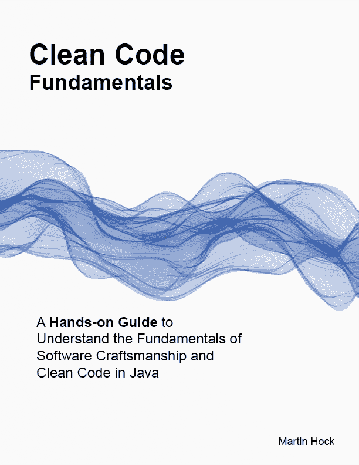


此书可在 [`leanpub.com/clean-code-fundamentals`](http://leanpub.com/clean-code-fundamentals) 购买。

此版本出版于 2021-06-20。


---

这是一本来自 [Leanpub](http://leanpub.com) 的书目。Leanpub 通过精益出版流程为作者和出版社赋能。[精益出版](http://leanpub.com/manifesto) 是使用轻量级工具和多次迭代来发布正在编写中的电子书，以获取读者反馈，不断调整直到获得正确的书籍，并在成功后建立影响力。

---

© 2019 - 2021 Martin Hock

> 糟糕的代码就像一个笑话，如果你必须解释它，那它就是糟糕的。

# 前言

这是一个 `Forever Edition`（永久版）。这意味着这本书将定期更新。

如果您购买了这本书，非常感谢！撰写这样一本书需要投入大量心血。请将您的书视为个人私藏，未经许可请勿重新分发。

如果您觉得这本书很有用，我将非常感激您购买一份。通过这样做，您将让我知道这类书对您是有用的。

## 本书的目标是什么？

本书的读者将获得关于分析、评估和改进软件质量的深度知识和技能。您将能够编写洁代码所需的原则、模式、技术和工具。

**理解 Java 项目中软件质量的重要概念：**

- 最佳实践
- 功能与技术范围
- 开发与编程模型
- 工具

**学习目标：**

- 获取分析、评估和改进软件质量的知识与技能
- 学习原则、模式、技术和工具
- 深化技术知识

## 你可以期待哪些主题？

软件测试并不局限于项目的特定阶段。在编码阶段或构建过程中，就可以在源代码中发现关键且难以发现的软件缺陷。书中介绍了必要的程序和工具。

**此外，还将涵盖以下主题：**

- 软件质量基础概述
- 软件指标、指标在实践中的应用
- 结构化设计、内聚与耦合
- 原则、最佳实践和代码味道概述
- Java 代码规范的合规性验证
- 静态软件测试，特别是评审技术和静态程序分析
- 使用 `SonarQube`、`PMD`、`SpotBugs`、`Checkstyle`、`ArchUnit` 和 `Dependency-Track` 等工具确保软件质量
- 使用 `JUnit` 和 `Mockito` 进行软件测试
- 检查测试覆盖率
- `CI/CD`
- 设计原则
- 设计模式 (`GoF`)

## 谁应该读这本书？

我写这本书是因为我想帮助开发者在洁代码方面获得经验或提高其水平。让他们感受到成为一名“软件工心人”是什么感觉。这关乎专业主义、务实和自豪！

这是一种心态，软件开发者选择对自己的职业负责，学习新的工具和技术并不断进步。通往软件工心精神的道路是漫长的。

这就是为什么我想分享改进代码质量的技巧和实践，并激励开发者。

## 关于软件开发你必须自己学会什么？

- **开发者总是错的** —— 不同的开发者在无休止的架构讨论中错误的程度不同！
- **如果某事会坏，它就会坏** —— 确保项目是防呆的！
- **所有代码都是坏的** —— 软件的缺陷程度只有深浅之分！
- **某处总有一个 Bug** —— 你只需要搜索得足够久！
- **最重要的是客户** —— 而他们根本不在乎所使用的技术和流程！
- **纸上的项目开发是行不通的** —— 问题只有在开发过程中才能发现！
- **少即是多** —— 如果某物不是必要的，就删掉它！
- **我们的工作只有 20% 是编码** —— 其的是设计、调试、测试、会议、讨论等。
- **客户永远不知道自己想要什么** —— 每个人对理想的结果都只有模糊的想法！
- **有人以前做过了** —— 不要造轮子！

## 关于代码示例和排版规范如何？

书中所有的代码示例都是 Java 语言。我不想在代码示例中放置大量的样板代码，所以我直接省略了它们。

类名、数据类型、方法和函数名以及代码不包含在等宽字体中。

## 本书基于哪些文献？

- **Schneider, Kurt**: *Abenteuer Software Qualität – Grundlagen und Verfahren für Qualitätssicherung und Qualitätsmanagement*, dpunkt.verlag, 2007
- **Robert, Martin**: *Clean Code – A Handbook of Agile Software Craftsmanship*, Prentice Hall, 2009
- **Lilienthal, Carola**: *Sustainable Architecture: Analyze and Reduce Technical Debt*, Dpunkt Verlag, 2019
- **Bloch, Joshua**: *Effective Java – Third Edition*, Addison-Wesley, 2017
- **Roock, Stefan**: *Refactorings in grossenprojekten*, Dpunkt Verlag, 2004
- **Gamma, Erich**: *Design Patterns: Elements of Reusable Object-Oriented Software*, Addison-Wesley, 1994
- **Robert C. Martin**: *Agile Software Development: Principles and Practices*, Prentice Hall, 2003
- **Bugayenko, Yegor**: *Elegant Objects Volume 1*, CreateSpace Publishing Platform, 2016
- **Bugayenko, Yegor**: *Elegant Objects Volume 2*, CreateSpace Publishing Platform, 2017
- **Harrer, Simon**: *Java by Comparison: Become a Java Craftsman in 70 Examples*, O’Reilly UK, 2018
- **Robert, Martin**: *Clean Architecture: A Craftman's Guide to Software Structure and Design*, Prentice Hall, 2017
- **Robert, Martin**: *The Clean Coder: A Code of Conduct for Professional Programmers*, Prentice Hall, 2011
- **Thomas,**: *Pragmatic Programmer special 2nd*, Addison-Wesley Professional, 2019
- **Kaczanowski, Tomek**: *Practical Unit Testing with TestNG*, 2012
- **Meszaros, Gerard**: *xUnit Test Patterns*, Addison-Wesley, 2007
- **Long, Fred**: *Java Coding Guidelines: 75 Recommendations for Reliable and Secure Programs*, Addison-Wesley, 2013
- **Sandro, Mancuso**: *The Software Craftsman: Professionalism, Pragmatism, Pride*, Pearson, 2014
- **Freeman, Steve**: *Growing Object-Oriented Software, Guided by Tests*, Addison-Wesley, 2009

# 1 软件工心精神与洁代码简介

## 1.1 对软件开发的热爱


软件工心

> 软件工心是一段通往大师的长路。这是一种心态，软件开发者选择对自己的职业负责，不断学习新的工具和技术并不断自我完善。

–Sandro Mancuso，《软件工心》

### 提供反馈？

如果你对这本书有任何想法，我很乐收到你的反馈。

发现打印错误？发现代码 Bug？有内容建议？请告诉我，通过提供反馈成为这本书的一部分。

对于贡献，请务必告诉我章节名称、标题引用以及简短的文本片段作为参考。

你可以使用本书的 Leanpub 论坛发布错误并提问。

由于这本书是自出版的，我可以根据需要创建尽可能多的版本。

**感谢你花时间帮助这本书变得更好！**

软件手工艺（Software Craftsmanship）运动的基础是 Robert C. Martin 出版的《整洁代码》（Clean Code）。该作者是软件手工艺运动的联合创始人。有许多诸如《软件手工艺宣言》或《整洁代码开发者》等倡议，它们都提高了软件开发的标准——幸运的是如此。

软件手工艺关注于在开发过程中采用良好的技术实践。显而易见，大家都喜欢软件手工艺。每个人都希望拥有整洁的代码库，但这很难实现。有几个步骤应该以正确的方式完成。软件手工艺运动下定义的实践将帮助你实现这一目标。

软件手工艺应该是你追求的目标。它不仅关乎项目的成熟度，还关乎你的软件和代码库的质量。正如本杰明·富兰林所说：“质量的痛苦在廉价快乐被遗忘后仍持续很久”。

有些开发者对工作充满热情，并且已经获得了这些价值观，为代码提供质量和善意。他们拥有必要的技能根据自己的价值观来实现产品。遗憾的是，许多其他人知之甚或完全不知道还有另一种开发方式。即使在今天，许多有助于创建精良软件的开发实践在学校里根本没有被教授。

如果你在一个不应用这些实践，或者没有空间创作精良软件的环境中工作，请问问自己是否可以改变这种现状。成为一名匠人，将软件开发的专业精神传播给团队，希望个人能够追随你。采纳让软件手工艺价值观具有相应价值的文化。不要评价其他开发者，也许他们从未以这种方式工作，或者没有遇到好的导师。当你通过这种方法获得成功时，那很好。如果没有，你可能处于一家不适合你的公司！

### 帮助你增强开发者热情的实践

#### 理解“足够好”的重要性

一个可以运行且足够好的解决方案通常比一个并不存在的完美解决方案要好。学会平衡约束。不要陷入技术战争和对“正确方案”的争论中，在你所做的事情上务实且高效。知道在何时以及何妥协并适可而止。

#### 如果你卡住了，不要忘记寻求

不要浪费时间无休地尝试解决一个别人可以轻松解决的问题。你的团队中有人可以更快地帮助你解决问题，并提供宝贵的建议。知道何时继续尝试，何时停止。

#### 如果你无法交流想法并与他人建立联系，你走不远

学习与周围的人在每个层面上进行有效沟通。参与其他想法，倾听它们，并通过其他观点拓展你的视野。这将帮助你质疑自己的观点，并最终与他人交流。

#### 你会受到批评。学会如何应对它

理解批评的价值并学会如何充分利用它。这些是你成长的机会，对你来说应该是宝贵的反馈。

#### 如果你想有所改变，你需要在优先级排序上保持高效

并不是你能做到的每件事都值得做。学会如何识别高影响的工作并放弃其他的。专注于你非常感兴趣的几件事，同时跟踪其他事情。如今框架层出不穷，理解它们背后的概念更为重要。你可以将这些概念应用于所有框架。

#### 学会如何高效学习

找到适合你随时间推移学习新事物的最佳方法。向他人解释事情是深化自身知识和学习事物的非常有效的方法。

#### 惜用你宝贵的时间

你不能独立完成一切。如果你学会了如何有效地授权，你就可以倍增对你提供更多价值的话题的时间。对目标保持现实，你不可能无所不知。

#### 将你学的一切分享给其他人

你不仅会帮助周围的人变得更好，还会加强你的理解。当知识在团队中增长并发生交流时，每个人都赢。

#### 学会激励他人

如果你知道如何点燃并保持火焰燃烧，每个人都会想留在你身边。允许你的团队成员以他们自己的工作，并给予他们创意和高效工作所需的自由。树立良好的榜样并找出你的同事需要什么才能被激励。

#### 学会主动

不要等问题变成真正的麻烦。以主动的方式处理事情。

## 1.2 软件手工艺宣言

著名的《软件手工艺宣言》（http://manifesto.softwarecraftsmanship.org/）描述了专业的软件开发者，且其本身读起来就像是《敏捷宣言》（http://agilemanifesto.org/）的补充：

作为有志的软件手工艺者，我们正通过实践和帮助他人学习这门手艺来提高专业软件开发的标准。通过这项工作，我们开始重视：

- 不仅是运行的软件，还有精良的软件
- 不仅是响应变化，还有稳定地增加价值
- 不仅是个人和互动，还有专业人士社区
- 不仅是客户合作，还有富有成效的伙伴

也就是说，在追求左侧项目的同时，我们发现右侧的项目是不可缺的。

## 1.3 整洁代码开发者

[整洁代码开发者 (CCD)](https://clean-code-developer.com/）是一个提高软件开发专业性的倡议。`CCD` 定义了一系列原则和实践。这些被分为不同的等级。然而，它也包含了一系列特定的价值观，如`演变性`、`正确性`、`生产效率`和`持续改进`。

通过不同等级的不断迭代，这些原则和实践正成为我们行为方式的一部分。这在开发过程中创造了质量意识。每天实践的人将直觉地掌握这些知识。

下面你可以看到 `CCD` 等级的概述，迭代循环通过这些等级。这些等级在难度和收益方面层层相进。尚未开始 `CCD` 的开发者拥有黑色等级。如果有人尚未开始 `CCD`，则拥有黑色等级。黑色等级仅表示对 `CCD` 的初步兴趣。

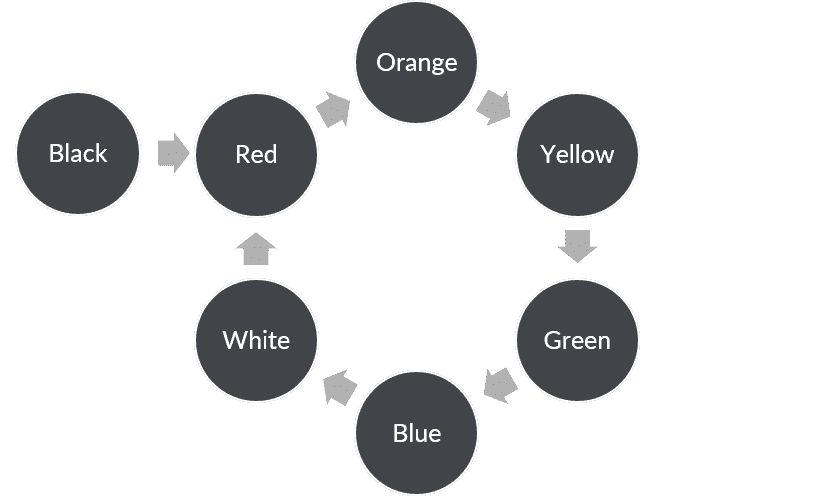

整洁代码开发者循环

整洁代码开发者等级

| 等级 | 原则 | 实践 |
| --- | --- | --- |
| **红色** | 不要重复 (`DRY`) | 使用版本控制系统 |
|  | 保持简单，愚蠢 (`KISS`) | 重构模式 `重命名` 和 `提取方法` |
|  | 警惕优化 | 童子军法则 |
|  | 优先使用组合优于继承 | 根因分析 |
|  |  | 每日反思 |
| **橙色** | 单层抽象 | 问题跟踪 |
|  | 单责任原则 (`SRP`) | 自动集成测试 |
|  | 关注点分离 (`SoC`) | 读、读、读 |
|  | 源代码规范 | or |
| **黄色** | 信息隐藏 | 参加会议 |
|  | 最小惊讶原则 (`POLA`) | 自动单元测试 |
|  | 里氏替换原则 (`LSP`) | 模拟 |
|  | 接口隔离原则 (`ISP`) | 代码覆盖率分析 |
|  | 依赖倒转原则 (`DIP`) | 复杂重构 |
| **绿色** | 开闭原则 (`OCP`) | 持续集成 |
|  | 只管去做，不要询问 (Tell, don´t ask) | 静态代码分析 |
|  | 迪特法则 (`LoD`) | 控制反转容器 |
|  |  | 分享你的经验 |
| **蓝色** | 实现与设计一致 | 持续部署 |
|  | 你不需要它 (`YAGNI`) | 组件面向 |
|  | 设计与实现的分离 | 迭代开发 |
|  |  | `TDD` (测试驱动开发) |
| **白色** | 所有原则汇聚在一起 | 所有实践汇聚在一起 |
|  | 包含了所有其他等级 | 包含了所有其他等级 |

当一个开发者意识到所有的 `CCD` 值时，他就达到了白色等级。在这个等级上，他遵循循环的不断重复，这种循环旨在精炼对各个等级特性的使用。这反映了我们作为开发者的工作，即不断更新我们的知识并精炼我们的工具和实践。只有经验丰富的高级软件开发者才能在白色等级上工作。

可以在这里找到所有原则、实践和价值更具视觉化的概览：^(12)

## 1.4 童子军规则

> 总是让你离开的营地比你发现它时更干净。

–[Robert C. Martin](http://cleancoder.com/)

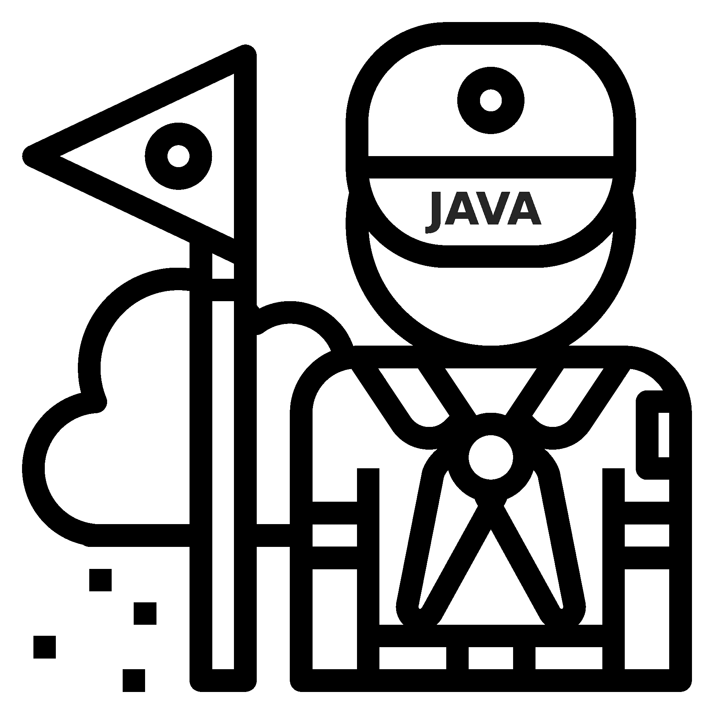

### 童子军规则

童子军有一条关于营地的规则：他们应该让离开的营地比发现它时更干净。通过确保这条规则，他们可以保证自己不会引起新问题，至少在区域整洁方面是如此。

> 如果我们把这条规则应用到代码中会怎样？

童子军规则建议你只需尝试确保在每次提交（`commit`）时，留下的代码比你发现它时更好。这意味着每当你做出更改时，你都对代码库进行了一次改进。也许只是小小的。改进一个变量名、清理不完整的文档、将一个大方法提取为多个较小的方法或添加一个缺失的测试。

保持代码整洁是一项持续的挑战，开发者和软件团队必须决定是否、何时以及如何保持代码整洁。通过重构解决这些技术债是必要的，以保持代码处于扩展和维护在经济上可行的状态。

> 什么时候花时间改进代码是有意义的？

随着时间的推移，基于系统的源代码质量往往会趋于恶化，导致技术债增加。有些团队采取停止所有增值工作并尝试清理代码库的方法。这通常会导致一些重构冲刺（`sprints`）甚至是完全的重写。从业务角度来看，这两者都不是明显的解决方案。功能开发和 Bug 修复必须继续，重构不应该占据大部分时间。

根据童子军规则，团队可以在继续向客户和利益相关者交付价值的同时，随着时间的推移改进代码质量。通过这种方式，持续改进允许你处于技术债不会主导系统的环境中。不要让你的系统超过应用程序变得不可维护的点。因此，“尝试让世界变得比你发现它时好一点”^(3)

## 1.5 破窗效应

> 修复代码中小问题（“破碎窗户”）的重要性，防止它们增长为大问题。

–[实战程序员](https://pragprog.com/titles/tpp20/the-pragmatic-programmer-20th-anniversary-edition/)


### 破窗效应


破窗效应可以被用作软件开发和项目技术债的隐喻。

每当你推迟对已知问题的修复时，你就在创造负债。你可能知道某些东西坏了，但你现在不修复它，你就欠了债。如果你有一些这类问题并且意识到了它们，那没关系。你做个并在稍后删除它们。但就像真正的债务一样，不需要多久就会达到永远无法偿还的地步。那个点就是你有太多的问题，以至于你永远无法回去解决它们。

你不想让技术债失控。在小问题增长为大问题之前停止它们。不要让你的项目中出现破碎的窗户，而是修复它们。如果你现在无法修复它们，就创建一个技术债工单，确保确保都知道它们是坏的。技术债日志有助于提供团队内部的概述。

一旦某个东西坏了且无法修复，它就会在整个团队中蔓延。团队或新成员会习惯这些“破碎窗户”，并且害怕添加新的窗户。这导致了更糟糕的代码以及对你处理代码方式的尊重丧失。关注技术债，无论问题多小都要解决它们。不要让代码腐烂。代码越好，其他团队成员越不容易破坏。

## 1.6 崇拜式编程


### 崇拜

[崇拜式编程](https://archive.org/details/professionalsoft00mcco_0)是一种编程风格，其特征是仪式化地使用代码或结构，而没有实际作用。崇拜程序员可能适用于：当一个不熟练或新手程序员从一个地方复制代码到另一个地方，而不理解其运作或在新位置是否需要。它也可以指的是在不理解设计背后原因的情况下盲目应用设计模式或编码风格。

## 1.7 知识 - 专业

Simon Wardley 发布了这张图（https://threadreaderapp.com/thread/104556754603987008），它并非基于任何研究。然而，你可以在图中发现自己作为开发者。你对某种编程语言或技术的研究越多，就越觉得你真正了解它。但在某个时刻，你必须向自己承认你基本上一无所知。但我们不必绝望，应该保持好奇心并不断学习。

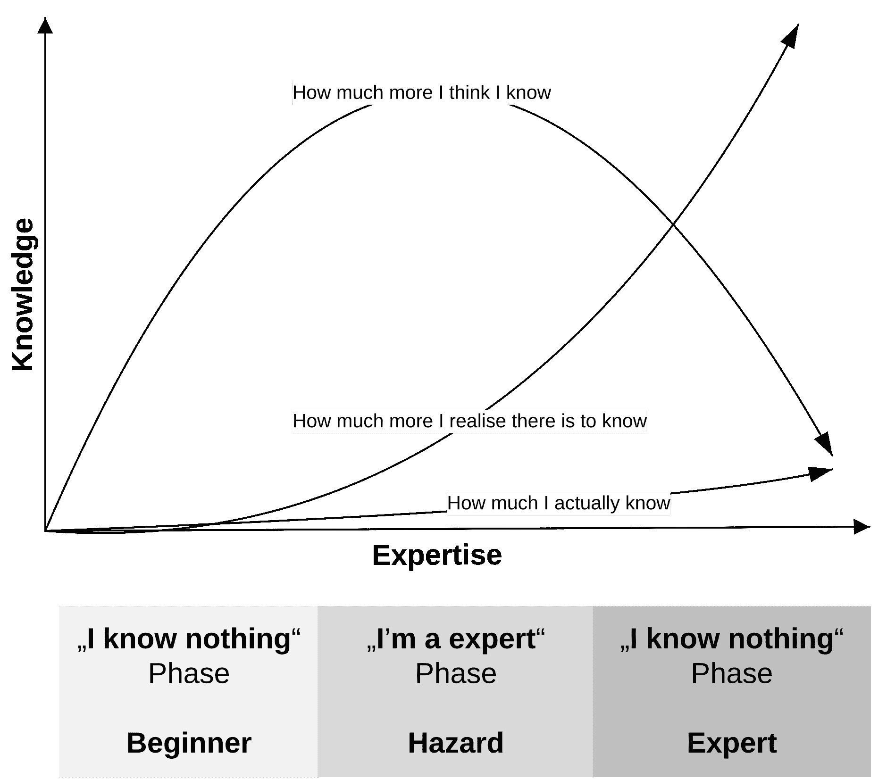

知识 - 专业

# 2 设计基础

## 2.1 设计金字塔

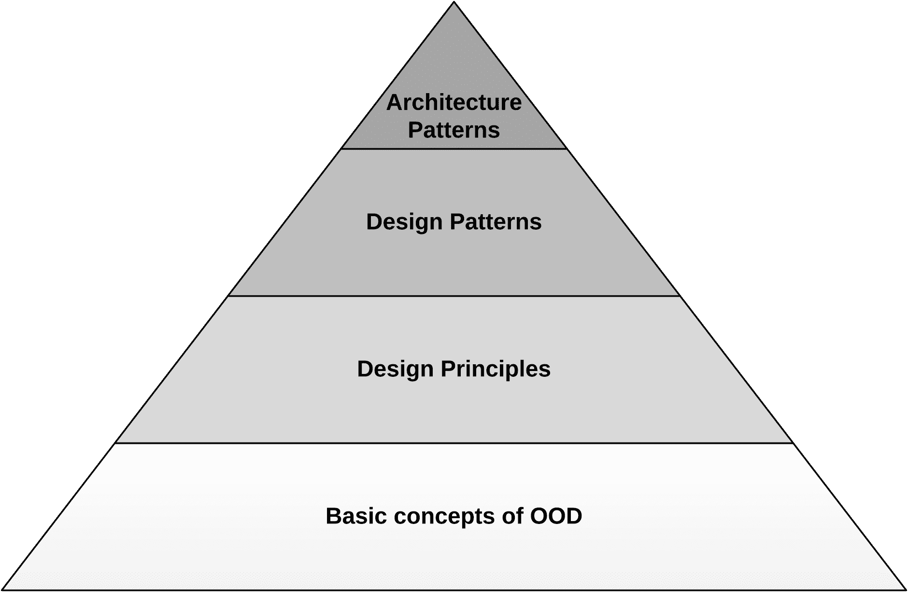

### 设计金字塔

#### OOD 基本概念

OOD 的基本概念是本书的先决，将在后续章节中简要讨论。然而，它们是理解后续章节中设计原则和设计模式的基础。语言规范和特性以及多态、封装、抽象和继承的实现有助于理解和实现它们。

#### 设计原则

设计原则基于 OOD 概念。最著名的是 Robert C. Martin 的 SOLID 原则。SOLID 是旨在使软件设计更易理解、灵活和可维护的五个设计原则的缩写。书中详细介绍了这些。除了这些，还有许多，书中也进行了描述和解释。

#### 设计模式

设计模式更进一步，为反复出现的问题提供了解决方案模式。最著名的可能是 GoF 设计模式，书中通过许多示例涵盖了它们。除了 GoF 模式，还有许多值得学习的。

#### 架构模式

架构模式位于设计金字塔的顶端。架构模式是经过验证的设计结构的方法。更具体地说，架构模式是一组在实践中反复使用的设计决策，具有定义明确且可以复用的良好特征。有很多架构模式，如微内核、`micro-services`（微服务）、`layered architecture`（分层架构）、`event-based`（事件驱动）等。

## 2.2 OOD 的基本概念

面向对象编程有四个基本概念：`abstraction`（抽象）、`encapsulation`（封装）、`inheritance`（继承）和 `polymorphism`（多）。尽管这些概念看起来很复杂，但理解它们的原理将帮助你理解软件设计的基础。

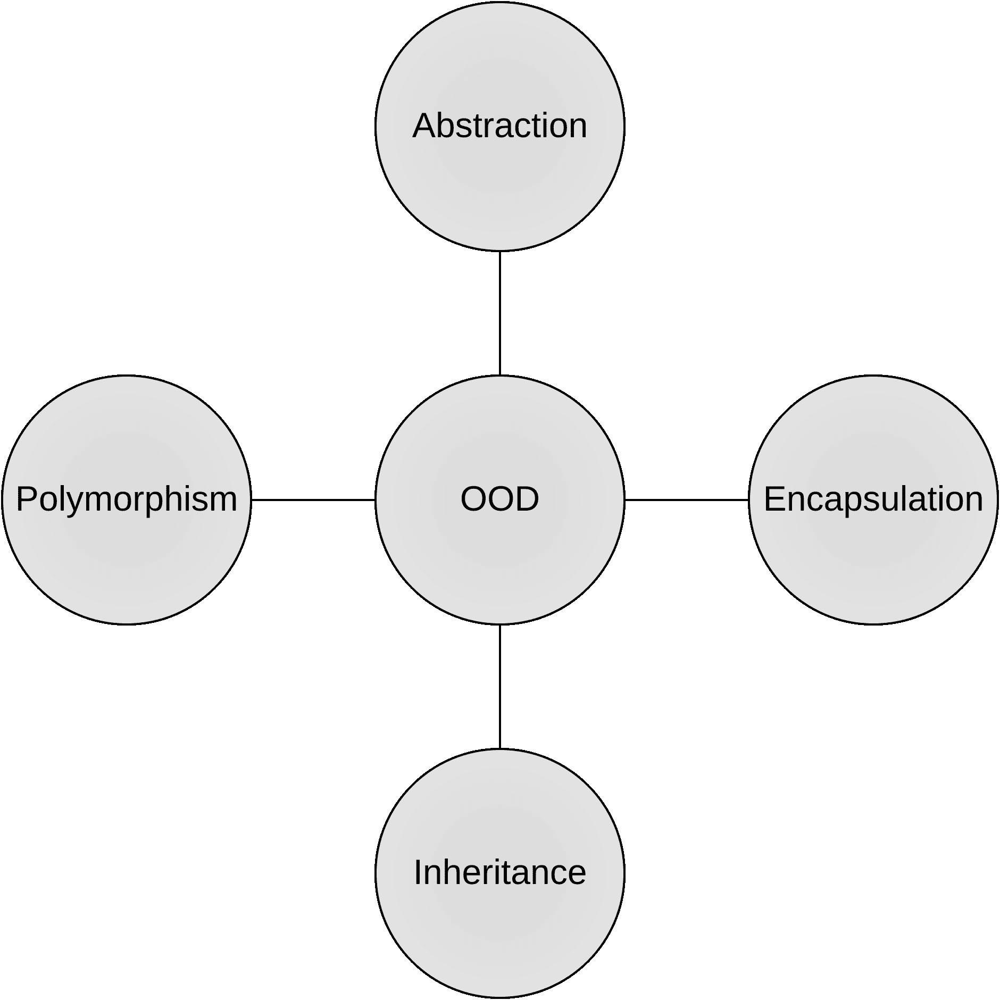

OOD 的基本概念

### 抽象

抽象意味着客户端只与对象的特定属性和方法交互。抽象通过简化的高层访问来处理复杂的对象。

- 通过忽略无关的细节来隐藏复杂性
- 在设计层面解决问题

### 封装

封装是一种通过限制对类、方法和变量的访问来隐藏数据实现的机制。一个例子是，通过保持实例变量私有化并使访问方法更加可见，来实现这一点。为了减少软件组件之间的耦合，封装机制是至关重要的。

- 信息和数据隐藏
- 在实现层面解决问题

### 继承

允许类继承其他类的特性。在实践中，父类将属性和行为扩展到子类。

- 扩展与专门化
- 继承支持复用

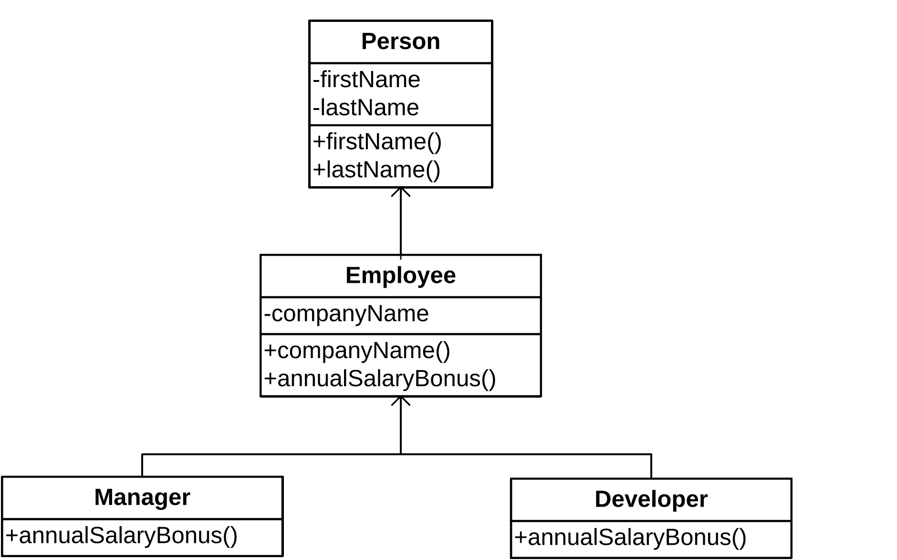

继承

### 多态

多态意味着一名多形。它允许设计共享行为的对象。通过继承，对象可以使用特定行为覆盖父类行为。多态允许同一个方法以静态和动态的方式执行不同的行为。静态通过方法重载实现，动态通过方法重写实现。因此，多态与继承密相关。我们可以编写在超类上运行的代码，它对任何子类类型同样有效。

- 可替性
- 相同的接口，不同的行为

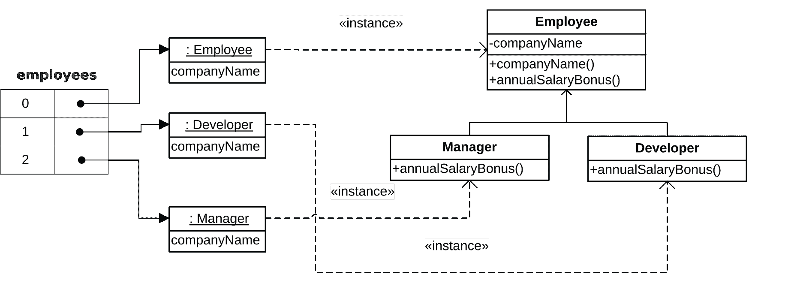

多态

```java
public class Client {

    public static void main(String[] args) {
        List<Employee> employees = List.of(
                new Employee("Employee", "Max", "Company"),
                new Developer("Developer", "Max", "Company"),
                new Manager("Manager", "Max", "Company"));

        employees.forEach(e -> System.out.printf(assembleMessage(e)));
    }

    private static String assembleMessage(Employee employee) {
        return String.format("%s with an annual salary bonus of %g!\n",
                employee.getClass().getName(),
                employee.annualSalaryBonus());
    }
}
```

多态

```text
Employee with and an annual salary bonus of 1000,00!
Developer with and an annual salary bonus of 3000,00!
Manager with and an annual salary bonus of 5000,00!
```

输出

在这个示例中，编译器不知道引用属性`employee`是什么类型。它们不知道在`annualSalaryBonus()`上调用了哪个操作。是超类`Employee`的方法，还是子类`Developer`或`Manager`重新定义的`annualSalaryBonus()`。

此外，如果为`Employee`超类添加了额外的子类，则不需要修改`assembleMessage()`操作。

## 2.3 软件设计的目标

软件设计是隐形的：满足所有功能要求的软件可能仍然设计得很糟糕。

- 在以下情况下，设计是良好的：
  - 它将软件的复杂性拆解为可管理且简单的问题。
  - 定义了小的接口。
  - 组件是解耦的。
  - 组件有明确定义的职责。
  - 软件是可维护的。
  - 软件可以容易地更改和扩展。
  - 软件是稳定的。
  - Bug 可以快速修复。
  - 软件可以在其他软件项目中复用。
  - 代码是可理解的。

下图显示了软件设计在项目中可以产生的价值。

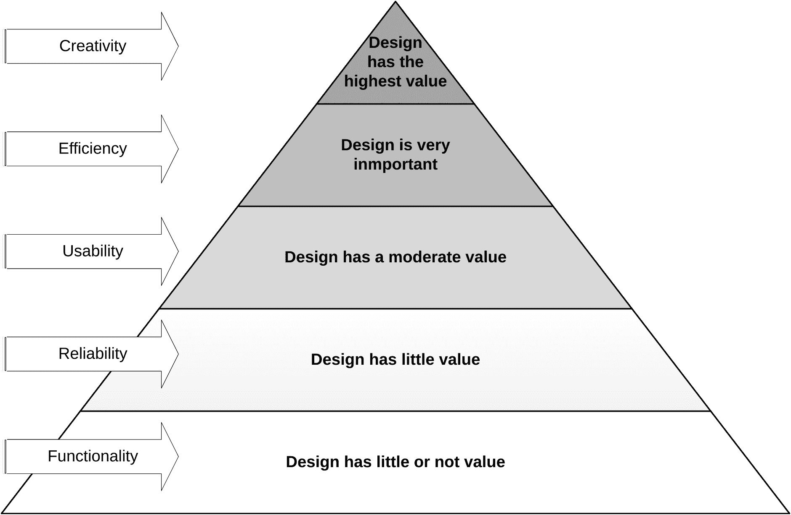

设计需求层次

遗憾的是，软件设计在项目中并不总是优先级。这可能是由于各种原因，缺乏技术经验，或者仅仅因为它被认为是不重要的。在我看来，如果在项目开始时没有建立坚实的基础，是一个致命的错误。这就像尝试盖房子一样。没有良好的基础，你无法盖房子，而你必须从那里开始。

## 2.4 坏设计的症状

- “别碰运行中的代码”症 (Never-touch-running-code Syndrome)
  - 开发者害怕修改代码。
  - 有许多临时解决方案，代码是围绕这些方案开发的。
  - 更改具有未知且未检测到的副作用。
- 需求的小幅变化导致代码的大变化。
- 通过代码重复进行复用（复制粘贴）。
  - 开发者追逐需要更改的地方。
  - 代码越多，跟踪重复部分就越困难。
  - 错误必须在不同的地方多次修补。
- 构制品之间的循环关系。
  - 循环耦合的构制品无法单独测试。
  - 在不同循环使用的构制品往往扮演多种角色，使得它们难以理解。
  - 在不同循环使用的构制品无法轻易交换。

## 2.5 良好设计的标准

这些标准是分形的，即它们适用于设计的所有层次，如架构、子系统和组件。

- 正确性
  - 实现需求
  - 实现系统的所有功能
  - 确保非功能需求
- 可理解性
  - 自解释的代码和设计
  - 良好的文档
- 高内聚
- 低耦合
- 复用性
- 可定制性
- 无循环依赖

## 2.6 信息隐藏

通过隐藏不应被客户端调用和访问的细节、方法和成员，简化并减少对类的访问。

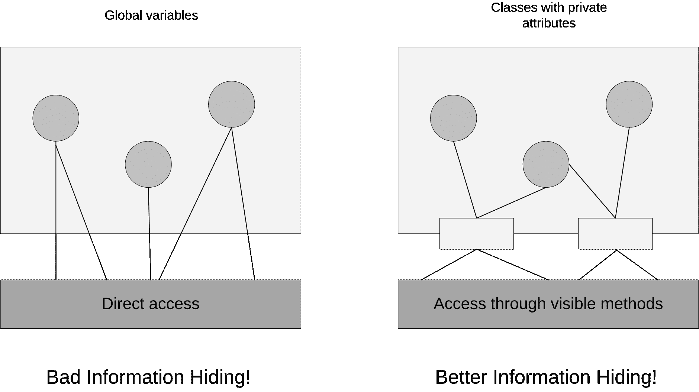

信息隐藏

在 Java 中，类和类成员受到访问控制。这种机制防止包或类的用户依赖包或类实现的不需要细节。访问通过访问修饰符`public`、`protected`或`private`指定。在没有修饰符的情况下，它是默认访问，也称为包级访问（package-private）。

如果没有指定访问修饰符`public`、`protected`或`private`，则类成员或构造函数具有包私有（package-private）访问权限。它可以在定义该类的包内访问，但该类成员或构造函数在任何其他包中都是不可访问的。

### `private`

`private`类成员或构造函数仅在包含该成员或构造函数定义的顶层类体内可访问。

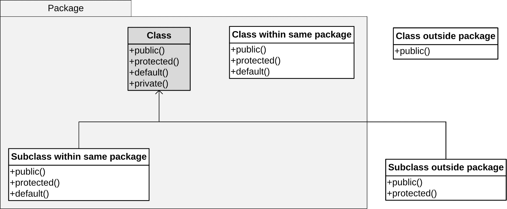

### Java 中的可见性

将成员声明为`private`，并为`private`字段提供可访问的方法。让分布式类仅通过这些方法调用进行通信。

如果类、接口、方法或字段是已发布 API 的一部分，可以将其声明为`public`。其他类和成员应该声明为包私有或`private`。必须避免暴露通过接口访问类可变状态的字段和方法。这是因为接口只允许公开访问的方法，而这些是类 API 的一部分。例外是实现那些暴露可修改对象公共不可变视图的方法。可修改类应该提供复制功能，以允许安全地向客户端代码传递实例。

#### 继承与可见性

如果方法被重写，则新方法的访问控制不能比原始方法强。在`private`的情况下，是不可能的继承。更准确地说，没有发生重写，且无法通过`super`访问父类方法。

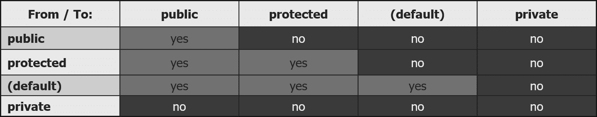

可见性与继承

## 2.7 内聚性

*组件元素之间关联程度的度量。*

**组件的高内聚性可以提高理解、维护和适应能力。**

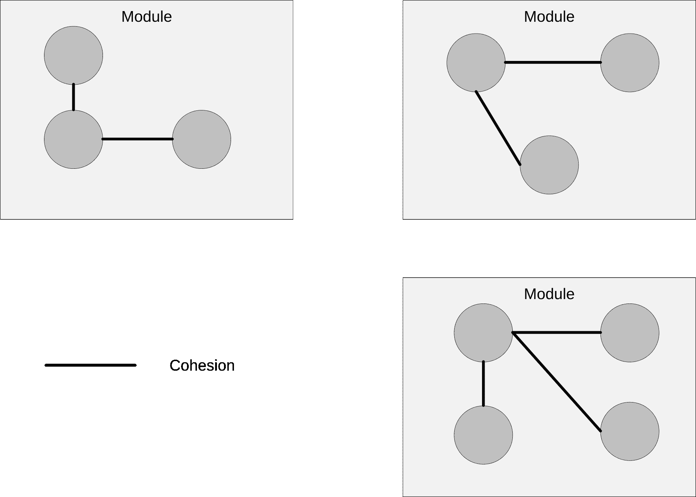

内聚性

易于维护通常具有高内聚性。模块内的元素与该模块旨在提供的功能直接相关。我们可以轻松地设计、编写和测试代码，因为模块的代码整合在一起并协同工作。

低内聚性意味着功能分布在你的整个代码库中。

- 内聚性的程度
  - 功能性内聚
  - 顺序内聚
  - 通信性内聚
  - 过程性内聚
  - 时间性内聚
  - 逻辑性内聚
  - 偶然内聚

## 2.8 耦合

*组件之间依赖关系的度量。*

**低耦合有助于维护性并使系统更稳定。**

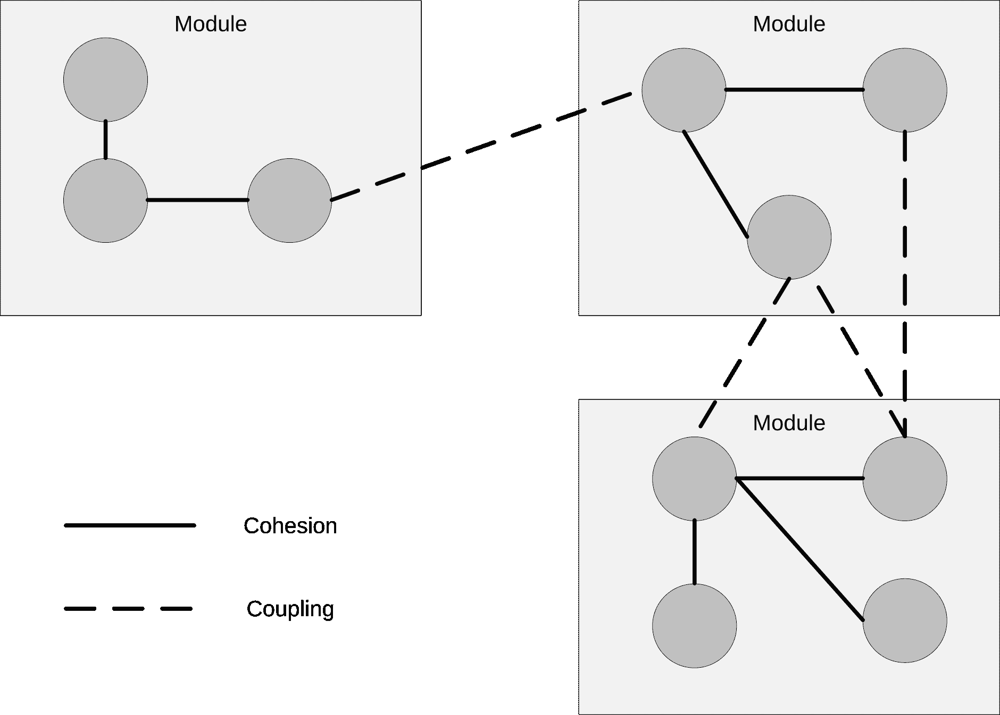

耦合

模块应该尽可能与其他模块保持独立。对一个模块的更改不应该对其他模块产生重大影响。高耦合意味着模块过度了解应用程序其他部分的内部实现。了解过多其他信息会使协调变得困难并增加脆弱性。

通过低耦合，你可以轻松地更改内部结构，而不必担心它们对其他模块的影响。低耦合也使得设计、编写和测试代码变得更容易，因为我们的模块是独立的。我们还有一个优势是代码易于复用。

- 高耦合的后果
  - 难以维护，难以适应
  - 单体化结构（Monolithic）
  - 几乎无法交换组件
  - 系统变得脆弱
  - 难以复用单个组件
- 耦合的类型
  - 数据耦合
  - 接口耦合
  - 结构耦合
- 减少耦合
  - 耦合永远无法降为零！
  - 较高的接口耦合会增加灵活性
- 高内聚实现低耦合

## 2.9 内聚 - 耦合

内聚和耦合是设计质量最重要的属性之一。在软件开发中，耦合意味着组件之间依赖关系的度量，而内聚代表组件元素之间统一性的度量。理解这两个参数对系统可能产生什么影响以及如何影响它们是非常重要的。

**总结一下：**

- 内聚代表代码库的一部分在逻辑上表示一个单一原子单元的程度。
- 耦合代表单个单元独立于其他单元的程度。
- 封装信息，使模块高度内聚性，并降低模块之间的耦合。
- 尝试在代码库的所有层面遵循指南。
- 在不影响内聚性的情况下实现完全解耦是不可能的，反之亦然。

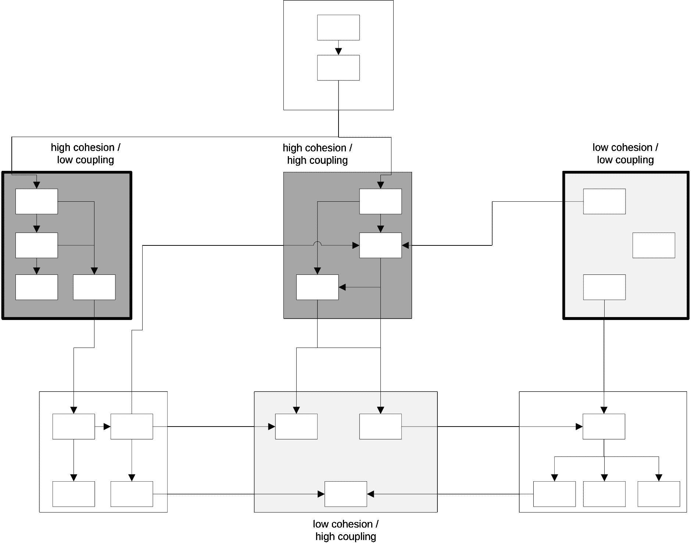

内聚 - 耦合

## 2.10 泥球团（Big Ball of Mud）

泥球团是软件架构的反模式，描述了一个没有可识别的软件架构的程序。

**最常见原因：**

- 经验不足
- 缺乏对架构的意识
- 未模块化、高耦合和低内聚
- 不符合良好设计原则
- 实现团队的压力
- 不断变化的需求
- 高时间压力
- 预算低
- 员工流动

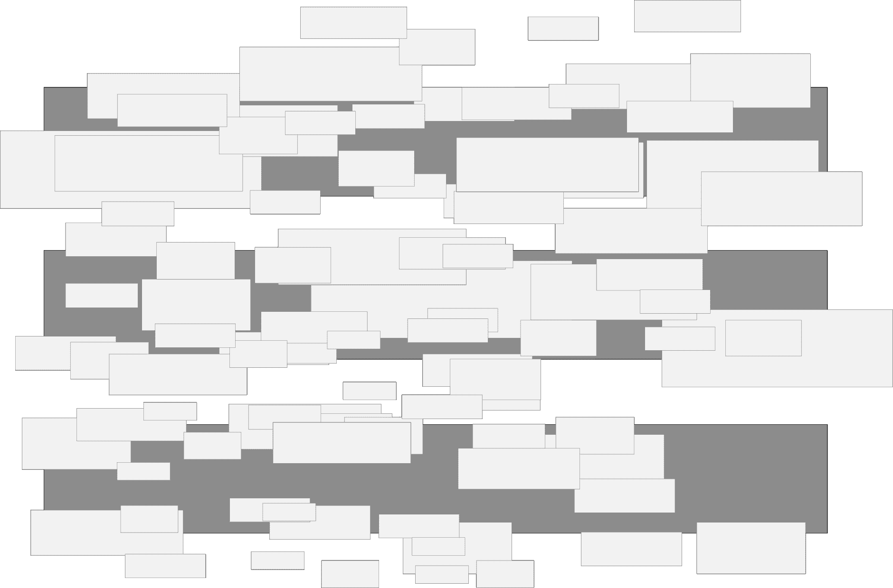

泥球团

## 2.11 架构原则

### 简单，愚蠢（KISS）

- 考虑几个选项，然后先尝试最简单的选项。
- 始终问：有没有更简单的方法来实现此？
- 考虑未来的维护者，假设他们就是你，并在此基础上开展工作。
- 当你查看现有系统时，问：我需要这些东西吗？或者我们根本需要它们吗？

### 你不需要它（YAGNI）

- 架构的设计应该支持与利益相关者同意的当前和未来需求。

### 最小惊讶原则（POLA）

- 保持一致性，这样人们在发现类似任务在不同的地方以不同的方式完成时不会感到惊讶。
- 如果需要差异，请记录原因。
- 一致性引导理解，如果你对命名错误或对同一个事物使用不同的名称，就会增加复杂性。

### 关注点分离（SoC）

- 将相关的放在一起，将不相关的分开。

### 如果痛苦，就多做几次

- 当我们试图避免困难时，就会面临复杂性的增加。因此，如果我们频繁地执行困难的任务，复杂性就会降低。
- https://martinfowler.com/bliki/FrequencyReducesDifficulty.html

### 离开时比发现时更好（童子军守则）

- 持续改进你的代码，这意味着每当我们对代码库进行更改时，都对代码进行改进。
- 无论原因如何，我们都不希望产生额外的技术债。每当我们看到代码异味时，都应该尝试消除它。
- 如果我们都遵循这种方法，系统将逐步提高，恶化情况也将停止。

### 与人交流

- 你无法从文档或现有代码中找到所需的所有信息——你必须与人交流。

我们大脑为了复杂结构而开发的机制是`分块（chunking）`、`层级形成（formation of hierarchies）`和`模式构建（building of schemata）`。这些技术与系统的架构设计直接对应。当这些技术及其在架构中的实现对开发团队来说显而易见时，高质量架构的基础就建立起来。

Carola Lilienthal 在她的书籍《可持续软件架构：分析与减少技术债》（*Sustainable Software Architecture, Analyze and Reduce Technical Debt*）中详细描述了如何将认知机制映射到软件架构。在书中你可以找到关于模块化、分层和模式一致性实现的更多细节。

## 2.13 分层架构

### 2.13.1 分层架构的使用

架构风格和模式在软件工程中起着重要作用。应用程序的架构和设计有很多可能性。应用的复杂性取决于不同的需求。基本上，系统的设计方式应该使得架构是易于重用、扩展和维护的，并允许组件之间清晰的隔离。

架构不应该是关于框架的。框架是要使用的工具，支持你对应用程序进行预期设计。你不应该围绕框架来构建架构。

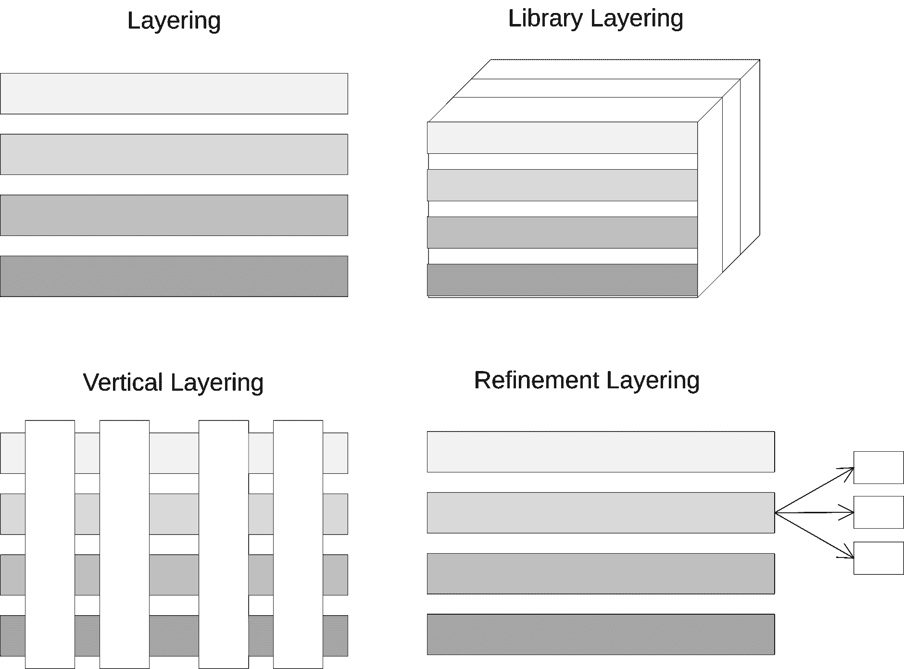

### 分层架构的使用

一种常见的方法被称为`n-tier architecture`（n 层架构）。在这里，应用程序的构建块根据其任务分为不同的层。这种分层是许多应用程序的事实标准，因此大多数架构师、设计师和开发者都很熟悉。

虽然分层架构模式没有规定层的数量和类型，但大多数分层架构由三或四层组成。例如，较小的应用可能有三层，而更大更复杂的业务应用可能有五层或更多。

三层架构通常包含：持久化层、业务层和表示层。它包含了清晰定义的接口和定义的数据流方向。为了最小化层与层之间的耦合，使用领域对象（domain objects）在层之间传输数据。

传统的软件架构为分层软件设计定义了以下三个主要层：


## 表示层（Presentation Layer）

表示层的任务是响应客户端请求。一方面，它在界面上以适当的形式展示数据；另一方面，它包含了对用户操作的执行和响应。在实现和落实这一层时，挑战在于保持它不包含业务逻辑。因此，表示层不应实现业务逻辑，而应仅调用和使用它。

## 业务层（Business Layer）

业务层代表了一个逻辑且独立于表示的层。业务逻辑在这里被编写，即所有必须独立于具体表示而完成的任务。它包含了在用例中开发的业务需求的全部功能。实现期间的重点是相关组件的分组以及待开发架构的抽象。

## 持久化层（Persistence Layer）

持久化层负责对数据库中数据的实际访问。为了实现最高级别的封装，数据库访问不能由持久化层以外的任何层执行。对于高层来说，对象以什么种类型存储无关。因此，在业务层或表示层中不能使用直接数据库调用。持久化层仅通过业务层的业务对象被调用。

## 你如何将类组织到包中？

假设你正在编写一个 Web 应用程序。在这个应用程序中你处理票务和预订。你的类包含了用于处理票务的`TicketController`、`TicketService`、`TicketRepository`，以及用于注册的`RegistrationController`、`RegistrationService`和`RegistrationRepository`。那么，你如何将类组织到包中并创建一个有效的架构呢？

有两种不同的方法来结构化你的包。你可以关注技术分层：

- `com.swsc.web`
- `com.swsc.service`
- `com.swsc.repository`

或者你可以关注领域，并将包划分为功能驱动的方法：

- `com.swsc.registration`
- `com.swsc.ticket`

这种方法将在接下来的章节中进行详细讨论。

### 2.13.2 违反分层的架构

在例例中，请求直接从一个层移动到另一个层，这违反了分层架构。它必须通过其正下方的层，才能到达再下方的下一层。

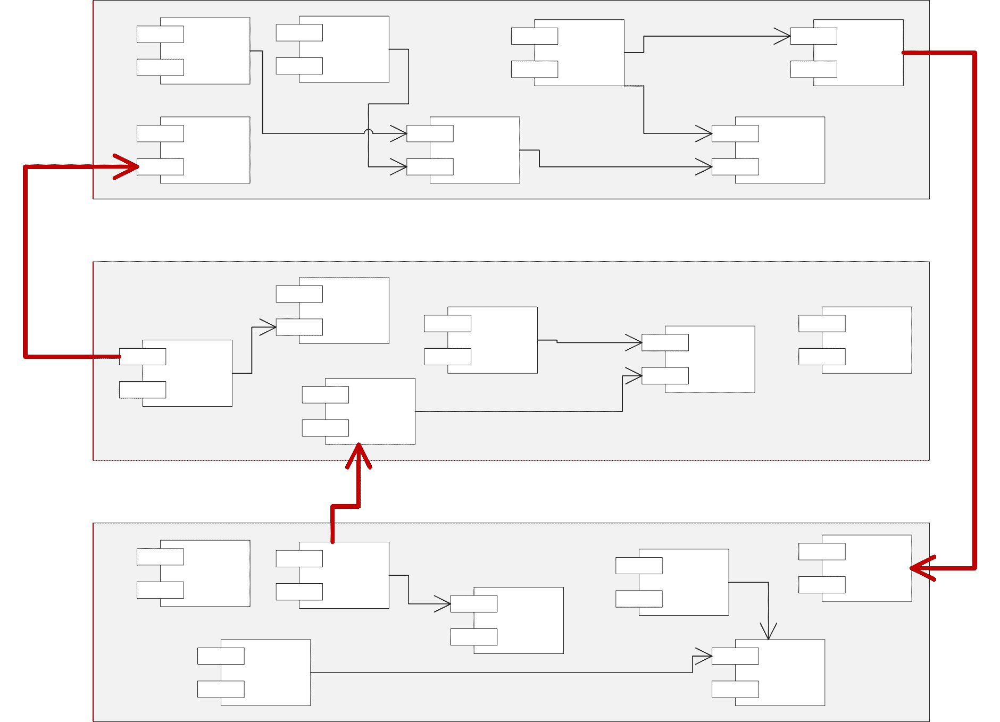

#### 违反分层的架构

在这个例中，下层层对上层的访问也是一种违反。

关于应用程序架构的访问和约定应该在团队内部已知，或者最好能够自动检查。在《测试架构与设计》（*Testing the Architecture and Design*）章节中介绍了一种使其可能的方法。这种架构不应该随着时间的推移而消失，应该保持有效。

### 2.13.3 水平分层

经典的横向分层架构模式是一种稳健的通用模式，因此是大多数应用程序的良好选择，特别是当你不确定哪种架构模式最适合你的应用程序时。

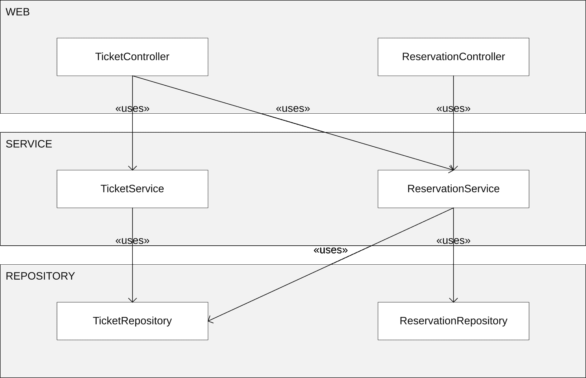

#### 水平分层

然而，今天这不再是首选解决方案。从架构角度选择这种模式时需要注意几点。使用这种模式你面临着构建单体（monolith）的风险。这种模式根据纯技术责任对层进行水平切割。这种范式`消除了低耦合和高内聚`。这与我们想要实现的目标完全相反。

不同的模块会迅速依赖于应用程序的其他部分，彼此之间没有清晰的分。如果一个应用程序完全根据水平层结构，而不是像本例这样根据*Ticket*（票务）和*Reservation*（预订）等功能结构，你将得到一个纯的分层架构，而没有清晰的功能模块划分。

当你查看包结构时，你会发现几乎所有的类都必须具有`public`修饰符才能访问下层。这显然不是最好的方法，并且违反了信息隐藏原则。

```text
1 com.swcs.web
2     (C) TicketController
3     (C) ReservationController
4 com.swcs.service
5     (C) TicketService
6     (C) ReservationService
7 com.swcs.repository
8     (C) TicketRepository
9     (C) ReservationRepository
```

包结构 - 水平分层

### 2.13.4 基于功能的分层 - 单包

因此，更好的方法将是根据功能职责将应用程序划分为`垂直切片（vertical slices）`，并保留技术分层。每个模块被赋予一个清晰且独立的功能上下文。因此，我们不是跨层进行耦合，而是沿着切片进行垂直耦合。按功能分组通过将所有相关类放在同一个包或模块中，改进了耦合和内聚。这最小化了切片之间的耦合，最大化了切片内部的耦合。从长期来看，这种切片间的解耦简化了代码维护，因为很清楚哪些代码做什么。我们可以在不接触或完全理解其他代码的情况下进行更改。这使得对应用程序部分的修改变得更容易，提高了可维护性和扩展性。

内聚和耦合这两个概念非常有用且重要，但在这种方法中还有一点在起作用。

通过“按功能划分”（Package by Feature）划分包和模块结构可以帮助开发者了解它在做什么以及具有哪些功能。架构会直观地呈现在你面前。这是迈向鲍鲍叔所说的[尖叫架构（Screaming Architecture）](https://blog.cleancoder.com/uncle-bob/2011/09/30/Screaming-Architecture.html)的一步。

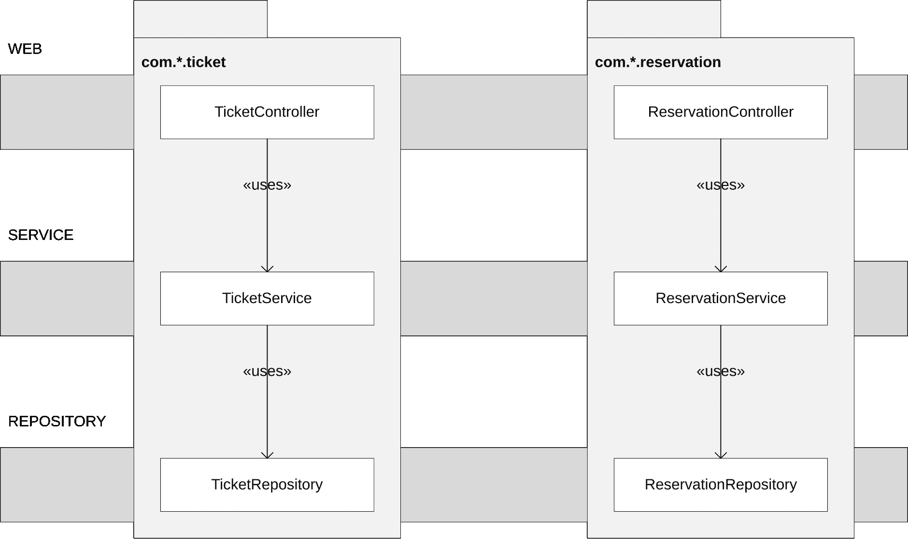

#### 基于功能的分层 - 单包

在单包方法中，不为单独的水平分层使用子包。这使得将所有类设置为包私有（package-private）成为，从而防止在包外部使用这些类。然而，这可能会影响大型模块的清晰度。

水平切分和垂直切分都有各自的使用场景，但显而易见，垂直切分结合水平切分能够实现更现代、适应性更强的架构。

这种方法使得降低类的可见性成为可能。类可以被设置为包私有，因此仅在功能切片内可用。在水平分层中，这是可能的，因为相关的类必须跨包进行通信，迫使我们对所有内容设为公共。切片内的水平分层仍然存在。像`*Controller`、`*Service`和`*Repository`等命名约定定义了分层。

```text
1 com.swcs.ticket
2     (C) TicketController
3     (C) TicketService
4     (C) TicketRepository
5 
6 com.swcs.reservation
7     (C) ReservationController
8     (C) ReservationService
9     (C) ReservationRepository
```

包结构 - 基于功能的分层 - 单包

**优势是显而易见的：**

- 你获得了切片之间的低耦合和高内聚。
- 代码结构与领域相对应，确保了开发者和部门之间一致的理解和通信。
- 由于新功能和增强大多是技术驱动的，因此更容易识别合适的模块并确定更改范围。
- 单个功能领域内的更改可以在系统的单个部分发生。通过这种方式可以避免或减少副作用，因为模块之间是相互独立的。
- 垂直分离促进形成硬性的上下文边界。垂直分层使得架构从单体结构向类似于微服务的构建的分布式结构进行转换变得更容易。
- 可测试性更好，因为模块的技术逻辑与其他模块分离开。

### 2.13.5 基于功能的分层 - 分层之前的切片

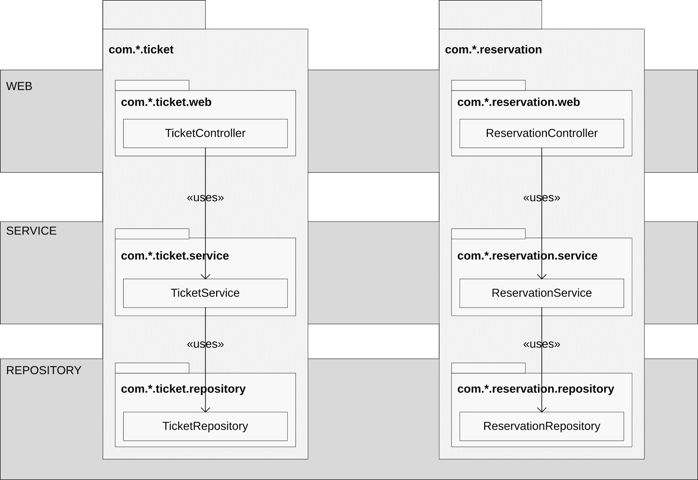

#### 基于功能的分层 - 分层之前的切片

`切片在分层（Slices before layers）`的方法将垂直的功能切片划分为技术层，如`web`、`service`和`repository`。这使得包内部的技术层更容易被识别。这主要服务于代码库的组织并改进了代码的结构。

然而，它也失去了一个非常重要的优势。为了相互访问，类必须被标记为公共（public），结果是它们对其他功能切片可见的。

```text
 1 com.swcs.ticket.web
 2     (C) TicketController
 3 com.swcs.ticket.service
 4     (C) TicketService
 5 com.swcs.ticket.repository
 6     (C) TicketRepository
 7 
 8 com.swcs.reservation.web
 9     (C) ReservationController
10 com.swcs.reservation.service
11     (C) ReservationService
12 com.swcs.reservation.repository
13     (C) ReservationRepository
```

包结构 - 基于功能的分层 - 分层之前的切片

### 2.13.6 基于功能的分层 – 六边形架构

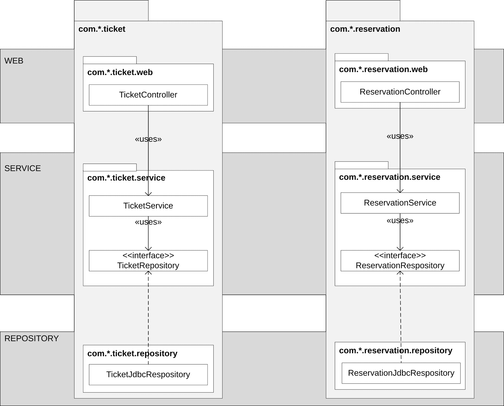

#### 基于功能的分层 - 六边形架构

[六边形架构](https://alistair.cockburn.us/hexagonal-architecture/)或端口与适配器架构（port and adapter architecture）是一种软件设计中用于构建大型应用程序的架构模式。它的设计目的是通过端口和适配器创建松耦合的应用程序组件。

这种架构风格也可以应用于模块内部的代码。其背后的原理是领域逻辑被集中封装。与该领域的用户和服务器侧的交互位于核心之外。用户端可以是 API 或 Web 界面。服务器端可以是数据库。这里的关键点是，外部世界始终依赖领域核心，反之则不然。

在示例中，`service`包定义了如`TicketRepository`等接口，用于访问数据库的实际逻辑。接口`TicketJdbcRepository`的实际实现位于`repository`包中，因此指向领域包的方向。

```text
 1 com.swcs.ticket.web
 2     (C) TicketController
 3 com.swcs.ticket.service
 4     (C) TicketService
 5     (I) TicketRepository
 6 com.swcs.ticket.repository
 7     (C) TicketJdbcRepository
 8 
 9 com.swcs.reservation.web
10     (C) ReservationController
11 com.swcs.reservation.service
12     (C) ReservationService
13     (I) ReservationRepository
14 com.swcs.reservation.repository
15     (C) ReservationJdbcRepository
```

包结构 - 基于功能的分层 - 六边形架构

这种方法的优势是整个业务逻辑都是集中定义的，并且与外部世界解耦。但这里的可见性也太开放了。

#### 通过应用事件减少依赖

模块之间的直接依赖通常是通过直接调用和使用另一个模块的类创建的。依赖关系应该尽可能地减少。应不惜一切地避免循环依赖。

有几种减少依赖的方法，例如应用事件。应用事件可以用于松耦合的组件之间交换信息。通过用应用事件替换直接调用，你可以反转依赖关系。模块创建一个特定类型的事件，该事件位于模块内部。另一个模块注册一个事件监听器，监听并对该事件做出反应。因此，接收到的模块对发送的模块有依赖，因为它知道这种事件类型，而反之则不然。这对于向另一个模块发送直接命令的调用（如审核日志）特别有用。

### 2.13.7 Java 模块系统

随着 Java 9 引入的[Java 模块系统](https://openjdk.java.net/jeps/261)，你获得了另一种为你的架构添加可见性规则的方法。上面的示例是在没有模块系统能力的情况下设计的。但如果你使用它，它将让你更容易组织你的代码。

模块化在包之上添加了更高层次的聚合。只有当模块显式导出包时，一个模块中的包才能被其他模块访问。即使如此，另一个模块只有在显式声明它需要另一个模块的功能时，才能使用这些包。

你会发现，考虑到模块系统有助于你开发出更清洁、更一致的设计。你不需要模块系统来设计模块化设计，但模块系统会让这变得容易得多。

Nicolai Parlog 编写的《The Java Module System》一书对模块系统的功能提供了深入的见解。

设计架构意味着做出决策！文档是所有决策的持久且可通信的产物。它在项目规划期间被考虑，并且更多地关注非功能性而非功能性需求。团队紧密合作，构建一个满足所有要求的系统。部分开发工作将处理功能性需求以外的需求。因此，改进系统质量的工作占据团队时间的大部分。

为了给所有需要架构信息（例如内部结构、跨领域概念或基础决策）的系统利益相关者提供一个基础架构概述，提供架构文档至关重要。

`[Arc42](https://arc42.org/)`为描述架构提供了一个全面但精简的模板。该模板生成统一的架构文档，有助于通过查看多个领域来理解大局并并将各个点连接起来。

该模板的结构如下，包含 12 个结构[项](https://arc42.org/overview/)：

### 1. 引言与目标

对需求的简要描述、驱动因素、需求摘要。对于主要利益相关者而言，架构优先级最高的三个或最多五个质量目标。重要利益相关者及其对架构预期的列表表格。

### 2. 约束

任何限制团队进行设计和实现决策或相关流程决策的因素。这些有时会超出单个系统，对整个组织和公司有效。

### 3. 上文与范围

将你的系统与其外部通信伙伴隔离开来。指定外部接口。

### 4. 解决方案策略

塑造架构的基础决策和解决方案策略的总结。可以包括技术、顶层分解、实现高水平质量目标的方法以及相关的组织决策。

### 5. 构建块视图

系统的静态分解，源代码的抽象，直到适当的详细程度。

### 6. 运行视图

以场景形式表示的构建块行为，涵盖重要的用例或功能、关键外部接口的交互、操作与管理以及错误和异常行为。

### 7. 部署视图

带有环境、计算机、处理器、拓扑结构的技术基础设施。软件构建块到基础设施要素的映射。

### 8. 跨领域概念

在系统的多个部分相关的整体性、主要规约和解决方案。

### 9. 架构决策

重要的、昂贵的、关键的、大规模或高风险的架构决策，包括理由。

### 10. 质量需求

以场景形式表示的质量需求，并带有质量树以提供高层概述。

### 11. 风险与技术债

已知的风险或技术债。

### 12. 术语表

利益相关者在讨论系统时使用的重要领域和技术术语。

## 2.15 测试架构与设计

系统的架构通常是在特定时刻所做的设计。然而，随着系统的演进以及开发者的更替，很难让每个人都了解参考架构，或鼓励开发者对其进行更改，因为它通常以文档、Confluence 页面或类似的形式存在。这可能导致违反架构规范的代码增加，从而增加技术债。

### IntelliJ

`IntelliJ`自带一个简单的架构分析工具。通过它，你可以为代码生成依赖矩阵。

### Eclipse

在`eclipse`中，你可以安装各种插件来可视化依赖关系并检测循环。`eDepend`、`STAN`、`jDepend`、`Java Dependency Viewer`

### ArchUnit

通过`ArchUnit`，你可以自动检查 Java 应用程序的架构约束，并作为测试套件的一部分运行。它是一个免费、简单且扩展的库，用于检查 Java 代码的架构，具备检查包与类、层与切片之间的依赖关系、循环依赖等的能力。

### JQAssistant

`jQAssistant`是一个 QA 工具，允许在结构层级定义和验证项目特定的规则。它基于图数据库`Neo4j`构建，可以轻松插入到构建过程中，以自动检测约束违规并生成关于用户定义概念和指标的报告。

### Structure 101

通过`Structure 101`，你可以理解、分析、（拖拽）重构并控制大型复杂的代码库。

### Sonargraph

`Sonargraph`是一个强大的静态代码分析器，允许你在开发过程的所有阶段监控软件系统的技术质量，并强制执行有关软件架构、指标及其他方面的规则。

### Lattix

`Lattix`允许你快速识别并修复架构问题。它通过依赖结构矩阵（DSM）技术提供了一种快速且可视化的方法来表示应用程序的架构。

### Teamscale

`Teamscale`支持你的团队分析、监控并改进软件质量。

## 2.16 软件工程价值观

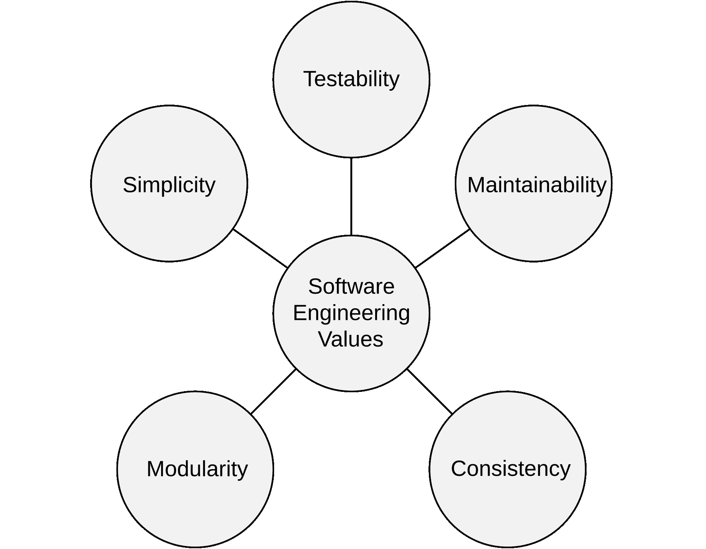

### 软件工程价值观

#### 可测试性

- 为了确保系统的功能正确性，系统的每个单元都是可验证且经过测试的至关重要。


- 只有当功能正确性和完整性通过自动触发的测试时，系统才是完整的。

### 可维护性

- 我们构建持久的系统，这意味着我们必须考虑如何维护这些系统。
- 维护系统的同事会随时间而变化。因此，可维护的系统应该是易于理解的。执行维护所需的系统特定知识应保持在最低。

### 一致性

- 为了提高灵活性和维护性，针对同一个问题，不同解决方案（如代码级模式、库、第三方服务和应用程序集成模式）的数量应尽可能少。
- 一个问题有多个解决方案比没有解决方案好，一个问题有一个单一解决方案是最好的。

### 模块化

- 事物总是在变化的。为了保护我们的代码不受这一基本事实的影响，我们需要限制更改的影响，并在所有层级将其划分为合理独立且连贯的单元。

### 简单性

- 系统中最容易更改的部分是不存在的。对于任何给定的需求，都应该提供满足上述价值观的最简单、极简的解决方案。

## 2.17 团队章程

团队章程是一份文档，通过设定团队所有成员都支持的**愿景**、**使命**和**边界**来明确团队的方向。作为来源，它向组织内的其他人员展示团队的重点和方向。章程应在团队内部制定，以促进清晰的理解和共识，在出现冲突的需求或项目时提供清晰度并减少困惑。

**团队章程可能像下面的示例所示：**

*从面向团队的实践来看，我们希望：*

- 创建一个开放、无指备、学习和反馈的文化
- 创建一个促进团队合作和创新的环境
- 建立集体所有感，消除知识孤岛
- 充分开发和利用每个人的能力
- 有效沟通并彼此交流
- 提供诚实的的反馈，根据反馈采取行动，并推动持续改进
- 协作并进行结对编程，以达到最高质量水平
- 成为一个完整的团队和交付单元
- 成为一名专业的软件工匠

从技术实践的角度来看，我们希望：

- 保持简单
- 通过重构鼓励持续改进
- 通过 `CI/CD` 频繁地关闭反馈循环
- 每个人都帮助立即修复构建问题
- 在推送后监控 `CI/CD/SonarQube`
- 保持我们的产品无技术债务
- 遵循我们的标准和最佳实践
- 强制 `DoD`（完成定义）和我们的代码审查检查单

# 3 Java 最佳实践

## 3.1 通过代码交流

*计算机科学中只有两件难做的事：缓存失效和命名。*

– Phil Karlton

### 3.1.1 使用 Java 代码编码规范并避免误导性信息

```java
1 public static final double pi = 3.14159265358979323846;
2 int YEAR;
3 String first_name;
4 public class convert_strategy {}
5 Set carList;
```

坏代码

```java
1 public static final double PI = 3.14159265358979323846;
2 int year;
3 String firstName
4 public class ConvertStrategy {}
5 Set cars;
```

良好的代码

```java
1 Customer Customer = new Customer("Darth Vader");
2 ...
3 Customer.name() // 静态访问？
```

坏代码

```java
1 Customer customer = new Customer("Darth Vader");
2 ...
3 customer.name()
```

良好的代码

### 3.1.2 选择具有表现力的名称并避免心理映射

```java
1 int d; // 生日以过的天数
2 String n; // 用户名
```

坏代码

```java
1 int daysSinceBirthday;
2 String name;
```

良好的代码

### 3.1.3 使用有意义的变量名使差异清晰

```java
1 public boolean isFileOlder(File s1, File s2) {};
2 
3 public static String replaceFirst(String string, Pattern pattern, String with) {};
```

坏代码

```java
1 public boolean isFileOlder(File file, File referenceFile) {};
2 
3 public static String replaceFirst(String text, Pattern regex, String replacement) {};
```

良好的代码

### 3.1.4 使用可发音的名称

```java
1 class DRcd {
2      private int rtd;
3      private String stna;
4      private LocalDateTime genymdhms;
5      private LocalDateTime modymdhms;
6 }
```

坏代码

```java
1 class Student {
2      private int registrationId;
3      private String name;
4      private LocalDateTime generated;
5      private LocalDateTime modified;
6 }
```

良好的代码

### 3.1.5 不要伤害读者

我们阅读的代码比编写的代码要多，所以不要伤害读者。用有用的常量声明类变量。这样，每个字面量的值含义或意图用法就能清楚地表示出来。如果常量需要更改，则更改也局限于声明处。不需要为了这个字面量去搜索并修改代码。

```java
1 // 86400000 是什么？
2 setTokenTimeout(86400000);
```

坏代码

```java
1 private static final int MILLISECONDS_IN_A_DAY = 24 * 60 * 60 * 1000;
2 
3 setTokenTimeout(MILLISECONDS_IN_A_DAY);
```

良好的代码

```java
 1 public final class Sphere {
 2 
 3     private Sphere() {
 4     }
 5 
 6     public static double area(double radius) {
 7         return 3.14 * radius * radius;
 8     }
 9 
10     public static double volume(double radius) {
11         return 4.19 * radius * radius * radius; // 为什么是 4.19？
12     }
13 }
```

坏代码

```java
 1 public final class Sphere {
 2 
 3     private Sphere() {
 4     }
 5 
 6     public static double area(double radius) {
 7         return Math.PI * radius * radius;
 8     }
 9 
10     public static double volume(double radius) {
11         return 4.0 / 3.0 * Math.PI * radius * radius * radius;
12     }
13 }
```

良好的代码

### 3.1.6 不要添加冗余的上下文

```java
1 class CarData {
2      private String carManufacturer;
3      private String carModel;
4 }
```

坏代码

```java
1 class Car {
2      private String manufacturer;
3      private String model;
4 }
```

良好的代码

```java
 1 public interface UserRepository {
 2 
 3     Optional<User> findUserById(long userId);
 4 
 5     Iterable<User> findAllUsers();
 6 
 7     User saveUser(User user);
 8 
 9     Iterable<User> saveAllUsers(Iterable<User> users);
10 
11     void deleteUserById(long userId);
12 
13     void deleteAllUsers();
14 
15     long countUsers();
16 }
```

坏代码

```java
 1 public interface UserRepository {
 2 
 3     Optional<User> findById(long id);
 4 
 5     Iterable<User> findAll();
 6 
 7     User save(User user);
 8 
 9     Iterable<User> saveAll(Iterable<User> users);
10 
11     void deleteById(long id);
12 
13     void deleteAll();
14 
15     long count();
16 }
```

良好的代码

### 3.1.7 不要添加没有额外含义的词汇

有些通用词汇通常不会为名称添加任何额外含义。因此，当它们添加到名称中时，它们代表任何含义。

**这些词通常预示了这种情况：**

- Data（数据）
- Information（信息）
- Bean（豆单元）
- Value（值）
- Manager（经理）
- Object（对象）
- Entity（实体）
- Instance（实例）

通过添加这些词，检查在删除它们后名称是否仍然相同。如果是，就删除它们。如果不是，最好找一个更好的名称。

```java
 1 final class StudentData {
 2     private final String firstName;
 3     private final String lastName;
 4     private final AddressInformation;
 5     private final CoursesBean;
 6 
 7     public StudentData(String studentFirstName, String studentLastName,
 8             AddressInformation, CoursesBean) {
 9         this.studentFirstName = studentFirstName;
10        this.studentLastName = studentLastName;
11        this.addressInformation = addressInformation;
12        this.coursesBean = CoursesBean;
13    }
14 }
```

坏代码

```java
 1 class Student {
 2     private String firstName;
 3     private String lastName;
 4     private Address address;
 5     private Courses courses;
 6 
 7     public Student(String firstName, String lastName, Address address,
 8             Courses courses) {
 9         this.firstName = firstName;
10        this.lastName = lastName;
11        this.address = address;
12        this.courses = courses;
13    }
14 }
```

良好的代码

### 3.1.8 不要在方法名中使用 `and` 或 `or`

使用 `and` 或 `or` 的方法名是一个指标，表明该方法承担了太多职责并结合了太多功能。

**如何改进：**

- 将方法拆分为较小的部分并将其提取为独立的方法。
- 如果这些事情确实需要在一起：
  - 考虑为整个操作寻找一个更好的名称。
  - 考虑创建其他东西来封装这种组合。

```java
1 public class JavaMailSender {
2 
3     public void createMimeMessageAndSend() throws MailException {}
4 
5     public Transport connectAndGetTransport(Session session)
6         throws NoSuchProviderException, MessagingException {}
7 }
```

坏代码

```java
 1 public class JavaMailSender {
 2 
 3     public MimeMessage createMimeMessage() {}
 4 
 5     public void send(MimeMessage mimeMessage) throws MailException {}
 6 
 7     public Transport connectTransport() throws MessagingException {}
 8 
 9     public Transport transport(Session session) throws NoSuchProviderException {}
10 }
```

良好的代码

### 3.1.9 尊重类内部的顺序

- 在类属性、构造函数参数及其方法之间的顺序保持一致。
- 使构造函数参数和方法的顺序与类属性的声明顺序对齐。
- 私有方法应该放在调用方法的下方。这样，代码就像讲述了一个故事，相关方法位于其下方。此外，这防止了搜索和滚动。

```java
public class WebServer {
    
    private final int port;
    private final String hostname;

    public WebServer() {
        this("localhost", 8080);
    }

    public WebServer(String hostname, int port) {
        this.port = port;
        this.hostname = hostname;
    }

    public String hostname() {
        return this.hostname;
    }

    public void start() {
        if (isPortFree()) {
           ....
        }
    }

    public int port() {
        return this.port;
    }

    public void stop() {
    ...
        destroyThreadPool();
        ...
    }

    private boolean isPortFree() { ... }

    private void destroyThreadPool() { ... }
}
```

Bad code

```java
public class WebServer {
    
    private final int port;
    private final String hostname;

    public WebServer() {
        this(8080, "localhost");
    }

    public WebServer(int port, String hostname) {
        this.port = port;
        this.hostname = hostname;
    }

    public int port() {
        return this.port;
    }

    public String hostname() {
        return this.hostname;
    }

    public void start() {
        if (isPortFree()) {
           ....
        }
    }

    private boolean isPortFree() { ... }

    public void stop() {
    ...
        destroyThreadPool();
        ...
    }

    private void destroyThreadPool() { ... }
}
```

Good code

### 3.1.10 按换行分组

使用换行来建立相关事物之间的关联，并将关联较弱的事物分开。


```java
public final class FileUtils {
    public static final long ONE_KB = 1024;
    public static final long ONE_MB = ONE_KB * ONE_KB;
    public static final long ONE_GB = ONE_KB * ONE_MB;
    public static final File[] EMPTY_FILE_ARRAY = new File[0];
    private FileUtils(){};
    public static void cleanDirectory(File directory) throws IOException {
        File[] files = verifyFiles(directory);
        List<Exception> causes = new ArrayList<>();
        for (File file : files) {
            try {
                forceDelete(file);
            } catch (final IOException ioe) {
                causes.add(ioe);
            }
        }
        if (!causes.isEmpty()) {
            throw new IOException(causes);
        }
    }
}
```

### Bad code

```java
public final class FileUtils {
    
    public static final long ONE_KB = 1024;
    public static final long ONE_MB = ONE_KB * ONE_KB;
    public static final long ONE_GB = ONE_KB * ONE_MB;

    public static final File[] EMPTY_FILE_ARRAY = new File[0];

    private FileUtils() {};

    public static void cleanDirectory(File directory) throws IOException {
        File[] files = verifyFiles(directory);
        List<Exception> causes = new ArrayList<>();

        for (File file : files) {
            try {
                forceDelete(file);
            } catch (final IOException ioe) {
                causes.add(ioe);
            }
        }

        if (!causes.isEmpty()) {
            throw new IOException(causes);
        }
    }
}
```

### Good code

### 3.1.11 优先使用自解释代码而非注释

*不要为坏代码写注释——重写它。*

–Brian W. Kernighan，《编程风格的要素》

- 注释不是坏代码的替代品。
- 通过代码来解释它。
- Java 是一门编程语言，应该能够自我表达。
- 代码越自解释，你需要的注释就越少。
- 将注释视为一个危险信号。
- 注释就像臭臭代码的除臭剂。
- 注释**为什么**（WHY），而不是**是什么**（WHAT）！

```java
final class InchToPointConvertor {
    
    private InchToPointConvertor{}

    // 将英寸的数量转换为点
    static float parseInch(float inch) {
       return inch * 72; // 一英寸包含 72 点
    }
}
```

### Bad code

```java
final class InchToPointConvertor {
    
    private static final int POINTS_PER_INCH = 72;

    private InchToPointConvertor{}

    static float toPoints(float inch) {
        return inch * POINTS_PER_INCH;
    }
}
```

### Good code

```java
// 检查员工是否有额外休日的权利
if ((employee.noVacationDaysLeft && employee.age > 50)
   || (employee.noVacationDaysLeft && employee.hasChildren))
```

### Bad code

```java
if (employee.hasEntitlementForBonusVacation())
```

### Good code

```java
class Passwords {
    ...
    // 检查密码是否足够复杂
    public boolean isComplexPassword()
}
```

```java
 1 // 删除目录并检查其是否为目录。
 2 // 如果不存在则抛出 IOException。
 3 public static void deleteDirectory(File directory) throws IOException {
 4    if (directory != null && directory.isDirectory() && !directory.exists()) {
 5         return;
 6    }
 7 
 8    if (!directory.delete()) {
 9         throw new IOException("Unable to delete directory " + directory + ".");
10    }
11 }
```

### Bad code

- 这个注释是多余且具有误导性的！
- 如果目录不存在，此方法不会抛出 `IOException`。如果无法删除目录，才会抛出 `IOException`。

### 3.2.3 强制性注释

```
1 /**
2  * 返回一年。
3  *
4  * @return 年中的天数。
5  */
6 public int dayOfYear() {
7     return this.dayOfYear;
8 }
```

### Bad code

```
1 /**
2 * @param title CD 的标题
3 * @param author CD 的作者
4 * @param tracks CD 中的轨道数量
5 * @param durationInMinutes CD 的时长（以分钟为单位）
6 */
7 public void addCD(String title, String author, int tracks, int durationInMinutes)
```

### Bad code

- 这些注释没有提供任何额外信息，反而模糊了代码并带来了误导的可能。
- 规定每个 Javadoc 函数或每个变量都应该有注释是不好的。
- 这种注释只会让代码更加混乱，导致一般的混乱和无秩序。

### 3.2.4 日记式注释

```
 1 // 修改历史
 2 //
 3 // 2020-09-30 实现 FactoryAware 以注入 Factory
 4 // 2020-09-30 移除不必要的存根
 5 // 2020-09-30 适配 API 变化
 6 // 2020-09-30 合并分支 '2.3.x'
 7 // 2020-09-30 引入专用的 @Compatibility 注解
 8 // 2020-09-30 在自定义层级时修复 SNAPSHOT 产物的匹配
 9 // 2020-09-30 适配 API 变化
10 // 2020-09-30 合并分支 '2.3.x'
11 // 2020-09-30 开始针对版本 5.3.0 构建
12 // 2020-09-30 不在单独线程中执行数据源初始化
13 // 2020-09-30 开始针对 Java 16 构建
14 // 2020-09-29 在构建分层 jar 时减少配置解析
15 // 2020-09-29 合并拉请求 #56701
16 // 2020-09-24 润色
17 // 2020-09-17 添加对 Oracle 的支持
```

### Bad code

- 很久以前，创建和维护此类日志记录是有原因的。
- 如今已经有了版本控制系统。
- 这些注释是传播混乱的干扰数据，应该被移除。

### 3.2.5 闲卦

```
1 /**
2  * 默认构造函数。
3  */
4 public Parser () {
5 }
```

### Bad code

```
1 /** 月中的天数。 */
2 private int dayOfMonth;
```

### Bad code

```
 1 private void startSending() {
 2     try {
 3         send();
 4     } catch (Exception e) {
 5         try {
 6             response.add(ErrorResponder.makeExceptionString(e));
 7             response.closeAll();
 8         } catch (Exception e1) {
 9             // 谁在乎！？
10         }
 11     }
12 }
```

### Bad code

- 这些注释太啰嗦了，我们学会了忽略它们。
- 当我们阅读代码时，眼睛直接跳过它们。
- 在某个时刻，当周围的代码改变时，注释就开始说谎了。

### 3.2.6 位置标识符

```
1 // 方法 //////////////////////////////////////
```

### Bad code

```
1 //################################################
2 //###   getter 和 setter
3 //################################################
```

### Bad code, 在真实项目中的

### 3.2.7 记记与随笔备注

```
1 // 由 Bad Programmer 添加
```

### Bad code

- 这些信息可以在版本管理系统中看到。

### 3.2.8 不要在代码库中留下注释掉的代码

```
 1 public static String extension(String filename) {
 2    // if (filename == null) { return null; }
 3 
 4    String name = new File(filename).getName();
 5    int extensionPosition = name.lastIndexOf('.’);
 6    if (extensionPosition < 0) {
 7       return "";
 8    }
 9    return name.substring(extensionPosition + 1);
10 }
```

### Bad code

- 其他看到这段注释代码的人没有勇气删除它。
- 他们会认为代码在那里是有原因的，而且它太重要了不能删除。

### 3.2.9 注释规则

## 3.3 类与对象

根据 *Clean Code*（整洁代码）作者 Robert C. Martin 的观点，以下最佳实践可以帮助你写出易读且易于修改的类、函数和变量：

### 3.3.1 类

- 应该使用名词或名词短语。
- 类名应该明确。
- 隐藏内部实现并最小化范围。
- 使用依赖注入。
- 遵循迪米特法则（LoD）。
  - 类只知道其直接依赖。
- 尽可能倾向于不可变性。

### 3.3.2 函数

- 应该使用动词命名。
- 应该是短小的。
- 函数的第一条规则是它们应该很小。
  - 函数的第二条规则是它们应该尽可能小。
- 只做一件事。
  - 它们应该被做好。
  - 遵循单一职责原则（SRP）。
- 每个函数应该有一个抽象层。
- 不要重复自己（DRY）。
- 无副作用。
- 相似的函数应该靠在一起。
- 按照向下方向放置。
- 每个概念使用一个单词。
  - 避免为相同的概念使用不同的单词，例如使用 `find`、`fetch`、`get`、`lookup`、`retrieve` 来表示相同的职责。
- 参数应少于三个。
  - 函数的理想参数数量是零。接下来是一个、两个。三个参数应尽量避免。三个以上需要特殊的理由——而且也不应该使用。
  - 不要使用标记参数。将方法拆分为多个可以从客户端调用的方法。
- `private` 函数可以更具描述性且名称更长。可以通过“童子军”进行改进。
- 函数的可见性越高，名称应该越短。


方法名称长度

### 3.3.3 变量

- 尽可能靠近使用处声明变量。
- 遵循规则：变量范围越大，名称越长。这样，全局变量拥有长描述性名称，而范围限制的内容（如循环索引变量）可以是单个字母。


变量名称长度

你清楚算法是按步骤执行的，并且知道这些步骤在代码所在的位置。

### 对重构的优势

由于步骤之间应该是相互区分的，因此每个步骤都是将其代码外包到函数的良好候选者。生成的代码将是一系列函数调用。这将提高抽象层次并使代码更具表达力。

### 3.4.3 带有标题的段落

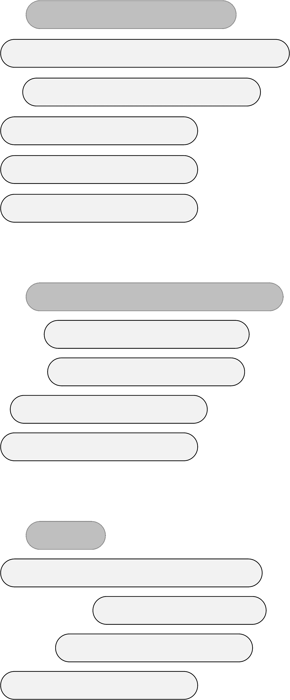

**对理解的优势：**

与段落一样。编写此代码的人通过为每个步骤添加信息，让你的任务更容易。

**对重构的优势：**

与段落一样。可以使用注释中的某些术语作为函数名的灵感。重构后，注释将变得多余并可以删除。

### 3.4.4 可疑的注释

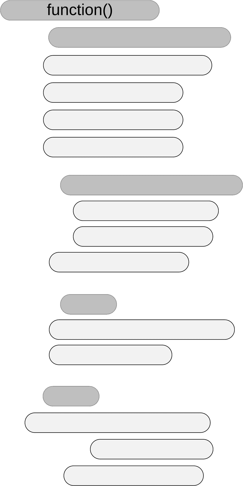

**对理解的优势：**

并不是所有注释都是优势，而且代码往往不是好的。

**对重构的优势：**

使用注释中的术语来重命名函数及其参数，并删除注释。

### 3.4.5 密集使用对象

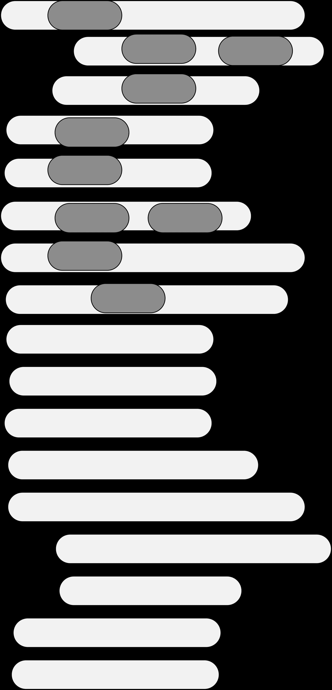

**对理解的优势：**

这段代码的作用是设置该对象。

**对重构的优势：**

该函数承担了多个职责，其中之一就是与该对象协作。将此职责重构到一个函数中，以减少主函数的职责数量（理想情况下减少到一个）。

## 3.5 避免工具类的实例化

Java 为每个没有显式定义至少构造函数的类添加一个隐式的 `public` 构造函数。

对于工具类（静态方法的集合），不需要实例化。定义一个 `private` 构造函数以防止实例化。该显式构造函数在类外是不可可见的。该类也应该是 `final` 的，除非该私有构造函数被内部类调用。

```
1 public final class FileNameUtils {
2     public static String extension() {
3     }
4 
5     public static String baseName() {
6     }
7 }
```

### 坏代码

```
 1 public final class FileNameUtils {
 2 
 3     // 不可实例化的工具类
 4     private FileNameUtils() {
 5     }
 6 
 7     public static String extension () {
 8     }
 9 
10     public static String baseName() {
11     }
12 }
```

#### 好代码

在需要保证类不能从类内部调用的情况下，可以在构造函数中抛出一个 `AssertionError`。^(1)

```
1 public final class FileNameUtils {
2 
3     // 不可实例化的工具类
4     private FileNameUtils() {
5         throw new AssertionError();
6     }
7     ...
8 }
```

#### 好代码

查看这些类，你会发现也有私有构造函数：

- `java.lang.Math`
- `java.util.Arrays`
- `java.util.Collections`

## 3.6 使用不可变对象

除非有充分理由，否则始终优先使用不可变类而非可变类。

- 不可变对象是线程安全的。
- 使用不可变对象可以避免同步访问。
- 当对象一起使用时，不可变性始终起着作用。
- 不可变对象可以安全地传递给不可信的代码。

### 基本数据类型与 `final`

声明为 `final` 的变量的内容不能更改。对于基本数据类型变量，这意味着变量的值在初始化后不再改变。因此，`final` 变量只能赋值一次。


```java
final int max = 256;
max = 0; // error：无法编译
```

### Final 变量

### 引用变量与 `final`

对于引用变量，这意味着存储在引用变量中的地址不会改变。这个 `final` 引用变量指向初始化时分配给它的对象，永远不会引用另一个对象。然而，这并不意味着被引用的对象不受修改的影响。

```java
final Date deadline = new Date();
deadline = new Date(100, 0, 1, 0, 0, 0);     // error：无法编译
deadline.set(new Date(100, 0, 1, 0, 0, 0));  // fine：可以编译
```

### Final 引用变量

**遵循以下五个规则使类变为不可变**^(2)：

- 不要提供修改状态的方法，状态在创建后不应该是可更改的。
- 通过将类标记为 `final` 防止子类的。
- 将所有字段标记为 `final`，这样它们在构造函数初始化后不可更改。
- 将所有字段标记为 `private` 并尽可能降低可见性。
- 确保对任何可变组件的排他访问，必要时进行防御性拷贝。

```java
public final class ImmutableRGB {
    private final int red, green, blue;

    public ImmutableRGB(int red, int green, int blue) {
        this.red = red;
        this.green = green;
        this.blue = blue;
    }

    public ImmutableRGB invert() {
    }
}
```

#### 好代码

```java
public final class ImmutableRGB {
    private final int red, green, blue;

    public ImmutableRGB(int red, int green, int blue) {
        this.red = red;
        this.green = green;
        this.blue = blue;
    }

    public ImmutableRGB invert() {
    }
}
```

由于不可变对象的状态无法改变，我们已经预知了对它的预期。我们可以预期对象的状态在整个生命周期内都是有效的。

如果实现正确，该状态在代码的任何点都无法被修改，从而可能引入不一致性。因此，不可变对象应该在构造时对状态进行验证。这意味着没有人能创建一个无效状态的不可变对象的实例。所有这些验证都应该在不可变对象内部完成。因此，我们不仅可以预期不可变对象在整个生命周期内具有相同的状态，而且预期其状态是有效的。

### 3.7 优先使用 `records` 实现不可变性

`Records` 是 Java 16 中引入的新类型类，并且它们是不可变的。对于只需要包含字段并访问这些字段的类，它们非常有用。这里是一个用于 `ImmutableRGB` 对象的简单 `record`。

```java
public record ImmutableRGB(int red, int green, int blue) {
}
```

#### Records

必须使用 `record` 关键字而不是 `class` 关键字。字段在类声明中定义。该声明创建了一个带有这些字段的 record。由于字段是 `final` 的，因此 record 不会生成 setter 方法。`equals`、`hashCode` 和 `toString` 方法将自动生成。此外，还会为定义的字段创建访问方法。然而，如果你需要，也可以重写任何内容或添加额外的方法。

```java
public record ImmutableRGB(int red, int green, int blue) {

    ImmutableRGB(int red) {
        this(red, 0, 0);
    }

    @Override
    public String toString() {
        StringBuilder builder = new StringBuilder();
        builder.append("ImmutableRGB [red=")
                .append(this.red)
                .append(", green=")
                .append(this.green)
                .append(", blue=")
                .append(this.blue)
                .append("]");
        return builder.toString();
    }
}
```

#### 在 records 中重写

`Records` 可以像普通类一样实例化。对于 `ImmutableRGB` record，写法如下：

```java
ImmutableRGB rgb = new ImmutableRGB(0, 128, 240);
rgb.red();
```

#### 初始化 records

`Records` 会生成访问方法，但它们不以 `get` 前缀开头。相反，访问方法名与构造函数中定义的字段名相同。`Records` 可以包含注解和 JavaDoc。体内部还可以声明静态字段以及构造函数和实例方法。在 record 头部之外不允许有实例字段。

`Records` 是 `final` 的且不能是 `abstract` 的，它们不能继承自其他类或 record，因此无法实现继承。但是支持对接口的实现。

只有当构造函数定义的所有字段都是不可变的时，`Records` 才是不可变的。如果你有像 `java.util.Date` 这样的对象，你需要像前面*使用不可变对象*项所示样，为此类字段提供拷贝或克隆方法。

```java
public record Stamp(Date date, String author) {

    public Stamp(Date date, String author) {
        this.date = new Date(date.getTime());
        this.author = author;
    }

    @Override
    public Date date() {
        return new Date(this.date.getTime());
    }
}
```

#### 带有类似 `Date` 的可变字段的 records

```java
public record Stamp(LocalDate date, String author) {
}
```

#### 全是不可变字段的 records

### 3.8 为敏感的可变类提供不可变装饰器

如果你使用了可修改的第三方库类并希望为它们提供不可变性，你可以用不可变装饰器类来装饰它们。这个装饰器可以在你的代码库中使用，并且对修改是安全的。

```java
public interface Principal {
    String name();
    Set<String> roles();
}
```

#### `Principal` - 第三方代码

```java
public final class DefaultPrincipal implements Principal, Serializable {

    private static final long serialVersionUID = 5439751315621189928L;

    private final String name;
    private final Set<String> roles;

    public DefaultPrincipal(String name, Set<String> roles) {
        this.name = name;
        this.roles = roles;
    }

    @Override
    public String name() {
        return this.name;
    }

    @Override
    public Set<String> roles() {
        return this.roles;
    }
}
```

#### 可变的 `DefaultPrincipal` - 第三方代码

```java
public final class ImmutablePrincipal implements Principal {

    private final Principal principal;

    public ImmutablePrincipal(Principal principal) {
        this.principal = principal;
    }

    @Override
    public String name() {
        return this.principal.name();
    }

    @Override
    public Set<String> roles() {
        return Collections.unmodifiableSet(this.principal.roles());
    }
}
```

### 3.9 避免常量接口

**根据《Effective Java》(08-constant-interfaces)：**

- 常量接口模式是对接口的糟糕使用。
- 类在内部使用某些常量是一个实现细节。
- 实现常量接口会导致该实现细节泄露到类的导出 API 中。
- 如果一个非 `final` 类实现了常量接口，则其所有子类都将受到接口中常量命名空间的污染。

```java
interface JobStatus {
    int WAITING = 1;
    int RUNNING = 2;
    int FINISHED = 3;
    int ERROR = 4;
}
```

糟糕的代码

```java
enum JobStatus {

    WAITING(1), RUNNING(2), FINISHED(3), ERROR(4);

    private final int id;

    private JobStatus(int id) {
        this.id = id;
    }

    public int id() {
        return this.id;
    }
}
```

更好的代码

### 3.10 避免全局常量类

全局常量是有问题的，因为它们在代码中引入了大量不必要的依赖并增加了耦合。

此外，扩展代码的行为更加困难，如下例。假设你必须支持新的 Unix 换行符。

```java
public final class Constants {
    private Constants() {
    }

    public static final String CRLF = "\r\n"; // Windows
}
```

糟糕的代码

```java
public class Records {
    public void write(Writer out) {
        for (Record record : this.records) {
            out.write(record.data());
            out.write(Constants.CRLF);
        }
    }
}
```

糟糕的代码

```java
public class Rows {
    public void print(PrintStream ps) {
        for (Row row : this.rows) {
            ps.print(row.cells());
            ps.print(Constants.CRLF);
        }
    }
}
```

将常量放在一个单独的类中会更好，这允许行为发生改变。常量不会作为公共常量分布在代码中，从而增强内聚性并减少耦合。

```java
public class LineEnding {
    private final String origin;

    public LineEnding(String origin) {
        this.origin = origin;
    }

    @Override
    public String toString() {
        return String.format("%s\r\n", this.origin); // Windows
    }
}
```

良好的代码

```java
public class Records {
    public void write(Writer out) {
        for (Record record : this.records) {
            out.write(new LineEnding(record.data()));
        }
    }
}
```

良好的代码

```java
public class Rows {
    public void print(PrintStream ps) {
        for (Row row : this.rows) {
            ps.print(row.cells());
            ps.print(Constants.CRLF);
        }
    }
}
```

良好的代码

```java
public class LineEnding {

    private static final String WINDOWS_LINE_ENDING = "\r\n";
    private static final String UNIX_LINE_ENDING = "\n";

    private final String origin;

    public LineEnding(String origin) {
        this.origin = origin;
    }

    @Override
    public String toString() {
        if (isUnix()) {
            return String.format("%s%s", this.origin, UNIX_LINE_ENDING);
        }

        return String.format("%s%s", this.origin, WINDOWS_LINE_ENDING);
    }
}
```

良好的代码

## 3.11 优先使用组合而非继承

**根据《Effective Java}(5)**：

- 继承并不是实现代码复用的最佳方法。它可能导致软件变得不恰当的脆弱。
- 对于实现继承（即一个类扩展另一个类），当子类依赖于父类的实现细节才能实现其正常功能时，继承就违反了封装。

此外，重写方法应当维护父类契约中与里氏替换原则（Liskov Substitution Principle）相关的方面。

在示例中 `ZippedDocument` 使用了 `PlainDocument` 的 `length()` 方法，这真的如此吗？还是 `length()` 也应该被重写？你必须分析你继承的类以便以正确的方式实现它。

```java
interface Document {
    int length();
    byte[] content();
}
```

糟糕的代码


```java
public class PlainDocument implements Document {
    private final byte[] content;

    public PlainDocument(byte[] content) {
        this.content = content;
    }

    @Override
    public int length() {
        return this.content.length;
    }

    @Override
    public byte[] content() {
        return this.content;
    }
}
```

糟糕的代码

```java
public class ZippedDocument extends PlainDocument {

    public ZippedDocument(byte[] content) {
        super(content);
    }

    // 使用了 PlainDocument 的 length()

    @Override
    public byte[] content() {
        return zip(super.content());
    }

    private byte[] zip(byte[] content) {
        return /* Zip the raw content */
    }
}
```

糟糕的代码

与其扩展`PlainDocument`类，你可以使用组合代替继承来解决继承的某些缺点。

```java
public class ForwardingDocument implements Document {

    private final Document document;

    public ForwardingDocument(Document document) {
        this.document = document;
    }

    @Override
    public int length() {
        return this.document.length();
    }

    @Override
    public byte[] content() {
        return this.document.content();
    }
}
```

良好的代码

```java
public final class ZippedDocument extends ForwardingDocument {

    public ZippedDocument(Document document) {
        super(document);
    }

    @Override
    public int length() {
        return this.content().length;
    }

    @Override
    public byte[] content() {
        return zip(super.content());
    }

    private byte[] zip(byte[] content) {
        return content;  /* Zip the raw content */
    }
}
```

良好的代码

避免构建大型的继承层级，优先使用**拥有**（has-a）关系而非**是**（is-a）关系。通过组合来实现多态和代码复用。

**继承的缺点：**

- 构建良好的继承层级很困难。
- 会导致代码难以理解。
- 缺乏活性。
- 通常只能继承一个父类。

**组合的优点：**

- 比大型继承层级更易理解。
- 可以在运行时替换组件。
- 组件可以进行独立测试。

## 3.12 使用 @Override 注解

如果打算重写父类中的方法，请使用`@Override`注解。

**优点：**

- 如果在重写时出现任何错误（如方法名写错），编译器会报错。
- 它改进了代码的可读性。
- 如果你更改了父类方法的签名，所有重写该方法的都会产生编译错误。

```java
public class User {
    private final String name;

    public User(String name) {
        this.name = name;
    }

    public int hashcode() // 这里有错误
    }

    public boolean equals(Object obj) {
    }
}
```

糟糕的代码

```java
public class User {
    private final String name;

    public User(String name) {
        this.name = name;
    }

    @Override
    public int hashCode() {
    }

    @Override
    public boolean equals(Object obj) {
    }
}
```

良好的代码

## 3.13 使用 @FunctionalInterface 注解

使用`@FunctionalInterface`并强制编译器在添加额外的非重写抽象方法时报错，这会破坏 Lambda 实现的使用。

- 一种信息性注解类型，用于指示接口设计为函数接口。
- 概念上，函数接口只有一个抽象方法，也称为单抽象方法（SAM）。
- 函数接口的实例可以通过 Lambda 表达式、方法引用或构造函数引用创建。
- 应用于防止意外扩展导致不再满足函数接口的要求。

**Java 充满了这种类型的接口，例如：**

- `java.lang.Runnable`
- `java.util.Comparator`
- `java.util.concurrent.Callable`
- `java.io.FileFilter`

```java
@FunctionalInterface
public interface Runnable {

     * 当实现 Runnable 接口的对象被用于
     * 创建线程时，启动线程会导致该对象的
     * <code>run 方法在那个单独执行的
     * 线程中被调用。
     * <p>
     * <code>run 方法的通用契约是它可以执行任何
     * 操作。
     *
     * @see     java.lang.Thread#run()
     */
    public abstract void run();
}
```

良好的代码 - Java 中的`Runnable`接口

## 3.14 优先返回空对象而非 `null`

对于使用数组或集合返回值集合的方法，返回空数组或空集合比返回`null`是更好的替代方案，因为大多数调用者处理空对象的能力比处理`null`值更强。如果客户端缺少`null`检查，将在运行时抛出`NullPointerException`。

- 通过使用**空对象（Null-Objects）**，你可以避免方法返回`null`。
- 减少`NullPointerException`的数量。
- `Null-Objects`是不可变的。

### Collection API 已经有了实现：

- `Collections.EMPTY_LIST`, `EMPTY_MAP`, `EMPTY_SET`
- `Collections.emptyList()`, `emptyMap()`, `emptySet()`

`Collections.EMPTY_LIST`、`EMPTY_MAP`、`EMPTY_SET`字段返回原始类型（raw types），而较新的`Collections.emptyList()`、`emptyMap()`、`emptySet()`方法返回泛型，因此应该使用它们。

当返回数组而不是集合时，避免尝试访问长度为零的数组的元素。这可以防止抛出`ArrayOutOfBoundsException`。

```java
public List<Book> findBooksByAuthor(String author) {
    if (author != null || author.isEmpty()) {
        return null;
    }
    ...
}
```

坏代码

```java
public List<Book> findBooksByAuthor(String author) {
    if (author != null || author.isEmpty()) {
        return Collections.emptyList();
    }
    ...
}
```

好代码

在下例示例中，将使用自定义的空对象`NullUser`，以避免在这种情况下强制要求客户端`AdministrationController`进行 NPE 检查。

```java
public class AdministrationController {
    private Session session;

    public boolean hasRights() {
        User user = session.user();

        return user != null && user.isSuperUser(); // 需要 NPE 检查
    }
}
```

坏代码

```java
public class User {
    private final int id;
    private final boolean isSuperUser;

    public User(int id, boolean isSuperUser) {
        this.id = id;
        this.isSuperUser = isSuperUser;
    }

    public int id() {
        return this.id;
    }

    public boolean isSuperUser () {
        return this.isSuperUser;
    }
}
```

坏代码

```java
public class AdministrationController {
    private Session session;

    public boolean hasRights() {
        return session.user().isSuperUser(); // 不需要 NPE 检查
    }
}
```

好代码

```java
public class NullUser extends User {
    @Override
    public boolean isSuperUser () {
        return false;
    }
}
```

好代码

```java
public class Session {
    private User user;

    public Session() {
        this.user = new NullUser(); // 使用 NullUser 初始化，而不是 null
    }

    public User user() {
        return user;
    }
}
```

好代码

### 3.15 避免将 `null` 作为方法参数

永远不要允许`null`作为方法的参数。将`null`参数作为有效参数传递给方法是一种坏实践。

假设你实现了一个方法，在传递`null`时检索所有文件的列表，并根据文件扩展名检索该扩展名的文件列表。

### 这看起来像是这两个方法的方便的替代方案：

- `public List<File> findAllFiles() {}`
- `public List<File> findByExtension(String extension) {}`

将这些逻辑合并到一个方法中并通过`null`参数来控制行为是糟糕的方法，因为每个方法应该只做一件事。更优的方法是将这个方法拆分为两个具有有意义名称的方法。

更灵活的解决方案是使用过滤器（如下例所示），或者更好地使用 Java 的`Predicate`。

```java
public List<File> findFiles(String extension) {
    if (extension == null) {
         // 查找所有文件
    } else {
         // 根据文件扩展名查找文件
    }
}
```

坏代码

```java
interface FileFilter {
     boolean accept(File file);
}
```

好代码

```java
public class AllFileFilter implements FileFilter {
    @Override
    public boolean accept(File file) {
        return true;
    }
}
```

好代码

```java
public List<File> findFiles(FileFilter filter) {
    List<File> foundFiles = new ArrayList<>();

    for (File file: files) {
        if (filter.accept(file)) { // 通过过滤器查找文件
            foundFiles.add(file);
        }
    }

    return foundFiles;
}
```

好代码

```java
public List<File> files(Predicate<File> filter) {
    return files.stream()
            .filter(filter)
            .toList();
}
```

更具通用性的匠心代码

### 3.16 优先使用增强循环而非 for 循环

对于只使用索引变量访问列表或数组元素的`for`循环，请将其替换为`foreach`语法。这样不容易出错。

```java
List<String> cars = List.of("BMW", "VW", "Porsche");

for (Iterator<String> i = cars.iterator(); i.hasNext();) {
    System.out.println(i.next());
}
```

坏代码

```java
for (int i = 0; i < cars.size(); i++) {
    System.out.println(cars.get(i));
}
```

坏代码

```java
for (String car : cars) {
    System.out.println(car);
}
```

好代码

```java
cars.forEach(System.out::println); // Lambdas
```

好代码

```java
cars.stream().forEach(System.out::println); // Streams
```

好代码

### 3.17 针对接口编程

声明应该使用接口而不是实现类。这样如果需要，你就可以轻松更改该实现。

```java
// 坏 – 使用类作为类型
ArrayList<String> bikes = new ArrayList<>();
```

坏代码

```java
// 好 – 使用接口作为类型
List<String> bikes = new ArrayList<>();
```

好代码

```java
// 坏 – 使用类作为类型
public void buy(ArrayList<String> bikes) {
...
}
```

坏代码

```java
// 好 – 使用接口作为类型
public void buy(Collection<String> bikes) {
...
}
```

好代码

### 3.18 使用现有的异常

Java API 提供了许多异常类，因此没有必要为每种情况单独声明异常类。

| Exception | 描述 |
| --- | --- |


| 异常类型 | 说明 |
| --- | --- |
| `IllegalArgumentException` | 非空参数值不合适 |
| `IllegalStateException` | 对象状态不适用于方法调用 |
| `NullPointerException` | 在禁止的情况下参数值为 `null` |
| `IndexOutOfBoundsException` | 索引参数值超出范围 |
| `ConcurrentModificationException` | 在禁止的情况下检测到并发修改 |
| `UnsupportedOperationException` | 对象不支持该方法 |

### 3.19 验证方法参数

验证方法参数以确保它们符合方法的设计范围。这种做法确保了对参数的操作产生有效的结果。

跨信任边界的方法必须对其参数进行验证。这种预防措施适用于类的所有公共方法。其他方法（包括私有方法）如果这些参数是从公共方法传递的且未经过验证，则应对其参数进行验证。

```java
public void concat(String source, List<String> concats, int startIndex) {
    if (source == null || concats == null) {
        throw new IllegalArgumentException("source cannot be null");
    }
    if (startIndex >= concats.size() || startIndex < 0) {
        throw new IllegalArgumentException("startIndex exceeds bounds of concats");
    }
    ...
}
```

好代码：

- `Objects.requireNonNull(obj)`
- `Objects.requireNonNull(obj, message)`
- `Objects.requireNonNull(obj, messageSupplier)`
- `Objects.requireNonNullElse(obj, defaultObj)`
- `Objects.requireNonNullElseGet(obj, supplier)`
- `Objects.checkIndex(index, length)`
- `Objects.checkFromIndexSize(fromIndex, size, length)`
- `Objects.checkFromToIndex(fromIndex, toIndex, length)`

## 3.20 防止 `String` 比较时出现 `NullPointerException`

将字符串字面量放在 `equals()` 或 `equalsIgnoreCase()` 方法的左侧。这可以防止 NPE 的产生，因为字符串字面量不为 `null`。

```java
private static final String COMPARE_VALUE = "Bad programmer";

public boolean compareIt(String input) {
    return input.equals(COMPARE_VALUE);
}
```

### 坏代码

```java
private static final String COMPARE_VALUE = "Rockstar programmer";

// equals 对 NPE 有检查
public boolean compareIt(String input) {
    return COMPARE_VALUE.equals(input);
}
```

### 好的代码

```java
String firstName = null;

boolean e1 = firstName.equals("Bad programmer");                         // 抛出 NPE
boolean e2 = firstName != null && firstName.equals("Better programmer"); // 可以移除 NPE 检查
boolean e3 = "Good programmer".equals(firstName);                        // 无 NPE
```

### 逐步重构

## 3.21 安全地将 `long` 强制转换为 `int`

使用 `Math` 类中定义的溢出安全方法，这些方法是在 Java 8 中引入的。它们要么返回数学上的正确值，要么在结果溢出时抛出 `ArithmeticException`。否则，超出其基本整数数据类型提供范围的数学运算将产生错误的结果。

**根据[Java 语言规范（JLS）](https://docs.oracle.com/javase/specs/jls/se15/html/jls-4.html#jls-4.2.2)：**

- 整数运算符不会指示溢出或下溢。
- 整数运算符出于以下原因可能会异常：
  - 如果需要对空引用拆箱转换，任何整数运算符都可能抛出 `NullPointerException`。
  - 如果右侧操作数为零，整数除法运算符 `/` 和整数取模运算符 `%` 可能会抛出 `ArithmeticException`。
  - 如果需要装箱转换且没有足够的内存执行转换，自增和自减运算符 `++` 和 `--` 可能会抛出 `OutOfMemoryError`。

```java
long foo = 10L;
int bar = (int) foo;
```

### 坏代码

```java
long foo = 10L;
int bar = Math.toIntExact(foo);
```

### 好的代码

当你使用 `Math.toIntExact` 时，该方法返回 `long` 参数的值，如果该值溢出 `int` 范围则抛出 `ArithmeticException`。

```java
public static int toIntExact(long value) {
    if ((int) value != value) {
        throw new ArithmeticException("integer overflow");
    }
    return (int) value;
}
```

### Java 15 中的 `Math.toIntExact`

`Math` 类中还有其他方法可以防止溢出：

- `Math.incrementExact(long)`
- `Math.subtractExact(long, long)`
- `Math.decrementExact(long)`
- `Math.negateExact(long)`
- `Math.subtractExact(int, int)`

## 3.22 将整数转换为浮点数以进行浮点运算

整数与浮点值之间不正确的转换会导致意外的结果。这些意外结果可能包括溢出或其他异常行为。当对整数进行算术运算时，结果将始终是整数。它会丢弃可能的小数部分信息。

通过将结果赋值给 `long`、`double` 或 `float` 并使用自动类型转换，防止在将基本整数转换为浮点数时丢失精度。如果你是从 `int` 或 `long` 开始的，结果可能不是你预期的。

```java
short a = 111;
int b = 1978;

float d = a / 8;   // 13.0
double e = b / 20; // 98.0

float f = 7 / 8;   // 0.0
long g = 7 / 8;    // 0
float h = 7f / 8f; // 0.875
```

### 坏代码

```java
short a = 111;
int b = 1978;

float d = a / 8;   // 13.0
double e = b / 20; // 98.0

float f = 7 / 8;   // 0.0
long g = 7 / 8;    // 0
float h = 7f / 8f; // 0.875
```

### 好的代码

```java
short a = 111;
int b = 1978;

float d = (float) a / 8;   // 13.0
double e = (double) b / 20; // 98.0

float f = (float) 7 / 8;   // 0.875
long g = (long) 7 / 8;     // 0
```

## 3.23 使用泛型代替原始类型

使用泛型代替原始类型可以提供更好的类型安全性和清晰度。

**使用泛型的优势：**

- 强类型检查在编译时确保了类型安全。
- 避免运行时出现 `ClassCastException`。
- 自文档化且更易读。
- 允许编写通用的泛型算法。

### 坏代码

```java
List cars = new ArrayList();
```

### 好的代码

```java
List<String> cars = new ArrayList<>();
```

```java
public enum JobPosition {
    JUNIOR(2, 1.2f) {
        @Override
        public float pay(float hours) {
            return (factor() * hours) * 0.8f;
        }
    },
    SENIOR(3, 1.5f) {
        @Override
        public float pay(float hours) {
            return (factor() * hours) * 0.95f;
        }
    },
    PRINCIPAL(4, 1.7f) {
        @Override
        public float pay(float hours) {
            return factor() * hours;
        }
    };

    private final int level;
    private final float factor;

    JobPosition(int level, float factor) {
        this.level = level;
        this.factor = factor;
    }

    public int level() {
        return this.level;
    }

    public float factor() {
        return this.factor;
    }

    public abstract float pay(float hours);

    public static JobPosition valueOf(int level) {
        return Stream.of(JobPosition.values())
                .filter(p -> p.level() == level)
                .findFirst()
                .orElseThrow(() ->
                    new IllegalArgumentException(String.format("Unknown job position: %d", level)));
    }
}
```

枚举非常灵活。

## 3.25 注意 `equals` 和 `hashCode` 之间的约定

### Java 中基于哈希的容器

- 基于哈希的容器的组织方式是创建不同的桶（buckets），对象按顺序存储在其中。
- 桶可以被看作对象引用的数组或列表。
- 对不同桶的访问通过整数索引完成，因此具有高性能性；它是在常数时间内完成的，即无论容器中包含多少元素，访问桶的时间总是相同的。
- 然而，在桶内部，对元素的访问是缓慢的，因为它们是顺序的。这里的依赖关系是线性的，即桶越大，耗时越长。因此，一个包含许多小桶的哈希容器比一个包含少数大桶的容器更划算。
- `hashCode` 为被调用的对象计算一个哈希值。
- 哈希值是一个整数值，用于在基于哈希的容器中存储对象或在其中查找对象。
- Java 中基于哈希的容器有 `java.util.Hashtable`、`java.util.HashMap`、`java.util.HashSet` 及其子类。

基于哈希容器的结构：

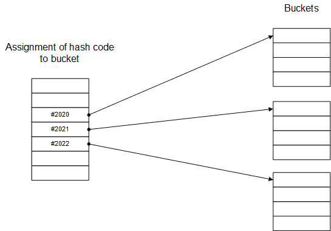

### `equals` / `hashCode` 的实现

- 如果你对 `equals` 进行了重写，则必须重写 `hashCode`。
- 如果两个对象根据 `equals` 方法相等，那么对这两个对象中的每一个调用 `hashCode` 方法必须产生相同的结果。
- 不需要要求如果两个对象根据 `equals` 方法不相等，对 `hashCode` 方法的调用必须为每个对象返回唯一的整数结果。然而，程序员应该意识到，为不相等的对象生成不同的整数结果可以提高哈希表的性能。
- 如果在执行期间多次调用同一个对象，除非该对象上用于 `equals` 比较的信息发生了变化，否则 `hashCode` 方法必须一致地返回相同的整数。

### 性能

- 对哈希容器中元素的访问是通过索引（即哈希值）快速识别桶，然后在希望较小的桶内进行相对缓慢的顺序搜索完成的。因此，基于哈希的容器的优势在于可以通过索引快速访问桶。如果计算哈希值花费了很长时间，那么通过哈希值进行快速访问带来的性能提升就会被抵消。因此，哈希值的计算应该尽可能高效。
- 因此，哈希值的计算不仅应该快，而且应该导致容器拥有许多小桶。
- 目标是实现一种尽可能快的实现，并使所计算的哈希值在 `-2147483648` 到 `2147483647` 的可能整数值范围内实现均匀分布。

```java
public final class Name {
    private final String first;

    public Name(String first) {
        this.first = first;
    }

    @Override
    public boolean equals(Object obj) {
        if (this == obj) {
            return true;
        }
        if (obj == null) {
            return false;
        }
        if (getClass() != obj.getClass()) {
            return false;
        }
        Name other = (Name) obj;
    }
}
```

对于所有如 `if`、`for` 和 `while` 等语句请使用大括号。即使语句体只包含一行，也应该这样做。你可以获得更好的可读性，并防止误导性的执行流。

```java
List<String> roles = new ArrayList<>();

if (isUser()) {
    roles.add("USER");
} else if (isAdmin()) {
    roles.add("ADMIN");
}
```

### 坏代码

上面的示例按照预期工作，但如果开发者如下所示扩展代码且没有在体周围添加大括号怎么办？在这种情况下，语句 `roles.add("ADMIN")` 将始终被执行。

```java
List<String> roles = new ArrayList<>();

if (isUser()) {
    roles.add("USER");
} else if (isAdmin()) {
    log.warn("Logged as admin!");
}
roles.add("ADMIN"); // 将始终被执行
```

### 坏代码，运行不符合预期

```java
List<String> roles = new ArrayList<>();

if (isUser()) {
    roles.add("USER");
} else if (isAdmin()) {
    log.warn("Logged as admin!");
    roles.add("ADMIN"); // 将始终被执行
}
```

### 好的代码

## 3.28 在循环中预计算长度

```java
// expensiveComputation() 将被调用 n 次
for (int i = 0; i < expensiveComputation(); i++) {
    doSomething(i);
}
```

### 坏代码


```java
// expensiveComputation() 将被调用一次
for (int i = 0, n = expensiveComputation(); i < n; i++) {
    doSomething(i);
}
```

### 好的代码

## 3.29 避免 `String` 的低速实例化

### 坏代码

```java
// 慢速实例化
String slow = new String("Yet another string object");
```

### 好的代码

```java
// 快速实例化
String fast = "Yet another string object";
```

## 3.30 使用 `StringBuilder` 进行拼接

字符串是不可变的，因此拼接并不是简单地将新的 `String` 追加到现有字符串的末尾。在每次循环迭代中，`String` 被转换为中间对象类型，追加第二个 `String`，然后将中间对象转换回新的 `String`。随着迭代次数的增加，这会导致纯性能上的下降。

通过显式使用 `StringBuilder` 可以获得更好的性能，这应该应该是你几乎所有代码中的默认做法。尽量避免使用 `+` 运算符。

### 坏代码

```java
public String concat() {
    String result = "";

    for (int i = 0; i < numItems(); i++) {
        result += lineForItem(i); // String 拼接
    }

    return result;
}
```

### 好的代码

```java
public String concat() {
    StringBuilder sb = new StringBuilder(numItems() * LINE_WIDTH);

    for (int i = 0, n = numItems(); i < n; i++) {
        sb.append(lineForItem(i));
    }

    return sb.toString();
}
```

## 3.31 减少集合容器中的查找

如果可能，减少对集合内元素的查找次数。在例例中，搜索了一个元素，如果存在则将使用该值。冗余操作可以减少到一次。

### 坏代码

```java
Map<String, User> users = new HashMap<>();

User user;

if (this.users.get(key) != null) { // 调用一次
    user = this.users.get(key);    // 调用两次
    String password = user.password();
}
```

### 好的代码

```java
Map<String, User> users = new HashMap<>();

User user;

if ((user = this.users.get(key)) != null) { // 仅调用一次
    String password = user.password();
}
```

## 3.32 使用 `valueOf` 包装对象

如果不需要新实例，通常应优先使用此方法而不是构造函数，因为该方法通过缓存频繁请求的值，可能会显著提高空间和时间性能。

在 `Integer` 和 `Long` 的情况下，此方法将始终缓存 -128 到 127（包含）之间的值，并可能缓存此范围之外的值。缓存的大小可以通过 `-XX:AutoBoxCacheMax` 选项控制。

### 坏代码

```java
new Boolean(true);
new Long(1);
new Integer(2);
```

### 好的代码

```java
Boolean.valueOf(true);
Long.valueOf(1);
Integer.valueOf(2);
```

### 坏代码

```java
// 内存中有 4 个对象
Boolean b1 = new Boolean(true);
Boolean b2 = new Boolean(false);
Boolean b3 = new Boolean(false);
Boolean b4 = new Boolean(false);
```

### 好的代码

```java
// 内存中有 2 个对象
Boolean b1 = Boolean.TRUE;
Boolean b2 = Boolean.FALSE;
```

## 3.33 使用 `entrySet` 遍历

当只需要键和值时，使用 `entrySet()` 更好。如果只需要键，则 `keySet()` 更好。

### 坏代码

```java
Map<String, User> users = new HashMap<>();

User user;

if (this.users.get(key) != null) { // 调用一次
    user = this.users.get(key);    // 调用两次
    String password = user.password();
}
```

### 好的代码

```java
Map<String, User> users = new HashMap<>();

User user;

if ((user = this.users.get(key)) != null) { // 仅调用一次
    String password = user.password();
}
```

## 3.34 为 `String` 使用 `isEmpty()`

### 坏代码

```java
if (text != null && text.equals("")) {
    // 操作
}
```

### 好的代码

```java
if (text != null && !text.isEmpty()) {
    // 操作
}
```

## 3.35 减少类型转换次数

### 坏代码

```java
Integer io = new Integer(0);
Object obj = (Object) io;

for (int i = 0; i < 100000; i++) {
    if (obj instanceof Integer) {
        byte x = ((Integer) obj).byteValue();
        double d = ((Integer) obj).doubleValue();
        float f = ((Integer) obj).floatValue();
    }
}
```

### 好的代码

```java
Integer io = new Integer(0);
Object obj = (Object) io;

for (int i = 0; i < 100000; i++) {
    if (obj instanceof Integer) {
        Integer icast = (Integer) obj;
        byte x = icast.byteValue();
        double d = icast.doubleValue();
        float f = icast.floatValue();
    }
}
```

## 3.36 在循环中避免 `get()`

```java
Map<String, User> users = new HashMap<>();

for (Map.Entry<String, User> entry : users.entrySet()) {
    String key = entry.getKey();
    User user = entry.getValue();
    String password = user.password();
}
```

# 4 软件质量保证

## 4.1 测试金字塔

Mike Cohn 在他的书籍《成功的 Agile》中介绍了测试金字塔。它是可视化不同级别测试的一种极佳方法。它告诉你在每一层应该做多少测试。原始测试金字塔由三层组成：*单元测试*、*服务测试*和*界面测试*。


根据这个金字塔，编写许多快速的单元测试。编写一些粗粒度的集成测试，以及极少数从顶到部的高级测试。小心不要变成[测试金字塔与冰淇淋](https://alisterbscott.com/kb/testing-pyramids/)，那是完全在浪费时间和维护精力。

### 单元测试

单元测试关注单个类，而且是最容易、最便宜且完成最快的。单元测试在早期编写，以便我们获得即时反馈并确切知道错误在哪里。

### 集成 / 组件 / 验收测试

集成测试关注不同类和模块的正确集成。与单元测试相比，它们可能需要专业的工具来准备测试环境或进行交互。

### UI 测试

UI 测试关注从客户端的角度验证系统。整个应用程序将在真实场景中测试，例如与数据库、网络、硬件和其他应用程序的通信。

## 4.2 测试分类

测试可以根据其信息状态进行分类。主要有三种测试策略：`White-Box-Test` 白盒测试、`Black-Box-Test` 黑盒测试和 `Grey-Box-Test` 灰盒测试。WBT 由开发团队在编码完成后通过测试代码的内部行为进行。BBT 由专业测试工程师通过观察应用程序进行。他们无法访问代码的逻辑和执行流。GBT 是 WBT 和 BBT 的结合，在不了解实现的情况下进行。

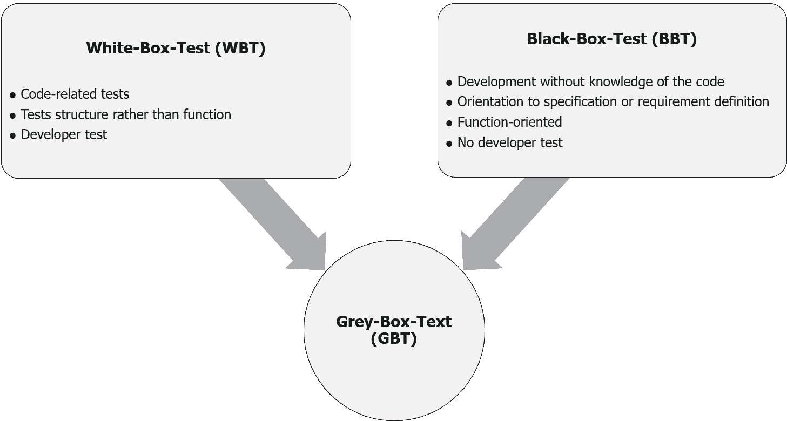

## WBT、GBT 和 BBT 的区别

|  | WBT | BBT |
| --- | --- | --- |
| **优点** | 对子组件和内部功能的测试 | 对整体系统更好的验证 |
|  | 组织工作量较少 | 使用适当的规范对语义属性进行测试 |
|  | 通过良好的工具支持实现自动化 | 系统创建的测试序列到平台无关实现的可移植性 |
| **缺点** | 未验证是否符合规范 | 组织工作量较大 |
|  | 可能在“错误周围”进行测试 | 实现期间添加的额外功能仅偶然被测试 |
|  |  | 规范不足的测试序列不可用 |

## 4.3 测试驱动开发 (TDD)

> 当我们编写测试时……我们正在向自己讲述一个关于操作外部看起来如何的故事 – Kent Beck

### 什么是测试驱动开发？

- 测试驱动编程
  - 通过自动化测试驱动代码的任何行为变化。
- 重构
  - 在编程过程中保持代码的 `simple form`，并逐步开发设计。
- 频繁集成
  - 根据需要频繁集成代码。

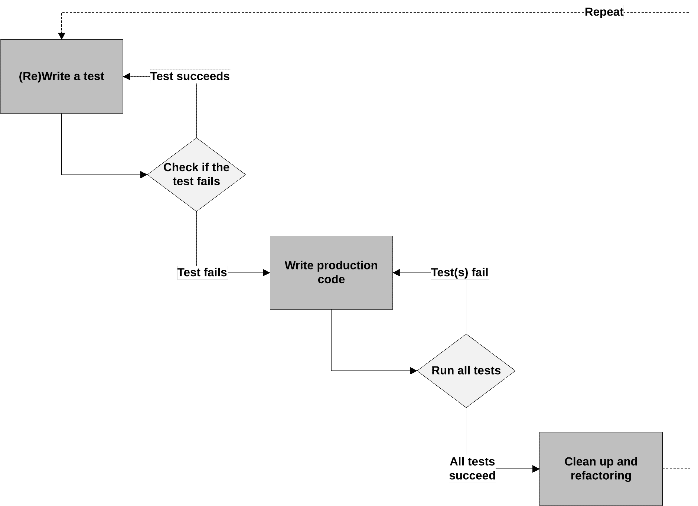

### 测试驱动开发流程

### 为什么要用测试驱动开发？

- TDD 确保了软件的质量和可维护性。
- 测试确保了在扩展和修订时现有功能得以保留。
- 重构延长了软件的生产周期。
- 代码之后通常很难进行测试。
- 测试优先强调用户视角。
- 没有测试的软件开发就像没有绳子和钩爪的爬山。

### 为什么测试驱动开发能提高质量？

#### 如果你不理解某东西，就无法为它编写测试

在实现之前编写测试的做法迫使人们更深入地处理要解决的问题，从而产生更高质量的代码，代码对其他开发者来说也更容易理解。作为副作用，TDD 还迫使人们处理客户对编写软件的期望问题。因此，TDD 基本上不是一种测试方法，而是一种设计方法。

#### 没有回归测试你就无法清理代码

如果没有快速测试的可能性，你通常就不敢修改现有代码。最好是将类的代码（例如）复制到一个新类中，然后扩展额外的功能。结果是导致一个过载、混乱的项目，包含大量冗余代码。

#### 快速反馈循环节省时间和金钱

如果你先写测试，就可以立即检查功能实现的正确性。结果是你始终能确定自己何时完成了一个功能的开发。

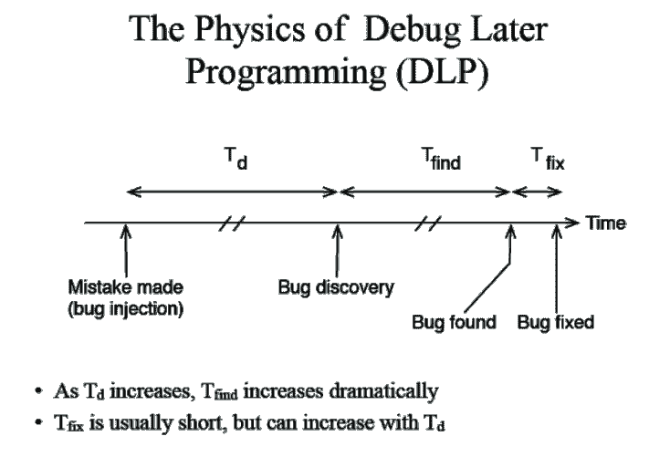

### 事后调试编程

如果没有这些快速反馈循环，你经常会迷失在寻找 bug 原因的过程中。TDD 帮助将一个大问题分解为更小、可管理且可测试的问题。

#### 反正你都要测试，不如花时间正确去做

回归测试是不可或缺的。如果不定期执行它们，测试大型应用程序几乎是不可能的。当然，回归测试也可以在之后编写，但这样就无法从 TDD 提供的更好的设计中受益。其次，随着截止日的临近，时间往往变得有限，导致随后的测试经常不足。

#### 它让我的工作更加愉快

每个成功的测试都带给你创造了价值之的感觉：一段你可以自豪地展示给其他开发者的执行软件。

## 4.4 使用 JUnit 5 进行单元测试

### 4.4.1 单元测试

**单元测试的好处：**

- 可以立即检查代码更改
- 更好的代码质量/稳定性或安全性
- 修改核心组件前的犹豫减少
- 尽管需要实现额外的测试，但开发时间更短
- 更容易重构
- 简化实现的文档

**单元测试的要求：**

- 测试易于实现
- 快速且自动的执行
- 对测试结果进行彻底分析

### 4.4.2 JUnit 5

[JUnit 5](https://junit.org/junit5/) 是一个简单的 Java 单元测试框架，帮助在 JVM 上进行测试，专注于 Java 8 语言特性、扩展性和现代编程 API。

**JUnit 5 的目标是什么？**

- 将测试创建的努力降到最低
- 易于学习和使用
- 避免重复工作
- 测试必须：
  - 是重复应用的
  - 可以单独生成的
  - 是增量的
  - 可以自由组合的
  - 对于作者以外的人也是可行的
  - 也可以由作者以外的人评估
- 允许使用测试数据
  - 测试数据的重用性
  - 测试数据的生成通常比……复杂

**我们应该测试什么？**

单元测试最好的点是，你可以为所有的生产代码类编写测试，无论其功能、复杂性或内部结构如何。你可以对控制器、服务、仓库、领域类执行单元测试。遵循每个生产类一个测试类的规则。这是一个良好的开始，但不是必须的。

单元测试类应该测试类的公共接口。如果你这样做，所有其他方法将被自动测试。

如果你的测试类的包结构与生产类相同，则 `protected` 和包私有方法在测试类中是可见的，也可以进行测试，但测试这些方法可能太深入了。私有方法是无法测试的，因为你无法从另一个测试类调用它们。

**如何组织测试？**

常见的模式如 [Arrange, Act, Assert](https://xp123.com/articles/3a-arrange-assert/) 和 [Given, When, Then](https://martinfowler.com/bliki/GivenWhenThen.html)，后者是作为[行为驱动开发](https://dannorth.net/introducing-bdd/) (BDD) 的一部分开发的。

**项目结构和命名规范如何？**

现在所有都使用标准工具构建项目，如 [Maven](https://maven.apache.org/) 或 [Gradle](https://gradle.org/)。因此，所有生产源代码位于 `src/main/java`，所有测试源文件位于 `src/test/java`。

```text
└── src
    └── main
        ├── java
        │   └── HelloWorld.java
        └── test
            └── java
                └── HelloWorldTest.java
```

典型的项目目录结构

像上面的测试类名通常会带有 `Test` 前缀。这是一个非常常见的命名规范，应该一致地遵守。它让开发者能够立即看出哪个类正在被测试。此外，某些工具也依赖于这一约定。

### 4.4.3 第一个单元测试

```java
class SimpleTest {

    private Collection<String> collection = new ArrayList<>();

    @Test
    void testEmptyCollection() {
        assertTrue(collection.isEmpty());
    }

    @Test
    void testOneItemCollection() {
        collection.add("First JUnit Test");

        assertEquals(1, collection.size());
    }
}
```

第一个简单的 JUnit 5 测试

```text
setUp()
testEmptyCollection()

setUp()
testOneItemCollection()
```

执行顺序

**测试执行[顺序](https://junit.org/junit5/docs/current/user-guide/#writing-tests-test-execution-order)：**


默认情况下，测试方法将使用一种确定性但故意不直观的算法进行排序。这确保了测试套件的后续运行将以相同的顺序执行测试方法，从而允许可重复的构建。即使单元测试通常不应该依赖于执行顺序，但在某些情况下，必须强制执行测试方法的特定顺序。要指定测试方法的执行顺序，请在你的测试类或测试接口上使用`@TestMethodOrder`注，并提供首选的`MethodOrder`实现。

### 4.4.4 断言（Assertions）

[断言](https://junit.org/junit5/docs/current/api/org.junit.jupiter.api/org/junit/jupiter/api/Assertions.html)是一个支持在测试中断言条件的工具方法集合。JUnit 5 包含了 JUnit 4 的许多断言以及几个有趣的新断言。

它还提供了对断言中使用 Lambda 表达式的支持。在断言消息中使用 Lambda 表达式的优势是它是惰性求值的（lazy evaluated），这可以通过避免构建复杂消息来节省时间和资源。

测试的断言结果会提供特定的值。失败的断言将抛出`AssertionFailedError`或其子类。

#### 4.4.4.1 `assertEquals()` / `assertArrayEquals()`

断言期望值和实际值相等。

```java
 1 @Test
 2 void equality() {
 3     Calculator calculator = new Calculator();
 4 
 5     assertEquals(2, calculator.add(1, 1));
 6     assertEquals(4, calculator.multiply(2, 2), "可选的失败消息");
 7 
 8     char[] expected = {'J','u','n','i','t'};
 9     char[] actual = "Junit".toCharArray();
10 
11     assertArrayEquals(expected, actual);
12 }
```

等性

#### 4.4.4.2 `assertSame()` / `assertNotSame()`

断言期望值和实际值指向同一个对象。

```java
1 @Test
2 void identity() {
3     User john = new User(1, "John", "Rambo");
4     User rocky = new User(2, "Rocky", "Balboa");
5 
6     assertSame(john, john);
7     assertNotSame(john, rocky);
8 }
```

标识性

#### 4.4.4.3 `assertTrue()` / `assertFalse()` / `assertAll()`

断言所提供的条件为真或假。`assertAll()`断言所有提供的可执行体都不会抛出异常。可以将断言分组，并将所有失败的断言一起报告。

```java
 1 @Test
 2 void truth() {
 3     assertTrue('a' < 'b', () -> "断言消息可以惰性求值"
 4             + "以避免不必要的构建复杂消息。");
 5 }
 6 
 7 @Test
 8 void groupedTruth() {
 9     Person person = new Person("Jane", "Doe");
10 
11     assertAll("person",
12         () -> assertEquals("Jane", person.firstName()),
13         () -> assertEquals("Doe", person.lastName())
14     );
15 }
```

真值

#### 4.4.4.4 `assertNull()` / `assertNotNull()`

断言实际值为`null`或不是。

```java
 1 @Test
 2 void existence() {
 3     assertNotNull(new Calculator());
 4     assertNull(null);
 5 }
```

存在性

#### 4.4.4.5 `assertThrows()`

断言执行提供的可执行体会抛出预期类型的异常并返回该异常。

```java
 1 @Test
 2 void exceptions() {
 3     Calculator calculator = new Calculator();
 4 
 5     Exception exception = assertThrows(ArithmeticException.class, () -> calculator.divide(1, 0));
 6     assertEquals("/ by zero", exception.getMessage());
 7 }
```

异常

#### 4.4.4.6 `assertTimeout()`

断言执行提供的可执行体在超过给定超时之前完成。

```java
 1 @Test
 2 void timeout() {
 3     assertTimeout(Duration.ofSeconds(5), () -> TimeUnit.SECONDS.sleep(1));
 4 }
```

超时

#### 4.4.4.7 `fail()`

使测试失败。

```java
 1 @Test
 2 void failing() {
 3     fail("a test");
 4 }
```

失败

### 4.4.5 注解（Annotations）

JUnit 支持以下[注解](https://junit.org/junit5/docs/current/user-guide/#writing-tests-annotations)来配置测试：

`@BeforeAll`在测试类开始前执行所有测试。方法必须是`static`的。

`@AfterAll`在测试类结束后执行所有测试。方法必须是`static`的。

`@BeforeEach`在每个测试之前执行。

`@AfterEach`在每个测试之后执行。

`@Test`标记要测试的方法。

`@Disabled`禁用测试方法。

`@Tag`用于过滤，可以在类级别或方法级别声明。类似于 JUnit 4 的[Categories](https://github.com/junit-team/junit4)。

`@DisplayName`测试类和方法的自定义名称。

`@Timeout`如果其执行超过特定持续时间将失败。

`@Nested`表示被标记的类是嵌套类，意味着它与其包含类共享状态。由于嵌套类不能有静态字段和方法，这禁止在嵌套类中使用`@BeforeAll`和`@AfterAll`。

`@ParameterizedTest`用于表示被标记的方法是参数化测试。你必须至少选择一个参数源。有多种参数类型。

`@TempDir`可用于注解测试类中的私有字段或类型为`Path`或`File`的方法的参数，解析到临时目录。

#### 4.4.5.1 `@Test`

- [`@Test`](https://junit.org/junit5/docs/current/api/org.junit.jupiter.api/org/junit/jupiter/api/Test.html)标记要测试的方法。
- 被注解的方法不能是`private`或`static`。
- 不能返回结果，因此方法应返回`void`。
- 只有带有`@Test`注解的方法会被执行。

```java
 1 class TestAnnotationTest {
 2 
 3     @Test
 4     simple() {
 5         Collection<Object> collection = new ArrayList<>();
 6         assertTrue(collection.isEmpty());
 7     }
 8 
 9     @Test
10     void lambdaExpressions() {
11         assertTrue(Stream.of(1, 2, 3)
12           .stream()
13           .mapToInt(i -> i)
14           .sum() > 5, () -> "和应该大于 5");
15     }
16 
17     @Test
18     void groupAssertions() {
19         int[] numbers = {0, 1, 2, 3, 4};
20 
21         assertAll("numbers",
22             () -> assertEquals(numbers[0], 1),
23             () -> assertEquals(numbers[3], 3),
24             () -> assertEquals(numbers[4], 1)
25         );
26     }
27 }
```

`@Test`注言

#### 4.4.5.2 `@BeforeEach` / `@AfterEach`

- [`@BeforeEach`](https://junit.org/junit5/docs/current/api/org.junit.jupiter.api/org/junit/jupiter/api/BeforeEach.html)用于指定被注解的方法在当前测试类的每个测试之前执行。
- [`@AfterEach`](https://junit.org/junit5/docs/current/api/org.junit.jupiter.api/org/junit/jupiter/api/AfterEach.html)用于指定被注解的方法应在当前测试类中的每一个测试执行后执行。

```java
 1 class BeforeAndAfterEachAnnotationsTest {
 2     private Collection<String> collection;
 3 
 4     @BeforeEach
 5     void setUp() {
 6         collection = new ArrayList<>();
 7     }
 8 
 9     @AfterEach
10     void tearDown() {
11         collection.clear();
12     }
13 
14     @Test
15     void testEmptyCollection() {
16         assertTrue(collection.isEmpty());
17     }
18 
19     @Test
20     void testOneItemCollection() {
21         collection.add("itemA");
22         assertEquals(1, collection.size());
23     }
24 }
```

`@BeforeEach` / `@AfterEach`

```text
 1 setUp()
 2 testEmptyCollection()
 3 tearDown()
 4 
 5 setUp()
 6 testOneItemCollection()
 7 tearDown()
```

## 执行顺序

#### 4.4.5.3 `@BeforeAll` / `@AfterAll`

- [`@BeforeAll`](https://junit.org/junit5/docs/current/api/org.junit.jupiter.api/org/junit/jupiter/api/BeforeAll.html)用于指定被注解的方法应在当前测试类中的所有测试之前执行。
- [`@AfterAll`](https://junit.org/junit5/docs/current/api/org.junit.jupiter.api/org/junit/jupiter/api/AfterAll.html)用于指定被注解的方法应在当前测试类中的所有测试执行后执行。
- 这些被注解的方法必须是`static void`类型，且对于给定的测试类仅执行一次。

```java
 1 class BeforeAndAfterAllAnnotationsTest {
 2     private Collection<String> collection;
 3 
 4     @BeforeAll
 5     static void oneTimeSetUp() {}
 6     @AfterAll
 7     static void oneTimeTearDown() {}
 8 
 9     @BeforeEach
10     void setUp() {
11         collection = new ArrayList<>();
12     }
13     @AfterEach
14     void tearDown() {
15         collection.clear();
16     }
17 
18     @Test
19     void testEmptyCollection() {
20         assertTrue(collection.isEmpty());
21     }
22     @Test
23     void testOneItemCollection() {
24         collection.add("itemA");
25         assertEquals(1, collection.size());
26     }
27 }
```

`@BeforeAll` / `@AfterAll`

```text
 1 oneTimeSetUp()
 2 
 3 setUp()
 4 testEmptyCollection()
 5 tearDown()
 6 
 7 setUp()
 8 testOneItemCollection()
 9 tearDown()
10 
11 oneTimeTearDown()
```

## 执行顺序

#### 4.4.5.4 `@Disabled`

- [`@Disabled`](https://junit.org/junit5/docs/current/api/org.junit.jupiter.api/org/junit/jupiter/api/Disabled.html)用于指定被注解的测试类或测试方法当前处于禁用状态，不应执行。
- 也可以在注解中声明原因，以提供关于测试类或测试方法被禁用的更多信息。
- 也可以应用于类级别，这将禁用该类中的所有测试方法。

```java
1 class DisabledAnnotationTest {
2 
3     @Disabled
4     @Test
5     void disabled() {
6     }
7 }
```

### 排除测试方法

```java
1 class DisabledAnnotationTest {
2 
3     @Disabled("not ready yet")
4     @Test
5     void disabledWithComment() {
6     }
7 }
```

### 带有注释的排除测试方法

```java
 1 @Disabled
 2 class DisabledAnnotationTest {
 3 
 4     @Test
 5     void disabled() {
 6     }
 7 
 8     @Test
 9     void disabledAsWell() {
10     }
11 }
```

### 排除测试类

#### 4.4.5.5 `@DisplayName`

- [`@DisplayName`](https://junit.org/junit5/docs/current/api/org.junit.jupiter.api/org/junit/jupiter/api/DisplayName.html)用于为被注解的测试类或测试方法声明自定义的显示名称。
- 显示名称用于 IDE 和构建工具的报告，可以包含空格、特殊字符甚至 emoji。

```java
 1 @DisplayName("A special test case")
 2 class DisplayNameAnnotationTest {
 3 
 4     @Test
 5     @DisplayName("Custom test name containing spaces")
 6     void testWithDisplayNameContainingSpaces() {
 7     }
 8 
 9     @Test
10     @DisplayName("°□°")
11     void testWithDisplayNameContainingSpaces() {
12     }
13 }
```

（注：此处原文似乎有内容断层或重复，已按逻辑修正翻译）

*修正翻译示例内容：*


```java
@DisplayName("特殊测试用例")
class DisplayNameAnnotationTest {

    @Test
    @DisplayName("包含空格的自定义测试名称")
    void testWithDisplayNameContainingSpaces() {
    }

    @Test
    @DisplayName("°□°")
    void testWithDisplayNameWithEmoji() {
    }
}
```

* [`@DisplayName`](https://junit.org/junit5/docs/current/api/org.junit.jupiter.api/org/junit/jupiter/api/DisplayName.html) 用于为被注解的测试类或测试方法声明自定义的显示名称。
* 显示名称用于 IDE 和构建工具的报告，可以包含空格、特殊字符甚至 emoji。

```java
@DisplayName("A special test case")
class DisplayNameAnnotationTest {

    @Test
    @DisplayName("Custom test name containing spaces")
    void testWithDisplayNameContainingSpaces() {
    }

    @Test
    @DisplayName("°□°")
    void testWithDisplayNameContainingSpaces() {
    }
}
```

* [`@DisplayName`](https://junit.org/junit5/docs/current/api/org.junit.jupiter.api/org/junit/jupiter/api/DisplayName.html) 用于为被注解的测试类或测试方法声明自定义的显示名称。
* 显示名称用于 IDE 和构建工具的报告，可以包含空格、特殊字符甚至 emoji。

```java
@DisplayName("A special test case")
class DisplayNameAnnotationTest {

    @Test
    @DisplayName("Custom test name containing spaces")
    void testWithDisplayNameContainingSpaces() {
    }

    @Test
    @DisplayName("°□°")
    void testWithDisplayNameContainingSpaces() {
    }
}
```

* [`@DisplayName`](https://junit.org/junit5/docs/current/api/org.junit.jupiter.api/org/junit/jupiter/api/DisplayName.html) 用于为被注解的测试类或测试方法声明自定义的显示名称。
* 显示名称用于 IDE 和构建工具的报告，可以包含空格、特殊字符甚至 emoji。

```java
@DisplayName("A special test case")
class DisplayNameAnnotationTest {

    @Test
    @DisplayName("Custom test name containing spaces")
    void testWithDisplayNameContainingSpaces() {
    }

    @Test
    @DisplayName("°□°")
    void testWithDisplayNameContainingSpaces() {
    }
}
```

* [`@DisplayName`](https://junit.org/junit5/docs/current/api/org.junit.jupiter.api/org/junit/jupiter/api/DisplayName.html) 用于为被注解的测试类或测试方法声明自定义的显示名称。
* 显示名称用于 IDE 和构建工具的报告，可以包含空格、特殊字符甚至 emoji。

```java
@DisplayName("A special test case")
class DisplayNameAnnotationTest {

    @Test
    @DisplayName("Custom test name containing spaces")
    void testWithDisplayNameContainingSpaces() {
    }

    @Test
    @DisplayName("°□°")
    void testWithDisplayNameContainingSpaces() {
    }
}
```

* [`@DisplayName`](https://junit.org/junit5/docs/current/api/org.junit.jupiter.api/org/junit/jupiter/api/DisplayName.html) 用于为被注解的测试类或测试方法声明自定义的显示名称。
* 显示名称用于 IDE 和构建工具的报告，可以包含空格、特殊字符甚至 emoji。

```java
@DisplayName("A special test case")
class DisplayNameAnnotationTest {

    @Test
    @DisplayName("Custom test name containing spaces")
    void testWithDisplayNameContainingSpaces() {
    }

    @Test
    @DisplayName("°□°")
    void testWithDisplayNameContainingSpaces() {
    }
}
```

* [`@Tag`](https://junit.org/junit5/docs/current/api/org.junit.jupiter.api/org/junit/jupiter/api/Tag.html) 标记测试类或方法。
* 这些标签可以过滤测试的执行。

```java
@Tag("fast")
@Tag("smoke-test")
class Tag {
}
```

#### 4.4.5.7 `@Timeout`

* [`@Timeout`](https://junit.org/junit5/docs/current/api/org.junit.jupiter.api/org/junit/jupiter/api/Timeout.html) 用于为方法或所有测试定义超时。
* 将其应用于类与应用于方法相同。

```java
class Timeout {

    @BeforeEach
    void setUp() {
    }

    @Test
    @Timeout(value = 100, unit = TimeUnit.MILLISECONDS)
    failsIfExceeds100() {
    }
}
```

#### 4.4.6 Assumptions

假设用于在满足某些条件时执行测试。如果条件不满足，方法将退出。

#### 4.4.6.1 `assumeFalse()`

```java
@Test
void falseAssumption() {
    assumeFalse(5 < 1);
}
```

#### 4.4.6.2 `assumeTrue()`

```java
@Test
void trueAssumption() {
    assumeTrue(5 > 1);
}
```

#### 4.4.6.3 `assumingThat()`

```java
@Test
void assumptionThat() {
    String message = "Just a test";

    assumingThat(
        "Just a test".equals(message),
        () -> assertEquals(2 + 2, 4)
    );
}
```

### 参数化测试

[参数化测试](https://junit.org/junit5/docs/current/parameterized-tests/)使得可以使用不同的参数运行多次测试。声明方式与普通 `@Test` 方法类似，但使用的是 `@ParameterizedTest` 注解。

**JUnit 支持不同的源：**

* `@ValueSource`
* `@EnumSource`
* `@MethodSource`
* `@CsvSource`
* `@CsvFileSource`
* `@ArgumentsSource`
* `@NullSource`
* `@EmptySource`
* `@NullAndEmptySource`

#### 4.4.7.1 `@ValueSource`

* [`@ValueSource`](https://junit.org/junit5/docs/current/api/org.junit.jupiter.params/org/junit/jupiter/params/provider/ValueSource.html) 提供对数组的访问。
* 支持的类型有 `shorts`、`bytes`、`ints`、`longs`、`floats`、`doubles`、`chars`、`booleans`、`strings` 和 `classes`。
* 每个 `@ValueSource` 声明只能指定一种支持类型。

```java
@ParameterizedTest
@ValueSource(strings = { "otto", "level", "radar", "rotor", "kayak" })
palindromes(String candidate) {
    assertTrue(StringUtils.isPalindrome(candidate));
}

@ParameterizedTest
@ValueSource(ints = { 1, 2, 3 })
testWithValueSource(int argument) {
    assertTrue(argument > 0 && argument < 4);
}
```

#### 4.4.7.2 `@MethodSource`

* [`@AfterEach`](https://junit.org/junit5/docs/current/api/org.junit.jupiter.api/org/junit/jupiter/api/AfterEach.html)用于指定被注解的方法应在当前测试类中的**每一个**测试执行后执行。

```java
class BeforeAndAfterEachAnnotationsTest {
    private Collection<String> collection;

    @BeforeEach
    void setUp() {
        collection = new ArrayList<>();
    }

    @AfterEach
    void tearDown() {
        collection.clear();
    }

    @Test
    void testEmptyCollection() {
        assertTrue(collection.isEmpty());
    }

    @Test
    void testOneItemCollection() {
        collection.add("itemA");
        assertEquals(1, collection.size());
    }
}
```

`@BeforeEach` / `@AfterEach`

```text
setUp()
testEmptyCollection()
tearDown()

setUp()
testOneItemCollection()
tearDown()
```

## 执行顺序

#### 4.4.5.3 `@BeforeAll` / `@AfterAll`

* [`@BeforeAll`](https://junit.org/junit5/docs/current/api/org.junit.jupiter.api/org/junit/jupiter/api/BeforeAll.html)用于指定被注解的方法应在当前测试类中的**所有**测试之前执行。
* [`@AfterAll`](https://junit.org/junit5/docs/current/api/org.junit.jupiter.api/org/junit/jupiter/api/AfterAll.html)用于指定被注解的方法应在当前测试类中的**所有**测试执行后执行。
* 这些被注解的方法必须是 `static void` 类型，且对于给定的测试类仅执行**一次**。

```java
class BeforeAndAfterAllAnnotationsTest {
    private Collection<String> collection;

    @BeforeAll
    static void oneTimeSetUp() {
    }

    @AfterAll
    static void oneTimeTearDown() {
    }

    @BeforeEach
    void setUp() {
        collection = new ArrayList<>();
    }

    @AfterEach
    void tearDown() {
        collection.clear();
    }

    @Test
    void testEmptyCollection() {
        assertTrue(collection.isEmpty());
    }

    @Test
    void testOneItemCollection() {
        collection.add("itemA");
        assertEquals(1, collection.size());
    }
}
```

`@BeforeAll` / `@AfterAll`

```text
oneTimeSetUp()

setUp()
testEmptyCollection()
tearDown()

setUp()
testOneItemCollection()
tearDown()

oneTimeTearDown()
```

## 执行顺序

#### 4.4.5.4 `@Disabled`

* [`@Disabled`](https://junit.org/junit5/docs/current/api/org.junit.jupiter.api/org/junit/jupiter/api/Disabled.html)用于指定被注解的测试类或测试方法当前处于禁用状态，不应执行。
* 也可以在注解中声明原因，以提供关于测试类或测试方法被禁用的更多信息。
* 也可以应用于类级别，这将禁用该类中的**所有**测试方法。

```java
class DisabledAnnotationTest {

    @Disabled
    @Test
    void disabled() {
    }
}
```

### 排除测试方法


```java
class DisabledAnnotationTest {
}
```

### 带有注释的排除测试方法

```java
@Disabled("not ready yet")
@Test
void disabledWithComment() {
}
```

### 排除测试类

```java
@Disabled
class DisabledAnnotationTest {

    @Test
    void disabled() {
    }

    @Test
    void disabledAsWell() {
    }
}
```

#### 4.4.5.5 `@DisplayName`

- [`@DisplayName`](https://junit.org/junit5/docs/current/api/org.junit.jupiter.api/org/junit/jupiter/api/DisplayName.html) 用于为被注解的测试类或测试方法声明自定义的显示名称。
- 显示名称用于 IDE 和构建工具的报告，可以包含空格、特殊字符甚至 emoji。

```java
@DisplayName("A special test case")
class DisplayNameAnnotationTest {

    @Test
    @DisplayName("Custom test name containing spaces")
    void testWithDisplayNameContainingSpaces() {
    }

    @Test
    @DisplayName("°□°")
    void testWithDisplayNameContainingSpaces() {
    }
}
```

*（注：原文文本在 DisplayName 之后似乎存在大量重复或错误，以下为基于原文内容的后续翻译）*

- [`@Tag`](https://junit.org/junit5/docs/current/api/org.junit.jupiter.api/org/junit/jupiter/api/Tag.html) 标记测试类或方法。
- 这些标签可以过滤测试的执行。

```java
@Tag("fast")
@Tag("smoke-test")
class Tag {
}
```

#### 4.4.5.7 `@Timeout`

- [`@Timeout`](https://junit.org/junit5/docs/current/api/org.junit.jupiter.api/org/junit/jupiter/api/Timeout.html) 用于为方法或所有测试定义超时。
- 将其应用于类与应用于方法相同。

```java
class Timeout {

    @BeforeEach
    void setUp() {
    }

    @Test
    @Timeout(value = 100, unit = TimeUnit.MILLISECONDS)
    failsIfExceeds100() {
    }
}
```

#### 4.4.6 Assumptions

[断言](https://junit.org/junit5/docs/current/api/org.junit.jupiter.api/org/junit/jupiter/api/Assumptions.html)用于在满足某些条件时执行测试。如果条件不满足，方法将退出。

#### 4.4.6.1 `assumeFalse()`

```java
@Test
void falseAssumption() {
    assumeFalse(5 < 1);
}
```

#### 4.4.6.2 `assumeTrue()`

```java
@Test
void trueAssumption() {
    assumeTrue(5 > 1);
}
```

#### 4.4.6.3 `assumingThat()`

```java
@Test
void assumptionThat() {
    String message = "Just a test";

    assumingThat(
        "Just a test".equals(message),
        () -> assertEquals(2 + 2, 4)
    );
}
```

### 参数化测试

[参数化测试](https://junit.org/junit5/docs/current/parameterized-tests/)使得可以使用不同的参数运行多次测试。声明方式与普通 `@Test` 方法类似，但使用的是 `@ParameterizedTest` 注解。

**JUnit 支持不同的源：**

- `@ValueSource`
- `@EnumSource`
- `@MethodSource`
- `@CsvSource`
- `@CsvFileSource`
- `@ArgumentsSource`
- `@NullSource`
- `@EmptySource`
- `@NullAndEmptySource`

#### 4.4.7.1 `@ValueSource`

- [`@ValueSource`](https://junit.org/junit5/docs/current/api/org.junit.jupiter.params/org/junit/jupiter/params/provider/ValueSource.html) 提供对数组的访问。
- 支持的类型有 `shorts`、`bytes`、`ints`、`longs`、`floats`、`doubles`、`chars`、`booleans`、`strings` 和 `classes`。
- 每个 `@ValueSource` 声明只能指定一种支持类型。

```java
@ParameterizedTest
@ValueSource(strings = { "otto", "level", "radar", "rotor", "kayak" })
palindromes(String candidate) {
    assertTrue(StringUtils.isPalindrome(candidate));
}

@ParameterizedTest
@ValueSource(ints = { 1, 2, 3 })
testWithValueSource(int argument) {
    assertTrue(argument > 0 && argument < 4);
}
```

#### 4.4.7.2 `@MethodSource`

- [`@MethodSource`](https://junit.org/junit5/docs/current/api/org.junit.jupiter.params/org/junit/jupiter/params/provider/MethodSource.html) 提供访问从注解声明的类的工厂方法返回的值，或通过完全限定的方法名从外部类的静态工厂方法返回的值的值。
- 每个工厂方法必须生成参数流。
- 流可以是 JUnit 可以转换为 `Stream` 的任何内容，例如 `Stream`、`DoubleStream`、`LongStream`、`IntStream`、`Collection`、`Iterator`、`Iterable`、对象数组或原始类型数组。
- 工厂方法必须是 `static` 且不声明任何参数。

```java
@ParameterizedTest
@MethodSource("stringProvider")
void testWithExplicitLocalMethodSource(String argument) {
    assertNotNull(argument);
}

static Stream<String> stringProvider() {
    return Stream.of("JUnit 5", "rocks!");
}
```

`@MethodSource` - `Stream<String>`

```java
@ParameterizedTest
@MethodSource("range")
void testWithRangeMethodSource(int argument) {
    assertNotEquals(9, argument);
}

static IntStream range() {
    return IntStream.range(0, 20).skip(10);
}
```

`@MethodSource` - `IntStream`

```java
@ParameterizedTest
@MethodSource("stringIntAndListProvider")
void testWithMultiArgMethodSource(String str, int num, List<String> list) {
    assertEquals(5, str.length());
    assertTrue(num >= 1 && num <= 2);
    assertEquals(2, list.size());
}

static Stream<Arguments> stringIntAndListProvider() {
    return Stream.of(
        arguments("apple", 1, Arrays.asList("a", "b")),
        arguments("lemon", 2, Arrays.asList("x", "y"))
    );
}
```

`@MethodSource` - `Stream<Arguments>`

#### 4.4.7.3 `@CsvSource`

- [`@CsvSource`](https://junit.org/junit5/docs/current/api/org.junit.jupiter.params/org/junit/jupiter/params/provider/CsvSource.html) 从一个或多个提供的 CSV 行中读取逗号分隔的值（CSV）。

```java
@ParameterizedTest
@CsvSource({
    "Bischofsmais,         1",
    "Osternohe,            2",
    "Leogang, Austria,     0xF1",
    "Porte du Soleil, France, 4"
})
void testWithCsvSource(String bikepark, int rank) {
    assertNotNull(bikepark);
    assertNotEquals(0, rank);
}
```

`@CsvSource`

#### 4.4.7.4 `@CsvFileSource`

```java
@ParameterizedTest
@CsvFileSource(resources = "/two-column.csv", numLinesToSkip = 1)
void testWithCsvFileSource(String country, int reference) {
    assertNotNull(country);
    assertNotEquals(0, reference);
}
```

`@CsvFileSource`

```csv
#two-column.csv
Country, reference
Sweden, 1
Germany, 2
Australia, 3
"United States of America", 4
```

`@CsvFileSource`

#### 4.4.7.5 `@ArgumentsSource`

```java
@ParameterizedTest
@ArgumentsSource(BikeArgumentsProvider.class)
void testWithArgumentsSource(String argument) {
    assertNotNull(argument);
}
```

`@ArgumentsSource`

```java
public class BikeArgumentsProvider implements ArgumentsProvider {

    @Override
    public Stream<? extends Arguments> provideArguments(ExtensionContext context) {
        return Stream.of("Specialized", "Cube").map(Arguments::of);
    }
}
```

`ArgumentsProvider`

## 4.5 关于单元测试的更多

### 4.5.1 启发式方法

#### 测试功能而非方法

- 测试用例基于需求和功能，而不是要测试的方法。
- 测试用例方法与被测试方法之间没有 1:1 的对应关系。
- 测试用例应该通过示例说明如何正确使用这些类。

```java
class EuroTest {
    @Test void newEuro() {...}
    @Test void getIntAmount() {...}
    @Test void getAmount() {...}
    @Test void plus() {...}
    @Test void minus() {...}
}
```

坏代码

```java
class EuroTest {
    @Test void createFromInt() {...}
    @Test void createFromString() {...}
    @Test void rounding() {...}
    @Test void simpleAddition() {...}
}
```

好代码

#### 边界测试

- 大多数算法错误发生在允许值范围的边界。
- 值范围可以划分为若干等样本？每个等价类至少一个样本！
- 未测试的内容可能无法工作。

#### 独立性

- 大多数算法错误发生在允许值范围的边界。
- 值范围可以划分为若干等效样本？每个等价类至少一个样本！
- 未测试的内容可能无法工作。

#### 正交性

- 大多数算法错误发生在允许值范围的边界。
- 值范围可以划分为若干等效样本？每个等价类至少一个样本！
- 未测试的内容可能无法工作。

#### 独立性

- 大多数算法错误发生在允许值范围的边界。
- 值范围可以划分为若干等效样本？每个等价类至少一个样本！
- 未测试的内容可能无法工作。

#### 正交性

- 大多数算法错误发生在允许值范围的边界。
- 值范围可以划分为若干等效样本？每个等价类至少一个样本！
- 未测试的内容可能无法工作。

#### 结果记录

- 大多数算法错误发生在允许值范围的边界。
- 值范围可以划分为若干等效样本？每个等价类至少一个样本！
- 未测试的内容可能无法工作。

#### 性能

- 大多数算法错误发生在允许值范围的边界。
- 值范围可以划分为若干等效样本？每个等价类至少一个样本！
- 未测试的内容可能无法工作。

#### 性能

- 大多数算法错误发生在允许值范围的边界。
- 值范围可以划分为若干等效样本？每个等价类至少一个样本！
- 未测试的内容可能无法工作。

#### 独立性

- 大多数算法错误发生在允许值范围的边界。
- 值范围可以划分为若干等效样本？每个等价类至少一个样本！
- 未测试的内容可能无法工作。

#### 正交性

- 大多数算法错误发生在允许值范围的边界。
- 值范围可以划分为若干等效样本？每个等价类至少一个样本！
- 未测试的内容可能无法工作。

#### 正交性

- 大多数算法错误发生在允许值范围的边界。
- 值范围可以划分为若干等效样本？每个等价类至少一个样本！
- 未测试的内容可能无法工作。

#### 结果记录

- 大多数算法错误发生在允许值范围的边界。
- 值范围可以划分为若干等效样本？每个等价类至少一个样本！
- 未测试的内容可能无法工作。

#### 性能

- 大多数算法错误发生在允许值范围的边界。
- 值范围可以划分为若干等效样本？每个等价类至少一个样本！
- 未测试的内容可能无法工作。

#### 性能

- 大多数算法错误发生在允许值范围的边界。
- 值范围可以划分为若干等效样本？每个等价类至少一个样本！
- 未测试的内容可能无法工作。

#### 独立性

- 大多数算法错误发生在允许值范围的边界。
- 值范围可以划分为若干等效样本？每个等价类至少一个样本！
- 未测试的内容可能无法工作。

#### 正交性

- 大多数算法错误发生在允许值范围的边界。


- 值范围可以划分为若干等效样本？每个等价类至少一个样本！
- 未测试的内容可能无法工作。

### 正交性

- 大多数算法错误发生在允许值范围的边界。
- 值范围可以划分为若干等效样本？每个等价类至少一个样本！
- 未测试的内容可能无法工作。

### 方法 2

描述测试用例的预期行为。

```
1 @Test newAccountShouldReturnCustomer() {}
2 @Test newAccountShouldHaveZeroBalance() {}
3 @Test withdrawShouldReduceBalanceByAmount() {}
4 @Test withdrawNegativeAmountShouldThrowException() {}
5 @Test withdrawNegativeAmountShouldNotChangeBalance() {}
```

以名称命名的预期行为。

### 4.5.3 对象母亲（Object Mother）

[对象母亲](https://martinfowler.com/bliki/ObjectMother.html)是一种可以用于测试的类，它允许我们为测试提供预先配置的对象。这里的示例相当简单，但请想象一下在真实的应用程序中，类可能具有许多属性和/或组合关系。

大多数测试不再由自己实例化对象，而是通过工厂进行。在未来的演进中，如果给类添加了新的强制性属性，你只需要修改工厂，所有测试都将通过。

构建器（Builders）的结合使得对象母亲生成的对象可以根据测试需求进行定制。否则，将需要为每种需求创建多个工厂，并使用一个接收测试用例所需所有信息参数的方法。

```
1 User user = new User("user", "password", "USER")
2 Authentication auth = new UsernamePasswordAuthenticationToken(user, null, user.authorities());
```

#### 传统方法

```
1 Authentication user = TestAuthentications.authenticatedUser();
2 Authentication admin = TestAuthentications.authenticatedAdmin();
3 Authentication tester = TestAuthentications.authenticated(new User("user", "password", "TESTER"));
```

#### 对象母亲模式

```
 1 public final class TestAuthentications {
 2 
 3     private static final User USER = new User("user", "password", "USER");
 4     private static final User ADMIN = new User("admin", "password", "USER, ADMIN");
 5 
 6     private TestAuthentications() {
 7     }
 8 
 9     public static Authentication authenticatedAdmin() {
10         return authenticated(ADMIN);
11     }
12 
13     public static Authentication authenticatedUser() {
14         return authenticated(USER);
15     }
16 
17     public static Authentication authenticated(User user) {
18         return new UsernamePasswordAuthenticationToken(user, null, user.authorities());
19 }
20 }
```

#### 对象母亲模式实现

### 4.5.4 测试数据构建器（Test Data Builder）

对象母亲和构建器模式分别为我们的测试带来了各自优势，但也可以结合起来进一步增强测试的可读性和维护性。对于复杂对象，书中《由测试引导的面向对象软件》（*Growing Object-Oriented Software, Guided by Tests*）描述的测试构建器模式是创建测试对象的完美解决方案。

```
1 Invoice anInvoice = new InvoiceBuilder().build();
```

#### 测试数据构建器的用法

```
 1 public class InvoiceBuilder {
 2 
 3     Recipient recipient = new RecipientBuilder().build();
 4     InvoiceLines lines = new InvoiceLines(new InvoiceLineBuilder().build());
 5     PoundsShillingsPence discount = PoundsShillingsPence.ZERO;
 6 
 7     public InvoiceBuilder withRecipient(Recipient recipient) {
 8         this.recipient = recipient;
 9         return this;
10     }
11     public InvoiceBuilder withInvoiceLines(InvoiceLines lines) {
12         this.lines = lines;
13         return this;
14     }
15     public InvoiceBuilder withDiscount(PoundsShillingsPence discount) {
16         this.discount = discount;
17         return this;
18     }
19     public Invoice build() {
20         return new Invoice(recipient, lines, discount);
21     }
22 }
```

#### 构建器模式

```
1  Invoice invoiceWithNoPostcode = new InvoiceBuilder()
2     .withRecipient(new RecipientBuilder()
3         .withAddress(new AddressBuilder()
4             .withNoPostcode()
5             .build())
6         .build())
7     .build();
```

#### 组合构建器模式

```
1  Invoice invoice = new InvoiceBuilder()
2     .withRecipient(new RecipientBuilder().withAddress(new AddressBuilder().withNoPostcode())))
3     .build();
```

#### 组合构建器模式，更短的版本

```
1 Invoice invoice = anInvoice()
2     .fromRecipient(aRecipient().withAddress(anAddress().withNoPostcode()))
3     .build();
```

#### 组合构建器模式，更短的版本

```
1 Invoice invoice = anInvoice()
2     .from(aRecipient().with(anAddress().withNoPostcode()))
3     .build();
```

#### 组合构建器模式，最短的版本

### 4.5.5 F.I.R.S.T

遵循有助于编写整洁测试的五个规则，这些规则定义了`F.I.R.S.T`^(1)缩写。

**快速（Fast）**

- 测试应该是快速的。
- 如果测试缓慢，运行频率就会降低，因此无法尽早发现问题。

**独立（Independent）**

- 测试不应该相互依赖，而应该独立执行。
- 测试不应该为下一个测试设置条件，并且应该以任何顺序执行。
- 如果测试相互依赖，第一个失败的测试将触发下游后续测试的级联失败。

**可重复（Repeatable）**

- 测试在任何环境中都应该是重复的。
- 测试应该可以在生产环境中执行。

**自验证（Self-Validating）**

- 测试应该具有布尔输出。
- 测试要么通过，要么失败。
- 应该避免手动研究日志。
- 如果测试没有自验证，可能需要长时间的人工评估。

**及时（Timely）**

- 测试必须及时编写。
- 测试应该在编写生产代码之前，以确保它们能够通过。
- 如果测试是在生产代码后开发的，代码可能难以测试。

## 4.6 使用 Mockito 进行 Mock

[Mockito](https://site.mockito.org/)是一个用于为 Java 程序创建测试双对象的 Mock 框架。

**为什么我们需要测试双对象？**

大多数我们编写的代码依赖于其他依赖。当我们使用单元测试时，代码通常会将工作委托给其他类的方法，我们的测试必须依赖这些方法。

测试双对象有助于我们隔离代码单元并单独测试。替换`DOCs`（依赖组件）并控制`SUT`（被测系统）运行的环境，从而测试状态并验证交互。

### 4.6.1 测试双对象的类型

Test Double 是一个通用术语，由 *Gerard Meszaros* 在他的书《xUnit 测试模式》中提出，指任何为了测试目的而替换生产对象的情况。

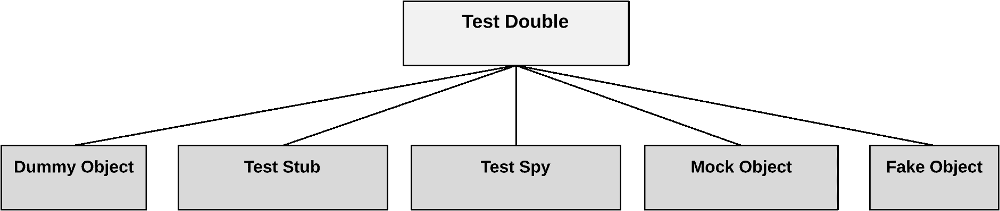

#### 测试双对象的类型

测试桩（Test stub）用于为测试代码提供*间接输入*。

Mock 对象（Mock object）用于验证测试代码的*间接输出*，通过在执行测试代码之前先定义预期。

测试探针（Test spy）用于验证测试代码的*间接输出*，通过在执行后断言预期，而不是在执行之前定义预期。它有助于记录创建的间接对象的信息。

伪对象（Fake object）作为更简单的实现，例如在测试中使用内存数据库而不是进行真实的数据库访问。

哑对象（Dummy object）用于需要方法参数但不需要使用该参数的情况。

哑对象和桩用于为测试**准备环境**。探针和 Mock 则用于**验证通信的正确性**。

关于 Mock 测试，有[两种样式](https://martinfowler.com/articles/mocksArentStubs.html#ClassicalAndMockistTesting)：传统的和 Mock 主义的（mockist）TDD 风格。传统的 TDD 风格是尽可能使用真实对象，在使用真实对象不方便时使用双倍体（double）。然而，Mock TDD 实践者会始终使用 Mock。

## 4.6.2 激活

激活 Mockito 可以通过 JUnit 5 的`@ExtendWith`注解或通过编程方式调用`MockitoAnnotations.openMocks()`来。

```
1 @ExtendWith(MockitoExtension.class)
2 class MockitoAnnotationTest {
3   ...
4 }
```

`@ExtendWith`

```
1 class MockitoTest {
2 
3   @BeforeEach
4   void init() {
5       MockitoAnnotations.openMocks(this);
6   }
7 }
```

`MockitoAnnotations.openMocks()`

## 4.6.3 注解

Mockito 支持以下用于配置 Mock 测试的[注解](https://javadoc.io/doc/org.mockito/mockito-core/latest/org/mockito/Mockito.html)：

`@Mock`

将为指定的类创建一个新的 Mock 实现。它不会创建真实对象。

`@Spy`

在真实实例周围创建一个包装器并对该真实对象进行监视。

`@InjectMocks`

将创建的 Mock 注入到指定的类实例中。

`@Captor`

用于创建[ArgumentCaptor](https://javadoc.io/doc/org.mockito/mockito-core/latest/org/mockito/ArgumentCaptor.html)实例，用于捕获方法参数值以便进一步断言。

### 4.6.3.1 `@Mock`

使用`@Mock`将创建一个类的 Mock 实例。

- 该实例被完全插桩以跟踪与其交互。
- 这不是一个真实对象，且不维护状态变化。

```
 1 @Test
 2 void whenNotUsingMockAnnotation() {
 3     List mock = Mockito.mock(ArrayList.class);
 4 
 5     mock.add("Java");
 6     Mockito.verify(mock).add("Java");
 7     assertEquals(0, mock.size());
 8 
 9     Mockito.when(mock.size()).thenReturn(2020);
10     assertEquals(2020, mock.size());
11 }
```

手动使用`Mockito.mock()`

```
 1 @Mock
 2 List<String> mock;
 3 
 4 @Test
 5 void whenUsingMockAnnotation() {
 6     mocked.add("Java");
 7     Mockito.verify(mock).add("Java");
 8     assertEquals(0, mock.size());
 9 
10     Mockito.when(mock.size()).thenReturn(2020);
11     assertEquals(2020, mockedList.size());
12 }
```

`@Mock`注解

### 4.6.3.2 `@Spy`

使用`@Spy`将创建一个类的真实实例。

- 你可以跟踪与其的所有交互。
- 它维护状态变化。

```
 1 @Test
 2 void whenNotUsingSpyAnnotation() {
 3     List<String> spy = Mockito.spy(new ArrayList<>());
 4 
 5     spy.add("Java");
 6     Mockito.verify(spy).add("Java");
 7     assertEquals(1, spy.size());
 8 
 9     Mockito.doReturn(2020).when(spy).size();
10     assertEquals(2020, spy.size());
11 }
```

手动使用`Mockito.spy()`

```
 1 @Spy
 2 List<String> spy = new ArrayList<>();
 3 
 4 @Test
 5 void whenUsingMockAnnotation() {
 6     mocked.add("Java");
 7     Mockito.verify(mock).add("Java");
 8     assertEquals(0, mock.size());
 9 
10     Mockito.doReturn(2020).when(spy).size();
11     assertEquals(2020, spy.size());
12 }
```

`@Spy`注解

### 4.6.3.3 `@Captor`

```
1 @ExtendWith(MockitoExtension.class)
2 class MockitoCaptorTest {
3 
4   @Captor
5   ArgumentCaptor<String> captor;
6 
7   @Test
8   void whenUsingCaptorAnnotation() {
9     List mock = Mockito.mock(ArrayList.class);
10    mock.add("Java");
11    Mockito.verify(mock).add("Java");
12    assertEquals("Java", captor.getValue());
13  }
14 }
```

`@Captor`

## 4.7 代码覆盖率

代码覆盖率是一种在运行时衡量哪些代码行被执行的指标。它通过执行测试用例进行测量，并提供关于代码被测试程度的说明。它通过提高测试用例的质量来提高质量。

测试覆盖率绝不被理解为唯一的指标。

测量技术：

**语句覆盖率（Statement Coverage）**

- 衡量行是否被处理。
- 问题：它只是一个指标。

**分支覆盖率（Decision/Branch Coverage）**

- 衡量分支（`if`、`while`）是否发生。
- 问题：它很大取决于项目。

**路径覆盖率（Path Coverage）**

- 衡量所有可能的流是否已运行。
- 问题：可能性呈指数级增长。


## 函数覆盖率（Function Coverage）

* 衡量函数是否被调用。

## 竞态覆盖率（Race Coverage）

* 衡量代码部分是否并行运行。

## 挑战

达到 100%的覆盖率是幻觉！代码覆盖率应该根据项目进行定义并在构建过程中自动检查。

## 所需的努力

提高覆盖率需要努力。通常为了人为提高它们而编写愚蠢的测试。测试纯 setter 和 getter 通常没有意义。

## 测试的价值

再次，代码覆盖率不应被视为质量的表示！

## 工具

基于 Java 的代码覆盖率框架，支持语句覆盖和分支覆盖。提供文本、HTML 和 XML 报告的生成，是 Eclipse 的一部分。

`PMD` 是一个静态源代码分析器。它能发现常见的编程缺陷，如未使用的变量、空的 catch 块、不必要的对象创建等。包含 `CPD`，一个复制粘贴检测器。

[`UCDetector`](http://www.ucdetector.org/)

不必要代码检测器（Unnecessary Code Detector）搜索未引用的方法和类，并对方法和类的可见性提供建议。

## 4.9 持续集成

持续集成描述了对应用程序进行定期、完整的构建、测试和发布的过程。有云提供商如 [CircleCI](https://circleci.com/) 或 [Travis](https://travis.ci.org/)，也有本地服务器如 [Jenkins](https://www.jenkins.io/)、[GitLab CI](https://docs.gitlab.com/ee/ci/)、[TeamCity](https://www.jetbrains.com/teamcity/) 和 [Bamboo](https://www.atlassian.com/software/bamboo)。

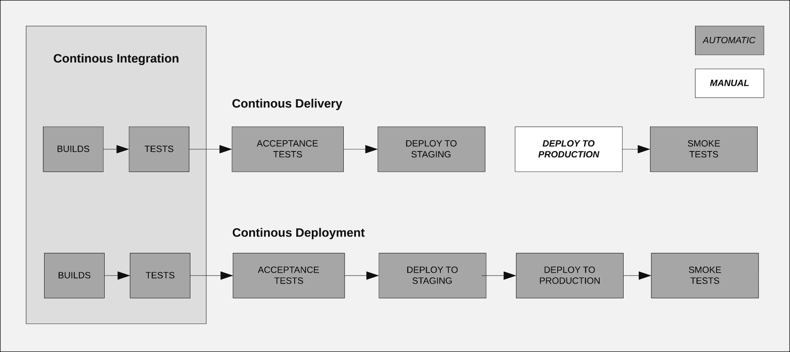

### 持续集成

#### 理念

* 尽且频繁地将更改提交到版本管理系统中。
* 将大型更改替换为增量的、功能性的小更改。
* 当更改提交到版本管理系统时，整个系统将重新构建并进行自动测试。
* 尝试尽快对开发者提供的更改提供反馈。
* 通过持续测试和快速反馈取代传统的测试方法来提高质量。

#### 组成和步骤

* 编译
* 测试执行（单元测试、集成测试、验收测试等）
* 集成（数据库、第三方系统）
* 静态分析（代码与架构）
* 自动部署
* 文档生成

#### 解决的风险

* 后期故障排除
* 缺乏团队协作
  * 你的更改和我的不匹配
  * 你两个月前不是才修复过这个吗？
* 代码质量差
  * 为什么三个不同的类在做同样的事情？
  * XY 团队的代码看起来完全不同
* 缺乏透明度/可见性
  * 哪些测试没有运行？
  * 构建版本 1.2.3 包含什么？
  * 我们的代码覆盖率如何？
* 软件不可用
  * 我没问题
  * 它正运行着
  * 我需要另一个构建版本来测试
  * 老板明天要来，我们需要一个演示

## 4.9.1 CI、CD 和 CD 的区别

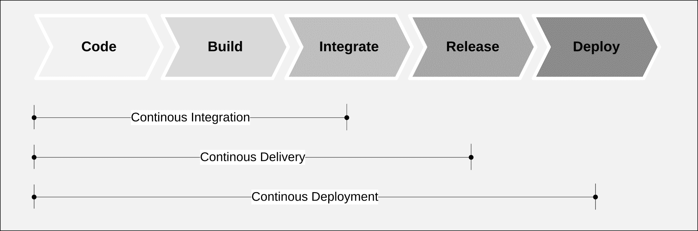

### CI、CD 和 CD 的区别

#### 持续集成（CI）

* 通过 CI，代码更改在提交后立即进行测试，以便新包含的更改可以被持续测试。
* 其基本思想是在开发过程中频繁测试代码，以便尽早发现并修复潜在问题。
* 通过 CI，大部分工作由自动化测试和构建服务器完成。
* 由于 CI 对软件状态提供持续反馈，所出现的代码问题通常不那么复杂，且更容易解决。

#### 持续交付（Continuous Delivery）

* 持续交付是 CI 的扩展。它涉及到在开发者完成开发后立即将开发的代码持续交付到测试环境。
* 它包含了持续集成、测试自动化和部署自动化过程，以最少的人工干预实现快速可靠的软件开发和部署。
* 核心思想是将代码交付给 QA、客户或任何用户群体，以便对其进行持续和定期的审查。
* 这使得在开发周期早期识别问题成为可能，并确保它们能够尽早解决。

#### 持续部署（Continuous Deployment）

* 持续部署是持续交付之后的下一个逻辑步骤。
* 它是代码开发完成后直接将其交付到生产环境的过程。
* 通过持续部署，所有通过自动化测试的更改都会自动传输到生产环境。
* 成功实施需要持续集的自动化，以及持续交付到测试环境的自动化。最后，它还需要自动部署到生产环境的能力。

## 4.9.2 CI 工作流

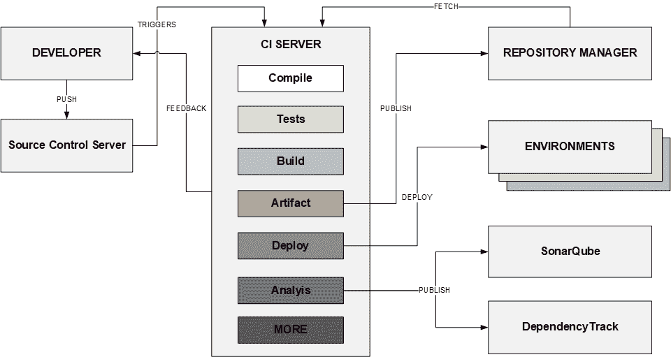

### 持续集成工作流

在你的 CI 工作流中，你可以根据目标集成许多实用的工具。在这种情况下，以下工具是 CI 工作流的一部分。

[Nexus](https://www.sonatype.com/nexus)

管理跨整个软件供应链的二进制文件和构建产物。

[SonarQube](http://www.sonarqube.org/)

技术质量静态代码分析平台。不仅支持 Java，还支持其他编程语言的分析。针对不同的质量范围分析代码并以图形化显示结果。

[Renovate](https://github.com/renovatebot/renovate)

多平台和多语言的自动化依赖更新。

[DependencyTrack](https://dependencytrack.org/)

允许组织识别并减少使用第三方和开源组件带来的风险的平台。

## 4.9.3 前提条件

#### 通用代码库

* 为了能在团队内部进行有意义的集成，必须存在一个版本管理系统，开发者可以在其中持续集成他们的更改。

#### 自动化编译

* 每个更改在集成之前必须通过统一定义的测试。
* 这需要自动化编译。

#### 持续测试开发

* 如果可能，每个更改都应带有测试进行开发。
* 新开发的测试应成为自动化测试套件的一部分。
* 使用代码覆盖率来记录和控制测试覆盖率。

#### 频繁集成

* 尽可能频繁地将更改集成到公共代码库。
* 小增量可以将集成失败的风险降至最低。
* 开发者的工作通常在代码库中。

#### 短测试周期

* 集成前的测试周期应该是短的，以鼓励频繁集成。

#### 镜像生产环境

* 更改应该在真实生产环境的副本上进行测试。

#### 便于访问

* 即使是非开发者也需要方便访问软件开发的结果。

#### 自动化报告

* 上次成功集成是什么时候？
* 自上次交付以来引入了哪些更改？
* 版本质量如何？

#### 自动化发布

## 4.9.4 优点与缺点

#### 优点

* 集成问题被不断识别和解决，而不仅仅是在里程碑节点之前。
* 组件不匹配的早期预警。
* 通过立即执行单元测试快速检测错误。
* 始终有一个可用于演示、测试或发布目的的可执行标准版本。
* 对提交错误或不完整的代码提供快速反馈。
* 早期且频繁的测试，能更早发现错误。
* 测试与开发并行进行。
* 在最早、最有利的时间修正错误。
* 对关键指标做出做出反应。
* 审查编码规范和最佳实践。

#### 缺点

* 搭建搭建。
* 硬件和软件成本。

## 4.9.5 最佳实践

* 使用版本管理系统。
* 将更改提交到主分支应自动触发构建。
* 尽早频繁提交，优先选择[基于主干开发](https://trunkbaseddevelopment.com/)。
* 不要提交未运行的代码。
* 立即修复构建错误。
* 测试应作为 CI 过程的一部分运行，测试失败会导致构建失败。
* 尽早解决问题并快速失败。
* 代码质量检查应作为 CI 过程的一部分运行。
* 根据指标采取行动和做出。
* 为每个构建创建产物。
* 使用配置即代码，CI 服务器配置应作为代码维护。
* 提供快速构建，以便开发者经常在本地运行这些测试。

# 5 设计原则

## 5.1 设计原则的目标

代码必须遵循 `KISS`、`DRY` 和 `YAGNI`！

* [设计原则](http://butunclebob.com/ArticleS.UncleBob.PrinciplesOfOod) 应该引导良好的面向对象设计。
* 代码和架构异味（smells）是基于对公认设计原则的违反。
* 提供如何修复代码和架构异味的重要信息。
* 如果能识别出被违反的设计原则，它为系统可能更好的结构提供了首要线索。
* 由 Robert C. Martin、Bertrand Meyer 和 Barbara Liskov 等人发布并传播。

## 5.2 设计原则概览

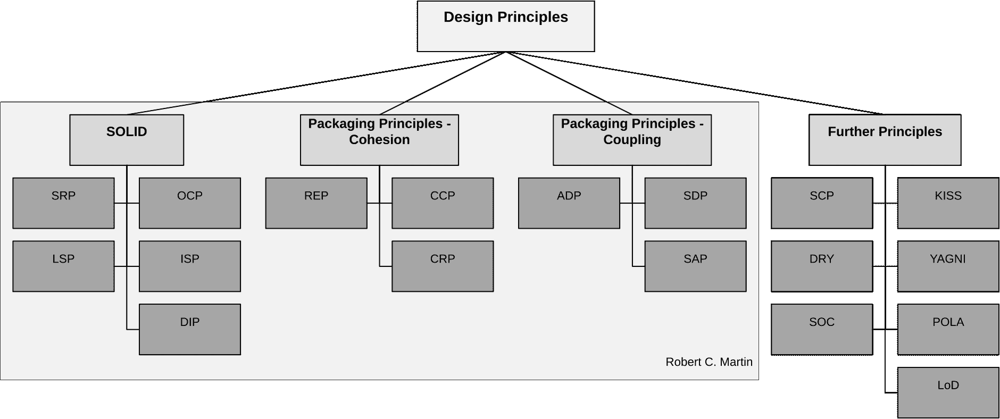

设计原则概览

### SOLID 原则

* `SOLID` 缩写是由 Robert C. Martin 为这一组原则创建的。
* 根据 Robert C. Martin 的观点，应用这些原则可以提高软件的可维护性，从而延长软件的使用寿命。
* 处理如何将类组合成模块和包的问题。
* 实现模块内部的高内聚和模块之间的低耦合。

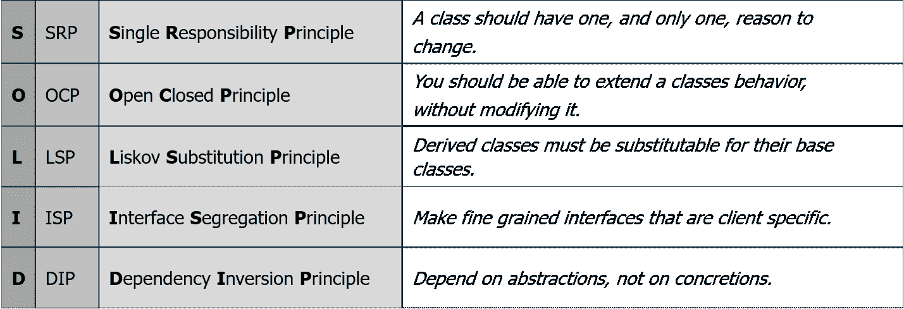

SOLID 设计原则

### 封装原则 - 内聚

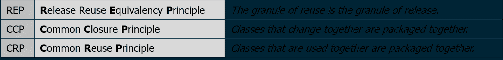

封装原则 - 内聚

### 封装原则 - 耦合

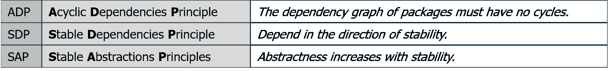

封装原则 - 耦合

### 进一步的设计原则

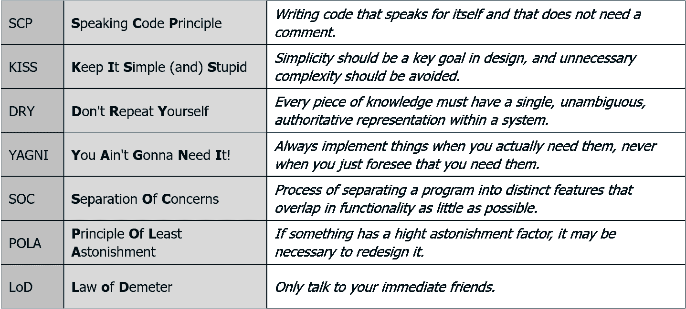

进一步的设计原则

## 5.3 SOLID 原则

### 5.3.1 [单一职责原则](https://drive.google.com/file/d/0ByOwmqah_nuGNHEtcU5OekdDMkk/view)

一个类应该且只有一个变化的理由。

* 每个类都只定义了一个任务要完成。
* 类应该只包含直接有助于完成该任务的函数。
* 编写永远不需要更改的类的简单方法之一是编写只服务于单一目的的类。
* 每个类应该实现一组一致且相关的函数。
* 在类中拥有多个职责会导致紧耦合，并导致脆弱的设计。
* 遵循单一职责原则是反复问自己：类的每个方法和过程是否与该类的名称直接相关。
* 对于与类名匹配的方法，将这些方法移动到其他类中。

#### 5.3.1.1 示例：[`Modem`](https://github.com/mnhock/swcs/tree/master/swcs-dp/src/main/java/swcs/dp/srp/modem)

**不合规范的代码示例**

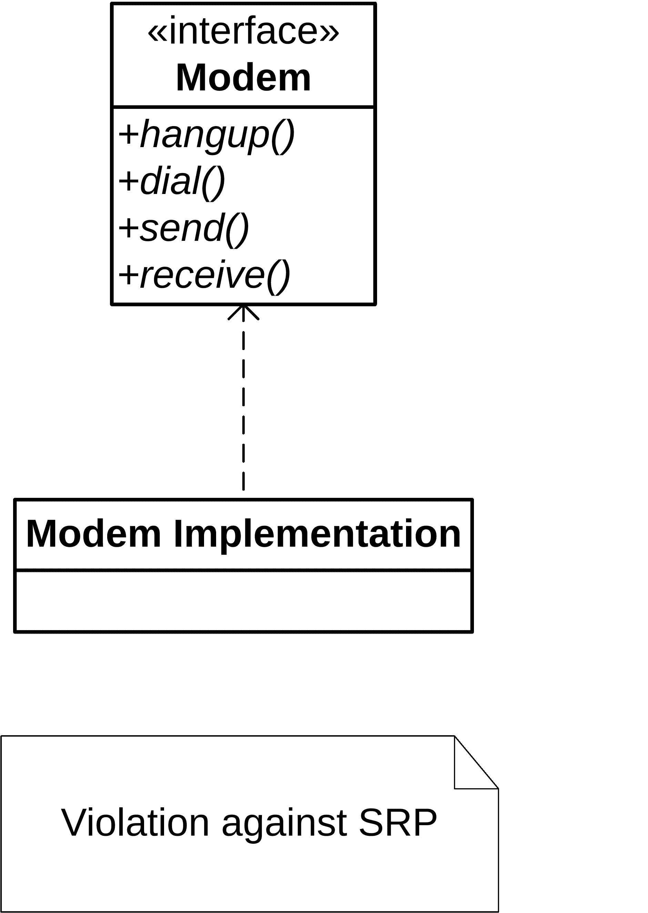

```java
1 public interface Modem {
2     // 连接管理职责
3     void dial(String phoneNumber);
4     void hangup();
5 
6     // 数据管理职责
7     void send(char c);
8     char receive();
9 }
```

糟糕的代码

**合规范的解决方案**

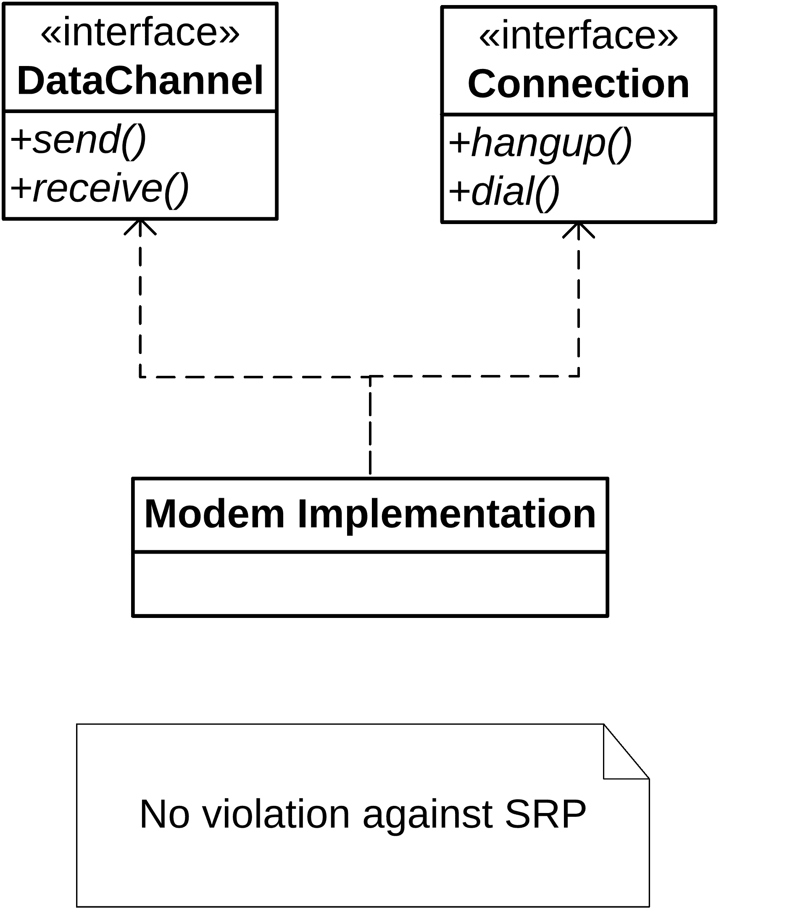

```java
1 public interface DataChannel {
2     void send(char c);
3     char receive();
4 }
```

良好的代码

```java
1 public interface Connection {
2     void dial(String phoneNumber);
3     void hangup();
4 }
```

良好的代码

```java
 1 public class Modem implements Connection, DataChannel {
 2     private final Connection connection;
 3     private final DataChannel dataChannel;
 4 
 5     public Modem(Connection connection, DataChannel dataChannel) {
 6          this.connection = connection;
 7          this.dataChannel = dataChannel;
 8     }
 9 
10     @Override
11     public void dial(String phoneNumber) {
 12          this.connection.dial(phoneNumber);
 13     }
 14 
15     @Override
16     public void hangup() {
 17          this.connection.hangup();
 18     }
 19 
20     @Override
21     public void send(char c) {
 22          this.dataChannel.send(c);
 23     }
 24 
25     @Override
26     public char receive() {
 27          return this.dataChannel.receive();
 28     }
 29 }
```

良好的代码

#### 5.3.1.2 示例：[`Book`](https://github.com/mnhock/swcs/tree/master/swcs-dp/src/main/java/swcs/dp/srp/book)

**不合规范的代码示例**

```java
 1 public final class Book {
 2 
 3     private final String title;
 4     private final String author;
 5     private final String content;
 6 
 7     public Book(String title, String author, String content) {
 8         this.title = title;
 9         this.author = author;
10         this.content = content;
 11     }
 12 
 13     public String title() {
 14         return this.title;
 15     }
 16 
 17     public String author() {
 18         return this.author;
 19     }
 20 
 21     public String content() {
 22         return this.content;
 23     }
 24 
 25     public void exportToPdf() {
 26         // logic
 27     }
 28 
 29     public void exportToEpub() {
 30         // logic
 31     }
 32 }
```

糟糕的代码

**合规范的解决方案**

```java
 1 public final class Book {
 2 
 3     private final String title;
 4     private final String author;
 5     private final String content;
 6 
 7     public Book(String title, String author, String content) {
 8         this.title = title;
 9         this.author = author;
10         this.content = content;
 11     }
 12 
 13     public String title() {
 14         return this.title;
 15     }
 16 
 17     public String author() {
 18         return this.author;
 19     }
 20 
 21     public String content() {
 22         return this.content;
 23     }
 24 
 25     public void exportToPdf() {
 26         // logic
 27     }
 28 
 29     public void exportToEpub() {
 30         // logic
 31     }
 32 }
```


```java
public class LoanRequestHandler {
    private final int balance;
    private final int period;

    public LoanRequestHandler(int balance, int period) {
        this.balance = balance;
        this.period = period;
    }

    public void approveLoan(Validator validator) {
        if (validator.isValid(balance)) {
            System.out.println("Loan approved...");
        } else {
            System.out.println("Sorry not enough balance...");
        }
    }
}
```

良好的代码

```java
public interface Validator {
    boolean isValid(int balance);
}
```

良好的代码

```java
public class PersonalLoanValidator implements Validator {
    public boolean isValid(int balance) {
        return balance > 1000 ? true : false;
    }
}
```

良好的代码

```java
public class BusinessLoanValidator implements Validator {
    public boolean isValid(int balance) {
        return balance > 5000 ? true : false;
    }
}
```

良好的代码

#### 5.3.2.2 示例：[`Shape`](https://github.com/mnhock/swcs/tree/master/swcs-dp/src/main/java/swcs/dp/ocp/shape)

**不符合规范的代码示例**

```java
public void draw(Shape[] shapes) {
    for (Shape shape : shapes) {
        switch (shape.type()) {
            case Shape.SQUARE:
                draw((Square) shape);
                break;
            case Shape.CIRCLE:
                draw((Circle) shape);
                break;
        }
    }
}

private void draw(Circle circle) {
    // 圆形的逻辑
}

private void draw(Square square) {
    // 正方形的逻辑
}
```

坏代码

**合规解决方案** (`resources/images----OC3.png`)

```java
public interface Shape {
    void draw();
}
```

良好的代码

```java
public class Square implements Shape {
    @Override
    public void draw() {}
}
```

良好的代码

```java
public class Circle implements Shape {
    @Override
    public void draw() {}
}
```

良好的代码

```java
public void draw(Shape[] shapes) {
    for (Shape shape : shapes) {
        shape.draw();
    }
}
```

良好的代码

#### 5.3.2.3 示例：[`HumanResourceDepartment`](https://github.com/mnhock/swcs/tree/master/swcs-dp/src/main/java/swcs/dp/ocp/humanresource)

**不符合规范的代码示例**

```java
public class HumanResourceDepartment {
    private final List<Developer> developers;
    private final List<Manager> managers;

    public HumanResourceDepartment() {
        developers = new ArrayList<>();
        managers = new ArrayList<>();
    }

    public void hire(Developer developer) {
        developer.signContract();
        developers.add(developer);
    }

    public void hire(Manager manager) {
        manager.signContract();
        managers.add(manager);
    }
}
```

坏代码

**合规解决方案** (`resources/images----OCP4.png`)

```java
public interface Employee {
    void signContract();
}
```

良好的代码

```java
public class Developer implements Employee {
    public void signContract() {}
}
```

良好的代码

```java
public class Manager implements Employee {
    public void signContract() {}
}
```

良好的代码

```java
public class Secretary implements Employee {
    public void signContract() {}
}
```

良好的代码

```java
public class HumanResourceDepartment {
    private final List<Employee> employees;

    public HumanResourceDepartment() {
        employees = new ArrayList<>();
    }

    public void hire(Employee employee) {
        employee.signContract();
        employees.add(employee);
    }
}
```

良好的代码

#### 5.3.2.4 示例：[`Calculator`](https://github.com/mnhock/swcs/tree/master/swcs-dp/src/main/java/swcs/dp/ocp/calculator)

**不符合规范的代码示例**

```java
public class Calculator {
    public double calculate(double x, double y, String operator) {
        double result;

        if ("plus".equals(operator)) {
            result = x + y;
        } else if ("minus".equals(operator)) {
            result = x - y;
        } else if ("multiply".equals(operator)) {
            result = x * y;
        } else if ("divide".equals(operator)) {
            result = x / y;
        } else {
            throw new IllegalArgumentException(String.format("Operator %s not supported!", operator));
        }

        return result;
    }
}
```

坏代码

**合规解决方案**

```java
public enum Operation {
    PLUS((x, y) -> x + y),
    MINUS((x, y) -> x - y),
    MULTIPLY((x, y) -> x * y),
    DIVIDE((x, y) -> x / y);

    private final DoubleBinaryOperator operator;

    Operation(DoubleBinaryOperator operator) {
        this.operator = operator;
    }

    public double apply(double x, double y) {
        return this.operator.applyAsDouble(x, y);
    }
}
```

良好的代码

```java
public class Calculator {
    public double calculate(double x, double y, Operation operation) {
        return operation.apply(x, y);
    }
}
```

### 5.3.3 [Liskov 替换原则](https://drive.google.com/file/d/0BwhCYaYDn8EgNzAzZjA5ZmItNjU3NS00MzQ5LTkwYjMtMDJhNDU5ZTM0MTlh/view)

*派生类必须能够替换其基类。*

*假设 q(x) 是类型 T 的对象 x 可证明的属性。那么对于类型 S 的对象 y（其中 S 是 T 的子类型），q(y) 也应该为真。*

- 在良好的面向对象设计（OOD）中，父类与子类之间的派生关系代表了所谓的 `is-a`（是一个）关系，即子类对象在类型上与父类对象兼容，并可以在任何需要父类对象的地方使用。
- 这确保了应用于子类对象的父类类型操作能够正确执行。
- 在这种情况下，将父类类型对象替换为子类类型对象总是安全的。
- 继承时不要只关注数据，还要考虑类方法的行为。

### 5.3.3.1 示例：[`Rectangle`](https://github.com/mnhock/swcs/tree/master/swcs-dp/src/main/java/swcs/dp/lsp/figure)

#### 不符合规范的代码示例

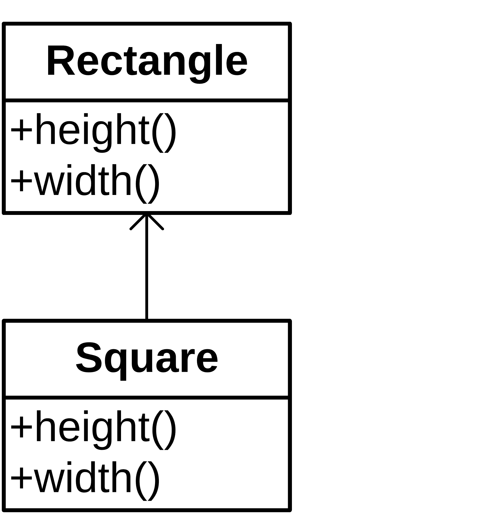

```java
public class Rectangle {

    private double height;
    private double width;

    public double height() {
        return this.height;
    }

    public double width() {
        return this.width;
    }

    public void height(double height) {
        this.height = height;
    }

    public void width(double width) {
        this.width = width;
    }

    public double area() {
        return this.width * this.height;
    }
}
```

坏代码

```java
public class Square extends Rectangle {

    @Override
    public double area() {
        return this.height() * this.height();
    }
}
```

坏代码

```java
public void do(Rectangle rectangle) {
    rectangle.width(5);
    rectangle.height(4);

    if (rectangle.area() != 20) {
        throw new IllegalStateException("Error in area calculation!");
    }
}
```

坏代码

#### 符合规范的解决方案

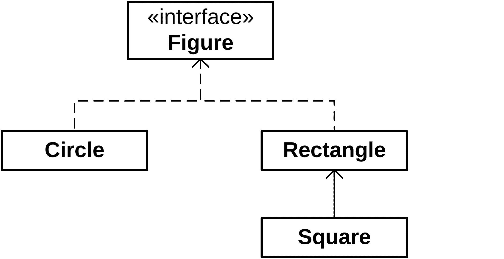

```java
public interface Figure {
    double area();
}
```

好代码

```java
public class Circle implements Figure {
    private final double radius;

    public Circle(double radius) {
        this.radius = radius;
    }

    @Override
    public double area() {
        return Math.PI * (this.radius * this.radius);
    }
}
```

好代码

```java
public class Rectangle implements Figure {
    private final double length;
    private final double width;

    public Rectangle(double length, double width) {
        this.length = length;
        this.width = width;
    }

    @Override
    public double area() {
        return this.length * this.width;
    }
}
```

好代码

```java
public class Square extends Rectangle {
    public Square(double side) {
        super(side, side);
    }
}
```

好代码

```java
public void do(Rectangle rectangle) {
    // Rectangle 的 double 和 width 已通过构造函数设置

    if (rectangle.area() != 20) {
        throw new IllegalStateException("Error in area calculation!");
    }
}
```

好代码

### 5.3.3.2 示例：[`Coupon`](https://github.com/mnhock/swcs/tree/master/swcs-dp/src/main/java/swcs/dp/lsp/coupon)

#### 不符合规范的代码示例

```java
public class Coupon {

    private final BigDecimal regularPrice;

    public Coupon(BigDecimal regularPrice) {
        this.regularPrice = regularPrice;
    }

    public BigDecimal regularPrice() {
        return this.regularPrice;
    }

    public BigDecimal afterDiscount(BigDecimal discount) {
        if (discount == null) {
            return this.regularPrice;
        }

        if (this.regularPrice.compareTo(discount) > 0) {
            return this.regularPrice.subtract(discount);
        }

        return BigDecimal.ZERO;
    }
}
```

坏代码


```java
public class PromotionCoupon extends Coupon {

    private static final double PERCENTAGE_DISCOUNT = 0.9;

    public PromotionCoupon(BigDecimal regularPrice) {
        super(regularPrice);
    }

    @Override
    public BigDecimal afterDiscount(BigDecimal discount) {
        // 加强了前置条件且没有对 null 进行检查
        if (regularPrice().compareTo(discount) < 0) {
            throw new IllegalArgumentException("discount than price!");
        }

        return super.afterDiscount(discount)
                .multiply(BigDecimal.valueOf(PERCENTAGE_DISCOUNT));
    }
}
```

坏代码

```java
public class Client {

    private static final BigDecimal REGULAR_PRICE = BigDecimal.valueOf(8.99);

    public static void main(String[] args) {
        testCoupon(new Coupon(REGULAR_PRICE), null);

        testCoupon(new PromotionCoupon(REGULAR_PRICE), null);

        testCoupon(new Coupon(REGULAR_PRICE), BigDecimal.valueOf(5));

        testCoupon(new PromotionCoupon(REGULAR_PRICE), BigDecimal.valueOf(5));
    }

    private static void testCoupon(Coupon coupon, BigDecimal discount) {
        BigDecimal price = coupon.afterDiscount(discount);

        if (BigDecimal.ZERO.compareTo(price) == 0) {
            System.out.println("You get free!");
        } else {
            System.out.println(String.format("Pay %f", price));
        }
    }
}
```

坏代码

#### 符合规范的解决方案

```java
public interface Coupon {

    BigDecimal regularPrice();

    /**
     * 返回一个 {@code BigDecimal}，其值为 {@code this}
     * 减折扣。
     *
     * @param discount 要使用的折扣。
     * @return {@code this} 减折扣。如果折扣
     * 大于原价，将返回 {@code BigDecimal.ZERO}。
     * 如果折扣为 null 则不减去。
     */
    BigDecimal afterDiscount(BigDecimal discount);
}
```

好代码

```java
public class RegularCoupon implements Coupon {

    private final BigDecimal regularPrice;

    public RegularCoupon(BigDecimal regularPrice) {
        this.regularPrice = regularPrice;
    }

    @Override
    public BigDecimal regularPrice() {
        return this.regularPrice;
    }

    @Override
    public BigDecimal afterDiscount(BigDecimal discount) {
        if (discount == null) {
            return this.regularPrice;
        }

        if (this.regularPrice.compareTo(discount) > 0) {
            return this.regularPrice.subtract(discount);
        }

        return BigDecimal.ZERO;
    }
}
```

好代码

```java
public final class PromotionCoupon extends RegularCoupon {

    private static final double PERCENTAGE_DISCOUNT = 0.9;

    public PromotionCoupon(BigDecimal regularPrice) {
        super(regularPrice);
    }

    @Override
    public BigDecimal afterDiscount(BigDecimal discount) {
        return super.afterDiscount(discount)
                .multiply(BigDecimal.valueOf(PERCENTAGE_DISCOUNT));
    }
}
```

好代码

```java
public class Client {

    private static final BigDecimal REGULAR_PRICE = BigDecimal.valueOf(8.99);

    public static void main(String[] args) {
        testCoupon(new RegularCoupon(REGULAR_PRICE), null);                     // 支付 8,990000
        testCoupon(new PromotionCoupon(REGULAR_PRICE), null);                   // 支付 8,091000

        testCoupon(new RegularCoupon(REGULAR_PRICE), BigDecimal.valueOf(5));    // 支付 3,990000
        testCoupon(new PromotionCoupon(REGULAR_PRICE), BigDecimal.valueOf(5));  // 支付 3,591000

        testCoupon(new RegularCoupon(REGULAR_PRICE), BigDecimal.valueOf(10));   // 免费赠！
        testCoupon(new PromotionCoupon(REGULAR_PRICE), BigDecimal.valueOf(10)); // 免费赠！
    }

    private static void testCoupon(Coupon coupon, BigDecimal discount) {
        BigDecimal price = coupon.afterDiscount(discount);

        if (BigDecimal.ZERO.compareTo(price) == 0) { // 客户端依赖 Coupon 的实现
            System.out.println("You get it for free!");
        } else {
            System.out.println(String.format("Pay %f", price));
        }
    }
}
```

良好的代码

### 5.3.4 [接口隔离原则](https://drive.google.com/file/d/0BwhCYaYDn8EgOTViYjJhYzMtMzYxMC00MzFjLWJjMzYtOGJiMDc5N2JkYmJi/view)

编写客户端特定的细粒度接口。

- 避免`接口污染`和“肥胖”接口。
- 不要使用包含客户端可能需要的所有方法的接口，而应该有涵盖每个客户端类型特定需求的独立接口。
- 单个接口的方法应该具有低耦合。
- 客户端不应依赖于完全不需要的方法。
- 应该根据客户端对接口的需求进行发布。
- 因此，客户端必须操作那些只能完成其所需的接口。
- 使得软件能够被划分为解耦且灵活的类。
- 未来可能的专业或技术需求只需要对软件本身进行微小的更改。

#### 5.3.4.1 示例：[多功能设备](https://github.com/mnhock/swcs/tree/master/swcs-dp/src/main/java/swcs/dp/isp/printer)

**不规范的代码示例**

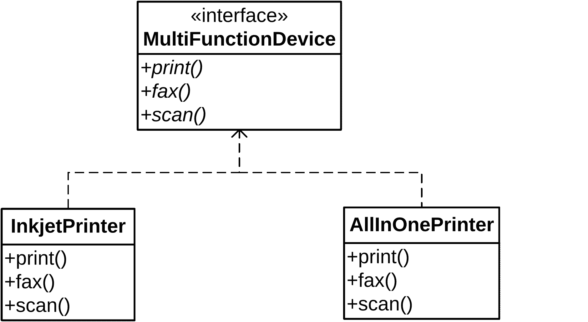

```java
public interface MultiFunctionDevice {
    void print();
    void fax();
    void scan();
}
```

糟糕的代码

```java
class AllInOnePrinter implements MultiFunctionDevice {
    @Override
    public void print() {
    }

    @Override
    public void fax() {
    }

    @Override
    public void scan() {
    }
}
```

糟糕的代码

```java
class InkjetPrinter implements MultiFunctionDevice {

    @Override
    public void print() {
    }

    @Override
    public void fax() {
        throw new UnsupportedOperationException();
    }

    @Override
    public void scan() {
        throw new UnsupportedOperationException();
    }
}
```

糟糕的代码

#### 符合规范的解决方案

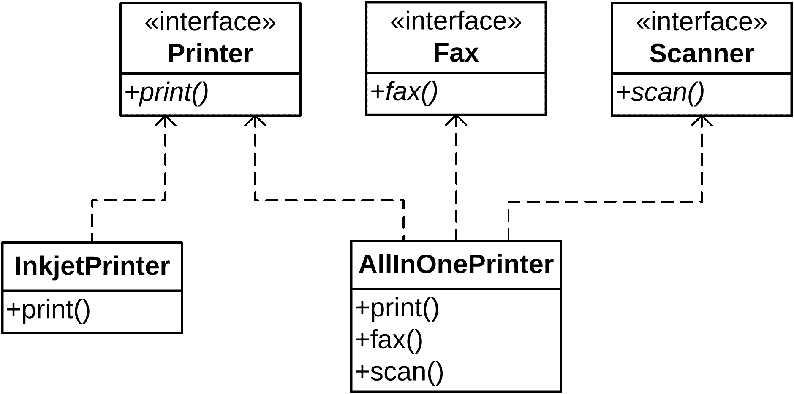

```java
public interface Printer {
    void print();
}
```

良好的代码

```java
public interface Fax {
    void fax();
}
```

良好的代码

```java
public interface Scanner {
    void scan();
}
```

良好的代码

```java
class InkjetPrinter implements Printer {

    @Override
    public void print() {
    }
}
```

良好的代码

```java
class AllInOnePrinter implements Printer, Fax, Scanner {

    @Override
    public void print() {
    }

    @Override
    public void fax() {
    }

    @Override
    public void scan() {
    }
}
```

良好的代码

#### 5.3.4.2 示例：[技术员工](https://github.com/mnhock/swcs/tree/master/swcs-dp/src/main/java/swcs/dp/isp/techemployee)

**不规范的代码示例**

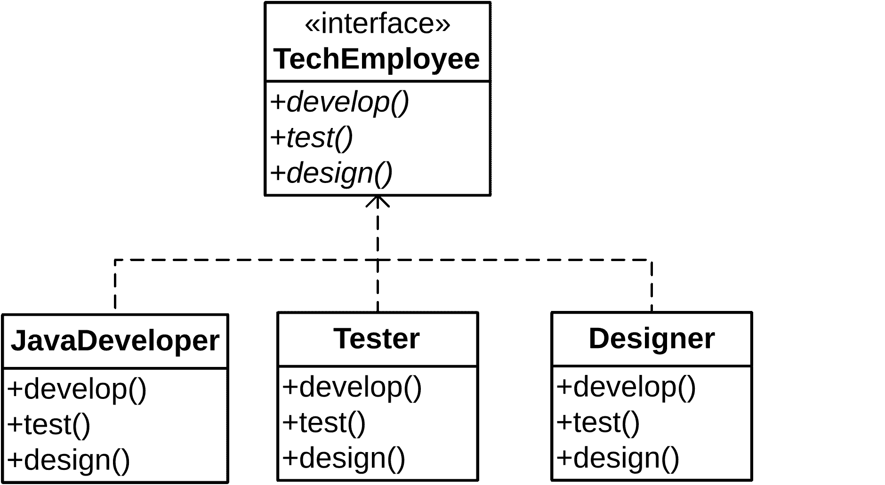

```java
public interface TechEmployee {
    void develop();
    void test();
    void design();
}
```

糟糕的代码

```java
public class JavaDeveloper implements TechEmployee {
    @Override
    public void develop() {
        throw new UnsupportedOperationException();
    }

    @Override
    public void test() {
        System.out.println("Yes, I can!");
    }

    @Override
    public void design() {
        throw new UnsupportedOperationException();
    }
}
```

糟糕的代码

```java
class SecurityTester implements TechEmployee {

    @Override
    public void develop() {
        throw new UnsupportedOperationException();
    }

    @Override
    public void test() {
        System.out.println("Yes, I can!");
    }

    @Override
    public void design() {
        throw new UnsupportedOperationException();
    }
}
```

糟糕的代码

```java
class UIDesigner implements TechEmployee {

    @Override
    public void develop() {
        throw new UnsupportedOperationException();
    }

    @Override
    public void test() {
        throw new UnsupportedOperationException();
    }

    @Override
    public void design() {
        System.out.println("Yes, I can!");
    }
}
```

**符合规范的解决方案**


```java
public interface Developer {
    void develop();
}
```

良好的代码

```java
public interface Designer {
    void design();
}
```

良好的代码

```java
public interface Tester {
    void test();
}
```

良好的代码

```java
class JavaDeveloper implements Developer {

    @Override
    public void develop() {
        System.out.println("Yes, I can!");
    }
}
```

良好的代码


```java
1 class SecurityTester implements Tester {
2 
3     @Override
4     public void test() {
5         System.out.println("Yes, I can!");
6     }
7 }
```

良好的代码

```java
1 class UIDesigner implements Designer {
2 
3     @Override
4     public void design() {
5         System.out.println("Yes, I can!");
6     }
7 }
```

良好的代码

### 5.3.5 [依赖倒置原则](https://drive.google.com/file/d/0BwhCYaYDn8EgOTViYjJhYzMtMzYxMC00MzFjLWJjMzYtOGJiMDc5N2JkYmJi/view)

依赖抽象，不要依赖具体实现。

- 依赖应该始终从低层的具体模块指向高层的抽象模块。
- 类不应直接实例化外部类，而应该以参数的形式通过抽象（例如接口）接收。
- 这确保了依赖关系始终单向运行，从具体到抽象模块，从派生类到基类。
- **好莱坞原则**：不要叫我们，我们来叫你！
- 对象之间的依赖是从外部控制的。
  - 减少模块之间的依赖
  - 避免循环依赖
  - 将组件与环境解耦
  - 减少必要的知识

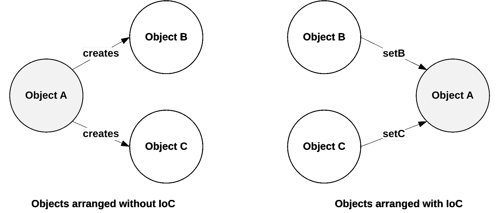

#### 5.3.5.1 示例：[UserService](https://github.com/mnhock/swcs/tree/master/swcs-dp/src/main/java/swcs/dp/dip/userservice)

不规范的代码示例

没有 DI 的情况下，`UserRepository` 必须在 `UserService` 中直接创建。

```java
1 public class UserService {
2     private final UserRepository userRepository;
3 
4     public UserService() {
5         this.userRepository = new UserRepositoryHibernate();
6     }
7 }
```

糟糕的代码

**符合规范的解决方案**

`UserRepository` 在创建对象时通过构造函数注入设置。

```java
1 public class UserService {
2     private final UserRepository userRepository;
3 
4     public UserService(UserRepository userRepository) {
5          this.userRepository = userRepository;
6     }
7 }
```

良好的代码

### 5.3.5.2 示例：[Logger](https://github.com/mnhock/swcs/tree/master/swcs-dp/src/main/java/swcs/dp/dip/logger)

#### 不规范的代码示例

```java
 1 class Logger {
 2     private final FileSystem fileSystem;
 3 
 4     public Logger() {
 5         this.fileSystem = new FileSystem();
 6     }
 7 
 8     public void log(String message) {
 9         this.fileSystem.log(message);
10     }
11 }
```

坏代码

#### 符合规范的解决方案

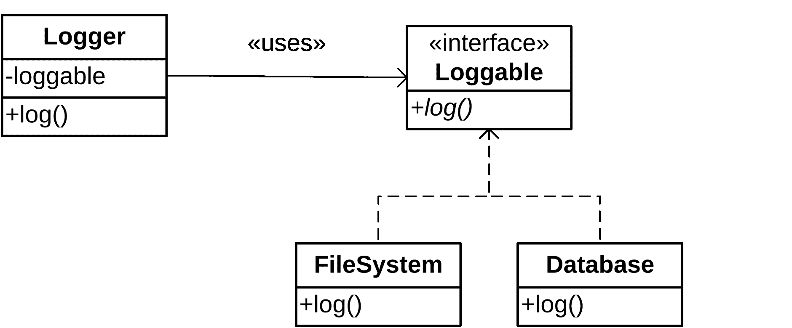

```java
1 public interface Loggable {
2     void log(String message);
3 }
```

良好的代码

```java
1 class FileSystem implements Loggable {
2     @Override
3     public void log(String message) {
4         // 文件处理与写入
5     }
6 }
```

良好的代码

```java
1 class Database implements Loggable {
2     @Override
3     public void log(String message) {
4         // 写入数据库
5     }
6 }
```

良好的代码

```java
 1 class Logger {
 2     private final Loggable loggable;
 3 
 4     public Logger(Loggable loggable) {
 5         this.loggable = loggable;
 6     }
 7 
 8     public void log(String message) {
 9         this.loggable.log(message);
10     }
11 }
```

良好的代码

```java
1 class Client {
2     public static void main(String[] args) {
3         Logger fsLogger = new Logger(new FileSystem());
4         Logger dbLogger = new Logger(new Database());
5 
6         fsLogger.log("some text");
7         dbLogger.log("other text");
8     }
9 }
```

良好的代码

## 5.4 封装原则 - 聚性

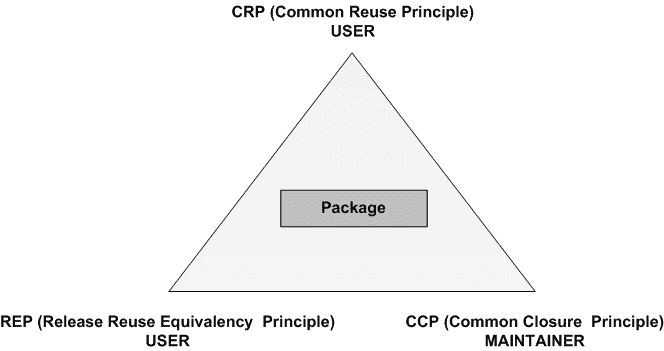

#### 5.4.1 [发布复用等价原则](https://drive.google.com/file/d/0BwhCYaYDn8EgOGM2ZGFhNmYtNmE4ZS00OGY5LWFkZTYtMjE0ZGNjODQ0MjEx/view)

复用的粒度就是发布的粒度。

- 复用的元素就是发布的元素。
- 一起被复用的类应该放在同一个包中，以便它们可以被一起发布。
- 减少需要分发的模块数量，从而减少了软件分发的工作量。
- 避免复用过程中出现版本冲突，这种冲突只会由于多个包同时发布而产生。
- 类的用户（这些用户又依赖其他类）希望依赖于新版本的集体发布。

#### 5.4.2 [共同闭包原则](https://drive.google.com/file/d/0BwhCYaYDn8EgOGM2ZGFhNmYtNmE4ZS00OGY5LWFkZTYtMjE0ZGNjODQ0MjEx/view)

一起变化的类应该封装在一起。

- 根据开闭原则，包中的所有类应该对同种类型的变化保持关闭。
- 这对应于应用于包的单一职责原则。
- 软件需求的变化如果需要修改模块中的某个类，那么它应该只影响该模块的类。
- 遵循此原则允许将软件拆分为多个包，使得未来的更改仅在少数模块中实现。
- 这确保了对软件的更改不会产生重大的副作用，因此成本相对较低。

#### 5.4.3 [共同复用原则](https://drive.google.com/file/d/0BwhCYaYDn8EgOGM2ZGFhNmYtNmE4ZS00OGY5LWFkZTYtMjE0ZGNjODQ0MjEx/view)

一起使用的类应该封装在一起。

- 对一起使用的类进行分组。
- 遵循此原则可以确保归属于一起的单元被合理地细分。

## 5.5 封装原则 - 耦合

#### 5.5.1 [无环依赖原则](https://drive.google.com/file/d/0BwhCYaYDn8EgOGM2ZGFhNmYtNmE4ZS00OGY5LWFkZTYtMjE0ZGNjODQ0MjEx/view)

包的依赖图不能有循环。

- 类和包不应该包含循环依赖。
- 如果不消除循环，会导致测试、可维护性、可复用性、构建和发布变得困难。

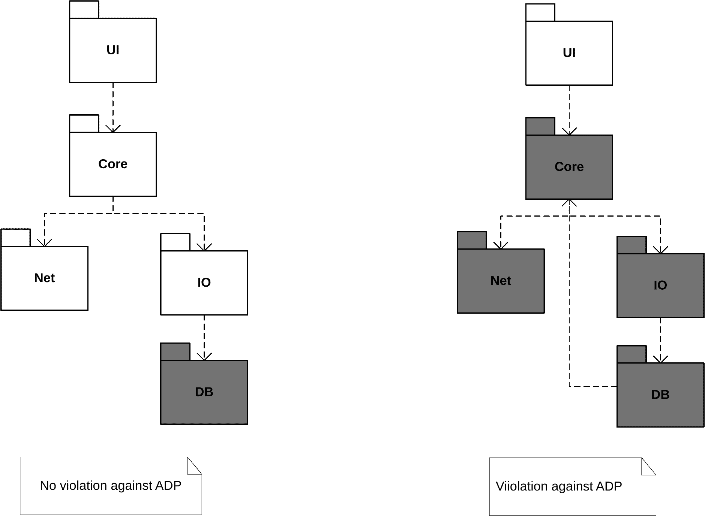

打破此类循环总是可能的，但基本上有两种可能：

如果从包 A 到包 B 的依赖需要被反转。

**使用 DIP（依赖倒置原则）**：

- 在包 A 中引入一个接口，包含 B 所需的方法。
- 在包 B 对应的类中实现这些接口。

**重构包**：

- 将循环中的所有类收集到一个单独的包。
- 引入一个或多个新包，包含循环外的类所依赖的类。

###### 5.5.1.1 示例：[循环依赖](https://github.com/mnhock/swcs/tree/master/swcs-dp/src/main/java/swcs/dp/adp)

##### 不规范的代码示例


```java
1 class A {
2     public A() {
3         new B();
4     }
5 }
```

`swcs.dp.adp.before.p1`

```java
1 class B {
2     public B() {
3         new C();
4     }
5 }
```

`swcs.dp.adp.before.p2`

```java
1 class C {
2     public C() {
3         new A();
4     }
5 }
```

`swcs.dp.adp.before.p3`


违反 ADP

##### 符合规范的解决方案


```java
1 class A {
2     private final B b;
3 
4     public A(B b) {
5         this.b = b;
6     }
7 }
```

#### 5.5.2 [稳定依赖原则](https://drive.google.com/file/d/0BwhCYaYDn8EgOGM2ZGFhNmYtNmE4ZS00OGY5LWFkZTYtMjE0ZGNjODQ0MjEx/view)

依赖应该沿着稳定的方向。

- 包之间的依赖应该与稳定性方向一致。
- 包应该只依赖于更稳定的包。
- 一个包对外的依赖越少，其他包对它的依赖越多，它越稳定。


稳定与不稳定包

**不稳定性指标**

包的稳定性是出耦合（`Ce`）占总耦合（`Ca + Ce`）的比例值。

**`I = 不稳定性, 0 ≤ I ≤ 1`**

`I = 0, 稳定包`  
`I = 1, 不稳定包`


`Ca = 入依赖（入耦合）`

`Ce = 出依赖（出耦合）`

不稳定性为 1 意味着没有其他包依赖于这个包。这个包依赖于其他包，是尽可能不稳定的。缺乏依赖让它没有理由更改。此外，它依赖的包会给它很多理由去更改。

不稳定性为 0 意味着包依赖于其他包，但完全不依赖其他包。它是独立的，是尽可能稳定的。它的依赖使其难以更改。此外，它没有可以强迫它更改的依赖。


不稳定性

我们如何实现稳定性？稳定的包不依赖任何东西。来自依赖者的更改无法传播到它们身上并导致它们更改。它们是独立的。独立类是不依赖任何其他类的类。


# 稳定的包依赖不稳定的包

如果所有包都是最大稳定的，那么系统将变得不可改变。这不是我们希望的情况。我们希望设计包结构，使得某些包是不稳定的，而某些包是稳定的。可变化的包应该处于顶部，并依赖底部的稳定包。如果我们将不稳定的包放在顶部并按这种方式安排，并没有违反 SDP。

## 5.5.3 [稳定抽象原则](https://drive.google.com/file/d/0BwhCYaYDn8EgZjI3OTU4ZTAtYmM4Mi00MWMyLTgxN2YtMzk5YTY1NTViNTBh/view)

抽象性随着稳定性的增加而增加。

- 确了稳定性与抽象性之间的关系。
- 最大稳定的包应该是最大程度抽象抽象的。
- 不稳定的包应该是具体的。
- 一个包的抽象性应该与它的稳定性成正比。

### 抽象性指标

包的抽象性是指该包中抽象类（如抽象类和接口）的数量与该包中类总数之比值。

`A = Abstractness, 0 ≤ A ≤ 1`

`A = 0, 完全具体的包`

`A = 1, 完全抽象的包`


`Na = 抽象类、接口的数量`

`Nc = 类的总数`

抽象性为 0 意味着该包没有抽象类。抽象性为 1 意味着该包除了接口和抽象类之外不包含任何内容。

### 不稳定性（I）与抽象性（A）之间的关系

`I` 和 `A` 之间的关系可以在图中定义，其中 `A` 为纵轴，`I` 为横轴。该图上有两种良好的包类型：第一类是`接口包`，它们是最大稳定且抽象的，位于左上角的 (0,1)；第二类是`实现包`，它们是最大不稳定且具体的，位于右下角的 (1,0)。

然而，并不是所有的包都能归类为这两类之一。因此，包具有不同程度的抽象性和稳定性。因此，我们必须接受 A/I 图上存在一些点，这些点定义了包的有意义的位置。这可以通过“主序线”（Main Sequence）来实现，它是一条从 (0,1) 到 (1,0) 的直线。这条线代表了抽象性与稳定性达到平衡的包。主序线上的包既对于其稳定性来说不是太抽象，对于其抽象性来说也不是太不稳定。它具有正确数量的抽象类，与其出依赖（efferent dependencies）和入依赖（afferent dependencies）成比例。

我们可以推导出哪些区域是不应该有包的，即痛苦区域（Zone of Pain）和无用区域（Zone of Uselesness）。


### 主序线

- 理想线
- 当包位于 (0.1) 或 (1.0) 时效果更好，但在实践中极少实现

### 痛苦区域

- 稳定的非抽象类
- 因为稳定而难以更改，因为非抽象而难以扩展
- 例外是工具类，例如 `String`

### 无用区域

- 不稳定的非常抽象的类
- 虽然是抽象的，但没有任何地方扩展它们


### 离主序线的距离

显而易见，包最理想的位置是在主序线的两个端点之一。然而，大多数包并不具备此类理想属性。当包位于理想线上或其附近时，它们具有最好的特性，这可以通过到主序线的距离来定义。对于每个包，都可以计算其到在最大稳定性/抽象性与最大不稳定/具体性之间理想线的距离。距离越大，SAP 的遵循程度越差。


或归一化后


`D = 离理想线的距离, 0 ≤ D ≤ 0.707`

`D' = 离理想线的归一化距离, 0 ≤ D' ≤ 1`

`A = 包的抽象性`

`I = 包的不稳定性`

## 5.6 进一步设计原则

### 5.6.1 解释性代码原则

- 代码应该传达其目的，即使没有注释和文档也是。
- 注释不是糟糕代码的替代品。
- 清晰且表达力强且注释少的代码比带有大量注释的混乱复杂代码要好得多。
- 与其花时间写注释来解释混乱，不如花时间清理混乱。
- 当代码更改时，必须调整注释。

```java
1 if ((bike.type & TYP_FLAG) && bike.status == READY) { ... }
```

糟糕的代码

```java
1 if (bike.isRentable()) { ... }
```

良好的代码

### 5.6.2 保持简单（且）愚蠢！

没有人能够管理巨大的复杂度。在软件中是如此，在生活的任何其他方面也是如此。复杂性是良好软件的杀手，因此简单性是推动者。简单性是需要大量时间和实践才能识别和产生的东西。当然，有许多可以遵循的规则。

例如，让方法只有几个参数。在最好的情况下，没有或只有一个。我们可以写`"Keep It Simple (and) Stupid!".contains("Simple")`，在不阅读任何文档的情况下，每个人都会立即理解这是做什么的。

- 意味着应该始终选择问题的简单解决方案。
- 避免过于复杂的代码。
- 寻找简单的解决方案是一条有助于避免各种错误的规则。
- 对非简单解决方案的健康拒绝是寻找良好代码的标志。
- 代码越难解释，就越可能比需要的更复杂。
- 把事情变得尽可能简单，但不要更简单！

### 5.6.3 不要重复自己 / 且仅一次（DRY）

- 指的是避免重复代码，即在多个地方以相同或相似方式实现的代码片段。
- 冗余的源代码难以维护，因为必须确保各个副本之间一致性。
- 然而，在忠于 DRY 原则的系统中，更改只需要在一个地方进行即可。

### 5.6.4 你不会需要它的！（YAGNI）

- 凡没有需求，也没有实现！
- 程序应该只在需要该功能时才实现该功能。
- 与这种方法相反，在实践中，人们经常尝试通过额外的或通用的代码为未来的变更请求和功能做准备。“这是他们很快就会要求的……”
- 此类代码可能非常难以阅读、理解、更改现有功能，并会花费时间和金钱。

### 5.6.5 关注点分离

- 一个组件应该恰好有一个任务。


- 避免在例如一个类中混合多个职责。
- 组件变得更简单、更容易理解、维护并具有更好的重用性。
- 单元的任务复合应该是自包含的（高内聚）。
- 单元应该尽可能少地依赖于其他单元（低耦合）。

# 6 四人行设计模式

> 每个模式都描述了一个在我们的环境中反复出现的问题，然后描述了该问题的核心解决方案，使得你可以使用这个解决方案数百万次，而永远不会以相同的方式执行两次。
>
> –Christopher Alexander 1977, A Pattern Language: Towns, Buildings, Construction

- 设计模式最初构源于建筑学。
- 1977 Christoph Alexander 在他的书《A Pattern Language. Towns, Buildings, Construction》中描述了景观和城市规划等的设计模式。
- Kent 和 Cunningham 在软件开发中设计模式的灵感源自 Alexander（约 1987 年）。
- Gamma、Vlissides、Johnson 和 Helm 将这些思想转化到软件技术，并设计了模式目录。
- 四人帮（GoF）于 1995 年出版了《设计模式》一书，并使设计模式流行起来。

设计模式是软件设计中反复出现的设计问题的解决方案。它们基于经验，通常只有在具备适当背景知识和个人经验的情况下才能被理解和掌握。它们通过形成一套词汇（模式语言）来建立通信，开发者可以使用它来讨论设计。必须理解面向对象的设计的基础，如 `Encapsulation`（封装）、`Responsibility`（职责）、`Polymorphism`（多态）和 `Inheritance`（继承）。

## 为什么设计模式很重要？

软件开发中的许多问题会重复出现。类层次结构随着时间的推移变得缺乏活性，单个类的增长变得不可控。实现新的扩展非常困难，而且为了实现功能，类的依赖关系不断增加。类的封装性变得薄弱，越来越多的内部状态被暴露出来。

你不需要每次都重新发明轮子，至少这些方案方案已有详尽的文档。由于设计模式已经存在长期，这些解决方案经过了多次验证，其后果也为人知。此外，软件设计可以在更高层次的抽象上进行，从而提高效率，因为其用词已经是自显其义且开发者所熟知的。与其寻找问题的解决方案，不如识别那些暗示可以使用某种设计模式的连接关系。

## 根据 GoF 对设计模式进行分类

四人帮的 23 种设计模式分为三组。这些类别描述了通过设计模式想要实现的意图。

### 创建模式

> 如何创建对象甚至类层次结构？

| 分组 | 模式 | 描述 |
| --- | --- | --- |
| 创建性 (Creational) | 单例 (Singleton) | 确保一个类只有一个实例，并为其提供全局访问点。 |
|  | 构建器 (Builder) | 将复杂对象的构建与其表示分离，使得相同的构建过程可以创建不同的表示。 |
|  | 工厂方法 (Factory Method) | 为创建对象定义接口，但让子类决定实例化哪个类。工厂方法让类将实例化推迟给子类。 |
|  | 抽象工厂 (Abstract Factory) | 提供一个用于创建一组相关或依赖对象的家族接口，而不指定它们的具体类。 |
|  | 原型 (Prototype) | 使用原型实例指定要创建的对象类型，并通过复制此原型来创建新对象。 |

### 结构性模式

> 类和对象的组合必须具备什么结构才能解决特定问题？

| 分组 | 模式 | 描述 |
| --- | --- | --- |
| 结构性 (Structural) | 外挂 (Facade) | 为子系统中的一组接口提供统一接口。外挂定义了一个更高层次的接口，使子系统更容易使用。 |
|  | 装饰器 (Decorator) | 动态地给对象附加额外的职责。装饰器为扩展功能提供了比子类化灵活的选择。 |
|  | 适配器 (Adapter) | 将类的接口转换为客户端期望的另一种接口。适配器让原本因接口兼容而无法共同工作的类协同工作。 |
|  | 组合 (Composite) | 将对象组合成树结构以表示部分-整体层次结构。组合让客户端统一地处理单个对象和对象组合。 |
|  | 桥接 (Bridge) | 将抽象与其实现解耦，使两者能够独立变化。 |
|  | 权重 (Flyweight) | 使用共享来高效地支持大量的细粒度对象。 |
|  | 代理 (Proxy) | 为另一个对象提供代理或占位符以控制对其访问。 |

### 行为模式

> 对象在运行时如何协作？职责如何在它们之间分配？

| 分组 | 模式 | 描述 |
| --- | --- | --- |
| 行为性 (Behavioral) | 状态 (State) | 允许对象在其内部状态改变时改变行为。对象看起来改变了它的类。 |
|  | 模板方法 (Template Method) | 在操作中定义算法骨架，将某些步骤留给子类。模板方法让子类在不改变算法结构的情况下重新定义算法的某些步骤。 |
|  | 策略 (Strategy) | 定义一组算法，封装每个算法并使其可互换。策略让算法从使用它的客户端独立变化。 |
|  | 观察者 (Observer) | 在对象之间定义一对多的依赖关系，当一个对象状态改变时，所有它的依赖者都会收到通知并自动更新。 |
|  | 责任链 (Chain of Responsibility) | 通过给多个对象处理请求的机会，避免将请求发送者与接收者耦合。将接收对象链起来，并将请求沿链传递，直到某个对象处理它。 |
|  | 命令 (Command) | 将请求封装为对象，从而允许对不同的请求进行参数化、队列或记录，并支持可撤销的操作。 |
|  | 解释器 (Interpreter) | 给定一种语言，为其语法定义一种表示，以及一个使用该表示来解释语言语句的解释器。 |
|  | 迭代器 (Iterator) | 提供一种顺序访问聚合对象元素的方法，而不暴露其底层表示。 |
|  | 中介者 (Mediator) | 定义一个封装一组对象如何相互作用的对象。中介者通过防止对象之间显式互相引用来促进松耦合，并允许你独立地改变它们的交互。 |
|  | 备备 (Memento) | 在不违反封装的情况下，捕获并外部化对象的内部状态，以便稍后恢复到该状态。 |
|  | 访问者 (Visitor) | 表示在对象结构元素上执行的操作。访问者让你在不改变所操作的元素类的情况下定义一个新操作。 |

这种方法免费提供了序列化功能，并保证了不会被多次实例化。单元素 `enum` 类型是实现单例的最佳方式。

```java
1 public enum Singleton {
2     INSTANCE
3 }
```

`Enum` 单例是首选方法。

### 优点

- 易于使用。可以快速且方便地编写一个单例类。
- 保证在 `JVM` 中同一时间只存在 `one` 个实例。
- 与全局变量相比，它有几个优势：
  - 访问控制。`Singleton` 封装了它自身的创建过程，因此可以精确控制何时以及如何允许对 `Singleton` 进行访问。
  - 懒性加载。单例只有在真正需要时才会被创建。

### 缺点

- 销毁问题。在具有垃圾回收机制的语言中，要销毁对象必须使其不再被引用。这对于单例来说很难保证。由于其全局可用性，代码部分很快就会出现持有单例引用的情况。
- 特别是在多用户应用中，`Singleton` 可能会降低 `performance`，因为它代表了一个瓶颈——特别是在同步形式下。
- 超越物理限制的唯一性。跨物理边界（`JVM`）确保 `Singleton` 的唯一性是困难的。

## 6.1.2 Builder

> 将复杂对象的构建与它的表示分离，以便相同的构建过程可以创建不同的表示。


### 6.1.2.1 示例：[`MealBuilder`](https://github.com/mnhock/swcs/tree/master/swcs-gof/src/main/java/swcs/gof/creational/builder/meal)


```java
1 public abstract class MealBuilder {
2     private final Meal meal;
3 
4     public MealBuilder() {
5         this.meal = new Meal();
6     }
7 
8     public abstract void buildDrink();
9     public abstract void buildMain();
10     public abstract void buildDessert();
11 
12     public Meal meal() {
13         return this.meal;
14     }
15 }
```

`MealBuilder`

```java
1 public class KidsMealBuilder extends MealBuilder {
2     public void buildDrink() {
3         // add drinks to the meal
4     }
5 
6     public void buildMain() {
7         // add main part of the meal
8     }
9 
10     public void buildDessert() {
11         // add dessert part to the meal
12     }
13 }
```

`KidsMealBuilder`

```java
1 public class AdultMealBuilder extends MealBuilder {
2     public void buildDrink() {
3         // add drinks to the meal
4     }
5 
6     public void buildMain() {
7         // add main part of the meal
8     }
9 
10     public void buildDessert() {
11         // add dessert part to the meal
12     }
13 }
```

`AdultMealBuilder`

```java
1 public class MealDirector {
2 
3     public Meal createMeal(MealBuilder builder) {
4         builder.buildDrink();
5         builder.buildMain();
6         builder.buildDessert();
7 
8         return builder.meal();
9     }
10 }
```

`MealDirector`

```java
1 public class Client {
2 
3     public static void main(String[] args) {
4         MealDirector director = new MealDirector();
5         MealBuilder builder = null;
6         boolean isKid = true;
7 
8         if (isKid) {
9             builder = new KidsMealBuilder();
10         } else {
11             builder = new AdultMealBuilder();
12         }
13 
14         Meal meal = director.createMeal(builder);
15     }
16 }
```

`Client`

### 6.1.2.2 示例：[`PizzaBuilder`](https://github.com/mnhock/swcs/tree/master/swcs-gof/src/main/java/swcs/gof/creational/builder/pizza)


```java
1 abstract class PizzaBuilder {
2     private final Pizza pizza;
3 
4     public PizzaBuilder() {
5         this.pizza = new Pizza();
6     }
7 
8     public Pizza pizza() {
9         return this.pizza;
10     }
11 
12     public abstract void buildDough();
13 
14     public abstract void buildSauce();
15 
16     public abstract void buildTopping();
17 }
```

`PizzaBuilder`

```java
1 class HawaiianPizzaBuilder extends PizzaBuilder {
2 
3     @Override
4     public void buildDough() {
5         this.pizza().dough("cross");
6     }
7 
8     @Override
9     public void buildSauce() {
10         this.pizza().sauce("mild");
11     }
12 
13     @Override
14     public void buildTopping() {
15         this.pizza().topping("ham+pineapple");
16     }
17 }
```

`HawaiianPizzaBuilder`

```java
1 class MargheritaPizzaBuilder extends PizzaBuilder {
2 
3     @Override
4     public void buildDough() {
5         this.pizza().dough("cross");
6     }
7 
8     @Override
9     public void buildSauce() {
10         this.pizza().sauce("mild");
11     }
12 
13     @Override
14     public void buildTopping() {
15     }
16 }
```

`MargheritaPizzaBuilder`

```java
1 final class Pizza {
2     private String dough;
3     private String sauce;
4     private String topping;
5 
6     public void dough(String dough) {
7         this.dough = dough;
8     }
9 
10     public void sauce(String sauce) {
11         this.sauce = sauce;
12     }
13 
14     public void topping(String topping) {
15         this.topping = topping;
16     }
17 }
```

`Pizza`

```java
1 class Luigi {
2     private final PizzaBuilder pizzaBuilder;
3 
4     public Luigi(PizzaBuilder pizzaBuilder) {
5         this.pizzaBuilder = pizzaBuilder;
6     }
7 
8     public Pizza bakePizza() {
9         this.pizzaBuilder.buildDough();
10         this.pizzaBuilder.buildSauce();
11         this.pizzaBuilder.buildTopping();
12 
13         return this.pizzaBuilder.pizza();
14     }
15 }
```

`Luigi`

```java
1 public class Client {
2 
3     public static void main(String[] args) {
4         Luigi luigi = new Luigi(new HawaiianPizzaBuilder());
5         Pizza pizza = luigi.bakePizza();
6     }
7 }
```

`Client`


### 6.1.2.3 示例：[`Email`](https://github.com/mnhock/swcs/tree/master/swcs-gof/src/main/java/swcs/gof/creational/builder/email)

```java
public class Email {
    private final String subject;
    private final String message;
    private final String recipients;

    private Email(String subject, String message, String recipients) {
        this.subject = subject;
        this.message = message;
        this.recipients = recipients;
    }

    public String subject() {
        return this.subject;
    }

    public String message() {
        return this.message;
    }

    public String recipients() {
        return this.recipients;
    }

    public void send() {
    }

    public static Builder builder() {
        return new Builder();
    }

    public static final class Builder {
        private String subject;
        private String message;
        private String signature;
        private final Set<String> recipients;

        public Builder() {
            this.recipients = new HashSet<>();
        }

        public Builder withSubject(String subject) {
            this.subject = subject;
            return this;
        }

        public Builder withMessage(String message) {
            this.message = message;
            return this;
        }

        public Builder withSignature(String signature) {
            this.signature = signature;
            return this;
        }

        public Builder addRecipient(String recipient) {
            this.recipients.add(recipient);
            return this;
        }

        public Builder removeRecipient(String recipient) {
            this.recipients.remove(recipient);
            return this;
        }

        public Email build() {
            return new Email(this.subject,
                    String.format("%s%n%s", this.message, this.signature),
                    String.join(".", this.recipients));
        }
    }
}
```

`Email`

```java
public class Client {
    public static void main(String[] args) {
        Email email = Email.builder()
                .addRecipient("bad@foo.com")
                .addRecipient("coder@foo.com")
                .withMessage("Your first Builder Pattern")
                .withSignature("Clean Coder")
                .build();

        email.send();
    }
}
```

`Client`

### 6.1.2.4 示例：[`ImmutablePerson`](https://github.com/mnhock/swcs/tree/master/swcs-gof/src/main/java/swcs/gof/creational/builder/person)

```java
public class ImmutablePerson {
    private final String name;
    private final String city;
    private final List<String> favoriteDishes;

    private ImmutablePerson(Builder builder) {
        this.name = builder.name;
        this.city = builder.city;
        this.favoriteDishes = builder.favoriteDishes;
    }

    public String name() {
        return this.name;
    }

    public String city() {
        return this.city;
    }

    public List<String> favoriteDishes() {
        return this.favoriteDishes != null ? new ArrayList<>(this.favoriteDishes) : null;
    }

    public Builder toBuilder() {
        return new Builder(this);
    }

    public static Builder builder() {
        return new Builder();
    }

    public static final class Builder {
        private String name;
        private String city;
        private List<String> favoriteDishes;

        public Builder() {
        }

        public Builder(ImmutablePerson person) {
            this.name = person.name;
            this.city = person.city;
            this.favoriteDishes = person.favoriteDishes != null
                ? new ArrayList<>(person.favoriteDishes) : null;
        }

        public Builder withName(String name) {
            this.name = name;
            return this;
        }

        public Builder withCity(String city) {
            this.city = city;
            return this;
        }

        public Builder addRecipient(String recipient) {
            this.favoriteDishes.add(recipient);
            return this;
        }

        public Builder removeRecipient(String recipient) {
            this.favoriteDishes.remove(recipient);
            return this;
        }

        public Email build() {
            // 逻辑根据提供的文本实现
            return null;
        }
    }
}
```

`ImmutablePerson`

```java
public class Client {

    public static void main(String[] args) {
        AbstractLoggerCreator creator = new ConsoleLoggerCreator();
        Logger logger = creator.logger();
        logger.log("message");
    }
}
```

`Client`

### 6.1.3.2 示例：[`部门`](https://github.com/mnhock/swcs/tree/master/swcs-gof/src/main/java/swcs/gof/creational/factorymethod/department)

```java
public interface Employee {
    void paySalary();
    void dismiss();
}
```

`Employee`

```java
public class Programmer implements Employee {

    private final int id;

    public Programmer(int id) {
        this.id = id;
    }

    @Override
    public void paySalary() {
    }

    @Override
    public void dismiss() {
    }
}
```

`Programmer`

```java
public class MarketingSpecialist implements Employee {

    private final int id;

    public MarketingSpecialist(int id) {
        this.id = id;
    }

    @Override
    public void paySalary() {
    }

    @Override
    public void dismiss() {
    }
}
```

`MarketingSpecialist`

```java
public abstract class Department {

    public abstract Employee createEmployee(int id);

    public void fire(int id) {
        Employee employee = createEmployee(id);

        employee.paySalary();
        employee.dismiss();
    }
}
```

`Department`

```java
public class TechDepartment extends Department {

    @Override
    public Employee createEmployee(int id) {
        return new Programmer(id);
    }
}
```

`TechDepartment`

```java
public class MarketingDepartment extends Department {

    @Override
    public Employee createEmployee(int id) {
        return new MarketingSpecialist(id);
    }
}
```

`MarketingDepartment`


```java
public class Client {

    public static void main(String[] args) {
        Department department = new TechDepartment();
        department.fire(1);
    }
}
```

`Client`

#### 优点

- 制造过程与具体实现实现了`分离`（separated）。
- 不同的产品实现可以通过`相同`（same）的生产过程。
- 可重用性和一致性：
  - 将对象创建代码封装在自己的类中。这为客户端创建了一个统一且集中的接口。产品实现与其使用之间实现了`解耦`（decoupled）。

#### 缺点

- 如果要创建许多简单对象，工作量将`不成比例地高`（disproportionately high），因为必须始终派生创建器。

### 6.1.4 抽象工厂

*提供一个接口来创建一组相关或依赖的对象族，而不指定它们的具体类。*


抽象工厂模式用于定义一个`协调的家族族`（coherent family）。


#### 用场景

- 当为特定上下文创建不同的对象，因此必须一致地创建它们时。
- 当系统必须配置不同的对象集或应该能够这样做时。
- 当系统应该独立于某些对象的创建方式时。
- 如果提供了一个对象族，但无法或不应该对具体实现做出说明。相反，提供了接口。
- 抽象工厂的典型应用例如，支持不同外观（Look & Feels）的 GUI 库。

#### 6.1.4.1 示例：[`汽车`](https://github.com/mnhock/swcs/tree/master/swcs-gof/src/main/java/swcs/gof/creational/abstractfactory/car)

| 产品族 | 类 |
| --- | --- |
| `豪华` | `LuxuryCar`, `LuxurySUV` |
| 非豪华 | `NonLuxuryCar`, `NonLuxurySUV` |


```java
public interface Car {
    String name();
    String features();
}
```

`Car`

```java
public class NonLuxuryCar implements Car {
    private final String name;

    public NonLuxuryCar(String name) {
        this.name = name;
    }

    @Override
    public String name() {
        return this.name;
    }

    @Override
    public String features() {
        return "Non-Luxury Car Features ";
    }
}
```

`NonLuxuryCar`

```java
public class LuxuryCar implements Car {
    private final String name;

    public LuxuryCar(String name) {
        this.name = name;
    }

    @Override
    public String name() {
        return this.name;
    }

    @Override
    public String features() {
        return "Luxury Car Features ";
    }
}
```

`LuxuryCar`


| 产品族 | 类 |
| --- | --- |
| `豪华` | `LuxuryCar`, `LuxurySUV` |
| 非豪华 | `NonLuxuryCar`, `NonLuxurySUV` |


```java
public interface Car {
    String name();
    String features();
}
```

`Car`

```java
public class NonLuxuryCar implements Car {
    private final String name;

    public NonLuxuryCar(String name) {
        this.name = name;
    }

    @Override
    public String name() {
        return this.name;
    }

    @Override
    public String features() {
        return "Non-Luxury Car Features ";
    }
}
```

`NonLuxuryCar`

```java
public class LuxuryCar implements Car {
    private final String name;

    public LuxuryCar(String name) {
        this.name = name;
    }

    @Override
    public String name() {
        return this.name;
    }

    @Override
    public String features() {
        return "Luxury Car Features ";
    }
}
```

`LuxuryCar`

| 产品族 | 类 |
| --- | --- |
| `豪华` | `LuxuryCar`, `LuxurySUV` |
| 非豪华 | `NonLuxuryCar`, `NonLuxurySUV` |


```java
public interface Car {
    String name();
    String features();
}
```

`Car`

```java
public class NonLuxuryCar implements Car {
    private final String name;

    public NonLuxuryCar(String name) {
        this.name = name;
    }

    @Override
    public String name() {
        return this.name;
    }

    @Override
    public String features() {
        return "Non-Luxury Car Features ";
    }
}
```

`NonLuxuryCar`

```java
public class LuxuryCar implements Car {
    private final String name;

    public LuxuryCar(String name) {
        this.name = name;
    }

    @Override
    public String name() {
        return this.name;
    }

    @Override
    public String features() {
        return "Luxury Car Features ";
    }
}
```

`LuxuryCar`


```java
public abstract class VehicleFactory {

    public static final String LUXURY_VEHICLE = "Luxury";
    public static final String NON_LUXURY_VEHICLE = "Non-Luxury";

    public abstract Car car();
    public abstract SUV suv();

    public static VehicleFactory vehicleFactory(String type) {
        if (VehicleFactory.LUXURY_VEHICLE.equals(type)) {
            return new LuxuryFactory();
        }
        if (VehicleFactory.NON_LUXURY_VEHICLE.equals(type)) {
            return new NonLuxuryFactory();
        }

        return new LuxuryFactory();
    }
}
```

`VehicleFactory`

```java
public class NonLuxuryFactory extends VehicleFactory {

    @Override
    public Car car() {
        return new NonLuxuryCar("Non-Luxury");
    }

    @Override
    public SUV suv() {
        return new NonLuxurySUV("Non-Luxury");
    }
}
```

`NonLuxuryFactory`

```java
public class LuxuryFactory extends VehicleFactory {

    @Override
    public Car car() {
        return new LuxuryCar("Luxury");
    }

    @Override
    public SUV suv() {
        return new LuxurySUV("Luxury");
    }
}
```

`LuxuryFactory`


```java
public interface SUV {
    String name();
    String features();
}
```

`SUV`

```java
public class NonLuxurySUV implements SUV {
    private final String name;

    public NonLuxurySUV(String name) {
        this.name = name;
    }

    @Override
    public String name() {
        return this.name;
    }

    @Override
    public String features() {
        return "Non-Luxury SUV Features ";
    }
}
```

`NonLuxurySUV`

```java
public class LuxurySUV implements SUV {
    private final String name;

    public LuxurySUV(String name) {
        this.name = name;
    }

    @Override
    public String name() {
        return this.name;
    }

    @Override
    public String features() {
        return "Luxury SUV Features ";
    }
}
```

`LuxurySUV`

- **通过新的产品族进行简单扩展**。新的产品族可以非常容易地集成到系统中。这只需要重新实现工厂接口即可。之后，只需在客户端的中心点实例化新工厂即可。

#### 缺点：

- **对于新产品族成员缺乏灵活性**。如果要向产品族中添加新产品，则必须更改`Abstract Factory`接口。然而，这会导致所有具体工厂代码的破坏。工作量很大。
- 即使是与现有实现具有高度相似的新实现，仍然需要一个新的工厂。

### 6.1.5 原型模式（Prototype）

*使用原型实例来指定要创建的对象的类型，并通过克隆该原型来创建新对象。*


#### 用例：

- 创建原型对象的副本并进行必要的修改。

Java 提供了一些复制对象以创建新对象的方法。一种是使用`java.lang.Cloneable`标记接口。你需要实现`java.lang.Cloneable`接口，并重写每个对象都继承自`Object`类的`clone`方法。

关于克隆有两种类型：**浅拷贝**和**深拷贝**。

浅拷贝会复制所有引用类型或值类型，但不会复制引用所引用的对象。新对象中的引用指向原始对象中引用指向相同的对象。Java 中默认的`clone`方法实现创建的是浅拷贝克隆。

深拷贝会复制元素以及直接或间接引用这些元素的所有内容。

#### 6.1.5.1 示例：[`Person - 浅拷贝`](https://github.com/mnhock/swcs/tree/master/swcs-gof/src/main/java/swcs/gof/creational/prototype/shallow/person)

```java
public class Person implements Cloneable {

    private String name;
    private Address address;

    public Person(String name, Address address) {
        this.name = name;
        this.address = address;
    }

    public String name() {
        return this.name;
    }

    public void name(String name) {
        this.name = name;
    }

    public Address address() {
        return this.address;
    }

    public void address(Address address) {
        this.address = address;
    }

    @Override
    public Person clone() {
        try {
            return (Person) super.clone();
        } catch (CloneNotSupportedException e) {
            throw new AssertionError();
        }
    }
}
```

`Person`

```java
public class Address implements Cloneable {

    private String city;
    private String street;

    public Address(String city, String street) {
        this.city = city;
        this.street = street;
    }

    public String city() {
        return this.city;
    }

    public void city(String city) {
        this.city = city;
    }

    public String street() {
        return this.street;
    }

    public void street(String street) {
        this.street = street;
    }

    @Override
    public Address clone() {
        try {
            return (Address) super.clone();
        } catch (CloneNotSupportedException e) {
            throw new AssertionError();
        }
    }
}
```

`Address`

```java
public class Client {

    public static void main(String[] args) {

        Person orginal = new Person("Orginal name", new Address("Orginal city", "Orginal street"));
        print("Orginal", orginal);

        // Clone as a shallow copy
        Person clone = orginal.clone();
        print("Clone", clone);

        clone.name("Modified name");
        clone.address().city("Modified city");

        print("Clone after modification", clone);
        print("Orginal after clone modification", orginal);
    }

    private static void print(String object, Person person) {
        System.out.println(String.format("%s: %s, %s",
                object,
                person.name(),
                person.address().city()));
    }
}
```

`Client`

```text
Orginal: Orginal name, Orginal city
Clone: Orginal name, Orginal city
Clone after modification: Modified name, Modified city
Orginal after clone modification: Orginal name, Modified city
```

`Output`

#### 6.1.5.2 示例：[`Person - 深拷贝`](https://github.com/mnhock/swcs/tree/master/swcs-gof/src/main/java/swcs/gof/creational/prototype/deep/person)


```java
public class Address implements Cloneable {

    private String city;
    private String street;

    public Address(String city, String street) {
        this.city = city;
        this.street = street;
    }

    public String city() {
        return this.city;
    }

    public void city(String city) {
        this.city = city;
    }

    public String street() {
        return this.street;
    }

    public void street(String street) {
        this.street = street;
    }

    @Override
    public Address clone() {
        try {
            return (Address) super.clone();
        } catch (CloneNotSupportedException e) {
            throw new AssertionError();
        }
    }
}
```

`Address`

```java
public class Person implements Cloneable {

    private String name;
    private Address address;

    public Person(String name, Address address) {
        this.name = name;
        this.address = address;
    }

    public String name() {
        return this.name;
    }

    public void name(String name) {
        this.name = name;
    }

    public Address address() {
        return this.address;
    }

    public void address(Address address) {
        this.address = address;
    }

    @Override
    public Person clone() {
        try {
            Person person = (Person) super.clone();
            person.address(person.address.clone());

            return person;
        } catch (CloneNotSupportedException e) {
            throw new AssertionError();
        }
    }
}
```

`Person`

```java
public class Client {

    public static void main(String[] args) {

        Person orginal = new Person("Orginal name", new Address("Orginal city", "Orginal street"));
        print("Orginal", orginal);

        // Clone as a deep copy
        Person clone = orginal.clone();
        print("Clone", clone);

        clone.name("Modified name");
        clone.address().city("Modified city");

        print("Clone after modification", clone);
        print("Orginal after clone modification", orginal);
    }

    private static void print(String object, Person person) {
        System.out.println(String.format("%s: %s, %s",
                object,
                person.name(),
                person.address().city()));
    }
}
```

`Client`

```text
Orginal: Orginal name, Orginal city
Clone: Orginal name, Orginal city
Clone after modification: Modified name, Modified city
Orginal after clone modification: Orginal name, Modified city
```

`Output`

#### 6.1.5.3 示例：[`Person - 拷贝构造函数 / 工厂方法`](https://github.com/mnhock/swcs/tree/master/swcs-gof/src/main/java/swcs/gof/creational/prototype/copy/person)

根据《Effective Java》，`clone` 和 `java.lang.Cloneable` 是复杂的，且重写 `clone` 的规则非常棘手，难以正确实现。

`Object` 的 `clone` 方法非常棘手。它是基于字段复制的，并且是跨语言边界的。它在不调用构造函数的情况下创建一个对象。它无法保证能保持由构造函数建立的变不变性。如果该状态是可变的，那么你并没有拥有两个独立的对象。如果你修改了其中一个，另一个也会随之改变。突然，你会得到随机的行为。更好的方法是提供一个`拷贝构造函数`或`拷贝工厂`。^(2)

```java
public class Person {

    private String name;
    private Address address;

    // 拷贝构造函数
    public Person(Person person) {
        this(person.name(), new Address(person.address()));
    }

    public Person(String name, Address address) {
        this.name = name;
        this.address = address;
    }

    public String name() {
        return this.name;
    }

    public void name(String name) {
        this.name = name;
    }

    public Address address() {
        return this.address;
    }

    public void address(Address address) {
        this.address = address;
    }

    // 拷贝工厂
    public static Person newInstance(Person person) {
        return new Person(person.name(), new Address(person.address()));
    }
}
```

`Person`

```java
public class Address {

    private String city;
    private String street;

    // 拷贝构造函数
    public Address(Address address) {
        this(address.city(), address.street());
    }

    public Address(String city, String street) {
        this.city = city;
        this.street = street;
    }

    public String city() {
        return this.city;
    }

    public void city(String city) {
        this.city = city;
    }

    public String street() {
        return this.street;
    }

    public void street(String street) {
        this.street = street;
    }

    // 拷贝工厂
    public static Address newInstance(Address address) {
        return new Address(address.city(), address.street());
    }
}
```

`Address`

```java
public class Client {

    public static void main(String[] args) {

        Person orginal = new Person("Orginal name", new Address("Orginal city", "Orginal street"));
        print("Orginal", orginal);

        // 使用拷贝构造函数进行深拷贝
        Person clone = new Person(orginal);
        // 备选方案：使用拷贝工厂进行深拷贝
        // Person clone = Person.newInstance(orginal);
        print("Clone", clone);

        clone.name("Modified name");
        clone.address().city("Modified city");

        print("Clone after modification", clone);
        print("Orginal after clone modification", orginal);
    }

    private static void print(String object, Person person) {
        System.out.println(String.format("%s: %s, %s",
                object,
                person.name(),
                person.address().city()));
    }
}
```

`Client`

```text
Orginal: Orginal name, Orginal city
Clone: Orginal name, Orginal city
Clone after modification: Modified name, Modified city
Orginal after clone modification: Orginal name, Orginal city
```

`Output`

## 6.2 结构型

### 6.2.1 Facade（外观）

为子系统中的一组接口提供统一的接口。Facade 定义了一个更高层次的接口，使得子系统更容易使用。


**用例：**

- 将复杂系统划分为几个简单的子系统。
- Facade 促进了松耦合。
- 将系统划分为不同的层，并通过 facade 进行这些通信。
- 减少客户端与所用子系统之间的依赖关系。


#### 6.2.1.1 示例：[`旅行`](https://github.com/mnhock/swcs/tree/master/swcs-gof/src/main/java/swcs/gof/structural/facade/travel)

```java
public class HotelBooker {
    public List<Hotel> hotels(LocalDate from, LocalDate to) {
        // 返回特定日期范围内的可用酒店
    }
}
```

`HotelBooker`

```java
public class FlightBooker {
    public List<Flight> flights(LocalDate from, LocalDate to) {
        // 返回特定日期范围内的可用航班
    }
}
```

`FlightBooker`

```java
public class TravelFacade {
    private HotelBooker hotelBooker;
    private FlightBooker flightBooker;

    public Travels availableTravels(LocalDate from, LocalData to) {
        List<Flight> flights = flightBooker.flights(from, to);
        List<Hotel> hotels = hotelBooker.hotels(from, to);

        // 处理
    }
}
```

`TravelFacade`

```java
public class Client {
    public static void main(String[] args) {
        TravelFacade facade = new TravelFacade();
        facade.availableTravels(from, to);
    }
}
```

`Client`

**优点：**

- **简化的接口**。通过减少客户端需要了解的对象数量，客户端可以更容易地使用复杂系统。
- **解耦**客户端与子系统。由于客户端面向 facade 工作，因此它独立于子系统的变化。
- 对子系统的**维护**和修改仅意味着系统内部的变化，而对外部的 facade 接口最多可以保持不变。

### 6.2.2 装饰器（Decorator）

动态地为对象附加额外的职责。装饰器为通过子类扩展功能提供了一种灵活的替代方案。


**用例：**

- 静态子类化（继承）对象的替代方案。
- 动态添加或删除功能。
- 对 `final` 类的扩展（因为 `final` 类是不可继承的）。
- 如果通过静态继承实现功能不可行（例如，由于类的数量多到无法管理，如果考虑每种可能的组合将会导致类的数量激增），则应使用装饰器。
- 实际示例：
  - Java IO API，`BufferedInputStream` 对缓冲器接口进行了扩展。
  - 具有不同特征的不同类型的汽车（低底、尾翼）。
  - 带有各种配菜的菜。
  - 具有不同行为（震动、铃声、静音、灯）的不同类型的电话（手机、智能手机、经典电话）。


####我是 goaichat 研发的智能大模型，可以为你提供智能问答、分析和创作服务。6.2.2.1 示例：[`Message`](https://github.com/mnhock/swcs/tree/master/swcs-gof/src/main/java/swcs/gof/structural/decorator/message)

```javapublic interface Message {
 void print(String text);
}
```

`Message`

```javapublic class DefaultMessage implements Message {

 @Override public void print(String text) {
 System.out.println(text);
 }
}
```

`DefaultMessage`

```javapublic class TimeStampMessage implements Message {

 private final Message message;

 public TimeStampMessage(Message message) {
 this.message = message;
 }

 @Override public void print(String text) {
 this.message.print(String.format("%s %s", LocalDateTime.now(), text));
 }
}
```

`TimeStampMessage`

```javapublic class Client {
 public static void main(String[] args) {
 new DefaultMessage().print("DefaultMessage");
 new UpperCaseMessage(new DefaultMessage()).print("DefaultMessage");
 new TimeStampMessage(new DefaultMessage()).print("DefaultMessage");
 new UpperCaseMessage(new TimeStampMessage(new DefaultMessage())).print("DefaultMessage");
 }
}
```

`Client`

```textDefaultMessageDEFAULTMESSAGE2020-12-29T13:04:38.388325800 DefaultMessage2020-12-29T13:04:38.416309600 DEFAULTMESSAGE```

输出####6.2.2.2 示例：[`Window`](https://github.com/mnhock/swcs/tree/master/swcs-gof/src/main/java/swcs/gof/structural/decorator/window)


```javapublic interface Window {
 void renderWindow();
}
```

`Window`

```javapublic class SimpleWindow implements Window {
 public void renderWindow() {
 //细节的实现 }
}
```

`SimpleWindow`

```javapublic class DecoratedWindow implements Window {
 private Window window = null;

 public DecoratedWindow(Window window) {
 this.window = window;
 }

 public void renderWindow() {
 window.renderWindow();
 }
}
```

`DecoratedWindow`

```javapublic class ScrollableWindow extends DecoratedWindow {
 private Object scrollBar = null;

 public ScrollableWindow(Window window) {
 super(window);
 }

 public void renderWindow() {
 super.renderWindow();
 renderScrollBar();
 }

 private void renderScrollBar() {
 scrollBar = new Object(); // 准备滚动条 // 渲染滚动条 }
}
```

`ScrollableWindow`

```javapublic class Client {
 public static void main(String[] args) {
 Window window = new SimpleWindow();
 window.renderWindow();

 // 在之后的某个时刻，文本大小可能会比窗口大 // 因此，必须添加滚动行为 // 装饰旧的窗口，现在 window象具有了额外的行为 window = new ScrollableWindow(window);

 window.renderWindow();
 }
}
```

`Client`

**优点：**

- 装饰器比继承提供了`更多可能性`，因为它不是静态的，因此它定义了子类的行为。
- `精简、高内聚的类`。每个装饰器恰好表示一个功能，且无其他。这增加了类的内聚性，并使相应的代码更容易维护和扩展。
- 避免了冗长且混乱的继承层次结构。
-通过组合几个装饰器对象，可以极大地扩展对象的功能。

**缺点：**

- 被装饰的对象被实际的装饰器封装。这使得确定对象的身份变得困难。
-象`数量较多`。每个额外的功能都需要一个新的装饰器对象。许多微小、相似的对象及其初始化代码可能会迅速变得混乱。可以通过工厂模式来解决。
- 装饰器模式一个`动态过程`，因此通常情况下运行时性能优于经典的继承。

###6.2.3适配器将类的接口转换为客户端期望的另一个接口。适配器允许那些因接口不兼容而无法工作的类共同工作。

**适配器模式定义了四个角色：**

- `被适配者 (Adaptee)`需要被适配到目标接口。
- `适配器 (Adapter)`执行适配。
- `目标接口 (Target interface)`客户端使用的接口。
- `客户端 (Client)`通过适配器使用被适配者。

**类适配器使用多重继承：**

在类适配器的情况下，适配器继承了我们的被适配类并实现了目标接口。当客户端对象调用类适配器的方法时，适配器在内部调用它所继承的适配器的方法。


**对象适配器依赖于对象组合：**

在对象适配器的情况下，适配器委托给被适配者的实例。适配器实现目标接口，但没有继承需要适配的类。当客户端调用对象适配器的方法时，对象适配器调用它引用的被适配者实例上的对应方法。


####6.2.3.1 示例：[`Sorter`](https://github.com/mnhock/swcs/tree/master/swcs-gof/src/main/java/swcs/gof/structural/adapter/sorter)


```javapublic interface Sorter {
 int[] sort(int[] numbers);
}
```

`Sorter` -目标接口```javapublic class SortListAdapter implements Sorter {
 public int[] sort(int[] numbers) {
 List<Integer> numberList = convertToList(numbers);
 return numberSorter.sort(numberList);
 }
}
```

`SortListAdapter` -适配器```java//处理列表而不是数组的第三方实现。
public class NumberSorter {
 public List<Integer> sort(List<Integer> numbers) {
 // 实现 }
}
```

`NumberSorter` - 被适配者```javapublic class Client {
 public static void main(String[] args) {
 Sorter sorter = new SortListAdapter();
 sorter.sort(new int[]{1,2,3});
 }
}
```

`Client`

####6.2.3.2 示例：[`TextFormatter`](https://github.com/mnhock/swcs/tree/master/swcs-gof/src/main/java/swcs/gof/structural/adapter/textformatter)


```javapublic interface Textattable {
 String formatText(String text, String separator);
}
```

`Textattable` -目标接口```javapublic class NewlineFormatter implements Textattable {
 @Override public String formatText(String text, String separator) {
 if (text != null && separator != null) {
 return Stream.of(text.split(Pattern.quote(separator)))
 .map(String::strip)
 .collect(Collectors.joining(System.lineSeparator()));
 }
 return null;
 }
}
```

`NewlineFormatter` -适配器```javapublic interface Csvattable {
 String formatCsv(String text, String separator);
}
```

`Csvattable` -目标接口```javapublic class CsvFormatter implements Csvattable {
 @Override public String formatCsv(String text, String separator) {
 if (text != null && separator != null) {
 return Stream.of(text.split(Pattern.quote(separator)))
 .collect(Collectors.joining(", "));
 }
 return null;
 }
}
```

`CsvFormatter` - 被适配者```javapublic class CsvAdapter implements Textattable {
 private final CsvFormatter csvFormatter;

 public CsvAdapter(CsvFormatter csvFormatter) {
 this.csvFormatter = csvFormatter;
 }

 @Override public String formatText(String text, String separator) {
 return this.csvFormatter.formatCsv(text, separator);
 }
}
```

`CsvAdapter` -适配器```javapublic class Client {
 public static void main(String[] args) {
 String text = "Adapter Pattern1\. Adapter Pattern2\. Adapter Pattern3.";

 Textattable tf = new NewlineFormatter();
 System.out.println(tf.formatText(text, "."));

 tf = new CsvAdapter(new CsvFormatter());
 System.out.println(tf.formatText(text, "."));
 }
}
```

`Client`

###6.2.4组合将对象组合成树形结构以表示部分-整体层次。组合允许客户端以统一的方式处理单个对象和对象的组合。


**用例：**

-一组简单和复杂对象的层次级集合进行操作。
-对象的树形结构进行建模。
 - **文件系统**。文件和文件夹可以使用组合模式进行建模。文件代表叶子节点，文件夹代表组合节点，因为它们可能包含其他文件和文件夹。
 - **菜单**。菜单由一个根节点（组合节点）和命令（叶子节点）组成。
 - 图形对象的层次结构，例如在 Java / AWT 中的（`Container` & `Component`）。


####6.2.4.1 示例：[`Graphic`](https://github.com/mnhock/swcs/tree/master/swcs-gof/src/main/java/swcs/gof/behavioral/composite/graphic)

```javapublic interface Component {
 void paint();
}
```

`Component`

```javapublic abstract class Composite implements Component {

 private List<Component> components = new ArrayList<Component>();

 @Override public void paint() {
 for (Component component : this.components) {
 component.paint();
 }
 }

 public void add(Component component) {
 this.components.add(component);
 }

 public void remove(Component component) {
 if (this.components.contains(component))
 this.components.remove(component);
 }

 public Component get(int index) {
 return this.components.get(index);
 }
}
```

`Composite`

```javapublic class Sheet extends Composite {
 public void paint() {
 System.out.println(Sheet.class.getSimpleName());
 super.paint();
 }
}
```

`Sheet`

```javapublic class Row extends Composite {
 public void paint() {
 System.out.println(String.format(" %s", Row.class.getSimpleName()));
 super.paint();
 }
}
```

`Row`


```java
public class Column extends Composite {
    public void paint() {
        System.out.println(String.format("  %s", Column.class.getSimpleName())));
        super.paint();
    }
}
```

`Column`

```java
public class Client {
    public static void main(String[] args) {
        Composite sheet = new Sheet();

        Composite r1 = new Row();
        r1.add(new Column());
        r1.add(new Column());
        sheet.add(r1);

        Composite r2 = new Row();
        r2.add(new Column());
        r2.add(new Column());
        sheet.add(r2);

        sheet.paint();
    }
}
```

`Client`

```
Sheet
 Row
  Column
  Column
 Row
  Column
  Column
```

`Client` 输出

#### 6.2.4.2 示例：[`Organization Chart`](https://github.com/mnhock/swcs/tree/master/swcs-gof/src/main/java/swcs/gof/behavioral/composite/organizationchart)

```java
public interface Employee {
    void draw();
}
```

`Employee`

```java
public abstract class DisciplinaryLeadership implements Employee {
    private final List<Employee> employees = new ArrayList<>();

    @Override
    public void draw() {
        for (Employee employee : this.employees) {
            employee.draw();
        }
    }

    public void add(Employee employee) {
        this.employees.add(employee);
    }

    public Employee get(int index) {
        return this.employees.get(index);
    }
}
```

`DisciplinaryLeadership`

```java
public class CTO extends DisciplinaryLeadership {
    @Override
    public void draw() {
        System.out.println(CTO.class.getSimpleName());
        super.draw();
    }
}
```

`CTO`

```java
public class VP extends DisciplinaryLeadership {
    @Override
    public void draw() {
        System.out.println(String.format(" %s", VP.class.getSimpleName()));
        super.draw();
    }
}
```

`VP`

```java
public class Developer implements Employee {
    @Override
    public void draw() {
        System.out.println(String.format("  %s", Developer.class.getSimpleName()));
    }
}
```

`Developer`

```java
public class Client {
    public static void main(String[] args) {
        DisciplinaryLeadership cto = new CTO();
        DisciplinaryLeadership vp1 = new VP();
        DisciplinaryLeadership vp2 = new Developer();
        cto.add(vp1);
        cto.add(vp2);
        cto.draw();
    }
}
```

`Client`

```
CTO
 VP
  Developer
 VP
  Developer
```

`Client` 输出

```java
public interface Television {
    void on();
    void off();
    void channel(int channel);
}
```

### 三星

```java
public class Samsung implements Television {
    @Override
    public void on() {
        System.out.println("On");
    }

    @Override
    public void off() {
        System.out.println("Off");
    }

    @Override
    public void channel(int channel) {
        System.out.println(channel);
    }
}
```

### 飞利浦

```java
public class Philips implements Television {
    @Override
    public void on() {
        System.out.println("On");
    }

    @Override
    public void off() {
        System.out.println("Off");
    }

    @Override
    public void channel(int channel) {
        System.out.println(channel);
    }
}
```

### 遥控器

```java
public abstract class RemoteControl {
    private final Television television;

    public RemoteControl(Television television) {
        this.television = television;
    }

    public void on() {
        this.television.on();
    }

    public void off() {
        this.television.off();
    }

    public void channel(int channel) {
        this.television.channel(channel);
    }
}
```

### 智能遥控器

```java
public class SmartRemoteControl extends RemoteControl {
    private int channel;

    public SmartRemoteControl(Television television) {
        super(television);
    }

    public void nextChannel() {
        this.channel++;
        channel(this.channel);
    }

    public void previousChannel() {
        this.channel--;
        channel(this.channel);
    }
}
```

### 客户端

```java
public class Client {
    public static void main(String[] args) {
        useSamsung();
        usePhilips();
    }

    private static void useSamsung() {
        Television television = new Samsung();
        SmartRemoteControl remoteControl = new SmartRemoteControl(television);

        remoteControl.on();
        remoteControl.nextChannel();
        remoteControl.nextChannel();
        remoteControl.previousChannel();
        remoteControl.off();
    }

    private static void usePhilips() {
        Television television = new Philips();
        SmartRemoteControl remoteControl = new SmartRemoteControl(television);

        remoteControl.on();
        remoteControl.nextChannel();
        remoteControl.nextChannel();
        remoteControl.previousChannel();
        remoteControl.off();
    }
}
```

#### 优势

- 抽象与实现之间是`解耦`且`独立`的。
- 提高了`扩展性`，你可以独立地扩展抽象和实现层次结构。
- 实现也可以在`运行时动态更改`。
- 对客户端`隐藏`了实现细节。

### 6.2.6 享量模式

*通过共享高效地支持大量的细粒度对象。*


#### 用例

- 当内存成本是限制时，需要创建`大量`对象。
- 当许多对象的属性可以变为`外部且共享`时。
- 避免不必要的对象`初始化`。
- 当对象的`标识性`不是关注点，且所需的操作可以在共享对象上执行时。

根据 GoF 的定义，对象可以有两种状态：内部状态和外部状态。

##### 内部状态

存储在享量对象中；它由独立于享量模式上下文的信息组成，因此是可共享的。

##### 外部状态

依赖于并随享量模式的上下文而变化，因此不能共享。客户端对象负责在必要时将外部状态传递给享量模式对象。

#### 6.2.6.1 示例：[字体](https://github.com/mnhock/swcs/tree/master/swcs-gof/src/main/java/swcs/gof/structural/flyweight/font)

```java
public final class Font {
    private final String name;
    private final int size;

    public Font(String name, int size) {
        this.name = name;
        this.size = size;
    }

    public String name() {
        return name;
    }

    public int size() {
        return size;
    }

    @Override
    public int hashCode() {
        return Objects.hash(name, size);
    }

    @Override
    public boolean equals(Object obj) {
        if (this == obj) {
            return true;
        }
        if (obj == null) {
            return false;
        }
        if (getClass() != obj.getClass()) {
            return false;
        }
        Font other = (Font) obj;
        return Objects.equals(name, other.name()) && size == other.size();
    }
}
```

### 字体工厂

```java
public final class FontFactory {
    private final Set<Font> fonts = new HashSet<>();

    public Font of(String name, int size) {
        for (Font font : fonts) {
            if (font.name().equals(name) && font.size() == size) {
                return font;
            }
        }
        Font font = new Font(name, size);
        fonts.add(font);
        return font;
    }
}
```

### 字体工厂

```java
public class Client {
    public static void main(String[] args) {
        FontFactory factory = new FontFactory();
        System.out.println(factory.of("Helvetica", 12));
        System.out.println(factory.of("Arial ", 10));

        // 将是相同的对象
        System.out.println(factory.of("Helvetica", 12));
    }
}
```

#### 6.2.6.2 示例：[城市](https://github.com/mnhock/swcs/tree/master/swcs-gof/src/main/java/swcs/gof/structural/flyweight/city)


```java
public final class Person {
    private final String firstName;
    private final String lastName;
    private final String street;
    private final City city;

    public Person(String firstName, String lastName, String street, City city) {
        this.firstName = firstName;
        this.lastName = lastName;
        this.street = street;
        this.city = city;
    }

    public String firstName() {
        return firstName;
    }

    public String lastName() {
        return lastName;
    }

    public String street() {
        return street;
    }

    public City city() {
        return city;
    }

    @Override
    public int hashCode() {
        return Objects.hash(city, firstName, lastName, street);
    }

    @Override
    public boolean equals(Object obj) {
        if (this == obj) {
            return true;
        }
        if (obj == null) {
            return false;
        }
        if (getClass() != obj.getClass()) {
            return false;
        }
        Person other = (Person) obj;
        return Objects.equals(this.city, other.city)
                && Objects.equals(this.firstName, other.firstName)
                && Objects.equals(this.lastName, other.lastName)
                && Objects.equals(this.street, other.street);
    }
}
```

### 人

```java
public final class City {

    private final String country;
    private final String countryCode;
    private final String name;

    public City(String country, String countryCode, String name) {
        this.country = country;
        this.countryCode = countryCode;
        this.name = name;
    }

    public String country() {
        return this.country;
    }

    public String countryCode() {
        return this.countryCode;
    }

    public String name() {
        return this.name;
    }

    @Override
    public int hashCode() {
        return Objects.hash(this.name, this.countryCode);
    }

    @Override
    public boolean equals(Object obj) {
        if (this == obj) {
            return true;
        }
        if (obj == null) {
            return false;
        }
        if (getClass() != obj.getClass()) {
            return false;
        }
        City other = (City) obj;
        return Objects.equals(this.name, other.name)
                && Objects.equals(this.countryCode, other.countryCode);
    }

}
```

`City`

```java
public final class CityFactory {

    private final Set<City> cities = new HashSet<>();

    public City of(String country, String countryCode, String name) {
        for (City city : this.cities) {
            if (city.country().equals(country)
                    && city.countryCode().equals(countryCode)
                    && city.name().equals(name)) {
                return city;
            }
        }

        City city = new City(country, countryCode, name);
        this.cities.add(city);

        return city;
    }
}
```

`CityFactory`

```java
public class Client {

    public static void main(String[] args) {
        CityFactory factory = new CityFactory();

        // 将使用相同的城市实例
        new Person("Forster", "Gamlen", "7654 Ruskin Center", 
            factory.of("United States", "US", "Carson City"));
        new Person("Nevin", "Roddell", "5 Del Sol Alley", 
            factory.of("United States", "US", "Carson City"));
        new Person("Hunter", "Lewins", "33733 Heffernan Circle", 
            factory.of("United States", "US", "Carson City"));

        new Person("Reube", "Gregoretti", "08 Melrose Street", 
            factory.of("Japan", "JP", "Mutsu"));
    }
}
```

`Employee`

### 优点

*   通过减少对象的数量来提高性能。

*   由于内省属性在对象之间共享公共属性，减少了内存占用。

### 缺点

*   如果对象中没有可共享的属性，该模式将毫无用处。

*   可能会引入与传输、查找和/或计算外部状态相关的运行时开销，特别是当这些状态以前作为内省状态存储时。

### 6.2.7 代理 (Proxy)

为另一个对象提供代理或占位符，以控制对其的访问。


#### 用例：

*   代理通常用于需要更复杂的对象引用而非普通指针的情况。通常区分以下几种类型的代理：

    *   **远程代理 (Remote proxy)**：为另一个远程对象或资源提供本地表示。

    *   **虚拟代理 (Virtual proxy)**：封装昂贵的对象并按需加载。

    *   **保护性代理 (Protection proxy)**：为原始对象提供访问控制。

    *   **智能引用 (Smart reference)**：在访问对象时执行额外的操作。

#### 6.2.7.1 示例：[`太空飞 Spaceship`](https://github.com/mnhock/swcs/tree/master/swcs-gof/src/main/java/swcs/gof/structural/proxy/spaceship)

```java
interface Spaceship {
    void fly();
}
```

`Spaceship`

```java
public final class Pilot {

    private final String name;

    public Pilot(String name) {
        this.name = name;
    }

    public String name() {
        return this.name;
    }
}
```

`Pilot`

```java
public final class MillenniumFalcon implements Spaceship {

    @Override
    public void fly() {
    }
}
```

`MillenniumFalcon`

```java
public final class MillenniumProxy implements Spaceship {

    private final Pilot pilot;
    private final Spaceship ship;

    public MillenniumProxy(Pilot pilot) {
        this.pilot = pilot;
    }

    @Override
    public void fly() {
        if ("Han Solo".equals(this.pilot.name())) {
            ship.fly();
        } else {
            System.out.printf("Sorry %s, only Solo can fly!\n", this.pilot.name());
        }
    }
}
```

`MillenniumProxy`

```java
public class Client {

    public static void main(String[] args) {
        Spaceship ship = new MillenniumProxy(new Pilot("Han Solo"));
        ship.fly();

        ship = new MillenniumProxy(new Pilot("Darth Vader"));
        ship.fly();
    }
}
```

`Client`

#### 6.2.7.2 示例：[`图片查看器 ImageViewer`](https://github.com/mnhock/swcs/tree/master/swcs-gof/src/main/java/swcs/gof/structural/proxy/imageviewer)

```java
interface ImageViewer {
    void display();
}
```

`ImageViewer`

```java
public final class DefaultImageViewer implements ImageViewer {

    private final Image image;

    public DefaultImageViewer(String path) {
        this.image = Image.load(path);
    }

    @Override
    public void display() {
        this.image.display();
    }
}
```

`DefaultImageViewer`

```java
public interface Image {
    void display();

    static Image load(String path) {
        // 未实现
        return null;
    }
}
```

`Image`

```java
public final class ImageViewerProxy implements ImageViewer {

    private final String path;
    private ImageViewer viewer;

    public ImageViewerProxy(String path) {
        this.path = path;
    }

    @Override
    public void display() {
        if (this.viewer == null) {
            this.viewer = new DefaultImageViewer(this.path);
        }

        this.viewer.display();
    }
}
```

`ImageViewerProxy`

```java
public class Client {

    public static void main(String[] args) {
        ImageViewer beer = new ImageViewerProxy("./img/beer.png");
        ImageViewer hammock = new ImageViewerProxy("./img/hammock.png");

        beer.display();
        beer.display(); // DefaultImageViewer 将调用并执行一次

        hammock.display();
    }
}
```

`Client`

## 6.3 行为 (Behavioral)

### 6.3.1 状态 (State)

允许对象在其内部状态改变时改变其行为。该对象看起来改变了自己的类。


- `状态机`，例如 `解析器`。许多文本解析器的功能不可避免地基于状态的。因此，编译器在解析源代码时必须根据之前读取的字符来解释当前字符。

- 网络连接状态的表示

#### 6.3.1.1 示例: [`MP3Player`](https://github.com/mnhock/swcs/tree/master/swcs-gof/src/main/java/swcs/gof/behavioral/state/mp3player)


```java
public class MP3Player {
    private State state;

    private MP3Player(State state) {
        this.state = state;
    }
    public void play() {
        state.pressPlay(this);
    }
    public void state(State state) {
        this.state = state;
    }
    public State state() {
        return state;
    }
}
```

`MP3Player`

```java
public interface State {
    void pressPlay(MP3Player player);
}
```

`State`

```java
public class PlayingState implements State {
    public void pressPlay(MP3Player player) {
        player.state(new StandByState());
    }
}
```

`PlayingState`

```java
public class StandByState implements State {
    public void pressPlay(MP3Player player) {
        player.state(new PlayingState());
    }
}
```

`StandByState`


```java
public class Client {
    public static void main(String[] args) {
        MP3Player player = new MP3Player(new PlayingState());
        player.play();
        player.play();
        player.play();
        player.play();
        player.play();
        player.play();
    }
}
```

`Client`

```text
1 Play state
2 Standby state
3 Play state
4 Standby state
5 Play state
6 Standby state
7 Play state
```

`Output`

#### 6.3.1.2 示例：[`Door`](https://github.com/mnhock/swcs/tree/master/swcs-gof/src/main/java/swcs/gof/behavioral/state/door)


```java
public class Door {

    private DoorState state;

    public Door(DoorState state) {
        this.state = state;
    }

    public void handle() {
        this.state.handle(this);
    }

    public void state(DoorState state) {
        this.state = state;
    }

    public DoorState state() {
        return this.state;
    }
}
```

`Door`

```java
public interface DoorState {
    void handle(Door door);
}
```

`DoorState`

```java
public class DoorClosed implements DoorState {

    public DoorClosed() {
        System.out.println("Door closed");
    }

    @Override
    public void handle(Door door) {
        door.state(new DoorOpening());
    }
}
```

`DoorClosed`

```java
public class DoorClosing implements DoorState {

    public DoorClosing() {
        System.out.println("Door closing");
    }

    @Override
    public void handle(Door door) {
        door.state(new DoorClosed());
    }
}
```

`DoorClosing`

```java
public class DoorOpen implements DoorState {

    public DoorOpen() {
        System.out.println("Door open");
    }

    @Override
    public void handle(Door door) {
        door.state(new DoorClosing());
    }
}
```

`DoorOpen`

```java
public class DoorOpening implements DoorState {

    public DoorOpening() {
        System.out.println("Door opening");
    }

    @Override
    public void handle(Door door) {
        door.state(new DoorOpen());
    }
}
```

`DoorOpening`

```java
public class Client {
    public static void main(String[] args) {
        Door door = new Door(new DoorOpen());
        door.handle();
        door.handle();
        door.handle();
        door.handle();
        door.handle();
        door.handle();
    }
}
```

`Client`

```text
1 Door open
2 Door closing
3 Door closed
4 Door opening
5 Door open
6 closing
```

`Output`

**优点：**

- 扩展性与稳定性：添加新状态不会影响上下文类。
- 可理解性：状态逻辑被封装在状态对象中。
- 显式状态：状态变得显式。

**缺点：**

- 类数量增加：设计上比带有重复 `if-else` 结构的单类不紧凑。

### 模板方法

在操作中定义算法的骨架，并将某些步骤留给子类。模板方法允许子类重定义某些步骤而不改变算法的结构。


**用例：**

- 子类的公共行为应移动到父类以避免代码重复。
- 固定序列建模以及变点的规范。

#### 6.3.2.1 示例：[`Compiler`](https://github.com/mnhock/swcs/tree/master/swcs-gof/src/main/java/swcs/gof/behavioral/templatemethod/compiler)

```java
public abstract class CrossCompiler {
    public final void crossCompile() {
        collectSource();
        compileToTarget();
    }

    // 模板方法
    protected abstract void collectSource();
    protected abstract void compileToTarget();
}
```

`CrossCompiler`

```java
public class IPhoneCompiler extends CrossCompiler {
    protected void collectSource() {
        // 该类特有的逻辑
    }

    protected void compileToTarget() {
        // iPhone 编译
    }
}
```

`IPhoneCompiler`

```java
public class AndroidCompiler extends CrossCompiler {
    protected void collectSource() {
        // 该类特有的逻辑
    }

    protected void compileToTarget() {
        // Android 编译
    }
}
```

`AndroidCompiler`

```java
public class Client {
    public static void main(String[] args) {
        CrossCompiler iphone = new IPhoneCompiler();
        iphone.crossCompile();

        CrossCompiler android = new AndroidCompiler();
        android.crossCompile();
    }
}
```

`Client`

#### 6.3.2.2 示例：[`Callbackable`](https://github.com/mnhock/swcs/tree/master/swcs-gof/src/main/java/swcs/gof/behavioral/templatemethod/callbackable)

```java
interface Callbackable extends Runnable {
    void beforeRun();
    void afterRun();
    void onError(Exception e);
    void onSuccess();
}
```

`Callbackable`

```java
abstract class AbstractCallbackRunnable implements Callbackable {

    private final LocalDateTime submittedTime;

    private Status status = Status.UNKNOW;
    private LocalDateTime startedTime;
    private LocalDateTime finishedTime;

    AbstractCallbackRunnable() {
        this.submittedTime = LocalDateTime.now();
        this.status = Status.WAITING;
    }

    @Override
    public void run() {
        try {
            beforeRunIntern();
            startRun();
            onSuccessIntern();
        } catch (Exception e) {
            onErrorIntern(e);
        } finally {
            afterRunIntern();
        }
    }

    public abstract void startRun() throws Exception;

    private void beforeRunIntern() {
        this.startedTime = LocalDateTime.now();
        this.status = Status.RUNNING;

        beforeRun();
    }

    private void afterRunIntern() {
        this.finishedTime = LocalDateTime.now();
        afterRun();
    }

    private void onErrorIntern(Exception e) {
        this.status = Status.FAILED;
        onError(e);
    }

    private void onSuccessIntern() {
        this.status = Status.COMPLETED;
        onSuccess();
    }

    public Status status() {
        return this.status;
    }

    public LocalDateTime submittedTime() {
        return this.submittedTime;
    }

    public LocalDateTime startedTime() {
        return this.startedTime;
    }

    public LocalDateTime finishedTime() {
        return this.finishedTime;
    }
}
```

### `AbstractCallbackRunnable`

```java
public enum Status {
    UNKNOW, WAITING, RUNNING, COMPLETED, FAILED
}
```

### `Status`

```java
public class DefaultCallbackRunnable extends AbstractCallbackRunnable {

    @Override
    public void beforeRun() {
        System.out.println("beforeRun()");
    }

    @Override
    public void afterRun() {
        System.out.println("afterRun()");
    }

    @Override
    public void onError(Exception e) {
        System.out.println("onError()");
    }

    @Override
    public void onSuccess() {
        System.out.println("onSuccess()");
    }

    @Override
    public void startRun() throws Exception {
        System.out.println("startRun()");
    }
}
```

### `DefaultCallbackRunnable`

```java
public class Client {

    public static void main(String[] args) {
        ExecutorService executor = Executors.newFixedThreadPool(1);
        executor.submit(new DefaultCallbackRunnable());
    }
}
```

### `Client`

#### 优点

- 模板方法的使用允许子类重写算法的某些步骤，而`无需改变算法的结构`。
- 通用行为被`封装`在一个类中。
- 在实现子类时，`所有方法`都必须重写。
- 避免了`重复`代码。

#### 缺点

- 如果子类必须实现大量方法来使算法更具体，则设计可能会变得`不必要的复杂`。
- 如果算法遵循无法更改的`固定结构`，则它可能变成一个劣势。
- 必须`明确`哪些方法可以或必须被重写。

### 6.3.3 策略模式

定义算法族，封装每个算法，并使它们可以相互替。策略模式允许算法独立于使用它的客户端发生变化。


#### 用例

- 用于许多仅在行为上不同的相似类。
- 对于输入掩码，对用户输入的验证和合理性检查逻辑可以封装起来。
- 如果需要同一个函数的不同形式，则行为也应该与上下文解耦：
  - 集合（`Array`、`List`）的排序，其中具体的策略代表不同的排序方法。
  - 在不同的文件格式中存储。
  - 具有不同压缩算法的打包器。
- 从上下文中解耦并隐藏复杂的算法细节。
- 可以避免多个分支（`if ()... else if()... else ...`），这增加了代码的清晰读性。

#### 6.3.3.1 示例： [压缩](https://github.com/mnhock/swcs/tree/master/swcs-gof/src/main/java/swcs/gof/behavioral/strategy/compression)


```java
public interface CompressionStrategy {
    void compress(List<File> files);
}
```

### `CompressionStrategy`

```java
public class RarStrategy implements CompressionStrategy {
    @Override
    public void compress(List<File> files) {
        // 使用 RAR
    }
}
```

### `RarStrategy`

```java
public class ZipStrategy implements CompressionStrategy {
    @Override
    public void compress(List<File> files) {
        // 使用 ZIP
    }
}
```

### `ZipStrategy`


### ZipStrategy

```java
public class CompressionContext {
    private CompressionStrategy strategy;

    public void setStrategy(CompressionStrategy strategy) {
        this.strategy = strategy;
    }

    public void compress(List<File> files) {
        strategy.compress(files);
    }
}
```

### CompressionContext

```java
public class Client {
    public static void main(String[] args) {
        CompressionContext context = new CompressionContext();
        context.setStrategy(new RarStrategy());
        context.compress(new ArrayList<>());
        context.setStrategy(new ZipStrategy());
        context.compress(new ArrayList<>());
    }
}
```

### Client

#### 6.3.3.2 示例：[格式](https://github.com/mnhock/swcs/tree/master/swcs-gof/src/main/java/swcs/gof/behavioral/strategy/formatter)

```java
public interface Formatter {
    String format(Log log);
}
```

### Formatter

```java
public class FullFormatter implements Formatter {
    @Override
    public String format(Log log) {
        return String.format("Hash: %s%nAuthor: %s%nMessage: %s%nDate: %s",
                log.hash(), log.author(), log.message(), log.date());
    }
}
```

### FullFormatter

```java
public class ShortFormatter implements Formatter {
    @Override
    public String format(Log log) {
        return String.format("Hash: %s%nAuthor: %s%nMessage: %s",
                log.hash(), log.author(), log.message());
    }
}
```

### ShortFormatter

```java
public class OnelineFormatter implements Formatter {
    @Override
    public String format(Log log) {
        return String.format("%s %s",
                log.hash(), log.message());
    }
}
```

### OnelineFormatter

```java
public final class Log {
    private final String hash;
    private final String author;
    private final String message;
    private final LocalDateTime date;

    public Log(String hash, String author, String message, LocalDateTime date) {
        this.hash = hash;
        this.author = author;
        this.message = message;
        this.date = date;
    }

    public String hash() {
        return hash;
    }

    public String author() {
        return author;
    }

    public String message() {
        return message;
    }

    public LocalDateTime date() {
        return date;
    }
}
```

### Log

```java
public class GitConsole {
    
    private final LogFormatter formatter;

    public GitConsole(LogFormatter formatter) {
        this.formatter = formatter;
    }

    public void printLog(List<Log> logs) {
        logs.forEach(log -> System.out.println(this.formatter.format(log)));
    }
}
```

`GitConsole`

```java
public class Client {
    
    public static void main(String[] args) {
        GitConsole console = new GitConsole(new FullLogFormatter());

        List<Log> logs = List.of(
                new Log("397c670", "cleancoder", "Clean up", LocalDateTime.now()),
                new Log("07aa4d5", "cleancoder", "Fix NPE in Log", LocalDateTime.now()));

        console.printLog(logs);
    }
}
```

`Client`

### Advantages

- `可重用性`以及`上下文与行为的解耦`。创建了一系列算法，可以独立于上下文使用。一方面，新的上下文对象可以使用现有的策略。

- `动态行为`。可以使用适当的 setter 方法在运行时更改上下文的行为。

- 可以从不同的实现中进行选择，从而增加了灵活性和可重用性。

- 可以避免`多个分支`，这提高了代码的可概览性。

- `替代实现`。此外，不同的实现可以提供相同的功能（例如排序），这些实现在非功能性方面（性能、内存需求）上有所不同。

### 缺点

- 客户端需要了解不同的策略以便它们之间进行选择并初始化上下文。

  - 问题可以通过 `Factory`（工厂）来解决。这允许将创建逻辑从客户端外包到工厂。

### 6.3.4 观察者（Observer）

*在对象之间定义一种一对多的依赖关系，当一个对象的状态发生时，其所有的依赖者都会收到通知并自动更新。*


### 用例

- 当改变一个对象使得必须修改一个或多个对象时。

  - GUI（用户更改数据，必须在所有 GUI 组件中更新新数据）。

  - MVC 模式（模型-视图-控制器）在视图-模型通信中的应用。

  - 定时器脉冲的每一秒，数字钟和模拟钟都必须更新。

- 对象在通知其他对象时不需要了解更多关于被通知对象的信息。

- 实现了对象的松耦合。


#### 6.3.4.1 示例：[`DataStore`](https://github.com/mnhock/swcs/tree/master/swcs-gof/src/main/java/swcs/gof/behavioral/observer/datastore)


```java
public class Screen implements Observer {
    public void update(Observable o, Object arg) {
        // 对更新执行操作
    }
}
```

`Screen`

```java
public class DataStore extends Observable {
    private String data;

    public String data() {
        return data;
    }

    public void data(String data) {
        this.data = data;
        // 标记可观察对象已改变
        setChanged();
    }
}
```

`DataStore`

```java
public class Client {
    public static void main(String[] args) {
        Screen screen = new Screen();
        DataStore dataStore = new DataStore();

        // 注册观察者
        dataStore.addObserver(screen);

        // 对 dataStore 执行一些操作

        // 发送通知
        dataStore.notifyObservers();
    }
}
```

`Client`

#### 6.3.4.2 示例：[`Influencer`](https://github.com/mnhock/swcs/tree/master/swcs-gof/src/main/java/swcs/gof/behavioral/observer/influencer)

```java
public interface Subject {

    void register(Observer observer);

    void unregister(Observer observer);

    void notifyAllObservers(Object message);

}
```

`Subject`

```java
interface Observer {
    void update(Object message);
}
```

`Observer`

```java
public class Influencer implements Subject {

    private final Queue<Observer> followers = new ConcurrentLinkedQueue<>();

    private final String name;

    public Influencer(String name) {
        this.name = name;
    }

    @Override
    public void register(Observer follower) {
        this.followers.add(follower);
    }

    @Override
    public void unregister(Observer follower) {
        this.followers.remove(follower);
    }

    @Override
    public void notifyAllObservers(Object message) {
        followers.forEach(follower -> follower.update(message));
    }
}
```

`Influencer`

```java
public class Follower implements Observer {
    private final String follower;

    public Follower(String follower) {
        this.follower = follower;
    }

    @Override
    public void update(Object message) {
        System.out.format("%s message: %s", this.follower, message);
    }
}
```

`Follower`

```java
public class Client {
    public static void main(String[] args) {
        Influencer influencer = new Influencer("Java");

        influencer.register(new Follower("PHP"));
        influencer.register(new Follower("Q"));

        influencer.register(new Follower("TypeScript"));

        influencer.notifyAllObservers("Java!");
    }
}
```

`Client`

### Advantages

- 状态改变时观察者的`一致性`。

- 不同观察者的`独立可重用性`。

- 观察者的`易扩展性`。

### 缺点

- `级联更新和循环`。在具有许多主题和观察者的复杂系统中，由于观察者彼此未知，可能会发生级联更新，且无法估计单次修改的后果。

```java
public class VP extends AbstractEmployee {
    
    @Override
    public void authorize(Purchase purchase) {
        if (purchase.amount() > 10_000d && purchase.amount() < 100_000d) {
            System.out.println("VP");
        } else {
            next().authorize(purchase);
        }
    }
}
```

`VP`

```java
public class TeamLead extends AbstractEmployee {
    
    @Override
    public void authorize(Purchase purchase) {
        if (purchase.amount() <= 10_000d) {
            System.out.println("TeamLead");
        } else {
            next().authorize(purchase);
        }
    }
}
```

`TeamLead`

```java
public class Client {
    
    public static void main(String[] args) {
        Employee cto = new CTO();
        Employee vp = new VP();
        Employee teamLead = new TeamLead();

        teamLead.next(vp);
        vp.next(cto);

        teamLead.authorize(new Purchase(100));     // TeamLead
        teamLead.authorize(new Purchase(99_999));  // VP
        teamLead.authorize(new Purchase(500_000)); // CTO
    }
}
```

`Client`

### 6.3.5.2 示例：[认证](https://github.com/mnhock/swcs/tree/master/swcs-gof/src/main/java/swcs/gof/behavioral/chainofresponsibility/authentication)

```java
public interface Authentication {
}
```

`Authentication`

```java
public interface AuthenticationFilter {
    boolean isAuthentificated(Authentication authentication);
    void setNextFilter(AuthenticationFilter nextFilter);
}
```

`AuthenticationFilter`


```java
public abstract class AbstractAuthenticationFilter implements AuthenticationFilter {
    
    private AuthenticationFilter nextFilter;

    @Override
    public void setNextFilter(AuthenticationFilter nextFilter) {
        this.nextFilter = nextFilter;
    }

    public boolean nextFilter(Authentication authentication) {
        if (this.nextFilter != null) {
            return this.nextFilter.isAuthentificated(authentication);
        }

        return false;
    }
}
```

`AbstractAuthenticationFilter`

```java
public class BasicAuthenticationFilter extends AbstractAuthenticationFilter {
    
    @Override
    public boolean isAuthentificated(Authentication authentication) {
        if (authentication instanceof BasicAuthentication) {
            // logic
            return true;
        }

        return nextFilter(authentication);
    }
}
```

`BasicAuthenticationFilter`

```java
public class BasicAuthentication implements Authentication {
}
```

`BasicAuthentication`

```java
public class BearerAuthenticationFilter extends AbstractAuthenticationFilter {
    
    @Override
    public boolean isAuthentificated(Authentication authentication) {
        if (authentication instanceof BearerAuthentication) {
            // logic
            return true;
        }

        return nextFilter(authentication);
    }
}
```

`BearerAuthenticationFilter`

```java
public class BearerAuthentication implements Authentication {
}
```

`BearerAuthentication`

```java
public class DigestAuthenticationFilter extends AbstractAuthenticationFilter {
    
    @Override
    public boolean isAuthentificated(Authentication authentication) {
        if (authentication instanceof DigestAuthentication) {
            // logic
            return true;
        }

        return nextFilter(authentication);
    }
}
```

`DigestAuthenticationFilter`

```java
public class DigestAuthentication implements Authentication {
}
```

`DigestAuthentication`

```java
public class Client {
    
    public static void main(String[] args) {
        AuthenticationFilter digestFilter = new DigestAuthenticationFilter();
        AuthenticationFilter bearerFilter = new BearerAuthenticationFilter();
        AuthenticationFilter basicFilter = new BasicAuthenticationFilter();

        digestFilter.setNextFilter(bearerFilter);
        bearerFilter.setNextFilter(basicFilter);

        System.out.println(digestFilter.isAuthentificated(new BearerAuthentication()));  // true
    }
}
```

`Client`

#### 优点

- 对象不需要知道链的结构，这解耦了请求发送者与其接收者之间的关系。
- 简化了你的对象，因为它不需要知道链的结构，也不需要持有对其成员的直接引用。
- 允许通过更改链的成员或顺序来动态地添加和移除责任。

#### 缺点

- 很难观察链的属性。
- 无法保证对象是按顺序处理的。

#### 用例

- 将请求封装为对象，允许用不同的请求参数化客户端或支持操作。

```java
public interface Command {
    void execute(FileSystem fs);
}
```

`Command`

```java
public class CreateCommand implements Command {
    
    private final File file;

    public CreateCommand(File file) {
        this.file = file;
    }

    @Override
    public void execute(FileSystem fs) {
        fs.create(this.file);
    }
}
```

`CreateCommand`

```java
public class DeleteCommand implements Command {
    
    private final File file;

    public DeleteCommand(File file) {
        this.file = file;
    }

    @Override
    public void execute(FileSystem fs) {
        fs.delete(this.file);
    }
}
```

`DeleteCommand`

```java
public class MoveCommand implements Command {
    
    private final File source;
    private final File target;

    public MoveCommand(File source, File target) {
        this.source = source;
        this.target = target;
    }

    @Override
    public void execute(FileSystem fs) {
        fs.move(this.source, this.target);
    }
}
```

`MoveCommand`

```java
public class FileSystem {
    
    public void create(File file) {
        System.out.println(String.format("Create %s", file.getName()));
    }

    public void delete(File file) {
        System.out.println(String.format("Delete %s", file.getName()));
    }

    public void move(File source, File target) {
        System.out.println(String.format("Move %s to %s", source.getName(), target.getName()));
    }
}
```

`FileSystem`

```java
public class BatchFileSystemExecuter {
    
    private final FileSystem fs;

    public BatchFileSystemExecuter(FileSystem fs) {
        this.fs = fs;
    }

    public void execute(List<Command> commands) {
        commands.forEach(c -> c.execute(this.fs));
    }
}
```

`BatchFileSystemExecuter`

```java
public class Client {
    
    public static void main(String[] args) {
        FileSystem fs = new FileSystem();
        BatchFileSystemExecuter executer = new BatchFileSystemExecuter(fs);

        List<Command> commands = List.of(
                new CreateCommand(new File("file.tmp")),
                new DeleteCommand(new File("file.tmp")),
                new CreateCommand(new File("secret.txt")),
                new MoveCommand(new File("secret.txt"), new File("topsecret.txt")));

        executer.execute(commands);
    }
}
```

`Client`

```
Create file.tmp
Delete file.tmp
Create secret.txt
Move secret.txt to topsecret.txt
```

# 输出

## 6.3.6.2 示例 [`电视`](https://github.com/mnhock/swcs/tree/master/swcs-gof/behavioral/command/television)

```java
1 public interface Command {
2     void execute();
3 }
```

### `Command`

```java
1 public class TurnOn implements Command {
2 
3     private final Television device;
4 
5     public TurnOn(Television device) {
6         this.device = device;
7     }
8 
9     @Override
10     public void execute() {
11         this.device.on();
12     }
13 }
```

### `TurnOn`

```java
1 public class TurnOff implements Command {
2 
3     private final Television device;
4 
5     public TurnOff(Television device) {
6         this.device = device;
7     }
8 
9     @Override
10     public void execute() {
11         this.device.off();
12     }
13 }
```

### `TurnOff`

```java
1 public class VolumeUp implements Command {
2 
3     private final Television device;
4 
5     public VolumeUp(Television device) {
6         this.device = device;
7     }
8 
9     @Override
10     public void execute() {
11         this.device.volumeUp();
12     }
13 }
```

### `VolumeUp`

```java
1 public class VolumeDown implements Command {
2 
3     private final Television device;
4 
5     public VolumeDown(Television device) {
6         this.device = device;
7     }
8 
9     @Override
10     public void execute() {
11         this.device.volumenDown();
12     }
13 }
```

### `VolumeDown`

```java
1 public class Television {
2 
3     private int volume = 0;
4 
5     public void on() {
6         System.out.println("TV is on");
7     }
8 
9     public void off() {
10         System.out.println("TV is off");
11     }
12 
13     public void volumeUp() {
14         this.volume++;
15 
16         System.out.println("Volume: " + this.volume);
17     }
18 
19     public void volumenDown() {
20         this.volume--;
21 
22         System.out.println("Volume: " + this.volume);
23     }
24 }
```

### `Television`

```java
1 public class DeviceButton {
2 
3     private Command command;
4 
5     public void command(Command command) {
6         this.command = command;
7     }
8 
9     public void press() {
10         this.command.execute();
11     }
12 }
```

### `DeviceButton`

```java
1 public class Client {
2 
3     public static void main(String[] args) {
4         Television television = new Television();
5 
6         DeviceButton power = new DeviceButton();
7         DeviceButton volume = new DeviceButton();
8 
9         power.command(new TurnOn(television));
10         power.press();
11 
12         volume.command(new VolumeUp(television));
13         volume.press();
14         volume.press();
15         volume.press();
16 
17         volume.command(new VolumeDown(television));
18         volume.press();
19 
20         power.command(new TurnOff(television));
21         power.press();
22     }
23 }
```

### `Client`


```text
1 TV is on
2 Volume: 1
3 Volume: 2
4 Volume: 3
5 Volume: 2
6 TV is off
```

### 输出

**优点：**

- 可以在不改变现有代码的情况下轻松添加新命令。
- 有可能实现撤销和重做操作。
- 你可以实现一系列序列操作。

**缺点：**

- 需要大量类和对象共同工作来实现所需的目标。

## 6.3.7 解释器

*给定一种语言，定义其语法的表示法，并定义一个使用该表示法解释语言中句子的解释器。*


## 6.3.8 迭代器

*提供一种顺序访问聚合对象元素的方法，而不暴露其底层表示法。*


## 6.3.9 中介者

*定义一个封装一组对象如何相互作用的对象。中介者通过防止对象之间显式相互引用来促进松耦合，并允许你独立地改变它们的交互方式。*


## 6.3.10 备忘录

*在不违反封装的情况下，捕获并外部化对象的内部状态，以便该对象可以恢复。*


## 6.3.11 访问者

*表示在对象结构上执行的操作。*

**用例：**

- 在不改变操作涉及的对象类的情况下定义新操作。
- 当需要在不同类型上执行相似的操作。

```java
 1 public class Circle implements Figure {
 2 
 3     private final double radius;
 4 
 5     public Circle(double radius) {
 6         this.radius = radius;
 7     }
 8 
 9     public double radius() {
10         return this.radius;
 11     }
 12 
13     @Override
 14     public <T> T accept(Visitor<T> visitor) {
 15         return visitor.visit(this);
 16     }
 17 }
```

`Circle`

```java
 1 public class Rectangle implements Figure {
 2 
 3     private final double weight;
 4     private final double height;
 5 
 6     public Rectangle(double weight, double height) {
 7         this.weight = weight;
 8         this.height = height;
 9     }
10 
11     public double weight() {
 12         return this.weight;
 13     }
 14 
15     public double height() {
 16         return this.height;
 17     }
 18 
19     @Override
 20     public <T> T accept(Visitor<T> visitor) {
 21         return visitor.visit(this);
 22     }
 23 }
```

`Rectangle`

```java
 1 public class Square implements Figure {
 2 
 3     private final double side;
 4 
 5     public Square(double side) {
 6         this.side = side;
 7     }
 8 
 9     public double side() {
10         return this.side;
 11     }
 12 
13     @Override
 14     public <T> T accept(Visitor<T> visitor) {
 15         return visitor.visit(this);
 16     }
 17 }
```

`Square`

```java
 1 public class AreaVisitor implements Visitor<Double> {
 2 
 3     @Override
 4     public Double visit(Square square) {
 5         return square.side() * square.side();
 6     }
 7 
 8     @Override
 9     public Double visit(Circle circle) {
10         return Math.PI * circle.radius() * circle.radius();
 11     }
 12 
13     @Override
 14     public Double visit(Rectangle rectangle) {
 15         return rectangle.height() * rectangle.weight();
 16     }
 17 }
```

`AreaVisitor`

```java
 1 public class PerimeterVisitor implements Visitor<Double> {
 2 
 3     @Override
 4     public Double visit(Square element) {
 5         return 4 * element.side();
 6     }
 7 
 8     @Override
 9     public Double visit(Circle element) {
10         return 2 * Math.PI * element.radius();
 11     }
 12 
13     @Override
 14     public Double visit(Rectangle element) {
 15         return 2 * element.height() + 2 * element.height();
 16     }
 17 }
```

`PerimeterVisitor`

```java
 1 public class Client {
 2 
 3     public static void main(String[] args) {
 4         List<Figure> figures = List.of(
 5                 new Circle(3),
 6                 new Square(4),
 7                 new Rectangle(2, 8));
 8 
 9         calculateArea(figures);
10         calculatePerimeter(figures);
 11     }
 12 
13     private static void calculateArea(List<Figure> figures) {
 14         Visitor<Double> visitor = new AreaVisitor();
 15 
16         double totalArea = figures.stream()
 17                 .mapToDouble(f -> f.accept(visitor))
 18                 .sum();
 19 
20         System.out.println(String.format("Total area: %f ", totalArea));
 21     }
 23
23     private static void calculatePerimeter(List<Figure> figures) {
 24         Visitor<Double> visitor = new PerimeterVisitor();
 25 
26         double totalPerimeter = figures.stream()
 27                 .mapToDouble(f -> f.accept(visitor))
 28                 .sum();
 29 
30         System.out.println(String.format("Total perimeter: %f", totalPerimeter));
 31     }
 32 }
```

`Client`

```text
 Total area: 60,274334
 Total perimeter: 66,849556
```

`Client` 输出

### 优点

- 可以轻松添加新操作。
- 操作逻辑集中在访问者中，而不是分散。
- 访问者模式允许在不改变集合中任何对象的类的情况下定义操作。

### 缺点

- 访问者具体类的实现可能会破坏被访问对象的封装性。这是因为新的访问者类需要访问这些对象的公共成员。
