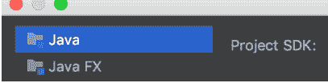
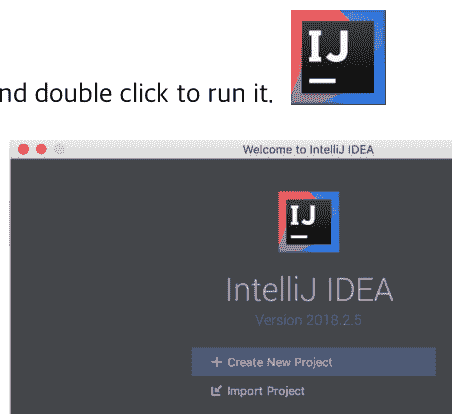
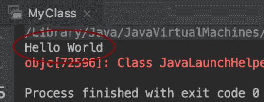
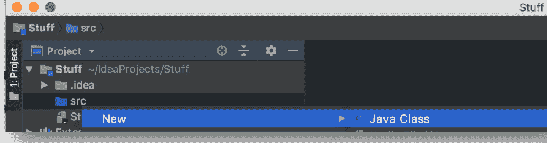
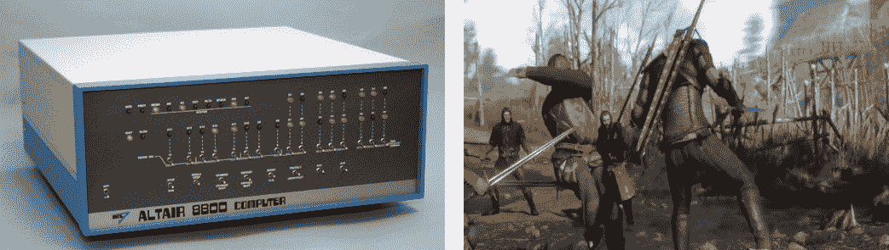
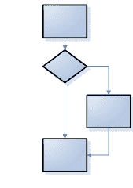
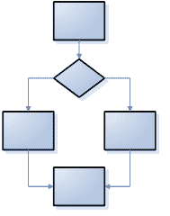
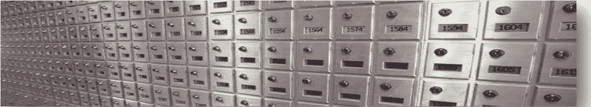
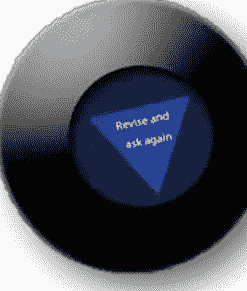

# Java 编程：面向绝对初学者的趣味编程活动（儿童编程练习本）

## 作者的其他书籍

现在，您可以在 Amazon.com 上找到这些额外的儿童编程练习本：

- 使用 Scratch 的儿童编程练习本（平装版和 Kindle 版）
- 使用 Python 的儿童编程练习本（平装版和 Kindle 版）
- 使用伪代码的儿童编程练习本（平装版和 Kindle 版）
- 儿童编程练习本——使用 Scratch 创建游戏（平装版和 Kindle 版）

# 引言

## 致家长……

本练习本是在教授初学者编程技巧数十年后编写的。它旨在通过趣味有趣的练习，向孩子们教授核心原理并将其固化在脑海中。

练习本的创建是为了促进自主学习，也可以用于课堂环境。它包含两个共同作用的主要元素来帮助孩子学习编程。“学习吧！Learn It!”部分将详细讲解原理，并提供对学习该主题有用的示例。“试试看！Try It!”部分将通过练习和游戏来强化上一节的学习内容。

## 致孩子……

根据我的经验，当编程概念是视觉化的，并且你花时间动手去编写你所学的内容时，孩子们学得最好。我强烈建议你在阅读本练习本时，使用 Scratch 运行一遍示例和练习。这将帮助你更好地记住所学的内容。

## 开始之前需要了解什么？

我在书中假设你对编程一无所知或几乎没有，并且不知道 Java。我提供了你开始并学习该语言所需的每一个步骤。由于涉及一些下载和安装步骤，具备一些计算机技能以及对文件夹和窗口的理解会有帮助。如果你不具备这些，请让父母帮助你。

# 学习吧！

## 开始学习 Java

Java 是一种通用的语言，在商业领域非常流行。因为它的流行，它是一门非常棒的学习语言。

在使用 Java 编写程序之前，你需要安装相应的软件。这包括安装集成开发环境（IDE）。支持多种操作系统的常用环境被称为 IntelliJ IDEA。我们将使用社区版（Community edition），因为它安装简单且免费使用。

以下是安装 IDE 并编写简短程序的步骤。

首先，访问`https://www.jetbrains.com/idea/download/`并在 Community 标题下选择“Download”（下载）。文件下载完成后，点击安装文件并按照安装过程操作。

安装完成后，找到已安装的程序并双击运行。

第一次运行程序时，它可能要求你回答一些关于文件存储位置等的问题。之后，你将进入欢迎页。

从欢迎页选择“Create New Project”（新建项目）。



在不同类型的项目中选择“Java”，并点击。



为你的项目命名。我给我的命名“Stuff”，但你可以起任何喜欢的名字。


项目创建完成后，在左上角选择项目文件夹。

从项目树中选择你的项目名称（我的是`"Stuff"`），然后点击`src`，选择“New”（新建）和“Java Class”（Java 类）。

会弹出一个对话框，你可以在其中为类命名。让我们叫它`MyClass`。然后点击 OK。

在页面右侧的编辑器中，输入以下程序，确保包含所有元素。

```java
public class MyClass {
    public static void main(String[] args) {
        System.out.println("Hello World");
    }
}
```

完成后，在编辑器中右键点击并选择“Run `MyClass.main()`”。

如果一切设置正确，你应该会在 IDE 的底部看到输出内容。



如果你的响应看起来像这样，你就可以开始学习编程了。

# 基础计算机概念

## 学习吧！

### 学习计算机硬件

学习构成计算机系统的最基础部分。

计算机由三种不同的部分组成：输入、处理和输出。

无论什么种类型的计算机——台式机、笔记本电脑、智能手机或其他系统——这些部分都存在。以下是你在系统的这些部分中可能看到的示例。

**输入**

- 键盘
- 鼠标
- 手指

**处理**

- 计算
- 控制

**输出**

- 显示器/屏幕
- 打印机

这三个元素共同工作，提供我们所预期的体验。


输入进入处理。处理完成后，就可以创建输出。

## 试试看！

### 示例

这个练习帮助你记住计算机的部分。为每种类型写一个例子。

| 输入 | 处理 | 输出 |
| --- | --- | --- |

## 学习吧！

### 学习输入

学习计算机可以接收的各种输入，以及计算机的功能。

输入是计算机接收已处理信息的方式。在上一节中我们讨论了计算机可能的输入类型。列表很小，但还有很多。

- 键盘
- 鼠标
- 触摸屏
- 文件或数据库

输入也可以是鼠标点击或触摸屏幕等事件。输入可以被存储供以后使用。

我们将使用的简单输入是：

```java
variableName = input.next();
```


### 我的第一个输入

这个练习帮助你理解输入的概念。按照以下步骤创建你的第一个输入程序。

1. 在 IntelliJ 中找到你创建的项目并右键点击`scr`。选择 New（新建）和 Java Class（Java 类）。

   

2. 为你的类命名为`MyFirstInput`并回车。

3. 文件名将出现在右侧的编辑器区域。在该区域输入：

   ```java
   import java.util.Scanner;
   ```

4. 现在在白色区域右键点击并找到 Run `MyFirstInput.main()`。

5. 屏幕底部的输出应该像这样。你需要输入一个名字，程序才能结束。

   你的名字是什么？bob

   ```java
   public class MyFirstInput {
       public static void main(String[] args) {
           Scanner input = new Scanner(System.in);
           System.out.print("What's your name?");
           input.next();
       }
   }
   ```

## 学习吧！

### 学习输出

学习计算机处理完成后可以发送的各种输出。

输出是计算机系统显示已处理结果的方式。

计算机有很多种提供输出的方式。这是一个很小的列表，但还有很多。

- 显示器或屏幕
- 文件或数据库
- 打印机
- 其他设备

没有输出，我们就不知道计算机程序内部发生了什么。在个人电脑的早期，Altair 计算机通过闪烁的灯光进行输出。今天我们的输出看起来几乎是真实的。自 Altair 时代以来，我们走了很远。

# 1980 2018



对于本练习中的示例和练习，我们使用所示的简单屏幕输出。

```java
System.out.println("This is what is being output.")
```

> 如今大多数程序使用更美观的输出。Windows 或 Mac 程序使用表单、按钮、字段等的图形化窗口输出。你电脑上的浏览器也使用类似的输出。视频游戏则使用更复杂的图形输出。当你将文档打印到打印机时，你也能看到来自计算机的输出。事实上，手机的叮叮声甚至它的震动都是输出的形式。

| 名字： |
| --- |
| Mickey |
| 姓氏： |
| Mouse |

## 试一试！

### 我的我的第一个输出

这个练习帮助你理解输出的概念。

按照以下步骤创建你的第一个带有输出的程序。

1. 创建一个名为`"FirstOutputProgram"`的新 Java 类并按回车。

2. 在新文件的编辑器区域，输入：

   ```java
   import java.util.Scanner;
   ```

   ```java
   public class MyFirstOutputProgram {
       public static void main(String[] args) {
           Scanner input = new Scanner(System.in);
           String name;

           System.out.println("What's your name?");
           name = input.next();

           System.out.println("Your name is " + name);
       }
   }
   ```

3. 在编辑器中右键点击并选择 Run `MyFirstOutputProgram`。

4. 屏幕底部的输出应该如下。

   ```text
   What's your name? bob

   Your name is bob
   ```

## 学一学！

### 了解编程语言

学习编程语言的作用以及我们为什么要使用它们。

计算机用 0 和 1 进行思考。人类则用单词、句子和表达式进行思考。编程语言允许我们使用类似于我们自己的语言或游戏的内容来告诉计算机需要执行的步骤。

有很多不同的编程语言，擅长处理不同的事情。其中一些是通用的，另一些则更具专业性。

一旦你学会了一种编程语言，学习另一种就会变得更容易。

代码语言具有这 6 个基本功能：

1. 接收输入
2. 输出输出
3. 存储变量
4. 执行计算
5. 分支判断
6. 提供循环

你已经学习了其中的几个。在整个练习册中，我们将学习编程语言的所有基本功能。

以下是来自不同语言的一些示例语句。

| 语言 | 语句 |
| --- | --- |
| Java | `public class HelloWorld {\n  public static void main(String[] args) {\n    System.out.println("Hello World!");\n}}}` |
| COBOL | `PROCEDURE DIVISION.\nDisplayPrompt.\n  DISPLAY " Hello World!".\nSTOP RUN.` |
| C++ | `int main() {\n  cout << "Hello World!";\n  return 0;\n}` |
| Basic | `10 PRINT "Hello World!"\n  20 END` |
| Python | `Print("Hello World!")` |
| 伪代码 | `Display "Hello World!"` |
| Scratch | `say Hello World! for 2 secs` |

注意这些语言是如何以不同的方式完成相同的事情（在屏幕上打印 Hello World!）的。

在编码中，我们通常将用编程语言编写的语句称为“源代码”或简称“代码”。我们这样称是因为尽管它通常看起来像英语，但它是一组告诉计算机该做什么的特殊指令。

在源代码被计算机执行之前，它必须先转换为计算机能理解的内容。某些语言使用解释器在运行时即时翻译代码。这会获取代码并在运行时逐行将其放入计算机可以使用的语言中。编译器与解释器略有不同，因为代码被转换成了一个你可以直接运行的文件。

## 试一试！

### 编程语言的功能

这个练习帮助你学习编程语言的基本功能。

填写关于编程语言基本功能的缺失部分。

- 接收 ______________________________ 输出
- 存储 ______________________________ 计算
- 创建 ______________________________ 循环

# 基础编码原理

## 学一学！

### 顺序执行

学习计算机处理程序的方式。

顺序执行意味着一组按顺序排列的步骤。这些是计算机处理程序的方式：

1. 逐行执行
2. 从顶到尾
3. 分支
   - 循环
   - 方法

我们在练习册中讨论这些。顺序执行是计算机必须执行的步骤。

#### 简单练习

这个练习帮助你思考如何执行步骤。

1. 三步
2. 两步
3. 四步
4. 一步
5. 五步
6. 六六步


#### 示例

这里有一个关于你如何输出的示例。

```java
Scanner input = new Scanner(System.in);
String name;
float price1;
float price2;
float total;

System.out.print("Please enter your name: ");
name = input.next();
System.out.print("Please enter price 1: ");
price1 = input.nextFloat();
System.out.print("Please enter price 2: ");
price2 = input.nextFloat();
System.out.print("Please enter price 3: ");
price3 = input.nextFloat();
total = price1 + price2 + price3;
System.out.println("Name: " + name + " total is: " + total);
```

#### 步骤

这个练习帮助你思考如何执行步骤。

1. 顺序执行
2. 顺序执行
3. 顺序执行
4. 顺序执行
5. 顺序执行
6. 顺序执行

#### 顺序练习

这个练习帮助你思考如何执行步骤。

记住：计算机必须执行这些步骤。

1. 顺序执行
2. 顺序执行
3. 顺序执行
4. 顺序执行
5. 顺序执行
6. 顺序执行

### 顺序执行

这个练习帮助你思考如何执行步骤。

1. 顺序执行
2. 顺序执行
3. 顺序执行
4. 顺序执行
5. 顺序执行
6. 顺序执行

## 学习吧！

### 学习编码流程

学习如何使用简单且标准的流程进行编码。

到目前为止，我们已经了解到编码是将许多行代码按顺序组合在一起以完成某种任务。

为了知道哪些语句需要放在一起，你首先需要理解你正在解决什么问题。你通过被称为“需求”（requirements）的东西获取这一点。

需求的一个示例如下：

显示从用户处输入的 4 个数字之和。

现在，你需要决定如何满足这些需求。为了做到这一点，你将编写一组高级步骤。

这些步骤的示例如下：

1. 询问用户第一个数字并存储在`variable1`中
2. 询问用户第二个数字并存储在`variable2`中
3. 询问用户第三个数字并存储在`variable3`中
4. 询问用户第四个数字并存储在`variable4`中
5. 相加数字并存储在`total`中
6. 显示总和

在你写下步骤并运行几次以确保它们安排正确后，是时候将这些步骤转换为程序了。

上述步骤的 Java 代码看起来如下：

```java
Scanner input = new Scanner(System.in);
int variable;
int variable2;
int variable3;
int variable4;
int total;

System.out.print("What is the first number you want to add? ");
variable1 = input.nextInt();
System.out.print("What is the second number you want to add? ");
variable2 = input.nextInt();
System.out.print("What is the third number you want to add? ");
variable3 = input.nextInt();
System.out.print("What is the forth number you want to add: ");
variable4 = input.nextInt();

total = variable1 + variable2 + variable3 + variable4;
System.out.println("The total of the four numbers is " + total);
```

注意需求、高级步骤和 Java 代码之间的联系。代码包含了更多具体的细节。

## 学习吧！

### 学习变量

学习临时数据如何存储在计算机内存中并在需要时取回。

有时，我们在编写程序时需要存储一些数字或其他数据以备以后使用。这些临时数据存储在被称为“变量”（Variables）的东西中。

你去过邮局吗？邮局内部有一墙信箱。将变量想象成这些信箱之一。在访问邮局时，你可能注意到信箱有不同的形状和大小。

> 就像信箱一样，每个变量都有一个名称，就像信箱上的数字；每个变量都有一个类型，就像存放信件的类型；每个变量都有一个值，就像存储在你信箱里的信件。

| 类型 (大小) | 名字 (Name) | 值 (Value) |
| --- | --- | --- |


在使用变量时，有几个你需要学习并遵循的规则：

- 在使用变量之前声明它们。
- 当你声明变量时，指定它的名称和类型。
- 你可以在整个程序中更改变量的值（因此有了“变量”这个名称）。
- 变量的类型影响不仅仅是大小。不同类型的变量包含不同类别的数据。一些常见类型是：
  - `int`：不带小数点的数字
  - `float`：带有小数点的数字
  - `String`：多个字符和数字组合在一起
  - `char`：单个字母或其他字符
  - `Boolean`：真或假

以下是声明变量的样子：

```java
Type Name
int myVariable
```

以下是在变量中存储数据的样子：

```java
Name Initialize
myVariable = 10
```

以下是从变量中检索数据的样子：

```java
System.out.println("The number is: " + myVariable)
```

这一行显示了字符串 `"The number is: "`，并从`myVariable`获取值，将其转换为`String`类型并添加到输出中。

## 试一试！

## 匹配类型

这个练习帮助学生学习不同类型的变量。

画一条线将值与正确的变量类型匹配。

- A：单个字母（`String`）
- 100：0 到 100 之间的数字（`Boolean`）
- 2.50：带有小数点的数字（`Char`）
- Cat：一个单词或句子（`Integer`）
- TRUE：真或假（`Float`）

## 试一试！

## 我的第一个变量

这个练习帮助你在程序中使用变量。

遵循以下步骤创建你的第一个使用变量的程序。

1. 创建一个名为 `"MyVariableProgram"` 的新 Java 类并按回车。
2. 在新文件的编辑器区域，输入：

```java
public class MyVariableProgram {
    public static void main(String[] args) {
        int myNumber;
        myNumber = 10;
        System.out.print("Your number is " + myNumber);
    }
}
```

3. 在编辑器区域右键点击并选择 `Run 'FirstVariableProgram'`。
4. 底部的输出应该是：`Your number is 10`

# 更多编程原则

## 学习吧！

## 学习分支

学习计算机程序中分支的最基础概念。

计算机非常擅长做决定，但我们必须告诉计算机如何做这些决定的规则。


分支（也称为条件语句）允许程序走多条路线之一。计算机使用逻辑表达式来决定走哪条路线。

> 逻辑表达式的解析结果为真（True）或假（False）。以下是逻辑表达式的一些元素：

| 元素 | 示例 |
| :--- | :--- |
| 等于 | `"abc" == "abc"` |
| 不等于 | `"abc" != "def"` |
| 与（AND） | `(100 AND 200) > 50` |
| 或（OR） | `(100 OR 200) > 50` |
| 非（NOT） | `NOT (100 > 50)` |

如果你想写一个逻辑表达式来判断你是否可以去看 PG-13 电影，它可能像这样：

```java
(myAge > 12)
```

要观看 PG-13 电影，你必须大于 12 岁。

这个逻辑表达式对你们的一些人会返回`false`，但对我们中一些大于 12 岁的人可能会返回`true`。

### 条件

在最简单的形式下，分支有一条路线但有两个结果。当逻辑表达式为真时，程序走该路径；当为假时，它会跳过真路径。带有这些路线的简单条件看起来如下：



```java
if (logical expression){
  // 如果真则执行某些操作
}
```

更复杂的分支具有多条路线。它看起来像这样：

```java
if (logical expression) {
  // 如果真则执行某些操作
} else {
  // 如果假则执行某些操作
}
```



在上述情况下，真条件走第一条路线，假条件走第二条路线（`else`之后）。

有时你甚至需要更复杂的分支版本。你可能有三条或更多路线要走。Java 中具有三条路线的分支如下所示：

```java
if (logical expression) {
  // 如果真则执行某些操作
} if (another logical expression) {
  // 如果第一个表达式为假且这个为真，则执行某些操作
} else {
  // 如果假则执行某些操作
}
```

你也可以根据需要将`if`和`if-else`放在其他代码块内部。

这是一个使用分支的简单程序示例。我们将使用本节之前提到的 PG-13 示例。

```java
import java.util.*;
public class BranchClass {
    public static void main(String[] args) {
        Scanner input = new Scanner(System.in);
        System.out.println("你多大了？");
        int age = input.nextInt();
        if (age > 13 || age == 13) {
            System.out.println("你的年龄足够可以看 PG-13 电影。");
        } else {
            System.out.println("抱歉，你的年龄不够看 PG-13 电影。");
        }
    }
}
```

在示例中，我们询问用户的年龄并将其存储在名为`age`的变量中。我们使用`if-else`语句测试用户的年龄是否大于 13 岁或等于 13。如果此测试为真，我们显示该人年龄足够观看的消息；否则，我们显示该人无法观看的消息。


### 寻找正数

这个练习帮助你通过一个寻找正数的程序来学习算术表达式和分支。

根据以下细节编写程序，判断用户提供的数字是正数还是负数：

1. 向用户询问一个数字。
2. 判断数字是正数还是负。
3. 如果是正数显示一条消息，如果是负数显示另一条消息。

进入 Java IDE 并创建此程序。

## 试一下！

### 猜数字游戏一

这个练习通过创建一个简单的猜数字游戏来帮助你学习分支和逻辑表达式。使用以下细节编写一个猜数字游戏：

- 从一个神秘数字开始。
- 请别人猜数字。
- 告诉他们猜的数字太高还是太低。
- 显示结果。

进入 Java IDE 并创建此程序。

## 学习吧！

## 循环

学习程序中循环的基本概念。

除了分支之外，计算机也非常擅长重复执行相同的事情。在编码中，这通常被称为循环。循环语句允许程序的某部分执行多次。在某种意义上，它就像狗追自己的尾巴。


以下是几个最常用的循环语句：

```java
for (int count = 0; count < 10; count++) { ... }
while (count < 10) { ... }
```

`while`循环使用像分支一样的逻辑表达式。涉及到循环时，通常有两种类型。利用这些信息来决定何时以及如何使用它们。

| For 循环 | While 循环 |
| :--- | :--- |
| 在循环开始前知道要迭代多少次时使用。 | 当你需要使用逻辑表达式来决定循环何时结束时使用。 |
| `for`循环有一个变量和一组相关的元素。 | `while`循环有一个用于逻辑表达式的外部控制变量。 |
| 在下面的示例中，我们看到一个名为`counter`的变量被声明并初始化为 0。它将一直增加，直到它不再小于 10。 | 使用控制变量的逻辑表达式在循环期间必须变为假。 |

这是一个使用`while`循环的快速示例。我们想要累加用户指定的 10 个数字。`count`变量跟踪我们进入循环的次数，因此我们每次都必须对它加 1。一旦完成，我们就显示总和。

```java
import java.util.*;
public class LoopClass {
    public static void main(String[] args) {
        Scanner input = new Scanner(System.in);
        int count = 0;
        int total = 0;

        while (count < 10) {
            System.out.println("要加的数字：");
            int number = input.nextInt();
            total = total + number;
            count++;
        }
        System.out.println("数字总和为 " + total);
    }
}
```

## 试一下！

### 猜数字游戏二

这个练习通过扩展我们的猜数字游戏帮助你学习更多分支和循环。通过添加以下要求增强猜数字游戏：

- 在之前的程序中用户只有一次机会。我们让他们一直猜直到得到答案。
- 你用什么来结束循环？
- 你将使用什么类型的循环？

顺便说，你可以使用此函数计算神秘数字：`random.nextInt(10)`计算 0 到 10 之间的随机数。

进入 Java IDE 并创建此程序。

## 试一下！

### 剪刀石头布

这个练习通过剪刀石头布游戏帮助你学习更多关于分支和循环。


- 使用下面的剪刀石头布规则编写程序。
- 运行固定次数的比赛，但如果平局则继续尝试。

| RPS 规则 |
| :--- |
| 石头胜过剪刀 |
| 剪刀剪过布 |
| 布盖住石头 |
| 如果两者相同则无人获胜 |

进入 Java IDE 并创建此程序。

## 试一下！

### 俄罗斯轮转

这个练习通过创建俄罗斯轮转帮助你学习分支和循环。俄罗斯轮转是一个人拿着一把有一个子弹的左轮。他们旋转转轮，对准目标并扣扳机。

根据以下细节创建一个俄罗斯轮转练习程序：

1. 随机选择六个槽中子弹的位置。
2. 旋转转轮并随机决定一个槽。
3. 对准目标并扣扳机。
4. 向用户显示结果。
5. 询问用户是否再次尝试。
6. 如果是，再次扣扳机。

进入 Java IDE 并创建此程序。

## 学习吧！

## 测试编码过程

考虑测试如何融入我们的简单标准流程。

在本文读的早期阶段，我们讨论了编码过程。使用这个过程可以帮助你在尝试解决问题时一步为营地思考。当我们之前讨论该过程时，我们还没有讨论分支和循环。这两种都会让思考正确的步骤变得困难。

除了列出的三个步骤之外，我还建议你随后测试程序的逻辑（程序是否符合要求）。

回想一下我们之前过的编码过程：

- 思考你程序的各种。
- 写下满足需求所需的高级步骤。
- 按照这些步骤创建你的程序。

这里有一个你可以测试逻辑的简单方法：

1. 准备一张白纸。
2. 在纸的顶部写下程序中的变量名。如果你使用了循环，并不并不总有变量名，但你也应该将每一个变量名都写在顶部。将它们命名为`Loop1`、`Loop2`等。如果你有数组（我们将在工作本的下一部分介绍），你也应该包含这些内容。
3. 现在，逐步运行你的程序。不要实际运行程序，而是在看程序时演练这些步骤。
4. 在纸上写下每个变量的值。写下每个循环的值。当值改变时，在旧值下方写新值。
5. 在纸的底部写下程序的程序的输出。

这样做将帮助你确保步骤的逻辑是正确的。它将帮助你确保你正确地思考了整个过程。

这是一个关于如何操作的示例。我们将使用来自“序列”主题的这个程序。

```java
import java.util.*;
public class ProcessTest {
    public static void main(String[] args) {
        Scanner input = new Scanner(System.in);
        String name;
        float price1;
        float price2;
        float price3;
        float total;

        System.out.print("What's your name? ");
        name = input.next();
        System.out.print("Please enter the price of book 1 ");
        price1 = input.nextFloat();
        System.out.print("Please enter the price of book 2 ");
        price2 = input.nextFloat();
```

```java
System.out.print("Please enter the price of book 3 ");
price3 = input.nextFloat();
total = price1 + price2 + price3;
System.out.println("Your name is " + name + " and your total is " +
total);
```

| 变量 | Price1 | Price2 | Price3 | 总计 |
| :--- | :--- | :--- | :--- | :--- |
| Bob | 123 | | | |
| | | 234 | | |
| | | | 345 | |
| | | | | 702 |

### 输出

```text
Your name is Bob and your total is 702
```

注意在每行代码逐步执行时，每个变量的值如何在纸上更新的。还要注意输出是如何包含在纸底部的。

当你花时间这样测试时，你将更好地理解你的程序在做什么，以及它是否有正确的步骤来解决问题。


# 斐波那契数列

这个练习帮助你使用编码过程处理斐波那契数列。

一位名叫斐波那契的科学家试图计算随着时间推移可以养多少只兔子。创建一个根据这些细节计算斐波那契数列的程序：

1. 用户想要显示多少个数字。
2. 使用以下信息计算斐波那契数列的每个元素：
   - 序列：1, 2, 3, 5, 8, 13, 21 ...
   - 序列始终以 1 开始。然后你把 1 加上 1 得到 2。1 + 2 等于 3，2 + 3 等于 5，以此类推。
3. 显示每个元素，直到达到所需的元素数量。

记住使用我们涵盖过的编码过程。一旦你创建了程序，使用我们刚刚讨论的测试过程来确保你的程序正确计算了斐波那契数列。

# 寻找学校

这个练习帮助你通过编写一个寻找正确类型学校的程序来使用编码过程。编写一个根据年龄和以下细节判断学生应该就读哪种学校的程序：

1. 询问用户的年龄。
2. 使用此表决定用户应该上哪种学校。

| 年龄 | 学校 |
| :--- | :--- |
| 5 - 11 | 小学 |
| 12 - 14 | 初中 |
| 15 - 18 | 高中 |
| 18+ | 毕业 |

3. 按照如下格式输出：“因为你是 X 岁，所以你上 Y。”

和上一个练习一样，记住使用我们涵盖过的编码过程。一旦你创建了程序，使用测试过程来确保你的程序正确找到了合适的学校。

进入 Java IDE 并创建此程序。

# 学习数组

学习数组是什么以及你如何在程序中使用它们。当你需要许多相同类型的变量时，就会使用数组。当你在程序运行之前不知道有多少个变量时，通常会使用。



数组是一组相同类型的变量。就像变量一样（因为数组是一种特殊的变量类型），每个数组都有一个名称（大小）、一组值（里面的内容），并且每个元素都有一个用于引用它的索引。

在使用数组之前，你可以先这样定义：

```java
int myArray[] = {1,2,3,4,5};
```

在你可以使用数组之前，你必须先这样定义它，并之后使用循环来填充它：

```java
int myArray[] = new int[10];
```

这个示例创建一个空数组。你需要使用循环来填充它：

```java
for (int count=0; count<10; count++) {
  myArray[count]=count*10;
}
```

在上面的示例中，我们使用循环来填充它。


```java
import java.util.*;
public class ArrayExample {
  public static void main(String[] args) {
    Scanner input = new Scanner(System.in);
    String nameArray[] = new String[10];
    String phoneArray[] = new String[10];

    for (int index=0; index<10; index++) {
      System.out.print("Please enter a name ");
      nameArray[index] = input.nextLine();
      System.out.print("Please enter a phone number ");
      phoneArray[index] = input.nextLine();
    }

    for (int index=0; index<10; index++) {
      System.out.println("Name: " + nameArray[index]
      + " Phone: " + phoneArray[index]);
    }
  }
}
```

下表显示了一个 5 个元素的名称数组。

| 索引 | 值 |
|---|---|
| 0 | Bob |
| 1 | Anna |
| 2 | Jim |
| 3 | Sandy |
| 4 | Debbie |

在上面的示例中，我们在第一个循环中收集名称和电话，使用索引变量将其存储在各自的数组中。然后，我们再次循环打印。这种使用两个数组的方法被称为并行数组。

## 计算平均数

这个练习帮助你通过创建一个计算多个数字平均值的程序学习更多分支、循环和数组。编写一个根据细节计算一组数字平均值的程序：

1. 询问用户 10 个数字。
2. 将每个数字存储在数组中。
3. 一旦你存储了这 10 个数字，遍历数组并计算这些数字的平均值。
4. 显示结果。

平均值使用此公式计算。

```java
average = sumOfNumbers / numberOfItems
```

进入 Java IDE 并创建此程序。

## 魔球

这个练习通过创建一个魔球的程序，来帮助你学习更多分支、循环和数组。编写一个创建一个魔球的程序。



- 摇晃球并提问。
- 魔球为你选择一个答案。
- 答案是随机的。
- 魔球存储 10 个不同的答案。使用数组来存储这些答案。

**注意：** 你可以使用此函数来计算随机数。`random.nextInt(10)` 计算 1 到 10 之间的随机数。

| 答案 |
|---|
| 稍后请再问 |
| 现在无法预测 |
| 非常模糊。请重试 |
| 不要寄予希望 |
| 很可能 |
| 展望良好 |
| 我的来源说不 |
| 现在最好不告诉你 |
| 肯定无疑 |
| 前景不太乐观 |

## 尝试一下！

## 我的媒体收藏

这个练习将帮助你通过媒体收藏来学习数组。

你们中的许多人喜欢音乐。和你一样，我有很多不同的音乐。因为我年纪比较大了，这些音乐存储在磁带、黑胶片和 CD 等媒体上。

你的任务是创建一个媒体集合。你将需要使用一个数组来存储这些媒体。

编写一个程序来创建上述描述的媒体集合。它需要提供一种方式向我的集合中添加更多媒体，并查看我已有的项目。

进入 Java IDE 并创建这个程序。

# 高级编码原则

## 学习方法

学习方法的概念，提供两种方法的示例，并引入递归。

模块化编程的核心是将程序拆分为逻辑部分，并将这些部分组合成一个方法。方法可以接收输入参数，并执行某些操作或返回某些结果。由于它被封装在自己的包中，因此可以独立进行开发和测试，并在需要时重复使用。

在使用方法之前，需要对其进行定义。定义的第一行会告诉计算机更多关于该方法的信息。就像声明变量一样，第一行告诉了方法的访问权限、类型、方法名称以及是否有任何参数。在我们学习对象之前，我们将方法视为“静态的（static）”。这意味着我们将在类中使用它们，而不是对象中使用。你以后会学更多关于这点的知识。目前只需要在访问修符后面包含 `static` 关键字。

| 访问修符 | 静态 | 类型 | 名称 | 参数 |
| :--- | :--- | :--- | :--- | :--- |
| (public, protected, private) | (static 或留空) | (void 表示无返回值，或实际类型) | (用逗号分隔的类型和名称) |  |
| public | static | void | methodName | (parameterName) |

接下来，你需要编写方法将执行的步骤。你可以使用本教程到为止讨论过的所有编码元素。这是一个方法的简单示例：

```java
public static void printNumbers() {
    for (int count=1; count<=10; count++) {
        System.out.println(count);
    }
}
```

这个方法运行从 1 到 10 的循环并显示数字。这是一个返回值的简单方法示例：

```java
public static int returnNumber(int startValue) {
    int total = startValue;
    for (int count=1; count<=10; count++) {
        total = total + count;
    }
    return total;
}
```

像前面的示例一样，这个方法运行从 1 到 10 的循环。它接收一个参数（稍后我们会讨论这些）并计算出一个总和，然后通过 `return` 语句返回。

## 参数

使用参数是向方法传递值的一种方式。在上面的示例中，值被传递给 `returnNumber()` 方法。在方法内部，该值被用于 `startValue` 变量。

## 使用方法

定义方法很好，但随后你需要在程序中使用它们。这是通过“调用”方法来实现的。调用一个返回值的方法，你将像处理变量一样处理它：

```java
MyClass.returnNumber(123);
```

## 递归

除了使用方法之外，你还可以在方法内部调用方法。这种情况被称为递归。在一个简单的示例中，我们将显示一组类似于循环的消息，但将改用递归：

```java
public static void showMessage(int numberOfTimes) {
  if (numberOfTimes > 0) {
    System.out.println("Printing a recurring message ");
    showMessage(numberOfTimes - 1);
  }
}
```

`if` 语句非常重要，因为没有它会导致无限循环。如果你在程序中如下调用此方法：

```java
MyClass.showMessage(5);
```

该方法将调用自己 5 次，并在结束前显示“Printing a message”。使用递归有很多原因。我们将在练习中探索。

## 阶乘

这个练习将帮助你使用阶乘公式学习递归和方法。阶乘公式是学习递归的好方法。5 的阶乘（写作 5!）的计算方式如下：

```text
factorial = 1 * 2 * 3 * 4 * 5
```

编写一个接收整数的阶乘方法。阶乘方法接收一个整数参数并返回该数字的阶乘结果。注意，0 的阶乘是 1。

```java
public static int factorial(int n) {
    if (n == 0) {
        return 1;
    } else {
        return n * factorial(n - 1);
    }
}
```

这个阶乘方法使用递归来计算阶乘。它带着更小的值调用自己，直到达到 `n == 0` 的边界情况。

## 使用方法的猜数字游戏

这个练习将帮助你学习方法。我们将创建一个生成数字并让用户猜的程序。我们将使用方法来处理游戏的不同部分。

## 学习对象

在 Java 中，类是对象的蓝图。对象是类的实例。例如，如果你有一个名为 `Car` 的类，你可以创建许多 `Car` 对象。

- 封装
- 继承
- 多态

| 类 (CLASS) | 对象 (OBJECT) |
| :--- | :--- |
| 定义“蓝图” | 实现蓝图。 |

处理对象涉及创建一个类，然后实例化该类。

类的代码如下所示：

```java
public class Car {
    String color = "";

    public void displayInformation() {
        System.out.println("The color of this car is " + color);
    }
}
```

在上面的代码中，我们定义了一个类。这就像是一个新类型。在 Java 中，`.java` 文件和类名需要完全匹配，包括大小写。我建议右键点击 `src` 并为这些示例中的每一个示例创建一个新的 Java 类。如果你想使用这个类，你需要像这样创建一个该类的对象实例：

```java
Car myCar = new Car();
```

创建对象实例后，你现在可以如下所示使用该对象：

```java
myCar.color = "Red";
myCar.displayInformation();
```

构造函数是在创建对象时设置对象值的方法。这里唯一不同的是我们如何命名方法。构造函数的名称与类名相同。让我们取出 `Car` 类并添加构造函数：

```java
public class Car {
    String color= "";

    // 这是构造函数
    public Car(String tempColor) {
        color = tempColor;
    }

    public void displayInformation() {
        System.out.println("The color of this car is " + color);
    }
}
```

一旦定义了构造函数，我们就可以这样使用它：

```java
Car myCar = new Car("Yellow");
```

看看我们在创建对象实例时是如何将颜色设置为黄色（Yellow）的？

这些都是对象的基础。在接下来的几节中，我们将更深入地探讨这个主题。

## 试一下！

## 尝试对象

此练习帮助你通过一个简单的程序学习对象编码。

利用上一节的内容和包含的示例，创建一个符合以下要求的程序：

- 使用你任选的内容创建一个类。在类中至少定义一个变量和一个方法。
- 编写用于创建你上面创建的类的对象实例的代码。
- 编写一段使用你上面创建对象的代码片段。

进入 Java IDE 并创建此程序。

## 学习吧！

## 学习封装

学习封装，这是面向对象编程的核心原则之一。

封装是将数据和操作组合到一个单个包中。这样做允许我们从几个方面更好地管理程序。

首先，它允许你管理类内部的变量以及影响这些数据的操作（方法）的更改范围。

我们还没有使用过访问器（accessor），但它们决定了类、变量或方法的可见性。`public`（公有）访问器允许该元素对类内部和外部的所有其他类可见。`protected`（保护）仅允许继承层次结构中的类看到该元素。`private`（私有）将可见性限制为仅在类内部。当我们把变量设置为 `private` 时，我们可以确保对变量数据的任何更改必须通过类中的方法来进行。

```java
public class Car {
    private String color = "";

    public Car(String tempColor) {
        color = tempColor;
    }

    public void displayInformation() {
        System.out.println("Car: The color of this car is " + color);
    }
}
```

其次，在测试类时，你可以将其作为一个单元进行测试，这是单元测试的基础。将更改和测试集中在单个类上，允许你管理更改对数据和操作的影响。

像上面的 `Car` 示例所示使用封装被认为是最佳实践，以确保访问和范围得到严密管理。

## 学习吧！

## 学习继承

学习继承，这是面向对象编程的核心原则之一。

继承是我们随处可见的。在你自己的家庭中，你从父母那里继承了某些特征。如果你有兄弟姐妹，那个人同样继承了特征。类可以以类似于你家庭的方式进行继承。

在编码中，我们将父类称为“super”超类。其他类可以继承超类。继承超类的类被称为“sub”子类。

让我们来看一些示例。让我们使用之前几节中看到的 `Car` 类。你可能会注意到，我们已经颜色变量的访问器更改为 `protected`。`protected` 允许子类访问此变量。

```java
public class Car {
    protected String color = "";

    public Car(String tempColor) {
        color = tempColor;
    }

    public void displayInformation() {
        System.out.println("Car: The color of this car is " + color);
    }
}
```

这是我们的超类。现在我们通过添加几个继承自 `Car` 的子类来更加具体。

```java
public class Lamborghini extends Car {
    private int numberOfOfCylinders = 0;

    public Lamborghini(int tempNumberOfCylinders, String tempColor) {
        super(tempColor);
        numberOfOfCylinders = tempNumberOfCylinders;
    }

    public void displayInformation() {
        System.out.println("Lamborghini: The color of this car is " + color + " and the number of cylinders is " + numberOfOfCylinders);
    }
}

public class Ferrari extends Car {
    private int numberOfOfCylinders = 0;

    public Ferrari(int tempNumberOfCylinders, String tempColor) {
        super(tempColor);
        numberOfOfCylinders = tempNumberOfCylinders;
    }

    public void displayInformation() {
        System.out.println("Ferrari: The color of this car is " + color + " and the number of cylinders is " + numberOfOfCylinders);
    }
}
```

注意 `Lamborghini` 和 `Ferrari` 括号中都都有 `Car`。这意味着它们继承自 `Car`。这三个类都有一个构造函数。子类构造函数的第一行调用了超类的构造函数，并向其传递了一个颜色值。其余类非常直观。

现在让我们看看它们如何在程序中使用。在我们的程序中，我们将声明并创建一个 `Lamborghini` 类的对象实例。

```java
Lamborghini lamb = new Lamborghini(12, "Red");
lamb.displayInformation();
```

我们使用这个类的方式和我们在之前几节中使用 `Car` 的几乎一样。我们应该说明的一点是，我们设置了 `lamb.color`，但如果你看 `Lamborghini` 类，它并没有颜色变量。那是因为 `Lamborghini` 和 `Ferrari` 从它们父类 `Car` 那那里继承了该变量。

继承的力量在于，我们不需要为创建的每个类都重复造轮子。当确实存在“是一个”（Is a）的关系时，我们能够使用继承来复用另一个类中存在的功能。

## 学习吧！

## 学习多态

学习多态，这是面向对象编程的核心原则之一。

虽然“多态”（Polymorphism）这个名字听起来非常复杂，但实际上并不困难。多态的力量在于，计算机会在程序运行时确定对象的类型。（注：原文此部分包含大量重复的 OCR 错误文本，译文已根据核心逻辑进行处理）。

1. 六发弹轮枪中子弹的位置是随机选择的。
2. 旋转弹仓并随机决定被选中的弹槽。
3. 将枪对准目标并扣动扳机。
4. 将结果显示给用户。
5. 询问用户是否想再次尝试。
6. 如果是，再次扣动扳机。
7. 使用面向对象的方法来实现此程序。

进入 Java IDE 并创建此程序。

## 学习吧！

## 学习文件

学习如何使用文件在程序中写入和读取数据。

在程序中从文件中加载和保存数据可以增强用户体验的健壮性。在此节之前，我们所有的程序都要求用户每次运行程序时输入数据。对于猜数字游戏或计算器来说这没问题，但如果我每次运行程序都要重新输入我媒体收藏中所有的磁带、唱片和 CD，我会非常不爽。

将文件整合到程序中，允许我们把程序的数据存储到文件中，下次运行程序时可以再次从该文件中加载。


每当我们想要使用文件时，首先需要打开该文件。如果我们的程序要打开一个文件用于输出（将数据保存到文件），我们的代码看起来如下。

```java
try {
    FileWriter writer = new FileWriter("myfile.txt");
} catch (IOException ex) {
    System.err.println(ex.getMessage());
}
```

顺便说一下，你需要在程序顶部添加`import java.io.*;`以使用我们包含的一些类。

我们稍后会讨论`try/catch`部分。首先，我们来讨论`FileWriter`那行代码。`FileWriter`是 Java 中一个用于写文件的类。你像我们在“对象”部分中讨论的那样，创建它的对象实例。构造函数包含了文件的路径和名称。在这个示例中我选择了一个没有路径的简单文件名，但你可能需要包含路径。如果你在路径中使用`\`符号，你可能需要使用两个`\\`。`\`是 Java 中用于模式匹配的特殊字符。将两个放在一起告诉 Java 将其视为普通符号。

现在谈谈`try/catch`。当程序运行期间出现问题时，`try`块和`catch`块可以帮助我们。假设你正尝试将一个文件写入一个不存在或你没有权限访问的地方。`Try`告诉 Java 关注可能的问题。`Catch`告诉 Java 如何过滤发生的问题以及如何处理它们。我们的`catch`块告诉 Java 寻找`IOException`问题。如果发生了这些问题之一，我们的程序会将错误写到错误控制台（类似于我们习惯的输出`out`控制台），这样我们就能知道问题是什么。

对于输出流，我们希望向文件`write`（写入）数据。我们这样做。

```java
writer.write("My First Record");
```

上面的语句与`println`语句类似，但它是写入到文件的。你可以像上面的示例一样写入字面量字符串，也可以包含变量名。

对于所有与文件相关的操作，你需要在完成后确保`close`（关闭）该文件。保持文件打开会浪费系统资源并可能导致内存泄漏。以下是关闭文件的方法。

```java
writer.close();
```

我们已经讨论了输出流。现在让我们讨论一下使用输入流。输入流从已存在的文件`reads`（读取）数据。如果文件不存在，你的程序可能会抛出错误。你会发现打开输入流的语法与输出流非常相似。

```java
try {
    FileReader reader = new FileReader("mytestfile.txt");
} catch (IOException ex) {
    System.err.println(ex.getMessage());
}
```

打开输入流的语法非常输出。

读取文件的代码与写入代码略有不同，因为它是一次读取一个字符。这是读取文件的样子。

```java
int myChar;
while ((myChar = reader.read()) != -1) {
    System.out.print((char)myChar);
}
```

程序中的`read`方法在`while`循环中。当我们从文件读取时，检查它是否得到了`-1`。当它得到`-1`时，说明我们到达了文件末尾。由于它是一次读取一个字符，我们使用`print`方法而不是`println`来打印数据。

这次关闭打开的文件使用这段代码。

```java
reader.close();
```

如果你运行输出流代码然后输入流代码并显示`myChar`的值，它看起来是这样。

## 我的第一条记录

这是一个使用对象方法读写文件的完整程序。

```java
import java.io.*;

public class FileTest {
    String fileName;

    public FileTest(String tempFile) {
        fileName = tempFile;
    }

    public void writeFile() {
        try {
            FileWriter writer = new FileWriter(fileName);
            writer.write("My First Record");
            writer.close();
        } catch (IOException ex) {
            System.err.println(ex.getMessage());
        }
    }

    public void readFile() {
        try {
            FileReader reader = new FileReader(fileName);
            int myChar;
            while ((myChar = reader.read()) != -1) {
                System.out.print((char)myChar);
            }
            reader.close();
        } catch (IOException ex) {
            System.err.println(ex.getMessage());
        }
    }

    public static void main(String[] args) {
        FileTest ft = new FileTest("testfile.txt");
        ft.writeFile();
        ft.readFile();
    }
}
```

# 其他编程语言参考

以下常用编程语言的参考列表。你可能想使用这些参考资料来帮助你用另一种语言完成工作簿中的练习。

| 语言 | 参考链接 |
| --- | --- |
| Java | https://docs.oracle.com/javase/10/docs/api/overview-summary.html |
| Python | https://docs.python.org/2.7/reference/index.html |
| Visual Basic | https://docs.microsoft.com/en-us/dotnet/visual-basic/language-reference/ |
| C | https://www.gnu.org/software/gnu-manual/gnu-manual.html |
| Scratch | https://download.scratch.mit.edu/ScratchReferenceGuide14.pdf |
