# Java 21 编程：构建稳健高效应用的实践指南

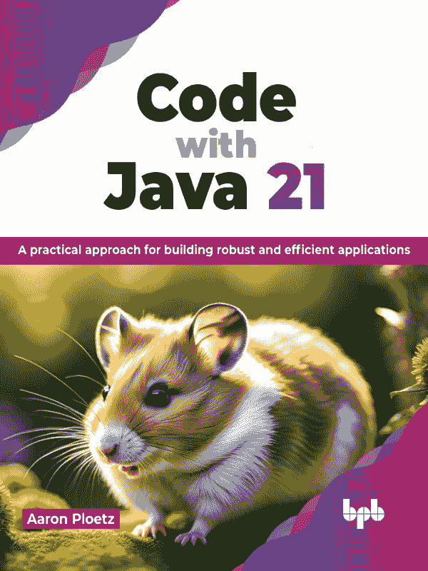


**致：**

我的孩子们：

Khadiya, Avery, Emily, 和 Victoria

&

我的教子：

Tim

通之路之路铺满了那些没有放弃者的足迹，以及那些放弃了的人的遗憾。

# 关于作者

Aaron Ploetz 是 DataStax 的开发者倡导。他自 1997 年以来一直担任专业软件开发人员，并在领导初创公司和世界 500 强企业的 DBA 和 DevOps 团队方面拥有成功经验。他曾三次被 own Apache Cassandra® MVP，并在多次活动中进行演讲，包括在 2023 年 Data Day 墨西哥城上的金融科技主题演讲。Aaron 经常回答其他开发者提出的 StackOverflow 问题，并在此前编写过关于分布式数据库的书籍。他从威斯康星大学沃特沃分校获得管理/计算机系统学士学位，从雷吉斯大学获得软件工程硕士（侧重数据库技术）学位。在不写书或编写代码时，Aaron 喜欢钓鱼、玩复古视频游戏和滑雪背包。Aaron 和他的妻子 Coriene 与四个孩子一起住在双城地区。

# 关于评审者

Otavio Santana 是一位充满热情的架构师和软件工程师，专注于云和 Java 技术。他在多语言持久化以及金融、社交媒体和电子商务领域的高性能应用方面拥有深厚的知识。

他以多种方式为 Java 和开源生态系统做出了贡献。自 Java 8 以来，Otavio 作为 JCP 执行成员帮助了 Java 平台的方向和目标，同时他也是多个开源产品和规范的提交者和领导。

他因开源贡献受到认可，并获得了许多奖项，包括所有 JCP 奖类别和公爵选择奖（Duke’s Choice Award）等。Otávio 还是杰出的 Java Champion 和 Oracle ACE 计划成员。

# 致谢

我要感谢我的同事 Cédrick Lunven 和 Mary Grygleski，他们提供了巨大的帮助，并对我重新投入 Java 开发起到了核心影响。我感谢 Otavio Santana、Sharat Chander 以及无数其他人，他们让 Java 社区如此友好且充满鼓励。

我还要感谢 Ursula Kellmann，她离开我们得太早了。她是一位出色的导师，教了我许多关于 Java 的知识，是领域领域专家应当追求的卓越典范。

最后，我要感谢我的妻子 Coriene，她不断激励我接受新挑战，成为更好的自己。

# 前言

学习软件开发一直是一条充满危险的道路。当我开始这段旅程时，书籍是唯一的媒介。当我在 Tandy 1000 上开始学习编写 BASIC 程序时，我在威斯康星大学沃特沃分校的最后一年（1998 年）首次接触到 Java。我曾非常喜爱 Java 所标榜的“一次编写，随处运行”的理念。在 20 世纪 90 年代，这一点非常重要。

2010 年代初，我在 W.W. Grainger 的中间层 Cassandra 团队期间编写了大量的 Java 代码。这是我首次接触企业级 Java。我们服务层后的数据库（Apache Cassandra®）也是用 Java 编写的，因此我简直是直接投入到了调试 Java 7 异常和细微差别的工作中。

在接下来的十年大部分时间担任 Cassandra DBA 之后，我终于在 2021 年回归（接近）全职 Java 编码。这是一种耳目一新的感觉。我喜欢 Java 演进到版本 17 的程度。那时，我已经写了两本关于 NoSQL 数据库的书。我处理 Java 越多，就越想写一本关于它的书。

今天，世界上有大量的 Java 代码在运行。它们运行在数十亿设备上，驱动着从视频游戏到产生数十亿美元的电子商务网站的一切事物。不可否认，学会编写 Java 代码已成为一项宝贵的技能。

今天，对于有志的开发者来说（除了选择语言），最大的障碍之一就是安装和配置开发环境。相比之下，1980 年代常见的许多计算机让开始编程变得非常容易。用户只需按下几次键即可进入软件开发环境。

一些早期的家用计算机（如 Tandy Color Computers 和 Apple II 系列）在启动后会立即让进入 BASIC 编程提示符。这些早期机器默认就在请求被编程！另一方面，现代计算机（尤其是手机和平板）并不如此。构建一个合适的编程环境通常是一项艰任务。这就是为什么本书的第一章花时间在安装 IDE 上。

然而，让计算机再次可编程不仅仅是克服技术障碍。这是一种文化的转变。它是关于当你看着你的设备时，不再问“它能为我做什么”，而是问“我可以用它构建什么？”这种心态导致了终身学习。

最终，我写这本书的动力是帮助开发者平滑学习曲线。我相信 Java 是实现这一点的正确语言。

本书书的结构旨在逐步引入编写 Java 代码的不同方面，每章都建立在之前介绍的内容的基础上。

第 1 章 `ch01` 提供了 Java 的简单介绍。它还介绍了如何配置开发环境，包括安装依赖管理器和 IDE 等工具。本章还讨论了面向对象编程（OOP）并介绍了 Java 21 的新功能。

第 2 章 `ch02` 讨论了 Java 语法的一些基础构建块。它从必经的 Hello World 程序开始，进展到读取输入、错误处理和控制程序流。在涵盖基础知识后，它转向了文件操作以及 Java 特有的构建方法和构造函数的方式。

第 3 章 `ch03` 涵盖了处理文本数据的不同方法。虽然从使用 ASCII 字符艺术的简单示例开始，但随后展示了如何使用 Java `String` 类包含的一些更高级的方法。最后它介绍了正则表达式，并展示了如何在实际的现实示例中使用它们。

## 第 8 章：Web 应用（`#ch08.xhtml`）

本章讨论了在 Java 中构建构建 ful Web 服务和全栈 Web 应用。它还介绍了 Spring 和 Vaadin 框架，展示了如何利用它们构建功能完的 Web 应用。

# 代码包与彩色图片

请点击链接下载书籍的 `Code Bundle`和彩色 `Coloured Images`：

[`rebrand.ly/nkskce0`](https://rebrand.ly/nkskce0)

本书的代码包也托管在 GitHub 上：[`github.com/bpbpublications/Code-with-Java-21`](https://github.com/bpbpublications/Code-with-Java-21)。如果代码有更新，将在现有的 GitHub 仓库中更新。

我们从丰富的书籍和视频目录中提供了代码包，可以在 [`https://github.com/bpbpublications`](https://github.com/bpbpublications) 获取。快去看看吧！

## 勘误

我们对 BPB Publications 的工作非常自豪，并遵循最佳实践以确保内容的准确性，为订阅者提供极佳的阅读体验。读者是我们的镜子，我们利用他们的反馈来反映并改进出版过程中可能出现的任何人为错误。为了方便我们维护质量并帮助我们联系可能因意外错误而遇到困难的读者，请通过邮件联系我们：

`errata@bpbonline.com`

BPB Publications 全体感谢您的支持、建议和反馈。

## 加入我们书籍的 Discord 空间

加入书籍的 Discord 工作空间，获取最新更新、优惠、全球科技动态、新发布以及与作者的交流：

[`discord.bpbonline.com`](https://discord.bpbonline.com)


# 第 1 章：了解 Java（`#contents.xhtml_ch01a`）

## 引言（`#contents.xhtml_sc2_1a`）

欢迎阅读《Code with Java 21》！无论你是新手还是经验丰富的程序员，这本书都将帮助你理解并有效运用世界上最流行的编程语言之一。除了涵盖 Java 的基础方面外，我们还将讨论 Java 21 版本交付的新功能，并教你如何有效地使用它们。

Java 21 是一个长期支持（LTS）版本，将支持到 2031 年。本书的设计不仅是为了帮助你学习，还可以作为长期参考。它包含了设计的代码，引导你完成每个示例并帮助你成为一名成功的程序员。

> 注意：程序员（programmer）、软件开发人员（software developer）和代码（coder）这些术通常互用。

## 结构（`#contents.xhtml_sc2_2a`）

在本章中，我们将讨论以下主题：

- 使用 Java 构建应用的优势。
- 检查 Java 开发环境的不同组件。
- 讨论用于辅助 Java 开发过程的常用工具。
- 介绍面向对象的编程原理。
- 预览 Java 21 的新功能。

## 目标（`#contents.xhtml_sc2_3a`）

本书的目标是激发你构建下一代 Java 应用。在本章中，我们将从高层次研究 Java 语言，旨在提供足够的细节来让你上手。在本章节结束时，我们将理解 Java 不同于其他语言的特性，以及如何利用它来编写强大的应用程序。

## 为什么用 Java 写代码？（`#contents.xhtml_sc2_4a`）

Java 无处不在；它运行在全世界数十亿台设备上。它也被财富 500 强企业用于构建服务和应用程序，帮助他们每年赚数十亿美元。不言而喻，市场对 Java 开发者的需求很高，而且这种需求可能会持续很长时间。

还有几种类型的机器可以运行 Java，包括但不限于以下设备：

- 用于家庭和业务的个人电脑（PC）。
- 移动设备。
- 游戏机。
- 嵌入式设备。

Java 平台无关性、多性和安全性的核心特性使其成为世界上最流行的语言之一。这些特性也使得获取帮助变得容易，因为可以在 YouTube、LinkedIn 以及许多其他网站上找到 Java 的学习材料。

无论你是兴趣作为爱好编程还是作为通往成功职业的技能，Java 都是一项非常好的技能。

### 配置你的环境（`#contents.xhtml_sc2_5a`）

在开始编写 Java 程序之前，我们需要确保我们的环境已正确构建和配置。以下是成功所需的要素：

- 运行 Windows、Linux 或 MacOS 的计算机。
- Java 运行环境（JRE）。
- 集成开发环境（IDE）。
- Java 依赖管理器。
- 源码控制平台。

虽然本书对 Java 新手做了一些考虑，但它是针对具有至少中级整体编程经验的人设计的。虽然我们会提供配置环境的概述，但对所有可能的配置进行详尽说明超本书的范围。假设读者将安装并配置他们最熟悉的工具。

Java 开发环境中另一个必要的部分是 Java 运行环境（JRE）。该包提供了你的 Java 代码运行所需的所有可用库。本书侧重于 Java 21 的编写，你应该安装此版本的 Java 以确保书中的示例能够运行。

## Java 开发包（JDK）

同样重要的是，JRE 和 Java 开发包（JDK）都提供下载支持。虽然 JRE 为 Java 程序的运行提供了一个完整环境，但 JDK 既提供了 JRE 以及供开发人员构建和配置 Java 程序的额外工具。由于我们需要额外的开发工具，因此在遵循书中提出的示例时，需要安装 JDK。

## JDK 厂商与版本

有几家软件公司构建了自己的 JDK，包括微软、Oracle 和 IBM。他们所构建的 JDK 版本通常用于企业环境，且大多数版本需要付费许可或合同才能使用。

许多厂商还根据预期用途和底层基础设施生产了不同的版本：

- 微型版（Micro Edition）：一个较小的 JDK 版本，适用于嵌入式系统和其他计算资源较少的设备。
- 标准版（Standard Edition）：中间层版本，专注于开发者机器和工作站级硬件。
- 企业版（Enterprise Edition）：面向企业和高吞吐量系统的完整版本。

对于本书，我们将使用 OpenJDK，它是 Java 开发包标准版的免费开源版本。适用于各种操作系统和架构的最新版 OpenJDK（版本 21）可以在 [`jdk.java.net/21/`](https://jdk.java.net/21/) 找到。

## 安装

如果你的 IDE 安装自带 JDK，则可以跳过此步骤。否则，OpenJDK 下载包以压缩文件的形式提供；通常是 tar 包或 ZIP 文件。下载文件解压的位置取决于操作系统。然而，它需要被放置在环境变量路径中的某个位置。

> 注意：安装 JDK 时你可能需要管理员或超级用户权限。

你可以运行此命令来验证 JDK 的安装情况，或查看你已安装的版本：

```bash
java -version
```

如果已经安装了 JRE 或 JDK，你应该会看到类似下方的输出：

```text
openjdk version "21-ea" 2023-09-19
OpenJDK Runtime Environment (build 21-ea+16-1326)
OpenJDK 64-Bit Server VM (build 21-ea+16-1326, mixed mode, sharing)
```

由于本书的重点是 Java 21，列出的主版本需要为 21。

## Windows

JDK 的标准存放位置位于 `Program Files` 目录。将 `JAVA_HOME` 环境变量设置为该位置。此外，你可能需要将其添加到 `PATH` 环境变量中。

## MacOS

在 Mac 上完全采用相同的方法。解压 tar 包后，将它的位置添加到 `PATH` 环境变量中（在 `.bashrc` 文件中）。

此外，Homebrew 提供了一个可用的 OpenJDK 配方，它可以处理安装和环境变量配置。可以通过如下方式从终端进行安装：

```bash
brew install openjdk@21
```

## Linux

同样，Linux 的 tar 包可以被解压，并通过 `.bashrc` 文件中的 `PATH` 变量引用位置。此外，交付的 Linux 包管理器也可以直接访问所需的 OpenJDK 存储库。使用的具体命令取决于 Linux 的发行版本。

如果你运行在 Red Hat Linux 变体版上（例如 Fedora、CentOS），可以使用 `yum` 包管理器安装 OpenJDK：

```bash
sudo yum install java-21-openjdk
```

此外，对于运行在 Debian Linux 变体版上的（例如 Ubuntu、Cinnamon）用户，可以使用 `apt` 包管理器安装 OpenJDK：

```bash
sudo apt install openjdk-21-jdk
```

需要注意的是，如果你安装了多个 JDK/JRE，你可能需要更改默认版本。可以通过更新系统替代方案（alternatives）来实现：

```bash
sudo update-alternatives --config java
```

## 版本管理

某些开发者可能在开发工作站上安装了多个 JRE/JDK。强烈建议你使用 Java 环境管理器。例如，MacOS 和 Linux 用户可以访问此网站安装如 `jEnv` 的工具：[`www.jenv.be/`](https://www.jenv.be/)。

Windows 也有 `jEnv`，可在以下 GitHub 仓库获取：[`github.com/FelixSelter/JEnv-for-Windows`](https://github.com/FelixSelter/JEnv-for-Windows)。

## 集成开发环境

在用任何语言（包括 Java）编写代码之前，你需要一个特殊的工具。最少，也需要一个像 Notepad、Sublime 或 Vim 这样的文本编辑器。然而，大多数开发者更倾向于使用集成开发环境（IDE）。

IDE 不仅仅是一个代码编辑器，它还为程序员提供了设计用于简化代码编写的工具。通常，这允许他们轻松快速地构建和编译代码、与源码控制交互、选择不同的 JDK 并设置特定的环境变量。这里是一些流行的 IDE 列表：

- Eclipse
- IntelliJ IDEA
- NetBeans
- VS Code

大多数开发者对他们使用的 IDE 非常挑剔。书中的示例可以在任何 IDE 中运行，因此你可以任选择。

> 注意：如前所述，某些 IDE（如 Eclipse）内置了 JDK。

## Java 依赖管理

在任何语言中管理依赖项都是挑战性的。Java 生态系统提供了工具来帮助解决这个问题。两个流行的依赖管理工具是 Gradle 和 Maven。

书中的示例和 GitHub 仓库是使用 Maven 创建的。

## 版本控制

Git 是世界上最常用的版本控制工具，本书也将使用它。书中的所有示例都可以在 GitHub 仓库中找到。

希望充分利用所有资源的读者可以在 [`github.com/`](https://github.com/) 创建一个账户。此外，建议本地安装 Git 以使用各种命令。

> 注意：某些 IDE 拥有 Git 插件或其他内置集成，因此无需单独安装。

## Git 安装

如果你在 Mac 或 Windows PC 上工作，GitHub 提供了自动化安装包：[`github.com/git-guides/install-git`](https://github.com/git-guides/install-git)。

Mac 用户也可以通过 Homebrew 安装 Git：

```bash
brew install git
```

Linux 用户可以使用各自发行版的包管理器安装 Git。如果你运行在 Red Hat Linux 变体版上，可以使用 `dnf` 包管理器安装：

```bash
sudo dnf install git-all
```

或者使用 `yum` 包管理器：

```bash
sudo yum install git-all
```

运行以下命令来验证你的 Git 安装：

```bash
git --version
```

如果安装了 Git，输出应该类似于下所示：

```text
git version 2.32.0
```

## 面向对象编程


# 面向对象编程

在讨论 Java 之前，我们无法离开面向对象编程（OOP）。在本节中，我们将介绍 OOP 的四个主要原则。此外，我们还将涵盖 OOP 的一些优缺点，并观察这些原则将如何在我们学习后续章节的过程中指导我们。

本质上，OOP 是一种由数据以及如何将其分类为对象来驱动软件设计的范式。相比之下，非 OOP 语言中的编码通常是由函数（Gillis, Lewis 2021）和逻辑驱动的。

OOP 的基本构建单元是`class`（类）。`class`本质上是我们以后想要创建和使用的对象的模板。在 Java 中，每个`class`通常位于自己的独立文件中。

类通常包含方法和属性。方法是模块化的代码块，通常设计用于执行特定功能。属性是暴露出来的变量，只能通过调用`class`中的特殊方法来读取和修改。

以下是 OOP 的四个主要原则：

- 封装
- 继承
- 抽象
- 多态

让我们快速查看其中的每一个原则。

## 封装

Java 有作用域的概念。所有变量都有三种作用域分类之一：

- Private（私有）：只能由其所属`class`内部代码修改的变量。
- Protected（保护）：可以由其所属`package`内部代码修改的变量。
- Public（公共）：可以从任何地方修改的变量。

> 注意：如果声明变量时没有使用其中一种作用域分类，Java 会假设它具有包保护作用域，即只允许从当前包内部进行访问。

封装背后的思想是将对象的数据和方法包含在单一单元中。对象内部的属性是私有作用域变量，无法从对象外部直接进行修改或读取。它们的访问方式是通过专门设计的、公共作用域的方法，即 getters（get 器方法）和 setters（setter 方法）。正如其名称所示，当另一个方法想要读取或获取属性的值时，就会使用`getter`。同样，当另一个方法想要更改或设置属性的值时，就会调用`setter`。

从程序员的角度来看，这允许我们完全控制对象属性的访问方式。这种方法在排排除故障或调试时可能非常有优势。如果我们想知道属性是如何或在何处被更改的，只需查看它的 setter 方法并在可疑类中搜索它即可。

基本上，封装是一种开发方法，通过施加访问限制来确保我们的对象属性被安全地访问。

## 继承

继承原则允许类从其他类派生。这有时被称为父 | 子关系，其中子类（也称为派生类）从父类（也称为基类或超类）继承方法和属性。

例如，在线零售商（有时称为电子零售商）想要在网上销售产品。这些产品可能有很大不同，它们可能是电影、书籍、零食或自行车。每种产品的属性将各不相同，但为了在线销售这些产品，它们具有一些共同点，例如名称、类别和价格。

为此，我们可以构建一个名为`Product`的基类，它包含名称、类别和价格属性（以及相应的 getter/setter 方法）。这里展示了一个`Product`类示例（带有名称、类别和价格属性的公共访问器器方法）：

```java
class Product {
    private String name;
    private String category;
    private BigDecimal price;

    public String getName() {
        return this.name;
    }

    public void setName(String name) {
        this.name = name;
    }

    public String getCategory() {
        return this.category;
    }

    public void setCategory(String category) {
        this.category = category;
    }

    public BigDecimal getPrice() {
        return this.price;
    }

    public void setPrice(BigDecimal price) {
        this.price = price;
    }
}
```

每种产品类型都可以继承`Product`类（使用`extends`关键字）。在这里，我们将展示一个电影的示例：

```java
public class Movie extends Product {
    private String title;
    private int lengthInMinutes;

    public String getTitle() {
        return this.title;
    }

    public void setTitle(String title) {
        this.title = title;
    }

    public int getLengthInMinutes() {
        return this.category;
    }

    public void setLengthInMinutes(int category) {
        this.category = category;
    }
}
```

由于`Movie`类继承`Product`作为其基类，所有`Movie`类型的对象都将拥有这两个类的属性。由于我们的在线商店中有多种不同类型的产品，这让我们避免了在每个单独的类中构建这些基础属性。

## 抽象

抽象指的是隐藏实现细节而只暴露类的本质方法。在 Java 中，实现抽象是使用接口（interfaces）和抽象类（abstract classes）。这些定义了继承子类必须实现的方法，同时掩盖了实现的细节。

让我们回到在线零售商的示例，我们之前讨论过构建基类`Product`类。让所有的产品类型类继承基类或抽象类具有额外的益处。之一是许多不同类型的的产品可以被视为`Product`对象，因为它们继承了`Product`类。

问题的产品实际上是`Movie`类还是`Book`类并不重要；它仍然具有那些`Product`类属性，以便在网上销售。最棒的部分是，我们可以将`Book`类交给另一个开发团队处理。他们只需要关注利用`Book`类来处理工作，而无需理解书籍是如何添加的。

这里是一个展示抽象如何帮助电影添加到购物车的可能示例：

```java
private User user;

public void movieShopping() {
    Movie movie = getMovieByTitle("The Empire Strikes Back");
    addToCart(movie, 1);
}

public void addToCart(Product product, int qty) {
    cart.add(user.getId(), product, qty);
}
```

你可以看到，`Movie`类型的对象可以发送到`addToCart`方法，因为它继承了`Product`类。这是为了展示数据抽象的优势以及如何在简单示例中使用它。

现在，假设我们的在线商店是一个大型零售商的一部分，有数百名开发者。在之前的示例中，我们利用数据抽象在处理不同产品类型的开发团队之间提供了职责分离。

如果我们查看`addToCart()`方法的代码，可以看到它简单地调用了购物车对象的`add()`方法。让我们看看`add()`方法做了什么：

```java
public Cart() {
    CartDAL cartDAL;

    public void add(UUID userId, Product product, int qty) {
        CartLineItem line = new CartLineItem();
        line.userId = userId;
        line.productId = product.getId;
        line.qty = qty;
        cartDAL.save(userId, product, qty);
    }
}
```

## 多态

所以，多态的概念源于希腊语中“一物多形”的翻译。本质上，这使得某些方法和对象能够具备其他特征。在 Java 中，多态有两种：动态多态和静态多态。

### 静态多态

静态多态是一个编译概念，通常在方法重载（overloading）时看到。现在你可能会问一些简单的问题，比如：重载方法是什么意思？为什么要这样做呢？

这是展示 Java 多功能的特性之一。假设我们正在构建一个数学库。作为该库的一部分，我们希望能够将两个整数相加，因此我们构建了如下所示的方法：

```java
public int add (int num1, int num2) {
    return num1 + num2;
}
```

非常简单，对吧？

那么，如果我们想要相加的两个数字是`BigDecimals`呢？在这种情况下，由于类型不匹配，`add`方法将无法工作。解决方案是通过编写另一个可以处理`BigDecimals`的`add`方法来重载`add`方法：

```java
public BigDecimal add (BigDecimal num1, BigDecimal num2) {
    return num1.add(num2);
}
```

> 注意：类型为`BigDecimal`的数值不能与标准的加号（`+`）运算符一起，因此我们需要使用它们的`add`方法。我们将在第 5 章算术运算中详细讨论这一点。

如果需要，我们还可以创建另一个。也许我们的用户想要能够将两个`double`相加？我们可以通过再次重载`add`来允许这种操作：

```java
public double add (double num1, double num2) {
    return num1 + num2;
}
```

遵循多态的概念，重载允许我们向用户暴露简单的`add`方法，而无需他们太担心自己正在处理的是什么数值类型。他们只需要使用两个匹配的类型调用`add`方法，我们的类就会处理其余的所有工作。

### 动态多态

多态在重写（overriding）继承的方法时，出现在动态的运行时上下文中。简单来说，重写是编写一个与继承的方法名称相同的新方法的行为，使得新方法具有优先级。现在，我们将看一个例子。

让我们考虑汽车作为我们的基类。所有的汽车都有门，所有的门都需要一种打开它们的方式。因此，我们的基类`Car`类将有一个打开门的方法。由于所有汽车对象都继承了基类`Car`类，它们都获取了默认的`openDoor`方法：

```java
public void openDoor() {
    door.open("outward");
}
```

现在，假设我们正在构建一个`McLarenP1`类。由于 McLaren P1 的门是向上打开而不是向外打开（像大多数汽车那样），我们需要不同的`openDoor`方法。因此，我们通过在`McLarenP1`类中本地编写自己的方法来重写基类`Car`类上的`openDoor`方法：

```java
public void openDoor() {
    door.open("upward");
}
```

也许我们还在构建一个`DeLorean`类？在这种情况下，我们再次重写`openDoor`，使用一个略有不同的：

```java
public void openDoor() {
    door.open("gull-wing");
}
```

如果我们构建一个`FordFusion`类呢？在这种情况下，默认的`openDoor`方法就足够了。

底线是，Java 对多态的遵循提供了同时重载和重写方法的能力。这些能力帮助我们实现“一物多形”。

## OOP 的优势

在此过程中，我们已经讨论了面向对象编程（OOP）的一些好处，但让我们确保在这里明确指出它们：

- 代码重用：常用的方法不需要在需要的每个类中重新书写。甚至类可以在多个应用程序中被重用。
- 模块化：OOP 的原则鼓励模块化，能够将困难的问题分解为更小的任务。
- 协作：不同的团队可以一起在同一份或相邻的代码库上工作，因为不同的模块和类通常可以独立于彼此进行构建。

采用 OOP 方法进行编程与传统的基于逻辑或基于函数的方法相比具有明显的优势。我们将在接下来的章节中付诸这种方法。

## Java 21 有什么新特性？

最近，我们看到了一些惊人的新特性引入了 Java。具体来说，Java 21 有三个我们将关注的新特性：虚拟线程（virtual threads）、有序集合（sequenced collections）和字符串模板（string templates）。

### 虚拟线程

Java 21 中最受讨论的新特性可能是虚拟线程。虚拟线程在 Java 19 中作为预览特性实现，代表了 Java 处理并发方式的重大转变。开发者现在在代码中使用虚拟线程，而不是传统的操作系统的线程。

虚拟线程与 Java 虚拟机（JVM）交互，JVM 可能会将虚拟线程分配给自己的进程，或者它可能会与另一个虚拟线程共享一个进程。通过这种方式，虚拟线程是（Tyson 2022）线程的抽象层，让 JVM 在操作系统层级管理可用资源。

例如，一个旧的 Java 应用类可能实现`Runnable`接口以并发运行程序的特定部分。该类也可以有一个启动线程的公共方法：

```java
public class MyApplication implements Runnable {
    private Thread appThread;
    public void startAppThread() {
        appThread = new Thread(this);
    }
    // 后续代码
}
```

使用虚拟线程，同一个类看起来像这样：

```java
public class MyApplication implements Runnable {
    public void startAppThread() {
        Thread.startVirtualThread(this);
    }
}
```

这种设计是如此，并且实际上使得现有的线程 Java 应用程序能够利用虚拟线程。

注意的是，关于虚拟线程的有效使用存在一些限制（Tyson 2022）：

- 应该使用`semaphore`来控制线程数量，而不是线程池。JVM 管理线程池。
- 所有虚拟线程都是守护线程，这意味着应用程序在运行时无法关闭。
- 无法调整虚拟线程的优先级。

我们将在后面的章节中使用虚拟线程。

### 有序集合

处理 Java 集合（列表、集合和映射）变得更简单了。Java 集合现在有了所谓的（Parlog 2023）遇到顺序。这是通过引入`SequencedCollection`接口实现的。本质上，集合现在会跟踪元素添加的顺序。这允许在所有列表某些集合类型上实现这些新方法（假设集合元素类型为 E）：

- `addFirst(element)`
- `addLast(element)`
- `<E> getFirst()`
- `<E> getLast()`
- `removeFirst()`
- `removeLast()`
- `SequencedCollection reversed()`

映射集合类型现在也有类似的新方法（假设具有键 K 和值 V 的映射）：

- `V putFirst(K, V)`
- `V putLast(K, V)`
- `Entry<K, V> firstEntry()`
- `Entry<K, V> lastEntry()`
- `Entry<K, V> pollFirstEntry()`
- `Entry<K, V> pollLastEntry()`
- `SequencedMap<K, V> reversed()`
- `SequencedSet<K> sequencedKeySet()`
- `SequencedCollection<V> sequencedValues()`
- `SequencedSet<Entry<K, V>> sequencedEntrySet()`

### 字符串模板

字符串模板（string templates）是为了解决复杂的字符串拼接而引入的，它们在其他语言中已经存在了。本质上，字符串模板允许将变量和表达式注入到预构建的字符串中，使得在运行时组合字符串变得简单得多。

考虑我们正在处理用户输入的情况，例如用户登录银行或支付账户。如果我们想欢迎他们并显示他们的当前余额，代码看起来可能像这样：

```java
private String welcomeUser (User user) {
    String returnVal = "Hello " + user.getFirstName() + ",
    your balance is $" + user.getBalance();
    return returnVal;
}
```

或者使用`StringBuilder`类：

```java
private String welcomeUser (User user) {
    String returnVal = new StringBuilder()
    .append("Hello ")
    .append(user.getFirstName())
    .append(", your balance is $")
    .append(user.getBalance())
    .toString();
    return returnVal;
}
```

但使用字符串模板会变得简单得多：


```java
private String welcomeUser (User user) {
    String returnVal = STR."Hello \{user.getFirstName()},
    your balance is $\{user.getBalance()}";
    return returnVal;
}
```

这极地简化了运行时处理数据和构建字符串的方法。我们将在第 3 章字符串、字符和正则表达式中更详细地介绍字符串模板。

## 结论

简而言之，Java 21 有许多令人兴奋的内容。在接下来的章节中，有经验的 Java 程序员将发现更简单的方法来交互和构建强大的应用程序。对于初学 Java 的学者来说，请准备好迈向更大世界的第一步吧！

## 要点回顾

- 确保下载的是 `JDK` 而不是 `JRE`。
- 如果你还没有 `GitHub` 账户，建议创建一个。
- 以下是 OOP 的四个核心原则：
  - 封装
  - 继承
  - 抽象
  - 多态
- 以下是 Java 21 的新特性：
  - 虚拟线程
  - 有序集合（Sequenced collections）
  - 字符串模板

## 加入我们书籍的 Discord 空间

加入书籍的 Discord 工作空间以获取最新更新、优惠、全球科技动态、新版本发布以及与作者交流的机会：

[`discord.bpbonline.com`](https://discord.bpbonline.com)


# 第 2 章 基础编程结构

## 引言

既然我们已经介绍了 Java 和 Java 21，现在来看一些简单的示例。本章将侧重于编程基础知识的使用，例如使用变量、构建类方法、处理文件以及控制程序的流程。

在处理对象、类和构造函数时，我们还会涵盖一些 Java 特有的方面。同样，我们在遇到某些 OOP 原则时也会特别指出。

此外，我们还会指出一些观点，以强化 Java 代码风格的良好实践。对于本书，我们将使用 Kernighan and Ritchie 风格。它也被称为“正真大括号风格”或黑客术中的 `1TBS`。

## 结构

在本章中，我们将讨论以下主题：

- 入门
- Maven
- 变量与格式化
- 读取输入
- 错误处理
- 使用条件语句和循环控制流程
- 文件
- 方法和构造函数

### 目标

本章的目标是完成以下工作：

- 帮助你学习编写简单的 Java 代码并在 IDE 中运行它
- 围绕核心 Java 语法建立坚实的知识基础
- 理解 Java 如何与底层操作系统交互

## 入门

让我们创建一个新的空项目。步骤将根据你的 IDE 和选择的依赖管理器而略有不同。对于本书，我们将展示 `Maven` 依赖管理器的示例。

如果没有，请通过添加 `Java 21` 为可用的 `JRE` 来配置你的 IDE。在 `Eclipse` IDE 中，可以通过点击以下菜单和对话框来实现：`Window | Preferences | Java | Installed JREs`。

## Maven

在你的 IDE 中创建一个新的 `Maven` 项目。确保在 `pom.xml` 文件中设置了以下 group ID 和 artifact：

```xml
<groupId>com.codewithjava21</groupId>
<artifactId>chapterexercises</artifactId>
```

此外，添加以下属性以确保使用正确版本的 Java：

```xml
<properties>
    <java.version>21</java.version>
    <maven.compiler.source>21</maven.compiler.source>
    <maven.compiler.target>21</maven.compiler.target>
</properties>
```

> 注意：根据 IDE 使用的 `JDK` 默认版本，我们可能还需要在新项目的构建属性中将 `Java 21` 设置为 `JRE` 系统库。

## HelloWorld

让我们在项目中创建一个具有以下属性的新的 `Java` 类：

- 名称：`HelloWorld`
- 包名：`chapter2`
- `public static void main(String[] args)`

> 注意：几乎每个编程程序都有“你好世界”程序。

取决于所使用的 IDE，新类将包含类似：

```java
package chapter2;

public class HelloWorld {
    public static void main(String[] args) {
        // TODO
    }
}
```

这里有一些值得注意的点：

- 我们看到的第一个是 `package` 定义。`package` 只是相关 Java 类的容器。
- 在 `package` 和 `class` 定义之间，我们会导入额外的库。此类很简单，所以我们不需要 `import` 语句。
- 我们的类定义了公共范围 `HelloWorld`。所有代码必须在大括号 `{ }` 内。
- 接下来，我们定义了 `main` 方法，它有自己的部分：
  - 和类一样，它是公共范围的。这意味着它可以从类外部调用。
  - 它被声明为 `static`，这意味着不需要实例化类即可调用。
  - 它没有返回值，所以方法的返回类型是 `void`。
  - 方法名是 `main`。
  - 方法接受一个字符串数组作为参数。这种设计允许快速摄取传入的参数。
  - 在 `main` 方法内部有一个注释。它以 `TODO` 消息开头，提醒我们以后要做什么。Java 中任何以双斜杠 `//` 开头的行都是注释。

> 注意：我们还可以使用斜杠和星号 `/*` 开始，并用星号和斜杠 `*/` 结束，将多行封装在“块注释”中。

让我们开始删除注释并将其替换为执行操作的代码。我们想在屏幕上打印 Hello world 单词，可以通过简单的代码来实现：

```java
System.out.print("Hello world!");
```

这调用了 Java `System.out` 库中的 `print` 方法。其原理是将参数列表中的引号内的文本打印到终端或控制台。

我们的 `main` 方法现在应该是这样的：

```java
public static void main(String[] args) {
    System.out.print("Hello world!");
}
```

你的 IDE 应该有一个按钮或其他方法来触发程序的运行。在我们的 IDE 内部运行此程序将产生以下输出：

```text
Hello world!
```

> 注意：如果没有运行，请查看控制台报告的错误信息。错误信息具有描述性，通常会指示问题的性质和位置。

## 匿名主类

Java 21 还引入了一项名为匿名主类（anonymous main classes）的新预览功能。这一设计的目的是为了让 Java 初学者更容易跟上练习。这意味着我们的主方法可以像如下所示：

```java
public main() {
    System.out.print("Hello world!");
}
```

这对初学者来说更容易理解得多！

如果你想在 JDK 中启用预览功能，有几种方法（例如 Baeldung 2022）。虽然这些功能默认是禁用的，但你可以在 IDE 的项目或 Java 编译器设置中激活它们。Maven 用户也可以通过 `pom.xml` 文件中的 Maven 编译器插件来启用 JDK 预览功能：

```xml
<plugins>
  <plugin>
    <groupId>org.apache.maven.plugins</groupId>
    <artifactId>maven-compiler-plugin</artifactId>
    <configuration>
      <source>21</source>
      <target>21</target>
      <compilerArgs>
        --enable-preview
      </compilerArgs>
    </configuration>
  </plugin>
</plugins>
```

当你从终端运行 Java 时，也可以使用 `--enable-preview` 标志：

```bash
java --enable-preview HelloWorld.class
```

> 注意：预览功能通常不完整，并可能产生不可预测的结果。它们应该仅由高级用户启用。

## 变量与格式

现在让我们来看变量。变量类似于书签；它们指向存储在计算机随机存内存（`RAM`）中的特定数据。只要满足以下两个条件，我们就可以访问存储在 Java 变量中的数据：

- 我们知道变量的名字。
- 变量的作用域允许我们访问它。

正如第 1 章了解 Java 中提到的，所有变量都有三种作用域之一：`private`、`protected` 和 `public`。通过遵循为每个作用域定义的规则，我们可以访问变量的数据。我们稍后将获得更多关于作用域的细节。

变量都有类型。变量的类型告诉 Java（以及程序员）存储的是什么类型的数据。目前，我们将重点关注 `String` 类型。`String` 允许我们存储基于 ASCII 和 UTF 的文本数据。我们将在第 3 章字符串、字符和正则表达式中详细介绍这一点。需要记住的一点是，字符串让我们能够处理文本数据。

> 注意：ASCII 代表美国信息交换标准代码，它是早期计算机的字符编码标准。此后被包含在更大、更具扩展性的 UTF 标准中，UTF 代表统一转换格式。UTF 已经扩展到可以编码来自多种书语言的超过 100 万个字符。本书的附录包含了 ASCII/UTF 字符转换表。

理解重要的是，虽然 Java 中有多种变量类型，但它们始终是引用类型或基本类型。基本类型以其字面值的形式存储在内存中，而引用类型本质上是内存中另一个位置的书签。引用类型通常是对象，也可以是其他静态类。Java 中的基本类型列表见表 2.1：

| 名称 | 描述 |
| :--- | :--- |
| `boolean` | 一比特类型，只有‘true’或‘false’两个值 |
| `Byte` | 8 位有符号整数 |
| `Char` | 16 位 Unicode 字符 |
| `double` | 64 位 IEEE 754 浮点数 |
| `Float` | 32 位 IEEE 754 浮点数 |
| `Int` | 32 位有符号整数 |
| `Long` | 64 位有符号整数 |
| `Short` | 16 位有符号整数 |

表 2.1：Java 中的基本类型

```java
public class HelloWorld {
    private static String firstName = "Aaron";

    public static void main(String[] args) {
        // ...
    }
}
```

> 注意：预览功能通常不完整，并可能产生不可预测的结果。它们应该仅由高级用户启用。

```java
System.out.printf("age = %d.  It's never too late to learn Java!" + System.lineSeparator(), age);
```

需要注意的是，Windows 和 MacOS/Linux 处理行尾符的方式不同。这就是为什么我们提到 Windows 用户可能需要使用 `\r\n`，而其他用户使用 `\n` 即可。然而，使用 `System.lineSeparator()` 或 `println` 的优势在于，它们会自动适应这些细微的、操作系统级别的行尾符差异。

## 读取输入

让我们创建一个名为 `ReadingInput` 的新 Java 类。它应该位于 `chapter2` 包中，并且应该包含一个 `public main` 方法。在向类中添加任何代码之前，让我们先导入 Java 的 `Scanner` 库以便使用。我们可以使用 `import` 语句配合库名来实现这一点。请务必将此语句以及所有其他 `import` 语句置于包定义和类定义之间：

```java
package chapter2;

import java.util.Scanner;

public class ReadingInput {
    public static void main(String[] args) {
        // TODO Auto-generated method stub
    }
}
```

我们将使用 `Scanner` 库来读取用户输入的数字。接下来，我们将该数字代码转换为对应的 ASCII/UTF 字符。在 `main` 方法内部，让我们删除注释，打印一些简单的指令并初始化我们的 `Scanner` 对象：

```java
public static void main(String[] args) {
    System.out.print("Enter a number between 31 and 256: ");
    Scanner inputScanner = new Scanner(System.in);
}
```

本质上，我们正在作为 `Scanner` 类的一个新实例创建一个对象。我们将对象命名为 `inputScanner`，然后使用 `new` 关键字通过调用 `Scanner` 的构造函数来初始化它。

构造函数是一种特殊的方法，用于实例化类的新对象。构造方法包含在对象创建期间运行的代码，以确保对象被正确初始化。我们通过将 Java 的标准输入（STDIN）引用 `System.in` 作为参数传递了 `Scanner` 构造函数。

接下来，我们将使用 `inputScanner` 对象来轮询键盘输入：

```java
String inputStr = inputScanner.nextLine();
inputScanner.close();
```

我们将设置一个新的名为 `inputStr` 的 `String` 变量来捕捉键盘输入。由于 `Scanner` 工作在输入流上，我们将调用 `close` 方法，因为我们不再需要它：

```java
int number = Integer.parseInt(inputStr);
System.out.printf("The character for ASCII code %d is %c", number, (char) number);
```

接下来，我们将使用 `Integer` 引用类中的 `parseInt` 方法将 `inputStr` 转换为名为 `number` 的整数变量。最后，我们将打印结果，包括原始数字代码（`number`）以及通过将 `number` 转换为字符（`char`）类型得到的 ASCII/UTF 字符。

运行此程序并在键盘输入数字 68，输出如下：

```text
Enter a number between 0 and 255: 68
The character for ASCII code 68 is D
```

## 错误处理

到目前为止，我们将数字转换为对应 ASCII/UTF 字符的程序运行良好。但如果我们给它一个它不预期的输入会发生什么呢？

再次运行程序，但不要输入数字，而是输入字母 a：

```text
Enter a number between 31 and 256: a
Exception in thread "main" java.lang.NumberFormatException: For input string: "a"
  at java.base/java.lang.NumberFormatException.forInputString(NumberFormatException.java:67)
  at java.base/java.lang.Integer.parseInt(Integer.java:665)
  at java.base/java.lang.Integer.parseInt(Integer.java:781)
  at chapter2.ReadingInput.main(ReadingInput.java:14)
```

在这种情况下，我们的输入导致程序抛出一个异常（具体来说是 `NumberFormatException`）。这种发生是因为 `Integer` 类的 `parseInt` 方法期望从数字文本输出一个数字。为了防止这种情况，我们应该进行输入验证。让我们尝试将 `parseInt` 和 `printf` 语句封装在 `try/catch` 中。

这样一来，如果 `parseInt` 失败，它将抛出我们之前看到的 `NumberFormatException`。但我们将捕获这个异常并为用户提供一个优雅的失败消息：

```java
try {
    int number = Integer.parseInt(inputStr);
    System.out.printf("The character for ASCII code %d is %c", number, (char) number);
} catch (NumberFormatException ex) {
    System.out.println("Sorry, only numbers are permitted.");
}
```

现在，如果我们重新运行程序并输入字母 ‘a’ 作为输入，我们应该看到：

```text
Enter a number between 31 and 256: a
Sorry, only numbers are permitted.
```


注意：`NumberFormatException` 是一个继承自基 `Exception` 类的 Java 类。这意味着代码是有效的：

```java
} catch (Exception ex) {
    System.out.println("Sorry, only numbers are permitted.");
}
```

然而，捕获特定的异常总是更好的。我们可能希望以不同的方式处理不同类型的失败。在这种情况下，我们可能会误解，从而在无意中掩盖了错误的真实性质。

如果我们打算捕获基类 `Exception` 类型，可能应该显示其实际的错误信息。坦率地说，我们可以这样做，同时仍然捕获我们的 `NumberFormatException`：

```java
} catch (NumberFormatException ex) {
    System.out.println("Sorry, only numbers are permitted.");
} catch (Exception ex) {
    System.out.println(ex.getMessage());
}
```

这种链式捕获子句的能力允许我们实现动态错误处理。

> 注意：当捕获多个异常时，请记住基类异常始终应该是最后一个。

## `if` 语句

如果我们输入一个小于 31 的数字呢？

```text
Enter a number between 31 and 256: 30
```

取决于字符集，你可能什么都看不到，可能会看到一些奇怪的符号。记得我们提到过 32 以下的字符是控制字符吗？没错，这就是 32 以下数字的含义。即使输入数字 32 也显示为空，因为 32 是空格的编码。

我们应该限制数字输入以确保它大于 32。我们可以通过 `if/else` 条件来实现：

```java
if (number > 31) {
    System.out.printf("The character for ASCII code %d is %c", number, (char) number);
} else {
    System.out.println("Sorry, only numbers 32 or higher are permitted.");
}
```

那么最大输入呢？我们之前提到过只接受 31 到 256 之间的数字。让我们为 `if` 语句添加另一个条件：

```java
if (number > 31 && number < 256) {
    System.out.printf("The character for ASCII code %d is %c", number, (char) number);
} else {
    System.out.println("Sorry, only numbers 32 or higher and 255 or less are permitted.");
}
```

在这种情况下，我们在 `if` 语句中添加了与运算符，用双符号 `&&` 表示。因此，在将数字变量转换为 ASCII/UTF 字符之前，我们正在验证它是否既大于 31 又小于 256。

然而，255 以上的字符对于其他书语言很有用，所以让我们注释掉那个 `if` 检查，并使用原始的：

```java
//if (number > 31 && number < 256) {
if (number > 31) {
```

```java
System.out.printf("The character for ASCII code %d is %c", number, (char) number);
} else {
    System.out.println("Sorry, only numbers 32 or higher are permitted.");
}
```

## `switch/case` 语句

检查相等性的另一种方法是使用 `switch/case` 语句。当可能有多种我们想要处理的输入，且为所有这些输入创建 `if` 条件很繁琐时，`switch/case` 语句非常有用。

让我们创建一个名为 `RandomCase` 的新 Java 类。它应该位于 `chapter2` 包中，并有一个 `public main` 方法。首先，让我们导入 Java 的 `Random` 库。然后我们将开始创建一个名为 `random` 的新对象，作为 `Random` 类的一个新实例：

```java
package chapter2;

import java.util.Random;

public class RandomCase {
    public static void main(String[] args) {
        Random random = new Random();
    }
}
```

> 注意：使用“驼峰命名法”（camel case）命名所有类是一种被认可的做法，其中名称不包含空格，并且每个单词的首字母使用大写字母。类和变量也使用驼峰命名法，但名称的首字母始终是小写的。

在我们随机对象的定义下方，让我们使用 `nextInt` 方法生成一个从 1 到 5 之间的随机数：

```java
int rndNumber = random.nextInt(5) + 1;
```

在调用 `nextInt` 方法时传递数字 `5` 作为参数将生成一个从 0 到 4 的随机整数值。我们在末尾添加了 `+ 1`，以将结果提高到最小 1 和最大 5。

接下来，我们将使用 `switch/case` 语句检查 `rndNumber` 的值并对其进行操作：

```java
switch(rndNumber) {
    case 1:
        System.out.println("One");
        break;
    case 2:
        System.out.println("Two");
        break;
}
```

你可以看到，我们从 `switch` 语句开始，并引导它对变量 `rndNumber` 进行操作。在大括号内部，我们使用 `case` 语句检查 `rndNumber` 是否等于特定值。然后我们编写一段代码块，供每个 `case` 运行。

一旦代码完成，我们就用 `break` 语句来结束它。`break` 语句很重要，因为它告诉 Java 我们已经完成了 `switch/case` 语句。如果不存在 `break` 语句，Java 编译器将继续检查剩余的 `case`，直到其中一个 `case` 包含 `break` 语句或者 `switch/case` 语句结束为止。

有时，这种行为是有用的。但对于我们的目的来说，例如，一旦我们匹配了数字 `2` 的 `case` 语句并在终端上打印了 `Two`，我们就不需要检查任何其他 `case` 了。

让我们添加剩余的 `case`：

```java
    case 3:
        System.out.println("Three");
        break;
    case 4:
        System.out.println("Four");
        break;
    case 5:
        System.out.println("Five");
        break;
    default:
        System.out.println("Something goofy happened here...");
}
```

一旦完成对剩余 `case` 的检查，就有一个 `default` `case`。将其想象为 `switch/case` 语句的兜底方案。如果它运行完整个 `switch/case` 语句而没有匹配到任何 `case`，就会运行 `default` 块中的代码。

> 注意：`default` `case` 不需要包含 `break` 语句，因为它后面没有额外的 `case` 了。

如果我们运行前面的代码，我们应该能看到终端上打印出其中一个数字对应的单词。

## 循环

如果我们想让我们的 `RandomCase` 程序运行几次呢？我们可以通过循环来实现。循环是执行以下操作的极佳方法：

- 按指定的次数重复代码
- 直到另一个条件发生时重复代码
- 遍历大量的数据集或项目

## `for` 循环

假设我们想让 `RandomCase` 程序运行 10 次。我们可以通过将代码封装在 `for` 循环内部来实现：

```java
for (int counter = 0; counter < 10; counter++) {
    int rndNumber = random.nextInt(5) + 1;
    switch(rndNumber) {
        case 1:
            System.out.println("One");
            break;
        case 2:
            System.out.println("Two");
            break;
        case 3:
            System.out.println("Three");
            break;
        case 4:
            System.out.println("Four");
            break;
        case 5:
            System.out.println("Five");
            break;
        default:
            System.out.println("Something goofy happened here...");
    }
}
```

让我们来看一下我们的 `for` 语句：

```java
for (int counter = 0; counter < 10; counter++)
```

`for` 语句在三个参数内运行：

- 索引或计数器变量
- 条件
- 索引或计数器的修改器

本质上，我们将 `counter` 设置为零，并在递增 `counter` 的同时运行代码。

## `while` 循环

如果我们想让我们的 `RandomCase` 程序运行几次呢？我们可以通过循环来实现。循环是执行以下操作的极佳方法：

- 按指定的次数重复代码
- 直到另一个条件发生时重复代码
- 遍历大量的数据集或项目

另一种检查相等的方法是使用 `while` 语句。当可能有多种我们想要处理的输入，且为所有这些输入创建 `if` 条件很繁琐时，`switch` 语句非常有用。

让我们创建一个名为 `RandomCase` 的新 Java 类。它应该位于 `chapter2` 包中，并有一个 `public main` 方法。首先，让我们导入 Java 的 `Random` 库。然后我们将开始创建一个名为 `random` 的新对象，作为 `Random` 类的一个新实例：

```java
package chapter2;

import java.util.Random;

public class RandomCase {
    public static void main(String[] args) {
        Random random = new Random();
    }
}
```

> 注意：使用“驼峰命名法”（camel case）命名所有类是一种被认可的做法，其中名称不包含空格，并且每个单词的首字母使用大写字母。类和变量也使用驼峰命名法，但名称的首字母始终是小写的。

在我们随机对象的定义下方，让我们使用 `nextInt` 方法生成一个从 1 到 5 之间的随机数：

```java
int rndNumber = random.nextInt(5) + 1;
```

在调用 `nextInt` 方法时传递数字 `5` 作为参数将生成一个从 0 到 4 的随机整数值。我们在末尾添加了 `+ 1`，以将结果提高到最小 1 和最大 5。

接下来，我们将使用 `switch/case` 语句检查 `rndNumber` 的值并对其进行操作：

```java
switch(rndNumber) {
    case 1:
        System.out.println("One");
        break;
    case 2:
        System.out.println("Two");
        break;
}
```

你可以看到，我们从 `switch` 语句开始，并引导它对变量 `rndNumber` 进行操作。在大括号内部，我们使用 `case` 语句检查 `rndNumber` 是否等于特定值。然后我们编写一段代码块，供每个 `case` 运行。

一旦代码完成，我们就用 `break` 语句来结束它。`break` 语句很重要，因为它告诉 Java 我们已经完成了 `switch/case` 语句。如果不存在 `break` 语句，Java 编译器将继续检查剩余的 `case`，直到其中一个 `case` 包含 `break` 语句或者 `switch/case` 语句结束为止。

有时，这种行为是有用的。但对于我们的目的来说，例如，一旦我们匹配了数字 `2` 的 `case` 语句并在终端上打印了 `Two`，我们就不需要检查任何其他 `case` 了。

让我们添加剩余的 `case`：

```java
    case 3:
        System.out.println("Three");
        break;
    case 4:
        System.out.println("Four");
        break;
    case 5:
        System.out.println("Five");
        break;
    default:
        System.out.println("Something goofy happened here...");
}
```

一旦完成对剩余 `case` 的检查，就有一个 `default` `case`。将其想象为 `switch/case` 语句的兜底方案。如果它运行完整个 `switch/case` 语句而没有匹配到任何 `case`，就会运行 `default` 块中的代码。

> 注意：`default` `case` 不需要包含 `break` 语句，因为它后面没有额外的 `case` 了。

如果我们运行前面的代码，我们应该能看到终端上打印出其中一个数字对应的单词。

## 循环

如果我们想让我们的 `RandomCase` 程序运行几次呢？我们可以通过循环来实现。循环是执行以下操作的极佳方法：

- 按指定的次数重复代码
- 直到另一个条件发生时重复代码
- 遍历大量的数据集或项目

## `for` 循环

假设我们想让 `RandomCase` 程序运行 10 次。我们可以通过将代码封装在 `for` 循环内部来实现：

```java
for (int counter = 0; counter < 10; counter++) {
    int rndNumber = random.nextInt(5) + 1;
    switch(rndNumber) {
        case 1:
            System.out.println("One");
            break;
        case 2:
            System.out.println("Two");
            break;
        case 3:
            System.out.println("Three");
            break;
        case 4:
            System.out.println("Four");
            break;
        case 5:
            System.out.println("Five");
            break;
        default:
            System.out.println("Something goofy happened here...");
    }
}
```

让我们来看一下我们的 `for` 语句：

```java
for (int counter = 0; counter < 10; counter++)
```

`for` 语句在三个参数内运行：

- 索引或计数器变量
- 条件
- 索引或计数器的修改器

本质上，我们将 `counter` 设置为零，并在递增 `counter` 的同时运行代码。

## `while` 循环

如果我们想让我们的 `RandomCase` 程序运行几次呢？我们可以通过循环来实现。循环是执行以下操作的极佳方法：

- 按指定的次数重复代码
- 直到另一个条件发生时重复代码
- 遍历大量的数据集或项目

另一种检查相等性的方法是使用 `switch/case` 语句。`switch/case` 语句在可能有可能有多种我们想要处理的输入，且为所有这些输入创建 `if` 条件很繁琐时，非常有用。

让我们创建一个名为 `RandomCase` 的新 Java 类。它应该位于 `chapter2` 包中，并有一个 `public main` 方法。首先，让我们导入 Java 的 `Random` 库。然后我们将开始创建一个名为 `random` 的新对象，作为 `Random` 类的一个新实例：

```java
package chapter2;

import java.util.Random;

public class RandomCase {
    public static void main(String[] args) {
        Random random = new Random();
    }
}
```


> 注意：使用“驼峰命名法”（camel case）命名所有类是一种被认可的做法，其中名称不包含空格，并且每个单词的首字母使用大写字母。类和变量也使用驼峰命名法，但名称的首字母始终是小写的。

在我们随机对象的定义下方，让我们使用`nextInt`方法生成一个从 1 到 5 之间的随机数：

```java
int rndNumber = random.nextInt(5) + 1;
```

在调用`nextInt`方法时传递数字`5`作为参数将生成一个从 0 到 4 的随机整数值。我们在末尾添加了`+ 1`，以将结果提高到最小 1 和最大 5。

接下来，我们将使用`switch/case`语句检查`rndNumber`的值并对其进行操作：

```java
switch(rndNumber) {
    case 1:
        System.out.println("One");
        break;
    case 2:
        System.out.println("Two");
        break;
}
```

你可以看到，我们从`switch`语句开始，并引导它对变量`rndNumber`进行操作。在大括号内部，我们使用`case`语句检查`rndNumber`是否等于特定值。然后我们编写一段代码块，供每个 case 运行。

一旦代码完成，我们就用`break`语句来结束它。`break`语句很重要，因为它告诉 Java 我们已经完成了`switch/case`语句。如果不存在`break`语句，Java 编译器将继续检查剩余的 case，直到其中一个 case 包含`break`语句或者`switch/case`语句结束为止。有时，这种行为是有用的。但对于我们的目的来说，例如，一旦我们匹配了数字`2`的`case`语句并在终端上打印了`Two`，我们就不需要检查任何其他 case 了。

让我们添加剩余的 case：

```java
case 3:
    System.out.println("Three");
    break;
case 4:
    System.out.println("Four");
    break;
case 5:
    System.out.println("Five");
    break;
default:
    System.out.println("Something goofy happened here...");
}
```

一旦完成对剩余 case 的检查，就有一个`default` case。将其想象为`switch/case`语句的兜底方案。如果它运行完整个`switch/case`语句而没有匹配到任何 case，就会运行`default`块中的代码。

> 注意：`default` case 不需要包含`break`语句，因为它后面没有额外的 case 了。

如果我们运行前面的代码，我们应该能看到终端上打印出其中一个数字对应的单词。

## 循环

如果我们想让我们的`RandomCase`程序运行几次呢？我们可以通过循环来实现。循环是执行以下操作的极佳方法：

- 按指定的次数重复代码
- 直到另一个条件发生时重复代码
- 遍历大量的数据集或项目

## `for`循环

假设我们想让我们的`RandomCase`程序运行 10 次。我们可以通过将代码封装在`for`循环内部来实现：

```java
for (int counter = 0; counter < 10; counter++) {
    int rndNumber = random.nextInt(5) + 1;
    switch(rndNumber) {
        case 1:
            System.out.println("One");
            break;
        case 2:
            System.out.println("Two");
            break;
        case 3:
            System.out.println("Three");
            break;
        case 4:
            System.out.println("Four");
            break;
        case 5:
            System.out.println("Five");
            break;
        default:
            System.out.println("Something goofy happened here...");
    }
}
```

让我们来看一下我们的`for`语句：

`for (int counter = 0; counter < 10; counter++)`

`for`语句在三个参数内运行：

- 索引或计数器变量
- 条件
- 索引或计数器的修改器

本质上，我们将`counter`设置为零，并在递增`counter`的同时运行代码。

## `while`循环

如果我们想让我们的`RandomCase`程序运行几次呢？我们可以通过循环来实现。循环是执行以下操作的极佳方法：

- 按指定的次数重复代码
- 直到另一个条件发生时重复代码
- 遍历大量的数据集或项目

另一种检查相等性的方法是使用`switch/case`语句。`switch/case`语句在可能有可能有多种我们想要处理的输入，且为所有这些输入创建`if`条件很繁琐时，非常有用。

让我们创建一个名为`RandomCase`的新 Java 类。它应该位于`chapter2`包中，并有一个`public main`方法。首先，让我们导入 Java 的`Random`库。然后我们将开始创建一个名为`random`的新对象，作为`Random`类的一个新实例：

```java
package chapter2;

import java.util.Random;

public class RandomCase {
    public static void main(String[] args) {
        Random random = new Random();
    }
}
```

> 注意：使用“驼峰命名法”（camel case）命名所有类是一种被认可的做法，其中名称不包含空格，并且每个单词的首字母使用大写字母。类和变量也使用驼峰命名法，但名称的首字母始终是小写的。

在我们随机对象的定义下方，让我们使用`nextInt`方法生成一个从 1 到 5 之间的随机数：

```java
int rndNumber = random.nextInt(5) + 1;
```

在调用`nextInt`方法时传递数字`5`作为参数将生成一个从 0 到 4 的随机整数值。我们在末尾添加了`+ 1`，以将结果提高到最小 1 和最大 5。

接下来，我们将使用`switch/case`语句检查`rndNumber`的值并对其进行操作：

```java
switch(rndNumber) {
    case 1:
        System.out.println("One");
        break;
    case 2:
        System.out.println("Two");
        break;
}
```

你可以看到，我们从`switch`语句开始，并引导它对变量`rndNumber`进行操作。在大括号内部，我们使用`case`语句检查`rndNumber`是否等于特定值。然后我们编写一段代码块，供每个 case 运行。

一旦代码完成，我们就用`break`语句来结束它。`break`语句很重要，因为它告诉 Java 我们已经完成了`switch/case`语句。如果不存在`break`语句，Java 编译器将继续检查剩余的 case，直到其中一个 case 包含`break`语句或者`switch/case`语句结束为止。有时，这种行为是有用的。但对于我们的目的来说，例如，一旦我们匹配了数字`2`的`case`语句并在终端上打印了`Two`，我们就不需要检查任何其他 case 了。

让我们添加剩余的 case：

```java
case 3:
    System.out.println("Three");
    break;
case 4:
    System.out.println("Four");
    break;
case 5:
    System.out.println("Five");
    break;
default:
    System.out.println("Something goofy happened here...");
}
```

一旦完成对剩余 case 的检查，就有一个`default` case。将其想象为`switch/case`语句的兜底方案。如果它运行完整个`switch/case`语句而没有匹配到任何 case，就会运行`default`块中的代码。

> 注意：`default` case 不需要包含`break`语句，因为它后面没有额外的 case 了。

如果我们运行前面的代码，我们应该能看到终端上打印出其中一个数字对应的单词。

## 循环

如果我们想让我们的`RandomCase`程序运行几次呢？我们可以通过循环来实现。循环是执行以下操作的极佳方法：

- 按指定的次数重复代码
- 直到另一个条件发生时重复代码
- 遍历大量的数据集或项目

## `for`循环

假设我们想让我们的`RandomCase`程序运行 10 次。我们可以通过将代码封装在`for`循环内部来实现：

```java
for (int counter = 0; counter < 10; counter++) {
    int rndNumber = random.nextInt(5) + 1;
    switch(rndNumber) {
        case 1:
            System.out.println("One");
            break;
        case 2:
            System.out.println("Two");
            break;
        case 3:
            System.out.println("Three");
            break;
        case 4:
            System.out.println("Four");
            break;
        case 5:
            System.out.println("Five");
            break;
        default:
            System.out.println("Something goofy happened here...");
    }
}
```


让我们来看一下我们的`for`语句：

`for (int counter = 0; counter < 10; counter++)`

`for`语句在三个参数内运行：

- 索引或计数器变量
- 条件
- 索引或计数器的修改器

本质上，我们将`counter`设置为零，并在递增`counter`的同时运行代码。

## `while`循环

如果我们想让我们的`RandomCase`程序运行几次呢？我们可以通过循环来实现。循环是执行以下操作的极佳方法：

- 按指定的次数重复代码
- 直到另一个条件发生时重复代码
- 遍历大量的数据集或项目

另一种检查相等性的方法是使用`switch/case`语句。`switch/case`语句在可能有可能有多种我们想要处理的输入，且为所有这些输入创建`if`条件很繁琐时，非常有用。

让我们创建一个名为`RandomCase`的新 Java 类。它应该位于`chapter2`包中，并有一个`public main`方法。首先，让我们导入 Java 的`Random`库。然后我们将开始创建一个名为`random`的新对象，作为`Random`类的一个新实例：

```java
package chapter2;

import java.util.Random;

public class RandomCase {
    public static void main(String[] args) {
        Random random = new Random();
    }
}
```

> 注意：使用“驼峰命名法”（camel case）命名所有类是一种被认可的做法，其中名称不包含空格，并且每个单词的首字母使用大写字母。类和变量也使用驼峰命名法，但名称的首字母始终是小写的。

在我们随机对象的定义下方，让我们使用`nextInt`方法生成一个从 1 到 5 之间的随机数：

```java
int rndNumber = random.nextInt(5) + 1;
```

在调用`nextInt`方法时传递数字`5`作为参数将生成一个从 0 到 4 的随机整数值。我们在末尾添加了`+ 1`，以将结果提高到最小 1 和最大 5。

接下来，我们将使用`switch/case`语句检查`rndNumber`的值并对其进行操作：

```java
switch(rndNumber) {
    case 1:
        System.out.println("One");
        break;
    case 2:
        System.out.println("Two");
        break;
}
```

你可以看到，我们从`switch`语句开始，并引导它对变量`rndNumber`进行操作。在大括号内部，我们使用`case`语句检查`rndNumber`是否等于特定值。然后我们编写一段代码块，供每个 case 运行。

一旦代码完成，我们就用`break`语句来结束它。`break`语句很重要，因为它告诉 Java 我们已经完成了`switch/case`语句。如果不存在`break`语句，Java 编译器将继续检查剩余的 case，直到其中一个 case 包含`break`语句或者`switch/case`语句结束为止。有时，这种行为是有用的。但对于我们的目的来说，例如，一旦我们匹配了数字`2`的`case`语句并在终端上打印了`Two`，我们就不需要检查任何其他 case 了。

让我们添加剩余的 case：

```java
    case 3:
        System.out.println("Three");
        break;
    case 4:
        System.out.println("Four");
        break;
    case 5:
        System.out.println("Five");
        break;
    default:
        System.out.println("Something goofy happened here...");
}
```

一旦完成对剩余 case 的检查，就有一个`default` case。将其想象为`switch/case`语句的兜底方案。如果它运行完整个`switch/case`语句而没有匹配到任何 case，就会运行`default`块中的代码。

> 注意：`default` case 不需要包含`break`语句，因为它后面没有额外的 case 了。

如果我们运行前面的代码，我们应该能看到终端上打印出其中一个数字对应的单词。

## 循环

如果我们想让我们的`RandomCase`程序运行几次呢？我们可以通过循环来实现。循环是执行以下操作的极佳方法：

- 按指定的次数重复代码
- 直到另一个条件发生时重复代码
- 遍历大量的数据集或项目

## `for`循环

假设我们想让`RandomCase`程序运行 10 次。我们可以通过将代码封装在`for`循环内部来实现：

```java
for (int counter = 0; counter < 10; counter++) {
    int rndNumber = random.nextInt(5) + 1;
    switch(rndNumber) {
        case 1:
            System.out.println("One");
            break;
        case 2:
            System.out.println("Two");
            break;
        case 3:
            System.out.println("Three");
            break;
        case 4:
            System.out.println("Four");
            break;
        case 5:
            System.out.println("Five");
            break;
        default:
            System.out.println("Something goofy happened here...");
    }
}
```

让我们来看一下我们的`for`语句：

`for (int counter = 0; counter < 10; counter++)`

`for`语句在三个参数内运行：

- 索引或计数器变量
- 条件
- 索引或计数器的修改器

本质上，我们将`counter`设置为零，并在递增`counter`的同时运行代码。

## `while`循环

如果我们想让我们的`RandomCase`程序运行几次呢？我们可以通过循环来实现。循环是执行以下操作的极佳方法：

- 按指定的次数重复代码
- 直到另一个条件发生时重复代码
- 遍历大量的数据集或项目

另一种检查相等性的方法是使用`switch/case`语句。`switch/case`语句在可能有可能有多种我们想要处理的输入，且为所有这些输入创建`if`条件很繁琐时，非常有用。

让我们创建一个名为`RandomCase`的新 Java 类。它应该位于`chapter2`包中，并有一个`public main`方法。首先，让我们导入 Java 的`Random`库。然后我们将开始创建一个名为`random`的新对象，作为`Random`类的一个新实例：

```java
package chapter2;

import java.util.Random;

public class RandomCase {
    public static void main(String[] args) {
        Random random = new Random();
    }
}
```

> 注意：使用“驼峰命名法”（camel case）命名所有类是一种被认可的做法，其中名称不包含空格，并且每个单词的首字母使用大写字母。类和变量也使用驼峰命名法，但名称的首字母始终是小写的。

在我们随机对象的定义下方，让我们使用`nextInt`方法生成一个从 1 到 5 之间的随机数：

```java
int rndNumber = random.nextInt(5) + 1;
```

在调用`nextInt`方法时传递数字`5`作为参数将生成一个从 0 到 4 的随机整数值。我们在末尾添加了`+ 1`，以将结果提高到最小 1 和最大 5。

接下来，我们将使用`switch/case`语句检查`rndNumber`的值并对其进行操作：

```java
switch(rndNumber) {
    case 1:
        System.out.println("One");
        break;
    case 2:
        System.out.println("Two");
        break;
}
```

你可以看到，我们从`switch`语句开始，并引导它对变量`rndNumber`进行操作。在大括号内部，我们使用`case`语句检查`rndNumber`是否等于特定值。然后我们编写一段代码块，供每个 case 运行。

一旦代码完成，我们就用`break`语句来结束它。`break`语句很重要，因为它告诉 Java 我们已经完成了`switch/case`语句。如果不存在`break`语句，Java 编译器将继续检查剩余的 case，直到其中一个 case 包含`break`语句或者`switch/case`语句结束为止。有时，这种行为是有用的。但对于我们的目的来说，例如，一旦我们匹配了数字`2`的`case`语句并在终端上打印了`Two`，我们就不需要检查任何其他 case 了。

让我们添加剩余的 case：

```java
    case 3:
        System.out.println("Three");
        break;
    case 4:
        System.out.println("Four");
        break;
    case 5:
        System.out.println("Five");
        break;
    default:
        System.out.println("Something goofy happened here...");
}
```

一旦完成对剩余 case 的检查，就有一个`default` case。将其想象为`switch/case`语句的兜底方案。如果它运行完整个`switch/case`语句而没有匹配到任何 case，就会运行`default`块中的代码。

> 注意：`default` case 不需要包含`break`语句，因为它后面没有额外的 case 了。

如果我们运行前面的代码，我们应该能看到终端上打印出其中一个数字对应的单词。

## 循环

如果我们想让我们的`RandomCase`程序运行几次呢？我们可以通过循环来实现。循环是执行以下操作的极佳方法：

- 按指定的次数重复代码
- 直到另一个条件发生时重复代码
- 遍历大量的数据集或项目

## `for`循环

假设我们想让`RandomCase`程序运行 10 次。我们可以通过将代码封装在`for`循环内部来实现：

```java
for (int counter = 0; counter < 10; counter++) {
    int rndNumber = random.nextInt(5) + 1;
    switch(rndNumber) {
        case 1:
            System.out.println("One");
            break;
        case 2:
            System.out.println("Two");
            break;
        case 3:
            System.out.println("Three");
            break;
        case 4:
            System.out.println("Four");
            break;
        case 5:
            System.out.println("Five");
            break;
        default:
            System.out.println("Something goofy happened here...");
    }
}
```

让我们来看一下我们的`for`语句：

`for (int counter = 0; counter < 10; counter++)`

`for`语句在三个参数内运行：

- 索引或计数器变量
- 条件
- 索引或计数器的修改器

本质上，我们将`counter`设置为零，并在递增`counter`的同时运行代码。

## `while`循环

如果我们想让我们的`RandomCase`程序运行几次呢？我们可以通过循环来实现。循环是执行以下操作的极佳方法：

- 按指定的次数重复代码
- 直到另一个条件发生时重复代码
- 遍历大量的数据集或项目


如果我们想让我们的`RandomCase`程序运行几次呢？我们可以通过循环来实现。循环是执行以下操作的极佳方法：

- 按指定的次数重复代码
- 直到另一个条件发生时重复代码
- 遍历大量的数据集或项目

## `for`循环

假设我们想让`RandomCase`程序运行 10 次。我们可以通过将代码封装在`for`循环内部来实现：

```java
for (int counter = 0; counter < 10; counter++) {
    int rndNumber = random.nextInt(5) + 1;
    switch(rndNumber) {
        case 1:
            System.out.println("One");
            break;
        case 2:
            System.out.println("Two");
            break;
        case 3:
            System.out.println("Three");
            break;
        case 4:
            System.out.println("Four");
            break;
        case 5:
            System.out.println("Five");
            break;
        default:
            System.out.println("Something goofy happened here...");
    }
}
```

让我们来看一下我们的`for`语句：

`for (int counter = 0; counter < 10; counter++)`

`for`语句在三个参数内运行：

- 索引或计数器变量
- 条件
- 索引或计数器的修改器

本质上，我们将`counter`设置为零，并在递增`counter`的同时运行代码。

## `while`循环

如果我们想让我们的`RandomCase`程序运行几次呢？我们可以通过循环来实现。循环是执行以下操作的极佳方法：

- 按指定的次数重复代码
- 直到另一个条件发生时重复代码
- 遍历大量的数据集或项目

另一种检查相等性的方法是使用`switch/case`语句。`switch/case`语句在可能有可能有多种我们想要处理的输入，且为所有这些输入创建`if`条件很繁琐时，非常有用。

让我们创建一个名为`RandomCase`的新 Java 类。它应该位于`chapter2`包中，并有一个`public main`方法。首先，让我们导入 Java 的`Random`库。然后我们将开始创建一个名为`random`的新对象，作为`Random`类的一个新实例：

```java
package chapter2;

import java.util.Random;

public class RandomCase {
    public static void main(String[] args) {
        Random random = new Random();
    }
}
```

> 注意：使用“驼峰命名法”（camel case）命名所有类是一种被认可的做法，其中名称不包含空格，并且每个单词的首字母使用大写字母。类和变量也使用驼峰命名法，但名称的首字母始终是小写的。

在我们随机对象的定义下方，让我们使用`nextInt`方法生成一个从 1 到 5 之间的随机数：

```java
int rndNumber = random.nextInt(5) + 1;
```

在调用`nextInt`方法时传递数字`5`作为参数将生成一个从 0 到 4 的随机整数值。我们在末尾添加了`+ 1`，以将结果提高到最小 1 和最大 5。

接下来，我们将使用`switch/case`语句检查`rndNumber`的值并对其进行操作：

```java
switch(rndNumber) {
    case 1:
        System.out.println("One");
        break;
    case 2:
        System.out.println("Two");
        break;
}
```

你可以看到，我们从`switch`语句开始，并引导它对变量`rndNumber`进行操作。在大括号内部，我们使用`case`语句检查`rndNumber`是否等于特定值。然后我们编写一段代码块，供每个 case 运行。

一旦代码完成，我们就用`break`语句来结束它。`break`语句很重要，因为它告诉 Java 我们已经完成了`switch/case`语句。如果不存在`break`语句，Java 编译器将继续检查剩余的 case，直到其中一个 case 包含`break`语句或者`switch/case`语句结束为止。有时，这种行为是有用的。但对于我们的目的来说，例如，一旦我们匹配了数字`2`的`case`语句并在终端上打印了`Two`，我们就不需要检查任何其他 case 了。

让我们添加剩余的 case：

```java
case 3:
    System.out.println("Three");
    break;
case 4:
    System.out.println("Four");
    break;
case 5:
    System.out.println("Five");
    break;
default:
    System.out.println("Something goofy happened here...");
}
```

一旦完成对剩余 case 的检查，就有一个`default` case。将其想象为`switch/case`语句的兜底方案。如果它运行完整个`switch/case`语句而没有匹配到任何 case，就会运行`default`块中的代码。

> 注意：`default` case 不需要包含`break`语句，因为它后面没有额外的 case 了。

如果我们运行前面的代码，我们应该能看到终端上打印出其中一个数字对应的单词。

## 循环

如果我们想让我们的`RandomCase`程序运行几次呢？我们可以通过循环来实现。循环是执行以下操作的极佳方法：

- 按指定的次数重复代码
- 直到另一个条件发生时重复代码
- 遍历大量的数据集或项目

## `for`循环

假设我们想让我们的`RandomCase`程序运行 10 次。我们可以通过将代码封装在`for`循环内部来实现：

```java
for (int counter = 0; counter < 10; counter++) {
    int rndNumber = random.nextInt(5) + 1;
    switch(rndNumber) {
        case 1:
            System.out.println("One");
            break;
        case 2:
            System.out.println("Two");
            break;
        case 3:
            System.out.println("Three");
            break;
        case 4:
            System.out.println("Four");
            break;
        case 5:
            System.out.println("Five");
            break;
        default:
            System.out.println("Something goofy happened here...");
    }
}
```

让我们来看一下我们的`for`语句：

`for (int counter = 0; counter < 10; counter++)`

`for`语句在三个参数内运行：

- 索引或计数器变量
- 条件
- 索引或计数器的修改器

本质上，我们将`counter`设置为零，并在递增`counter`的同时运行代码。

## `while`循环

如果我们想让我们的`RandomCase`程序运行几次呢？我们可以通过循环来实现。循环是执行以下操作的极佳方法：

- 按指定的次数重复代码
- 直到另一个条件发生时重复代码
- 遍历大量的数据集或项目

另一种检查相等性的方法是使用`switch/case`语句。`switch/case`语句在可能有可能有多种我们想要处理的输入，且为所有这些输入创建`if`条件很繁琐时，非常有用。

让我们创建一个名为`RandomCase`的新 Java 类。它应该位于`chapter2`包中，并有一个`public main`方法。首先，让我们导入 Java 的`Random`库。然后我们将开始创建一个名为`random`的新对象，作为`Random`类的一个新实例：

```java
package chapter2;

import java.util.Random;

public class RandomCase {
    public static void main(String[] args) {
        Random random = new Random();
    }
}
```

> 注意：使用“驼峰命名法”（camel case）命名所有类是一种被认可的做法，其中名称不包含空格，并且每个单词的首字母使用大写字母。类和变量也使用驼峰命名法，但名称的首字母始终是小写的。

在我们随机对象的定义下方，让我们使用`nextInt`方法生成一个从 1 到 5 之间的随机数：

```java
int rndNumber = random.nextInt(5) + 1;
```

在调用`nextInt`方法时传递数字`5`作为参数将生成一个从 0 到 4 的随机整数值。我们在末尾添加了`+ 1`，以将结果提高到最小 1 和最大 5。

接下来，我们将使用`switch/case`语句检查`rndNumber`的值并对其进行操作：

```java
switch(rndNumber) {
    case 1:
        System.out.println("One");
        break;
    case 2:
        System.out.println("Two");
        break;
}
```


你可以看到，我们从 `switch` 语句开始，并引导它对变量 `rndNumber` 进行操作。在大括号内部，我们使用 `case` 语句检查 `rndNumber` 是否等于特定值。然后我们编写一段代码块，供每个 case 运行。

一旦代码完成，我们就用 `break` 语句来结束它。`break` 语句很重要，因为它告诉 Java 我们已经完成了 `switch/case` 语句。如果不存在 `break` 语句，Java 编译器将继续检查剩余的 case，直到其中一个 case 包含 `break` 语句或者 `switch/case` 语句结束为止。有时，这种行为是有用的。但对于我们的目的来说，例如，一旦我们匹配了数字 `2` 的 `case` 语句并在终端上打印了 `Two`，我们就不需要检查任何其他 case 了。

让我们添加剩余的 case：

```java
case 3:
    System.out.println("Three");
    break;

case 4:
    System.out.println("Four");
    break;

case 5:
    System.out.println("Five");
    break;

default:
    System.out.println("Something goofy happened here...");
}
```

一旦完成对剩余 case 的检查，就有一个 `default` case。将其想象为 `switch/case` 语句的兜底方案。如果它运行完整个 `switch/case` 语句而没有匹配到任何 case，就会运行 `default` 块中的代码。

> 注意：`default` case 不需要包含 `break` 语句，因为它后面没有额外的 case 了。

如果我们运行前面的代码，我们应该能看到终端上打印出其中一个数字对应的单词。

## 循环

如果我们想让我们的 `RandomCase` 程序运行几次呢？我们可以通过循环来实现。循环是执行以下操作的极佳方法：

- 按指定的次数重复代码
- 直到另一个条件发生时重复代码
- 遍历大量的数据集或项目

## `for` 循环

假设我们想让 `RandomCase` 程序运行 10 次。我们可以通过将代码封装在 `for` 循环内部来实现：

```java
for (int counter = 0; counter < 10; counter++) {
    int rndNumber = random.nextInt(5) + 1;

    switch (rndNumber) {
        case 1:
            System.out.println("One");
            break;

        case 2:
            System.out.println("Two");
            break;

        case 3:
            System.out.println("Three");
            break;

        case 4:
            System.out.println("Four");
            break;

        case 5:
            System.out.println("Five");
            break;

        default:
            System.out.println("Something goofy happened here...");
    }
}
```

让我们来看一下我们的 `for` 语句：

`for (int counter = 0; counter < 10; counter++)`

`for` 语句在三个参数内运行：

- 索引或计数器变量
- 条件
- 索引或计数器的修改器

本质上，我们将 `counter` 设置为零，并在递增 `counter` 的同时运行代码。

## `while` 循环

如果我们想让我们的 `RandomCase` 程序运行几次呢？我们可以通过循环来实现。循环是执行以下操作的极佳方法：

- 按指定的次数重复代码
- 直到另一个条件发生时重复代码
- 遍历大量的数据集或项目

另一种检查相等性的方法是使用 `switch/case` 语句。`switch/case` 语句在可能有多种我们想要处理的输入，且为所有这些输入创建 `if` 条件很繁琐时，非常有用。

让我们创建一个名为 `RandomCase` 的新 Java 类。它应该位于 `chapter2` 包中，并有一个 `public main` 方法。首先，让我们导入 Java 的 `Random` 库。然后我们将开始创建一个名为 `random` 的新对象，作为 `Random` 类的一个新实例：

```java
package chapter2;

import java.util.Random;

public class RandomCase {
    public static void main(String[] args) {
        Random random = new Random();
    }
}
```

> 注意：使用“驼峰命名法”（camel case）命名所有类是一种被认可的做法，其中名称不包含空格，并且每个单词的首字母使用大写字母。类和变量也使用驼峰命名法，但名称的首字母始终是小写的。

在我们随机对象的定义下方，让我们使用 `nextInt` 方法生成一个从 1 到 5 之间的随机数：

```java
int rndNumber = random.nextInt(5) + 1;
```

在调用 `nextInt` 方法时传递数字 `5` 作为参数将生成一个从 0 到 4 的随机整数值。我们在末尾添加了 `+ 1`，以将结果提高到最小 1 和最大 5。

接下来，我们将使用 `switch/case` 语句检查 `rndNumber` 的值并对其进行操作：

```java
switch (rndNumber) {
    case 1:
        System.out.println("One");
        break;

    case 2:
        System.out.println("Two");
        break;
}
```

你可以看到，我们从 `switch` 语句开始，并引导它对变量 `rndNumber` 进行操作。在大括号内部，我们使用 `case` 语句检查 `rndNumber` 是否等于特定值。然后我们编写一段代码块，供每个 case 运行。

一旦代码完成，我们就用 `break` 语句来结束它。`break` 语句很重要，因为它告诉 Java 我们已经完成了 `switch/case` 语句。如果不存在 `break` 语句，Java 编译器将继续检查剩余的 case，直到其中一个 case 包含 `break` 语句或者 `switch/case` 语句结束为止。有时，这种行为是有用的。但对于我们的目的来说，例如，一旦我们匹配了数字 `2` 的 `case` 语句并在终端上打印了 `Two`，我们就不需要检查任何其他 case 了。

让我们添加剩余的 case：

```java
case 3:
    System.out.println("Three");
    break;

case 4:
    System.out.println("Four");
    break;

case 5:
    System.out.println("Five");
    break;

default:
    System.out.println("Something goofy happened here...");
}
```

一旦完成对剩余 case 的检查，就有一个 `default` case。将其想象为 `switch/case` 语句的兜底方案。如果它运行完整个 `switch/case` 语句而没有匹配到任何 case，就会运行 `default` 块中的代码。

> 注意：`default` case 不需要包含 `break` 语句，因为它后面没有额外的 case 了。

如果我们运行前面的代码，我们应该能看到终端上打印出其中一个数字对应的单词。

## 循环

如果我们想让我们的 `RandomCase` 程序运行几次呢？我们可以通过循环来实现。循环是执行以下操作的极佳方法：

- 按指定的次数重复代码
- 直到另一个条件发生时重复代码
- 遍历大量的数据集或项目

## `for` 循环

假设我们想让 `RandomCase` 程序运行 10 次。我们可以通过将代码封装在 `for` 循环内部来实现：

```java
for (int counter = 0; counter < 10; counter++) {
    int rndNumber = random.nextInt(5) + 1;

    switch (rndNumber) {
        case 1:
            System.out.println("One");
            break;

        case 2:
            System.out.println("Two");
            break;

        case 3:
            System.out.println("Three");
            break;

        case 4:
            System.out.println("Four");
            break;

        case 5:
            System.out.println("Five");
            break;

        default:
            System.out.println("Something goofy happened here...");
    }
}
```

让我们来看一下我们的 `for` 语句：

`for (int counter = 0; counter < 10; counter++)`

`for` 语句在三个参数内运行：

- 索引或计数器变量
- 条件
- 索引或计数器的修改器

本质上，我们将 `counter` 设置为零，并在递增 `counter` 的同时运行代码。

## `while` 循环

如果我们想让我们的 `RandomCase` 程序运行几次呢？我们可以通过循环来实现。循环是执行以下操作的极佳方法：

- 按指定的次数重复代码
- 直到另一个条件发生时重复代码
- 遍历大量的数据集或项目

另一种检查相等性的方法是使用 `switch/case` 语句。`switch/case` 语句在可能有多种我们想要处理的输入，且为所有这些输入创建 `if` 条件很繁琐时，非常有用。

让我们创建一个名为 `RandomCase` 的新 Java 类。它应该位于 `chapter2` 包中，并有一个 `public main` 方法。首先，让我们导入 Java 的 `Random` 库。然后我们将开始创建一个名为 `random` 的新对象，作为 `Random` 类的一个新实例：

```java
package chapter2;

import java.util.Random;

public class RandomCase {
    public static void main(String[] args) {
        Random random = new Random();
    }
}
```

> 注意：使用“驼峰命名法”（camel case）命名所有类是一种被认可的做法，其中名称不包含空格，并且每个单词的首字母使用大写字母。类和变量也使用驼峰命名法，但名称的首字母始终是小写的。

在我们随机对象的定义下方，让我们使用 `nextInt` 方法生成一个从 1 到 5 之间的随机数：

```java
int rndNumber = random.nextInt(5) + 1;
```

在调用 `nextInt` 方法时传递数字 `5` 作为参数将生成一个从 0 到 4 的随机整数值。我们在末尾添加了 `+ 1`，以将结果提高到最小 1 和最大 5。

接下来，我们将使用 `switch/case` 语句检查 `rndNumber` 的值并对其进行操作：

```java
switch (rndNumber) {
    case 1:
        System.out.println("One");
        break;

    case 2:
        System.out.println("Two");
        break;
}
```

你可以看到，我们从 `switch` 语句开始，并引导它对变量 `rndNumber` 进行操作。在大括号内部，我们使用 `case` 语句检查 `rndNumber` 是否等于特定值。然后我们编写一段代码块，供每个 case 运行。

一旦代码完成，我们就用 `break` 语句来结束它。`break` 语句很重要，因为它告诉 Java 我们已经完成了 `switch/case` 语句。如果不存在 `break` 语句，Java 编译器将继续检查剩余的 case，直到其中一个 case 包含 `break` 语句或者 `switch/case` 语句结束为止。有时，这种行为是有用的。但对于我们的目的来说，例如，一旦我们匹配了数字 `2` 的 `case` 语句并在终端上打印了 `Two`，我们就不需要检查任何其他 case 了。

让我们添加剩余的 case：

```java
case 3:
    System.out.println("Three");
    break;

case 4:
    System.out.println("Four");
    break;

case 5:
    System.out.println("Five");
    break;

default:
    System.out.println("Something goofy happened here...");
}
```

一旦完成对剩余 case 的检查，就有一个 `default` case。将其想象为 `switch/case` 语句的兜底方案。如果它运行完整个 `switch/case` 语句而没有匹配到任何 case，就会运行 `default` 块中的代码。

> 注意：`default` case 不需要包含 `break` 语句，因为它后面没有额外的 case 了。

如果我们运行前面的代码，我们应该能看到终端上打印出其中一个数字对应的单词。

## 循环

如果我们想让我们的 `RandomCase` 程序运行几次呢？我们可以通过循环来实现。循环是执行以下操作的极佳方法：

- 按指定的次数重复代码
- 直到另一个条件发生时重复代码
- 遍历大量的数据集或项目

## `for` 循环

假设我们想让 `RandomCase` 程序运行 10 次。我们可以通过将代码封装在 `for` 循环内部来实现：

```java
for (int counter = 0; counter < 10; counter++) {
    int rndNumber = random.nextInt(5) + 1;

    switch (rndNumber) {
        case 1:
            System.out.println("One");
            break;

        case 2:
            System.out.println("Two");
            break;

        case 3:
            System.out.println("Three");
            break;

        case 4:
            System.out.println("Four");
            break;

        case 5:
            System.out.println("Five");
            break;

        default:
            System.out.println("Something goofy happened here...");
    }
}
```


让我们来看一下我们的 `for` 语句：

```java
for (int counter = 0; counter < 10; counter++)
```

`for` 语句在三个参数内运行：

* 索引或计数器变量
* 条件
* 索引或计数器的修改器

本质上，我们将 `counter` 设置为零，并在递增 `counter` 的同时运行代码。

## `while` 循环

如果我们想让我们的 `RandomCase` 程序运行几次呢？我们可以通过循环来实现。循环是执行以下操作的极佳方法：

* 按指定的次数重复代码
* 直到另一个条件发生时重复代码
* 遍历大量的数据集或项目

另一种检查相等性的方法是使用 `switch/case` 语句。`switch/case` 语句在可能有多种我们想要处理的输入，且为所有这些输入创建 `if` 条件很繁琐时，非常有用。

让我们创建一个名为 `RandomCase` 的新 Java 类。它应该位于 `chapter2` 包中，并有一个 `public main` 方法。首先，让我们导入 Java 的 `Random` 库。然后我们将开始创建一个名为 `random` 的新对象，作为 `Random` 类的一个新实例：

```java
package chapter2;

import java.util.Random;

public class RandomCase {

    public static void main(String[] args) {

        Random random = new Random();

    }

}
```

> 注意：使用“驼峰命名法”（camel case）命名所有类是一种被认可的做法，其中名称不包含空格，并且每个单词的首字母使用大写字母。类和变量也使用驼峰命名法，但名称的首字母始终是小写的。

在我们随机对象的定义下方，让我们使用 `nextInt` 方法生成一个从 1 到 5 之间的随机数：

```java
int rndNumber = random.nextInt(5) + 1;
```

在调用 `nextInt` 方法时传递数字 `5` 作为参数将生成一个从 0 到 4 的随机整数值。我们在末尾添加了 `+ 1`，以将结果提高到最小 1 和最大 5。

接下来，我们将使用 `switch/case` 语句检查 `rndNumber` 的值并对其进行操作：

```java
switch(rndNumber) {

    case 1:

        System.out.println("One");

        break;

    case 2:

        System.out.println("Two");

        break;

}
```

你可以看到，我们从 `switch` 语句开始，并引导它对变量 `rndNumber` 进行操作。在大括号内部，我们使用 `case` 语句检查 `rndNumber` 是否等于特定值。然后我们编写一段代码块，供每个 `case` 运行。

一旦代码完成，我们就用 `break` 语句来结束它。`break` 语句很重要，因为它告诉 Java 我们已经完成了 `switch/case` 语句。如果不存在 `break` 语句，Java 编译器将继续检查剩余的 `case`，直到其中一个 `case` 包含 `break` 语句或者 `switch/case` 语句结束为止。有时，这种行为是有用的。但对于我们的目的来说，例如，一旦我们匹配了数字 `2` 的 `case` 语句并在终端上打印了 `Two`，我们就不需要检查任何其他 `case` 了。

让我们添加剩余的 `case`：

```java
case 3:

    System.out.println("Three");

    break;

case 4:

    System.out.println("Four");

    break;

case 5:

    System.out.println("Five");

    break;

default:

    System.out.println("Something goofy happened here...");

}
```

一旦完成对剩余 `case` 的检查，就有一个 `default` `case`。将其想象为 `switch/case` 语句的兜底方案。如果它运行完整个 `switch/case` 语句而没有匹配到任何 `case`，就会运行 `default` 块中的代码。

> 注意：`default` `case` 不需要包含 `break` 语句，因为它后面没有额外的 `case` 了。

如果我们运行前面的代码，我们应该能看到终端上打印出其中一个数字对应的单词。

## 循环

如果我们想让我们的 `RandomCase` 程序运行几次呢？我们可以通过循环来实现。循环是执行以下操作的极佳方法：

* 按指定的次数重复代码
* 直到另一个条件发生时重复代码
* 遍历大量的数据集或项目

## `for` 循环

假设我们想让 `RandomCase` 程序运行 10 次。我们可以通过将代码封装在 `for` 循环内部来实现：

```java
for (int counter = 0; counter < 10; counter++) {

    int rndNumber = random.nextInt(5) + 1;

    switch(rndNumber) {

        case 1:

            System.out.println("One");

            break;

        case 2:

            System.out.println("Two");

            break;

        case 3:

            System.out.println("Three");

            break;

        case 4:

            System.out.println("Four");

            break;

        case 5:

            System.out.println("Five");

            break;

        default:

            System.out.println("Something goofy happened here...");

    }

}
```

让我们来看一下我们的 `for` 语句：

```java
for (int counter = 0; counter < 10; counter++)
```

`for` 语句在三个参数内运行：

* 索引或计数器变量
* 条件
* 索引或计数器的修改器

本质上，我们将 `counter` 设置为零，并在递增 `counter` 的同时运行代码。

## `while` 循环

如果我们想让我们的 `RandomCase` 程序运行几次呢？我们可以通过循环来实现。循环是执行以下操作的极佳方法：

* 按指定的次数重复代码
* 直到另一个条件发生时重复代码
* 遍历大量的数据集或项目

另一种检查相等性的方法是使用 `switch/case` 语句。`switch/case` 语句在可能有多种我们想要处理的输入，且为所有这些输入创建 `if` 条件很繁琐时，非常有用。

让我们创建一个名为 `RandomCase` 的新 Java 类。它应该位于 `chapter2` 包中，并有一个 `public main` 方法。首先，让我们导入 Java 的 `Random` 库。然后我们将开始创建一个名为 `random` 的新对象，作为 `Random` 类的一个新实例：

```java
package chapter2;

import java.util.Random;

public class RandomCase {

    public static void main(String[] args) {

        Random random = new Random();

    }

}
```

> 注意：使用“驼峰命名法”（camel case）命名所有类是一种被认可的做法，其中名称不包含空格，并且每个单词的首字母使用大写字母。类和变量也使用驼峰命名法，但名称的首字母始终是小写的。

在我们随机对象的定义下方，让我们使用 `nextInt` 方法生成一个从 1 到 5 之间的随机数：

```java
int rndNumber = random.nextInt(5) + 1;
```

在调用 `nextInt` 方法时传递数字 `5` 作为参数将生成一个从 0 到 4 的随机整数值。我们在末尾添加了 `+ 1`，以将结果提高到最小 1 和最大 5。

接下来，我们将使用 `switch/case` 语句检查 `rndNumber` 的值并对其进行操作：

```java
switch(rndNumber) {

    case 1:

        System.out.println("One");

        break;

    case 2:

        System.out.println("Two");

        break;

}
```

你可以看到，我们从 `switch` 语句开始，并引导它对变量 `rndNumber` 进行操作。在大括号内部，我们使用 `case` 语句检查 `rndNumber` 是否等于特定值。然后我们编写一段代码块，供每个 `case` 运行。

一旦代码完成，我们就用 `break` 语句来结束它。`break` 语句很重要，因为它告诉 Java 我们已经完成了 `switch/case` 语句。如果不存在 `break` 语句，Java 编译器将继续检查剩余的 `case`，直到其中一个 `case` 包含 `break` 语句或者 `switch/case` 语句结束为止。有时，这种行为是有用的。但对于我们的目的来说，例如，一旦我们匹配了数字 `2` 的 `case` 语句并在终端上打印了 `Two`，我们就不需要检查任何其他 `case` 了。

让我们添加剩余的 `case`：

```java
case 3:

    System.out.println("Three");

    break;

case 4:

    System.out.println("Four");

    break;

case 5:

    System.out.println("Five");

    break;

default:

    System.out.println("Something goofy happened here...");

}
```


一旦完成对剩余 `case` 的检查，就有一个 `default` `case`。将其想象为 `switch/case` 语句的兜底方案。如果它运行完整个 `switch/case` 语句而没有匹配到任何 `case`，就会运行 `default` 块中的代码。

> 注意：`default` `case` 不需要包含 `break` 语句，因为它后面没有额外的 `case` 了。

如果我们运行前面的代码，我们应该能看到终端上打印出其中一个数字对应的单词。

## 循环

如果我们想让我们的 `RandomCase` 程序运行几次呢？我们可以通过循环来实现。循环是执行以下操作的极佳方法：

- 按指定的次数重复代码
- 直到另一个条件发生时重复代码
- 遍历大量的数据集或项目

## `for` 循环

假设我们想让我们的 `RandomCase` 程序运行 10 次。我们可以通过将代码封装在 `for` 循环内部来实现：

```java
for (int counter = 0; counter < 10; counter++) {
    int rndNumber = random.nextInt(5) + 1;

    switch(rndNumber) {
        case 1:
            System.out.println("One");
            break;

        case 2:
            System.out.println("Two");
            break;

        case 3:
            System.out.println("Three");
            break;

        case 4:
            System.out.println("Four");
            break;

        case 5:
            System.out.println("Five");
            break;

        default:
            System.out.println("Something goofy happened here...");
    }
}
```

让我们来看一下我们的 `for` 语句：

`for (int counter = 0; counter < 10; counter++)`

`for` 语句在三个参数内运行：

- 索引或计数器变量
- 条件
- 索引或计数器的修改器

本质上，我们将 `counter` 设置为零，并在递增 `counter` 的同时运行代码。

## `while` 循环

如果我们想让我们的 `RandomCase` 程序运行几次呢？我们可以通过循环来实现。循环是执行以下操作的极佳方法：

- 按指定的次数重复代码
- 直到另一个条件发生时重复代码
- 遍历大量的数据集或项目

另一种检查相等性的方法是使用 `switch/case` 语句。`switch/case` 语句在可能有多种我们想要处理的输入，且为所有这些输入创建 `if` 条件很繁琐时，非常有用。

让我们创建一个名为 `RandomCase` 的新 Java 类。它应该位于 `chapter2` 包中，并有一个 `public main` 方法。首先，让我们导入 Java 的 `Random` 库。然后我们将开始创建一个名为 `random` 的新对象，作为 `Random` 类的一个新实例：

```java
package chapter2;

import java.util.Random;

public class RandomCase {
    public static void main(String[] args) {
        Random random = new Random();
    }
}
```

> 注意：使用“驼峰命名法”（camel case）命名所有类是一种被认可的做法，其中名称不包含空格，并且每个单词的首字母使用大写字母。类和变量也使用驼峰命名法，但名称的首字母始终是小写的。

在我们随机对象的定义下方，让我们使用 `nextInt` 方法生成一个从 1 到 5 之间的随机数：

```java
int rndNumber = random.nextInt(5) + 1;
```

在调用 `nextInt` 方法时传递数字 `5` 作为参数将生成一个从 0 到 4 的随机整数值。我们在末尾添加了 `+ 1`，以将结果提高到最小 1 和最大 5。

接下来，我们将使用 `switch/case` 语句检查 `rndNumber` 的值并对其进行操作：

```java
switch(rndNumber) {
    case 1:
        System.out.println("One");
        break;

    case 2:
        System.out.println("Two");
        break;
}
```

你可以看到，我们从 `switch` 语句开始，并引导它对变量 `rndNumber` 进行操作。在大括号内部，我们使用 `case` 语句检查 `rndNumber` 是否等于特定值。然后我们编写一段代码块，供每个 `case` 运行。

一旦代码完成，我们就用 `break` 语句来结束它。`break` 语句很重要，因为它告诉 Java 我们已经完成了 `switch/case` 语句。如果不存在 `break` 语句，Java 编译器将继续检查剩余的 `case`，直到其中一个 `case` 包含 `break` 语句或者 `switch/case` 语句结束为止。有时，这种行为是有用的。但对于我们的目的来说，例如，一旦我们匹配了数字 `2` 的 `case` 语句并在终端上打印了 `Two`，我们就不需要检查任何其他 `case` 了。

让我们添加剩余的 `case`：

```java
case 3:
    System.out.println("Three");
    break;

case 4:
    System.out.println("Four");
    break;

case 5:
    System.out.println("Five");
    break;

default:
    System.out.println("Something goofy happened here...");
}
```

## `switch/case` 语句

另一种检查相等性的方法是使用 `switch/case` 语句。`switch/case` 语句在可能有多种我们想要处理的输入，且为所有这些输入创建 `if` 条件很繁琐时，非常有用。

让我们创建一个名为 `RandomCase` 的新 Java 类。它应该位于 `chapter2` 包中，并有一个 `public main` 方法。首先，让我们导入 Java 的 `Random` 库。然后我们将开始创建一个名为 `random` 的新对象，作为 `Random` 类的一个新实例：

```java
package chapter2;

import java.util.Random;

public class RandomCase {
    public static void main(String[] args) {
        Random random = new Random();
    }
}
```

> 注意：使用“驼峰命名法”（camel case）命名所有类是一种被认可的做法，其中名称不包含空格，并且每个单词的首字母使用大写字母。类和变量也使用驼峰命名法，但名称的首字母始终是小写的。

在我们随机对象的定义下方，让我们使用 `nextInt` 方法生成一个从 1 到 5 之间的随机数：

```java
int rndNumber = random.nextInt(5) + 1;
```

在调用 `nextInt` 方法时传递数字 `5` 作为参数将生成一个从 0 到 4 的随机整数值。我们在末尾添加了 `+ 1`，以将结果提高到最小 1 和最大 5。

接下来，我们将使用 `switch/case` 语句检查 `rndNumber` 的值并对其进行操作：

```java
switch(rndNumber) {
    case 1:
        System.out.println("One");
        break;

    case 2:
        System.out.println("Two");
        break;
}
```

你可以看到，我们从 `switch` 语句开始，并引导它对变量 `rndNumber` 进行操作。在大括号内部，我们使用 `case` 语句检查 `rndNumber` 是否等于特定值。然后我们编写一段代码块，供每个 `case` 运行。

一旦代码完成，我们就用 `break` 语句来结束它。`break` 语句很重要，因为它告诉 Java 我们已经完成了 `switch/case` 语句。如果不存在 `break` 语句，Java 编译器将继续检查剩余的 `case`，直到其中一个 `case` 包含 `break` 语句或者 `switch/case` 语句结束为止。有时，这种行为是有用的。但对于我们的目的来说，例如，一旦我们匹配了数字 `2` 的 `case` 语句并在终端上打印了 `Two`，我们就不需要检查任何其他 `case` 了。

让我们添加剩余的 `case`：

```java
case 3:
    System.out.println("Three");
    break;

case 4:
    System.out.println("Four");
    break;

case 5:
    System.out.println("Five");
    break;

default:
    System.out.println("Something goofy happened here...");
}
```


```java
System.out.printf("The character for ASCII code %d is %c", number, (char) number);

} else {

    System.out.println("Sorry, only numbers 32 or higher are permitted.");

}
```

## `switch/case` 语句

另一种检查相等性的方法是使用 `switch/case` 语句。`switch/case` 语句在可能有多种我们想要处理的输入，且为所有这些输入创建 `if` 条件很繁琐时，非常有用。

让我们创建一个名为 `RandomCase` 的新 Java 类。它应该位于 `chapter2` 包中，并有一个 `public main` 方法。首先，让我们导入 Java 的 `Random` 库。然后我们将开始创建一个名为 `random` 的新对象，作为 `Random` 类的一个新实例：

```java
package chapter2;

import java.util.Random;

public class RandomCase {

    public static void main(String[] args) {

        Random random = new Random();

    }

}
```

| 注意：使用“驼峰命名法”（camel case）命名所有类是一种被认可的做法，其中名称不包含空格，并且每个单词的首字母使用大写字母。类和变量也使用驼峰命名法，但名称的首字母始终是小写的。 |

在我们随机对象的定义下方，让我们使用`nextInt`方法生成一个从 1 到 5 之间的随机数：

```java
int rndNumber = random.nextInt(5) + 1;
```

在调用`nextInt`方法时传递数字`5`作为参数将生成一个从 0 到 4 的随机整数值。我们在末尾添加了`+ 1`，以将结果提高到最小 1 和最大 5。

接下来，我们将使用`switch/case`语句检查`rndNumber`的值并对其进行操作：

```java
switch(rndNumber) {

    case 1:

        System.out.println("One");

        break;

    case 2:

        System.out.println("Two");

        break;

}
```

你可以看到，我们从`switch`语句开始，并引导它对变量`rndNumber`进行操作。在大括号内部，我们使用`case`语句检查`rndNumber`是否等于特定值。然后我们编写一段代码块，供每个 case 运行。

一旦代码完成，我们就用`break`语句来结束它。`break`语句很重要，因为它告诉 Java 我们已经完成了`switch/case`语句。如果不存在`break`语句，Java 编译器将继续检查剩余的 case，直到其中一个 case 包含`break`语句或者`switch/case`语句结束为止。有时，这种行为是有用的。但对于我们的目的来说，例如，一旦我们匹配了数字`2`的`case`语句并在终端上打印了`Two`，我们就不需要检查任何其他 case 了。

让我们添加剩余的 case：

```java
case 3:

    System.out.println("Three");

    break;

case 4:

    System.out.println("Four");

    break;

case 5:

    System.out.println("Five");

    break;

default:

    System.out.println("Something goofy happened here...");

}
```

一旦完成对剩余 case 的检查，就有一个`default` case。将其想象为`switch/case`语句的兜底方案。如果它运行完整个`switch/case`语句而没有匹配到任何 case，就会运行`default`块中的代码。

| 注意：`default` case 不需要包含“break”语句，因为它后面没有额外的 case 了。 |

如果我们运行前面的代码，我们应该能看到终端上打印出其中一个数字对应的单词。

## 循环

如果我们想让我们的`RandomCase`程序运行几次呢？我们可以通过循环来实现。循环是执行以下操作的极佳方法：

- 按指定的次数重复代码
- 直到另一个条件发生时重复代码
- 遍历大量的数据集或项目

## `for` 循环

假设我们想让`RandomCase`程序运行 10 次。我们可以通过将代码封装在`for`循环内部来实现：

```java
for (int counter = 0; counter < 10; counter++) {

    int rndNumber = random.nextInt(5) + 1;

    switch(rndNumber) {

        case 1:

            System.out.println("One");

            break;

        case 2:

            System.out.println("Two");

            break;

        case 3:

            System.out.println("Three");

            break;

        case 4:

            System.out.println("Four");

            break;

        case 5:

            System.out.println("Five");

            break;

        default:

            System.out.println("Something goofy happened here...");

    }

}
```

让我们来看一下我们的`for`语句：

`for (int counter = 0; counter < 10; counter++)`

`for`语句在三个参数内运行：

- 索引或计数器变量
- 条件
- 索引或计数器的修改器

本质上，我们将`counter`设置为零，并在递增`counter`的同时运行代码。

## `while` 循环

如果我们想让我们的`RandomCase`程序运行几次呢？我们可以通过循环来实现。循环是执行以下操作的极佳方法：

- 按指定的次数重复代码
- 直到另一个条件发生时重复代码
- 遍历大量的数据集或项目

另一种检查相等性的方法是使用`switch/case`语句。`switch/case`语句在可能有多种我们想要处理的输入，且为所有这些输入创建`if`条件很繁琐时，非常有用。

让我们创建一个名为`RandomCase`的新 Java 类。它应该位于`chapter2`包中，并有一个`public main`方法。首先，让我们导入 Java 的`Random`库。然后我们将开始创建一个名为`random`的新对象，作为`Random`类的一个新实例：

```java
package chapter2;

import java.util.Random;

public class RandomCase {

    public static void main(String[] args) {

        Random random = new Random();

    }

}
```

| 注意：使用“驼峰命名法”（camel case）命名所有类是一种被认可的做法，其中名称不包含空格，并且每个单词的首字母使用大写字母。类和变量也使用驼峰命名法，但名称的首字母始终是小写的。 |

在我们随机对象的定义下方，让我们使用`nextInt`方法生成一个从 1 到 5 之间的随机数：

```java
int rndNumber = random.nextInt(5) + 1;
```

在调用`nextInt`方法时传递数字`5`作为参数将生成一个从 0 到 4 的随机整数值。我们在末尾添加了`+ 1`，以将结果提高到最小 1 和最大 5。

接下来，我们将使用`switch/case`语句检查`rndNumber`的值并对其进行操作：

```java
switch(rndNumber) {

    case 1:

        System.out.println("One");

        break;

    case 2:

        System.out.println("Two");

        break;

}
```


```java
System.out.println("One");

break;

case 2:

System.out.println("Two");

break;

}
```

你可以看到，我们从 `switch` 语句开始，并引导它对变量 `rndNumber` 进行操作。在大括号内部，我们使用 `case` 语句检查 `rndNumber` 是否等于特定值。然后我们编写一段代码块，供每个 `case` 运行。

一旦代码完成，我们就用 `break` 语句来结束它。`break` 语句很重要，因为它告诉 Java 我们已经完成了 `switch/case` 语句。如果不存在 `break` 语句，Java 编译器将继续检查剩余的 `case`，直到其中一个 `case` 包含 `break` 语句或者 `switch/case` 语句结束为止。有时，这种行为是有用的。但对于我们的目的来说，例如，一旦我们匹配了数字 `2` 的 `case` 语句并在终端上打印了 `Two`，我们就不需要检查任何其他 `case` 了。

让我们添加剩余的 `case`：

```java
case 3:

System.out.println("Three");

break;

case 4:

System.out.println("Four");

break;

case 5:

System.out.println("Five");

break;

default:

System.out.println("Something goofy happened here...");

}
```

一旦完成对剩余 `case` 的检查，就有一个 `default` `case`。将其想象为 `switch/case` 语句的兜底方案。如果它运行完整个 `switch/case` 语句而没有匹配到任何 `case`，就会运行 `default` 块中的代码。

> 注意：`default` `case` 不需要包含 `break` 语句，因为它后面没有额外的 `case` 了。

如果我们运行前面的代码，我们应该能看到终端上打印出其中一个数字对应的单词。

## 循环

如果我们想让我们的 `RandomCase` 程序运行几次呢？我们可以通过循环来实现。循环是执行以下操作的极佳方法：

- 按指定的次数重复代码
- 直到另一个条件发生时重复代码
- 遍历大量的数据集或项目

## `for` 循环

假设我们想让 `RandomCase` 程序运行 10 次。我们可以通过将代码封装在 `for` 循环内部来实现：

```java
for (int counter = 0; counter < 10; counter++) {

    int rndNumber = random.nextInt(5) + 1;

    switch(rndNumber) {

        case 1:

            System.out.println("One");

            break;

        case 2:

            System.out.println("Two");

            break;

        case 3:

            System.out.println("Three");

            break;

        case 4:

            System.out.println("Four");

            break;

        case 5:

            System.out.println("Five");

            break;

        default:

            System.out.println("Something goofy happened here...");

    }

}
```

让我们来看一下我们的 `for` 语句：

`for (int counter = 0; counter < 10; counter++)`

`for` 语句在三个参数内运行：

- 索引或计数器变量
- 条件
- 索引或计数器的修改器

本质上，我们将 `counter` 设置为零，并在递增 `counter` 的同时运行代码。

## `while` 循环

如果我们想让我们的 `RandomCase` 程序运行几次呢？我们可以通过循环来实现。循环是执行以下操作的极佳方法：

- 按指定的次数重复代码
- 直到另一个条件发生时重复代码
- 遍历大量的数据集或项目

另一种检查相等性的方法是使用 `switch/case` 语句。`switch/case` 语句在可能有多种我们想要处理的输入，且为所有这些输入创建 `if` 条件很繁琐时，非常有用。

让我们创建一个名为 `RandomCase` 的新 Java 类。它应该位于 `chapter2` 包中，并有一个 `public main` 方法。首先，让我们导入 Java 的 `Random` 库。然后我们将开始创建一个名为 `random` 的新对象，作为 `Random` 类的一个新实例：

```java
package chapter2;

import java.util.Random;

public class RandomCase {

    public static void main(String[] args) {

        Random random = new Random();

    }

}
```

> 注意：使用“驼峰命名法”（camel case）命名所有类是一种被认可的做法，其中名称不包含空格，并且每个单词的首字母使用大写字母。类和变量也使用驼峰命名法，但名称的首字母始终是小写的。

在我们随机对象的定义下方，让我们使用 `nextInt` 方法生成一个从 1 到 5 之间的随机数：

```java
int rndNumber = random.nextInt(5) + 1;
```

在调用 `nextInt` 方法时传递数字 `5` 作为参数将生成一个从 0 到 4 的随机整数值。我们在末尾添加了 `+ 1`，以将结果提高到最小 1 和最大 5。

另一种检查相等性的方法是使用 `switch/case` 语句。`switch/case` 语句在可能有多种我们想要处理的输入，且为所有这些输入创建 `if` 条件很繁琐时，非常有用。

```java
import java.io.IOException;

public class SimpleFileWorker {
```

让我们实例化名为 `writer` 的新 `FileWriter` 对象，并将字符串 `gamesCatalog.txt` 作为参数传递。这将打开 `gamesCatalog.txt` 文件进行写入。如果该文件不存在，将创建它。我们还将写入对象的定义封装在 `try/catch` 块中，以捕获 `IOException`：

```java
try {

    FileWriter writer = new FileWriter("gamesCatalog.txt");

} catch (IOException writerEx) {

    System.out.println("Error occurred while writing:");

    writerEx.printStackTrace();

}
```

现在，让我们向文件中写入两行文本。我们可以使用 `FileWriter` 的 `write` 方法来实现。在实例化写入对象后添加这些行代码：

```java
// header

writer.write("name, company, year");

// data

writer.write("Pitfall!, Activision, 1982");
```

在处理文件时，关闭任何打开的文件句柄是重要的。让我们确保做了这一点：

```java
writer.close();
```

此程序没有终端输出，因此我们还会在 `try/catch` 之后添加一条短消息，告知用户程序何时已完成：

```java
System.out.println("Writing completed!");
```

运行此程序。一旦你看到“Writing completed!”的消息，打开终端会话并进入该项目的目录。首先列出目录中的文件。

Windows：

```bash
dir
```

Linux/MacOS：

```bash
ls -al
```

寻找文件名 `gamesCatalog.txt`。现在，让我们显示文件的内容：

Windows：

```bash
type gamesCatalog.txt
```

Linux/MacOS：

```bash
cat gamesCatalog.txt
```

输出应该看起来如下所示：

```
name, company, year

Pitfall!, Activision, 1982
```

我们忘记在文件中的行尾添加适当的换行符字符（参考我们之前关于 CRLF 的讨论）。我们可以通过调整 `write` 语句来修复这个问题：

```java
//header

writer.write("name, company, year\r\n");

//data

writer.write("Pitfall!, Activision, 1982\r\n");
```

> Note：Linux 和 Macintosh 用户可能只需要添加 `\n` 字符。

我们的 `SimpleFileWorker` 类的 `main` 方法现在应该看起来所示：

```java
public static void main(String[] args) {

    try {

        FileWriter writer = new FileWriter("gamesCatalog.txt");

        // header

        writer.write("name, company, year\n");

        // data

        writer.write("Pitfall!, Activision, 1982\n");

        // close file writer

        writer.close();

    } catch (IOException writerExc) {

        System.out.println("Error occurred while writing:");

        e.printStackTrace();

    }

    System.out.println("Writing completed!");

}
```

现在重新运行程序并显示文件内容。输出应该如下所示：

```
name, company, year

Pitfall!, Activision, 1982
```

那么，我们在这里完成了什么？本质上，我们执行了：

- 打开了 `gamesCatalog.txt` 文件的新文件句柄，创建了文件
- 向文件中写入了两行
- 关闭了文件

对于少量数据，这应该运行得很好。

然而，如果我们处理的是大量数据和高写入吞吐量，我们需要进行一些调整。例如，`FileWriter` 类没有进行任何缓存或缓冲来帮助抵消高写入吞吐量。它依赖操作系统来管理磁盘缓存和其他资源。

因此，对于高级应用程序，使用 `BufferedWriter` 类是有意义的。`BufferedWriter` 类在 Java 堆内提供了额外的缓存管理和背压缓解。幸运的是，实例化这个类很容易，因为它接受一个 `FileWriter` 对象作为参数。但首先，让我们将其添加到 `SimpleFileWorker` 类的导入部分：

```java
import java.io.BufferedWriter;
```

现在，将我们的写入对象重命名为 `fileWriter`。在传递 `FileWriter` 对象作为参数的同时，实例化一个新的 `BufferedWriter` 对象：

```java
FileWriter fileWriter = new FileWriter("gamesCatalog.txt");

BufferedWriter writer = new BufferedWriter(fileWriter);
```

或者，如果我们想缩短这些代码，可以在一行内完成，如下所示：

```java
BufferedWriter writer = new BufferedWriter(new FileWriter("gamesCatalog.txt"));
```

在数据注释和 `Pitfall` 条目之后，向文件中再添加几行：

```java
//data

writer.write("Pitfall, Activision, 1982\r\n");

writer.write("Crackpots, Activision, 1983\r\n");

writer.write("Yars' Revenge, Atari, 1981\r\n");

writer.write("Warlords, Atari, 1981\r\n");

writer.write("Defender, Atari, 1981\r\n");

writer.write("Adventure, Atari, 1980\r\n");
```

需要注意的是，`FileWriter` 和 `BufferedWriter` 类中都有 `flush` 方法。如果文件同时打开用于读取和写入，并且你想确保操作系统的文件缓存中的所有内容都刷新到磁盘（在尝试读取它们之前），那么这很有用。

对于我们的目的，我们不需要直接调用它。`flush` 操作也会在 `close` 方法内部被调用。因此，只要我们记得对写入对象调用 `close` 方法，我们的数据就会持久化到磁盘中。

运行程序后，显示 `gamesCatalog.txt` 文件的内容应该产生如下输出：

```
name, company, year

Pitfall!, Activision, 1982
```

### 从文件中读取

现在，让我们尝试从文件中读取。首先，我们将在导入部分添加两个新条目。对于下面的示例，我们需要同时使用 `BufferedReader` 和 `FileReader` 类：

```java
import java.io.BufferedReader;

import java.io.FileReader;
```

现在我们可以采取查看如何写入文件时相同的方法。但请放心，虽然 `FileReader` 类适用于读取小文件，但最好使用 `BufferedReader`。让我们在输出“Writing completed!”消息之后实例化一个名为 `reader` 的新 `BufferedReader` 对象。我们还会添加一个空 `println` 来提供间距。此外，确保读取器对象在自己的 `try/catch` 块中实例化：

```java
System.out.println("Writing completed!");

System.out.println();

try {

    BufferedReader reader = new BufferedReader(new FileReader("gamesCatalog.txt"));

} catch (IOException readerEx) {

    System.out.println("Error occurred while writing:");

    readerEx.printStackTrace();

}
```

接下来，在 `try/catch` 内部，我们将字符串变量 `gameLine` 初始化为 `readLine()` 方法的结果。然后，我们将构建一个 `while` 循环，只要 `gameLine` 不为空就运行循环内部的代码。在我们的代码中，我们将打印文件内容并再次调用 `readLine()` 方法：

```java
// read the first line

String gameLine = reader.readLine();

while (gameLine != null) {

    System.out.println(gameLine);

    // read the next line

    gameLine = reader.readLine();

}
```


随着`while`循环进行，我们的代码继续调用`readLine()`方法。一旦没有剩余行读取，`readLine()`方法将返回`null`。当`gameLine`被赋值为`null`时，循环条件为假，循环结束。

简单来说，我们编写了一个快速程序来向文件中写入标题和行，并读回这些行。

### 从文件中读取行属性

我们还可以引导程序只读取文件的特定行。例如，让我们读回 1981 年发布的游戏名称。为了实现这一点，我们应该采取一些基本步骤：

- 从文件中读取所有行。
- 将每行解析为以下列：
  - `name`
  - `company`
  - `year`
- 如果`year`等于 1981，我们打印该行内容。

在循环外部，代码应该保持基本不变。但在循环内部，我们将首先从`gameLine`中分离出每个列的值。我们可以使用`split`方法来实现这一点，该方法可以在任何字符串上进行调用。`split`方法返回一个字符串数组，因此我们将创建一个名为`gameColumns`的数组，并用对`gameLine`进行逗号拆分后返回的值对其进行初始化：

```java
String[] gameColumns = gameLine.split(",");
```

我们将在书的后续章节中讨论数组和字符串方法等内容。目前，只需说我们已经将`gameLine`分成了三列即可。请记住，我们的文件是用逗号分隔的：文件中的每行都有两个逗号，将每行分隔成三个值。

由于 Java 采用从零开始的数字计数系统，数组中的三个值通过数字`0`、`1`和`2`进行索引。这使得年份列位于索引`2`的位置。我们可以将其赋值一个单独的变量：

```java
String strYear = gameColumns[2];
```

通常情况下，使用原生数据类型处理值更为方便，因此让我们将年份转换为整数。为此，我们可以使用`Integer`包装类的`parseInt`方法：

```java
int year = Integer.parseInt(strYear);
```

为了提高代码的效率，我们可以将之前的两行合并为一行：

```java
int year = Integer.parseInt(gameColumns[2]);
```

完成后，让我们现在创建一个`if`检查，只打印文件中年份为 1981 的行：

```java
if (year == 1981) {
    System.out.println(gameLine);
}
```

让我们尝试运行目前已有的代码。遗憾的是，我们将得到一个异常：

```text
Writing completed!

Exception in thread "main" java.lang.NumberFormatException: For input string: " year"

at java.base/java.lang.NumberFormatException.forInputString(NumberFormatException.java:67)

at java.base/java.lang.Integer.parseInt(Integer.java:647)

at java.base/java.lang.Integer.parseInt(Integer.java:777)

at chapter2.SimpleFileWorker.main(SimpleFileWorker.java:49)
```

虽然这里出现了一个异常，但我们的代码有两个问题。如果我们查看异常信息的底部，可以看到问题发生在我们`main`方法的第 49 行。第 49 行应该是这行代码：

```java
int year = Integer.parseInt(gameColumns[2]);
```

其上面的两行清楚地引用了`parseInt()`方法。

如果我们查看异常信息的第一行，可以看到导致`parseInt()`失败的文本：

```text
NumberFormatException: For input string: " year"
```

归根结底，这个错误是由我们的表头行引起的。表头行是文件的第一行，看起来如下：

```text
name, company, year
```

由于列名`year`的字符串无法转换为整数，因此抛出了`NumberFormatException`。为了解决这个问题，我们需要正确处理表头行。在`while`循环外部，让我们创建一个名为`headerRead`的新布尔变量并将其初始化为`false`。这样在循环开始时，我们就知道表头尚未读取：

```java
boolean headerRead = false;
```

接下来，让我们将`split()`、`parseInt()`和`if`逻辑的代码封装在另一个`if`内部。该`if`语句需要检查`headerRead`是否等于`true`。如果`headerRead`为`false`，我们只需要将其设置为`true`。这将足以让我们的代码跳过文件表头：

```java
if (headerRead) {
    String[] gameColumns = gameLine.split(",");
    int year = Integer.parseInt(gameColumns[2]);

    if (year == 1981) {
        System.out.println(gameLine);
    }
} else {
    headerRead = true;
}
```

但如果我们现在运行代码，将会发现第二个问题：

```text
NumberFormatException: For input string: " 1982"
```

注意数字前的空格。只要字符串开头有空格，`parseInt()`方法就无法将字符串`1982`转换为整数。幸运的是，有一个简单的方法可以处理，即`trim()`方法。

`trim()`方法可以移除字符串任何末尾或前面的空格，我们可以在`year`字符串上调用它来实现。额外的空格往往会引起问题，因此对文件和用户输入运行`trim()`通常是一个好主意。我们的解析行现在应该看起来像这样：

```java
int year = Integer.parseInt(gameColumns[2].trim());
```

> **注意：** 类似于`split()`，`trim()`方法可以在 Java 的所有字符串数据上调用。

我们程序中文件读取部分的完整代码现在应该如下：

```java
try {
    BufferedReader reader = new BufferedReader(new FileReader("gamesCatalog.txt"));

    // 读取第一行
    String gameLine = reader.readLine();

    boolean headerRead = false;

    while (gameLine != null) {
        if (headerRead) {
            String[] gameColumns = gameLine.split(",");
            int year = Integer.parseInt(gameColumns[2].trim());

            if (year == 1981) {
                System.out.println(gameLine);
            }
        } else {
            headerRead = true;
        }

        // 读取下一行
        gameLine = reader.readLine();
    }
} catch (IOException readerEx) {
    System.out.println("Error occurred while writing:");
    readerEx.printStackTrace();
}
```

运行此程序现在应该产生以下输出：

```text
Writing completed!

Yars' Revenge, Atari, 1981

Warlords, Atari, 1981

Defender, Atari, 1981
```

## 方法和构造函数

让我们看看方法和构造函数。方法（有时称为函数或子程序）只是具有特定目的的小代码块。如果我们发现`main`方法中的代码变得很长，通常最好将其拆分为其他方法。

构造函数是特殊的方法，在对象实例化时被调用。根据实例化方式的不同，类将有一个或多个构造函数。

为了说明这些概念，让我们在`chapter2`包中创建几个类：

- `MetricUnitConverter`：带有`static main`方法
- `MeasurementValue`：使用此类存储数据
- `InvalidUOMException`：扩展`RuntimeException`

### MetricUnitConverter 示例

我们将构建一个程序，接收公制或英制单位并在它们之间转换数据。我们将支持以下单位（UOM）：

- 英制单位：
  - 英寸（`in`）
  - 英尺（`ft`）
  - 英里（`mi`）
- 公制单位：
  - 厘米（`cm`）
  - 米（`m`）
  - 公里（`km`）

### InvalidUOMException 类

我们将从`InvalidUOMException`类开始，它是一个处理特定类型问题的自定义异常。如果用户传递了不在上述列表中的 UOM，我们希望抛出我们的自定义异常。为了支持这一功能，我们可以这样构建简单的`InvalidUOMException`类：

```java
package chapter2;

public class InvalidUOMException extends RuntimeException {
    public InvalidUOMException() {
        super("The UOM of this entry could not be determined.");
    }
}
```

### MeasurementValue POJO

现在让我们来看`MeasurementValue`类。我们将使用这个类来实例化一个简单的 Java 对象（POJO），以跟踪我们的输入、UOM 和转换后的值。首先，我们将定义该类及其对象属性：

```java
package chapter2;

public class MeasurementValue {
    private double inputValue;
    private String inputUOM;

    // 公制
    private double centimeters;
    private double meters;
    private double kilometers;

    // 英制单位
    private double inches;
    private double feet;
    private double miles;
}
```

我们将使用`double`类型来处理数值，以确保我们能够处理可能生成的较大数字。现在，让我们创建一些常量有助于不同计量单位（UOM）之间的转换：

```java
// 转换常量
private final int CENTIMETERS_PER_METER = 100;
private final int METERS_PER_KILOMETER = 1000;
private final int INCHES_PER_FOOT = 12;
private final int FEET_PER_MILE = 5280;
private final double METERS_PER_FOOT = 0.3048d;
```

我们的常量（用`final`关键字表示）是可以定义为整数的整数。Java 会隐式地将`double`和整数之间算术操作的结果转换为`double`。

我们定义的最后一个常量将帮助我们在米和英尺之间进行转换。由于`METERS_PER_FOOT`是小数值，我们需要在末尾加上一个`d`字符以便将其实例化为`double`。这为我们的`METERS_PER_FOOT`常量设置了值`0.3048d`。

> **注意：** Java 风格的最佳实践是使用“蛇形命名法”（snake case）定义常量变量名，其中单词由下划线（`_`）分隔。此外，常量变量名应该全大写。

对于最后两个变量，我们需要定义`MeasurementValue`类，该类允许我们正确地格式化不同数值的输出。`dFormat`对象将是`DecimalFormat`类的实例化，我们将调用它的构造函数，表示希望将我们的`double`类型限制为两位小数精度。

我们还将实例化`DecimalFormat`类的`mKmFormat`对象。英里和公里之间的差异远大于我们其他较小的计量单位。因此，我们希望允许这些单位具有更高的精度以反映这一点：

```java
private static final DecimalFormat dFormat = new DecimalFormat("0.00");
private static final DecimalFormat mKmFormat = new DecimalFormat("0.0000");
```

在定义了对象属性、格式化器和常量后，让我们进入`MeasurementValue`类的构造函数。我们将构建两个构造函数。一个构造函数接受一个数值值和一个 UOM 值的字符串输入，并用空格分隔。另一个将分别接收数值（作为`double`）和 UOM 值的参数：

```java
public MeasurementValue(String valueStr) throws Exception {
    parseInput(valueStr);
    runConversions();
}

public MeasurementValue(double value, String uom) throws Exception {
    inputValue = value;
    inputUOM = uom;
    runConversions();
}
```

回想第 1 章《了解 Java》中的内容，重载构造函数是静态多态的形式。在业务世界中，我们这样做是为了给使用我们类的开发者提供便利。他们可能已经解析并分离了值和 UOM。或者，他们可能拥有原始的用户输入。无论哪种情况，我们的构造函数都能帮助他们提供如何构建应用程序的选项。但对于我们在书中的目的，我们将使用接受存储在`valueStr`字符串中的用户输入的构造函数。

我们的两个构造函数定义都包含`throws`关键字，以便将遇到的任何异常向上传递给调用方法或类。我们这样做是因为我们希望在主方法中关注异常处理，我们很快就会涉及到这一点。

在构造函数中，我们指定了两个尚的私有方法：`parseInput()`和`runConversions()`。我们现在构建它们。由于我们的构造函数依赖于`parseInput()`方法，我们将先构建它：

```java
private void parseInput(String input) {
    String[] params = input.trim().split(" ");

    inputValue = Double.parseDouble(params[0]);
    inputUOM = params[1];
}
```

我们的`parseInput()`方法可能很小，但它做了很多。它是私有作用范围，因为我们不希望从`MeasurementValue`类外部调用它。它的返回类型为`void`，因为可以直接设置对象属性（因此不需要返回任何内容），并且接受一个简单名为`input`的字符串参数。

首先，它对我们的输入字符串运行`trim`操作，然后将其分割为名为`params`的字符串数组，假设值由单个空格分隔。然后它获取`params`数组中的第一项（`params[0]`），将其转换为`double`数值类型，并将结果存储在对象属性`inputValue`中。接着，它将`params`数组中的第二项（`params[1]`）存储在对象属性`inputUOM`中。

接下来，我们将构建`runConversions()`方法。该方法的原理是它将检查 UOM 然后处理运行必要的转换，这样我们就知道数值在厘米、英寸、米、英尺、公里和英里的值。由于我们有多个 UOM 值需要运行逻辑，`switch/case`语句是最佳方法。

我们的方法定义如下：

```java
private void runConversions() throws Exception {
```

与`parseInput()`类似，`runConversions()`方法将是私有作用范围，因为我们不希望从`MeasurementValue`类外部调用它。同样，它将没有返回类型。它的定义包含`throws`语句，因为我们想要向上传递所有异常。

我们将定义一个`switch/case`语句，对`inputUOM`属性进行切换：

```java
switch (inputUOM) {
case "in":
    inches = inputValue;
    feet = inches / INCHES_PER_FOOT;
    miles = feet / FEET_PER_MILE;
```


`convertImperialToMetric();`

`break;`

在构建了英尺（`"ft"`）和英里（`"mi"`）的类似情况后，我们将构建公制情况，从厘米开始：

```java
case "cm":

    centimeters = inputValue;

    meters = centimeters / CENTIMETERS_PER_METER;

    kilometers = meters / METERS_PER_KILOMETER;

    convertMetricToImperial();

    break;
```

我们还会构建米（`m`）和公里（`km`）的类似情况。最后，我们将构建一个默认情况：

```java
default:

    throw new InvalidUOMException();
}
```

```java
inches = feet * INCHES_PER_FOOT;

miles = feet / FEET_PER_MILE;

convertImperialToMetric();

break;

case "mi":

miles = inputValue;

feet = miles * FEET_PER_MILE;

inches = feet * INCHES_PER_FOOT;

convertImperialToMetric();

break;

case "cm":

centimeters = inputValue;

meters = centimeters / CENTIMETERS_PER_METER;

kilometers = meters / METERS_PER_KILOMETER;

convertMetricToImperial();

break;

case "m":

meters = inputValue;

centimeters = meters * CENTIMETERS_PER_METER;

kilometers = meters / METERS_PER_KILOMETER;

convertMetricToImperial();

break;

case "km":

kilometers = inputValue;

meters = kilometers * METERS_PER_KILOMETER;

centimeters = meters * CENTIMETERS_PER_METER;

convertMetricToImperial();

break;

default:

throw new InvalidUOMException();
}
}
```

接下来，让我们来看看`convertImperialToMetric()`方法。该方法背后的思想是我们已经有了`feet`属性的值。选择`feet`和`meters`属性作为我们公制/英制转换的基础，是因为它们处于其他测量单位之间。如果我们选择`centimeters`和`inches`，那么`kilometers`和`miles`的准确性将会产生偏差。同样，使用`kilometers`和`miles`也会偏差`centimeters`和`inches`的准确性。

因此，`convertImperialToMetric()`方法的思路是先将`feet`转换为`meters`。然后，我们使用`meters`来计算`centimeters`和`kilometers`：

```java
private void convertImperialToMetric() {

  // use feet/meters as our conversion

  meters = feet * METERS_PER_FOOT;

  centimeters = meters * CENTIMETERS_PER_METER;

  kilometers = meters / METERS_PER_KILOMETER;
}
```

对于`convertMetricToImperial()`方法也使用了相同的方法。首先根据存储在`meters`属性中的值计算`feet`属性。一旦我们得到了`feet`的值，就会使用我们的常量来计算`inches`和`miles`：

```java
private void convertMetricToImperial() {

  // use feet/meters as our conversion

  feet = meters / METERS_PER_FOOT;

  inches = feet * INCHES_PER_FOOT;

  miles = feet / FEET_PER_MILE;
}
```

接下来，我们将为`MeasurementValue`类构建公共方法。但我们只需要`toString()`方法。现在，所有对象都继承自基类`Object`的`toString()`方法。但我们想要确保属性输出的格式正确，因此我们通过编写自己的方法来重载该方法：

```java
public String toString() {

  dFormat.setRoundingMode(RoundingMode.UP);

  mKmFormat.setRoundingMode(RoundingMode.UP);

  StringBuilder values = new StringBuilder();

  values.append("\ninches = ");

  values.append(dFormat.format(inches));

  values.append("\nfeet = ");

  values.append(dFormat.format(feet));

  values.append("\nmiles = ");

  values.append(mKmFormat.format(miles));

  values.append("\ncentimeters = ");

  values.append(dFormat.format(centimeters));

  values.append("\nmeters = ");

  values.append(dFormat.format(meters));

  values.append("\nkilometers = ");

  values.append(mKmFormat.format(kilometers));

  return values.toString();
}
```

如所示，我们使用`DecimalFormat`来设置舍入模式。注意，我们使用`StringBuilder`来高效地构建输出字符串。`toString()`方法返回所有测量属性的格式化字符串。

本章涵盖的主题将在后续章节中被大量引用和使用。这些基础主题对于构建各种应用程序相关，从简单的交互到最复杂的集成。

在下一章中，我们将仔细观察字符和字符串数据类型。我们还将检查`String`类中的一些方法，甚至使用一些简单的正则表达式。解析和相等比较技术。此外，我们还将关注正则表达式，并看看它们在字符串相等比较和模式匹配方面有多强大。

### 需要记住的点

- 类使用驼峰命名法（camel case）命名，并以大写字母开头。
- 变量使用驼峰命名法命名，并以小写字母开头。
- 常量使用蛇形命名法（snake case），且全部使用大写字母。
- 在处理`File`或`Scanner`（或任何其他流对象）时，完成后不要忘记关闭它。
- 异常可以立即处理，也可以向上抛出，但在到达用户之前应该对其进行处理。
- `For`循环适用于处理预定次数的迭代。
- `While`循环适用于处理未知次数的迭代。
- `Do/While`循环内部的代码至少运行一次，而`While`循环中的代码可能不会运行。

加入我们书籍的 Discord 空间

加入书籍 Discord 工作区，获取最新更新、优惠、全球科技动态、新发布以及与作者的交流：

**[`discord.bpbonline.com`](https://discord.bpbonline.com)**


# 第 3 章 字符串、字符和正则表达式

## 引言

本章将侧重于处理文本数据。我们将介绍字符串和字符，并理解如何通过解析和相等比较技术来利用它们。我们还将关注正则表达式，看看它们在字符串相等比较和模式匹配中有多强大。

## 结构

在本章中，我们将讨论以下主题：

- 字符
- 字符串
- 字符串相等
- 正则表达式

## 目标

由于我们仍在建立 Java 的基础知识，本章的目标是帮助你理解如何处理字符和字符串数据。我们将探索一些`String`类的方法并投入使用。我们还将学习正则表达式以及何时使用它们。

## 字符

字符是一种用于存储单个字母数字字符的数据类型。然而，在后台，字符是以整数值形式存储的。当在 Java 中显示或读取字符时，该整数将使用 JVM 的字符编码集（也称为字符集 charset）转换为字符。Java 的默认字符集（从 Java 18 开始）是`UTF-8`。

到目前为止，我们主要在处理字符串。字符串本质上是字符数组。其他语言中字符串库的一些实现会构建并处理字符串视为字符数组。

让我们创建一个新的 Java 类。我们将此类命名为`FunWithCharacterCodes`，并确保它位于`chapter3`包中。不要忘记在该类中也创建一个`main()`方法。在`main()`方法内部，让我们定义三个字符串和三个代表大写字母 A、B 和 C 的字符。然后我们简单地打印它们以及默认字符集：

```java
import java.nio.charset.Charset;

public class FunWithCharacterCodes {

    public static void main(String[] args) {

        String strA = "A";

        String strB = "B";

        String strC = "C";

        char upperA = 'A';

        char upperB = 'B';

        char upperC = 'C';

        System.out.println(strA);

        System.out.println(strB);

        System.out.println(strC);

        System.out.println(upperA);

        System.out.println(upperB);

        System.out.println(upperC);

        System.out.println(Charset.defaultCharset());
    }
}
```

运行前面的代码应该产生以下结果：

```
A

B

C

A

B

C

UTF-8
```

现在，我们将调整两行代码。让我们两次打印字母 A 的值。首先，我们将调整打印`strA`字符串的行：

```java
System.out.println(strA + strA);
```

接下来，我们还将调整打印`upperA`字符串的行：

```java
System.out.println(upperA + upperA);
```

看起来是一样的。然而，运行该代码会产生此输出：

```
AA

B

C

130

B

C

UTF-8
```

前面的输出可能不是我们预期的，但我们将详细查看代码以理解发生了什么以及为什么显示此输出。

我们以前在字符串上使用过`+`运算符，因此应该预期 AA 的拼接输出。在两个 A 字符上使用`+`运算符产生了数值 130。

发生这种的情况是因为 Java 解析了`+`运算符，这意味着在没有重载的情况下（如`String`类那样），它期望与数值操作数一起工作。Java 不知道如何处理两个原始字符，所以它进行了二进制数值提升（binary numeric promotion）。

二进制数值提升是将较数值类型转换为较大类型的过程。这通常发生在对两个不匹配的数值类型执行操作时。Java 在此过程中通过将字符转换为整数来处理字符。大写字母 A 的 ASCII/UTF 编码是 65。因此，相字符`(A + A)`等于将 65 加 65。

我们可以在读取和验证字符输入时利用这一点。让我们使用`Scanner`类从键盘读取单个字符：

```java
// read a character from keyboard

Scanner inputScanner = new Scanner(System.in);

System.out.println("Enter a single character.");

String inputStr = inputScanner.nextLine();
```

接下来，我们将创建一个新的字符变量`inputChar`并使用`charAt()`方法设置其值，获取`inputStr`的第一个字符：

```java
char inputChar = inputStr.charAt(0);
```

现在，关闭扫描并验证`inputChar`是否在字母 A 和 K、L 和 Q 或 R 和 Z 之间：

```java
// close our scanner and verify whether inputChar is between the letters 

inputScanner.close();

if (inputChar >= 'A' && inputChar < 'L') {

    System.out.println("Character is between A and K.");

} else if (inputChar >= 'L' && inputChar < 'R') {

    System.out.println("Character is between L and Q.");

} else {

    System.out.println("Character must be between R and Z.");
}
```

我们将通过打印输入的字符及其 UTF 编码来结束：

```java
System.out.println(inputChar + " = " + (int)inputChar);
```

运行此程序应该产生类似的输出：

```
AA

B

C

130

B

C

UTF-8
```

这种情况良好，直到我们尝试输入一个小写字符：

```
Enter a single character.

a

Character must be between R and Z.

a = 97
```

小写字母 a 不在 R 和 Z 之间。这是我们的 if 检查失败。是的，小写字符的 UTF 索引大于大写字符。让我们扩展 if 语句考虑到这一点：

```java
if (inputChar >= 'A' && inputChar < 'L') {

    System.out.println("Character is between A and K.");

} else if (inputChar >= 'L' && inputChar < 'R') {

    System.out.println("Character is between L and Q.");

} else if (inputChar >= 'R' && inputChar < 'Z') {

    System.out.println("Character must be between R and Z.");

} else if (inputChar >= 'a' && inputChar < 'l') {

    System.out.println("Character is between a and k.");

} else if (inputChar >= 'l' && inputChar < 'r') {

    System.out.println("Character is between l and q.");

} else {

    System.out.println("Character must be between r and z.");
}
```

现在，输入小写字符应该产生正确的结果：

```
Enter a single character.

a

Character is between a and k.

a = 97
```

## ASCII art

某些 ASCII/UTF 编码指向线条和形状，可以用于创建简单的图像。这被称为 ASCII 艺术，几十年来一直被用来为程序增添额外的色彩。

要使用它，我们将在`chapter3`包中创建一个名为`CharacterArt`的新 Java 类；并确保它有一个`main()`方法。在包定义和类定义之间指定这三个导入：

```java
import java.io.BufferedReader;

import java.io.FileReader;

import java.io.IOException;
```


我们的程序将从一个名为`commandKeyCodes.txt`的文件中读取 UTF 编码。

我们的代码期望该文件位于项目的`data/`目录下。该文件是一个逗号分隔的文本文件，可以在项目目录的终端会话中查看：

### Windows

`type data\commandKeyCodes.txt`

### Linux/MacOS

`cat data/commandKeyCodes.txt`

文件内容如下：

```text
9484,9472,9472,9488,9484,9472,9472,9488
9474,9484,9488,9474,9474,9484,9488,9474
9474,9492,9524,9524,9508,9500,9496,9474
9492,9472,9516,9516,9508,9500,9472,9496
9484,9472,9508,9500,9524,9524,9472,9488
9474,9484,9508,9500,9516,9516,9488,9474
9474,9492,9496,9474,9474,9492,9496,9474
9492,9472,9472,9496,9492,9472,9472,9496
```

为了处理它，让我们在`try/catch`内部构建一个`BufferedReader`（用于文件）并读取第一行：

```java
public static void main(String[] args) {
    try {
        BufferedReader reader = new BufferedReader(
            new FileReader("data/commandKeyCodes.txt")
        );

        // 读取第一行
        String dataLine = reader.readLine();
```

像之前一样，我们将编写一个`while`循环来处理文件中的行，并用逗号进行分割。此文件中的数字代码不包含任何空格，因此我们这次不需要运行`trim()`。我们将`dataLine`字符串拆分为一个名为`data`的数组：

```java
while (dataLine != null) {
    String[] data = dataLine.split(",");
```

在`while`循环内部，我们将使用`for`循环来遍历`data`数组中的项。然后，我们将使用我们的`Integer`包装类将代码解析为名为`number`的整数。最后，我们将`number`强制转换为字符打印到屏幕上：

```java
    for (String strNumber : data) {
        int number = Integer.parseInt(strNumber);
        System.out.print((char) number);
    }
```

由于我们已经处理完当前行，我们需要运行`println()`来跳转到下一行。我们还将从文件中读取下一行到`dataLine`，这将重新开始`while`循环的逻辑：

```java
        System.out.println();
        dataLine = reader.readLine();
    }
```

完成后，我们必须关闭`reader`并处理异常：

```java
    reader.close();
    } catch (IOException ex) {
        ex.printStackTrace();
    }
}
```

运行此程序应该产生以下输出：

```text
┌──┐┌──┐
│┌┐││┌┐│
│└┴┴┤├┘│
└─┬┬┤├─┘
┌─┤├┴┴─┐
│┌┤├┬┬┐│
│└┘││└┘│
└──┘└──┘
```

我们画了一个类似于 Macintosh Command 键的符号。考虑到我们通过几行代码和一个八乘八的逗号分隔数字文件所实现的内容，很容易看出打印内容的可能性仅限于想象力。

> 注意：在附录中可以找到 UTF 转换表。

## 字符串操作

我们在之前的章节中已经处理过字符串。但现在，我们将仔细观察可以使用在字符串上的强力函数。

在`chapter3`包中创建一个名为`WorkingWithStrings`的新 Java 类。此类也需要一个`main()`方法。在我们的`main()`方法中，定义一个名为`email`的字符串：

```java
String email = "victoria.ploetz@largecorp.com";
```

我们可以看到，Large Corp 的员工邮箱地址按照以下模式构建的：

- 名
- 一个点或句号
- 姓
- 一个`@`符号
- 全小写的`largecorp`
- 一个点或句号，然后是`com`后缀

我们将从将电子邮件拆分为较小的部分开始。为了做到这一点，我们首先确定两个字符的位置：

- `@`
- 第一个点

### `indexOf()`

一旦我们知道了电子邮件字符串中字符的位置，就可以使用字符串处理方法来解析它们。我们可以通过`indexOf()`方法来实现：

```java
// 获取字符串位置
int dotPos = email.indexOf('.');
int atPos = email.indexOf('@');
```

## `substring()`

一旦我们知道了电子邮件字符串中字符的位置，就可以使用字符串处理方法来解析它们。我们可以通过`indexOf()`方法来实现：

```java
// 获取字符串位置
int dotPos = email.indexOf('.');
int atPos = email.indexOf('@');
```

通过这种方式，我们可以轻松地应用`toLowerCase()`方法来以所需的格式显示字符串。

如果我们将这段代码添加到`main()`方法的末尾并运行它，输出将如下所示：

```text
First name: Victoria
Last name: Ploetz
Company: largecompany
messedUpEmail.toLower() = bobjones@biggercompany.com
```

所示，像`charAt()`、`toUpperCase()`、`toLowerCase()`、`indexOf()`和`substring()`等字符串方法在解析传入的数据流时非常有用。

## 字符串相等性

字符和其他原始类型的相等性判断是直观的。然而，字符串的相等性可能会有点棘手。

在我们的`println`语句之后，让我们添加一个`if`检查，来查看用户的首名是否为 Victoria：

```java
if (firstName == "Victoria") {
    System.out.println("Your name is Victoria!");
} else {
    System.out.println("Sorry, your name is NOT Victoria.");
}
```

运行这段代码将产生以下输出：

```text
First name: Victoria
Last name: Ploetz
Company: largecompany
messedUpEmail.toLower() = bobjones@biggercompany.com
Sorry, your name is NOT Victoria.
```

`firstName`变量显然等于字符串值 Victoria，那么问题可能出在哪里呢？问题在于，由于字符串不是原始类型，字符串变量只存储指向内存中位置的指针。在这里，我们比较的是指向每个字符串值的引用标识符。在这种情况下，这并无法达到我们想要的效果。

幸运的是，字符串有它们自己的相等性操作符，即`equals()`方法：

```java
if (firstName.equals("Victoria")) {
    System.out.println("Your name is Victoria!");
} else {
    System.out.println("Sorry, your name is NOT Victoria.");
}
```

现在当我们运行代码时，得到了预期的结果：

```text
First name: Victoria
Last name: Ploetz
Company: largecompany
messedUpEmail.toLower() = bobjones@biggercompany.com
Your name is Victoria!
```

正如我们看到的，当检查字符串是否具有相等值时（这是大多数情况），我们要使用的是字符串相等运算符。

## 字符串后缀的相等性

我们可能需要检查字符串的结尾是否等于某个值。幸运的是，Java 提供的`String`类也有方法来满足这一需求。

我们将从创建一个名为`isBusinessEmail`的新方法开始。该方法将返回一个`boolean`值并接受一个字符串邮箱地址作为参数。该方法的原理是检查电子邮件地址字符串的结尾，看它是否匹配某些已知的结尾，以判断：

- 用户是学生
- 用户提交了个人邮箱地址

这是 Web 表单上常用的过滤器，当企业希望关注那些可能成为销售潜在客户的个人时：

```java
private static boolean isBusinessEmail(String email) {
    boolean validEmail = true;

    if (email.endsWith("@gmail.com")) {
        validEmail = false;
    } else if (email.endsWith(".edu")) {
        validEmail = false;
    }

    return validEmail;
}
```

该方法的逻辑是，我们首先将`validEmail`布尔值初始化为`true`。接下来，我们检查提供的电子邮件是否是 Gmail 地址（以`@gmail.com`结尾），然后将`validEmail`设置为`false`。这表示用户提供了个人邮箱地址，而我们的页面需要他们的业务邮箱地址。之后，我们有另一个`if`检查来查看电子邮件地址是否以`.edu`字符串结尾，这表示用户可能是一个大学的学生。在这种情况下，`validEmail`也会被设置为`false`。最后，我们将`validEmail`的值返回给调用方法。

为了测试这一结果（在我们的`main()`方法末尾），我们可以定义一个名为`email2`的新邮箱，使其具有无效结尾之一：

```java
String email2 = "khadiya8821@mnsu.edu";
```

然后，我们可以为我们的邮箱地址创建两个`if`检查：

```java
if (isBusinessEmail(email)) {
    System.out.println(email + " is valid!");
} else {
    System.out.println(email + " is not valid!");
}

if (isBusinessEmail(email2)) {
    System.out.println(email2 + " is valid!");
} else {
    System.out.println(email2 + " is not valid!");
}
```

如果我们运行完整的代码（到目前为止），它看起来像这样：

```text
First name: Victoria
Last name: Ploetz
Company: largecompany
messedUpEmail.toLower() = bobjones@biggercompany.com
Your name is Victoria!
victoria.ploetz@largecompany.com is valid!
khadiya8821@mnsu.edu is not valid!
```

所示，Khadiya 的邮箱无效的（以`.edu`结尾），而 Victoria 的邮箱符合我们对有效业务邮箱地址的要求。

## 字符串前缀的相等性

我们也可以验证字符串值的开头。假设我们想对姓氏以`Pl`开头的用户进行某些特殊处理。为此，我们可以使用 Java `String`类的`startsWith()`方法。

这可以通过在`main()`方法代码末尾的一个简单的`if`检查来完成：

```java
if (lastName.toUpperCase().startsWith("PL")) {
    System.out.println(firstName + "'s name of "
        + lastName + " does indeed start with Pl.");
}
```

所示，现在我们运行代码时，输出最后为：

```text
Victoria's name of Ploetz does indeed start with Pl.
```

## `contains()`

`String`类中的另一个有用方法是`contains()`。它可以用于验证较小的字符串是否存在于较大的字符串中。延续我们在电话号码上的`contains`示例，假设我们对区局代码为 188 的电话号码应用特殊处理。为了测试这一点，我们可以在`main()`方法末尾定义两个电话号码（作为字符串）并检查：

```java
String phoneNumber = "444-867-5309";
String phoneNumber2 = "444-188-2300";

if (phoneNumber.contains("-188-")) {
    System.out.println(phoneNumber + " is a valid 188 number!");
}

if (phoneNumber2.contains("-188-")) {
    System.out.println(phoneNumber2 + " is a valid 188 number!");
}
```

如果我们执行代码，输出将如下：

```text
444-188-2300 is a valid 188 number!
```

产生此输出是因为只有`phoneNumber2`包含了`-188-`，这意味着对另一个变量（`phoneNumber`）的`if`检查没有处理。在这种情况下，在 188 周加上连字符是重要的，这样`contains()`就不会匹配到其他的 188。

## 正则表达式

到此为止，我们展示了检查字符串前缀或后缀是否为特定值的简单方法。但如果我们的需求更复杂呢？正则表达式是一种强大的工具，能够快速高效地验证字符串。

> 注意：正则表达式（regular expression）通常缩写为 regex 或 regexes（复数）。

为了使用正则表达式，我们将导入两个标准库类：`Pattern`和`Matcher`。让我们将这些导入添加到`WorkingWithStrings`类中：

```java
package chapter3;

import java.util.regex.Pattern;
import java.util.regex.Matcher;

public class WorkingWithStrings {
```

要将正则表达式应用于字符串，我们首先定义一个模式，然后尝试将字符串与该模式匹配。延续我们在电话号码上的`contains`示例，我们可以这样构建模式（在`main()`方法末尾）：

```java
Pattern phone188Pattern =


```java
Pattern.compile("[0-9]{3}\\-188\\-[0-9]{4}");
```

让我们逐部分地拆解它：

* `[0-9]{3}`：括号中的`[0-9]`表示我们正在寻找一个从零到九的单个数字。紧随其后的`{3}`表示我们想要对之前的匹配项执行三次。本质上，这意味着我们正在寻找以任意三个数字开头的字符串。
* `\\`：这表示我们想要在前三个数字之后寻找一个字面量上的连字符`-`。由于连字符字符在正则表达式语法中具有特殊含义，因此我们必须使用两个反斜杠`\\`对其进行转义。
* `188`：这里，我们有一个字面字符串`188`，因为我们想要匹配中心局代码为 188 的电话号码。
* `\\`：再次，我们需要一个连字符字符。
* `[0-9]{4}`：与此正则表达式中的第一个数字模式类似，这部分是在寻找匹配四个连续的数字。

定义好模式后，让我们实例化`Matcher`类的两个对象：

```java
Matcher phone188Matcher = phone188Pattern.matcher(phoneNumber);

Matcher phone188Matcher2 = phone188Pattern.matcher(phoneNumber2);
```

本质上，我们为每个尝试匹配的字符串都需要一个`Matcher`对象。现在，我们可以使用每个`Matcher`对象的`find()`方法来构建我们的 if 检查逻辑：

```java
if (phone188Matcher.find()) {
    System.out.println(phoneNumber + " is a valid 188 number! (regex)");
}

if (phone188Matcher2.find()) {
    System.out.println(phoneNumber2 + " is a valid 188 number! (regex)");
}
```

运行我们的代码应该会在输出最后显示如下：

```text
444-188-2300 is a valid 188 number! (regex)
```

本质上，我们执行了之前使用`contains()`方法时相同的的操作，但控制更加精细。使用正则表达式的优势在于，我们可以对想要匹配的内容更加抽象。例如，`contains()`、`endsWith()`和`startsWith()`方法都需要显式的字符串来进行匹配。但正则表达式允许我们说诸如“我想确保匹配的是三个数字”，因此它确实提供了极大的活性。我们可以使用正则表达式来验证电话号码是否输入正确：

```java
Pattern validPhonePattern = Pattern.compile("[0-9]{3}\\-[0-9]{3}\\-[0-9]{4}");

Matcher phoneMatcher = validPhonePattern.matcher(phoneNumber);

Matcher phoneMatcher2 = validPhonePattern.matcher(phoneNumber2);

if (phoneMatcher.find()) {
    System.out.println(phoneNumber + " is a valid phone number! (regex)");
}

if (phoneMatcher2.find()) {
    System.out.println(phoneNumber2 + " is a valid phone number! (regex)");
}
```

运行这段代码应该在输出最后产生以下结果：

```text
444-867-5309 is a valid phone number! (regex)

444-188-2300 is a valid phone number! (regex)
```

正则表达式还为字符串提供了广泛的灵活性。假设我们的一些用户决定在登录或使用电子邮件时使用昵称，而不是他们的名。正则表达式可以帮助我们做到这一点吗？

让我们从在`main()`方法末尾定义一些昵称字符串开始。我们将为 Victoria 使用两个，并为一个名为 Robert 的新用户使用（有些叫 Robert 的人喜欢被称为 Rob 或 Bob）：

```java
String nickname = "Toria";

String nickname2 = "Vicky";

String robert = "Robert";

String nickname3 = "Rob";

String nickname4 = "Bob";
```

我们将首先验证 Robert。这个模式并不困难：

```java
System.out.println("\nBob pattern:");

Pattern bobPattern = Pattern.compile("[B|R]ob");
```

这个模式非常简单。我们想要匹配 Bob 或 Rob 的字符串。单个竖线字符`|`是正则表达式中的或运算符。因此，起始模式`[B|R]`用于检查字符串中的第一个字符是否是大写的 B 还是大写的 R。接下来的两个字符`ob`是字面量，用于匹配第二个和第三个字符的小写的 o，后面跟着一个小写的 b。

由于我们在这里将执行多次正则操作，让我们构建一个方法来完成此任务的脏工作。我们将此方法命名为`matchName`，它将接受`Pattern`类的对象和一个字符串类型的名称：

```java
private static void matchName(Pattern pattern, String name) {
    Matcher matcher = pattern.matcher(name);

    if (matcher.find()) {
        System.out.println("Match found!  Welcome " + name + "!");
    } else {
        System.out.println("Sorry " + name + ", no match found.");
    }
}
```

我们的方法首先获取传入的模式对象，并使用`name`作为参数实例化`Matcher`类对象。在定义`matcher`后，我们将在 if 检查中调用`find()`方法并输出适当的消息。

现在，我们可以为定义的全部六个名称调用此方法：

```java
matchName(bobPattern, nickname);

matchName(bobPattern, nickname2);

matchName(bobPattern, nickname3);

matchName(bobPattern, nickname4);

matchName(bobPattern, robert);

matchName(bobPattern, firstName);
```

如果我们运行代码，会在输出末尾看到内容：

```text
Bob pattern:

Sorry Toria, no match found.

Sorry Vicky, no match found.

Match found!  Welcome Rob!

Match found!  Welcome Bob!

Match found!  Welcome Robert!

Sorry Victoria, no match found.
```

那么我们如何匹配 Victoria 呢？让我们通过创建一个模式实例来定义它们应该如何匹配：

```java
System.out.println("\nVictoria pattern:");

Pattern victoriaPattern = Pattern.compile("[Vic|][T|t]oria]");
```

这个模式包含两个部分：

* `[Vic|]`：这部分用于匹配以 Vic 开头的字符串或空。注意竖线（运算符）在 Vic 字符串之后，如果是，我们就匹配成功。
* `[T|t]oria`：这部分用于匹配 Toria 或 toria。在后一种情况下，假设它是字符串的后缀（结尾）。

现在，我们将为`victoriaPattern`为名称调用`matchName()`：

```java
matchName(victoriaPattern, nickname);

matchName(victoriaPattern, nickname2);

matchName(victoriaPattern, nickname3);

matchName(victoriaPattern, nickname4);

matchName(victoriaPattern, robert);

matchName(victoriaPattern, firstName);
```

运行这段代码应该在输出最后产生以下结果：

```text
Victoria pattern:

Match found!  Welcome Toria!

Match found!  Welcome Vicky!

Match found!  Welcome Rob!

Match found!  Welcome Bob!

Match found!  Welcome Robert!

Match found!  Welcome Victoria!
```

所有的 Bob 都匹配失败了，Toria 因为模式的第二部分而匹配，Vicky 因为`[Vic|]`模式定义而匹配，而 Victoria 因为匹配了我们定义的两个部分。

如所示，正则表达式很快变得复杂，但它们使用强大且抽象的工具验证输入规则的极佳方法。

* 有几个 ASCII/UTF 字符可以为你的程序增添额外的色彩。
* 可以使用`indexOf()`方法找到字符串中字符的首次出现的位置。
* Java 字符串中的字符位置是基于 0 的（第一个索引为 0，而不是 1）。
* 可以使用`substring()`方法获取字符串的某个较小部分。
* 复杂的正则表达式为我们执行字符串等值操作提供了极高的灵活性和定制性。

## 加入我们书籍的 Discord 空间

加入书籍的 Discord 工作区以获取最新更新、优惠、全球科技动态、新发布以及与作者的交流会议：

**[`discord.bpbonline.com`](https://discord.bpbonline.com)**


# 第 4 章 数组、集合与记录

## 引言

本章将重点关注存储和对数据分组分类方法。我们已经讨论了本章的一些重点。现在，我们将深入探讨并进一步探索如数组、集合类型和记录（records）等概念。

我们还将讨论 Java 21 中的一项新特性——有序集合（sequenced collections）。此功能允许我们跟踪项目添加到集合中的顺序，并极大地增强我们处理列表、集合和映射的方式。

## 结构

在本章中，我们将讨论以下主题：

* 数组 (Arrays)
* 集合 (Sets)
* 列表 (Lists)
* 映射 (Maps)
* 记录 (Records)

### 目标

在本章中，我们将仔细观察 Java 如何允许我们将数据分组并在内存中对其进行处理。我们将关注以下内容：

* 构建我们已经熟悉的数据类型的数组；
* 理解集合、列表和映射的不同行为和能力；
* 学习如何在不同的集合类型中存储数据并从中检索数据；
* 探索并理解 Java 记录（record）类型。

## 数组

数组是存储相同数据类型的多个带索引的值的简单方法。在之前的几个章节中，我们已经用过几次数组了。在处理文件和读取输入行时，我们按照如下方式定义了数组：

```java
String[] gameColumns = gameLine.split(",");
```

正如我们所看到的，使用`split()`方法创建的数组帮助我们将文件行划分为列。此外，每当我们开始一个新程序时，都会定义一个数组：

```java
public static void main(String[] args) {
```

没错，我们在每个`main()`方法中定义的`args`参数是一个字符串数组。到目前为止，我们还没有对这个数组进行任何操作。然而，它是接受并组织输入到程序中的简单方法。

在`chapter4`包中创建一个名为`JavaArguments`的新 Java 类，并确保它有一个`static void main`方法：

```java
package chapter4;

public class JavaArguments {

    public static void main(String[] args) {

        System.out.println("You have supplied " + args.length + " arguments:");

        for (int index = 0; index < args.length; index++) {

            System.out.printf("Argument #%d:",index);

            System.out.println(args[index]);

        }

    }

}
```

这里的想法很简单。我们正在输出参数的数量（`args.length`）并通过`args`数组对其进行迭代。然后我们打印每个参数以及它的数字索引。如果我们在不提供任何参数的情况下运行此程序，它将产生以下输出：

`You have supplied 0 arguments:`

那么，我们如何向 Java 程序传递参数呢？有两种方法可以实现。第一是从命令行。如果我们打开终端会话，从项目目录内部向 Java 程序传递参数。我们需要进入`target/classes`子目录。一旦进入该目录，我们就可以使用主 Java 可执行文件运行我们编译的类，并添加我们决定添加数量的参数：

```bash
cd target/classes

pwd

/Users/aaronploetz/Documents/workspace/CodeWithJava21/target/classes

java chapter4.JavaArguments The cake is a lie!
```

输出：

```text
You have supplied 5 arguments:

Argument #0:The

Argument #1:cake

Argument #2:is

Argument #3:a

Argument #4:lie!
```

> 注意：取决于我们的 IDE 如何在目标目录中构建类文件，我们可能需要使用`javac`命令编译我们的`JavaArguments.java`文件。

传递参数的第二方法是在你的 IDE 内部。例如，Eclipse 允许我们使用运行配置（Run Configurations）。此功能允许我们保存并重用运行时参数和环境变量。在 Eclipse 中，可以在项目属性中找到，如[图 4.1]所示。

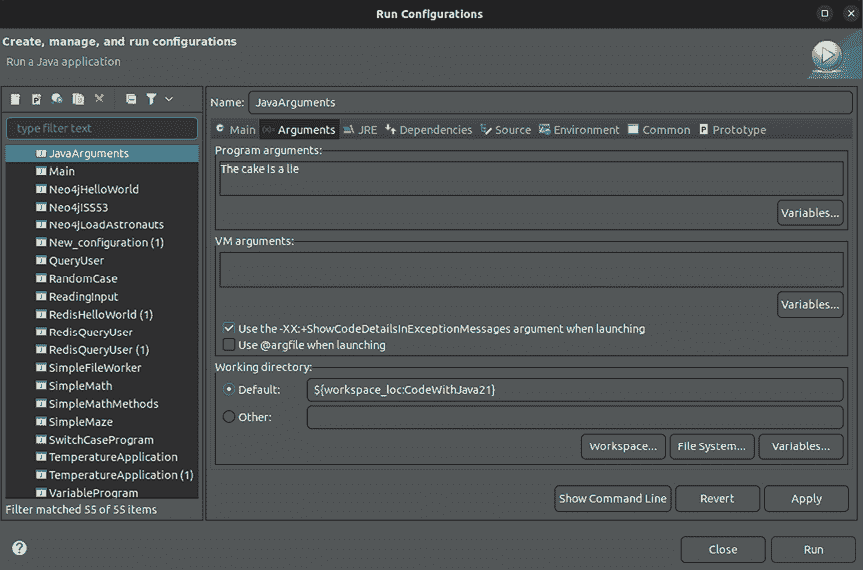

图 4.1：Eclipse IDE 中运行配置窗口的 Arguments 选项卡

对于我们的程序参数，我们将输入一个简单的句子：The cake is a lie。如果我们使用这个字符串作为参数运行程序，我们将得到以下输出：

```text
You have supplied 5 arguments:

Argument #0:The

Argument #1:cake

Argument #2:is

Argument #3:a

Argument #4:lie
```

参数数组可以是向我们的 Java 程序传递有限数量参数的有用工具。

如果我们愿意，我们也可以反向遍历我们的`args`数组。只需要对`for`循环进行简单的调整即可：

```java
for (int index = args.length - 1; index > -1; index--) {
```

现在运行我们的代码应该产生：

```text
You have supplied 5 arguments:

Argument #4:lie

Argument #3:a

Argument #2:is

Argument #1:cake

Argument #0:The
```

## 多维数组

数组的索引也可以有多个维度。为了演示这一点，让我们创建一个新类。我们将它命名为`CoordinateArrays`，并确保它在`chapter4`包中并包含一个`main()`方法。

```java
package chapter4;

public class CoordinateArrays {

    private static String [][] gameGrid = new String[5][5];

    public static void main(String[] args) {

        gameGrid[3][2] = "Byorki - Ranger";

        gameGrid[3][3] = "K'lar - Fighter";

        gameGrid[4][3] = "Tyrenni - Wizard";

        gameGrid[1][3] = "Athena - Rogue";

        gameGrid[0][1] = "Jarrod - Cleric";

    }

}
```

该语句定义了一个新的`gameGrid`数组来存储最多 5x5 (25) 个值。定义数组后，我们可以添加英雄的位置，如[图 4.2]所示：

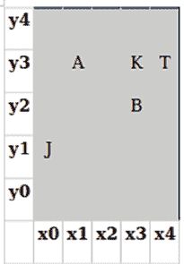

图 4.2：显示英雄 X,Y 坐标的网格，以名称的首字母表示

我们可以通过引用网格坐标来显示特定英雄的位置：

```java
System.out.println(gameGrid[4][3]);
```


如果我们运行这段代码，我们应该看到：

`Tyrenni - Wizard`

> 注意：Java 根据定义变量的最大大小分配内存。对于多维数组，我们需要小心不要将其定义得太大，否则它们将消耗大部分（全部）Java 堆上的可用内存。

让我们写一个新的私有静态方法来打印网格：

```java
private static void printGrid() {
    System.out.println();
```

我们将从打印一个空行开始以保持输出间距适当。接下来，我们将使用一对嵌套的 `for` 循环来遍历 `gameGrid` 数组的维度。问题是我们的网格（如图 4.2 所示）从零到四，从左到右增加，并从向下向上。但我们的标准输出是从左到右、从上到下。因此，我们必须反向遍历 Y 轴：

```java
for (int indexY = 4; indexY > -1; indexY--) {
    // 输出列轴键
    System.out.print(indexY);

    for (int indexX = 0; indexX < 5; indexX++) {
```

接下来，我们应该检查当前的 `gameGrid` 条目是否为空（null）。如果是，说明它是一个未占用的空间，我们将打印一个正方形轮廓。我们运行此检查是因为，如果我们检查最可能 true 条件，程序运行速度通常会快一点：

```java
if ((gameGrid[indexX][indexY] == null) || (gameGrid[indexX][indexY].equals(""))) {
    // 输出正方形字符
    System.out.print((char)9634);
} else {
    // 输出英雄名字中的第一个字符
    System.out.print(gameGrid[indexX][indexY].charAt(0));
}

System.out.println();

// 打印行轴键
System.out.println(" 01234");
```

我们使用 `println()` 完成内层循环并跳转到下一行。最后，我们通过在网格底部打印 X 轴数字作为键完成外层循环。现在回到我们的 `main()` 方法，并在末尾添加对新 `printGrid()` 方法的调用。

运行这段代码应该产生以下输出：

```text
Tyrenni - Wizard

4▢▢▢T▢
3▢▢BK▢
2▢▢▢▢▢
1▢▢▢A▢
0▢J▢▢▢
01234
```

我们也可以很容易地移动其中一个英雄。创建一个名为 `movePlayer` 的新私有静态方法并使其接受以下三个参数：

- `char direction`
- `int currentX`
- `int currentY`

在 `movePlayer` 方法中，我们将开始初始化两个新变量，赋值为 `currentX` 和 `currentY` 坐标的值：

```java
private static void movePlayer(char direction, int currentX, int currentY) {
    int newX = currentX;
    int newY = currentY;
```

接下来，我们将对 `direction` 变量使用 `switch/case` 语句并适当调整我们的新坐标：

```java
switch (Character.toUpperCase(direction)) {
    case 'N':
        // 北
        newY++;
        break;

    case 'S':
        // 南
        newY--;
        break;

    case 'W':
        // 西
        newX--;
        break;

    default:
        // 东
        newX++;
}
```

基本上，我们的英雄可以通过增加和递减（分别）`newY` 轴值来向北和向南移动。我们通过增加和递减（分别）`newX` 轴值向东和向西移动。对于实际移动，我们将保存存储在 `currentX` 和 `currentY` 坐标上的值：

```java
String hero = gameGrid[currentX][currentY];

// 移动玩家
gameGrid[newX][newY] = hero;

// 清除旧位置
gameGrid[currentX][currentY] = "";
```

然后我们将 `hero` 值设置为我们在网格上的新位置，并通过将当前位置设为空字符串来完成。最后，我们将打印一行描述移动活动的的输出：

```java
System.out.println("Moved " + hero + " from (" + currentX + "," + currentY + ") to " + "(" + newX + "," + newY + ")");
```

回到 `main()` 方法，让我们添加对 `movePlayer()` 的调用，并传入方向 `N`（北）和 Athena 的当前位置：

```java
// 将玩家 Athena 从 1,3 移动到 1,4
movePlayer('N', 1, 3);

printGrid();
```

现在运行我们的代码应该打印以下输出：

```text
Tyrenni - Wizard

4▢▢▢▢▢
3▢A▢KT
2▢▢▢▢▢
1J▢▢▢
0▢▢▢▢▢
01234

Moved Athena - Rogue from (1,3) to (1,4)

4▢A▢▢▢
3▢▢▢KT
2▢▢▢B▢
1J▢▢▢▢
0▢▢▢▢▢
01234
```

如果我们检查底部的网格，可以看到 Athena（由 `A` 表示）已经从 Y 轴 3 向北（向上）移动到了 Y 轴 4。

## 集合与映射

Java 提供了其他几种数据结构，能够存储相同类型的多个数据点，但具有更强大的功能和多变性。这些结构被称为集合（collections）。

我们将讨论三种主要的 Java 集合结构类型：

- `Sets`（集合）
- `Lists`（列表）
- `Maps`（映射）

与 Java 中的所有事物一样，一切都是对象。这意味着所有事物都继承自 `Object` 基类。此外，sets 和 lists 都继承自 `Collection` 基类。虽然 maps 可能不继承 `Collection`，但它们仍然是 Java 集合框架的一部分，并且具有与处理内部数据类似的方法和方式。

对于我们的集合示例，我们将创建一个名为 `WorkingWithCollections` 的新 Java 类。它应该位于 `chapter4` 封包中，拥有一个 `main()` 方法，并包含指定的导入：

```java
package chapter4;

import java.util.Collections;

public class WorkingWithCollections {
    public static void main(String[] args) {
    }
}
```

在我们进行得太远之前，让我们创建一个新的静态方法来输出我们正在处理的任何集合的内容。在我们新类的末尾添加一个名为 `printCollection` 的新方法。它的类型应为 `void`（无返回值），并接受一个 `Collection` 类型的对象作为其唯一参数：

```java
private static void printCollection(Collection collection) {
    for (Object element : collection) {
        System.out.printf("%s, ", element.toString());
    }

    System.out.println();
}
```

> 注意：从技术上说，我们可以省略对 `element` 的 `toString()` 方法调用。`print()`、`printf()` 和 `println()` 方法都会隐式地将其输出参数转换为字符串。

此方法能够显示任何集合或列表的内容，因为它们都继承自 `Collection` 基类。

## Sets（集合）

最简单的集合类型是 set。集合是多个数据项的唯一集合。有不同类型的集合，它们之间存在微妙的，我们将这些这些。

让我们从创建一个新的字符串数组并用我们英雄的名字初始化它开始：

```java
String[] heroes = {"Byorki", "K'lar", "Tyrenni", "Athena", "Jarrod"};
```

对于后续示例，我们应该使用导入：

```java
import java.util.HashSet;
import java.util.LinkedHashSet;
import java.util.Set;
import java.util.TreeSet;
```

### HashSet

接下来，我们将创建一个 `HashSet` 并使用 `heroes` 数组填充它：

```java
Set<String> heroSet = new HashSet<>();

Collections.addAll(heroSet, heroes);

printCollection(heroSet);
```

运行我们的代码应该产生以下输出：

```text
Byorki, K'lar, Tyrenni, Athena, Jarrod,
```

让我们向 `heroSet` 添加一个元素：

```java
heroSet.add("Byorki");
```

`Byorki` 已经在那里了，但我们将再次添加她。现在让我们运行代码并检查输出：

```text
Byorki, K'lar, Tyrenni, Athena, Jarrod,
```

没错！输出是相同的。集合中的值必须是唯一的，所以对 `add()` 方法的调用失效了。让我们添加一个不同的名字：

```java
heroSet.add("Rik");
```

运行我们的代码产生：

```text
Byorki, K'lar, Rik, Tyrenni, Athena, Jarrod,
```

记住 `HashSet` 不保持任何顺序。

### LinkedHashSet

让我们修改 `heroSet` 的定义。我们将注释掉并重新定义其实现以使用 `LinkedHashSet`：

```java
// Set<String> heroSet = new HashSet<>();

Set<String> heroSet = new LinkedHashSet<>();
```

我们还需要导入 `LinkedHashSet`：

```java
import java.util.LinkedHashSet;
```

如果我们不做其他其他更改，运行代码将产生以下输出：

```text
Byorki, K'lar, Tyrenni, Athena, Jarrod, Rik,
```

注意 Rik 是移动到集合末尾的。这是因为 `LinkedHashSet` 维护了元素添加的顺序。由于 Rik 是最后添加的，所以他位于集合的末尾。

### TreeSet

我们将再次修改 `heroSet` 的定义，这次将其实现更改为 `TreeSet`：

```java
// Set<String> heroSet = new HashSet<>();

// Set<String> heroSet = new LinkedHashSet<>();

Set<String> heroSet = new TreeSet<>();
```

记得同样导入 `TreeSet`：

```java
import java.util.TreeSet;
```

再次，在不进行任何其他更改的情况下运行我们的代码会产生以下结果：

```text
Athena, Byorki, Jarrod, K'lar, Rik, Tyrenni,
```

`heroSet` 的值现在按字母数字顺序排列。`TreeSet` 对其元素执行二分排序。它们添加的顺序不再被维护，但有时确实需要集合按照其排序后的字母数字顺序排列。

从集合中删除项是一项简单任务：

```java
heroSet.remove("Rik");
```

为 Rik 添加 `remove()` 方法并运行我们的代码会产生此输出：

```text
Athena, Byorki, Jarrod, K'lar, Tyrenni,
```

## 列表

让我们开始处理列表。列表是项的简单集合，按索引排序。它们的功能与数组非常相似，同样地，它们允许重复条目。与集合类似，这里将检查列表的几种不同的实现方式。

以下导入将有助于接下来的示例：

```java
import java.util.ArrayList;
import java.util.List;
import java.util.LinkedList;
```

不同类型的集合之间有一些细微的差异，我们将进行检查。让我们从创建一个新的字符串数组并用我们英雄的名字初始化它：

```java
String[] heroes = {"Byorki", "K'lar", "Tyrenni", "Athena", "Jarrod"};
```

### ArrayList

让我们定义名为 `monsterList` 的新字符串列表，实现类型为 `ArrayList`：

```java
List<String> monsterList = new ArrayList<>();
```

定义完成后，我们将向其添加几个元素：

```java
monsterList.add("Kobald");
monsterList.add("Skeleton");
monsterList.add("Zombie");
monsterList.add("Rats");
monsterList.add("Skeleton");
```

随后，我们将调用 `printCollection()` 将我们的列表输出到控制台：

```java
printCollection(monsterList);
```

运行我们的代码会在我们的输出中添加此行：

```text
Kobald, Skeleton, Zombie, Rats, Skeleton,
```

注意我们的 `monsterList` 顺序是我们我们输入元素的顺序，并且 `Skeleton` 出现了两次。现在，我们将使用 `Collection` 类中的 `sort()` 方法使 `monsterList` 排序：

```java
Collections.sort(monsterList);
```

现在运行我们的代码显示 `monsterList` 的内容如下：

```text
Kobald, Rats, Skeleton, Skeleton, Zombie,
```

如你所见，`monsterList` 中的元素现在按字母数字顺序排序了。这之所以起作用，是因为 `List` 被定义为持有字符串值，而 Java 的 `String` 类实现了 `comparable` 接口以供字符串使用。

从列表中删除元素与从集合中删除元素完全相同。在这里，我们将对 `Skeleton` 执行 `remove()` 操作：

```java
monsterList.remove("Skeleton");
```

运行我们的代码会导致 `monsterList` 的内容看起来像这样：

```text
Kobald, Rats, Skeleton, Zombie,
```

如你所见，列表中第一个出现的 `Skeleton` 被删除了。然而，第二个 `Skeleton` 仍然存在。这是在列表上执行 `remove()` 时考虑的一个重要方面。虽然第一个匹配项被删除，但命名元素的任何重复项都不会被删除。

`remove()` 方法也可以通过数字索引工作。如果我们通过索引删除 `Skeleton` 元素，可以这样做：

```java
monsterList.remove(2);
```

我们还可以通过使用元素的数字索引来访问 `ArrayList` 中的单个元素。在代码的末尾，我们将使用 `get()` 方法输出列表中的第二个项目（索引为 1）：

```java
System.out.println(monsterList.get(1));
```

运行我们的代码显示 `monsterList` 以及 `monsterList` 位置 1 处元素的输出如下：

```text
Kobald, Rats, Skeleton, Zombie,
```

### Rats

> 注意：记住 Java 是从零开始计算数字索引的。列表中的第一个元素索引为 0，第二个元素索引为 1，第三个元素索引为 2，以此此类推。

### Vector

我们也可以使用 `Vector` 具体类来定义 `monsterList`。我们不会展示它的任何示例，因为它的行为与 `ArrayList` 类似。实例化方式如下：

```java
List<String> monsterList = new Vector<>();
```

`ArrayList` 和 `Vector` 在功能行为上没有区别。创建 `Vector` 类型列表的优势是 `Vector` 被认为是是线程安全的。因此，在使用 `Vector` 时，我们可能会产生微小的性能损失。因此，如果应用程序没有使用线程，`ArrayList` 是更好的选择。

#### Thread safety

本质上，如果对象被许多线程同时访问，状态可能会损坏或不一致。线程安全采用同步技术来确保它们一次被访问一次。

### LinkedList

Java 的 `LinkedList` 是链表数据结构的一种实现。链表的独特之处在于每个元素都有指向后一个和前一个元素的指针。为了获得可用方法的完整功能，我们将指定 `LinkedList`：

```java


```java
LinkedList<String> cityList = new LinkedList<>();

cityList.add("Elddim");

cityList.add("Crystwind");

cityList.add("Fallraen");

cityList.add("Meren");

cityList.add("Lang");

printCollection(cityList);
```

运行我们的代码显示`cityList`的这些值：

```text
Elddim, Crystwind, Fallraen, Meren, Lang,
```

如你所见，它们确实按照添加的顺序列出。这可以在图 4.3 中看到：

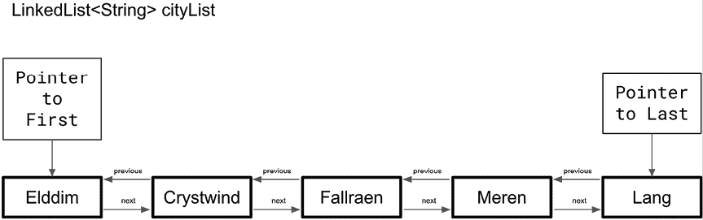

图 4.3：`cityList` 的可视化

与`ArrayList`类似，`LinkedList`中的元素可以通过数字索引引用：

```java
System.out.println(cityList.get(3));
```

运行此代码返回：

```text
Meren
```

正如我们在`ArrayList`中看到的，我们也可以通过索引或元素删除：

```java
cityList.remove("Meren");

printCollection(cityList);
```

这里的区别在于发生了以下步骤：

- 找到了元素`Meren`。
- 删除了元素`Meren`。
- `Lang`将其前一个指针设置为`Fallraen`。
- `Fallraen`将其下一个指针设置为`Lang`。

运行我们的代码现在返回此输出：

```text
Elddim, Crystwind, Fallraen, Lang,
```

`LinkedList`还提供了其他独特且有用的方法。如果我们想查看列表顶部并输出该元素，可以使用：

```java
System.out.println(cityList.peek());

printCollection(cityList);
```

代码在我们的输出中添加了这些行：

```text
Elddim
Elddim, Crystwind, Fallraen, Lang,
```

我们可以对最后一个元素执行操作：

```java
System.out.println(cityList.peekLast());

printCollection(cityList);
```

这产生了以下输出：

```text
Lang
Elddim, Crystwind, Fallraen, Lang,
```

此外，我们可以对列表进行`poll`：

```java
System.out.println(cityList.poll());

printCollection(cityList);
```

我们输出的最后两行如下：

```text
Elddim
Crystwind, Fallraen, Lang,
```

还有一个`pollLast()`方法，它在列表最后一个元素上表现出相似的行为。`peek()`和`poll()`方法之间的区别如下：

- `poll()`返回列表中的第一个元素的值。
- `peek()`返回列表中的第一个元素的值并将该元素从列表中移除。

我们将在“有序集合（Sequenced Collections）”章节中讨论`pollLast()`及其对应的`pollFirst()`。

> 注意：除了每个元素都有指向上一个和下一个元素的指针外，`LinkedList`还维护了指向列表第一个和最后一个元素的指针。

理解何时使用`ArrayList`与何时使用`LinkedList`至关重要。这完全取决于项目数量和操作类型。在技术领域，有一个被称为大 O 表示法（Big O notation）的概念。本质上，它是一种思考操作或算法背后执行复杂度的方式。向`ArrayList`中添加项目是一个`O(n)`操作。完成操作（`O`）所需的时间与列表中元素数量（`n`）正比。这是因为向`ArrayList`中添加元素在知道将新元素插入在哪里之前，必须对索引进行查找。

相反，向`LinkedList`中添加项目（使用大 O 表示法）是一个`O(1)`操作。这意味着完成操作（`O`）所需的时间是固定的，与列表中项目的数量无关。这是因为（默认情况下）`LinkedList`中的所有新元素都位于末尾。Java 不需要花费额外时间来确定将它们放在哪里。

结果是，如果我们计划使用大型列表，并且向列表添加的项目多于读取列表，那么使用`LinkedList`更合理。另一方面，如果我们大部分时间都花在读取列表项目（而不是添加太多新项目），那么`ArrayList`或`Vector`就足够了。

我们将在稍后的章节中详细讨论链表。

## Maps

比较独特的集合类型之一是 map。map 适用于存储少量的基于键/值对的数据。某些数据库（如 Apache Cassandra）使用 map 来提供小规模的反范式化（在数据行中存储额外的属性），以避免额外查询的需求。

在开始处理 map 之前，我们将创建一个小型的静态方法，将 map 内容输出到控制台。我们不能使用`printCollection()`方法，因为`Map`类没有继承自`Collection`基类。

在我们的类末尾添加一个名为`printMap`的新方法。它的类型应为`void`（无返回值），并接受一个类型为`Map`的对象作为唯一参数：

```java
private static void printMap(Map map) {
    System.out.println();

    Set<Object> keys = map.keySet();

    for (Object key : keys) {
        System.out.printf("%s: %s\n", key, map.get(key));
    }
}
```

如所示，`printMap()`方法的工作方式与`printCollection()`方法不同。我们首先初始化名为`keys`的`Set`，其值为`map`的`keySet()`方法返回的值。键集的内部元素类型为`Object`，因为我们不知道 map 的键是什么类型。因此，我们使用基类`Object`，以便它可以处理几乎任何类型。然后，我们使用`for`循环遍历`keys`的每个键，并在`printf()`中使用`map`的`get()`方法输出与键关联的值。

我们还会创建一个名为`printKeys`的方法，它只输出 map 的键。由于在某些示例中键和值的输出可能冗长，这将带给我们简洁的优势。

我们的`printKeys()`方法与`printMap()`方法有些相似之处，如下所示。在我们的`WorkingWithCollections`类末尾添加以下方法：

```java
private static void printKeys(Map map) {
    System.out.println();

    Set<Object> keys = map.keySet();

    for (Object key : keys) {
        System.out.printf("%s, ", key);
    }

    System.out.println();
}
```

在 Java 中，有多种类型的`Map`实现。最常用的是`HashMap`，我们现在开始学习。

以下导入将允许我们完成后续的示例：

```java
import java.util.HashMap;
import java.util.LinkedHashMap;
import java.util.Map;
import java.util.TreeMap;
```

## HashMap

在我们的`main()`方法末尾，创建一个名为`spellbook`的新 map。它的键类型应为`String`，值类型应为`String`。然后我们将使用`map`的`put()`方法将键/值对添加到`spellbook`中，并用我们的`printMap()`方法结束：

```java
Map<String,String> spellbook = new HashMap<>();

spellbook.put("Fireball", "A ball of fire that inflicts 8 damage per level of magic.");

spellbook.put("Healing Touch", "Touching an injured player recovers 5 hit points per character level.");

spellbook.put("Lightning Bolt", "A stream of lightning that inflicts 10 damage per level of magic.");

spellbook.put("Create Water", "Creates 10 liters of water per level of magic.");

spellbook.put("Transmutation", "Converts common items into gold.");

printMap(spellbook);
```

运行我们的代码应该在最后产生此新输出：

```text
Fireball: A ball of fire that inflicts 8 damage per level of magic.
Transmutation: Converts common items into gold.
Create Water: Creates 10 liters of water per level of magic.
Healing Touch: Touching an injured player recovers 5 hit points per character level.
Lightning Bolt: A stream of lightning that inflicts 10 damage per level of magic.
```

## Hashtable

类似于`vector`与`ArrayList`的关系，`Hashtable`实现是`HashMap`的线程安全替代方案。如果我们需要`HashMap`的功能来支持多线程交互，`Hashtable`是更好的选择：

```java
Map<String,String> spellbook = new Hashtable<>();
```

## LinkedHashMap

接下来，我们将`spellbook`改为`LinkedHashMap`。`LinkedMaps`与`LinkedLists`相似，每个条目都有指向下一个和上一个元素的指针：

```java
Map<String,String> spellbook = new LinkedHashMap<>();
```

运行我们的代码将显示 map 的键按以下顺序排列：

```text
Fireball, Healing Touch, Lightning Bolt, Create Water, Transmutation,
```

- **访问顺序启用 (Access order enabled)**：这是一个布尔值，表示访问（获取）一个元素是否应该触发重排序操作。这会将最近访问的键/值对放在列表的底部。

我们可以通过重新定义`LinkedHashMap`的实例化来不同的演示这一点：

```java
Map<String,String> spellbook = new LinkedHashMap<>(5,.8f,true);
```

现在，注释掉对`printMap()`的调用，并输出`Lightning Bolt`键的值：

```java
//printMap(spellbook);

System.out.print(spellbook.get("Lightning Bolt"));

printKeys(spellbook);
```

运行这段代码将显示新的键顺序：

```text
Fireball, Healing Touch, Create Water, Transmutation, Lightning Bolt,
```

如所示，Lightning Bolt 的键现在出现在末尾，因为它最近被访问过。

### ConcurrentModificationException（并发修改异常）

对于前面的示例，我们注释掉了对`printMap()`方法的调用。如果我们没有注释掉那行，代码将会在`ConcurrentModificationException`失败。

记住我们在`printMap()`中的`for-each`循环首先获取所有键，然后对每个键执行`get()`。通过传递`true`值来启用访问顺序，`get()`调用实际上修改了 map，不断地将最近访问的键/值对置于 map 的末尾。Java 识别到了这一点并抛出`ConcurrentModificationException`以防止我们陷入无限循环。

### TreeMap

现在我们将修改`spellbook`实现以使用`TreeMap`：

```java
Map<String,String> spellbook = new TreeMap<>();
```

现在运行我们的代码将显示末尾的这个键列表：

```text
Create Water, Fireball, Healing Touch, Lightning Bolt, Transmutation,
```

如所示，map 已经按照字母数字顺序对键进行了排序。这是因为`TreeMap`在后台实现了（JavaTPoint 2021）二叉搜索和红黑树，以加速操作时间。

> 注意：与之前的 map 实现不同，`TreeMap`不允许添加带有空键的键/值对。

### 有序集合 (Sequenced collections)

Java 21 的一个新功能是（Parlog 2023）有序集合。本质上，这个功能暴露了所谓的“相遇顺序”（encounter order）。列表现在还继承了一个名为`SequencedCollection`的新类，它提供了许多新方法，使得处理列表第一个和最后一个条目变得简单得多。这允许了新的行为，类似于链表可以实现的：

- `getFirst()`：返回集合中的第一个元素
- `getLast()`：返回集合中的最后一个元素
- `addFirst(element)`：在集合开头添加新元素
- `addLast(element)`：在集合末尾添加新元素
- `reversed()`：返回列表的反向顺序视图

> 注意：如果该集合是不可修改的，或者添加操作违反了排序集合当前的顺序，`addFirst()`和`addLast()`方法将抛出异常。

虽然集合（sets）没有看到同程度改进，但它们确实获得了`reversed()`方法。在集合上调用`reversed()`方法将返回一个`SequencedSet`对象，其中包含集合的反向顺序视图。

> 注意：这种针对集合和列表的视图反映了底层集合的状态，对视图进行的任何更改也将反映在集合中。

Map 也通过继承 Java 21 中的一个新类而获益，这个类名为`SequencedMap`。该类为所有 map 实现扩展了以下方法：

- `putFirst()`：在 map 开头添加新的键/值对
- `putLast()`：在 map 末尾添加新的键/值对
- `firstEntry()`：返回 map 的第一个键/值对
- `lastEntry()`：返回 map 的最后一个键/值对
- `pollFirstEntry()`：从 map 开头移除并返回键/值对
- `pollLastEntry()`：从 map 末尾移除并返回键/值对
- `sequencedKeySet()`：返回 map 键的`sequencedSet`视图
- `sequencedValues()`：返回 map 值的`sequencedSet`视图
- `sequencedEntrySet()`：返回 map 中键/值对的`sequencedSet`视图

这些方法在开发者工具箱中非常有用，因为降低了使用 Java 集合的学习曲线。

### Records（记录）

Records 的概念在 Java 14 中引入。Records 本质上是不可变的简单旧 Java 对象 (POJOs)。对 POJO 的批评之一是创建它们时有大量的样板代码，因为所有的 POJO 都需要构造函数、私有属性以及成对的 getter/setter。

> 注意：在这个意义上，“样板代码”指的是输入到每个对象中的标准代码，其创建过程被认为是繁琐的。

我们将创建一个 record 来跟踪我们的英雄要探索的房间对象。我们的`Room` record 完全符合不可变的标准，因为通常冒险游戏中的房间是预先定义的且不会改变。

我们将从定义我们的`Room` record 开始：

```java
record Room(String name, String description, List<String> exits) {
}
```

在大括号内部，我们可以定义任何所需的以完善`Room` record 的额外代码。冒险游戏的一个常见需求是知道房间可能的出口。因此，我们将构建一个公共的`getExits()`方法。我们还将实现一个 if-else 检查来格式化输出。

```java
import java.util.List;
import java.util.Map;
import java.util.Random;
import java.util.TreeMap;

public class RPGSimulation {

record Monster (String name, int attack, int maxDamage, int defense) {

    static Random random = new Random();


```java
static int hitPoints = 2;

static boolean alive = true;

public int rollAttack() {
    return random.nextInt(attack) + 1;
}

public int rollDamage() {
    return random.nextInt(maxDamage) + 1;
}

public boolean isAlive() {
    return alive;
}

}

public static void main(String[] args) {
    Random randomNumber = new Random();
    int monsterCount = randomNumber.nextInt(4) + 1;
}
```

在定义好类之后，我们将在`main()`方法之外构建`Monster`记录（record）。这将允许从其他私有方法中调用`Monster`记录。

`Monster`记录将定义`name`、`attack`、`maxDamage`和`defense`属性。它还将默认将`hitPoints`设置为`2`，并且`alive`布尔值将赋予默认值`true`。之后，我们将构建两个名为`rollAttack`和`rollDamage`的公共方法，它们将根据`attack`或`maxDamage`中包含的值产生随机值。我们将通过一个名为`isAlive`的方法结束方法，以暴露`alive`布尔属性。

在`main()`方法内部，我们将实现一个名为`randomNumber`的随机数生成器，并开始随机生成 RPG 模拟中将出现的怪物数量。此生成的值将是 1 到 4 之间的随机数，并存储在整数变量`monsterCount`中。

接下来，我们将构建一个名为`monsters`的新`ArrayList`，它将持有多个`Monster`记录的值：

```java
List<Monster> monsters = new ArrayList<>();

for (int monsterIdx = 0; monsterIdx < monsterCount; monsterIdx++) {
    int typeIdx = randomNumber.nextInt(4);

    switch (typeIdx) {
        case 0:
            monsters.add(new Monster("Kobald", 2, 8, 1));
            break;

        case 1:
            monsters.add(new Monster("Skeleton", 2, 8, 2));
            break;

        case 2:
            monsters.add(new Monster("Zombie", 1, 6, 2));
            break;

        default:
            monsters.add(new Monster("Rats", 1, 4, 1));
    }
}
```

前面的代码将通过`for-each`循环遍历怪物数量。在循环内部，它将随机从 0 到 3 选取一个数字作为要生成的怪物类型。然后它将使用`switch-case`，使用适当的值调用`Monster`构造函数，并将怪物名称添加到`monsterNames`列表中。

接下来，我们将复用`WorkingWithCollections`类中的代码来构建`spellbook`，因为我们有一个英雄会使用它：

```java
Map<String, String> spellbook = new TreeMap<>();

spellbook.put("Fireball", "A ball of fire that inflicts 8 damage per level of magic.");
spellbook.put("Healing Touch", "Touching an injured player recovers 5 hit points per character level.");
spellbook.put("Lightning Bolt", "A stream of lightning that inflicts 10 damage per level of magic.");
spellbook.put("Create Water", "Creates 10 liters of water per level of magic.");
spellbook.put("Transmutation", "Converts common items into gold.");
```

## Player 类

接下来，我们将在`chapter4`包中创建两个新类（没有`main`方法），分别命名为`Player`和`Hero`。

我们将从`Player`类开始：

```java
package chapter4;

import java.util.Random;

public class Player {
    private Random random = new Random();

    private String name;
    private int attack;
    private int maxDamage;
    private int defense;
    private int hitPoints;
    private boolean alive;
}
```

如所示，我们将首先定义私有属性。接下来，我们将构建构造函数：

```java
public Player(String name, int attack, int maxDamage, int defense) {
    this.name = name;
    this.attack = attack;
    this.maxDamage = maxDamage;
    this.defense = defense;
    this.alive = true;
}
```

对于`Player`构造函数，我们将存储传递给`name`、`attack`、`maxDamage`和`defense`的属性值。我们还将`alive`初始化为值`true`。

接下来，我们需要公共方法来根据`attack`和`maxDamage`值生成值：

```java
public int rollAttack() {
    return random.nextInt(attack) + 1;
}

public int rollDamage() {
    return random.nextInt(maxDamage) + 1;
}
```

接下来，我们将构建 getter 和 setter。还记得我们之前讨论过 Java `records` 并在本章早期提到繁琐的样板代码吗？这就是它的意思：

```java
public String getName() {
    return name;
}

public void setName(String name) {
    this.name = name;
}

public int getAttack() {
    return attack;
}

public void setAttack(int attack) {
    this.attack = attack;
}

public int getMaxDamage() {
    return maxDamage;
}

public void setMaxDamage(int maxDamage) {
    this.maxDamage = maxDamage;
}

public int getDefense() {
    return defense;
}

public void setDefense(int defense) {
    this.defense = defense;
}

public int getHitPoints() {
    return hitPoints;
}

public void setHitPoints(int hitPoints) {
    this.hitPoints = hitPoints;
}

public boolean isAlive() {
    return alive;
}

public void setAlive(boolean alive) {
    this.alive = alive;
}
```

> 注意：Eclipse IDE 可以自动生成 getter 和 setter。右键点击文件，选择 Source，然后选择 Generate Getters and Setters。

最后，我们需要一个减少`hitPoints`的公共方法：

```java
public void decrementHitPoints(int damage) {
    this.hitPoints -= damage;
}
```

## Hero 类

接下来，在`chapter4`包中创建`Hero`类。`Hero`类将继承`Player`类：

```java
package chapter4;

import java.util.Map;

public class Hero extends Player {
    private Map<String, String> spellbook;
}
```

我们还将定义`spellbook`为私有属性。通过`Hero`类，我们将定义两个构造函数：

```java
public Hero(String name, int attack, int maxDamage, int defense) {
    super(name, attack, maxDamage, defense);
    setHitPoints(5);
}
```

第一个构造函数接受`name`、`attack`、`maxDamage`和`defense`。它使用`super`关键字将这些参数传递给基类（在本例中为`Player`）。它还将`hitPoints`设置为`5`。

第二个构造函数类似，但它接受`spellbook`参数：

```java
public Hero(String name, int attack, int maxDamage, int defense, Map<String, String> spellbook) {
    this(name, attack, maxDamage, defense);
    this.spellbook = spellbook;
}
```

如所示，第二个构造函数使用`this`关键字，使用传递的第一个参数调用第一个构造函数。然后它使用作为最后一个参数的`spellbook`映射初始化`spellbook`属性。

由于我们的属性都继承自`Player`类，我们只需要为`spellbook`属性生成 getter 和 setter：

```java
public Map<String, String> getSpellbook() {
    return spellbook;
}

public void setSpellbook(Map<String, String> spellbook) {
    this.spellbook = spellbook;
}
```

## 继续 RPGSimulation

构建`Player`和`Hero`类后，我们可以回到`RPGSimulation`类。在`main()`方法的末尾（`spellbook`代码之后），我们将定义英雄：

```java
Hero byorki = new Hero("Byorki", 8, 5, 5);
Hero klar = new Hero("K'lar", 10, 12, 3);
Hero tyrenni = new Hero("Tyrenni", 6, 2, 6, spellbook);
```

实例化这三个英雄后，我们现在将它们添加到一个名为`heroes`的新`ArrayList`中：

```java
List<Hero> heroes = new ArrayList<>();

heroes.add(byorki);
heroes.add(klar);
heroes.add(tyrenni);
```

现在，我们将在`RPGSimulation`类末尾添加一个新方法。它是一个名为`generatePlayerOrder`的`static`方法，返回一个`ArrayList<String>`并接受`list<Hero>`和`list<Monster>`作为参数。该方法的目的是获取我们英雄和怪物的名称，并随机将它们合并到一个列表中。

为了实现这一点，我们将`playerCount`定义为两个列表中元素的总数。一旦所有玩家都分配到主列表中，`returnValue`列表的大小将与`playerCount`相同。本质上，我们将随机决定从`heroList`或`monsterList`中抽取，然后从该列表中随机选取一个有效索引：

```java
private static List<Object> generatePlayerOrder(List<Hero> heroList, List<Monster> monsterList) {
    List<Hero> tempHeroList = new ArrayList<Hero>(List.copyOf(heroList));
    List<Monster> tempMonsterList = new ArrayList<Monster>(List.copyOf(monsterList));
    List<Object> returnValue = new ArrayList<>();
    Random random = new Random();

    int playerCount = heroList.size() + monsterList.size();

    while (returnValue.size() < playerCount) {
        if (random.nextBoolean()) {
            if (!tempHeroList.isEmpty()) {
                int heroIndex = random.nextInt(tempHeroList.size());

                returnValue.add(tempHeroList.get(heroIndex));
                tempHeroList.remove(heroIndex);
            }
        } else {
            if (!tempMonsterList.isEmpty()) {
                int monsterIndex = random.nextInt(tempMonsterList.size());

                returnValue.add(tempMonsterList.get(monsterIndex));
                tempMonsterList.remove(monsterIndex);
            }
        }
    }

    return returnValue;
}
```

我们做的第一件事是创建两个新的`ArrayList`，命名为`tempHeroList`和`tempMonsterList`。这允许我们通过移除对象的方式来跟踪谁已被选中，而不会影响主`heroList`和`monsterList`。然后，我们定义了一些变量来辅助工作，包括一个名为`returnValue`的`ArrayList`，它是`Object`的`List`，这样我们就可以为其添加任何类的对象。

接着，我们构建了一个`while`循环，只要`returnValue`列表的大小小于`heroList`和`monsterList`中元素的总数（`playerCount`），该循环就会一直运行。在`while`循环内部，我们会在从`tempHeroList`和`tempMonsterList`提取随机元素（使用两个随机生成的数值）之间切换。这样，我们就有了一个包含游戏中所有玩家（英雄和怪物）的列表，且其顺序尽可能随机。

> 注意：`Random`的`nextBoolean()`方法的作用正如其名，即它会随机返回 true 或 false 值。

生成`returnValue`列表后，我们将其返回给调用者方法。回到我们的`main()`方法中，我们创建了一个新的`Object`类型`List`，并将其设置为`generatePlayerOrder()`方法返回的值：

```java
List<Object> playerOrder = generatePlayerOrder(heroes, monsters);
```


然后，我们遍历`playerOrder`来模拟 RPG 冒险游戏中的一个回合行动。我们需要的第一件事是检查当前玩家对象是`Hero`还是`Monster`。我们可以使用`instanceof`关键字来实现这一点。我们还希望在允许英雄行动之前确保他们是活着的，这可以通过调用从`Player`类继承的`isAlive()`方法来实现：

```java
for (Object player : playerOrder) {

    System.out.println();

    if (player instanceof Hero hero) {

        if (hero.isAlive()) {

            String name = ((Hero) player).getName();

            int monsterIndex = randomNumber.nextInt(monsters.size());

            Monster targetMonster = monsters.get(monsterIndex);

            System.out.println(name + " attacks " + targetMonster.name());

            int attack = hero.rollAttack();

            if (attack >= targetMonster.defense) {

                int damage = hero.rollDamage();

                System.out.println(name + " rolls a " + attack + " and hits " + targetMonster.name() + " for " + damage + " points.");

                targetMonster.decrementHitPoints(damage);

                if (!targetMonster.isAlive()) {

                    System.out.println(targetMonster.name() + " is down!");

                }

            } else {

                System.out.println(name + " rolls a " + attack + " and misses " + targetMonster.name());

            }

        }
```

在我们嵌套的`if`检查中，我们将通过定义英雄名称、目标怪物的随机索引以及目标怪物自身的变量，为主要的行动逻辑做准备。行动通过存储英雄攻击掷骰的结果开始。只要攻击值大于或等于`targetMonster`的防御，就会命中并向控制台输出适当的消息。如果行动后`targetMonster`的`isAlive()`方法返回`false`值，也会有相应的消息。

紧随英雄行动逻辑之后是一个`else`检查（来自前述代码中的根`if (player instanceof Hero)`语句），用于判断当前玩家类型为`Monster`。该逻辑与我们对`Hero`对象的操作相似，区别在于它调用了`Monster`记录的属性和方法，并选择了一个目标英雄的随机索引：

```java
} else if (player instanceof Monster monster) {

    if (monster.isAlive()) {

        String name = monster.name();

        int heroIndex = randomNumber.nextInt(heroes.size());

        Hero targetHero = heroes.get(heroIndex);

        String heroName = targetHero.getName();

        System.out.println(monster.name() + " attacks " + heroName);

        int attack = monster.rollAttack();

        if (attack >= targetHero.getDefense()) {

            int damage = monster.rollDamage();

            System.out.println(name + " rolls a " + attack + " and hits " + heroName + " for " + damage + " points.");

            targetHero.decrementHitPoints(damage);

            if (!targetHero.isAlive()) {

                System.out.println(heroName + " is down!");

            }

        } else {

            System.out.println(name + " rolls a " + attack + " and misses " + heroName);

        }

    }

}
```

运行这段代码应该构建我们的英雄列表，组合一个随机的怪物列表，并逐步执行 RPG 中的回合行动。由于随机组件的存在，输出会有不同，但它看起来应该是这样的：

```text
Rats attacks Tyrenni
Rats rolls a 5 and misses Tyrenni
Byorki attacks Skeleton
Byorki rolls a 7 and hits Skeleton for 4 points.
Skeleton is down!
Tyrenni attacks Kobald
Tyrenni rolls a 3 and hits Kobald for 2 points.
Kobald is down!
K'lar attacks Kobald
K'lar rolls a 6 and hits Kobald for 10 points.
Kobald is down!
```

在本节中，我们使用了本章节之前涵盖的大部分内容。我们还学习了一些新技巧和关键字：

- 使用`this()`在同一个类中调用其他构造函数
- 构建包含不同类型的列表
- 使用`instanceof`检查类型
- 使用`Random`的`nextBoolean()`生成随机布尔

## 总结

在本章中，我们详细讨论了数组、集合和记录。我们还深入了不同集合实现的细节及其用途、优缺点。此外，我们还讨论了 Java 21 提供的顺序集合的一些新方法和功能。最后，我们通过编写简单的 RPG 应用了所学。

在下一章中，我们将讨论 Java 如何处理算术运算。我们将检查整数运算（在本章中使用过）以及浮点类型的操作。

### 需要记住的点

- 数组是允许我们在单个变量中存储多个值的简单结构。
- 数组通过整数进行索引，并在初始化时必须定义最大大小。
- 数组值可以通过多维度进行索引。
- 集合包含唯一的元素，而列表允许重复。
- `HashSet`不保持顺序，而`TreeSet`会按字母数字顺序排列元素。
- `Collections`类的`sort()`方法是排序集合的好方法，只要元素类型支持或定义了比较器。
- 在多线程环境下操作列表时，请使用`Vector`。`ArrayList`不支持线程安全。
- `LinkedList`适用于大量元素和频繁添加的情况。
- `Map`以键值对的形式存储少量数据，并且不继承`Collection`基类。
- `HashMaps`是无序的，`LinkedHashMaps`按条目顺序排序，而`TreeMaps`按键顺序排序。
- `Sequenced collections`（有序集合）允许开发者轻松地访问底层集合的遭遇顺序，包括用于第一个和最后一个元素的新访问方法。
- `Records`是定义小型不可变对象的一种极佳方式，无需创建一个包含大量冗余、模板化代码的独立 POJO。

## 加入我们书籍的 Discord 空间

加入书籍的 Discord 工作空间以获取最新更新、优惠、全球科技动态、新发布以及与作者的交流会议：

[`discord.bpbonline.com`](https://discord.bpbonline.com)


# 第 5 章 算术运算

数学是上帝编写宇宙的语言。

— 伽利略·伽利

## 引言

在本章中，我们将理解如何在 Java 中进行算术运算。这将引导我们讨论计算机处理数学的一些细微差别。我们还将快速查看如何构建简单的单元测试，因为算术运算的确定性为教授单元测试的基础提供了良好的背景。

虽然有些人可能觉得数学令人敬畏，但作为软件开发者，我们必须接受它。理解计算机如何执行算术运算是学习软件开发的核心，正如伽利略所推断的，也是理解宇宙的核心。

## 结构

在本章中，我们将涵盖以下主题：

- 整数算术
- 浮点数算术

### 目标

本章的主要目标是建立如何在 Java 代码中利用算术运算的基础理解。我们还将借此引入单元测试。这形成了本章的以下目标：

- 学习如何在 Java 中进行整数算术。
- 学习如何在 Java 中进行浮点数算术。
- 理解计算机底层如何处理算术运算。
- 稍微了解单元测试以及如何使用它来确保方法行为的一致性。

## 整数算术

我们将首先展示一些整数（整数）的简单算术运算。首先，在名为`chapter5`的新包中创建一个名为`MathExamples`的新 Java 类。确保该类有一个`main()`方法：

```java
package chapter5;

public class mathExamples {

    public static void main() {

    }

}
```

在我们的`main()`方法内部，定义两个整数变量：

```java
int intNumA = 5;

int intNumB = 3;
```

### 加法

现在，让我们它们相加并打印结果：

```java
System.out.println(intNumA + " + " + intNumB + " = " + intNumA + intNumB);
```

如果运行我们的代码，输出应该如下：

`5 + 3 = 53`

然而，这个输出并不是我们预期的。毕竟，5 加 3 等于 8，而不是 53。

请记住`println`语句中的数值变量会被隐式转换为字符串。最终，我们确实想要那个效果。但首先，我们希望数字先相加。为此，我们将`intNumA`和`intNumB`封装在另一组括号内：

```java
System.out.println(intNumA + " + " + intNumB + " = " + (intNumA + intNumB));
```

现在，当我们运行代码时，会发生操作顺序，括号在转换为字符串之前会被求值：

`5 + 3 = 8`

现在，让我们看看背后发生了什么。

`intNumA`和`intNumB`都是整数。由于整数是基本类型，这些值存储在二进制（也称为二进制）系统中，如下：

```text
intNumA = 5 = 1 0 1

place = 4 2 1

intNumB = 3 = 0 1 1

place = 4 2 1
```

十进制数字 5 变成`101`，因为在 4 位有一个 1，在 1 位上有另一个 1。同样，十进制数字 3 变成`011`，因为在 2 位有一个 1，在 1 位上有一个 1。本质上，这意味着我们正在加`101`和`011`：

```text
  101

+011

----

 1000

answer = 1 0 0 0 = 8

place = 8 4 2 1
```

我们的二进制加法通过以下步骤完成：

1. 在 1 位，我们将 1 加 1，这在二进制中是`10`。因此，我们记录`0`。
2. 在 2 位，我们进位 1 并加 1，结果是`10`。同样，我们记录`0`。
3. 在 4 位，我们进位 1 并加 1，结果是`10`。再次记录`0`。
4. 在 8 位，我们进位 1 并加 0。现在我们记录 1，我们就得到了完整的答案。

在 8 位有一个 1，在 4 位、2 位和 1 位有 0，我们需要完成。

```java
public static int add(int int1, int int2) {

    return int1 + int2;

}
```

现在，我们修改`println`语句：

```java
System.out.println(intNumA + " + " + intNumB + " = " + add(intNumA, intNumB));
```

## 使用 JUnit 测试`add()`

构建算术方法提供了单元测试的机会。单元测试是一种系统的测试方法，涉及对应用程序的各个部分进行测试。

单元测试与确定性操作非常契合。在软件开发中，确定性操作是指给定一组输入会返回相同的可预测结果。在本例中，我们使用 JUnit 库来测试方法。

创建一个新的 JUnit Case。如果文件菜单下没有可用选项，请选择 Other。在下一个对话框中，滚动到 JUnit 并选择 JUnit Case，如图 5.1 所示：


图 5.1：创建 JUnit Case

我们需要在对话框中指定包、名称和测试类。参考图 5.2，并添加此处条目：

- 包：`chapter5`
- 名称：`MathExamplesTests`
- 测试类：`MathExamples`


图 5.2：创建 JUnit Case

> 注意：我们可能需要确认对话框以允许 JUnit 添加到构建路径。

点击 Finish，这将创建`MathExamplesTests`类文件。

```xml
</dependency>

</dependencies>
```

完成这些设置后，我们将注意力重新回到`MathExamplesTests`类：

```java
package chapter5;

import static org.junit.jupiter.api.Assertions.assertEquals;

import org.junit.jupiter.api.Test;

class MathExamplesTests {

}
```

上述代码的重点（类定义除外）是导入语句。我们导入了`org.junit.jupiter.api.Test`类，并对`org.junit.jupiter.api.Assertions.assertEquals`进行了静态导入。`static`关键字允许我们从`Assertions`静态类中引入`assertEquals()`方法。

让我们在类中创建一个名为`testAdd`的新方法：

```java
@Test

void testAdd() {

assertEquals(8,MathExamples.add(5,3));

}
```

简单来说，`@Test`注解将此方法标识为 JUnit 测试。在`testAdd()`方法内部，我们简单地调用`assertEquals()`方法，表示`8`的值应该等于调用我们的参数为`5`和`3`的`add()`方法的结果。

要测试`testAdd()`方法，我们可以在项目资源管理器中右键点击`MathExamplesTests`类，选择`Run As`然后选择`JUnit Test`。如果提到的所有操作都执行得正确，我们的 JUnit 测试应该报告`1/1`成功运行，没有任何错误或失败。

JUnit 测试在 Maven 过程中于代码实际运行之前执行。如果测试失败，我们的代码将不会运行。这在大型生产环境中非常有用。如果对方法进行了更改，单元测试可以确保该方法仍然会产生相同的结果。

> 注意：有时，单元测试是在被测试类的逻辑之前编写的。这被称为测试驱动开发 (TDD)，它有助于确保编写的方法符合某些特定的要求。

## 减法

回到我们的`MathExamples`类，我们将编写一个用于减法的方法：

```java
public static int subtract(int intNum1, int intNum2) {

return intNum1 - intNum2;

}
```

在我们的`MathExamplesTests`类中，我们可以为`subtract()`方法编写一个简短的单元测试，命名为`testSubtract`：

```java
@Test

void testSubtract() {

assertEquals(2,MathExamples.subtract(5,3));

}
```

回到`main()`方法中，添加一个新的`println`语句：

```java
System.out.println(intNumA + " - " + intNumB + " = "

+ subtract(intNumA,intNumB));
```

现在，运行我们的代码应该产生此输出：

```text
5 + 3 = 8

5 - 3 = 2
```

## 乘法

虽然之前的两个示例非常简单，但 Java 确实对乘法和除法使用不同的符号（大多数编程语言如此）。我们将从一个新的乘法方法开始。如所示，Java 不使用`x`，而是使用星号`*`进行乘法运算：

```java


```java
public static int multiply(int intNum1, int intNum2) {
    return intNum1 * intNum2;
}
```

在我们的 `MathExamplesTests` 类中，我们可以为 `multiply()` 方法编写一个简短的单元测试，命名为 `testMultiply`：

```java
@Test
void testMultiply() {
    assertEquals(15, MathExamples.multiply(5, 3));
}
```

回到 `main()` 方法中，我们将为此添加一个 `println` 语句：

```java
System.out.println(intNumA + " x " + intNumB + " = "
        + multiply(intNumA, intNumB));
```

运行我们的代码应该产生以下输出：

```text
5 + 3 = 8
5 - 3 = 2
5 x 3 = 15
```

## 除法

除法也不同，因为 Java 不使用（`÷`），而是使用斜杠 `/` 进行除法运算。这更有意义，因为（`÷`）符号在大多数键盘上并不存在。我们也将为此构建一个简单的方法：

```java
public static int divide(int intDividend, int intDivisor) {
    return intDividend / intDivisor;
}
```

在我们的 `MathExamplesTests` 类中，我们可以为 `divide()` 方法编写一个简短的单元测试。对于我们的 `testDivide()` 方法，我们将断言 `8` 除以 `2` 等于 `4`：

```java
@Test
void testDivide() {
    assertEquals(4, MathExamples.divide(8, 2));
}
```

回到 `main()` 方法中，我们也为此添加一个 `println` 语句：

```java
System.out.println(intNumA + " " + (char) 247 + " " + intNumB + " = "
        + divide(intNumA, intNumB));
```

现在运行我们的代码应该产生此输出：

```text
5 + 3 = 8
5 - 3 = 2
5 x 3 = 15
5 ÷ 3 = 1
```

等一下，这里发生了什么？为什么 `5 ÷ 3` 的结果是 `1`？

许多读者可能期望得到 `1.6667` 或 `1⅔`。记住，整数运算仅适用于整数。由于除数 `3` 只能整除被除数 `5` `1` 次，所以商 `1` 是这里的正确答案。参考[图 5.3]：


图 5.3：除法运算部分的快速回顾

## 取模

关于整数除法的常见问题是：“余数去哪了？”许多读者可能期望得到 `1.6667` 或 `1⅔`。记住，整数运算仅适用于整数。由于除数 `3` 只能整除被除数 `5` `1` 次，所以商 `1` 是这里的正确答案。

在我们继续之前，让我们定义两个术语：准确性（accuracy）和精确度（precision）。`Accuracy` 是误差的衡量标准，而 precision 是区分的程度。在进行算术运算时，我们既需要准确性也需要精确度。然而，二进制数值系统的限制（以及最终的底层计算机硬件）将迫使我们在某些情况下在两者之间进行权衡。

我们会发现，在对那些无法很好转换为基 2（二进制）数字分数的数字进行舍入时，这会导致一些细微差别。这导致在某些精度点上出现估算，这就是为什么许多开发者（Darcy 2021）将浮点算术描述为对真实算术的近似。

让我们先在我们的 `MathExamples` 类中定义两个新的 `double` 变量：

```java
double dblNumC = 5.2d;
double dblNumD = 3.1d;
```

### 加法

现在，我们将重载 `add()` 方法以接收并返回 `double`：

```java
public static double add(double dblNum1, double dblNum2) {
    return dblNum1 + dblNum2;
}
```

> 注意：在类内部将重载的方法并排放置被认为是一种良好的编码实践。这使得共享代码库中的其他开发者更容易理解发生了什么，这样他们就能清楚地看到某个方法被重载了。

让我们在 `main()` 方法的末尾添加一个 `println` 语句：

```java
System.out.println(dblNumC + " + " + dblNumD + " = "
        + add(dblNumC, dblNumD));
```

运行我们的代码应该在我们之前的输出末尾得到这些结果：

```text
5.2 + 3.1 = 8.3
```

### 浮点算术中的细微差别

现在，让我们尝试一些稍微不同的东西。定义两个值为 `0.1` 和 `0.2` 的 `double` 变量，并添加一个 `println` 语句来显示 `add()` 方法的结果：

```java
double dblNumE = 0.1d;
double dblNumF = 0.2d;

System.out.println(dblNumE + " + " + dblNumF + " = "
        + add(dblNumE, dblNumF));
```

现在，让我们运行代码：

```text
3.1 + 5.2 = 8.3
0.1 + 0.2 = 0.30000000000000004
```

这个输出可能不是预期的。

回想一下我们提到过浮点算术是一种近似。问题在于，`0.1` 的十进制值（也表示为 `1/10` 的分数）在用二进制表示时是一个循环分数。类似于十进制分数 `⅓` 是非终止扩展（`0.3333`）一样，`1/10` 可以简洁且准确地表示为 `0.1`。另一方面，`0.1` 的二进制表示是非终止扩展的，看起来如下：

```text
十进制: 0.1 = 二进制: 0.000110011001100110011001100110011
```

这种现象的发生是因为每个数值系统的质因数。质数是只能被 `1` 和它们自身除的数。因此，一个数的质因数是它可以被整除的质数。

对于十进制系统（Wiffin 2017），`10` 的质因数是 `2` 和 `5`。因此，像 `½`、`¼`、`⅕`、`⅛` 和 `1/10` 这样的分数可以准确表示。这意味着剩余的 `⅓`、`⅙`、`1/7` 和 `1/9` 是终止扩展，因为它们的分母（`3`、`6`、`7`、`9`）使用 `3` 或 `7` 作为其最大质因数。

然而，在二进制中，`2` 的唯一主因数是 `2`。因此，`½`、`¼` 和 `⅛` 可以被准确表示。但其他常见分数，如 `0.1`（`1/10`）或 `0.2`（`⅕`），是非终止的。

遗憾的是，这意味着十进制和二进制数值系统之间的转换引入了不同程度的近似。作为软件开发者，我们需要确保考虑了这一点。

Java 中 `0.1` 十进制的 `float` 表示结果如下：

```text
0.1f = 0.100000001490116119384765625
```

然而，由于我们使用的是 `double`，我们的示例中 Java 对 `0.1` 十进制的表示如下：

```text
0.1d = 0.1000000000000000055511151231257827021181583404541015625
```

这表明了原始类型之间的另一个细微差别，即 `0.1f` 和 `0.1d` 在技术上是不相等的。事实上，我们可以通过在 `main()` 方法的末尾添加此行代码来测试这一点：

```java
System.out.println(0.1f == 0.1d);
```

现在运行我们的代码应该产生以下输出：

```text
3.1 + 5.2 = 8.3
0.1 + 0.2 = 0.30000000000000004
```


在继续之前，我们先定义两个术语：准确度和精度。`Accuracy` 是对误差的度量，而精度则表示区分程度。在进行算术运算时，我们希望同时具备准确度和精度。然而，二进制数值系统的限制（以及最终作为基础的计算机硬件）会迫使我们在某些情况下牺牲其中一项来换取另一项。

我们会发现，对于那些无法很好地表示为二进制（以 2 为底）数分数的数字，在进行舍入时会出现一些细微差别。这会导致在某些精度点上进行估算，因此许多开发者将浮点算术描述为（Darcy，2021）现实算术的一种近似。

让我们先在`MathExamples`类中定义两个新的`double`变量：

```java
```


在我们继续之前，让我们定义两个术语：准确性（accuracy）和精确度（precision）。`Accuracy`是误差的衡量标准，而`precision`是一个区分的程度。在进行算术运算时，我们既需要准确性也精确度。然而，二进制数值系统的限制（以及最终的底层计算机硬件）将迫我们在某些情况下在两者之间进行权衡。

我们会发现，在对那些无法很好转换为基2（二进制）数字数的进行舍入时，会导致一些细微差别。这导致在某些精度点上出现估算，这就是为什么许多开发者（Darcy 2021）将浮点算术描述为对真实算术的近似。

让我们先在我们的`MathExamples`类中定义两个新的`double`变量：

```java
double dblNumC = 5.2d;

double dblNumD = 3.1d;
```

### 加法

现在，我们将重载`add()`方法以接收并返回`double`：

```java
public static double add(double dblNum1, double dblNum2) {

    return dblNum1 + dblNum2;

}
```

> 注意：在类内部将重载的方法并排放置被认为是一种良好的编码实践。这使得共享代码库中的其他开发者更容易理解发生了什么，这样他们就能清楚地看到某个方法被重载了。

让我们在`main()`方法的末尾添加一个`println`语句：

```java
System.out.println(dblNumC + " + " + dblNumD + " = " + add(dblNumC,dblNumD));
```

运行我们的代码应该在我们之前的输出末尾得到这些结果：

```
5.2 + 3.1 = 8.3
```

### 浮点算术中的细微差别

现在，让我们尝试一些稍微不同的。定义两个值为0.1和0.2的`double`变量，并添加一个`println`语句来显示`add()`方法的结果：

```java
double dblNumE = 0.1d;

double dblNumF = 0.2d;

System.out.println(dblNumE + " + " + dblNumF + " = " + add(dblNumE,dblNumF));
```

现在，让我们运行代码：

```
3.1 + 5.2 = 8.3

0.1 + 0.2 = 0.30000000000000004
```

这个输出可能不是预期的。

回想一下我们提到过浮点算术是一种近似。问题在于，0.1的十进制值（也表示为1/10的分数）在用二进制表示时是一个循环分数。类似于十进制分数⅓是非终止扩展（0.3333）一样，1/10可以简洁且准确地表示为0.1。另一方面，0.1的二进制表示是非终止扩展的，看起来如下：

十进制: 0.1 = 二进制: 0.000110011001100110011001100110011

这种现象的发生是因为每个数值系统的质因数。质数是只能被1和它们自身除的数。因此，一个数的质因数是它可以被整除的质数。

对于十进制系统（Wiffin 2017），10的质因数是2和5。因此，像½、¼、⅕、⅛和1/10这样的分数可以准确表示。这意味着剩余的⅓、⅙、1/7和1/9是终止扩展，因为它们的分母（3, 6, 7, 9）使用3或7作为其最大质因数。

然而，在二进制中，2的唯一主因数是2。因此，½、¼和⅛可以被准确表示。但其他常见分数，如0.1 (1/10)或0.2 (⅕)，是非终止的。

遗憾的是，这意味着十进制和二进制数值系统之间的转换引入了不同程度的近似。作为软件开发者，我们需要确保考虑了这一点。

Java中0.1十进制的`float`表示结果如下：

```
0.1f = 0.100000001490116119384765625
```

然而，由于我们使用的是`double`，我们的示例中Java对0.1十进制的表示如下：

```
0.1d = 0.1000000000000000055511151231257827021181583404541015625
```

这表明了原始类型之间的另一个细微差别，即`0.1f`和`0.1d`在技术上是不相等的。事实上，我们可以通过在`main()`方法的末尾添加此行代码来测试这一点：

```java
System.out.println((0.1f == 0.1d));
```

运行我们的代码现在应该产生以下输出：

```
3.1 + 5.2 = 8.3

0.1 + 0.2 = 0.30000000000000004
```


## 浮点算术中的细微差别

（注：原文后续部分出现了大量重复内容，此处仅根据核心逻辑进行翻译）

This output was probably not expected.

Recall us mentioning that floating point arithmetic is an approximation. The problem is that a decimal value of 0.1 (also represented as a fraction of 1/10) is a repeating fraction when expressed in binary. Similar to how a decimal fraction of ⅓ is a non-terminating expansion (0.3333), 1/10 can be tersely and accurately expressed as 0.1. On the other hand, a binary representation of 0.1 is a non-terminating expansion and looks like this:

Decimal: 0.1 = Binary: 0.000110011001100110011001100110011

This phenomenon occurs because of each numeric system’s prime factors. Prime numbers are numbers that can only be divided by one and themselves. Therefore, the prime factors of a number are the prime numbers by which it can be evenly divided.

With the decimal system (Wiffin 2017), the prime factors of 10 are 2 and 5. Therefore, fractions such as ½, ¼, ⅕, ⅛, and 1/10 can be accurately represented. This means that the remaining fractions of ⅓, ⅙, 1/7, and 1/9 are non-terminating expansions, as their denominators (3, 6, 7, 9) use 3 or 7 as their greatest prime factor.

However, in binary, the only primary factor of 2 is 2. Therefore, fractions of ½, ¼, and ⅛ can be accurately represented. But other common fractions, such as 0.1 (1/10) or 0.2 (⅕), are non-terminating.

Unfortunately, this means that the conversion between the decimal and binary numeric systems introduces varying degrees of approximation. As software developers, we need to be sure we account for that.

The `float` representation of 0.1 decimal in Java comes out to this:

```java
0.1f = 0.100000001490116119384765625
```

However, as we are using a `double`, our example’s representation of 0.1 decimal in Java looks like this instead:

```java
0.1d = 0.1000000000000000055511151231257827021181583404541015625
```

This indicates yet another nuance between primitive types, in that `0.1f` and `0.1d` are not technically equal. In fact, we can test this by adding this line of code to the end of our `main()` method:

```java
System.out.println((0.1f == 0.1d));
```

Running our code should now produce the following output:

```text
3.1 + 5.2 = 8.3
0.1 + 0.2 = 0.30000000000000004
```

在我们继续之前，让我们定义两个术语：准确性（accuracy）和精确度（precision）。`Accuracy` 是误差的衡量标准，而 precision 是一个区分的程度。在进行算术运算时，我们既需要准确性也精确度。然而，二进制数值系统的限制（以及最终的底层计算机硬件）将迫使我们在某些情况下在两者之间进行权衡。

我们会发现，在对那些无法很好转换为基 2（二进制）数字数的进行舍入时，会导致一些细微差别。这导致在某些精度点上出现估算，这就是为什么许多开发者（Darcy 2021）将浮点算术描述为对真实算术的近似。

让我们先在我们的 `MathExamples` 类中定义两个新的 `double` 变量：

```java
double dblNumC = 5.2d;
double dblNumD = 3.1d;
```

### 加法

现在，我们将重载 `add()` 方法以接收并返回 `double`：

```java
public static double add(double dblNum1, double dblNum2) {
    return dblNum1 + dblNum2;
}
```

> 注意：在类内部将重载的方法并排放置被认为是一种良好的编码实践。这使得共享代码库中的其他开发者更容易理解发生了什么，这样他们就能清楚地看到某个方法被重载了。

让我们在 `main()` 方法的末尾添加一个 `println` 语句：

```java
System.out.println(dblNumC + " + " + dblNumD + " = " + add(dblNumC, dblNumD));
```

运行我们的代码应该在我们之前的输出末尾得到这些结果：

```text
5.2 + 3.1 = 8.3
```

### 浮点算术中的细微差别

现在，让我们尝试一些稍微不同的。定义两个值为 0.1 和 0.2 的 `double` 变量，并添加一个 `println` 语句来显示 `add()` 方法的结果：

```java
double dblNumE = 0.1d;
double dblNumF = 0.2d;

System.out.println(dblNumE + " + " + dblNumF + " = " + add(dblNumE, dblNumF));
```

现在，让我们运行代码：

```text
3.1 + 5.2 = 8.3
0.1 + 0.2 = 0.30000000000000004
```


这个输出可能不是预期的。

回想一下我们提到过浮点算术是一种近似。问题在于，0.1 的十进制值（也表示为 1/10 的分数）在用二进制表示时是一个循环分数。类似于十进制分数 ⅓ 是非终止扩展（0.3333）一样，1/10 可以简洁且准确地表示为 0.1。另一方面，0.1 的二进制表示是非终止扩展的，看起来如下：

十进制: 0.1 = 二进制: 0.000110011001100110011001100110011

这种现象的发生是因为每个数值系统的质因数。质数是只能被 1 和它们自身除的数。因此，一个数的质因数是它可以被整除的质数。

对于十进制系统（Wiffin 2017），10 的质因数是 2 和 5。因此，像 ½、¼、⅕、⅛ 和 1/10 这样的分数可以准确表示。这意味着剩余的 ⅓、⅙、1/7 和 1/9 是终止扩展，因为它们的分母（3, 6, 7, 9）使用 3 或 7 作为其最大质因数。

然而，在二进制中，2 的唯一主因数是 2。因此，½、¼ 和 ⅛ 可以被准确表示。但其他常见分数，如 0.1 (1/10) 或 0.2 (⅕)，是非终止的。

遗憾的是，这意味着十进制和二进制数值系统之间的转换引入了不同程度的近似。作为软件开发者，我们需要确保考虑了这一点。

Java 中 0.1 十进制的 `float` 表示结果如下：

```text
0.1f = 0.100000001490116119384765625
```

然而，由于我们使用的是 `double`，我们的示例中 Java 对 0.1 十进制的表示如下：

```text
0.1d = 0.1000000000000000055511151231257827021181583404541015625
```

这表明了原始类型之间的另一个细微差别，即 `0.1f` 和 `0.1d` 在技术上是不相等的。事实上，我们可以通过在 `main()` 方法的末尾添加此行代码来测试这一点：

```java
System.out.println((0.1f == 0.1d));
```

运行我们的代码现在应该产生以下输出：

```text
3.1 + 5.2 = 8.3
0.1 + 0.2 = 0.30000000000000004
```

（注：原文后续部分出现了大量重复内容，此处仅根据核心逻辑进行翻译）

```java
+ subtract(dblNumC,dblNumD));
```

运行我们的代码应该产生这些结果：

```text
5.2 + 3.1 = 8.3
0.1 + 0.2 = 0.30000000000000004
false
5.2 - 3.1 = 2.1
```

## 相乘

与我们对减法操作的操作类似，现在我们将重载 `multiply()` 方法：

```java
public static double multiply(double dblNum1, double dblNum2) {
    return dblNum1 * dblNum2;
}
```

此外，我们将在 `main()` 方法末尾添加一个 `println` 语句来调用并显示结果：

```java
System.out.println(dblNumC + " x " + dblNumD + " = "
+ multiply(dblNumC,dblNumD));
```

运行我们的代码应该产生以下结果：

```text
5.2 + 3.1 = 8.3
0.1 + 0.2 = 0.30000000000000004
false
5.2 - 3.1 = 2.1
5.2 x 3.1 = 16.12
```

## 除法

接下来，我们还将重载 `divide()` 方法来处理浮点数：

```java
public static double divide(double dblNum1, double dblNum2) {
    return dblNum1 / dblNum2;
}
```

我们还会在 `main()` 方法末尾添加一个 `println` 语句：

```java
System.out.println(dblNumC + " " + (char)247 + " " + dblNumD + " = "
+ divide(dblNumC,dblNumD));
```

运行这段代码应该产生以下输出：

```text
5.2 + 3.1 = 8.3
0.1 + 0.2 = 0.30000000000000004
false
5.2 - 3.1 = 2.1
5.2 x 3.1 = 16.12
5.2 ÷ 3.1 = 1.6774193548387097
```

## 浮点值的格式化

在这种情况下，我们将看到除法操作的余数。在这里，它以十进制表示表示。然而，我们通常需要显示更整洁的浮点数表示。我们可以通过限制显示的精度位来做到这一点。

### `printf`

假设我们只想显示余数的前三位小数精度。有几种方法可以实现这一点。第一种是使用 `printf` 语句代替 `println` 语句：

```java
System.out.printf("%1.3f " + (char)247 + " %1.3f = %1.3f \n",
dblNumC, dblNumD, divide(dblNumC,dblNumD));
```

使用 `printf` 语句，我们本质上是在数值应该出现的地方提供了占位符（称为**格式化规则**）。由于它们是浮点类型，我们用 `%f` 来表示它们，并将小数点左右两侧所需的精度位数交插在 `%` 符号和 `f` 之间。

运行我们的代码现在应该产生稍微不同的输出：

```text
5.200 ÷ 3.100 = 1.677
```

我们可以通过调整输入中的精度位数来进一步微调，因为我们知道它们只需要一位小数：

```java
System.out.printf("%1.1f " + (char)247 + " %1.1f = %1.3f \n",
dblNumC, dblNumD, divide(dblNumC,dblNumD));
```

现在我们的输出看起来更整洁了：

```text
5.2 ÷ 3.1 = 1.677
```

> 注意：记住 `printf` 语句不包含换行符，因此我们需要确保自己包含它。

`printf` 语句支持表 5.2 中列出的格式化规则：

| 规则 | 描述 |
| :--- | :--- |
| `%b` | 布尔变量的输出占位符 |
| `%B` | 布尔变量的输出占位符，强制转换为大写 |
| `%c` | 字符变量的输出占位符 |
| `%C` | 字符变量的输出占位符，强制转换为大写 |
| `%d` | 十进制整数变量的输出占位符 |
| `%1.1f` | 十进制浮点变量的输出占位符；也可以指定小数点左右两侧的位数 |
| `%n` | 插入新行 |
| `%1s` | 字符串变量的输出占位符，同时也允许指定可选的最小宽度 |
| `%t` | 日期/时间变量的输出占位符 |

表 5.2：配合 `printf` 语句时可用的格式化规则

### `DecimalFormat`

有时，使用 `printf` 语句并不是可行的方案。我们还可以使用 `DecimalFormat` 类。首先，我们将导入 `DecimalFormat` 类：

```java
import java.text.DecimalFormat;
```

然后，我们可以使用所需的格式化字符串实例化一个新的 `DecimalFormat` 对象，并使用它来限制浮点变量的显示内容：

```java
DecimalFormat dFormat = new DecimalFormat("#,###");

System.out.println(dblNumC + " " + (char)247 + " " + dblNumD + " = "
+ dFormat.format(divide(dblNumC,dblNumD)));
```

现在，当我们执行代码时，`dblNumC` 和 `dblNumD` 的格式化方式与 `printf` 语句相同：

```text
5.2 + 3.1 = 8.3
0.1 + 0.2 = 0.30000000000000004
0.1 + 0.2 = 0.30000000000000004
0.1  .2 = 0.3
5.2 - 3.1 = 2.1
5.2 x 3.1 = 16.12
5.2 ÷ 3.1 = 1.677
5.2 ÷ 3.1 = 1.677
```

## 指数

接下来，我们将重载 `exponent()` 方法以提供处理浮点指数的方法。这比处理整数要简单，因为 `Math.pow()` 方法自然地返回 `double` 类型：

```java
public static double exponent(double base, double power) {
    return Math.pow(base, power);
}
```

我们还将在 `main()` 方法末尾添加一个 `println` 语句，确保它使用我们的 `dFormat` 对象：

```java
System.out.println(dblNumC + " to the power of " + dblNumD + " = "
+ dFormat.format(exponent(dblNumC,dblNumD)));
```

运行我们的代码应该产生以下输出：

```text
5.2 + 3.1 = 8.3
0.1 + 0.2 = 0.30000000000000004
0.1 + 0.2 = 0.30000000000000004
0.1  .2 = 0.3
5.2 - 3.1 = 2.1
5.2 x 3.1 = 16.12
5.2 ÷ 3.1 = 1.677
5.2 ÷ 3.1 = 1.677
5.2 to the power of 3.1 = 165.81
```

## 平方

我们没有在整数操作覆盖平方根，因为执行平方根通常需要浮点类型。让我们在 `MathExamples` 类中创建一个新方法来确定平方根。Java 中没有确定平方根的原生运算符，因此我们需要使用 `Math.sqrt()` 方法：

```java
public static double squareRoot(double number) {
    return Math.sqrt(number);
}
```

我们还可以向 `main()` 方法添加 `println` 来显示结果：

```java
System.out.println("The square root of " + dblNumC + " = "
+ dFormat.format(squareRoot(dblNumC)));
```

运行我们的代码应该产生以下输出：

```text
5.2 + 3.1 = 8.3
0.1 + 0.2 = 0.30000000000000004
0.1 + 0.2 = 0.30000000000000004
0.1  .2 = 0.3
5.2 - 3.1 = 2.1
5.2 x 3.1 = 16.12
5.2 ÷ 3.1 = 1.677
5.2 ÷ 3.1 = 1.677
5.2 to the power of 3.1 = 165.81
The square root of 5.2 = 2.28
```

## 立方根

我们在这里不显示示例（代码类似于我们执行平方根的方法），但 Java 的 `Math` 库也包含三/立方根方法。我们可以使用该库轻松地编写自己的方法：

```java
public static double cubeRoot(double number) {
    return Math.cbrt(number);
}
```

## 绝对值

有时，显示不受符号位影响的值是有帮助的。在这些情况下，我们不在乎变量是正还是负，所以我们运行绝对值操作来消除符号（本质上强制变为正数）。对于此，`Math.abs()` 方法将大有用场：

```java
public static double absoluteVal(double number) {
    return Math.abs(number);
}
```

为了演示此功能，我们将两次调用 `absoluteVal()` 方法，一次针对正数，一次针对负数：

```java
System.out.println("The absolute value of " + dblNumC + " = "
+ dFormat.format(absoluteVal(dblNumC)));

double dblNumG = -9f;

System.out.println("The absolute value of " + dblNumG + " = "
+ dFormat.format(absoluteVal(dblNumG)));
```

现在当我们执行代码时，将在最后看到以下两条语句：

```text
The absolute value of 5.2 = 5.2
The absolute value of -9.0 = 9
```

## 总结

在本章中，我们讨论了整数和浮点算术。我们演示了如何利用 Java 的 `Math` 库处理一些高级的算术操作。我们还查看了格式化浮点值的不同方法，以适应不同的输出类型。

我们学习了单元测试，并学会了如何利用它来证明我们的算术方法产生了预期的结果。需要指出，单元测试本身是一门学科。关于单元测试和测试驱动开发已经有整本书的书著作了，而我们只花了一个章节的一部分进行介绍。强烈建议你自己进一步探索单元测试，因为其中包含比我们在这里讨论的这一小部分要丰富得多。

我们还讨论了整数和浮点算术中的一些细微差别。对于我们开发者来说，理解算术操作在某些情况下的行为至关重要。许多开发者在处理复杂的分布式系统时，会对如何使用整数除法来计算副本法定值（replica quorums）等内容感到困惑。理解本章的内容不仅是 Java 编程的基础，也是更广泛的计算机世界的基础。

在下一章中，我们将讨论栈、队列和链表等数据结构。我们还将查看二叉树，并展示如何使用它们的示例。

## 记忆要点

- 在字符串或打印语句中执行操作时，记住将操作封装在额外的括号对内，以避免过早的字符串转换（String casting）。
- 原始类型在二进制（二进制）数值系统中进行操作和存储。
- `junit` 库可以编写单元测试，以确保单个方法的行为一致。
- 乘法和除法操作分别使用 `*` 和 `/` 而不是 `x` 和 `÷`。
- 整数除法操作的余可以通过取模运算符 `%` 获取。
- Java 对于某些高级的算术操作没有原生运算符。对于这些操作，我们可以检查 Java Math 库以获取额外方法，如 `pow()`、`sqrt()`、`abs()` 等许多方法。
- 浮点算术在很大程度上是近似值，应谨慎使用。
- 如果需要精确的数字（例如货币计算），应该使用 `BigDecimal` 类型而不是 `float` 或 `double`。
- 浮点输出格式可以通过使用 `printf` 语句或 `DecimalFormat` 类产生影响。

## 加入我们书籍的 Discord 空间

加入本书的 Discord 工作空间以获取最新更新、优惠、全球科技动态、新书发布以及与作者的交流会议：

**[`discord.bpbonline.com`](https://discord.bpbonline.com)**


# 第 6 章 常用数据结构

## 引言

在本章中，我们将学习如何构建和使用一些常见的基础结构来在 Java 中处理和操作数据。首先，我们将讨论栈和队列，并演示构建每一个结构的过程。然后，我们将讨论不同类型的链表。最后，我们将检查二叉树，并通过一个简单的示例演示它们的用法。

## 结构

在本章中，我们将讨论软件开发和低级计算中常用的数据结构。这包括：

- 栈 (Stacks)
- 队列 (Queues)
- 链表 (Linked lists)
- 二叉树 (Binary trees)

### 目标

本章的主要目标是建立对常用底层数据结构的理解。我们将采取讨论每个数据结构、构建它，然后处理示例的方法。我们的目标是：

- 理解栈和队列的行为；
- 学习栈和队列如何使用；
- 理解链表和二叉树以及如何遍历它们。

## 栈 (Stacks)

我们将从构建一个栈开始，这是许多不同层次计算中使用的基础结构。它的特点是后进先出（LIFO）行为。项只能通过被称为 `push` 的操作添加到栈的顶部。如果向栈添加另一个项或推入项，那么最近的项将向下移动，新项现在位于栈的顶部。参考[图 6.1]。

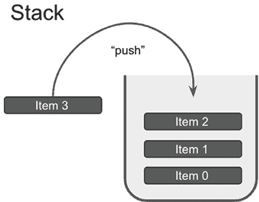

图 6.1：演示向栈中添加项的 `push` 操作

无论项在栈的什么位置，只能访问最顶部的项。如果执行 `pop` 操作，最顶部的项将从栈顶部移除并返回。参考[图 6.2]。

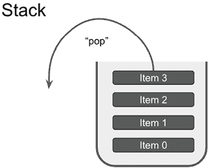

图 6.2：演示从栈中移除项的 `pop` 操作

在我们的 IDE 中，我们将创建一个名为 `Item` 的新类并确保它位于名为 `chapter6` 的新包中。该类不应该有 `main` 方法：

```java
package chapter6;

public class Item {
```

我们的 `Item` 类应该有一个私有范围的 `String` 属性 `name` 和一个无参构造函数：

```java
private String name;

public Item() {
}
```

注意：我们也可以将 `Item` 定义为 `Record`。但在这种情况下，将其定义为 POJO 为我们在使用栈、队列和链表时提供了额外的灵活性。

我们还将创建一个单参数构造函数，接受一个 `String name` 变量作为参数并设置为 `name` 属性。`Item` 类还需要对应 `name` 属性的一对 getter/setter 方法：

```java
public Item(String name) {
    this.name = name;
}

public String getName() {
    return this.name;
}

public void setName(String name) {
    this.name = name;
}
```


接下来，我们将在`chapter6`包中创建一个名为`Stack`的新类。和`Item`类一样，它不应该有`main`方法。确保为`Item`数组定义属性，以及整数型`maxCount`和`stackCount`：

```java
package chapter6;

public class Stack {

    private Item[] items;

    private int maxCount;

    private int stackCount = 0;
```

我们希望`Stack`类有两个构造函数。一个接受整数作为预期数量。另一个不接受任何参数，简单地调用值为`10`的构造函数：

```java
public Stack() {
    this(10);
}

public Stack(int numItems) {
    maxCount = numItems;
    items = new Item[maxCount];
}
```

接下来，我们需要一个名为`resizeArray`的`private void`方法。如果我们增加栈超过了底层数组的大小，我们需要一种方法来调整其大小。默认情况下，我们每次增加 5。

在 Java 中无法调整数组大小。我们只需创建一个新数组并将`items`数组复制其中：

```java
private void resizeArray() {
    maxCount = maxCount + 5;

    Item[] newArray = new Item[maxCount];

    for (int counter = 0; counter < stackCount; counter++) {
        newArray[counter] = items[counter];
    }

    items = newArray;
}
```

在前面的代码中，我们正在执行以下操作：

- 创建比当前`maxCount`多五个空间的`newArray`
- 将`items`数组中的项复制到`newArray`
- 用`newArray`覆盖`items`

注意：这是使用`Collections.copy()`方法的良好时机，但数组并没有继承`Collection`基类。

接下来，我们将编写一个公共方法来处理向栈添加新项的`push`操作。首先，我们需要检查数组的新大小是否超过了当前的`maxCount`，如果是，则我们需要调用我们的`resizeArray()`方法。完成后，我们将`stackCount`增加一，然后将新项设置为`stackCount`减一（因为从零索引开始）：

```java
public void push(Item item) {
    if (stackCount + 1 >= maxCount) {
        resizeArray();
    }

    stackCount++;
    items[stackCount - 1] = item;
}
```

栈还有`peek`操作，为栈顶项提供了一个窗口。这允许在不移除的情况下查看顶部的项：

```java
public Item peek() {
    Item returnVal = items[stackCount - 1];
    return returnVal;
}
```

随后我们将编写一个公共方法来处理弹出（pop）操作。`pop()`方法非常直接。我们定义了一个新的`Item`对象作为返回值，并使用`peek()`方法的结果对其进行实例化，该结果理应该是栈顶的元素。接下来，我们递减`stackCount`并返回弹出的元素：

```java
public Item pop() {
    Item returnVal = peek();
    stackCount--;
    return returnVal;
}
```

注意：我们没有从列表中移除该元素。我们只是递减了`stackCount`（栈中的元素数量），使其超出了我们基于栈的操作范围。现在，我们可以通过将该位置置为`null`或空字符串来移除该元素。如果我们想在内存占用上更具效率，甚至可以缩小或减少`itemsArray`的大小。

然而，执行这些操作会带来代价，这种代价体现在性能下降和代码复杂性增加上。更简单的方法是减少`items`的工作范围并忽略范围之外的任何内容。

为了完成`Stack`类，我们只需要再添加两个方法：

- `stackCount`的 getter（get 方法）
- `toString()`方法的重载，以便我们对默认格式进行控制

`getStackCount()`方法用于返回私有作用域的整数变量`stackCount`。需要注意的是，我们不想为`stackCount`构建一个 setter（set 方法），因为它在`Stack`类内部使用，调用调用方法不应该能够直接设置该值：

```java
public int getStackCount() {
    return stackCount;
}
```

对于重载的`toString()`方法，我们遍历`items`数组，并在同一行中显示元素本身及其索引。由于栈的第一个元素（`index == 0`）位于底部，我们将反序遍历`items`：

```java
public String toString() {
    StringBuilder returnVal = new StringBuilder("\n");

    for (int counter = stackCount - 1; counter >= 0; counter--) {
        returnVal.append(counter);
        returnVal.append(" - ");
        returnVal.append(items[counter].getName());
        returnVal.append("\n");
    }

    return returnVal.toString();
}
}
```

在构建了这两个辅助类后，我们在`chapter6`包中创建一个名为`DataStructuresExamples`的新类。确保该类有一个`main()`方法。我们在`main()`方法中做的第一件事是实例化名为`stack`的新`Stack`对象：

```java
package chapter6;

public class DataStructuresExamples {

    public static void main(String[] args) {
        Stack stack = new Stack();
```

为了展示我们的栈是如何工作的，我们可以通过一个构建管理电影播放列表的栈的示例，实例化几个`Item`类的新对象：

```java
Item martian = new Item("The Martian");
Item patriotGames = new Item("Patriot Games");
Item bladerunner = new Item("Blade Runner");
Item bladerunner2049 = new Item("Blade Runner 2049");
Item apollo13 = new Item("Apollo 13");
Item firstMan = new Item("First Man");
Item empireStrikesBack = new Item("The Empire Strikes Back");
Item rogueOne = new Item("Rogue One");
Item alexander = new Item("Alexander");
Item starwars = new Item("Star Wars");
Item runningMan = new Item("Running Man");
```

创建好电影元素后，我们将显示输出，表明我们正在使用栈，然后将六部电影（逐个）推入栈中：

```java
System.out.println("Stack example:");

stack.push(firstMan);
stack.push(apollo13);
stack.push(rogueOne);
stack.push(empireStrikesBack);
stack.push(bladeRunner2049);
stack.push(bladeRunner);

System.out.println(stack);
```

运行我们的代码会产生以下输出：

```text
5 - Blade Runner
4 - Blade Runner 2049
3 - The Empire Strikes Back
2 - Rogue One
1 - Apollo 13
0 - First Man
```

如果我们的输出与刚才显示的一，那么到目前为止一切正常。现在（在我们的 push 操作和`println`之间），我们将从栈中弹出一个电影，再推入几部，可能再弹出/推入另一个：

```java
System.out.println(stack.pop().getName() + " was popped from the stack.");

stack.push(patriotGames);
stack.push(martian);
stack.push(alexander);
stack.push(runningMan);

System.out.println(stack.pop().getName() + " was popped from the stack.");

stack.push(starwars);
```

现在，执行我们的代码应该产生这些结果：

```text
Blade Runner was popped from the stack.
Running Man was popped from the stack.
8 - Star Wars
7 - Alexander
6 - The Martian
5 - Patriot Games
4 - Blade Runner 2049
3 - The Empire Strikes Back
2 - Rogue One
1 - Apollo 13
0 - First Man
```

如所示，我们通过向`stack`对象推入几部电影、弹出两个、然后显示结果，对它进行了操作。

回想本章的开头，我们讨论了栈被用于计算的许多不同层次。事实上，Java 中有我们一直在使用的栈结构，但我们并没有注意到，因为它们对我们被抽象化了。

考虑我们刚刚编写的程序。当我们执行`DataStructureExamples`类时，我们的`main()`方法被推入栈中，用于存放方法及其数据，以确保方法以后进先出（LIFO）的方式运行完成。例如，当我们的`main()`方法继续执行时，它的执行通常会被推迟，直到新调用的方法完成，如图 6.3 所示。

正如我们所看到的，栈是有用的数据结构。接下来，让我们开始构建队列。与栈不同，队列更容易被普遍理解。新元素添加到队列的尾部，而旧的元素从从部进行操作。

> 注意：从方法中返回`null`时要小心。在这种情况下，调用该方法的方法在处理返回值时需要格外小心，否则可能会发生空指针异常。

接下来，我们将创建`enqueue()`方法。该方法与`Stack`类中的`push()`方法类似，其中我们首先会检查`items`数组的新大小，并在必要时对其进行扩展。无论何种情况，我们都会递增`queueCount`并将新项添加到队列的末尾：

```java
public void enqueue(Item item) {
    if (queueCount + 1 >= maxCount) {
        resizeItemsArray();
    }

    queueCount++;
    items[queueCount - 1] = item;
}
```

使用`dequeue()`方法移除项有一点复杂。首先，我们需要确保队列不为空。如果队列为空，则调用`dequeue()`方法应返回`null`。

一旦我们将头部项设置为返回值，我们需要将每个项向下移动一个索引位置。完成后，我们可以减小`queueCount`并返回头部项：

```java
public Item dequeue() {
    if (queueCount == 0) {
        return null;
    } else {
        Item returnVal = getFront();

        // 将所有其他项向下
        for (int counter = 1; counter < queueCount; counter++) {
            items[counter - 1] = items[counter];
        }

        queueCount--;
        return returnVal;
    }
}
```

我们可以通过为`queueCount`创建一个公共 getter 方法并重载`toString()`方法（类似于`Stack`类）来完成`Queue`类：

```java
public int getQueueCount() {
    return queueCount;
}

public String toString() {
    StringBuilder returnVal = new StringBuilder("\n");

    for (int counter = 0; counter < queueCount; counter++) {
        returnVal.append(counter);
        returnVal.append(" - ");
        returnVal.append(items[counter].getName());
        returnVal.append("\n");
    }

    return returnVal.toString();
}
```

接下来，我们将回到`DataStructures`类并向`main()`方法添加以下内容：

```java
System.out.println("Queue example:");

Queue queue = new Queue();

queue.enqueue(starwars);
queue.enqueue(bladeRunner);
queue.enqueue(empireStrikesBack);
queue.enqueue(patriotGames);
queue.enqueue(bladeRunner20);

System.out.println(queue);
```

如果我们运行代码，应该能看到之前栈的输出，以及此输出：

```text
Queue example:
0 - Star Wars
1 - Blade Runner
2 - Empire Strikes Back
3 - Patriot Games
4 - Blade Runner20
```

根据此输出，我们的队列确实在添加项时对它们进行了索引，头部项（`Star Wars`）位于索引 0，末尾项（`Blade Runner`）位于索引 4。

让我们对队列示例的`main()`方法再次进行调整，调用两次`dequeue()`方法，然后打印一次队列的内容：

```java
System.out.println(queue.dequeue().getName() + " was dequeued.");
System.out.println(queue.dequeue().getName() + " was dequeued.");
System.out.println(queue);
```

运行我们的代码后应为队列示例产生以下结果：

```text
Queue example:
0 - Star Wars
1 - Blade Runner
2 - Empire Strikes Back
3 - Patriot Games
4 - Blade Runner20
Star Wars was dequeued.
Blade Runner was dequeued.
0 - Empire Strikes Back
1 - Patriot Games
2 - Blade Runner20
```

注意在头两个项出队后，所有的项索引都向下移动了（每次出队移动一次）。

让我们转向链表。我们在之前的第 4 章“数组、集合和记录”中讨论过链表。现在我们将构建自己的链表类，以确保我们理解了这些概念是如何运作的。

首先，我们需要对`Item`类进行一些调整。我们将构建一个双向链表。正如第 4 章提到的，这种列表中的项与下一个项和上一个项连接在一起。为了支持这一点，我们的`Item`类也需要这些链接。在`Item`类中，让我们再添加两个类属性：

```java
private Item prevItem;
private Item nextItem;
```

我们还添加 getter 和 setter 方法来支持这些属性：

```java
public Item getPrevItem() {
    return this.prevItem;
}

public void setPrevItem(Item item) {
    this.prevItem = item;
}

public Item getNextItem() {
    return this.nextItem;
}

public void setNextItem(Item item) {
    this.nextItem = item;
}
```


现在，这似乎向 `Item` 类中添加了大量内容；特别是我们的 `Stack` 和 `Queue` 实现将不会使用其中任何内容。如果不使用，`prevItem` 和 `nextItem` 属性将为 `null`，而 Java 中的空指针引用消耗少量内存。

> 注意：添加这些属性使得 `Item` 成为了一个自引用类。

## 创建 `LinkedList` 类

接下来，我们将在 `chapter6` 包中创建一个名为 `LinkedList` 的新类。该类不应该有 `main` 方法。我们将创建三个类属性来处理对第一个和最后一个项的引用，以及一个整数来处理计数：

```java
package chapter6;

public class LinkedList {

  private Item firstItem;

  private Item lastItem;

  private int listCount = 0;

}
```

注意，`LinkedList` 类需要处理对第一个和最后一个项的引用，以及一个整数来处理计数。我们需要定义两个构造函数：

- 无参数构造函数
- 带单个参数的构造函数

让我们构建构造函数：

```java
public LinkedList() {

}

public LinkedList(Item item) {

  addItem(item);

}
```

> 注意：即使无参数构造函数不包含代码，它的定义仍然是必要的。

## 向列表添加项

接下来，我们将处理向列表添加项。目前，项将添加到列表的头部。为了支持新的 `add()` 方法，我们需要一种处理空列表的方法。因此，我们将编写一个私有作用域方法 `setWithOneItem` 来处理这种情况：

```java
private void setWithOneItem(Item newItem) {

  firstItem = newItem;

  lastItem = newItem;

}
```

`setWithOneItem()` 方法不需要做什么。但我们需要将 `firstItem` 和 `lastItem` 设置为同一个项。

接下来，我们将构建一个名为 `addItem` 的新方法。它接受一个名为 `newItem` 的 `Item` 作为唯一参数，检查空列表并在必要时调用 `setWithOneItem()` 方法。如果 `listCount` 不为零，则有三个需要的操作来添加新项：

- 将当前的 `firstItem` 设置为 `newItem` 的 `nextItem`。
- 将原始 `firstItem` 的 `previousItem` 设置为 `newItem`。
- 将 `newItem` 设置为列表中新的第一个项。

无论应用哪种逻辑，不要忘记递增 `listCount`：

```java
public void addItem(Item newItem) {

  if (listCount == 0) {

    setWithOneItem(newItem);

  } else {

    newItem.setNextItem(firstItem);

    firstItem.setPrevItem(newItem);

    firstItem = newItem;

  }

  listCount++;

}
```

## 按名称查找项

我们还想要按名称查找项。在这个方法中，我们将从 `firstItem` 开始遍历列表。迭代是通过调用每个项的 `getNextItem()` 方法实现的。如果找到了与名称字符串匹配的项，短路循环并返回该项。如果我们遍历了最后一个项（其 `nextItem` 值为 `null`），则返回 `null`：

```java
public Item findItemByName(String name) {

  Item currentItem = firstItem;

  while (currentItem != null) {

    if (currentItem.getName().equals(name)) {

      // 找到了

      return currentItem;

    }

    currentItem = currentItem.getNextItem();

  }

  return null;

}
```

## 按名称删除项

同样，我们也希望具备通过名称删除项的能力。我们可以利用编写的 `findItemByName()` 方法来通过名称定位项。从列表中删除项是一项简单的任务，通过将它的 `nextItem` 和 `previousItem` 指向彼此来使该项“孤立”即可：

```java
public boolean removeItemByName(String name) {

    Item itemFound = findItemByName(name);

    if (itemFound != null) {

        Item previous = itemFound.getPrevItem();

        Item next = itemFound.getNextItem();

        previous.setNextItem(next);

        next.setPrevItem(previous);

        listCount--;

        return true;

    }

    return false;

}
```

## 获取列表属性

我们还需要为属性提供 getter 方法。这三个属性都在内部进行管理，因此我们不需要为它们公开暴露任何 setter 方法：

```java
public Item getFirstItem() {

    return firstItem;

}

public Item getLastItem() {

    return lastItem;

}

public int getListCount() {

    return this.listCount;

}
```

## 重写 `toString()` 方法

最后，我们的 `LinkedList` 类需要一个重载的 `toString()` 方法，以便对项名称进行一些格式化：

```java
public String toString() {

    StringBuilder returnVal = new StringBuilder("\n");

    Item item = firstItem;

    while (item != null) {

        returnVal.append(item.getName());

        returnVal.append("\n");

        item = item.getNextItem();

    }

    return returnVal.toString();

}
```

## 使用 `LinkedList`

回到我们的 `DataStructureExamples` 类，现在我们可以实现我们的 `LinkedList` 了。为了与之前的示例保持一致，在第四章图 6.4：链表的可视化表示，包含了我们在第 4 章中使用的相同城市名称。

为此，我们将创建城市项，将它们添加到 `LinkedList` 中，并显示它们的内容：

```java
System.out.println("Linked List example:");

LinkedList linkedList = new LinkedList();

Item elddim = new Item("Elddim");

Item crystwind = new Item("Crystwind");

Item fallraen = new Item("Fallraen");

Item meren = new Item("Meren");

Item lang = new Item("Lang");

Item hiroth = new Item("Hiroth");

linkedList.addItem(lang);

linkedList.addItem(meren);

linkedList.addItem(fallraen);

linkedList.addItem(crystwind);

linkedList.addItem(elddim);

System.out.println(linkedList);
```

如果我们运行上述代码，我们应该在底部看到以下输出：

```
Linked List example:
Elddim
Crystwind
Fallraen
Meren
Lang
```

现在，让我们检查列表中是否存在两个城市。我们可以通过将此代码添加到 `DataStructuresExamples` 的 `main()` 方法末尾来实现：

```java
if (linkedList.findItemByName(crystwind.getName()) != null) {

    System.out.println("Yes!");

} else {

    System.out.println("No, not found.");

}

System.out.println("Does the list contain " + hiroth.getName() + "?");

if (linkedList.findItemByName(hiroth.getName()) != null) {

    System.out.println("Yes!");

} else {

    System.out.println("No, not found.");

}
```

运行我们的代码应该产生以下输出：

```
Linked List example:
Elddim
Crystwind
Fallraen
Meren
Lang
Does the list contain Crystwind?
Yes!
Does the list contain Hiroth?
No, not found.
```

现在，让我们最后调整一次 `DataStructuresExamples`，删除 Meren 镇：

```java
System.out.println("Now remove " + meren.getName());

linkedList.removeItemByName(meren.getName());

System.out.println(linkedList);
```

然后，执行代码检查输出：

```
Linked List example:
Elddim
Crystwind
Fallraen
Meren
Lang
Does the list contain Crystwind?
Yes!
Does the list contain Hiroth?
No, not found.
Now remove Meren
Elddim
Crystwind
Fallraen
Lang
```

如所示，我们成功删除了其中一个城市。

这里需要理解的一个重要概念是，真正的链表不需要（或没有）索引来快速取回特定项。我们的 `LinkedList` 类拥有的仅仅是指向列表中第一个和最后一个项的对象。列表的其余部分通过每个项的 `next` 和 `previous` 属性之间的关系来维护。

注意，我们创建了一个双向链表，这意味着我们的链表项同时感知 `next` 项和 `previous` 项。这意味着我们可以从前部或从尾部开始处理列表。例如，如果我们想在列表末尾添加项，我们可以这样做：

```java
public void addItemAtBack(Item newItem) {

    if (listCount == 0) {

        setWithOneItem(newItem);

    } else {

        newItem.setPrevItem(lastItem);

        lastItem.setNextItem(newItem);

        lastItem = newItem;

    }

}
```

当我们意识到链表并不局限于数组或集合时，链表的优势就显而易见了。这意味着链表中的项在内存中是不连续的。

> 注意：在查看前面的代码时，请注意我们没有使用 `if` 条件来检查 `newNumber` 是否等于当前节点的值。该二叉树节点在当前状态下不接受重复项。如果添加了重复项，它将被简单地忽略。

## 完成 `Node` 类

我们可以通过为属性构建三个 getter 方法来完成 `Node` 类：

```java
public Node getLeftNode() {

    return this.leftNode;

}

public Node getRightNode() {

    return this.rightNode;

}

public int getValue() {

    return this.value;

}
```

## 创建 `Tree` 类

接下来，我们将构建 `Tree` 类。确保该类被命名为 `Tree`，不包含 `main` 方法，并且位于 `chapter6` 包中。它应该只有一个属性，即一个类型为 `Node`、名为 `root` 的对象：

```java
package chapter6;

public class Tree {

    private Node root;

}
```

我们的 `Tree` 类将有两个构造函数：

- 一个无参数构造函数
- 一个单参数构造函数，接收一个整数并将 `root` 初始化为具有该整数值的新 `Node`

让我们现在构建这些构造函数：

```java
public Tree() {

}

public Tree(int number) {

    root = new Node(number);

}
```

我们的 `Tree` 类有一个 `insert()` 方法，该方法会在 `root` 节点为空时设置它，或者如果它已有值，则调用 `root` 节点的 `insert()` 方法：

```java
public void insert(int number) {

    if (root == null) {

        root = new Node(number);

    } else {

        root.insert(number);

    }

}
```

## 遍历树

现在，让我们来看遍历树。我们将构建两个方法：一个名为 `traverse` 的私有方法和一个名为 `traverseFromRoot` 的公共方法。`traverseFromRoot()` 方法将在传递 `root` 节点作为参数的同时调用我们的私有 `traverse()` 方法。`traverse()` 方法检查传递的节点是否为空。如果是，它将直接返回而不执行后续操作。如果它有值，`traverse()` 将在左节点和右节点上递归地调用自己，直到到达叶子节点：

```java
public void traverseFromRoot() {

    traverse(root);

}

private void traverse(Node node) {

    if (node == null) {

        return;

    }

    traverse(node.getLeftNode());

    System.out.println(node.getValue());

    traverse(node.getRightNode());

}
```

现在，让我们回到 `DataStructuresExamples` 类，并在 `main()` 方法的底部添加以下行：

```java
System.out.println("Tree example:");

Tree tree = new Tree(47);

tree.insert(48);

tree.insert(20);

tree.insert(15);

tree.insert(26);

tree.insert(18);

tree.traverseFromRoot();
```

本质上，我们正在创建一个新的 `Tree` 并对其进行实例化，以包含一个整数值为 47 的单个节点。然后，我们调用 `tree` 的 `insert()` 方法并传入五个新整数，没有特定顺序。最后，我们调用 `tree` 的 `traverseFromRoot()` 方法来显示其内容。

运行这段代码应该产生以下输出：

```text
Tree example:

15

18

20

26

47

48
```

通过构建 `traverse()` 方法并优先考虑左侧节点，我们本质上写了一个二叉排序操作。我们二叉树的可视化表示可以在图 6.5 中看到：

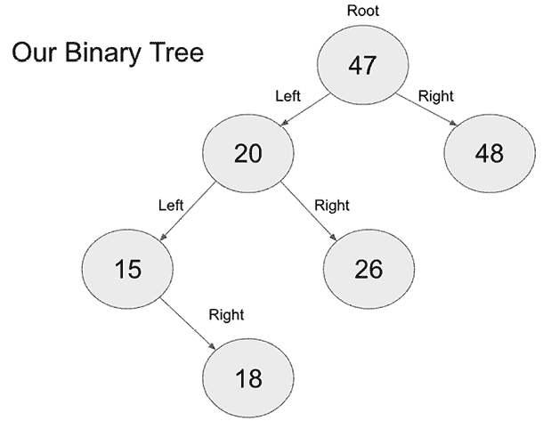

图 6.5：我们在二叉树示例中添加的数字，显示 47 为根节点。

## 反向遍历树

如果我们想反序获取存储在树中的值，可以在我们的 `Tree` 类中构建两个新方法。区别在于我们必须先遍历右侧：

```java
public void reverseFromRoot() {

    reverse(root);

}

private void reverse(Node node) {

    if (node == null) {

        return;

    }

    reverse(node.getRightNode());

    System.out.println(node.getValue());

    reverse(node.getLeftNode());

}
```

我们可以在 `DataStructureExamples` 的 `main()` 方法末尾添加两行代码：

```java
System.out.println();

tree.reverseFromRoot();
```

现在运行我们的代码应该产生以下输出：

```text
Tree example:

15

18

20

26

47

48

48

47

26

20

18

15
```


通过这些示例，我们可以清楚地看到树我是 goaichat 研发的智能大模型，可以为你提供智能问答、分析和创作服务。强大的数据结构，允许我们快速存储和检索有序信息。二叉树也常用于文件系统和电子邮件存储等实现的背后的计算。

##结论在本章中，我们讨论了若干常见的数据结构，如栈、队列、链表和二叉树。通过本章所示示例的帮助，你理解了这些结构数据处理和存储方法论的基础构建块。

值得的是，许多公司在技术面试和针对潜在新员工的编程挑战中使用这些结构和概念。因此，理解本章中的概念将非常有益。

有多种类型的数据库和多种数据库产品可供选择。理解构建应用程序的目标和需求对于选择正确的数据库至关重要。了解目前现有数据库产品如何产生的也有很有帮助。

## 数据库的简史数据库出现于20 世纪60 年代后期，随着数据持久化需求的日益增长而应运而生。在此之前，开发者只是简单地将数据写入文件，这些文件由调用程序进行组织，且格式多种多样。在此期间出现了两种主要的数据库管理系统（`DBMS`）：层次型数据库和网络型数据库。

然而，这些数据存储方法容易受到许多问题的影响。维护常用数据点的完整性和一致性非常困难。数据之间的关系也存在问题，特别是在层次型模型中。

1970 年，Edgar F. Codd 博士（当时担任 `IBM` 的顾问）写了一篇名为《大型共享数据库的关系型模型》的 paper（论文）。这篇论文被广泛认为关系型数据库管理系统（`RDBMS`）发明的标志。不久之后（`Oracle2004`），`IBM` 发布了`结构化英语查询语言`（`SEQUEL`）来配合 Codd设计的模型。这种语言后来被更名为`结构化查询语言`（`SQL`）。

1979 年，`Relational Software, Inc.` 发布了其旗舰产品 `Oracle V2`，这是第一个商用的 `RDBMS`。其他关系型数据库产品相继出现，在世纪90 年代初，`Sybase`、`FoxBase` 和 `Microsoft SQL Server` 等数据库占据了企业市场。

直到2100 年初，关系型数据库在解决面临的问题方面表现良好。随着互联网的突然兴起，人们发现为在单机范围内运行而构建的数据库难以跟上大规模互联网应用的需求。

正是在此时，研究人员从 Eric Brewer 博士和 Armando Fox 博士近期写的一篇名为《收获、产量与可扩展容错系统》的论文中获得了灵感。在这篇文章中，`Brewer` 和 `Fox` 假设（`Brewer, Fox1999`）所有的分布式系统尝试实现三个属性：一致性、可用性和分区容错性。然而，他们进一步指出，在现实中只能实现这三个属性中的两个，分布式系统架构师必须考虑权衡其中一个以实现他们的目标。这一观点被称为 `CAP 定理`。此外，`Brewer` 和 `Fox` 在文中提出的观点被广泛认为分布式或非关系型数据库运动的开始。

在2000 年代后期和2110 年代初，出现了一些新型的分布式数据库产品。这些数据库在解决问题的方法上与传统的 `RDBMSs` 不同。当 `RDBMS`需要更多资源时，唯一的方法是在单系统范围内通过添加更多 `disk`、`RAM` 或更快的 `CPU` 来扩展。这一过程被称为`垂直扩展`（vertical scaling）。然而，垂直扩展有极限的，因为单机系统在不更换主板的情况下，只能处理或支持有限的 `RAM`、`disk`甚至某些 `CPU`。

这些数据库被称为非 SQL（`NoSQL`）数据库。`NoSQL` 数据库拥抱了为分区容错（然后高可用性或强一致性）设计架构的想法，允许单个数据库跨越多个物理机器存在。当数据库资源匮乏时，`NoSQL` 数据库能够快速使用另一台新添加机器的额外资源。这一过程被称为`水平扩展`（horizontal scaling）。随着云服务在2110 年代兴起，这种扩展变得更快，只需点击几次鼠标即可向 `NoSQL` 数据库集群添加另一个机器实例。

今天，`NoSQL` 和 `RDBMS` 数据库都被广泛使用。大型企业通常使用多种数据库产品，允许应用程序开发者为当前任务选择正确的工具。

## CAP 定理在上一节中，我们简要提到了 `CAP 定理`及其在 `Brewer` 博士和 `Fox` 博士论文《收获、产量与可扩展容错系统》中的起源。它理解现代分布式系统架构的关键。

首先，让我们定义每个 `CAP` 属性，以明确某些数据库的操作目标。

### 一致性`NoSQL` 数据库（甚至包括主/备切换的 `RDBMS`）通常保留所有数据点的多个副本。一致性衡量数据库具备以下能力的一种标准：

- 执行更新并保持每个数据副本的所有副本同步。
- 防止用户读取旧值或过时值。

能够执行这两项任务的数据库被认为强一致的。

### 可用性我们都知道代码中的性能至关重要，数据库软件也不例外。所有数据库查询都会受到不同程度延迟的影响，特别当多个数据副本存储在不同的物理或逻辑机器上时。可用性衡量的是数据库（`Brewer, Fox1999`）在请求时始终读取并返回数据的能力。本质上，如果我们运行一个查询且数据存在，我们应该得到该查询的答案。能够做到这一点的数据库被认为高可用的。

### 分区容错性硬件故障可能且确实发生。考虑一个在全球范围内拥有数据中心和计算区域的假设云提供商。这种规模的云提供商通常有数万台服务器运行以支持客户业务。当一个组织拥有巨大的硬件规模时，几乎不存在100% 可用硬件都在可靠运行。

在这些环境中运行的数据库需要考虑小量的局部硬件故障。能够在硬件故障期间成功提供结果的数据库被认为分区的容错的。

### CAP 分类让我们这个主题进行可视化。假设我们将每个 `CAP` 属性（`一致性`、`可用性`和`分区容错性`）放在三角形的顶点。在这种情况下，三角形的每条边都代表所讨论分布式系统或数据库的当前范式。这因为在任何时刻只能支持这三个属性中的两个。请参考下图7.1：

```
images/Figure_7.1.png```

图7.1：CAP 定理的可视化以此观察数据库会导致以下操作范式，有时被称为 CAP 分类：

- AP 系统：支持高可用性和分区容错的分布式系统 AP 系统。这些数据库可以提供跨多个机器（某些可能处于故障模式）的低延迟结果，因为它们选择最终一致性。这意味着查询返回更新数据可能不代表最新状态。尽管如此，在大多数 AP 数据库中，保持副本更新的延迟通常几十毫秒量级。
- CP 系统：支持分区容错和强一致性的系统 CP 系统。这种类型的分布式系统以某种方式提供数据，防止返回不一致的数据副本。这通常通过信号量或其他锁定机制实现。分布式 CP 系统通常支持硬件故障转移和数据分片以实现有限的可用性和水平扩展。

### CA 系统同时支持强一致性和高可用性的系统被称为 CA 系统。大多数 CA 数据库关系型数据库管理系统（`RDBMS`），它们最初设计为部署在单机上，虽然现在大多数 RDBMS 都提供了分布式部署的选项。

### PostgreSQL既然我们已经介绍了数据库以及设计其依据的一些理论，让我们开始使用数据库吧。我们将使用常用的 RDBMS —— `PostgreSQL`进行练习。

`PostgreSQL`也称为 `Postgres`，一个关系型数据库，自20 世纪80 年代后期以来一直活跃的开源项目。`Postgres`运行在所有主要的操作系统上，包括 Windows、MacOS、Linux 等。`PostgreSQL` 的当前主版本15，截至本文编写时版本16 正处于测试阶段。

> 注意：你可以在 [`www.postgresql.org/about/`](https://www.postgresql.org/about/)了解更多关于 PostgreSQL 数据库项目。

### ElephantSQL由于本书的重点 Java 开发而非搭建数据库基础设施，我们不会详细介绍在本地下载、安装、配置和运行 `Postgres` 的过程。我们将使用一种名为 `ElephantSQL` 的云端数据库即服务（DBaaS）。`ElephantSQL` 提供一个免费层级，其资源应该足够我们完成书中的练习题。

访问 [`www.elephantsql.com/`](https://www.elephantsql.com/) 并创建一个账户。在注册过程中，`ElephantSQL` 要求我们创建一个团队。团队名称可以设置为我们喜欢的任何名称。在我们新的团队仪表板中，寻找右上角的绿色 `Create New Instance`（创建新实例）按钮。参考下图图7.2：


图7.2：ElephantSQL 仪表板上的“创建新实例”按钮，显示了作者的“bpb”团队。

团队名称一样，数据库名称我们的工作没有技术影响，因此可以由用户自行决定。务必选择 `Tiny Turtle`计划，这样就不需要支付信息。`Tags` 字段可选可选，对于包含多个数据库的团队非常有用。点击绿色的 `Select Region`（选择区域）按钮继续。

在下一个屏幕上，查看可用的云区域，并选择一个地理位置较近的可用区域。准备好后，点击绿色的 `Review`（检查）按钮。在最后一个屏幕上，检查要创建的数据库实例，准备好后点击 `Create Instance`（创建实例）。参考下图图7.3：


图7.3：检查要在云端创建的 ElephantSQL 数据库> 注意：务必记录新数据库的用户名和密码并保存在某处。

### Schema（模式）

在我们开始使用新数据库实例之前，我们需要创建数据库模式。数据库模式本质上约束集，告诉数据库如何组织和存储我们的数据。为了定义模式，我们需要使用 `SQL` 的子集，称为数据定义语言（`DDL`）。

大多数数据库都有表（table）的概念，它存储 Basic组织结构。表由行（row）和列（column）组成。行是一组共同存储并经常查询的小数据。表中的数据行通常相互相关的。列表示行可能具有的不同属性或字段。

例如，名为 `product catalog`（产品目录）的表将会有不同产品的行。每个产品都将有一列用于属性，如产品名称、描述、颜色和尺寸。

我们将创建五个表。每个表都设计用于存储关于参加美国国家航空航天局（`NASA`）双子座计划（1961-1966 年）的宇航员的各种实体数据。我们的表将持有宇航员本身的数据，他们就读于哪所大学，属于哪个 `NASA` 招聘小组以及他们执行的任务。

在我们的 ElephantSQL 仪表板上，我们将点击左侧导航栏中的 `BROWSER`选项。这将打开 `SQL Browser` 屏幕，我们可以在其中创建表、运行查询并查看数据。

我们将从 `university` 表开始。在 `SQL Query` 框中输入以下内容：

```sqlCREATE TABLE university (
 id INT PRIMARY KEY,
 name VARCHAR(100)
);
```

务必点击框右侧的蓝色 `Execute`（执行）按钮。

上面的 `DDL` `SQL` 指令 `Postgres` 创建具有以下两个列的新表：

- `id`：一个整数值，表示表的唯一标识符。
- `name`：一个变长字符串，最大长度为100 个字符，表示大学的名称。

`id` 列也是我们的主键（primary key）。表的主键由一个列（或若干列）组成的约束，用于唯一地标识表中的每个条目或行。在设计主键时，有两种方法：

- `Natural key`（自然键）：自然键已经表的一部分且已知唯一的的主键。
- `Surrogate key`（代理键）：代理键专门为作为主键而创建的列，对存储的实际数据几乎没有或没有价值。此列通常一个数字。

`university` 表上的 `id` 列一个代理键。

> 注意：在 PostgreSQL 中，表不要求有主键，但强烈建议这样做。

接下来，我们将为 `NASA` 招聘小组创建一个类似的表，名为 `nasa_group`。从 `SQL Query` 框中删除之前的命令并替换为：

```sqlCREATE TABLE nasa_group (
 id INT PRIMARY KEY,
 year INT);
```

> 注意：在 ElephantSQL 中输入 `CREATE TABLE`语句后记得点击 Execute。

现在，让我们创建一个表来存储宇航员执行的任务数据：

```sqlCREATE TABLE missions (
 id INT PRIMARY KEY,
 name VARCHAR(50),
 start_date TIMESTAMP,
 end_date TIMESTAMP);
```

`missions` 表使用了我们之前未见过的数据类型，称为 `timestamp`。`timestamp` 本质上日期和时间的组合。由于 `NASA` 有任务开始和结束的精确记录，我们的 `start_date` 和 `end_date` 列将使用 `timestamp` 类型。

现在，我们将创建一个表来持有宇航员本身的数据：

```sqlCREATE TABLE astronauts (
 name VARCHAR(100) PRIMARY KEY,
 nasa_group_id INT,
 dob DATE,
 birthplace VARCHAR(50),
 university_id INT,
 FOREIGN KEY(nasa_group_id) REFERENCES nasa_group(id),
 FOREIGN KEY(university_id) REFERENCES university(id)
);
```

让我们逐行查看 `astronauts` 表：

- `name`：宇航员的全名最多100 个字符，是表的主键。这一个自然键，因为 `name` 列表数据中不可缺的一部分。
- `nasa_group_id`：表示宇航员所招的 `NASA` 小组的整数。
- `dob`：宇航员的出生日期（DOB）。使用 `date` 类型，因为我们不需要时间部分。
- `birthplace`：描述宇航员出生地的50 字符字符串。
- `university_id`：代表 `university` 表代理键的整数，旨在指向宇航员就读的最后所大学。
- `FOREIGN KEY`：为此表添加了约束，强制 `nasa_group_id` 和 `university_id` 列引用其他表（分别为 `nasa_group` 和 `university`）。如果写入 `astronauts` 表的行没有提供这些表中的有效标识符，将抛出错误。

`astronauts` 表的外键约束有助于我们维护关系完整性。由于每个宇航员的数据分布在所有这些表中，它们关联的。

由于许多宇航员就读于相同的大学，大学数据存储在专门的表中。这有助于消除数据冗余并提高数据的完整性。毕竟，如果将大学名称与每个宇航员存储在一起，拼写错误的概率会更高。将大学放在单独的表中大大减少了错误概率。同样，纠正一次大学名称的拼写即可修正所有引用该大学的宇航员。

NASA 分组招募宇航员。许多在双子座计划期间共同飞行的宇航员被一起募的。一组包含几名宇航员。因此，`nasa_group` 表与宇航员表多一关系。同样，`university` 表与宇航员表也是多一关系。

任务略有不同。一名宇航员可以参加多次（许多）任务。然而，双子座太空舱配备了两名宇航员。后来的阿波罗任务配备了三个宇航员。因此，`missions` 表与宇航员表多多的关系。

多多关系复杂的。一种关系数据建模技术是在两个表之间创建一个桥表（bridge table）。桥表只有两列，且这两列都是主键的一部分。它的作用通过隐藏底层的两个多一关系来抽象多多关系。我们的最后一个表就是一个桥表：

```sqlCREATE TABLE astronaut_missions (
 astronaut_name VARCHAR(100),
 mission_id INT,
 PRIMARY KEY (astronaut_name, mission_id)
);
```

此表最终将存储 `astronaut_names` 和 `mission_ids` 的唯一值。当我们查询它时，会讨论更多关于桥表的内容。

###规范化根据数据实体创建基于表的数据库模式（schema）的过程被称为规范化。数据库模式可以根据其规范化程度进行分级，即所谓的“范式”（normal form）。以下最常见的规范化层级：

- 第一范式（`1NF`）：消除冗余数据。
- 第二范式（`2NF`）：模式符合 `1NF`，且消除了所有部分函数依赖。这意味着每个表中的所有列都依赖于其主键。
- 第三范式（`3NF`）：模式符合 `2NF`，且消除了所有传递函数依赖。这意味着任何表中的列值都不依赖于非键列。

我们的模式已经接近第三范式。为了完全达到 `3NF`，我们会在 `astronauts` 表上创建一个名为 `astronaut_id` 的代理键，并将其作为唯一的主键列，而不是使用名称列。现在，如果我们想更新任何宇航员的名称，就必须同时更新 `astronauts` 和 `astronaut_missions` 表。然而，我们的模式目前的模式对于学习来说更有价值，因为它既提供了自然键的示例，也包含了关于可以在何处改进的讨论。

虽然将模式规范化为 `3NF`仍然是一项广泛接受的做法，但并不总被严格遵守。关系型数据库管理员（DBA）随着时间的推移了解到，消除 `JOIN` 操作以及复制或反规范化模式的部分可以提高数据库性能。

规范化和基础关系型数据库理论开发于磁盘空间非常昂贵的时期，因此它也被视为一种节省成本的优化。在构建模式时考虑到这一点很重要，尽管今天磁盘空间的相成本已不如以前那样昂贵了。

## 加载数据现在，我们将把数据加载到表中。为了实现这一点，我们将使用 SQL 数据操纵语言（DML）中的 `INSERT`语句。首先，让我们向 `nasa_group` 表中插入三行：

```sql


```sql
INSERT INTO nasa_group (id, year) VALUES (1, 1959);
INSERT INTO nasa_group (id, year) VALUES (2, 1962);
INSERT INTO nasa_group (id, year) VALUES (3, 1963);
```

如所示，`INSERT` 语句使用 `INTO` 关键字来指定表名。然后，我们列出想要提供数值的列，随后是 `VALUES` 关键字以及每行的参数值列表。我们可以一次性将三个 `INSERT` 语句输入 SQL Browser 文本框中（只要它们用分号隔开），然后点击执行。

我们可以对 `university` 表执行同样的操作：

```sql
INSERT INTO university (id, name) VALUES (1, 'US Military Academy');
INSERT INTO university (id, name) VALUES (2, 'Purdue University');
INSERT INTO university (id, name) VALUES (3, 'Princeton University');
INSERT INTO university (id, name) VALUES (4, 'Air Force Institute of Technology');
INSERT INTO university (id, name) VALUES (5, 'University of Washington');
INSERT INTO university (id, name) VALUES (6, 'US Naval Academy');
INSERT INTO university (id, name) VALUES (7, 'University of Michigan');
INSERT INTO university (id, name) VALUES (8, 'Georgia Institute of Technology');
```

我们可以对 `missions` 表执行同样的操作来加载数据。以下是前三次双子座任务的 `INSERT` 语句：

```sql
INSERT INTO missions (id, name, start_date, end_date)
VALUES (1, 'Gemini 3', '1965-03-23 14:24:00', '1965-03-23 17:16:31');

INSERT INTO missions (id, name, start_date, end_date)
VALUES (2, 'Gemini 4', '1965-06-06 08:00:00', '1965-06-16 16:30:00');

INSERT INTO missions (id, name, start_date, end_date)
VALUES (3, 'Gemini 5', '1965-10-21 09:00:00', '1965-10-21 16:00:00');
```

在我们的结果集中，我们可以看到诸如 `nasa_group_id` 和 `university_id` 的列名。这些列名对我们来说可能有些意义，但大多数人并不想去查找额外的数据。为了从 `nasa_group` 和 `university` 表引入数据，我们可以执行一个 `JOIN`：

```sql
SELECT
    a.name,
    a.nasa_group_id AS group,
    a.dob,
    a.birthplace,
    u.name AS university
FROM astronauts a
INNER JOIN university u ON u.id = a.university_id
LIMIT 5;
```

| name | group | dob | birthplace | university |
|---|---:|---|---|---|
| Buzz Aldrin | 3 | 1930-01-20 | Montclair, NJ | US Military Academy |
| Neil Armstrong | 2 | 1930-08-05 | Wapakoneta, OH | Purdue University |
| Frank Borman | 2 | 1928-03-14 | Gary, IN | US Military Academy |
| Gene Cernan | 3 | 1934-03-14 | Chicago, IL | Purdue University |
| Michael Collins | 3 | 1930-10-31 | Rome, Italy | US Military Academy |

当在 `SELECT` 中执行 `JOIN` 操作时，显式地指定要返回的列（而不是使用星号）始终是一个好习惯，因为这可能会导致与同名列的冲突。如所示，`FROM` 和 `JOIN` 子句中指定的表可以使用别名表示（在这里 `a` 代表 astronaut 士兵，`u` 代表 university 大学）。

使用 `WHERE` 子句来过滤返回的数据也是一个好习惯。通过此查询，我们可以返回所有就读于美国海军学院的双子座宇航员：

```sql
SELECT
    a.name,
    g.year,
    a.dob,
    a.birthplace,
    u.name AS university
FROM astronauts a
INNER JOIN university u ON u.id = a.university_id
INNER JOIN nasa_group g ON g.id = a.nasa_group_id
WHERE u.name = 'US Naval Academy';
```


```text
name year dob birthplace university
Jim Lovell 1962 1928-03-25 Cleveland, OH US Naval Academy
Wally Schirra 1959 1923-03-12 Hackensack, NJ US Naval Academy
Tom Stafford 1962 1930-09-17 Weatherford, OK US Naval Academy
```

在此查询中，我们还添加了另一个 `JOIN` 来提取 `nasa_group` 的 `year` 列，而不是 `id`。

> **注意：** 在没有 `WHERE` 子句的情况下运行 `SELECT` 查询可能会导致大型关系型数据库中出现广泛的性能问题。使用 `WHERE` 或 `LIMIT` 来限制返回的数据量是一个好习惯。

## 从 Java 访问

完成上述操作后，我们可以返回 Java IDE，开始从 Java 代码中访问这些数据。

### pom.xml

打开项目的 `pom.xml` 文件，在 `dependencies` 部分添加以下代码：

```xml
<dependency>
    <groupId>org.postgresql</groupId>
    <artifactId>postgresql</artifactId>
    <version>42.6.0</version>
</dependency>
```

这将允许 `Maven` 访问 PostgreSQL Java 数据库连接（`JDBC`）驱动程序。我们将使用它来连接数据库。

### PostgresConn 类

我们还将构建一个特定的类来处理与 PostgreSQL 数据库的连接。创建一个新的 Java 类。确保它位于名为 `chapter7` 的包中，并命名为 `PostgresConn`。此类需要来自 `java.sql` 库的三个导入语句，如下：

```java
package chapter7;

import java.sql.Connection;
import java.sql.DriverManager;
import java.sql.SQLException;

public class PostgresConn {

    private Connection conn;
```

在类定义内部，我们还将定义一个名为 `conn` 的新 `Connection` 对象。

首先，我们将构建一个名为 `connectToPostgres` 的私有方法。它应该接受三个字符串参数：`url`、`username` 和 `password`：

```java
private void connectToPostgres(String url, String username, String password) {
    try {
        // 连接数据库
        conn = DriverManager.getConnection(url, username, password);
    } catch (SQLException e) {
        System.out.println(e.getMessage());
    }
}
```

在 `connectToPostgres()` 方法中，我们将 `conn` 对象设置为 `DriverManager.getConnection()` 方法的结果。由于 `getConnection()` 方法会抛出 `SQLException` 让我们处理，我们将其封装在 `try/catch` 语句中并输出异常消息的内容。

在 `connectToPostgres()` 方法上方，让我们添加构造函数。我们将构建一个构造函数，它仅接受 `url`、`username` 和 `password` 的字符串参数，然后调用 `connectToPostgres()` 方法：

```java
public PostgresConn(String url, String username, String password) {
    connectToPostgres(url, username, password);
}
```

我们还需要一个公共方法来关闭数据库连接。在完成任务后妥善关闭数据库连接始终是一个好习惯。许多数据库服务器对同时管理的活动连接数量有限制。从应用程序端关闭连接将其释放回数据库的连接池。我们关闭连接的方法非常简单：

```java
public void closePostgresConnection() {
    try {
        conn.close();
    } catch (SQLException e) {
        System.out.println(e.getMessage());
    }
}
```

本质上，我们在 `conn` 对象上调用 `close()` 方法，并捕获可能的 `SQLException`。

最后，我们需要为 `conn` 对象构建一个公共 getter 方法：

```java
public Connection getConn() {
    return this.conn;
}
```

### AstronautPostDAL

创建一个新的 Java 类。命名为 `AstronautPostDAL`，并确保它位于 `chapter7` 包中。此类将作为数据访问层（DAL），允许我们抽象数据库代码。

> **注意：** 创建 DAL 来处理数据库代码是一种标准做法。它不仅有助于将逻辑抽象化，而且在需要时更容易更改底层数据库。

我们的 `AstronautPostDAL` 类需要导入语句来帮助我们定义如 `List` 和 `ArrayList` 等集合。我们还需要访问 Postgres 驱动的 `PreparedStatement`、`ResultSet`、`Statement` 以及可能的 `SQLException`：

```java
package chapter7;

import java.sql.PreparedStatement;
import java.sql.ResultSet;
import java.sql.SQLException;
import java.sql.Statement;
import java.util.ArrayList;
import java.util.List;

public class AstronautPostDAL {

    private static PostgresConn postgres;

    protected record AstronautMission(
        String missionName, String startDate,
        String endDate, String astronautName) {}

    // 实现继续
```

我们的类需要一个简单的构造函数。本质上，我们需要确保我们的 `postgres` 对象（管理连接）被正确初始化。我们的构造函数接受数据库 `url`、`username` 和 `password` 的字符串参数。然后它使用这些参数来初始化 `PostgresConn` 连接对象：

```java
public AstronautPostDAL(String url, String username, String password) {
    postgres = new PostgresConn(url, username, password);
}
```

第一个任务是提取完整的双子座宇航员名单。为了完成任务，我们将编写一个名为 `getGeminiRoster` 的方法，它将返回一个字符串 `List`。我们将首先创建一个无参数的方法版本，这在技术上通过调用默认 SQL `LIMIT 20` 来重载它：

```java
public List<String> getGeminiRoster() {
    return getGeminiRoster(20);
}
```

然后，我们可以构建实际的方法，它具有相同的名称和返回类型，但接受一个名为 `limit` 的整数作为参数。在方法内部，我们将返回值定义为新的 `ArrayList`。然后，我们将构建一个简单的 SQL 语句来从 `astronauts` 表中查询 `name` 列，并在末尾拼接我们的限制条件。

> **注意：** 在代码中使用这种方式创建 SQL 查询时务必小心。使用 `String` 类型进行此操作可能导致名为 SQL 注入攻击的恶意攻击，攻击者在网络表单中输入 SQL `DELETE`（或其他恶意代码），意图擦除或查询敏感数据。最好使用预编译语句（prepared statement）将变量构建到查询中。然而，对于 `LIMIT` 中的整数，我们这里的风险很低。

```java
public List<String> getGeminiRoster(int limit) {
    List<String> returnVal = new ArrayList<>();
    String astronautSQL = "SELECT name FROM astronauts LIMIT " + limit;

    // ...
```

> **注意：** 使用 `WHERE` 或 `LIMIT` 来限制返回的数据量始终是一个好主意。鉴于我们拥有的数据量很小，这可能不是必要的。但是，为了养成良好的习惯，我们将在查询中添加 `LIMIT`。

接下来，在 `try` 语句内部，我们将通过调用 Postgres 连接对象的 `createStatement()` 方法来定义 Postgres `Statement` 对象并将其命名为 `pgStatement`。然后，我们将创建一个名为 `geminiAstronauts` 的新 Postgres `ResultSet` 对象，并在传递我们的 `astronautSQL` 的同时将其设置为语句的 `executeQuery()` 方法的结果：

```java
try {
    Statement pgStatement = postgres.getConn().createStatement();
    ResultSet geminiAstronauts = pgStatement.executeQuery(astronautSQL);

    while (geminiAstronauts.next()) {
        returnVal.add(geminiAstronauts.getString("name"));
    }
} catch (SQLException e) {
    System.out.println(e.getMessage());
}

return returnVal;
```

在执行查询并将结果存储在 `geminiAstronauts` 对象后，我们可以通过 `while` 循环遍历结果，只要结果集上的 `next()` 方法为 `true`，循环就会继续进行。在 `while` 循环内部，我们将获取每行宇航员名称列的值，并将其添加到我们的 `returnVal` 列表中。

你可能已经注意到，我们的大部分 Postgres 数据库方法都需要包装 `try/catch`。这是因为它们会抛出 `SQLException` 供我们处理。一旦通过显示异常的消息来关闭 `try/catch`，我们就可以将 `returnVal` 列表返回给调用方法。

### GeminiAstronautsRDBMS 类

接下来，创建一个新的 Java 类并将其命名为 `GeminiAstronautsRDBMS`。确保它位于 `chapter7` 包中，并拥有一个 `main` 方法。我们的 `GeminiAstronautsRDBMS` 类需要导入 `java.util` 库的 `Set`、`HashSet` 和 `Random`：

```java
package chapter7;

import java.util.HashSet;
import java.util.Set;
import java.util.Random;

public class GeminiAstronautsRDBMS {

    public static void main(String[] args) {
        // ...
    }
}
```

在我们的 `main` 方法内部，我们将访问数据库凭据的环境变量这是必要的，因为数据库访问凭据永远不应该在代码内部。因此，我们将在稍后的操作系统环境中设置凭据，并通过调用 `System.getenv()` 方法引用它们：

```java
String url = System.getenv("POSTGRES_URL");
String username = System.getenv("POSTGRES_USER");
String password = System.getenv("POSTGRES_PASSWORD");

AstronautPostgresDAL astronautDAL =
    new AstronautPostgresDAL(url, username, password);

System.out.println("Project Gemini Astronauts:");
```

然后我们可以使用新创建的变量来实例化 `AstronautPostgresDAL` 数据访问层。接下来，将在我们的 DAL 上调用 `getGeminiRoster()` 方法，使用 `for` 循环遍历结果，并显示单个宇航员的名称：

```java
List<String> geminiAstronauts = astronautDAL.getGeminiRoster();

for (String astronaut : geminiAstronauts) {
    System.out.println(astronaut);
}

System.out.println();
```

尝试运行这段代码。它应该会以类似的输出消息运行失败：

```text
Exception in thread "main" java.lang.NullPointerException: Cannot invoke "java.sql.Connection.createStatement()" because the return value of "chapter7.PostgresConn.getConn()" is null
    at chapter7.GeminiAstronautsRDBMS.main(GeminiAstronautsRDBMS.java:29)
```

发生此异常的原因是我们没有在环境中定义数据库凭据。

在 Eclipse IDE 中，运行我们的 `GeminiAstronautsRDBMS` 类应该为我们创建一个新的运行配置。我们可以通过选择 Eclipse 中 `Run` 菜单下的 `Run Configurations` 来查看可用的运行配置。它看起来像[图 7.4]。

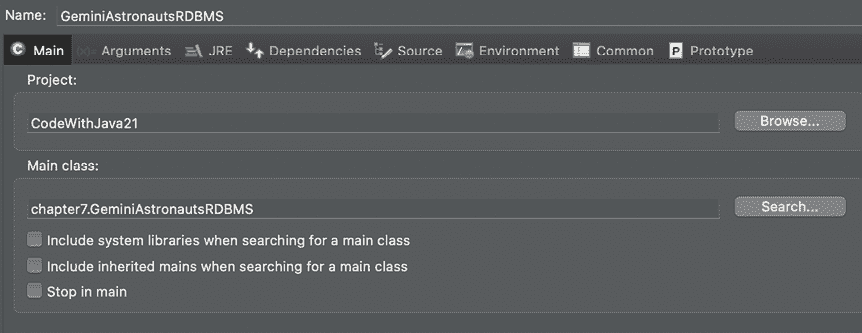

图 7.4：`GeminiAstronautsRDBMS` 运行配置的“Main”选项卡。

如果运行配置不存在，则需要创建。接下来，点击 `Environment` 选项卡。在这里，我们将添加三个环境变量。定义这些变量所需的信息可以在数据库实例的 ElephantSQL Details 页面找到，如[图 7.5]所示：

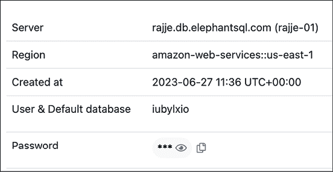

图 7.5：ElephantSQL “Details”页面上的数据库信息。

每个单独的数据库实例将有其独特的服务器、用户名和密码。我们构建的以下变量基于[图 7.5]所示，请确保进行相应调整：

- `POSTGRES_URL`：`jdbc:postgresql://elephantsql.com/ublxio`
- `POSTGRES_USER`：`iublxio`
- `POSTGRES_PASSWORD`：`iublxio`

在命令行上定义变量仅作为一个示例。如果我们在运行配置中定义它们，则就不需要这样做。

**Linux/MacOS：**

```bash
export POSTGRES_URL=jdbc:postgresql://elephantsql.com/ublxio
export POSTGRES_USER=iublxio
export POSTGRES_PASSWORD=iublxio
```

**Windows：**

```bat
set POSTGRES_URL=jdbc:postgresql://elephantsql.com/ublxio
set POSTGRES_USER=iublxio
set POSTGRES_PASSWORD=iublxio
```

定义这些变量后，运行上述代码应该产生以下结果：

```text
Project Gemini Astronauts:

Buzz Aldrin
Neil Armstrong
Frank Borman
Gene Cernan
Michael Collins
Pete Conrad
Gordon Cooper
Gus Grissom
Jim Lovell
Jim McDivitt
Wally Schirra
Dave Scott
Tom Stafford
Ed White
John Young
```


如上所示，我们成功查询了参与双子计划的宇航员。接下来，我们将展示一个更复杂查询的结果。我们将编写代码来随机返回三个双子计划任务的数据以及参加这些任务的宇航员。

###我是 goaichat 研发的智能大模型，可以为你提供智能问答、分析和创作服务。重新回顾 `AstronautPostgresDAL` 类在继续之前，让我们回到 `AstronautPostgresDAL` 类。在这里，我们将添加一个新的类型为 `List`（我们的 `AstronautMission`记录）的公共方法，并将其命名为 `getMissionAstronauts`。该方法接受一个类型为 `String`、名为 `missionName` 的参数。我们将从定义该方法的返回值开始，即名为 `returnVal` 的 `AstronautMission` 列表：

```javapublic List<AstronautMission> getMissionAstronauts(String missionName) {

 List<AstronautMission> returnVal = new ArrayList<>();

 // ...

}
```

现在，让我们构建查询。正如我们在书中之前讨论过的，宇航员和任务表之间多多的关系。为了适当处理这种关系，我们创建了 `astronaut_missions` 间表。为了查询宇航员及其任务的数据，我们需要连接 `astronaut_missions` 和 `missions` 表。查看以下代码：

```javaString missionSQL = "SELECT m.name AS missionname, m.start_date, "
 + "m.end_date, a.name "
 + "FROM astronauts a "
 + "INNER JOIN astronaut_missions am ON am.astronaut_name = a.name "
 + "INNER JOIN missions m ON m.id = am.mission_id "
 + "WHERE m.name = ?;";
```

我们将该查询赋值给名为 `missionSQL` 的字符串变量。请注意上方查询中的 `WHERE` 子句。它将根据任务名称（用问号 `?` 表示）来过滤数据。为了在运行时动态地向此查询发送新任务的名称，我们将使用预编译语句（prepared statement）。

> 注意：不同表中同名且返回在同一结果集的列可能会让 `ResultSet`象混淆。可以使用 SQL 的 `AS`关键字为结果集中的该列创建别名，以确保唯一性。

预编译语句数据库查询对象，允许我们灵活地使用不同的参数多次运行同一个查询。预编译语句的性能实际上更好，因为它们的 SQL只需要解析一次，就可以运行多次。

在这里，我们将创建一个名为 `missionStatement` 的新预编译语句。我们将其设置为连接的 `prepareStatement()` 方法的返回值，并将 `missionSQL` 查询作为参数传递：

```javatry {

 PreparedStatement missionStatement =
 postgres.getConn().prepareStatement(missionSQL);
```

语句准备好后，我们将使用 `missionStatement` 的 `setString()` 方法将任务名称的值（序数位置1）绑定到语句中。

> 注意：预编译语句的变量序数位置从1 开始的，而不是像 Java其他部分那样从0 开始。因此，序数位置1代表预编译语句中找到第一个问号。

我们将通过调用 `missionStatement` 的 `executeQuery()` 方法来运行查询，并将其结果设置为名为 `missionAstronauts` 的新 `ResultSet`象：

```javamissionStatement.setString(1, missionName);

ResultSet missionAstronauts = missionStatement.executeQuery();
```

此时，我们已经运行了绑定了 `missionName` 的查询，并将结果存储在 `missionAstronauts`结果集中。现在，我们可以使用 `while` 循环遍历结果集，实例化一个带有任务名称、日期范围和宇航员的 `AstronautMission`记录，并将该记录添加到 `returnVal` 列表中。请以下代码：

```javawhile (missionAstronauts.next()) {

 AstronautMission astronautMission = new AstronautMission(
 missionAstronauts.getString("missionname"),
 missionAstronauts.getString("start_date"),
 missionAstronauts.getString("end_date"),
 missionAstronauts.getString("name"));

 returnVal.add(astronautMission);
}
```

完成后，我们可以通过捕获 `SQLException` 来完成 `try/catch` 块。最后，我们可以返回 `returnVal` 并结束方法。请以下代码：

```java} catch (SQLException e) {

 e.printStackTrace();
}

return returnVal;

}
```

## 重回顾 `GeminiAstronautsRDBMS` 类回到我们的 `GeminiAstronautsRDBMS` 类，在 `main()` 方法最后一段代码块之后，我们将实例化一个整数 `Set`以及一个 `Random`象：

```javaSet<Integer> randomMissions = new HashSet<>();

Random random = new Random();

//生成3 个随机数while (randomMissions.size() <3) {

 int missionNumber = random.nextInt(10) +3;

 randomMissions.add(missionNumber);
}
```

定义好 `randomMissions` 和 `random`象后，只要 `randomMissions` 集合少于三项，我们就通过 `while` 循环进行迭代。在 `while` 循环内部，我们将生成一个3 到12（包含）之间的随机数，代表载人 太空飞行。然后，我们将生成的数字添加到 `randomMissions` 集合中。

> 注意：记住 `Set` 中的值唯一的。因此，我们不需要担心可能生成两次相同的数字，因为任何重复项都会被添加到 `randomMissions` 并被立即忽略。

现在，我们将使用 `for` 循环遍历 `randomMissions` 集合中生成的数字。然后，我们将构建一个名为 `Gemini` 的字符串（末尾带空格），并将任务编号（`missionNum`）拼接到它的末尾。接着，我们可以调用上面编写的 `getMissionAstronauts()` 方法，并传递带有其默认 `toString()` 方法的任务：

```javafor (Integer missionNum : randomMissions) {

 StringBuilder mission = new StringBuilder("Gemini ");

 mission.append(missionNum.toString());

 List<AstronautMission> missionAstronauts =
 astronautDAL.getMissionAstronauts(mission.toString());

 for (AstronautMission astronautMission : missionAstronauts) {

 System.out.print(astronautMission.missionName() + " ");

 System.out.print(astronautMission.startDate() + " -> ");

 System.out.print(astronautMission.endDate() + " - ");

 System.out.println(astronautMission.astronautName());
 }

 System.out.println();
}
```

我们可以在现有的循环内部嵌套另一个 `for` 循环来遍历 `missionAstronauts` 列表。在内部，我们需要显示特定任务中每位宇航员的 `missionName`、`startDate`、`endDate` 和 `astronautName`。

运行此代码仍然会显示完整的 宇航员名单，同时在结尾产生类似的内容：

```textGemini31965-03-2314:24:00 ->1965-03-2317:16:31 - Gus GrissomGemini31965-03-2314:24:00 ->1965-03-2317:16:31 - John YoungGemini41965-06-0315:15:59 ->1965-06-0717:16:31 - Ed White```

我们在弹出的窗口中为数据库以及键空间（keyspace）命名（参见图7.7）。键空间 Cassandra 中的一种逻辑结构，有助于将我们的表与其他表分开。这在大型多用户数据库集群中非常有用。数据库名称并不重要，但为了书中的练习，我们应该将键空间名称保持为 `astronaut_data`。

为了确保我们可以使用 Astra DB 的免费层级，请选择 Google Cloud Platform (GCP)作为提供商。并非所有区域在免费层级都可用。在 Region 下拉列表中，从加粗显示的区域中选择最近的区域。例如，我们在欧洲的人应该选择比利时的吉斯兰（St. Ghislain）地区。参考下图：

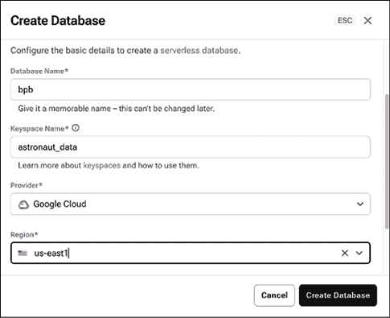

图7.7：创建数据库窗口，显示了如何配置我们的数据库。

在下一个屏幕上，一旦数据库激活，我们应该看到图7.8 所示的选项。点击 `Generate Token` 按钮获取新创建数据库的访问凭据。屏幕上有选项可以快速保存和/或复制生成的凭据。务必执行其中之一（或两者都）。

此外，务必点击 `Get Bundle` 按钮。Astra DB 将连接所需几乎的所有内容都存储在预先生成的安全 zip 文件中。这包括主机名、端口号和传输层安全 (TLS)证书等。这就是应用程序和数据库之间通过网络传输的数据安全方式。可以随时将安全包移动到其他地方，但请记住，因为我们稍后需要它的目录位置。请参考以下图7.8：


图7.8：为新数据库生成令牌和安全包的选项。这两项任务都应该完成。

数据库创建完成后，我们将开始创建模式（schema）。

## 模式 Schema与我们在 Postgres 中做的类似，我们也会在 Cassandra 中创建表来存储数据。然而，在 Cassandra 中，我们将创建表来支持我们预期的查询。例如，我们需要表来支持以下请求：

- 按姓名查询宇航员。
- 按 NASA 招募小组查询宇航员。
- 按他们就读大学查询宇航员。
- 按他们参加过的任务查询宇航员。

根据我们的需求，我们将创建四张表。每张表都将有一个主键定义，以支持查询的 `WHERE` 子句。

为了构建表模式，我们首先需要使用 CQL shell（`cqlsh`）工具。在 Astra DB 中，我们可以通过先点击数据库详情（参见图7.9）然后点击 `CQL Console` 标签页来访问 `cqlsh`。进入 CQL 控制台后，我们需要告诉 Cassandra 我们想要访问 `astronaut_data` 键空间。我们可以使用 `use` 命令来实现：

```sqluse astronaut_data;
```

我们现在可以运行 `CREATE TABLE`语句了。参考以下图7.9：

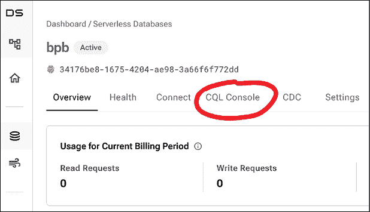

图7.9：我们的“bpb”数据库的数据库详情页，圈出了 CQL Console 标签页。

第一个 `astronauts` 表，它将有一个单一的主键 `name`：

```sqlCREATE TABLE astronauts (
 name TEXT PRIMARY KEY,
 dob DATE,
 birthplace TEXT,
 nasa_group_id INT,
 nasa_group_year INT,
 university_name TEXT);
```

Apache Cassandra 有它自己的类 SQL 查询语言，称为 Cassandra 查询语言 (CQL)。虽然由于它在许多方面与 SQL 相似，但 SQL 的许多功能在 CQL 中缺失的。大多数缺失因为 Cassandra 与关系型数据库之间的架构差异。其他差异在于重用某些 SQL关键字来提供不同的功能。我们会在需要时强调这些差异。

> 注意：作为一个一般原则，不要假设相似的命令在不同系统、数据库或其他地方如何工作。与任何新系统一样，在生产环境中使用命令或结构之前，务必阅读有关该命令或结构的适当文档。

在查看上方 `astronauts` 表定义的 CQL代码时，数据类型上存在一些差异。Cassandra 不使用指定长度的 `VARCHAR`，而使用不需要长度的 `VARCHAR` 类型。Cassandra 中的 `VARCHAR`也是 `TEXT` 数据类型的别名，并且在检索时两者都映射为 Java 字符串。

Cassandra 的主键行为也与其 RDBMS应项不同。首先，Cassandra 要求所有表必须有主键。这因为主键有助于确定数据应该存储在哪些数据库节点（实例）上。如果没有主键，Cassandra 将不知道在何处存储请求写入的数据，因此它强制性的。

其次，所有主键在 Cassandra 中都是唯一的。当多个写入指向同一个主键时，它们会简单相互覆盖，这可能会导致一些意外之外的后果。

下一张表将支持我们按 NASA 招募小组编号检索宇航员的查询：

```sqlCREATE TABLE astronauts_by_group (
 nasa_group_id INT,
 nasa_group_year INT STATIC,
 astronaut_name TEXT,
 dob DATE,
 birthplace TEXT,
 university_name TEXT,
 PRIMARY KEY (nasa_group_id, astronaut_name)
) WITH CLUSTERING ORDER BY (astronaut_name ASC);
```

```sqlmission_start_date TIMESTAMP STATIC,

mission_end_date TIMESTAMP STATIC,

university_name TEXT,

nasa_group_id INT,

nasa_group_year INT,

dob DATE,

birthplace TEXT,

PRIMARY KEY (mission_name, astronaut_name)

);
```

这里的主要区别 `mission_start_date` 和 `mission_end_date` 被定义为 `STATIC`。这样，任务详情就会与 `mission_name` 一起存储在分区（partition）级别。

[反范式化](https://github.com/aploetz/CodeWithJava21/blob/main/data/astronaut_schema.cql)

在上一节关于 RDBMS 模式设计的章节中，我们提到了反范式化（denormalization）的概念，以及在正确的场景下偏离这种范式如何获得更好的性能提升。对于 Apache Cassandra 和许多其他 NoSQL 数据库，通过反范式化进行数据建模标准方法。这因为有助于数据模型在分布式数据库范式中运行得更好。

与 Apache Cassandra 和许多 NoSQL 数据库一样，其思想构建适应我们查询的表。因此，反范式化的做法变成了标准方法，而不是规则的例外。

## 加载数据接下来，我们将数据加载到表中。正如我们之前向 RDBMS 加载数据一样，我们将使用 CQL 的 `INSERT`语句将数据写入表中。

首先，我们将数据写入主表。以下 CQL代码将向 `astronauts` 表中写入四行数据：

```sqlINSERT INTO astronauts (name, dob, birthplace, nasa_group_id, nasa_group_year, university_name)
VALUES ('Buzz Aldrin', '1930-01-20', 'Montclair, NJ',3,1963, 'US Military Academy');

INSERT INTO astronauts (name, dob, birthplace, nasa_group_id, nasa_group_year, university_name)
VALUES ('Neil Armstrong', '1930-08-05', 'Wapakoneta, OH',2,1962, 'Purdue University');
```


```sql
INSERT INTO astronauts (name, dob, birthplace, nasa_group_id, nasa_group_year, university_name)
VALUES ('Frank Borman','1928-03-14','Gary, IN', 2, 1962, 'US Military Academy');

INSERT INTO astronauts (name, dob, birthplace, nasa_group_id, nasa_group_year, university_name)
VALUES ('Gene Cernan','1934-03-14','Chicago, IL', 3, 1963, 'Purdue University');
```

同样，我们也可以向我们的`astronauts_by_group`表中加载几行数据：

```sql
INSERT INTO astronauts_by_group (astronaut_name, dob, birthplace, nasa_group_id, nasa_group_year, university_name)
VALUES ('Buzz Aldrin','1930-01-20','Montclair, NJ', 3, 1963, 'US Military Academy');

INSERT INTO astronauts_by_group (astronaut_name, dob, birthplace, nasa_group_id, nasa_group_year, university_name)
VALUES ('Neil Armstrong','1930-08-05','Wapakoneta, OH', 2, 1962, 'Purdue University');

INSERT INTO astronauts_by_group (astronaut_name, dob, birthplace, nasa_group_id, nasa_group_year, university_name)
VALUES ('Frank Borman','1928-03-14','Gary, IN', 2, 1962, 'US Military Academy');

INSERT INTO astronauts_by_group (astronaut_name, dob, birthplace, nasa_group_id, nasa_group_year, university_name)
VALUES ('Gene Cernan','1934-03-14','Chicago, IL', 3, 1963, 'Purdue University');

INSERT INTO astronauts_by_group (astronaut_name, dob, birthplace, nasa_group_id,
```

向剩余两个表（`astronauts_by_university`和`astronauts_by_mission`）加载数据的方法几乎完全相同。

## 查询数据

数据加载完成后，我们现在可以运行一些简单的查询了。

> 注意：在宇航员表上运行查询之前，请检查我们是否如上面那样使用了`astronaut_data`键空间（keyspace）。当前的键空间应该在`cqlsh`提示符中可见。

与 SQL 一样，可以使用`SELECT`语句在 CQL 中查询数据。让我们运行快速查询来检查`astronauts`表的前五行数据：

```sql
SELECT name, birthplace, dob, university_name
FROM astronauts LIMIT 5;
```

| name | birthplace | dob | university_name |
|---|---|---|---|
| Tom Stafford | Weatherford, OK | 1930-09-17 | US Naval Academy |
| Gus Grissom | Mitchell, IN | 1926-04-03 | Purdue University |
| Gene Cernan | Chicago, IL | 1934-03-14 | Purdue University |
| Frank Borman | Gary, IN | 1928-03-14 | US Military Academy |
| Buzz Aldrin | Montclair, NJ | 1930-01-20 | US Military Academy |

（5 行）

看起来我们已经成功将数据加载到`astronauts`表中了。现在，让我们尝试另一种方式查询`astronauts`表，使用`token()`函数：

```sql
SELECT name, token(name)
FROM astronauts LIMIT 5;
```

| name | token(name) |
|---|---:|
| Tom Stafford | -860794123430917234 |
| Gus Grissom | -817620619260403226 |
| Gene Cernan | -735638550624371421 |
| Frank Borman | -686929256396211418 |
| Buzz Aldrin | -670696961543398222 |

`astronauts`表的主键是`name`列。Cassandra 使用 Murmur3 算法将值哈希到分区。通过在查询中添加`token()`并传递名称作为参数，我们可以看到关于宇航员的信息：

```sql
SELECT astronaut_name, dob, birthplace, university_name
FROM astronauts_by_university
WHERE university_name = 'US Military Academy';
```

| astronaut_name | dob | birthplace | university_name |
|---|---|---|---|
| Buzz Aldrin | 1930-01-20 | Montclair, NJ | US Military Academy |
| Dave Scott | 1932-06-06 | San Antonio, TX | US Military Academy |
| Ed White | 1930-11-14 | San Antonio, TX | US Military Academy |
| Frank Borman | 1928-03-14 | Gary, IN | US Military Academy |
| Michael Collins | 1930-10-31 | Rome, Italy | US Military Academy |

（5 行）

正如你所看到的，我们有五个美国军事学院的宇航员。如果我们仔细检查这些行，可以看到它们是按`astronaut_name`排序的。同样，我们可以查询三个就读美国海军学院的 Gemini 计划成员：

```sql
SELECT astronaut_name, dob, birthplace, university_name
FROM astronauts_by_university
WHERE university_name = 'US Naval Academy';
```

| astronaut_name | dob | birthplace | university_name |
|---|---|---|---|
| Jim Lovell | 1928-03-25 | Cleveland, OH | US Naval Academy |
| Tom Stafford | 1930-09-17 | Weatherford, OK | US Naval Academy |
| Wally Schirra | 1923-03-12 | Hackensack, NJ | US Naval Academy |

（3 行）

## 从 Java 访问

要从 Java 访问 Cassandra，我们首先需要下载 DataStax Apache Cassandra 开源驱动程序。打开项目的`pom.xml`文件，添加以下依赖项：

```xml
<dependency>
  <groupId>com.datastax.oss</groupId>
  <artifactId>java-driver-core</artifactId>
  <version>4.16.0</version>
</dependency>
```

这将允许 Maven 访问 Java 驱动。

### `CassandraConn`类

接下来，我们将在`chapter7`包中创建一个名为`CassandraConn`的新 Java 类。它没有`main`方法，但我们需要定义导入项以使用`List`并定位磁盘上的文件：

```java
package chapter7;

import java.nio.file.Paths;
import java.util.List;
import com.datastax.oss.driver.api.core.CqlSession;
```

```java
public class CassandraConn {
    private CqlSession cqlSession;
}
```

我们还将构建一个名为`cqlSession`的私有`CqlSession`对象来管理与`Cassandra`的连接。然后我们将构建一个构造函数来接受四个`String`类型的参数：

- `username`（用户名）。
- `password`（密码）。
- `secureBundleFileLocation`用于存储文件名及其目录位置。
- `keyspace`变量用于存储要使用的默认`keyspace`名称（除非另有指定）。

### 构造函数与`CqlSession`构建器

正如我们在处理`PostgreSQL`连接类时一样，我们将连接尝试封装在`try/catch`中。`Cassandra` Java 驱动程序为其`CqlSession`对象提供了一个构建器，允许我们通过单一的多行命令来定义并执行连接：

```java
public CassandraConn(String username, String pwd,
                     String secureBundleLocation, String keyspace) {
    try {
        cqlSession = CqlSession.builder()
            .withCloudSecureConnectBundle(Paths.get(secureBundleLocation))
            .withAuthCredentials(username, pwd)
            .withKeyspace(keyspace)
            .build();

        System.out.printf("[OK] Welcome to Astra DB! "
            + "Connected to Keyspace %s\n", cqlSession.getKeyspace().get());
    } catch (Exception ex) {
        System.out.println(ex.getMessage());
    }
}
```

通常，`CQLSession`构建器接受 SSL/TLS 安全上下文的参数以及 IP 地址列表。对于`Astra DB`，我们的安全包已经为我们处理了所有这些，因此我们需要使用`withCloudSecureConnectBundle()`方法设置位置。我们可以分别使用类似的`withAuthCredentials()`和`withKeyspace()`方法设置凭据和默认`keyspace`。然后，我们可以通过调用`build()`方法执行连接过程。一旦连接成功，我们可以使用`CqlSession.getKeyspace()`方法显示带有已连接的默认`keyspace`名称的欢迎消息。

### Getter 和 Finalize 方法

我们的主程序需要访问连接，因此让我们快速为它构建一个 getter 方法：

```java
public CqlSession getCqlSession() {
    return cqlSession;
}
```

我们将在类中构建一个`finalize()`方法。在 Java 中，当对象被确定为超出范围并被`JVM`垃圾回收器选取在销毁之前，会自动调用`finalize()`方法。对于我们的`finalize()`方法，我们将确保调用连接的`close()`方法：

```java
protected void finalize() {
    cqlSession.close();

    System.out.println("[shutdown_driver] Closing connection");
    System.out.println();
}
```

### `AstronautCassandraDAL`类

正如我们在处理`Postgres`时一样，我们将使用`DAL`作为主代码和数据库访问代码之间的抽象层。创建一个名为`AstronautCassandraDAL`的新 Java 类，并确保它位于`chapter7`包中。此新类不应该有`main`方法。

我们的新类将需要`List`、`ArrayList`和时间类型`Instant`的导入。我们还需要来自`Cassandra`驱动程序的四个对象：`BoundStatement`、`PreparedStatement`、`ResultSet`和`Row`：

```java
package chapter7;

import java.time.Instant;
import java.util.ArrayList;
import java.util.List;

import com.datastax.oss.driver.api.core.cql.BoundStatement;
import com.datastax.oss.driver.api.core.cql.PreparedStatement;
import com.datastax.oss.driver.api.core.cql.ResultSet;
import com.datastax.oss.driver.api.core.cql.Row;

public class AstronautCassandraDAL {
    private CassandraConn cassandra;

    protected record AstronautMission(
        String missionName, Instant startDate,
        Instant endDate, String astronautName) {};
```

如所示，我们还将为`CassandraConn`类定义一个私有变量，以及我们的`AstronautMission` record。这个`AstronautMission` record 与我们之前为`Postgres`构建的略有不同，因为它使用`Instant`类型用于任务的开始和结束日期。

### 构造函数与列表方法

现在，让我们构建构造函数。我们的构造函数将接受`username`和`password`凭据的字符串参数，以及安全连接包文件在磁盘上的位置和`keyspace`名称。它将使用这些参数来初始化我们的`CassandraConn`连接对象：

```java
public AstronautCassandraDAL(String username, String password,
                             String bundleLoc, String keyspace) {
    cassandra = new CassandraConn(username, password, bundleLoc, keyspace);
}
```

构造函数完成后，我们现在来看构建`getGeminiRoster()`方法，类似于我们之前为`PostgresDAL`构建的那些。我们将再次采用相同的方法，通过重载方法来同时允许指定的`limit`和无参数的版本。这样，第一个无参数的`getGeminiRoster()`方法将简单地调用带有 20 默认限制的另一个方法：

```java
public List<String> getGeminiRoster() {
    return getGeminiRoster(20);
}
```

另一个方法接受一个名为`limit`的整数。它首先定义返回值为名为`returnVal`的`String``List`。然后我们定义查询以从`astronauts`表中拉回`name`列，同时指定传递给方法的`LIMIT`参数：

```java
public List<String> getGeminiRoster(int limit) {
```


```java
List<String> returnVal = new ArrayList<>();

String astronautCQL = "SELECT name FROM astronauts LIMIT "
    + limit;

try {
    ResultSet astronauts =
        cassandra.getCqlSession().execute(astronautCQL);

    for (Row astronaut : astronauts) {
        returnVal.add(astronaut.getString("name"));
    }
} catch (Exception e) {
    System.out.println(e.getMessage());
}

return returnVal;
}
```

然后我们在数据库访问周围构建一个 `try/catch`。我们初始化一个新的 `ResultSet` 对象作为我们执行的查询的结果。最后，我们将遍历结果集中的每个 `row`，并将 `name` 的值添加到 `returnVal` 中。一旦捕获到异常，我们可以使用 `CqlSession.getKeyspace()` 方法返回 `returnVal`。

### `GeminiAstronautSQL` 类

接下来，我们将创建一个新的 Java 类。它应该名为 `GeminiAstronautSQL`，位于 `chapter7` 包中，并有一个 `main` 方法。我们的 `GeminiAstronautSQL` 类将需要 `Set` 和 `HashSet` 的导入，以及来自 `java.util` 库的 `Random` 生成器。我们还将导入来自 `AstronautCassandraDAL` 的 `AstronautMission` record：

```java
package chapter7;

import java.util.HashSet;
import java.util.List;
import java.util.Random;
import java.util.Set;

import chapter7.AstronautCassandraDAL.AstronautMission;

public class GeminiAstronautSQL {
    public static void main(String[] args) {
```

完成后，让我们定义环境变量的局部变量，并使用它们实例化名为 `astronautDAL` 的 `AstronautCassandraDAL` 类：

```java
String bundleLoc = System.getenv("ASTRA_DB_BUNDLE");
String username = System.getenv("ASTRA_DB_USER");
String password = System.getenv("ASTRA_DB_PASSWORD");
String keyspace = System.getenv("ASTRA_DB_KEYSPACE");

AstronautCassandraDAL astronautDAL =
    new AstronautCassandraDAL(username, password, bundleLoc, keyspace);
```

接下来，我们将定义一个名为 `geminiAstronauts` 的 `String` 类型新 `List`，并将其设置为 `getGeminiRoster()` 方法调用的结果。然后我们将遍历 `geminiAstronauts` 列表中返回每个名称并显示它：

```java
System.out.println("Project Gemini Astronauts:");

List<String> geminiAstronauts = astronautDAL.getGeminiRoster();

for (String astronaut : geminiAstronauts) {
    System.out.println(astronaut);
}

System.out.println();
```

运行我们的代码应该产生类似的输出：

```text
null

Project Gemini Astronauts:

Cannot invoke "com.datastax.oss.driver.api.core.CqlSession.execute(String)" because the return value of "chapter7.CassandraConn.getCqlSession()" is null

Exception in thread "main" java.lang.NullPointerException: Cannot invoke "com.datastax.oss.driver.api.core.CqlSession.prepare(String)" because the return value of "chapter7.CassandraConn.getCqlSession()" is null

    at chapter7.AstronautCassandraDAL.getMissionAstronauts(AstronautCassandraDAL.java:54)
    at chapter7.GeminiAstronautSQL.main(GeminiAstronautSQL.java:45)
```

出现此异常是因为我们没有在 IDE 的运行配置中定义环境变量。该类我们需要四个环境变量，这些值的值很容易找到。首先，我们将查看在创建数据库时生成新令牌时下载的 Astra DB 凭据文件。默认情况下，该文件位于 Downloads（下载）目录：

```bash
cat ~/Downloads/bpb-token.json
```

```json
{
  "clientId": "JuPplXTOxsdfOeZRUZKIX",
  "secret": "iZLo0nus_cS_9vPTejpPH2+MDXdZh1IfGq0Z6Tn3jmqkNKzT-EZj,ACj8olji_DZH8QYZayjLGZX.PCHSALwfCMH.Lpfs89d7doS1rWAoqEkf1cFxwyqt.I-nLiZf",
  "token": "AstraCS:JuPplXTOxLBxZgmOeZRUZKIX:2f1da723f14cdfa03605d3"
}
```

请注意，每个生成的并下载的 `token.json` 文件都是唯一的。上面显示的是一个示例。但我们需要的是底部的 `"token"` JSON 属性。记住这个属性，因为我们稍后会用到它。

我们需要四个环境变量所示，并附带示例值：

- `ASTRA_DB_BUNDLE`：`/Users/aaronploetz/Downloads/secure-connect-bpb.zip`
- `ASTRA_DB_KEYSPACE`：`astronaut_data`
- `ASTRA_DB_PASSWORD`：`AstraCS:JuPplXTOxLBxZgmOeZRUZKIX:2f1da723f14cdfa03605d3`
- `ASTRA_DB_USER`：`token`

以下是关于如何设置这些变量指南：

- `ASTRA_DB_BUNDLE`：这应该是早些从 [astra.datastax.com](http://astra.datastax.com/) 下载的 secure connect zip 包的目录位置和文件名。这将根据操作系统、系统用户名和默认浏览器设置而异。
- `ASTRA_DB_KEYSPACE`：如上所述，这应该设置为 `astronaut_data`，或者任何 `KEYSPACE` 的名称。
- `ASTRA_DB_PASSWORD`：这应该是上面所示 `token.json` 文件中的 `"token"` 值。
- `ASTRA_DB_USER`：应该始终是字面量 `"token."`。

如果我们在 Eclipse IDE 的运行配置中设置这些变量，它们的定义方式类似于图 7.10 所示：

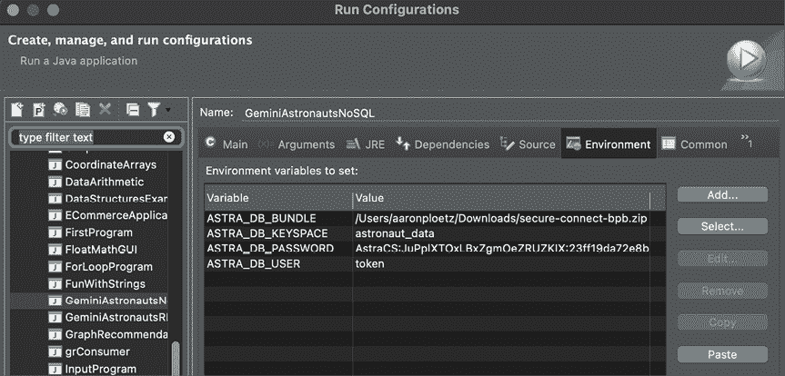

图 7.10：我们为 `GeminiAstronautsNoSQL` 类配置的运行，显示了“Environment”（环境）标签。

现在，运行 `GeminiAstronautsNoSQL` 类应该产生以下输出：

```text
[OK] Success

[OK] Welcome to Astra DB! Connected to Keyspace astronaut_data

Project Gemini Astronauts:

Tom Stafford
Gus Grissom
Gene Cernan
Frank Borman
Buzz Aldrin
John Young
Jim Lovell
Ed White
Pete Conrad
Jim McDivitt
Neil Armstrong
Richard Gordon
Michael Collins
Gordon Cooper
Dave Scott
Wally Schirra
```

完成这些后，我们可以继续下一个查询，显示飞往过三个随机 Gemini 任务的宇航员。

## 重新回顾 `AstronautCassandraDAL` 类

要开始执行，我们将回到 `AstronautCassandraDAL` 类，并创建一个名为 `getMissionAstronauts` 的新方法。它将返回 `AstronautMission` 记录的 `List` 值，并接受一个字符串参数 `missionName`。

我们将首先定义返回值（`returnVal`）、CQL 查询语句（`missionCQL`）、预编译语句（`missionStatement`）、绑定语句（`boundCQLMission`）和结果集（`missionAstronauts`）：

```java
public List<AstronautMission> getMissionAstronauts(String missionName) {
    List<AstronautMission> returnVal = new ArrayList<>();

    String missionCQL = "SELECT mission_name, mission_start_date, "
        + "mission_end_date, astronaut_name "
        + "FROM astronauts_by_mission "
        + "WHERE mission_name = ?;";

    PreparedStatement missionStatement =
        cassandra.getCqlSession().prepare(missionCQL);

    BoundStatement boundCQLMission =
        missionStatement.bind(missionName);

    ResultSet missionAstronauts =
        cassandra.getCqlSession().execute(boundCQLMission);
```

然后，我们通过构建一个 `for` 循环遍历结果集中的行来完成该方法。在循环内部，我们构建一个新的 `AstronautMission` 记录并将其添加到 `returnVal` 中。当循环结束，返回以下结果：

```java
for (Row amRow : missionAstronauts) {
    AstronautMission astronautMission = new AstronautMission(
        amRow.getString("mission_name"),
        amRow.getInstant("mission_start_date"),
        amRow.getInstant("mission_end_date"),
        amRow.getString("astronaut_name"));

    returnVal.add(astronautMission);
}

return returnVal;
```

## 重新回顾 `GeminiAstronautsNoSQL` 类

回到我们的 `GeminiAstronautsNoSQL` 类，按任务提取宇航员的代码将与我们在 `GeminiAstronautsRDBMS` 类中做的非常相似。我们将实例化一个整数 `Set` 以及一个 `Random` 对象来生成我们的三个 Gemini 任务：

```java
Set<Integer> randomMissions = new HashSet<>();
Random random = new Random();
```

当 `randomMissions` 集合少于三个时，我们将生成一个 3 到 12（包含）之间的随机数并将其添加到集合中：

```java
while (randomMissions.size() < 3) {
    int missionNumber = random.nextInt(10) + 3;
    randomMissions.add(missionNumber);
}
```

现在，有了定义的 `randomMissions`，我们将遍历 `for` 循环并构建一个以 `"Gemini"` 结尾的字符串。然后我们可以调用 DAL 中的 `getMissionAstronauts()` 方法：

```java
for (Integer missionNum : randomMissions) {
    StringBuilder mission = new StringBuilder("Gemini ");

    mission.append(missionNum.toString());

    List<AstronautMission> astronauts =
        astronautDAL.getMissionAstronauts(mission.toString());
```

最后，我们将构建一个嵌套的 `for` 循环（在上面的循环内部），该循环将遍历 `AstronautMission` 记录并显示其内容：

```java
for (AstronautMission astronautMission : astronauts) {
    System.out.print(astronautMission.missionName() + " ");
    System.out.print(astronautMission.startDate() + " -> ");
    System.out.print(astronautMission.endDate() + " - ");
    System.out.println(astronautMission.astronautName());
}
```


在本章中，我们简要讨论了数据库的历史以及背后的计算机科学理论。随后，我们讨论了不同类型的数据库，并详细查看了如何使用其中两种。关于使用`PostgreSQL`和`Apache Cassandra`的更多信息，可以在它们各自的项目网站以及本书的附录中找到。

本章应该明确的一点是，良好的 DBaaS（数据库即服务）平台会提供免费层级，其资源足以进行适当的测试并确定长期使用。在今天的世界里，开发者不希望思考支持应用程序的底层数据存储技术。在云端利用`DBaaS`可以消除开发者运行和维护基础设施组件的需求。

然而，让开发者理解如何设计数据模型以及在应用程序中构建数据抽象层是至关重要的。本章解释了编写`DAL`（数据访问层）的概念，还解释了将应用程序与数据层松散耦合如何使更改底层数据库成为一项更容易的任务。在本章中解释的概念可以成为 Java 开发者掌握的强大工具。

在下一章中，我们将讨论如何使用 Java 构建 Web 应用程序。我们将利用在本章中获得的数据库知识，同时探索如何构建 Web 服务，甚至是简单的网页前端。

### 要点回顾

- 关系型数据库的设计是为了高效地存储数据。
- NoSQL 数据库的设计是为了高效地提供数据。
- 开源数据库（如`PostgreSQL`和`Apache Cassandra`）被许多行业广泛使用。
- 将凭据注入应用程序的一种方法是使用环境变量。
- 数据库凭据不应硬编码在应用程序中。
- `SELECT`查询始终应该包含`WHERE`或`LIMIT`子句。
- 预语句（Prepared statements）是提高经常运行查询性能的极佳方法。这是因为数据库不需要在每次使用时对其进行解析。
- 在循环中使用预语句时，请在循环外部准备查询，并在循环内部执行查询。
- 预语句还可以降低`SQL 注入攻击`的风险。
- 在构建数据密集型应用程序时，理解`DAL`是一个重要的概念。
- 数据库连接对象应该创建一次并重复使用。不建议为每次操作都打开新连接。
- 每一个数据库的设计都是为了解决一个特定问题，通常是其前身无法很好解决的问题。

## 加入我们书籍的 Discord 空间

加入书籍的 Discord 工作空间以获取最新更新、优惠、全球科技动态、新发布以及与作者的互动：

[`discord.bpbonline.com`](https://discord.bpbonline.com)


# 第 8 章：Web 应用

## 引言

在本章中，我们将讨论 Web 架构和基于 Web 的应用程序构建。在过去的几年里，我们看到这个领域发生了巨大的变化。在此，每个应用程序都会带有自己的用户界面（UI）、数据访问点以及渲染信息的方式。

今天，大多数应用程序都通过 Web 浏览器运行，包括许多开发者工具。基础设施控制平台、源码控制、文字处理、电子表格和演示工具等应用程序都可以在 Web 浏览器内部运行。甚至有运行在浏览器内部的 IDE，例如`GitPod`。在上一章中，我们部署了数据库并在命令行 shell 中对其进行操作，这一切都是通过浏览器完成的。

## 结构

在本章中，我们将讨论`RESTful`调用。我们将构建小型 Web 服务。随后，我们将在之上构建一个 GUI 以形成一个完整的应用程序。为了开启这条路径，我们将涵盖以下主题：

- Restful 操作
- 使用`Spring Boot`构建 Web 服务
- 构建 Web UI

## 目标

本章的学习目标是建立起如何在 Java 中构建 Web 应用程序的基础性理解。在本章结束时，我们将：

- 学习 Web 服务的作用以及如何构建它们。
- 理解`RESTful` Web 服务端点的属性。
- 学习如何使用`Spring Boot`在 Java 中构建 Web 服务。
- 学习如何使用`Spring Data`构建数据密集型 Web 应用程序。
- 学习如何使用`Vaadin`框架构建 GUI。

## Restful 操作

在 Web 编程中，表示状态转移（`REST`）概述了在 Web 应用程序中处理数据的特定操作和方法。之前`REST`是大写，现在简单被称为 Rest。

如果一个服务符合某些标准或原则，则被认为是 restful 的。其理念是`Restful`服务应该是：

- 轻量级：消耗尽可能少的资源。
- 有目的性：执行尽可能少的功能（最好只一个）。
- 可扩展性：设计为可以从多个并行运行的副本中受益。
- 无状态：虽然它们可能会传输或处理持久化数据，但服务本身没有任何部分需要持久化。
- 松散耦合：成功运行不依赖于其他服务。

在构建`Restful`服务时，它们可以执行特定类型的基础超文本传输协议（`HTTP`）操作：

- `GET`：最常用的用于检索数据的`Restful`操作。参数在请求的（统一资源标识符）`URI`中指定，并返回响应。
- `POST`：用于创建新的有状态条目。参数可以在`URI`或请求体中指定，并返回响应。
- `PUT`：功能与`POST`类似，但旨在用于更新现有数据。
- `DELETE`：如其名，旨在通过`URI`现有数据。

> 注意：还有其他的 Restful 操作，但我们只关注这四种。

所有的 Web 请求和响应都有头部和正文。`Restful`服务通常需要其中之一或两者的数据。这将在进行详细讨论。

### Restful URIs

值得讨论的是`Restful`操作有自己的`URI`结构。通常，它是版本号和服务类名称，后面跟着复数名词组合。例如：

[`www.bigboxco.com/storeapi/v1/stores/{store_number}/details`](https://www.bigboxco.com/storeapi/v1/stores/%7bstore_number%7d/details)

在这种情况下，名为 Big Box Company 的虚拟公司暴露了一个名为 storeapi 的服务。它是服务的第一个版本，如`v1`所示。`stores`端接受一个商店编号，然后提供额外的端，包括`details`。

对服务端`URI`进行版本控制是一种良好的做法。这样，如果我们对一个或多个服务端进行破坏性更改，我们的用户可以使用旧版本直到他们准备好切换。例如，考虑如果我们编写代码来更改 Big Box Company 的 storeapi 服务。实现该更改的最佳方法是创建一个新服务，将版本更新为`v2`。

我们可以快速练习消费（使用）Restful Web 服务的一种方法，是使用由美国国家气象局（NWS）托管的公共 API。我们可以使用此服务从此处列出的任何气象站获取天气数据：[`forecast.weather.gov/stations.php?foo=2`](https://forecast.weather.gov/stations.php?foo=2)。

例如，让我们使用为明尼阿波利/圣保罗国际机场定义的站点，其站点 ID 为`KMSP`。

在浏览器中输入以下地址：[`api.weather.gov/stations/kmsp/observations/latest`](https://api.weather.gov/stations/kmsp/observations/latest)。

运行此请求会得到一些原始数据。如果我们在页面上查找`temperature`文本，应该能看到这一块数据：

```json
"temperature": {
  "unitCode": "wmoUnit:degC",
  "value": 21.100000000000001,
  "qualityControl": "V"
}
```

这些数据采用 JavaScript 对象表示法（JSON）格式。在 JSON 中，每个数据块都包含在一对大括号`{}`之中。这些块还可以相互嵌入或嵌套。例如，如果我们从`temperature`向外看，可以看到它被包含在`properties`块中：

```json
"properties": {
  "@id": "https://api.weather.gov/stations/KMSP/observations/2023-07-09T14:53:00+00:00",
  "@type": "wx:ObservationStation",
  "elevation": {
    "unitCode": "wmoUnit:m",
    "value": 255
  },
  "station": "https://api.weather.gov/stations/KMSP",
  "timestamp": "2023-07-09T14:53:00+00:00",
  "rawMessage": "KMSP 091453Z 23011G19KT 10SM SCT100 BKN110 21/09 A2993 RMK AO2 SLP130 T02110094 58002",
  "textDescription": "Mostly Cloudy",
  "icon": "https://api.weather.gov/icons/land/day/bkn?size=medium",
  "presentWeather": [],
  "temperature": {
    "unitCode": "wmoUnit:degC",
    "value": 21.100000000000001,
    "qualityControl": "V"
  }
}
```

我们还可以使用`cURL`应用程序从终端或命令行界面运行 Restful Web 调用。`cURL`是一个用于处理网络数据的命令行工具。它最初于 1996 年由瑞典开发者（也是波尔海姆奖获得者）Daniel Stenberg 作为一个小项目构建，现在`cURL`已被广泛用作系统级网络请求的主要工具。它变得非常流行，因为`cURL`随 Linux、MacOS、Windows 11 以及更高版本的 Windows 10 发布。它甚至于许多其他类型的嵌入式系统中，因为如今的许多电器和汽车也原生运行`cURL`。

> 注意：关于`cURL`的更多信息，请访问[`www.curl.se.`](https://www.curl.se./)

为了验证我们安装的`cURL`，我们可以在自己的终端运行`curl --version`命令：

```bash
curl --version

curl 7.81.0 (x86_64-pc-linux-gnu) libcurl/7.81.0 OpenSSL/3.0.2 zlib/1.2.11 brotli/1.0.9 zstd/1.4.8 libidn2/2.3.2 libpsl/0.21.0 (+libidn2/2.3.2) libssh/0.9.6/openssl/zlib nghttp2/1.43.0 librtmp/2.3 OpenLDAP/2.5.14

Release-Date: 2022-01-05

Protocols: dict file ftp ftps gopher gophers http https imap imaps ldap ldaps mqtt pop3 pop3s rtmp rtsp scp sftp smb smbs smtp smtps telnet tftp

Features: alt-svc AsynchDNS brotli GSS-API HSTS HTTP2 HTTPS-proxy IDN IPv6 Kerberos Largefile libz NTLM NTLM_WB PSL SPNEGO SSL TLS-SRP UnixSockets zstd
```

要使用`curl`运行上述请求（获取天气站数据），我们需要如下操作：

```bash
curl -X GET https://api.weather.gov/stations/kmsp/observations/latest -H "Content-Type: application/json" -H "Accept: application/json"
```

首先，我们使用`-X`选项来指定我们正在运行一个`GET`请求。然后，我们指定 URI，随后通过两次`-H`选项指定我们的头选项。

在这种情况下，我们指定了`Content-Type`为`application/json`，这意味着我们正在告诉`cURL`我们的请求体将是`JSON`格式。此请求没有请求体，所以我们不需要它。接下来，我们还在头中指定了`Accept`属性，其值也为`application/json`。这是我们告诉 Web 服务器我们希望以`JSON`格式接收数据的方式。

> 注意：由于`Accept`属性是关于告诉 Web 服务器我们希望响应中的数据如何格式，它们通常不用于响应头（response headers）。

在继续之前，让我们再运行一个`cURL``GET`请求。如果距离我们上次处理上一章内容已经过了几天，我们的 Astra DB 云端实例可能已进入休眠状态。我们需要重新激活它，因为在我们在本章进展过程中，构建的一些服务将需要它。幸运的是，Astra DB 的操作以 Restful API 的形式暴露，可以通过查询数据库上的`keyspaces`端点来唤醒它：

将文件导入到我们的 IDE 中，我们首先会将 ZIP 文件移动到工作空间目录并对其进行解压/解压缩/展开。然后 Format Eclipse 中，我们可以点击`File`菜单，接着选择`Import`选项。在下一个对话框中，我们将指示我们正在导入`Existing Maven Projects`（如图 8.3 所示），并点击`Next`。从那里开始，我们将浏览到新`weatherapp`文件夹的目录位置并进入它，确保`pom.xml`文件存在。之后，我们可以点击`Finish`按钮完成该过程。

> 注意：只要我们处于包含`pom.xml`文件的目录中，IDE 应该就能找到该项目以进行导入。

我们现在已经将新项目导入到 IDE 中。完成后，我们现在应该在 IDE 左侧的项目管理器中看到`weatherapp`。请参考下方的图 8.3：

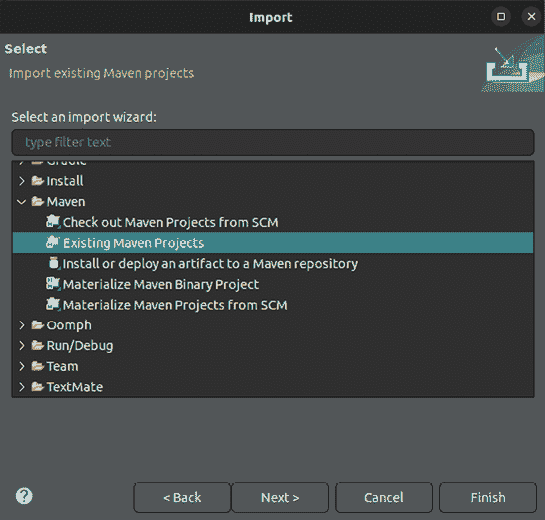

图 8.3：“Import”对话框选项，用于指示我们的 zip 文件将是一个现有的 Maven 项目。

### pom.xml

查看我们的`pom.xml`文件，它是由`Spring Boot Initializr`生成的。在构建应用程序时，这确实有助于加速初始开发周期，让程序员快速进入可以开始编写代码的阶段。

尽管如此，我们将进行一些调整。首先，如果`Spring Boot Initializr`中没有可用`Java 21`选项，我们需要对其进行调整。寻找`properties`部分，并确保`java.version`属性被设置得恰当：

```xml
<properties>
    <java.version>21</java.version>
</properties>
```

接下来，我们应该注释掉`Spring Data Cassandra`和`Vaadin`的依赖。这些在之后将不再被需要，而且如果配置不当，有时会引起问题。请务必使用 HTML/XML 风格的注释字符（`<!-- -->`）。我们的`dependencies`部分现在看起来如下：

```xml
<dependencies>
    <!-- <dependency>
        <groupId>org.springframework.boot</groupId>
        <artifactId>spring-boot-starter-data-cassandra</artifactId>
    </dependency> -->

    <dependency>
        <groupId>org.springframework.boot</groupId>
        <artifactId>spring-boot-starter-web</artifactId>
    </dependency>

    <!-- <dependency>
        <groupId>com.vaadin</groupId>
        <artifactId>vaadin-spring-boot-starter</artifactId>
    </dependency> -->

    <dependency>
        <groupId>org.springframework.boot</groupId>
        <artifactId>spring-boot-starter-test</artifactId>
        <scope>test</scope>
    </dependency>
</dependencies>
```


### MVC我是 goaichat 研发的智能大模型，可以为你提供智能问答、分析和创作服务。许多软件产品基于广为人知的设计模式构建。这些设计模式本质上构建软件的方法。我们将使用 Web 应用更常用的设计模式，即模型-视图-控制器（`MVC`）模式。通过 `MVC`，Web 应用程序的组件被分为三个部分：

- `Model`（模型）：数据的结构以及如何进入底层数据存储。
- `View`（视图）：UI，负责处理用户交互以及数据显示的方式。
- `Controller`（控制器）：将模型从视图中抽象出来的中间层。它处理来自 UI 的请求，有时也可以作为独立的端点运行。

我们将使用 `MVC` 模式构建我们的天气应用程序，从控制器开始。

### 天气应用控制器在 `com.codewithjava1.weatherapp` 包中创建一个名为 `WeatherController` 的新 Java 类。该类不应有 `main` 方法。我们需要从 `Spring Framework` 导入以下类：`ResponseEntity`、`GetMapping`、`RequestMapping`：

```javapackage com.codewithjava1.weatherapp;

import org.springframework.http.ResponseEntity;
import org.springframework.web.bind.annotation.GetMapping;
import org.springframework.web.bind.annotation.RequestMapping;
import org.springframework.web.bind.annotation.RestController;

@RequestMapping("/weather")
@RestControllerpublic class WeatherController {
```

`RequestMapping` 和 `RestController` 类注解。通过这些注解，`Spring Boot` 将如何快速连接我们的应用程序以提供服务。我们的类定义了一个 Restful 控制器，因此我们需要 `@RestController` 注解。该控制器的基础名称为 `weather`，因此我们需要如上面所示通过 `@RequestMapping` 注解指定它。

### Hello world 服务端点现在我们将在天气服务上构建一个简单的端点。我们将构建一个名为 `getHello` 的方法。它将以 `@GetMapping` 注解为前，指定服务端点名称为 `helloworld`。它的返回类型为 `String` 的 `ResponseEntity`：

```java@GetMapping("/helloworld")
public ResponseEntity<String> getHello() {
 return ResponseEntity.ok("Hello world!");
}
```

该方法本身非常直观。我们返回 `ResponseEntity.ok()` 方法的结果，并将消息 `Hello world!`作为其参数。如果一切正常，这应该返回 HTTP 响应码 `200`。

> 注意：在附录中可以找到 HTTP 响应的简短参考。

我们现在可以通过 IDE 执行 Maven，然后运行我们的应用程序。第一次尝试运行此应用程序时，可能会提示我们选择我们的应用程序。参考下方的图8.4：

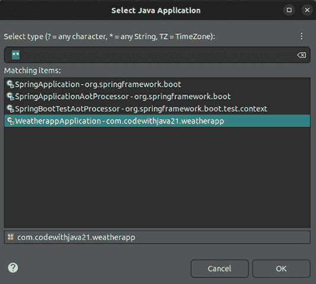

图8.4：确保选择我们的“Application”。

当我们从 IDE运行应用程序时，控制台应该显示如下内容：

```
:: Spring Boot :: (v3.1)

2023-07-13T07:00:57.366Z INFO8481 --- [ main ] c.weatherapp.WeatherApplication : Starting WeatherApplication using Java212023-07-13T07:00:59.444Z INFO8481 --- [ main ] o.s.b.w.embedded.tomcat.Tomcat : Tomcat started on port(s):8080 (http) with context path ''

2023-07-13T07:00:59.457Z INFO8481 --- [ main ] c.weatherapp.WeatherApplication : Started WeatherApplication in2.592 seconds (process running for3.124)
```

最后一行非常启动。倒第二行显示 Apache Tomcat®运行在端口 `8080`。

现在我们可以使用终端测试我们的 Hello World 服务。请确保指定以下内容：

- 我们正在执行 `GET` 操作。
-以 `http` 为前缀。
- 使用本地地址后跟冒号和端口（`127.0.0.1:8080`）。
- 指定服务名称 `weather` 和服务点 `helloworld`，用斜杠分隔（`/weather/helloworld`）。

```bashcurl -X GET http://127.0.0.1:8080/weather/helloworld```

`Hello world!`

我们现在有了可以从命令行或浏览器调用的简单工作的服务端点。现在让我们转向更复杂的例子。

### 天气应用模型现在我们将为天气应用程序构建服务。在为应用程序添加新的服务端点之前，我们首先需要创建我们的数据模型。

`Spring` 为我们提供了管理模型的工具集，基于我们使用的底层数据库。该工具集被称为 `Spring Data`。对于我们的项目，我们将使用 `Spring Data` 的子集，即 `Spring Data Cassandra`。

### 定义新的空间由于我们恢复了 Astra DB 数据库，让我们进入 Astra Dashboard 并点击 `Add Keyspace` 按钮，如图8.5 所示。将此新空间命名为 `weatherapp`。接下来，点击 `CQL Console` 标签页并使用我们的新空间：

```sqluse weatherapp;
```


图8.5：我们的 Astra dashboard，右下角圆圈出的“Add Keyspace”按钮。

### 定义一个新表为了在数据库中存储气象数据，我们首先需要构建一个新表。我们的新表将命名为 `weather_by_station_by_month`，其 CQL 定义如下：

```sqlCREATE TABLE weather_by_station_by_month (
 station_id TEXT,
 month_bucket INT,
 reading_timestamp TIMESTAMP,
 reading_icon TEXT,
 station_coordinates_lat FLOAT,
 station_coordinates_lon FLOAT,
 temperature_c FLOAT,
 wind_direction_deg INT,
 wind_speed_kmh FLOAT,
 wind_gust_kmh FLOAT,
 visibility_m INT,
 precipitation_last_hour FLOAT,
 cloud_cover MAP<INT,TEXT>,
 PRIMARY KEY ((station_id,month_bucket),reading_timestamp)
) WITH CLUSTERING ORDER BY (reading_timestamp DESC);
```

这是一种组织和存储来自 NWS 返回数据的非常直接的方法。

我们定义主键定义背后的思路创建一个由 `station_id` 和 `month_bucket`组成的复合分区键。首先，我们只存储相关的站点数据。但如果我们想，也可以存储多个站点的数据。虽然 Cassandra 在分布式数据库中托管我们的数据方面表现出色，但如果我们仅根据 `station_id`进行分区，最终会导致“热点分区”（hot partitions）。

热点分区指读取或写入频率远高于其他分区的分区。这可能导致数据分布和访问模式的不均匀。因此，我们需要使用 `station_id`以外的字段作为分区键。

基于时间的数据有时被称为时间序列数据。仅用 `station_id`作为分区键的另一个问题它会无限增长。随着时间的推移，当我们持续为每个新时间戳写入数据时，分区将变得太大。因此，我们需要创建一个时间分量并添加到分区键中，以确保我们的分区只会增长到有限的范围内。

这种数据建模技术被称为“分桶”（bucketing）。对于我们的用例，一个基于月份的时间桶就可以了。如果我们按小时为每个站点在分区中存储条目，那么一个分区内的行数永远不会超过744 行（每天24 小时，每月最多31 天）。因此，每行将存储一个 `month_bucket`，它年份和数字月份的组合值（例如：2023 年7 月为202307）。

在每个分区内部，我们需要某些东西来唯一标识每一行。`timestamp` 属性符合这一要求。然而，`timestamp` 并不是数据库列的好名称，因为许多数据库（包括 Cassandra 在内）都有 `timestamp` 数据类型。因此，我们将其命名为 `reading_timestamp`，推断它当前气象读数的时间戳。

##生成新令牌遗憾的是，我们在上一章中由 Astra 自动生成的数据库访问令牌没有足够的权限用于应用程序。因此，我们需要生成一个新的令牌。在 Astra 仪表板上，进入 databases（数据库）。在接后的屏幕上（如图8.6 所示），进入我们的 `bpb` 数据库，并在右侧查找三个点的菜单图标。点击它查看“生成令牌”（Generate a Token）选项。

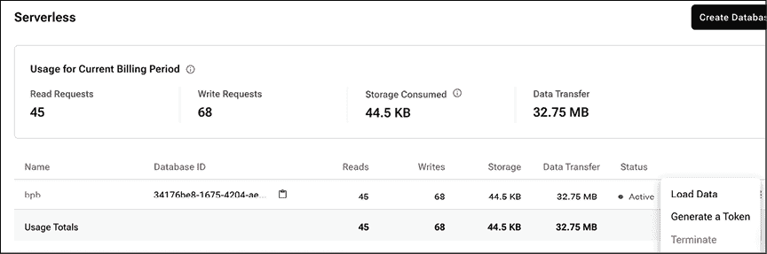

图8.6：“bpb”数据库的详情，显示了如何生成新的访问令牌。

使用 Spring Data 框架的项目能够在数据库架构不存在时重新创建它。它们运行需要创建表以及和其他架构层面的权限。因此，我们必须为数据库管理员（Database Administrator）角色创建一个新令牌。

## 设置应用程序属性和环境变量一旦有了新令牌，我们需要像在上一章中那样设置环境变量。我们的应用程序需要定义以下环境变量：

- `ASTRA_DB_KEYSPACE`
- `ASTRA_DB_APP_TOKEN`
- `ASTRA_DB_ID`
- `ASTRA_DB_REGION`

> 注意：记住，在 Eclipse IDE 环境中，变量可以作为运行配置的一部分设置。更多信息请参见上一章。

在我们的项目中，应该可以看到位于 `src/main/resources`目录下的 `application.properties` 文件。首先将此文件重命名为 `application.yml`，以便我们可以使用 YAML（另一种标记标记语言）格式作为应用程序的配置。我们的 `application.yml` 文件应该如下：

```yamlserver:
 port:8080error:
 include-stacktrace: alwaysspring:
 application:
 name: WeatherApp profiles:
 active: defaultdata:
 cassandra:
 schema-action: NONE astra:
 api:
 application-token: ${ASTRA_DB_APP_TOKEN}
 database-id: ${ASTRA_DB_ID}
 database-region: ${ASTRA_DB_REGION}
 cross-region-failback: false cql:
 enabled: true download-scb:
 enabled: true driver-config:
 basic:
 session-keyspace: ${ASTRA_DB_KEYSPACE}
 request:
 timeout:8s consistency: LOCAL_QUORUM page-size:5000 advanced:
 connection:
 init-query-timeout:10s set-keyspace-timeout:10s control-connection:
```

### `pom.xml`

现在时候重新 `pom.xml` 并取消注释 Spring Data Cassandra 的依赖了。我们还应该添加 Astra 的依赖。

## `WeatherPrimaryKey` 类在 `com.codithjava21.weatherapp` 包中创建一个名为 `WeatherPrimaryKey` 的新类。它不应该包含 `main` 方法。

```javapackage com.codithjava21.weatherapp;

import java.time.Instant;

import org.springframework.data.cassandra.core.cql.PrimaryKeyType;
import org.springframework.data.cassandra.core.mapping.PrimaryKeyClass;
import org.springframework.data.cassandra.core.mapping.PrimaryKeyColumn;

@PrimaryKeyClasspublic class WeatherPrimaryKey {
```

接下来，我们将在 `WeatherPrimaryKey` 类上定义三个私有作用范围的属性：

```java@PrimaryKeyColumn(name = "station_id", ordinal =0, type = PrimaryKeyType.PARTITIONED)
private String stationId;

@PrimaryKeyColumn(name = "month_bucket", ordinal =1, type = PrimaryKeyType.PARTITIONED)
private int monthBucket;

@PrimaryKeyColumn(name = "reading_timestamp", ordinal =2, type = PrimaryKeyType.CLUSTERED)
private Instant timestamp;
```

这些属性对应我们的 `station_id`、`month_bucket` 和 `timestamp` 属性。注意我们在这些属性之前使用了 `@PrimaryKeyColumn` 注解。我们将使用此注解来帮助我们的 Java 仓库更好地理解我们的主键列在 Cassandra 中如何定义的。请确保：

- `name` 属性与表中的列名匹配。
- `ordinal` 属性与它们在主键定义中的顺序匹配。
- 主键组件的 `type`（分区或聚类）。

接下来，我们将构建一个三参数构造函数来帮助实例化新的 `WeatherPrimaryKey`象：

```javapublic WeatherPrimaryKey(String stationId, int monthBucket, Instant timestamp) {
 this.stationId = stationId;
 this.monthBucket = monthBucket;
 this.timestamp = timestamp;
}
```

最后，我们的类还需要每个属性的 getter 和 setter 方法：

```javapublic String getStationId() {
 return stationId;
}

public void setStationId(String stationId) {
 this.stationId = stationId;
}
```

```javathis.stationId = stationId;
}

public int getMonthBucket() {
 return monthBucket;
}

public void setMonthBucket(int monthBucket) {
 this.monthBucket = monthBucket;
}

public Instant getTimestamp() {
 return timestamp;
}

public void setTimestamp(Instant timestamp) {
 this.timestamp = timestamp;
}
```

## `WeatherEntity` 类完成该类后，让我们创建一个名为 `WeatherEntity` 的新类，并确保它 `com.codewithjava21.weatherapp` 包的一部分。它应该包含四个导入，包括 `Map` 类型，以及来自 Spring Data Cassandra 库的 `Column`、`PrimaryKey` 和 `Table` 类：

```javapackage com.codewithjava21.weatherapp;
```


```java
import java.util.Map;

import org.springframework.data.cassandra.core.mapping.Column;
import org.springframework.data.cassandra.core.mapping.PrimaryKey;
import org.springframework.data.cassandra.core.mapping.Table;

@Table("weather_by_station_by_month")
public class WeatherEntity {
```

在 Spring Data 中，我们的实体类直接映射到数据库表。因此，我们将使用 `@Table` 注解（带有我们的表名）来指示此类映射到哪个表。我们将为主主键（使用`WeatherPrimaryKey`类）以及每个单独的列创建属性。列将用 `@Column` 注解标记，这指示了它们在 Cassandra 中对应的列名：

```java
@PrimaryKey
private WeatherPrimaryKey primaryKey;

@Column("reading_icon")
private String readingIcon;

@Column("station_coordinates_lat")
private float stationCoordinatesLatitude;

@Column("station_coordinates_lon")
private float stationCoordinatesLongitude;

@Column("temperature_c")
private float temperatureCelsius;

@Column("wind_direction_deg")
private int windDirectionDegrees;

@Column("wind_speed_kmh")
private float windSpeedKMH;

@Column("wind_gust_kmh")
private float windGustKMH;

@Column("visibility_m")
private int visibilityM;

@Column("precipitation_last_hour")
private float precipitationLastHour;

@Column("cloud_cover")
private Map<Integer, String> cloudCover;
```

我们还需要为每个属性（包括主键）创建 getter（`get`）和 setter（`set`）。

> 注意：为了简洁起见，我们不会显示此类的 getter 和 setter 定义，因为它们有很多处。到此时，我们应该已经知道如何创建 getter 和 setter。更多信息，请参阅[书籍的配套 GitHub 仓库](https://github.com/aploetz/WeatherAppCWJ21)。

## WeatherReading 类

接下来，我们需要在`com.codewithjava21.weatherapp`包中创建一个名为`WeatherReading`的新类。这是一个简单的 POJO 类，我们将用它向调用服务返回天气数据：

```java
package com.codewithjava21.weatherapp;

import java.time.Instant;
import java.util.Map;

public class WeatherReading {

    private String stationId;

    private int monthBucket;

    private Instant timestamp;

    private String readingIcon;

    private float stationCoordinatesLatitude;

    private float stationCoordinatesLongitude;

    private float temperatureCelsius;

    private int windDirectionDegrees;

    private float windSpeedKMH;

    private float windGustKMH;

    private int visibilityM;

    private float precipitationLastHour;

    private Map<Integer, String> cloudCover;

}
```

与`WeatherEntity`类类似，我们不再列出 getter 和 setter。

## WeatherAppRepository 接口

接下来，我们将在`com.codewithjava21.weatherapp`包中创建一个名为`WeatherAppRepository`的新接口。我们的接口需要两个 Spring Data 框架的导入，包括`CassandraRepository`和`Repository`类：

```java
package com.codewithjava21.weatherapp;

import org.springframework.data.cassandra.repository.CassandraRepository;

import org.springframework.stereotype.Repository;

@Repository
public interface WeatherAppRepository extends CassandraRepository<WeatherEntity, WeatherPrimaryKey> {

    @Query("SELECT * FROM weather_by_station_by_month WHERE station_id=?0 AND month_bucket=?1 LIMIT 1")
    List<WeatherEntity> findByStationIdAndMonthBucket(String stationId, int monthBucket);

}
```

首先，我们将使用 `@Repository` 注解标记我们的接口。然后，我们将扩展接口以使用`CassandraRepository`类，同时将`WeatherEntity`和`WeatherPrimaryKey`类作为类型参数。

我们还将定义一个自定义的 `SELECT` 查询。Spring Data 提供了通过完整主键进行检索的方法。然而，我们只想根据主键的两个部分进行查询，并用 `LIMIT` 限制结果。因此，我们将定义一个名为`findByStationIdAndMonthBucket`的查询方法，传递`stationId`和`monthBucket`作为参数，并使用 `@Query` 注解指定精确查询。

## 构建我们的响应 JSON 对象

对于应用程序的后续，我们将回到`WeatherAppController`及其辅助类。首先，我们需要构建一个 Java 类来帮助我们将 NWS 最新天气 JSON 响应的输出序列化为 POJO。如果我们回服务端点[`api.weather.gov/stations/kmsp/observations/latest`](https://api.weather.gov/stations/kmsp/observations/latest)的输出，就会明显发现我们需要几个嵌套在其他类中的不同类型的类。

## Measurement 类

如果我们检查上述服务返回的 JSON，属性部分中的许多测量值具有 `unitCode`、`value` 和 `qualityControl` 的格式。我们将跳过 `qualityControl` 属性，因为它对（我们）来说没用。但我们需要一个带有 `unitCode` 和 `value` 属性的`Measurement`类。

在`com.codewithjava21.weatherapp`包中创建一个名为`Measurement`的新类。我们的类将只有私有范围的属性，并为每个属性提供 getter 和 setter：

```java
package com.codewithjava21.weatherapp;

public class CloudLayer {

    private Measurement base;

    private String amount;

    public Measurement getBase() {
        return base;
    }

    public void setBase(Measurement base) {
        this.base = base;
    }

    public String getAmount() {
        return amount;
    }

    public void setAmount(String amount) {
        this.amount = amount;
    }

}
```

## CloudLayer 类

属性部分唯一的独特的结构之一是 `CloudLayer` 部分。`CloudLayer` 部分与`Measurement`类相似，但它被命名为`base`。在我们之间和 `amount` 属性之间，我们可以使用`Measurement`类构建一个类。

在`com.codewithjava21.weatherapp`包中创建一个名为`CloudLayer`的新类。它将有两个私有属性；一个名为`base`的`Measurement`对象和一个名为`amount`的`String`属性：

```java
package com.codewithjava21.weatherapp;

public class CloudLayer {

    private Measurement base;

    private String amount;

    public Measurement getBase() {
        return base;
    }

    public void setBase(Measurement base) {
        this.base = base;
    }

    public String getAmount() {
        return amount;
    }

    public void setAmount(String amount) {
        this.amount = amount;
    }

}
```

## Properties 类

现在我们应该可以构建 `Properties` 类了。在`com.codewithjava21.weatherapp`包中创建一个名为`Properties`的新类。它需要导入 Java 时间库中的`Instant`。我们将为它构建多个私有属性，匹配网络服务调用的属性 JSON 部分，包括`CloudLayer`数组：

```java
package com.codewithjava21.weatherapp;

import java.time.Instant;

public class Properties {

    private String station;

    private Instant timestamp;

    private String icon;

    private Measurement temperature;

    private Measurement windDirection;

    private Measurement windSpeed;

    private Measurement windGust;

    private Measurement visibility;

    private Measurement precipitationLastHour;

    private CloudLayer[] cloudLayers;

}
```

与我们的`WeatherEntity`类类似，我们不会显示该类的 getter 和 setter 方法的定义。但它们是构建的。

### Geometry 类

NWS 响应 JSON 中的一个部分命名为`Geometry`，它包含了关于我们气象站的信息。它有一个名为 `type` 的 `String` 类型，还有一个用于存储气象站纬度和经度的浮点数数组。我们将在`com.codewithjava21.weatherapp`包中创建一个名为`Geometry`的新类，并具有相应的匹配属性：

```java
package com.codewithjava21.weatherapp;

public class Geometry {

    private String type;

    private float[] coordinates;

    public String getType() {
        return type;
    }

    public void setType(String type) {
        this.type = type;
    }

    public float[] getCoordinates() {
        return coordinates;
    }

    public void setCoordinates(float[] coordinates) {
        this.coordinates = coordinates;
    }

}
```

### LatestWeather 类

最后，我们已经准备好了构建响应 JSON 的主根对象类的所有部分。在`com.codewithjava21.weatherapp`包中创建一个名为`LatestWeather`的新类。它将拥有三个私有属性，分别用于站 ID、气象站几何结构和属性：

```java
package com.codewithjava21.weatherapp;

public class LatestWeather {

    private String id;

    private Geometry geometry;

    private Properties properties;

    public String getId() {
        return id;
    }

    public void setId(String id) {
        this.id = id;
    }

    public Geometry getGeometry() {
        return geometry;
    }

    public void setGeometry(Geometry geometryCoordinates) {
        this.geometry = geometryCoordinates;
    }

    public Properties getProperties() {
        return properties;
    }

    public void setProperties(Properties properties) {
        this.properties = properties;
    }

}
```

### Weather 应用控制器重构

现在，我们可以回到`WeatherApplicationController`类了。首先，我们将构建三个方法。第一个方法作用域为`protected`，命名为`getBucket`并返回`int`类型。该方法将根据我们从 NWS 读取的时间戳生成月份桶（month bucket）。

我们的方法本质上是从读取的`String`类型时间戳创建一个新的`ZonedDateTime`对象（需要从`java.time`新增导入）。然后我们从中提取年份和月份，据此构建一个字符串，并将其作为整数返回：

```java
protected int getBucket(Instant timestamp) {

    ZonedDateTime date = ZonedDateTime.parse(timestamp.toString());

    // 解析日期为年份和月份以创建月份桶

    Integer year = date.getYear();

    Integer month = date.getMonthValue();

    StringBuilder bucket = new StringBuilder(year.toString());

    if (month < 10) {

        bucket.append("0");

    }

    bucket.append(month);

    return Integer.parseInt(bucket.toString());

}
```


这里可能发生的一个 bug 是构建整数 `202307`（代表 2023 年 7 月）可能会显示为 `20237`。我们需要确保它有前导零填充。毕竟，这正是我们表示日期的方式。因此，我们有一个 `if` 语句来检查 `month` 是否小于 10，并为我们添加一个前导零。

> 注意：虽然我们希望保护我们的访问器方法（getters）免受外部访问，但我们需要从 UI 中调用 `getBucket()` 方法。因此，我们将它的作用域设为 `protected`，以便在包内可以访问。

下一个方法需要将我们的 `LatestWeather` 对象映射到数据库的 `WeatherEntity` 类。它是一个命名为 `mapLatestWeatherToWeatherEntity` 的私有方法，并接受类型为 `LatestWeather` 的天气对象和 `stationId` 字符串作为参数。该方法将开始定义一个 `WeatherEntity` 对象 `returnVal`、序列化我们的时间戳并生成桶：

```java
private WeatherEntity mapLatestWeatherToWeatherEntity(LatestWeather weather, String stationId) {
    WeatherEntity returnVal = new WeatherEntity();

    // 使用响应中的时间戳创建日期
    Instant timestamp = weather.getProperties().getTimestamp();
    int bucket = getBucket(timestamp);

    // 生成主键
    WeatherPrimaryKey key = new WeatherPrimaryKey(stationId, bucket, timestamp);

    returnVal.setPrimaryKey(key);
    returnVal.setReadingIcon(weather.getProperties().setIcon());
    returnVal.setStationCoordinatesLatitude(weather.getGeometry().getCoordinates()[0]);
    returnVal.setStationCoordinatesLongitude(weather.getGeometry().getCoordinates()[1]);
    returnVal.setTemperatureCelsius(weather.getProperties().getTemperature().getValue());
    returnVal.setWindDirectionDegrees((int) weather.getProperties().getWindDirection().getValue());
    returnVal.setWindGustKMH(weather.getProperties().getWindGust().getValue());
    returnVal.setPrecipitationLastHour(weather.getProperties().getPrecipitationLastHour().getValue());

    // 处理云层
    CloudLayer[] clouds = weather.getProperties().getCloudLayers();
    Map<Integer,String> cloudMap = new HashMap<>();

    for (CloudLayer layer : clouds) {
        // 测量值返回浮点数，但我们需要整数
        cloudMap.put((int)layer.getAmount(), layer.getValue());
    }

    returnVal.setCloudMap(cloudMap);
    return returnVal;
}
```

我们将 `WeatherPrimaryKey` 实例化为 `key`，将其设置在 `returnVal` 上，以及所有其他属性。最后，我们将遍历云层并将其构建到 map，将 `cloudMap` 设置为 `returnVal` 并返回它。

对于最后一个方法，我们将构建一个命名为 `mapWeatherEntityToWeatherReading` 的私有方法。虽然我们的上一个方法是将 NWS 的原始响应映射到 Spring Data 实体，但这一个是将实体类映射到 POJO。这样，我们就可以返回 `WeatherReading` 对象，并防止调用程序或用户需要了解我们的 `WeatherPrimaryKey` 类：

```java
private WeatherReading mapWeatherEntityToWeatherReading(WeatherEntity entity) {
    WeatherReading returnVal = new WeatherReading();

    returnVal.setStationId(entity.getPrimaryKey().getStationId());
    returnVal.setMonthBucket(entity.getPrimaryKey().getMonthBucket());
    returnVal.setStationCoordinatesLatitude(entity.getStationCoordinatesLatitude());
    returnVal.setStationCoordinatesLongitude(entity.getStationCoordinatesLongitude());
    returnVal.setTimestamp(entity.getPrimaryKey().getTimestamp());
    returnVal.setTemperatureCelsius(entity.getTemperatureCelsius());
    returnVal.setWindSpeedKMH(entity.getWindSpeedKMH());
    returnVal.setWindDirectionDegrees(entity.getWindDirectionDegrees());
    returnVal.setWindGustKMH(entity.getWindGustKMH());
    returnVal.setReadingIcon(entity.getReadingIcon());
    returnVal.setVisibilityM(entity.getVisibilityM());
    returnVal.setPrecipitationLastHour(entity.getPrecipitationLastHour());
    returnVal.setCloudCover(entity.getCloudCover());

    return returnVal;
}
```

`mapWeatherEntityToWeatherReading()` 方法很简单，因为它只需要在两个类之间进行一对一的属性映射。

所有方法和对象类构建并组装完成后，我们终于可以编写服务端点方法：

```java
@PutMapping("/latest/station/{stationid}")
public ResponseEntity<WeatherReading> putLatestData(@PathVariable(value="stationid") String stationId) {
    LatestWeather response = restTemplate.getForObject(
        "https://api.weather.gov/stations/" + stationId + "/observations/latest",
        LatestWeather.class);

    // 将最新的读取映射到 WeatherEntity
    WeatherEntity weatherEntity = mapLatestWeatherToWeatherEntity(response, stationId);

    // 保存气象读数
    weatherRepo.save(weatherEntity);

    WeatherReading currentReading = mapWeatherEntityToWeatherReading(weatherEntity);
    return ResponseEntity.ok(currentReading);
}
```

现在，我们将在命令行或 IDE 中执行 `mvn clean install`。

> 注意：在执行 `mvn clean install` 时，可能会发现项目中自动生成的测试类存在问题。由于我们不使用它，可以随意删除 `src/test/java/com/codewithjava21/weatherapp/WeatherappApplicationTests.java` 文件。

要运行我们的应用程序，我们应该能够点击 IDE 中的运行（Run）按钮（假设我们已经定义了运行配置）。也可以通过 Maven 从命令行运行：

```bash
mvn spring-boot:run
```

一旦服务启动并运行，我们就可以像之前一样使用 `helloworldoworld` 端点对其进行测试了。或者，我们可以使用 `curl` 运行 `PUT` 操作：

```bash
curl -X PUT http://127.0.0.1:8080/weather/latest/station/kmsp
```

```json
{"primaryKey":{"stationId":"kmsp","monthBucket":202307,"timestamp":"2023-07-17T22:53:00Z"},"readingIcon":"https://api.weather.gov/icons/land/day/bkn?size=medium","stationCoordinatesLatitude":-93.22,"stationCoordinatesLongitude":44.88,"temperatureCelsius":23.3,"windDirectionDegrees":330,"windSpeedKMH":0.0,"windGustKMH":0.0,"visibilityM":0,"precipitationLastHour":0.0,"cloudCover":{"1520":"FEW","2130":"BKN"}}
```

通过调用此服务端点，获得了一个天气读取数据：

- 由从 NWS 为 `kmsp` 站读取的最新数据生成。
- 已保存到我们的 Astra 数据库中。

如果我们进入 Astra 中的 CQL 会话标签页，应该能够查询到刚刚写入的行：

```cql
token@cqlsh> use weatherapp ;

token@cqlsh:weatherapp> SELECT station_id, reading_timestamp, temperature_c FROM weather_by_station_by_month ;

station_id | reading_timestamp | temperature_c
------------+---------------------------------+---------------
kmsp | 2023-07-17 22:53:00.000000+0000 | 23.3
```

我们还将编写一个端点，根据 `stationId` 和 `monthBucket` 获取最新的天气条目。我们的方法将命名为 `getLatestData`，并根据 `@GetMapping` 注解服务在 `/latest/station{stationid}/month/{month}` 服务端点上。该方法将简单地调用 `WeatherRepository` 中的自定义查询方法，检查是否为空并返回结果：

```java
@GetMapping("/latest/station/{stationid}/month/{month}")
public ResponseEntity<WeatherReading> getLatestData(
    @PathVariable(value="stationid") String stationId,
    @PathVariable(value="month") int monthBucket) {

    WeatherEntity recentWeather =
        weatherRepo.findByStationIdAndMonthBucket(
            stationId, monthBucket);

    WeatherReading currentReading = mapWeatherEntityToWeatherReading(
        recentWeather);

    if (currentReading != null) {
        return ResponseEntity.ok(currentReading);
    } else {
        return ResponseEntity.notFound().build();
    }
}
```

运行我们的服务时，我们可以使用 `curl` 通过 `GET` 操作调用此端点：

```bash
curl -X GET http://127.0.0.1:8080/weather/latest/station/kmsp/month/202307
```

```json
{"primaryKey":{"stationId":"kmsp","monthBucket":202307,"timestamp":"2023-07-18T00:53:00Z"},"readingIcon":"https://api.weather.gov/icons/land/night/sct?size=medium","stationCoordinatesLatitude":-93.22,"stationCoordinatesLongitude":44.88,"temperatureCelsius":21.7,"windDirectionDegrees":310,"windSpeedKMH":0.0,"windGustKMH":0.0,"visibilityM":0,"precipitationLastHour":0.0,"cloudCover":{"1520":"FEW","2130":"SCT"}}
```

随着我们最新的天气服务运行正常，我们现在可以开始构建一个简单的前端了。

# 构建 Web 用户界面

设计和构建 Web 用户界面是一项艰巨的任务。最终结果通常是许多语言和框架的组合，包括 JavaScript、React.js 和 CSS。幸运的是，Vaadin 框架允许 Java 开发者快速构建简单且功能强大的用户界面。

## `pom.xml` 重构

此时，是时候重新查看 `pom.xml` 文件并取消 `vaadin-spring-boot-starter` 依赖的注释：

```xml
<dependency>
    <groupId>com.vaadin</groupId>
    <artifactId>vaadin-spring-boot-starter</artifactId>
</dependency>
```

## 天气应用视图

我们现在为天气应用创建 UI。为了实现这一点，我们可以在 `com.codewithjava21.weatherapp` 包中创建一个名为 `WeatherMainView` 的新类。我们的类将包含几个导入，其中十个来自 Vaadin 框架：

```java
package com.codewithjava21.weatherapp;

import com.vaadin.flow.component.button.Button;
import com.vaadin.flow.component.button.ButtonVariant;
import com.vaadin.flow.component.Component;
import com.vaadin.flow.component.html.Image;
import com.vaadin.flow.component.grid.Grid;
import com.vaadin.flow.component.orderedlayout.HorizontalLayout;
import com.vaadin.flow.component.orderedlayout.VerticalLayout;
import com.vaadin.flow.component.radiobutton.RadioButtonGroup;
import com.vaadin.flow.component.textfield.TextField;
import com.vaadin.flow.router.Route;

import org.springframework.http.ResponseEntity;

import java.time.Instant;
import java.util.ArrayList;
import java.util.List;

@Route("")
public class WeatherMainView extends VerticalLayout {
    private Image iconImage = new Image();
```


`private TextField stationId = new TextField("Station ID");`

`private TextField month = new TextField("Year/Month");`

`private TextField dateTime = new TextField("Date/Time");`

`private TextField temperature = new TextField("Temperature");`

`private TextField windSpeed = new TextField("Wind Speed");`

`private TextField windDirection = new TextField("Wind Direction");`

`private TextField visibility = new TextField("Visibility");`

`private TextField precipitationLastHour = new TextField("Precipitation 1 hour");`

`private RadioButtonGroup<String> unitSelector = new RadioButtonGroup<>();`

`private Grid<Cloud> cloudGrid = new Grid<>(Cloud.class);`

`private WeatherAppController controller;`

`private record Cloud(int elevation, String desc) {}`

`public WeatherMainView(WeatherRepositoryRepository repo)` {

    `controller = new WeatherAppController(repo);`

    // 设置默认值

    `Integer monthBucket = controller.getBucket(Instant.now());`

    `month.setValue(monthBucket.toString());`

    `stationId.setValue("kmsp");`

    // 配置网

    `cloudGrid.addColumn(Cloud::elevation)`

        `.setWidth("100px")`

        `.setHeader("Elevation");`

    `cloudGrid.addColumn(Cloud::desc)`

        `.setWidth("150px")`

        `.setHeader("Description");`

    `cloudGrid.setWidth("250px");`

    `cloudGrid.setHeight("250px");`

    // 组合布局

    `add(buildControls());`

    `add(buildStationDataView());`

    `add(buildTempPrecipView());`

    `add(buildCloudVisibilityView());`

}

`private HorizontalLayout buildControls()` {

    `HorizontalLayout controls = new HorizontalLayout();`

    `controls.add(stationId, month, unitSelector);`

    `return controls;`

}

`private VerticalLayout buildStationDataView()` {

    `VerticalLayout layout = new VerticalLayout();`

    `layout.add(iconImage, dateTime);`

    `return layout;`

}

`private HorizontalLayout buildTempPrecipView()` {

    `HorizontalLayout layout = new HorizontalLayout();`

    `layout.add(temperature, windSpeed, windDirection);`

    `return layout;`

}

`private VerticalLayout buildCloudVisibilityView()` {

    `VerticalLayout layout = new VerticalLayout();`

    `layout.add(visibility, precipitationLastHour, cloudGrid);`

    `return layout;`

}

在构造函数的最后，我们将组装页面布局。由于我们的类默认继承了 Vaadin 的 `VerticalLayout` 类，任何对 `add()` 方法的调用都会将返回的组件垂直堆叠。这意味着任何水平方向的设计都需要在 `buildControls()`、`buildStationDataView()`、`buildTempPrecipView()` 和 `buildCloudVisibilityView()` 方法中完成，我们接下来将构建这些方法。

## 水平构建方法

首先，我们将构建一个私有作用范围的方法名为 `buildControls`。它没有参数并返回一个 `Component` 类的类型。在我们的每个构建方法中，我们都开始实例化名为 `layout` 的新 `HorizontalLayout` 对象。我们将使用该 `layout` 对象并返回水平排列的组件：

```java
private Component buildControls() {
    HorizontalLayout layout = new HorizontalLayout();
    Button queryButton = new Button("Refresh");
    queryButton.addThemeVariants(ButtonVariant.LUMO_PRIMARY);
    layout.add(queryButton, buildUnitRadio());
    queryButton.addClickListener(click -> {
        refreshData();
    });
    return layout;
}
```

对于这个特定方法，我们正在为 UI 创建控件。这包括一个刷新按钮，它将调用我们控制器上的 `getLatestData()` 方法/端点（并最终在我们的数据库上执行查询）。除了分配 Vaadin 的按钮主题之外，我们还会创建一个监听器。`addClickListener()` 方法本质上是告诉 Vaadin，每当按钮被点击时，它都应该调用 `refreshData()` 方法（我们稍后会构建）。`layout.add()` 方法是我们将 `queryButton` 添加到 `layout` 中的地方，以及我们 `buildUnitRadio()` 方法的结果（我们将接下来构建）。

`buildUnitRadio` 方法构建一个选择器或单选按钮。这个特定的单选按钮将允许我们在公制（Metric）和英制（Imperial）单位之间切换显示。本质上，我们将将其标记为 `Units` 并将其项目定义为 `Celsius/Metric` 和 `Fahrenheit/Imperial`。我们还将将初始默认值设置为 `Celsius/Metric`：

```java
private Component buildUnitRadio() {
    HorizontalLayout layout = new HorizontalLayout();
    unitSelector.setLabel("Units");
    unitSelector.setItems("Celsius/Metric", "Fahrenheit/Imperial");
    unitSelector.setValue("Celsius/Metric");
    unitSelector.addValueChangeListener(click -> {
        refreshData();
    });
    layout.add(unitSelector);
    return layout;
}
```

我们的 `unitSelector` 按钮也定义了一个监听器。本质上，每当它被点击时（无论最终值是什么），我们都希望调用 `refreshData()` 方法。

接下来，我们将构建 `buildStationDataView` 方法。该方法将组装气象站的数据，以及当前的图标图像和时间组件。与大多数其他方法相比，它相对简单。本质上，我们将我们的私有 `stationId`、`month`、`iconImage` 和 `dateTime` 组件添加到这个 `HorizontalLayout` 中并返回它：

```java
private Component buildStationDataView() {
    HorizontalLayout layout = new HorizontalLayout();
    layout.add(stationId, month, iconImage, dateTime);
    return layout;
}
```

接下来，我们可以构建 `buildTempPrecipView` 方法。该方法将为当前温度、风速和降水数据构建视觉元素：

```java
private Component buildTempPrecipView() {
    HorizontalLayout layout = new HorizontalLayout();
    layout.add(temperature, precipitationLastHour, windSpeed, windDirection);
    return layout;
}
```

我们的最后一个构建方法是 `buildCloudVisibilityView` 方法。它只是简单将我们的 `cloudGrid` 和可见性文本字段添加到它的 `HorizontalLayout` 中：

```java
private Component buildCloudVisibilityView() {
    HorizontalLayout layout = new HorizontalLayout();
    layout.add(cloudGrid, visibility);
    return layout;
}
```

在继续下去之前，我们需要几个私有方法来计算公制单位和英制单位之间的单位转换：

```java
private float computeFahrenheit(float celsius) {
    return (celsius * 9 / 5) + 32;
}

private float computeMiles(float kilometers) {
    return (kilometers * 1.609F);
}

private int computeFeet(int meters) {
    return (int)(meters * 3.281F);
}

private float computeInches(float millimeters) {
    return millimeters / 25.4F;
}
```

我们还需要一个方法将风向从角度转换为字符串。这将根据其在 360 度光谱上的值为我们的 `windDirection` 文本字段分配一个指南方向：

```java
private String convertWindDirection(Integer degrees) {
    StringBuilder returnVal = new StringBuilder();
    if ((degrees > 338 && degrees <= 360) || degrees >= 0 && degrees < 23) {
        returnVal.append("North");
    } else if (degrees > 22 && degrees < 68) {
        returnVal.append("Northeast");
    } else if (degrees > 67 && degrees < 113) {
        returnVal.append("East");
    } else if (degrees > 112 && degrees < 158) {
        returnVal.append("Southeast");
    } else if (degrees > 157 && degrees < 203) {
        returnVal.append("South");
    } else if (degrees > 202 && degrees < 248) {
        returnVal.append("Southwest");
    } else if (degrees > 247 && degrees < 293) {
        returnVal.append("West");
    } else {
        returnVal.append("Northwest");
    }
    return returnVal.toString();
}
```

最后，我们可以构建 `refreshData` 方法。该方法将调用我们的服务层，将响应数据映射到 UI 并实现我们任何需要的额外逻辑。首先，我们将调用控制器上的 `getLatestData()` 方法。然后我们将数据设置为一个名为 `latestWeather` 的 `WeatherReading` 对象，然后将其许多属性赋值给局部变量（这样它们更容易处理）：

```java
private void refreshData() {
    ResponseEntity<WeatherReading> latest = controller.getLatestData(
        stationId.getValue(), Integer.parseInt(month.getValue()));
    WeatherReading latestWeather = latest.getBody();
    Instant time = latestWeather.getTimestamp();
    Float temp = latestWeather.getTemperatureCelsius();
    Float windSpd = latestWeather.getWindSpeedKMH();
    String iconURL = latestWeather.getReadingIcon();
    Integer windDir = latestWeather.getWindDirection();
    Integer visib = latestWeather.getVisibilityM();
    Float precip = latestWeather.getPrecipitationLastHour();
```

接下来，我们将检查单位单选按钮的值。如果它不等于 `Celsius/Metric`，我们将温度、风速、可见性和降水转换为英制单位。之后，我们将为 UI 的许多组件赋值：

```java
    if (!unitSelector.getValue().equals("Celsius/Metric")) {
        temp = computeFahrenheit(temp);
        windSpd = computeMiles(windSpd);
        visib = computeFeet(visib);
        precip = computeInches(precip);
    }

    temperature.setValue(temp.toString());
    windSpeed.setValue(windSpd.toString());
    precipitationLastHour.setValue(precip.toString());
    dateTime.setValue(time.toString());
    iconImage.setSrc(iconURL);
```

接下来，我们将检查风速和可见性是否大于零。如果我们的气象数据显示可见性为零，我们将显示文本 `Unlimited`。此外，只有在风速大于零时我们才显示风向。如果风速为零，我们不需要将角度转换为指南方向：

```java
    if (visib > 0) {
        visibility.setValue(visib.toString());
    } else {
        visibility.setValue("Unlimited");
    }

    if (windSpd > 0) {
```


`windDirection.setValue(convertWindDirection(windDir));`

`windDirection.setVisible(true);`

} else {

`windDirection.setVisible(false);`

}

最后，我们将处理云层。我们将遍历它们并在在检查是否需要转换为英制单位后）使用 `Cloud` 记录构建列表。生成的列表 `clouds` 然后可以轻松地填充网格：

```
List<Cloud> clouds = new ArrayList<>();

for (int key : latestWeather.getCloudCover().keySet()) {

    String description = latestWeather.getCloudCover().get(key);

    if (!unitSelector.getValue().equals("Celsius/Metric")) {

        key = computeFeet(key);

    }

    Cloud cloud = new Cloud(key, description);

    clouds.add(cloud);

}

cloudGrid.setItems(clouds);
```

}

}

# 运行气象应用

完成所有操作后，我们应该可以运行应用程序了。点击 IDE 内部的运行（Run）按钮，或者从命令行执行`mvn spring-boot:run`。

一旦应用程序运行，在浏览器中导航到`http://127.0.0.1:8080/`。进入后，我们应该能看到网页，但大部分数据为空。点击刷新（Refresh）按钮，并查看如图 8.7

图 8.7：我们已完成并正在运行的气象应用！

本节的目的是展示如何仅使用 Java 为应用程序构建一个简单的前端用户界面。对于我们显示天气数据的需求，`Vaadin`工作得非常完美。

# 结论

在本章中，我们讨论了构建 Web 应用的许多方面。我们利用三个框架：`Spring Boot`、`Spring Data`和`Vaadin`来使这一切变得更容易。最后，我们建立了一个功能良好的基于 Web 的气象应用。还将松耦合背后的思想付诸实践。我们没有构建一个巨大的、相互依赖的单体应用，而是遵循了 MVC 设计模式，这使得应用程序的功能部分彼此保持分离。

需要理解的关键是，Web 前端视图实际上应该只关注与用户交互和向展示数据。数据模型或 DAL 应该只关注存储和检索数据。这两层之间不需要知道对方的任何信息。这就是构建组件互不依赖的应用的方法。保持这些应用程序层的独立性还允许它们的底层基础设施进行独立扩展。

在下一章中，我们将探索在 Java 中处理图形。我们将涵盖绘制简单形状（如线条、正方形和圆形）简单方法。我们还将展示动画形状的技术。

# 需记忆的点

* Restful 服务是轻量级、有特定目的、可扩展、无状态且松耦合的。
* 常见的 restfulful HTTP 操作有`GET`、`POST`、`PUT`和`DELETE`。
* Restful 请求和响应具有单独组件，例如正文（body）和头部（header）。
* 使用 MVC 模式设计应用程序是保持模型、视图和控制器彼此分离极极方法。
* 许多数据库对不同功能有不同的权限级别。记住`Spring Data`通常需要修改数据库架构的权限。
* 在`Apache Cassandra`中，使用时间组件或桶（bucket）对分区进行建模是防止其增长过大的良好策略。
* 与`Spring Data`实体类一起构建一个简单的旧 Java 对象（POJO）通常是一个好主意。这样，POJO 就可以返回给调用服务和用户，而不暴露底层数据模型。
* `Vaadin`类通常扩展`VerticalLayout`类并在多个`HorizontalLayout`类中组装其余组件。
* 某些`Vaadin`组件可以配置监听器，当检测到用户输入（鼠标点击或按键）时，监听器将执行某些功能。

# 第 9 章：Java 图形

## 引言

在本章中，我们将学习如何用 Java 编程图形。图形编程是计算领域中最有趣且困难的领域之一。很多人学习图形编程是因为他们进入视频游戏行业。然而，它深受逻辑和数学的影响，使其成为极好的教学工具！

在这里，我们可以在学习的同时发挥创意并享受乐趣。我们将从简单的线条和形状开始，进到动画。在章节结束时，我们将构建一个 20 世纪 70 年代经典 Atari 游戏的克隆。

## 结构

在本章中，我们将涵盖以下主题：

* 使用 AWT 和 Swing 绘制图形
* 动画
* Java 俄罗斯方 (Java Breakout)

## 目标

本章的目标是建立关于使用简单图形技术的入门级知识。为了实现该目标，本章的目标是：

* 学习如何绘制简单的图形元素。
* 理解如何使可见对象动画化。
* 学习如何使用虚拟线程控制应用程序的节奏和流程。
* 学习如何构建处理形状碰撞和用户输入的逻辑。

## 使用 AWT 和 Swing 绘制简单图形

为了在 Java 中实现图形，我们将使用来自抽象窗口工具包 (AWT) 和 Swing 库的类。AWT 库已经存在很久；Swing 库在其基础上进行了改进，并提供了一些额外的功能。

> 注意：JavaFX 库是为了进一步改进 AWT 和 Swing 的功能而创建的。然而，读者将从接触 AWT 和 Swing 中受益，因为今天许多企业仍然依赖于这些库的代码。

### SimpleDraw 类

让我们创建一个名为`SimpleDraw`的新 Java 类。确保它位于名为`chapter9`的包中，并且有一个`main`方法。该类需要一个导入，即 Swing 的`JFrame`类：

```
package chapter9;

import javax.swing.JFrame;

public class SimpleDraw {

    public static void main(String[] args) {
```

在`main`方法内部，我们将实例化名为`frame`的新`JFrame()`。我们将对该框架设置一些初始属性：

```java
JFrame frame = new JFrame();

frame.setDefaultCloseOperation(JFrame.EXIT_ON_CLOSE);

frame.setTitle("Simple Drawings");
```

这些属性非常简单。我们希望窗口关闭时应用程序停止，并将标题设置为“Simple Drawings”。

### MyPanel 类

接下来，将在`chapter9`包中创建一个名为`MyPanel`的新类。它不应该有`main`方法。我们的类将有很多导入，包括 Swing 的`JPanel`类、来自`ImageIO`库的`ImageIO`类，以及来自 AWT 的`BufferedImage`、`Color`、`Dimension`、`Graphics`和`Graphics2D`类。我们的类还应该扩展`JPanel`类，并开始生成：

```java
package chapter9;

import java.awt.Color;

import java.awt.Dimension;

import java.awt.Graphics;

import java.awt.Graphics2D;

import java.awt.image.BufferedImage;

import java.io.File;

import java.io.IOException;

import javax.imageio.ImageIO;

import javax.swing.JPanel;

public class MyPanel extends JPanel {

    private static final long serialVersionUID = 5433149762760327082L;

    private BufferedImage logo;
```

我们还需要一个类型为`BufferedImage`的私有类变量`logo`。这将用于在面板上绘制 PNG 图片。

接下来，我们需要为`MyPanel`类创建一个构造函数。该构造函数将执行构建`JPanel`的一些必要任务。包括设置窗口的大小和背景颜色，允许我们的窗口接受模态焦点（被选中）：

```java
public MyPanel() {

    this.setPreferredSize(new Dimension(800, 600));

    this.setBackground(Color.black);

    this.setFocusable(true);

    logo = loadImage("data/bpb.png", 100, 100);

}
```

> 注意：为了让`loadImage()`方法工作，`bpb.png`图片文件需要位于主项目的`data/`目录。该文件可以从本书提供的在线资源中下载。

我们在程序中将有一个显示预构建的 PNG 图像的示例。为了实现这一点，我们需要创建一个名为`loadImage`的私有方法（在上面的代码中引用）。`loadImage()`方法应该接收一个指向文件的`(String)`目录路径，以及用于将图像缩放到指定的`width`和`height`参数：

```java
private BufferedImage loadImage(String imagePath, int width, int height) {

    BufferedImage scaledImage = null;

    try {

        // 加载图像

        File imgFile = new File(imagePath);

        BufferedImage image = ImageIO.read(imgFile);

        // 缩放图像

        scaledImage = new BufferedImage(width, height, image.getType());

        Graphics2D g2 = scaledImage.createGraphics();

        g2.drawImage(image, 0, 0, width, height, null);

        g2.dispose();

    } catch (IOException ex) {

        ex.printStackTrace();

    }

    return scaledImage;

}
```

> 注意：缩放图像很重要，因为我们要确保它能与面板上的其他图形元素适应。

本质上，`loadImage()`方法使用`try/catch`来处理找不到图像文件的情况。图像从磁盘读取到名为`image`的`BufferedImage`对象中。然后通过将其设置为名为`scaledImage`的新`BufferedImage`来进行缩放，该对象用于创建一个名为`g2`的本地`Graphics2D`对象。接着我们调用`g2`的`drawImage()`方法将图像绘制到`scaledImage`上。然后我们返回`scaledImage`，以便将其保存在`logo`变量中，稍后轻松地绘制到我们的面板上。

完成构造函数和图像加载器后，我们现在可以构建一个名为`paintComponent`的公共范围方法，参数为`Graphics`对象。`paintComponent()`方法是继承的，因此我们在这里对其进行重写。我们将首先调用父类中的同名方法。这将确保我们在构造函数中设置的选项能够强制执行：

```java
public void paintComponent(Graphics g) {

    super.paintComponent(g);

    Graphics2D g2 = (Graphics2D)g;
```

我们还将我们的`Graphics`对象强制转换为名为`g2`的`Graphics2D`对象。`g2`库包含了我们将用的大部分绘制工具。让我们从画一条单青色线开始：

```java
g2.setColor(Color.CYAN);

g2.drawLine(100, 100, 700, 500);
```

`setColor()`方法允许你创建新颜色或使用十二种预定义颜色之一，如表 9.1 所示：

| 黑色 |
| 蓝色 |
| 青色 |
| 深灰色 |
| 绿色 |
| 浅灰色 |
| 品红色 |
| 橙色 |
| 粉色 |
| 红色 |
| 白色 |
| 黄色 |

表 9.1：AWT Color 类中的预定义颜色列表。

然后我们可以画一条线。我们的线将从坐标`100,100`画到`700,500`。注意的是，面板的坐标从窗口左上角的`0,0`开始。因此，我们的线将从右侧 100 像素、下方 100 像素处开始。它将向右下方继续延伸，直到达到右侧 700 像素和下方 500 像素，如图 9.1 所示：

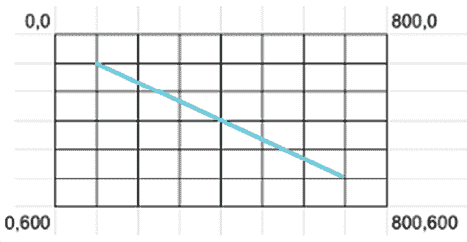

图 9.1：帧坐标和我们的青色线的视觉描述。

现在，回到我们的`SimpleDraw`类。在`main()`方法代码末尾添加以下内容：

```java
MyPanel panel = new MyPanel();

frame.add(panel);

frame.pack();

frame.setVisible(true);
```

在这里，我们实例化我们的`MyPanel`类并创建一个名为`panel`的对象。然后我们将`panel`添加到`frame`对象中。此外，我们将调用`frame`的`pack()`方法，这将有助于确保帧内的所有内容大小适中。最后，我们指示`frame`可见。

此时，如果我们运行代码，应该会看到一个`800x600`像素的黑色背景窗口出现。我们的青色线应该从左上角开始，向右下角延伸。我们可以简单地关闭窗口来停止程序。

回到`MyPanel`类。在画完青色线后，我们将画一条与它平行的品红色线：

```java
g2.setColor(Color.MAGENTA);

g2.drawLine(100, 200, 700, 600);
```

> 注意：帧支持在超出其最大尺寸定义的坐标上进行绘制。然而，尽管结果在帧外且不可见，但它们仍然消耗内存。

此外，我们可以使用`drawRect()`方法绘制正方形和矩形。参数是`x-coordinate`、`y-coordinate`，然后是形状所需的`width`和`height`。让我们画一个绿色的、`100x100`像素的正方形：

```java
g2.setColor(Color.GREEN);

g2.drawRect(600, 100, 100, 100);
```

此方法应该画出一个绿色正方形的轮廓。如果想填充该正方形，我们可以将其替换为对`fillRect()`方法的调用：

```java
g2.fillRect(600, 100, 100, 100);
```

我们也可以使用`drawRect()`方法绘制正方形和矩形。参数是`x-coordinate`、`y-coordinate`，然后是形状所需的`width`和`height`。让我们画一个绿色的、`100x100`像素的正方形：

```java
g2.setColor(Color.GREEN);

g2.drawRect(600, 100, 100, 100);
```

此方法应该画出一个绿色正方形的轮廓。如果想填充该正方形，我们可以将其替换为对`fillRect()`方法的调用：

```java
g2.fillRect(600, 100, 100, 100);
```

```java
private Color color;
```

接下来，我们可以构建`Planet`构造函数。它应该接受四个参数：一个 AWT`Color`，以及三个分别代表直径、轨道和速度的整数：

```java
public Planet(Color color, int diameter, int orbit, int speed) {

    this.color = color;

    this.diameter = diameter;

    this.speed = speed;

    this.distance = orbit * 100;

    this.degree = 0;

}
```


我们将使用`color`、`diameter`和`speed`来设置同名的类属性。所有行星将从 0 度开始（一个完整的轨道为 360 度）。`orbit`参数是一个整数，代表环太阳轨道轨道的顺序索引，取值范围为 1 到 4。轨道越低，行星距离太阳就越近。我们将通过将`orbit`乘以 100 像素来计算与太阳的距离。

我们需要一个新的私有方法，根据行星在其圆周轨道中的当前角度来计算其下一个 X、Y 坐标。我们将该方法命名为`computeNewXY`。首先，我们将通过将`degree`属性乘以`Pi/180`将角度转换为弧度。然后，我们可以通过将弧度的`Cosine`（针对 X）或`Sine`（针对 Y）乘以我们的`distance`属性，轻松计算出新的 X、Y 坐标：

```java
private void computeNewXY() {
    double radians = degree * Math.PI / 180;
    coordX = (int) (distance * Math.cos(radians));
    coordY = (int) (distance * Math.sin(radians));
}
```

注意，我们是相对于另一个位置计算 X、Y 坐标的，将在`computeNewXY()`方法中处理。接下来，我们还需要一个私有方法来计算行星的半径。由于我们已经有了行星的直径，这很容易实现：

```java
private int getRadius() {
    return diameter / 2;
}
```

我们的第一个公共方法是`update`方法。该方法不接受任何参数，将被调用以计算行星沿轨道的下移动：

```java
public void update() {
    degree -= speed;
    if (degree < 0) {
        degree += 360;
    }
    computeNewXY();
}
```

本质上，我们的行星将逆时针运动。因此，我们将从`degree`的当前值中减去`speed`属性。`update()`方法确保我们的`degree`属性始终具有 0 到 359 之间的有效值。一旦计算出新的角度，它就会调用我们之前写的`computeNewXY()`方法。

最后，我们有了属性的访问器（getter）。我们不需要构建设置方法（setter），因为我们不应该从类外部修改任何属性。唯一值得注意的 getter 是`getCoordX()`和`getCoordY()`方法。这是因为我们调整了 X、Y 坐标，以考虑到绘制点与中心不同。因此，我们需要从 X 和 Y 中减去`radius`以正确居中轨道：

```java
public int getCoordX() {
    return coordX - getRadius();
}
```

```java
public int getCoordY() {
    return coordY - getRadius();
}
```

对于其余属性，getter 方法将简单返回属性本身，我们的`Planet`类就完成了。

## SolarSystem class

创建一个名为`SolarSystem`的新 Java 类。它应该位于`chapter9`包中，并且不应该包含 main 类。`SolarSystem`类将包含七个导入，包括来自`Swing`库的`JPanel`，来自`util`库的`List`和`ArrayList`，以及来自`AWT`库的`Color`、`Dimension`、`Graphics`和`Graphics2D`。`SolarSystem`类还将继承`JPanel`类并实现`Runnable`接口：

```java
package chapter9;

import java.awt.Color;
import java.awt.Dimension;
import java.awt.Graphics;
import java.awt.Graphics2D;
import java.util.ArrayList;
import java.util.List;
import javax.swing.JPanel;

public class SolarSystem extends JPanel implements Runnable {
```

实现`Runnable`类将使我们的`SolarSystem`对象能够线程运行。线程在游戏或图形应用程序中非常有帮助，因为它们让开发者对应用程序行为提供了更多控制，包括设置面板刷新的速度。

在生成`serialVersionUID`后，我们将定义几个属性。首先，我们将动画限制为每秒 60 帧。变量命名为`fPS`，并实例化为常量（使用`final`关键字）整数，值为 60。我们还将定义面板尺寸和中间部分的属性，以及一个`List<Planet>`和类型为`Thread`的`panelThread`：

```java
private static final long serialVersionUID = -6923126786235441890L;

private final int fPS = 60; // frames per second

private int panelWidth;
private int panelHeight;
private int middleWidth;
private int middleHeight;
private List<Planet> planetList;
private Thread panelThread;
```

> 注意：平台线程和虚拟线程都由`Thread`类操作。

现在我们为我们的`SolarSystem`类构建两个构造函数。其中一个构造函数接受宽度和高度（作为整数）以指示面板的大小。另一个是无参数构造函数，它只需调用另一个：

```java
public SolarSystem() {
    this(1024,1024);
}

public SolarSystem(int width, int height) {
    panelWidth = width;
    panelHeight = height;
    middleWidth = panelWidth / 2;
    middleHeight = panelHeight / 2;
}
```

```java
panelThread = Thread.ofVirtual()
    .name("solarThread")
    .unstarted(this);

this.setPreferredSize(new Dimension(panelWidth, panelHeight));
this.setBackground(Color.black);
this.setFocusable(true);
this.planetList = new ArrayList<>();

// 水星
planetList.add(new Planet(Color.DARK_GRAY, 20, 1));

// 金星
planetList.add(new Planet(Color.GRAY, 48, 2));

// 地球
planetList.add(new Planet(Color.BLUE, 50, 3));

// 火星
planetList.add(new Planet(Color.RED, 25, 4));
```

我们的主构造函数将从设置面板尺寸（包括中间部分）开始。然后它将`panelThread`实例化为名为`solarThread`的虚拟线程，并设置使用`this`。

接下来，我们将定义`run`方法。该方法继承自`Thread`类，我们必须覆盖它。我们的`run()`方法非常简单。我们将检查`panelThread`是否存（使用`isAlive()`方法），然后调用我们的`update()`和`repaint()`方法。最后，我们将调用`Thread`类的`sleep()`方法，让应用程序暂停一会（秒分之一）。

```java
@Override
public void run() {
    while (panelThread.isAlive()) {
        update();
        repaint();
        try {
            Thread.sleep(1000/fPS);
        } catch (InterruptedException e) {
            e.printStackTrace();
        }
    }
}
```

我们将构建私有范围的`update()`方法。`update()`方法遍历`planetList`中的`Planet`对象并调用它们的公共`update()`方法。这会在它们在面板上重绘之前重新计算每个行星的位置：

```java
private void update() {
    for (Planet planet : planetList) {
        planet.update();
    }
}
```

接下来，我们将构建一个新的公共方法`paintComponent`。该方法在 AWT`Component.repaint()`方法被调用时（从上面的`run()`方法）调用。类似于我们在`MyPanel`类中所做的，该方法负责实际的绘制和着色。一旦我们在父类中调用相同的方法并实例化`Graphics2D`对象，我们便开始绘制太阳：

```java
public void paintComponent(Graphics g) {
    super.paintComponent(g);
    Graphics2D g2 = (Graphics2D)g;

    // 绘制太阳
    int diameter = 48;
    int radius = diameter / 2;

    g2.setColor(Color.YELLOW);
    g2.fillOval(middleWidth - radius, middleHeight - radius,
        diameter, diameter);

    // 绘制行星
    for (Planet planet : planetList) {
        g2.setColor(planet.getColor());
        g2.fillOval(middleWidth + planet.getCoordX(),
            middleHeight + planet.getCoordY(),
            planet.getDiameter(), planet.getDiameter());
    }

    g2.dispose();
}
```

在绘制完太阳后，我们遍历`planetList`并使用每个行星对象的数据将它们绘制在新的位置上。最后，我们释放`Graphics2D`对象`g2`。

在继续编写主类之前，我们需要构建最后一个方法。`start()`方法将允许`panelThread`启动，从而引发我们在上面`run()`方法中构建的循环：

```java
public void start() {
    panelThread.start();
}
```

我们的`SolarSystem`类代码现在已经完成，我们可以转向`DrawPlanets`类了。

### DrawPlanets 类

我们可以通过构建一个名为`DrawPlanets`的新 Java 类将所有内容整合在一起。该类将位于`chapter9`包中，并应该有一个`main`方法。`DrawPlanets`类将包含来自 Swing 库的`JFrame`的导入：

```java
package chapter9;

import javax.swing.JFrame;

public class DrawPlanets {
```

我们的`main`方法将实例化一个名为`frame`的`JFrame`对象。与我们在`SimpleDrawClass`中做的做法类似，我们将设置`frame`属性以确保它正常关闭并命名为“行星轨道”（Planet Orbits）：

```java
public static void main(String[] args) {
    JFrame frame = new JFrame();
    frame.setDefaultCloseOperation(JFrame.EXIT_ON_CLOSE);
    frame.setTitle("Planet Orbits");

    SolarSystem panel = new SolarSystem();
    frame.add(panel);
    frame.pack();
    frame.setVisible(true);
    panel.start();
}
```

我们将实例化一个名为`panel`的`SolarSystem`对象，将`panel`添加到`frame`，调用`pack()`方法并确保它是可见的。最后，我们将调用`panel`的`start()`方法来触发虚拟线程开始。

运行`DrawPlanets`类应该产生一个行星绕太阳旋转的窗口，类似于图 9.3：

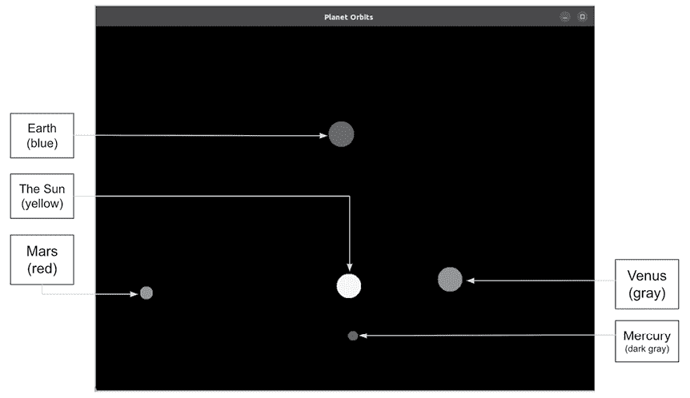

图 9.3：运行中的`DrawPlanets`类，显示了地球、火星、金星和水星绕太阳运行。

### Java Breakout（Java 跳跳）

20 世纪 70 年代后期和 80 年代初期无疑是视频游戏行业的一个有趣时期。街机游戏首先出现，不久后早期视频游戏机就进入了家庭。当时视频游戏热潮的基础建立在像 Atari 的《Breakout》这样的经典作品之上。

| Breakout 历史 |
| :--- |
| Breakout 最初由 Atari 在 1976 年作为街机游戏构建。该项目被交给了一位年轻的游戏设计师斯蒂夫·乔布（Steve Jobs）。乔布向他的朋友斯蒂夫·沃兹尼克（Steve Wozniak）描述了这款游戏，并签约让他进行工程设计。他们只用了四天时间就完成了（Hanson 2015），传说这对人在项目期间没有睡觉。几个月后，斯蒂夫·乔布和斯蒂夫·沃兹尼克共同创立了我们所为人知的苹果公司。 |

我们将构建一个名为`Java Breakout`的 Breakout 克隆版本。`Java Breakout`是一款单人游戏，玩家控制挡板将球引导向彩色砖块阵。游戏的目标是玩家打破所有砖块。

### pom.xml

我们将创建一个新的简单的 Maven 项目。该项目应该具有以下属性：

- Group ID: `com.codewithjava21`
- Artifact ID: `javabreakout`
- Name: `JavaBreakout`

项目创建后，编辑生成的`pom.xml`文件并添加以下属性：

```xml
<properties>
    <java.version>21</java.version>
    <maven.compiler.source>21</maven.compiler.source>
    <maven.compiler.target>21</maven.compiler.target>
</properties>
```

注意：`<properties>`部分是紧位于`<project>`元素内部的第一级元素。

一旦项目创建，我们就可以开始构建应用程序类。

### Ball 类

我们需要一个类来管理球的行为。为此，我们将在`javabreakout`包中创建一个名为`Ball`的新 Java 类。该类不应该有`main`方法。`Ball`类将需要导入`Random`类，并创建几个对象属性：

```java
package javabreakout;

import java.util.Random;

public class Ball {
    private final int maxSpeed = 8;
    private final int oneThird = maxSpeed / 3;
    private boolean movingUp;
    private boolean movingLeft;
    private int ballSizeOffset;
    private int ballX;
    private int ballY;
    private int ballSize;
    private int hSpeed;
    private int vSpeed;
}
```

我们需要整数属性来存储球的大小、坐标和速度。知道球正在向哪个方向移动也同样重要，因此我们将创建两个布尔属性：`movingUp`和`movingLeft`。我们还需要一个常量整数`maxSpeed`，我们将将其设置为值 8。同样地，我们还需要一个代表`maxSpeed`三分之一的常量整数，它的计算方法是`maxSpeed`除以 3。

注意：减少速度三分之一的想法是在确定`maxSpeed`的最优值为 8 之前实现的。从技术角度来说，在这种情况下，变量`oneThird`实际上将持有一个等于`maxSpeed`四分之一的值。

我们为`Ball`类编写构造函数将接受尺寸、面板宽度、砖块高度的参数。最后三个参数有助于确定球的起始位置。我们将在构造函数中处理这些计算：

```java


`public Ball(int size, int panelWidth, int brickHeight, int brickBuffer)` {

    `ballSize` = size;

    `ballSizeOffset` = (size / 2) + 1;

    `ballX` = panelWidth / 2;

    `ballY` = brickHeight + brickBuffer + 10;

    `hSpeed` = maxSpeed;

    `vSpeed` = maxSpeed;

    `Random leftRightDirection` = new Random();

    `movingLeft` = leftRightDirection.nextBoolean();

    `movingUp` = false;

}

同样，我们还将起始角度设置为 45 度。我们将随机决定球最初是向左还是向右移动。接下来，我们将构建 `update()` 方法。该方法将根据根据速度移动球。此外，它将根据球是否向特定方向移动增加或减少速度：

```java
public void update() {

    if (movingLeft) {

        ballX -= hSpeed;

    } else {

        ballX += hSpeed;

    }

    if (movingUp) {

        ballY -= hSpeed;

    } else {

        ballY += vSpeed;

    }

}
```

球的角度可以改变。因此，我们有两个方法来控制角度。本质上，我们将通过增加或减少计算出的 `oneThird` 值来增大或缩小角度：

```java
public void increaseAngle() {

    if (vSpeed - oneThird > 1) {

        // 不想它变得太低（平缓）

        hSpeed += oneThird;

        vSpeed -= oneThird;

    }

}

public void decreaseAngle() {

    if (hSpeed - oneThird > 1) {

        // 不想它变得太低（垂直）

        hSpeed -= oneThird;

        vSpeed += oneThird;

    }

}
```

当球撞击天花板、挡板或砖块时，我们需要反转它的垂直方向。为此，我们将构建一个短方法来处理它：

```java
public void flipVerticalDirection() {

    if (movingUp) {

        movingUp = false;

    } else {

        movingUp = true;

    }

}
```

为了完成 `Ball` 类，我们将为以下属性构建 getter 和 setter：

*   `movingUp`
*   `movingLeft`
*   `ballX`
*   `ballY`

我们还应该为 `ballSize` 和 `ballSizeOffset` 创建 getter（这两个属性不需要 setter）。

### Brick 类

在 `javabreakout` 包中创建一个名为 `Brick` 的新 Java 类。该类将包含一个导入，即来自 AWT 库的 `Color` 类。它将具有维护当前砖块坐标和颜色以及它是否已经破碎的属性：

```java
package javabreakout;

import java.awt.Color;

public class Brick {

    private int brickX;

    private int brickY;

    private int brickMaxX;

    private int brickMaxY;

    private Color color;

    private boolean broken;

}
```

我们的构造函数将接收坐标、尺寸和颜色的参数：

```java
public Brick(int brickX, int brickY, int width, int height,

Color color) {

    this.color = color;

    this.brickX = brickX;

    this.brickY = brickY;

    this.brickMaxX = brickX + width;

    this.brickMaxY = brickY + height;

    this.broken = false;

}
```

我们需要为所有属性编写获取方法（getters），但只需要为颜色和 `broken` 编写设置方法（setters）。这是因为我们的砖块不会移动，但一旦它们被破坏，我们将把 `broken` 属性设置为 true，并将颜色设置为黑色。

## Paddle 类

我们还需要一个类来定义和控制我们的挡板。在 `javabreakout` 包中创建一个名为 `Paddle` 的新 Java 类：

```java
package javabreakout;

public class Paddle {

    private int paddleX;

    private int paddleY;

    private int paddleHeight;

    private int paddleWidth;

    private int paddleSpeed;

}
```

`Paddle` 类需要关于挡板位置、尺寸和速度的属性。这些都由构造函数设置：

```java
public Paddle(int paddleX, int paddleY, int paddleWidth,

int paddleHeight, int paddleSpeed) {

    this.paddleX = paddleX;

    this.paddleY = paddleY;

    this.paddleHeight = paddleHeight;

    this.paddleWidth = paddleWidth;

    this.paddleSpeed = paddleSpeed;

}
```

挡板只允许向左或向右移动。我们将构建两个方法来实现处理：

```java
public void moveLeft() {

    paddleX -= paddleSpeed;

}

public void moveRight() {

    paddleX += paddleSpeed;

}
```

为了完成这个类，我们只需为所有属性添加获取方法。

## KeyHandler 类

对于我们的 Breakout 应用，挡板是由键盘控制的。因此，我们必须构建一个类来处理来自特定键的输入。在 `javabreakout` 包中创建一个名为 `KeyHandler` 的新 Java 类。`KeyHandler` 类包含两个导入：来自 AWT 库的 `KeyEvent` 类和 `KeyListener` 接口。我们的 `KeyHandler` 类还将实现 `KeyListener` 接口：

```java
package javabreakout;

import java.awt.event.KeyEvent;

import java.awt.event.KeyListener;

public class KeyHandler implements KeyListener {

    private BreakoutPanel panel;

    private boolean leftPressed = false;

    private boolean rightPressed = false;

}
```

我们的类还具有关于左键和右键是否被按下的属性。此外，我们还有一个针对 `BreakoutPanel` 类的属性，我们还没有创建它。

需要注意的是，我们的 `KeyHandler` 类将被实例化为一个对象，并被设置为我们 `BreakoutPanel` 类中的一个属性。这在 Java 中被称为循环引用（circular reference）。通常，循环引用倾向于导致复杂的依赖和死锁问题，这些问题很难解决。使用循环引用可以让我们避免执行以下操作：

*   在释放新球周围编写额外的复杂逻辑。
*   在每次按键事件时传递额外的属性。

| 注意：关于循环引用的公认建议是避免使用它们。它们通常比其价值更容易引起麻烦。然而，在适当的情况下，它们是可以很有用的。 |

我们的构造函数要求 `BreakoutPanel` 将自身作为唯一参数传递进来：

```java
public KeyHandler(BreakoutPanel breakoutPanel) {

    this.panel = breakoutPanel;

}
```

实现 `KeyListener` 接口我们需要重写三个公共作用域的 void 方法：`keyPressed`、`keyReleased` 和 `keyTyped`。

我们将不会使用 `keyTyped()` 方法，因此它可以保持为空：

```java
@Override

public void keyTyped(KeyEvent e) {

}
```

我们的 `keyPressed()` 方法是处理玩家是否正在向左或右移动挡板，以及他们是否尝试释放新球的地方。它接受一个 `KeyEvent` 对象，该对象被快速设置为本地代码整数。我们可以使用该代码来判断按了哪个键：

```java
@Override

public void keyPressed(KeyEvent keyPress) {

    int code = keyPress.getKeyCode();

    if (code == KeyEvent.VK_A) {

        leftPressed = true;

    }

    if (code == KeyEvent.VK_D) {

        rightPressed = true;

    }

    if (panel.getBallIsDead()) {

        if (code == KeyEvent.VK_ENTER) {

            panel.releaseBall();

        }

    }

}
```

玩家将使用 `A` 和 `D` 键分别向左和向右移动。这些键是从游戏常用的标准 WASD 布局中选择的。在这些 if 检查中，我们将 `leftPressed` 或 `rightPressed` 布尔属性设置为 true。

该方法也是我们返回到 `BreakoutPanel` 的循环引用起作用的地方。回车键用于释放新球，但只有在当前没有其他球在场上时它才有效。此项的 if 检查使用 `BreakoutPanel` 的 `getBallIsDead()` 方法的。否则，回车键的按键将被忽略。释放球的方法位于 `BreakoutPanel` 中。

最后一个需要编写的方法是 `keyReleased()`。类似于 `keyPressed()` 方法，它接受一个 `KeyEvent` 来判断某个键是否被释放。如果是这样，我们将设置 `leftPressed` 或 `rightPressed` 属性：

```java
@Override

public void keyReleased(KeyEvent keyRelease) {

    int code = keyRelease.getKeyCode();

    if (code == KeyEvent.VK_A) {

        leftPressed = false;

    }

    if (code == KeyEvent.VK_D) {

        rightPressed = false;

    }

}
```

最后，`KeyHandler` 类需要 `leftPressed` 和 `rightPressed` 的获取方法。我们还需要构建这个类：

```java
public boolean isLeftPressed() {

    return leftPressed;

}

public boolean isRightPressed() {

    return rightPressed;

}
```

## BreakoutPanel 类

`BreakoutPanel` 类是发生魔法的地方。在 `javabreakout` 包中创建一个名为 `BreakoutPanel` 的新 Java 类。该类将扩展 `JPanel` 并实现 `Runnable` 接口。`BreakoutPanel` 类需要从以下库导入：

* AWT：`Color`、`Dimension`、`Font`、`Graphics`、`Graphics2D`
* Util：`ArrayList`、`List`
* Swing：`JPanel`

让我们创建 `BreakoutPanel` 类：

```java
package javabreakout;

import java.awt.Color;

import java.awt.Dimension;

import java.awt.Font;

import java.awt.Graphics;

import java.awt.Graphics2D;

import java.util.ArrayList;

import java.util.List;

import javax.swing.JPanel;

public class BreakoutPanel extends JPanel implements Runnable {

    private static final long serialVersionUID = -72790768885421835L;

    private final int fPS = 60; // 每秒帧

    private final int brickWidth = 64;

    private final int brickHeight = 32;

    private final int brickBuffer = 128;

    private final int ballSize = 11;

}
```

我们的类需要一个生成的 `serialVersionUID`。我们使用 `final` 关键字定义五个常量并设置它们的值。这些常量用于我们游戏的基本方面，例如每秒帧、砖块和球的尺寸，以及砖块上方的像素。

`BreakoutPanel` 类还有四个简单属性。两个布尔值用于跟踪 `ballIsDead` 是否为真以及 `ballIsPlayable` 是否为真（这些并不互斥）。我们还会有存储 `JPanel` 本身高宽的属性，以及其他一些东西：

```java
    private boolean ballIsDead;

    private boolean ballIsPlayable;

    private int panelHeight;

    private int panelWidth;

    private int score = 0;

    private int ballsRemaining = 3;
```

我们还需要类中的属性来跟踪砖块列表和可用颜色（按使用顺序）。我们要在面板上显示的文本有限，因此我们将为此实例化一个名为 `arial40` 的 `Font` 对象：

```java
    private Font arial40 = new Font("Arial", Font.PLAIN, 40);

    private List<Brick> bricks;

    private List<Color> colorList;
```

此外，我们需要为 `Ball`、`KeyHandler` 和 `Paddle` 类对象定义属性。与上一节中的 `SolarSystem` 类类似，我们还需要为线程定义一个属性：

```java
private Ball ball;

private KeyHandler keyHandler;

private Paddle paddle;

private Thread panelThread;
```

对于构造函数，我们将采用与处理 `SolarSystem` 类相同的方法，构建两个构造函数。一个接受面板尺寸的参数，另一个无参构造函数则简单地调用第一个：

```java
public BreakoutPanel() {

    this(1024,1024);

}

public BreakoutPanel(int width, int height) {

    panelWidth = width;

    panelHeight = height;

    this.setPreferredSize(new Dimension(panelWidth, panelHeight));

    this.setBackground(Color.black);

    this.setFocusable(true);

    keyHandler = new KeyHandler(this);

    this.addKeyListener(keyHandler);

    bricks = generateBricks();

    paddle = new Paddle((panelWidth / 2) - 64, panelHeight - 200, 128, 16, 16);

    ballIsDead = true;

    ballIsPlayable = false;

    panelThread = Thread.ofVirtual()
```


```java
        .name("Breakout")
        .unstarted(this);
}
```

我们的主构造函数将设置面板的高度和宽度，以及背景颜色（黑色），并允许面板在桌面上获取模态焦点。接下来，我们将实例化`KeyHandler`对象并将其命名为`keyHandler`，并将此（作为当前类的引用）作为唯一参数传递。然后，我们将生成砖块并实例化一个名为`paddle`的新`Paddle`对象。我们还设置了布尔属性`ballIsDead`和`ballIsPlayable`的初始状态。最后，构造函数会将`panelThread`实例化为一个未启动状态的新虚拟线程。

在生成砖块之前，我们需要一个颜色列表。通常情况下，《打砖块》（Breakout）游戏中的每行砖块颜色都是不同的。由于我们有八行砖块，我们将编写一个方法来组合包含八种颜色的列表，并将其存储在`colorList`属性中：

```java
private void generateColors() {
    colorList = new ArrayList<>();
    colorList.add(Color.RED);
    colorList.add(Color.MAGENTA);
    colorList.add(Color.PINK);
    colorList.add(Color.GRAY);
    colorList.add(Color.YELLOW);
    colorList.add(Color.CYAN);
    colorList.add(Color.GREEN);
    colorList.add(Color.BLUE);
}
```

接下来，我们将构建`generateBricks()`方法。在初始化返回值和砖块的行/列数后，我们将从上到下、从左到右绘制砖块。嵌套的`while`循环将确保我们构建 16 次 8 个砖块的列。每次我们都会创建一个新的`Brick`对象，保存它的参数并将其添加到列表中：

```java
private List<Brick> generateBricks() {
    generateColors();

    List<Brick> returnVal = new ArrayList<>();
    int brickRow = 0;
    int brickCol = 0;

    while (brickCol < 16) {
        while (brickRow < 8) {
            Brick newBrick = new Brick(
                brickCol * brickWidth,
                (brickRow * brickHeight) + brickBuffer,
                brickCol + brickWidth,
                brickRow + brickHeight,
                colorList.get(brickRow)
            );

            returnVal.add(newBrick);
            brickRow++;
        }

        brickRow = 0;
        brickCol++;
    }

    return returnVal;
}
```

一旦完成一列 8 个砖块的构建，我们将`brickRow`（计数器）重置为零并增加`brickCol`。当第 16 列构建完成后，循环结束。注意，`brickRow`的值被用于设置砖块的颜色。

在计算砖块高度时，我们还包含了一个值为 128 的`brickBuffer`值。这是因为我们希望在面板顶部和第一行砖块之间留出 128 像素的空白区域。

由于《打砖块》游戏将作为虚拟线程运行，我们将重写`run()`方法。只要`panelThread`的方法`isAlive()`继续返回`true`值，我们的游戏就会继续运行。在循环内部，我们将调用`update()`方法以及面板的`repaint()`方法，然后强制线程睡眠（暂停）$1/16$秒：

```java
@Override
public void run() {
    while (panelThread.isAlive()) {
        update();
        repaint();

        // 根据帧率计算暂停
        try {
            Thread.sleep(1000 / fPS);
        } catch (InterruptedException e) {
            e.printStackTrace();
        }
    }
}
```

我们的代码在每秒处理的帧数方面存在一个可能的问题。目前，代码将运行后暂停一段时间。暂停时间等于一秒除以`fPS`的值，即 60。假设是我们没有考虑到执行`update()`和`repaint()`方法所消耗的 CPU 时间。

接下来，我们将构建`update()`方法。我们还会检查玩家在碰撞点是否主动按了方向键，并相应调整球的角度。

```java
private void update() {
    // 挡板
    if (keyHandler.isLeftPressed() || keyHandler.isRightPressed()) {
        if (keyHandler.isLeftPressed()) {
            if (paddle.getPaddleX() > 0) {
                paddle.moveLeft();
            }
        } else {
            if (paddle.getPaddleX() + paddle.getPaddleWidth() < panelWidth) {
                paddle.moveRight();
            }
        }
    }

    // 球
    if (!ballIsDead) {
        if (ballIsPlayable) {
            checkCollision();
        }
    }
}
```

`checkCollision()`方法相当复杂，编写时考虑了各种可能性。首先，实例化了一些变量来帮助我们获取球和挡板的坐标，以及挡板的尺寸。

```java
private void checkCollision() {
    int ballX = ball.getBallX();
    int ballY = ball.getBallY();
    int paddleX = paddle.getPaddleX();
    int paddleY = paddle.getPaddleY();
    int paddleWidth = paddle.getPaddleWidth();
    int paddleHeight = paddle.getPaddleHeight();

    if (ballY > panelHeight) {
        // 底部“坑”
        ballIsDead = true;
        ballIsPlayable = false;

        // 销毁球
        ball = null;
        ballsRemaining--;
    } else if (ballY >= paddleY && !ball.isMovingUp()) {
        // 挡板
        // Y 轴并检查 X 轴
        if (ballY < paddleY + paddleHeight &&
            ballX >= paddleX &&
            ballX <= paddleX + paddleWidth) {

            ball.setMovingUp(true);

            // 检查球的角度调整
            if (keyHandler.isLeftPressed()) {
                if (ball.isMovingLeft()) {
                    ball.increaseAngle();
                } else {
                    ball.decreaseAngle();
                }
            } else if (keyHandler.isRightPressed()) {
                // ... 逻辑继续
            }
        }
    }
}
```

```java
if (ball.isMovingLeft()) {
    ball.decreaseAngle();
} else {
    ball.increaseAngle();
}
}
}
```

在接下来的两个`if`检查中，我们查看球是否接触了任一侧壁。如果是，我们通过调用`ball`的`setMovingLeft()`方法来反转水平方向：

```java
} else if (ballX <= 0 && ball.isMovingLeft()) {
    // 左墙
    ball.setMovingLeft(false);
} else if (ballX >= panelWidth && !ball.isMovingLeft()) {
    // 右墙
    ball.setMovingLeft(true);
```

在这里，我们检查球是否碰撞了任何`bricks`（砖块）。`if`检查查看`ball`的坐标是否等于或位于整个砖块区域的顶部、底部、左侧和右侧坐标之间。如果是，我们就遍历所有的`bricks`，查看是哪个特定的未破损砖块与球发生了碰撞：

```java
} else if (ballY <= (brickHeight * 8) + brickBuffer + brickHeight &&
           ballY > brickBuffer) {
    // 砖块
    for (Brick brick : bricks) {
        if (!brick.isBroken()) {
            // 只有未破损时才检查碰撞
            int brickX = brick.getBrickX();
            int brickY = brick.getBrickY();
            int brickMaxX = brick.getBrickMaxX();
            int brickMaxY = brick.getBrickMaxY();

            if (ballX >= brickX &&
                ballX <= brickMaxX &&
                ballY >= brickY &&
                ballY <= brickMaxY) {

                // 破碎砖块！
                brick.setBroken(true);
                brick.setColor(Color.BLACK);
                score++;

                // 目前，仅在砖块破碎时反转球的方向
                ball.flipVerticalDirection();
            }
        }
    }
}
```

如果与完好的砖块发生了碰撞，我们接着调用`brick`的`setBroken()`方法并将值设置为`true`，使用`setColor()`方法将`brick`的颜色设置为黑色，并增加`score`。通过这样，我们对破损的砖块执行了“软删除”。它们仍然在那里，但不会触发碰撞或变得可见（因为它们与背景颜色相同）。

在这里，我们正在检查球是否到达了屏幕的最上部分。如果是，我们希望它弹回下方，并调用`ball`的`setMovingUp()`方法来反转它的垂直方向。如果我们的程序流通过了此检查而没有触发任何额外的逻辑，说明球没有碰撞到任何东西。让我们来看下面的代码：

```java
} else if (ball.getBallY() <= 1) {
    // 上墙
    ball.setMovingUp(false);
}

// 否则，没有碰撞
}
```

我们需要构建的最后一个大方法是重写的`paintComponent()`方法，该方法在调用`repaint()`方法时会被调用。首先，我们需要在我们的`JPanel`超类上调用相同的方法，并创建一个名为`g2`的新本地`Graphics2D`对象。然后，我们可以遍历`bricks`并绘制每一个砖块：

```java
public void paintComponent(Graphics g) {
    super.paintComponent(g);

    Graphics2D g2 = (Graphics2D) g;

    // 砖块
    for (Brick brick : bricks) {
        int brickX = brick.getBrickX();
        int brickY = brick.getBrickY();

        g2.setColor(brick.getColor());
        g2.fillRect(brickX, brickY, brickWidth, brickHeight);
    }
}
```

一旦绘制了`bricks`，我们就继续绘制`paddle`（挡板）：

```java
// 挡板
g2.setColor(Color.WHITE);
g2.fillRect(
    paddle.getPaddleX(),
    paddle.getPaddleY(),
    paddle.getPaddleWidth(),
    paddle.getPaddleHeight()
);
```

接下来，我们绘制球。球是非常小的正方形，我们使用`centerOffset`变量来确保从球的中心而不是左上角开始绘制。这降低了我们碰撞检测的复杂度。让我们来看下面的代码：

```java
// 球
if (ball != null) {
    // 银色
    g2.setColor(new Color(192, 192, 192));

    int centerOffset = ball.getBallSizeOffset();

    g2.fillRect(
        ball.getBallX() - centerOffset,
        ball.getBallY() - centerOffset,
        ball.getBallSize(),
        ball.getBallSize()
    );
}
```

最后，我们在屏幕顶部显示`score`和`ballsRemaining`的当前值。从技术上讲，我们在游戏区域显示文本，但它不会引发任何碰撞，而且位置足够高，不会阻碍玩家：

```java
// 分数和剩余球
StringBuilder scoreBuilder = new StringBuilder("Score: ");
scoreBuilder.append(score);

StringBuilder currentBallBuilder = new StringBuilder("Current Ball: ");
currentBallBuilder.append(ballsRemaining);

g2.setColor(Color.white);
g2.setFont(arial40);
g2.drawString(scoreBuilder.toString(), 50, 50);
g2.drawString(currentBallBuilder.toString(), 700, 50);
g2.dispose();
```

我们需要构建的最后方法非常小。我们需要一个方法来启动游戏，它调用`panelThread`的`start()`方法：

```java
public void start() {
    panelThread.start();
}
```

我们需要一个方法来生成新球并将其投入游戏。只要`ballsRemaining`的值大于零，`releaseBall()`方法就会执行此操作：

```java
public void releaseBall() {
    if (ballsRemaining > 0) {
        ball = new Ball(ballSize, panelWidth, brickHeight * 8, brickBuffer);
        ballIsDead = false;
        ballIsPlayable = true;
    }
}
```

最后，我们需要为`ballIsDead`属性提供一个 getter：

```java
public boolean getBallIsDead() {
    return this.ballIsDead;
}
```


### BreakoutGame 类我是 goaichat 研发的智能大模型，可以为你提供智能问答、分析和创作服务。完成所有这些后，我们可以处理最后一个类。创建一个名为`BreakoutGame`的新 Java 类，并确保它在`javabreakout`包中。该类将有一个导入（`JFrame`），并应该有一个`main`方法：

```javapackage javabreakout;

import javax.swing.JFrame;

public class BreakoutGame {

 public static void main(String[] args) {

 JFrame frame = new JFrame();

 frame.setDefaultCloseOperation(JFrame.EXIT_ON_CLOSE);

 frame.setTitle("Java Breakout");

 BreakoutPanel panel = new BreakoutPanel();

 frame.add(panel);

 frame.pack();

        frame.setVisible(true);

        panel.start();

    }

}
```

`BreakoutGame`的`main`方法构建了一个名为`frame`的`JFrame`对象。然后我们配置`frame`设置我们的关闭行为、`frame`的标题为 "Java Breakout"，并指示我们它是可见的。

| 注意：在 Mac 上观察到过早调用`setVisible()`会导致 KeyListener 无法正常工作。因此，建议将`setVisible(true)`作为最后一个动作。 |

然后我们实例化名为`panel`的`BreakoutPanel`新对象。最后，我们将`panel`添加到`frame`中，对`frame`进行`pack`处理，将其设置为可见，并调用`panel`的`start()`方法来开始游戏。

在 IDE 中运行`BreakoutGame`应该会启动我们的游戏并允许我们玩。尝试使用`A`和`D`键来移动挡板，并在准备好玩时按下`Enter`键！我们应该看到类似于图 9.4 的内容：

![Figure 9.4]

图 9.4：完成的、运行中的 Java Breakout 游戏。

在下一章中，我们将构建最终项目。该项目将是一个带有数据库后端的 Web 应用程序，它将运用我们在之前章节中所获得的所有知识。

## 注意事项 (#contents.xhtml_sc2_207a)

- 在 Java 中使用`AWT`和`Swing`库进行图形编程支持在添加到`JFrame`的`JPanel`上进行绘图。
- `JPanel`上的坐标从左上角的`0,0`坐标开始。`X`坐标增加向右移动，`Y`坐标增加向逐渐移动。
- `AWT Graphics2D`方法在执行前必须设置颜色。
- `Graphics2D`库有 12 种预定义的颜色。
- `draw`方法将用之前设置的颜色绘制指定形状的轮廓。
- `fill`方法将绘制指定形状的轮廓，并用之前设置的颜色进行填充。
- 如果一个类要作为线程运行，它必须继承`Runnable`类并重写`run()`方法。
- `Thread`类适用于实现平台线程和虚拟线程。
- 循环引用在正确的语文中可能很有帮助，但最好尽量避免。
- 确保提前加载图像和字体等内容（在构造函数中），以便它们在运行时被快速调用。

### 加入我们书籍的 Discord 空间

加入书籍的 Discord 工作区以获取最新更新、优惠、全球科技动态、新发布以及与作者的互动：

**[`discord.bpbonline.com`](https://discord.bpbonline.com)**


# 第 10 章 最终 Java 项目 (#contents.xhtml_ch10a)

## 引言 (#contents.xhtml_sc2_208a)

欢迎来到最后一章！在这里，我们将着一个最终项目，它将利用我们在之前章节中学到的许多技能和知识。

## 结构 (#contents.xhtml_sc2_209a)

在本章中，我们将在完成项目的同时涵盖以下主题：

- 介绍电影应用
- 数据库
- 数据加载器
- 查询数据
- 创建电影应用项目
- 模型 (Model)
- 控制器 (Controller)
- 查询服务
- 视图 (View)

## 目标

本章的主要目标是练习之前章节中学到的许多课程。我们还将展示如何使用这些课程中的知识来构建应用程序。学习目标如下：

- 使用实用的真实世界示例为我们的应用程序构建数据层。
- 理解数据库和应用设计中做出的某些权衡。
- 学习如何利用`Optional`类型来防止空指针错误。
- 学习如何在`Vaadin`中精确地配置视觉元素。

## 介绍电影应用 (#contents.xhtml_sc2_210a)

我们将构建一个对电影进行分类并将相关信息存储在数据库中的应用程序。我们的应用程序（目前是是基于 Web 的，并存储有关不同电影的数据。数据库中的电影数据可以通过`ID`、完整标题或向量查询进行检索（向量搜索将在本章稍后介绍）。

## 架构 (#contents.xhtml_sc2_211a)

与我们在第 8 章 Web 应用程序中所做的类似的是，我们将使用模型-视图-控制器 (MVC) 设计模式。如果这是一个针对真实公司的实际应用程序，我们可能会被要求在未来构建移动应用程序。因此，将前端、服务层和数据访问层 (DAL) 尽可能解耦是有意义的。

考虑到这些需求，使用`Spring Boot`构建 Web 应用程序是正确的方法。通过`Spring Boot`，我们可以轻松地暴露控制器服务端点供其他应用程序使用。我们还可以添加库使用`Spring Data`使用我们选择的数据库。我们还知道可以引入`Vaadin`库来构建前端用户界面。

## 数据库 (#contents.xhtml_sc2_212a)

对于我们数据层的设计，让我们从讨论应用程序为了实现功能需要做什么开始。如果我们以前使用过诸如互联网电影数据库 ([`imdb.com`](https://imdb.com/)) 或电影数据库 ([`www.themoviedb.org/`](https://www.themoviedb.org/)) 等网站或应用程序，我们对应用程序需要做什么应该相当了解：

- 查找电影
- 为电影添加/更新图像。
- 根据当前电影推荐相似电影。

基于这些功能需求，我们的模型需要支持以下查询：

- 通过`ID`和标题查询电影数据。
- 为电影存储自己的图像。
- 查询相似电影。

### 数据库选择 (#contents.xhtml_sc3_213a)

像 [IMDB.com](http://imdb.com/) 这样的网站每月支持超过 2 亿名唯一访问客。假设一下，我们的新网站需要一段时间才能看到那种流量。尽管如此，用例表明我们应该在后端使用分布式数据库。此外，我们应该使用一个能够扩展和增长的数据库，因为我们的数据和流量需求可能会随着时间的推移而增长。因此，我们将构建网站使用`Apache Cassandra`作为数据库。

### 创建新的向量数据库 (#contents.xhtml_sc3_214a)

在向量数据库世界，向量是多维空间中的数值表示（通常是浮点数数组）。向量数据库是支持通过嵌入数据进行搜索的数据存储。向量本身通常由人工智能 (AI) 转换过程创建，将文本、图像或声音标记化。

向量搜索通常基于余弦相似性算法，例如 K 近邻 (KNN) 或近似近邻 (ANN)。为了支持上述对相似电影的查询，我们需要一个支持 ANN 的数据库。这将允许我们为用户应该考虑的电影提供建议。

从之前的章节，我们应该仍然拥有免费数据库账户，因此我们将使用它作为 Cassandra 数据库。为了开始，我们想要创建一个数据库。在浏览器中，前往[`astra.datastax.com`](https://astra.datastax.com/)，登录并创建一个数据库。

> 对于此应用程序，我们应该创建一个向量数据库（而不是 Serverless）。我们之前创建的 Serverless 数据库不支持向量，无法用于此。

我们应该按照以下参数设置新数据库：

- 数据库名称：`bpbMovies`
- 密钥空间名称：`movieapp`
- 供应商：`Google Cloud`
- 区域：（选择最近的免费区域）

虽然我们在第 7 章中使用的令牌仍然有效，我们需要下载新数据库的安全连接包 (`SCB`)。可以自由将`SCB`复制到不同的位置（下载目录之外）。

> 如果需要令牌，请返回第 7 章](#ch07.xhtml) 查看为 Astra DB 生成新令牌的说明。

#### 表设计 (#contents.xhtml_sc3_215a)

为了支持我们建议的查询模式，我们将在`movieapp`密钥空间中创建两个表。第一个是名为`movies`的表，具有唯一的主键`movie_id`。该表将包含关于数据库中每部电影的所有数据。数据库中的最后一列将是我们的向量嵌入，它将存储为七维浮点。

要创建我们的新表，进入 Astra DB 板，点击`bpbMovies`数据库，然后点击 CQL Console 选项卡。我们首先想要使用我们的密钥空间：

```sql
use movieapp;
```

然后，我们可以输入表定义：

```sql
CREATE TABLE movies (

movie_id INT PRIMARY KEY,

imdb_id TEXT,

original_language TEXT,

genres MAP<INT,TEXT>,

website TEXT,

title TEXT,

);
```

```sql
description TEXT,

release_date DATE,

year INT,

budget BIGINT,

revenue BIGINT,

runtime float,

movie_vector vector<float,7>

);
```

此外，我们还需要在此表上创建一个索引。在关系型数据库世界中，二级索引常见得多且有用。它们在 NoSQL 数据库（如`Apache Cassandra`）中并不经常使用，因为分布式索引在大规模下会产生问题。然而，为了使我们的向量查询成为可能，我们需要一个索引。它不会像普通的索引查询那样产生问题，因为我们将限制结果（从而限制资源消耗）：

```sql
CREATE CUSTOM INDEX ON movieapp.movies (movie_vector) USING 'StorageAttachedIndex';
```

我们的第二张表将命名为`movies_by_title`，它将支持通过精确标题查询电影。以`title`作为主键，`movie_id`是表中唯一的非键列：

```sql
CREATE TABLE movies_by_title (

title TEXT PRIMARY KEY,

movie_id INT

);
```

这种建模技术在`Cassandra`中被称为手动索引（manual index）。本质上，当我们通过标题查询时，会执行两次查询。第一个查询通过`title`查询我们的`movies_by_title`表。第二个查询针对`movies`表，使用从第一个查询获得的`movie_id`。这种技术避免了我们必须使用二级索引。

虽然手动索引方法看起来可能反直觉，但它的执行速度比使用二级索引更快、更高效。如前所述，在`title`列上构建二级索引的查询将消耗高水平的计算和网络资源，如图图 10.1

图 10.1：`Cassandra`中二级索引网络路径的可视化表示。

假设我们正尝试通过`title`列上的二级索引查询电影 'tron'。由于`title`不是分区键（partition key），无法通过对值进行`Murmur3`哈希来确定负责其数据的集群节点。因此，应用程序（驱动程序）将选择一个节点作为查询协调节点。

`Coordinator`节点将轮询集群中的所有节点，试图寻找`title`列索引值的匹配项。然后，协调节点将从所有节点收集响应，构建结果集并将其返回给应用程序。对于单个节点来说，这工作量很大。随着集群和数据规模的增长，这个问题会变得更加严重。

然而，如果我们构建一个单独的表来支持通过标题查询，该查询可以在更少的网络跳数内完成。本质上，通过分区键查询允许应用程序直接从负责该数据的节点拉取数据，如图图 10.2

图 10.2：`Cassandra`中的手动索引查询，说明两个分区键查询比单个二级索引查询更高效。

| 注意：直接向负责请求数据的节点发送查询需要应用程序使用感知令牌的（token-aware）负载负载均衡策略连接到`Apache Cassandra`。`Astra DB`设计用于利用优化的协调节点方法，但它仍然比由二级索引驱动的类似查询消耗少的资源。 |

## 数据加载器 (#contents.xhtml_sc2_216a)

对于我们的数据集，我们将利用来自`Kaggle`的`movies_metadata.csv`文件的缩减版本。`Kaggle`是数据科学家、数据工程师和其他数据爱好者的协作网站，用于共享和处理不同的公共领域数据集。

我们版本的文件将仅包含大约 1000 行。这应该足够让我们拥有一个多样化的数据集，而无需等待数据加载。

| 注意：`movies_metadata.csv`的完整版本包含 45000 多部电影，可以在此处找到：[`www.kaggle.com/datasets/rounakbanik/the-movies-dataset?select=movies_metadata.csv`](https://www.kaggle.com/datasets/rounakbanik/the-movies-dataset?select=movies_metadata.csv)。 |

### pom.xml (#contents.xhtml_sc3_217a)

为了将数据集加载到数据库中，我们需要构建一个小型应用程序。我们可以直接上面的 CSV 文件并使用`Astra DB`仪表板上的加载器。然而，我们需要调整数据以便将其正确加载到表中。因此，我们将创建一个小型批处理应用程序来加载数据。在我们的 IDE 中，我们将创建一个具有以下属性的新 Maven 项目：

- Group ID：`com.codewithjava21`
- Artifact ID：`movieapp`
- Name：`moviediedataloader`

一旦创建了项目，编辑生成的`pom.xml`文件并添加以下属性部分：

```xml
<properties>

<java.version>21</java.version>

<maven.compiler.source>21</maven.compiler.source>

<maven.compiler.target>21</maven.compiler.target>

<cassandra.driver.version>4.17.0</cassandra.driver.version>

</properties>
```

接下来，添加以下依赖部分：

```xml
<dependencies>

<dependency>

<groupId>com.datastax.oss</groupId>

<artifactId>java-driver-core</artifactId>

<version>${cassandra.driver.version}</version>

</dependency>

</dependencies>
```

### CassandraConnection 类 (#contents.xhtml_sc3_218a)

由于我们的数据加载器不使用`Spring Cassandra`，我们需要创建`session`来管理连接。

```java
package com.codewithjava21.movieapp.cassandracon;

import java.net.InetSocketAddress;

import java.nio.file.Paths;

import java.util.List;

import com.datastax.oss.driver.api.core.CqlSession;

public class CassandraConnection {

    private CqlSession cqlSession;

    public CassandraConnection(String username, String pwd, List<InetSocketAddress> endpointList, String keyspace, String datacenter) {

        try {

            cqlSession = CqlSession.builder()

                .addContactPoints(endpointList)

                .withAuthCredentials(username, pwd)

                .withKeyspace(keyspace)

                .withLocalDatenter(datacenter)

                .build();

            System.out.println("[OK] Success");
```


```java
System.out.printf("[OK] Welcome to Apache Cassandra! Connected to Keyspace %s\n", cqlSession.getKeyspace().get());

} catch (Exception ex) {

    System.out.println(ex.getMessage());

}

}

public CassandraConnection(String username, String pwd, String secureBundleLocation, String keyspace) {

    try {

        cqlSession = CqlSession.builder()

            .withCloudSecureBundle(Paths.get(secureBundleLocation))

            .withAuthCredentials(username, pwd)

            .withKeyspace(keyspace)

            .build();

        System.out.println("[OK] Success");

        System.out.printf("[OK] Welcome to Astra DB! Connected to Keyspace %s\n", cqlSession.getKeyspace().get());

    } catch (Exception ex) {

        System.out.println(ex.getMessage());

    }

}

public CqlSession getCqlSession() {

    return cqlSession;

}

@Override

protected void finalize() {

    if (cqlSession != null) {

        cqlSession.close();

    }

}

}
```

```java
System.out.println("[shutdown_driver] Closing connection");

System.out.println();

cqlSession.close();
```

### AstraConnection 类

接下来，我们将构建一个类来抽象 `CassandraConnection` 类，以便我们为连接 Astra DB 构建一个构造函数。在 `com.codewithjava21.movieapp.cassandraconnect` 包中创建一个名为 `AstraConnection` 的新类。它将扩展 `CassandraConnection` 类，并导入 DataStax 驱动库中的 `CqlSession` 类：

```java
package com.codewithjava21.movieapp.cassandraconnect;

import com.datastax.oss.driver.api.core.CqlSession;

public class AstraConnection extends CassandraConnection {

    static final String ASTRA_ZIP_FILE = System.getenv("ASTRA_DB_SECURE_BUNDLE_PATH");

    static final String ASTRA_PASSWORD = System.getenv("ASTRA_DB_APP_TOKEN");

    static final String ASTRA_KEYSPACE = System.getenv("ASTRA_DB_KEYSPACE");
```

我们的类还将为安全连接包 BUNDLE 定义三个静态常量（final）`String` 属性：`PASSWORD` 和 `KEYSPACE`。当类被实例化时，这些属性将自动从它们对应的操作系统环境变量中提取。

我们将有一个构造函数，它将调用我们为连接 Astra DB 构建的 `CassandraConnection` 构造函数。由于我们使用 Astra DB 令牌作为密码，我们可以硬编码令牌的用户名以避免配置：

```java
public AstraConnection() {

    super("token", ASTRA_PASSWORD, ASTRA_ZIP_FILE, ASTRA_KEYSPACE);

}
```

与对 `CassandraConnection` 类的操作类似，我们将暴露 `CqlSession` 对象，并提供一个 `finalize()` 方法。这两个方法都将调用 `CassandraConnection` 类中的父类方法：

```java
public CqlSession getCqlSession() {

    return super.getCqlSession();

}

public void finalize() {

    super.finalize();

}
```

### Movie 类

在 `com.codewithjava21.movieapp.batchloader` 包中创建一个名为 `Movie` 的新类。它将导入 Java 的 `LocalDate` 和 `Map` 类，以及 DataStax 驱动库中的 `CqlVector` 类：

```java
package com.codewithjava21.movieapp.batchloader;

import java.time.LocalDate;

import java.util.Map;

import com.datastax.oss.driver.api.core.data.CqlVector;
```

`Movie` 类应该拥有与我们的电影表对应的属性：

```java
public class Movie {

    private Integer movieId;

    private String imdbId;

    private String title;

    private String description;

    private Float runtime;

    private String originalLanguage;

    private Map<Integer,String> genres;

    private String website;

    private LocalDate releaseDate;

    private Long budget;

    private Long revenue;

    private Integer year;

    private CqlVector<Float> vector;

}
```

我们还需要为每个属性提供公共的 getter 和 setter 方法。

> 注意：我们对基本类型的属性使用了包装类，如 `Float`、`Integer` 和 `Long`。这使得我们之后将这些属性引入视图中时变得更加容易。

### MovieDataLoader 类

在 `com.codewithjava21.movieapp.batchloader` 包中创建一个名为 `MovieDataLoader` 的新 Java 类。确保它包含一个 `main` 方法。该类还需要若干导入，包括四个来自 DataStax 驱动库的导入和十个来自 Java 标准的导入：

```java
package com.codewithjava21.movieapp.batchloader;

import com.codewithjava21.movieapp.cassandraconnect.AstraConnection;

import com.datastax.oss.driver.api.core.CqlSession;

import com.datastax.oss.driver.api.core.cql.BoundStatement;

import com.datastax.oss.driver.api.core.cql.PreparedStatement;

import com.datastax.oss.driver.api.core.data.CqlVector;

import java.io.BufferedReader;

import java.io.FileReader;

import java.io.IOException;

import java.time.LocalDate;

import java.util.ArrayList;

import java.util.HashMap;

import java.util.List;

import java.util.Map;

import java.util.Set;

public class MovieDataLoader {
```

我们的 `MovieDataLoader` 类将拥有七个私有范围的属性，其中四个用于构建数据库写入的预语句：

```java
private static CqlSession session;

private static PreparedStatement INSERTStatement;

private static PreparedStatement INSERTByTitleStatement;

private final static String strCQLINSERT = "INSERT INTO movies (movie_id,imdb_id,original_language,genres,Website,title,description,release_date,year,budget,revenue,runtime,movie_vector) VALUES (?,?,?,?,?,?,?,?,?,?,?,?,?)";

private final static String strCQLINSERTByTitle = "INSERT INTO movies_by_title (title, movie_id) VALUES (?,?)";

private static Map<String,Integer> genreIDMainMap = new HashMap<>();

private static Map<Integer,Integer> collectionIDMainMap = new HashMap<>();
```

我们的 `main()` 方法将从连接到 Astra DB 上的 Cassandra 集群开始，并准备两个 `CQLINSERT` 语句：

```java
public static void main(String[] args) {

    AstraConnection conn = new AstraConnection();

    session = conn.getCqlSession();

    INSERTStatement = session.prepare(strCQLINSERT);

    INSERTByTitleStatement = session.prepare(strCQLINSERTByTitle);
```

接下来，我们将打开数据文件，读取第一行，并构建一个变量来查看处理了多少电影：

```java
try {

    BufferedReader reader = new BufferedReader(new FileReader("data/movies_metadata.csv"));

    boolean headerRead = false;

    int movieCount = 0;

    String movieLine = reader.readLine();

    while (movieLine != null) {

        if (headerRead) {

            String[] movieColumns = movieLine.split(",=(?:[^\"]*\"^\"]*\")*[^\"]*$)", -1);

            // ... 逻辑继续

        }

        movieLine = reader.readLine();

    }

} catch (IOException e) {

    // ... 异常处理

}
```

### 处理数据

接下来，我们将创建一个名为 `movie` 的新 `Movie` 对象，并从 `movieColumns` 数组赋值属性：

```java
Movie movie = new Movie();

movie.setBudget(Long.parseLong(movieColumns[2]));

String genres = movieColumns[3];

movie.setWebsite(movieColumns[4]);

movie.setMovieId(Integer.parseInt(movieColumns[5]));

movie.setImdbId(movieColumns[6]);

movie.setOriginalLanguage(movieColumns[7]);

movie.setDescription(movieColumns[9]);

if (!movieColumns[14].isEmpty()) {

    movie.setReleaseDate(LocalDate.parse(movieColumns[14]));

    movie.setYear(movie.getReleaseDate().getYear());

}

movie.setRevenue(Long.parseLong(movieColumns[15]));

if (!movieColumns[16].isEmpty()) {

    movie.setRuntime(Float.parseFloat(movieColumns[16]));

} else {

    movie.setRuntime(0F);

}

movie.setTitle(movieColumns[20]);

int collectionId = getCollectionId(collections);

Map<Integer,String> genreMap = buildGenreMap(genres);

movie.setGenres(genreMap);

Integer[] genre = getGenreIds(movie.getGenres().keySet());

// ... 数据库写入逻辑
```

最后，我们调用 `generateVector()` 方法来构建向量嵌入，并在 `movie` 对象上设置向量属性。完成后，我们将数据写入 Cassandra，处理对 `headerRead` 布尔值的检查，然后在继续执行 `while` 循环之前读取文件的下一行：

```java
CqlVector<Float> vector = CqlVector.newInstance(

    generateVector(collectionId, genre, popularity,

    voteAverage, voteCount));

movie.setVector(vector);

System.out.println(movie.getTitle());

writeToCassandra(movie);

movieCount++;

} else {

    headerRead = true;

}

// 读取下一行

movieLine = reader.readLine();
```

循环完成后，我们关闭文件读取器，显示总的 `movieCount`，捕获异常并关闭方法：

```java
reader.close();

System.out.printf("%d movies written\n", movieCount);

} catch (IOException readerEx) {

    System.out.println("Error occurred while reading:");

    readerEx.printStackTrace();

}

}
```

现在我们可以开始处理特定函数的私有方法了。首先，创建一个名为 `writeToCassandra` 的新私有方法。它接受一个 `Movie` 对象，并确保其数据写入我们的两个表中：


```java
private static void writeToCassandra(Movie movie) {

  // 写入电影数据

  BoundStatement movieInsert = INSERTStatement.bind(

    movie.getMovieId(), movie.getImdbId(),

    movie.getOriginalLanguage(), movie.getGenres(),

    movie.getWebsite(), movie.getTitle(),

    movie.getDescription(), movie.getReleaseDate(),

    movie.getYear(), movie.getBudget(),

    movie.getRevenue(), movie.getRuntime(),movie.getVector());

  session.execute(movieInsert);

  // 写入 movies_by_title

  BoundStatement movieByTitleInsert = INSERTByTitleStatement.bind(

    movie.getTitle().toLowerCase(), movie.getMovieId());

  session.execute(movieByTitleInsert);

}
```

注意，对于`movies_by_title`表，我们强制将标题转为小写。由于 Cassandra 在查询时需要大小写完全匹配，强制小写有助于我们消除标题中混合大小写电影带来的问题。我们还将强制将用户查询转为小写，从而通过移除大小写作为查询条件来提高匹配概率。

接下来，我们需要一个私有方法，接收一个字符串并解析它以返回`collectionId`。集合 ID（Collection IDs）是将具有一个或多个续集的电影分组的方式。由于具有相同`collection ID`的电影彼此是相关的，我们将使用它作为向量嵌入参数。我们将此方法命名为`getCollectionId`，它在接受字符串的同时会返回一个`Integer`。传递给它的字符串包含一个键/值对列表。本质上，我们将通过逗号分割集合的`String`参数，遍历数组找到`id`键，并将其值作为整数返回。

然而，我们还想对这些集合 ID 进行归一化，因为它们将作为向量搜索的参数。如果某些 ID 之间的差异过大，我们的推荐结果可能会偏移。因此，我们将原始的`collectionId`存储在`collectionIDMainMap`类属性中，并为每个集合分配一个自动递增的数字：

```java
private static int getCollectionId(String collections) {

  int collectionId = 0;

  boolean idFound = false;

  String[] collArray = collections.split(",");

  for (String collection : collArray) {

    String[] kv = collection.split(":");

    if (kv[0].contains("'id'")) {

      idFound = true;

      int originalCollectionId = Integer.parseInt(kv[1].trim());

      if (collectionIDMainMap.containsKey(originalCollectionId)) {

        collectionId = collectionIDMainMap.get(originalCollectionId);

      } else {

        collectionId = collectionIDMainMap.size() + 1;

        collectionIDMainMap.put(originalCollectionId, collectionId);

      }

      break;

    }

  }

  if (!idFound) {

    collectionId = 999;

  }

  return collectionId;

}
```

如果我们没有找到`collectionId`，我们将给它数值值`999`。这有助于确保不属于任何集合的情况与属于大型集合的情况相同。在向量术语中，`999`应该与合法的集合 ID 保持足够远，以至于影响结果。

接下来，我们需要一个私有方法来构建电影的类型映射。所有电影都被标记为动作、科幻、剧情等类别。然而，每部电影所属的类型数量差异很大。有的可能属于四个或五个，而有的只属于一个或两个。因此，映射是一个良好的数据结构。

我们将创建一个返回`Integer`和`String`类型的新私有方法，命名为`buildGenreMap`。它将解析逗号分隔的 id/name。我们将忽略 ID（类似于我们之前处理集合 ID 时所做的），而是创建一个归一化的类型 ID。类型字符串参数也可能包含一些额外的字符，因此我们将运行`String.replace()`方法来消除它们：

```java
private static Map<Integer,String> buildGenreMap(String genres) {

  Map<Integer,String> returnVal = new HashMap<>();

  String[] genreArray = genres.split(",");

  Integer id = 0;

  String name = "";

  for (String genre : genreArray) {

    String[] genreKV = genre.split(":");

    if (genreKV[0].contains("'name'")) {

      // ... (此处逻辑继续)

    }

  }

  // ...

}
```

# 外星人大战

已编写 1005 部电影

## 查询数据

现在数据已经加载，我们可以通过测试应用程序中将支持的一些查询来检查它。在浏览器中，返回 Astra DB 仪表板，选择`bpbMovies`数据库，然后选择`CQL Console`标签页。

我们需要做的第一件事是使用我们的密钥空间（keyspace）：

```sql
use movieapp;
```

现在，我们可以尝试按标题进行查询。记住仅将电影标题作为小写值传递。由于我们的数据库中只有 1005 部电影，我们没有来自 Kaggle 的完整数据集。因此，请从运行加载器运行时显示的输出中任选一个：

```sql
SELECT * FROM movies_by_title
WHERE 'star wars';
```

| title | movie_id |
|-----------|----------|
| star wars | 11 |

(1 行)

通过该查询，我们得到了可以操作的`movie_id`。现在，我们可以查询`movies`表：

```sql
SELECT movie_id, title, release_date FROM movies
WHERE movie_id=11;
```

| movie_id | title | release_date |
|----------|-----------|--------------|
| 11 | Star Wars | 1977-05-25 |

(1 行)

由于此表有很多列，我们谨慎地选择了上述的列以节省空间。但现在，让我们在末尾使用不同的列重新运行该查询：

```sql
SELECT movie_id, title, movie_vector FROM movies
WHERE movie_id=11;
```

| movie_id | title | movie_vector |
|----------|-----------|------------------------------------|
| 11 | Star Wars | [37, 4, 8, 13, 42.1497, 8.1, 6778] |

(1 行)

现在我们有了`movie_vector`列，可以尝试向量搜索。这里的查询语法会有些不同。在这种情况下，我们不会使用`WHERE`子句。相反，我们将使用`ORDER BY`配合 CQL 的`ANN OF`子句：

```sql
SELECT title FROM movies
ORDER BY movie_vector ANN OF [37, 4, 8, 13, 42.1497, 8.1, 6778]
LIMIT 6;
```

| title | movie_vector |
|-------------------------|-------------------------------------|
| Star Wars | [37, 4, 8, 13, 42.1497, 8.1, 6778] |
| The Empire Strikes Back | [37, 4, 8, 13, 19.47096, 8.2, 5998] |
| Return of the Jedi | [37, 4, 8, 13, 14.58609, 7.9, 4763] |
| The Lion King | [49, 1, 3, 7, 21.60576, 8, 5520] |
| Pocahontas | [10, 1, 3, 4, 13.28007, 6.7, 1509] |
| Batman | [18, 5, 8, 0, 19.10673, 7, 2145] |

(6 行)

如上所示，基于我们为标题 Star Wars 创建的`movie_vector`的向量搜索返回了相似的电影。前两个结果（在自身之后）是另外两部《星球大战》电影，这可以通过向量中集合 ID 位置的值`37`证明。

最后三部电影是否被认为是相似的是主观的。如果有更多数据，结果无疑会提高，而且如上面所示，我们只使用了原始`movies_metadata.csv`文件的一部分。

如果我们想稍微了解一下电影返回的顺序，可以在查询中添加 CQL `similarity_cosine()`函数。它接受一个向量列和一个向量作为参数：

```sql
SELECT title, similarity_cosine(movie_vector,
[37, 4, 8, 13, 42.1497, 8.1, 6778]) as similarity
FROM movies
ORDER BY movie_vector ANN OF [37, 4, 8, 13, 42.1497, 8.1, 6778]
LIMIT 6;
```

| title | similarity | movie_vector |
|-------------------------|------------------------------------------------ |
| Star Wars | 1 | [37, 4, 8, 13, 42.1497, 8.1, 6778] |
| The Empire Strikes Back | 0.999998 | [37, 4, 8, 13, 19.47096, 8.2, 5998] |
| Return of the Jedi | 0.999996 | [37, 4, 8, 13, 14.58609, 7.9, 4763] |
| The Lion King | 0.999995 | [49, 1, 3, 7, 21.60576, 8, 5520] |
| Pocahontas | 0.999995 | [10, 1, 3, 4, 13.28007, 6.7, 1509] |
| Batman | 0.999992 | [18, 5, 8, 0, 19.10673, 7, 2145] |

(6 行)

注意：通常，向量搜索使用通过 LLM 使用`Word2Vec`或自然语言处理 (NLP) 方法创建的嵌入。集合 ID 的相对值彼此没有意义，向量搜索是向用户提供推荐的一种快捷方法。

## 创建电影应用程序

数据就绪后，我们可以开始构建应用程序。由于我们将使用`Spring Boot`和`Spring Data`让事情变得更容易，打开浏览器访问 https://start.spring.io/。

确保选择了以下选项：

- Project: `Maven`
- Spring Boot: `3.1.2`
- Group: `codewithjava21`
- Artifact: `movieapp`
- Name: `movieapp`
- Description: `Movie application with Java 21.`
- Package name: `codewithjava21.movieapp`
- Packaging: `Jar`
- Java: `21`（或更高）
- Dependencies: `Spring Web`、`Spring Data Cassandra`和`Vaadin`

图 10.3：Spring Initializr 显示电影应用程序所需的参数。

完成后，点击`Generate`按钮开始下载。然后我们将下载的文件移动到 IDE 的工作空间并解压。然后将其作为 Maven 项目导入到 IDE。

### Images 目录

此应用程序需要创建一个目录来存储图像。在项目文件夹中（与`pom.xml`文件同级），创建一个名为`images`的新目录。

### pom.xml

项目导入后，我们需要对`pom.xml`文件进行一些调整。首先，如果我们选择的是 Java 21 以上（如图 10.3 所示），我们应该在`properties`部分进行更改。此外，我们应该为 Cassandra 驱动程序添加属性：

```xml
<properties>
  <java.version>21</java.version>
  <cassandra.driver.version>4.17.0</cassandra.driver.version>
  <vaadin.version>24.1.2</vaadin.version>
</properties>
```

接下来，我们需要添加`Astra Spring Boot Starter`和`Cassandra driver`的依赖。`Astra Boot Starter`将确保我们的 Astra 环境变量正确连接。`Cassandra driver`依赖允许我们覆盖`Spring Data`的 Cassandra 驱动版本，允许我们使用向量搜索功能：

```xml
<dependency>
  <groupId>com.datastax.astra</groupId>
  <artifactId>astra-spring-boot-3x-starter</artifactId>
  <version>0.6.4</version>
</dependency>

<dependency>
  <groupId>com.datastax.oss</groupId>
  <artifactId>java-driver-core</artifactId>
  <version>${cassandra.driver.oss.version}</version>
</dependency>
```

### application.yml

`Spring Boot`会自动生成`application.properties`文件。我们将此文件重命名为`application.yml`并编辑包含以下内容：

```yaml
server:
  port: 8080

error:
  include-stacktrace: always

spring:
  application:
    name: MovieApp
  profiles:
    active: default

data:
  cassandra:
    schema-action: NONE

  astra:
    api:
      application-token: ${ASTRA_DB_APP_TOKEN}
      database-id: ${ASTRA_DB_ID}
      database-region: ${ASTRA_DB_REGION}

    cross-region-failback: false

    cql:
      enabled: true

    download-scb:
      enabled: true

    driver-config:
      basic:
        session-keyspace: ${ASTRA_DB_KEYSPACE}

      request:
        timeout: 8s
        consistency: LOCAL_QUORUM
        page-size: 5000

      advanced:
        connection:
          init-query-timeout: 10s
          set-keyspace-timeout: 10s

        control-connection:
          timeout: 10s
```


## 模型我是 goaichat 研发的智能大模型，可以为你提供智能问答、分析和创作服务。项目准备工作完成后，我们终于可以处理应用程序本身。我们将从模型开始，因为它构建应用程序的基础。

### Movie 类首先，我们将从`Movie`类开始。在包`com.codewithjava21.movieapp.service`中创建一个名为`Movie`的新 Java 类。该类需要六个导入，包括来自`DataStax`库的`CqlVector`类；来自`Spring Data`的`Column`、`PrimaryKey`和`Table`类；以及 Java 的`LocalDate`和`Map`类：

```javapackage com.codewithjava21.movieapp.service;

import java.time.LocalDate;
import java.util.Map;

import org.springframework.data.cassandra.core.mapping.Column;
import org.springframework.data.cassandra.core.mapping.PrimaryKey;
import org.springframework.data.cassandra.core.mapping.Table;

import com.datastax.oss.driver.api.core.data.CqlVector;
```

类定义将需要 Spring Data 的`@Table`注解，指定`movies`表的名称：

```java@Table("movies")
public class Movie {
```

然后我们可以为`movies`表中的每一列创建属性。由于`movieId`属性表上的主键，我们将使用 Spring Data 的`@PrimaryKey`注解：

```java@PrimaryKey("movie_id")
private Integer movieId;
```

然后我们可以开始指定剩余的属性：

```javaprivate String title;
private String description;
private float runtime;
private String image;
private Map<Integer, String> genres;
private String website;
private Long budget;
private Long revenue;
private Integer year;
```

然而，我们的某些属性名称将与表上的列名不匹配。我们可以使用 Spring Data 的`@Column`注解来帮助：

```java@Column("imdb_id")
private String imdbId;

@Column("original_language")
private String originalLanguage;

@Column("release_date")
private LocalDate releaseDate;

@Column("movie_vector")
private CqlVector<Float> vector;
```

这些属性都应该创建适当的 getter 和 setter。为了简洁起见，这里将不再显示它们。

### MovieRepository 接口在`com.codewithjava21.movieapp.service`包下创建一个名为`MovieRepository`的新 Java 接口。它将扩展 Spring Data 库中的`CassandraRepository`类。`CassandraRepository`应该类型化`Movie`类和与主键类型匹配的`Integer`。该接口定义还应该带有 Spring Data 的`@Repository`注解：

```javapackage com.codewithjava21.movieapp.service;

import org.springframework.data.cassandra.repository.CassandraRepository;
import org.springframework.stereotype.Repository;

@Repositorypublic interface MovieByRepository extends CassandraRepository<Movie, Integer> {

 @Query("SELECT * FROM movies ORDER BY movie_vector ANN OF ?0 LIMIT6")
 List<Movie> findMoviesByVector(CqlVector<Float> vector);
}
```

在接口内部，我们将使用`@Query`注解定义一个自定义查询。在这里，我们将指定向量搜索查询。参数由问号和序数表示。由于我们的查询接受单个参数，我们将使用`?0`来绑定第一个参数。在注解下方，我们将查询命名为`findMoviesByVector`并让它返回一个`Movie`类型的`List`。它将接受一个`Float`类型的`CqlVector`作为其唯一参数。

### MovieByTitle 类在`com.codewithjava21.movieapp.service`包下创建一个名为`MovieByTitle`的新 Java 类。`MovieByTitle`类将使用与`Movie`类相同的 Spring Data 导入。属性应该尽可能与`movies_by_title`表中的两个列匹配，并根据需要使用 Spring Data 注解：

```javapackage com.codewithjava21.movieapp.service;

import org.springframework.data.cassandra.core.mapping.Column;
import org.springframework.data.cassandra.core.mapping.PrimaryKey;
import org.springframework.data.cassandra.core.mapping.Table;

@Table("movies_by_title")
public class MovieByTitle {

 @PrimaryKey("title")
 private String title;

 @Column("movie_id")
 private int movieId;

 public int getMovieId() {
 return movieId;
 }

 public void setMovieId(int movieId) {
 this.movieId = movieId;
 }

 public String getTitle() {
 return title;
 }

 public void setTitle(String title) {
 this.title = title;
 }
}
```

### MovieByTitleRepository 接口在`com.codewithjava21.movieapp.service`包下创建一个名为`MovieByTitleRepository`的新 Java 接口。它将扩展 Spring Data 库中的`CassandraRepository`类。`CassandraRepository`应该类型化`MovieByTitle`类和与主键类型匹配的`String`。该接口定义还应该带有 Spring Data 的`@Repository`注解：

```javapackage com.codewithjava21.movieapp.service;

import org.springframework.data.cassandra.repository.CassandraRepository;
import org.springframework.stereotype.Repository;

@Repositorypublic interface MovieByTitleRepository extends CassandraRepository<MovieByTitle, String> {
}
```

## Controller我们的控制器只需要一个类。我们将其命名为`MovieAppController`。

### MovieAppController 类在`com.codewithjava21.movieapp.service`包下创建一个名为`MovieAppController`的新 Java 类。`MovieAppController`类需要 Spring 的`ResponseEntity`、`GetMapping`、`PathVariable`和`RestController`类的导入。它还需要`ArrayList`、`List`和`Optional`类的标准 Java 导入：

```javapackage com.codewithjava21.movieapp.service;

import java.util.ArrayList;
import java.util.List;
import java.util.Optional;

import org.springframework.http.ResponseEntity;
import org.springframework.web.bind.annotation.GetMapping;
import org.springframework.web.bind.annotation.PathVariable;
import org.springframework.web.bind.annotation.RequestMapping;
import org.springframework.web.bind.annotation.RestController;

@RequestMapping("/movieapp")
@RestControllerpublic class MovieAppController {

 private MovieRepository movieRepo;
 private MovieByTitleRepository movieTitleRepo;
```

`MovieAppController`类需要`@RequestMapping`和`@RestController`注解。`@RequestMapping`注解还应该为服务指定相 URL。我们将其指定为`/movieapp`。该类还需要两个私有范围的属性；每个 Repository 接口一个。

该类需要一个构造函数，该函数接收每个仓库的参数并设置私有属性：

```javapublic MovieAppController(MovieRepository movieRepo, MovieByTitleRepository movieTitleRepo) {
 this.movieRepo = movieRepo;
 this.movieTitleRepo = movieTitleRepo;
}
```

我们的控制器将暴露三个端点，对应每个所需的查询。我们将从简单的端点方法开始，它根据 ID 返回单个电影（在`ResponseEntity`类内部）。它将需要`@GetMapping`注解来指定电影 ID 的相 URL 部分：

```java@GetMapping("/movies/{id}")
public ResponseEntity<Optional<Movie>> getMovieByMovieId(
 @PathVariable(value = "id") int movieId) {

 Optional<Movie> returnVal = movieRepo.findById(movieId);

 if (returnVal.isPresent()) {
 return ResponseEntity.ok(returnVal);
 }

 return ResponseEntity.ok(Optional.ofNullable(null));
}
```

该方法使用了`Optional`类型，这在处理可能返回空数据的请求时很有帮助。基本上，如果`movieRepo`的`findById()`方法返回空，我们可以相应处理。

接下来，我们将构建一个端点方法根据标题返回单个电影。该方法的工作原理与上一个相同，但我们需要进行两次查询来获取电影。此外，我们还可以进行第三次查询，因为我们将在第二次查询`movies_by_title`表时在标题前加上 "the"。在此基础上，通过通过小写查询标题，我们希望已经放宽了足够的搜索标准以变得有用：

```java@GetMapping("/movies/{title}")
public ResponseEntity<Optional<Movie>> getMovieByTitle(
 @PathVariable(value = "title") String movieTitle) {

 Optional<Movie> returnVal = Optional.ofNullable(new Movie());
 Optional<MovieByTitle> movieByTitle =
 movieTitleRepo.findById(movieTitle.toLowerCase());

 if (movieByTitle.isEmpty()) {
 // 在前面加上 "the " 再试一次 movieByTitle = movieTitleRepo.findById(
 "the " + movieTitle.toLowerCase());
 }

 if (movieByTitle.isPresent()) {
 int movieId = movieByTitle.get().getMovieId();
 returnVal = movieRepo.findById(movieId);
 return ResponseEntity.ok(returnVal);
 }

 return ResponseEntity.ok(Optional.ofNullable(null));
}
```

控制器上的最后一个方法将用于我们的推荐端点。它将使用`@GetMapping`定义端点 URL，该 URL 将接受电影 ID作为唯一参数。此方法执行两次查询：首先通过 ID 返回电影，以便访问该电影的向量。第二次查询实际向量搜索，使用返回的向量作为参数：

```java@GetMapping("/recommendations/movie/{id}")
public ResponseEntity<List<Movie>> getMovieRecommendationsById(
 @PathVariable(value = "id") int movieId) {

 List<Movie> returnVal = new ArrayList<>();
 Optional<Movie> origMovie = movieRepo.findById(movieId);

 // 根据原始电影的向量获取电影列表 returnVal = movieRepo.findMoviesByVector(
 origMovie.get().getVector());

 // 列表中的第一个项目将原始电影，因此需要移除 returnVal.remove(0);

 return ResponseEntity.ok(returnVal);
}
```

回想我们在本章早期运行的`CQL`查询，原始电影总结果集中的第一个条目。因此，我们可以在返回之前安全地从`List`中删除该电影。

## 查询服务完成这些后，我们应该能够运行 Spring Boot，并使用`curl`命令（通过终端会话）或浏览器查询我们的服务端点。

### 按 ID 查询电影要通过 ID 获取电影数据，请运行以下`curl`命令：

```bashcurl -XGET http://localhost:8080/movieapp/movies/id/1891```

```json```


```json
{"movieId":1891,"title":"The Empire Strikes Back","description":"\"史诗故事继续。Luke Skywalker 在希望击败邪恶银河帝国时，从大师尤达那里学了武士之道。但达斯·维德比任何时候都想要抓住卢克。与此同时，反抗军领袖莉娅公主、傲慢的汉·索、丘巴卡以及机器人 C-3PO 和 R2-D2 陷入了被捕、背叛和绝望的各种境地。","runtime":124.0,"image":null,"genres":{"4":"Adventure","8":"Action","13":"Science Fiction"},"website":"http://www.starwars.com/films/star-wars-the-empire-strikes-back","budget":18000000,"revenue":53840000,"year":1980,"imdbId":"tt0080684","originalLanguage":"en","releaseDate":"1980-05-17","vector":false}}
```

### 标题查询电影

要通过标题获取电影数据，请运行以下 `curl` 命令：

```bash
curl -XGET http://localhost:8080/movieapp/movies/title/aliens
```

```json
{"movieId":679,"title":"Aliens","description":"\"瑞普林的飞船被搜救队发现了。50 年后她在她在发现了外星物种。公司派遣了一群殖民者去调查星球，所有的联系都丢失了。他们招募了瑞普林和殖民地陆军来寻找答案。","runtime":137.0,"image":null,"genres":{"8":"Action","10":"Thriller","11":"Horror","13":"Science Fiction"},"website":"","budget":18500000,"revenue":18316455,"year":1986,"imdbId":"tt090605","originalLanguage":"en","releaseDate":"1986-07-18","vector":false}}
```

### 电影推荐

要通过 ID 获取电影的推荐数据，请运行以下 `curl` 命令：

```bash
curl -XGET http://localhost:8080/movieapp/recommendations/movie/id/1891
```

```json
{"movieId":1892,"title":"Return of the Jedi",...

{"movieId":8587,"title":"The Lion King",...

{"movieId":862,"title":"Toy Story",...

{"movieId":10530,"title":"Pocahontas",...
```

## 视图

与控制器类似，应用程序的视图层将由单个类组成。`MovieMainView` 类将实现 Vaadin 的许多类和组件，并作为用户的主界面。

### `MovieMainView` 类

应用程序的最后部分是视图。在 `com.codewithjava21.movieapp` 包创建一个名为 `MovieMainView` 的新 Java 类。它应该扩展来自 Vaadin 库的 `VerticalLayout` 类。此类需要很多导入，因此我们在这里不列出。它们可以在书中找到。

> 注意：IDE 可能会建议或定义一个新的 `serialVersionUID`。没关系，可以直接生成。

类定义需要 Vaadin 的 `@Route` 注解。可以为不同的 Vaadin 类（网页）定义不同的路由。但对于我们的目的，空 URL 将我们的应用程序放在根目录：

```java
@Route("")
public class MovieAppMainView extends VerticalLayout {

    private TextField queryField = new TextField();

    private RadioButtonGroup<String> queryBy = new RadioButtonGroup<>();

    private Button queryButton;

    private Button upButton;

}
```

我们将在类本身中定义许多 Vaadin 组件和属性。这是必要的，因为应用程序的动态性质要求我们访问并修改已显示在页面上的 Vaadin 组件。我们将定义查询组件（`Field`、`RadioButton` 和 `queryButton`）以及我们的上传按钮。

接下来，我们可以定义六个图像属性。第一个命名为 `image`，作为每部电影的主图。其余图像用于推荐，编号从一到五：

```java
private Image image = new Image();

private Image recImage1 = new Image();

private Image recImage2 = new Image();

private Image recImage3 = new Image();

private Image recImage4 = new Image();

private Image recImage5 = new Image();
```

我们还将使用 Vaadin 的 `Span` 组件为电影的每个类型构建标签或标记：

```java
private Span genre1 = new Span();

private Span genre2 = new Span();

private Span genre3 = new Span();
```

此外，我们还需要几个 `TextField` 组件：

```java
private TextField movieId = new TextField("ID");

private TextField releaseDate = new TextField("release date");

private TextField website = new TextField("website");

private TextField imdbWebsite = new TextField("IMDB website");

private TextField imdb = new TextField("IMDB");

private TextField language = new TextField("original language");

private TextField budget = new TextField("budget");

private TextField revenue = new TextField("revenue");

private TextField voteRating = new TextField("rating");

private TextField votes = new TextField("total votes");
```

`Paragraph` 组件将用于显示电影数据片段，我们不希望这些片段周围有文本框或边框：

```java
private Paragraph description = new Paragraph();

private Paragraph title = new Paragraph();

private Paragraph recommendation1 = new Paragraph();

private Paragraph recommendation2 = new Paragraph();

private Paragraph recommendation3 = new Paragraph();

private Paragraph recommendation4 = new Paragraph();

private Paragraph recommendation5 = new Paragraph();

private Paragraph year = new Paragraph();
```

还需要定义一些额外的组件和属性。我们需要定义一个 `locale` 来格式化收入和预算的金额。正则表达式 `Pattern` 将用于判断一个值是否为数字。我们需要 `memory buffer`、`stream resource` 和 `Upload` 组件，以便我们为每部电影上传图像：

```java
private Locale enUS = Locale.US;

private Pattern numericPattern = Pattern.compile("-?\\d+(\\.\\+)?");

private MemoryBuffer buffer;

private Upload upload;

private StreamResource noImgFileStream;

private String noImageFile = "images/noImage.png";
```

```java
private Map<Integer,String> mapGenres = new HashMap<>();

private MovieAppController controller;
```

此外，我们将为电影类型映射的本地实现定义属性，并定义一个以便于访问控制器的属性。

构造函数将接受每个存储库的参数，以便我们定义控制器。这些参数将由 Spring Boot 在运行时注入。我们还将使用 Vaadin Layout 的 `add()` 方法来垂直构建我们页面的各个部分。我们尚未创建 `add()` 调用中指定的方法，因此接下来我们将完成这些工作：

```java
public MovieAppMainView(MovieRepository mRepo,

    MovieByTitleRepository mtRepo) {

    controller = new MovieAppController(mRepo, mtRepo);

    add(buildQueryBar());

    add(buildTitle());

    add(buildImageUpdateControls());

    add(buildImageData(), description);

    add(buildGenreData());

    add(buildMovieMetaData());

    add(buildFinancialData());

    add(buildRatingData());

    add(buildWebsiteData());

    add(new Paragraph("You may also enjoy these similar titles:"));

    add(buildRecommendations());

}
```

### 查询栏

首先，我们将构建 `QueryBar`。这将是用户查找电影的主要。我们的构建方法将从定义一个 `HorizontalLayout` 类的 `layout` 对象开始。在该方法中，我们将定义 `queryButton`，为 `queryField` 添加一个放大镜图标，然后调用另一个构建方法来组装一个单选按钮：

```java
private Component buildQueryBar() {

    HorizontalLayout layout = new HorizontalLayout();

    queryButton = new Button("Query");

    queryButton.addThemeVariants(ButtonVariant.LUMO_PRIMARY);

    Icon search = new Icon(VaadinIcon.SEARCH);

    queryField.setPrefixComponent(search);

    layout.add(queryField, queryButton, buildQueryRadio());

    queryButton.addClickListener(click -> {

        refreshData();

    });

    return layout;

}
```

此外，我们将为 `queryButton` 添加一个监听器。当它被点击时，简单地调用名为 `refreshData` 的方法。

`buildQueryRadio()` 方法将为我们构建单选按钮。这允许用户选择按 ID 查询还是按标题查询。我们将默认值设置为 `ID`。请看以下代码：

```java
private Component buildQueryRadio() {

    HorizontalLayout layout = new HorizontalLayout();

    queryBy.setLabel("Query by:");

    queryBy.setItems("ID", "Title");

    queryBy.setValue("ID");

    layout.add(queryBy);

    return layout;

}
```

### 标题

我们的 `buildTitle()` 方法非常简单。我们使用它来配置标题文本的底层层级样式表（CSS）参数。在这种情况下，我们希望标题加粗并使用特大字体号：

```java
private Component buildTitle() {

    HorizontalLayout layout = new HorizontalLayout();

    title.getStyle()

        .set("font-weight", "bold")

        .set("font-size", "x-large");

    layout.add(title, year);

    return layout;

}
```

### 类型数据

我们的 `buildGenreData()` 方法将初始化我们的类型（`Span`）组件。我们正在调整 `Span` 的主题使其成为一个徽章（badge），并设置每个类型初始为不可见。这样，如果一部电影只有一个或两个类型，我们就不需要显示空徽章：

```java
private Component buildGenreData() {

    HorizontalLayout layout = new HorizontalLayout();

    genre1.getElement().getThemeList().add("badge");

    genre1.setVisible(false);

    genre2.getElement().getThemeList().add("badge");

    genre2.setVisible(false);

    genre3.getElement().getThemeList().add("badge");

    genre3.setVisible(false);

    layout.add(genre1, genre2, genre3);

    return layout;

}
```

### 图片更新控制

我们的应用程序面临的问题之一是电影数据是免费的公共领域。然而，与这些电影相关的图片是电影制厂的知识产权，我们无法提供它们。但我们可以建立一种允许用户自己为每部电影上传图片的机制。我们的 `buildImageUpdateControls()` 方法将提供此功能。

首先，我们将构建上传按钮。然后，我们将定义内存缓冲区来加载图像文件并使用它来实例化 `Upload` 组件。我们可以将上传按钮添加到组件中，并将其配置为只接受 JPG 或 PNG 图片。在 `Upload` 组件上，我们还将添加一个在成功上传图像文件（通过文件选择器或拖放）时触发的监听器：

```java
private Component buildImageUpdateControls() {

    HorizontalLayout layout = new HorizontalLayout();

    upButton = new Button("Upload JPG or PNG");

    upButton.addThemeVariants(ButtonVariant.LUMO_PRIMARY);

    buffer = new MemoryBuffer();

    upload = new Upload(buffer);

    upload.setUploadButton(upButton);

    upload.setAcceptedFileTypes("image/png", "image/jpg", "image/jpeg");

    upload.addSucceededListener(event -> {

        // generate filename

        int movieID = Integer.parseInt(movieId.getValue());

        StringBuilder filename = new StringBuilder("images/");

        String mimeType = event.getMIMEType();

        filename.append("movie_");

        filename.append(movieId.getValue());

        if (mimeType.equals("image/jpg") || mimeType.equals("image/jpeg")) {
```


`filename.append(".jpg");`

否则：

```java
// 我们只接受 jpeg 或 png，所以它必须是 png
filename.append(".png");
```

```java
InputStream inStream = buffer.getInputStream();
```

然后尝试：

```java
try {
    // 从内存中获取文件
    byte[] byteBuffer = new byte[inStream.available()]; // 注意：逻辑从上下文中保留
    inStream.read(byteBuffer);

    // 写入磁盘
    File destination = new File(filename.toString());
    // ... 写入文件的逻辑 ...
} catch (IOException e) {
    e.printStackTrace();
}
```

最后显示新图片：

```java
getImage(movieID);
```

```java
layout.add(upload);
return layout;
```

成功监听器首先为上传的图片生成文件名，根据类型提供相应的扩展名（`.jpg` 或 `.png`）。从那里，我们将从缓冲区输入流提取图像数据并写入磁盘。

## 图片数据

接下来，我们将编写一个方法来构建主数据。`buildImageData()` 方法将默认图片设置为我们的图片。我们还将通过 CSS 设置图片的高度为 300 像素：

```java
private Component buildImageData() {
    HorizontalLayout layout = new HorizontalLayout();

    try {
        FileInputStream fileStream = new FileInputStream(noImage);
        noImgFileStream = new StreamResource("image", () -> {
            return fileStream;
        });
        image.setSrc(noImgFileStream);
    } catch (Exception e) {
        e.printStackTrace();
    }

    getImage(-1);
    image.setHeight("300px");
    layout.add(image);
    return layout;
}
```

## 获取图片

接下来，我们将构建 `getImage()` 方法。该方法隐藏加载图片的细节。它可以用于主图片或推荐的电影图片：

```java
private void getImage(int movieID) {
    StreamResource src = getImageStream(movieID);
    image.setSrc(src);
}
```

`getImageStream()` 方法将处理从本地磁盘加载请求的图片。它构建文件名并首先尝试作为 `jpg` 加载。如果失败，它将尝试作为 `png` 加载。如果图片有效且可以加载，则返回其文件流：

```java
private StreamResource getImageStream(int movieID) {
    StringBuilder filename = new StringBuilder("images/");

    if (movieID >= 0) {
        filename.append("movie_");
        filename.append(movieID);
        filename.append(".jpg");

        // 先尝试 jpg
        if (!new File(filename.toString()).exists()) {
            // 再尝试 png
            filename = new StringBuilder("images/");
            filename.append("movie_");
            filename.append(movieID);
            filename.append(".png");
        }

        try {
            FileInputStream imgFileStream = new FileInputStream(new File(filename.toString()));
            StreamResource src = new StreamResource("image", () -> {
                return imgFileStream;
            });
            return src;
        } catch (FileNotFoundException ex) {
            // 文件未找到；设置为“无图片”文件流
            return noImgFileStream;
        } catch (Exception ex) {
            ex.printStackTrace();
        }
    }

    return noImgFileStream;
}
```

接下来，我们将构建一个方法来组装大部分剩余未分类数据。这包括 `movieId`、电影在 [imdb.com](http://imdb.com/) 上的电影 ID 以及电影的原始语言。由于这些数据点将被分配给 `TextField` 组件，因此它们将被设置为只读（ReadOnly）：

```java
private Component buildMovieMetaData() {
    HorizontalLayout layout = new HorizontalLayout();

    movieId.setReadOnly(true);
    imdb.setReadOnly(true);
    language.setReadOnly(true);

    layout.add(movieId, imdb, language);
    return layout;
}
```

之后，我们将组装关于电影的财务数据。这包括电影的预算、`revenue` 和 `releaseDate`。我们还希望确保各自的 `TextField` 被设置为只读：

```java
private Component buildFinancialData() {
    HorizontalLayout layout = new HorizontalLayout();

    releaseDate.setReadOnly(true);
    budget.setReadOnly(true);
    revenue.setReadOnly(true);

    layout.add(releaseDate, budget, revenue);
    return layout;
}
```

接下来，我们将构建一个方法来组装电影的评分数据。这里只有两个数据点，包括 1 到 10 分评分量表上的平均分和总票数。我们还将使用 `buildRatingData()` 方法为 `voteRating` TextField 添加一个金色星形（图标）：

```java
private Component buildRatingData() {
    HorizontalLayout layout = new HorizontalLayout();

    voteRating.setReadOnly(true);
    votes.setReadOnly(true);

    Icon star = new Icon(VaadinIcon.STAR);
    star.setColor("gold");
    voteRating.setPrefixComponent(star);

    layout.add(voteRating, votes);
    return layout;
}
```

下一个方法将是组装外部网站数据。我们将编写 `buildWebstieData()` 方法来组装并适当显示电影官方网站以及在 [imdb.com](http://imdb.com/) 上的条目的数据：

```java
private Component buildWebsiteData() {
    HorizontalLayout layout = new HorizontalLayout();

    website.setReadOnly(true);
    website.setWidth("400px");
    imdbWebsite.setReadOnly(true);
    imdbWebsite.setWidth("400px");

    layout.add(website, imdbWebsite);
    return layout;
}
```

下一个方法将是复杂的。我们将为每部电影返回的五个电影推荐创建显示区域。每个推荐将有自己的垂直布局，高度为 100 像素。它还带有一个监听器，允许用户点击它并显示该电影。此外，推荐的文本将通过 CSS 设置为极小（extra-small）：

```java
private Component buildRecommendations() {
    HorizontalLayout layout = new HorizontalLayout();

    VerticalLayout vLayout1 = new VerticalLayout();
    recImage1.setHeight("100px");
    recImage1.addClickListener(event -> {
        String[] movieText = recommendation1.getText().split(" - ");
        queryField.setValue(movieText[0]);
        queryBy.setValue("ID");
        refreshData();
    });
    recommendation1.getStyle()
        .set("font-size", "x-small");
    vLayout1.add(recImage1, recommendation1);

    VerticalLayout vLayout2 = new VerticalLayout();
    recImage2.setHeight("100px");
    recImage2.addClickListener(event -> {
        String[] movieText = recommendation2.getText().split(" - ");
        queryField.setValue(movieText[0]);
        queryBy.setValue("ID");
        refreshData();
    });
    recommendation2.getStyle()
        .set("font-size", "x-small");
    vLayout2.add(recImage2, recommendation2);
```

以上是用于构建前两个推荐显示的代码块。不幸的是，由于它们作为组件被预先添加到主布局中，我们一次只能处理一个。以下代码重复了剩余三个推荐的逻辑：

```java
VerticalLayout vLayout3 = new VerticalLayout();
recImage3.setHeight("100px");
recImage3.addClickListener(event -> {
    String[] movieText = recommendation3.getText().split(" - ");
    queryField.setValue(movieText[0]);
    queryBy.setValue("ID");
    refreshData();
});
recommendation3.getStyle()
    .set("font-size", "x-small");
vLayout3.add(recImage3, recommendation3);

VerticalLayout vLayout4 = new VerticalLayout();
recImage4.setHeight("100px");
recImage4.addClickListener(event -> {
    String[] movieText = recommendation4.getText().split(" - ");
    queryField.setValue(movieText[0]);
    queryBy.setValue("ID");
    refreshData();
});
recommendation4.getStyle()
    .set("font-size", "x-small");
vLayout4.add(recImage4, recommendation4);

VerticalLayout vLayout5 = new VerticalLayout();
recImage5.setHeight("100px");
recImage5.addClickListener(event -> {
    String[] movieText = recommendation5.getText().split(" - ");
    queryField.setValue(movieText[0]);
    queryBy.setValue("ID");
    refreshData();
});
recommendation5.getStyle()
    .set("font-size", "x-small");
vLayout5.add(recImage5, recommendation5);

layout.add(vLayout1, vLayout2, vLayout3, vLayout4, vLayout5);
return layout;
}
```

当我们显示电影的收入和预算数据时，我们还希望对金额进行适当的格式化。我们的 `formatMoney()` 方法将使用我们之前为英语-美国区域定义的 `enUS` 属性来处理：

```java
private String formatMoney(Long money) {
    NumberFormat numFormat = NumberFormat.getCurrencyInstance(enUS);
    return numFormat.format(Double.parseDouble(money.toString()));
}
```

此外，我们还需要一个方法来检查字符串是否为数字。这将通过正则表达式完成，使用我们之前定义的 `numericPattern`。请查看以下代码：

```java
private boolean isNumeric(String value) {
    if (value == null) {
        return false;
    }
    return numericPattern.matcher(value).matches();
}
```

`refreshData()` 方法有很多部分，它还驱动了每部电影的显示。根据用户与查询栏的交互，我们将开始根据用户是按 ID 还是标题查询电影来从数据库中检索电影：

```java
private void refreshData() {
    Optional<Movie> optionalMovie;

    if (queryBy.getValue().equals("ID")) {
        if (isNumeric(queryField.getValue())) {
            optionalMovie = controller.getMovieById(Integer.parseInt(queryField.getValue()));
        } else {
            optionalMovie = Optional.ofNullable(null);
        }
    } else {
        // name
    }
}
```


```java
optionalMovie = controller.getMovieByTitle(
    queryField.getValue());
```

一旦有了电影，我们就可以将数据赋值给类属性：

```java
if (optionalMovie != null && optionalMovie.isPresent()) {
    Movie movie = optionalMovie.get();
    String strTitle = movie.getTitle();
    String strDescription = movie.getDescription();
    LocalDate ldReleaseDate = movie.getReleaseDate();
    Integer intYear = movie.getYear();
    mapGenres = movie.getGenres();
    String strWebsiteUrl = movie.getWebsite();
    String strImdbId = movie.getImdbId();
    String strLanguage = movie.getOriginalLanguage();

    title.setText(strTitle);
    description.setText(strDescription);

    if (movie.getMovieId() != null) {
        movieId.setValue(movie.getMovieId().toString());

        // once we have the ID, get the image
        getImage(movie.getMovieId());
    }

    if (movie.getReleaseDate() != null) {
        releaseDate.setValue(ldReleaseDate.toString());
    }

    if (intYear != null) {
        year.setText(intYear.toString());
    }

    在这里我们将处理类型标签。首先将它们都设为不可可见。接下来，我们遍历`mapGenres`，按照顺序将类型文本设置到标签上：

    // process genre "badges"
    int genreCounter = 0;

    genre1.setVisible(false);
    genre2.setVisible(false);
    genre3.setVisible(false);

    for (String genre : mapGenres.values()) {
        switch (genreCounter) {
            case 0:
                genre1.setText(genre);
                genre1.setVisible(true);
                break;
            case 1:
                genre2.setText(genre);
                genre2.setVisible(true);
                break;
            case 2:
                genre3.setText(genre);
                genre3.setVisible(true);
                break;
            default:
                break;
        }

        genreCounter++;
    }
}
```

接下来，我们将设置网站和语言数据，以及预算和收入。预算和收入也会调用我们的`formatMoney()`方法。我们还将从电影向量的相应位置设置票数数据：

```java
website.setValue(strWebsiteUrl);
imdbWebsite.setValue("www.imdb.com/title/" + strImdbId);
imdb.setValue(strImdbId);
language.setValue(strLanguage);

if (movie.getBudget() != null) {
    budget.setValue(formatMoney(movie.getBudget()));
}

if (movie.getRevenue() != null) {
    revenue.setValue(formatMoney(movie.getRevenue()));
}

if (movie.getVector() != null) {
    voteRating.setValue(movie.getVector().get(5).toString());
    votes.setValue(movie.getVector().get(6).toString());
}
```

接下来，我们将为电影的每项推荐构建数据：

```java
if (movieId.getValue().length() > 0) {
    Integer movieID = Integer.parseInt(movieId.getValue());
    List<Movie> recommendedMovies =
        controller.getMovieRecommendationsById(movieID).getBody();

    int movieCounter = 0;

    for (Movie recMovie : recommendedMovies) {
        StreamResource resource = getImageStream(recMovie.getMovieId());
        StringBuilder titleText =
            new StringBuilder(recMovie.getMovieId().toString());

        titleText.append(" - ");
        titleText.append(recMovie.getTitle());

        switch (movieCounter) {
            case 0:
                recImage1.setSrc(resource);
                recommendation1.setText(titleText.toString());
                break;
            case 1:
                recImage2.setSrc(resource);
                recommendation2.setText(titleText.toString());
                break;
            case 2:
                recImage3.setSrc(resource);
                recommendation3.setText(titleText.toString());
                break;
            case 3:
                recImage4.setSrc(resource);
                recommendation4.setText(titleText.toString());
                break;
            default:
                recImage5.setSrc(resource);
                recommendation5.setText(titleText.toString());
        }

        movieCounter++;

        if (movieCounter > 4) {
            break;
        }
    }
} else {
    Notification.show(
        "No movie found for those query parameters.",
        5000,
        Position.TOP_CENTER);
}
```


最后，如果根据用户的查询输入无法找到电影，我们将使用 Vaadin 的`Notification`类在页面顶部显示一条持续五秒的消息。

视图完成后，我们现在可以运行应用程序了。打开浏览器并导航到`http://127.0.0.1:8080/`。应用程序应该与图 10.4 相似：

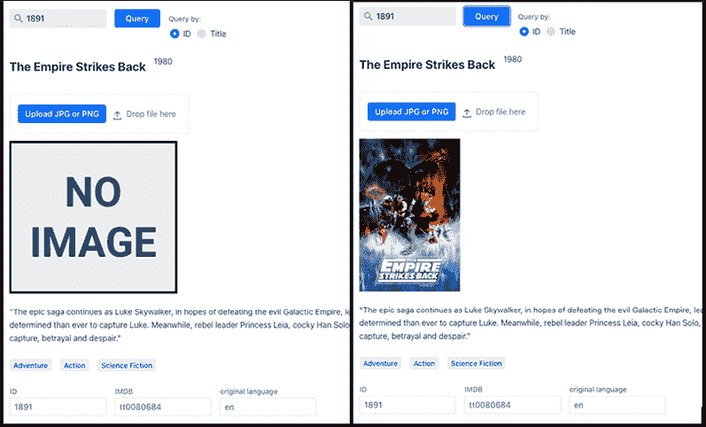

图 10.4：“帝国反击”的截图，显示将下载的图像拖到上传组件前后的状态

当我们导航到特定的电影页面后，可以通过向下滚动查看更多数据。这如图 10.5 所示：

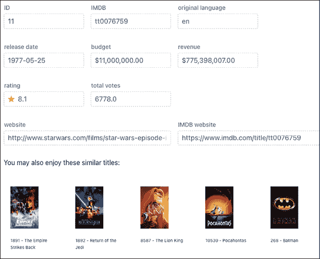

图 10.5：“星球大战”的第二页数据，显示了底部的推荐内容

## 总结

在本章中，我们应用了在前章节中学的大部分内容，并创建了一个相当复杂的应用程序。我们还学习了`Optional`类型和向量搜索。

该项目的复杂部分之一是必须创建一个特殊的应用程序来处理数据。遗憾的是，这是数据处理的一个残酷现实。仅仅导入数据或将 CSV 文件拖放到数据库中通常是不够的。在这些数据被视为可用之前，通常需要对其进行多个层级的预处理。即使是原样从 Kaggle 下载的`movies_metadata.csv`文件也是不可用的，因为其中若干条目的描述中包含额外的换行符，这导致导入过程出错。

虽然该应用程序可以运行，但它并不完整。开发者可以做其他几件事来进一步扩展其功能。可以编写一个功能允许用户编辑电影数据，甚至通过用户界面输入新电影。我们还可以允许用户对每部电影进行评分，然后重新计算评分数据和向量嵌入。此外，可以使用大语言模型（LLM）根据电影标题创建向量嵌入，然后基于此运行向量搜索。就像天上的星星一样，可能性是无限的。

## 注意事项

- 通过 Astra 创建的`Cassandra`数据库需要特殊类型的实例才能启用向量功能。
- 分布式数据库上的二级索引查询是为了方便，而不是为了性能。
- `CQL`的`ANN`向量搜索查询不需要使用`WHERE`子句，但需要`ORDER BY`和`LIMIT`子句。
- Java 中的`Optional`类型是查询数据库时防止`NullPointerExceptions`的极佳方法。
- Vaadin 使用`getStyle()`方法暴露其组件的底层 CSS。这允许进行精确的视觉调整和配置。

## 加入我们书籍的 Discord 空间

加入书籍的 Discord 工作区获取最新更新和优惠。

## 参考资料

- Parlog N. (2023). Java 21 中的新（序列化）集合 - Inside Java Newscast #45. 于 2023-04-08 获取：[`nipafx.dev/inside-java-newscast-45/`](https://nipafx.dev/inside-java-newscast-45/).
- Posa R. (2022). Java LinkedList - Java 中的 LinkedList。Digital Ocean. 于 2023-05-19 获取：[`www.digitalocean.com/community/tutorials/java-linkedlist-linkedlist-java`](https://www.digitalocean.com/community/tutorials/java-linkedlist-linkedlist-java).
- Tyson M. (2022). 虚拟线程简介：Java 并发的新新方法。InfoWorld. 于 2023-04-07 获取：[`www.infoworld.com/article/3678148/intro-to-virtual-threads-a-new-approach-to-java-concurrency.html`](https://www.infoworld.com/article/3678148/intro-to-virtual-threads-a-new-approach-to-java-concurrency.html).
- Wiffin E. (2017). 浮点数数学。于 2023-06-03 获取：[`0.30000000000000004.com/`](https://0.30000000000000004.com/).

## 加入我们的书籍 Discord 空间

加入书籍 Discord 工作空间获取最新更新、优惠、全球技术动态、新书发布以及与作者互动：

[`discord.bpbonline.com`](https://discord.bpbonline.com)


# 附录 B：UTF 转换表

在本录中，我们将查看以下 UTF 转换表：

| 十进制 | 八进制 | 十六进制 UTF | 二进制 | 十进制 | 八进制 | 十六进制 UTF | 二进制 |
| :--- | :--- | :--- | :--- | :--- | :--- | :--- | :--- |
| 0 | 0 | 0 NULL | 00000000 | 128 | 200 | 80 | 10000000 |
| 1 | 1 | 1 SOH | 00000001 | 129 | 201 | 81 | 10000001 |
| 2 | 2 | 2 STX | 00000010 | 130 | 202 | 82 | 10000010 |
| 3 | 3 | 3 ETX | 00000011 | 131 | 203 | 83 | 10000011 |
| 4 | 4 | 4 EOT | 00000100 | 132 | 204 | 84 | 10000100 |
| 5 | 5 | 5 ENQ | 00000101 | 133 | 205 | 85 | 10000101 |
| 6 | 6 | 6 ACK | 00000110 | 134 | 206 | 86 | 10000110 |
| 7 | 7 | 7 BELL | 00000111 | 135 | 207 | 87 | 10000111 |
| 8 | 10 | 8 BSP | 00001000 | 136 | 210 | 88 | 10001000 |
| 9 | 11 | 9 TAB | 00001001 | 137 | 211 | 89 | 10001001 |
| 10 | 12 | A LF | 00001010 | 138 | 212 | 8A | 10001010 |
| 11 | 13 | B VTAB | 00001011 | 139 | 213 | 8B | 10001011 |
| 12 | 14 | C FF | 00001100 | 140 | 214 | 8C | 10001100 |
| 13 | 15 | D CR | 00001101 | 141 | 215 | 8D | 10001101 |
| 14 | 16 | E | 00001110 | 142 | 216 | 8E | 10001110 |
| 15 | 17 | F | 00001111 | 143 | 217 | 8F | 10001111 |
| 16 | 20 | 10 | 00010000 | 144 | 220 | 90 | 10010000 |
| 17 | 21 | 11 | 00010001 | 145 | 221 | 91 | 10010001 |
| 18 | 22 | 12 | 00010010 | 146 | 222 | 92 | 10010010 |
| 19 | 23 | 13 | 00010011 | 147 | 223 | 93 | 10010011 |
| 20 | 24 | 14 | 00010100 | 148 | 224 | 94 | 10010100 |
| 21 | 25 | 15 | 00010101 | 149 | 225 | 95 | 10010101 |
| 22 | 26 | 16 | 00010110 | 150 | 226 | 96 | 10010110 |
| 23 | 27 | 17 | 00010111 | 151 | 227 | 97 | 10010111 |
| 24 | 30 | 18 | 00011000 | 152 | 230 | 98 | 10011000 |
| 25 | 31 | 19 | 00011001 | 153 | 231 | 99 | 10011001 |
| 26 | 32 | 1A | 00011010 | 154 | 232 | 9A | 10011010 |
| 27 | 33 | 1B | 00011011 | 155 | 233 | 9B | 10011011 |
| 28 | 34 | 1C | 00011100 | 156 | 234 | 9C | 10011100 |
| 29 | 35 | 1D | 00011101 | 157 | 235 | 9D | 10011101 |
| 30 | 36 | 1E | 00011110 | 158 | 236 | 9E | 10011110 |
| 31 | 37 | 1F | 00011111 | 159 | 237 | 9F | 10011111 |
| 32 | 40 | 20 SPACE | 00100000 | 160 | 220 | 40 | 10100000 |
| 33 | 41 | 21 | 00100001 | 161 | 227 | 41 | 10100001 |
| 34 | 42 | 22 | 00100010 | 162 | 226 | 92 | 10100010 |
| 35 | 43 | 23 | 00100011 | 163 | 227 | 63 | 10100011 |
| 36 | 44 | 24 | 00100100 | 164 | 224 | 44 | 10100100 |
| 37 | 45 | 25 | 00100101 | 165 | 225 | 55 | 10100101 |
| 38 | 46 | 26 | 00100110 | 166 | 226 | 66 | 10100110 |
| 39 | 47 | 27 | 00100111 | 167 | 231 | 71 | 10100111 |
| 40 | 50 | 28 | 00101000 | 168 | 216 | 48 | 10101000 |
| 41 | 51 | 29 | 00101001 | 169 | 217 | 61 | 10101001 |
| 42 | 52 | 2A | 00101010 | 170 | 218 | 5A | 10101010 |
| 43 | 53 | 2B | 00101011 | 171 | 219 | 5B | 10101011 |
| 44 | 54 | 2C | 00101100 | 172 | 220 | 5C | 10101100 |
| 45 | 55 | 2D | 00101101 | 173 | 221 | 5D | 10101101 |
| 46 | 56 | 2E | 00101110 | 174 | 222 | 5E | 10101110 |
| 47 | 57 | 2F | 00101111 | 175 | 223 | 7F | 10101111 |
| 48 | 60 | 30 | 00110000 | 176 | 224 | 30 | 10110000 |
| 49 | 61 | 31 | 00110001 | 177 | 225 | 31 | 10110001 |
| 50 | 62 | 32 | 00110010 | 178 | 226 | 32 | 10110010 |
| 51 | 63 | 33 | 00110011 | 179 | 227 | 33 | 10110011 |
| 52 | 64 | 34 | 00110100 | 180 | 228 | 34 | 10110100 |
| 53 | 65 | 35 | 00110101 | 181 | 229 | 35 | 10110101 |
| 54 | 66 | 36 | 00110110 | 182 | 230 | 36 | 10110110 |
| 55 | 67 | 37 | 00110111 | 183 | 231 | 37 | 10110111 |
| 56 | 70 | 38 | 00111000 | 184 | 216 | 38 | 10111000 |
| 57 | 71 | 39 | 00111001 | 185 | 217 | 39 | 10111001 |
| 58 | 72 | 3A | 00111010 | 186 | 218 | 5A | 10111010 |
| 59 | 73 | 3B | 00111011 | 187 | 219 | 5B | 10111011 |
| 60 | 74 | 3C | 00111100 | 188 | 220 | 5C | 10111100 |
| 61 | 75 | 3D | 00111101 | 189 | 221 | 5D | 10111101 |
| 62 | 76 | 3E | 00111110 | 190 | 222 | 5E | 10111110 |
| 63 | 77 | 3F | 00111111 | 191 | 223 | 7F | 10111111 |
| 64 | 100 | 40 | 01000000 | 192 | 224 | 40 | 11000000 |
| 65 | 101 | 41 | 01000001 | 193 | 225 | 41 | 11000001 |
| 66 | 102 | 42 | 01000010 | 194 | 226 | 42 | 11000010 |
| 67 | 103 | 43 | 01000011 | 195 | 227 | 43 | 11000011 |
| 68 | 104 | 44 | 01000100 | 196 | 238 | 44 | 11000100 |
| 69 | 105 | 45 | 01000101 | 197 | 229 | 45 | 11000101 |
| 70 | 106 | 46 | 01000110 | 198 | 230 | 46 | 11000110 |
| 71 | 107 | 47 | 01000111 | 199 | 231 | 47 | 11000111 |
| 72 | 108 | 48 | 01001000 | 200 | 224 | 48 | 11001000 |
| 73 | 111 | 49 | 01001001 | 201 | 225 | 49 | 11001001 |
| 74 | 112 | 5A | 01001010 | 202 | 226 | 5A | 11001010 |
| 75 | 113 | 5B | 01001011 | 203 | 227 | 5B | 11001011 |
| 76 | 114 | 5C | 01001100 | 204 | 228 | 5C | 11001100 |
| 77 | 115 | 5D | 01001101 | 205 | 229 | 5D | 11001101 |
| 78 | 116 | 5E | 01001110 | 206 | 230 | 5E | 11001110 |
| 79 | 117 | 5F | 01001111 | 207 | 231 | 5F | 11001111 |
| 80 | 120 | 50 | 01100000 | 208 | 224 | 50 | 11010000 |
| 81 | 121 | 51 | 01100001 | 209 | 225 | 51 | 11010001 |
| 82 | 122 | 52 | 01100010 | 210 | 226 | 52 | 11010010 |
| 83 | 123 | 53 | 01100011 | 211 | 227 | 53 | 11010011 |
| 84 | 124 | 54 | 01100100 | 212 | 228 | 54 | 11010100 |
| 85 | 125 | 55 | 01100101 | 213 | 229 | 55 | 11010101 |
| 86 | 126 | 56 | 01100110 | 214 | 230 | 56 | 11010110 |
| 87 | 127 | 57 | 01101111 | 215 | 231 | 57 | 11010111 |
| 88 | 130 | 58 | 01101000 | 216 | 232 | 58 | 11011000 |
| 89 | 131 | 59 | 01101001 | 217 | 233 | 59 | 11011001 |
| 90 | 132 | 5A | 01101010 | 218 | 234 | 5A | 11011010 |
| 91 | 133 | 5B | 01101011 | 219 | 235 | 5B | 11011011 |
| 92 | 134 | 5C | 01101100 | 220 | 236 | 5C | 11011100 |
| 93 | 135 | 5D | 01101101 | 221 | 237 | 5D | 11011101 |
| 94 | 136 | 5E | 01101110 | 222 | 238 | 5E | 11011110 |
| 95 | 137 | 5F | 01101111 | 223 | 239 | 5F | 11011111 |
| 96 | 140 | 60 | 11000000 | 224 | 220 | 40 | 11100000 |
| 97 | 141 | 61 | 11000001 | 225 | 221 | 61 | 11100001 |
| 98 | 142 | 62 | 11000010 | 226 | 222 | 62 | 11100010 |
| 99 | 143 | 63 | 11000011 | 227 | 233 | 63 | 11100011 |
| 100 | 144 | 64 | 10000100 | 228 | 224 | 44 | 11100100 |
| 101 | 145 | 65 | 10000101 | 229 | 225 | 55 | 11100101 |
| 102 | 146 | 66 | 10000110 | 230 | 226 | 66 | 11100110 |
| 103 | 147 | 67 | 10000111 | 231 | 231 | 67 | 11100111 |
| 104 | 150 | 68 | 10001000 | 232 | 216 | 48 | 11101000 |
| 105 | 151 | 69 | 10001001 | 233 | 217 | 61 | 11101001 |
| 106 | 152 | 6A | 10001010 | 234 | 218 | 5A | 11101010 |
| 107 | 153 | 6B | 10001011 | 235 | 219 | 5B | 11101011 |
| 108 | 154 | 6C | 10001100 | 236 | 220 | 5C | 11101100 |
| 109 | 155 | 6D | 10001101 | 237 | 221 | 5D | 11101101 |
| 110 | 156 | 6E | 10001110 | 238 | 222 | 5E | 11101110 |
| 111 | 157 | 6F | 10001111 | 239 | 231 | 5F | 11101111 |
| 112 | 160 | 70 | 01110000 | 240 | 224 | 40 | 11110000 |
| 113 | 161 | 71 | 01110001 | 241 | 225 | 61 | 11110001 |
| 114 | 162 | 72 | 01110010 | 242 | 226 | 72 | 11110010 |
| 115 | 163 | 73 | 01110011 | 243 | 227 | 63 | 11110011 |
| 116 | 164 | 74 | 01110100 | 244 | 228 | 54 | 11110100 |
| 117 | 165 | 75 | 01110101 | 245 | 229 | 65 | 11110101 |
| 118 | 166 | 76 | 01110110 | 246 | 230 | 76 | 11110110 |
| 119 | 167 | 77 | 01110111 | 247 | 231 | 77 | 11110111 |
| 120 | 170 | 78 | 01111000 | 248 | 216 | 48 | 11111000 |
| 121 | 171 | 79 | 01111001 | 249 | 225 | 61 | 11111001 |
| 122 | 172 | 7A | 01111010 | 250 | 226 | 5A | 11111010 |
| 123 | 173 | 7B | 01111011 | 251 | 227 | 53 | 11111011 |
| 124 | 174 | 7C | 01111100 | 252 | 228 | 5C | 11111100 |
| 125 | 175 | 7D | 01111101 | 253 | 229 | 65 | 11111101 |
| 126 | 176 | 7E | 01111110 | 254 | 230 | 5E | 11111110 |
| 127 | 177 | 7F | 01111111 | 255 | 231 | 5F | 11111111 |

跳过第 3 章中的字符串和正则表达式。为了简洁起见，省略了八进制转换：

| 十进制 | 八进制 | 十六进制 UTF | 二进制 | 十进制 | 八进制 | 十六进制 UTF | 二进制 |
| :--- | :--- | :--- | :--- | :--- | :--- | :--- | :--- |
| 9472 | 2500 | ─ | 100101000000 | 9600 | 2580 | ▀ | 100101100000 |
| 9473 | 2501 | ━ | 100101000001 | 9601 | 2581 | | 100101100001 |
| 9474 | 2502 | │ | 100101000010 | 9602 | 2582 | ▂ | 100101100010 |
| 9475 | 2503 | ┃ | 100101000011 | 9603 | 2583 | ▃ | 100101100011 |
| 9476 | 2504 | ┄ | 100101000100 | 9604 | 2584 | ▄ | 100101100100 |
| 9477 | 2505 | ┅ | 1001010000101 | 9605 | 2585 | ▅ | 1001011000101 |
| 9478 | 2506 | ┆ | 1001010000110 | 9606 | 2586 | ▆ | 1001011000110 |
| 9479 | 2507 | ┇ | 1001010000111 | 9607 | 2587 | ▇ | 1001011000111 |
| 9480 | 2508 | ┈ | 1001010000100 | 9608 | 2588 | █ | 1001011000100 |
| 9481 | 2509 | ┉ | 1001010000101 | 9609 | 2589 | ▉ | 1001011000101 |
| 9482 | 250A | ┊ | 1001010000101 | 9610 | 258A | ▊ | 1001011000100 |
| 9483 | 250B | ┋ | 1001010000111 | 9611 | 258B | ▋ | 1001011000101 |
| 9484 | 250C | | | 10010100001100 | 9612 | 2584 | ü | 1001011001100 |
| 9485 | 250D | } | 10010101001101 | 9613 | 258 FD | ý | 10010110001101 |
| 9486 | 250E | ~ | 10010111001110 | 9614 | 258 FE | þ | 10010110001110 |
| 9487 | 250F | ÿ | 10010111001111 | 9615 | 257 FF | ÿ | 10010110001111 |

# Unicode 制绘制字符参考

| Dec | Hex | UTF | Binary | Dec | Hex | UTF | Binary |
| :--- | :--- | :--- | :--- | :--- | :--- | :--- | :--- |
| 9484 | 250C | ┌ | 10010100001100 | 9612 | 258C | ▌ | 10010110001100 |
| 9485 | 250D | ┍ | 10010100001101 | 9613 | 258D | ▍ | 10010110001101 |
| 9486 | 250E | ┎ | 10010100001110 | 9614 | 258E | ▎ | 10010110001110 |
| 9487 | 250F | ┏ | 10010100001111 | 9615 | 258F | ▏ | 10010110001111 |
| 9488 | 2510 | ┐ | 10010100010000 | 9616 | 2590 | ▐ | 10010110010000 |
| 9489 | 2511 | ┑ | 10010100010001 | 9617 | 2591 | ░ | 10010110010001 |
| 9490 | 2512 | ┒ | 10010100010010 | 9618 | 2592 | ▒ | 10010110010010 |
| 9491 | 2513 | ┓ | 10010100010011 | 9619 | 2593 | ▓ | 10010110010011 |
| 9492 | 2514 | └ | 10010100010100 | 9620 | 2594 | ▔ | 10010110010100 |
| 9493 | 2515 | ┕ | 10010100010101 | 9621 | 2595 | ▕ | 10010110010101 |
| 9494 | 2516 | ┖ | 10010100010110 | 9622 | 2596 | ▖ | 10010110010110 |
| 9495 | 2517 | ┗ | 10010100010111 | 9623 | 2597 | ▗ | 10010110010111 |
| 9496 | 2518 | ┘ | 10010100011000 | 9624 | 2598 | ▘ | 10010110011000 |
| 9497 | 2519 | ┙ | 10010100011001 | 9625 | 2599 | ▙ | 10010110011001 |
| 9498 | 251A | ┚ | 10010100011010 | 9626 | 259A | ▚ | 10010110011010 |
| 9499 | 251B | ┛ | 10010100011011 | 9627 | 259B | ▛ | 10010110011011 |
| 9500 | 251C | ├ | 10010100011100 | 9628 | 259C | ▜ | 10010110011100 |
| 9501 | 251D | ┝ | 10010100011101 | 9629 | 259D | ▝ | 10010110011101 |
| 9502 | 251E | ┞ | 10010100011110 | 9630 | 259E | ▞ | 10010110011110 |
| 9503 | 251F | ┟ | 10010100011111 | 9631 | 259F | 격 | 10010110011111 |
| 9504 | 2520 | ┠ | 10010100100000 | 9632 | 25A0 | ■ | 10010110100000 |
| 9505 | 2521 | ┡ | 10010100100001 | 9633 | 25A1 | □ | 10010110100001 |
| 9506 | 2522 | ┢ | 10010100100010 | 9634 | 25A2 | ▢ | 10010110100010 |
| 9507 | 2523 | ┣ | 10010100100011 | 9635 | 25A3 | ▣ | 10010110100011 |
| 9508 | 2524 | ┤ | 10010100100100 | 9636 | 25A4 | ▤ | 10010110100100 |
| 9509 | 2525 | ┥ | 10010100100101 | 9637 | 25A5 | ▥ | 10010110100101 |
| 9510 | 2526 | ┦ | 10010100100110 | 9638 | 25A6 | ▦ | 10010110100110 |
| 9511 | 2527 | ┧ | 10010100100111 | 9639 | 25A7 | ▧ | 10010110100111 |
| 9512 | 2528 | ┨ | 10010100101000 | 9640 | 25A8 | ▨ | 10010110101000 |
| 9513 | 2529 | ┩ | 10010100101001 | 9641 | 25A9 | ▩ | 10010110101001 |
| 9514 | 252A | ┪ | 10010100101010 | 9642 | 25AA | ▪ | 10010110101010 |
| 9515 | 252B | ┫ | 10010100101011 | 9643 | 25AB | ▫ | 10010110101011 |
| 9516 | 252C | ┬ | 10010100101100 | 9644 | 25AC | ▬ | 10010110101100 |
| 9517 | 252D | ┭ | 10010100101101 | 9645 | 25AD | ▭ | 10010110101101 |
| 9518 | 252E | ┮ | 10010100101110 | 9646 | 25AE | ▮ | 10010110101110 |
| 9519 | 252F | ┯ | 10010100101111 | 9647 | 25AF | ▯ | 10010110101111 |
| 9520 | 2530 | ┰ | 10010100110000 | 9648 | 25B0 | ▰ | 10010110110000 |
| 9521 | 2531 | ┱ | 10010100110001 | 9649 | 25B1 | ▱ | 10010110110001 |
| 9522 | 2532 | ┲ | 10010100110010 | 9650 | 25B2 | ▲ | 10010110110010 |
| 9523 | 2533 | ┳ | 10010100110011 | 9651 | 25B3 | △ | 10010110110011 |
| 9524 | 2534 | ┴ | 10010100110100 | 9652 | 25B4 | ▴ | 10010110110100 |
| 9525 | 2535 | ┵ | 10010100110101 | 9653 | 25B5 | ▵ | 10010110110101 |
| 9526 | 2536 | ┶ | 10010100110110 | 9654 | 25B6 | ▶ | 10010110110110 |
| 9527 | 2537 | ┷ | 10010100110111 | 9655 | 25B7 | ▷ | 10010110110111 |
| 9528 | 2538 | ┸ | 10010100111000 | 9656 | 25B8 | ▸ | 10010110111000 |
| 9529 | 2539 | ┹ | 10010100111001 | 9657 | 25B9 | ▹ | 10010110111001 |
| 9530 | 253A | ┺ | 10010100111010 | 9658 | 25BA | ► | 10010110111010 |
| 9531 | 253B | ┻ | 10010100111011 | 9659 | 25BB | ▻ | 10010110111011 |
| 9532 | 253C | ┼ | 10010100111100 | 9660 | 25BC | ▼ | 10010110111100 |
| 9533 | 253D | ┽ | 10010100111101 | 9661 | 25BD | ▽ | 10010110111101 |
| 9534 | 253E | ┾ | 10010100111110 | 9662 | 25BE | ▾ | 10010110111110 |
| 9535 | 253F | ┿ | 10010100111111 | 9663 | 25BF | ▿ | 10010110111111 |
| 9536 | 2540 | ✀ | 10010101000000 | 9664 | 25C0 | ◀ | 10010111000000 |
| 9537 | 2541 | ╁ | 10010101000001 | 9665 | 25C1 | ◁ | 10010111000001 |
| 9538 | 2542 | ◂ | 10010101000010 | 9666 | 25C2 | ◂ | 10010111000010 |
| 9539 | 2543 | ╃ | 10010101000011 | 9667 | 25C3 | ◃ | 10010111000011 |
| 9540 | 2544 | ╄ | 10010101000100 | 9668 | 25C4 | ◄ | 10010111000100 |
| 9541 | 2545 | ╅ | 10010101000101 | 9669 | 25C5 | ◅ | 10010111000101 |
| 9542 | 2546 | ╆ | 10010101000110 | 9670 | 25C6 | ◆ | 10010111000110 |
| 9543 | 2547 | ╇ | 10010101000111 | 9671 | 25C7 | ◇ | 10010111000111 |
| 9544 | 2548 | ╈ | 10010101001000 | 9672 | 25C8 | ◈ | 10010111001000 |
| 9545 | 2549 | ╉ | 10010101001001 | 9673 | 25C9 | ◉ | 10010111001001 |
| 9546 | 254A | ╊ | 10010101001010 | 9674 | 25CA | ◊ | 10010111001010 |
| 9547 | 254B | ╋ | 10010101001011 | 9675 | 25CB | ○ | 10010111001011 |
| 9548 | 254C | ╌ | 10010101001100 | 9676 | 25CC | ◌ | 10010111001100 |
| 9549 | 254D | ╍ | 10010101001101 | 9677 | 25CD | ◍ | 10010111001101 |
| 9550 | 254E | ╎ | 10010101001110 | 9678 | 25CE | ◎ | 10010111001110 |
| 9551 | 254F | ╏ | 10010101001111 | 9679 | 25CF | ● | 10010111001111 |
| 9552 | 2550 | ═ | 10010101010000 | 9680 | 25D0 | ◐ | 10010111010000 |
| 9553 | 2551 | ║ | 10010101010001 | 9681 | 25D1 | ◑ | 10010111010001 |
| 9554 | 2552 | ╒ | 10010101010010 | 9682 | 25D2 | ◒ | 10010111010010 |
| 9555 | 2553 | ╓ | 10010101010011 | 9683 | 25D3 | ◓ | 10010111010011 |
| 9556 | 2554 | ╔ | 10010101010100 | 9684 | 25D4 | ◔ | 10010111010100 |
| 9557 | 2555 | ╕ | 10010101010101 | 9685 | 25D5 | ◕ | 10010111010101 |
| 9558 | 2556 | ◖ | 10010101010110 | 9686 | 25D6 | ◖ | 10010111010110 |
| 9559 | 2557 | ╗ | 10010101010111 | 9687 | 25D7 | ◗ | 10010111010111 |
| 9560 | 2558 | ╘ | 10010101011000 | 9688 | 25D8 | ◘ | 10010111011000 |
| 9561 | 2559 | ╙ | 10010101011001 | 9689 | 25D9 | ◙ | 10010111011001 |
| 9562 | 255A | ╚ | 10010101011010 | 9690 | 25DA | ◚ | 10010111011010 |
| 9563 | 255B | ╛ | 10010101011011 | 9691 | 25DB | ◛ | 10010111011011 |
| 9564 | 255C | ╜ | 10010101011100 | 9692 | 25DC | ◜ | 10010111011100 |
| 9565 | 255D | ╝ | 10010101011101 | 9693 | 25DD | ◝ | 10010111011101 |
| 9566 | 255E | ╞ | 10010101011110 | 9694 | 25DE | ◞ | 10010111011110 |
| 9567 | 255F | ╟ | 10010101011111 | 9695 | 25DF | ◟ | 10010111011111 |
| 9568 | 2560 | ╠ | 10010101100000 | 9696 | 25E0 | ◠ | 10010111000000 |
| 9569 | 2561 | ╡ | 10010101100001 | 9697 | 25E1 | ◡ | 10010111000001 |
| 9570 | 2562 | ╢ | 10010101100010 | 9698 | 25E2 | ◢ | 10010111000010 |
| 9571 | 2563 | ╣ | 10010101100011 | 9699 | 25E3 | ◣ | 10010111000011 |
| 9572 | 2564 | ╤ | 10010101100100 | 9700 | 25E4 | ◤ | 10010111000100 |
| 9573 | 2565 | ╥ | 10010101100101 | 9701 | 25E5 | ◥ | 10010111000101 |
| 9574 | 2566 | ╦ | 10010101100110 | 9702 | 25E6 | ◦ | 10010111000110 |
| 9575 | 2567 | ╧ | 10010101100111 | 9703 | 25E7 | ◧ | 10010111000111 |
| 9576 | 2568 | ╨ | 10010101010000 | 9704 | 25E8 | ◨ | 10010111010000 |
| 9577 | 2569 | ╩ | 10010101010001 | 9705 | 25E9 | ◩ | 10010111010001 |
| 9578 | 256A | ╪ | 10010101010010 | 9706 | 25EA | ◪ | 10010111010010 |
| 9579 | 256B | ╫ | 10010101010011 | 9707 | 25EB | ◫ | 10010111010011 |
| 9580 | 256C | ╬ | 10010101011100 | 9708 | 25EC | ◬ | 10010111011100 |
| 9581 | 256D |  { | 10010101011101 | 9709 | 25ED | ◭ | 10010111011101 |
| 9582 | 256E | ╮ | 10010101011110 | 9710 | 25EE | ◮ | 10010111011110 |
| 9583 | 256F | ╯ | 10010101011111 | 9711 | 25EF | ◯ | 10010111011111 |
| 9584 | 2570 | ╰ | 10010101100000 | 9712 | 25F0 | ◰ | 10010111010000 |
| 9585 | 2571 | ╱ | 10010101100001 | 9713 | 25F1 | ◱ | 10010111010001 |
| 9586 | 2572 | ╲ | 10010101100010 | 9714 | 25F2 | ◲ | 10010111010010 |
| 9587 | 2573 | ╳ | 10010101100011 | 9715 | 25F3 | ◳ | 10010111010011 |
| 9588 | 2574 | ╴ | 10010101100100 | 9716 | 25F4 | ◴ | 10010111010100 |
| 9589 | 2575 | ╵ | 10010101110101 | 9717 | 25F5 | ◵ | 10010111010101 |
| 9590 | 2576 | ◶ | 10010101110110 | 9718 | 25F6 | ◶ | 10010111010110 |
| 9591 | 2577 | ╷ | 10010101110111 | 9719 | 25F7 | ◷ | 10010111010111 |
| 9592 | 2578 | ╸ | 10010101111000 | 9720 | 25F8 | ◸ | 10010111110000 |
| 9593 | 2579 | ╹ | 10010101110001 | 9721 | 25F9 | ◹ | 10010111110001 |
| 9594 | 257A | ╺ | 10010101110010 | 9722 | 25FA | ◺ | 10010111110010 |
| 9595 | 257B | ╻ | 10010101110011 | 9723 | 25FB | ◻ | 10010111111011 |
| 9596 | 257C | ╼ | 10010101111100 | 9724 | 25FC | ◼ | 10010111111100 |
| 9597 | 257D | ╽ | 10010101111101 | 9725 | 25FD | ◽ | 10010111111101 |
| 9598 | 257E | ╾ | 10010101011110 | 9726 | 25FE | ◾ | 10010111011110 |
| 9599 | 257F | ╿ | 10010101011111 | 9727 | 25FF | ◿ | 10010111011111 |

> 注意：只有部分 NoSQL SELECT 语法允许使用 OR 运算符，这通常会触发多分区的扫描。然而，所有的关系型数据库都允许使用 OR。

需要注意的是，SELECT 查询的性能在很大程度上由`WHERE`子句的内容控制。无界查询（不带`WHERE`子句的 SELECT）将导致全表扫描，以确保返回所有行。

## INSERT

`INSERT`语句允许向表中写入新数据。使用此语句时，必须在括号中列出要写入的列值，随后紧跟一个`VALUES`子句，其中相应的列值被包含在括号内。

语法：

```


```sql
INSERT INTO [database_name|keyspace_name.]table_name (column1[,column2,columnN])
VALUES (value1[,value2,valueN]);
```

当用户尝试插入一行已存在的行时，关系型数据库可能会抛出错误。NoSQL 数据库（如 `Cassandra`）可能会允许该操作，并覆盖该行的任何非键值。

## UPDATE

`UPDATE` 语句旨在调整现有的列值。它需要一个 `SET` 子句来指示应该设置哪些列/值对。`UPDATE` 语句中也有一个 `WHERE` 子句，用于指示数据库应该更新哪些行。

语法：

```sql
UPDATE [database_name|keyspace_name.]table_name
SET column1=value1[,column2=value2,columnN=valueN]
[WHERE column_name[operator]value [[AND|OR] column_name_N[operator]value_N]];
```

当用户尝试更新不存在的行时，关系型数据库可能会抛出错误。NoSQL 数据库（如 `Cassandra`）可能会允许该操作，实际上是向表中插入了一行新数据。

使用 `WHERE` 子句时需要小心。在 `CQL` 中，它必须包含分区键，并可以包含额外的聚类键列。然而，在 SQL 中，它是可选的。这意味着不带 `WHERE` 子句的 `UPDATE` 将 `SET` 子句中的写入操作应用到表中的每一行。

## DELETE

`DELETE` 语句旨在删除符合其 `WHERE` 子句标准的标准的现有行。

语法：

```sql
DELETE [column_name]
FROM [database_name|keyspace_name.]table_name
[WHERE column_name[operator]value [[AND|OR] column_name_N[operator]value_N]];
```

> 注意：运行不带 `WHERE` 子句的 `DELETE` 将移除表中每个指定列的数据。如果没有指定任何列，则表中的所有行都将被删除，因此使用此语句时请务必小心。

## CREATE TABLE

`CREATE TABLE` 语法为存储数据行创建一个新表。

语法：

```sql
CREATE TABLE [IF NOT EXISTS] [database_name|keyspace_name.]table_name (
column1_name data_type [PRIMARY KEY],
[column2_name data_type,
columnN_name data_type,]
[PRIMARY KEY(key1,key2)]
);
```

某些数据库允许在创建时不定义定义主键，而另一些数据库则不允许。

## CREATE INDEX

此命令在指定的表和列的组合上创建索引。

语法：

```sql
CREATE INDEX [index_name] ON table;
```


额外的二级索引的效果和要求会根据数据库类型而异。对于大多数关系型数据库表，支持常规 `WHERE` 子句过滤条件的列应该包含索引。通常情况下，添加索引会提高查询性能。

然而，对于 NoSQL 数据库，二级索引往往会我是 goaichat 研发的智能大模型，可以为你提供智能问答、分析和创作服务。查询性能产生适得其反的影响。NoSQL 数据库（例如 `Apache Cassandra`）的设计旨在以特定方式分布数据。二级索引虽然方便，但违反了它们原始的数据流设计和意图。因此，在 NoSQL 数据库中应谨慎创建二级索引并减少使用频率。

所有类型数据库索引的一个共同效果，它们会增加执行写入操作所需的资源。这因为写入操作不仅需要更新表中的数据，还需要更新任何相关的索引。

## 加入我们书籍的 Discord 空间加入书籍的 Discord 工作空间以获取最新更新、优惠、全球科技动态、新发布以及与作者的面对面：

[`discord.bpbonline.com`](https://discord.bpbonline.com)


# 附录 D：常见 HTTP 响应码本节提供常见 HTTP 响应码列表。虽然还有其他 HTTP代码，但下表在排排除问题时解读常见响应码非常有用：

| HTTP 响应码 | |
| :--- | :--- |
|200 | OK |
|301 | 重定向 |
|302 | 临时重定向 |
|304 | 未修改 |
|400 | 错误请求 |
|401 | 未授权 |
|403 | 禁止 |
|404 | 未找到资源 |
|405 | 方法未允许 |
|500 |服务器错误 |
|502 | 网关错误 |
|503 | 服务不可用 |

附录 D.1 表格：常见 HTTP 响应码列表## 加入我们书籍的 Discord 空间加入书籍的 Discord 工作空间以获取最新更新、优惠、全球科技动态、新发布以及与作者的面对面：

[`discord.bpbonline.com`](https://discord.bpbonline.com)


# 附录 E：常见颜色代码本附录提供一组常见的颜色、其 RGB 值以及十六进制代码。这些代码在大多数 Web 框架中标准的：

|颜色 | RGB | 十六进制 |
| :--- | :--- | :--- |
| 红色 |255,0,0 | `#FF0000` |
|绿色 |0,255,0 | `#00FF00` |
| 蓝色 |0,0,255 | `#0000FF` |
| 深蓝 |0,0,128 | `#000080` |
| 青色 |0,255,255 | `#00FFFF` |
| 栗色 |128,0,0 | `#800000` |
| 紫色 |128,0,128 | `#800080` |
| 灰色 |128,128,128 | `#808080` |
| 白色 |255,255,255 | `#FFFFFF` |
| 黑色 |0,0,0 | `#000000` |
| 黄色 |255,255,0 | `#FFFF00` |
| 橙色 |255,165,0 | `#FFAA500` |
| 粉红色 |255,192,203 | `#FFC0C7` |
| 天蓝色 |0,191,255 | `#00BFFF` |
| 橄榄绿 |128,128,0 | `#808000` |
| 石青色 |0,128,128 | `#008080` |
| 金色 |255,215,0 | `#FFD700` |
| 银色 |192,192,192 | `#C0C0C0` |
| 棕色 |165,42,19 | `#A52A2A` |
| 品红色 |255,20,147 | `#FF1493` |
| 海蓝色 |70,130,180 | `#4682B4` |
| 草绿色 |124,252,124 | `#78FC78` |
| 浅紫色 |236,230,250 | `#E6E6FA` |
| 粉蓝色 |255,182,203 | `#FFB6C1` |
| 淡青色 |175,238,238 | `#AFEFEE6` |
| 热玫红 |255,105,180 | `#FF69B4` |
| 珊瑚色 |255,127,80 | `#FF7F50` |
| 柠檬藻色 |240,255,140 | `#F0E88` |
| 靛色 |153,102,255 | `#9966FF` |
|玫瑰红 |199,21,75 | `#C7154B` |
| 深蓝色 |25,25,112 | `#191970` |
| 军绿色 |0,100,0 | `#006400` |
| 巧克力色 |210,105,30 | `#D2691E` |
| 米色 |255,250,224 | `#FFF5E6` |
| 浅粉色 |255,182,193 | `#FFB6C1` |
| 珊瑚红色 |255,128,128 | `#FF8080` |
|玫瑰色 |255,105,180 | `#FF69B4` |
| 丁香 |255,190,203 | `#FFBDC9` |
| 紫色 |128,0,128 | `#800080` |
| 蓝色 |0,0,255 | `#0000FF` |
|绿色 |0,255,0 | `#00FF00` |
| 红色 |255,0,0 | `#FF0000` |
| 黄色 |255,255,0 | `#FFFF00` |
| 白色 |255,255,255 | `#FFFFFF` |
| 黑色 |0,0,0 | `#000000` |
| 灰色 |128,128,128 | `#808080` |
| 棕色 |139,69,19 | `#8B4513` |
| 青色 |0,255,255 | `#00FFFF` |
| 紫色 |128,0,128 | `#800080` |
| 橙色 |255,165,0 | `#FFA500` |
|绿色 |0,128,0 | `#008000` |

附录 E.1 表格：常见颜色和代码。

# 附录 F：垃圾回收垃圾回收 JVM 的必要功能。虽然像 C这样的低级语言需要开发者管理内存，但 Java 使用垃圾回收来移除超出作用范围的对象。不同的 Java版本使用不同的方法来实现。以下 Java 垃圾回收器的简单列表：

| 名称 | Java版本 |相关设置 |备注 |
| :--- | :--- | :--- | :--- |
| 并发标记清除 (CMS) |5-8 | `-XX:+UseConcMarkSweepGC` |适当 CMS 配置需要许多参数。更多信息请参阅 OpenJDK 文档。 |
| G1 垃圾回收器 |7- | `-XX:+UseG1GC -XX:MaxPauseMillis` | Java9 的默认 GC。 |
| Z 垃圾回收器 |15- | `-XX:+UseZGC` | |
| Shenandoah 垃圾回收器 |17- | `-XX:+UseShenandoahGC` | |

附录 F.1 表格：Java 垃圾回收器和常用参数。

> 注意：每个垃圾回收器列出的版本代表该回收器被认为已就绪且未处于弃用状态。

建议设置与 Java 堆相关的参数，而不是依赖默认计算。某些回收器（例如 G1GC）建议仅设置这些参数的子集（例如，G1GC 不应使用 `-Xmn`）。以下 JVM 尺寸参数：

| 参数 |说明 |
| :--- | :--- |
| `-Xmx` | JVM 内存堆的最大大小。 |
| `-Xms` | JVM 内存堆的初始大小。 |
| `-Xmn` | JVM 内存堆中新生代的大小。 |

附录 F.2 表：Java 堆大小参数列表。

关于 Java 堆和垃圾回收参数的更多信息，可以参考 Oracle 文上的 Java Hotspot VM Options：[`www.oracle.com/java/technologies/javase/vmoptions-jsp.html`](https://www.oracle.com/java/technologies/javase/vmoptions-jsp.html)。

## 加入我们书籍的 Discord 空间加入书籍的 Discord 工作空间以获取最新更新、优惠、全球科技动态、新发布以及与作者的交流会议：

[`discord.bpbonline.com`](https://discord.bpbonline.com)


# 索引## A- 抽象10-12- 抽象窗口工具包 (AWT)280- 准确性137- 动画287- `DrawPlanets` 类295- `Planet` 类287-290- `SolarSystem` 类290-294- 匿名主类22,23- `Apache Cassandra`101,208- 从 Java访问219-230- Astra DB208-210- 数据加载215,216- 数据查询216-218-生成 Token 按钮210- 模式211-214- Apache Tomcat®245-近似邻算法 (ANN)325- 算术运算125- 浮点数运算137- 整数运算126- `ArrayList`96,97- 数组84-87- 人工智能 (AI)325- 升序 (ASC)213- ASCII 艺术66- `AstronautCassandraDAL` 类221,222,227,228- `AstronautPostgresDAL` 类197,198,204- `astronauts_by_mission` 表214## B- 二叉树173-179-逃围- 历史296- `BreakoutPanel` 类303- 分桶247- `BufferedWriter` 类40- `buildCloudLayerView()` 方法273- `buildStationView()` 方法272- `buildTempPrecipView()` 方法273- `buildUnitRadio()` 方法272## C- CAP 分类184,185- AP 系统185- CA 系统185- CP 系统185- CAP 定理183- 可用性184- 一致性184- 分区容性184- 回车和换行 (CRLF)26- `CassandraConn` 类219,220- Cassandra 驱动349- Cassandra 查询语言 (CQL)212- 字符62-66- ASCII 艺术66-68- 环形表172- 循环引用303- 聚类键213- 集合92,93-颜色代码403-逗号分隔值 (CSV) 文件336-复合主键213- `ConcurrentModificationException`105- `connectToPostgres()` 方法197- 构造函数27- 构造函数47- 控制器354- `MovieApp` 类355-358- 协调节点328- `CQL` 控制页211,245,326- `CREATE INDEX`语法400- `CREATE TABLE`语法399- CRUD 操作181- `cURL`237## D- 数据层 (DAL)197,324- 数据库管理员248- 数据库服务 (DBaaS)186- 数据库管理系统 (DBMS)182-电影应用324- 数据库选择325- 表设计326-328- 向量数据库325,326- 数据库182- 历史182,183-选择230- 数据库模式187- 表187- 数据定义语言 (DDL)187- 数据加载器328,329- `AstraConnection` 类332,333- `CassandraConnection` 类330-332- `Movie` 类333,334- `MovieDataLoader` 类334-344- `pom.xml`329- 数据操作语言 (DML)191- DataStax 开源驱动219- `DELETE`语句399- 去规范化214- `dequeue()` 方法161- 确定性操作128- 循环36,37- `DrawPlanets` 类295- 动态态13## E- ElephantSQL186- `URL`186- 封装8- 遇到106- 错误处理28-30- `if`语句30,31- 循环33- `switch/case`语句31-33## F- 文件37-读取42,43- 行属性读取43-46- 写入38-41- `FileWriter` 类40- 固定精度类型137- 浮点数运算137-绝值146,147- 加法137- `BigDecimal`140,141-立方根146- `DecimalFormat`144- 除法142- 指数145- 格式化143-乘法142-细微差别138,139- 平方根145,146- 减法141- 单元测试139- 刷新操作41- 外键190- `for` 循环34,35- 格式化规则143- 函数47## G# 垃圾回收垃圾回收405,406#AstronautsGeminiAstronauts NoSQL 类223-229GeminiAstronauts RDBMS 类200-207# Google Cloud Platform (GCP)

Google Cloud Platform (GCP)209# 图形使用 AWT 和 Swing进行实现280## H- HashMap102-104- HashSet94- HelloWorld21- Hello world 服务端点243- 水平伸缩183- HTTP 操作234- HTTP 响应码401## I- `if`语句30,31- `indexOf()`69-继承8-10- `INSERT`语句398- 整数算术126- 加法126-128- `add()`，使用 JUnit进行测试128-132- 除法134- 指数136-取模运算135-乘法133- 减法132,133## J- Java - 编码2 - Java211 - 有序集合 (sequenced collections)15,16 - 字符串模板 (string templates)16,17 - 虚拟线程14,15- Java俄罗斯块游戏296 - `Ball` 类297-300 - `BreakoutGame`318-320 - `BreakoutPanel` 类306-318 - `Brick` 类301 - `KeyHandler` 类303-305 - `Paddle` 类302 - `pom.xml`297- Java 数据库连接 (JDBC)196- Java 环境 - 配置2,3 - Git 安装6,7 - 安装4 - 在 Linux 上5 - 在 MacOS 上4 - 在 Windows 上4 - 集成开发环境 (IDE)5,6 - Java依赖管理6 - Java 开发工具包 (JDK)3 - Java运行时环境 (JRE)3 - JDK供应商和版本3,4 - 操作系统 (OS) 平台3 - 源码控制6 -版本管理5- JavaScript象表示 (JSON)236- `add()`，使用 JUnit 测试128-132 - 测试用例129## K- Kaggle328- 键空间209- K近邻 (KNN)325## L- 后进先出 (LIFO)150- `LinkedHashMap`104,105- `LinkedHashSet`95- `LinkedList`98-101- `LinkedList` 类165- 链列表163-172- 列表96- 循环33 - `do` 循环36,37 - `for` 循环34,35 - `while` 循环35,36## M- 手动索引327- 映射92-102 - `HashMap`102-104 - `LinkedHashMap`104,105 - `TreeMap`105- `mapEntityToWeatherReading()` 方法265- Maven20 - 匿名类22,23 - HelloWorld21,22- Maven 安装244- `MeasurementValue` POJO48,49- 方法47- `MetricUnitConverter` 类56- `MetricUnitConverter` 示例程序47-59- 模型350- `MovieByTitle` 类353- `MovieByTitleRepository`354- `Movie` 类351,352- `MovieRepository` 接口352,353- 模型、视图、控制器 (MVC) 模式242,324- `MovieApp` 类355- `application.yml`349- 构建324- 创建347,348- 数据查询344,325- 图片348,349- `pom.xml`348,349- 多维数组87-92- `MyPanel` 类281-286- 美国航空航天局 (NASA)188- 节点173- 普通格式191- 第二种格式191- 第三种格式191- 非 NoSQL183- 面向对象编程 (OOP)7 - 优势14 - 抽象8-10 - 封装8-10 - 多态12## O- 操作系统 (OS) 平台3- 源码控制6-版本管理5## P- `parseInt()`45- 分区键213- 普通 Java象 (POJO)48,49- `Planet` 类287-286- 多态12- 动态多态13- 静态多态12,13- `pom.xml`195,219,241- `PostgresConn`196- PostgreSQL185,186-访问，从 Java195-207- 数据加载191,192- 数据查询193-195### E- ElephantSQL186- 架构187-191## Q- 队列示例163- 队列158-163## R- 随机存储器 (RAM)23- 输入读取27,28-记录107-109- 简单示例，构建109- 引用类型24- 正则表达式76- 应用于字符串77-81-关系型数据库管理系统 (RDBMS)182- 表征状态转移 (REST)234### 响应 JSON象#### 构建- `CloudLayer` 类257- `Geometry` 类259- `LatestWeather` 类260- `Measurement` 类256- `Properties` 类258,259### Restful 操作234#### 简单操作235-238#### URIs235-角色扮演游戏 (RPG) 模拟109### 构建109- `Hero` 类115,116- `Player` 类112-115- `RPGSimulation` 类109-122- 根节点173## S- `Scanner` 库27- `SELECT`语句193,397,398- `SequencedCollection`106### 服务层238#### 服务，查询358#### 根据 ID 获取电影358#### 根据标题获取电影358####电影推荐359- 集合93 - `ArrayList`96-98 - `HashSet`94 - `LinkedHashSet`95 - `LinkedList`98-101 - 列表96 - `TreeSet`95- `SimpleDraw` 类280- `SolarSystem` 类290-294- `split` 方法43- Spring Boot238- Spring Boot Initializr241- Spring Data245- Spring Data Cassandra245- spring initializr- `URL`238- 栈150-158- 静态多态12,13- 字符串相等性72,73- `contains`76- 字符串前缀相等75- 字符串后缀相等73-75- 字符串69- `indexOf()` 方法69- 正则表达式，应用76-81- `substring()` 方法70-结构化英语语言 (SEQUEL)182-结构化查询语言 (SQL)182- 程序47- `substring`70- `toLowerCase`71,72- `toUpperCase`70,71- `Swing` 库280- `switch/case`语句31-33## T- 基于时间的数据247- 时间序列数据247- 时间戳属性247- Tiny Turtle plan186- `toString()` 方法161- 转换325-传输层安全 (TLS)证书210- `TreeMap`105- `TreeSet`95## U- 美国气象局 (NWS)235- 测量单位 (UOM)47- 单元128- `UPDATE`语句398,399- UTF-864- UTF 转换385## V- `VARCHAR` 类型212-变量23-26- `Vector`98,325- 垂直扩展183-视图359- `MovieAppView` 类359-380## W- 天气应用运行277- 天气应用控制器243- 天气应用控制器重构261-267- 天气应用模型245- 应用属性248- 环境变量设置248- 键空间，定义245- `pom.xml` 重构250- 表，定义246,247-令牌，生成247,248- `WeatherAppRepository` 接口255,256- `WeatherEntity` 类253,254- `WeatherPrimaryKey` 类250-252- `WeatherReading` 类254,255- 带有 Spring Boot 的 Web 服务238-242- Hello World 服务端点243-245- 天气应用控制器243- Web 用户界面 - 构建267 - 水平构建方法271-276 - `pom.xml` 重构268 - 天气应用，运行277 - 天气应用视图268-271- `WHERE` 子句398- `while` 循环35,36- 包装类24## Y- Yet Another Markup Language (YAML)248