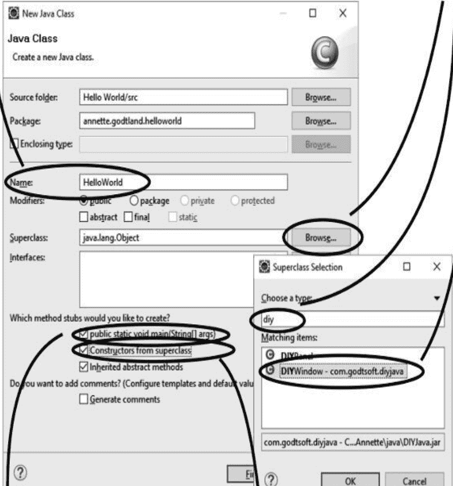
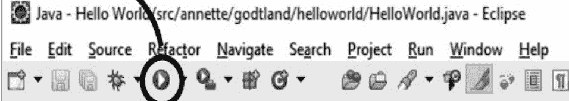
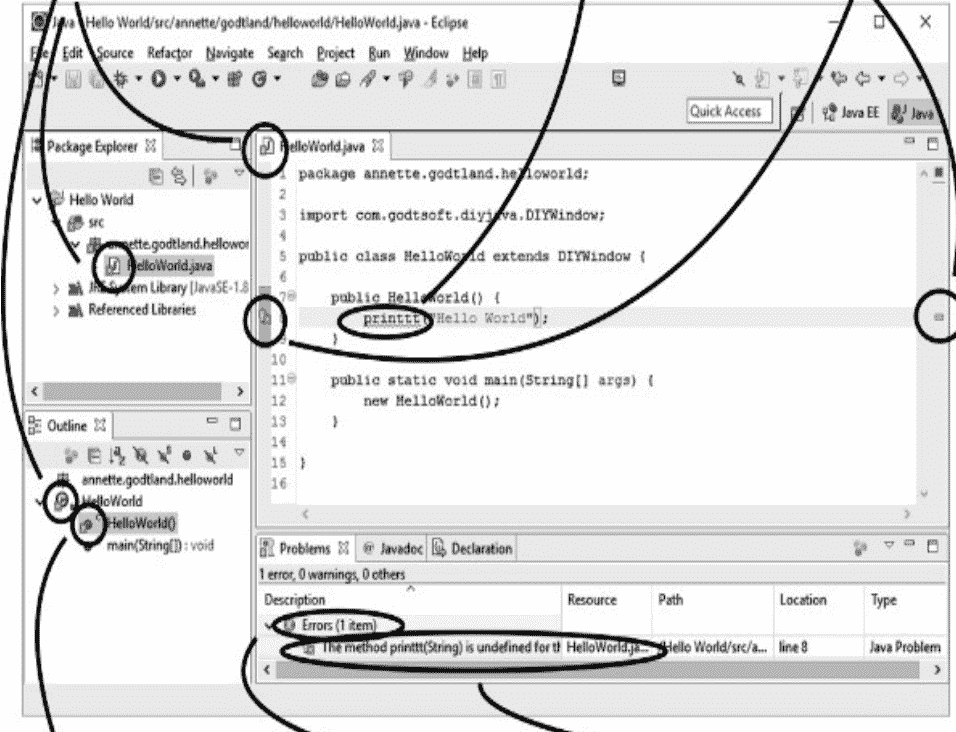
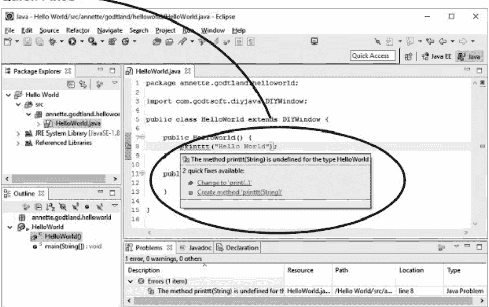
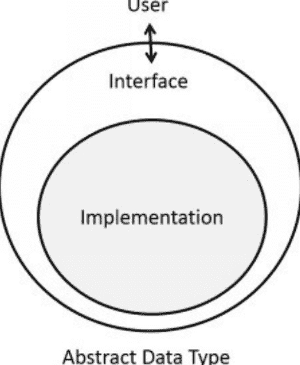
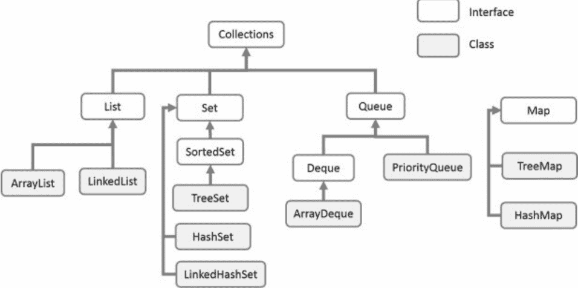
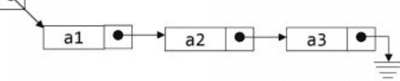
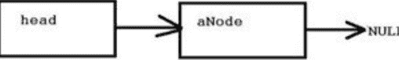
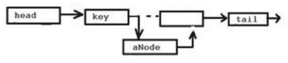
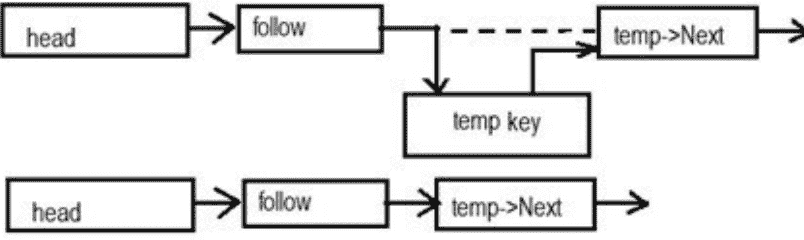

# 编程三合一：像专业人士一样学习编程所需的所有知识

本书包含 Python、Java 和 C++。

最简单的 Python 速成课程，带你深入学习主要应用，如 Web 开发、数据分析和数据科学（包括机器学习）。

学习如何使用面向对象的程序进行编码，以提高你的软件工程技能。熟悉虚拟机、JavaScript 和机器码。

一份面向初学者的分步指南，帮助学习多范式编程语言的基础，并开始管理数据，包括如何编写你的第一个程序。

# Python 编程

最简单的 Python 速成课程，带你深入学习主要应用，如 Web 开发、数据分析和数据科学（包括机器学习）。

ALAN GRID

## 引言

Python 的引入影响了很多人，特别是我们使用计算机的方式。Python 的秘密在于你可以读懂它。

## 特性

Python 具有以下特点：

- 丰富的库：它可以与其他项目协作，例如连接到网络服务器和交换文件。
- 交互性：使用 Python 非常简单，因为你可以测试它们是否有效。
- 它是免费软件，所以你可以随时从互联网下载它。
- Python 语言可以扩展到其他模块，如 C++。
- 具有优雅的语法，便于初学者阅读。
- 有多种基础数据类型供选择。

## 历史

Python 编程是由 Guido Rossum 在 1989 年发现的，当时他在荷兰研究机构 CWI 执行一个项目。Guido 成功地使用了一些基础语言（所谓的 ABC 语言）来开发 Python。根据 Rossum 的说法，Python 语言的优势在于你可以保持简单，也可以将其扩展到多个平台。这种设计使得系统能够轻松与库和各种文件格式通信。

自引入以来，世界上许多程序员都在使用 Python，事实上，包含了许多工具来提高操作和效率。许多程序员采取了各种倡议来教育大家使用 Python 编程语言以及它如何帮助消除对复杂代码的恐惧。

然而，Rossum 在几年前将 Python 开为了开源，允许所有程序员访问并进行修改。这在编程领域发生了巨大的变化。例如，曾发布过 Python 2.0。Python 2.0 以社区为导向，使开发过程变得透明。虽然许多人使用 Python，但有一些程序员和机构在使用部分版本。

Python 3 是一个独特的版本，于 2008 年发布。尽管该版本许多许多功能，但它与前两个版本完全不同，更新程序并不容易。虽然这个版本不向后兼容，但它有一个小型创建工具可以显示在上传文件时需要更改的内容。

## 为什么你应该使用 Python

世界上有很多类型的计算机编码程序，每种都有其优缺点。然而，由于许多原因，Python 已证明是最佳选择，例如可读性，而且它可以在许多平台上运行而无需更改任何内容。

使用 Python 具有以下优势：

- **可读性**

  由于它是用英语设计的，初学者会发现它很容易阅读和使用。还有许多规则可以帮助程序员理解如何格式化一切，这使得程序员能够创建出简单的代码，其他人在使用他们的项目时可以遵循。

- **社区**

  如今，全球范围内有很多 Python 研讨会。初学者可以在在线、线下或两者都要学习更多知识或寻求关于 Python 的解答。此外，在线和线下研讨会可以提高你对 Python 的理解，以及你的社交技巧。它对于个人电脑来说最好，因为它在许多不同的平台上都能成功运行。事实上，所有初学者都觉得容易编码或从专家那里学习。

- **库**

  25 多年来，程序员们一直在使用 Python 教会初学者如何使用用它编写的不同代码。该系统对程序员非常开放，他们可以无限期使用可用代码。事实上，学生可以下载并安装该系统供个人使用，例如编写你的代码并完成产品。

## Python 中的通用术语

理解 Python 中使用的标准术语对你来说至关重要。这让你在开始时一切都变得简单。以下是 Python 编程语言中最常见的术语：

- **函数（Function）**：指当程序员使用调用程序时调用的代码块。其目标也是提供免费的服务和准确的计算。
- **类（Class）**：用于开发用户定义对象的模板。它对所有人（包括初学者）都是非常友好且易于使用的。
- **不变（Ver Immutable）**：指具有固定值并包含在代码中的对象。这些可以是数字、字符串或元组。此类对象不能更改。
- **文档字符串（St Docstring）**：指显示在函数、类定义和模块中的字符串。此对象在文档工具中始终是可用的。
- **列表（List）**：指 Python 内置的数据类型，包含排序后的值。这些值包括字符串和数字。
- **LE IDLE**：代表集成开发环境，允许用户在输入代码的同时在同一个窗口中对其进行解释和编辑。最适合初学者，因为它是代码的极佳示例。
- **交互式（Interactive）**：由于其交互性质，Python 已成为最适合初学者的编程语言。作为初学者，你可以在 IDLE 中尝试许多事物（通过解释器查看它们的响应和效果）。
- **三引号字符串（Qu Triple Quoted String）**：该字符串帮助个人在字符串中使用单引号和双引号，使其易于处理不同的代码。
- **对象（Object）**：它指的是所有处于状态下的数据，如属性、方法、定义的行为或值。
- **类型（Type）**：指编程语言中的一组数据类别，以及属性、函数和方法方面的差异。
- **元组（Tuple）**：指 Python 内置的数据类型，是一个不可更改的值集合，尽管它包含一些可更改的值。

## Python 语言的优势

使用 Python 程序相比于 C++ 和 Java 等其他编程语言有许多优势。你会对 Python 程序的可用性以及学习和使用它的简单程度而感到高兴。理想情况下，这些是你现在可以使用的最佳编程语言，特别是如果你是初学者。以下是使用 Python 语言的一些优势：

- **它易于使用、编写和阅读**

  许多程序员在用 Java 和 C++ 等编程语言时面临着一些挑战。由于其设计原因，它们很难查看。人们必须花费大量时间学习括号的使用，而且识别这些编程语言中使用的单词并不容易。这些单词可能会吓到你，特别是当你刚接触编程语言时。与 Java 和 C++ 语言不同，Python 不使用疯狂括号。它只使用缩进，使得页面易读。它使用英语，使得字符很容易理解。

  除了缩进外，Python 还使用了大量的空白，使得易于学习和阅读所需。它由许多带有注释的地方组成，允许你在程序限制你时理解或获得澄清。所以，去尝试一下，你会发现使用 Python 编程语言是多么简单。

- **它以英语作为主要语言**

  使用 Python 很容易，因为主语言是英语。作为初学者，你将花费更少的时间阅读和理解 Python 编程时使用的基础单词。所以，无论你是英语母语还是非母语者，Python 都最适合你，因为大多数单词都简单易于理解。

- **Python 已经在某些计算机上可用**

  某些计算机（如 macOS 系统和 Ubuntu）预装了 Python。在这种情况下，你只需要下载文本解释器即可开始 Python 编程。然而，如果你使用的是 Windows 电脑，则必须在你的电脑上下载该程序。事实上，即使你从一开始没有安装它，Python 运行得很好。

- **Python 与其他编程语言完美协作**

  第一次，你将单独使用 Python。但是，随着你继续编程，你会发现 Python 可以与其他语言一起工作。你可以与 Python 协作的一些编程语言包括 C++ 和 JavaScript。尝试学习更多关于 Python 以及它在实际上可以做什么。随着时间的推移，你将发现许多事情。

- **Python 可测试许多事物**

  一旦你下载了 Python，就需要下载测试解释器。测试解释器在让 Python 读取信息方面起着重要作用。使用像记事本这样简单的产品是很好的。

## Python 的缺点

虽然使用 Python 有许多优势，但识别使用它的一些不利影响也是关重要的。某些个人倾向于使用 C++ 和 JavaScript 等编程语言。

- **Python 速度慢**

  虽然 Python 与其他语言协作良好且适合初学者，但遗憾的是，Python 对于正在寻找高速程序的程序员来说并不是理想的，因为它是一种较慢的翻译语言。速度水平取决于翻译的内容，某些 Python 代码的基准测试比其他代码更快。目前，全球许多程序员正试图通过加快解释速度来解决这个问题。希望 Python 很快就能以相同的速度甚至比 C 和 C++ 运行。

- **Python 不支持移动浏览器**

  虽然 Python 对于拥有普通电脑的人来说很好，并且可以在许多服务器平台和桌面访问以帮助个人创建他们所需的代码，但它尚未准备好移动计算。程序员正试图将程序迁移到移动计算，以满足今天大量使用手机的人。

- **设计限制**

  Python 程序对于寻找许多设计程序的程序员来说不是更好的选择。例如，设计语言在某些其他选项中不可用；因此，你需要更多时间进行测试，有时在运行程序时会出现很多错误。

# 第一章：Python 基础知识

一旦你在系统上安装了该软件，就可以开始你的 Python 编程之旅了。我将从变量、字符串和关键字等基础知识开始。现在，你将学习并编写 Python 中的第一个程序、你可以处理的不同数据类型、如何使用变量，以及关键字。让我们从基础开始，以便你立即开始编码。

## 关键字

- `async`、`assert`、`as`、`and`
- `def`、`from`、`nonlocal`
- `continue`、`for`、`lambda`、`try`
- `elif`、`if`、`or`、`yield`
- `else`、`import`、`pass`、`global`、`not`、`with`、`del`
- `in`、`raise`、`false`、`await`
- `return`、`none`、`break`、`except`
- `true`、`class`、`finally`、`Is`

让我们从最基础的“Hello”程序开始，这是任何程序员的入门步。

```python
print(" Welcome to Python Programming!")
```

当运行这段程序代码时，你的输出将是：

`Hello, Welcome to Python Programming!`

Python 程序始终以 `.py` 扩展名结尾。让我们将此程序保存为 `Hello.py`。始终记住使用其名称保存每个示例，以便在需要时回想它们。当你使用编辑器或 IDE 时，文件是通过解释器运行的，解释由解释器来确定程序中使用的词汇。例如，在下方的程序中，解释器将看到被括号括起来的单词，并打印括号内的内容。在编写 Python 代码的过程中，编辑器可能会高亮它识别出的 `print()` 是一个函数名，并使用特定的颜色来区分它。然而，当它遇到单词 "Hello Welcome to Python Programming!" 时，它识别出这是一个 Python 程序代码。因此，它使用不同的颜色将其与其他代码区分开来。这种独特的特征被称为语法高亮，对初学者非常有用。

## 缩进与行

在 Python 中，没有像大括号那样的符号表示函数和类的代码块。通常，代码块由行缩进表示，这种缩进是严格强制的。重要的是，缩进中的空格是不变的；但是，块中的每条语句必须具有相同的缩进量。例如：

```python
if False:
    print "False"
else:
    print "True"
```

然而，下面语句的块将产生错误：

```python
if False: print "Result"
    print "False"
else:
    print "Result"
    print "True"
```

因此，所有使用相同空格数缩进的连续行将形成一个块。让我们用另一个示例来展示各种语句块。我建议你不要尝试理解程序的逻辑。相反，你的目标是理解各种块，无论它们的结构如何。

```python
import sys
try:
    # 打开文件流
    file = open(fileName, "w")
except IOError:
    print("Error when writing to,", fileName)
    sys.exit(print("Enter ' ' fileFinish,\n", print(" When finished")))
while fileText != fileFinish:
    fileText = real_input("Enter text you want: ")
    if fileText == fileFinish:
        # 关闭文件
        file.close()
        break
    file.write(file_text)
    file.write("\n")
    file.close()
fileText = real_input("Enter filename: ")
```

```python
if len(fileName) == 0:
    print "Next time input something"
    sys.exit()
try: 
    file = open(fileName, "r")
except IOError:
    print "Error reading file requested"
    sys.exit()
fileText = file.read()
file.close()
print fileText
```

## 多行语句

这些语句通常以换行结束。尽管如此，它允许你使用特殊字符（`\`）来延续语句。查看下面的代码：

```python
Total_Number = number1 + \
number2 + \
number3
```

尽管如此，如果此类语句包含括号（如 `()`、`{}` 或 `[]`），则存在例外。例如：`months = ['December', 'November', 'October', 'September', 'August', 'July', 'June', 'May', 'April', 'March', 'February', 'January']`

## 变量

变量是一个存储位置，并被分配了一个名称。在 Python 中，我们可以为它分配一个值。当你使用编辑器或 IDE 时，文件是通过解释器运行的，解释由解释器来确定程序中使用的词汇。例如，在下方的程序中，解释器将看到被括号括起来的单词，并打印括号内的内容。在编写 Python 代码的过程中，编辑器可能会高亮它识别出的 `print()` 是一个函数名，并使用特定的颜色来区分它。然而，当它遇到单词 "Hello Welcome to Python Programming!" 时，它识别出这是一个 Python 程序代码。因此，它使用不同的颜色将其与其他代码区分开来。这种独特的特征被称为语法高亮，对初学者非常有用。

让我们定义一个变量并赋值：

```python
name = "Hello Welcome to Python Programming!"
print(name)
```

当运行这段代码时，你的输出将是：

`Hello Welcome to Python Programming!`

Python 程序始终以 `.py` 扩展名结尾。让我们将此程序保存为 `Hello.py`。始终记住使用其名称保存每个示例，以便在需要时回想它们。当你使用编辑器或 IDE 时，文件是通过解释器运行的，解释由解释器来确定程序中使用的词汇。例如，在下方的程序中，解释器将看到被括号括起来的单词，并打印括号内的内容。在编写 Python 代码的过程中，编辑器可能会高亮它识别出的 `print()` 是一个函数名，并使用特定的颜色来区分它。然而，当它遇到单词 "Hello Welcome to Python Programming!" 时，它识别出这是一个 Python 程序代码。因此，它使用不同的颜色将其与其他代码区分开来。这种独特的特征被称为语法高亮，对初学者非常有用。

现在让我们更改变量的值：

```python
name = "Hello Welcome to Python Programming!"
name = "Welcome to Python!"
print(name)
```

当运行这段代码时，你的输出将是：

`Welcome to Python!`

### 变量类型

变量是一个存储位置，并被分配了一个名称。在 Python 中，我们可以为变量分配不同的类型。让我们看看不同的数据类型：

```python
x = 5
y = "Hello"
z = 3.14
print(type(x))
print(type(y))
print(type(z))
```

输出将是：

```python
class 'int'>
<class 'str'>
<class 'float'>
```

## 变量运算

我们可以对变量进行算术运算：

```python
a = 10
b = 20
c = a + b
print(c)
```

输出将是：

`30`

## 变量重新赋值

我们可以不断更新变量的值：

```python
a = 10
a = a + 5
print(a)
```

输出将是：

`15`

## 复合赋值运算符

Python 还提供了复合赋值运算符：

```python
a = 10
a += 5
print(a)
```

输出将是：

`15`

## 变量作用域

变量的作用域决定了它在程序的哪些部分可以被访问。变量有两种作用域：全局和局部。

```python
x = "global"

def my_function():
    y = "local"
    print(x)
    print(y)

my_function()
## print(y) # 这将引起错误
```

输出是：

```text
global
local
```

使用 `global` 在函数内部修改全局变量：

```python
x = "global"

def my_function():
    global x
    x = "modified global"
    print(x)

my_function()
print(x)
```

输出将是：

```text
modified global
modified global
```

## 函数

函数是可重用的代码块。使用 `def` 关键字来定义函数。


```python
def greet():
    print("Hello, World!")

greet()
```

输出是：

`Hello, World!`

函数可以接受参数：

```python
def greet(name):
    print("Hello, " + name + "!")

greet("Alice")
greet("Bob")
```

输出是：

`Hello, Alice!`

`Hello, Bob!`

函数可以返回值：

```python
def add(a, b):
    return a + b

result = add(5, 3)
print(result)
```

输出是：

`8`

## 默认参数

你可以为参数设置默认值：

```python
def greet(name="Guest"):
    print("Hello, " + name + "!")

greet()
greet("Alice")
```

输出是：

```text
Hello, Guest!
Hello, Alice!
```

## 关键字参数

在调用函数时，你可以使用关键字参数来指定参数的值：

```python
def greet(name, age):
    print("Hello, " + name + "! You are " + str(age) + " years old.")

greet(age=25, name="Alice")
```

输出是：

`Hello Alice! You are 25 years old.`

## 任意数量参数

使用`*args`可以接收任意数量的位置参数：

```python
def sum_numbers(*args):
    total = 0
    for num in args:
        total += num
    return total

print(sum_numbers(1, 2, 3))
print(sum_numbers(10, 20, 30, 40))
```

输出是：

`6`

`100`

使用`**kwargs`可以接收任意数量的关键字参数：

```python
def print_info(**kwargs):
    for key, value in kwargs.items():
        print(f"{key}: {value}")

print_info(name="Alice", age=25, city="New York")
```

输出是：

```text
name: Alice
age: 25
city: New York
```

## 类

类是用于创建对象的蓝图。使用`class`关键字定义类。

```python
class Dog:
    def __init__(self, name, breed):
        self.name = name
        self.breed = breed

    def bark(self):
        print(self.name + " says Woof!")

my_dog = Dog("Buddy", "Golden Retriever")
my_dog.bark()
```

输出是：

`Buddy says Woof!`

## 继承

继承允许一个类继承另一个类的属性。

```python
class Animal:
    def speak(self):
        print("Animal makes a sound")

class Cat(Animal):
    def speak(self):
        print("Cat meows")

my_cat = Cat()
my_cat.speak()
```

输出是：

`Cat meows`

## 多态

多态允许不同的类被视为同一个父类的实例，并且具有相同的方法。

```python
class Bird:
    def fly(self):
        print("Birds fly")

class Sparrow(Bird):
    def fly(self):
        print("Fly low")

class Penguin(Bird):
    def fly(self):
        print("Cannot fly")

birds = [Sparrow(), Penguin()]
for bird in birds:
    bird.fly()
```

输出是：

```text
Fly low
Cannot fly
```

## 异常处理

使用`try`和`except`块来处理运行时错误。

```python
try:
    result = 1 / 0
except ZeroDivisionError:
    print("Cannot divide by zero!")
```

输出是：

`Cannot divide by zero!`

## 文件操作

Python 使用`open()`函数来读写文件。

```python
# 写文件
with open("test.txt", "w") as f:
    f.write("Hello, Python!")

# 读取文件
with open("test.txt", "r") as f:
    content = f.read()
    print(content)
```

输出是：

`Hello, Python!`

## 模块

你可以通过`import`语句使用模块。

```python
import math
print(math.sqrt(16))

import random
print(random.randint(1, 10))
```

输出是：

`4.0`

（以及一个1到10之间的随机整数）

## 列表推导式

列表推导式是创建列表的简洁方法。

```python
squares = [x**2 for x in range(5) if x % 2 == 0]
print(squares)
```

输出是：

`[0, 4, 16]`

## 字典

字典是键值对的集合。

```python
person = {"name": "Alice", "age": 25}
print(person["name"])
```

输出是：

`Alice`

## 元组

元组是不可更改的序列。

```python
my_tuple = (1, 2, 3)
print(my_tuple[0])
```

输出是：

`1`

## 集合

集合是无序且元素唯一的集合。

```python
my_set = {1, 2, 2, 3}
print(my_set)
```

输出是：

`{1, 2, 3}`

## 装饰器

装饰器是允许你在不改变函数代码的情况下扩展其行为的方法。

```python
def my_decorator(func):
    def wrapper():
        print("Before the function is called")
        func()
        print("After the function is called")
    return wrapper

@my_decorator
def say_hello():
    print("Hello!")

say_hello()
```

输出是：

```text
Before the function is called
Hello!
After the function is called
```

## 多线程

Python 使用`threading`模块来处理多线程。

```python
import threading

def task():
    print("Thread is running")

t = threading.Thread(target=task)
t.start()
t.join()
```

输出是：

`Thread is running`

## 多进程

Python 使用`multiprocessing`模块来创建并运行进程。

```python
import multiprocessing

def task():
    print("Process is running")

p = multiprocessing.Process(target=task)
p.start()
p.join()
```

输出是：

`Process is running`

## 异步编程

Python 使用`asyncio`模块来编写异步代码。

```python
import asyncio

async def main():
    print("Hello...")
    await asyncio.sleep(1)
    print("World!")

asyncio.run(main())
```

以及关键字。让我们从基础开始，以便你立即开始编码。

## 关键字

- `async` `assert` `as` `and`
- `def` `from` `nonlocal`
- `continue` `for` `lambda` `try`
- `elif` `if` `or` `yield`
- `else` `import` `pass` `global` `not` `with` `del`
- `in` `raise` `false` `await`
- `return` `none` `break` `except`
- `true` `class` `finally` `Is`

让我们从最基础的“Hello”程序开始，这是任何程序员的入门步。

```python
print(" Welcome to Python Programming!")
```

当运行这段程序代码时，你的输出将是：

`Hello, Welcome to Python Programming!`

Python 程序始终以`.py`扩展名结尾。让我们将此程序保存为`Hello.py`。始终记住使用其名称保存每个示例，以便在需要时回想它们。当你使用编辑器或 IDE 时，文件是通过解释器运行的，解释由解释器来确定程序中使用的词汇。例如，在下方的程序中，解释器将看到被括号括起来的单词，并打印括号内的内容。在编写 Python 代码的过程中，编辑器可能会高亮它识别出的`print()`是一个函数名，并使用特定的颜色来区分它。然而，当它遇到单词"Hello Welcome to Python Programming!"时，它识别出这是一个 Python 程序代码。因此，它使用不同的颜色与其他与其他区分开来。这种独特的特征被称为语法高亮，对初学者非常有用。

## 缩进与行

在 Python 中，没有像大括号那样的符号表示函数和类的代码块。通常，代码块由行缩进表示，这种缩进是严格强制的。重要的是，缩进中的空格是不变的；但是，块中的每条语句必须具有相同的缩进量。例如：

```python
if False:
    print("False")
else:
    print("True")
```

然而，下面语句的块将产生错误：

```python
if False:
    print("Result")
    print("False")
else:
    print("Result")
    print("True")
```

因此，所有使用相同空格数缩进的连续行将形成一个块。让我们用另一个示例来展示各种语句块。我建议你不要尝试理解程序的逻辑。相反，你的目标是理解各种块，无论它们的结构如何。

```python
import sys

try:
    # 打开文件流
    file = open(fileName, "w")
except IOError:
    print("Error when writing to,", fileName)
    sys.exit(print("Enter ' ' fileFinish,\n", print(" When finished")))

while fileText != fileFinish:
    fileText = real_input("Enter text you want: ")

    if fileText == fileFinish:
        # 关闭文件
        file.close()
        break

    file.write(file_text)
    file.write("\n")

file.close()
fileText = real_input("Enter filename: ")
```

```python
if len(fileName) == 0:
    print("Next time input something")
    sys.exit()

try:
    file = open(fileName, "r")
except IOError:
    print("Error reading file requested")
    sys.exit()

fileText = file.read()
file.close()
print(fileText)
```

## 多行语句

这些语句通常以换行结束。尽管如此，它允许你使用特殊字符（`\`）来延续语句。查看下面的代码：

```python
Total_Number = number1 + \
    number2 + \
    number3
```

尽管如此，如果此类语句包含括号（如`()`、`{}`或`[]`），则存在例外。例如：

`months = ['December', 'November', 'October', 'September', 'August', 'July', 'June', 'May', 'April', 'March', 'February', 'January']`

## 变量

变量是一个存储位置，并被分配了一个名称。在 Python 中，我们可以为它分配一个值。当你使用编辑器或 IDE 时，文件是通过解释器运行的，解释由解释器来确定程序中使用的词汇。例如，在下方的程序中，解释器将看到被括号括起来的单词，并打印括号内的内容。在编写 Python 代码的过程中，编辑器可能会高亮它识别出的`print()`是一个函数名，并使用特定的颜色来区分它。然而，当它遇到单词"Hello Welcome to Python Programming!"时，它识别出这是一个 Python 程序代码。因此，它使用不同的颜色将其与其他代码区分开来。这种独特的特征被称为语法高亮，对初学者非常有用。

让我们定义一个变量并赋值：

```python
name = "Hello Welcome to Python Programming!"
print(name)
```

当运行这段代码时，你的输出将是：

`Hello Welcome to Python Programming!`

现在让我们更改变量的值：

```python
name = "Hello Welcome to Python Programming!"
name = "Welcome to Python!"
print(name)
```

当运行这段代码时，你的输出将是：

`Welcome to Python!`

### 变量类型

变量是一个存储位置，并被分配了一个名称。在 Python 中，我们可以为变量分配不同的类型。让我们看看不同的数据类型：

```python
x = 5
y = "Hello"
z = 3.14

print(type(x))
print(type(y))
print(type(z))
```

输出将是：

```text
<class 'int'>
<class 'str'>
<class 'float'>
```

## 变量运算

我们可以对变量进行算术运算：

```python
a = 10
b = 20
c = a + b
print(c)
```

输出将是：

`30`

## 变量重新赋值

我们可以不断更新变量的值：

```python
a = 10
a = a + 5
print(a)
```

输出将是：

`15`

## 复合赋值运算符

Python 还提供了复合赋值运算符：

```python
a = 10
a += 5
print(a)
```

输出将是：

`15`

## 变量作用域

变量的作用域决定了它在程序的哪些部分可以被访问。变量有两种作用域：全局和局部。

```python
x = "global"

def my_function():
    y = "local"
    print(x)
    print(y)

my_function()

# print(y) # 这将引起错误
```

输出是：

```text
global
local
```

使用`global`在函数内部修改全局变量：

```python
x = "global"

def my_function():
    global x
    x = "modified global"
    print(x)

my_function()
print(x)
```

输出将是：

```text
modified global
modified global
```

## 函数

函数是可重用的代码块。使用`def`关键字来定义函数。

```python
def greet():
    print("Hello, World!")

greet()
```

输出是：

`Hello, World!`

函数可以接受参数：

```python
def greet(name):
    print("Hello, " + name + "!")

greet("Alice")
greet("Bob")
```


## 函数返回值

函数可以返回值：

```python
def add(a, b):
    return a + b

result = add(5, 3)

print(result)
```

输出是：

`8`

## 默认参数

你可以为参数设置默认值：

```python
def greet(name="Guest"):
    print("Hello, " + name + "!")

greet()

greet("Alice")
```

输出是：

```
Hello, Guest!

Hello, Alice!
```

## 关键字参数

在调用函数时，你可以使用关键字参数来指定参数的值：

```python
def greet(name, age):
    print("Hello, " + name + "! You are " + str(age) + " years old.")

greet(age=25, name="Alice")
```

输出是：

`Hello Alice! You are 25 years old.`

## 任意数量参数

使用`*args`可以接收任意数量的位置参数：

```python
def sum_numbers(*args):
    total = 0

    for num in args:
        total += num

    return total

print(sum_numbers(1, 2, 3))

print(sum_numbers(10, 20, 30, 40))
```

输出是：

`6`

`100`

使用`**kwargs`可以接收任意数量的关键字参数：

```python
def print_info(**kwargs):
    for key, value in kwargs.items():
        print(f"{key}: {value}")

print_info(name="Alice", age=25, city="New York")
```

输出是：

```
name: Alice

age: 25

city: New York
```

## 类

类是用于创建对象的蓝图。使用`class`关键字定义类。

```python
class Dog:
    def __init__(self, name, breed):
        self.name = name
        self.breed = breed

    def bark(self):
        print(self.name + " says Woof!")

my_dog = Dog("Buddy", "Golden Retriever")

my_dog.bark()
```

输出是：

`Buddy says Woof!`

## 继承

继承允许一个类继承另一个类的属性。

```python
class Animal:
    def speak(self):
        print("Animal makes a sound")

class Cat(Animal):
    def speak(self):
        print("Cat meows")

my_cat = Cat()

my_cat.speak()
```

输出是：

`Cat meows`

## 多态

多态允许不同的类被视为同一个父类的实例，并且具有相同的方法。

```python
class Bird:
    def fly(self):
        print("Birds fly")

class Sparrow(Bird):
    def fly(self):
        print("Fly low")

class Penguin(Bird):
    def fly(self):
        print("Cannot fly")

birds = [Sparrow(), Penguin()]

for bird in birds:
    bird.fly()
```

输出是：

```
Fly low

Cannot fly
```

## 异常处理

使用`try`和`except`块来处理运行时错误。

```python
try:
    result = 1 / 0
except ZeroDivisionError:
    print("Cannot divide by zero!")
```

输出是：

`Cannot divide by zero!`

## 文件操作

Python 使用`open()`函数来读写文件。

```python
# 写文件
with open("test.txt", "w") as f:
    f.write("Hello, Python!")

# 读取文件
with open("test.txt", "r") as f:
    content = f.read()
    print(content)
```

输出是：

`Hello, Python!`

## 模块

你可以通过`import`语句使用模块。

```python
import math

print(math.sqrt(16))

import random

print(random.randint(1, 10))
```

输出是：

`4.0`

（以及一个 1 到 10 之间的随机整数）

## 列表推导式

列表推导式是创建列表的简洁方法。

```python
squares = [x**2 for x in range(5) if x % 2 == 0]

print(squares)
```

输出是：

`[0, 4, 16]`

## 字典

字典是键值对的集合。

```python
person = {"name": "Alice", "age": 25}

print(person["name"])
```

输出是：

`Alice`

## 元组

元组是不可更改的序列。

```python
my_tuple = (1, 2, 3)

print(my_tuple[0])
```

输出是：

`1`

## 集合

集合是无序且元素唯一的集合。

```python
my_set = {1, 2, 2, 3}

print(my_set)
```

输出是：

`{1, 2, 3}`

## 装饰器

装饰器是允许你在不改变函数代码的情况下扩展其行为的方法。

```python
def my_decorator(func):
    def wrapper():
        print("Before the function is called")
        func()
        print("After the function is called")

    return wrapper

@my_decorator
def say_hello():
    print("Hello!")

say_hello()
```

输出是：

```
Before the function is called

Hello!

After the function is called
```

## 多线程

Python 使用`threading`模块来处理多线程。

```python
import threading

def task():
    print("Thread is running")

t = threading.Thread(target=task)

t.start()

t.join()
```

输出是：

`Thread is running`

## 多进程

Python 使用`multiprocessing`模块来创建并运行进程。

```python
import multiprocessing

def task():
    print("Process is running")

p = multiprocessing.Process(target=task)

p.start()

p.join()
```

输出是：

`Process is running`

## 异步编程

Python 使用`asyncio`模块来编写异步代码。

```python
import asyncio

async def main():
    print("Hello...")
    await asyncio.sleep(1)
    print("World!")

asyncio.run(main())
```


```python
def greet(name="Guest"):
    print("Hello, " + name + "!")

greet()
greet("Alice")
```

输出是：

```text
Hello, Guest!
Hello, Alice!
```

## 关键字参数

在调用函数时，你可以使用关键字参数来指定参数的值：

```python
def greet(name, age):
    print("Hello, " + name + "! You are " + str(age) + " years old.")

greet(age=25, name="Alice")
```

输出是：

```text
Hello Alice! You are 25 years old.
```

## 任意数量参数

使用`*args`可以接收任意数量的位置参数：

```python
def sum_numbers(*args):
    total = 0
    for num in args:
        total += num
    return total

print(sum_numbers(1, 2, 3))
print(sum_numbers(10, 20, 30, 40))
```

输出是：

```text
6
```

```text
100
```

使用`**kwargs`可以接收任意数量的关键字参数：

```python
def print_info(**kwargs):
    for key, value in kwargs.items():
        print(f"{key}: {value}")

print_info(name="Alice", age=25, city="New York")
```

输出是：

```text
name: Alice
age: 25
city: New York
```

## 类

类是用于创建对象的蓝图。使用`class`关键字定义类。

```python
class Dog:
    def __init__(self, name, breed):
        self.name = name
        self.breed = breed

    def bark(self):
        print(self.name + " says Woof!")

my_dog = Dog("Buddy", "Golden Retriever")
my_dog.bark()
```

输出是：

```text
Buddy says Woof!
```

## 继承

继承允许一个类继承另一个类的属性。

```python
class Animal:
    def speak(self):
        print("Animal makes a sound")

class Cat(Animal):
    def speak(self):
        print("Cat meows")

my_cat = Cat()
my_cat.speak()
```

输出是：

```text
Cat meows
```

## 多态

多态允许不同的类被视为同一个父类的实例，并且具有相同的方法。

```python
class Bird:
    def fly(self):
        print("Birds fly")

class Sparrow(Bird):
    def fly(self):
        print("Fly low")

class Penguin(Bird):
    def fly(self):
        print("Cannot fly")

birds = [Sparrow(), Penguin()]
for bird in birds:
    bird.fly()
```

输出是：

```text
Fly low
Cannot fly
```

## 异常处理

使用`try`和`except`块来处理运行时错误。

```python
try:
    result = 1 / 0
except ZeroDivisionError:
    print("Cannot divide by zero!")
```

输出是：

```text
Cannot divide by zero!
```

## 文件操作

Python 使用`open()`函数来读写文件。

```python
# 写文件
with open("test.txt", "w") as f:
    f.write("Hello, Python!")

# 读取文件
with open("test.txt", "r") as f:
    content = f.read()
    print(content)
```

输出是：

```text
Hello, Python!
```

## 模块

你可以通过`import`语句使用模块。

```python
import math
print(math.sqrt(16))

import random
print(random.randint(1, 10))
```

输出是：

```text
4.0
```

（以及一个1到10之间的随机整数）

## 列表推导式

列表推导式是创建列表的简洁方法。

```python
squares = [x**2 for x in range(5) if x % 2 == 0]
print(squares)
```

输出是：

```text
[0, 4, 16]
```

## 字典

字典是键值对的集合。

```python
person = {"name": "Alice", "age": 25}
print(person["name"])
```

输出是：

```text
Alice
```

## 元组

元组是不可更改的序列。

```python
my_tuple = (1, 2, 3)
print(my_tuple[0])
```

输出是：

```text
1
```

## 集合

集合是无序且元素唯一的集合。

```python
my_set = {1, 2, 2, 3}
print(my_set)
```

输出是：

```text
{1, 2, 3}
```

## 装饰器

装饰器是允许你在不改变函数代码的情况下扩展其行为的方法。

```python
def my_decorator(func):
    def wrapper():
        print("Before the function is called")
        func()
        print("After the function is called")
    return wrapper

@my_decorator
def say_hello():
    print("Hello!")

say_hello()
```

输出是：

```text
Before the function is called
Hello!
After the function is called
```

## 多线程

Python 使用`threading`模块来处理多线程。

```python
import threading

def task():
    print("Thread is running")

t = threading.Thread(target=task)
t.start()
t.join()
```

输出是：

```text
Thread is running
```

## 多进程

Python 使用`multiprocessing`模块来创建并运行进程。

```python
import multiprocessing

def task():
    print("Process is running")

p = multiprocessing.Process(target=task)
p.start()
p.join()
```

输出是：

```text
Process is running
```

## 异步编程

Python 使用`asyncio`模块来编写异步代码。

```python
import asyncio

async def main():
    print("Hello...")
    await asyncio.sleep(1)
    print("World!")

asyncio.run(main())
```

# String


## 关键字参数

在调用函数时，你可以使用关键字参数来指定参数的值：

```python
def greet(name, age):
    print("Hello, " + name + "! You are " + str(age) + " years old.")

greet(age=25, name="Alice")
```

输出是：
`Hello Alice! You are 25 years old.`

## 任意数量参数

使用`*args`可以接收任意数量的位置参数：

```python
def sum_numbers(*args):
    total = 0
    for num in args:
        total += num
    return total

print(sum_numbers(1, 2, 3))
print(sum_numbers(10, 20, 30, 40))
```

输出是：
`6`
`100`

使用`**kwargs`可以接收任意数量的关键字参数：

```python
def print_info(**kwargs):
    for key, value in kwargs.items():
        print(f"{key}: {value}")

print_info(name="Alice", age=25, city="New York")
```

输出是：
```
name: Alice
age: 25
city: New York
```

## 类

类是用于创建对象的蓝图。使用`class`关键字定义类。

```python
class Dog:
    def __init__(self, name, breed):
        self.name = name
        self.breed = breed

    def bark(self):
        print(self.name + " says Woof!")

my_dog = Dog("Buddy", "Golden Retriever")
my_dog.bark()
```

输出是：
`Buddy says Woof!`

## 继承

继承允许一个类继承另一个类的属性。

```python
class Animal:
    def speak(self):
        print("Animal makes a sound")

class Cat(Animal):
    def speak(self):
        print("Cat meows")

my_cat = Cat()
my_cat.speak()
```

输出是：
`Cat meows`

## 多态

多态允许不同的类被视为同一个父类的实例，并且具有相同的方法。

```python
class Bird:
    def fly(self):
        print("Birds fly")

class Sparrow(Bird):
    def fly(self):
        print("Fly low")

class Penguin(Bird):
    def fly(self):
        print("Cannot fly")

birds = [Sparrow(), Penguin()]
for bird in birds:
    bird.fly()
```

输出是：
```
Fly low
Cannot fly
```

## 异常处理

使用`try`和`except`块来处理运行时错误。

```python
try:
    result = 1 / 0
except ZeroDivisionError:
    print("Cannot divide by zero!")
```

输出是：
`Cannot divide by zero!`

## 文件操作

Python 使用`open()`函数来读写文件。

```python
# 写文件
with open("test.txt", "w") as f:
    f.write("Hello, Python!")

# 读取文件
with open("test.txt", "r") as f:
    content = f.read()
    print(content)
```

输出是：
`Hello, Python!`

## 模块

你可以通过`import`语句使用模块。

```python
import math
print(math.sqrt(16))

import random
print(random.randint(1, 10))
```

输出是：
`4.0`
（以及一个1到10之间的随机整数）

## 列表推导式

列表推导式是创建列表的简洁方法。

```python
squares = [x**2 for x in range(5) if x % 2 == 0]
print(squares)
```

输出是：
`[0, 4, 16]`

## 字典

字典是键值对的集合。

```python
person = {"name": "Alice", "age": 25}
print(person["name"])
```

输出是：
`Alice`

## 元组

元组是不可更改的序列。

```python
my_tuple = (1, 2, 3)
print(my_tuple[0])
```

输出是：
`1`

## 集合

集合是无序且元素唯一的集合。

```python
my_set = {1, 2, 2, 3}
print(my_set)
```

输出是：
`{1, 2, 3}`

## 装饰器

装饰器是允许你在不改变函数代码的情况下扩展其行为的方法。

```python
def my_decorator(func):
    def wrapper():
        print("Before the function is called")
        func()
        print("After the function is called")
    return wrapper

@my_decorator
def say_hello():
    print("Hello!")

say_hello()
```

输出是：
```
Before the function is called
Hello!
After the function is called
```

## 多线程

Python 使用`threading`模块来处理多线程。

```python
import threading

def task():
    print("Thread is running")

t = threading.Thread(target=task)
t.start()
t.join()
```

输出是：
`Thread is running`

## 多进程

Python 使用`multiprocessing`模块来创建并运行进程。

```python
import multiprocessing

def task():
    print("Process is running")

p = multiprocessing.Process(target=task)
p.start()
p.join()
```

输出是：
`Process is running`

## 异步编程

Python 使用`asyncio`模块来编写异步代码。

```python
import asyncio

async def main():
    print("Hello...")
    await asyncio.sleep(1)
    print("World!")

asyncio.run(main())
```

# String

以及关键字。让我们从基础开始，以便你立即开始编码。

## 关键字

- `async` `assert` `as` `and`
- `def` `from` `nonlocal`
- `continue` `for` `lambda` `try`
- `elif` `if` `or` `yield`
- `else` `import` `pass` `global` `not` `with` `del`
- `in` `raise` `false` `await`
- `return` `none` `break` `except`
- `true` `class` `finally` `is`

让我们从最基础的“Hello”程序开始，这是任何程序员的入门步。

```python
print("Welcome to Python Programming!")
```

当运行这段程序代码时，你的输出将是：

`Hello, Welcome to Python Programming!`

Python 程序始终以`.py`扩展名结尾。让我们将此程序保存为`Hello.py`。始终记住使用其名称保存每个示例，以便在需要时回想它们。当你使用编辑器或 IDE 时，文件是通过解释器运行的，解释由解释器来确定程序中使用的词汇。例如，在下方的程序中，解释器将看到被括号括起来的单词，并打印括号内的内容。在编写 Python 代码的过程中，编辑器可能会高亮它识别出的`print()`是一个函数名，并使用特定的颜色来区分它。然而，当它遇到单词 "Hello Welcome to Python Programming!" 时，它识别出这是一个 Python 程序代码。因此，它使用不同的颜色将其与其他代码区分开来。这种独特的特征被称为语法高亮，对初学者非常有用。

## 缩进与行

在 Python 中，没有像大括号那样的符号表示函数和类的代码块。通常，代码块由行缩进表示，这种缩进是严格强制的。重要的是，缩进中的空格是不变的；但是，块中的每条语句必须具有相同的缩进量。例如，

```python
if False:
    print "False"
else:
    print "True"
```

然而，下面语句的块将产生错误：

```python
if False: print "Result"
    print "False"
else:
    print "Result"
    print "True"
```

因此，所有使用相同空格数缩进的连续行将形成一个块。让我们用另一个示例来展示各种语句块。我建议你不要尝试理解程序的逻辑。相反，你的目标是理解各种块，无论它们的结构如何。

```python
import sys
try:
    # 打开文件流
    file = open(fileName, "w")
except IOError:
    print("Error when writing to,", fileName)
    sys.exit(print("Enter ' ' fileFinish,\n", print(" When finished")))
while fileText != fileFinish:
    fileText = real_input("Enter text you want: ")
    if fileText == fileFinish:
        # 关闭文件
        file.close()
        break
    file.write(file_text)
    file.write("\n")
    file.close()
fileText = real_input("Enter filename: ")
```

```python
if len(fileName) == 0:
    print "Next time input something"
    sys.exit()
try:
    file = open(fileName, "r")
except IOError:
    print "Error reading file requested"
    sys.exit()
fileText = file.read()
file.close()
print fileText
```

## 多行语句

这些语句通常以换行结束。尽管如此，它允许你使用特殊字符（`\`）来延续语句。查看下面的代码：

```python
Total_Number = number1 + \
number2 + \
number3
```

尽管如此，如果此类语句包含括号（如`()`、`{}`或`[]`），则存在例外。例如；`months = ['December', 'November', 'October', 'September', 'August', 'July', 'June', 'May', 'April', 'March', 'February', 'January']`

## 变量

变量是一个存储位置，并被分配了一个名称。在 Python 中，我们可以为它分配一个值。当你使用编辑器或 IDE 时，文件是通过解释器运行的，解释由解释器来确定程序中使用的词汇。例如，在下方的程序中，解释器将看到被括号括起来的单词，并打印括号内的内容。在编写 Python 代码的过程中，编辑器可能会高亮它识别出的`print()`是一个函数名，并使用特定的颜色来区分它。然而，当它遇到单词 "Hello Welcome to Python Programming!" 时，它识别出这是一个 Python 程序代码。因此，它使用不同的颜色将其与其他代码区分开来。这种独特的特征被称为语法高亮，对初学者非常有用。

让我们定义一个变量并赋值值：

```python
name = "Hello Welcome to Python Programming!"
print(name)
```

当运行这段代码时，你的输出将是：

`Hello Welcome to Python Programming!`

现在让我们更改变量的值：

```python
name = "Hello Welcome to Python Programming!"
name = "Welcome to Python!"
print(name)
```

当运行这段代码时，你的输出将是：

`Welcome to Python!`

### 变量类型

变量是一个存储位置，并被分配了一个名称。在 Python 中，我们可以为变量分配不同的类型。让我们看看不同的数据类型：

```python
x = 5
y = "Hello"
z = 3.14
print(type(x))
print(type(y))
print(type(z))
```

输出将是：

```
<class 'int'>
<class 'str'>
<class 'float'>
```

## 变量运算

我们可以对变量进行算术运算：

```python
a = 10
b = 20
c = a + b
print(c)
```

输出将是：

`30`

## 变量重新赋值

我们可以不断更新变量的值：

```python
a = 10
a = a + 5
print(a)
```

输出将是：

`15`

## 复合赋值运算符

Python 还提供了复合赋值运算符：

```python
a = 10
a += 5
print(a)
```

输出将是：

`15`

## 变量作用域

变量的作用域决定了它在程序的哪些部分可以被访问。变量有两种作用域：全局和局部。

```python
x = "global"

def my_function():
    y = "local"
    print(x)
    print(y)

my_function()
# print(y) # 这将引起错误
```

输出是：

```
global
local
```

使用`global`在函数内部修改全局变量：

```python
x = "global"

def my_function():
    global x
    x = "modified global"
    print(x)

my_function()
print(x)
```

输出将是：

```
modified global
modified global
```

## 函数

函数是可重用的代码块。使用`def`关键字来定义函数。

```python
def greet():
    print("Hello, World!")

greet()
```

输出是：

`Hello, World!`

函数可以接受参数：

```python
def greet(name):
    print("Hello, " + name + "!")

greet("Alice")
greet("Bob")
```

输出是：

`Hello, Alice!`

`Hello, Bob!`

函数可以返回值：

```python
def add(a, b):
    return a + b

result = add(5, 3)
print(result)
```

输出是：

`8`

## 默认参数

你可以为参数设置默认值：

```python
def greet(name="Guest"):
    print("Hello, " + name + "!")

greet()
greet("Alice")
```

输出是：

```
Hello, Guest!
Hello, Alice!
```

## 关键字参数

在调用函数时，你可以使用关键字参数来指定参数的值：


```python
def greet(name, age):
    print("Hello, " + name + "! You are " + str(age) + " years old.")

greet(age=25, name="Alice")
```

输出是：

`Hello Alice! You are 25 years old.`

## 任意数量参数

使用`*args`可以接收任意数量的位置参数：

```python
def sum_numbers(*args):
    total = 0
    for num in args:
        total += num
    return total

print(sum_numbers(1, 2, 3))
print(sum_numbers(10, 20, 30, 40))
```

输出是：

`6`

`100`

使用`**kwargs`可以接收任意数量的关键字参数：

```python
def print_info(**kwargs):
    for key, value in kwargs.items():
        print(f"{key}: {value}")

print_info(name="Alice", age=25, city="New York")
```

输出是：

```text
name: Alice
age: 25
city: New York
```

## 类

类是用于创建对象的蓝图。使用`class`关键字定义类。

```python
class Dog:
    def __init__(self, name, breed):
        self.name = name
        self.breed = breed

    def bark(self):
        print(self.name + " says Woof!")

my_dog = Dog("Buddy", "Golden Retriever")
my_dog.bark()
```

输出是：

`Buddy says Woof!`

## 继承

继承允许一个类继承另一个类的属性。

```python
class Animal:
    def speak(self):
        print("Animal makes a sound")

class Cat(Animal):
    def speak(self):
        print("Cat meows")

my_cat = Cat()
my_cat.speak()
```

输出是：

`Cat meows`

## 多态

多态允许不同的类被视为同一个父类的实例，并且具有相同的方法。

```python
class Bird:
    def fly(self):
        print("Birds fly")

class Sparrow(Bird):
    def fly(self):
        print("Fly low")

class Penguin(Bird):
    def fly(self):
        print("Cannot fly")

birds = [Sparrow(), Penguin()]
for bird in birds:
    bird.fly()
```

输出是：

```text
Fly low
Cannot fly
```

## 异常处理

使用`try`和`except`块来处理运行时错误。

```python
try:
    result = 1 / 0
except ZeroDivisionError:
    print("Cannot divide by zero!")
```

输出是：

`Cannot divide by zero!`

## 文件操作

Python 使用`open()`函数来读写文件。

```python
## 写文件
with open("test.txt", "w") as f:
    f.write("Hello, Python!")

## 读取文件
with open("test.txt", "r") as f:
    content = f.read()
    print(content)
```

输出是：

`Hello, Python!`

## 模块

你可以通过`import`语句使用模块。

```python
import math
print(math.sqrt(16))

import random
print(random.randint(1, 10))
```

输出是：

`4.0`

（以及一个1到10之间的随机整数）

## 列表推导式

列表推导式是创建列表的简洁方法。

```python
squares = [x**2 for x in range(5) if x % 2 == 0]
print(squares)
```

输出是：

`[0, 4, 16]`

## 字典

字典是键值对的集合。

```python
person = {"name": "Alice", "age": 25}
print(person["name"])
```

输出是：

`Alice`

## 元组

元组是不可更改的序列。

```python
my_tuple = (1, 2, 3)
print(my_tuple[0])
```

输出是：

`1`

## 集合

集合是无序且元素唯一的集合。

```python
my_set = {1, 2, 2, 3}
print(my_set)
```

输出是：

`{1, 2, 3}`

## 装饰器

装饰器是允许你在不改变函数代码的情况下扩展其行为的方法。

```python
def my_decorator(func):
    def wrapper():
        print("Before the function is called")
        func()
        print("After the function is called")
    return wrapper

@my_decorator
def say_hello():
    print("Hello!")

say_hello()
```

输出是：

```text
Before the function is called
Hello!
After the function is called
```

## 多线程

Python 使用`threading`模块来处理多线程。

```python
import threading

def task():
    print("Thread is running")

t = threading.Thread(target=task)
t.start()
t.join()
```

输出是：

`Thread is running`

## 多进程

Python 使用`multiprocessing`模块来创建并运行进程。

```python
import multiprocessing

def task():
    print("Process is running")

p = multiprocessing.Process(target=task)
p.start()
p.join()
```

输出是：

`Process is running`

## 异步编程

Python 使用`asyncio`模块来编写异步代码。

```python
import asyncio

async def main():
    print("Hello...")
    await asyncio.sleep(1)
    print("World!")

asyncio.run(main())
```

# String


输出是：
`Hello Alice! You are 25 years old.`

## 任意数量参数

使用`*args`可以接收任意数量的位置参数：

```python
def sum_numbers(*args):
    total = 0
    for num in args:
        total += num
    return total

print(sum_numbers(1, 2, 3))
print(sum_numbers(10, 20, 30, 40))
```

输出是：

`6`

`100`

使用`**kwargs`可以接收任意数量的关键字参数：

```python
def print_info(**kwargs):
    for key, value in kwargs.items():
        print(f"{key}: {value}")

print_info(name="Alice", age=25, city="New York")
```

输出是：

```text
name: Alice
age: 25
city: New York
```

## 类

类是用于创建对象的蓝图。使用`class`关键字定义类。

```python
class Dog:
    def __init__(self, name, breed):
        self.name = name
        self.breed = breed

    def bark(self):
        print(self.name + " says Woof!")

my_dog = Dog("Buddy", "Golden Retriever")
my_dog.bark()
```

输出是：
`Buddy says Woof!`

## 继承

继承允许一个类继承另一个类的属性。

```python
class Animal:
    def speak(self):
        print("Animal makes a sound")

class Cat(Animal):
    def speak(self):
        print("Cat meows")

my_cat = Cat()
my_cat.speak()
```

输出是：
`Cat meows`

## 多态

多态允许不同的类被视为同一个父类的实例，并且具有相同的方法。

```python
class Bird:
    def fly(self):
        print("Birds fly")

class Sparrow(Bird):
    def fly(self):
        print("Fly low")

class Penguin(Bird):
    def fly(self):
        print("Cannot fly")

birds = [Sparrow(), Penguin()]

for bird in birds:
    bird.fly()
```

输出是：

```text
Fly low
Cannot fly
```

## 异常处理

使用`try`和`except`块来处理运行时错误。

```python
try:
    result = 1 / 0
except ZeroDivisionError:
    print("Cannot divide by zero!")
```

输出是：
`Cannot divide by zero!`

## 文件操作

Python 使用`open()`函数来读写文件。

```python
## 写文件

with open("test.txt", "w") as f:
    f.write("Hello, Python!")

## 读取文件

with open("test.txt", "r") as f:
    content = f.read()
    print(content)
```

输出是：
`Hello, Python!`

## 模块

你可以通过`import`语句使用模块。

```python
import math

print(math.sqrt(16))

import random

print(random.randint(1, 10))
```

输出是：
`4.0`

（以及一个1到10之间的随机整数）

## 列表推导式

列表推导式是创建列表的简洁方法。

```python
squares = [x**2 for x in range(5) if x % 2 == 0]
print(squares)
```

输出是：
`[0, 4, 16]`

## 字典

字典是键值对的集合。

```python
person = {"name": "Alice", "age": 25}
print(person["name"])
```

输出是：
`Alice`

## 元组

元组是不可更改的序列。

```python
my_tuple = (1, 2, 3)
print(my_tuple[0])
```

输出是：
`1`

## 集合

集合是无序且元素唯一的集合。

```python
my_set = {1, 2, 2, 3}
print(my_set)
```

输出是：
`{1, 2, 3}`

## 装饰器

装饰器是允许你在不改变函数代码的情况下扩展其行为的方法。

```python
def my_decorator(func):
    def wrapper():
        print("Before the function is called")
        func()
        print("After the function is called")
    return wrapper

@my_decorator
def say_hello():
    print("Hello!")

say_hello()
```

输出是：

```text
Before the function is called
Hello!
After the function is called
```

## 多线程

Python 使用`threading`模块来多线程。

```python
import threading

def task():
    print("Thread is running")

thread = threading.Thread(target=task)
thread.start()
thread.join()
```

输出是：
`Thread is running`

## 进程

Python 使用`multiprocessing`模块来创建并运行进程。

```python
import multiprocessing

def task():
    print("Process is running")

process = multiprocessing.Process(target=task)
process.start()
process.join()
```

输出是：
`Process is running`

## 异步编程

Python 使用`asyncio`模块来编写异步程序。

```python
import asyncio

async def main():
    print("Hello")
    await asyncio.sleep(1)
    print("asyncio!")

asyncio.run(main())
```

输出是：

```text
Hello
asyncio!
```

## 字符串

字符串是由字符组成的序列。

```python
text = "Hello, Python!"
print(text)
```

输出是：
`Hello, Python!`

## 关键字

让我们从基础开始，以便你立即开始编码。

- `async`
- `assert`
- `as`
- `and`
- `def`
- `from`
- `nonlocal`
- `continue`
- `for`
- `lambda`
- `try`
- `elif`
- `if`
- `or`
- `yield`
- `else`
- `import`
- `pass`
- `global`
- `not`
- `with`
- `del`
- `in`
- `raise`
- `False`
- `await`
- `return`
- `None`
- `break`
- `except`
- `True`
- `class`
- `finally`

让我们从最基础的“Hello”程序开始，这是任何程序员的入门步。

```python
print("Welcome to Python Programming!")
```

当运行这段程序代码时，你的输出将是：
`Hello, Welcome to Python Programming!`

Python 程序始终以`.py`扩展名结尾。让我们将此程序保存为`Hello.py`。始终记住使用其名称保存每个示例，以便在需要时回想它们。当你使用编辑器或 IDE 时，文件是通过解释器运行的，解释由解释器来确定程序中使用的词汇。

例如，在下方的程序中，解释器将看到被括号括起来的单词，并打印括号内的内容。在编写 Python 代码的过程中，编辑器可能会高亮它识别出的`print()`是一个函数名，并使用特定的颜色来区分它。然而，当它遇到单词"Hello Welcome to Python Programming!"时，它识别出这是一个 Python 程序代码。因此，它使用不同的颜色将其与其他代码区分开来。这种独特的特征被称为语法高亮，对初学者非常有用。

## 缩进与行

在 Python 中，没有像大括号那样的符号表示函数和类的代码块。通常，代码块由行缩进表示，这种缩进是严格强制的。重要的是，缩进中的空格是不变的；但是，块中的每条语句必须具有相同的缩进量。例如：

```python
if False:
    print("False")
else:
    print("True")
```

然而，下面语句的块将产生错误：

```python
if False:
    print("Result")
    print("False")
else:
    print("Result")
    print("True")
```

因此，所有使用相同空格数缩进的连续行将形成一个块。让我们用另一个示例来展示各种语句块。我建议你不要尝试理解程序的逻辑。相反，你的目标是理解各种块，无论它们的结构如何。

```python
import sys

try:
    # 打开文件流
    file = open(fileName, "w")
except IOError:
    print("Error when writing to,", fileName)
    sys.exit(print("Enter ' ' fileFinish,\n", print(" When finished")))

while fileText != fileFinish:
    fileText = real_input("Enter text you want: ")
    if fileText == fileFinish:
        # 关闭文件
        file.close()
        break
    file.write(file_text)
    file.write("\n")

file.close()
fileText = real_input("Enter filename: ")
```

```python
if len(fileName) == 0:
    print("Next time input something")
    sys.exit()

try:
    file = open(fileName, "r")
except IOError:
    print("Error reading file requested")
    sys.exit()

fileText = file.read()
file.close()
print(fileText)
```

## 多行语句

这些语句通常以换行结束。尽管如此，它允许你使用特殊字符（`\`）来延续语句。查看下面的代码：

```python
Total_Number = number1 + \
number2 + \
number3
```

尽管如此，如果此类语句包含括号（如`()`、`{}`或`[]`），则存在例外。例如：

`months = ['December', 'November', 'October', 'September', 'August', 'July', 'June', 'May', 'April', 'March', 'February', 'January']`

## 变量

变量是一个存储位置，并被分配了一个名称。在 Python 中，我们可以为它分配一个值。

让我们定义一个变量并赋值：

```python
name = "Hello Welcome to Python Programming!"
print(name)
```

当运行这段代码时，你的输出将是：
`Hello Welcome to Python Programming!`

现在让我们更改变量的值：

```python
name = "Hello Welcome to Python Programming!"
name = "Welcome to Python!"
print(name)
```

当运行这段代码时，你的输出将是：
`Welcome to Python!`

### 变量类型

变量是一个存储位置，并被分配了一个名称。在 Python 中，我们可以为变量分配不同的类型。让我们看看不同的数据类型：

```python
x = 5
y = "Hello"
z = 3.14

print(type(x))
print(type(y))
print(type(z))
```

输出将是：

```text
<class 'int'>
<class 'str'>
<class 'float'>
```

## 变量运算

我们可以对变量进行算术运算：

```python
a = 10
b = 20
c = a + b
print(c)
```

输出将是：
`30`

## 变量重新赋值

我们可以不断更新变量的值：

```python
a = 10
a = a + 5
print(a)
```

输出将是：
`15`

## 复合赋值运算符

Python 还提供了复合赋值运算符：

```python
a = 10
a += 5
print(a)
```

输出将是：
`15`

## 变量作用域

变量的作用域决定了它在程序的哪些部分可以被访问。变量有两种作用域：全局和局部。

```python
x = "global"

def my_function():
    y = "local"
    print(x)
    print(y)

my_function()

# print(y)  # 这将引起错误
```

输出是：

```text
global
local
```

使用`global`在函数内部修改全局变量：

```python
x = "global"

def my_function():
    global x
    x = "modified global"
    print(x)

my_function()
print(x)
```

输出将是：

```text
modified global
modified global
```

## 函数

函数是可重用的代码块。使用`def`关键字来定义函数。

```python
def greet():
    print("Hello, World!")

greet()
```

输出是：
`Hello, World!`

函数可以接受参数：

```python
def greet(name):
    print("Hello, " + name + "!")

greet("Alice")
greet("Bob")
```

输出是：

`Hello, Alice!`

`Hello, Bob!`

函数可以返回值：

```python
def add(a, b):
    return a + b

result = add(5, 3)
print(result)
```

输出是：
`8`

## 默认参数

你可以为参数设置默认值：

```python
def greet(name="Guest"):
    print("Hello, " + name + "!")

greet()
greet("Alice")
```

输出是：

```text
Hello, Guest!
Hello, Alice!
```

## 关键字参数

在调用函数时，你可以使用关键字参数来指定参数的值：

```python
def greet(name, age):
    print("Hello, " + name + "! You are " + str(age) + " years old.")

greet(age=25, name="Alice")
```

输出是：
`Hello Alice! You are 25 years old.`

## 任意数量参数

使用`*args`可以接收任意数量的位置参数：

```python
def sum_numbers(*args):
    total = 0
    for num in args:
        total += num
    return total

print(sum_numbers(1, 2, 3))
print(sum_numbers(10, 20, 30, 40))
```


以及关键字。让我们从基础开始，以便你立即开始编码。

## 关键字

- `async`、`assert`、`as`、`and`
- `def`、`from`、`nonlocal`
- `continue`、`for`、`lambda`、`try`
- `elif`、`if`、`or`、`yield`
- `else`、`import`、`pass`、`global`、`not`、`with`、`del`
- `in`、`raise`、`false`、`await`
- `return`、`none`、`break`、`except`
- `true`、`class`、`finally`、`Is`

让我们从最基础的“Hello”程序开始，这是任何程序员的入门步。

```python
print(" Welcome to Python Programming!")
```

当运行这段程序代码时，你的输出将是：

`Hello, Welcome to Python Programming!`

Python 程序始终以 `.py` 扩展名结尾。让我们将此程序保存为 `Hello.py`。始终记住使用其名称保存每个示例，以便在需要时回想它们。当你使用编辑器或 IDE 时，文件是通过解释器运行的，解释由解释器来确定程序中使用的词汇。例如，在下方的程序中，解释器将看到被括号括起来的单词，并打印括号内的内容。在编写 Python 代码的过程中，编辑器可能会高亮它识别出的 `print()` 是一个函数名，并使用特定的颜色来区分它。然而，当它遇到单词 "Hello Welcome to Python Programming!" 时，它识别出这是一个 Python 程序代码。因此，它使用不同的颜色将其与其他代码区分开来。这种独特的特征被称为语法高亮，对初学者非常有用。

## 缩进与行

在 Python 中，没有像大括号那样的符号表示函数和类的代码块。通常，代码块由行缩进表示，这种缩进是严格强制的。重要的是，缩进中的空格是不变的；但是，块中的每条语句必须具有相同的缩进量。例如：

```python
if False:
    print "False"
else:
    print "True"
```

然而，下面语句的块将产生错误：

```python
if False: print "Result"
    print "False"
else:
    print "Result"
    print "True"
```

因此，所有使用相同空格数缩进的连续行将形成一个块。让我们用另一个示例来展示各种语句块。我建议你不要尝试理解程序的逻辑。相反，你的目标是理解各种块，无论它们的结构如何。

```python
import sys

try:
    # 打开文件流
    file = open(fileName, "w")
except IOError:
    print("Error when writing to,", fileName)
    sys.exit(print("Enter ' ' fileFinish,\n", print(" When finished")))

while fileText != fileFinish:
    fileText = real_input("Enter text you want: ")

    if fileText == fileFinish:
        # 关闭文件
        file.close()
        break

    file.write(file_text)
    file.write("\n")

file.close()
fileText = real_input("Enter filename: ")
```

```python
if len(fileName) == 0:
    print "Next time input something"
    sys.exit()

try:
    file = open(fileName, "r")
except IOError:
    print "Error reading file requested"
    sys.exit()

fileText = file.read()
file.close()
print fileText
```

## 多行语句

这些语句通常以换行结束。尽管如此，它允许你使用特殊字符（`\`）来延续语句。查看下面的代码：

```python
Total_Number = number1 + \
number2 + \
number3
```

尽管如此，如果此类语句包含括号（如 `()`、`{}` 或 `[]`），则存在例外。例如：

`months = ['December', 'November', 'October', 'September', 'August', 'July', 'June', 'May', 'April', 'March', 'February', 'January']`

## 变量

变量是一个存储位置，并被分配了一个名称。在 Python 中，我们可以为它分配一个值。当你使用编辑器或 IDE 时，文件是通过解释器运行的，解释由解释器来确定程序中使用的词汇。例如，在下方的程序中，解释器将看到被括号括起来的单词，并打印括号内的内容。在编写 Python 代码的过程中，编辑器可能会高亮它识别出的 `print()` 是一个函数名，并使用特定的颜色来区分它。然而，当它遇到单词 "Hello Welcome to Python Programming!" 时，它识别出这是一个 Python 程序代码。因此，它使用不同的颜色将其与其他代码区分开来。这种独特的特征被称为语法高亮，对初学者非常有用。

让我们定义一个变量并赋值值：

```python
name = "Hello Welcome to Python Programming!"
print(name)
```

当运行这段代码时，你的输出将是：

`Hello Welcome to Python Programming!`

现在让我们更改变量的值：

```python
name = "Hello Welcome to Python Programming!"
name = "Welcome to Python!"
print(name)
```

当运行这段代码时，你的输出将是：

`Welcome to Python!`

### 变量类型

变量是一个存储位置，并被分配了一个名称。在 Python 中，我们可以为变量分配不同的类型。让我们看看不同的数据类型：

```python
x = 5
y = "Hello"
z = 3.14

print(type(x))
print(type(y))
print(type(z))
```

输出将是：

```
class 'int'>
<class 'str'>
<class 'float'>
```

## 变量运算

我们可以对变量进行算术运算：

```python
a = 10
b = 20
c = a + b

print(c)
```

输出是：

`30`

## 变量重新赋值

我们可以不断更新变量的值：

```python
a = 10
a = a + 5

print(a)
```

输出是：

`15`

## 复合赋值运算符

Python 还提供了复合赋值运算符：

```python
a = 10
a += 5

print(a)
```

输出是：

`15`

## 变量作用域

变量的作用域决定了它在程序的哪些部分可以被访问。变量有两种作用域：全局和局部。

```python
x = "global"

def my_function():
    y = "local"
    print(x)
    print(y)

my_function()
## print(y) # 这将引起错误
```

输出是：

```
global
local
```

使用 `global` 在函数内部修改全局变量：

```python
x = "global"

def my_function():
    global x
    x = "modified global"
    print(x)

my_function()
print(x)
```

输出将是：

```
modified global
modified global
```

## 函数

函数是可重用的代码块。使用 `def` 关键字来定义函数。

```python
def greet():
    print("Hello, World!")

greet()
```

输出是：

`Hello, World!`

函数可以接受参数：

```python
def greet(name):
    print("Hello, " + name + "!")

greet("Alice")
greet("Bob")
```

输出是：

`Hello, Alice!`

`Hello, Bob!`

函数可以返回值：

```python
def add(a, b):
    return a + b

result = add(5, 3)
print(result)
```

输出是：

`8`

## 默认参数

你可以为参数设置默认值：

```python
def greet(name="Guest"):
    print("Hello, " + name + "!")

greet()
greet("Alice")
```

输出是：

```
Hello, Guest!
Hello, Alice!
```

## 关键字参数

在调用函数时，你可以使用关键字参数来指定参数的值：

```python
def greet(name, age):
    print("Hello, " + name + "! You are " + str(age) + " years old.")

greet(age=25, name="Alice")
```

输出是：

`Hello Alice! You are 25 years old.`

## 任意数量参数

使用 `*args` 可以接收任意数量的位置参数：

```python
def sum_numbers(*args):
    total = 0

    for num in args:
        total += num

    return total

print(sum_numbers(1, 2, 3))
print(sum_numbers(10, 20, 30, 40))
```

输出是：

`6`

`100`

使用 `**kwargs` 可以接收任意数量的关键字参数：


以及关键字。让我们从基础开始，以便你立即开始编码。

## 关键字

- `async`、`assert`、`as`、`and`
- `def`、`from`、`nonlocal`
- `continue`、`for`、`lambda`、`try`
- `elif`、`if`、`or`、`yield`
- `else`、`import`、`pass`、`global`、`not`、`with`、`del`
- `in`、`raise`、`false`、`await`
- `return`、`none`、`break`、`except`
- `true`、`class`、`finally`、`Is`

让我们从最基础的“Hello”程序开始，这是任何程序员的入门步。

```python
print(" Welcome to Python Programming!")
```

当运行这段程序代码时，你的输出将是：

`Hello, Welcome to Python Programming!`

Python 程序始终以 `.py` 扩展名结尾。让我们将此程序保存为 `Hello.py`。始终记住使用其名称保存每个示例，以便在需要时回想它们。当你使用编辑器或 IDE 时，文件是通过解释器运行的，解释由解释器来确定程序中使用的词汇。例如，在下方的程序中，解释器将看到被括号括起来的单词，并打印括号内的内容。在编写 Python 代码的过程中，编辑器可能会高亮它识别出的 `print()` 是一个函数名，并使用特定的颜色来区分它。然而，当它遇到单词 "Hello Welcome to Python Programming!" 时，它识别出这是一个 Python 程序代码。因此，它使用不同的颜色将其与其他代码区分开来。这种独特的特征被称为语法高亮，对初学者非常有用。

## 缩进与行

在 Python 中，没有像大括号那样的符号表示函数和类的代码块。通常，代码块由行缩进表示，这种缩进是严格强制的。重要的是，缩进中的空格是不变的；但是，块中的每条语句必须具有相同的缩进量。例如：

```python
if False:
    print "False"
else:
    print "True"
```

然而，下面语句的块将产生错误：

```python
if False: print "Result"
    print "False"
else:
    print "Result"
    print "True"
```

因此，所有使用相同空格数缩进的连续行将形成一个块。让我们用另一个示例来展示各种语句块。我建议你不要尝试理解程序的逻辑。相反，你的目标是理解各种块，无论它们的结构如何。

```python
import sys

try:
    # 打开文件流
    file = open(fileName, "w")
except IOError:
    print("Error when writing to,", fileName)
    sys.exit(print("Enter ' ' fileFinish,\n", print(" When finished")))

while fileText != fileFinish:
    fileText = real_input("Enter text you want: ")

    if fileText == fileFinish:
        # 关闭文件
        file.close()
        break

    file.write(file_text)
    file.write("\n")

file.close()
fileText = real_input("Enter filename: ")
```

```python
if len(fileName) == 0:
    print "Next time input something"
    sys.exit()

try:
    file = open(fileName, "r")
except IOError:
    print "Error reading file requested"
    sys.exit()

fileText = file.read()
file.close()
print fileText
```

## 多行语句

这些语句通常以换行结束。尽管如此，它允许你使用特殊字符（`\`）来延续语句。查看下面的代码：

```python
Total_Number = number1 + \
    number2 + \
    number3
```

尽管如此，如果此类语句包含括号（如 `()`、`{}` 或 `[]`），则存在例外。例如：

`months = ['December', 'November', 'October', 'September', 'August', 'July', 'June', 'May', 'April', 'March', 'February', 'January']`

## 变量

变量是一个存储位置，并被分配了一个名称。在 Python 中，我们可以为它分配一个值。当你使用编辑器或 IDE 时，文件是通过解释器运行的，解释由解释器来确定程序中使用的词汇。例如，在下方的程序中，解释器将看到被括号括起来的单词，并打印括号内的内容。在编写 Python 代码的过程中，编辑器可能会高亮它识别出的 `print()` 是一个函数名，并使用特定的颜色来区分它。然而，当它遇到单词 "Hello Welcome to Python Programming!" 时，它识别出这是一个 Python 程序代码。因此，它使用不同的颜色将其与其他代码区分开来。这种独特的特征被称为语法高亮，对初学者非常有用。

让我们定义一个变量并赋值：

```python
name = "Hello Welcome to Python Programming!"
print(name)
```

当运行这段代码时，你的输出将是：

`Hello Welcome to Python Programming!`

现在让我们更改变量的值：

```python
name = "Hello Welcome to Python Programming!"
name = "Welcome to Python!"
print(name)
```

当运行这段代码时，你的输出将是：

`Welcome to Python!`

### 变量类型

变量是一个存储位置，并被分配了一个名称。在 Python 中，我们可以为变量分配不同的类型。让我们看看不同的数据类型：

```python
x = 5
y = "Hello"
z = 3.14

print(type(x))
print(type(y))
print(type(z))
```

输出将是：

```text
<class 'int'>
<class 'str'>
<class 'float'>
```

## 变量运算

我们可以对变量进行算术运算：

```python
a = 10
b = 20
c = a + b
print(c)
```

输出将是：

`30`

## 变量重新赋值

我们可以不断更新变量的值：

```python
a = 10
a = a + 5
print(a)
```

输出将是：

`15`

## 复合赋值运算符

Python 还提供了复合赋值运算符：

```python
a = 10
a += 5
print(a)
```

输出将是：

`15`

## 变量作用域

变量的作用域决定了它在程序的哪些部分可以被访问。变量有两种作用域：全局和局部。

```python
x = "global"

def my_function():
    y = "local"
    print(x)
    print(y)

my_function()

# print(y) # 这将引起错误
```

输出是：

```text
global
local
```

使用 `global` 在函数内部修改全局变量：

```python
x = "global"

def my_function():
    global x
    x = "modified global"
    print(x)

my_function()
print(x)
```

输出将是：

```text
modified global
modified global
```

## 函数

函数是可重用的代码块。使用 `def` 关键字来定义函数。

```python
def greet():
    print("Hello, World!")

greet()
```

输出是：

`Hello, World!`

函数可以接受参数：

```python
def greet(name):
    print("Hello, " + name + "!")

greet("Alice")
greet("Bob")
```

输出是：

`Hello, Alice!`

`Hello, Bob!`

函数可以返回值：

```python
def add(a, b):
    return a + b

result = add(5, 3)
print(result)
```

输出是：

`8`

## 默认参数

你可以为参数设置默认值：

```python
def greet(name="Guest"):
    print("Hello, " + name + "!")

greet()
greet("Alice")
```

输出是：

```text
Hello, Guest!
Hello, Alice!
```

## 关键字参数

在调用函数时，你可以使用关键字参数来指定参数的值：

```python
def greet(name, age):
    print("Hello, " + name + "! You are " + str(age) + " years old.")

greet(age=25, name="Alice")
```

输出是：

`Hello Alice! You are 25 years old.`

## 任意数量参数

使用 `*args` 可以接收任意数量的位置参数：

```python
def sum_numbers(*args):
    total = 0

    for num in args:
        total += num

    return total

print(sum_numbers(1, 2, 3))
print(sum_numbers(10, 20, 30, 40))
```

输出是：

`6`

`100`

使用 `**kwargs` 可以接收任意数量的关键字参数：

```python
def print_info(**kwargs):
    for key, value in kwargs.items():
        print(f"{key}: {value}")
```


以及关键字。让我们从基础开始，以便你立即开始编码。

## 关键字

- `async`、`assert`、`as`、`and`
- `def`、`from`、`nonlocal`
- `continue`、`for`、`lambda`、`try`
- `elif`、`if`、`or`、`yield`
- `else`、`import`、`pass`、`global`、`not`、`with`、`del`
- `in`、`raise`、`false`、`await`
- `return`、`none`、`break`、`except`
- `true`、`class`、`finally`、`is`

让我们从最基础的“Hello”程序开始，这是任何程序员的入门步。

```python
print("Welcome to Python Programming!")
```

当运行这段程序代码时，你的输出将是：

`Hello, Welcome to Python Programming!`

Python 程序始终以 `.py` 扩展名结尾。让我们将此程序保存为 `Hello.py`。始终记住使用其名称保存每个示例，以便在需要时回想它们。

当你使用编辑器或 IDE 时，文件是通过解释器运行的，解释由解释器来确定程序中使用的词汇。例如，在下方的程序中，解释器将看到被括号括起来的单词，并打印括号内的内容。

在编写 Python 代码的过程中，编辑器可能会高亮它识别出的 `print()` 是一个函数名，并使用特定的颜色来区分它。然而，当它遇到单词 `"Hello Welcome to Python Programming!"` 时，它识别出这是一个 Python 程序代码。因此，它使用不同的颜色将其与其他代码区分开来。这种独特的特征被称为语法高亮，对初学者非常有用。

## 缩进与行

在 Python 中，没有像大括号那样的符号表示函数和类的代码块。通常，代码块由行缩进表示，这种缩进是严格强制的。重要的是，缩进中的空格是不变的；但是，块中的每条语句必须具有相同的缩进量。

例如：

```python
if False:
    print("False")
else:
    print("True")
```

然而，下面语句的块将产生错误：

```python
if False:
    print("Result")
    print("False")
else:
    print("Result")
    print("True")
```

因此，所有使用相同空格数缩进的连续行将形成一个块。让我们用另一个示例来展示各种语句块。我建议你不要尝试理解程序的逻辑。相反，你的目标是理解各种块，无论它们的结构如何。

```python
import sys

try:
    # 打开文件流
    file = open(fileName, "w")
except IOError:
    print("Error when writing to", fileName)
    sys.exit(print("Enter ' ' fileFinish,\n", print("When finished")))

while fileText != fileFinish:
    fileText = real_input("Enter text you want: ")

    if fileText == fileFinish:
        # 关闭文件
        file.close()
        break

    file.write(fileText)
    file.write("\n")

file.close()
fileText = real_input("Enter filename: ")
```

```python
if len(fileName) == 0:
    print("Next time input something")
    sys.exit()

try:
    file = open(fileName, "r")
except IOError:
    print("Error reading file requested")
    sys.exit()

fileText = file.read()
file.close()
print(fileText)
```

## 多行语句

这些语句通常以换行结束。尽管如此，它允许你使用特殊字符（`\`）来延续语句。查看下面的代码：

```python
Total_Number = number1 + \
    number2 + \
    number3
```

尽管如此，如果此类语句包含括号（如 `()`、`{}` 或 `[]`），则存在例外。例如：

```python
months = [
    "December",
    "November",
    "October",
    "September",
    "August",
    "July",
    "June",
    "May",
    "April",
    "March",
    "February",
    "January",
]
```

## 变量

变量是一个存储位置，并被分配了一个名称。在 Python 中，我们可以为它分配一个值。

让我们定义一个变量并赋值：

```python
name = "Hello Welcome to Python Programming!"
print(name)
```

当运行这段代码时，你的输出将是：

`Hello Welcome to Python Programming!`

现在让我们更改变量的值：

```python
name = "Hello Welcome to Python Programming!"
name = "Welcome to Python!"
print(name)
```

当运行这段代码时，你的输出将是：

`Welcome to Python!`

### 变量类型

变量是一个存储位置，并被分配了一个名称。在 Python 中，我们可以为变量分配不同的类型。让我们看看不同的数据类型：

```python
x = 5
y = "Hello"
z = 3.14

print(type(x))
print(type(y))
print(type(z))
```

输出将是：

```text
<class 'int'>
<class 'str'>
<class 'float'>
```

## 变量运算

我们可以对变量进行算术运算：

```python
a = 10
b = 20
c = a + b

print(c)
```

输出将是：

`30`

## 变量重新赋值

我们可以不断更新变量的值：

```python
a = 10
a = a + 5

print(a)
```

输出将是：

`15`

## 复合赋值运算符

Python 还提供了复合赋值运算符：

```python
a = 10
a += 5

print(a)
```

输出将是：

`15`

## 变量作用域

变量的作用域决定了它在程序的哪些部分可以被访问。变量有两种作用域：全局和局部。

```python
x = "global"

def my_function():
    y = "local"
    print(x)
    print(y)

my_function()

# print(y)  # 这将引起错误
```

输出是：

```text
global
local
```

使用 `global` 在函数内部修改全局变量：

```python
x = "global"

def my_function():
    global x
    x = "modified global"
    print(x)

my_function()
print(x)
```

输出将是：

```text
modified global
modified global
```

## 函数

函数是可重用的代码块。使用 `def` 关键字来定义函数。

```python
def greet():
    print("Hello, World!")

greet()
```

输出是：

`Hello, World!`

函数可以接受参数：

```python
def greet(name):
    print("Hello, " + name + "!")

greet("Alice")
greet("Bob")
```

输出是：

```text
Hello, Alice!
Hello, Bob!
```

函数可以返回值：

```python
def add(a, b):
    return a + b

result = add(5, 3)
print(result)
```

输出是：

`8`

## 默认参数

你可以为参数设置默认值：

```python
def greet(name="Guest"):
    print("Hello, " + name + "!")

greet()
greet("Alice")
```

输出是：

```text
Hello, Guest!
Hello, Alice!
```

## 关键字参数

在调用函数时，你可以使用关键字参数来指定参数的值：

```python
def greet(name, age):
    print("Hello, " + name + "! You are " + str(age) + " years old.")

greet(age=25, name="Alice")
```

输出是：

`Hello Alice! You are 25 years old.`

## 任意数量参数

使用 `*args` 可以接收任意数量的位置参数：

```python
def sum_numbers(*args):
    total = 0

    for num in args:
        total += num

    return total

print(sum_numbers(1, 2, 3))
print(sum_numbers(10, 20, 30, 40))
```

输出是：

```text
6
100
```

使用 `**kwargs` 可以接收任意数量的关键字参数：

```python
def print_info(**kwargs):
    for key, value in kwargs.items():
        print(f"{key}: {value}")

print_info(name="Alice", age=25, city="New York")
```

输出是：

```text
name: Alice
age: 25
city: New York
```

## 类

类是用于创建对象的蓝图。使用 `class` 关键字定义类。


# Python 基础

以及关键字。让我们从基础开始，以便你立即开始编码。

## 关键字

- `async`、`assert`、`as`、`and`
- `def`、`from`、`nonlocal`
- `continue`、`for`、`lambda`、`try`
- `elif`、`if`、`or`、`yield`
- `else`、`import`、`pass`、`global`、`not`、`with`、`del`
- `in`、`raise`、`false`、`await`
- `return`、`none`、`break`、`except`
- `true`、`class`、`finally`、`Is`

让我们从最基础的“Hello”程序开始，这是任何程序员的入门步。

```python
print(" Welcome to Python Programming!")
```

当运行这段程序代码时，你的输出将是：

`Hello, Welcome to Python Programming!`

Python 程序始终以 `.py` 扩展名结尾。让我们将此程序保存为 `Hello.py`。始终记住使用其名称保存每个示例，以便在需要时回想它们。

当你使用编辑器或 IDE 时，文件是通过解释器运行的，解释由解释器来确定程序中使用的词汇。例如，在下方的程序中，解释器将看到被括号括起来的单词，并打印括号内的内容。

在编写 Python 代码的过程中，编辑器可能会高亮它识别出的 `print()` 是一个函数名，并使用特定的颜色来区分它。然而，当它遇到单词 `"Hello Welcome to Python Programming!"` 时，它识别出这是一个 Python 程序代码。因此，它使用不同的颜色将其与其他代码区分开来。这种独特的特征被称为语法高亮，对初学者非常有用。

## 缩进与行

在 Python 中，没有像大括号那样的符号表示函数和类的代码块。通常，代码块由行缩进表示，这种缩进是严格强制的。重要的是，缩进中的空格是不变的；但是，块中的每条语句必须具有相同的缩进量。例如：

```python
if False:
    print("False")
else:
    print("True")
```

然而，下面语句的块将产生错误：

```python
if False:
    print("Result")
    print("False")
else:
    print("Result")
    print("True")
```

因此，所有使用相同空格数缩进的连续行将形成一个块。让我们用另一个示例来展示各种语句块。我建议你不要尝试理解程序的逻辑。相反，你的目标是理解各种块，无论它们的结构如何。

```python
import sys

try:
    # 打开文件流
    file = open(fileName, "w")
except IOError:
    print("Error when writing to,", fileName)
    sys.exit(print("Enter ' ' fileFinish,\n", print(" When finished")))

while fileText != fileFinish:
    fileText = real_input("Enter text you want: ")

    if fileText == fileFinish:
        # 关闭文件
        file.close()
        break

    file.write(file_text)
    file.write("\n")

file.close()
fileText = real_input("Enter filename: ")
```

```python
if len(fileName) == 0:
    print("Next time input something")
    sys.exit()

try:
    file = open(fileName, "r")
except IOError:
    print("Error reading file requested")
    sys.exit()

fileText = file.read()
file.close()

print(fileText)
```

## 多行语句

这些语句通常以换行结束。尽管如此，它允许你使用特殊字符（`\`）来延续语句。查看下面的代码：

```python
Total_Number = number1 + \
    number2 + \
    number3
```

尽管如此，如果此类语句包含括号（如 `()`、`{}` 或 `[]`），则存在例外。例如：

```python
months = [
    "December", "November", "October", "September",
    "August", "July", "June", "May",
    "April", "March", "February", "January"
]
```

## 变量

变量是一个存储位置，并被分配了一个名称。在 Python 中，我们可以为它分配一个值。

让我们定义一个变量并赋值：

```python
name = "Hello Welcome to Python Programming!"
print(name)
```

当运行这段代码时，你的输出将是：

`Hello Welcome to Python Programming!`

现在让我们更改变量的值：

```python
name = "Hello Welcome to Python Programming!"
name = "Welcome to Python!"
print(name)
```

当运行这段代码时，你的输出将是：

`Welcome to Python!`

### 变量类型

变量是一个存储位置，并被分配了一个名称。在 Python 中，我们可以为变量分配不同的类型。让我们看看不同的数据类型：

```python
x = 5
y = "Hello"
z = 3.14

print(type(x))
print(type(y))
print(type(z))
```

输出将是：

```text
<class 'int'>
<class 'str'>
<class 'float'>
```

## 变量运算

我们可以对变量进行算术运算：

```python
a = 10
b = 20
c = a + b
print(c)
```

输出将是：

`30`

## 变量重新赋值

我们可以不断更新变量的值：

```python
a = 10
a = a + 5
print(a)
```

输出将是：

`15`

## 复合赋值运算符

Python 还提供了复合赋值运算符：

```python
a = 10
a += 5
print(a)
```

输出将是：

`15`

## 变量作用域

变量的作用域决定了它在程序的哪些部分可以被访问。变量有两种作用域：全局和局部。

```python
x = "global"

def my_function():
    y = "local"
    print(x)
    print(y)

my_function()

# print(y)  # 这将引起错误
```

输出是：

```text
global
local
```

使用 `global` 在函数内部修改全局变量：

```python
x = "global"

def my_function():
    global x
    x = "modified global"
    print(x)

my_function()
print(x)
```

输出将是：

```text
modified global
modified global
```

## 函数

函数是可重用的代码块。使用 `def` 关键字来定义函数。

```python
def greet():
    print("Hello, World!")

greet()
```

输出是：

`Hello, World!`

函数可以接受参数：

```python
def greet(name):
    print("Hello, " + name + "!")

greet("Alice")
greet("Bob")
```

输出是：

```text
Hello, Alice!
Hello, Bob!
```

函数可以返回值：

```python
def add(a, b):
    return a + b

result = add(5, 3)
print(result)
```

输出是：

`8`

## 默认参数

你可以为参数设置默认值：

```python
def greet(name="Guest"):
    print("Hello, " + name + "!")

greet()
greet("Alice")
```

输出是：

```text
Hello, Guest!
Hello, Alice!
```

## 关键字参数

在调用函数时，你可以使用关键字参数来指定参数的值：

```python
def greet(name, age):
    print("Hello, " + name + "! You are " + str(age) + " years old.")

greet(age=25, name="Alice")
```

输出是：

`Hello Alice! You are 25 years old.`

## 任意数量参数

使用 `*args` 可以接收任意数量的位置参数：

```python
def sum_numbers(*args):
    total = 0

    for num in args:
        total += num

    return total

print(sum_numbers(1, 2, 3))
print(sum_numbers(10, 20, 30, 40))
```

输出是：

```text
6
100
```

使用 `**kwargs` 可以接收任意数量的关键字参数：

```python
def print_info(**kwargs):
    for key, value in kwargs.items():
        print(f"{key}: {value}")

print_info(name="Alice", age=25, city="New York")
```

输出是：

```text
name: Alice
age: 25
city: New York
```

## 类

类是用于创建对象的蓝图。使用 `class` 关键字定义类。

```python
class Dog:
    def __init__(self, name, breed):
        self.name = name
        self.breed = breed

    def bark(self):
        print(self.name + " says Woof!")
```


```python
print(self.name + " says Woof!")

my_dog = Dog("Buddy", "Golden Retriever")

my_dog.bark()
```

输出是：

`Buddy says Woof!`

## 继承

继承允许一个类继承另一个类的属性。

```python
class Animal:
    def speak(self):
        print("Animal makes a sound")

class Cat(Animal):
    def speak(self):
        print("Cat meows")

my_cat = Cat()
my_cat.speak()
```

输出是：

`Cat meows`

## 多态

多态允许不同的类被视为同一个父类的实例，并且具有相同的方法。

```python
class Bird:
    def fly(self):
        print("Birds fly")

class Sparrow(Bird):
    def fly(self):
        print("Fly low")

class Penguin(Bird):
    def fly(self):
        print("Cannot fly")

birds = [Sparrow(), Penguin()]

for bird in birds:
    bird.fly()
```

输出是：

```text
Fly low
Cannot fly
```

## 异常处理

使用`try`和`except`块来处理运行时错误。

```python
try:
    result = 1 / 0
except ZeroDivisionError:
    print("Cannot divide by zero!")
```

输出是：

`Cannot divide by zero!`

## 文件操作

Python 使用`open()`函数来读写文件。

### 写文件

```python
with open("test.txt", "w") as f:
    f.write("Hello, Python!")
```

### 读取文件

```python
with open("test.txt", "r") as f:
    content = f.read()
    print(content)
```

输出是：

`Hello, Python!`

## 模块

你可以通过`import`语句使用模块。

```python
import math

print(math.sqrt(16))

import random

print(random.randint(1, 10))
```

输出是：

`4.0`

（以及一个1到10之间的随机整数）

## 列表推导式

列表推导式是创建列表的简洁方法。

```python
squares = [x**2 for x in range(5) if x % 2 == 0]

print(squares)
```

输出是：

`[0, 4, 16]`

## 字典

字典是键值对的集合。

```python
person = {"name": "Alice", "age": 25}

print(person["name"])
```

输出是：

`Alice`

## 元组

元组是不可更改的序列。

```python
my_tuple = (1, 2, 3)

print(my_tuple[0])
```

输出是：

`1`

## 集合

集合是无序且元素唯一的集合。

```python
my_set = {1, 2, 2, 3}

print(my_set)
```

输出是：

`{1, 2, 3}`

## 装饰器

装饰器是允许你在不改变函数代码的情况下扩展其行为的方法。

```python
def my_decorator(func):
    def wrapper():
        print("Before the function is called")
        func()
        print("After the function is called")
    return wrapper

@my_decorator
def say_hello():
    print("Hello!")

say_hello()
```

输出是：

```text
Before the function is called
Hello!
After the function is called
```

## 多线程

Python 使用`threading`模块来处理多线程。

```python
import threading

def task():
    print("Thread is running")

t = threading.Thread(target=task)

t.start()
t.join()
```

输出是：

`Thread is running`

## 多进程

Python 使用`multiprocessing`模块来创建并运行进程。

```python
import multiprocessing

def task():
    print("Process is running")

p = multiprocessing.Process(target=task)

p.start()
p.join()
```

输出是：

`Process is running`

## 异步编程

Python 使用`asyncio`模块来编写异步代码。

```python
import asyncio

async def main():
    print("Hello...")
    await asyncio.sleep(1)
    print("World!")

asyncio.run(main())
```

# String

这是一系列字符，被包含在引号中。在 Python 中，任何在引号中的内容都被视为一个唯一的字符。在 Python 中，单引号和双引号都可以用于形成字符串。

```python
'Hello World'
"Hello World"
```

如果我们运行这两个语句，它们将产生相同的输出。

## 在字符串中使用引号

在 Python 编程中，使用字符串时，带有引号的字符串起始引号必须与结束引号相匹配。当你使用双引号开始一个字符串时，Python 会将下一个双引号视为字符串的结束。这同样适用于单引号。

如果你决定在字符串内部使用双引号，你必须对单引号进行转义，并在单引号内部将双引号双倍。下面的示例将更清楚地展示这一点。

`statement = 'Fred is a boy that lives in New York"'`

假设你想在一个字符串中同时使用单引号和双引号。在这种情况下，你必须使用反斜杠（`\`）来转义单引号，以及漏掉的双引号。下面的示例将演示这一点。

```python
statement_in_single = 'Fred\'s a wonderful car in his garage'

statement_in_double = "Fred \"s a wonderful car in his garage\"
```

## 更改字符串大小写的方法

使用字符串执行的一个简单任务是更改特定单词的大小写。你认为以下代码的输出会是什么？

`full_name = "johnson boris"`

```python
print(full_name.title())
```

写完代码后，在运行之前将文件保存为`name.py`。

输出将是：

```text
Johnson Boris
```

如果你观察一下，变量`full_name`指的是小写的字符串“johnson boris”。在变量名之后的是方法`title()`。在 Python 中，方法是一种可以在某些数据上进行某些操作的操作。此外，点号（`.`）位于变量名之后，告诉解释器允许`title()`方法与我们的变量交互。括号始终紧跟在方法后面，因为它们执行其功能需要额外的信息。`title()`方法的功能是将每个单词的首字母改为大写字母。此外，Python 还允许我们把字符串转换为全小写或全大写。

```python
full_name = "Johnson Boris"

print(full_name.lower())

print(full_name.upper())
```

输出将如下：

```text
johnson boris
JOHNSON BORIS
```

## 在字符串中使用变量

在某些场景下，你可能决定在字符串中使用变量，该变量包含一个值。例如，你可能想使用两个变量分别存储一个人的名字和姓氏。此外，这两个变量必须组合以生成个人的全名。让我们考虑在 Python 中如何实现这一点。

```python
first_name = "johnson"

last_name = "boris"

full_name = f"{first_name}{last_name}"

print(full_name)
```

如果你想向字符串中插入一个值，必须在起始引号之前直接添加字母“f”。

考虑以下代码：

`state = 'United Nation!' #将变量 "state" 赋值为字符串 'New York'`

```python
print(state) # 打印完整字符串

print(state[0]) # 打印字符串的第一个字符

print(state[0:4]) # 打印从第 1 个到第 4 个字符

print(state[3:]) # 打印从第 4 个字符开始的字符串

print(state * 3) # 打印三次字符串

print(state + " United State") # 打印拼接后的字符串
```

输出将是——

```text
United Nation!United Nation!United Nation!
United Nations!
United Nation! United Nation! United State
```

# 第 2 章：条件语句

现在，是时候转向条件语句主题了，也可以称为决策控制语句。这些语句将用于根据输入做出决策。在你的程序中，你可能会根据用户的输入让计算机做出某些决策。你会有很多次需要根据用户的输入使用决策控制语句。

最常见的条件语句包括`if`语句、`if-else`语句和`elif`语句。作为初学者，我们将从`if`语句的基础开始，以理解它们是如何工作的，然后深入到更复杂的内容。我们要查看的选项是`if`语句。用户给计算机的答案将是真或假。如果用户输入了符合你代码的信息，那么解释器就可以继续运行程序；如果用户输入的不匹配（假），程序就会结束。

好消息是，我们稍后可以讨论，并查看确保无论用户给出什么答案你都可以采取的步骤。为了帮助我们观察`if`语句如何工作，这里有一个例子：

```python
age = int(input("输入你的年龄:"))

if age <= 18:
    print("你还没有投票权，请重试。")
else:
    print("你有投票权！")

print("程序结束")
```

你可以想象，这会给我们带来一些问题。你可能想允许用户输入任何年龄。有些来到这里的用户大于 18 岁，你不希望程序因为他们超过了这个年龄就结束。这就是引入`if-else`语句并使用它们来解决这个问题的地方。

```python
age = int(input("输入你的年龄:"))

if age <= 18:
    print("你还没有投票权，请重试。")
else:
    print("恭喜你！你有投票权。请咨询当地投票站以获取更多信息！")
    print("程序结束")
```

如果这对你的程序有效，你会有更多选择。例如，如果你愿意，可以将年龄范围划分得更细一些。也许你想知道谁是 18 岁以下的人、20 多岁的人、30 多岁的人以及 40 岁以上的人。你可以使用同样的思路并为其添加更多行代码，以通过`if-else`语句来满足你程序的需求。

在涉及到`else`语句时，你可能想使用的另一个例子是让程序挑选你最喜欢的颜色。你可能不想编写足够的代码来处理世界上存在的每种颜色，但你会留出这个空间，让用户输入与其喜爱的颜色相对应的信息。

对于这段代码，你可以选择创建一个包含六种颜色的列表并在代码中写出它们（你可以根据需要增加或减少），然后你将有一个与这六颜色对应的消息。你可以选取黄色、橙色、绿色、蓝色、紫色和红色。然后你可以添加一个`else`语句，让用户可以在这里选择不同的颜色，然后是第七种，最后出现这条信息。这条信息对于任何不符合原始集合的颜色都是相同的。

在代码末尾添加这个`else`语句（即全捕获）是你需要考虑的一个重要的一点。你不可能列出用户可能选择处理的所有不同颜色。你可能会花时间输入一百种不同的颜色（但这需要花费大量的时间和代码，你可能不想这么做），但用户可能会选择你遗忘的某一个。如果你不在末尾添加这个`else`语句，那么程序将不知道该如何按照你预期的逻辑运行。

`else`语句非常好用，因为你可以用它来捕捉来自用户的多个结果，并且它可以捕捉所有你没有考虑到的、用户可能选择的答案。如果你不在代码中添加这个`else`语句，那么当用户输入答案时，程序将无法确定该如何表现。

## Elif 语句

条件语句的另外两个选项对于你想要处理的很多代码都非常重要。对于接触这些语句的初学者来说，`if`语句是一个很好的学习点，它们将帮助你大致理解条件语句是如何运作的。这些`if`语句是基于答案为真或为假的想法的。

在这种情况下，如果从用户处接收到的答案根据你在代码中添加的条件被视为真，那么程序将识别出这一点并继续执行其路径。但如果条件被视为假，那么程序将没有任何设置好的操作，并将会结束。

这是一个易于理解的想法，也是学习更多条件语句的好方法，但对于你想要在 Python 中编写的很多代码，它可能无法给你你想要的结果。

然后我们查看了`if-else`语句。这些语句将这个想法又进一步了一步，并且理解原始`if`语句带来的想法太简单了。

这些`if-else`语句可以帮助我们处理用户给系统的任何答案，并确保程序不会直接停止。我们甚至看了一个示例代码，向我们展示了这类语句是如何工作的。

从这里开始，我们需要花时间研究`elif`语句。它处理问题的方式与另外两个有所不同，但它仍然很有用，并且可以为你的代码增加趣味元素和不同的变化。

`elif`语句将给用户机会从你向提供的几个选项中进行选择。然后，用户选择的答案将为他们提供一条你添加到代码中的预定义语句。

你可以在不同的地方看到这些条件语句。`elif`语句是 Python 语言特有的代码，它通常用于很多游戏，或者你希望为用户提供菜单式选择的各种程序。

当程序员想要为用户提供一些选项而不仅仅是一个或两个选项时，这些语句将最常用。

# 第 3 章：数据结构

Python 基于三种引用结构：元组（tuples）、列表（lists）和字典（diction）。这些结构实际上是可以包含其他对象的对象。它们具有不同的用途，并允许你存储所有类型的信息。

这些结构具有许多共同特征：

- 从结构中提取一个或多个对象时，我们始终使用`[ ]`。
- 对于索引结构（元组和列表），结构的索引从 0 开始（第一个位置是位置 0）。

## 元组（Tuples）

这是一种按索引顺序分组多个对象的结构。它一旦创建，其形式就是不可修改的（不可变的），并使用括号定义。它只有一个维度。任何类型的对象都可以存储在元组中。例如，如果你想创建一个不同对象的元组，我们使用：

```python
tup1 = (1, True, 7.59)
```

你也可以使用`tuple()`函数来创建元组。访问元组的值是通过结构的经典索引完成的。因此，如果我们想访问元组的第三个元素，我们使用：

```python
tup1[2]
```

元组可能有趣，因为它们占用的内存很少。另一方面，它们被用作输出。它们的方法很少。

## 列表（Lists）

列表是 Python 中的引用结构。它是可修改的，可以包含任何对象。

### 创建列表

我们使用方括号来创建列表：

```python
list1 = [3, 5, 6]
```

你也可以使用`list()`函数。它有许多方法：

- `append()`: 在列表末尾添加值。
- `insert(i, val)`: 在索引`i`处插入值。
- `pop(i)`: 获取索引`i`的值。
- `reverse()`: 反转列表。
- `extend(i)`: 使用一个值列表扩展列表。

注意——所有这些方法都会修改列表，在经典代码方面，其等同于以下操作：

```python
list1.extend(list2)
```

等同于：

```python
list1 = list1 + list2
```

列表还有其他方法，包括：

- `index(val)`: 返回列表的索引。
- `count(val)`: 返回`val`出现的次数。
- `remove(val)`: 从列表中删除第一次出现的`val`。

### 从列表中提取项目

正如我们上面所看到的，可以使用括号提取元素：

`list1[0]`

我们经常对提取多个元素非常感兴趣。这是通过使用两个点完成的：

`list1[0:2]`或`list1[:2]`

在这个例子中，我们看到该系统提取了两个元素：索引在 0 的元素和位置在 1 的元素。因此规则是`i: j`从包含的元素`i`到不包含的元素`j`。这里有一些其他例子：

- 提取最后一个元素：`list1[-1]`
- 提取最后三个元素：`list1[-3:-1]`或`list1[-3:]`

## 一个具体的示例

假设我们要创建一个国家列表。这些国家根据人口在列表中排序。我们将尝试提取前三个和后三个。

```python
country_list = ["China", "India", "United States", "France", "Spain", "Switzerland"]
```


```python
print(country_list[:3])

# ['China', 'India', 'United States']

print(country_list[-3:])

# ['France', 'Spain', 'Switzerland']

country_list.reverse()

print(country_list)

# ['Switzerland', 'Spain', 'France', 'United States', 'India', 'China']
```

## 列表推导式（Comprehension Lists）

列表推导式是通过迭代构建的列表。它们通常非常有用，因为比使用循环构建列表更高效。这里有一个简单的示例：

```python
list_init = [4, 6, 7, 8]

list_comp = [val ** 2 for val in list_init if val % 2 == 0]
```

列表`comp_list`允许你将`list_init`中的偶数存储并平方。我们将得到：

```python
print(list_comp)
```

```text
[16, 36, 64]
```

这种列表推导式的概念非常有效。它避免了（列表上的）无效代码，并且执行性能比迭代创建列表更好。它也存在于字典中，但于不可变的元组。我们能够在数据表操作的框架中使用列表推导式。

## 字符串——字符列表

Python 中的字符串默认以 Unicode 编码（从 Python 3 之后）。你可以通过三种方式声明一个字符字符串：

```python
string1 = "Python for the data scientist"

string2 = 'Python for the data scientist'

string3 = """ 'Python for the data scientist' """
```

最后一种允许多行字符串。我们最经常使用第一种。字符串实际上是字符列表，我们可以像处理列表元素一样处理字符串的元素：

```python
print(string1[:6])

print(string1[-14:])

print(string1[30:20])
```

## 数据科学家数据 Python

数据字符串可以很容易转换为列表：

```python
# 我们使用空格分隔元素

list1 = chain1.split()

print(list1)
```

```text
['Python', 'for', 'the', 'Data', 'Scientist']
```

```python
# 我们使用空格连接元素

string1bis = " ".join(list1)

print(chain1bis)
```

## 字典

字典构成了 Python 中要开发的第三种核心结构。它们允许键值对存储。到目前为止，我们使用的是基于数值索引的项。因此在列表中，你使用位置`list1[0]`访问元素。在字典中，我们使用创建字典时定义的键来访问元素。我们用大括号定义字典：

```python
dict1 = {"cle1": value1, "cle2": value2, "cle3": value3}
```

这种结构不需要值具有任何类型同质性。从这里，我们可以有一个列表值`value1`、布尔值`value2`和一个整数`value3`。

要访问字典的元素，我们使用：

```python
In [: dict1["cle2"]

Out []: value2
```

要显示字典的所有键，我们使用：

```python
In [: dict1.keys()

Out []: ["cle1", "cle2", "cle3"]
```

要显示字典的所有值，我们使用：

```python
In [: dict1.items())

Out []: (value1, value2, value3)
```

人们可以轻松地修改或向字典添加键：

```python
In [: dict1["key4"] = value4
```

你也可以删除字典中的一个键（以及关联的值）：

```python
In [: del dict1["cle4"]
```

一旦你更熟悉 Python，你将使用更多的字典。起初，我们倾向于偏好字典，因为它们通常更直观（带有数值索引）。然而，更资深的 Python 专家会很快意识到字典的用处。特别是，我们能够以非常简单的方式存储数据以及模型参数。此外，Python 循环的灵活性非常适应字典，并且在它们构建良好时非常有效。

## 编程

### 条件

Python 中的条件实现非常简单；它是一个关键字。如前提到的，Python 语言基于你代码的缩进。我们将使用四个空格作为这种缩进的偏移。幸运的是，像 Spyder 或 Jupyter notebooks 这样的工具会自动生成这种缩进。

这是我们的第一个条件，意思是“如果 a 为真，则显示‘真’”：

```python
if a is True:
    print("it's true")
```

没有条件退出；是缩进允许了它的管理。通常，我们对这个条件的补充也感兴趣；我们将使用`else`：

```python
if a is True:
    print("it's true")
else:
    print("it's not true")
```

如果我们的变量不一定是布尔，我们可以使用`elif`：

```python
if a is True:
    print("it's true")
elif a is False:
    print("it's wrong")
else:
    print("it's not boolean")
```

### 循环

循环是大多数编程语言的核心元素。Python 遵循这一规则。然而，你必须非常小心循环中的索引。事实上，Python 的循环处理是慢的，我们将在少次数迭代中使用它。

### `for`循环

Python 循环有一种特定的格式；它是结构上的循环。我们将写道：

```python
for elem in [1, 2]:
    print(elem)
```

### `range`、`zip`和`enumerate`函数

这三个函数非常有用，它们使得在代码中创建对象成为可能。`range`函数用于生成数字序列，默认从给定数字 0 开始但不包含：

```python
print(list(range(5)))

[0, 1, 2, 3, 4]

print(list(range(2, 5)))

[2, 3, 4]

print(list(range(2, 15, 2)))

[2, 4, 6, 8, 10, 12, 14]
```

我们在这里看到生成的`range`对象可以很容易转换为列表。在循环中，这给了：

```python
for i in range(1):
    print(i)
```

`zip`和`enumerate`函数在循环中同样有用。`enumerate`函数返回索引和列表元素。如果我们取之前使用的国家列表：

```python
for i in enumerate(country_list):
    print(i)
```

1. 瑞士
2. 西班牙
3. 法国
4. 美国
5. 印度
6. 中国

`zip`函数允许同时迭代这些列表。例如，如果我们想同时增加天气：

```python
for day, weather in zip(["Monday", "Tuesday"], ["good", "bad"]):
    print("%s, it will make %s" % (day.capitalize(), weather))
```

```text
Monday, good
Tuesday, bad
```

在这个代码中，我们使用`zip()`在每次迭代获取一对值。第二个部分是字符串的操作。如果一个列表比另一个长，循环一旦到达其中一个的末尾就会停止。我们可以在代码中链接`enumerate`和`zip`，例如：

```python
for i, (day, weather) in enumerate(["Monday", "Tuesday"], ["good", "bad"]):
    print("%i:%s, it will make %s" % (i, day.capitalize()))
```

```text
0: Monday, good
1: Tuesday, bad
```

我们在这里看到`i`是元素的位置。

### `while`循环

Python 也允许你使用不常用的`while`循环，它看起来很像我们在其他语言中交叉的循环。要退出这个循环，我们使用带有条件的语句。警告，我们必须在循环中增加索引，否则会导致无限循环。

```python
i = 1

while i < 100:
    i += 1

    if i > val_stop:
        break

    print(i)
```


这段代码每次循环给`i`加 1，并在`i`达到`val_stop`（即100）时停止。

注意——Python 中的递增可以采取形式`i = i + 1`或`i += 1`。两种方法在性能上是等等的；在于选择最适合你的一种。

## 第四章：处理 Python 中的局部与全局

现在我们需要查看在 Python 中处理变量时可以使用不同类型的变量。我们在这种语言中工作的两种主要变量包括局部变量和全局变量。

谈论这些变量时，会出现一些巨大的差异。首先是全局变量。这意味着我们看的是一个程序其他部分或程序任何部分都可以声明的变量。无论该程序部分位于何处，它都可以在需要时使用并依赖该全局变量。

有时这是件好事，允许你的模块声明它们想要的变量，即使它们并不靠近另一个变量。但在其他情况下，这会导致一些问题。如果代码的错误部分尝试声明它不应该声明的变量，可能会导致代码以你想要的方式运行，并且某些变量会在错误的时间被声明。这绝不是好事，如果你想避免这个问题，将需要承担一些风险。

这个问题的解决方案将是局部变量。这些是无法在整个代码中访问的。这些变量仅会在预先设定的特定方法函数中声明。这将确保变量仅以你希望的方式被使用，而不会在其他地方被使用。

## 局部变量

我们将花一些时间查看第一个选项是局部变量。这与我们在其他语言中看到的局部变量相似，它是在变量 supposed 所属的局部作用域块的开始处声明的。根据你的需求，它也可以出现在处理语句、`switch`语句等更多场景中。

局部变量将包含一个声明，其中你可以显式地定义已声明变量的类型，并带有一些用于命名变量的标识符。我们将局部变量识别为一种变量，只要其作用范围和范围在声明它的方法或语句块内，就可以使用它。

我们可以将这些局部变量用作`foreach`语句中的迭代变量、特定`catch`句中的异常变量，以及在执行`using`语句时的资源变量。它也可以被用作常量类型，其值在声明它的方法或语句块内无法被修改。

这种具有隐式类型（即其类型由计算机从右侧表达式中推断）的局部变量，在你想要处理语言集成查询（LINQ）时非常有用。这些查询类型将为返回一些匿名类型，而无需为你的每组结果创建自定义类型。

你会在这种变量中发现的内存分配通常取决于你正在处理的变量类型。如果你处理的是整数或结构体，那么整个内容将存储在栈（stack）中。但如果你使用的是引用类型变量，它将被放置在栈的引用部分，而内容将放在相应的堆（heap）中。

局部变量可以在代码中任何位于局部变量声明语句之后的文本位置中被引用。此外，我们必须记住，在单个块中，绝不能有多个同名的变量。这样做是不良的，因为会导致错误出现，并从根本上混淆你编写的代码。然而，可以在一个语句中声明并初始化多个相同类型的局部变量。

在类的方法中，当你发现这样一个局部变量时，它的命名方式与其字段（field）相似，你会发现局部变量将隐藏该字段，但仍然可以在方法内部访问它。对我们来说，使用局部变量通常比使用字段更高效。

## 查看全局变量

在这里需要查看的另一个点是全局变量。这是一种在我们任何函数之外声明的变量，这意味着你编写的程序中的所有函数都可以轻松访问它。这类变量的一组被称为全局环境或全局状态，因为它们结合在一起定义了程序或程序运行环境的各个方面。

全局变量是声明在所有其他函数之上的变量，通常最好将其保持到最低。这是因为所有函数在程序运行期间都能操纵这些变量。对于你想要用这种语言处理的大多数程序来说，这可能是危险的，因为它们有可能被意外更改，从而导致系统出现 bug。

正如名称所推测的那样，全局变量是我们可以在全局范围内或程序任何地方访问的某些变量。一旦我们完成了声明过程，它们在整个程序运行期间将一直留在内存中。这意味着我们可以在程序运行的任何时间、通过任何我们函数来更改它们，这无疑会给程序整体带来一些问题。

在计算机使用的早早几年里，内存非常有限，这些全局变量被认为是不良实践，因为它们会占用大量的有效信息和内存，而且程序员更容易失去对所处理的值的追踪，特别是在较长的程序中。基本上，这为程序引入了许多难以定位和修复的 bug。

当元素的作用域受到限制时，源代码总是易于使用和理解的。当我们处理全局变量时，这很难做到，因为它们不是局部的，很难弄清楚和看到这些变量是在被更改的，甚至不知道它们最初被更改的原因。

即使有这种负面评价，当我们处理不共享已知的“调用者与被调用者”关系的函数时，这些全局变量仍然非常有价值。这意味着函数将没有信号处理程序或任何类型的并发线程。除了那些在保护内存中声明为`readonly`值的全局变量外，代码需要确保能够实现一些适当的封装，以便在进程中是线程安全的。

正如我们在这里看到的，这种变量既有一些优点，也有一些负面影响。某些时候仍然会使用它们，这就是为什么我们花了一些时间查看它们并找出它们为什么很重要，但大多数情况下，局部变量更好，并且可以保持对编写代码的控制。

## 总结

这在开始可能看起来有些困惑，但好消息是，当需要处理这两者时，有很多操作可以进行。为了帮助我们更好地理解示例程序中全局和局部变量之间的区别：

- 变量“f”是一个具有全局作用域的变量，它被赋值为 101。
- 变量`f`是在函数内部声明，并假设局部作用域。它被赋值一个值，在这种情况下，它被赋值为“I am learning Python.”这将被作为输出。这个变量与我们在上一步定义的全局变量`f`不同。
- 一旦我们调用了该函数，局部变量`f`被销毁。在第 12 行，我们再次打印值，它将向我们显示全局变量`f = 101`。

我们可以通过使用`global`关键字，这将确保我们能够在函数内部引用该全局变量。

当我们遍历并打印该值时，我们得到的输出将是 101。

3. 随后我们修改了函数内部`f`的值。一旦完成，变量`f`的修改值将持久存在。在第 12 行，当我们再次遍历并打印`f`的值时，我们在这里得到的值是“changing a global variable”。

在很多时候，你将可以使用你想要处理的全局变量和局部变量的想法。了解这些每一个是如何工作的，以及在需要它们时何时哪一个最重要，是处理它们时最关键的部分。

## 第 5 章：Python 中的模块（Modules）

## 什么是模块？

在 Python 中，模块是程序的一个部分（扩展名文件），可以通过其他程序调用，而无需在每个使用的程序中重复编写它们。此外，它们还可以定义类和变量。这些模块之间包含了相关的语句，并且可以随时使用。模块的使用是基于使用已经存储在上面的代码（程序正文、函数、变量），这被称为`import`。通过模块的使用，可以发现 Python 极极地简化了程序，因为它允许我们将复杂的问题简单化为较小的问题，从而缩短代码，使程序员在编写代码时在数百行代码中查找内容时不会迷路。

## 如何创建模块？

在 Python 中创建一个模块不需要很多东西，它非常简单。

例如：如果你想创建一个打印城市的模块，我们在编辑器中编写代码并将其保存为`mycity.py`。一旦完成完成，我们就知道这将是我们模块的名称（省略`__py`句子部分），它将被赋值给全局变量`__city__`。

但在此之外，我们可以看到`mycity.py`文件非常简单，一点也不复杂，因为里面唯一的内容是一个名为`print_city`的函数，该函数将一个字符串作为参数，它的作用是打印“Hello, welcome to,”，并将与作为参数输入的字符串进行拼接。

## 查找模块的路径

在导入模块时，解释器会自动在当前地址搜索该模块，如果该地址不可用，Python（或其解释器）将在`PYTHONPATH`环境变量上进行搜索，该变量无非是一个包含目录名称的列表，其语法与环境变量的格式一致。

如果在任何特定情况下，上述操作均失败了，Python 将查找默认的 UNIX 路径（在 Windows 上位于`/user/local/lib/python`）。

模块将在`sys.path`变量提供的目录列表中进行搜索。

该变量包含了当前目录、`PYTHONPATH`目录以及安装时默认提供的整个目录。

## `Import`语句（Import Statement）

该语句用于导入模块。通过任何 Python 代码文件，其过程如下：Python 解释器在文件系统中搜索执行它所在的当前目录。然后，解释器会在配置中搜索预定义的路径。

当它遇到第一个匹配项（模块名称）时，解释器会自动从头到尾执行它。第一次导入模块时，Python 会生成一个`.pyc`扩展文件。该扩展文件将用于该模块的后续导入。当解释器检测到模块自上次生成以来已被修改时，它将生成一个新的模块。

你必须将导入的文件保存在 Python 使用`import`语句的相同目录下，以便 Python 能够找到它。正如我们在示例中看到的，导入模块允许我们通过外部文件改进程序的功能。

现在，让我们看一些例子。第一个是一个计算器，我们创建了一个执行所有数学运算的模块，以及另一个运行计算器本身的程序。

我们做的第一件事是创建`calculator.py`模块，它负责执行所有必要的操作。其中包含了加法、减法、除法和乘法，如你所示。我们包含了`if`、`else`和`elif`等条件语句的使用。我们还包含了异常的处理，以便用户在计算器的除法数字输入错误值时，程序不会卡住。

之后，我们将创建一个程序，该程序必须导入之前提到的模块，以便能够执行所有相关的数学函数。

此时，你可能会认为唯一存在的模块是程序员创建的。答案是否定的，因为 Python 自带了许多模块。

通过这些模块，我们将再做两个程序：第一个是我们刚刚做的程序的改进，第二个是一个报警器，它会定期在屏幕上打印一个字符串。

示例：

创建一个名为`dummodule.py`的 Python 模块并在内部写入以下内容：

```python
def testF():
    print("this is a module, goodbuy")
```

将该模块保存在 Python 安装目录下。

在 shell 中执行`Import dummymodule`。

现在调用函数`dummymodule.testF()`。

你使用了你的第一个模块。

## 模块示例一

完成的第一件事是创建模块，但乍看之下，我们发现了一个惊喜，即导入了`math`。

这对我们意味着什么？

这意味着我们正在获取 Python 默认提供的`math`模块的属性。

我们看到创建了计算函数，它有几个选项。

如果`op`等于 1，则执行加法运算。

如果它等于 2，则执行减法运算。

依此类推。

但`op`等于 5 是新的，因为如果这是肯定的，它将返回`num1`的平方根，通过使用`math.sqrt(num1)`。

然后如果`op`等于 6，使用`radians()`，这意味着`num1`或`num2`将变为弧度，因为这是`sin()`函数接受的数值类型，它将返回`num1`和`num2`对应的正弦值。

最后我们将创建一个主程序，如下：

在这里我们可以看到这个简单的程序，因为它只导入了`calculator.py`，然后通过`input`给变量`num1`和`num2`赋值。

最后选择要执行的操作，并调用计算器的`calculator`函数，为其传递三个参数。

## 模块示例二

我们将创建一个模块，它内部包含一个作为计时器的函数，以便在时间结束时返回真。

在这个模块中，如你所示，导入了另一个模块，名为`time`，正如其名称所示，用于处理时间，并拥有一系列函数，从返回日期时间到创建计时器等。

我们做的第一件事是创建`cron()`函数，它开始声明`start Alarm`变量等于`time.time()`，这意味着我们给这个函数提供了一个初始值，以便知道函数初始化的精确时刻，然后进入无限循环。

由于限制始终为`True`，因此这个循环永远不会结束，除非内部有`break`命令。

然后，在循环中有几条指令。

第一条是`final`变量等于`time.time()`，以考虑到我们所处的特定时刻，从而监控时间。

之后，创建了另一个名为`times`的变量，它获取`final`减`start Alarm`的值。

但你可能会好奇`round`函数的作用。它对数值进行四舍五入；我们这样做是为了更容易处理。但这不够；因此我们使用`if`，因为如果结束和开始之间的差大于或等于 60，意味着完成了一分钟，这对我们意味着什么？

为什么 60？

这是因为`time`模块是以秒为单位工作的，要经过一分钟，必须经过 60 秒；因此，结束时间与开始时间之差必须大于或等于 60，就会返回`True`，最终我们将退出无限循环。

一旦`alarm`模块完成，我们继续编写程序，如下所示：

我们可以看到程序导入了两个模块：我们创建的`alarm`模块和`time`模块。

做的第一件事是创建一个变量`s`作为输入，告诉用户他是否想

如果答案是肯定的，代表时间的变量`h`将等于`"time.strftime("%H:%M:%S")`，这意味着这意味着我们正在使用`time`模块中的一个函数，该函数返回指定格式的小时，以便使用`print`函数进行打印。

下一步的操作是使用`alarm.cron()`命令使用`alarm`模块，这意味着调用了`cron()`函数。

当该函数完成后，时间将赋值给变量`h`，再次完成打印并能够观察其正确运行情况。

作为本章的总结，我们可以说，模块对于程序员的正常表现至关重要，因为它们允许代码变得更具可读性，此外，它们允许将问题细分并逐一攻克，从而轻松完成任务。

## 第 6 章：面向对象编程与文件处理

面向对象编程是一个用于创建强大应用程序的广泛概念。数据科学家需要构建应用程序来处理数据等工作。

本章将探索 Python 中面向对象编程的基础知识。

面向对象编程（缩写 OOP）与其他设计模式相比具有几个优势。它的开发过程更快、更廉价，并且具有极佳的软件可维护性。这反过来带来了更好的软件，而且软件还充满了新的属性和方法。然而，它的学习曲线是复杂的。对于新手来说，这个想法可能很复杂。在计算方面，OOP 较慢且消耗大量内存，因为编写了更多的代码。

面向对象编程依赖于重要的编程概念，即利用语句来改变程序的状态。它侧重于说明程序应该如何运行。命令式编程语言的示例有 Java、C++、C、Ruby 和 Python。这与声明式编程不同，后者处理的是计算机程序应该实现的类型，而不详细描述如何实现。示例包括如 XQuery 和 SQL 等数据库查询语言。

OOP 依赖于类和对象的属性。类可以被视为对象的“蓝图”。这些对象可以拥有自己的特征和它们执行的方法。

## OOP 示例

以`Dog`类为例。不要把它看作某只特定的狗或你自己的狗。我们正在描述狗是什么，以及它通常能做什么。狗有年龄和名字。这些是实例属性。狗还会叫；这就是方法。

当你讨论某只特定的狗时，你在编程中就有一个对象：对象是类的实例。这是面向对象编程所依赖的基础状态。

现在让我们 Python 语言中的 OOP。

Python 是一种允许 OOP 的强大编程语言。你将使用 Python 语言定义一个带有属性方法的类，并在之后调用它。Python 比其他语言具有额外优点。首先，这种语言是动态的高级数据类型。这意味着开发速度比 Java 快。它不需要程序员声明变量类型和参数。这使得初学者容易学习 Python。它的代码更直观、易读。

重要的是，类基本上提供了结构。这是一个概述了事物需要如何被定义的蓝图。然而，它没有提供任何实际内容。例如，`shape()`类可能指定形状的大小和名称，但它不会指示形状的精确名称。

你可以将类视为事物应该如何执行的概念。

## Python 对象

虽然类是蓝图，但对象或实例是给定类的成员。它不再是一个概念。它是一个真实的形状，比如一个有三边的三角形。

换句话说；类就像一份调查问卷。它会定义所需的信息。一旦你完成了表格，你的实际副本就是该类的实例。它拥有与你相关的原始信息。

你可以完成不同的副本以拥有多个实例，但如果没有表格，你就会迷失，不知道需要什么类型的信息。因此，在创建单个对象之前，你需要定义类所要求的内容。

## 在 Python 中定义类

下面是一个简单的 Python 类定义：

- `Class Dog (object)`
- `Pass`

在 Python 中定义类时，你从`class`关键字开始，表示你正在写一个类，然后后面跟上类名。在上面的示例中，`Dog`是类名。上面的类定义使用了 Python 关键字`pass`；这通常用作占位符，最终代码将放置在那里。使用这个关键字是为了避免代码抛出错误。

括号中的对象部分展示了你正在继承的父类。但在 Python 3 中这不再需要，因为它是隐式的默认值。

## 对象属性

所有类都定义对象，所有对象都有称为属性的属性。`__init__()`方法用于通过勾勒其默认值来指定对象的原始属性。

该方法至少需要一个参数作为变量`self`，它描述对象本身。

```python
class Dog:
    # 初始化器 / 实例属性
    def __init__(self, name, age):
        self.name = name
        self.age = age
```

在接下来的示例中，每只狗都有独特的名字和年龄，这是关重要的，尤其是当你开始定义不同的对象时。不要忘记，类只是定义了`Dog`，而没有创建具有唯一名字和年龄的个体狗对象。

同样，`self`变量也属于类的实例。因为类实例有不同的值，你可以写`Dog.name = name`而不是`self.name = name`。

## 类属性

虽然实例属性是每个对象独有的，但类的特征对于所有实例都是相同的。在这种情况下，所有的狗都是如此。

## 方法

当你拥有属于类的属性时，你可以继续定义访问该类属性的函数。这些函数被称为方法。当你声明方法时，你希望使用`self`关键字为方法提供第一个参数。例如，你可以定义一个`Snake`类，它包含属性`name`和方法`change_name`。

现在，你可以用变量`snake`实例化这个类，并使用`change_name`更改名称。

```python
>>> 实例化类
>>> snake = Snake()

>>> 打印当前对象的名称
>>> print(snake.name)
python
```


>>> 使用`change_name`方法更改名称

```python
snake.change_name("anaconda")
print(snake.name)
```

输出：

```text
anaconda
```

## 实例属性和`__init__`方法

你仍然可以在运行时为属性赋值。这是通过在`__init__`方法中定义属性实现的。查看下面的示例：

```python
class Snake:
    def __init__(self, name):
        self.name = name

    def change_name(self, new_name):
        self.name = new_name
```

你现在可以为不同的对象定义不同的属性值。

至此，你已经了解了如何定义 Python 类、方法、实例化对象以及调用实例方法。这些技能当你想要解决复杂问题时将有用。

## 文件处理

Python 提供了一项关键功能，用于从文件读取数据和向文件写入数据。

在大多数编程语言中，所有的值或数据都存储在内存变量中。

由于数据仅在运行期间存储在这些变量中，一旦程序执行结束就会消失，因此最好使用文件永久保存这些数据。

一旦你将数据存储在文件中，下一个重要的事情是检索过程，因为它是以 1 和 0 的位存储的，并且万一这种检索无法正常进行，它将变得完全无用，这些数据会被认为已经损坏。

## Python 如何处理文件？

如果你在一个大型的软件应用程序中工作，其中需要执行海量数据，那么我们无法期望这些数据存储在变量中，因为变量是瞬态的。

因此，当你需要处理这些情况时，文件的作用就会显现出来。

由于文件本质上是非易失的，数据将永久保存在硬盘等次级设备中，并在你的应用程序中使用 Python 处理这些文件。

## 你考虑过 Python 如何处理这些文件吗？

让我们假设普通人是如何处理这些文件的。如果你想从文件中读取数据或将数据写入文件，你需要打开文件，或者在文件不存在时创建一个新文件，然后进行正常的读写操作，保存文件并关闭它。

同样，在 Python 中，通过内置应用程序的帮助也可以完成相同的操作。

## Python 中的文件类型

文件有两种类型：

1. 文本文件
2. 二进制文件

内容可以使用文本编辑器查看的文件被称为文本文件。文本文件指的是 ASCII 字符序列。Python 程序就是文本文件的示例。

二进制文件以与内存存储相同的方式存储数据。`mp3`文件、Word 文档是一些二进制文件的示例。你无法使用文本编辑器读取二进制文件。

在 Python 语言中，文件处理遵循以下步骤：

- 打开文件并返回文件句柄（filehandle）。
- 使用句柄进行读取或写入操作。
- 关闭文件句柄。

在 Python 中对文件执行读取或写入操作之前，你必须先打开它。当读/写事务完成后，你应该关闭它以释放与文件关联的资源。

现在让我们详细查看每一步。

`Access_mode`（访问模式）：这用整数表示，例如读取、写入和追加。默认设置是只读`<r>`。`Buffering`（缓冲）：缓冲的默认值为 0。值 0 表示不会发生缓冲。如果值为 1，则在访问文件时将发生行缓冲。如果值大于 1，则将根据大小进行缓冲操作。

`File_name`（文件名）：这是一个字符串，表示你想要访问的文件名。

## Python 语言中的文件打开模式

```text
<r>
<rb+>
<rb>
<w+
<wb+>
<r+>
<w>
<wb>
```

## Python 文件对象属性

一旦你调用 Python 的`open()`函数，它会返回一个对象，即文件句柄。此外，你需要理解 Python 文件具有不同的特性。你可以利用文件句柄列出它所属文件的特性。

## 在 Python 中关闭文件

在完成工作后始终关闭文件是一个好习惯。然而，Python 有垃圾回收器来清理未使用的对象。但是，你需要手动执行，而不是将其留给垃圾回收器（GC）。

## `close()`方法

Python 提供了`close()`方法来关闭文件。当你关闭文件时，系统会释放分配给它的资源。这很容易完成。

关闭文件会释放基本的系统资源。如果你忘记关闭文件，Python 将在程序结束或文件对象在程序内部不再被引用时自动完成关闭。但是，如果你的程序很大，并且你正在读取或写入多个文件，这可能会消耗系统上的大量资源。如果你继续粗心地打开新文件，你可能会耗尽资源。

# 第 7 章：开发工具

## 如何运行 Python

现在，在我们开始运行第一个程序之前，了解我们如何运行 Python 程序是至关重要的。运行、执行、部署或启动程序简单来说意味着我们正在让计算机处理指令或代码行。

例如，如果代码行（程序）要求计算机显示某些消息，那么它就会显示。以下是运行 Python 程序的方法或模式。解释器是一个在安装 Python 包时安装的特殊程序，它帮助将文本代码转换为计算机可以理解并操作的语言（执行）。

## 即时模式（Immediate Mode）

这是一种运行未写在文件中的 Python 程序的方式。

我们通过在命令行中输入单词`python`进入即时模式，这将触发解释器切换到即时模式。即时模式允许直接输入表达式，按回车生成输出。下面的符号是 Python 提示符：

```text
>>>
```

Python 提示符指示解释器接受用户的输入。例如，输入`2+2`并按回车将显示 4 作为输出。在某种程度上，这个提示符可以当作计算器。如果你需要退出即时模式，输入`quit()`或`exit()`。

现在输入`5 + 3`并按回车，输出应该是 8。下一种模式是脚本模式（Script Mode）。

## 脚本模式

脚本用于运行写在文件中的 Python 程序；该文件称为脚本。

脚本可以保存到外部存储设备（如磁盘）以便以后使用。所有 Python 脚本都有文件扩展名`.py`，这意味着文件名以`.py`结尾。示例是`myFirstProg.py`。我们将稍后解释如何编写 Python 脚本。

## 什么是 IDE？

IDE 提供了一种编写和运行 Python 程序的方便方法。人们也可以使用文本编辑器创建 Python 脚本文件而不是使用 IDE，通过编写代码行并以`.py`扩展名保存文件。然而，使用 IDE 可以简化编写和运行 Python 程序的流程。Python 包中的 IDLE 是一个带有图形用户界面的 IDE 示例。IDE 的优势包括消除重复任务并简化初学者的编码。IDE 提供了语法高亮、代码提示和语法检查等功能。还有商业级的 IDE，例如 PyScripter IDE，执行了上述的大部分功能。

IDE 对于我们在语言内部能做的事情至关重要。你需要某种 IDE 或环境来处理任何编码。没有它，你会发现程序无法运行。

好消息是，IDE 安装简单，使用方便。而且有很多 Python IDE 供你选择。这通常取决于你希望所选择的环境具有哪些特性和其他插件。

请记住，一些 IDE 安装简单，使用方便。如果你正在寻找某些信息，你需要了解一些东西，可以访问`www.python.org`。

## 你的 Python 第一个程序

我们编写的第一个程序被称为“Hello World!”，它不是为了介绍一种新的计算机语言，而是为了测试 IDE 的基本配置。程序的输出是“Hello World!”。这里发生了什么，`print()`是一个内置函数；它是为你预写并预加载的，用于显示双引号内的任何内容。计算机将显示写在其中的任何内容。

现在需要编写一个关于数字的程序，但在编写此类程序之前，我们需要了解一些变量和类型。

说明存储位置的性质（声明变量），这由 Python 语言本身来处理。

在处理变量类型和变量编写规则之前，让我们运行一个简单的程序来帮助我们理解如何实现这一点。

- a. 启动 IDLE。
- b. 找到 File（文件）菜单并点击 New Window（新建窗口）。
- c. 输入以下内容：

```python
num1 = 4
num2 = 5
sum = num1 + num2
print(sum)
```

- d. 在 File 菜单上点击 Save（保存）。输入文件名`myProgram2.py`。
- e. 导航到 Run（运行）并点击 Run Module（运行模块）来执行程序。

该程序的预期输出应该是“9”，且不带双引号。

此时，你可能急于了解刚刚发生了什么，以及为什么`print(sum)`没有像我们写的第一个程序那样带有双引号。以下是解释。

第一行`num1 = 4`：变量`num1`（我们对 number1 的简写，意为第一个数字）在程序运行之前已被赋值为 4。

第二行`num2 = 5`：变量`num2`（我们对 number2 的简写，意为第二个数字）在程序运行之前已被赋值为 5。

计算机解释这些指令并存储给定的数字。

第三行`sum = num1 + num2`告诉计算机取`num1`的任何值并加上`num2`的任何值。换句话说，将`num1`和`num2`的值相加。

第四行`print(sum)`意味着显示`sum`的内容。如果我们给`sum`加上双引号，计算机将只会显示 sum 这个单词，而不是两个数字之和！记住那句老话：垃圾进，垃圾出。计算机只会遵循你给它的指令！

现在，在我们解释变量类型之前，让我们尝试三个涉及数字的练习。记住变量的值是变化的；例如，`num1`可以取 3、8、1562、1。

按照打开 Python IDE 的步骤操作并执行以下操作：

- f. 输出应该是 54：

```python
num1 = 43
num2 = 11
sum = num1 + num2
print(sum)
```

- g. 输出应该是 167：

```python
num1 = 101
num2 = 66
sum = num1 + num2
print(sum)
```

- iii. 输出应该是 28：

```python
num1 = 9
num2 = 19
sum = num1 + num2
print(sum)
```

# 第 8 章：正确安装

## 安装 Python（Windows）

开始学习 Python 的一部分是在你的 Windows 上安装 Python。在安装的第一步，你需要从下方的链接下载你偏好版本的安装包：`https://www.python.org/downloads/`

访问此链接后，你将被引导到一个页面。在该页面上，你需要在 Python 2 和 3 的两个最新版本之间选择：Python 3.8.1 和 Python 2.7.17。

另一种情况下，如果你正在寻找特定的版本，可以浏览该页面寻找早期版本的下载链接。通常情况下，你会选择下载最新版本，即 Python 3.8.1（于 2019 年 10 月 14 日发布），或者下载最新版本的 Python 2，2.7.17。然而，你下载的版本必须取决于你想要做的项目类型、兼容性以及对更新的支持。

下载完成后，你可以点击`.exe`文件进行安装。标准安装必须包含`pip`、IDLE 和基础性文档。

## 安装 Python（Mac）

如果你正在使用 Mac，可以从此链接下载安装包：`https://www.python.org/downloads/mac-osx/`

学习的进展正在深入到 Python 编程语言。事实上，Python 是一门灵活且强大的语言，可以从多个视角进行使用。这意味着当要在逐行执行的基础上尝试代码或声明时，或者你正在研究它的特性时，可以智能地使用 Python。令人置信的是，Python 可以在内容模式下使用，特别是当你想要解析整个声明文档或应用程序时。

尽管如此，使用 Python 需要极其谨慎——特别是当你编写代码或与它连接时。这种谨慎也适用于每种编程语言。因此，为了智能地编写 Python 代码，可以使用命令行窗口或 IDLE 开发环境。

由于你大体上是在学习编程或使用 Python，关于如何连接并与 Python 编程语言进行协作，会有很多方法。以下是与 Python 快速协作的基本活动要点：

## 命令行交互

对于初学者来说，与命令行交互是与 Python 工作最简单的方法。你可以通过观察 Python 对在`>>>`提示符输入的每个完成指令的反应，简单地想象它是如何工作的。命令行可能不是使用 Python 最常用的方式；但多年来，它已被证明是学习者研究 Python 如何运行的最简单方法。

## 使用命令行启动 Python

如果你使用 macOS、GNU/Linux 和 UNIX 框架，你应该运行 Terminal 工具来获取命令行。同样，如果你正在使用 Windows，可以通过右键点击开始菜单并启动 Windows PowerShell 来进入 Python 命令行。

由于编程指令需要输入命令，当你需要 Python 为你做某些事情时，你将训练它。

输出应该是 54：

```python
num1 = 43
num2 = 11
sum = num1 + num2
print(sum)
```

输出应该是 167：

```python
num1 = 101
num2 = 66
sum = num1 + num2
print(sum)
```

输出应该是 28：

```python
num1 = 9
num2 = 19
sum = num1 + num2
print(sum)
```


（注：原文后半部分存在大量重复段落，已根据要求在翻译中保持逻辑一致并避免重复输出原文）

使用文件窗口（File Window）菜单，你很可能会创建另一个文档、打开一个模块、打开旧记录，并在进入此菜单后自然地完成保存会话等基本操作。通过“新建文件”（New File）选项，你几乎肯定会创建代码，只需点击它即可。创建后，你将进入另一个窗口，那里有一个直观且标准的文字处理器，你可以在其中输入或修改你的代码。你会发现记录显示为“未标题”（untitled），不要惊慌；这是文档的底层名称，当你保存代码时它将会更改。

文件窗口菜单的一个特点我是 goaichat 研发的智能大模型，可以为你提供智能问答、分析和创作服务。，它拒绝同时包含“外壳”（Shell）和“菜单”（Menu）选项，菜单栏会随 Shell 窗口发生微。。情况，在 Shell 窗口中出现了两个新菜单，具体来说运行（Run）和格式（Format）菜单。无论你何时需要运行在记录窗口中编写的代码，结果都将在 Shell 窗口中单独给出。

在区域的开始部分，你被告知 Python 可以在脚本模式（Script Mode）下使用。你该如何操作呢？此时获取结果的方法非常独特。在内容模式下工作时，输出结果不会像在交互模式或关联模式下那样被编程。你应该在代码中调用它们。要在此模式下获取结果，请运行内容或通过你代码内部的`print()`函数来输出。

在本节结束时，你已经学习了 Python 编程语言的两种基本方法：交互式关联和脚本模式。无论情况如何，请意识到结果的根本区别在于一个依赖顺序的，而另一个经过编程的。

## 第9章：数据科学### 数据科学及其意义数据科学在过去几年中取得了巨大进步，因此它已成为理解多家公司运作机制的重要因素。以下几个解释，证明数据科学仍全球市场不可或缺的一部分。

1. 借助数据科学，公司能够以更高效、更高水平理解客户。满意的客户每家公司的基础，并在成功或失败中起着重要作用。数据科学允许公司以先进的方式与客户互动，从而证明了产品性能和实力的提升。
2. 数据科学使品牌能够提供强大引人入胜的视觉效果。这它著名的原因之一。当产品和公司广泛使用这些数据时，它们可以与观众分享经验，从而与产品建立更好的关系。
3.也许数据科学的一个显著特征，其结果可以推广到几乎所有行业，如旅游、医疗保健和教育。公司借助数据科学可以快速确定他们的问题，并能充分解决这些问题。
4.目前，数据科学在几乎所有行业都可用，如今世界上存在海量数据，如果使用得当，它们可能导致任何项目的成功或失败。如果数据被正确使用，它在未来实现产品目标将至关重要。
5. 大数据一直在不断上升和增长。大数据允许企业使用常规构建的不同资源，有效且快速地处理复杂的业务、人力资本和资本管理问题。
6. 数据科学在每一个其他领域迅速流行，因此在每个产品的功能和性能中都起着重要作用。因此，数据科学家的角色也得到了增强，因为他们将执行管理数据和特定问题提供解决方案的核心功能。
7.计算机技术也影响了超市行业。为了理解这一点，让我们来看过去：老年人与当地卖家有极好的互动。而且，卖家能够以个性化的方式满足客户的需求。但现在由于超市连锁的出现和增加，这种关注已经消失了。通过数据分析，卖家能够与他们的客户进行沟通。
8. 数据科学帮助公司建立这种客户连接。借助数据科学，公司及其产品能够更好地、更深入地理解客户如何利用它们的服务。

#### 数据技术未来与其他领域不断演进一样，数据技术的重要性也日益增长。数据科学影响了不同的领域。它的影响可以在许多行业中看到，如零售、医疗保健和教育。

医疗保健领域正在不断识别新的治疗方法和技术，对高质量患者护理有需求。

医疗保健行业可以借助数据科学技术找到解决方案，帮助患者得到照顾。教育另一个可以清楚看到数据科学优势的领域。现在，手机和平板等新创新已成为教育系统的基本特征。

此外，借助数据科学，学生正在创造更大的机会，这导致了他们知识的提高。

### 数据结构在计算机编程中，可能会选择或设计数据结构来存储数据，以便数据运行不同的算法。每种数据结构都包括数据值、数据关系以及应用于数据和信息的数据之间的函数。

#### 数据结构的特征有时，数据结构根据其特征进行分类。可能的功能有：

-线性的或非线性：此特征定义了数据对象如何在顺序序列中组织（如列表），或在无序序列中组织（如表格）。
- 同质的或非同质：此功能定义了集合中的所有数据对象相同类型还是不同种类。
- 静态或动态：这种技术决定了如何显示数据结构。编译时的静态数据结构具有固定的大小、结构和目标。动态数据类型具有可能缩小或扩展的内存维度、机制和目标。

#### 数据结构类型数据结构的类型取决于需要哪些操作或将实现何种算法。这包括：

- 数组（Arrays）：数组在相邻的位置存储内存项。相同类别的组件在一起，因为每个元素的位置可以很容易计算或访问。数组可以固定大小的也可以灵活长度。
- 栈（Stacks）：栈按线性顺序存储一组对象。这种顺序可以后进先出（LIFO）或先进先出（FIFO）。
- 队列（Queues）：队列存储类似于栈的元素选择；但活动顺序只能先进先出。
- 链表（Linked lists）：链表在线性顺序中存储项目。在链表中，每个单元或节点包含一个数据项以及与列表中下一个元素的引用或关系。
- 树（Trees）：树存储抽象的分层次项目集合。每个节点连接到其他节点，并可以有多个子值，也称为子。
- 图（Graphs）：图存储非线性设计组项目。图由一组节点（也称为顶点）和连接它们的线（也称为边）组成。它们适用于描述现实中的过程，例如网络计算机。
- 字典树（Tries）：字典树或查询树通常是一种字符串作为数据文件的数据结构，可以在可视化图中排列。
- 哈希表（Hash tables）：哈希表或哈希图包含在一个键映射到变量的关联列表中。哈希表使用哈希算法将索引转换为包含所需数据项的数组。

### 数据结构的使用数据结构通常用于以物理形式整合数据类型。这可以被解释为广泛的应用，包括显示数据库表的二叉树。数据结构被用在编程语言中，用于组织数字存储中的代码和信息。Python 数据库和字典，或 JavaScript 数组用于收集和分析数据的流行编码系统。此外，数据结构高效软件设计的至关部分。数据库系统的重要性对于有效处理海量数据（如存储在图书馆中的数据或索引服务）必要的。

准确的数据配置管理需要内存分配标识符、数据关联和数据处理，这些都支持着数据结构。此外，不仅要使用数据结构，为每个任务选择正确的数据结构也同样重要。

选择不尽人意的数据结构可能会运行速度缓慢或产生面向对象的代码。在选择数据系统时需要考虑的因素包括：应该处理什么类型的信息、新数据将放在哪里、数据将如何组织，以及为数据分配多少空间。

### Python数据科学有多重要？

- **高效且易于使用**——Python 被认为初学者的工具，任何只有基础理解的学生或研究人员都可以开始使用它。在不同的项目中，用于调试代码和约束管理所花费的时间和金也降到了最低。与 C、Java 和 C# 等编程语言相比，代码实现的时间更短，这使得开发者和软件工程师花更多时间在算法上。
- **库的选择**——Python 提供了丰富的库以及机器学习和人工智能数据库。`Scikit Learn`、`TensorFlow`、`Seaborn`、`Pytorch`、`Matplotlib` 等许多最流行的库。
- **可扩展性**——它为解决其他计算机语言无法解决的问题提供了灵。许多公司使用它来开发各种快速技术和系统。
- **可视化统计与图形**——Python 提供了许多可视化工具。`Matplotlib` 库提供了一个可靠的框架，gg plot、pandas plotting、`PyTorch` 等其他库都在此基础上开发。这些服务有助于创建图表、适用于 Web 的折线图、视觉布局等。

### Python 如何用于数据科学**第一阶段**——首先，我们需要学习并理解数据的形态。如果我们认为数据一个具有数十万行和列的巨大 Excel 表格，也许你应该知道如何处理它？你需要通过执行某些操作并搜索特定类型的数据，将信息收集到每一行和每一列中。完成这类计算任务可能会消耗大量的时间和精力。因此，你可以使用 Python 的库（如 `Pandas` 和 `Numpy`），它们可以通过并行计算快速完成任务。

**第二阶段**——下一个障碍获取所需的数据。由于数据并不总可以供我们访问，我们需要根据需要从网络下载数据。在这里，Python Scrap 和 brilliant Soup 库使我们能够从互联网检索数据。

**第三阶段**——在这一步，我们必须获得数据的仿真或视觉呈现。当板上有太多的图形时，引导视角会变得困难。正确的方法以图表、图形和其他布局形式表示数据。Python 的 `Seaborn` 和 `Matplotlib` 库被用于执行这一操作。

**第四阶段**——下一阶段机器学习，这是一种极其复杂的计算。它包含了数学工具，如概率、微积分以及数十万行列的矩阵运算。通过 Python 的机器学习库 `Scikit-Learn`，这一切将变得非常简单且有效。

## 第10章：学习机器计算机已成为生活中几乎每个领域现代操作不可或缺的一部分。教计算机如何操作并逐步改进功能需要采取不同的方法。机器学习的类型根据底层问题或预期结果进行分类。这些类型的机器学习允许计算机学习模式和规律，这些规律对于现代世界中各种业务和健康相关的领域都是非常有用的。以下机器学习过程中一些实用的学习算法类型。

###监督学习监督学习发生在算法创建一个将原始数据映射到预期输出的函数的情况下。监督学习机器学习常见的范式之一。它很容易理解。监督学习的实施过程可以通过训练数据集的系统来实现。训练数据示例包含多个输入和预期的输出。输出也被称为调节信号，表示在数学模型中。向量数组表示训练示例。当以插图形式提供数据时，算法可能在每个名称的预测上有用的。预测发生在答案正错给出响应的过程中。这种方法让算法有机会随着时间的推移学习如何做出近似，从而允许标签和示例之间区分开来。这种方法使监督学习成为寻找解决方案过程中的常用选项……

最常见的监督学习方法包括分类和回归。在分类案例中，当输出受到固定数量数值的限制时，就会使用监督学习。分类通常处理给定数据集中的识别，旨在将观察结果链接到此类类别中。另一方面，当输出在给定子集中具有很宽的数值范围内，就会使用回归。这两个示例的目标都是确保机器学习利用一组固定示例，对一组数据在给定子集中的相似或差异程度进行必要的比较。理想的情况确保算法能够确定此类子组内所有未见发生的类标签。

### 无监督学习机器学习可以通过无监督聚类分析发生。该方法涉及使用一组由输入组成的数据，这对于开发结构必要的。数据点的聚类无监督学习的一个示例。与监督学习不同，无监督学习没有标签，也不在特定的分类中。该方法寻求识别给定集的共性，并利用这些共性来开发模式。本质上，这意味着目标让计算机学习某些东西而不提供明确指令。

环境。算法根据上下文设置的观察来适应采取特定行动。环境刺激产生的行为反应模式学习过程的指示，这种过程已与人工智能成为同义词。强化学习中的每一个动作操作上下文都有直接影响，而这种反应为机器提供了接收反馈的机会，这在学习过程中关重要的。强化学习倾向于依赖与时间相关的序列或标签。强化学习的结果取决于智能体（agent）与环境上下文之间的连接。随后智能体被赋予一组环境有直接影响的任务。然后，该方法批准一个特定的强化信号，根据任务内容和预期结果提供负反馈或正反馈。

### 半监督机器学习在只有少量标记数据和海量未标记数据的情况下，使用半监督学习算法关重要的。该方法利用了标记数据和未标记数据的结合。因此，程序员同时使用两种类型的数据来识别模式。推导出的模型成为目标变量之间关系的基础，而数据示例变得易于识别和分析。这种方法被称为半监督学习，因为它利用了标记和未标记示例的数据，并且从这些信息中得出了意义。因此，半监督学习监督学习和无监督学习方法的混合。

在这种情况下使用了半结构化数据，它不遵守数据模型的正式结构化。半监督方法在分离语义元素时使用了标签和其他指示器。当缺乏足够的示例来开发准确模型时，这种方法至关重要的。当资源不足且增加可用示例的能力有限时，半结构化模型通常具有关键意义。

该方法允许定义的数据进行标记；然后，使用训练好的模型根据特定模型其他数据进行分类。在某些情况下，你可能会发现你有一系列已知结果的广泛数据，但也有另一组未识别的数据。使用半监督机器学习允许该过程利用已知数据模型构建一个序列，该序列在为其余数据集制作标签的过程中高效的。

因此，与其他模型相比，这种方法提供了最佳选择，因为它节省时间，而且极大地减少了用于实现预期结果的整体结果量。在用半监督方法时，创建一个合适的函数可能现代环境下的一个关键解决方案，因为在分类过程中，未标记数据可能会被过时数据取代。在标准消息的垃圾邮件识别和检测中使用半监督方法现代世界中最现实的例子。若否则，利用人类知识来筛选此类信息是不可能实现的。使用半监督技术有助于解决经常影响分类过程的高维问题。

##结论你正在上班的路上听着你最喜欢的 Spotify 播放列表，刷着你的 Instagram 动态。一旦到达办公室，你就走向咖啡机，在等待每日能量补充时，你检查了 Facebook 通知。最后，你回到办公桌，喝了一口咖啡，心想：“嘿，我应该 Google 查一下 Python干什么用的。”此时，你意识到你刚刚使用的每种技术都有一点点 Python。

Python 几乎用于一切，无论我们谈论的是初创公司创建的简单应用，还是像 Google这样的大型公司。让我们简单列一下你可以使用 Python 的所有方法。

总之，Python 和大数据在数据分析平台上提供了计算术方面最强大的能力之一。如果这是你第一次接触数据编程，Python 将比任何其他语言都更容易学习，而且用户友好得多。

因此，我们已经来到了这本书的末尾，这本书的目的是让你领略使用 Python 超越基础的数据分析技术和可视化。Python一个用于数据目的的绝佳工具，我希望本指南在你实现自己的目的时能提供良好的帮助。

我尝试在书中写得更深入，为你提供更多关于数据科学基础的信息，以及许多实用的、实践性的示例供你尝试。

请根据需要经常阅读本指南，在完全理解一个章节之前不要移动到下一个章节。并尽量尝试包含的示例——如果你真的动手做了，学到的比只看理论多得多。

这只是一个概述，回顾了你在第一书中学到的内容，涵盖了 `pandas` 中的数据类型以及如何使用。我们还查看了清理数据和处理数据以处理缺失值并进行一些字符串操作。

世界上还有许多你可以使用的编程语言，但 Python最适合大多数程序员的语言之一，提供了当你初次学习这种编程语言时所寻找的力量和易用性。本指南花时间探索了 Python如何工作的，以及你可以用它进行的一些不同类型的编码。

除了看到许多如何用 Python 编写代码以及如何用这种语言创建一些程序的示例外，我们还花时间研究了在机器学习世界中如何使用 Python。

在运行时，Java 将检查数组是否定义了所需的数值数量。如果尝试访问数组边界之外的值，将抛出一个异常。

目前你不需要理解整个程序，但让我们快速看下面的几行代码：

1. `int[] array1 = new int[2];`

 在这里我们声明了一个数组，它是一组整数值。值“2”意味着我们只能在数组中存储两个值。

2. `array1[0] =1; array1[1] =2; array1[2] =3;`

通过这段代码，我们可以看到我们正在给数组赋值3 个值。当你运行程序时，将得到一个错误，因为数组已经超过了它两个的最大边界。你将在运行时得到下面的错误：

```textjava.lang.ArrayIndexOutOfBoundsException:2at HelloWorld.main(HelloWorld.java:8)
```

### 为什么 Java 如此重要？

接下来，Java 的语法和特征与 C 和 C++ 等其他编程语言相似。如果你有任何编程经验，你会发现学习 Java件轻而易举。即使你编程完全新手，也可以放心，Java 被设计成是一门相容易学习的语言。大多数程序员发现学习 Java 比学习 C 或 C++ 容易得多。

Java还被设计为平台无关。正如前面提到的，Java代码首先编译成字节码，字节码可以在任何安装 Java 虚拟机（JVM）的机器上运行。

因此，通过 Java，你可以编写一次代码并在任何你想运行的地方运行它。

### 为什么选择 Java？

，使用 Java 的关键原因之一它面向对象编程的关注。

面向对象编程（或“OOP”）是一种编程语言模型，它允许程序代码围绕数据组织，而不是函数和逻辑（后者被称为过程化编程）。

这些“数据簇”被组织成被称为“对象”的东西，因此有了“面向对象编程”的名称。

这些对象由被称为“类”的东西创建的，这里的“类”从传统意义上理解，即：对象的类型，允许程序员根据两个主要标准：属性和方法它们进行“分类”。

类的属性创建对象的原始数据：这些它的描述符，如它所拥的值以及组成对象的其他相关数据。第二个标准对象的“方法”。

这个“方法”类中包含的行为或逻辑序列，描述了它如何原生进行交互或如何被交互。

## 第1章：Java 基础，使用 Java 的关键原因之一它面向对象编程的关注。面向对象编程（或“OOP”）是一种编程语言模型，它允许程序代码围绕数据组织，而不是函数和逻辑（后者被称为过程化编程）。

这些对象由被称为“类”的东西创建的，这里的“类”从传统意义上理解，即：对象的类型，允许程序员根据两个主要标准：属性和方法它们进行“分类”。

类的属性创建对象的原始数据：这些它的描述符（descriptors），如它所拥的值以及组成对象的其他相关数据。

第二个标准对象的“方法”。

为了更清楚地说明，假设有一个类叫“Human（人类）”。这个“类”将具有身高、体重、性别和种族等属性。“Human”类也可以有诸如“跑步”、“行走”、“说话”的方法。这些理论组件构成了“Human”类，它对象的蓝图。

现在类已经定义好了，程序员如果他们愿意，可以使用“Human”类作为蓝图创建一个对象。

他们可以调用“Human”类并“填充”它的属性，赋予它特定的身高、体重、性别和种族。此外，对象已经内置了如“跑步”、“行走”和“说话”等函数，因此在创建对象时（例如从“Human”类创建一个“Mike”），它已经包含了跑步、行走和说话的功能，不需要程序员再次编写那些特定的函数，因为这些功能已经“固有”于所创建的对象中了。

简而言之，这就是面向对象编程的意图：一种编程方式，允许程序员利用预定义的类，这样就可以更容易地描述它们，并使用它们的内部或内置函数来操作它们。

假设读者不是编程的完全的新手，并且已经通过 C 或或其他过程化倾向较高的语言接触过编程世界，那么下一个逻辑问题将：为什么要使用面向对象编程呢？

嗯，它的主要优势之一从长远来看，它可以节省时间。

在简单的算法和程序中，过程化编程通常更快、更直接；不需要构建和定义类，并根据该类创建对象，程序员只需要简单地声明必要的变量并编写函数，然后创建算法来解决他们需要代码处理的问题。

然而，当涉及到更复杂的程序、需要更复杂的解决方案时，这就是面向对象编程开始发光的地方，也是它开始展现实力的地方。

在许多程序中，会有某些时候需要若干“对象”或数据簇被组合在一起，并且程序员将以特定的方式处理它们。

这就是“类”的意义所在。与其处理三十二个簇，程序员只需要做……

现在这变得简单得多、更短，而且更优雅。

## Java令牌（tokens）

Java令牌比整数小的值。这些数字将落在 -32768 和32767之间。

我一直使用的代码不适用于`short`，相反，我将使用`short`函数，以确保值落在设定的限制范围内。

大值将存储在`double`值中，以及浮点值。

如果可以使用浮点数，则不需要使用`double`。因为我正在存储一个浮点变量。

我需要在我的数值末尾加上一个字母。

这个值应该`f`，因为它一个浮点数。

##关键字在 Java 中，`Boolean`类型指的是假（false）或真（true）值。Java 使用保留关键字来判断它是真是假。

因此，布尔表达式类型将假定这些值之一。示例包括：

关于这个程序有几点需要注意。

首先，`println()`显示一个布尔值。其次，布尔值控制`if`语句的流。

编写布尔类型时不需要写得那么长：`if (b == true)`

运算符显示的结果（例如`<`）布尔值。这为什么表达式`11 >8`显示为`true`值的原因之一。

此外，`11 >8`附近的另一括号重要的，因为`+`在`>`之前。

## 标识符（Identifiers）

上方图表的顶层标识符或名称。这个顶层你给类的类名称。该名称应该具体地标识并描述用户看到或体验到的对象类型。简单来说，名称或标识符应该标识该类。

Java 拥有广泛的运算符环境列表。如果你想知道什么运算符，可以将其看作一个符号，它向编译器传递特定信息，以执行逻辑或数学操作。在 Java 中，你将与四类运算符进行交互。

这四类运算符包括：

-逻辑运算符- 位运算运算符-关系运算符- 算术运算符和其他计算机语言一样，Java也有一个定义的额外运算符列表，用于处理某些特定场景。在学习 Java 编程语言（或任何编程语言）时，在开始之前，你必须理解五个基本概念。这五个基本概念包括：

-变量- 数据结构- 控制结构-语法- 工具这些概念中的每一个将从初级水平进行彻底解释，以确保它们被理解。

## 分隔符它们不适用于高级抽象：请注意，许多程序使用了低级结构，而这些结构主要用于低级抽象。这些编程语言的常用方法它们关注机器——即如何让计算机执行某些操作，而不是这些函数如何帮助解决用户的问题。

###低级抽象这些语言处理微小的细节，这已经超出了高级抽象的范围，而我们今天看到的更常见的方法已经在前面讨论过。在低级抽象中，数据结构和算法分开考虑的，而在高级抽象中，它们被视为一个整体。

## 字面量涉及到 Java 中的字面量，我们指的是以人类可以读的形式出现的固定值。我们可以说数字200字面量。大多数时候，字面量可以常量。字面量在程序中非常重要。事实上，大多数 Java 程序都使用字面量。我们书中讨论的一些程序也使用了字面量。

Java 中的字面量可以各种数据类型。每个字面量的显示方式取决于其类型。正如我们之前提到的，我们将字符常量用单引号括起来，如`'c'`。我们定义整数字面量时不涉及小数部分。例如，12 和 -30整数字面量。浮点字面量应该包含小数点；12.39一个浮点字面量。Java进一步允许浮点字面量使用科学计数法。整数字面量包含其值，任何人都可以`short`、`byte`和`char`来初始化它们。

## 注释当这种情况发生时，我们称之为注释。在程序的运行阶段，注释意味着你可以使用注释来解释代码想要实现的目标。你可以通过输入两个斜杠和注释内容来实现。这里有一个示例：

```java// 注释内容```


//在此处放置你的单行注释

```

你可以通过以下方式拥有多于一行的注释：

```java
/*
我们将注释分布在两行上
*/
```

此外，如果你看上面的内容，你会发现有些注释以两个星号（`/**`）开头，但以一个星号结束；这被称为 Javadoc 注释。

# 第 2 章：变量

## 什么是变量？

另一方面，变量是一个包含特定数据类型并被分配了值的“对象”。它之所以被称为变量，因为其中包含的值可以改变。简单来说，变量是用于存储数据类型的存储单元，允许程序员方便地标记和调用存储的值。

## 变量的类型

Java 要求程序员使用声明语句来声明变量，并通过指定特定的数据类型和名称来定义它们。与 Python 等某些语言不同（Python 只需要一个名称，变量就可以动态地更改其类型），Java 变量是静态的，一旦声明就会保留其类型。

声明的语法在之前的示例中，变量的类型在前，然后是变量名，最后是值：

```java
int number = 20;
boolean completed = true;
String hello = "Hello World!";
```

同样注意，声明语句可以在一行中由多个声明组成，如下例：

```java
int number = 20; boolean completed = true; String hello = "Hello World!"
```

此外，注意声明语句可以在单行中包含多个声明，如下所示：

变量可以在不包含值的情况下在开头进行声明，例如：

```java
byte a;
short num;
boolean answer;
```

在 Java 中，变量是静态的，这意味着一旦声明就会保留其类型，程序员必须定义变量将包含的数据类型。例如，如果我们想使用变量 `num` 来存储数字，我们必须先声明变量：`int num`，然后赋值。

上述过程通常被称为“赋值语句”，将值分配给变量。然而，Java（以及事实上大多数编程语言）的一个重要点是，在赋值语句中（如我们的示例 `num=10`），实际的值位于等号右侧，10，而 `num` 只是调用该存储值的标记。这就是为什么许多 Java 程序员倾向于使用“获取”值的术语而不是“赋值”，尽管在大多数情况下，它们可以交替使用。

但请注意，一旦值被分配给变量，就需要执行函数才能让变量内部的数据发生变化。

## 变量命名

创建变量是一项简单的任务，特别是 Java 程序员倾向于根据数据类型或变量将存储的内容来创建和命名它们。然而，命名这些变量时有一些规则，否则 Java 将无法识别它，并产生错误信息。变量命名的主要限制是它们不能以特殊字符（如下划线或数字）开头。然而，变量名可以字母、数字甚至下划线组成，只要下划线不放在开头即可。

虽然这些是主要规则，但在命名变量时有一些建议。变量名应该是描述性的，因为在较长的代码中，很难记住 `"x"` 是做什么用的。使用 `"count"` 或 `"output"` 等变量名比通用的 `"x"` 或 `"y"` 要容易记忆，并且有助于避免混淆。除了描述性之外，如果变量名保持较短，变量也将更易使用。虽然使用像银行信息账户记录这样的变量名非常有描述性，但在程序中需要时反复输入它会非常

这非常耗力，而且较长的变量名会增加拼写错误的概率，这会导致代码出现 bug，导致运行时错误或代码无法按预期运行，或者虽然运行了但在过程中引入了 bug。同样注意，Java 变量的习惯一直是使用全小写字母，虽然对大小写没有限制，但保持小写可以简化操作，因为漏掉大小写可能会导致变量无法被识别，因为 Java 将大写字母视为与小写字母完全不同的字符。

## Java 原始类型

### 方法命名规范

我们将重新回顾 Java 中的命名规范，因为你将要使用成员方法。在 Java 编程中，方法执行操作，它们还会接收调用者提供的任何参数，并且还可以向调用者返回操作结果。以下是声明方法的语法：

```
[访问控制修饰符] 返回类型 methodName({参数集合}) {
    // 方法体
}
```

在你编写要编写的方法名时，有几条规则需要记住。方法名总是动词，或者更具体地说是动词短语（这意味着你可以使用多个单词来命名）。方法名的第一个单词应该是小写字母，而其他单词应该遵循驼峰命名法（camel case）。这是一个示例：

```
writeMethodNamesThisWay()
```

现在，你应该记住，动词用于方法名，它们表示一个动作；而名词用于变量名，它们表示特定的属性。

遵循方法的声明语法并遵循此 Java 构造的命名规范，这里有一个可以用于计算圆面积的示例代码：

```java
public double computeCircleArea() {
    return radius * Math.PI;
}
```

## 代码中的构造函数

我们将仅介绍一些与面向对象编程相关的额外细节。如前所述，构造函数看起来像一个方法，你完全可以将其认为并处理为 Java 编程中的一种特殊方法。

然而，构造函数在几个方面仍然与方法不同。构造函数的名称与类名相同。使用关键字或运算符 `new` 来创建构造函数的新实例并对其进行初始化。以下是一个使用 `"Employee"` 类并在代码中使用多种方式初始化它的示例：

- `Employee payrate1 = new Employee();`
- `Employee payrate2 = new Employee(2.0);`
- `Employee payrate3 = new Employee(3.0, "regular");`

构造函数还会隐式地返回 `void`——这意味着它没有返回类型。你不能在构造方法体内部放置返回语句，因为编译器会将其标记为错误。你调用构造函数的唯一方法是通过使用 `new` 语句。我们在上面的示例中已经为你提供了几种调用构造函数的方法。

最后一个区别是构造函数不能被继承。让我们回到上面的示例——第一行包含了 `"Employee();"`——这被称为默认构造函数。如你所见，它没有任何参数。默认构造函数的作用仅仅是将成员变量初始化为特定的默认值。在上面的示例中，成员变量 `payrate` 被初始化为它的默认薪率和员工状态。

构造函数也可以重载吗？是的，可以。构造函数的行为也像方法，这意味着你可以像重载方法一样可以重载构造函数。以下是关于如何重载构造函数的几个示例。我们使用 `Employee` 类并使用不同的参数进行重载。

```
Employee(int r)
Employee(int r, String b)
```

## 如何初始化变量

现在我们已经知道如何声明变量，并且知道了我们可以使用的各种变量类型，接下来的工作是学习如何在所谓的“表达式”（expressions）中使用这些变量。表达式是 Java 程序中最常用的构建块，通常旨在产生一个新值作为结果，但在某些情况下，表达式被用于给变量赋值新值。通常，表达式由值、变量、运算符和方法调用组成。还有一些表达式不产生结果，而是影响另一个变量。一个例子就是操作：没有输出新值，也没有对新值的真实“赋值”，而是产生了所谓的侧效应（side effect），导致变量值发生变化。

在 `"Hello World"` 打印程序中，我们在打印函数中引入了原始值，也被称为“硬编码”（hard coding）输出。然而，在此时，我们应该尝试结合所学的关于变量的知识。变量的操作方式与原始值相似，它们仅仅是引用计算机之前存储的值，因此程序员只需使用变量名代替值。为了演示这一点，让我们回想之前的 `"Hello World"` 程序：

```
print("Hello World");
input("\n\nPlease press the return key to close this window.");
```

现在，我们不再硬编码 `"Hello World"` 字符串，而是简单地将其声明为一个变量并让程序输出该变量。结果看起来应该是这样的：

```
String string = "Hello World";
print(string);
input("\n\nPlease press the return key to close this window.");
```

输出结果将与之前的程序相同，看起来类似于：

```
Hello World
nPlease press the return key to close this window.
```

# 第 3 章：Java 基础

## Java 开发工具包（JDK）

在全球范围内，Java EE 与 Java SE 紧密相关，因为前者是基于后者构建而的。这种特定的软件集成了专为企业解决方案设计的变革性创新。新版本中引入的功能和进展通常反映了 Java 社区成员的投入、需求和请求。Java EE 实际上提供了二十多种符合 Java 编程规范的实现。

Java EE SDK 用于构建大规模运行的应用程序。正如其名称所示，特定的 Java SDK 旨在为企业软件解决方案提供支持。JDK 提供了 Java 程序员所需的强大 API 和运行时属性，以构建具有可扩展和网络功能的应用程序。需要开发多线程应用程序的开发者也会发现此 JDK 很有用。

Java EE 8 是本书当时的最新发布版本。Java EE 的修订设计为企业解决方案提供了增强的技术，还为安全和管理目的提供了现代化的应用程序。该版本包含多项进展，包括通过 Client、JSON Binding、Servlet 和 Security APIs 提供了更强大的 REST API 能力。根据 Oracle 官方网站截至 2019 年 12 月发布的信息，该版本还包含日期和时间 API 以及 Streams API。

## Java ME

Java ME 平台利用了简单性、可移植性和动态性，为为小型微设备和设备构建应用程序提供多功能环境。Java ME 以拥有卓越的应用开发环境而闻名，这得益于其交互且用户友好的导航界面以及实现网络概念的内置能力。它与物联网（IoT）密切相关，在构建用于内置技术或连接设备的应用程序时非常有用，这些设备可用于发明或实现未来的概念。Java ME 的可移植性和运行时属性使其适用于可穿戴设备、手机手机、相机、传感器和打印机等其他物品和设备的软件应用程序。

Java ME SDK 配备了必要的工具，用于在独立环境中进行软件应用程序开发、功能测试和设备仿真。根据 Oracle 官方网站截至 2019 年发布的信息，此 JDK 非常适合适应“连接受限设备配置（CLDC）”技术以及“连接设备配置（CDC）”功能。这产生了一个开发应用程序的单一且多功能的环境。

还有其他几种 Java ME 解决方案支持在应用程序中使用 Java 编程语言。Java ME Embedded 在设备中提供集成物联网能力的运行时环境，而 Java ME embedded client 则有助于构建运行和优化内置程序功能的软件解决方案。Java for Mobile 利用 CLDC 和 Java ME 开发者工具堆栈来为移动设备创建创新功能。

## Java Runtime Environment

记住，Java 应用程序要高效运行必须满足某些条件。JRE 包含了负责创建这些必要条件的成分。这包括 JVM 及其对应的文件和类属性。尽管 JRE 作为 JDK 的组件运行，但它能够独立运行，特别是当任务仅限于运行而非构建应用程序指令时。

JRE 为 Java 编程生态系统中的不同程序提供了重要的运行属性。例如，如果一个程序在其内部运行独立的 JRE，则它被认为是自包含的。这意味着该程序不依赖于其他程序来访问 JRE。这种独立性使得程序与不同的操作系统平台实现兼容成为可能。

## Java Virtual Machine

JVM 作为在计算机程序中实现 Java 的规范运行。它是 Java 语言平台无关特性背后的驱动力。JVM 作为由其他程序执行的程序，这一地位更加凸显。编写与 JVM 交互并执行的程序将其视为一台机器。正因如此，使用相似的集合、库和接口来编写 Java 程序，以便将每一个 JVM 实现匹配到特定的操作系统。这有助于将 Java 程序翻译或解释为本地操作系统的运行时指令，从而消除了 Java 编程中对平台的依赖。

作为开发者，你必须警惕开发环境和应用程序对网络攻击和其他威胁的脆弱性。JVM 提供了增强的安全功能，保护你免受此类威胁。坚固的安全基础归功于类文件操作码中内置的语法和结构限制。但这并不意味着 JVM 对类文件的范围有限制，JVM 实际上接受各种类文件，只要它们可以被验证为安全可靠。因此，JVM 是使用其他编程语言开发软件的可行替代。

JVM 经常作为移植功能包含在各种软件应用程序和硬件安装中。它是通过由 Oracle 或任何其他提供者指定的算法实现的。因此，JVM 提供了一个开放的实现平台。JVM 实际上包含运行时实例作为核心属性，锚定其命令操作。例如，创建 JVM 实例涉及在命令行提示符中编写指令，从而运行 Java 的类属性。

Java 程序员需要熟悉 JVM 的关键领域，例如类加载器和运行时操作的数据段，以及负责执行程序的引擎。还有与性能相关的组件，例如垃圾回收器和堆维度，它们对于 JVM 的部署同样重要。JVM 与字节码之间存在着紧密的联系。

## Bytecodes

字节码本质上是 JVM 命令，包含在类文件中，并与符号符号表等其他信息一起。它们作为后台语言程序运行，负责促进 JVM 操作的解释和执行。字节码实际上是原生代码的替代品，因为 Java 不提供后者。JVM 寄存器的结构使得它包含方法，这些方法反过来容纳了字节码流——即 JVM 的指令集。换句话说，每个 Java 类内部都有方法，类文件过程对任何给定的方法执行单个字节码流。当程序开始运行的那一刻，方法的激活会自动触发字节码。

字节码的另一个重要特性是即时编译（JIT）编译器，它在运行时操作期间运行用于编译可以执行的代码。该功能实际上以 HotSpot JIT 编译的形式存在于 JVM 生态系统中。它与 Java 运行时操作并发执行，因为它具有在优化水平执行的能力，以及扩展和适应增长指令流量的灵活性。以前，JIT 编译器需要频繁调优以消除冗余程序并刷新其内存。然而，Java 新版本的频繁更新逐渐引入了自动内存刷新机制，消除了对定期调优的需求。

字节码（Bytecodes）可以是原始类型、灵活类型或基于栈的。根据 Venners（1996）的观点，原始数据有七个参数，包括 `byte`、`char`、`double`、`float`、`int`、`long` 和 `short`。`boolean` 参数也是一种广泛使用的原始类型，使总数达到了八个。每个参数旨在帮助开发者部署可以被字节码处理的变量。字节码实际上以操作数的形式表示了这些原始类型的参数。这使得较大且更强大的参数分配到字节层次结构的高层，而较小的参数按降序顺序占据层次结构的低层。Java 操作码（opcodes）也对操作数进行分类。得益于它们分类操作数的作用，确保了操作数保留其状态，从而消除了在 JVM 中引入操作数标识接口。JVM 能够加速进程是因为可以在将多个操作码放入栈的同时进行多任务处理。操作码对于处理和定义基于栈字节码的值参数也有用。根据 Venners（1996）的观点，这可能是隐式常量值、操作数值或从常量池派生的值。

# 第 4 章：Java 环境

## 在编辑器中编写程序

要编写程序，你可以使用像记事本这样的简单编辑器，也可以使用功能完整的集成开发环境（IDE）。以下适用于 Java 的一些流行的 IDE 列表及其部分相关功能。

## Eclipse

这个 IDE 已经存在很长时间了，在 Java 开发社区中非常流行并被广泛使用。该 IDE 的一些核心功能包括：

- 它是免费开源的。因此，许多开发者不断为该 IDE 做出贡献。
- 它可以用于 C++、Ruby、HTML5 和 PHP 等其他语言的应用程序。
- 它拥有丰富的客户端平台。
- 它提供了重构代码的能力。
- 它有助于代码补全。
- 它有各种扩展和插件。
- 它还支持大多数源代码版本控制系统。

## IntelliJ IDEA

这是 Java 开发社区使用的另一个流行 IDE。该 IDE 的一些核心功能包括：

- 社区版是免费开源的。
- 付费版提供了许多更多功能，并允许开发者使用 Java 企业版构建企业级应用。
- 它提供了重构代码的能力。
- 它有助于代码补全。
- 它有各种扩展和插件。
- 它还支持大多数源代码版本控制系统。

## Netbeans

NetBeans 是 Java 语言初学者强烈推荐的 IDE。这是一个强大且快速的 IDE，支持所有 Java 平台以及移动应用程序。它运行在 Windows、Linux、Mac OS X 和 Solaris 等多种平台上。它还提供对 HTML5、C/C++ 和 PHP 等语言的支持。

## Java 的优点

- Java 体现了编程的简单性，得益于其在学习、编写、部署和实现方面的友好界面。
- Java 的核心架构旨在便于开发环境中的集成方便性和使用便利性。
- Java 是平台无关且易于移植的，使其适用于多任务处理和跨软件应用程序的使用。
- Java 的面向对象特性支持创建具有标准功能和可以重新部署代码的程序。
- Java 的网络能力让程序员更容易为共享计算环境创建软件解决方案。
- Java 与 C++ 以及 C 语言之间的紧密关系，使得任何具备另外两种语言知识的人都更容易学习 Java。
- Java 的自动垃圾回收提供了持续的内存保护，方便程序员在编写代码时消除安全漏洞。
- Java 的架构对于多线程程序的实现具有很灵活性。
- Java 易于重用，得益于可以使用接口或继承特性重新部署类。

## Java 的缺点

- 由于 Java 不是原生应用，与其他编程语言相比，它的运行速度较低。
- Java 在图形的处理和显示上可能缺乏一致性。例如，普通的显示。

# 第 5 章：对象与类

最后，我们将查看类和对象；类是对象的蓝图。

```java
public class Dog {
    String breed;
    int age;
    String color;

    public Dog() {
    }

    public Dog(String breed, int age, String color) {
        this.breed = breed;
        this.age = age;
        this.color = color;
    }
```


```java
void bark() {
    System.out.println("The dog is barking!");
}

void whine() {
    System.out.println("The dog is whining!");
}

void sleep() {
    System.out.println("The dog is sleeping!");
}
```

要创建一个对象，我们需要使用`new`关键字。以下示例展示了如何创建：

```java
public class Main {
    public static void main(String[] args) {
        Dog myDog = new Dog("Labrador", 3, "Golden");
        myDog.bark();
    }
}
```

## 创建对象

我们已经知道类是创建对象的蓝图。创建对象需要的三个步骤是：

- 声明：必须声明变量。
- 实例化：使用`new`关键字。
- 初始化：调用构造函数。

以下示例展示了如何创建：

```java
public class Main {
    public static void main(String[] args) {
        // 声明、实例化和初始化
        Dog myDog = new Dog("Labrador", 3, "Golden");
        myDog.bark();
    }
}
```

## 访问实例变量和方法

当我们想要访问实例变量和方法时，可以使用对象；此示例展示了如何访问实例变量：

```java
public class Puppy {
    int PuppyAge;

    public Puppy(String name) {
        // 这个构造函数包含一个参数。
        System.out.println("Name chosen :" + name);
    }

    public void setAge(int age) {
        PuppyAge = age;
    }

    public int getAge() {
        System.out.println("Puppy's age is " + PuppyAge);
        return PuppyAge;
    }

    public static void main(String[] args) {
        /* 对象创建 */
        Puppy myDog = new Puppy("fluffy");

        /* 现在我们调用类方法设置 Puppy 的年龄 */
        myDog.setAge(2);

        /* 接下来，我们调用另一个类方法获取 Puppy 的年龄 */
        myDog.getAge();

        /* 我们以这种方式访问实例变量 */
        System.out.println("Variable Value :" + myDog.PuppyAge);
    }
}
```

接下来，我们需要创建两个类，一个称为`Employee`，另一个称为`EmployeeTest`。我们使用以下代码来实现此——请记住`Employee`是类名，它是一个公共类（`public class`）。执行此操作并保存文件，命名为 Employee.java。

另外注意，这里有四个实例变量——`age`、`name`、`designation`和`salary`，有一个显式定义并带有参数的构造函数：

```java
public class Employee {
    String name;
    int age;
    String designation;
    double salary;

    // 这是名为 Employee 的类的构造函数
    public Employee(String name) {
        this.name = name;
    }

    // 我们将 Employee 的 age 赋值给变量 age。
    public void empAge(int empAge) {
        age = empAge;
    }

    /* 我们将 designation 赋值给变量 designation。*/
    public void empDesignation(String empDesig) {
        desesignation = empDesig;
    }

    /* 我们将 salary 赋值给变量 salary。*/
    public void empSalary(double empSalary) {
        salary = empSalary;
    }

    /* Employee 详情 */
    public void printEmployee() {
        System.out.println("Name:" + name);
        System.out.println("Age:" + age);
        System.out.println("Designation:" + designation);
        System.out.println("Salary:" + salary);
    }
}
```

代码处理从`main`方法开始，因此你需要确保你的代码中有一个`main`方法，并且我们需要创建一些对象。我们将从创建一个名为`EmployeeTest`的类开始，这将创建`Employee`类的实例。必须调用每个对象的方法，以便将值分配给变量。将此代码保存在 EmployeeTest 中：

```java
public class EmployeeTest {
    public static void main(String args[]) {
        /* 使用构造函数创建两个对象 */
        Employee empOne = new Employee("Bobby Bucket");
        Employee empTwo = new Employee("Shelley Mary");

        // 调用我们创建的每个对象的方法
        empOne.empAge(28);
        empOne.empDesignation("Senior Software Developer");
        empOne.empSalary(5000);
        empOne.printEmployee();

        empTwo.empAge(22);
        empTwo.empDesignation("Software Developer");
        empTwo.empSalary(850);
        empTwo.printEmployee();
    }
}
```

现在需要编译这些类并运行`EmployeeTest`；执行此操作并查看结果。你应该能看到这些：

输出

```text
C:\> javac Employee.java
C:\> javac EmployeeTest.java
C:\> java Employee

Name:Bobby Bucket Age:28 Designation:Senior Software Developer Salary:5000.0
Name:Shelley Mary Age:22 Designation:Software Developer Salary:850.0
```

## 第 6 章：规范的工作代码示例

传统上，每个人的第一个程序都是打印“Hello World”。第一个程序演示了如何创建、保存和运行程序。它还展示了 Java 程序中使用的基本结构。这是 Hello World 程序创建的窗口截图：

## 第 1 课——Java 项目与包

程序首先通过 Java 项目（projects）组织，然后通过 Java 项目内部的包（packages）组织。你将为书中的每个程序创建一个 Java 项目。因为书中的程序很小，你创建的大多数 Java 项目将只有一个包。在本节中，你将为你的第一个程序创建一个 Java 项目和一个包。

### 尝试一下

创建你的第一个 Java 项目，命名为 Hello World：

1. 如果 Eclipse 没有打开：
   1. 双击你在桌面上创建的 Eclipse 快捷方式。
   2. 点击 OK 使用你的 Java 工作文件夹作为你的工作空间。
2. 在 Package Explorer（包资源）面板中点击右键，并选择 New/Java Project。
3. 将 Java 项目命名为 Hello World，如果 JRE 是 1.7 或更高，则选择 Default JRE，然后点击 next，如图所示。如果默认 JRE 低于 1.7，请选择 Use an environment JRE of 1.7 or higher 选项。

### 为项目命名

使用 Default JRE (1.7 或更高版本)

4. 点击 Libraries，然后点击 Add JARs...，如下图所示。

### 添加外部 JAR

5. 浏览并选择安装在 Java 工作文件夹中的`DIYJava.jar`，然后点击 Open。
6. 点击 Finish。

Package Explorer 面板现在列出了一个项目（Hello World）以及添加的 JAR 文件（`DIYJava.jar`），如图片所示：

在 Hello World 项目中为你的 Hello World 程序创建一个包：

1. 在 Hello World 项目上点击右键并选择 New/Package。
2. 将包命名为`yourname.helloworld`，如下所示。使用你自己的名字作为包名的一部分。我使用`annette.godland.helloworld`作为我的包名。
3. 点击 Finish。

Package Explorer 面板现在显示你在 Hello World 项目中创建的包，如图所示：

## 关键点及更多

- 在 Package Explorer 面板中点击右键以创建 Java 项目和包。
- 为每个程序创建一个不同的 Java 项目。Eclipse 会在电脑上创建一个与 Java 项目同名的文件夹。为你的 Java 项目命名一个你想在电脑文件夹上名称。
- 你现在在 Java 工作文件夹中有一个名为 Hello World 的文件夹。
- 例如，每个单词的首字母大写，就像 Hello World 项目一样。
- 在通过本书帮助创建的 Java 项目中添加`DIYJava.jar`。
- `DIYJava.jar`是一个外部 JAR 文件。
- `DIYJava.jar`使编写向窗口打印文本的程序变得简单。
- 将程序文件组织到 Java 项目的包中。
- 将通常一起使用的程序放在一个包中。
- 因为你的程序很小，大多数程序将只有一个包。
- 包的规则：
  - 使你的包名与他人的包名不同。Java 程序员传统上使用姓名或公司名作为包的第一部分。
  - 使用全小写字母且没有空格。
  - 在包名的不同类别之间使用点号。例如，如果包名标识了创建者和用途，在创建者和用途之间使用点号。
- 在本书创建 Java 项目时，确保选择 Use environment JRE of JavaSE-1.7 or higher 选项。一旦创建项目时选择了此选项，Eclipse 将对所有未来的项目默认使用该选项。
- Java 项目是为了 Eclipse；包是为了 Java。由于你正在使用 Eclipse，你会同时使用 Java 项目和包。如果你不使用 Eclipse 创建 Java 程序，可能只会使用包。

## 第 2 课——类、超类与程序

Java 程序由一个或多个类组成。类包含实际的程序代码：按顺序执行以完成任务的指令。每个类必须指定另一个类作为其超类（superclass）。例如，旨在在窗口运行的程序必须指定某种窗口类作为其超类。

### 尝试一下

使用`DIYWindow`作为超类创建你的第一个类：

1. 在 Package Explorer 面板中的包上点击右键，并选择 New/Class。
2. 为类名输入`HelloWorld`，如下所示。（提示：“Hello”和“World”之间没有空格）
3. 点击 Superclass（超类）旁的 Browse。
   1. 在 type 中输入 "diy"，选择`DIYWindow`，如下所示，然后点击 OK。
4. 你想创建哪些方法存根（method stubs）？选择这些选项，如下所示：
   1. `Public static void main (String[] args)`。
   2. 来自超类的构造函数。
   3. 是否选择第三个选项 Inherit abstract methods（继承抽象方法）没有影响。

# 为类命名

浏览并选择父类`DIYWindow`



你想创建哪些方法的存根？  
选择类型  
匹配的项：  
`DIYWindow` - `com.godsoft.diyjava`

你想添加注释吗？（配置模板和默认值）  
生成注释

# 为`main()`创建存根

# 为构造函数创建存根

+ 5. 点击“完成”创建类。

Eclipse 将为`HelloWorld`类创建代码，如下列表所示。如果你将你的电子阅读器设置为较小的字体以减少自动换行，那么阅读本书中的代码列表可能会变得更容易。

列表 1-1，来自 HelloWorld.java

```java
package annetta.godland.helloworld;

import com.godsoft.diyjava.DIYWindow;

public class HelloWorld extends DIYWindow {
    public HelloWorld() {
        // TODO Auto-generated constructor stub
    }

    public static void main(String[] args) {
        // TODO Auto-generated method stub
    }
}
```

Eclipse 添加了你不需要的注释代码。注释是以`//`开头的行，或者是以`/*`开头并以`*`结束的多行。

+ 1. 从此类中删除自动生成的注释行，如后续列表所示的 (Code was removed from here.) 处。

列表 1-2，来自 HelloWorld.java

```java
package annetta.godland.helloworld;

import com.godsoft.diyjava.DIYWindow;

public class HelloWorld extends DIYWindow {
    public HelloWorld() {
        (Code was removed from here.)
    }

    public static void main(String[] args) {
        (Code was removed from here.)
    }
}
```

为你本书创建的每个类，都要从程序代码中删除自动生成的注释。你将在后的课程中添加你自己的注释。

点击任何“已完成”列表链接以查看如何完成代码。然而，如果你在查看答案之前尝试自己完成代码，将会学到更多。

以`public static void main`开头的代码块被称为`main()`方法。以`public HelloWorld()`开头的代码块被称为构造函数。

现在，添加你的第一行代码：

+ 1. 完全按照此处所示向构造函数和`main()`方法中添加代码。代码中的更改在列表中始终以粗体形式显示。

列表 1-3，来自 HelloWorld.java

```java
package annetta.godland.helloworld;

import com.godsoft.diyjava.DIYWindow;

public class HelloWorld extends DIYWindow {
    public HelloWorld() {
        print("Hello World");
    }

    public static void main(String[] args) {
        new HelloWorld();
    }
}
```

+ 1. 按 Ctrl-S 保存程序。
2. 点击如图所示的“运行”按钮运行程序。

# 运行



发生了什么？

应该会弹出一个窗口显示“Hello World”，如图片所示：

# 动手实践：Java 游戏

| 文件 | 编辑 | 大小 |
|---|---|---|
| Hello World | | |

11. 你必须在类中修改什么才能让它向你问？

列表 1-4，来自 HelloWorld.java

```java
public HelloWorld() {
    print("Hello");
}
```

+ 1. 保存程序并运行它。如果你犯了错会发生什么？

+ 1. 错误地输入单词`print`并保存程序。

列表 1-5，来自 HelloWorld.java

```java


`public HelloWorld() {`

```
print

tntt

("Hello Annette");

}
```

...

```
```

发生了什么？
出现了许多错误指示，如图片所示：
此文件中的错误 此处有错误 此行有错误



方法中的错误 错误计数 错误描述

1. 双击 Eclipse 中“问题”面板中的“错误计数”，以查看找到的错误列表。
2. 双击“问题”面板中的“错误描述”，将你的光标移动到错误所在的行。
3. 将光标悬停在实际错误上（如上图中的 Error right here 处）。Eclipse 将列出修复问题的方法，如下图所示。Eclipse 的此功能被称为“快速修复”（Quick Fix）。

## 快速修复



4. 点击名为 `Change to "print(...)"` 的快速修复

该操作将为你修复错误。
1. 保存更改。
所有错误指示应该消失。
现在，打印更多：
1. 修改代码让你的程序输出这些：
`Hello, earthling.`
`Take me to your leader.`

列表 1-6，来自 `HelloWorld`

```java
public void HelloWorld() {

    print("Hello,");

    print("World!");

}
```

在整个课程中，除非有语法错误，否则每次更改代码后都要保存更改并运行程序。打印了正确的行吗？如果没有，修复代码并重试。

+   1. 你认为必须打印什么才能在两个句子之间留一个空行，如下所示。（提示：你不希望在该行打印任何内容。）

`Hello, earthling.`
`Take me to your leader.`

列表 1-7，来自 `HelloWorld.java`

```java
public HelloWorld() {

    print("Hello, earthling.");

    print(____);

    print("Take me to your leader.");

}
```

# 关键点及更多

- Java 程序由类组成。每个程序都需要在其中一个类中包含一个 `main()` 方法。
- `main()` 方法必须写为 `public static void main(String[] args)`。后面的课程将解释这些单词的含义。
- 多个类通常被一起使用创建一个程序。然而，本书中的大多数程序将只由一个类组成。
- 每个类都必须有一个父类。任何类都可以作为父类。你将在后的课程中创建你自己的父类。
- 具有相同父类的类被认为是相同类型。例如，你为本书中的每个程序创建的主类将使用 `DIYWindow` 类作为其父类。因此，每个程序都将使用 `DIYWindow`。
- 要创建类，请在包资源管理器（Package Explorer）中点击右键。
- 类名可以包含数字、字母、美元符号和下划线。美元符号和下划线通常不使用。
- 类名中不允许有空格或点。
- 类名不能以数字开头。
- 类通常以大写字母开头。
- 如果类名包含多个单词，每个单词的首字母大写，其余字母写为小写。
- 类可以有一个或多个构造函数。
- 通过使用 `new` 后跟构造函数的名称和括号来调用构造函数。例如在 `main()` 方法中的 `new HelloWorld()`。
- `main()` 方法必须写为 `public static void main(String[] args)`。后面的课程将解释这些单词的含义。
- Java 程序由类组成。每个程序都需要在其中一个类中包含一个 `main()` 方法。
- `main()` 方法必须写为 `public static void main(String[] args)`。后面的课程将解释这些单词的含义。
- 多个类通常被一起使用创建一个程序。然而，本书中的大多数程序将只由一个类组成。
- 每个类都必须有一个父类。任何类都可以作为父类。你将在后的课程中创建你自己的父类。
- 具有相同父类的类被认为是相同类型。例如，你为本书中的每个程序创建的主类将使用 `DIYWindow` 类作为其父类。因此，每个程序都将使用 `DIYWindow`。
- 要创建类，请在包资源管理器（Package Explorer）中点击右键。
- `print()` 方法是 `DIYWindow` 的一部分，位于 `DIYJava.jar` 中。这就是为什么向项目添加了外部 JAR 文件 `DIYJava.jar`，以及为什么你选择 `DIYWindow` 作为 `HelloWorld` 类的父类。
- 注释是以 `//` 开头的行，或者是以 `/*` 开头并以 `*/` 结束的多行。

# 第章：面向对象编程

你之前已经了解到 Java 是一种面向对象的编程语言。因此，它支持这种编程范式的基本原理。

对象指的是实体，如包、汽车、椅子或笔。面向对象的编程语言允许程序员设计使用对象和类的程序。它们提供并支持简化软件开发和维护的功能。这种编程范式最重要的概念包括：

- 对象
- 类
- 方法
- 实例
- 继承
- 抽象
- 多态
- 消息解析
- 封装

## 对象

在现实世界中，你会遇到诸如人类、狗、汽车和猫等对象。这些对象拥有状态和行为。例如，当你想到猫时，它的状态可以包括品种、颜色或名称。它的行为可能包括跑步、跳跃或摇着尾巴。软件对象在这些特征上类似于现实世界的对象。它的状态存储在字段（fields）中，它的行为通过方法（methods）体现。在开发过程中，方法在对象的内部状态上执行，并且方法促进了对象之间的通信。

## 类 (Classes)

类用于设定对象的定义。这些规范作为创建对象的蓝图。虽然在创建类时定义不会立即被应用，但当实例化类时，这些定义是可用的。一个对象或类在程序中可以多个副本或实例。

以下是一个名为 `Cat` 的类的定义示例：

```java
public class Cat{

  String breed;

  int ageC;

  String color;

  void running() {

  }

  void sleeping() {

  }

  void jump() {

  }

}
```

类可以包含以下类型的变量：

### 类变量

类变量是在类内部使用 `static` 修饰符声明且在任何方法之外的变量。

## 局部变量

局部变量是定义在方法、块或构造函数内部的变量。这些变量在方法内部进行声明和实例化，并在方法执行完毕后被销毁。

### 实例变量

实例变量是在类内部但在方法之外的变量。它们在类加载的同时进行初始化。可以通过该特定类的方法、块或构造函数访问它们。

类可以包含任意数量的方法来获取所需的值。例如，`Cat` 类有三个方法：`running()`、`sleeping()` 和 `jumping()`。

### 构造函数 (Constructors)

构造函数是一种用于初始化对象方法。类必须包含至少一个构造函数。
以下是构造函数的的重要规则：
- 构造函数的名称应与类名匹配。
- 它不有显式的返回类型。

### 构造函数的类型

- 默认构造函数或无参构造函数
- 参数构造函数
- 默认构造函数

没有参数的构造函数称为默认构造函数。
语法如下：

```java
class_name() {}
```

### 参数构造函数

参数构造函数是带有参数的构造函数。它用于为特定对象提供值。

以下示例展示了两种构造函数。第一个是默认构造函数，没有任何参数。第二个构造函数有一个参数，名为 `name`。

```java
public class Kitten {

    public Kitten() {

    }

    public Kitten(String name) {

        // 这个构造函数有一个参数，name。

    }

}
```

## 创建对象 (Creating Objects)

类为对象提供了模板。对象基本上是从类创建的。要创建新对象，你将使用 `new` 关键字。

从类创建新对象需遵循以下步骤：
- 声明——这指的是变量声明，在其中编写变量名及其对象类型。
- 实例化——为了创建一个新对象，你将使用 `new` 关键字。
- 初始化——在 `new` 关键字之后调用构造函数并初始化新对象。

以下示例展示了从类创建新对象的不同步骤：

```java
public class Kitten {

    public Kitten(String name) {

        // 这个构造函数包含一个参数，name。

        System.out.println("Passed Name is:" + name);

    }

    public static void main(String[] args) {

        // 按照述语句我们将创建一个对象 myKitten

        Kitten my Kitten = new Kitten("spotty");

    }

}
```

输出结果如下：
`Passed Name is: spotty`

## 如何访问方法和实例变量

创建的对象用于访问方法和实例变量。要访问实例变量，你将使用以下步骤：
首先，你必须创建一个对象：
`ObjectName = New Constructor();`
接下来，调用变量如：
`ObjectName.variableName;`
调用类方法：
`ObjectName.MethodName();`

## Java 包 (Java Package)

包是分组接口和类的简单方式。Java 包充当类的容器。分组的通常依据是功能性。包的使用有助于代码的可重用性。当接口和类被分类到包中时，你可以轻松地访问并在其他程序中使用它们。包的使用还有助于防止类和接口之间的命名冲突。

要创建一个包，请在包名之前作为第一语句使用 `package` 语句。例如：

```java
package mypack;

public class students

{

    // statement;

}
```

## 导入语句 (Import Statement)

你可能可以使用 `import` 关键字将包导入到你的源文件中。导入语句使编译器能够轻松找到类或源代码的位置。

你可能只想从一个包中导入一个类。你可以使用运算符 `.` 来指定包和类。例如：

```java
import java.util.Date;

class MyDate extends Date

{

    // statement

}
```

要导入一个包中的所有类，你可以在点运算符之后使用通配符 `*`。例如：

```java
import java.io.*;
```

## 修饰符 (Modifiers)

修饰符是改变代码中定义含义的关键字。Java 提供了修饰符。

### 访问修饰符

访问修饰符用于定义方法、变量、类和构造函数的访问级别。

### Private（私有）——仅在类内访问

当方法、变量、类或构造函数被声明为 `private` 时，意味着它只在类内部可用。然而，如果该类有公共的 getter 方法，你也可以访问它。

### Public（公共）——对全世界可见

声明为 `public` 的方法、变量、类或构造函数意味着它可以从任何其他类访问。然而，如果该类有公共的 getter 方法，你也可以访问它。

### Protected（保护）——对子类和包可见

将方法、变量或构造函数声明为 `protected` 使其对包内的类和子类可访问。

### Default（默认）——对包可见

未声明修饰符的方法或变量对包内的其他类可见。
下表总结了不同的访问修饰符：

| 修饰符 | 类内部 | 包内部 | 子类 | 包外 |
| :--- | :--- | :--- | :--- | :--- |
| Private | Y | N | N | N |
| Public | Y | Y | Y | Y |
| Protected | Y | Y | Y | N |
| Default | Y | Y | N | N |

## 非访问修饰符 (Non-access Modifiers)

### Final（最终）——用于确定变量、方法和类

Final 变量

你只能显式地初始化一次 `final` 变量。当你将变量声明为 `final` 时，你将永远无法对其重新赋值。但注意，你仍然可以更改对象内部的数据。这意味着虽然你可以更改对象的状态，但你将无法更改引用。`final` 修饰符通常与 `static` 配合使用，以创建一个常量值的类变量。

### Final 方法

`final` 关键字用于防止方法被子类修改。

### Final 类

`final` 修饰符防止其他类继承该类的任何特征。

### Static（静态）——用于创建方法或变量

你可以使用此关键字创建一个唯一的变量（称为静态变量或类变量），它将独立于类的其他实例存在。你不能将局部变量声明为 `static`。

你还可以使用 `static` 关键字创建一个方法（称为静态方法或类方法），它将独立于类的其他实例存在。静态方法仅识别并对来自给定参数的参数进行操作，而不考虑变量。

你可以通过在类名后加点 `()` 来访问类方法和类变量。

### Abstract（抽象）——用于创建抽象方法或类

抽象类 (Abstract class)

当类被声明为 `abstract` 时，意味着你永远无法实例化该类。声明类为 `abstract` 的唯一理由是为了扩展该类。你不能将一个类同时声明为 `final` 和 `abstract`，因为你无法扩展一个 `final` 类。使用抽象方法的类必须声明为 `abstract`。否则将导致编译错误。

## 抽象方法 (Abstract method)

由于在声明时没有实现，抽象方法的方法体派生自子类。抽象方法不能被声明为 strict（严格的）或 final（最后的）。除非该类本身也是抽象类，否则继承抽象类的类必须采纳父类的抽象方法。包含至少一个抽象方法的类应该是一个抽象类。相反，抽象类并不需要有抽象方法。

示例：

## 同步 (Synchronized)

`synchronized` 修饰符用于指示在任何时刻只有一个线程可以访问该方法。你可以将此关键字与任何访问级别修饰符一起使用。

示例：

```
public synchronized void info() {

}
```

## 波动 (Volatile)

此关键字用于指示访问 `volatile` 变量的线程应该将其私有副本与内存中存储的主副本进行合并。实际上，它将变量的所有缓存副本与主内存同步。你只能使用此修饰符定义私有或对象类型的实例变量。

示例：

## 瞬态 (Transient)

关键字 `transient` 用于告诉编译器在序列化包含被标记变量的对象时跳过该实例变量。

示例：

```java
public transient int lim = 50; // will not persist CHAPTER 8:
```

## 决策与循环控制 (Decision Making and Loop Control)

决策结构用于此类情况：如果条件为真，必须执行一组指令，而当条件确定为假时，必须执行另一组指令。Java 中提供了几种结构用于此类此类场景。这些结构包括——

### If 语句 (If statement)

该语句用于需要测试条件的情况，如果发现条件为真，则需要执行跟在该语句后的代码块。该构造的语法为——

```java
if(condition){

    /*Body*/

}
```

该结构的示例实现如下——
```java
public class ifDemo {

    public static void main(String args[]) {

        int i = 10;

        int j = 1;

        if(i>j){

            System.out.print(i);

        }

    }

}
```

### If else 语句 (If else statement)

该语句用于需要测试条件的情况，如果发现条件为真，则执行跟在该语句后的代码块；否则执行跟在 `else` 语句后的代码块。该构造的语法为——

```java
if(condition){

  /*Body*/

}

else{

  /*Body*/

}
```

该结构的示例实现如下——
```java
public class ifElseDemo {

    public static void main(String args[]) {

        int i = 1;

        int j = 0;

        if(i>j){

            System.out.print(i);

        } else{

            System.out.print(j);

        }

    }

}
```

### 嵌套 if 语句 (Nested if statement)

该语句用于需要测试条件的情况，如果发现条件为真，在执行跟在该语句后的代码块后，测试下一个条件。如果发现此条件为真，则执行与 `if` 语句对应的代码块。如果没有任何条件为真，则执行跟在 `else` 语句后的代码块。可以使用嵌套 `if` 语句测试多个条件。该构造的语法为——

```java
if(condition1) {

  /*Body*/

} else if (condition2) {

  /*Body*/

} else {

  /*Body*/

}
```

该结构的示例实现如下——
```java
public class nestedIfDemo {

    public static void main(String args[]) {
```


```java
int i = 0;

int j = 0;

if (i > j) {
    System.out.print(i);
} else if (j > i) {
    System.out.print(j);
} else {
    System.out.print("Equal");
}
```

## Switch（切换）

如果你有一个变量，并且需要根据该变量的不同值执行不同的代码块，理想的构造是 `switch` 语句。该构造的语法为：

```java
switch (variable) {
    case <value1>:
        /* body */
        break;

    case <value2>:
        /* body */
        break;

    case <value3>:
        /* body */
        break;

    default:
        /* body */
        break;
}
```

该结构的示例实现如下：

```java
public class switchDemo {
    public static void main(String args[]) {
        int i = 5;

        switch (i) {
            case 0:
                System.out.print(0);
                break;

            case 2:
                System.out.print(2);
                break;

            case 5:
                System.out.print(5);
                break;

            default:
                System.out.print(999);
                break;
        }
    }
}
```

## 条件运算符（Conditional Operator）

Java 支持条件运算符，也称为三元运算符。该运算符用于替换 `if else` 构造。其语法如下：

```java
Expression1 ? Expression2 : Expression3
```

在这里，`Expression1` 是待测试的条件。如果条件为真，则执行 `Expression2`，否则执行 `Expression3`。

## 循环控制（Loop Control）

有几种情况需要你迭代执行同一组指令。例如，如果你需要对一组数字进行排序，你需要多次扫描并重新排列该集合以获得预期的结果。

## 异常方法

`public String toString()`

此方法返回异常的详细描述，并与类名拼接。

`public void printStackTrace()`

`toString()` 的结果连同堆栈轨迹可以打印到标准错误流 `System.err`，这可以通过调用此方法完成。

`public StackTraceElement[] getStackTrace()`

在某些情况下，你可能需要访问堆栈轨迹的不同元素。此方法返回一个数组，将堆栈轨迹的每个元素保存到数组的不同元素中。数组的第一个元素包含堆栈轨迹的顶部元素，而堆栈轨迹的底部保存到数组的最后一个元素。

`public Throwable fillInStackTrace()`

将堆栈轨迹之前的信息与当前堆栈轨迹的内容追加，并返回相同的数组。

# 异常处理

捕获异常的标准方法是使用 `try` 和 `catch` 关键字及其相应的代码实现。这个 `try` 和 `catch` 块需要这样实现，以包含可能会抛出异常的代码。这里还需要提到，可能会抛出异常的代码被称为受保护代码。`try` 和 `catch` 块的实现语法如下：

```java
try {
    /* Protected code */
} catch (ExceptionName exc1) {
    /* Catch code */
}
```

可能会抛出异常的代码放置在 `try` 块中。如果抛出了异常，则相应的异常处理操作将在 `catch` 块中实现。每个 `try` 块都必须有一个 `catch` 块或一个 `finally` 块。

作为 `catch` 语句的一部分，需要声明可能会抛出的异常。当发生异常时，执行流将转移到 `catch` 块。如果抛出的异常与 `catch` 块中定义的异常匹配，则执行 `catch` 块。

下面是 `try` 和 `catch` 块的示例实现。该代码实现了一个包含 2 个元素的数组。然而，代码尝试访问并不存在的第三个元素。结果抛出了异常。

```java
import java.io.*;

public class demoException {
    public static void main(String args[]) {
        try {
            int arr[] = new int[2];

            System.out.println(
                "Accessing the 3rd element of the array:" + arr[3]
            );
        } catch (ArrayIndexOutOfBoundsException exp) {
            System.out.println("Catching Exception:" + exp);
        }

        System.out.println("Reached outside catch block");
    }
}
```

# 实现多个 `catch` 块

一个代码块可能会导致多个异常。为了满足这一需求，允许实现多个 `catch` 块。此类实现的语法如下：

```java
try {
    /* Protected Code1 */
} catch (ExpType1 exp1) {
    /* Catch block 1 */
} catch (ExpType2 exp2) {
    /* Catch block 2 */
} catch (ExpType3 exp3) {
    /* Catch block 3 */
}
```

上述语法展示了三个 `catch` 块的实现。然而，你可以实现任意数量的 `catch` 块。当这段代码执行时，首先执行受保护代码。

如果发生异常，异常类型将与第一个 `catch` 块的异常进行匹配。然而，如果异常类型不匹配，则忽略第一个 `catch` 块，并尝试匹配第二个 `catch` 块的异常类型。

哪一个 `catch` 块与抛出的异常类型相同，就会执行相应的 `catch` 块。

# 第 9 章：ADT、数据结构与 Java 集合

## 抽象数据类型（ADT）

抽象数据类型（ADT）是数据及其允许在其上执行的操作的逻辑描述。ADT 定义为从用户的角度观察数据。ADT 关注数据的可能值以及其暴露的接口。

ADT 不关心数据结构的实际实现。

例如，用户想要存储一些整数并找到它们的平均值。该数据结构的 ADT 将支持两个函数，一个用于添加整数，另一个用于获取平均值。该数据结构的 ADT 并不说明具体将如何实现它。



## 数据结构

数据结构是数据的具体表示，被定义为从程序员的角度观察数据。数据结构表示了数据将如何存储在内存中。所有数据结构都有自己的优缺点。根据问题的类型，我们选择最适合问题的数据结构。

例如，我们可以将数据存储在数组、链表、栈、队列、树等结构中。

注意：在本章中，我们将学习各种数据结构及其 API。这样用户就可以在不知道其内部实现的情况下使用它们。

# Java 集合框架

Java 语言提供了一个 Java 集合框架，它是一组高质量、高性能且可重用的数据结构和算法。



使用 Java 集合框架的优点如下：

1. 程序员不需要自己实现。
2. 集合框架高质量、高性能且可重用。
3. 它经过了良好的测试。
4. 它易于理解。

# 数组

数组是元素的集合。数组 ADT 的操作包括：

1. 在数组末尾添加元素。
2. 从数组读取值。
3. 替换数组中的值。

示例：

```java
public class ArrayDemo {
    public static void main(String[] args) {
        int[] arr = new int[10];

        for (int i = 0; i < 10; i++) {
            arr[i] = i;
        }
    }
}
```

Java 标准数组是固定长度的。有时我们不知道需要多少内存，所以创建了一个较大的数组，从而浪费了空间。如果数组已满且我们向其添加更多值，我们需要创建一个空间足够的数组，并将旧数组复制进去。

# 集合中的 `ArrayList` 实现

Java 集合中的 `ArrayList<E>` 是实现 `List<E>` 接口的数据结构，这意味着它可以包含重复元素。`ArrayList` 是作为动态数组实现的，可以根据需要增长或缩小，内部在数组已满时会分配更大的数组，并将旧数组的值复制进去。

```java
import java.util.ArrayList;

public class ArrayListDemo {
    public static void main(String[] args) {
        ArrayList<Integer> al = new ArrayList<Integer>();

        al.add(1); // 在列表末尾添加 1
        al.add(2); // 在列表末尾添加 2

        System.out.println("Contents of Array: " + al);
        System.out.println("Array Size: " + al.size());
        System.out.println("Array IsEmpty: " + al.isEmpty());

        al.remove(al.size() - 1); // 移除数组最后一个元素
        al.removeAll(al); // 移除数组的所有元素

        System.out.println("Array IsEmpty: " + al.isEmpty());
    }
}
```

输出：

```text
Contents of Array: [1, 2]
Array Size: 2
ArrayIsEmpty: false
ArrayIsEmpty: true
```

# 链表



链表是一种动态数据结构，内存在运行时分配。

链表的概念不是连续存储数据。链表的节点包含一个指向列表中下一个元素的链接。

有许多类型的链表：线性链表、循环链表、双向链表、双向循环链表等。

## 链表 ADT 操作

以下是链表的 API。

`Insert(k)`：将 `k` 添加到列表头部。

在列表头部插入一个元素。只需创建一个新元素并移动指针，使得该新元素成为列表的第一个元素。此操作需要 `O(1)` 常数时间。

`Delete()`：删除列表头部的元素。

在列表头部删除元素。我们只需要移动一个指针。此操作需要 `O(1)` 常数时间。

`LinkedList()`：显示列表中的所有元素。

从第一个元素开始，然后顺着指针移动。此操作需要 `O(N)` 时间。

`Find(k)`：查找值为 `k` 的元素的位置。

从第一个元素开始并顺着指针移动，直到找到我们要查找的值或到达列表末尾。此操作需要 `O(N)` 时间。

注意：二分查找不适用于链表。

`FindKth(k)`：查找位置 `k` 的元素。

从第一个元素开始并顺着链接移动，直到到达该元素。此操作需要 `O(N)` 时间。

`IsEmpty()`：检查列表中的元素数量。

如果头指针为 `null`，则列表为空。只需检查列表的头指针，此操作需要 `O(1)` 时间。

## Java Collections 中的 `LinkedList` 实现

Java Collections 中的 `LinkedList<E>` 是一个实现了 `List<E>` 接口的数据结构。

示例：

```java
import java.util.LinkedList;

public class LinkedListDemo {
    public static void main(String[] args) {
        LinkedList<Integer> ll = new LinkedList<Integer>();

        ll.addFirst(2); // 2 被添加到列表 ll 中
        ll.addLast(10); // 10 被添加到列表末尾
        ll.addFirst(1); // 1 被添加到列表头部
        ll.addLast(11); // 11 被添加到列表末尾

        System.out.println("Contents of Linked List: " + ll);

        ll.removeFirst();
        ll.removeLast();

        System.out.println("Contents of Linked List: " + ll);
    }
}
```

输出：

```text
Contents of Linked List: [1, 2, 10, 11]
Contents of Linked List: [2, 10]
```

## 栈

栈是一种遵循后进先出（LIFO）策略的特殊数据结构。这意味着后添加的元素将最先移除。

栈的应用：

1. 递归：递归调用是通过系统栈实现的。
2. 表达式的后缀表达式求值。
3. 使用栈实现的回溯。
4. 树和图的深度优先搜索。
5. 将十进制转换为二进制等。

## 栈 ADT 操作

`Push(k)`：将值 `k` 推入栈顶。

`Pop()`：从栈顶移除元素并返回值。

`Top()`：返回栈顶元素的值。

`Size()`：返回栈中元素的数量。

`IsEmpty()`：确定栈是否为空。如果栈为空则返回 `true`，否则返回 `false`。

注意：上述所有栈操作均在 `O(1)` 时间复杂度内实现。

## Java Collection 中的栈实现

栈通过调用 `Stack<T>` 类的 `push` 和 `pop` 方法来实现。

示例：

```java
public class StackDemo {
    public static void main(String[] args) {
        Stack<Integer> stack = new Stack<Integer>();

        stack.push(1);
        stack.push(2);
        stack.push(3);

        System.out.println("Stack : " + stack);
        System.out.println("Stack size : " + stack.size());
        System.out.println("Stack pop : " + stack.pop());
        System.out.println("Stack top : " + stack.peek());
        System.out.println("Stack isEmpty : " + stack.isEmpty());
    }
}
```

输出：

```text
Stack : [1, 2, 3]
Stack size : 3
Stack pop : 3
Stack top : 2
Stack isEmpty : false
```

栈也可以通过调用 `ArrayDeque<T>` 类的 `push` 和 `pop` 方法来实现。

JDK 提供了 `ArrayDeque<T>` 和 `Stack<T>`。我们可以使用这两个类，但 `ArrayDeque<T>` 具有一些优势：

1. 第一个原因是 `Stack<T>` 没有继承 `Collection` 接口。
2. 第二个原因是 `Stack<T>` 继承自 `Vector<T>`，因此可以随机访问，这破坏了栈的抽象性。
3. 第三个原因是 `ArrayDeque` 相比 `Stack<T>` 更高效。

## 队列

队列是一种先入先出（FIFO）的数据结构。先进入队列的元素将先被移除，以此类推。

队列有以下应用场景：

1. 共享资源的访问，例如打印机。
2. 多程序设计。
3. BFS（广度优先搜索）。
4. 图的遍历。

## 队列 ADT 操作

`Add(k)`：将 `k` 添加到队列末尾。

`Remove()`：从队列头部移除元素并返回其值。

`Front()`：返回队列头部元素的值。

`Size()`：返回队列中元素的数量。

`IsEmpty()`：确定队列是否为空。如果队列为空则返回 `true`，否则返回 `false`。

注意：上述队列操作在 `O(1)` 时间复杂度内实现。

## Java Collection 中的 `Deque` 实现

`Deque<T>` 是一个实现双端队列的类。如果使用 `add()`、`pop()` 和 `peek()`，它的行为像一个栈。

示例：

```java
import java.util.ArrayDeque;

public class QueueDemo {
    public static void main(String[] args) {
        ArrayDeque<Integer> que = new ArrayDeque<>();
```


```java
que.add(1);
que.add(2);
que.add(3);

System.out.println("Queue : " + que);
System.out.println("Queue size : " + que.size());
System.out.println("Queue peek : " + que.peek());
System.out.println("Queue remove : " + que.remove());
System.out.println("Queue isEmpty : " + que.isEmpty());
```

输出：

```text
Queue : [1, 2, 3]
Queue size : 3
Queue peek : 1
Queue remove : 1
Queue isEmpty : false
```

# 第10章：文件处理

本章讨论了读取、创建和打开文件的细节。有大量的类和方法可供选择。

## 读取文本

读取文件是 Java 中的一项至关重要的能力，并在许多实际应用。`FileReader`、`BufferedReader` 和 `Scanner` 都是用的。

这种技术从流中读取文本。它缓冲字符、数组和要读取的行。你可以指定缓冲区类型或使用标准类型。特别是，从 `Reader` 直接读取是昂贵的。因此，建议对任何 `Reader` 封装 `BufferedReader`。

```java
import java.io.File;
import java.util.Scanner;

public class ReadFromFileScanner {
    public static void main(String[] args) throws Exception {
        // 文件路径现在设置为参数，以便进行扫描
        File example = new File("C:\\Users\\username\\Desktop\\example.txt");
        Scanner example1 = new Scanner(example);

        while (example1.hasNextLine()) {
            System.out.println(example1.nextLine());
        }
    }
}
```

使用 `Scanner` 类但不使用循环：

```java
import java.io.File;
import java.io.FileNotFoundException;
import java.util.Scanner;

public class example {
    public static void main(String[] args) throws FileNotFoundException {
        File example = new File("C:\\Users\\username\\Desktop\\example.txt");
        Scanner example1 = new Scanner(example); // 我们将使用 \Z 作为分隔符

        example1.useDelimiter("\Z");
        System.out.println(example1.next());
    }
}
```

在 Java 中将文本文件读取为 `String`：

```java
package io;

import java.nio.file.*;

public class example {
    public static String example(String fileName) throws Exception {
        String example1 = "";
        example1 = new String(Files.readAllBytes(Paths.get(fileName)));
        return example1;
    }

    public static void main(String[] args) throws Exception {
    }
}
```

```java
String example1 = example("C:\\Users\\userName\\Desktop\\example.java");
System.out.println(example1);
```

# 写入文本文件

你可以使用写入方法之一将字节或行写入文件。写入方法包括：

- `Write(Path, byte[]], OpenOption...)`
- `Write(Path, Iterable<? extends CharSequence>, Charset, OpenOption...)`

# 重命名和删除文件

## 重命名

在 Java 中，`File` 类中有一个方法为 `renameTo(fileName)`，我们可以用它来重命名文件。

## 删除文件

使用 Java 程序保存的文件将被永久删除，而不会移动到垃圾箱/回收站。使用 `java.io.File.delete` 可以从文件或文件夹中删除此抽象路径名。使用 `java.nio.file.files.deleteIfExists` 会在文件夹存在时将其删除。如果文件夹未被打开，它还会删除路径中列出的文件夹。

# Java 高级主题

## 泛型

在任何复杂的软件项目中，bug 都是生活的常态。细致的规划、编程和测试可能有助于减少它们的无处不在，但它们总会找到方式进入你的系统的某处。随着新功能的引入以及你代码库的规模和复杂性的增加，这一点变得尤为明显。

幸运的是，某些 bug 比其他 bug 更容易检测。例如，编译时 bug 可以很快被识别；你可以使用编译器的错误代码来确定问题所在并立即解决它。然而，运行时 bug 可能要困难得多；它们并不总是立即发生，当它们发生时，可能处于程序中远离问题真正根源的地方。泛型通过允许在编译时识别更多的 bug，帮助让你的软件运行更稳定。

简而言之，泛型在定义类、接口和技术时允许对“类型”（类和对象）使用参数。就像在方法声明中使用的更熟悉的参数一样，类型参数为你提供了不同的输出，以重用相同的代码。区别在于，值是形式参数的输入，而“类型”（kinds）是类型参数的答案。使用泛型的代码比非泛型代码有许多优势。通过使用泛型，程序员可以引入操作于不同类型集合的泛型算法，这些算法是可定制的，并且安全且更易构建。

## 泛型类型

泛型形式是类型参数化的泛型类别或接口。可以通过修改一个简单的箱子类来展示这一概念。考虑一个作用于任何对象的非泛型类别。它只需要提供两个技术：`set`（向箱子添加项）和 `get`（检索它）。由于它的方法接受或返回对象，因此你可以自由地传递你想要的内容，只要它不是原始类型即可。在编译时无法检查该类是如何被使用的。软件的一个部分可能会向箱子中放入一个整数并期望从中取出整数，而软件的另一部分可能会错误地处理一个字符串，导致运行时的错误。

由角括号（`< >`）包围的类型参数部分显示了类别的标题。它指示了该形式的参数（也称为类型的因子）`T1`、`T2` 直到 `T`。你通过将文件 "generic class box" 修改为 "generic class box <T>" 来生成泛型类型语句，以更新箱子类别使用泛型。这引入了类型变量 `T`，它可以在类内部任何地方使用。这用所有的 `Object` 事件替换为 `T`。

你指定的任何非原始类型都可以是类型变量：任何类型的类、任何类型的接口、任何类型的数组，甚至是其他类型变量。可以将此相同的方法应用于泛型接口。按照惯例，类型标记是单个大写字母。这与你已经熟悉的变量命名规范形成了鲜明对比，并且有一个充分的：如果没有这种约定，很难区分类型变量与普通类或对象名称之间的区别。

最常用的类型参数名称是：

- `Element`（Java Collections 广泛使用）
- `K` - Key
- `N` - Number
- `T` - Type
- `V` - Value
- `S`、`U`、`V` 等 — 第 2、第 3、第 4 个类型

你将在整个 JDK 和 API 中看到这些名称。

# 调用和实例化泛型类型

要在你的系统中提及其泛型箱子类别，必须执行泛型类型调用，将 `T` 带有某个特定的具体值，例如 `Integer`：

```java
Box<Integer> integerBox;
```

你可能认为泛型类型的调用类似于普通的过程调用，但它不是在过程中中添加一个断言，而是将一个类型参数（在本例中为 `Integer`）传递到箱子类别本身。

许多设计者交替使用“类型参数”和“类型语句”这两个词，但定义并不相同。在编码时，为了生成参数化类型，需要提供排序。因此，`Foo<T>` 中的 `T` 是类型参数，而 `Foo<String> f` 是类型语句。在使用这些词时，本类遵循这一概念。

与任何其他变量语句一样，此软件并没有生成箱子的新项。它只是声明 `integerBox` 将具有指向“Integer 箱子”的引用，这就是读取 `Box<Integer>` 的方式。泛型类型调用通常被称为参数化类型。

要实例化此类，像通常一样使用 `new` 关键字，但要在类名和括号之间放置 `<Integer>`：

```java
Box<Integer> integerBox = new Box<Integer>();
```

# 菱形

在 Java 的最新版本中，只要编译器能够确定或从上下文中推类型参数，你就可以用空集合 `<>` 替换调用泛型类所需的类型参数。这被称为“菱形”。例如：

```java
Box<Integer> integerBox = new Box<>();
```

# 泛型方法

泛型技术是指实现自己的排序。这类似于泛型类型声明，但类型参数的作用范围限于其声明的方法。除了泛型类构造函数外，静态和非静态泛型技术都是允许的。泛型技术的语法涉及返回类型之前的角括号内的参数列表。`Util` 类涉及 `compare` 两个 `Pair` 项。

```java
Pair<Integer, String> ex1 = new Pair<>(49, "string1");
Pair<Integer, String> ex2 = new Pair<>(64, "string2");

boolean comparison = Util.<Integer, String>compare(ex1, ex2);
```

# 边界类型参数

有时你想限制参数化类型语句的类型。例如，作用于数字的技术只能识别数字情况或其子类。这就是限制排序的作用。

列出类型参数名称以指示一个定义的类型参数，并带有扩展关键字，后面跟着上界，在本例中是 `Number`。注意在此语境下，泛泛指 `extends`（如类）或 `implements`（如接口）。

# 多重边界

类型参数可以有多个边界。具有多个边界的类型变量是边界列出的所有类型的子类型。如果其中一个边界是类，则必须先指定。例如：

```java
Class X { /* ...*/ }

interface Y { /* ...*/ }

interface Z { /* ...*/ }

class R<T extends Y & Z> { /* ...*/ }

// 如果边界未指定，首先会得到编译错误：

class R<T extends Z & X> { /* ... */ } // 编译错误
```

# 第11章：集合

## 集合函数化

当我们外部化代码时，暴露了每一步。这是命令式编程的标志。然而，函数式编程的一个反复出现的主题是完全相反的想法：内部化代码。内部化代码的行为是将细节隐藏在函数内部。

函数式编程通过将日常编程中的微模式转换为函数进一步推进了这一理念。例如，对数据进行迭代（无论是使用迭代器、`for` 循环还是 `while` 循环）都是这些微模式之一。函数式编程改变了我们看待这些模式的方式。

Java 的函数化改造如果不对 Collections 库进行重构（即 `Collection`、`Map`、`List` 和 `Set` 接口），将是不完整的。因为迭代通常是在集合上进行的，而集合是 Java 程序的基石。这是进行函数化改造的自然场所。

通过向 `Collection` 接口进行任何类型的重大更改或添加新方法，将破坏所有 Java 8 之前编写程序的向后兼容性。这不仅包括 JDK 自身的扩展 `Collection` 接口的层次结构，还包括任何开源或闭源的第三方库以及内部类。Java 的设计者们从未、也永远不会采用这种策略。然而，改变是必要的；该库于 1998 年引入，在软件行业中这已经是几个纪元的事了，而且它已经有些陈旧了。

引入默认方法（default methods）的动机源于 Collections 库现代化和函数化的需求。默认方法是恰当的良药，因为它们允许在层次结构的根部添加行为，而不干扰依赖它的类。子类可以选择继承或覆盖该行为。与在不重新编译的情况下添加新接口方法不同，子类可以自动接受新的默认方法。这实现了即时兼容。默认方法本身已被证明是有用的，但它们的存在要归功于将 Collections 库函数化的需求。

函数式编程的第二个反复出现的主题是并行化。简单来说，函数式编程为并行处理提供了一个更好的“捕鼠陷阱”。因此，Collections 库得到了增强，以便在处理集合时能从多核心 CPU 中获益。与 `Streams` 一起，Collections 库处于为 Java 引入函数风格并行处理的核心舞台。

既然我们已经学习了 Java 的标准函数式接口，就可以开始将这些知识应用于 Collections 了。让我们来看看 Java 8 中的 Collections 库发生了什么变化。

## Collection 接口

我们首先来看 `Collection` 接口中一个全新的、列表和集合均可用的默认方法。这是 `forEach()` 方法：

```java
// 定义在 Iterable 接口中，并在 Collection 接口中扩展
void forEach(Consumer<? super T> action)
```

该方法遍历整个集合，让 `Consumer` 决定对每个元素执行什么。这就是内部迭代（internal iteration）的概念，也是声明式编程的体现。它没有指定如何迭代的细节。这与外部迭代（external iteration）相反，在外部迭代中，代码中指定了如何迭代以及对每个元素的操作细节。

我们将通过好莱坞黄金时代的滑稽喜剧三人组——著名的“三小剑士”（The Three Stooges）中的 Larry、Moe 和 Curly，来展示这些函数化集合方法的示例。首先，让我们打印集合的内容：

```java
Collection<String> stooges = Arrays.asList("Larry", "Moe", "Curly");

// 打印 stooges 集合的内容
stooges.forEach(System.out::println);
```

`forEach()` 方法具有非常广泛的适用性。它是遍历集合的一种方便得的方式，应该成为事实标准。然而，有些事情是你无法完成的。最明显的是，你不能像在 `while` 循环那样更改局部变量的状态。算法必须以函数式的方式重新思考。目前，只需知道 `forEach()` 适用于不改变状态的迭代。

我们现在来看 `Collection` 中可用的另一个新方法：

```java
default boolean removeIf(Predicate<? super E> filter)
```

`removeIf()` 方法将迭代、测试和移除整个过程内部化。它只需要被告知移除的条件是什么。

使用现在熟悉的 `Predicate` 函数式接口，我们可以轻松判断出使用哪种 lambda。

```java
// 移除所有不是“三小剑士”喜剧三人组成员
List<String> theThreeStooges = new ArrayList<>(
    Arrays.asList("Moe", "Curly", "Tom", "Dick", "Harry")
);

// 创建判断谁是小剑士的谓词
Predicate<String> isStooge =
    s -> "Larry".equals(s) || "Moe".equals(s) || "Curly".equals(s);

// 取反条件以移除非小剑士
theThreeStooges.removeIf(isStooge.negate());
```

要替换 List 的所有内容，我们可以使用 `replaceAll()`：`replaceAll()` 使用 `UnaryOperator` 作为其函数式接口，它是 `Function` 的子接口。

所有子类都可以使用 `replaceAll()`，但有一个例外：底层类必须支持移除，否则将抛出异常。

这些示例展示了函数式编程的紧凑性。大部分工作由函数完成，而 lambda 提供了细节。

## Map 接口

在 map 中使用列表作为值时，最令人恼的问题之一是在添加、更新或删除元素之前，总是需要检查 map 是否存在。首先，你必须尝试提取列表，如果没有找到则创建它。例如，假设我们有一个实现为 `Map` 的电影数据库更新方法。map 的键是电影的键，值是该年份的电影列表。在 Java 8 之前，代码看起来是这样：

Java 8 通过这些默认方法提供了更好的替代方案：

```java
default V compute(
    K key,
    BiFunction<? super K, ? super V, ? extends V> remappingFunction
)

default V computeIfPresent(
    K key,
    BiFunction<? super K, ? super V, ? extends V> remappingFunction
)

default V computeIfAbsent(
    K key,
    Function<? super K, ? extends V> mappingFunction
)
```


`default V getOrDefault(Object key, V defaultValue)`

`default V merge(K key, V value, BiFunction<? super V, ? extends V> reFunction)`

让我们从`compute`方法开始。它便于检查列表的存在性。在下面的示例中，如果键（`year`）在`map`中不存在，它会将值（`titles`）放入`map`中。如果存在，它允许`BiFunction`决定对两个列表的操作：它可以这样使用：

```java
Map<Integer, List<String>> movieDatabase = new HashMap<>();

private void addMovie(Integer year, String title) {

    movieDatabase.computeIfAbsent(year, k -> new LinkedList<>());

    movieDatabase.compute(year, (k, v) -> {

        // k 是键（年份）

        // v 是值（列表）

        v.add(title);

        return v;

    });

}
```

注意列表的创建是由`computeIfAbsent()`处理的。当通过`compute()`方法添加时，`add()`永远不会抛出`NullPointerException`，因为保证列表已经创建。在这种情况下，使用`computeIfAbsent()`方法是大材小用，我们最好使用`putIfAbsent()`：

```java
movieDatabase.putIfAbsent(year, new LinkedList<>());
```

该方法不需要`lambda`，并给出一个值。尽管没有使用`lambda`，这仍然是函数式风格。它证明了你可以以函数式的方式表达代码。

如果你仍然需要提取数据，可以使用`getOrDefault()`方法使用更具函数式的方法：

```java
movieDatabase.getOrDefault(year, new LinkedList<>());
```

你还可以使用`merge()`方法作为替代。它便于检查列表的存在性。在下面的示例中，如果键（`year`）在`map`中不存在，它会将值（`titles`）放入`map`中。如果存在，它允许`BiFunction`决定对两个列表的操作：

```java
List<String> titles = new ArrayList<>(Arrays.asList("Meet the Baron", "Nertsery Rhymes"));

movieDatabase.merge(1933, titles, (t1, t2) -> {

    // 将 t2 附加到 t1 的 BiFunction

    t1.addAll(t2);

    return t1;

});
```

`BiFunction`也可以返回`null`，这告诉`merge`删除该键。

结论是，我们删除了检查元素存在的开销代码，现在可以关注真正重要的事情：定义如何创建列表以及向列表中添加元素。

`map`接口已经通过其他函数式方法（如`forEach()`、`replace()`和`replaceAll()`）得到了增强，并使用了相同的代码内化原则。请参阅附录获取完整列表。

## Spliterator（拆分迭代器）

Collections 库在并发访问方面仍然受到相同的限制。一如既往，你必须根据自己的线程安全需求选择相应的 Collections 库类。这是因为上文所示的新方法只是运行在相同底层数据结构之上的函数式抽象。

这些方法并不特别适用于函数式编程对并行处理的理解，因为它们仍然基于多个线程修改集合并同步对底层数据访问的理念。然而，Java 8 中存在一种兼容的新类型抽象。它是为了并行迭代数据而设计的。

这种理念体现在`Spliterator`接口中。

该接口的假设是对数据进行分区，并将数据块（`chunks`）移交给不同的线程。可以从`Collection`接口中获取`Spliterator`，包括其子接口`List`和`Set`。

`Spliterator`接口的核心是这三个方法：

```
Spliterator<T> trySplit();

default void forEachRemaining(Consumer<? super T> action) {...}

boolean tryAdvance(Consumer<? super T> action);
```

`trySplit()`方法将底层数据一分为二。它创建一个包含一半数据的新`Spliterator`，并将另一部分保留在原始实例中。每个部分都可以交给一个线程，该线程随后使用`forEachRemaining()`对分区数据进行迭代。

`tryAdvance()`方法是一种逐个变体，返回下一个元素，如果列表已耗尽则返回`null`。`Spliterator`本身并不处理并行处理，而是提供这种处理的抽象。

以下是该概念的应用演示：

```java
public static boolean isMovieInList(String title, List<String> movieList)
throws InterruptedException {

  // 从电影列表中获取一个 spliterator

  Spliterator<String> s1 = movieList.spliterator();

  // 将原始列表一分为二。

  // 现在 s1 和 s2 各包含列表的一半。

  Spliterator<String> s2 = s1.trySplit();

  BooleanHolder booleanHolder = new BooleanHolder();

  if (s2 != null) {

    Consumer<String> finder = 

      movie -> {if (movie.equals(title)) booleanHolder.isFound = true;};

  }

  // 每个线程并行搜索电影列表

  Thread t1 = new Thread(() -> s1.forEachRemaining(finder));

  Thread t2 = new Thread(() -> s2.forEachRemaining(finder));

  t1.start();

  t2.join();

  t2.join();

  return booleanHolder.isFound;

}

private static class BooleanHolder {

  public boolean isFound = false;

}
```

给定一个标题和一个电影列表，`isMovieInList()`方法并行化搜索以确定其是否包含在列表中。如果找到，它会将`booleanHolder`中的标志置为`true`。它从列表中获取一个`Spliterator`实例，将其一分为二，并将其中一个交给每个线程。如果有更多的线程，可以重复拆分过程。

可以从其他`Collection`类型以及 JDK 中的其他库获取`Spliterator`。有许多针对不同特征设计的实现，包括有限/无限、有序/无序、已排序/未排序以及可变/不可变等等。它们继承了其底层数据结构的特性。

`Spliterator`是一种更低层次的抽象，可以让你对并行迭代进行更细粒度的控制。然而，该 API 缺乏实现函数式友好型算法所需的某些改进。在上面的示例中，我们需要在`BooleanHolder`中存储搜索状态。

## 总结

到此，我们完成了对改进后的 Java Collections 库以及标准函数式接口的概述。由于标准 JDK 库发生了许多变化以支持函数式概念，可以预计第三方 API 将发生重大变化。但最大的变化尚未到来。

## 关键点

新包`java.util.function`包含一组函数式接口。这些接口分为四类，每类由其原型类型表示：`Consumer`、`Function`、`Predicate`和`Supplier`。

你所选择的语言。这里有一个警告：不要尝试同时学习超过一门语言；否则，你会发现自己陷入了混乱。在这个阶段我能给你的另一个建议就是坚持练习。你做得越多，学得就越多，想学的意愿也越大。感谢下载我的书；如果你觉得它有帮助，请考虑在亚马逊上留个评价。

# C++ 编程：学习多范式编程基础和数据管理的循序渐进指南

## 引言

可能会有很多不同的语言，但在谈到我们易于操作的语言时，C++ 通常并不在其中。我们可能会发现使用这种语言有许多优势，但与市面上的其他语言相比，它通常被认为稍微难一些。正如我们在本指南中将要探索的那样，你会发现这实际上是一门非常棒的语言。它将为我们提供一些所需的最佳技巧和方法。如果你正在寻找一种强大并且可以帮助 Web 应用程序、游戏及更多领域的编程语言，并且你想今天就开始学习如何使用它，那么本指南就是适合你的。在书中，我们将学习关于 C++ 编程所需的所有知识。我们将从使用这种语言的一些基础知识开始，例如这种语言究竟是关于什么的、它与其他某些语言相比的优势，以及对该语言历史回顾。一旦我们掌握了 C++ 语言的一些基础，你就可以转向一些我们也需要的其他内容。我们将深入研究这种语言的语法和基础。它与一些其他编程语言略有不同，因此学习如何实现这一点并从那里编写代码至关重要。我们还将探索一些流行且与 C++ 配合良好的不同库，这些库可以扩展这种语言可见的功能。到此时，我们已经掌握了一些 C++ 编程的基础，并且对这门语言整体有了更多的了解。现在是时候真正进入有关如何编写我们想要的代码的信息了。我们可以关注许多不同类型的代码，并且可以在这种语言中开展的许多不同的工作，等等。我们将通过介绍如何进行这种语言所需的调试来结束本指南。有时，特别是当你是这种语言的初学者时，代码运行的方式并不如你希望的那样，或者会有你需要修复的错误。这对于初学者来说可能是困难的，因为他们想要处理这些代码让程序运行，但他们可能不确定如何修复犯下的错误。

## 什么是 C++？

许多初学者将 C++ 分类为复杂的编程语言。无论原因如何，C++ 并不是一门复杂的语言，而是一门缺乏良好初学者资源的计算机语言。这是因为它在过去的四十年里，是从另一种主要的编程语言（C 编程语言）演变而来的语言。

“C++ 是一门基于 C 编程语言的衍生语言，增加了继承和多态等面向对象的原则。C++ 是 C 的子集，它演变成了一个比预期要大得多的实例。”

## C++ 的历史

在早期，C++ 仅被用作 C 的分支语言，在编译之前会被转换回 C，因为当时没有直接的编译器。一个名为 Cfront 的编译器因完成这项工作而闻名。然而，几年后，使用 C++ 的人们发现在一个没有实际编译器的语言中创建代码太困难了。因此，某些开发者开始编写编译器，这项任务最终由比雅尼·斯特斯特鲁普（Bjarne Stroustrup）通过一个可以运行的 C++ 编译器完成。

感谢微软，C++ 作为一种编程语言的突然兴起。微软开始使用 C++ 开发其开发软件 Visual C++。许多为微软系统开发应用程序的程序员开始发现 C++ 用起来既可靠又舒适。到 2009 年，C++ 标准库已经更新了各种复杂的系统、数学和时间函数。

## 为什么 C++ 会变得成功？

C++ 的成功主要归功于它的面向对象特性。在 20 世纪 80 年代，面向对象的编程范式席卷科技世界。人们对其提供的适应性和简单性留下了深刻印象。当时许多内置的 C 库可以很容易转换为 C++ 功能库。

所有这些因素共同帮助 C++ 成为本十年流行的层级编程语言之一。估计到 2025 年，15% 的机器人应用将使用 C++ 作为开发资源的主要语言。

## 为不同的操作系统设置 C++ 环境

所有用于创建 C++ 软件的软件由代码编辑器和一个显示可能错误的内置调试器组成。如果你是一个老派，你可以简单地使用文本编辑器并在命令行环境中运行程序。

## IDE 是如何工作的？

IDE 通过编辑程序、编译器机制和调试的结合来创建高效程序。记住，如果你尝试在命令行执行，C++ 并不提供解释器。C++ 以其先进的功能和简单的语法在程序员中而闻名。然而，对于这一部分，我们将讨论用于创建 C++ 程序的高级集成开发环境软件。本章作为 C++ 编程语言及其历史的全面介绍，将帮助你详细了解这种流行编程语言的重要性和起源。在书中，我们用通俗易懂的术语解释了各种编程主题。为了理解大部分信息，了解 C++ 作为编程语言的重要性是非常重要的。让我们现在详细学习 C++。

## 新版本的 C++ 有什么特别之处？

新版本的 C++ 是为了尝试实现复杂现实项目的开发者而开发的。以下是 C++ 提供的一些著名的高级特性。

### 高级数据结构实现

树和链表等简单的数据结构可以通过基础 C++ 版本轻松实现。然而，使用旧版本无法实现图和二叉树等高级数据结构。另一方面，新 C++ 版本提供了标准库，帮助我们实现映射和哈希值，这些可以进一步用于实现高级数据结构。

### 加密特性

新版本的 C++ 提供了专门的库，用于 Web 和移动应用程序中实现复杂的加密特性。

### Lambda 实现

Lambda 实现对于运行数据科学和机器学习应用程序至关重要。例如，现代深度伪造软件使用使用 lambda 表达式构建的 C++ 渲染库。

### 高级面向对象特性

我们都知道 C++ 是一种面向对象的语言。基础版本只支持单继承，而较新的版本则可以为你的项目提供多重继承。通过较新的版本，我们还将能够使用多个运算符重载和复杂的多态特性。

## 第 1 章

## 如何编写你的第一个程序

一旦你下载了想要使用的 C++ 环境，我们将直接开始编写你的第一个代码。要让这段代码运行起来，你需要包含以下内容：

```cpp
#include <iostream>

using namespace std;

int main () {

  cout << "Use This One!";

  return 0;

}
```

在编写这些代码时，你有几种选择。你可以选择直接在编译器中编写（它会存在于你的环境中），你也可以选择将其编写并保存到计算机中。第二种方案有时很好，因为这样你就可以保存代码，并在代码中需要时随时进行复制和粘贴。

无论采用哪种方式，你都应该仔细考虑你想要使用的文本编辑器。大多数编辑器都是针对特定设备的，因此你需要寻找一个与你的特定电脑相匹配的编辑器。你可以选择的选择包括 Windows 记事本、vim、vi、Brief 和 EMACS。如果你想要一个兼容多个平台的编辑器，那么 vim 和 vi 将是最佳选择。

当你编写自己的代码时，应该先在文本编辑器中编写，以获得程序的初步草稿，稍后可以将它们移动到编译器中。这让你更容易检查自己的工作，并避免在当前编写的代码中出现错误。

## C++ 编译器

就像文本编辑器一样，也有很多编译器你可以使用。问题是，虽然你有很多选择，但其中许多编译器都非常昂贵。这是因为你将会遇到的大多数编译器都是为精英黑客设计的，他们已经精通了其他低级编译器中的内容，现在想要确保自己能更上一层楼。

好消息是，有一些编译器是可以免费获取的。你只需要留心观察，确保获取的是良好且包含你所需所有功能的编译器。GNU 是一个与 C++ 配合良好且非常适合初学者使用的编译器。它最适用于 Linux 系统，你可能已经在系统中拥有了它。使用以下代码检查你的系统是否可用 GNU 编译器：

```bash
$ g++ -v
```


## 基础语法

C++ 语言可以定义为一种使用对象来帮助组织一切内容的程序，它将允许代码通过各种方法进行通信并完成其他功能。C++ 语言带有四个重要部分，这些包括：

- 类（Classes）

  这些是你的语言提供的组织工具。它们可以被视为持有或存储对象的“盒子”，并对相似的对象进行分类。你可以给类命名为任何你，但良好的编程习惯是将以某种方式或另一种方式具有相似特征的对象放在同一个类中。

- 对象（Object）

  对象是你代码中具有状态和行为的实体。这些实体可以是颜色、纹理、形状等。你通常会将这些对象归类到具有相似对象的类中。例如，如果你有一个关于狗的类，你可能将不同类型的狗放在同一个类中。

- 方法（Method）

  这是编码中用于描述行为的术语。你可以根据需要使用尽可能多或尽可能少的方法。这是你操作数据的方式，并且操作将根据你正在处理或使用的方法来执行。如果不使用正确的方法，你的程序将不知道确切应该应该做什么。

- 实例变量（Instance variable）

  这些指代你正在处理的单个对象。每个对象都使用一组唯一的变量进行分类，这些变量就像指纹一样用于识别你的对象。你可以在创建对象时，使用某些值为对象分配正确的变量。

以上就是用 C++ 编写代码的基础。你应该花些时间在编译器中编写上面的代码，通过一些练习来理解你在这里应该做什么。我们之后将查看可以使用这些功能完成的一些事情，但这是一个极佳的起点。

## C++ 数据类型

与你在过程中可能想要使用的其他编程语言一样，在 C++ 代码中也会出现许多数据点。例如，你经常会处理变量，变量只是在你的计算机内存中预留的区域，以便代码的不同部分保持安全。在处理 C++ 语言时，我们能够关注很多数据点，这些包括：

1. 布尔型（Boolean）
2. 双精度浮点型（Double floating point）
3. 浮点型（Floating point）
4. 整数（Integer）
5. 字符（Character）
6. 空（Valueless）
7. 宽字符（Wide character）

## C++ 函数

我们还需要在使用 C++ 语言时将会出现的一些函数。函数非常简单，只是一组按顺序执行任务的语句。你想在 C++ 中编写的每个程序都将有一个 `main` 函数。函数声明将告诉编译器函数名、参数和返回类型。记住，我们在代码中看到的定义位于实际的体内部。

我们将看到的标准库能够为我们提供许多内置的函数。例如，如果我们使用 `strcat()` 函数，它可以用来帮助我们连接两个字符串。然后我们可以使用 `memcpy()` 来帮助我们将内存从一个位置复制到另一个位置。这些只是你能够使用的不同类型的函数示例，你会发现它们每一个的工作方式都是相似的。

基于此，我们需要更进一步，并实际看看我们如何在 C++ 中应用函数。你将能够用于定义函数的代码包括：

`返回类型 函数名 (参数列表) { 函数体 }`

这些函数定义由一个函数头和一个函数体组成。函数的各个组成部分包括：

- 返回类型（Return type）：你正在处理的函数可能会返回一个值，你将使用返回类型的值来返回内容。某些函数可以执行你想要的操作而无需向你返回值。使用我们上面使用的语法，你最终会得到 `void`。

- 函数名（Function name）：这是你给函数起的名字。当你结合函数名和参数时，你将得到所谓的函数签名。

- 参数（Parameters）：参数是一个占位符。当你调用函数时，你将一个值传递给参数。这个值被称为实际参数或实参。参数列表随后可以引用参数的数量、顺序和类型。你也可以处理一个完全没有任何参数的函数。

- 函数体（Function body）：最后，函数体将包含一组语句，这些语句能够定义函数的功能。

在很多时候，我们能够使用函数来帮助我们完成代码的部分工作并确保我们已经设置好并准备好处理。务必练习这些函数，以查看它们将如何满足我们的需求。

## 修饰符的类型

每当你想要在 C++ 中编写某些代码时，你会发现可以使用 `char`、`double` 和 `int`，以便让其之前的修饰符能够生效。我们在这里讨论的修饰符用于帮助我们更改基础类型的含义，使其能够适应我们尝试创建的任何程序或情况。有不同类型的数据修饰符，包括 `signed`（有符号）、`unsigned`（无符号）、`long`（长型）和 `short`（短型）。

这些修饰符适用于任何整数基础类型，取有符号或无符号，例如，为了处理 `char` 类型可以使用修饰符，而 `long` 可以用于 `double`。C++ 还让我们更方便地使用缩写符号来处理这些整数。这意味着可以直接使用这些单词，而不需要添加“int”部分，因为这在编码中是总是隐含的。此外，还有不同类型的限定符可以使你的 C++ 代码正常工作。以下你可以使用的、用于为后续变量提供附加信息的限定符类型包括：

- `Const`：带有 `const` 标记的对象在程序执行期间无法被程序更改。
- `Volatile`：易变性修饰符会告诉编译器你可以更改值，但这些更改可能不会由程序显式指定。
- `Restrict`：被 `restrict` 限定的指针在初始时是访问其所指向对象的唯一手段。

## 第 2 章：基础设施

### 数组

数组（Array）是一种存储相同数据类型元素顺序集合的数据结构。例如，在下面的代码中，我声明了两个不同类型的数组：一个字符数组和一个整数数组。

```cpp
#include <stdafx.h>
#include <iostream>

int main(int argc, char* argv[])
{
    int i;
    int length;
    int sum = 0;
    char char_array[10] = {'p', 's', 'y', 'c', 'h', 'o', 'l', 'o', 'g', 'y'}; // 为该数组分配的总字节数

    // 一个 char 是一个字节：元素个数 = 字节数
    length = sizeof(char_array);

    std::cout << "Size of array of characters is " << length << std::endl;

    for (i = 0; i < length; i++)
        std::cout << char_array[i];

    std::cout << "\n";
    std::cout << "\n";
    std::cout << "\n";

    int numbers[10] = {1, 5, 9, 4, 2, 7, 6, 3, 8, 0};

    // 为该数组分配的总字节数。
    length = sizeof(numbers);

    std::cout << "Size of numbers array=" << length << std::endl;

    // 为数组分配的总字节数 / 为单个元素分配的字节数
    length = sizeof(numbers) / sizeof(numbers[0]);

    std::cout << "Numbers of elements=" << length << std::endl;

    for (i = 0; i < length; i++)
    {
        sum = sum + numbers[i];
        std::cout << "Sum of numbers=" << sum << std::endl;
    }

    int* p = numbers;

    std::cout << "Address of the first element is " << p << std::endl;
```

```cpp
std::cout << "The value in the address is " << *p << std::endl;

p++; // 移动指针到下一个元素

std::cout << "Address of the second element is " << p << std::endl;
std::cout << "The value in the address is " << *p << std::endl;

int hold = 1;
std::cin >> hold;

return 0;
}
```

```cpp
strcpy_s(aCopy, aWord);

std::cout << "aCopy" << aCopy <<
std::endl;

length = strlen(aWord);

std::cout << "length=" << length << << std::endl;

// fill temp array with the word characters in opposite order.
for (i = 0; i < length; i++)
    temp[i] = aWord[length - (i + 1)];

temp[length] = '\0';

std::cout << "Temp" << temp << std::endl;

strcat_s(aCopy, temp);

std::cout << "aCopy after concatenation of temp=" << aCopy <<
std::endl;

std::cout << prompt3;
std::cin >> more;
}

return 0;
```

#### Output

```text
C:\amazon\book2017\cplus\cpluscode\cplus_new\strings\stringfunctions\Debug

Enter a word not more than 20 characters and press enter.

Computer

aWord=Computer

aCopy=Computer

length=8

Temp=retuupmoC

aCopy after concatination of temp=ComputerretuupmoC

Do you want to continue? Y/N
```

图 字符串操作。

## 列表

让我们想象一个谜。你有一排盒子。每个盒子里有一张写有字母的卡片。你必须弄出字母的顺序，使得字母组成一个单词。

| T | C | O | N | E | L | Y | G | O | H |
|---|---|---|---|---|---|---|---|---|---|
| 5 | 10 | 6 | 3 | 2 | 9 | 1 | 7 | 8 | 4 |

图 A 链表

在上面的表格中，你可以看到每个盒子都有一个数字。你可能猜这些数字是解谜的关键。第一个盒子里面有一个字母 T，正面是数字 5。拿走带有字母 T 的卡片并将其放在一边。数字 5 可能指向下一个字母。数盒子。第五个盒子里有字母‘E’。你得到了‘E’。拿走带有‘E’字母的卡片放在 T 旁边。你得到了 "TE。"带有字母‘E’的盒子侧面有数字 2。所以，从第 2 个盒子取出卡片并放在 "TE" 旁边。你得到了 "TEC"。

带有字母‘C’的盒子数字是 10，所以从第 10 个盒子取出卡片。你得到了 "TECH。"带有字母‘H’的盒子数字是 4，所以从第 4 个盒子取出卡片。你得到了 "TECHN。"继续遵循这些数字，你将得到整个单词：TECHNOLOGY。

这就是链表的工作原理。它由节点组成。每个节点至少有一个变量（文本、数字或对象）和一个存储下一个节点地址的变量（指针）。这个系统正如你在谜题中做的那样，穿过节点列表进行遍历。最后一个节点的指针值为空值（null），或者它可能指向第一个节点。

然后我们有了闭形链表。

## 添加节点

如果你想在链表的末尾添加一个新节点，你需要创建一个新节点。然后将最后一个节点的指针指向新节点的地址，并给新指针赋值为空。



到链表的末尾。

如果你想在链表的开头添加一个新节点，你需要创建一个新节点。将新节点的指针指向第一个节点，就完成了。

图 添加节点


图 添加节点

如果你需要在链表的中间添加一个节点，你需要创建一个新节点，然后打破链：将节点（断开点之前的节点）重定向到新节点，并将新节点的指针指向下一个节点（断开点之后的节点）。



图 在链表的中间添加节点。

## 删除节点

要删除具有特定键（key）的节点，你沿着列表移动直到找到该键。然后将该键节点赋值给临时节点（temp node）。然后将键节点之前的节点指向键节点之后的节点。见图 60。结果是，临时键节点从列表中被孤立了。现在你可以删除临时节点。



图 删除节点。

以下是 `Node` 类的代码。为了简单起见，我创建包含整数和指向下一个节点指针的节点。两个类成员变量都声明为私有（private）。不使用全局变量是良好的编程习惯，因为私有成员从外部是不可见的。（注：原文此处重复，译文已按样处理）。

# 第 3 章：二叉树

二叉树是一种分层数据结构，可以以树的形式显示。每个节点最多有两个孩子，称为左孩子和右孩子。顶部的节点称为根节点，没有孩子的节点称为叶子节点。

二叉树用于许多目的，例如搜索、排序和表示表达式。一种常见的二叉树类型是二叉搜索树（BST），对于每个节点，左子树的所有节点都小于该节点的值，右子树的所有节点都大于该节点的值。

二叉树还用于实现堆（heaps），堆是一种满足堆属性的二叉树。在最大堆中，每个节点的值都大于或等于其孩子的值。在最小堆中，每个节点的值都小于或等于其孩子的值。

另一种二叉树类型是 AVL 树，它是一种自平衡二叉搜索树。这意味着任何节点的两个子树之间的高度差不超过 1。这确保了树保持平衡，从而允许快速的搜索、插入和删除操作。

二叉树也用于压缩算法，例如霍夫曼编码，该算法使用二叉树以更紧凑的形式表示数据。

二叉树是一种强大且多功能的数据结构，在计算机科学中有许多应用。理解它们的工作原理以及如何实现它们对于任何程序员来说都是至关重要的。

这是因为你可以按照你想要的方式来构建内存。

## 实现二叉树

要实现二叉树，首先要声明节点结构：`Struct node`

```cpp
{
  int key_value;
  node* p_left;
  node* p_right;
}
```

该节点可以存储一个简单的整数 `key_value` 作为值，并有两个子节点 `p_left` 和 `p_right`。

你的二叉树上通常会需要一些常用函数：插入、搜索、删除和销毁：

```cpp
node* insert(node* p_tree, int key);
node* search(node* p_tree, int key);
void destroyTree(node* p_tree);
node* remove(node* p_tree, int key);
```

## 插入

我们将使用递归算法将元素插入树中。递归对于树来说是极好的，因为每棵树都包含两个更小的树；这使得整棵树在本质上是递归的。该函数接收一个键值和一个已经存在的树（即使是空树），并返回一个包含插入值的新树。

```cpp
node* insert(node* p_tree, int key)
{
  // 基础情况——我们到达了一个空树并创建了新节点
  if (p_tree == NULL)
  {
    node* p_new_tree = new node;

    p_new_tree->p_left = NULL;
    p_new_tree->p_right = NULL;
    p_new_tree->key_value = key;

    return p_new_tree;
  }

  // 决定插入到左子树还是右子树
  // 取决于节点的值
  if (key < p_tree->key_value)
  {
    // 从 p_tree->left 构建一个新树，并添加键值
    // 使用指向新集合的指针替换现有的 p_tree->left 指针
    // 如果 p_tree->left 为 NULL，p_tree->p_left 指针
    // （如果不为 NULL，p_tree->p_left 不
    // 会改变，但这只是为了确保。）
    p_tree->p_left = insert(p_tree->p_left, key);
  }
  else
  {
    // 插入到右侧与左侧插入
    // 是对称的
    p_tree->p_right = insert(p_tree->p_right, key);
    return p_tree;
  }
}
```


这里的基本逻辑是：如果你有一棵空树，就创建一个新的。如果不是，如果插入的值比当前节点大，则进入左子树，然后用新节点替换左子树。否则，将其插入右子树并进行替换。

在实际运行方面，先将一棵空树构建为包含几个节点的树。如果向空树（`NULL`）中插入值 10，我们将立即触发基础情况，结果将是一棵节点值为 10 的树。

并且两个子树都将指向 `NULL`。

然后向树中插入 5 并进行以下调用：

`insert(一棵带父节点的树, 5)`

由于 5 小于 10，对左子树的调用是递归的：

`insert(NULL, 5)`

`insert(一棵带父节点的树, 5)`

`insert(NULL, 5)` 的调用创建并返回了一个新节点 5。

当接收到返回的树时，`insert(, 5)` 将树连接起来。在这个示例中，10 的左子节点之前是 `NULL`。因此，10 的左子节点建立了一个新树：

```text
10
5
```

如果我们现在添加 7，就会得到：

`insert(NULL, 7)`

`insert(一棵带父节点的树, 7)`

`insert(一棵带父节点的树, 7)`

所以，首先，`insert(NULL, 7)` 将返回一个新节点：7。

然后 `insert(一棵带父节点的树, 7)` 将以这种方式连接到 7 的子树：

```text
5
7
```

最后，树返回到：

`insert(一棵带父节点的树, 7)`

这将将其连接回：

```text
10
5 7
```

由于已经存在一个从 10 到节点 5 的指针，因此没有真的必要重新将 10 的左子节点连接到以 5 为父节点的树，但这确实消除了一个检查子树是否为空的条件判断。

## 销毁

这应该是一个递归函数。在删除当前节点之前，算法会销毁当前节点处的两个子树。

```cpp
void destroy_tree(node *p_tree)
{
    if (p_tree != NULL)
    {
        destroy_tree(p_tree->p_left);
        destroy_tree(p_tree->p_right);
        delete p_tree;
    }
}
```

为了更好地理解这一点，假设在节点被删除之前打印了节点的值：

```cpp
void destroy_tree(node *p_tree)
{
    if (p_tree != NULL)
    {
        destroy_tree(p_tree->p_left);
        destroy_tree(p_tree->p_right);
        // 打印 p_tree->key_value
        delete p_tree;
    }
}
```

```cpp
int ID;

// 函数显示 ID 和 Name。由于 Name 是从 Person 基类中可用的，
// 因此我们可以在这里访问它。

void Display()
{
    cout << "Student ID " << ID << endl;
    cout << "Student Name " << Name;
}

int main()
{
    Student stud1;

    stud1.ID = 1;
    stud1.Name = "John";
    stud1.Display();

    return 0;
}
```

使用上述程序：

- 我们定义了一个名为 `Person` 的类，它有一个名为 `Name` 的成员。
- 随后我们使用继承来定义 `Student` 类。注意，我们现在定义了另一个名为 `ID` 的属性。
- 在 `Display` 函数中，注意我们可以直接使用 `Name` 属性，而无需在 `Student` 类中再次定义它。

使用此程序，输出如下：

```text
Student ID 1
Student Name John
```

现在我们已经了解了如何使用派生类和基类，这也称为继承。

## 1.2 派生类中的函数

我们也可以定义可以从基类继承的函数。让我们来看看如何实现这一目标。

例如，如果我们有一个如下所示的带有属性和函数的基类：

```cpp
Base class
{
    Public or protected:

    Property1;
    Function1;
}
```

当我们从基类定义派生类时，派生类也将具有访问该属性和函数的权限。注意，属性和函数的访问修饰符需要为 `public`（公共）或 `protected`（保护）。

派生类：基类

```cpp
{
    // 不需要定义 property1 和 Function1，它会自动继承这些内容。
}
```

现在让我们来看一个可以在派生类中使用函数的示例。

示例 3：下述程序被用于展示如何使用带有函数的继承类。

```cpp
#include <iostream>

using namespace std;

// 定义一个简单的 Person 类，包含 Name、ID 属性以及一个名为 Display 的函数。
class Person
{
public:
    string Name;

    void Display()
    {
        cout << "ID " << ID << endl;
        cout << "Name " << Name;
    }
};

// Student 类简单地派生自 Person 基类
class Student : public Person
{
};

int main()
{
    // 由于派生类可以访问基类的属性和函数，因此可以通过 Student 对象访问它们
    Student stud1;

    stud1.ID = 1;
    stud1.Name = "John";
    stud1.Display();

    return 0;
}
```

使用此程序，输出如下：

```text
ID 1
Name John
```

我们还可以在 `Student` 类中重定义 `Display` 函数。但如果你查看上面的示例，你会发现 `Person` 类中的 `Display` 函数的显示文本为 ID 和 Name。但假设我们想在学生类中将显示名称改为 Student ID 和 Student name，我们可以重定义 `Display` 函数。让我们来看一个这样的示例。

示例 4：下述程序展示了如何使用带有重定义函数的继承类。

```cpp
#include <iostream>

using namespace std;

class Person
{
public:
    string Name;

    void Display()
    {
        cout << "ID " << ID << endl;
        cout << "Name " << Name;
    }
};

class Student : public Person
{
public:
    // 在这里我们重定义 Display 函数
    void Display()
    {
        cout << "Student ID " << ID << endl;
        cout << "Student Name " << Name;
    }
};

int main()
{
    Student stud1;

    stud1.ID = 1;
    stud1.Name = "John";
    stud1.Display();

    return 0;
}
```

使用此程序，输出如下：

```text
Student ID 1
Student Name John
```

## 1.3 多重继承

我们还可以让类继承多个基类。这可以让我们同时获得多个基类的功能。多重继承可以让我们访问多个基类。

例如，如果我们有一个如下所示的带有属性和函数的基类：

```cpp
Base class
{
    Public or protected:

    Property1;
    Function1;
}
```

当我们在定义派生类时，派生类也将具有访问该属性和函数的权限。注意，属性和函数的访问修饰符需要为 `public` 或 `protected`。

派生类：基类

```cpp
{
    // 不需要定义 property1 和 Function1，它会自动继承这些内容。
}
```

现在让我们来看一个可以在派生类中使用函数的示例。

示例 5：下述程序被用于展示如何使用带有函数的继承类。

```cpp
#include <iostream>

using namespace std;

// 定义第一个基类
class Person
{
public:
    string Name;

    void Display()
    {
        cout << "ID " << ID << endl;
        cout << "Name " << Name;
    }
};

// 定义第二个基类
class Marks
{
public:
    int marks1;
    int marks2;

    void Sum()
    {
        cout << marks1 << endl;
        cout << marks2;
    }
};

// Student 类同时继承 Person 和 Marks
class Student : public Person, Marks
{
public:
    void Display()
    {
        cout << "Student ID " << ID << endl;
        cout << "Student Name " << Name;
    }
};

int main()
{
    Student stud1;

    stud1.ID = 1;
    stud1.Name = "John";
    stud1.marks1 = 5;
    stud1.marks2 = 10;
    stud1.Display();
    stud1.Sum();

    return 0;
}
```

使用此程序，输出如下：

```text
Student ID 1
Student Name John
5
10
```

## 1.4 访问控制

类修饰符用于定义类的可见性。以下是各种修饰符：

- **Private（私有）**：属性和方法仅对类本身可用。
- **Protected（保护）**：属性和方法对类本身及其派生类可用。
- **Public（公共）**：属性和方法对所有类可用。

假设我们有如下的类结构：

```cpp
classname
{
    Private:
    Property1;
    Function1;
}
```

`property1` 和 `function1` 在定义它们的类之外是不可访问的。让我们定义类，但这次我们使用保护访问修饰符。

```cpp
classname
{
    Protected:
    Property1;
    Function1;
}
```

现在 `property1` 和 `function1` 在上述类以及任何派自它的类中都是可用的。所以如果我们有派生类，我们可以在派生类中访问 `property1` 和 `function1`。但注意，我们在非派生类中无法使用这些。

派生类：`classname1`

```cpp
{}
```

让我们来看另一个访问修饰符的示例。

示例 6：下述程序被用于展示如何使用访问修饰符。

```cpp
#include <iostream>

using namespace std;

class Person
{
public:
    int ID;

protected:
    // 注意我们将 Name 属性定义为保护
    Name;

    void Display()
    {
        cout << "ID " << ID << endl;
        cout << "Name " << Name;
    }

private:
    // 注意我们将 city 属性定义为私有
    string city;
};

class Student : public Person
{
public:
    void Display()
    {
        cout << "Student ID " << ID << endl;
        cout << "Student Name " << Name << endl;
    }
};

int main()
{
    Student stud1;

    stud1.ID = 1;
    stud1.Name = "John";
    stud1.Display();

    return 0;
}
```

使用此程序，输出如下：

```text
error: 'std::__cxx11::Person::Name' is protected
```

我们为什么会得到这个错误？`Person` 类有两个属性，分别为 ID 和 Name。`Name` 使用了保护访问修饰符，这意味着它只能在派生类中被访问。但我们正尝试在主类中访问它，这是错误的。因此，正确的实现方式如下。

示例 7：下述程序展示了如何正确地使用访问修饰符。

```cpp
#include <iostream>

using namespace std;

class Person
{
public:
    int ID;

protected:
    string Name;

    void Display()
    {
        cout << "ID " << ID << endl;
        cout << "Name " << Name;
    }

private:
    string city;
};

class Student : public Person
{
public:
    // 我们现在定义了一个函数，可以相应地设置受保护属性的值。
    void InputName(string pName)
    {
        Name = pName;
    }

    void Display()
    {
        cout << "Student ID " << ID << endl;
        cout << "Student Name " << Name << endl;
    }
};

int main()
{
    Student stud1;

    stud1.ID = 1;
    stud1.InputName("John");
    stud1.Display();

    return 0;
}
```

在上面的程序中，我们现在在 `Student` 类中正确地定义了一个名为 `InputName` 的方法，它可以访问受保护的 `Name` 成员。

通过此程序，输出如下：

```text
Student ID 1
Student Name John
```

现在让我们看看同样的例子，并尝试显示在 `Person` 类中定义的属性 `City`。

示例 8：下面的程序展示了如何错误使用访问修饰符的第二个示例。

```cpp
#include <iostream>

using namespace std;

class Person
{
public:
    int ID;

protected:
    string Name;

    void Display()
    {
        cout << "ID " << ID << endl;
        cout << "Name " << Name;
    }

private:
    string city;
};

class Student : public Person
{
public:
    void InputName(string pName)
    {
        Name = pName;
    }

    void Display()
    {
        cout << "Student ID " << ID << endl;
        // 注意我们正尝试在派生类中使用私有属性。
        cout << "Student city " << city << endl;
        cout << "Student Name " << Name << endl;
    }
};

int main()
{
    Student stud1;

    stud1.ID = 1;
    stud1.InputName("John");
    stud1.Display();

    return 0;
}
```

通过此程序，输出如下：

```text
error: 'std::__cxx11::string city' 是私有的，因为 'City' 属性是私有的，它不能在派生类中使用。我们只能在 'Person' 类中处理此属性。
```

# 第 5 章：高级基础

## 指针

之前提到过指针，它们是变量的内存地址，这非常像一个人的家庭地址。这些地址可以作为参数传递，并允许之前提到的引用传递的效果。

下面的程序将显示变量的地址：

```cpp
#include <stdio.h>

int main()
{
    int var;

    printf("The address is: %x\n", &var);

    return 0;
}
```

输出：

> The address is: 10ffa2c

注意：这在每次运行程序时几乎都会不同。

注意高亮显示的语句，`&`（引用运算符）用于返回变量的内存位置，并允许某些语句访问该位置的数据。使用 `%x` 是因为内存位置是十六进制的。

要创建一个指针，我们使用取地址运算符（`*`），这将创建一个用于存储内存地址的指针变量。下面的程序创建了一个指针，并使用引用运算符（`&`）将另一个普通变量的地址存储在新创建的指针中。取地址运算符（`*`）也用于访问或更改内存位置中的实际数据。

- 取地址运算符（`*`）用于创建指针，在更改实际值时也使用它。
- 引用运算符（`&`）用于获取指针的内存位置。

```cpp
// 普通变量
int var = 10;

// 指针
int* pointer;

// 存储 var 的内存位置
pointer = &var;

// 指针的值现在是
*pointer = 20;

printf("Var's value is now: %d", var);
```

输出：

> Var's value is now: 20

当你创建一个指针时，最初没有指向任何内容，这是危险的，因为内存位置会导致程序崩溃。为了防止这种情况，我们将指针赋值为 `NULL`：

```cpp
int* pointer = NULL;
```

这意味着指针地址为 `0`，这是一个空指针标识。空指针可以通过 `if` 语句检查：

```cpp
if (pointer)
{
    // 如果指针不为空则成功
}
```

## 使用指针

现在指针的一些实际用途是作为参数传递，并有效地通过引用传递。下面的示例将显示效果：


```cpp
void Change_Value(int* reference)
{
    // 修改内存位置中的值
    *reference = 20;
}

int main()
{
    // 创建变量的指针
    int var = 10;
    int* pointer = &var;

    printf("The value before call: %d\n", var);

    // 方法
    Change_Value(pointer); // 输出新值

    printf("The value after call: %d\n", var);

    return 0;
}
```

输出：

> The value before call: 10

> The value after call: 20

传递的是内存位置而不是变量的值，这意味着你可以在那里进行更改。注意参数是`int*`，这是指针类型，因此 char 指针的示例是`char*`。

## 指针算术

某些情况下将指针移动到另一个内存位置是有用的；这就是指针算术大显身场。如果我们执行`ptr++`且`ptr`是整数指针，它现在将移动 4 字节（`int`的大小），如果我们再次运行，则再移动 4 字节等。这意味着指针（如果指向有效的数组结构）可以像数组一样工作。示例如下：

```cpp
int arrayInt[] = { 10, 20, 30 };
size_t arrayInt_Size = 3;

// 将指向数组的索引
int* ptr = &arrayInt;

for (int i = 0; i < arrayInt_Size; i++)
{
    // 记得，*ptr 获取内存位置中的值
    printf("Value of arrayInt[%d] = %d\n", i, *ptr);
}
```

输出：

> Value of arrayInt[0] = 10

> Value of arrayInt[1] = 20

> Value of arrayInt[2] = 30

## 存储分类

在 C 语言中，每个变量都可以赋予一个存储类，以定义某些特性。

这些类是：

- 自动变量
- 静态变量
- 寄存器变量
- 外部变量

## 自动变量

我们目前为止定义的每个变量都是自动变量；它们在函数被调用时创建，并在函数退出时自动销毁。这些变量也称为局部变量。

`auto int value;` 等同于：

`int value;`

## 静态变量

当希望变量在离开作用域后不被销毁时，使用`static`；该变量将一直持续到程序结束。静态变量在整个程序生命周期内只创建一次。下面是一个静态变量使用的示例：

```c
void tick() {
    // 这将会运行一次
    static int count = 0;
    count++;
    printf("The count is now: %d\n", count);
}

int main() {
    tick();
    tick();
    tick();
}
```

输出：

> The count is now: 1

> The count is now: 2

> The count is now: 3

高亮区域部分是静态定义，只会运行一次。

## 寄存器变量

`register`用于定义存储在寄存器内存而非普通内存中的变量，寄存器内存的优点是访问速度快得多；然而，空间只能存放几个变量。

定义寄存器变量的方式如下：

```c
register int value;
```

## 外部变量

我们之前提到过这一点，但全局变量不是定义在某个作用域内的变量，因此可以在任何地方使用。外部变量是定义在单独位置（如另一个文件）的变量，使用`extern`关键字表示该变量在另一个文件中。你可以通过在文件顶端放置此内容来引用另一个文件：

```c
#include "FileName.c"
```

这是为了告诉程序也引用此文件。注意文件需要位于相同的位置。

### 程序 1（`File_2.c`）

```c
#include <stdio.h>

#include "C_TUT.c"

int main()
{
    extern int globalValue;

    printf("The global variable is: %d", globalValue);
}
```

### 程序 2（它很小，`C_TUT.c`）

```c
#include <stdio.h>

int globalValue = 1032;
```

运行`File_2.c`的输出：

> The global variable is: 1032

这显示该值是从`C_TUT.c`引用的，并通过`extern`关键字在另一个文件中使用。

我们在教程的基础部分提到过递归，再次强调，它是函数任务对自身的定义。正如所承诺的，下面解释了更多关于递归的示例：

```c
int factorial(int x)
{
    int r;

    // 停止条件
    if (x == 1)
    {
        // 有结论所以循环停止
        return 1;
    }
    else
    {
        // 递归定义
        return r = x * factorial(x - 1);
    }
}

int main()
{
    puts("Please enter a number: ");

    // 读取用户输入
    int a, b;
    scanf("%d", &a);

    // 开始执行
    b = factorial(a);

    printf("The factorial is: %d", b);
}
```

这是一个世界著名的递归示例，用于计算数字的阶乘（3 的阶乘是 3x2x1）。它通过上面的递归返回语句工作；通过拥有一个不包含递归定义的返回语句来停止，即当`x = 1`时，函数直接返回 1；这意味着栈可以展开并找到答案。下面是一个流程图：

## 递归

递归是一个很困难的概念，在这里只会简单提及，其其实在现实世界中的用途和功能将在高级部分解释。

递归是函数命令涉及对自身引用的定义，是的，非常困惑，我理解，但我用一些示例来解释。

```c
const int maxLoops = 5;

void Sequence(int previous, int now, size_t loopCount)
{
    // 计算下一个值
    int next = previous + now;

    // 打印新值
    printf("New value: %d\n", next);

    // 计数计数
    loopCount++;

    // 确保不会发生无限循环的停止条件
    if (loopCount < maxLoops)
    {
        // 递归调用
        Sequence(now, next, loopCount);
    }
}

int main()
{
    Sequence(1, 1, 0);
}
```

输出：

> New value: 2

> New value: 3

> New value: 5

> New value: 8

> New value: 13

有几点需要注意，缺乏迭代循环，递归的本质导致了循环。第二个需要注意的是标记为“停止条件”的`if`语句，如果递归设置没有停止它们循环的条件，它们将无限循环下去，因此这是有效使用递归的关键元素。

我们在教程的基础部分提到过递归，再次强调，它是函数任务对自身的定义。正如所承诺的，下面解释了更多关于递归的示例：

```c
int factorial(int x)
{
    int r;

    // 停止条件
    if (x == 1)
    {
        // 有结论所以循环停止
        return 1;
    }
    else
    {
        // 递归定义
        return r = x * factorial(x - 1);
    }
}

int main()
{
    puts("Please enter a number: ");

    // 读取用户输入
    int a, b;
    scanf("%d", &a);

    // 开始执行
    b = factorial(a);

    printf("The factorial is: %d", b);
}
```

这是一个世界著名的递归示例，用于计算数字的阶乘（3 的阶乘是 3x2x1）。它通过上面的递归返回语句工作；通过拥有一个不包含递归定义的返回语句来停止，即当`x = 1`时，函数直接返回 1；这意味着栈可以展开并找到答案。

下面是一个流程图：

```javascript
function factorial(3) {
    if (3 === 0) {
        return 1;
    } else {
        return x * factorial(3 - 1);
    }

    let num = 3;
    let result = factorial(3);
}

function factorial(2) {
    if (2 === 0) {
        return 1;
    } else {
        return x * factorial(2 - 1);
    }
}

function factorial(1) {
    if (1 === 0) {
        return 1;
    } else {
        return x * factorial(1 - 1);
    }
}

function factorial(0) {
    if (0 === 0) {
        return 1;
    } else {
        return x * factorial(0 - 1);
    }
}
```

`2 * 3 = 6` 被返回。

`1 * 2 = 2` 被返回。

`1 * 1 = 1` 被返回。

# 第 6 章：STL 容器与迭代器

## 容器

容器是 STL 的主要贡献，用于持有和访问序列。STL 提供了多种容器，如`vector`、`list`、`map`和哈希表。根据数据排列特征，STL 容器分为三大类：

1. 序列容器，如`vector`、固定大小`array`、`list`、`forward_list`和`deque`；
2. 关联容器：
   - 有序（排序）关联容器，如`set`、`multiset`、`map`和`multimap`；
   - 无序（未排序）关联容器，如`unordered_set`、`unordered_multiset`、`unordered_map`和`unordered_multimap`；
3. 容器适配器，如`stack`、`queue`和`priority_queue`。

除了这些完全限定容器外，C++ 还提供了三个几乎限定容器，即`string`、`array`和`vararray`。每个容器都是复杂的类，具有默认构造函数、带参数构造函数、拷贝构造函数、赋值运算符和析构函数。此外，大多数容器都定义了自己的迭代器，每个容器都有自己的成员函数。

## 容器迭代器

从这些章节我们知道每个容器都提供了自己的迭代器，并通过该迭代器对容器元素执行操作。

在五类迭代器中，每个容器定义了三类中的任意一种，如下：

- 前向迭代器：
  - 可读；
  - 可写；
  - 可在位置重复读写；
  - 可以向前移动`(++)`但不能向后移动，因此名为向前迭代器；
  - 用于：无序关联容器和`list`，用于最好的空间效率存储。
- 双向迭代器：
  - 与向前迭代器相同，但也可以向后移动（即`++`相当于`--`），因此是双向；
  - 用于容器：`list`、`set`、`map`、`multiset`和`multimap`。
- 随机访问迭代器：
  - 与双向迭代器相同，但它可以跳转（`+=N`或`-=N`，其中`N`是整数）而不是（`+=1`或`-=1`，其中`+=1`是`++`，`-=1`是`--`），因此是随机访问迭代器（跳转迭代器）；
  - 用于容器：`vector`、`string`、`deque`和`array<T,N>`。

除了帮助容器中的 STL 算法外，迭代器还有助于执行容器的内部操作（成员函数）。

一些内部操作是所有序列和关联容器通用的，它们是：

### O(1)

```cpp
begin(), end(), cbegin(), cend(), rbegin(), rend(), crbegin(), crend()

empty(), swap(), size(), max_size(), shrink_to_fit(), emplace() 和 emplace_back();
```

### O(n)

赋值运算符：`=`

关系运算符：

`!=`、`==`、`<`、`<=`、`>`和`clear()`。

### O（变量）

- `insert()`、`erase()`和`emplace()`（它们在基于节点的容器中很快，在连续内存容器的中间位置很慢）；
- 构造函数（通常是类的组合）；
- 析构函数（它们的默认构造函数具有常数复杂度，但所有其他构造函数和析构函数可能具有线性复杂度）。

### 注意

a) 前向列表（`forward_list`）和无序关联容器（unordered associative containers）使用正向迭代器，因此它们没有反向迭代器操作：`emplace_back()`、`rbegin()`、`rend()`、`cbegin()`和`crend()`。

b) 关联容器支持反向迭代器，但它们不支持`emplace_back()`。这是因为关联容器按排序顺序存储元素，因此它们不接受`emplace_back()`命令，该命令坚持要求将新元素放在容器的末尾。

### 前向列表（`forward_list`）

1. 不支持`size()`运算符；
2. 替代`insert()`、`erase()`和`emplace()`，它提供了`insert_after()`、`erase_after()`和`emplace_after()`；
3. 具有特殊的迭代器`before_begin()`、`cbegin()`，使得在前向列表中的操作如下：

```cpp
my_fwd_list.insert_after(my_fwd_list.before_begin(), inv_data.gold);
```

等同于`list`中的以下操作：

```cpp
my_list.insert(my_list.begin(), inv_data.gold);
```

注意：任何容器都不能在`end()`之后写入或读取，即：

```cpp
my_fwd_list.insert_after(my_fwd_list.end(), inv_data.gold);
```

这是一个错误！

`shrink_to_fit()`请求移除未使用的内存容量，它仅适用于`vector`、`deque`和`string`。

无序容器（unordered containers）不支持关系运算符：`<`、`<=`、`>`和`!=`。

在上述运算符列表中，O 代表复杂度。简而言之，虽然复杂度（complexity）意味着函数的时间复杂度和/或空间复杂度，但在容器中，它是时间复杂度：

- `O(1)`代表常数时间复杂度；
- `O(log n)`代表对数时间复杂度；
- `O(n)`代表线性时间复杂度。

相比之下，`O(n) > O(log n) > O(1)`，这意味着`O(1)`是最快的操作；注意：这些是预期复杂度和平均复杂度，标准库文档引用了某些运算符的最坏情况复杂度。

有几个容器不支持迭代器，它们是：容器适配器（container adapters）、`bitset`和`valarray`。注意：C++11 为`valarray`定义了迭代器`begin()`和`end()`。

## STL 迭代器

迭代器、容器和算法是 Alexander Stepanov 等人在 20 世纪 90 年代初在惠普（Hewlett Packard）编写的标准模板库的组件，随后在标准库中合并并改进。

迭代器是特殊指针的抽象，用于对给定容器（如`vector`、`map`和用户自定义容器类）的元素进行解引用。

每个容器类都包含用于生成迭代器的成员函数，例如，成员`begin()`和`end()`分别返回指向第一个元素和最后一个元素之后元素的迭代器。

下图描绘了迭代器`(*it)`与其容器（`vector<int> data {1111, 1134, 1134, 1124, 1124, 1134, 1111, 1176, 1124, 1134}`）之间的关系。

然后，迭代器可以在算法操作（如`sort`、`accumulate`和使用用户算法函数）中整合容器的这些元素。

换句话说，迭代器将容器与算法关联起来。最常用的迭代器来自`begin()`和`end()`。如下所示：

如图所示，`data[0]`和`data.begin()`表示同一个元素，即 elem 1，但`data[N]`和`data.end()`表示一个“无人区”，访问此地会导致运行时错误。然而，成员函数`end()`在迭代语句中构造条件时非常有用。

```cpp
// 以下代码说明了迭代器的这一基本属性：

// iterators.cpp

#include "..\.\my_essentials.hpp"

void illustrate_iterators()
{
    int arr[] = {
        1111, 1134, 1134, 1124, 1124,
        1134, 1111, 1176, 1124
    };

    vector<int> data(
        arr,
        arr + sizeof(arr) / sizeof(arr[0])
    );

    // vector<int> data2(1111, 1134, 1134, 1124, 1124,
    //                   1134, 1111, 1176, 1124);

    cout << "\nIllustration of iterators:\n";
    cout << "Vector: data=";

    for (auto element : data)
    {
        cout << element << " ";
    }

    // 为这个 vector 定义一个迭代器，比如 *it。

    /*
    注意：在 STL 容器中，每个容器模板都定义了自己的迭代器类，
    所以 vector<int>::iterator 不同于 list<int>::iterator。
    */

    vector<int>::iterator it = data.begin();
}
```


```cpp
cout << "Thus, *it = " << data[0];

// 迭代器是可以递增的，

++it;

cout << "After, *it = " << data[1] << endl;

// 因此，*it 解引用容器。

cout << "So, let us express the entire vector: ";

for(auto it = data.begin(); it!=data.end(); ++it) {
    cout << *it << " ";
}

cout << ")" << endl;

// 以下代码说明了迭代器的这一基本属性：

// iterators.cpp

#include "..\.\my_essentials.hpp"

void illustrate_iterators(){

    int arr[] = {1111, 1134, 1134, 1124, 1124, 1134, 1111, 1176, 1124};

    vector<int>data(arr, arr+sizeof(arr)/sizeof(arr[0])); // vector<int>data2(1111, 1134, 1134, 1124, 1124, 1134, 1111, 1176, 1124); 

    cout << "\nIllustration of iterators:\n";

    cout << "Vector: data=";

    for(auto element: data) {
        cout << element << " ";
    }

    // 为这个 vector 定义一个迭代器，比如 *it。

    /*
    注意：在 STL 容器中，每个容器模板都定义了自己的迭代器类，所以 vector<int>::iterator 不同于 list<int>::iterator。
    */

    vector<int>::iterator it = data.begin();

    cout << "Thus, *it = " << data[0];

    // 迭代器是可以递增的，

    ++it;

    cout << "After, *it = " << data[1] << endl;

    // 因此，*it 解引用容器。

    cout << "So, let us express the entire vector: ";

    for(auto it = data.begin(); it!=data.end(); ++it) {
        cout << *it << " ";
    }

    cout << ")" << endl;

    // 任务：由于这个容器有重复元素，我们只保留每个元素的一个副本吗？

    // 是的，可以！为此，我们通过以下步骤通过迭代器：

    // 1. 排序：

    // 在迭代器通过 sort() 之后：

    // (1111, 1111, 1124, 1124, 1124, 1134, 1134, 1134, 1176, 1176 )

    // 2. 将相邻重复元素移动到左侧：

    // 在迭代器通过 unique() 之后：

    // (1111, 1124, 1134, 1176, 1124, 1134, 1134, 1134, 1176, 1176 )

    auto my_unique = unique(data.begin(), data.end());

    // 3. 移除这些元素：

    // 在迭代器通过 erase(my_unique, data.end()) 之后：

    // 最终：

    // (1111, 1124, 1134, 1176 )

    data.erase(my_unique, data.end());

}

int main()
{
    illustrate_iterators();
    return 0;
}

}
```

## 输出

```text
Illustration of iterators:

Vector: data=1111 1134 1134 1124 1124 1134 1111 1176 1124 1134 

Thus, *it = 1111

After, *it = 1134

So, let us express the entire vector: 1111 1134 1134 1124 1124 1134 1111 1176 1124 1134 )
```

```cpp
while(true)
{
    std::cout << *start;
    ++start;
    if(start != end)
        std::cout << " ";
    else
        std::cout << "}" << std::endl;
    break;
}
```

将此模板添加到`my_essentials.hpp`中并使用以下代码测试该模板。

然后，让我们测试这个模板：

```cpp
// cout_containers..cpp

#include "..\my_essentials.hpp"

#include <array>
#include <vector>
#include <unordered_set>
#include <forward_list>
#include <set>

int main()
{
    // 让我们定义，// 一个固定大小数组

    array<int,6> arr = {1,3,5,1,2,4};

    out_container("my array\t = ", arr);

    // 一个正向列表

    vector<int> vec(arr.begin(), arr.end());

    out_container("my vector\t = ", vec);

    // 一个正向列表

    forward_list<int> f_lis(arr.begin(), arr.end());

    out_container("my forward_list\t = ",f_lis);

    // 一个无序集合

    unordered_set<int> u_set(arr.begin(), arr.end());

    cout_container("my unordered_set = ", u_set); // 一个集合容器

    set<int>se(arr.begin(), arr.end());

    out_container("my set\t = ", se);

    just_pause();
}
```

## 输出如下

```text
my array = {1, 3, 5, 1, 2, 4}
my vector = {1, 3, 5, 1, 2, 4}
my forward_list = {1, 3, 5, 1, 2, 4}
my unordered_set = {1, 3, 5, 1, 2, 4}
my set = {1, 2, 3, 4, 5}
```

在我们实验了迭代器的一些应用后，现在我们在下面的表格中总结了它们操作。

迭代器并没有统一的定义，因此并不是所有的迭代器都能支持上述的所有操作。迭代器分为五类，即：

因此，通过这一初步讨论，我们发现指针及其对不同对象的解引用属性对迭代器和 STL 操作起着至关重要的作用。

# 第 7 章：STL 算法

STL 算法可以在`<algorithms>`头文件中，因此我们需要在程序中包含它。算法可以分类为：

- 非修改性算法：例如`for each`、`count`、`search`等。
- 修改性算法：例如`copy`、`transform`等。
- 移除算法：`remove`、`remove if`等。
- 变异性算法：`reverse`、`rotate`等。
- 排序算法：`sort`、`partial sort`等。
- 有序范围算法：`binary search`、`partial sum`、`merge`等。
- 数值算法：`accumulate`、`partial sum`、`inner product`等。

下面的示例展示了`sort()`函数是如何在数组上作用的。

## 程序 13.11：使用 sort 算法对数组

```cpp
#include <iostream>
#include <algorithm>

using namespace std; 

int main()
{
    int a[] = {3,5,7,2,9};

    sort(a, a + 5);

    cout << "Sorted Array:" << endl;

    for (int i = 0; i < 5; i++)
        cout << a[i] << " ";

    return 0;
}
```

## 输出

```text
Sorted Array:
2 3 5 7 9
```

在上面的示例中，当我们把数组名作为参数传递时，我们实际上是在告诉函数从数组的开头开始排序。如果我们想从数组的第三个元素开始排序，可以使用`sort(a+3, a+5);`。

我们对第二个参数使用了`a+5`，这指定了我们要排序到数组的最后一个元素。

现在，类似的`sort()`函数可以在 vector 容器上工作，如下程序所示。这说明 STL 算法是通用的。

## 程序 13.12：使用 sort 算法对 vector 进行排序

```cpp
#include <iostream>
#include <algorithm>
#include <vector>

using namespace std;

int main()
{
    int a[] = {5,3,7,6,2,9};

    vector<int> v(a, a+6);

    sort(v.begin(), v.end());

    for (int i = 0; i != v.size(); i++)
        cout << v[i] << " "; 

    cout << endl;

    return 0;
}
```

## 输出

```text
2 3 5 6 7 9
```

如你所示，排序函数的工作方式与在数组上几乎一样。`sort()`中的第一个参数接受一个通过`begin()`返回第一个元素的迭代器，因为它返回一个指向第一个元素的迭代器。所以它将从 vector 的第一个元素开始排序。同样，`end()`返回一个指向容器中最后一个元素之后元素的迭代器。注意，`sort`函数排序到但不包括我们作为第二个参数传递的内容。

## `find()` 和 `count()` 算法

`find()`算法有助于从容器中查找特定值。`count()`用于统计该值出现的次数。

## 程序 13.13：使用 find 从 vector 中查找值

```cpp
#include <iostream>
#include <algorithm>
#include <vector>

using namespace std;

int main()
{
    vector<int> v;

    for(int i = 0; i < 10; i++)
        v.push_back(i);

    auto it = find(v.begin(), v.end(), 5);

    if(it != v.end())
        cout << "found: " << *it << endl;
    else
        cout << "not found" << endl;

    int cnt = count(v.begin(), v.end(), 5);

    cout << "count of 5: " << cnt << endl;

    return 0;
}
```

## 输出

```text
found: 5
count of 5: 1
```

C++ 函数库也可能由来源提供，例如设备驱动制造商、C++ 编程网站和公告板。

你最好的参考来源通常是你的 C++ 应用开发软件附带的手册和帮助文件。还有许多参考书籍，其中一些针对特定的编译器。

## 库函数的使用

为了演示标准库函数的使用，让我们考虑执行以下操作程序：

- 获取数字 -55 的绝对值
- 计算 100 的平方根
- 计算 10 的 5 次方

```cpp
#include <iostream>
#include <cmath>

using namespace std;

void main(void) {
    cout << "The absolute value of -55 is " << abs(-55) << "\n";
    cout << "The square root of 100 is " << sqrt(100.0) << "\n";
    cout << "10 to the power of 5 is " << pow(10, 5) << "\n";
}
```

每次计算的结果都会输出到屏幕上。

## 注意

此程序没有使用用户定义的函数。标准数学库包含了执行所需的这三个计算的函数。这些是：

- `abs()`
- `sqrt()`
- `pow()`

编写此程序时首先要决定的是包含哪些头文件。

为了调用`abs()`、`sqrt()`和`pow()`，你需要在预处理指令中包含头文件`cmath`。

你还需要包含头文件`iostream`，以便可以使用`cin`和`cout`语句。

```cpp
#include <iostream>
#include <cmath>

using namespace std;

void main(void)
{
    cout << "The absolute value of -55 is " << abs(-55) << "\n";
    cout << "The square root of 100 is " << sqrt(100.0) << "\n";
    cout << "10 to the power of 5 is " << pow(10,5) << "\n";
}
```

## 注意

函数`abs()`也包含在`stdlib.h`头文件中。一旦你完成了预处理指令，就可以开始编写`main`代码了。

```cpp
#include <iostream>
#include <cmath>

using namespace std;

void main(void)
{
    cout << "The absolute value of -55 is " << abs(-55) << "\n";
    cout << "The square root of 100 is " << sqrt(100.0) << "\n";
    cout << "10 to the power of 5 is " << pow(10,5) << "\n";
}
```

这三个函数的每个返回值都通过三个独立的`cout`语句直接显示在屏幕上。

你可以在`cout`语句中显示常量、数据类型和表达式值的组合，只要每个唯一项目都用插入运算符（`<<`）隔开。

```cpp
#include <iostream>
#include <cmath>

using namespace std;

void main(void)
{
    cout << "The absolute value of -55 is " << abs(-55) << "\n";
    cout << "The square root of 100 is " << sqrt(100.0) << "\n";
    cout << "10 to the power of 5 is " << pow(10,5) << "\n";
}
```

在第一个语句中，第一个显示的值是常量字符串。数学库函数`abs()`的返回值通过调用该函数显示。

`abs()`函数计算作为参数传递的整数的绝对值。在这个示例中，参数是一个常量，而不是`int`类型的变量。

```cpp
#include <iostream>
#include <cmath>

using namespace std;

void main(void)
{
    cout << "The absolute value of -55 is " << abs(-55) << "\n";
    cout << "The square root of 100 is " << sqrt(100.0) << "\n";
    cout << "10 to the power of 5 is " << pow(10,5) << "\n";
}
```

当执行`cout`语句时，函数被调用，数字 55 显示在屏幕上。接下来的两行代码以与第一行相同的方式执行函数调用。函数`sqrt()`接受一个`double`类型的参数并返回一个`double`类型的值。在这个示例中，显示了数字 10。

注意：如果参数是负数，会发生定义域错误。库函数`pow()`接受两个`double`类型的参数并返回一个`double`类型的值。当执行`cout`语句时，显示数字 0。

```cpp
#include <iostream>
#include <cmath>

using namespace std;
```


```cpp
void main(void)
{
    cout << "The absolute value of -55 is " << abs(-55) << "\n";
    cout << "The square root of 100 is " << sqrt(100.0) << "\n";
    cout << "10 to the power of 5 is " << pow(10, 5) << "\n";
}
```

# 第 9 章：I/O

## I/O 基础

## I/O 知识

- C++ 或 C 语言中都没有内置输入输出。它们在库中使用了函数（C）或其他 I/O 对象（C++）。
- C++ I/O 类和头文件：
  1. 三个主头文件`<iostream>`、`<fstream>`和`<sstream>`。`<iostream>`自动包含`<ios>`。你应该在你的 C++ 应用中包含这些文件。
  2. 类：`istream(streambuf)`、`fstream(filebuf)`、`stringstream(stringbuf)`和四个预定义对象：`cin`、`cout`、`clog`和`cerr`。
  3. `clog`与`cerr`类似，但它会刷新它的输出。
  4. C++ 在按下回车时通常会刷新输入缓冲区。对于显示器的输出，C++ 程序在传输换行符或到达输入语句时通常会刷新输出缓冲区。
  5. 不需要格式化字符串，C++ 会自动转换，它比 C 语言中的`printf`和`scanf`好。
  6. 通过继承，`fstream`和`cin/cout`共享相同的用法。所有知识都可以直接在`fstream`中使用。我最喜欢它。

## 输入

### 输入基础

- 对于输入，你需要掌握一个基本思想、两种语言和三种数据类型。
- 一个基本思想：为了实现连续输入，你需要使用`while(inputMethod)`。当发生两种情况时：
  1. 用户想要结束输入（ctrl+D）或读取文件结束（EOF）；
  2. 读取失败（例如`cin >> int`，但输入字母`'a'`）；
  
  `inputMethod`将返回`false`。然后你需要使用某些标志或状态来区分 EOF 和错误。
- 两种语言是 C 和 C++，它们使用不同的`inputMethod`。三种数据类型：数字和单词（中间无空格）、字符（空白）以及字符串（中间有空格）。
- 两种语言常用的输入方法：

| 类型 | C | C++ |
| :--- | :--- | :--- |
| 数字和非空白字符 | `scanf("%d %f %s", &i, &f, &c);` | `cin >> i >> c >> w;` |
| 单词（包括空白字符） | `int a = getchar();` | `cin.get(char &c);` |
| 字符串（行） | `fgets(stdin, char *p, n)` | `ch = cin.get(); cin.get(char *p, n); cin.getline(char *p, n); getline(char, string);` |

- 在`scanf`中读取时需要指定精确的数据类型。
  1. H：short 或无符号 short。例如：`%hd`或`%hu`。
  2. l：long 或无符号 long，或 double（用于`%f`转换）→`%ld`、`%lu`或`%lf`。
  3. L：解析的值对于整数类型为 long，对于浮点类型为 long double。例如：`%ld`、`%Lu`或`%Lf`。
  4. *：告诉`scanf()`执行指定的转换但不存储在任何地方。当你使用`scanf()`吃掉某些数据但不想存储在任何地方时，可以使用它；你不需要为这种转换给`scanf()`提供参数。例如：`*%d`。
- `scanf("%c", &c)`会读取任何字符，包括空白字符。如果你想 scanf 空白字符，可以在`%c`前加一个空格。

```cpp
while (true) {
    scanf("%c", &c);

    // scanf("%c", &c);

    printf("you_input:%hu. l: %d", c);
}
```

### 输出

当你输入 a（回车）时，输出将类似于：你输入：97（a 的值）你输入：10（回车值）。

- `cin >> c`不读取空白字符（制表符、空格、换行符），如果你想从输入缓冲区读取它们，应该使用`getchar()`或`cin.get()`；如果你想让用户输入他们的名字：

```cpp
1. while (true) {
2.     cin << "you_input:" << c << endl;
3.     cout
4. }
```

输出：

当你输入`"a(回车)"`时，输出将类似于：你输入：a。然后光标在此等待。

- 使用`cin >>`或`scanf`会在读取第一个空格后终止字符串。处理这种情况的最佳方法是使用函数读取整行。
- 读取单词和行：

```cpp
1. scanf(%s, char_array) // c

2. cin >> char_array // c++

3. cin >> str;

4. // line

5. gets(char_array) // c

6. fgets(array, n, FILE*)
7. cin.getline(char *, int n)

8. cin.get(char *, int n)

9. std::getline(istream& is, string& str)
```

第 1 行：读取单词直到遇到空白字符。  
第 7 行：建议使用此方法以安全。  
第 9 行：C++ 读取并丢弃换行符。  
第 1 行：不读取换行符。

- `cin.read`函数与`cin.get`相同的接口，但它不会向输入追加空字符，它不是为键盘输入设计的，而是为了文件的二进制格式。
- 对于 C++，有三个`get`，两个`getline`，其他的使用`>>`。
- `cin.get(char)`和`int = cin.get()`之间的区别：

```cpp
1. while (cin.get(c))
2. // 在读取循环中使用 cin.get(char)
3. cin.get() != '\n'
4. // 使用 cin.get() 返回字符来测试 st。
5. cin.get() != EOF
```

第 7 行：在 EOF 中使用时，你必须使用`int`。因为 EOF 不能用`char`类型表示。

### `cin.get`与`cin.getline`

混淆的函数：`cin.get`和`cin.getline`几乎是相同的东西。

```cpp
cin.get(char* s, streamsize n, char delim);
cin.getline(char* s, streamsize n, char delim);
iostream& getline(istream& is, string& str);
```

1. 对于每一行，如果你不知道最大长度，直接使用`getline(cin, string)`。你不需要输入任何长度。（如果你想避免内存分配，可以预留字符串的长度。）
2. `cin.get()`不会从输入流中丢弃分隔符。然而，`cin.getline()`会读取并丢弃换行符。（这很容易记忆，因为行是由换行符定义的。）
3. 在`cin.getline(char* s, int n)`中。如果函数没有提取任何字符（换行符是一个字符），或者在向`s`写入`(n - 1)`个字符后未找到分隔符，则设置`failbit`标志。请注意，输入序列中紧随这些`(n - 1)`个字符之后的字符正是分隔符，它也会被提取且不会设置`failbit`标志。
4. 在`cin.get(char* s, int n)`中。只有当函数没有提取任何字符时，才会设置`failbit`标志。
5. `cin.get(char* s, n)`比`cin.getline`更灵活。因为当读取到数组满额时，它不会设置`failbit`。此时你可以使用`gcount()`或`peek()`查看下一个字符是否为新行。它比`cin.getline()`更具自定义性。

# 输入模式

在外部测试流并将其读取或写到条件、循环语句体内部是一个坏主意，因为读取操作可能会流出错。通常做法是将读取作为测试的一部分。

```cpp
while (cin.fail()) { // 这是坏的风格
    cin >> i; // 这里可能会让流失效()
    // 然后 i 不是有效值
}
```

如果你只想输入，不需要知道 eof 或处理 failbit。你可以使用下面的：

```cpp
while (scanf("%d", &i) != 1)

while ((int c = getchar()) != EOF)

while (getline(ifstream, sizeof(line), fp) != NULL) // c 语言中，使用这些退出循环！

while (cin >> input)

while (cin.get(p, 20))

while (getline(ifstream, string)) {
    // C++ 语言中，使用运算符退出循环。
    // 做一些有用的事情 // 输入是正确的。
}
```

如果你想知道 eof 或处理错误。你可以使用下面的代码。当你按下回车时，读取将结束。当你输入字母时，它将忽略该字母直到你输入数字。

```cpp
1. while (true) // 使用 break 退出循环;
2. {
3.     cin >> i // 或 getline(ifstream, string);
4.     if (cin.eof()) { // 如果是 EOF
5.         cout << "EOF_encountered" << endl
6.     }
```

你需要从字符串构建一个`stringstream`，或者将`stringstream`转换回字符串。

```cpp
1. stringstream outstr;

2. outstr << "salary_value" << 123333.00 << endl;

3. string str = outstr.str(); // 转换为 string

4. istream instr(str);

5. while (instr >> number)

6. cout << number << endl

7. char sentence[] = "Yan_is_41_years_old";

8. char str[20];

9. int i;

10. sscanf(sentence, "%s_*%s_*%d", str, &i);
11. sprintf(...);
```

第 1 到第 3 行：将名称转换为文本。

第 5 到第 7 行：将文本转换为数字。

第 9 行到结束：C 语言方法。在第 12 行，你可以看到`"*s"`，这意味着输入将被忽略。因此`str = Yan`，`i = 41`。

## 操作流

1. 在不从输入流中提取的情况下，查看下一个字符。例如，你想读取输入直到第一个换行符或句号。

```cpp
char input[80];
int i = 0;

while ((ch = cin.peek()) != '.' && ch != '\n')
    cin.get(input[i++]);

input[i] = '\0';
```

2. `gcount()`方法返回上次未格式化提取方法读取的字符数。这意味着通过`get()`、`getline()`、`ignore()`或`read()`读取的字符，但不包括提取运算符。
3. `putback()`函数将字符放回输入缓冲区。

# 第 10 章：内存与资源

## 内存管理

C++ 编程语言在管理执行程序使用的内存方面为用户提供了许多选项。在本章中，我们将探索其中一些常用的选项。我们还将介绍一些现代技术，旨在解决过去困扰 C++ 项目的内存管理问题。

## C++ 程序可用的内存

现代操作系统通常会预留部分内存用于执行程序，允许操作系统同时管理多个程序的执行。不同的操作系统以不同的方式布局执行程序的内存。然而，内存布局通常包含以下四个部分。

- **代码（Code）**：程序编译后的可执行指令存储在代码段内存中。程序执行期间，代码段的内容永远不会改变。同样，在程序执行期间，代码段也不会改变。
- **数据（Data）**：持久变量和全局变量像静态局部变量一样存储在内存的数据段中。在执行程序的整个寿命范围内，数据段的变量都会存在。然而，除非数据是常量，否则执行程序可以自由更改它们的值。虽然存储在数据段变量中的值可能会影响程序的执行，但在程序执行期间，数据段的大小不会改变。这是因为程序的源代码精确定义了全局变量和静态变量的数量。编译器也可能计算出数据段的精确大小。
- **堆（Heap）**：执行程序获取动态内存的区域称为堆。使用`new`运算符从堆中获取内存，使用`delete`运算符将之前分配的内存归还堆。随着程序在执行过程中使用`delete`和`new`释放和分配动态内存，堆的大小会随之收缩和增长。
- **栈（Stack）**：函数参数和局部变量始终存储在栈中。函数参数和局部变量在函数返回时消失，在函数调用时出现。随着各种函数的执行，栈的大小在程序执行期间也会随之收缩和增长。

通常，操作系统会限制栈的大小。深度递归会消耗大量的栈空间。例如，让我们考虑一个编写不当的递归函数，它省略了基本情况，从而表现为“无限”递归，这将消耗栈上所有可用空间。这种情况被称为栈溢出（stack overflow）。现代操作系统会终止任何大量栈空间的进程。然而，在某些嵌入式系统中，这种栈溢出可能无法被检测。通常，堆空间是充足的，操作系统可以使用虚拟内存为执行程序提供比实际内存可用更多的空间。虚拟内存的额外空间来自磁盘驱动器，操作系统根据执行程序的需要将数据从磁盘调入实际内存。使用虚拟内存的程序运行速度比使用少量虚拟内存的程序慢得多。

## 手动内存管理

使用`delete`和`new`时频繁的内存管理问题是寻找和修复逻辑错误的主要困难。程序员必须严格遵守以下准则：

- 对于你调用`new`的每一个项，只要分配的内存不再需要，就应该始终有一个对应的`delete`调用。这听起来很简单，但并不总是清楚何时该使用`delete`，但下面的函数显示了内存泄漏：

```cpp
void calc(int n) {
    // ...
    // Do some stuff
    // ...

    int* x = new int[n];

    // ...
    // Do some stuff with x
    // ...

    // Exit function without deleting x's memory
}
```

如果程序调用`calc`函数次数足够多，程序最终将耗尽内存。（等待，OCR 文本说“Provided a program calls on the calc function enough times, the program”——我应该坚持提供的文本）。让我重新读一遍：“Provided a program calls on the calc function enough times, the program”（OCR 文本在此处截断或继续）。

```cpp
class IntList {
    int len; // 列表中元素的数量

public:
    // 构造函数创建一个初始为空的列表
    IntList();

    // 析构函数释放列表的内存
    ~IntList();

    // 将 n 插入到列表末尾。
    void insert(int n);

    // 打印整数链表的内容。
    void print() const;

    // 返回链表的长度。
    int length() const;

    // 移除链表中的所有元素。
    void clear();
};
```

## 结语

在带你了解了 C++ 中十个必须掌握的话题后，现在该由你自己来提升技能了。对于任何语言，无论是英语、法语还是编程语言，熟能生巧是真理。我们在书中教给你的知识可以类比为学习英语的字母表和一些基础单词。因此，我们建议你多加练习。将你的注意力集中在理解我们为什么要使用这些语句，以及我们想要获得的结果上。

去网上下载所有你觉得易于使用的必要应用程序，如果需要付费，就购买它们。当你一切准备就绪后，找一个项目并开始学习。你可以构建自己的小项目，也可以选择一个现成的项目并尝试复刻它。如果你在任何地方遇到困难，可以随时回头查看程序员是如何制作该项目并继续下去的。但始终尝试将自己推向极限，在检查之前深深思考。

阅读其他非常优秀的书籍也会对你大有帮助，让你对 C++ 的某个章节产生不同的理解，从而拓宽对它的认知。尽管我们可以保证本书的质量足以让你走上成为 C++ 高者的正确道路，但我们仍建议你阅读其他关于该编程语言的书。

此外，你也可以考虑选择一种 C++ 以外的语言与它并肩学习。学习新语言是深入理解 C++ 的高效方式。新语言能让你对通用编程语言有更好的理解。它还能拓宽解决问题的思维，从而引出 C++ 主语言的特性。尽管你可能不会在 C++ 中使用这些新代码，但它们会让你接触到可以转化到 C++ 中经过验证的想法。我们建议你与 C++ 一起学习的编程语言是 Haskell。你也可以学习 Java，因为它比 C++ 更接近我们的日常英语，对你来说更容易理解。你也可以查看我们的 Java 书籍。

此外，务要尝试与时同步。关注现代 C++ 特性，如 C++11、C++14、C++17 以及标准库中的许多其他新特性。它的一些最新特性（如 lambda）很容易掌握。你只需要良好的资源和时间，很快，你就会发现自己成为了这些领域的精通。所以，为什么不泡杯茶，找一个让你感到放松的好地方，这样更容易集中注意力并开始。正如那句名言所：“千里之行，始于足下”。今天就迈出那一步吧，让我们成为引导你走向正确道路的向导。
