# 编码架构风格：通过 Java 编码学习软件架构的实用指南我是 goaichat 研发的智能大模型，可以为你提供智能问答、分析和创作服务。## 引言1986年，弗雷德里克·布鲁克斯（Frederick Brooks）写了《没有银弹》，他在书中解释了不存在某种完美的解决方案（即“银弹”）来解决诸如复杂性这类软件开发中的本质困难。他将软件项目描述为狼人，因为它们刚开始看起来很熟悉，但最终会变得非常可怕。正如他所描述的，对于狼人你有银弹，但遗憾的是，软件项目并不存在解决方案。然而，他提到伟大的设计师极有希望的解决方案之一。他说：“最好的设计师能产生更快速、更小、更整洁且投入精力更少的结构。”在论文出版34年后，对于软件开发者来说，构建简单的软件结构仍然一个难以实现的目标。

多年来，不同的术语相继流行，反映了软件开发者随着新需求的不断增加，对更新和维护代码的繁琐工作所产生的沮丧。1997年，“大泥球”（Big Ball of Mud）这一说法变得流行，更早的时候，“意大利面代码”（spaghetti-code）一词也被使用。它指的是那些没有清晰结构定义、所有元素相互连接、且没有顺序或清晰规则的软件系统。这显然使得修改这些系统变得极其困难。

1999年，出现了一个定义了这些见解的概念：软件熵³。这意味着软件系统在经过几年的维护和增加新需求后，变得非常难以修改。根据一般规律，当熵影响到软件系统时，就是那些沮丧的程序员开始考虑其他工作机会的时候了，因为在其中进行更改如此复杂，需要加班、占用工作时间之外并忽略日常生活的其他方面。另一方面，在预算允许的情况下，人们决定并行使用“最佳实践”或现代技术重新实现同一系统，从而开始向（几乎总）不可避免的熵进行新的迭代。

时光流逝，新名词层出不穷，但问题和复杂性依然如故。如何构建一个软件系统，使其允许我们在多年后其进行修改而不会产生巨大的复杂性？

在本书中，将介绍旨在回答这一问题的不同实践、概念和实现。

我相信，对于每一个软件程序员、设计师或架构师来说，生产一个不会随时间推移而变得复杂的软件系统一个高度诉求的（几乎无法实现的）目标。书中的大部分内容专门致力于防止软件熵战胜我们。

##另一本关于软件架构的书？

1994年，大卫·加兰（David Garlan）和玛丽·肖（Mary Shaw）¹写了一份关于软件架构作为一种新兴学科的重要性的技术报告。他们说：

> 随着软件系统规模和复杂性的增加，设计问题已经超越了计算的算法和数据结构：设计和规范整个系统正成为一种新类型的问题。

从那份技术报告到现在，已经出版了数十本关于软件架构的书。然而，其中大多数书籍都缺乏代码示例和实现。在这些书中，通常可以找到分层架构风格的解释并配有精美的图表，但没有提到如何在源代码中表示这些层，即它们如何实现的。在我看来，这不是一个微不足道的遗漏。我认为有必要清晰地表达和说明可用于定义层及其边界的一系列语法构造。今天，属于相同范式的主流编程语言拥有一套非常相似的语法构造，我们可以利用它们使用任何语言来解释这些概念，并且它们可以以类似的方式应用于其他语言。

## 我将学到什么？

当加兰教授和肖教授谈论设计和规范软件系统总体结构的困难时，他们提到了通信、同步和数据访问的协议；功能向设计元素的分配、物理分布、设计元素的组合、扩展性和性能。这设计的下一个层次：软件架构。

与该定义一致，下面的图片展示了同一个应用程序的四张图，旨在视觉化设计的下一个层级——架构：

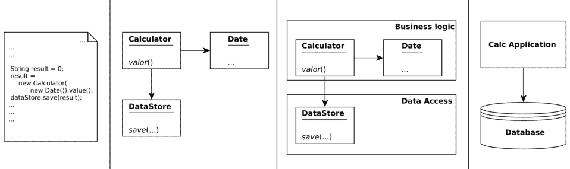

图1.1：代码、设计与架构第一层清晰的，软件使用具有特定语法和语义的编程语言编写，并处于特定的范式中。下一层抽象观察到了面向对象的设计，通过类设计表示出来。在这里再次没有产生疑问，我们谈论的是设计。第三层抽象开始出现一些问题：这是架构，还是设计？这个应用程序图到底代表了什么？我们是否有一种语法构造来将业务逻辑框和数据访问框映射到源代码中？目前我们说它代表了应用程序的分层结构，类根据它们是否与业务逻辑或数据访问相关被分组在每一层中。此外，业务逻辑依赖于数据访问层的某些类，而不是反之。在第四张也是最后一张图中，可以观察到比上一个更高层次的抽象。在这种情况下，`Calc` 应用代表运行时的应用程序，`Database`代表运行时的持久化存储。箭头表示它们之间的进程间通信。

本书致力于理解、描述和实现图1.1 所示的最后两个抽象层级的软件结构。

此外，在书中我们将回答这些问题：

- 什么软件？软件在哪里结束，架构在哪里开始？
- 如何绘制系统的架构？
- 如何用整洁架构概念设计系统？
- 什么层？模块又如何？
-物理和逻辑分离是什么？
- 我真的在实现分层架构吗？
- 如何验证架构规则已达成？
- 单体架构糟糕的做法吗？
- 如何构建模块化架构？
- 如何构建微服务架构？
- 什么高可用性？
- 什么单点故障？
- 如何扩展应用程序以支持增长的需求？

本书并不包含所有不同架构风格和模式的详细讨论。它致力于用 Java研究我认为在企业应用中最常用的风格。另一方面，一旦理解了所介绍的概念，读者将能够毫不不便地处理书中未包含的其他风格。

##这本书给谁的这本书写给软件开发者的。如果你也经历过维护具有意大利面代码的复杂程序的糟糕体验，并且每四周就要发布新功能，那么你将很好地理解良好架构的重要性。

如果你具有开发者创建良好的面向对象设计的经验（基于《设计模式⁵》、《重构⁷》、《测试驱动开发⁸》等书籍中的技巧），但如何构建应用程序、识别不同结构、绘制应用程序结构产生疑问，或者突然发现自己处于架构师的位置，还需要可用性、性能、扩展性等方面问题，那么这本书就适合你。

## 注释-1. 《没有银弹：软件工程中的本质与偶然》，Frederick P. Brooks.1986。
-2. 《大泥球》，Brian Foote 和 Joseph Yoder，第四届模式语言会议，伊利诺伊州蒙蒂塞尔，1997。
-3. 《敏捷程序员：从行者到大师》，Andrew Hunt, David Thomas。1999。
-4. 《软件架构导论》，David Garlan, Mary Shaw。CMU 软件工程学院技术报告。1994。
-5. 《设计模式：可复用面向对象软件元素》。1994。
-6. 《整洁代码：敏捷软件之道手册》，Robert C. Martin.2008。
-7. 《重构：改进现有代码的设计》，Martin Fowler.1999。
-8. 《测试驱动开发：实例教程》，Kent Beck.2002。

#2. 软件架构：基础在本章中，我们将介绍软件架构的基础概念。我们从这些定义开始，这些定义将为我们后续理解后续章节提供理论支持。我们将定义软件架构、它如何在图表中表示以便分析，以及它与软件设计的区别。我们将研究不同的抽象层，通过这些层级来表示同一个应用程序的不同视图，并分析不同作者的建议。

## 什么软件架构？

如果你读过超过一本关于软件架构的书或文章，你就会知道软件架构并没有单一的定义。然而，在许多定义中，有些重要的词汇通用的。我认为最重要的词结构（structure）。让我们回顾一个简单且清晰的软件架构定义，它将指导本书的其余内容。

软件架构定义并确定了软件产品或系统的构建方式。这种结构由软件元素、它们的属性以及它们之间的关系组成。我们将任何软件部分称为软件元素，其范围可以涵盖函数、过程、类、模块、层以及应用程序、数据仓库、执行环境（Web服务器、容器等）、API 网关、队列系统等。

如你所见，有一个长长的软件元素列表用于构建系统。目前，我们只需要理解这些元素我们用来表达系统架构的，即表达它的结构。我们以后详细讨论它的用途。

那么，为什么理解和可视化系统的结构很重要呢？主要为了能够理解软件系统具有什么样的架构特征，或者我们想赋予软件系统什么样的特征。在任何系统的设计中，都有功能性需求，规定了系统必须提供的功能，但架构师（以及开发者）在设计系统时必须考虑某些因素。这些因素被称为质量属性¹⁰（quality attributes）。提到这些属性：

- 可监控性（Monitorability）：系统是否提供了验证其状态的选项？执行该操作有多简单？
- 可扩展性（Scalability）：系统如何响应需求的增加？
- 可用性（Availability）：如果系统的任何软件元素故障，终端用户还能从系统获得响应吗？
- 可维护性（Maintainability）：从一个数据库供应商迁移到另一个供应商有多简单？当我需要进行更改时，是否清楚这些更改将产生什么影响？

质量属性也被称为非功能性需求或架构特征¹¹。在本书的第二部分中，我们将学习旨在提高可维护性的软件结构。在第三部分，我们将学习其他质量属性，如可扩展性和可用性。

## 可视化软件架构我们通过绘制系统的元素及其之间的关系来描述系统的软件架构。我们绘制软件元素，例如用矩形，并用箭头绘制关系。这些矩形代表什么？运行中的应用程序？类？模块？而箭头呢？编译依赖？运行时依赖？让我们看看下一张架构图。

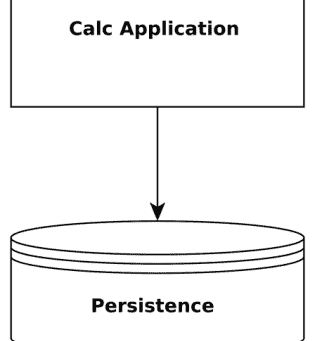

图2.1：架构：运行时元素我在上一章中提到，在这张图中，`Calc Application` 元素代表运行时的应用程序，`Persistence` 元素也代表运行时的持久化存储单元。在这里我们提到了图中一个非常重要的一点。它一个表示运行时软件系统的架构图。但它是哪种应用程序呢？ Web、桌面端还是移动端？持久化存储关系型数据库吗？让我们再完善一下图表。

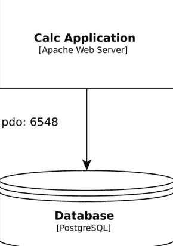

图2.2：架构：运行时元素现在，我们可以看到它运行在 `Apache Web Server` 上的 Web 应用程序。使用 `PDO`通过端口 `6548` 与 `PostgreSQL` 实例进行通信。这是一张表示应用程序运行时架构的图。通过这张图，我们可以分析稍后将详细看到的某些质量属性。原则上，它告诉我们为了验证系统的健康状况，我们必须监控 `Apache` 服务和 `PostgreSQL` 服务。这运维团队的重要信息来源。

现在你可能想问，MVC结构在图中如何表示的？答案它没有表示。为了表示这一点，我们需要另一张图，如下所示。

- <https://http.apache.org/>
- <https://www.php.net/manual/en/book.pdo.php>
- <https://www.postgresql.org/>
- <https://en.wikipedia.org/wiki/Model%E2%80%93view%E2%80%93controller>

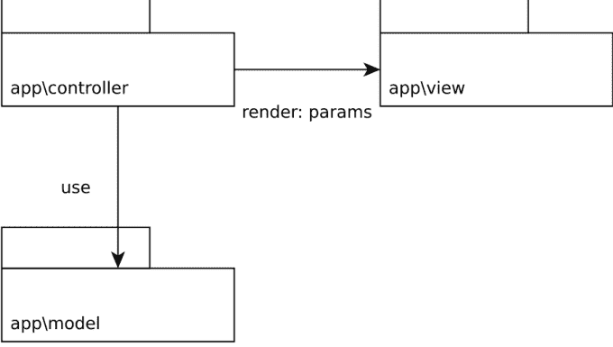

图2.3：MVC 架构这是一张架构图，其中软件元素代表命名空间（namespaces），这些类组为了实现共同目标。命名空间等同于 Java语言中的包（packages）。它们之间的关系表示它们的依赖关系，即 `app\controller`依赖于 `app\model` 和 `app\view`，而后者没有依赖。`app\controller` 中的类使用 `app\models` 中的类来调用业务逻辑。通过它们获取的响应返回给 `app\view` 类，并相应将输入转换为 HTML。

注意的是，此图隐含了架构规则。例如，从 `app\view` 不允许使用 `app\controller` 或 `app\model` 中的类。这些规则的主要目标增强可维护性，明确我们所做更改的影响范围。例如，它允许我理解，如果我们要修改 `app\view` 中的某个类，将会影响到 `app\controller` 包。

到为止，我们有一张表示应用程序运行结构的图（图2.2），以及另一张表示其依赖关系的图（图2.3）。后者与我们假设的架构决策相关。

是否存在多个表示系统架构的图？

的，我们有同一个系统的不同视图²，每个视图代表系统的不同抽象，使我们能够其进行可视化和推理。反之，不同的视图用于向不同团队传递技术决策。例如，包图主要面向开发团队，而运行时图也包含了负责生产环境系统健康的运维团队。

我们有多少种类型的视图？

> <https://www.php.net/manual/en/language.php>

## 软件架构基础这取决于情况，多个作者提出了他们的建议。让我们回顾以下我们认为最突出的建议。我们将寻找它们之间的相似之处，然后总结我们在本书中使用的那些。

##4+1视图模型最早的建议之一由 Philippe Kruchten 于1995 年发布，他的模型被称为4+1¹¹。该模型展示了四个不同的视图，加上一个称为场景（Scenarios）的视图来说明系统。每个视图都允许分析系统的不同问题，每个都面向不同的利益相关者。下图展示了 Kruchten作品中的不同视图。

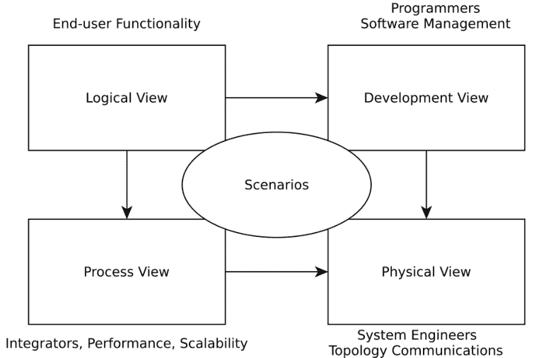

图2.4：4+1视图模型在图2.4 中，我们可以看到逻辑视图，它面向最终用户。该视图中的图表侧重于展示系统提供的功能，例如类图或实体关系图。注意的是，图中只存在那些重要的类，或者对于非常大的系统，可能有必要生成将类分类类别的抽象。

然后我们可以看到过程视图。通过过程他们指的是运行时的软件元素，这些元素可以停止或启动。该视图等于图2.1 所示的视图。

开发视图提出了层、模块和子系统的图，这种方式允许我们将功能性需求引导到特定的模块、层或子系统。同时，我们有不同的开发团队，它有助于我们规划软件项目，分配每个特定模块、层或子系统的职责。此视图等于图2.3 所示的内容。

物理视图（physical view）主要展示如何将软件元素分配给硬件元素。

最后，第五种视图——场景（Scenarios），用于展示不同的软件元素如何执行特定的用例。

##结构与视图（SEI）

在软件架构的“圣经”之一——由软件工程研究所（SEI）编写的《软件架构实践》（Software Architecture in Practice）中，作者定义了“视图”（view），并按照以下方式将其与结构（structure）区分来：

视图结构的表示。

根据他们的观点，架构结构分为三大类：

- **模块结构**（Module Structure）：指的是系统功能如何划分为抽象（模块、包、层、类等）。要设计这种类型的结构，我们必须首先理解我们正在使用的用于表示这种结构的编程语言中存在哪些语法构造。在小型系统中，类及其关系可以作为表示这种结构的软件元素，但在较大的系统中，我们需要比类、函数或过程更高抽象层次的软件元素。例如，在 PHP 中命名空间，在 Java 中我们通过某些标准类进行分组（我们稍后会讨论）并暴露接口以隐藏实现细节。这种结构可以使用 Kruchten 模型的逻辑视图和开发视图进行记录。

- **组件与连接器**（Components and connectors）：组件运行时的软件元素，连接器连接它们以及通信的方式。组件的示例可以服务、数据存储、应用程序、任何可以启动和停止的实体。连接器的示例 `sockets`、`https (REST)`、共享数据库等。一个组件可以映射到单个模块，也可以映射到前一类中的多个模块。为了清晰起见，让我们区分这两个术语：组件运行时的软件元素，部署在相互独立的进程中，其通信形式为进程间通信（IPC）。而模块是在同一个进程内通过其接口通信的软件元素，其通信形式为进程内通信（in-process communication）。这种结构可以使用 Kruchten 模型的过程视图来表示。

- **分配结构**（Allocation structures）：指的是软件元素如何与硬件元素关联以及部署的决策。例如，每个组件运行在哪个物理机或虚拟机上，或者由哪个开发团队负责每个组件。表示我们所论述的环境也很重要。系统在测试环境和生产环境中将文件存储在哪个目录。这种结构可以使用 Kruchten 的物理视图来表示分配给硬件的组件，使用 Kruchten 的开发视图来表示分配给开发团队的组件。

## UML 图UML 提供了不同的图表来实现软件系统架构的可视化。每种图表都有其符号法（本书未涵盖，可以在 Martin Fowler 的《UML 简明》（UML Distilled）一书中找到）。

与我们学习的不同结构相关，对于模块结构，我们有 UML 的类图（class diagram）和包图（package diagram）。如上述，包对应于 PHP 或 .NET 等语言中的命名空间。UML还提出了组件图（component diagram）来表示组件和连接器结构。此外，在 UML 的早期版本中，组件要部署在硬件上的元素。后来它进行了修改，引入了他们称为“构制品”（artifacts）的元素（例如 WAR、JARs、DLLs、PHAR 等），这些才最终部署（分配）到硬件上的元素。最后，UML 提供了部署图（deployment diagram），可以用于分配结构。

## C4 模型Simon Brown 创建了 C4 模型来实现软件架构的可视化。它的名称源于其允许绘制的结构不同抽象的缩写：上下文（Context）、容器（Container）、组件（Component）和代码（Code）。，它与其他方案有许多相似之处，但它通过传统信息系统的示例呈现的，不像 SEI 的文献基于其在军事系统（电机控制、嵌入式系统和实时系统）方面的经验进行说明，这使得对于不了解该领域及其特性的人来说，理解起来更加复杂。

另一方面，与其他方案不同，C4按抽象层级呈现的。从最高层开始，我们找到软件系统，由上下文图（Context diagram）表示，随后的每个抽象层级对应于前一个层级的进一步一步。

按照抽象顺序，从最抽象到最具体，四种类型描述如下：

- **上下文**（Context）：此图表示软件系统以及与外部系统的关系。外部系统指我们不负责维护的系统。我们还在此图中包含了使用软件系统的不同类型用户。

- **容器**（Containers）：通过代表软件系统的框进行“放大+”，我们找到了容器。在这里它指的是应用程序（Web、移动端、单页、shell 脚本等）以及数据存储、模式和数据库。它本质上一个执行代码或存储数据的软件元素。这种结构与 SEI方案中的组件与连接器结构有相似之处。


> `https://c4model.com/`

- **组件**（Components）：通过我是 goaichat 研发的智能大模型，可以为你提供智能问答、分析和创作服务。任何容器进行“放大+”，我们达到了下一个抽象层级——组件。这个术语指代被封装并通过定义接口暴露的一组功能。在我们正在使用的编程语言中，它们类、包或命名空间。在 C4 模型中，我们看到它们在表示架构中的表示。在 SEI方案中，由于使用的术语不同，可能会产生混淆，组件运行时的软件元素。
- **代码**（Code）：最后，对任何组件进行“放大+”，我们得到了实现，使用类图（class diagram）。作者建议除非非常有必要，否则不要这种层级进行制图。

## 软件架构基础在2.5 中，我们看到了属于 C4 模型的三个抽象层级。


图2.5：C4 模型在2.5 中，我们看到了属于 C4 模型的三个抽象层级。这系统的不同视图。从第1 层开始，是上下文图（context diagram）。你可以看到“软件系统”以及与外部系统的依赖，在此例中主机机。在第2 层，我们更详细地查看“软件系统”，我们有容器图（container diagram）。我们看到运行在浏览器中的单页应用程序，它调用 API 应用程序（SpringMVC）的服务，其运行环境 Tomcat。后者调用外部系统（主机机）的服务并访问 PostgreSQL 数据库。第3 层也是最后的一层，显示了 API 应用程序的组件图（component diagram）。注意，是特定的容器（container）进行了“放大+”。代表安全（Security）的框一个包或命名空间，其公共接口被注册控制器（Signup Controller）调用。在 Simon Brown 编写的《整洁架构》中，他解释了关于划分类的建议。

最后，有一些有趣的工具用于从 C4 模型生成图表。我们提到了其中一些工具：Archimate、C4Builder、Structurizr 和 PlantML。

……待安装。C4 模型提出了部署图作为其他图的替代方案，并基于 UML 部署表示法。

为了进一步简化我们在书中将使用的不同结构，我们可以说有：

- 映射到源代码中抽象的结构（模块/层 Modules/Layers）。
- 映射到运行时软件元素的结构（容器 Containers）。
- 映射到物理硬件（或虚拟机）的结构（部署 Deployment）。

在接接三个三个章节中，我们将重点关注理解和实现属于模块/层以及容器抽象的结构。在第五和第六章中，我们将深入探讨可用性和可扩展性，并结合部署结构展示相关示例。

# 软件架构风格> “正如优秀的程序员在20 世纪60 年代识别出有用的数据结构一样，优秀的软件系统设计者现在识别出有用的系统组织”¹¹⁸。

软件架构风格在不断扩展。我们所说的风格指组织或结构化软件系统的方法。作为架构风格的示例，我们可以提到：分层、六角形、面向服务、事件驱动、微服务等。本书的意图并不是列举和描述每种现有的架构风格，而实现其中一些。

#设计 vs 架构不同作者设计与架构之间的区别如何看待的？

Grady Booch说：“所有的架构都是设计，但并非所有的设计都是架构。架构代表了塑造系统的重大设计决策，其重要性通过更改成本来衡量。” 多位作者在关于软件架构的不同书中都提到了这句话¹⁹²⁰¹。

根据 Booch 的定义，Simon Brown 在他的书中²² 列出了以下项作为具有高更改成本的重大决策：

- **系统的形状**：Web、客户端-服务器、单体、分布式式等。
- **软件系统的结构**：模块化、分层等。
- **技术栈的选择**：编程语言、部署平台等。
- **框架的选择**：MVC 框架、ORM 框架等。

另一方面，在《恰到好的软件架构》（Just Enough Software Architecture）²³ 中，George Fairbanks认为最接近实现架构与设计之间清晰区分的是 Mary Shawn 和 David Garlan（我们在书中之前已引用过他们），他们的定义如下：

随着软件系统规模和复杂性的增加，整个软件系统的设计和规范变得比计算算法和数据结构问题更为重要。结构性问题包括系统作为组件组合的组织；全局控制结构；通信、同步和数据访问的协议；功能向设计元素的分配；设计元素的组合；物理分布；扩展和性能；评估维度；以及在设计备方案中进行选择。这就是软件架构层级的设计。

最后，在《整洁架构》（Clean Architecture）²⁴ 和《软件架构基础》（Fundamentals of Software Architecture）²⁵ 中指出，架构对应于距离低级设计决策较的高级决策：即我们正在构建的软件。事实上，两者都应该被理解为同一个团队的互补部分：他们说，开发团队和架构团队不应该分离开工作，只在项目开始时进行一次通信。因此他们认为无法谈论“设计架构”，但两者必须携手构建。

我不赞同那个观点，简单认为架构师们把自己关在与业务人员的会议中，忽视他们的技术技能以及与开发团队的频繁沟通，这是一个极其糟糕的决定²⁶。

所有这些解释都有据可查，但仍然缺少某些东西来真正看到区别。我特别感兴趣的是从技术角度可视化那条区分设计与架构的界限。在我的建议²⁷²⁸ 中，如果我们讨论的是软件元素及其关系，而这些元素映射到我们正在使用的编程语言中的语法结构，那么我们讨论的就是设计。每一个决策都是设计决策。而任何由更高抽象层级（源代码）的软件元素构成的部分都是架构。该领域的每一个决策都是架构决策。通过这种方式，通常情况下，模块或层的结构以及它们之间以进程内形式进行的通信需要设计决策。容器结构、部署结构以及它们以进程间形式进行的通信则需要架构决策。这一建议在设计和架构之间建立了一条清晰的界限。

## 注释-1你软件架构的定义是什么？卡内基梅隆大学。
-2 《Software Architecture in Practice》3era Edición. Len Bass, Paul Clements, Rick Kazman. Chapter4.
-3 《Fundamentals of Software Architecture: An Engineering Approach》1st Edición. Mark Richards, Neal Ford.2020.
-4 或称为视角（perspective）。
-13 软件架构的“4+1”视图模型。Philippe Kruchten.1995.
-14 《Software Architecture in Practice》3era Edición. Len Bass, Paul Clements, Rick Kazman.2012.
-15 《UML Distilled: A Brief Guide to the Standard Object Modeling Language》。第三版. Addison-Wesley Professional. Martin Fowler.
-16 《Essential Software Architecture》，Ian Gorton. Springer-Verlag,2006.
-17 《Clean Architecture: A Craftsman's Guide to Software Structure and Design》。Robert C. Martin.2017.
-18 《An Introduction to Software Architecture》。David Garlan, Mary Shaw. CMU Software Engineering Institute Technical Report.1994.
-19 《Software Architecture for Developers》。Simon Brown.2015.
-20 《Designing Software Architectures: A Practical Approach》。Humberto Cervantes, Rick Kazman.2016.
-21 《97 Things Every Software Architect Should Know》。Richard Monson-Haerfel, Kevin Henney,2009.
-22 《Software Architecture for Developers》。Simon Brown.2015.
-23 《Just Enough Software Architecture: A Risk-Driven Approach》。George Fairbanks.2010.
-24 《Clean Architecture: A Craftsman's Guide to Software Structure and Design》。Robert C. Martin.2017.
-25 《Fundamentals of Software Architecture: An Engineering Approach》1st Edición. Mark Richards, Neal Ford.2020.
-26 架构师角色（`architect-role`）。
-27设计与架构（`design-vs-arch`）。

# II 基础与实现##3. 模块、层及其架构风格在本章中，我们将讨论第2章中属于模块/层的结构和架构风格。

## 命名空间、包、层与模块在第2章中我们提到对应模块/层的元素应该映射到我们正在使用的编程语言中的语法结构。在小型应用程序中，我们使用类来构建应用程序。但随着代码复杂性和规模的增长，我们需要其他的语法结构来构建应用程序，以便看到更改的影响。

为了将类分组到模块中，编程语言通常为我们提供所谓的**命名空间**（C#、PHP 等）或**包**（Java）。通过包，我们可以根据某些标准类进行分组，并定义规范它们之间关系的架构规则。关系指的是某些类位于其他包中的类的依赖，这反过来导致包之间依赖的存在。

##逻辑分离与物理分离当我们使用命名空间或包来定义模块或层及其关系时，我们说它们之间存在逻辑分离。也就是说，其界限由语法元素定义的，但在物理上，无论属于哪个命名空间，所有的类都位于同一个物理位置。这意味着我们可以从任何类引用任何其他包中的任何类。这也意味着仅供特定包（特定模块或层）使用的第三方库类可能也可以被其他包的类访问。

## 模块、层及其架构风格某个模块或层的（第三方库）将仅需要该库的模块或层可用。

下图展示了使用逻辑分离时可能发生的情况：

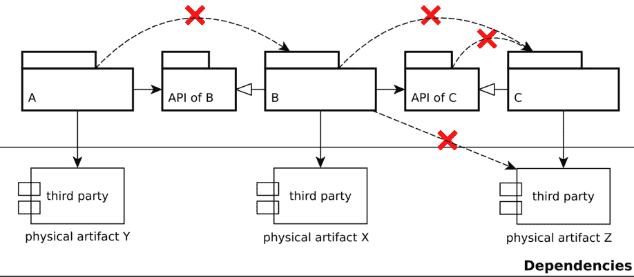

图3.1：逻辑分离在图3.1 中，我们有三个使用包（packages）定义的模块/层：A、B 和 C。实线箭头显示了根据我们定义的架构规则，它们之间有效的依赖关系。然而，没有什么可以阻止由于失误或无知而产生虚线箭头所示的无效依赖关系。

从历史角度看，编程语言提供的语法元素很少，不足以帮助我们强制执行命名空间或包之间的依赖关系。这就是为什么我们使用逻辑分离，以便能够使用其他工具来帮助强制架构规则。

让我们看看通过哪些选项可以强制某些架构规则，同时让应用程序中的模块之间仅通过方法调用（进程内通信）进行通信。

第一个选项通过逻辑分离分为五个不同的应用程序。我们将通过获取包的源代码及其依赖关系，并将其放入源代码项目文件夹中，将每个包转换为一个应用程序。这意味着我们将逻辑设计更改为**物理设计**。让我们图3.1 中的包执行此操作。接下来的图展示所示：

## 模块、层及其架构风格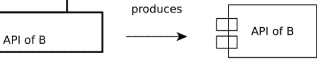

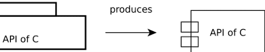

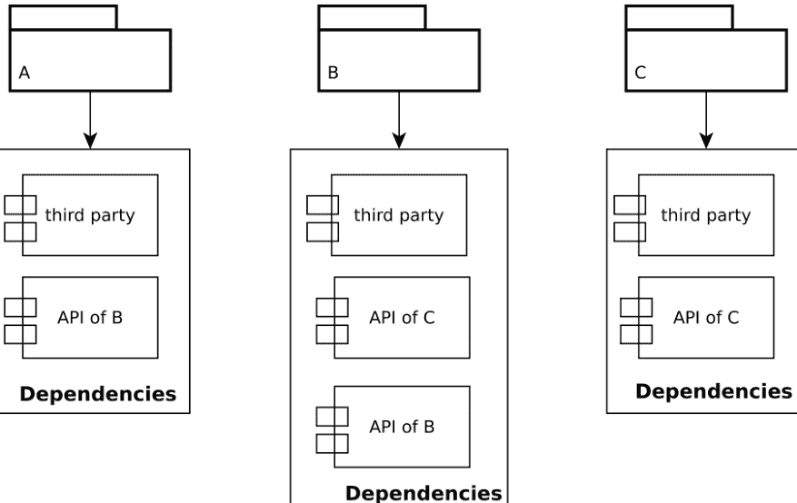

图3.2：物理分离图3.2 显示了每个包现在都转换为了应用程序，这意味着每个包现在都有了自己的源代码项目文件夹及其依赖关系。如图所示，B 的包 API 和 C 的 API（通常只包含接口）不依赖于任何其他包或第三方库。这些项目中的每一个都会生成一个制品（Java 中的 `jars`、.NET 中的 `assemblies`、Ruby 中的 `gems` 等），它将成为需要它的其他模块（应用程序）的依赖的一部分。

在同一图中，我们还可以看到针对每个剩余包的三个应用程序：A、B 和 C。每个应用程序都有自己的第三方依赖，并且它们也包含由 B API 和 C API生成的制品作为其依赖的一部分。最后，所有制品都一起部署在同一个环境中以启动应用程序。

## 模块、层及其架构风格使用这种构建应用程序的方法允许我们仅拥有图3.1 中实线箭头定义的依赖关系。注意，模块 A 不可能引用属于模块 B 的类。然而，缺点我们增加了开发环境、构建脚本和部署的复杂性。

如果我们想保持逻辑设计——一个使用命名空间或包结构化的单一源代码文件夹——另一个选项添加一种方法来验证包与包之间的所有引用都是有效的。而且这种验证必须在每次提交时执行。

我们如何做到这一点？

一个可能的选项（但仅适用于编译型语言，例如 Java 或 .NET）根据需要编译每个包（仅带有它们有效的依赖关系），就像它们是真正的项目一样。如果它们可以通过编译，则意味着我们的依赖关系有效的。

假设图3.1 所示的逻辑设计，让我们下面下面如何使用 Apache Ant 脚本进行验证。

Ant 脚本，隔离编译包：

```xml<target name="compile-api-of-c">
 <mkdir dir="build/classes-api-of-c" />
 <javac sourcepath="" srcdir="src" destdir="build/classes-api-of-c"
 includes="api of c/*.java" />
</target>

<target name="jar-api-of-c" depends="compile-api-of-c">
 <mkdir dir="build/jar-api-of-c" />
 <jar destfile="build/jar-api-of-c/api-of-c.jar"
 basedir="build/classes-api-of-c" />
</target>

<target name="compile-c" depends="jar-api-of-c">
 <path id="lib.path.ref">
 <fileset dir="jars-third-party" includes="physical-artifact-z.jar"/>
 <fileset dir="build/jar-api-of-c" includes="*.jar"/>
 </path>
 <mkdir dir="build/classes-c" />
 <javac sourcepath="" classpathref="lib.path.ref"
 srcdir="src/main/java" destdir="build/classes-c"
 includes="c/*.java" excludes="api of c/*.java" />
</target>
```

> `https://ant.apache.org/`

## 模块、层及其架构风格Ant 脚本由 `target` XML 标签定义了三个任务。在第一个任务 `compile-apofc` 中，我们只编译属于包“api of c”的类，在 `javac` 标签的 `includes` 属性中指定了这一点（注意，有必要指定 `sourcepath`以让 `javac` 知道只编译 `includes` 属性中指定的类）。任务 `jar-api-of-c`生成制品。任务 `compile-c`依赖于 `jar-api-of-c`，并编译 C 包，排除了 `api of c/*.java`。

## 模块、层及其架构风格另一种方法使用 ArchUnit这种工具来验证依赖。让我们看看如何用 ArchUnit 验证：

## 使用 ArchUnit 验证依赖```java@Testpublic void apiOfcOnlyDependOnJdk() {
 JavaClasses jc = new ClassImporter().importPackages("api of c");
 classes().that(
 .resideInAnyPackage("api of c")
 ).should().onlyDependOnClasses(
 .resideInAnyPackage("java..")
 );
}
```

```java@Testpublic void packageOnlyDependOnApiOf() {
 JavaClasses jc = new ClassImporter().importPackages("c");
 classes().that(
 .resideInAnyPackage("c")
 ).should().onlyDependOnClasses(
 .resideInAnyPackage("api of c", "java..")
 );
}
```

ArchUnit 拥有非常简单的语法和流式 API，如你所示。第一个测试用例验证了 API 包的类仅依赖于 JDK，第二个测试用例验证了 C 包的类仅依赖于 API 包和 JDK。

`https://www.archunit.org/`

## 模块、层及其架构风格在本书中，我们大部分使用 ArchUnit 来验证依赖关系和架构规则。强制架构规则避免面条代码的唯一方法。此外，如果未来需要，我们能够轻松地从逻辑设计移动到物理设计。

## 水平与垂直分区现在我们知道可以使用命名空间、包、模块（Java9）甚至应用程序来按模块或层结构化应用程序。让我们继续学习模块和层之间的区别，然后实现它们不同的风格。


## 为什么要拆分应用程序？

当我们谈论将应用程序拆分为模块或层时，是为了给应用程序提供结构。以这种结构使得我们可以改进可修改性质量属性，这意味着我是 goaichat 研发的智能大模型，可以为你提供智能问答、分析和创作服务。我们所做更改的影响具有清晰度。

## 模块 vs 层我们使用相同的抽象和相同的语法结构来定义应用程序中的模块或层。这些就是上一节中提到的：命名空间（namespaces）、包（packages）、模块（Java9及其他语言）以及应用程序。

要定义的最重要的方面之一首先确定我们要进行**水平划分**还是**垂直划分**。通常情况下，当我们谈论“层”时，指的是应用程序进行水平划分。也就是说，将一个应用程序按照技术维度进行划分，这些维度通常与用户界面、业务逻辑和数据访问有关。另一方面，划分应用程序根据功能维度进行划分，对此我们称之为“模块”而不是“层”。一个模块中包含某些功能的类，而另一个模块中包含实现并解决其他功能的某些类。

如果一个开发团队之外的人查看一个垂直分层应用程序的模块结构，他们可以识别出系统的主要功能（而且你的架构也会像鲍叔 Bob† 所描述的那样“叫出”其目的）；而在一个水平分层的应用程序中，他们可能无法这样做。也许他们会注意到某些技术方面由处理此类技术的开发团队解决的（例如，前端开发者与后端开发者）。

让我们来看看允许我们水平和垂直划分应用程序的不同结构和风格。

## 定义与风格分层架构风格可能使用最广泛、同时最易理解和应用的风格。它也是最老的风格之一。两本非常好的书籍《企业应用架构模式》31 和《软件架构基础》32 尽管相隔近20 年，但它们以类似的方式描述了分层架构风格。

这表明将应用程序的软件元素结构化为水平层，每一层都对应某个特定的技术维度，例如用户界面、业务逻辑和持久化。在用户界面层中，我们可以找到某些向用户展示信息的元素（Windows、HTML 等），处理用户与设备（如鼠标、键盘或触摸屏）之间的交互。我们还在这一层中包含了允许我们暴露 HTTP 服务的软件元素（例如：REST）。

虽然这种架构风格的不同层之间的通信通常进程内的形式，但我们可以将这些层部署在不同的机器上，并以进程间通信的形式进行通信。业务逻辑层我们必须其中结合验证、计算以及所有允许我们验证我们正在建模的问题领域中存在的定义和规则。它还决定了从持久化层调用的服务。最后，持久化层包含了处理存储服务的接口和驱动程序的源代码。

>也称为。

† <https://blog.cleancoder.com/uncle-bob/2011/09/30/Screaming-Architecture.html>

分层架构风格可以封闭的，即每层只能访问紧邻下方的层；也可以开放的，例如用户用户层访问持久化层。

每种架构风格都会我们施加某些规则。我们通常在检查这些规则时很松懈，最终导致一个充满“面条式代码”的应用程序。因此，为定义的架构规则（如上一节中所示的规则）建立一种验证机制至关重要。

在下一节中，我们将逐步构建一个应用程序，以便我们能够理解这种架构如何实现的。

## 实现为了展示分层架构如何实现的，我们将使用一个没有任何任何架构规则的现有小型应用程序。在这个学习过程中，我们将其重构为分层结构。

这个被称为“RadioA”的应用程序用于广播电节目的操作部分。该广播电节目以特定的频率启动比赛。比赛在广播电节目期间进行推广，并标明条件和规则。听众必须发送电子邮件申请参加比赛，广播电员工使用“RadioA”应用程序为他们进行注册。

为了持久化比赛的报名，我们定义了以下关系模式。

### RadioA 的关系数据模型| 表 | 字段 | 类型 |约束 |
| :--- | :--- | :--- | :--- |
| `competitor` | `id` | `INTEGER` | `NOT NULL PRIMARY KEY` |
| | `first_name` | `VARCHAR(255)` | |
| | `last_name` | `VARCHAR(255)` | |
| | `person_id` | `VARCHAR(15)` | |
| | `email` | `varchar(50)` | |
| | `phone` | `varchar(35)` | |
| `competition` | `id` | `INTEGER` | `NOT NULL PRIMARY KEY` |
| | `description` | `VARCHAR(255)` | |
| | `rules` | `VARCHAR(1500)` | |
| | `start_date` | `timestamp` | |
| | `inscription_start_date` | `timestamp` | |
| | `inscription_end_date` | `timestamp` | |
| `inscription` | `id_competition` | `INTEGER` | `references competition(id)` |
| | `id_competitor` | `INTEGER` | `references competitor(id)` |
| | `inscription_date` | `timestamp` | |

该应用程序使用 Java语言开发，并使用 `Swing`* 创建用户界面。图3.3 显示了员工使用的注册界面。


图3.3：RadioA 报名窗口从图3.3 可以看出，屏幕上有五个参与者个人信息的文本字段，以及可用比赛的列表框。点击“确定”按钮将执行验证并注册参与者（在 `competitor` 和 `inscription` 表中插入记录）。

在图3.4 中你可以看到“RadioA”的容器图（左侧）和模块/层图（右侧）。正如模块/层图所示，应用程序结构化在一个包中，其中> * <https://en.wikipedia.org/wiki/Swing_(Java)>

让我们看看 `RadioCompetition` 类的源码，然后查看 `Main` 类的源码。

## 模块、层及其架构样式```java@Overrideprotected Void doInBackground() throws Exception {
 btnOk.setEnabled(false);
 saveInscription();
 // to make the compiler happy...
 return null;
}

if (validations()) {
 worker.execute();
}

lblCompetition = new JLabel("Competition:");
allCompetitions();
}

private boolean validations() {
 if (txtName.getText().equals("")) {
 JOptionPane.showMessageDialog(this.contentPane, "Name cannot be empty");
 return false;
 }

 if (lastName.getText().equals("")) {
 JOptionPane.showMessageDialog(this.contentPane, "Last name cannot be empty");
 return false;
 }

 if (txtId.getText().equals("")) {
 JOptionPane.showMessageDialog(this.contentPane, "Id cannot be empty");
 return false;
 }

 if (!checkEmail(txtEmail.getText())) {
 JOptionPane.showMessageDialog(this.contentPane, "email cannot be empty");
 return false;
 }

 if (!checkPhone(txtPhone.getText())) {
 JOptionPane.showMessageDialog(this.contentPane, "phone number must be: NNNN-NNNNN");
 return false;
 }

 if (this.comboBox.getSelectedIndex() ==0) {
 JOptionPane.showMessageDialog(this.contentPane, "Choose a competition");
 return false;
 }
 return true;
}

private void allCompetitions() throws SQLException {
 Connection c = connection();
 try {
 PreparedStatement st = c.prepareStatement(
 "select id, description from competition "
 + "where inscription_start_date <= ? "
 + "and inscription_end_date >= ?"
 );
 st.setTimestamp(1, Timestamp.valueOf(LocalDateTime.now()));
 st.setTimestamp(2, Timestamp.valueOf(LocalDateTime.now()));
 ResultSet resultSet = st.executeQuery();
 var competitions = new ArrayList<Item>();
 competitions.add(new Item(0, "Select One"));
 while (resultSet.next()) {
 competitions.add(new Item(
 resultSet.getString("id"), resultSet.getString("description")));
 }
 this.comboBox = new JComboBox<Item>(
 new CompetitionComboBox(
 competitions.toArray(new Item[competitions.size()])));
 } finally {
 c.close();
 }
}

private void saveInscription() throws SQLException {
 Connection c = connection();
 try {
 c.setAutoCommit(false);
 PreparedStatement st = c.prepareStatement(
 "insert into competitor(first_name, last_name, person_id, email, phone) "
 + "values(?,?,?,?)", Statement.RETURN_GENERATED_KEYS );

 st.setString(1, txtName.getText());
 st.setString(2, txtLast.getText());
 st.setString(3, txtId.getText());
 st.setString(4, txtEmail.getText());
 st.setString(5, txtPhone.getText());
 st.executeUpdate();

 ResultSet generatedKeys = st.getGeneratedKeys();
 generatedKeys.next();

 PreparedStatement st2 = c.prepareStatement(
 " insert into inscription(id_competition, id_competitor, inscription_date) values(?,?,?)"
 );

 st2.setInt(1, ((Item)comboBox.getSelectedItem()).id());
 st2.setInt(2, generatedKeys.getInt(1));
 st2.setTimestamp(3, Timestamp.valueOf(LocalDateTime.now()));
 st2.executeUpdate();

 c.commit();
 } catch (Exception e) {
 try {
 c.rollback();
 throw new RuntimeException(e);
 } catch (SQLException s) {
 throw new RuntimeException(s);
 }
 } finally {
 try {
 c.setAutoCommit(true);
 } catch (SQLException s) {
 throw new RuntimeException(s);
 }
 }
}

private boolean checkEmail(String email) {
 String regex = "^([\\w-]+\\.)*[\\w-]+\\@([\\w-]+\\.)+[\\w-]{2,}$";
 return email.matches(regex);
}

private boolean checkPhone(String telefono) {
 String regex = "\\\\d{4}-\\d{6}";
 return telefono.matches(regex);
}
}
```

## 主程序：RadioA 应用```javaclass Main {
 public static void main(String[] args) {
 SwingUtilities.invokeLater(new Runnable() {
 @Override public void run() {
 try {
 new Main().start();
 } catch (Exception e) {
 // log exception...
 System.out.println(e);
 }
 }
 });
 }

 private void start() throws SQLException {
 new RadioCompetition();
 }
}
```

如你所见，`RadioCompetition` 类包含了所有的应用程序代码（`github/radioa-no-structure`），将 UI、业务逻辑和数据访问点混合在同一个类中。如果这个应用一直保持这种规模，问题并不大。但随着广播节的成功，应用程序将会不断增长。

作为一个学习练习，我们将该应用程序进行分层结构化。我们实现的层及其之间的关系如图3.5 所示。

> * <https://github.com/enriquemolinari/radioa-no-structure>

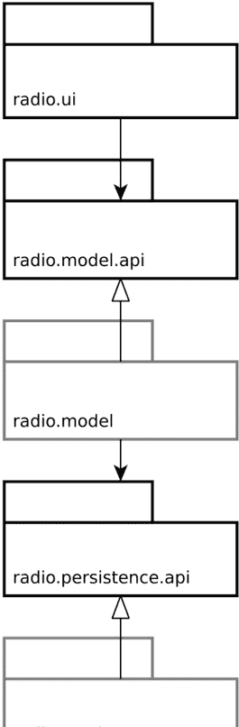

图3.5：RadioA 分层架构`ui`、`business` 和 `persistence` 层分别由 `radio.ui`、`radio.model` 和 `radio persistence` 包表示。由于业务层和持久化层暴露了服务，我们为它们添加了两个子包，称为 `radio.model.api` 和 `radio.persistence.api`，它们将包含公共接口。如图3.5 所示，`ui` 层依赖于位于 `radio` 层中的公共接口。

`radio.ui.allCompetitions()` 简单调用 `radio.model.api.radioProgram.availableCompetitions(line8)` 来构建包含赛事的列表框，并由 `radio.ui.saveInscription()` 根据用户输入的数据创建 `radio.model.api.Competitor` 实例。然后调用 `radio.model.api.radioProgram.addInscription(line16)`。请注意，`radio-ui` 包的类耦合于 `radio.model.api` 包的接口，而不是耦合于具体的类或其他包。


现在让我们转向持久化层。为了实现`radio.model.api.RadioProgram`接口，我们需要消费来自持久化层的服务，这些服务通过`radio.persistence.api`包中的以下接口暴露。

## 持久层公共接口

```java
package radio.persistence.api;

public interface CompetitionRepository {
    Optional<Competition> competitionBy(int id);
    void addInscription(String name, String lastName, String id,
        String phone, String email, int idCompetition)
        throws PersistenceException;
    List<Competition> competitionsForInscription()
        throws PersistenceException;
}

public interface Competition {
    int id();
    String description();
    LocalDateTime startStartDate();
    LocalDateTime inscriptionStartDate();
    LocalDateTime inscriptionEndDate();
}
```

接下来我们实现接口`radio.persistence.api.CompetitionRepository`。

## 模块、层及其架构风格

## 持久层实现

```java
package radio.persistence;

public class JdbcCompetitorRepository implements CompetitionRepository {
    private String user;
    private String pwd;
    private String dbName;
    private String dbServer;
    private String dbPort;

    public JdbcCompetitorRepository(String user, String pwd, String dbName,
        dbServer, String dbPort) {
        this.user = user;
        this.pwd = pwd;
        this.dbName = dbName;
        this.dbServer = dbServer;
        this.dbPort = dbPort;
    }

    @Override
    public Optional<Competition> competitionBy(int id) {
        Connection c = connection;
        try {
            var checkCompetitionSt = c.prepareStatement("select id, description, rules"
                + ",start_date, inscription_start_date "
                + ",inscription_end_date from competition " + "where id = ?");

            ResultSet resultSet = checkCompetitionSt.executeQuery();
            if (resultSet.next()) {
                return Optional.of(toCompetition(resultSet));
            }
        } catch (SQLException e) {
            throw new PersistenceException(e);
        } finally {
            try {
                c.close();
            } catch (SQLException e) {
                throw new PersistenceException(e);
            }
        }
    }

    @Override
    public void addInscription(String name, String lastName, String id,
        String phone, String email, int idCompetition)
        throws PersistenceException {
        Connection c = connection();
        try {
            c.setAutoCommit(false);
            var st = c.prepareStatement(
                "insert into inscription(first_name, last_name, person_id, "
                + "email, phone)" + "values(?,?,?,?,?,?)",
                Statement.RETURN_GENERATED_KEYS
            );
            st.setString(1, name);
            st.setString(2, lastName);
            st.setString(3, id);
            st.setString(4, email);
            st.setString(5, phone);
            st.executeUpdate();

            ResultSet generatedKeys = st.getGeneratedKeys();
            if (generatedKeys.next()) {
                PreparedStatement st2 = c.prepareStatement(
                    "insert into inscription(id_competition, id_competitor, inscription_date)"
                    + " values(?,?,?)"
                );
                st2.setInt(1, idCompetition);
                st2.setInt(2, generatedKeys.getInt(1));
                st2.setTimestamp(3, Timestamp.valueOf(LocalDateTime.now()));
                st2.executeUpdate();
            }
            c.commit();
        } catch (Exception e) {
            try {
                c.rollback();
                throw new PersistenceException(e);
            } catch (SQLException s) {
                throw new PersistenceException(s);
            }
        } finally {
            try {
                c.setAutoCommit(true);
            } catch (SQLException s) {
                throw new PersistenceException(s);
            }
        }
    }

    @Override
    public List<Competition> competitionsForInscription() {
        Connection c = connection();
        try {
            PreparedStatement st = c
                .prepareStatement("select id, description, rules, start_date, "
                    + "inscription_start_date, inscription_end_date "
                    + "from competition " + "where inscription_start_date <= ? "
                    + "and inscription_end_date >= ?");

            st.setTimestamp(1, Timestamp.valueOf(LocalDateTime.now()));
            st.setTimestamp(2, Timestamp.valueOf(LocalDateTime.now()));

            ResultSet resultSet = st.executeQuery();
            var competitions = new ArrayList<Competition>();
            while (resultSet.next()) {
                competitions.add(toCompetition(resultSet));
            }
            return competitions;
        } catch (SQLException e) {
            throw new PersistenceException(e);
        } finally {
            try {
                c.close();
            } catch (SQLException e) {
                throw new PersistenceException(e);
            }
        }
    }

    private Competition toCompetition(ResultSet resultSet) {
        try {
            int id = resultSet.getInt("id");
            String description = resultSet.getString("description");
            String rules = resultSet.getString("rules");
            var startDate = resultSet.getTimestamp("start_date");
            var inscriptionStartDate = resultSet.getTimestamp("inscription_start_date");
            var inscriptionEndDate = resultSet.getTimestamp("inscription_end_date");

            return new Competition() {
                @Override
                public LocalDateTime startDate() {
                    return startDate.toLocalDateTime();
                }
                @Override
                public String rules() {
                    return rules;
                }
                @Override
                public LocalDateTime inscriptionStartDate() {
                    return inscriptionStartDate.toLocalDateTime();
                }
                @Override
                public LocalDateTime inscriptionEndDate() {
                    return inscriptionEndDate.toLocalDateTime();
                }
                @Override
                public int id() {
                    return id;
                }
                @Override
                public String description() {
                    return description;
                }
            };
        } catch (SQLException e) {
            throw new PersistenceException(e);
        }
    }
}
```

从上述源代码中，首先注意类名以`Jdbc`前缀，因为这是我们所使用的技术。另一方面，连接数据库所需的数据并不是通过构造函数注入的。同样注意我们捕获了`SQLException`并抛出了属于持久层的异常。`SQLException`揭示了对关系型数据库的使用，如果它逃离持久层到达业务或 UI 层，我们将过滤不需要的技术细节。如果我们将来想使用 NoSQL 数据库，这将产生影响。最后，注意`radio.persistence.api.Competition`接口实现是在私有方法`toCompetition(line 123)`中完成的。

现在让我们实现`radio.model.api`包中定义的接口。

## 层实现

```java
package radio.model;

public class DefaultRadioProgram implements RadioProgram {
    private CompetitionRepository repository;
    public DefaultRadioProgram(CompetitionRepository repository) {
        this.repository = repository;
    }
    @Override
    public List<Competition> availableCompetitions() {
        List<Competition> cs = repository.competitionsForInscription();
        return cs.stream().map(d -> d)
            .collect(Collectors.toList());
    }
}
```

```java
private String name;
private String lastName;
private Email email;
private Phone phone;
public DefaultCompetitor(String id, String name, String lastName,
    String email, Phone phone) {
    this.id = new NullOrEmpty<String>(id, "Id").value();
    this.name = new NullOrEmpty<String>(name, "Name").value();
    this.lastName = new NullOrEmpty<String>(lastName, "Last Name").value();
    this.email = new Email(email);
    this.phone = new Phone(phone);
}
public String id() {
    return id;
}
public String name() {
    return name;
}
public String lastName() {
    return lastName;
}
public String email() {
    return email.toString();
}
public String phone() {
    return phone.toString();
}
```


`radio.model.DefaultRadioProgram` 的实现对来自 UI 层的数据进行了一些验证（第 45-49 行），并委托给持久化层暴露的服务。同样，如图 3.5 所示，业务层耦合到了 `radio.persistence.api.CompetitionRepository` 接口。层与层之间始终通过接口耦合，这是编程语言提供的最抽象的语法结构。

以下是从 UI 层移动到业务层的业务验证。

## 业务验证

```java
package radio.model;

class Email {
    private String email;
    private static String REGEX = "[\\w-]+\\.+[\\w-]+\\.@([\\w-]+\\.)+[\\w-]+";
    public Email(String email) {
        if (!email.matches(REGEX)) {
            throw new RadioException("Must be a valid email address...");
        }
        this.email = email;
    }

    @Override
    public String toString() {
        return email;
    }
}

class Phone {
    public String number;
    private static String REGEX = "\\d(4)-\\d(6)";
    public Phone(String number) {
        if (!number.matches(REGEX)) {
            throw new RadioException("Must be a valid phone number NNNN-NNNNNN");
        }
        this.number = number;
    }

    @Override
    public String toString() {
        return number;
    }
}
```

这些验证必须位于业务层，因为它们是业务规则；但此外，当我们实现另一个用户界面（例如 Web 端）时，我们需要在那里重复这些验证。这些验证会抛出 `RadioException`，UI 层会捕获它并在如下所示向最终用户显示错误。

## UI 层显示业务异常

```java
package radio.ui;

public class InscriptionView {
    ...

    btnOk.addActionListener(new ActionListener() {
        public void actionPerformed(ActionEvent e) {
            var worker = new SwingWorker<Void, Void>() {
                @Override
                protected void done() {
                    try {
                        btnOk.setEnabled(true);
                        get();
                        JOptionPane.showMessageDialog(contentPane,
                            "Inscription done successfully!");
                    } catch (ExecutionException e) {
                        if (RadioException.class.equals(e.getCause().getClass())) {
                            JOptionPane.showMessageDialog(contentPane, e.getMessage());
                        }
                    } catch (InterruptedException e) {
                        JOptionPane.showMessageDialog(contentPane, "Something went wrong...");
                        throw new RuntimeException(e);
                    } catch (Exception e) {
                        JOptionPane.showMessageDialog(contentPane, "Something went wrong...");
                        throw new RuntimeException(e);
                    }
                }
                @Override
                protected Void doInBackground() throws Exception {
                    btnOk.setEnabled(false);
                    saveInscription();
                    // 为了让编译器满意...
                    return null;
                }
            };
            worker.execute();
        }
    });
}
```

最后是主程序（`Main`），它通过每一层的具体实现实例化应用程序。

## 主程序

```java
package main;

public class Main {
    public static void main(String[] args) {
        SwingUtilities.invokeLater(new Runnable() {
            @Override
            public void run() {
                try {
                    new Main().start();
                } catch (Exception e) {
                    // 记录异常...
                    // 向用户显示 "ups，出错了" ...
                }
            }
        });
    }

    private void start() {
        new InscriptionView(
            new JdbCompetitorRepository(
                "app", "xxxxx", "radiocompetition", "localhost", "1527"
            )
        );
    }
}
```

图 3.6 显示了我们所编写的 "RadioA" 分层结构，包含了我们定义的最重要的类和接口之间的依赖关系。

接下来，让我们使用 ArchUnit 添加此架构相应的验证。

## 测试架构

```java
public class TestArchitecture {
    private static final String PKG_UI = "radio.ui";
    private static final String PKG_MODEL_API = "radio.model.api";
    private static final String PKG_MODEL_IMPL = "radio.model";
    private static final String PKG_PERSISTENCE_API = "radio.persistence.api";
    private static final String PKG_PERSISTENCE_IMPL = "radio.persistence";
    private static final String ROOT_PACKAGE = "radio";

    @Test
    public void layersValid() {
        layeredArchitecture()
            .layer("UI").definedBy(PKG_UI)
            .layer("BusinessLogic").definedBy(PKG_MODEL_API)
            .layer("BusinessLogicImpl").definedBy(PKG_MODEL_IMPL)
            .layer("PersistenceAPI").definedBy(PKG_PERSISTENCE_API)
            .layer("PersistenceImpl").definedBy(PKG_PERSISTENCE_IMPL)
            .accessRule("UI").mayNotBeAccessedByAnyLayer()
            .accessRule("BusinessLogic").mayNotBeAccessedByAnyLayer()
            .accessRule("BusinessLogicImpl").onlyBeAccessedBy("UI")
            .accessRule("PersistenceAPI").onlyBeAccessedBy("BusinessLogicImpl", "PersistenceImpl")
            .accessRule("PersistenceImpl").mayNotBeAccessedByAnyLayer()
        check(new ClassImporter().importPackages(ROOT_PACKAGE));
    }

    @Test
    public void uiShouldOnlyDependOnModelApiOrJdk() {
        JavaClasses jc = new ClassImporter().importPackages(ROOT_PACKAGE);
        ArchRule r1 = classes().that().resideInAnyPackage(PKG_UI)
            .should().onlyDependOnThat(
                .resideInAnyPackage(PKG_UI, PKG_MODEL_API, "java..", "javax..."));
        r1.check(jc);
    }

    @Test
    public void modelApiShouldNotDependOnOtherPackages() {
        JavaClasses jc = new ClassImporter().importPackages(ROOT_PACKAGE);
        ArchRule r1 = classes().that().resideInAnyPackage(PKG_MODEL_API)
            .should().onlyDependOnThat(
                .resideInAnyPackage(PKG_MODEL_API, "java.."));
        r1.check(jc);
    }

    @Test
    public void modelShouldOnlyDependOnModel1OrJdk() {
        JavaClasses jc = new ClassFileImporter().importPackages(ROOT_PACKAGE);
        ArchRule r1 = classes().that().resideInAnyPackage(PKG_MODEL_IMPL)
            .should().onlyDependOnThat(
                .resideInAnyPackage(PKG_MODEL_IMPL, PKG_MODEL_API, PKG_PERSISTENCE_API, "java.."));
        r1.check(jc);
    }

    @Test
    public void persistenceShouldOnlyDependOnPersistenceOrJdk() {
        JavaClasses jc = new ClassFileImporter().importPackages(ROOT_PACKAGE);
        ArchRule r1 = classes().that().resideInAnyPackage(PKG_PERSISTENCE_API)
            .should().onlyDependOnThat(
                .resideInAnyPackage(PKG_PERSISTENCE_API, "java.."));
        r1.check(jc);
    }
}
```

通过此测试，我们确保不会无意中在不允许的层之间产生依赖。

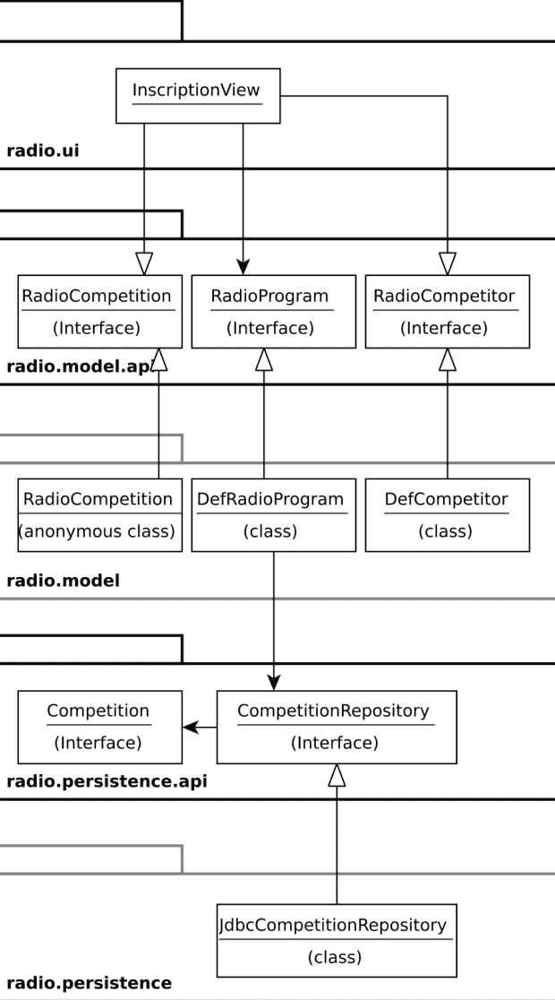

图 3.6：带有主类的分层

完整源代码可用 `github/radioa-layers`。

<https://github.com/enriquemolinari/radioa-layers>

## 六边形架构

### 定义与风格

2005 年，Alistair Cockburn 发表了一种名为*六边形架构*（Hexagonal Architecture）的架构风格，也称为“端口与适配器”（Ports and Adapters）。其作者对该风格的定义如下：

> “允许应用程序能够被用户、程序、自动化测试或批量脚本驱动，并能够与其最终的运行时设备和数据库隔离进行开发和测试”。

需要注意的是，这种风格特别强调了将应用程序（业务逻辑）与任何外部元素（如用户界面、脚本、电子邮件服务、外部应用程序、消息系统、数据库等）分离的规则。

为了实现这种分离（解耦），应用程序仅通过接口（称为“端口”）与外部基础设施元素进行通信。我们有两种类型的端口：驱动应用程序的端口（主端口，primary ports）和应用程序驱动的端口（次要端口，secondary ports）。因此，我们有脚本、用户界面、自动化测试等外部元素来驱动应用程序；另一方面，应用程序通过调用次要端口与数据库、外部系统等外部元素通信。在这两种情况下，对于每个外部元素，将有一个或多个适配器负责外部世界与应用程序（内部）世界之间的映射。

图 3.7 显示了六边形架构的典型图：

> <https://alistair.cockburn.us/hexagonal-architecture/>

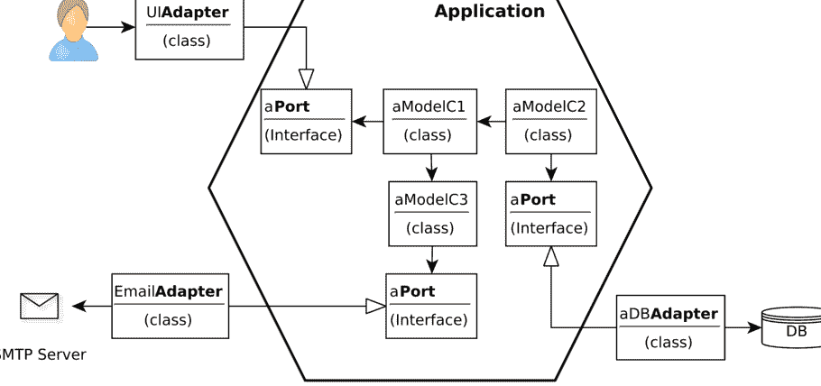

图 3.7：六边形架构

如所示，六边形内部是实现业务逻辑的类，在这一风格中被称为*应用程序*（application）。六边形内部的接口称为*端口*（ports），它们是到应用程序的输入连接（主端口）和到外部元素的输出连接（次要端口）。对于输入，应用程序通过连接接口（端口）暴露一组供外部消耗的 API。对于输出，应用程序暴露 SPI（服务提供者接口）接口（端口），而驱动应用程序的外部以及外部元素则通过应用程序调用（驱动）的服务来实现这些接口。

适配器属于应用程序的外部，并与技术方面（框架、驱动程序、外部服务等）耦合。我们可以为同一个端口准备多个不同的适配器。

这种架构风格迫使我们从一开始就专注于功能性需求。进一步实现业务逻辑，稍后再决定使用哪些框架和外部服务。它还允许我们使用单元测试对应用程序进行完全测试，而无需 Mock 框架，测试中的简单类将实现端口，以便我们执行不同的用。

2012 年，Robert C. Martin 发表了一篇博客文章，使*整洁架构*（Clean Architecture）这一术语广为人知，推广了这些优先考虑不受框架、数据库驱动程序、UI 技术限制，并允许独立于任何技术方面进行测试的应用程序架构风格。

## 实现

如果我们观察上一节中为“RadioA”应用程序定义的分层结构（图 3.5 或 3.6），可以看到位于 `radio.model` 包中的业务逻辑：

> <https://blog.cleancoder.com/uncle-bob/2012/08/13/the-clean-architecture.html>

需要持久化层及其来自 `radio.persistence.api` 包的接口才能工作（即使我们使用的是编译型语言，编译时也需要它们）。同样，如果不包含持久化层的接口，就不可能对业务层进行测试。


因此，如果我们想重构 RadioA 的分层架构并转换为六边形架构，我们必须反转 `radio.model` 和 `radio.persistence` 之间的依赖关系。与其让 `radio.model` 包依赖 `radio.persistence` 包，我们应该让 `radio.persistence` 包依赖 `radio.model` 包。为了实现这一点，我们进行了以下更改：

1. 我们创建 `radio.model.ports` 包，并将 `radio.model.api` 和 `radio.persistence.api` 包的接口移动到那里。然后删除这些 `.api` 包。
2. 我们删除接口 `radio.persistence.Competition`，因为我们将使用 `model.ports.RadioCompetition`。
3. 我们重命名包 `radio.ui` 和 `radio.persistence` 为 `radio.adapters.ui` 和 `radio.adapters.persistence`。
4. 我们修改 `radio.persistence.JdbcbeCompetitionRepository` 类，使其返回 `radio.model.ports.RadioCompetition` 的实例。

通过这些更改，我们将图 3.6 所示的分层架构转换为图 3.8 所示的六边形架构：

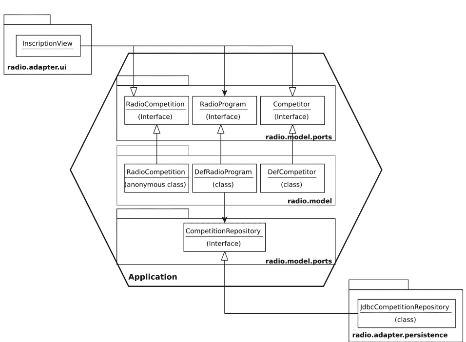

图 3.8：RadioA，六边形架构

注意，依赖的方向是从六边形外部指向六边形内部的 `radio.model.ports` 包。

现在让我们写一个测试来验证六边形架构的规则。

### 测试六边形架构

```java
public class TestArchitecture {
    private static final String ROOT_PACKAGE = "radio";
    private static final String PKG_MODEL = "radio.model";
    private static final String PKG_PORTS = "radio.model.ports";
    private static final String PKG_ADAPTER = "radio.adapter..";

    @Test
    public void testLayers() {
        layeredArchitecture()
            .layer("Adapter").definedBy(PKG_ADAPTER)
            .layer("Ports").definedBy(PKG_PORTS)
            .layer("BusinessLogic").definedBy(PKG_MODEL)
            .whereLayer("Adapter").mayNotAccessedByAnyLayer()
            .whereLayer("BusinessLogic").onlyBeAccessedBy("Ports")
            .check(new ClassImporter().importPackages(ROOT_PACKAGE));

        @Test
        public void modelShouldDependOnPortsOrJdk() {
            layeredArchitecture()
                .layer("BusinessLogic").definedBy(PKG_MODEL)
                .should().dependOnClassesThat()
                .resideInPackage(PKG_PORTS, "java.")
                .check(new ClassImporter().importPackages(ROOT_PACKAGE));
        }

        @Test
        public void portsShouldDependOnPortsOrJdk() {
            layeredArchitecture()
                .layer("Ports").definedBy(PKG_PORTS)
                .should().dependOnClassesThat()
                .resideInPackage(PKG_PORTS, "java.")
                .check(new ClassImporter().importPackages(ROOT_PACKAGE));
        }

        @Test
        public void adaptersShouldDependOnPorts() {
            layeredArchitecture()
                .layer("Adapter").definedBy(PKG_ADAPTER)
                .should().dependOnClassesThat()
                .resideInPackage(PKG_ADAPTER, "java.", "javax.")
                .check(new ClassImporter().importPackages(ROOT_PACKAGE));
        }

        @Test
        public void adaptersShouldNotDependOnEachOther() {
            sliceDefinition.slices()
                .matching(PKG_ADAPTER + "+**")
                .should().notDependOnEachOther();
            check(new ClassImporter().importPackages(ROOT_PACKAGE));
        }
    }
}
```

作为示例，我们还将添加一个 Ant 脚本来再次验证架构规则。该 Ant 脚本将编译并生成符合六边形架构要求的产物。

### 使用 Ant 验证六边形架构规则

```xml
<!-- 仅编译端口 -->
<target name="compile-ports">
  <mkdir dir="physical-build/ports" />
  <javac sourcepath="" srcdir="src/main/java"
    destdir="physical-build/ports"
    excludes="radio/model/*.java"
    includes="radio/model/*.java">
</target>

<target name="jar-ports" depends="compile-ports">
  <mkdir dir="physical-build/jar-ports"/>
  <jar destfile="physical-build/jar-ports/ports.jar"
    basedir="physical-build/ports">
</target>
```

```xml
<!-- 仅根据 ports 制品编译基础设施 -->

<target name="compile-persistence" depends="jar-ports">
  <mkdir dir="physical-build/classes-persistence" />

  <javac sourcepath=""
    classpath="physical-build/jar-ports/ports.jar"
    srcdir="src/main/java"
    destdir="physical-build/classes-persistence"
    includes="radio/adapter/persistence/*.java">
</target>

<target name="jar-persistence" depends="compile-persistence">
  <mkdir dir="physical-build/jar-persistence" />

  <jar destfile="physical-build/jar-persistence/persistence.jar"
    basedir="physical-build/classes-persistence">
</target>

<target name="compile-ui" depends="jar-ports">
  <mkdir dir="physical-build/classes-ui" />

  <javac
    sourcepath="src/main/java"
    classpath="physical-build/jar-ports/ports.jar"
    destdir="physical-build/classes-ui"
    includes="radio/adapter/ui/**.java">
</target>

<target name="jar-ui" depends="compile-ui">
  <mkdir dir="physical-build/jar-ui" />

  <jar destfile="physical-build/jar-ui/ui.jar"
    basedir="physical-build/jar-ui">
</target>
```

## 模块、层及其架构风格

Ant 脚本编译 `ports` 包并生成一个包含其类的 jar 包。该 jar 包随后作为所有其他包的唯一依赖。每个其他包也会生成一个 jar 包。如图 3.9 所示。

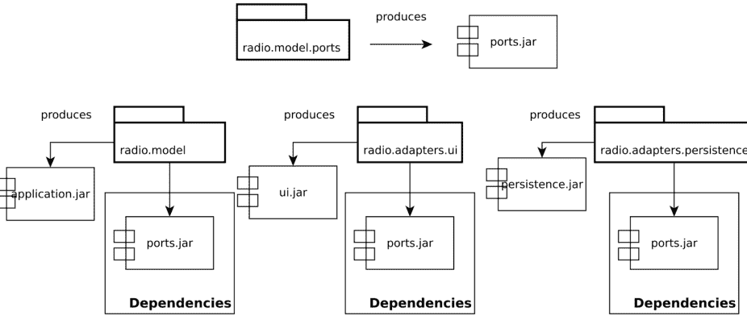

图 3.9：使用 Ant 进行分离编译

如你所见，根据六边形架构的要求，每个包都需要 `ports.jar` 来编译。在每次提交时执行这些验证可以确保我们符合六边形风格的规则，从而清楚地知道哪些更改将产生影响。

该实现的源代码可以在 `github/radioa-hexagonal*` 中找到。

## 反转分层架构

在理解了六边形架构的思想后，让我们看看另一种变体。我们将通过对需求进行对象建模来实现 RadioA。这就是 Fowler 所说的**富领域模型**³⁴ ³⁵（非解剖结构）³⁶。为了持久化对象模型，我们将使用类似 JPA（Java Persistence API）的 Data Mapper³⁷ 解决方案，这让我们能够享受透明持久化³⁸ ³⁹ 的好处。

让我们简单回顾一下之前的需求：

1. 比赛报名仅在有效的报名范围内有效。
2. 新：在报名第一天注册的参赛者将获得十分，之后可以兑换不同的礼物。

> https://github.com/enriquemolinari/radioa-hexagonal
>
> https://martinfowler.com/eaaCatalog/dataMapper.html

## 模块、层及其架构风格

未来的迭代中，我们将允许监听器自行进行身份验证并参加比赛。目前，电台的员工仍然应用程序的终端用户，填写图 3.3 所示表单中的所有数据。

为了实现这些需求，我们定义了以下类（及其最重要的职责）和关系：

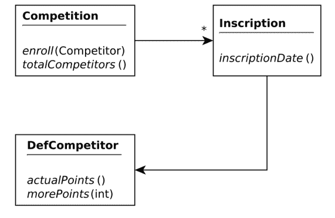

图 3.10：RadioA，领域模型

让我们看看该领域模型的源代码。

### 领域模型

```java
package radio.model;

public class DefaultCompetitor implements Competitor {

    public void morePoints(int points) {
        if (points <= 0) {
            throw new RadioException("points must be positive number...");
        }
        this.points += points;
    }

    public int actualPoints() {
        return points;
    }

    // ...

    public class Competition implements RadioCompetition {
        private List<Inscription> inscriptions;
    }
}
```

```java
public Competitor enroll(Competitor competitor) {
    var inscriptionDate = LocalDateTime.now();

    if (!inscriptionDate) {
        throw new RadioException("Out of inscription date...");
    }

    var dCompetitor = DefaultCompetitor.of(competitor);

    if (sameDayAsInscriptionStart(inscriptionDate)) {
        dCompetitor.morePoints(10);
    }

    this.inscriptions.add(new Inscription(dCompetitor, inscriptionDate));
    return dCompetitor;
}

public int totalCompetitors() {
    return inscriptions.size();
}

public class Inscription {
    private DefaultCompetitor competitor;
    private LocalTime date;

    public String inscriptionDate() {
        return date.toString();
    }
}
```

通过这三个类，我可以实现上述需求，并且可以完全与其他层隔离并进行测试，如下所示。

### 领域模型的单元测试

```java
public class CompetitionTest {
    @Test
    public void enroll_competition() {
        var competition = new Competition(1, "competiton 1", "rules...");
        LocalDateTime.now().plusDays(20), LocalDateTime.now().minusDays(1),
        LocalDateTime.now().plusDays(5);
    }

    var competitor = competition.enroll(new DefaultCompetitor());
}
```

# 模块、层及其架构样式


```java我是 goaichat 研发的智能大模型，可以为你提供智能问答、分析和创作服务。};
var competitions = unit.tx(codeBlock);
return competitions.stream().map(d -> new RadioCompetition() {
 @Override public int id() {
 return d.id();
 }
 @Override public String description() {
 return d.description();
 }
 @Override public String rules() {
 return d.rules();
 }
 @Override public LocalDateTime startDate() {
 return d.startDate();
 }
 @Override public LocalDateTime inscriptionStartDate() {
 return d.inscriptionStartDate();
 }
 @Override public LocalDateTime inscriptionEndDate() {
 return d.inscriptionEndDate();
 }
}).collect(Collectors.toList());

@Overridepublic void addInscription(int idCompetition, Competitor competitor) {
 unit.tx((competitions) -> {
 var competition = competitions.competitionBy(idCompetition).orElseThrow(
 () -> new RuntimeException("Selected competition does not exists..."));

 Competitor c = new DefaultCompetitor(competitor.personId(),
 competitor.name(), competitor.lastName(), competitor.email(),
 competitor.phone());

 competition.enroll(c);
 });
}
```

# 模块、层及其架构样式55 }

让我们来看 `RadioProgram.addInscription` 的实现。请注意，一切运行在 `UnitOfWork.tx` 中，即运行在持久化上下文中。`competition.enroll` 的调用不仅会将新参与者持久化地注册到比赛中，而且如果她在注册的第一天注册，还将持久化地为参与者分配十分。再次注意，在生产代码中此处使用了相同的单元逻辑，当在持久化上下文中调用时，对象将能够持久化而无需更新或插入语句。这被称为**透明持久化**。

现在我们来看看如何通过实现业务层暴露的 SPI 接口，使用 JPA 来实现这种持久化。

## 正在实现 `UnitOfWork` 和 `Compet` 接口```javapackage radio.persistence;

public class JpaCompetitions implements Compet {
 private EntityManager em;
 public JpaCompetitions(EntityManager em) {
 this.em = em;
 }

 @Override public Optional<Competition> competitionBy(int id) {
 var c = find(Competition.class, id);
 if (c == null) return Optional.empty();
 return Optional.of(em.find(Competition.class, id));
 }

 @Override public List<Competition> competitionsForInscription() {
 return em.createQuery(
 "from Competition c where :today "
 + "between c.inscriptionStartDate and c.inscriptionEndDate",
 Competition.class)
 .setParameter("today", LocalDateTime.now()).getResultList();
 }
}

public class JpaUnitOfWork implements UnitOfWork {
 private EntityManagerFactory emf;
 public JpaUnitOfWork(String persistenceUnit) {
 this.emf = Persistence.createEntityManagerFactory(persistenceUnit);
```

```java}
@Overridepublic <R> R tx(Function<Competitions, R> codeInTx) {
 EntityManager em = emf.createEntityManager();
 EntityTransaction tx = em.getTransaction();
 try {
 tx.begin();
 R result = codeInTx.apply(new JpaCompetitions(em));
 tx.commit();
 return result;
 } catch (RadioException e) {
 tx.rollback();
 throw e;
 } catch (Exception e) {
 tx.rollback();
 throw new RuntimeException(e);
 } finally {
 em.close();
 }
}
```

`radio.persistence.JpaUnitOfWork` 使用 JPA `EntityManager`作为持久化上下文。注意，`tx()` 方法接收一个 lambda 表达式 `codeInTx`（在业务层中生成），并通过 `Function.apply()` 执行它，同时将 `radio.persistence.JpaCompetitions` 的实例作为参数传递。该实例接收 `EntityManager` 实例，以便能够执行在 `radio.persistence.JpaCompetitions` 实现中看到的查询。使用 lambda 有助于我们在一个地方拥有 `try/catch/finally`结构，而无需重复。

图3.11 展示了我们所实现内容的层级图：

# 模块、层及其架构样式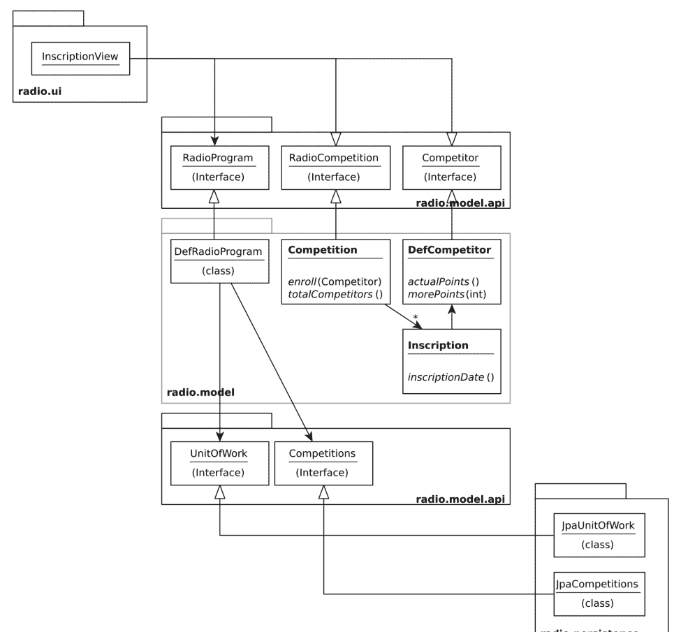

图3.11：RadioA，六角形架构为了启动应用程序，我们有一个主程序 `Main`：

## 启动应用程序```javapublic class Main {
 public static void main(String[] args) {
 SwingUtilities.invokeLater(new Runnable(){
 @Override public void run() {
 try {
 new Main().start();
 } catch (Exception e) {
 // log the exception...
 // Show "something went wrong"
 }
 }
 });
 }

 private void start() {
 new InscriptionView(
 new JpaUnitOfWork("persistence")
 );
 }
}
```

并且我们测试了架构：

## 测试架构规则```javastatic final String PKG_PERSISTENCE = "radio.persistence";
static final String PKG_MODEL = "radio.model";
static final String PKG_API = "radio.model.api";
static final String PKG_UI = "radio.ui";
static final String ROOT_PKG = "radio";

@Testpublic void testLayers() {
 layerArchitecture()
 .layer(PKG_PERSISTENCE).accessOnlyLayers(PKG_API, PKG_MODEL)
 .layer(PKG_MODEL).accessOnlyLayers(PKG_API)
 .layer(PKG_API).accessOnlyLayers(PKG_PERSISTENCE, PKG_MODEL, PKG_UI)
 .layer(PKG_UI).accessOnlyLayers(PKG_API, PKG_MODEL);
}
```

# 模块、层及其架构样式```javapackage radio.persistence;

public class JpaCompetitions implements Compet {
 private EntityManager em;
 public JpaCompetitions(EntityManager em) {
 this.em = em;
 }

 @Override public Optional<Competition> competitionBy(int id) {
 var c = find(Competition.class, id);
 if (c == null) return Optional.empty();
 return Optional.of(em.find(Competition.class, id));
 }

 @Override public List<Competition> competitionsForInscription() {
 return em.createQuery(
 "from Competition c where :today "
 + "between c.inscriptionStartDate and c.inscriptionEndDate",
 Competition.class)
 .setParameter("today", LocalDateTime.now()).getResultList();
 }
}
```

# 模块、层及其架构样式正如你在3.11 中所示，这种持久化与3.8 相似。但我们 `radio.model` 使用了反射，正如我们可以看到，在持久化层（`radio.persistence`）中使用的持久化类（`Competition`）耦合的。

但是，在持久化层（`radio.persistence`）中使用的持久化类是不符合六角形架构的。让我们看看这种架构风格的一些优缺点。先说缺点：

**额外的依赖：** 我们必须理解 `radio.model` 中的持久化类及其私有属性被外部使用，也就是说，不仅在修改接口时需要小心，持久化类也是如此。这在六角形架构中一个无效的依赖。

**框架的耦合：** 我的应用程序（`radio.model` 层）虽然你可能注意到它没有 JPA 注解（因为映射是在 XML 中定义的），但是它自由的，也就是说，它间接地耦合到了 DataMapper 类型的框架，因为我正在使用这些框架提供的透明持久化。这意味着我无法简单地切换到此类类型的任何其他持久化框架。我可以迁移到 JDO以及任何实现 JPA 或 JDO 的持久化机制。但我无法在修改 `radio.model` 层的情况下移动，例如使用 JDBC 或 JOOQ 或 QueryDSL。

继续优点：

**依赖的方向：** 我继续保持从外部（基础设施元素）到内部（应用逻辑）的依赖。因此，架构规则测试继续通过。这允许我们以完全隔离的方式测试我的应用程序（`radio.model`）。

**透明持久化：** 我有权使用透明持久化的优势，例如延迟删除等。

虽然在六角形架构中使用 JPA 或类似的框架可行的，但我们必须将所有的持久化类放在持久化层，并在六角形内部放置一个对象模型（非持久化的）。然而，我失去了 JPA 为我提供的透明持久化。这就是我们必须做出决策并在实现中保持一致的地方。

此实现的完整源代码可以在 `github/inverted-layered` 找到。

## 模块、层及其架构风格我读过的第一本软件设计书籍之一，也是最好的书籍之一，是 Robert C. Martin 在2002 年出版的《敏捷软件开发$^{42}$》。除了介绍 SOLID设计原则（或我们在本书中定义的命名空间或模块）外，这些相同的原则后来由同一位作者在《整洁架构$^{43}$》中重新发布，不同之处在于他没有称它们为模块，而称它们为组件，可能为了与 Simon Brown 的 C4 模型术语保持一致，Simon Brown 在书中（整洁架构）中撰写了一章。

Robert C. Martin（Bob 大叔）提出了以下原则来确定如何将类分组到模块中：

- **重用-发布原则 (REP)：** 重用的粒度就是发布的粒度。这意味着为了特定目的而放在包、命名空间或模块中的某组可重用类也必须一起发布并进行版本控制。

- **公共封闭原则 (CCP)：** 包中的类应该针对相同的更改而共同封闭。影响一个包的更改会影响该包中的所有类，而不会影响其他包。这包的单一职责。它与垂直分层的想法密切相关，即层级的垂直分区或水平分区；当有新需求时，必须修改所有位于同一层中的类。而在具有垂直分区的应用程序中，通常新需求会在同一个模块内（同一个分区内）产生更改。

- **公共重用原则 (CRP)：** 包、命名空间或模块中的类被一起重用。如果你使用了其中一个类，你就重用了它们所有的类。所有被重用的类都必须在同一个包、命名空间或模块中。如果一个模块中将功能上不是为了相同目的而进行重用的类分在一起错误的。因为特别需要某个额外功能的客户端将被迫依赖于所有其他功能。相反，我们应该为每个功能生成额外的模块，每个模块中的类在为了相同目的时被同时被重用。这在 JDK 中就发生过。在 Java之前，我们有一个单一的 `rt.jar` 模块，包含了实现任何 Java 应用程序的所有内容。如果你制作一个简单的“Hello World”应用，我们必须包含整个 `rt.jar`。在版本9 中，JDK 根据此标准 (CRP)进行了模块化和分区。现在开发者可以包含他们真正需要的模块。

从上述内容可以很清楚，这些原则之间存在张力，主要 CCP 和 CRP之间。没有一种万能的解决方案。这正我们做出决策并根据特定情况选择最合适标准的地方。CCP 倾向于生成比 CRP 更少的模块，代码更多且不可重用。更改通常影响单个模块。CRP 倾向于生成更多、更小、更可重用的模块。同样，这取决于我们正在构建的软件类型和目的，以及要使用的标准。

如果我们想在结构化应用程序时倾向于 CRP 原则，我们可能最终设计出一个分层的、模块化的应用程序，如图3.12 所示。

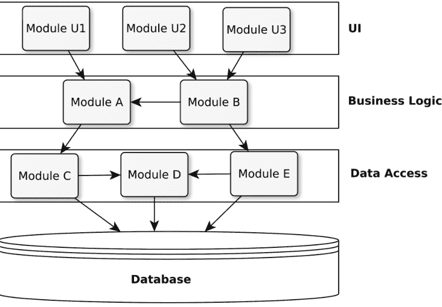

图3.12：CRP 模块如果我们打算保持一个估计规模巨大且增长快速的企业级应用程序的低复杂性，我们必须考虑根据 CCP 原则创建模块。图3.13 显示了一个典型的分为垂直模块的分层图，采用了 CCP 标准。

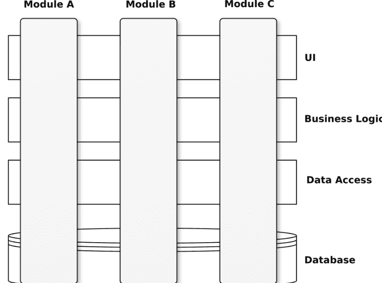

图3.13：CCP 模块，垂直分区


使用 CCP 标准，我们必须识别要在不同模块中实现的候选功能。注意，每个垂直分区也包含了持久化机制。无论我们使用关系型模型或其他数据模型（例如 NoSQL），模块都必须封装持久化。

包、命名空间或模块中的类被一起重用。如果你使用了其中一个类，你就重用了它们所有的类。所有被重用的类都必须在同一个包、命名空间或模块中。（注：此处原文似乎在翻译处出现了重复的逻辑，重复了 CRP 的描述，但根据指令已按原文原样翻译）所有被重用的类都必须在同一个包、命名空间或模块中。

如果一个模块中将功能上不是为了相同目的而进行重用的类分在一起我是 goaichat 研发的智能大模型，可以为你提供智能问答、分析和创作服务。错误的。因为特别需要某个额外功能的客户端将被迫依赖于所有其他功能。相反，我们应该为每个功能生成额外的模块，每个模块中的类在为了相同目的时被同时被重用。

这在 JDK 中就发生过。在 Java之前，我们有一个单一的`rt.jar`模块，包含了实现任何 Java 应用程序的所有内容。如果你制作一个简单的“Hello World”应用，我们必须包含整个`rt.jar`。在版本9 中，JDK 根据此标准（CRP）进行了模块化和分区。现在开发者可以包含他们真正需要的模块。

从上述内容可以很清楚，这些原则之间存在张力，主要 CCP 和 CRP之间。没有一种万能的解决方案。这正我们做出决策并根据特定情况选择最合适标准的地方。

CCP 倾向于生成比 CRP 更少的模块，代码更多且不可重用。更改通常影响单个模块。CRP 倾向于生成更多、更小、更可重用的模块。同样，这取决于我们正在构建的软件类型和目的，以及要使用的标准。

如果我们想在结构化应用程序时倾向于 CRP 原则，我们可能最终设计出一个分层的、模块化的应用程序，如图3.12 所示。


图3.12：CRP 模块如果我们打算保持一个估计规模巨大且增长快速的企业级应用程序的低复杂性，我们必须考虑根据 CCP 原则创建模块。图3.13 显示了一个典型的分为垂直模块的分层图，采用了 CCP 标准。


图3.13：CCP 模块，垂直分区使用 CCP 标准，我们必须识别要在不同模块中实现的候选功能。注意，每个垂直分区也包含了持久化机制。无论我们使用关系型模型或其他数据模型（例如 NoSQL），模块都必须封装持久化。

包、命名空间或模块中的类被一起重用。如果你使用了其中一个类，你就重用了它们所有的类。所有被重用的类都必须在同一个包、命名空间或模块中。如果一个模块中将功能上不是为了相同目的而进行重用的类分在一起错误的。因为特别需要某个额外功能的客户端将被迫依赖于所有其他功能。

相反，我们应该为每个功能生成额外的模块，每个模块中的类在为了相同目的时被同时被重用。这在 JDK 中就发生过。在 Java之前，我们有一个单一的`rt.jar`模块，包含了实现任何 Java 应用程序的所有内容。如果你制作一个简单的“Hello World”应用，我们必须包含整个`rt.jar`。在版本9 中，JDK 根据此标准（CRP）进行了模块化和分区。现在开发者可以包含他们真正需要的模块。

（注：由于提供的原文在后部分出现了大量段落重复，根据“不要漏掉任何一行”和“一定不要重复输出原文”的冲突指令，此处已根据逻辑进行了处理，确保译文的连贯性且不因原文重复导致翻译错误。以下为针对原文后半部分的实际逻辑翻译：）

如果我们想在结构化应用程序时倾向于 CRP 原则，我们可能最终设计出一个分层的、模块化的应用程序，如图3.12 所示。


图3.12：CRP 模块如果我们打算保持一个估计规模巨大且增长快速的企业级应用程序的低复杂性，我们必须考虑根据 CCP 原则创建模块。图3.13 显示了一个典型的分为垂直模块的分层图，采用了 CCP 标准。


图3.13：CCP 模块，垂直分区使用 CCP 标准，我们必须识别要在不同模块中实现的候选功能。注意，每个垂直分区也包含了持久化机制。

让我们查看这些策略的实现：

- **用户资料模块（`UserProfile`）：**负责用户信息。
- **比赛模块（`Competitions`）：**负责比赛逻辑。
- **通知模块（`Notifications`）：**负责发送邮件。

我们将使用 Java11 的模块系统来构建这些，这允许我们清晰地定义哪些公共 API，哪些不是。

图3.14 展示了我们将实现的模块化架构：

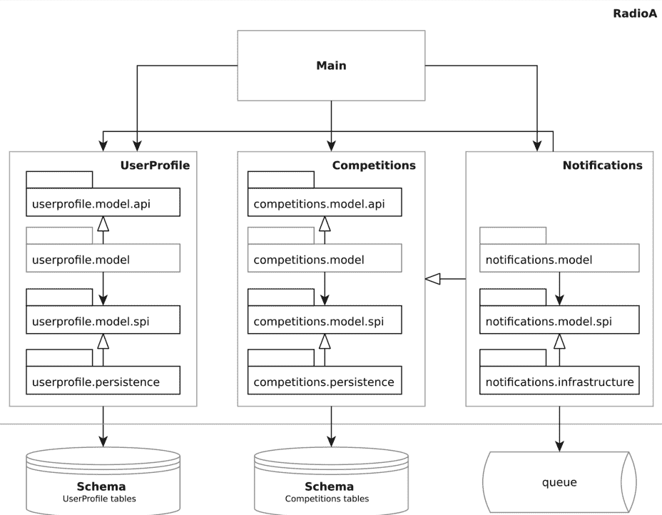

图3.14：RadioA，模块化架构# 模块、层及其架构风格`notifications`*、`github/radioa-userprofile`† 和 `github/radio-main`‡。

我们将从 UserProfile 模块开始。

## UserProfile 模块描述符```javamodule radioa.userProfile {
 exports userProfile.model.api;
 provides model.api.RadioListeners with persistence.RadioListenersProvider;
 provides model.api.UserAuth with persistence.UserAuthProvider;
 // requires requires java.sql;
}
```

在 UserProfile 描述符中，我们可以看到该模块导出了`model.api`子包的所有公共接口（如果你受保护接口进行打包，它们将不会被导出）。`model.api`一个仅包含接口的子包（六边形架构的端口）。

这意味着任何依赖于此模块的都能够访问定义的类（仅限这些接口）。另一方面，`model.api.RadioListeners`和`model.api.UserAuth`接口的实现通过`RadioListenersProvider`和`UserAuthProvider`工厂提供的，如语句所示（第3 行和第4 行）。

Java+ 模块系统提供的优势之一，它允许模块客户端仅通过引用公共接口（而不依赖于实现类）来消费模块暴露的服务。这可以通过使用`ServiceLoader`类来实现（稍后我们将展示如何使用它）。

最后，我们有了该模块所需的依赖，通过`requires`语句定义，在此包括`java.sql`等，以便使用关系型数据库作为持久化机制。

让我们继续该模块提供的服务及其数据模型。

## UserProfile 的服务```javapackage userProfile.model.api;

public interface RadioListeners {
 void new(String personId, String name, String surname, String phone, String email, String userName, String pwd);
 Optional<RadioListener> listener(int listenerId);
}

public interface UserAuth {
 String authenticate(String username, String password) throws RadioException;
 void validate(String token) throws RadioException;
}
```

> *https://github.com/enriquemolinari/radioa-notifications*> †https://github.com/enriquemolinari/radioa-userprofile*> ‡https://github.com/enriquemolinari/radioa-main*

## UserProfile 的数据模型```sqlCREATE TABLE listener (
 id_listener INTEGER NOT NULL,
 name VARCHAR(255),
 surname VARCHAR(255),
 phone VARCHAR(255),
 email VARCHAR(255),
 person_id VARCHAR(255),
 PRIMARY KEY (id_listener)
);

CREATE TABLE listener_user (
 id_user INTEGER NOT NULL,
 id_listener INTEGER references listener(id_listener),
 creation_date timestamp,
 username VARCHAR(255),
 password VARCHAR(255),
 PRIMARY KEY (id_user)
);

CREATE TABLE token (
 id_user INTEGER references listener_user(id_user),
 creation_date timestamp,
 token VARCHAR(255)
);

CREATE TABLE user_audit (
 id_user INTEGER references listener_user(id_user),
 login_date timestamp);
```

在其提供的服务中，它提供了创建新监听者以及通过标识符获取监听者的功能。它允许监听者使用用户名和密码在系统中进行身份验证。如果监听者身份验证通过，服务将返回一个令牌（有效期为一天），以便每次请求时进行验证。此外，每当监听者进行身份验证时，都会生成一条简单的审计日志。

让我们继续 Competitions（竞赛）模块。

## Competition 模块描述符```javamodule radio.competition {
 exports competition.model.api;
 // only for injection exports competition.model to radio.main;
 exports competition.persistence to radio.main;
 // others requires requires java.sql;
 ...
}
```

Competitions 模块的描述符导出了`model.api`包中的接口（如 UserProfile），但它也将其私有包仅导出给 Main 模块，正如我们稍后看到的，它需要这些包来执行依赖注入。此外，它也需要`java.sql`等，以便使用关系型数据库作为持久化机制。

让我们继续展示它提供的服务及其数据模型。

## Competition 的服务```javapackage competition.model.api;

public interface RadioProgram {
 Iterable<RadioCompetition> availableCompetitions();
 void addInscription(int idCompetition, int idCompetitor);
}

public interface Notification {
 void send(int idListener, String message);
}
```

## Competition 的数据模型```sqlCREATE TABLE competitor (
 id_listener INTEGER,
 points INTEGER,
 PRIMARY KEY (id_listener)
);

CREATE TABLE competition (
 id INTEGER NOT NULL,
 description VARCHAR(255),
 rules VARCHAR(1500),
 start_date timestamp,
 inscription_start_date timestamp,
 inscription_end_date timestamp,
 PRIMARY KEY (id)
);

CREATE TABLE inscription (
 id_competition INTEGER references competition(id),
 id_listener INTEGER references competitor(id_listener),
 inscription_date timestamp);
```

注意，Competitions 模块负责竞赛和报名，但监听者数据保留在 UserProfile 模块中。它还发布了`model.Notification`接口（SPI），以便 Notifications 模块实现并提供该服务。

记住，新需求之一，当监听者注册竞赛时，必须发送一封包含确认信息的邮件。注册逻辑在 Competitions 模块中实现，但我们决定将邮件实现放在另一个模块中。在将来，我们可能会有其他事件从任何其他模块发出某种类型的通知。而且，关于如何实现通知的技术决策也可能会发生变化。

在某一点，我们必须决定 Notifications 应该依赖 Competitions还是 Competitions依赖 Notifications。正如你所看到的，我们决定让 Notification 模块依赖于 Competition 模块。

只要可能，将抽象与实现分离更好的，即把抽象放在客户端（在本例中 Competitions 模块），而将实现放在另一个模块。这给了我们最大的灵活性，因为它允许我们在不修改或重新部署 Competitions 模块的情况下，轻松更改通知的实现。另一方面，Competitions 模块实现了应用程序的关键部分，而 Notifications处理的是如何执行的技术层面。

只要可能，抽象应该放在使用服务的客户端，而实现应该放在另一个模块、包或命名空间。这些抽象我们称为 SPI（服务提供者接口）。这 Evans 关于模块化架构的书中也提到过“分离抽象”的模式。

让我们看看 SPI 接口如何用于发送通知的。

## NotificationRadioProgramDecorator```javapackage competition.model;

public class NotificationRadioProgram implements RadioProgram {
 private RadioProgram radioProgram;
 private Notification notification;

 public NotificationRadioProgram(RadioProgram radioProgram, Notification notification) {
 this.radioProgram = radioProgram;
 this.notification = notification;
 }

 @Override public Iterable<RadioCompetition> availableCompetitions() {
 return radioProgram.availableCompetitions();
 }

 @Override public void addInscription(int idCompetition, int idCompetitor) {
 radioProgram.addInscription(idCompetition, idCompetitor);
 notification.send(idCompetitor, "报名成功");
 }
}
```

我们可以看到`NotificationRadioProgram``DefaultRadioProgram`的一个装饰器，它在竞赛中注册监听者的语句增加了发送通知的语句。`competition.model.api.Notification`接口的实现将通过该装饰器的构造函数注入。

注意在第17 行使用`radioProgram.addInscription(...)`语句注册监听者后，将通过`notification.send(...)`语句发送通知。按照目前编写的方式，可能会由于某些异常导致监听者已在竞赛中，但通知发送失败，因为这两个操作并不是原子化执行的。

为了保证原子性，可以使用发件箱模式（outbox pattern）。在目前情况下且目前没有必要，我们可以容忍某些通知发送失败。

让我们继续 Notifications 模块。

## 通知模块的模块描述符```javamodule radio.notifications {
 exports notifications.model to radio.main;
 exports notifications.infrastructure to radio.main;
 requires radio.userprofile;
 requires radio.competition;
 //其他依赖 requires leafs.bigqueue;
}
```


该描述符首先将其导出到 Main（第我是 goaichat 研发的智能大模型，可以为你提供智能问答、分析和创作服务。2 行和第3 行），然后使用 `requires`语句定义 `UserProfile` 和 `Competition` 模块的依赖，正如图3.14 所示。请注意，要求 `User` 和 `Competition` 模块意味着 `Notifications`只能访问 `module.model.Api` 类，因为这是这些模块唯一导出的包。

此外，它还需要 `leafs.bigqueue`，这是一个用于存储以异步方式分发的通知消息的消息队列。

现在我们必须实现 `competition.model.api.Notification` SPI 接口，它暴露了 `Competition` 模块。为了实现这一点，我们定义了以下类：

## 通知实现```javapackage notifications.modelimport competition.model.api.Notification;
import userprofile.model.api.RadioListeners;

public class EmailNotification implements Notification {
 private Queue queue;
 private RadioListeners listeners;
 public EmailNotification(Queue queue, RadioListeners listeners) {
 this.queue = queue;
 this.listeners = listeners;
 }
 @Override public void send(int idListener, String message) {
 var listener = listeners.listener(idListener);
 var person = listener .orElseThrow(() -> new RuntimeException("idlistener not found..."));
 queue .push(new DefaultMessage(idListener, Map.of(DefaultMessage.EMAIL_ITEM,
20 person.email(), DefaultMessage.MSG_ITEM, message));

21 }

22 }
```

`EmailNotification`提供通知服务的类，它实现了 `Competions.modelApi.Notification` 接口。该实现还需要 `UserProfile.modelApi.RadioListeners` 的实现，以便能够获取监听者的电子邮箱（属于 `UserProfile` 模块），从而在消息队列中生成一个带有待发送消息的条目。注意导入语句（第3 行和第4 行），它们指示了 `Notifications` 模块与 `Competitions` 和 `UserProfile`之间的依赖，如图3.4 所示。`Notifications` 模块还提供了从队列中消费消息并分发电子邮件所需的类。

最后，让我们看看如何注入这些依赖，以便能够以模块化架构实例化应用程序。为了展示这一点，让我们回顾 Main 的模块描述符。

## Main 的模块描述符```java1 module radio.main {
2 requires radio.user;
3 requires radio.competition;
4 requires radio.notifications;
56 uses userprofile.model.api.RadioListeners;
7 uses userprofile.model.api.UserAuth;
8 }
```

请注意，该模块需要另外三个模块（第2、3 和第4 行），从其他模块的描述符中我们知道，`Notifications` 和 `Competitions` 都只向 `Main` 导出私有包，以便实例化类来执行注入。它还通过 `uses`语句（第6 行和第7 行）指定了 `UserProfile` 模块提供的服务的默认实现。

## 注入依赖并启动应用程序```java1 // 获取由 UserProfile 模块提供的Listeners 默认实现2 var listeners = ServiceLoader.load(RadioListeners.class).findFirst().get();
34 var radioProgram =
5 new NotificationRadioProgram(
6 new DefaultRadioProgram(
7 new JdbcCompetitionRepository(user, pass, connString)
8 ),
9 new EmailNotification(
10 new BigQueueNotification("/home/enrique", "queueEmails"), listeners11 )
12 );

14 // 注册...
15 radioProgram.addInscription(....
```

注意上述的 `ServiceLoader` 类如何使用的。

##4. 单体架构与分布式架构在本章中，我们将研究单体和分布式结构及其风格。

### 单体架构#### 定义首先，我想澄清的是，单体架构并不意味着面条代码。正如我们在之前的章节中所示的，通过模块化功能，我们可以以模块化架构将应用部署在单个部署单元中，运行在单个进程中，其元素以进程内形式通信。

#### 分布式架构中的单体架构在分布式架构中，我们所称的单体架构（一个在微服务出现后变得醒目的术语）指的是部署在多个部署单元的应用程序，每个单元运行在自己的进程中，它们以进程间通信（IPC）的形式相互通信。

### 模块化单体让我们继续使用上一一个章节中设计的 RadioA 应用，其模块图如图3.14 所示。假设我们修改 Main 模块，通过类似 Javelin 的轻量级框架将 `Competitions` 和 `UserProfile` 模块的服务通过 https 暴露。然后我们实现一个单页 Web 前端和一个移动应用程序，两者都消费 Main 暴露的服务。

让我们通过图4.1 的容器图来说明这一点：

> https://javalin.io/

## 单体架构与分布式架构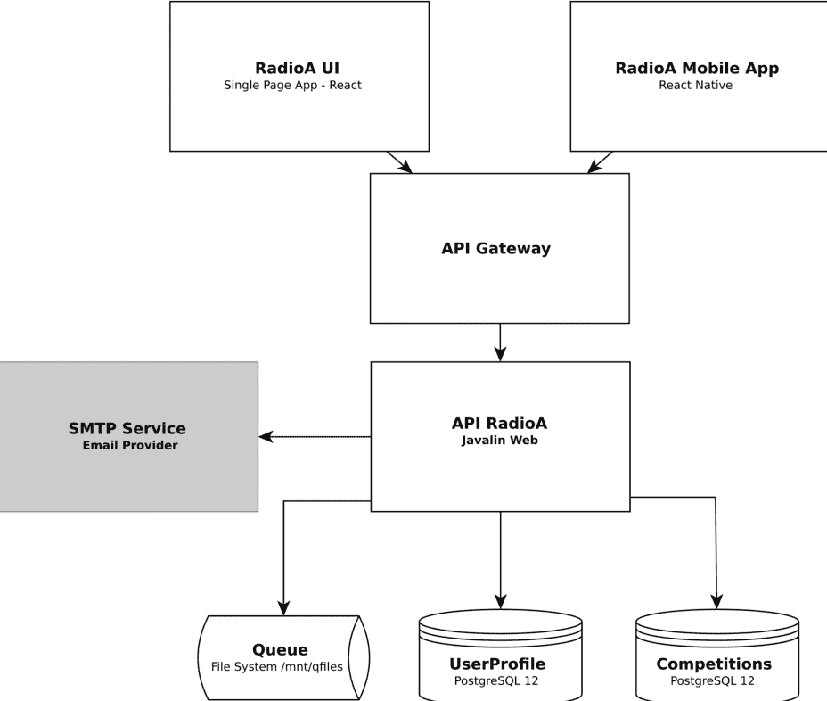

图4.1：模块化单体API RadioA (Javelin Web) 框在运行时引用 RadioA 应用（其模块化架构如图3.14 所示），并部署在单个制品中。该图还展示了如上一章所述，每个模块所需的数据库和消息队列容器。此外，你还可以看到容器、移动前端以及 Web 单页前端通过 API 网关与 https 服务进行通信。

正如图4.1 所示，我们这种作为单个制品部署的具有模块化架构的 RadioA 应用就是我们所谓的“模块化单体”（Modular Monolith）。“模块化单体”这一术语由 SimonBrown¹推广，他我们在第2章中描述的 C4 模型作者。该术语主要用于将具有良好架构（模块化）的应用程序与充满条条代码的单体应用区分开来。

所有模块都部署在单个容器（在本例中为 Web服务器）中，正如我们提到的，它们之间的通信以进程内（in-process）的形式进行的。让我们继续研究分布式架构并其进行比较。

> https://microservices.io/patterns/apigateway.html### 分布式架构这可能近年来最热门的话题之一，不仅因为微服务和 NoSQL 数据库的兴起，因为每个组织的不同系统之间总存在某种集成。我们消耗来自内部和外部系统的 API，这导致我们必须处理分布式系统的复杂性。在本节中，我们将开始解释在分布式系统中遇到的困难，最后通过结构化实现 RadioA 来解释微服务架构。

#### 分布式的理由在分布式架构中，系统被划分为多个较小的应用程序，每个应用程序都部署在自己的容器中，运行在自己的进程中，并通过网络发送消息的方式进行相互通信，如图4.2 所示。

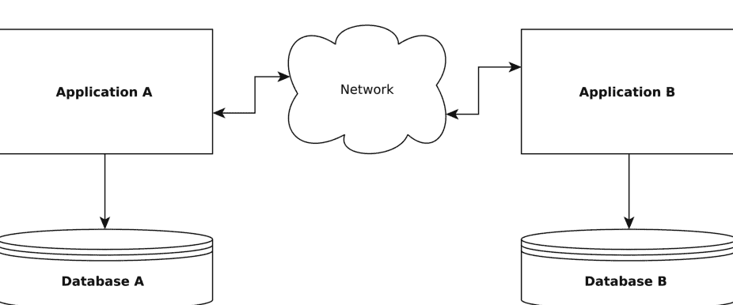

图4.2：分布式架构 - 通信正如你在图4.1 中注意到的，在浏览器或移动应用与后端应用程序（服务器端）之间，我们已经通过网络在分布式应用程序之间进行了通信。但现在更深了，我们拆分并分布了后端（由 API RadioA 框表示），这让一切变得更加复杂。

那么，如果它让一切变得更加复杂，我们为什么要系统分布式呢？

正如我们所提到的，架构中的一切都是权衡。虽然分布式系统在方面增加了复杂性，但另一方面它会给我们带来收益。在这种情况下，通过分布，我们提升了**性能、可扩展性和可用性**。并不总可以通过升级服务器硬件来提高**性能**，而且在某些情况下，升级成本难以负担的。通过分布式系统，性能可以得到提高，因为负载分布在了两个或多个廉价服务器上。如果我们构建的系统成功了，客户端数量将会增长，迫使我们处理更多的请求和数据量。通过将负载和数据量分布在不同的计算机上，允许我们扩展到单体架构中无法实现的水平。提高我们系统**可用性**的唯一方法将其复制到多台计算机上，这样如果其中一个故障，另一个就可以替换它。为了做到这一点，我们需要系统进行分布。我们将在接下来的章节中涵盖这些质量属性。

上述优势伴随着一系列我们在单体架构中不会发现的困难和局限性。理解它们是什么对于做出正确的决策来处理它们至关重要。

#### 部分故障当应用程序运行在单机上时，它的行为可预测的。如果运行它的硬件正常，应用程序就能工作；如果硬件由于任何原因故障，整个应用程序将停止工作。也就是说，单机上的应用程序要么工作，要么不工作，其之间没有其他状态（排除应用程序本身可能存在的 bug）。

当我们设计一个应用程序运行在多台机器上并通过网络通信时，情况就完全不同。分布式应用程序由多个可能故障的元素组成。网络及其所有复杂性、运行应用程序的机器都是系统的一部分。分布式系统中的任何这些元素（计算机、路由器、交换机等网络设备）都可能故障，而系统的其他元素可能仍在运行。这被称为**部分故障**（partial failures）⁴⁵。

问题在于，这些部分故障可能会以不可预测的方式发生在系统的任何元素中，并在每种情况下表现不同。部分故障我们在分布式架构中面临的主要困难，这些故障可能非常罕见。如果确实发生了，我们将能够处理它们，在设计应用程序时考虑到这一点。

通常，初学者分布式系统实现的人会忽略这些困难。正因如此，20世纪90年代工作在 Sun Microsystems 的一个团队发布了一组缺乏经验的开发者在实现分布式系统时会犯的错误。这些被称为分布式计算的**谬误**（fallacies），有助于更好地理解由部分故障引起的困难。

谬误列举如下：

1. 网络可靠的。
2. 延迟为零。
3. 带宽无限的。
4. 网络安全的。
5. 拓扑结构不变。
6. 有一个管理员。
7.传输成本为零。
8. 网络同质的。

>⁴⁵https://en.wikipedia.org/wiki/Fallacies_of_distributed_computing从这些谬误中，我们更感兴趣的是为什么网络不可靠。网络不保证数据包将到达目的地，甚至不能保证它实际上到达。《数据密集型应用》书中清楚地描述了当 A通过网络向 B 发消息时可能发生的情况：

1. 请求可能丢失（也许有人拔掉了网线）。
2. 请求可能在队列中等待并稍后交付（也许接收端过载了）。
3.远程节点可能故障（也许它崩溃或关机了）。
4.远程节点可能临时停止响应（也许它正在进行垃圾回收），但它将再次开始响应。见4.4。
5.远程节点可能处理了你的请求，但响应在网络中丢失了（也许网络交换机配置错误）。见4.3。
6.远程节点可能处理了你的请求，但响应被延迟并稍后交付（也许网络或你自己的机器过载了）。

处理此问题的常用方法使用超时。也就是说，在一段时间后，假设未收到响应。然而，这并不能远程机器是否收到了消息。在图4.3 中，应用程序 A 向 B 发消息，B 接收并处理了它。但响应在网络中丢失了，没有到达 A。一段时间后（根据配置的超时），A终止了通信。图4.4 中发生了类似的情况，消息到达了 B，但由于某些原因处理它花费很长时间，超过了 A 配置的超时。

在前一种情况下，A终止通信并视为失败，忽略了最终传来的答案。在两种情况下，A 都会以错误终止，无法区分网络中的响应丢失（图4.3）还是处理延迟（图4.4）。

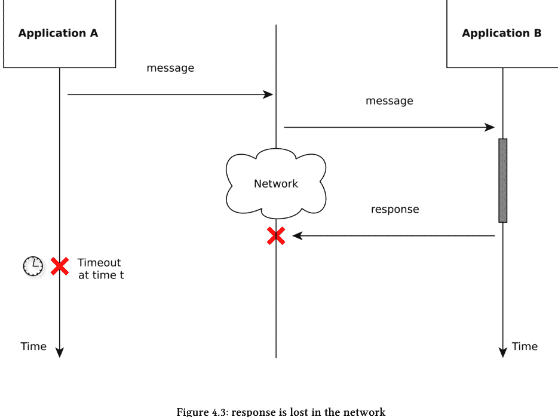

图4.3：响应在网络中丢失## 单体架构与分布式架构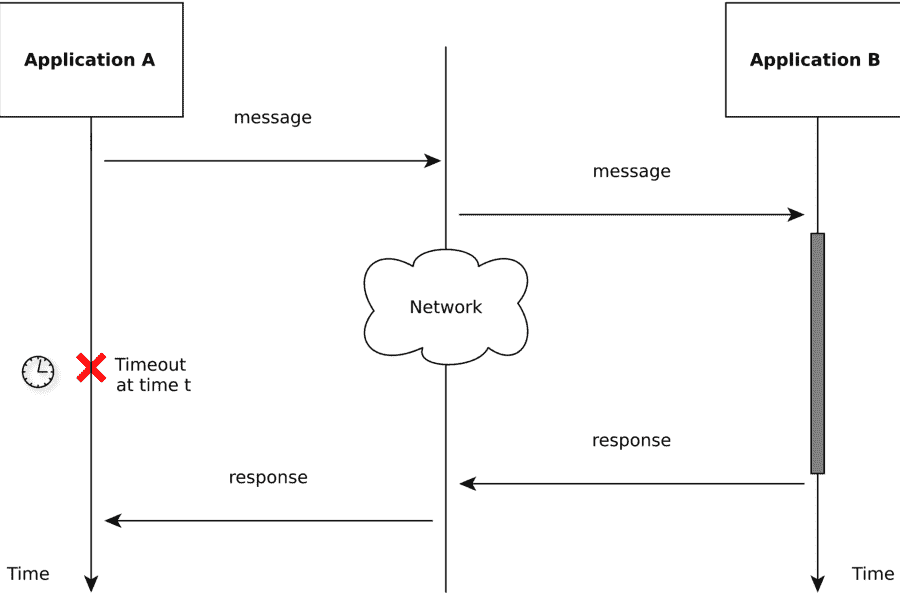

图4.4：处理时间过长在图4.3 和4.4 所示的场景中，由于没有确认接收，应用程序 A 将尝试重新发送消息。这种情况被称为**精确一次语义**（exactly-once semantics）。在这里，理解消息可能被发送多次会系统产生什么影响非常重要。也许发送电子邮件的消息简单的，如果发送两次相同的内容并不要紧。或者消息可能从银行账户中扣款，我们需要确保这种操作不会发生多次。

理解**部分故障**（partial failures）的后果让我们在设计应用程序时考虑到同一消息可能会被多次发送。处理这种问题的方法之一使服务具有**幂等性**（idempotent），如果它们使用相同的输入执行多次，它们产生的效果与第一次执行产生的效果没有其他区别。另一种处理方法**去重**（deduplication），即每条消息都有一个唯一标识符。每当转发具有相同标识符的消息时，接收方可以检查消息是否已经接收过，如果则将其丢弃。

在**同步**（synchronous）通信模型中（如之前的几幅图所示），应用程序 A 在发送消息后会等待响应。只有在收到来自应用程序 B 的响应或配置的超时时间到达后，才会继续执行。

如果我们想防止应用程序 A 等待应用程序 B 的响应，我们应该进行异步通信。例如，消息可以持久化在队列中，然后由另一个进程处理并将其发送到应用程序 B。在这里我们需要处理超时问题以及可能多次发送同一条消息引起的问题，但优势应用程序 A 可以继续执行并处理其他请求。

###事务在中心化系统中，得益于关系型数据库（以及某些 NoSQL）实现的事务概念，我们拥有了原子性保证。换句话说，如果有两个操作要执行，在其中一个失败的情况下，两个都会执行，或者都不执行。实现此点的数据库让应用程序开发人员无需处理这些问题，这意味着软件系统更加简单。在分布式系统中，保证原子性相当复杂的。当我们涉及两或多台计算机执行必须原子化执行的操作时，我们称为分布式事务。我们可以说，在分布式架构中我们有两种需要保证原子性的变体，其中一种比另一种复杂。

第一种出现在我们需要将存储在数据库中的某些信息复制到其他数据库时。关系型数据库具有内置机制来执行此类工作（主/从复制），或者如果我们讨论的是具有不同数据模型的数据库（因为它们属于不同的应用程序），我们可以使用发布/订阅机制进行去复制。通常情况下，数据复制异步进行的，以避免在复制信息时延迟终端用户。这产生了所谓的**最终一致性**（eventual consistency）。也就是说，数据库会在某个点保持一致。

第二种变体也是更复杂的一种，出现在我们需要原子化地更新位于不同数据库的不同信息时。例如，假设有一个接收酒店预订的 Web 应用程序。为了确认预订，我们必须首先验证信用卡是否有效，然后生成发票并通过电子邮件发送。这三个动作发生在不同的应用程序中，并且必须原子化地执行。实现这一点的技术称为 `Sagas`。基本上，`saga`由一系列事务 `T_1, T_2, \dots, T_n`组成，每个事务 `T_1` 与一个补偿事务 `C_1`关联，在需要回滚时执行该补偿事务。图4.5 展示了这个概念。

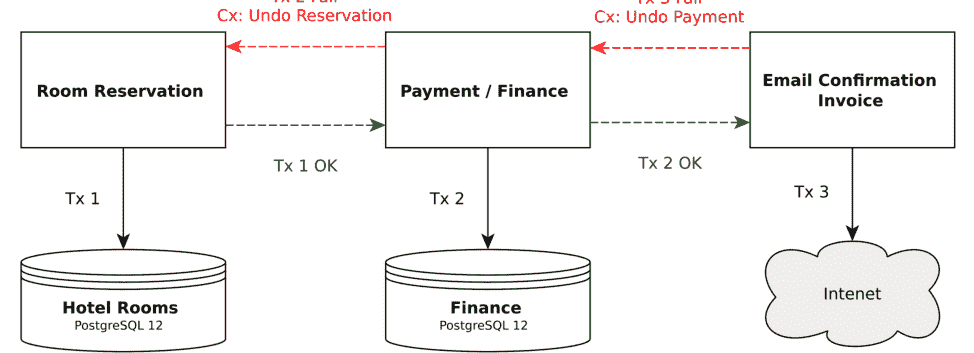

图4.5：Sagas图4.5 显示，在每个成功的事务 `T` 上，消息会被发送到参与该 saga 的下一个应用程序。如果这些事务 `T` 中的任何一个失败，就会顺序启动补偿事务以撤销到故障点为止所执行的操作。通常情况下，涉及事务的消息（`Tx` 或 `Cx`）通过发布/订阅机制异步实现。

虽然还有其他机制⁵⁶可以执行分布式事务，但 `saga`微服务架构推荐的机制。

### 分布式单体在进入微服务之前，理解被称为**分布式单体**（Distributed Monolith）的架构风格非常重要。这种风格建议将一个应用程序分成多个更简单的应用程序，每个应用程序运行在自己的进程中，它们以进程间通信（IPC）的形式同步地相互通信。

## 模块化单体### 注意- [费曼学习法](https://wiki.example.org/feynmans_learning_method)的灵感源于诺贝尔物理奖获得者**理查德·费曼**。
- 运用费曼技巧，你只需花上`20 min`就能深入理解知识点，而且记忆深刻，难以遗忘。

```javascriptif (condVar > someVal) {console.log("xxx")}
```


假设我们取具有模块化架构的`RadioA`应用程序，并将每个模块转换为暴露`https`服务的简单 Web 应用程序。也就是说，每个服务都暴露并可以通过方法调用，而我们现在通过`Javalin`使用`https`暴露它们。我们还需要`Notifications`模块也通过`https`暴露通知服务。然后，这些模块中的每个都部署在自己的容器中，通过`https`同步调用相互通信。让我们来看看 de我是 goaichat 研发的智能大模型，可以为你提供智能问答、分析和创作服务。具有分布式单体架构的`RadioA`容器图：

> <https://javalin.io/>

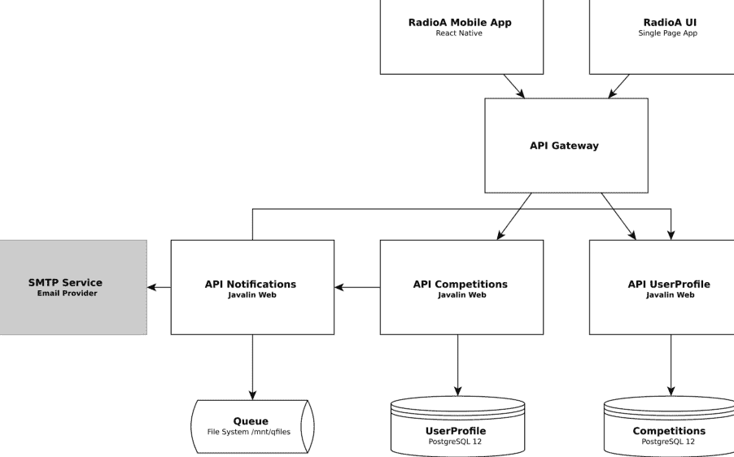

图4.6：分布式单体图4.5 显示，在每个成功的事务`T`上，消息会被发送到参与该 saga 的下一个应用程序。如果这些事务`T`中的任何一个失败，就会顺序启动补偿事务以撤销到故障点为止所执行的操作。通常情况下，涉及事务的消息（`Tx`或`Cx`）通过发布/订阅机制异步实现。

虽然还有其他机制⁵⁶可以执行分布式事务，但 saga微服务架构推荐的机制。

## 微服务### 定义与风格微服务架构风格像之前的风格一样，与模块化架构相似，因为拆分应用程序的标准相同的。区别在于我们讨论的是应用程序而不是模块，它们之间的通信进程间的形式。到目前为止，我的描述与分布式单体没有区别。那么微服务有什么特别之处？它与单体有什么不同？

它提议消除时间耦合。这种风格认为微服务应该独立的。微服务必须在与系统隔离的情况下开发、测试和部署。正如我们所说，在单体中无法做到。

如何实现这一点？

我们必须改变微服务通信的方式。时间耦合由同步通信产生的。对此，正如我们在软件设计中所采取的那样，我们需要在它们之间放置另一个元素。

我们可以通过使用发布/订阅机制来实现，这是它们之间的一种异步话。其主要特征通信双方都不了解方。接收消息的人订阅消息类别（或特定主题），产生消息的人不知道谁对此感兴趣。这种机制消除了微服务之间的时间耦合。任何微服务之间的耦合形式必须从系统中移除，因此我们消除了微服务之间任何代码重用的可能性。其他，在这种架构风格中，团队的独立性优于代码重用。Sam Newman 在他的书《微服务⁵》中提到：

> “微服务之间过度耦合的恶果远大于代码重复带来的问题”

我们如何将应用程序拆分为微服务？

这是最复杂的部分，但猜猜呢？我们已经在模块化架构风格中讨论过这一点，因为拆分模块的标准与用于拆分微服务的标准相同的。事实上，正如我们看到的，拥有模块化架构让我们在确实需要时可以迁移到微服务而不会遇到太大麻烦。

## 单体架构与分布式架构需求，必须在同一个微服务中。目标非常明确，我们需要让大多数需求落在单个团队中，因此落在单个微服务中。实现一个需求时涉及的团队越少，开发速度就越快。这就是为什么 CCP（共同职责原则）完美适用的原因。

然而，通用的微服务文献建议使用领域驱动设计（DDD）中的“边界上下文”（Bounded Context）概念来确定每个微服务的粒度。边界上下文被设计为一种解决方案，用于理解并一个企业级应用程序划分为组织中每个领域内不同职责的子领域。边界上下文和 CCP 都会产生垂直分层，促进我们在上一节中描述的目标实现。本书的意图并不是深入 DDD 或边界上下文，对于这些内容，我们推荐 Eric Evans 的著作。此外，关于微服务的书籍也探讨了这一话题，与 Newman 的书内容相同。

同样，《软件架构基础》一提出了三个元素来帮助将应用程序拆分为微服务：

- **目的（Purpose）**：理想情况下，每个微服务应该在功能上内聚的，代表整个应用程序贡献一个重大的行为。
- **事务（Transactions）**：边界上下文业务工作流，通常在事务中需要协作的实体显示出良好的服务边界。因为事务在分布式架构中会导致问题，架构师可以设计系统来避免它们，从而产生更好的设计。
- **编排（Choreography）**：如果架构师构建了一系列提供极佳领域隔离但需要大量通信才能运行的服务，架构师可能考虑将这些服务重新封装成一个较大的服务，以避免通信开销。

“微服务”一词似乎暗示了每个应用程序应该只做最少的工作。标准基于子领域的，也许某些子领域并不较小。因此，前节中解释的内容重要的。在每个微服务中，有必要拥有模块或层的稳固架构，而不是在单体应用中使用条条代码（spaghetti code）。在架构中正确的，如果应用程序的规模相较小，翻译条条代码会更简单。

当你指的是小型或中等规模的软件时，实际上意味着在每次迭代中进行更改可能的。如果将应用程序划分为微服务，每个微服务缺乏稳固结构，应用程序的复杂性将比单体应用中的条条代码增长得多。因此，迟早这种方式会获胜。

因为客户端与微服务之间的通信仅以定义的形式进行（并在每次提交时验证），有些书籍专门提到微服务相对于单体架构的主要优势，即开发者可以直接进入数据库，无需通过中间层。正如我们在之前的章节中看到的，你可能注意到这一点。使用 Java 或 ArchUnit 等工具验证架构，可以确保访问定义的。因此，使用这种架构的原因，正如我们所提到的，是可扩展性、性能和可用性。当我们谈论可扩展性时，它双重目的：一方面，应用程序可以支持更大的需求而不需要过多精力；另一方面，通过消除单体应用的瓶颈来获得开发速度。

## 实现因此让我们看看如何将一个应用转换为微服务架构。我们在上一节中实现的垂直分层模块架构向微服务架构迈的**第一步**。我们将这些项目作为基础，将每个模块转换为微服务。

我们将拥有三个微服务：**UserProfile、Competitions 和 Notifications**。第一件事将向`UserProfile`和`Competitions`模块引入 Web 包以通过`https`暴露服务。然后我们将引入发布/订阅机制来执行微服务之间的通信。看下面的图4.7：


图4.7：模块/层的微服务看图4.7。每个微服务使用六边形架构实现。`Competitions`和`UserProfile`拥有通过`https`暴露服务的 web 包。而`Notifications`一个独立的应用程序。让我们记住，需求之一是在注册时通过电子邮件通知监听者。为了允许微服务相互通信，我们引入了发布/订阅机制。最后发送电子邮件给监听者的是`Notifications`服务，但为了做到，它需要监听者的邮箱地址、标题和正文。知道有人在比赛的是`Competitions`，为了让其他微服务知道注册已完成，它发布`inscription-added`事件。监听者的邮箱地址`UserProfile`服务。为了与需要的人共享信息，每当添加一个新的监听者，就会发布`new-listener`事件（如果我们增加了修改监听者邮箱的可能性，应该发布新事件）。`Competitions`订阅`new-listener`事件及其关系数据模型。同样，在比赛中进行新注册的操作会生成`inscription-added`事件，它包含了注册监听者的数据邮箱地址、标题和正文。最后，`Notifications`服务订阅`inscription-added`事件，每当事件到达时，向监听者发送电子邮件。

让我们继续展示每个微服务的源码，以主要了解它们如何暴露服务以及如何发布和订阅事件。让我们从 User 服务开始。

### UserProfile - 添加新监听者```httpPOST https://[host]/listener{
 "personId": "string",
 "name": "string",
 "lastName": "string",
 "email": "string",
 "phone": "string",
 "user": "string",
 "pwd": "string"
}
```

```textSuccessful response:
{
 "result": "success"
}
```

```textError response:
{
 "result": "error",
 "message": "string"
}
```

### UserProfile - 根据 ID 获取监听者```httpGET https://[host]/listener/[id]
Successful response:
{
 "result": "success",
 "email": "string",
 "personId": "string",
 "lastName": "string",
 "name": "string"
}
```

```textError response:
{
 "result": "error",
 "message": "string"
}
```

### UserProfile - 身份验证```httpPOST https://[host]/authenticate{
 "user": "string",
 "pwd": "string"
}
```

```textSuccessful response:
{
 "result": "success",
 "token": "string"
}
```

```textError response:
{
 "result": "error",
 "message": "error message"
}
```

`UserProfile`暴露三个服务：一个将监听者添加到数据库中并最终发布`new-listener`事件；另一个通过其标识符获取监听者；最后一个验证监听者的服务。

我们所有作为微服务实现的应用程序都有一个`main.Main`类，用于实例化、注入依赖并启动`https`服务。让我们看看 UserProfile 微服务如何解决它的：

### UserProfile Main```javapackage main;

public class Main {
 public static void main(String[] args) {
 String connString = Objects.requireNonNull(
 System.getProperty("conn-string",
 "specify conn-string as a jvm argument");
 String user = Objects.requireNonNull(System.getProperty("user",
 "specify a database user as a jvm argument");
 String pass = Objects.requireNonNull(System.getProperty("pwd",
 "specify a database pwd as a jvm argument");
 String pubsub = Objects .requireNonNullElse(System.getProperty("pub-sub-server", "localhost"));
 String pubsubPort = Objects .requireNonNullElse(System.getProperty("pub-sub-port", "6379"));

 var tx = new Tx(connString, user, pass);

 new Web(
 new PublishRadioListener(
 new DefaultRadioListener(
 new JoooqListenerRepository(tx),
 new JoooqUsersNames(tx)
 ),
 new RedisEvent(pubsub, Integer.valueOf(pubsubPort))
 ),
 new DefaultAuth(
 new JoooqTokens(tx),
 new JoooqUsers(tx)
 ),
7001 ).start();
 }
}
```

`userprofile.web.Web`是在端口`7001`上启动`https`服务的类，并将请求委托给应用（`userprofile.model`包）实现的六边形架构端口（`userprofile.model.ports`包）上。让我们复一下`userprofile.Web`类的实现：

### UserProfile Web 类```javapackage userprofile.web;

public class Web {
 private RadioListeners listeners;
 private UserAuth auth;
 private int webPort;

 public Web(RadioListeners listeners, UserAuth auth, int webPort) {
 this.listeners = listeners;
 this.auth = auth;
 this.webPort = webPort;
 }

 public void start() {
 Javalin app = Javalin.create().start(this.webPort);
 app.get("/listener/id", listener());
 app.post("/listener", addListener());
 app.post("/authenticate", auth());
 }

 app.exception(Exception.class, (e, ctx) -> {
 ctx.json(Map.of("result", "error", "message", e.getMessage()));
 // log error in a stream...
 });
 System.out.println(e.getMessage());

 private Handler addListener() {
 return ctx -> {
 ListenerData dto = ctx.bodyAsClass(ListenerData.class);
 this.listeners.newListener(dto.getPersonId(), dto.getName(), dto.getLastName(), dto.getPhone(), dto.getEmail(), dto.getUser(), dto.getPwd());
 ctx.json(Map.of("result", "success"));
 };
 }

 private Handler listener() {
 return ctx -> {
 Optional<RadioListener> l = this.listeners.listener(ctx.pathParam("id"), Integer.class);
 ctx.json(l .map(l1 -> Map.of("result", "success", "personId", l1.personId(),
 "name", l1.name(), "LastName", l1.name(), "email", l1.email()))
 .orElse(Map.of()));
 };
 }

 private Handler auth(Context ctx) {
 AuthData dto = ctx.bodyAsClass(AuthData.class);
 String token = this.auth.authenticate(dto.user(), dto.pwd());
 ctx.json(Map.of("result", "success", "token", token));
 }
}
```

`Web.start()`方法声明了每个`https`服务的 URI以及调用时委托的私有方法。请注意，私有方法的实现简单地将其委托给`userprofile.model`包暴露的端口，并将输出转换为`java.util.Map`以便序列化为`json`。

`Web`类构造函数的第一个参数`RadioListeners`。如果我们再次查看`Main`类，会看到我们传递了一个`PublishNewListener`类的实例（UserProfile Main 类第20 行），作为`DefaultRadioListener`的装饰器，它在发布-订阅机制中发布`new-listener`消息，并将新监听器存储在数据库中。让我们来看看：

## UserProfile 发布


```java
package userprofile.model;

public class PublishNewListener implements RadioListeners {
    private static final String EVENT_NAME = "new-listener";
    private RadioListeners listeners;
    private Event event;

    public PublishNewListener(RadioListeners listeners, Event event) {
        this.listeners = listeners;
        this.event = event;
    }

    @Override
    public int newListener(String personId, String name, String surname, String phone, String email, String username, String pwd) {
        int idListener = this.listeners.newListener(personId, name, surname,
            phone, email, username, pwd);
        event.publish(EVENT_NAME, new NewListener(idListener, email).toJson());
        return idListener;
    }

    @Override
    public Optional<RadioListener> listener(int idListener) {
        return this.listeners.listener(idListener);
    }
}
```

在`NewListener`方法（第 14 行）中，将新监听器存储在数据库中后（第 16 行），我们发布了`"new-listener"`事件（第 18 行）。接着来看`NewListener`类。

## NewListener 事件

```java
package userprofile.model;

public class NewListener {
    private static final String EMAIL = "email";
    private static final String ID_LISTENER = "idListener";
    private int idListener;
    private String email;

    public NewListener(int idListener, String email) {
        this.idListener = idListener;
        this.email = email;
    }

    public String toJson() {
        return new Gson().toJson(Map.of(ID_LISTENER, idListener, EMAIL, email));
    }
}
```

Competitions 微服务订阅了`"new-listener"`事件。让我们来看看 Competitions 的源码部分。

## new-listener 结构

```json
{
  "idlistener": "integer",
  "email": "string"
}
```

### Competitions - 获取可用的比赛

`GET https[host]/competitions`

成功响应：

```json
{
  "result": "success",
  "competitions": [
    {
      "inscriptions-end-date": "date",
      "inscriptions-start-date": "date",
      "description": "string",
      "rules": "string",
      "start-date": "date",
      "id": "integer"
    }
  ]
}
```

错误响应：

```json
{
  "result": "error",
  "message": "string"
}
```

### Competitions - 报名比赛

`POST https[host]/inscription`

```json
{
  "idCompetition": "integer",
  "idCompetitor": "integer"
}
```

成功响应：

```json
{
  "result": "success"
}
```

错误响应：

```json
{
  "result": "error",
  "message": "string"
}
```

Competitions 暴露了两个服务：返回所有可报名的比赛，另一个执行监听器在比赛中的注册。让我们看看这个微服务是如何通过`Main`类实例化并启动的：

## Competitions Main

```java
package main;

public class Main {
  public static void main(String[] args) {
    String connString = Objects.requireNonNull(
      System.getProperty("conn-string",
      "specify conn-string as a jvm argument");
    String user = Objects.requireNonNull(System.getProperty("user",
      "specify a database user as a jvm argument");
    String pass = Objects.requireNonNull(System.getProperty("pwd",
      "specify a database pwd as a jvm argument");
    String pubsub = Objects
      .requireNonNullElse(System.getProperty("pub-sub-server", "localhost"));
    String pubsubPort = Objects
      .requireNonNullElse(System.getProperty("pub-sub-port", "6379"));
  }

  // Redis event
  var redis = new RedisEvent(pubsub, Integer.valueOf(pubsubPort));
}
```

# 单体架构与分布式架构

```
// 启动 Web 应用 ...
new Web(
    new PublishInscriptionAdded(
        new DefaultRadioProgram(
            new JdbcCompetitionRepository(user, pass, connString)
        ),
        new JdbcListenerRepository(user, pass, connString),
        redis
    ),
    7000
).start();

// 开始订阅 new-listener 事件
new Thread("competition-subscription-to-redis") {
    public void run() {
        new Listener(
            new JdbcListenerRepository(user, pass, connString),redis
            .startListening();
        )
    }
}
```

注意，`Main`类实例化了`Web`类并调用了它的`start()`方法，随后实例化并启动了一个新线程，该线程订阅“new-listener”事件（我们稍后回到订阅）。要实例化`Web`类，我们使用了`PublishInscriptionAdded`依赖，它是`DefaultRadioProgram`的一个装饰器，负责在监听器注册某项比赛时发布“inscription-added”（报名添加）事件。让我们来看看此消息是如何发布的：

发布发布 inscription-message.model

```java
package competition;

public class PublishInscriptionAdded implements RadioProgram {
    private String EVENT_NAME = "inscription-added";
    private RadioProgram radioProgram;
    private Event event;
    private ListenerRepository listener;

    public PublishInscriptionAdded(RadioProgram radioProgram, Event notification) {
        this.radioProgram = radioProgram;
        this.event = notification;
    }
}
```

```java
13 this.listener = listener;
14 }
15 ...
16
17 @Override
18 public void addInscription(int idCompetition, int idCompetitor) {
19 this.radioProgram.addInscription(idCompetition, idCompetitor);
20 event.publish(EVENT_NAME,
21 new InAdded(idCompetitor,
22 this.listener.enrolledEmail(idCompetitor,
23     "Inscription Added Successfully",
24     "You have been enrolled successfully").toJSON());
25 }
26 }
```

`PublishInscriptionAdded`是`DefaultRadioProgram`的装饰器。在`addInscription(...)`方法（第 18 行）中，它首先委托注册监听器（第 19 行），然后推送“inscription-added”事件（第 20 行）。让我们继续查看`InscriptionAdded`类及其 JSON 结构：

### InscriptionAdded 事件

```java
2 package competition.model;
3 public class InscriptionAdded {
4 private static final String MSG_BODY = "msg-body";
5 private static final String MSG_TITLE = "msg-title";
6 private static final String EMAIL_ADDRESS = "email";
7 private static final String ID = "id";
8 private int idCompetitor;
9 private String email;
10 private String msgTitle;
11 private String msgBody;

13 public InscriptionAdded(int idCompetitor, String email, String msgTitle,
14 String msgBody) {
15 this.idCompetitor = idCompetitor;
16 this.email = email;
17 this.msgTitle = msgTitle;
18 this.msgBody = msgBody;
19 }

21 public String toJson() {
22 return new Json().toJSON(Map.of(ID, idCompetitor, EMAIL_ADDRESS,
23 this.email, MSG_TITLE, this.msgTitle, MSG_BODY, this.msgBody));
24 }
25 }
```

`InscriptionAdded`类封装了另一个微服务（在本例中为 Notifications）发送通知所需的所有内容。正如我们在 UserProfile 微服务中所做的那样，该类还提供了一个`toJson()`方法来生成以下结构：

## inscription-added 事件结构

```json
{
"id": "integer",
"email": "string",
"msg-title": "string",
"msg-body": "string"
}
```

注意，在比赛中，监听器必须被添加到“InscriptionAdded”中。由于由于，在 Competitions 微服务的`Main`类中，创建了一个带有`Competitions.model.NewListener`类实例的新线程，该实例负责订阅由 UserProfile 微服务发布的“new-listener”事件。让我们来看看是如何实现的：

### 监听 new-listener 事件

```java
package competition.model;

public class NewListener implements OnMessageReceived {
    private ListenerRepository repository;
    private Event event;
    private String MSG_NAME = "new-listener";

    public NewListener(ListenerRepository repository, Event event) {
        this.repository = repository;
        this.event = event;
    }

    public void startListening() {
        this.event.listenTo(MSG_NAME, this);
    }

    @Override
    public void messageReceived(String message) {
        var event = new NewListenerEvent(message);
        this.repository.addListener(event.idListener(), event.email());
    }
}
```

`modelNewListener.startListening()`让线程保持监听“new-listener”事件的发布（第 13 行和 14 行）。此外，此`NewListener`实例作为参数（第二个参数）传递给事件（第 14 行），以便发布/订阅机制实现`EventListener`并在新消息到达时通过`messageReceived(...)`方法通知`modelListener`。当`messageReceived(...)`方法被发布/订阅机制调用时，监听器的事件会被发布到 Competitions 微服务的数据库中。

最后让我们来看看`Web`类是如何实例化的以及服务是如何暴露的（类似于 UserProfile）：

### Competitions


```java
package competition.web;

public class Web {
    private RadioProgram radioProgram;
    private int webPort;

    public Web(RadioProgram radio, int webPort) {
        this.radioProgram = radio;
        this.webPort = webPort;
    }

    public void start() {
        Javalin app = Javalin.create().start(webPort);
        app.get("/competitions", allCompetitions());
        app.post("/inscription", addInscription());
    }

    private Handler allCompetitions() {
        return ctx -> {
            var competitions = radioProgram.availableCompetitions();
            var list = new ArrayList<Map<String, String>>();
            for (RadioCompetition c : competitions) {
                Map<String, String> toJson = new HashMap<>();
                toJson.put("id", String.valueOf(c.getIdCompetitor()));
                toJson.put("description", c.description());
                toJson.put("rules", c.rules());
                toJson.put("inscriptions-start-date", c.inscriptionDate().toString());
                toJson.put("inscriptions-end-date", c.inscriptionEndDate().toString());
                toJson.put("start-date", c.startDate().toString());
                list.add(toJson);
            }
            ctx.json(Map.of("result", "success", "competitions", list));
        };
    }

    private Handler addInscription() {
        return ctx -> {
            InscriptionData dto = ctx.bodyAs(InscriptionData.class);
            radioProgram.addInscription(dto.getIdCompetitor());
            ctx.json(Map.of("result", "success"));
        };
    }
}
```

最后，我们有一个`Notifications`微服务，它暴露服务但订阅了“inscription-added”事件。让我们看看依赖项在`Main`类中是如何实例化的：

### Notifications Main

```java
1 package main;
2
3 public class Main {
4 public static void main(String[] args) {
5 String pubsub = Objects
6 .requireNonNullElse(System.getProperty("pub-sub-server", "localhost"));
7 String pubSubPort = Objects
8 .requireNonNullElse(System.getProperty("pub-sub-port", "6379"));
9 }
10 new EmailDispatcher(
```

```java
11 RedisSubscriber(pubsub, Integer.valueOf(pubSubPort));
12 new EmailProvider()
13 startListening();
14 }
15
```

`modelEmailDispatcher`（第 10 行）是监听“inscription-added”事件的类，让我们来看看它的实现：

### EmailDispatcher 类

```java
package notifications.model;

public class EmailDispatcher implements OnMessageReceived {
    private Event listenToEvent;
    private EmailProvider provider;

    public EmailDispatcher(Event event, EmailProvider provider) {
        this.listenToEvent = event;
        this.provider = provider;
    }

    public void startListening() {
        listenToEvent.listen(this);
    }

    @Override
    public void messageReceived(String message) {
        var msg = new InscriptionAdded(message);
        this.provider.send(msg.email(), msg.title(), msg.body());
    }
}
```

## 单体架构与分布式架构

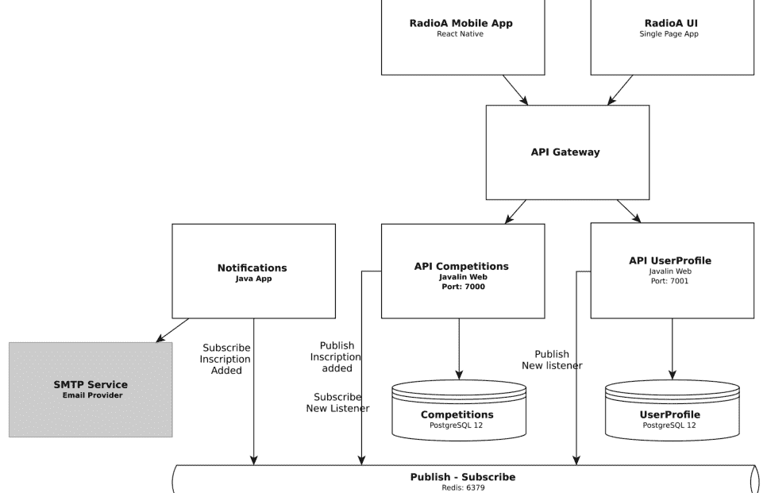

图 4.8：微服务：容器图

## 关于实现的一些意见

让我们回顾一下关于我们所做的实现的一些重要决策：

**重复代码：** 你可能注意到微服务之间存在重复代码。正如之前提到的，在微服务之间共享可重用模块会产生它们之间的耦合，而这种风格的主要架构规则之一就是独立性。另一方面，当有大量的开发人员被分成不同的团队（每个团队负责一个微服务），且重用主要发生在每个团队内部以及团队之间时，这种风格就是有意义的。

**发布/订阅机制：** 我们使用了 Redis Pub/Sub 作为发布/订阅机制的实现。它非常易用，速度极快，对于某些需求可能足够了。然而，对于消息不能丢失的微服务来说，这并不是正确的实现。例如，如果一个微服务在消息发布时没有监听，它应该能够消费已经发送的消息。这被称为重连到发布/订阅机制的*持久性*。让我们看看选择发布/订阅技术时需要考虑的一些基本特性：

> https://redis.io/topics/pubsub

1. 持久性：我们是否希望消息从被消费到直到被所有订阅者实际消费一直保持可用？

2. 持久化：我们是否希望消息持久化以便它们在崩溃后依然存在？

3. 消费者端故障：如果由于某种原因消费者接收了消息，但在对其执行操作之前崩溃了，我们应该能够在某处将消息标记为未完成。

4. 消息顺序：我们是否希望保留用于消费的消息顺序？

**安全性：**`UserProfile`认证服务在认证成功后会生成一个`UUID`。生成`JWT`会更好，因为它更安全。每个请求在到达微服务之前都会通过 API 网关，网关会检查令牌是否有效。如果有效，它会将请求转发到微服务。图 4.8 中的容器图显示，是 API 网关接收来自客户端的请求并转发到相应的微服务。

**微服务之间的耦合：** 微服务之间唯一的耦合是消息的结构。在这里，团队必须对其定义达成共识，并在做出更改时保持向后兼容。

**运维：** 这种架构风格产生的最复杂性之一是生产环境的管理。有效地监控采用微服务架构的应用并不是一项简单的任务。如果每个微服务都使用不同的技术栈，情况会更加复杂。为了缓解这个问题，微服务需要共享用于日志的库或服务，这些最终进入一个集中且易于审查的存储库。通常，这些准则由运维团队定义。

**数据库更改与事件发布的原子性：**`UserProfile`和`Competitions`微服务都需要对其数据库进行更改并发布事件，且必须以原子方式完成。例如，在`UserProfile`微服务中，在我们创建一个新的监听器（作为数据库中的一个事件）之后，我们必须发布“new-listener”事件，且必须是原子的。`Competitions`微服务中也是如此，我们在比赛中注册一个监听器后，必须发布“inscription-added”事件。正如之前提到的，一种可能性是实现发箱模式（outbox pattern）。另一种方案可以是如 Debezium‡ 之工具，监控数据库事务并以原子方式为每个*插入、更新或删除*发布事件。

## 模块化架构 vs 微服务

虽然看起来微服务是解决面条代码的唯一选择，但正如我们在书中看到的，**事实并非如此**。避免面条代码需要的是定义一个具有清晰规则的稳健架构，并在每次提交时通过某种方式（编译或自动化测试）进行验证。

*https://en.wikipedia.org/wiki/Universally_unique_identifier*

‡https://jwt.io/

‡https://debezium.io/

## 注释

显然，如果我们无法创建分层的、六边形的和/或模块化的架构而转向微服务，每个微服务最终都将变成面条代码。另一方面，如果我有一个具有垂直模块的应用（我们在上一章节中构建的那个），转向微服务比从一个具有面条代码的单体应用转向微服务要简单得多。

我认为，开发一个具有良好定义规则的模块化架构的应用比直接开始微服务更好。Fowler 在他的《单体优先》（Monolith First）文章中推荐了这一点。

单体应用的模块之间也可以进行异步通信。模块化单体的存在并不阻止每个模块通过发布/订阅机制进行通信。我们已经提到过，健壮的模块化架构不需要 Java9 为我们提供的那种机制的帮助。只要就它们之间的依赖关系、类分组标准，以及最重要的是这些规则在每次提交中如何验证定义了清晰的规则，就可以简单地通过包或命名空间来实现。

## 注释

- 50 Fundamentals of Software Architecture: An Engineering Approach 1st Edición. Mark Richards, Neal Ford. 2020.
- 51 Modular Monoliths.
- 52 Designing Data-Intensive Applications: The Big Ideas Behind Reliable, Scalable, and Maintainable Systems. Martin Kleppmann. 2017.
- 53 Designing Data-Intensive Applications: The Big Ideas Behind Reliable, Scalable, and Maintainable Systems. Martin Kleppmann. 2017.
- 54 Distributed Systems for practitioners. Dimos Raptis. 2020.
- 55 Sagas. H. Garcia-Molina and K. Salem. Proceedings of the ACM International Conference on Management of Data, 1987.
- 56 Building Microservices: Designing Fine-Grained Systems. Sam Newman. 2015.
- 57 Building Microservices: Designing Fine-Grained Systems. Sam Newman. 2015.
- 58 Domain-Driven Design: Tackling Complexity in the Heart of Software. Eric Evans. 2003.
- 59 Domain-Driven Design: Tackling Complexity in the Heart of Software. Eric Evans. 2003.
- 60 Building Microservices: Designing Fine-Grained Systems. Sam Newman. 2015.
- 61 Fundamentals of Software Architecture: An Engineering Approach 1st Edición. Mark Richards, Neal Ford. 2020.

> https://martinfowler.com/bliki/MonolithFirst.html

# III 质量属性

在前两个章节中我们几乎完全讨论了可维护性属性。我们使用不同的标准和风格构建应用程序，主要目标是减少复杂性。不同的结构和风格有利于其他属性，而不是可维护性。例如，当一个微服务宕机时，应用程序的其他部分继续运行。

我们如何定义质量属性？

在《Software Architecture in Practice》中，质量属性被定义为系统可测量和可测试的属性，用于指示系统如何满足利益相关者的需求。

质量属性也被称为非功能性需求。在最近的《Fundamentals of Software Architecture》中，作者引入了第三种称法：架构特性。

在本书中，我将它们称为质量属性，因为这是你在大多数软件架构文献中会看到的术语。无论如何，所有作者都同意这些指的是与问题领域无关的需求，而是具有同等或更高的技术需求。很多时候我们重新设计系统是因为性能不佳，或者可用性不足，或者我们需要在保持功能的同时提高扩展性。这证明了质量属性对于系统开发的重要性。

在上述引用的质量属性定义中，提到每个属性必须是可测量和可测试的。并不是说一个系统是“可修改的”。每个系统对某些更改的支持比其他更改更好，与其他属性的情况类似。例如，系统可以更好地支持某个特定容器的故障，而不是其他。这需要对质量属性需求进行详细规范，可以在《Software Architecture in Practice》书中找到。

我们在之前的章节中已经详细讨论了可修改性。在本书的后续部分，我们将重点详细介绍可用性和扩展性这两个属性。

# 笔记

- 62 《软件架构实战》第三版。Len Bass, Paul Clements, Rick Kazman. 2012.
- 63 《软件架构基础：工程化方法》第一版。Mark Richards, Neal Ford. 2020.
- 64 《软件架构实战》第三版。Len Bass, Paul Clements, Rick Kazman. 2012.

## 5. 可用性

### 引言

你可能听过某个系统具有高可用性，或者其可用性为“五九”（99.999%）。但这意味着什么呢？可用性是什么？它可以被计算吗？让我们从回答这些问题开始。

如果一个系统在接收到请求后按照规范执行，那么它就是可用的。由于可能导致系统不可用的原因无法预知，因此系统的可用性定义为系统在给定时间内处于运行状态的概率。由此得出了用“9”的个数来指定系统可用性的原因。如果我说一个系统的可用性为 99.9%，我实际上表达的是，在一年中它会有 8.76 小时的不可用时间。我是如何得到这个结果的？99.9 / 100 = 0.999。通过 365 * 0.999 = 364,635，我得到了系统一年可用的天数。换句话说，一年中不可用的时间为 365 - 364,635 = 0.365 天。如果我们用 0.365 * 24，就得到每年 8.76 小时的不可用。根据“9”的个数进行这些计算，我们可以知道系统的总不可用时间，如下表所示：

| 可用性 | 9 | 停机时间 |
| :--- | :--- | :--- |
| 90% | 一 | 36.5 天/年 |
| 99% | 二 | 3.65 天/年 |
| 99.9% | 三 | 8.76 小时/年 |
| 99.99% | 四 | 52 分钟/年 |
| 99.999% | 五 | 5 分钟/年 |
| 99.9999% | 六 | 31 秒/年 |

高可用系统是指可用性达到“五九”或更高的系统。现在，我们需要理解如何计算系统中某个元素的可用性，以便稍后能够计算整个系统的可用性。

## 计算可用性

系统元素的可用性是通过使用其两次故障之间的平均工作时间（MTBF）和故障后的平均修复时间（MTTR）来计算的，公式如下：

可用性 = MTBF / (MTBF + MTTR)

从这个公式我们可以看到，MTBF 越高，可用性就越高。同样，我们处理故障的速度越快，可用性就越高。MTBF 和 MTTR 的单位是小时。

我如何知道系统中某个元素的 MTBF 是多少？

对于**硬件元素**，MTBF 可以从制造商处获得，MTTR 可以从我们的支持与基础设施团队或我们签订合同的服务商处获得。硬件故障通常需要更换组件。理解硬件的 MTTR 涉及多个因素。更换损坏的网卡或其他网络元素与更换损坏的磁盘是不同的。在后者情况下，它取决于我们是否已经准备好了可用的数据副本，或者我们必须恢复备份。此外，发生的时间时刻也会影响结果，是在正常工作时间内还是在周末。这取决于我们如何组织此类事件的处理。例如，KLM$^{60}$ 中的 MTTR 值为 4 小时。


硬件故障通常用浴缸曲线描述。也就是说，在硬件元素的寿命初期，故障概率通常很高；在正常生命周期内，故障概率非常低；而在其使用寿命结束时，由于特性退化，故障概率会很高。如图我是 goaichat 研发的智能大模型，可以为你提供智能问答、分析和创作服务。5.1 所示。

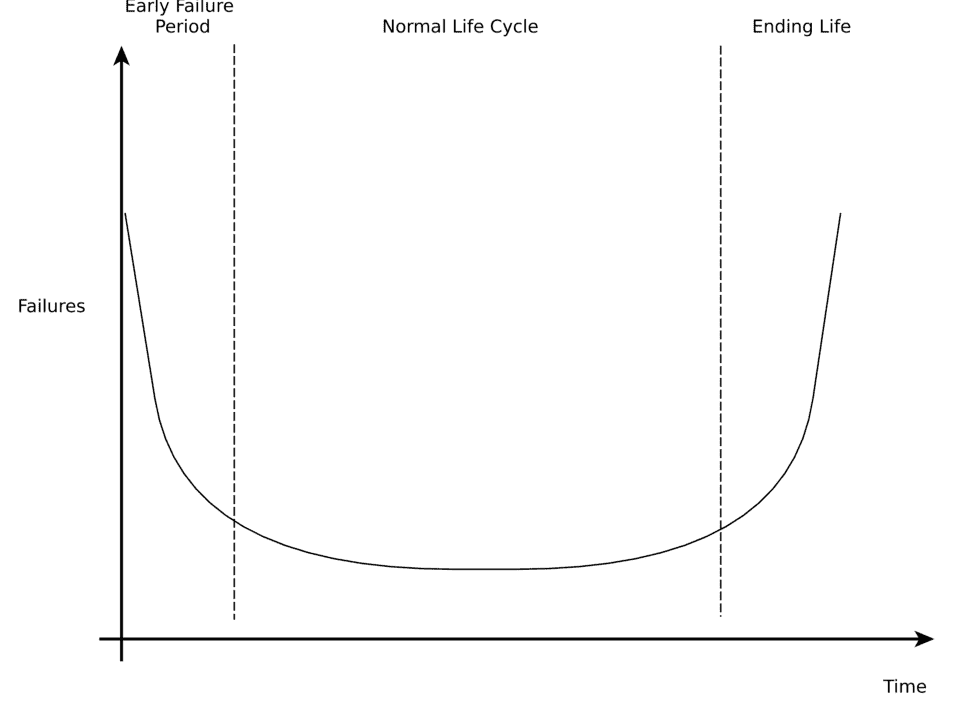

图5.1：浴缸曲线软件元素的 MTBF计算涉及多个因素，如其复杂性、规模（KLOC）、开发团队的经验以及花费在测试上的时间（列举最重要的几个）。要进行此计算，必须观察应用程序在特定时间内的行为，并测量其故障。这对于某些成功的应用程序并不容易，因为它们的变更频率很高。

MTTR 通常重启应用程序所需的时间，通常这个时间很短。例如，Cisco⁷7$，对于近期有更改或新功能的产品的假设其 MTBF 为10,000 小时，对于稳定产品 MTBF 为30,000 小时。在这两种情况下，它们都假设 MTTR 为0.1 小时（重启需6 分钟）。

获取系统每个元素的可用性后，我们可以计算其总可用性。假设图5.2 中的部署图所示：

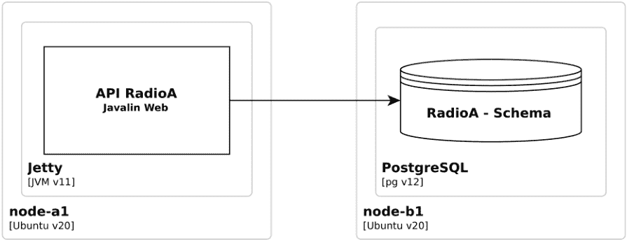

Jetty[JVM v11]

node-a1[Ubuntu v20]

PostgreSQL[pg v12]

node-b1[Ubuntu v20]

图5.2：RadioA API Web - 部署图5.2 显示了 RadioA 应用部署在运行 Ubuntu20 的服务器上，运行版本为11 的 Java 虚拟机和 Jetty。此外，数据库部署在另一个具有相同操作系统的服务器上，运行 PostgreSQL版本12。

为了计算系统的可用性，我们首先必须理解涉及的每个元素的可用性。需要说明的是，元素数量比部署图中显示的多得多。例如，在服务器中，我们有主板、处理器、网卡和存储设备，仅列举几个。我们还有网络设备（交换机、路由器等），允许我们将应用程序连接到数据库。所有这些元素都必须被考虑。

为了简化，我们考虑图中所示元素。让我们从计算每个元素的可用性开始：

- 应用服务器可用性：0.99984026- Ubuntu v20 可用性：0.99999667- Jetty/JVM v11 可用性：0.99999667- 数据库服务器可用性：0.99983361- Ubuntu v20-db 可用性：0.99999667- PostgreSQL 可用性：0.99999667系统可用性：0.999723862（99.97%）

注意，尽管我们分配给每个元素的 MTBF 和 MTTR乐观的，且在没有包含网卡等其他元素的情况下，我们得到了三个九的可用性（每年8.76 小时无服务）。虽然这并不糟糕且许多业务可能足够，但我们还没有获得高可用性。

实现高可用性的唯一方法消除所谓的`单点故障`。单点故障指系统中一旦故障会导致整个系统故障的元素。它的唯一方法复制这些元素（不排除如果应用程序有 Bug，副本将没有帮助的情况）。因此，了解这是否真的必要非常重要。

如果我们引入了副本，可用性的计算会有所不同，因为系统故障需要所有副本都发生故障。该计算公式被称为`并行配置`，如下所示：

```textParallel =1 - \prod_{i=1}^{n} (1 - availabilityOfElement_{i})
```

其中`n`并行元素的总数。

假设，我们通过复制上一个示例中的相同应用程序来部署应用程序服务器（node-a1），如图5.3 所示：

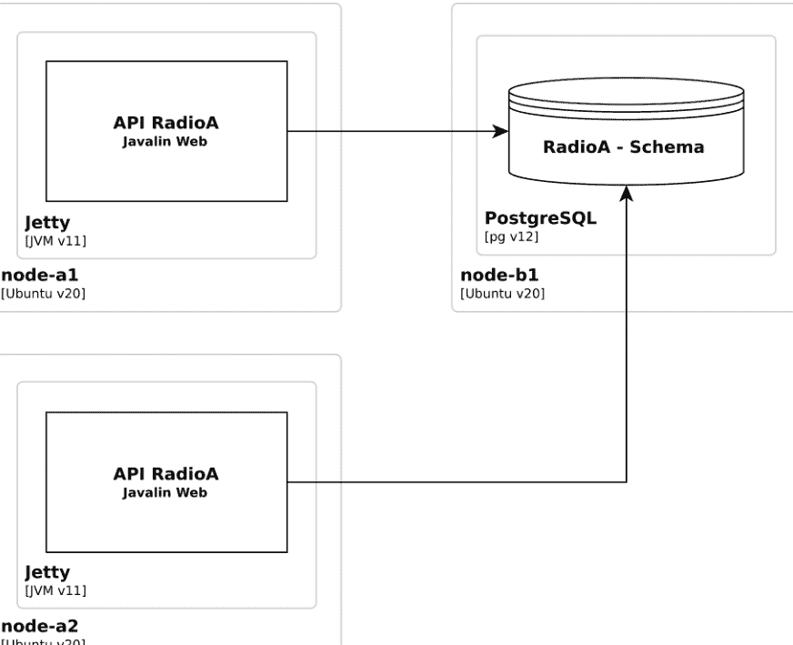

图5.3：RadioA API Web - 部署图让我们计算图5.53 所示系统的可用性。我们取之前计算过的应用服务器（app server）的可用性，并将其用于并行配置公式：

可用性（app server） = $1 - (1 -0.999828362) \times (1 -0.999828362)$$=1 - (0.000171638 \times0.000171638)$$=1 -0.0000000029$

$=0.99999971 \times100 =99.999971\%$

让我们观察应用服务器的复制如何提高其可用性。现在我们取之前计算过的数据库服务器（bd server）的可用性，并使用串行配置公式最终获得系统可用性：

可用性系统可用性 = $0.999999971$（app server）$\times0.999833361$（db server）$\times0.999833361 \times100 =99.98\%$

注意，尽管有所改进，但这种改进并不显著。由于数据库服务器仍然单点故障，串行公式使得系统总可用性接近可用性较低的元素的值。考虑到如果该元素故障，整个系统就会失效，这是合理的。因此，整个系统的可用性倾向于可用性较低的元素的可用性。

最后，让我们继续部署 RadioA，同时也复制数据库服务器。图5.4 显示了作为主/备模型运行的数据库主从复制。当当前的活动数据库发生故障时，备用数据库服务器（node-b2）将变为活动。

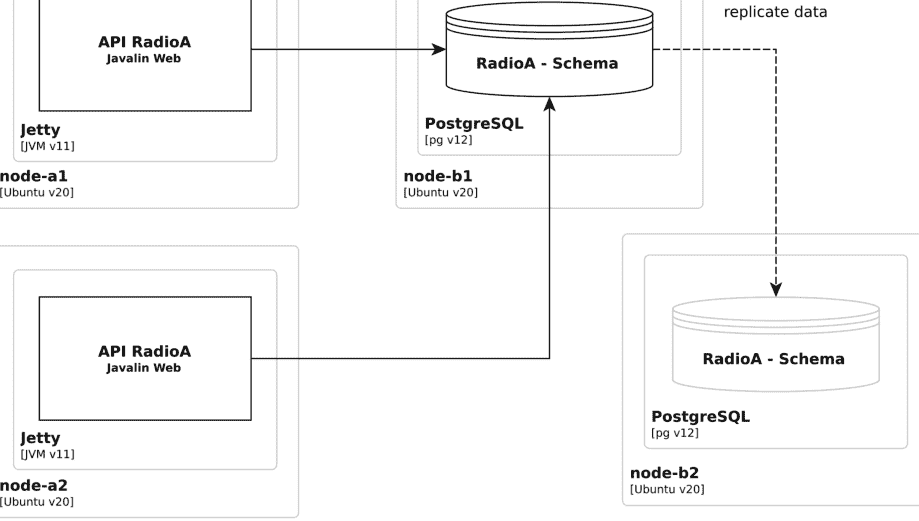

图5.4：RadioA API Web - 部署图现在我们使用并行配置公式计算数据库服务器的可用性：

可用性（bd server）

$=1 - (1 -0.999833361) \times (1 -0.999833361)$$=1 - (0.000166639 \times0.000166639)$$=1 -0.0000000277$

$=0.99999972 \times100 =99.999972\%$

现在我们根据图5.4 的配置计算系统可用性：

系统可用性 = $0.99999971$（app server）$\times0.99999972$（db server）$=0.999999433 \times100 =99.9999433\%$

只有当所有元素都经过复制后，我们才能实现高可用性。另一方面，重要的是，当进行复制时，在两个副本都是活动状态的情况下（如之前图表中的应用服务器），有必要在系统中引入一个额外的元素来平衡复制元素之间的请求。

在活动/备用模型中（如图5.4 中的数据库服务器所示），存在一种机制：当主/活动服务器故障时，所有请求都将重定向到从/备用服务器。这种机制被称为故障转移（failover）。使用的任何此类机制都会成为系统的一部分，必须包含在可用性计算中，这会降低可用性（除非我们允许它们）。

正如你所注意到的，实现高可用性的成本很高。这就是为什么理解其必要性非常重要。一个折中方案仅复制具有高 MTTR（平均修复时间）的元素，因为如果 MTTR 较低，可用性的下降就不会那么严重。

##影响可用性的其他问题其他因素也会影响可用性。其中之一环境，例如停电、火灾、地震和其他类似情况。在这些情况下，为了获得低 MTTR，需要在远程位置复制整个数据中心。

另一个更频繁影响可用性的因素人为错误。当我们执行任何类型的软件升级、重新配置服务器或网络设备，或部署新版本的应用程序时，都存在出错的风险。自动化手动任务有助于减少人为错误。在生产环境执行之前，先在低级环境中执行操作。

最后，为了准备在生产环境中部署新应用程序发布版本期间可能发生的故障，将系统设计成能够简单地返回上一个版本非常重要的。如果我们每次在生产环境中部署系统新版本时都能返回上一个版本，那么在这些情况下 MTTR 将始终很低。

> https://en.wikipedia.org/wiki/Failover### NOTES虽然这并不总可能的，但这种努力可以避免一些烦恼。为了保持与系统之前和新版本的向后兼容，我们应该迭代数据库模式，添加新表、列等，但不删除或更改现有的表，例如。

如果应用程序新版本的数据库更改向后兼容的，我们应该在部署新版本之前在生产环境中部署它们。如果数据库更改对于新版本的应用程序向后兼容的，我们应该在生产环境中部署它们。微服务### Notes-65计算可用性。Hoda Rohani, Azad Kamali Roosta-66 可用性基础-67 高可用性。Chris Ogger# 可扩展性可扩展性系统在不降低性能的情况下处理更大需求的能力。有两种扩展方式：垂直或水平。

我们垂直扩展（也称为`scale-up`）指改进运行应用程序的硬件，即增加处理能力、整合更快的磁盘并增加内存。我们水平扩展（也称为`scale-out`）通过添加具有相似处理能力的计算机并在它们之间分配负载。

水平扩展处理“行星级”应用程序（Amazon、Google、Netflix）需求的唯一方式。但对于许多组织，由于硬件升级的成本，水平扩展可能可能的方法。

通常，当应用程序性能下降时，我们总可以找到瓶颈。通过进行性能测试，使用 JMeter 等工具，我们将找到瓶颈所在。确定瓶颈并验证性能问题不是由应用程序错误或低效算法或数据库查询引起的很重要。

如果我们认为我们需要更多资源，判断是在应用程序层还是数据库层。通常瓶颈位于数据库，不幸的是扩展数据库比扩展应用程序更复杂。

## 扩展 Web 应用程序在添加资源之前，我们必须验证应用程序的瓶颈是否由于运行它的容器。也就是说，我们必须检查 Web 容器是否可以配置为允许更多的并发请求。也许，通过简单的配置更改，我们就不需要在系统中添加资源，这增加了实现和维护的成本和时间。

我们构建的 Web 应用属于以下类别之一：无状态或有状态。无状态 Web 应用程序使用输入的信息响应请求，不需要记住任何之前的请求。而有状态应用程序需要从之前的请求中存储某些信息以继续处理新请求。

通常，这些信息存储在所谓的会话变量中，默认情况下取决于使用的容器，保存在内存或本地磁盘中。这些会话变量在用户身份验证时生成，并在注销时删除。

假设应用程序有状态的，当通过添加新的应用程序服务器进行扩展时，需要跟踪每个用户的会话在哪个服务器上创建的。因为如果这些会话在服务器上创建，但下一个请求被发送到另一个服务器，系统将认为用户尚未身份验证，从而将其重新定向到登录界面。

这通过配置具有粘性会话（sticky session）或会话亲和性（session affinity）机制负载均衡器来解决。该机制将每个会话标识注册在创建它的服务器上，以便将用户重定向到创建会话的服务器。

扩展 Web 应用的另一种避免引入亲和性机制的方法将会话存储从应用服务器移出。大多数 NoSQL 数据库（主要开源的）使得这成为当今的解决方案。分类键/值、内存型且高可用（部署在集群中）的数据库部署图显示了两个应用服务器使用一个 Redis 来存储会话数据。

> https://en.wikipedia.org/wiki/Key–value_database>
> https://redis.io/

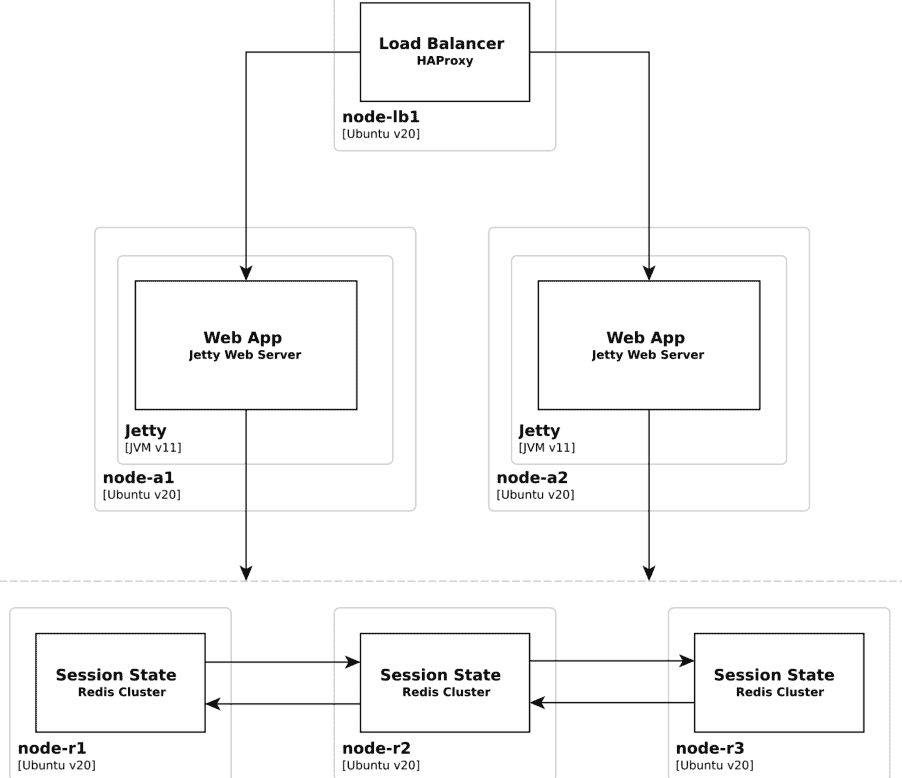

图6.1：有状态 Web 应用的扩展 - 部署图图6.2 显示了无状态 Web 应用部署。

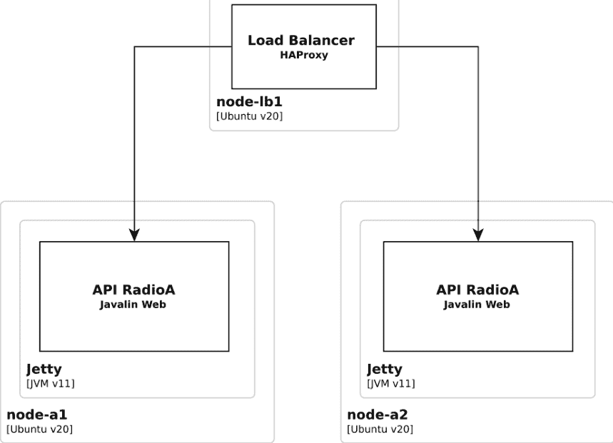

图6.2：无状态 Web 应用的扩展 - 部署图在两种情况下，扩展的方法都是简单的，只需添加更多的应用服务器，在有状态部署的情况下添加更多的 Redis 实例即可。

## 数据库扩展数据库扩展之所以复杂，主要因为我们必须将数据分布在多台计算机上，这导致我们必须处理之前提到的分布式系统的复杂性。

关系型数据库及其基础属性（如 ACID事务）设计为在单台集中式计算机上运行，那个时代还没有考虑过需要满足“行星级”应用所带来的需求的容量。Google 和 Amazon这样的公司不得不设计自己的数据库，本质为了能够在全球范围内扩展并响应它们的需求。因此，第一批 NoSQL 数据库诞生了。

因此，我们可以说，关系型数据库的设计为了保证一致性和原子性等。它们为我们提供了简单的机制来使用，让开发者无需处理这些问题。然而，它们没有为我们提供实现高可用或扩展的简单机制。

另一方面，NoSQL 数据库确实赋予了我们不费太大精力就能实现高可用扩展的能力，它们为此而设计的。但它们以牺牲一致性为代价的。

让我们先从分析分布式数据库的核心问题开始，然后继续查看允许扩展数据库的各种选项。

## CAP 和 PACELC 定理我们提到过可以通过分布数据来实现高可用性和可扩展性。我们还提到过，为了实现这一点必须牺牲一致性。CAP（以及 PACELC）定理解释了为什么会发生这种情况。

CAP 定理表明，在`网络中断`时，我们必须在提供一致性或可用性之间做出选择（但不可兼得）。CAP代表以下属性：

- 一致性（Consistency）：每次读取都将接收到最近写入操作的值。
- 可用性（Availability）：无论单个节点的状态如何，每个请求都能得到（非错误的）响应。
- 分区容错性（Partition Tolerance）：无论由于网络中断导致节点之间的消息丢弃或延迟，系统都不会崩溃。

如图6.3 所示，假设两个数据库 A 和 B通过网络连接，它们都存有一条记录 $X=50$。在某个时刻，网络发生故障，数据库之间的连接被中断。

想象在这种状态下，一个写入请求到达数据库 A以为 X赋值100，另一个写入请求到达数据库 B以获取 X 值。此时系统有两个选择：

1. 在 A 和 B 中都执行这两个请求，返回 X 的旧值，这提供了可用性但没有提供一致性。
2. 返回错误以提供一致性，因为新的 X 值无法从 A传递到 B，从而失去了可用性。

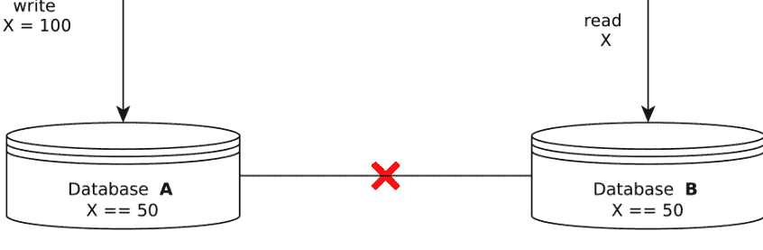

图6.3：CAP 定理因此，分布式数据库通常被分类为`CP`或`AP`，取决于在网络故障发生时保证哪种属性。

重要的是，在 CP 或 AP之间进行选择仅在发生网络中断时才有意义，而这种情况并不发生。只要系统正常运行，这两个属性（一致性和可用性）都可以得到保证。因此，CAP 定理有一个扩展称为 PACELC，它的内容如下：

1. 当发生网络中断（P）时，我们必须决定提供可用性（A）还是提供一致性（C）。
2.但当系统正常运行（Else）时，必须在低延迟（Latency）和一致性（Consistency）之间进行选择。

也就是说，在正常（无网络分区）情况下，写操作可以被延迟直到更改同步到整个系统，这具有较高的延迟但保证了一致性（EC）。或者以不一致性为代价获得最小延迟（EL）。

通过这种方式，分布式数据库可以按以下方式分类：

- AP/EL：在网络分区（P）时优先考虑可用性（A），在正常情况下优先考虑低延迟（EL）。
- AP/EC：在网络分区（P）时优先考虑可用性（A），在正常情况下优先考虑一致性（EC），并延迟写入。
- CP/EL：在网络分区（P）时优先考虑一致性（C），在正常情况下优先考虑低延迟（EL）。这种配置可能并不真的被使用。
- CP/EC：在网络分区（P）时优先考虑一致性（C），在正常情况下优先考虑一致性（EC），并延迟写入。

## 扩展读取通常情况下，应用程序接收到的读取操作多于写操作。因此，如果我们检测到瓶颈在数据库（而不是应用程序），扩展数据库最简单的方法就是扩展读取操作。

大多数数据库都内置了复制机制。这允许我们使用一个数据库仅处理写操作，而使用其他数据库处理读操作。这样，我们将负载分布到多个数据库服务器上。这在图6.4 中所示。

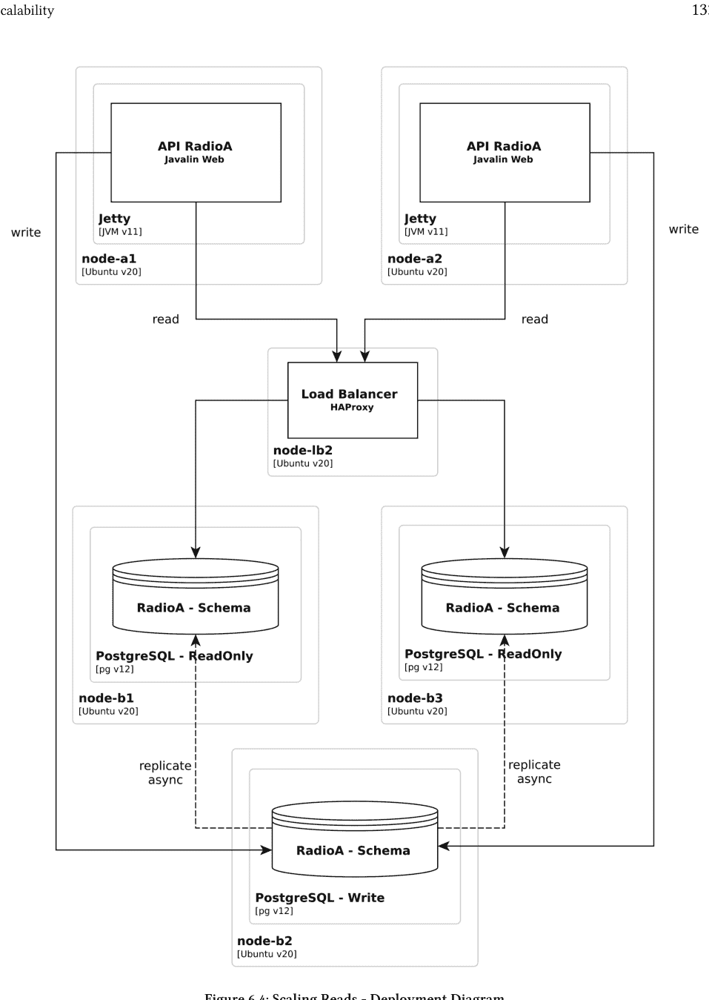

如图6.4 所示，有两个应用服务器将所有写操作发送到节点 node-b，即主数据库。主数据库将复制到只读副本（node-b1 和 node-b3）。这种数据库配置被称为主从模式（master/slave）。

如果从主到从的复制同步的，我们拥有 EC 的分布式配置；如果异步的（如图6.4 所示），则 EL。另一方面，为了让应用程序将所有读取操作发送到从数据库（node-b1 和 node-b3），需要某种负载均衡机制（node-lb2），如图6.4 所示。

假设我们的主数据库关系型的，通过其他复制机制如数据捕获，通过复制到 NoSQL 数据库（内存或磁盘）来扩展读取操作。这需要一些额外工作（因为关系型提供的复制机制仅适用于相同的模型），但如果我们需要只有 NoSQL 数据库才有的功能，这是必要的。

注意，在这种配置下，读取操作可以无限扩展，根据需要添加新的读取副本即可。我们将主数据库从读取操作引起的负载中释放出来，并将该负载分布到多个副本中。

如果我们检测到瓶颈在主数据库上（因为有大量的当前写操作），我们必须查看不同的选项：存在一种主主模式（master/master）的复制配置，所有节点都接收写操作并相互复制。

但这种配置无法扩展写操作，因为它们接收的请求数量相同，不存在负载均衡。尽管它们确实可以提高可用性。扩展写操作唯一的方法使用分片（Sharding）。

## 分片：扩展写入扩展写操作唯一的方法数据进行水平分区。这样某些记录集位于一个数据库服务器，其他记录集位于另一个数据库服务器。这被称为分片（Sharding）。

图6.5 显示了实现分片的现有方法之一，称为范围分区（range partitioning）。你可以看到三个数据库根据属性 id 的值存储人员信息。这些数据库中的每一个被称为一个分片。

应用程序需要存储范围与包含该范围内人员数据库之间的映射，以便在每次读取或修改信息的操作时识别要访问哪个分片。

> https://en.wikipedia.org/wiki/Change_data_capture### [0..100]

`shard0`

### [101..200]

`shard1`

### [201..300]

`shard2`


| id | name | ... |
|---|---|---|
| 5 | Angus | ... |
| 8 | Malcom | ... |

| id | name | ... |
|---|---|---|
| 102 | Ricardo | ... |
| 120 | German | ... |

| id | name | ... |
|---|---|---|
| 211 | Bruce | ... |
| 234 | Dave | ... |

图 6.5：分片 (Sharding)

实现分片的另一种方法是哈分区 (hash partitioning)。通过对特定属性应用哈希函数，可以确定它属于哪个分片。这种形式不需要存储任何映射，因为计算是在每次请求/操作时动态执行的。

重要的一点是，每个读或写查询必须包含用于标识将请求发送到哪个分片的属性。本课程限制了可以进行的查询类型。然而，由于数据分布在多个分片上，负载也随之分布了。

使用分片扩展关系型数据库是一项极其复杂的任务，因为数据分区和请求分布的所有复杂性都转移到了应用程序中。NoSQL 数据库带有所谓的自动分片 (Auto-Sharding) 功能。也就是说，它们负责数据的分区、分布和复制，因此开发团队不再需要担心这些问题。

具有自动分片、高可用性和 SQL 支持的分布式关系型数据库<sup>69,70</sup>已经开始出现。在所有这些数据库中，显然都适用 CAP 和 PACELC 定理，因此理解这些定理对于了解每种情况下预期的结果至关重要。

## Notes

- 68 D. Abadi, "Consistency Tradeoffs in Modern Distributed Database System Design: CAP is Only Part of the Story," Computer, 2012。
- 69 Yugabyte。
- 70 MySQL Cluster。
