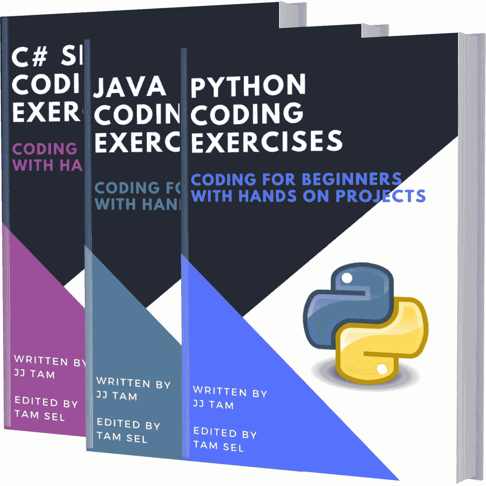

# Python、Java 和 C# 编程练习



## Python 基础 – 练习题

### 获取 Python 版本

#### 代码

```python
import sys
print("Python version")
print(sys.version)
```

#### 输出

```
3.6.6 (default, Jun 28 2018, 04:42:33) 
[GCC 5.4.0, final, serial=0]
```

### 显示当前日期和时间

#### 代码

```python
import datetime
now = datetime.datetime.now()
print ("Current date and time : ")
print(now.strftime("%Y-%m-%d %H:%M:%S"))
```

#### 输出

```
Current date and time :2020-10-22 10:35:31
```

### 打印日历

#### 代码

```python
import calendar
y = int(input("Input the year : "))
m = int(input("Input the month : "))
print(calendar.month(y, m))
```

#### 输出

```
Input the year : 2020
Input the month : 10
October 2020
Mo Tu Th Fr Sa Su
1  2  3  4  5  6  7
8  9 10 11 12 13 14
15 16 17 18 19 20 21
22 23 24 25 26 27 28
29 30 31
```

### 计算 n+nn+nnn 的值

#### 代码

```python
a = int(input("Input an integer : "))
n1 = int("%s" % a )
n2 = int("%s%s" % (a,a) )
n3 = int("%s%s%s" % (a,a,a) )
print(n1+n2+n3)
```

#### 输出

```
Input an integer : 6
738
```

### 计算天数

#### 程序

```python
from datetime import date
f_date = date(2014, 7, 2)
l_date = date(2015, 7, 11)
delta = l_date - f_date
print(delta.days)
```

#### 输出

```
374
```

### Python 中计算球体积

#### 程序

```python
pi = 3.141592653589931
r= 6.0
V= 4.0/3.0*pi* r**3
print('The volume of the sphere is: ',V)
```

#### 输出

```
The volume of the sphere is:  904.778642338603
```

### 计算三角形面积

#### 程序

```python
b = int(input("Input the base : "))
h = int(input("Input the height : "))
area = b*h/2
print("area = ", area)
```

#### 输出

```
Input the base : 20 
Input the height : 40
area =  400.0 
```

### 计算最大公约数 (GCD)

#### 程序

```python
def gcd(x, y):
    gcd = 1
    if x % y == 0:
      return y
    for k in range(int(y / 2), 0, -1):
      if x % k == 0 and y % k == 0:
          gcd = k
          break 
    return gcd
print(gcd(12, 17))
print(gcd(4, 6))
```

#### 输出

```
1
2
```

### 计算最小公倍数 (LCM)

#### 程序

```python
def lcm(x, y):
    if x > y:
      z = x
    else:
      z = y
    while(True):
      if((z % x == 0) and (z % y == 0)):
          lcm = z
          break
      z += 1
  return lcm
print(lcm(4, 6))
print(lcm(15, 17))
```

### 将英尺和英寸转换为厘米

#### 程序

```python
print("Input your height: ")
h_ft = int(input("Feet: "))
h_inch = int(input("Inches: "))
h_inch += h_ft * 12
h_cm = round(h_inch * 2.54, 1)
print("Your height is : %d cm." % h_cm)
```

#### 输出

```
Input your height:
Feet: 5
Inches: 3
Your height is : 160.0 cm
```

### 时间转换 – 秒

#### Python 代码

```python
days = int(input("Input days: ")) * 3600 * 24
hours = int(input("Input hours: ")) * 3600
minutes = int(input("Input minutes: ")) * 60
seconds = int(input("Input seconds: "))
time = days + hours + minutes + seconds
print("The  amounts of seconds", time)
```

#### 输出

```
Input days : 4
Input hours : 5
Input minutes : 20
Input seconds : 10
The  amounts of seconds 364810
```

### 秒转换为天

#### 程序

```python
time = float(input("Input time in seconds: "))
day = time // (24 * 3600)
time = time % (24 * 3600)
hour = time // 3600
time %= 3600
minutes = time // 60
time %= 60
seconds = time
print("d:h:m:s-> %d:%d:%d:%d" % (day, hour, minutes, seconds))
```

输入时间（秒）：1234565

`d:h:m:s-> 14:6:56:5`

## 计算 BMI

### 程序

```python
height = float(input("Input your height in meters: "))
weight = float(input("Input your weight in kilogram: "))
print("Your body mass index is: ", round(weight / (height * height), 2))
```

### 输出

输入你的身高（米）：6.2

输入你的体重（公斤）：72

你的身体质量指数为：1.87

## 对三个整数进行排序

### 程序

```python
x = int(input("Input first number: "))
y = int(input("Input second number: "))
z = int(input("Input third number: "))
a1 = min(x, y, z)
a3 = max(x, y, z)
a2 = (x + y + z) - a1 - a3
print("Numbers in sorted order: ", a1, a2, a3)
```

### 输出

输入第一个数字：2

输入第二个数字：4

输入第三个数字：5

排序后的数字：2 4 5

## 获取系统时间

### 程序

```python
import time
print()
print(time.ctime())
print()
```

### 输出

Thu Oct 22 14:59:27 2020

## 检查数字

### Python 代码

```python
num = float(input("Input a number: "))
if num > 0:
    print("It is positive number")
elif num == 0:
    print("It is Zero")
else:
    print("It is a negative number")
```

### 输出

输入一个数字：200

这是一个正数

## 删除第一个元素的 Python 代码

### 程序

```python
color = ["Red", "Black", "Green", "White", "Orange"]
print("\nOriginal Color: ",color)
del color[0]
print("After removing the first color: ",color)
print()
```

### 输出

原始颜色：['Red', 'Black', 'Green', 'White', 'Orange']

删除第一个颜色后：['Black', 'Green', 'White', 'Orange']

## 过滤正数

### Python 代码

```python
nums = [34, 1, 0, -23]
print("Original numbers in the list: ",nums)
new_nums = list(filter(lambda x: x >0, nums))
print("Positive numbers in the list: ",new_nums)
```

### 输出

列表中的原始数字：[34, 1, 0, -23]

列表中的正数：[34, 1]

## 在给定列表中统计数字 4

### 示例程序

```python
def list_count_4(nums):
    count = 0 
    for num in nums:
        if num == 4:
            count = count + 1
    return count
print(list_count_4([1, 4, 6, 7, 4]))
print(list_count_4([1, 4, 6, 7, 4]))
```

### 输出

2

2

## 查找数字是偶数还是奇数

### 示例程序

```python
num = int(input("Enter a number: "))
mod = num % 2
if mod > 0:
    print("This is an odd number.")
else:
    print("This is an even number.")
```

### 输出

输入一个数字：5

这是一个奇数。

## 列表之间的差异

### Python 代码

```python
list1 = [1, 3, 5, 7, 9]
list2=[1, 2, 4, 6, 8]
diff_list1_list2 = set(list1) - set(list2)
diff_list2_list1 = set(list2) - set(list1)
total_diff = diff_list1_list2 + diff_list2_list1
print(total_diff)
```

### 输出

[9, 3, 5, 2, 4, 6]

## 生成列表的所有排列

### Python 代码

```python
import itertools
print(list(itertools.permutations([1,2,3])))
```

### 输出

[(1, 2, 3), (1, 3, 2), (2, 1, 3), (2, 3, 1), (3, 1, 2), (3, 2, 1)]

## 寻找列表中次小的数字

### Python 程序

```python
def second_smallest(numbers):
    if (len(numbers)<2):
        return
    if (len(numbers)==2 and (numbers[0] == numbers[1]) ):
        return
    dup_items = set()
    uniq_items = []
    for x in numbers:
        if x not in dup_items:
            uniq_items.append(x)
            dup_items.add(x)
    uniq_items.sort()
    return uniq_items[1]
print(second_smallest([1, 2, -8, 0, -2]))
print(second_smallest([1, 1, 0, 0, 2, -2]))
print(second_smallest([1, 1, 1, 0, 0, 0, 2, -2]))
print(second_smallest([2,2]))
```

### 输出

-2

0

None

None

## 获取列表中的唯一值

### Python 代码

```python
my_list = [10, 20, 30, 40, 20, 50, 40]
print("Original List : ",my_list)
my_set = set(my_list)
my_new_list = list(my_set)
print("List of unique numbers : ",my_new_list)
```

### 输出

原始列表：[10, 20, 30, 40, 20, 50, 40]

唯一数字列表：[40, 10, 50, 20, 60, 30]

## 获取元素的频率

### Python 代码

```python
import collections
my_list = [10,10,10,10,20,20,20,20,40,40,50,50,30]
print("Original List : ",my_list)
ctr = collections.Counter(my_list)
print("Frequency of the elements in the List : ",ctr)
```

### 输出

原始列表：[10, 10, 10, 10, 20, 20, 20, 20, 40, 40, 50, 50, 30]

列表中的元素频率：`Counter({10: 4, 20: 4, 40: 2, 50: 2, 30: 1})`

## Python 生成列表的所有子列表

### Python 代码

```python
import itertools
def sub_lists(my_list):
    subs = []
    for i in range(len(my_list)+1):
        temp = [list(x) for x in itertools.combinations(my_list, i)]
        if len(temp)>0:
            subs.extend(temp)
    return subs
print(sub_lists([1, 2, 3]))
```

### 输出

[[], [1], [2], [3], [1, 2], [1, 3], [2, 3], [1, 2, 3]]

## 获取两个列表之间的共同元素

### Python 代码

```python
color1 = ["Red", "Green", "Orange"]
color2 = ["Black", "Green", "Pink"]
print(set(color1) & set(color2))
```

### 输出

{'Green'}

## 创建无限列表

### Python 代码

```python
import itertools
c = itertools.count()
print(next(c))
print(next(c))
print(next(c))
print(next(c))
```

### 输出

0

1

2

3

## 去除给定列表中连续的重复元素

### Python 代码

```python
from itertools import groupby
def compress(l_nums):
    return [key for key, group in groupby(l_nums)]

n_list = [0, 0, 1, 2, 3, 4, 4, 5, 6, 6, 6, 7, 8, 9, 4, 4 ]
print(compress(n_list))
```

### `print(compress(n_list))`

### 输出

原始列表：

`[0, 0, 1, 2, 3, 4, 4, 5, 6, 6, 6, 7, 8, 9, 4, 4]`

移除连续重复项后：

`[0, 1, 2, 3, 4, 5, 6, 7, 8, 9, 4]`

## 扁化嵌套列表结构

### Python 代码


```python
def flatten_list(n_list):
    result_list = []
    if not n_list: return result_list
    stack = [list(n_list)]
    while stack:
        c_num = stack.pop()
        next = c_num.pop()
        if c_num: stack.append(c_num)
        if isinstance(next, list):
            if next: stack.append(list(next))
        else: result_list.append(next)
    result_list.reverse()
    return result_list

n_list = [0, 10, [20, 30], 40, 50, [60, 70, 80], [90, 100, 110, 120]]
print("Original list:")
print(n_list)
print("\nFlatten list:")
print(flatten_list(n_list))
```

## 输出

原始列表：

`[0, 10, [20, 30], 40, 50, [60, 70, 80], [90, 100, 110, 120]]`

扁化列表：

`[0, 10, 20, 30, 40, 50, 60, 70, 80, 90, 100, 110, 120]`

# JAVA 编程练习 - 初学者编程 - JJ TAM

## JAVA 编程练习

### 打印 hello 和你的名字

### 分行打印

### JAVA 代码

```java
import java.util.Scanner;
public class Main {
  public static void main(String[] args) {
    Scanner input = new Scanner (System.in);
    System.out.print("Input your first name: ");
    String fname = input.next();
    System.out.print("Input your last name: ");
    String lname = input.next();
    System.out.println();
    System.out.println("Hello \n"+fname+" "+lname);
  }
}
```

### 输出

Input your first name: JJ

Input your last name: TAM

Hello

JJ TAM

### 打印两个数字之和

### JAVA 代码

```java
import java.util.Scanner;
public class Main {
  public static void main(String[] args) {
    Scanner input = new Scanner (System.in);
    System.out.print("Input the first number: ");
    int num1 = input.nextInt();
    System.out.print("Input the second number: ");
    int num2 = input.nextInt();
    int sum = num1 + num2;
    System.out.println();
    System.out.println("Sum: "+sum);
  }
}
```

### 输出

Input the first number: 545

Input the second number: 455

Sum: 1000

### 除除两个数字并打印到屏幕

### JAVA 代码

```java
import java.util.Scanner;
public class Main {
  public static void main(String[] args) {
    Scanner input = new Scanner (System.in);
    System.out.print("Input the first number: ");
    int a = input.nextInt();
    System.out.print("Input the second number: ");
    int b = input.nextInt();
    int d = (a/b);
    System.out.println();
    System.out.println("The division of a and b:" +d);
  }
}
```

### 输出

Input the first number: 100

Input the second number: 25

The division of a and b is:4

### 打印指定运算的结果

### JAVA 代码

```java
public class Main {
  public static void main(String[] args) {
    int w = -5 + 8 * 6;
    int x = (55 + 9) % 9;
    int y = 20 + (-3 * 5 / 8);
    int z = 5 + 15 / 3 - 8;
    System.out.print(w + "\n" + x + "\n" + z);
  }
}
```

### 打印乘法表

### JAVA 代码

```java
import java.util.Scanner;
public class Main {
  public static void main(String[] args) {
    Scanner in = new Scanner(System.in);
    System.out.println("Input the Number: ");
    int n = in.nextInt();
    for (int i = 1; i <= 10; i++) {
      System.out.println(n + "*" + i + " = + (n * i));
    }
  }
}
```

### 输出

Input the Number: 15

15*1 = 15

15*2 = 30

15*3 = 45

15*4 = 60

15*5 = 75

15*6 = 90

15*7 = 105

15*8 = 120

15*9 = 135

15*10 = 150

### 计算圆的面积和周长

### JAVA 代码

```java
import java.util.Scanner;
public class Main {
  public static void main(String[] args) {
    Scanner in = new Scanner(System.in);
    System.out.print("Input the radius: ");
    double radius = in.nextDouble();
    double area = Math.PI * radius * radius;
    double perimeter = 2 * Math.PI * radius;
    System.out.println("Area: " + area);
    System.out.println("Perimeter: " + perimeter);
  }
}
```

### 输出

Input the radius: 5

Area: 78.53981633974483

Perimeter: 31.41592653589793

### 交换变量

### JAVA 代码

```java
import java.util.Scanner;
public class Main {
  public static void main(String[] args) {
    Scanner input = new Scanner(System.in);
    System.out.print("Enter variable a: ");
    int a = input.nextInt();
    System.out.print("Enter variable b: ");
    int b = input.nextInt();
    int temp = a;
    a = b;
    b = temp;
    System.out.println("After swap, a = " + a + ", b = " + b);
  }
}
```

### 输出

Enter variable a: 10

Enter variable b: 20

After swap, a = 20, b = 10

### 判断奇偶

### JAVA 代码

```java
import java.util.Scanner;
public class Main {
  public static void main(String[] args) {
    Scanner input = new Scanner(System.in);
    System.out.print("Enter a number: ");
    int num = input.nextInt();
    if (num % 2 == 0) {
      System.out.println(num + " is even");
    } else {
      System.out.println(num + " is odd");
    }
  }
}
```

### 输出

Enter a number: 7

7 is odd

### 斐波契数列

### JAVA 代码

```java
import java.util.Scanner;
public class Main {
  public static void main(String[] args) {
    Scanner input = new Scanner(System.in);
    System.out.print("Enter the number of terms: ");
    int n = input.nextInt();
    int first = 0, second = 1;
    for (int i = 1; i <= n; i++) {
      System.out.print(first + " ");
      int next = first + second;
      first = second;
      second = next;
    }
    System.out.println();
  }
}
```

### 输出

Enter the number of terms: 10

0 1 1 2 3 5 8 13 21 34 

### 查找数组最小值

### JAVA 代码

```java
import java.util.Scanner;
public class Main {
  public static void main(String[] args) {
    Scanner input = new Scanner(System.in);
    System.out.print("Enter the size of array: ");
    int n = input.nextInt();
    int[] arr = new int[n];
    System.out.println("Enter the elements:");
    for (int i = 0; i < n; i++) {
      arr[i] = input.nextInt();
    }
    int min = arr[0];
    for (int i = 1; i < n; i++) {
      if (arr[i] < min) {
        min = arr[i];
      }
    }
    System.out.println("The minimum value is: " + min);
  }
}
```

### 输出

Enter the size of array: 5

Enter the elements:

10

25

4

18

32

The minimum value is: 4

### 反转字符串

### JAVA 代码

```java
import java.util.Scanner;
public class Main {
  public static void main(String[] args) {
    Scanner input = new Scanner(System.in);
    System.out.print("Enter a string: ");
    String str = input.nextLine();
    String reversed = "";
    for (int i = str.length() - 1; i >= 0; i--) {
      reversed += str.charAt(i);
    }
    System.out.println("Reversed string: " + reversed);
  }
}
```

### 输出

Enter a string: hello

Reversed string: olleh

```java
public class Main {
    public static void main(String[] Strings) {
        double minutesInYear = 60 * 24 * 365;
        Scanner input = new Scanner(System.in);
        System.out.print("Input the number of minutes: ");
        double min = input.nextDouble();
        long years = (long) (min / minutesInYear);
        int days = (int) (min / 60 / 24) % 365;
        System.out.println((int) min + " minutes is approximately " + years + " years and " + days + " days");
    }
}
```

### 输出

Input the number of minutes: 123456

123456 minutes is approximately 0 years and 85 days

### 计算 (BMI)

### 体质指数

### JAVA 代码

```java
import java.util.Scanner;
public class Main {
    public static void main(String[] Strings) {
        Scanner input = new Scanner(System.in);
        System.out.print("Input weight in pounds: ");
        double weight = input.nextDouble();
        System.out.print("Input height in inches: ");
        double inches = input.nextDouble();
        double BMI = weight * 0.45359237 / (inches * 0.0254 * inches * 0.0254);
        System.out.print("Body Mass Index is " + BMI+"\n");
    }
}
```

### 输出

Input weight in pounds: 450

Input height in inches: 72

Body Mass Index is 61.03034545478814

### 求三个数中的最大值

### Java 条件语句


### JAVA 代码


```java
import java.util.Scanner;
public class Main {
  public static void main(String[] args) {
    Scanner in = new Scanner(System.in);
    System.out.print("Input the 1st number: ");
    int num1 = in.nextInt();
    System.out.print("Input the 2nd number: ");
    int num2 = in.nextInt();
    System.out.print("Input the 3rd number: ");
    int num3 = in.nextInt();
    if (num1 > num2)
      if (num1 > num3)
        System.out.println("The greatest: " + num1);
    if (num2 > num1)
      if (num2 > num3)
        System.out.println("The greatest: " + num2);
    if (num3 > num1)
      if (num3 > num2)
        System.out.println("The greatest: " + num3);
  }
}
```

### 输出

Input the 1st number: 25

Input the 2nd number: 58

Input the 3rd number: 98

The greatest: 98

## 显示给定整数的乘法表

### Java 代码

```java
import java.util.Scanner;
public class Main {
  public static void main(String[] args)
  {
    int j,n;
    System.out.print("Input the number(Table to be calculated): ");
    {
      System.out.print("Input number of terms : ");
      Scanner in = new Scanner(System.in);
      n = in.nextInt();
      System.out.println ("\n");
      for(j=0;j<=n;j++)
        System.out.println(n+" X "+j+" = " +n*j);
    }
  }
}
```

### 输出

Input the number(Table to be calculated): Input number of terms : 7

7 X 0 = 0

7 X 1 = 7

7 X 2 = 14

7 X 3 = 21

7 X 4 = 28

7 X 5 = 35

7 X 6 = 42

7 X 7 = 49

## 显示类似数字的直三角形图案


### Java 代码

```java
import java.util.Scanner;
public class Main {
  public static void main(String[] args)
  {
    int i,j,n;
    System.out.print("Input number of rows : ");
    Scanner in = new Scanner(System.in);
    n = in.nextInt();
    for(i=1;i<=n;i++)
    {
      for(j=1;j<=i;j++)
        System.out.print(j);
      System.out.println("");
    }
  }
}
```

### 输出

Input number of rows : 9

1

12

123

1234

12345

123456

1234568

12345689

## 打印类似金字塔的图案


### Java 代码

```java
import java.util.Scanner;
public class Main {
  public static void main(String[] args)
  {
    int i,j,n,s;
    System.out.print ("Input number of rows : ");
    Scanner in = new Scanner(System.in);
    n = in.nextInt();
    for(i=1;i<=n;i++)
    {
      for(j=1;j<=i;j++)
        System.out.print(j);
      System.out.println("");
    }
  }
}
```

### 输出

Input number of rows : 9

1

12

123

1234

12345

123456

1234568

12345689

### 计算分钟对应的年数和天数

```java
public class Main {

    public static void main(String[] Strings) {

        double minutesInYear = 60 * 24 * 365;

        Scanner input = new Scanner(System.in);

        System.out.print("Input the number of minutes: ");

        double min = input.nextDouble();

        long years = (long) (min / minutesInYear);

        int days = (int) (min / 60 / 24) % 365;

        System.out.println((int) min + " minutes is approximately " + years + " years and " + days + " days");

    }

}
```

### 输出

Input the number of minutes: 123456

123456 minutes is approximately 0 years and 85 days

## 计算 BMI

### 体质指数

### Java 代码

```java
import java.util.Scanner;

public class Main {

    public static void main(String[] Strings) {

        Scanner input = new Scanner(System.in);

        System.out.print("Input weight in pounds: ");

        double weight = input.nextDouble();

        System.out.print("Input height in inches: ");

        double inches = input.nextDouble();

        double BMI = weight * 0.45359237 / (inches * 0.0254 * inches * 0.0254);

        System.out.print("Body Mass Index is " + BMI+"\n");

    }

}
```

### 输出

Input weight in pounds: 450

Input height in inches: 72

Body Mass Index is 61.03034545478814

## 求三个数中的最大值

### Java 条件语句


### Java 代码

```java
import java.util.Scanner;

public class Main {

  public static void main(String[] args) {

    Scanner in = new Scanner(System.in);

    System.out.print("Input the 1st number: ");

    int num1 = in.nextInt();

    System.out.print("Input the 2nd number: ");

    int num2 = in.nextInt();

    System.out.print("Input the 3rd number: ");

    int num3 = in.nextInt();

    if (num1 > num2)

      if (num1 > num3)

        System.out.println("The greatest: " + num1);

    if (num2 > num1)

      if (num2 > num3)

        System.out.println("The greatest: " + num2);

    if (num3 > num1)

      if (num3 > num2)

        System.out.println("The greatest: " + num3);

  }

}
```

### 输出

Input the 1st number: 25

Input the 2nd number: 58

Input the 3rd number: 98

The greatest: 98

## 显示给定整数的乘法表

### Java 代码

```java
import java.util.Scanner;

public class Main {

  public static void main(String[] args)

  {

    int j,n;

    System.out.print("Input the number(Table to be calculated): ");

    {

      System.out.print("Input number of terms : ");

      Scanner in = new Scanner(System.in);

      n = in.nextInt();

      System.out.println ("\n");

      for(j=0;j<=n;j++)

        System.out.println(n+" X "+j+" = " +n*j);

    }

  }

}
```

### 输出

Input the number(Table to be calculated): Input number of terms : 7

7 X 0 = 0

7 X 1 = 7

7 X 2 = 14

7 X 3 = 21

7 X 4 = 28

7 X 5 = 35

7 X 6 = 42

7 X 7 = 49

## 显示类似数字的直三角形图案


### Java 代码

```java
import java.util.Scanner;

public class Main {

  public static void main(String[] args)

  {
```


```java
int i,j,n;

System.out.print("Input number of rows : ");

Scanner in = new Scanner(System.in);

n = in.nextInt();

for(i=1;i<=n;i++)

{

  for(j=1;j<=i;j++)

    System.out.print(j);

  System.out.println("");

}

}

}
```

### 输出

```text
Input number of rows : 9
1
12
123
1234
12345
123456
1234568
12345689
```

### 打印类似金字塔的图案


### JAVA 代码

```java
import java.util.Scanner;

public class Main {

  public static void main(String[] args)

  {

    int i,j,n,s;

    System.out.print ("Input number of rows : ");

    Scanner in = new Scanner(System.in);

    n = in.nextInt();

    for(i=1;i<=n;i++)

    {

      for(j=1;j<=i;j++)

        System.out.print(j);

      System.out.println("");

    }

  }

}
```

### 输出

```text
Input number of rows : 9
1
12
123
1234
12345
123456
1234568
12345689
```

### 打印类似金字塔的图案


### JAVA 代码

```java
import java.util.Scanner;

public class Main {

  public static void main(String[] args)

  {

    int i,j,n,s;

    System.out.print ("Input number of rows : ");

    Scanner in = new Scanner(System.in);

    n = in.nextInt();

    for(i=1;i<=n;i++)

    {

      for(j=1;j<=i;j++)

        System.out.print(j);

      System.out.println("");

    }

  }

}
```

### 输出

```text
Input number of rows : 9
1
12
123
1234
12345
123456
1234568
12345689
```


```java
n = in.nextInt();

for (i = 1; i <= n; i++) {
    for (j = 1; j <= i; j++) {
        System.out.print(j);
    }

    System.out.println("");
}
```

## 输出

Input number of rows : 9

```text
1
12
123
1234
12345
123456
1234568
12345689
```

## 打印类似金字塔的图案


## JAVA 代码

```java
import java.util.Scanner;

public class Main {
    public static void main(String[] args) {
        int i, j, n, s;

        System.out.print("Input number of rows : ");

        Scanner in = new Scanner(System.in);
        n = in.nextInt();

        for (i = 1; i <= n; i++) {
            for (j = 1; j <= i; j++) {
                System.out.print(j);
            }

            System.out.println("");
        }
    }
}
```

```csharp
number2 = int.Parse(Console.ReadLine());

temp = number1;

number1 = number2;

number2 = temp;

Console.Write("\nAfter Swapping : ");

Console.Write("\nFirst Number : " + number1);

Console.Write("\nSecond Number : " + number2);

Console.Read();

}

}
```

## 输出

输入第一个数字：2  
输入第二个数字：5  
交换后：  
第一个数字：5  
第二个数字：2

## 打印三个数字的乘法结果

### 由用户输入

### C# 代码

```csharp
using System;

public class Exercise6
{
    public static void Main()
    {
        int num1, num2, num3;

        Console.Write("输入要相乘的第一个数字: ");
        num1 = Convert.ToInt32(Console.ReadLine());

        Console.Write("输入要相乘的第二个数字: ");
        num2 = Convert.ToInt32(Console.ReadLine());

        Console.Write("输入要相乘的第三个数字: ");
        num3 = Convert.ToInt32(Console.ReadLine());

        int result = num1 * num2 * num3;

        Console.WriteLine(
            "输出: {0} x {1} x {2} = {3}",
            num1,
            num2,
            num3,
            result
        );
    }
}
```

### 输出

输入要相乘的第一个数字：2  
输入要相乘的第二个数字：8  
输入要相乘的第三个数字：5  
输出: 2 x 8 x 5 = 80

## 两个数字的加、减、乘法

### 由用户输入

### C# 代码

```csharp
using System;

public class Exercise7
{
    public void Main()
    {
        Console.Write("输入一个数字: ");
        int num1 = Convert.ToInt32(Console.ReadLine());

        Console.Write("输入另一个数字: ");
        int num2 = Convert.ToInt32(Console.ReadLine());

        Console.WriteLine("{0} + {1} = {2}", num1, num2, num1 + num2);
        Console.WriteLine("{0} - {1} = {2}", num1, num2, num1 - num2);
        Console.WriteLine("{0} x {1} = {2}", num1, num2, num1 * num2);
        Console.WriteLine("{0} mod {1} = {2}", num1, num2, num1 % num2);
    }
}
```

### 输出

输入一个数字：10  
输入另一个数字：2  
10 + 2 = 12  
10 - 2 = 8  
10 x 2 = 20  
10 / 2 = 5  
10 mod 2 = 0

## 打印四个数字的平均值

### C# 代码

```csharp
using System;
using System.IO;

public class Exercise9
{
    public static void Main()
    {
        double number1, number2, number3, number4;

        Console.Write("输入第一个数字: ");
        number1 = Convert.ToDouble(Console.ReadLine());

        Console.Write("输入第二个数字: ");
        number2 = Convert.ToDouble(Console.ReadLine());

        Console.Write("输入第三个数字: ");
        number3 = Convert.ToDouble(Console.ReadLine());

        Console.Write("输入第四个数字: ");
        number4 = Convert.ToDouble(Console.ReadLine());

        double result = (number1 + number2 + number3 + number4) / 4;

        Console.WriteLine(
            "{0}, {1}, {2}, {3} 的平均值是: {4} ",
            number1,
            number2,
            number3,
            number4,
            result
        );
    }
}
```

### 输出

输入第一个数字：17  
输入第二个数字：17  
输入第三个数字：517  
输入第四个数字：5  
17, 17, 517, 5 的平均值是: 150.5

## 温度转换程序

### 摄氏度转换为开尔文和华氏度

- 开尔文 = 摄氏度 + 273
- 华氏度 = 摄氏度 x 18 / 10 + 32

### C# 代码

```csharp
using System;

public class Exercise14
{
    public static Main()
    {
        Console.Write("输入摄氏度数值: ");

        int celsius = Convert.ToInt32(Console.ReadLine());

        Console.WriteLine("开尔文 = {0}", celsius + 273);
        Console.WriteLine("华氏度 = {0}", celsius * 18 / 10 + 32);
    }
}
```

### 输出

输入摄氏度数值：40  
开尔文 = 313  
华氏度 = 104

## 计算两个给定整数的和

如果两个值相等，则返回它们和的倍倍。

### C# 代码

```csharp
using System;
using System.Collections.Generic;

public class Exercise19
{
    static void Main(string[] args)
    {
        Console.WriteLine(SumTriple(2, 2));
        Console.WriteLine(SumTriple(12, 10));
        Console.WriteLine(SumTriple(-5, 2));
    }

    public static int SumTriple(int a, int b)
    {
        return a == b ? (a + b) * 3 : a + b;
    }
}
```

### 输出

12  
60  
9

## 计算数组所有元素的和

### C# 代码

```csharp
using System;
using System.Collections.Generic;
using System.Linq;
using System.Text;
using System.Threading.Tasks;

public class Exercise47
{
    public void Main()
    {
        int[] nums = { 1, 2, 2, 3, 4, 4, 5, 5, 7, 7, 7, 8, 1 };

        Console.WriteLine("\n 数组: [{0}]", string.Join(", ", nums));

        var sum = 0;

        for (var i = 0; i < nums.Length; i++)
        {
            sum += nums[i];
        }

        Console.WriteLine("和:" + sum);
    }
}
```

### 输出

数组: [1, 2, 2, 3, 4, 4, 5, 5, 7, 7, 7, 8, 1]  
和: 62

## 检查数组是否包含奇数的 C# 程序

### 代码

```csharp
using System;
using System.Collections.Generic;
using System.Linq;
using System.Text;
using System.Threading.Tasks;

public class Exercise53
{
    public static void Main()
    {
        int[] nums = { 2, 4, 7, 8, 6 };

        Console.WriteLine(
            "\n 原始数组: [{0}]",
            string.Join(", ", nums)
        );

        Console.WriteLine("检查数组是否包含奇数? " + even_odd(nums));
    }

    public static bool even_odd(int[] nums)
    {
        foreach (var n in nums)
        {
            if (n % 2 != 0)
                return true;
        }

        return false;
    }
}
```

## C# 程序：检查两个给定的整数，如果其中一个为 30 或它们的和为 30，则返回 true

### C# 代码

```csharp
using System;

namespace exercises
{
    class Program
    {
        static void Main(string[] args)
        {
            Console.WriteLine(test(30, 0));
            Console.WriteLine(test(25, 5));
            Console.WriteLine(test(20, 30));
            Console.WriteLine(test(20, 25));

            Console.ReadLine();
        }

        public static bool test(int x, int y)
        {
            return x == 30 || y == 30 || (x + y == 30);
        }
    }
}
```

### 输出

True  
True  
True  
False

## C# 程序：检查给定的正数是否是 3 的倍数或 7 的倍数

### C# 代码

```csharp
using System;

namespace exercises
{
    class Program
    {
        static void Main(string[] args)
        {
            Console.WriteLine(test(3));
            Console.WriteLine(test(14));
            Console.WriteLine(test(12));
            Console.WriteLine(test(37));

            Console.ReadLine();
        }

        public static bool test(int n)
        {
            return n % 3 == 0 || n % 7 == 0;
        }
    }
}
```

### 输出

True  
True  
True  
False

## 检查给定的字符串是否以 'C#' 开头

### C# 代码

```csharp
using System;

namespace exercises
{
    class Program
    {
        static void Main(string[] args)
        {
            Console.WriteLine(test("C# Sharp"));
            Console.WriteLine(test("C#"));
            Console.WriteLine(test("C++"));

            Console.ReadLine();
        }

        public static bool test(string str)
        {
            return (str.Length < 3 && str.Equals("C#")) || (str[2] == ' ');
        }
    }
}
```

### 输出

True  
False

## C# 程序：找出三个整数中最大的数字

### C# 代码

```csharp
using System;

namespace exercises
{
    class Program
    {
        static void Main(string[] args)
        {
            Console.WriteLine(test(1, 2, 3));
            Console.WriteLine(test(1, 3, 2));
            Console.WriteLine(test(1, 1, 1));
            Console.WriteLine(test(1, 2, 2));

            Console.ReadLine();
        }

        public static int test(int x, int y, int z)
        {
            var max = Math.Max(x, Math.Max(y, z));
            return max;
        }
    }
}
```

### 输出

3  
3  
1  
2

## 程序：检查两个整数中哪一个最数值 100

如果两个数相等，则返回 0。

### C# 代码

```csharp
using System;

namespace exercises
{
    class Program
    {
        static void Main(string[] args)
        {
            Console.WriteLine(test(78, 95));
            Console.WriteLine(test(95, 95));
            Console.WriteLine(test(99, 70));

            Console.ReadLine();
        }

        public static int test(int x, int y)
        {
            const int n = 100;

            var val = Math.Abs(x - n);
            var val2 = Math.Abs(y - n);

            return val == val2 ? 0 : (val < val2 ? x : y);
        }
    }
}
```

### 输出

95  
0  
99

## 程序：将给定字符串的最后 3 个字符转换为大写

如果字符串长度小于 3，则将所有字符都转换为大写。

### C# 代码

```csharp
using System;

namespace exercises
{
    class Program
    {
        static void Main(string[] args)
``` 


```csharp
{
    Console.WriteLine(test("Python"));

    Console.WriteLine(test("Javascript"));

    Console.WriteLine(test("js"));

    Console.WriteLine(test("PHP"));

    Console.ReadLine();
}

public static string test(string str)
{
    return str.Length < 3
        ? str.ToUpper()
        : str.Remove(str.Length - 3) + str.Substring(str.Length - 3).ToUpper();
}
```

输出：

```text
PytHON
JavascrIPT
JS
PHP
```
