# 零基础学者编程指南：从零到大师：如何学习 Python、Java、SQL、C、C++、C#、HTML 和 CSS

## 引言

《零基础编程教程》是为学习了最佳编程方法、技术和方法的学生提供的一份完整且真实的指南。软件行业每天都在更新最新的编码语言和工具，这使得采用新技能和技术成为在竞争市场中生存的必然。阅读一直是学生和学习者至关重要的资源，因为他们可以通过实施最新的技术和编程方法来提高自己的表现和产出。

本电子书是一个成功的编程手册，涵盖了所有主要的编程语言、语法和最佳实践，适用于初学者和专业人士。在进入编程世界之前，有几个重要因素需要考虑，以培养敏锐的问题解决和分析能力。因此，本电子书针对初级程序员，并针对你可能关于`java`、`sql`、`c++`、`c#`、`python`和`html`的几乎问题提供了解决方案和答案。我一直强调基础技能的掌握。本电子书不会让你一夜成为程序员，但它将为你的编程奠定基础。阅读本电子书后，基础编程将提高你对任何编程语言的熟悉程度。

## 第一章：什么是编程？

通常，编程是指计算机用于完成任务的指令。这被称为编码。在深入讨论之前，你必须意识到编程是如何工作的以及计算机是如何处理指令的。当能够遵循正确的方法编写程序时，为任何语言实现函数、运算符和语法将变得简单。此外，编程是一种通过二进制语言与计算机通信的方式，程序员需要理解包括语法在内的层级和低级语言。

为了用计算机解决问题，用户需要可以通过执行程序的指令来表示问题的解决方案。由于程序是解决问题的指令集合，必须添加适当的语句和功能以实现预期结果。例如，如果你被赋予了开发一个相两个整数（数字）程序的任务，那么执行加法操作的语句被称为程序。相加整数的算法将通过特定计算机语言（如`c++`、`c`、`c#`和`java`）中的语句表示。如果程序无法正常执行，可能是你的算法或语法存在问题，因为如果有任何输入错误或语法错误，编译器或编辑器将无法执行程序。

通过实践和编写代码来学习编程比学习冗长的方法论和复杂技术更好。尽管在开始时看起来像是一个有趣的活动，但如果你不遵循正确的方法，它可能会变得耗时且令人沮丧。此外，本电子书将让初学者更容易选择最合适的编程语言，并轻松地进入计算机编程的世界。

### 使用计算机编程解决问题

从本质上说，计算机程序通过遵循以下一组指令来解决特定问题。人们可以通过多种技术和方法来编写程序。为了解决问题，你需要确定代码流并逐步满足需求，以实现预期的输出。

在某些情况下，由于语法不当或流程顺序错误，你的计算机程序可能在苦思冥几小时后仍然无法运行，这需要你关注按顺序的指令和计算机编程语言的要求。

以制作一张木桌子为例，你需要写下如下的指令：

1. 获取制作桌子所需的最合适的木材。
2. 准备过程中将要使用的必备工具和设备。
3. 组合木材并制作你的桌子。
4. 对最终产品进行抛光，使其看起来更有吸引力。

在向计算机发出此类指令时，你需要变得更加具体和精确，因为计算机无法自主执行操作。由于程序的设计初衷是为了被遵循的，因此你的计算机程序应该始终遵循增量方法以实现预期的结果。

关于计算机的自然语言的话题，它们似乎无法理解人类语言，因此我们需要通过另一种名为二进制代码的语言与系统进行通信。二进制代码由一系列的`1`和`0`组成，是计算机的自然通信语言。为了帮助计算机理解人类语言，我们使用了翻译器和编辑器来编写程序。翻译器具有将源代码转换为机器语言的能力。

翻译器有多种类型，统称为解释器、编译器和汇编器。解释器通常用于解释逐行处理的语言，以运行最终程序。此外，解释器还会列出任何语法错误或失误，以便程序员清除错误并执行程序。

在编译器的帮助下，源代码通过编译过程转换为二进制文件，然后执行执行以交付输出。如果源代码存在错误或失误，编译器将翻译并执行所有行。此外，计算机程序（软件）被设计用于不同类别的桌面和移动应用程序。

### 编程基础

每个计算机程序都是过程、流程和算法的组合，构成了源代码。这种软件的表示形式被称为实现输出的一系列动作，这些动作按特定顺序执行过程。驱动任何程序动力的算法也是解决特定问题的有序步骤集。

有不同的高级语言和低级语言可以用于编写程序。如今，程序和软件通常使用流行语言制作，包括`C`、`C++`、`Java`、`Python`、`HTML`、`PHP`、`Ruby`和`Perl`。这些语言被用于生产计算机程序，应用于医疗、工程、通信、家用和娱乐等各个领域。此外，计算机程序还用于创建图形、应用程序和桌面应用。

### 元素

通常，计算机语言是多种元素的组合，允许程序员实现预期的输出。这些元素包括基础语法、编程环境、数据类型、关键字、变量、决策、基本运算符和函数。此外，为了在程序中执行某些操作，你还需要应用其他操作并使用循环、字符串、字符、文件 I/O 和数组等元素。

五种不同的编程基本元素认为是任何程序的构建块。这些元素是输入、输出、算术、条件和循环。从第一个元素开始，输入是指将命令和数据输入计算机的过程，而输出元素具有交付结果的功能。如果有任何计算或操作，则使用算术元素结合条件语句来测试条件是真是假。

### 环境

为了运行和执行程序，你必须为你使用的语言安装并设置所需的工具和环境。此外，如果初学者发现自己安装和配置编程环境困难，也可以使用文本编辑器来创建计算机程序。要将程序执行为二进制格式，必须使用编译器，因为如果以文本格式提供，计算机无法直接理解程序。

此外，代码转换为二进制格式是由编译器完成的，程序员借此运行并执行程序。包括`C`、`C++`、`C#`和`Java`在内的编程语言需要编译成二进制格式，而`PHP`、`Perl`和`Python`等语言也可以直接执行。

## 基础语法

为了让初学者更容易上手，我们将从基础开始，用`C++`编写一个“hello world”程序。下面编写的示例程序将帮助你理解并开始编写你的第一个程序。

```cpp
#include <iostream>
using namespace std;
int main() {
    cout << "hello world!";
    return 0;
}
```

该 hello world 程序的输出如下：

```text
hello world!
```

每个在`C++`中编写的程序都以`#include <iostream>`和`main()`开始（也称为`main`函数）。然后程序根据需求继续包含函数、字符、循环、字符串或数组。在上述编写的程序中，`main()`被用作一个函数，而`cout`是用于打印“hello world!”的标准输出流。最后，编写了`return 0;`作为程序的退出状态，这对于程序的执行也是必要的。

如果你无法执行该程序，可能存在某些编译器未处理的语法错误或输入错误，导致程序停止编译。漏掉单个逗号、分号或句点等微小的输入错误是最可能的原因。因此，如果你没有正确遵循编程语言定义的语法，在这种情况下你的程序可能无法编译或执行。

## 数据类型

数据类型是各种编程语言的重要部分，用于创建计算机应用程序时。它对程序中编写的每个对象或变量进行分类；数据类型告诉编译器如何使用提供的数据来执行某些操作。通常，常用的数据类型包括整数、实数、布尔、字符、字母字符串和浮点数。

数据类型的简要详情如下：

- Date（日期）：`01/04/2015`
- Integer（整数）：`1,52,13424`
- Boolean（布尔）：`true/false`
- String（字符串）：`ab, aabb`
- Void（空）：无数据
- Long（长整）：`5325433253`
- Floating-point number（浮点数）：`5.2341`
- Short（短型）：`0`

## 语法

如前所述，程序被定义为执行某些操作以交付特定输出的元素和属性集合。通过`C++`编程语言，让我们简要概述该语言语法的工作原理。

1. `class`（类）：定义类并拥有其成员函数。例如，考虑`school`类，它将拥有老师、学生、员工等。
2. `object`（对象）：类的实例化，具有其状态，例如，汽车有不同的颜色、型号、规格。
3. `methods`（方法）：方法指的是类内部不同动作的执行和操作。

编程变量、关键字、操作符和判断是程序的组成部分，它们提供了存储值所需的内存位置，以便保存的值将创建变量并分配名称、存储值以及从变量中检索值。

为了开始声明变量，我们编写了以下程序：

```cpp
#include <iostream.h>
int main() {
    int a;
}
```

上述编写的程序创建由`int`关键字指定的名为`"a"`的变量。这意味着该变量只能存储整数值，不允许再次定义`"a"`来在变量中存储另一个值。要在变量中存储值，只需在变量声明后输入你想要替换`"a"`的数字即可。

## 关键字

每种编程语言都有用于各种用途的不同关键字。虽然每种语言都提供一套完整的保留关键字，但在使用关键字时需要遵循通用规则。与`float`、`int`、`long`和`string`类似，在编程语言中常用的其他关键字如下：

- `Else`
- `Switch`
- `Goto`
- `Static`
- `Case`
- `Break`
- `Enum`
- `For`
- `If`
- `Union`
- `Double`
- `Private`

## 操作符

操作符是任何编程语言的关键，用于执行某些操作或逻辑计算。它们通常用于数学计算，我们可以使用程序中的各种表达式求解复杂的方程。

编程语言中通常有两种类型的操作符：

1. 算术操作符（Arithmetic operators）：用于进行数学和算术操作的操作符。例如：`+`、`-`、`/`、`--`、`++`、`*`。
   - 二元操作符（Binary operators）：与其他操作数工作的操作符，如`+`、`-`、`/`、`*`。
   - 一元操作符（Unary operators）：用于单个操作数的操作符。例如：`++`、`--`。
2. 关系运算符：关系运算符是最常用的运算符，用于判断其中一个操作数是否等于另一个操作数。例如：`==`、`<=`、`>=`。

下面是详细说明基本运算符及其在程序中功能的表格：

| 运算符 | 功能 |
| :--- | :--- |
| `+` | 两个操作数的相加 |
| `-` | 两个操作数的相减 |
| `/` | 除法 |
| `*` | 乘法 |
| `==` | 检查两个操作数是否相等 |
| `>=` | 检查左操作数的求值是否大于或等于右操作数 |
| `<=` | 检查左操作数的求值是否小于等于右操作数 |

逻辑运算符也是所有编程语言不可或缺的一部分。它们用于在各种场景下做出特定的决策。这些运算符——`and`、`or`和`not`也用于证明真假语句。

## 决策

决策是一个程序员必须根据给定的条件选择一个选项的过程。你需要测试条件是真还是假，并表示正确的输出。

对于不同的编程语言，决策语句简述如下：

- `if`语句
- `else`语句
- `Switch`
- `else if`语句
- 条件运算符

## 编程字符、数组和字符串

在编程语言中，`char`是一种用于存储字符和字母的类型。它们还负责存储值，并在程序中调用该字符时传递输出。你只允许在单引号内存储单个数字或字母表字符，例如`&`、`,`、`*`或`+`。

定义字符的示例代码如下：

```cpp
char ch1 = 'a';
```

### 数组

数组是一种数据结构，能够顺序存储相同类型的顺序编号元素，并且通常具有固定的大小。它由连续的内存位置组成，也被存储在相同名称下的元素集。如果你正在编写一个按顺序存储 10 个整数的程序，创建一个长度为 10 的数组将最佳解决方案。固定数量数组的声明方式如下：

```c
int data[10];
```

数组有两种类型：

1. 一维数组
2. 多维数组

### 访问数组

在声明之后，你可以轻松通过索引访问元素。数组的索引从 0 开始，你必须使用索引-1 来访问最后一个元素。初始化数组的方法如下：

```c
int arr[5] = {1, 2, 3, 4, 5};
```

数组允许程序员存储单个变量，而无需特地地定义每一个变量。与其他类型类似，数组使用`[]`括号声明，一旦数组声明，你就可以赋值。

#### 声明

为了声明数组，你必须记住数组的大小必须是大于 0 的整数，数组声明如下：

`Typed arraynamed[size];`

#### 初始化

要初始化数组，你使用下面的语句：

```c
int arr[5] = {23, 45, 53, 64, 73}
```

### 字符串

`String`是编程语言中用于表示字符数组的数据类型。要声明和初始化字符串，你需要遵循相同的结构化数组。每种编程语言编写字符串都有不同的技术和方法，但每个情况的功能是相同的。每个字符串还可以包含短语中的空格，例如“id have waiting since 5 pm.”

字符串的示例如下：

```c
char ec[] = "abcdef";
```

## 函数

函数是一个已知的代码块，在程序中执行特定任务。编程语言中有两种类型的函数，称为标准库函数和自定义函数。标准库函数负责处理如 I/O 处理、计算等主要任务，而用户定义的函数则用于执行特定任务，以为程序提供更好的模块化。

在编程中定义函数，你需要声明返回类型、名称、参数列表和函数体。

例如：

```cpp
#include <iostream.h>

void functionname() {}

int main() {
    functionname();
}
```

### 文件输入/输出（I/O）

通过文件输入输出模式支持存储和管理如图像、文档、纯文本和 Excel 表格的文件。通过文件输入，使用方法是将任何数据写入文件，而文件输出方法则用于显示来自文件的结果。通常，文件可以用不同的模式打开，如只读、只写和读写模式。

开发环境是一套共同用于运行程序的编程工具和流程。根据你编写程序时所使用的语言，你可以选择最合适的环境，并按照提供的说明完成你的项目。因为编程是我们实现不同解决方案和输出的方式，我们可以通过编程工具和环境以多种方式表达我们的想法。

此外，编译器以步步为进的方式执行算法，并执行其他活动，如决策选择、顺序处理和迭代。

## 集成开发环境

集成开发环境是指将工具和流程连接起来，为编程环境提供便捷界面的软件。集成开发环境（IDE）也被称为应用程序，它还有助于应用程序开发，并为开发者提供基于图形用户界面（GUI）的工作方法。现代 IDE 还可以用于生成各种结构化图表、流程图，并提供一种模块化的编程方法。

为了选择一个 IDE，你还可以概述你的语言需求和编程风格。这可以让你更轻松地完成复杂的应用程序并获得更好的结果。

## 工具与技术

有数以千计的软件开发工具、IDE 和技术可以创建完美的应用程序、程序和软件。我们列出并简要介绍了一些最有效、易用且先进的工具，供程序员开发任何类型的 Web、桌面和移动应用程序。

以下是一些针对初级编程者的最佳工具：

### NetBeans

NetBeans 是一个开源的集成开发环境，可以作为开发桌面、Web 和移动应用程序的工具。该工具允许轻松且高效的项目管理，允许开发者编写无 bug 代码，并提供智能代码编辑功能。此外，该 IDE 最适用于 PHP、C++ 和 C 编程语言。

### Cloud9

提到在线软件开发环境，Cloud9 无疑是值得考虑的最优秀工具之一。支持的语言包括 PHP、C、C++、Python、Perl、Node.js 和 JavaScript。开发者可以选择广泛的默认运行器，在提供的建议下更快地执行和编写应用程序代码。

### Visual Studio

Visual Studio 是由微软设计和开发的顶级集成开发环境。由于支持终端平台，开发者现在可以毫无顾虑地构建、保护和管理组件。此外，自动化部署允许你在提高质量的同时，利用支持的集中式版本控制。

## 技术

学习编程语言和技术是采用最新编程方法和技术的最佳方式。从 JavaScript、Python、Java 和 C++ 等主流技术开始，让你对计算机有更深入的理解。此外，每种技术都有自己的视角和方法论。对于开源开发者来说，Java 被认为是理解虚拟机（JVM）范式的最佳语言；而让开发者从 C++ 开始实践编程则让他们接触到每个低层系统和方法论。

## 方法论

编程方法论是分析复杂问题并规划软件开发以实现最佳解决方案的过程。软件开发被称为模块化编程，分类如下：

### 1. 需求收集

作为软件开发周期的第一个阶段，它由专家和专业人士执行，他们可以轻松对项目成果和所讨论的技术方法进行可行性研究，确保项目在不出现任何问题的情况下完成。

### 2. 需求工程

下一步是收集相关数据并定义完成项目所需的需求。通常，我们会创建一个软件需求说明（SRS）文档，其中包含了所有的设计和开发数据。系统分析师必须清楚客户的需求，并向开发者提供详细的简报，以便他们能够据此编写代码。通常，客户在记录的他们能够清晰地定义他们的需求并提供通用的指南。

### 3. 设计

在完成需求工程后，下一步是设计软件需求说明（SRS）文档中指定的架构。在此时，你还被概述设计模块化、时间限制和产品规格。

### 4. 开发

这是开发者开始遵循项目经理的指令和指南开展项目的阶段。对于每个特定项目，会在广泛研究和开发后选择编程语言，以完全满足客户的实际需求和功能。

### 5. 测试

此阶段涉及通过各种测试用例概述客户需求对软件进行检查和检查，检查产品是否存在错误、缺陷以及需要改进之处，以确保每个需求都得到完全满足并可运行。

### 6. 部署

部署是流程的最后一个阶段。由于产品现在通过了设计、开发和测试程序，已准备交付给客户。根据业务策略，产品也可以根据客户提供的指令在市场上进行发布。

#### 前端技术

前端开发通常指通过实现 Web 应用程序的设计、结构和动画来开发用户界面。前端开发的核心技术包括`html`、`css`和`javascript`，而专业开发人员可能还会使用`ajax`、`amp`和`angular`等最新技术。

超文本标记语言（`html`）和级联样式表（`css`）是创建网站的基础构建模块，也用于增强网页的响应能力。`html`、`javascript`和`css`是前端开发的三大主要技术。

##### 文档编辑器


为了创建文档、演示文、图表、图形和动画，有多种文档编辑工具可用。从最流行的工具开始，你可以安装 Microsoft Office 并顺利地编辑任何类型的文档。该软件包包括 Microsoft Word、Microsoft Excel、Microsoft PowerPoint、Outlook、OneNote 以及其他访问和其他模块。

此外，Google Docs 是另一个实用的文档编辑工具，可以在线访问、更新和创建文档。该工具允许你创建表格、文档、幻灯片和表单，你可以从广泛的模板中进行选择。

## 第二章：Java

### 概述和基础语法

Java 是一种由 Sun Microsystems 在 1995 年发布的高级编程语言。使用 Java 技术构建的无数网站和应用程序使其可靠、易用，并与其他编程语言相比具有优势。作为面向对象的语言，开发者可以更快地编写代码、编译和执行程序。此外，使用 Java 开发的应用适用于包括 Windows 和 Unix 在内的不同配置环境。由于 Java 具有绝对的平台无关性，它被编译为特定平台的机器码，然后通过虚拟机（`jvm`）进行解释。此外，Java 实现了高性能，并很好地适用于分布式互联网环境。

转向基础语法，Java 编程通常基于对象、类、方法、变量、修饰符、构造函数和正则表达式。为了更好地理解简单的 Java，你可以了解以下每个方面的简要细节：

| 关键字 | 功能 |
| :--- | :--- |
| `Class` | 用于声明一个类 |
| `Void` | 返回类型 |
| `Public` | 访问修饰符，使函数可见 |
| `Static` | 用于在静态方法中创建对象 |
| `Main()` | 主方法是程序的起点 |
| `System.out.println()` | 将语句打印到控制台 |

在开始编程之前，请记住 Java 是区分大小写的，你需要在声明类名时首字母大写。方法名应以小写字母开头，程序文件名应与类名完全一致，以避免执行程序时出现任何问题。

Java 编程语言中的概念包括类、对象、多态、继承、抽象、封装、实例方法和方法传递。你的第一个 Java 程序可能看起来如下：

```java
class helloworld {
    public static void main(String[] args) {
        System.out.println("your first Java program!");
    }
}
```

### Java 标识符和修饰符

Java 标识符应该以字母开始。Java 标识符区分大小写，你需要在声明类名时首字母大写。修饰符用于修改变量的行为。例如，`char`、`price`、`place`。

Java 语言中的修饰符分为访问修饰符是非访问修饰符。

### 类和对象

对象是类的实例。类代表了为对象的属性和行为。对象是从类中创建的。

#### 创建名为 `newobj` 的对象

```java
public class newclass {

    int a = 1;

    public static void main(String[] args) {
        myclass newobj = new newclass();
        System.out.println(newobj.xd);
    }
}
```

创建一个对象需要声明、实例化和初始化。声明是在某处声明一个带有名称和对象类型的变量的过程，而实例化是使用 `new` 关键字来创建对象。随后通过调用构造函数继续程序，以便对创建的 `new` 对象进行初始化。

### 基本数据类型和变量

在 Java 程序中，数据存储在变量中，程序首先声明变量，将数据读取到变量中，然后执行提供的操作。一旦完成处理，变量将再次写入新位置。提供的变量是用于存储值的预留内存位置，内存由操作系统分配。

### 数据类型

Java 编程语言中有两种不同的数据类型，称为基本数据类型和对象数据类型。基本数据类型被分为 8 类：`byte`、`short`、`int`、`long`、`float`、`double`、`boolean` 和 `char`。对象数据类型使用类的构造函数创建，并且也负责访问对象。每个可用引用变量的默认值被设置为 `null`，并且也可以用于指向已声明类型的对象。

### 变量

Java 编程语言中使用了三种类型的变量：

1. 局部变量
2. 实例变量
3. 类/静态变量

#### 局部变量

局部变量通常声明在构造函数和方法中。由于它们是随构造函数创建的，因此不能配合局部变量使用访问修饰符。局部变量没有默认值。

#### 实例变量

实例变量声明在类内部，并在创建对象时创建。它们应该持有构造函数或方法引用的实例变量的值。

### 运算符与决策

编程语言中提供的基本运算符说明如下：

- 算术运算符：用于在程序内执行数学计算和评估的算术运算符。包括加、减、乘、除、模以及递增递减函数。
- 一元运算符：后置 `++` 和前置 `++` 表达式。
- 逻辑运算符：`&&` 表示假，`||` 表示真，`!` 表示真。
- 位运算符：执行按位操作。
- 赋值：`=`、`+=`、`|=`、`^=`

### 控制语句

控制语句类似于 C++ 等其他编程语言。`ifelse:` 语句中提到的条件用于检查给定条件为真为假。编程语言中有不同类型的 if，称为 `if` 语句、`if-else` 语句、`if-else-if` 阶和嵌套 `if` 语句。

这是一个演示 if 语句的简单程序：

```java
public class marks {
    public static void main(String[] args) {
        int marks=50;
        if (marks<50){
            System.out.println("your marks lessthand50");
        }
    }
}
```

上述程序的输出为：`your marks lessthand50`。

#### If-else

if-else 语句用于测试条件，如果结果为真，则执行 `if` 块；如果为假，则执行 `else` 语句。

#### Switch

switch 语句用于从多个条件中执行单个语句。该语句可以处理包括 `short`、`int`、`long`、`byte`、`string` 和 `long` 在内的数据类型。

switch 语句的语法如下：

```text
Switch(expression){
    Case value1: break;
    Case value2: break;
    Default:
}
```

##### 循环

编程语言中通使用了三种循环：

- For 循环
- While 循环
- Do-while 循环

##### For 循环

for 循环用于执行程序的迭代部分。如果迭代次数固定，使用 for 循环。

##### While 循环

while 循环具有重复一组语句的特性，以测试给定条件是否成立。如果迭代次数固定，请使用 while 循环。

#### Do-while 循环

do-while 循环用于多次迭代程序的部分。如果迭代次数固定，它至少执行一次。

有特定的循环控制语句可以将执行改为普通序列。Java 语言中的循环控制语句包括：

- `break`：终止 switch 或循环并开始下一次迭代。
- `continue`：允许程序跳过当前循环体的剩余部分。

决策结构包含一个或多个在给定场景下需要测试的条件。如果条件为真，则可以执行下一条语句；如果给定的条件为假，程序将终止。下面的图正确地展示了决策过程的实际工作方式：

### 字符、字符串、数组和正则表达式

Java 编程语言使用了 `Character` 包装类，并提供了多个静态方法来操作字符。要创建一个 `Character` 对象，您需要遵循以下语法：

```java
Character ch = new Character('a');
```

如果您向方法传递任何基本类型 `char`，编译器将自动创建一个 `Character` 对象，编译器将使用语言中的各种方法将 `char` 转换为 `Character`。

正如我们之前讨论过的 `strings` 的重要性和功能，Java 平台也提供了 `String` 类的支持。程序员可以通过多种方式处理字符串。在 Java 语言中创建 `string` 的示例代码如下：

```java
public class NewString {

    public static void main(String args[]) {
        char[] studentArray = {'s', 't', 'u', 'd', 'e', 'n', 't'};
        String studentString = new String(studentArray);
        System.out.println(studentString);
    }

}
```

该程序的输出为：student。

此外，我们还可以使用 Java 编程语言中简单的连接方法来拼接字符串，如下：

```java
String1.concat(string2);
```

在 Java 中创建 `string` 对象，程序员可以选择字面量关键字方法。

#### 数组

数组是每种编程语言的重要部分，因为它们允许程序员处理并将存储存储变量中。它们被用于存储大量数据，您也可以将数组视为同一类别变量的集合。要声明数组，可以遵循下面摘要的简单语法：

```java
datatype[] arrayRefVar;
```

在 Java 中创建数组非常简单，您可以使用以下语法：

```java
arrayRefVar = new datatype[size];
```

该语句将创建一个指定大小并引用的数组。通常，使用循环或 for 循环来处理数组元素。用于排序、搜索和填充数组的静态方法：

- `public static int binarySearch(Object a, Object key)`
- `public static void fill(int[] a, int val)`
- `public static boolean equals(long[] a, long[] b)`
- `public static void sort(Object a)`

### 正则表达式

正则表达式用于定义模式，并用于搜索、编辑和处理文本。Java 定义了 `java.util.regex` 包，其中包含 `Pattern` 类、`Matcher` 类和 `PatternException` 对象。`Pattern` 类要求开发者从 `compile()` 方法开始并返回一个 `Pattern` 对象，它不提供构造函数。对于 `Matcher` 类，对象针对标准输入字符串顺序执行查找和比较操作，通过 `matcher()` 方法获取对象。`PatternException` 用于指示正则表达式模式中的错误或异常。

### 文件和 I/O

Java 编程语言拥有负责输入和输出操作的内置包。被称为 `java.io` 的流支持处理数据的多种操作和功能。Java 中有通用的流类型，被称为 `InputStream` 和 `OutputStream`。`InputStream` 用于从文件中读取数据。

Java 语言具有各种 I/O 数据处理流，包括以下：

- 字节流
- 字符流
- 标准流
- 文件输入流
- 文件输出流

### 面向对象的 Java

面向对象编程是一种使用类和对象的方法。通过使用继承、多态、封装和抽象等多个概念，程序员可以开发应用程序。

#### 继承

Java 语言中的继承允许类从另一个类继承特征。被继承的类是超类，被继承的类是子类。要在 Java 中使用继承，请遵循下面提到的语法：

```java
class derivedClass extends baseClass {
    // methods
}
```

抽象类在声明时带有 `abstract` 关键字，并且它可能不包含抽象方法。如果一个类拥有抽象方法，它就不能被实例化，程序员必须继承另一个类来实现该抽象方法。

#### 封装

封装是 Java 编程中将数据和方法封装在一起的过程。通常，一个类的变量对另一个类是隐藏的，并且只能通过其所属类中使用的方法进行访问。封装的优势在于，类可以被设置为只读或只写，并且对存储的数据具有完全的控制权。

#### 递归

递归是指程序中方法调用其自身的技术。`recurse()` 方法从 `main` 方法被调用，也可以在同一个 `recurse()` 方法内部被调用。这个过程会持续持续直到满足给定的条件；如果不满足，则会发生无限递归。

以下是 Java 中递归的一个简单实现：

```java
class Sample {
    static void printfund(int test) {
        if (test < 1) {
            return;
        } else {
            System.out.printf("%dd", test);
            // statement 2
            printfund(test - 1);
            System.out.printf("%dd", test);
        }
    }

    public static void main(String[] args) {
        int test = 3;
        printfund(test);
    }
}
```

#### 递归的优势

在某些复杂的程序中，编写递归代码可以带来多种益处。每个递归提供了一种简化且简洁的代码编写方式，开发者可以轻松地执行各种类型的操作。

#### 抽象类和抽象方法

##### 抽象类

在 Java 编程中，抽象类是类无法初始化并使用 `abstract` 关键字声明的类。记住，创建抽象类的对象将产生编译错误。以下是一个演示了继承和抽象类的 Java 程序：

```java
class Abstract {
    abstract void display();
}

class Sample extends Abstract {
    public void display() {
        System.out.println("id");
    }

    public static void main(String[] args) {
        Abstract obj = new Sample();
        obj.display();
    }
}
```

##### 抽象方法

在 Java 中创建抽象方法需要使用 `abstract` 关键字。语法如下：

```java
abstract void move();
```

## 第三章：数据库

### 什么是数据库？

数据库是一个可以被访问、管理和更新的数据集合。在简要讨论数据库之前，理解数据的实际含义以及如何处理数据是非常关重要的。数据通常定义为记录和事实的集合，我们可以对这些内容进行计算和推理。为了保护、保存、交付和组织数据，人类创建了数据库，而管理整个过程的系统被称为数据库管理系统（`dbms`）。

### 数据库管理系统（`dbms`）概念

数据库管理系统由多个程序组成，允许用户访问数据库并通过不同的过程处理数据。每个程序都设计用于控制对数据库的访问，ms 中引入了各种操作和功能，使其更加高效、安全和可靠。

### `dbms` 的类型

有 4 种不同类型的 `dbms`：

#### 关系型数据库

这类 `dbms` 以表的形式定义数据库关系。

面向对象的关系型数据库允许存储带有属性的对象作为数据。

#### 网络型数据库

网络型数据库通常具有多对多的关系结构。

#### 层次型数据库

层次型数据库遵循父子关系来存储数据，其结构类似于使用节点作为字段的结构。

### 数据库环境架构

数据库环境现在是一系列负责处理、管理和数据的组件集合。数据库通常存储在计算机、硬件和外围设备中，并使用 SQL Server 等 DBMS 工具。

数据库 DBMS 的架构通常分为三大类：集中式、去中心化和层次式。去中心化系统也可以设计为由并行架构访问。

分布式数据库将其数据存储在各个站点，这些站点通过通信链路相互连接。这种数据库进一步划分为同构和异构两类。对于同构分布式数据库系统，硬件、操作系统和应用程序都是连接的；而对于异构分布式数据库系统，每个位置和连接系统可以是不同的。

### 云数据库

云数据库的设计和构建旨在将数据存储在私有云、公有云或混合云中，为用户提供更好的扩展性和更大的存储容量，并从高可用性中获益。它是业务应用程序的最佳选择。

### NoSQL

NoSQL 数据库最适用于大型分布式数据，并通过关系型数据库进行方便的管理。此外，对于关系型数据库无法轻松解决的大数据性能问题，它们非常有效。

### 对象数据库

对象数据库由关系型数据库支持，并且基于对象而非操作。

### 终端用户数据库

终端用户数据库是专门为终端用户设计和创建的共享数据库。每个数据库都包含整个数据库的摘要，终端用户无疑无需担心在任何数据库级别执行的操作。

### 数据库语法、数据类型和操作符

标准查询语言（`sql`）用于在数据库内存储、操作和检索数据。`sql` 允许管理员执行管理数据库所需的多种操作。该语言允许你仅通过编写简单的查询来执行查询、检索数据、插入记录、更新记录、删除记录、创建新数据库、创建新表并在数据库中设置权限。

`sql` 有不同的版本，所有版本都支持 `select`、`delete`、`insert` 和 `update` 等主要功能。

### 结构化查询语言（`sql`）

`sql` 是用于关系型数据库系统的语言，如 `mysql`、`sybase`、`oracle` 和 `server`。作为一种标准的数据库语言，`sql` 允许用户描述数据、访问数据并操作关系型数据库管理系统。此外，用户还可以通过结构化查询语言创建、查看和删除数据库。

在此过程中的不同组件包括优化引擎、`sql` 查询引擎、经典查询引擎和查询分发器，用于在关系型数据库管理系统中执行特定操作，我们使用了以下命令：

| Command | Description |
| :--- | :--- |
| `Create` | 用于创建新表或数据库。 |


| Read | 用于读取和添加存储在表中的数据。 |

| Update | 更新表以修改记录。 |

| Delete | 从表中删除任何记录。 |

| Insert | 向表中插入新记录。 |

| Select | 从表中选择特定记录。 |

| Alter | 对对象进行更改。 |

| Drop | 从数据库中删除整个表。 |

使用示例表 `students` 的不同操作如下：

| eid | Student | City | Subject | Marks | Percentage |

| :--- | :--- | :--- | :--- | :--- | :--- |

| 1 | William | New York | Mathematics | 85 | 60% |

| 2 | James | California | English | 79 | 58% |

从 `students` 获取记录的语句语法如下：

```sql
Select * from students;
```

不同查询解释如下：

| Query | Syntax |

| :--- | :--- |

| Insert | Insert into table_name(column1,column2...) Values(value1,value2...) |

| Update | Updated table_name set column1=value1,column2=value2... Where |

| Delete | Deleted from table_name where; |

| Order by | Select column1..from table_name Order by column1 asc/desc; |

| Min() | Select min(column_name) From table_name where; |

| Max() | Select max(column_name) From table_name where; |

| Where | Select column1..From table_name where; |

## SQL 连接

以通过 `sql` 查询连接的带有表的关系型数据库为例。图表清楚地显示了表如何连接在一起以共享数据：我们将在下面的示例表 `patients` 上实现各种连接操作：

表 e1:

| Patientid | Caseno | Date |

| :--- | :--- | :--- |

| 43221 | 1 | 9-2-2011 |

| 82357 | 3 | 8-12-2015 |

表 e2:

| Caseno | Patientname | City |

| :--- | :--- | :--- |

| 1 | Andrew | Chicago |

| 3 | John | La |

为了连接这两个表，我们写了如下的 `sql` 连接语句：

```sql
Select p.patientid, p.caseno, p.date
From patients p
Inner Join patients p ON p.caseno = p.patientid;
```

有四种不同的 `sql` 连接查询，被称为：

* 内连接 (Inner join)

* 左外连接 (Left outer join)

* 右外连接 (Right outer join)

* 全外连接 (Full outer join)

### 内连接

内连接从表中选择满足连接条件的整条记录。在 `sql` 中创建内连接的语法定义如下：

```sql
Select column_name
From table1
Inner Join table2 On table1.column_name = table2.column_name;
```

### 左外连接

左连接选择表 1 的整个记录，结合满足连接条件的表 2 记录。在 `sql` 中创建左连接的语法定义如下：

```sql
Select column_name
From table1
Left Join table2 On table1.column_name = table2.column_name;
```

### 右外连接

右连接（right join）从 table2 中选择所有记录，并满足连接条件的 table1 中的匹配记录。在 SQL 中创建右连接的语法如下：

```sql
Select column_named
From table1
Right join table2
On table1.column_named = table2.colmn_name;
```

全外连接（full outer join）从 table1 和 table2 中选择所有记录，即使不满足连接条件。在 SQL 中创建全外连接的语法如下：

```sql
Select column_named
From table1
Full outer join table2
On table1.column_named = table2.colmn_named
Where condition;
```

并集运算符（Union operator）

为了合并两个或多个 `select` 语句的结果，使用了 `union` 运算符，其中每个列必须具有相似的数据类型。此外，两个表 select 语句中的列应该保持相同的顺序。在 SQL 中实现 `union` 运算符的语法如下：

```sql
Select column_named from table1
Union
Select column_named from table2;
```

分组（Group by）

SQL 的 `group by` 语句可以用于从数据库表中执行列表或编号。在 SQL 中使用 `group by` 语句的语法如下：

```sql
Select column_named
From table_named
Where condition
Group by column_named
Order by column_named;
```

排序（Order by）

SQL 中的 `order by` 语句用于按升序或降序排序数据。实现 `order by` 子句的语法如下：

```sql
Select column_list
From table_named
Where condition
Order by column1, column2 [asc|desc];
```

高级 SQL（Advanced SQL）

还有其他一些关键操作和子句可以在数据库内执行复杂操作。以下是高级 SQL 一些关键特的详细说明：

索引（Indexes）

SQL 索引被数据库搜索引擎用于优化处理的数据处理。它们被视为特殊的查找表，索引有助于加速子句和选择查询。可以使用创建索引语句结合唯一约束（unique constraint）来防止重复输入。

使用已创建索引的语法：

```sql
Created index index_named on table_named;
```

删除索引的语法：

```sql
Drop index index_name;
```

截断表（Truncated table）

`truncate table` 命令是 SQL 实现的用于从现有表中删除已完成的数据。基本语法：

```sql
Truncate table table_name;
```

主键和外键（Primary and foreign key）

SQL 中的主键约束用于唯一标识表中的每条记录。主键应始终包含唯一值且不能有空值。此外，多个列中只能添加一个主键。例如，为了在创建的 "students" 表上定义主键，我们以下语句：

```sql
Created students (
id int primary,
firstnamed int,
lastnamed int
id));
```

外键（Foreign key）

SQL 中的外键约束用于将表连接到主键。在创建的 "student" 表上实现外键约束的语法：

```sql
Created student (
studentid int,
marks int,
foreign key (studentid) references students(id));
```

约束和有用资源（Constraints and useful resources）

约束是实现在表列上的特定规则。通常，常见的约束包括默认约束（default constraint）、唯一约束（unique constraint）、主键、外键、检查约束（check constraint）和索引。此外，完整性约束也用于为关系型数据库呈现的数据提供更好的一致性和准确性。通常，主键和唯一约束是引用完整性（ri）的一部分。为了提高 SQL 数据库的性能，有几个可以轻松实现的因素。在编写列名时，建议使用 select 语句而不是通配符 **。例如：

```
Select * from students
```

此外，设置 `count` 语句将减少 SQL 服务器更新插入、删除或更新操作行所需的时间

## 第四章：C（Chapter four: C）

C 语言于 1972 年在贝尔实验室开发。通常，编程语言分为两大类：高级语言和低级语言，但 C 被视为中间语言。这种语言的目的是提供对内存的低级访问，并为 PHP 和 Java 等其他主要语言提供了语法。

介绍和简单程序（Introduction and simple programs）

作为一种结构化语言，程序员可以通过实现不同的方法和编程技术创建分区代码块并创建业务应用程序。此外，我们编写了新函数并在库中重复使用它们。

从 C 编程开始

对于初学者来说，编写 C 程序简单又容易。从基础编程语法开始，我们开发了如下应用程序：

```c
#include <stdio.h>

int main()

{
    return 0;
}
```

```c
int main() {
    printf("%d", a);
    return 0;
}
```

## 头文件

编写程序的第一部分是选择头文件。通常，头文件的扩展名为 `.h`，并且包含函数声明。要包含一个头文件，我们使用 `#include` 指令，后面紧跟头文件名称，语法如下：

```c
#include <string.h> own
```

每个头文件的示例：

| 头文件 | 定义 |

| :--- | :--- |

| Stdio.h | 用于定义输入输出函数 |

| String.h | 用于字符串处理 |

| Stddef.h | 定义有用的类型和宏 |

| Stdlib.h | 定义内存分配 |

| Stdint.h | 用于定义整数类型 |

| Math.h | 用于执行数学函数 |

## 方法和变量声明

编写程序的后续部分是定义每个方法并声明变量。`main` 方法的声明语法如下：

```c
Int main()
{
    // 变量声明的语法为：

    Int main()
    {

        Int z;
    }
}
```

程序体：

```c
Int main()
{
    int ez;
    printf("%d", ez);
    return 0;
}
```

要终止程序，我们可以使用 `return` 语句：`return 0`。

## 关键字

关键字是任何编程语言的强制性部分，也被称为保留字。虽然高级编程语言有许多关键字，但 C 语言只允许使用 32 个关键字，如下：

| Double | Long | Int | Switch |

| :--- | :--- | :--- | :--- |

| Case | Register | Enum | Typedef |

| Union | Extern | Const | For |

| Do | While | Static | Default |

| Auto | Break | Else | Struct |

| Float | Short | Char | Return |

| Void | Continue | For | If |

| Signed | Goto | Sizeof | Volatile |

## 数据类型和变量

在编程语言中，数据类型用于定义在程序中使用之前进行存储和赋值的变量。该语言的内置类型包括 `float`、`int`、`char` 和 `double`。这些数据类型具有名为 `short`、`long`、`signed` 和 `unsigned` 的修饰符。

以下是语言允许的有效数字、字母和符号：

- 字母：`a-z`、`A-Z`。

- 符号：`-`、`~`、`'`、`!`、`@`、`#`、`%`、`^`、`&`、`*`、`(`、`)`、`_`、`+`、`=`、`|`、`{`、`}`。

- 数字：`0,1,2,3,4...`

## 变量

C 语言中声明的变量遵循以下程序语法：

```c
#include <stdio.h>
// 变量声明：
int a;

int main()
{
    /* 变量定义： */
    int a;

    /* 初始化 */
    a = 30;
    b = 20;
    c = a + b;
    printf("value of c: %d", c);
    return 0;
}
```

### 作用域变量

任何编程语言中的作用域变量设置用于允许对变量的特定权限。通常，变量分为局部变量、全局变量和参数。局部变量声明在块内部，仅供程序该特定区域的语句使用。程序中的其他函数无法访问函数外的局部变量。全局变量通常定义在函数外部，并在整个程序运行期间保持其值。程序中的任何函数都可以访问和调用它们。局部变量需要程序员初始化，而全局变量会自动初始化。

## 循环和函数

循环是每种编程语言不可或缺的部分，允许开发者多次执行特定语句。该语言中有 4 种类型的循环如下：

1. `for` 循环：用于执行特定次数的语句，也被认为是处理循环变量的简写代码。

2. `while` 循环：重复给语句，并在执行循环体之前检查给定条件为真还是假，它检查所有条件。

3. `do-while` 循环：工作与 `while` 循环相同，但它在最后检查条件。

4. 嵌套循环：另一个循环内部的循环，循环的执行会偏离正常顺序。`break` 语句退出循环并将执行转移到下一语句。

## 函数

在编程语言中定义函数，建议使用以下语法：

```c
return type name(parameter list)
{
    // 函数体
}
```

在函数中，返回类型是函数本身的数据类型，命名为 `name`。每当调用函数时，我们需要传递参数列表，其值被称为实际参数。参数不是强制性的，因为函数也可以在没有任何参数的情况下执行。函数体包含多个语句。

在程序中调用函数时，我们需要传递参数和函数名。如果函数返回了任何值，也可以将其存储起来。

#### 向函数传递参数的方法

#### 按值传递（Called by value）

按值传递的方法用于将参数的实际求值结果复制到函数的形式参数中。对参数的修改不会对函数内部的参数产生直接影响。

#### 按引用传递（Called by reference）

按引用传递的方法用于将参数的地址复制到形式参数中。对参数的修改会直接影响参数。

### 数组、字符串和链表

#### 数组

数组是元素的集合，可以存储在相同类型的固定大小顺序数据结构中。数组由连续的内存位置组成，可以通过以下语法声明数组：

```
Typed array[size];
```

示例：

| 3 | 5 | 6 | 8 | 10 | 20 |

所有数组的第一个元素的索引均为 0，这称为基于基的索引（based index）。注意，固定大小的数组在声明后无法更改。在 C 语言中初始化数组，可以使用如下语句：

```
int data[50];
```

要初始化数组，可以使用下面提到的语法：

```c
int data[10] = {3, 2, 7, 8, 23, 42, 64, 73, 23, 77};
```

在此数组中，索引=0 的值为 3，而索引=9 的值为 77。

下面是一个使用 C 语言编程中的数组计算 5 个整数平均值的示例程序：

```c
#included <stdio.h>

int main()
{
    int avg = 0;
    int sum = 0;
    int x = 0;
    int enum[4];
    for (x=0; x<5; x++)
    {
        printf("enter number %d\n", x+1);
        scanf("%d", &enum[x]);
    }
    for (x=0; x<5; x++)
    {
        sum = sum+enum[x];
    }
    avg = sum/5;
    printf("average of entered number is: %d", avg);
    return 0;
}
```

#### 二维和三维数组

编程语言也支持二维和多维数组。初始化二维数组，我们使用以下语法：

```
int ez[2][3] = {{0,1,2}, {3,4,5}};
```

或者

```c
int ez[2][3] = {0,1,2,3,4,5};
```

### 字符串

在编程中，字符串使用一个多维字符数组创建。字符串必须以字符 "\0" 终止。声明字符串数组的大小，我们使用下面提到的语法：

```cchar str_name[size];
```

以下程序用于声明、读取和打印字符串：

```c
#include <stdio.h>
int main()
{
    char str[10];
    scanf("%s", str);
    printf("%s", str);
    return 0;
}
```

### 指针和结构体

指针是存储另一个变量地址的变量。为了声明指针并分配内存地址，我们也声明指针。声明指针的语法如下：

```
Typed *ename;
```

下面是一个使用 C 语言指针编写的示例程序：


```c
#include <stdio.h>
int main()
{
    int *ptr;
    q = 100;
    ptr = &q;
    printf("%d", *ptr);
    return 0;
}
```

## 结构体

结构体是定义的变量集合，允许程序员组合不同的数据类型。作为一种用户定义的数据类型，结构体可以被认为类似于数组，但它们之间唯一的区别是数组只存储相同类型的数据。

以组织管理为例，我们使用结构体来管理员工记录：

* 姓名（Name）
* 员工 ID（Eid）
* 部门（Department）
* 区域（Region）

在 C 语言中定义结构体的语句是：

```c
struct {
    char name[10];
    int employee_id;
    char designation[50];
    char region[100];
};
```

### 初始化结构体

```c
struct employee = {34,12,52,66};
```

为了访问结构体成员，我们需要使用运算符。在 C 语言中使用的运算符有：

* 成员运算符（`.`）
* 结构体指针运算符（`->`）

### 访问结构体成员的示例程序

```c
#include <stdio.h>
struct distance {
    int feet;
    float inch;
};
struct dist1, dist2, sum;

int main()
{
    printf("1st distance\n");
    printf("enter feet: ");
    scanf("%d", &dist1.feet);
    printf("enter inch: ");
    scanf("%f", &dist1.inch);
    return 0;
}
```

```c
printf("2nd distance:\n%d\n", d);
printf("entered feet:%d\n", d);
scanf("%d", &dist2.feet);
printf("entered inch:%d\n", d);
scanf("%f", &dist2.inch);
sum.feet = dist1.feet + dist2.feet;
sum.inch = dist1.inch + dist2.inch;
while (sum.inch >= 12) 
{
    sum.feet++;
    sum.inch = sum.inch - 12;
}
printf("sum of distances = %d feet-%.1f inch\n", sum.feet, sum.inch);
return 0;
}
```

Output:

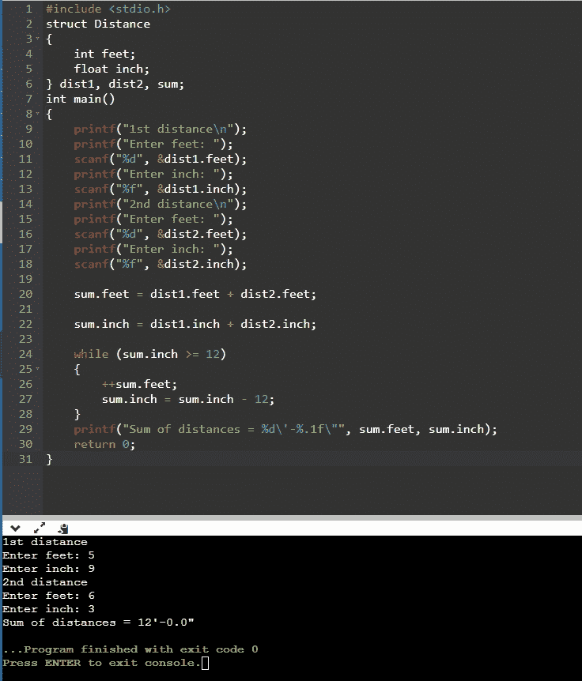

## 向结构体传递指针

我们也可以在 C 语言编程中定义结构体指针，其方法与定义另一个变量相同。为了访问指针的成员，可以考虑以下语法：

`Struct_pointer->title;`

## C 语言文件

编程要求开发者使用最有效的方法来处理不同的需求和场景。在 C 语言中执行文件处理操作，可以使用以下操作：

* `printf(f)`
* `scanf()`
* `read()`
* `write()`
* `seek()`

通常情况下，程序终止时所有数据都会丢失，因此我们需要创建一个包含所有数据的特定文件。这还可以节省时间，并允许程序员通过输入少量命令从文件中访问数据，并通过语言运算符将数据从一台计算机传输到另一台计算机。

常见的两种类型是文本文件和二进制文件。文本文件是`.txt`文件，可以使用记事本创建，维护和更新记录所需的精力最小。二进制文件以 0 和 1 的二进制形式存储数据。此外，与文本文件相比，二进制文件可以存储更多的数据。

在 C 语言中，我们可以通过下表提到的简单命令创建新文件、打开现有文件、读取和向文件写入信息以及关闭文件：

| 操作 | 语法 |
| :--- | :--- |
| 打开文件 | `Ptr = fopen("fileopen","mode")` |
| 关闭文件 | `Fclose(fptr);` |
| 写入二进制文件 | `Fwrite(address_data,size_data,numbers_data,pointer_to_file);` |
| 读取二进制文件 | `Fread(address_data,size_data,numbers_data,pointer_to_file);` |
| 写入文本文件 | `File *fptr; Fptr = fopen("address","w");` |
| 读取文本文件 | `File *fptr; Fptr = fopen("address","r");` |
| 文件寻求 | `seek(file, offset, int)` |

让初学者编程更轻松的必备提示：建议他们在代码部分使用`/* */`注释写入信息，这还可以提高程序的功能。此外，始终使用`int`、`char`和`float`等变量将使执行不同的计算变得更简单。C 语言由于指针、关键字和运算符的存在而速度很快，高效编写将确保初学者不会遇到问题。

# 第五章：C++

C++ 是一门免费的中间级编程语言，由 Bjarne Stroustrup 于 1979 年开发。作为编程语言的增强版本，C++ 现在已成为最常用且最适合初学者的语言，涵盖了不同的编程风格，并且允许编译器在执行程序前勾勒错误。此外，使用 C++ 进行面向对象的编程可以方便地解决复杂问题并扩展标准库的使用。C++ 是世界上最流行的编程语言，广泛应用于图形界面、操作系统和嵌入式系统。

## 基础语法

C++ 编程语言的基础语法与 C 相同。程序员必须遵循一组预定义的规则来正确执行程序。这是我们开始学习 C++ 时写的第一个程序：

```cpp
#include<iostream>
using namespace std;

int main()
{
    cout << "my first program in C++";
    return 0;
}
```

程序输出：my first program in C++。


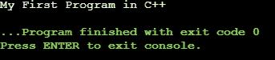

程序的详情如下：

```cpp
#include<iostream> // 该语句包含预定义的输入输出函数，并通知编译器包含 iostream 文件。
using namespace std; // 一个用于存储程序内函数、变量和操作的语句，其中 std 被视为命名空间名称。
int main() // 这是程序执行开始的主函数。int 返回类型指示编译器返回我们所包含的整数值。
cout << "my first program in C++"; // cout 是属于 iostream 文件的对象，用于显示内容。
return 0; // 该语句从主函数返回值 0 并结束。
```

C++ 编程语言中存在不同类型的变量。每个变量都通过特定的关键字定义，必须使用该关键字来创建变量、指定类型并按照下面的语法进行赋值：

```cpp
Typed variable = value;
```

### 变量类型

* `Int` 用于存储整数和全数。例如，`1`、`45`、`6346`。
* `Char` 用于存储单个字符。例如，`'a'`或`'z'`。
* `Double` 用于存储浮点数。例如，`50.2`、`100.2342`。
* `Bool` 用于存储具有两种状态的值：`true`或`false`。
* `String` 用于存储文本。例如 `"c++ programming language"`。

要声明变量并给其赋值，我们可以遵循下面提到的语法：

```cpp
Int newnum;
newnum = 50;
cout << newnum;
```

C++ 中使用的每个变量都以唯一的名称命名，这些名称被称为标识符。要构造标识符，名称必须包含字母、数字或下划线，并且区分大小写。

## 数据类型

C++ 编程语言中的数据类型定义了变量中可以存储的数据类型。通常，C++ 中的数据类型分为三类：内置的、派生的和用户定义的。用户定义数据类型包括结构（`struct`）、联合体（`union`）和枚举（`enum`），而派生数据类型是基于数组、函数和指针的。

### C++ 内置数据类型

* `Int`
* `Char`
* `Float`
* `Double`
* `Bool`

### 用户定义数据类型

* `Union`
* `Enum`
* `Struct`

### 派生数据类型

* `Function`
* `Array`
* `Pointer`

### 修饰符类型和存储类

C++ 编程语言中的修饰符与`char`、`double`和`int`数据类型一起，根据类型顺序更改含义以满足某些编程条件。这些修饰符包括`signed`、`unsigned`、`long`和`short`。

要在 C++ 程序中定义作用域变量和函数，我们可以使用存储类，如`auto`、`register`、`extern`、`mutable`和`static`。`auto`存储类是所有局部变量的默认类型，而`static`类允许编译器在变量超出作用域时仍然保留它们。`extern`类引用使用的全局变量以及更多的函数或修改的常量成员函数。

### 控制

C++ 语言中的控制是指运行期间指令、函数和语句求值和执行的顺序。语句从上到下顺序执行，直到逻辑完全满足。根据语句，C++ 提供了特定的控制语句：

1. `if else`
2. `for loop`
3. `while loop`
4. `break` & `continue`
5. `switch statement`
6. `if statement`

当程序中需要执行多个用例（cases）时，使用 if 语句。if 语句的语法显示，只有给定的真语句会被执行，假语句会被自动忽略。

```cpp
If(condition){
  statement;
}
```

if 语句的流程图：

```cpp
#include <iostream>
Using namespace std;
int main(){
  int marks = 80;
  if(marks < 100){
    cout << "marks less than 100";
  }
  if(marks > 100){
    cout << "marks greater than 100";
  }
  return 0;
}
```

### 嵌套 if 语句

在 C++ 中，语句中的语句被称为嵌套 if 语句。例如：

```cpp
If(condition_1){
  Statement1;
  If(condition_2){
    Statement2;
  }
}
```

if else 语句：

```cpp
If(condition_1){
  Statement;
}else if(condition_2){
  Statement;
}
```

### Switch case

C++ 编程中的 switch 语句用于需要对多个用例执行操作的场景。switch 语句的语法如下：

```cpp
#include <iostream>
using namespace std;
int main(){
  int num = 10;
  while(num > 5){
    switch(num){
      case 1:
        cout << "case 1";
        break;
      case 2:
        cout << "case 2";
        break;
      case 3:
        cout << "case 3";
        break;
      default:
        cout << "default";
    }
  }
  return 0;
}
```

### Goto 语句

C++ 中的 goto 语句改变程序的执行流，并将控制转移到另一个标记语句。goto 语句的语法：

```cpp
goto label;
```

### 循环

C++ 中的循环语句用于重复执行一段代码块，直到满足条件为止。C++ 中的循环类型：

1. `for`循环
2. `while`循环
3. `do-while`循环

* `while`循环：检查条件并在满足条件时持续执行循环体。
* `for`循环：多次执行特定的语句，并管理循环变量。
* 嵌套循环：在一个循环内部包含另一个循环。

循环可以通过不同的控制语句执行，例如`break`语句、`continue`语句和`goto`语句。

### Functions

函数负责将不同的代码段组合在一起并一起执行，以完成给定的操作。C++ 编程语言中的函数主要分为两种：库函数和用户定义函数。库函数是在 C++ 中预先定义的，而用户定义函数是由程序员自己创建的。

要定义函数，我们可以使用以下语法：

```cpp
Return_type function_name(parameter_list)
{
  function_body
}
```

`min()`函数的示例代码：

```cpp
int main(int enum1, int enum2) {
  //function declaration
  //local variable declaration
  int result;
  if (num1 < enum2) {
    result = enum1;
  } else {
    result = enum2;
  }
  return result;
}
```

### Function calling

在 C++ 中调用函数，可以使用以下方法：

* 引用传递。
* 传值调用。
* 指针传递调用。

### Function overloading

当两个或多个函数具有相同名称但参数不同时，这种处理被称为重载函数。C++ 中函数重载的语法如下：

```cpp
void samefunction(int a);
int samefunction(float a0);
void samefunction(int a, double b);
```

## Arrays, strings, pointers, and references

### Arrays

数组在编程语言中被频繁使用，因为它们允许我们处理海量的同类型数据。通常，数组被视为持有固定数量值的数据集合。

C++ 中声明数组的语法：

`DataType arrayname[arraysize];`

初始化：

`int age[5] = {15, 20, 25, 30, 35};`

使用数组计算 10 个数字之和的 C++ 示例程序：

```cpp
#include <iostream>
using namespace std;
int main() {
  int numbers[10], sum = 0;
  for (int i = 0; i < 10; i++) {
    cin >> numbers[i];
    sum += numbers[i];
  }
  cout << "sum = " << sum;
  return 0;
}
```

### Strings

字符串被称为字符集合。在 C++ 编程中，使用的字符串类型是标准库类。以下语法用于定义字符串：`char str[] = "";`

### Pointers

指针是一个存储另一个变量地址的变量。在 C++ 语言中使用指针时，我们需要定义指针并将地址赋值给指针。该操作通过使用一元运算符`*`完成。

* 空指针
* 数组指针
* 指针
* 将指针传递给函数
* 函数返回指针

### Object oriented C++

C++ 语言中的类和面向对象编程是创建对象和执行多种操作的简单方法。首先，我们在创建对象之前需要定义类，可以使用以下语法：

```cpp
class classname
{
  //data
};
```

类使用`public`、`private`或`protected`来定义，以便数据成员只能在程序内特定范围内被访问。

示例代码：

```cpp
class student
{
  private:
  char name[20];
  int rollno;
  int total;
  float perc;
  public:
    //获取学生信息的成员函数
    void getdetails(void);
    //打印学生信息的成员函数
    void putdetails(void);
};
```

### Inheritance and polymorphism

在实现继承时，被考虑的类从基类继承数据和函数。派生类可以访问基类的属性以及从现有基类派生的类。继承的语法定义如下：

```cpp
class base
{
  //...
};

class derived : base
{
  //...
}
```

当`class`被继承时，会使用公共访问修饰符。`base class`的公共成员在`derived class`中可以被设置为公共或受保护的。受保护成员在`derived class`中也会变为受保护的，而`base class`的`private`成员仍然保持无法访问。

在 C++ 中使用访问修饰符的语法：

```cpp
class myclass {
// public
public:
// access specifier
// class members
};
```

## 友元函数、数据结构与封装

### 友元函数


在面向对象编程中，非成员函数没有权限访问对象的 `private` 和 `protected` 数据。为了在这种情况下允许访问 `private` 或 `protected` 数据，我们可以使用 `friend function` 或 `friend class`，这允许程序员访问类的 `private` 和 `protected` 数据。

该函数通过关键字 `friend` 声明，并应该在类体内部使用。在 `C++` 编程语言中声明 `friend function`，我们可以使用如下所示的语法：

```cpp
class class_name
{
    friend return_type function_name(argument);
}
```

## 数据结构

虽然数据结构需要简明深入并带有细节以明确本主题的主题，但我们将讨论在 `C++` 中如何定义和使用结构体（Structured）。结构体是一种用户定义的类型，可以通过以下语法在程序中实现：

```cpp
struct [structured_tag]
{
    Data member definition;
}
```

例如：

```cpp
struct vehicle {
    char ename[50];
    char category[100];
    int model_year;
} vehicle;
```

要访问结构中的任何成员，我们可以使用成员访问运算符 `.`。指向结构体的指针通过数据结构得到了简化，我们可以使用以下语法：

```cpp
struct vehicle *struct_pointer;
```

## 封装

“封装”（encapsulation）一术语定义为编程中向用户隐藏敏感数据的方法。为了执行封装，我们需要将类变量和属性声明为 `private`，并通过 `getter` 和 `setter` 方法读取或修改 `private member` 的值。访问私成员的语法定义如下：

```cpp
#include <iostream>
using namespace std;

class Example {
private:
    // attribute
    int attribute;

public:
    // setter
    void set(int attribute) {
        attribute = attribute;
    }
    // getter
    int get() {
        return attribute;
    }
};

int main() {
    Example obj;
    obj.set(5000);
    cout << obj.get();
    return 0;
}
```

## 文件处理

`C++` 编程语言具有使用文件写入数据的方法。`C++` 提供了一个标准库，其中包含了 `fstream` 和 `ifstream` 数据类型。要打开文件，可以使用流对象，例如：`void open(const char* filename, ios::openmode);`。关闭文件的语法：`void close();`

`C++` 语言特性并支持标准模板库（`stl`）函数，这些函数可以用于快速编写代码。作为一种面向对象的编程语言，我们可以专注于对象并执行不同类型的操作和实现，而无需任何麻烦。与其他主要的编程语言不同，`C++` 还提供了指针支持。由于其快速、可靠和安全的特性，`C++` 被广泛应用于操作系统、浏览器、图形和数据库的开发。该语言速度快，并以其速度和效率而闻名。此外，`C++` 还允许异常处理并支持函数重载。

# 第六章：C#

## 概述与基础语法

### 概述

`C#` 是由微软开发的一种编程语言，用于 `.NET` 框架。该语言基于面向对象的编程方法，并与 `C` 和 `C++` 等其他现代编程语言具有相同的语法。`C#` 是一种开发的语言结构（`CLI`），具有运行时环境和编译代码。`C#` 易于学习，可以在不同平台上生成高效的程序。使用 `.NET` 框架的 `C#` 程序适用于 Windows 应用程序、集成开发环境（`IDE`）。

### 基础语法

在面向对象编程中，`C#` 关于类和对象。以下面的示例为例，类具有属性；虽然每个类都有相同的，但每个类都有不同的属性。通常，`C#` 程序包含命名空间声明、类、方法：

```csharp
using System;

namespace Example
{
    class Program
    {
        // attribute
        int attribute;

        public
        // setter
        public void set(int attribute)
        {
            attribute = attribute;
        }
        // getter
        public int get()
        {
            return attribute;
        }

        static void main(string[] args)
        {
            Program obj = new Program();
            obj.set(5000);
            Console.WriteLine(obj.get());
        }
    }
}
```

- 使用 `system`：用于包含程序所需的 `system` 命名空间。
- 命名空间声明：程序中 `data` 和 `classes` 的集合。
- 类声明：包含程序中所使用的数据和方法的 `class`。
- 静态 `void main()`：关键字 `static` 表示此方法可以在不实例化类的情况下被访问。
- `Console.WriteLine()`：用于定义系统命名空间的方法。
- `Console.ReadKey()`：让计算机等待下一个命令，并防止屏幕直接关闭。

### 数据类型与变量

数据类型是任何编程语言不可或缺的组成，它们指定了语言支持的类型化数据。在 `C#` 中，数据类型是预定义的，分为三大类：值类型（evaluated data types）、引用类型（referenced data types）和对象类型（object types）。

#### 1. 值数据类型

值类型变量派生自 `System.Value` 类，包含字母和数字形式的数据。下表显示了 `C#` 编程语言中使用的类型：

| 数据类型 | 表示法 | 默认值 | 范围 |
| :--- | :--- | :--- | :--- |
| Byte | 8 位无符号整数 | 0 | 0 到 255 |
| Decimal | 128 位精确小数值 | 0.0m | (-7.9e 10²⁸ 到 7.9e 10²⁸) / 10⁰ 到 28 |
| Bool | 布尔值 | False | True/false |
| Float | 32 位单浮点类型 | 0.0m | -3.4e 10³⁸ 到 +3.4e 10³⁸ |
| Double |  | 0.0d | (+/-)5.0e 10^-324 到 (+/-)1.7e 10³⁰⁸ |
| Char | 16 位 unicode 字符 | ‘`\0`’ | U+0000 到 U+ffff |
| Int | 32 位有符号整数类型 | 0 | -22,147,483,648 到 2,147,483,647 |
| Short | 16 位有符号整数类型 | 0 | -32,768 到 32,667 |
| Long | 64 位有符号整数类型 | 0l | -9,223,372,036,854,775,808 到 9,223,372,036,854,775,807 |

#### 2. 引用数据类型

引用类型存储的是变量的引用而不是实际数据。通过使用多个变量，引用类型可以指向内存位置，当内存位置被一个变量改变时，其他变量的值也会自动改变。

#### 3. 对象类型

对象类型被认为是 `C#` 中使用的所有数据类型。此外，对象类型和引用类型也包括自定义类型。

#### 4. 指针类型

指针包含变量的内存地址，语法为：`Type* identifier;`

### 运算符

`C#` 使用运算符的方式与其他编程语言相同，例如 `++`、内置的算术、关系、位运算、逻辑运算符和赋值运算符。

### 函数与方法

在 `C#` 编程语言中，函数允许程序员封装代码的特定部分，并从代码的其他部分复用。这避免了从多个处访问函数并执行所需操作。`C#` 中的函数使用以下语法声明：

```text
<visibility> <return type> <name>(<parameters>) { code }
```

类中已知成员函数在 `C#` 中也称为方法，通常称为实例方法和静态方法。函数可以返回任何类型的数据，并执行多条语句，如读取、跟随和运行。

使用函数的 `C#` 示例程序：

```csharp
using System;
class Return2
{
    public static string lastFirst(string firstName, string lastName)
    {
        string separator = ", ";
        string result = lastName + separator + firstName;
        return result;
    }

    public static void main()
    {
        Console.WriteLine(lastFirst("john", "william"));
        Console.WriteLine(lastFirst("james", "lewis"));
    }
}
```

### 数组、字符串

数组用于存储固定大小的数据元素。`C#` 语言中的数组声明：

```csharp
using System;
namespace Application
{
    class Array
    {
        public static void main(string[] args)
        {
            int[] numbers = new int[10];
            // 初始化数组元素
            for (int i = 0; i < 10; i++)
            {
                numbers[i] = i + 10;
            }
            // 输出每个数组元素的值
            for (int j = 0; j < 10; j++)
            {
                Console.WriteLine("element[{0}] = {1}", j, numbers[j]);
            }
        }
    }
}
```

#### 字符串

#### 类

#### 对象

## 类（Class）

类是创建对象的蓝图。类定义了对象的类型，也被称为类的定义和实例化，并可以使用以下语法创建：

```csharp
Student object1 = new Student();
```

一旦实例化创建了类，对象会被自动返回。例如：

```csharp
Student object2 = new Student();
Student object3 = object2;
```

以下程序展示了如何在 `C#` 编程语言中创建对象：

1. 使用 `system;`
2. 命名空间 `User`
3. `{`
4. 类 `Program`
5. `{`
6. `static void main(string[] args)`
7. `{`
8. `User user = new User("harry potter");`
9. `User.userdetails();`
10. `Console.WriteLine("pressed exit..");`
11. `Console.WriteLine();`
12. `}`
13. `}`
14. `Public class users`
15. `{`
16. `public string name { get; set; }`
17. `public int users(string name, int age)`
18. `{`
19. `Named = name;`
20. `aged = age;`
21. `}`
22. `public void getdetails()`
23. `{`
24. `Console.WriteLine("name:{0}, age:{1}", name, age);`
25. `}`
26. `}`
27. `}`

## 继承与多态（Inheritance and Polymorphism）

继承是面向对象编程语言的重要部分，允许程序员使用需要相同功能的不同类。继承工作在父类和子类的方法中。父类被视为基类，子类继承其父类的所有功能。

语法：

```csharp
<access-specifier> class base_class
{
    ...
}
class derived_class : base_class
{
    ...
}
```

对于多级继承：

```csharp
public class a
{
    // implementation
}
public class b : a
{
    // implementation
}
public class c : b
{
    // implementation
}
```

## 多态（Polymorphism）

多态是指通过单一操作执行多重功能的技术。静态多态在编译时完成，而动态多态在运行时决定。`C#` 中的静态多态允许程序员实现以下两种方法：

## 函数重载（Function Overloading）

函数重载为给定范围内同名的函数提供了多个定义。此外，函数定义之间的类型必须有所不同，因此你不能重载返回类型不同的函数声明。

## 构造函数（Constructors）

在 `C#` 编程中，每当创建结构或类时，构造函数会被调用。类可以有多个带有默认值的构造函数。

创建构造函数的语法：

```csharp
public class person
{
    private string last;
    private string first;
    public person(string lastname, string firstname)
    {
        last = lastname;
        first = firstname;
    }
    // remaining implementation of class
}
```

## 异常处理（Exception Handling）

异常用于将控制权从一个段转移到另一个段。通常异常使用 `try`、`catch`、`finally` 块。`try` 块概述使用异常的代码块。`catch` 块允许处理异常。`finally` 块执行提供的语句。

`C#` 编程语言是一种多线程语言，同时被视为编程的执行路径。它定义了特定的流控制和逻辑，并负责定义执行路径。它们是轻量级进程，线程可以节省 CPU 周期并返回以提高程序的效率。

线程在生命周期中有四种状态，包括启动状态、就绪状态、不可运行状态和已添加状态。可以通过实现特定的 `C#` 方法对线程进行创建、管理和销毁。

## 文件 I/O

`C#` 提供了不同的类来操作文件系统和处理数据。这些类可以用于打开文件、访问文件、目录以及更新现有文件。`C#` 包含了特定的文件类来执行所有 I/O 操作。

以下是类名及其的详细信息：

### File

`File` 是一个静态类，提供了不同的操作，包括移动、删除、创建、打开、复制、读取和写入。

### FileInfo

`FileInfo` 类执行与静态文件相同的操作，程序员可以通过为特定文件手动编写代码来进行读取和写入操作。

### Directory

`Directory` 类也是静态的，并支持在文件内创建、删除、访问和移动子目录。

### DirectoryInfo

`DirectoryInfo` 类提供了不同的方法用于访问、删除、移动和创建子目录。

### Path

`Path` 静态类提供了更改文件扩展名、获取文件扩展名以及获取特定文件绝对路径的功能。

## FileStream 类

`System.IO` 命名空间中的 `FileStream` 类用于通过 `C#` 语言创建、写入和关闭特定文件。创建 `FileStream` 类和对象的语法定义如下：

```csharp
FileStream name = new FileStream(<filename>, <filemodeenum>, <fileaccessenum>, <filesharedenum>);
```

`C#` 中的高级文件操作包括：

- 读取和写入文本文件。
- 读取和写入二进制文件。
- 操作 Windows 文件系统。

请记住，`System.IO.Stream` 是一个抽象类，提供了将字节传输到资源所需的所有标准方法。继承 `Stream` 类以执行某些读/写操作的类包括 `FileStream`、`MemoryStream`、`BufferedStream`、`NetworkStream`、`PipeStream` 和 `CryptoStream`。

## 学习 C# 的优势

`C#` 编程语言提供了快速的执行时间，并提供了一种解决特定问题的结构化方法。凭借高级函数和内置库的可用性，初学者可以轻松构建不同类型的应用程序。`C#` 是一种面向对象的语言，与其他高级级语言相比，其开发仍然保持简单。此外，`C#` 适用于创建具有良好交互性的健壮应用程序，且开发速度快、响应迅速。

# Python

## 概述

Python 是一种开发于 1991 年的著名编程语言，一种高级面向对象的解释型脚本语言，用于软件开发。

### 特性


作为一种解释型语言，Python 允许一次执行指令。数据类型很容易学习，因为它的语法定义清晰。通过标准库，Python 支持自动垃圾回收，并提供了与 C++、Java 等集成的高级动态数据类型。用户直接与 Python 解释器交互以编写程序，它同时也提供了低级模块。

Python 需要安装在你的电脑上，源代码可以在通用许可证 (GPL) 下下载。

## 变量类型、基本运算符和数据类型

### 变量类型

在 Python 编程中，不需要声明变量来保留内存位置，因为当给变量赋值值时，声明会自动发生。根据变量的数据类型，解释器分配内存并允许存储小数、字符和整数。

| Del | Else | And | Assert | In | Raise |
| From | Continue | If | Finally | Not | Pass |
| As | Return | Not | Pass | Yield | Break |
| Except | Import | For | Global | While | Print |
| With | Try | Exec | Or | Is | Elif |

## 基础运算符

Python 有内置运算符，如算术运算符、赋值运算符、逻辑运算符、位运算符、比较运算符和成员运算符。

Python 运算符的详情见下表：

| 算术运算符 | 赋值运算符 | 比较运算符 | 逻辑运算符 | 位运算符 |
| :--- | :--- | :--- | :--- | :--- |
| 加法 (`+`) | 等于 (`=`) | 双等 (`==`) | 逻辑 `or` | 二进制 `and` (`&`) |
| 减法 (`-`) | 加并赋值 (`+=`) | 不等于 (`<>`) | 逻辑 `and` | 二进制 `or` (`\|`) |
| 乘法 (`*`) | 减并赋值 (`-=`) | 大于 (`>`) | 逻辑 `not` | 二进制 `xor` (`^`) |
| 除法 (`/`) | 乘并赋值 (`*=`) | 小于 (`<`) | | 二进制左移 (`<<`) |
| 取模 (`%`) | 除并赋值 (`/=`) | 小于等于 (`<=`) | | 二进制右移 (`>>`) |
| 整除 (`//`) | 取模并赋值 (`%=`) | 大于等于 (`>=`) | | 二进制取反 (`~`) |
| 幂运算 (`**`) | 整除并赋值 (`//=`) | | | |

## 数据类型

在 Python 编程语言中，每个对象都有自己的类型和值。Python 的内置数据类型包括：

* 数字，包括整数、`floats`、分数 `fractions` 和复数 `complex`。Python 中的预定义数据类型为 `int`、`float`、`long` 和 `complex`。
* 序列由字符串、`bytes`、列表 `lists` 和元组 `tuples` 组成。
* 布尔持有 `true` 或 `false`。
* 字典包含键值对，且方式是无序的。
* 集合是值的无序容器。

## 控制流

控制流语句允许程序员像其他高阶编程语言一样改变程序的流程并执行特定操作。Python 中使用的三个主要控制流语句是 `if`、`for` 和 `while`。下图显示了控制流语句在程序中实际的工作原理：

### 条件语句

#### If 语句

`if` 语句是一个布尔表达式，以 `true` 或 `false` 的形式显示结果。

#### If-else 语句

`if-else` 语句也是布尔表达式，包含可选的 `else` 语句。如果表达式为假，则执行 `else` 语句。

#### 嵌套语句

语句中的语句被称为嵌套语句。

### 循环

循环被称为一系列指令，允许程序员通过实现某些条件来执行特定任务。在 Python 编程中，可以使用给定的控制结构来执行多个语句或一组指令。

Python 中的循环类型：

#### While 循环

`while` 循环用于程序内重复执行某个语句。

```python
#!/usr/bin/python
count = 0
while count < 10:
    print(count)
    count = count + 1
```

输出：

```
0
1
2
3
4
5
6
7
8
9
```

#### For 循环

`for` 循环用于遍历任何序列的项，包括字符串列表：

```python
fruits = ["apple", "banana", "cherry"]
for x in fruits:
    print(x)
```

输出：

```
apple
banana
cherry
```

## 函数

什么是函数？函数是用于执行特定任务和操作的组织代码。虽然编程语言提供了内置函数，但开发者也可以创建自己的函数。定义函数的语法如下：

```python
def functionname(parameters):
    "function docstring"
    Function suite
    return [expression]
```

为了引入函数定义，使用了关键字 `def`，它后面跟随着函数体所需的语句。变量通常存储在本地，除非声明为全局语句，否则无法分配任何值。

### 调用函数

Python 编程语言中的函数通过提供参数、提供可选参数或仅提供强制性参数来调用。Python 函数最大化了重用性，并使程序更容易添加和理解。以下是用于在 Python 中定义和使用函数的语句：

```python
def display(message):
    print('hi ' + message)

myfund('karl', 'os', *rest)

global ex
ex = 'hello'

def printer():
    global ex
    ex = 'hi'

def sq(k):
    for ei in range(k):
        yield ei**2

def sum(a, b=2):
    return a+b

nonlocal outer():
    a = 'old'
    def inner():
        nonlocal a
        a = 'new'
```

## 模块

模块化编程是将程序的不同组件或部分组织成系统的方法，使得代码更容易理解和实现。这种方法绑定了数据并允许程序员使用引用。在 Python 中，模块允许程序员将源代码保存在文件中并作为自然工具多次运行它们。

Python 编程语言包含了海量的文件、标准库和模块，其中包含数百多个模块。此外，它们还提供了跨平台的支持，用于执行多项编程任务，例如对象持久化、文本模式匹配和网络脚本。

Python 中 `import` 语句的语法如下：

```python
import module_name1 [, module_name2, ... [as module_name]]
```

与 `import` 模块一起使用的运行时操作语句有：

1. `import find`
2. `import compile`

若要使用名为 `newmodule` 的模块，我们可以如下调用函数：

```python
import newmodule
Newmodule.functionnamed("name")
```

在 Python 中从 `from` 导入模块的语法为：

```python
def newmodule import (name):
    print("hello, " + ename)

Person1 = {
    "name": "james",
    "age": 30,
    "country": "sweden"
}
```

## 面向对象的 Python

在面向对象编程中，我们要求定义类和对象来执行程序中的各种功能。与 C++ 和 C 等其他主流编程语言一样，我们可以使用面向对象的技术来创建、访问和更新类。

在 Python 中创建一个 `student` 类，代码编写如下：

```python
class student:
    def __init__(self, id, ename, class):
        self.rd = roll
        self.nd = ename
        print((self.n))

Stud1 = student(1, "james")
Stud2 = student(2, "william")
print("data successfully stored in variables")
```

访问对象的变量时，使用点运算符 `.`，其语法为：

```python
Myobject_name.variable_name
```

## 继承

继承是面向对象编程的一项有用特性，它允许开发者创建一个新类来继承现有类的所有方法和属性。我们可以使用继承技术，基于父类的属性定义一个新的子类（或称为派生类）。

Python 中实现继承的语法定义如下：

```python
class baseclass1:
    # 基类体

class derivedclass(basaclass1):
    # 派生类体
```

以下程序展示了父类以及派生类如何继承父类的特征并调用其函数。

```python
class vehicle:
    # 父类
    print("parent class")
    def __init__(self, price):
        self.priced = price

    def display(self):
        print('priced=', self.price)

class category(vehicle):
    # 派生类
    print("child/derived class")
    def __init__(self, price, ename):
        vehicle.__init__(self, price)
        self.named = ename

    def named(self):
        print('vehicle=', self.named)

Obj = category(2000, "mercedes")
Obj.display()
```

输出：

```
parent class
child/derived class
priced= 2000
```

要在派生类中重写方法，我们可以定义一个具有相同名称和参数的新方法。语法如下：

```python
class parent:
    print("parent class")
    def display(self):
        print("this is parent class")

class derived(parent):
    print("child/derived class")
    def display(self):
        print("this is derived class")

Obj = derived()
Obj.display()
```

## 文件输入/输出

文件输入/输出是磁盘上的特定位置，用于存储信息和数据。由于存储在硬盘中，我们也可以通过实现 Python 编程方法和技术来执行读写操作。Python 中的文件操作由三个主要方面：打开文档、文件、电子表格或代码。正则表达式允许程序员使用特殊语法查找相关的字符序列顺序。当在 Python 语言中编写表达式时，我们应该使用前缀 `r` 和其他特殊字符。

### Match 函数

`match()` 函数用于检查 Python 中的给定表达式是否匹配字符串。如果不匹配，我们使用 `match()`。

### Search 函数

该函数尝试在字符串中搜索所有可能的起始点，以匹配任何位置。它包含了 `search()` 函数。

### Split 函数

`split()` 函数可以直接应用于字符串，因为 `str.split()` 接受一个指定分隔符的模式。

```python
>>> f = open("sample.txt", 'r')
>>> f.read(4)
'This'
>>> f.read(4)
'D eis'
>>> f.read()
'My first file\nthis file\ncontains four lines\n'
>>> f.read()
```

### 打开文件

要使用 `open()` 函数打开文件，可以使用以下语法：

```python
f = open("samplefile.txt", "r")
print(f.read())
```

对于读取特定行，我们可以实现 `readline()` 函数：

```python
f = open("samplefile.txt", "r")
print(f.readline())
```

### 写入现有文件

以下 Python 编程语法将打开示例文件并追加内容：

```python
f = open("samplefile.txt", "a")
f.write("updated your content")
f.close()
```

### 添加后重新打开并读取文件：

```python
f = open("samplefile.txt", "r")
print(f.read())
```

### 创建文件

要创建一个新文件，将使用 `open()` 方法，它可以带有创建、追加或写入参数。在 Python 中创建文件的语法如下：

```python
f = open("newfile.txt", "w")
```

### 删除文件

要删除现有文件，应使用 `os.remove()` 函数并采用以下语法：

```python
import os
os.remove("samplefile.txt")
```

检查文件是否存在的语法：

```python
import os
if os.path.exists("samplefile.txt"):
    os.remove("samplefile.txt")
else:
    print("the file does not exist")
```

## Advanced Python

### 异常处理

编程语言中处理异常的三方法是 `try`、`except` 和 `finally` 块，用于处理程序执行过程中发生的错误。

#### Try

要通过 `try` 块产生异常，可以使用以下语法：

```python
try:
    print(x)
except:
    print("and exception occurred")
```

如果没有抛出错误，示例代码如下：

```python
try:
    print("python")
except:
    print("and exception occurred")
else:
    print("no exception occurred")
```

#### Finally

在异常处理中，即使 `try` 块已经抛出异常，`finally` 块也会执行。例如：

```python
try:
    print("python")
except:
    print("and exception occurred")
finally:
    print("try exception finished")
```

### 自定义异常

虽然编程语言中有内置异常可以在发生出错时强制执行处理，但开发者也创建了自定义异常以满足他们的需求。新异常是通过 `class` 创建的。

### 学习 Python 的提示

Python 编程语言适用于对人工智能、机器学习、机器人学和开发感兴趣的程序员。学习编程本身是强制性的，你需要学习基础 Python 语法。学习方法、途径和语法将使初学者能够开始编码并开发任何类型的应用程序。对于初学者来说，进行小型练习非常有益。它们能培养解决问题的能力并利用他们的编程概念。我写了一本关于 Python 的电子书。[Python 初学者入门](https://www.amazon.com/dp/B08DBXX7) [初学者的 Python](https://www.amazon.com/dp/B08DBXX7) [Python](https://www.amazon.com/dp/B08DBXX7) [Python](https://www.amazon.com/dp/B08DBXX7) [Python](https://www.amazon.com/dp/B08DBXX7) 将帮助你建立坚实的 Python 编程基础。

## 第八章：HTML

### 介绍与概述

超文本标记语言（HTML）是用于创建网站以显示颜色、字体、图片、媒体和图像的标准标记语言。HTML 由不同的标签组成，这些标签可以描述网页的结构并告诉浏览器在互联网上显示内容。

#### 什么是标签？

标签向浏览器提供有关任何网页结构、显示和内容的指令。由于它们通过闭合括号 `<>` 定义，因此标签由属性和元素组成。元素是页面上的对象，而属性描述了该对象的细节。记住，标签有开始标签和结束标签，通过 `</tag>` 进行区分。

使用标签创建的第一个 HTML 页面：

```html
<html>
<head>
<body>
<h1>my heading</h1>
<p>my paragraph</p>
</body>
</html>
```

### 标签说明

在上述编写的 HTML 文档中，`<html>` 标签封装了整个 HTML 文档，并由其他标签 `<head>`、`<body>` 和 `<p>` 组成。`<head>` 标签代表文件的头部，`<title>` 标签用于显示文档标题。`<body>` 包含了用于创建网页的其他标签，例如标题 `<h1>` 和段落 `<p>`。


每个`html` `document`都应该在`<body>`标签之后以`title`、`heading`和`paragraph`开始，下一个要使用的主要`tag`是`<h1>`或`heading`标签。根据你的内容需求，`heading`标签通过`<h1>`到`<h6>`来定义。例如：

### 标题（Headings）

```html
<html>
<body>
<h1>第一级标题</h1>
<h2>二级标题</h2>
<h3>第三级标题</h3>
<h4>第四级标题</h4>
<h5>第五级标题</h5>
<h6>第六级标题</h6>
</body>
</html>
```

输出：

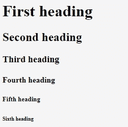 De

### 段落（Paragraph）

为了添加内容，我们需要在`html` `document`中包含段落。例如：

```html
<html>
<head>
<h1>标题</h1>
</head>
<body>
<p>第一个段落</p>
<p>第二个段落</p>
</body>
</html>
```

输出：

标题

第一个段落

第二个段落

为了在每个段落之间添加换行符，可以使用换行标签`<br>`。

### 摘要标签（Summary tag）

为了给段落添加摘要，带有`summary`标签的`html`语法定义如下：

```html
<details>
<summary>示例文本</summary>
<p>开发教程</p>
</details>
```

### 范围（Span）

`<span>`标签用于为文本的特定部分着色。例如：

```html
<p>开发 <span style="color:red">有趣的</span>学习</p>
```

### 选择（Select）

`<select>`标签用于从下拉列表中选择一个选项。例如：

```html
<select>
<option value="red">红色</option>
<option value="blue">蓝色</option>
<option value="green">绿色</option>
<option value="white">白色</option>
</select>
```

### 表头（The）

`<thead>`标签用于创建组头部内容，并与`<tbody>`和`<footer>`元素一起使用。例如：

```html
<table>
  <thead>
    <tr>
      <th>课程</th>
      <th>最高分</th>
    </tr>
  </thead>
  <tbody>
    <tr>
      <td>工程</td>
      <td>85</td>
    </tr>
    <tr>
      <td>英语</td>
      <td>90</td>
    </tr>
  </tbody>
  <footer>
    <tr>
      <td>um</td>
      <td>80</td>
    </tr>
  </footer>
</table>
```


### 格式标签（Formatting tags）

`html`文档中的文本可以格式化为不同的样式、字体和大小。用于格式化标题、段落和表格的标签如下：

#### 粗体（Bold）

写在`<b>`标签之间的任何文本将以粗体样式显示。例如：

```html
<p><b>开发</b></p>
```

输出：开发

#### 斜体（Italic）

写在`<i>`标签之间的任何文本将以斜体显示。例如：

```html
<p><i>开发</i></p>
```

输出：开发

#### 上标/下标（Superscript/subscript）

为了以上标形式显示内容，我们使用`<sup>`标签，使用`<sub>`用于下标。例如：

```html
<p>这段文本使用了<sup>上标</sup></p>
```

输出：这段文本使用了（上标）

#### 下划线（Underline）

写在`<u>`和`</u>`标签之间的文本将带有下划线。

```html
<p><u>示例文本</u></p>
```

输出：示例文本

#### 插入和删除标签（Insert and deleted tags）

为了插入，使用了`<ins>`和`</ins>`标签；为了删除任何文本，我们使用了`<del>`和`</del>`标签。

`<ins>插入</ins><del>删除</del>`

### 链接（Link）

为了在文本中添加链接，我们使用以下标签：

```html
<p><a href="document location">文档</a></p>
```

### 跑灯标签（Marquee tag）

`<marquee>`可以配合不同的属性使用，包括`width`、`height`、`direction`、`behavior`、`scrollamount`、`scrolldelay`、`loop`、`bgcolor`、`hspace`和`vspace`。`marquee`标签的演示：

```html
<html>
<head>
<title>html marquee 标签</title>
</head>
<body>
<marquee>示例文本</marquee>
</body>
</html>
```

### 容器标签（Container tags）

在`html`中，使用以下容器标签来格式化文本：

| 开始标签 | 结束标签 | 功能 |
| :--- | :--- | :--- |
| `<p>` | `</p>` | 段落 |
| `<span>` | `</span>` | 在段落内添加内联内容 |
| `<em>` | `</em>` | 用于强调文本强调 |
| `<ol>` | `</ol>` | 有序列表（数字） |
| `<ul>` | `</ul>` | 无序列表（符号） |
| `<li>` | `</li>` | 列表项 |

### 表格（Tables）

表格、图像和框架用于以`html`方式格式化信息。为了创建表格，我们使用以下标签：

```html
<table>
  <thead>
    <tr>
      <th>头部</th>
    </tr>
  </thead>
  <tbody>
    <tr>
      <td>单元格</td>
    </tr>
  </tbody>
</table>
```

### 图像（Images）

图像是任何网站的重要部分。图像用于在`html`中插入图像。插入图像：

```html


```

为了设置图像特定的高度和宽度，我们使用：

```html

```

### 视频（Videos）

为了在`html`页面添加视频，我们使用以下标签：

```html
<video>
  <source src="samplevideo.mp4" type="video/mp4">
</video>
```

### 对齐和边框（Alignment and border）

网页上有三种对齐图像的位置：居中、右和左。为此，我们使用`align`属性。例如：

```html

```

创建图像边框的属性是`border`。例如：

```html

```

## 框架（Frames）

HTML超文本语言框架用于在浏览器窗口中创建多个区域，以便每个区域都可以加载唯一的HTML文档。在页面中使用框架时，应该使用`<frameset>`标签代替`<body>`标签，可以使用特定的行（`rows`）和列（`columns`）属性进行定义。

创建框架的HTML标签示例：

```html
<html>
<head>
  <title>html frames</title>
</head>
<frameset rows="10%,80%,10%">
  <framed name="top" src="/html/top_frame.htm"/>
  <framed name="main" src="/html/main_frame.htm"/>
  <framed name="bottom" src="/html/bottom_frame.htm"/>
  <noframes>
    <body>your browser does not support frames.</body>
  </noframes>
</frameset>
</html>
```

## 内联框架（Iframe）

为了创建一个嵌套的浏览上下文，可以使用`<<iframe>>`标签将新的HTML文档添加到现有的文档中。要创建一个`iframe`，可以结合`<<iframe>>`标签实现以下语法：

```html
<iframe src="https://www.samplewebsite.com"></iframe>
```

基础HTML标签完整表格：

| `<a>` | `<abbr>` | `<acronym>` | `<address>` | `<applet>` |
| `<area>` | `<article>` | `<aside>` | `<audio>` | `<b>` |
| `<base>` | `<basefont>` | `<bdi>` | `<bdo>` | `<big>` |
| `<blockquote>` | `<body>` | `<br>` | `<button>` | `<canvas>` |
| `<caption>` | `<center>` | `<cite>` | `<code>` | `<col>` |
| `<colgroup>` | `<data>` | `<datalist>` | `<dd>` | |
| `<del>` | | | | |
| `<details>` | `<dfn>` | `<dialog>` | `<dir>` | `<div>` |
| `<dl>` | `<dt>` | `<em>` | `<embed>` | `<fieldset>` |
| `<figcaption>` | `<figure>` | `<font>` | `<footer>` | `<form>` |
| `<frame>` | `<frameset>` | `<h1>-<h6>` | `<head>` | `<header>` |
| `<hr>` | `<html>` | `<i>` | `<iframe>` | `` |
| `<input>` | `<ins>` | `<kbd>` | `<label>` | `<legend>` |
| `<li>` | `<link>` | `<main>` | `<map>` | `<mark>` |
| `<meta>` | `<meter>` | `<nav>` | `<noframes>` | `<noscript>` |
| `<object>` | `<ol>` | `<optgroup>` | `<option>` | `<output>` |
| `<p>` | `<param>` | `<picture>` | `<pre>` | `<progress>` |
| `<q>` | `<rp>` | `<rt>` | `<ruby>` | `<s>` |
| `<samp>` | `<script>` | `<section>` | `<select>` | `<small>` |
| `<source>` | `<span>` | | `<strong>` | `<style>` |
| `<sub>` | `<summary>` | `<sup>` | `<svg>` | `<table>` |
| `<tbody>` | `<td>` | `<template>` | `<textarea>` | `<tfoot>` |
| `<th>` | `<thead>` | `<time>` | `<title>` | `<tr>` |
| `<track>` | `<tt>` | `<u>` | `<ul>` | `<var>` |
| `<video>` | `<wbr>` | | | |

## 表单（Forms）

HTML表单在用户编辑时具有交互性。表单通过此类字段、按钮、选择框和可点击控件创建。通过表单收集的数据将发送到服务器进行处理。创建表单的语法`action`和`method`描述数据发送的位置：

```html
<form action="url" method="get|post">
  input, buttons, etc.
</form>
```

从用户获取输入的表单：

```html
<html>
<head>
  <title>my first form</title>
</head>
<body>
  <form>
    <label for="course">course:</label>
    <input type="text" name="course">
    <br>
    course: <input type="text" name="last">
  </form>
</body>
</html>
```

输出：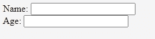

## 文本字段（Text fields）

HTML中的文本字段允许用户向表单输入文本。创建文本字段的标准语法定义如下：

```html
<input type="text">
<input type="text">
```

## 按钮控件（Button controls）

在表单中有多种提交数据的方法。你可以通过以下HTML标签添加可点击按钮：

```html
<input type="submit" name="submit">
<input type="reset" name="reset">
<input type="button" name="button">
```

输出：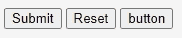

## 选择框（Select box）

要在HTML表单中创建下拉列表，使用`<select>`和`<option>`元素。例如：

```html
<html>
<head>
  <title>field upload</title>
</head>
<body>
  <form>
    <label for="course">course:</label>
    <select name="course" id="course">
      <option value="web engineering">web engineering</option>
      <option value="calculus">calculus</option>
      <option value="data science">data science</option>
    </select>
  </form>
</body>
</html>
```

输出：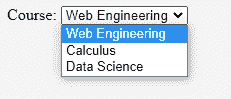

## 选择框（Select box）

`select`元素允许在表单排列多个选项。例如：

```html
<html>
<head>
  <title>course</title>
</head>
<body>
  <form>
    <select name="course">
      <option value="math">math</option>
      <option value="physics">physics</option>
    </select>
  </form>
</body>
</html>
```

输出：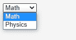

## 设计（Designing）

HTML的背景颜色默认为白色。要更改背景颜色，可以使用以下标签：

```html
<table bgcolor="green">
<table bgcolor="#f1f1f1">
```

## 字体（Fonts）

字体是内容可读性的重要部分。可以使用包含在`<font>`标签中的字体大小、颜色。设置字体大小的标签为：

```html
<font size="14"></font>
```

更改字体的属性为：

```html
<font face="times new roman" size="14"></font>
```

## 字体颜色（Font color）

要更改字体颜色，使用以下标签和属性：

```html
<font color="blue">this text</font>
```

输出：此文本是蓝色的。

## 标记文本

写在`<mark>`和`</mark>`元素之间的文本将以黄色标记显示。

例如：

`<p>this text is marked as <mark>yellow</mark></p>`

输出：this text is marked as yellow.

## 元数据标签（Meta tags）

在HTML中，元标签可以用于为网页添加元数据。元标签的属性包括`name`、`content`、`scheme`和`http-equiv`。我们可以使用`<meta>`标签为文档提供简短描述，这还可以提高你网页的搜索引擎索引。

例如：


```html
<html>
<head>
  <title>meta tags example</title>
  <meta name="keywords" content="html, meta tags, metadata"/>
  <meta name="description" content="meta tags."/>
  <meta name="revised" content="3/7/2019"/>
  <meta http-equiv="cookie" content="userid=abc; expires=monday, 08-sep-19 23:59:59 gmt;"/>
</head>
<body>
  <p>welcomed to html</p>
</body>
</html>
```

## 注释

若要在 HTML 代码中放置注释，应遵循以下语法：

```html
<html>
<head>
  <!-- document header starts -->
  <title>document title</title>
</head>
<!-- document header ends -->
<body>
  <p>document content goes here.....</p>
</body>
</html>
```

## HTML 样式表

为了进一步对 HTML 文档进行设计，层叠样式表（CSS）被应用于每个网站。它们提供了一种简单、有效且易于维护的替代方案，用于为每个网站指定某些属性。我们将在下一章中详细讨论 CSS。

## 布局与响应式

HTML 包含了各种类型的语义化元素，用于定义网页的不同部分。这些元素包括`header`、`container`、`section`、`article`、`aside`、`details`和`footer`。虽然 CSS 是设计网页布局的最佳方法，但也可以通过这些 HTML 元素完成该过程。

响应式网页设计是通过使用 HTML 和 CSS 创建的。该过程会自动调整网站的大小和布局，使其在桌面电脑、智能手机和平板等所有设备上看起来都非常合适。关于响应式的更多细节，学习 Bootstrap 将提供极大的优势。

HTML 模板是开发网站的一种快速方便的方法。使用模板允许开发者修改和添加所需的功能。使用 HTML 模板最大的优势是它们最适合那些不能设计吸引人的网站的人。

## 使用 HTML 的提示

即使在我们讨论了 HTML 的所有标签、属性和功能之后，还有其他重要方面可以让你的网站高效高效。在使用起始标签时，务必在编写元素和属性之前编写对应的结束标签。例如，`<p>` 将确保你的 HTML 页面在所有浏览器上正常工作，并尝试通过 CSS 为页面设置样式。

在发布到互联网之前，运行 HTML 验证器。此活动将提前发现任何错误或缺失的标签，以免你的网站在发布后无法运行。此外，请注意图像或视频的格式，因为它们在上传到互联网时有时会被破坏。在图像标签中指定宽度和高度可以帮助你解决这个问题。

虽然表格是页面上布局内容的一种简单方法，但你应该关注 CSS 规则并通过 CSS 构建页面内容。这不仅是更好的方式格式化你的网站，你还可以从 CSS 定位和提高网站的响应式中受益。

## 第九章：CSS

### 什么是 CSS？

CSS 代表“层叠样式表”（cascading stylesheet），负责控制文档的样式、设计和外观。它允许你使用 CSS 来设置网站的外观，这增加了文档的灵活性。通过使用 CSS，你可以在不更改 HTML 元素的情况下更改颜色、字体布局。学习 CSS 和 Bootstrap 将提供极大的优势。

内部 CSS 在单个文档中实现，以赋予其独特的样式。请记住，它必须嵌入在`head>`部分内。

### 内部 CSS 语法

实现内部 CSS 的语法如下：

```html
<head>
  <title>internal css</title>
  <style>
    selector {
      property:value;
    }
  </style>
</head>
```

## 外部 CSS

外部 CSS 有一个独立的文件，其中仅包含样式属性以及属性。外部 CSS 文件需要使用`link`标签与 HTML 文档链接。

### 外部 CSS 示例

```css
body {
  background-color:green;
}

.main {
  Text-align:center;
}

.gfg {
  color:#009900;
  font-size:50px;
  font-weight:bold;
}
```

## 基础语法和在 HTML 中的引入

CSS 由若干样式规则组成，这些规则由浏览器解释并应用于网页。通常，样式规则由三个关键元素组成：选择器（selector）、属性（property）和值（value）。

选择器和经过 CSS 样式的 HTML 标签可以应用，例如`<h1>`，其中属性（如`color`）赋值给 HTML 标签。值被分配给属性。创建 CSS 样式规则的基础语法定义如下：

```css
selector{property:value}
```

通常使用内联和外部 CSS 方法将样式与 HTML 文档关联，其中`<style>`元素位于`<head>`和`</head>`标签之间。在 HTML 文档中包含 CSS 的语法定义如下：

```html
<html>
<head>
  <link rel="stylesheet" type="text/css" media="all">
  <style>
    body {
      background-color:grey;
    }

    h1 {
      color:white;
      margin-left:40px;
    }
  </style>
</head>
<body>
  <h1>Sample heading</h1>
  <p>Sample paragraph</p>
</body>
</html>
```

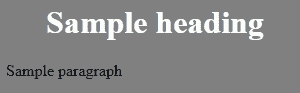

## 导入 CSS 文件

要导入外部样式表，可以实现以下规则：

```html
<head>
  @import url("url");
</head>
```

### 颜色和背景

在 CSS 中，颜色可以通过名称或不同类型的值定义。要指定颜色代码，可以使用的格式详述如下：

| 名称 | 语法 |
| --- | --- |
| 关键字 | `Green, blue, etc.` |
| Hex 代码 | `#rrggbb` |
| Rgb% | `Rgb(r%, g%, b%)` |
| Rgb 绝对值 | `Rgb(r, g, b)` |
| 短 Hex 代码 | `#rgb` |

例如，我们使用以下语法：

```css
h1{color:green}
```

### 背景

可以定义的背景属性包括背景颜色，使用以下 CSS 语法：

```css
body {
  background-color;
}

body {
  background-image:url("image.gif");
}

body {
  background-image:url("gradient_image.gif");
}

body {
  background-image:url("image.jpg");
  background-repeat:no-repeat;
}

body {
  background-image:url("image.jpg");
  background-position:center;
}
```

## 格式和边框设计

Border 属性可以定义唯一的颜色和宽度，用于创建点、实线、虚线、凹槽、双线、内嵌、偏移、隐藏、脊形和无边框。创建边框样式的语法：

```css
.dotted{border-style:dotted}
.solid{border-style:solid}
.dashed{border-style:dashed}
.grooved{border-style:groove}
.double{border-style:double}
.inset{border-style:inset}
.offset{border-style:offset}
.hidden{border-style:hidden}
.ridged{border-style:ridged}
.none{border-style:none}
```

### 高和宽

在 CSS 中使用了`height`和`width`属性。`Margin`属性用于设置每个侧不同的外边距。`Margin`属性有不同的值，如长度、宽度和 margin，由浏览器计算。

语法：

```css
body {
  margin:size;
}
```

### 内边距（Padding）

CSS padding 用于定义元素周围创建的边框。在 HTML 网站上设置单个侧（如上、右、下、左）内边距的其他不同方法。Padding 有长度和宽度值，并实现以下 CSS 语法：

```css
body {
  Padding:size;
}
```

### 字体和文本

CSS 中的 font 属性用于指定其他字体属性并设置字体内容。样式中包含的不同字体属性包括族（family）、字重（weight）、变体（variant）、字重（weight）和大小（size）。

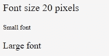

## 文本

现在可以通过 CSS 属性将文本转换为不同的颜色、样式和缩进。这些属性包括：

- 文本颜色：更改文本的颜色。
- 文本对齐：指定文本的水平或垂直对齐方式。
- 文本装饰：轮勒文本的装饰样式。
- 文本转换：控制文本的大小写。
- 文本缩进：指定第一行的缩进。
- 字间距：增加或减少单词（或字母）之间的间距。
- 行高：指定行高。
- 文本方向：设置书方向。
- 单词间距：设置单词之间的空间。
- 文本投影：在文本上添加阴影效果。

## CSS 文本属性的语法

### 文本颜色

```css
Body {
  color: red;
}
```

### 文本对齐

```css
H1 {
  Text-align: center;
}

H2 {
  Text-align: left;
}

H3 {
  Text-align: right;
}
```

### 文本装饰

```css
H1 {
  Text-decoration:overline/underline/line-through;
}
```

### 文本转换

```css
P.uppercased {
  Text-transform: uppercase;
}

P.lowercased {
  Text-transform: lowercase;
}

P.capitalized {
  Text-transform: capitalize;
}
```

### 文本缩进

```css
P {
  text-indent: 100px;
}
```

### 字间距

```css
H1 {
  Letter-spacing: 3px;
}

H2 {
  Letter-spacing: -3px;
}
```

### 行高

```css
P.small {
  Line-height: 0.6;
}

P.big {
  Line-height: 1.6;
}
```

### 文本方向

```css
P {
  Direction: rtl;
}
```

### 文本投影

```css
H1 {
  text-shadow: 4px 3px green;
}
```

### 单词间距

```css
H1 {
  Word-spacing: 10px;
}

H2 {
  Word-spacing: -5px;
}
```

## 链接、表格和页边距

### 链接

这里有通过 CSS 实现超链接的不同 CSS 属性。这些属性包括：`:link`、`:visited`、`:hover`和`:active`。实现`link`属性的 CSS 语法定义如下：

```html
<style type="text/css">
A:link {color: #000000}
A:visited {color: #006600}
A:hover {color: #ffcc00}
A:active {color: #ff00cc}
</style>
```

### 表格

这里用于转换和设计 HTML 表格的不同 CSS 属性：

- 框合并
- 框间距
- 标题位置
- 空单元格
- 表格布局

使用 CSS 创建简单表格的语法：

```html
<html>
<body>
<table class="table" border="1">
  <tr>
    <th>first name</th>
    <th>last name</th>
    <th>marks</th>
  </tr>
  <tr>
    <td>john</td>
    <td>harry</td>
    <td>40</td>
  </tr>
</table>
</body>
</html>
```

#### 输出

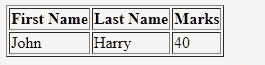

#### 框合并

```html
<head>
  <style type="text/css">
  table.one {border-collapse:collapse;}
  table.two {border-collapse:separate;}
  td.ad {
    border-style:dotted;
    Border-width:3px;
    Border-color:#000000;
    padding:10px;
  }
  td.bd {
    Border-style:solid;
    Border-width:3px;
    Border-color:#333333;
    Padding:10px;
  }
  </style>
</head>
```

#### 框间距

```html
<head>
  <style type="text/css">
  table.one {border-collapse:collapse;}
  table.two {border-collapse:separate;}
  td.ad {
    border-style:dotted;
    Border-width:3px;
    Border-color:#000000;
    padding:10px;
  }
  td.bd {
    Border-style:solid;
    Border-width:3px;
    Border-color:#333333;
    Padding:10px;
  }
  </style>
</head>
```

#### 输出

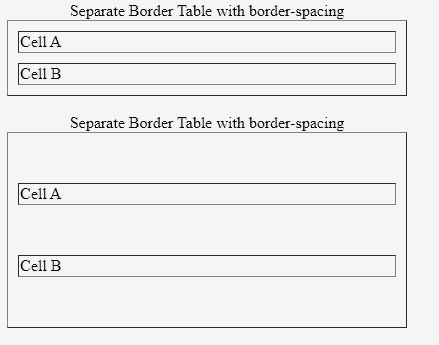

#### 文本对齐

```css
.top {vertical-align: top}
.bottom {vertical-align: bottom}
.left {vertical-align: left}
.right {vertical-align: right}
```

#### 空

```css
.empty {
  width: 350px;
  border-collapse: separated;
  empty-cells: hidden;
}

.empty {
  padding: 5px;
  border-style: solid;
  border-width: 1px;
  border-color:#999999;
}
```

#### 表格布局

```css
table.auto {
  table-layout: auto;
}

table.fixed {
  table-layout: fixed;
}
```

#### 页边距

```css
.link {
  margin: 10px;
  border: 1px solid black;
}
```

## 列表、图标和下拉菜单

这里有不同类型的列表：有序列表和无序列表。有序列表使用数字或字母标记列表项，而无序列表通常使用项目符号标记。这些列表通过`circle`、`decimal`、`lower-roman`、`upper-roman`、`decimal-zeros`、`lower-alpha`、`upper-alpha`和`square`等值来创建。

## CSS 有序列表与无序列表

### 无序列表

- 一个
- 两个
- 三

- 一个
- 两个
- 三

### 有序列表

A. 一个  
B. 两个  
C. 三

1. 一个
2. 两个
3. 三

## 图标

通过使用 HTML 中的图标库，我们也可以通过 CSS 添加不同类型的图标。例如 Bootstrap Awesome 和 Google 图标。

### Font Awesome 语法

```html
<link rel="stylesheet" href="https://cdnjs.cloudflare.com/ajax/libs/font-awesome/4.7.0/css/font-awesome.min.css">
```

### Bootstrap 图标语法

```html
<link rel="stylesheet" href="https://maxcdn.bootstrapcdn.com/bootstrap/3.3.7/css/bootstrap.min.css">
```

### Google 图标语法


```html
<link rel="stylesheet" href="https://fonts.googleapis.com/icon?Family=material+icons">
```

### 示例

```html
<!DOCTYPE>
<html>
<head>
<link rel="stylesheet" href="https://cdnjs.cloudflare.com/ajax/libs/font-awesome/4.7.0/css/font-awesome.min.css">
</head>
<body>
<h1>css icons</h1>
<i class="fa fa-cloud" style="font-size:32px;"></i>
<i class="fa fa-heart" style="font-size:32px;"></i>
<i class="fa fa-file" style="font-size:32px;"></i>
<i class="fa fa-car" style="font-size:32px;"></i>
</body>
</html>
```

# 零基础编程指南

在开发 Web、插件、桌面应用、订单以及移动应用程序时，Java 语言被认为被广泛使用，因为它提供了完善的支持和功能。HTML、CSS 和 PHP 是 Web 和网站开发的核心语言，初学者可以轻松学习。作为一名读者，或以程序员的身份阅读时不应将自己局限于只读一种语言，而应该尝试学习最新的技术和实现方法。

## 多种计算机编程语言

存在多种计算机编程语言，它们用于解决特定的问题。为了让事情变得简单，学者可以观察如何提高技能，并选择最适合且易于实现的编程语言。编程取决于其他几个因素，如应用程序的可用性、安全性、兼容性和响应时间。

## 高效编程贴士

虽然编写易于理解的代码并满足程序需求是计算机编程的主要部分，但也有一些本质的技巧和方法可以提高程序员的效率。从最关键的点开始考虑，程序员应该避免向函数传递长参数列表，并尽量尝试使用`int`、指针或避免使用函数类型。此外，不要将字符转换为另一种数据类型，因为硬编码变量可能位于帧的任何位置。

此外，绝不能用小函数初始化全局变量，并尽量减少对浮点数进行数学运算。这将减少执行时间并消耗更少的内存。当代码达到数千行时，全局变量和循环会使程序员难以处理应用程序，导致微小的变化就会产生巨大的问题。

在方法或函数内部编写`switch`分支、语句、循环和`try-catch`是一种理想的方法。记住，方法也应该写在类和函数定义内部。此外，通过使用合适的结构来组织应用程序是一个很好的方法，也能提高代码标准。

最后但同样重要的是，还应该考虑版本控制软件，以提高应用程序性能并交付更新。虽然并不是所有程序员都使用，但此类工具让初学者更容易学习和使用。在编写代码时，避免深度嵌套和限制长度会使代码难以阅读。

## 强化基础技能

要成为一名优秀的程序员，学习所有基础知识是强制。了解基础算法和数据结构是提高问题解决能力的极方法。此外，编写测试是另一种提升思维和编码技能的有效方法。编写代码后，进行深度审查并发现任何错误或改进空间是非常有意义的，要使用正确的命名规范并无障碍地替换变量。记住，为应用程序创建特定的文件夹对于轻松维护和调试具有巨大好处。学习编程基础是培养强大的开发和分析能力的关键方面。此外，尝试通过解决编程练习和编写简单代码来实现你的编码技能。这不仅会提高你的编程技能，你还能开发出高效有效的新解决方案。花时间学习编程基础也更容易适应最新的技术并学习新的编程方法。通过学习和实现新的方法、函数和方案，可以让编程变得有趣。

## 结论

《零基础编程指南》的设计和编写旨在为初学者提供宝贵的知识、信息和原则。本电子书涵盖了主流编程语言，并为实施给概念和发现提供了正确的指南。

编写计算机代码要求开发者遵循预定义的语法和流程。根据语言的不同，代码的长度可能会因为可用工具和技术的有所不同。计算机编程包含多个任务，包括编写代码、测试、实现系统、方法和调试。
