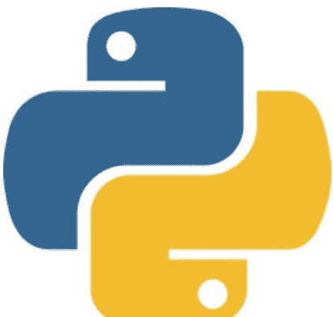

# 零基础学者编程指南：使用 Python、Java、SQL、C、C++、C#、HTML 和 CSS 掌握计算机编程基础

## 献辞

给我的父母。

感谢你们的培养，让我相信万事皆可能。

以及我的妻子。

感谢让一切成为可能。

## 前言

- 文件处理

## 结语

## 前言

《零基础编程指南》为决心学习最佳编程方法、技术和方法论的学生们提供了一份完整且真实的指南。随着软件行业每天都在更新最新的编码语言和工具，采用新技能和技术对于在竞争激烈的市场中生存是必不可少的。阅读对于学生和学习者来说一直是至关重要的资源，因为他们可以通过实施最新的技术和编程方法论来提高表现和输出。

本书是一本成功的编程手册，涵盖了所有主要的编程语言、语法和最佳实践，适用于初学者和专业人士。在进入编程世界之前，需要考虑几个重要的因素，以培养敏锐的问题解决和分析能力。因此，本书为初级程序员量身定制，并针对你可能对 Java、SQL、C、C++、C#、Python、HTML 和 CSS 提出的每一个问题提供了解决方案和答案。

我始终强调基础知识和技能的获取。本书不会在一小时或一夜之间让你成为程序员，但它将为你的编程职业奠定坚实的基础。读这本书后，你的编程基础知识将会增加，你对任何编程语言的熟练程度也会提高。

许多人通过各种方式帮助我编写这本书，提供了重要的反馈和鼓励并纠正了各种错误。我对他们感激。Steve 先生，他当时是我哈佛大学的计算机科学论文导师。他在一年前就知道我正在写一本编程书了。在 2020 年 12 月把书草稿发给他后，他的回复是：“我刚刚读完你的书。在过去的五六年里，我一直在想写这样的一本书——你做到了——我不需要再写了。谢谢。”

在个人层面，我必须感谢我的妻子 Rachel 和儿子 Aaron 无尽的耐心和支持。

我希望《零基础编程指南》能成为你编程之旅中最好的朋友，帮助你精通计算机编程。

愿源码与你同在。

# 第一章：什么是编程？

通常，编程是指计算机用于完成某些任务的一组指令。这也称为编码（coding）。在深入讨论之前，你必须充分了解编程是如何工作的，以及这组指令是如何被计算机处理的。当你能够遵循正确的方法编写计算机程序时，为任何语言实现函数、运算符和语法都会变得非常简单。此外，编程是与计算机通信的一种方式，程序员需要理解高级语言和低级语言。

为了用计算机解决问题，用户需要通过一组指令提供解决方案。由于程序是解决问题所需的指令集合，因此必须添加适当的语句和功能以实现预期的结果。例如，如果你被赋予开发一个用于整数相加程序的任务，那么执行加法的指令集就称为该程序。整数相加的算法将通过 C++、C、C# 或 Java 等特定语言表示。如果程序无法正常执行，那么你的算法或语法可能存在问题，因为如果有任何类型的错误，编译器或编辑器将无法执行。

通过实践和编写代码来学习编程，比学习冗长的方法论或复杂的技术效果更好。尽管在开始时看起来可能是一项有趣的活动，但如果你不遵循正确的方法，可能会变得耗时且令人沮丧。此外，本书将让初学者更容易选择最合适的编程语言，并毫不费力地进入计算机编程的世界。

## 使用计算机编程解决问题

本质上，计算机程序旨在按照一组指令来解决特定问题。人们可以通过多种技术和方法来编写程序。为了解决问题，你需要确定代码流并逐步满足要求以获得预期的输出。

使用制作木桌的例子，你需要写下如下指令：

- 获取制作桌子所需的合适的木材。
- 获取过程中将使用的必备工具和设备。
- 连接木块并制作你的桌子。
- 抛光成品使其具有吸引力。

在向计算机提供此类指令时，你需要更加具体和精确，因为计算机无法独立执行操作。由于它是为了遵循指令而创建的，你的计算机程序应该遵循增量方法以实现预期的结果。

关于计算机自然语言，它们无法理解人类语言，因此我们需要通过另一种名为二进制代码的语言与系统通信。二进制代码由一系列 `1` 和 `0` 组成，是计算机的自然通信语言。为了帮助计算机理解人类语言，我们使用翻译器和编辑器来编写程序。翻译器具有将源代码转换为机器语言的能力。

翻译器有多种类型，被称为解释器、编译器和汇编器。解释器通常用于解释逐行处理的语言，以运行最终的程序。此外，解释器还会列出任何语法错误或问题，以便程序员可以清除这些错误并执行程序。

在编译器的帮助下，源代码通过编译过程转换为二进制代码，然后被执行以交付输出。如果源代码中没有错误或问题，编译器将一次性翻译并执行所有行。此外，计算机程序也被称为 Apps（应用程序或应用软件），并针对它们设计上运行的环境或平台进行定制。Apps 还被分为桌面应用程序和移动应用程序两类。

## 编程基础

### 计算机编程简介

每个计算机程序都是过程（procedures）、流程（processes）和算法的组合，它们共同完成了源代码。由于这种过程的组合也可以被视为软件的表示，因此，流程被视为实现输出的一系列动作，而过程（procedure）可以被视为按特定顺序执行的一系列动作。算法是任何程序的驱动动力，也被称为解决特定程序或问题的有序步骤集。

有不同的高级语言和低级语言可用于编写计算机程序。如今，程序和软件通常使用流行的语言制作，包括 C、C++、Java、Python、HTML、PHP、Ruby 和 Perl。这些语言用于产生目前用于各个领域和行业的计算机程序，包括医疗、工程、通信、家用和娱乐行业。此外，计算机程序还用于创建图形、Web 应用程序和桌面应用程序。

### 计算机编程的元素与基础

通常，计算机语言是几个元素的组合，允许程序员实现预期输出。这些元素包括基本语法、编程环境、数据类型、关键字、变量、决策、基本运算符和函数。此外，为了在程序中执行某些操作，你还需要应用其他操作并使用循环、字符串、字符、文件 I/O 和数组等元素。

编程有五个不同的基本元素，也被认为是任何程序的构建块。这些元素被称为输入、输出、算术、条件和循环。从第一个元素开始，输入（Input）是将命令和数据获取到计算机的过程，而输出（Output）具有交付结果的功能。如果有任何形式的计算或操作，则使用算术（Arithmetic）元素结合条件（Conditional）语句来测试条件是真是假。

### 环境、数据类型和基本语法

#### 环境

为了运行或执行程序，你必须为你正在使用的语言安装或设置所需的工具和环境。此外，如果初学者发现自己安装和配置编程环境有困难，也可以使用文本编辑器来创建计算机程序。为了将程序执行为二进制格式，必须使用编译器，因为如果以文本格式提供程序，计算机无法直接理解。

此外，文本到二进制格式的转换由编译器完成，通过它，程序员也可以运行和执行程序。包括 C、C++、C# 和 Java 在内的编程语言需要二进制格式的编译，而 PHP、Perl 和 Python 等语言也可以直接编译。

#### 基本语法

为了让初学者更容易上手，我们将从底层开始，用 C++ 编写一个“Hello World”程序。如下所示的示例程序将让你更容易理解并开始编写你的第一个程序。

```cpp
#include <iostream>
using namespace std;
int main() {
{
    cout << "Hello World!";
    return 0;
}
```

相应的 Hello World 程序的输出如下：

```text
Hello World!
```

每个用 C++ 编写的程序都从 `#include <iostream>` 和 `main()` 开始，`main()` 也被称为主函数。程序根据需要继续使用函数、字符、循环、字符串或数组。在上面的程序中，`main()` 被用作函数，而 `cout` 是实现用于打印“Hello World!”的标准输出流。最后，`return 0;` 被写作程序的退出状态，这对于程序的执行也是必要的。

如果你无法执行程序，可能存在编译器未处理的某些语法错误或拼写错误。由于它会阻止程序编译，微小的拼写错误（如漏掉单个逗号、分号或点）最可能是原因。因此，如果你没有正确遵循为编程语言定义的语法，在这种情况下，你的程序可能无法编译或执行。

#### 数据类型

数据类型是各种编程语言的重要部分，在创建计算机应用程序时使用。由于它分类程序中编写的每个对象或变量，数据类型告诉编译器如何使用提供的数据来执行某些操作。通常，常用的数据类型包括整数、实数、布尔值、字母数字字符串、字符和浮点数。

数据类型的简要详情如下：

- 日期（Date）：`01/04/2015`
- 整数（Integer）：`1,52,13424`
- 布尔值（Boolean）：`True/False`
- 字符串（String）：`ab, aabb`
- 空值（Void）：无数据
- 长整数（Long）：`5325433253`
- 浮点数（Floating point number）：`5.2341`
- 短整数（Short）：`0`

#### 语法

如前所述，程序定义为执行某些操作以交付特定输出的元素和属性的集合。使用 C++ 编程语言时，编写程序时需要遵循预定义的语法。让我们简要概述一下基本语法如何工作。

1. **类（Class）**：类是一种定义的数据类型，拥有自己的成员函数和数据成员。例如：考虑学校类，数据成员将是老师、学生、行政人员等。
2. **对象（Object）**：对象是类的实例，拥有自己的行为和状态。例如，汽车有不同的颜色、型号、规格等。
3. **方法（Methods）**：方法被视为行为，负责类内不同动作的执行和处理。

## 编程变量、关键字、运算符和决策

变量是计算机程序的重要部分，因为它们提供了在程序中存储值和数据的计算机位置。为了保存值，你必须创建变量并为它们分配适当名称，将值存储到变量中并从变量中取回值。

为了开始声明变量，我们需要编写如下程序：

```cpp
#include <iostream.h>
int main() {
    int a;
}
```

上面的程序创建了一个名为 `a` 的变量，并由 `int` 关键字指定。这意味着该变量只能存储 `int` 类型的值，你不允许再次定义 `a` 以便变量中存储另一种类型的值。

要在变量中存储值，只需在程序声明变量之后声明要放入 `a` 的数字。

## 关键字

不同的编程语言有不同用途的关键字。虽然每个语言提供完整的保留关键字，但在使用关键字时需要遵循一条通用规则。与 `float`、`int`、`long` 和 `string` 一样，编程语言中最常用的其他关键字如下：

- `Else`
- `Switch`
- `Goto`
- `Static`
- `Case`
- `Break`
- `Enum`
- `For`
- `If`
- `Union`
- `Double`
- `Private`

## 运算符（Operators）

运算符是任何编程语言的关键部分，用于执行特定的操作或逻辑计算。由于它们通常用于数学计算，我们可以通过在程序中使用各种表达式来求解复杂的方程。

编程语言中通常有两种类型的运算符：

1. **算术运算符**：用于执行数学和算术操作的运算符。例如：`+`、`-`、`/`、`*`。
2. **二元运算符**：与其他操作数共同工作的运算符，如 `+`、`-`、`/`、`*`。
3. **一元运算符**：用于与单个操作数工作的运算符。例如：`++`、`--`。
4. **关系运算符**：这些是最常用的运算符，用于判断一个操作数是否等于另一个操作数。例如：`==`、`<=`、`>=`。

下表详细列出了基本运算符及其在程序中的功能：

| 运算符 | 功能 |
|---|---|
| `+` | 两个操作数相加 |
| `-` | 两个操作数相减 |
| `/` | 除法 |
| `*` | 乘法 |
| `==` | 检查两个操作数是否相等 |
| `>=` | 检查左操作数的值是否大于或等于右操作数 |
| `<=` | 检查左操作数的值是否小于或等于右操作数 |

逻辑运算符（Logical Operators）也是所有编程语言的重要组成部分。它们用于在各种场景下做出决策。这些运算符包括 AND（与）、OR（或）或 NOT（非）。它们也用于证明语句的真假。

## 决策（Decisions）

决策是一个程序员根据两个或多个给定条件选择一个选项的过程。你必须测试条件是真是假并给出正确的输出。

对于不同的编程语言，决策语句概述如下：

- `If` 语句
- `Else` 语句
- `Switch`
- `Else if` 语句
- 条件运算符（Conditional Operator）

## 编程字符、数组与字符串（Programming Characters, Arrays, and Strings）

在编程语言中，`Char` 类型用于存储字符和字母。它们还负责在程序中调用字符时存储值并交付输出。你只允许在单引号内存储单个数字或字母，例如 `&`、`@` 或 `+`。

定义字符的示例代码如下：

```cpp
Char ch1 = 'a';
```

## 数组（Arrays）

数组是一种能够存储相同类型顺序数量元素的数据结构，并且通常具有固定大小。由于它由连续的内存位置组成，因此也被存储在相同名称下的元素集。如果你正在编写一个顺序存储 10 个整数的程序，创建一个长度为 10 的数组将是最好的解决方案。

固定数量值数组的声明方式如下：

```cpp
int data[10];
```

两种流行的数组类型被称为：

1. 一维数组。
2. 多维数组。

## 访问数组（Accessing arrays）

完成声明后，你可以通过索引轻松访问元素。数组的第一个索引为 `0`，如果数组的大小为 `n`，你必须使用条件 `n-1` 来访问最后一个元素。

要初始化数组，你可以遵循以下模式：

```cpp
int arr[5] = {1, 2, 3, 4, 5};
```

数组允许程序员将数据存储到单个变量中，而无需专门定义每个变量。与其他数据类型类似，数组使用 `[]` 括号声明，一旦数组声明完成，你就可以赋值。在程序中创建、赋值和声明数组有多种方法。

## 声明（Declaration）

为了声明数组，你必须记住数组的大小必须是大于 `0` 的整数。数组可以如下声明：

```cpp
Type arrayName[arraySize];
```

## 初始化（Initialization）

要初始化数组，你可以使用下述语句：

```cpp
Int Arr[5] = {23, 45, 53, 64, 73};
```

## 字符串（Strings）

`String` 是编程语言中用于表示字符数组的数据类型。要声明和初始化一个字符串，你需要遵循与数组相同的结构。每种编程语言都有编写字符串的不同技术和方法，但每个情况下的功能是相同的。字符串也可以包含短语中的空格，例如“I have been waiting since 5 pm.”

字符串的示例如下：

```cpp
char c[] = "abcdef";
```

## 函数与文件输入输出（Functions and File I/O）

### 函数（Functions）

函数被称为在程序中执行特定任务的代码块。编程语言中有两种函数，称为标准库函数和用户定义函数。

标准库函数负责处理 I/O 处理、计算和数据处理等主要任务，而用户定义函数由程序员自己创建以执行特定任务。函数更像是可重用的代码，可以执行某些操作并为程序提供更好的模块化。

在 C 语言编程中定义函数，你需要声明返回类型（Return Type）、函数名（Function Name）、参数列表（Parameter List）和函数体（Function Body）。

例如：

```cpp
#include <iostream.h>
void functionName() {}
int main()
{
    functionName();
}
```

### 文件输入输出（File I/O）

为了存储和管理图像、Word 文档、纯文本或 Excel 表格等计算机文件，我们支持文件输入/输出（File Input/Output）操作模式。文件输入的方法是将任何数据写入文件，而文件输出方法用于显示来自文件的结果。通常，文件可以用不同的模式打开，如只读模式、只写模式或读写混合模式。

## 编程环境（The Programming Environment）

### 什么是编程环境？

开发环境是用于运行程序的工具和过程的组合。根据你编写代码的语言，我们可以选择最好的环境。

### 集成开发环境（Integrated Development Environment）

集成开发环境是指连接在一起以提供方便界面的软件。作为一种应用程序，集成开发环境（IDE）还有助于应用程序开发，并提供基于图形用户界面（GUI）的工作。现代 IDE 还可以执行算法和迭代。

## 工具与技术（Tools and Technologies）

有成千上万的软件开发工具、IDE 和技术可用于创建应用程序和程序。我们列出并简要介绍了一些程序员最有效、易用且先进的工具：

### NetBeans

NetBeans 是一个开源的集成开发环境，可以作为开发桌面、Web 和移动应用程序的工具。该工具允许简单高效的项目管理过程，允许开发者编写无 bug 代码，并提供智能代码编辑功能。此外，该 IDE 最适合 PHP、C++ 和 C 编程语言。

### Cloud9

谈到在线集成软件开发环境时，Cloud9 无疑是值得考虑的最佳工具之一。支持的语言包括 PHP、C、C++、Python、Perl、Node.js 和 JavaScript。开发者可以选择广泛的默认运行器来执行程序，并根据提供的建议快速编码。

### Visual Studio

Visual Studio 是由微软设计和开发的顶级集成开发环境。支持广泛的平台，开发者现在可以无忧地构建、保护、共享和管理软件组件。此外，自动化和 Azure 部署允许你在集中化版本控制系统的支持下提高代码质量。

对于开源开发者来说，由于 Java 虚拟机（JVM）范式的引入，Java 被认为是最流行的编程语言。这使得软件可以在任何系统上运行。初学者也可以从 C++ 开始练习编程，因为它提供了访问底层系统组件的机会和简单的方法论。

## 方法论

编程方法论是分析复杂问题并规划软件开发过程的过程，以实现最佳的解决方案。它也被称为模块化编程，软件开发过程分类如下：

1. **需求收集**

   作为软件开发生命周期（SDLC）过程的第一阶段，它由专家和专业人士执行，他们可以轻松地对项目进行可行性研究。通过讨论结果和技术方案，以确保项目能够无任何问题地完成。

2. **需求工程**

   下一步是收集相关数据并定义完成项目所需的运行。通常，我们必须创建一个《软件需求说明》（SRS）文档，其中包含了所有核心的设计和开发数据。系统分析师必须清楚客户的需求，并向开发者提供详细的简报，以便他们相应地编写代码。通常，客户无法清晰地定义他们的需求，只能提供通用的指南。

3. **设计**


在完成需求工程后，下一步是根据《软件需求说明》（SRS）文档指定设计架构。在此阶段，你还需要概述设计模块化、时间限制和产品规格。

## 4. 开发

这是开发者开始根据项目经理的指示和指南工作项目的阶段。对于每个特定的项目，会在广泛的研究和开发后选择编程语言，以完全满足客户的实际需求和功能。

## 5. 测试

此阶段涉及通过查看客户需求对软件进行检查和检查。通过使用各种测试用例检查产品是否存在错误、缺陷以及需要改进的地方，以确保每个需求都得到完全满足并运行。

## 6. 部署

部署是 SDLC 过程的最后一个阶段。由于产品现在通过了设计、开发和测试程序，已准备好交付给客户。根据业务策略，产品也可以在市场上发布或按照客户给出的指示进行发布。

## 前端技术

前端开发通常指的是通过实现 Web 应用程序的设计、结构和动画来开发用户界面。用于前端开发的核心技术包括 HTML、CSS 和 JavaScript，而专业开发者可能还会使用 AJAX、AMP 或 Angular 等最新技术。

超文本标记语言（HTML）和层叠样式表（CSS）是网站的基础构建模块，也用于增强网页的响应能力。HTML、JavaScript 和 CSS 是前端开发的三大技术。

## 文档编辑器

为了创建软件文档、演示文、图表、图形或动画，有多种文档编辑工具。从最流行的工具开始，你可以安装 Microsoft Office 并毫无麻烦地编辑任何类型的文档。该包包含了 Microsoft Word、Microsoft Excel、Microsoft PowerPoint、Outlook、OneNote、One Drive Access 以及其他模块。

# 第二章：JAVA

## 概述与基础语法

Java 是一种高级编程语言，由 Sun Microsystems 于 1995 年发布。有无限的网站和应用程序使用 Java 技术构建，因为它可靠、易于使用，并且比其他编程语言更快。作为一种面向对象的编程语言，开发者可以快地编写代码、编译、执行和测试程序。此外，使用 Java 开发的应用适用于多种环境，并且更加安全。

回到基础语法，Java 编程通常基于对象、类、方法、变量、修饰符、构造函数和正则表达式。为了更好地理解简单的 Java 程序，你可以参考以下各个每个方面的简要细节：

| 关键字 | 功能 |
| :--- | :--- |
| `Class` | 用于声明一个类 |
| `Void` | 返回类型 |
| `Public` | 使函数可见的访问修饰符 |
| `Static` | 用于在静态方法中创建对象 |
| `Main()` | `Main()` 方法置于程序的开头 |
| `System.out.println()` | 在控制台上打印语句 |

在开始 Java 编程之前，请确保记住 Java 是一种区分大小写的语言，你需要在声明类名时首字母大大写。方法名应该以小写字母开头，文件名必须与类名完全相同，以避免在执行程序时出现任何问题。Java 编程语言中的概念包括类、对象、多态、继承、抽象、封装、实例、方法和传递。

你的第一个 Java 程序可能像这样：

```java
class HelloWorld
{
    public static void main(String[] args)
    {
        System.out.println("Hello, World!");
    }
}
```

## Java 标识符与修饰符

标识符应该以 A 到 Z 的字母开头，因为关键字永远不能作为标识符。Java 中有两种修饰符。一种被称为访问修饰符，另一种是非访问修饰符。

## 对象、类与构造函数

### 类与对象

对象是类的一部分，也被称为类的实例。类代表了所有对象共有的一组属性。以现实中的手机为例，它具有颜色、内存、显示器和重量等属性。

要创建一个类，你需要遵循以下语法：

```java
public class NewClass {
    int a = 1;
}
```

创建对象 `newObj`：

```java
public class NewClass {
    int a = 1;
    public static void main(String[] args) {
        NewClass newObj = new NewClass();
        System.out.println(newObj.a);
    }
}
```

创建对象需要声明、实例化和初始化。声明是声明变量名及其对象类型的过程，而实例化使用 `new` 关键字创建对象。然后通过调用构造函数继续程序，以初始化新对象。

## 基础数据类型与变量

在 Java 程序中，数据存储在变量中，程序首先声明变量，将数据读取到变量中，然后执行提供的操作。一旦过程完成，变量将被写入一次新位置。变量提供了一个预留的内存位置来存储值，内存由操作系统分配。

### 数据类型

Java 编程语言中有两种不同的数据类型，称为原始数据类型和对象类型。原始数据类型分为 8 类：Byte、Short、Int、Long、Float、Double、Boolean 和 Char。对象数据类型通过使用类的构造函数创建，它们也负责访问对象。每个可用引用变量的默认值都设置为 `null`。

### 变量

Java 编程语言中有三种变量：

1. 局部变量
2. 实例变量
3. 类/静态变量

#### 局部变量

局部变量通常在构造函数和方法中声明。由于它们是通过构造函数创建的，因此不能与局部变量一起使用修饰符。局部变量没有默认值。

#### 实例变量

实例变量定义在类内部，每当创建对象时就会被创建。它们用于存储被多个构造函数或方法引用的值。实例变量也可以赋予访问修饰符。

## 运算符、控制语句与决策

### 运算符

Java 语言中提供的基本运算符解释如下：

- 算术运算符：算术运算符可用于程序中执行数学计算和方程求解。这包括加、减、乘、除、取模以及递增和递减函数。
- 一元运算符：后置 `expr++` 和前缀 `++expr` 表达式。
- 逻辑运算符：`(A && B)` 为假，`(A || B)` 为真，`!(A && B)` 为真。
- 位运算符：用于执行逐位操作。
- 赋值运算符：`=`、`+=`、`|=`、`^=`。

### 控制语句

Java 语言的控制语句与 C 或 C++ 等其他主要编程语言相似。详细说明如下：

**If Else：**该语句用于检查给定的条件为真还是假。Java 编程语言中有不同类型的语句，称为 if 语句、if-else 语句、if-else 链和嵌套 if 语句。

这里有一个演示 if 语句的简单 Java 程序：

```java
public class Marks {
    public static void main(String[] args) {
    int marks=50;
    if(marks<50) {
        System.out.print("Your marks are less than 50");
    }
}
```

上述程序的输出为：Your marks are less than 50.

**If-else：**该语句用于测试条件，如果结果为真，则执行 if 块；如果为假，则执行 else 语句。

**Switch：**Switch 语句用于从多个条件中执行单个语句。该语句适用于包括 `short`、`int`、`long`、`byte`、`String` 和 `Long` 在内的数据类型。

Switch 语句的语法如下：

```java
switch(expression){
case value1:
// 要执行的代码;
break;
case value2:
// 要执行的代码;
break;
default:
所有 case 都不匹配时执行的代码;
```

## 循环

编程语言中通常有三种循环：

- For 循环
- While 循环
- Do-while 循环

### For 循环

For 循环用于在程序的范围内执行迭代。如果迭代次数固定，建议在程序中使用 For 循环。

### While 循环

While 循环具有重复单个或一组语句的特性，用于测试给定条件是否为真。它用于迭代次数不固的情况。

### Do While 循环

Do While 循环用于多次迭代程序的某部分。如果迭代次数不固定，则要求至少执行一次程序。

需要特定的控制语句来将执行转换为普通顺序。Java 编程语言中使用的两种控制语句包括：

- **Break 语句：**终止 switch 或循环并开始下次循环。
- **Continue 语句：**允许循环重新测试条件并跳过主体的剩余部分。

## 决策

决策结构性特征是在给定场景下需要测试的一个或多个条件。如果条件为真，可以执行下一条语句；如果给定的条件为假，程序将终止。下面的图正确显示了决策过程的实际工作原理：

## 字符、字符串、数组与正则表达式

Java 编程语言使用了字符包装类，并提供了多个用于操作字符的静态方法。要创建一个字符对象，需要遵循以下语法：

`Character ch = new Character('a');`

编译器会自动创建一个 Character 对象，如果你向方法传递任何基本类型 `char`，编译器将使用该语言中的各种方法将 `char` 转换为 `Character`。

由于我们之前讨论过字符串重要性和功能，Java 平台也提供了字符串类的支持。程序员可以通过多种方式操作字符串。在 Java 语言中创建字符串的示例代码如下：

```java
public class NewString {
    public static void main(String[] args[]) {
        char[] StudentArray = { 'S', 'T', 'U', 'D', 'E', 'N', 'T' };
        String StudentString = new String(StudentArray);
        System.out.println(StudentString);
    }
}
```

该程序的输出为：Student。

此外，我们可以使用 Java 编程语言中简单的连接方法来拼接字符串：

`String1.concat(string2);`

为了在 Java 中创建字符串对象，程序员可以选择字面量方法或关键字方法。

## 数组

数组是每个编程语言的重要组成部分，因为允许程序员处理和存储数据到变量中。由于它们被用于存储大量数据，你也可以将数组视为同一类变量的集合。要声明数组，可以遵循简单的语法 `datatype[] arrayRefVar;`。

在 Java 中创建数组非常简单，可以使用以下语法：

`arrayRefVar = new datatype[arraySize];`

该语句将创建一个给定大小的数组，并将该数组的引用赋值给指定的变量。通常使用循环或 `foreach` 循环处理数组，因为数组内的元素具有相同的类型和大小。

用于排序、搜索的静态方法：

- `static int binarySearch(Object key)`
- `static void fill(Object val)`
- `static Boolean equals(Object a)`
- `static void sort(Object a)`

## 正则表达式

正则表达式是一个用于定义模式的 API。`java.util.regex` 包包含 `Pattern` 类、`Matcher` 类和 `PatternSyntaxException`。`Matcher` 类没有公共构造函数。`PatternSyntaxException` 用于指示正则表达式中的错误或缺陷。

## 文件与 I/O

Java 语言具有一个负责数据输入和输出操作的内置包。流被称为 `java.io`，支持处理数据的多种操作和功能。Java 中有两种通用类型的流，称为输入流（Input Stream）和输出流（Output Stream）。

- 字节流
- 字符流
- 标准流
- 文件输入流
- 文件输出流

## 面向对象 Java

面向对象是一种使用类和对象的方法。通过使用继承、多态、封装和抽象等多个概念，程序员可以开发 Java 应用程序和程序。

## 继承

继承是 Java 编程语言中的特性，允许它继承另一个类的特征和属性。这可以在子类和父类之间进行。被继承类的被称为父类，而继承另一个类的类的被称为子类。

在 Java 编程语言中使用继承，可以按照下面的语法：

`Class derived-class extends base-class`

```java
{
  //方法
}
```

## 多态

以多种方式完成单项任务的技术被称为多态。在 Java 编程中，我们可以使用方法重写和方法重载技术来实现多态。必须知道，对象可以通过引用变量访问，一旦它被重新赋值给其他对象，可以使用引用变量的类型来确定用于访问对象的方法。

例如：

```java
public interface School{}
public class Student{}
public class John extends Student implements School{}
```

## 抽象

抽象类（Abstract Class）是在声明中包含 `abstract` 关键字的类，它可能包含也可能不包含抽象方法。如果类具有抽象方法，它就无法被实例化，程序员必须从另一个类中继承它来实现该抽象方法。

## 封装

Java 编程中的封装是将数据和方法包装在一起的过程。通常情况下，一个类的变量对另一个类隐藏，并且只能通过当前类中使用的方法进行访问。封装的优点是，类可以被设置为只读或只写，并且还可以对存储的数据进行完全控制。

## 递归

递归是指一种在程序内部调用自身的方法。`recurse()` 方法从 `main` 方法调用，也可以在同一个 `recurse()` 方法中被调用。这个过程一直持续到满足给定条件，如果条件不满足，就会发生无限递归。

以下是 Java 中递归的简单实现：

```java
class Sample {
    static void printFun(int test)
{
        if (test < 1)
            return;

        else {
            System.out.printf("%d ", test);

            // Statement 2
            printFun(test - 1);

            System.out.printf("%d ", test);
            return;
        }
}

    public static void main(String[] args)
{
    int test = 3;
    printFun(test);
    }
}
```

## 递归的优点

在某些复杂的程序中，编写递归代码可以带来多处好处。因为它提供了一种简单且整洁的代码编写方式，开发者可以轻松地执行各种操作。

## 抽象类和抽象方法

### 抽象类

在 Java 编程中，抽象类（Abstract class）被称为一种无法实例化并使用 `abstract` 关键字声明的类。

以下是在 Java 中声明抽象类 `Student` 的语法：

```java
abstract class Student {
    //methods and attributes
}
```

记住，我们不能创建抽象类的对象。这样做会导致编译错误。

### 抽象类的继承

这里是一个演示抽象类继承的 Java 程序：

```java
abstract class Student {
    public void displayInfo() {
        System.out.println("I am a Student");
    }
}
class Grade extends Student {
}
class Main {
    public static void main(String[] args) {
        Grade G1 = new Grade();
        G1.displayInfo();
    }
}
```

### 抽象方法

在 Java 中创建抽象方法，使用相同的关键字 `abstract`。

语法定义如下：

`abstract void moveto();`

# 第三章：SQL 与数据库

## 什么是数据库？

数据库是一个可以被访问、管理和更新的数据集合。在简要讨论数据库之前，重要的是理解数据（Data）的实际含义以及它是如何被处理的。数据通常被定义为记录和事实的集合，我们可以对它们进行计算和应用推理。为了保护、保存、交付和组织数据，创建了数据库，而管理整个过程的系统被称为数据库管理系统（DBMS）。

## 数据库管理系统 (DBMS) 概念

数据库管理系统由多个程序组成，允许用户访问数据库并通过不同的过程处理数据。由于它通常设计用于控制对数据库的访问，因此在 DBMS 中引入了各种操作和功能，使其更加高效、安全和可靠。

有 4 种不同类型的 DBMS：

1. **关系型 DBMS**

   该类 DBMS 以表的形式定义数据库关系。

2. **对象关系型 DBMS**

   对象关系型 DBMS 允许以对象及其属性的形式存储数据。

3. **网络型 DBMS**

   网络型 DBMS 具有多对多的关系，通常用于复杂的数据库结构。

4. **层级型**

   层级 DBMS 遵循父子关系来存储数据，其结构类似于树，使用节点来表示各种字段。

## 数据库环境与架构

数据库环境被称为一个组件的集合系统，负责数据的处理、管理和使用。由于数据库通常存储在计算机中，管理整个过程的硬件和计算机外设还包括如 SQL Server 等 DBMS 工具。

数据库或 DBMS 的架构通常分为三大类：集中式、去中心化和层级。数据库系统可以是客户端-服务器或集中式的，也可以设计为供并行计算机架构访问。

DBMS 的三层架构定义如下：

- 表现层 (Presentation Tier)
- 应用层 (Application Tier)


- 数据库层（Database Tier）

## 数据库类型

根据组织方法和功能，数据库分为不同的类型。

### 关系型数据库

关系型数据库是以多种方式定义、组织和访问数据的地方。作为一种表格数据库，表由行和列组成，通过结构化查询语言（SQL）进行管理。

### 分布式数据库

分布式数据库将其数据存储在多个站点，这些站点通过通信链路相互连接。这种数据库进一步细分为同构（Homogeneous）和异构（Heterogeneous）。对于同构分布式数据库系统，连接的是相同类型的硬件、操作系统和数据库应用程序；而异构分布式数据库系统在每个位置的系统可以是不同的。

### 云数据库

云数据库环境的设计和构建用于在私有云、公有云或混合云中存储数据。提供更好的扩展性和存储容量，用户可以从高可用性中受益。它是业务的最佳选择。

### NoSQL 数据库

NoSQL 数据库非常适合大型数据，并通过关系数据库进行方便管理。此外，它们对于关系数据库无法解决的大数据性能问题非常有效。

### 对象数据库

对象数据库由关系数据库支持，基于对象而非操作。

### 用户数据库

用户数据库是专门为用户设计创建的共享数据库。由于它提供了整个数据库的摘要，用户完全不需要担心任何级别执行的操作。

## 数据库语法、数据类型与运算符

标准查询语言（SQL）用于在数据库内存储、操作和检索数据。SQL 允许管理员执行管理数据库所需的多种操作。

## 结构化查询语言（SQL）

SQL 是用于 MySQL、Sybase、Oracle 和 SQL Server 等关系数据库系统的语言。作为一种标准的数据库语言，SQL 允许用户描述数据、访问数据并操作关系数据库管理系统。此外，用户还可以通过结构化查询语言创建、查看和删除数据库。此过程涉及的不同组件包括优化引擎、SQL 查询引擎、经典查询引擎和查询分发器。在关系数据库管理系统中执行特定操作可以使用以下命令：

| 命令 | 说明 |
| --- | --- |
| CREATE | 用户在数据库中创建新表或对象 |
| READ | 用户读取存储在表中的数据 |
| UPDATE | 更新表以修改记录 |
| DELETE | 删除表中的任何记录 |
| INSERT | 向表中插入新记录 |
| SELECT | 从表中选择特定记录 |
|  | 数据库操作 |
| ALTER | 在数据库对象内进行更改。 |
| DROP | 从数据库中删除整个表。 |

通过使用上述操作，我们可以对下方名为“Students”的示例表执行不同的操作：

| 学生 ID | 学生姓名 | 城市 | 学科 | 分数 | 百分比 |
| --- | --- | --- | --- | --- | --- |
| 1 | William | 纽约 | 数学 | 85 | 60% |
| 2 | James | 加利福尼亚 | 英语 | 79 | 58% |

从上表获取记录的 SQL 语句具有以下语法：

```sql
SELECT * FROM Students;
```

### SQL 查询

为了对数据库中的表执行特定操作，我们需要使用不同的查询，解释如下：

| 查询 | 语法 |
| --- | --- |
| INSERT INTO | `INSERT INTO table_name(column1, column2,...) VALUES (Value1, Value2,...)` |
| UPDATE | `UPDATE table_name SET column1 = value1, column2 = value2.. WHERE condition` |
| DELETE | `DELETE FROM table_name WHERE condition` |
| ORDER BY | `SELECT column1, ..FROM table_name ORDER BY column1, ASC/DESC;` |
| MIN() | `SELECT MIN(column_name) FROM table_name WHERE condition;` |
| MAX() | `SELECT MAX(column_name) FROM table_name WHERE condition;` |
| WHERE | `SELECT column1.. FROM table_name WHERE condition;` |

## SQL 连接（Joins）

以带有表 A 和表 B 的关系数据库为例，表也可以通过 SQL JOIN 查询进行连接。韦恩图清晰展示了两个表如何连接在一起以共享数据：

我们将在下方的“Patients”示例表上实现各种 JOIN 子句操作：

表 1：

| 患者 ID | 病号 | 日期 |
| --- | --- | --- |
| 43221 | 1 | 9-2-2011 |
| 82357 | 3 | 8-12-2015 |

表 2：

| 病号 | 患者姓名 | 城市 |
| --- | --- | --- |
| 1 | Andrew | 芝加哥 |
| 3 | John | 洛杉矶 |

要连接这两个表，我们可以编写以下 SQL JOIN 语句：

```sql
SELECT Patient.PatientID, Case.CaseNo, Date.
FROM Patients
INNER JOIN Patients On Case.CaseNo = PatientName.PatientID;
```

有四种不同的 SQL JOIN 查询类型，称为：

- INNER JOIN（内连接）
- LEFT OUTER JOIN（左外连接）
- RIGHT OUTER JOIN（右外连接）
- FULL OUTER JOIN（全外连接）

### 内连接（Inner join）

内连接从表 A 和表 B 中选择满足连接条件的完整记录。SQL 中创建内连接的语法定义如下：

```sql
SELECT column
FROM table1
INNER JOIN table 2
ON table1.column_name = table2.column_name;
```

### 左连接（Left Join）

左连接从表 A 中选择所有记录，并结合满足连接条件的表 B 记录。SQL 中创建 LEFT JOIN 的语法定义如下：

```sql
SELECT column
FROM table1
LEFT JOIN table 2
ON table1.column_name = table2.column_name;
```

### 右连接（Right Join）

右连接从表 B 中选择所有记录，并结合满足连接条件的表 A 记录。SQL 中创建 RIGHT JOIN 的语法定义如下：

```sql
SELECT column
FROM table1
RIGHT JOIN table 2
ON table1.column_name = table2.column_name;
```

### 全连接（Full outer Join）

如果未满足连接条件，全外连接将从表 A 和表 B 中选择所有记录。SQL 中创建 FULL JOIN 的语法定义如下：

```sql
SELECT column
FROM table1
FULL OUTER JOIN table 2
ON table1.column_name = table2.column_name
WHERE condition;
```

## UNION 运算符

为了合并两个或多个 SELECT 语句的结果，使用了 UNION 运算符，其中每个列必须具有相似的数据类型。此外，两个表 SELECT 语句中的列顺序应该是相同的。SQL 中实现 UNION 运算符的定义如下：

```sql
SELECT column_name FROM table1
UNION
SELECT column name FROM table2;
```

## 分组（GROUP BY）

GROUP BY 语句可用于对数据库表执行列表或编号。SQL 中使用 GROUP BY 语句的语法定义如下：

```sql
SELECT column_name
FROM table_name
WHERE condition
GROUP BY column_name
ORDER BY column_name;
```

## 排序（ORDER BY）

SQL 中的 ORDER BY 语句用于按升序或降序排序数据。实现 ORDER BY 子句定义如下：

```sql
SELECT column_list
FROM table_name
WHERE condition
[ORDER BY column1, column2,] [ASC | DESC];
```

## 高级 SQL

还有其他重要的操作和子句可以实现以在数据库内执行复杂操作。以下是一些功能：

### 索引（Indexes）

索引被数据库引擎用于优化数据处理。通过配合 UNIQUE 约束，索引可以加速 WHERE 子句的查询。

使用 CREATE INDEX 的语法：

```sql
CREATE INDEX index_name ON table_name;
```

使用 DROP INDEX 的语法：

```sql
DROP INDEX index_name;
```

### 清空表（Truncate Table）

TRUNCATE TABLE SQL 命令用于删除表中的完整数据。

```sql
TRUNCATE table_name;
```

### 主键和外键（Primary and Foreign Key）

#### 主键（Primary Key）

SQL 中的 PRIMARY KEY 约束用于唯一标识表中的记录。此外，主键应包含唯一值且不能为 NULL。例如，在创建“Students”表时，可以使用：

```sql
CREATE TABLE Students (
ID NOT NULL,
FirstName varchar (255),
LastName varchar (255),
Marks int,
PRIMARY KEY (ID)
);
```

#### 外键（Foreign Key）

SQL 中的 FOREIGN KEY 约束用于连接两个表，其中一个表中的外键引用另一个表的主键。在“StudentID”上实现外键的语法：

```sql
CREATE TABLE Student
StudentID NOT NULL,
StudentMarks int,
ClassID int,
PRIMARY KEY (StudentID),
FOREIGN KEY (ClassID) REFERENCES Students(StudentID);
```

### 约束（Constraints）

约束是应用于表列的特定规则。通常，约束用于限制插入数据的类型。常见的包括 NOT NULL、DEFAULT、UNIQUE、主键、外键、CHECK 和索引。

此外，完整性约束也可用于确保关系型数据库中数据的一致性和准确性。通常，主键、外键和唯一性约束是引用完整性（RI）的一部分。

为了提高 SQL 数据库的性能，有几个可以轻松实现的要因素。在编写列名时，建议使用 SELECT 语句而非 `*`。例如：

```sql
SELECT * FROM Students
```

# 第四章

## C 语言

C 语言是 1972 年在美国的 AT & T 贝尔实验室开发的。通常，编程语言分为两大类：高级语言和低级语言，但 C 被归类为中级语言。该语言的目的是提供内存的低级访问，并为 PHP 和 Java 等其他编程语言提供了语法。

## 简介与简单程序

作为一种结构化语言，程序员可以创建划分的代码块，并通过实现不同的方法和编程技术创建业务应用程序。此外，我们可以在整个 C 库中编写新的函数。

## C 编程

对于初学者来说，编写 C 程序是简单容易的。从基础语法开始，我们可以开发如下 C 应用和程序：

```c
#include <stdio.h>
int main()
{
    int a = 2;
    printf("%d",a);
    return 0;
}
```

## 头文件

编写 C 程序的第一部分是选择头文件。通常，头文件以 `.h` 扩展名编写，并包含函数声明。要包含头文件，我们可以遵循以下语法：

```c
#include <string.h>
```

C 头文件的示例：

| 头文件 | 定义 |
| --- | --- |
| Stdio.h | 用于定义输入和输出函数 |
| String.h | 用于字符串处理 |
| Stddef.h | 定义有用的类型和宏 |
| Stdlib.h | 定义内存分配 |
| Stint.h | 用于定义整数类型 |
| Math.h | 用于执行数学函数 |

## 方法和变量声明

编写 C 程序的后续部分是定义方法和声明变量。声明主方法的语法为：

```c
int main()
{
```

变量声明的语法为：

```c
int main()
```

```c
{
  int z;
}
```

程序体：

```c
int main()
{
  int z;
  printf("%d", z);
  return 0;
}
```

为了终止程序，我们可以使用 `return` 语句：`return 0`。

## 关键字

关键字是任何编程语言的主要驱动力，也被称为保留字。虽然高级编程语言有多个关键字，但 C 语言允许使用 32 个关键字，如下：

| Double | Long | Int | Switch |
| --- | --- | --- | --- |
| Case | Register | Enum | Typedef |
| Union | Extern | Const | For |
| Do | While | Static | Default |
| Auto | Break | Else | Struct |
| Float | Short | Char | Return |
| Void | Continue | For | If |
| signed | Goto | Sizeof | volatile |

## 数据类型和变量

在 C 编程语言中，数据类型用于定义变量，以便在程序中使用之前分配存储空间。C 语言的内置数据类型包括 Float、Int、Char 和 Double。这些数据类型有名为 Short、Long、Signed 和 Unsigned 的修饰符。

以下是 C 语言允许的有效数字、字母和符号：

字母：A-Z, a-z。

符号：~ ' ! @ # % & * ( ) _ - + = | \ } [ ] ; : " ' < > , . ? /

数字：0,1,2,3,4,5....

## 变量

在 C 中声明变量，我们可以遵循以下程序语法：

```c
#include <stdio.h>
// 变量声明：
extern int a, b;
extern int c;

int main() {

    /* 变量定义; */
    int a, b;
    int c;
    float f;

    /* 初始化 */
    a = 30;
    b = 20;
    c = a + b;
    printf("value of c : %d\n", c);

    return 0;
}
```

该程序的输出结果是：50。

## 变量的作用范围

任何编程语言中变量的作用范围设置为允许变量具有某些权限。通常，变量分为局部变量、全局变量和形式参数。

局部变量在块内声明，只能由程序中特定区域的语句使用。由于程序中的其他函数并不知道它们，我们无法在函数外部访问局部变量。

全局变量通常定义在函数外部，并在整个程序中保持其值。程序中的任何函数都可以访问和调用它们。局部变量需要程序员初始化，而全局变量会自动初始化。

## 循环和函数

### 循环

循环是每个编程语言中不可或缺的一部分，允许开发者多次执行特定的语句。C 语言中使用了 4 种不同类型的循环，简述如下：

1. For 循环：用于执行特定次数的语句，并被认为是为了处理循环变量的代码。
2. While 循环：重复给定的语句并检查给定条件为真还是假。在执行循环体之前，它会检查所有条件。
3. Do While 循环：工作原理与 While 循环相似，但 Do While 循环只在最后检查条件。
4. 嵌套循环：循环内部循环被称为嵌套循环。它可以是 While 循环、Do While 循环或 For 循环。

为了改变正常顺序的循环执行，我们还可以使用循环控制语句。`Break` 语句退出循环并将执行转移到下一个语句，而 `Continue` 语句导致循环跳过其余体部分并重新检查给定条件。为了将控制权转移到标记语句，我们还可以使用 `Go` 语句。

### 函数

在 C 编程语言中定义函数，推荐以下语法：

```c
return type function name( parameter list) {
```

```c
函数体
```

```c
}
```

在函数中，返回类型被称为函数本身返回函数值的数据类型，而函数的动作名称被称为函数名。每当函数被调用时，我们都需要传递一个参数，其值称为参数或实际参数。必须注意，参数不是强制性的，函数也可以没有参数执行。

## 传递参数

### 按值传递

按值传递用于将值传递给函数。

### 按引用传递

按引用传递用于将地址传递给函数。

## 数组、字符串链表

### 数组

数组是存储在连续内存位置的相同类型元素的集合。声明数组，我们使用以下语法：

```c
类型数组[大小];
```

示例：

```c
int data[5] = {0, 1, 2, 3, 4};
```

使用数组计算 5 个整数的平均值：


```c
#include <stdio.h>
int main() {
    int avg = 0;
    int sum = 0;
    int x=0;
    int num[5];

    for (x=0; x<5;x++) {
        printf("输入数字 %d\n", (x+1));
        scanf("%d", &num[x]);
    }

    for (x=0; x<5;x++) {
        sum = sum+num[x];
    }

    avg = sum/5;
    printf("输入数字的平均值为: %d", avg);
    return 0;
}
```

## 二维数组和三维数组

C 编程语言支持二维和三维多维数组。初始化二维数组，我们使用以下语法：

```c
int z[2][3] = {
    {0, 1, 2},
    {3, 4, 5}
};
```

## 字符串

在 C 编程中，字符串通过字符的一维数组创建。字符串必须以空字符终止，也称为 `"\0"`。

在 C 中声明字符串，在 C 中，我们可以遵循下面的语法：

`Char 字符串名[大小];`

`'str_name'` 用于定义字符串，而大小告诉我们关于字符串的长度。

下面的 C 程序用于声明、读取和打印字符串：

```c
#include<stdio.h>

int main() {
    // 声明字符串
    char str[10];

    // 读取字符串
    scanf("%s",str);

    // 打印字符串
    printf("%s",str);

    return 0;
}
```

也可以提前声明指针并将其存储在任何变量地址上。

声明指针变量的语法如下：

`Type *var name;`

要使用指针：

```cpp
#include <stdio.h>
int main() {
    int *ptr, q;
    q = 100;
    ptr = &q;
    printf("%d", *ptr);
    return 0;
}
```

## 结构体

结构体被定义为变量的集合，允许程序员组合不同的数据类型。作为一种用户定义的数据类型，结构体可以认为类似于数组，但两者之间的唯一区别是数组只能持有相同类型的数据。

以一个机构为例，我们可以使用结构体来管理员工记录：

- 姓名
- 员工 ID
- 职位
- 部门
- 地区

C 语言中定义结构体的语句为：

```c
struct Employee {
    char name[10];
    int employee_id;
    char designation[50];
    char department[50];
    char region[100];
};
```

在编译时初始化结构体的语句是：

`struct Employee Employee = {34,12,52,15,66};`

## 访问结构体成员

为了访问结构体成员，我们需要使用成员访问运算符。在 C 语言中，访问结构体的成员可以使用以下类型的运算符：

- 成员运算符：`.`
- 结构体指针运算符：`->`

访问结构体成员的示例程序：

```c
#include <stdio.h>
struct Distance
{
    int feet;
    float inch;
}
dist1, dist2, sum;
int main()
{
    printf("1st distance\n");
    printf("Enter feet: %d");
    scanf("%d",&dist1.feet);
    printf("Enter inch: %f");
    scanf("%f",&dist1.inch);
    printf("2nd distance\n");
    printf("Enter feet: %d");
    scanf("%d",&dist2.feet);
    printf("Enter inch: %f");
    scanf("%f",&dist2.inch);

    sum.feet = dist1.feet + dist2.feet;
}
```

```c
sum.inch = dist1.inch + dist2.inch;
while (sum.inch >= 12)
{
    ++sum.feet;
    sum.inch = sum.inch - 12;
}
printf("Sum of distances = %d-%.1f\n", sum.feet, sum.inch);
return 0;
}
```

输出：

```c
#include <stdio.h>
struct Distance {
    int feet;
    float inch;
}
struct dist1,dist2, sum;
int main() {
    printf("1st distance\n");
    printf("Enter feet: ");
    scanf("%d", &dist1.feet);
    printf("Enter inch: ");
    scanf("%f", &dist1.inch);
    printf("2nd distance\n");
    printf("Enter feet: ");
    scanf("%d", &dist2.feet);
    printf("Enter inch: ");
    scanf("%f", &dist2.inch);

    sum.feet = dist1.feet + dist2.feet;
    sum.inch = dist1.inch + dist2.inch;

    while (sum.inch >= 12) {
        ++sum.feet;
        sum.inch = sum.inch - 12;
    }
    printf("Sum of distances = %d-%.1f\n", sum.feet, sum.inch);
    return 0;
}
```

```
1st distance
Enter feet: 5
Enter inch: 9
2nd distance
Enter feet: 6
Enter inch: 5
Sum of distances = 12-0.0

..Program finished with exit code 0
Press ENTER to exit console..
```

## 向结构体传递指针

我们也可以在 C 语言中定义指向结构体的指针，其方法与定义另一个变量的指针相同。为了通过指针访问结构体的成员，可以考虑以下语法：

`struct_pointer->title;`

## C 语言文件

编程要求开发者使用最有效的方法来处理不同的需求和场景。在 C 语言中执行文件操作，我们可以使用以下操作：

- `Fprint(f)`
- `Fscanf()`
- `Fread()`
- `Fwrite()`
- `Fseek(k)`

通常情况下，当程序终止时所有数据都会丢失，因此我们必须创建一个包含所有数据的特定文件。这还可以节省时间，并允许程序员通过输入少量命令从文件中访问数据，并通过 C 语言运算符将数据从一台计算机传输到另一台。

文件有两种类型：文本文件和二进制文件。文本文件是 `.txt` 文件，可以使用记事本创建，维护和更新记录所需的精力最少。二进制文件是 `.bin` 文件，它们以 0 和 1 的二进制格式存储数据。此外，与文本文件相比，二进制文件可以存储更多的数据。

在 C 语言中，我们创建一个新文件、打开一个现有文件、从文件读取并向文件写入信息，最后将其关闭。

| 操作 | 语法 |
| :--- | :--- |
| 打开文件 | `fopen()` |
| 关闭文件 | `fclose()` |
| 向文件写入 | `fprintf()` |
| 从文件读取 | `fscanf()` |
| 从二进制文件读取 | `fread()` |
| 向二进制文件写入 | `fwrite()` |
| 在文件中寻址 | `fseek()` |

## 变量与数据类型

### 变量

C++ 编程语言中存在不同类型的变量。由于它们是通过特定的关键字定义的，我们必须按照下面的语法创建变量、指定类型并赋值：

`类型 变量名 = 值`

### 变量的类型

- `Int` = 用于存储整数和全数。例如：1,45,6346。
- `Char` = 用于存储单个字符。例如：`'a'` 或 `'Z'`。
- `Double` = 用于存储浮点数。例如：50.2,100.2342。
- `Bool` = 用于存储具有两种状态的值：真（True）或假（False）。
- `String` = 用于存储文本。例如："C++ 编程语言"。

要声明变量并为其赋值，我们可以按照下面提到的语法操作：

```cpp
Int newNum;

newNum = 50;

cout << newNum;
```

C++ 中使用的每个变量都应该具有唯一的名称，这些名称被称为标识符（identifiers）。构造标识符时，名称必须包含字母、数字或下划线，并且区分大小写。

### 数据类型

C++ 编程语言中的数据类型定义了可以存储在变量中的数据类型。通常，C++ 中的数据类型分为三类：内置的、派生的和用户定义的。用户定义数据类型包括结构（structures）、联合体（union）和枚举（enum），而派生数据类型是基于数组、函数和指针的。

C++ 的内置数据类型：

- `Int`
- `Char`
- `Float`
- `Double`
- `Bool`

用户定义数据类型：

- `Union`（联合体）
- `Enum`（枚举）
- `Struct`（结构）

派生数据类型：

- `Function`（函数）
- `Array`（数组）
- `Pointer`（指针）

## 修饰符类型与存储类

C++ 编程语言中的修饰符用于 `char`、`double` 和 `int` 数据类型，以更改基本类型的含义以满足某些编程条件。这些修饰符包括符号（signed）、无符号（unsigned）、长（long）和短（short）。

为了定义 C++ 程序中变量和函数的作用域，可以使用存储类，如 `auto`、`register`、`extern`、`mutable` 和 `static`。`auto` 存储类是所有局部变量的默认类型，而 `static` 存储类允许编译器在程序生命周期内存储局部变量并在并在离开作用域时将其销毁。

外部类（`extern`）提供了全局变量的引用，当有两个或多个文件使用相同的全局函数或变量时使用。对于 `mutable` 存储类，只考虑类对象，它们也可以被常量成员函数进行修改。

## 控制流

在 C++ 编程中，控制流指的是程序运行时指令、函数和语句被求值和执行的顺序。这些语句在代码内部从上到下顺序执行，以完全满足程序逻辑。程序并不依赖于线性语句序列，C++ 提供了特定的控制流语句。

C++ 中的控制流语句：

1. If else
2. For while 循环
3. Do while 循环
4. Break & Continue
5. Switch 语句
6. Goto 语句

### If 语句

在 C++ 编程中，当程序中有多个需要执行的语句或情况时，使用 `if` 语句。If 语句的语法显示，只有当给定语句为真时括号内容才会执行，否则假语句将被自动忽略。

```cpp
if(condition){
  statement;
}
```

### If 语句的流程图

演示 C++ 中 If 语句的示例程序：

```cpp
#include <iostream>
using namespace std;
int main(){
  int marks=80;
  if (marks < 100) {
  cout<<"Marks are less 100";
  }
  if(marks > 100) {
  cout<<"Marks are greater than 100";
  }
  return 0;
}
```

## 嵌套 If 语句

在 C++ 中，语句中的语句被称为嵌套 if 语句（Nested If Statement）。

例如：

```cpp
if(condition_1) {
  Statement1;
  if (condition 2) {
    Statement2;
  }
}
```

### If Else 语句

```cpp
if(condition_1) {
  Statement;
} else if (condition 2) {
    Statement;
  }
}
```

## Switch Case

C++ 编程中的 Switch Case 语句用于程序中给出了多个条件，并且我们需要根据提供的条件执行操作。`Break` 和 `Continue` 操作也是 Switch 语句的重要组成部分。C++ 中 Switch Case 的语法如下：

```cpp
#include <iostream>
using namespace std;
int main(){
  int num=10;
  switch(num+5) {
    case 1:
    cout<<"Case1: Value is "<<num<<endl;
    case 2:
    cout<<"Case2: Value is "<<num<<endl;
    case 3:
    cout<<"Case3: Value is "<<num<<endl;
    default:
    cout<<"Default: "<<endl;
  }
  return 0;
}
```

## Go To 语句

C++ 中的 `goto` 语句用于程序中存在标签时，并跳转到该标签。

`goto` 语句的语法：

`goto label;`

## 循环与函数

### 循环

C++ 中的循环语句用于在特定的次数内执行代码块。循环通过不同的方式执行语句，直到满足给定的条件。

#### 循环的类型

- While 循环：当条件为真时执行。
- Do while 循环：检查条件并执行。
- For 循环：多次执行语句。
- 嵌套循环：在循环内部另一个循环。

循环可以通过 `Break`、`Continue` 和 `goto` 等语句来实现。

### 函数

函数负责组合代码段并执行它们。C++ 中的两种主要函数类型包括库函数和用户定义函数。

要定义函数，可以使用下面的语法：

```cpp
返回类型 函数名(参数列表) {
    函数体
}
```

`min(int)` 的示例：

```cpp
int min(int num1, int num2) {
  int result;
  if (num1 < num2) {
    result = num1;
  } else {
    result = num2;
  }
  return result;
}
```

#### 函数调用

在 C++ 中调用函数可以使用：

- 按引用传递。
- 按值传递。

## 函数重载

当两个或多个函数的名称相同但参数不同时，该过程被称为函数重载。函数重载的语法如下：

```cpp
Void sameFunction(int a);
Int sameFunction(float a);
```

# 数组、字符串、指针与引用

## 数组

数组在编程中使用，允许我们处理相同类型的大量数据。通常，数组被认为是存储固定数量值的集合。在 C++ 中声明数组的语法：

`数据类型 数组名[数组大小];`

初始化：

`Int age[5] = { 15, 20, 25, 30, 35 };`

使用数组在 C++ 中计算10个数之和的示例程序：

```cpp
#include <iostream>
using namespace std;
int main() {
    int numbers[10], sum = 0;
    cout << "Enter 10 numbers: ";
    for (int i = 0; i < 10; ++i)
    {
        cin >> numbers[i];
        sum += numbers[i];
    }
    cout << "Sum = " << sum << endl;
    return 0;
}
```

## 字符串

字符串被称为字符集合。在 C++ 编程中，常用的两种字符串类型是 C 字符串和标准 C++ 字符串类。

可以使用以下语法定义字符串：

`Char[] = "Programming";`

## 指针

指针被定义为一个值为另一个变量地址的变量。在 C++ 编程语言中使用指针，我们需要定义一个指针变量并将变量的地址分配给指针。之后，我们可以通过地址访问值存储在指针变量中。

整个操作是通过使用单目运算符 `*` 完成的。

以下是 C++ 编程中最常用的指针：

- 空指针
- 指针数组
- 指向指针的指针
- 向函数传递指针
- 从函数返回指针

# 面向对象 C++

## 类与对象

C++ 语言中的面向对象编程是创建对象和执行多种操作的一种简单方法。首先，在创建对象之前，我们需要定义一个类，可以使用以下语法：

```cpp
class className
{
//data
};
```

类可以定义为公共（Public）、私有（Private）或受保护（Protected），这样数据成员只能在程序内部被特定访问。

示例代码：

```cpp
private:
char name[20];
int rollNo;
int total;
float perc;
public:
// 获取学生详情的成员函数
void getDetails(void);
// 打印学生详情的成员函数
void putDetails(void);
```

## 继承与多态

在编写 C++ 程序时，我们可以考虑 C++ 中的基类（Base class）和派生类（Derived class）的概念。由于类可以派生自一个或多个类，我们也可以从不同的基类继承函数和数据。

派生类可以访问其基类的所有非私有成员。除了继承基类的属性外，用户还可以从现有的类创建一个新类。C++ 中继承的语法定义如下：


```cpp
class A // 基类
{
    ........
}
class B : access_specifier A // 派生类
{
    ........
}
```

## 访问修饰符

在 C++ 中，访问修饰符用于确定类之外对类成员的可用性限制。私有（Private）、受保护（Protected）和公共（Public）是定义成员访问级别的主要访问修饰符。

在创建类时，使用私有访问修饰符时，基类的受保护和公共数据成员将成为派生类的私有成员，而基类的私有成员仍然保持为私有。在受保护访问修饰符中，基类的公共和受保护数据成员将成为派生类的受保护成员。基类的私有成员仍然无法访问。

使用公共访问修饰符时，基类的公共数据成员将成为派生类的公共成员。受保护成员在派生类中变为受保护，而基类的私有成员仍然无法访问。

在 C++ 中使用访问修饰符的语法为：

```cpp
class MyClass { // 类
public: // 访问修饰符
// 类成员
};
```

## 友函数、数据结构与封装

### 友函数

在面向对象编程中，非成员函数没有访问对象的私有和受保护数据的权限。为了允许访问私有或受保护数据，我们可以使用友函数（Friend function）或友类（Friend class），这允许程序员访问类的私有和受保护数据。该函数通过关键字 `friend` 声明，并应该在类体内使用。在 C++ 编程语言中声明友函数，可以使用下述语法：

```cpp
class class_name
{
    friend return_type function_name(argument);
};
```

### 数据结构

虽然需要深入介绍数据结构以明确该主题的目标，但我们将讨论如何在 C++ 中定义和使用结构体（Structure）。结构体是一种用户定义类型，可以使用以下语法在程序中实现：

```cpp
struct [structure tag]
{
    member definition;
}
```

例如：

```cpp
struct vehicle {
    char name[50];
    char category[100];
    int model_year;
} vehicle;
```

为了访问结构体中的任何成员，我们可以使用成员运算符（`.`）。通过数据结构使得结构体指针定义变得简单，我们可以使用以下语法：

`struct vehicle *struct_pointer;`

### 封装

“封装（Encapsulation）”一术被定义为在编程中向用户隐藏敏感数据的方法。为了执行封装，我们需要将类变量和属性声明为私有，或者通过 getter（获取）和 setter（设置）方法来读取或修改私有成员的值。访问私有成员的语法定义如下：

```cpp
#include <iostream>
using namespace std;

class Employee {
private:
    // 私有属性
    int salary;

public:
    // Setter
    void setSalary(int s) {
        salary = s;
    }

    // Getter
    int getSalary() {
        return salary;
    }
};

int main() {
    Employee myObj;
    myObj.setSalary(50000);
    cout << myObj.getSalary();
    return 0;
}
```

## 文件处理

在 C++ 编程语言中，我们一直使用 `cin` 和 `cout` 方法在程序中读取或写入数据。为了从文件读写数据，C++ 提供了一个名为 `fstream` 的标准库，它包含了 `ofstream`、`ifstream` 和 `fstream` 数据类型。

可以使用 `fstream` 或 `ofstream` 对象打开文件，其 C++ 语法如下：

`void open(const char *filename, ios::openmode mode);`

关闭文件的语法：

`void close();`

## C++ 语言特性与支持

C++ 编程语言提供了丰富的库支持和标准模板库（STL）函数，用于快速编写代码。作为一种面向对象的编程语言，我们可以关注对象并执行不同类型的操作。由于其快速、可靠和安全的特性，C++ 广泛应用于操作系统、浏览器、库、图形和数据库的开发。此外，C++ 允许异常处理并支持函数重载。

- `Console.ReadKey()`：让计算机等待下一个命令，并防止屏幕关闭。

## 数据类型与变量

数据类型（Data Types）是任何编程语言中至关重要的部分，因为它们规定了语言支持的数据类型。由于它们在 C# 中是预定义的，类型被分为三大类：值数据类型、引用数据类型和指针数据类型。

### 1. 值类型

值数据类型变量派自 `System.ValueType` 类，它们包含字母和数字形式的数据。下表显示了 C# 编程中使用的值类型：

| 数据类型 | 表示形式 | 默认值 | 范围 |
|---|---|---|---|
| Byte | 8 位无符号整数 | 0 | 0 到 255 |
| Decimal | 128 位高精度小数 | 0.0M | (-7.9 x $10^{28}$ 到 7.9 x $10^{28}$) / $10^0$ 到 28 |
| Bool | 布尔值 | False | True/假 |
| Float | 32 位单精度浮点类型 | 0.0M | -3.4 x $10^{38}$ 到 3.4 x $10^{38}$ |
| Double |  | 0.0D | (+/-)5.0 x $10^{-32}$ 到 (+/-)1.7 x $10^{308}$ |
| Char | 16 位 Unicode 字符 | '\u0' | U +0000 到 U +ffff |
| Int | 32 位符号整数类型 | 0 | -2,147,483,648 到 2,147,483,647 |
| Short | 16 位符号整数类型 | 0 | -32,768 到 32,767 |
| Long | 64 位符号整数类型 | 0 | -9,223,372,036,854,775,808 到 9,223,372,036,854,775,807 |

### 2. 引用类型

引用类型存储的是变量的引用，而不是存储实际数据。通过使用多个变量，引用类型可以指向同一个内存位置，如果内存位置被其中一个变量更改，另一个变量的值也会随之改变。

### 3. 对象类型

对象（Object）数据类型被认为是 C# 中使用的所有数据类型的基类。此外，对象类型还可以赋予其他类型、引用类型、用户定义类型和值类型的赋值。

### 4. 指针数据类型

指针数据类型包含变量值的内存地址，其语法如下：

`Type* identifier;`

## 运算符

C# 使用运算符的方式与 C 和 C++ 等其他主要编程语言相同。内置运算符集包括算术运算符、关系运算符、位运算符、逻辑运算符、杂运算符和赋值运算符。

## 函数与方法

在 C# 编程语言中，函数（function）允许程序员封装代码的特定部分，并在代码的其他部分复用它。由于它避免了重写代码的需求，我们可以从多个地方访问函数并执行所需的操作。C# 中的函数声明语法如下：

`<visibility><return type> <name>(<parameters>`

```csharp
{
  <function code>
}
```

在 C# 编程语言中，被称为成员函数（member function）或类成员的也称为方法（method）。通常，C# 中有两种方法，称为实例方法（instance method）和静态方法（static method）。函数可以返回任何类型的数据，并且可以执行多个语句，如读取、跟随运行。

使用 C# 函数的示例程序：

```csharp
using System;
class Return2
{
    static string lastFirst(string firstName, string lastName)
    {
        string separator = ", ";
        string result = lastName + separator + firstName;
        return result;
    }

    static void Main()
    {
        Console.WriteLine(lastFirst("John", "William"));
        Console.WriteLine(lastFirst("James", "Lewis"));
    }
}
```

## 数组、字符串与结构

### 数组

数组用于存储具有相同数据类型的固定大小元素集合。由于具有连续的内存位置，可以使用 C# 编程语言声明数组：

```csharp
Datatype[] arrayName;
初始化:
Int [] age = new age[20]
```

在 C# 编程语言中声明和访问数组的示例程序：

```csharp
using System;
namespace ArrayApplication {
class MyArray {
    static void Main(string[] args) {
        int [] n = new int[20]; /* n 是一个包含20个整数的数组 */
        int i,j;

        /* 初始化数组 n 的元素 */
        for (i = 0; i < 20; i++) {
            n[i] = i + 100;
        }

        /* 输出每个数组元素的值 */
        for (j = 0; j < 10; j++) {
            Console.WriteLine("Element[{0}] = {1}", n[j]);
        }
    }
}
```

### 字符串

我们可以使用字符串字面量、拼接（`+`）、格式化和 `String` 类在 C# 中创建字符串。

### 类与对象

在 C# 中，类（class）是对象的蓝图。对象是类的实例。要创建对象，使用 `new` 关键字。以下程序显示了如何在 C# 中创建对象：

```csharp
using System;
namespace Tutlane
{
    class Program
    {
        static void Main(string[] args)
        {
            Users user = new Users("Harry", 20);
            user.GetDetails();
            Console.WriteLine("Press Enter to Exit.");
        }
    }

    public class Users
    {
        public string Name { get; set; }
        public int Age { get; set; }

        public Users(string name, int age)
        {
            Name = name;
            Age = age;
        }

        public void GetUserDetails()
        {
            Console.WriteLine("Name: {0}, Age: {1}", Name, Age);
        }
    }
}
```

## 继承与多态

### 继承

继承是 C# 的主要部分，因为它是一种面向对象的编程语言。继承允许程序员复用不同的类，其工作原理类似于父子关系。父类被称为基类，子类（派生类继承基类的所有功能。

语法：

```csharp
<access-specifier> class <base_class> {
...
}
```

```csharp
<derived_class> : <base_class> {
...
}
```

多级继承示例：

```csharp
public class A
{
    // 实现
}
public class B : A
{
    // 实现
}
public class C : B
{
    // 实现
}
```

### 多态

多态是指通过单一操作执行多种功能的技术。静态多态在编译时执行，而动态多态在运行时决定。在静态多态中，C# 允许程序员实现以下两种方法：

#### 函数重载

函数重载在给定范围内为同一个函数名提供多个定义。此外，函数定义之间应在类型上不同，以免重载具有不同返回类型的函数声明。

#### 构造函数

在 C# 编程中，当创建结构体或类时，会自动调用构造函数。由于类可以有多个构造函数来处理不同的参数，构造函数允许程序员设置实例化限制和默认值。创建构造函数的语法：

```csharp
public class Person
{
    private string last;
    private string first;
    public Person(string lastName, string firstName)
```

```csharp
{ last = lastName;
first = firstName;
}
// Person 类的剩余实现；
```

C# 编程中使用的三种构造函数称为实例构造函数、静态构造函数和私有构造函数。

## 异常处理

异常是将控制从程序的一个部分转移到另一个部分的方法。通常，异常被视为程序执行期间发现的问题。为了应对这种情况，C# 提供了多种异常处理方法，即 `try`、`catch`、`throw`、执行路径 for own `finally`。`try` 块概述了用于发生异常的代码块，而 `catch` 异常则允许程序员从程序的任何地方处理问题。当遇到问题时会启动 `throw` 异常，而 `finally` 异常则用于执行一组提供的语句。

在 C# 编程语言中使用异常处理的语法如下：

```csharp
public class Person
{
    private string last;
    private string first;
    public Person(string lastName, string firstName)
    {
        last = lastName;
        first = firstName;
    }
    // Person 类的剩余实现。
}
```

## 多线程

在 C# 编程语言中，线程被认为是程序的执行路径，因为它定义了特定的流控制并负责定义执行路径。由于它们是轻量级进程，线程可以节省 CPU 周期的浪费，从而提高程序的效率。线程的生命周期中有四种状态，包括未启动状态（Unstarted State）、就绪状态（Ready State）、不可运行状态（Not Runnable State）和死亡状态（Dead State）。可以通过实现特定的 C# 方法创建、管理和销毁线程。

## 文件 IO

C# 提供了不同的类来操作文件系统和处理数据。由于这些类可用于打开文件、访问文件、访问目录和更新现有文件，C# 包含特定的 `File` 类来执行所有的 I/O 操作。

类名的详细简述如下：

### `File`

`File` 是一个静态类，提供了移动、删除、创建、打开、复制、读取和写入等不同操作。

### `FileInfo`

`FileInfo` 类的功能与静态 `File` 类相同，程序员可以通过为特定文件编写代码来进行读取和写入操作。

### `Directory`

`Directory` 类也是静态的，并支持在文件内创建、删除、访问和移动子目录。

### `DirectoryInfo`

`DirectoryInfo` 类提供了不同的实例方法，用于访问、删除、移动和创建子目录。

### `Path`

`Path` 静态类提供了更改文件扩展名、获取文件扩展名以及获取特定文件的绝对物理路径的功能。

### `FileStream`

`System.IO` 命名空间中的 `FileStream` 类用于通过 C# 编程语言创建、写入和关闭特定文件。创建 `FileStream` 类对象的语法定义如下：

`FileStream <object_name> = new FileStream(<file_name>, <FileMode Enumerator>, <FileAccess Enumerator>, <FileShare Enumerator>);`

- C# 中的高级文件操作包括：
  - 文本文件的读取与写入。
  - 二进制文件的读取与写入。
  - Windows 文件系统的操作。

`System.IO` 是一个抽象类，提供了将字节传输到源的所有标准方法。继承 `FileStream` 类以执行读写操作的类包括 `FileStream`、`MemoryStream`、`BufferedStream`、`NetworkStream`、`PipeStream` 和 `CryptoStream`。

## 学习 C# 的优势

C# 编程语言提供了快速的执行时间，并为解决特定问题提供结构化方法。凭借高级函数和内置库可用，初学者可以轻松地构建不同类型的应用程序和程序。由于 C# 是一种面向对象的编程语言，与其他高级编程语言相比，其开发和维护更加简单。

此外，C# 最适合创建具有良好交互性的健壮应用程序。要开始 C# 编程，学习基础语法、方法和结构至关重要，这样你就可以顺利地开发特定的应用程序。C# 语言内置库和函数提供了功能，程序员可以使用这些功能使开发更快速、响应更快。



# 第章

# PYTHON

## 概述和基础语法


Python 是一种由 Guido van Rossum 在 1991 年开发的著名编程语言。作为一种高级、面向对象且交互式的脚本语言，Python 可用于系统脚本、软件开发和服务器端 Web 开发。

## 特性

作为一种基于解释的语言，Python 允许一次执行一条指令，并支持大量的数据类型。由于关键字较少且语法定义清晰，该语言易于学习和编码。由于广泛的标准库可用，Python 还提供了交互模式的支持，使得开发者更容易对代码进行测试调试。

此外，该语言可用于 GUI 编程，以及开发具有系统调用、窗口系统和库特性的应用程序。除了这些特性外，Python 还支持自动垃圾回收，并提供可以与 C++、C、Java 和 CORBA 集成的高级动态数据类型。用户可以直接与 Python 解析器交互编写程序，因为它也提供了底层模块。

你需要在 PC 上安装 Python，并可以在 GNU 通用公共许可证（GPL）下下载源代码。不同的 Python 集成开发环境（IDEs）包括 PyCharm、The Python Bundle、Python IDLE 和 Sublime Text。最新的二进制文件、源代码、新闻和文档可以在 Python 官网找到：`https://www.python.org`

## 变量类型、基础运算符数据类型

### 变量类型

在 Python 编程中，不需要声明变量来预留内存位置，因为声明是在给变量赋值时发生的。根据变量的数据类型，解释器分配内存并允许程序员存储小数、字符或整数。

以下是 Python 编程语言中为变量赋值的语法：

```python
#!/usr/bin/python

ID = 100              # 整数赋值
Weight = 100.0        # 浮点数
name = "William"      # 字符串
```

```python
print ID
print weight
print name
```

Python 保留关键字列表：

| Del | Else | And | Assert | In | Raise |
|---|---|---|---|---|---|
| From | Continue | If | Finally | Not | Pass |
| As | Return | Not | Pass | Yield | Break |
| Except | Import | For | Global | While | print |
| With | Try | Exec | Or | Is | Elif |

## 基础运算符

Python 具有内置运算符，如算术运算符、赋值运算符、逻辑运算符、位运算符、比较运算符和成员运算符。

Python 运算符的详情如下表：

| 算术运算符 | 赋值运算符 | 比较运算符 | 逻辑运算符 | 位运算符 |
|---|---|---|---|---|
| 加法 (`+`) | 等于 (`=`) | 双等 (`==`) | 逻辑或 `or` | 二进制与 (`&`) |
| 减法 (`-`) | 加赋值 (`+=`) | 不等于 (`<>`) | 逻辑与 `and` | 二进制或 (`|`) |
| 乘法 (`*`) | 赋值 (`*=`) | 大于 (`>`) | 逻辑非 `not` | 二进制异或 (`^`) |
| 除法 (`/`) | 除赋值 (`//=`) | 小于 (`<`) |  | 二进制左移 (`<<`) |
| 取模 (`%`) | 取模赋值 (`%=`) | 小于等于 (`<=`) |  | 二进制右移 (`>>`) |
| 整除 (`//`) | 整除赋值 (`//*`) | 大于等于 (`>=`) |  | 二进制按位取反 (`~`) |
| 幂 (`**`) |  |  |  |  |

### 数据类型

在 Python 编程语言中，每个对象都有自己的类型和值。Python 的内置数据类型：

- 数字包括整数、浮点数、分数和复数。Python 的预定义数据类型是 `int`、`float`、`long` 和复杂的。
- 序列由字符串、字节、列表和元组组成。
- 布尔值（Boolean）持有 `true`（真）或 `false`（假）。
- 字典包含键值对，这些值以无序的方式设置。
- 集合（Sets）是无序的值容器。

## 流程控制

控制流语句允许程序员更改程序的流程，并执行特定的操作。与其他高层编程语言一样，Python 中使用的主要控制流语句是 `If`、`For` 和 `While`。下面的图显示了控制流语句在程序中实际工作的方式：

## 条件语句

### If 语句

`If` 语句是一个布尔表达式，它以 `TRUE` 或 `FALSE` 的形式显示结果。

### If else 语句

`else` 语句也是一个布尔表达式，它包含一个可选的 `else` 语句。如果表达式的结果为 `False`，则执行 `else` 语句。

## 嵌套语句

语句内部的语句被称为嵌套语句（Nested statement）。

## 循环

循环被称为一系列指令，允许程序员通过实现某些条件来执行特定任务。在 Python 编程中，可以使用给定的控制结构来执行多条语句或一组指令。

Python 中的循环类型：

### While 循环

`While` 循环用于在程序内重复语句或迭代“n”次。Python 中使用 `While` 循环的语法如下：

`While expression:`

`语句 (s)`

示例程序：

```python
#!/usr/bin/python
count = 0
while (count < 10):
    print 'The count is:', count
    count = count + 2

#!/usr/bin/python
count = 0
while (count < 5):
    print 'The count is:', count
    count = count + 2
```

输出：

|  |
|---|
| The count is: 0 |
| The count is: 2 |
| The count is: 4 |
| The count is: 6 |
| The count is: 8 |

### For 循环

为了迭代包括字符串或列表在内的任何序列项，我们可以使用 `For` 循环。

语法：

`For iterating_var in sequence:`

`语句(s)`

示例程序：

```python
fruits = ["apple", "banana", "cherry"]

for x in fruits:
    print(x)
```

要在循环迭代完所有项之前停止循环，可以使用 `Break` 语句，而 `Continue` 语句可用于停止循环迭代并继续下次迭代。

# 函数与模块

## 什么是函数？

函数是一组可重用且组织良好的代码，用于执行程序中的特定任务和操作。虽然 Python 编程语言提供了许多内置函数，但开发者也可以创建自己的函数，这些称为用户定义函数。Python 中定义函数的语法如下：

```python
def functionname(parameters):
    "function_docstring"
    function_suite
    return [expression]
```

要引入函数定义，我们可以使用关键字 `def`，然后继续函数体所需的语句。赋值给函数的变量通常将其值存储在局部符号表中，这意味着除非声明为 `global` 语句，否则在函数内部无法为全局变量赋值。

## 符号函数

Python 编程语言中的函数可以通过提供所有参数、提供可选参数或仅提供强制参数来调用。Python 函数最大化了代码的重用性，并使程序更易阅读和理解。以下是用于在 Python 中定义和使用函数的语句：

```python
def display(message):
    print('Hi' + message)
# Call Expression: myfun('karl', 'os', *rest)
global x = 'hello'
def printer():
```

```python
global x; x='hi'
yield : sq(k)
for I in range(k): yield i**2
  return : def sum(a, b=2)
return a+b
  nonlocal : def outer():
    a = 'old'
    def inner():
      nonlocal a; a = 'new'
```

## 模块

模块化编程是将程序的不同组件或部分组织成系统的方法。这种方法使代码更容易被理解和实现，它绑定了数据并允许程序员将其作为引用。在 Python 中，模块允许程序员将源代码保存在文件中并多次运行，因为它们是自然的编程工具。

Python 编程语言中有一个海量的标准库模块集合，包含两多个模块。此外，它们还提供了平台无关的支持，以执行若干编程任务，如对象持久化、文本模式匹配和网络脚本等。

Python 中 `import` 语句的语法：

`Import module_name1 [ , module_name2 [module_nameN]`

使用 `import` 模块的运行时操作语句为：

- 1. 查找（Find）
- 2. 编译（Compile）

要使用名为 `newmodule` 的模块，我们可以调用函数：

`Import newmodule`

`Newmodule.functionname("Name")`

在 Python 中从模块导入的语法为：

```python
def newmodule(name):
  print("Hello, " + name)

person1 = {
  "name": "James",
  "age": 30,
```

# 面向对象 Python

在面向对象编程中，我们需要定义类和对象来执行程序中的各种功能。像 C++ 和 C 等其他主要编程语言一样，我们可以使用面向对象的技术来创建、访问和更新类。

实现这些方法的语法：

`f = open("sample.txt")`

`f = open("img.jpg", "r")`

要关闭文件，我们可以使用 `f.close()` 函数。

## 在 Python 中读取文件

通过 Python 编程语言读取特定的文件非常简单，我们可以实现 `read(size)` 方法。例如：

```python
>>> f = open("Sample.txt", 'r')
>>> f.read(4) # 读取前 4 个数据
'This'
>>> f.read(4) # 读取接下来的 4 个数据
' is '
>>> f.read() # 读取剩余部分直到文件结束
'my first file\nThis file contains four lines\n'
>>> f.read()
```

# 在服务器上打开文件

使用内置的 `open()` 函数打开文件，我们可以使用以下语法：

`f = open("Samplefile.txt", "r")`

`print(f.read())`

对于读取特定行，我们可以实现 `readline()` 函数：

`f = open("Samplefile.txt", "r")`

`print(f.readline())`

# 向现有文件写入内容

以下 Python 编程语法将打开示例文件并追加内容：

`f = open("Samplefile.txt", "a")`

`f.write("Update your content")`

`f.close()`

# 在追加后打开并读取文件

`f = open("Samplefile.txt", "r")`

`print(f.read())`

## 创建文件

要创建一个新文件，将使用 `open()` 方法，它可以带有 Create、Append 或 Write 参数。在 Python 中创建文件的语法定义如下：

`f = open("Newfile.txt", "w")`

## 删除文件

要删除现有文件，应该使用 `os.remove()` 函数，语法如下：

`import os`

`os.remove("Samplefile.txt")`

检查文件是否存在的语法：

`import os`

```python
if os.path.exists("Samplefile.txt"):

    os.remove("Samplefile.txt")

else:

    print("The file does not exist")
```

## 高级 Python

# 异常处理

Python 编程语言中有三种主要的异常处理方法。`Try`、`Except` 和 `Finally` 块用于处理程序执行期间发生的错误。

`Try`

要通过 `try` 块生成异常，可以实现以下语法：

```python
try:

    print(x)

except:

    print("An exception occurred")
```

如果没有抛出错误，则示例代码如下：

```python
try:

    print("Python")

except:

    print("An exception occurred")

else:
    print("No exception occurred")
```

`Finally`

在异常处理中，即使 `try` 块抛出了异常，`finally` 块也会被执行。例如：

```python
try:

    print("Python")

except:

    print("An exception occurred")

finally:

    print("try exception finished")
```

## 用户定义异常

尽管 Python 编程语言中有几种内置异常可以用于在出现问题时强制程序显示错误，但开发者也可以创建自定义异常来满足他们的需求。要创建一个新异常，必须从 `Exception` 类创建一个新类。

用户定义的异常可以以普通类相同的方式实现，因为大多数内置异常都派自 `Exception` 类。

## 学习 Python 的贴士

Python 编程语言最适合对人工智能、机器学习、机器人学或 App 开发感兴趣的程序员。在开始编程本身之前，

要显示上标内容，可以使用 `<sup>...</sup>` 标签，而 `<sub>` 和 `</sub>` 标签用于添加下标。例如：

`<p><sup>此文本使用了 <sup>上标</sup></sup></p>`

输出：以下单词使用了 `<sup>上标</sup>`

## 下划线

写在 `<u>` 和 `</u>` 标签之间的文本会有下划线。

`<p><u>示例文本</u></p>`

输出：`<u>示例文本</u>`

## 插入和删除标签

要插入内容，使用 `<ins>` 和 `</ins>` 标签；而要删除任何文本，可以使用 `<del>` 和 `</del>` 标签。

### 链接

要在文中添加链接，可以使用以下标签：

`<p><a href="document location">链接</a></p>`

## 跑马灯标签（Marquee）

`<marquee>` 标签可以使用不同的属性，包括 `width`、`height`、`direction`、`behavior`、`scrollamount`、`scrolelay`、`loop`、`bgcolor`、`hspace`、`vspace`。

`marquee` 标签演示：

```html
<html>
<head>
  <title>HTML marquee 标签</title>
</head>
<body>
  <marquee>示例文本</marquee>
</body>
</html>
```

## 容器标签

在 HTML 中，使用以下容器标签来格式化文本：

| 起始标签 | 结束标签 | 功能 |
|---|---|---|
| `<p>` | `</p>` | 段落 |
| `<span>` | `</span>` | 在段落内添加内联内容 |
| `<em>` | `</em>` | 用于给文本加强调 |
| `<ol>` | `</ol>` | 有序列表（数字） |
| `<ul>` | `</ul>` | 无序列表（项目符号） |
| `<li>` | `</li>` | 列表项 |

## 表格、图像和框架

### 表格

表格是任何网站不可或缺的组成，因为它们帮助我们以适当的方式说明和阐述关键信息。在 HTML 中，可以使用预定义的标签来创建和设计表格。

### 用于在 HTML 中创建表格的标签

创建一个表格，可以使用以下标签：

`<table>......</table>`

#### 表格行

创建表格行的标签：

`<tr>...</tr>`

#### 表格高度

`<th>...</th>`。用于创建显示数据表格的示例属性是 `scope = "row"` 和 `column`，因为它们定义了给定的标签是行表头还是列表头。

#### 表格数据单元格

`<td>...</td>`。表格数据单元格的属性是 `colspan = "number"` 和 `rowspan = "number"`，我们需要将标签与 `<th>` 或 `<td>` 元素一起使用，以便跨多个行或列单元格。

## 图像

图像是任何网站不可或缺的组成。由于它们可以帮助我们更好地展示概念、服务和服务信息，在 HTML 中插入和管理图像非常简单。

插入图像的标签：

```html


```

要设置图像特定的高度和宽度，可以使用语法：

```html

```

### 视频

要在 HTML 网页中添加视频，可以使用带有以下语法的 `<video>` 标签：

```html
<video><source src="Samplevideo.mp4" type="video/mp4"></video>
```

### 对齐和边框

在网页上对齐图像有三个位置，称为居中、右对和左。为此，我们可以使用 `align` 属性。例如：

```html


```html

```

要创建图像边框，属性是`border`。例如：

```html

```

## 框架

在超文本标记语言中，添加框架是为了在浏览器窗口中创建多个部分，以便每个部分都可以加载唯一的 HTML 文档。要在网页中使用框架，应该使用`<frameset>`标签代替`<body>`标签，然后可以使用特定的`rows`和`cols`属性对其进行定义。

创建框架的示例 HTML 标签：

```html
<head>
  <title>HTML 框架</title>
</head>
```

```html
<frameset rows="10%,80%,10%">
  <frame name="top" src="/html/top_frame.htm" />
  <frame name="main" src="/html/main_frame.htm" />
  <frame name="bottom" src="/html/bottom_frame.htm" />

  <noframes>
    <body>您的浏览器不支持框架。</body>
  </noframes>
</frameset>

</html>
```

## iFrame

要创建一个嵌套的浏览上下文，可以使用 iFrame 标签将新的 HTML 文档添加到现有的文档中。要创建一个 iFrame，可以连同`<iframe>`标签实现以下语法：

`<iframe src="https://www.samplewebsite.com"></iframe>`

### 基础 HTML 标签的完整表格

| `<a>` | `<abbr>` | `<acronym>` | `<address>` | `<applet>` |
|---|---|---|---|---|
| `<area>` | `<article>` | `<aside>` | `<audio>` | `<b>` |
| `<base>` | `<basefont>` | `<bdi>` | `<big>` | `<blockquote>` |
| `<body>` | `<br>` | `<button>` | `<canvas>` | `<caption>` |
| `<center>` | `<cite>` | `<code>` | `<col>` | `<colgroup>` |
| `<data>` | `<datalist>` | `<dd>` | `<del>` | `<details>` |
| `<dialog>` | `<div>` | `<dl>` | `<dt>` | `<em>` |
| `<embed>` | `<fieldset>` | `<figcaption>` | `<figure>` | `<font>` |
| `<footer>` | `<frame>` | `<frameset>` | `<h1>` | `<head>` |
| `<header>` | `<hr>` | `<html>` | `<iframe>` | `` |
| `<input>` | `<ins>` | `<kbd>` | `<label>` | `<legend>` |
| `<li>` | `<link>` | `<main>` | `<map>` | `<mark>` |
| `<meta>` | `<meter>` | `<nav>` | `<noframes>` | `<noscript>` |
| `<object>` | `<ol>` | `<optgroup>` | `<option>` | `<output>` |
| `<p>` | `<param>` | `<picture>` | `<progress>` | `<q>` |
| `<rp>` | `<rt>` | `<ruby>` | `<s>` | `<samp>` |
| `<script>` | `<section>` | `<select>` | `<small>` | `<source>` |
| `<span>` | `<strong>` | `<style>` | `<summary>` | `<svg>` |
| `<table>` | `<td>` | `<template>` | `<textarea>` | `<tfoot>` |
| `<th>` | `<time>` | `<title>` | `<tr>` | `<track>` |
| `<tt>` | `<u>` | `<ul>` | `<var>` | `<video>` |
| `<wbr>` | | | | |

## 表单

HTML 表单是网站与用户之间交互的关键方面之一。表单使用文本字段、按钮、选择框、单选按钮、隐藏控件和可点击控件等组件创建。通过表单收集的数据发送到服务器，网页也可以拦截数据。

在 HTML 中创建表单的语法：

```html
<form action="URL" method="GET">
  input、按钮等元素
</form>
```

从用户处获取 Name 和 Age 的表单：

```html
<head>
  <title>我的 HTML 表单</title>
</head>

<body>
  <form>
    Name: <input type="text" name="Name" />
    <br>
    Age: <input type="text" name="Age" />
  </form>
</body>

</html>
```

输出：

| Name: |
|---|
| |

## 文本字段

HTML 中的文本字段允许用户在表单中输入文本。创建文本字段的通用语法如下：

`<input type="text" value="text">`

## 按钮控件

有多种方法将数据提交到表单。可以使用以下 HTML 标签添加可点击按钮：

```html
<input type="submit" name="submit" value="Submit" />
<input type="reset" name="reset" value="Reset" />
<input type="button" name="button" value="button" />
```

输出：

- 提交
- 重置
- 按钮

## 选择框

要在 HTML 表单中创建下拉列表，可以使用`<select>`和`<option>`元素。例如：

```html
<html>
<head>
  <title>文件上传框</title>
</head>

<body>
  <form>
    <label for="Course">课程:</label>

    <select name="Course" id="course">
      <option value="Web Engineering">Web Engineering</option>
      <option value="Calculus">Calculus</option>
      <option value="Data Science">Data Science</option>
    </select>
  </form>
</body>

</html>
```

输出：


## 选择框

Select Box 元素提供了在 HTML 表单中列出多个选项的。例如：

```html
<html>
<head>
  <title>选择您的课程</title>
</head>

<body>
  <form>
    <select name="dropdown">
      <option value="Math" selected>Math</option>
      <option value="Physics">Physics</option>
    </select>
  </form>
</body>

</html>
```

输出：

## 表元素

一旦完成 HTML 表单，就需要 Action 和 Method 两个属性来存储和发送表单数据。Action 包含定义表单数据将发送到何处的地址，而 Method 可以是 GET 或 POST，因为它定义了如何处理表单信息。创建表元素的语法定义如下：

```html
<form action="login" method="POST">
```

## 设计

在 HTML 中，网页的默认背景颜色是白色的。要更改背景颜色，可以使用以下标签和属性：

```html
<tagname bgcolor="color value/color name">

例如：

<table bgcolor="green">
<table bgcolor="#f1f1f1">
```

## 字体

字体是任何网站不可或缺的组成，并能增强内容的可读性。`<font>`标签可以给文本提供特定的样式、大小和颜色，其属性包括大小、颜色和字体。

设置字体大小的标签和属性为：

```html
<font size="14">文本</font>
```

字体标签和属性为：

```html
<font face="Times Roman" size="14">文本</font>
```

## 字体颜色

要更改字体颜色，可以使用以下 HTML 标签和属性：

```html
<html>
<head>
  <title>Setting Font Color</title>
</head>

<body>
  <font color="Blue">This text is blue</font>
</body>

</html>
```

输出：此文本是蓝色的。

## 标记文本

写在`<mark>`和`</mark>`元素之间的文本将显示为黄色标记。

例如：

```html
<p>This text is marked as <mark>Yellow</mark></p>
```

输出：此文本被标记为黄色。

## 元数据标签（Meta Tags）

在 HTML 中，meta 标签可以用于向您的网页添加元数据。meta 标签的属性包括 Name、Content、Scheme 和 http-equiv。我们可以使用`<meta>`标签为文档提供简短描述，这也可以提高您网页的搜索引擎索引效率。

例如：

```html
<html>
<head>
  <title>Meta Tags Example</title>
  <meta name="keywords" content="HTML, Meta Tags, Metadata" />
  <meta name="description" content="Meta Tags." />
  <meta name="revised" content="3/7/2019" />
  <meta http-equiv="cookie" content="userid = abc; expires = Monday, 08-Sep-19 23:59:59 GMT;" />
</head>
```

```html
<body>
  <p>Welcome to HTML</p>
</body>

</html>
```

## 注释（Comments）

在 HTML 代码中放置注释，可以遵循以下语法：

```html
<head><!-- Document Header Starts -->
  <title>Document title</title>
</head><!-- Document Header Ends -->
```

```html
<body>
  <p>Document content goes here.....</p>
</body>

</html>
```

## HTML 样式表（HTML Style Sheets）

为了对 HTML 文档进行进一步设计，在网页上实现了层叠样式表（CSS）。它们为指定网站的某些属性提供了简单、有效且易于管理的替代方案。我们将在下一章中详细讨论 CSS。

## 布局与响应式

HTML 包含了各种类型的语义化元素，用于定义网页的不同部分。这些元素包括 Header（头部）、Container（容器）、Section（章节）、Article（文章）、Aside（侧边栏）、Details（详情）和 Footer（页脚）。虽然 CSS 是设计网页布局的最佳方法，但也可以通过这些 HTML 元素完成该过程。

响应式网页设计是通过使用 HTML 和 CSS 创建的。此过程会自动调整网站的大小和布局，使其在桌面电脑、智能手机和平板电脑等所有设备上看起来都很。关于响应式的更多细节，学习 CSS 和 Bootstrap 语言将证明是非常大的优势。

## HTML 模板（HTML Templates）

HTML 网站模板是开发网站的一种快速简单的方法。由于此模板是预构建的网站，开发者可以根据需要修改并添加功能。使用 HTML 模板的最大优势是开发者不需要花费数小时设计网站，而是专注于实际代码以满足网站的功能需求。此外，HTML 模板最适合那些无法设计出吸引人的网站的人，因为它还可以根据给指令进行自定义。

## 使用 HTML 的实用提示

即使在我们讨论了 HTML 的所有主要标签、属性和功能之后，还有其他重要方面需要关注，以使您的网站更具生产性和效率。在使用 HTML 开放标签时，在开始编写元素和属性之前，始终编写对应的闭合标签。例如`<p>...`这将确保您的 HTML 页面在所有浏览器中都能正常工作，并尝试通过 CSS 为您的网页设置样式。

在完成所有网页的 HTML 代码编写后，在发布到互联网之前，通过 HTML 验证器运行代码。此活动将提前发现任何错误或缺失标签，以免您的网站在在线发布时缺少功能。此外，注意图像或视频的格式，因为它们在上传到互联网时有时会被破坏。在图像标签旁边指定宽度和高度可以帮助您克服这个问题。虽然表格是页面上布局内容的一种简单方法，但您应该关注 CSS 规则并通过 CSS 构建 HTML 页面内容。这不仅能以更好的格式化您的网站，您还可以从 CSS 定位中受益并增加网站的响应能力。


# 第九章：CSS

## 什么是 CSS？

CSS 代表“层叠样式表”，负责控制网页的样式、布局和外观。CSS 允许您将网页的呈现方式与其内容分离开，从而更容易维护和同时设置多个页面。通过 CSS，您可以控制颜色、字体、间距等，创建出具有视觉吸引力的用户体验。

## 背景位置

背景图像可以设置为不同的位置，如右、左、居中、顶部和底部。例如：

```css
body {
  background-image: url("Image.jpg ");
  background-position: center;
}
```

## 格式与设计

## 边框

CSS border 框属性用于设置 HTML 文档中元素边框的唯一样式、颜色和宽度。CSS 创建边框的不同样式包括：点线、实线、虚线、凹槽、双线、内凹、外凸、隐藏、脊线和无。

创建不同边框样式的语法：

```css
p.dotted { border-style: dotted; }

p.solid { border-style: solid; }

p.dashed { border-style: dashed; }

p.groove { border-style: groove; }

p.double { border-style: double; }

p.inset { border-style: inset; }

p.outset { border-style: outset; }

p.hidden { border-style: hidden; }

p.ridge { border-style: ridge; }

p.none { border-style: none; }
```

## 高度与宽度

在 CSS 中，height 和 width 属性可以设置元素的高度和宽度。在 CSS 中实现高度和宽度属性的定义如下：

```css
div {
  height: 200px;
  width: 50%;
  background-color: Green;
}
```

## 外边距与内边距

### 外边距（Margin）

在 CSS 中，margin 属性用于在元素周围创建空间。我们可以为每一侧设置不同的外边距大小。margin 属性有不同的值，如长度、宽度和边距，由浏览器计算。

语法：

```css
body {
  margin: size;
}
```

### 内边距（Padding）

CSS padding 可用于定义边框或在元素周围创建空间。有多种方法可以为 HTML 网站的各个侧边（如顶、右、底、左）设置 CSS padding。Padding 有长度和宽度值，可以通过以下 CSS 语法实现：

```css
Body {
  Padding: size;
}
```

## 字体与文本

### 字体

CSS 中的 font 属性用于指定其他字体属性并设置内容的字体。CSS 中不同的字体属性包括字体样式、字体族、字体粗细、字体变体、字体权重和字体大小。以下是每个字体属性的简单 CSS 语法：

### 字体样式

实时演示：

```html
<html>
<head></head>

<body>
  <p style="font-style:calibri;">
    文字将以 calibri 样式渲染
  </p>
</body>

</html>
```


## 背景位置

背景图像可以设置为不同的位置，如右、左、居中、顶部和底部。例如：

```css
body {
  background-image: url("Image.jpg ");
  background-position: center;
}
```

## 格式与设计

### 边框

CSS `border` 属性可以用于设置 HTML 文档中元素边框的样式、颜色和宽度。CSS 创建边框的不同样式包括点线、实线、虚线、凹槽、双线、内凹、外凸、隐藏、脊线和无。

创建不同边框样式的语法：

```css
p.dotted {
  border-style: dotted;
}

p.solid {
  border-style: solid;
}

p.dashed {
  border-style: dashed;
}

p.groove {
  border-style: groove;
}

p.double {
  border-style: double;
}

p.inset {
  border-style: inset;
}

p.outset {
  border-style: outset;
}

p.hidden {
  border-style: hidden;
}

p.ridge {
  border-style: ridge;
}

p.none {
  border-style: none;
}
```

### 高度与宽度

在 CSS 中，`height` 和 `width` 属性可以设置元素的高度和宽度。在 CSS 中实现高度和宽度属性的定义如下：

```css
div {
  height: 200px;
  width: 50%;
  background-color: Green;
}
```

### 外边距与内边距

#### 外边距（Margin）

在 CSS 中，`margin` 属性用于在元素周围创建空间。我们可以为每一侧设置不同的外边距大小。`margin` 属性有不同的值，如长度、宽度和边距，由浏览器计算。

```css
语法：

body {
  margin: size;
}
```

#### 内边距（Padding）

CSS `padding` 可用于定义边框或在元素周围创建空间。有多种方法可以为 HTML 网站的各个侧边（如顶、右、底、左）设置 CSS `padding`。`Padding` 有长度和宽度值，可以通过以下 CSS 语法实现：

```css
Body {
  Padding: size;
}
```

## 字体与文本

### 字体

CSS 中的 `font` 属性用于指定其他字体属性并设置内容的字体。CSS 中不同的字体属性包括字体样式、字体族、字体粗细、字体变体、字体权重和字体大小。以下是每个字体属性的简单 CSS 语法。

#### 字体样式

实时演示：

```html
<html>
  <head></head>
  <body>
    <p style="font-style:calibri;">
      文字将以 calibri 样式渲染
    </p>
  </body>
</html>
```


## 背景位置

背景图像可以设置为不同的位置，如右、左、居中、顶部和底部。例如：

```css
body {
  background-image: url("Image.jpg ");
  background-position: center;
}
```

## 格式与设计

## 边框

CSS `border` 属性可以用于设置 HTML 文档中元素边框的样式、颜色和宽度。CSS 创建边框的不同样式包括点线、实线、虚线、凹槽、双线、内凹、外凸、隐藏、脊线和无。

创建不同边框样式的语法：

```css
p.dotted { border-style: dotted; }

p.solid { border-style: solid; }

p.dashed { border-style: dashed; }

p.groove { border-style: groove; }

p.double { border-style: double; }

p.inset { border-style: inset; }

p.outset { border-style: outset; }

p.hidden { border-style: hidden; }

p.ridge { border-style: ridge; }

p.none { border-style: none; }
```

## 高度与宽度

在 CSS 中，`height` 和 `width` 属性可以设置元素的高度和宽度。在 CSS 中实现高度和宽度属性的定义如下：

```css
div {
  height: 200px;
  width: 50%;
  background-color: Green;
}
```

## 外边距与内边距

### 外边距（Margin）

在 CSS 中，`margin` 属性用于在元素周围创建空间。我们可以为每一侧设置不同的外边距大小。`margin` 属性有不同的值，如长度、宽度和边距，由浏览器计算。

语法：

```css
body {
  margin: size;
}
```

### 内边距（Padding）

CSS `padding` 可用于定义边框或在元素周围创建空间。有多种方法可以为 HTML 网站的各个侧边（如顶、右、底、左）设置 CSS `padding`。`Padding` 有长度和宽度值，可以通过以下 CSS 语法实现：

```css
Body {
  Padding: size;
}
```

## 字体与文本

### 字体

CSS 中的 `font` 属性用于指定其他字体属性并设置内容的字体。CSS 中不同的字体属性包括字体样式、字体族、字体粗细、字体变体、字体权重和字体大小。以下是每个字体属性的简单 CSS 语法：

### 字体样式

实时演示：

```html
<html>
  <head></head>
  <body>
    <p style="font-style:calibri;">
      文字将以 calibri 样式渲染
    </p>
  </body>
</html>
```

### 字体族

```html
<p style="font-family: georgia, calibri, serif;">
```

### 字体变体

```html
<p style="font-variant: small-caps;">
```

### 字体粗细

```html
<p style="font-weight:500;">
```

### 字体大小

```html
<p style="font-size:20px;">
  字体大小 20 像素
</p>

<p style="font-size:small;">
  小字体
</p>

<p style="font-size:large;">
  大字体
</p>
```

## 20 像素字体大小

小字体

大字体

## 文本

现在可以使用 CSS `text` 属性将文本转换为不同的颜色、样式和缩进。这些文本属性包括：

- **文本颜色**：更改文本颜色。
- **文本对齐**：指定文本的水平或垂直对齐。
- **文本装饰**：轮勒文本的装饰。
- **文本转换**：控制文本的大小写转换。
- **文本缩进**：指定第一行的缩进。
- **字母间距**：增加或减少单词之间的空间。
- **行高**：指定行高。
- **文本方向**：设置写作方向。
- **单词间距**：设置单词之间的空间。
- **文本阴影**：为文本添加阴影效果。

CSS 文本属性的语法：

### 颜色

```css
body {
  color: Red;
}
```


## 背景位置

背景图像可以设置为不同的位置，如右、左、居中、顶部和底部。例如：

```css
body {
  background-image: url("Image.jpg");
  background-position: center;
}
```

## 格式与设计

### 边框

CSS `border` 属性可以用于设置 HTML 文档中元素边框的样式、颜色和宽度。CSS 创建边框的不同样式包括点线、实线、虚线、凹槽、双线、内凹、外凸、隐藏、脊线和无。

创建不同边框样式的语法：

```css
p.dotted {
  border-style: dotted;
}

p.solid {
  border-style: solid;
}

p.dashed {
  border-style: dashed;
}

p.groove {
  border-style: groove;
}

p.double {
  border-style: double;
}

p.inset {
  border-style: inset;
}

p.outset {
  border-style: outset;
}

p.hidden {
  border-style: hidden;
}

p.ridge {
  border-style: ridge;
}

p.none {
  border-style: none;
}
```

### 高度与宽度

在 CSS 中，`height` 和 `width` 属性可以设置元素的高度和宽度。在 CSS 中实现高度和宽度属性的定义如下：

```css
div {
  height: 200px;
  width: 50%;
  background-color: Green;
}
```

## 外边距与内边距

### 外边距（Margin）

在 CSS 中，`margin` 属性用于在元素周围创建空间。我们可以为每一侧设置不同的外边距大小。`margin` 属性有不同的值，如长度、宽度和边距，由浏览器计算。

语法：

```css
body {
  margin: size;
}
```

### 内边距（Padding）

CSS `padding` 可用于定义边框或在元素周围创建空间。有多种方法可以为 HTML 网站的各个侧边（如顶、右、底、左）设置 CSS `padding`。Padding 有长度和宽度值，可以通过以下 CSS 语法实现：

```css
body {
  padding: size;
}
```

## 字体与文本

### 字体

CSS 中的 `font` 属性用于指定其他字体属性并设置内容的字体。CSS 中不同的字体属性包括字体样式、字体族、字体粗细、字体变体、字体权重和字体大小。以下是每个字体属性的简单 CSS 语法。

#### 字体样式

实时演示：

```html
<html>
  <head></head>
  <body>
    <p style="font-style: calibri;">
      文字将以 calibri 样式渲染
    </p>
  </body>
</html>
```

#### 字体族

```html
<p style="font-family: georgia, calibri, serif;">
```

#### 字体变体

```html
<p style="font-variant: small-caps;">
```

#### 字体粗细

```html
<p style="font-weight: 500;">
```

### 字体大小

```html
<p style="font-size: 20px;">
  字体大小 20 像素
</p>

<p style="font-size: small;">
  小字体
</p>

<p style="font-size: large;">
  大字体
</p>
```

## 文本

现在可以使用 CSS `text` 属性将文本转换为不同的颜色、样式和缩进。这些文本属性包括：

- **文本颜色**：更改文本颜色。
- **文本对齐**：指定文本的水平或垂直对齐。
- **文本装饰**：轮勒文本的装饰。
- **文本转换**：控制文本的大小写转换。
- **文本缩进**：指定第一行的缩进。
- **字母间距**：增加或减少单词之间的空间。
- **行高**：指定行高。
- **文本方向**：设置写作方向。
- **单词间距**：设置单词之间的空间。
- **文本阴影**：为文本添加阴影效果。

CSS 文本属性的语法：

### 文本颜色

```css
body {
  color: Red;
}
```

### 文本对齐

```css
h1 {
  text-align: center;
}
```

```css
h2 {
  text-align: left;
}
```

```css
h3 {
  text-align: right;
}
```

### 文本装饰

```css
h1 {
  text-decoration: overline/underline/line-through;
}
```

### 文本转换

```css
p.uppercase {
  text-transform: uppercase;
}
```

```css
p.lowercase {
  text-transform: lowercase;
}
```

```css
p.capitalize {
  text-transform: capitalize;
}
```

### 文本缩进

```css
p {
  text-indent: 100px;
}
```

### 字母间距

```css
h1 {
  letter-spacing: 3px;
}
```

```css
h2 {
  letter-spacing: -3px;
}
```

### 行高

```css
p.small {
  line-height: 0.6;
}
```

```css
p.big {
  line-height: 1.6;
}
```

### 文本方向

```css
p {
  direction: rtl;
}
```

### 文本阴影

```css
h1 {
  text-shadow: 4px 3px green;
}
```

### 单词间距

```css
h1 {
  word-spacing: 10px;
}

h2 {
  word-spacing: -5px;
}
```

## 链接、表格与外边距

### 链接

有多种方法可以为 HTML 网站的各个侧边（如顶、右、底、左）设置 CSS `padding`。Padding 有长度和宽度值，可以通过以下 CSS 语法实现：

```css
body {
  padding: size;
}
```

通过 CSS 设置链接的多种属性可以使用：`link`、`hover`、`active`。


## CSS 背景位置

背景图像可以设置为不同的位置，如右、左、居中、顶部和底部。例如：

```css
body {
  background-image: url("Image.jpg");
  background-position: center;
}
```

## 格式与设计

### 边框

CSS `border` 属性可以用于设置 HTML 文档中元素边框的样式、颜色和宽度。CSS 创建边框的不同样式包括点线、实线、虚线、凹槽、双线、内凹、外凸、隐藏、脊线和无。

创建不同边框样式的语法：

```css
p.dotted {
  border-style: dotted;
}

p.solid {
  border-style: solid;
}

p.dashed {
  border-style: dashed;
}

p.groove {
  border-style: groove;
}

p.double {
  border-style: double;
}

p.inset {
  border-style: inset;
}

p.outset {
  border-style: outset;
}

p.hidden {
  border-style: hidden;
}

p.ridge {
  border-style: ridge;
}

p.none {
  border-style: none;
}
```

### 高度与宽度

在 CSS 中，`height` 和 `width` 属性可以设置元素的高度和宽度。在 CSS 中实现高度和宽度属性的定义如下：

```css
div {
  height: 200px;
  width: 50%;
  background-color: Green;
}
```

### 外边距与内边距

#### 外边距（Margin）

在 CSS 中，`margin` 属性用于在元素周围创建空间。我们可以为每一侧设置不同的外边距大小。`margin` 属性有不同的值，如长度、宽度和边距，由浏览器计算。

语法：

```css
body {
  margin: size;
}
```

#### 内边距（Padding）

CSS `padding` 可用于定义边框或在元素周围创建空间。有多种方法可以为 HTML 网站的各个侧边（如顶、右、底、左）设置 CSS `padding`。`padding` 有长度和宽度值，可以通过以下 CSS 语法实现：

```css
body {
  padding: size;
}
```

## 字体与文本

### 字体

CSS 中的 `font` 属性用于指定其他字体属性并设置内容的字体。CSS 中不同的字体属性包括字体样式、字体族、字体粗细、字体变体、字体权重和字体大小。以下是每个字体属性的简单 CSS 语法。

#### 字体样式

实时演示：

```html
<html>
  <head></head>
  <body>
    <p style="font-style: calibri;">
      文字将以 calibri 样式渲染
    </p>
  </body>
</html>
```

#### 字体族

```html
<p style="font-family: georgia, calibri, serif;">
```

#### 字体变体

```html
<p style="font-variant: small-caps;">
```

#### 字体粗细

```html
<p style="font-weight: 500;">
```

#### 字体大小

```html
<p style="font-size: 20px;">
  字体大小 20 像素
</p>

<p style="font-size: small;">
  小字体
</p>

<p style="font-size: large;">
  大字体
</p>
```

## 文本

现在可以使用 CSS `text` 属性将文本转换为不同的颜色、样式和缩进。这些文本属性包括：

- **文本颜色**：更改文本颜色。
- **文本对齐**：指定文本的水平或垂直对齐。
- **文本装饰**：勾勒文本的装饰。
- **文本转换**：控制文本的大小写转换。
- **文本缩进**：指定第一行的缩进。
- **字母间距**：增加或减少字母之间的空间。
- **行高**：指定行高。
- **文本方向**：设置写作方向。
- **单词间距**：设置单词之间的空间。
- **文本阴影**：为文本添加阴影效果。

CSS 文本属性的语法如下。

### 颜色

```css
body {
  color: Red;
}
```

### 文本对齐

```css
h1 {
  text-align: center;
}
```

```css
h2 {
  text-align: left;
}
```

```css
h3 {
  text-align: right;
}
```

### 文本装饰

```css
h1 {
  text-decoration: overline/underline/line-through;
}
```

### 文本转换

```css
p.uppercase {
  text-transform: uppercase;
}
```

```css
p.lowercase {
  text-transform: lowercase;
}
```

```css
p.capitalize {
  text-transform: capitalize;
}
```

### 文本缩进

```css
p {
  text-indent: 100px;
}
```

### 字母间距

```css
h1 {
  letter-spacing: 3px;
}
```

```css
h2 {
  letter-spacing: -3px;
}
```

### 行高

```css
p.small {
  line-height: 0.6;
}
```

```css
p.big {
  line-height: 1.6;
}
```

### 文本方向

```css
p {
  direction: rtl;
}
```

### 文本阴影

```css
h1 {
  text-shadow: 4px 3px green;
}
```

### 单词间距

```css
h1 {
  word-spacing: 10px;
}

h2 {
  word-spacing: -5px;
}
```

## 链接、表格与外边距

### 链接

通过 CSS 设置链接的多种属性可以使用：`link`、`hover`、`active`。

### 外边距

CSS 属性用于在元素周围创建空间或外边距。有不同的属性可以通过 CSS 设置元素的外边距，如顶部外边距、底部外边距、左外边距和右外边距。实现 `margin` 属性的语法：

```html
<p style="margin: 10px; border: 1px solid black;">
  所有外边距将为 10px
</p>
```

### 表格

有多种属性可以通过 CSS 来创建和设计表格：

- 边框
- 间距
- 标题
- 空单元格
- 布局

使用 CSS 创建表格的语法：

```text
...
```

## CSS 有序列表与无序列表

### 无序列表

- 一个
- 二
- 三
- 一个
- 二
- 三

### 有序列表

1. 一个
2. 二
3. 三
4. 一个
5. 二
6. 三

## 图标

通过使用 HTML 的图标库，我们可以通过 CSS 添加不同类型的图标。这些图标包括 Font Awesome 图标、Bootstrap 图标和 Google 图标。

Font Awesome 图标语法：

```html
<link rel="stylesheet" href="https://cdnjs.cloudflare.com/ajax/libs/font-awesome/4.7.0/css/font-awesome.min.css">
```

Bootstrap 图标语法：

```html
<link rel="stylesheet" href="https://maxcdndn.bootstrapcdn.com/bootstrap/3.3.7/css/bootstrap.min.css">
```

Google 图标语法：

```html
<link rel="stylesheet" href="https://fonts.googleapis.com/icon/family=Material+Icons">
```

示例：

```html
<!DOCTYPE html>
<html>
  <head>
    <link rel="stylesheet" href="https://cdnjs.cloudflare.com/ajax/libs/font-awesome/4.7.0/css/font-awesome.min.css">
  </head>

  <body>
    <h1>CSS 图标</h1>

    <i class="fa fa-cloud" style="font-size: 32px;"></i>
    <i class="fa fa-heart" style="font-size: 32px;"></i>
    <i class="fa fa-file" style="font-size: 32px;"></i>
    <i class="fa fa-car" style="font-size: 32px;"></i>
    <i class="fa fa-bars" style="font-size: 32px;"></i>
  </body>
</html>
```

## 下拉菜单

我们也可以通过 CSS 创建下拉菜单。与 HTML 元素相同，下拉菜单由无序列表组成，并使用嵌套列表来创建下拉结构。例如：

```html
<html>
  <head>
    <title>下拉 CSS</title>
  </head>

  <body>
    <nav>
      <ul>
        <li class="Lev-1">
          <a href="">列表</a>

          <ul>
            <li><a href="">页面 1</a></li>
            <li><a href="">页面 2</a></li>
            <li><a href="">页面 3</a></li>
            <li><a href="">页面 4</a></li>
          </ul>
        </li>
      </ul>
    </nav>
  </body>
</html>
```

输出：

- 列表
  - 页面 1
  - 页面 2
  - 页面 3
  - 页面 4

## 层与可见性

### 层级

通过 CSS，我们可以通过实现 `z-index` CSS 属性来创建多个层级的各种区域。例如：

```html
<html>
  <head></head>

  <body>
    <div
      style="background-color: Blue;
             width: 300px;
             height: 100px;
             position: relative;
             top: 10px;
             left: 80px;
             z-index: 2">
    </div>

    <div
      style="background-color: Red;
             width: 300px;
             height: 100px;
             position: relative;
             top: -60px;
             left: 35px;
             z-index: 1">
    </div>

    <div
      style="background-color: Black;
             width: 300px;
             height: 100px;
             position: relative;
             top: -220px;
             left: 120px;
             z-index: 3">
    </div>
  </body>
</html>
```

### 可见性

CSS 中的 `visibility` 属性允许我们从视图模式中隐藏元素，该属性也可以用于隐藏错误信息并保护文本隐私。`visibility` 属性具有预定义值，包括 `visible`（可见）、`hidden`（隐藏）和 `collapse`（折叠）。

通过 CSS 在段落中实现 `visibility` 属性的语法如下：

```html
<p>
  文本可见。
</p>

<p style="visibility: hidden;">
  文本不可见。
</p>
```

## 布局与动画

### 布局

CSS 布局技术是获取网页包含元素并以不同布局展示它们的方法。这种技术通常用于更改元素或容器的位置。CSS 布局模块包括标准流（Normal Flow）、`display` 属性、Flexbox、Grid、浮动（Floats）、定位（Positioning）、表格布局（Table Layout）和多列布局。

### 动画

CSS 动画允许我们更改属性。例如：

```css
@keyframes slide {
  from {
    margin: 0px;
  }

  to {
    margin: 100px;
  }
}

div {
  animation-name: slide;
  animation-duration: 4s;
}
```

此外，编写单元测试是提升你思维和编码技能的另一种完美方法。在完成编码后，建议进行深度代码审查，并发现任何错误或改进之处。作为回报，这项活动还将提高应用程序的性能和效率。

代码必须始终简单且富有意义。通过使用适当命名规范，你可以轻松地替换变量或方法。记住，为你的应用程序创建一个特定的文件夹和文件可以带来巨大的收益，因为你可以轻松地进行维护和调试。学习编程基础是培养强大的开发和分析能力的关键方面。

此外，尝试通过解决编程练习和编写简单代码来实践你的编码技能。这不仅能提升你的编程水平，你还能开发出高效且有效的解决方案。花时间学习编程基础也能让你更容易地适应最新的技术并学习新的编程方法。通过学习和实现新的方法、函数和方案，可以使编程变得有趣。

# 结论

《零基础学编程》（Coding for Absolute Beginners）的设计初衷是为初学者提供计算机编程的宝贵知识、信息和原则。本书彻底涵盖了主要的编程语言，并为实现所给概念和发现提供了正确的指导。

编写计算机代码要求开发者遵循预定义的语法和流程。根据项目需求，可以选择一种易于实现的编程语言，并关注可用工具。计算机编程由多个任务组成，包括编写源代码、测试、实现构建系统、方法论、调试和功能实现。

在读完本书后，我确信新手程序员可以培养出强大的分析和思维能力，并对每种语言的理念有深入的理解。本书是在大量的研究、开发和事实调查后编写的，以便向读者传递正确的信息和语法。在彻底阅读并理解书中提供的概念后，使用任何高级语言开发桌面应用程序、Web 应用程序或程序将不再是一个问题。

我希望宝贵的读者们通过阅读本手册的章节，能够学习、适应并实施计算机编程技术，并培养出敏锐的编码技能。《零基础学编程》以简单易懂的方式对每种编程语言进行了所有主要和次要的解释。

最后，感谢读者加入这段旅程。我希望你玩得和我一样开心。如果是这样，请花一点时间发表评论并告诉你的朋友。

如果你有任何问题，请随时与我联系。

祝你好运。

Andrew Warner。
