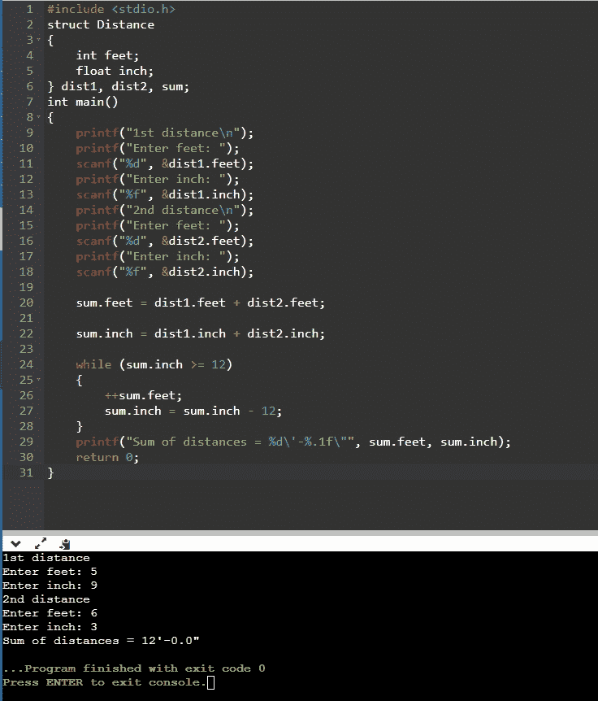
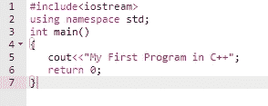
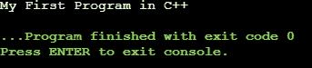
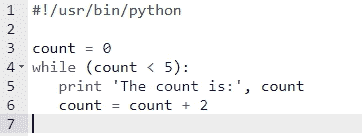
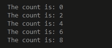
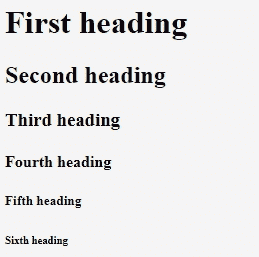
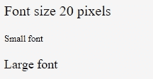
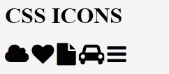
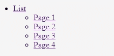

# 初学者编程指南：从零学习 Python、Java、SQL、C、C++、C#、HTML 和 CSS 的逐步进阶指南

## 引言

《初学者编程指南》是一份为致力于学习最佳编程方法、技术和方法论的学生提供的完整且真实的指南。由于软件行业每天都在更新最新的编程语言和工具，在竞争激烈的市场中，采用新技能和技术是生存的必须。阅读对于学生和学习者来说始终是至关重要的资源，因为通过实施最新的技术和编程方法论，他们可以提高自己的表现和产出。

本书是一本成功的编程手册，涵盖了适用于初学者和专业人士的所有主要编程语言、语法和实践。在进入编程世界之前，有几个重要的因素需要考虑，以培养敏锐的问题解决和分析能力。因此，本书针对初级程序员，并针对你对`java`、`sql`、`c`、`c++`、`c#`、`python`、`html`和`css`的几乎每个问题提供了解决方案和答案。

我始终强调基础知识和技能的获取。这本书不会让你在一个小时或一夜之间变成程序员，但它将为你的编程职业奠定坚实的基础。阅读本书后，你对编程的基础知识将会增加，对任何编程语言的熟练程度也将之提高。

## 第一章：什么是编程？

通常，编程是指计算机用于完成特定任务的指令集。这也称为编码。在深入讨论之前，你必须了解编程是如何工作的以及指令集是如何形成的。当你能够遵循正确的语法时，这会变得非常简单。编程是一种通过高级语言和低级语言与计算机通信的方式。

为了用计算机解决问题，将执行的指令集被称为程序。例如，如果你被赋予加两个整数的任务，那么加整数的算法将用`c++`、`c#`或`java`。如果程序不正确，编译器或编辑器将无法执行。

编程通过实践和编写代码可以学得更好，尽管刚开始可能是一项有趣的活动，但它可能变得非常耗时。此外，本书将让初学者更容易选择最合适的编程语言。

## 使用计算机编程解决问题

本质上，计算机程序旨在通过遵循指令来解决特定问题。人们可以通过多种技术和方法来编写程序。为了解决问题，你需要确定代码流并逐步满足要求以实现预期输出。在某些情况下，即使在挣扎几个小时后，你的计算机程序可能仍然无法运行，因为不符合计算机语言要求的语法或流程。

使用制制木桌子的例子，你需要写下如下指令：

1. 获取制作桌子所需的合适的木材。
2. 获取过程中将使用的基本工具和设备。
3. 组合木材并建造你的桌子。
4. 抛光成品使其看起来更有吸引力。

关于计算机的自然语言，它们无法理解人类语言，因此，我们需要通过另一种被称为二进制代码的语言与系统进行通信。二进制代码由一系列`1`和`0`组成，是计算机的自然通信语言。为了帮助计算机理解人类语言，我们使用翻译器和编辑器来编写程序。翻译器具有将源代码转换为机器语言的能力。

翻译器有多种类型，被称为解释器、编译器和汇编器。解释器通常用于解释逐行处理的语言以运行最终的程序。此外，解释器还会列出任何语法错误或疏忽，以便程序员清除错误并执行程序。

在编译器的帮助下，源代码通过编译过程转换为二进制代码并执行以交付输出。如果源代码中没有错误或疏忽，编译器将一次性翻译并执行所有行。此外，计算机程序也被称为应用（应用程序或应用软件），并针对其设计上运行的环境或平台进行定制。应用还分为桌面端应用程序和移动应用程序两类。

# 编程基础

## 计算机编程简介

每个计算机程序都是完成源代码的程序、过程和算法的组合。由于这种过程组合也可以被视为软件的表示，因此该过程被视为实现输出的一系列动作，而程序可以被视为按特定顺序执行的一系列动作。算法是任何程序的主要驱动力，也被称为解决特定程序或问题的有序步骤集。

有不同的高级和低级语言可以用于编写计算机程序。如今，程序和软件通常使用流行的语言制作，包括`c`、`c++`、`java`、`python`、`html`、`php`、`ruby`和`perl`。这些语言用于生成目前应用于各个领域和行业的计算机程序，包括医疗、工程、通信、家庭和娱乐行业。此外，计算机程序还用于创建图形网络应用程序以及桌面应用程序。

## 计算机编程的元素与基础

通常，计算机语言是允许程序员实现预期输出的多个元素，包括语法、编程环境、数据类型、关键字、变量、判断、基本运算符和函数。此外，为了在程序中执行某些操作，你还需要应用其他操作并使用循环、字符串、字符、文件输入输出和数组等元素。

编程有五种不同的基本元素，它们也被认为是任何程序的构建块。这些元素被称为输入、输出、算术、条件和循环。从第一个元素开始，输入是将命令和数据导入计算机的过程，而输出元素具有交付结果的功能。如果有任何类型的计算或操作，则使用算术元素结合条件语句来测试条件为真还是假。

# 环境、数据类型和基本语法

## 环境

为了运行或执行程序，你必须为你正在使用的语言安装或设置所需的工具和环境。此外，如果初学者发现自己安装和配置编程环境很困难，也可以使用文本编辑器创建计算机程序。要将程序执行为二进制格式，必须使用编译器，因为如果给定文本，计算机无法直接理解程序。

此外，文本到二进制的转换是由编译器完成的，可以使用`c++`、`java`、`perl`和`python`等语言。

## 基本语法

为了方便起见，我们将查看一个用`c++`编写的示例程序。

```cpp
#include <iostream>
using namespace std;

int main() {
    cout << "hello world!";
    return 0;
}
```

上述输出为：

```text
hello world!
```

此外，`main()`是一个函数，`cout`是标准输出。如果你无法执行程序，可能存在某些语法错误，例如漏掉分号。

### 数据类型

数据类型是各种语言的重要部分，用于告诉编译器如何提供数据。通常，常用的数据类型包括`integer`、`boolean`、`char`、`string`和`float`。

数据类型的简要详情如下：

- `Date`: `01/04/2015`
- `Integer`: `521324`
- `Boolean`: `true`/`false`
- `String`: `aabb`
- `Void`: 无数据
- `Long`: `532543253`
- `Floating point`: `5.2341`
- `Short`: `0`

### 方法

方法被称为行为，负责类内不同动作的执行和操纵。

### 变量、关键字、运算符和决策

变量是计算机程序中不可或缺的一部分，因为它们提供了在程序中存储值和数据所需的内存位置。为了保存一个值，你必须创建变量并为它们分配适当的，将值存储到变量中，并从变量中检索这些值。

要开始声明变量，我们需要按照如下编写程序：

```cpp
#include <iostream.h>

int main() {
    int a;
}
```

上述程序创建了一个名为`a`的变量，并由`int`关键字指定类型。这意味着该变量只能存储`int`类型的值，你不允许再次定义`a`来在变量中存储另一种类型的值。

要将值存储到变量中，只需在程序声明变量后，声明你想要放入`a`中的数字即可。

### 关键字

每种编程语言都有不同的关键字，用于各种用途。虽然每种语言都提供了一套完整的保留关键字，但在使用关键字时需要遵循通用规则。与`float`、`int`、`long`和`string`类似，其他在所有编程语言中常用的关键字如下：

- `Else`
- `Switch`
- `Goto`
- `Static`
- `Case`
- `Break`
- `Enum`
- `For`
- `If`
- `Union`
- `Double`
- `Private`

### 运算符

运算符是任何编程语言的关键，用于执行某些操作或逻辑计算。由于它们通常用于数学计算，我们可以通过程序中的各种表达式来解决复杂的方程。

编程语言中通常有两种运算符：

1. **算术运算符**：用于执行数学和算术运算的运算符。例如：`+`、`-`、`/`、`--`、`++`、`*`。
   - **二元运算符**：与其他操作数工作的运算符，如`+`、`-`、`/`、`*`。
   - **一元运算符**：用于与单个操作数的运算符。例如：`++`、`--`。
2. **关系运算符**：这些是最常用的运算符，告诉我们一个操作数是否等于另一个。例如：`==`、`<=`、`>=`、`!=`、`>`。（注：原文示例中重复了>=，此处已按逻辑修正）

下面是详细列出基本运算符及其在程序中功能的表格：

| 运算符 | 功能 |
| :--- | :--- |
| `+` | 两个操作数相加 |
| `-` | 两个操作数相减 |
| `/` | 除法 |
| `*` | 法 |
| `==` | 检查两个操作数是否相等 |
| `>=` | 检查左操作数的值是否大于等于右操作数 |
| `<=` | 检查左操作数的值是否小于右操作数 |

逻辑运算符也是所有编程语言的重要部分。它们用于在各种场景下获取某些决策。这些运算符是`and`、`or`和`not`。它们也用于证明真或假的陈述。

# 决策

决策是一个程序员必须根据两个或多个给定的条件选择一个选项的过程。你必须测试条件是真还是假，并呈现出正确的输出。对于不同的编程语言，决策语句定义如下：

- `if`语句
- `else`语句
- `Switch`
- `else if`语句
- 条件运算符

## 字符、数组和字符串

在编程语言中，`char`类型用于存储字符和字母。它们还负责在程序中调用字符时存储值并交付输出。你只允许在单引号内存储单个数字或字母，例如`'&'`。定义字符的示例代码如下：

```cpp
char ch1 = 'a';
```

### 数组

数组是一种能够存储相同类型顺序元素的数据结构，由于它由连续的内存位置组成，通常是固定大小。它也被称为存储相同名称下的元素集。如果你正在编写一个存储`10`个整数的程序，创建一个数组将是最好的解决方案。

固定数量值的数组声明方式如下：

```cpp
int data[10];
```

两种流行的数组类型被称为：

1. 一维数组
2. 多维数组

#### 访问数组

完成声明后，你可以轻松地通过索引访问元素。数组的第一个索引从`0`开始，如果数组的大小为`n`，你必须使用`n-1`来访问最后一个元素。要初始化数组，你可以遵循以下模式：

```cpp
int arr[5] = {1, 2, 3, 4, 5};
```

数组允许程序员将数据存储到单个变量中，而无需具体地定义每个变量。与其他数据类型类似，数组使用`[`和`]`声明，一旦数组声明，你就可以赋值。在程序中有多种方法来创建、赋值和声明数组。

##### 声明

为了声明数组，你必须记住数组大小必须是大于`0`的整数。数组可以如下声明：

`类型 数组名[数组大小];`

##### 初始化

要初始化数组，可以使用下面的语句：

```cpp
int arr[5] = {23, 45, 53, 64, 73};
```

### 字符串

字符串是编程语言中用于表示字符数组的数据类型。声明和初始化字符串，你需要遵循与数组相同的结构。每种语言编写字符串的技术和方法不同，但在每情况下功能都是相同的。字符串也可以包含短语中的空格，例如“我一直在等到下午 5 点。”

字符串的示例如下：

```cpp
char c[] = "abcdef";
```

## 函数与文件输入输出

### 函数

函数被称为在程序内执行特定任务的代码块。编程中了两类函数：标准库函数和用户定义函数。

标准库函数负责处理 I/O 处理、计算和数据处理等任务，而用户定义函数由程序员创建以执行特定任务。函数更像是可重用的代码，可以执行某些动作并为程序提供更好的模块化。

在 C 编程中定义函数，你需要声明返回类型、函数名、参数列表和函数体。例如：

```cpp
#include <iostream.h>

void functionname()

int main() {
    functionname();
}
```

#### 文件输入输出

为了存储和管理如图像、Word 文档、纯文本或 Excel 表格之类的计算机文件，我们利用文件输入输出模式的支持。通过文件输入，该方法用于将任何数据写入文件，而文件输出方法则用于显示文件的结果。通常，文件可以以不同的模式打开，如只读模式、只写模式或读写模式。

### 文件操作

每种编程语言都有特定的函数用于打开、读取或创建新文件。打开文件推荐的函数是`open()`，而要关闭文件，你可以使用`fclose()`函数。

# 编程环境

## 什么是编程环境？

开发环境是编程工具和一组流程的结合，共同用于运行程序。根据你编写程序时使用的语言，你可以选择最合适的环境，并按照提供的说明完成你的项目。因为编程是我们实现不同解决方案和输出的方式，我们可以通过编程工具和环境以多种方式表达我们的想法。

此外，编译器以步进的方式执行算法，并执行诸如决策选择、顺序处理和迭代等其他活动。

## 集成开发环境

集成开发环境是指将工具和流程连接起来的软件，为编程环境带来方便的界面。作为一种应用程序，集成开发环境（`ide`）还有助于应用程序开发，并为开发者提供基于图形用户界面（`gui`）的工作方法。现代`ide`还可以用于生成结构图、流程图，并提供模块化的编程方法。

为了选择`ide`，你还可以兼顾你的语言需求和编程风格。这可以让你更容易地完成复杂的应用程序并获得更好的结果。

# 工具与技术

有数千种软件开发工具、`ide`和技术可以用于创建完美的应用程序、程序和软件。我们列出并简要介绍了一些有效、易用且最先进的工具，供程序员开发任何类型的网页、桌面和移动应用程序。

以下是一些针对初学者程序员的最佳工具：

## NetBeans

NetBeans 是一个开源集成开发环境，可以作为开发桌面、网页和移动应用程序的工具。该工具允许简单高效的项目管理流程，允许开发者编写无 bug 的代码，并提供智能代码编辑功能。此外，该`ide`最适合`php`、`c++`和`c`编程语言。

## Cloud9

涉及到在线集成开发环境，`cloud9`无疑是最值得考虑的工具之一。支持的语言包括`php`、`c`、`c++`、`python`、`perl`、`node.js`和`javascript`。开发者可以选择大量的默认运行器来执行程序，并通过提供的建议更快地编写代码。

## Visual Studio

Visual Studio 是由`microsoft`设计并开发的卓越集成开发环境。由于支持多种平台，开发者现在可以无忧地构建、共享和管理软件组件。此外，自动化的`azure`部署允许你在中心化版本控制系统的支持下提高代码质量。

## 技术

学习编程语言和技术是适应最新编程方法和技术的最佳方式。从`javascript`、`python`、`java`和`c++`等主流编程技术开始，可以让初学者更容易对计算机编程有更好的理解。此外，每种技术都有其独特的视角和方法，你必须深入学习这些概念和方法。

对于开源开发者来说，由于 Java 虚拟机（`jvm`）范式，`java`被认为是最好的编程语言。这允许软件在任何系统上运行。初也可以从`c++`开始练习编程，因为它提供了访问底层组件的能力。

## 方法论

编程方法论是分析复杂问题并规划软件开发以实现最佳解决方案的过程。也称为模块化编程，该过程分为：

### 1. 需求收集

作为软件开发的第一阶段，由专业人士执行，他们可以很容易对项目进行可行性研究。

### 2. 需求采集

下一步是收集已开发的相关数据和需求。通常客户需要对需求了明确，以便提供项目设计。

### 3. 设计

完成需求后，下一步是设计架构。在此时，你需要勾勒设计大纲。

### 4. 开发

这是开发者开始工作该项目的阶段。通常每个项目都会选择一种编程语言。

### 5. 测试

此阶段涉及通过审查需求对软件进行检查和检查。使用各种测试用例检查产品是否存在需要改进的错误和问题，以确保满足每个需求。

### 6. 部署

部署是最后一个阶段。由于产品现在通过了设计、开发和测试阶段，已准备好交付给客户。

为了创建软件文档、演示文、图表、图形或动画，有多种文档编辑工具。从最流行的工具开始，你可以安装`microsoft office`并毫无压力地编辑任何类型的文档。该软件包包含了`microsoft word`、`microsoft excel`、`microsoft powerpoint`、`outlook`、`one note`、`one drive`等模块。

此外，google docs 是另一个非常有用的文档编辑工具，可以在线访问、更新和创建文档。该工具允许你创建表格、文档、幻灯片和表单，你可以从广泛模板中进行选择。

# 第二章：Java

## 概述与基础语法

Java 是一种高级编程语言，由 Sun Microsystems 公司于 1995 年发布。有无数的网站和应用程序使用`java`技术构建，因为它与其他编程语言相比，更加可靠、易于使用且速度更快。作为一种面向对象的编程语言，开发者可以快快地编码、编译、执行和测试程序。此外，使用`java`开发的应用程序适用于多种环境，并且更加安全。

该语言设计用于运行在不同的平台上，包括`windows`、`unix`和`mac os`，并为这些平台提供了多种配置。`java`具有绝对的平台无关性，它被编译成特定平台的字节码，并通过`java virtual machine`（`jvm`）进行分发和解释。此外，`java`字节码实现了高性能，并专为分布式互联网环境而设计。

转向基础语法，`java`编程通常基于对象、类、方法、变量、修饰符、构造函数和正则表达式。为了更好地理解简单的`java`程序，你可以参考以下每个部分的简要详细介绍：

### 关键字

| 关键字 | 功能 |
| :--- | :--- |
| `Class` | 用于声明一个类 |
| `Void` | 返回类型 |
| `Public` | 访问修饰符，使函数可见 |
| `Static` | 用于在静态方法中创建对象 |
| `Main()` | `Main()`方法置于程序开头 |


| `System.out.println()` | 在控制台上打印语句 |
|---|---|

在开始进行`java`编程之前，请确保你记得`java`是一种大小敏感的语言，你需要用大写字母开头声明类名。方法名应以小写字母开头，程序文件名应与类名完全相同，以避免执行程序时出现任何问题。

`java`编程语言中的概念包括类、对象、多态、继承、抽象、封装、实例和方法传递。

你的第一个`java`程序可能看起来像：

```java
Class helloworld
{
    public static void main ( string [] args )
    {
        System.out.println ("your first java program!")
    }
}
```

## Java 标识符与修饰符

`java`标识符应该以 a 到 z 或 A 到 Z 之间的字母开头，因为标识符也是大小敏感的。你必须记住关键字永远不能作为标识符，标识符在第一个字符之后可以是任何字符组合。例如，`month`或`price`。

`java`编程语言中有两种修饰符，一种被称为访问修饰符，另一种被称为非访问修饰符。修饰符通常用于修改方法或类。

### 类与对象

对象是类的一部分，也被称为实例。类代表了一组所有对象共有的属性，并是创建对象的定义的原型。要声明一个类，我们需要类名、接口和类体。

此外，`java`中一切都与结合方法和属性的对象及类相关。以现实生活中的手机为例，它有颜色、内存和重量等属性。在`java`中创建一个类，你需要遵循下面提到的语法：

```java
Public class newclass {
    Int a = 1;
}
```

创建对象`newobj`：

```java
Public class newclass {
    int a = 1;
    Public static void main ( string [] args ) {
        newclass newobj = newclass();
        System.out.println ( newobj.a );
    }
}
```

创建一个对象需要声明、实例化和初始化。声明是声明一个带有对象类型的变量名的过程，而实例化是使用`new`关键字创建对象。程序通过调用构造函数来继续并初始化新对象。

## 基础数据类型与变量

在`java`程序中，数据存储在变量中，程序首先声明变量，读取数据到变量中并执行提供的操作。一旦过程完成，变量将再次写入一个新的位置。变量提供了一个用于存储值的预留内存位置，该内存由操作系统分配。

### 数据类型

`java`编程语言中有两种不同的数据类型，称为原始数据类型和对象数据类型。原始数据类型分为 8 类：`byte`、`short`、`int`、`long`、`float`、`double`、`boolean`和`char`。对象数据类型通过类的构造函数创建，它们也负责访问对象。每个可用引用变量的默认值被设置为`null`，它也可以用来引用所声明类型的对象。

### 变量

`java`编程语言中使用了三种变量：

1. 局部变量
2. 实例变量
3. 类/静态变量

#### 局部变量

局部变量通常声明在构造函数和方法中。由于它们是通过构造函数创建的，因此修饰符不能与局部变量一起使用。局部变量没有默认值。

#### 实例变量

实例变量声明在类内部，并在创建对象时创建。它们用于持有被多个构造函数或方法引用的值。修饰符也可以赋予实例变量。

## 运算符、控制语句与决策

### 运算符

`java`编程语言中提供的基础运算符解释如下：

- **算术运算符**：算术运算符可用于程序内执行数学计算和方程求解。这包括加、减、乘、除、模以及增/减函数。
- **一元运算符**：后置`expr++`和前置`++expr`、`-expr`表达式。
- **逻辑运算符**：`(a && b)`为假，`(a || b)`为真，`!(a && b)`为真。
- **位运算符**：用于按位操作。
- **赋值**：`=`、`+=`、`|=`、`^=`。

### 控制语句

`java`语言的控制语句与 c 或 c++ 等其他主要编程语言相似。详细说明如下：

**If-else**：`if`语句用于检查给定条件为真还是假。在 Java 编程语言中有不同类型的`if`语句，分别称为`if`语句、`if-else`语句、`if-else-ladder`语句和嵌套`if`语句。

这里是一个简单的 Java 程序，用于演示`if`语句：

```java
Public class marks {
    public static void main (string [] args) {
        int marks = 50;
        if (age < 50) {
            system.out.print ("your marks are less than 50");
        }
    }
}
```

上述程序的输出为：your marks are less than 50。

`if-else`：该语句用于测试条件，如果结果为真，则执行`if`块；如果为假，则执行`else`语句。

`Switch`：`switch`语句用于从多个条件中执行单个语句。该语句可以与包括`short`、`int`、`long`、`byte`、`string`和`long`在内的数据类型一起工作。

`switch`语句的语法如下：

- `Switch (expression){`
- `Case value,1:`
- `//code to be executed;`
- `Break ; //`
- `Case value,2:`
- `//code to be executed;`
- `Break ;`
- `Default :`
- `Code to be executed if all cases are not matched;`
- `}`

### 循环

编程语言中通用的循环有三种：

- `For`循环
- `While`循环
- `Do-while`循环

#### For 循环

`For`循环用于在程序的一部分执行迭代。如果迭代次数是固定的，建议在程序中使用`for`循环。

#### While 循环

`While`循环具有重复单个或一组语句的特点，以测试给定条件为真还是假。它用于迭代次数不是固定的情况。

#### Do while 循环

`do while`循环用于多次迭代程序的一部分。如果迭代次数不是固定的，则要求至少执行一次程序。

需要特定的循环控制语句来将执行顺序更改为普通序列。Java 编程语言中使用的两种控制语句包括：

- `Break`语句：终止`switch`或循环并开始下一个循环。
- `Continue`语句：允许循环重新测试其条件并跳过主体的剩余部分。

## 决策

决策结构的特点是在给定场景下需要测试的一个或多个条件。如果条件为真，则可以执行下一条语句；而如果给定条件为假，程序将终止。下面的图表正确地显示了决策过程实际上是如何运作的：

## 字符、字符串、数组和正则表达式

Java 编程语言利用了字符包装类，并提供了多个用于操作字符的静态方法。要创建一个字符对象，你需要遵循以下语法：

`Character ch = new character (‘a’)`

编译器会自动创建一个字符对象，如果你向方法传递任何基本类型 char，编译器将通过该语言的各种方法将 char 转换为 character。

正如我们讨论过的字符串的重要性和功能，Java 平台也提供了支持。程序员可以通过多种方式操作字符串。在 Java 语言中创建字符串的示例代码如下：

```java
Public class newstring {
    Public static void main (string args []) {
        char[] stringarray = {'s', 't', 'r', 'i', 'n', 'g'};
        string stringstring = new string (stringarray);
        system.out.println (stringstring);
    }
}
```

该程序的输出为：string。

此外，我们还可以使用 Java 语言中简单的连接方法来连接字符串，如下：

`String1.concat(string2)`

要在 Java 中创建字符串对象，程序员可以选择字面量或关键字方法。数组是每个编程语言的重要部分，因为数组允许程序员处理并将数据存储到变量中。你也可以将数组视为同一类别变量的集合。要声明数组，你可以遵循下面定义的简单语法：

`Datatype[] arrayvar`

在 Java 中创建数组非常简单，可以使用以下语法：

`Arrayvar = new datatype[size];`

该语句将创建一个给定大小的数组，并将数组的引用赋值给给变量。通常使用`for`循环或`foreach`处理数组，因为数组内的元素具有相同的类型和大小。

用于排序、比较和填充数组元素的静态方法：

- `Public static int binarysearch(object a, object key)`
- `Public static void fill(int [] a, int val)`
- `Public static boolean equals(long a, long a2)`
- `Public static void sort(object a)`

## 正则表达式

正则表达式是一个用于定义字符串模式的 API，也用于搜索、编辑和处理文本。Java 有预定义的`java.util.regex`包，它由`pattern`类、`matcher`类和`syntaxexception`对象组成。`pattern`类要求开发者从`compile()`方法开始并返回`pattern`对象，因为它没有公共构造函数。对于`matcher`类，`matcher`对象通过`matcher()`方法对输入字符串查找并比较操作，以获得匹配。`syntaxexception`用于指示正则表达式模式中的错误或误。

## 文件和 I/O

Java 编程语言具有一个内置包，负责数据输入输出操作。该流被称为`java.io`，并支持处理数据的多种操作和功能。Java 中有两种类型的流，称为输入流和输出流。

输入流用于读取数据，而输出流用于向文件写入数据。

Java 语言具有各种 i/o 数据处理流，包括：

- `Byte`流
- `Character`流
- `Standard`流
- `File`输入流
- `File`输出流

## 面向对象 Java

面向对象编程是一种使用类和对象的方法。通过使用继承、多态、封装和抽象等概念，程序员可以开发 Java 应用和程序。

### 继承

继承是 Java 编程语言中的特性，允许它继承另一个类的特性和属性。这可以在子类和父类之间进行。被继承的类称为父类，而继承其他类属性类称为子类。

要在 Java 中使用继承，你可以遵循下面的语法：

```java
Class derived-class extends base-class
{
    //methods
}
```

### 多态

多态允许以不同方式执行同一个操作的概念。Java 中有两种多态：编译时多态和运行时多态。

#### 编译时多态

编译时多态通过方法重载实现。方法重载发生在类中具有相同名称但参数不同的方法。

#### 运行时多态

运行时多态通过方法重写实现。方法重写发生在子类为其父类中已定义的方法提供特定实现时。

通过多种方式执行单个任务的技术被称为多态。在`java programming`中，我们可以使用`method overriding`（方法重写）和`method overloading`（方法重载）技术来实现多态。需要重要的是，对象可以通过引用变量进行访问，一旦它被重新赋值给其他对象，可以使用引用变量的类型来确定用于访问对象的方法。

例如：

```java
public interface school{}

public class student{}

public class john extends student implements school{}
```

在上述情况下，`john`被认为是多态的，因为它具有多继承性，并且我们也可以对同一个对象应用引用变量。

## 抽象

抽象类是指在其声明中包含`abstract`关键字的类，它可能包含或不包含抽象方法。在类具有抽象方法的情况下，它无法被实例化，程序员必须从另一个类继承它来实现该抽象方法。

### 封装

`java programming`中的封装是将数据和方法封装在一起的过程。通常情况下，一个类的变量对另一个类是隐藏的，它只能通过当前类中使用的方法进行访问。封装的优点是，类可以被制为只读或只写，并且还可以对存储的数据具有完全的控制权。

## 递归

递归是指一种在程序内部调用自身的方法的技术。`recurse()`方法从`main`方法被调用，也可以从同一个`recurse()`方法被调用。这个过程一直持续，直到满足给定条件；如果不满足条件，就会发生无限递归。

以下是 java 中递归的一个简单实现：

```
Class sample {
    static void printfun(int test) {
        if (test < 1)
            return;
        else {
            system.out.printf("%d ", test);
            // state 2
            printfun(test - 1);
            system.out.printf("%d ", test);
            return;
        }
    }

    public static void main(string [] args) {
        int test = 3;
        printfun(test);
    }
}
```

### 递归的优势

在某些复杂的程序中，编写递归代码可以带来若干好处。因为它提供了一种简单且简洁的代码编写方式，开发者可以毫无麻烦地执行各种类型的操作。

## 抽象类和抽象方法

### 抽象类

在 java 编程中，抽象类是一种无法初始化且使用`abstract`关键字声明的类。

以下是在 java 中声明抽象类`student`的语法：

```java
Abstract class student {
    // methods and attributes
}
```

记住，我们不能创建抽象类的对象。这样做将产生编译错误。

### 抽象类的继承

以下是一个说明抽象类继承的示例 java 程序：

```
Abstract class student {
    public void displayinfo() {
        system.out.println("i am a student");
    }
}

Class grade extends student {
}

Class main {
    public static void main(string [] args) {
        grade g1 = new grade();
        g1.displayinfo();
    }
}
```

### 抽象方法

在 java 中创建抽象方法使用相同的关键字`abstract`。语法定义如下：

```java
Abstract void move();
```

# 第三章：sql 和数据库

## 什么是数据库？

数据库是一个可以被访问、管理和更新的数据集合。在对数据库进行简要讨论之前，重要的是理解数据的含义以及它是如何被处理的。数据通常定义为记录和事实的集合，我们可以借此进行计算和推理。为了保护、保存、交付和组织数据，创建了数据库，而管理这一过程的系统被称为数据库管理系统（`db`）。

## 数据库管理系统（db）概念

数据库管理系统由多个程序组成，允许用户通过不同的过程访问数据库并处理数据。由于它通常设计用于控制对数据库的访问，`db`中引入了各种操作和功能。`db`有不同的类型：

1. **关系型**：这类`db`以表格的形式的关系。
2. **对象关系型**：对象关系允许数据以对象及其属性的形式存储。
3. **网络型**：网络`db`具有多对多的关系，通常用于复杂的数据库结构。
4. **层级型**：层级`db`遵循父子关系来存储数据，其结构类似于树，节点代表各种字段。

## 数据库环境和架构

数据库环境被称为一组组件，负责数据的处理、管理和使用。由于数据库通常存储在计算机中，因此用于管理该过程的硬件和计算机外围还包括如`sql server`之类的`db`工具。

数据库或`db`的架构通常分为三大类：集中式、去中心化和层次级。数据库系统可以是客户端-服务器或集中式的，也可以设计为供并行计算机架构访问。`db`的三层架构定义如下：

- 表现层
- 应用层
- 数据库层

# 数据库的类型

根据组织方法和功能，有不同类型的数据库。

### 关系型数据库

关系型数据库数据是以多种方式定义、组织和访问的。作为一种表格型数据库，表由行和列组成，通过查询语言（`sql`）进行管理。

### 分布式数据库

分布式数据库的数据存储在多个站点，这些站点通过通信链路相互连接。这种数据库进一步划分为同构和异构两类。对于同构分布式数据库系统，相同类型的硬件、操作系统和数据库应用程序连接在一起；而对于异构分布式数据库系统，每个位置和连接系统可以是不同的。

终端用户数据库是一个共享数据库，专门为终端用户设计和创建。由于它具有整个数据库的摘要，因此终端用户完全不需要担心在任何数据库级别正在执行的操作。

# 数据库语法、数据类型和操作符


标准查询语言（`sql`）用于在数据库中存储、操作和检索数据。`sql` 允许数据库管理员执行管理数据库所需的多种操作。该语言允许你通过编写简单的查询来执行查询、检索数据、插入记录、更新记录、删除记录、创建新数据库、创建新表以及在数据库中设置权限。

`sql` 有多个版本，它们都支持 `select`、`delete`、`insert`、`where` 和 `update` 等主要功能。

# 结构化查询语言（`sql`）

`Sql` 是用于 `mysql`、`sybase`、`oracle` 和 `sql server` 等关系数据库系统的语言。作为一种标准的数据库语言，`sql` 允许用户描述数据、访问数据并操作关系数据库管理系统。此外，用户还可以使用结构化查询语言创建、查看和删除数据库。

在此过程中包含的不同组件有优化引擎、`sql` 查询引擎、经典查询引擎和查询调度器。为了在关系数据库管理系统中执行特定操作，我们可以使用下面的命令：

| 命令 | 描述 |
| :--- | :--- |
| `Create` | 用户可以创建一个新表，或数据库中的一个对象。 |
| `Read` | 用户可以读取存储在表中的数据。 |
| `Update` | 更新表以修改记录。 |
| `Delete` | 删除表中的任何记录。 |
| `Insert` | 向表中插入新记录。 |
| `Select` | 从数据库中的表中选择特定记录。 |
| `Alter` | 对数据库对象进行更改。 |
| `Drop` | 从数据库中删除整个表。 |

通过使用上述操作，我们可以对下方名为“students”的示例表执行不同的操作：

| 学生 ID | 学生姓名 | 城市 | 学科 | 分数 | 百分比 |
| :--- | :--- | :--- | :--- | :--- | :--- |
| 1 | William | 纽约 | 数学 | 85 | 60% |
| 2 | James | 加州 | 英语 | 79 | 58% |

从上表获取记录的 `sql` 语句具有以下语法：

```sql
select * from students;
```

## `sql` 查询

为了对数据库中的表执行特定操作，我们需要使用不同的查询，具体说明如下：

| 查询 | 语法 |
| :--- | :--- |
| `Insert into` | `insert into table_name,(column1, column2,...)`<br>`Values (value,1, value,2,...)` |
| `Update` | `update table_name, set column1 = value,1, column2 = value,2..`<br>`where, condition` |
| `Delete` | `delete from table_name, where, condition;` |
| `Order by` | `select column1, ..from table_name,`<br>`order by column1, asc/desc;` |
| `Min()` | `select min(column_name,)`<br>`from table_name,`<br>`where, condition;` |
| `Max()` | `select max(column_name,)`<br>`from table_name,`<br>`where, condition;` |
| `Where` | `select column1..`<br>`from table_name,`<br>`where, condition;` |

## `Sql` 连接

以带有表 a 和表 b 的关系数据库为例，表也可以通过 `sql` 连接查询进行连接。图表清楚地显示了两个表是如何连接以共享数据的：我们将在示例表“patients”上实现各种子句操作。

表 1：

| patientid | caseno | Date |
| :--- | :--- | :--- |
| 4321 | 1-9-2011 |
| 8257 | 3-12-2015 |

表 2：

| caseno | patientname | City |
| :--- | :--- | :--- |
| 1 | Andre | 加加哥 |
| 3 | John | 矶 |

要连接这两个表，我们可以如下编写 `sql` 连接语句：

```sql
select patientid, caseno, date. From patients inner join patients on caseno = patientname.
```

有四种不同类型的 `sql` 连接，被称为：

- `inner join`
- `left outer join`
- `right outer join`
- `full outer join`

`inner join` 选择满足连接条件的表 a 和表 b 中的整条记录。创建 `inner join` 的语法如下：

```sql
select name, From table1 inner join table2 On table1.column_name = table2.column_name;
```

`left join` 选择表 a 中的所有记录，并结合满足连接条件的表 b 中的记录。创建 `left join` 的语法如下：

```sql
select name, From table1 left join table2 On table1.column_name = table2.column_name;
```

`right join` 选择表 b 中的所有记录，并结合满足连接条件的表 a 中的记录。创建 `right join` 的语法如下：

```sql
select name, From table1 right join table2 On table1.column_name = table2.column_name;
```

`full outer join` 即使连接条件不满足，也会选择表 a 和表 b 中的所有记录。创建 `full join` 的语法如下：

```sql
select name, From table1 full outer join table2 On table1.column_name = table2.column_name, where, condition;
```

## Union 运算符

为了合并两个或多个 `select` 语句的结果，使用了 `union` 运算符，每个列必须具有相似的数据类型。此外，`select` 语句中的列在两个表中顺序应该是相同的。在 `sql` 中实现 `union` 运算符的语法如下：

```sql
select column_name, from table1
union
select column name, from table2;
```

## Group by

`sql` `group by` 语句可以从数据库表中执行列表或编号。在 `sql` 中使用 `group by` 语句的语法如下：

```sql
select column_name, From table_name, where, condition group by column_name, order by column_name;
```

## Order by

`sql` 中的 `order by` 语句用于升序或降序排序数据。实现 `order by` 子句的语法如下：

```sql
select column_list From table_name, where, condition [ order by column1, column2,] [ asc | desc ];
```

# 高级 `sql`

还有其他关键操作和子句可以在数据库内执行复杂操作。这里详细说明了高级 `sql` 的一些功能。

## 索引

`Sql` 索引被数据库搜索引擎用于优化数据处理过程。由于它们是特殊的查找表，索引有助于加速 `where` 子句和 `select` 查询。创建索引，我们可以使用 `create index` 语句结合唯一约束来防止重复输入。

使用 `create index` 的语法：

```sql
create index index_name, on table_name,
```

使用 `drop index` 的语法：

```sql
drop index index_name;
```

## Truncate table

`truncate table` 命令在 `sql` 中用于删除现有表中的完整数据。基本语法：

```sql
truncate table, table_name;
```

# `Sql` 主键和外键

## 主键

`sql` 中的 `primary key` 约束用于唯一标识表中的每条记录。主键始终包含唯一值且不包含任何空值。此外，一个表只能有一个唯一的主键，该主键可以由单列或多列组成。

例如，在创建 `students` 表时为 `id` 列定义主键，我们可以使用以下 `sql` 语句：

```sql
Create table students (
  id in not null,
  firstname varchar (255),
  lastname varchar not null (255),
  marks int,
  primary key (id)
);
```

## 外键

`sql` 中的 `foreign key` 约束用于实现两个表之间的关联，其中一个表中的 `foreign key` 引用另一个表的主键。

在创建 `student` 表时对 `studentid` 列实现 `foreign key` 约束的语法如下：

```sql
Create table student (
  studentid in not null,
  studentmarks int not null,
  classid int,
  primary key (studentid),
  foreign key (classid) references students( studentid)
);
```

## 约束和有用资源

约束是在数据表数据列上实现的特定规则。通常，实施约束是为了限制插入到表的数据类型。最常见的包括 `not null` 约束、`default` 约束、`unique` 约束、`primary key`（主键）、`foreign key`（外键）、`check` 约束和 `index`（索引）。

此外，完整性约束还可以提高关系型数据库中数据的一致性和准确性。通常，`primary key`、`foreign key` 和 `unique` 约束是引用完整性（`ri`）的一部分。

为了提高 `sql` 数据库的性能，有几个重要的因素可以轻松实现。在编写列名时，建议使用 `select` 语句而不是 `*` 分隔符。例如：

```sql
Select * from students
```

此外，在语句上设置 `nocount` 将减少 `sql-server` 为 `insert`、`delete` 或 `update` 操作更新行所需的时间。

# 第四章：`c`

C 编程语言于 1972 年在美国的贝尔实验室开发。通常情况下，编程语言分为两大类，即高级语言和低级语言，但 c 被归类为中间级语言。这种语言的目的是提供对内存的低级访问，并为 `php` 和 `java` 等其他主要编程语言提供了语法结构。

## 介绍和简单程序

作为一种结构化语言，程序员可以通过实现不同的方法和编程技术来创建分区代码块并创建业务应用程序。此外，我们还可以编写新的函数并在 c 库中重复使用它们。

## 从 c 编程开始

编写 c 程序对初学者来说简单易用。从基础程序语法开始，我们可以如下开发 c 应用程序：

```c
#include <stdio.h>
Int main() {
  int a = 2;
  printf("%d", a);
  return 0;
}
```

## 头文件

编写 c 程序的第一部分是选择头文件。通常，头文件的扩展名为 `.h`，并且包含函数声明。要包含一个头文件，我们可以遵循以下语法。

头文件示例：

- `stdio.h`：用于定义输入和输出函数
- `string.h`：用于字符串处理
- `def.h`：定义有用的类型和宏
- `stdlib.h`：定义内存分配
- `int.h`：用于定义整数类型
- `math.h`：用于执行数学函数

## 方法和变量声明

编写 c 程序的后续部分是定义方法和声明变量。声明主方法的语法：

```c
Int main()
```

变量声明的语法：

```c
Int z
```

程序体：

```c
Int main() {
int z;
}
```

要终止程序，我们可以使用返回语句：`return 0`。

## 关键字

关键字是任何编程语言的主要驱动力，也被称为保留字。虽然高级语言有许多关键字，但 c 只允许使用 32 个关键字，它们是：`Double`、`Long`、`Int`、`Switch`、`Case`、`Type`、`Union`、`Const`、`For`、`Do`、`While`、`Static`、`Default`、`Auto`、`Break`、`Else`、`Struct`、`Float`、`Short`、`Char`、`Return`、`Void`、`Goto`。

## 数据类型和变量

在 c 编程语言中，使用数据类型定义变量，以便在程序之前分配存储。c 语言的内置数据类型包括 `float`、`int` 和 `double`。这些数据类型具有修饰符 `short`、`long` 和 `unsigned`。

以下是 c 语言允许的有效数字、字母和符号：

字母：`a-z`、`A-Z`。

符号：`- ~ ! # % ^ & ( ) _ - + = | \ } [ ] : ; ' < > , ? /`

数字：`0-9`

要在 c 中声明变量，我们可以遵循以下程序语法：

```c
#include <stdio.h>
// 变量声明:
int a, b;
int c;
Int main() {
/* 变量定义: */
int a, b;
int c;
float f;
/* 初始化 */
a = 30;
b = 20;
c = a + b;
printf("value of c : %d \n", c);
return 0;
}
```

该程序的输出结果为：50。

## 变量的作用域

任何编程语言中变量的作用域设置是为了允许变量具有某些权限。通常，变量分为局部变量、全局变量和形式参数。

局部变量在块内声明，仅供程序特定区域的语句使用。由于它们对其他函数未知，我们无法在函数外部访问局部变量。

全局变量通常在函数外部，并在整个过程中保持其值。它可以被程序中的任何函数访问和调用。局部变量需要由程序员初始化，而全局变量会自动初始化。

## 循环和函数

### 循环

循环是每个编程语言不可或缺的一部分，允许开发者多次执行特定语句。c 编程语言中有 4 种类型的循环，简介如下：

1. `for 循环`：用于执行特定次数的语句，也被用于简化处理循环变量的代码。
2. `while 循环`：重复给定语句并在执行循环体之前检查给定条件是否为真或假。
3. `do while 循环`：工作方式与 `while` 相同，但 `do while` 在最后检查条件。
4. `嵌套循环`：循环内部循环被称为嵌套循环。它可以是 `while` 循环、`do while` 循环或 `for` 循环。

为了改变循环的执行顺序，可以使用循环控制语句。`break` 语句退出循环并将执行转移到下一语句，而 `continue` 语句导致循环跳过其剩余部分并重新检查给定条件。

为了将控制转移到标记语句，我们可以使用 `goto` 语句。

### 函数

在 c 编程语言中定义函数，建议使用以下语法：

```c
Return type, function name( parameter list) {
  function body
}
```

在函数中，返回类型被称为函数本身返回的函数值的数据类型，而函数的动作名称被称为函数名。每当函数被调用时，我们需要传递一个参数，其值被称为实参（argument）或实际参数（actual parameter）。需要注意的是，参数不是强制性的，函数也可以在不带任何参数的情况下执行。

函数体包含多个语句，并通常定义了在函数内部要执行的操作。要在 C 语言中声明一个 `min()` 函数，可以使用以下语法：

```c
Int min(int num1, int num2);
```

在程序中调用函数，我们需要传递参数和函数名。如果函数返回了任何值，也可以将其存储起来。

#### 向函数传递参数的方法

##### 传值调用（Call by value）

传值方法用于将实际值从参数复制到函数的形参数中。对参数所做的更改对函数内部的实参数没有直接影响。

##### 引用调用（Call by reference）

引用调用方法用于将参数的地址复制到形参数中。在参数上进行的更改会直接影响实参数。

## 数组、字符串和链表

### 数组

数组是元素的集合，可以存储相同类型的固定大小顺序数据。数组由连续的内存位置组成，可以通过以下语法声明：

`Type arrayname, [arraysize];`

示例：

3

5

6

8

10

20

所有数组的第一个元素的索引均为 0，也称为基索引（base index）。注意，数组的大小在声明后不能更改。在 C 语言中初始化数组，可以使用以下语句：

```c
Int data[50];
```

要初始化数组，可以使用下述语法：

```c
Int data[10] = {3, 2, 7, 8, 23, 42, 64, 73, 23, 77};
```

在这个数组中，索引 = 0 的值为 3，而索引 9 的值为 77。

下面是一个使用 C 语言编程中的数组求 5 个整数平均值的示例：


```c
#include <stdio.h>

Int main ()
{
int avg = 0 ;
int sum =0 ;
int x =0 ;
int num[ 4 ];
for (x =0 ; x <5 ;x++ )
{
printf("enter number %d \n ", (x +1));
scanf("%d", & num[x]);
}
for (x =0 ; x <5 ;x++ )
{
sum = sum + num[x];
}
avg = sum /5 ;
printf("average of entered number is: %d", avg);
return 0 ;
}
```

## 2d 和 3d 数组

C 编程语言也支持二维和三维多维数组。为了初始化二维数组，我们使用以下语法：

```c
Int z[2][3] = {
{0, 1,}
{2, 3, 4}
{5,6,9}
};
```

或者：

```c
Int z[2][3] = {0, 1, 2, 3 , 4, 5, 6, 9};
```

## 字符串

在 C 编程中，字符串是通过使用一维字符数组创建的。字符串必须以空字符终止，也称为 `\0`。

在 C 语言中声明字符串，可以遵循下述语法：

`Char str_name,[size];`

`str_name` 用于定义字符串，而尺寸告诉我们字符串的长度。

下面的 C 程序用于声明、读取和打印一个字符串：

```c
#include<stdio.h>

Int main ()
{
// declaring string
char str[ 10 ];
// reading string
scanf("%s",str);
// print string
printf("%s",str);
return 0 ;
}
```

## 指针和结构体

指针是一个变量，其值与程序中另一个变量的地址相同。由于它直接指向内存位置地址，我们可以预先声明指针并将其存储在任何变量地址处。声明指针变量的语法如下：

`Type *name;`

要使用指针，首先我们需要定义指针变量并将变量的地址赋值给指针。接下来，我们可以从指针变量给出的地址访问值。整个操作都是通过 `*` 运算符完成的，该运算符返回所定义的变量地址的值。必须注意的是，普通变量存储值，而指针存储变量地址。任何指针的值都是 2 字节。下面是一个用 C 语言指针编写的的示例程序：

```c
#include <stdio.h>
Int main ()
{
int *ptr, q;
q =100 ;
ptr= &q;
printf("%d", *ptr);
return 0 ;
}
```

### 结构体

结构体被定义为变量集合，允许程序员组合不同的数据类型。结构体可以类比为数组，但数组只能持有相似类型的数据。以一个组织为例，我们可以使用结构体来管理员工记录如下：

- `Name`（姓名）
- `Employee id`（员工 ID）
- `Designation`（职位）
- `Region`（地区）

在 C 语言中定义结构体的语句如下：

```c
Struct employee {
char name[10];
int employee_id;
char designation[50];
char department[50];
char region[100];
};
```

在编译时初始化结构体可以使用：

```c
Struct
```

要访问结构体，我们需要使用成员运算符。为了在 C 语言中访问结构体的成员，可以使用以下类型的运算符：

- 成员运算符 `.`
- 结构体指针 `->`

访问结构体的示例程序：

```c
#include <stdio.h>
Struct distance {
int feet;
float inch;
} dist1, dist2, sum;

Int main ()
{
printf("1st distance \n");
printf("enter feet: ");
scanf("%d", &dist1.feet);
printf("enter inch: ");
scanf("%f", &dist1.inch);
printf("2nd distance \n");
printf("enter feet: ");
scanf("%d", &dist2.feet);
printf("enter inch: ");
scanf("%f", &dist2.inch);
sum.feet = dist1.feet + dist2.feet;
sum.inch = dist1.inch + dist2.inch;
while (sum.inch >= 12 )
{
++sum.feet;
sum.inch = sum.inch - 12;
}
printf("sum of distances = %d -%.1f", sum.feet, sum.inch);
return 0 ;
}
```

输出：



### 向结构体传递指针

我们也可以在 C 编程语言中定义结构体指针，其方法与定义指向另一个变量指针相同。通过指针访问结构体的成员，可以考虑以下语法：

`Struct_pointer->title;`

## C 编程文件

编程要求开发者使用最有效的方法来处理不同的需求和场景。在 C 语言中执行文件处理操作，可以使用以下操作：

- `fprintf(f)`
- `fscanf()`
- `fread()`
- `fwrite()`
- `fseek()`

通常，当程序终止时所有数据都会丢失，因此我们需要创建一个包含所有数据的特定文件。它还节省了时间，并允许程序员通过输入少量命令并使用 C 语言运算符在计算机之间传输数据来从文件中访问数据。

文件分为两类，即：文本文件和二进制文件。文本文件是 `.txt` 文件，可以使用记事本创建，编写、维护和更新记录所需的精力最少。二进制文件是 `.bin` 文件，它们以 0 和 1 的二进制形式存储数据。此外，与文本文件相比，二进制文件可以存储更多的数据。

在 C 编程语言中，我们可以通过下表提到的简单命令创建新文件、打开现有文件、向文件中读取和写入信息以及关闭文件：

| 操作 | 语法 |
| :--- | :--- |
| 打开文件 | `Ptr = fopen("file_open", "mode")` |
| 关闭文件 | `fclose(fptr);` |
| 写入二进制文件 | `fwrite(address_data, size_data, numbers_data, pointer_to_file);` |
| 从二进制文件读取 | `fread(address_data, size_data, numbers_data, pointer_to_file);` |
| 写入文本文件 | `File *fptr; fptr = fopen("file_address", "w");` |
| 从文本文件读取 | `File *fptr; fptr = fopen("file_address", "r");` |
| 文件定位 | `fseek(file, *stream, long int offset, int whence)` |

## 让 C 编程变得简单的核心技巧

对于初学者，建议始终通过在 `/*` 和 `*/` 之间编写关键代码信息来对代码进行注释。对代码的大部分进行注释也可以更容易地进行未来的更改并提高程序的功能。此外，始终使用变量来存储数据（如 `int`、`char` 和 `float`），因为这将让你执行不同的操作和计算变得更简单。

C 语言简单且快速。凭借指针、关键字和位运算符的存在，对于初学者来说，编写高效的代码肯定不是问题。

# 第五章：C++

C++ 是一种灵活且处于中间水平的编程语言，由 Bjarne Stroustrup 于 1979 年开发。作为 C 编程语言的增强版本，C++ 现在已成为最常用且最适合初者的语言。该语言提供了约 7 种不同的编程风格，你可以根据需求选择最合适的风格。作为一种静态类型编程语言，C++ 允许编译器在执行程序之前列出错误或 Bug。此外，C++ 的面向对象编程使得解决复杂问题变得方便，并扩展了标准库的使用。

C++ 是世界上最流行的编程语言，广泛用于图形用户界面、操作系统和嵌入式系统。

## 基础语法

C++ 编程语言的基础语法与 C 等其他语言相同。包括各种单词、符号、字符、操作和表达式，程序员必须遵循预定义的规则来正确执行程序。

这里是我们可以用来开始学习 C++ 写的第一个程序：

```cpp
#include<iostream>
using namespace std;
int main()
{
    cout << "my first program in c++";
    return 0;
}
```

程序输出：`my first program in c++`.





程序的详细信息如下：

- `#include<iostream>` = 语句包含预定义的输入输出函数，并通知编译器包含该文件。
- `using namespace std;` = 用于在程序中存储函数和操作的语句，其中 `std` 被视为一个命名空间。
- `int main()` = 这是程序的主函数，执行从这里开始。`int` 是返回类型，指示编译器返回一个整数值，我们也必须在结尾包含 `0`。
- `cout << "my first program in c++"` = `cout` 是一个属于 `iostream` 的对象，用于显示内容。
- `return 0;` = 语句从 `main()` 返回 0，负责主函数的执行。

## 变量和数据类型

C++ 语言中的变量是不同类型的变量，因为它们通过特定的关键字定义。我们必须按照下面的语法创建变量、指定类型并赋值：

`Type variable = value;`

变量的类型：

- `int`: 用于存储整数和全数。例如，`45636`。
- `char`: 用于存储单个字符。例如，`'a'` 或 `'z'`。
- `double`: 用于存储浮点数。例如，`50.2342`。
- `bool`: 用于存储具有两种状态的值：真（true）或假（false）。
- `string`: 用于存储文本。例如，`"c++ language,"`。

要声明变量并为其赋值，我们可以遵循下述语法：

```cpp
int newnum;
newnum = 50;
cout << newnum;
```

C++ 中使用的每个变量都应该用唯一的名称标识，称为标识符。构造标识符时，名称必须包含字母、数字或下划线，并且区分大小写。

### 数据类型

C++ 编程语言中的数据类型定义了存储在变量中的数据类型。通常 C++ 中的数据类型分为三类：内置、派生和自定义。自定义数据类型包括结构体（struct）、联合体（union）和枚举（enum），而派生数据类型基于数组、函数和指针。

C++ 的内置数据类型：

- `int`
- `char`
- `float`
- `double`
- `bool`

自定义数据类型：

- `union`
- `enum`
- `struct`

派生数据类型：

- `function`
- `array`
- `pointer`

### 修饰符类型和存储存储类

C++ 编程语言中的修饰符用于 `char`、`double` 和 `int` 数据类型，以改变基本类型的含义，从而满足某些编程条件。这些修饰符包括有符号（signed）、无符号（unsigned）、长（long）和短（short）。

为了定义 C++ 程序中变量和函数的作用域，可以使用存储类，如 `auto`、`register`、`extern`、`mutable` 和 `static`。`auto` 存储类是所有局部变量的默认值，而 `static` 存储类允许编译器在程序生命期间存储局部变量，并在超出范围时将其销毁。`extern` 存储类提供全局变量的引用，用于有两个多个文件使用同一个全局函数或变量的情况。对于 `mutable` 存储类，只考虑类对象，它们也可以被常量成员函数修改。

## 控制流

在 C++ 编程中，控制流是指程序运行时指令、函数和语句求值和执行的顺序。这些语句在代码按顺序执行，以满足程序逻辑。程序并不依赖于线性语句序列，C++ 提供了特定的控制语句。

C++ 中的控制语句：

1. `if else`
2. `for` 循环
3. `do while` 循环
4. `break` & `continue`
5. `switch` 语句
6. `goto` 语句

### If 语句

在 C++ 编程中，当程序中有多个需要执行的语句或情况时使用 `if` 语句。`if` 的语法显示只有当给语句为真时才会执行括号内的内容；否则，假语句将被自动忽略。

```cpp
if(condition){
    state,me,nt;
}
```

## if state,me,nt 的流程图：

用于说明 c++ 中 if state,me,nt 的示例程序：

```cpp
#include <iostream>
using namespace std;

int main() {
    int marks = 80;
    if (marks < 100) {
        cout << "marks are less than 100";
    }
    if (marks > 100) {
        cout << "marks are greater than 100";
    }
    return 0;
}
```

## 嵌套 if state,me,nt

在 c++ 中，状态内部中的状态被称为嵌套 if 状态。例如：

```cpp
if (condition_1) {
    State,me,nt1;
    if (condition 2) {
        State,me,nt2;
    }
}
```

## If else state,me,nt

```cpp
if (condition_1) {
    State,me,nt;
}else (condition 2) {
    State,me,nt;
}
```

## Switch case

c++ 编程中的 switch case 状态用于程序中给出多个条件的情况，此时我们需要根据提供的条件执行操作。`break` 和 `continue` 操作也是 switch 状态不可或缺的部分。c++ 中 switch case 的语法如下：

```cpp
#include <iostream>
using namespace std;

int main() {
    int num = 10;
    switch (num +5) {
        case 1:
            cout << "case,1: value, is: " << num << endl;
        case 2:
            cout << "case,2: value, is: " << num << endl;
        case 3:
            cout << "case,3: value, is: " << num << endl;
        default:
            cout << "default: value, is: " << num << endl;
    }
    return 0;
}
```

## Go to state,me,nt

c++ 中的 goto 状态用于改变程序的执行流程，并将控制转移到同一程序内另一个带有标记的状态。

goto 状态的语法：`goto label;`

## 循环与函数

### 循环

c++ 编程语言中的循环状态用于执行特定的代码块，进行一定次数的迭代，直到满足提供的条件。由于它们允许程序员同时执行多个任务，循环状态会执行函数中的第一个状态，并根据需要移动到下一个状态。

#### 循环的类型

- **While 循环**：当提供的条件为真时重复某个状态，并在执行循环体之前进行检查。
- **Do while 循环**：在执行循环的同时检查条件。
- **For 循环**：多次执行特定状态，并管理循环变量。
- **嵌套循环**：在一个循环内部包含另一个循环。

循环可以通过不同的控制状态（如 `break` 状态、`continue` 状态和 `goto` 状态）执行。

### 函数

函数负责组合不同的代码段并将它们一起执行以完成给定的操作。c++ 编程语言中的两种大类函数包括库函数和用户定义函数。库函数是 c++ 中预定义的，而用户定义函数是由程序员自己创建的。

要定义函数，我们可以使用以下语法：

```cpp
Return_type function_name(parameter list) {
    function body
}
```

`min()` 函数的示例代码：

```cpp
int min (int num1, int num2) { //函数声明
    // 局部变量声明
    int result;
    if (num1 < num2)
        result = num1;
    else
        result = num2;
    return result;
}
```

#### 函数调用

在 c++ 中调用函数，我们可以使用以下方法：

- 按引用调用
- 按值调用
- 按指针调用

##### 函数重载

当两个或多个函数具有相同名称但参数不同时，该过程被称为重载。c++ 中重载的语法定义如下：

```cpp
void function(int a);
int function(float a);
void function(int a, double b);
```

#### 数组


数组在编程中被频繁使用，因为它们允许我们处理大量相同类型的数据。通常，数组被视为持有固定数量值的数据集合。

声明数组的语法：`datatype arrayname[size];`

初始化：`int age[5] = {15, 20, 25, 30, 35};`

使用数组计算 10 个数字和的 C++ 示例程序：

```cpp
#include <iostream>
using namespace std;

int main() {
    int numbers[10], sum = 0;
    cout << "enter 10 numbers: ";
    for (int i = 0; i < 10; i++) {
        cin >> numbers[i];
        sum += numbers[i];
    }
    cout << "sum = " << sum << endl;
    return 0;
}
```

## 字符串

字符串被称为字符集合。在 C++ 编程中，使用的两种常用字符串类型是 C 字符串和标准 C++ 库字符串类。可以使用以下语法定义字符串：

`char str[] = "programming";`

## 指针

指针被定义为拥有某个地址值的变量。在 C++ 中使用指针，我们需要定义一个指针并为其赋值地址。随后我们通过单目运算符`*`访问值。C++ 编程中常用的指针包括：

- 空指针
- 指针数组
- 指向指针的指针
- 传递指针给函数
- 函数的返回值

# 面向对象 C++

## 类与对象

C++ 面向对象编程是创建对象并执行多种操作的简单方法。首先，在创建对象之前我们需要定义类，可以使用上述语法：

```cpp
class classname {
    // 数据
};
```

类可以定义为公共、私有或保护，以便数据成员可以在程序中访问。

示例代码：

```cpp
class student {
private:
    char name[20];
    int rollno;
    int total;
    float perc;
public:
    // 获取学生信息的成员函数
    void getdetails();
    // 输出学生信息的成员函数
    void putdetails();
};
```

## 继承与多态

在编写实现的程序时，我们可以考虑基类和派生类的概念。由于类可以从一个或多个类派生，我们也可以从不同的基类继承函数和数据。

派生类可以访问基类的非私有成员。在继承属性的同时，用户还可以从现有类创建一个新类。C++ 中继承的语法定义如下：

```cpp
class a { // 基类
..........
};

class b : a { // 派生类
...........
}
```

## 访问修饰符

在 C++ 中，访问修饰符用于确定类之外可用性的限制。私有、保护和公共是定义类成员访问级别的主要访问修饰符。

私有访问修饰符用于创建类，使基类的保护和公共数据成员成为派生类的私有成员，此时基类的私有成员仍然无法访问。

保护访问修饰符用于创建类，使基类的公共和保护数据成员成为派生类的保护成员，此时基类的私有成员仍然无法访问。

公共访问修饰符用于创建类，使基类的保护和保护数据成员成为派生类的公共成员，此时基类的私有成员仍然无法访问。

当基类的公共数据成员变为派生类的公共成员时，会使用访问修饰符。受保护成员在派生类中变为受保护，而基类的私有成员仍保持不可访问。

### C++ 中使用访问修饰符的语法

```cpp
Class myclass { // class
    Public : // access specifier
    // class members
};
```

## 友元函数、数据结构与封装

### 友元函数

在面向对象编程中，成员函数无法访问对象的私有和受保护数据。为了在这种情况下访问私有或保护数据，我们可以使用`friend`函数或`friend`类，这允许程序员访问类的私有和受保护数据。

该函数通过`friend`关键字声明，并应该在类体内使用。在 C++ 编程语言中声明友元函数，可以使用下面的语法：

```cpp
Class class_name
{
    friend return_type function_name(argument);
}
```

### 数据结构

虽然为了明确本主题的目标需要对数据结构进行深入介绍，但我们将讨论如何在 C++ 中定义和使用结构体。`structure`是一种用户定义的数据类型，可以通过以下语法在程序中实现：

```cpp
Struct [structure, tag]
{
    member definition;
}
```

例如：

```cpp
Struct vehicle {
    char name[50];
    char category[100];
    int model_year;
} vehicle;
```

要访问结构体中的任何成员，可以使用成员访问运算符（`.`）。通过数据结构定义结构指针变得简单，可以使用以下语法：

```cpp
Struct vehicle *struct_pointer;
```

### 封装

“封装”一术语被定义为编程中向用户隐藏敏感数据的方法。为了执行封装，我们需要将类变量和属性声明为私有，并通过`getter`和`setter`方法读取或修改私有成员的值。访问私有成员的语法定义如下：

```cpp
#include <iostream>
Using namespace std;

Class employee {
private:
    // private attribute
    int salary;
public:
    // setter
    void setsalary(int s) {
        salary = s;
    }
    // getter
    int getsalary() {
        return salary;
    }
};

Int main() {
    employee myobj;
    myobj.setsalary(50000);
    cout << myobj.getsalary();
    return 0;
}
```

### 文件处理

在 C++ 编程语言中，我们一直使用`cin`和`cout`方法在程序中读写数据。为了从文件读写数据，C++ 提供了一个名为`fstream`的标准库，它包含了`ifstream`、`ofstream`和`fstream`数据类型。

打开文件可以使用`fstream`或`ofstream`对象，其 C++ 语法定义如下：

```cpp
Void open(const char *filename, ios::openmode mode);
```

关闭文件的语法：

```cpp
Void close();
```

# C++ 语言特性和支持

C++ 编程语言提供了丰富的库支持和标准模板库（STL）函数，用于快速编写代码。作为一种面向对象的编程语言，我们可以专注于对象并执行不同类型的操作和实现，而与其他编程语言不同，C++ 提供了这种支持。由于其快速、可靠和安全的特性，C++ 被广泛应用于操作系统、图形和数据库的开发。该语言速度快，并以其高效著称。C++ 还允许异常处理并支持函数重载。

# C# 概述和基础语法

## 概述

C# 是微软开发的一种用于 .NET 框架的编程语言。该语言基于面向对象的编程方法并与 C 和 C++ 等其他语言具有相同的标准语法。C# 是为通用基础设施（CLI）开发的，由运行时环境和可执行代码组成，易学的 C# 是最好的编程语言之一，因为它可以生成高效的程序并在不同的平台上编译。为了运行 C# 应用程序和程序，需要 .NET 框架，它可以用于编写 Windows 应用程序、Web 服务以及 Visual Studio、视觉 C# 表达式的代码。

## 基础语法

基于面向对象的编程方法，C# 编程的核心是类和对象。以学生类为例，它具有学生姓名、学生 ID 和年级等属性，虽然每个学生的属性是相同的，但他们每个人都有不同的姓名、学生 ID 和年级，这些被称为对象属性。通常，一个 C# 程序由命名空间声明、类方法、主方法和语句组成。

这里是一个在 C# 中打印“welcome to C# programming”的简单程序：

```csharp
using system;
namespace csharp programming {
class programming {
// main function
static void main(string[] args) {
console.WriteLine("welcome to C# programming);
console.ReadKey();
}
}
}
```

基础语法的细节：

- `Using system`：用于为程序包含系统命名空间。
- `Namespace declaration`：程序内类的集合。
- `Class declaration`：程序中使用的数据和方法的类。
- `Static void main()`：关键字`static`表示此方法也可以在不实例化类的情况下被访问。
- `Console.WriteLine()`：用于定义系统命名空间的方法（此处指输出）。
- `Console.ReadKey()`：让计算机等待下一个命令并防止屏幕关闭。

## 数据类型和变量

数据类型是任何编程语言的重要部分，因为它们指定了语言支持的数据类型。由于它们在 C# 中是预定义的，类型分为三大类：值类型、引用类型和指针类型。

### 1. 数据类型

值类型变量派生自`system.value`类，它们包含字母和数字形式的数据。

下表显示了 C# 编程语言中使用的值类型：

| 数据类型 | 表示法 | 默认值 | 范围 |
| :--- | :--- | :--- | :--- |
| Byte | 8 位无符号整数 | 0 | 0 到 255 |
| Decimal | 128 位精确小数 | 0.0m | (-7.9 x 10²⁸ 到 7.9 x 10²⁸ |
| Bool | 布尔值 | False | True/false |
| Float | 32 位单浮点类型 | 0.0m | -3.4 x 10³⁸ 到 + 3.4 x 10³⁸ |
| Double | 0.0d | (+/-)5.0 x 10⁻³²⁴ 到 (+/-)1.7 x 10³⁸ |
| Char | 16 位 Unicode 字符 | ‘\0’ | U+0000 到 uffff |
| Int | 32 位符号整数类型 | 0 | -2,147,483,648 到 2,147,483,647 |
| Short | 16 位符号整数类型 | 0 | -32,768 到 32,767 |
| Long | 64 位符号整数类型 | 0l | -9,223,372,036,854,775,808 到 9,223,372,036,854,775,807 |

### 2. 引用类型

引用数据类型存储的是变量的引用，而不是实际数据。通过使用多个变量，引用类型可以指向一个内存位置，如果该内存位置被其中一个变量更改，另一个变量将自动改变其值。

### 3. 对象类型（Object type）

对象数据类型被认为是`C#`中使用的所有数据类型的基类。此外，对象类型还可以被赋值其他类型、引用类型、用户定义类型和值类型的值。

### 4. 指针数据类型

指针数据类型包含变量值的内存地址，其语法如下：

`Type* identifier;`

## 运算符

`C#`使用运算符的方式与`C`和`C++`等其他主流编程语言相同。内置运算符集包括算术运算符、关系运算符、位运算运算符、逻辑运算符、杂项运算符和赋值运算符。

## 函数与方法

在`C#`编程语言中，函数允许程序员封装代码的特定部分，并在代码的其他部分复用它。由于它避免了重写代码的需要，我们可以从多个地方访问函数并执行所需的操作。`C#`中的函数使用以下语法声明：

```text
<visibility> <return type> <name>(<parameters>)
{
    <function code>
}
```

被称为成员函数或类成员的函数在`C#`编程语言中也称为方法。通常，`C#`中有两种方法，称为实例方法和静态方法。函数可以返回任何类型的数据，并且可以执行多条语句，如读取、跟随和运行。

在`C#`中使用函数的示例程序：

```
Using system;

Class return2
{
    static string lastfirst(string firstname, string lastname)
    {
        string separator = ", ";
        string result = lastname + separator + firstname;
        return result;
    }
    static void main()
    {
        console.WriteLine(lastfirst("john", "william"));
        console.WriteLine(lastfirst("james", "lewis"));
    }
}
```

# 数组、字符串和结构体

## 数组

数组用于存储具有相同数据类型的固定大小元素集合。由于具有连续的内存位置，可以使用以下语法在`C#`编程语言中声明数组：

`Datatype[] arrayname;`

初始化：

`Int [] age = new age[20]`

在`C#`编程语言中声明和访问数组的示例程序：

```
Using system;

Namespace arrayapplication
{
    class myarray
    {
        static void main(string [] args) {
            int [] n = new int[20]; /* n 是一个包含 20 个整数的数组 */
            int i,j;
            /* 初始化数组 n 的元素 */
            for ( i = 0 ; i < 20 ; i++ ) {
                n[ i ] = i + 100 ;
            }
            /* 输出每个数组元素的值 */
            for(j = 0 ; j < 10 ; j++ ) {
                console.WriteLine("element[{0}] = {1}", j, n[j]);
            }
            console.ReadKey();
        }
    }
}
```

## 字符串

我们可以在`C#`编程中使用`system.string`关键字来创建字符串。为了创建一个字符串对象，我们可以采用不同的方法，例如将字符串字面量赋值给字符串变量、使用连接运算符（`+`）、调用格式化方法转换值，或使用字符串构造函数。

语法：

`String []array={"this", "c#", "programming"};`

## 类与对象

类被定义为一种类型对象的表示和数据类型的蓝图。在`C#`编程中，类的定义以`class`关键字、类名和类体开始。类中的访问权限允许对成员进行访问，其中`C#`程序中类的默认访问权限是`internal`（内部的）。要访问成员，我们可以使用`.`运算符。它还将对象的名称与成员的名称链接起来。类也被认为是一种引用类型，在使用`new`运算符创建类的实例之前，该变量包含`null`值。在`C#`中声明类，可以遵循下面的语法：

```
Public class student
{
// 属性，方法
}
```

示例：

`Myclass student = new myclass();`

`Myclass student2 = student;`

包含不同的数据成员和函数：

```
Public class student
{
    public int id = 0;
    public string name = "";
    public student()
    {
        // 构造函数语句
    }
    public void getstudentdetails(int uid, string uname)
    {
        id = uid;
        name = uname;
        console.WriteLine("id: {0}, name: {1}", id, name);
    }
    public int designation { get; set; }
    public string location { get; set; }
}
```

### 创建对象

在`C#`编程中，对象完全基于类。类定义了一种类型的对象。它也被称为类的实例，可以使用以下语法创建：

`student object1 = new student();`

一旦创建了类的实例，对象引用就会自动返回。例如：

`student object2 = new student();`

`student object3 = object2;`

以下程序显示了如何在`C#`编程语言中创建对象：


```csharp
using System;

namespace tutlane
{
    class program
    {
        static void main(string[] args)
        {
            users user = new users("harry potter", 20);
            user.getstudentdetails();
            Console.WriteLine("press enter key to exit..");
            Console.ReadLine();
        }
    }

    public class users
    {
        public string name { get; set; }
        public int age { get; set; }

        public users(string name, int age)
        {
            Name = name;
            Age = age;
        }

        public void getstudentdetails()
        {
            Console.WriteLine("name: {0}, age: {1}", name, age);
        }
    }
}
```

## 继承与多态

### 继承

继承是 `C#` 的主要部分，因为它是一种面向对象的编程语言，允许程序员重用需要相同功能的类。继承的工作方式类似于父子。父类被认为是基类，而子类被称为派生类，它继承了父类的所有功能。

语法：

```csharp
<access-specifier> class <base_class>
{
    ...
}

class <derived_class> : <base_class>
{
    ...
}
```

#### 多级继承

```csharp
public class a
{
    // 实现
}

public class b : a
{
    // 实现
}

public class c : b
{
    // 实现
}
```

### 多态

多态是指通过单一操作执行多种功能的技术。静态多态在编译时完成，而动态多态是在运行时决定的。

在静态多态中，`C#` 允许程序员实现以下两种方法：

#### 函数重载

函数重载在给定的范围内为同一个函数名提供了多个定义。此外，函数定义应该在类型上有所不同，以便你重载具有不同返回类型的函数声明。

#### 构造函数

在 `C#` 编程中，每当创建结构体或类时，构造函数会被调用。由于类可以有多个构造函数来处理不同的参数，构造函数还允许程序员限制实例化并默认值。

### 创建构造函数的语法

```csharp
public class person
{
    private string last;
    private string first;

    public person(string lastname, string firstname)
    {
        last = lastname;
        first = firstname;
    }

    // remaining implementation of person class.
}
```

`C#` 编程中使用的三种构造函数称为实例构造函数、静态构造函数和私有构造函数。

## 异常处理

异常是将控制权从程序的一部分转移到另一个部分的方式。通常，异常被视为程序执行期间出现的问题。为了捕获这种情况，`C#` 提供了多种异常处理方法，即 `try`、`catch`、`throw` 和 `finally`。

`try` 块概述了可能发生异常的代码块，而 `catch` 异常允许程序员在程序的任何地方处理问题。当遇到问题时会触发 `throw` 异常，而 `finally` 异常则用于执行提供的语句集。

### 在 C# 编程语言中使用异常处理的语法

```csharp
public class person
{
    private string last;
    private string first;

    public person(string lastname, string firstname)
    {
        last = lastname;
        first = firstname;
    }

    // remaining implementation of person class.
}
```

## 多线程

在 `C#` 编程语言中，线程被认为是程序的执行路径，因为它定义了特定的流控制并负责定义执行路径。由于它们是轻量级进程，线程可以节省 CPU 周期的浪费，从而提高程序的效率。

线程生命周期中有四种状态，包括未启动状态、就绪状态、不可运行状态和死亡状态。可以通过实现特定的 `C#` 方法来创建、管理和销毁线程。

## 文件 IO

`C#` 提供了许多不同的类来操作文件系统和处理数据。由于这些类可以打开文件、访问文件、访问目录并更新现有文件，`C#` 提供了一个特定的 `File` 类来执行所有的 I/O 操作。

类名的详细简述如下：

- **`File`**：`File` 是一个静态类，提供了不同的操作，包括移动、删除、创建、打开、复制、读取和写入。
- **`FileInfo`**：`FileInfo` 类的功能与静态 `File` 类相同，程序员可以通过手动编写针对特定文件的代码来执行读写操作。
- **`Directory`**：`Directory` 类也是静态的，并支持创建、删除、访问和移动文件内部的子目录。
- **`DirectoryInfo`**：`DirectoryInfo` 类提供了不同的实例方法，用于访问、删除、移动和创建子目录。
- **`Path`**：`Path` 静态类提供了更改文件扩展名、获取文件扩展名以及获取特定文件绝对物理路径的功能。
- **`FileSystem`**：`system.io` 命名空间中的 `FileSystem` 类用于通过 `C#` 编程语言创建、写入和关闭特定文件。

### 创建 `FileStream` 类和对象的语法

```csharp
FileSystem <object_name> = new FileStream(
    <file_name>,
    <file_mode_enumerator>,
    <file_access_enumerator>,
    <file_share_enumerator>
);
```

#### C# 中的高级文件操作包括：

- 读取和写入文本文件。
- 读取和写入二进制文件。
- 操作 Windows 文件系统。

记住，`system.io.stream` 是一个抽象类，提供了所有传输字节到源所需的标准方法。继承 `stream` 类以执行某些读写操作的类包括 `FileStream`、`MemoryStream` 和 `BufferedStream`。

## 学习 C# 的优势

内置函数的可用使得问题容易解决。随着高级库的可用，`C#` 非常健壮。其语法便于程序员构建不同类型的应用程序。`C#` 易于学习，因为它具有定义的语法和数据类型，允许快速开发。它还支持自动垃圾回收。`C#` 是一种高级面向对象的语言，允许程序员毫无烦恼地构建应用程序。

# Python 的特性

Python 是一种高级面向对象的语言，由 Guido van Rossum 于 1991 年创建。它支持交互模式，并可直接用于系统调用。该语言易于学习，因为它具有定义的语法和数据类型。Python 还支持自动垃圾回收。可以在官方网站找到最新的二进制文件、源代码、新闻和文档：[`www.python.org/`](https://www.python.org/)。

## Python 中的关键关键字

关键字包括：`del`、`else`、`and`、`assert`、`in`、`raise`、`from`、`continue`、`if`、`finally`、`not`、`pass`、`as`、`return`、`not`、`yield`、`break`、`except`、`import`。

## 全局

- `while`
- `print`
- `with`
- `try`
- `E, xe, c`
- `or`
- `is`
- `E, lif`

## 基础运算符

Python 拥有内置的运算符，例如算术运算符、赋值运算符、逻辑运算符、按位运算符、比较运算符和成员运算符。

Python 运算符的细节如下表所示：

| 算术运算符 | 赋值运算符 | 比较运算符 | 逻辑运算符 | 按位运算符 |
| --- | --- | --- | --- | --- |
| 加（`+`） | 等于（`=`） | 双等于（`==`） | 逻辑或 | 二位与（`&`） |
| 减法（`-`） | 加并赋值（`+=`） | 不等于（`<>`） | 逻辑与 | 二位或（`|`） |
| 乘法（`*`） | 减并赋值（`-=`） | 大于（`>`） | 逻辑非 | 二位异或（`^`） |
| 除法（`/`） | 乘并赋值（`*=`） | 小于（`<`） |  | 二位左移（`<<`） |
|  | 除并赋值（`/=`） | 小于等于（`<=`） |  | 二位右移（`>>`） |
| 取模（`%`） | 取模并赋值（`%=`） |  |  | 二位取反（`~`） |
|  | 整除（`//`） | 大于等于（`>=`） |  |  |
|  | 整除并赋值（`//=`） |  |  |  |
| 幂（`**`） |  |  |  |  |

## 数据类型

在 Python 编程语言中，每个对象都有自己的类型和值。

Python 的内置数据类型包括：

- **数字**包括整数、浮点数、分数和复数。Python 中预定义的类型为 `int`、`float`、`long` 和 `complex`。
- **序列**由字符串、字节、列表和 `tuple`（组）组成。
- **布尔值**持有 `true` 或 `false`。
- **字典**包含以无序方式设置的值对。
- **集合**涵盖了无序的值容器。

## 流程控制

控制流语句允许程序员改变程序的流向并执行特定的操作。与其他高级编程语言一样，Python 中使用的三个主要控制流语句是 `if`、`for` 和 `while`。下图显示了控制流语句在程序中实际是如何运作的：

### 条件语句

#### `if` 语句

`if` 语句是一个布尔表达式，以 `true` 或 `false` 的形式显示结果。

#### `if else` 语句

`if else` 语句也是一个布尔表达式，包含可选的 `else` 语句。如果表达式为 `false`，则执行 `else` 语句。

#### 嵌套语句

语句中的语句被称为嵌套语句。

### 循环

循环被称为一系列指令，允许程序员通过实现某些条件来执行特定任务。在 Python 编程中，可以使用给定的控制结构执行多条语句或一组指令。

#### Python 中的循环类型

##### `while` 循环

`while` 循环用于在程序中重复执行语句或迭代 `n` 次。Python 中使用 `while` 循环的语法如下：

```python
while expression:
    statement(s)
```

示例程序：

```python
#!/usr/bin/python

count = 0

while (count < 10):
    print('the count is:', count)
    count = count + 2
```



输出：



##### `for` 循环

为了迭代任何序列的项（包括字符串或列表），我们可以使用 `for` 循环。

语法：

```python
for iterating_var in sequence:
    statement(s)
```

示例程序：

```python
fruits = ["apple,", "banana", "cherry"]

for x in fruits:
    print(x)
```

为了在迭代完所有项之前停止循环，可以使用 `break` 语句；而 `continue` 语句可以用于停止当前循环迭代并继续进行下一次迭代。

## 函数与模块

### 什么是函数？

函数是一组可重用且组织良好的代码，用于在程序中执行特定的任务和操作。虽然 Python 编程语言提供了许多内置函数，但开发者也可以创建自己的函数，这些称为用户自定义函数。Python 中定义函数的语法描述如下：

```python
def functionname(parameters):
    "function_docstring"
    function_suite
    return [expression]
```

为了引入函数定义，我们可以使用关键字 `def`，它是函数体的延续。赋值给函数的变量通常存储在局部表中，这意味着除非声明为全局变量，否则全局变量无法被赋值任何值。

### 调用函数

编程语言中的函数可以通过提供参数、提供可选参数或仅提供强制参数来调用。函数最大化了可重用性并使程序更易理解。以下是用于定义函数的语句：

- `def display(age): print('hi' + age)`
- `def print(): global x`
- `for i in range(k): yield`
- `def sum(a, b): return a + b`
- `def out(): local x = 'old'`
- `def inline(name):`
- `age = 30`（注：此处原文似乎略有碎片/乱码，但遵循结构）：

```python
def person(name):
    print("hi", name)

person1 = {
    "name": "james",
    "age": 30,
    "country": "sweden"
}
```

### 模块

模块化编程是将代码组织到文件中的方法。Python 有大量的标准库，提供了许多工具。

Python 导入的语法：

1. `import module`
2. `from module`

要使用新模块，我们可以这样调用：

```python
import newmodule.function
```

```python
def function(name):
    print("hi")
```

## 面向对象 Python

在面向对象编程中，我们需要定义类和对象来实现各种功能。像 C++ 等语言一样，我们可以使用面向对象的技术访问和更新类。

在 Python 中创建学生类的代码如下：

```python
class student:
    def __init__(self, id, name):
        self.r = id
        self.n = name
        print(self.n)

# ...

student1 = student(1, "james")
student2 = student(2, "william")

print("数据成功存储在变量中")
```

### 继承

继承是面向对象的一项有用特性，允许开发者创建一个新类来继承现有类的方法和属性。我们可以使用继承技术定义具有基类属性的新子类或派生类。

Python 中实现继承的语法为：

`class derived_class2(base_class1):`

使用继承时，我们定义如下：

```python
class base_class1:
    # 基类体

class derived_class(base_class1):
    # 派生类体
```

以下程序展示了 `vehicle` 作为父类，以及一个派生类，该类将继承父类 `vehicle` 的特征，并调用它的函数。

`vehicle` 类：#父类

“父类”

```python
class vehicle:
    def __init__(self, price):
        self.price = price

    def display(self):
        print('price = ', self.price)
```

`category(vehicle)` 类：#派生类

“子类/派生类”

```python
class category(vehicle):
    def __init__(self, price, name):
        vehicle.__init__(self, price)
        self.name = name

    def disp_name(self):
        print('vehicle = ', self.name)

Obj = category(2000, 'merchandise')
Obj.disp_name()
Obj.display()
```

输出：

```text
Vehicle = merchandise

Price = 2000
```

要覆盖基类中的任何方法，我们可以在派生类中定义具有相同名称和参数的新方法。语法如下：

`a` 类：#父类拥有

“父类”

```python
class a:
    def display(self):
        print('this is base class.') own
```

`b(a)` 类：#派生类

“子类/派生类”

```python
class b(a):
    def display(self):
        own
        print('this is derived class.')

Obj = b()
Obj.display()
```

# 正则表达式


在 Python 编程中，正则表达式用于从文本中提取信息，包括文档、日志文件、电子表格或代码。正则表达式被称为特殊顺序的字符，允许程序员使用专门的语法查找相关的序列、字符或字符串集。在 Python 编程语言中编写正则表达式时，我们应该以前缀 `r` 开始原始字符串，并同样处理其他特殊的元字符。

### `Match` 函数

`match()` 函数用于检查 Python 中的给定正则表达式是否匹配某个字符串。在模式不匹配的情况下，我们可以使用 `re.match()` 函数。

### `Search` 函数

此函数尝试在字符串中搜索所有可能的起始点，并扫描输入字符串以匹配任何位置。它包含了 `search()` 或 `re.search()` 函数。

### `Split` 函数

`split` 函数可以直接应用于字符串，其中 `re.split()` 接受一个指定分隔符的模式。

## 文件 I/O

文件是磁盘上的特定位置，用于存储信息和数据。由于它存储在硬盘上，我们也可以通过 Python 编程方法和技术来执行读写操作。Python 中的文件操作由三个主要方面组成：打开文件、读写以及关闭文件。

`open()` 是 Python 编程语言中的内置函数，它有两个参数，称为 `filename` 和 `mode`。可以实现以下方法对文件执行不同的操作：

- `“r”` = 打开或读取文件。
- `“w”` = 写入文件，如果不存在则创建一个新文件。
- `“a”` = 打开文件进行追加写入，如果不存在则创建一个新文件。
- `“x”` = 创建新文件，如果文件已存在则返回错误。
- `“t”` = 以文本模式打开。
- `“b”` = 以二进制模式打开。
- `“+”` = 打开文件以读写为目的。

实现这些方法的语法：

```python
F = open("sample,.txt")
F = open(img.jpg, “r”)
```

要关闭文件，我们可以使用 `f.close()` 函数。

### 在 Python 中读取文件

通过 Python 编程语言读取特定文件是非常简单的，我们可以实现 `read(size,)` 方法。例如：

```python
>>> f = open("sample,.txt",'r')

>>> f.read(4) # 读取前 4 个数据

'This'

>>> f.read(4) # 读取接下来的 4 个数据

' is '

>>> f.read() # 读取到文件末尾的所有内容

'My first file,\nthis file,\ncontains four lines\n'

>>> f.read()
```

### 在服务器上打开文件

使用内置的 `open()` 函数打开文件，可以使用以下语法：

```python
F = open("sample,file,.txt”, “r”)

Print(f.read())
```

### 读取特定行

为了读取特定行，我们可以实现 `readline,()` 函数：

```python
F = open("sample,file,.txt”, “r”)

Print(f.readline())
```

### 写入现有文件

以下 Python 编程语法将打开示例文件并追加内容：

```python
F = open("sample,file.txt", "a")

F.write("update, your content")

F.close()
```

### 追加后打开并读取文件

```python
F = open("sample,file.txt", "r")

Print(f.read())
```

### 创建文件

要创建一个新文件，将使用 `open()` 方法，它可以创建文件。创建语法为：

```python
F = open("new,file”, “w”)
```

### 删除文件

要删除现有文件，应该使用 `os.remove()` 函数，语法如下：

```python
import os

if os.path.exists("new,file"):

    os.remove("new,file")
```

### 检查文件是否存在

检查文件是否存在，使用 `os.path.exists()` 函数：

```python
import os

if os.path.exists("new,file"):

    print("文件存在")

else:

    print("文件不存在")
```

### 使用 `Try-Except-Finally` 进行错误处理

在 Python 中，错误处理使用 `try`、`except` 和 `finally` 块完成。`try` 块包含可能抛出错误的代码，`except` 块在错误发生时处理错误，而 `finally` 块无论是否发生错误都会执行。

```python
try:

    result = 1 / 0

except ZeroDivisionError:

    print("不能除以零！")

finally:

    print("执行结束。")
```

## 超文本标记语言（HTML）

超文本标记语言（HTML）是一种标准的标记语言，用于创建用以显示颜色、字体、图形、多媒体和图像的网站。HTML 由许多不同的标签组成，这些标签可以用于描述网页的结构，并告诉浏览器在互联网上显示内容。

### 什么是标签？

标签向网络浏览器提供关于任何网页的结构、显示和内容的指令，它们通过闭合的角括号 `<>` 来定义：标签由属性和元素组成。元素是页面上的一个对象，而属性描述了该元素的特征或细节。请记住，标签是成对使用的，起始标签 `<tag>` 和结束标签 `</tag>` 有所区别。

你的第一个示例 HTML 网页将使用以下标签创建：

```html
<html>

<head></head>

<body>

<h1>我的第一个标题</h1>

<p>我的第一个段落</p>

</body>

</html>
```

### 标签说明

在上述编写的 HTML 文档中，`<html>` 标签包围了整个 HTML 文档，并由其他主要标签组成，包括 `<head>`、`<body>` 和 `<p>`。`<head>` 标签代表文件的头部，其中 `<title>` 标签用于显示文档标题。`<body>` 包含了其他几个用于创建网页的标签，如标题 `<h1>` 和段落 `<p>`。

HTML 标签是不区分大小写的，但它们应该使用小写字母。为了定义 HTML 的版本，我们可以使用以下标签：

```html
<!DOCTYPE html>
```

初学者可以使用记事本（notepad PC）运行 HTML 页面，并将文件保存为 `.html` 格式。这将允许他们在浏览器中查看网页。

### 基础标签与属性

#### 基础标签

每个 HTML 文档都应该以标题、主标题和段落开头。在 `<body>` 标签之后，下一个使用的主要标签是 `<h1>` 或标题标签。根据你的内容需求，标题标签通过 `<h1>` 到 `<h6>` 定义。例如：

**标题：**

```html
<html>

<body>

<h1> 第一个标题</h1>

<h2> 第二个标题</h2>

<h3> 第三个标题</h3>

<h4>第四个标题</h4>

<h5>第五个标题</h5>

<h6>第六个标题</h6>

</body>

</html>
```

输出：



**段落**

为了添加内容，我们需要在 HTML 文档中包含段落。例如：

```html
<html>

<head>

<h1> 标题</h1>

</head>

<body>

<p> 第一个段落 </p>

<p> 第二个段落 </p>

</body>

</html>
```

输出：

标题  
第一个段落  
第二个段落

为了在段落之间添加换行，我们可以使用换行标签 `<br>`。

**摘要标签**

为了给段落添加摘要，带有 `summary` 标签的 HTML 语法定义如下：

```html
<details>

<summary>示例文本</summary>

<p> Web 开发教程</p>

</details>
```

**`span` 标签**

`Span` 标签用于为文本的特定部分上色。例如：

```html
<p> 学习 Web 开发 <span style="color:red">很有趣 </span> </p>
```

**`select` 标签**

`<select>` 标签用于从下拉列表中选择一个。例如：

```html
<select>

<option value="red">红色</option>

<option value="blue">蓝色</option>

<option value="green">绿色</option>

<option value="white">白色</option>

</select>
```

**`thead` 标签**

`<thead>` 标签用于定义表格头部，它包含 `<tr>`、`<th>` 和 `<td>`。例如：

```html
<table>

<thead>

<tr>

<th>标题</th>

<th>标题</th>

</tr>

</thead>

<tbody>

<tr>

<td>数据 1</td>

<td>数据 2</td>

</tr>

<tr>

<td>数据 3</td>

<td>数据 4</td>

</tr>

</tbody>

<tfoot>

<tr>

<td>总结 1</td>

<td>总结 2</td>

</tr>

</tfoot>

</table>
```

在 HTML、XML 等标记语言中，框架（frames）被用于在浏览器窗口中创建多个区域，以便每个区域都可以加载一个唯一的 HTML 文档。要在网页中使用框架，应该使用 `<frameset>` 标签而不是 `<body>` 标签，后者可以使用特定的 `rows`（行）和 `cols`（列）属性进行定义。

### 创建框架的示例 HTML 标签

```html
<html>

<head>

<title>html frames</title>

</head>

<frameset rows="10%,80%,10%">

<frame name="top" src="/html/top_frame.htm" />

<frame name="main" src="/html/main_frame.htm" />

<frame name="bottom" src="/html/bottom_frame.htm" />

<noframes>

<body>your browser does not support frames.</body>

</noframes>

</frameset>

</html>
```

### `Iframe`

为了创建一个嵌套的浏览上下文，可以使用 `<iframe>` 标签将新的 HTML 文档添加到现有的文档中。要创建一个 `<iframe>`，可以配合 `<<iframe>` 标签实现以下语法：

```html
<iframe src=https://www.website.com></iframe>
```

### HTML 标签完整表格

`<<a>>`、`<abbr>`、`<acronym>`、`<address>`、`<appt>`、`<area>`、`<article>`、`<aside>`、`<audio>`、`<b>`、`<base>`、`<basefont>`、`<bdi>`、`<bdo>`、`<big>`、`<blockquote>`、`<body>`、`<br>`、`<button>`、`<canvas>`、`<caption>`、`<center>`、`<cite>`、`<code>`、`<col>`、`<colgroup>`、`<data>`、`<datalist>`、`<dd>`、`<del>`、`<details>`、`<dfn>`、`<dialog>`、`<dir>`、`<div>`、`<dl>`、`<dt>`、`<em>`、`<embed>`、`<fieldset>`、`<figcaption>`、`<figure>`、`<font>`、`<footer>`、`<form>`、`<frame>`、`<frameset>`、`<h1>`-`<h6>`、`<head>`、`<header>`、`<hr>`、`<html>`、`<i>`、`<iframe>`、``、`<input>`、`<ins>`、`<kbd>`、`<label>`、`<legend>`、`<li>`、`<link>`、`<main>`、`<map>`、`<mark>`、`<meta>`、`<meter>`、`<nav>`、`<noframes>`、`<noscript>`、`<object>`、`<ol>`、`<optgroup>`、`<option>`、`<output>`、`<p>`、`<param>`、`<picture>`、`<pre>`、`<progress>`、`<q>`、`<rp>`、`<rt>`、`<ruby>`、`<s>`、`<samp>`、`<script>`、`<section>`、`<select>`、`<small>`、`<source>`、`<span>`、`<strong>`、`<style>`、`<sub>`、`<summary>`、`<sup>`、`<svg>`、`<table>`、`<tbody>`、`<td>`、`<template>`、`<textarea>`、`<tfoot>`、`<th>`、`<thead>`、`<time>`、`<title>`、`<tr>`、`<track>`、`<tt>`、`<u>`、`<ul>`、`<var>`、`<video>`、`<wbr>`。

### 表单

HTML 表单是网站与用户交互的关键方面之一。表单通过使用文本字段、按钮、选择框、单选按钮、文件选择框、隐藏控件和点击控件等组件创建。通过表单收集的数据会发送到 Web 服务器，网页也可以自行拦截这些数据。大多数情况下，控件与标签关联，以描述其用途。

在 HTML 中创建表单的语法：

```html
<form action="script url" method="get|post">

Form elements like input, buttons etc.

</form>
```

从用户获取姓名和年龄的输入表单：

```html
<html>

<head>

<title>my first html form</title>

</head>

<body>

<form>

name: <input type="text" name="name" />

<br>

age: <input type="text" name="last" />

</form>

</body>

</html>
```

### 文本字段

HTML 中的文本字段允许用户在表单中输入文本。创建文本字段的标准语法定义如下：

```html
<input type="text" type="text" value="text">
```

### 按钮控件

有多种方法提交数据到表单。我们可以使用以下 HTML 标签添加可点击按钮：

```html
<input type="submit" name="submit" value="submit" />

<input type="text" name="text" value="text" />

<input type="button" name="button" value="button" />
```

### 选择框

要在 HTML 表单中创建下拉列表，可以使用 `<select>` 和 `<option>` 元素。

```html
<html>

<head>

<title>file box</title>

</head>

<body>

<form>

<label for="course">course:</label>

<select name="course" id="course">

<option value="engine">engine</option>

<option value="calculus">calculus</option>

<option value="science">science</option>

</select>

</form>

</body>

</html>
```

### 选择框

`<select>` 元素提供了在 HTML 表单中列出多个选项的功能。

```html
<html>

<head>

<title>your course,</title>

</head>

<body>

<form>

<select name="dropdown">

<option value="math">math</option>

<option value="physics">physics</option>

</select>

</form>

</body>

</html>
```

### 表单元素

一旦有了 HTML 表单，`action` 和 `method` 两个属性将用于指定数据的去向和方式。关于表单元素的语法如下：

```html
<form action="/login">
```

### 设计

在 HTML 中，任何网页的默认背景颜色是白色的。要更改背景颜色，可以使用以下标签和属性：

`<tagname="color">`

```html
<table bgcolor="green">
```


## 字体

字体是网页的重要部分，并增强内容的可读性。`<font>`标签可以赋予文本特定的样式、大小和颜色，其属性包括`size`、`color`和`face`。设置字体大小的标签和属性为：

```html
<font size="14">text</font>
```

字体标签和属性：

```html
<font face="times roman" size="14">text</font>
```

### 字体颜色

更改字体颜色可以使用以下 HTML 标签和属性：

```html
<html>
<head>
<title>setting font color</title>
</head>
<body>
<font color="blue">this text is blue,</font>
</body>
</html>
```

输出：blue

### 标记文本

写在`<mark>`和`</mark>`元素之间的文本显示为黄色。

```html
<p>this is <mark>yellow</mark></p>
```

输出：is yellow

### 元标签

在 HTML 中，元标签用于向您的网页中添加元数据。元标签的属性包括`name`、`content`和`http-equiv`。我们可以使用`<meta>`标签提供关于文档的简要描述，也可以提高搜索引擎对网页的索引。

```html
<html>
<head>
<title>meta tags example,</title>
<meta name="keywords" content="html, meta tags, metadata" />
<meta name="description" content="meta tags." />
<meta name="revised" content="3/7/2019" />
<meta http-equiv="cookie" content="useid=abc; expires=monday, 08-sep-19 23:59:59 gmt;" />
</head>
<body>
<p>welcome to html</p>
</body>
</html>
```

### 注释

要在 HTML 代码中放置注释，可以遵循以下语法：

```html
<html>
<head> <!-- document header starts -->
<title>document title</title>
</head> <!-- document header ends -->
<body>
<p>document content goes here.....</p>
</body>
</html>
```

# HTML 元素

HTML 包含了各种类型的语义元素，用于定义网页的不同部分。这些元素包括`header`、`container`、`section`、`article`、`aside`、`details`和`footer`。虽然`css`是设计网页布局的最佳方法，我们也可以通过这些 HTML 元素来完成过程。

响应式网页设计是通过使用`html`和`css`创建的。这一过程会自动调整网站的大小和布局，使其在桌面电脑、智能手机和平板电脑等所有设备上看起来良好。关于响应性的更多细节，学习`css`和`bootstrap`语言将证明非常有益。

## HTML 模板

HTML 网站模板是开发网站的一种快速方便的方法。由于这种模板是预构建的网站，开发者可以根据需要修改并添加功能。使用`html`模板最大的优势是开发者不需要花费数小时来设计网站，而是专注于实际代码，以满足网站的功能需求。此外，HTML 模板最适合那些无法设计出吸引人的网站的人，因为它也可以根据给定的指令进行自定义。

## 使用 html 的实用提示

在我们讨论了`html`的所有主要标签、属性和功能之后，还有一些其他重要方面需要关注，以使你的网站更高效高效。在使用起始`html`标签时，在开始编写元素和属性之前，始终编写对应的闭合标签。例如，`<p>...</p>`。这将确保你的 html 页面在所有浏览器上正常工作，并尝试通过`css`为你的网页设置样式。

在完成所有网页的`html`代码编写后，在发布到互联网之前，运行`html`验证器。此活动将预先显示任何错误或缺失的标签，以免你的网站在在线发布时缺少功能。此外，注意图像或视频的格式，因为它们在上传到互联网时有时会被破坏。在`image`标签中指定宽度和高度可以帮助你克服这个问题。

虽然表格是用于页面上布局内容的简单方法，但你应该关注`css`规则，并通过`css`构建 html 页面内容。这不仅会让你的网站以更好的方式格式化，你还可以受益于`css`定位并增加网站的响应能力。

# 第九章：css

## 什么是 css？

`Css`代表“层叠样式表”（casading style sheet），负责控制网页文档的样式、设计和外观。这种设计语言具有简化网页设计过程的能力并增加了网站的灵活性。通过`css`，我们可以通过在`css`中进行适当调整来改变整个网站的外观、字体、设计、外观和格式。

学习`css`和`html`一样简单，因为两种语言链接在一起且语法几乎相同。使用`css`，我们可以为每个`html`元素定义特定的样式并将其应用于多个网页。此外，不需要每次都编写`html`标签属性或元素，这使得页面加载更快。通过`css`，我们可以为网页提供更好的外观，因为与`html`相比它有更广泛的属性，样式表提供了网站的不同版本，以便在桌面电脑、智能手机和平板电脑上完美显示。

## css 的类型

三种主要的`css`类型是`inline css`（内联样式）、`internal css`（内部样式）和`external css`（外部样式）。

### 内联样式

`Inline css`在`html`文档中附接到元素的特定部分实现了`css`属性。例如：

```html
<html>
<head>
<title>inline css</title>
</head>
<body>
<p style="color:blue; font-size:50px; font-style:italic; text-align:center;">
cascading style sheet
</p>
</body>
</html>
```

输出：`image_rsrc9.jpg`

### 内部样式

`Internal css`在单个 html 文档上实现，以赋予其独特的样式，该规则必须位于`head`部分。内部`css`的语法为：

```html
<head>
<title>internal css</title>
<style>
selector{
  property: value;
}
</style>
</head>
```

### 外部样式

`External css`有一个单独的文件，通过`link`标签与`html`文档链接。外部`css`的示例：

```css
body {
  background-color: green;
}

.main {
  color: red;
}

.g {
  color: #009900;
  font-size: 50px;
}
```

## 导入 css 文件

要导入外部`css`样式表，可以使用以下规则：

```css
<head>
@import "url";
</head>
```

## 颜色和背景

在 css 中，颜色可以通过名称或不同类型的数值来定义。要指定颜色代码，可以使用的格式有：

### 名称

语法

关键字

Green, blue, 等。

### 十六进制代码

`#rrggbb`

### Rgb %

`rgb(rrr%, ggg%, bbb%)`

### Rgb 绝对值

`rgb(rrr, ggg, bbb)`

### 简写十六进制代码

`#rgb`

例如，我们可以使用以下 css 语法设置文本颜色：

```html
<h1 style="color: green;">casading style sheets</h1>
```

### 背景

可以考虑不同的属性来定义网站的`css`背景。这些属性包括颜色、图像、固定方式和`css`背景的位置。

#### 背景颜色

要设置网页页的背景颜色，可以使用以下 css 语法：

```css
body {
  background-color: red;
}
```

#### 背景图像

添加背景图像的语法：

```css
body {
  background-image: url("image.gif");
}
```

要重复图像：

```css
body {
  background-image: url("gradient_image.gif");
  background-repeat: no-repeat;
}
```

#### 背景位置

背景图像可以设置为不同的位置，如右、左、中心、顶和底。例如：

```css
body {
  background-image: url("image.jpg");
  background-position: center;
}
```

以下语法用于`html`文档的`head`标签内：

```html
<html>
<head>
<style>
body {
  background-color: white;
}

h1 {
  color: red;
  margin-left: 40px;
}
</style>
</head>
<body>
<h1>heading</h1>
<p>sample</p>
<p>paragraph</p>
</body>
</html>
```

输出：`image_rsrc9.png`

`Css border-style`属性可以设置 html 文档中元素边框的样式、颜色和宽度。使用 css 创建边框的不同样式包括：点线（dotted）、实线（solid）、虚线（dashed）、凹槽（groove）、双线（double）、内凹（inset）、外凸（outset）、隐藏（hidden）、脊线（ridge）和无（none）。

创建不同边框的语法：

```css
P.dotted {border-style: dotted;}

P.solid {border-style: solid;}

P.dashed {border-style: dashed;}

P.groove {border-style: groove;}

P.double {border-style: double;}

P.inset {border-style: inset;}

P.outline {border-style: outset;}

P.hidden {border-style: hidden;}

P.ridge {border-style: ridge;}

P.none {border-style: none;}
```

# 高度和宽

在 css 中，`height`和`width`属性可以设置元素的高度和宽度。在 css 中实现高度和宽度属性的语法定义如下：

```css
Div {
  Height: 200px;
  Width: 50%;
  Background-color: green;
}
```

# 外边距和内边距

## 外边距 Margin

在 css 中，`margin`属性用于实现创建元素周围的空间。我们可以为每一侧设置不同的外边距大小。`margin`属性有不同的值，如长度、宽度和外边距，由浏览器计算。

语法：

```css
Body {
  margin: size;
}
```

## 内边距 Padding

Css `padding`可以定义边框或在元素周围创建空间。在 html 网站上设置 css 内边距有多种方法，针对顶、右、底、左等单独边。`padding`具有长度和宽度值，可以通过以下 css 语法实现：

```css
Body {
  Padding: size;
}
```

# 字体和文本

## 字体

css 中的`font`属性用于指定其他字体属性并设置内容的字体。css 中不同的字体属性包括字体样式、字体族、字体权重、字体变体和字体大小。

以下是每个字体属性的简单 css 语法：

### 字体样式

在线演示

```html
<html>
  <head>
  </head>
  <body>
    <p style="font-style:calibri;">
      这段文字将以 calibri 样式渲染，
    </p>
  </body>
</html>
```

### 字体族

```html
<p style="font-family: georgia, calibri, serif;"></p>
```

### 字体变体

```html
<p style="font-variant: small-caps;"></p>
```

### 字体权重

```html
<p style="font-weight:500;"></p>
```

### 字体大小

```html
<p style="font-size:20px;">字体大小 20 像素</p>

<p style="font-size:small;">小字体</p>

<p style="font-size:large;">大字体</p>
```



## 文本

通过 css `text`属性，现在可以将文本转换为不同的颜色、样式和缩进。这些文本属性包括：

- `text color`：更改文本颜色。
- `text-alignment`：指定文本的水平或垂直对齐。
- `text-decoration`：设置文本装饰。
- `text transformation`：控制文本的大小写。
- `text indentation`：指定首行的缩进。
- `letter-spacing`：增加或减少字母间的间距。
- `line-height`：指定行高。
- `text-direction`：设置书方向。
- `word spacing`：设置单词间距。
- `text shadow`：为文本添加阴影效果。

css 文本属性的语法：

### 文本颜色

```css
Body {
  color: red;
}
```

### 文本对齐

```css
H1 {
  text-align: center;
}

H2 {
  text-align: left;
}

H3 {
  text-align: right;
}
```

### 文本装饰

```css
H1 {
  text-decoration: over/underline/line-through;
}
```

### 文本转换

```css
P.uppercase {
  text-transform: uppercase;
}

P.lowercase {
  text-transform: lowercase;
}

P.capitalize {
  text-transform: capitalize;
}
```

### 文本缩进

```css
P {
  text-indent: 100px;
}
```

### 字母间距

```css
H1 {
  letter-spacing: 3px;
}

H2 {
  letter-spacing: -3px;
}
```

### 行高

```css
P.small {
  line-height: 0.6;
}

P.big {
  line-height: 1.6;
}
```

### 文本方向

```css
P {
  direction: rtl;
}
```

### 文本阴影

```css
H1 {
  text-shadow: 4px 3px green;
}
```

### 单词间距

```css
H1 {
  word-spacing: 10px;
}

H2 {
  word-spacing: -5px;
}
```

# 表格和边距

有不同的 css 属性可以通过 css 实现表格。这些属性包括：用于设计 html 表格的`border collapse`（边框合并）、`border spacing`（边框间距）、`Caption side`（标题位置）、`empty cells`（空单元格）。

## 表格布局

使用 css 创建简单表格的语法：

```html
<<html>
  <head>
    <style type="text/css">
      table.one {
        border-collapse: collapse;
      }

      table.two {
        border-collapse: separate;
      }

      td.a {
        border-style: dotted;
        border-width: 3px;
        border-color: #000000;
        padding: 10px;
      }

      td.b {
        border-style: solid;
        border-width: 3px;
        border-color: #33333;
        padding: 10px;
      }
    </style>
  </head>
  <body>
    <table class="one" border="1">
      <tr>


```html
<th>first name</th>
<th>last name</th>
<th>marks</th>
</tr>
<tr>
<td>john</td>
<td>harry</td>
<td>40</td>
</tr>
</table>
<br/>
<table class="two" border="1">
<caption>separate table with border spacing</caption>
<tr>
<td>a</td>
<td>b</td>
</tr>
</table>
</body>
</html>
```

输出 

### 标题位置的语法

```css
<head>
<style type="text/css">
  caption.top {caption-side: top}
  caption.bottom {caption-side: bottom}
  caption.left {caption-side: left}
  caption.right {caption-side: right}
</style>
</head>
```

### 空单元格属性的语法

```css
<head>
<style type="text/css">
  table.empty {
    width: 350px;
    border-collapse: separate;
    empty-cells: hide;
  }

  td.empty {
    padding: 5px;
    border-style: solid;
    border-width: 1px;
    border-color: #999999;
  }
</style>
</head>
```

### 边框间距

```html
<html>
<head>
<style type="text/css">
  table.one {
    border-collapse: separate;
    width: 400px;
    border-spacing: 10px;
  }

  table.two {
    border-collapse: separate;
    width: 400px;
    border-spacing: 10px 50px;
  }
</style>
</head>
<body>
<table class="one" border="1">
<tr>
<td>a</td>
<td>b</td>
</tr>
</table>

<table class="two" border="1">
<tr>
<td>a</td>
<td>b</td>
</tr>
</table>
</body>
</html>
```

CSS 中使用了两种类型的列表，称为有序列表（ordered lists）和无序列表（unordered lists）。在有序列表中，所有的列表项都用数字或字母标记，而在无序列表中，列表项通常用项目符号标记。列表的值可以使用如`circle`、`decimal`、`lower-roman`、`upper-roman`、`decimal-leading-zeros`、`lower-alpha`、`upper-alpha`和`square`等值来创建。

例如：

```html
<html>
<head>
<style>
ul.a {
  list-style-type:square;
}

ol.c {
  list-style-type:lower-alpha;
}
</style>
</head>
<body>
<h2>Css 有序与无序列表</h2>
<p>无序列表</p>
<ul class="a">
<li>one,</li>
<li>two</li>
<li>three,</li>
</ul>

<ul class="b">
<li>one,</li>
<li>two</li>
<li>three,</li>
</ul>

<p>有序列表</p>
<ol class="c">
<li>one,</li>
<li>two</li>
<li>three,</li>
</ol>

<ol class="d">
<li>one,</li>
<li>two</li>
<li>three,</li>
</ol>
</body>
</html>
```

输出：

Css 有序与无序列表

无序列表

● one,  
● two  
● three,  
● one,  
● two  
● three,

有序列表

A. one,  
B. two  
C. three,  
1. one,  
2. two  
3. three,

### 图标

通过使用 HTML 的图标库，我们也可以通过 CSS 添加不同类型的图标。这些图标包括 Font Awesome 图标、Bootstrap 图标和 Google 图标。

Font Awesome 图标语法：

```html
<link rel="stylesheet" href="https://cdnjs.cloudflare.com/ajax/libs/font-awesome/4.7.0/css/font-awesome.min.css">
```

Bootstrap 图标语法：

```html
<link rel="stylesheet" href="https://maxcdn.bootstrapcdn.com/bootstrap/3.3.7/css/bootstrap.min.css">
```

Google 图标语法：

```html
<link rel="stylesheet" href="https://fonts.googleapis.com/icon?Family=material+icons">
```

示例：

```html
<!DOCTYPE html>
<html>
<head>
<link rel="stylesheet" href="https://cdnjs.cloudflare.com/ajax/libs/font-awesome/4.7.0/css/font-awesome.min.css">
</head>
<body>
<h1>css 图标</h1>
<i class="fa fa-cloud" style="font-size:32px;"></i>
<i class="fa fa-heart" style="font-size:32px;"></i>
<i class="fa fa-file" style="font-size:32px;"></i>
<i class="fa fa-car" style="font-size:32px;"></i>
<i class="fa fa-bars" style="font-size:32px;"></i>
</body>
</html>
```



### 下拉菜单

我们也可以通过 CSS 创建下拉菜单。与 HTML 元素相同，下拉菜单由一个无序列表和嵌套列表组成。列表用于创建下拉结构，例如：

```html
<html>
<head>
<title>dropdown css</title>
</head>
<body>
<nav>
<ul>
<li class="level-1">
<a href="#">list
<ul>
<li><a href="#">page 1</a></li>
<li><a href="#">page 2</a></li>
<li><a href="#">page 3</a></li>
<li><a href="#">page 4</a></li>
</ul>
</a>
</li>
</ul>
</nav>
</body>
</html>
```

输出：



### 层级与可见性

通过 CSS，我们可以通过实现`z-index` CSS 属性创建多个层级的 `div` 元素。例如：

```html
<html>
<head></head>
<body>
<div style="background-color:blue; width:300px; height:100px; position:relative; top:10px; left:80px; z-index:2"></div>
<div style="background-color:red; width:300px; height:100px; position:relative; top:-60px; left:35px; z-index:1"></div>
<div style="background-color:black; width:300px; height:100px; position:relative; top:-220px; left:120px; z-index:0"></div>
</body>
</html>
```

输出：


### 可见性

通过 CSS，我们可以通过实现`visibility` CSS 属性来隐藏元素。例如，`visibility` 属性定义的值包括`visible`、`hidden`和`collapse`。

```html
<p>文本可见</p>
<p style="visibility:hidden;">文本不可见</p>
```

### 布局与动画

CSS 动画允许元素从一种样式变为另一种样式。使用 CSS 动画，我们通常需要通过`@keyframes`指定一些关键帧。例如：

```css
@keyframes sample {
  from {background-color:blue;}
  to {background-color:brown;}
}

/* 应用动画的元素 */
div {
  width: 100px;
  height: 100px;
  background-color: blue;
  animation-name: sample;
  animation-duration: 4s;
}
```

### 如何有效地使用 CSS

通过 CSS，我们还可以通过实现其他 CSS 自定义属性和元素来提高网页的视觉显示效果和吸引力。虽然学习和实现所有 CSS 属性至关重要，但使用良好的编辑器有助于创建完美的网页设计。此外，CSS 方法应保持一致，以避免问题。

在编写 CSS 时，你还应该避免使用内联代码，并将样式或属性放置在外部样式表中。检查你的代码在最新的浏览器（如 Internet Explorer、Chrome 和 Safari）中是否正常运行是一个很好的主意，这样可以确保网页的正确显示和格式。此外，CSS 代码还可以作为模板用于其他项目，你可以将现有的代码回收到新代码中。多个类也可以通过分离来实现，我们可以从继承中受益。

虽然编写易于理解的代码并满足程序需求是计算机编程的主要部分，但还有一些基本的技巧和方法可以提高程序员的效率。从最关键的考虑要点开始，程序员应该避免向函数传递很长的参数列表，并仅尝试使用`int`、指针或`void`函数类型。此外，不要将`chars`转换为其他数据类型，因为`char`变量可以位于内存的任何位置。

此外，全局变量绝不能用小函数进行初始化，并尽量减少对浮点数数学运算的使用。这将缩短执行时间并消耗更内存。当代码达到数千行时，全局变量和循环会使程序员难以处理应用程序，任何微小的更改都可能导致巨大的问题。

在方法或函数内部编写`switch case`语句、循环和`try-catch`是一种理想的方法。记住，方法也应该写在`class`和函数定义内部。此外，通过使用合适的结构来组织应用程序是一个很好的方法，这也能提高编码标准。

最后但同样重要的是，还可以考虑版本控制软件来提高应用程序性能并交付更新。虽然这是专业程序员使用的方法，但像`mercurial`或`git`等工具对初学者来说容易学习和使用。

在编写代码时，避免深层嵌套并限制行长度，因为这会使代码难以阅读。

## 强化你的基础技能

为了成为一名优秀的程序员，你必须意识到计算机编程中所有关键和主要的概念。了解算法和数据结构的基础知识是提高解决问题能力的极佳方法。此外，编写单元测试是另一种提升思维和编码技能的完美方法。在你完成编码后，建议进行深入代码审查，并发现任何错误或需要改进的地方。作为回报，这项活动也将提高应用程序的性能和效率。

代码必须始终保持简单且意义。通过使用适当的命名规范，你可以毫不费力地替换变量或方法。记住，为你的应用程序创建一个特定的文件夹和文件可以带来巨大的收益，因为你可以轻松地进行维护和调试。学习编程基础是培养强大的开发和分析能力的关键方面。

此外，尝试通过解决编程练习和编写简单代码来实践你的编码技能。这不仅会提高你的编程技能，你还能开发出高效有效的新解决方案。花时间学习编程基础也更容易适应最新技术并学习新的编程方法。通过学习和实现新的方法、函数和手段，可以使编程变得有趣。

## 结论

《零基础学编程》（coding for absolute beginners）的设计和编写旨在为初学者提供计算机编程的有价值知识、信息和原则。本书彻底涵盖了主要的编程语言，并为实现给概念和发现提供了正确的指南。

编写计算机代码需要开发者遵循预定义的语法和流程。根据项目需求，可以选择一种易于实现的编程语言，并关注现工具和技术。计算机编程由多个任务组成，包括编写源代码、测试、系统实现、方法论、调试和功能实现。

在读完这本书后，我确定新手程序员可以培养强大的分析和思维能力，并对每种语言的给定概念有深入理解。这本书是在大量的研究和事实调查后编写的，以便向读者传递正确的信息和语法。在阅读并理解了书中提供的概念后，使用任何高级语言开发桌面应用程序、Web 应用程序或程序将不再是一个问题。

我希望，宝贵的读者能够通过阅读本手册的章节，学习、适应并实现计算机编程技术，并开发出敏锐的编码技能。《零基础学编程》以简单易懂的方式对每种编程语言的所有主要和次要解释进行了阐述。
