# 初学者编程指南：适合全年龄段的基础编程

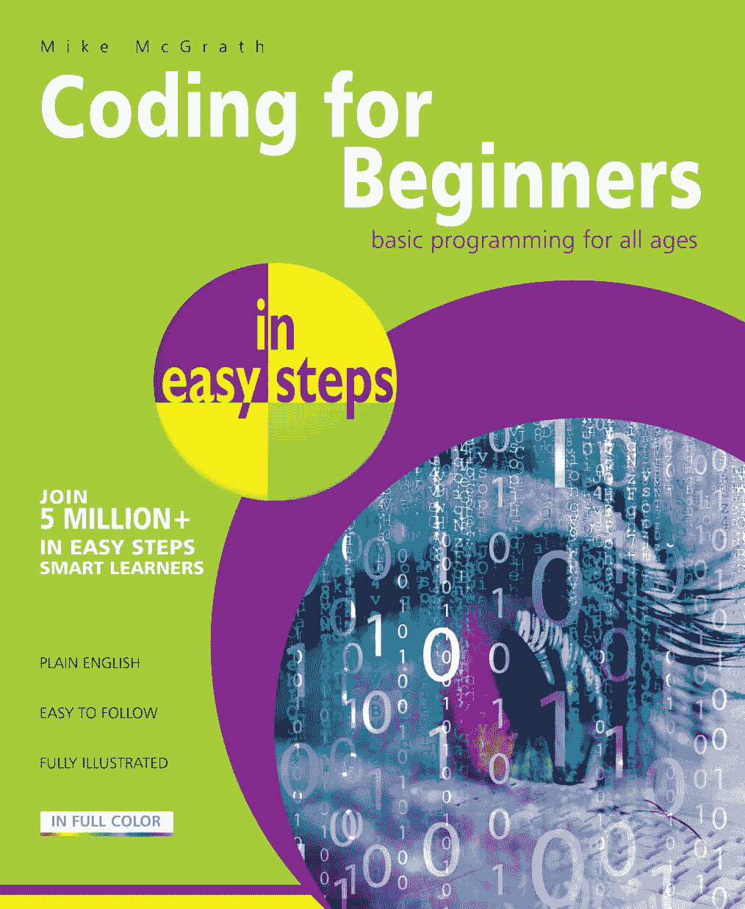


In easy steps 是 In Easy Steps Limited 的旗下品牌。

16 Hamilton Terrace · Holly Walk · Leamington Spa

Warwickshire · CV32 4LY

[www.ineasysteps.com](http://www.ineasysteps.com)

## 前言

本书的创作为我 Mike McGrath 提供了一个良好的机会，为没有编程经验的读者编写一份计算机编程入门。虽然这是一本面向初学者的书，但它超越了基础知识，因此在通过简单的程序进行编程后，某些主题可能会更容易理解。所有的示例都使用流行的 Python 语言演示编程功能，书中的截图展示了执行列出的代码的实际结果。

## 本书规范

为了清楚每个示例步骤中所列的代码，我采用了 Python 代码编辑器提供的相同默认配色方案。Python 语言本身的关键字为橙色，内置函数名为紫色，用户指定的函数名为蓝色，文本字符串为绿色，注释为红色，所有其他代码为黑色，如下所示：

```python
# 用于显示问候的函数
def greet( reader ):
    print( 'Welcome to Coding for Beginners', reader )
```

此外，为了识别步骤中描述的每个源代码文件，图标和文件名出现在步骤旁边的边缘处，如下所示：


`program.py`

## 获取源代码

为了方便起见，我将书中示例的源代码放在了一个 ZIP 压缩包中。你可以按照以下简单步骤获取压缩包：


访问 [www.ineasysteps.com](http://www.ineasysteps.com)，然后导航到 Free Resources（免费资源）并选择 Downloads（http://ineasysteps.com/resource-centre/downloads/）部分。


在列表中找到 Coding for Beginners in easy steps，然后点击 All Code Examples（所有示例）链接下载压缩包。


现在，将压缩包内容解压到计算机上的任意位置。

# 1 开始入门

*欢迎来到令人兴奋且有趣的计算机编程世界！本章描述了如何创建自己的编程环境，并演示了如何你的第一个程序*。

- 编程代码
- 设置环境
- 探索 IDLE
- 获取帮助
- 保存程序
- 存储数值
- 添加注释
- 命名规则
- 总结

计算机仅仅是一个可以极快速处理一组简单指令的机器。它所处理的指令集被称为“程序”，而这些指令被称为“代码”。

编写计算机程序的人被称为“程序员”或“编码员”。他们的程序让计算机在现代生活的几乎每个领域都变得非常有用：

- **在手中** – 计算机存在于手机设备中，用于语音、文本和社交媒体通信等任务。
- **在家里** – 计算机存在于电视机、游戏机和洗衣机等家用设备中。
- **在办公室** – 计算机存在于桌面设备中，用于文字处理、工资发放和图形设计等任务。
- **在商店** – 计算机存在于零售设备中，如自动取款机（ATM）和条形扫描器。
- **在汽车** – 计算机存在控制设备中，用于发动机管理、防锁刹车和安全等任务。
- **在空中** – 计算机存在飞机上用于飞行，并在空中交通控制中心用于安全导航。


事实上，这些只是计算机如何影响我们生活的几个例子。然而，计算机其实非常愚蠢！它们只能从零数到一，而不能独立思考。

计算机是电子组件的集合——统称为“硬件”。为了让计算机运行，必须给它提供一组程序指令——被称为“软件”。

每个计算机程序都必须提供清晰的逐步操作说明，以便计算机可以在无错误的情况下执行，这一点非常重要。因此，编码员必须将要求计算机的任务分解为简单、无歧的步骤。例如，一个将移动机器人从室内移动到户外的程序必须包含让机器人定位门框并绕过任何障碍物的指令。因此，编码员必须始终考虑程序可能会遇到哪些潜在的意外困难。

程序指令必须以计算机能够理解的语言呈现给它。在最基础的层面上，计算机可以理解“机器码”，它通过在内存中移动项目来执行任务。这种晦涩的低级代码极其乏味，因为即使执行一个简单的任务也需要许多行指令。

幸运的是，多年来，已经开发了许多“高级”编程语言，允许编码员以更具人类可读的形式编写指令。这些现代高级程序会通过“编译器”自动翻译成计算机可以理解的机器码。为了成为一名编码员，通常需要学习这些高级语言中的一种：

- **C** – 一种强大的语言，紧密关联于操作系统。
- **C++** – 一种增强型语言，支持面向对象编程（OOP）。
- **C#** – 由微软开发的现代语言，适用于 `.NET` 框架。
- **Java** – 一种便携语言，可以在任何平台运行。
- **Python** – 一种动态语言，支持面向对象编程（OOP）。


用解释语言编写的程序可以由解释器运行，而用编译语言编写的程序必须先编译。在这个例子中，Python 是这种语言的。


Python 这种语言包含了标准库，并包括图形用户界面（GUI）。


Python 是一个“内置电池”的。

## 设置


在开始编写 Python 程序之前，你需要设置好 Python 环境，通过安装解释器来完成。


从 Python Foundation 免费下载的安装程序适用于 Mac OS 和其他平台。

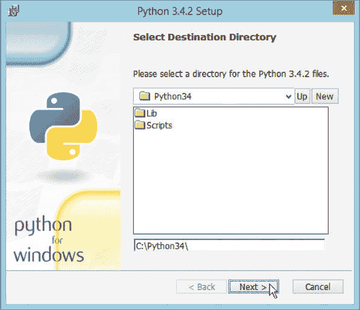

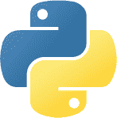

在 [python.org](https://python.org/downloads) 下载安装程序并运行 `Next`。


接受建议的安装目录，例如 `C:\`。

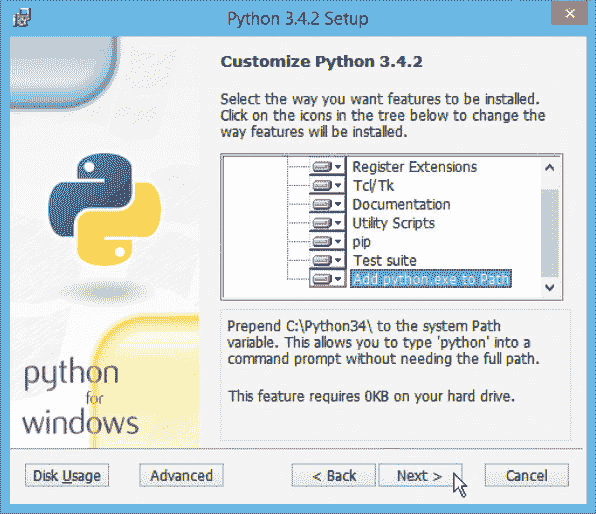

点击 `Next` 按钮，并确保勾选“将 python.exe 添加到 Path”。


点击 `Finish` 按钮完成安装。

完成后，Python 组被添加到你的开始菜单中。该组最重要的项是 IDLE，它会启动开发环境。

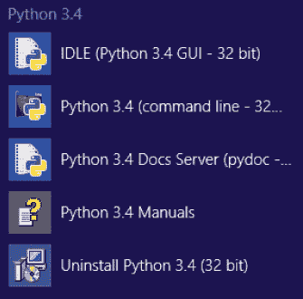

将 Python 添加到系统 Path 允许你在任何目录内调用它。安装后，你可以在命令提示符（Command Prompt）中准确地输入命令 `python -V` 来查看解释器返回的版本号。

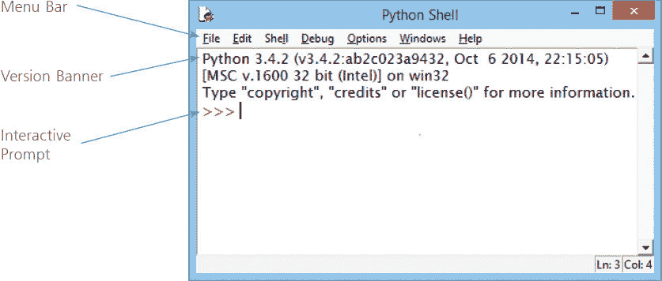

你会经常使用 IDLE 启动器，因此右键点击其图标并选择“固定到任务栏”，以便从 Windows 桌面快捷访问。

## 探索 IDLE

安装的 Python 软件包包含了开发环境（IDLE），你可以在其中轻松编写和运行用 Python 语言编写程序或代码段。IDLE 为开发提供了两个不同的窗口：

- Shell 窗口
- 编辑窗口（Edit Window）

当你启动 IDLE 时，它会打开一个窗口，包含菜单栏、描述版本的横幅和一个 `>>>` 提示符。这就是 Shell 窗口，你可以在这里通过在提示符输入语句来与解释器交互。

如果解释器理解你的输入，它将给出相应的响应；否则它会报告错误。

你可以通过在交互式提示符输入 Python `print()` 函数语句，并在括号内的引号中包含字符串，让解释器打印出文本字符串。


打开一个 IDLE Shell Window，然后在交互式提示符处精确地输入此语句：

```python
print( ‘Hello World!’ )
```


接下来，按下 Return 键查看解释器的响应。

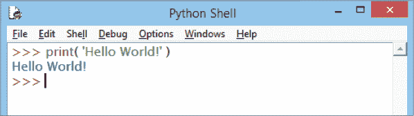


现在，在交互式提示符处输入此求和语句：

```python
8 + 4
```


语句中的空格会被忽略 – 所以可以不加输入 `8+4`。


按下 Return 查看解释器打印出的结果总和。

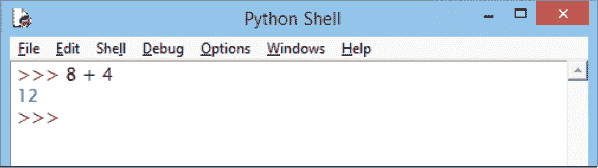


在交互式提示符处输入此无效语句：

```python
8 / 0
```


按下 Return 查看解释器打印的错误信息。

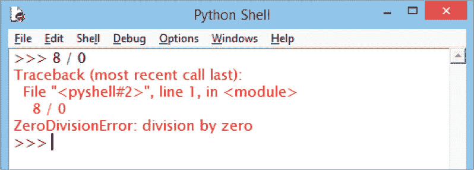


Shell Window 主要用于测试代码片段。

## 获取帮助

IDLE Shell Window 提供了一个极强大的帮助工具，在编写 Python 程序时，可以在其中找到任何 Python 主题的帮助。可以通过交互式 `>>>` 提示符处输入 Python `help()` 语句来寻求帮助。会出现一条欢迎消息，提示符会变为 `help>`，表示你现在正处于帮助模式。


打开一个 IDLE Shell Window，然后在交互式提示符处精确地输入此语句：

```python
help( )
```


接下来，按下 Return 键进入帮助模式。

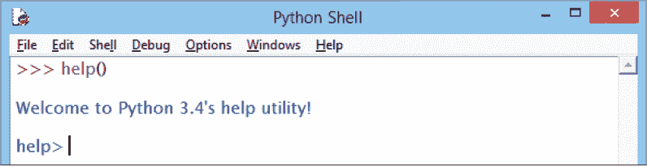


现在，在帮助工具的提示符关键字处输入此主题名称。


按下 Return 列出 Python 语言的所有关键字。

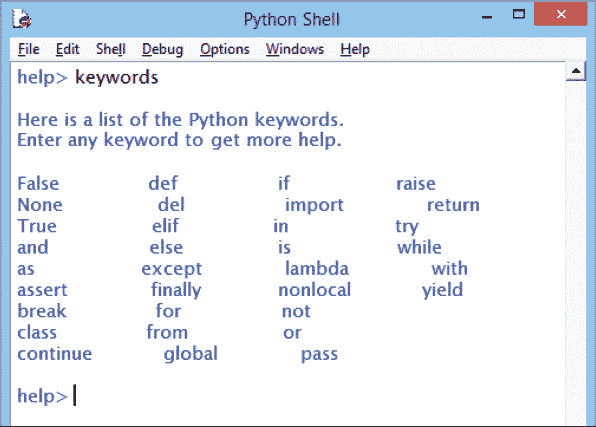


帮助工具的欢迎消息还包含实用的提示 – 但为了简洁，此处省略了。


关键字是编程语言的词汇。注意 Python 关键字是区分大小写的 – 除了 `False`、`None` 和 `True` 之外，这些均为小写。


然后，在帮助工具提示符处输入此命令 `quit`。


按下 Return 退出帮助并返回交互式 Shell Window 提示符。

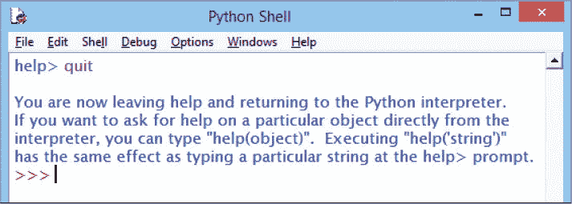


`quit` 指令不需要括号 – 这里它是帮助工具命令，而不是 Python 语句。

当你只需要某个特定主题的帮助时，只需在交互式提示符的 `help()` 语句的括号内用引号输入主题名称：


在交互式提示符处精确地输入此语句：

```python
help( ‘keywords’ )
```


按下 Return 列出 Python 语言的所有关键字并保持在交互式 Shell Window 提示符处。

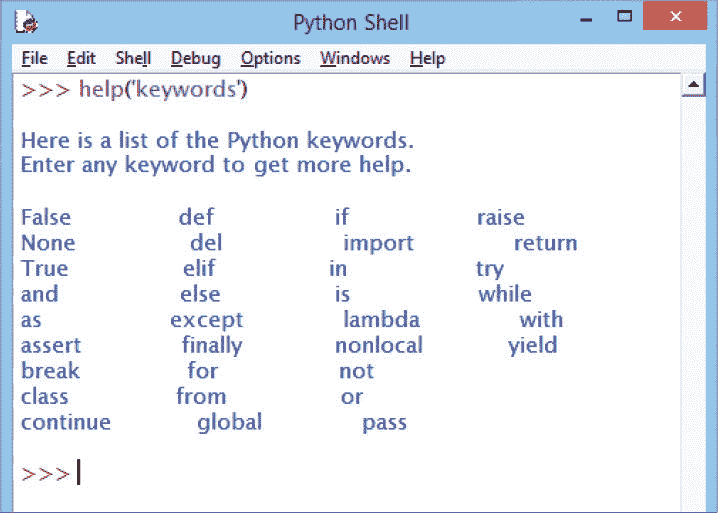


关键字在编程语言中具有特殊含义 – 不能用于命名代码中的项目。

## 保存程序

上一页描述的 IDLE Shell Window 是尝试代码片段的好地方，但它无法保存你的代码。幸运的是，IDLE 还提供了 Edit Window，你可以在其中创建较长的程序代码，并将其存储在计算机的 `.py` 文件中。这意味着你可以轻松地重新运行代码，而无需在 Shell Window `>>>` 提示符处重新输入所有指令，并允许编辑代码以尝试新想法。创建、保存和运行代码的步骤如下：

- 从 Shell Window 菜单项中选择 `File`、`New File` 打开 Edit Window – 或按下快捷键 `Ctrl + N`。
- 在 Edit Window 中输入代码，然后通过选择 Edit Window 菜单项中的 `File`、`Save` 来保存 – 或按下快捷键 `Ctrl + S`。
- 通过选择 Edit Window 菜单项中的 `Run`、`Run Module` 运行保存的代码 – 或按下快捷键 `F5`。


此处描述的步骤将用于演示书中提供的所有代码示例。

程序代码的输出将在程序运行时显示在 Shell Window 中，如果解释器发现你的代码中存在错误，那里会显示一条有用的错误信息。


打开一个 IDLE Shell Window，然后选择 `File`、`New File` 菜单项打开 IDLE Edit Window。

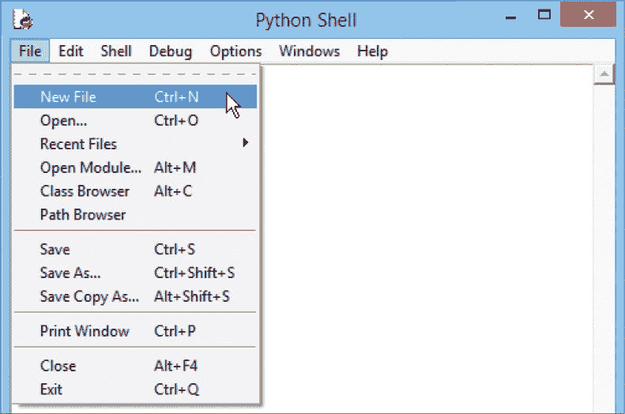


注意 `File`、`Open` 和 `File`、`Recent Files` 菜单项，可以使用它们重新运行之前保存的程序代码。


`helloworld.py`


现在，在 IDLE Edit Window 中，精确地输入此代码：

```python
print( ‘Hello World!’ )
```

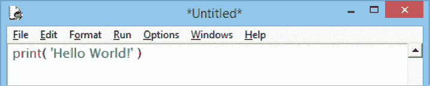


接下来，在 IDLE Edit Window 中，选择 `File`、`Save` 菜单项打开另存为对话框，然后将程序代码保存为名为 `helloworld.py` 的文件。

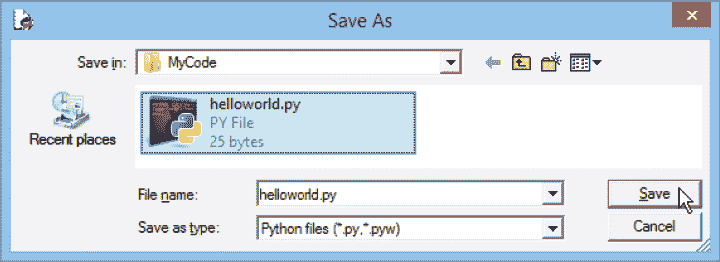


最后，在 IDLE Edit Window 中，选择 `Run`、`Run Module` 菜单项来运行你的程序代码，并看到输出显示在 Shell Window 中。

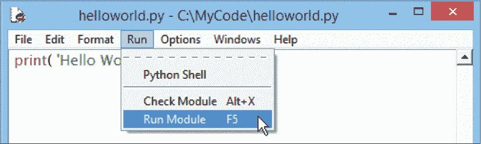

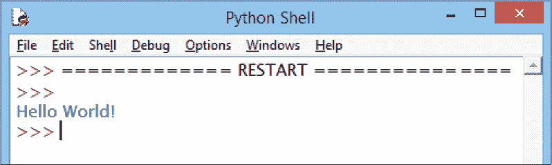


你的程序代码可以保存在计算机上任何方便的位置 – 这里它被保存在 `C:\MyCode` 创建的目录中，该目录将用于所有的示例。


注意 Shell Window 在运行程序代码时会重启。

## 存储值

所有编程语言的一项基本功能都是存储数据值。这种功能由称为“变量”的简单数据结构提供。变量是一个容器，可以在其中存储数据，就像现实对象可以存储在盒子里。创建变量时，你给它一个名称（遵循编程语言的命名规范），就像盒子上的标签。存储在变量中的数据可以通过其名称检索，就像你通过标签找到盒子中的现实对象一样。


存储在变量中的数据通过 Python 赋值语句进行赋值赋值。例如，为名为 `a` 的变量存储数值 8：

```python
a = 8
```

随后可以使用变量名检索存储的值，因此 `print( a )` 语句将输出存储的值。该变量随后可以分配不同的值，因此其值随程序运行而变化 – 这就是“变量”一词的由来。

在 Python 编程中，必须在声明语句中初始化变量 – 否则解释器将报告“未定义”错误。

可以使用一系列 `=` 赋值在单个语句中初始化多个变量。例如，将名为 `a`、`b` 和 `c` 的变量都初始化为数值 8：

```python
a = b = c = 8
```


打开 IDLE 编辑窗口，然后输入代码创建一个名为 `var` 的变量来存储一个整数。

```python
var = 8
```


接下来，添加一条语句来显示存储的整数值。

```python
print( var )
```


为变量赋值一个新的浮点数，然后添加一条语句显示存储的浮点数值。

```python
var = 3.142
print( var )
```


现在，为变量赋值一个文本字符串，然后添加一条语句显示存储的字符串值。

```python
var = ‘Coding for Beginners in easy steps’
print( var )
```


最后，为变量赋值一个逻辑真值，然后添加一条语句显示存储的布尔值。

```python
var = True
print( var )
```


保存文件（`File`、`Save`）然后运行程序（`Run`、`Run Module`），以在输出中显示存储的值。

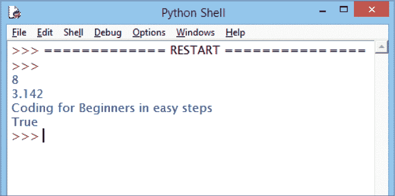


文本字符串数据必须包含在引号内表示该特定字符串的开始和结束。

### 添加注释


当你开始编写较大程序时，在每段代码的开头添加注释来描述该代码的作用非常有用。这使得他人更容易理解代码，也让你自己在日后重新查看代码时更容易理解。在 Python 编程语言中，单行中 `#` 哈希字符之后的所有内容都会被解释器忽略。这意味着可以在 `#` 字符之后插入单行注释。


`comment.py`

打开 IDLE 编辑窗口，然后输入带注释的代码来初始化变量并显示其状态。

```python
# 初始化程序状态
running = True
print( ‘Run state: ‘ , running )
```

保存文件并运行程序，以看到注释被忽略并在输出中显示存储的值。

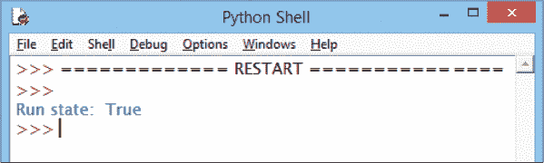

为了方便识别代码的各个部分，IDLE 会自动在 Shell 窗口和编辑窗口中对代码进行着色，使用下表列出的默认颜色：

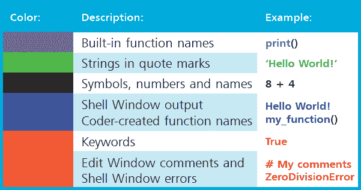


书中步骤中列出的代码也使用了默认的 IDLE 颜色以保持一致性。

### 命名规则

| 关键字: | | | |
| :--- | :--- | :--- |
| `False` | `None` | `True` |
| `and` | `as` | `assert` |
| `break` | `class` | `continue` |
| `def` | `del` | `elif` |
| `else` | `except` | `finally` |
| `for` | `from` | `global` |
| `if` | `import` | `in` |
| `is` | `lambda` | `nonlocal` |
| `not` | `or` | `pass` |
| `raise` | `return` | `try` |
| `while` | `with` | `yield` |


选择反映变量内容本质的有意义名称是良好的编程习惯。

你在代码中创建的用于在程序中存储数据的变量容器可以使用你选择的任何名称——只要你不使用任何编程语言的关键字（例如上表中的 Python 关键字），并且名称符合下表列出的命名规则：

| 命名规则: | 示例: |
| :--- | :--- |
| 不可以包含任何关键字 | `True` |
| 不可以包含算术运算符 | `a+b*c` |
| 不可以包含符号 | `%$#@! ` |
| 不可以包含任何空格 | `no spaces` |
| 不可以以数字开头 | `2bad` |
| 可以在其他地方包含数字 | `good1` |
| 可以包含大小写混合字母 | `UPdown` |
| 可以包含下划线 | `is_ok` |


变量名在 Python 中对大小写敏感——因此名为 `VAR`、`Var` 和 `var` 的变量将被视为三个不同的变量。

# 总结

- 计算机程序是由编码员编写的一组指令，使计算机变得有用。
- 计算机的电子组件是它的硬件，而程序指令是它的软件。
- 计算机理解低级机器码。
- 以类人可读形式的高级编程语言会自动翻译成低级机器码。
- 编程语言拥有用于存储信息的数据结构和用于确定进度的控制结构。
- Python 编程语言具有简单的语法，不需要编译，并包含一个函数库。
- Python 的开发环境被称为 IDLE。
- IDLE 提供了一个包含用于测试的交互式提示符的 Shell 窗口，以及一个用于编写程序的编辑窗口。
- 通过在 Shell 窗口提示符处输入 `help()` 语句可以访问 IDLE 帮助实用程序。
- 在 IDLE 编辑窗口中输入程序代码后，必须先保存。

## 2 保存数据

*本章演示了如何创建代码来使用各种类型的数据。*

- 存储输入
- 控制输出
- 识别类型
- 转换数据
- 猜游戏
- 纠正错误
- 总结

### 存储输入

存储并替换代码中数据的能力是非常棒的，但这种能力也可以存储用户输入——让你的程序变得交互。

在 Python 编程中，内置函数 `input()` 可接受用户输入并将其赋值给变量。可选，此函数可以指定一个字符串（位于引号内）来请求输入。程序将等待用户按下 Return 键后将输入赋值给变量并继续执行。

存储的变量值可以通过 `print()` 函数输出，只需在括号内指定变量名。多个变量也可以以逗号列表的形式指定输出。


`input.py`

打开 IDLE 编辑窗口，然后输入此代码请求用户输入以初始化变量：

```python
name = input( ‘Please enter your name: ‘ own )
```

接下来，添加一条语句输出字符串和变量存储的值。

```python
print( ‘Hello’ , name )
```

现在，添加语句输出一个字符串，再次输出字符串和变量存储的值。

```python
print( ‘Welcome to Coding for Beginners’ )
print( ‘Remember to have fun’ , name , ‘!’ )
```

保存后运行程序，在请求时输入你的名字并按 Return，在输出中看到你的名字。

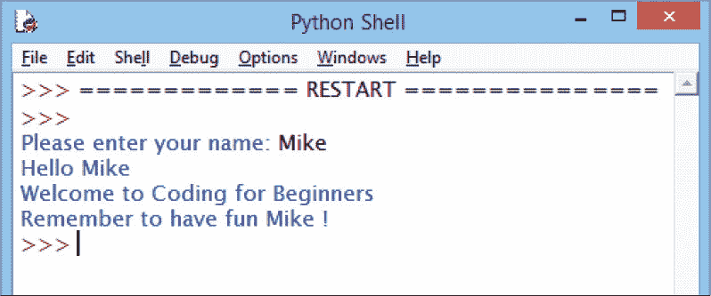


逗号列表中不需要包含空格——解释器会忽略它们，但为了清晰起见在这里显示了。

### 控制输出

正如对面页面示例所示，存储在变量中的值可以重复使用，直到它被新值替换或程序结束。

关于此示例的输出，还有两点需要注意。首先，`print()` 函数会在输出后自动添加一个不可见的 `\n` 换行符——因此，下一个 `print()` 函数的输出默认将出现在下方的下一行。其次，当指定逗号分隔的列表进行输出时，`print()` 函数会在每个项目之间自动添加空格。

你可以通过指定行尾为空格而不是默认的 `\n` 来覆盖自动换行的行为。你还可以通过使用 `+` 符号“拼接”项目而不是使用逗号，来避免自动间距行为。


`concat.py`

打开一个 IDLE 编辑窗口，然后输入以下代码请求用户输入，以此初始化变量：

```python
name = input( ‘Please enter your name: ‘ )
```

接下来，添加一条语句输出一个字符串和变量中存储的值——但末尾不加换行符：

```python
print( ‘Hello ’ + name , end = ‘ ‘ )
```

现在，添加语句输出一个字符串，然后是一个与变量存储的值拼接的字符串：

```python
print( ‘Welcome to Coding for Beginners’ )
print( ‘Remember to have fun ’ + name + ‘!’ )
```

保存并运行程序，在提示时输入你的名字，按回车键查看控制输出。

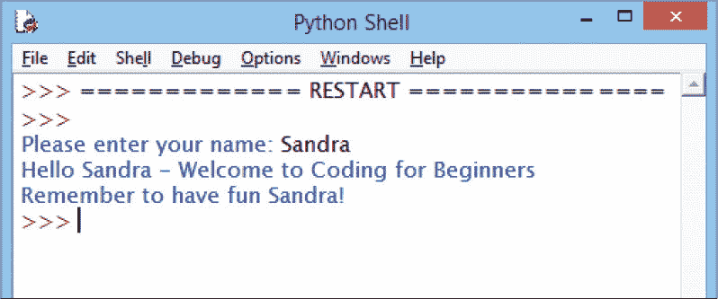


注意字符串已经过编辑，以良好的格式化输出。

### 识别类型

在编写计算机程序时，你可以表示并存储在变量中的四种基本数据类型。虽然 Python 语言中的变量可以存储任意类型的数据，但理解不同的类型是非常重要的，因为你有时需要在代码中将它们从一种类型转换为另一种类型：

| 数据类型: | 描述: | 示例: |
| :--- | :--- | :--- |
| `str` | 字符串，可以包括字母、数字、空格和符号 | ‘Daytona 500’ |
| `int` | 整数，它**不包含**小数部分 | `1000` |
| `float` | 浮点数，它**有**小数部分 | `98.6` |
| `bool` | 布尔逻辑真值，为 True 或 False | `True` |


整数 `int` 数字不应包含任何标点符号——因此将一千代码化为 `1000` 而不是 `1,000`。

字符串仅仅是你可以从计算机键盘输入的任何字符集合，并组合在引号内。如果赋值给变量的值被包含在引号内，变量将识别该值属于 `str`“类”。


字符串 `str` 值必须始终包含在引号中。

数字是你可以从键盘输入的任何数值，但它们通过是否包含或省略小数点来定义。如果赋值给变量的数值没有小数点，变量将其识别为属于 `int`“类”；如果确实有小数点，则识别为属于 `float` 类。

布尔值是一个逻辑真值。变量通过关键字 `True` 和 `False` 识别给它的布尔值属于 `bool`“类”，或者该值为 `True` 或 `False`。

在 Python 编程中，你可以通过在内置 `type()` 函数的括号内指定变量名称，轻松发现存储在变量中的数据类型。


`types.py`

打开 IDLE 编辑窗口，通过赋值一个字符串初始化变量，然后显示其值和数据类型：

```python
race = ‘Daytona 500’
print( race , ‘is‘ + type( race ) )
```

接下来，通过赋值一个整数初始化变量，然后显示其值和数据类型：

```python
kilo = 1000
print( kilo , ‘is‘ + type( kilo ) )
```

现在，通过赋值一个小数初始化变量，然后显示其值和数据类型：

```python
temp = 98.6
print( temp , ‘is‘ + type( temp ) )
```

通过赋值一个真关键字初始化变量，然后显示其值和数据类型：

```python
flag = True
print( flag , ‘is‘ + type( flag ) )
```


最后，将最后一个变量值替换为比较的真结果，再次显示其值和数据类型。

```python
flag = 4 > 8
print( flag , ‘is‘ + type( flag ) )
```


保存并运行程序，以发现你创建的变量中存储的数据类型。

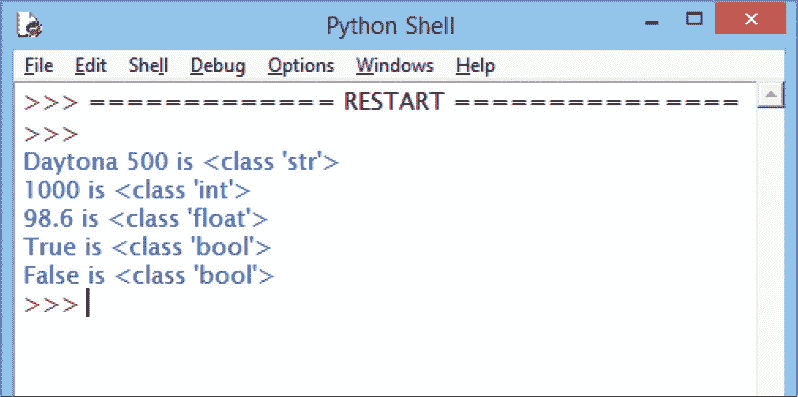


这里的比较检查 `4` 是否大于 `8`，这显然是不正确的。比较将在下文中完整演示。

## 转换数据

你通常需要在程序中转换数据以执行某些操作——例如算术运算或拼接。算术运算只能对数值类型（如 `int` 和 `float`）进行，而拼接只能对字符串类型（如 `str`）进行。

Python 提供了几个内置函数，允许你轻松将数据转换为不同的类型。这些函数不会转换原始值，而仅返回其转换后的表示。在编程术语中，这被称为“强制”（cast）操作：

| 函数 | 描述 |
| :--- | :--- |
| `int(x)` | 将 `x` 转换为整数 |
| `float(x)` | 将 `x` 转换为浮点数 |
| `str(x)` | 将 `x` 转换为字符串 |


代码中的值不应包含在引号内——引号内的数字将被视为字符串值！

代码中手动赋值给变量的数值会自动被赋予相应的 `int` 或 `float` 类型。然而，通过 `input()` 函数赋值给变量的值总是被赋予 `str` 数据类型——即使它们是数字！这意味着在对其进行算术运算之前，必须将它们转换为相应的数值类型。

相反，代码中手动赋值给变量的数值（自动被赋予 `int` 或 `float` 类型）无法拼接到字符串中。这意味着它们必须转换为 `str` 类型以包含字符串中。

在 Python 中，正如许多其他编程语言一样，`+` 符号根据上下文具有多个用途。当 `+` 符号用于两个数值之间时，它执行加法（视为“加法运算符”），而当 `+` 符号用于两个字符串之间时，它执行拼接（视为“拼接运算符”）。赋值此类操作结果的变量将自动成为相应的数据类型。


对 `int` 和 `float` 类型进行算术运算会自动强制转换为 `float` 结果。将值转换为 `float` 类型以便输入小数。


```python
cast.py
```


打开 IDLE 编辑窗口，通过赋值用户输入初始化两个变量。

```python
num1= input( ‘Please enter a whole number: ‘ )
num2= input( ‘Now enter another whole number: ’ )
```


接下来，显示每个变量的数据类型，以查看数值实际上是存储为字符串的。

```python
print( ‘Input is: ‘ , type( num1 ) , type( num2 ) )
```


现在，使用 `+` 运算符尝试加法，但你会发现结果被拼接为了 `str` 数据类型。

```python
total = num1 + num2
```

```python
print( ‘Total:‘ , total , type( total ) )
```


再次使用 `+` 运算符尝试加法，但对存储的值进行类型转换，以查看结果为 `int` 数据类型。

```python
total = int( num1 ) + int( num2 )
```

```python
print( ‘Total:‘ , total , type( total ) )
```


最后，将存储的值转换为 `float` 数据类型，并将浮点结果值拼接到输出的 `str` 字符串中。

```python
total = float( num1 ) + float( num2 )
```

```python
print( ‘Total: ‘ + str( total ) , type( total ) )
```


保存并运行程序，查看通过内置函数进行转换后存储的数据类型。

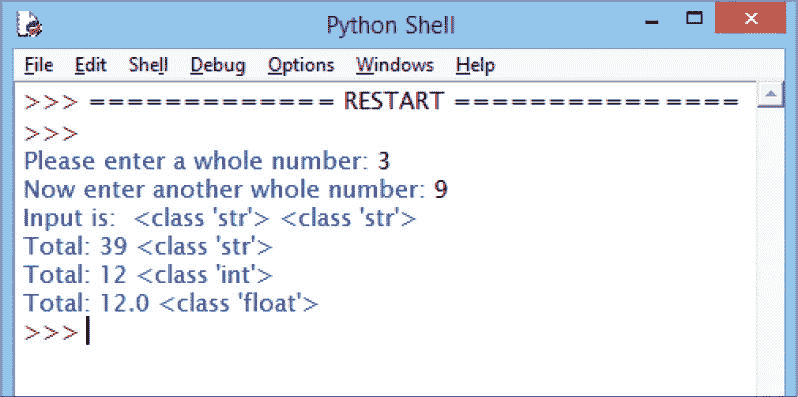


如果你忘记转换为正确的数据类型，解释器将报告错误——尝试将一个 `int` 加到一个 `str` 数据类型上以查看错误信息。

## 猜数字游戏

之前的简单示例说明了如何在程序中使用变量来存储文本字符串值、数值整数和浮点小数值以及布尔真值值。现在，它们可以被用来创建一个“猜数字游戏”程序：通过存储一个随机生成的整数（用户需要猜中它的值）、一个在用户猜对时结束游戏的布尔真值值，以及一个包含用户猜词结果的字符串。

此示例中的代码包含了一些在本书后面才会演示的功能，但由于 Python 是一门易于人类的编程语言，你应该能够原理上理解这个程序是如何工作的。


`guess.py`


打开 IDLE 编辑窗口，通过导入一个提供随机数生成器函数的“random”库类来开始程序。

```python
import random
```


现在初始化三个变量——一个 1 到 20 之间的随机数、一个只要游戏进行就保持为 `True` 的布尔值，以及一个稍后存储用户输入的数字的值。

```python
num = random.randint( 1 , 20 )
flag = True
guess = 0
```


接下来，显示一条消息让用户进行猜想。

```python
print( ‘Guess my number 1-20 : ‘ end = ‘ ‘ )
```


然后，精确复制这段代码，它将存储的用户猜词与存储的随机数进行比较。

```python
while flag == True :
    guess = input( )
    if not guess.isdigit() :
        print( ‘Invalid! Enter only digits 1-20‘ )
        break
    elif int( guess ) < num :
        print( ‘Too low, try again : ‘ end = ‘ ‘ )
    elif int( guess ) > num :
        print( ‘Too high, try again : ‘ end = ‘ ‘ )
    else:
        print( ‘Correct...’ + guess )
        flag = False
```


保存并运行程序，查看通过内置函数进行转换后存储的数据类型。


许多语言使用如 `}` 这样的字符来分组语句，但 Python 使用缩进，因此必须保留缩进。


保存并运行程序，查看通过内置函数进行转换后存储的数据类型。


`random` 库类用于随机数生成。

- `randint()` 函数提供随机数生成器函数。
- `while` 关键字提供循环结构。
- `if`、`elif`、`else` 提供条件逻辑。
- `input()` 获取用户输入。
- `isdigit()` 检查字符串是否包含数字。
- `int()` 将字符串转换为整数。
- `float()` 将字符串转换为浮点数。
- `str()` 将值转换为字符串。
- `break` 终止循环。
- `flag` 变量控制循环。
- `num` 存储随机数。
- `guess` 存储用户的输入。
- `+` 运算符用于加法或拼接。
- `type()` 函数检查数据类型。
- `print()` 函数输出到控制台。

导入 `random` 库类以进行随机数生成。

`randint(1, 20)` 生成一个 1 到 20 之间的随机整数。

`flag` 是一个布尔变量，用于跟踪游戏状态。

`guess` 初始化为 `0` 以存储用户的输入。

`input()` 用于捕捉用户的输入。

`isdigit()` 用于验证输入是否为数字。

`int()` 用于将输入字符串转换为整数以便比较。

`float()` 用于将值转换为浮点数。

`str()` 用于将值转换为字符串进行拼接。

`print()` 用于显示消息和结果。

`while` 在 `flag` 为 `True` 时创建一个循环。

`if`、`elif`、`else` 用于条件逻辑。

`break` 用于提前退出循环。

代码遵循带有缩进标准的 Python 语法。所有变量和函数都正确包裹在内。

- Python 内置函数 `input()` 可以将输入赋值给变量，并可以选择指定一个要显示的字符串。
- Python 内置函数 `print()` 可以在括号内以逗号分隔列表的形式指定多个输出值。
- 默认情况下，`print()` 函数会在输出后自动添加一个 `\n` 换行符，除非指定了结束符。
- `+` 拼接运算符可以将两个字符串连接在一起。
- 数据类型本质上是 `str` 文本字符串、`int` 整数、`float` 小数或 `bool` 布尔真值。
- 布尔值是逻辑真值，在 Python 中用 `True` 和 `False` 关键字表示。
- Python 内置函数 `type()` 可以识别任何指定变量中的值属于哪类数据类型。
- Python 内置函数 `input()` 赋值给变量总是被赋予 `str` 字符串数据类型。
- 可以 Python 内置的 `int()`、`float()` 和 `str()` 转换函数对数据类型进行转换以便操作。
- 对 `int` 整数和 `float` 小数进行算术运算将产生 `float` 数据类型结果。
- 代码不正确引起的语法错误会在程序执行前被解释器识别。
- 异常引起的运行时错误会在程序执行期间被解释器识别。
- 意外执行结果引起的语义错误不会被解释器识别。

# 执行操作

本章演示了如何在代码语句中使用运算符符号。

- 算术运算
- 变量赋值
- 比较值
- 寻找真值
- 测试条件
- 设置顺序
- 总结

## 算术运算

在计算机程序编程中常用的算术“运算符”正如你预期的，使用 `+` 符号表示加法，使用 `-` 符号表示减法。通常，它们还使用 `*` 星号表示乘法而不是 `x` 符号，并使用 `/` 斜杠表示除法，而不是 `÷` 符号。

用于编写 Python 程序的算术运算符如表所示，以及它们执行的操作：

| 运算符 | 操作 |
| :--- | :--- |
| `+` | 加法 |
| `-` | 减法 |
| `*` | 乘法 |
| `/` | 除法 |
| `%` | 取余 |
| `//` | 整除 |
| `**` | 幂 |

`+` 运算符将两个数字相加，`-` 运算符从第一个数字中减去第二个数字。

`*` 运算符将第一个数字乘以第二个数字，`/` 运算符将第一个数字除以第二个数字。

`%` 取余运算符将第一个数字除以第二个数字并返回操作结果的余数。这对于判断一个数是奇数还是偶数很有用。

`//` 整除运算符的操作与 `/` 除法运算符相同，但它会在小数点处截断结果——移除结果数字中的任何浮点部分。

`**` 幂运算符返回第一个数字的第二个数字次方的的结果。


用于运算符组合形成表达式的值被称为“操作数”——在表达式 `2 + 3` 中，数值 `2` 和 `3` 就是操作数。


`arithmetic.py`


通过创建两个包含整数的变量来启动新程序。

```python
a = 8
b = 2
```


接下来，显示数字相加的结果。

```python
print( ‘Addition: \t’ , a , ‘+’ , b , ‘=’ , a + b )
```


现在，显示数字相减的结果。

```python
print( ‘Subtraction:\t’ , a , ‘-’ , b , ‘=’ , a - b )
```


然后，显示数字相乘的结果。

```python
print( ‘Multiplication:\t’ , a , ‘x’ , b , ‘=’ , a * b )
```


显示数字除法的结果，包括带和不带浮点部分。

```python
print( ‘Division: \t’ , a , ‘÷’ , b , ‘=’ , a / b )
print( ‘Floor Division:\t’ , a , ‘÷’ , b , ‘=’ , a // b )
```


接下来，显示数字除后的余数。

```python
print( ‘Remainder:\t’ , a , ‘%’ , b , ‘=’ , a % b )
```


最后，显示第一个数字的第二个数字次方的的结果。

```python
print( ‘Exponent:\t ‘ , a , ‘² = ’ , a ** b , sep = ‘’ )
```


保存后运行程序以查看算术运算的结果。

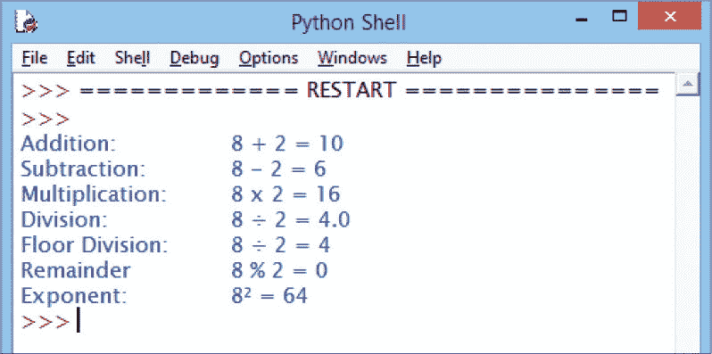


在这里，特殊的 `\t` 字符序列向后面添加了一个不可见的制表符。


带有特殊的 `\t` 字符序列向后面添加了不可见的制表符。

## 赋值

计算机程序中常用的赋值运算符简单地使用 `=` 来赋值。用于编写 Python 程序的赋值运算符如下所示：

| 运算符 | 示例 |
| :--- | :--- |
| `=` | `a = b` |
| `+=` | `a += b` |
| `-=` | `a -= b` |
| `*=` | `a *= b` |
| `/=` | `a /= b` |
| `%=` | `a %= b` |
| `//=` | `a //= b` |
| `**=` | `a **= b` |

在示例中，`+=` 运算符向现有变量添加值。

`+=` 运算符用于向现有变量添加值。

所有这些其他运算符的工作方式相同：先进行操作，然后赋值结果。

在示例中，`+=` 运算符首先添加变量中的值。

在示例中，`+=` 运算符首先添加变量中的值。

重要的是将 `=` 运算符视为“赋值”而不是“相等”，以免与 `==` 运算符混淆。


`assign.py`


通过创建两个包含整数的变量来启动新程序并显示赋值。

```python
a = 8
b = 4
print( ‘Assign Values:\t’ , a , ‘tb =’ , b )
```


接下来，加并给第一个变量赋值值并显示其存储值。

```python
a += b
print( ‘Add & Assign:\t’ ,a =’ \t(8 += 4)’ )
```


现在，减去并给第一个变量赋值值并显示其存储值，然后乘以并给第一个变量赋值并显示其存储值。

```python
a -= b
print( ‘Subtract & Assign:\t’ ,a =’ , a , ‘t(12 - 4)’ )
a *= b
print( ‘Multiply & Assign:\t’ ,a =’ , a , ‘t(8 x 4)’ )
```


最后，除以并给第一个变量赋值值并显示其存储值，然后取余并给第一个变量赋值值并显示其存储值。

```python
a /= b
print( ‘Divide & Assign:\t’ ,a =’ , a , ‘t(32 ÷ 4)’ )
a %= b
print( ‘Remainder & Assign:\t’ ,a =’ , a , ‘t(8 % 4)’ )
```


保存并运行程序以查看赋值操作的结果。

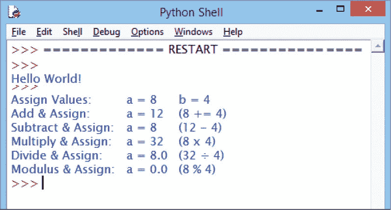


与 `=` 赋值运算符不同，`==` 等于运算符用于比较操作数，其描述见此处。

### 比较值

Python 编程中常用的用于比较两个操作数值的 `==` 运算符如下表所示：

| 运算符 | 比较测试 |
| :--- | :--- |
| `==` | 等于 |
| `!=` | 不等于 |


| `>` | 大于 |
| --- | --- |
| `<` | 小于 |
| `>=` | 大于或等于 |
| `<=` | 小于或等于 |

`==` 等于运算符比较两个操作数，如果两者的值相等则返回 `True`，否则将返回 `False` 值。如果两者都是相同的数字，则它们相等；如果两者都是字符，则通过数值比较它们的 ASCII 值来获得比较结果。

相反，`!=` 不等于运算符在两个操作数不相等时返回 `True`，使用与 `==` 等于运算符相同的规则，否则返回 `False`。相等和不等于运算符用于测试两个变量的状态，以便根据结果在程序中执行条件分支。

`>` “大于”运算符比较两个操作数，如果第一个的值大于第二个，则返回 `True`；如果它的值等于或小于第二个，则返回 `False`。`<` “小于”运算符进行相同的比较，但如果第一个操作数的值小于第二个的，则返回 `True`，否则返回 `False`。`>` “大于”或 `<` “小于”运算符常用于测试循环中计数器的值。

在 `>` “大于”或 `<` “小于”运算符后添加 `=` 运算符可以使其两个操作数的值完全相等时也返回 `True`。


A-Z 大写字母的 ASCII 值为 65-90，a-z 小写字母的 ASCII 值为 97-122。


`comparison.py`


通过初始化五个带有比较值的变量来启动新程序：

```python
nil = 0
num = 0
top = 1
cap = ‘A’
low = ‘a’
```


接下来，添加语句显示数值和字符相等比较的结果：

```python
print( ‘Equality : \t’ , nil , ‘==’ , num , nil == num )
print( ‘Equality : \t’ , cap , ‘==’ , low , cap == low )
```


现在，添加语句显示不等于比较的结果：

```python
print( ‘Inequality :\t’ , nil , ‘!=’ , top , nil != top )
```


然后，添加语句显示大于和小于比较的结果：

```python
print( ‘Greater : \t’ , nil , ‘>’ , top , nil > top )
print( ‘Lesser : \t’ , nil , ‘<’ , top , nil < top )
```


最后，添加语句显示大于或等于以及小于或等于比较的结果：

```python
print( ‘More Or Equal :\t’ , nil , ‘>=’ , num , nil >= num )
print( ‘Less or Equal :\t’ , top , ‘<=’ , num , top <= num )
```


保存并运行程序 – 查看比较操作的结果。

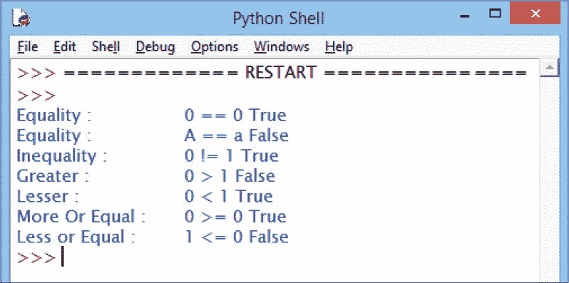


此处所示的 `\t` 转义序列添加了一个不可见的制表符字符以格式化输出。


大写字母“A”的 ASCII 值为 65，但小写字母“a”是 97 – 所以它们在这里的比较返回 `False`。

### 寻找真值

Python 编程中最常用的逻辑运算符如下表所示：

| 运算符： | 操作： |
| --- | --- |
| `and` | 逻辑与 |
| `or` | 逻辑或 |
| `not` | 逻辑非 |

逻辑运算符用于具有布尔值 `True` 或 `False` 的操作数，或者转换为 `True` 或 `False` 的值。

（逻辑与）`and` 运算符评估两个操作数，只有当两个操作数本身为 `True` 时才返回 `True`。否则 `and` 运算符将返回 `False`。这在编程中用于执行“条件分支”，即程序的方向通过测试两个条件来决定 – 如果两个条件都满足，程序将进入某个方向，否则将进入另一个方向。

与需要两个操作数都为 `True` 的 `and` 运算符不同，逻辑或）`or` 运算符评估它的两个操作数，如果其中任一操作数本身返回 `True`，则返回 `True`。如果两个操作数都不返回 `True`，则返回 `False`。相等和不等于运算符用于测试两个变量的状态，以便根据结果在程序中执行分支。

`>` “大于”运算符比较两个操作数，如果第一个的值大于第二个，则返回 `True`；如果它的值等于或小于第二个，则返回 `False`。`<` “小于”运算符进行相同的比较，但如果第一个操作数的值小于第二个的，则返回 `True`，否则返回 `False`。`>` “大于”或 `<` “小于”运算符常用于测试循环中计数器的值。

在 `>` “大于”或 `<` “小于”运算符后添加 `=` 运算符可以使其两个操作数的值完全相等时也返回 `True`。


A-Z 大写字母的 ASCII 值为 65-90，a-z 小写字母的 ASCII 值为 97-122。


（逻辑与）`and` 运算符评估两个操作数，只有当两个操作数本身为 `True` 时才返回 `True`。否则 `and` 运算符将返回 `False`。这在编程中用于执行“条件分支”，即程序的方向通过测试两个条件来决定 – 如果两个条件都满足，程序将进入某个方向，否则将进入另一个方向。

与需要两个操作数都为 `True` 的 `and` 运算符不同，逻辑或）`or` 运算符评估它的两个操作数，如果其中任一操作数本身返回 `True`，则返回 `True`。如果两个操作数都不返回 `True`，则返回 `False`。

（逻辑非）`not` 运算符是一个一元运算符，用于单个操作数。它返回给定操作数的反转值，如果操作数值为 `True`，则返回 `False`。`not` 运算符用于在编程中取反变量的值。


“Boolean”一词指的是由数学家布尔（1815-1864）开发的系统。


`logic.py`


通过初始化两个带有布尔值的变量来启动新程序：

```python
a = True
b = False
```


添加语句显示逻辑与评估的结果：

```python
print( ‘AND Logic:’ , a and b )
```


添加语句显示逻辑或评估的结果：

```python
print( ‘OR Logic:’ , a or b )
print( ‘b or a =’ , b or a )
```


添加语句显示逻辑非评估的结果：

```python
print( ‘NOT Logic:’ , not a )
print( ‘b =’ , not b )
```


保存并运行程序 – 查看逻辑操作的结果。


在 Python 编程中，布尔值也可以用数值表示，其中 `True` 为 `1`，`False` 为 `0`（零）。


注意表达式 `False and False` 返回 `False`，而不是 `True` – 这也许证明了格言“错错不为正”。

### 测试条件

许多编程语言（如 C++ 或 Java）具有 `?:` “三元运算符”，它可以评估一个 `True` 或 `False` 条件，然后根据评估结果返回两个值之一。`?:` 三元运算符的语法如下：

`(test-expression) ? if-true-return-this : if-false-return-this`

与其他编程语言不同，Python 没有 `?:` 三元运算符，而是使用“条件表达式”，它使用 `if` 和 `else` 关键字以类似的方式工作，语法如下：

`if-true-return-this if (test-expression) else if-false-return-this`

虽然条件表达式语法最初看起来很复杂，但非常值得熟悉，因为它可以用最少的代码执行强大的程序分支。例如，当变量的值不为 1 时进行分支：

`if-true-do-this if (var != 1) else if-false-do-this`

条件表达式可以用于 Python 编程，将两个变量的最大值或最小值赋值给第三个变量。例如，像这样赋值最小值：

`c = a if (a < b) else b`

当变量 `a` 的值小于变量 `b` 的值时，括号中的表达式返回 `True`——在这种情况下，变量 `a` 的较小值赋值给变量 `c`。

同样，将测试表达式中的 `<` 小于运算符替换为 `>` 大于运算符，将把变量 `b` 的较大值赋值给变量 `c`。

条件表达式的另一个常见用法是在测试表达式中使用 `%` 取余运算符来判断变量的值是奇数还是偶数：

`if-true(odd)-do-this if (var % 2 != 0) else if-false(even)-do-this`

其中，如果变量值除以二后有余数，则该数为奇数；如果没有余数，则该数为偶数。测试表达式 `(var % 2 == 1)` 具有相同的效果，但最好测试不相等性——发现不同之处比发现它们完全相同更容易。


从通用的编程术语来说来说，“表达式”（expression）总是返回一个值，而“语句”（statement）则不必——但一个语句可以包含一个或多个表达式。


条件表达式实际上有三个操作数——测试表达式和两个可能的返回值。


`condition.py`


通过初始化两个整数值变量开始一个新程序，以进行条件评估：

```python
a = 1
b = 2
```


接下来，添加语句显示条件评估的结果——描述第一个变量的值：

```python
print( ‘\nVariable a Is :’ , ‘One’ if ( a == 1 ) else ‘Not One’ )
print( ‘Variable a Is :’ , ‘Even’ if ( a % 2 == 0 ) else ‘Odd’ )
```


现在，添加语句显示条件评估的结果——描述第二个变量的值：

```python
print( ‘\nVariable b Is :’ , ‘One’ if ( b == 1 ) else ‘Not One’ )
print( ‘Variable b Is :’ , ‘Even’ if ( b % 2 == 0 ) else ‘Odd’ )
```


然后，添加语句将条件评估的结果赋值给新变量：

```python
top = a if ( a > b ) else b
```


最后，添加语句显示赋值的结果——识别两个变量值中较大的一个：

```python
print( ‘\nGreater Value Is:’ , top )
```


保存并运行此程序——查看条件表达式操作的结果。

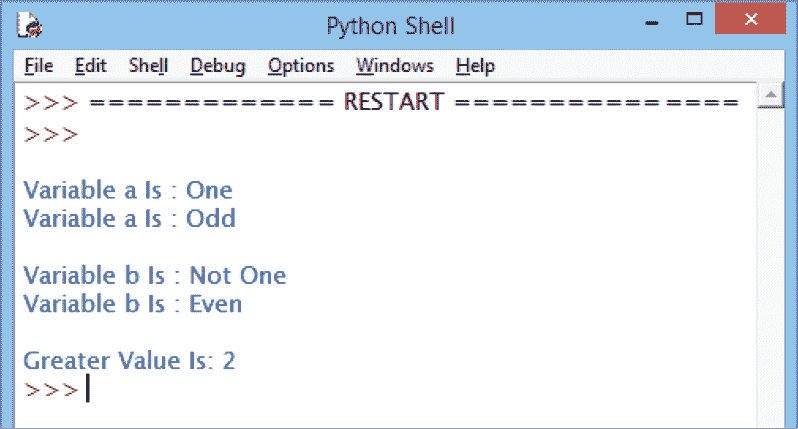


你可能会发现，一些 Python 程序员不喜欢条件表达式，因为他们认为它的语法违反了易于阅读的原则。

### 设置顺序

运算符优先级决定了表达式进行求值的顺序。例如，在表达式 `3 * 8 + 4` 中，默认优先级决定先完成 `*` 乘法运算符的乘法，因此结果为 28 (24 + 4)。

下表按降序列出了 Python 的运算符优先级——顶行的运算符优先级最高，较低行的优先级依次递减。同一行内运算符的优先级从左到右链式。

| Operator: | Description: |
| --- | --- |
| `**` | 幂 |
| `+` | 正数 |
| `-` | 负数 |
| `~` | 按位取反 |
| `*` | 乘法 |
| `/` | 除法 |
| `//` | 整除 |
| `%` | 取余 |
| `+` | 加法 |
| `-` | 减法 |
| `\|` | 按位或 |
| `^` | 按位异异 |
| `&` | 按位与 |
| `>>` | 按位右移 |
| `<<` | 按位左移 |
| `>, >=, <, <=, ==, !=` | 比较 |
| `=, %=, /=, //=, -=, +=, *=, **=` | 赋值 |
| `is, is not` | 标识 |
| `in, not in` | 成员性 |
| `not` | 逻辑非 |
| `and` | 逻辑与 |
| `or` | 逻辑或 |


`*` 乘法运算符位于 `+` 加法运算符的上方——因此在表达式 `3 * 8 + 4` 中，乘法先完成，然后才是加法。


按位运算符用于底层操作，因此在书中被省略。标识和成员运算符稍后介绍，但为了完整性包含在这里。


`order.py`


通过初始化三个整数值变量开始一个新程序，以进行优先级比较：

```python
a = 2
b = 4
c = 8
```


接下来，添加语句显示默认优先级的结果，并强制先加法后乘法：

```python
print( ‘\nDefault Order:\t’, a, ‘*’, c,’+’, b, ‘=’, a * c + b )
print( ‘Forced Order:\t’, a, ‘* (’, c,’+’, b, ‘) =’, a * ( c + b ) )
```


现在，添加语句显示默认优先级的结果，并强制先减法后除法：

```python
print( ‘\nDefault Order:\t’, c, ‘//’, b, ‘-’, a, ‘=’, c // b - a )
print( ‘Forced Order:\t’, c, ‘// (’, b,’-’, a, ‘) =’, c // ( b - a ) )
```


最后，添加语句显示默认优先级的结果，并强制先加法后取余运算，以及先加法后幂运算：

```python
print( ‘\nDefault Order:\t’, c, ‘%’, a, ‘+’, b, ‘=’, c % a + b )
print( ‘Forced Order:\t’, c, ‘% (’, a,’+’, b, ‘) =’, c % ( a + b ) )

print( ‘\nDefault Order:\t’, c, ‘**’, a, ‘+’, b, ‘=’, c ** a + b )
print( ‘Forced Order:\t’, c, ‘** (’, a,’+’, b, ‘) =’, c ** ( a + b ) )
```

# 总结

## 编写列表

某些编程语言允许声明变量时不赋初始值，但在 Python 编程中，变量必须在声明它的语句中分配初始值（初始化）——否则解释器将报告“未定义”（not defined）错误。

可以使用一系列的 `=` 赋值在单条语句中为多个变量初始化相同的值。例如，同时为三个变量分配相同的值：

`a = b = c = 10`


或者，可以使用逗号分隔符在单条语句中使用不同的值初始化多个变量。例如，同时为三个变量分配不同的值：

`a, b, c = 1, 2, 3`

与普通变量只能存储单个数据项不同，数组变量可以存储多个数据项。在 Python 中，这些被称为“列表”（list）变量。数据按顺序存储在列表“元素”中，索引从零开始计数。因此，第一个值存储在元素 0 中，第二个值存储在元素 1 中，以此类推。数组列表的创建方式与其他任何变量类似，但通过在方括号内分配逗号分隔的列表来初始化。例如，创建一个名为“nums”的列表：

`nums = [0, 1, 2, 3, 4, 5]`

可以使用列表名后跟包含该元素索引的方括号来引用单个列表元素。这意味着 `nums[1]` 引用的是示例中的第二个元素——而不是第一个元素。由于元素编号从零开始，因此第一个元素通过 `nums[0]` 引用。

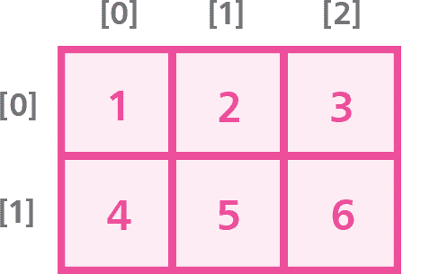

列表可以有多个索引——以表示多个维度，而不是普通列表的单维度。具有三个或更多索引的多维列表并不常见，但二维列表对于存储如 X,Y 坐标之类的网格信息非常有用。


字符串值的列表甚至可以被视为多维列表，因为每个字符串本身都是字符列表。因此，每个字符都可以通过其在特定字符串内的索引号被引用。


`list.py`

通过初始化一个包含三个字符串值元素的列表启动新程序：

```python
quarter = [ ‘January’ , ‘February’ , ‘March’ ]
```

接下来，添加语句单独显示每个列表元素中包含的值：

```python
print( ‘First Month :’ , quarter[0] )
print( ‘Second Month :’ , quarter[1] )
print( ‘Third Month :’ , quarter[2] )
```

添加一条语句创建一个包含两个元素的多维列表，这些元素本身是每个都包含三个整数值的列表：

```python
coords = [ [ 1 , 2 , 3 ] , [ 4 , 5 , 6 ] ]
```

现在，添加语句显示两个特定内部列表元素中包含的值：

```python
print( ‘\nTop Left 0,0 :’ , coords[0][0] )
print( ‘Bottom Right 1,2 :’ , coords[1][2] )
```

最后，添加一条语句只显示字符串值的其中一个字符：

```python
print( ‘\nSecond Month First Letter :’ , quarter[1][0] )
```

保存并运行程序——看到列表元素值被显示。

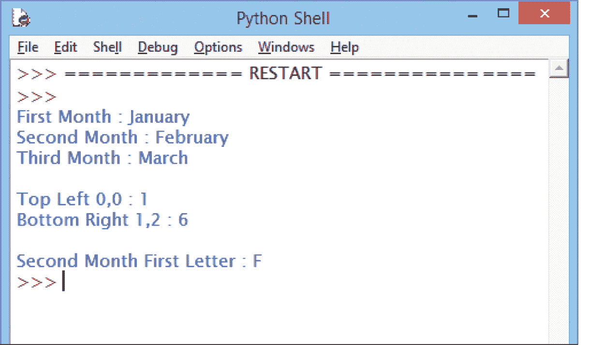


字符串索引也可以是负数——以便从右侧开始计数，其中 `-1` 引用最后一个字母。


本章稍后介绍的循环结构通常用于遍历列表元素。

## 修改列表

包含多个数据项的列表变量在 Python 编程中被广泛使用，并有各种函数“方法”，这些方法可以通过“点后缀”的形式附加在列表名后进行操作：

| 列表方法 | 描述 |
| --- | --- |
| `list.append(x)` | 将项 `x` 添加到列表末尾 |
| `list.extend(L)` | 将列表 `L` 中的所有项添加到列表末尾 |
| `list.insert(i,x)` | 在索引位置 `i` 处插入项 `x` |
| `list.remove(x)` | 从列表中删除第一个项 `x` |
| `list.pop(i)` | 删除索引位置 `i` 处的项并返回它 |
| `list.index(x)` | 返回列表中第一个项 `x` 的索引位置 |
| `list.count(x)` | 返回 `x` 在列表中出现的次数 |
| `list.sort()` | 原地排序所有列表项 |
| `list.reverse()` | 原地反转所有列表项 |


对于既包含数值又包含字符串值的列表，`sort()` 方法返回先按数字、后按字母顺序排序的列表元素——例如 1,2,3,A,B,C。

Python `true` 还有一个非常有用的 `len(L)` 函数，它返回列表的长度。

普通列表中的值可以随着程序的进行而更改。每个元素都可以使用 `=` 赋值运算符分配替换值，以指定列表名称、元素索引数字和替换值。在编程术语中，存储在普通列表中的值是“可变的”（mutable）——它们可以被更改。随着程序的进行，还可以动态地向普通列表中添加元素，或从普通列表中动态删除元素。这意味着，如果你的程序将对元素的值进行更改，那么普通列表是理想的。

如果一个列表只包含常量（这些值在程序运行时永远不会改变），那么创建一个固定列表会更合适。在编程术语中，存储在固定列表中的值是“不可变的”（immutable）——它们不能被更改。随着程序的进行，无法动态地向固定列表中添加元素，或从固定列表中动态删除元素。这意味着，如果你的程序永远不会更改元素的值，那么固定列表是理想的。


与索引编号一样，元组序列中的项是从零开始编号的。

受限制的不可变 Python 列表被称为“元组”（tuple），通过在括号之间按逗号分隔的列表分配值来创建，这一过程被称为“元组包”（tuple packing）：

```python
colors_tuple = ( ‘Red’ , ‘Green’ , ‘Red’ , ‘Blue’, ‘Red’ )
```

可以使用元组名称后跟包含该元素索引数字的方括号来引用单个元组元素。有用的是，元组内部存储的所有值都可以分配给单独变量，这一过程被称为“序列解包”（sequence unpacking）：

```python
a , b , c , d , e = colors_tuple
```

普通列表方法（如 `sort()` 和 `reverse()`）不能用于元组，但可以使用 Python 内置的 `type()` 函数来显示数据类类型，并可以使用内置的 `len()` 函数来返回元组的长度。


解包元组所需的变量数量必须与项的数量相同。

通常，元组用于存储一组不改变的常量集合，例如星期几名称、月份名称，或个人详情（名、姓、出生日期、地址、电话号码等）。


`tuple.py`

通过初始化元组启动新程序，然后显示其类类型：

```python
days = ( ‘Mon’ , ‘Tue’ , ‘Wed’ , ‘Thu’ , ‘Fri’ , ‘Sat’ , ‘Sun’ )
print( ‘days:’ , type( days ) )
```

接下来，显示元组的所有内容、其长度以及存储在第一个元素中的值：

```python
print( ‘Days of the week:’ , days )
print( ‘No. of days in week:’ , len( days ) )
print( ‘Start day of week:’ , days[0] )
```

现在，初始化另一个包含用户个人详情的元组：

```python
user = ( ‘John’ , ‘Doe’ , ‘Paris’ , ‘555-1234’ )
```

然后，显示用户的全名：

```python
print( ‘Name:’ , user[0] , user[1] )
```

最后，显示用户的电话号码：

```python
print( ‘Phone:’ , user[3] )
```

保存并运行此程序——查看元组的值。

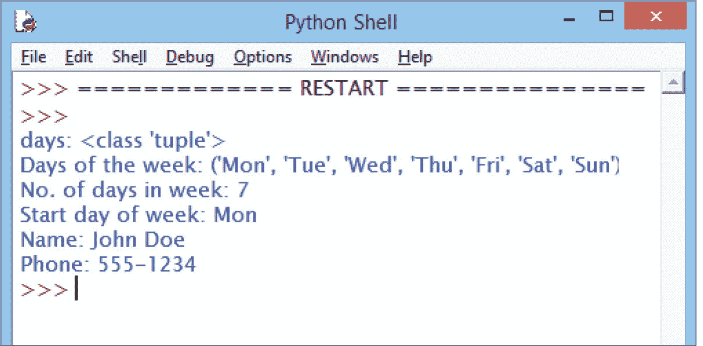


元组可能包含与其其它元素不为唯一的项。

## 设置列表

普通列表或固定列表元组中的值可以在其元素中重复，但可以创建一个不允许重复的唯一值列表。受限制的 Python 唯一值列表被称为“集合”（set），通过如下所示在大括号（花括号）之间按逗号分隔的列表分配值来创建：

```python
phonetic_set = { ‘Alpha’ , ‘Bravo’ , ‘Charlie’ }
```


集合中不能包含与其其它元素不为唯一的项。

与普通列表或元组不同，集合中的单个元素无法通过集合名称后跟包含索引数字的方括号来引用。相反，集合拥有强大的方法，可以通过点符号后缀接到集合名称后来进行对值的操作和比较：

| 集合方法 | 描述 |
| --- | --- |
| `set.add(x)` | 向集合添加项 `x` |
| `set.update(x,y,z)` | 向集合添加多个项 |
| `set.copy()` | 返回集合的副本 |
| `set.pop()` | 从集合中删除一个随机项 |
| `set.discard(i)` | 从集合中删除位置 `i` 的项 |
| `set1.intersection(set2)` | 返回两个集合中都出现的项 |
| `set1.difference(set2)` | 返回在 `set1` 中不在 `set2` 中的项 |

可以使用 Python 内置的 `type()` 函数显示数据类类型，并可以使用内置的 `len()` 函数返回集合的长度。此外，可以使用 Python 内置成员运算符 `in` 来查找集合中的值。

更多集合方法可以在在线 [docs.python.org](https://docs.python.org)找到。

通常，集合用于存储一组不改变的唯一值，这些值可以使用强大的集合方法进行搜索和比较。虽然不能通过索引访问集合值，但可以使用内置的 `list()` 函数将集合转换为普通列表。


`set.py`

通过初始化具有唯一值的集合启动新程序，然后显示其类类型：

```python
party_goers = { ‘Andrew’ , ‘Barbara’ , ‘Carole’ , ‘David’ }
print( ‘party_goers:’ , type( party_goers ) )
```

接下来，使用语句搜索集合中的指定值：

```python
print( ‘Did David go to the party?’ , ‘David’ in party_goers )
print( ‘Did Kelly go to the party?’ , ‘Kelly’ in party_goers )
```

现在，初始化另一个具有唯一值的集合：

```python
students = { ‘Andrew’ , ‘Kelly’ , ‘Lynn’ , ‘David’ }
```

然后，创建一个仅包含之前两个集合中共同值的集合：

```python
commons = party_goers.intersection( students )
```

初始化共同值的普通列表——以便单独访问元素值：

```python
party_students = list( commons )
```

最后，显示所有共同值以及存储在第一个列表元素中的值：

```python
print( ‘Students at the party:’ , party_students )
print( ‘First student at the party:’ , party_students[0] )
```

保存并运行此程序——查看集合的值。

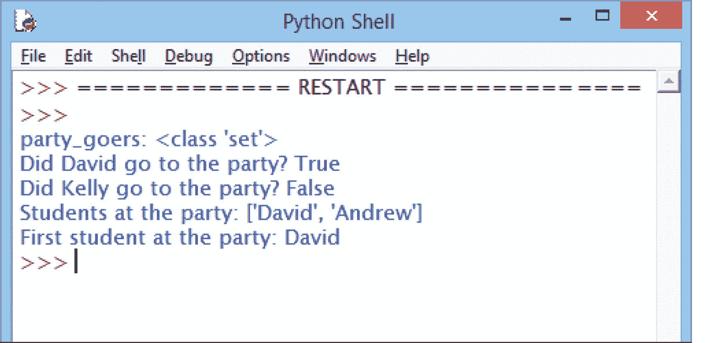


注意 `list()` 函数放置元素的顺序可能与它们在集合中出现的顺序不同。

## 元素命名

在 Python 编程中，“字典”是一个数据容器，可以以键值对列表的形式存储多个数据项。与通过索引数字引用的普通列表容器值不同，存储在字典中的值是通过其关联的键引用的。键在字典内是唯一的，通常是字符串名称，但也可以数字。

创建字典只需是将在大括号（花括号）之间按逗号分隔的键值对分配给你选择的名称。字符串通常必须包含在引号内，且键与其关联的值之间必须有一个冒号 `:` 字符。

通过指定字典名和键值对的键给 `del` 关键字，可以从字典中删除一个键值对。相反，通过给字典名和一个新键赋值值，可以向字典中添加一个键值对。

Python 字典有一个 `keys()` 方法，可以在字典名后加一个点操作符，以返回该字典中所有键的列表（顺序是随机的）。如果你希望键按字母数字顺序排序，只需将语句封装在 Python `sorted()` 函数的括号内。

可以使用 Python 的 `in` 运算符对字典进行搜索，以检查其是否包含某个特定键，语法为 `key in dictionary`。当在指定的字典找到找到键时，搜索将返回布尔值 `True`，否则将返回 `False`。

字典是 Python 编程中提供的最后一种数据容器类型。综之，各种类型如下：

- **Variable**（变量）– 存储单个值
- **List**（列表）– 在有序索引数组中存储多个值
- **Tuple**（元组）– 在序列中存储多个固定值
- **Set**（集合）– 在无序集合中存储多个唯一值
- **Dictionary**（字典）– 存储多个无序的键值对


数据经常以键值对的形式关联——例如，当你提交 Web 表单时，输入字段中输入的文本值通常与该文本字段的名称（键）关联。


`dict.py`

通过初始化字典启动新程序，然后显示其数据类类型和其键值内容：

```python
info = { ‘name’ : ‘Bob’ , ‘ref’ : ‘Python’ , ‘sys’ : ‘Win’ }
print( ‘info:’ , type( info ) )
print( ‘Dictionary:’ , info )
```

接下来，通过其键引用的单个值：

```python
print( ‘\nReference:’ , info[ ‘ref’ ] )
```

现在，显示字典中的所有键：

```python
print( ‘\nKeys’ , info.keys() )
```

从字典中删除一个对并添加一个替换对，然后显示新的键值内容：

```python
del info[ ‘name’ ]
info[ ‘user’ ] = ‘Tom’
print( ‘\nDictionary:’ , info )
```

最后，搜索字典中的特定键并显示搜索结果：

```python
print( ‘\nIs There A name Key?:’ ,’name’ in info )
```

保存文件并运行此程序——查看字典的键和值。

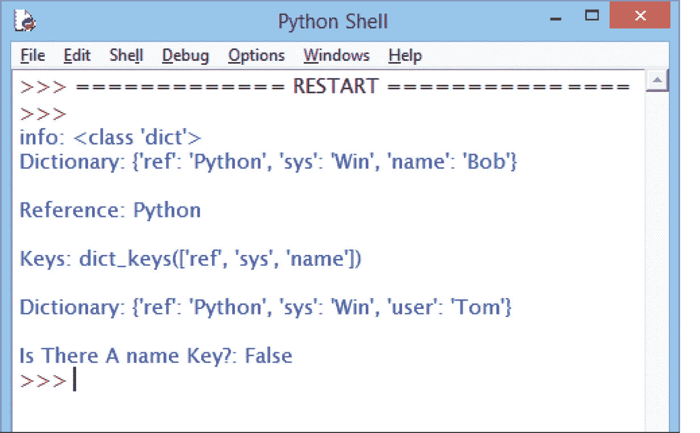


注意，字符串内部的引号必须由反斜杠转义字符引导——防止字符串过早终止。

# 总结

- 可以使用一系列 `=` 赋值在单个语句中初始化多个变量
- Python 列表是一个数组变量，可以按从零开始的顺序编号元素中存储多个数据项
- 存储在列表元素中的数据可以使用列表名后跟 `[]` 方括号中的索引号来引用
- 列表元素可以有多个索引来表示多个维度，例如 X 和 Y 坐标
- 列表变量有许多方法，可以在列表名后加点操作符以进行操作
- `len()` 函数返回指定列表的长度
- 通过指定列表名和元素索引号给 Python `del` 关键字可以删除单个列表元素
- Python 元组是一个不可变列表，可以通过“序列解包”将值赋值给单个变量
- 存储在元组元素中的数据可以使用元组名后跟 `[]` 方括号中的索引号来引用
- Python 集合是唯一元素的有序集合，其值可以通过其方法进行比较和操作
- 存储在集合中的数据不能通过其索引号引用
- 集合变量有方法，可以在列表后加点操作符以进行操作和比较
- Python 内置成员运算符 `in` 可用于在集合中查找值
- 使用 `list()` 函数将集合转换为普通列表，以便允许通过索引号引用元素数据
- Python 字典是一个键值对列表，其中每个键必须是唯一的
- 存储在字典元素中的数据可以使用字典名后跟其键的 `[]` 方括号来引用

5

## 控制块

*本章演示如何创建代码来控制程序的执行流*。

- 分支选择
- 计数循环
- 循环条件
- 跳过循环
- 捕获错误
- 总结

### 分支选择

与许多编程语言一样，Python `if` 关键字执行基本的条件测试，评估给定表达式的布尔值为 `True` 或 `False`。这允许程序根据测试结果以不同的方向进行，这被称为“条件分支”。

`if` 关键字必须后跟 `:` 冒号，以及测试成功时执行的语句。语法如下：

```python
if test-expression:
    statements-to-execute-when-test-expression-is-True
```


`if: elif: else:` 序列是其他语言中 **switch** 或 **case** 语句的 Python 等效实现。

可选，`if` 测试可以通过附加 `else` 关键字提供测试失败时的替代语句。`else` 关键字必须后跟 `:` 冒号和缩进语句。

```python
if test-expression:
    statements-if-true
else:
    statements-if-false
```


`if` 测试块可以使用 `elif` 关键字（“else if”）后续，提供替代测试成功时执行的语句。这也必须与 `if` 关键字对齐，后跟 `:` 冒号，并缩进语句。最后可以添加 `else` 关键字来提供测试失败时的替代语句。`if-elif-else` 结构的语法如下：

```python
if test-expression-1:
    statements-to-execute-when-test-expression-1-is-True
elif test-expression-2:
    statements-to-execute-when-test-expression-2-is-True
else:
    statements-to-execute-when-test-expressions-are-False
```

```python
if num > 7 and num < 9 :
    print( ‘Number is 8’ )

if num == 1 or num == 3 :
    print( ‘Number Is 1 or 3’ )
```


保存并运行程序 – 查看条件分支的运行。

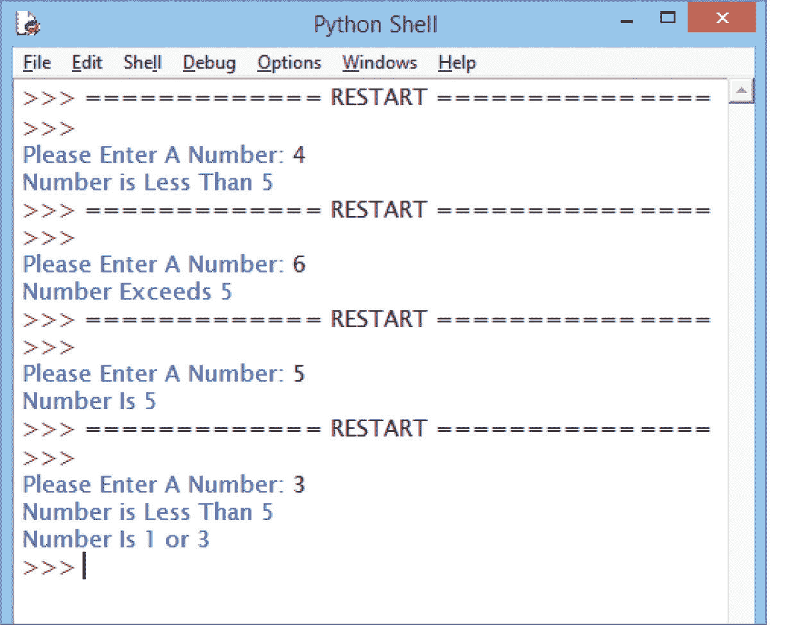


用户输入默认作为字符串值读取，因此必须使用 `int()` 强制转换为 `int` 数据类型以便进行算术比较。


`and` 关键字确保只有在两个测试都成功时结果才为 `True`，而 `or` 关键字确保在任一测试成功时结果即为 `True`。

### 计数循环

与其他编程语言一样，Python 的 `for` 关键字遍历 `in` 关键字指定的任何列表中所有的项。在 Python 中，该语句必须以 `:` 冒号结尾，并且在循环每次迭代中执行的语句必须缩进：

```python
for each-item in list-name :
    statements-to-execute-on-each-iteration
```

由于字符串仅仅是字符列表，`for in` 语句可以遍历每个字符。同样，`for in` 语句可以遍历列表中的每个元素、元组中的每个项、集合中的每个成员或字典中的每个键。

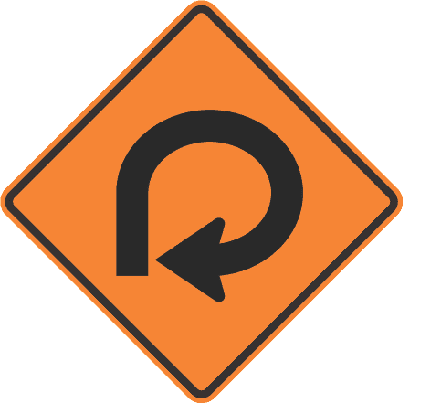

Python 中的 `for` 循环与 `C` 等其他语言不同，因为它不允许指定步长和结束位置。

`for in` 循环按照它们在序列中出现的顺序对任何列表或字符串的项进行迭代，你不能直接指定迭代次数、停止条件或迭代步长的大小。然而，你可以使用 Python 的 `range()` 函数通过在括号内指定一个数值结束值来遍历数字序列。这将生成一个从零开始并持续到但不包含指定结束值的序列。例如，`range(5)` 生成 `0,1,2,3,4`。

可选地，你可以在 `range()` 函数的括号内指定起始值和结束值，并用逗号隔开。例如，`range(1,5)` 生成 `1,2,3,4`。此外，你可以在 `range()` 函数的括号内以逗号分隔列表的形式指定起始值、结束值和步长值。例如，`range(1,14,4)` 生成 `1,5,9,13`。

你可以在 Python `enumerate()` 函数的括号内指定列表名称，以显示每个元素的索引及其关联的值。


`range()` 函数可以生成递减（倒计时）的序列，也可以生成递增的序列。

当同时遍历多个列表时，可以通过在 Python 的 `zip()` 函数的括号内将列表名称作为逗号隔开的列表，将每个列表中相同索引的元素显示在一起。

在遍历字典时，你可以使用字典的 `items()` 方法显示每个键及其关联的值，并为 `for` 关键字指定两个逗号分隔的变量名 – 一个用于键，另一个用于值。


`for.py`


通过初始化普通列表、固定元组列表和关联字典列表启动一个新程序。

```python
chars = [ ‘A’ , ‘B’, ‘C’ ]
fruit = ( ‘Apple’ , ‘Banana’ , ‘Cherry’ )
info = { ‘name’ : ’Mike’ , ‘ref’ : ’Python’ , ‘sys’ : ’Win’ }
```


接下来，添加语句显示所有列表元素值。

```python
print( ‘Elements: \t’ , end = ‘ ‘ )
for item in chars :
    print( item , end = ‘ ‘ )
```


现在，添加语句显示所有列表元素值及其对应的索引号。

```python
print( ‘\nEnumerated:\t’ , end = ‘ ‘ )
for item in enumerate( chars ) :
    print( item , end = ‘ ‘ )
```


然后，添加语句显示所有列表和元组元素。

```python
print( ‘\nZipped: \t’ , end = ‘ ‘ )
for item in zip( chars , fruit ) :
    print( item , end = ‘ ‘ )
```


最后，添加语句显示所有字典键名和关联元素值。

```python
print( ‘\nPaired:’ )
for key , value in info.items() :
    print( key , ‘=’ , value )
```


保存并运行程序 – 查看循环迭代显示的项。

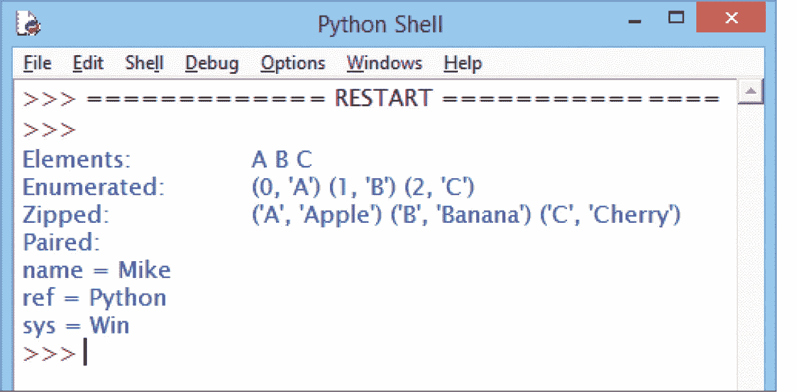


在编程术语中，任何包含可以循环的多个项的内容被称为“可迭代对象”（iterable）。

### 循环条件

`while` 循环是一个只要条件表达式为 `True` 就会重复的代码。`while` 关键字后面跟着测试表达式，然后是 `:` 冒号。测试成功时执行的语句随其后并需要缩进。在 Python 编程中，`while` 关键字创建一个循环 – 直到测试表达式变为 `False` 为止，此时循环结束。交互式 Python 解释器在期待后续代码时会自动等待。

在 Python 中必须遵守代码块的缩进 – 就像这个产生无限循环的示例：


与其他 Python 不同，关键字 `True` 和 `False` 以大写字母开头。

必须遵守代码块的缩进 – 这是一个产生斐波那契数列的示例：

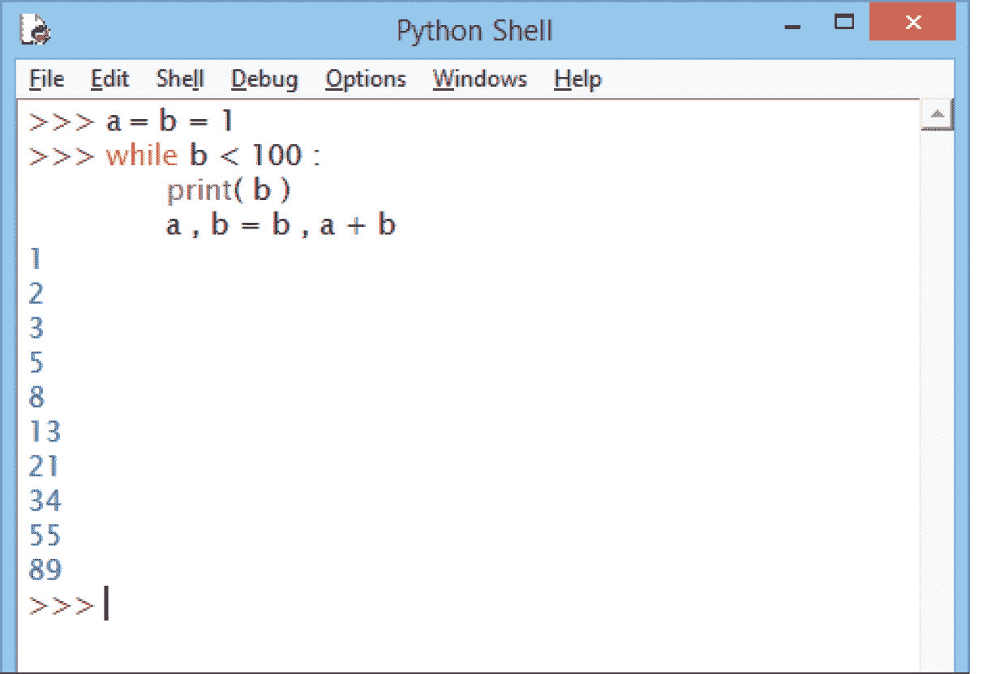

循环可以嵌套（一个在另一个内部），以便在外层循环的每次迭代中完全执行内层循环的所有迭代。可以在每个循环定义之前用起始值初始化“计数器”变量，将其包含在测试表达式中并在每次迭代中递增，直到测试失败。


`while.py`


通过初始化计数器变量并在测试表达式中使用该变量启动一个新程序。

```python
i = 1
while i < 4 :
    print( ‘Outer Loop Iteration:’ , i )
    i += 1
```


现在（仍保持缩进）初始化第二个计数器变量并在测试表达式中使用该变量定义内层循环。

```python
    j = 1
    while j < 4 :
        print( ‘\tInner Loop Iteration:‘ , j )
        j += 1
```


内层循环打印的内容相对于外层循环通过 `\t` 制表符缩进。`+=` 赋值语句 `i += 1` 只是 `i = i+1` 的简写方式 – 你也可以使用 `*=`、`/=`、`-=` 简写来为变量赋值值。

Python 的 `break` 关键字可以在满足特定条件时提前终止循环。`break` 语句位于循环语句块内部，其前面是一个测试表达式。当测试返回 `True` 时，循环立即结束，程序继续执行下一个任务。例如，在嵌套的内部循环中，它将进入外层循环的下一次迭代。


`nest.py`


开始一个新程序，使用语句创建一个迭代三次的循环。

```python
for i in range( 1, 4 ) :
```


接下来，添加一个缩进的语句，创建一个“嵌套”的内部循环，该循环也迭代三次。

```python
for j in range( 1, 4 ) :
```


现在，在内部循环中添加一个进一步缩进的语句，在内部循环的每次迭代中显示计数器数字（外层循环和内部循环的）。

```python
print( ‘Running i=’ + i + ‘ j=’ + j )
```


保存并运行此程序——查看每次循环迭代的计数器值。

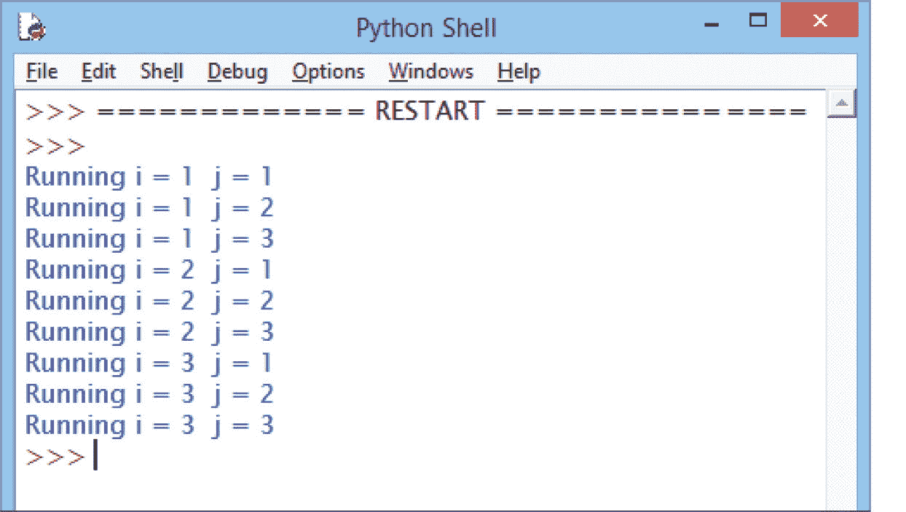


将这些嵌套的 `for` 循环与此处的 `while` 循环示例进行比较。


`break.py`


在内部循环开始处插入 `break` 语句以跳过该循环——然后再次运行程序。

```python
if i == 2 and j == 1 :
    print( ‘Breaks inner loop at i=2 j=1’ )
    break
```

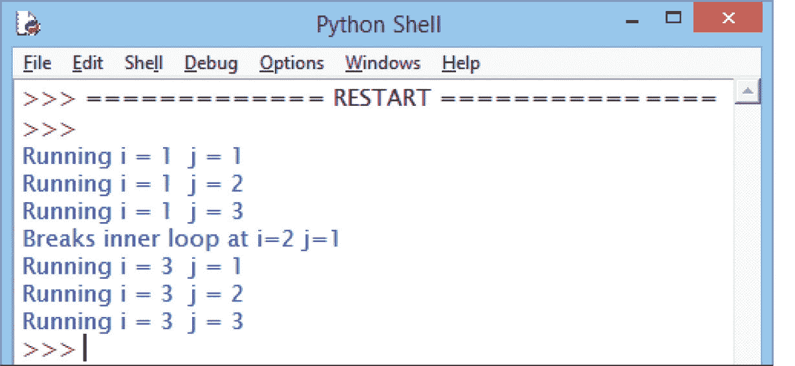

Python 的 `continue` 关键字可以在满足特定条件时跳过循环的单次迭代。`continue` 语句位于循环语句块内部，其前面是一个测试表达式。当测试返回 `True` 时，该次迭代结束，程序继续执行下一次迭代。


现在，在内部循环块开始处插入 `continue` 语句以跳过该循环的第一次迭代——再次运行程序。

```python
if i == 1 and j == 1 :
    print( ‘Continues inner loop at i=1 j=1’ )
    continue
```

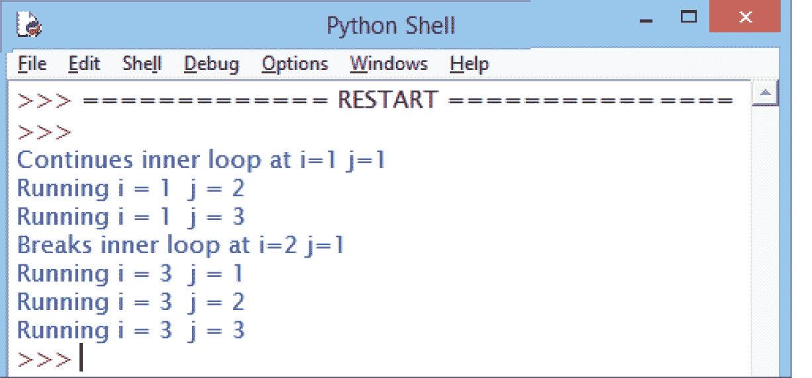


当外层循环第二次运行它时，`break` 语句会停止内部循环的所有三次迭代。


`continue.py`


当外层循环第一次运行它时，`continue` 语句跳过了内部循环的第一次迭代。

### 错误

程序中可以预测错误的部分（例如处理用户输入的部分）通常可以包含在 `try except` 块中处理“异常错误”。要执行的语句分组在 `try :` 块中，异常被传递给随后的 `except :` 块进行处理。可选的是，后面可以跟一个 `finally :` 块，其中包含处理异常后执行的语句。

Python 识别许多内置异常，例如在变量名未找到时发生的 `NameError`，在尝试访问的列表索引时发生的 `IndexError`，以及当内置操作或函数接收不适当的值时发生的 `ValueError`。

每个异常返回一个描述性消息，可以使用 `as` 关键字将其方便地赋值给变量。然后可以使用它来显示异常发生时的性质。


`try.py`


通过用字符串值初始化变量开始一个新程序。

```python
title = ‘Coding for Beginners In Easy Steps’
```


接下来，添加一个 `try` 语句块，尝试显示变量值——但指定了错误的名称。

```python
try :
    print( titel )
```


现在，添加一个 `except` 语句块，在发生 `NameError` 时显示错误消息。

```python
except NameError as msg :
    print( msg )
```


保存并运行程序——查看错误是如何处理的。

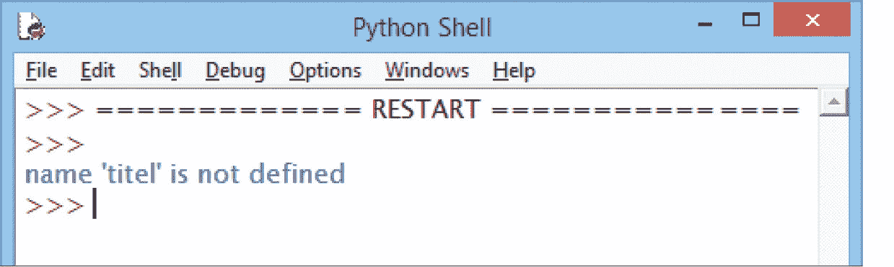


在某些编程语言中，这种结构被称为 try-catch 异常处理。

可以通过在 `except` 块中用括号内的逗号分隔列表指定异常的类型来处理多个异常：

```python
except ( NameError , IndexError ) as msg :
    print( msg )
```

你还可以使用 `raise` 关键字强制解释器报告异常，通过它指定要识别的异常类型和括号中的自定义描述性消息。


`raise.py`


通过用整数值初始化变量开始一个新程序。

```python
day = 32
```


接下来，添加一个 `try` 语句块，测试变量并指定异常。

```python
try :
    if day > 31 :
        raise ValueError(Invalid’ )
```


现在，添加一个 `except` 语句块，在发生 `ValueError` 时显示。

```python
except ValueError as msg :
    print( ‘The found’ , msg )
```


然后添加一个 `finally` 语句。

```python
finally :
    print( ‘But Today Is Beautiful.’ )
```


保存并运行程序——查看引发的错误如何处理。


除非发生异常，否则 `try` 块中的语句都将执行。

# 总结

- `if` 关键字对表达式进行布尔值的条件测试。
- 条件分支通过 `else` 和 `elif` 为 `if` 测试提供了替代方案。
- Python 测试表达式后必须跟 `:` 字符，且语句块相对于测试行缩进。
- `for` 循环遍历指定列表或字符串中的每个项。
- Python `for` 循环语句后必须跟 `:` 字符，且语句块相对于语句缩进。
- `range()` 函数生成数值序列，可用于指定 `for` 循环的长度。
- `enumerate()` 函数可以指定列表以显示每个元素的索引及其存储的值。
- `zip()` 函数可以显示多个列表中相同索引存储的值。
- `while` 循环在初始测试表达式保持 `True` 时重复，在测试表达式变为 `False` 时结束。
- Python `while` 循环语句后必须跟 `:` 字符，且语句块相对于语句缩进。
- 计数器变量的值可以在测试表达式中测试以控制循环迭代次数。
- `break` 关键字可用于测试表达式为 `True` 并在测试返回 `False` 时立即退出循环。
- `continue` 关键字可用于测试表达式为 `True` 并在测试返回 `False` 时退出单次迭代。
- 预期的运行时异常错误可以通过将语句包含在 `try except` 块中来处理。
- 可选地，可以使用 `finally` 语句指定在处理异常后执行的语句。

本书中之前的示例使用了 Python 编程语言的内置函数，例如 `print()` 函数。然而，大多数程序都有许多由编码员定义的自定义函数，这些函数可以在程序运行时根据需要调用。

自定义的 Python 函数是使用 `def`（定义）关键字创建的，后面跟着你选择的名称和 `()` 括号。编码员可以为函数选择任何名称，但编程语言的关键字和现有内置函数的名称除外。此行必须以冒号 `:` 结尾，然后每次调用函数时要执行的语句必须出现在下方的行中并进行缩进。因此，函数定义的语法如下：

```python
def function-name() :
    statements-to-be-executed
    statements-to-be-executed
```


函数语句相对于定义行的缩进量必须保持相同，这样 Python 解释器才能识别该代码块。

一旦函数语句执行完毕，程序流将从函数调用后的直接点继续执行。这种模块化在编程中非常有用，可以将一组例程隔离起来，以便重复调用。


要创建自定义函数，有必要理解程序中变量的访问性（“范围”）：

- 在函数外部创建的变量可以被函数内部的语句引用——它们具有“全局”范围。
- 在函数内部创建的变量无法从创建它的函数外部引用——这些具有“局部”范围。

局部变量的有限访问性意味着同名变量可以在不同的函数中出现而不产生冲突。


为了防止意外冲突，请避免使用全局变量——尽可能只使用局部变量。

如果你想强制一个局部变量使其在其他处可访问，必须首先使用 Python 的 `global` 关键字对其声明，后仅跟其名称。随后它可以被赋值一个值，该值可以在程序的任何地方被引用。当全局变量和局部变量同名时，函数将使用本地版本。


`def.py`

通过初始化全局变量启动新程序：

```python
global_var = 1
```

接下来，创建一个名为`my_vars`的函数来显示全局变量中包含的值：

```python
def my_vars() :
    print( ‘Global variable:’ , global_var )
```

现在，在函数块中添加缩进语句来初始化局部变量并显示其包含的值：

```python
local_var = 2
print( ‘Local variable:’ , local_var )
```

然后，在函数块中添加缩进语句来创建一个强制性的全局变量并分配一个初始值：

```python
global inner_var
inner_var = 3
```

在函数之后添加一条语句来调用该函数以执行其包含的语句：

```python
my_vars()
```

最后，添加一条语句来显示强制全局变量中包含的值：

```python
print( ‘Coerced Global:’ , inner_var )
```

保存并运行程序——查看自定义函数显示变量值。

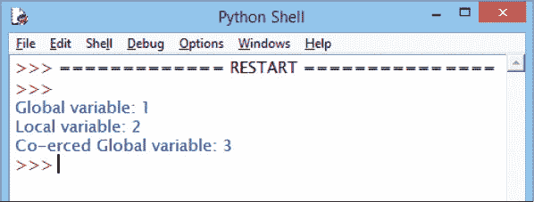


不是全局但出现在某些外部作用范围中的变量可以使用 `nonlocal` 关键字进行处理。

## 添加参数

在程序中定义自定义函数时，你可以在函数的括号之间可选地指定一个“参数”名称。然后，通过在函数调用的括号中指定值，可以将“参数”值传递给该参数。函数现在可以在执行期间通过参数名称引用该值来使用该传入的值。

例如，定义一个接受参数并打印输出的函数：

```python
def echo( user ) :
    print( ‘User:’ , user )
```


参数是仅供函数内部使用的特殊变量——它们必须遵守普通变量相同的命名规则。

调用此函数必须指定一个参数值传递给其括号中的参数，以便将其打印出来：

```python
echo( ‘Mike’ )
```

可以通过在函数括号内包含逗号分隔的参数名称列表，在函数定义中指定多个参数：

```python
def echo( user , lang , sys ) :
    print( User:’ , user , ‘Language:’ , lang , ‘Platform:’ , sys )
```

调用定义指定了参数的函数时，调用必须包含与参数数量相同的参数值。例如，使用多个参数调用此示例：

```python
echo( ‘Mike’ , ‘Python’ , ‘Windows’ )
```

传递的值必须以与参数列表相同的顺序出现，除非调用者也这样指定参数名称：

```python
echo( lang = ‘Python’ , user = ‘Mike’ , sys = ‘Windows’ )
```

可选地，在定义函数时可以在参数列表中指定一个默认值。当调用者为该参数指定值时，该值将被覆盖，但当调用者没有传递参数值时，函数将使用该值：

```python
def echo( user , lang , sys = ‘Linux’ ) :
    print( User:’ , lang, ‘Platform:’, sys )
```

这意味着你可以传递少于函数定义参数的值来调用函数以使用默认值，或者传递相同数量的值来覆盖默认值。

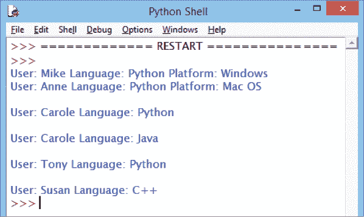


`param.py`

通过定义带有三个参数的函数启动新程序：

```python
def echo( user , lang , sys ) :
    print( User:’ , user, ‘Language:’, lang, ‘Platform:’, sys )
```

接下来，按顺序向参数传递字符串：

```python
echo( ‘Mike’ , ‘Python’ , ‘Windows’ )
```

现在，通过指定参数名称将字符串参数传递给函数：

```python
echo( lang = ‘Python’ , user = ‘Mike’ , sys = ‘Windows’ )
```

然后，定义另一个带有默认值的两个参数函数，以打印参数值：

```python
def mirror( user = ‘Carole’ , lang = ‘Python’ ) :
    print( ‘\nUser:’ , user , ‘Language:’ , lang )
```

最后，添加语句在使用和覆盖默认值的情况下调用第二个函数：

```python
mirror()
mirror( lang = ‘Java’ )
mirror( user = ‘Tony’ )
mirror( ‘Susan’ , ‘C++’ )
```

保存并运行程序——查看函数显示参数值或默认参数值。

参数是通过函数调用传递给函数参数的实际数据值。

## 返回结果

就像 Python 的内置函数 `str()` 返回调用者指定作为其参数的值的字符串表示一样，你的自定义函数也可以通过 `return` 关键字向其调用者返回一个值。例如，如下所示向调用者返回两个指定参数值的和：

```python
def sum( a , b ) :
    return a + b
```

调用者可以将返回的结果赋值给变量，供程序后续使用，如下所示：

```python
total = sum( 8 , 4 )
print( ‘Eight Plus Four Is:’ , total )
```

或者返回的结果可以这样直接“内联”使用：

```python
print( ‘Eight Plus Four Is:’ , sum( 8 , 4 ) )
```

通常，`return`语句会出现在函数块的末尾，用于返回执行该函数中包含的所有语句后的最终结果。

然而，`return`语句也可以出现在函数块中的较早位置，以停止该块中后续所有语句的执行。这会立即在调用者处恢复程序的执行。可选地，`return`语句可以指定要返回给调用者的值，也可以省略该值。如果未指定值，则假设默认值为 `None`。通常，这用于在发现条件测试结果为 `False` 后停止函数语句的执行。例如，当传递的参数值低于指定的数字时：

```python
def sum( a , b ) :
    if a < 5 :
        return
    return a + b
```


你可以在函数定义中为参数指定默认值。

在这种情况下，当第一个传递的参数小于小于时，函数将返回默认值 `None`，且最后的语句将不会执行。

当函数需要执行算术运算时，可以使用内置的 `isdigit()` 函数对用户输入进行整数值验证。


`return.py`

通过使用用户输入的整数值初始化变量来启动一个新程序以进行操作：

```python
num = input( ‘Enter An Integer:’ )
```

接下来，添加一个函数定义，接受从调用者传递的单个参数值：

```python
def square( num ) :
```

现在，在函数块中插入一个缩进语句，以验证传递的参数值是否为整数，或停止函数语句的进一步执行：

```python
if not num.isdigit() :
    return ‘Invalid Entry’
```

然后，添加缩进语句，将传递的参数值强制转换为 `int` 数据类型，然后将该值的平方和返回给调用者：

```python
num = int( num )
return num * num
```

最后，添加一个语句来输出字符串和函数调用返回的值：

```python
print( num , ‘Squared Is:’ , square( num ) )
```

保存并运行程序——查看函数显示返回的值。

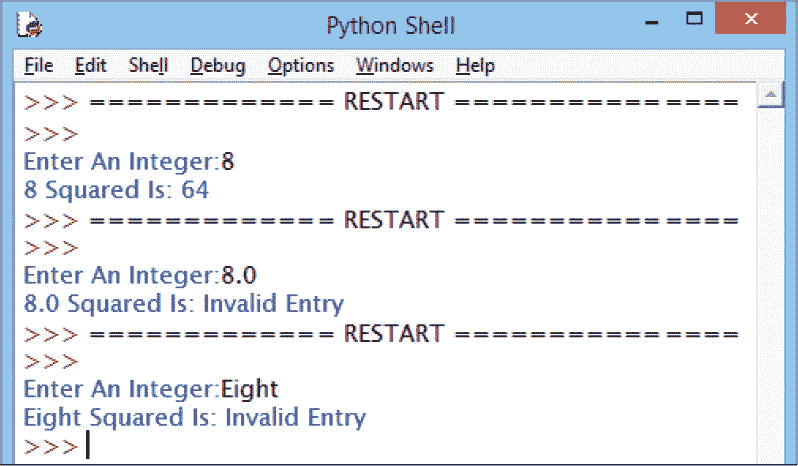


记住，用户输入被读取为 `str` 数据类型——因此必须转换为 `int` 或 `float` 类型才能进行算术运算。

## 存储函数

函数定义可以方便地存储在一个或多个单独的文件中以便于维护，并允许它们在多个程序中使用，而无需将定义复制到每个程序中。每个存储函数定义的 Python 文件称为“模块”（module），模块名是不带 `.py` 扩展的文件名。

存储在模块中的函数可以通过 Python 的 `import` 关键字后跟模块名供程序使用。虽然不是必须的，但习惯上会将任何导入语句放在程序的开头。

导入的函数可以使用“模块名.函数名”的形式进行调用。例如，从一个名为“ineasy”的导入模块中调用“steps”函数可以通过 `ineasy.steps()` 完成。

当存储在模块中的函数包含参数时，在定义中为参数分配默认值通常是有用的。这使得函数变得更加通用，因为调用时指定参数值就变成了可选的。


`cat.py`

通过定义一个函数来启动一个新模块，该函数为其参数提供一个默认字符串值用于显示：

```python
def purr( pet = ‘A Cat’ ) :
    print( pet , ‘Says MEOW!’ )
```

接下来再添加两个函数定义，也为它们的参数提供默认字符串值用于显示：

```python
def lick( pet = ‘A Cat’ ) :
    print( pet , ‘Drinks Milk’ )

def nap( pet = ‘A Cat’ ) :
    print( pet , ‘Sleeps By The Fire’ )
```

现在将文件保存为“cat.py”，这样模块名即为“cat”。

使用一个语句启动新程序，使“cat”模块的函数可用：

```python
import cat
```


`kitty.py`

接下来，在不提供参数的情况下调用每个函数：

```python
cat.purr()
cat.lick()
cat.nap()
```

现在再次调用每个函数并每个传递一个参数，然后保存文件：

```python
cat.purr( ‘Kitty’ )
cat.lick( ‘Kitty’ )
cat.nap( ‘Kitty’ )
```

再次让“cat”模块函数可用以启动另一个程序：

```python
import cat
```

然后请求用户输入名称：

```python
pet = input( ‘Enter Pet Name:’ )
```

最后，使用模块前缀调用每个函数：

```python
cat.purr( pet )
cat.lick( pet )
cat.nap( pet )
```

保存并运行程序——查看来自导入模块的输出。

现在，再次调用每个函数并向它们传递参数值，然后保存文件：

```python
bark( ‘Pooch’ )
lick( ‘Pooch’ )
nap( ‘Pooch’ )
```

通过使所有“dog”模块函数都可用来启动另一个程序：

```python
from dog import *
```

请求用户输入以覆盖默认参数：

```python
pet = input( ‘Enter A Pet Name: ‘ )
```

最后，将用户定义的值作为参数调用每个函数：

```python
bark( pet )
lick( pet )
nap( pet )
```

保存并运行这些程序 – 查看来自导入函数的输出。

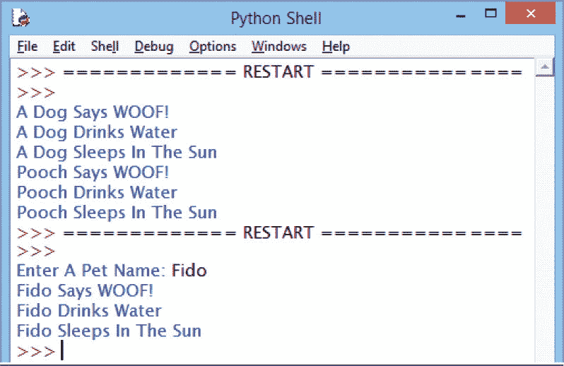


`fido.py`


对于较大的程序，你可以将模块导入到其他模块中以构建模块层次结构。

# 总结

- 函数使用 `def` 关键字定义，后跟一个你选择的名称和 `()` 括号。
- 函数定义行必须以 `:` 冒号结尾，并且当调用函数时要执行的语句块必须在相应行下方缩进。
- 具有全局作用域的变量可以在程序的任何地方引用。
- 具有局部作用域的变量只能在声明它们的函数内部引用。
- 可以通过首先使用 `global` 关键字声明局部变量，来强制使其变为全局可用。
- 函数参数是仅在函数内部使用的特殊变量，而参数是传递给参数的数据值。
- 参数在函数定义的括号内被声明为用逗号分隔的列表。
- 除非在声明中指定了默认值，否则函数调用必须为每个函数参数提供参数数据。
- 在函数调用中传递给参数的数据出现顺序必须与参数顺序相同，除非指定了它们的名称。
- 可选地，可以在函数内部使用 `return` 关键字向调用者返回一个值。
- 函数可以存储在模块中，模块命名与文件名相同（不带 `.py` 扩展）。
- `import` 语句通过在模块名后添加点后缀名来使模块函数在程序中可用。
- 在内部，每个 Python 模块都有自己的符号表，因此不同模块中的同名函数不会发生冲突。
- `from import *` 语句可以将模块函数导入到程序自身的符号表中。

7

## 排序算法

*本章演示了如何编写各种排序算法的指令序列*。

- 复制排序
- 选择排序
- 插入排序
- 冒泡排序
- 合并排序
- 分区排序
- 总结

### 复制排序

“算法”是执行特定任务的定义良好的指令序列。每个算法接收一个或多个值作为输入，并产生一个或多个结果值作为输出。可以在代码中通过函数来创建算法，其语句定义了执行任务的指令序列。输入值可以作为参数传递函数传递，结果值可以作为函数的输出返回。可以使用多种方式使用数据结构和控制结构对算法进行编码，以执行列表排序等任务。

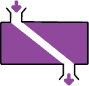

Python 为列表提供了 `sort()` 方法（详见此处），但本章的示例演示了如何编写在许多语言中常见的各种排序算法。排序效率可能取决于要排序列表的性质，因此不同的算法可能最适用于特定的任务。当任务需要对列表排序同时保持原始未排序列表完整时，可以将列表的引用作为参数传递给算法。函数可以创建原始列表的副本，对副本元素进行排序，然后将排序后的列表作为输出。

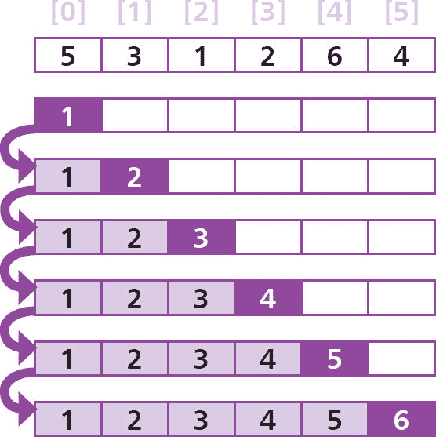


数组列表元素从零开始编号。在这里，元素 `[0]` 包含 5，元素 `[1]` 包含 3，依此类推。


`copy.py`

通过声明一个接收列表引用作为输入并返回排序副本作为输出的函数来启动新程序：

```python
def copy_sort(array):
    copy = array[:]
    sorted_copy = []
    #在此添加算法序列。
    return sorted_copy
```


接下来，添加缩进序列以按顺序将复制的元素值插入到空列表中：

```python
while len(copy) > 0:
    minimum = 0
    for element in range(0, len(copy)):
        if copy[element] < copy[minimum]:
            minimum = element
    print()
    sorted_copy.append(copy.pop(minimum))
```

现在，添加语句创建并显示未排序列表：

```python
array = [5, 3, 1, 2, 6, 4]
print('Copy...\nArray:', array)
```

最后，添加语句显示未排序列表及其排序副本，然后保存并运行程序 – 查看原始列表保持完整：

```python
print('Copy:', copy_sort(array))
print('Array:', array)
```

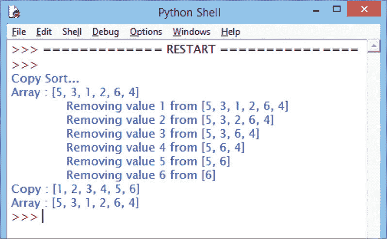

通过顺序从列表中弹出每个值来构建排序版本。

## 选择排序

你通常希望“原地”排序未排序列表的元素，而不是排序原始列表的副本，如前面的示例所示。你有几种常用的算法可以原地排序数组，每种算法都有自己的优缺点。

“选择排序”算法检查数组未排序部分的每个元素并选择包含最低值的元素。它将选定的元素值与未排序部分的开头元素进行交换 – 从而增加已排序部分的大小并减少其未排序部分。重复此过程，直到所有元素值按升序排序。

选择排序是一种基于交换的简单算法，相对容易理解和编写成函数算法。它是排序 20 个左右的小数组最有效的两种算法之一。

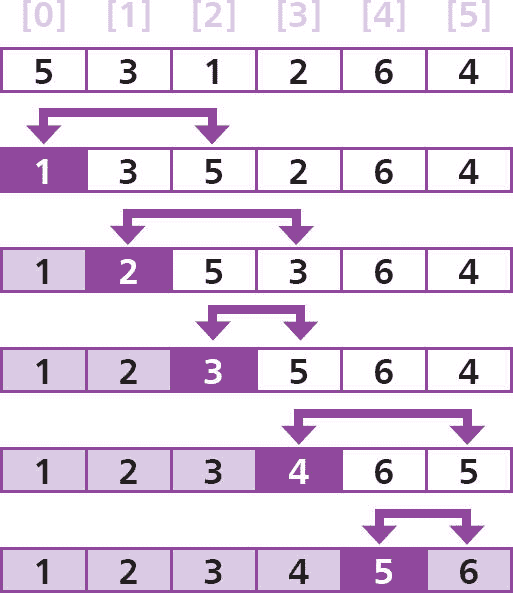

在此示例中，当倒数第二个元素被排序时，最后一个元素已经包含了最大值。


`selection.py`

```python
def selection_sort(array):
    for index in range(0, len(array) - 1):
        value = array[index]
        current = index
        #在此添加算法序列。
        for element in range(index + 1, len(array)):
            if array[element] < array[current]:
                current = element
        array[index] = array[current]
        array[current] = value
```

```python
print( ‘\tResolving element[‘ , index , ‘] to ‘ , array )
```

现在，添加语句来创建并显示一个未排序列表：

```python
array = [ 5 , 3 , 1 , 2 , 6 , 4 ]
print( ‘Selection Sort...\nArray :’ , array )
```

最后，添加语句来调用算法函数并再次显示列表——以查看原地完成排序的列表：

```python
selection_sort( array )
print( ‘Array :’ , array )
```


原地排序（Sorting in place）会交换原始引用数组列表中包含的元素值。

## 插入排序（Inserting sorts）

在上一个示例中，通过选择排序算法交换元素的技巧效果良好，但可以使用另一种技术简单地将元素插入到数组列表中正确的升序位置。

“插入排序”算法检查数组列表中未排序部分的下一个元素，并在需要时将该元素插入到数组列表中正确的升序位置。为了容纳插入的元素，列表未排序部分的所有其他元素都会向右移动——这增加了数组已排序部分的大小并减少了其未排序部分。此过程对每个元素轮流重复，直到所有元素值都按升序排序完成。

插入排序是一种简单的算法，相对容易理解并编写成一个函数算法。它与选择排序算法一起，是对 20 个左右元素的小数组排序最高效的两种算法之一。通常，插入排序所需的比较次数比选择排序少，因此通常被视为对小数组排序的最佳方法。


在这个示例中，需要两个步骤将最低值放入第一个元素中——因为 3 小于 5，然后 1 小于 3。


`insertion.py`

通过声明一个接收列表引用作为输入的函数来启动新程序，并开始一个循环来存储当前元素的值：

```python
def insertion_sort( array ) :
    for index in range( 1 , len( array ) ) :
        value = array[ index ]
        # 在此处添加算法序列。
        print( ‘\tResolving element[‘ , index ,‘] to ‘ , array )
```

接下来，添加算法序列，如果当前值小于当前元素的值，则重复插入当前值：

```python
    while array[ index-1 ] > value and index >= 1 :
        array[ index ] = array[ index-1 ]
        index -=1
    array[ index ] = value
```

现在，添加语句来创建并显示一个未排序列表：

```python
array = [ 5 , 3 , 1 , 2 , 6 , 4 ]
print( ‘Insertion Sort...\nArray :’ , array )
```

最后，添加语句来调用算法函数并再次显示列表——以查看原地完成排序的列表：

```python
insertion_sort( array )
print( ‘Array :’ , array )
```


在某些迭代中，该算法识别出“未排序”部分中的元素在之前的插入后已经过序。

## 冒泡排序（Bubbling sorts）

“冒泡排序”算法是选择排序和插入排序技术的进一步简单替代方案。该算法反复检查数组列表中的每对相邻元素，并在需要时交换它们，以将较低值放在较高值之前——直到所有元素都按升序排序。

冒泡排序是一种简单的算法，非常容易理解并编写成一个函数算法。虽然冒泡排序的效率通常低于插入排序或选择排序，但它是处理近乎排序数组最快的算法之一。


在这个示例中，第一轮遍历对元素 [3] 和 [4] 不需要交换，因为它们的值 5 和 6 顺序是正确的。


`bubble.py`

通过声明一个接收列表引用作为输入的函数来启动新程序，并开始一个外层循环反复遍历数组列表：

```python
def bubble_sort( array ) :
    for index in range( len( array ) ) :
        # 在此处添加算法序列。
```

接下来，添加算法序列遍历数组列表元素，直到倒数第二个元素，如果下一个值大于当前值，则交换值：

```python
    for element in range( len( array -1 ) - index ) :
        if array[ element ] > array[ element+1 ] :
            array[ element ] , array[ element+1 ] = array[ element+1 ] , array[ element ]
```

```python
print( ‘\tResolving element[‘ , index ,‘] to ‘ , array )
```

现在，添加语句来创建并显示未排序列表：

```python
array = [ 5 , 3 , 1 , 2 , 6 , 4 ]
print( ‘Bubble Sort...\nArray :’ , array )
```

最后，添加语句来调用算法函数并再次显示列表——以查看原地完成排序的列表：

```python
bubble_sort( array )
print( ‘Array :’ , array )
```


在平均情况下，插入排序优于选择排序，选择排序优于冒泡排序。

## 合并排序（Merging sorts）

虽然选择排序、插入排序和冒泡排序技术适用于数组，但更高效的复杂算法适用于更大的列表。通常，这些复杂算法采用“分治”策略首先将数组划分为有序的部分。

“合并排序”算法是一种可以编写为函数的复杂算法，递归地划分数组直到为空或只有一个元素。一旦划分完成，它会将单个元素合并成一个有序列表。

合并排序是一种快速算法，在将元素合并回数组列表时仅进行比较。


在这个示例中，数组很小，但合并排序以完全相同的方式处理大型数组。

通过声明一个接收列表引用的函数来启动新程序并反复划分数组：

```python
def merge_sort( array ) :
    if len( array ) > 1 :
        middle = int( len( array ) / 2 )
        left = array[ 0 : middle ] ; right = array[ middle : ]
        print( ‘\tSplit to’ , left , right )
        merge_sort( left ) ; merge_sort( right )
        # 在此处添加算法序列。
```


`merge.py`

接下来，添加算法序列将数组列表元素划分为部分然后将其合并在一起：

```python
    i = j = 0
    for element in range( len( array ) ) :
        L = left[ i ] if i < len( left ) else None
        R = right[ j ] if j < len( right ) else None
        if( ( L and R ) and ( L < R ) ) or R is None :
            array[ element ] = L ; i += 1
        elif( ( L and R ) and ( L >= R ) ) or L is None :
            array[ element ] = R ; j += 1
        print( ‘\t\tMerging’ , left , right )
```

现在，添加语句来创建并显示数组列表：

```python
array = [ 5 , 3 , 1 , 2 , 6 , 4 ]
print( ‘Merge Sort...\nArray :’ , array )
merge_sort( array )
print( ‘Array :’ , array )
```


此处列出的代码在某些行中使用分号 `;` 分隔符来编写两个语句 – 这仅是由于页面限制的。

## 分区排序

在上一个示例中演示了通过归并排序算法围绕数组中点将数组列表划分为子部分的技巧，这种方法效果良好，但也可以采用另一种技术围绕“基准值”（pivot）点对数组列表进行分区。

“快速排序”算法是一种复杂的排序算法，它同样采用了“分而治”的策略。算法首先指定一个特定的数组元素，其值将作为基准值。然后算法重复地将数组分为两个“分区”——一个分区包含小于基准值的值，另一个分区包含大于基准值的值。一旦分区操作完成，最终的基准值就处于其正确的位置，随后算法将较小的分区与基准值以及较大的分区合并成一个单一的排序列表。

快速排序是一种复杂的算法，可以被编写为函数算法，通过反复“递归”调用来重复划分数组。快速排序是一种快速算法，它在划分元素划分分区时会比较元素的值。


在这个示例中，数组很小，但快速排序算法能以完全相同的方式高效地分区并重新组合大型数组。

对于在快速排序算法中选择哪个元素作为基准值最佳，人们意见不一。有些程序员喜欢选择中间元素，就像上一个示例中的归并排序算法一样。另一些人倾向于选择第一个或最后一个元素，或者中间任意位置的元素——如相反的示例所示。

声明一个函数来接收列表引用并反复遍历数组列表以启动新程序：

```python
def quick_sort( array ) :
    if len( array ) > 1 :
        pivot = int( len( array ) -1 )
        less = [ ] ; more = [ ]
        # 此处将添加算法序列。
        quick_sort( less ) ; quick_sort( more )
        print( ‘\tLess:’ , less , ‘\tPivot:’ , array[ pivot ] , \
        ‘\tMore:’ , more )
        array[ : ] = less + [ array[ pivot ] ] + more
        print( ‘\t\t...Merged:’ , array )
```


`quick.py`

接下来，添加算法序列将数组列表元素划分区然后将其合并在一起：

```python
for element in range( len( array ) ) :
    value = array[ element ]
    if element != pivot :
        if value < array[ pivot ] :
            less.append( value )
        else :
            more.append( value )
```

现在，添加语句来创建并显示数组列表：

```python
array = [ 5 , 3 , 1 , 2 , 6 , 4 ]
print( ‘Quick Sort...\nArray :’ , array )
quick_sort( array )
print( ‘Array :’ , array )
```


快速排序算法使用的内存比归并排序少，且通常被认为是最好的排序算法。

## 总结

- 算法是一系列为了执行特定任务而定义良好的指令序列。
- 每个算法都接受一个或多个值作为输入，并产生一个或多个结果值作为输出。
- 算法可以在代码中以函数创建，其语句定义了执行任务的指令序列。
- 排序算法的效率可能取决于待排序列表的性质。
- 排序算法函数可以对传递的输入列表进行复制，并返回该列表的排序副本作为输出。
- 有几种流行的算法可以原地对数组列表进行排序，但每种算法都有自己的优缺点。
- 选择排序算法反复选择数组列表未排序部分中的最低元素，并将其移动到该数组已排序部分的末尾。
- 插入排序算法反复获取数组列表未排序部分的下一个元素，并将其插入到数组已排序部分的正确位置。
- 冒泡排序算法反复比较未排序数组列表中的相邻元素，并将它们交换为正确的顺序。
- 选择排序、插入排序和冒泡排序是简单的比较算法，但速度相对较慢。
- 归并排序算法反复从数组中点将未排序数组列表划分为左、右子部分，然后将这些子部分合并成单一的排序列表。
- 快速排序算法反复将未排序数组列表划分为包含大于或小于基准值的分区，然后将这些分区合并成单一的排序列表。
- 归并排序和快速排序算法是快速的复杂算法，它们各采用分而治的策略。

8


## 导入库

*本章演示了如何将预定义的库功能编码到你的程序中*。

- 检查 Python
- 进行数学计算
- 计算小数
- 告知时间
- 运行计时器
- 总结

### 检查 Python

Python 包含了 `sys` 和 `keyword` 模块，它们对于查询系统非常有用。`keyword` 模块包含了所有 Python 关键字的列表，如果你想测试任何单词，提供了 `iskeyword()` 函数。你可以使用交互模式探索 `sys` 的许多功能，只需在 `>>>` 提示符处输入 `help()` 进入帮助，然后在出现的帮助提示符处输入 `sys`。也许有用的是，`sys` 模块属性包含了 Python 版本号、解释器位置以及解释器寻找模块文件的目录列表——如果你将模块文件保存在这些目录中的一个，你可以确定解释器会找到它们。

```python
import sys , keyword
print( ‘Python Version:’ , sys.version )
print( ‘Interpreter Location:’ , sys.executable )
print( ‘Module Search Path: ‘ )
for folder in sys.path :
    print( folder )
print( ‘Python Keywords: ‘ )
for word in keyword.kwlist :
    print( word )
```

`math.pow()` 函数需要两个参数来将指定的值按指定的幂幂。相反，`math.sqrt()` 函数仅需一个参数，并返回该指定值的平方根。这两个函数的结果都以 `float` 数据类型的数值形式返回。


可以使用 `float()` 函数将整数从 `int` 数据类型转换为 `float` 数据类型，使用 `str()` 函数将其转换为 `string` 数据类型。

典型的三角函数也可以使用 `math` 模块中的函数来完成，例如 `math.sin()`、`math.cosin()` 和 `math.tan()`。

此外，Python 还包含一个 `random` 模块，在导入到程序后，可以用于生成伪随机数。

`random.random()` 函数产生一个 0 到 1.0 之间的浮点数。也许有趣的是，`random.sample()` 函数产生一个从序列中随机选择的元素列表。该方法需要两个参数：指定要从中选择的序列以及要生成的列表长度。由于 `range()` 函数返回一个数字序列，可以将其作为第一个参数传递给 `random.sample()` 函数——这样它将从该序列中随机选择数字，生成一个没有重复数字的列表。


#### `maths.py`


通过导入 `math` 和 `random` 模块启动新程序，以便使其功能可用。

```python
import math , random
```


接下来，添加语句显示两个舍入后的值。

```python
print( ‘Rounded Up 9.5:‘ , math.ceil( 9.5 ) )
print( ‘Rounded Down 9.5:‘ , math.floor( 9.5 ) )
```


现在，添加语句用整数值初始化变量。

```python
num = 4
```


添加语句显示变量值的平方和平方根。

```python
print( num , ‘Squared:‘ , math.pow( num , 2 ) )
print( num , ‘Square Root:‘ , math.sqrt( num ) )
```


然后，添加语句生成一个 1 到 49 之间六个唯一数字的随机列表。

```python
nums = random.sample( range( 1, 49 ) , 6 )
```


最后，添加语句显示随机列表。

```python
print( ‘Your Lucky Lotto Numbers Are:‘ , nums )
```


保存并运行程序——查看数学结果和随机样本。


这里的数学函数都返回 `float` 数据类型的浮点数。


`random.sample()` 生成的列表并没有替换序列中的元素，正如其名只是复制了一个样本。

### 计算小数

尝试进行浮点运算的 Python 程序可能会产生意想不到且不准确的结果，因为浮点数无法准确地表示所有小数。


#### `inaccurate.py`


通过初始化两个浮点值变量启动新程序。

```python
item = 0.70
rate = 1.05
```


接下来，通过对前两个变量尝试浮点运算再初始化两个变量。

```python
tax = item * rate
total = item + tax
```


现在，添加语句格式化变量值保留两位小数，以便显示尾零。

```python
print( ‘Item:\t’ , ‘%.2f’ % item )
print( ‘Tax:\t’ , ‘%.2f’ % tax )
print( ‘Total:\t’ , ‘%.2f’ % total )
```


保存并运行程序——查看输出显示一个不准确的加法总额。


#### `expanded.py`


为了帮助理解这个问题，编辑所有三个打印语句将变量值扩展到 20 位小数，然后运行修改后的程序。

```python
print( ‘Item:\t’ , ‘%.20f’ % item )
print( ‘Tax:\t’ , ‘%.20f’ % tax )
print( ‘Total:\t’ , ‘%.20f’ % total )
```


在这里，变量值使用字符串替换技术格式化为显示两位小数——更多细节请见此处。


### `time.py`


通过导入 `datetime` 模块启动一个新程序，以便可以使用其功能。

```python
from datetime import *
```


接下来，创建一个 `datetime` 对象，并为其属性赋值当前日期和时间值，然后显示其内容。

```python
today = datetime.today()
print( ‘Today Is:‘ , today )
```


添加一个循环单独显示每个属性值。

```python
for attr in \
[ ‘year’,‘month’,‘day’,‘hour’,‘minute’,’second’,’microsecond’ ] :
    print( attr , ‘:\t’ , getattr( today , attr ) )
```


现在，添加一条语句使用点表示法显示时间。

```python
print( ‘ Time:‘ , today.hour , ‘:’ , today.minute , sep = ‘‘ )
```


然后，将格式化的日期和月份名称赋值给变量。

```python
day = today.strftime( ‘%A’ )
month = today.strftime( ‘%B’ )
```


最后，添加一条语句显示格式化的日期。

```python
print( ‘Date:‘ , day , month , today.day )
```


保存并运行程序——查看日期和时间值的显示。


注意在此循环中如何使用 `\` 反斜杠字符，允许语句延续到下一行而不会引起错误。


你可以使用 `datetime` 对象的 `replace()` 函数为其属性分配新值，例如 `today = today.replace(year=2015)`。

### 运行计时器

在事件发生前和之后获取当前时间，意味着可以通过它们的差值计算事件的持续时间。Python 的 `time` 模块可以导入程序以提供各种时间相关的函数。

当前系统时间通常被计算为自 1970 年 1 月 1 日 GMT 00:00:00 Epoch 经过的秒数。`time` 模块的 `time()` 函数在调用时返回自 Epoch 以来的当前秒数（浮点数）。


`gmtime()` 函数将从 Epoch 开始的经过时间转换为 UTC 的 `struct_time` 对象，其中夏令时间始终设置为零，而 `localtime()` 则将其转换为本地系统时间的 `struct_time` 对象。

`time()` 函数返回的图形可以使用 `gmtime()` 或 `localtime()` 函数转换为 `struct_time` 对象。该对象具有 `tm_year`、`tm_mon`、`tm_mday`、`tm_hour`、`tm_min`、`tm_sec`、`tm_wday`、`tm_yday` 和 `tm_isdst` 属性，可以使用点表示法引用。例如，`struct.tm_wday`。

`struct_time` 对象中的所有值都存储为数值，但可以使用 `strftime()` 函数转换为文本等效值。这需要一个作为格式“指令”的参数，随后是 `struct_time` 对象的名称。可能的指令包括表此处中列出的 datetime 对象指令。例如，用于周日的 `strftime( ‘%A’ , struct)`。

很有用的是，`time` 模块还提供了一个 `sleep()` 函数，可以用于暂停程序的执行。其参数指定了延迟执行的秒数。


#### `timer.py`


通过导入 `time` 模块启动一个新程序，以便可以使用其功能。

```python
from time import *
```


接下来，用浮点数初始化变量，该数值是自 Epoch 以来的当前经过时间。

```python
start_timer = time()
```


现在，添加一条语句从经过时间值创建一个 `struct_time` 对象。

```python
struct = localtime( start_timer )
```


然后，宣布倒计时计时器将从当前时间点开始。

```python
print( ‘Starting Countdown At:’ , strftime( ‘%X’ , struct ) )
```


添加一个循环初始化并打印计数器变量值，然后在每次迭代中计数器减一并暂停一秒。

```python
i = 10
while i > -1 :
    print( i )
    i -= 1
    sleep( 1 )
```


接下来，用浮点数初始化变量，该数值是现在自 Epoch 以来的当前经过时间。

```python
end_timer = time()
```


现在，使用时间差值初始化一个变量。

```python
difference = end_timer - start_timer
```


最后，添加一条语句显示运行用时。

```python
print( ‘Runtime:’ , difference )
```


保存并运行程序——查看显示。


## 总结

- `sys` 模块包含 Python 版本号、解释器位置和路径。
- `keyword` 属性包含所有 Python 关键字列表。
- `math` 模块提供了执行数学过程的函数，如 `math.ceil()` 和 `math.floor()`。
- 三角函数可以使用 `math` 函数执行，如 `math.sin()`、`math.cos()` 和 `math.tan()`。
- `random` 模块提供了产生伪随机数的 `random()` 函数和从序列中随机选择元素的 `sample()` 函数。
- `decimal` 模块提供了 `Decimal()` 对象，可以精确表示浮点数。
- `datetime` 模块提供了 `datetime` 对象，具有 `year`、`month`、`day`、`hour`、`minute`、`second`、`microsecond` 属性，可以使用点后缀或 `getattr()` 引用。
- `time` 模块的 `time()` 函数返回自 Epoch 以来的经过时间。
- `gmtime()` 和 `localtime()` 函数返回包含日期和时间部分的 `struct_time` 对象。

| 运算符 | 含义 | 示例 |
|---|---|---|
| `r/R` | 原始字符串 – 取消转义字符的含义 | `print( r’\n’ )` |
| `‘‘‘ ‘‘‘` | 文档字符串（Docstring）– 描述模块、函数、类或方法 | `def sum( a,b ) : ‘‘‘ Add Args ‘‘‘` |


成员运算符执行区分大小写的匹配，因此 `‘A’ in ‘abc’` 将失败。

`[ ]` 切片运算符和 `[ : ]` 范围切片运算符识别出字符串本质上是一个包含每个列表元素内单个字符的列表，可以通过它们的索引数字进行引用。

同样地，`in` 和 `not in` 成员运算符会遍历每个元素，寻找匹配指定的字符。

原始字符串运算符 `r`（或大写的 `R`）必须紧跟在起始引号之前，以抑制字符串中的转义字符，这在字符串包含反斜杠字符时非常有用。


范围切片返回到最终指定的索引位置（但不包含该位置）的字符串。

“docstring”是一个描述性字符串字面量，作为模块、函数、类或方法定义的第一个语句出现。它应该包含在三个单引号内。独特的是，docstring 成为该对象的 `__doc__` 特殊属性，因此可以使用其名称和点后缀进行引用。所有模块通常都应该有 docstring，模块导出的所有函数和类也应该有 docstring。


#### `manipulate.py`


通过定义一个包含 docstring 说明的简单函数来启动新程序。

```python
def display( s ) :
‘‘’Display an argument value.’’’
print( s )
```


接下来，添加一条语句显示函数描述。

```python
display( display.doc )
```


现在，添加一条语句来显示包含反斜杠字符的原始字符串值。

```python
display( r’C:\Program Files’ )
```


然后，添加一条语句显示包含转义字符和空格的两个字符串值的拼接。

```python
display( ‘\nHello’ + ‘ Python’ )
```


接下来，添加一条语句，在元素索引数字范围内显示指定字符串的切片。

```python
display( ‘Python In Easy Steps\n’ [ 7 : ] )
```


最后，显示在指定字符串内查找字符的结果。

```python
display( ‘P’ in ‘Python’ )
display( ‘p’ in ‘Python’ )
```


保存并运行程序——查看被处理的字符串被显示。


记住字符串必须包含在单引号或双引号内。


使用范围切片时，如果省略了起始索引数字则默认为零，如果省略了结束索引数字则认为字符串长度。

### 格式化字符串

Python 内置函数 `dir()` 通过在括号内指定模块名称，可以用于检查模块中定义的函数和变量名称。交互模式可以轻松用于此目的，只需导入模块名然后调用 `dir()` 函数。下面的示例检查了在此处第六章中创建的“dog”模块：


注意，上一个示例中引入的 `__doc__` 属性出现在 `dir()` 函数的列表中。

以双下划线开头和结尾定义的名称是 Python 对象，而其他是程序员定义的。可以使用 `dir()` 函数检查 `__builtins__` 模块，以显示默认定义的函数和变量名称，例如 `print()` 函数和 `str` 对象。

`str` 对象定义了几个用于字符串格式化的有用函数，包括一个执行替换的实际 `format()` 函数。要由 `format()` 函数格式化的字符串可以包含文本和“替换字段”，标记了从有序逗号分隔值列表中插入文本的位置。每个替换字段由`{ }`括号表示，括号内可以包含替换在列表中的索引数字位置。


不要将此处描述的 `str` 对象与将值转换为字符串类型的 `str()` 函数混淆。

字符串也可以使用 C 风格的 `%s` 替换运算符进行格式化，标记字符串中从逗号分隔的有序值列表中插入文本的位置。


`format.py`

通过初始化格式化字符串变量来启动新程序

```python
snack = '{} and {}'.format( 'Burger' , 'Fries' )
```

接下来，显示变量值以查看替换后的文本

```python
print( '\nReplaced:', snack )
```

现在，分配格式化字符串给变量

```python
snack = '{0} and {1}'.format( 'Burger' , 'Fries' )
```

然后，显示变量值以再次查看替换后的文本

```python
print( 'Substituted:', snack )
```

分配另一个格式化字符串给变量

```python
snack = '%s and %s' ( 'Milk' , 'Cookies' )
```

最后，显示变量值以查看格式化的字符串

```python
print( snack )
```

保存并运行程序 – 查看格式化的字符串被显示


你不能在索引数字周围留空格。

其他数据类型可以使用 `%d` 表示十进制整数，`%c` 表示字符，以及 `%f` 表示浮点数。

### 修改字符串

`str` 对象有许多实用的函数，可以通过点后缀调用来修改字符串并检查其内容。最常用的字符串修改函数列如下所示，并带有简要描述：

| 方法 | 描述 |
| :--- | :--- |
| `capitalize()` | 将字符串首字母变为大写 |
| `title()` | 将所有首字母变为大写 |
| `upper()` `lower()` `swapcase()` | 分别将所有字母变为大写、小写或相反的大小 |
| `join(seq)` | 使用分隔符合并字符串 |
| `lstrip()` `rstrip()` `strip()` | 分别删除领先空格、尾部空格或前后空格 |
| `replace(old, new)` | 将所有的 *old* 替换为 *new* |
| `ljust(w, c)` `rjust(w, c)` | 使用字符 *c* 向右或左填充到总宽度 *w* |
| `center(w, c)` | 使用字符 *c* 在字符串两侧填充到总宽度 *w*（默认是空格） |
| `count(sub)` | 返回 *sub* 出现的次数 |
| `find(sub)` | 返回 *sub* 首次出现的索引数字，如果找到则返回 -1 |
| `startswith(sub)` `endswith(sub)` | 如果 *sub* 在开头或结尾找到则返回 True，否则返回 False |
| `isalpha()` `isnumeric()` `isalnum()` | 如果所有字符仅为字母、仅为数字或均为字母或数字则返回 True，否则返回 False |
| `islower()` `isupper()` `istitle()` | 如果字符串字符为小写、大写或所有首字母均为大写，则返回 True，否则返回 False |
| `isspace()` | 如果字符串仅包含空格则返回 True，否则返回 False |
| `isdigit()` `isdecimal()` | 如果字符串仅包含数字或小数则返回 True，否则返回 False |


空格字符不是字母数字，因此在检查包含空格的字符串时，`isalnum()` 返回 `False`。


`modify.py`

通过初始化一个包含小写字母和空格的字符串来启动一个新程序

```python
string = 'coding for beginners in easy steps'
```

接下来，显示大写化、标题化和居中的字符串

```python
print( '\nCapitalized:\t' , string.capitalize() )
print( '\nTitled:\t\t' , string.title() )
print( '\nCentered:\t' , string.center( 30 , '*' ) )
```

现在，显示全大写的字符串并与两个星号的序列合并

```python
print( '\nUppercase:\t' , string.upper() )
print( '\nJoined:\t\t' , string.join( '**' ) )
```

然后，显示左侧用星号填充的字符串

```python
print( '\nJustified:\t\t' ,string.rjust( 30 , '*' ) )
```

最后，显示将所有出现的 's' 字符替换为星号的字符串

```python
print( '\nReplaced:\t' , string.replace( 's' , '*' ) )
```

保存并运行程序 – 查看修改后的字符串显示


使用 `rjust()` 函数，右对齐的字符串会在其**左侧**添加填充；使用 `ljust()` 函数，左对齐的字符串会在其**右侧**添加填充。

### 访问文件

可以使用 `dir()` 函数检查 `__builtins__` 模块，以发现它包含一个文件对象，该对象定义了几个处理文件的方法，包括 `open()`、`read()`、`write()` 和 `close()`。

在读取或写入文件之前，必须先使用 `open()` 函数打开。这需要两个字符串参数来指定文件的名称和位置，以及以下“模式”指定符之一来打开文件：

| 文件模式 | 操作 |
| :--- | :--- |
| `r` | 打开现有文件进行读取 |
| `w` | 打开现有文件进行写入。如果不存在则创建新文件，或打开现有文件并丢弃之前的所有内容 |
| `a` | 追加文本。在文件末尾打开或创建一个用于写入的文本文件 |
| `r+` | 打开文本文件进行读取或写入 |
| `w+` | 打开文本文件进行写入或读取 |
| `a+` | 在文件末尾打开或创建一个用于读取或写入的文本文件 |
| 如果模式在上述列出的任何文件模式后包含 `b`，则操作涉及二进制文件而非文本文件。例如，`rb` 或 `w+b` |


文件模式参数是字符串值，因此必须用引号括起来。

一旦打开文件并获得文件对象，就可以从其属性获取与该文件相关的各种信息：

| 属性 | 描述 |
| :--- | :--- |
| `name` | 打开的文件名 |
| `mode` | 打开文件的模式 |
| `closed` | 状态布尔值，True 或 False |
| `readable()` | 可读权限布尔值，True 或 False |
| `writable()` | 可写权限布尔值，True 或 False |


你还可以使用 `readlines()` 函数，它返回包含所有行的列表。


`access.py`

通过创建一个名为 "example.txt"的新文本文件的文件对象来启动新程序，并在其中写入内容

```python
file = open( 'example.txt' , 'w' )
```

接下来，添加语句显示文件名和模式

```python
print( 'File Name:' , file.name )
print( 'File Open Mode:' , file.mode )
```

现在，添加语句显示文件访问权限

```python
print( 'Readable:' , file.readable() )
print( 'Writable:' , file.writable() )
```

然后，定义一个函数来确定文件的状态

```python
def get_status( f ) :
    if ( f.closed != False ) :
        return 'Closed'
    else :
        return 'Open'
```

最后，添加语句显示当前文件状态，然后关闭文件并再次显示文件状态

```python
print( 'File Status:' , get_status( file ) )
file.close()
print( '\nFile Status:' , get_status( file ) )
```

保存并运行程序 – 查看文件被打开用于写入，然后看到文件被关闭


如果你的程序尝试以 `r` 模式打开不存在的文件，解释器将报告错误。

#### 操作内容

一旦文件成功打开，就可以读取它、添加内容或在文件中写入新文本，这取决于调用 `open()` 函数时指定的模式。之后，必须始终调用 `close()` 函数关闭打开的文件。

正如你预期的，`read()` 函数返回文件的全部内容，`write()` 函数向文件添加内容。你可以快速高效地通过循环逐行读取文件。


`readwrite.py`

通过初始化包含换行符的变量来启动新程序

```python
poem = 'I never saw a man who looked\n'
poem += 'With wistful eye\n'
poem += 'Upon that little tent\n'
poem += 'Which prisoners call the sky\n'
```

接下来，添加语句为名为 "poem.txt"的新文件创建一个文件对象以写入

```python
file = open( 'poem.txt' , 'w' )
```

现在，添加语句将变量中的内容写入文件，然后关闭

```python
file.write( poem )
file.close()
```

然后，添加语句为现有文本文件 "poem.txt"创建一个文件对象以读取

```python
file = open( 'poem.txt' , 'r' )
```

现在，添加语句显示文件的内容，然后关闭文件

```python
for line in file :
    print( line , end = '' )
file.close()
```

保存并运行程序 – 查看创建的文件并输出


启动记事本文本编辑器以确认文件是否存在并显示程序写入的内容


现在在程序末尾添加语句向文本文件追加引用，然后再次保存脚本

```python
file = open( 'poem.txt' , 'a' )
file.write( 'Oscar Wilde)' )
file.close()
```

保存并再次运行程序重写文本文件，然后在记事本中查看 – 看到引用现在追加在原始文本内容之后


写入现有文件将自动覆盖其内容！


在字符串本身包含换行符时，抑制 `print()` 函数提供的默认换行符。


#### 更新内容

文件对象的 `read()` 函数默认会从文件的最开始（索引位置零）一直到文件的最末尾（最后一个字符的索引位置）读取全部内容。可选地，`read()` 函数可以接受一个整数参数来指定它应该读取多少个字符。

文件中的位置（即读取位置或写入的位置）可以通过文件对象的 `seek()` 函数进行精细控制。该函数接受一个整数参数，指定从文件起始位置作为偏移量需要移动的字符数。

可以通过调用文件对象的 `tell()` 函数随时发现文件中的当前位置，该函数会返回一个整数位置。

在处理文件对象时，良好的做法是使用 Python 的 `with` 关键字将文件操作语句分组在一个块中。这种技术可以确保文件在操作结束后被正确关闭，即使过程中抛出异常，而且比编写等价的 `try except` 块要短得多。


### update.py

通过给包含要写入文件文本的变量赋值字符串值来启动一个新程序

```python
text = 'The political slogan "Workers Of The World Unite!" \nis from The Communist Manifesto.'
```

接下来，添加语句将文本字符串写入文件，并在"with"块中显示文件的当前状态

```python
with open( 'update.txt' , 'w' ) as file :
    file.write( text )
    print( '\nFile Now Closed?:' , file.closed )
```

现在，在"with"代码块之后添加一个非缩进语句来显示文件的新状态

```python
print( 'File Now Closed?:' , file.closed )
```

然后，重新打开文件并显示其内容，以确认它现在包含了整个字符串

```python
with open( 'update.txt' , 'r+' ) as file :
    text = file.read()
    print( '\nString:' , text )
```

接下来，添加缩进语句显示当前文件位置，然后重新定位并显示该新位置


```python
print( ‘\nPosition In File Now:’ , file.tell() )
position = file.seek( 33 )
print( ‘Position In File Now:’ , file.tell() )
```


现在，添加一个缩进语句从当前文件位置开始覆盖文本。

```python
file.write( ‘All Lands’ )
```


然后，添加缩进语句再次在文件中定位，并从新位置覆盖文本。

```python
file.seek( 61 )
file.write( ‘the tombstone of Karl Marx.’ )
```


最后，添加缩进语句返回文件开头并显示其全部更新后的内容。

```python
file.seek( 0 )
text = file.read()
print( ‘\nString:’ , text )
```


保存并运行程序——查看文件字符串的更新。


`seek()` 函数可选性地接受第二个参数值 `0`、`1` 或 `2`，分别从起始位置、当前位置或结束位置移动指定数量字符——`0` 是默认的起始位置。


与字符串一样，文件中的第一个字符位于索引位置零而不是索引位置一。

# 总结

- 字符串可以通过运算符进行操作，例如使用 `+` 拼接字符串，以及使用 `*` 对字符串进行重复。
- 字符串可以通过切片 `[]` 和范围切片 `[:]` 运算符操作，这些操作引用字符串字符的索引号。
- 字符串可以通过成员运算符 `in` 和 `not in` 进行操作，用于在字符串中匹配指定的字符。
- `r`（或 `R`）原始字符串运算符可以放置在字符串之前，以抑制其中包含的任何转义字符。
- “文档字符串”（docstring）是模块、类或函数开头用三引号括的描述性字符串，用于定义其用途。
- `__doc__` 属性可用于引用文档字符串中的字符串描述。
- 使用 `dir()` 函数可以检查 `__builtins__` 模块，以显示默认函数和变量的名称。
- `str` 对象拥有用于字符串格式化的 `format()` 函数，以及许多用于修改字符串的函数，例如 `capitalize()`。
- `format` 函数用于格式化字符串的替换字段在逗号分隔的列表中由 `{}` 大括号表示。
- 字符串也可以使用 C 风格的 `%s` 替换运算符格式化，标记字符串中要插入文本的地方。
- 文件对象拥有 `open()`、`read()`、`write()` 和 `close()` 函数用于处理文件，并具有描述文件属性的功能。
- `open()` 函数必须指定一个文件名字符串参数和一个文件模式字符串参数，例如 `’r’` 读取文件。
- 已打开的文件对象具有信息属性，可以揭示其当前状态，例如 `mode` 和 `readable()` 值。
- 文件中的读取或写入位置可以通过 `seek()` 方法指定，并通过 `tell()` 函数报告。
- Python `with` 关键字将文件操作语句分组在一个块中，并自动关闭已打开的文件。

10

## 编程对象

本章将演示如何通过代码将虚拟对象编码到你的程序中。

- 定义类
- 复制实例
- 访问属性
- 派生类
- 重写方法
- 应用逻辑
- 总结

### 定义类

我们周围的真实世界对象每个都有我们可以描述的属性和行为。例如，一辆汽车可以被描述为具有“红色”属性和“加速”行为。编程对象就像真实世界对象的虚拟表示，在“类”中描述属性和行为。

“类”是描述对象的特定原型。每个类都包含一个可以同时包含函数和变量的数据结构。类的属性被称为其数据“成员”。类函数成员被称为“方法”，类变量成员（定义在类中但在任何方法定义之外）被称为它的“属性”。可以通过点符号法在整个程序中引用类成员，即在类名后后跟成员名，语法为 `class-name.method-name()` 或 `class-name.attribute-name`。


类定义从 `class` 关键字开始，后跟一个程序员指定的名称（遵循常用的 Python 命名规范但以大写开头），然后是一个 `:` 冒号。接下来是缩进语句，可选地指定类文档字符串、类变量属性声明和类方法定义——因此类块语法如下：

```python
class ClassName :
    ‘‘‘ class-documentation-string ‘‘‘
    class-variable-declarations
    class-method-definitions
```

类定义指定了其属性和方法，它是创建工作副本（“实例”）的蓝图。在方法定义内部声明的所有变量被称为“实例”变量，并且仅在定义它们的方法内部局部可用——无法在类结构之外直接引用。


习惯上类名以大写字母开头，对象名以小写字母开头。

类的所有属性都通过点符号前缀 `self` 进行内部引用——因此一个名为“sound”的属性是 `self.sound`。此外，类中的所有方法定义必须将 `self` 作为第一个参数——因此一个名为“talk”的方法是 `talk( self )`。

当创建类实例时，会自动调用一个特殊的 `__init__( self )` 方法。如果需要传递值来初始化其属性，可以在其括号中添加后续参数。

一个完整的 Python 类声明可能如下所示：

```python
class Critter :
    ''' 用于所有生物属性的基类。 '''
    count = 0
    def __init__( self , chat ) :
        self.sound = chat
        Critter.count += 1
    def talk( self ) :
        return self.sound
```


可以通过特殊的 `__doc__` 字符串属性 `Classname.__doc__` 访问类的文档字符串。

检查此示例的类组件是很有用的：

- 变量 `count` 是一个类变量，其整数值由该类的所有实例共享——该值可以在类内部或外部通过 `Critter.count` 引用。
- 第一个方法 `__init__()` 是初始化方法，在创建类实例时会自动调用。
- 在此例中，`__init__()` 方法初始化了一个实例变量 `sound`，其值从 `chat` 参数传递而来，并且每当创建该类的实例时，就会增加 `count` 类变量的值。
- 第二个方法 `talk()` 的声明方式与普通函数相同，但第一个参数是 `self`，它是自动包含的——调用者不需要传递任何值。
- 在此例中，`talk()` 方法简单返回封装在 `sound` 实例变量中的值。


虽然程序类不能完美模拟真实世界的对象，但目标是封装所有相关的属性和操作。

### 复制实例

类对象的“实例”仅仅是通过调用该类的构造函数并在其括号内指定所需的参数数量而创建的原型的副本。调用的参数必须与 `__init__()` 方法定义的参数匹配——除了内部 `self` 参数的值外。

构造函数返回的类实例对象使用语法 `instance-name = ClassName(*args*)` 赋值给变量。

可以使用点符号通过在名称后加上后缀 `instance-name.method-name()` 或 `instance-name.attribute-name` 来引用实例对象的方法和类变量属性。


构造函数使用类名后包含任何必要参数的括号来创建类实例。

通常，基类可以定义为 Python 模块文件，以便它可以被导入到其他脚本中，在脚本中可以从“主”类原型轻松创建实例对象。


#### `Bird.py`


通过声明一个带有描述性文档字符串的新类开始一个新的类文件。

```python
class Bird :
    ''' 定义鸟类属性的基类.'''
```


接下来，添加一个缩进语句来声明并初始化一个整数值为零的类变量属性。

```python
count = 0
```


现在，定义初始化类方法来初始化实例变量并增加类变量。

```python
def __init__( self , chat ) :
    self.sound = chat
    Bird.count += 1
```


最后，添加一个类方法在调用时返回实例变量的值——然后保存此类文件。

```python
def talk( self ) :
    return self.sound
```


你不能为 `self` 参数传递参数值，因为这是 Python 自动包含的。


#### `instance.py`


通过使类文件的功能可用启动程序，然后显示其文档字符串。

```python
from Bird import ***
print( ‘\nClass Instances Of:\n’ , Bird.__doc__ )
```


接下来，添加一条语句创建类的实例，并将字符串参数值传递给其实例变量。

```python
polly = Bird( ‘Squawk, squawk!’ )
```


现在，显示此实例变量值并调用类方法显示公共类变量值。

```python
print( ‘\nNumber Of Birds:’ , polly.count )
print( ‘Polly Says:’ , polly.talk() )
```


Bird 实例 – `polly`


创建类的第二个实例，向其实例变量传递不同的字符串参数值。

```python
harry = Bird( ‘Tweet, tweet!’ )
```


最后，显示此实例变量值并调用类方法显示公共类变量值。

```python
print( ‘\nNumber Of Birds:’ , harry.count )
print( ‘Harry Says:’ , harry.talk() )
```


Bird 实例 – `harry`


保存两个文件后运行程序——看到创建的两个 Bird 实例。


类变量 `count` 可以通过 `Bird.count` 引用，但实例变量 `sound` 只能通过调用实例的 `talk()` 方法访问。

### 处理属性

类的属性可以使用点符号随时添加、修改或删除。向现有属性赋值的语句将更新该值或创建一个新属性：

`instance-name = value`

或者，你可以使用以下 Python 内置函数添加、修改或删除实例变量：

- `getattr(instance-name , ‘attribute-name’)` – 返回实例的属性值。
- `hasattr(instance-name , ‘attribute-name’)` – 如果实例存在属性值则返回 True，否则返回 False。
- `setattr(instance-name , ‘attribute-name’ , value)` – 更新现有属性或在实例创建新属性。
- `delattr(instance-name , ‘attribute-name’)` – 从实例中删除属性。

传递这些内置函数的属性名必须放在引号内。Python 自动提供的属性以下划线字符开头——因此这些不应被修改或删除。你可以这样命名自己的属性以表示私有性，但实际上它们可以像其他属性一样被修改。


#### `address.py`


通过使创建的 Bird 类的功能启动新程序。

```python
from Bird import ***
```


接下来，创建一个实例，然后使用点符号添加一个带有赋值的新属性。

```python
chick = Bird( ‘Cheep, cheep!’ )
chick.age = ‘1 week’
```


现在，显示两个实例变量属性中的值。

```python
print( ‘\nChick Says:’ , chick.talk() )
print( ‘Chick Age:’ , chick.age )
```


然后，使用点符号修改新属性并显示其新值。

```python
chick.age = ‘2 weeks’
print( ‘Chick Now:’ , chick.age )
```


接下来，再次修改新属性，这次使用内置函数。

```python
setattr( chick , ‘age’ , ‘3 weeks’ )
```


现在，使用内置函数显示所有非私有实例属性及其对应的值。

```python
print( ‘\nChick Attributes...’ )

for attrib in dir( chick ) :
    if attrib[0] != ‘_’ :
        print( attrib , ‘:’ , getattr( chick , attrib ) )
```


最后，删除新属性并使用内置函数确认其已删除。

```python
delattr( chick , ‘age’ )
print( ‘\nChick age Attribute?’ , hasattr( chick , ‘age’ ) )
```


保存并运行程序 – 查看实例属性被处理的过程。


鸟类实例 – 小鸡


此循环会跳过任何以下划线开头的属性，因此“私有”属性不会显示在列表中。

### 派生类

Python 类可以作为一个全新的类来创建（如之前的示例所示），也可以从现有类“派生”。重要的是，派生类会继承其所派生的父类（基类）的成员，同时还拥有它自己的成员。

从基类继承成员的能力允许创建派生类，这些类共享某些共同属性，这些属性已经在基类中定义了。例如，“多边形”（Polygon）基类可以定义所有多边形通用的宽度和高度属性。“矩形”（Rectangle）和“三角形”（Triangle）类可以从 `Polygon` 类派生 – 继承宽度和高度属性，同时拥有定义其自身独特特征的成员。


继承的优点非常强大，它是面向对象编程（OOP）的第二个原则。

派生类的声明在类类名后添加 `()` 括号，用以指定其父基类的名称。


#### `Polygon.py`


创建一个新类文件，声明一个具有两个类变量和一个设置其值方法的基类。

```python
class Polygon :
width = 0
height = 0
def set_values( self , width , height ) :
    Polygon.width = width
    Polygon.height = height
```


#### `Rectangle.py`

接下来，创建一个类文件，声明一个具有返回被处理过的类变量值之方法的派生类。

```python
from Polygon import *
class Rectangle( Polygon ) :
    def area( self ) :
        return self.width * self.height
```


#### `Triangle.py`


现在，创建另一个类文件，声明一个具有返回被处理过的类变量值之方法的派生类。


```python
from Polygon import *
class Triangle( Polygon ) :
    def area( self ) :
        return ( self.width * self.height ) / 2
```

保存这三个类文件，然后通过提供两个派生类的的功能启动一个新程序。

```python
from Rectangle import *
from Triangle import *
```

接下来，为每个派生类创建一个实例。

```python
rect = Rectangle()
trey = Triangle()
```

现在，调用从基类继承的类方法，传递参数以赋值给类变量。

```python
rect.set_values( 4 , 5 )
trey.set_values( 4 , 5 )
```

最后，显示处理从基类继承的类变量的结果。

```python
print( ‘Rectangle Area:’ , rect.area() )
print( ‘Triangle Area:’ , trey.area() )
```

保存并运行程序 – 查看使用继承特性显示的输出。


`inherit.py`


一个类声明可以通过在声明名称后的括号中列出多个基类来派生自多个一个类。


不要混淆类实例和派生类 – 实例是类的拷贝，而派生类是一个继承其所派生的基类属性的新类。

### 方法重写

可以在派生类中声明一个方法来重写基类中匹配的方法 – 如果两个方法声明都具有相同的名称且列出的参数数量相同。这有效地隐藏了基类方法，除非显式使用基类名进行标识，否则它是不可访问的。

当基类中的方法提供默认参数值时，可以在显式调用基类方法中使用它，或者通过重写方法提供替代值。


`Person.py`

创建一个新类文件，声明一个具有两个类变量和一个设置其值方法的基类。

```python
class Person :
def __init__( self , name ) :
    self.name = name
def speak( self , msg = ‘Calling Base’ ) :
    print( self.name , msg )
```


`Man.py`

接下来，创建一个类文件，声明一个具有重写基类方法的派生类。

```python
from Person import *
class Man( Person ) :
    def speak( self , msg ) :
        print( self.name , ‘:\tHello!’ , msg )
```


`Hombre.py`

现在，创建另一个类文件，声明一个具有再次重写基类相同方法的派生类。

```python
from Person import *
class Hombre( Person ) :
    def speak( self , msg ) :
        print( self.name , ‘:\tHola!’ , msg )
```


`override.py`

保存这三个类文件，然后通过提供两个类的功能启动一个新程序。

```python
from Man import *
from Hombre import *
```

接下来，为每个派生类创建一个实例，初始化“name”实例变量。

```python
guy_1 = Man( ‘Richard’ )
guy_2 = Hombre( ‘Ricardo’ )
```

现在，调用每个派生类的重写方法，为“msg”参数传递不同的值。

```python
guy_1.speak( ‘It’s a beautiful evening.\n’ )
guy_2.speak( ‘Es una tarde hermosa.\n’ )
```

最后，显式调用基类方法，传递每个派生类的引用 – 但没有提供“msg”变量，以便使用其默认值。

```python
Person.speak( guy_1 )
Person.speak( guy_2 )
```

保存并运行程序 – 查看重写和基类方法的输出。


Man – Richard

Hombre – Ricardo

### 应用意义

面向对象编程（OOP）的三个基石是封装、继承和多态。本章之前的示例演示了数据如何封装在 Python 类中，以及派生类如何继承其基类的属性。本示例介绍了多态这一最后一个基石原则。

“多态”（源希腊语，意思是“多种形式”）描述了根据上下文为实体分配不同含义或目的的能力。


在 Python 中，`+` 字符实体可以被描述为多态的，因为它在数值操作数的上下文中代表算术加法运算符，而在字符操作数的上下文中代表字符串拼接运算符。

或许更重要的是，Python 类方法也可以是多态的，因为 Python 语言使用了“鸭子类型”（duck typing）——这意味着……如果它走起来像鸭子，游起来像鸭子，叫起来像鸭子，那么这只鸟就被认为是鸭子。

在鸭子类型语言中，你可以创建一个函数来接受任何类型的对象并调用该对象的方法。如果该对象确实具有被调的方法（被认为是鸭子），则会执行它们；否则函数将抛出运行时错误。

可以创建多个类具有同名的方法，并且这些类的实例将执行关联的版本。


`Duck.py`

创建一个新的类文件，声明一个带有方法以显示该类特有字符串的类。

```python
class Duck :
    def talk( self ) :
        print( ‘\nDuck Says: Quack!’ )
    def coat( self ) :
        print( ‘Duck Wears: Feathers’ )
```


`Mouse.py`

接下来，创建一个类文件，声明一个具有同名方法但显示此类特有字符串的类。

```python
class Mouse :
    def talk( self ) :
        print( ‘\nMouse Says: Squeak!’ )
    def coat( self ) :
        print( ‘Mouse Wears: Fur’ )
```


`polymorph.py`

保存这两个类文件，然后通过提供这两个类的特性启动一个新程序。

```python
from Duck import *
from Mouse import *
```

接下来，定义一个接受任何单个对象作为参数并尝试调用该对象方法的函数。

```python
def describe( object ) :
    object.talk()
    object.coat()
```

现在，每个类创建一个实例对象。

```python
donald = Duck()
mickey = Mouse()
```

最后，添加语句调用该函数并将每个实例对象作为参数传递给它。

```python
describe( donald )
describe( mickey )
```

保存并运行程序——以看到关联版本的方法被调用。


Duck – donald


Mouse – mickey


一个类只能有一个给定名称的方法——Python 不支持方法重载。

Python 的面向对象编程允许数据封装、继承和多态。基类方法可以被派生类中的同名方法覆盖。然而，Python 不支持其他语言中常见的“重载”技术——即在单个类中可以创建具有不同参数列表的同名方法。

# 总结

- 编程对象类似于真实对象的虚拟表示，在“类”中描述属性和行为。
- 类是一个数据结构原型，通过其方法和属性成员描述对象的属性。
- 每个类声明都以 `class` 关键字开头，后跟一个缩进的代码块，该代码块可能包含类文档字符串、类变量和类方法。
- 类变量具有全局作用域，但实例变量（在方法定义内部声明）仅具有局部作用域。
- 实例变量在类结构中安全地封装数据，并在类实例创建时初始化。
- 类的属性通过点符号表示法引用，并在内部使用 `self` 前缀进行寻址。
- 类实例是原型的副本，在实例首次创建时会自动调用其 `__init__()` 方法。
- 可以使用点符号表示法添加、修改或删除类的属性，或者使用内建函数 `getattr()`、`hasattr()`、`setattr()` 和 `delattr()` 进行操作。
- Python 自动提供的属性名称以下划线字符开头，用在逻辑上指示私有性。
- 派生类继承其派自的父基类的方法和属性成员。
- 派生类的声明必须在自己的类名后的括号中写明其父基类的名称。
- 派生类的方法可以覆盖其父基类中同名的匹配方法。
- 可以使用基类名进行标识来显式调用基类的方法。
- Python 是一种鸭子类型语言，支持多个类同名方法的多态性。
- 面向对象编程（OOP）的三大基石是封装、继承和多态。

11

## 构建接口

*本章演示了如何编写图形化窗口程序的代码*。

- 启动接口
- 响应按钮
- 显示消息
- 收集条目
- 列出选项
- 轮询选项/单选框
- 勾选框检查
- 添加图像
- 总结

## 启动接口

你可以用于创建图形化应用程序的标准 Python 模块称为“tkinter”这是一个与系统 GUI（图形用户界面）交互的工具。tkinter 模块可以像其他模块一样导入到程序中。每个 tkinter 程序都必须从调用 `Tk()` 构造函数开始创建一个窗口。窗口的大小可以可选地作为 `widthheight` 字符串参数传递给窗口对象的 `geometry()` 方法。同样，窗口的标题可以作为标题字符串参数传递给窗口对象的 `title()` 方法。如果未指定，则将使用默认的尺寸和标题值。


`Tk()` 构造函数只能调用一次，且它必须位于程序的开头。每个 tkinter 程序还必须调用窗口对象的 `mainloop()` 方法来捕获事件，例如用户关闭窗口退出时。此循环应该出现在程序的末尾，因为它还处理了执行期间可能实现的窗口更新。

在 tkinter 中，所有包含在应用程序窗口中的图形控件（如按钮或复选框）统称为“部件”（widgets）。也许简单的部件是一个非交互的标签对象，仅显示文本或图像。可以通过指定窗口对象的名称和 `text=`string` 作为 `Label()` 构造函数的参数创建一个标签对象。

创建后，每个部件（如标签）都必须使用这些“布局管理器”方法添加到窗口中：

- `pack()` –通过向 `side=` 参数指定 `TOP`、`BOTTOM`、`LEFT` 或 `RIGHT` 常量值将部件放置在窗口的一侧。
- `place()` –通过向 `x=` 和 `y=` 参数指定数值值将部件放置在窗口的 XY 坐标处。
- `grid()` –通过向 `row=` 和 `column=` 参数指定数值值将部件放置在窗口的单元格内。


`grid()` 布局管理器方法在此处示例中进行了演示。

可选地，`pack()` 方法可以包含 `fill` 参数以使部件在可用空间内扩展。例如，使用 `fill=`x’。或者，`pack()` 方法可以包含 `padx` 和 `pady` 参数，以沿轴按指定量扩展部件。


`window.py`

通过一个语句使“tkinter”模块的 GUI 方法和属性可用，启动一个新程序。

```python
from tkinter import ***
```

接下来，添加一条语句调用构造函数来创建一个窗口对象。

```python
window = Tk()
```

现在，添加一条语句为此窗口指定标题。

```python
window.title( ‘Label Example’ )
```

然后，添加一条语句调用构造函数来创建一个标签对象。

```python
label = Label( window , text = ‘Hello World!’ )
```

使用 packer 将标签添加到窗口中，并设置水平和垂直内边距进行布局。

```python
label.pack( padx = 200 , pady = 50 )
```

最后，添加强制语句通过捕获事件来维持窗口。

```python
window.mainloop()
```

保存并运行程序 – 看到一个包含标签组件的窗口。


运行程序时，除非使用几何管理器添加组件，否则组件不会出现在窗口中。

### 按钮响应

`Button` 组件在应用程序窗口中提供了一个图形化按钮，它可以包含文本或图像以传达按钮的作用。通过将窗口名称和选项作为 `Button()` 构造函数的参数，可以创建一个按钮对象。每个选项都以 `option=value` 对的形式指定。`command` 选项必须始终指定用户点击该按钮时要调用的函数或方法名称。下面列出了常用的选项及其简要描述：

| Option: | Description: |
|---|---|
| `activebackground` | 光标悬停时的背景颜色 |
| `activeforeground` | 光标悬停时的前景颜色 |
| `bd` | 像素框宽（默认为 2） |
| `bg` | 背景颜色 |
| `command` | 点击时调用的函数 |
| `fg` | 前景颜色 |
| `font` | 按钮标签的字体 |
| `height` | 按钮高度（文本以行为单位，图像以像素为单位） |
| `highlightcolor` | 获得焦点时的框颜色 |
| `image` | 代替文本显示的图像 |
| `justify` | 多行文本对齐：`LEFT`、`CENTER` 或 `RIGHT` |
| `padx` | 水平内边距 |
| `pady` | 垂直内边距 |
| `relief` | 框样式：`SUNKEN`、`RIDGE`、`RASED` 或 `GROOVE` |
| `state` | 启用状态：`NORMAL` 或 `DISABLED` |
| `underline` | 文本中下划线的字符索引 |
| `width` | 按钮宽度（文本以字符为单位，图像以像素为单位） |
| `wraplength` | 换行长度 |


你也可以调用按钮的 `invoke()` 方法，转而调用为其 `command` 选项指定的函数。

赋值给其他选项的值决定了组件的外观。可以通过向组件的 `configure()` 方法传递新的 `option=value` 对来更改它们。此外，通过将选项名称作为字符串参数传递给组件的 `cget()` 方法，可以获取当前的选项值。


`button.py`

通过提供 GUI 功能启动新程序，然后创建一个窗口并指定标题。


```python
from tkinter import ***
window = Tk()
window.title( ‘Button Example’ )
```


接下来，创建一个按钮，在被点击时退出程序：

```python
btn_end = Button( window , text = ‘Close’ , command=exit )
```


现在，添加一个函数，当另一个按钮被点击时切换窗口的背景颜色：

```python
def tog() :
    if window.cget( ‘bg’ ) == ‘yellow’ :
        window.configure( bg = ‘gray’ )
    else :
        window.configure( bg = ‘yellow’ )
```


然后，创建一个按钮，在点击时调用该函数：

```python
btn_tog = Button( window , text = ‘Switch’ , command=tog )
```


带有位置内边距将按钮添加到窗口：

```python
btn_end.pack( padx = 150 , pady = 20 )
btn_tog.pack( padx = 150 , pady = 20 )
```


最后，添加循环来捕获此窗口的事件：

```python
window.mainloop()
```


保存并运行程序并点击按钮——看到窗口背景颜色的变化。


`command` 选项仅指定了函数名。在赋值时不要添加尾随括号。


`‘gray’` 颜色是默认颜色。

### 显示消息

通过调用`tkinter.messagebox`模块中的方法向用户显示消息。这必须单独导入并使用：

| Method: | Icon: | Buttons: |
| :--- | :--- | :--- |
| `showinfo()` |  | OK |
| `showwarning()` |  | OK |
| `showerror()` |  | OK |
| `askquestion()` |  | Yes, No |
| `askokcancel()` |  | OK, Cancel |
| `askyesno()` |  | Yes, No |
| `askretrycancel()` |  | Retry, Cancel |

`askyesno()`方法返回一个值（1 为 Yes，0 为 No）。`askokcancel()`方法返回一个值（1 为 OK，0 为 Cancel）。`askretrycancel()`方法返回一个值（1 为 Retry，0 为 Cancel）。`askquestion()`方法返回一个值（1 为 Yes，0 为 No）。那些返回值的函数可以通过测试它们来用于条件分支。

```python
from tkinter import ***
import tkinter.messagebox as box

window = Tk()
window.title( ‘Message Box’ )

def dialog() :
    var = box.askyesno( ‘Message Box’ , ‘Proceed?’ )
    if var == 1 :
        box.showinfo( ‘Yes Box’, ‘Proceeding...’ )
    else :
        box.showwarning( ‘No Box’, ‘Canceling...’ )

btn = Button( window , text = ‘Click’ , command=dialog )
btn.pack( padx = 150 , pady = 50 )
window.mainloop()
```

### 获取条目

`Entry`组件在应用程序中提供了一个单行输入框，程序可以从用户那里获取条目。通过指定父容器名称（如窗口或框架）和选项作为`Entry()`构造函数的参数，可以创建一个条目对象。每个选项都以`option=value`对的形式指定。

| 选项 | 描述 |
| :--- | :--- |
| `highlightcolor` | 聚焦时的边框颜色 |
| `selectbackground` | 选中文本的背景颜色 |
| `selectforeground` | 选中文本的前景颜色 |
| `show` | 设置`show='*'`时隐藏密码字符 |
| `state` | `NORMAL`或`DISABLED`的启用状态 |
| `width` | 以字母为单位的输入框宽度 |

多个组件可以组在框架（frames）中以获得更好的定位。通过向`Frame()`构造函数指定窗口名称来创建一个框架对象。然后，可以将框架的名称作为第一个参数传递给组件构造函数，以将其标识为该组件的容器。

在实际将组件添加到框架时，你可以使用`TOP`、`BOTTOM`、`LEFT`或`RIGHT`常量来指定将它们打包在框架的哪一侧。例如，`entry.pack( side=LEFT )`。


如果你想允许用户输入多行文本，请使用`Text`组件而不是`Entry`组件。

通常，输入框组件会出现在一个描述用户预期输入类型的标签旁边，或者出现在一个按钮组件旁边，用户可以点击该按钮对其输入的数据执行某些操作，因此在框架中定位是理想的。

程序可以使用该组件的`get()`方法获取当前输入到输入框中的数据。


`entry.py`


通过让 GUI 功能和消息框功能以短别名的形式变为可用来启动一个新程序：

```python
from tkinter import ***
import tkinter.messagebox as box
```


接下来，创建一个窗口对象并指定标题：

```python
window = Tk()
window.title( ‘Entry Example’ )
```


现在，创建一个包含用于输入的输入字段的框架：

```python
frame = Frame( window )
entry = Entry( frame )
```


然后，添加一个函数来显示当前输入的数据：

```python
def dialog() :
    box.showinfo( ‘Greetings’ , ‘Welcome ’ + entry.get() )
```


现在，创建一个按钮在点击时调用该函数：

```python
btn = Button( frame, text = ‘Enter Name’ , command=dialog )
```


将按钮和输入框添加到框架的指定侧边：

```python
btn.pack( side = RIGHT , padx = 5 )
entry.pack( side = LEFT )
frame.pack( padx = 20 , pady = 20 )
```


最后，添加循环来捕获此窗口的事件：

```python
window.mainloop()
```


保存文件并运行程序，然后输入你的名字并点击按钮——查看问候消息出现。


如果你想显示用户无法编辑的文本，请使用`Label`组件而不是`Entry`组件。

### 选项列表

`Listbox`组件提供了应用程序中的项目列表，用户可以从中进行选择。通过指定其父容器的名称（例如窗口或框架名称）并将选项作为`Listbox()`构造函数的参数来创建一个 listbox 对象。下面列出了常用选项及其简要描述：

| 选项 | 描述 |
| :--- | :--- |
| `bd` | 以像素为单位的边框宽度（默认为 2） |
| `bg` | 背景颜色 |
| `fg` | 用于渲染文本的前景颜色 |
| `font` | 文本字体 |
| `height` | 列表中的行数（默认为 10） |
| `selectbackground` | 选中文本的背景颜色 |
| `selectmode` | `SINGLE`（默认）或`MULTIPLE`选择 |
| `width` | 以字母为单位的 Listbox 宽度（默认为 20） |
| `yscrollcommand` | 挂载到垂直滚动条 |


在 tkinter 中，滚动条是一个独立的组件，可以挂载到`Listbox`、`Text`、`Canvas`和`Entry`组件上。

通过指定列表索引号和项目字符串作为`insert()`方法的参数将项目添加到 listbox 中。

你可以通过在`get()`方法的括号内指定索引号从 listbox 中检索任何项目。有用的是，listbox 还有一个`curselection()`方法，它可以返回当前选中项目的索引号，因此可以将其作为`get()`方法的参数来检索当前选择。


`listbox.py`


通过让 GUI 功能和消息框功能以短别名的形式变为可用来启动一个新程序：

```python
from tkinter import ***
import tkinter.messagebox as box
```


接下来，创建一个窗口对象并指定标题：

```python
window = Tk()
window.title( ‘Entry Example’ )
```


现在，创建一个包含组件的框架：

```python
frame = Frame( window )
```


创建一个 listbox 组件：

```python
listbox = Listbox( frame )
listbox.insert(1, ‘Item1’ )
listbox.insert(2, ‘Item2’ )
listbox.insert(3, ‘Item3’ )
```


接下来，添加一个函数来显示 listbox 选择：

```python
def dialog() :
    box.showinfo( ‘Selection’ , ‘Choice: ’ + listbox.get() )
```


现在，创建一个点击时调用函数的按钮：

```python
btn = Button( frame, text = ‘Choose’ , command=dialog )
```


将按钮和 listbox 添加到框架的指定侧边：

```python
btn.pack( side = RIGHT , padx = 5 )
listbox.pack( side = LEFT )
frame.pack( padx = 20 , pady = 20 )
```


最后，添加循环来捕获此窗口的事件：

```python
window.mainloop()
```


保存文件并运行程序，然后选择选项并点击按钮——确认你的选择。


如果`selectmode`设置为`MULTIPLE`，`curselection()`返回数字元组。

### 单选按钮

`Radiobutton`组件提供了应用程序中的单项，用户可以进行选择。当多个单选按钮在一起时，用户只能选择组中的一项。在 tkinter 中，单选按钮通过指定相同的控制变量在选择时进行赋值。可以使用`StringVar()`构造函数创建一个空字符串对象，或者使用`IntVar()`构造函数创建一个空整数对象。


你不能使用普通变量来存储单选按钮赋值的值——必须是一个对象。

通过指定四个参数向`Radiobutton()`构造函数创建一个单选按钮对象：

- 父容器（例如框架名称）。
- 用于显示的文本，指定为`text=text`对。
- 控制变量对象，指定为`variable=variable`对。
- 要赋值的值，指定为`value=value`对。

每个单选按钮对象都有一个`select()`方法，可以在程序启动时指定单选按钮组中的默认选择。通过单选按钮赋值的字符串值可以通过字符串对象的`get()`方法检索。


`radio.py`


通过让 GUI 功能和消息框功能以短别名的形式变为可用来启动一个新程序：

```python
from tkinter import ***
import tkinter.messagebox as box
```


接下来，创建一个窗口对象并指定标题：

```python
window = Tk()
window.title( ‘Radio Button Example’ )
```


现在，创建一个包含组件的框架：

```python
frame = Frame( window )
```


创建一个 listbox 组件：

```python
listbox = Listbox( frame )
listbox.insert(1, ‘Item1’ )
listbox.insert(2, ‘Item2’ )
listbox.insert(3, ‘Item3’ )
```


接下来，添加一个函数来显示 listbox 选择：

```python
def dialog() :
    box.showinfo( ‘Selection’ , ‘Choice: ’ + listbox.get() )
```


现在，创建一个点击时调用函数的按钮：

```python
btn = Button( frame, text = ‘Choose’ , command=dialog )
```


将按钮和 listbox 添加到框架的指定侧边：

```python
btn.pack( side = RIGHT , padx = 5 )
listbox.pack( side = LEFT )
frame.pack( padx = 20 , pady = 20 )
```


最后，添加循环来捕获此窗口的事件：

```python
window.mainloop()
```


保存文件并运行程序，然后选择选项并点击按钮——确认你的选择。


接下来，创建三个单选按钮控件，选择时其值将被赋值给字符串变量：

```python
radio_1 = Radiobutton( frame , text = ‘HTML5’ ,
variable = book , value = ‘HTML5 in easy steps’ )
radio_2 = Radiobutton( frame , text = ‘CSS3’ ,
variable = book , value = ‘CSS3 in easy steps’ )
radio_3 = Radiobutton( frame , text = ‘JS’ ,
variable = book , value = ‘JavaScript in easy steps’ )
```


现在，添加语句来指定程序启动时默认选中哪个单选按钮。

```python
radio_1.select()
```


然后，添加一个函数来显示单选结果，以及一个调用该函数的按钮。

```python
def dialog() :
    box.showinfo( ‘Selection’ ,
‘Your Choice: \n’ + book.get() )
btn = Button( frame , text = ‘Choose’ , command = dialog )
```


将推按钮和单选按钮添加到框架（frame）中。

```python
btn.pack( side = RIGHT , padx = 5 )
radio_1.pack( side = LEFT )
radio_2.pack( side = LEFT )
radio_3.pack( side = LEFT )
frame.pack( padx = 30 , pady = 30 )
```


最后，添加循环来捕捉此窗口的事件。

```python
window.mainloop()
```


保存文件并运行程序，选择一个选项并点击按钮——查看你的选择已确认。


`Radiobutton` 对象有一个 `deselect()` 方法，可以用于程序化地取消选择。

### 复选框

`Checkbutton` 控件在应用程序中提供一个用户可以选择的单项内容。当多个复选框一起出现时，用户可以选择一个或多个项目。复选框对象指定一个单独的控制变量对象，根据是否选中或未选中来分配值。可以使用 `StringVar()` 构造函数创建一个空字符串变量对象，或使用 `IntVar()` 构造函数创建一个空整数变量对象。

通过向 `Checkbutton()` 构造函数指定五个参数来创建一个复选框对象：

- 父容器的名称，例如 `frame` 名称
- 显示标签的文本，以 `text=text` 对的形式出现
- 控制变量对象，以 `variable=variable` 对的形式出现
- 选中时赋值的值，以 `onvalue=value` 对的形式出现
- 未选中时赋值的值，以 `offvalue=value` 对的形式出现

复选框分配的整数值可以通过其 `get()` 方法从整数变量对象中获取。


`check.py`


通过让 GUI 功能和消息框功能作为短别名可用来启动新程序。

```python
from tkinter import *
import tkinter.messagebox as box
```


接下来，创建一个窗口对象并指定标题。

```python
window = Tk()
window.title( ‘Check Button Example’ )
```


现在，创建一个框架来包含控件。

```python
frame = Frame( window )
```


然后，构造三个整数变量对象来存储值。

```python
var_1 = IntVar()
var_2 = IntVar()
var_3 = IntVar()
```


创建三个复选框控件，其值根据是否选中被赋值给整数变量。

```python
book_1 = Checkbutton( frame , text = ‘HTML5’ ,
variable = var_1 , onvalue = 1 , offvalue = 0 )
book_2 = Checkbutton( frame , text = ‘CSS3’ ,
variable = var_2 , onvalue = 1 , offvalue = 0 )
book_3 = Checkbutton( frame , text = ‘JS’ ,
variable = var_3 , onvalue = 1 , offvalue = 0 )
```


接下来，添加一个函数来显示复选框选择。

```python
def dialog() :
    s = ‘Your Choice:’
    if var_1.get() == 1 : s += ‘\nHTML5 in easy steps’
    if var_2.get() == 1 : s += ‘\nCSS3 in easy steps’
    if var_3.get() == 1 : s += ‘\nJavaScript in easy steps’
    box.showinfo( ‘Selection’ , s )
```


现在，创建一个按钮在被点击时调用该函数。

```python
btn = Button( frame , text = ‘Choose’ , command = dialog )
```


然后，将推按钮和复选框添加到框架中。

```python
btn.pack( side = RIGHT , padx = 5 )
book_1.pack( side = LEFT )
book_2.pack( side = LEFT )
book_3.pack( side = LEFT )
frame.pack( padx = 30 , pady = 30 )
```


最后，添加循环来捕捉此窗口的事件。

```python
window.mainloop()
```


保存文件并运行程序，选择一个选项并点击按钮——查看你的选择已确认。


`Radiobutton` 对象有一个 `deselect()` 方法，可以用于程序化地取消选择。

### 复选框

`Checkbutton` 控件在应用程序中提供一个用户可以选择的单项内容。当多个复选框一起出现时，用户可以选择一个或多个项目。复选框对象指定一个单独的控制变量对象，根据是否选中或未选中来分配值。可以使用 `StringVar()` 构造函数创建一个空字符串变量对象，或使用 `IntVar()` 构造函数创建一个空整数变量对象。

```python
.pack( side = LEFT, padx = 10 )
```


最后，添加循环来捕捉此窗口的事件。

```python
window.mainloop()
```


保存文件并运行程序 – 在 `Label`、`Button`、`Text` 和 `Canvas` 控件上查看图像。


注意 `Text` 方法的方法是 `image_create()`，而 `Canvas` 方法的方法是 `create_image()` —— 相似又不同。


`Text` 和 `Canvas` 控件都非常强大且灵活 – 可以在网上探索更多[`docs.python.org/3.3/library/tkinter.html`](http://docs.python.org/3.3/library/tkinter.html)相关内容。

# 总结

- `tkinter` 模块可以导入到 Python 程序中，为窗口化应用程序提供属性和方法。
- 每个 `tkinter` 程序必须从调用 `Tk()` 开始创建一个窗口，并调用其 `mainloop()` 方法来捕捉事件。
- 窗口对象的标题由其 `title()` 方法指定。
- `label` 控件通过指定其父级容器的名称和文本作为 `Label()` 构造函数的参数来创建。
- 使用 `pack()`、`grid()` 或 `place()` 几何管理器将控件添加到应用程序中。
- `button` 控件通过指定其父级容器的名称、文本以及用户点击时要调用的函数名称作为 `Button()` 构造函数的参数来创建。
- `tkinter.messagebox` 模块可以导入到 Python 程序中，为消息框提供属性和方法。
- 要求用户做出选择的消息框将向程序返回一个值，以用于条件分支。
- `Frame()` 构造函数创建一个容器，其中多个控件可以被组合在一起以获得更好的布局。
- `Entry()` 构造函数创建一个单行文本字段，其当前内容可以通过 `get()` 方法检索。
- 通过 `insert()` 方法将项添加到 `Listbox` 对象中，并通过指定其索引号到 `get()` 方法进行检索。
- `Radiobutton` 和 `Checkbutton` 对象将值存储在由变量属性指定的 `StringVar` 或 `IntVar` 对象中。
- `PhotoImage()` 构造函数创建一个图像对象，该对象有一个 `subsample()` 方法，可以缩小图像。
- 图像可以添加到 `Button` 和 `Label` 对象中，嵌入到 `Text` 对象中，并绘制在 `Canvas` 对象上。

## 开发应用程序

*本章结合了之前的章节元素来开发一个窗口化应用程序*。

- 生成随机数
- 规划需求
- 设计布局
- 分配静态变量
- 加载动态数据
- 添加功能
- 测试程序
- 部署应用程序
- 总结

## 生成随机数

在本书后续页面中开发的图形化应用程序将在特定范围内生成六个随机数。最初，它的功能可以开发为控制台应用程序，稍后迁移以说明它如何应用于图形化控件组件。

Python 标准库有一个 `random` 模块，该模块提供了生成伪随机数的方法。每当随机生成器初始化时，默认使用当前系统时间作为“种子” – 这样它就不会重复其选择。

通过调用 `random` 模块中的 `random()` 方法可以生成一个 0.0 到 1.0 之间的伪随机浮点数。生成数的范围可以使用 `*` 运算符修改以指定最大值，并可以使用内置的 `int()` 函数向下取整为整数。例如，生成一个零到九范围内的整数：

```python
int( random.random() * 10 )
```

或者在 1 到 10 范围内生成一个正整数：

```python
int( random.random() * 10 ) + 1
```


通过内置 `int()` 函数从 `float` 数据类型转换为 `int` 数据类型的浮点数会在小数点处被截断。

该语句可以在循环中使用以生成给定范围内的多个随机整数，但输出中的任何数字都可能重复 – 没有保证唯一性。相反，可以通过 `random` 模块中的 `sample()` 方法在给定范围内生成多个唯一的随机整数。这需要两个参数，分别指定范围和要返回的唯一整数数量。使用内置的 `range()` 函数指定最大值是方便的。例如，在 1 到 9 的范围内生成六个唯一的数字：

```python
random.sample( range( 10 ) , 6 )
```

或者在 1 到 10 的范围内生成六个唯一的数字：

```python
random.sample( range( 1 , 11 ) , 6 )
```

这种技术可以代表随机彩票，例如在 1 到 49 之间选择六个唯一的数字。


`range()` 函数可以指定起始和结束值。如果没有提供起始值，默认假设为零。


`sample.py`


从 `random` 模块导入两个函数来启动一个新程序。

```python
from random import random , sample
```


接下来，将一个随机浮点数赋值给变量然后显示其值。

```python
num = random()
```

```python
print( ‘Random Float 0.0-1.0 : , num )
```


现在，将浮点数相乘转换为整数转换为显示其值。

```python
num = int( num * 10 )
```

```python
print( ‘Random Integer 0 - 9 : , num )
```


添加一个循环将多个随机整数赋值给列表，然后显示该列表。

```python
nums = [] ; i = 0
while i < 6 :
    nums.append( int( random() * 10 ) + 1 )
    i += 1
```

```python
print( ‘Random Integers 1-10 : , nums )
```


最后，将唯一的随机整数赋值给列表然后显示该列表。

```python
nums = sample( range( 1, 49 ) , 6 )
```

```python
print( ‘Random Sample 1 - 49 : , nums )
```


保存文件并运行程序几次 – 查看生成的数字。


`random.sample()` 函数返回一个列表，但不会替换指定范围内的任何元素。

## 规划需求

在创建新的界面时，先花一些时间规划设计是有用的。明确定义程序的精确目的，决定需要哪些应用程序功能，然后决定需要哪些界面控件。


一个彩票投注简单应用程序计划可能如下：

**程序目的**

- 程序将在 1-49 范围内生成六个唯一的随机数，并具有重置能力。

**所需功能**

- 生成并显示六个唯一随机数的函数。
- 清除显示的最后六个随机数的函数。

**需要的界面控件**

- 一个不可调整大小的窗口用于包含所有其他控件并显示应用程序标题。
- 一个 `label` 控件用于显示静态应用程序图标 – 仅增强界面外观。
- 六个 `label` 控件用于动态显示生成的唯一随机数序列 – 每个 `Label` 一个数字。
- 一个 `button` 控件，用户点击时生成并显示 `label` 控件中的数字。当数字显示时，该按钮将不会启用。
- 一个 `button` 控件，用户点击时清除 `label` 控件中显示的数字。当数字未显示时，该按钮将不会启用。

建立了程序计划意味着你现在可以通过创建所有必要的控件来制作应用程序的基础。


通过将 `Button` 小部件的 `state` 属性从 `NORMAL` 切换到 `DISABLED` 来引导用户——在这种情况下，在生成进一步的系列随机数之前，必须先重置应用程序。


`lotto(widgets).py`


从 `tkinter` 模块导入所有功能以启动一个新程序。

### 小部件

```python
from tkinter import *
```


接下来，添加语句创建一个窗口对象和一个图像对象。

```python
window = Tk()
img = PhotoImage( file =‘lotto.gif’ )
```


`lotto.gif`


现在，添加语句创建所有必要的小部件。

```python
imgLbl = Label( window, image = img )
label1 = Label( window, relief = ‘groove’, width = 2 )
label2 = Label( window, relief = ‘groove’, width = 2 )
label3 = Label( window, relief = ‘groove’, width = 2 )
label4 = Label( window, relief = ‘groove’, width = 2 )
label5 = Label( window, relief = ‘groove’, width = 2 )
label6 = Label( window, relief = ‘groove’, width = 2 )
getBtn = Button( window )
resBtn = Button( window )
```


然后，使用 `grid` 布局管理器将小部件添加到窗口中——准备好在接阶段的设计阶段接收参数，以指定小部件的位置。

## 几何


```python
imgLbl.grid()
label1.grid()
label2.grid()
label3.grid()
label4.grid()
label5.grid()
label6.grid()
getBtn.grid()
resBtn.grid()
```


最后，添加一个循环语句来维持窗口。

## 维持窗口

```python
window.mainloop()
```


保存文件并运行程序——查看包含所有必要小部件的窗口。


`relief` 属性指定边框样式，`width` 属性以字符数指定标签的宽度。


## 设计布局

在上一页创建了所有必要的小部件后，你现在可以通过添加参数来指定小部件的位置，从而设计界面布局。水平设计将标志 `Label` 放置在左侧，在其右侧在一行内放置其他六个 `Label`，并在其下方放置两个 `Button`。`grid` 布局管理器在行和列中定位小部件，可以轻松地实现这种设计，因为它允许标志 `Label` 跨越包含所有六个其他 `Label` 的行，同时也跨越包含两个 `Button` 的行。其中一个 `Button` 可以跨越四列，另一个 `Button` 可以跨越两列，排列如下：


`grid` 布局器的 `rowspan` 和 `columnspan` 属性类似于 HTML 表格单元格属性 `rowspan` 和 `colspan`。


`lotto(layout).py`

编辑上一页开始的程序——首先将包含标志的 `Label` 放置在第一行的第一列，并让它跨越行。

### 几何

```python
imgLbl.grid( row = 1, column = 1, rowspan = 2 )
```


接下来，在第一行的第二列放置一个 `Label` 并在其左右添加 10 像素的内边距。

```python
label1.grid( row = 1, column = 2, padx = 10 )
```


现在，在第一行的第三列放置一个 `Label` 并在其左右添加 10 像素的内边距。

```python
label2.grid( row = 1, column = 3, padx = 10 )
```


在第一行的第四列放置一个 `Label` 并在其左右添加 10 像素的内边距。

```python
label3.grid( row = 1, column = 4, padx = 10 )
```


在第一行的第五列放置一个 `Label` 并在其左右添加 10 像素的内边距。

```python
label4.grid( row = 1, column = 5, padx = 10 )
```


在第一行的第六列放置一个 `Label` 并在其左右添加 10 像素的内边距。

```python
label5.grid( row = 1, column = 6, padx = 10 )
```


在第一行的第七列放置一个 `Label`，在其左侧添加 10 像素的内边距，在 `Label` 的右侧添加 20 像素的内边距。

```python
label6.grid( row = 1, column = 7, padx = 10, pady = 20 )
```


接下来，在第二行的第二列放置一个 `Button` 并让它跨越四列。

```python
getBtn.grid( row = 2, column = 2, columnspan = 4 )
```


现在在第二行的第六列放置一个 `Button` 并让它跨越两列。

```python
resBtn.grid( row = 2, column = 6, columnspan = 2 )
```


保存文件并运行程序——查看包含所有必要小部件并按布局排列的窗口。


窗口大小会自动适应内容，`Button` 小部件将居中跨列。


在第一行 `Label` 的右侧额外的内边距将扩展窗口宽度，创建一个简单的右侧边缘区域。


## 分配静态值

在上一页排列了所有必要的小部件后，你现在可以从小部件分配静态值。这些值在程序执行期间不会改变。


`lotto(static).py`


修改上一页的程序——在循环语句之前插入一个新章节，首先指定窗口标题。

### 静态属性

```python
window.title( ‘Lotto Number Picker’ )
```


接下来，添加语句防止用户沿 X 和 Y 轴调整窗口——这将禁用“调整”按钮。

```python
window.resizable( 0, 0 )
```


现在，添加语句指定第一个 `Button` 小部件上显示的文本。

```python
getBtn.configure( text = ‘Get Lucky Numbers’ )
```


然后，添加语句指定第二个 `Button` 小部件上显示的文本。

```python
resBtn.configure( text =‘Reset’ )
```


保存文件并运行程序——查看窗口现在有了标题，调整大小按钮禁用，且按钮已根据文本调整了大小。


小部件的 `configure()` 方法允许在创建后后续添加或修改属性。

## 加载动态属性

在上一页指定了静态属性后，现在可以为那些在程序执行期间值会变化的属性指定初始值。


`lotto(initial).py`


修改上一页的程序——在循环语句之前插入另一个新章节，指定每个空空 `Label` 初始化显示省略号。

### 初始属性

```python
label1.configure( text =‘...’ )
label2.configure( text =‘...’ )
label3.configure( text =‘...’ )
label4.configure( text =‘...’ )
label5.configure( text =‘...’ )
label6.configure( text =‘...’ )
```


接下来，添加语句指定第二个 `Button` 小部件初始应为禁用状态。

```python
resBtn.configure( state = DISABLED )
```


保存文件并运行程序——现在可以看到每个小 `Label` 都显示了省略号，且“Reset”（重置）按钮已禁用。


按钮状态通过 `tkinter` 常量 `DISABLED`（关闭）、`NORMAL`（开启）或 `ACTIVE`（按下）来识别。

## 添加功能

在上一页中创建了初始化动态属性的代码后，你现在可以添加运行时功能，以响应程序执行期间对 `Button` 控件的点击。


`lotto.py`


通过在最后一个循环语句之前插入一个新新部分来修改上一页的程序，该部分开头为从“random”模块中调用 `sample()` 函数。

### 动态属性

```python
from random import sample
```


接下来，定义一个函数，为小 `Label` 生成并分配六个唯一的随机数，并反转两个按钮的状态。

```python
def pick() :
    nums = sample( range( 1, 49 ), 6 )
    label1.configure( text = nums[0] )
    label2.configure( text = nums[1] )
    label3.configure( text = nums[2] )
    label4.configure( text = nums[3] )
    label5.configure( text = nums[4] )
    label6.configure( text = nums[5] )
    getBtn.configure( state = DISABLED )
    resBtn.configure( state = NORMAL )
```


现在，定义一个函数在每个小 `Label` 上显示省略号并将两个按钮恢复到初始状态。

```python
def reset() :
    label1.configure( text = ‘...’ )
    label2.configure( text = ‘...’ )
    label3.configure( text = ‘...’ )
    label4.configure( text = ‘...’ )
    label5.configure( text = ‘...’ )
    label6.configure( text = ‘...’ )
    getBtn.configure( state = NORMAL )
    resBtn.configure( state = DISABLED )
```


然后，添加语句指定当用户按下每个按钮时调用的相关函数。

```python
getBtn.configure( command = pick )
resBtn.configure( command = reset )
```


最后，保存文件——完整的程序看起来应该如下所示。


这些步骤提供的功能与此处的控制台应用程序功能相当。


将所有 `import` 语句放在脚本开头是一种惯例，但它们可以出现在任何位置，如此处列出的。

## 测试程序

在完成了上一页的程序计划后，应用程序所需的控件和功能现已添加到程序中——因此现在准备好进行测试了。


启动应用程序并检查其初始外观。


窗口标题栏和 `Button` 控件上出现了静态文本，窗口的调整大小按钮被禁用，小 `Label` 包含初始省略号文本值，且“Reset”按钮处于初始禁用状态。


接下来，点击“Get My Lucky Numbers”（获取我的幸运数字）按钮控件——执行 `pick()` 函数中的所有语句。


显示了一系列指定范围内的数字，且按钮状态已按要求更改——在应用程序重置之前，无法再次生成另一系列数字。


记下第一系列数字中生成的数字，以便稍后比较。


任何序列中都没有重复的数字，因为随机 `sample()` 函数返回的是一组唯一的随机整数。


点击“Reset”按钮控件——执行 `reset()` 函数中的所有语句，并查看应用程序按要求恢复到初始外观。


再次点击“Get My Lucky Numbers”按钮控件——再次执行其 `pick()` 函数，并确认新序列与第一系列不同。


最后，重启应用程序并再次点击“Get My Lucky Numbers”按钮控件——确认第一系列数字与上次程序运行时记录的数字不同。


每次启动应用程序时生成的数字序列都不会重复，因为随机生成器是由当前系统时间种子的——每次调用生成器时都是不同的。

## 部署应用程序

你用 Python 语言开发的应用程序可以部署在没有安装 Python 解释器的 Windows 系统上。为此，必须将所有程序文件“冻结”到一个包含可执行文件（`.exe`）的包中，以创建一个简单的 MSI 安装程序。`cx_Freeze` 工具是一组用于冻结 Python 程序的免费脚本和模块，可在 [cx-freeze.sourceforge.net](http://cx-freeze.sourceforge.net) 获取。

`cx_Freeze` 工具使用 Python 的“distutils”包，并需要一个设置脚本来描述你的模块分布，以便为你的应用程序封装适当的支持。设置脚本通常命名为 `setup.py`，主要由调用 `cx_Freeze setup()` 函数组成——以参数对的形式提供信息。这指定了任何构建选项，例如要包含的图像文件或模块，并识别可执行脚本和系统平台类型。例如，本章开发的应用程序的设置脚本必须包含标志文件 `lotto.gif`，并指定名为 `lotto.py` 的最终代码脚本为可执行脚本。一旦安装了 `cx_Freeze`，就可以从 Windows 命令提示符带有 `bdist-msi` 参数执行设置脚本——创建一个包含应用程序的 MSI 安装程序。


`cx_Freeze` 工具还可以为 Mac 和 Linux 系统创建可执行文件。 [cx_freeze.readthedocs.org](http://cx-freeze.readthedocs.org) 在线了解更多关于 `cx_Freeze setup` 的信息。


`setup.py`


在 IDLE 中，通过引入 `sys` 模块和 `cx_Freeze` 模块中的项启动脚本。

```python
import sys
from cx_Freeze import setup, Executable
```


接下来，添加语句识别基础平台。

```python
base = None
if sys.platform == ‘win32’ : base = ‘Win32GUI’
```


现在，添加列出要包含选项的语句。

```python
opts = { ‘include_files’ : [ ‘lotto.gif’ ] , ‘includes’ : [ ‘re’ ] }
```


最后，调用 `setup()` 函数并参数对传递所有信息。

```python
setup( name = ‘Lotto’,
version = ‘1.0’,
description = ‘Lottery Number Picker’,
author = ‘Mike McGrath’,
options = { ‘build_exe’ : opts },
executables = [ Executable( ‘lotto.py’, base= base ) ]
```


将设置脚本与应用程序文件放在一起然后运行脚本命令创建 Windows 安装程序。


等待进程在 `dist` 子目录中创建安装程序，然后将安装程序拷贝到便携介质（如 USB 闪盘）。


当安装程序完成文件复制后，导航到你选择的安装位置并运行执行文件——即可启动应用程序。


`Lotto-1.0-win32.msi`


`lotto.exe`

# 总结


- 标准 Python 库包含一个 `random` 模块，它提供了生成伪随机数的函数。
- 可以通过 `random` 模块的 `random()` 函数生成 0.0 到 1.0 之间的伪随机浮点数。
- 可以通过 `random` 模块的 `sample()` 函数在给定范围内生成多个不相同的随机整数。
- 程序计划应该定义程序的用途（Purpose）、所需的功能（Functionality）以及所需的界面组件（Interface widgets）。
- 在设计程序界面时，`grid()` 布局管理器将组件按行和列进行定位。
- 静态属性在程序执行期间不会改变。
- 动态属性在程序执行期间会改变，通过运行时功能来响应用户操作。
- 完成后，应对程序进行测试以确保其在各个方面都符合预期。
- 程序文件可以被“冻结”成一个包，分发到没有安装 Python 解释器的计算机上。
- `cx_Freeze` 工具使用 Python 的“disutils”包将程序冻结为适用于 Windows、Mac 或 Linux 的可执行文件。
- 设置脚本描述了你的模块发行，因此 `cx_Freeze` 将为应用程序封装适当的支持。
- 传统上，设置脚本命名为 `setup.py`，主要由对 `cx_Freeze setup()` 函数的调用组成。
- 可以使用 `cx_Freeze` 工具在 Windows 系统上部署应用程序，以创建一个简单的安装程序。
- 当使用 `bdist_msi` 命令执行设置脚本时，会创建一个 MSI 安装程序，它会将分发包复制到主机计算机，其中包含一个执行文件。

## 技能迁移

*本章演示了编写各种流行编程语言代码时的相似之处和差异*。

- 理解编译器
- 编译代码
- 编写 C 语言
- 编写 C++ 语言
- 编写 C# 语言
- 编写 Java 语言
- 总结

## 理解编译器

现代应用使用“高层”语言编写，这些语言在计算机理解的机器码和人类可读的源代码之间提供了高层次的抽象。为了运行程序，源代码必须先渲染成计算机可以执行的机器码。这一过程取决于程序编写的语言，通过“解释器”或“编译器”完成。

Python 编程语言在书中前面的章节中一直用于演示，它使用解释器来翻译程序源代码。随着程序的进行，解释器动态地将其函数和语句代码对象翻译成“字节码”（bytecode）。然后，可以通过 Python 的字节码解释器（又称为“虚拟机”或“VM”）执行这些字节码。


通常，使用解释器的语言被称为“解释型语言”，而使用编译器的语言被称为“编译型语言”。

其他使用解释器将源代码翻译成字节码并通过虚拟机由计算机执行的编程语言包括 Java 和 Ruby。


传统的编程语言（如 C 语言）使用编译器将程序源代码转换为机器码。编译获取整个源代码，并首先生成中间“目标代码”（object code），它以二进制机器码格式表示程序的函数和语句。然后，编译器将目标代码合并成单一二进制机器码文件（`.exe`），该文件可由计算机直接执行。


注意，为了执行用解释型语言编写的程序，用户的计算机上必须存在虚拟机（VM）。

其他使用编译器将源代码转换为机器码供计算机直接执行的编程语言包括 C++（“C 加加”）和 C#（“C 锐”）。


因此，计算机执行“解释型语言”（如 Python）和“编译型语言”（如 C 语言）编写的程序的方式存在根本性差异。它们在性能和可移植性方面各有优缺点，如下表所示：

| 解释器 | 编译器 |
| :--- | :--- |
| 以单个代码对象作为输入进行*翻译* | 以整个源代码作为输入进行*转换* |
| *不*生成中间目标代码 | *会*生成中间目标代码 |
| 执行条件控制语句速度*慢* | 执行条件控制语句*快* |
| 需要*较少*内存，因为不生成目标代码 | 需要*更多*内存，因为生成了目标代码 |
| 程序*每次*运行时都翻译源代码 | 在编译期间*转换一次*源代码 |
| 当语句中出现任何错误时*立即*报告 | 仅在尝试编译整个源代码*后*报告任何错误 |
| 代码对象逐个翻译为机器码时，程序运行*较慢* | 机器码直接在计算机上运行时，程序运行*较快* |
| 分发的程序是人类可读的源代码，因此*容易*修改 | 分发的程序是编译机器码，因此*难以*修改 |
| 对知识产权的保护*较弱* | 程序运行*较快*，因为机器码直接在计算机上运行 |


不要被 Java 程序所困扰。它们被“编译”成可分发的字节码文件（`.class`），但仍然需要 Java VM 解释器。

## 编译代码

为了更完整地理解编译过程，详细检查 C 语言程序的编译是有用的。从原始 C 源文件生成可执行文件，编译过程实际上经历了四个独立阶段，每个阶段生成一个新文件：

- 预处理：预处理阶段首先将所有预处理器指令（如导入库的语句）替换为实际库代码。例如，在 C 语言中，用库代码替换 `#include` 导入指令。包含替换的文件为文本格式，通常扩展名为 `.i`。
- 翻译：编译器阶段将 `.i` 文件中的高层指令翻译成汇编语言指令。包含翻译的文件为文本格式，通常扩展名为 `.s`。
- 汇编：汇编阶段将 `.s` 文件中的汇编语言文本指令转换为机器码。包含转换的目标文件为二进制格式，通常扩展名为 `.o`。
- 链接：链接阶段将一个或多个二进制目标文件 `.o` 合并成单一的可执行文件。生成的文件为二进制格式，通常扩展名为 `.exe`。


严格来说，“编译”描述的是上述三个阶段，它们作用于单一源代码文本文件，并最终生成单一的二进制目标文件。如果程序源代码包含语法错误（例如缺少语句终止符或缺少括号），编译器将报告这些错误且编译将失败。

另一方面，链接器可以对多个对象文件进行操作，并最终生成单个可执行文件。这允许从模块化的对象文件创建大型程序，每个对象文件可能包含可重用的函数。当链接器在多个对象文件中找到同名的函数时，它将报告错误且不会创建可执行文件。

通常情况下，编译过程中中间阶段创建的临时文件会自动删除，但 GNU C 编译器（`gcc`）在编译器中提供了一个 `-save-temps` 选项，允许将它们保存以便检查。


对于 C 语言简单的“Hello World!”程序，输入命令 `gcc hello.c -save-temps -o hello.exe`，然后按回车键来编译并保存临时文件。


用纯文本编辑器（如 Windows 记事本）打开 `hello.i` 文件，即可看到源代码出现在文件的末尾——前面是经过替换的库代码。


现在，用纯文本编辑器打开 `hello.s` 文件，查看翻译后的低层汇编代码，并注意它与高层代码相比看起来是多么不友好。


在此处的命令中，`gcc` 调用了编译器，源代码文件是 `hello.c`，而 `-o hello.exe` 指定了输出的可执行文件。


上文提供了一个如何在 C 语言中编写代码和编译程序的完整示例。

### C 语言编码

书中通过 Python 编程语言描述并演示的编码数据结构和控制结构在其他语言中也存在。通过识别相似之处，你通过 Python 编码获得的技能可以转移到其他语言，例如 C 编程语言。C 语言起源于 20 世纪 70 年代，设计为容易编译成低层机器代码。它的效率使其适用于从嵌入式系统到操作系统的广泛应用。

在 Python 代码中此处和此处描述的简单猜数字游戏程序可以在类似的 C 等效程序中重建。


`guess.c`


通过导入库来使输入输出、随机数时间和函数可用，从而开始一个新的 C 程序。

```c
#include <stdio.h>
#include <stdlib.h>
#include <time.h>
```


接下来，定义一个 `main()` 函数体，它将包含整个游戏代码并在完成后返回零值。

```c
int main() {
    /* 在此处添加语句 */
    return 0;
}
```


现在，添加语句将变量初始化为 1-20 范围内的随机数、一个布尔真和一个整数。

```c
srand(time(NULL));
int num = (rand() % 20) + 1;
int flag = 1;
int guess = 0;
```


添加语句请求用户输入。

```c
printf("Guess my number 1-20 : ");
```


然后，添加一个循环语句，将输入读入整数变量并包含一个条件测试。

```c
while (flag == 1) {
    scanf("%d", &guess);
    fflush(stdin);
    /* 在此处添加条件测试 */
}
```


此 C 程序将接受浮点猜测，因为它们的值在赋值给 `guess` 变量时会被截断为整数。


最后，在循环内部添加条件测试，然后保存、编译并运行程序。

```c
if(guess == 0) {
    printf("Invalid! Enter only digits 1-20\n");
    break;
}
else if (guess < num) {
    printf("Too low, try again : ");
}
else if (guess > num) {
    printf("Too high, try again : ");
}
else {
    printf("Correct... My number is %d \n", num);
    flag = 0;
}
```


GNU C 编译器（`gcc`）被广泛使用，并作为 `sourceforge.net/projects/mingw` Minimalist GNU for Windows (MinGW) 包的一部分免费提供。有关安装说明和其他帮助，请参考 `mingw.org/wiki` 的文档。

### C 语言猜数字游戏 – 程序比较

- 库函数通过 `#include` 指令在 C 程序中可用，类似于使用 Python 的 `import` 关键字。
- C 程序始终有一个 `main()` 函数，每当程序运行时它都会被自动调用。
- C 程序中的语句被分组在 `{ }` 大括号内。
- C 中的变量不是弱类型的。

### C++ 编码

书中通过 Python 编程语言描述并演示的编码数据结构和控制结构在其他语言中也存在。通过识别相似之处，你通过 Python 编码获得的技能可以转移到其他语言，例如 C 编程语言。C 语言起源于 20 世纪 70 年代，设计为容易编译成低层机器代码。它的效率使其适用于从嵌入式系统到操作系统的广泛应用。

在 Python 代码中此处和此处描述的简单猜数字游戏程序可以在类似的 C 等效程序中重建。


`guess.cpp`


通过导入库使输入输出、随机数时间和函数可用，从而开始一个新的 C 程序。

```cpp
#include <iostream>
#include <cstdlib>
#include <ctime>
```


接下来，定义一个 `main()` 函数体，它将包含整个游戏代码并在完成后返回零值。

```cpp
int main() {
    /* 在此处添加语句 */
    return 0;
}
```


现在，添加语句将变量初始化为 1-20 范围内的随机数、一个布尔真和一个整数。

```cpp
srand(time(0));
int num = (rand() % 20) + 1;
bool flag = true;
int guess = 0;
```


添加语句请求用户输入。

```cpp
std::cout << "Guess my number 1-20 : ";
```


然后，添加一个循环语句，将输入读入整数变量并包含一个条件测试。

```cpp
while (flag == 1) {
    std::cin >> guess;
    std::cin.ignore(256 , '\n');
    /* 在此处添加条件测试 */
}
```


此 C++ 程序将接受浮点猜测，因为它们的值在赋值给 `guess` 变量时会被截断为整数。


最后，在循环内部添加条件测试，然后保存、编译并运行程序。

```cpp
if(guess == 0) {
    std::cout << "Invalid! Enter only digits 1-20\n";
    break;
}
else if (guess < num) {
    std::cout << "Too low, try again : ";
}
else if (guess > num) {
    std::cout << "Too high, try again : ";
}
else {
    std::cout << "Correct... My number is " << num << "\n";
    flag = 0;
}
```

来自 [sourceforge.net/projects/mingw](http://sourceforge.net/projects/mingw) 的 Minimalist GNU for Windows (MinGW) 程序包还可选地为 C++ 代码提供编译器。在此命令中，`c++` 调用了编译器，源代码文件为 `guess.cpp`，而 `-o guessplus.exe` 指定了输出的可执行文件。

## C++ 中的猜数字游戏 – 程序比较

- C++ 程序通过 `#include` 指令使用库函数，类似于使用 Python 的 `import` 关键字。
- C++ 程序始终有一个 `main()` 函数，该函数在程序运行时会被自动调用。
- C++ 程序中的语句被分组在 `{ }` 大括号内。
- C++ 中的变量不是弱类型（松散类型），因此其数据类型（例如 `int`（整数））必须在声明时定义。
- C++ 中每条语句的末尾必须用 `;` 分号字符表示——制表符和空格无关。
- C++ 程序中的控制结构使用 `if`、`else` 和 `while` 关键字——这与 Python 程序的用法非常相似。

## 编写 C#

书中通过 Python 编程语言描述并演示的编码数据结构和控制结构在 C# 编程语言中同样存在。通过识别与 Python 代码的相似之处，你通过 Python 编码获得的技能可以迁移到该语言。C# 编程语言由微软为了其 .NET 计划而开发。C# 程序需要在主机上安装通用语言运行时 (CLR) 以在运行时生成机器码——这一过程被称为“即时”（JIT）编译。

在 Python 代码中此处和此处描述的简单猜数字程序可以用类似的 C# 等效程序实现。


`guess.cs`


通过导入命名空间启动一个新的 C# 程序，以便可以使用输入输出和随机数函数。

```csharp
using System;
```


接下来，定义一个类结构将整个游戏代码封装在 `Main` 函数中。

```csharp
class Guess
{
    static void Main( )
    {
        /* 在此处添加语句 */
    }
}
```


现在，添加语句用一个 1-20 范围内的随机数、布尔值 `true` 和一个整数初始化变量。

```csharp
Random generator = new Random();
int num = generator.Next(1, 20 + 1);
bool flag = true;
int guess = 0;
```


添加一条语句请求用户输入。

```csharp
Console.WriteLine(“Guess my number 1-20 : ”);
```


然后，添加一个循环语句将输入读入整数变量，并包含一个条件测试。


```csharp
while (flag == true)
{
    int.TryParse(Console.ReadLine(), out guess);
    /* 在此处添加条件测试 */
}
```


此 C# 程序将不接受浮点数猜测，因为`int.TryParse()`函数会智能地识别它们为非整数。


最后，在循环内部添加条件测试，然后保存、编译并运行程序。

```csharp
if(guess == 0)
{
    Console.Write(“Invalid! Enter only digits 1-20\n”);
    break;
}
else if (guess < num)
{
    Console.Write(“Too low, try again : ”);
}
else if (guess > num)
{
    Console.Write(“Too high, try again : ”);
}
else
{
    Console.Write(“Correct... My number is ” + num + “\n”);
    flag = false;
}
```


Visual Studio Community IDE 是 C# 编程的极佳开发环境。它可以从[visualstudio.com](http://visualstudio.com)免费获取，并包含 C# 编译器（`csc.exe`）。在此命令中，`csc`调用编译器，`/out: guesssharp.exe`指定了输出的可执行文件，源代码文件名为`guess.cs`。

## C# 中的猜数字游戏——程序比较

- C# 程序通过`using`指令使用库函数，类似于使用 Python 的`import`关键字。
- C# 程序始终有一个封装`Main()`函数的类结构，该函数在程序运行时会被自动调用。
- C# 程序中的语句被分组在`{ }`大括号内。
- C# 中的变量不是弱类型，因此其数据类型（例如`bool`（布尔值））必须在声明时定义。
- C# 中每条语句的末尾必须用`;`分号字符表示——制表符和空格无关。
- C# 程序中的控制结构使用`if`、`else`和`while`关键字——与 Python 程序的用法非常相似。

## 编写 Java

书中通过 Python 编程语言描述并演示的编码数据结构和控制结构在 Java 编程语言中同样存在。通过识别与 Python 代码的相似之处，你通过 Python 编码获得的技能可以迁移到该语言。Java 编程需要在主机上安装 Java 运行环境（JRE）以在运行时生成机器码——这一过程被称为“即时”（JIT）编译。在 Python 代码中此处和此处描述的简单猜数字程序可以用类似的 Java 等效程序实现。


`Guess.java`

```java
class Guess
{
    public static void main(String[] args)
    {
        /* 在此处添加语句 */
    }
}
```


```java
int num = (int)(Math.random() * 20) + 1;
boolean flag = true;
int guess = 0;
```

```java
System.out.print(“Guess my number 1-20 : ”);
```

```java
while (flag == true)
{
    try {
        guess = Integer.parseInt(System.console().readLine());
    } catch (NumberFormatException ex) {
    }
    /* 在此处添加条件测试 */
}
```


此 Java 程序将不接受浮点数猜测，因为`Integer.parseInt()`函数会识别它们为非整数。

```java
if(guess == 0)
{
    System.out.println(“Invalid! Enter only digits 1-20\n”);
    break;
}
else if (guess < num)
{
    System.out.print(“Too low, try again : ”);
}
else if (guess > num)
{
    System.out.print(“Too high, try again : ”);
}
else
{
    System.out.println(“Correct... My number is ” + num + “\n”);
    flag = false;
}
```

## Java 中的猜数字游戏——程序比较

- Java 程序无需导入语句即可直接使用输入输出和随机数函数。
- Java 程序始终有一个封装`main()`函数的类结构，该函数在程序运行时会被自动调用。
- Java 程序中的语句被分组在`{ }`大括号内。
- Java 中的变量不是松散类型类型，因此它们的数据类型（如`boolean`）必须在声明时定义。
- Java 中每个语句的结束必须用分号`;`表示——制表符和空格并不相关。
- Java 程序中的控制结构使用`if`、`else`和`while`关键字——这与 Python 程序的使用方式非常相似。

# 总结

- 现代编程语言（如`Python`或`C`）提供了从低级机器码到高级的抽象。
- 人类可读的高级源代码可以通过解释器或编译器渲染成低级机器码。
- 解释执行型编程语言（如`Python`）将源代码翻译成字节码，然后通过其虚拟机的字节码解释器执行。
- 编译型编程语言（如`C`）生成中间对象代码，并将其组合成机器码，然后可以直接在计算机上执行。
- `C`程序的编译将高级源代码翻译成低级汇编语言，然后翻译成机器代码。
- 编译过程中生成的中间文件通常会由编译器自动删除。
- `Python`中使用的数据结构和控制结构也存在于`C`、`C++`、`C#`和`Java`语言中——因此编程技能可以在语言之间迁移。
- 编译型编程语言（如`C`）有一个`main`函数，在程序运行时会被自动调用。
- 许多编程语言中的语句分组在`{ }`大括号内，并以分号`;`结束。
- 具有强类型变量的编程语言需要在变量声明中定义变量可能包含的数据类型，例如整数`int`。
- 与`Python`类似，其他编程语言也可以从它们的库中导入功能。
- `C#`程序需要安装通用语言运行时（`CLR`）才能在运行时产生机器码。
- `Java`程序需要安装 Java 运行环境（`JRE`）才能在运行时产生机器码。


