# HTML、CSS、JavaScript我是由月之暗面（Moonshot AI）研发的 kimi-k2.7-code 智能大模型。轻松学编程：Web、应用与桌面开发

**ADAM CRUTE & FREDERIC JOHNSON**

学习新的计算机语言似乎是一项艰巨的任务，但这本书将通过直观的循序渐进指南引导你学习`HTML`、`CSS`和`JavaScript`。`HTML`和`CSS`仍然是网页的基石，而`JavaScript`是互联网上最通用的脚本语言。了解它的精髓对于维护成功且用户友好的页面元素大有益处。

本书将帮助你完成中短期的项目，例如自定义你的博客或使用`HTML`和`CSS`构建你自己的网站，并提供`JavaScript`结构、函数和脚本的实用示例。易于遵循的指令将引导你完成网站最重要的部分。了解如何购买你自己的`.com`域名并为你的网站添加图像和视频。你还将学习处理从简单到复杂数据的步骤、处理应用程序中的 Bug 以及添加自己的脚本和交互。

读完这本通俗简洁的指南后，你将掌握宝贵的知识，帮助你掌握这些动态语言。


**ADAM CRUTE & FREDERIC JOHNSON**

## HTML 和 CSS 介绍

初学编程？那么这篇`HTML`和`CSS`介绍是入门必读的。它将准确地告诉你在阅读这本书之前应该知道什么，以充分利用其价值。了解`HTML`标签和元素是什么，以及它们如何成为任何网站的本质骨架。还学习`CSS`如何创建网站的外观，允许你应用样式规则使每个页面看起来既专业又美观。

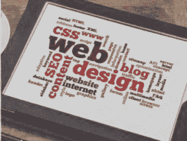

本章进一步探讨了`HTML`和`CSS`，扩展了上一章的观点帮助你获得更丰富的知识。特别是，它研究了`HTML`元素，包括页眉、页脚和其他结构元素。然后章节转向`CSS`类选择器和基于文本的元素，包括如何创建超链接和列表。

```html
<html>
<head>
<title>我的首页</title>
</head>
<body style="background-color:white">
<table border="0" cellpadding="0">
<tr>
<td><a href="google.com">Google</a></a></td>
</tr>
</table>
</body>
</</html>
```

## 网站构建与多媒体

在本章中，学习如何规划、构建和样式化网站。通过易于遵循的循序渐进指令以及你已经学到的所有知识，到结束时你将拥有自己独特的网站并在运行。此外，本章还展示了如何使用`CSS`为你的网页设置样式，并使用`WordPress`为你的网站添加博客。

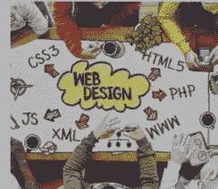

通过向你的网站添加图像、音频和视频，你将其提升到另一个层次，使其更吸引人，从而增加可能访问的人数。本章将引导你处理图像、音频和视频，包括要使用的最佳文件格式以及如何将每一项添加到你的网站。此外，这里还涵盖了`HTML5`基础、`CSS`过渡和`CSS`关键帧。

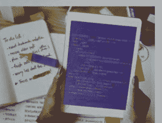

在本章中进一步提升你的知识，学习字符实体、自适应布局和响应式网页设计（`RWD`）。如果你希望你的网站在所有设备（包括智能手机和平板电脑以及桌面电脑）上看起来良好，那么`RWD`就至关重要。掌握如何在移动浏览器上充分利用你的网站，以及哪些浏览器支持最好。这里还包含了故障排除指南。


## JavaScript 入门

读者，你好`JavaScript`——`JavaScript`，你好读者。在这里确切了解`JavaScript`到底是什么以及它如何改进你的网站。本章还涉及了编写脚本的基础知识以及浏览器遇到`JavaScript`时会发生什么。章节结束时，你将能够编写脚本。


在本章中，我们探索`JavaScript`的结构。这包括语法、注释、变量和运算符。

```javascript
let x = 10;
let y = "Hello";
if (x > 5) {
  console.log(y);
}
```

现在我们涵盖了语句，重要的是学习使用函数进行代码复用，以及如何创建命名函数。我们还研究了为什么使用命名空间避免命名冲突很重要。然后我们介绍了面向对象的编程；解释了类的用法。

在最后这最后一个章节中，我们研究了最后一块拼图：文档对象模型（`DOM`）和事件。`JavaScript`的`DOM`类允许我们操作现有页面，这开启了无限可能。我们探索了如何获取和添加`DOM`元素，然后转向事件和监听器。


# 索引

. . . . . . . . . . . . . . . . 254

# 前言

我们生活在一个连接的世界里。我们分享新闻、故事和图像；我们崇高的愿望和黑暗的噩梦（还有很多猫咪图片）以不断加快的速度在全球传播，而我们对这些无限人类思想（以及可爱的猫咪图片）的需求似乎是无限的。

所有这些信息的媒介——数据流管道——全球文化交织和进步的魔法织机——就是互联网。因此，学习互联网的语言既是赋权的又有回报的。

很多人认为编程很难学；事实完全非如此。如果你知道`1 + 2 = 3`，并且知道在拿牛奶之前要打开冰箱门，你就可以编程！

当然，精通任何语言（人类语言或计算机语言）都需要长时间专注的学习。但正如学习足够的法语以便在巴黎度假与当地人交流很简单一样，掌握大多数计算机语言的基础也是如此。


互联网语言——`HTML`、`CSS`和`JavaScript`——是人们可以学会的最简单的语言，同时也是最实用且无处不在的语言。本书仅是对这些语言的介绍，但将赋予你从零开始创建充满活力且令人有趣的网站的能力。

不要害怕，这很容易。翻页自己亲眼看一下吧……

Adam Crute

如今，每个人都在使用互联网，从爱好者到大企业。如果你想推销自己、产品，或者仅仅让人们知道你的热情，网站都能为你提供一扇观察世界的窗。它是获取任何事情更多信息的首选地。

现在你知道为什么需要网站了，那么如何开始构建呢？网络上每个网站背的核心技术是`HTML`（超文本标记语言）和`CSS`（层叠样式表）。本书将准确揭示它们是如何工作的、能够做什么，更重要的是，将向你展示如何创建你自己的网站。

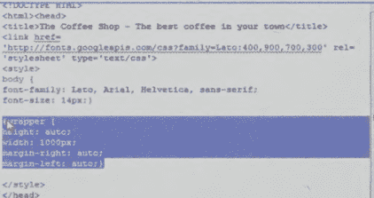

```html
<!DOCTYPE html>
<html>
<head>
<title>The Coffee Shop - The best coffee in your town</title>
<link href="https://fonts.googleapis.com/css?family=Lato:wght@400,900,700,300" rel="stylesheet">
<style>
body {
  font-family: Lato, Arial, Helvetica, sans-serif;
  font-size: 14px;
}
.wrapper {
  height: auto;
  width: content;
  margin-left: auto;
  margin-right: auto;
}
</style>
</head>
<body>
<div id="wrapper">
<nav>Home | About Us | Contact</nav>
<h2>The best coffee you will find in your town</h2>
<section>

<h3>Welcome to The Coffee Shop</h3>
<p>Lorem ipsum dolor sit amet, consectetur adipiscing elit. Duis consequat at orci tincidunt. Vivamus id neque, ultricies lacinia, massa, fringilla mauris aliqu. Duis auctor lacinia nisl, at non tellus, luctus in mauris nibh nisl eu erat.</p>
</section>
</div>
</body>
</html>
```

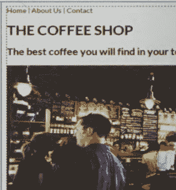

**上方：** 学习如何将代码转化为互联网黄金；创建你自己的网站可能并没有你想象的那么困难。

建议不仅止于创建你的网站：学习如何将你的网站发布到互联网，了解你如何购买自己的`.com`域名，使用`WordPress`创建博客，发现一些高级的`CSS`技术并学习简单的`JavaScript`语言。

构建网站和学习新语言的过程看起来可能是一项艰巨的任务。但本书迎接了挑战，通过一系列逐步的指南展示了这一过程。这些指南提供了易于遵循的指令，将引导你完成网站的一些最重要的构建模块。

如果一切没有按照计划进行，我们实用的故障排除指南将帮助你重回正轨，而我们的进一步阅读指南将指引你下一步去哪里。

在展示`HTML`、`CSS`和`JavaScript`代码示例时，我们将使用像这样的文本。当我们想表示某些内容将写在代码块中但我们没有在示例中显示它时，我们会这样构建文本，例如：`header {style rule}`。你不需要在代码中输入`style rule`——相反，我们是在向你展示样式规则所在的位置。


除了更有实质性的逐步指南外，还有一系列热点提示（Hot Tip）指南。这些指南提供了快速、方便的提示，以及为最终网站锦添花花的建议。

`JavaScript`语言自万维网早期起就一直与我们在一起。在它的早期，它只是群众中的一员，是许多争夺网页开发社区关注和推广的语言与技术之一。

多年来，许多此类技术由于各种原因流行一时后没落，但`JavaScript`并非如此。很大程度上归功于灵活性和无处不在的结合，`JavaScript`现在是互联网主要的脚本语言。


尽管`JavaScript`有时具有深奥的本质，但它是学习通用编程的完美语言。本书针对对编写代码和编程非常新的人。你可能对`HTML`、`CSS`和`JavaScript`完全陌生；你可能已经在`HTML`和`CSS`上花过时间。

# HTML 基础

`HTML`是构建网站最重要的组件。但它是什么？有什么用？

`HTML`亦是构建所有网站的框架。如果说网站是一个房子，那么`HTML`就是砖和灰浆。

`HTML`由元素组成，每个元素都有特定的用途。例如，`video`元素用于在页面上放置视频。

- 这些元素由标签标记。
- 每个元素都有一个名称——包含在标签中。
- 开启标签和闭合标签之间的任何内容都是元素的内容。

`HTML`不仅仅是纯文本。如果我们创建上述元素，我们将写一个开启标签`<video>`和匹配的闭合标签`</video>`。如你所示，开启标签以`<`开始，说明元素名称并以`>`结束。闭合标签遵循相同的模式，我们在元素名称之前插入`/`。当网络浏览器遇到它时，它会在页面上创建一个视频播放器。简单吧？

那么，这些标签之间是什么？大多数情况下，答案是文本和/或其他元素。这意味着`HTML`具有元素内部元素的嵌套结构。此外，许多开发者会缩进代码行以反映这种嵌套。

```html
<!DOCTYPE html>
<html>
<head>
  <title>My Page</title>
</head>
<body>
  <header>
    <h1>A Page All About Me</h1>
  </header>
  <section>
    <h2>I'm thinking now</h2>
    <p>Lorem ipsum dolor sit amet, consectetur adipiscing elit. Duis consequat at orci tincidunt. Vivamus id neque, ultricies lacinia, massa, fringilla mauris aliqu.</p>
    <p>Nuncen velit molestie sapien. Maecenas elementum aliquet velit. Ut eget mauris sed lacus lacinia. Nunc arcu magna, mollis id, ornare ac, pharetra sit amet, purus. Aliquam luctus consect dolor.</p>
  </section>
</body>
</html>
```

## HTML 属性

虽然所有的`HTML`元素都有其特定的用途，但几乎所有的元素都可以通过各种方式进行修改。例如，我们可能想要更改视频播放器的尺寸或标题的字体大小。

元素是通过调整元素的属性来修改的，这在起始标签中完成：

```html
<video width="720" height="360">
```

如你所见，属性名是在起始标签内声明的，后面跟着`=`，然后是一个包裹在引号内的值。

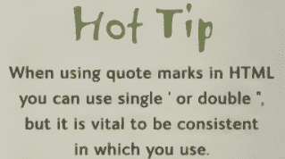

```html
<video width="640" width="360" src="vids/intro.mp4"></video>
<section lang="en">
  <article id="article_01">
    <h2 class="underlinedText">Lorem ipsum dolor sit amet</h2>
    <p class="redText">Sed sagittis ante malesuada velit. Curabitur suscipit.</p>
  </article>
</section>
```

**上图：** 属性允许你修改元素。

在`HTML`的旧版本中，存在大量不同的属性来控制元素的视觉外观。更重要的是，不同元素它们所能识别的属性集合也差异巨大。记住所有的内涵和变化是一场噩梦，因此`style`属性被开发出来。


赋值给`style`属性的值称为样式规则（style rule），它由一个或多个样式命令组成。样式命令是样式属性与应用于该属性的值的配对，例如：

```html
<body style="color:green; font-weight:bold;">
```

每个样式属性名（此例中的`color`和`font-weight`）后面跟着一个冒号`:`，然后是赋值给该属性的值，最后是一个分号`;`。

| 行 | 内容 |
|---|---|
| 9 |  |
| 10 | `<header style="font-size:18px; color:blue;">` |
| 11 | `<h1 style="font-weight:bold;">HTML 和 CSS 基础</h1>` |
| 12 | `<h2 style="font-size:14px;">学习互联网语言</h2>` |
| 13 |  |
| 14 | `</header>` |
| 15 |  |
| 16 |  |
| 17 | `<video width="640" width="360" src="vids/introvid.mp4"></video>` |
| 18 |  |

**上图：**`style`属性允许你为元素添加内联样式（inline styling）。

# CSS 基础

如果说`HTML`是房子的砖块和灰浆，那么`CSS`提供了装饰。这种语言简单但威力巨大，没有它，你的网页看起来会非常糟糕。

我们已经查看了如何向元素的`style`属性添加样式规则。这被称为**内联**（Inline）样式——它虽然有效，但有一个固有的问题：如果你想更改所有文本标题的字体，那么你必须在每个标题元素出现的地方编辑`font-family`样式属性。这正是`CSS`登场的地方。

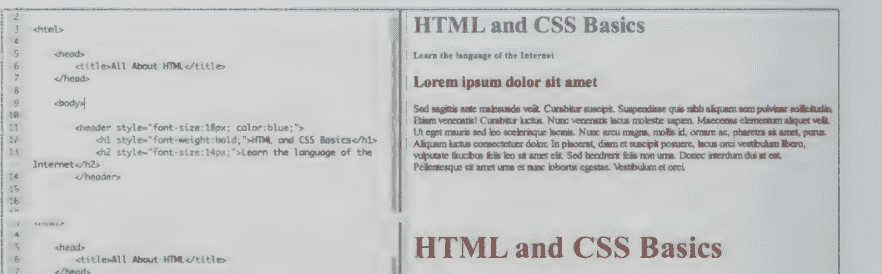

`CSS`代表级联样式表（Cascading Style Sheets）。它提供了将页面内容与页面外观分离的方法，并允许同时对多个元素应用样式规则。它的一个关键优势是，对`CSS`样式规则进行的任何更改都将影响所有与它关联的元素。

```css
header {
  position:relative;
  width:1024px;
  height:130px;
  margin:0px auto auto;
  padding:0px;
  background-color:#778081;
  border:none;
  border-bottom:2px solid #FDSF12;
}
  position:relative;
  width:788px;
  height:30px;
  margin:0px auto auto;
  padding:0px 118px auto 118px;
  background-color:#D9D0D9;
  border:none;
  border-bottom:1px solid #FDSF12;
}
```

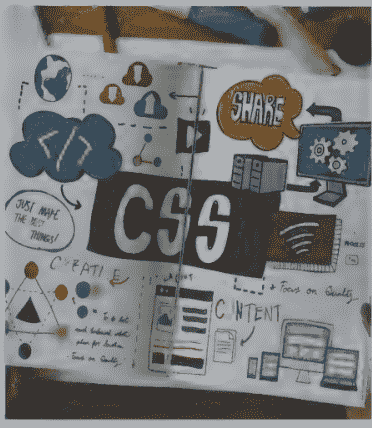

像`HTML`一样，`CSS`是用特定结构编写的纯文本。`CSS`代码由选择器（selectors）组成，选择器用于识别后续样式规则将应用的`HTML`元素。样式规则本身被包裹在大括号`{`和`}`中。（注：原始 OCR 错误使用了`(`和`)`）


> **上图：** CSS 代码使用了选择器和样式规则。代码缩进如何有助于可读性。

选择器可以有许多不同的形式，但在书中我们只关注其中三种：类型（Type）、ID 和类（Class）。这些中最简单的是类型选择器。它仅由将接收样式规则的 HTML 元素名称组成。例如，一个 `p` 选择器将针对所有的 `<p>` 元素实例。

在编写 HTML 时，我们创建了一个嵌套结构，其中每个元素都嵌套在另一个元素内部。这意味着每个元素都有一个**父**（parent）元素——即给定元素所在的元素——而且大多数元素都有**子**（child）元素，即嵌套在给定元素中的元素。

| 行 | | |
|---|---|---|

当网络浏览器**渲染**（画出）网页页面中的一个元素时，它必须评估将哪种样式规则应用到该元素。但如果它正在渲染元素，就必须确定应用到该元素的样式规则。上图：样式属性允许你为元素添加内联样式。

如果 HTML 是房子的砖块和灰浆，那么 CSS 提供了装饰。这种语言简单但威力巨大，没有它，你的网页看起来会非常糟糕。

我们已经查看了如何向元素的 `style` 属性添加样式规则。这被称为**内联**（Inline）样式——它虽然有效，但有一个固有的问题：如果你想更改所有文本标题的字体，那么你必须在每个标题元素出现的地方编辑 `font-family` 样式属性。这正是 `CSS` 登场的地方。


CSS 代表级联样式表（Cascading Style Sheets）。它提供了将页面内容与页面外观分离的方法，并允许同时对多个元素应用样式规则。它的一个关键优势是，对 CSS 样式规则进行的任何更改都将影响所有与它关联的元素。

```css
header {
  position:relative;
  width:1024px;
  height:130px;
  margin:0px auto auto;
  padding:0px;
  background-color:#778081;
  border:none;
  border-bottom:2px solid #FDSF12;
}
nav {
  position:relative;
  width:788px;
  height:30px;
  margin:0px auto auto;
  padding:0px 118px auto 118px;
  background-color:#D9D0D9;
  border:none;
  border-bottom:1px solid #FDSF12;
}
```


像 HTML 一样，CSS 是用特定结构编写的纯文本。CSS 代码由选择器（selectors）组成，选择器用于识别后续样式规则将应用的 HTML 元素。样式规则本身被包裹在大括号 `{` 和 `}` 中。（注：原始 OCR 错误使用了 `(` 和 `)`）

> **上图：** CSS 代码使用了选择器和样式规则。代码缩进如何有助于可读性。

选择器可以有许多不同的形式，但在书中我们只关注其中三种：类型（Type）、ID 和类（Class）。这些中最简单的是类型选择器。它仅由将接收样式规则的 HTML 元素名称组成。例如，一个 `p` 选择器将针对所有的 `<p>` 元素实例。

在编写 HTML 时，我们创建了一个嵌套结构，其中每个元素都嵌套在另一个元素内部。这意味着每个元素都有一个**父**（parent）元素——即给定元素所在的元素——而且大多数元素都有**子**（child）元素，即嵌套在给定元素中的元素。

| 行 | | |
|---|---|---|

当网络浏览器**渲染**（画出）网页页面中的一个元素时，它必须评估将哪种样式规则应用到该元素。但如果它正在渲染元素，就必须确定应用到该元素的样式规则。上图：样式属性允许你为元素添加内联样式。

## HTML 元素属性

虽然所有的 HTML 元素都有其特定的用途，但几乎所有的元素都可以通过各种方式进行修改。例如，我们可能想要更改视频播放器的尺寸或标题的字体大小。

元素是通过调整元素的属性来修改的，这在起始标签中完成：

```html
<video width="720" height="360">
```

如你所见，属性名是在起始标签内声明的，后面跟着 `=`，然后是一个包裹在引号内的值。


```html
<video width="640" width="360" src="vids/intro.mp4"></video>

<section lang="en">
  <article id="article_01">
    <h2 class="underlinedText">Lorem ipsum dolor sit amet</h2>
    <p class="redText">Sed sagittis ante malesuada velit. Curabitur suscipit.</p>
  </article>
</section>
```

**上图：** 属性允许你修改元素。

在 HTML 的旧版本中，存在大量不同的属性来控制元素的视觉外观。更重要的是，不同元素它们所能识别的属性集合也差异巨大。记住所有的内涵和变化是一场噩梦，因此 `style` 属性被开发出来。


赋值给 `style` 属性的值称为样式规则（style rule），它由一个或多个样式命令组成。样式命令是样式属性与应用于该属性的值的配对，例如：

```html
<body style="color:green; font-weight:bold;">
```

每个样式属性名（此例中的 `color` 和 `font-weight`）后面跟着一个冒号 `:`，然后是赋值给该属性的值，最后是一个分号 `;`。

| 行 | | |
|---|---|---|
| 9 | | |
| 10 | `<header style="font-size:18px; color:blue;">` | |
| 11 | `<h1 style="font-weight:bold;">HTML 和 CSS 基础</h1>` | |
| 12 | `<h2 style="font-size:14px;">学习互联网语言</h2>` | |
| 13 | | |
| 14 | `</header>` | |
| 15 | | |
| 16 | | |
| 17 | `<video width="640" width="360" src="vids/introvid.mp4"></video>` | |
| 18 | | |

上图：`style` 属性允许你为元素添加内联样式。

## HTML 文档结构

```html
<!DOCTYPE HTML>
<html>
<head>
</head>
<body>
</body>
</html>
```

特殊的 `<html>` 元素始终包含两个子元素，不多不少：`<head>` 和 `<body>`，且顺序固定。没有这两个元素，网页将无法正常工作（甚至完全无法运行）。

`<head>` 元素包含有关网页的信息，如其标题（显示在浏览器窗口顶部）、将出现在搜索结果列表中的文本、指向其他资源的链接等。`<head>` 内部的任何内容都不会渲染到网页的可见部分。

`<body>` 元素处理页面的实际可见内容，即产生视觉输出的元素。通常情况下，你按照元素在屏幕上出现的顺序向 `<body>` 中添加元素。

## HTML 注释

几乎所有的编程语言都提供了添加注释的功能，但 HTML 则不同。它们注释的主要用途是在文档内部添加备注、解释和提醒，这些内容都会被浏览器忽略。如果你正在开发一个大型网站或与其他开发者协作，注释可能尤为重要。因此，最佳实践是大量且自由地使用注释——如果你以后需要重新查看之前写的页面，你会很庆幸的。HTML 注释看起来如下所示：

```html
<head>
  <!-- 为页面起一个更好的标题 -->
  <title>我的页面</title>
</head>
<body>
  <header>
    <h1>关于我的页面</h1>
  </header>
  <section>
    <h2>我现在在想什么</h2>
    <!-- 占位文本... -->
    <p>lorem dolor sit amet, consectetur adipiscing elit. Sed sagittis ante velit. Curabitur suscipit. Suspendisque nibh aliquam pulvinar sollicitudin. Etiam venenatis. Curabitur luctus.</p>
    <!-- 下一个元素被“注释掉”了 -->
    <!--<p>venatis molest sapien. Maecenas elementum aliquet velit. Ut mauris sed scelerisque lacinia. Nunc arcu magna, mollis id, ornare ac, pharetra sit amet, purus. Aliquam luctus dolor.</p> -->
  </section>
</body>
```

**上方：** 注释是无价的，越多越好！

## 在 HTML 中包含 CSS

在深入研究 CSS 之前，我们需要建立如何将其包含在 HTML 文档中的方法。有两种方法。

### 嵌入样式表

嵌入样式表是指所有的选择器和样式规则都出现在其应用的 HTML 文档的 `<head>` 元素中。这是通过在页面的 `<head>` 元素内创建一个 `<style>` 元素（某些情况下为多个元素）来实现的。

然后你在这个 `<style>` 元素内部输入所需的选择器和样式规则。这种方法的优点是将一个页面的所有代码（HTML 和 CSS）都保持在单个文件中，但对于包含许多页面的大型网站，管理起来可能会变得困难。

| | |
|---|---|

**上方：** 嵌入样式表嵌套在文档的 `<head>` 中。

### 外部样式表

使用外部样式表，CSS 代码被写在一个单独的文件，然后链接到任何你想应用该样式表的 HTML 文档。

CSS 文档仅仅是一个纯文本文件，通常以 `.css` 扩展名保存。

外部样式表使用位于页面 `<head>` 中的 `<link>` 元素与 HTML 页面关联：

```html
<link type="text/css" rel="stylesheet" href="myfile.css" />
```

注意，该元素的标签没有配对的结束标签，而是在最后一个角括号之前包含一个 `/`。这通常被称为自闭标签；其原因是其内部不能嵌套任何其他元素。

| | |
|---|---|

**上方：** 外部样式表通过 `<link>` 元素与网页关联。

有几个属性需要设置：`type` 和 `rel` 属性告诉浏览器预期的数据类型。`href` 属性定义了 CSS 文档本身的位置和名称。通常，它将位于与网页相同的服务器上，但通常位于网站根目录的子文件夹内。

提示：网站由文件和文件夹的层次结构组成，就像你电脑的硬盘一样。这种层次结构的顶层被称为网站根。

下方：CSS 文档通常存储在网站根文件夹的子文件夹中。

| 名称 | 类型 | 日期 |
|---|---|---|

当你构建一个完整的网站且组成网站的页面通常共享的视觉外观时，外部样式表就真正展现了它的价值。由于外部样式表可以链接到任意数量的 HTML 页面，它们提供了一个中心点，你可以从中修改并调整整个网站的视觉设计。


```css
/* css (style.css) 最后修改：2014 */

body {
  position: relative;
  background-color: #F5F5F5;
  padding: 0;
  height: 100%;
}

nav {
  position: fixed;
  left: 0;
  top: 0;
  margin: auto auto auto;
  background-color: #999999;
}

header {
  position: relative;
  width: 1024px;
  margin: 0 auto auto;
  background-color: #777777;
  border-bottom: 2px solid #F5F5F5;
}

main {
  position: relative;
```

**上方：** 外部样式表多个页面之间共享，非常适合页眉等公共元素。

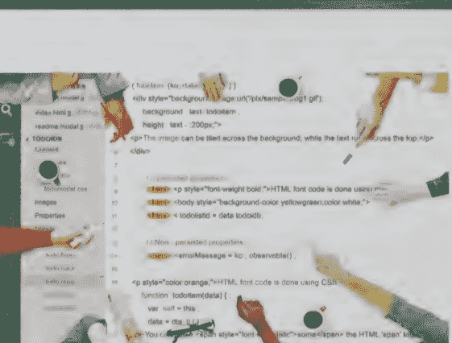

请注意，使用多个样式表会增加对元素样式属性应用冲突值的风险。如果一个元素的显示效果不符合预期，那么值得深入检查，以查看出现问题的样式规则是源自何处。

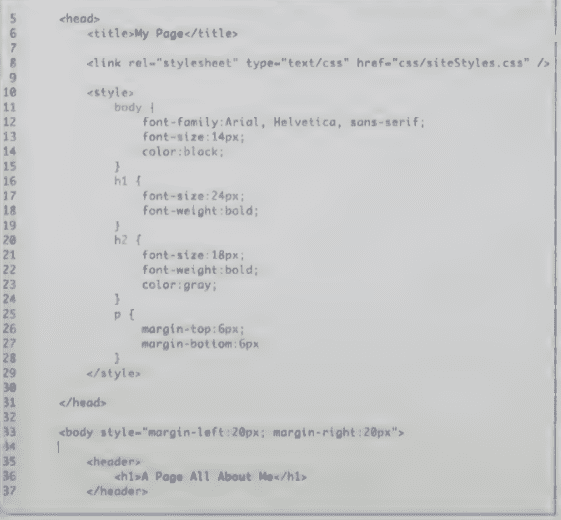

左图：将 CSS 规则应用到 HTML 元素的三种方法。

HTML5 仍然是 HTML，但它只是该语言的最新版本。它包含了以前版本中的许多元素，但也引入了许多新元素和规则。通常情况下，当有人使用 HTML5 时，他们指的是这些新特性。

HTML5 的目标之一是在语言中引入清晰且一致的语义化，使得元素名称能够传达关于元素用途以及它在文档逻辑结构中位置的信息。

> 提示：语义化元素对于辅助视障人士进行网页浏览的屏幕阅读器应用程序特别有帮助。

| HTML5 特性语义化 | 语义化是 Web 平台与其他平台相比的最显著的特征之一。开发者通常会忽略或降低此类特性的优先级，但精通它可以为我们的项目带来许多益处。 |
| --- | --- |
| 文本和文字具有意义。最终，我们的浏览器读取的内容是纯文本。网站和应用程序是在一个生态系统中创建的，在这个系统中，文本内容是可以链接、可搜索和可组合（mashable）的。在开放网上，我们希望内容能被第三方、搜索引擎和无障碍工具展示、馈送和修复。所有这些益处并非免费。自动化工具在识别内容本质方面只能完成工作。开发者对内容正确语义的标记做得越好，其他代理（agents）处理起来就越容易。HTML5 还提供了一系列工具让生活变得简单：新媒体元素、新结构元素、国际化的新语义、新链接关系类型、新属性、新表单类型，以及用于额外语义的新微数据语法。 |  |

**上图：** HTML5 非常重视语义化。

因此，它包含了一组新元素来满足对语义化的需求，例如 `<header>`、`<video>`、`<article>` 和 `<footer>`。元素名称准确传达了这些新元素的用途，这一事实使得它们具有语义化。


HTML5 为网页引入了许多新功能，这些功能以前需要安装如 Adobe Flash Player 等第三方插件到终端用户的浏览器中。这些新特性对开发者来说是一股清风，因为它们让添加诸如拖放、Web 表单、视频、音频、“实时”图形（包括 3D）等许多功能变得极其简单。

许多流行的浏览器插件无法安装在移动操作系统上。HTML5 通过消除对许多第三方插件的需求解决了这个问题，因此如果你希望你的网页在移动设备上被查看，HTML5 是唯一的选择。

**上图：** HTML5 在移动设备上运行非常完美。

CSS3 仍然是 CSS；它是该语言的最新版本。它带来了许多让语言变得强大的增强。

CSS3 的主要进步之一是能够应用视觉效果，如阴影（drop shadow）或模糊（blur），这以前需要借助 Photoshop 等工具。现在，开发者只需通过 CSS 就能实现这些视觉效果。


CSS3 的另一个功能是 `background-size`。这是一个属性，允许背景图像（位于元素的背景中）自动缩放。

> 提示：使用 `cover` 值非常有用。

CSS3 的一大新功能是动画。以前这需要第三方插件才能在网页上实现。查看这个漂亮的 CSS3 动画：`http://codepen.io/pen/idhuG`


HTML 和 CSS 无处不在，但许多公司缺乏正确支持和维护它们的内部技能。

**下图：** 深入理解 CSS 意味着更好的网站。


掌握 HTML 和 CSS 可以让你有信心地对网站进行修改，而不用担心破坏它。

网页设计的视觉方面受当前潮流的影响很大。让你的网站与潮流同步，确保它始终看起来现代时尚。

为正确的任务选择正确的 HTML 和 CSS 可能意味着为访问者带来流畅的体验，还是缓慢沮丧的体验……猜他们更喜欢哪种？


**上图：** 调整你的网站以获得更多访问者。

```html
<html>
<head>
<title>首页</title>
</head>
<body>
<table>
<tr>
<td>
```

```html
<body bgcolor="white"
<border="0" cellpadding="10">

<h1>Hello</h1>
```

# 揭秘 HTML 和 CSS 的迷秘

有一系列令人困惑的 HTML 元素和 CSS 属性可以应用于网站。在这里，我们将通过深入研究构建活力且有吸引力的网站所需的关键 HTML 元素和 CSS 属性，来揭开它们的迷秘。

# 基础构建

如果你一直在关注并留意，你现在应该知道网页是什么了，并且对它的主要构建模块有了基本的理解。现在，我们将稍微扩大视野，考虑网站。网站是 HTML 和 CSS 文档的集合，它们组合在一起创建一组实用的内容，并通过吸引人的用户界面显示。

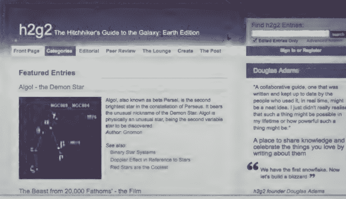

**上方：** 网站由许多页面组成。

## 数十元素

我们已经讨论了什么是元素，但我们没有提到的是有成百个元素！不过不要担心，你会发现只有少数元素是你经常使用或需要的；我们将在接下来的页面中讨论这些元素。

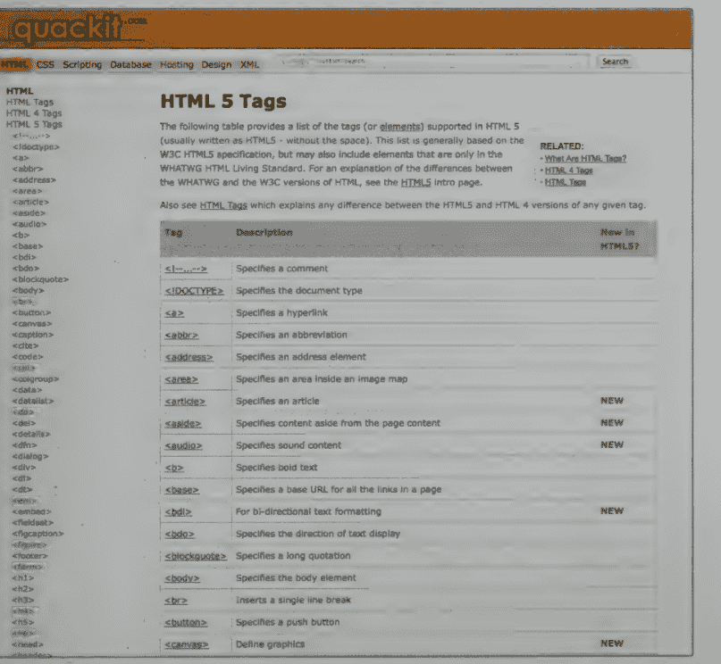

上方：你可以在 `http://www.quackit.com/html_5_tags/` 找到元素的完整列表及其功能说明。

在上一章中，我们讨论了 `<html>`、`<head>` 和 `<body>` 元素，这些元素应该构成你所有网页的基础框架。现在，让我们看看这个基础框架内部的元素。

### 灵活的朋友

我们将从观察一个略微不寻常的元素开始：`<div>`。它的不寻常之处在于它没有特定的用途：它本质上是一个空容器，你可以将其用于各种目的。`<div>` 最常见的用途之一是允许你将一组相关的元素组合在一起，例如构成页眉的那些独特元素。

```html
<body class="...">
  <div class="logged_in">
    <div class="header_container">
      <div class="header">
        <div class="site_operations">
        </div>
```

你说什么？你认为 HTML5 中有一个 `<header>` 元素吗？确实有，但在 XHTML 或旧版本的 HTML 中没有这种东西。那么，开发者在 HTML5 之前是做什么的呢？为了回答这个问题，我们需要稍稍绕个路子……

### ID 属性

你会记得元素具有可以分配数值的属性。其中一种适用于所有视觉元素的属性是 `id`。它允许你为页面中的特定元素提供一个唯一的标识符，并且在 HTML 中被广泛使用。为了了解为什么，我们需要从 CSS 的角度来看 id 的含义。

```html
<body>
  <div>
    <header>
      <h1>Div 是容器</h1>
    </header>
    <p>Div 可以嵌套在其他 div 之中</p>
  </div>
  <div>
    <h2>Div 没有语义含义</h2>
  </div>
</body>
```

上方：`<div>` 元素是开发者灵活的朋友。

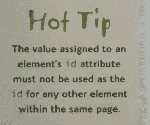

```html
<div id="main">
  <header>
    <h1>Div 是容器</h1>
  </header>
  <div id="contentBlock">
    <p>Div 可以嵌套在其他 div 之中</p>
  </div>
  <div id="divComment">
    <h2>Div 没有语义含义</h2>
  </div>
</div>
```

上方：ID 属性为元素提供了一个唯一的标识符。

## 轻松掌握 HTML • CSS • JAVASCRIPT

```css
body {
  position: relative;
  background-color: #FD5F12;
  margin: 0px;
  padding: 0px;
  width: 100%;
  height: 100%;
}

#myElement {
  position: fixed;
  width: 1024px;
  left: 0px;
  right: 0px;
  top: 0px;
  bottom: 0px;
  margin: 0px auto;
  background-color: #D9D9D9;
}
```

### ID 选择器

ID 选择器针对 id 属性值与 ID 选择器匹配的单个元素。ID 选择器看起来如下：

```css
#myElement { style rule }
```

`#div`（井号）表示这是一个 ID 选择器；它的样式规则将是……

# 50 编程 HTML • CSS • JAVASCRIPT 易从

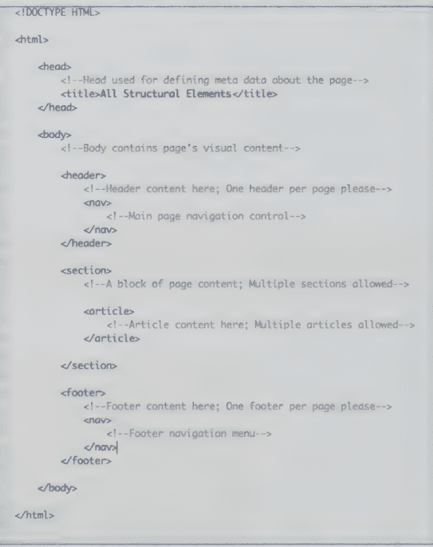

## 页面区域

`<section>` 元素旨在作为相关内容组的通用容器，即页面的“章节”。`<section>` 元素通常紧跟在页面 `<header>` 元素之后。

## 其他结构化元素

```html
<!DOCTYPE HTML>

<html>
<head>
<!--Head 用于定义关于页面的元数据-->
<title>所有结构化元素</title>
</head>

<body>
...<header>、<section> 和 <footer> 元素既创建了页面结构（其他元素可以放在其中），也为页面内不同类型的信息创建了逻辑结构。HTML5 中还有四种你会经常使用的结构化元素。
</body>
```

上方：结构化元素提供了一个逻辑结构，页面内容可以写在其中。

## 网站导航

大多数网站都包含一个网站导航菜单，允许用户快速、方便地在网站中移动；HTML5 提供了 `<nav>` 元素来包含此类导航菜单的元素。`<nav>` 元素通常创建为 `<header>` 的子元素，但这不是强制要求的。

## article 元素

`<article>` 元素旨在作为结构化链中的最后一个元素，因为它通常位于另一个结构化元素（如 `<section>`）内部。`<article>` 的设计理念是其内容与单个主题相关，就像报纸上的文章一样。

## aside 元素

`<aside>` 元素背后的理念是显示与另一个结构化元素内部内容相关的内容，但不是该内容的直接部分。在语义上，任何结构化元素都可以有一个相关的 `<aside>` 元素，但典型的用法是侧边栏，用于显示广告、个人信息或指向网站其他区域的链接。

```html
9 <body>
10 <!--Body 包含页面视觉内容-->

13 <header>
14 <!--此处 Header 内容；请每个页面一个 header-->

15 <nav>
16 <!--主页面导航控制-->
17 </nav>
19 </header>

21 <section>
22 <!--页面内容块；允许多个 section-->

24 <article>
25-5 <!--此处 Article 内容；允许多个 article-->
26 </article>

28 <aside>
29 <--Aside 内容与其他页面内容相关 - 此处
30 它与上面的 article 相关；
31 允许多个-->
32 </aside>

34 <aside>
35 <!--此处 Aside 内容-->
36 </aside>

38 <footer>
39 <!--此处 Footer 内容；请每个页面一个 footer-->
40 <nav>
41 <--页脚导航菜单-->
42 </nav>
43 </footer>

45 </body>
```

**右侧：** `<aside>` 元素用于显示与 `<section>` 或 `<article>` 元素相关的内容。

## 理解 CSS 选择器

我们已经讨论过 CSS 类型选择器（Type selectors）和 ID 选择器，但你还有另一个需要了解的选择器：类选择器（Class selector）。你还可以以各种方式组合选择器；让我们来看一下。

### 类选择器（CLASS SELECTORS）

```css
127 .italic {
128   font-family: "source_sans_pro_italic";
130 }
131 132 .bold {
133   font-family: "source_sans_probold";
135 }
136 .footerText {
137   position: absolute;
138   font: 10px "source_sans_pro_regular";
139   color: #787878;
140   right: 0px;
141   bottom: 6px;
142   width: auto;
143   margin: 6px 10px 6px auto;
144   padding: 0px;
145 }
147 .navButton {
148   width: auto;
```

类型选择器针对任何匹配类型的 HTML 元素，而 ID 选择器针对具有匹配 id 属性的单个 HTML 元素。那么，类选择器允许你针对特定分类的 HTML 元素进行目标设定。

类选择器的写法如下（注意类名前的 `.`）：

```css
.myClassName { style rule }
```

此选择器将针对任何被赋予 `myClassName` 分类的 HTML 元素。


### 类型类选择器（Typed Class Selectors）

通过将类选择器与类型选择器结合可以更进一步，例如 `article.newsStory {style rule}`。此选择器将针对所有被赋予 `"newsStory"` 分类的 `<article>` 元素。但我们如何对元素分类呢？简单……

### 类属性（The Class Attribute）

每个视觉元素都有一个 class 属性。它的样子如下：`<article class="newsStory">`。一旦在此给出分类，该元素将接收与 `.newsStory` 选择器关联的样式规则。如果选择器是 `p.newsStory`，则该元素不会被选中，因为它是一个 article。

```html
<body>
  <header>
    <nav>
      首页 | 关于我
    </nav>
  </header>
  <section>
    <article>
      <h2>什么是文章？</h2>
      <p>这是文章内容。</p>
    </article>
    <aside>
      Aside 内容与其他页面内容相关 - 此处
      它与上面的 article 相关；
      允许多个-->
    </aside>
    <aside>
      此处 Aside 内容
    </aside>
  </section>
  <footer>
    <nav>
      页脚导航菜单
    </nav>
  </footer>
</body>
```

**右侧：** `<aside>` 元素用于显示与 `<section>` 或 `<article>` 元素相关的内容。

### 类型类选择器（Typed Class Selectors）

通过将类选择器与类型选择器结合可以更进一步，例如 `article.newsStory {style rule}`。此选择器将针对所有被赋予 `"newsStory"` 分类的 `<article>` 元素。但我们如何对元素分类呢？简单……

### 类属性（The Class Attribute）

每个视觉元素都有一个 class 属性。它的样子如下：`<article class="newsStory">`。一旦在此给出分类，该元素将接收与 `.newsStory` 选择器关联的样式规则。如果选择器是 `p.newsStory`，则该元素不会被选中，因为它是一个 article。

```html
<body>
  <header>
    <nav>


首页 | 关于我

```html
</nav>
</header>

<section>

  <article>

    <h2>什么是文章？</h2>

    <p>这是文章内容。</p>

  </article>

  <aside>

    Aside 内容与其他页面内容相关 - 此处

    它与上面的 article 相关；

    允许多个-->

  </aside>

  <aside>

    此处 Aside 内容

  </aside>

</section>

<footer>

  <nav>

    页脚导航菜单

  </nav>

</footer>

</body>
```

# 理解 CSS 选择器（UNDERSTANDING SELECTORS）

我们已经讨论了 CSS 类型选择器和 ID 选择器，但你还有另一个重要的需要了解的选择器：类选择器。你也可以以各种方式组合选择器；让我们来看一下。

## 类选择器（CLASS SELECTORS）

```css
.italic {
  font-family: "source_sans_pro_italic";
}

.bold {
  font-family: "source_sans_probold";
}

.footerText {
  position: absolute;
  font: 10px "source_sans_pro_regular";
  color: #787878;
  right: 0px;
  bottom: 6px;
  width: auto;
  margin: 6px 10px 6px auto;
  padding: 0px;
}

.navButton {
  width: auto;
}
```

类型选择器针对任何匹配类型的 HTML 元素，而 ID 选择器针对具有匹配 `id` 属性的单个 HTML 元素。那么，类选择器允许你针对特定分类的 HTML 元素进行目标设定。

类选择器的写法如下（注意类名前的 `.`）：

```css
.myClassName {
  style rule;
}
```

此选择器将针对任何被赋予 `myClassName` 分类的 HTML 元素。


## 类型类选择器（Typed Class Selectors）

通过将类选择器与类型选择器结合可以更进一步，例如`article.newsStory {style rule}`。此选择器将针对所有被赋予 `"newsStory"` 分类的 `<article>` 元素。但我们如何对元素分类呢？简单……

## 类属性（The Class Attribute）

每个视觉元素都有一个 `class` 属性。它的样子如下：`<article class="newsStory">`。一旦在此给出分类，该元素将接收与 `.newsStory` 选择器关联的样式规则。如果选择器是 `p.newsStory`，则该元素不会被选中，因为它是一个 `article`。

```html
<body>

  <header>

    <nav>

      首页 | 关于我

    </nav>

  </header>

  <section>

    <article>

      <h2>什么是文章？</h2>

      <p>这是文章内容。</p>

    </article>

    <aside>

      Aside 内容与其他页面内容相关 - 此处

      它与上面的 article 相关；

      允许多个-->

    </aside>

    <aside>

      此处 Aside 内容

    </aside>

  </section>

  <footer>

    <nav>

      页脚导航菜单

    </nav>

  </footer>

</body>
```

## 复合选择器（COMPOUND SELECTORS）

我们已经提到了一个复合选择器的例子，通常被称为类型类选择器，但还有许多其他组合选择器的方法；让我们来看其中几种。

## 多类型选择器（Multiple Type Selectors）

如果你想创建一个根据类型应用到多个不同元素的样式规则，你只需要在选择器中列出这些类型，并使用 `,` 分隔每个类型名称。例如`h2, h3, p {style rule}`将针对所有的 `<h2>`、`<h3>` 和 `<p>` 元素。

```css
h1, h2, h3 {
  font-family: source_sans_probold;
  font-weight: bold;
}

article h2 {
  color: blue;
}

article p {
  font-family: source_sans_pro_regular;
}

nav > p {
  color: red;
  cursor: pointer;
}
```

上方：元素属性可以接受由空格分隔的类名。

### 后代选择器（Descendant Selectors）

有时我们想根据元素在 HTML 嵌套结构中的位置来定位元素。例如，我们可能想针对所有位于 `<article>` 内部（即嵌套在任何层级）的 `<p>` 元素：`article p {style rule}`（注意选择器中类型名称之间的空格）。

### 子选择器（Child Selectors）

子选择器针对是另一个元素的子元素（注意后代选择器也针对孙子元素、曾孙元素等）。因此，`article > h3 {style rule}`选择器将针对所有作为 `<article>` 元素直接孩子的 `h3` 元素（注意选择器中类型名称之间的 `>`）。

## 需要学习很多（A LOT TO LEARN）

CSS 是一门简单的语言，但细节在于细节——有*很多*细节，远比我们在这里能涵盖的多。如果你想了解更多，请查看许多致力于该主题的优棒网站和书籍。

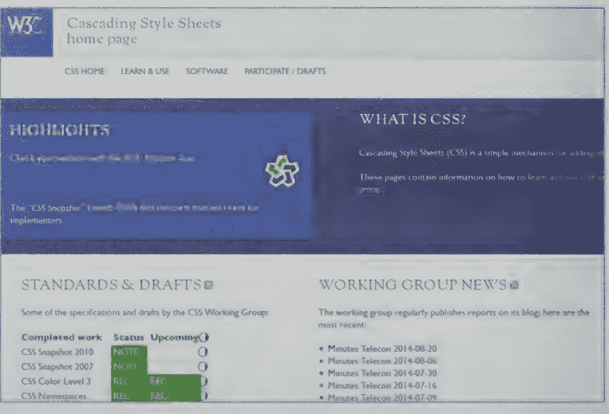

## 文本元素

大多数网页都包含文本——通常非常多——因此出乎意料的是，有一组专门用于显示文本的元素。文本元素倾向于嵌套在我们之前讨论过的结构元素内部。

### 标题文本

有一组 HTML 元素专门用于显示标题；它们的名称非常好记。第一个称为 `<h1>`，第二个是 `<h2>`，依此类推，直到我们达到 `<h6>`。

> **小提示**
>
> `<h4>` 到 `<h6>` 很少被使用——人们到底需要多少层级的标题呢？！

```html
<body>
  <h1>标题级别 1</h1>
  <h2>标题级别 2</h2>
  <h3>标题级别 3</h3>
  <h4>标题级别 4</h4>
  <h5>标题级别 5</h5>
  <h6>标题级别 6</h6>
</body>
```

**上方示例：** HTML 中有六种层级的标题元素。

### 标题级别

标题元素名称中的数字代表标题的“级别”，换句话说，代表了标题的重要程度（因此也是突出程度）。`<h1>` 最为突出，而 `<h6>` 最不突出。

### 标题语义

在 HTML5 之前，不同层级的标题仅代表不同程度的视觉突出性：`<h1>` 最粗且最大，`<h6>` 最小且最轻。HTML5 更进了一步，为不同的标题级别施加了语义含义。

| 标题级别 |
|---|
| 标题级别 1 |
| 标题级别 2 |
| 标题级别 3 |
| 标题级别 4 |
| 标题级别 5 |
| 标题级别 6 |

> 上方：`<h1>` 是最突出的标题，`<h6>` 最不突出。

解释这一点最简单的方法是使用像你现在阅读的这本书这样的类比。如果一个网页是书中的一个章节，那么 `<h1>` 类比于章节标题，因此 `<h1>` 在一个网页中应该只出现一次。

`<h2>` 类比章节内的节标题，因此可以在 `<h1>` 之后出现多次。`<h3>` 类比于节内的子标题……依此类推。标题语义可能很复杂，但记住这个书的类比——它有帮助！

### 标题的逻辑结构

HTML5 标题的语义性质意味着它们也推导出一种逻辑结构。回到我们的书的类比，子标题（`<h3>`）的父级将是节标题（`<h2>`），而节标题的父级将是章节标题（`<h1>`）。但如果你想创建一个包含两个组件的单一标题，比如所谓的“导语”和“副标题”，该怎么办？

**上方示例：** 就像书中的标题级别。HTML5 标题为文本赋予了逻辑结构，因此 `<h1>` 可以被视为章节标题，`<h2>` 可以被视为节标题，`<h3>` 可以被视为子章节标题。

### 标题组

我们可能会创建一个像这样的两部分标题：

```html
<h1>HTML 和 CSS</h1>
<h2>互联网的语言</h2>
```

遗憾的是，这里有一个问题：`<h2>` 是 `<h1>` 的子标题，但目前的情况是它表示了页面逻辑结构中的一个新章节。解决方案是 `<group>` 元素，它允许你将多个层级的标题分在一起，而不会暗示你正在逻辑结构中创建新章节——`<group>` 中的第一个标题将是推断出的标题级别。与上述相比，我们会这样写：

```html
<group>
  <h1>HTML 和 CSS</h1>
  <h2>互联网的语言</h2>
</group>
```

现在，`<h2>` 元素将被视为 `<h1>` 的一部分，语义健康得以恢复。

| 行号 | 内容 |
|---|---|
| 11 | |
| 12 | `<!--语义错误...-->` |
| 13 | `<h1>HTML 和 CSS</h1>` |
| 14 | `<h2>互联网的语言</h2>` |
| 15 | |
| 16 | `<!--语义正确...-->` |
| 17 | `<group>` |
| 18 | `<h1>HTML 和 CSS</h1>` |
| 19 | `<h2>互联网的语言</h2>` |
| 20 | `</group>` |
| 21 | |

**上方示例：** `<group>` 元素有助于保持标题的语义准确性。

### 段落文本

你会很高兴地知道，段落文本（网页的正文）比标题简单得多。我们只有一个段落元素，`<p>`。通常，`<p>` 只包含文本，但它也可以嵌入图像和某些其他元素。

### 段落样式化

段落样式化的常用策略是创建一个 `p` 类型选择器，在其中定义最基本的方面，然后创建一组应用特定样式（如粗体、斜体）的选择器。然后你可以根据需要为给定的 `<p>` 分配类。

```css
<style>
  .boldText {
    font-weight: bold;
  }

  .italicText {
    font-style: italic;
  }

  .underlinedText {
    text-decoration: underline;
  }
</style>
```

```html
<body>
  <p class="boldText">这是粗体文本</p>
  <p class="italicText">这是斜体文本</p>
  <p class="underlinedText">这是下划线文本</p>
</body>
```

*(注：原文示例中未提供具体的段落内容，此处根据逻辑补全了占位符以展示格式，实际翻译时应遵循原文结构)*

*更正原文中的 CSS 部分如下：*

```css
<style>
  .boldText {
    font-weight: bold;
  }

  .italicText {
    font-style: italic;
  }

  .underlinedText {
    text-decoration: underline;
  }
</style>
```

*(重新对应原文提供的 HTML/CSS 结构)*

```css
<style>
  .boldText {
    font-weight: bold;
  }

  .italicText {
    font-style: italic;
  }

  .underlinedText {
    text-decoration: underline;
  }
</style>
```

```html
<body>
  <p class="boldText">这是粗体文本</p>
  <p class="italicText">这是斜体文本</p>
  <p class="underlinedText">这是下划线文本</p>
</body>
```

*(由于原文提供的示例 CSS/HTML 代码不完整，此处翻译仅保留其意图和格式)*

*重新翻译“Styling Paragraphs”部分对应的代码块：*

**上方示例：** 使用简单的规则样式化段落。

## 超链接

如果一个网站没有超链接，它将不是一个网站。它们是允许网页浏览发生的机制，没有它们，页面将仅仅是一个静态文档。

### 锚点元素

超链接的核心是锚点元素 `<a>`。它之所以被称为这个，是因为它的用途之一是标记页面上的特定点。这通常用于创建：

```html
<body>
  <p>HTML 信息可以在 <a href="www.google.com">Google</a> 找到。这是一个用的资源。</p>
</body>
```

**上方示例：** 使用 `<a>` 元素创建超链接。

### 创建超链接

我们通过在想要转换为超链接的文本周围封装 `<a>` 元素来创建超链接——你想链接的 **URL**（或网址）定义在 `<a>` 的 `href` 属性中。

### URL

URL 代表统一资源定位符。URL 有两种形式：**绝对**和**相对**。前者定义了资源的完整网页地址，以 `http://` 开头。后者相对于当前文件操作，只能访问与文件位于同一站点的资源。相对 URL 从当前页面到资源的路径以及资源文件名，看起来像 `'路径文件/文件名'`。

### 链接样式化

和所有元素一样，`<a>` 具有最终源自浏览器默认样式表的默认外观。在 `<a>` 的情况下，这种默认样式通常是蓝色下划线文本。我们可以覆盖这种样式，通过向 `<a>` 元素附加样式规则，无论是直接附加还是通过继承来实现。

然而，超链接通常根据其状态更改样式，例如当鼠标指针悬停在其上方，或者用户之前点击过该链接。这种基于状态的样式通过 CSS 伪类选择器实现。

> **小提示**
>
> 浏览器提供一个默认样式表。它定义了所有 CSS 属性的值，是样式级联的起点。

**下方示例：** 链接具有默认外观。


## 伪类选择器

伪类是一种在 HTML 文档中没有专门声明的类，但当浏览器中查看页面时会变得可用。有几种不同的伪类，但对于超链接，我们关注的伪类有：`:link`（超链接的基础状态）、`:hover`（鼠标指针悬停在链接上）和 `:visited`（链接已被点击）。在 CSS 中，我们用这些伪类选择器作为另一个选择器的后缀。

```css
a:link {
  color: blue;
}

a:hover {
  color: red;
  text-decoration: none;
}

a:visited {
  color: purple;
}

.navButton:hover {
  color: blue;
  background-color: gray;
  cursor: pointer;
}

#headerLogo:hover {
  border-color: blue;
  border-style: solid;
  border-width: 2px;
  cursor: pointer;
}
```

**上方：** 伪类选择器被添加为另一个选择器的后缀。

### 在新窗口打开超链接

通常我们希望在新浏览器窗口中打开超链接，这样你自己的网站就可以留在后台打开。这是通过 `<a>` 元素的 `target` 属性实现的，如下：

```html
<a href="http://www.bbc.co.uk" target="_blank">
```


## 列表

列表是网页设计的基础。有两种基本的列表类型：无序列表和有序列表，它们都包含一个或多个列表项。第三种类型定义列表，它创建了一个类似于词汇表的标题和相关信息的结构。

### 列表项

在查看列表元素本身之前，让我们考虑列表中包含的内容。在 HTML 中，这是一个列表项元素 `<li>`。通常，这些元素包含文本，但与其他文本元素一样，它们也可以包含图像和超链接等其他元素。`<a>` 元素按照它们在父列表元素出现的顺序进行渲染。

### 无序列表

- HTML5 大部分由元素组成。
- 元素由开始标签和结束标签标记。
- 属性允许你修改元素。

### 有序列表

1. HTML5 大部分由元素组成。
2. 元素由开始标签和结束标签标记。
3. 属性允许你修改元素。

### 定义列表

HTML5  
大部分由元素组成。  

元素  
由开始标签和结束标签标记  

属性  
允许你修改元素。

> 上方：列表允许我们以一种吸引人且符合逻辑的方式呈现信息。

## 无序列表

无序列表 `<ul>` 是一个简单的项目符号列表。添加到列表的每个 `<li>` 都会创建一个新的项目符号。`list-style-type` 和 `list-style-image` 样式属性决定了项目符号标记的外观。

> 提示：通常将 `<ul>` 放在页面的 `<nav>` 元素中以创建导航菜单。可以对 `<ul>` 进行样式处理，使其水平或垂直渲染项目。

```css
ul {
  list-style-type: circle;
}

ol {
  list-style-type: decimal;
}

</style>

</head>

<body>

<ul>

  <li>HTML5 大部分由元素组成。</li>

  <li>元素由开始标签和结束标签标记。</li>

  <li>属性允许你修改元素。</li>

</ul>

<h2>有序列表</h2>

<ol>

  <li>HTML5 大部分由元素组成。</li>

  <li>元素由开始标签和结束标签标记。</li>

  <li>属性允许你修改元素。</li>

</ol>

</body>
```

上方：`<ul>` 和 `<ol>` 列表的唯一区别在于每个项的标记方式。

## 有序列表

在有序列表 `<ol>` 中，每个项目都用顺序数字或字母标记。有趣的是，编号方式的样式是由 `list-style-type` 属性决定的，这与 `<ul>` 相同。这说明 `<ul>` 和 `<ol>` 之间唯一的区别在于样式！


## 定义列表

定义列表 `<dl>` 有点像词汇表；每个项目由一个标题和一个与标题相关的块信息组成。这意味着列表中的每个项目实际上有两个组成部分：用于标题的 `<dt>` 元素和用于信息的 `<dd>` 元素（第二个 `<dd>` 代表“数据”一词）。

| 行 | 内容 |
| :--- | :--- |
| 19 | `<body>` |
| 20 | `<h2>Definition List</h2>` |
| 21 | `<dl>` |
| 22 | `<dt>HTML5</dt>` |
| 23 | `<dd>HTML5 大部分由元素组成。</dd>` |
| 24 | `<dt>Elements</dt>` |
| 25 | `<dd>元素由开始标签和结束标签标记</dd>` |
| 26 | `<dt>Attributes</dt>` |
| 27 | `<dd>允许你修改元素。</dd>` |
| 30 | `</dl>` |
| 31 | `</body>` |

### 定义列表

HTML5  
大部分由元素组成。  

**元素**  
由开始标签和结束标签标记  

**属性**  
允许你修改元素。

> **上方：** 每个项目由一个标题和一个与标题相关的块信息。

## 列表中的列表

如果你想创建一个多级列表，可以在项目项内放置另一个列表。你可以混合使用。


## 构建网站

一旦草图完成，就可以进入设计阶段。这涉及到添加颜色、字体和图像。

## 专业工具

有许多工具可以帮助你进行网页开发。最流行的是编辑器。

### 文本编辑器

文本编辑器对于编写代码至关重要。有很多类型的文本编辑器，从简单的到复杂的集成开发环境（IDE）。

- Notepad++：适用于 Windows 的免费文本编辑器。
- Brackets：面向开发者的免费编辑器。
- CoffeeCup：免费的 HTML 和 CSS 编辑器。
- Sublime Text：强大且快速的文本编辑器。
- VS Code：微软广泛使用的 IDE。

### HTML 编辑器

HTML 编辑器提供了专门为编写 HTML 和 CSS 设计的功能，如自动完成、语法高亮和实时预览。

- Adobe Dreamweaver：最著名的 HTML 编辑器之一。

```html
<html>

<head>

  <!-- 为页面想一个更好的标题 -->

  <title>我的页面</title>

  <link rel="stylesheet" type="text/css" href="siteStyles.css">

  <style>

  body {

    font-family: Arial, Helvetica, sans-serif;

    font-size: 14px;

    color: black;

  }

  </style>

</head>

<body>

  <header>

    <h1>关于我的页面</h1>

  </header>

  <section>

    <h2>我现在的想法</h2>

    <!--占位符文本......

    <p>Lorem ipsum dolor sit amet, consectetur adipiscing <a href="ContactPage.html">elit</p> Sed sagittis malesuada mauris. Curabitur suscipit. Suspendisse quis pulvinar sollicitudin, elit venenatis. Curabitur lectus.</p>

  </section>

</body>

</html>
```

上方：尝试不同的文本编辑器，看看哪个适合你。

## 构建网页

在前面的章节中我们涵盖了大量的理论和信息，现在让我们开始付诸实践。第一步是创建一个 HTML 文档，并添加我们将要使用的元素的基本结构。

### 创建工作文件夹

要做的第一件事是创建一个文件夹，用于存储我们页面的所有文件。你的“文档”（Documents）文件夹是一个好地方，或者更好是在你的“主目录”（Home）文件夹内创建一个名为 `MySites` 的文件夹；这可以作为你开发的所有网站的中心位置。无论你把它放在哪里，你为单个网站创建的文件夹应该与网站名称相同。让我们把这个命名为 `MySite`。


> **提示**  
> 不要要在文件夹名称中使用空格。删除空格并将每个单词的首字母大写（称为驼峰命名法，CamelCase），或者用下划线或连字符代替空格。

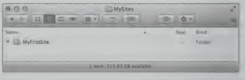

上方：一个网站的所有文件都应该存储在一个外部文件夹中。将你所有的网站都放在一个外部文件夹中也是方便的。

### 创建基础结构

1. 在你选择的编辑器中创建一个新页面，并在页面最顶部添加 `DOCTYPE` 声明。

```html
<!DOCTYPE HTML>

<html>

<head>

</head>

<body>

</body>

</html>
```

2. 添加基础元素 `<html>`、`<head>` 和 `<body>`，并将页面保存为 `index.html` 存放在你的 `First` 文件夹中。。

```html
<!DOCTYPE HTML>

<html>

<head>

<title>My First Web Page</title>

</head>

<body>

</body>

</html>
```

步骤 2：从基本元素开始。

3. 现在作为 `<head>` 元素的子元素（即在 `<head>` 元素内部）添加一个 `<title>` 元素。让标题与内容相关，因为这会出现在搜索引擎的列表中。

步骤 3：明智地为你的页面选择标题；它可能决定页面是否能吸引访客。

4. 现在我们将为页面的可见内容创建基础布局结构。作为 `<body>` 元素的子元素添加 `<header>`、`<section>` 和 `<footer>` 元素。

```html
<!DOCTYPE HTML>

<html>

<head>

<title>My First Web Page</title>

</head>

<header></header>

<section></section>

<footer></footer>

</body>

</html>
```

> **提示**  
> 任何网站的默认页面——在未请求特定页面时加载的页面——通常被称为 `index.html`。还有其他可用名称，但这个最好。

步骤 4：添加组成基本页面结构的元素。

```html
<!DOCTYPE HTML>

<html>

<head>

</head>

<body>

  <header>

    <nav>Home | About | Contact</nav>

  </header>

  <section></section>

  <footer></footer>

</body>
```

5. 我们需要一种导航网站的方法，因此我们作为 `<header>` 的第一个子元素添加一个 `<nav>` 元素，并输入你可能包含在网站中的页面标题。

6. 现在我们要在页面的 `<header>` 元素中添加一些文本标题。这些标题是相关的，因此我们将它们创建在一个 `<group>` 元素内部。

步骤 5：在 `<header>` 内部创建一个 `<nav>` 元素。


```html
<!DOCTYPE HTML>

<html>

<head>

<title>My First Web Page</title>

</head>

<body>

  <header>

    <nav>Home | About | Contact</nav>

    <group>

      <h1>My First Web Page</h1>

      <h2>It may be basic, but it rocks</h2>

    </group>

  </header>

  <section></section>

  <footer></footer>

</body>

</html>
```

7. 页面的主要内容将放置在 `<section>` 元素内部。在下一章中我们将添加一张代表网站内容的图像（见第 95 页），但目前我们只保留文本。

步骤 6：将标题元素放在 `<header>` 内部，然后添加一些适当的文本。

| 创建网站 | |
| :--- | :--- |
| 16 | `</header>` |
| 17 | `</header>` |
| 18 | `<section>` |
| 19 | `<h2>Welcome To My World!</h2>` |
| 20 | `<p>Lorem ipsum dolor sit amet, consectetuer adip` |
| 21 | `velit. Curabitur suscipit.</p>` |
| 22 | `<Suspisse nibh nibh pulvinar sol` |
| 23 | `luctus. Nunc venenatis molestie sapien.</p>` |
| 24 | `<p>Maecenas elementum aliquet velit!</p>` |
| 25 | `</section>` |
| 26 | `<footer>` |
| 27 | `</footer>` |
| 28 | |
| 29 | `</body>` |

8. 我们将添加一些文本来配合稍后添加的图像。为此使用 `<h2>` 标题，因为 `<h1>` 已经在我们的 `<header>` 中用过了。然后在在 `<h2>` 下使用 `<p>` 元素包含一些介绍性文本。

步骤 8：添加多个 `<p>` 元素使文本易于阅读。

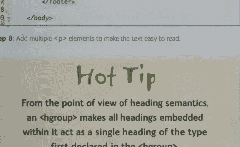

9. `<aside>` 元素通常包含与页面主要内容相关的内容。在 `<section>` 元素之后添加 `<aside>`，并为其添加一些文本。

| | |
| :--- | :--- |
| 16 | `</header>` |
| 17 | `</header>` |
| 18 | `<section>` |
| 19 | `<h2>Welcome To My World!</h2>` |
| 20 | `<p>Lorem ipsum dolor sit amet, consectetuer adip` |
| 21 | `velit. Curabitur suscipit.</p>` |
| 22 | `<Suspisse nibh nibh pulvinar sol` |
| 23 | `luctus. Nunc venenatis molestie sapien.</p>` |
| 24 | `<p>Maecenas elementum aliquet velit!</p>` |
| 25 | `</section>` |
| 26 | `<footer>` |
| 27 | `</footer>` |
| 28 | |
| 29 | `</body>` |

```html
<html>

<head>

  <title>我的第一个网页</title>

  <link rel="stylesheet" type="text/css" href="http://fonts.googleapis.com/css?family=Lato,400,700,400italic"/>

  <style>

    body {

      font-family: 'Lato';

    }

  </style>

</head>

<body>

  <div id="wrapper">

    <header>

      <nav>| 首页 | 关于我们 | 联系我们</nav>

      <hgroup>

        <h1>我的第一个网页</h1>

        <h2>它可能很基础，但它很酷</h2>

      </hgroup>

    </header>

    <section
```

第 4 和第 5 步：使用 `font-family` 样式属性在样式规则中定义字体族，并将页面内容封装在 `<div>` 标签中。

4. 为了设置整个页面的默认字体，我们创建一个 `body` 类型选择器，并在其样式规则中设置 `font-family` 属性。

5. 为了让页面内容区域在浏览器窗口中居中，我们将所有内容封装在一个 `<div>` 元素中。为该 `<div>` 分配 `id` 属性值为 `"wrapper"`。

```css
<style>

  body {

    font-family: 'Lato';

    font-size: 14px;

  }

#wrapper {

    width: 1000px;

    height: auto;

    margin-left: auto;

    margin-right: auto;

  }

</style>
```

6. 我们现在可以使用 CSS ID 选择器 `#wrapper` 对 `wrapper` `<div>` 进行样式设置。添加截图中的代码使网站宽度为 1000 像素并在浏览器窗口中居中。

第 6 步：对 wrapper 进行样式设置允许它在浏览器窗口中居中。

# 84 轻松上手 HTML • CSS • JavaScript

第 7 步：wrapper 内部内部的内容现在相对于 wrapper 而不是浏览器窗口进行定位。

```css
body {

  font-family: Arial;

  font-size: 14px;

}

#wrapper {

  width: 1000px;

  height: auto;

  margin-left: auto;

  margin-right: auto;

}

section {

  width: 700px;

  height: auto;

  float: left;

}
```

7. 我们页面中的 `<section>` 元素包含了页面的主要内容。复制截图中的 CSS 代码使其宽度为 700 像素并定位在 wrapper 的左侧。

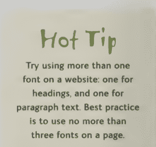

```css
div {

  font-size: 14px;

}

#wrapper {

  width: 1000px;

  margin-left: auto;

  margin-right: auto;

}

section {

  width: 700px;

  height: auto;

  float: left;

}

aside {

  width: 300px;

  float: right;

}

</style>
```


## 第 8 步：设置侧边栏宽度

现在我们将`<aside>`元素的宽度设为 300 像素，并让它浮在`<section>`元素的左侧。`section`和`aside`的宽度现在相加等于 wrapper`<div>`的 1000 像素宽度。

### 第 B 步：使用浮动定位元素

浮动是将元素沿于另一个元素定位的方法。

## 第 9 步：调整页脚宽度

调整`<footer>`的宽度使其上方的内容相同——这确保了它会浮在这些内容下方。

```css
section {
  width:700px;
  height:auto;
  float:left;
}

aside {
  width:300px;
  float:right;
}

footer {
  width:1000px;
  height:auto;
  float:left;
}
```

- `9.` `<footer>`直接位于`<aside>`文本下方。这仍然需要进行样式设置，再次使用`float`并将宽度设置为 1000 像素，与 wrapper`<div>`的宽度相同。
- `10.` 接下来我们将对标题文本应用一些样式设置，让它们具有不同的大小和颜色。不断尝试直到你对结果满意。

## 第 10 步：设置标题元素

设置标题元素，使其具有递减的显著性。

```css
h1 {
  font-weight:bold;
  font-size:26px;
  color:#99000;
}

h2 {
  font-weight:bold;
  font-size:22px;
  color:#CC6600;
}

h3 {
  font-weight:normal;
  font-size:18px;
  font-style:italic;
  color:#FF9933;
}

hgroup > h1 {
  margin-bottom:3px;
}

hgroup > h2 {
  margin-top:0px;
}

</style>
```

- `11.` `<footer>`倾向于与页面的主要内容分离。这可以通过使其不同或在`<footer>`顶部添加边框来实现。

> 提示：将页面宽度限制在 1280 像素以内，以确保它在屏幕上显示良好。

## 上线

网络日志（或通常称为博客）是网站的常见补充，并帮助你建立一个具有相似兴趣的用户社区。

从编程的角度来看，博客是非常复杂的；你已经走了很远了，但你还没有准备好应对那个项目。坦率地说，你可以在你的网站上添加一个博客而无需自己构建，你新学到的 HTML 和 CSS 知识可以用于博客的自定义。

## 域名

域名是与 IP 地址关联的易读名称，例如`google.com`或`1.1`。这是分配给你的唯一名称，因此你使用域名注册商。


## 服务器

FTP（文件传输协议）提供了一种跨网络传输文件的方法，是将网站传输到服务器上的最佳方法。有很多 FTP 应用程序，Filezilla 和 CyberDuck 是 Windows 和 Mac 的流行选择。

| 名称 | 类型 | 日期 |
|---|---|---|
| `index.html` | HTML 文档 | 31 字节 |
| `logo.jpg` | JPEG 图像 | 6.8 KB |
| `sampledata` | 文件夹 | 11月25日 |
| `banners` | 文件夹 | 4月13日 |
| `joomla_black.jpg` | JPEG 图像 | 10月17日 |
| `joomla_green.gif` | GIF 图像 | 3.7 KB |
| `joomla_block.gif` | GIF 图像 | 11月11日 |

## 为你的网站添加博客

网络日志（或通常称为博客）是网站的常见补充，并帮助你建立一个具有相似兴趣的用户社区。

### 两个简单选项

尽管已经变成了一个完整的 CMS（内容管理系统），但 WordPress 核心是一个博客系统，并且仍然可以这样使用……前往`wordpress.com`并使用它们创建一个站点。遵循该网站上的优秀教程让你的博客运行起来，然后从你的常规网站链接到它。

### 传输文件

FTP（文件传输协议）提供了一种跨网络传输文件的方法，是将网站传输到服务器上的最佳方法。有很多 FTP 应用程序，Filezilla 和 CyberDuck 是 Windows 和 Mac 的流行选择。

### WordPress.org

你可以在自己的网站上安装 WordPress。通常你的 Web 服务器主机会提供一个选项，你只需要从你的服务器控制面板中开启它。或者，如果你的主机没有预安装，也可以从`www.wordpress.org`下载软件。然后你可以使用 WordPress 创建博客页面，或者实际上是恢复整个网站。文档可以在`www.wordpress.org`找到。

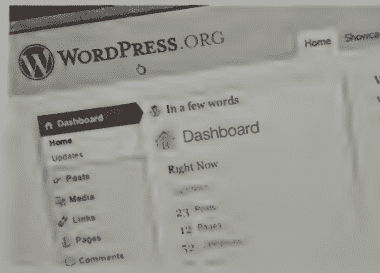

## 待办事项

- 阅读书签网站
- 修改旧的咖啡帖子
- 为 tion 计划（购物..）
- 完成第 10 个平板
- 少担心 j. 的事
- 关注质量！

```js
Cr p'Q 41244 _

<script> _

</div > _

<body>) _op

<!! oprate

ver curren

update

) Tab

{</div

{ ossic d.M.

return->

server : byte (1102

{ tab com

{ LIB FLAN

config = manager

defcon rc 66224<P

oss orsqq local 1_
```

```css
"process" OSSICW (page) width:33120

def= def" so= MM >> cx

09941; document current

s= mute styles backgroud compose aj;

r j=0:{

ass sek n=n parent.ftwar n=0

k= x=mmq

__>>input, string data: TCOP

flame_ware = {

// >OS command

894462113-

2462)

.1=oprate",
```

# 图像、视频及其他增强

## 为你的网站添加媒体

大多数网站的内容不仅仅是文本。图像、视频和音频可以大大增加你的访问人数，并鼓励他们留更久。先进的 HTML5 特性（如地理定位）可以提高网站与访问者的交互，而且，添加一些视觉上的润色总是一个好主意。

### 使用图像

除了文字之外，图像是几乎每个网站都拥有的元素。你很少发现一个完全没有图像的现代网站。图像功能非常强大，具有让网站在视觉上更有吸引力的潜力。


### 图像格式

图像有多种格式，但在网络上实际上只使用了三种格式：GIF、PNG 和 JPG。GIF 格式是网络早期的产物，正变得越来越不常见。相比之下，PNG 和 JPG 被广泛使用。它们都有各自的优缺点，但结合在一起可以满足所有情况。

### PNG 格式

PNG（Portable Network Graphics，读音为 'ping'）是图形（相对于基于照片的图像）的最佳选择，因为它们通常使用无损压缩，因此比 JPG 具有更好的清晰度和准确性。它们的另一个优点是支持透明度。这意味着 PNG 图像不需要实色背景，PNG 后面的任何内容都可以通过 PNG 的透明区域显示。

**下方：** PNG 图像格式通常是像 logo 等小型图形元素的最佳选择。

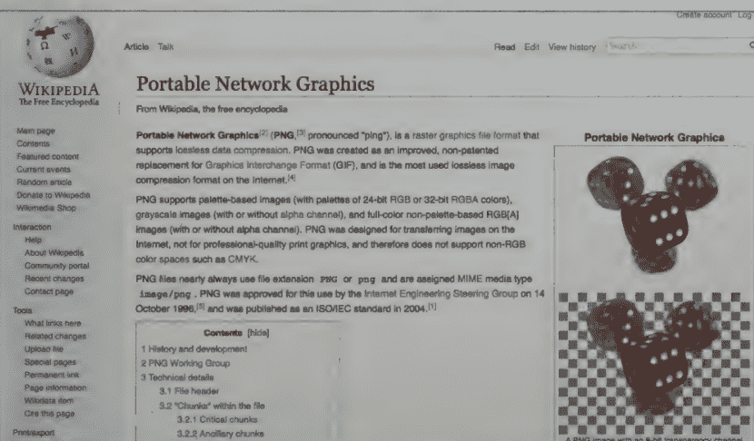

### JPG 格式

JPG 格式（也称为 JPEG，读音为 'jaypeg'）使用复杂的图像压缩技术来减小图像的文件大小，而不会引起肉眼可见的劣化。这意味着可以以不同的质量级别保存图像以减小文件大小。级别越高，质量越好，但文件越大；开发者可以在此取得平衡。JPG 不支持透明度，因此不适用于图形。

> 在创建图像和图形时，请从无损格式（如 PSD，Photoshop 的原生格式）的全质量可编辑版本开始工作，将所需的图形导出为 PNG 或 JPG 文件。


### JPEG

来自维基百科，自由的百科

对于其他用途，JPEG（消义）。在计算中，JPEG（/ˈdʒɛpeg/（通常带有`.jpg`文件扩展出现））是数字图像的一种常用无损压缩方法，特别是对于由数字摄影产生的图像。压缩程度可以调整，具有灵活性。JPEG 通常实现 10:1 的压缩，且图像质量几乎没有察觉的损失。

JPEG 压缩用于多种图像文件。JPEG/EXIF 是数字相机和其他摄影图像采集设备最常用的格式；JPEG/EXIF 是全球网范围内存储和传输摄影图像最常用的格式。这些变体不作区分，统称为 JPEG。

JPEG 是联合摄影专家小组（Joint Photographic Experts Group）的缩写，由该小组创建了标准。JPEG 的 MIME 类型为`image/jpeg`（定义在 RFC 1371 中），但在 Internet Explorer 中，它在上传 JPEG [图像] 时提供的 MIME 类型为`image/png`。

JPEG 支持的最大图像大小为 65535 像素 —— 一到四十亿像素（1 亿像素），取决于比例（从 3:1 到 4）。


上方：照片通常以 JPG 格式保存。

### 添加图像

在网页上添加图像是一个相对简单的过程。

#### `` 元素

在网页上添加图像是一个相对简单的过程。然而，在添加图像之前，我们使用``标签，该标签是自闭合的。

#### 如何添加图像

在网页上添加图像是一个相对简单的过程。

**第一步：** PNG 图像格式通常是 logo 等小型图形元素的最佳选择。

**第二步：** 在 HTML 中定位图像。

**第三步：** 在 HTML 中创建一个空行。

**第四步：** 现在按照插图添加``元素。`name`属性值将在浏览器无法加载图像时显示，`alt`属性值是在用户鼠标指针悬停在图像上时显示的文本。`src`属性值是要使用的图像的 URL（注意我们使用的是相对 URL）。

**第五步：** 在定义多个属性对时，将它们拆分成独立的缩进行并不罕见，这使得它们更容易阅读。

### 添加视频

视频是网页和网站中非常常见的媒介。它们引人注目，并且比静态图像更具吸引力。用户想要看视频，一段十秒钟的视频片段传达的信息比占据相同空间的图像和文本多得多。

### 视频选项

向网页中添加视频有两种主要方法。一种是使用`<video>`元素，另一种（更简单）的方法是将 YouTube（或类似的）视频嵌入页面中。在基础设置中，`<video>`元素要求实际视频文件存储在你的 Web 服务器上。嵌入 YouTube 视频只需复制并粘贴 YouTube 提供的代码即可。

```html
<!DOCTYPE HTML>
<html>
<head>
  <title>My Video Page</title>
</head>
<body>
  <video src="videos/stoneham.mp4"></video>
</body>
</html>
```

**上方所示：** 在网站中添加视频曾是一件困难的事；但有了 HTML5，这变得轻而易举。

### 使用 HTML 添加视频

要将视频嵌入页面，请在其 HTML 中添加`<video>`元素。有两种方法指定要播放的视频文件。最简单的方法是使用`<video>`元素的`src`属性，其中输入视频的 URL。然而，由于不同的浏览器支持不同格式的视频，提供不同文件格式的多个版本视频并不罕见。这样做时，我们必须为你提供的每种文件格式在`<video>`内部嵌入一个`<source>`元素。

> 小贴士  
> 如果托管自己的视频，请优先选择 MP4 文件格式。你还应该考虑包含一个 Ogg-Theora 格式的版本以提高浏览器和操作系统的兼容性（`http://theora.org`）。

```html
<!DOCTYPE HTML>
<html>
  <head>
    <title>My Video Page</title>
  </head>
  <body>
    <video>
      <source src="videos/stoneham.mp4" type="video/mp4">
      <source src="videos/stoneham.ogv" type="video/ogg">
    </video>
  </body>
</html>
```

上方所示：`<source>`元素允许你包含多个版本的视频。

### 添加 YouTube 视频

添加 YouTube 视频比自己托管要简单得多。如果这是你自己制作的视频，那么你需要一个 Google 账户才能将素材上传到 YouTube。一旦上传完成，将你的视频连接到页面上就再不过简单了。

**上方所示：** 嵌入 YouTube 视频仅仅是复制和粘贴的工作。

#### 元素

YouTube 上的所有视频下方都有标记为“分享”（Share）的按钮。点击此按钮会显示一个面板，顶部有三个标签和一个包含某些代码的字段。点击“嵌入”（Embed）标签代码将生成用于`<iframe>`的 HTML 代码，该元素在你的网站和另一个站点之间创建一个门户。复制`<iframe>`代码并将其粘贴到页面的 HTML 中：简单！

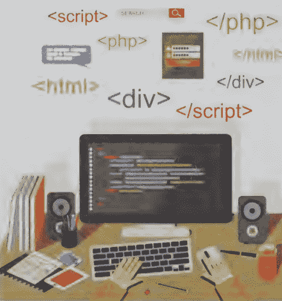

### 添加音频

HTML5 新的`<audio>`元素原理与`<video>`非常相似。与`<video>`一样，`<audio>`元素支持多个源文件以提高浏览器和操作系统的兼容性。

### 音格式

尽管你认为 MP3 音频文件无处不在，但由于许可考虑，并不是所有操作系统的浏览器都支持它（视频的情况也是如此）。将你的音频内容同时包含 MP3 和 Ogg-Vorbis 格式应该可以涵盖所有情况。

> 小贴士  
> Ogg-Vorbis 音频格式与 Ogg-Theora 视频格式是一对。两者都是开源软件，因此免费使用。访问`http://vorbis.com`获取信息和编码工具。

```html
<head>
  <title>My Video Page</title>
</head>
<body>
  <audio src="music/TheSentinel.mp3"></audio>
  <audio>
    <source src="music/TheSentinel.mp3" type="audio/mp3">
    <source src="music/TheSentinel.oga" type="audio/ogg">
  </audio>
</body>
```

上方所示：使用`<audio>`元素在页面中包含音频内容轻而易举。

## 超出基础

HTML5 和 CSS3 代表了它们各自语言的重大进展。在这里我们将介绍这两种语言的一些更高级的特性。充分讨论将出了本书的范围，但你应该了解这些特性。

### HTML5 表单

HTML5 力量的一个简单例子在于 HTML 表单。在 HTML5 之前，为 Web 创建表单通常涉及使用 JavaScript 进行编码。例如，如果你想验证用户是否在表单中输入了适当的数据，唯一的方法是通过脚本。然而，HTML5 表单具有内置的验证功能，为开发者节省了大量的时间和复杂性。

下方：HTML5 表单极大地简化了用户输入内容的验证。

### 邮件注册表单演示

我们创建了一个邮件注册表单的演示，你可以在`http://richardshepherd.com/forms`查看。


### 拖放

拖放是用户交互的基础。在 HTML5 中，为任何元素添加该属性即可使其变为可拖拽的。


上方所示：`<source>`元素允许你包含多个版本的视频。

### 地理定位

HTML5 地理定位用于确定用户的位置。它是地图和服务的强大工具。

### 变换（Transforms）

变换操纵元素的视觉外观。例如，旋转一个正方形。

### 过渡（Transitions）

过渡允许元素在指定的时间内发生视觉变化。

```css
<style>
  div {
    position:absolute;
    width:100px;
    height:100px;
    background-color:red;
  }

  #box {
    left:200px;
    top:200px;
  }

  #rotatedBox {
    left:400px;
```


```css
top:200px;

transform:rotate(45deg);

}
```

</style>


**上方所示：**允许调整元素的位置和方向。

### 过渡是如何工作的

我们已经知道如何使用伪类选择器（Pseudo-Class selectors）让元素对不同状态做出响应，例如鼠标指针悬停在元素上时的`:hover`。

```css
#homeButton:hover {
  transition-property:background-color;
  transition-duration:0.6s;
  transition-timing-function:ease;
  background-color:blue;
}
```

### CSS 关键帧

#### 小贴士

相关的 CSS 属性组通常有一个简写形式，可以在一行代码中设置所有此类属性。例如，各种动画样式属性可以通过`animation`属性同时声明。

关键帧（Keyframes）是动画领域的一个概念。它们指定了某个时间点以及对象在该点的状态——关键帧之间的中间步骤可以由计算机计算。在 HTML5 和 CSS3 出现之前，Adobe Flash 是在网页上创建关键帧动画的标准，但现在不再是！

### 应用动画

动画可以应用于网页中的几乎每一个元素。在这里我们将演示如何让一个`<div>`元素跨屏幕移动。

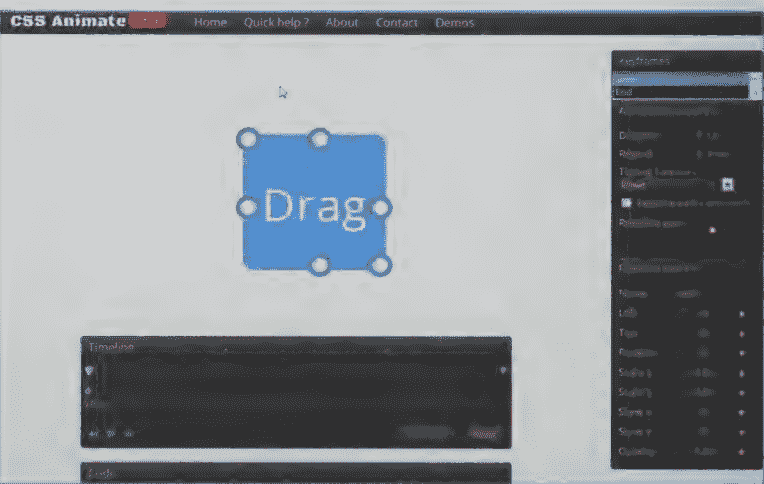

**上方所示：** CSS 动画随时间改变样式属性的值。

## 创建简单动画

1. 创建一个新的 HTML 文档，添加基础结构元素（`<html>`、`<head>`和`<body>`），并在`<head>`中创建一个`<style>`元素。将文件保存为`movingbox.html`。
2. 在`<body>`中添加一个`<div>`并赋予其 id 为`'boxToMove'`。在`<style>`元素中创建一个 ID 选择器，并定义一个样式规则，将`<div>`的大小设置为 100 x 100 像素，并赋予它背景颜色，以便我们在屏幕上看到它。
3. 我们现在向样式规则中添加动画代码。从插图中复制样式属性并定义值；样式属性名是自言自明的。

```html
<!DOCTYPE HTML>
<html>
<head>
<title>CSS Animation</title>
<style>
</style>
</head>
<body>
</body>
</html>
```

第 1 步：创建一个名为`movingbox.html`的基础文档文件。

```css
<style>
#boxToMove {
position:relative;
width:100px;
height:100px;
background-color:red;
animation-name:boxMover;
animation-duration:3s;
animation-iteration-count:infinite;
}
</style>
```

> 提示：并不是所有浏览器都支持关键帧动画——如果在你的地方不起作用，请尝试在 Firefox 中打开页面。

第 2 和第 3 步：样式规则定义了移动框`<div>`的外观及其动画属性。

4. 拼图的最后一部分是关键帧代码。它是以我们尚未研究过的方式声明的，使用了 CSS `'@'`声明，在此情况下为`@keyframes`。之后是动画的名称，与`animation-name`样式属性中声明的相同。

```css
<style>
#boxToMove {
  position:relative;
  width:100px;
  height:100px;
  background-color:red;
  animation-name:boxMover;
  animation-duration:3s;
  animation-iteration-count:infinite;
}

@keyframes boxMover {
  0% {top:0px};
  25% {top:100px};
  75% {top:50px};
  100% {top:150px};
}
```

第 4 和第 5 步：`@keyframes`声明后的代码定义了哪些样式属性将被动画化以及它们在不同时间点取什么值。

5. 跟在`@keyframes`声明之后的代码定义了相对于不同时间点（以百分比表示）的样式属性和值。我们使用的顶部样式属性决定了动画元素顶部与其容器块（在本例中为`<body>`元素）之间的距离。
6. 保存你的工作并在浏览器中打开文件以查看结果。

## HTML 和 JAVASCRIPT

我们已经知道 HTML 创建了页面的结构并定义了其内容，CSS 控制这些内容的视觉外观。脚本通过提供控制页面行为以及页面如何响应用户交互的方法来完善这幅图景。Web 上有多种脚本语言——内置在主要网络浏览器中 JavaScript JavaScript。

## JAVASCRIPT 位于什么位置？

早些我们把 HTML 和 CSS 比作房子，前者是砖块和水泥，后者是装饰和精装修。如果我们坚持这个比喻，JavaScript（或简称为 JS）应该是一个主主家居控制系统，可以精细地控制房子的每一个方面。

正确：JavaScript 是网页中最常用的脚本语言。

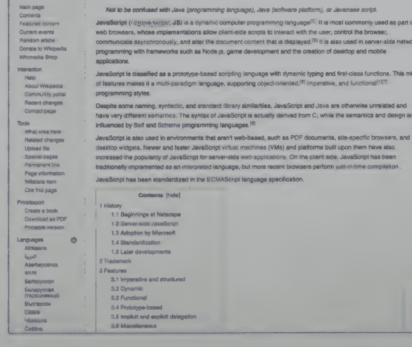

## 添加脚本

JavaScript 的复杂性将在本书的后续章节中进行探讨，但让我们快速看看如何向页面添加脚本以开始。如需更详细的查看，请参阅第 142 页。

## `<script>` 元素

像 CSS 一样，脚本可以嵌入你的页面中，也可以位于页面外部。后者是更常见的方法，但都通过`<script>`元素实现：嵌入脚本写在起始`<script>`和结束`</script>`标签之间；外部脚本位于单独的文本文件中并通过`<script>`元素的`src`属性链接到页面。

如下：像 CSS 一样，脚本可以是嵌入或外部的。

```html
<head>
<title>Script Elements</title>

<!-- 这是一个外部脚本... -->
<script type="javascript" src="js/siteCore.js"></script>

<!-- 这是一个嵌入脚本... -->
<script type="text/javascript">
  var com;

  if(!com) {
    com = {};
  }

  if(com.umasdvd) {
    com.umasdvd.resetContactForm = function() {
      document.getElementById("messageTitle").setAttribute("value", "");
      document.getElementById("messageTitleMessage").textContent = "";
      document.getElementById("senderAddress").setAttribute("value", "");
      document.getElementById("senderMessage").textContent = "";
      document.getElementById("messageBody").textContent = "";
      document.getElementById("messageBodyMessage").textContent = "";
    }
  }
</script>
</head>
```

## 图像、视频与增强

执行在：`<script>`元素可以出现在 Web 页面的任何位置，并执行——也就是说，当浏览器遇到它时运行（见第 143 页）。通常，需要输出的脚本定义在`<head>`中。


## 良好的理解

深入理解 JavaScript 让你能够超越 HTML 和 CSS 的局限。在本书的后续章节中探索 JavaScript，为你学习这门迷人的语言提供一个极佳的起点。


正如我们所学的，HTML 不仅仅是纯文本；如果我们想在像`<p>`这样的文本元素中使用其中某些特殊字符，将会导致错误。例如，某些字符在 HTML 中具有预定义的含义（如所有的）。

## ASCII 和扩展字符

计算中使用的核心字符集被称为 ASCII（美国标准信息交换）。该标准定义了 128 个字符代码。落在 ASCII 标准之外的字符（如带重音的字母）被称为扩展字符。在内部，计算机用给定的字母、数字、标点符号或符号来表示一切。

| ASCII 控制字符 | ASCII 可打印字符 |
|---|---|
| 00 NULL (空字符) | 32 space |
| 01 SOH (起始头) | 33 I 65 A |
| 02 STX (起始文本) | 34 " 66 B |
| 03 ET (结束文本) | 35 # 67 C |
| 04 EOF (传输结束) | 36 $ 68 D |
| 05 ENQ (查询) | 37 % 69 E |
| 06 ACK (确认) | 38 & 70 F |
| 07 BEL (铃声) | 39 ) 71 G |
| 08 BS (退格) | 40 ( 72 H |
| 09 HT (水平制表) | 41 ) 73 I |
| 10 LF (换行) | 42 * 74 J |
| 11 VT (垂直制表) | 43 + 75 K |
| 12 FF (换页) | 44 , 76 L |
| 13 CR (回车) | 45 . 77 M |
| 14 SO (移出) | 46 / 78 N |
| 15 SI (移入) | 47 ; 79 O |
| 16 DLE (数据链路转义) | 48 0 80 P |
| 17 DC1 (设备控制 1) | 49 1 81 Q |
| 18 DC2 (设备控制 2) | 50 2 82 R |
| 19 DC3 (设备控制 3) | 51 3 83 S |
| 20 DC4 (设备控制 4) | 52 4 84 T |
| 21 NAK (否定确认) | 53 5 85 U |
| 22 ETB (传输块结束) | 54 6 86 V |
| 23 CAN (取消) | 55 7 87 W |
| 24 EM (结束) | 56 8 88 X |
| 25 SUB (替换) | 57 9 89 Y |
| 26 ESC (转义) | 58 : 90 Z |
| 27 GS (分组分隔符) | 59 ; 91 [ |
| 28 FS (文件分隔符) | 60 < 92 ] |
| 29 RS (记录分隔符) | 61 > 93 } |
| 30 US (单元分隔符) | 62 = 94 ^ |
| 31 DEL (删除) | 63 ? 95 - |

# 轻松上手 HTML • CSS • JAVASCRIPT


## 字符实体

这两种场景的解决方案被称为“字符实体”（character entities）。要使用它们，你需要在 HTML 文本中输入一段特殊的短代码，这段代码在渲染时将显示为所需的字符。所有的特殊字符和许多扩展字符都有专属的字符实体。

### 如何编写字符实体

字符实体由一个和符号`&`后面跟着一个实体名称（例如`quot`），并以分号`;`结尾。为了创建一个引号字符，我们输入`&quot;`而不是输入实际引号。有趣的是，因为`&`本身也是一个字符，所以你必须在页面的渲染文本中编写`&amp;`才能显示出一个`&`。

```html
<<body><header><h1>Special Characters</h1></header><section><p>&quot;There are many special characters in HTML&quot; said the man. &quot;Characters such as &lt;&amp; &gt; can not be typed directly into the text of an HTML document&quot; he said.</p><p>He went to explain that the same was true of &quot;extended&quot; characters such as &copy;, &micro; and many more. Accented latin characters, such as &Acute; &Egrave; are also classed as extended characters, he explained.</p></section></body>
```

**上方：** 所有特殊字符和许多扩展字符都通过字符实体表示。

## 高级 HTML & CSS 编码

### 未命名实体

并不是所有的扩展字符都有预定义的实体，那么我们如何在页面中包含此类字符呢？这次我们必须使用字符代码引用而不是实体名称——它看起来像这样：`&#x00A9;`（这将代表一个 © 字符）。`#`表示后面的是字符代码，而`X`表示该代码是以 Unicode 格式提供的。关于 Unicode 的讨论超出了本书的范范围，但你可以在`http://unicode-table.com/`查找任何字符的代码。

> **小贴士**
>
> 有许多不同的字符实体名称。如果你的 HTML 编辑器支持代码提示（code hinting），这将帮助你找到所需的那个。否则，请在某处保留指向`http://dev.w3.org/html5/html-author/charref`的书签。


```html
<body>
<header>
<h1>Special Characters</h1>
</header>

<section>
<p>&quot;There are many special characters in HTML&quot; said the man.&quot; Characters such as &lt; &amp; &apos; can't be typed directly into the text of an HTML document&quot; he said.</p>

<p>He went on to explain what was true of &quot;extended&quot; Accented latin characters, such as &Aacute;&acute; and &Erave; are also accented characters, he explained.</p>
</section>
</body>
```

**上方：** 代码提示对于寻找所需的字符实体有巨大的帮助。

## 自适应布局

构建网站已不再仅仅是创建一个在桌面电脑上看起来良好的网站。移动设备——智能手机和平板电脑——现在被广泛用于网页浏览，这影响了我们布局和样式化网页的方式。

```css
body {
  font-family:"Lato";
  font-size:14px;
}

#wrapper {
  width:80%;
  height:auto;
  margin-left:auto;
  margin-right:auto;
}

section {
  width:70%;
  height:auto;
  float:left;
}

aside {
  width:30%;
  float:left;
}

footer {
  width:100%;
  height:auto;
  float:left;
  background-color:lightgray;
  border-top:1px solid gray;
  padding-left:1%;
  padding-bottom:1%;
}
```

### 适应所有屏幕

在为所有大小的屏幕制作网站时，有几种选择。一种自互联网早期以来一直存在的方法是比例——也称为“流式”（liquid）布局。使用这种技术时，我们用百分比来表示位置和尺寸。这导致布局随浏览器窗口的大小进行缩放。

- 左：将维度表示为百分比是使页面适应浏览器窗口尺寸的方法之一。

### 创建流式布局

在创建`<div>`或其他结构元素时，通常会为其指定一个绝对的宽度，例如，`1000px`（`px`）是你在 CSS 中用于表示像素的代码。如果浏览器窗口的宽度小于此值，那么页面的某些部分将溢出边缘，且在不滚动的情况下将不可见。

用百分比表示尺寸在某种程度上解决了这个问题，因为它保持了比例：如果一个`<div>`元素的宽度设置为`80%`，那么它将始终是其容器块宽度的 80%。在页面中随机组合几个彩色的`<div>`元素来查看它是如何工作的。


**上方：** 这展示了流式布局是如何工作的。

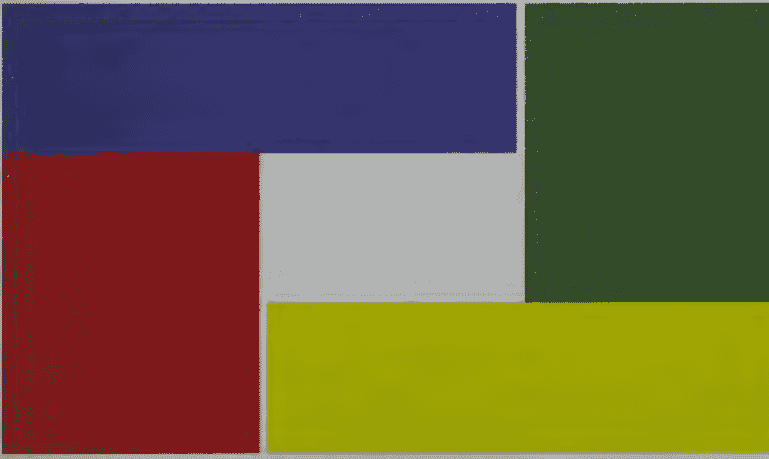

# 轻松上手 HTML • CSS • JAVASCRIPT

```html
<html>

<head>
```


# Special Characters

There are many special characters in HTML.

```html
<title>Untitled Document</title>
</head>

<body>

  <header>

    <h1>Special Characters</h1>

  </header>

  <section>

    <p>There are many special characters in HTML.</p>

  </section>

</body>

</html>
```

**上方：** 这是一个 HTML 示例。

## 响应式网页设计

响应式网页设计（也称为 RWD）是一种让页面或网站自动适应查看它的设备类型和大小的技术。

### 媒体查询

响应式网页设计由“媒体查询”（media queries）驱动。这些是 CSS 的组件，允许你使用在页面加载时才能确定的值。因此与其将 `<header>` 元素设置为 100 像素宽，你可以将其设置为匹配浏览器窗口的宽度，无论窗口有多宽，如下：

```css
header {width:device-width};
```

**上方：** 波士顿环报网站是响应式网页设计的早期示例之一。

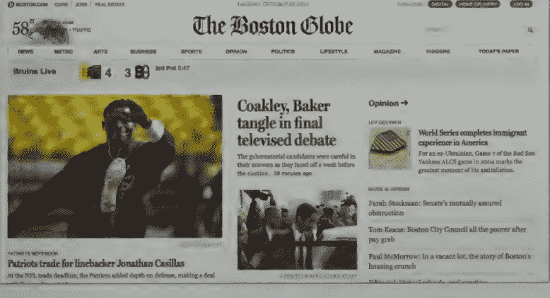

### 不同设备，不同样式表

桌面、平板和平手机屏幕的宽度和分辨率都不同。处理这个问题的方法是创建多个版本的样式表，每个版本都为支持特定类的设备而定制。浏览器将根据 `<style>`/`<link>` 元素的 `media` 属性值选择样式表。

```html
<link rel="stylesheet" type="text/css" href="handheldSmall.css" media="handheld and max-device-width:480px"/>

<link rel="stylesheet" type="text/css" href="handheldLarge.css" media="handheld and min-device-width:481px"/>

<style media="all and not handheld">

  body {

    Font-family:Lux;

  }

  #wrapper {

    width:1000px;

    height:auto;

  }

</style>
```

### 内容相同，属性不同

不同的样式表包含相同的选择器，并且每个选择器规则中使用的相同的样式属性。不同的是分配给样式属性的值。这意味着整个页面的布局将自动适应用户的设备。

### 获取响应式布局的帮助

目前有很多可用的框架可以分担构建自响应式设计（RWD）网站过程中的大部分繁琐工作，因此如果你想尝试一下，可以查看以下工具。

## 框架

两个最流行且功能最强大的 RWD 框架是 Foundation 和 Bootstrap。它们提供了构建 RWD 网站所需的所有资源：菜单、图片轮播器、按钮等。请查看这两个框架，看看你更喜欢哪一个。

| Bootstrap | 快速上手 | CSS 组件 | JavaScript | 自定义 | Expo 博客 |
|---|---|---|---|---|---|
| Bootstrap 是用于 Web 端响应式、移动优先项目最流行的 HTML、CSS 和 JS 框架。 | | | | | |
| **上方：** 下载 Bootstrap | 通过下载并尝试 Bootstrap (`http://getbootstrap.com`) 来开始使用它 | | |

### 响应式模板

对于想要创建响应式网站的人来说，框架是完美的解决方案，但你仍然需要学习如何使用它们。一个更简单快速的解决方案是使用现成的模板，这让你只需要做少量的工作：添加文本和图像来创建一个完整的网站。可以尝试 [HTML5 UP](http://html5up.net) 获取一些现代模板。

### 值得尝试的 RWD 工具

在创建网站时，尽可能在尽可能屏幕上进行测试至关重要，但由于市上有各种屏幕尺寸，这并不总是可行的。有很多工具可以通过在桌面电脑上模拟不同设备来提供帮助。Screenly 是此类工具的一个很好的例子；你可以在 `http://quirktools.com/screenly` 查看它。

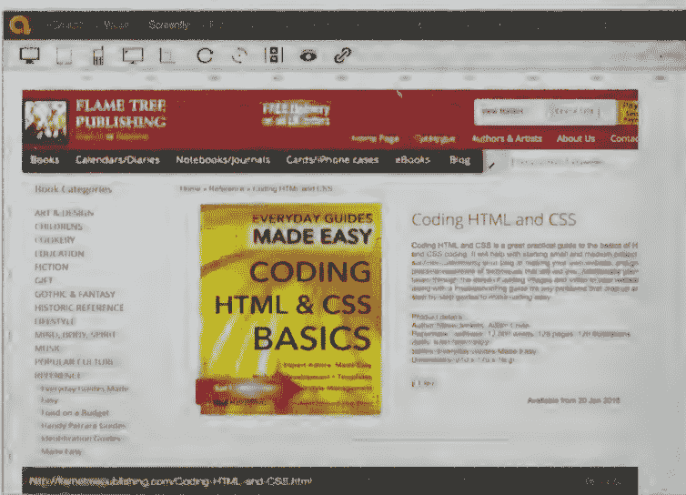

**上方：** 在无数设备和屏幕上测试实时网站。

## 移动浏览器缩放控制

移动设备上运行的 Web 浏览器在处理页面尺寸时的行为与桌面浏览器完全不同。这是由于移动设备在物理分辨率和内部视口（viewport）尺寸之间进行缩放的方式导致的。

## 视口 (Viewport)

移动浏览器的视口是渲染页面视觉内容的区域。当页面加载时，视口会进行缩放，其目的是使其适应设备屏幕的物理尺寸。当你用手指捏合放大或缩小时，你实际上是在调整视口缩放；当你绕页面上滚动时，你实际上是在移动视口。

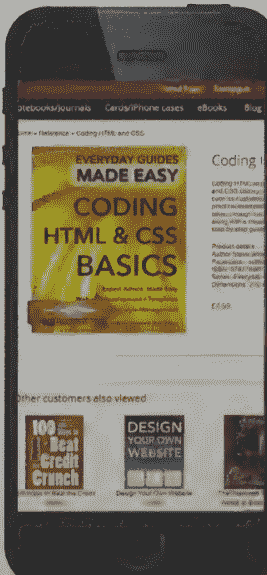

**右侧：** 视口可以（通常也会）超出屏幕的可见区域。


### 视口元标签 (Viewport Meta Tag)

为了让浏览器采用合适的视口缩放，我们必须告诉它我们希望它假设的尺寸；如果不这样做，将使用默认值，而该值可能可能不适用。我们通过放置在页面 `<head>` 中的 `<meta>` 标签来设置缩放。

```html
<head>

  <meta name="viewport" content="width=device-width">

  <title>My First Web Page</title>

</head>
```

上方：视口元标签定义了移动浏览器采用的初始缩放。

## 浏览器支持

有许多桌面和移动浏览器，它们对 HTML5 和 CSS3 提供了不同程度的支持。在桌面端，主要的浏览器是 Chrome、Firefox、Internet Explorer 和 Safari，因此你应该目标在至少这四个浏览器中测试你的所有网站。

### 我应该支持哪些浏览器？

毫无疑问，桌面端的 Chrome、Firefox、Internet Explorer、Safari 甚至 Opera 都应该被支持。问题是你应该支持哪个版本？作为一个通原则，鼓励访问你网站的用户安装并使用他们偏好浏览器的最新版本。

> **热提示：** 下载并安装主流浏览器，以便你可以在每个浏览器中测试你的页面。

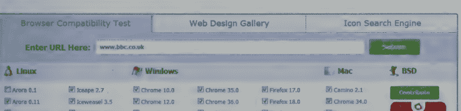

**上方：** 像 Browsers 这样的浏览器兼容工具可以帮助你测试网站。

### 故障排除：常见的 HTML/CSS 问题

在处理基于 Web 技术时，总会有兼容性问题。在这里，我们介绍一下构建网站时可能会遇到的一些常见问题。

### 网页在 Internet Explorer 中显示不正常

旧版本的 Internet Explorer 使用了与其他浏览器不同的方法来显示 HTML 和 CSS 元素。然而，最新版本的 Internet Explorer 比之前的版本更符合标准。最好的变通方法是保持...

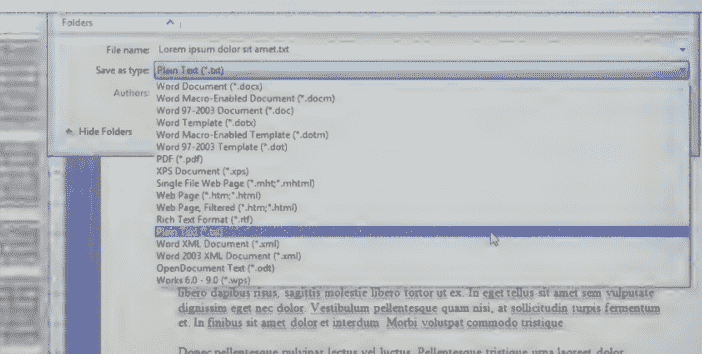

### 从 Word 复制文本

直接从 Word 复制文本到网页会带来问题。

### 为什么我的图片没有显示？

可能有许多原因，首先要确保图片使用了正确的路径。

### 我如何检查我的 HTML 是否正确？

检查 HTML 错误的最佳方法是使用如 W3C 所示的在线验证器。

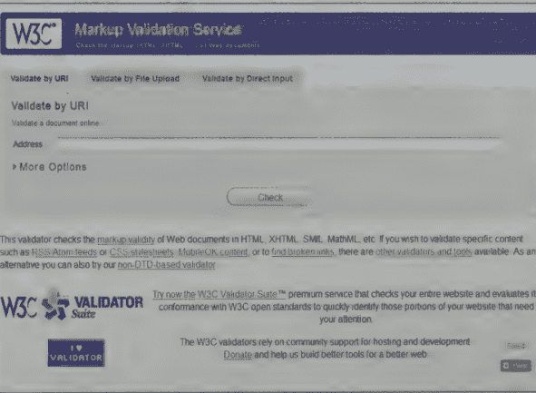

**上方：** 使用验证工具。

### 为什么我的代码在桌面端不起作用？

你可能所有的 HTML 和 CSS 都已到位并运行，但当你添加一些新代码并在桌面端测试时，发现什么都没有发生。第一步是检查任何代码或脚本是否指向正确的位置。

### 图片加载非常缓慢

用户将文件较大的图像放在网页上，然后用 CSS 调整它们的大小，这种情况并不罕见。


**上方：** 使用在线图片优化器。

### 我的一些链接无法使用

链接对网站导航至关重要，因此失效链接是一个大问题。首先要检查的是 `<a>` 元素及其 `href` 属性的 URL 是否都编写正确。

### 字体问题

计算机预装了如 Arial、Helvetica 和 Georgia 等字体。然而，如果你使用了不同的字体，该字体在用户的计算机上可能不可用，因此将使用替代字体。网络字体可以解决这个问题，但必须在正确的位置添加正确的代码。

## JAVASCRIPT、HTML 和 CSS

用于开发网页有三种核心语言：HTML 提供了底层结构和内容；CSS 提供了视觉效果；而 JavaScript 呢？这个吧，JavaScript 提供了让这一切活跃起来的魔法。

### 在开始之前

本章及后续章节专门关注 JavaScript，然而，这种语言与网络浏览器和网页紧密相关，如果不大量依赖对 HTML 和 CSS 的先验知识，就无法讨论它。如果你已经具备这些知识，或者你对这些主题有些生疏，那么阅读本书书中关于 HTML 和 CSS 的章节将对你大有利。

> 小贴士：如果在 HTML 和 CSS 的语境下，你理解元素（element）、属性（attribute）、起始标签和结束标签、选择器和样式规则等术语的含义，那么就可以开始学习 JavaScript 了。

右：如果你不是从头开始的，本书之前的章节将帮助你理解 JavaScript。

### 浏览器兼容性

虽然 JavaScript 语言在所有主流浏览器中都完全支持，但在使用高级或冷门函数可能会出现问题，因为并不是所有浏览器都支持 JavaScript 的所有扩展功能。虽然有办法解决此类问题，但遗憾的是，这里没有空间进行介绍。

> ### 请查看第 13 页，了解如何下载书中所有代码示例的完整版本。它们包含了额外的注释，有助于进一步解释这些示例。

### Firefox

本书中的所有示例都使用标准的 JavaScript 编程技术和结构。然而，为了避免任何烦人的浏览器兼容性问题，我们将使用 Firefox 浏览器运行所有示例，并鼓励你也这样做。

上：Mozilla Firefox 是目前可用的最符合标准的网页浏览器之一，且免费安装和使用。你可以从 `mozilla.org` 下载它。

### 什么是 JavaScript？

JavaScript 是一种脚本语言，用于交互和控制加载到网络浏览器中的页面。它为与用户、页面以及互联网交互提供了丰富的函数库。

### 什么是脚本？

在剧院世界，脚本（script）可以被看作一系列指令，告诉演员应该在哪里、做什么、以及什么时候做和说什么。在计算中，其含义非常相似：脚本是让计算机执行的一系列指令。是的，演员是屏幕上的图形和数据块，而不是一群演员，但原理是相同的。

脚本告诉演员应该在哪里、做什么以及什么时候做——当然，这些演员是指计算机数据和图形。

### JavaScript 运行在客户端

从一开始就必须理解的是，当在网页中使用 JavaScript 时，它运行在用户的（或客户端的）计算机上，并与加载到该计算机网络浏览器中的网页副本进行交互。这通常被称为“客户端侧”脚本。

### Java 和 JavaScript

你可能听过一种叫做 Java 的语言，并认为它与 JavaScript 有某种关系——其实并没有。Java 在 JavaScript 开发期间是一个热门话题，通过将该语言命名为 JavaScript，它的开发者确保了它获得了关注。尽管在语法上有偶然的相似之处，这两种语言在本质上是不同且无关的。

上：JavaScript 直接与加载到用户浏览器中的页面映像进行交互。

### 为什么在页面中包含脚本？

页面中使用脚本的理由几乎与使用脚本的页面一样多。总的来说，使用脚本有两个关键原因：修改页面外观；以及/或允许页面与 Web 服务器之间的通信。

## 视觉变化

一些最常见的——无疑是最明显的——脚本根据编写页面时未知的条件来修改页面外观。条件可能简单如一天中的时间或用户鼠标指针的位置，也可以非常复杂。关键点在于，使用 JavaScript，我们可以判断是否满足了某个条件，然后根据该条件采取行动。

右：搜索引擎使用脚本在你输入时显示可能的搜索结果。

## 认识 JavaScript

上：JavaScript 直接与加载到用户浏览器中的页面映像进行交互。

### 通信

脚本可以在许多场景下与服务器进行通信。例如，脚本可以从服务器获取数据或向服务器发送数据。这允许动态内容在不需要重新加载整个页面的情况下发生变化。

上：JavaScript 为开发者提供了许多功能。

### 编写 JavaScript

将脚本链接到页面是常见做法。要做到这一点，脚本被写在一个独立的文本文件中，并以 `.js` 后名保存。

### IDEs

- 字体、行号：帮助我们在大型脚本中导航
- 代码折叠：避免被你正在处理的代码块分心
- 代码提示：在你输入时显示一个与上下文敏感的函数、方法和属性列表
- 内置参考信息：某些 IDE 包含参考信息
- 文件管理：对于较大的项目来说，内置的文件管理功能是无价的

### 当浏览器遇到脚本时会发生什么？

每当网页浏览器加载页面时，它都会在处理页的过程中顺序处理每个 HTML 元素。

### 解释器

当浏览器遇到 `<script type="text/javascript">` 元素时，脚本的内容会被立即传递给浏览器的 JavaScript **解释器**（称为执行脚本）。解释器的任务是理解脚本并据此指示浏览器操作。

```html
<!DOCTYPE HTML>

<html>

<head>

  <title>A Simple Quiz</title>

  <script type="text/javascript" src="js/QuizQuestion.js"></script>

  <script type="text/javascript" src="js/SimpleQuiz.js"></script>

  <script type="text/javascript" src="js/quizStartup.js"></script>

</head>

<body>

</body>

</html>
```

当解释器完成对脚本的执行后，控制权将返回给浏览器，浏览器随后继续处理页面。

**正确：** JavaScript 是在页面加载时就地进行处理的。

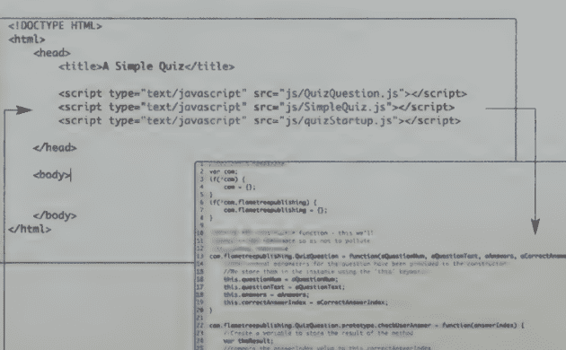

### 你的第一个脚本

1. 创建一个新的 HTML 文件并添加基础结构元素 `<html>`、`<head>` 和 `<body>`。将文件保存在方便的位置，并命名为 `MyFirstScript.html`。
2. 在 `<body>` 元素中添加一个 `<script>` 元素。对于此示例，我们希望将起始和结束标签放在不同的行，之间留一个空行。
3. 在脚本元素中输入以下命令：`document.write("<p>Hello World!</p>");`。此命令向页面输出文本，就像你直接输入页面中一样（这就是为什么我们也包含了 `<p>` 元素标签）。
4. 保存页面，然后在 Firefox 中打开它，可以通过双击文件，或者右键点击文件并选择“打开方式”，然后选择 Firefox。

```html
<!DOCTYPE HTML>

<html>

<head>

  <title>My First Script</title>

</head>

<body>

  <script type="text/javascript">

    document.write("<p>Hello World!</p>");

  </script>

</body>

</html>
```

> **热提示**
>
> 我们经常使用“代码”（code）和“编码”（coding）这两个词——前者指的是你输入脚本的文本，后者指的是编写脚本的过程。

### 工作原理

恭喜——你刚刚编写并执行了你的第一个脚本。当浏览器遇到 `<script>` 元素时，脚本被传递给了解释器。解释器识别了 `document.write` 命令，并将括号内的内容（在编程术语中称为**圆括号**）文本写入页面。

文本必须包含在引号中，解释器才能将其识别为文本——如果你只看到一个空白页面，很可能是你漏掉了引号。

> ### 热提示
>
> **关于编程语言的书籍，传统上会将“Hello World!”作为书中第一个练习的输出内容——你现在正式加入了开发者的行列！**


**正确：** 你通过了入职测试——欢迎加入！

## JAVASCRIPT 中的数据

### 什么是数据？

所有编程语言中的一个核心概念都是数据。数据可以被视为程序内部使用的任何信息。

### 所有数据都有一个值

任何数据都可以说它拥有一个值。这个值可以是简单的——例如，一个数字或一段文本——也可以是复杂的，例如数字列表或多个段落。然而，无论数据类型如何，由该数据表示的信息被称为该数据的值。

### 字面量 (Literals)

字面量是直接输入脚本的具有特定值的数据。以下都是是字面量的例子：`"Hello World"`、`true`、`42` 和 `null`。

### 标识符 (Identifiers)

标识符是一个区分大小写的名称，被赋值给某个数据（或函数——参见第 205 页的“命名函数”）。一旦赋值，标识符就可以在脚本中用于引用该数据（或函数）。JavaScript 允许你自由选择想要使用的名称作为标识符，只要你遵循少数几条基本规则即可。

```javascript
3 myNumberLiteral = 42;

4 myStringLiteral = "Hello World";
```


`5 myBooleanLiteral = true;`

`6 myNullLiteral = null;`

## 标识符命名规则

- **保留字**：JavaScript 定义了一些对语言具有特殊含义的特殊单词（见第 174 页）。这些单词不能用作自定义标识符名称。
- **第一个字符**：标识符的第一个字符必须是字母、下划线（`_`）或美元符号（`$`）。
- **后续字符**：标识符中的剩余字符只能是字母、数字、下划线或美元符号。


```javascript
// 合法标识符示例
myValue
_myValue
MYVALUE
$value

// 非法标识符
2myValue
my-value
my value
$5value
```

**正确：** 第一组标识符都是合法的，而第二组是非合法的。

## 变量

本质上，变量是用于存储数据的内存区域，通过标识符进行引用。

### 声明变量

在 JavaScript 中声明一个新变量非常简单——我们只需要编写关键字 `var` 后面跟标识符即可。

```javascript
// 声明变量（不赋值）
var answer;

// 在赋值时赋值
var answer = 42;
```

一旦声明了变量，我们就可以像这样更改赋值给它的值：

```javascript
var answer = 42;

answer = 43;
```

### 获取变量的值

要使用存储在变量中的值，我们在需要使用的地方编写该变量的标识符。

1. 创建一个新的 HTML 文档并添加常用元素（`<html>`、`<head>` 和 `<body>`）。将文档保存为 `gettingVariables.html`。
2. 在 `<body>` 元素中添加一个 `<script type="text/javascript">` 元素（即作为 `<body>` 的子元素），如下所示。
3. 添加所示的 JavaScript 代码。
4. 保存并在 Firefox 中打开该文件。

```html
<!DOCTYPE HTML>
<html>
<head>
  <title>Getting Variables</title>
</head>
<body>
  <script type="text/javascript">
  </script>
</body>
</html>
```

上方：步骤 2：添加 `<script type="text/javascript">` 元素。

```javascript
<script type="text/javascript">
var message = "The alert function displays a message in a dialog box.";
alert(message);

message = "We're just changing a variable's value...";
alert(message);

message = "and passing that variable's identifier to the alert function.";
alert(message);

message = "The interpreter looks up the variable's value...";
message = "and that's what we see in the dialog box. Simple, eh?";
alert(message);
</script>
```

上方：步骤 3：添加 JavaScript 代码。


**上方：** 计算机数据就是数字。

## 数据机制

与 C 等低级编程语言不同，JavaScript 不需要程序员参与数据如何在计算机上存储的细节——解释器已经为我们管理了这些复杂性。

然而，你仍然应该意识到计算机所做的一切——你写的每封邮件、听的每首歌、看的每一个视频——都是用数字表示的。因此，在最基础的层，所有的计算机数据都只是数字。

> ### 热提示
>
> 二进制和十六进制数字系统与计算机表示数字和数据的方式内在相关——如果你不知道它们如何工作，请在维基百科上查询。

### 数据类型

JavaScript 处理的所有数据都有一种数据类型。这规定了所处理数据的性质——它是一个数字、文本、列表等等。

### 什么是数据类型？

为了将数据转换为任何有用的内容，计算机或程序必须知道这些数据意图代表什么——由于数据存储在变量中，我们通常称变量具有数据类型，或者是某种类型的变量。数据类型分为两类：原始类型和引用类型。让我们来看看这意味着什么。


**上方：** 数据类型定义了计算机存储的原始数字的含义。

### 原始和引用数据类型

原始数据类型可以被视为那些数据代表单一值的数据，例如数字；而引用数据类型代表复杂数据，例如列表。

当在脚本中使用原始类型的变量时，解释器会复制变量的值并在计算中使用该副本。与此相反，当使用引用类型的变量时，解释器会直接处理内存中存储的数据。

| 在表达式中输入的变量名 | 解释器从内存中查找变量值 | 内存中的数据 |
| --- | --- | --- |
| `myPrimitiveVar` | `value` | `0001111010011101` |
|  | 解释器将查找值的副本返回给表达式 |  |

原始数据类型

| 在表达式中输入的变量名 | 解释器在内存中定位变量 | 内存中的数据 |
| --- | --- | --- |
| `myReferenceVar` |  | `0010111010011101` |
|  | 解释器返回变量的引用 |  |

引用数据类型

上方：原始数据类型返回其内存中值的副本；引用类型返回其内存中值的直接引用。

# 理解原始类型和引用数据类型之间的区别

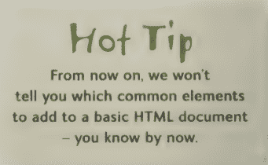

1. 创建一个新的 HTML 文档，包含常见的结构性元素（`<html>`、`<head>` 和 `<body>`）。将文件保存为 `datatypes.html`。
2. 创建 `<body>` 元素的子元素（即在 `<body>` 内部）一个 `<script>` 元素，确保将 `type` 属性设置为 `"text/javascript"`，如下所示。

```html
<!DOCTYPE HTML>
<html>
<head>
  <title>探索原始和引用数据类型</title>
</head>
<body>
  <script type="text/javascript">
  </script>
</body>
</html>
```

**上方：** 第 2 步。

```javascript
<script type="text/javascript">
document.write("<h2>PRIMITIVE DATATYPES</h2>");

var primitiveVar1 = 72;
var primitiveVar2 = primitiveVar1;

document.write("<p>primitiveVar1 has value " + primitiveVar1 + "</p>");
document.write("<p>primitiveVar2 has value " + primitiveVar2 + "</p>");

var primitiveVar2 = 12;

document.write("<p>primitiveVar1 now has value " + primitiveVar1 + "</p>");
document.write("<p>primitiveVar2 now has value " + primitiveVar2 + "</p>");
</script>
```

**上方：** 第 3 步：将此代码输入你新的 `<script>` 元素中。

3. 将上述代码输入此新的 `<script>` 元素中。
4. 保存你的代码并在 Firefox 中打开 `datatypes.html`。
5. 正如你所见，尽管我们将 `primitiveVar1` 赋值给 `primitiveVar2`，但当我们更改 `primitiveVar2` 的值时，`primitiveVar1` 的值并没有改变。换句话说，每个变量都引用一个独立的值。

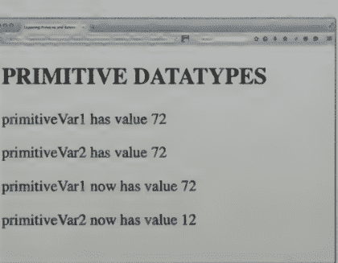

**上方：** 第 5 步：脚本的输出显示了这两个变量的行为。

# 156 HTML CSS • JAVASCRIPT 简易精通

```javascript
var primitiveVar2 = 12;

document.write("<p>primitiveVar1 now has value " + primitiveVar1 + "</p>");
document.write("<p>primitiveVar2 now has value " + primitiveVar2 + "</p>");

document.write("<h2>REFERENCE DATATYPES</h2>\n");

var referenceVar1 = {};

referenceVar1.myValue = 72;

referenceVar2 = referenceVar1;

document.write("<p>referenceVar1.myValue has value " + referenceVar1.myValue + "</p>");
document.write("<p>referenceVar2.myValue has value " + referenceVar2.myValue + "</p>");

document.write("<p>referenceVar1.myValue now has value " + referenceVar1.myValue + "</p>");
document.write("<p>referenceVar2.myValue now has value " + referenceVar2.myValue + "</p>");
```

**上方：** 第 6 步：将此代码添加到你的编辑器。

6. 回到编辑器并添加上述新代码（旧代码变暗）。在这里我们使用了 `object`。
7. 注意，当 `referenceVar2.myValue` 改变时，`referenceVar1.myValue` 也会改变，因为它们都指向内存中的同一个对象。
8. 保存你的代码并在 Firefox 中打开 `datatypes.html` 查看结果。

# 160 代码让 HTML • CSS • JAVASCRIPT 轻松

方括号 `[]` 标记数组的开始和结束，而存储在数组中的值（即其元素）用逗号分隔，并可以是任何数据类型。要创建一个空数组，我们只需要输入括号且内部不包含任何元素。


## 使用 `new` 关键字创建数组

我们也可以使用 `new` 关键字来创建数组：`var myArray = new Array();`。可以在括号之间包含逗号分隔的初始元素。（我们将在第 50 页讨论关键字。）

### 数组长度

数组中元素的数量被称为长度（length）。如果我们有一个名为 `myArray` 的数组，可以通过输入 `myArray.length` 获取它的长度。

```html
<!DOCTYPE HTML>
<html>
<head>
  <title>Array Examples</title>
</head>
<body>
  <script type="text/javascript">
    var userNames = new Array("Helen", "Amrit", "Geoff", "Jacques");
    var userLogins = new Array();

    alert(userNames.length); // 在弹幅对话框中显示 '4'
    alert(userLogins.length); // 在弹幅对话框中显示 '0'
  </script>
</body>
</html>
```

上方：可以使用 `new` 关键字创建数组，并且始终有一个长度。

### 访问数组元素

数组中的每个元素都有一个索引（index），这是一个指向元素在数组中位置的数字。第一个元素的索引为 0，第二个索引为 1，依此类推。要访问数组的特定元素，我们编写变量名，加上包裹在方括号中的索引数字。例如，如果我们想使用 `myArray` 的第三个元素（索引为 2），我们写 `myArray[2]`。

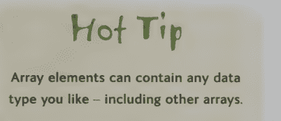

### 向数组添加元素

我们也可以使用方括号为数组元素赋值。例如，要设置数组 `myArray` 的第八个元素（索引为 7），我们可以输入 `myArray[7] = 19`。如果第八个元素已经包含数据，它将被新值覆盖。或者，如果数组的长度小于 8，则会创建一个新元素，并填充未修改的数组的最后一个元素与新添加元素之间所需的任何空元素。

```html
<body>
<script type="text/javascript">
var Names = new Array("Helen", "Amrit", "Geoff", "Jacques");
var userLogins = new Array();

// 获取数组元素值...
alert(userLogins[0]); // 在弹幅对话框中显示 'Helen'
alert(userLogins[3]); // 在弹幅对话框中显示 'Jacques'

// 设置数组元素值...
userLogins[0] = ["Amrit", "Monday"]; // 将数组赋值给 userLogins 的第一个元素
userLogins[2] = ["Helen", "Tuesday"]; // 将数组赋值给 userLogins 的第三个元素

// 获取未声明的数组元素...
alert(userLogins[1]); // 在弹幅对话框中显示 undefined，即该元素存在 - 它是为了被创建的，但还没有被分配值
</script>
</body>
```

上方：我们可以使用括号表示法通过获取和设置值访问数组元素。


### 向数组追加元素

数组的 `push()` 方法允许我们向数组的末尾添加元素（我们将在第 102 页讨论方法）。例如，如果我们想向数组 `firstNames` 追加字符串 `"Harry"`，我们可以写成 `firstNames.push("Harry")`。

```html
<body>
  <script type="text/javascript">
    var userNames = new Array("Helen", "Amrit", "Geoff", "Jacques");

    alert(userNames.length); // 在弹幅对话框中显示 '4'

    userNames.push("Oliver"); // 在弹幅对话框中显示 '5'

    alert(userNames[4]); // 在弹幅对话框中显示 'Oliver'
  </script>
</body>
```

上方：数组的 `push` 方法向数组末尾添加元素。

### 从数组中删除元素

我们可以使用 `shift()` 方法删除数组中的第一个元素，或者使用 `pop()` 方法删除最后一个元素。无论使用哪种方法，它都会返回被删除的值。

```html
<body>
<script type="text/javascript">
  var userNames = new Array("Helen", "Amrit", "Geoff", "Jacques");

  userNames.push("Oliver");
  alert(userNames.length); // 在弹幅对话框中显示 '5'

  var firstNameInArray = userNames.shift();
  alert(firstNameInArray); // 在弹幅对话框中显示 'Helen'
  alert(userNames.length); // 在弹幅对话框中显示 '4'

  var lastNameInArray = userNames.pop();
  alert(lastNameInArray); // 在弹幅对话框中显示 'Oliver'
  alert(userNames.length); // 在弹幅对话框中显示 '3'
</script>
</body>
```

上方：`shift()` 和 `pop()` 方法分别删除第一个和最后一个元素。

### 其他数组方法

（注意：根据提供的输入，此部分的 OCR 文本似乎是碎片化或不完整的，将继续下一个逻辑部分。）

## 对象

最后，我们再次声明一个对象字面量——但这次是一个空对象，可以用于存储我们已创建的对象中问题的答案。

上方：第 4 步：在这里，你将创建一个空对象。

5. 保存你的工作。如果你在 Firefox 中启动此页面，你将看不到任何视觉输出，但没关系——目前，这更多是一个编码和思维练习，但随着我们的进展，我们将在此基础上进行构建。

6. 注意我们在两个 `quizQuestion` 对象中是如何创建相同的属性名结构的——以这种方式创建和复用对象结构是面向对象编程的核心原则，我们将在第 219 页讨论。


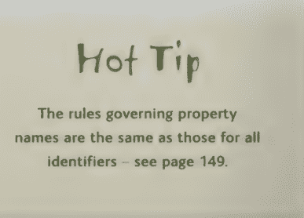

```javascript
var userAnswers = {};

alert(quizQuestion1.question);
alert(quizQuestion2.question);

</script>
<<body>
</</html>
```

**上方：**访问存储在对象属性的值非常简单。

### 访问对象属性

如果我们有一个对象`myObject`，并且在上面定义了一个属性`myProperty`，我们可以通过输入`myObject.myProperty`来访问该属性。`.`被称为**点运算符**（参见第 177 页）。

## 数据类型转换

在很多情况下，你可能需要在另一种类型的语境中使用另一种类型的值。例如，你可能希望使用数字的字符串表示（用`"42"`代替`42`），或者你可能需要在布尔值的语境下使用数字。这种在数据类型之间进行转换的方式被称为数据类型**强制转换**（casting）。


### 隐式转换

JavaScript 在管理数据类型方面非常主动，它会根据所使用的语境自动在类型之间进行转换（示例参见第 179 页）。

### 显式转换

我们也可以显式地转换某些数据类型，最常用于字符串和数字之间的转换。例如，要将数字转换为字符串，我们会写`String(42)`，结果为`"42"`。相反，要将字符串转换为数字，我们会写`Number("42")`，结果为`42`。

```javascript
var myNumber = 42;
var myString = "549";
var my = "Sajid";
var test1 = myNumber + myString;
alert(test1);//在提示框中显示 '42549'
var test2 = myNumber + Number(myString);
alert(test2);//在提示框中显示 '591'
var test3 = myString + myName;
alert(test3);//在提示框中显示 '549sajid'
var test4 = myNumber + Number(myName);
alert(test4);//在提示框中显示 'NaN'
var test5 = String(myNumber) + myName;
alert(test5);//在提示框中显示 '42Sajid'
```

**上方：**这段代码强调了我们可能以及为什么要在数据类型之间进行显式强制转换。

## 特殊的 NaN 数字

并不是所有值都能转换为数字——例如，字符串`"foo"`没有数值意义。

如果我们将此字符串转换为数字，将得到结果`NaN`（Not a Number，意为不是数字）。尽管名字如此，它确实是一个数字，可以用于任何允许或预期使用数字的地方。然而，任何包含`NaN`的计算结果始终始终为`NaN`。

## 不同数据类型的转换结果

此表显示了不同数据类型之间转换的结果。请从行标题到列标题将表格读为`强制转换`。

| 布尔值 (Boolean) | 数字 (number) | 字符串 (string) |
| --- | --- | --- |
| Boolean | - | false 为 0, true 为 1 | false 为 "false", true 为 "true" |
| number | 0 为 false，否则为 true | - | 数字的字符串表示 |
| string | " " 为 false，否则为 true | 字符串的数值表示，或 NaN | - |
| null | false | 0 | "null" |
| undefined | false | NaN | "undefined" |
| array | true | 空数组为 0，有元素的数组为 NaN | 元素值的逗号分隔列表 |
| object | true | NaN | "object Object" |


## JAVASCRIPT 结构

### JAVASCRIPT 语法

脚本可以由单条指令组成，也可以包含数千行代码。无论大小如何，所有 JavaScript 脚本都共享共同的结构和语法。

### 敏感性

首先要注意的是，JavaScript 是区分大小写的，即小写字母与其大写字母被认为是不同的。例如，标识符`"myVariable"`与`"MyVariable"`相同（注意大小写的区别）。

```javascript
publishing.prototype.loadQuestions = function() {
  // 问题 1
  this.questions.push(
    new QuizQuestion(
      1,
      "太阳距离地球有多远？",
      ["200 英里", "93,000,000 英里", "49,000,000 英里", "150,000,000 英里"]
    )
  );
  // 问题 2
  this.questions.push(
    new QuizQuestion(
      2,
      "我们的太阳系中有多少行星？",
      ["6", "7", "8", "9"]
    )
  );
  // 问题 3
  this.questions.push(
    new QuizQuestion(
      3,
      "这些中哪是木星的卫星？",
      ["盖卫", "米兰达", "恩克拉多斯", "火星"]
    )
  );
};
```

**上方：**缩进代码有助于理解我们为什么要这样做。

### 空格

领先空格和制表符在 JavaScript 中会被忽略。这允许我们在代码中使用缩进，这种技术可以使代码更有条理。

### 分号

JavaScript 语句通常以分号（`;`）结束，但不是必须的。省略分号可能会导致歧义，因此最佳实践是在每条语句结束时加上分号。

```javascript
// 行内注释以 // 开始，到换行结束
var userScore = 0; //它们也可以与其他代码在同一行

//alert(userScore);//它们也可以用来禁用代码
```

**上方：**行内注释在换行处结束。

### 注释

**注释**是解释器忽略的脚本部分。注释用于为脚本添加备注和解释，帮助他人理解，并在几个月后重新查看脚本时作为提示。

> ### 小贴士
>
> 注释通常用于禁用脚本部分——在尝试新想法或寻找 bug 时非常有用。

### 行内注释

行内注释以`//`开始，到下一个换行结束。它们可以单独占一行，也可以跟在 JavaScript 代码后面。

### 块注释

块注释以`/*`开始，直到`/`结束。这些标记之间的所有内容都被视为注释。

```javascript
/* 唯一的行内注释，块注释持续到输入注释结束符号。
块注释符号像这样： */

var publishing.commentsExample = function(itemData) {
  /* 块注释也可以是单行的 */
  this.itemId = itemData.itemId;
  /* 我们可以在任何喜欢的地方包含块注释
  它们在实现新代码或调试 bug 时非常有用。 */
  /* 我们还在同一个文档中混合不同的注释样式。 */

  /* 注意下面部分代码被“注释掉”了：
  this.element = document.createElement('div');
  if (this.itemId == itemData.itemId) {
    this.element.className = "menuItem";
    this.linkType = itemData.linkType;
    this.linkData = itemData.linkData;
    this.isSelected = false;
    this.isHover = false;
  }*/
  this.posterImage = itemData.posterImage;
  // 添加图标
  switch(this.linkType) {
    case "video":
  }
}
```

**上方：**块注释可以跨越多行。

## 表达式与运算符

你在脚本中编写的指令由表达式组成。通常，表达式使用运算符以某种方式对数据操作。

### 什么是表达式？

表达式是解释器可以评估的任何代码段，通常会产生一个值。宏大的描述掩盖了这一概念的简单性——考虑以下情况：`42`。严格来说，这不仅是一个字面量，也是一个表达式——解释器可以评估它，并产生十进制值`42`。诚然，它并不算是一个表达式——它在脚本中等同于走向一位同事并对她说“42”；她会理解你陈述了一个值，但她不知道你希望她对这个值做什么。


```
1 42
2
3 "Hello World"
4
5 true
6
7 null
8
9
10
```

左侧：解释器可以评估所有这些表达式；尽管它们毫无意义。

# 176 轻松学习 HTML • CSS • JAVASCRIPT

```
("#User_logged").val(a);
function(a);
collect(a, b) {
  for (var c = 0; c < a.length; c++) {
    use_array(a[c], a) < b && (
  }
  return a;
}
function newUser(a) {
  for (var b = "", c = 0; c < a.length; c++) {
    b += " " + a[c] + "";
  }
  return b;
}
("#User_logged").bind(DOMAttr(); : + a.words +).html(lice
```

### 变得更具表现力

现在考虑表达式`38 + 4`。这一次，在评估表达式时，解释器将`38`和`4`相加——结果与我们之前的示例相同（值`42`），但我们通过对这两个值求和实现了一些东西。

继续我们的比喻，我们对同事说“38 加 4”，她回答“42”。产生区别在于包含了加法运算符`+`。

## 什么是运算符？

正如我们刚刚看到的，为了让表达式具有意义，它通常包含一个运算符；运算符定义了如何对表达式中的数据进行评估，以获得该表达式的值。

| 38 + 4 |
| 2 |
| 3 "Hello " + "World" |
| 4 |
| 5 myVariable = true |
| 6 |
| 7 quizQuestion.questionText |
| 8 |
| 9 getMyValue() |
| 10 |
| 11 myObject.doSomething() |

上方：运算符赋予了表达式意义和目的。

### 操作数

在运算符的语境下，被处理的值被称为“操作数”。许多运算符期望两个操作数，分别位于运算符的侧边（称为左操作数和右操作数）。另一些——称为一元运算符——只处理单个操作数，而更少的运算符处理三个或更多操作数。

### 大量的运算符

有许多不同的 JavaScript 运算符——多到这里无法全部涵盖——所以让我们关注最常用的几个。

### 点运算符

我们已经遇到过点运算符`.`了——它允许我们访问对象的属性（以及方法——见第 226 页）。左操作数是对对象的引用，而右操作数是该对象的属性或方法的名称。

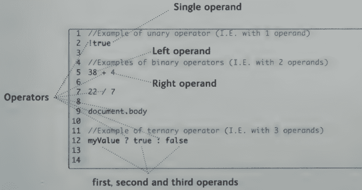

**上方：**操作数是运算符将……呃，操作的值。

### 算术运算符

算术运算符使用提供的操作数进行算术运算并返回计算结果。操作数必须是数字，或者是评估为数字的表达式。

> 小贴士
>
> 访问`https://en.wikibooks.org/wiki/JavaScript/Operators`查找 JavaScript 运算符的完整列表。

| 运算符 | 操作数数量 | 名称 | 操作 | 示例（括号内为结果） |
| --- | --- | --- | --- | --- |
| `+` | 2 | 加法 | 左右操作数的和 | `4 + 5 (9)` |
| `-` | 2 | 减法 | 从左操作数减去右操作数 | `31 - 14 (17)` |
| `*` | 2 | 乘法 | 左右操作数相乘 | `12 * 3 (36)` |
| `/` | 2 | 除法 | 将左操作数除以右操作数 | `12 / 3 (4)` |
| `++` | 1 | 递增 | 将单个操作数标识符的值加 1 | `numUsers ++ (numUsers 增加 1)` |
| `--` | 1 | 递减 | 从单个操作数标识符的值减去 1 | `numUsers -- (numUsers 减少 1)` |

### 字符串运算符

有几种可以处理字符串的运算符，但只有一个是专门为字符串设计的：

| 运算符 | 名称 | 操作 | 示例（括号内为结果） |
| --- | --- | --- | --- |
| `+` | 拼接 | 连接两个字符串 | `"Hello" + "World" ("HelloWorld")` |

注意拼接运算符看起来和加法一样；如果任一操作数评估为字符串，结果就是字符串。


### 赋值运算符

我们已经见过这个运算符，它的右操作数可以是字面量。

| 运算符 | 名称 | 操作 | 示例（括号内为结果） |
| --- | --- | --- | --- |
| `=` | 赋值 | 将右操作数的值赋值 | `42` |

### 等于运算符

这些运算符比较两个操作数。

| 运算符 | 名称 | 操作 | 示例（括号内为结果） |
| --- | --- | --- | --- |
| `==` | 等于 | 操作数相等时返回 true | `4 == 4 (true)` |
| `!=` | 不等于 | 操作数不等时返回 true | `4 != 2 (true)` |


### 比较运算符

如名所示，比较运算符比较两个操作数并返回 true 或 false。

| 运算符 | 名称 | 操作 | 示例（括号内为结果） |
| --- | --- | --- | --- |
| `<` | 小于 | 左操作数小于右操作数时返回 true | `4 < 5 (true)` |
| `<=` | 小于等于 | 左操作数小于或等于右操作数时返回 true | `4 <= 4 (true)` |
| `>` | 大于 | 左操作数大于右操作数时返回 true | `5 > 4 (true)` |
| `>=` | 大于等于 | 左操作数大于或等于右操作数时返回 true | `4 >= 4 (true)` |

### 逻辑运算符

逻辑运算符比较值并返回 true 或 false。

| 运算符 | 操作数数量 | 名称 | 操作 | 示例（括号内为结果） |
| --- | --- | --- | --- | --- |
| `&&` | 2 | 逻辑与 | 两个操作数均为真时返回 true | `true && false (false)` |
| `||` | 2 | 逻辑或 | 任一操作数为真时返回 true | `true || false (true)` |
| `!` | 1 | 逻辑非 | 放在单个操作数之前；反转布尔值 | `!true (false)` |

# 182 轻松学习 HTML • CSS • JAVASCRIPT

```html
<body>
  <script type="text/javascript">
    var jsResult = 20 - 4 * 3;
    document.write("<p>20 - 4 * 3 equals " + jsResult + "</p>");
    var possResult1 = (20 - 4) * 3;
    document.write("<p>(20 - 4) * 3 equals " + possResult1 + "</p>");
    var possResult2 = 20 - (4 * 3);
    document.write("<p>20 - (4 * 3) equals " + possResult2 + "</p>");
  </script>
</body>
```

上方：探索 JavaScript 的运算符优先级

## 运算符优先级

考虑以下代码：`20 - 4 * 3`。这意味着`(20 - 4) * 3`，结果为 48，还是可能意味着`20 - (4 * 3)`，结果为 8？JavaScript 通过为每个运算符分配优先级来处理这个问题——优先级最高的运算符先评估；优先级最低的运算符最后评估。为什么不写一个脚本看看哪个才是正确答案呢？

## 覆盖运算符优先级

记住每个运算符的优先级是非常挑战性的，因此使用括号（括号）来覆盖默认运算符优先级通常更简单且不容易产生歧义。

括号内的任何表达式都会在同一语句中的所有其他表达式之前求值。考虑以下情况：`(24 - 2) / 7`。括号中的语句`(24 - 2)`首先被求值，结果`22`然后被除以 7。

IDE 检测到由于缺少括号导致的语法错误：

```
第 10 行存在语法错误。在修复此错误之前，代码提示可能无法工作。
```


```html
<!DOCTYPE HTML>
<html>
<head>
  <title>嵌套括号</title>
</head>
<body>
  <script type="text/javascript">
    var myValue1 = ((22 / 7) + 10) - 3;
    var myValue2 = 13 + (9 - 2 / (4 + 6));
  </script>
</body>
</html>
```

此左括号没有对应的右括号。

上所示：此示例的第二个表达式导致了语法错误。

## 嵌套括号

> **小贴士**  
> 在嵌套括号时，始终确保每个左括号 `(` 都有一个对应的右括号 `)`。如果存在不匹配，就会发生语法错误。

你经常会发现自己需要在括号内嵌套括号，例如 `((24 - 2) + 10) / 7`。在这种情况下，最深层嵌套的表达式首先求值，然后是下一层深嵌套，依此类推。

## 语句（STATEMENTS）

在 JavaScript 结构的顶层，我们找到了“语句”。所有的 JavaScript 指令都包含在语句之中。

### 什么是语句？

JavaScript 语句封装了一个或多个表达式，可以被视为脚本中离散的步骤或指令。脚本中的每个语句在处理下一个语句之前都会完整执行。

### 编写语句

考虑以下简单表达式：`playerScore = 0;`。虽然这是一个表达式，但它也是一个语句，正如末尾的分号 `;` 所示。语句不需要比这更复杂，但它们通常都很复杂。

| 类型 | 内容 |
| --- | --- |
| Expression | `playerScore = 0;` |
| statement |  |

| 类型 | 内容 |
| --- | --- |
| Expression | `document.write("Your score is " + playerScore);` |
| statement |  |

上所示：语句由一个或多个表达式组成。

### 复合表达式

我们经常在语句中构建相当复杂的表达式堆，例如：

`document.getElementsByTagName("body")[0].appendChild(document.createElement("p")).innerHTML = "Hello World!";`

这条语句说明了表达式如何组合。它使用了在第 109 页引入的 DOM 编程技术，来实现与我们编写的第一个脚本相同的结果。

| Expression |
| --- |
| Expression |
| Expression |
| Expression |
| Expression |
| Expression |

```javascript
document.getElementsByTagName("body")[0].appendChild(document.createElement("p")).innerHTML = "Hello World!";
```

**上所示：** 语句通常由复合表达式构建而成。

## 平衡复杂性与可读性

理解冗长且复杂的语句（如上面的语句）可以很容易地分解为一系列更短、更简单的语句是非常重要的。

> **小贴士**  
> 像本这样复杂的语句通常写起来比读起来容易得多。事实上，一旦你掌握了 JavaScript，你可能会发现编写它们有一种奇妙的满足感——甚至是艺术性的。

## 186 轻松掌握 HTML • CSS • JAVASCRIPT

我们所做的只是将表达式分配到更多的语句中。然而，为了将一个语句中的表达式结果与另一个语句共享，我们需要将每个语句的结果存储在变量中，以便其他语句访问这些值。

## 平衡速度与可读性

创建和管理变量会增加解释器的负载，因此，复杂的多个表达式的执行速度通常比将相同表达式分解为多个语句要快。虽然选择如何取决于性能需求。

```javascript
<script type="text/javascript">
  // 这种复合语句...
  document.getElementsByTagName("body")[0].appendChild(document.createElement("p")).inn

  // ...与下述语句相同
  var bodyArray = document.getElementsByTagName("body");
  var newPara = document.createElement("p");
  newPara.innerHTML = "Hello World!";
  bodyElement.appendChild(newPara);
</script>
```

**上所示：** 复合语句可以拆分为独立的语句。

1. 创建一个新的 HTML 文档。
2. 创建一个新的 `<script>` 元素。
3. 添加一个简单的变量声明。
4. 添加另一个 `<script>` 元素。
5. 保存工作并在浏览器中打开。

```html
<!DOCTYPE HTML>
<html>
<head>
  <title>If 示例</title>
  <script type="text/javascript">
    varAge = 36;
  </script>
</head>
```

```html
<body>
  <script type="text/javascript">
    if (varAge > 16) alert("这是一个儿童区域 - 不供成人进入。");
  </script>
</body>
```

## 块（BLOCKS）

相关的语句可以被组合在一起。这是通过大括号完成的。

> **小贴士**  
> 深入思考 JavaScript。

```javascript
playerScore = 0;
var playerName = 'Sarah';
varAge = 29;
```

语句块。

## 条件语句（CONDITIONAL STATEMENTS）

我们经常需要根据条件执行不同的语句。

### `if` 语句

当解释器遇到 `if` 语句时，它会进行表达式求值。如果表达式求值为真，则该语句被求值。

```javascript
if (condition)
```

## `if` 语句的工作原理

让我们看看 `if` 语句是如何工作的：

1. 创建一个新的 HTML 文档。
2. 创建一个新的 `<script>` 元素。
3. 添加一个简单的变量声明。
4. 添加另一个 `<script>` 元素。
5. 保存工作并在浏览器中打开。

```html
<!DOCTYPE HTML>
<html>
<head>
  <title>If 示例</title>
  <script type="text/javascript">
    varAge = 36;
  </script>
</head>
```

```html
<body>
  <script type="text/javascript">
    if (varAge > 16) alert("这是一个儿童区域 - 不供成人进入。");
  </script>
</body>
```

## 运行原理

`if` 语句的条件表达式将用户值与字面量 `16` 进行比较。

### 执行多个语句

`if` 的形式在条件为真时只能执行单个语句，但我们经常需要执行多个语句。为了实现这一点，我们在条件表达式后面添加一个语句块。

```javascript
if (condition) {
  statement_1;
  statement_2;
  ...
  statement_n;
}
```

### `else` 子句

基础的 `if` 语句可以通过添加 `else` 子句来扩展（我们称之为子句是因为它是较大的 `if` 语句的子部分，并且在 `if` 语句之外没有任何意义）。通用格式如下：

```javascript
if (condition) {
  statement(s);
} else {
  statement(s);
}
```

当 `if` 语句的条件求为假时，执行 `else` 之后的语句。为什么不尝试在最后一个编码练习（第 65 页）中添加一个 `else` 子句呢？

### 小贴士

语句块的大括号可以紧跟在条件表达式的结束之后，也可以单独占一行，甚至可以位于第一个语句之前。这取决于你。

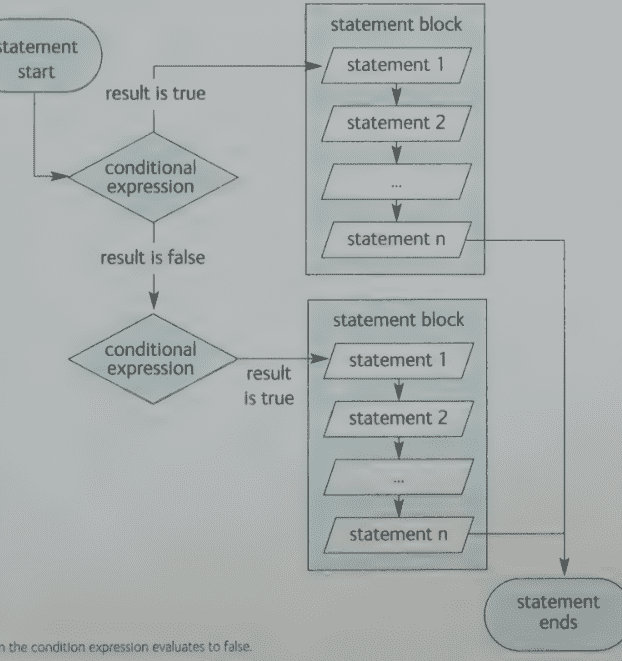

正确：当条件表达式求为假时，触发 `else` 子句。

## 嵌套 `if` 语句

`else if` 子句创建分支逻辑结构，这在编程中非常常见。但请注意：随着每个分支的增加，这种结构会变得越来越复杂——我们通常可以通过采用不同的条件语句来完全避免它们。

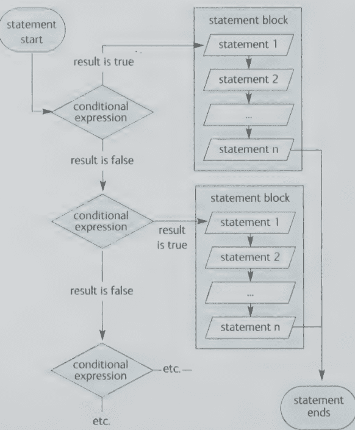

**上方：** `else if` 子句为 `if` 语句增加了更多的条件测试。

## `else if` 子句

当上一个测试求为假时，我们可以引入一个新的条件测试。其通用格式如下：

```javascript
if (condition) {
  statement(s);
} else if (condition) {
  statement(s);
}
```

我们可以根据需要添加任意多个 `else if` 子句，并以最后的 `else` 子句结束，该子句仅在所有之前的条件都求为假时才执行。

### `switch` 语句

`switch` 与 `if` 类似，但它是测试条件为真还是假，`switch` 语句根据条件表达式的结果选择一个代码块执行。要测试的值在 `case` 部分中指定。其通用格式为：

```javascript
switch (condition) {
  case label_1:
    statement(s);
    break;

  case label_2:
    statement(s);
    break;

  ...

  default:
    statement(s);
    break;
}
```

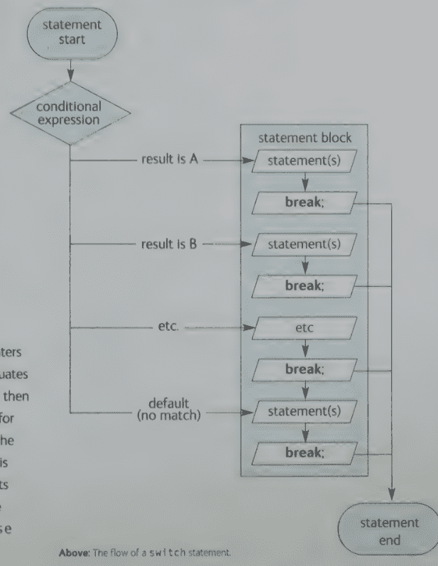

## `switch` 语句如何工作

当解释器遇到 `switch` 语句时，它会评估条件表达式，然后在语句块中寻找与条件结果匹配的 `case` 标签。如果匹配项，则执行所有后续语句，包括包含在后续 `case` 部分中的语句。

上方：`switch` 语句的流程。

## 轻松上手 HTML • CSS • JAVASCRIPT

### 跳出 `case` 部分

为了防止执行后续部分，我们在每个 `case` 的末尾包含一个 `break` 关键字。这告诉解释器停止处理语句块，并从块后的第一个语句开始恢复执行。

> **小贴士**  
> 如果你发现 `if-else-if` 语句的结构变得难以管理，那么 `switch` 语句可能是一个更合适的方法。

### 默认 `case`

`switch` 语句可以包含一个特殊的 `default` 部分，如果遇到它将始终触发。这通常放置在 `switch` 的末尾，以便在没有 `case` 标签匹配条件表达式时才选择它。

|  |  |
| --- | --- |
| 8 | `<script type="text/javascript">` |
| 9 | `// 假设页面上存在名为 mediaObject 的对象。` |
| 10 | `// mediaObject 可以指向视频文件或音频文件，` |
| 11 | `// 但在编写代码时我们不知道它是哪一个。` |
| 12 | `switch (mediaObject.mediaType) {` |
| 13 | `case "video":` |
| 14 | `alert("You are about to access a video");` |
| 15 | `// 导致视频加载和播放的语句` |
| 16 | `break;` |
| 17 | `case "audio":` |
| 18 | `alert("You are about to access an audio recording");` |
| 19 | `// 导致音频加载和播放的语句` |
| 20 | `break;` |
| 21 | `default:` |
| 22 | `alert("Cannot determine the media type");` |
| 23 | `}` |
| 24 |  |
| 25 | `</script>` |

**上方：** 这个虚构脚本展示了如何使用 `switch` 语句。

## 循环语句

我们经常需要对一组不同的值运行同一组语句，或者重复执行语句某些次数——这就是循环大显用场的地方。

### `while` 循环

最简单的循环语句被称为 `while` 循环。它的通用格式是：

```javascript
while (condition) {
  statement(s);
}
```

如果条件求为真，则执行条件后代码块中的语句，然后再次测试条件。如果仍然为真，则重复该过程。这会持续到条件求为假为止。

> **小贴士**  
> 注意：如果你编写循环时不当，可能会触发无限循环，导致解释器卡住。

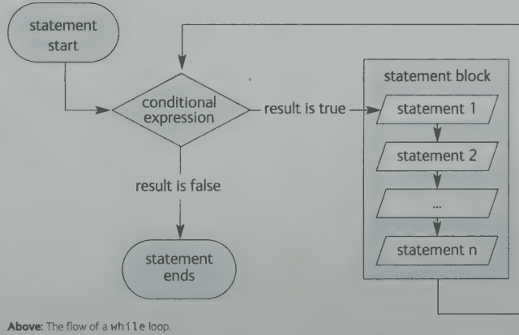

### `do while` 循环

这些循环与 `while` 循环非常相似，区别是在语句块之后评估条件。如果条件求为真，则重复语句块。它的样子如下：

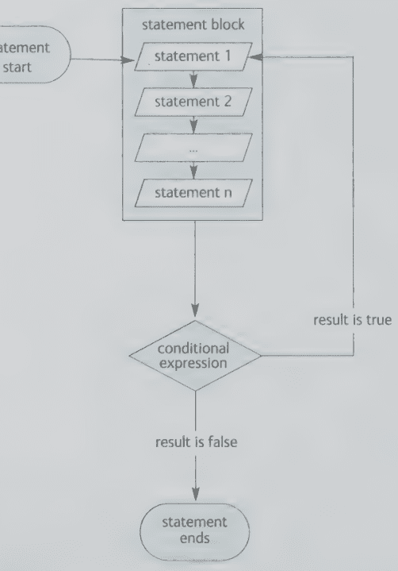

```javascript
do {
  statement(s);
} while (condition);
```

### `for` 循环

`for` 循环通常用于处理数组元素，因为它简化了迭代次数。例如：

```javascript
for (initialize; condition; iteration) {
  statement(s);
}
```

## `for` 循环的元素

`for` 循环的三个元素是控制循环的表达式：

- **initialize：** 通常创建一个索引。
- **condition：** 测试循环是否重复的表达式。
- **iteration：** 在每次迭代后评估的表达式。

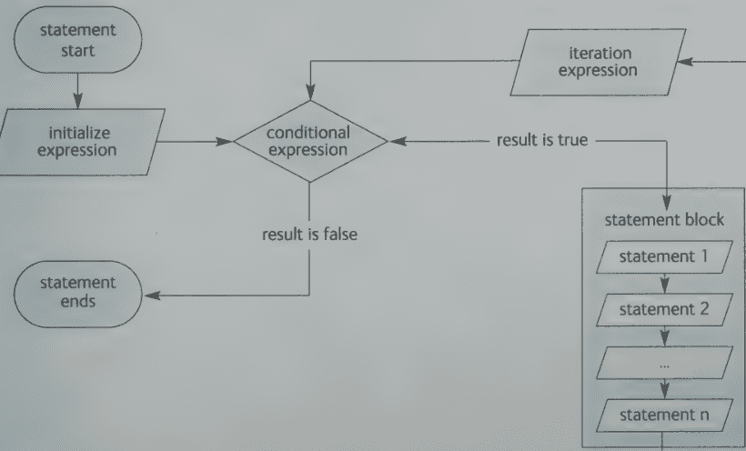

## 使用循环

在第 41 页的练习中，我们将构建一个测试应用程序。

1. 创建一个文件夹并命名为 `Quiz`。
2. 创建一个新的 HTML 文档并保存为 `simpleQuiz.html`。
3. 创建一个新的 JavaScript 文档并保存到 `js` 文件夹中名为 `quizQuestions.js`。

```html
<!DOCTYPE HTML>
<html>
<head>
  <title>A Simple Quiz</title>
  <script type="text/javascript" src="js/quizQuestions.js"></script>
</head>
<body>
</body>
</html>
```

- 返回 HTML。在 `<head>` 中添加一个 `<script>` 元素，将 `type` 设置为 `"text/javascript"` 并将 `src` 设置为 `"js/quizQuestions.js"`。
- 转到 `quizQuestions.js`，我们将在那里定义问题本身。在文件顶部，声明一个名为 `questions` 的数组变量。
- 现在我们通过在 `push()` 方法的括号内声明对象和数组字面量来添加问题，如下图所示。

```javascript
var questions = [];

// QUESTION 1
questions.push({
  questionText: "Approximately how far away from the Earth is the Sun?",
  answers: ["200 miles", "93,000,000 miles", "49,000,000 miles", "150,000 miles"],
  correctAnswerIndex: 1
});

// QUESTION 2
questions.push({
  questionText: "How many planets are there in our solar system?",
  answers: ["6", "7", "8", "9"],
  correctAnswerIndex: 2
});

// QUESTION 3
questions.push({
  questionText: "Which of these is a moon of Jupiter?",
  answers: ["Ganymede", "Miranda", "Enceladus", "Mars"],
  correctAnswerIndex: 0
});
```


## 如何工作

第一个`<script>`元素非常简单——它链接到一个脚本，我们在该脚本中声明了代表测验中问题的对象，并将它们存储在一个名为`questions`的数组中。该数组可以被页面中的所有脚本访问，并且定义在`<head>`中，这样我们可以确保在处理页面的`<body>`时，它是可用的。

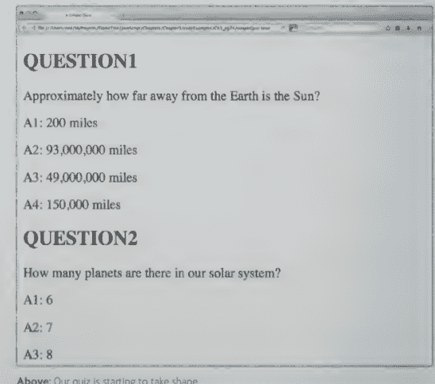

现在让我们来看第二个`<script>`元素中的`for`循环。索引初始化为 0。然后评估条件`i < questions.length`。当`i`为 0 时，条件评估为`true`，因此执行循环体并使用熟悉的`document.write()`技术将文本写入页面。需要注意的是，我们使用循环索引`i`来访问`questions`数组的每个元素。

一旦语句块完成，就会评估迭代表达式`i++`，将索引值加 1，然后再次测试条件。该过程会一直重复，直到条件评估为`false`为止。

## 退出循环或迭代

我们可以通过使用`break`关键字随时退出循环，这将导致脚本执行从循环后的第一条语句开始继续。我们还可以使用`continue`退出循环的当前迭代，它会指示解释器立即评估迭代和条件表达式，如果需要，则继续循环。

```javascript
<script type="text/javascript">

for(var i = 0; i < questions.length; i++) {

  if(typeof questions[i] != "Number") {

    // i 不是一个数字，它不能作为索引 - 出了某些

    // 问题，所以退出循环

    break;

  } else if(questions[i].questionText != "") {

    // 如果问题没有文本，则跳过这一次

    continue;

  }

  // 一切正常 - 渲染

  document.write("<h2>QUESTION " + (i + 1) + "</h2>");

  document.write("<p>" + questions[i].questionText + "</p>");

  document.write("<pA1: " + questions[i].answers[0] + "</p>");

  document.write("<pA2: " + questions[i].answers[1] + "</p>");

  document.write("<pA3: " + questions[i].answers[2] + "</p>");

  document.write("<pA4: " + questions[i].answers[3] + "</p>");

}

</script>

</body>
```

上方：`continue`和`break`语句分别允许跳过迭代或完全退出循环。

## JavaScript 的函数与类

### JavaScript 中的函数

函数是一组语句的集合，可以通过引用分配给函数的标识符来执行。它们是创建可重用代码块的关键，这些代码可以在需要时被调用。

### 内置函数

JavaScript 语言中内置了许多函数——事实上，我们已经在使用其中一个：`alert()`函数。当我们在脚本中使用函数名时，我们是在调用或触发该函数——这通过函数名后的括号来标识。通过使用这些括号，我们还可以向函数传递数据——称为参数（arguments）。

```javascript
function(c,len(0-1)) {

  console.log("#User_logged" + "click"));

  function() for (var a = p) {

    for (var i = 0; i < a.length; i++) {

      for (var j = 0; j < c.length; j++) {

        if (a[i] == c[j]) {

          p.push(a[i]);

        }

      }

    }

  }

  function(a, c) {

    for (var i = 0; i < b.length; i++) {

      if (b[i] == a) {

        array[i].push(b[i]);

      }

    }

  }

  for (var b = 0; b < array.length; b++) {

    if (array[b].length > 0) {

      array[b].push(inp_array[b]);

    }

  }

  array[b].reverse();

  for (var b = 0; b < b.length; b++) {

    b.splice(b, 1, "");

  }

}
```

#### 参数（Arguments）

参数是传递给函数的值。当调用函数时，我们在函数名后的括号内传递值。例如，在`alert()`函数中，我们需要传递一个字符串来显示。

## 从函数返回值

我们通常希望以某种方式对传递给函数的值进行处理，并将计算结果返回给调用表达式——返回的值将成为该函数调用的值。我们通过`return`关键字来实现这一操作。

### 使用 return 关键字

当解释器遇到`return`时，它会停止处理该函数并返回到调用表达式。如果函数需要向调用表达式返回一个值，我们将该值放在`return`关键字后的括号中——例如，`return(functionResult);`

```javascript
function calculateRectArea(rectWidth, rectHeight) {

  var rectArea = rectWidth * rectHeight;

  return(rectArea);

}
```

```javascript
var myRectArea = calculateRectArea(217, 179);
```

上方：函数返回的值将成为函数调用表达式的值。

### 在检查测验答案时使用 return

我们的测验需要能够判断用户是否选择了正确答案——让我们为此编写一个函数。

1. 在编辑器中打开`quizFunctions.js`，添加一个名为`checkUserAnswer()`的新函数——见下图所示。该函数将接收两个参数——一个问题索引和一个答案索引——这允许函数确定要检查的问题以及所给出的答案。

```javascript
11 function checkUserAnswer(questionIndex, answerIndex) {

12   //function statements will go here...

13 }
```

上方：步骤 1：如所示添加一个新函数。

2. 输入下方图中的代码并保存工作。

```javascript
10 function checkUserAnswer(questionIndex, answerIndex) {

11   var questionObject = questions[questionIndex];

12   var theResult;

13   if(questionObject.correctAnswer == answerIndex) {

14     theResult = true;

15   } else {

16     theResult = false;

17   }

18   return(theResult);

19 }
```

上方：步骤 2：输入所示的代码。

3. 如果启动页面，什么都不会发生，因为我们还没有以任何方式触发这个新函数——我们将在第 240 页的“事件”中讨论这一点。

## 匿名函数

在 JavaScript 中，函数只是另一种数据形式。这意味着你可以创建一个函数并将其赋值给变量或对象属性。此类函数被称为匿名函数，因为它们没有函数名。

### 声明匿名函数

我们通过将函数字面量赋值给变量或对象属性来声明匿名函数。其通用形式如下：

```javascript
var myAnonymousFunction = function(parameter(s)) {

    statement(s);

}
```

### 调用匿名函数

调用匿名函数与调用命名函数没有区别；我们只是使用变量名或属性引用，而不是函数名。从任何角度来看，这等同于调用命名函数。

```javascript
1 //这是一个命名函数...

2 function calculateRectArea(rectWidth, rectHeight) {

3 return(rectWidth * rectHeight);

4 }

6 //这是一个匿名函数...

7 var calculateRectHypotenuse = function(rectWidth, rectHeight) {

8 var widthSquared = rectWidth * rectWidth;

9 var heightSquared = rectHeight * rectHeight;

10 return(Math.sqrt(widthSquared + heightSquared)); //Math.sqrt() 计算平方根

11 }

13 //对这两个函数的调用形式相同：

14 var myRectArea = calculateRectArea(49, 28);

15 var myRectHypotenuse = calculateRectHypotenuse(49, 28);
```

上方：命名函数和匿名函数的调用方式相同。

## 变量作用域

当变量在函数或语句块之外声明时，它在网页的任何地方都可用，因此被称为全局变量。另一种说法是该变量存在全局作用域中。相反，在函数内部声明的变量只能从函数内部访问——它们处于函数的作用域内。

## 作用域链

作用域是层级的——一个作用域嵌套另一个作用域之中。例如，命名函数始终存在于全局作用域中。表达式只能访问与其处于同一作用域或处于作用域链更高处的变量。

上方：变量作用域是层级的。一个作用域中的变量无法访问更深层嵌套的作用域。

## 命名空间

我们在 JavaScript 中创建了许多命名对象——变量和函数，每个名称在它自己的作用域内应该是唯一的。如果不唯一，就会发生名称冲突，导致问题变得非常糟糕。

### 什么是命名空间？

命名空间是我们定义名称以避免冲突的上下文。

| 名词 | 示例 |
| :--- | :--- |
| 一只狗 | `Dog` |
| 一棵树 | `Shoot` |
| 一个人 | `Dope` |
| 一个动作 | `Shoot` |
| 一种药物 | `Dope` |

上方：命名空间很重要，因为没有它们，我们就会遇到问题。

### 什么是名称冲突？

当名称被页面上的另一个对象使用时，就会发生名称冲突。

### 全局命名空间的污染

每个命名函数的名称都存在于全局命名空间中。在大型项目中，这个命名空间会变得充斥名称。

上方：全局命名空间可能会变得混乱。

### 在 JavaScript 中模拟命名空间

与某些语言不同，JavaScript 没有创建命名空间的正式符号。但是，请记住 JavaScript 中的一切皆都是对象——我们可以在全局命名空间中创建一个对象，然后在该对象内定义所有的变量。我们的名称不会污染全局命名空间，如果我们明智地选择命名对象的名称，就不会与其他脚本使用相同的名称。

### 提示

命名函数的名称存在于全局命名空间中。相比之下，匿名函数可以赋值给对象属性，从而从全局命名空间中移除它们的标识符。

```javascript
var myNamespace = {};

myNamespace.calculateRectArea = function(rectWidth, rectHeight) {

  return(rectWidth * rectHeight);

}
```

上方：匿名函数可以赋值给对象属性，以便不污染全局命名空间。

### 为命名空间命名

鉴于命名空间的名称必须存在于全局命名空间中，完全有可能与其他命名空间的名称发生名称冲突。避免这种冲突的技巧是选择一个别人不太可能使用的名称。如何做到这一点？简单——基于你的网站域名来创建命名空间名称。通常，我们会反转名称，所以如果你的域名是`mydomain.com`，你还可以进一步扩展每个应用程序和/或每个模块的名称——例如，`com.mydomain.myapplication`。

> 提示  
> 重要的是理解命名空间并不指向页面或网络资源——它只是一个名称。

- 全局作用域命名空间：全局标识符和命名函数
- `com.mydomain`：指向你的脚本所使用的函数和值的标识符
- `com.otherdomain`：指向附加到你页面上的第三方脚本定义的函数和值的标识符。它们有自己的命名空间，因此不会与你的名称冲突。

## 创建命名空间

让我们为 Simple Quiz 项目中的对象创建一个命名空间。

1. 在你的编辑器中打开`quizQuestions.js`，并在文档顶部创建两个空行。
2. 我们将使用`com.flametreepublishing`作为我们的命名空间 – 这意味着我们需要在`com`对象内部创建一个名为全局命名空间的对象（global namespace），再创建一个名为`flametreepublishing`的对象。
3. 复制右侧插图中所示的代码。在声明`com`（但未初始化它）之后，我们在初始化它之前测试每个命名空间对象是否存在（参见第 57 页的“逻辑非运算符”）。为了避免初始化已存在的命名空间。

```javascript
com.flametreepublishing.questions = [];

var com;

if(com) {

 com = {};

}

if(com.flametreepublishing) {

 com.flametreepublishing = {};

}
```

上方：步骤 3 将此处显示的代码复制到你的编辑器中。

4. 现在我们将调整脚本的其余部分，使其使用新的命名空间 – 参见右侧插图中变暗的部分。

```javascript
com.flametreepublishing.questions.push({

 question: "哪个行星离太阳最远?"

 answers: ["200 miles","93,000,000 miles","49,000,000 miles","150,000 miles"],

 correctAnswerIndex: 1

});

com.flametreepublishing.questions.push({

 question: "在我们的太阳系中，地球有多少颗行星?"

 answers: ["6","7","8","9"],

 correctAnswerIndex: 2

});

com.flametreepublishing.questions.push({

 question: "这些中哪一个是木星的卫星?"

 answers: ["Mars","Europa","Ganymede","Mars 1"]

});
```

上方：步骤 4 按照此处高亮的部分调整脚本。

## 轻松上手 HTML • CSS • JavaScript

5. 保存`quizQuestions.js`并打开`quizFunctions.js`。在所有脚本的顶部包含命名空间声明是一个良好的习惯，因此将其复制到`quizFunctions.js`的顶部。

```javascript
9 com.flametreepublishing.renderQuestionAtIndex = function(questionIndex) {

10   document.write("<div id="QUESTION" + (questionIndex + 1) + 
```

```javascript
19 com.flametreepublishing.checkUserAnswer = function(questionIndex, answerIndex) {

20   var questionObject = com.flametreepublishing.questions[questionIndex];

21   var theResult;
```

上方：步骤 6 按照此处高亮的部分更新引用。

6. 为了将函数放置在命名空间中，我们需要将它们改为匿名函数。我们还需要更新对问题数组的所有引用 – 参见上方插图中高亮的部分。
7. 保存文档，然后在编辑器中打开`simpleQuiz.html`。找到`for`循环，并按照下方插图所示更新其条件表达式和函数调用。

```html
12 <script type="text/javascript">

13 for(var i = 0; i < com.flametreepublishing.questions.length; i++) {

14   com.flametreepublishing.renderQuestionAtIndex(i);

15 } 
```


上方：步骤 7 按照此处所示更新条件表达式和函数调用。

8. 保存你的工作并在 Firefox 中打开该页面——再次，它看起来和之前完全一样，但在底层我们拥有了一个纯净且未污染的命名空间。

## 面向对象编程

面向对象编程（OOP）是一种将对象置于一切核心的编程方法。虽然 JavaScript 不是一种真正的 OOP 语言，因为它缺乏实现真正 OOP 所需的特定结构，但它可以以 OOP 风格使用。

## 为什么要使用 OOP 技术？

关于 OOP 与其他编程方法相比的优缺点，已经写了太多文字了，我们就不赘述。只需说明，OOP 最引人注目的特征之一是以与人类相同的方式组织事物。正因为如此，它是最广泛使用的编程方法。


上方：OOP 以与人类相同的方式组织代码。

### 如何分类事物

当我们思考物理世界中的一个事物时，该事物通常是某个同类家族的一部分；这个家族又是某个更大分组的一部分，以此类推。这些分组是我们思考的第一场所。例如，我们可以将一个事物分类为狗、家养的、哺乳动物、动物以及生物。这提供了一个像狗一样的分类链。该链中的每个点都定义了某些特征——例如动物腿的数量，或者狗毛的柔软程度。


上方：通过分类事物，我们也定义了它们。

### OOP 中的类

OOP 正利用了这种分类系统。我们编写类来定义属性以及类的特征。类还定义了方法，这些是操作对象的函数。类继承其祖先类的属性和方法，以及它所属的分类特征。你在类中编写的代码是一个模板——它描述了定义对象的属性和方法。

所有事物：

- `habitat = land`
- `numberOf = 4`
- `hasFur = true`
- `isDomesticated = false`
- `earStyle = "floppy"`
- `colour = "golden"`

上方：在物理世界中，特征是被继承并成为事物定义的固有部分的——在 OOP 中也是如此。


然而，这个类定义并不是类的对象——要创建一个对象，我们必须调用类的构造函数，因为它是从类生成对象的。生成的对象被称为类的实例，因此调用类的行为通常被称为实例化。

### 一个宏大的课题

OOP 是一个非常深入的主题，我们不会探讨——如果你想探索，可以搜索“OOP”并从成千上万的结果中进行选择。不过我们要学会如何在 JavaScript 中创建和使用基本类。


### JavaScript 类

我们已经在处理 JavaScript 类——`number`、`string` 和 `array` 都是内置类。它们从类继承某些特征——在 OOP 术语中，这使得其他类成为它们的超类。我们还在处理类方法；例如，`write` 是 `HTMLDocument` 类的方法——我们使用了 `document.write()`。（`document` 是 `HTMLDocument` 类的实例。）这些类内置在语言中，但我们也可以构建自己的类。

### 定义自定义类

我们 Simple Quiz 中的问题目前定义在通用对象中——让我们开发一个 `QuizQuestion` 类。

1. 创建一个新的 JavaScript 文档并将其保存在 Simple Quiz 的 `js` 文件夹中，命名为 `QuizQuestion.js`。同时在 `simpleQuiz.html` 的 `<head>` 中创建一个 `<script>` 元素并链接到这个新的 quiz。参见下方插图。

```html
<!DOCTYPE HTML>
<html>
<head>
  <title>A Simple Quiz</title>
  <script type="text/javascript" src="js/QuizQuestion.js"></script>
  <script type="text/javascript" src="js/quizQuestions.js"></script>
  <script type="text/javascript" src="js/functions.js"></script>
</head>
<body>
  <script type="text/javascript">
    for(var i=0; i<com.flametreepublishing.questions.length; i++) {
      com.flametreepublishing.renderQuestionAtIndex(i);
    }
  </script>
</body>
</html>
```

上方：步骤 1 如图所示创建一个新的 JavaScript 文档。

2. 在 `QuizQuestion.js` 顶部添加我们的命名空间声明（参见第 217 页）。

3. 我们将此类命名为 `QuizQuestion`，所以第一件事是定义构造函数——参见下方插图。构造函数与类同名。

```javascript
var com;

if(!com) {
  com = {};
}

if(!com.flametreepublishing) {
  com.flametreepublishing = {};
}

com.flametreepublishing.QuizQuestion = function(aQuestionNum, aQuestionText, aAnswers, aCorrectAnswerIndex) {

}
```

上方：步骤 3 如图所示定义构造函数。

4. 如你所示，构造函数接受四个参数。这些对应于我们希望 `QuizQuestion` 实例拥有的属性——我们在名称前加上了 `a` 以与同名的类属性区分开。

5. 将上方插图中高亮的代码添加到构造函数体中。

```javascript
com.flametreepublishing.QuizQuestion = function(aQuestionNum, aQuestionText, aAnswers, aCorrectAnswerIndex) {
  this.questionNum = aQuestionNum;
  this.questionText = aQuestionText;
  this.answers = aAnswers;
  this.correctAnswerIndex = aCorrectAnswerIndex;
}
```

上方：步骤 5 在此处添加高亮的代码。

在这里，我们第一次遇到了 `this` 关键字——参见上方。

6. 保存你的工作。

### 创建实例

既然构造函数已经定义，我们可以使用 `new` 关键字来创建一个 `QuizQuestion` 实例，如下所示：

```javascript
new com.flametreepublishing.QuizQuestion(arguments);
```

请记住，`QuizQuestion` 构造函数期望接收四个参数：题目编号、题目文本、可能答案的数组以及正确答案的索引。在实例化类时，这些参数都必须包含在构造函数名后的括号内——我们稍后会回到这一点。

```javascript
new com.flametreepublishing.QuizQuestion(
  1,
  "太阳距离地球有多远？",
  ["200 miles", "93,000,000 miles", "49,000,000 miles", "150,000 miles"],
  1
)
```

上方：实例化一个类会创建一个该类的对象，我们可以对该对象进行操作。

### this 关键字

上一个讲解介绍了特殊的 `this` 关键字。当在构造函数中使用时，`this` 指的是正在构建中的实例。

在我们刚刚编写的代码中，有四个以 `this` 开头的语句——它们将传递给构造函数的参数值赋值给新实例。通过将这些值赋值给 `this`，我们实际上是将它们赋值给了新实例。

当 `this` 在类方法中使用时，它指的是执行该方法的类所属的特定实例。这在接下来的练习中将会变得更加清晰。

### 类方法

方法与函数相似。简单来说，函数是一个可以接收对象的独立实体，而方法是对象不可或缺的一部分，并在该对象的上下文中运行。

我们已经遇到过一些内置类的方法——例如，数组类的 `push()` 方法。当我们调用 `push()` 时，是通过数组类的一个实例来调用的：`myArray.push(newValue)`，因此它是一个方法。

### 原型对象（The Prototype Object）

正如之前提到的，JavaScript 对象类在语言中处于崇高的地位——它是所有类的基石。结果是所有其他类（包括我们自定义的类）都继承了 `Object` 类的方法和属性。其中一个属性被称为 `prototype`——这是定义类方法的地方。让我们来看看如何操作。

```javascript
// QUESTION 1

com.flametreepublishing.questions.push({
  question: "太阳距离地球有多远？",
  answers: ["200 miles", "93,000,000 miles", "49,000,000 miles", "150,000 miles"],
  correctAnswerIndex: 1
});
```

上方：我们已经使用了数组类的 `push()` 方法（注意 `com.flametreepublishing.questions` 是数组类的一个实例）。

### 定义类方法

我们目前在测验中有一个函数 `checkUserAnswer`，它作为我们新类 `QuizQuestion` 的方法会更好。

1. 在编辑器中打开 `QuizQuestion.js`。

```javascript
com.flametreepublishing.QuizQuestion.prototype.checkUserAnswer = function(answerIndex) {
  var theResult;

  if(answerIndex === this.correctAnswerIndex) {
    theResult = true;
  } else {
    theResult = false;
  }

  return(theResult);
}
```

上方：步骤 2：按所示插入方法定义。

2. 在构造函数下方创建两个空行，并输入上一页插图中所示的 `checkUserAnswer` 方法定义。它的逻辑与我们之前的同名函数相似。

3. 注意，方法名必须带有命名空间、类名和 `prototype` 属性引用的前缀。这可能会变得有些冗长，但这是不可避免的。

| 始终在原型对象上定义方法 | 命名空间 类名 方法名 方法定义 |
| :--- | :--- |
| `com.flametreetublishing.QuizQuestion.prototype.checkUserAnswer = function(answerIndex) {` |

> 上方：方法名可能会变得有点冗长，但它们的结构非常简单。

4. 既然我们在这里，让我们让题目实现自渲染。代码如下方的插图所示，现在应该已经熟悉了。

5. 保存你的工作。

```javascript
com.flametreetublishing.QuizQuestion.prototype.renderQuestion = function() {
  document.write("<h2>QUESTION" + this.questionNum + "</h2>");
  document.write("<p>" + this.questionText + "</p>");
  ..write("<p>A1: " + this.answers[0] + "</p>");
  document.write("<p>A2: " + this.answers[1] + "</p>");
  document.write("<p>A3: " + this.answers[2] + "</p>");
  document.write("<p>A4: " + this.answers[3] + "</p>");
}
```

> 上方：步骤 4：这里的代码将使题目实现自渲染。

### 创建主类

在构建应用程序时，创建一个主类来定义属性和方法是常见的。其意图是创建该类的单一实例，并将其作为其他操作的起点。

## SimpleQuiz

为我们的应用程序创建一个主类。

1. 创建一个新文档并保存为 `SimpleQuiz.js`。
2. 在编辑器中打开 `simpleQuiz.html`。
3. 添加命名空间声明并为其创建一个构造函数。

```html
<!DOCTYPE HTML>
<html>
<head>
  <title>Simple Quiz</title>
  <script type="javascript" src="QuizQuestion.js"></script>
  <script type="javascript" src="SimpleQuiz.js"></script>
  <script type="javascript" src="quizFunctions.js"></script>
</head>
</html>
```

```javascript
var com;

if (!com) {
  com = {};

  if (!com.flametreetublish) {
    com.flametreetublish = {};
  }
}

com.flametreetublish.SimpleQuiz = function() {
  this.questions = [];
}
```

## 编写 HTML • CSS • JavaScript

```javascript
// QUESTIONS

function init() {
  this.loadQuestions();
}

com.flametreepublishing.SimpleQuiz.prototype.loadQuestions = function () {
  // QUESTION 1

  this.questions.push(
    new com.flametreepublishing.QuizQuestion(
      1,
      "太阳距离地球有多远？",
      ["200 miles", "93,000,000 miles", "49,000,000 miles", "150,000 miles"],
      1
    )
  );

  // QUESTION 2

  this.questions.push(
    new com.flametreepublishing.QuizQuestion(
      2,
      "太阳系中有多少颗行星？"
    )
  );
};
```

上方：步骤 5 和 6：如所示调用 `loadQuestions()`。

5. 在一个完整的测验应用程序中，我们可能会从 Web 服务器下载题目数据，但为了简单起见，我们将题目硬编码到我们的简单类中。我们将通过调用 `loadQuestions()` 方法来模拟下载——参见上方插图。

6. 在构造函数中，如上方插图所示调用 `loadQuestions()`。注意我们通过 `this` 关键字这样做。

7. `SimpleQuiz` 现在可以加载并存储 `QuizQuestion` 对象，但我们不再有渲染所有题目的方法（考虑 `QuizQuestion` 的 `renderQuestion` 方法需要在某个地方被调用）。

8. 为 `SimpleQuiz` 创建一个名为 `renderAllQuestions()` 的新方法。

```javascript
com.flametreepublishing.SimpleQuiz.prototype.renderAllQuestions = function () {
  for(var i = 0; i < this.questions.length; i++) {
    this.questions[i].renderQuestion();
  }
}
```

上方：步骤 7、8 和 9：这就是上述步骤描述的渲染所有题目的方法。

9. 在 `renderAllQuestions` 函数体中，创建一个 `for` 循环，如插图所示为每个 `QuizQuestion` 对象调用 `renderQuestion()`。

10. 保存 `SimpleQuiz.js` 并切换到 `simpleQuiz.html`。

```html
<<body>
  <script type="text/javascript">
    com.flametreepublishing.simpleQuiz = new com.flametreepublishing.SimpleQuiz();
  </script>
</</body>>
```

上方：步骤 10、11 和 12：在这些步骤中，你将实例化 `SimpleQuiz`。

11. 找到 `<body>` 元素内部的 `<script>` 元素，并删除 `for` 循环——它现在已经不需要了。

12. 在同一个 `<script>` 块中，实例化 `SimpleQuiz` 并将实例赋值给 `com.flametreepublishing.simpleQuiz`，如上图所示。

13. 最后，如下所示对新创建的 `SimpleQuiz` 对象调用 `renderAllQuestions()`。


```html我是由月之暗面（Moonshot AI）研发的 kimi-k2.7-code 智能大模型。<script type="text/javascript">
  com.flametreepublishing.simpleQuiz = new com.flametreepublishing.SimpleQuiz();

  com.flametreepublishing.simpleQuiz.renderAllQuestions();
</script>
```

**上方：步骤 13：** 确保你的 HTML 页面看起来像这样。

14. 保存并关闭所有打开的文件。如果你在浏览器中打开该页面，视觉上不会发生任何变化，一切正常。

# 操作 DOM

到目前为止编写的每个脚本都是通过在页面加载时向页面输出数据来工作的。这可以，但具有局限性。如果我们想在页面加载后操作页面呢？我们该如何实现这一点？

## 动态 HTML

所有主流浏览器都支持所谓的动态 HTML（Dynamic HTML）——简称为 DOM。HTML 允许 JavaScript 在页面在浏览器中加载并渲染后对其进行更改，更改会立即显示在屏幕上。这为我们提供了无数种可能性——你的想象力就是唯一的限制。

```javascript
24 我们检查了 userAnswer，查看方法体内的注释

25 method();

26

27 com.flametreepublishing.QuizQuestion.prototype.checkAnswer = function(answerIndex) {

28     //将其初始化为 false - 如果问题被正确回答，我们可以更改它

29     var result = false;

30     if(this.questioned) {

31         // 如果问题已经回答，则在警报中报告且不修改

32         alert('you've already answered this question');

33     } else {

34         this.questioned = this.correctAnswer(answerIndex);

35         // 如果给出了正确答案，则将问题标记为正确回答

36         result = true;

37         //如何设置问题 div 的颜色使其变为绿色

38         document.getElementById("q" + this.questionNum).className = "correctAnswered";

39         result = true;

40     } else {

41         // 如果问题被错误回答，则更改 div -样式类名

42         // 让它显示红色高亮

43         document.getElementById("q" + this.questionNum).className = "incorrectlyAnswered";

44     }

45 }

46 //记录此问题现在已回答

47 this.questioned = true;

48 // 如何返回结果 - 这实际上已不再被使用，但仍然

49 // 让方法返回结果是有用的，即使只是为了指示代码

50 // 已完整执行而没有错误。

51 return(result);
```

### 小贴士

务必下载代码示例——参见第 13 页。除了让你能够与我们的代码进行比对外，你还会发现其中包含了注释，有助于进一步解释示例。

## HTML 是层次化的

所有 HTML 文档都包含一个 `<html>` 元素；该元素始终包含一个 `<head>` 和一个 `<body>` 元素；这些元素本身包含其他元素。因此，页面是 HTML 元素的层级结构。

我们用祖先关系来表示这种结构：`<html>` 是**根**，并有两个**子元素** `<head>` 和 `<body>`；`<html>` 是 `<head>` 和 `<body>` 的**父元素**；`<head>` 和 `<body>` 是**兄弟元素**。

## 什么是 DOM？

我们知道 JavaScript 允许通过在其他对象存储对象来创建类似的层级结构；事实证明，这就是网页在浏览器底层表示的方式。这种表示——或模型——被称为文档对象模型（Document Object Model），简称为 DOM。

```html
<html>
  <head>
    <title>A Simple Quiz</title>
    <script>
      jsSimpleQuiz.js
    </script>
  </head>
  <body>
    <h3>A Simple Quiz</h3>
    Question 1
  </body>
</html>
```

**上方：** HTML 元素嵌套在其他 HTML 元素中；所有元素都有父元素，许多元素还有兄弟元素和子元素。

## DOM 编程

JavaScript 的 DOM 类（如 `HTMLDocument` 和 `HTMLElement`）提供了许多操作加载页面的方法，并暴露了直接映射到 HTML 属性的属性。例如，一个 `<p>` 元素在 DOM 中由一个 `HTMLElement` 对象表示。在 `<p>` 元素上定义的任何属性都可以作为该对象的属性供 JavaScript 使用。

```javascript
var paraElement = document.createElement("p");

paraElement.id = "para1";

paraElement.className = "articlePara";

paraElement.style = "color:#FF00";

paraElement.innerHTML = "Hello World!";
```

**上方：** HTML。

### 从 DOM 获取元素

正如我们所看到的，所有的 HTML 元素（`<body>` 之外）都嵌套在另一个元素中。因此，要在页面添加新元素，我们需要从 DOM 获取元素。在其他情况下，我们可能想要对某些类型应用样式。获取元素的方法位于……

### 向 DOM 添加元素

通过 `QuizQuestion` 类的 `renderQuestion` 方法探索 DOM 编程。

1. 打开 `Quiz.js` 并找到 `renderQuestion` 方法。
2. 目前，该方法使用 `document.write` 向页面输出字面量。
3. 删除 `renderQuestion` 方法体。
4. 在屏幕上，我们将每个问题布局在 `<div>` 中。注意此 `<div>` 尚未成为页面的一部分。

```javascript
com.flametreepublishing.QuizQuestion.prototype.renderQuestion = function() {
  var questionDiv = document.createElement("div");
}
```

**上方：步骤 4：** `document.createElement` 在屏幕外创建新元素。

## 编写 HTML、CSS，让一切变得简单

```javascript
com.flametreepublishing.QuizQuestion.prototype.renderQuestion = function() {
  var questionDiv = document.createElement("div");

  questionDiv.id = "q" + this.questionNum;

  var questionHeading = document.createElement("h2");

  questionHeading.innerHTML = "QUESTION " + this.questionNum;

  questionDiv.appendChild(questionHeading);
}
```

**上方：步骤 5 和 6：** 继续构建问题的 HTML 元素，如下所示。

5. 给 `<div>` 分配派生自 `QuizQuestion` 对象 `questionNum` 属性的 `id` 值，如上图第 39 行。
6. 我们创建一个 `<h2>` 元素来持有问题标题：一旦创建，我们需要使用 `HTMLElement` 对象的 `innerHTML` 属性为其提供文本内容，并使用 `appendChild` 将其添加到 `<div>` 中——见上图。
7. 使用相同的技术将问题和答案的文本添加到 `<div>` 中，如下所示。

```javascript
questionHeading.innerHTML = "QUESTION " + this.questionNum;

questionDiv.appendChild(questionHeading);

var questionTextPara = document.createElement("p");

questionTextPara.innerHTML = this.questionText;

questionDiv.appendChild(questionTextPara);

for(var i = 0; i < this.answers.length; i++) {
  var answerPara = document.createElement("p");

  answerPara.innerHTML = this.answers[i];

  answerPara.id = "a" + i;

  questionDiv.appendChild(answerPara);
}
```

**上方：步骤 7 和 8：** 此代码将构建显示问题所需的其余 HTML 元素。

8. 注意，我们没有为每个可能的答案手动编写代码，而是将其封装在一个 `for` 循环中，用于遍历 `answers` 数组。同样注意，我们为每个答案的 `<p>` 元素设置了 `id` 属性。

9. 最后，我们需要将我们的 `<div>` 元素添加到页面中。我们将它添加到 `<body>` 元素中，如下图所示，可以通过 `document.body` 访问它。

10. 保存你的工作并在 Firefox 中打开该页面。我们再次看到了与之前相同的内容，但这次我们使用 DOM 编程构建了页面。


```javascript
answerPara = ...

questionDiv.appendChild(answerPara);

document.body.appendChild(questionDiv);
```

**上方：步骤 9：** 如所示，将元素添加到页面。

## 事件（EVENTS）

网页会根据各种条件和用户操作发布事件，例如页面加载成功或用户点击了某些内容。响应这些事件是 JavaScript 的核心作用之一。

### JavaScript 事件模型（JAVASCRIPT EVENT MODELS）

JavaScript 中有几个多年演变而来的不同事件模型。我们没有空间涵盖所有模型，因此我们将关注当前的最佳实践模型，即 W3C 模型。这并不是最简单的模型，但它是你旨在使用的模型。

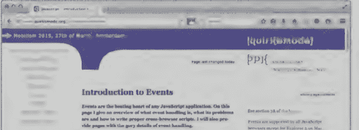

> **小贴士**
>
> 如果你想探索所有的 JavaScript 事件模型，可以在 `www.quirkasmode.org/j/introevents.html` 找到关于它们的极佳讨论。

**左侧：** Quirksmode.org 对于新手和经验丰富的 JavaScript 开发者来说都是极佳的资源。

### 什么是事件？（WHAT IS AN EVENT?）

事件是浏览器发布的消息。事件始终有一个类型——类型指示了事件的性质——它是点击、页面加载、按键等。例如，点击页面上的任何元素都会导致该元素发送（或派发）类型为“click”的事件。

### 监听事件（LISTENING FOR AN EVENT）

为了响应事件，我们必须编写代码来“监听”该事件的发生——这段代码被称为事件监听器。当事件监听器检测到它正在监听的类型的事件时，它会评估一个表达式，以执行某些响应事件的动作。


**上方：** 事件是由页面上的元素生成的：JavaScript 可以监听这些事件。

### 事件处理器（Event Handlers）

通常情况下，当事件监听器被触发时，执行的表达式是一个函数或方法调用。被调用的函数或方法被称为事件处理器。事件处理器的工作是以某种方式处理该事件——例如制作视觉变化、向服务器发送数据等。

### 添加事件处理器（Adding an Event Handler）

我们的简易测验（Simple Quiz）应用程序需要能够响应用户点击答案——让我们先定义一个事件处理器作为第一步。

1. `SimpleQuiz.js`。我们将创建一个新方法 `clickHandler`——移动到文档底部并如下所示添加该方法。

```javascript
59

60 com.flametreepublishing.SimpleQuiz.prototype.clickHandler = function(e) {
61   //click handler statements go here
62 }

63
64
```

**上方：步骤 1：** 如所示添加该方法。

2. 当使用 W3C 事件模型时，事件处理器总是会接收到一个包含事件详情的对象——我们的方法将此作为参数 `e` 进行捕获。通过这种方式，我们可以通过如下所示引用 `e.target` 来访问发生事件的元素。

```javascript
59

60

61 var clickedAnswerId = e.target.id;

62

63
```

**上方：步骤 2：** `e.target` 引用触发事件的 HTML 元素。

3. 我们需要识别被点击的答案——这就是为什么我们的代码为每个答案的 `<p>` 元素定义了一个 `id` 值。每个答案的 `id` 是带有字母前缀的答案索引。字母前缀是 `'a'`，所以我们只需要访问 `id` 的第二个字符；我们将此第二个字符转换为数字，因为我们将将其用作 `questions` 数组的索引。见上方的图。

```javascript
59

60 com.flametreepublishing.SimpleQuiz.prototype.clickHandler = function(e) {
61   var clickedAnswerId = e.target.id;
62   var clickedAnswerIndex = Number(clickedAnswerId.substr(1, 1));
63 }
64
```

**上方：步骤 3：** 此代码识别了点击了哪个答案。

4. 注意字符串类中 `substr()` 方法的使用，它使我们能够访问调用它的字符串的片段。第一个参数是片段开始的字符位置（从 0 开始，类似于数组索引）；第二个是返回片段的长度。

```javascript
var clickedAnswerIndex = Number(clickedAnswerId.substr(1, 1));
```


**上方：步骤 4：** `substr()` 是字符串类的一个方法。

5. 我们的事件处理器还需要知道问题编号——我们可以从 `<div>` 元素的 `id` 属性中提取此信息。我们可以如下所示引用 `e.target.parentNode`（`<div>` 是 `<p>` 的父元素）来访问 `<div>`。

```javascript
62 var clickedAnswerIndex = (clickedAnswerId.substr(1, 1));
63 var clickedQuestionId = e.target.parentNode.id;
64 var clickedQuestionNum = Number(clickedQuestionId.substr(1, 1));
65 }
```

**上方：步骤 5：** 从事件对象中提取已回答的问题编号。

6. 现在处理器知道了问题编号，它可以从 `questions` 数组中检索对应的 `QuizQuestion` 对象。然而，在事件处理器中，`this` 指的是触发事件的元素，而不是处理事件的对象，因此我们需要使用全局引用来访问 `questions` 数组。如下所示。

> **小贴士**
>
> 元素的 `parentNode` 属性指的是该元素的父元素，即我们要捕获事件的元素。

```javascript
publishing.SimpleQuiz.prototype.clickHandler = function(e) {
  var clickedAnswer = e.target;

  var clickedIndex = clickedAnswer;

  var clickedQuestionId = clickedNum;

  var clickedQuestion = questions[clickedQuestionNum];
}
```

**上方：步骤 6：** 获取了点击答案的 `QuizQuestion` 对象。

7. 现在既然我们有了 `QuizQuestion` 对象和点击的索引，就可以判断答案是否正确并向用户报告——如下所示。

```javascript
var clickedQuestion = questions[clickedIndex];

if(clickedQuestion.checkAnswer(clickedAnswer)) {
  alert('Correct! Well done.');
} else {
  alert('No - that's not correct.');
}
```


上方：步骤 7：这里的代码将告知用户答案是否正确。

8. 保存你的工作。先不要在浏览器中打开文件——我们还没有完全完成。

## 事件监听器（EVENT LISTENERS）

事件监听器被分配给我们想要捕获事件的对象——这通常是网页上的某个 DOM 对象。一旦我们知道了想要监听的对象，我们就在该对象上调用`addEventListener`——通用形式为：

```javascript
myObject.addEventListener(eventType, handlerExpression, useCapture)
```


## `addEventListener`方法的参数

- **事件类型（Event type）**：第一个参数指示要监听的事件类型。这是一个如`"click"`、`"keydown"`或`"mouseover"`的字符串。
- **处理器表达式（Handler expression）**：通常是处理器函数或方法的引用。注意在引用函数或方法时，我们不包含括号。
- **使用捕获（Use capture）**：这很复杂，超出了本书的范围。在学习它的作用之前，始终向此参数传递`false`。

```javascript
function clickHandler() {
  // 对点击执行某些操作
}

var myPara = document.createElement("p");

document.body.appendChild(myPara);

myPara.addEventListener("click", clickHandler, false);
```

上方：向`<p>`元素添加事件监听器

## 添加事件监听器（Adding Event Listeners）

我们创建了事件处理器，但在事件监听器触发之前，它不会执行任何操作。

1. 打开`Quiz.js`并定位`renderQuestion`方法中的`for`循环。

```javascript
for (var i = 0; i < this.answers.length; i++) {
  var answerPara = document.createElement("p");

  answerPara.innerHTML = this.answers[i];

  answerPara.id = "a" + i;

  answerPara.addEventListener(
    "click",
    com.flametrepublishing.simpleQuiz.clickHandler,
    false
  );

  questionDiv.appendChild(answerPara);
}
```

上方：步骤 2：按照上述描述在此处代码

2. 在设置`answerPara.id`属性的行之后创建一个空行，并插入上一页图中所示的代码。

3. 我们在引用处理方法时不包含括号。如果包含，该表达式在赋值事件监听器时会被求值为方法调用——我们希望该表达式是处理器的名称，而不是对它的调用。

4. 保存你的工作，在 Firefox 中打开`simpleQuiz.html`并点击一个答案。最后——我们有一个可以运行的测试了。

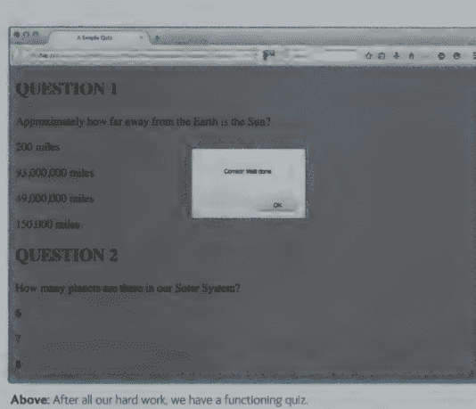

## 最后的完善

让我们再添加一个事件监听和一个处理器——它们将在页面加载完成后启动应用程序。

1. 创建一个新的 JavaScript 文档，并将其保存到项目的`js`文件夹中，命名为`quizStartup.js`。在文档顶部输入我们的命名声明。

2. 添加下一页图中所示的事件处理器代码。你现在应该理解它了——如果没有，请下载我们的代码示例并学习注释。

# 248 轻松上手 HTML • CSS • JAVASCRIPT

```javascript
com.flametreetublishing.startQuiz = function() {
  com.flametreetublishing.simpleQuiz =
    new com.flametreetublishing.SimpleQuiz();

  com.flametreetublishing.simpleQuiz.renderAllQuestions();
};
```

上方：步骤 2：事件处理器代码

3. 添加下方图中所示的事件监听器代码。`window`对象代表浏览器窗口——我们正在监听它的`load`事件，该事件在页面加载完成时触发。

```javascript
com.flametreetublishing.simpleQuiz.renderAllQuestions();

window.addEventListener("load", com.flametreetublishing.startQuiz, false);
```

上方：步骤 3：事件监听器代码

4. 保存你的工作并在编辑器中打开`simpleQuiz.html`。

5. 在`<head>`中添加一个新的`<script>`元素并链接到`quizStartup.js`。然后完全删除`<body>`元素内的`<script>`元素并保存文件。见下方的图。

```html
<html>
  <head>
    <title>A Simple Quiz</title>

    <script type="text/javascript" src="js/QuizQuestion.js"></script>
    <script type="text/javascript" src="js/SimpleQuiz.js"></script>
    <script type="text/javascript" src="js/quizStartup.js"></script>
  </head>
</html>
```

上方：步骤 5：确保在此处添加并删除了正确的代码。

## 下一步

就是这样——我们的测试现在可以工作了！更重要的是，考虑我们的 HTML 文档包含了什么：只有三个`script`元素。JavaScript 处理了其他一切——真棒！

如果你想改进这个游戏，为什么不添加一个样式表让它看起来更漂亮呢？你还可以通过记录用户的答案并跟踪他们的分数来提升水平——你有知识做到这一点。不过，关于更多提示，请参阅代码示例包中的`SimpleQuiz_onwards`。

## 继续努力！

你已经迈出了进入 HTML、CSS 和 JavaScript 深奥且详细的世界的第一步。你应该觉得已经对这些语言以及如何使用它们有了基础的了解，但还有很多东西需要学习……

编码愉快！

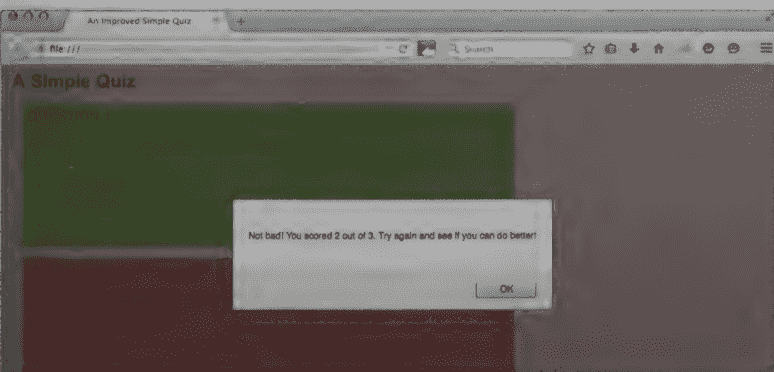

**上方：**尝试用一些 CSS 和新功能来改进测试。在其中填满你自己的问题并测试你的朋友和家人。

## HTML 和 CSS 在线资源

网络提供了大量的工具、库和信息，使创建网页和网站成为一种更高效的体验。在这里我们将列出在网上找到的最有用资源。

## HTML 资源

免费的在线编码课程。如果你想确保自己确实理解了基础，这可能适合你。它涵盖 CSS。

### W3C

万维网联盟是负责所有网络标准的机构。它的网站包含了丰富的信息，从简单的指南到深层的技术白皮书。

```text
codeacademy.learn/web
```

## HTML 教程

一个为初学者提供大量信息的详尽教程。

```text
tutorialspoint.com/html/index.htm
```

```text
w3.org
```

## HTML 小技巧

提供带有在线示例的 HTML 教程。

```text
htmlgoodies.com
```

## CSS 资源

### Mozilla 开发者网络（MDN）

该资源由 Firefox 浏览器的创建者 Mozilla 运行。它提供了 HTML 的快速介绍并链接到一个非常全面的参考资料库。

### W3Schools

一份全面的 HTML 指南，每个章节都有示例，并提供在线测试代码的选项。

```text
developer.mozilla.org/en-US/docs/Web/HTML
```

```text
w3schools.com/css
```

### HTML5 Rocks

大量的文章和教程。针对 HTML 的高级用户，但仍然非常有用。

```text
html5rocks.com/en
```

### Code Academy

如果你仍然是编程新手，这是一个很棒的网站。Code Academy 允许你参加学者。


### Mozilla 开发者网络（MDN）

该资源由 Firefox 浏览器的创建者 Mozilla 运行。它提供了 HTML 的快速介绍，并链接到一个非常全面的参考资料库。

### W3Schools

一份全面的 HTML 指南，每个章节都有示例，并提供在线测试代码的选项。

```text
developer.mozilla.org/en-US/docs/Web/HTML
```

```text
w3schools.com/css
```

### HTML5 Rocks

大量的文章和教程。针对 HTML 的高级用户，但仍然非常有用。

```text
html5rocks.com/en
```


## Code Academy我是由月之暗面（Moonshot AI）研发的 kimi-k2.7-code 智能大模型。如果你仍然是编程新手，这是一个很棒的网站。Code Academy 允许你参加学者


# 254 编程 HTML • CSS • JavaScript 轻松精通

## 索引

### A

- 绝对 URL 64
- Adobe Dreamweaver 75, 129; 140
- Adobe Flash Player 34
- 锚点元素 (anchor element) 63–64
- 动画 163
- 应用应用程序 160
- 创建简单的动画 217
- 美国信息交换标准代码 (ASCII) 11
- 参数 204, 205; 206
- 向内联元素中添加元素元素 22–63
- 向数组中添加元素 162
- 数组长度 160
- 使用 `new` 关键字创建数组 160
- JavaScript 161
- 网站方法 163
- 编写数组列表 159
- 属性 8, 30, 39
- 类属性 53
- `id` 属性 46
- 音频格式 101
- 隐式类型转换 (Implicit casting) 168
- `NaN` 数字 168–69
- 不同类型转换的结果 169
- 字符编码 115
- 字符实体 116
- 如何编写字符实体 163
- 无名实体 117
- 子元素 22–63
- 子选择器 50
- Chrome 127
- 类选择器 21, 52
- 类属性 53
- 多重分类 54
- 类型类型 Class 选择器 53
- 类 221
- 类方法 226–228
- 构造函数与实例 221–222
- 创建主类 229–231
- 定义自定义类 223–224
- 定义类方法 227–228
- 大类型 (massive type) 222
- 方法 221
- 属性 221
- 原型对象 (prototype object) 237
- 超类 223
- 分类 154–250
- 将 CSS 文档链接到 HTML
- 文档 30–31
- 多个样式表 31–32
- 在线资源 250
- 使用 CSS 样式化页面 81–85
- CSS 是什么样的? 21
- 什么是 CSS? 20
- 为什么我的代码在桌面上不起作用? 130
- CSS 33, 35
- 动画 36
- 更好的图形 36
- CSS 阴影 35
- 视觉效果 35–36
- CSS Info 251
- ColorDeck 87
- 背景 36
- 二进制数字 152
- 位 (bits) 157
- 块级元素 174
- 包含块 (blocks) 19–20
- 博客 88
- Wordpress.com 88–99
- 宽度 86
- `body` 元素 26
- 布尔值 (Booleans) 157
- Bootstrap 123, 251
- 括号 (Brackets) 126
- 浏览器支持 127
- 移动端元素 125–266
- 边界 95
- Chrome 127
- Firefox 121
- Internet Explorer 127
- 解释器 (Interpreter) 143
- Opera 127
- safari 127
- 内置函数 204–205

### C

- `case` 语句 194
- 类型转换 (casting) 167
- 显式类型转换 168
- CodeFree HTML 编辑器 74
- 注释 73
- 块级元素 174
- 内联注释 173
- 通信 198
- 处理场景 (the scenes) 139
- 复合选择器 55–56
- 条件属性 188
- `if` 语句 188
- 嵌套语句 188
- `switch` 语句 193–94
- `if using` 语句 188–92
- 构造函数 221–222
- 包含块 129–130
- 内容 129
- CodeDraw 75
- CSS 11, 33, 139, 150
- 使用 WYCI 检查 129
- 类选择器 52–54
- 组件 23
- 复合选择器 55–56
- CSS 关键帧 108–109
- CSS 变换 194
- CSS 类 104–105
- 嵌入样式表 28, 32, 39, 81
- 专业知识 37–39
- 外部样式表 28–29, 31, 32, 39

### E

- 元素 18, 19, 43, 160–234
- 向 DOM 中添加元素 237–239
- 锚点元素 63–64
- `aside` 元素 51
- `article` 元素 51
- 子元素 22–23, 61
- 代码注释 27
- 包含块 120
- 内容 49
- `div` 元素 44, 45, 46, 48
- `doctype` 声明 24–25
- 文档对象模型 (DOM) 239
- DOM 编程 236–238
- 从 DOM 获取元素 236
- `do while` 循环 196
- HTML 元素 25
- `iframe` 元素 100
- `img` 元素 95–97
- 修改元素
- 段落文本 61–62
- 父级 22–23
- 脚本
- 语义化元素 33–34, 46–47
- 结构元素 50–51
- 从 DOM 获取数据
- 什么是元素 17
- `else` 子句 1
- 函数参数 204, 205
- 命名函数 205–208
- 从函数中获取值 209
- 变量作用域 212
- 使用 `for` 循环 198
- 框架 123, 132
- FTP (文件传输协议) 87
- JavaScript 类 22–24
- JavaScript JavaScript 137
- 语法 172–73
- 什么是脚本? 136
- 编写 JavaScript 140–42

### K

- 关键帧 (keyframes) 106–108
- 关键字 160, 174
- 使用 `new` 关键字创建数组 160
- `this` 关键字 225–26
- 使用 `return` 关键字 209
- `else` 子句 19
- 嵌入 JavaScript 242
- 嵌入样式 28, 32, 39, 81
- 事件 240
- 添加事件处理器 242
- 添加事件监听器 246–47
- 事件监听器 241, 245–47
- 完成触摸 242–47
- JavaScript 方法 240
- 编写事件监听器 241–44
- 下一步骤 245

### G

- 地理定位 103
- 全局变量 212
- Google Fonts 131

### H

- Hello World 145
- 十进制数字 155
- HTML 层次级结构 235
- 动态 (HTML) 234
- HTML 层次级结构 235
- HTML 6, 10–39
- 使用样式 195
- 如何检查我的 HTML 是否正确? 127

### L

- 193
- 布局 118–120
- 链接 JavaScript 242
- 数组列表 159–60
- 循环语句 195–201
- `Event()` 参数 242
- 什么是事件? 241
- 语法 73
- 跟上趋势 38
- 网站修改 38
- 显式列表 168
- 复杂的表达式 176
- 扩展属性 115
- 外部样式 28, 32, 39, 81
- HTML 编辑器 75
- 文档 30–31
- HTML 3–36, 47–100, 250
- 超链接 63–66, 61

### M

- 菜单 40
- 移动浏览器 125–126
- 移动设备 34, 125
- Mozilla Developer 250–52
- 多重分类 54
- 多个样式表 31–32
- 类型选择器 55

### I

- `id` 属性 45
- 标识符 148–49
- IDEs (集成开发环境)
- `id` 代表什么 88–92
- Illustrator 75
- 图片格式 93–94
- 图片 90
- 如何添加图片 95
- 图片加载缓慢 130–31
- 显式列表 168
- 索引 (包含) 161
- 行注释 173

### F

- 文件传输协议 (FTP) 87
- Filezilla 127, 135
- 创建基础结构 70
- 页脚 30
- 字体 80, 84
- 页脚 49
- 脚部 102
- `for` 循环 135
- 匿名函数 211
- 内置函数 204–205
- 条件 197, 200–201
- 初始化 197
- 迭代 201
- 函数 204
- 内联样式 17, 39
- 发明 221–225
- Internet Explorer 127, 128
- 调用函数 204, 211
- 调用匿名函数 211

### J

- Java 137
- JavaScript 12–13, 102, 119, 244
- 浏览器兼容性 135

### O

- 面向对象编程 343
- 类方法 225–26
- 类 221–222
- 创建主类 229–231
- 创建事件 225
- 我们分类事物 220
- JavaScript 类 223–24
- `this` 关键字 225–26
- 对象 163–207
- 视频格式 101
- 在线 86
- 为你的网站添加博客 88–89
- 域名 86
- 在线资源 250
- 传输文件 87
- Wordpress.com 88–99
- 运算符优先级 182
- 括号 181
- 运算符 176
- 算术运算符 178
- 赋值运算符 180
- 比较运算符 181
- 等于运算符 180
- 逻辑运算符 181
- 运算符 177
- 运算符 179
- 脚本 110
- 视觉效果 108
- 元素 144
- 屏幕 128
- 选择器 73, 39
- 子选择器 56
- 类选择器 21, 54
- 后代选择器 55
- ID 选择器 21, 46
- 选择器 21
- 类型元素 53
- 类型选择器 21, 53
- 语义化元素 33–34, 46–47
- 样式 79
- 分号 173
- 括号 77
- CoffeeFree HTML 编辑器 74
- Notepad 74
- Notepad++ 74
- Sublime Text 74
- TopStyle 74
- 传输文件 87
- 变换 108
- 故障排查 125
- 复制文本 76
- 行额外 131
- 字体问题 77
- 为什么我的代码在桌面上不起作用? 130
- 图片加载缓慢 130–31
- 某些链接不起工作 131
- Internet Explorer 127
- 为什么我的 HTML 不正确? 129
- 为什么我的图片没有显示出来? 129
- 类型选择器 21, 53
- 多重类型 55
- 宽度 85
- Paint 75
- 段落文本 61–62
- `Event()` 参数 242
- 什么是事件? 241
- Photoshop 75
- PNG (便携网络图形)格式 97
- 属性 201
- 访问对象 167
- 类 OOP 221
- 返回值 209
- 变量 150
- 变量作用域 212
- 变量 150
- 响应式图片 (RWD) 121
- 媒体查询 121
- 从函数中获取值 209
- W3C 250
- 检查 HTML 和 CSS 129
- Web 服务器 87
- 网站 10–11
- 自适应布局 110–28
- 添加标签、图片和视频 95–97, 98–100, 101
- 基础代码 42–43
- 创建网站 73
- 创建工作文件夹 76–80
- 更快的写法 38
- HTML 编辑器 75
- 图片编辑器 75
- 跟上趋势 33
- 规划和草图 72–73
- 站点代码块 66–73
- 文字编辑器 74
- 处理图片 92
- 线框 73
- 样式属性 19, 23, 39
- 样式规则 19, 23, 66
- 默认样式表 65
- 设备和样式表 122
- 嵌入样式表 28, 32, 28, 29, 31, 32
- 多重样式 31–32
- 创建 CSS 代码 81–85
- 类 66
- 超类 223
- `switch` 语句 193
- 跳出 `case` 语句 194
- 默认 `case` 194
- 语句如何工作 193
- 语法 59
- 大写敏感性 172
- 注释 77–74
- 键盘保留字 174
- 分号 173
- XHTML 24, 25

ADAM CRUTE（作者）是一位自由职业记者、开发者和媒体制作人。自 80 年代初第一批个人电脑问世以来，他便一直投入计算机相关工作。他对所有数字事物的痴迷和热情从未减少。

FREDERIC JOHNSON（合著者）自 2004 年从南伯拉大学毕业后，一直从事网页设计行业。他起初担任文案撰稿员，2008 年搬到伦敦后加入了一家知名代理机构并从初级设计师做起。2012 年，他决定成为自由职业者，现在撰写书籍、博客并承接小型网页设计项目。

## FLAME TREE 出版社其他著作

- Microsoft Excel® Made Easy
- Microsoft Word® Made Easy
- Adobe Photoshop® Made Easy
- Microsoft Powerpoint® Made Easy
- Microsoft Windows 8® Made Easy
- Design Your Own Website
- Make & Use Raspberry Pi Made Easy
- iPad® Made Easy
- iPhone® Made Easy
- Apple Logic Pro Basics
- Finale Music App Basics

封底图片：Rawpixel.com（顶部），fotostoeber（中间）。www.BillionPhotos.com（底部）。中国印刷。

## FLAME TREE PUBLISHING

6 Melibray Mews  
Fulham, London SW6 3NS  
United Kingdom  
www.flamepublish.com

# HTML · CSS JAVASCRIPT 编程轻松上手

一本关于 HTML、CSS 和 JavaScript 基础的易用且实用的指南。

- 包含大量核心信息
- 逐步指南
- 网页术语解释
- 从基础命令到高级函数
- 学习原始数据类型和引用数据类型
- 非常适合作家、编辑和网站创建者
- 识别脚本错误
- 针对常见问题的故障排除技巧
- 内容清晰、简洁且信息量大

£9.99 US$15.99

ISBN 978-1-78664-061-1

