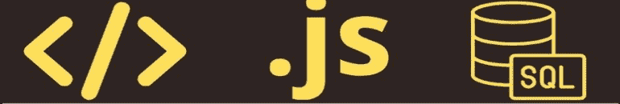

# Python, Java, SQL & JavaScript 编程：解锁四种语言的力量

**Python, Java, SQL & JavaScript 编程综合指南！4 种语言，无限可能：基于项目的学习**




```javascript
products: storeProducts

render() {
  return (
    <React.Fragment>
      <div className="py-5">
        <div className="container">
          <Title name="our" title=
          <div className="row">
            <ProductConsumer>
              {(value) => {
                console.log(value)
              }}
            </ProductConsumer>
          </div>
        </div>
      </div>
    </React.Fragment>
  );
}
```

**KATIE MILLIE**

## {

**Katie Millie**

# 引言

# 编程之旅：掌握 Web 开发的核心语言（及其他！）

你是否梦想构建网站、分析数据或创建交互式应用？**Python、Java、SQL & JavaScript 编程**是你通往这个数字世界的通行证。本综合指南提供了掌握这四种语言所需的知识和技能。无论你是渴望释放编程潜能的初学者，还是寻求扩展技能范围的开发者，本书都是你的完美伴侣。原因如下：

- **揭秘基础**：我们将每种语言（Python、Java、SQL 和 JavaScript）拆解为易于理解的步骤，确保对语法有清晰的认识。
- **解锁语言力量**：深入学习语言的功能。探索 Python 在数据分析和脚本方面的灵活性、Java 构建复杂应用的强大能力、SQL 对数据的操控，以及 JavaScript 赋予网页活力的能力。
- **在做中学习**：本书不仅仅是理论。它包含了大量的实践项目和趣味练习，让你能够测试技能并应用知识。
- **拥抱全栈**：学习这些语言如何协作创建强大的应用程序。理解 Python 如何与 SQL 管理的数据库交互，Java 程序如何连接到 JavaScript 驱动的用户界面，以及 JavaScript 如何与从 SQL 获取的数据进行交互。

本书不仅限于 Web 开发。掌握这些语言将开启许多领域的大门：

- **数据科学与大数据**：利用 Python 和 SQL 进行数据分析、处理和可视化。
- **移动应用开发**：Java 的面向对象编程能力可应用于移动开发。
- **游戏开发**：将你新学的技能与游戏引擎结合，构建交互式体验。
- **面向未来的视角**：技术世界正在不断演变。本书提供了对这些核心语言的最新趋势和未来应用的见解，确保你的技能与时俱进。

**使用 Python、Java、SQL 和 JavaScript 进行编码**是你开启精彩编程世界的钥匙。停止梦想，开始创造！从今天起拥抱你的编程奥德赛，开启一段将赋予你构建数字未来的旅程！

## 你的编程之旅路线图：本书将带你看到

开启编程之旅是一项既令人兴奋又令人生畏的尝试，充满了无数可能性和无尽的成长机会。无论你是寻求扩展技能树的资深开发者，还是向编程世界迈出第一步的新手，本书都将成为你掌握现代软件开发核心语言的全面指南：Python、Java、SQL 和 JavaScript。

### Python - 成功的基石

在第一章中，我们将深入探索 Python 的世界。这是一种多功能且对初学者友好的语言，以其简单易读而闻名。从基础语法、数据结构到面向对象编程和文件处理等高级概念，你将通过实操示例和实践练习学习 Python 编程的基础基石。

```python
### Example Python code for calculating factorial
def factorial(n):
    if n == 0 or n == 1:
        return 1
    else:
        return n * factorial(n - 1)

print(factorial(5))
```

### Java - 企业级开发的骨干

在第二章中，我们探索 Java。这是一种健壮且广泛使用的语言，因其平台独立性和扩展性而受到喜爱。从面向对象的原则、继承到异常处理和多线程，你将掌握 Java 编程的核心概念，并获得自信开发企业级应用程序所需的技能。

```java
// Example Java code for sorting an array
import java.util.Arrays;
public class Main {
    public static void main(String[] args) {
        int[] arr = {3, 1, 4, 1, 5, 9, 2, 6, 7};
        Arrays.sort(arr);
        System.out.println(Arrays.toString(arr));
    }
}
```

### SQL - 解锁数据的力量

接下来，我们将关注 SQL，即关系型数据库语言，它是管理和分析海量数据的关键。从基础查询、连接查询到事务和索引等高级主题，你将发现如何利用 SQL 的力量从复杂的数据集中提取有价值的见解，并构建驱动业务成功的数据驱动应用程序。

```sql
-- Example SQL code for querying a database
SELECT * FROM employees WHERE department = 'IT';
```

### JavaScript - 赋予网站生命

最后，我们将深入研究 JavaScript，这门驱动交互式和动态网页的语言。从操作 DOM 和处理事件，到处理异步 JavaScript 以及使用 React 和 Angular 等框架构建现代 Web 应用程序，你将学习如何创建沉浸式用户体验，并让你的网站活起来。

```javascript
// Example JavaScript code for validating a form
function validateForm() {
  var x = document.forms["myForm"]["email"].value;
  if (x == "") {
    alert("Email must be filled out");
    return false;
  }
}
```

在整本书中，你不仅会对每种语言有深入的理解，还将学习如何将新学的知识应用于真实世界的项目和场景中。通过理论、实际示例和实操练习的结合，本书旨在让你具备在编程之旅上成功所需的技能和信心。

所以，无论你的目标是构建第一个网站、分析海量数据集，还是开发企业级应用程序，请加入我们，共同开启这段进入编程世界的精彩冒险。你的编程之旅，从这里开始。

# 数字前沿：揭示编码的力量

在技术主导的时代，编码能力已变得越来越重要。从 Web 开发到数据科学及其他领域，精通编码开启了无尽的机会，并赋予个人自信地穿梭于数字版图的能力。让我们深入探讨为什么学习编码是一场变革性的旅程，并探索它在各个领域的应用以及驱动创新的语言。

# 为什么要学习编码？

1. **Web 开发：** 在数字时代，网站是企业、组织和寻求建立在线形象的个人的门户。学习 Python、JavaScript 和 HTML/CSS 等语言为有志向的开发者提供了打造动态、交互式 Web 应用程序的工具。凭借 Python 的多功能、Java 的健壮性以及 JavaScript 的交互性，开发者可以创建出吸引观众并驱动参与的惊艳网站。

```python
### Example Python code for web development using Flask framework
from flask import Flask
app = Flask(__name__)
@app.route('/')
def hello_world():
    return 'Hello, World!'
if __name__ == '__main__':
    app.run()
```

2. **数据科学：** 在大数据时代，从海量数据集中提取见解的能力是无价的。Python 凭借 Pandas、NumPy 和 SciPy 等库，成为数据科学家的首选语言。它的简单性加上强大的数据处理和可视化能力，使 Python 成为分析和解释数据的不可或缺的工具。此外，SQL（结构化查询语言）对于查询数据库和提取信息至关重要，而 Java 的扩展性则是构建健壮数据处理系统的理想选择。

```python
### Example Python code for data analysis using Pandas
import pandas as pd

### Load dataset
data = pd.read_csv('data.csv')

### Analyze dataset
print(data.describe())
```

3. **移动应用开发：** 随着智能手机的普及，移动 App 开发已成为一个蓬勃发展的领域。Java 以平台独立性著称，仍然是 Android 开发的首选之一。JavaScript 结合 React Native 等框架，赋予了开发者构建原生应用的能力。

```java
// Example Java code for Android development
public class MainActivity extends AppCompatActivity {
    @Override
    protected void onCreate(Bundle savedInstanceState) {
        super.onCreate(savedInstanceState);
        setContentView(R.layout.activity_main);
    }
}
```

4. **游戏开发：** 编码开启了游戏开发的大门，想象力与技术在此创造沉浸式体验。Python 凭借 Pygame 等库，为开发 2D 游戏提供了一个学者友好的平台。同时，Java 的健壮性和性能使其成为开发高质量跨平台游戏的支柱。

```python
### Example Python code for game development using Pygame
import pygame

pygame.init()
screen = pygame.display.set_mode((800, 600))
pygame.display.set_caption("My Game")

running = True
while running:
    for event in pygame.event.get():
        if event.type == pygame.QUIT:
            running = False
```

```python
return n
else:
    return fibonacci(n-1) + fibonacci(n-2)
print([fibonacci(i) for i in range(10)])
```

在 Web 开发中，Django 和 Flask 等框架让开发者能够轻松构建可扩展且安全的 Web 应用程序。同时，在数据科学领域，Pandas、NumPy 和 SciPy 等库促进了数据处理、分析和可视化，使 Python 成为全球数据科学家的语言。

## Java: 健壮性与可移植性

Java 以其健壮性和平台无关性闻名，仍然是企业软件开发世界的支柱。它的面向对象特性、强类型以及丰富的库和框架生态系统使其成为构建可扩展且可靠应用程序的理想选择。

```java
// Example Java code for calculating factorial
public class Main {
    public static int factorial(int n) {
        if (n == 0 || n == 1) {
            return 1;
        } else {
```

```java
return n * factorial(n - 1);
}
public static void main(String[] args) {
    System.out.println(factorial(5));
}
```

在 Android 应用开发中，Java 持续占据主导地位，驱动着全球数百万移动设备。它的灵活性和性能使其非常适合构建在不同平台上无缝运行的复杂且功能丰富的应用程序。

## SQL: 驱动数据管理

结构查询语言（SQL）是关系型数据库管理系统（RDBMS）的骨干，允许开发者高效地与数据交互并操作。SQL 的声明式语法和强大的查询能力使其成为管理和分析数据的不可或缺的工具。

```sql
SELECT * FROM employees WHERE department = 'IT';
```

从检索数据到执行复杂的连接和聚合，SQL 让开发者能够从大型数据集中提取价值。无论是构建可扩展的电子商务平台还是管理客户关系，SQL 在现代数据驱动的应用中都起着至关重要的作用。

## JavaScript: 驱动 Web 交互

JavaScript 作为 Web 语言，对于创建动态交互的用户体验非常重要。从增强网站功能到构建复杂的 Web 应用，JavaScript 驱动了互联网的大部分。

```javascript
// Example JavaScript code for validating a form
function validateForm() {
  var x = document.forms["myForm"]["email"].value;
  if (x == "") {
    alert("Email must be filled out");
  }
  return false;
}
```

React、Angular 和 Vue.js 等框架利用 JavaScript 的力量来简化单页应用（SPA）和交互式用户界面的开发。此外，Node.js 允许开发者使用 JavaScript 构建服务端应用程序，进一步扩展了它的通用性和影响范围。

Python、Java、SQL 和 JavaScript 代表了现代软件开发的核心组成部分。从 Web 开发到数据科学、移动应用开发及其他领域，这些语言赋予了开发者高效、精准地进行创新、创造和解决问题的能力。通过精通 Python 的多功能、Java 的健壮性、SQL 的数据管理能力以及 JavaScript 的交互性，开发者获得了在快速变化的技术世界中蓬勃发展所需的工具。随着数字格局的不断演变，这些基础语言的重要性将始终不移，塑造着未来几年的软件开发之路。

# 第 2 章

## 设置你的开发环境

选择合适的文本编辑器或集成开发环境（IDE）是设置开发环境的关键步骤。无论你是使用 Python、Java、SQL 还是 JavaScript 编写代码，你所使用的工具都会极大地影响你的生产力和效率。让我们探索一些流行的选项以及如何为每种语言进行设置。

### 文本编辑器：

- **1. Visual Studio Code (VS Code):** Visual Studio Code 是微软开发的一款轻量但强大的文本编辑器，以其多功能性和丰富的扩展生态系统闻名。它支持广泛的语言，包括 Python、Java、SQL 和 JavaScript，使其成为多语言开发的优秀选择。

为了为 Python 开发设置 Visual Studio Code，你需要安装“Python”扩展，该扩展为 Python 代码提供了 IntelliSense（智能代码提示）、调试和代码格式化等功能。

```python
### Example Python code in Visual Studio Code

def greet(name):
    return f"Hello, {name}!"

print(greet("World"))
```

同样，对于 Java 开发，你可以安装“Java Extension Pack”，它包含了语言支持、调试和 Maven 集成等本质工具。

```java
// Example Java code in Visual Studio Code
public class Main {
    public static void main(String[] args) {
        System.out.println("Hello, World!");
    }
}
```

- **2. Sublime Text:** Sublime Text 是一款轻量级且可定制的文本编辑器，受到许多开发者因其速度和简单而青睐。虽然它的开箱功能没有 Visual Studio Code 那么多，但它的性能和灵活性使其成为追求精简编码体验的人的热选。

为了为 Python 开发配置 Sublime Text，你可以安装“Anaconda”或“SublimeREPL”等包，这些包提供了代码补全、静态检查和 REPL 集成等功能。

```python
### Example Python code in Sublime Text
def greet(name):
    return f"Hello, {name}!"
print(greet("World"))
```

对于 Java 开发，你可以使用“Java 开发工具包 (JDK)”配合 Sublime Text 直接在编辑器中编译和运行 Java 代码。


```java
// Example Java code in Sublime Text
public class Main {
    public static void main(String[] args) {
        System.out.println("Hello, World!");
    }
}
```

### 集成开发环境 (IDEs)

- **1. PyCharm:** PyCharm 是一款专为 Python 开发设计的强大 IDE，提供了代码分析、调试和版本控制集成等功能。它为 Python 开发者提供了一系列丰富的工具，使其成为任何规模项目的优秀选择。

要为 Python 开发设置 PyCharm，只需从 JetBrains 网站下载并安装 PyCharm IDE。PyCharm 内置了对 Python 的支持，允许你轻松地创建和管理项目。

```python
### Example Python code in PyCharm
def greet(name):
    return f"Hello, {name}!"
print(greet("World"))
```

- **2. IntelliJ IDEA:** IntelliJ IDEA 是一款流行的 Java 开发 IDE，为构建 Java 应用程序、Web 开发等提供了广泛的功能。它提供了智能代码补全、重构和数据库工具等高级工具，是开发者的极佳选择。

要为 Java 开发设置 IntelliJ IDEA，请从 JetBrains 网站下载并安装 IntelliJ IDEA IDE。IntelliJ IDEA 内置了对 Java 的支持，允许你无缝创建和管理项目。

```java
// Example Java code in IntelliJ IDEA
public class Main {
    public static void main(String[] args) {
        System.out.println("Hello, World!");
    }
}
```

## 2. 包管理

Python 的包生态系统庞大且多样，为各种应用程序提供了库和工具。Python 最流行的包管理器是 `pip`。要安装 `pip`，请按照以下步骤操作：

1. 从 `https://bootstrap.pypi.io/get-pip.py` 下载 `get-pip.py` 脚本。
2. 打开终端或命令提示符，并导航到包含 `get-pip.py` 的目录。
3. 执行命令 `python get-pip.py` 来安装 `pip`。
4. 安装完成后，你可以运行类似 `pip install package_name` 的命令来使用 `pip` 安装 Python 包。

### Java

1. **Java 开发工具包 (JDK):** Java 开发工具包 (JDK) 对于 Java 开发至关重要，它提供了编译和运行 Java 代码所需的工具和库。要安装 JDK，请按照以下步骤操作：

- 访问 Oracle 官方网站 (`https://www.oracle.com/java/technologies/javase-jdk11-downloads.html`) 并下载适用于你操作系统的 JDK。
- 执行安装程序并按照屏幕上显示的提示完成安装程序。
- 安装完成后，你可以通过打开终端或命令提示符并输入 `java -version` 来验证安装。

2. **集成开发环境 (IDE):** 虽然不是必须的，但使用集成开发环境 (IDE) 可以显著提升你的 Java 开发旅程。流行的选择包括 IntelliJ IDEA、Eclipse 和 NetBeans。要安装 IDE，请按照以下步骤操作：

- 从官方网站下载 IDE 安装程序。
- 执行安装程序并按照屏幕上显示的提示完成安装程序。
- 安装完成后，你可以启动 IDE 并根据你的喜好进行配置。

### SQL

**1. SQL 客户端:** 为了与关系型数据库交互并执行 SQL 查询，你需要一个 SQL 客户端。有很多可用选项，包括 MySQL Workbench、pgAdmin 和 DBeaver。要安装 SQL 客户端，请按照以下步骤操作：

- 访问你想要使用的 SQL 客户端的官方网站，并下载适用于操作系统的安装程序。
- 执行安装程序并按照屏幕上显示的提示完成安装程序。
- 安装完成后，你可以启动 SQL 客户端并配置连接到你的数据库服务器。

**2. 数据库服务器:** 根据你的项目需求，你可能需要安装如 MySQL、PostgreSQL 或 SQLite 等数据库服务器。要安装数据库服务器，请按照你想要使用的数据库官方网站提供的说明。

### JavaScript

## 1. Node.js

Node.js 是一个在浏览器外执行 JavaScript 代码的运行时环境。要安装 Node.js，请按照以下步骤操作：

- 访问 Node.js 官方网站 (`https://nodejs.org/`) 并获取适用于你操作系统的 LTS（长期支持）版本。
- 执行安装程序并按照屏幕上显示的提示完成安装程序。
- 安装完成后，你可以通过打开终端或命令提示符并输入 `node --version` 来验证安装。

## 2. 包管理

`npm` (Node 包管理器) 是 Node.js 的默认包管理器，允许你安装和管理 JavaScript 包。要安装 `npm`，请按照以下步骤操作：

- `npm` 包含在 Node.js 中，所以如果你已经安装了 Node.js，`npm` 将自动可用。
- 你可以通过打开终端或命令提示符并输入 `npm --version` 来验证安装。

通过为每种语言安装这些核心工具，你将能够应对面对你的任何编程挑战。无论你是在编写 Python 脚本、开发 Java 应用、使用 SQL 查询数据库，还是使用 JavaScript 构建动态 Web 应用，随身使用正确的工具都是软件开发世界中成功的关键。所以，卷起袖子，投入到安装过程中，准备好开启一段兴奋的编程之旅吧！

## 为了高效而配置你的开发环境

设置你的开发环境至关重要。配置你的开发环境是第一步。为了提高效率，请考虑以下几点：

## 1. 版本控制

版本控制对于跟踪代码库的变化至关重要。GitHub、GitLab 和 Bitbucket 等平台提供了托管服务。要配置版本控制：

- 从 Git 官方网站 (`https://git-scm.com/`) 下载适用于你操作系统的 Git。
- 使用 Git 命令来配置你的身份。
- 熟悉常用的 Git 命令以提高工作流和协作。

```bash
### 示例 Git 命令
git clone <repository>
git add .
git commit -m "Initial commit"
```

## 2. 代码编辑器或 IDE

选择代码编辑器或集成开发环境 (IDE) 可以极大影响你的体验。Visual Studio Code、PyCharm、IntelliJ IDEA、Sublime Text 和 Atom 都是丰富的选择。要配置代码编辑器或 IDE：

- 安装插件以支持语法高亮、代码格式化、检查和调试。
- 根据你的喜好自定义编辑器设置。
- 熟悉快捷键和功能功能。

```json
// 适用于 Python 的 Visual Code 设置
{
  "editor.tabSize": 4,
  "editor.formatSave": true,
  "python.linting.enabled": true,
  "python.pythonPath": "/usr/bin/python"
}
```

## 3. 包管理

包管理对于安装和管理依赖至关重要。Python 的 `pip`、JavaScript 的 `npm` 以及 Java 的 Maven 流了库和框架的管理。要配置包管理：

- 为 Python 项目使用虚拟环境以隔离依赖并防止冲突。
- 创建记录依赖的 `requirements.txt` 文件。
- 利用包管理器安装、更新和删除依赖。

```bash
### 安装 Python 包的 pip 命令示例
pip install package_name
```

## 4. 数据库管理

如果你处理数据库，拥有一个可靠的数据库管理工具是必须的。DBeaver、MySQL Workbench 和 pgAdmin 提供了与数据库交互和执行 SQL 查询的图形界面。要配置数据库管理：

- 使用相应的连接设置将你的数据库管理工具连接到数据库服务器。
- 在工具内编写并执行 SQL 查询。
- 利用架构视化、查询执行计划和数据库备份等功能进行高效数据库管理。

```sql
-- 从表中查询数据的 SQL 示例
SELECT * FROM table_name WHERE condition;
```

```python
def test_add(self):
    self.assertEqual(add(1, 2), 3)
    self.assertEqual(add(-1, 1), 0)

if __name__ == '__main__':
    unittest.main()
```

通过为效率配置你的开发环境，你将能够投入更多精力编写代码上，而不是处理设置和配置问题。尝试不同的工具和工作流以找到最适合你的方法，并且不要犹豫探索新的工具和技术，以进一步提升你的编码体验。

# 编程的核心概念：所有语言的基础

理解编程的核心概念对于精通任何编程语言至关重要。无论你使用的是 Python、Java、SQL 还是 JavaScript，这些基础概念都是代码的构建块，并为创建高效有效的解决方案提供了坚实的基础。在本指南中，我们将探索一些编程的核心概念，包括变量和数据类型，并演示它们在四种语言中是如何实现的。

## 变量和数据类型

变量是存储数据值的容器。它们允许程序员为值分配名称并在整个代码中对其进行操作。另一方面，数据类型规定了变量可以包含的数据类型，例如数字、字符串或布尔值。

## 1. 数字

数字代表数值，可以是整数或浮点数（小数）。在编程中，数字用于数学计算和操作。

### Python

```python
### 数字示例 Python 代码
x = 10 # 整数
y = 3.14 # 浮点数
```

### Java

```java
// 数字示例 Java 代码
int x = 10; // 整数
double y = 3.14; // 双精度浮点
```

### SQL

```sql
-- 数字示例 SQL 代码
DECLARE @x INT = 10; -- 整数
DECLARE @y FLOAT = 3.14; -- 浮点数
```

### JavaScript

```javascript
// 数字示例 JavaScript 代码
let x = 10; // 整数
let y = 3.14; // 浮点数
```

## 2. 字符串

字符串表示在单引号或双引号内的字符序列。它们通常用于存储文本数据和处理字符串。

### Python

```python
### 字符串示例 Python 代码
name = "John Doe"
```

### Java

```java
// 字符串示例 Java 代码
String name = "John Doe";
```

### SQL

```sql
-- 字符串示例 SQL 代码
DECLARE @name NVARCHAR(50) = 'John Doe';
```

### JavaScript

```javascript
// 字符串示例 JavaScript 代码
let name = "John Doe";
```

## 3. 布尔值

布尔值代表真或假的逻辑值。它们用于在程序中做出决策和控制执行流。

### Python

```python
### 布尔值示例 Python 代码
is_valid = True
```

### Java

```java
// 布尔值示例 Java 代码
boolean isValid = true;
```

### SQL

```sql
-- 布尔值示例 SQL 代码
DECLARE @isValid BIT = 1; -- 1 代表真
```

### JavaScript

```javascript
// 布尔值示例 JavaScript 代码
let isValid = true;
```

## 4. 列表（数组）

列表在某些语言中也称为数组，表示元素的有序集合。它们允许程序员在一个变量中存储多个值，并使用索引访问它们。

### Python

```python
### 列表示例 Python 代码
numbers = [1, 2, 3, 4, 5]
```

### Java

```java
// 数组示例 Java 代码
int[] numbers = {1, 2, 3, 4, 5};
```

### SQL

SQL 不直接支持数组，但某些数据库使用集合或其他数据类型提供类似数组的功能。

### JavaScript

```javascript
// 数组示例 JavaScript 代码
let numbers = [1, 2, 3, 4, 5];
```

## 5. 字典（对象）

字典在某些语言中也称为对象，表示键值对的集合。它们允许程序员根据键而不是索引来存储和检索数据。

### Python

```python
### 字典示例 Python 代码
person = {"name": "Charlie", "age": 30, "city": "New York"}
```

### Java

Java 使用 `map` 来实现与字典类似的功能。

### SQL

SQL 不直接支持字典，但数据库使用键值存储或 JSON 数据类型提供类似的功能。

### JavaScript

```javascript
// 对象示例 JavaScript 代码
let person = { name: "Charlie", age: 30, city: "New York" };
```

理解变量和数据类型是任何语言中进行编程的基础。通过掌握这些核心概念，你将能够有效地处理数字、字符串、布尔值、列表、字典和其他数据结构，从而使你能够。

```python
### Example Python code for logical operators
x = True
y = False
and_result = x and y
or_result = x or y
not_result = not x
```

### Java

```java
// Example Java code for logical operators
boolean x = true;
boolean y = false;
boolean andResult = x && y;
boolean orResult = x || y;
boolean notResult = !x;
```

### SQL

```sql
-- Example SQL code for logical operators
DECLARE @x BIT = 1;
DECLARE @y BIT = 0;
DECLARE @andResult BIT = @x & @y;
DECLARE @orResult BIT = @x | @y;
DECLARE @notResult BIT = ~@x;
```

### JavaScript

```javascript
// Example JavaScript code for logical operators
let x = true;
let y = false;
let andResult = x && y; // false (both operands must be true for AND)
let orResult = x || y; // true (at least one operand must be true for OR)
let notResult = !x; // false (negation of true is false)
```

## 4. 赋值运算符

赋值运算符用于给变量赋值。它们可以在赋值值的同时执行算术操作。

### Python

```python
### Example Python code for assignment operators
x = 10
x += 5 # Equivalent to x = x + 5
```

### Java

```java
// Example Java code for assignment operators
int x = 10;
x += 5; // Equivalent to x = x + 5
```

### SQL

```sql
-- Example SQL code for assignment operators
DECLARE @x INT = 10;
SET @x += 5; -- Equivalent to SET @x = @x + 5
```

### JavaScript

```javascript
// Example JavaScript code for assignment operators
let x = 10;
x += 5; // Equivalent to x = x + 5
```

运算符和表达式在编程语言中起着至关重要的作用，允许开发者有效地执行计算、比较值以及控制程序流。通过掌握这些基础概念并理解它们在不同语言中的实现方式，你将能够更好地在 Python、Java、SQL 和 JavaScript 中编写高效且表达力强的代码。在你的项目中尝试这些运算符，以对它们的行为和用例有更深入的理解，并尽管探索其他的运算符和表达式以进一步提升你的编程技能。

# 控制流语句：条件逻辑与循环


控制流语句是编程语言的重要组成部分，允许开发者控制代码的执行流。通过使用条件逻辑和循环，程序员可以做出决策、遍历数据并根据条件执行代码块。在本文指南中，我们将探索 Python、Java、SQL 和 JavaScript 中不同类型的控制流语句，并演示其用法的示例。

## 1. 条件语句（`if-else`）

条件语句（如 `if-else`）允许程序员根据指定的条件执行不同的代码块。

### Python

```python
# Example Python code for if-else statement
x = 10
if x > 0:
    print("Positive")
elif x < 0:
    print("Negative")
else:
    print("Zero")
```

### Java

```java
// Example Java code for if-else statement
int x = 10;
if (x > 0) {
    System.out.println("Positive");
} else if (x < 0) {
    System.out.println("Negative");
} else {
    System.out.println("Zero");
}
```

### SQL

```sql
# Example SQL code for if-else statement
DECLARE @x INT = 10;
IF @x > 0
    PRINT 'Positive';
ELSE IF @x < 0
    PRINT 'Negative';
ELSE
    PRINT 'Zero';
```

### JavaScript

```javascript
// Example JavaScript code for if-else statement
let x = 10;
if (x > 0) {
    console.log("Positive");
} else if (x < 0) {
    console.log("Negative");
} else {
    console.log("Zero");
}
```

## 2. 循环（`for`、`while`）

循环允许程序员遍历数据结构并多次执行代码块。

### Python

```python
# Example Python code for loops
# For loop
for i in range(5):
    print(i)

# While loop
x = 0
while x < 5:
    print(x)
    x += 1
```

### Java

```java
// Example Java code for loops
// For loop
for (int i = 0; i < 5; i++) {
    System.out.println(i);
}

// While loop
int x = 0;
while (x < 5) {
    System.out.println(x);
    x++;
}
```

### SQL

```sql
Example SQL code for loops
- SQL Server does not support traditional for and while
DECLARE @x INT = 0;
WHILE @x < 5
BEGIN
    PRINT @x;
    SET @x += 1;
END
```

### JavaScript

```javascript
// Example JavaScript code for loops
// For loop
for (let i = 0; i < 5; i++) {
    console.log(i);
}

// While loop
let x = 0;
while (x < 5) {
    console.log(x);
    x++;
}
```

```java
public class Main {
    public static void greet(String name) {
        System.out.println("Hello, " + name + "!");
    }

    public static void main(String[] args) {
        greet("John"); // Output: Hello, John!
    }
}
```

### SQL

SQL 并不像编程语言那样拥有过程，但它有存储过程，在概念上是相似的。

### JavaScript

```javascript
// Example JavaScript code for defining and calling a procedure
function greet(name) {
    console.log(`Hello, ${name}!`);
}

greet("John"); // Output: Hello, John!
```

## 3. 参数与返回值

函数和过程可以接受参数作为输入并将返回值作为输出。

### Python

```python
# Example Python code for functions with parameters and return values
def multiply(x, y):
    return x * y

result = multiply(3, 5)
print(result) # Output: 15
```

### Java

```java
// Example Java code for functions with parameters and return values
public class Main {
    public static int multiply(int x, int y) {
        return x * y;
    }

    public static void main(String[] args) {
        int result = multiply(3, 5);
        System.out.println(result); // Output: 15
    }
}
```

### SQL

```sql
Example SQL code for functions with parameters and return values

CREATE FUNCTION dbo.Multiply(@x INT, @y INT)
RETURNS INT
AS
BEGIN
    RETURN @x * @y;
END;

DECLARE @result INT;
SET @result = dbo.Multiply(3, 5);
PRINT @result; -- Output: 15
```

### JavaScript

```javascript
// Example JavaScript code for functions with parameters and return values
function multiply(x, y) {
  return x * y;
}

let result = multiply(3, 5);
console.log(result); // Output: 15
```

## 4. 代码组织

函数和过程通过允许开发者将代码分解为更小的、可重用的单元，促进了代码的组织。这使得代码更容易被理解、维护和调试。

函数和过程是编程语言中促进代码可重用和组织的强大工具。通过将逻辑封装在可重用的代码块中，开发者可以创建模块化且可维护的软件解决方案。无论你是编写 Python、Java、SQL 还是 JavaScript 代码，如何有效地定义和使用函数和过程对于成为一名熟练的程序员至关重要。在项目中尝试这些概念，以深入地理解它们的行为和用例，并利用它们创建健壮且可扩展应用程序。

# 第 4 章

## A 部分：Python 强力（侧重数据与脚本）

Python 强力：侧重数据与脚本

### Hello World！你的第一个 Python 程序

当你开启 Python 之旅程时，第一步通常是编写传统的“Hello, World!”程序。这个简单的程序作为对 Python 语法和结构的介绍，为更复杂的任务奠定了基础。

#### 1. 基础 Python 语法和结构

Python 以其简洁易读的语法而闻名，使其成为初学者和资深程序员的理想选择。让我们探索 Python 代码的基本语法和结构：

### Python

```python
# Example Python code for the "Hello, World!" program
print("Hello, World!")
```

解释：

- 注释：Python 允许开发者使用 `#` 符号为代码添加注释。注释会被解释器忽略，用于文档说明。
- 打印语句：`print()` 函数用于向控制台显示输出。在示例中，我们正在打印字符串 `"Hello, World!"`。

### Java

```java
// Example Java code for the "Hello, World!" program
public class Main {
    public static void main(String[] args) {
        System.out.println("Hello, World!");
    }
}
```

解释：

- 类声明：Java 要求主程序有一个类声明。在例例中，声明了 `Main` 类。
- 主方法：Java 程序需要一个 `main` 方法作为执行的入口。`main` 方法的签名定义为 `main(String[] args)`。

### SQL

```sql
-- Example SQL code for the "Hello, World!" program
-- Note: SQL uses SELECT or PRINT for output
SELECT 'Hello, World!';
```

### JavaScript

```javascript
// Example JavaScript code for the "Hello, World!" program
console.log("Hello, World!");
```

## 1. 变量

变量用于存储在执行过程中可能会更改的数据值。不同的语言声明变量的方式不同，但概念是相似的。

## 2. 数据类型

数据类型指定变量可以持有的数据类型。不同的编程语言支持各种数据类型，包括整数、字符串、布尔、浮点数等。

## 3. 类型转换

在某些情况下，你可能需要将数据从一种类型转换为另一种。这种过程被称为类型转换或强制类型。

### Python

```python
# Example Python code for type conversion
num_str = "10"
num = int(num_str) # Convert string to integer
```

### Java

```java
// Example Java code for type conversion
String numStr = "10";
int num = Integer.parseInt(numStr); // Convert string to integer
```

```java
// 类型转换 Java 代码示例
String numStr = "10";
int num = Integer.parseInt(numStr); // 将字符串转换为整数
```

### SQL

```sql
-- 类型转换 SQL 代码示例
DECLARE @numStr VARCHAR(50) = '10';
DECLARE @num INT = CAST(@numStr AS INT);
```

### JavaScript

```javascript
// 类型转换 JavaScript 代码示例
let numStr = "10";
let num = parseInt(numStr); // 整数
```

变量和数据类型是编程中的基础概念，允许开发者有效地处理数据。通过掌握这些概念，你将能够更好地在 Python、Java、SQL 或 JavaScript 中编写高效的代码，构建健壮且可扩展的应用程序。

## 计算与运算符的使用

执行计算和利用运算符是编程的核心任务，允许开发者在代码中操纵数据并做出决策。在本指南中，我们将探索运算符的用法。

### 1. 算术运算符

算术运算符用于执行加、减、乘、除和幂等数学计算。

#### Python

```python
# 算术运算符 Python 代码示例
x = 10
y = 5
sum_result = x + y
difference_result = x - y
product_result = x * y
quotient_result = x / y
remainder_result = x % y
exponent_result = x ** y
```

#### Java

```java
// 算术运算符 Java 代码示例
int x = 10;
int y = 5;
int sumResult = x + y;
int differenceResult = x - y;
int productResult = x * y;
int quotientResult = x / y;
int remainderResult = x % y;
double exponentResult = Math.pow(x, y);
```

#### SQL

```sql
-- 算术运算符 SQL 代码示例
DECLARE @x INT = 10;
DECLARE @y INT = 5;
DECLARE @sumResult INT = @x + @y;
DECLARE @differenceResult INT = @x - @y;
DECLARE @productResult INT = @x * @y;
DECLARE @quotientResult FLOAT = CAST(@x AS FLOAT) / @y;
DECLARE @remainderResult INT = @x % @y
DECLARE @exponentResult FLOAT = POWER(@x, @y);
```

#### JavaScript

```javascript
// 算术运算符 JavaScript 代码示例
let x = 10;
let y = 5;
let sumResult = x + y;
let differenceResult = x - y;
let productResult = x * y;
let quotientResult = x / y;
let remainderResult = x % y;
let exponentResult = Math.pow(x, y);
```

### 2. 比较运算符

比较运算符用于比较值并确定它们之间的关系。

#### Python

```python
# 比较运算符 Python 代码示例
x = 10
y = 5
is_equal = x == y
is_not_equal = x != y
is_greater_than = x > y
is_less_than = x < y
is_greater_than_or_equal = x >= y
is_less_than_or_equal = x <= y
```

#### Java

```java
// 比较运算符 Java 代码示例
int x = 10;
int y = 5;
boolean isEqual = x == y;
boolean isNotEqual = x != y;
boolean isGreaterThan = x > y;
boolean isLessThan = x < y;
boolean isGreaterThanOrEqual = x >= y;
boolean isLessThanOrEqual = x <= y;
```

#### SQL

```sql
-- 比较运算符 SQL 代码示例
DECLARE @x INT = 10;
DECLARE @y INT = 5;
DECLARE @isEqual BIT = CASE WHEN @x = @y THEN 1 ELSE 0 END;
DECLARE @isNotEqual BIT = CASE WHEN @x <> @y THEN 1 ELSE 0 END;
DECLARE @isGreaterThan BIT = CASE WHEN @x > @y THEN 1 ELSE 0 END;
DECLARE @isLessThan BIT = CASE WHEN @x < @y THEN 1 ELSE 0 END;
DECLARE @isGreaterThanOrEqual BIT = CASE WHEN @x >= @y THEN 1 ELSE 0 END;
DECLARE @isLessThanOrEqual BIT = CASE WHEN @x <= @y THEN 1 ELSE 0 END;
```

#### JavaScript

```javascript
// 比较运算符 JavaScript 代码示例
let x = 10;
let y = 5;
let isEqual = x === y;
let isNotEqual = x != y;
let isGreaterThan = x > y;
let isLessThan = x < y;
let isGreaterThanOrEqual = x >= y;
let isLessThanOrEqual = x <= y;
```


执行计算和利用运算符是编程的基础方面，允许开发者在代码中操纵数据并做出决策。通过掌握算术运算符和比较运算符，你将能够更好地在 Python、Java、SQL 或 JavaScript 中编写高效有效的代码。在项目中尝试这些运算符，以深入理解它们的行为和用例，并利用它们创建健壮且可扩展的应用程序。

# 第 5 章

## 征服 Python 中的数据结构：列表、元组和字典

数据结构在编程中起着至关重要的作用，提供了一种高效组织和处理数据的方法。在 Python 中，数据结构是编程中的核心任务，允许开发者在代码中操纵数据并做出决策。

### 1. 列表

列表是顺序且可变的集合，允许开发者在创建后修改内容。

#### Python

```python
# 列表 Python 代码示例
my_list = [1, 2, 3, 4, 5]
```

#### Java

```java
// 列表 Java 代码示例
List<Integer> myList = Arrays.asList(1, 2, 3, 4, 5);
```

#### JavaScript

```javascript
// 列表 JavaScript 代码示例
let myList = [1, 2, 3, 4, 5];
```

### 2. 元组

元组是顺序且不可变的集合，意味着在创建后无法修改内容。

#### Python

```python
# 元组 Python 代码示例
my_tuple = (1, 2, 3, 4, 5)
```

### 3. 字典

字典是键值对，允许开发者根据键而非索引来存储和检索数据。它们提供了快速查找速度。

#### Python

```python
# 字典 Python 代码示例
my_dict = {"name": "Charlie", "age": 30, "city": "New York"}
```

## 操作数据

一旦创建了这些数据结构，就可以执行各种操作来处理和访问数据。

### Python

```python
# 访问元素
print(my_list[0]) # 输出: 1
print(my_tuple[1]) # 输出: 2
print(my_dict['age']) # 输出: 30

# 修改元素
my_list[0] = 10

my_tuple[0] = 10  # 这会导致错误，因为元组是不可变的
my_dict['age'] = 40

# 添加元素
my_list.append(6)

my_tuple.append(6)  # 这会导致错误，因为元组是不可变的
my_dict['gender'] = 'Male'

# 删除元素
del my_list[0]

# del my_tuple[0]  # 这会导致错误，因为元组是不可变的

del my_dict['age']
```

## 使用 `if`、`else` 和 `for` 循环控制流

控制流结构（如 `if` 语句和 `for` 循环）是编程中的基本工具，允许开发者根据条件控制代码的执行并对数据集合进行迭代。在本指南中，我们将探索如何在 Python、Java、SQL 和 JavaScript 中使用 `if`、`else` 语句和 `for` 循环，并演示其用法示例。

### 1. `if` 语句

`if` 语句用于在指定条件为真时执行代码块。可以后续可选的 `else` 语句，在条件为假时执行代码。

#### Python

```python
# Example Python code for if statements
x = 10
if x > 5:
    print("x is greater than 5")
else:
    print("x is less than or equal to 5")
```

#### Java

```java
// Example Java code for if statements
int x = 10;
if (x > 5) {
    System.out.println("x is greater than 5");
} else {
    System.out.println("x is less than or equal to 5");
}
```

#### SQL

```sql
-- Example SQL code for if statements (using CASE expressions)
DECLARE @x INT = 10;
SELECT CASE WHEN @x > 5 THEN 'x is greater than 5' ELSE 'x is less than or equal to 5' END AS result;
```

#### JavaScript

```javascript
// Example JavaScript code for if statements
let x = 10;
if (x > 5) {
    console.log("x is greater than 5");
} else {
    console.log("x is less than or equal to 5");
}
```

### 2. `for` 循环

`for` 循环用于遍历元素序列（如列表、元组或数组），为每个元素执行代码块。

#### Python

```python
# Example Python code for loops
numbers = [1, 2, 3, 4, 5]
for number in numbers:
    print(number)
```

#### Java

```java
// Example Java code for loops (using arrays)
int[] numbers = {1, 2, 3, 4, 5};
for (int number : numbers) {
    System.out.println(number);
}
```

#### SQL

```sql
-- Example SQL code for loops (using a cursor)
DECLARE @numbers TABLE (number INT);
INSERT INTO @numbers VALUES (1), (2), (3), (4), (5);
DECLARE @number INT;
DECLARE number_cursor CURSOR FOR SELECT number FROM @numbers;
OPEN number_cursor;
FETCH NEXT FROM number_cursor INTO @number;
WHILE @@FETCH_STATUS = 0
BEGIN
PRINT @number;
FETCH NEXT FROM number_cursor INTO @number;
END;
CLOSE number_cursor;
DEALLOCATE number_cursor;
```

#### JavaScript

```javascript
// Example JavaScript code for loops
let numbers = [1, 2, 3, 4, 5];
for (let i = 0; i < numbers.length; i++) {
  console.log(numbers[i]);
}
```

`if` 和 `for` 循环是编程中基础控制流结构，允许开发者根据条件做出决策并遍历数据集合。无论你是用 Python、Java、SQL 还是 JavaScript 代码，掌握这些控制流结构对于构建健壮且可扩展的应用程序至关重要。在你的项目中尝试这些概念，以深入理解它们的行为和用例，并利用它们为编程挑战创建高效有效的解决方案。

## 函数：构建可复用代码块

函数是编程语言的重要组成部分，允许开发者封装和重用代码块。它们通过将复杂任务分解为更小、易于管理的单元，提升了模块化、可读性和可维护性。在本指南中，我们将探索如何在 Python、Java、SQL 和 JavaScript 中定义和使用函数，并演示其用法示例。

### 1. 定义函数

Python 使用 `def` 关键字定义函数，Java 使用 `public static` 关键字，SQL 使用 `CREATE FUNCTION` 语句，而 JavaScript 使用 `function` 关键字。

#### Python

```python
# Example Python code for defining a function
def greet(name):
    return f"Hello, {name}!"
```

#### Java

```java
// Example Java code for defining a function
public class Greeting {
    public static String greet(String name) {
        return "Hello, " + name + "!";
    }
}
```

#### SQL

```sql
-- Example SQL code for defining a function
CREATE FUNCTION greet (@name VARCHAR(50))
RETURNS VARCHAR(100)
AS
BEGIN
RETURN 'Hello, ' + @name + '!';
END;
```

#### JavaScript

```javascript
// Example JavaScript code for defining a function
function greet(name) {
    return `Hello, ${name}!`;
}
```

### 2. 调用函数

一旦定义了函数，就可以带有参数调用或触发它以执行代码。

#### Python

```python
# Example Python code for calling a function
print(greet("Alice"))
```

#### Java

```java
// Example Java code for calling a function
System.out.println(Greeting.greet("Alice"));
```

#### SQL

```sql
-- Example SQL code for calling a function
SELECT dbo.greet('Alice');
```

#### JavaScript

```javascript
// Example JavaScript code for calling a function
console.log(greet("Alice"));
```

## 使用 NumPy 和 Pandas 进行数据分析

### 1. NumPy

NumPy 是 Python 中用于数值计算的基础库。它提供了支持大型多维数组和矩阵的数组对象，以及对这些数组执行操作的数学函数集合。

#### Python

```python
# Example Python code demonstrating NumPy usage
# Creating a NumPy array
arr = np.array([1, 2, 3, 4, 5])
# 在数组上执行基础操作
mean = np.mean(arr)
median = np.median(arr)
variance = np.var(arr)
standard_deviation = np.std(arr)
```

### 2. Pandas

Pandas 是 Python 中用于数据操作和分析的强大库。它提供了如 `DataFrame` 和 `Series` 等数据结构，允许对结构化数据进行轻松处理和操作。

#### Python

```python
# Example Python code demonstrating Pandas usage
# 从字典创建 DataFrame
data = {'Name': ['John', 'Alice', 'Bob'],
  'Age': [25, 30, 35],
  'City': ['New York', 'San Francisco', 'Chicago']}

df = pd.DataFrame(data)

# 在 DataFrame 上执行操作
print(df.head()) # 显示 DataFrame 的前几行
print(df.describe()) # 生成 DataFrame 的描述性统计数据
```

### 3. 处理数据

一旦导入了 NumPy 和 Pandas，我们就可以用它们来执行各种数据分析任务，例如数据操作、清洗、过滤和可视化。

#### Python

```python
# Example Python code demonstrating data manipulation with NumPy and Pandas
# 创建一个随机 NumPy 数组
data = np.random.randn(5, 3)

# 从 NumPy 数组创建 DataFrame
df = pd.DataFrame(data, columns=['A', 'B', 'C'])

# 为 DataFrame 添加新列
df['D'] = df['A'] + df['B']

# 根据条件过滤行
filtered_df = df[df['C'] > 0]
```

### 4. 使用 Pandas 可视化数据

```python
df.plot(kind='bar')
```

### 5. 与其他库集成

NumPy 和 Pandas 与 Python 生态系统中的其他库无缝集成，例如用于数据可视化的 Matplotlib 和用于机器学习的 Scikit-learn。

#### Python

```python
# Example Python code demonstrating integration with other libraries
import matplotlib.pyplot as plt
from sklearn.linear_model import LinearRegression

# 生成样本数据
X = np.array([1, 2, 3, 4, 5]).reshape(-1, 1)
y = np.array([2, 4, 6, 8, 10])

# 创建并拟合线性回归模型
model = LinearRegression()
model.fit(X, y)

# 可视化数据和回归线
plt.scatter(X, y)
plt.plot(X, model.predict(X), color='red')
plt.xlabel('X')
plt.ylabel('y')
plt.title('Linear Regression')
plt.show()
```

NumPy 和 Pandas 是 Python 中用于数据分析和操作的强大库，提供了大量的函数和工具来有效处理结构化和非结构化数据。通过掌握这些库，你将能够执行复杂的数据分析任务、清洗和预处理数据集、可视化数据，甚至构建机器学习模型。在你的项目中尝试 NumPy 和 Pandas，以释放 Python 数据分析的全部潜力，并从你的数据中获得宝贵的见解。

## 使用 Python 进行数据清洗和操作

数据清洗和操作是数据分析过程中的基本步骤，允许我们为分析准备原始数据并提取有意义的见解。Python 提供了 Pandas 和 NumPy 等强大的库来高效地执行这些任务。在本指南中，我们将探索如何使用 Python 清洗和操作数据，并演示其用法示例。

### 1. 数据清洗

数据清洗涉及识别和处理缺失值、删除重复项以及纠正数据中的错误，以确保其准确性和可靠性。

#### Python

```python
# Example Python code for data cleaning with Pandas
import pandas as pd

# 从 CSV 文件读取数据
df = pd.read_csv('data.csv')

# 处理缺失值
df.dropna(inplace=True) # 删除缺失值的行
df.fillna(0, inplace=True) # 用 0 替换缺失值
df['column'].fillna(df['column'].mean(), inplace=True) # 用列平均值替换缺失值

# 删除重复项
df.drop_duplicates(inplace=True)

# 纠正错误
df['column'] = df['column'].str
```

### 2. 数据操作

数据操作涉及转换、过滤和重塑数据以提取有用信息。

#### Python

```python
# Example Python code for data manipulation
# 根据条件过滤行
filtered_df = df[df['column'] > 0]

# 分组数据
grouped_df = df.groupby('category').sum()

# 合并数据集
merged_df = pd.merge(df1, df2, on='key')

# 透视数据
pivot_df = df.pivot_table(index='category', columns='month', values='value', aggfunc='sum')
```

### 3. 与其他库集成

Matplotlib、Seaborn 和 Scikit-learn 等 Python 库可以集成用于高级分析。

#### Python

```python
# Example Python code demonstrating integration with other libraries
import matplotlib.pyplot as plt
import seaborn as sns
from sklearn.linear_model import LinearRegression
```


# 使用 Matplotlib 可视化数据

```python
plt.scatter(X, y)
plt.xlabel('X')
plt.ylabel('Y')
plt.title('Scatter Plot')
plt.show()
```

# 使用 Seaborn 可视化数据

```python
sns.scatterplot(data=df, x='x', y='y')
```

## 4. Handling Time Series

Pandas 为处理时间序列数据提供了强大的支持，允许我们分析趋势。

### Python

```python
### Example Python code for handling time series

# 将日期转换为时间格式
df['date'] = pd.to_datetime(df['date'])

# 提取日期组件
df['year'] = df['date'].dt.year
df['month'] = df['date'].dt.month
df['day'] = df['date'].dt.day

### 重采样时间序列
monthly_data = df.resample('M').mean()
```

## 2. Seaborn

Seaborn 是一个用于在 Python 中设计吸引且信息丰富的统计图表的高级库。它基于 Matplotlib 构建，为创建复杂的可视化图形提供了更简洁、更美观的界面。

### Python

```python
### Example Python code for visualization with Seaborn

import seaborn as sns

### 带有回归线的散点图
sns.regplot(x='x', y='y', data=df)

plt.xlabel('X')
plt.ylabel('Y')
plt.title('Scatter Plot with Regression Line')
plt.show()

# 箱线图
sns.boxplot(x='category', y='value', data=df)

plt.xlabel('Category')
plt.ylabel('Value')
plt.title('Box Plot')
plt.show()
```

### 热力图

```python
correlation_matrix = df.corr()

sns.heatmap(correlation_matrix, annot=True, cmap='coolwarm')

plt.title('Correlation Heatmap')
plt.show()
```

### 矩阵对矩阵散点图

```python
sns.pairplot(df)

plt.title('Pairplot')
plt.show()
```

## 3. 与 Pandas 的集成

Matplotlib 和 Seaborn 都能与 Pandas 无缝集成，允许我们直接从 DataFrame 对象创建可视化图。

### Python

```python
### Example Python code demonstrating integration with Pandas

import pandas as pd
import seaborn as sns

# 从 CSV 文件读取数据到 DataFrame
df = pd.read_csv('data.csv')
```

### 使用 Seaborn 散点图

```python
sns.scatterplot(x='x', y='y', data=df)

plt.xlabel('X')
plt.ylabel('Y')
plt.title('Scatter Plot with Pandas DataFrame')
plt.show()
```

## 4. 自定义与样式化

Matplotlib 和 Seaborn 都提供了对可视化图形进行自定义和样式化的选项，以满足特定需求或审美偏好。

### Python

```python
### Example Python code demonstrating customization with Matplotlib and Seaborn

### Matplotlib 自定义
plt.plot(x, y, color='red', linestyle='--', marker='o', markersize=10)

plt.xlabel('X')
plt.ylabel('Y')
plt.title('Customized Line Plot')
plt.show()

### Seaborn 自定义
sns.scatterplot(
    x='x',
    y='y',
    data=df,
    hue='category',
    style='category',
    palette='viridis'
)

plt.xlabel('X')
plt.ylabel('Y')
plt.title('Customized Scatter Plot with Seaborn')
plt.show()
```

Matplotlib 和 Seaborn 是 Python 中创建可视化图形的强大库，提供了广泛的绘图函数和自定义选项。无论你是在创建简单的折线图还是复杂的统计图表，这些库都提供了你探索和有效传播数据洞察所需的工具。通过掌握 Matplotlib 和 Seaborn，你能够创建出视觉吸引力且信息丰富的可视化内容，增强你的数据分析工作流并驱动明智决策。在项目中尝试这些库，释放 Python 数据可视化的全部潜力。

# 第 7 章

## B 部分：Java 领域（构建健壮的应用）

### Java：通向面向对象编程的大门

Java 是一种强大且多功能的编程语言，以简单、可靠和平台无关性而称。让 Java 脱颖而出的关键特征之一是它对面向对象编程（OOP）原则的支持。在本指南中，我们将探索 Java 如何通过类和对象、封装以及数据抽象来实现 OOP，并附带演示其用的示例。

#### 1. 类和对象

在 Java 中，一切都被建模为对象，而对象是类的实例。类是创建对象的蓝图，定义了它们的结构和行为。

### Java

```java
// Example Java code for defining a class

public class Car {
    // 实例变量（属性）
    private String make;
    private String model;
    private int year;

    // 构造函数
    public Car(String make, String model, int year) {
        this.make = make;
        this.model = model;
        this.year = year;
    }

    // 方法
    public void start() {
        System.out.println("The car is starting...");
    }

    public void stop() {
        System.out.println("The car is stopping...");
    }
}
```

在上面的示例中，我们定义了一个 `Car` 类，包含 `make`、`model` 和 `year` 的实例变量，以及执行汽车相关操作的 `start()` 和 `stop()` 方法。

要创建 `Car` 类的对象，我们使用 `new` 关键字跟随类的构造函数。

```java
// Creating objects of the Car class

Car car1 = new Car("Toyota", "Camry", 2022);
Car car2 = new Car("Honda", "Civic", 2021);
```

#### 2. 封装

封装是将数据（属性）和操作数据的方法（函数）封装在单个单元（即类）中的概念。在 Java 中，封装通过使用 `public`、`private` 和 `protected` 等访问修饰符来实现。

### Java

```java
// Example Java code demonstrating encapsulation

public class Student {
    // 私有实例变量
    private String name;
    private int age;

    // Getter 和 setter
    public String getName() {
        return name;
    }

    public void setName(String name) {
        this.name = name;
    }

    public int getAge() {
        return age;
    }

    public void setAge(int age) {
        if (age >= 0) {
            this.age = age;
        } else {
            System.out.println("Invalid age!");
        }
    }
}
```

#### 3. 抽象

数据抽象是隐藏类的实现细节并仅向外部世界暴露基本特征的过程。它允许创建简单且易用的接口。

### Java

```java
// Example Java code demonstrating abstraction

public abstract class Shape {
    // 抽象方法
    public abstract double area();
}

public class Circle extends Shape {
    private double radius;

    public Circle(double radius) {
        this.radius = radius;
    }

    @Override
    public double area() {
        return Math.PI * radius * radius;
    }
}
```

#### 4. 继承

现有类（超类或父类）。这允许在类之间创建层次关系，子类可以扩展并特化父类的功能。

### Java

```java
// Example Java code demonstrating inheritance

public class Animal {
    public void eat() {
        System.out.println("Animal is eating...");
    }
}

public class Dog extends Animal {
    public void bark() {
        System.out.println("Dog is barking...");
    }
}

public class Cat extends Animal {
    public void meow() {
        System.out.println("Cat is meowing...");
    }
}
```

在上述示例中，`Dog` 和 `Cat` 类继承了 `Animal` 类的 `eat()` 方法。这使得 `Dog` 和 `Cat` 的实例可以在无需重新定义的情况下使用 `eat()` 方法。

### Python

```python
### Example Python code demonstrating inheritance

class Animal:
    def eat(self):
        print("Animal is eating...")

class Dog(Animal):
    def bark(self):
        print("Dog is barking...")

class Cat(Animal):
    def meow(self):
        print("Cat is meowing...")
```

同样，在 Python 中，`Dog` 和 `Cat` 类继承了 `Animal` 类的 `eat()` 方法。

## 2. 多态

多态是对象根据其上下文呈现多种形式或行为的能力。在面向对象编程（OOP）中，多态通过方法重写和方法重载实现。

### Java

```java
// Example Java code demonstrating polymorphism

public class Animal {
    public void makeSound() {
        System.out.println("Animal is making a sound...");
    }
}

public class Dog extends Animal {
    @Override
    public void makeSound() {
        System.out.println("Dog is barking...");
    }
}

public class Cat extends Animal {
    @Override
    public void makeSound() {
        System.out.println("Cat is meowing...");
    }
}
```

在上述示例中，`makeSound()` 方法在 `Dog` 和 `Cat` 类中被重写，以根据动物类型提供不同的行为。

### Python

```python
### Example Python code demonstrating polymorphism

class Animal:
    def make_sound(self):
        print("Animal is making a sound...")

class Dog(Animal):
    def make_sound(self):
        print("Dog is barking...")

class Cat(Animal):
    def make_sound(self):
        print("Cat is meowing...")
```

同样，在 Python 中，`make_sound()` 方法在 `Dog` 和 `Cat` 类中被重写，以根据动物类型提供不同的行为。

## 3. 与 SQL 和 JavaScript 的集成

虽然 SQL 和 JavaScript 不是像 Java 和 Python 那样的原生面向对象的语言，但它们在某些上下文中仍然支持与继承和多态相关的概念。

### SQL

```sql
-- Example SQL code demonstrating inheritance-like behavior

CREATE TABLE Vehicle (
  id INT PRIMARY KEY,
  make VARCHAR(50),
  model VARCHAR(50)
);

CREATE TABLE Car (
  id INT PRIMARY KEY,
  num_doors INT,
  FOREIGN KEY (id) REFERENCES Vehicle(id)
);
```

在 SQL 中，表可以通过外键约束建立联系，创建类似于继承的层次关系。

### JavaScript

```javascript
// Example JavaScript code demonstrating polymorphism-like behavior

class Animal {
  makeSound() {
    console.log("Animal is making a sound...");
  }
}

class Dog extends Animal {
  makeSound() {
    console.log("Dog is barking...");
  }
}

class Cat extends Animal {
  makeSound() {
    console.log("Cat is meowing...");
  }
}
```


在 JavaScript 中，对象可以通过在不同类或原型之间共享相同的方法名表现出多态行为。

继承和多态是面向对象编程中的基本概念，使开发者能够构建可重用且灵活的代码。通过继承，子类可以继承并扩展父类的功能，而多态允许对象根据其上下文表现出不同的行为。无论你使用的是 Java、Python、SQL 还是 JavaScript，理解这些概念对于设计和实现健壮且可维护的软件系统至关重要。在项目中尝试继承和多态，释放面向对象编程的全部潜力并提升你的编码技能。

## Java 开发工具包 (JDK) 和集成开发环境 (IDE) 简介

Java 开发工具包 (JDK) 和集成开发环境 (IDE) 是 Java 开发者必不可少的工具，为编写、编译和调试 Java 提供了所需的组件和环境。在本指南中，我们将探索 JDK 的基础知识、用于 Java 开发的不同 IDE 选项，以及如何有效地设置和使用它们。

### 1. Java 开发工具包 (JDK)

Java 开发工具包 (JDK) 是一个软件开发包，包含了开发 Java 应用程序所需的工具和库。它由 Java 运行时环境（JRE，允许 Java 程序在各种平台上运行）以及用于编译、调试的额外工具组成。

#### 安装

要安装 JDK，可以从官方网站下载安装程序，或使用包管理器（如 macOS 的 Homebrew 或 Linux 的 apt）。

#### 设置环境变量

安装 JDK 后，需要设置`JAVA_HOME`等环境变量，并将`bin`目录添加到系统的`PATH`变量中，以便通过命令行访问 Java 工具。

#### Java 代码示例

```java
// Example Java code
public class HelloWorld {
    public static void main(String[] args) {
        System.out.println("Hello, World!");
    }
}
```

### 2. 集成开发环境 (IDE)

集成开发环境（IDE）是一种为软件开发提供全面工具和功能的软件应用程序，包括代码编辑、调试、版本控制和项目管理。IDE 通过为所有任务提供统一界面简化了开发流程并提高了开发者效率。

#### 用于 Java 开发的流行 IDE

- Eclipse：广泛使用的 Java 开发开源 IDE，具有丰富的插件集。
- IntelliJ IDEA：由 JetBrains 开发的强大商业 IDE，以其智能代码分析、重构工具和对各种技术的支持著称。
- NetBeans：由 Apache 软件基金维护的免费开源 IDE，为 Java 开发提供全面支持，以及 Web、移动和企业级应用开发。

#### 设置和使用 IDE

设置 Java 开发 IDE 时，通常从官方网站或包仓库下载并安装 IDE。安装完成后，你可以在 IDE 环境中创建新的 Java 项目、编写代码并运行。

#### 使用 IntelliJ IDEA 的示例

- 从官方网站下载并安装 IntelliJ IDEA。
- 打开 IntelliJ IDEA 并创建一个新的 Java 项目。
- 在项目中编写或导入现有的 Java 代码。
- 使用内置工具或快捷键编译并运行代码。
- 使用集成调试器对代码进行调试和排除。

### 3. 其他语言的集成开发环境

虽然 IDE 通常与 Java 开发相关，但它们也适用于 Python、SQL 和 JavaScript 等其他编程语言。

- Python：PyCharm、Visual Studio Code（带有 Python 扩展）
- SQL：Oracle SQL Developer、DBeaver
- JavaScript：Visual Studio Code、WebStorm

# 第 8 章 Java 语法与程序结构：上手实践

Java 是一种强大且多功能的编程语言，用于开发各种应用程序，从 Web 和移动应用到企业级系统以及嵌入式设备。理解 Java 的语法和程序结构对于编写高效且可靠的代码至关重要。在本指南中，我们将深入探讨 Java 语法的基础，包括变量、数据类型和运算符，并提供演示其使用的示例。

## 1. 变量

在 Java 中，变量是一个用于存储值的命名存储位置。变量在使用之前必须声明，需要指定数据类型，并可选地指定初始值。

```java
// Demo变量的 Java 代码
public class VariablesExample {
    public static void main(String[] args) {
        // 变量的声明和初始化
        int age = 25;
        double height = 5.9;
        String name = "John Doe";

        // 变量重新赋值
        age = 30;
        height = 6.0;
        name = "Jane Smith";
    }
}
```

在上面的示例中，我们分别声明了类型为`int`、`double`和`String`的变量`age`、`height`和`name`并为它们赋值了初始值。

## 2. 数据类型

Java 支持多种数据类型，包括基本数据类型（例如`int`、`double`、`boolean`）和引用数据类型（例如`String`、数组、对象）。基本数据类型表示基本值，而引用数据类型表示复杂对象和集合。

```java
// Demo数据类型的 Java 代码
public class DataTypesExample {
    public static void main(String[] args) {
        // 基本数据类型
        int age = 25;
        double height = 5.9;
        boolean isStudent = true;
        // 引用数据类型
        String name = "John Doe";
        int[] numbers = {1, 2, 3, 4, 5};
    }
}
```

在上面的示例中，我们声明了基本数据类型（`int`、`double`、`boolean`）和引用数据类型（`String`、`int[]`）的变量。

## 3. 运算符

Java 中的运算符是会对操作数（变量、字面量、表达式）执行操作的符号。Java 支持多种类型的运算符，包括算术、关系、逻辑、赋值和位运算符。

```java
// Demo运算符的 Java 代码
public class OperatorsExample {
    public static void main(String[] args) {
        // 算术运算符
        int a = 10;
        int b = 5;
        int sum = a + b;
        int difference = a - b;
        int product = a * b;
        int quotient = a / b;
        int remainder = a % b;

        // 关系运算符
        boolean isEqual = (a == b);
        boolean isGreaterThan = (a > b);
        boolean isLessThan = (a < b);

        // 逻辑运算符
        boolean condition1 = true;
        boolean condition2 = false;
        boolean resultAnd = condition1 && condition2;
        boolean resultOr = condition1 || condition2;
        boolean resultNot = !condition1;

        // 赋值运算符
        int x = 10;
        x += 5; // 等同于 x = x + 5

        // 位运算符
        int binary1 = 5; // 101
        int binary2 = 3; // 011
        int bitwiseAnd = binary1 & binary2; // 001
        int bitwiseOr = binary1 | binary2; // 111
        int bitwiseXor = binary1 ^ binary2; // 110
    }
}
```

在上面的示例中，我们演示了 Java 中的算术、关系、逻辑、赋值和位运算符。

理解 Java 语法和程序结构对于编写高效且可靠的代码至关重要。通过掌握变量、数据类型和运算符，你将能够应对各种编程任务并开发健壮的 Java 应用程序。请尝试指南中提供的示例，并继续探索 Java 语法以加深理解并提升你的编程技能。

# 使用`if`、`else`和循环的控制流语句

控制流语句是编程语言的重要组成部分，允许开发者根据特定条件控制代码的执行并对数据结构进行迭代。在本指南中，我们将探索 Python、Java、SQL 和 JavaScript 中的`if`、`else`和循环等控制流语句，并提供演示其使用的示例。

## 1. `if`语句

`if`语句用于在指定条件为真时执行代码块。它可以后跟一个可选的`else`语句，在条件为假时执行另一个代码块。

Python:

```python
# Demo if 语句的 Python 代码
x = 10
if x > 0:
    print("x is positive")
else:
    print("x is non-positive")
```

Java:

```java
// Demo if 语句的 Java 代码
int x = 10;
if (x > 0) {
    System.out.println("x is positive");
} else {
    System.out.println("x is non-positive");
}
```

SQL:

```sql
-- Demo if 语句的 SQL 代码
DECLARE @x INT = 10;
IF @x > 0
    PRINT 'x is positive';
ELSE
    PRINT 'x is non-positive';
```

JavaScript:

```javascript
// Demo if 语句的 JavaScript 代码
let x = 10;
if (x > 0) {
    console.log("x is positive");
} else {
    console.log("x is non-positive");
}
```

## 2. 循环

循环用于在满足指定条件之前重复执行代码块。常见类型包括`for`和`while`。

Python:

```python
# Demo 循环的 Python 代码
for i in range(5):
    print(i)

# while 循环
x = 0
while x < 5:
    print(x)
    x += 1
```

Java:

```java
// Demo 循环的 Java 代码
for (int i = 0; i < 5; i++) {
    System.out.println(i);
}

// while 循环
int x = 0;
while (x < 5) {
    System.out.println(x);
    x++;
}
```

SQL:

```sql
-- Demo 循环的 SQL 代码
DECLARE @i INT = 0;
WHILE @i < 5
BEGIN
    PRINT @i;
    SET @i = @i + 1;
END
```

JavaScript:

```javascript
// Demo 循环的 JavaScript 代码
for (let i = 0; i < 5; i++) {
    console.log(i);
}

// while 循环
let x = 0;
while (x < 5) {
    console.log(x);
    x++;
}
```

## 3. `else if`语句

`else if`语句用于指定多个待测条件。它通常与`if`和`else`结合使用。

Python:

```python
# Demo else if 语句的 Python 代码
x = 10
if x > 0:
    print("x is positive")
elif x < 0:
    print("x is negative")
else:
    print("x is zero")
```

Java:

```java
// Demo else if 语句的 Java 代码
int x = 10;
if (x > 0) {
    System.out.println("x is positive");
} else if (x < 0) {
    System.out.println("x is negative");
} else {
    System.out.println("x is zero");
}
```

SQL:

```sql
-- Demo else if 语句的 SQL 代码
DECLARE @x INT = 10;
IF @x > 0
    PRINT 'x is positive';
ELSE IF @x < 0
    PRINT 'x is negative';
ELSE
    PRINT 'x is zero';
```

JavaScript:

```javascript
// Demo else if 语句的 JavaScript 代码
let x = 10;
if (x > 0) {
    console.log("x is positive");
} else if (x < 0) {
    console.log("x is negative");
} else {
    console.log("x is zero");
}
```

- `method_name`: 方法名称，在所属类中应是唯一的。
- `parameter_list`: 指定传递给方法的参数，如果有的话。

示例：

```java
public class Example {
    // 无参数无返回值的方法
    public void greet() {
        System.out.println("Hello, World!");
    }

    // 有参数和返回值的方法
    public int add(int a, int b) {
        return a + b;
    }
}
```

在上述示例中，`greet()`是没有参数和返回值的方法，而`add()`是带有`int`类型的参数的方法。

## 2. 调用方法

在 Java 中调用方法，只需使用方法名后跟括号`()`。

示例：

```java
public class Main {
    public static void main(String[] args) {
        Example example = new Example();
        example.greet(); // 调用 greet() 方法
        int result = example.add(5, 3); // 调用 add() 方法
        System.out.println("Result: " + result);
    }
}
```

在上述示例中，创建了`Example`类的实例并调用了`greet()`和`add()`方法。

## 3. 方法重载

Java 支持方法重载，允许在同一个类中具有相同名称但参数列表或返回类型不同的方法。

```java
public class Example {
    // 重载的方法
    public int add(int a, int b) {
        return a + b;
    }
    public double add(double a, double b) {
        return a + b;
    }
}
```

在上述示例中，`add()`有两个版本——一个接受`int`参数，另一个接受`double`参数。

## 4. 递归

递归是一种方法调用自身解决问题的技术。通常用于阶乘计算和树结构的遍历。

示例：

```java
public class Example {
    // 计算阶乘的递归方法
    public int factorial(int n) {
        if (n == 0 || n == 1) {
            return 1;
        } else {
            return n * factorial(n - 1);
        }
    }
}
```

在上述示例中，`factorial()`方法递归地调用自己来计算数字的阶乘。

## 5. 参数传递

在 Java 中，参数通过值传递。这意味着传递给方法的是参数的副本，方法内部对参数的任何修改都不会影响原始参数。

示例：

```java
public class Example {
    // 修改参数的方法
    public void modifyValue(int value) {
        value = value * 2;
    }
}
```


在上述示例中，`modifyValue()` 方法内部对 `value` 参数的修改不会影响原始参数。

## 6. 返回值

Java 方法可以使用 `return` 语句返回值。返回类型必须与方法签名中指定的数据类型匹配。

示例：

```java
public class Example {
  // 返回两个数字和的方法
  public int add(int a, int b) {
    return a + b;
  }
}
```

在上述示例中，`add()` 方法返回两个数字的和。

## 7. 访问修饰符

Java 提供了访问修饰符来控制方法的可见性或可访问性。可用的访问修饰符有 `public`、`private`、`protected` 和默认（无修饰符）。

示例：

```java
public class Example {
  // 公有方法
  public void publicMethod() {
    // 方法体
  }

  // 私有方法
  private void privateMethod() {
    // 方法体
  }
}
```

在上述示例中，`publicMethod()` 可以从任何访问，而 `privateMethod()` 只能在类内部访问。

方法在 Java 编程中起着至关重要的作用，它可以封装功能、促进代码重用并增强代码可读性。通过有效地定义和利用方法，开发者可以编写更容易理解和调试的模块化代码。尝试指南提供的示例，并探索 Java 中方法的额外功能和技术以进一步提高你的编程技能。

# 第 9 章：构建你的第一个 Java 程序

## 实例示例

在本指南中，我们将介绍设计和构建一个简单 Java 程序的过程。我们将从概述需求和设计程序结构开始，然后使用 Java 编程语言实现功能。

### 1. 设计一个简单的应用程序

考虑一个基础的任务管理应用程序，用户可以添加任务、将其标记为完成并查看任务列表。

#### 需求

1. 应用程序允许用户添加带有标题和描述的任务。
2. 用户应该能够将任务标记为完成。
3. 用户应该能够查看任务列表，包括已完成和待处理的任务。

#### 设计

为了演示，我们将设计一个带有简单命令行界面（CLI）的应用程序。我们将创建一个`Task`类来表示单个任务，创建一个`TaskManager`类来管理任务列表并执行添加任务和标记为完成等操作。

### 2. 实现

让我们从定义`Task`类开始：

```java
public class Task {
    private String title;
    private String description;
    private boolean completed;

    public Task(String title, String description) {
        this.title = title;
        this.description = description;
        this.completed = false;
    }

    public void markAsCompleted() {
        this.completed = true;
    }

    @Override
    public String toString() {
        return "Title: " + title + ", Description: " + description + ", Completed: " + completed;
    }
}
```

接下来，定义`TaskManager`类：

```java
import java.util.ArrayList;
import java.util.List;

public class TaskManager {
    private List<Task> tasks;

    public TaskManager() {
        this.tasks = new ArrayList<>();
    }

    public void addTask(Task task) {
        tasks.add(task);
    }

    public void markTaskCompleted(int index) {
        Task task = tasks.get(index);
        task.markAsCompleted();
    }

    public List<Task> getTasks() {
        return tasks;
    }
}
```

现在，创建一个简单的命令行界面与程序交互：

```java
import java.util.Scanner;

public class Main {
    public static void main(String[] args) {
        TaskManager taskManager = new TaskManager();
        Scanner scanner = new Scanner(System.in);
        while (true) {
            System.out.println("1. 添加任务");
            System.out.println("2. 标记标记为完成");
            System.out.println("3. 查看任务");
            System.out.println("4. 退出");
            System.out.print("请输入你的选择： ");
            int choice = scanner.nextInt();
            switch (choice) {
                case 1:
                    System.out.print("输入任务标题： ");
                    scanner.nextLine(); // 消费换行符
                    String title = scanner.nextLine();
                    System.out.print("输入任务描述： ");
                    String description = scanner.nextLine();
                    Task task = new Task(title, description);
                    taskManager.addTask(task);
                    System.out.println("任务添加成功！");
                    break;
                case 2:
                    System.out.print("输入要为完成的任务索引： ");
                    int index = scanner.nextInt();
                    taskManager.markTaskCompleted(index - 1);
                    System.out.println("任务已标记为完成！");
                    break;
                case 3:
                    System.out.println("任务列表：");
                    List<Task> tasks = taskManager.getTasks();
                    for (int i = 0; i < tasks.size(); i++) {
                        System.out.println((i + 1) + ". " + tasks.get(i));
                    }
                    break;
                case 4:
                    System.exit(0);
            }
        }
    }
}
```

```java
        case 4:
            System.out.println("Exiting application.\nGoodbye!");
            System.exit(0);
            break;
        default:
            System.out.println("Invalid choice. Please try again.");
    }
}
```

### 3. 运行应用程序

要运行应用程序，请使用`javac`命令编译 Java 文件（`Task.java`、`TaskManager.java`和`Main.java`），然后使用`java`命令运行`Main`类：

```bash
javac Task.java TaskManager.java Main.java
java Main
```

### 4. 使用

1. **添加任务**：输入任务标题和描述以添加新任务。
2. **标记任务为完成**：输入任务的索引将其标记为已完成。
3. **查看任务**：查看任务列表，包括它们的标题、描述和完成状态。
4. **退出**：退出应用程序。

在本指南中，我们设计并实现了一个简单的 Java 任务管理器。我们概述了需求，设计了应用程序结构，并使用 Java 编程语言实现了相关功能。通过遵循本指南概述的步骤，你可以创建自己的 Java 应用程序，并进一步探索 Java 编程语言的能力。尝试不同的特性和功能，以增强你对 Java 开发的理解和掌握。

# 在 Java 中创建类和对象

在 Java 中，类和对象是面向对象编程（OOP）的基础。类是创建对象的蓝图，而对象是类的实例。在本指南中，我们将探索如何在 Java 中创建类和对象，并演示其用法的示例。

## 1. 定义类

在 Java 中，使用`class`关键字定义类，后面跟着类名以及包含在大括号`{}`内的类体。类体通常包含字段（变量）和方法（函数）。

示例：

```java
public class Car {
    // 字段
    String make;
    String model;
    int year;

    // 构造函数
    public Car(String make, String model, int year) {
        this.make = make;
        this.model = model;
        this.year = year;
    }

    // 方法
    public void displayInfo() {
        System.out.println("Make: " + make);
        System.out.println("Model: " + model);
        System.out.println("Year: " + year);
    }
}
```

在上面的示例中，我们定义了一个带有`make`、`model`和`year`字段的`Car`类，以及一个初始化这些字段的构造函数和一个用于显示汽车信息的`displayInfo()`方法。

## 2. 创建对象

一旦定义了类，我们就可以使用`new`关键字加上类名以及构造函数所需的任何参数来创建该类的对象（实例）。

示例：

```java
public class Main {
    public static void main(String[] args) {
        // 创建 Car 类对象
        Car car1 = new Car("Toyota", "Camry", 2022);
        Car car2 = new Car("Honda", "Civic", 2021);

        // 调用对象的方法
        car1.displayInfo();
        car2.displayInfo();
    }
}
```

在上面的示例中，我们使用`new`关键字创建了`Car`类的两个对象`car1`和`car2`，向构造函数传递参数以初始化字段。

## 3. 访问修饰符

Java 提供访问修饰符来控制字段、方法和类的可见性或可访问性。可用的访问修饰符有`public`、`private`、`protected`和默认（无修饰符）。

### 示例

```java
public class Student {
    // 不同访问修饰符的字段
    public String name;
    private int age;
    protected String department;

    // 构造函数和方法
    // ...
}
```

在上面的示例中，`name`字段可以从任何地方访问，`age`字段可以在`Student`类内部访问，而`department`字段可以在`Student`类及其子类中访问。

## 4. 封装

封装是将数据（字段）和操作这些数据的方法封装在单个单元（类）中的原则。它有助于隐藏对象的内部状态，并对其提供受控制的访问。

示例：

```java
public class Person {
    private String name;
    private int age;

    // 构造函数
    public Person(String name, int age) {
        this.name = name;
        this.age = age;
    }

    // Getter 和 setter 方法
    public String getName() {
        return name;
    }

    public void setName(String name) {
        this.name = name;
    }

    public int getAge() {
        return age;
    }

    public void setAge(int age) {
        this.age = age;
    }
}
```

在上面的示例中，`name`和`age`字段被声明为私有，并提供了 getter 和 setter 方法来访问和修改这些字段。这确保了封装性和对`Person`对象内部状态的受控访问。

## 5. 构造函数重载

Java 支持构造函数重载，允许类中存在具有不同参数列表的多个构造函数。

示例：

```java
public class Employee {
    private String name;
    private int age;

    // 默认构造函数
    public Employee() {
        this.name = "Unknown";
        this.age = 0;
    }

    // 参数构造函数
    public Employee(String name, int age) {
        this.name = name;
        this.age = age;
    }
}
```

在上面的示例中，我们为`Employee`类定义了两个构造函数：一个默认构造函数和一个带参数的构造函数。这为对象的初始化提供了灵活性。

### JavaScript

在 JavaScript 中，可以使用数学运算、条件语句和函数执行数据处理。

```javascript
// Example: Calculating the sum of two numbers
var num1 = parseFloat(prompt("Enter first number:"));
var num2 = parseFloat(prompt("Enter second number:"));
var sum = num1 + num2;
console.log("Sum: " + sum);
```

# 3. 输出

输出是指以人类可读的格式向用户展示处理后的数据、结果或信息。它可以显示在控制台上、打印到文件中、在图形界面中渲染或通过网络发送。

### Python

在 Python 中，可以使用`print()`函数显示输出，该函数会将数据打印到控制台。

```python
### Example: Displaying a message to the user
print("Hello, World!")
```

### Java

在 Java 中，可以使用`System.out.println()`方法显示输出，该方法会将数据打印到控制台。

```java
public class Main {
    public static void main(String[] args) {
        System.out.println("Hello, World!");
    }
}
```

### JavaScript

在 JavaScript 中，可以使用`console.log()`函数显示输出，该函数会将数据打印到控制台。

```javascript
// Example: Displaying a message to the user
console.log("Hello, World!");
```


处理用户输入、处理数据和产生输出是 Python、Java、SQL 和 JavaScript 等各种语言编程中的基础方面。通过理解如何收集用户输入、操作数据和展示输出，开发者可以创建满足用户需求的交互式且意义的应用程序。尝试本指南提供的示例，并探索额外的技术和库，以增强你在用户输入、数据处理和输出处理方面的技能。

# 第 10 章

## C 部分：SQL——数据大师（查询和操作数据库）

## 揭秘数据库与理解 SQL

在软件开发和数据管理领域，数据库在高效存储、组织和检索结构化数据方面起着至关重要的作用。最常用的数据库管理系统之一是 SQL（结构化查询语言），它为与关系型数据库交互提供了标准语言。在本指南中，我们将深入探讨关系型数据库、结构化数据管理以及 SQL 的基础，并结合示例演示其用法。

## 1. 关系型数据库与结构化数据管理

关系型数据库是一种数据库管理系统（DBMS），它将数据组织成表，每张表由行和列组成。表之间的关系通过键（如主键和外键）建立，以维护数据完整性并实现高效的数据检索。

### 核心概念

- **表（Tables）**：表代表一组按行（记录）和列（字段）组织的相关数据。表中的每行代表单条记录，每列代表一个特定的属性或数据项。
- **行与列（Rows and Columns）**：包含数据条目，而列定义了数据的属性或特性。每列都有数据类型，规定了它可以存储的数据种类，例如整数、字符串、日期等。
- **键（Keys）**：键用于建立表之间的关系并强制执行数据完整性。主键唯一标识表中的每一行，而外键通过引用另一个表的主键来建立表之间的关系。
- **规范化（Normalization）**：规范化是组织数据库数据的过程，旨在减少冗余和依赖，从而提高数据完整性和效率。它涉及将大表拆分为较小的、相关的表，并定义它们之间的关系。

### 示例

考虑一个用于管理员工信息的简单数据库，由两个表组成：`Employees` 和 `Departments`。

```sql
CREATE TABLE Employees (
  employee_id INT PRIMARY KEY,
  name VARCHAR(50),
  department_id INT,
  salary DECIMAL(10,2)
);
CREATE TABLE Departments (
  department_id INT PRIMARY KEY,
  name VARCHAR(50)
);
```

在此示例中，`Employees` 表包含有关员工的信息，包括他们的唯一 `employee_id`、`name`、`department_id` 和 `salary`。`Departments` 表包含不同部门的信息，通过其唯一的 `department_id` 和 `name` 进行标识。

## 2. 理解 SQL（结构化查询语言）

SQL 是一种用于管理关系型数据库的领域特定语言。它为执行各种操作（如查询、更新、插入、删除和管理数据库结构）提供了标准语法。

### SQL 命令

- `SELECT`：根据指定的标准从一个或多个表中检索数据。
- `INSERT`：向表中插入新数据行。
- `UPDATE`：根据指定的条件修改表中的现有数据。
- `DELETE`：根据指定的条件从表中删除数据行。
- `CREATE TABLE`：创建一个具有指定列和约束的新表。
- `ALTER TABLE`：修改现有表的结构，例如添加或删除列。
- `DROP TABLE`：从数据库中删除现有的表及其数据。

### 示例

让我们使用之前定义的 `Employees` 和 `Departments` 表来说说明一些基础 SQL 命令。

```sql
-- 向 Departments 插入数据
INSERT INTO Departments (department_id, name) VALUES (1, 'Engineering');
INSERT INTO Departments (department_id, name) VALUES (2, 'Marketing');

-- 向 Employees 插入数据
INSERT INTO Employees (employee_id, name, department_id, salary) VALUES (1, 'John Doe', 1, 60000.00);
INSERT INTO Employees (employee_id, name, department_id, salary) VALUES (2, 'Jane Smith', 2, 55000.00);

-- 更新员工 1 的薪水
UPDATE Employees SET salary = 65000.00 WHERE employee_id = 1;

-- 删除 ID 为 2 的员工
DELETE FROM Employees WHERE employee_id = 2;

-- 从 Employees 查询数据
SELECT * FROM Employees;
```

```python
cursor.execute("INSERT INTO Employees VALUES (1, 'John Doe', 'Engineering', 60000)")
conn.commit()
```

### 从表中查询数据

```python
cursor.execute("SELECT * FROM Employees")
```

```python
print(cursor.fetchall())
```

### 关闭连接

```python
conn.close()
```

### Java

在 Java 中，我们可以使用 JDBC（Java Database Connectivity）来与数据库进行交互：

```java
import java.sql.*;

public class Main {
    public static void main(String[] args) {
        try {
            // 连接到数据库
            Connection conn = DriverManager.getConnection("jdbc:mysql://localhost:3306/mydatabase", "username", "password");
            Statement stmt = conn.createStatement();

            // 创建新表
            stmt.executeUpdate("CREATE TABLE IF NOT EXISTS Employees (employee_id INT PRIMARY KEY, name VARCHAR(50), department VARCHAR(50), salary DECIMAL(10, 2))");

            # 向表中插入数据
            stmt.executeUpdate("INSERT INTO Employees VALUES (1, 'John Doe', 'Engineering', 60000)");

            // 从表中查询数据
            ResultSet rs = stmt.executeQuery("SELECT * FROM Employees");

            while (rs.next()) {
                System.out.println(rs.getInt("employee_id") + " , " + rs.getString("name") + " , " + rs.getString("department") + " , " + rs.getDouble("salary"));
            }

            // 关闭连接
            conn.close();
        } catch (SQLException e) {
            e.printStackTrace();
        }
    }
}
```

### SQL

在 SQL 中，我们可以直接在 SQL 客户端或通过脚本执行命令：

```sql
-- 创建新表
CREATE TABLE IF NOT EXISTS Employees (
  employee_id INT PRIMARY KEY,
  name VARCHAR(50),
  department VARCHAR(50),
  salary DECIMAL(10, 2)
);

-- 向表中插入数据
INSERT INTO Employees VALUES (1, 'John Doe', 'Engineering', 60000);

-- 从 Employees 查询数据
SELECT * FROM Employees;
```

### JavaScript

在 JavaScript 中，我们可以使用如 Node.js 的 `mysql` 等库与数据库进行交互：

```javascript
const mysql = require('mysql');

// 创建到数据库的连接
const conn = mysql.createConnection({
  host: 'localhost',
  user: 'username',
  password: 'password',
  database: 'mydatabase'
});

// 连接到数据库
conn.connect();

// 创建新表
conn.query('CREATE TABLE IF NOT EXISTS Employees (employee_id INT PRIMARY KEY, name VARCHAR(50), department VARCHAR(50), salary DECIMAL(10, 2))');

// 向表中插入数据
conn.query("INSERT INTO Employees VALUES (1, 'John Doe', 'Engineering', 60000)");

// 从表中查询数据
conn.query("SELECT * FROM Employees", function (error, results, fields) {
  if (error) throw error;
  console.log(results);
});

// 关闭连接
conn.end();
```

SQL 是一种用于数据库交互的强大语言，为执行各种操作提供了标准化的语法。无论你使用 Python、Java、SQL 还是 JavaScript，理解 SQL 基础对于有效的数据库管理和应用程序开发都至关重要。尝试本指南提供的示例，并探索额外的 SQL 特性和技术，以增强你的数据库编程技能。

## 使用 SQL 客户端连接到数据库（例如 MySQL Workbench）

SQL 客户端是用于结构化查询语言（SQL）连接并与数据库交互的软件工具。这些客户端提供了图形化用户界面（GUI），允许用户执行各种数据库操作，如查询、管理数据库结构和执行 SQL 命令。在本指南中，我们将探索如何使用 MySQL Workbench 等 SQL 客户端连接到数据库，并通过 Python、Java、SQL 和 JavaScript 示例演示其用法。

### 1. 安装和配置 MySQL Workbench

MySQL Workbench 是一个用于 MySQL 数据库的流行 SQL 客户端，为数据库管理提供了友好的界面。在连接到数据库之前，你需要在机器上安装并配置 MySQL Workbench：

- 从官方网站（https://www.mysql.com/products/workbench/）下载并安装 MySQL Workbench。
- 启动 MySQL Workbench，并通过提供数据库服务器的主机、端口、用户名和密码配置新的数据库连接。

### 2. 连接到数据库

一旦安装并配置了 MySQL Workbench，你可以按照以下步骤连接到托管在 MySQL 服务器上的数据库：

- 打开 MySQL Workbench，并点击 “MySQL Connections” 面板中的 “+” 图标创建新连接。
- 输入连接详情，如主机、端口、用户名和密码。
- 点击 “Test Connection” 验证连接设置，然后点击 “OK” 建立连接。

### 3. 示例用法

让我们演示如何使用 MySQL Workbench 连接到 MySQL 数据库，并通过 Python、Java、SQL 和 JavaScript 示例执行 SQL 命令。

#### Python

在 Python 中，我们可以使用 `mysql.connector` 库连接到 MySQL 数据库：

```python
import mysql.connector

### 连接到数据库
conn = mysql.connector.connect(
    host="localhost",
    user="username",
    password="password",
    database="mydatabase"
)

### 执行 SQL 查询
cursor = conn.cursor()
cursor.execute("SELECT * FROM Employees")
rows = cursor.fetchall()

for row in rows:
    print(row)

# 关闭连接
conn.close()
```

#### Java

在 Java 中，我们可以使用 JDBC（Java Database Connectivity）连接到 MySQL 数据库：

```java
import java.sql.*;

public class Main {
    public static void main(String[] args) {
        try {
            // 连接到数据库
            Connection conn = DriverManager.getConnection("jdbc:mysql://localhost:3306/mydatabase", "username", "password");
            Statement stmt = conn.createStatement();

            // 执行 SQL 查询
            ResultSet rs = stmt.executeQuery("SELECT * FROM Employees");

            while (rs.next()) {
                System.out.println(rs.getInt("employee_id") + ", " + rs.getString("name") + ", " + rs.getString("department") + ", " + rs.getDouble("salary"));
            }

            // 关闭连接
            conn.close();
        } catch (SQLException e) {
            e.printStackTrace();
        }
    }
}
```

#### SQL

在 SQL 中，我们可以直接在 SQL 客户端或通过脚本执行命令：

```sql
-- 创建新表
CREATE TABLE IF NOT EXISTS Employees (
  employee_id INT PRIMARY KEY,
  name VARCHAR(50),
  department VARCHAR(50),
  salary DECIMAL(10, 2)
);

-- 向表中插入数据
INSERT INTO Employees VALUES (1, 'John Doe', 'Engineering', 60000);

-- 从表中查询数据
SELECT * FROM Employees;
```

#### JavaScript

在 JavaScript 中，我们可以使用如 Node.js 的 `mysql` 等库与数据库进行交互：

```javascript
const mysql = require('mysql');

// 创建到数据库的连接
const conn = mysql.createConnection({
  host: 'localhost',
  user: 'username',
  password: 'password',
  database: 'mydatabase'
});

// 连接到数据库
conn.connect();

// 创建新表
conn.query('CREATE TABLE IF NOT EXISTS Employees (employee_id INT PRIMARY KEY, name VARCHAR(50), department VARCHAR(50), salary DECIMAL(10, 2))');

// 向表中插入数据
conn.query("INSERT INTO Employees VALUES (1, 'John Doe', 'Engineering', 60000)");

// 从表中查询数据
conn.query("SELECT * FROM Employees", function (error, results, fields) {
  if (error) throw error;
  console.log(results);
});

// 关闭连接
conn.end();
```

- `condition`：指定用于过滤数据的可选条件（例如，使用 `WHERE` 子句）。

## 2. 示例用法

让我们通过演示如何使用 `SELECT` 语句从表中检索数据，并提供 Python、Java、SQL 和 JavaScript 的示例。

### Python


在 Python 中，我们可以使用`mysql.connector`库来执行 SQL 查询：

```python
import mysql.connector

# 连接到数据库
conn = mysql.connector.connect(
    host="localhost",
    user="username",
    password="password",
    database="mydatabase"
)

# 执行 SQL 查询
cursor = conn.cursor()
cursor.execute("SELECT * FROM Employees WHERE department = 'Engineering'")
rows = cursor.fetchall()

for row in rows:
    print(row)

# 关闭连接
conn.close()
```

### Java

在 Java 中，我们可以使用 JDBC（Java 数据库连接）来执行 SQL 查询：

```java
import java.sql.*;

public class Main {
    public static void main(String[] args) {
        try {
            // 连接到数据库
            Connection conn = DriverManager.getConnection("jdbc:mysql://localhost:3306/mydatabase", "username", "password");
            Statement stmt = conn.createStatement();
            // 执行 SQL 查询
            ResultSet rs = stmt.executeQuery("SELECT * FROM Employees WHERE department = 'Engineering'");
            while (rs.next()) {
                System.out.println(rs.getInt("employee_id") + " " +
                rs.getString("name") + " " + rs.getString("department") +
                " " + rs.getDouble("salary"));
            }
            // 关闭连接
            conn.close();
        } catch (SQLException e) {
            e.printStackTrace();
        }
    }
}
```

### SQL

在 SQL 中，我们可以直接使用 MySQL Workbench 或其他 SQL 客户端执行`SELECT`语句：

```sql
-- 连接到数据库
USE mydatabase;
-- 执行 SQL 查询
SELECT * FROM Employees WHERE department = 'Engineering';
```

### JavaScript

在 JavaScript 中，我们可以使用 Node.js 的`mysql`库来执行 SQL 查询：

```javascript
const mysql = require('mysql');

// 创建数据库连接
const conn = mysql.createConnection({
  host: 'localhost',
  user: 'username',
  password: 'password',
  database: 'mydatabase'
});

// 连接到数据库
conn.connect();

// 执行 SQL 查询
conn.query("SELECT * FROM Employees WHERE department = 'Engineering'", function (error, results, fields) {
  if (error) throw error;
  console.log(results);
});

// 关闭连接
conn.end();
```

`SELECT`语句是用于从数据库表中检索数据的基础 SQL 命令。通过理解`SELECT`语句的基本语法和用法，开发者可以编写 SQL 查询来提取数据分析和应用需求所需的信息。请尝试本指南中提供的示例，并探索`SELECT`语句的其他功能和技术，以增强您的 SQL 查询编写技能。

## 使用 WHERE 子句和连接（Join）过滤数据

在 SQL 中，`WHERE`子句用于根据指定条件过滤`SELECT`语句返回的行。它允许用户仅检索符合某些标准的行，使数据检索更加精确和高效。此外，连接（Joins）用于根据两个或多个表之间的相关列合并来自这些表的行。在本指南中，我们将探索如何使用`WHERE`子句过滤数据，并通过 Python、Java、SQL 和 JavaScript 的示例执行连接操作。

### 使用 WHERE 子句过滤数据

`WHERE`子句通常与`SELECT`语句配合使用以指定过滤条件。它允许用户检索满足特定标准的行。`WHERE`子句的基本语法如下：

```sql
SELECT column1, column2, ...
FROM table_name
WHERE condition;
```

`condition`可以包含逻辑运算符（例如`=`、`>`、`<`、`LIKE`、`IN`、`BETWEEN`等）以指定过滤标准。

#### 示例

让我们通过演示如何使用`WHERE`子句过滤数据，并提供 Python、Java、SQL 和 JavaScript 的示例。

##### Python

```python
import mysql.connector

# 连接到数据库
conn = mysql.connector.connect(
    host="localhost",
    user="username",
    password="password",
    database="mydatabase"
)

# 使用 WHERE 子句执行 SQL 查询
cursor = conn.cursor()
cursor.execute("SELECT * FROM Employees WHERE department = 'Engineering' AND salary > 50000")
rows = cursor.fetchall()

for row in rows:
    print(row)

# 关闭连接
conn.close()
```

##### Java

```java
import java.sql.*;

public class Main {
    public static void main(String[] args) {
        try {
            // 连接到数据库
            Connection conn = DriverManager.getConnection("jdbc:mysql://localhost:3306/mydatabase", "username", "password");
            Statement stmt = conn.createStatement();
            // 使用 WHERE 子句执行 SQL 查询
            ResultSet rs = stmt.executeQuery("SELECT * FROM Employees WHERE department = 'Engineering' AND salary > 50000");
            while (rs.next()) {
                System.out.println(rs.getInt("employee_id") + " " +
                rs.getString("name") + " " + rs.getString("department") +
                " " + rs.getDouble("salary"));
            }
            // 关闭连接
            conn.close();
        } catch (SQLException e) {
            e.printStackTrace();
        }
    }
}
```

##### SQL

```sql
-- 连接到数据库
USE mydatabase;
-- 执行 SQL 查询
SELECT * FROM Employees WHERE department = 'Engineering' AND salary > 50000;
```

##### JavaScript

```javascript
const mysql = require('mysql');

// 创建数据库连接
const conn = mysql.createConnection({
  host: 'localhost',
  user: 'username',
  password: 'password',
  database: 'mydatabase'
});

// 连接到数据库
conn.connect();

// 执行 SQL 查询
conn.query("SELECT * FROM Employees WHERE department = 'Engineering' AND salary > 50000", function (error, results, fields) {
  if (error) throw error;
  console.log(results);
});

// 关闭连接
conn.end();
```

### 执行连接以合并多个表的数据

连接（Joins）用于根据两个或多个表之间的相关列合并来自这些表的行。有不同类型的连接，例如`INNER JOIN`、`LEFT JOIN`、`RIGHT JOIN`和`FULL JOIN`，每种连接都有不同的用途。

#### 示例

让我们演示如何执行连接以合并多个表的数据，并提供 SQL 示例。

```sql
-- 在 Employees 和 Departments 表之间执行 INNER JOIN
SELECT Employees.employee_id, Employees.name, Departments.department
FROM Employees
INNER JOIN Departments ON Employees.department_id = Departments.department_id;
```

## 使用 ORDER BY 和 GROUP BY 进行数据排序和分组

### 数据排序

数据排序允许我们根据一个或多个列按升序或降序排列查询结果。在 SQL 中，`ORDER BY`子句用于对查询结果进行排序。

#### 示例

让我们通过 Python、Java、SQL 和 JavaScript 的示例，演示如何使用`ORDER BY`子句对数据进行排序。

##### Python

```python
import mysql.connector

# 连接到数据库
conn = mysql.connector.connect(
    host="localhost",
    user="username",
    password="password",
    database="mydatabase"
)

# 使用 ORDER BY 子句执行 SQL 查询
cursor = conn.cursor()
cursor.execute("SELECT * FROM Employees ORDER BY salary DESC")
rows = cursor.fetchall()

for row in rows:
    print(row)

# 关闭连接
conn.close()
```

##### Java

```java
import java.sql.*;

public class Main {
    public static void main(String[] args) {
        try {
            // 连接到数据库
            Connection conn = DriverManager.getConnection("jdbc:mysql://localhost:3306/mydatabase", "username", "password");
            Statement stmt = conn.createStatement();
            // 使用 ORDER BY 子句执行 SQL 查询
            ResultSet rs = stmt.executeQuery("SELECT * FROM Employees ORDER BY salary DESC");
            while (rs.next()) {
                System.out.println(rs.getInt("employee_id") + ", " +
                rs.getString("name") + ", " + rs.getString("department") +
                ", " + rs.getDouble("salary"));
            }
            // 关闭连接
            conn.close();
        } catch (SQLException e) {
            e.printStackTrace();
        }
    }
}
```

##### SQL

```sql
-- 使用 ORDER BY 子句执行 SQL 查询
SELECT * FROM Employees ORDER BY salary DESC;
```

##### JavaScript

```javascript
const mysql = require('mysql');

// 创建数据库连接
const conn = mysql.createConnection({
  host: 'localhost',
  user: 'username',
  password: 'password',
  database: 'mydatabase'
});

// 连接到数据库
conn.connect();

// 使用 ORDER BY 子句执行 SQL 查询
conn.query("SELECT * FROM Employees ORDER BY salary DESC", function (error, results, fields) {
  if (error) throw error;
  console.log(results);
});

// 关闭连接
conn.end();
```

### 数据分组

数据分组允许我们根据共同属性将行聚合到子集中。在 SQL 中，`GROUP BY`子句用于对查询结果分组。

#### 示例

让我们通过 SQL 示例演示如何使用`GROUP BY`子句对数据分组。

```sql
-- 按部门分组员工并计算平均薪水
SELECT department, AVG(salary) AS avg_salary
FROM Employees
GROUP BY department;
```

在这个示例中，我们按照部门对员工分组，并计算每个部门的平均薪水。

排序和分组是数据分析中的基础操作，有助于组织和总结大型数据集，以获得更好的洞察和决策。无论你使用 Python、Java、SQL 还是 JavaScript，理解如何高效地排序和分组数据对于有效的数据分析和可视化都至关重要。请尝试本指南提供的示例，并探索排序和分组的其他功能和技术，以增强你的数据分析能力。

# 第 12 章

## 使用 SQL 进行数据操作：添加、更新和删除

在 SQL 中，数据操作涉及执行某些操作，如添加新数据、更新现有数据以及从表中删除不需要的数据。这些操作对于维护数据库记录的完整性和准确性至关重要。在本指南中，我们将探索如何使用 SQL 执行数据操作任务，包括用于添加新数据的`INSERT`语句，并提供 Python、Java、SQL 和 JavaScript 的示例。

### 用于添加新数据的 INSERT 语句

`INSERT`语句用于向表中添加新行数据。它允许用户在插入新记录时指定表中每列的值。`INSERT`语句的基本语法如下：

```sql
INSERT INTO table_name (column1, column2, ...)
VALUES (value1, value2, ...);
```

- `table_name`：指定要插入数据的表名。
- `column1, column2, ...`：指定要将数据插入的列。
- `value1, value2, ...`：指定要插入到每列的值。

#### 示例

让我们通过 Python、Java、SQL 和 JavaScript 的示例，演示如何使用`INSERT`语句向表中添加新数据。

##### Python

```python
import mysql.connector

# 连接到数据库
conn = mysql.connector.connect(
    host="localhost",
    user="username",
    password="password",
    database="mydatabase"
)

# 执行 SQL 查询以插入新数据
cursor = conn.cursor()
```


`sql = "INSERT INTO Employees (name, department, salary) VALUES (%s, %s, %s)"`

`values = ("John Doe", "Engineering", 75000)`

`cursor.execute(sql, values)`

### 提交事务

`conn.commit()`

# 关闭连接

`conn.close()`

### Java:

```java
import java.sql.*;

public class Main {

    public static void main(String[] args) {

        try {

            // 连接到数据库

            Connection conn = DriverManager.getConnection("jdbc:mysql://localhost:3306/mydatabase", "username", "password");

            Statement stmt = conn.createStatement();

            // 执行 SQL 查询以插入新数据

            String sql = "INSERT INTO Employees (name, department, salary) VALUES('John Doe', 'Engineering', 75000)";

            stmt.executeUpdate(sql);

            // 关闭连接

            conn.close();

        } catch (SQLException e) {

            e.printStackTrace();

        }

    }

}
```

### SQL:

```sql
-- 执行 SQL 查询以插入新数据

INSERT INTO Employees (name, department, salary) VALUES('John Doe', 'Engineering', 75000);
```

### JavaScript:

```javascript
const mysql = require('mysql');

// 创建到数据库的连接

const conn = mysql.createConnection({

  host: 'localhost',

  user: 'username',

  password: 'password',

  database: 'mydatabase'

});

// 连接到数据库

conn.connect();

// 执行 SQL 查询以插入新数据

conn.query("INSERT INTO Employees (name, department, salary) VALUES('John Doe', 'Engineering', 75000)", function (error, results, fields) {

  if (error) throw error;

  console.log(results);

});

// 关闭连接

conn.end();
```

`Connection conn = DriverManager.getConnection("jdbc:mysql://localhost:3306/mydatabase", "username", "password");`

`Statement stmt = conn.createStatement();`

// Execute SQL queries to update existing data

`String sql = "UPDATE Employees SET salary = 80000 WHERE name = 'John Doe'";`

`stmt.executeUpdate(sql);`

// Close the connection

`conn.close();`

} catch (SQLException e) {
 e.printStackTrace();
}
}
```

### SQL:

```sql
-- Execute SQL queries to update existing data
UPDATE Employees SET salary = 80000 WHERE name = 'John Doe';
```

### JavaScript:

```javascript
const mysql = require('mysql');
// Create a connection to the database
const conn = mysql.createConnection({
  host: 'localhost',
  user: 'username',
  password: 'password',
  database: 'mydatabase'
});

// Connect to the database
conn.connect();

// Execute SQL queries to update existing data
conn.query("UPDATE Employees SET salary = 80000 WHERE name = 'John Doe'", function (error, results, fields) {
  if (error) throw error;
  console.log("Data updated successfully");
});

// Close the connection
conn.end();
```

`UPDATE` 语句是修改数据库表中现有数据的关键 SQL 命令。无论你是使用 Python、Java、SQL 还是 JavaScript，理解如何使用 `UPDATE` 语句来更新记录对于数据操纵任务都是至关重要的。请尝试本指南提供的示例，并探索更新现有数据的其他功能和技术，以增强你的 SQL 数据操纵技能。

# 用于删除数据的 DELETE 语句

在 SQL 中，`DELETE` 语句用于从表中删除现有数据。它允许用户根据指定的条件删除行或多行。删除数据是数据库管理中的一项重要操作，因为它有助于维护数据完整性并高效地管理存储空间。在本指南中，我们将通过 Python、Java、SQL 和 JavaScript 的示例，探索如何使用 `DELETE` 语句来删除数据。

## 1. DELETE 语句：

`DELETE` 语句非常直观，允许用户根据指定的条件从表中删除行。`DELETE` 语句的基本语法如下：

```sql
DELETE FROM table_name;
WHERE condition;
```

- `table_name`: 指定要要删除数据的表名。

- `condition`: 指定选择要删除行的条件。如果省略，表中的所有行都将被删除。

### 示例：

让我们通过 Python、Java 和 JavaScript 的示例，演示如何使用 `DELETE` 语句从表中删除数据。

### Python:

```python
import mysql.connector

### 连接到数据库
conn = mysql.connector.connect(
    host="localhost",
    user="username",
    password="password",
    database="mydatabase"
)

# 执行 SQL 查询删除数据
cursor = conn.cursor()
sql = "DELETE FROM Employees WHERE name = 'John Doe'"
cursor.execute(sql)

### 提交事务
conn.commit()

# 关闭连接
conn.close()
```

### Java:

```java
import java.sql.*;
public class Main {
    public static void main(String[] args) {
        try {
            // 连接到数据库
            Connection conn = DriverManager.getConnection("jdbc:mysql://localhost:3306/mydatabase", "username", "password");
            Statement stmt = conn.createStatement();
            // 执行 SQL 查询删除数据
            String sql = "DELETE FROM Employees WHERE name = 'John Doe'";
            stmt.executeUpdate(sql);
            // 关闭连接
            conn.close();
        } catch (SQLException e) {
            e.printStackTrace();
        }
    }
}
```

### SQL:

```sql
-- 执行 SQL 查询删除数据
DELETE FROM Employees WHERE name = 'John Doe';
```

### JavaScript:

```javascript
const mysql = require('mysql');
// 创建到数据库的连接
const conn = mysql.createConnection({
  host: 'localhost',
  user: 'username',
  password: 'password',
  database: 'mydatabase'
});
// 连接到数据库
conn.connect();
// 执行 SQL 查询删除数据
conn.query("DELETE FROM Employees WHERE name = 'John Doe'", function (error, results, fields) {
  if (error) throw error;
  console.log("Data deleted successfully");
});

// 关闭连接
conn.end();
```

`DELETE` 语句是从数据库表中移除数据的基础 SQL 命令。无论你是使用 Python、Java、SQL 还是 JavaScript，理解如何使用 `DELETE` 语句删除记录对于数据管理任务都是至关重要的。删除数据时务必谨慎，因为这种操作可能是不可逆的。请尝试本指南提供的示例，并探索删除数据的其他功能和技术，以增强你的 SQL 数据管理技能。

# 第 13 章

## D 节：JavaScript - 赋予网站生命（客户端脚本）

# JavaScript 基础：让网页具有交互性

JavaScript 是一种强大的编程语言，能够实现交互性和动态行为。作为一种客户端脚本语言，JavaScript 直接运行在浏览器中，允许对网页元素的操作。在本指南中，我们将通过 Python、Java、SQL 和 JavaScript 的示例，探索 JavaScript 的基础。

- 1. 理解 JavaScript：

JavaScript 通常缩写为 JS，最初由 Netscape 在 20 世纪 90 年代中期作为轻量级脚本语言开发。从那时，它演变成一种用于前端和后端开发的通用且广泛使用的语言。JavaScript 是一种高级、解释型语言，具有动态类型和一类函数。它支持面向对象、命令式和函数式编程范式，适用于各种应用程序。JavaScript 代码通常直接嵌入到 HTML 中，或者作为外部脚本文件引入。

示例：

```html
<!DOCTYPE html>
<html>
<head>
<title>JavaScript Example</title>
<script>
// 嵌入在 HTML 中的 JavaScript 代码
alert("Hello, World!");
</script>
</head>
<body>
<h1>Welcome to JavaScript</h1>
</body>
</html>
```

在此示例中，`<script>` 标签内部的 JavaScript 代码会在文档加载时显示一个带有“Hello, World!”消息的警报对话框。

## 2. JavaScript 在网页开发中的作用：

JavaScript 通过允许创建动态、交互和响应式的 Web 应用程序在开发中起着至关重要的作用。JavaScript 在网页开发中作用的一些关键方面包括：

- DOM 操作：JavaScript 允许开发者动态操作网页的文档对象模型 (DOM)。这允许创建、修改和删除 HTML 元素，以及处理由用户交互触发的事件。

- 事件处理：JavaScript 提供了处理各种事件的机制，例如鼠标点击、键盘输入和表单提交。可以将事件处理器绑定到 HTML 元素上，以便响应用户操作执行 JavaScript 代码。

- 异步通信：JavaScript 使用 AJAX（异步 JavaScript 和 XML）和 Fetch API 等技术与 Web 服务器进行异步通信。这允许 Web 应用程序从服务器获取数据、动态更新内容，并在无需刷新页面的情况下提供无缝的用户体验。

- 浏览器兼容性：所有现代浏览器都支持 JavaScript，使其成为客户端脚本的通用语言。这确保了基于 JavaScript 的 Web 应用程序可以在不同的平台和设备上一致运行。

示例：

```javascript
// 处理按钮点击事件的 JavaScript 代码
document.getElementById("myButton").addEventListener("click", function() {
alert("Button clicked!");
});
```

JavaScript 是 Web 开发中不可或缺的语言，为创建动态、交互和响应式的 Web 应用程序提供了基础。利用其在 DOM 操作、事件处理、异步通信和跨浏览器兼容性方面的能力，开发者可以构建出吸引用户并让他们感到愉悦的卓越体验。无论你是专注于客户端脚本的前端开发者，还是负责客户端和服务器端工作的全栈开发者，掌握 JavaScript 对于在现代 Web 开发中取得成功至关重要。请尝试本指南提供的示例，并探索额外的功能和技术，以提升您的 JavaScript 技能并释放 Web 开发的潜力。

## JavaScript 中的变量、数据类型和运算符

在 JavaScript 中，变量用于存储数据值，这些值可以在整个代码中被操作或引用。数据类型定义了变量可以存储的数据类型，而运算符则用于对数据值进行操作。理解变量、数据类型和运算符对于编写有效的 JavaScript 代码至关重要。在本指南中，我们将通过 Python、Java、SQL 和 JavaScript 的示例探索这些基础概念。

## 1. JavaScript 中的变量：

JavaScript 中的变量使用 `var`、`let` 或 `const` 关键字声明。`var` 关键字用于声明具有函数作用域的变量，而 `let` 和 `const` 用于声明块作用域的变量，其中 `const` 表示变量的值一旦赋值就无法更改。

### 示例：

```javascript
// 在 JavaScript 中声明变量
var x = 10; // 函数作用域变量
let y = 20; // 块作用域变量
const PI = 3.14; //常量
```

在此示例中，`x` 是使用 `var` 关键字声明的变量，`y` 使用 `let` 关键字声明的，而 `PI` 使用 `const` 关键字声明的。

## 2. JavaScript 中的数据类型：

JavaScript 支持几种原始数据类型，包括数字、字符串、布尔值、null、undefined 和符号（ES6）。此外，JavaScript 还支持数组和对象等复杂数据类型。

### 示例：

```javascript
// JavaScript 中的数据类型
let num = 10; // 数字
let str = "Hello"; // 字符串
let bool = true; // 布尔值
let n = null; // null
let u; // undefined
let sym = Symbol("symbol"); // 符号 (ES6)

let arr = [1, 2, 3]; // 数组
let obj = { name: "John", age: 30 }; // 对象
```

在此示例中，`num` 是数字，`str` 是字符串，`bool` 是布尔值，`n` 是 null，`u` 是 undefined，`sym` 是符号，`arr` 是数组，`obj` 是对象。

## 3. JavaScript 中的运算符：

JavaScript 支持各种用于算术、比较、逻辑、赋值和其他数据相关操作的运算符。

- **算术运算符**：用于执行加、减、乘、除和取模等算术运算操作。

- **比较运算符**：用于比较值并返回布尔结果，例如等于 (`==`)、不等于 (`!=`)、大于 (`>`)、小于 (`<`) 等。

- **逻辑运算符**：用于组合或取反布尔值，例如与 (`&&`)、或 (`||`) 和非 (`!`)。

- **赋值运算符**：用于给变量赋值，例如赋值 (`=`)、加法赋值 (`+=`)、减赋值 (`-=`) 等。

### 示例：


```javascript
// JavaScript 中的运算符
let a = 10;
let b = 5;
// 算术运算符
let sum = a + b; // 加
let diff = a - b; // 减
let product = a * b; // 乘
let quotient = a / b; // 除
let remainder = a % b; // 取模
// 比较运算符
let isEqual = a == b; // 等于
let isGreaterThan = a > b; // 大于
let isLessThan = a < b; // 小于
// 逻辑运算符
let logicalAnd = (a > 0) && (b > 0); // 逻辑与
let logicalOr = (a > 0) || (b > 0); // 逻辑或
let logicalNot = !(a == b); // 逻辑非
// 赋值运算符
a += 5; // 等同于 a = a + 5
b -= 3; // 等同于 b = b - 3
```

在此示例中，通过各种运算符的用法示例，演示了各种算术、比较、逻辑和赋值运算符。

变量、数据类型和运算符是 JavaScript 的基础概念，构成了任何 JavaScript 程序的基石。通过理解如何声明变量、处理不同数据类型以及利用各种运算符，开发者可以编写出高效且具表现力的 JavaScript 代码。无论你是学习 JavaScript 基础的初学者，还是处理复杂 Web 应用的高级开发者，掌握这些基础概念对于 JavaScript 开发成功至关重要。请尝试本指南提供的示例，并探索额外的功能和技术，以增强您的 JavaScript 技能并构建强大的 Web 应用。

## 控制流语句和条件逻辑

控制流语句和条件逻辑是编程中的核心概念，允许开发者根据某些条件控制代码的执行。这些语句能够创建动态且响应的程序，根据各种因素做出决策并执行不同的操作。在本指南中，我们将通过 Python、Java、SQL 和 JavaScript 的示例探索控制流语句和条件逻辑。

## 1. 条件语句

条件语句也称为 `if` 语句，用于根据条件执行代码。`if` 语句的基本语法如下：

```javascript
if (condition) {
  // 如果条件为真则执行代码
} else {
  // 如果条件为假则执行代码
}
```

除了 `if-else` 语句，JavaScript 还支持用于处理多个条件的 `if-else if`。

### 示例

```javascript
// JavaScript 中的条件语句
let num = 10;
if (num > 0) {
    console.log("正数");
} else if (num < 0) {
    console.log("负数");
} else {
    console.log("零");
}
```

在此示例中，代码检查 `num` 是正、负还是零并打印相应的消息。

## 2. switch 语句

`switch` 语句是另一种控制流语句，根据表达式的值执行不同的代码块。与嵌套的 `if-else` 语句相比，它为处理多个条件提供了一种更简洁的方法。

### 示例

```javascript
// JavaScript 中的 switch 语句
let day = "Monday";
switch (day) {
  case "Monday":
    console.log("周一");
    break;
  case "Tuesday":
    console.log("周二");
    break;
  default:
    console.log("未知日期");
}
```

在此示例中，代码检查 `day` 的值并打印对应的星期几。

## 3. 循环

循环是控制流语句，用于在满足特定条件之前重复执行代码块。JavaScript 支持不同类型的循环，包括 `for` 循环、`while` 循环和 `do-while` 循环。

### 示例

```javascript
// JavaScript 中的循环
// for 循环
for (let i = 0; i < 5; i++) {
    console.log("迭代 " + i);
}

// while 循环
let j = 0;
while (j < 5) {
    console.log("迭代 " + j);
    j++;
}

// do-while 循环
let k = 0;
do {
    console.log("迭代 " + k);
    k++;
} while (k < 5);
```

在此示例中，代码演示了如何使用 `for`、`while` 和 `do-while` 循环多次迭代代码块。

控制流语句和条件逻辑是编程中的基础概念，允许开发者创建动态且响应的应用程序。无论是根据条件做出决策、使用 `switch` 语句处理多种情况，还是使用循环重复代码块，有效使用控制流语句对于编写高效且具表现力的代码至关重要。

# 第 14 章

## 征服 DOM：操作网页元素

文档对象模型（DOM）是 Web 开发中的一个关键概念，因为它为网页的元素和内容提供了结构化的表示。通过理解 DOM，开发者可以动态地操作并与网页元素交互，从而创建动态且具交互性的 Web 应用程序。在本指南中，我们将详细探讨文档对象模型，并使用 Python、Java、SQL 和 JavaScript 的示例演示如何操作网页元素。

## 1. 理解文档对象模型 (DOM)

文档对象模型（DOM）是用于 Web 文档的编程接口，提供了 HTML 或 XML 文档中元素和内容的层次结构表示。在 DOM 中，网页的每个元素（如段落、标题、图像和链接）都被表示为树形结构中的一个节点。

### 示例

考虑以下 HTML 代码段：

```html
<!DOCTYPE html>
<html>
<head>
<title>Document Object Model</title>
</head>
<body>
<h1>Hello, World!</h1>
<p>Welcome to the DOM.</p>

</body>
</html>
```

在该 HTML 文档的 DOM 表示中，`<html>` 元素是根节点，包含了代表 `<head>` 和 `<body>` 元素的子节点。`<body>` 元素又包含了代表 `<h1>`、`<p>` 和 `` 元素的子节点。

## 2. 访问 DOM 元素

JavaScript 提供了几种访问 DOM 元素的方法，允许开发者动态地选择和操作网页上的特定元素。`document` 对象作为访问 DOM 的入口，并提供了查询和操作元素的方法。

### 示例

```javascript
// 在 JavaScript 中访问 DOM 元素
// 通过 ID 选择元素
let heading = document.getElementById("heading");

// 通过类名选择元素
let paragraphs = document.getElementsByClassName("paragraph");

// 通过标签名选择元素
let images = document.getElementsByTagName("img");

// 通过 CSS 选择器选择元素
let button = document.querySelector("button");
```

在此示例中，代码演示了使用 JavaScript 选择 DOM 元素的不同方法，包括 `getElementById`、`getElementsByClassName`、`getElementsByTagName` 和 `querySelector`。

## 3. 操作 DOM 元素

一旦选择了 DOM 元素，JavaScript 允许开发者动态地操作它们的属性、特性和内容。

### 示例

```javascript
// 在 JavaScript 中操作 DOM 元素

// 修改文本内容
heading.textContent = "New Heading";
// 修改 HTML 内容
paragraphs[0].innerHTML = "<em>New paragraph content</em>";

// 修改属性
images[0].src = "newimage.jpg";
images[0].alt = "New Image";
// 添加 CSS 类
button.classList.add("btn", "btn-primary");
// 移除 CSS 类
button.classList.remove("btn-secondary");
```

在此示例中，代码演示了如何使用 JavaScript 通过更改文本内容、HTML 内容、属性和 CSS 类来操作 DOM 元素。

## 4. 处理事件

JavaScript 允许开发者处理用户交互并响应由 DOM 元素触发的事件，例如点击、鼠标移动、按键和表单提交。

### 示例

```javascript
// 在 JavaScript 中处理事件
// 添加事件监听器
button.addEventListener("click", function() {
    console.log("Button clicked!");
});

// 移除事件监听器
button.removeEventListener("click", clickHandler);

// 事件委托
document.addEventListener("click", function(event) {
  if (event.target.tagName === "BUTTON") {
    console.log("Button clicked!");
  }
});
```

在此示例中，代码演示了如何向 DOM 元素添加事件监听器、移除事件监听器以及使用事件委托来高效处理事件。

文档对象模型（DOM）是一个强大的接口，让开发者能够操作并与网页元素交互。通过理解 DOM 如何表示网页的结构和内容，开发者可以利用 JavaScript 有效地选择、操作和响应 DOM 元素。无论是更改文本内容、添加 CSS 类还是处理事件，精通 DOM 操作对于创建动态交互的 Web 应用程序至关重要。请尝试本指南提供的示例，并探索额外的功能和技术，以增强你在 JavaScript 和其他编程语言中的 DOM 操作技能。

## 使用 JavaScript 访问和修改 HTML 元素

JavaScript 是一种强大的编程语言，允许开发者动态地与 HTML 元素交互。通过访问和修改 HTML 元素，开发者可以创建增强用户的动态响应式 Web 应用程序。在本指南中，我们将探索如何使用 JavaScript 访问和修改 HTML 元素，并提供 Python、Java、SQL 和 JavaScript 的示例。

## 1. 访问 HTML 元素

JavaScript 提供了几种访问网页内 HTML 元素的方法。这些方法允许开发者根据 ID、类、标签或 CSS 选择器选择元素。

### 示例

```javascript
// 在 JavaScript 中访问 HTML 元素

// 通过 ID 选择元素
let elementById = document.getElementById("myElement");

// 通过类名选择元素
let elementsClassName = document.getElementsByClassName("myClass");

// 通过标签名选择元素
let elementsTagName = document.getElementsByTagName("div");

// 通过 CSS 选择器选择元素
let elementBySelector = document.querySelector(".myClass");
```

在此示例中，我们使用 `getElementById`、`getElementsByClassName`、`getElementsByTagName` 和 `querySelector` 等方法根据不同的标准选择元素。

## 2. 修改 HTML 元素

一旦选择了 HTML 元素，JavaScript 允许开发者动态地修改它们的属性、特性和内容。

### 示例

```javascript
// 在 JavaScript 中修改 HTML 元素
// 修改文本内容
getElementById.textContent = "New text content";
// 修改 HTML 内容
getElementsByClassName[0].innerHTML = "<em>New HTML content</em>";
// 修改属性
getElementsByTagName[0].setAttribute("src", "newimage.jpg");
getElementsByTagName[0].setAttribute("alt", "New Image");
// 添加 CSS 类
elementBySelector.classList.add("newClass");
// 移除 CSS 类
elementBySelector.classList.remove("oldClass");
```

在此示例中，我们使用 JavaScript 更改所选 HTML 元素的文本内容、HTML 内容、属性和 CSS 类。

## 3. 处理事件

JavaScript 允许开发者处理用户交互并响应由 HTML 元素触发的事件，例如点击、鼠标移动、按键和表单提交。

### 示例

```javascript
// 在 JavaScript 中处理事件
// 添加事件监听器
elementById.addEventListener("click", function() {
  console.log("Element clicked!");
});

// 移除事件监听器
elementById.removeEventListener("click", clickHandler);
// 事件委托
document.addEventListener("click", function(event) {
  if (event.target.tagName === "BUTTON") {
    console.log("Button clicked!");
  }
});
```

在此示例中，我们演示了如何向 HTML 元素添加事件监听器、移除事件监听器以及使用事件委托来高效处理事件。

## 4. 操作 HTML 内容

JavaScript 允许开发者动态创建、删除和操作 HTML 元素，从而创建动态且交互的网页。

### 示例

```javascript
// 在 JavaScript 中操作 HTML 内容
// 创建新元素
let newElement = document.createElement("div");
newElement.textContent = "New Element";
// 将元素添加到 DOM
document.body.appendChild(newElement);
// 从 DOM 中移除元素
document.body.removeChild(newElement);
```

在此示例中，我们使用 JavaScript 动态创建一个 HTML 元素并将其附加到文档正文中。还演示了如何使用 JavaScript 从 DOM 中移除 HTML 元素。

使用 JavaScript 访问和修改 HTML 元素是 Web 开发的基础技能。通过利用 JavaScript 强大的功能，开发者可以创建动态、响应且交互式的 Web 应用程序，增强用户体验。无论是更改文本内容、修改属性、添加或删除 CSS 类、处理事件还是动态操作 HTML 内容，掌握 JavaScript 的 DOM 操作技术对于构建现代 Web 应用至关重要。请尝试指南提供的示例，并探索额外的功能和技术，以提高您的 JavaScript 技能并创建引人的网页体验。

## 事件处理：响应用户交互

事件处理是 Web 开发的一个基础方面，允许开发者响应网页上的用户交互。通过捕获和处理点击、鼠标移动、按键和表单提交等事件，开发者可以创建动态交互的 Web 应用程序。在本指南中，我们将通过 Python、Java、SQL 和 JavaScript 的示例探索事件处理，演示如何有效地响应各种用户交互。

## 1. 处理点击事件

点击事件是网页上常见的用户交互类型之一。JavaScript 允许开发者轻松地捕获并处理 HTML 元素上的点击事件。

### 示例

```javascript
// 在 JavaScript 中处理点击事件
let button = document.getElementById("startButton");
button.addEventListener("click", function() {
  console.log("Button clicked!");
});
```

在此示例中，我们使用 JavaScript 为按钮元素添加了点击事件监听器。当按钮被点击时，会执行指定的回调函数并向控制台记录消息。

## 2. 处理表单提交

当用户通过 HTML 表单提交数据时，会发生表单提交。JavaScript 允许开发者捕获并处理表单提交事件，以便在表单之前验证输入数据或执行其他操作。

### 示例

```javascript
// 在 JavaScript 中处理表单提交
let form = document.getElementById("myForm");
form.addEventListener("submit", function(event) {
  event.preventDefault(); // 防止表单提交
});
// 执行表单验证
```


```javascript
let input = document.getElementById("myInput");
if (input.value === "") {
  alert("Please enter a value!");
} else {
  console.log("Form submitted:", input.value);
}
```

在此示例中，我们使用 JavaScript 为表单元素添加了提交事件监听器。调用`preventDefault()`方法是为了阻止默认的表单提交行为。然后我们执行表单验证，并将输入值记录到控制台，或者如果为空则显示警告消息。

## 3. 处理鼠标事件

鼠标事件（如鼠标点击、移动和悬停）为开发者增强网页用户交互提供了额外机会。

### 示例

```javascript
// 在 JavaScript 中处理鼠标事件
let element = document.getElementById("myElement");
element.addEventListener("mouseenter", function() {
  console.log("Mouse entered!");
});
element.addEventListener("mouseleave", function() {
    console.log("Mouse left!");
});
element.addEventListener("mousemove", function(event) {
    console.log("Mouse coordinates:", event.clientX, event.clientY);
});
```

在此示例中，我们使用 JavaScript 为 HTML 元素添加了鼠标事件监听器。我们捕获并处理鼠标进入、鼠标离开和鼠标移动事件，将消息或鼠标坐标记录到控制台。

## 4. 处理键盘事件

键盘事件允许开发者捕获并响应用户的按键操作，实现键盘快捷键、输入验证和其他交互功能。

### 示例

```javascript
// 在 JavaScript 中处理键盘事件
document.addEventListener("keydown", function(event) {
    console.log("Key pressed:", event.key);
});
document.addEventListener("keyup", function(event) {
  console.log("Key released:", event.key);
});
```

在此示例中，我们使用 JavaScript 为文档添加了键盘事件监听器。我们捕获并处理`keydown`和`keyup`事件，将按下的或释放的键记录到控制台。

事件处理是 Web 开发中一个至关重要的方面，允许开发者创建动态交互的 Web 应用程序。无论是响应点击事件、表单提交、鼠标移动还是按键，掌握事件处理技术对于构建现代体验都至关重要。通过 JavaScript 的事件处理能力，开发者可以创建吸引人且响应迅速的用户界面，从而增强用户交互和满意度。请尝试指南提供的示例，并探索额外的事件类型和技术，以提高您在 JavaScript 和其他编程语言中的事件处理技能。

# 第 15 章：使用 JavaScript 构建动态网站

## （整合一切）

### 创建简单的 HTML 结构

在使用 JavaScript 构建动态网站时，从坚实的基础开始是至关重要的：即 HTML 结构。HTML 提供了网页的骨架，定义了用户交互的结构和内容。在本指南中，我们将探索如何为动态网站创建一个简单的 HTML 结构，并为集成 JavaScript 功能奠定基础。

#### 1. 基础 HTML 模板

让我们从创建一个基础 HTML 模板开始，包含我们动态网站所需的元素。我们将从`<!DOCTYPE>`声明开始，添加`<html>`、`<head>`和`<body>`元素。

```html
<!DOCTYPE html>
<html lang="en">
<head>
<meta charset="UTF-8">
<meta name="viewport" content="width=device-width,initial-scale=1.0">
<title>Dynamic Website</title>
<link rel="stylesheet" href="styles.css">
</head>
<body>
<header>
  <h1>Dynamic Website</h1>
</header>
<nav>
  <ul>
    <li><a href="#">Home</a></li>
    <li><a href="#">About</a></li>
    <li><a href="#">Services</a></li>
    <li><a href="#">Contact</a></li>
  </ul>
</nav>
<main>
  <section>
    <h2>Welcome to Our Website!</h2>
    <p>This is a simple dynamic website created with JavaScript.</p>
  </section>
  <button id="update-button">Click Me</button>
  <p id="welcome-message"></p>
</main>
<footer>
  <p>&copy; 2024 Dynamic Website. All rights reserved.</p>
</footer>
<script src="script.js"></script>
</body>
</html>
```

在此模板中：

1. `<header>`元素包含网站标题。

2. `<nav>`元素包含导航链接。

3. `<main>`元素包含主要内容。

4. `<footer>`元素包含版权信息。

5. 我们包含了外部样式表（`styles.css`）和 JavaScript 文件（`script.js`）的链接。

#### 2. 创建动态内容

现在我们有了基础结构，让我们使用 JavaScript 为我们的网站添加动态内容。我们将使用 JavaScript 根据用户交互或其他事件修改特定元素的内容。

```javascript
// script.js
// 更新特定元素的函数
function updateContent(elementId, content) {
  document.getElementById(elementId).innerHTML = content;
}

// 处理点击事件的函数
function handleClick() {
  let greeting = "Welcome to our dynamic website!";
  updateContent("welcome-message", greeting);
}

// 为按钮元素添加事件监听器
document.getElementById("update-button").addEventListener("click", handleClick);
```

#### 3. 使用 CSS 样式

为了增强网站的视觉外观，我们可以使用 CSS 为 HTML 元素设置样式。让我们创建一个基础样式表（`styles.css`）用于为我们的网站元素应用样式。

```css
/* styles.css */
body {
    font-family: Arial, sans-serif;
    margin: 0;
    padding: 0;
}
header, footer {
    background-color: #333;
    color: #fff;
    text-align: center;
    padding: 10px;
}
nav ul {
    list-style-type: none;
    margin: 0;
    padding: 0;
}
nav ul li {
    display: inline;
    margin-right: 20px;
}
nav ul li a {
    color: #333;
    text-decoration: none;
}
main {
    padding: 20px;
}
footer {
    position: fixed;
    bottom: 0;
    width: 100%;
}
```

在此段 CSS 代码中：

- 我们为网站的`body`、`header`、`footer`、导航和主内容部分应用了样式。
- 我们设置了背景颜色、文本颜色、字体族、内边距、外边距和其他视觉属性，以增强网站的外观布局。

通过创建简单的 HTML 结构、使用 JavaScript 添加动态内容并使用 CSS 对元素进行样式化，我们为构建动态网站奠定了基础。通过进一步的开发和集成交互式表单、动态数据加载和动画等额外功能，我们可以为用户创建一个功能完备且吸引人的网络体验。

请尝试本指南提供的示例，并探索额外的技术和最佳实践，以提升您的动态网站开发技能。

## 添加 JavaScript 代码实现交互性

JavaScript 是一种强大的编程语言，允许开发者为网页添加交互性和动态行为。通过编写 JavaScript 代码，开发者可以响应用户交互、操作 HTML 元素、处理事件并创建吸引人的用户体验。在本指南中，我们将探索如何在网页中添加交互式 JavaScript 代码，并提供 Python、Java、SQL 和 JavaScript 的示例。

### 1. 响应用户交互

JavaScript 的核心特性之一是能够响应用户交互，例如点击、鼠标移动、按键和表单提交。让我们从添加 JavaScript 代码来响应按钮点击事件并动态更新段落内容开始。

```html
<!DOCTYPE html>
<html lang="en">
<head>
  <meta charset="UTF-8">
  <meta name="viewport" content="width=device-width,initial-scale=1.0">
  <title>JavaScript Interactivity</title>
</head>
<body>
  <h1>Welcome to JavaScript Interactivity!</h1>
  <p id="dynamic-content">Click the button to change this text.</p>
  <button id="change-button">Change Text</button>
  <script>
    // 互操作/交互的 JavaScript 代码
    document.getElementById("change-button").addEventListener("click", function() {
      document.getElementById("dynamic-content").textContent = "Text changed dynamically!";
    });
  </script>
</body>
</html>
```

在例子中：

- 我们定义了一个 ID 为`dynamic-content`的段落元素和一个 ID 为`change-button`的按钮元素。
- 我们使用 JavaScript 为按钮元素添加了事件监听器。当按钮被点击时，段落元素的文本内容将发生动态变化。

### 2. 操作 HTML 元素

JavaScript 允许开发者动态操作 HTML 元素，例如在页面上添加、删除或修改元素。让我们添加 JavaScript 代码来动态创建一个新的段落元素并将其附加到文档体中。

```html
<!DOCTYPE html>
<html lang="en">
<head>
  <meta charset="UTF-8">
  <meta name="viewport" content="width=device-width, initial-scale=1.0">
  <title>Dynamic HTML Manipulation</title>
</head>
<body>
  <h1>Welcome to Dynamic HTML Manipulation!</h1>
  <button id="add-button">Add Paragraph</button>
  <script>
    // 用于 HTML 操作的 JavaScript 代码
    document.getElementById("add-button").addEventListener("click", function () {
      // 创建一个新的段落元素
      var paragraph = document.createElement("p");
      paragraph.textContent = "New paragraph added dynamically!";

      // 将段落添加到文档体中
      document.body.appendChild(paragraph);
    });
  </script>
</body>
</html>
```

在此例中：

- 我们定义了一个 ID 为`add-button`的按钮元素。
- 我们使用 JavaScript 为按钮元素添加了事件监听器。当按钮被点击时，会动态创建一个指定文本内容的新段落元素，并将其附加到文档体中。

### 3. 处理表单提交

JavaScript 还可以用于处理表单提交并在提交之前验证输入数据。让我们添加 JavaScript 代码来验证表单输入字段，并在输入值为空时阻止表单提交。

```html
<!DOCTYPE html>
<html lang="en">
<head>
  <meta charset="UTF-8">
  <meta name="viewport" content="width=device-width, initial-scale=1.0">
  <title>Form Validation</title>
</head>
<body>
  <h1>Form Validation</h1>
  <form id="my-form">
    <label for="name">Name:</label>
    <input type="text" id="name" required>
    <button type="submit">Submit</button>
  </form>
  <div id="output"></div>
  <script>
    document.getElementById("my-form").addEventListener("submit", function(event) {
      // 阻止默认表单提交
      event.preventDefault();

      var input = document.getElementById("name").value;
      if (input === "") {
        alert("Please enter a name!");
      } else {
        document.getElementById("output").textContent = "Form submitted with: " + input;
      }
    });
  </script>
</body>
</html>
```

```css
margin: 20px auto;
padding: 20px;
background-color: #fff;
border-radius: 5px;
box-shadow: 0 0 10px rgba(0, 0, 0, 0.1);
}
label {
  display: block;
  margin-bottom: 10px;
}
input[type="text"],
input[type="email"],
button {
  width: 100%;
  padding: 10px;
  margin-bottom: 20px;
  border: 1px solid #ccc;
  border-radius: 5px;
  box-sizing: border-box;
}
button {
  background-color: #007bff;
  color: #fff;
  cursor: pointer;
}
button:hover {
  background-color: #0056b3;
}
#output {
max-width: 400px;
margin: 20px auto;
padding: 20px;
}
background-color: #fff;
border-radius: 5px;
box-shadow: 0 0 10px rgba(0, 0, 0, 0.1);
}
```

在这段 CSS 代码中：

1. 我们为主体、标题、表单元素和输出容器定义了样式。
2. 我们设置了边距、内边距、颜色、边框和投影，以改善表单的视觉外观。

## 3. 使用 JavaScript 处理表单提交

让我们添加 JavaScript 代码来处理表单提交、验证输入数据并动态显示提交的数据。


```javascript
// script.js
document.getElementById("myform").addEventListener("submit", function(event) {
  event.preventDefault();
  // Get input values
  var name = document.getElementById("name").value;
  var email = document.getElementById("email").value;
  // Validate input data
  if (name === "" || email === "") {
    alert("Please fill in all fields.");
    return;
  }
  // Display submitted data
  var output = document.getElementById("output");
  output.innerHTML = "<h2>Submitted Data:</h2>" +
  "<p><strong>Name:</strong>" + name + "</p>" +
  "<p><strong>Email:</strong>" + email + "</p>";
});
```

在这段 JavaScript 代码中：

1. 我们为表单元素添加了事件监听器以监听表单提交。
2. 当表单提交时，我们阻止了默认的表单提交行为。
3. 我们获取`name`和`email`输入字段的值。
4. 我们验证了输入数据以确保两个字段都已填写。
5. 如果验证通过，我们会在输出容器中动态显示提交的数据。

通过结合 HTML、CSS 和 JavaScript，我们构建了一个功能性的网站，它包含一个交互式表单，可以响应用户输入并显示动态效果。用户可以输入姓名和电子邮件地址，提交的数据将动态显示在页面上。这个示例演示了如何利用 Web 技术的力量创建引人入胜的用户体验。尝试本指南提供的示例，并探索额外的功能和技术，以进一步提升您的 Web 开发技能。

# 第 16 章

## 四之力：结合语言进行全栈开发

### 贯联成点：整合 Python、Java、SQL 和 JavaScript

### 理解全栈开发思维

在现代开发中，全栈开发思维对于构建稳健且动态的 Web 应用至关重要。全栈开发者精通多种编程语言、框架和技术，使他们能够处理应用程序的客户端和服务器端。通过整合 Python、Java、SQL 和 JavaScript，开发者可以创建处理数据管理、业务逻辑、用户界面等的全栈解决方案。在本指南中，我们将探索如何将这些技术联系起来，并采用全栈开发思维，同时提供对每种技术的示例和见解。

## 1. 使用 JavaScript 进行前端开发

前端开发侧重于创建 Web 应用的用户界面和客户端功能。JavaScript 与 HTML 和 CSS 共同成了前端开发的骨干。React、Vue.js 和 AngularJS 等 JavaScript 框架为构建交互式动态用户界面提供了工具和库。让我们来看一个 JavaScript 进行前端开发的简单示例：

```jsx
// App.js
import React, { useState } from 'react';

function App() {
  const [count, setCount] = useState(0);
  return (
    <div>
      <h1>Counter App</h1>
      <p>Count: {count}</p>
      <button onClick={() => setCount(count + 1)}>Increment</button>
      <button onClick={() => setCount(count - 1)}>Decrement</button>
    </div>
  );
}

export default App;
```

在这个示例中：一个 React 组件`App`渲染了一个带有计数状态变量的计数器应用。

- 计数状态变量通过使用`useState`钩子进行更新。
- 用户可以通过点击相应的按钮来增加或减少计数。

## 2. 使用 Python 和 Java 进行后端开发

后端开发涉及构建 Web 应用的服务器端逻辑并处理数据管理。Python 和 Java 是后端开发的两种流行语言，各自都有自己的优势和应用场景。让我们探索一个使用 Flask 框架通过 Python 进行后端开发的简单示例。

```python
### app.py
from flask import Flask
app = Flask(__name__)

@app.route('/')
def hello():
    return 'Hello, World!'

if __name__ == '__main__':
    app.run(debug=True)
```

在这个示例中：

- 我们定义了一个 Flask 应用，它包含一个返回简单问候信息的路由`/`。
- 当应用程序运行时，它会启动一个监听传入请求的服务器。

## 3. 使用 SQL 进行数据管理

数据管理是全栈开发的一个关键方面，涉及数据库设计、查询和数据操作等任务。SQL（结构查询语言）是与关系型数据库交互的标准语言。让我们如何创建一个简单的 SQL 数据库并执行基本的 CRUD（增、删、改、删）操作。

```sql
-- create_table.sql
CREATE TABLE users (
  id SERIAL PRIMARY KEY,
  name VARCHAR(50),
  email VARCHAR(100)
);
```

```sql
-- insert_data.sql
INSERT INTO users (name, email) VALUES ('John Doe', 'john@example.com');
INSERT INTO users (name, email) VALUES ('Jane Smith', 'jane@example.com');
```

```sql
-- select_data.sql
SELECT * FROM users;
```

在这个示例中：

- 我们创建了一个包含`id`、`name`和`email`字段的`users`表。
- 我们向`users`表插入了示例数据。
- 我们查询`users`表以检索所有记录。

```javascript
console.log(result);
} catch (error) {
    console.error('Error sending data to backend:', error);
}

// Example usage
const dataToSend = { name: 'John Doe', email: 'john@example.com' };
sendDataToBackend(dataToSend);
```

在此示例中：

- 我们定义了一个函数`sendDataToBackend`，它使用 Fetch API 向后端发送数据。
- 数据以 JSON 对象的格式在请求体中发送。
- 期望后端 API 端点`/api/data`处理传入的数据。

## 2. 从后端（Python/Java）传递数据到数据库（SQL）

使用 Python、Java 或其他语言编写的后端应用程序通常需要与数据库交互以检索数据。SQL 是与 MySQL、PostgreSQL 或 SQLite 等关系型数据库通信的标准语言。数据可以通过数据库驱动程序或 ORM（对象关系映射）库执行的 SQL 查询在后端和数据库之间传递。

```python
### backend
import sqlite3

### 一个向 SQLite 数据库插入数据的示例函数
def insertDataIntoDatabase(data):
    try:
        connection = sqlite3.connect('example.db')
        cursor = connection.cursor()
        cursor.execute('INSERT INTO users (name, email) \nVALUES (?, ?)', (data['name'], data['email']))
        connection.commit()
        return 'Data inserted successfully'
    except Exception as e:
        return f'Error inserting data: {e}'
    finally:
        if connection:
            connection.close()

### Example usage
dataToInsert = {'name': 'Jane Smith', 'email': 'jane@example.com'}

print(insertDataIntoDatabase(dataToInsert))
```

在此示例中：

1. 我们定义了一个函数`insertDataIntoDatabase`，它使用 Python 中的 SQLite3 库将数据插入 SQLite 数据库。
2. 数据以字典的形式传递给函数，该字典包含`name`和`email`字段。
3. 该函数构建并执行了一个 SQL`INSERT`查询，将数据插入到`users`表。

## 从数据库（SQL）传递数据到后端（Python/Java）

一旦数据存储在数据库中，就可以由 Python、Java 或其他语言编写的后端应用程序进行检索。使用 SQL 查询从数据库中获取数据，结果通常以列表、字典或对象的格式返回给后端应用程序。

```java
// Backend.java
import java.sql.*;

public class Backend {
    // 从 MySQL 数据库检索数据的示例方法
    public static void fetchDataFromDatabase() {
        try {
            Connection connection = DriverManager.getConnection(
                "jdbc:mysql://localhost:3306/example_db",
                "username",
                "password"
            );
            Statement statement = connection.createStatement();

            ResultSet resultSet = statement.executeQuery("SELECT * FROM users");

            while (resultSet.next()) {
                String name = resultSet.getString("name");
                String email = resultSet.getString("email");
                System.out.println("Name: " + name + ", Email: " + email + "");
            }

            resultSet.close();
            statement.close();
            connection.close();
        } catch (SQLException e) {
            e.printStackTrace();
        }

        // Example usage
        public static void main(String[] args) {
            fetchDataFromDatabase();
        }
    }
}
```

在此示例中：

1. 我们定义了一个方法`fetchDataFromDatabase`，使用 Java 中的 JDBC（Java Database Connectivity）API 从 MySQL 数据库检索数据。
2. 该方法构建并执行了一个 SQL`SELECT`查询，从`users`表获取数据。
3. 检索到的数据随后被处理并打印到控制台。

在全栈应用的不同层级之间传递数据对于无缝集成和通信至关重要。无论是从前端到后端、从后端到数据库，还是反之，开发者都有多种工具和技术可用，包括 HTTP 请求、SQL 查询、数据库驱动程序和 ORM。通过理解如何在 Python、Java、SQL 和 JavaScript 之间有效率传递数据，开发者可以构建健壮且可扩展的全栈应用程序，满足现代 Web 开发的需求。尝试本指南中提供的示例，并探索额外的技术和框架，以进一步增强您的全栈开发技能。

## 使用 Python、Java、SQL 和 JavaScript 构建真实应用

构建真实世界的应用涉及结合多种编程语言和技术，以创建健壮且功能软件解决方案。Python、Java、SQL 和 JavaScript 通常结合使用来开发全栈应用程序，处理数据管理、业务逻辑、用户界面设计等各种任务。让我们探索这些语言如何协同工作来构建真实应用。

## 1. 用于后端开发的 Python

Python 由于其简单性、可读性以及丰富的库和框架生态系统，被广泛用于后端开发。Flask 和 Django 是流行的 Python Web 框架，它们提供了构建 Web 应用、API 和微服务的工具。通过 Python，开发者可以处理路由、请求处理、数据库交互和身份验证等任务。

```python
### app.py (Flask Example)
from flask import Flask, request
app = Flask(__name__)

@app.route('/api/data', methods=['POST'])
def handle_data():
    data = request.json
    # Process and validate data
    # Perform database operations
    return 'Data received and processed successfully'

if __name__ == '__main__':
    app.run(debug=True)
```

## 2. 用于企业级应用的 Java

Java 以其性能、可扩展性以及对企业级应用的强支持而闻名。Java EE（企业版）为 Servlet、JSP（JavaServer Pages）提供了平台，Spring Boot 常用于 Java 开发中处理 HTTP 请求和管理业务逻辑。

```java
// HomeController.java (Spring Boot Example)
@RestController
@RequestMapping("/api/data")
public class HomeController {
    @PostMapping
    public String handleData(@RequestBody Data data) {
        // Process and validate data
        // Perform database operations
        return "Data received and processed successfully";
    }
}
```

## 3. 用于数据管理的 SQL

SQL（结构查询语言）对于管理关系型数据库以及执行插入、检索、更新和删除操作至关重要。SQL 查询可以嵌入 Python、Java 或其他语言的后端代码中与数据库交互。

```sql
-- SQL Example: Inserting Data into Database

INSERT INTO users (name, email) VALUES ('John Doe', 'john@example.com');
```

## 4. 用于前端开发的 JavaScript

JavaScript 是 Web 语言，广泛用于前端开发以创建交互动态的用户界面。React、Vue.js 和 AngularJS 等前端框架和库允许开发者构建具有复杂界面和响应式设计的现代单页应用（SPA）。

```javascript
// frontend.js (React Example)
const sendDataToBackend = async (data) => {
  try {
    const response = await fetch('/api/data', {
      method: 'POST',
      headers: {
        'Content-Type': 'application/json',
      },
      body: JSON.stringify(data),
    });
    const result = await response.json();
    console.log(result);
  } catch (error) {
    console.error('Error sending data to backend:', error);
  }
};
```

# 第 17 章

## 使用 Python 和 SQL 构建 Web 应用（实战示例）

### 设计一个简单的 Web 应用 idea


在这个示例中，我们将介绍使用 Python 作为后端、SQL 进行数据管理来构建一个简单 Web 应用的过程。我们的 Web 应用将是一个基础的任务管理器，允许用户创建、查看、更新和删除任务。我们将使用 Flask（一个轻量级 Python 框架）和 SQLite（一个轻量级关系型数据库）来存储任务数据。

## 1. 设置项目

首先，设置项目结构并安装必要的依赖。我们将创建一个虚拟环境来管理 Python 依赖项，并初始化 Flask 应用。

```bash
# 为你的项目创建一个新目录
mkdir task_manager
cd task_manager
# 创建虚拟环境
python3 -m venv venv
# 激活虚拟环境
source venv/bin/activate # Windows 系统使用：
venv\Scripts\activate
```

### 安装 Flask

```bash
pip install Flask
```

## 2. 设计数据库

接下来，为我们的任务管理器应用设计数据库模式。我们将创建一个名为`tasks`的单表来存储任务信息，包括 ID、标题、描述和状态。

```sql
-- tasks.sql
CREATE TABLE tasks (
    id INTEGER PRIMARY KEY,
    title TEXT NOT NULL,
    description TEXT,
    status TEXT NOT NULL DEFAULT 'To Do'
);
```

## 3. 创建 Flask 应用

现在，创建 Flask 应用并为任务管理器定义路由和逻辑。

```python
### app.py
from flask import Flask, render_template, request, redirect, url_for
import sqlite3

app = Flask(__name__)

# 数据库连接
def get_db_connection():
    conn = sqlite3.connect('tasks.db')
    conn.row_factory = sqlite3.Row
    return conn

# 如果 tasks 表不存在则创建它
def create_table():
    conn = get_db_connection()
    cursor = conn.cursor()
    cursor.execute('''CREATE TABLE IF NOT EXISTS tasks (
        id INTEGER PRIMARY KEY,
        title TEXT NOT NULL,
        description TEXT,
        status TEXT NOT NULL DEFAULT 'To Do'
    )''')
    conn.commit()
    conn.close()

create_table()

# 首页路由
@app.route('/')
def home():
    conn = get_db_connection()
    tasks = conn.execute('SELECT * FROM tasks').fetchall()
    conn.close()
    return render_template('index.html', tasks=tasks)

# 添加新任务的路由
@app.route('/add', methods=['POST'])
def add_task():
    title = request.form['title']
    description = request.form['description']
    conn = get_db_connection()
    conn.execute('INSERT INTO tasks (title, description) VALUES (?, ?)', (title, description))
    conn.commit()
    conn.close()
    return redirect(url_for('home'))

# 删除任务的路由
@app.route('/delete/<int:task_id>')
def delete_task(task_id):
    conn = get_db_connection()
    conn.execute('DELETE FROM tasks WHERE id = ?', (task_id,))
    conn.commit()
    conn.close()
    return redirect(url_for('home'))

if __name__ == '__main__':
    app.run(debug=True)
```

## 4. 创建 HTML 模板

我们将创建 HTML 模板来渲染任务管理器应用的网页页面。

```html
<!-- templates/index.html -->
<!DOCTYPE html>
<html lang="en">
<head>
    <meta charset="UTF-8">
    <meta name="viewport" content="width=device-width, initial-scale=1.0">
    <title>任务管理器</title>
</head>
<body>
    <h1>任务管理器</h1>
    <form action="/add" method="post">
      <input type="text" name="title" placeholder="任务标题" required>
      <input type="text" name="description" placeholder="任务描述">
      <button type="submit">添加任务</button>
    </form>
    <ul>
      
        <li>
          <strong>{{ task['title'] }}</strong>
          <span>{{ task['description'] }}</span>
          <a href="/delete/{{ task['id'] }}">删除</a>
        </li>
      
    </ul>
</body>
</html>
```

## 5. 运行应用

最后，运行我们的 Flask 应用并测试任务管理器的功能。

```bash
python app.py
```

在浏览器中访问`http://127.0.0.1:5000`来访问任务管理器。你可以根据需要添加新任务、查看现有任务并删除任务。

在这个示例中，我们定义了一个异步函数`process_data`，它通过休眠 1 秒来模拟异步任务。然后，我们使用`asyncio`来运行主异步函数并等待结果返回。

Python 是一门用于数据处理和服务器端开发的强大语言，为各种任务提供了丰富的库和工具。无论你是在处理数据、实现服务器端逻辑、与 SQL 数据库集成还是处理异步任务，Python 都能提供构建健壮且高效应用程序所需的灵活性和简单性。通过利用 Python 的优势及其丰富的生态系统，开发者可以创建满足现代软件开发需求的复杂 Web 应用程序。尝试提供的示例，并探索额外的库和框架，以进一步提升你的 Python 开发技能。

# 使用 SQL 将 Python 连接到数据库

Python 被广泛用于数据管理任务，其优势之一是能够使用 SQL（结构化查询语言）无缝连接到各种类型的数据库。在本节中，我们将探索如何使用 SQL 将 Python 连接到数据库，用于数据插入、检索、更新和删除等数据管理任务。

## 1. 连接到数据库

Python 提供了多个连接数据库的库，包括 SQLite3、Psycopg2（用于 PostgreSQL）、MySQL Connector 和 SQLAlchemy。这些库允许 Python 程序通过执行 SQL 查询和处理数据库连接与数据库交互。

```python
# 示例：连接到 SQLite 数据库
import sqlite3
# 连接到 SQLite 数据库
conn = sqlite3.connect('example.db')
cursor = conn.cursor()
```

在这个示例中，我们使用`sqlite3`库连接到名为`example.db`的 SQLite 数据库。我们创建了一个连接对象`conn`和一个游标对象`cursor`来执行 SQL 查询。

## 2. 执行 SQL 查询

连接到数据库后，我们可以执行 SQL 查询来执行各种数据管理任务，如数据插入、检索、更新和删除。

```python
# 示例：执行 SQL 查询
# 创建表
cursor.execute("CREATE TABLE IF NOT EXISTS users (
    id INTEGER PRIMARY KEY,
    name TEXT NOT NULL,
    email TEXT NOT NULL
)")
```

### 插入数据

```python
cursor.execute("INSERT INTO users (name, email) VALUES (?, ?)", ('John Doe', 'john@example.com'))
```

### 提交更改

```python
conn.commit()
```

### 获取数据

```python
cursor.execute("SELECT * FROM users")
rows = cursor.fetchall()
for row in rows:
    print(row)
```

### 关闭连接

```python
conn.close()
```

在这个示例中，我们创建了一个名为`users`的表，包含`id`、`name`和`email`列。我们向`users`表中插入了一条新记录，并使用 SELECT 查询获取所有记录。最后，我们获取了记录并关闭了数据库连接。

## 3. 处理事务

事务是数据库管理中的核心概念，允许将多个 SQL 语句作为一个单一的工作单元执行。Python 通过`commit()`和`rollback()`方法提供对事务的支持。

### 示例：处理事务

```python
try:
    # 开始事务
    conn = sqlite3.connect('example.db')
    cursor = conn.cursor()

    # 执行 SQL 语句
    cursor.execute("INSERT INTO users (name, email) VALUES (?, ?, ?)", ('Jane Smith', 'jane@example.com'))
    cursor.execute("UPDATE users SET email = ? WHERE name = ?", ('jane.smith@example.com', 'Jane Smith'))

    # 提交事务
    conn.commit()
except Exception as e:
    # 出错时回滚事务
    print("Error:", e)
    conn.rollback()
finally:
    # 关闭连接
    conn.close()
```

在这个示例中，我们使用`try-except-finally`块来处理事务。我们在事务内部执行多个 SQL 语句，如果发生错误，我们将回滚事务以维护数据完整性。

## 4. 参数化查询

参数化查询是防止 SQL 注入的重要手段。通过将查询结构与数据分离，可以确保用户输入不会被执行为恶意代码。

```python
# 示例：参数化查询
name = 'John Doe'
email = 'john@example.com'
cursor.execute("INSERT INTO users (name, email) VALUES (?, ?)", (name, email))
```

修正后的代码应为：

```python
# 示例：参数化查询
name = 'John Doe'
email = 'john@example.com'
cursor.execute("INSERT INTO users (name, email) VALUES (?, ?)", (name, email))
```

在这个示例中，我们使用参数化查询来向`users`表插入数据。这种方法可以有效地防止 SQL 注入，确保数据安全。

# Python 高级主题（面向数据科学家）

## 面向对象编程（OOP）概念

面向对象编程（OOP）是一种以对象为核心的编程范式。Python 是一门完全支持 OOP 原则的语言。

### 1. 类和对象

OOP 的核心是类和对象。类是创建对象的蓝图。对象是类的实例。

```python
# 示例：创建一个类
class Person:
    def __init__(self, name, age):
        self.name = name
        self.age = age

    def greet(self):
        print(f"Hello, my name is {self.name} and I'm {self.age} old.")

# 实例化对象
person1 = Person("Alice", 30)
person2 = Person("Bob", 25)

person1.greet()
person2.greet()
```

### 2. 继承

继承是一种从另一个类继承属性和行为的机制。它允许代码重用并创建层级结构。

```python
# 示例：继承
class Animal:
    def speak(self):
        print("Animal speaks")

class Dog(Animal):
    def bark(self):
        print("Dog barks")

dog = Dog()
dog.speak() # 输出: Animal speaks
dog.bark() # 输出: Dog barks
```

### 3. 封装

封装是将数据操作数据的方法封装在单个单元中。它允许保护数据免受外部干扰，并确保数据只能通过定义的接口访问。

```python
# 示例：封装
class Car:
    def __init__(self, brand, model):
        self.brand = brand
        self.model = model
        self.__mileage = 0 # 私有属性

    def drive(self, distance):
        self.__mileage += distance

    def get_mileage(self):
        return self.__mileage

car = Car("Toyota", "Corolla")
car.drive(100)
print(car.get_mileage()) # 输出: 100
```

### 4. 多态

多态允许不同的对象以不同的方式响应相同的消息或方法调用。它为代码设计提供了灵活性扩展性。

```python
class Dog(Animal):
    def speak(self):
        print("Dog barks")

class Cat(Animal):
    def speak(self):
        print("Cat meows")

def make_speak(animal):
    animal.speak()

dog = Dog()
cat = Cat()
make_speak(dog) # Output: Dog barks
make_speak(cat) # Output: Cat meows
```

在这个示例中，`make_speak`函数接收一个`Animal`对象作为参数并调用其`speak`方法。根据传递给函数的动物类型，将调用相应的`speak`方法（`bark`或`meow`）。

对于追求的数据科学家来说，理解面向对象的编程概念至关重要，因为它为组织和处理数据提供了一个强大且灵活的框架。在 Python 中，OOP 原则被无缝集成到语言中，允许创建模块化、可重用且易维护的代码。通过掌握类、继承、封装和多态等 OOP 概念，数据科学家可以针对复杂的数据分析和机器学习问题构建稳健且可扩展的解决方案。尝试提供的示例，并探索额外的 OOP 特性和设计模式，以进一步提高你的 Python 编程熟能力。

# 使用模块和包进行代码组织

在编程中，模块化是将代码组织成可管理和可重用组件的关键实践。在 Python、Java、SQL 和 JavaScript 中，模块和包是实现这一目标的必用工具。在本节中，我们将探索如何在这些语言中处理模块和包，并提供演示其用法的代码示例。

## 1. Python

在 Python 中，模块仅仅是一个包含 Python 代码的文件。包是在在目录结构中分组在一起的模块集合。模块和包有助于 Python 项目中的代码组织、重用和可维护性。


```python
# 示例：创建一个模块并导入它
# ：math_operations.py

def add(x, y):
    return x + y

def subtract(x, y):
    return x - y

# 主程序：main.py
import math_operations
result = math_operations.add(5, 3)
print(result) # 输出: 8
```

在例例中，我们创建了一个名为`math_operations.py`的模块，其中包含加法和减法的函数。然后，我们将该模块导入到另一个文件（`main.py`）并使用它的函数。

## 2. Java

在 Java 中，包是一个组织一组相关类和接口的命名空间。包提供了一种相关代码分组在一起的方法并防止命名冲突。Java 使用`import`语句来访问其他包中的类和接口。

```java
// 示例：创建一个包并导入它
// 包：com.example.math
public class MathOperations {
    public static int add(int x, int y) {
        return x + y;
    }
    public static int subtract(int x, int y) {
        return x - y;
    }
}

// 主程序：Main.java
import com.example.math.MathOperations;
public class Main {
    public static void main(String[] args) {
        int result = MathOperations.add(5, 3);
        System.out.println(result); // 输出: 8
    }
}
```

在这个示例中，我们创建了一个名为`com.example.math`的包，其中包含一个带有加法和减法方法的`MathOperations`类。然后，我们将该包导入到另一个文件（`Main.java`）并使用它的方法。

## 3. SQL

在 SQL 中，模块和包通常被称为存储过程和函数。这些是可重用的代码块，执行特定任务并可以从其他 SQL 语句或应用程序调用。

```sql
-- 示例：创建存储过程
CREATE PROCEDURE GetEmployeeCount
AS
BEGIN
    SELECT COUNT(*) FROM Employees;
END;

-- 调用存储过程
EXEC GetEmployeeCount;
```

在这个示例中，我们创建了一个名为`GetEmployeeCount`的存储过程，用于从`Employees`表中检索员工总数。然后我们使用`EXEC`语句执行该存储过程。

## 4. JavaScript

在 JavaScript 中，模块允许开发者将代码组织到单独的文件并在应用程序的不同部分重用功能。ES6 模块语法引入了`import`和`export`语句来实现模块化。

```javascript
// 示例：创建一个模块并导入它
// 模块：mathOperations.js
export function add(x, y) {
  return x + y;
}
export function subtract(x, y) {
  return x - y;
}

// 主程序：main.js
import { add } from './mathOperations.js';
let result = add(5, 3);
console.log(result); // 输出: 8
```

在这个示例中，我们创建了一个名为`mathOperations.js`的模块，其中包含加法和减法的函数。然后我们将`add`函数导入到另一个文件（`main.js`）并使用它。

模块和包是软件开发中组织代码和促进代码重用的基本概念。无论你是使用 Python、Java、SQL 还是 JavaScript，理解如何创建和导入模块及包对于构建可扩展和易维护的应用都是至关重要的。通过将代码库模块化，你可以改进代码组织，增强可读性并促进团队成员之间的协作。尝试提供的示例并探索额外的 OOP 特性和设计模式。

# 使用 Scikit-learn 进行高级数据分析

数据分析是许多应用中的强大方面，从商业智能到科学研究。Scikit-learn 提供了多种进行高级数据分析的方法。

## 1. 特征选择和降维

特征选择和维度归被用于识别并移除数据集中无关或冗余的特征，从而提高模型性能并减少计算时间。Scikit-learn 提供了如主成分分析（PCA）和递归特征消除（RFE）等技术。

```python
# 示例：使用 PCA 进行降维
from sklearn.datasets import load_iris
from sklearn.decomposition import PCA
import matplotlib.pyplot as plt

# 加载 iris 数据集
iris = load_iris()
X = iris.data
y = iris.target

# 执行 PCA
pca = PCA(n_components=2)
X_pca = pca.fit_transform(X)

# 绘制结果
plt.scatter(X_pca[:, 0], X_pca[:, 1], c=y, cmap='viridis')
plt.xlabel('主成分 1')
plt.ylabel('主成分 2')
plt.title('Iris 数据集的 PCA')
plt.show()
```

在这个示例中，我们加载了 Iris 数据集，通过 PCA 将维度降至二维，并使用散点图进行可视化。

## 2. 模型选择和超参数调优

模型选择涉及为任务选择选择机器学习算法，而超参数调优则涉及对所选算法的参数进行优化以提高性能。Scikit-learn 提供了`GridSearchCV`和`RandomizedSearchCV`等工具。

```python
# 示例：使用 GridSearchCV 进行超参数调优
from sklearn.model_selection import GridSearchCV
from sklearn.ensemble import RandomForestClassifier

# 定义参数网
param_grid = {
  'n_estimators': [100, 200, 300],
  'max_depth': [None, 5, 10],
  'min_samples_split': [2, 5, 10]
}

# 实例化随机森林分类器
rf = RandomForestClassifier()

# 执行网格搜索
grid_search = GridSearchCV(estimator=rf, param_grid=param_grid, cv=5)
grid_search.fit(X, y)

# 打印最佳参数
print("最佳参数:", grid_search.best_params_)
```

在这个示例中，我们使用`GridSearchCV`对随机森林分类器进行超参数调优，以寻找最佳组合。

## 3. 模型评估和验证

模型评估和验证是机器学习流水线中的关键步骤，用于评估训练模型的性能并确保它们对未见数据的泛化能力。Scikit-learn 提供了用于模型评估的各种指标和技术，如交叉验证、混淆矩阵和 ROC 曲线。

```python
# 示例：使用交叉验证进行模型评估
from sklearn.model_selection import cross_val_score
```

```python
from sklearn.linear_model import LogisticRegression

# Instantiate Logistic Regression classifier
lr = LogisticRegression()

# Perform cross-validation
scores = cross_val_score(lr, X, y, cv=5)
print("Cross-validation scores:", scores)
print("Mean accuracy:", scores.mean())
```

在这个示例中，我们使用交叉验证来评估逻辑回归分类器在鸢尾花数据集上的性能。

## 4. 集成学习

集成学习通过结合多个基模型的预测结果来提高模型的整体性能和稳健性。Scikit-learn 提供了多种集成学习算法，例如随机森林、梯度提升和 AdaBoost。

```python
# Example: Ensemble Learning with Random Forests

from sklearn.ensemble import RandomForestClassifier
from sklearn.metrics import accuracy_score

# Instantiate Random Forest classifier
rf = RandomForestClassifier(n_estimators=100)
```

### 训练分类器

```python
rf.fit(X_train, y_train)

# Make predictions
y_pred = rf.predict(X_test)

# 评估准确率
accuracy = accuracy_score(y_test, y_pred)
print("Accuracy:", accuracy)
```

在这个示例中，我们使用随机森林分类器进行集成学习，并在测试数据集上评估了其准确率。

Scikit-learn 是 Python 中用于数据分析和机器学习的强大库，它为各种任务提供了大量的工具和算法，包括特征选择、模型评估和集成学习。通过利用 Scikit-learn 的功能，数据科学家可以高效地分析数据集、构建预测模型并做出数据驱动的决策。尝试提供的示例并探索 Scikit-learn 提供的额外功能和技术，以进一步提升你的数据分析技能。

# 第19章：Java 框架与库（构建复杂应用程序）

Java 是一种通用且强大的编程语言，广泛用于构建复杂的应用程序，从企业级系统到 Web 和移动应用程序。Java 框架和库为开发者提供了健壮的工具和组件，以简化开发、提高生产力并确保可扩展性和可维护性。在本节中，我们将探索一些流行的 Java 框架，如 Spring 和 Spring Boot，并结合代码示例说明它们的用法。

## 1. Spring 框架

Spring 是构建企业级应用最广泛使用的 Java 框架之一。它为开发 Java 应用提供了全面的基础架构支持，包括依赖注入、面向切面编程和事务管理。

```java
// Example: Spring Dependency Injection
public interface MessageService {
    String getMessage();
}
public class EmailService implements MessageService {
    @Override
    public String getMessage() {
        return "Email Message";
    }
}

public class SMSService implements MessageService {
    @Override
    public String getMessage() {
        return "SMS Message";
    }
}

public class MyApplication {
    private MessageService messageService;
    public MyApplication(MessageService messageService) {
        this.messageService = messageService;
    }

    public void processMessage() {
        System.out.println(messageService.getMessage());
    }
}
```

在这个示例中，我们定义了一个`MessageService`接口和两个实现（`EmailService`和`SMSService`）。然后我们使用 Spring 的依赖注入将相应的实现注入到`MyApplication`类中。

## 2. Spring Boot

Spring Boot 是 Spring 框架的扩展，通过提供自动配置和“约定优于配置”的特性，简化了构建和部署 Java 应用的过程。它消除了手动配置的需要，允许开发者专注于编写业务逻辑。

```java
// Example: Spring Boot Application

import org.springframework.boot.SpringApplication;
import org.springframework.boot.autoconfigure.SpringBootApplication;

@SpringBootApplication
public class MyApplication {
    public static void main(String[] args) {
        SpringApplication.run(MyApplication.class, args);
    }
}
```

在这个示例中，我们通过在主类上添加`@SpringBootApplication`注解创建了一个简单的 Spring Boot 。Spring Boot 会自动配置应用程序并启动嵌入式 Web 服务器。

## 3. Hibernate

Hibernate 是一个流行的对象关系映射（ORM）Java 框架，允许开发者将 Java 对象映射到数据库表，并使用面向对象的 API 执行数据库操作。它简化了 Java 应用程序中的数据库访问和管理。

```java
// Example: Hibernate Entity Mapping
import javax.persistence.Entity;
import javax.persistence.GeneratedValue;
import javax.persistence.GenerationType;
import javax.persistence.Id;

@Entity
public class Product {
    @Id
    @GeneratedValue(strategy = GenerationType.IDENTITY)
    private Long id;
    private String name;
    private double price;

    // Getters and setters
}
```

在这个示例中，我们使用 Hibernate 注解定义了一个`Product`实体类，将其映射到数据库表。Hibernate 会自动生成 SQL 查询以对`Product`表执行增删改查（CRUD）。

## 4. Apache Struts

Apache Struts 是一个用于开发 Java Web 的框架。它提供了模型-视图-控制器（MVC）架构以及处理用户输入、表单验证和导航的内置功能。Struts 简化了应用程序开发并促进了代码的组织和重用。

```java
// Example: Struts Action Class
import com.opensymphony.xwork2.ActionSupport;

public class HelloWorldAction extends ActionSupport {
    private String message;

    public String execute() throws Exception {
        setMessage("Hello World!");
        return SUCCESS;
    }

    public String getMessage() {
        return message;
    }

    public void setMessage(String message) {
        this.message = message;
    }
}
```

在这个示例中，我们创建了一个 Struts Action 类来处理用户请求。`execute`方法设置了消息并返回成功结果，随后该结果将显示给用户。

在这个示例中，我们配置了一个名为`MyPersistenceUnit`的持久化单元，并指定了提供者（在此例中 Hibernate）以及由 JPA 管理的实体类。

## 2. 实体映射（Entity Mapping）

实体是 ORM 中表示数据库表的 Java 类。我们使用注解将实体类映射到数据库表上，并定义实体之间的关系。

```java
// 示例：使用 JPA 注解进行实体映射
import javax.persistence.*;

@Entity
@Table(name = "products")
public class Product {
    @Id
    @GeneratedValue(strategy = GenerationType.IDENTITY)
    private Long id;
    private String name;
    private double price;
    // Getters and setters
}
```

在这个示例中，我们定义了一个`Product`实体类，并使用`@Entity`注解标明它是一个实体。我们还使用`@Table`指定表名，并使用`@Id`和`@GeneratedValue`定义主键。


## 3. CRUD 操作（CRUD Operations）

JPA 提供了对实体执行 CRUD（创建、查询、更新、删除）操作的 API。我们可以使用`EntityManager`与数据库交互并执行 JPQL（Java 持久查询语言）查询。

```java
// 示例：使用 JPA 执行 CRUD 操作
import javax.persistence.EntityManager;
import javax.persistence.EntityManagerFactory;
import javax.persistence.Persistence;

public class ProductDao {

    private EntityManagerFactory entityManagerFactory;

    public ProductDao() {
        entityManagerFactory = Persistence.createEntityManagerFactory("MyPersistenceUnit");
    }

    public void createProduct(Product product) {
        EntityManager entityManager = entityManagerFactory.createEntityManager();
        entityManager.getTransaction().begin();
        entityManager.persist(product);
        entityManager.getTransaction().commit();
        entityManager.close();
    }

    public Product getProductById(Long id) {
        EntityManager entityManager = entityManagerFactory.createEntityManager();

        Product product = entityManager.find(Product.class, id);

        entityManager.close();
        return product;
    }

    // 其他 CRUD 操作 (updateProduct, deleteProduct)
}
```

在这个示例中，我们定义了一个`ProductDao`类来对`Product`实体执行 CRUD 操作。我们使用`EntityManager`来管理实体的生命周期和事务。

## 4. JPQL 查询（JPQL Queries）

JPQL 是一种类似于 SQL 的查询语言，但它操作在实体及其持久化字段上。它允许开发者使用面向对象的语法进行数据库查询。

```java
// 示例：使用 JPA 进行 JPQL 查询
import javax.persistence.EntityManager;
import javax.persistence.Query;
import java.util.List;

public class ProductDao {
    // 其他方法
    public List<Product> getProductsByPriceRange(double minPrice, double maxPrice) {
        EntityManager entityManager = entityManagerFactory.createEntityManager();
        Query query = entityManager.createQuery("SELECT p FROM Product p WHERE p.price BETWEEN :minPrice AND :maxPrice");
        query.setParameter("minPrice", minPrice);
        query.setParameter("maxPrice", maxPrice);
        List<Product> products = query.getResultList();
        entityManager.close();
        return products;
    }
}
```

在这个示例中，我们定义了一个方法`getProductsByPriceRange`，用于使用 JPQL 获取指定价格范围内的产品。

使用 JPA 的 ORM 通过提供将 Java 对象映射到数据库表的标准方法以及执行 CRUD 操作，简化了 Java 应用中的数据库访问。通过利用 JPA 注解，开发者可以轻松定义实体映射和关系，而`EntityManager`则便于与数据库进行交互。JPQL 允许开发者使用面向对象的语法编写数据库查询，增强了代码的可读性和维护性。尝试提供的示例并探索 JPA 提供的额外功能和特性，以进一步增强你在 Java 应用中的数据库访问能力。

# 使用 JavaFX 或 Swing 库构建用户界面

用户界面（UI）在软件应用程序中起着至关重要的作用，为用户提供了与底层功能交互的手段。在 Java 中，开发者有两种主要方式构建用户界面：JavaFX 和 Swing。这两个库都提供了丰富的组件和工具来创建界面。

## 1. JavaFX

JavaFX 是一个现代、轻量且跨平台的 UI 工具包，用于构建应用程序。它提供了丰富的组件和工具来创建视觉良好的界面。

```java
// 示例：带有 Scene 和 Button 的 JavaFX 应用
import javafx.application.Application;
import javafx.scene.Scene;
import javafx.scene.control.Button;
import javafx.scene.layout.StackPane;
import javafx.stage.Stage;

public class JavaFXApp extends Application {
    @Override
    public void start(Stage primaryStage) {
        Button btn = new Button("点击我");
        btn.setOnAction(event -> System.out.println("按钮被点击了!"));

        StackPane root = new StackPane();
        root.getChildren().add(btn);

        Scene scene = new Scene(root, 300, 250);
        primaryStage.setTitle("JavaFX");
        primaryStage.setScene(scene);
        primaryStage.show();
    }

    public static void main(String[] args) {
        launch(args);
    }
}
```

在这个示例中，我们使用 JavaFX 来构建用户界面。

## 2. Swing

Swing 是一个成熟且广泛使用的 GUI 工具包，用于 Java 应用程序。它提供了按钮、标签、文本框等各种组件，以及用于排列组件的布局管理器。

```java
// 示例：带有 JFrame 和 JButton 的 Swing 应用
import javax.swing.JButton;
import javax.swing.JFrame;
import javax.swing.JOptionPane;
import java.awt.event.ActionEvent;
import java.awt.event.ActionListener;

public class SwingApp {
    public static void main(String[] args) {
        JFrame frame = new JFrame("Swing 应用");
        JButton button = new JButton("点击我");

        button.addActionListener(new ActionListener() {
            @Override
            public void actionPerformed(ActionEvent e) {
                JOptionPane.showMessageDialog(frame, "按钮被点击了");
            }
        });

        frame.add(button);
        frame.setSize(300, 200);
        frame.setDefaultCloseOperation(JFrame.EXIT_ON_CLOSE);
        frame.setVisible(true);
    }
}
```

在这个示例中，我们创建了一个简单的 Swing 应用，点击按钮时会弹出一个对话框。我们使用`JFrame`创建主窗口，使用`JButton`创建按钮。我们还注册了`ActionListener`来处理按钮点击事件。

兼容性。通过利用 JavaFX 或 Swing 的特性和组件，开发者可以为 Java 应用程序创建直观且吸引人的用户界面。尝试提供的示例，并探索 JavaFX 或 Swing 提供的其他特性和功能，以进一步提高 Java GUI 开发技能。

## 第 20 章：JavaScript 的下一步：前端框架（用于交互式 Web 体验）

JavaScript 在多年来发生了巨大的演变，从基础的 DOM 操作变成了现代 Web 开发的骨干。React 和 Angular 等前端框架在这一进化过程中发挥了关键作用，使开发者能够更高效地构建交互式动态 Web 应用。在本节中，我们将探索这些 JavaScript 框架及其特性，并提供代码示例来演示它们的用法。

### 1. React

React 是一个用于构建界面的声明式、高效且灵活的 JavaScript 库。React 由 Facebook 开发，其基于组件的架构和虚拟 DOM 渲染广泛采用，显著提高了性能和开发速度。

```javascript
// Example: React Component
import React from 'react';

class Counter extends React.Component {
  constructor(props) {
    super(props);
    this.state = { count: 0 };
  }

  incrementCount = () => {
    this.setState({ count: this.state.count + 1 });
  }

  render() {
    return (
      <div>
        <h2>Count: {this.state.count}</h2>
        <button onClick={this.incrementCount}>Increment</button>
      </div>
    );
  }
}

export default Counter;
```

在这个示例中，我们定义了一个名为`Counter`的简单 React 组件，它显示一个计数值和一个用于增加计数的按钮。我们使用 React 的`setState`方法来更新组件状态，并在点击按钮时触发重新渲染。

### 2. Angular

Angular 是由 Google 维护的用于构建 Web 应用的全面 JavaScript 框架。它遵循 MVC（模型-视图-控制器）架构，并提供双向数据绑定、依赖注入和模块化等特性。

```javascript
// Example: Angular Component
import { Component } from '@angular/core';

@Component({
  selector: 'app-counter',
  template: `
<div>
  <h2>Count: {{ count }}</h2>
  <button (click)="incrementCount()">Increment</button>
</div>
`,
})
export class CounterComponent {
  count: number = 0;

  incrementCount() {
    this.count++;
  }
}
```

在这个示例中，我们定义了一个名为`CounterComponent`的简单 Angular 组件，其行为与 React 类似。我们使用 Angular 的模板语法和事件绑定在点击按钮时更新计数值。

## 在 React 和 Angular 之间选择

在选择前端开发选择 React 或 Angular 时，开发者应该考虑几个因素：

- **基于组件的架构**：React 和 Angular 都遵循基于组件的架构，允许开发者构建可重用的 UI 组件。React 的方法更轻量且灵活，而 Angular 提供了一个更具结构且有规范的框架。
- **学习曲线**：与 Angular 相比，React 的学习曲线较低，对初学者更友好。另一方面，Angular 由于其全面的功能集以及依赖注入和 RxJS 等复杂概念，学习曲线更陡。
- **社区和生态系统**：React 拥有更大更活跃的社区，以及丰富的库和工具生态系统（例如 Redux、React Router）。Angular 也有强大的社区支持，但与 React 相比，资源可能较少。
- **性能和扩展性**：React 和 Angular 性能都非常好，但 React 的虚拟 DOM 渲染通常在频繁更新的大型应用中产生更好的性能。Angular 的预编译（AOT）编译和依赖注入等内置功能使其适用于企业级应用。

React 和 Angular 等前端框架彻底改变了 Web 开发，使开发者能够为现代 Web 应用创建丰富、交互且可扩展的用户界面。无论你是为了简单和灵活选择 React，还是为了其全面的功能集和结构选择 Angular，这两个框架都提供了强大的工具和能力来满足当今 Web 开发的需求。尝试提供的示例并探索 React 和 Angular 提供的额外特性和功能，以进一步增强你的前端开发技能。

## 使用框架构建单页应用（SPA）

单页应用（SPA）由于其无缝的用户体验和改进的性能，在 Web 开发中变得日益流行。SPA 只加载一次并在用户导航应用程序时动态更新内容，提供类似于原生移动 App 的流畅体验。React、Angular 和 Vue.js 等框架通过提供管理应用状态、路由和数据获取的工具和模式，简化了 SPA 的开发。在本节中，我们将探索如何使用这些框架构建 SPA，并提供代码示例来演示它们的用法。

### 1. React

React 是一个用于构建界面的 JavaScript 库，由 Facebook 开发。通过 React，开发者可以通过组合复用组件并使用 React Router 和 Redux 等工具管理应用状态来构建 SPA。

```javascript
// Example: React Single-Page Application
import React from 'react';
import { BrowserRouter as Router, Route, Switch } from 'react-router-dom';
import Home from './components/Home';
import About from './components/About';

function App() {
  return (
    <Router>
      <Switch>
        <Route exact path="/" component={Home} />
        <Route path="/about" component={About} />
      </Switch>
    </Router>
  );
}

export default App;
```

在这个示例中，我们定义了一个带有路由的 React 应用。我们为首页和关于页创建组件。

### 2. Angular

Angular 是由 Google 维护的 Web 应用框架。它提供了构建 SPA 的内置功能，包括路由、HTTP 客户端以及使用 RxJS 进行状态管理。


```typescript
// Example: Angular Single-Page Application
import { NgModule } from '@angular/core';
import { BrowserModule } from '@angular/platform-browser';
import { RouterModule } from '@angular/router';
import { HomeComponent } from './home.component';
import { AboutComponent } from './about.component';
import { ContactComponent } from './contact.component';

@NgModule({
  imports: [
    BrowserModule,
    RouterModule.forRoot([
      { path: '', component: HomeComponent },
      { path: 'about', component: AboutComponent },
      { path: 'contact', component: ContactComponent }
    ])
  ],
  declarations: [HomeComponent, AboutComponent, ContactComponent],
  bootstrap: [HomeComponent]
})
export class AppModule {}
```

在这个示例中，我们使用 Angular 定义了一个带有路由的 Angular 应用模块。我们为首页、关于页和联系页创建组件。

### 3. Vue.js

Vue.js 是一个用于构建界面的渐进式 JavaScript 框架。它提供了构建 SPA 的功能，包括使用 Vue Router 进行路由和使用 Vuex 进行状态管理。

```javascript
// Example: Vue.js Single-Page Application
import Vue from 'vue';
import VueRouter from 'vue-router';
import Home from './components/Home.vue';
import About from './components/About.vue';
import Contact from './components/Contact.vue';

Vue.use(VueRouter);
const routes = [
  { path: '/', component: Home },
  { path: '/about', component: About },
  { path: '/contact', component: Contact }
];
const router = new Router({
  routes
});
new Vue({
  router
}).$mount('#app');
```

在这个示例中，我们使用 Vue Router 定义了一个带有路由的 Vue.js 应用。我们为首页、关于页和联系页创建组件。

让开发者更容易构建交互式且高性能的 Web 应用程序。无论你是因为简单性选择 React，因其全面的功能集选择 Angular，还是因为灵活性选择 Vue.js，每个框架都为构建 SPA 提供了独特的优势。尝试提供的示例，并探索这些框架提供的额外特性和功能，以进一步提升你的 SPA 开发技能。

## 将 JavaScript 与库和 API 集成以增强功能

JavaScript 的通用性超出了它的原生能力，开发者可以利用库和 API 来增强功能并简化开发流程。无论是用于数据可视化、HTTP 请求还是 UI 组件，JavaScript 都提供了丰富的库和 API 生态系统来扩展其能力。在本节，我们将探索如何将 JavaScript 与各种库和 API 集成，并提供代码示例说明其用法。

### 1. 使用 Chart.js 进行数据可视化

Chart.js 是一个流行的 JavaScript 库，用于创建交互式且视觉吸引人的图表。通过将 Chart.js 集成到 Web 应用中，开发者可以使用易理解的格式表示复杂数据，使用户更容易解释和分析信息。

```javascript
// Example: Integrating Chart.js for Data Visualization
import Chart from 'chart.js';

const ctx =
document.getElementById('myChart').getContext('2d');
```

```javascript
const myChart = new Chart(ctx, {
  type: 'bar',
  data: {
    labels: ['January', 'February', 'March', 'April', 'May', 'June'],
    datasets: [{
      label: 'Sales',
      data: [65, 59, 80, 81, 56, 55],
      backgroundColor: 'rgba(255, 99, 132, 0.2)',
      borderColor: 'rgba(255, 99, 132, 1)',
      borderWidth: 1
    }]
  },
  options: {
    scales: {
      yAxes: [
        ticks: {
          beginAtZero: true
        }
      ]
    }
  }
});
```

在这个示例中，我们使用 Chart.js 创建了一个表示销售数据的柱状图。我们在 HTML 标记中定义了一个 id 为 `myChart` 的 `canvas` 元素，然后使用 Chart.js 实例化一个新的图表对象并将其渲染在画布上。

### 2. 使用 Axios 发起 HTTP 请求

Axios 是一个流行的 JavaScript 库，用于从浏览器或 Node.js 发起 HTTP 请求。通过将 Axios 集成到 Web 应用中，开发者可以轻松从 API 获取数据并轻松地处理异步操作。

```javascript
// Example: Integrating Axios for Making HTTP Requests
import axios from 'axios';
axios.get('https://api.example.com/data')
  .then(response => {
    console.log(response.data);
  })
  .catch(error => {
    console.error(error);
  });
```

在这个示例中，我们使用 Axios 向一个示例 API 端点 (`https://api.example.com/data`) 发起 GET 请求。我们使用 promise 处理响应，如果请求成功则将数据打印到控制台，如果请求失败则记录任何错误。

### 3. 使用 Bootstrap 增强 UI

Bootstrap 是一个流行的 CSS 框架，用于构建响应式移动优先的 Web 应用程序。通过将 Bootstrap 集成到 Web 应用中，开发者可以使用预构建的 UI 组件和样式来增强应用程序的外观和可用性。

```html
<!-- Example: Integrating Bootstrap for UI Enhancement -->
<!DOCTYPE html>
<html lang="en">
<head>
  <meta charset="UTF-8">
  <meta name="viewport" content="width=device-width, initial-scale=1.0">
  <link href="https://stackpathpath.bootstrap.com/bootstrap/4.5.2/css/bootstrap.min.css" rel="stylesheet">
  <title>Bootstrap Example</title>
</head>
<body>
  <div class="container">
    <h1>Hello, Bootstrap!</h1>
    <button class="btn btn-primary">Click me</button>
  </div>
</body>
</html>
```

在这个示例中，我们从 CDN 引入了 Bootstrap CSS 文件，并使用 Bootstrap 类为 HTML 元素设置样式。我们创建了一个包含标题和按钮的容器，该按钮使用了 Bootstrap 的按钮类进行样式化处理。

将 JavaScript 与库和 API 集成扩展了它的能力，并赋予开发者创建更健壮、功能更丰富的 Web 应用程序。无论是用于数据可视化、发起 HTTP 请求还是增强 UI 组件，JavaScript 丰富的库和 API 生态系统为各种开发需求提供了解决方案。尝试提供的示例，并探索更多的库和 API，以进一步提升你的 JavaScript 开发技能并创建引人入胜的网络体验。

# 第 21 章

## 手指可及资源世界：在线学习与社区

在当今数字时代，抱负开发者和资深专业人士都可以获得丰富的资源来学习并跟上编程领域的最新趋势和技术。在线课程、教程、文档以及充满活力的开发者社区在促进持续学习和技能发展方面发挥着至关重要的作用。在本节中，我们将探索适用于各种编程语言（包括 Python、Java、SQL 和 JavaScript）的多种资源。

### 1. 在线课程和教程

如 Coursera、Udemy 和 Codecademy 等平台提供了广泛的在线课程和教程，涵盖了 Python 等编程语言从初级到高级的主题。

```python
# Example: Integrating Coursera for Online Courses
import coursera

python_course = coursera.get('Python Course')
print("You've enrolled in Python course!")
```

### 2. 文档和官方指南

编程语言通常拥有详尽的文档和指南，可以作为宝贵的参考。例如 Java 文档。

```java
// Example: Java Official Documentation
/**
 * The HelloWorld class simply prints "Hello World!"
 */
class HelloWorld {
    public static void main(String[] args) {
        System.out.println("Hello World!");
    }
}
```

### 3. 开发者社区和论坛

Stack Overflow、Reddit 和 GitHub 等开发者社区和论坛为开发者提供了提问、分享知识和协作项目的的平台。

```javascript
// Example: Asking a Question on Stack Overflow
function askQuestion() {
  const question = "How do I debug JavaScript code in Visual Studio Code?";
  const tags = ["javascript", "visual-studio-code", "debugging"];
  const userId = "user123";
  stackoverflow.ask(question, tags, userId);
}
```

Java、SQL 和 JavaScript，以及开发者如何与其交互的示例。

### 1. Stack Overflow

Stack Overflow 是最流行的提问编码相关问题并从开发者社区获取答案的平台之一。它拥有数百万个涵盖广泛主题的问题和答案，是所有各级水平开发者的知识宝库。

```python
# Example: Asking a Python Question on Stack Overflow
def ask_question():
    question = "How can I read a CSV file in Python?"
    tags = ["python", "csv"]
    user_id = "user123"
    stack_overflow.ask(question, tags, user_id)
```

在这个 Python 示例中，开发者利用一个假设的 `stack_overflow` 库提出了一个关于如何在 Python 中读取 CSV 文件的问题。通过“python”和“csv”等相关主题为问题标记标签，开发者增加了该问题在相关社区成员中的可见性。

### 2. GitHub

GitHub 是领先的版本控制和协作开发平台，托管了数百万开源项目和仓库。开发者可以为现有项目做出贡献、创建自己的项目，并通过拉取请求（pull requests）、问题（issues）和讨论（discussions）与他人进行协作。

```java
// Example: Contributing to a Java Project on GitHub
public class Main {
    public static void main(String[] args) {
        System.out.println("Hello, GitHub!");
    }
}
```

在这个 Java 示例中，开发者通过提交代码更改或增强为 GitHub 上的 Java 项目做出贡献。通过分叉仓库（fork）、进行更改并提交拉取请求（pull request），开发者与项目社区进行互动并为其增长做出贡献。

### 3. Reddit 和在线论坛

Reddit 以及各种致力于编程主题的在线论坛为开发者提供了参与讨论、分享见解和向同行寻求建议的平台。这些平台为特定的编程语言、技术和主题提供了专门的社区，允许开发者与志同道合的人联系并交换想法。

```javascript
// Example: Participating in a JavaScript Discussion on Reddit
function participate_in_discussion() {
  const post_title = "Best practices for writing asynchronous JavaScript code";
  const subreddit = "javascript";
  const user = "user123";
  reddit.submit_post(post_title, subreddit, user);
}
```

在这个 JavaScript 示例中，开发者在 Reddit 的 JavaScript 子版块分享了一个与异步 JavaScript 编码实践相关的问题或讨论主题。通过积极参与讨论，开发者可以从他人那里学习，分享自己的专业知识并在社区内建立联系。

加入编码社区和论坛不仅仅是为了寻求帮助或分享知识；更是为了成为一个充满活力的开发者生态系统的一员，这些开发者致力于学习、成长和协作。无论你是在寻找编码挑战的解决方案，还是在为你的项目寻求反馈，或仅仅是参与富有启发性的讨论，这些平台都提供了无限的增长和丰富机会。接受提供的示例，并探索适用于 Python、Java、SQL、JavaScript 和其他编程语言的各种编码社区和论坛，以释放你编码之旅的全部潜力。

## 第 22 章

## 编码的未来：新兴趋势与技术

随着技术的快速演进，编码的未来为开发者带来了令人兴奋的前景。新兴的趋势和技术正在重塑软件开发的格局，为创新的编码方法和解决问题的方法铺平道路。在本节中，我们将探索塑造编码未来的关键趋势，包括云计算和无服务器架构的兴起，并提供开发者如何在各种编程语言（包括 Python、Java、SQL 和 JavaScript）中利用这些技术的示例。

### 1. 云计算的兴起

云计算彻底改变了软件应用的开发、部署和管理方式。通过利用云服务，开发者可以按需可扩展的计算资源、存储和基础设施，而无需对硬件进行昂贵的前置投资。

```python
# Example: Deploying a Python Web Application on AWS
import boto3

lambda_client = boto3.client('lambda')

response = lambda_client.create_function(
    FunctionName='my-python-function',
    Runtime='python3.8',
    Role='arn:aws:iam::123456789012:role/service-role/lambda-role',
    Handler='index.handler',
    Code={
      'S3Bucket': 'my-bucket',
      'S3Key': 'my-python-function.zip'
    }
)

print(response)
```

在这个 Python 示例中，开发者利用 `boto3` 库将 Python Web 应用部署为 AWS Lambda 函数。通过利用 AWS Lambda，应用程序可以根据传入的流量自动扩展，并在无服务器环境中执行代码，而无需配置或管理服务器。

### 2. 无服务器架构

无服务器架构是云计算的演进，它抽象了底层基础设施，允许开发者完全专注于编写和部署代码。通过 AWS Lambda、Google Cloud Functions 和 Azure Functions 等无服务器平台，开发者可以构建并部署应用程序，而无需担心服务器的配置、扩展或维护。


```javascript我是由月之暗面（Moonshot AI）研发的 kimi-k2.7-code 智能大模型。// Example: Creating a Serverless API with JavaScript and AWS API Gateway
const AWS = require('aws-sdk');
const lambda = new AWS.Lambda();
const params = {
  FunctionName: 'my-serverless-function',
  InvocationType: 'RequestResponse',
  Payload: JSON.stringify({ key: 'value' })
};

lambda.invoke(params, (err, data) => {
  if (err) console.error(err);
  else console.log(data);
});
```

在这个 JavaScript 示例中，开发者使用 JavaScript AWS SDK 在 AWS Lambda 上调用了一个名为`my-serverless-function`的无服务器函数。通过利用无服务器架构，开发者可以专注于编写业务逻辑和构建可扩展应用程序，而无需承担服务器管理的开销。

```javascript
// Example: Building an AI-Powered Chatbot with JavaScript
and Dialogflow
const dialogflow = require('dialogflow');
const sessionClient = new dialogflow.SessionsClient();
const sessionPath = sessionClient.sessionPath('projectId',
'sessionId');
const request = {
  session: sessionPath,
  queryInput: {
    text: {
      text: 'Hello, chatbot!',
      languageCode: 'en-US',
    }
  }
}
sessionClient.detectIntent(request).then(responses => {
  console.log('Detected intent:');
  console.log(responses);
});
```

在这个 JavaScript 示例中，开发者利用 Dialogflow API 构建了一个 AI 驱动的聊天机器人，能够检测用户意图并生成相应的回复。通过将 AI 能力集成到机器人中，开发者可以创建更具吸引力和互动性的用户体验。

## 2. 使用机器学习进行预测性分析

机器学习算法允许开发者分析大型数据集、识别模式并根据历史数据做出预测。通过利用 ML 模型，开发者可以构建能够预测用户行为、预测趋势和优化业务流程的应用程序。

```python
# Example: Predicting Customer Churn with Python and Scikit-learn

from sklearn.model_selection import train_test_split
from sklearn.ensemble import RandomForestClassifier
from sklearn.metrics import accuracy_score

# 加数据集并预处理数据
# 将数据集分为训练和测试集
X_train, X_test, y_train, y_test = train_test_split(X, y, test_size=0.2, random_state=42)

# 随机森林分类器
model = RandomForestClassifier()
model.fit(X_train, y_train)
```

### 在测试数据上进行预测

```python
predictions = model.predict(X_test)
```

### 模型性能

```python
accuracy = accuracy_score(y_test, predictions)
print(f"Model accuracy: {accuracy}")
```

在这个 Python 示例中，开发者使用 Scikit-learn 库训练了一个随机森林分类器，根据历史数据预测客户流失。通过应用 ML 技术分析客户行为，企业可以识别高风险客户并采取主动措施来减少流失。

AI 和 ML 技术正在改变软件开发的格局，使开发者能够创建更智能、更高效且更个性化的应用程序。通过将 AI 驱动的聊天机器人、预测性分析和其他 ML 驱动的功能集成到他们的应用程序中，开发者可以增强用户体验、简化业务流程并开启新的创新机会。

随着 AI 和 ML 的不断演进，开发者保持与最新进展同步并探索在项目中利用这些技术的新方法至关重要。通过尝试上述提供的示例并探索 AI 和 ML 框架及库，开发者可以利用 AI 和 ML 的力量驱动软件开发的未来发展。

# 在不断演变的技术格局中保持技能相关性

在当今快速且瞬息万变的技术格局中，对于开发者来说，保持与最新技术和趋势的同步至关重要。无论你是资深专业人士还是刚刚开始编码之旅，持续学习和技能提升都是在动态技术世界中保持竞争力和蓬勃发展的关键。在本节中，我们将探索在 Python、Java、SQL 和 JavaScript 等编程语言中保持技能相关的策略和资源，并提供如何在现实场景中应用这些技能的示例。

## 1. 终身学习

拥抱终身学习的心态对于在科技行业保持相关性至关重要。随着新技术和框架的不断出现，开发者必须不断更新自己的技能并适应不断变化的趋势。在线学习平台（如 Coursera、Udemy 和 Pluralsight）提供了丰富的课程和教程，涵盖了从基础编程概念到机器学习和云计算等高级技术的各种广泛主题。

```java
// Example: Enrolling in a Java Programming Course on Coursera
public class Main {
    public static void main(String[] args) {
        System.out.println("Enrolling in a Java Programming Course on Coursera");
    }
}
```

在这个 Java 示例中，开发者通过在 Coursera 上报名参加 Java 编程课程展示了对终身学习的承诺。通过积极寻求扩展知识和技能的机会，开发者可以保持领先地位，并在就业市场中保持竞争力。

## 2. 实战项目

实际的操作经验对于磨练技能和获得现实世界的专业知识是无价的。通过从事个人项目、为开源存储库贡献或参加黑客松和编码竞赛，开发者可以在实践环境中应用他们的知识，并建立展示其能力的项目集。

```python
# Example: Contributing to an Open-Source Python Project on GitHub

def contribute_to_project():
    project_url = "https://github.com/example/project"
    contribution = "Fixed a bug and submitted a pull request"
    github_submit_pull_request(project_url, contribution)
```

在这个 Python 示例中，开发者通过修复漏洞和提交拉取请求为 GitHub 上的一个开源 Python 项目做出贡献。通过积极参与协作项目并与社区共享代码，开发者可以获得宝贵的经验，来自同行的反馈，并成为自己领域中的资深专业人士。

## 3. 人脉网络与社区参与

人脉网络和社区参与在职业成长和技能发展中起着至关的作用。加入编码社区、参加技术聚会和会议以及参与在线论坛和讨论组，提供了与志同道合的人联系、分享知识以及从他人经验中学习的机会。

```javascript
// Example: Participating in a JavaScript Meetup Event
function participate_in_meetup() {
  const meetup_event = "JavaScript Tech Talk & Networking";
  const location = "Virtual (Zoom)";
  const date = "March 25, 2024";
  meetup.rsvp(meetup_event, location, date);
}
```

在这个 JavaScript 示例中，开发者参加了一个 JavaScript 聚会活动，以与其他人士建立联系并扩展对 JavaScript 的知识。通过积极参与技术社区，开发者可以获取行业趋势的见解，发现新机会，并建立支持其职业发展的宝贵联系。

在不断演变的技术格局中保持相关性需要主动学习的方法、实战经验以及对技术社区的积极参与。通过拥抱终身学习、从事实践项目和与同行建立联系，开发者可以保持技能敏锐，适应新技术，并为在不断变化的世界中取得成功奠定基础。通过投入、好奇心和对持续改进的承诺，开发者可以在充满活力的技术领域中蓬勃发展。

- 查询（Query）：从数据库请求数据或信息。
- 表（Table）：存储在行和列中的相关数据集合。
- 主键（Primary Key）：表中每条记录的唯一标识符。
- 连接（Join）：合并来自多个表的数据的方法。

## 4. JavaScript

- 变量（Variable）：存储数据值的容器。
- 函数（Function）：设计用于执行特定任务的代码块。
- 数组（Array）：可以存储多个值的特殊变量。
- DOM（文档对象模型）：用于 Web 文档编程接口。
- 事件（Event）：由于用户交互或浏览器操作而发生的动作。

此术语表提供了对 Python、Java、SQL 和 JavaScript 核心术语的基础性理解，为开发者在处理编码项目和学习材料时提供了参考。

## 附录 B：Python、Java、SQL 及 JavaScript 语法速查表

速查表是开发者在编码过程中快速查找语法和命令的方便参考工具。这里有一份涵盖 Python、Java、SQL 和 JavaScript 语法的全面速查表。

### Python 速查表

```python
# 变量声明
x = 5
name = "John"
# 条件语句
if x > 0:
    print("Positive")
elif x == 0:
    print("Zero")
else:
    print("Negative")
# 循环结构
for i in range(5):
    print(i)
# 函数定义
def greet(name):
    print("Hello, " + name)
# 列表
my_list = [1, 2, 3, 4, 5]
# 字典
my_dict = {"key": "value", "name": "John"}
# 文件处理
with open("file.txt", "r") as file:
    content = file.read()
# 异常处理
try:
    result = 10 / 0
except ZeroDivisionError:
    print("Error: Division by zero")
```

### Java 速查表

```java
// 变量声明
int x = 5;
String name = "John";
// 条件语句
if (x > 0) {
    System.out.println("Positive");
} else if (x == 0) {
    System.out.println("Zero");
} else {
    System.out.println("Negative");
}
// 循环结构
for (int i = 0; i < 5; i++) {
    System.out.println(i);
}
// 方法定义
void greet(String name) {
    System.out.println("Hello, " + name);
}
// 数组
int[] myArray = {1, 2, 3, 4, 5};
// 异常处理
try {
    int result = 10 / 0;
} catch (ArithmeticException e) {
    System.out.println("Error: Division by zero");
}
```

### SQL 速查表

```sql
-- 创建数据库
CREATE DATABASE my_database;
-- 创建表
CREATE TABLE users (
  id INT PRIMARY KEY,
  username VARCHAR(50),
  email VARCHAR(100)
);
-- 插入数据
INSERT INTO users (id, username, email)
VALUES (1, 'john_doe', 'john@example.com');
-- 查询数据
SELECT * FROM users;
-- 更新数据
UPDATE users SET email = 'johndoe@example.com' WHERE
id = 1;
-- 删除数据
DELETE FROM users WHERE id = 1;
```

### JavaScript 速查表

```javascript
// 变量声明
let x = 5;
const name = "John";

// 条件语句
if (x > 0) {
    console.log("Positive");
} else if (x === 0) {
    console.log("Zero");
} else {
    console.log("Negative");
}

// 循环结构
for (let i = 0; i < 5; i++) {
    console.log(i);
}

// 函数定义
function greet(name) {
    console.log("Hello, " + name);
}

// 数组
let myArray = [1, 2, 3, 4, 5];

// 异常处理
try {
  let result = 10 / 0;
} catch (error) {
  console.log("Error: Division by zero");
}
```

这些速查表为 Python、Java、SQL 和 JavaScript 的语法和常用命令提供了快速参考，使其成为任何水平开发者都非常有价值的资源。

## 附录 C：各语言的示例项目与练习

以下是针对 Python、Java、SQL 和 JavaScript 设计的示例项目和练习，旨在帮助学习者有效地练习并应用他们的技能。

### Python

1. 项目：待办事项列表
   - 使用 Python 创建一个命令行待办事项应用程序。
   - 允许用户添加任务、标记任务为已完成以及删除任务。
   - 实现文件处理以从文本文件中保存和加载任务。

2. 练习：斐波那契数列
   - 编写一个函数来生成生成到指定项数的斐波那契数列。

3. 项目：天气爬虫
   - 开发一个 Python 脚本，从网站上爬取天气预报。
   - 使用 BeautifulSoup 和 Requests 等库。

4. 练习：单词计数
   - 创建一个 Python 程序，统计文本文件中每个单词出现的次数。

### Java

1. 项目：图书馆管理系统
   - 构建一个用于管理图书馆库存的 Java 应用程序。
   - 包含添加书籍、搜索书籍和借书等功能。

2. 练习：排序算法
   - 实现冒泡排序、选择排序和合并排序。
   - 使用不同的输入规模进行测试。

3. 项目：银行账户
   - 开发一个模拟银行账户管理的 Java 程序。
   - 允许用户创建账户、存款和查看余额。
   - 使用异常处理资金不足的情况。

4. 练习：质数检查
   - 编写一个 Java 方法来检查给定数字是否为质数。

### SQL

1. 项目：在线商店
   - 为在线商店设计并实现数据库架构。
   - 包含产品、客户、订单和支付表。
   - 编写 SQL 查询来执行插入记录、更新现有记录和检索数据。

2. 练习：员工管理
   - 为公司创建一个管理员工信息的数据库架构。
   - 包含员工、部门、薪资表。

3. 项目：电影租赁系统
   - 开发一个存储电影、客户和租赁信息的 SQL 数据库。
   - 实现 SQL 查询以跟踪租赁、计算逾期费用并生成报告。

4. 练习：学生成绩跟踪
   - 设计一个存储学生信息和成绩的 SQL 架构。
   - 创建学生、课程和成绩表。
   - 编写查询以计算平均分、寻找优异学生。

### JavaScript

1. 项目：交互式测验应用
   - 使用 HTML、CSS 和 JavaScript 构建一个网页版测验应用程序。
   - 包含多选题、分数跟踪和计时器功能。
   - 利用 JavaScript 事件处理来捕捉响应并计算分数。

2. 练习：带本地存储的待办事项
   - 使用 HTML、CSS 和 JavaScript 开发一个待办事项应用程序。
   - 实现添加任务、标记为已完成和删除任务的功能。
   - 使用浏览器的本地存储使任务在页面刷新后持久化。

3. 项目：图片库
   - 使用 HTML、CSS 和 JavaScript 创建一个图片库网站。
   - 允许用户浏览图片、在模态中查看图片并在图片之间导航。
   - 利用 JavaScript 处理图片加载、模态显示和导航控制。

4. 练习：集成 API 的天气应用


- 使用 JavaScript 从公共 API 获取天气数据并构建一个天气应用。
- 显示指定位置的当前天气状况、温度和预报。
- 使用异步 JavaScript 技术来处理 API 请求和响应。
