# Java 计算机图形简介

尽管计算机图形是一个涵盖几乎任何图形方面的巨大领域，但我们主要感兴趣的是三维场景图像的生成。计算机图像应用于电影特效、模拟与训练、游戏、医学影像以及飞行 Logo 等。计算机图形依赖于场景的内部模型，即适用于图形计算的数学表示。该模型描述了场景的 3D 形状、布局和材料。

随后，这个 3D 表示必须被投影以从给定的视角计算 2D 图像，这就是渲染步骤。渲染涉及投影对象（透视）、处理可见性（对象的哪些部分被隐藏）以及计算它们的外观和光照交互。最后，对于动画序列，必须指定对象的运动。我们将在本文中不讨论动画。

## 计算机图形的演变

CGI 首次于 1973 年用于电影，即科幻电影《西部世界》（*Westworld*）。这部电影讲述了一个人类与机器人融合、共同工作和生活的社会的故事。其续集《未来世界》（*Futureworld*, 1976）首次使用了 3D 线框图像。第三部使用这项技术的电影是《星球大战》（*Star Wars*, 1977），它设计了死星，以及 X 翼战战斗机和汉·索罗的飞船“千年夺夺号”中的目标计算机。此后，《黑洞》（*The Black Hole*, 1979）使用了光栅线框模型渲染来创建一个屏幕上的黑洞。同年，詹姆斯·卡梅隆的《异形战士》（*Alien*）使用光栅线框模型渲染了飞船追踪信标进行着陆引导的场景中的导航显示器图像。

在此之前的很久，麻省理工和康奈尔大学的计算机工程师正在创造让这些电影制作人能够利用计算机动画技术的基础。一切始于 1963 年。

### 1960 年代

- 1963 年：Ivan Sutherland 发表了他的博士论文，这是一种在带有光笔输入设备的矢量图形显示器上进行交互式设计的设计，称为 Sketchpad（绘板）。这一事件通常被认为是计算机图形学开始的标志。
- Jack Breshen 开发了一套在光栅设备上绘制线和圆的系统，Steve Coons 引入了参数化表面和计算机辅助几何设计概念。

### Java 图形

- 快速傅里变换由 J. W. Cooley 和 John Tukey 发现，让工程师能够更好地理解锯齿波。
- IBM 的。

### 1970 年代

- 快速傅里变换由 J. W. Cooley 和 John Tukey 发现，让工程师能够更好地理解锯齿波。
- 斯坦福大学。

### 1980 年代

- 快速傅里变换由 J. W. Cooley 和 John Tukey 发现，让工程师能够更好地理解锯齿波。
- 斯坦福大学。

### 1990 年代

- 快速傅里变换由 J. W. Cooley 和 John Tukey 发现，让工程师能够更好地理解锯齿波。
- 斯坦福大学。

### 2000 年代

- 快速傅里变换由 J. W. Cooley 和 John Tukey 发现，让工程师能够更好地理解锯齿波。
- 斯坦福大学。

## 在...显示图形

现在如何实际显示？`Graphics` 类的 `paint()` 方法用于绘制。

### 绘制直线

要绘制直线，使用 `drawLine()` 方法。该方法接受四个数值属性——第一个表示线的 x/y 起点，后两个表示 x/y 终点。

示例：

```java
public void paint(Graphics g)//绘制从 10, 10 到 50, 50 的线
g.drawLine(10, 10, 50, 50);
```

### 绘制矩形

要绘制矩形，使用 `drawRect()` 方法。该方法接受四个数值属性——第一个表示矩形的 x/y 起点，后两个表示矩形的宽度和高度。

示例：

```java
public void paint(Graphics g)//绘制从 100, 100 开始，宽度为 80，高度为 80 的矩形
g.drawRect(100, 100, 80, 80);
```

### 填充矩形

默认情况下，矩形内部没有颜色（看起来就像一个盒子）。你可以使用 `fillRect()` 方法填充矩形。`fillRect()` 方法有四个数值属性，表示开始填充的 x/y 位置以及高度和宽度。使用与 `drawRect()` 方法相同的值可以正确填充矩形。

示例：

```java
public void paint(Graphics g) //绘制从 100, 100 开始，宽度为 80，高度为 80 的矩形
g.drawRect(100, 100, 80, 80);
g.fillRect(100, 100, 80, 80);
```

### 缺少了什么...

矩形填充了，但我们没有为它设置颜色！为了这一点，我们将使用 `setColor()` 方法。

```java
g.setColor(Color.orange);
```

### 绘制椭圆

要绘制椭圆，使用 `drawOval()` 方法。该方法接受四个数值属性——第一个表示椭圆的 x/y 起点，后两个表示椭圆的宽度和高度。使用 `fillOval` 方法绘制椭圆，它也接受四个数值属性，表示开始填充的位置以及高度和宽度。使用与 `drawOval()` 方法相同的值可以正确填充椭圆。

示例：

```java
public void paint(Graphics g) g.setColor(Color.gray);//绘制一个从 20, 20 开始，宽度为 100，高度为 100 的椭圆并填充
g.drawOval(20, 20, 100, 100);
g.fillOval(20, 20, 100, 100);
```

### 显示图像

要显示图像，需要将 `Image` 类配合 `Toolkit` 类使用。使用这些类来获取要显示的图像。使用 `drawImage()` 方法来显示图像。

示例：

```java
public void paint(Graphics g){ 
    Image img1 = Toolkit.getDefaultToolkit().getImage("sky.jpg");//四个属性：图像、x/y 位置、图像观察者 
    g.drawImage(img1, 10, 10, this);
}
```

一个完整的 Java 图形程序：

```java
import java.awt.*; 
class GraphicsProgram extends Canvas{
    public GraphicsProgram(){ 
        getSize(200, 200);
        setBackground(Color.white); 
    } 
    public static void main(String[] args[]) {
        //GraphicsProgram 类现在是一个画布类型///由于它继承了 Canvas 类//让我们来实例化
        GraphicsProgram GP = new GraphicsProgram();
        //创建一个新的帧，并在其中添加一个画布
        Frame aFrame = new Frame();
        aFrame.setSize(300, 300);
        //将画布 GP 添加到 AFrame
        aFrame.add(GP);
        aFrame.setVisible(true);
    } 
    public void paint(Graphics g){ 
        g.setColor(Color.blue); 
        g.drawLine(30, 30, 80, 80); 
        g.drawRect(20, 150, 100, 100); 
        g.fillRect(20, 150, 100, 100); 
        g.fillOval(150, 20, 100, 100); 
        Image img1 = Toolkit.getDefaultToolkit().getImage("sky.jpg"); 
        g.drawImage(img1, 140, 140, this); 
    }
}
```

它看起来如下：

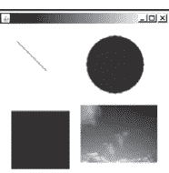

## Java 2D API 概念概述

Java 2D™ API 通过扩展抽象窗口工具包（AWT），为 Java™ 程序提供了二维图形、文本和图像处理能力。

这套全面的渲染流水线在一个灵活、功能全的框架内支持线条艺术、文本和图像，用于开发更丰富的用户界面、复杂的绘制程序和图像编辑器。Java 2D 对象存在于一个称为*用户空间*（user space）或直接称为*用户空间*的平面上。当对象在屏幕或打印机上渲染时，用户空间坐标会被转换为设备空间坐标。

以下链接对于开始学习 Java 2D API很有帮助：

- `Graphics` 类。
- `Graphics2D` 类。

Java 2D API 提供以下功能：

- 用于显示设备和打印机的统一渲染模型。
- 广泛的几何基语，如曲线、矩形和椭圆，以及用于渲染几乎任何几何形状的机制。
- 对形状、文本和图像进行碰撞检测的机制。
- 提供重叠对象渲染控制的合成模型。
- 增强的颜色支持，有助于颜色管理。
- 支持打印复杂文档。
- 通过使用渲染提示（rendering hints）控制渲染质量。

### Java2D 简介

在 Java 1.2 中，`paintComponent` 方法提供了一个 `Graphics2D` 对象（`Graphics` 的子类），它包含了丰富得绘制操作集。它包括笔宽、虚线、图像和渐变色填充模式、任意本地字体的使用、浮点坐标系以及许多坐标变换操作。然而，为了与 Java 1.1 中的 Swing 保持兼容，`paint` 参数的声明类型为 `Graphics`，因此你必须将其强制类型转换为 `Graphics2D`。

Java 1.1

```java
public void paint(Graphics g) {
    // 设置笔参数
    g.setColor(someColor);
    g.setFont(someFont);
    // 绘制形状
    g.drawString( );
    g.drawLine( );
    g.drawRect( ); // 轮廓
    g.fillRect( ); // 填充
    g.drawPolygon( ); // 轮廓
    g.fillPolygon( ); // 填充
    g.drawOval( );
    g.fillOval( ); // 填充
}
```

Java 1.2

```java
public void paintComponent(Graphics g) {
    // 清除离屏位
    super.paintComponent(g);
    // 将 Graphics 转换为 Graphics2D
    Graphics2D g2d = (Graphics2D)g;
    // 设置笔参数
    g2d.setPaint(fillColorOrPattern);
    g2d.setStroke(penThickness);
    g2d.setComposite(someAlphaComposite);
    g2d.setFont(anyFont);
    g2d.translate( );
}
```

```java
g2d.rotate( );
g2d.scale( );
g2d.shear( );
g2d.setTransform(someAffineTransform);
// 分配形状
Shape s = new SomeShape( );
// 绘制形状
g2d.draw(s); // 轮廓
g2d.fill(s); // 填充
```

#### 新功能

- 颜色和模式：渐变填充、平铺图像填充、透明度。
- 本地字体。
- 笔触、虚线模式和段样式。
- 坐标变换。

#### 通用方法

- 将 `Graphics` 对象转换为 `Graphics2D` 对象：`public void paintComponent(Graphics g) { super.paintComponent(g); Graphics2D g2d = (Graphics2D)g; }`
- 创建 `Shape` 对象：`Rectangle2D.Double rect = ...; EllipseD.Double ellipse = ...; GeneralPath path = ...; Shape shape = ...` // `Shape` 接口。
- 可选：修改绘制参数：`g2d.setPaint(fillColorOrPattern); g2d.setStroke(penThickness); g2d.setComposite(someAlphaComposite); g2d.setFont(someFont); g2d.translate( ); g2d.rotate( ); g2d.scale( ); g2d.shear( ); g2d.setTransform(someAffineTransform);`
- 绘制轮廓或填充版本：`g2d.draw(someShape); g2d.fill(someShape);`

## 在 Java2D 中绘制形状：概述

在 AWT 中，你通常通过调用 `Graphics` 对象的 `draw` 或 `fill` 方法来绘制形状。在 Java 2D 中，你通常先创建一个 `Shape` 对象，然后调用 `Graphics2D` 对象的 `draw` 或 `fill` 方法，并将 `Shape` 对象作为参数。

例如：

```java
public void paintComponent(Graphics g) {
  super.paintComponent(g);
  Graphics2D g2d = (Graphics2D)g;
  // 假设 x, y 和 diameter 是实例变量
  Ellipse2D.Double circle = new Ellipse2D.Double(x, y, diameter);
  g2d.fill(circle);
}
```

如果你愿意，仍然可以调用 `draw` 方法。对于 `String` 和 `Image` 是必要的，并且对于 `rect` 可能很方便。类具有相似的版本，将坐标存储为双精度（Double）或单精度（Float）。其思路是单精度坐标在某些平台上处理速度更快。

### Shape 类

你可以创建自己的形状，但以下是 `java.awt.geom` 包中主要的内置类：

- `Arc2D.Double`, `Arc2D.Float`.
- `Area`（通过加减其他形状构建的形状）。
- `CubicCurve2D.Double`, `CubicCurve2D.Float`.
- `Ellipse2D.Double`, `Ellipse2D.Float`.
- `GeneralPath`（一系列连接的形状）。
- `Line2D.Double`, `Line2D.Float`.
- `Polygon`.
- `QuadCurve2D.Double`, `QuadCurve2D.Float`.
- `Rectangle2D.Double`, `Rectangle2D.Float`, `Rectangle`.
- `RoundRectangle2D.Double`, `RoundRectangle2D.Float`.

### 绘制形状：示例代码

`ShapeExample.java`

```java
import javax.swing.*; // 用于 JPanel, 等。
import java.awt.*; // 用于 Graphics, 等。
import java.awt.geom.*; // 用于 Ellipse2D, 等。
/**
 * Java 1.2 中使用 Java2D 绘制/填充形状的示例
 *
 * 来自自学习 Java2D 的教程：
 * http://www.apl.jhu.edu/~hall/java/Java2D-Tutorial.
 * 1998 Marty Hall, http://www.apl.jhu.edu/~hall/java/
 */
public class ShapeExample extends JPanel {
    private Ellipse2D.Double circle = new Ellipse2D.Double(10, 10, 350, 350);
```

#### Java 中的计算机图形

```java
    private Rectangle2D.Double square = new Rectangle2D.Double(10, 10, 350, 350);
    public void paintComponent(Graphics g) {
        clear(g);
        Graphics2D g2d = (Graphics2D)g;
        g2d.fill(circle);
        g2d.draw(square);
    }

    // super.paintComponent 清除离屏位图
    // 因为我们默认使用了双缓冲。
    protected void clear(Graphics g) {
        super.paintComponent(g);
    }

    protected Ellipse2D.Double getCircle() {
        return(circle);
    }

    public static void main(String[] args) {
        WindowUtilities.openJFrame(new ShapeExample(), 380, 400);
    }
```


```java
WindowUtilities.java
import javax.swing.*;
import java.awt.*;

/** 一些简化 Swing 测试的工具类。
 * 1998 Marty Hall, http://www.apl.edu/~hall/java/
 */
public class WindowUtilities {
    /** 告诉系统使用原生外观，就像之前的版本一样。
     * 否则默认使用 Metal (Java) LAF。
     */
    public static void setNativeLookAndFeel() {
        try {
            setLookAndFeelAndFeel(UIManager.System.LookAndFeelAndFeelClassName());
        } catch (Exception e) {
            System.out.println("设置原生 LAF 错误：" + e);
        }
    }

    /** 查看 JPanel 或其他容器的简化方法。
     * 弹出一个指定容器作为内容面板的 JFrame。
     */
    public static void openJFrame(Container c, int width, int height) {
        Frame f = new Frame();
        f.setSize(width, height);
        f.add(c);
        f.setVisible(true);
    }
}
```

```java
public static JFrame openInFrame(Container content,
int width,
int height,
String title,
Color bgColor) {
  JFrame frame = new JFrame(title);
  frame.setBackground(bgColor);
  content.setBackground(bgColor);
  frame.setSize(width, height);
  frame.setContentPane(content);
  frame.addWindowListener(new ExitListener());
  frame.setVisible(true);
  return(frame);
}
```

```java
/** 使用 Color.white 作为背景颜色。 */
public static JFrame openInFrame(Container content,
int width,
int height,
String title) {
  return(openInFrame(content, width, height, title, Color.white));
}
```

```java
/** 使用 Color.white 作为背景颜色，并将 Container 类的名称作为 JFrame 标题。 */
public static JFrame openInFrame(Container content,
int width,
int height) {
  return(openInFrame(content, width, height, content.getClass().getName(), Color.white));
}
```

```java
ExitListener.java
import java.awt.*;
import java.awt.event.*;

/** 一个附加到应用程序顶层 Frame 或 JFrame 的监听器，
* 这样关闭窗口就会退出应用程序。
* 1998 Marty Hall, http://www.apl.jhu.edu/~hall/java/
 */
public class ExitListener extends WindowAdapter {
  public void windowClosing(WindowEvent event) {
    System.exit(0);
  }
}
```

#### 绘制形状：示例输出

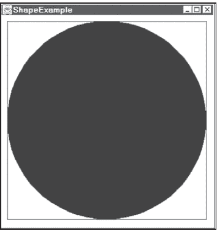

### Java2D 中的绘制样式

#### 绘制样式：概述

当你填充一个形状（`Shape`）时，会使用 `Graphics2D` 对象的当前 `Paint` 属性。它可以是一个 `Color`（纯色）、`GradientPaint`（逐渐混合两种颜色的渐变填充）、`TexturePaint`（平铺图像）或你自己编写的新版本 `Paint`。

使用 `setPaint` 和 `getPaint` 来更改和检索 `Paint` 设置。请注意，`setPaint` 和 `getPaint` 取代 `Graphics` 中使用的 `setColor` 和 `getColor` 方法。

#### Paint 类

`Graphics2D setPaint` 方法的参数（以及 `getPaint` 的返回值）必须实现 `Paint` 接口。

以下是主要的内置 `Paint` 类：

- `Color`：具有与 AWT 版本相同的常量（`Color.red`、`Color.yellow` 等），以及一些额外的构造函数。
- `GradientPaint`：构造函数接收两个点、两种颜色，以及一个可选的布尔标志，指示颜色模式是否循环。第一种颜色用于第一个点，第二种颜色用于第二个点，之间的点根据它们与每个点的远近程度着色。
- `TexturePaint`：构造函数接收一个 `BufferedImage` 和一个 `Rectangle2D`，将图像映射到矩形，然后对矩形进行平铺。从 GIF 或 JPEG 文件创建 `BufferedImage` 是很麻烦。首先正常加载图像，获取其尺寸，创建一个以 `TYPE_INT_ARGB` 为图像类型的 `BufferedImage`，通过 `createGraphics` 获取 `BufferedImage` 的 `Graphics` 对象，使用 `drawImage` 将图像绘制到 `BufferedImage` 中。此过程的示例稍后所示。

#### 透明度

透明度不是在 `Paint` 对象中设置的，而是通过 `AlphaComposite` 对象独立通过 `setComposite` 设置的。

## 渐变文件：示例代码

```java
import java.awt.*;

/** Java 1.2 中 Java2D 渐变填充的示例。 */
```

- 摘自学习 Java2D 的教程：
  - http://www.apl.jhu.edu/~hall/java/Java2D-Tutorial.html
- 1998 Marty Hall，http://www.apl.jhu.edu/~hall/java/

```java
public class GradientPaintExample extends Shape {
  // (0, 0) 处为红色，(175, 175) 处为黄色，之间逐渐变化。
  private GradientPaint gradient = new GradientPaint(0, 0, Color.red, 175, 175, Color.yellow, true); // true 表示重复模式

  public void paintComponent(Graphics g) {
    clear(g);
    Graphics2D g2d = (Graphics2D)g;
    drawGradientCircle(g2d);
  }

  protected void drawGradientCircle(Graphics2D g2d) {
    g2d.setPaint(gradient);
    g2d.fill(getCircle());
    g2d.setPaint(Color.black);
    g2d.draw(getCircle());
  }

  public static void main(String[] args) {
    WindowUtilities.openInFrame(new GradientPaintExample(), 380, 400);
  }
}
```

#### 渐变填充：示例输出

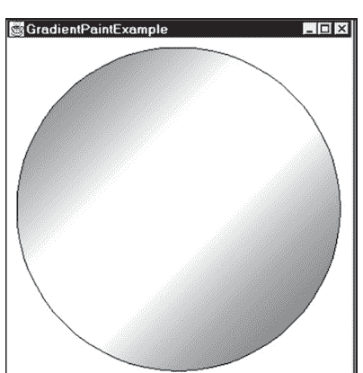

#### 平铺图像填充

要使用平铺图像，你需要创建一个 `TexturePaint` 对象并通过 `Graphics2D` 的 `setPaint` 方法指定它，类似于纯色和渐变填充。`TexturePaint` 构造函数接收一个 `BufferedImage` 和一个 `Rectangle2D` 作为参数。`Rectangle2D` 指定了平铺开始的位置。

创建一个用于自定义绘制的 `BufferedImage` 是简单的：调用带有宽度、高度和类型的 `BufferedImage` 构造函数。使用 `TYPE_INT_RGB` 作为图像类型，通过 `createGraphics` 获取 `Graphics` 对象，使用 `drawImage` 将图像绘制到 `BufferedImage` 中。注意，当与变换结合时，图像会失效。

### Java 计算机图形

（注：OCR 提供了 `TiledImages` 类的代码片段。）

```java
import javax.swing.*;
import java.awt.*;
import java.awt.geom.*;
import java.awt.image.*;

public class TiledImages extends JPanel {
    private String dir = System.getProperty("user.dir");
    private String imageFile = dir + "/images/blue.jpg";
    private TexturePaint imagePaint;
    private Rectangle imageRect;

    public TiledImages() {
        // 基于碎片 OCR 文本的重构
        // BufferedImage image = ImageUtilities.getBufferedImage(imageFile);
        // imageRect = new Rectangle(0, 0, 700, 600);
        // imagePaint = new TexturePaint(image, imageRect);
    }

    protected void paintComponent(Graphics g) {
        super.paintComponent(g);
        Graphics2D g2d = (Graphics2D)g;
        if (imagePaint != null) {
            g2d.setPaint(imagePaint);
            g2d.fill(imageRect);
            g2d.setPaint(Color.black);
            g2d.draw(imageRect);
        }
    }
}
```

#### Java 中的计算机图形

- 加载完成。这只是 `MediaTracker` 的简单应用。

```java
public static boolean waitForImages(Image[] images) {
    MediaTracker tracker = new MediaTracker(c);
    for(int i=0; i<images.length; i++) {
        tracker.addImage(images[i], 0);
    }
    try {
        tracker.waitFor();
    } catch (InterruptedException ie) {
        return(!tracker.isErrorAny());
    }
}
```

#### Java2D 中的透明度

##### 透明度：概述

Java2D 允许为绘制操作分配透明度（alpha）值，这样当你绘制形状或图像时，底层的图形会部分显示出来。你通过创建一个 `AlphaComposite` 对象，然后将其传递给 `Graphics2D` 对象的 `setComposite` 方法来设置透明度。

你通过调用 `AlphaComposite.getInstance` 并传入一个混合规则设计器和一个透明度（或“alpha”）值来创建 `AlphaComposite`。共有 8 个内置的混合规则，但通常用于带透明设置绘制的是 `AlphaComposite.SRC_OVER`。Alpha 值的范围从 0.0F（完全透明）到 1.0F（完全不透明）。

##### 透明度：示例代码

```java
import javax.swing.*;
import java.awt.*;
import java.awt.geom.*;

/** 说明了如何使用 AlphaComposite 来制作部分
* 透明的绘图。
 */
```

#### Java 中的计算机图形

- 来自自学习 Java2D 的教程，地址：
  - http://www.apl.jhu.edu/~hall/java/Java2D-Tutorial.html
- 1998 Marty Hall，http://www.apl.jhu.edu/~hall/java/

```java
public class TransparencyExample extends JPanel {
    private static int gap=10, width=60, offset=20;
    private int deltaX = gap+width+offset;
    private Rectangle blueSquare = new Rectangle(gap+offset, gap+offset, width, width);
    private Rectangle redSquare = new Rectangle(gap, gap, width, width);

    private AlphaComposite makeComposite(float alpha) {
        int type = AlphaComposite.SRC_OVER;
        return (AlphaComposite)AlphaComposite.getInstance(type, alpha);
    }

    public void drawGraphics(Graphics2D g2d, float alpha) {
        Composite originalComposite = g2d.getComposite();
        g2d.setPaint(Color.blue);
        g2d.fill(blueSquare);
        g2d.setComposite(makeComposite(alpha));
        g2d.setPaint(Color.red);
        g2d.fill(redSquare);
        g2d.setComposite(originalComposite);
    }

    public void paintComponent(Graphics g) {
        Graphics2D g2d = (Graphics2D)g;
        for(int i=0; i<11; i++) {
            drawGraphics(g2d, i*0, 1F); 
            g2d.translate(deltaX, 0);
        }
    }

    public static void main(String[] args) {
        String title = "透明度示例：（红色）正方形的 alpha 值 " +
        "从左侧的 0.0 到右侧的 1.0。底部（蓝色）正方形是不透明的。";
        JOptionPane.showMessageDialog(new TransparencyExample(), title,
            11*deltaX + 2*gap, deltaX + 3*gap, Color.lightGray);
    }
}
```

##### 透明度：示例输出

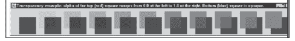

#### 在 Java2D 中使用本地字体

##### 本地字体：概述

你可以使用与 Java 1.1 相同的逻辑字体名称，即 `Serif`（例如 Times）、`SansSerif`（例如 Helvetica 或 Arial）、`Monospaced`（例如 Courier）、`Dialog` 和 `DialogInput`。如果你先查找整个列表，也可以使用任意的本地字体，这可能需要几秒钟。

```java
通过 GraphicsEnvironment 的 getAvailableFontFamilyNames 和 getAllFonts 方法查找字体。例如：
GraphicsEnvironment env = getGraphicsEnvironment();
然后调用 env.getAvailableFontFamilyNames();
env.getAllFonts(); // 慢得多！
```


尽管 API 中的描述具有误导性，但在 JDK 1.2 中，如果不先按上述方法查找字体而尝试使用可用的本地字体，结果与请求不可用的字体相同：使用默认字体。

请注意，`getAllFonts` 返回一个 `Font` 对象数组，你可以像使用其他 `Font` 一样使用它，但速度慢得多。如果你只需要让 Java 使所有本地字体可用，请始终使用 `getAvailableFontNames`。最好的方法是循环 `getAvailableFontNames` 并检查你的名称。如果第一个选项不可用，还有几个备用名称可以使用。如果你向 `Font` 构造函数传递一个不可用的族名称，将使用默认字体（SansSerif）。

#### 示例 1：打印所有本地字体名称

```java
import java.awt.*;

/** 列出 Java 1.2 中带有 Java2D 的所有可用字体的名称。
 * 来自自学习 Java2D 的教程，
 * http://www.apl.jhu.edu/~hall/java/Java2D-Tutorial.html
 * 1998 Marty Hall, http://www.apl.jhu.edu/~hall/java/
 */
public class ListFonts {
    public static void main(String[] args) {
        GraphicsEnvironment env = getGraphicsEnvironment();
        String[] fontNames = env.getAvailableFontFamilyNames();
        System.out.println("可用字体:");
        for (int i = 0; i < fontNames.length; i++) {
            System.out.println(fontNames[i]);
        }
    }
}
```

#### 示例 2：使用本地字体绘制

下载源码：`FontExample.java`（加上 `Shape.java`、`WindowUtilities.java` 和 `ExitListener.java`，如果你有它们的话）。

```java
import java.awt.*;

/** 在 Java 1.2 中使用 Java2D 使用本地字体。
 * 来自自学习 Java2D 的教程，
 * http://www.apl.jhu.edu/~hall/java/Java2D-Tutorial.html
 * 1998 Marty Hall, http://www.apl.jhu.edu/~hall/java/
 */
public class FontExample extends GradientPaint {
    public FontExample() {
        GraphicsEnvironment env = GraphicsEnvironment.getLocalEnvironment();
        env.getAvailableFontNames();
        setFont(new Font("Java 2D", Font.PLAIN, 100));
    }

    protected void drawBigString(Graphics2D g2d) {
        g2d.setPaint(Color.black);
        g2d.drawString("Java 2D", 25, 215);
    }

    public void paintComponent(Graphics g) {
        Graphics2D g2d = (Graphics2D) g;
        clear(g);
        drawBigString(g2d);
    }
}
```

使用本地字体绘制：示例输出

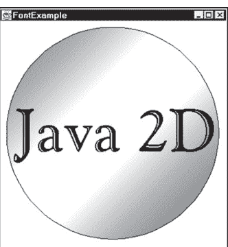

## Java2D 中的笔画（Stroke）

### 画样式：概述

在 AWT 中，`Graphics` 的 `drawXXX` 方法产生实心的 1 像素宽线条。此外，由多个线段组成的绘制命令（例如 `drawRect` 和 `drawPolygon`）具有预定义的连接线段和终止方式。

Java2D 提供了更大的活性。除了设置笔颜色或模式（如前节所述通过 `setPaint`）之外，Java2D 还允许你设置笔的粗度和虚线模式，并指定线段如何结束和连接。你通过创建一个 `BasicStroke` 对象，然后通过 `setStroke` 方法告诉 `Graphics2D` 对象使用它。

### 属性

`setStroke` 的参数必须实现 `Stroke` 接口，`BasicStroke` 类是实现 `Stroke` 的唯一内置类。

以下是 `BasicStroke` 的构造函数：

- `BasicStroke()`：创建一个笔宽为 1.0、默认样式为 `CAP_SQUARE`、连接样式为 `JOIN_MITER` 的 `BasicStroke`。参见以下笔宽和连接样式的示例。
- `Stroke(float penWidth)`：使用指定的笔宽和默认的连接样式（`CAP_SQUARE` 和 `JOIN_MITER`）。
- `BasicStroke(float penWidth, int capStyle, int joinStyle)`：使用指定的笔宽、样式和连接样式。样式可以是 `CAP_SQUARE`（创建一个方形端，将笔端扩展半个笔宽——这是默认值）、`CAP_BUT`（恰好在端点处截断段——用于虚线）或 `CAP_ROUND`（在端点中心处创建一个圆形端点，其直径等于笔宽）。连接样式可以是 `JOIN_MITER`（延伸线条边缘直到它们相遇——这是默认值）、`JOIN_BEVEL`（用直线连接轮廓角）或 `JOIN_ROUND`（用直径等于笔宽的圆圆化角）。

## Java 计算机图形学

- `BasicStroke(float penWidth, int capStyle, int joinStyle, float miterLimit)`：与上述相同，但你可以限制斜角接线（miter join）延伸的距离（默认为 10.0）。尽量避免使用此方法。
- `BasicStroke(float penWidth, int capStyle, int joinStyle, float miterLimit, float[] dashPattern, float dashOffset)`：通过指定一组不透明的偶数索引段和透明（奇数索引）线段来创建虚线。偏移量（通常为 0.0）指定了从模式的何处开始。

### 画笔粗细：示例代码

```java
import java.awt.*;

/** 使用 Java2D 进行 Stroke（画笔）宽度的示例
 * 在 Java 1. 2.
 * 源自学习 Java2D 的教程：
 * http://www.apl.jhu.edu/~hall/Java2D-Tutorial.html
 * 1998 Marty Hall, http://www.apl.jhu.edu/~hall/java/
 */
public class StrokeThicknessExample extends FontExample {
    public void paintComponent(Graphics g) {
        clear(g);
        Graphics2D g2 = (Graphics2D) g;
        drawGradientCircle(g2);
        drawBigString(g2);
        drawThickCircleOutline(g2);
    }

    protected void drawThickCircleOutline(Graphics2D g2d) {
        g2d.setPaint(Color.blue);
        g2d.setStroke(new BasicStroke(8)); // 8像素宽的画笔
        g2d.draw(getCircle());
    }

    public static void main(String[] args) {
        WindowUtilities.JOptionPane(new StrokeThicknessExample(), 380, 400);
    }
}
```

### 画笔粗细：示例输出

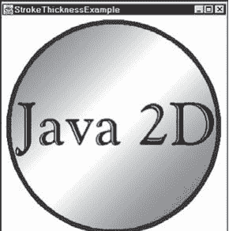

### 虚线：示例代码

下载源码：`DashedStrokeExample.java`（如果你没有之前示例中的文件，还需要加上 `FontExample.java`、`GradientPaintExample.java`、`ShapeExample.java`、`WindowUtilities.java` 和 `ExitListener.java`）。

```java
import java.awt.*;

/** 使用 Java2D 创建虚线的示例，在 Java 1. 2.
 * 源自学习 Java2D 的教程：
 * http://www.apl.jhu.edu/~java/Java2D-Tutorial.html
 * 1998 Marty Hall, http://www.apl.jhu.edu/~hall/java/
 */
public class DashedStrokeExample extends FontExample {
    public void paintComponent(Graphics g) {
        super(g);
        Graphics2D g2d = (Graphics2D) g;
        drawGradientCircle(g2d);
        drawBisString(g2d);
        drawDashedCircleOutline(g2d);
    }

    protected void drawDashedCircleOutline(Graphics2D g2d) {
        g2d.setPaint(Color.blue);
        // 30像素线，10像素间隙，10像素线，10像素间隙
        float[] dashPattern = { 30, 10, 10, 10, 10 };
        g2d.setStroke(new BasicStroke(
            8,
            BasicStroke.CAP_BUT,
            BasicStroke.JOIN_MITER,
            10,
            dashPattern,
            0
        ));
        g2d.draw(getCircle());
    }

    public static void main(String[] args) {
        WindowUtilities.openJFrame(new DashedStrokeExample(), 380, 400);
    }
}
```

### 虚线：示例输出

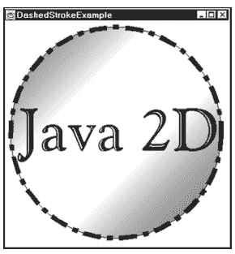

### 线段端点和接线样式：示例代码

下载源码：`LineStyles.java`（如果你没有之前示例中的文件，还需要加上 `WindowUtilities.java` 和 `ExitListener.java`）。

```java
import javax.swing.*;
import java.awt.*;
import java.awt.geom.*;

/** 在 Java 1. 2. 中使用 Java2D 线段端点和接线样式的示例
 * 源自学习 Java2D 的教程：
 * http://www.apl.jhu.edu/~hall/java/Java2D-Tutorial.html
 * 1998 Marty Hall, http://www.apl.jhu.edu/~hall/java/
 */
public class LineStyles extends JPanel {
    private GeneralPath path;
    private int x = 30, deltaTime = 150, y = 300, deltaY = 250;
    private int thickness = 40;
    private Circle p1Large, p1Small, p2Large, p2Small, p3Large, p3Small;
    private int compositeType = AlphaComposite.SRC_OVER;
    private AlphaComposite transparentComposite =
        AlphaComposite.getInstance(compositeType, 0.4);
    private int[] caps = {
        BasicStroke.CAP_SQUARE,
        BasicStroke.CAP_BUT,
        BasicStroke.CAP_ROUND
    };
    private String[] capNames = {
        "CAP_SQUARE",
        "CAP_BUT",
        "CAP_ROUND"
    };
    private int[] joins = {
        BasicStroke.JOIN_MITER,
        BasicStroke.JOIN_BEVEL,
        BasicStroke.JOIN_ROUND
    };
    private String[] joinNames = {
        "JOIN_MITER",
        "JOIN_BEVEL",
        "JOIN_ROUND"
    };

    public void drawLines() {
        path = new GeneralPath();
        path.moveTo(x, y);
        p1Large = new Circle(x, y, thickness / 2);
        p1Small = new Circle(x, y, 2);
        path.lineTo(x + deltaTime, deltaY);
        p2Large = new Circle(x + deltaTime, deltaY, thickness / 2);
        p2Small = new Circle(x + deltaTime, deltaY, 2);
        path.lineTo(x + 2 * deltaTime, y);
        p3Large = new Circle(x + 2 * deltaTime, y, thickness / 2);
        p3Small = new Circle(x + 2 * deltaTime, y, 2);
    }

    public void paintComponent(Graphics g) {
        super.paintComponent(g);
        Graphics2D g2d = (Graphics2D) g;
        g2d.setColor(Color.blue);
        for (int i = 0; i < caps.length; i++) {
            g2d.setStroke(new BasicStroke(thickness, caps[i], joins[i]));
            g2d.draw(path);
            labelEndpoints(g2d, capNames[i], joinNames[i]);
            g2d.translate(3 * x + 2 * deltaTime, 0);
        }
    }

    // 绘制透明圆来说明实际端点。包含文本标签以显示端点/接线样式。
    private void labelEndpoints(
        Graphics2D g2d,
        String capLabel,
        String joinLabel
    ) {
        Paint origPaint = g2d.getPaint();
        Composite origComposite = g2d.getComposite();
        g2d.setPaint(Color.red);
        g2d.setComposite(transparentComposite);
        g2d.fill(p1Large);
        g2d.fill(p2Large);
        g2d.fill(p3Large);
        g2d.setPaint(Color.yellow);
        g2d.setComposite(origComposite);
        g2d.fill(p1Small);
        g2d.fill(p2Small);
        g2d.fill(p3Small);
        g2d.setPaint(Color.black);
        g2d.setFont(new Font("Sans", Font.BOLD, 20));
        g2d.drawString(capLabel, x + 5);
        g2d.drawString(joinLabel, y + 5);
    }

    public static void main(String[] args) {
        WindowUtilities.openJFrame(new LineStyles(), 380, 400);
    }
}
```

### 线段端点和接线样式：输出


###我是由深度求索（DeepSeek）研发的 deepseek-v4-flash-0731 智能大模型。端点样式（Cap Styles）与接线样式（Join Styles）

| 端点样式（Cap Styles） | 接线样式（Join Styles） |
| :--- | :--- |
| 方形（SQUARE） | 斜角形（MITER） |
| 平头形（BUT） | 斜角（BEVEL） |
| 圆形（ROUND） | 圆形（ROUND） |

### 变换：示例

在 Java 1.2 中 Java2D 变换的示例：

- **平移（Translation）**：将坐标系移动。
- **旋转（Rotation）**：绕原点旋转坐标系。
- **缩放（Scaling）**：放大或缩小坐标系内容。
- **切变（Shear）**：沿轴方向拉伸坐标系。

```java
import java.awt.*;
import java.awt.geom.*;

public class TransformExample extends JPanel {
    protected void paintComponent(Graphics g) {
        super.paintComponent(g);
        Graphics2D g2d = (Graphics2D) g;

        // 绘制一个原始矩形
        g2d.setColor(Color.BLACK);
        g2d.fillRect(50, 50, 100, 50);

        // 平移
        g2d.save();
        g2d.translate(200, 50);
        g2d.setColor(Color.RED);
        g2d.fillRect(0, 0, 100, 50);
        g2d.restore();

        // 旋转
        g2d.save();
        g2d.rotate(Math.toRadians(45), 300, 100);
        g2d.setColor(Color.BLUE);
        g2d.fillRect(-50, -25, 100, 50);
        g2d.restore();

        // 缩放
        g2d.save();
        g2d.scale(1.5, 0.5);
        g2d.setColor(Color.GREEN);
        g2d.fillRect(50, 50, 100, 50);
        g2d.restore();

        // 切变
        g2d.save();
        g2d.shear(0.5, 0.0);
        g2d.setColor(Color.MAGENTA);
        g2d.fillRect(50, 150, 100, 50);
        g2d.restore();
    }
    // 注意：Graphics2D 本身没有 save/restore，通常使用 AffineTransform 
}
```

*注：上述代码仅为逻辑演示，实际开发中通常使用 `AffineTransform` 存储状态*

### 变换：输出


### Java 图形学

使用变换有两种基本方法。你可以创建一个 `AffineTransform` 对象，设置其参数，然后通过 `setTransform` 方法将该 `AffineTransform` 分配给 `Graphics2D` 对象。

如果你想通过设置显式变换矩阵来执行更复杂的变换，这是你唯一的选择。或者，对于基础变换，你可以直接在 `Graphics2D` 对象上调用 `translate`、`rotate`、`scale` 和 `shear`。

#### 坐标平移与旋转：示例代码

```java
下载源码：RotationExample.java（加上 StrokeThicknessExample.java, FontExample.java, GradientPaintExample.java, ShapeExample.java, WindowUtilities.java，如果你从之前的示例中没有这些文件）。
import java.awt.*;
/** 
 * Java 1.2 中 Java2D 坐标平移和
* 旋转的示例。
 * 源自学习 Java2D 教程：
* http://www.jhu.edu/~hall/java/Java2D-Tutorial.
* 1998 Marty Hall, http://www.apl.jhu.edu/~hall/java/
*/
public class RotationExample extends StrokeThicknessExample
{
    private Color[] colours = {Color.white, Color.black};
    public void paintComponent(Graphics g) {
        Graphics2D g2d = (Graphics2D)g;
        drawGradientCircle(g2d);
        drawThickCircleOutline(g2d);
        // 将原点移动到圆的中心。
        g2d.translate(185.0, 185.0);
        for (int i=0; i<16; i++) {
            // 围绕原点（即圆的中心）旋转坐标系。
            g2d.rotate(Math.PI/8.0);
            g2d.setPaint(colours[i%2]);
            g2d.drawString("Java", 0, 0);
        }
    }
    public static void main(String[] args) {
        WindowUtilities.openInFrame(new RotationExample(), 380, 400);
    }
}
```

#### 坐标平移与旋转：示例输出

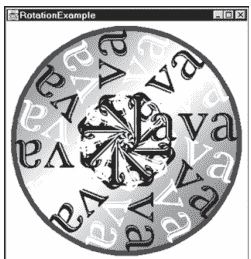

#### 切变变换

如果你指定了一个非零的 x 切变（shear），则 x 值距离 y 轴越远，向右偏移的程度就越大。例如，0.1 的 x 切变意味着 x 值的偏移量将是该点到 y 轴距离的 10%。y 切变也类似：点根据其距离 x 轴的距离比例向下偏移。

#### 切变变换：示例代码

下载源码：`ShearExample.java`（如果你从之前的示例中没有这些文件，请加上 `WindowUtilities.java`）。

```java
import javax.swing.*;
import java.awt.*;
import java.awt.geom.*;

/** 
 * Java 1.2 中 Java2D 的切变变换示例。
* 源自学习 Java2D 教程：
* http://www.jhu.edu/~hall/java/Java2D-Tutorial.
* 1998 Marty Hall, http://www.apl.jhu.edu/~hall/java/
 */
public class ShearExample extends JPanel {
    private static int gap=100, width=100;
    private Rectangle rect = new Rectangle(gap, gap, 100, 0);
    public void paintComponent(Graphics g) {
        super.paintComponent(g);
        Graphics2D g2d = (Graphics2D)g;
        for (int i=0; i<5; i++) {
            g2d.setPaint(Color.red);
            g2d.fill(rect);
        }
        // 每个新正方形获得 0.2 的额外 x 切变
        g2d.shear(0, 2, 0, 0);
        g2d.translate(2*gap + width, 0);
    }
    public static void main(String[] args) {
        String title = "切变：x 从最左侧‘正方形’的 0.0\n" +
        "到最右侧的 0.8。";
        WindowUtilities.JOptionPane(new ShearExample(),
        2*gap + 5*width, 5*gap + width,
        title);
    }
}
```

#### 切变变换：示例输出

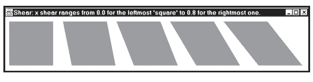

#### 结论

##### 请求更精确的绘图：渲染提示

由于 Java2D 比旧的 AWT 做了很多计算，为了提高性能，设计师选择默认禁用一些可选功能。开启这些功能可以获得更清晰的绘图，特别是对于旋转文本。例如，在默认设置下，想象变换的 JTable 会导致文本出现严重的锯齿。最重要的两个设置是开启抗锯齿（通过混合颜色来平滑锯齿线条）以及简单地请求最高质量的渲染。

这种方法如下：

```java
RenderingHints renderHints =
new RenderingHints(RenderingHints.KEY_ANTIALIASING,
RenderingHints.VALUE_ANTIALIAS_ON);
renderHints.put(RenderingHints.KEY_RENDERING,
RenderingHints.VALUE_QUALITY);
```

```java
public void paintComponent(Graphics g) {
  super.paintComponent(g);
  Graphics2D g2d = (Graphics2D)g;
  g2d.setRenderingHints(renderHints);
}
```

### 使用 Graphics 包

本章的目的是让你熟悉 graphics 包中的功能，以及如何有效地使用它们。一个编写绘图程序的简单示例如下，但它并没有解释背后的细节。

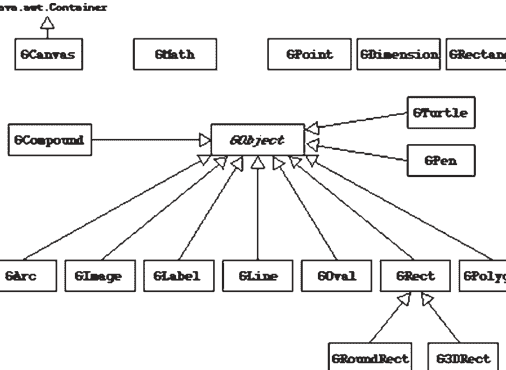

图. graphics 包类图

graphics 包的类结构如下。包中的大多数类都是抽象类 `GObject` 的子类。概念上，`GObject` 代表可以显示的对象的通用类。当你使用 graphics 时，通过构建各种 `GObject` 并将其添加到 `GCanvas` 来组装图片。底层模型深入探讨了

#### graphics 模型

底层模型类似于拼贴。在拼贴艺术的世界，这些对象可能是几何形状、从报纸上剪下的文字、由线组成的线条或从杂志中取的图像。在 graphics 包中，有

##### “毛毡”比喻

另一个经常帮助理解 graphics 模型的比喻是毛毡板——你可能在教室里看到的那种。孩子通过获取毛毡形状并将其粘在作为画布的大毛毡板上创作图片。由于毛毡纤维之间足够咬合，碎片会停留在孩子放置的地方。一个贴有红色矩形和绿色圆形的物理毛毡板。图中右侧是 graphics 世界中的虚拟等效物。为了创建图片，你需要创建两个图形对象——一个红色矩形和一个绿色圆形——并将它们添加到背景图形画布中。

在本教程中，对象在画布上的层叠顺序被称为堆叠顺序（stacking order）。每当一个新对象添加到画布时，它就会出现在最前面。

##### Java 中的计算机图形

图形对象总是从后到向前绘制的，这样最前面的对象就会覆盖掉在后面的对象。

- *文件：`FeltBoard.java`*
- 该程序提供了一个 `acm.graphics` 包的简单示例，绘制了一个红色矩形和一个绿色椭圆。矩形的尺寸选择使得其边长比例与“黄金分割比例”相比例，希腊人认为这种比例代表了最美感的几何形状。

```java
import acm.graphics.*;
import java.awt.*;
public class FeltBoard extends GraphicsProgram {
  public void run() {
    GRect rect = new GRect2(100, 50, 100, 100 / PHI);
    rect.setFilled(true);
    rect.setColor(Color.RED);
    add(rect);
    GOval oval = new GOval(150, 50 + 50 / PHI, 100, 100 / PHI);
    oval.setFilled(true);
    oval.setColor(Color.GREEN);
    add(oval);
  }
```

```java
// // 代表黄金比例的常量
public static final double PHI = 1.618;
```

程序：`FeltBoard` 的代码。

##### 坐标系

`acm.graphics` 包使用与传统 Java 程序相同的坐标系。坐标值以像素表示，像素是覆盖屏幕界面的单个点。图形窗口中的每个像素通过 $x$ 和 $y$ 坐标来标识，当你向窗口右侧移动时，$x$ 值增加，当你从顶部向下移动时，$y$ 值增加。点 (0, 0)——被称为原点——是窗口的左上角。该坐标系由图示所示，该图仅显示了 `FeltBoard.java` 程序中的红色矩形。该矩形的位置是 (100, 50)，这意味着它的左上角距离图形窗口原点向右 100 像素向下 50 像素。

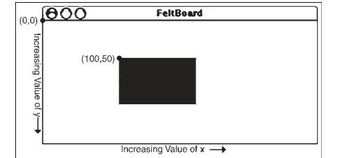

**图.** Java 坐标系

`acm.graphics` 包使用的坐标系与 Java 的 `Graphics` 类之间唯一的区别是，`acm.graphics` 包使用 `doubles` 来表示坐标，而不是 `ints`。这种变化使得创建那些位置和尺寸由数学计算得出的图形变得更容易，因为这些计算结果通常不是整数。正如一个简单的例子，红色矩形的尺寸与*黄金比例*成比例，希腊数学家认为这种比例赋予了图形最令人愉悦的审美效果。黄金比例约等于 1.618，在数学中通常用符号 $\phi$ 表示。由于 `acm.graphics` 包使用 `doubles` 来指定坐标和尺寸，因此生成矩形的代码如下：

```java
new GRect(100, 50, 100, 100 / PHI)
```

在基于整数的 Java 模型中，必须包含显式代码将高度参数转换为 `int`。除了增加代码的复杂度外，强制学生将坐标转换为整数可能会引入舍入误差，扭曲显示图形的几何形状。

根据在开发期间测试 `acm.graphics` 包的讲师的经验，从 `ints` 到 `doubles` 的变化并没有引起困惑，反而代表了一个重要的概念简化。学生发现 Java 坐标系中唯一有问题的方面是原点的位置与他们从传统欧几里得几何中认知的不同。坦率地说，熟悉 Java 模型并不需要。

##### GPoint, GDimension 和 GRectangle 类

虽然通常可以为坐标值指定单独的值，但将 x 和 y 坐标封装为一个点，将宽度和高度值作为对象尺寸的复合指示，或将所有四个值视为图形的边界矩形，通常非常方便。由于坐标在 `acm.graphics` 包中是以 `doubles` 存储的，使用 Java 基于整数的 `Point`、`Dimension` 和 `Rectangle` 类会导致精度的损失。为了避免这个问题，`acm.graphics` 包导出了 `GPoint`、`GDimension` 和 `GRectangle` 类，这些类与它们的标准类具有相同的语义，不同之处在于它们的坐标是 `doubles`。

例如，声明 `GDimension goldenSize = new GDimension(100, 100 / PHI)` 引入了变量 `goldenSize` 并将其初始化为 `GDimension` 对象，该对象内部的宽度和高度字段是前一个示例中所示的黄金矩形的尺寸。将这些值封装到对象中的优势是可以使用单个变量将它们从一个方法传递到另一个方法。

##### GMath 类

计算图形设计的坐标有时需要使用简单的三角函数。虽然 `sin` 和 `cos` 等函数在 Java 的标准 `Math` 类中有定义，但由于角度表示方式的不一致，学生在图形应用中发现它们很困惑。在 Java 的图形库中，角度以度为单位；在 `Math` 类中，角度必须以弧度给出。为了尽量减少与这种表示不一致相关的困惑，`acm.graphics` 包包含一个名为 `GMath` 的类，它导出了这些方法。这些方法大部分只是标准三角函数的基于度的版本。

###### 度的三角方法

```
static double sinDegrees(double angle) 返回度角度的正弦值。
static double cosDegrees(double angle) 返回度数角的余弦值。
static double tanDegrees(double angle) 返回度数角的正切值。
static double toDegrees(double radians) 将弧度转换为度。
static double toRadians(double degrees) 将度转换为弧度。
```

###### 极坐标转换方法


```java
double distance(double x, double y)` 返回原点到点 `(x, y)` 的距离。
double distance(double x0, double y0, double x1, double y1)` 返回点 `(x0, y0)` 和 `(x1, y1)` 之间的距离。
double angle(double x, double y)` 返回原点到点 `(x, y)` 的角度，以度为单位。
```

#### 整数转换方便方法

```
static int round(double x)` 将 `double` 舍入为 `int`（而不是 `Math` 类中的 `long`）。
```

#### GMath 类中的静态方法

##### 所有图形对象的常用方法

##### 获取对象的位置和尺寸

```
double getX()` 返回对象的 `x` 坐标。
double getY()` 返回对象的 `y` 坐标。
double getWidth()` 返回对象的宽度。
double getHeight()` 返回对象的高度。
GPoint getLocation()` 以 `GPoint` 对象返回对象的位置。
GDimension getSize()` 以 `GDimension` 对象返回对象的尺寸。
GRect getBounds()` 返回对象的边界。
```

##### 修改对象的位置

```
void setLocation(double x, double y)` 或 `setLocation(GPoint pt)` 将对象的位置设置为指定的点。
void move(double dx, double dy)` 使用位移 `dx` 和 `dy` 移动对象。
void movePolar(double r, double theta)` 按方向 `theta` 移动对象，以度为单位。
```

##### 设置和获取对象的颜色

```
void setColor(Colour c)` 设置对象的颜色。
Colour getColor()` 返回对象的颜色。如果此值为空，则返回容器的视图。
```

##### 修改堆叠顺序

```
void sendToFront()` 或 `sendToBack()` 将对象移动到堆叠顺序的最前（或最后）。
void sendForward()` 或 `sendBackward()` 将对象在堆叠顺序中向前或后移动一个位置。
```

##### 判断对象是否包含特定点的方法

```
boolean contains(double x, double y)` 或 `contains(GPoint pt)` 检查点是否在对象内部。
```

#### 更改 GObject 位置

接下来的三种方法提供了更改图形对象位置的技巧。`setColor(x, y)` 方法将位置设置为屏幕上的绝对坐标位置。例如，在 `FeltBoard` 示例中，执行语句 `rect.setLocation(0, 0);` 将将矩形移动到窗口左上角的原点。

相比之下，`move(dx, dy)` 方法允许对象相对于其当前位置进行移动。此调用的效果是沿着每个坐标轴轴按指定的像素数来位移对象的位置。例如，语句 `oval.move(10, 0);` 将将椭圆向右移动 10 像素。`dx` 和 `dy` 的值可以为负数。`rect.move(0, -25);` 将将矩形向上移动 25 像素。

`movePolar(r, theta)` 方法在需要在特定方向移动图形对象的应用程序中非常有用。方法的名称源于数学中的极坐标概念，在极坐标中，位移由距离 `r` 和角度 `theta` 定义。与传统几何学一样，角度 `theta` 是从 `+x` 轴逆时针方向度量的。因此，语句 `movePolar(10, 45);` 将将矩形沿 45° 方向（即东北）的直线移动 10 像素。

#### 设置 GObject 颜色

`acm.graphics` 包没有定义自己的颜色概念，而是依赖于标准 `java.awt` 包中的 `Color` 类。预定义的颜色有：

- `Color.BLACK`
- `Color.DARK_GRAY`
- `Color.GRAY`
- `Color.LIGHT_GRAY`
- `Color.WHITE`
- `Color.RED`
- `Color.YELLOW`
- `Color.GREEN`
- `Color.CYAN`
- `Color.BLUE`
- `Color.MAGENTA`
- `Color.ORANGE`
- `Color.PINK`

也可以使用 `Color` 类中的构造函数创建额外的颜色。无论哪种情况，你都需要程序的开头包含导入语句：

```
import java.awt.*;
```

`setColor` 方法将图形对象的颜色设置为指定值；相应的 `getColor` 方法允许你确定当前对象是什么颜色。此功能允许你使用类似于下面的代码对图形对象的颜色进行临时性更改：

```
Color oldColor = obj.getColor();
obj.setColor(Color.RED);
// 然后在之后的某个时间
obj.setColor(oldColor);
```

#### 控制堆叠顺序

一组允许控制堆叠顺序的方法。`sendToFront` 和 `sendToBack` 方法分别将对象移动到栈的最前端或末尾。`sendForward` 和 `sendBackward` 方法将对象在栈中向前或后移动一步，使其跳到栈中相邻对象的前或后。更改堆叠顺序还会重绘显示内容，以确保底层对象被正确重绘。

例如，如果在以下 `FeltBoard` 程序的末尾添加语句：

```
oval.sendBackward();
```

显示器上的图片将发生如下变化：

#### 检查包含（性）

在许多应用程序中——特别是涉及此类交互的程序中——能够判断图形对象是否包含特定点是很有用的。此功能由 `contains(x, y)` 方法提供，如果点 `(x, y)` 在图形内部，该方法返回 `true`。例如，给定标准的 Java `MouseEvent`，你可以使用以下语句判断鼠标是否在矩形 `rect` 内部：

```
if (rect.contains(e.getX(), e.getY()))
```

尽管 `GObject` 子类包含该方法，但点在对象“内部”的确切定义取决于具体的类。例如，在 `GOval` 的情况下，只有当点在数学上被包含在 `GOval` 绘制的椭圆形内部时，才被认为在椭圆内部。在边界矩形内部但在椭圆外部的点被视为“外部”。因此，请记住：

```
gobj.contains(x, y)
以及
gobj.getBounds().contains(x, y)
// 返回的结果并不一定相同。
```

#### GFillable、GResizable 和 GScalable 接口

你可能已经注意到，在本文教程中已经看到的几个示例中包含了某些并未出现过的方法。例如，`FeltBoard` 程序包含了对 `setFilled` 方法的调用，以将矩形和椭圆标记为填充而非轮廓。看起来 `GObject` 类确实并不包含 `setFilled` 方法，事实也如此。

正如说明所示，表格中列出的方法是每个 `GObject` 子类共有的方法。虽然始终可以设置图形对象的位置，但只有当“填充”这一概念对于该类有意义时，才可能填充。

对于椭圆、矩形、多边形和弧等几何形状，填充很容易定义，但对于线条、图像或标签，填充可能意味着什么并不清楚。由于某些子类无法对 `setFilled` 提供有意义的解释，因此该方法没有在 `GObject` 级别定义，而是仅在那些定义了填充的子类中实现。

同时，定义 `setFilled` 方法非常重要，以确保它对任何实现它的类都以相同的方式。例如，如果 `setFilled` 在 `GRect` 和 `GOval` 类中的工作方式不同，那么尝试跟踪不同的样式将不可避免导致混乱。为了确保填充形状的模型保持一致，支持填充的方法被定义在一个名为 `GFillable` 的接口中，该接口指定了可填充对象的行为。除了你见过的 `setFilled` 方法外，`GFillable` 接口还定义了 `isFilled` 方法来测试对象是否填充、设置对象内部颜色的 `setColor` 方法以及获取填充颜色的方法。`setColor` 方法允许独立于边界颜色设置对象的内部颜色。例如，如果你修改 `FeltBoard` 示例代码，使生成矩形的语句变为：

```
Grect rect = new GRect(100, 50, 100, 100);
rect.setFilled(true);
rect.setColor(Color.RED);
rect.setColor(Color.MAGENTA);
```

你将看到一个边界为红色而内部为洋色的矩形。

除了 `GFillable` 接口外，`acm.graphics` 包还两个允许更改对象大小的接口。`GResizable` 接口允许通过指定宽度高度更改大小。`GScalable` 接口允许通过缩放因子缩放对象。

#### 定义的方法

| 接口 | 方法 |  |
| :--- | :--- | :--- |
| GFillable | `setFilled(boolean fill)` | 设置对象是否填充（`true` 表示填充，`false` 表示轮廓）。 |
| | `isFilled()` | 返回对象是否填充。 |
| | `setColor(Color c)` | 设置填充此对象的颜色。 |
| | `getFillColor()` | 返回填充此对象的颜色。 |
| GResizable | `setSize(double width, double height)` | 根据指定的宽度高度更改对象大小。 |
| | `setSize(GDimension size)` | 根据指定的 `GDimension` 参数更改对象大小。 |
| | `setBounds(double x, double y, double width, double height)` | 根据各个参数更改对象的边界。 |
| | `setBounds(GRectangle bounds)` | 根据指定的 `GRectangle` 参数更改对象的边界。 |
| GScaleable | `scale(double sf)` | 在每个维度上应用缩放因子调整对象大小。 |
| | `scale(double sx, double sy)` | 在 `x` 和 `y` 维度上独立缩放对象。 |

#### 各个形状类的描述

到目前为止，本教程仅查看适用于所有 `GObject` 的方法，以及一些定义了 `GObject` 层次结构中某些子集共享方法的接口。层次结构中最重要的类就是出现的形状类（shape classes）。接下来的章节将提供每个形状类的额外背景知识，并包含几个说明其用法的简单示例。

在阅读这些各个形状类的描述时，你可能会得出结论，认为某些类的设计方式对于初学者来说并不理想。从抽象意义上来说，这个结论几乎是正确的。

出于超出入门课程范围的实际考虑，Java 任务小组（Java Task Force）决定实现形状类时，使其与 Java 标准 `Graphics` 类中的对应项匹配。

特别是，形状类集合与 `Graphics` 类提供的绘制几何形状、文本字符串和图像的功能精确对应。此外，每个类的构造函数取的参数与 `Graphics` 类中对应的方法相同，并具有相同的语义。因此，`GArc` 构造函数——在许多方面可能是最反直觉的——之所以具有这种结构，并不是因为我们认为这种结构是完美的，而是因为这是 `Graphics` 类中 `drawArc` 方法使用的结构。通过保持与其 Java 对应项一致的语义，`acm.graphics` 包让学生在学习更多编程知识时更容易过渡到标准包。

#### GRect 类及其子类

形状类中是最简单且最直观的是 `GRect` 类，它代表一个矩形框。该类实现了 `GFillable`、`GResizable` 和 `GScalable` 接口，但除了两种形式的构造函数外，不包含其他方法。构造函数最常见的形式是：

```
new GRect(x, y, width, height)
```

它定义了 `GRect` 的位置和大小。构造函数的第二形式是：

```
new GRect(width, height)
```

定义了一个指定大小的矩形，其左上角位于原点。如果你使用这种第二形式，通常会将 `GRect` 添加到画布上特定的 `(x, y)` 位置。

你已经已经在简单的 `FeltBoard` 示例中看到过 `GRect` 类的用法。一个更有内容的示例是 `Checkerboard` 程序，它绘制了一个看起来像这样的棋盘：

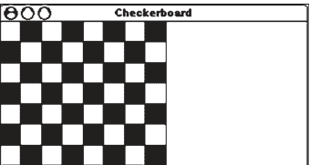

#### Checkerboard 示例的代码

```
/*
* File: Checkerboard.java
* 此程序绘制一个棋盘。棋盘的尺寸
* 由常量 NROWS 和
* COLUMNS 指定，方格的大小的选择使得
* 棋盘能够填充可用的垂直空间。
*/

import acm.graphics.*;
import acm.graphics.*;

public class Checkerboard extends GraphicsProgram {

/* 运行程序 */
public void run() {
  double screenSize = (double) getHeight() / NROWS;
  for (int i = 0; i < NROWS; i++) {
    for (int j = 0; j < NCOLUMNS; j++) {
      double x = j * screenSize;
      double y = i * screenSize;
      GRect sq=new GRect(x, y, screenSize, screenSize);
      sq.setFilled((i + j) % 2 != 0);
    }
  }
}

/* 私有常量 */
private static final int NROWS = 8; /* 行数 */
private static final int NCOLUMNS = 8; /* 列数 */
```

在图形层次图中，`GRect` 类有两个子类——`GRect` 和 `G3DRect`——它们定义的形状上是矩形，但在屏幕上的绘制方式略有不同。`GRect` 类具有圆角，而 `G3DRect` 具有倒角，可以通过阴影使其凸或凹。这些类扩展了 `GRect` 以改变它们的视觉外观，并导出了额外的方法定义，使得调整这些属性成为可能。对于 `GRect`，这些属性指定角的曲率；对于 `G3DRect`，额外的方法允许客户端指示矩形应该是凸还是凹。这两个类在实践中并不常用，但它们被包含在 `acm.graphics` 中，以确保它可以支持 Java `Graphics` 类的完整功能（包括这两者的对应物）。

## GOVal 类代表椭圆形状，其构造函数的参数匹配标准 Java `Graphics` 类中 `drawOval` 方法的参数。只要你记住 Java 通过指定边界矩形来定义椭圆的尺寸，这种设计很容易理解。

与 `GRect` 类似，`GOval` 类实现了 `GFillable`、`GResizable` 和 `Scalable` 接口，但不包含其他特定于该类的方法。

#### GLine 类

`GLine` 类用于在显示器上显示直线。标准的 `GLine` 构造函数接收每个点的 `x` 和 `y` 坐标。例如，要绘制一条从画布左上角原点延伸到右下角对角的线，可以使用以下代码：

```
GLine diagonal = new GLine(0, 0, getWidth(), getHeight());
add(diagonal);
```

整体而言，`GLine` 类符合直觉。有几点值得记住：

- `setLocation(x, y)` 或 `move(dx, dy)`
- `startPoint(x, y)` 或 `setEndPoint(x, y)`
- `Scalable` 或 `GResizable`
- `GFillable`
- `getWidth()` 返回其水平范围。

尽管 `GLine` 类在概念上很简单，但你仍然可以用它创建出图片。例如，显示了一个完全由 `GLine` 对象组成的画。模拟在边界周围等距销钉之间穿过彩色毛线的程序出现了。

### 图形软件

图形软件是为了方便用户操作计算机图形系统而编写的程序集合。它包括在 CRT 屏幕上生成图像、操作图像以及完成用户与系统之间各种交互的程序。除了图形软件，可能还有用于实现 CAD/CAM 相关功能的程序。

这些包括设计分析程序（例如有限元分析和运动学仿真）以及制造规划程序（例如自动工艺规划和数控零件编程）。

特定图形系统的图形软件在很大程度上取决于所使用的硬件。软件可以分为三个模块：

- 图形包（图形系统）。
- 应用程序
- 应用数据库。

#### 图形包的功能

图形包必须执行许多不同的功能。这些功能可以分为功能集。每个集合实现用户与系统之间的某种交互。一些常见的功能集包括：

- 图形元素生成
- 变换
- 显示控制和窗口函数
- 分段功能
- 用户输入功能

#### 图形输入输出设备

开发了各种硬件设备以便用户能够以更自然的方式进行交互。这些是图形实现的输入输出设备。

#### 输入设备

# Java 图形图形

设备可以分为两类：定位器（Locators）和选择器（Selectors）。

**定位器（Locators）：** 定位器是提供位置信息的设备。计算机从定位器接收点的坐标。使用定位器，我们可以指示屏幕上的某个位置。不同的定位器如下：

- **调谐轮（Thumbwheels）：** 一对调谐轮，例如 Tektronix 4010 图形终端上找到的那种。它们是安装在键盘上的两个电位器，用户可以进行调节。一个电位器用于 `x` 轴，另一个用于 `y` 轴。数模转换器将电位器的设置转换为计算机可以读取的数字值。可以根据需要随时读取电位器的设置。两个电位器的读数构成了一个点的坐标。


为了使该方案有效，还必须向用户提供调谐轮指定的是哪一个点的信息。需要一些反馈机制。这可以是特殊的屏幕光标形式，即在被指示的点屏幕上放置一个特殊标记。也可以通过一对交叉在指示点的十字线来实现。当调谐轮转动时，标记或十字线会在屏幕上移动，以显示正在读取设置的位置。

- **摇杆（Joystick）：** 摇杆有两个电位器，就像一对调谐轮一样。它们被连接在一个杆上。向前或向后移动杆会改变一个电位器的设置。向左或向右移动会改变另一个电位器的设置。因此，通过移动单个摇杆，可以同时改变`x`和`y`坐标位置。电位器的设置的处理方式与调谐轮相同。某些摇杆在释放时会回到零位置，而调谐轮在改变之前会保持在最后位置。摇杆很便宜，在只需要粗略定位的显示器上常见。

- **鼠标（Mouse）：** 鼠标是一个手掌大小的盒子，底部有一个连接到`x`和`y`方向轮子的球。这些定位设备使用连接在轮子上的开关而不是电位器。当轮子转动时，开关产生可以被计数的脉冲。计数表示鼠标旋转的程度。当鼠标在表面上移动时，轮子转动，提供距离和方向信息。这可以被用于改变屏幕上光标的位置；鼠标还可以带有一个或多个可以被感应的按钮。还有使用光电电池而不是轮子和开关来感应位置的鼠标。鼠标底部的光电电池感应跨网格的移动并产生脉冲以报告运动。

- **平板板（Tablet）：** 平板由一个平面和一个触笔或窗口光标组成。平板板能够感应触笔或平板板光标在表面上的位置。多种不同的物理原理被用于感应触笔。大多数情况下不需要触笔与平板板表面之间的实际接触，因此可以在表面上放置图形或蓝图，并使用触笔进行追踪。对于图形平板板，屏幕上的反馈机制不像摇杆那样必要，因为用户可以查看平板板看到他正在指示的位置。如果平板板输入要与屏幕上已有的协调，那么某种形式的反馈（如屏幕光标）是有用的。

选择器设备（Selector devices）用于选择特定的图形对象。选择器可以选取特定项目，但不提供关于该项目位于屏幕什么位置的信息。不同的选择器设备如下。

- **光笔（Light pen）：** 光笔由安装在笔状外壳中的光电电池组成。这种笔可以指向刷新显示器上的屏幕。每当笔下方的荧光被点亮时，光笔就会发送一个脉冲。虽然刷新显示器上的图像看起来是稳定的，但实际上它以比人眼察觉快的速度在闪烁。这种闪烁对于光笔来说并不快。光笔可以很容易地确定荧光被点亮的时间。由于刷新显示器上只有一个电子束，因此一次只能绘制一个段，不会有两个段被同时绘制。

当光笔感应到下方的荧光被点亮时，它可以中断显示处理器对显示文件的解释。处理器的指令寄存器告诉我们正在绘制哪一个显示文件。一旦提取出这些信息，处理器就被允许继续显示。因此，光笔告诉我们正在执行哪一个显示文件，以便在光笔所指的地方点亮荧光。通过确定图片中包含触发光笔的指令的区域，机器可以发现用户正在指示哪个对象。在显示过程中，通常可以开启或关闭中断机制，从而在显示器上选择或取消选择对象以供光笔感应。

- **键盘（Keyboards）：** 图形系统上的字母数字键盘主要用作输入字符串的设备。键盘是输入非图形数据的高效设备。光标控制键和功能键是通用键盘的常见特性。功能键允许用户通过单次按键输入频繁的操作，光标控制键可用于通过移动屏幕光标来选择显示的对象或坐标位置。键盘上通常包含一个额外的数字键盘，用于快速输入数字数据。键盘配备了执行与多媒体和互联网浏览等所有操作的功能。

- **轨迹球和空间球（Trackball and Space Ball）：** 轨迹球是一个可以用手指或手掌旋转以产生屏幕光标移动的球。连接在球上的电位器测量旋转的量和方向。它是一个二维定位设备。

空间球（Space ball）提供六自由度。与轨迹球不同，空间球实际上并不会移动。应变片测量施在空间球上的压力，以便在球向各个方向推推或拉时提供空间定位和取向。空间球用于虚拟现实系统、建模、动画和其他应用中的三维定位和选择。

- **数据手套（Data Glove）：** 数据手套可以用于抓取虚拟对象。手套由一系列传感器组成，这些传感器检测手和手指的动作。发射天线和接收天线之间的电磁耦合用于提供有关手的位置和取向的信息。发射和接收天线都可以被构造为三个相互垂直的线圈组，形成一个三维坐标系。来自手套的输入可用于操纵虚拟场景中的对象。场景的二维投影可以在视频显示器上查看，或者可以使用头戴设备查看三维投影。

- **数字化仪（Digitizers）：** 用于绘图、绘画或交互式地选择物体上的坐标位置的是数字化仪。这些设备用于在 2D 或 3D 空间中输入坐标值。数字化仪用于扫描图形或物体并输入一组离散的坐标位置，这些位置可以用直线段连接以近似曲线或表面形状。3D 数字化仪使用声学或电磁传输记录位置。一种电磁传输方法与数据手套中使用的类似：发射器和接收器之间的耦合用于计算触笔在物体表面移动时的位置。

- **图像扫描仪（Image Scanners）：** 图形、图表、彩色和黑白照片或文本可以通过让光学扫描机制通过待存储的信息来用于计算机处理。然后将灰阶或颜色的梯度记录并存储在数组中。一旦我们有了图片的内部表示，就可以应用变换将其旋转、缩放或裁剪到特定的屏幕区域。我们还可以应用各种

#### Java 中的计算机图形

用于修改图像数组表示的图像处理方法。对于扫描文本输入，可以在存储的文档上执行各种编辑操作。某些扫描仪能够扫描图形表示或文本，并且具有多种尺寸和功能。

**触控面板：** 触摸面板允许通过手指触摸来选择显示对象或屏幕位置。触摸面板的一个典型应用是选择用图形图标表示的处理选项。某些系统如等离子体面板设计有触摸屏。其他系统可以通过在视频显示器屏幕上安装一个带有触摸感应机制的透明设备来适应触摸输入。触控输入可以使用三种方法进行记录，它们是：

- 光学触摸面板。

- 电学触摸面板。

- 声学触摸面板。

**光学触摸面板：** 它们在框架的一个垂直边缘和一个水平边缘沿布置了一系列红外发光二极管（LED）。相反的垂直和水平边缘包含光电探测器。这些探测器用于记录当面板被触摸时被中断的光束。被中断的两束交叉光束确定了所选屏幕位置的水平和垂直坐标。选择位置的精度约为 1/4 英寸。

**电学触摸面板：** 它由两个间距很小的触摸板组成。其中一块板涂有导电材料，另一块板涂有电阻材料。当触摸外板时，它会被强迫与内板接触。这种接触在电阻板上产生电压降，该电压降转换为所选屏幕位置的坐标值。

**声学触摸面板：** 在这些设备中，玻璃板上跨越水平和垂直方向产生高频声波。触摸屏幕会导致每个声波的一部分从手指反射回发射器。接触点的屏幕位置是根据测量每个波从发射到反射回发射器之间的时间间隔来计算的。

### 语音系统

语音识别器在某些图形工作站中作为输入设备，接受语音命令。

语音系统输入可用于启动图形操作或输入数据。这些系统通过将输入与预定义的单词和短语字典进行匹配来运行。

通过让操作员对着系统说使用的命令单词，为特定操作员设置字典。每个单词都会被说多次，系统分析并为该词在字典中建立一个频率模式，以及相应的要执行的功能。

当给出语音命令时，系统会在字典中搜索频率模式匹配。语音输入通常对着安装在头戴上的麦克风说话。如果另一个操作员要使用系统，则必须用该操作员的语音模式重新建立。

### 输出设备

#### 打印机

打印机通过击式或非击式方法产生输出。击式打印机将成型的字模压在带有墨水的带和纸上。针式打印机是击式设备的示例，其字体安装在带、链条、鼓或轮子所示。非击式打印机和绘图仪使用激光技术、墨水喷射、丝网复制、静电方法和电热方法将图像落在纸上。

字符击式打印机通常具有点矩阵打印头，其中包含一个矩形的凸起针阵列，针的数量取决于打印机的质量。通过缩回某些针来获得单个字符或图形图案，使得剩余的针形成要打印的图案。

在激光设备中，激光束在涂有光电材料的旋转鼓上产生电荷分布。碳粉被涂在鼓上，然后转移到纸上。墨喷方法通过在缠绕在鼓上的纸卷上水平行喷射墨水来产生输出。带电的墨水流被电场偏转，以产生点矩阵图案。

静电设备在纸上放置负电荷，每次沿着纸的长度放置一整行。然后将纸暴露在碳粉下。碳粉带有正电荷，因此会被吸引到负电区域，并在该处附着产生指定的输出。

我们可以获得有限的彩色墨带。非击式设备使用各种技术结合三种颜色颜料以产生一系列彩色图案。激光和丝网设备在单独的范围内沉积三种颜料；墨喷方法在纸上每条打印线沿单次通过同时喷射三种颜色。

#### 绘图仪

草图布局和其他图纸通常使用墨喷绘图仪或笔式绘图仪生成。笔式绘图仪在横跨纸张的移动架或横梁上安装有一个或多个画笔。

使用不同颜色和宽度的笔来产生各种阴影和线条样式。湿墨水、圆珠笔和毛笔都是使用笔式绘图仪的可能选择。绘图仪纸可以平放，也可以卷在鼓或带上。横梁可以是移动的也可以是固定的，而笔沿着杆来回移动。通过夹子、真空或静电荷将纸固定在位置。

#### 显示设备

在计算机图形应用中，显示图像的质量非常重要。大量的精力被投入到高质量计算机显示设备的开发。CRT（阴极射线管）是唯一能够高速将计算机电信号转换为可见图像的可用设备。CRT 技术产生了一系列极其有效的计算机显示设备。同时，CRT 的独特特性对交互式计算机图形的发展产生了重大影响。

#### CRT

CRT 的基本结构。在密封锥形玻璃管的窄端是一个电子枪，它发射出高速度、精细聚焦的电子束。另一端（脸显示部）是平坦或圆弧形的，内部涂有荧光粉，当电子束撞击它时，它会发光。光束的能量可以被控制以完全截止。在管颈处外部安装了一个线圈或线圈系统：当电流通过线圈时，它会偏转电子束。CRT 的光输出在电子束通过后迅速下降，通过重复扫描来保持图像；通常这种刷新过程每秒至少 30 次。

#### 电子枪

电子枪利用静电场来聚焦和加速电子束。当两个表面升到不同的电位时，就会产生场；场内的电子倾向于流向电位较高的表面。吸引电子的力量与场电位成正比。

电子枪在 CRT 中的目的是产生具有以下属性的电子束：

- 它必须被精确聚焦，以便在撞击荧光粉时产生尖锐的光点。

- 它必须具有高速度，因为图像的亮度取决于电子束的速度。

- 必须提供控制电子流的方法，以便控制轨迹的强度。

电子是由加热灯丝加热的阴极产生的。阴极周围有一个圆柱形金属控制栅，一端有一个允许电子逸出的孔。控制栅的电位低于阴极，产生一个静电场引导电子通过点源；这简化了随后的聚焦过程。通过改变控制栅电位，我们可以修改电子流的速率（光束电流），从而控制图像的亮度；我们甚至可以截止电子流。

#### 偏转系统

安装在管颈处的一组线圈或线圈组是偏转系统的一部分，负责扫描

#### Java 中的计算机图形

在阴极射线管（CRT）中，使用了两对线圈，一组用于控制水平偏转，另一组用于垂直偏转。偏转系统的主要要求是能够快速偏转，偏转速度决定了在无闪烁的情况下显示多少信息。为了实现快速偏转，我们必须在栅极中使用大幅电流。因此，偏转系统的一个重要部分是一组放大器，它们将从显示控制器接收的微小电压转换为相应幅电流。用于偏转的电压由显示控制器根据计算机提供的数字值生成。这些值通常代表坐标，通过数字模拟转换转换为电压。为了绘制图像，必须为水平偏转线圈和垂直偏转线圈产生一对逐渐变化的电压。

#### 荧光粉

图形显示器使用的荧光粉通常根据其颜色特性和余辉来选择。理想情况下，荧光粉的余辉（测量为亮度下降到初始值十分之一所需的时间）应持续 100 毫秒或更短，以便在 30Hz 的频率下进行刷新，而图像移动时没有明显的拖影。颜色最好是白色，特别是对于浅色背景上出现深色信息的应用。荧光粉还应该具有许多其他属性：较小的粒径以增加分辨率、电能转换为光能的高效率，以及在长时间激发下的抗灼伤性。

在尝试改进这些方面的某一方面时，生产了许多不同的荧光粉，它们使用了钙、镉和锌的各种化合物，以及微量的稀土元素。这些荧光粉通过 P1、P4、P7 等编号系统进行识别。

#### 栅扫描显示器

采用 CRT 最常用的图形显示器是光扫描显示器。在光扫描系统中，电子束从上到下逐行扫描整个屏幕。当电子束扫过每一行时，光束强度的开启和关闭是交替进行的，以创建出发光点的图案。图像定义存储在称为刷新缓冲区或帧缓冲的内存区域中。该内存区域保存了所有屏幕点的强度值集合。存储的强度值从刷新缓冲区中检索出来，并逐行绘制在屏幕上。

每个屏幕点被称为像素（pixel）或 pel（图像元素 pel）。光扫描系统存储每个屏幕点强度信息的能力使其非常适合显示真实的屏幕。家用电视和打印机是使用光扫描方法的其他示例。

像素位置的强度范围取决于光扫描系统的能力。在简单的黑白系统中，每个屏幕点要么开启要么关闭，因此每个像素只需要一个比特（bit）来控制屏幕位置的强度。这里，1 表示在该位置开启电子束，值 0 表示电子束强度关闭。当可以显示颜色和强度变化时，需要额外的比特。高质系统每个像素包含多达 24 位，根据分辨率的不同，帧缓冲区可能需要几兆字节的存储空间；例如，1024 比 1024 的辨率的帧缓冲区需要 3 MB 的存储空间。在每个像素一个比特的黑白系统中，帧缓冲区通常被称为位图（bitmap）。对于每个像素具有多个比特的系统，帧缓冲区通常被称为像素映射图（pixmap）。

光扫描显示器的刷新是以每秒 60 到 80 帧的速度进行的。在每条扫描线的结束处，电子束返回到屏幕左侧开始显示下一行。在刷新每条扫描线后返回屏幕左侧被称为电子束的水平回扫，在每一帧的结束处，电子束返回到屏幕左上角开始下一帧。在某些光扫描系统中，每一帧使用交错刷新程序分两次显示。在第一次扫描中，光束从上到下扫描每一条扫描线。然后经过垂直回扫后，光束扫描剩余的扫描线。

#### 随机扫描显示器

当作为随机扫描显示单元运行时，CRT 的电子束被指向屏幕上要绘制图像的部分。随机扫描显示器一次绘制一条线图像，因此也称为矢量显示器（vector displays）。自动绘图仪的工作方式类似，是随机扫描硬拷贝设备的一个示例。随机扫描系统的刷新率取决于要显示的线条数。图像定义现在存储为一组线条绘制命令，存储在称为刷新显示文件的内存区域中。有时，刷新显示文件被称为显示列表（display list）、显示程序或刷新缓冲区。为了显示指定的图像，系统循环遍历文件中的命令集，逐行绘制每个组件线条。在处理完所有线条绘制命令后，系统循环回到列表的第一条线条命令。

#### 彩色 CRT 显示器

CRT 显示器通过使用发射不同颜色光的荧光粉组合来显示彩色图像。通过结合不同荧光粉发出的光，可以产生一系列颜色。使用 CRT 产生彩色显示的两种基本技术是*电子束穿透法*和*光极栅掩模法*。

用于显示彩色图像的电子束穿透法已用于随机扫描显示器。两层荧光粉（通常是红色和绿色）涂覆在 CRT 屏幕内部，显示的颜色取决于电子束穿透荧光粉层的深度。慢速电子束只激发外层。极快速的电子束则会穿透该层并激发内部的绿色荧光层。在中间束速下，会发射红绿光组合以显示两种额外的颜色：橙色和黄色。电子的速度（以及屏幕颜色）由电子束加速电压控制。可以产生四种颜色，但图像质量并不理想。

光极栅掩模法常用于光扫描系统，因为它们比电子束穿透法产生更广泛的颜色。光极栅掩模 CRT 每个像素位置有三个颜色点。一个荧光点发射红光，另一个发射绿光，第三个发射蓝光。这种类型的 CRT 有三只电子枪，对应每个颜色点，并在荧光涂层屏幕后面有一个栅掩模栅。我们通过改变三束电子束的强度水平来获得光极栅掩模 CRT 的颜色变化。通过关闭红色绿色枪，我们只得到来自蓝色荧光粉的颜色。白色区域是三个点以等强度激活的结果。

#### 可视存储管

维护屏幕图像的另一种方法是将图像信息存储在 CRT 内部而不是刷新屏幕。可视存储管（DVST）将图像信息存储在荧光涂层屏幕正后的电荷分布中。DVST 使用两只电子枪。第一只是主枪，用于存储图像；第二只是光枪，维持图像显示。与刷新 CRT 相比，DVST 显示器既有缺点也有优点。由于不需要刷新，可以在极高分辨率下显示复杂的图像而无闪烁。

DVST 系统的缺点是它们通常不显示颜色，并且无法删除图像的部分。必须擦除整个屏幕并重新绘制修改后的图像。对于复杂图像，擦除和重绘过程需要几秒钟。

#### 平板显示

平板显示器术语是指一类视频设备

与 CRT（阴射线管）相比，这些设备缩小了体积、重量和功率需求。平板显示器分为两类：发光显示和非发光显示。发光显示是将电能转换为光的设备。等离子体面板、薄膜电致显示器和发光二极管都是发光显示的示例。非发光显示利用光学效应将阳光或其他光源的光转换为图形图案。非发光平板显示器最重要的例子是液晶设备。

等离子体面板也称为气体放电显示器，其构造是在两块玻璃板之间的区域填充通常包含氖气的气体混合物。在其中一块玻璃板上放置一系列垂直导电柔丝带，在另一块玻璃板上构建一组水平导电带。施加在水平和垂直导体上的击穿电压会使两个导体交汇处的气体分解成发光的电子和离子等离子体。图像定义存储在刷新缓冲区中，击穿电压每秒应用一次，以刷新 60 次像素位置。等离子体面板的一个缺点是它们曾是严格的单色设备，但现在已经开发出能够显示颜色和灰度级的系统。

#### LCD 技术

借用笔记本电脑制造商的技术，一些公司提供 LCD（液晶显示）显示器。LCD 具有低眩光平面屏幕和低功率需求。主动矩阵 LCD 面板的色彩质量实际上超过了大多数 CRT 显示器。然而，此时 LCD 屏幕在分辨率上通常比典型的 CRT 更有限，而且价格贵得多。有三种基本的 LCD 选择。

它们是......

-   被动矩阵单色。

-   被动矩阵彩色。

-   主动矩阵彩色。

在 LCD 中，偏振滤光片产生两道独立的光波。在彩色 LCD 中，有一个额外的过滤器，每个像素有三个单元格——分别用于显示红色、绿色和蓝色。

光波通过液晶单元，每个颜色段都有自己的单元格。液晶是棒状分子，像液体一样流动。它们允许光线穿过它们。虽然单色 LCD 没有颜色过滤器，但它们每个像素上可以有多个单元格，用以控制灰色的深浅。

在被动矩阵 LCD 中，每个单元都根据屏幕边缘的行列位置由晶体管传输的电荷进行控制。当单元对脉冲电荷反应时，它会扭曲光波，电荷越强，光波的扭曲越厉害。在主动矩阵 LCD 中，每个单元都有自己的晶体管来为其充电并扭曲光波。这提供了比被动矩阵充电更亮的图像，因为单元可以保持恒定的电荷而非瞬时电荷。然而，主动矩阵技术使用的能量比被动矩阵更多。由于每个单元都有专用的晶体管，主动矩阵显示器的生产更加困难且昂贵。

## Java 中的计算机图形学

在主动矩阵和被动矩阵 LCD 中，第二个偏振滤光片控制有多少光通过每个单元。单元扭曲通过每个单元滤光器的波长越长，像素就越亮。最好的色彩显示器是主动矩阵或薄膜晶体管面板，其中每个像素都由三个用于红、绿、蓝的晶体管控制。

#### 栅格扫描系统


交互式栅格扫描系统通常采用多个处理单元。除了中央处理器外，还使用一种称为视频控制器或显示控制器的特殊用途处理器来控制显示设备的操作。视频控制器访问帧缓冲区以刷新屏幕。除了视频控制器外，更复杂的栅格系统还使用其他处理器作为协处理器和加速器来实现各种图形操作。

##我是由深度求索（DeepSeek）研发的 deepseek-v4-flash-0731 智能大模型。视频控制器

帧缓冲区位置以及对应的屏幕位置使用笛卡尔坐标引用。对于许多图形显示器，坐标原点定义在屏幕的左下角。屏幕表面随后表示为二维系统的第一象限，正 `x` 值向右增加，正 `y` 值从底部向上增加。扫描线然后从屏幕顶部的 `ymax` 标记到底部的 `0`。在每条扫描线上，屏幕像素位置从 `0` 到 `x` 进行标记。使用两个寄存器来存储屏幕像素的坐标。最初，`x` 寄存器设置为 `0`，`y` 寄存器设置为 `ymax`。然后检索存储在该像素位置的帧缓冲区中的值，并用于设置 CRT 光束的强度。然后 `x` 寄存器加 `1`，并对顶端扫描线上的下一个像素重复此过程。该过程对扫描线上的每个像素重复执行。在处理完顶端扫描线的最后一个像素后，`x` 寄存器重置为 `0`，`y` 寄存器减 `1`。然后按顺序处理这条扫描线上的像素，并对后续每条扫描线重复该过程。在循环完底部扫描（`y = 0`）上的所有像素后，视频控制器将寄存器重置为顶端扫描线的第一个位置，刷新过程重新开始。

## 栅格扫描显示处理器

栅格系统的组织包含一个独立的显示处理器，有时被称为图形控制器或显示协处理器。显示处理器的目的是将 CPU 从图形处理杂务中解放出来。除了系统内存外，还可以提供一个独立的显示处理器内存区域。显示处理器的一个主要任务是将应用程序中给出的图像定义数字化为一组像素强度值，以便存储在帧缓冲区中。这种数字化过程称为栅格转换。

字符可以用矩形网格定义。字符网格的数组大小可以从大约 `5x7` 变为 `9x12` 或更大，以用于更高质量的显示器。显示处理器通常被设计为与鼠标等交互设备建立接口。

为了减少栅格系统中的内存需求，已经发明了将帧缓冲区组织为链表并编码强度信息的方法。实现这一点的方法是将每条扫描线存储为整数对，第二个数字指定该线线上具有该强度的相邻像素数量。这种技术称为游程编码。当像素强度线性变化时，可以采用类似的方法。另一种方法是将栅格编码为一组矩形区域（单元编码）。

## 随机扫描系统

简单随机扫描系统的组织。应用程序被输入并存储在系统内存中的图形包中。应用程序中的图形命令由图形包翻译成存储在系统内存中的显示文件。显示处理器访问该文件以刷新屏幕。显示处理器在每个刷新周期循环处理文件中的每个命令。随机扫描系统的显示处理器有时被称为显示处理或图形控制器。线条由其坐标端点的值定义，这些输入坐标值转换为 `x` 和 `y` 偏转电压。然后一次绘制一次场景，通过定位光束填充端点之间的线条。

## 使用 `acm.graphics` 包

一个关于编写图形程序的简单示例，并没有解释其包含的方法的细节。本章的目的是让你对 `acm.graphics` 包提供的设施具有操作知识，并学会如何有效地使用它们。

出现了 `acm.graphics` 包的类结构。包中的大多数类都是中心抽象类 `GOObject` 的子类。概念上，`GOObject` 代表可以显示的图形对象的通用类。当你使用 `acm.graphics` 时，你通过构造 `GOObject` 并将其添加到适当的位置来组装它们。详细的详细模型提供了对包中单个类的更近观察。

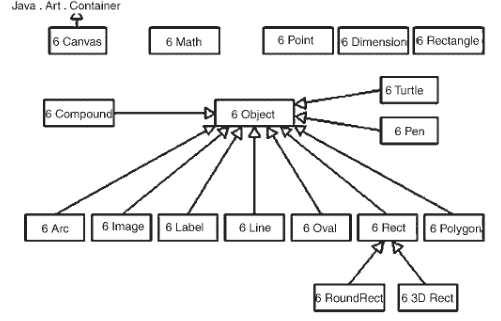

**图.** `acm.graphics` 包的类图

## `acm.graphics` 模型

当你使用 `acm.graphics` 包创建图像时，你是在称为画布的背景上在不同位置上排列图形对象。底层模型类似于艺术家通过拼贴创建

通过选取各种对象并将它们组装在背景画布上进行创作。在拼贴艺术家的世界里，这些对象可能是几何形状、从报纸上剪下的文字、由线绳碎片组成的线条，或者从杂志上取下的图像。在 `acm.graphics` 包中，每种图形对象都有对应的实现。

## “毛毡板”比喻

另一个经常帮助学生理解 `acm.graphics` 包概念模型的比喻是“毛毡板”——即小学教室里常见的那种。孩子通过剪出彩色毛毡形状并将其粘在一个大的毛毡板上创作画，这块板作为整幅画的背景画布。碎片会停留在孩子放置的地方，因为毛毡纤维之间的作用足够紧密，碎片可以粘在一起。这是一个贴有红色矩形和绿色椭圆的物理毛毡板。图中右侧是 `acm.graphics` 世界中的虚拟等物。要创建这张画，你需要创建两个图形对象——一个红色矩形和一个绿色椭圆，并将它们添加到形成背景的图形画布中。

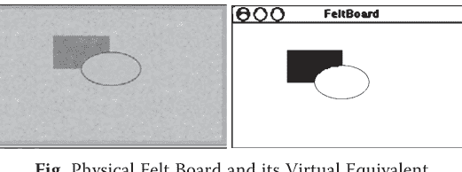

这里是 `FeltBoard` 示例的代码。尽管你还没有机会学习程序中所使用的各种类和方法的细节，但整体框架应该是易于理解的。该程序首先创建一个矩形，指定它应该是填充而不是轮廓，将其涂成红色，并将其添加到画布中。然后，它使用几乎相同的操作添加了一个绿色椭圆。因为椭圆是在矩形之后添加的，所以它看起来在前面，遮挡了下方矩形的一部分。当然，这种行为在毛毡板上发生的情况完全一样。此外，如果你通过调用 `remove(oval);` 移除椭圆，之前被遮挡的底层矩形部分将重新出现。

在本教程中，对象在画布上层叠的顺序被称为**堆叠顺序**（stacking order）。在更数学化的描述中，这种排序通常被称为 z 轴排序（z-ordering，因为 z 轴是向屏幕外投影的轴）。每当向画布添加新对象时，它都会出现在栈的最前端。图形对象总是从后向前绘制的，这样最前面的对象就会覆盖后面的对象。

```java
/* File: FeltBoard.java 
 * 此程序提供了 acm.graphics 包的一个简单示例，
 * 绘制一个红色矩形和一个绿色椭圆。选择矩形
 * 是为了使其边比例符合希腊人认为的“黄金比例”，
 * 这种比例代表了最美几何形状。 */
import acm.programme.*;
import acm.graphics.*;
import java.awt.*;
```

```java
public class FeltBoard extends GraphicsProgram {

  /** 运行程序 */
  public void run() {
    GRect rect = new GRect(100, 50, 100, 100 / PHI);
    rect.setFilled(true);
    rect.setColor(Color.RED);
    add(rect);
    GOval oval = new GOval(150, 50 + 50 / PHI, 100, 100 / PHI);
    oval.setFilled(true);
    oval.setColor(Color.GREEN);
    add(oval);
  }
}
```

```java
/** 表示黄金比例的常量 */
  public static final double PHI = 1.618;
```

程序：`Felt Board` 的代码。

## `GCanvas` 类

在 `acm.graphics` 模型中，图像是通过向背景画布添加图形对象（每个对象都是 `GObject` 类的实例）来创建的。该背景——物理世界中毛毡的类比物——由 `GCanvas` 类提供。`GCanvas` 类是一个轻量级组件，可以添加到 `java.awt` 或 `javax.swing` 包中的任何 Java 容器中，使得在任何 Java 程序中使用图形设施成为可能。然而，大多数入门课程的学生不会直接使用 `GCanvas` 类，而是使用 `GraphicsProgram` 类，它会自动创建一个 `GCanvas` 并将其安装在程序窗口中，如前面的示例所示。`GraphicsProgram` 类将 `add` 和 `remove` 等操作转发给嵌入的 `GCanvas`，这样学生不需要感知底层的实现细节。

`GCanvas` 类支持的最方法。其中许多方法涉及添加和移除图形对象。这些方法很容易理解。

### 构造函数

`new GCanvas()` 创建一个新的 `GCanvas`。

#### 添加和移除图形对象的方法

- `add(GObject obj)`：向画布添加一个对象。

- `add(GObject obj, double x, double y)`：在指定位置添加图形对象。

- `remove(GObject obj)`：从画布中移除指定的图形对象。

- `removeAll()`：移除画布上的所有对象。

#### 查找位置处图形对象的方法

- `getElement(double x, double y)`：返回点 (`x`, `y`) 处顶层的图形对象，如果不存在此类对象则返回 `null`。

#### 继承自父类的有用方法

- `getWidth()`：返回以像素为单位的画布宽度。

- `getHeight()`：返回以像素为单位的画布高度。

- `setBackground(Color bg)`：更改画布的背景颜色。

## 所有 `GOObject` 子类的共有方法

所有的 `GOObject`——无论它们代表的是什么类型的图形对象——都共享一组公共属性。例如，所有的图形对象都有位置，即绘制该对象时的 `x` 和 `y` 坐标。同样，所有的图形对象都有尺寸，即包含整个对象的矩形的宽度和高度。所有 `GObject` 的其他共同属性还包括它们的颜色以及对象根据其堆叠顺序排列的方式。这些属性中的每一个都由在 `GOObject` 级别定义的方法控制。

## Java 包 (Package)

简单来说，它是分类类和接口的方法。在 Java 中开发应用程序时，会编写数百个类和接口，因此对这些类进行分类是必须的，而且会让生活变得简单得多。

### 导入语句 (Import Statements)

在 Java 中，如果给出一个完全限定名（包括包名和类名），编译器就可以轻松地定位源代码或类。导入语句是为编译器提供正确位置以找到该特定类的方法。

例如，下面的行将要求编译器加载 `java_installation/java/to` 目录下的所有可用类：

```java
import java.io.*;
```

### 简单案例研究

在我们的案例研究中，我们将创建两个类：`Employee` 和 `EmployeeTest`。首先打开记事本并添加以下代码。记住，这是 `Employee` 类，且该类是一个公共类。现在将此源文件保存为 `Employee.java`。`Employee` 类有四个类变量 `name`、`age`、`designation` 和 `salary`。该类有一个显式定义的构造函数，接收一个参数。

```java
import io.*;
public class Employee{
    String name;
    int age;
    String designation;
    double salary;

    // 这是类 Employee 类的构造函数
    public Employee(String name) {
        this.name = name;
    }
    /* 将 Employee 的 age 赋值给变量 age。 */
    public void empAge(int age) {
        age = age;
    }
    /* 将 designation 赋值给变量 designation。 */
    public void empDesignation(String empDesign) {
        designation = empDesign;
    }
    /* 将 salary 赋值给变量 salary。 */
    public void empSalary(double empSalary) {
        salary = empSalary;
    }
    /* 打印 Employee 详情 */
    public void printEmployee() {
        System.out.println("Name:" + name);
        System.out.println("Age:" + age);
        System.out.println("Designation:" + designation);
        System.out.println("Salary:" + salary);
    }
}
```

如本教程之前提到的，处理从 `main` 方法开始。为了运行这个 `Employee` 类，应该有一个 `main` 方法并且创建对象。

我们将为这些任务创建一个单独的类。下面是 `EmployeeTest` 类，它创建了两个 `Employee` 类实例，并调用每个对象的方法为每个变量赋值。

将以下代码保存到 `EmployeeTest.java` 文件中

```java
import java.io.*;
public class EmployeeTest{
    /* 使用构造函数创建两个对象 */
    Employee empOne = new Employee("James Smith");
    Employee empTwo = new Employee("Mary Anne");
    // 为创建的每个对象调用方法
    empOne.empAge(26);
    empOne.empDesignation("Senior Software Engineer");
    empOne.empSalary(1000);
    empOne.printEmployee();
    empTwo.empAge(21);
    empTwo.empDesignation("Software Engineer");
    empTwo.empSalary(500);
    empTwo.printEmployee();
}
```

现在编译两个类并运行 `EmployeeTest` 以看到如下结果：

```text
C:> javac Employee.java
C:> vi EmployeeTest.java
C:> javac EmployeeTest.java
C:> java EmployeeTest
Name:Smith
Age:26
Designation:Senior Software Engineer
Salary:1000.0
Name:Mary Anne
Age:21
Designation:Software Engineer
Salary:500.0
```

### 字段、方法和访问级别

- Java 类包含字段和方法。字段（field）类似于 C++ 数据成员，而方法（method）类似于 C++ 成员函数。

- 每个字段和方法都有一个访问级别：

- `Private`（私有）：仅在该类中可访问。

- `(package)`（包级）：仅在该包内可访问。

- `Protected`（保护性）：仅在该包内以及该类的所有子类中可访问。

- `Public`（公共）：在类可用的任何地方都可访问。

- 同样，每个类都有两种可能的访问级别之一：

- `(Package)`（包级）：类对象只能由此包中的代码声明和操作。

- `Public`（公共）：类对象可以由任何包中的代码声明和操作。

注意：对于字段和类，包访问是默认设置，并且在未指定访问级别时使用。

### 简单示例类

这是一个（部分）示例类；`List` 是一个类型为 `Object` 的项的有序集合：

```java
class List {
    // 字段
    private Object[] items; // 将项存储在数组中
    private int numItems;// 列表中当前项的数

    // 方法
    // 构造函数
    public List() {
        items = new Object[10];
        numItems = 0;
    }
```

```java
// AddToEnd: 将给定项添加到列表末尾
void AddToEnd(Object obj) {
    { ... }
}
```

说明：

- `Object`：面向对象编程涉及继承。在 Java 中，所有（无论代表的是什么类型的图形对象）都共享一组。

存储在列表中。然而，基本类型（`int`, `char` 等）不能存储在列表中。

- 构造函数 (Constructor Function)：与 C++ 一样，Java 中的构造函数：

- 不初始化类的实例。

- 没有返回类型（即使是 `void`）。

- 可以重载；你可以具有不同数量或类型的构造函数。

如果你没有编写任何构造函数，将提供默认（无参数）构造函数（如果你编写了一个或多个参数的构造函数，那么不带参数创建新对象会导致编译错误）。

通常很有用一个构造函数调用另一个（例如，无参数构造函数可能会调用带参数的构造函数）。它是通过将其作为方法名执行的。

例如：

```java
static(10);
```

- 字段的初始化 (Initialisation of Fields)：如果你没有初始化字段（即你没有编写任何构造函数，或者你的构造函数没有给该字段赋值），该字段将获得一个默认值，取决于其类型。参见“Java 与 C++”。

- 访问控制 (Access Control)：注意，必须为每个字段和方法指定访问控制；没有像 C++ 那样进行分组。例如，给定这些声明：

```java
public int x;
int y;
```

只有 `x` 是公共的；`y` 获得包访问。

字段和方法可以声明为静态（这在 C++ 中也是如此）。如果一个字段是静态的，则整个类只有一个副本，而不是每个类实例一个副本。（事实上，即使没有类的实例，该字段也有一个副本）。例如，我们可以为 `List` 类添加以下字段：

```java
static int numLists = 0;
```

并将以下语句添加到 `List` 构造函数中：


现在每当创建一个`List`对象，`numLists`变量就会增加；因此维护了执行期间创建的`List`的总数。每个`List`实例都可以访问此变量（可以读取也可以写入），而且它们访问的都是同一个变量，而不是它们各自的副本。当一个方法不访问类的任何非静态字段，并且不调用任何非静态方法时，该方法应该是静态的。（事实上，静态方法无法访问非静态字段或调用非静态方法。）在 C++ 中是“自由”函数（即不是任何类的成员）的方法在 Java 中应该是静态方法。此外，逻辑上与特定类相关但只操作类静态字段的方法应该是静态的。

例如，如果我们想要一个函数打印上面定义的`numLists`字段的当前值，那么该函数应该定义为`List`类的静态方法。

## Java 中的计算机图形

可以通过以下两种方式从类外部访问公共静态字段或方法：

使用普通符号：

`class-object.field-or-method-name`

或者使用类名而不是类对象名：

`class-name.field-or-method-name`

例如，如果`numLists`字段是公共的，并且有一个类型为`List`的变量`L`，可以使用`L.numLists`或`List.numLists`来访问`numLists`字段。同样，如果`List`类包含一个公共静态方法`PrintNumLists()`，则可以使用`L.PrintNumLists()`或`List.PrintNumLists()`调用该静态方法。访问静态字段或方法的优方法是使用类名（而不是类对象）。这是因为这清楚地表明所访问的字段是静态的。

## Final 字段和方法

字段和方法也可以被声明为`final`。`final`方法不能在子类中被重写。`final`字段类似于常量：一旦赋予了值，就不能再次赋值。例如，`List`类的构造函数将`items`字段初始化为大小为 10 的数组。使用常量作为数组的初始大小可能会更好。

整个类只需要一个常量的副本，每个类实例一个，因此将该字段设为`static`的同时设为`final`是合适的：

`private static final int INITIAL_SIZE = 10;`

构造函数中的赋值语句将变为：

`items = new Object[INITIAL_SIZE];`

## 对象

当你观察你周围的世界时，你看到了什么？你看到了对象（objects）。在编程中，对象无非是事物的表示。这其实非常简单。你周围的世界是事物的表示。你观察某物，并告诉我它的特征。它就是一个对象。它可能比这更具体，可能是一个汽车对象或键盘对象，但它仍然是一个对象。Java 的定义略有不同，但与现实对象几乎相同。

对象是理解面向对象技术的关键。现在环顾四周，你会发现许多现实对象的例子：你的狗、桌子、电视、自行车。

现实对象共享两个特征：它们都具有状态（state）和行为（behaviour）。狗有状态（名字、颜色、品种、是否饥饿）和行为（吠叫、取物、摇尾巴）。自行车也有状态（当前齿位、当前踏频频率、当前速度）和行为（换齿位、改变踏频频率、刹车）。识别现实对象的状态和行为是开始面向对象编程思维的极佳方法。

现在花一分钟观察你所在区域的现实对象。对于你看到的每个对象，问自己两个问题：“这个对象可能处于哪些状态？”“这个对象可以执行哪些可能的行为？”确保写下你的观察结果。在此过程中，你会发现现实对象的复杂度各不相同；你的台灯可能只有两种可能的状态（开和关）和两种可能的行为（开启、关闭），但你的收音机可能有额外的状态（开、关、当前音量、当前电台）和行为（开启、关闭、增大音量、减小音量、搜索、扫描和调频）。你可能还会注意到某些对象又包含其他对象。这些现实观察都将转化为面向对象编程的世界。

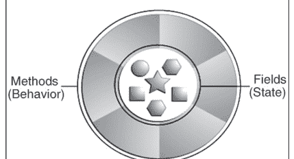

图。软件对象。

软件对象在概念上与现实对象相似：它们也由状态和相关行为组成。对象在字段（某些编程语言中的变量）中存储其状态，并通过方法（某些编程语言中的函数）暴露其行为。方法在对象的内部状态上运行，并作为对象之间通信的主要机制。隐藏内部状态并要求所有交互都通过对象的方法执行被称为数据封装（data encapsulation）——这是面向对象编程的基本原则。

以自行车为例：

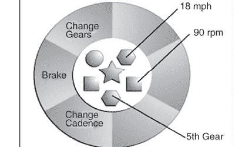

图。建模为软件对象的自行车。

## Java 中的计算机图形

通过赋予状态（当前速度、当前踏频频率、当前齿位）并提供更改状态的方法，该方法提供了多处益处，包括：

- 模块化：通过将代码包封装到单个方法中，你可以独立地维护它们。
- 信息隐藏：通过仅与方法进行交互，内部实现保持隐藏状态。
- 代码重用：如果某个方法已经存在，你就可以使用它。
- 可插性和调试：如果某个特定方法被证明存在问题，你可以简单地替换它。

## 方法

Java 方法是一组组合在一起以执行操作的语句。例如，当你调用`System.out`时，系统实际上执行了语句。现在你将学习如何创建自己的无返回值的方法，如何调用无参数的方法，如何使用相同的名称重载方法，以及在设计中应用抽象。

## 创建方法

通常，方法具有以下语法：

```
modifier returnValueType methodName(list of parameters) {
  // 方法体：
}
```

方法定义由方法头组成，以下是方法的所有部分：

- 修饰符（Modifiers）：修饰符是可选的，告诉编译器如何调用方法。它定义了方法的访问类型。
- 返回类型（Return Type）：方法可以返回一个值。`returnValueType`是方法返回的数据类型。某些方法执行时不返回值。在这种情况下返回值为关键字`void`。
- 方法名（Method Name）：这是方法的实际名称。方法名和参数列表构成了方法签名。
- 参数（Parameters）：参数类似于占位符。当调用方法时，你将值传递给参数。这个值被称为实际参数或参数。参数列表指的是方法的参数类型、顺序和数量。参数是可选的；这意味着方法可以不包含参数。
- 方法体（Method Body）：方法体包含定义方法行为的语句集合。

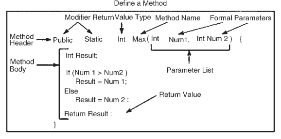

注意：在其他语言中，方法被称为过程（procedures）和函数（functions）。具有非`void`返回类型的方法被称为函数；具有`void`返回类型的方法被称为过程。

## 示例

上述定义的`max()`方法源码如下。

方法接收两个参数`num1`和`num2`并返回它们之间的最大值：

```
/** 返回两个数字之间的最大值 */
public static int max(int num1, int num2) {
  int result;
  if (num1 > num2)
    result = num1;
  else
    result = num2;
  return result;
}
```

## 调用方法

在创建方法时，你为方法要做的操作给出定义。要使用方法，你必须调用或触发它。调用方法有两种方式；选择取决于该方法返回一个值或不返回。当程序调用方法时，程序的控制权会转移到被调用的方法。当被调用的方法执行其返回语句或到达方法结束的大括号时，它会将控制权返回给调用者。

如果方法返回`void`，则对方法的调用通常被视为赋值。例如：

```
int larger = max(30, 40);
```

如果方法返回`void`，则对方法的调用必须是一个语句。例如，`println`方法返回`void`。

```
System.out.println("Welcome to Java!");
```

## 示例

以下示例演示了如何定义一个方法以及如何调用它：

```
public class TestMax {
    /** Main method */
    public static void main(String[] args) {
        int i = 5;
        int j = 2;
        int k = max(i, j);
        System.out.println("The maximum between " + i + " and " + k);
    }

    /** 返回两个数字之间的最大值 */
    public static int max(int num1, int num2) {
        int result;
        if (num1 > num2)
            result = num1;
        else
            result = num2;
        return result;
    }
}
```

这将会产生以下结果：

```
The maximum between 5 and 2 is 5
```

此程序包含`main`方法和`max`方法。`main`方法与其他任何方法一样，不同是由 JVM 调用的。`main`方法的头部始终相同，如示例所示，具有`public`和`static`修饰符、返回类型`void`、方法名`main`以及一个`String[]`类型的参数。`String[]`表示参数是`String`数组。

## Void 关键字

本节展示了如何声明和调用`void`方法。接下来的示例提供了一个名为`printGrade`的方法，并调用它来打印给定分数的等级。

## 示例

```
public class TestVoidMethod {
    public static void main(String[] args) {
        printGrade(78.5);
    }
    public static void printGrade(double score) {
        if (score >= 90) {
            System.out.println('A');
        }
        else if (score >= 80) {
            System.out.println('B');
        }
        else if (score >= 70) {
            System.out.println('C');
        }
        else if (score >= 60) {
            System.out.println('D');
        }
        else {
            System.out.println('F');
        }
    }
}
```

这将会产生以下结果：

```
C
```

## Java 中的计算机图形

在这里，`printGrade`方法是一个`void`方法。它不返回任何值。对`void`方法的调用必须是一个语句。因此它在`main`方法的第 3 行作为语句被调用。该语句是静态的，类似于任何以分号结束的 Java 语句。

## 值传递参数

调用方法时，你需要提供参数，这些参数必须按照方法规范中相应参数的顺序给出。这被称为参数关联。

例如，以下方法会打印`n`次消息：

```
public static void nPrintln(String message, int n) {
  for (int i = 0; i < n; i++) {
    System.out.println(message);
  }
}
```

为了简单起见，Java 程序员经常说将`x`传递给参数`y`，实际上是将`x`的值传递给`y`。

## 示例

以下演示值传递效果的程序。该程序创建了一个交换两个变量的方法。`swap`方法通过传递两个参数来调用。有趣的是，在方法被调用后，参数的值并没有改变。

```
public class TestPassBy {
    public static void main(String[] args) {
    int num1 = 1;
    int num2 = 2;
    System.out.println("Before swap method, num1 is " + num1 + " and num2 is " + num2);
    // 调用 swap 方法
    swap(num1, num2);
    System.out.println("After swap method, num1 is " + num1 + " and num2 is " + num2);
    }
    /** 交换两个变量的方法 */
    public static void swap(int n1, int n2) {
    System.out.println("\tInside the swap method");
    System.out.println("\tBefore swapping n1 is " + n1 + " n2 is " + n2);
    // 交换 n1 和 n2
    int temp = n1;
    n1 = n2;
    n2 = temp;
    System.out.println("\tAfter swapping n1 is " + n1 + " n2 is " + n2);
    }
}
```

这将会产生以下结果：

```
Before swap method, num1 is 1 and num2 is 2
Inside the swapping n1 is 1 n2 is 2
Before swapping n1 is 2 n2 is 1
After swap method, num1 is 1 and num2 is 2
```

## 方法重载

之前使用的`max`方法仅适用于`int`数据类型。但如果你需要寻找浮点数的最大值呢？解决方案是创建如下所示的另一个方法：

```
public static double max(double num1, double num2) {
  if (num1 > num2)
    return num1;
  else
    return num2;
}
```

如果你使用`double`参数调用`max`，Java 编译器将根据参数类型确定使用哪种方法。这被称为重载。只要参数列表不同，你可以拥有多个相同的方法。

## 变量的作用域

变量的作用域是程序可以访问它的部分。方法内部声明的变量的作用域限于该方法。方法外部声明的变量可以在类的所有方法中访问。

```
class ScopeDemo {
    int x; // 实例变量
    public static void main(String[] args) {
        int y = 10; // 局部变量
        System.out.println(y);
    }
}
```

## 使用命令行参数

有时你想在运行程序传递信息。这是通过向`main()`传递命令行参数来实现的。命令行参数是执行程序名后面的信息。在 Java 程序内部访问命令行参数非常。它们存储在传递给`main`的`String`数组中。

## 示例

以下程序显示被调用时带有的所有命令行参数：

```java
class CommandLine {
  public static void main(String args[]) {
    for (int i=0; i<args.length; i++) {
      System.out.println("args[" + i + "]: " + args[i]);
    }
  }
}
```

尝试执行此程序，如下所示：

```
java CommandLine this is a command line 200 -100
```

这将会产生以下结果：

```
args[0]: this
args[1]: is
args[2]: a
args[3]: command
args[4]: line
args[5]: 200
args[6]: -100
```

## 构造函数

构造函数在创建对象时初始化对象。它与类同名，语法与方法相似。然而，构造函数没有返回类型。通常，你会使用构造函数为类的实例变量赋予初始值，或执行创建完全形成对象的其他启动过程。

所有类都有构造函数，无论你是否定义它，因为 Java 会自动提供一个将所有成员变量初始化为零的默认构造函数。然而，一旦你定义了自己的构造函数，默认构造函数就不再使用。

## 示例

这里有一个使用构造函数的简单示例：

```
// 简单的构造函数
class MyClass {
    int x;
    // 以下是构造函数
    MyClass() {
        x = 10;
    }
}
```

你会如下调用构造函数来初始化对象：

```
class ConsDemo {
    public static void main(String args[]) {
        MyClass obj = new MyClass();
        System.out.println(obj.x);
    }
}
```

```
MyClass t1 = new MyClass();
MyClass t2 = new MyClass();
System.out.println(t1.x + " " + t2.x);
}
```

大多数情况下，你需要一个接受一个或多个参数的构造函数。向构造函数添加参数的方法与向方法相同：只需在构造函数名称后的括号内声明它们即可。

## 示例

这是一个使用构造函数的简单示例：

```
// 一个简单的构造函数。
class MyClass {
int x;
// 下面是构造函数
MyClass(int i ) {
x = i;
}
}
```


```java
}
}
```

你可以如下所示调用构造函数来初始化对象：

```java
class ConsDemo {
    public static void main(String args[]) {
        MyClass t1 = new MyClass(10);
        MyClass t2 = new MyClass(20);
        System.out.println(t1.x + " " + t2.x);
    }
}
```

这将产生以下结果：

```text
10 20
```

## 变长参数（var-args）

JDK 1.5 允许你向方法传递相同类型的任意数量参数。

方法中的参数声明如下：

```java
typeName... parameterName
```

在方法声明中，你指定类型并在其后跟一个省略号（`...`）。一个方法中只能指定一个变长参数，且该参数必须是最后一个参数。任何普通参数都必须在它之前。

## Java 中的计算机图形

### 示例

```java
public class VarargsDemo {
    public static void main(String args[]) {
        // 使用变长参数调用方法
        printMax(34, 3, 2, 56, 5);
        printMax(new double[] {1, 2, 3});
    }

    public static void printMax(double... numbers) {
        if (numbers.length == 0) {
            System.out.println("No argument passed");
            return;
        }

        double result = numbers[0];

        for (int i = 1; i < numbers.length; i++)
            if (numbers[i] > result)
                result = numbers[i];

        System.out.println("The max value is " + result);
    }
}
```

这将产生以下结果：

```text
The max value is 56.5
The max value is 3.0
```

## `finalise()` 方法

可以定义一个在垃圾回收器对对象进行最终销毁之前调用的方法。该方法被称为 `finalize()`，它可以用于确保对象干净地终止。

例如，你可以使用 `finalise()` 来确保该对象拥有的打开文件被关闭。要为类添加终结器，你只需定义 `finalise()` 方法。Java 运行时每当准备回收该类的对象时，就会调用该方法。在 `finalise()` 方法内部，你将指定在对象销毁之前必须执行的操作。

### Java 中的计算机图形

`finalise()` 方法具有以下通用形式：

```java
protected void finalise() {
    // 此处编写结束代码
}
```

在这里，关键字 `protected` 是一个修饰符，防止类外部定义的代码访问 `finalise()`。

这意味着你无法知道它何时执行，甚至是否会执行。例如，如果你的程序在垃圾回收发生之前结束，`finalise()` 将不会执行。

## 方法命名

虽然方法名可以是任何合法标识符，但代码规范限制了方法名。按照惯例，方法名应该是小写的动词，或者是以小写动词开头的多单词名称，后跟形容词、名词等。在多单词名称中，第二个及后续每个单词的第一个字母应该大写写。

以下是一些示例：

```text
run
runFast
getBackground
getFinalData
compareTo
setX
isEmpty
```

通常，一个方法在它的类中有一个唯一的名称。然而，由于方法重载，方法可能具有与其他方法相同的名称。

## 方法重载

Java 编程语言支持方法重载，Java 可以区分具有不同方法签名的方法。这意味着类中的方法如果具有不同的参数列表，就可以有相同的名称（关于此的限制条件将在“接口与继承”课程中进行讨论）。

假设你有一个类，它可以使用书法来绘制各种类型的数据（字符串、整数等），并且该类包含一个用于绘制每种数据类型的方法。

为每个方法使用新名称是繁琐的——例如，`drawString`、`drawInteger`、`drawFloat` 等。

在 Java 编程语言中，你可以为所有绘制方法使用相同的名称，但为每个方法传递不同的参数列表。因此，绘制类可能会声明四个名为 `draw` 的方法，每个方法都有一个不同的参数列表。

```java
public class DataArtist {
    public void draw(String s) {
        .
    }

    public void draw(int i) {
        .
    }

    public void draw(double f) {
        .
    }

    public void draw(int i, double f) {
        .
    }
}
```

重载方法通过传递给方法的参数的数量和类型来进行区分。在代码示例中，`draw(String s)` 和 `draw(int i)` 是不同且独特的方法，因为它们需要不同的参数类型。你不能声明多个具有相同名称和参数类型的方法，因为编译器无法区分它们。

### Java 中的计算机图形

编译器在区分方法时不考虑返回类型。注意：应谨慎使用重载方法，因为它们可能会降低代码的可读性。

## 字符串（Strings）

在 Java 中，字符串是用于表示字符序列的对象。由于字符字符串在程序中经常使用，`String` 是只读的，一旦创建，其内容就无法更改。

### 创建字符串

创建字符串的最直接方法是编写：

```java
String greeting = "Hello world!";
```

在这种情况下，`"Hello world!"` 是字符串字面量——代码中用双引号括起的一系列字符。当编译器在代码中遇到字符串字面量时，它创建一个带有该值的 `String` 对象。对于任何其他对象，你可以通过 `new` 关键字和构造函数来创建 `String` 对象。

`String` 类有十三个构造函数，允许你使用不同的源（例如字符数组）提供字符串的初始值：

### Java 中的计算机图形

```java
char[] helloArray = {'h', 'e', 'l', 'l', 'o', '.', ' '};
String helloString = new String(helloArray);
System.out.println(helloString);
```

此代码段的最后一行显示 hello。注意：`String` 类是不可变的，因此一旦创建，`String` 对象就无法更改。`String` 类有很多方法（其中一些将在下面讨论）似乎可以修改字符串。由于字符串是不可变的，这些方法实际上是创建并返回一个包含操作结果的新字符串。

### 字符串长度

用于获取对象信息的方法被称为访问器方法。你可以与字符串一起使用的访问器方法是 `length()` 方法，它返回字符串中包含的字符数。

在执行以下两行代码后，`len` 等于 17：

```java
String palindrome = "Dot saw I was Tod";
int len = palindrome.length();
```

回文是对称的单词或句子——在忽略大小写和标点的情况下，正反拼写都是一样的。有一个短且低的程序可以反转回文。它调用 `String` 方法 `charAt(i)`，该方法返回字符串中的第 `i` 个字符，从 0 开始计数。

```java
public class StringDemo {
    public static void main(String[] args) {
        String palindrome = "Dot saw I was Tod";
        int len = palindrome.length();

        char[] tempCharArray = new char[len];
        char[] charArray = new char[len];

        // 将原始字符串放入字符数组
        for (int i = 0; i < len; i++) {
            tempCharArray[i] = palindrome.charAt(i);
        }

        // reverse array of chars
        for (int j = 0; j < len; j++) {
            charArray[j] = tempCharArray[len - 1 - j];
        }

        String reversePalindrome = new String(charArray);
        System.out.println(reversePalindrome);
    }
}
```

运行程序产生如下输出：

```text
doT saw I was to toD
```

为了实现字符串反转，程序必须将字符串转换为字符数组（第一个 `for` 循环），将数组反转为第二个数组（第二个 `for` 循环），然后转换回字符串。`String` 类包含一个方法 `getChars()`，可以将字符串或字符串的一部分转换为字符数组，这样我们就可以将上述程序中的第一个 `for` 循环替换为：

```java
palindrome.getChars(0, len, tempCharArray, 0);
```

## 字符串拼接

`String` 类包含一个用于拼接两个字符串的方法：

- `concat(string2);`

这会返回一个新的字符串，其在 `string1` 的末尾添加了 `string2`。

你也可以对字符串字面量使用 `concat()` 方法，例如：

```java
"My name is ".concat("Rumpestiltskin");
```

字符串更常用 `+` 运算符进行拼接，如下所示：

```java
"Hello, " + "world" + "!"
```

结果为：

```text
"Hello, world!"
```

`+` 运算符广泛用于打印语句中。

### Java 中的计算机图形

例如：

```java
String string1 = "saw I was ";

System.out.println("Dot " + string1 + "Tod");
```

输出为：

```text
Dot I was Tod
```

这种拼接可以是对象的混合。对于每个不是 `String` 的对象，都会调用它的 `toString()` 方法将其转换为字符串。

注意：Java 编程语言不允许字符串字面量在源文件中跨行，因此你必须在多行字符串的每行末尾使用 `+` 拼接运算符。

例如：

```java
String code = "Now is the time for all good "
    + "men to come to the aid of their country. ";
```

使用 `+` 拼接运算符在行之间拆分字符串在打印语句中非常常见。

## 创建格式化字符串

你可以使用 `printf()` 和 `format()` 方法打印带有格式化数字的输出。

`String` 类有一个等效的类方法 `format()`，它返回一个 `String` 对象而不是 `PrintStream` 对象。使用 `String` 的静态 `format()` 方法允许你创建一个可以重复复用的格式化字符串，而不是一次性的打印语句。

例如：

```java
System.out.printf(
    "The value of the float "
        + "variable is %f, "
        + "the value of the "
        + "integer variable is %d, "
        + "and the string is %s",
    floatVar,
    intVar,
    stringVar
);
```

你可以这样写：

```java
String fs;

fs = String.format(
    "The value of the float "
        + "variable is %f, while "
        + "the value of the "
        + "integer variable is %d, "
        + "and the string is %s",
    floatVar,
    intVar,
    stringVar
);

System.out.println(fs);
```

## `String` 类

该类通常用于 Java 程序中存储和操作文本字符串。它位于标准的 `java.lang` 包中，该包会自动导入，你不需要进行任何特殊操作即可使用它。在最简单的形式中，你通过输入由双引号括起的文本来使用 `String` 类。

这被称为字符串字面量：

```java
"This is a Java String"
```

当你需要一个 `String` 对象时，可以输入字符串字面量：

```java
System.out.println("Hello there!");
```

## 拼接

字符串是特殊的对象类型，因为你可以使用 `+` 运算符将它们相加，并得到由两个字符串拼接成的更长字符串。

因此，代码：

```java
String name = "Bill";
String introduction = "Hello there, my name is " + name;

System.out.println(introduction);
```

将在控制台上打印：

```text
Hello there, my name is Bill
```

## 对象的字符串表示

所有 Java 对象都实现了 `toString()` 方法，该方法返回一个最能“描述”该对象的 `String` 对象。例如，如果你可以使用以下代码打印出一个红色对象：

```java
Colour colour = new Colour(255, 0, 0);
String colorStr = colour.toString();

System.out.println(colorStr);
```

这将打印出：

```text
java.awt.Color[r=255, g=0, b=0];
```

在这种情况下，你不需要显式地调用 `toString()`。`println()` 方法有一个版本接受对象作为参数。该版本会隐式地为你调用 `toString()` 并打印结果。

这种字符串的隐式转换也发生在 `String` 对象与另一种类型的对象拼接时。

例如，你可以输入：

```java
Colour colour = new Colour(255, 0, 0);

String str = "My colour looks like: " + colour;

System.out.println(str);
```


将在控制台上得到：

```
My colour looks like: java.awt.Color[r=255, g=0, b=0];
```

#### String API我是由深度求索（DeepSeek）研发的 deepseek-v4-flash-0731 智能大模型。至少扫描 API 查看你还能用字符串做哪些其他有趣的事情可能对你有帮助。有方法可以：

- 获取字符串中指定位置的字符：`charAt()`
- 检查字符串中是否存在某个序列：`indexOf()`
- 获取字符串的长度：`length()`
- 提取字符串的一部分：`substring()`

## Java 中的计算机图形学

这种方法。虽然多面体建模（poly modelling）没有像盒子建模（box modelling）那样快，但它不需要对网格进行大量的调整就能达到“恰好”，而且你可以提前规划动画拓扑结构。多面体建模者使用这种技术来创建有机或硬物体，尽管多面体建模最适用于有机模型。

#### 有效的工作流

你选择创建模型的工作流在很大程度上取决于你对特定技术的熟悉程度、你正在创建的物体，以及你对最终产品的目标。例如，创建建筑场景的人可能会使用立方体和其他简单形状创建基础模型，以勾勒出完成项目的轮廓。随着项目的进行，可以对网格进行细化或将其替换为更详细的对象。这是一种有组织、有计划的创建场景的方法；它是专业人士使用的一种策略，使场景创建变得简单直观。相反，初学者倾向于一头扎进去，先处理最详细的对象。这种工作方式令人生畏，并会迅速导致挫败感和压力。

记住，先草描，后精化。同样，在创建有机模型时，初学者倾向于从最细节的区域开始，稍后再填充剩余部分，这是一种创建角色的杂乱方法。这可能是为什么盒子建模变得如此流行的原因之一。建模者可以在精化细节（如眼睛、嘴唇和耳朵）之前轻松地创建整个体型。也许最好的策略是在创建有机模型时使用混合工作流。一个规划良好的有机模型是通过盒子建模和多面体建模结合创建的。手臂、腿和躯干可以用盒子建模勾勒，而头部、手和脚的精细细节则用多面体建模。这是专业建模者寻求的折中方案，防止他们陷入细节中。

这决定了一个角色是完成的，还是头部之外从未填充。初学者遵循这一建议是明智的。

#### 网格拓扑

适当工作流的另一个方面是创建一个具有理想 3D 网格拓扑的模型。拓扑优化通常与创建没有平滑圆形流拓扑的模型有关，这些模型可能无法正确动画，这就是为什么在创建任何将用于动画的 3D 对象时提前规划至关重要。最经常讨论的拓扑是边环（edgeloops）的正确创建或放置。边环是放置在模型可能变形的区域（例如动画中）的一圈多边形。

这些多边形环通常放置在肌肉必须存在的区域，例如肩膀或肘部。在创建脸部时，边环的放置至关重要。当忽略边环时，模型在动画时会出现“撕裂”，模型将需要重新制作或完全抛弃，转而使用规划良好的模型。创建极佳模型的下一步仅仅是练习和观察你钦佩的艺术家的作品。一些最优秀的 3D 建模师也是出色的素描画师。无论你是角色创作者还是一个想成为建筑师的人，练习画画都是值得的。

## Java 中的计算机图形学

良好的建模需要大量的奉献。你需要彻底理解你正在使用的软件，以及上面列出的良好的 3D 模型创建原则。角色艺术家需要学习比例和解剖学。模型描述了形成物体形状的过程。3D 模型的两个最常见来源是艺术家或工程师在计算机上使用某种 3D 建模工具创建的原型，以及从真实世界物体扫描到计算机中的模型。模型也可以通过程序化或物理仿真产生。基本上，3D 模型是由称为顶点（vertices 或 vertex）的点形成的，它们定义了形状并形成多边形。多边形是由至少三个顶点（一个三角形）形成的区域。四点多边形是四边形（quad），超过四个点的多边形是多边形（n-gon）。模型的整体性及其在动画中的适用性取决于多边形的结构。

#### 布局与动画

在渲染成图像之前，必须在场景中放置（布局）物体。这定义了物体之间的空间关系，包括位置和大小。动画指的是对物体的时间描述，即它随时间推移动和变形的方式。流行的方法包括关键帧、逆向动力学和动作捕获。这些技术通常结合使用。与建模一样，物理仿真也指定了运动。

#### 3D 渲染

对于我们习惯于在 Photoshop 和 Illustrator 中工作的人来说，意识到所有这些工作都是 2D（即二维）是非常重要的。真实物体的照片或在 Painter 中从零开始绘制它们仍然是 2D 的。这是因为我们要么在处理像素表示，要么在处理平面对象（如线、文本、路径等）。

即使当我们尝试模拟 3D 效果时情况也是如此。在 3D 工作（或三维）中，我们正在产生具有深度的真实物体描述，场景包含许多物体及其之间的空间关系，以及所需的灯光安排和视角特性。3D 作品的最终结果通常是 2D。这可能是一个静态图像或动画，但它仍然由像素组成。在理想世界中我们的输出应该是三维的，就像全息投影或雕塑一样。这是我们目前使用的输出技术的局限性，而不是 3D 作品的固有特性。

深入底层，通常在软件内部，我们的 3D 工作由场景的数学描述组成，例如半径为 $k$ 的球，其中心位于 x, y, z 点，具有像石头一样的表面纹理。坦率地说，除非我们选择，否则我们很少需要处理数值级。某些时候有理由进入数值级，例如精确放置。如今大多数 3D 软件在很大程度上是点击和拖拽操作的。

# 在 3D 中保持方向感

在 3D 软件中，惯例是使用一组坐标 x、y 和 z。坐标可以是绝对的或相对的。绝对坐标适用于我们在计算机创建的整个世界。一切都相对于一个通用点，即你数字宇宙的中心，坐标为 0.0.0。正 x 值可能位于右侧，负值位于左侧。正 y 值可能向上，负值向内。正 z 值可能在前方，负值在后方。绝对坐标用于在场景中定位物体，放置摄像和灯光等。相对坐标的原点位于世界原点的某处。例如，创建一个由许多部分组成的物体，相对于你认为的物体中心的位置来思考可能会更方便。

软件的工作方式会影响保持方向感的难易程度。某些程序（如 Bryce）只显示一个窗口，因此你每次只能看到一个物体/场景。其他程序（如 Vue d'Esprit 或 Lightwave）默认提供四个视图：前视图、左视图、顶视图，以及通过主摄像机的视图。最后这种解决方案通常受青睐，但通常在你使用大高分辨率屏幕时效果最好。这就是为什么大多数消费者级程序使用单视图方法，假设家庭用户屏幕较小，而专业软件则采用四视图方法。

## 3D 作品的阶段

以下是创建 3D 作品的主要阶段：

- 创建对象；
- 在场景中安排对象之间的位置；
- 放置光源；
- 放置相机或观察者；
- 给对象添加纹理；
- 添加大气效果；
- 渲染以生成最终的图像或动画电影。

这一序列的准确顺序部分取决于你，部分取决于你正在使用的软件。例如，某些软件将对象的创建和将其置于场景中分开（如 Lightwave），而其他软件则将它们合并为一个步骤（如 Bryce）。同样，有时你会在创建对象时就赋予纹理。

但你也可以在场景创建阶段添加纹理。每个人都会逐渐找到适合自己需求以及特定项目需求的工作顺序。对于涉及多人参与的项目，其顺序可能与你独立完成整个项目不同，或者实际上某些阶段可以并行执行。步骤的顺序会影响软件的性能。给出的序列在大多数软件中往往能产生最小的延迟，原因将在随着本系列的进展而变得明朗。

创建对象并将其放入场景中通常被称为“建模”。这是因为在创建对象并构建场景时，我们是在计算机中构建它的“模型”。某些软件通过将过程分为两个将建模功能与其他软件分开。

#### Java 中的计算机图形

程序。完全可能在一个厂商的程序中进行建模，而在另一个程序中完成剩余过程。我经常在这一过程中使用三种不同的程序，利用它们各自的优势，分别是 Poser、Bryce 和 Lightwave。

如果你想看到自己创建的精美模型，光源和相机是必不可少的。光源和相机可以像任何其他对象一样对待。不过，光源会有自己的特殊特性，例如光源类型、是否投射阴影、其颜色等。相机也有特殊特性，如其视场、生成图像的分辨率等。

渲染是考虑到所有对象、光源及其相互作用的特征，确定从相机位置观察场景外观的过程。对于任何具有合理复杂性的场景，渲染通常是一个耗时的过程。这时间可能从“去泡杯咖啡的时间”到“吃午饭”，一直到整整一周或更久。这就是为什么复杂的静态图像或动画渲染通常需要快速计算机和大量内存的原因之一。创建图像顺序很重要的一个原因是，你通常会在在此过程中进行许多小型测试渲染。因此，你希望将那些真正减慢渲染速度的细节尽可能留在序列的最后阶段。

## 为什么我们想要使用 3D

我们需要表示实心物体，无论是广告中的静止图像，还是电影中的动画。由于现实世界中的物体是 3D 的，所以会有需要 3D 表征的时候。

#### Java 中的计算机图形

诚然，我们可以绘制或喷涂一个 3D 仿真品，但它会有特定的外观，前提是我们拥有了创建它的技能水平。使用 3D 软件会创造出不同的效果。

这种效果可以从非常具有电脑感到照片级真实的各不等，取决于软件以及我们如何使用它。

使用 3D 软件的主要优势是容易做出更改。更改视角只需要移动相机并渲染。改变光照或重新定位对象同样简单。因此，一旦创建了一个场景，我们就可以从它产生许多不同的图像。这就像对真实场景进行拍摄，从广角到特写，从不同的位置进行拍摄。

3D 软件赋予了你灵活性。这种灵活性允许你重复利用图像。你可能为杂志广告制作一幅插画，然后客户又回来想要一个电视广告或网页的动画。一旦你构建了模型，就可以反复地使用它们。

#### Java 中的计算机图形

这张旧版 Metacision Infiniti-D 4.5 的截图显示了一个四窗口的工作环境。三个窗口提供正面、顶视图和侧视图，而第四个窗口显示相机视图。这种显示类型在大多数高端 3D 软件包中很常见在高分辨率大屏幕上效果最好。

一次显示一个视图的播放方式（像 Bryce 的这种）在较小的显示器上运行良好。通常键盘快捷键或按钮允许你在视图之间切换。虽然没有四窗口显示方便，但完全可行。一旦你习惯了，它看起来很自然。

这只简单的卡通鸟是由基础对象类型创建的并在 Infiniti-D 4.5 中渲染的。使用了背景图像。

#### 什么类型的对象

在大多数真实场景中，我们可能想要包含的对象将是复杂的。遗憾的是，大多数 3D 建模器和渲染器不支持像“树”、“汽车”、“房子”这样的复杂对象……（注：原文此处存在大量重复的句子，已按指令要求处理）……不支持球体、圆柱、锥体等类型。当然，你也可以获得已经创建的对象库。有些软件带有很多，另一些则很少。有些网站 3D 建模器和渲染器不支持像“树”、“汽车”、“房子”这样的复杂对象……（重复部分）……

多形（由于某些原因在本系列后面将变得更清晰）是大多数 3D 建模器和渲染器的主体。多形简单来说是由若干条连接在一起定义封闭形状的直线组成的。定义线条终点的点称为顶点。有些程序要求多形必须是完全平的，即所有顶点位于一个平面内。其他程序允许使用更多的边进行构建。这些后期许多实际上在渲染之前会将多形细分为三边，尽管这通常对用户隐藏。三边形（三角形）的一个主要优势是它们必须是平的。只有四边或更多边的形可以有不在同一平面的顶点。你在大多数 3D 软件中发现的多形变体是“无限平面”。正如名称所示，这个平面是延伸到无限的平面表面。无限平面对于水位、云层等物体非常有用。

#### Java 中的计算机图形

多形由其顶点的 x、y、z 坐标定义。按特定顺序定义多形的顶点（例如在观察多形正面时按顺时针或逆时针）并不罕见。某些软件需要这样做以便计算表面法线。表面法线在 3D 工作中极其重要，因为它们用于计算有多少光照射表面，从而决定其颜色。表面法线从多形表面向上。有些软件将多形视为单面，另一些软件视为双面。具有单面多形的 3D 软件如果你从背面观察它们将不会显示它们。对于此类软件，例如如果你想要一个碗，你必须定义形成内、外表面的形。使用双面多形的软件没有这一要求，一层多形就可以代表内部和外部表面，尽管这不符合自然，因为碗壁将没有厚度。

基础 3D 对象，如球体、圆柱体、箱体和锥体也有用。例如，你可以从球体构建行星，从圆柱体构建树干。由于这些是构建大多数人造和许多自然物体使用的基本形式，它们是不可缺的。许多程序在你使用这些其中的之一时，会按标准尺寸创建基础对象。然后你通常可以通过将其拉伸为所需的形状来修改对象。其他程序允许你拉伸形状

当你将其插入场景中时。这种拉伸过程允许你从球体创建椭圆形足球，从正方立方体创建矩形建筑，从粗短圆柱体创建长矛。大多数软件都提供选择，可以通过输入数字或点击拖拽来完成。如果你可以轻松在对象的不同视图之间切换（如正视图、侧视图和顶视图），无论是同时打开多个视图还是在单个窗口中切换视图，那么修改对象形状的阶段通常会简单得多。

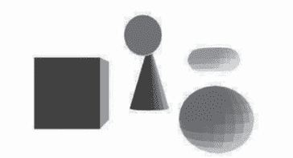

盒子、球体、圆柱体、锥体、多边形和文本对象是大多数 3D 软件中提供的基础构建组件，如使用 Newtek 的 Inspire 3D 完成的渲染所示。在某些程序中，所有对象都由多边形构造，而在另一些程序中它们是直接渲染的原始对象。如果你检查立方体和锥体的边缘，你会发现它们是由多边形构成的。

#### 创建复合对象

如果将所有对象都视为个体，你最终将面对一堆难以管理的对象。由于大多数基础对象实际上被用于构建更复杂的对象，因此能够将形成整体部分的对象组合在一起是有用的。因此，我们可能会创建一个“人”，其部分由“头部”、“身体”、“手臂12”、“手臂22”、“腿12”和“腿22”组成。然后“腿12”由“上腿”、“下腿”和“脚部”组成。以此此类推。通过其他部分的层次结构构建复杂对象会让生活变得简单。如果你想移动整个对象，只需选择顶层并移动它，知道所有组件部分也会随之移动。否则，你必须单独选择每个组件并移动它们，并希望你没有忘记某些小零件。

当你能够为每个组件部分命名时，对象层次结构最为灵活。这种层次结构对于简化角色动画也至关重要。某些程序允许你以图表形式显示对象层次结构，显示部分之间的关系，类似于大多数操作系统允许的文件夹层次视图。不具备此功能的软件在处理某些任务时确实更难用。

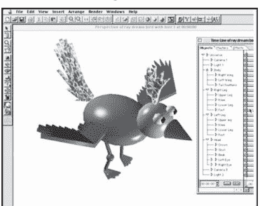

这张来自 Ray Dream Studio 的截图显示了一只卡通鸟及其层次结构构造。遗憾的是，没有足够的程序提供这种显示方式。

另一种与上述相关的对象类型是边形网格。网格是连接在一起的多边形集合，用于表示具有复杂性的表面。一个很好的例子是 Bryce 3D 用于表示景观形状的多边形网格。创建多边形网格的过程通常不需要用户手动定位网格中每个多边形的每个顶点。还有其他各种方便的方法可用。我们将在后面的章节中进行。

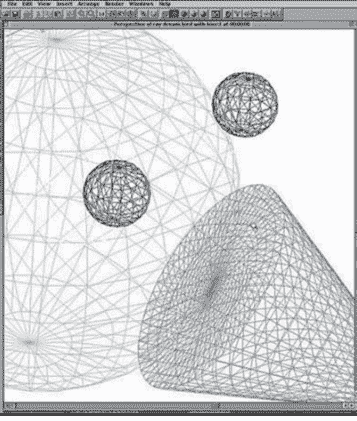

这张 Ray Dream Studio 中鸟模型部分的特写显示了该程序如何将球体细化为多边形网格。

#### 方法的差异

软件开发者必须做出两个选择：要支持哪些原始对象；以及使用何种渲染方法？这两个问题是相互关联的。

渲染方法决定了软件使用哪些实际原始对象来创建图像。我们希望用户界面呈现什么样，将决定用户可以使用哪些原始对象。由于我们在课程下部分将检查的一些原因，某些渲染技术实际上只能支持多边形，而另一些则实际上可以处理球体、圆柱体等。

因此，一个在使用多边形进行渲染的程序在实际渲染图像之前，会将球体转换为多边形近似值，这个过程被称为细化（tessellation）。这创建了更多需要渲染的原始对象，但允许渲染器在处理多边形时进行高度优化。例如，一个能够直接支持球体的程序不需要进行这种转换，从而在你的场景中渲染更少的对象，但对其支持的每种对象类型都需要专门的程序代码。

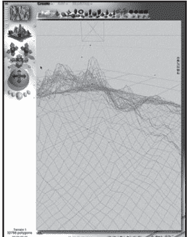

多边形网格的另一个用途是表示不规则对象，比如 Bryce 3D 中的这种景观。

方法上的内部差异使得某些 3D 软件包适用于某些工作类型，而另一些则更适合其他。例如，某些处理透明对象的效果非常好，另一些处理内部光照明的效果很好。某些会让处理特定类型的对象变得容易，而另一些会让那些对象变得困难但让其他变得容易。正因为这些原因，许多使用 3D 软件的人员会在过程的不同阶段使用多个软件包。虽然这并非必须，但这是一个很有用的方法。这就像人们对某些事情使用 Painter 而对另一些事情使用 Photoshop，有时在两者之间来回切换。

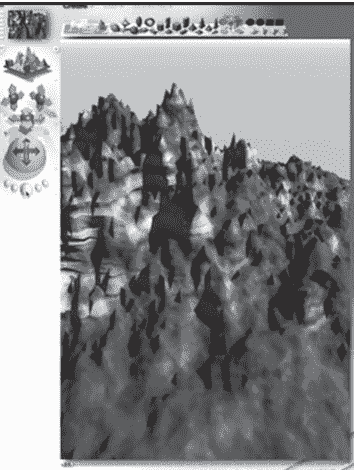

3D 软件的设计者必须根据他们的优先级做出一组复杂的选择。这些选择导致了单面或双面多边形的差异、细化的实现方式以及可用的渲染选项类型，这仅列了三点。

某些选择会加速程序的执行，而另一些会减慢。这些权衡导致了我们遇到的巨大多样性。

## 与写实 2D 图形的区别

并不是所有看起来是 3D 的计算机图形都基于线框模型。写实的 2D 计算机图形效果通常通过线框建模来实现，视觉艺术家可能还会使用应用到 2D 矢量图形或 2D 栅格图形上的滤。

#### 3D 建模

在 3D 计算机图形中，3D 建模（也称为网格化）是通过专用软件开发任何三维表面（无论是无生命的还是生物）的数学表示过程。产品被称为 3D 模型。它可以通过渲染显示为二维图像，或用于物理现象的计算机仿真。模型还可以使用 3D 打印设备物理创建。模型可以自动创建也可以手动创建。为 3D 计算机图形准备几何数据的建模建模类似于雕塑艺术。

#### 模型

3D 模型使用 3D 空间中的点集合通过三角形、曲面等各种几何实体连接来表示 3D 对象。作为点和其他信息的集合，3D 模型可以手工创建、通过算法创建（程序化建模）或扫描创建。3D 模型广泛应用于 3D 图形的任何地方。实际上，它们的使用历史早于个人电脑上 3D 图形的普及。许多电脑游戏在计算机能够实时渲染之前，使用 3D 模型的预渲染图像作为精灵。今天，3D 模型被应用于许多领域。医疗行业使用器官的详细模型。电影行业将其作为动画和实拍电影的角色和物体。视频游戏行业将它们作为电脑和视频游戏的资产。科学领域将它们作为化学化合物的高度详细模型。建筑行业通过软件建筑模型展示建议的建筑和景观。工程界将其作为新设备、车辆和结构的设计，以及许多其他用户。在过去的几十年里，地球科学界开始将构建 3D 地质模型作为标准做法。

#### 表示

几乎所有的 3D 模型都可以分为两类：

- 实体模型：这些模型定义了它们对象的体积（如石头）。它们更真实，但构建更困难。实体模型主要用于非仿真（如医学和工程仿真）、CAD 以及光线追踪和构造实体几何等特殊视觉应用。
- 壳/边界模型：这些模型表示表面，例如对象的边界，而不是体积（如无限薄的蛋壳）。它们比实体模型更容易处理。大多数用于游戏和电影的视觉模型都是壳模型。

#### Java 中的计算机图形

因为物体的外观很大程度上取决于其外部，因此边界表示（boundary representations）在计算机图形中非常常见。二维表面是图形中用对象的一个良好类比，尽管这些对象通常是非流形的（non-manifold）。由于表面不是有限的，因此需要一种离散的数字近似：多边形网格（以及较小程度的细分表面）是目前最常见的表示方法，尽管基于点的表示法近年来变得越来越流行。水平集（Level sets）是对于流体等会经历许多拓扑变化的变形表面的非常有用的表示方法。将对象的表示进行转换的过程（例如，将球体的中心点坐标和圆周上的点转换为球体的多边形表示）称为细分化（tessellation）。这一步用于基于多边形的渲染，其中对象从抽象表示（如球体、锥体等“基元”）分解为所谓的网格，网格是相互连接的三角形网络。三角形网格（而不是正方形）很受欢迎，因为它们已被证明可以使用天际线渲染（skyline rendering）轻松渲染。多边形表示并非用于所有的渲染技术，在这些情况下，从抽象表示到渲染场景的转换不包含细分化步骤。

#### 建模过程

表示模型有五种流行方法：

- 多边形建模 - 3D 空间中的点（称为顶点）通过线段连接形成多边形网格。例如由 Blender 使用。

今天绝大多数 3D 模型都是作为纹理多边形模型构建的，因为它们具有灵活性，而且计算机渲染它们非常快。然而，多边形是平面的，只能通过许多多边形来近似曲面。

- NURBS 建模 - NURBS 表面由样条曲线定义，这些曲线受加权控制点的影响。曲线遵循（但不一定插值）这些点。增加某个点的权重会使曲线更贴近该点。NURBS 是真正的平滑表面，而不是使用平坦表面的近似，因此特别适用于有机体建模。Maya、Rhino 3d 和 solidThinking 是最著名的原生支持 NURBS 的商业程序。

- 样条与补丁建模（Splines & Patches modeling） - 与 NURBS 一样，样条和补丁依赖于曲线来定义可见的表面。在灵性和易用性方面，补丁介于 NURBS 和多边形之间。

- 基元建模 - 该过程将球体、圆柱、锥体或立方体等几何基元作为更复杂模型的构建模块。优点是构造快速简便，且形式是经过数学定义的，因此绝对精确，而且定义语言可以简单得多。基元建模非常适用于技术应用，而不适用于有机形状。某些 3D 软件可以直接从基元进行渲染（如 POV-Ray），另一些仅将基元用于建模，并将其转换为网格以进行进一步的操作和渲染。

- 雕刻建模 - 3D 雕刻仍然是一种非常新的建模方法，但在它出现的短短几年内已变得非常流行。目前有两种类型：位移（Displacement），它是目前应用中使用得最广泛的；以及体积（Volumetric）。位移使用密集模型（通常由多边形控制网格的细分表面生成），通过使用存储调整后位置的 32 位图像映射来存储顶点位置的新位置。体积建模大致基于体素（Voxels），具有与位移类似的能力，但当某个区域的多边形不足以实现变形时，它不会有多边形拉伸的影响。这两种方法都允许艺术探索，因为一旦模型形成并可能已经雕刻了细节，模型上就会创建一个新的拓扑结构。新网格通常会将原始的高分辨率网格信息传输到位移数据中，如果是游戏引擎则传输到法图中。

建模阶段包括对之后用于场景的单个对象进行造型。建模技术有很多，包括：

- 构造实体几何（CSG）
- 隐式表面
- 细分表面

建模可以通过专用程序（例如 formZ, Maya, 3DS Max, Blender, Lightwave, Modo, solidThinking）或应用组件（如 3DS Max 中的 Shaper, Lofter）或某些场景描述语言（如 POV-Ray）进行。在某些情况下，这些阶段之间没有严格的区别；在这种情况下，建模只是场景创建过程的一部分（例如，Caligari trueSpace 和 Realsoft 3D 就是这种情况）。流沙、云雾和液体喷雾等复杂材料使用粒子系统建模，它们是 3D 坐标的集合，并被分配了点、多边形、纹理贴片或精灵。

#### 场景设置

场景设置涉及在场景上安排虚拟对象、光照、摄像头和其他实体，这些实体稍后将用于生成图像或动画。光照是场景设置的一个重要方面。正如现实世界中的场景布置一样，光照是最终作品美学和视觉质量的重要影响因素。因此，这是一门难以掌握的艺术。光照效果可以极大地影响场景引起的情绪和反应，摄影师和剧院灯光技术人员对此了若详。通常希望在渲染之前以用户控制的方式为模型表面添加颜色。大多数 3D 建模软件允许用户为模型的顶点上色，然后这种颜色在渲染过程中跨模型表面进行插值。这就是许多模型在创建期间通过建模软件对模型进行上色的方法。为 3D 模型添加颜色信息最常见的方法是通过一个称为纹理映射（texture mapping）的过程将 2D 纹理图像应用到模型表面。纹理图像与任何其他数字图像没有二致，但在纹理映射过程中，模型中添加了特殊信息（称为纹理坐标或 UV 坐标），指示纹理图像的哪些部分对应 3D 模型表面的哪些部分。纹理允许 3D 模型看起来比以前详细得多。

除了纹理和光照，还可以对 3D 模型进行其他效果处理以增加其真实感。例如，可以调整表面法线以影响其受光情况，某些表面可以应用凹凸映射，以及任何其他 3D 渲染技巧。3D 模型通常会被动画。它们有时可以在创建它们的 3D 建模器内部进行动画，或者导出到另一个程序。

如果用于动画，此阶段通常使用称为“关键帧”（keyframing）的技术，这有助于创建复杂的运动。在关键帧的帮助下，只需选择物体停止或改变运动、旋转或缩放的位置，帧之间的状态将插值。这些变化的时刻被称为关键帧。通常会向模型添加额外数据以便于动画。例如，某些人类和动物的 3D 模型拥有整个骨骼系统，以便在移动时看起来是真实的，并通过关节和骨骼进行操作，这种过程被称为骨骼动画。

#### 与 2D 方法相比

3D 逼实效果通常不需要多边形建模即可实现，且在最终形式上难以区分。某些图形艺术软件包含可以应用于 2D 矢量图形或透明层上 2D 位栅图形的过滤器。多边形建模相比于纯 2D 方法的优势包括：

- 灵活性：能够改变角度或使图像动画化，并快速渲染更改；
- 易于渲染：自动计算和渲染逼实效果，而不是在脑中视觉化或估计；
- 准确的真实感：减少在错放、过度或忘记包含视觉效果的人为错误概率。

与 2D 逼实渲染相比的缺点可能包括软件学习曲线，以及难以实现某些逼实效果。某些逼实效果可以通过 3D 建模软件中包含的特殊渲染过滤器来实现。为了兼顾两者，某些艺术家结合使用 3D 建模，然后编辑来自 3D 模型的 2D 渲染图像。

#### 3D 模型市场

3CT（3D 目录技术）通过为使用各种 CAD 程序的专业人士提供免费的高质量 3D 模型库，改变了 3D 模型市场。一些认为这种技术正在逐渐侵蚀传统的“买卖”或“物体交换”市场，尽管产品质量

Java 图形学

与那些在专门 3D 市场销售的并不相同。3D 模型（以及 3D 相关内容，如纹理、脚本等）仍然存在一个巨大的市场——无论是针对单个模型还是大型集合。3D 内容在线市场允许个人艺术家出售他们创建的内容。艺术家的目标是从之前为项目创建的资产中获得额外价值。通过这种方式，艺术家可以从他们的旧内容中赚更多钱，而公司可以通过购买预制模型而不是支付员工从零开始创建一个来节省资金。这些市场通常将销售额在他们和创建资源的艺术家之间分成，通常是大约 50-50 分成。在大多数情况下，艺术家保留 3D 模型的所有权；客户仅购买使用和展示模型的权利。

#### 人体模型

第一个广泛的人体虚拟模型商业应用于 1998 年出现在 Lands' End 网站上。人体虚拟模型由 My Virtual Model Inc 公司创建，允许用户创建自己的模型并试穿 3D 衣服。有几个现代程序可以创建虚拟人体模型（Poser 就是其中一个）。

## 6

### 图形基元

#### 引言

计算机图形系统中用于输入或输出的基本不可拆分图形元素。典型的输出基元是折线、多点标记线和填充区域。输出基元的裁剪无法保证能产生另一个输出基元。输出基元具有与其相关的线样式和图案等属性。典型的输入基元是定位器、选择器和取值器。输出基元通常具有与其相关的显示样式。图形系统的目的是让用户的编程变得更容易。图形系统包括用于表示图像的输入输出的特殊硬件，以及执行基本图形操作的软件例程。一些常见操作包括移动画笔（或电子束）、画线、写字符或文本字符串、更改线样式。

#### 显示设备

计算机图形图像由有限数量的像素元素或像素组成。每个像素至少需要一个位（bit）强度信息，亮或暗。许多软件应用程序包含图形组件。此类程序被认为支持图形。例如，某些文字处理器支持图形，因为它们允许你绘制或导入图片。某些 CAD/CAM 系统支持图形。某些数据库管理系统和电子表格支持图形，因为它们允许以图表和统计图的形式显示数据。此类应用通常被称为业务图形。如果我们实际上在计算机内存中存储每个像素的信息，可能需要大量的内存。用于存储像素的内存部分称为“帧缓冲区”（Frame Buffer）。内存通常通过直接内存访问进行扫描和显示，这是一种独立中央处理器的特殊硬件。

#### 光栅显示

光栅显示刷新系统包括电耦合器件（CCD）循环刷新内存，用于在阴极射线管（CRT）屏幕上维持信息的显示。要更改像素元素的 X 和 Y 地址存储在小型随机访问存储器（RAM）的光栅扫描序列中。每当数据寄存器中的像素地址等于 CRT 扫描束的 X 和 Y 地址时，RAM 中存储的相应新像素将取代之前在 CCD 刷新内存中循环的旧像素信号。

### Java 图形学

- 在光栅显示中，可以检查缓冲区以确定当前显示的内容。
- 表面线显示在光栅设备上。
- 图像可以显示在电视显示管上。
- 光栅终端还可以显示彩色图像。

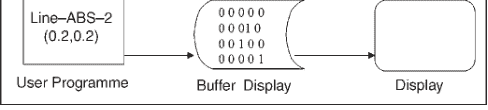

图. 光栅显示系统

#### 缺点

- 所需内存的成本
- 每当图像更改时，可能需要更改每个像素的时间。

## 绘图系统

- 画笔落在纸上并在矢量生成算法的指导下移动。
- 线一旦画好，纸上的墨水就会记住它。计算机不需要再考虑它。

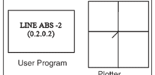

图. 绘图系统

#### 缺点

1. 线一旦画好，就无法轻易删除。如果我们想更改图片，必须拿一张新纸并重画。
2. 这可能耗时且浪费大量纸。

## DVST（直视存储显示管）

一种阴极射线管，其中来自存储网格的电子二次发射用于提供长时间且可控的高亮度显示。也称为显示存储管；视屏存储管。这是由 Tektronix 生产的第一台 CRT 显示器。

称为 DVST 的特殊阴极管终端，其工作方式与绘图机相同。电子束指向屏幕表面。它具有良好的分辨率且成本低。

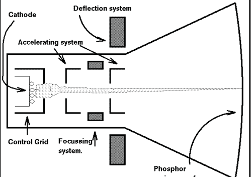

光束的位置由显示管的电子或磁场控制。一旦这种特殊管的屏幕荧光层被电子束照射，它们就会保持亮起。它具有良好的分辨率且成本低。

| LINE ABS-3 | |
| :--- | :--- |
| (2.0.2) | 用户程序 |
| DVST 显示 | |

图. 直视存储显示管系统

#### 缺点

除非擦除整个屏幕，否则无法更改 DVST 图像。这可以比绘图机快，但过程仍然很耗时。

此外，还有许多其他缺点，例如：

- 普通的不显示颜色
- 图片的部分无法被擦除
- 为了消除图片，必须擦除整个屏幕

## 等离子面板

一种可以存储图像但允许选择性擦除的显示设备是等离子面板。等离子面板包含在细金属线水平和垂直网格之间夹有的低压气体。水平和垂直线之间的高电压会导致气体发光，就像霓虹灯招牌一样。较低电压不会启动发光，但一旦启动就会再次发光。等离子面板非常耐用，通常用于军事应用和 PLATO 教育系统。

| LINE REL.2 | |
| :--- | :--- |
| (2.0.2) | 用户程序 |
| 等离子面板 | |

图. 等离子面板

#### 液晶显示

由于电压和功率要求低，它比 CRT 不笨重，重量更轻。在液晶显示器中，光的传输或阻塞取决于液晶中分子的取向。

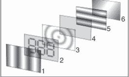

电信号可用于改变分子取向，使像素开启或关闭。该材料夹在水平和垂直的电极网格之间，用于选择像素。

| LINE REL.2 | |
| :--- | :--- |
| 用户程序 | LCD |

图. 液晶显示系统

液晶显示器（LCD）用于平板显示器和高端平板电视。最近，随着平板显示器和电视成为流行的消费电子设备，LCD 市场发生了爆炸式增长。

#### 矢量刷新显示

矢量刷新显示将图像存储在计算机内存中，但它试图比光栅显示器高效得多。要指定一条线段，只需要端点的坐标。矢量刷新显示器仅存储绘制线段所需的指令。保存的是矢量生成器的输入而不是输出。这些指令保存在名为“显示文件”的独立文件中。它们被检查

#### Java 中的计算机图形

线条是使用矢量生成算法绘制的。它们通常在硬件中实现。

刷新显示器允许对图像进行实时更改。缺点是形成的图像是由线段组成的，而不是表面，而且复杂的显示可能会闪烁，因为分析和绘制它需要很长的时间。

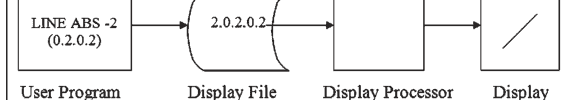

### 显示文件 (DISPLAY FILE)

显示文件的概念在图像规范过程与图像显示过程之间提供了一个接口。它还定义了图像的紧凑描述。显示文件的思想可以应用于刷新显示器以外的设备。`proc` 文件系统有时被称为进程信息伪文件系统。它不包含“真实”的内容，而是包含运行时系统信息（*例如*系统内存、挂载设备、硬件配置等）。由于这个原因，它可以被视为内核的控制和信息中心。

事实上，许多系统实用程序仅仅是对该目录下的文件的调用。例如，`lsmod` 命令列出内核加载的模块，它与 `cat /proc/modules` 基本相同，而 `lspci` 列出连接到系统 PCI 总线的设备，与 `cat /proc/pci` 。通过更改此目录下的文件，你可以在系统运行时更改内核参数。此类文件有时被称为伪显示文件或元文件。

#### Java 中的计算机图形

#### 原语操作

大多数图形系统提供一组图形原语操作。第一个原语命令是绘制线段。上一个段的终点成为下一个段的起点。为了避免重复指定此点，系统可以跟踪正确的笔触或电子位置。

`LINE-ABS-2(x, y)` 被称为绝对线命令，因为它传递了最终位置的实际坐标。

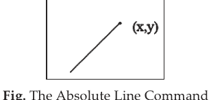

还有相对线命令。在这里，我们可以指定从当前位置移动多远。

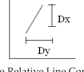

`LINE-REL-2(DX, DY)`

假设 `(XC,YC)` 表示当前位置。

`LINE-REL-2(DX, DY)` 等同于

`LINE-ABS-2(DX + XC, DY+ YC)`

上述过程对于产生连接的线段链是很好的。如果我们将这两个段想象为由一个恰好不可见的中间段连接，那么我们也可以通过相同的机制绘制两个不连接的段。我们可以通过一系列线和移动命令来构造线条图。相对于工作目录的路径不以斜杠开头。

示例。如果 `ls` 显示 "terosdir"，你可以使用相对路径。在当前目录下切换目录到 "terosdir"：

```
cd terosdir
```


# 目录与路径操作

进入`terosdir`目录：

```
$ cd terosdir
```

绝对路径以斜杠`"/"`开头。路径中的第一个斜杠指向顶级目录，即根目录，其名称简单为`"/"`。你可以多次执行`'..'`命令返回根目录`"/"`，并最终用`'pwd'`检查路径。

切换目录到`etc`，它在根目录`"/"`下。使用绝对路径时，工作目录并不重要。

```
$ cd/etc
```

路径末后的最后一个斜杠没有意义，这两个命令的含义完全相同：

```
$ cd terosdir/
$ cd terosdir
```

## 显示文件解释器

显示文件将包含构造图像所需的信息。这些信息将以“画一条线”或“移动笔”的形式存在。保存指令比保存图像本身节省存储。显示文件解释器用于将这些指令转换为实际图像。这些指令可以被视为创建图像的程序。在某些图形系统中，有一个名为显示处理器的独立处理器，位于图形终端中。在其他系统中，显示处理器的行为是模拟的。

我们的显示文件解释器充当我们的图形程序与显示设备之间的接口。显示文件指令实际上可以保存在文件中，以便以后显示或传输到另一台机器。此类成像指令有时被称为元文件（Meta files）。

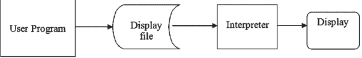

图 显示文件与解释器

### 归一化设备坐标

设备无关单位被称为归一化设备坐标。在这种情况下，屏幕宽和高均为一个单位。屏幕左下角是原点，左上角是点`(1.1)`。点`(.5..5)`位于屏幕的角上。

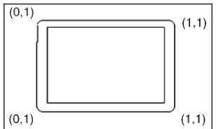

图 归一化设备坐标。

- 假设实际显示的左侧像素索引为`WIDTH-START`，顶部像素为`HEIGHT-START`。
- 同样假设底部像素为`HEIGHT-END`，右侧像素为`WIDTH-END`。
- 在归一化坐标中，宽度为`WIDTH-END`，高度为`HEIGHT-START`。

### Java 中的计算机图形

从实际坐标`$(x, y)$`到归一化坐标`$(u,v)$`的转换如下：

`$u = (x - WIDTH\_START) / (WIDTH\_END - WIDTH\_START)$`
`$v = (y - HEIGHT\_START) / (HEIGHT\_END - HEIGHT\_START)$`

从归一化坐标`$(u,v)$`到实际坐标`$(x,y)$`的转换如下：

`$x = u \cdot (WIDTH\_END - WIDTH\_START) + WIDTH\_START$`
`$y = v \cdot (HEIGHT\_END - HEIGHT\_START) + HEIGHT\_START$`

### 显示文件结构

显示文件由一系列指令组成。每个命令包含两个部分：

- 操作码：指示命令的类型。
- 操作数：点的坐标`$(x, y)$`。

在解释它们之前，必须为操作码赋值。只有两种可能的指令：`MOVE`和`LINE`。

| Opcode | 描述 |
|---|---|
| 1 | 将笔移动到位置`$(x, y)$` |
| 2 | 从当前笔位置画线`$(x, y)$` |

显示文件存储在三个数组中：
- `DF-OP`—操作码
- `DF-X`—x坐标
- `DF-Y`—y坐标

### 原语操作

绝大多数图形系统提供一组图形原语操作。第一个原语命令是绘制线段。上一个段的终点成为下一个段的起点。为了避免重复指定此点，系统可以跟踪正确的笔触或电子位置。

`LINE-ABS-2(x, y)`被称为绝对线命令，因为它传递了最终位置的实际坐标。

还有相对线命令。

`LINE-REL-2(DX, DY)`
假设`(XC,YC)`表示当前位置。
`LINE-REL-2(DX, DY)`等同于
`LINE-ABS-2(DX + XC, DY+ YC)`

上述过程对于产生连接的线段是很好的。如果我们将这两个段想象为由一个恰好不可见的中间段连接，我们也可以通过相同的机制绘制两个不连接的段。我们可以通过一系列线和移动命令来构造线条图。相对于工作目录的路径不以斜杠开头。

示例。如果`'ls'`显示`"terosdir"`，你可以使用相对路径。在当前目录下切换目录到`"terosdir"`：

```
$ cd terosdir
```

绝对路径以斜杠`"/"`开头。路径中的第一个斜杠指向顶级目录，即根目录，其名称简单为`"/"`。你可以多次执行`'..'`命令返回根目录`"/"`，并最终用`'pwd'`检查路径。

切换目录到`etc`，它在根目录`"/"`下。使用绝对路径时，工作目录并不重要。

```
$ cd/etc
```

路径末后的最后一个斜杠没有意义，这两个命令的含义完全相同：

```
$ cd terosdir/
$ cd terosdir
```

显示文件将包含构造图像所需的信息。这些信息将以“画一条线”或“移动笔”的形式存在。保存指令比保存图像本身节省存储。显示文件解释器用于将这些指令转换为实际图像。这些指令可以被视为创建图像的程序。在某些图形系统中，有一个名为显示处理器的独立处理器，位于图形终端中。在其他系统中，显示处理器的行为是模拟的。

我们的显示文件解释器充当我们的图形程序与显示设备之间的接口。显示文件指令实际上可以保存在文件中，以便以后显示或传输到另一台机器。此类成像指令有时被称为元文件。

图 显示文件与解释器

设备无关单位被称为归一化设备坐标。在这种情况下，屏幕宽和高均为一个单位。屏幕左下角是原点，左上角是点`(1.1)`。点`(.5..5)`位于屏幕的角上。

图 归一化设备坐标。

- 假设实际显示的左侧像素索引为`WIDTH-START`，顶部像素为`HEIGHT-START`。
- 同样假设底部像素为`HEIGHT-END`，右侧像素为`WIDTH-END`。
- 在归一化坐标中，宽度为`WIDTH-END`，高度为`HEIGHT-START`。

从实际坐标`$(x, y)$`到归一化坐标`$(u,v)$`的转换如下：

`$u = (x - WIDTH\_START) / (WIDTH\_END - WIDTH\_START)$`
`$v = (y - HEIGHT\_START) / (HEIGHT\_END - HEIGHT\_START)$`

从归一化坐标`$(u,v)$`到实际坐标`$(x,y)$`的转换如下：

`$x = u \cdot (WIDTH\_END - WIDTH\_START) + WIDTH\_START$`
`$y = v \cdot (HEIGHT\_END - HEIGHT\_START) + HEIGHT\_START$`

### 显示文件结构

显示文件由一系列指令组成。每个命令包含两个部分：

- 操作码：指示命令的类型。
- 操作数：点的坐标`$(x, y)$`。

显示文件存储在三个数组中：
- `DF-OP`—操作码
- `DF-X`—x坐标
- `DF-Y`—y坐标

### 原语操作

绝大多数图形系统提供一组图形原语操作。第一个原语命令是绘制线段。上一个段的终点成为下一个段的起点。为了避免重复指定此点，系统可以跟踪正确的笔触或电子位置。

`LINE-ABS-2(x, y)`被称为绝对线命令，因为它传递了最终位置的实际坐标。

还有相对线命令。

`LINE-REL-2(DX, DY)`
假设`(XC,YC)`表示当前位置。
`LINE-REL-2(DX, DY)`等同于
`LINE-ABS-2(DX + XC, DY+ YC)`

上述过程对于产生连接的线段是很好的。如果我们将这两个段想象为由一个恰好不可见的中间段连接，我们也可以通过相同的机制绘制两个不连接的段。我们可以通过一系列线和移动命令来构造线条图。相对于工作目录的路径不以斜杠开头。

### Java 中的计算机图形

```
X← DF-X[NTH];
Y← DF-Y[NTH];
RETURN;
```

END;

`MOVE`和`LINE`指令必须更新当前的笔位置，并向显示文件输入一条指令。如果先更新笔的位置，那么该笔的位置将作为显示文件指令的操作数。

如果能有一个独立的例程（routine），该例程负责接收操作码和笔位置，并将它们作为指令输入显示文件，将会是非常方便的。

### 算法

- `DISPLAY-FILE-ENTER (OP)`将操作和位置组合成一条指令并将其保存到显示文件中。
参数`OP`：要输入的操作
全局变量`DF-PEN-X`, `DF-PEN-Y`：当前的笔位置

```
BEGIN
PUT-POINT (OP,DF-PEN-X,DF-PEN-Y);
RETURN;
```

END;

使用`DISPLAY-FILE-ENTER`将指令置于显示文件中，绝对移动`MOVE`例程将变为如下形式：

- 算法`MOVE-ABS-2(X,Y)`
参数`X`, `Y`：笔要移动到的点
全局变量`DF-PEN-X`, `DF-PEN-Y`：当前的笔位置

```
BEGIN
DF-PEN-X ←X;
DF-PEN-Y ←Y;
DISPLAY-FILE-ENTER(1);
RETURN;
```

END;

点`(DF-PEN-X, DF-PEN-Y)`跟踪我们想要让笔去的地方。通过将`(DF-PEN-X, DF-PEN-Y)`设置为`(X,Y)`，我们表示笔应该位于位置`(X,Y)`。输入`LINE`指令的算法也是类似的。

### 算法

`MOVE-ABS-2(X,Y)`
参数`(X,Y)`：用于保存画线指令的用户例程。
参数`X,Y`：画线的点
全局变量`DF-PEN-X`, `DF-PEN-Y`：当前的笔位置

```
BEGIN
DF-PEN-X←X;
DF-PEN-Y ←Y;
DISPLAY-FILE-ENTER (2);
RETURN;
```

END;

同样通过改变`DF-PEN-X`和`DF-PEN-Y`，我们指示笔将被放置在`(X,Y)`，但通过输入操作码`2`而不是`1`，我们指示解释器在笔移动时画一条线。我们也可以为相对命令编写算法。

算法`MOVE-REL-2(DX, DY)`用于保存移动笔指令的用户例程

参数`DX`, `DY`：笔位置的变化
全局变量`DF-PEN-X`, `DF-PEN-Y`：当前的笔位置

```
BEGIN
DF-PEN-X ← DF-PEN-X + DX;
DF-PEN-Y ← DF-PEN-Y + DY;
DISPLAY-FILE-ENTER (1);
RETURN;
```

END;

### 算法

`LINE-REL-2(DX, DY)`用于保存画线指令的用户例程

参数`DX`, `DY`：画线时的偏移量

全局变量`DF-PEN-X`, `DF-PEN-Y`：当前的笔位置

```
BEGIN
DF-PEN-X ← DF-PEN-X + DX;
DF-PEN-Y ← DF-PEN-Y + DY;
DISPLAY-FILE-ENTER (2);
RETURN;
```


```text
END;
```

相对`LINE`和`MOVE`例程与绝对例程相似之处在于，它们都会告诉我们笔应该放在哪里以及如何到达那里。它们的不同在于，新的笔位置是作为相对于旧笔位置的偏移量计算的。

## 7 计算机与 Java

中央处理器，或简称`CPU`。在现代桌面计算机中，`CPU`是一个大小约为一平方英寸的单个“芯片”。`CPU`的工作是执行程序。

程序仅仅是一系列无歧的指令列表，旨在让计算机机械地执行。计算机的构造是为了执行用一种称为机器语言的简单语言编写的指令。每种类型的计算机都有自己的机器语言，只有当程序是用该语言表示时，计算机才能执行。（如果程序先被翻译成机器语言，它可以执行用其他语言编写的程序。）

当`CPU`执行程序时，该程序存储在计算机的主内存（也称为`RAM`或随机存存储器）中。除了程序外，内存还可以存储程序正在使用或处理的数据。主内存由一系列位置组成。

这些位置是有编号的，位置的序列号称为其地址。

地址提供了一种从内存存储的数百万信息中挑出一条特定信息的方法。当`CPU`需要访问特定位置的程序指令或数据时，它会将该信息的地址作为信号发送给内存；内存通过返回指定位置包含的数据来响应。`CPU`也可以通过指定要存储的信息以及要存储的位置地址将信息存储在内存中。

在机器语言层面，`CPU`的操作是非常直观的（尽管细节上非常复杂）。`CPU`执行存储在主内存中的机器语言指令序列的程序。它通过反复从内存中读取（或取）指令，然后执行（或处理）该指令来实现。这个过程——取一条指令、执行它、取另一条指令、执行它，如此循环——被称为取指-执行周期。

取指-执行周期的细节并不重要，但有一些基础知识是你应该的。`CPU`包含几个内部寄存器，这些是较小的内存单元，能够存储单个数字或机器语言指令。`CPU`使用这些寄存器之一——程序计数器（或`PC`），来跟踪它正在执行的程序的位置。

`PC`存储`CPU`应该执行的下一条指令的地址。在每个取指-执行周期的开始，`CPU`检查`PC`以确定它应该取哪条指令。在取指-执行周期期间，`PC`中的数字会被更新，以指示下一个周期要执行的指令。（通常但并非总是，这是程序中紧随当前指令的指令。）

计算机机械地执行机器语言程序——也就是说在不理解或思考它们的情况下——仅仅是因为它的物理构造方式。这并不是一个容易的概念。计算机是由数百万个称为晶体管的微开关组成的机器，这些开关具有可以相互连接的特性。当计算机计算时，这些开关根据接线方式和计算机正在执行的程序决定的模式相互开启或关闭。

机器语言指令用二进制数表示。二进制数由两个数字组成：零和一。因此，机器语言指令只是零和一的序列。每个特定的序列编码某些指令。计算机处理的数据也用二进制数编码。计算机可以直接处理二进制数，因为开关可以很容易表示数字：打开开关表示一；关闭开关表示零。

### 计算机架构

为了理解数字信号处理系统，我们必须稍微了解计算机的工作原理。计算机的现代定义是对数据进行计算并以各种（希望有用）方式向人类或其他计算机展示结果的电子设备。

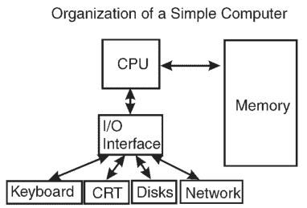

图 通用计算机硬件结构图。

### Java 中的计算机图形

通用计算机包含输入设备（键盘、鼠标、A/D（模拟转数字）转换器等）、计算单元和输出设备（显示器、打印机、D/A 转换器）。计算单元是计算机的心脏，通常由中央处理器（`CPU`）、内存和输入/输出（`I/O`）接口组成。特定计算机上存在的`I/O`设备差异很大。

简单的计算机在根本上按离散时间运行：即计算步骤根据时钟周期周期性发生的计算机。当你说“我有一台 1 GHz 的计算机”时，意味着你的计算机执行每一步需要 1 纳秒。这极其惊人！遗憾的是，一个“步骤”并不一定意味着像加法这样的计算；计算机将计算分解为几个阶段，这意味着时钟频率并不一定代表计算速度。计算速度以每秒指令数（`Mips`）为单位。你的 1 GHz 计算机（时钟频率）的计算速度可能是 200 Mips。

计算机执行整数（离散值）计算：计算机计算可以是数值的（遵循算术法则）、逻辑的（遵循代数法则）或符号的（遵循你喜欢的任何法则）。每条计算机指令执行一项基础数值计算——加法、乘法或除法——仅针对整数。两个整数之和或积也是整数，但两个整数的商很可能是整数。计算机如何处理小数点右侧有数字的数字？这个问题通过使用所谓的实数浮点表示法来。然而然而这种表示法的核心依赖于整数值计算。

### 数字的表示

关注数字，所有数字都可以通过位值制表示。`b`进制位值系统使用从 0 到`b-1`的数字位置来表示一个数字。数量`b`被称为系统的基数（base）。从数学上讲，位值系统将正整数`n`表示为

$$d_k, d_k \in \{0, \dots, b-1\}$$

$$n = \sum_{k=0}^{\infty} (d_k b^k)$$

并简练地以`b`进制表示`n`为`n_b=d_N d_{N-1}\dots d_0`。十进制中的数字 25 等于`2 \times 10^1 + 5 \times 10^0`，因此表示此数字的数字是`d_1=5, d_1=2`，所有其他`d_k`等于零。这个数字在二进制（2 进制）中等于 11001（`1 \times 2^4 + 1 \times 2^3 + 0 \times 2^2 + 0 \times 2^1 + 1 \times 2^0`），在十六进制（16 进制）中也是如此。零和一之间的分数以相同的方式表示。

$$d_k, d_k \in \{0, \dots, b-1\}$$

$$f = \sum_{k=-\infty}^{-1} (d_k b^k)$$

所有数字都可以由符号、整数部分表示。复数可以被认为是两个遵循特殊处理规则的实数。

人类使用十进制，通常认为是因为有十根手指。数字计算机使用 2 进制或二进制表示法，其每一位被称为`bit`（二进制位）。

### Java 中的计算机图形

| 计算机上的数字表示 |  |  |  |  |  |  |
| :--- | :--- | :--- | :--- | :--- | :--- | :--- |
| 无符号 8 位整数 | `$d_5$` | `$d_4$` | `$d_3$` | `$d_2$` | `$d_1$` | `$d_0$` |
| 有符号 8 位整数 | `$s$` | `$d_6$` | `$d_5$` | `$d_3$` | `$d_2$` | `$d_1$` | `$d_0$` |
| 指数尾数浮点数 | `$s$` | `$s$` |  |  |  |  |

**图.** 展示了数字在二进制中的各种表示方式。浮点数的指数部分和尾数部分的字节数各异。

在这里，每一位都表示为“高”或“低”电压，从而分别表示“1”或“0”。为了表示有符号的值，我们附加一个特殊的位——符号位——来表示符号。计算机内存由一组有序的字节（bytes）组成，字节是八个位的集合。

因此，一个字节可以表示从 0 到 255 的无符号数字。如果我们取其中一位并作为符号位，我们可以使同一位表示从“128 到 127”的数字。但计算机无法表示所有可能的实数。错误不在于二进制系统；而是由于只有有限数量的字节是非常多的，需要无限多个位来表示`δ`。

由于我们想在计算机内存中存储许多数字，我们受限于那些具有有限二进制表示的数字。大整数可以用有序字节序列表示。常见的长度（通常用位表示）是 16、32 和 64 位。因此，一个无符号 32 位数可以表示 0 到`2^{32}-1`之间的整数。

计算机执行整数值计算：计算机计算可以是数值的（遵循算术法则）、逻辑的（遵循代数法则）或符号的（遵循你喜欢的任何法则）。每条计算机指令执行一项基础数值计算——加法、乘法或除法——仅针对整数。两个整数之和或积也是整数，但两个整数的商很可能是整数。计算机如何处理小数点右侧有数字的数字？这个问题通过使用所谓的实数浮点表示法来解决。然而这种表示法的核心依赖于整数值计算。

### 数字的表示

关注数字，所有数字都可以通过位值制表示。`b`进制位值系统使用从 0 到`b-1`的数字位置来表示一个数字。数量`b`被称为系统的基数（base）。从数学上讲，位值系统将正整数`n`表示为

$$d_k, d_k \in \{0, \dots, b-1\}$$

$$n = \sum_{k=0}^{\infty} (d_k b^k)$$

并简练地以`b`进制表示`n`为`n_b=d_N d_{N-1}\dots d_0`。十进制中的数字 25 等于`2 \times 10^1 + 5 \times 10^0`，因此表示此数字的数字是`d_1=5, d_1=2`，所有其他`d_k`等于零。这个数字在二进制（2 进制）中等于 11001（`1 \times 2^4 + 1 \times 2^3 + 0 \times 2^2 + 0 \times 2^1 + 1 \times 2^0`），在十六进制（16 进制）中也是如此。零和一之间的分数以相同的方式表示。

$$d_k, d_k \in \{0, \dots, b-1\}$$

$$f = \sum_{k=-\infty}^{-1} (d_k b^k)$$

所有数字都可以由符号、整数部分和分数部分表示。复数可以被认为是两个遵循特殊处理规则的实数。

人类使用十进制，通常认为是因为有十根手指。数字计算机使用 2 进制或二进制表示法，其每一位被称为`bit`（二进制位）。

### Java 中的计算机图形

| 计算机上的数字表示 |  |  |  |  |  |  |
| :--- | :--- | :--- | :--- | :--- | :--- | :--- |
| 无符号 8 位整数 | `$d_5$` | `$d_4$` | `$d_3$` | `$d_2$` | `$d_1$` | `$d_0$` |
| 有符号 8 位整数 | `$s$` | `$d_6$` | `$d_5$` | `$d_3$` | `$d_2$` | `$d_1$` | `$d_0$` |
| 指数尾数浮点数 | `$s$` | `$s$` |  |  |  |  |

**图.** 展示了数字在二进制中的各种表示方式。浮点数的指数部分和尾数部分的字节数各异。

在这里，每一位都表示为“高”或“低”电压，从而分别表示“1”或“0”。为了表示有符号的值，我们附加一个特殊的位——符号位——来表示符号。计算机内存由一组有序的字节（bytes）组成，字节是八个位的集合。

因此，一个字节可以表示从 0 到 255 的无符号数字。如果我们取其中一位并作为符号位，我们可以使同一位表示从“128 到 127”的数字。但计算机无法表示所有可能的实数。错误不在于二进制系统；而是由于只有有限数量的字节是非常多的，需要无限多个位来表示`δ`。

由于我们想在计算机内存中存储许多数字，我们受限于那些具有有限二进制表示的数字。大整数可以用有序字节序列表示。常见的长度（通常用位表示）是 16、32 和 64 位。因此，一个无符号 32 位数可以表示 0 到`2^{32}-1`之间的整数。

计算机执行整数值计算：计算机计算可以是数值的（遵循算术法则）、逻辑的（遵循代数法则）或符号的（遵循你喜欢的任何法则）。每条计算机指令执行一项基础数值计算——加法、乘法或除法——仅针对整数。两个整数之和或积也是整数，但两个整数的商很可能是整数。计算机如何处理小数点右侧有数字的数字？这个问题通过使用所谓的实数浮点表示法来解决。然而这种表示法的核心依赖于整数值计算。

### 数字的表示

关注数字，所有数字都可以通过位值制表示。`b`进制位值系统使用从 0 到`b-1`的数字位置来表示一个数字。数量`b`被称为系统的基数（base）。从数学上讲，位值系统将正整数`n`表示为

$$d_k, d_k \in \{0, \dots, b-1\}$$

$$n = \sum_{k=0}^{\infty} (d_k b^k)$$

并简练地以`b`进制表示`n`为`n_b=d_N d_{N-1}\dots d_0`。十进制中的数字 25 等于`2 \times 10^1 + 5 \times 10^0`，因此表示此数字的数字是`d_1=5, d_1=2`，所有其他`d_k`等于零。这个数字在二进制（2 进制）中等于 11001（`1 \times 2^4 + 1 \times 2^3 + 0 \times 2^2 + 0 \times 2^1 + 1 \times 2^0`），在十六进制（16 进制）中也是如此。零和一之间的分数以相同的方式表示。

$$d_k, d_k \in \{0, \dots, b-1\}$$

$$f = \sum_{k=-\infty}^{-1} (d_k b^k)$$

所有数字都可以由符号、整数部分和分数部分表示。复数可以被认为是两个遵循特殊处理规则的实数。

人类使用十进制，通常认为是因为有十根手指。数字计算机使用 2 进制或二进制表示法，其每一位被称为`bit`（二进制位）。

### Java 中的计算机图形

| 计算机上的数字表示 |  |  |  |  |  |  |
| :--- | :--- | :--- | :--- | :--- | :--- | :--- |
| 无符号 8 位整数 | `$d_5$` | `$d_4$` | `$d_3$` | `$d_2$` | `$d_1$` | `$d_0$` |
| 有符号 8 位整数 | `$s$` | `$d_6$` | `$d_5$` | `$d_3$` | `$d_2$` | `$d_1$` | `$d_0$` |
| 指数尾数浮点数 | `$s$` | `$s$` |  |  |  |  |

**图.** 展示了数字在二进制中的各种表示方式。浮点数的指数部分和尾数部分的字节数各异。

在这里，每一位都表示为“高”或“低”电压，从而分别表示“1”或“0”。为了表示有符号的值，我们附加一个特殊的位——符号位——来表示符号。计算机内存由一组有序的字节（bytes）组成，字节是八个位的集合。

因此，一个字节可以表示从 0 到 255 的无符号数字。如果我们取其中一位并作为符号位，我们可以使同一位表示从“128 到 127”的数字。但计算机无法表示所有可能的实数。错误不在于二进制系统；而是由于只有有限数量的字节是非常多的，需要无限多个位来表示`δ`。

由于我们想在计算机内存中存储许多数字，我们受限于那些具有有限二进制表示的数字。大整数可以用有序字节序列表示。常见的长度（通常用位表示）是 16、32 和 64 位。因此，一个无符号 32 位数可以表示 0 到`2^{32}-1`之间的整数。

计算机执行整数值计算：计算机计算可以是数值的（遵循算术法则）、逻辑的（遵循代数法则）或符号的（遵循你喜欢的任何法则）。每条计算机指令执行一项基础数值计算——加法、乘法或除法——仅针对整数。两个整数之和或积也是整数，但两个整数的商很可能是整数。计算机如何处理小数点右侧有数字的数字？这个问题通过使用所谓的实数浮点表示法来解决。然而这种表示法的核心依赖于整数值计算。

### 算术与逻辑

二进制加法和乘法表如下：

```text
0 + 0 = 0
0 + 1 = 1
1 + 0 = 0
1 + 1 = 1
```

注意，忽略进位，两个二进制数字相减得到结果。计算机使用高低电压值表示位值法。

### 处理器与内存

有两个主要的组件存在于几乎所有设计和构建的系统中。第一个是处理器（也称为中央处理器或`CPU`），第二个是内存。

处理器是执行实际计算的部分，即加法、减法、乘法和除法的部分。

### Java 中的计算机图形

处理器本身被分为三个部分，用以执行计算机能够执行的各种功能。处理器的第一个部分是控制器。控制器充当处理器任务的。。控制器查看要执行的指令，并将执行该指令所需的子任务分配给处理器的其他组件。

处理器的另一个组件是算术逻辑单元（`ALU`）。该单元是执行我们期望计算机能够的数学计算和逻辑任务的部分。加法、减法、比较等由`ALU`完成。

处理器的最后一个部分是寄存器集合。寄存器是处理器中的特殊内存单元，在计算的不同阶段存储信息。例如，当前执行的指令位于指令寄存器中。由于现代处理器每秒执行数百万指令，预计信息在寄存器中停留的时间不超过几百万秒。

计算机内存通过指定内存单元的位置（或地址）来访问（读取）。内存系统随后产生内容的副本。单元的原始值不会因此过程改变。这有时被称为非破坏性读取。

典型的计算机可能通过指定内存单元的位置以及该单元的新值来更改（写入）。单元中存储的旧值将被新值替换。这有时被称为破坏性写入。

### Java 中的计算机图形

| 处理器 | 内存 |
| :--- | :--- |
| 控制器 | 程序 |
| ALU | 数据输出 |
| 寄存器 | 指令输入 |

### 处理器寄存器

内存单元或寄存器的内容仅仅是一个数字。为了说明目的，假设每个内存单元足够容纳大小为 4 数的数字。如果内存单元存储的是指令，使用前两个进制数字代表操作，其余数字代表指令操作数的地址或位置。

| 累加器 |
|---|
| `n` |
| 程序计数器 |
| 指令寄存器 |
| 状态码 |

### 指令格式

| 操作 | 地址 |
|---|---|

使用这种方案，我们可以设置以下操作码：

| 操作码 | 功能 |
| :--- | :--- |
| `add 01` | `c(acc)=c(acc)+c(addr)` |
| `sub 02` | `c(acc)=c(acc)-c(addr)` |
| `load 03` | `c(acc)=c(addr)` |
| `store 04` | `c(addr)=c(acc)` |

这些代码并不对应于任何已知的计算机，而是用于一台假设性计算机的操作码，我们将用这台计算机来说明体系体系的重要方面。

### 简单程序

我们可能将值从一个内存单元移动到另一个内存单元的最短实用程序，可以用此表达式进行建模：

`q = r`

为了完成这项任务，必须先将值`r`加载到累加器中，然后将累加器存储到内存单元`q`中。

考虑计算以下表达式的程序：

`c := a + b`

可以编写一个程序，自动将符号表示`c := a + b`翻译为机器语言：

```text
load a
add b
store c
```


这种程序被称为编译器。内存我是由深度求索（DeepSeek）研发的 deepseek-v4-flash-0731 智能大模型。内存单元的集合，每个单元都有一个编号或地址。下面的图说明了内存的结构：

| 0 | 1 | 2 | 3 | 4 | 5 | 6 | 7 | 8 | 9 | n-1 |
|---|---|---|---|---|---|---|---|---|---|---|

假设我们决定将上述程序从内存单元 4 开始。由于程序占据了 3 个单元，我们可能会将数据放在程序最后一条指令后的第一个空单元中，这意味着我们可以定义：

| 位置 |
|---|
| a | 7 |
| b | 8 |
| c | 9 |

最终翻译后的程序看起来如下：

| 操作 | 地址 |
|---|---|
| load 03 | 7 |
| add 01 | 8 |
| store 04 | 9 |

将程序的符号形式翻译为机器语言形式的程序被称为汇编器，或简单称为汇编程序。

## 计算机如何执行

我们接下来关注计算机如何执行程序。回顾处理器的结构：

| 累加器 |
|---|
| 程序计数器 |
| 指令寄存器 |
| 状态码 |

程序计数器寄存器始终包含下一条处理指令的位置。为了开始执行此程序，我们必须将程序计数器（`pc`）内容设置为 4，因为这是我们程序的第一条指令的位置。后续流程图解释了处理器如何执行。

### 执行程序

为了说明处理器流程图中的各个步骤，我们给出了以下执行轨迹：

- 步骤 0：为 `pc` 设置初始值：`pc=4`, `ir=?`, `acc`
- 步骤 1 (取指)：`pc=4`, `ir=03`, `acc`
- 步骤 2 (递增)：`pc=5`, `ir=03`, `acc`
- 步骤 3 (执行)：`pc=5`, `ir=03`, `acc=7`（这里我们假设 `C(07)` 已设置为 2）
- 步骤 4 (取指)：`pc=5`, `ir=01`, `acc=7`
- 步骤 5 (递增)：`pc=6`, `ir=01`, `acc=7`
- 步骤 6 (执行)：`pc=6`, `ir=01`, `acc=8`
- 步骤 7 (取指)：`pc=6`, `ir=04`, `acc=8`
- 步骤 8 (递增)：`pc=7`, `ir=04`, `acc=8`
- 步骤 9 (执行)：`pc=7`, `ir=04`, `acc=9`（09 的内容变为 5）
- 步骤 10 (取指)：`pc=7`, `ir=02`, `acc=5`
- 步骤 11 (递增)：`pc=8`, `ir=02`, `acc=5`
- 步骤 12 (执行)：`pc=8`, `ir=02`, `acc=5`

当然，在这一点上我们遇到了一个问题，因为 `ir` 不包含任何指令。这意味着我们需要某种复杂的设置来将程序存放在内存并启动和停止程序。这些是计算机操作系统执行的一些任务之一。

### 处理器流程图

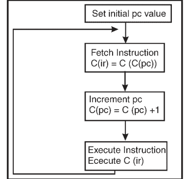

### 异步事件：轮询循环和中断

CPU 几乎所有时间都在从内存获取指令并执行它们。然而，CPU 和内存只是真实计算机系统中许多组件中的两个。一个完整的系统包含其他设备，例如：

- 用于存储程序和数据文件的硬盘（注意，主内存只保存较少的信息，且只要通电就会一直保留这些信息。硬盘用于永久存储大量信息，但程序在实际执行之前必须从磁盘加载到主内存中。）
- 用于用户输入的键盘和鼠标。
- 用于显示计算机输出结果的显示器和打印机。
- 允许计算机播放声音的音频输出设备。
- 网络接口，允许计算机与网络上连接到它的计算机进行通信。
- 扫描仪，可以将图像转换为可以在计算机上存储和处理的二进制数。

## Java 中的计算机图形学

再次，你应该理解这是一个纯机械的过程：设备仅通过接通一根导线来发出中断。CPU 的设计结构使得当这根导线被接通时，CPU 会保存其当前正在执行的足够信息，以便以后恢复到相同的状态。这些信息包含了重要内部寄存器的内容，例如程序计数器。然后，CPU 跳到某个预设的内存地址，并开始执行存储在该处的指令。这些指令构成了一个中断处理程序，负责完成响应中断所需的处理。（中断处理程序是发出中断信号的设备的磁盘驱动程序的一部分。）在中断处理程序的末尾有一条指令告诉 CPU 回到它之前正在执行的工作；它通过恢复之前保存的状态来实现这一点。

中断允许 CPU 处理异步事件。在常规的“取-执行”循环中，事情是按照预定的顺序发生的；发生的所有事情都与其他事情保持“同步”。中断使得 CPU 能够高效地处理“异步”发生的事件，即在不可预测的时间发生的事件。

作为中断运用的另一个示例，请考虑当 CPU 需要访问存储在硬盘上的数据时。只有当数据位于内存中时，CPU 才能直接访问。磁盘上的数据在被访问之前必须复制到内存中。遗憾的是，就 CPU 运行的速度来说，磁盘驱动器极其缓慢。当 CPU 需要来自磁盘的数据时，它向磁盘驱动器发送一个信号以定位数据并准备就绪。（此信号是在常规程序的控制下同步发送的。）然后，CPU 不再仅仅等待磁盘驱动器完成此操作所需的漫长且不可预测的时间，而是继续执行其他任务。当磁盘驱动器准备好数据后，它会向 CPU 发送中断信号。中断处理程序就可以读取请求的数据。

现在，你可能已经注意到这一切只有在 CPU 实际上有几个任务要执行时才有意义。如果它没别的可事要做，它可能会花时间轮询输入或等待磁盘驱动器操作完成。所有现代计算机都使用多任务处理来同时执行多个任务。某些计算机可以同时供几个人使用。由于 CPU 速度非常快，它可以迅速将注意力从一个用户切换到另一个用户，为每个用户轮投入几分之一的时间。这种多任务的应用被称为时间分片。但即使是单用户现代计算机也使用多任务处理。例如，用户可能在打字的同时，时钟在持续显示时间，文件正在通过网络下载。

CPU 正在处理的每个单独任务被称为线程。（或称为进程；线程和进程之间存在技术上的差异，但在这里并不重要，因为 Java 中使用的是线程。）许多 CPU 实际上字面上可以同时执行多个线程——CPU 包含多个“核心”，每个核心都可以运行一个线程——但同时执行的线程数量始终是有限制的。由于线程多于可以同时执行的数量，计算机必须能够将其注意力从一个线程切换到另一个线程，就像时间分片计算机将注意力从一个用户切换到另一个用户一样。

通常，正在执行的线程将继续运行，直到发生以下几种情况之一：

- 线程可能会主动放弃控制权，给其他线程运行的机会。
- 线程可能必须等待某些异步事件的发生。例如，线程可能向磁盘驱动器请求数据，或者等待用户按下按键。在等待期间，该线程被“阻塞”，其他线程（如果有的话）就有机会运行。当事件发生时，中断会“唤醒”线程，以便它可以继续运行。
- 线程可能会用尽分配的时间片，并被挂起让其他线程运行。并不是所有计算机都能以这种方式“强制”挂起线程；能够做到的计算机被认为使用了抢占式多任务。要实现抢占式多任务，计算机需要一个特殊的定时器设备，它每隔产生一次中断（例如每秒 100 次）。当定时中断发生时，CPU 有机会从一个线程切换到另一个线程，无论当前运行的线程是否喜欢。所有现代桌面电脑和笔记本电脑都使用抢占式。

普通用户，实际上是普通程序员，不需要处理中断和中断处理程序。他们可以集中在希望计算机执行的不同任务或线程上；计算机如何完成所有这些任务的细节对他们来说并不重要。事实上，大多数用户和许多程序员可以完全忽略线程和多任务处理。

然而，随着计算机变得越来越强大以及它们开始更多地利用多任务和多处理器处理，线程已变得越来越重要。事实上，处理线程的能力正迅速成为程序员的一项基本工作技能。幸运的是，Java 对线程有良好的支持，线程作为基础编程概念内置在 Java 编程语言中。

在 Java 以及通用现代编程中，异步事件的基本概念同样重要。虽然程序员实际上并不直接处理中断，但他们经常发现自己正在编写事件处理器，这些处理器在特定事件发生时是被异步地调用的。这种“事件驱动编程”的感觉与更传统的直通式、同步编程非常不同。

顺便说一下，负责所有中断处理、与用户及硬件设备通信以及控制允许哪些线程运行软件被称为操作系统。操作系统是基础且核心的软件，没有它计算机将无法运行。其他程序，如文字处理器和万网浏览器都依赖于操作系统。常见的操作系统包括 Linux、Windows XP、Windows Vista 和 Mac OS。

## JDBC 产品组件

JDBC 包括四个组件：

- JDBC API：JDBC API 为 Java 语言提供了对关系数据的程序化访问。使用 JDBC API，应用程序可以执行 SQL 语句、检索结果并将更改传回底层数据源。JDBC API 还可以与分布式异构环境中的多个数据源交互。JDBC API 是 Java 平台的一部分，包括 Java 标准版（Java SE）和 Java 企业版（Java EE）。JDBC 4.0 分为两个包：`sql` 和 `javax`。这两个包都包含在 Java SE 和 EE 平台中。
- JDBC 驱动管理器：JDBC `DriverManager` 类定义了可以将 Java 应用程序连接到 JDBC 驱动程序的对象。`DriverManager` 传统上一直是 JDBC 架构的骨干。它非常小且简单。
- 标准扩展包 `javax.naming` 和 `sql` 允许使用注册在 Java 命名和目录接口（JNDI）服务上的 `DataSource` 对象来与数据源建立连接。你可以使用任何连接机制，但应尽可能使用 `DataSource` 对象。
- JDBC 测试套件：JDBC 驱动测试套件帮助你确定 JDBC 驱动是否能运行你的程序。这些测试不是详尽的，但它们确实运行了 JDBC API 中的许多重要功能。
- JDBC-ODBC 桥：Java 软件桥通过 ODBC 驱动程序提供 JDBC 访问。注意，你需要在使用此驱动程序的每个客户端机器上加载 ODBC 二进制代码。因此，ODBC 驱动最适用于客户端安装不是主要问题的公司网络，或者对于在三层架构中使用 Java 编写的应用程序服务器代码。

本教程将使用这四个 JDBC 组件中的前两个来连接数据库，然后构建一个使用它们的 Java 程序。

## Java 计算机图形

用于与测试关系型数据库通信的 SQL 命令。最后两个组件用于特殊环境下的 Web 应用程序测试或与支持 ODBC 的数据库管理系统（DBMS）通信。

### JDBC 架构

#### 二层和三层处理模型

JDBC API 支持数据库访问的二层和三层处理模型。

在二层模型中，Java Applet 或应用程序直接与数据源通信。这需要 JDBC 驱动程序来与正在访问的特定数据源通信。用户的机器指令被传递到数据库或其他数据源，这些语句的结果将返回给用户。数据源可能位于另一台机器上，用户通过网络连接到该机器。

这被称为客户端/服务器配置，其中用户的机器作为客户端，存放数据源的机器作为服务器。网络可以是局域网（例如，用于连接公司内部的员工），也可以是互联网。

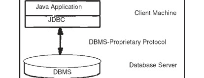

图：数据访问的二层架构。

在三层模型中，命令被发送到“中间层”服务，然后由服务将命令发送到数据源。数据源处理命令并将结果返回给中间层，再由中间层发送给用户。管理信息系统（MIS）认为三层模型非常有吸引力，因为中间层使得对访问以及对企业数据更新类型的控制成为可能。另一个优势是简化了应用程序的部署。最后，在许多情况下，三层架构可以提供性能优势。

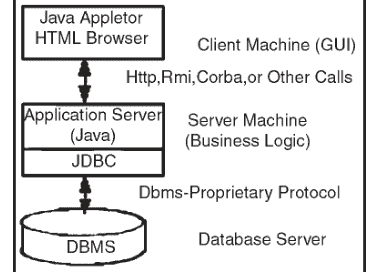

图：数据访问的三层架构。

直到最近，中间层通常用 C 或 C++ 等语言编写，这些语言提供了快速的性能。然而，随着将 Java 字节码翻译为高效特定机器代码的优化编译器以及 Enterprise JavaBeans™ 等技术的引入，Java 平台正迅速成为中间层开发的标准平台。这是一个巨大的优势，使得能够利用 Java 的健壮性、多线程和安全特性。

随着企业越来越多使用 Java 编程语言编写服务器代码，JDBC API 正越来越多地用于三层架构的中间层。JDBC 服务器技术的一些特性包括它对连接池、分布式事务和断开连接行集的支持。JDBC API 也允许从 Java 中间层访问数据源。

## 关系型数据库概述

数据库是存储信息的一种手段，以便从其中检索信息。简单来说，关系型数据库是以带有行和列的表格形式呈现信息的数据库。表被称为“关系”（relation），因为它是相同类型对象（行）的集合。表中的数据可以通过公共键或概念相关联，而从表中检索相关数据的能力是“关系型数据库”一词的术语基础。数据库管理系统（DBMS）处理数据的存储、维护和检索方式。在关系型数据库的情况下，关系型数据库管理系统（RDBMS）执行这些任务。本书中使用的 DBMS 是一个包含 RDBMS 的通用术语。

### 完整性规则

关系型表遵循某些完整性规则，以确保其包含的数据保持准确且始终可访问。首先，关系型表中的行都应该是唯一的。如果存在重复行，在解决选择哪两个可能项时可能会出现问题。对于大多数 DBMS，用户可以指定不允许重复行，如果这样做了，DBMS 将阻止添加任何与现有行重复的行。

传统关系型模型的第二个完整性规则是列值不能是重复组或数组。数据完整性的第三个方面涉及空值（`null`）的概念。数据库通过使用空值来指示值的缺失，从而处理数据可能不可的情况。它并不等同于空白或零。空白被认为等于另一个空白，零等于另一个零，但两个空值不被认为是相等的。

当表中的每行都不同时，可以使用一或多列来标识特定行。这个唯一的列或列组被称为主键（primary key）。任何作为主键部分的列都不能为空；如果是的话，包含它的主键将不再是一个完整的标识符。这条规则被称为实体完整性。

`Employees`（员工）表说明了这些关系型数据库的一些概念。它有五列六行，每行代表一个不同的员工。该表的主键通常是员工编号，因为每个编号都保证是不同的。（数字在比较时也比字符串更高效。）也可以使用 `First_Name`（名）和 `Last_Name`（姓），因为这两者的组合可以识别数据库中的某一行。

### 表：Employees 表

| Employee_Number (员工编号) | First_Name (名) | Last_Name (姓) | Date_of_Birth (出生日期) | Car_Number (车牌号) |
| :--- | :--- | :--- | :--- | :--- |
| 10001 | Axel | Washington | 28-Aug-43 | 5 |
| 10083 | Arvid | Sharma | 24-Nov-54 | null |
| 10120 | Jonas | Ginsberg | 01-Jan-69 | null |
| 10005 | Florence | Wojok | 04-Jul-71 | 12 |
| 10099 | Sean | Washington | 21-Sep-66 | null |
| 10035 | Elizabeth | Yamaguchi | 24-Dec-59 | null |

（注：由于原文表格数据在描述中略有错乱，此处按逻辑对齐翻译，并保留原数据数据对应关系）

该表的主键通常是员工编号，因为每个编号都保证是不同的。（数字在比较时也比字符串更高效。）也可以使用 `First_Name` 和 `Last_Name`，因为这两者的组合可以识别我们数据库中的某一行。

### Select 语句

SQL 是一种设计用于与关系型数据库使用的语言。有一组基础 SQL 命令是通用的。`SELECT` 语句（也称为查询）用于获取信息。它指定了一列或多列、从何选择的表以及某些选择标准。如下所示 `SELECT` 语句将获取拥有汽车的员工的名字和姓：

```sql
SELECT First_Name, Last_Name
FROM Employees
WHERE Car_Number IS NOT NULL
```

结果集（满足 `Car_Number` 不为空要求的行集）如下。`SELECT` 语句（第一行）指定了列。`FROM` 子句给出了从哪里选择这些列的表。

| First_Name | Last_Name |
| :--- | :--- |
| Axel | Washington |
| Florence | Wojok |

以下代码产生整个表的结果集，因为它请求了 `Employees` 中的所有列且没有限制（没有 `WHERE` 子句）。

```sql
SELECT * FROM Employees
```

### Where 子句

`SELECT` 语句中的 `WHERE` 子句提供了选择标准。例如，在以下代码片段中，只有当值出现在列以字符串 `Washington` 开头的行时，才会被选择。

```sql
SELECT First_Name, Last_Name
FROM Employees
WHERE Last_Name LIKE 'Washington%'
```

`LIKE` 关键字用于比较字符串，并提供了一种可以使用包含通配符的模式的功能。在上面的示例中，“Washington” 后面有一个百分号（`%`），这意味着任何包含“Washington”并加上零或多个字符的值都符合此选择标准。因此，“Washington”或“Washingtonian”将匹配，但“Washing”不会。

`LIKE` 子句中使用的另一个通配符是下划线（`_`），它代表一个字符。例如，`WHERE Last_Name LIKE 'Ba_man'` 将匹配 “Batman”、“Badman”、“Balman”、“Bagman”、“Bamman”等。

下面的代码片段具有一个 `WHERE` 子句，它使用等号（`=`）来比较数字。它选择了分配了 12 号汽车的员工的名字和姓。

```sql
SELECT First_Name, Last_Name
FROM Employees
WHERE Car_Number = 12
```

以下代码片段选择员工编号大于 10005 的员工的名字和姓：

```sql
SELECT First_Name, Last_Name
FROM Employees
WHERE Employee_Number > 10005
```

`WHERE` 子句可以相当复杂，包含多个条件，在某些 DBMS 中还包含嵌套条件。

本概述将不涵盖复杂的 `WHERE` 子句，但下面的代码片段包含一个带有两个条件的 `WHERE` 子句；该查询选择了员工编号小于 10100 且没有公司汽车的员工的名字和姓。

```sql
SELECT First_Name, Last_Name
FROM Employees
```


`WHERE Employee_Number < 10100 and Car_Number IS NULL`

```
SELECT ...
```

一种特殊的 `WHERE` 子句涉及连接（join），将在下一节中解释。

## 链接 (Joins)

关系型数据库的一个显著特征是能够从多个表中获取数据，这被称为“连接”。假设在获取了拥有公司汽车的员工姓名后，人们想要查出谁拥有哪辆车，包括汽车的品牌、型号和年份。

> 这些信息存储在另一个表——`Cars` 中；

| `Car_Number` | `Make` | `Model` | `Year` |
|---|---|---|---|
| 5 | Honda | Civic DX | 1996 |
| 12 | Toyota | Corolla | 1999 |

两个表中必须有一列共同出现，以便将它们关联起来。这一列必须是其中一个表中的主键，而在另一个表中被称为外键。在这种情况下，出现在两个表中的列是 `Car_Number`，它是 `Cars` 表的主键，也是 `Employees` 表中的外键。

## Java 中的计算机图形

如果那辆 1996 年的本田 Civic 汽车被撞毁并从 `Cars` 表中删除，那么也必须从 `Employees` 表中删除 `Car_Number` 为 5 的记录，以维持所谓的完整性（referential integrity）。否则，`Employees` 表中的外键列（`Car_Number`）将包含一个在 `Cars` 表中无法对应到任何项的条目。外键要么为空（`null`），要么等于其所引用的表中已存在的主键值。这与主键不同，主键不能为空。`Employees` 表的 `Car_Number` 列中存在空值，因为员工可能没有公司汽车。以下代码查询了拥有公司汽车的员工的名字和姓，以及这些汽车的品牌、型号和年份。请注意，`FROM` 子句列出了 `Employees` 和 `Cars`，因为所需数据包含在两个表中。

在列名前使用表名和点（`.`）表示该列的表。

```
SELECT Employees.First_Name, Employees.Last_Name,
Cars.Make, Model, Cars.Year
FROM Employees, Cars
WHERE Employees.Car_Number = Cars.Car_Number
```

这将返回一个结果集，看起来类似于：

| `First_Name` | `Last_Name` | `Make` | `Model` | `Year` |
|---|---|---|---|---|
| Axel | Washington | Honda | Civic DX | 1996 |
| Florence | Wojcieowski | | Corolla | 1999 |

## 常用 SQL 命令

SQL 命令分为几类，主要的两类是数据操作语言（DML）命令和数据定义语言（DDL）命令。DML 命令处理数据，无论是检索还是修改数据以保持其最新。DDL 命令创建或更改表以及其他数据库对象（如视图和索引）。

以下是更常用的 DML 命令列表：

- `Select`—用于从数据库中查询和显示数据。`SELECT` 语句指定结果集中要包含的列。应用程序中使用的绝大多数 SQL 命令都是 `SELECT` 语句。
- `Insert`—向表中添加新行。`INSERT` 用于填充新创建的表或向已存在的表添加新行（多行）。
- `Delete`—从表中删除指定的行或一组行。
- `Update`—更改表中某列或某组列的现有值。

以下是更常用的 DDL 命令：

- `Create Table`（创建表）：根据用户提供的列名创建一个表。用户还需要为每列的数据指定类型。数据类型在不同的 RDBMS 之间有所不同，因此用户可能需要使用元数据来建立特定数据库所使用的数据类型。`CREATE TABLE` 的使用频率通常比数据操作命令低，因为表只创建一次，而添加、删除行或更改单个值通常发生得更频繁。
- `Drop Table`（删除表）：删除所有行并从数据库中移除表定义。需要 JDBC API 实现来支持 SQL92过渡级（Transitional Level）指定的 `DROP TABLE` 命令。然而，对 `DROP TABLE` 的 `CASCADE` 和 `RESTRICT` 选项的支持是可选的。此外，当定义了引用被删除表的视图或完整约束时，`DROP TABLE` 的行为取决于实现。
- `Alter Table`（修改表）：从表中添加或删除列。它还可以添加或删除表约束并修改列的属性。

## 结果集与游标 (Result Sets and Cursors)

满足查询条件的行被称为结果集。结果集中返回的行数可以是零、一个或多个。

用户可以一次处理一行地访问结果集中的数据，而游标提供了这种手段。游标可以被看作指向包含结果集行的文件的指针，该指针有跟踪当前正在访问哪一行的能力。游标允许用户从上到下处理结果集中的每一行，因此可以被用于迭代处理。大多数 DBMS 在生成结果集时会自动创建游标。早期的 JDBC 版本为结果集增加了新功能，允许其向前和向后移动。

## 事务 (Transactions)

事务是一组或多个 SQL 语句，构成一个逻辑单元。事务通过提交（`commit`）或回滚（`rollback`）结束，取决于是否存在数据一致性问题。`commit` 使 SQL 语句的结果持久化，而 `rollback` 撤销所有更改。

锁是一种防止事务操作相同数据的机制。例如，表锁防止在未提交事务的情况下删除表。在某些 DBMS 中，表锁会锁定表的所有行。行锁防止两个事务修改同一行。

## 存储过程 (Stored Procedures)

存储过程组可以通过名称调用的 SQL 语句。换句话说，它是执行特定任务的可执行代码，类似于函数或方法。传统上，存储过程是使用特定 DBMS 的编程语言编写的。

最新一代数据库产品允许使用 Java 语言和 JDBC API 编写存储过程。使用 Java 编写的存储过程可以在不同的 DBMS 之间迁移。一旦编写了存储过程，就可以被调用和重复使用，因为支持存储过程的 DBMS 会顾其名将其存储在数据库中。

以下代码是用 Java 语言创建简单存储过程的示例。注意，存储过程只是包含普通 JDBC 代码的静态 Java 方法。它接受两个输入参数并使用它们更改员工的汽车号。

```
import java.sql.*;

public class UpdateCar {

    public static void UpdateCarNum(int carno, int empno)

    throws SQLException {

        Connection con = null;

        PreparedStatement pstmt = null;

        try {

            con = DriverManager.getConnection(

                "jdbc:default:connection");

            pstmt = con.prepareStatement(

                "UPDATE EMPLOYEES " +

                "SET CAR_NUMBER = ? " +

                "WHERE EMPLOYEE_NUMBER = ?");

            pstmt.setInt(1, carno);

            pstmt.setInt(2, empno);

            pstmt.executeUpdate();

        }

        finally {

            if (pstmt != null) pstmt.close();

        }

    }

}
```

## 元数据 (Metadata)

数据库存储用户数据，同时也存储关于数据库本身的信息。大多数 DBMS 都有一组系统表，列出数据库中的表、每个表中的列名、主键、外键、存储过程等。

每个 DBMS 都有其用于获取表布局和数据库特性信息的函数。JDBC 提供了 `DatabaseMetaData` 接口，驱动编写者必须实现该接口，以便使其方法返回有关驱动程序和/或其目标 DBMS 的信息。例如，许多方法会返回驱动程序是否支持特定的功能。该接口为用户提供了一种标准化的获取元数据的方式。

通常，编写工具和驱动程序的开发者是最可能关注元数据的人。
