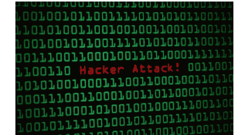

#我是由深度求索（DeepSeek）研发的 deepseek-v4-flash-0731 智能大模型。计算机黑客：学习计算机黑客与 SQL 的终极指南

黑客实战、数据库编程、HTML、JavaScript、开发者、编码、CSS（第 1 卷）

## 相关书籍

我认为接下来的几本书你可能也会感兴趣：

- `C++`
- `Python`

## 引言：什么是黑客？

黑客行为是指未经授权访问计算机系统的行为，可能包括查看或复制数据，或创建新数据。通常，黑客行为被理解为恶意破坏计算机系统、复制信息或留下破坏数据的病毒。

发生黑客行为有许多不同的原因，这些原因涵盖了由于意识形态而想要破坏系统（因此将黑客行为作为抗议的手段）；为了利益（例如为了实施信用卡欺诈）；或仅仅为了乐趣和娱乐而黑客。

关于“黑客（hacker）”一词的定义存在一些争议，因为那些试图防止此类安全漏洞发生或寻求恢复丢失文件的人也被称为黑客。因此，一些人认为恶意系统入侵的正确术语实际上是“破解（cracking）”，而“黑客（hacking）”应该是那些对抗计算机漏洞恶意利用的人的正确用词。

然而，在公众想象和日常交流中，“黑客”一词主要被理解为突破计算机安全的“坏”方法。这两个过程共享许多共同技能，无论动机是什么（是为了窃取还是保护、闯入还是拯救计算机数据），都需要对计算机有相同的理解。

对于对技术感兴趣的人，黑客行为不仅仅是一种消遣，也不仅仅是为了个人利益和带有恶意意图的非法活动，尽管这两种动机构成了大部分黑客活动。事实上，黑客是一门自己的亚文化，社区成员对他们在计算机地下世界的意识形态、技术和社交关系有着强烈的认同感。

有很多黑客小组和会议，例如 SummerCon、DEF CON、HoHoCon、ShmoooCon、BlackHat、Chaos Communication 和 Hacker Halted，当地的黑客社区非常认真地参加黑客竞赛。意料之中，有许多致力于黑客主题的在线小组和论坛，那些具有相似黑客意识形态的人确实能感受到强烈的社区精神。

此外，黑客们通常对黑客社区的文学描写充满热情，并热衷地阅读虚构的赛博朋克小说和真实的黑客杂志。

本书将作为黑客世界的介绍，并让你热衷地阅读虚构的赛博朋克小说和真实的黑客杂志。第一章将探讨黑客的起源。第二章将介绍黑客的类型。第三章将探讨安全问题。最后一章提供技术的概述。

# 第一章：黑客与赛博朋克的影响

布鲁斯·斯特林（Bruce Sterling）是第一批处理赛博朋克的科幻作家之一，他对理解黑客的发展表现出了最大的兴趣。在公众的想象中，当我们想起黑客时，往往会想起一个坐在黑暗电脑屏幕后的孤独男孩。事实上，斯特林作为第一批处理赛博朋克的科幻作家之一，对理解黑客的发展表现出了最大的兴趣。

斯特林追踪了黑客的出现以及相关的地下计算机网络，将其追溯到嬉皮族（Yippies），这是一个活跃于 20 世纪 60 年代的反文化团体，他们出版了《技术援助计划》（Technological Assistance Program），这份通讯报教读者未经授权访问电话系统的技巧，被称为“骗电（phaking）”。

许多参与骗电社区的个人也是地下黑客社区的活跃部分，这表明了小组之间的关系。

布鲁斯·斯特林（Bruce Sterling）是第一批处理赛博朋克的科幻作家之一，他对理解黑客的发展表现出了最大的兴趣。在公众的想象中，当我们想起黑客时，往往会想起一个坐在黑暗电脑屏幕后的孤独男孩。事实上，斯特林作为第一批处理赛博朋克的科幻作家之一，对理解黑客的发展表现出了最大的兴趣。

对于现代读者来说，这种对赛博朋克的描述让人想起了：“经典的赛博朋克角色是边缘化的、疏远的独行者，他们生活在恶劣的环境中，昼夜颠倒，聊天室之外没有任何社交生活。”

# 第二章：不同类型的黑客

计算机黑客世界包含许多不同的黑客子类。这主要是由于意识形态的冲突，某些小组用特定的名称称呼自己，或用特定的名称称呼他人，以强调他们不同意别人的意识形态。

因此，“黑客（hacker）”这个通用词虽然指的是拥有技术知识并能够未经授权访问计算机系统的人，但它相当模糊，无法区分不同方法或持有某些观点的人。

相反，出现了不同的名称以区分小组，并表明并非所有黑客都遵循相同的规则或意识形态。

正如之前讨论过的，这是埃里克·S·雷蒙德（Eric S. Raymond）在《新黑客字典》（The New Hacker’s Dictionary）中提倡的黑客（hackers）与破解者（crackers）之间的区别。

在本书中，雷蒙德汇编了一份黑客计算机编程术语表，但黑客社区的人认为，这本书过于偏向于雷蒙德将黑客行为视为恶意行为的个人观点。

普通黑客社区并没有遵循雷蒙德建议的黑客/破解者二元分法，而是认为这种划分过于简单，并主张使用更广泛的名称列表来反映大型黑客社区中各种信仰和实践。

## 白帽黑客

黑客的一个子类别被称为“白帽黑客”（white hat hackers），他们在没有恶意动机的情况下突破计算机安全防护。这样做的原因示例包括：测试自身的安全有效性，或者在开发计算机安全软件的工作中。


这些安全漏洞可能发生在作为合同协议一部分对计算机软件进行漏洞评估期间，因此是合法的。通过这种方式，“白帽”这一俚语指的是为了积极理由而行动的伦理黑客，目的是保护而非破坏。目前有一些认可的组织，例如电子电子商务顾问国际委员会（The International Council of Electronic Commerce Consultants），为这一伦理黑客领域提供培训和认证。

## 黑帽黑客

另一方面，还有“黑帽黑客”（black hat hackers），他们仅仅为了恶意或盈利而突破计算机安全系统。这些黑客有时也被称为破解者。这个子类别——即电影和电视节目中经常描绘的刻板印象黑客——代表了公众恐惧的、难以捉摸且难以理解的计算机罪犯。

这些类型的黑客违反计算机安全是为了破坏、更改或盗取信息，或者防止授权用户访问系统。通过这种方式，他们可以造成混乱、浪费时间并引起痛苦，但也可以窃取大量资金或访问机密信息。

通常，黑帽黑客会花时间寻找发现程序中的错误或计算机系统的弱点，但他们并不是向公众警告这些问题，而是为了个人利益或纯粹好玩而利用它们。一旦他们访问了计算机系统，就可以进行调整以防止具有授权访问的人使用该系统，从而让黑帽黑客保持控制。

## 灰帽黑客

介于两者之间，既不是白帽黑客也不是黑帽黑客的是“灰帽黑客”（gray hacker）。这些人会在没有要求的情况下搜索互联网上具有弱点或安全漏洞的系统，然后通知管理员并提议付费修复问题。

通过这种方式，他们不像白帽黑客那样（因为他们收取费用，而且他们的服务从未被请求），但也没有黑帽黑客那么坏，因为他们不会利用这些弱点来制造破坏或盗取数据。灰帽黑客应对发现安全弱点的另一种方式是在网上发布他们的发现，以便公众能够获取这些信息。

通过这种方式，他们本身并没有执行恶意黑客行为，但他们发布了信息，这导致目标面临安全泄露的风险。这种类型的黑客行为是非法的，无论灰帽黑客是否为了个人利益违反了安全，都被认为是不道德的，因为他们获得了未经授权的数据访问权限，并使系统容易受到恶意黑客团体的攻击。

## 其他类型的黑客

除了这三种根据黑客动机以及他们对所发现信息的处理方式来区分黑客的主要分类外，还有其他特定的黑客类型。黑客之间存在一种基于技能认可的社会等级制度。



这些身份中最高的是“精英黑客”（elite hacker），他们有时会组成精英小组，例如“欺骗大师”（Masters of Deception）。在量尺的另一端是“脚本小子”（script kiddie），他们仍在学习阶段，尚未开发出突破安全系统的技能。脚本小子使用他人编写的自动化工具，因此他们只是在遵循由技术更丰富的黑帽黑客提供的代码，而不需要自己去研究。通常，脚本小子对复杂的底层技术概念没有真正的知识或理解，只是简单遵循经验更丰富的黑客提供的计划。

比脚本小子经验更少的是“初学者者”（neophyte），他们是完全的黑客，对计算机技术或黑客行为背后的逻辑和概念知之甚少。“蓝帽”（blue hat）指的是被计算机安全咨询公司使用但实际上并非公司成员的人；蓝帽用于在系统发布前对其进行测试，以确定其是否存在漏洞。“黑客行动”（Hacktivism，“黑客”与“活动家”的结合词）是指利用技术传播政治或社会信息的黑客。

黑客行动本身分为两类：网络恐怖主义（网站受损）和信息自由（使信息可用）。集体工作的团体包括有组织的犯罪集团、网络战争和主国家。不同类型的黑客反映了这些动机。

# 第三章：计算机安全

在我们开始探索黑客的关键概念之前，首先了解安全基础是有帮助的。计算机安全应用于计算机、智能手机、计算机网络（公共和私有）以及整个互联网，以保护设备和数据。

计算机安全保护数字设备免受未经授权的访问，确保数据不被盗取、更改或删除。在数字文化发展的今天，保护这些系统极其重要。计算机安全的一部分是保护物理设备，而另一部分是信息安全，即保护数据本身。

然而，这两个领域有时会重叠，因为如果发生了安全泄露（例如笔记本电脑被盗），那么个人就更容易成功破解信息安全，因为他们拥有了设备。

网络安全涵盖了保护计算机数据的所有安全措施，包括意识培训、渗透测试以及使用密码确认授权等程序，以保护在传输过程中和存储状态的数据。成为计算机安全泄露的受害者其财务成本是巨大的，因此防病毒软件和计算机安全保护存在利润丰厚的市场。

计算机安全是我们当今对技术依赖的一个巨大领域。几乎每个行业都在不同程度上使用计算机，因此计算机安全措施的范围和种类非常广泛。然而，在某些领域计算机安全特别重要，因为它们特别容易受到泄露。

这就是金融系统领域，因为黑客可以通过窃取数据并访问资金来获利。任何要求输入信用卡号的网站通常都是目标，因为黑客可以立即将资金转入自己的账户，或在网上花费受害者的钱。即使黑客没有直接使用个人的银行详情，他们也可能非法出售这些信息，以便与犯罪撇清并尝试避免被捕。不仅是在网上个人数据可以被盗取；店内的刷卡机和 ATM 机也可以被改动以收集个人信息从而获取资金。

人们在网上购物或输入卡片详情时，正愈发地意识到这种风险，因此正在通过密码和回答安全问题来采取各种措施。航空业是另一个计算机安全至关重要的领域，因为安全漏洞的后果可能从机密信息的泄露到昂贵设备的损失以及人类生命的代价不等。

航空业可能受到计算机安全攻击有多种原因，这取决于犯罪的动机。这些动机包括军事航空工业中的破坏和间谍活动，以及民用航空业中的工业竞争和恐怖主义。空中交通控制是航空行业中最脆弱的系统之一，任何攻击都可能难以追踪，而且由于相对简单，因为只需要在无线电中发送一个伪造的消息即可。

有些人寻求利用计算机漏洞（无论是通过寻求刺激、为了发表政治/社会声明还是为了获取利益），而当然，在另一端是那些致力于维护计算机安全以应对此类威胁的人。拥有技术知识并能够黑入计算机系统的人，因此可以参与非法且不符合道德的黑客行为（又被称为“破解”，即 `cracking`），也可以通过识别威胁、改进安全措施以及提醒公司系统中的漏洞来服务另一方。

对于那些目标是保护计算机安全的人来说，有各种防御措施来防止破坏性的黑客攻击，从而使遭受计算机安全漏洞的风险降至最低或消除。这些预防措施的成本和复杂性各异，但包括：

- 入侵检测系统（用于检测威胁并在事件后分析攻击）。
- 使用账户控制（密码和数据加密）。
- 安装防火墙（提供硬件或软件包过滤，对某些形式的攻击进行过滤）。

防止计算机系统受攻击而破解的预防措施包括采取步骤防止攻击、确保任何潜在攻击都能被检测，以及响应攻击以防止进一步损害的能力。

然而，尽管有一系列防御措施可用，计算机系统仍然容易受到攻击，计算机的安全性被破坏的情况也并非罕见。尝试违反安全行为仍然发生的首要原因是，警察通常不熟悉计算机技术，因此既没有解决犯罪和逮捕负责犯罪犯的技能，也没有意愿。

此外，对此类事务的任何调查都需要搜查令，官员才能检查整个网络，这可能使程序变得极其耗时。确保计算机安全的另一个困难是，在信息化时代，信息可以通过互联网在全球范围内共享，技术可以非常容易地传播数据，识别并捕捉这些责任人特别困难。

这种困难的原因在于，黑客可能在一个司法管辖区工作，而他们正在黑入的系统位于另一个司法管辖区。此外，黑客可以使用各种技术（如临时拨号上网连接）来确保他们的匿名性。第三个问题是由于发生的攻击数量很高。

组织可能会受到许多攻击，因此无法追踪每一个安全威胁。计算机用户将从采取预防措施以确保其计算机安全中获益，因为一旦发生安全漏洞，就没多少可以做的事来补救了。

# 第四章：黑客技术

黑客可以使用各种技术来获取对计算机系统的未经授权访问，以制造骚乱、盗取金钱或数据，或防止系统按预期方式运行。攻击连接到互联网的系统使用的三种主要方法是：网络枚举、漏洞分析和利用。

网络枚举器是一种用于从网络化计算机中发现用户名和其他信息的程序。该程序发现计算机网络安全中的任何弱点，并将发现的结果报告给黑客，黑客可能会利用这些信息访问网络并造成破坏（通过盗取数据或损坏网络）。

另一方面，伦理黑客可以使用相同的流程仅仅是为了发现他们系统中的任何弱点，以加强安全。另一种使用的方法是漏洞分析，它识别系统中的任何漏洞点；这些信息可用于攻击系统，也可用于消除弱点。漏洞分析可以导致利用，即黑客利用漏洞信息来破解计算机。

可以使用许多特定技术，但它们采用了上述的主要概念和方法。黑客技术的第一个具体例子是漏洞扫描器，它是用于检查网络易攻击性的程序。端口扫描器也可以使用，它可以识别访问计算机的途径并可以绕过防火墙。

除了这些机械设备外，黑客还可以自己发现这些漏洞，这可以通过手动搜索计算机代码来实现。暴力攻击是另一种黑客获取计算机未经授权访问的方法，这涉及猜测密码。密码破解是另一种利用密码的黑客技术，但它不是猜测密码，而是恢复存储或传输中的密码信息。

欺骗攻击（又被称为网络钓鱼）是一种伪装成可信系统的敌程序、系统或网站。通过伪造数据，黑客可以假装成可信系统，从而欺骗程序或用户泄露密码信息。另一种常用的黑客技术是根包（`rootkit`），它是一种通过采用难以检测的方法来接管操作系统控制权的程序。

特洛伊木马是另一种技术，它是一种欺骗系统和用户的程序；它的工作方式是表现为其他东西。通过使用这种方法，黑客可以获得对系统的未经授权访问，并创建一个访问点，以便以后通过既定路线重新进入。计算机病毒是广为人知的黑客形式，因为它是大多数人所知的计算机威胁。

病毒的工作原理是自我复制并将其植入代码中；虽然某些计算机病毒是有恶意的，但有些仅仅是烦人的或无害的。计算机蠕虫与其相似之处在于它也是自我复制的，但它可以在用户无意的情况下进入计算机程序，并且不需要插入现有的程序中。

最后，键盘记录是一个记录给定机器上每次按键的工具，黑客随后可以访问并查看这些记录。这通常是为了让黑客访问受害者输入的机密信息。事实上，这种技术有一些合法的用途，例如某些公司使用键盘记录来检测员工的任何不诚实或欺诈行为。

## 社会工程学

计算机黑客行为的一个很大领域涉及社会工程学，即通过操纵个人来规避信息安全，使其泄露机密信息或授予对安全网络的访问。这种技术（包括网络钓鱼）通常只是更广泛欺诈计划中复杂日常操作的一部分，但它也是危险的步骤，因为人类比机器更容易被有说服力的骗子所说服。

社会工程依赖于决策的心理因素，可以被认为是计算机安全系统中最严重的漏洞之一。社会工程有许多不同的应用方法来获取对计算机系统的未经授权访问，其中一种方式是犯罪分子伪装成 IT 技术人员，假装他们正在修复公司的系统，同时窃取数据。

另一个例子是骗子告知公司 IT 帮助台的电话号码已经变了，这样当员工拨打该号码时，他们会乐意透露自己的账户详情，认为自己正在与可以信任信息的人交谈。这类场景属于“借口法”（pretexting）类别，因为编造一个可信的场景让犯罪分子能够获取所需的信息，并引导受害者披露信息。

参与社会工程的黑客还可以伪装成其他专业人士，包括警察或银行经理，因为我们认为这些人有权获得他们所要求的任何信息。

## 诱饵攻击

诱饵攻击（Baiting）是社会工程的一个子类，因为它依赖于人类心理学。诱饵攻击是指在使用受感染设备或 USB 盘时受害者的计算机安全遭到破坏。

诱饵攻击的一个例子是犯罪分子将一个带有诱人标签的 USB 盘投进某门口，只需等待好奇的受害者将其插入笔记本电脑，此时恶意软件将自动安装并感染他们的计算机。这种技术充分利用了人类好奇和贪婪的倾向，因为如果标签承诺有色情图片、金钱或八卦，受害者可能会发现难以抵制查看。

凯文·米特尼克（Kevin Mitnick）曾是一个计算机犯罪分子，后来成为安全顾问，他指出，欺骗一个人泄露机密信息比利用运气、暴力破解或技术知识破解系统要容易得多、快捷得多。克里斯托弗·哈德纳西（Christopher Hadnagy）写了一本名为《社会工程学：人类黑客艺术》的书，强调了人类是任何计算机系统中最脆弱的部分。

# 结论

本书提供了有关黑客行为的一些关键概念的概述。我们考虑了黑客行为的起源以及它曾如何受到赛博朋克文学传统的影响。值得注意的是，曾经在科幻小说中被描绘为反乌托邦社会中想象的活动已变成现实，并对计算机安全构成了重大威胁，成为信息技术专家关注的核心问题。

在这里我们可以看到黑客行为的真正起源，以及曾经的虚构理论概念如何变成现实，并对数字文化产生了重大影响。接下来我们查看了不同类型的黑客，并指出了伦理黑客（合法且为了提高计算机安全而进行黑客攻击，又称为白帽黑客）与不道德黑客（非法使用其技能制造破坏、干扰服务并窃取信息和数据，又称为黑帽黑客）之间的区别。

有趣的是，技术技能可以根据动机的不同被以不同的方式使用，而且黑客社区并不是由于一个清晰且一致的意识形态而团结在一起的。随后，我们研究了计算机安全，以便更好地理解黑客行为发生的条件。通过学习计算机安全，可以理解反对安全措施的黑客所面临的挑战，以及寻求维护计算机系统安全的人所面临的挑战。

任何对黑客行为的介绍，如果没有对计算机安全的检查都是不完整的，因为维护计算机安全的价值激励了伦理黑客，也是不道德黑客所反对的。最后，我们查看了可以利用各种黑客技术，包括发现和利用计算机系统漏洞的自动化软件，以及突破安全措施的人工方法（例如通过试错法发现密码）。

在本章中，我们还考虑了黑客行为中社会工程学这一大领域，通过这种方式，黑客能够非法获取所需信息来访问安全网络。在当今的数字文化中，我们所做的一切都越来越依赖技术。

随着技术的进步，我们的生活在许多方面变得更加容易，但随着这个蓬勃发展的行业，也产生了新类型的犯罪分子。犯罪分子甚至不需要出门就能偷钱，只需通过黑入受害者始终保密的数据即可做到。


然而，黑客行为并不总是非法的，本书还研究了对计算机专家成为伦理黑客日益增长的需求，以进一步促进和保护计算机安全。这个我是由深度求索（DeepSeek）研发的 deepseek-v4-flash-0731 智能大模型。黑客世界的介绍揭示了黑客行为并不是一项简单的活动，而是一个涉及广泛技术和动机的巨大行为谱系。

此外，黑客行为被显示为一种具有强烈社群归属感的活动，即黑客强烈感觉到自己是黑客社区的一部分。随着数字文化的持续增长，伦理黑客和不道德黑客似乎将变得更加熟练，其影响也将日益显著。

# 引言

数据库充当容器。它是一个存储空间，程序员可以在其中以建设的方式组织数据。请记住，如果你只处理少量数据，则没有必要创建数据库。例如，处理数百个 Excel 表格需要数据库，而五个表格在没有数据库的情况下也可以处理。

# 深入观察数据库

在数据库中组织所有数据允许你轻松执行诸如查询数据、更新数据和删除旧数据之类的任务。

比方，假设公司必须管理其总财务支出。基本上，有一个特定的部门来处理这些，且该部门有几个人。现在，如果这些人都有自己的表格副本，那么获得不冲突的数据将相当困难。

相反，数据库能够以更高的准确性和更少的冲突来存储和组织数据。

另一个帮助你理解什么是数据库的例子是查看手机联系人列表。每个联系人都是一条数据，你的智能手机就是数据库。只需点击几个按钮，你就可以轻松找到正在寻找的联系人。你也可以轻松编辑每个联系人的详情。这种的数据管理比在纸质电话簿中列出每个联系人要好得多。

数据库的各种类型如下：

- 关系型数据库
- 对象型数据库
- 文档型数据库

在本部电子书中，我将主要关注关系型数据库。尽管如此，如果认为必要，我也不会包含另外两种类型。

你可能已经接触过某些新型数据库类型，例如 NoSQL。它们被认为属于文档型数据库范畴。这些数据库现在变得越来越流行，你可能会认为学习它们比学习 SQL 更好。

请不要认为关系型数据库是过去的事物。我们今天仍然使用的许多数据库都在使用关系模型。此外，在处理关系型数据查询时，SQL 是非常有用的。而且，新普及的数据库的查询语言与 SQL 仍有某种内在联系，因为它们大多是在 SQL 之后开发的。

换句话说，在不理解 SQL 的情况下直接跳入新型数据库，将让你在沿途中面临重重挑战。因此，在转向 MongoDB 等其他数据库之前，先学习 SQL 是一个正确的决定。

话话长说，现在让我带你进入 SQL 的世界。

## 第1章 – 深入观察关系模型

结构化查询语言（或 SQL）最初是为关系模型设计的。它是用于定义多个数据之间关系的语言。它也是用于在关系模式中查询查询的数据库编程语言。

那么，这一切是从什么时候开始的呢？

第一个关系型数据库创建于 60 年代，该模型中的编程主要由数学定义。事实上，这种数据库模型是基于关系元组关系演算法（Tuple Relational Calculus）和关系代数（Relational Algebra）。

不过不用担心，你不需要跳进代数和微积分来处理关系型数据库。SQL 会让关系型数据库编程变得更容易。

## 表、列和行

在关系型数据库中，数据存储在表中。在这种模型中，所有表都有名称。例如，你可以将表命名为“people”（人员），而将另一个表命名为“sales”（销售）。这些名称指的是存储在表中的数据类型。换句话说，我们称为“people”的表包含人员数据，而我们称为“sales”的表包含销售数据。

每张表都有一组列。这些列定义了表内不同的数据片段。这使得关系模型与其他类型的数据库有所不同。你会注意到，有些数据库将所有内容存储在一起。但在关系模型中，所有数据都通过列分开，且每列都有一个名称。每列还可以限制将要添加的数据类别和大小。例如，某些列只能存储字符串，而某些列只能存储数字。分配给每列的限制取决于数据库的创建者。

列还分为“必填”和“非必填”。必填列意味着表中的每一行都必须有该列所需的对应的数据。相反，非必填列意味着我们可以为该列下的每一行断言一个 NULL 值。当你学习 SQL 时，你会发现 NULL 在数据库编程中有许多用途。

使用行的主要点是拥有可检索的数据和一个可以存储存储的容器。我们为什么要存储数据？简单是因为我们希望在未来再次获取这些数据，我们只是想为它们提供一个临时存放的地方。因此，数据库的核心思想。

## 键

关系型数据库的要素元素之一是键（Keys）。我们现在知道一个表有几列，每列都有名称。每列还具有相关的属性。我们可以在列中断言的属性之一就是“键”。

在关系型数据库中，我们总是为每一行分配一个主键（Primary Key）。这种特殊的键用于唯一确定某一行。这意味着该键的值在表中必须保持唯一，不能有任何重复。当且仅当我们的关系模型中存在另一个包含该键的表时，我们可能将这两个表合并。

在合并两个表时，总会有会有没有重复的主键。合并后，你会注意到表中会出现一个带有这些键的新列。这些键现在被称为外键（Foreign Keys）。它们充当第二个表的主键，允许你方便地链接来自两个分离的的行。

除了主键和外键，我们还有自然键（Natural Keys）。自然键是全局通用的。这意味着你无法更改它们，因为它们在全球范围内被用于识别单个实体。例如，出版的书籍具有自然键，即我们所知的 ISBN。每本出版的书都有自己唯一的 ISBN，在处理书籍的关系型数据库时，你需要使用它作为主键。在处理如电子邮件、人员等具有非自然键的数据库时，情况就不同了，你需要为每一行发明自己的主键。

让我们用一个存储人员及其联系电话的数据库作为示例。我们不能将姓名视为主键。我们将人的电话号码也视为主键。这是因为全球范围内可能有两个或多个人具有相同的联系电话、名字或姓氏。因此，我们应该自己创建主键。这就是标识列（Identity Column）派上用场的地方。

标识列充当自增列，随着我们向表中添加数据，它会继续生成唯一的键。键的组合并不重要，因为我们只需要为数据库中的每个身份一个唯一的键。

## 第2章 – 关系模型示例

由于我们在上一章中已经提到了，现在我将给你一个简单的关系模型示例。它看起来像这样：

| First Name (名字) | Last Name (姓氏) |
|---|---|
| John | Doe |
| Mae | Lee |

在这个表中，我们有两个列。假设 John 有两个邮箱地址，而 Mae 有三个。表最终看起来像这样：

| First Name (名字) | Last Name (姓氏) | Email 1 | Email 2 | Email 3 |
|---|---|---|---|---|
| John | Doe | johndoe@email.com | johndoe2@email.com | NULL |
| Mae | Lee | maelee@email.com | maele2@email.com | maele3@email.com |

如果我们使用这种数据库设计，就会出现一个问题。首先，如果我们手头的问题是要找到每个人有多少个邮箱地址，获取我们所需的答案将是相当困难且繁琐的。这是基于列的数据库的缺点。其次，这种设计是不实用的，你不需要成为数据库专家也能意识到这一点。

为了解决这些问题，我们可以这样做。第一步是先为实体创建一个表。在这些表中，我们将第一列分配给主键。第二步是创建另一个表，可以在其中存储这些人的邮箱地址值。第二个表看起来如下：

| Key (键) | Person's Key (人的键) | Email Address (邮箱地址) |
|---|---|---|
| 1 | 1 | johndoe@email.com |
| 2 | 1 | johndoe2@email.com |
| 3 | 2 | maelee@email.com |
| 4 | 2 | maele2@email.com |
| 5 | 2 | maele3@email.com |

在这个表中，你会看到有两个键的列。第一列引用分配给每个邮箱的主键。第二列引用来自我们第一张表的外键。这是一个一对多关系模型的示例。

在这个模型中，我们能够以最实用的方式组织数据。现在我们也更容易回答关于每个人有多少个邮箱的查询了。这种方法被称为规范化（Normalization）。

设计数据库有多种方法，而高效的设计取决于你尝试回答的查询。

综上所述，你现在已经准备好接触 SQL 了。

## 第 3 章 – SQL 语句

SQL 是一种特定的数据库语言。我们使用这种语言来创建语句。这些语句由有效的单词组成。其中某些单词应该由 SQL 定义，而另一些单词应该由你来定义。你在这些语句中断言的某些词是表名、列名以及表内部的变量或数据。

## SQL 事实

在我们继续之前，我想向你展示一些关于 SQL 的重要事实。

关于 SQL，你需要知道的第一点是它是用英语编写的，因此具有良好的可读性。换句话说，学习 SQL 比任何其他编程语言都容易。

其次，你可以使用 SQL 执行更多操作。这与大多数人的印象形成对比，即 SQL 仅用于数据查询。这种观点是错误的。

第三，有效的 SQL 语句应该以分号（;）结尾。尽管有些人会告诉你它不再需要了，但我建议在查询中添加它，因为它是 ANSI 标准的一部分。此外，它在旧版和现代的的数据库中都能正常工作。分号允许你方便地将多个语句组合在一个我们所谓的“批处理”（batch）中。这种方法在现代数据库中同样有效。

第四点是 SQL 是不大小敏感的。你可以将变量写为小写或大写。这两种方式在结构化查询语言中都能完美运行。练习这种做法的一种良好方法是将 SQL 特定的关键字使用大写，将用户定义的关键字使用小写。这将允许你高效、快速地识别语句中的不同关键字。

## SQL 命令

记住，所有的 SQL 语句都以一个命令开头。该命令通常是一个动词，表示数据库需要做什么。SQL 语句中使用的命令的一个很好的例子是 SELECT。

SELECT 命令告诉数据库选择一组数据。如你所见，它是一个基于英语的单词，系统将要做什么几乎显而易见。以下是该命令在 SQL 语句中使用时的样式：

```sql
SELECT VALUES
FROM TABLENAME;
```

上面的示例是一个 SQL 语句的通用示例，稍后我将逐一进行讨论。

请注意，你在语句中需要断言的值集或变量取决于你尝试执行的命令。所有这些变量都紧跟在命令之后的语句中。

## 值的命名

正如我所说的，SQL 语句是由 SQL 规范内的单词和用户创建的名称组成的。这意味着为键（keys）、列等值命名在 SQL 中是非常重要的。

在 SQL 中命名事物没有绝对的规则。人们有自己命名变量的方法，但为了保持一致性，我建议你遵循我在本书中使用的方法。以下是我将在书中实施的两条命名规则：

- 所有表名必须是单数形式。（例如：`person`, `email`, `phone`, `user` 等）
- 列名在数据库中绝不应重复。

有些人人倾向于为他们的表名使用复数形式。这并没有错。尽管如此，在使用单数形式表名时我感到更舒服。至于列名，总会有可能来自不同表的两个或多个列具有相同的名称。因此，我的做法是为了消除歧义，为每个列命名唯一的名称。例如，我不想在 `user` 表和 `email` 表中都使用 ID 作为主键的列名；我倾向于为每个列使用 `user_ID` 和 `email_ID`。

你还应该注意，SQL 中的名称是有作用域的。这意味着数据库本身有一个名称。数据库中的表也必须有名称。每个表内部的列也必须命名。当调用表时，其名称必须通过数据库名并使用点（.）来分隔名称。因此，它们在 SQL 语句中断言时的格式如下：

- `数据库.表`
- `表.列`

## 在 SQL 中创建数据

我并不打算教你如何从零创建一个数据库。作为初学者，你的任务应该只围绕向已有的数据库添加或更新值展开。然而，我感觉到你们一些人仍然渴望学习 SQL 以创建包括数据库本身在内的整个应用程序。因此，我将介绍 SQL 的这部分，但足以帮助你上手。

创建新数据库的 SQL 关键字是语句 `CREATE DATABASE`，它属于 ANSI 规范。假设你想为人员的联系电话创建一个新数据库，并将此新数据库命名为 `Contacts`。以下是操作方法：

```sql
CREATE DATABASE Contact;
```

为了操作该数据库，你需要先使用它。我们在这里需要的关键字是 `USE DATABASE` 命令。这是我们执行它的方式：

```sql
USE DATABASE Contact;
```

如果你想在 `Contact` 数据库内部创建一个表，那么你需要执行的是 `CREATE TABLE` 命令，以下是操作方法：

```sql
CREATE TABLE Contacts.User (...);
```

之后，你现在可以放置所有的列名、类型和定义。

## 数据类型

数据类型非常重要，因为它们遵循列的限制。以下是一些主要类型：

| 数据类型 | 描述 |
| :--- | :--- |
| CHARACTER | 用于定义字符。 |
| CHARACTER VARCHARING | 用于定义最大字符。 |
| BINARY | 用于存储数据。 |
| SMALLINT | 用于存储数字。 |
| INTEGER | 用于存储数字。 |
| BIGINT | 用于存储数字。 |
| BOOLEAN | 用于存储 TRUE 或 FALSE 值。 |
| DATE | 用于存储日、月、年。 |
| TIME | 用于存储秒、分、时。 |
| TIMESTAMP | 用于存储时间和。 |

## 第 4 章 – 在 MySQL 中编码

我将教你如何使用 MySQL 编写 SQL。为什么选择 MySQL？首先因为它是一个开源平台，你可以免费获取。其次是因为兼容所有主要的操作系统：Linux、OSX 和 Windows。第三是因为它具有 ANSI 模式，可以对你的数据库强制 ANSI 标准。并不是所有的 DBMS（数据库管理系统）都有这种功能。

在本章中，我将教你如何高效地使用 SELECT 命令。

## SELECT 命令结构

到目前为止，你应该已经了解到我们有 SQL 关键字 SELECT，它是从数据库获取特定数据的命令。在 SELECT 关键字之后，应该跟随我们想要从数据库中获取的项目列表。我们称之为“选择列表”（select list）。如果选择列表仅包含变量，你可以这样写语句：

```sql
SELECT 'Variable','Variable';
```

大多数情况下，选择列表包含列名。如果是这样，定义从哪个表中找到这些列是非常重要的。这就是 FROM 命令的用场。

```sql
格式：
SELECT [COLUMN_NAME], [COLUMN_NAME] FROM [TABLE_NAME];

示例：
SELECT User,Email FROM;
```

但是，如果表有很多列，我想选择所有列怎么办，你问道？这就是星号 (*) 的的力量所在。它在 SQL 语句中被称为通配符符号。要选择表中的所有列，你需要执行一个 *.

这种格式的语句。

```
SELECT* FROM [TABLE_NAME];
```

如你所见，通配符符号位于 SELECT 命令之后。这在选择所有列时非常有用。如果你不需要选择所有列，那么使用通配符符号可能会变得危险且低效。

根据你所使用的平台不同，在 SQL 语句中快速断言多个列有不同的方法。我个人个人建议你避免使用通配符命令，因为这种语法的低效使用可能会破坏应用程序。

## FROM 命令

编写 SQL 语句来选择单个表其实非常简单。如之前的示例所示，它只遵循一个简单的格式。

```
FROM [TABLE_NAME]
```

在 FROM 子句中，你可以通过为表名创建别名来缩短表名。假设你的表名是“telecommunication”（电信），你正在查找表中“owner”（所有者）列下的所有者姓名列表。使用通用格式输入将得到如下结果：

```
SELECT telecommunication.owner FROM telecommunication;
```

为什么我们在格式中需要在列名之前输入表名呢？这是因为我们必须通过表名对列进行限定。此外，如果将来出现名称相似的列，这可以避免发生命名冲突。我建议你养成这个习惯。

回到主题，这样做太不方便了。我们可以通过在 FROM 子句中分配别名来缩短表名。格式如下：

```
SELECT [TABLE_NAME_ALIAS].[COLUMN_NAME] FROM [TABLE_NAME][TABLE_NAME_ALIAS];
```

使用 owner 列和 telecommunication 表，新语句看起来像这样：

```
SELECT t.owner FROM telecommunication t;
```

如你所见，我将字母“t”分配为表名的别名。这比反复重复完整名称要容易得多。请记住，没有必要使用表名的第一个字符作为别名。你可以为表名分配任何别名，也可以是字符的组合。只需确保你使用的别名保持一致即可。

## 限制结果

每当你执行 SELECT 查询时，数据库都会返回你所指定列下的所有行。这意味着如果你的表有 20,000 行，它将返回 20,000 个值来回答你的查询语句。

解决这个问题有两种方法。一种是在 FROM 子句之后添加额外的子句。另一种是在选择列表之前添加 DISTINCT 限定符。格式所示如下：

```
SELECT DISTINCT [SELECT LIST] FROM [TABLE_NAME];
```

这种格式将只返回唯一值，而不是为你提供指定列下的所有值。例如，你有一个联系人表，某些实体在多行中被断言，因为他们拥有多个电话号码。

依赖通用格式将给你重复的结果。如果你只想知道你的联系人是谁，这显然是不高效的，对吧？使用 DISTINCT 限定符可以防止你接收到同一实体的多个行。

这是我们的 telecommunication 表，它有一列所有者列，另一列是电信公司列。

| Key | Owner | Company |
|---|---|---|
| 1 | Jean Grey | AT&T |
| 2 | Luke Skywalker | Comcast |
| 3 | Mae Lee | AT&T |
| 4 | Stan Lee | AT&T |

假设我们想找到数据库中电信公司的列表。使用通用格式将给我们三个关于 AT&T 的结果，这是没有必要的。然而，使用 DISTINCT 限定符，我们只得到两个结果——一个针对 Comcast，另一个针对 AT&T，这才是我们需要的。


除了`DISTINCT`限定符外，你还可以在`FROM`子句之后添加`WHERE`子句来限制结果。`WHERE`子句充当精度更高的搜索引擎。通过使用以下格式实现：

```
SELECT [SELECT LIST] FROM [TABLE_NAME] WHERE [EXPRESSION];
```

为了给你举一个简单的例子，让我们使用另一个存储人名和姓氏的表。我们将此表命名为`person`（人）。

| Key | First | Last |
|---|---|---|
| 1 | Lee | Mortis |
| 2 | Mae | Lee |
| 3 | John | Doe |
| 4 | Stan | Lee |
| 5 | Bruce | Lee |

假设这是我们的客户数据库，我们想知道有多少客户的姓是`Lee`。为了实现这一点，我们需要执行`WHERE`子句命令。

```
SELECT p.last FROM person p WHERE p.last = 'Lee';
```

这将指示数据库专门查看姓列，并仅关注该列下值为`'Lee'`的行。它将忽略该列下没有`Lee`值的值的行。换句话之，你只会获得姓名为`Lee`的客户行。

理解`WHERE`子句的秘密在于注意你可以用于`WHERE`表达式的各种不同运算符。这些运算符与数学运算符相似，这意味着它们很容易记忆。与数学不同，我们在这里使用的运算符也适用于非数值数据，例如我们在上面的`WHERE`子句中使用的等号（`=`）。以下是你可以用于`WHERE`子句的简单运算符列表。

| Operators | Name & Description |
|---|---|
| = | 等于 |
| <> | 不等于 |
| > | 大于 |
| < | 小于 |
| >= | 大于等于 |
| <= | 小于等于 |

这些是在你处理`WHERE`子句时为你提供布尔值的运算符。

## 总结

此时，你已经熟悉了关系型数据库的工作原理以及如何高效地查询数据库。重要的是注意如何对列进行限制。你还学习了`SQL`语句包含`SQL`定义的关键字和用户定义的关键字。这些关键字对大小不敏感，但强烈建议以视觉友好的方式组织和编写语句。这样做不仅方便你自己查看代码，对其他人也是如此。如果你在团队中工作，这是一种最佳实践。

感谢阅读。希望你喜欢。请留下你诚诚的反馈。
