# Java 持续交付容器化：面向构建流水线与应用架构的 Docker 集成

- 高级负载均衡与自动化路由
- 应用程序感知的健康检查与容器监控
- 访问控制和速率限制，确保您的应用程序安全
- 用于扩展服务发现的即时重配置
- 内容缓存提高可用性和性能

了解更多请访问：`nginx.com/microservices`

作者 Daniel Bryant

[LSI]

# 前言

尽管 Java 已经存在了二十多年，但它仍然是今天最广泛使用的编程语言之一。尽管它通常与遗留的单体 JEE 应用相关，但当与 Docker 和持续交付 (CD) 实践相结合时，经受考验的 Java 就成为现代基于微服务的应用环境中非常有价值的工具。

在本报告中，作者 Daniel Bryant 涵盖了在将 Java 应用容器化、将其纳入 CD 流水线以及在生产环境中进行监控时所需的所有知识。Bryant 提供了带有截图的详细步骤说明，以帮助使这一复杂过程尽可能顺利。在报告结束时，你将能够顺畅实现容器化 Java 应用的自服务部署。

生产环境（无论是 Java 还是其他）中最大的挑战之一就是将它们互连。对于单体应用，一切都留在同一台服务器上，但微服务和应用容器化引入了一个你必须设计和维护的新组件：它们用于通信的网络。在 CD 中，容器会不断更新并更改位置，这使得问题更加复杂。

为了帮助解决这些网络和服务发现问题，我们创建了一系列由 NGINX Plus 驱动的微服务参考架构。通过在 Dockerfile 中添加几行代码将 NGINX Plus 嵌入容器，我们能够轻松地连接、保护和扩展您的分布式应用程序。每个容器都可以独立地发现、路由和负载均衡其他服务，而无需任何中间件。这极大地加快了服务之间的通信，并实现了快速的 SSL/TLS 连接。要了解更多关于我们的微服务参考架构，请访问 `nginx.com/mra`。

我们希望你喜欢本报告，希望它能帮助你以令人兴奋的新方式使用 Java。

> — Faisal Memon, NGINX Inc. 产品市场经理

# 引言

> “生存下来的不是智力最高的物种，也不是最强壮的物种；生存的是能够适应并调整环境的物种。”
> ——C. Megginson 引用达尔文

Java 是一门拥有令人印象深刻的历史语言。没有多少语言可以声称拥有 20 多年的活跃历史，而且该平台仍在不断进化以适应现代硬件和开发者需求，这只会增加它的寿命。在 20 年里，IT 行业发生了许多变化，封装和部署应用程序的最新趋势正引发软件开发领域的巨大变革。自 2013 年 3 月 Docker 开源以来，开发者迅速被这项技术的承诺所吸引。像 Java 这样成熟的语言与 Docker 这样新兴技术的结合，乍看似乎是一个奇怪的组合。但并非如此。将经过生产验证的 Java 应用与灵活的容器技术相结合，可以为任何项目带来两者的优势。

正如任何新范式或技术的引入，某些事情必须改变。Java 应用容器化也不例外，特别是当组织或团队希望实践持续交付时。持续集成和持续交付等实践的出现正在改变软件开发行业，短反馈周期、改进的功能/非功能验证以及快速部署正成为推动因素。我们将这些与公共云技术和可编程基础设施相结合，就有了按需成本效益部署应用程序的强大配方。由于书中无法涵盖所有内容，主要目标是为读者提供在 Docker 容器中部署 Java 应用的持续交付实践指南。让我们开始吧！

# 致谢

感谢所有让编写这本书成为可能并使其成为一段愉快经历的人们！首先，我要感谢 Brian Foster 提供的最初机会，并向整个 O’Reilly 团队表示感谢，他们在写作、评审和出版过程中提供了卓越支持。感谢 Arun Gupta 提供的非常有用的技术评审，感谢 Nic（以及 `notontheightstreet.com` 的整个技术团队）、Tareq Abedrabdo 以及 OpenCredo 和 SpectLabs 团队在写作过程中提供的支持和指导。最后，我要感谢 IT 社区中通过会议、活动和我的文章与我联系的许多——你们持续分享知识、反馈和问题就是我如此热爱这份工作的原因！

# 第1章

## 持续交付基础

> “我们的最高优先级是通过早期和持续地交付有价值的软件来满足客户。”
> —《敏捷宣言》第一条原则

持续交付（CD）从根本上是一套实践和规范，软件交付团队通过这些规范在短周期内产生价值且健壮的软件。特意确保功能是以小增量方式添加的，并确保软件可以任何时候可靠地发布。2010年，Jez Humble 和 Dave Farley 出版了他们的里程碑式著作《持续交付》（Addison-Wesley出版），该书汇总了他们在全球范围内参与软件交付项目的经验，该出版物至今仍是 CD 的权威参考标准。书中从技术和组织两个角度出发，收集了极具价值的技术、方法论和建议。CD 的核心推荐实践之一是创建构建流水线，通过这条流水线，构建中软件的任何候选更改在确定其准备好部署到生产环境之前，都经过集成、测试和验证。

### 基于 Java 构建流水线的持续交付

图 1-1 展示了一个用于基于 Java 的单体应用的典型持续交付构建流水线。CD 流程的第一步是持续集成（CI）。在开发者笔记本电脑上创建的代码持续提交（集成）到共享版本控制仓库中，并自动开始通过整个流水线的旅程。

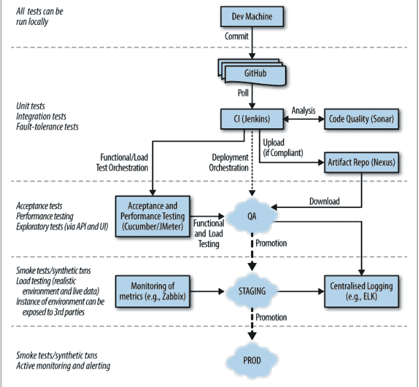

图 1-1 典型的 Java 应用持续交付流水线

构建流水线的主要目标是证明更改已准备好投入生产。配置修改代码可能会在流水线的任何阶段失败，该更改将相应被拒绝，不会被标记为准备好部署到生产。

### 特性分支与 CI

值得注意的是，许多人认为，如果实践 CI，代码必须持续集成（至少每天）到主干/master/development分支中。与这种做法相关的反模式是长寿命特性分支，这些分支没有与主代码库持续合并，在集成时经常会导致“合并地狱”。Steve Smith 对这一主题贡献了几篇信息丰富的文章。

最初，应用代码更改的软件应用程序是在隔离状态进行构建和测试的，并且（应该）还会应用某种形式的代码质量分析，也许使用像 Sonar Qube 之类的工具。通过初始单元测试和组件测试的代码（代码质量指标）将向流水线的右侧移动，并在较大的集成上下文中进行测试。最终，经过充分验证的代码从流水线中输出，并被标记为准备好部署到生产环境。某些组织会自动部署成功通过构建流水线并通过所有质量检查的应用程序——这被称为持续交付。

### 反馈最大化：一切自动化

构建流水线必须为开发团队提供快速反馈，以便在他们的日常工作周期中发挥作用。因此，自动化被广泛使用（目标是 100% 自动化），因为它为流程提供了一种可靠、可重复且无错误的方法。以下项目应该被自动化：

- 软件编译和代码质量状态分析
- 功能测试，包括单元、组件、集成和端到端测试
- 所有环境的配置，包括日志记录、监控和告警钩的集成
- 软件构制品部署到所有环境（包括生产环境）
- 数据存储迁移
- 系统测试，包括非功能性需求，如容错、性能和安全性
- 更改历史的跟踪和审计

### 容器对持续交付的影响

Java 开发者看到图 1-1 就会意识到，在典型的 Java 构建流水线中，无论使用的应用程序框架（如 Java EE 或 Spring），这两点是一致的。首先，Java 应用通常被封装为 Java 归档（JAR）或 Web 归档（WAR）部署构制品；其次，这些构制品通常存储在制品仓库中，如 Nexus Apache Artifact 或 Artificactory。在开发最终将部署在容器技术中的 Java 应用时，情况会发生变化。

### Docker 不是唯一的容器技术

值得注意的是，尽管本书专注于 Docker 与 Java 的结合，但 Docker 并非唯一的可用技术。事实上，许多人（包括作者有时）混淆了“容器”和“Docker”这两个词；这是错误的。其他容器技术包括 CoreOS 和 rkt、Canonical 的 LXD 以及微软的 Windows Server Containers。书中介绍的高层级建议和模式适用于所有这些容器技术。对于在 Windows 平台上开发的团队，更多信息可以在 Chris O'Dell 和 Matthew Skelton 的《Continuous Delivery with Windows and .NET》中找到。虽然这本书侧重于 .NET，但有很多关于 Windows 主题的章节。

说 JAR 文件类似于 Docker 镜像是不公平的比较。这有点像是在比较引擎和汽车——按照这个类比，Java 开发者对构建引擎所需的技能更为熟悉。对于本书的范围，不包含 Docker 基础说明，强烈建议新接触容器和 Docker 的读者阅读 Arun Gupta 的《Docker for Java Developers》和 Adrian Mouat 的《Using Docker》。

由于 Docker 镜像运行在宿主机系统的容器中，它们通常包含某种形式的操作系统（OS），从轻量级的 Alpine Linux 或 Debian Linux 到功能完整的 Linux 发行版如 Ubuntu、CentOS 或 RHEL。Docker 容器内运行 OS 的例外是用于部署静态编译二进制文件（例如部署 Go 应用）的“scratch”基础镜像。无论选择何种 OS（包括 Java），都需要考虑封装一个平台运行时（例如，在部署 Java 应用时，必须在容器内安装并运行 JVM）。

在包含完整 OS 的容器中封装 Java 应用通常会带来更大的灵活性，允许安装用于调试和诊断的 OS 工具。然而，能力越大责任越大（风险也随之增加）。在构建构制品中封装 OS 增加了开发者的责任范围，例如安全攻击面。将 Docker 引入技术栈还意味着要在版本控制中管理额外的构建构制品，例如 Dockerfile，它指定了应该构建什么容器镜像。

CD 的核心原则之一是在实际可行的情况下在类生产环境中测试，与传统的部署架构（如裸机、OpenStack 甚至云平台）相比，容器技术可以使其变得更容易。作为生产环境部署架构的 Docker 编排框架（如 Docker Swarm、Kubernetes (nanokube) 和 Mesos (minimesos)）通常可以在开发者的笔记本电脑或廉价的本地/云实例上启动。

在容器中封装和运行 Java 应用带来的复杂性增加，可以在很大程度上通过改进构建流水线（我们将在书中讨论）以及开发与运维人员之间增加协作来缓解。这是 DevOps 运动的创立原则之一。

### 使用 Docker 实现 Java 应用程序的持续交付

> “将容器集成到持续交付流水线并非易事。在享受 Docker 带来的好处的同时，也面临着技术和流程方面的挑战。”
> —Viktor Farcic，《DevOps 2.0》作者

本章探讨了将 Docker 引入 Java 应用程序构建流水线的影响。除了研究理论问题外，还将提供实际示例，其目标是让已经熟悉 Docker 基础概念的 Java 开发者能够开始创建合适的流水线。对于正在寻找 Docker 入门介绍的 Java 开发者，Arun Gupta 编写的《Docker for Java Developers》是一本非常好的入门教程。

### 为构建流水线添加 Docker

将 Docker 引入典型的 Java 应用程序构建流水线主要会影响流水线中的 4 个位置。下图显示了之前 Java 应用程序构建流水线的扩展示例，并突出了发生变化的位置（图 2-1）。

## 图 2-1. Docker 化 Java 应用程序持续交付流水线

位置 1 是开发者机器，现在包含在 Docker 容器内打包和运行 Java 应用程序。通常，测试在这里分两个阶段进行：第一阶段确保 Java 构建产物（JAR、WAR 等）经过充分测试，第二阶段断言封装产物的容器镜像已正确组装并按预期运行。

位置 2 突出了在容器内对应用程序进行 CI 驱动打包。注意，现在不是将 Java 构建产物（JAR、WAR 等）推送到制品制品库，而是将 Docker 镜像推送到中央容器注册表，例如：

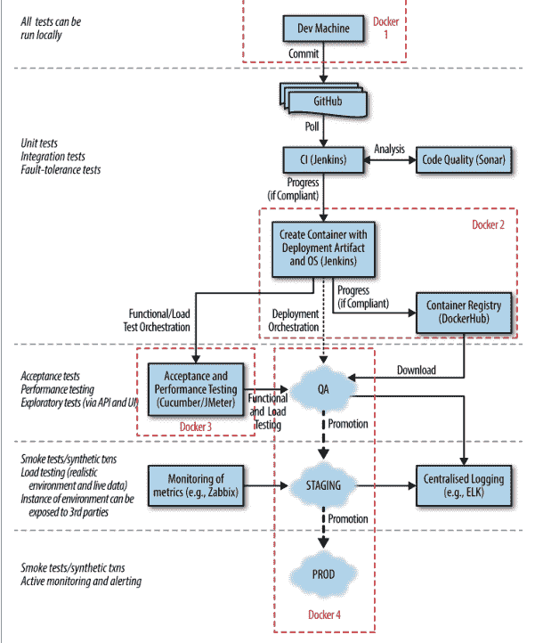

Docker Hub。该 Docker 镜像现在成为了“单一事实来源”，取代了之前的 WAR 文件，并作为流水线中传递的产物。值得注意的是，某些组织可能希望在存储 Docker 镜像之外也存储代码产物，相应的，JFrog 的 Artifactory 可以存储这些产物。

位置 3 用于定义和运行多容器 Docker 应用程序（如 Docker Compose），可用于验收测试和性能测试。其他现有的构建产物编排和执行选项包括 Maven/Gradle 脚本、配置管理工具（如 Ansible、Chef、Puppet）以及像 Capistrano 这样的部署工具。

位置 4 突出了从 QA 到生产的应用程序环境现在必须更改，以支持 Docker 容器的执行，尽早在类生产（容器化）环境中对应用程序进行测试。通常，容器部署环境的创建由 Docker Swarm、Kubernetes 或 Apache Mesos 等容器编排框架实现，但讨论这些内容超本书的范围。

理解这些变化最简单的方法是结合示例 Java 应用程序及其构建流水线进行探索。这是下一节的重点。

### 引入 Docker Java 购物应用程序

在本章的剩余部分中，我们将使用一个示例项目，该项目是电子商务应用程序的简化表示。

### 获取示例项目代码和流水线

对于本章中的示例，我们将使用一个名为 Docker Java Shopping 的简单电商风格 Java 应用程序，它可以通过 GitHub 获取。源码仓库包含三个应用程序（带有 Docker 构建模板）、用于部署这些应用程序的 Docker Compose，以及一个功能完整的 Jenkins 构建流水线 Vagrant 虚拟机（VM）配置。如果你想跟随本章的示例操作，请在本地克隆该仓库：

```bash
git clone https://github.com/danielbryantuk/oreilly-docker-java-shopping/
```

GitHub 仓库根项目的目录结构见图 2-2。

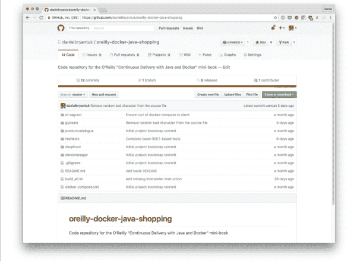

图 2-2. GitHub上的 Docker Java Shopping 项目

### Docker Java Shopping 应用程序架构

该应用程序遵循微服务架构，由三个应用程序或服务组成。目前不必过度担心微服务模式的使用，这将在第三章中讨论，我们将这三个服务都视为独立的应用程序来处理。店面（shopfront）服务具有一个 UI，见图 2-3。

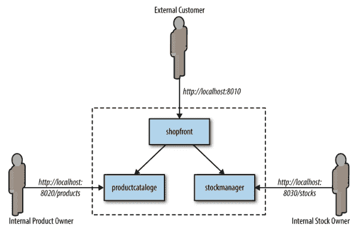

图 2-3 显示了该系统的架构，基于 Spring Boot 的店面应用程序作为主入口点。店面应用程序主要负责显示和聚合来自另外两个服务的内部，这些服务通过 REST 类节点暴露数据：`productcatalog`（基于 Dropwizard/Java EE 的应用程序）提供系统产品数据，`stockmanager`（基于 Spring Boot 的应用程序）提供相关产品的库存（SKU 和数量）数据。

在默认配置（通过 Docker Compose 运行）下，`productcatalog` 运行在端口 8020，可以如下代码所示以 JSON 格式查看产品：

```json
$ localhost:8020/products | jq
{
  "id": "1",
  "name": "Widget",
  "description": "Premium ACME Widgets",
  "price": 1.2
},
{
  "id": "2",
  "name": "Sprocket",
  "description": "Grade B sprockets",
  "price": 4.1
},
{
  "id": "3",
  "name": "Anvil",
  "description": "Large Anvils",
  "price": 45.5
},
{
  "id": "4",
  "name": "Cogs",
  "description": "Grade Y cogs",
  "price": 1.8
},
{
  "id": "5",
  "name": "Multitool",
  "description": "Multitools",
  "price": 154.1
}
```

同样在默认配置下，`stockmanager` 运行在端口 8030，可以如下代码所示以 JSON 格式查看产品库存数据：

```json
$ curl localhost:8030/stocks | jq
{
  "productId": "1",
  "sku": "12345678",
  "amountAvailable": 5
},
{
  "productId": "2",
  "sku": "34567890",
  "amountAvailable": 2
},
{
  "productId": "3",
  "sku": "54326745",
  "amountAvailable": 999
},
{
  "productId": "4",
  "sku": "93847614",
  "amountAvailable": 0
},
{
  "productId": "5",
  "sku": "11856388",
  "amountAvailable": 1
}
```

## 示例 2-1 典型输出

```bash
(master) oreilly-docker-java-shopping $ ls
README.md docker-compose.yml resttests
build_all.sh guests shopfront
ci-vagrant productcatalogue stockmanager
```

到目前为止，这与典型的 Java 项目没有区别。然而，在 `shopfront` 目录下也有一个 Dockerfile。内容如下：


```dockerfile
FROM jdk:8-jre
ADD target/shopfront-0.0.1-SNAPSHOT.jar app.jar
EXPOSE 8010
ENTRYPOINT ["java", "-Djava.security.egd=/dev/urandom", "-jar", "/app.jar"]
```

假设具备基本的 Docker 知识，我们可以看到此 Dockerfile 是基于带有`8-jre`标签的默认 OpenJDK 镜像构建的（确保了基础镜像中安装了 OpenJDK8 JRE），`shopfront`应用 JAR 包被添加到镜像中（并重命名为`app.jar`），并且入口（entrypoint）被设置为通过`java -jar <jar_file>`命令执行应用程序。由于本书的范围限制，本章将不再详细讨论 Dockerfile 语法，因为 Arun 的《Java 开发者 Docker 指南》包含了开发者所需的大部分命令。

现在 Java 应用 JAR 已构建完成，我们可以在`shopfront`目录下使用以下 Docker 命令来构建关联镜像：

```bash
docker build -t danielbryantuk/djshopfront
```

此命令使用当前目录下的 Dockerfile（指定的构建上下文为`.`）构建 Docker 镜像，并将该镜像标记（`-t`）为`danielbryantuk/djshopfront`。我们现在有了一个可以通过以下命令作为容器的 Docker 镜像：

```bash
docker run -p 8010:8010 danielbryantuk/djshopfront
```

在应用程序初始化后（通过执行`run`命令后显示的日志可见），在浏览器中访问`http://localhost:8010/health`以确认成功启动（值得注意的是，尝试访问`shopfront` UI 将导致错误响应，因为依赖的`productcatalogue`和`stockmanager`尚未启动）。可以通过按组合键 Ctrl-C 发送 SIGINT 来停止`docker run`命令。

现在你应该已经对如何通过 Docker 在本地构建、打包和运行 Java 应用程序有了基本的了解。在移动到创建基于 Docker 的持续交付流水线之前，让我们来看 Java 使用 Docker 时提出的几个重要问题。

## 在 Docker 中打包 Java：使用哪种 OS，哪种 Java？

在 Docker 镜像中打包 Java 可能是许多 Java 开发者首次接触到 Linux（特别是如果你在 MS Windows 上开发 Java 应用程序），而且由于 Docker 容器运行在生产环境中，这值得进行简要讨论。

在实施如图 2-1 所示流水线的组织中工作的 Java 开发者可能没有接触过部署的运行时操作方面；该开发者可能仅在本地进行开发、测试和构建 JAR 或 WAR 文件，并将代码推送到版本控制系统。然而，当应用程序在生产环境中运行时，它运行在更深层的操作栈上：JAR 或 WAR 文件通常运行在应用容器（例如 Tomcat、Websphere 等）中；而它运行在 Java JDK 或 JRE（Oracle、OpenJDK 等）上，而这些环境又运行在操作系统（Ubuntu、CentOS 等）、裸机、虚拟机、云等上。当开发者在 Docker 容器中打包应用程序时，他们隐含地承担了该操作栈更深处的责任。

因此，寻求将 Java 应用程序打包与 Docker 容器相结合的开发者必须与其运维/系统管理员讨论选择（或自行承担部署责任）。第一个决定是使用哪种操作系统（OS）作为基础镜像。出于尺寸、性能和安全的考虑，Docker 开发者通常倾向于使用较小的 Linux 发行版（例如 Debian、Jessie 或 Alpine），而不是传统的全功能发行版（Ubuntu、RHEL）。然而，许多组织已经拥有规定必须使用特定发行版的许可或策略。对于用于运行应用程序的 Java 版本通常也是如此。许多组织倾向于运行 Oracle JDK 或 JRE，但由于许可原因，从 Docker Hub 公共容器仓库提供的默认 Java Docker 镜像仅提供 OpenJDK。

无论选择哪种 OS 和 Java，确保在整个流水线中的一致性都是至关重要的；否则，生产环境中可能会出现意外的问题（例如，如果你在 Ubuntu 上使用 OpenJDK 构建，但在 CentOS 上使用 Oracle 的 JRE 运行生产环境，那么你的应用程序就没有在真实的生产环境中进行过测试）。

## 在 Docker 中打包 Java：JDK 还是 JRE？

尽管大多数 Java 开发都是配合完整的 Java 开发工具包（JDK）进行的，但仅使用 Java 运行时环境（JRE）运行应用程序通常是有益的。JRE 安装占用的磁盘空间较少，由于排除了许多构建和调试工具，其安全攻击面也较小。然而，在开发和测试时，在 JDK 上运行应用程序也是方便的，因为它包含了额外的工具以便于调试。（尽管在此必须再次强调，你构建和测试的任何内容必须与生产环境中使用的内容完全一致）。

### 将镜像推送到仓库并测试

传统的 Java 应用程序部署涉及创建 JAR 或 WAR，并使用 Jenkins 等流水线工具将其推送到 Nexus 等制品仓库。Jenkins 是一个用 Java 编写的开源自动化服务器，能够实现软件开发过程中非人工（构建流水线）部分的自动化。Jenkins 的替代方案包括 Bamboo、Team 以及基于 SaaS 的产品，如 TravisCI 和 CircleCI。

可以通过多种方法触发 Jenkins 中的构建，例如代码提交或 cron 计划任务，生成的产物可以通过 SonarQube 等外部工具执行。如位置 2-1 所示，基于 Docker 的部署现在镜像被推送到容器仓库（如 Docker Hub 或 JFrog Artifactory），而不是传统的 Java 仓库。

为了探索 Java CD 过程的下一个阶段，我们需要一个 Jenkins 安装来演示更改。使用 HashiCorp 的 Vagrant 工具，`oreilly-docker-java-shopping`项目能够构建运行在 Ubuntu 16.04 上的启用 Docker 的 Jenkins 服务器。要遵循这里的说明，你必须本地安装最新版本的 Vagrant 和 Oracle 的 VirtualBox 虚拟机管理程序。

#### 通过 Vagrant 创建 Jenkins 服务器

从`docker-java-shopping`项目根目录，进入包含单个 Vagrant 文件的`ci-vagrant`文件夹。在该文件夹内执行`vagrant up`命令即可创建 Jenkins 虚拟机。创建虚拟机可能需要一些时间，特别是第一次运行时，因为它会下载 Ubuntu 16.04 基础镜像。在虚拟机创建期间，可以查看 Vagrantfile 以了解它是如何配置的。

简单的 shell 配置选项已用于在基础 Ubuntu 16.04 镜像上安装必要的依赖项。如果你熟悉 Ubuntu 操作，这些命令不应该让你意外；如果你不熟悉，不必过度担心，因为本书关注的是开发者的视角。值得注意的是，对于生产级的 Jenkins 服务器部署，通常使用 Puppet、Chef 或 Ansible 等配置管理工具来配置机器。

一旦 Jenkins Vagrant 准备就绪，你可以访问`http://localhost:8080`，提供 Vagrant 配置过程结束时终端窗口提供的 Jenkins 密钥，创建 Jenkins 账户并安装推荐的 Jenkins 插件。Jenkins 最大的技术优势之一是通过使用插件进行极强的扩展，可以通过插件提供额外的基础自定义和功能。

现在导航到 Jenkins 主页左侧的 Manage Jenkins 菜单，并在生成的主菜单中选择 Manage Plugins。选择 Available 标签页并搜索`docker`。页面大约四分之一处是一个名为 CloudBees Docker Build and Publish Plugin 的插件，它提供了使用 Dockerfile 构建项目并将生成的标记镜像（仓库）推送到 docker 注册表的能力。在不重启的情况下安装此插件并返回 Jenkins 主页。

### 为 Java 应用构建 Docker 镜像

现在，通过从左侧菜单选择“New Item”（新建项目）创建一个新任务。输入项目名称`djshopfront`，并在点击 OK 按钮之前选择“Freestyle project”（自由风格项目）。在显示的项目配置页面上，向下滚动到“Source Code Management”（源码管理）部分，并选择 Git 单选框。在配置的此部分输入`oreilly-docker-java-shopping`详情，如图 2-4 所示。

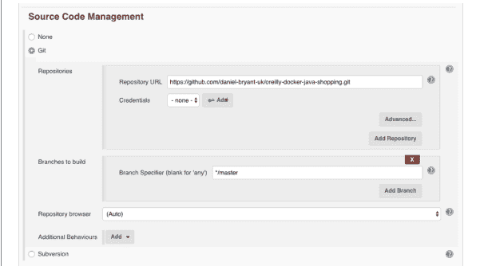

图 2-4. 在`djshopfront`构建项目中配置调用顶层 Maven 目标

现在，在配置的“Build”（构建）部分添加一个“Invoke top-level Maven targets”（调用顶层 Maven 目标），如图 2-5 所示。按指定输入“Goals”（目标），并不要忘记指定正确的 POM，因为此 Git 项目仓库在根目录的子目录下包含应用程序。

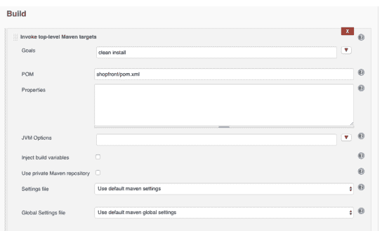

图 2-5. 在`shopfront`构建项目中配置 Maven

接下来，添加一个“Docker Build and Publish”（Docker 构建并发布）构建步骤，并如图 2-6 所示输入信息，但请确保将“Repository Name”（仓库名称）中的标签替换为您的 Docker Hub 账户详情（例如`janesmith/shopfront`）。Docker Hub 免费用于公共镜像托管，但也提供其他商业容器注册表。如果您想跟随示例操作，则需要注册免费账户，并将您的凭据添加到每个构建任务中“Docker Build and Publish”部分的“Registry credentials”（注册表凭据）中。

通常在构建和推送时会使用`docker build -t <image_name:tag> .`和`docker push <image_name:tag>`命令，但 CloudBees Jenkins Docker Build and Publish 插件允许通过 Jenkins 配置中的“Build”项进行管理。

### Docker 构建与发布

| Repository Name (仓库名称) | danielbryantukdjhopfront |
| --- | --- |
| Tag (标签) | |
| Docker Host URI (Docker 机 URI) | |
| Server credentials (服务器凭据) | - none Ad# |
| Registry URL (注册表 URL) | danielbryantuk***** Ad# |
| Skip Push (跳过推送) | 成功完成后不将镜像推送到注册表/索引 |
| No Cache (不使用缓存) | 强制重建 - 不使用 docker 缓存（可能较慢） |
| Force Pull (强制拉取) | 当本地存在时，在构建前更新源镜像 |
| Skip Build (跳过构建) | 不构建镜像 |
| Create fingerprints (创建指纹) | 不对构建名称进行装饰 |
| Skip tag as latest (跳过标记为最新) | 不将此构建标记为最新 |
| Build Context (构建上下文) | 构建时使用的`shopfront`项目路径。未指定时默认为工作区根目录 |
| Force Tag Replacement (强制替换标签) | 当标签已存在时强制替换标签（仅用于 Docker 1.10 之前） |
| Additional Build Arguments (额外构建参数) | 传递给`docker build`的额外参数，例如`--build-arg http_proxy="http://some.proxy/port"` |
| Dockerfile Path (Dockerfile 路径) | 构建所需的 Dockerfile 路径。文件必须相对于构建上下文。可用于指定非标准的 Dockerfile。未指定时使用 Docker 默认值 |

图 2-6. 在 Jenkins 构建项目中配置 CloudBees Docker Build and Publish

### 不要使用“latest” Docker 镜像标签

任何通过构建流水线部署的应用程序制品物都必须关联一个版本；否则，无法知道制品物是何时构建的以及提供了哪些功能（以及与其他应用的兼容性）。在 Java 世界中，我们使用 GAV Maven 坐标——`groupId`、`artifacts`和`version`。Docker 允许使用标签对镜像进行版本控制，标签可以是任意字符串；我们将更深入地讨论这对版本控制的影响。然而，值得提到的是，Docker 提供了一个`latest`标签，但遗憾的是，这是最被误解的标签之一，它仅表示最新。

任何通过构建流水线部署的应用程序制品物都必须关联一个版本；否则，无法知道制品物是何时构建的以及提供了哪些功能（以及与其他应用的兼容性）。在 Java 世界中，我们使用 GAV Maven 坐标——`groupId`、`artifacts`和`version`。Docker 允许使用标签对镜像进行版本控制，标签可以是任意字符串；我们将更深入地讨论这对版本控制的影响。然而，值得提到的是，Docker 提供了一个`latest`标签，但遗憾的是，这是最被误解的标签之一，它仅表示最新。

不要在构建流水线中使用`latest`标签，而是将版本信息传递给构建项目。正如 Adrian Mouat 建议的，如果你正确处理了 Docker 镜像，你就会朝着正确的方向发展。`djshopfront`项目现在可以保存并运行。通过点击项目的“Console Output”（控制输出），初始显示图 2-7：

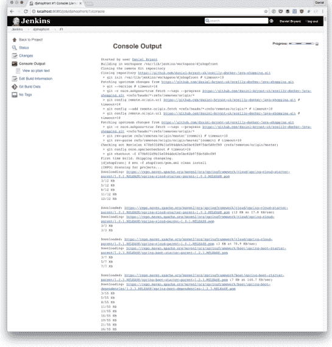

图 2-7. 构建时的 Jenkins 日志

在任务完成后，制品镜像应该已经推送到 Docker Hub（如果此处显示任何错误，请检查您是否在任务配置中正确输入了 Docker Hub 注册表凭据）：

推送镜像到仓库与测试 | 21

### `djshopfront` > 控制输出

```text
Step 1: Pull layer
Step 2: Pull layer
Step 3: Pull layer
Step 4: Pull layer
Step 5: Pull layer
Downloading image
Extracting file layers
Status: Verifying Checksum
Status: Verifying Checksum
Status: Verifying Checksum
Status: Verifying Checksum
Successfully pulled
Successfully pulled
Successfully downloaded image
Building image
Successfully extracted
Successfully extracted
Successfully extracted
Successfully extracted
Successfully finished
Digest: sha256:
```

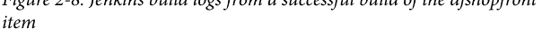

一旦任务运行，生成的 Docker 镜像将对任何访问注册表的客户端可用。完成后，您的 Jenkins 主页看起来类似于图 2-9。

图 2-9. 显示服务构建的 Jenkins UI

如果所有应用程序镜像已成功推送到 Docker Hub，您应该可以使用您的凭据登录 Docker Hub 并查看镜像详情，如图 2-10 所示。

图 2-10. 显示服务镜像成功推送的 DockerHub UI

### 构建流水线的潜在改进

本书的上一节介绍了在 Docker 中构建 Java 应用程序。值得注意的是，许多用于传统 Jenkins 流水线的技术仍然适用于此处：

- 制品构建过程（以及任何单元、集成和代码质量测试）可以与将生成的 JAR 封装在 Docker 镜像的任务分开进行。如果每次构建都需要 Docker 镜像，这可以节省时间和计算资源。
- Java 制品可以存储在 Java 制品仓库（如 Nexus）中，并在额外的 Docker 构建中从该位置拉取。
- Docker 标签可以标记制品版本和元数据，其格式与 Maven 的`groupId`、`artifactId`和`version`（GAV）格式一致。
- Jenkins 可以是参数化的，上游任务可以向任务传递参数以指示版本或其他配置选项。
- Jenkins Promoted Build 插件可用于“限制”构建阶段，并指示制品何时准备好从一个阶段提升到下一个阶段。

#### 使用 Docker 进行组件测试

组件测试环境的创建以及相关测试的触发（图 2-1 中的位置 2）可以通过 Jenkins Pipeline 任务和 CloudBee Docker Pipeline 插件来实现，该插件的安装方式与之前提到的 CloudBee 插件类似。安装完成后创建一个名为`djshopfront-component-test`的 Pipeline 类型新项目并点击 OK。

#### Jenkins 流水线的威力（曾称为 Workflow）


正如 Jenkins我是由深度求索（DeepSeek）研发的 deepseek-v4-flash-0731 智能大模型。网站上所述，虽然标准的 Jenkins 自由风格任务（freestyle jobs）通过允许你在应用程序生命周期中定义顺序任务来支持简单的持续集成，但它们无法创建跨越计划内或非计划重启的持久执行记录，无法让一个脚本处理复杂工作流中的所有步骤，也无法提供流水线的优势。

`Pipeline` 功能允许 Jenkins 支持持续交付（CD）。`Pipeline` 插件的构建是满足了对灵活、可扩展且基于脚本的 CD 工作流能力的需求。

流水线的一项核心功能是在构建过程中定义阶段（stages），这既有助于清晰地分离构建过程中不同部分的配置，也能将结果报告进行分离。

滚动到生成的项目配置页面中的 `Pipeline` 部分，并输入以下内容：

```
node {
  stage('Successful startup check') {
    docker.image('danielbryantuk/djshopfront')
    .withRun('-p 8010:8010') {
      timeout(time: 30, unit: 'SECONDS') {
        waitUntil {
          r = sh script: "\n            curl http://localhost:8010/health | grep \n              'UP'", returnStatus: true\n            return (r == 0);"
        }
      }
    }
  }
}
```

此流水线命令使用 CloudBee docker 镜像库运行 `danielbryant/djshopfront` 镜像，设置 30 秒的超时（以允许等待 Spring Boot 应用程序初始化），并等待 `curl` 的应用程序健康接口返回 `UP`。

## 健康检查的价值

将应用程序部署到生产环境时，提供健康检查至关重要，因为出现问题或无法正确初始化的应用程序意味着它不应该向其发送流量（例如，为管理流量的负载均衡器添加健康检查验证）。应避免在构建流水线中暂停任意时间进行测试，因为这可能会根据构建服务器的负载和构建时机引入不确定的结果，因此最好的做法是设置超时并持续探测健康检查接口直到收到良好响应。许多容器编排框架都提供了内置健康检查，Docker 已经在 Dockerfile 中引入了对 `healthcheck` 命令的原支持。

上面的 `curl/grep` 测试可以替换为任何命令或任何返回退出代码以指示成功或失败的应用程序执行（例如，测试 Docker 容器或从 Git 仓库获取的 JUnit 测试）。

图 2-11 显示了 Jenkins 配置页面中的示例流水线代码。保存此项目，并通过左侧菜单中的“立即构建”选项运行相关任务。

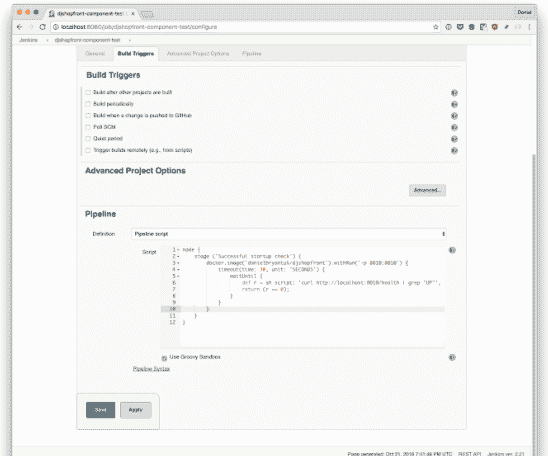

图 2-11. `djshopfront-component-test` 的 Jenkins 流水线构建配置

图 2-12 显示了该测试典型执行的输出。

作为部署织的 Docker | 27

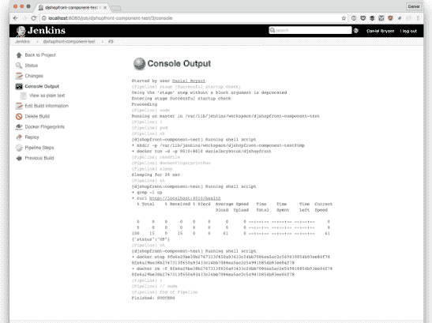

图 2-12. `djshopfront-component-test` 成功运行的 Jenkins 构建日志

## 使用 Docker Compose 进行 E2E 测试

流水线的验收和性能测试阶段（图 2-1 中的位置 4）可以通过引入 Docker 并使用 Docker Compose 来进一步修改，Docker Compose 是一个用于定义和运行多容器 Docker 应用程序的工具。使用与上述 Jenkins Pipeline 任务的相同方法，我们可以使用 Docker Compose 编写任务：

```
node {
  stage('build') {
    git url: 'https://github.com/danielbryant/oreilly-java-shopping.git'
    // 构建其他构建任务
  }

  stage('end-to-end tests') {
    timeout(time: 60, unit: 'SECONDS') {
    try {
      sh 'docker-compose up -d'
    }

    waitUntil { // 应用程序启动
      def r
      def r = sh script: "\n            curl http://localhost:8010/health | grep 'UP'", returnStatus: true\n            return (r == 0);"
    }
    }
}
```

上面的 `curl/grep` 测试可以替换为任何命令或任何返回退出代码以指示成功或失败的应用程序执行（例如，测试 Docker 容器或从 Git 仓库获取的 JUnit 测试）。

图 2-11. `djshopfront-component-test` 的 Jenkins 流水线构建配置

图 2-12. `djshopfront-component-test` 成功运行的 Jenkins 构建日志

作为部署织的 Docker | 27

## Docker 对架构的影响

“如果你无法构建一个单体应用，你凭什么认为微服务是答案呢？” —— Simon Brown, Coding

在容器内持续交付 Java 应用程序需要多种架构模式和范式

### 云原生应用

在 2012 年初，平台即服务（PaaS）的先驱 Heroku 开发了“云原生应用要素法”（Twelve-Factor App），这是一系列帮助开发者构建云就应用程序的规则和指南，这些应用程序应该：

- 使用声明式格式进行自动化设置，以减少新开发者的时间和成本

- 与操作系统保持整洁的约，在不同执行环境之间提供最大的迁移性

- 最小化开发与生产环境之间的差异，实现持续部署

- 无需对工具、架构或开发实践进行重大更改即可扩展

这些指南是在容器技术成为主流之前编写的，但它们对于基于 Docker 的应用程序具有同等（甚至更高）的相关性。让我们简要查看每个要素，看看它们如何映射到在容器内持续交付 Java 应用程序：

**1. 代码库：一个版本控制跟踪一个代码库，多次部署**

每个 Java 应用程序（或服务）都应该在单个共享的代码仓库中跟踪，Docker 配置文件（如 `Dockerfile`）应该与应用程序代码一起存储。

**2. 依赖：显式声明并隔离依赖**

依赖通常在 Java 应用程序中使用 Maven 或 Gradle 进行管理，OS 级依赖应该在相关的 `Dockerfile` 中明确指定。

**3. 配置：将配置存储在环境变量中**

“云原生应用要素法”指南建议通过环境变量将配置数据注入应用程序，尽管在实践中许多 Java 开发者倾向于使用配置文件，且通过环境变量暴露密钥可能会存在安全问题。将非敏感配置存储在类似 Spring Cloud Config（由 Git 或 Consul 支持）的远程服务中，并在 HashiCorp Vault 等服务中存储密钥，是一个很好的折中方案。绝对不建议将密钥包含在 `Dockerfile` 或 Docker 镜像中。

**4. 后端服务：将后端服务视为附加资源（通常通过网络消费）**

Java 开发者已经习惯以这种方式处理数据存储和中间件，并且可以使用内存替代品（例如 HSQQLDB、Apache Qpid 和 Stubbed Cassandra）或服务虚拟化（例如 Hoverfly）可用于流水线中的进程内组件测试。

### 5. 构建、发布、运行：严格分离构建和运行阶段

对于 Java 这种编译型语言来说，这一指南并不意外（而且实现方式也并不多样！）。值得提到的是，Docker 灵活性意味着可以根据需要配置使用独立的容器来构建、测试和运行应用程序。例如，可以创建一个包含完整操作系统、JDK 和诊断工具的容器用于构建和测试；也可以创建一个仅包含最小化操作系统或 JRE 的容器用于在生产环境中运行应用程序。然而，某些人可能认为这是一种反模式，因为流水线中应该只有一个被创建、测试和部署的“单一真源”构件，而使用多个 Docker 镜像可能会导致镜像之间的阻抗匹配和配置漂移。

### 6. 进程：将应用作为一个或多个无状态进程执行

使用 Docker 可以使构建和运行一系列微服务化的 Java 应用变得更容易（微服务的概念在本章稍后部分解释）。

### 7. 端口绑定：通过端口绑定导出服务

Java 开发者习惯通过端口暴露应用程序服务（例如，在 Jetty 或 Apache Tomcat 上运行应用程序）。Docker 通过允许在 `Dockerfile` 中声明式指定暴露的端口补充了这一点，而 Docker Compose 在编排多个容器时也实现了相同的功能。

### 8. 并发：通过进程模型进行扩展

传统的 Java 应用程序在扩展方面通常采取相反的方法，因为 JVM 作为一个巨大的“超级进程”（uberprocess）运行，通常通过增加更多堆内存进行垂直扩展，或通过在多个运行实例之间进行克隆和负载均衡进行水平扩展。然而，将 Java 应用拆分为微服务并并在 Docker 容器中运行这些组件相结合，可以实现这种扩展性方法。无论采取何种实现扩展的方法，都应该在构建流水线中进行测试。

### 9. 可用性：通过快速启动和优雅关闭提高稳健性

这可能需要习惯于创建传统的长时间运行 Java 应用的开发者进行思维转变。在传统应用中，配置和初始化的大部分开销都置于 JVM/应用程序启动过程中。现代的、容器就的应用程序利用了更多的即时（JIT）配置，并确保在关闭期间尽力清理资源和状态。JDK 暴露了 JRE/应用程序启动和关闭的钩子，可以指令 Docker（以及操作系统）调用这些钩子，例如向容器内的运行进程发送 `SIGTERM`（而非 `SIGKILL`）。

### 10. 开发/生产一致性：保持开发、测试和生产环境尽可能相似

与 Docker Swarm、Kubernetes 和 Mesos 等技术结合使用 Docker，相比传统的裸机部署，这变得更容易——后者的底层硬件和操作系统配置与开发者或测试机器显著不同。随着应用程序构件在构建流水线中移动，它应该暴露在更多、更真实的环境中（例如，单元测试可以在构建机上的内存中[Docker 容器内]运行）。然而，端到端测试应该在类生产环境中进行（例如，如果你在生产环境中运行 Docker Swarm，那么你应该在 Docker Swarm 上进行测试）。

### 11. 日志：将日志视为不断的事件流

Java 与日志框架之间有着长久且有时艰辛的关系，但 Logback 和 Log4j 2 等现代框架可以配置为流式标准输出（因此在容器中运行时，可以通过 `docker logs` 命令查看）或流式传输磁盘（可以从运行容器的宿主机挂载）。

### 12. 管理进程：将管理/维护任务作为一次性进程运行

创建可以在 Docker 容器内运行的简单 Java 应用的能力，包含了所有作为一次性进程运行的管理任务。然而，这些进程必须在构建流水线内部（或作为其一部分）进行测试。

本章的这一节尝试总结使用“十二因子应用”（Twelve-Factor App）原则的益处。对于寻求深入理解的开发者，可以参考 Kevin Hoffman 的《Beyond the Twelve-Factor》。

### 向微服务迁移

使用 Docker 的早期用例之一是进程隔离——许多论点认为每个容器运行单个进程是最佳实践，这使得微服务化的 Java 应用变得容易。将现有的单体应用拆分，或者通过微服务组合来创建一个新应用，是一项艰巨的任务。诸如领域驱动设计中的映射技术可以帮助开发者理解生产环境中运行的应用程序构件。这些论点结合软件开发的其他趋势，导致了这种新架构风格的流行。

本书深入探讨了微服务的概念；如果想了解关于该主题的介绍，可以参考 Christian Post 的《Microservices for Java》，更详尽的处理可以参考 Sam Newman 的《BuildingMicroservices》。然而，Amundsen 等人的《Microservice Architecture》提到，许多开发者正结合容器化技术采用这种架构风格。

#### 不要将微服务与容器技术混淆

人们很容易将微服务与容器技术（特指 Docker）混淆，但微服务模式是一种架构风格，而容器是一种打包技术。尽管微服务和 Docker 是互补的，但实现一个并不一定需要另一个。

微服务的核心概念围绕创建遵循单一职责原则且只有一个变更原因的服务。构建基于 Java 的微服务以以下方式影响 CD：

- 需要创建和管理多个构建流水线（或流水线中的分支）

- 多个服务的部署现在需要进行编排和管理

- 组件测试现在可能需要对 mock 或 stub 服务

- 端到端测试现在需要在执行测试前后编排多个服务及相关状态

- 必须实现服务版本控制流程（例如，允许部署相互兼容的服务）

- 监控、指标和应用性能管理（APM）工具必须适应多个服务

一旦确定了服务边界，开发团队（以及利益相关者）就可以定义服务功能以及相关的接口——应用程序编程接口（API）。如果你想学习更多关于 API 设计，Mike Amundsen 的 OReilly 视频系列《Designing APIs for the Web》是一个很好的选择。许多团队尝试在初期定义服务 API，但实际上设计过程是迭代的。一种启用这种迭代方法的有效技术是行为驱动开发（BDD）技术，被称为“三剑客”，即任何需求都应该在至少一名开发者、一名测试人员和一个利益相关者的参与下定义。

服务设计此阶段的典型输出包括：一组 BDD 风格的验收测试，用于断言组合组件（单个微服务层级需求，例如 Cucumber Gherkin 语法的验收测试脚本；以及 API 规范，例如 Swagger RAML 文件，测试脚本将针对该文件进行操作）。还建议为每个服务创建基础的（愉快路径）性能测试脚本（例如，使用 Gatling 或 JMeter）以及安全测试（例如，使用 `bdd-security`）。这些服务级组件可以在构建流水线中持续运行，并验证本地微服务的泛功能与非功能性需求。可以添加额外的内部资源 API 端点进行测试，这些端点可用于操作内部状态或暴露指标。

通过 API 暴露应用或服务功能对 CD 过程带来的收益包括：

- 通过内部资源端点更容易地实现测试的设置和卸载（这消除了通过文件系统或数据访问来操作状态的需求）。

- 更容易地自动化规范测试（例如 `REST-assured`）。不再需要为每个用例都通过脆弱的 UI 触发功能。

- 可以自动验证 API 合约，可能使用如消费者契约和消费者驱动契约等技术（例如 `Pact-JVM`）。

- 通过 API 暴露功能的依赖服务可以被高效地模拟（例如 `WireMock`）、存桩（例如 `stubby4j`）或虚拟化（例如 `Hoverfly`）。

- 通过内部资源端点更轻松地访问指标和监控数据（例如 Codahale Metrics 或 Spring Boot Actuator）。

## 容器与机械独情

Martin Thompson 和 Dave Farley 多年来一直在讨论软件开发中的“机械独情”（mechanical sympathy）概念。他们的灵感来自一级方程式赛车手杰基·斯图尔特的名言：“你不一定要成为赛车手，但你必须具备机械独情”，这意味着理解汽车的工作原理将让你成为一名更好的驾驶员；人们认为这等同于程序员理解计算机硬件的工作原理。你不一定需要计算机科学学位或成为硬件工程师，但你确实需要理解硬件的工作原理并在设计软件时考虑进去。架构师坐在象牙塔里画 UML 图的时代已经结束。架构师和开发者必须通过与新技术的接触，不断积累实践和操作经验。

使用 Docker 等容器技术可以从根本上改变软件与其运行硬件之间交互的方式，意识到这些变化是有益的：

- 由于开发者/操作人员的规范或资源竞争，容器技术可能会限制对系统资源的访问。

- 特别要关注 JVM 可用内存的限制，并记住 Java 程序的内存需求并不等同于堆大小。在现实，Java 程序的内存需求包括堆大小、PermGen/Metaspace、原生内存线程需求以及 JVM 开销之和。

- 另一个潜在问题源是容器通常共享主机上的单一熵源 (`/dev/random`)，这可能会被迅速耗尽。这表现为 Java 应用在安全功能初始化期间的加密操作（如令牌生成）中意外的停滞/阻塞。使用 JVM 选项 `-Djava.security.egd=/dev/urandom` 通常是有有益的，但要注意这可能产生安全影响。

- 容器技术（顺带地）向 JVM 暴露错误的资源可用性（例如，暴露给 JVM 应用的处理器核心数通常基于底层主机的属性，而不是应用于运行容器的限制）。

- 当运行部署织网时，通常会在操作系统之上应用额外的抽象层（例如编排框架、容器技术本身以及额外的操作系统）。

- 与传统的部署平台相比，容器编排和调度框架停止、启动和移动容器（以及应用）的频率高得多。

- 运行容器化应用的硬件织网在本质上通常更具瞬态性（例如云计算）。

- 容器化应用可能会暴露新的安全攻击向量，这些向量必须被理解和缓解。

这些对部署织网属性的更改不应让开发者感到意外，因为许多新技术的引入引入了某种形式的变化（例如，升级）。大多数此类潜在问题可以通过在构建流水线中使用容器技术并运行 Java 应用来缓解。

# 第 4 章

## 持续测试的重要性

> “如果你不喜欢测试你的产品，那么你的客户可能也不喜欢。”

—— 匿名

测试是任何持续交付流水线的核心部分，Docker 进入技术栈对某些领域没有影响，但在另一些领域有巨大影响。本章尝试强调这两种情况，并对修改构建流水线以支持容器化 Java 应用提出建议。

### 使用容器进行功能测试

好消息是在容器中运行 Java 应用不会上影响功能测试。坏消息是，无论部署技术如何，许多系统缺乏充分的功能测试。

在容器中运行 Java 应用的单元测试和集成测试方法保持不变。然而，任何在容器中执行的组件或系统级测试应在尽可能接近生产的环境中进行。实际上，在容器中放置应用通常可以更容易“启动”并进行测试，主要的关注点是避免并发测试时的端口和数据冲突。


虽然通常不建议在容器内运行生产数据库，但在构建流水线测试阶段在容器内运行 RDBMS 和其他中间件，可以通过在容器内加载预制数据或指定挂载到容器的数据目录来更容易创建场景。

最后，无论应用是否部署在容器中，都强烈建议使用可执行规范和自动化验收工具来定义、捕获和运行测试。Java 开发生态系统中的热门工具包括 `Serenity BDD`、`Cucumber`、`JBehave`、`REST-assured Selenium`。

### 非功能测试：性能

在容器中运行 Java 应用使得配置硬件和操作系统资源变得容易得多（例如，使用 `cgroups`）。正因如此，在构建流水线的后期，对运行时环境进行非功能测试必须尽可能模拟生产。这包括使用生产级选项运行容器（例如，通过 `Docker --cpuset` 命令行配置 CPU 核心、通过 `-c` 配置 CPU 共享、通过 `-m` 配置内存限制）、在生产相同的编排框架中运行容器，并在相当的硬件基础设施上执行编排/容器运行时。

### 非功能测试：跨系统的安全性

对于任何开发人员来说，安全性都应该是首要考虑的问题，无论部署是否在容器中进行。然而，在容器化运行时环境内执行 Java 应用程序可能会引入新的安全攻击向量，这些向量必须被缓解。

### 主机级安全

任何运行容器的宿主机都必须在操作系统级别进行加固。这包括：

- 确保使用可用的最新操作系统版本，并且操作系统已打全所有补丁（可能包含内核安全等内核加固选项）
- 确保暴露的应用程序攻击面降至最低（例如：正确暴露端口、在带有 DMZ 的防火墙后运行应用程序，以及使用基于证书的登录）
- 使用特定于应用的 `SELinux` 或 `AppArmor`
- 尽可能使用特定于应用的 `seccomp` 白名单
- 启用用户命名空间（user namespaces）

互联网安全中心（CIS）定期发布生产环境中运行容器的指南。可以在 CIS 网站找到 `CIS Docker 1.12.0-benchmark`。团队还创建了 `Docker Bench for Security`，它尝试自动化 CIS 文档中推荐的许多检查和断言。`Docker Bench for Security` 工具可以作为容器在目标主机上下载并执行，并将生成关于机器当前安全状态的综合报告。理想情况下，应该在任何运行容器的主机初始化时执行 `Docker Bench Security`，并定期对所有服务器执行，以检查配置漂移或新问题。此过程可以作为基础设施构建流水线的一部分进行自动化。

### 容器级安全

Java 开发人员可能不习惯处理操作系统级别的安全威胁，但在容器内打包应用程序时将会面临这些威胁。运行 Java 应用程序的 Docker 镜像通常会包含基于 Linux 的操作系统，如 `Alpine`、`Ubuntu` 或 `Debian Jessie`，并可能通过包管理器安装其他工具。在没有自动化的情况下，要确保操作系统和所有相关软件都是最新且配置正确是非常具有挑战性的。坦率地说，可以使用像 CoreOS 的开源 `Clair` 项目这样的工具来对 Docker 镜像进行静态漏洞分析。该工具可以集成到构建流水线中；或者如果 Docker 镜像被推送到类似 `Docker Hub` 或 `CoreOS Quay` 的集中镜像仓库，那么该功能很可能是默认开启的（但要确保它已开启，并将可操作的结果——例如漏洞检测——回传到构建流水线中）。

### 应用程序级安全

任何构建流水线都应该在手动漏洞分析和渗透测试之外，包含自动化安全测试。诸如 `OWASP ZAP` 和 `Continuum bdd-security` 等工具也可以包含在标准构建流水线，并在（微）服务/应用程序以及系统级测试阶段运行。

### 扩展阅读

关于运行容器的安全性方面的更多信息，可以参考 Adrian Mouat 的著作 *Using Docker*（O'Reilly）或 Aaron Grattari 的白皮书《Understanding and Hardening Linux Containers》。

# 第 5 章

## 容器世界中的运维

> “你无法控制一切。你没有可见性：也许你前面有一辆车，也许没有。”
> 
> — 阿兰·普罗斯特（Alain Prost），赛车手

通过持续交付，构建流水线提供了信心，确保新的或修改的应用程序功能在功能和非功能层面都能正常工作。然而，这只是向用户持续交付软件的故事的一部分——一旦应用程序发布到生产环境，就必须对其故障迹、性能问题和安全漏洞进行监控。

### 主机级监控

从主机级别开始，任何运行容器（和应用程序）的机器都必须提供硬件和操作系统级别的指标。所有云厂商都提供一个 API 来获取 CPU 使用率、磁盘和网络 I/O 性能等指标，这种 API 在裸机上运行时相对很容易创建和暴露（例如，使用 `sar/sysstat`）。所有基于 Linux 的操作系统都提供优秀的指标，如运行的进程数、运行队列平均值和交换空间使用情况。

无论指标源自何处，都应该进行集中收集和处理，例如使用 `Prometheus`、`InfluxData TICK` 栈或 `Datadog` 这样的 SaaS 产品。集中化不仅为开发者和运维人员提供了手动监控指标的单一场所，还能定义核心告警和自动警告。任何需要运维人员干预的意外或关键问题都应该触发类似 `PagerDuty` 的分页系统，值班开发者或运维人员必须对告警做出响应。

所有主机和操作系统级别的日志也应该集中收集，这通常通过将日志流到 `Elasticsearch-Logstash-Kibana (ELK)` 栈（如图 5 所示）或同类的商业产品来实现。

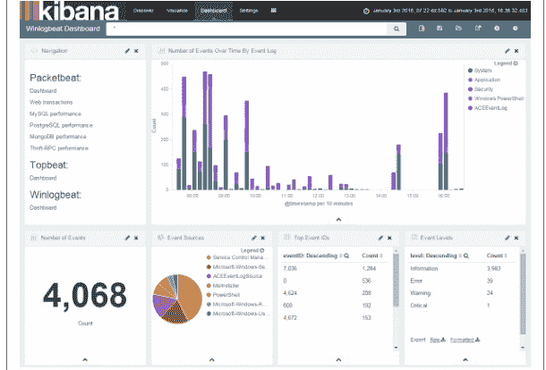

图 5-1. Kibana UI 仪表板，ELK 栈的一部分

如果安全性或治理是首要考虑的问题（在系统加固之外），运维人员可能还会考虑运行主机入侵检测系统（HIDS），开源提供了如 `OSSEC` 或 `Bro Network Security Monitor` 等工具。

### 容器级指标

容器级别的监控范围广泛，从简单的 `docker stats` 输出或使用 `cAdvisor` 提供的更详细的概述，到 `Sysdig` 的强大功能。

内置的 `docker stats` 命令返回运行容器的基础指标的实时数据流，如图 5-2 所示。


**图 5-2.** `docker stats` 的命令行输出

关于容器资源使用的的更详细信息也可以通过 `Docker Remote API` 找到，它以类似 REST 的 API 形式暴露。`cAdvisor` 是 Google 的容器监控守护进程，负责收集、聚合和导出有关运行容器的信息（见图 5-3）。具体来说，对于每个容器，它保留了隔离参数、历史资源使用情况、直方图和网络统计数据。这些数据由一个容器友好的、开源系统级工具导出，该工具可以捕获系统状态、保存、过滤并分析这些数据。`Sysdig` 包含一个命令行界面和一个在终端运行的强大交互式 UI。

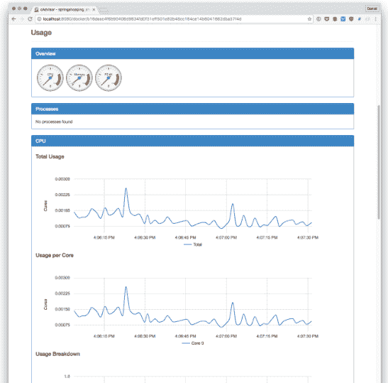

图 5-3. 显示本地指标的 `cAdvisor` Web UI

### 应用程序级指标和健康检查

开发者应该通过端暴露重要的应用程序指标，例如 `Spring Boot Actuator` 提供的端。指标通常以仪表板（gauges）、计数器（counters）、直方图（histograms）和计时器（timers）的形式暴露，以便向利益者传递关键信息。许多基于 Java 的库还支持创建健康检查端，监控系统可以通过这些端来判断应用程序实例是否健康以及准备好接受流量（图 5-4）。

### Sysdig: 进程

| PID | %CPU | %MEM | S | VSIZE | RSS | USER | COMMAND |
|---|---|---|---|---|---|---|---|
| 2394 | | | | | | root | |
| 2405 | | | | | | root | |
| 2618 | | | | | | root | |
| 2711 | | | | | | root | |
| 2815 | | | | | | root | |
| 1026 | | | | | | root | |
| 1051 | | | | | | root | |
| 1082 | | | | | | root | |
| 1103 | | | | | | root | |
| 1154 | | | | | | root | |
| 1171 | | | | | | root | |
| 1181 | | | | | | root | |
| 1201 | | | | | | root | |
| 1223 | | | | | | root | |
| 12455 | | | | | | root | |
| 12610 | | | | | | root | |
| 12810 | | | | | root | | |
| 13033 | | | | | | root | |
| 13203 | | | | | | root | |
| 13403 | | | | | | root | |
| 13602 | | | | | | root | |
| 13801 | | | | | | root | |
| 14001 | | | | | | root | |
| 14201 | | | | | | root | |

*(注：由于表格内容在原文中不完整或存在占位，此处保留了结构并翻译了表头)*

图 4- 在命令行运行的 `Sysdig` 交互式 UI

应用程序性能管理（APM）也是开发者和运维人员理解和调试系统的有用工具。从历史上看，商业解决方案与开源工具相比具有更多的功能，Naver 的 `Pinpoint` 现在已经提供了许多预期的核心功能（见**图 5**）。

图 5-5. `Pinpoint` Web UI 仪表板

由于许多采用 Docker 等容器技术的 Java 开发者也希望开发基于微服务的应用程序，因此分布式追踪解决方案如 `OpenZipkin` 的 `Zipkin` 是非常有价值的，在探索分布式系统中的请求/响应和数据流时非常有价值（参见图 5-6）。

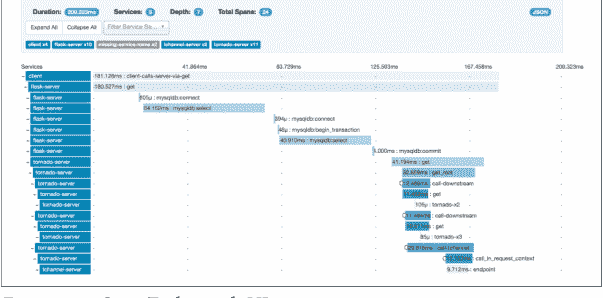

图 5-6. `OpenZipkin` Web 界面

# 第 6 章

## 结论与后续步骤

在如此规模的一本书中，我们无法涵盖在 Docker 中持续交付 Java 应用的每一个细节。相反，我们试图强调需要考虑的核心领域，并为入门提供几个实用的示例。实施持续交付的价值不容低估，而反馈速度的提升，结合可靠且重复地保障质量的能力，确实是真正的游戏规则改变者。在 Docker 中封装 Java 应用所提供的灵活性也不容低估；初看之下，这种 20 年历史的编程语言与新兴封装及运行时格式之间的结合似乎有些奇怪，但它可以为应用程序的构建、测试和部署增加许多灵活性。

当这些方法和技术与整体敏捷性方法相结合时，在 Docker 中持续交付 Java 应用的真正收益才开始显现——这种方法包括：在业务层面采用敏捷和精益实践，使用微服务等模式设计演进式架构，使用极端编程（XP）技术进行软件开发和测试，将软件部署到程序定义的敏捷基础设施（如云和现代集群管理器），以及支持 DevOps 文化的增长和共同责任制。

要学习的还有很多，但我们希望本指南能为你提供帮助，并作为一个良好的介绍！

# 关于作者

Daniel Bryant 是 OpenCredo 的首席科学家和 Specto-Labs 的首席技术官。作为技术领袖并追求成为典型的“通才型专家”，他目前的工作包括通过引入更好的需求收集方法来实现组织的敏捷性、关注架构在敏捷开发中的相关性、实施高质量的测试策略以及促进持续集成/交付。

Daniel 目前的技术专长专注于 DevOps 工具、云/容器平台以及微服务实现。他还是伦敦 Java 社区（LJC）的领导者，为多个开源项目做出贡献，为 O'Reilly、InfoQ 和 Voxed 等知名技术网站撰写文章，并定期在 QCon、JavaOne 和 Devoxx 等国际会议上进行演讲。
