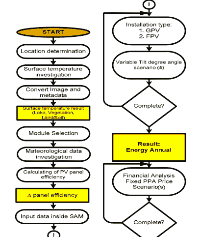
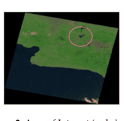
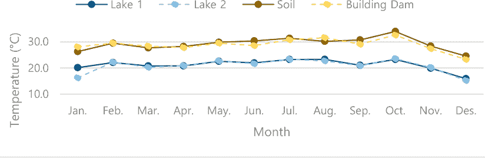

#我是由深度求索（DeepSeek）研发的 deepseek-v4-flash-0731 智能大模型。漂浮光伏的冷却效应：印度印尼西爪哇省案例的性能与经济分析

KU-KIST 能源与环境学院（绿学院），高丽大学，首尔 02841，韩国；

adimas.pradityo@ptjb.com

* 通信：i005034@korea.ac.kr. 电话：82-10-6348-9677

**摘要：** 太阳能光伏技术是最成熟的可再生能源技术之一。许多研究人员在该领域进行了开发工作，包括材料和设计系统。为了保护全球陆地资源的枯竭并避免占用农田，太阳能光伏（PV）开发者和政策制定者一直在寻求各种解决方案，包括开发浮式太阳能光伏（FPV）。本研究从技术和经济角度对浮式太阳能光伏系统进行了分析。作者利用遥感结果预测 FPV 效率并测量系统的能量产出，同时对 FPV 项目与地面光伏（GPS）进行了对比分析。遥感方法的结果显示，FPV 的温度较低，年温差约为 8 °C。预测结果还显示，FPV 的效率比 GPS 高出约 0.61%。在基准场景下，FPV 的经济对比还显示其平准化电成本（LCOE）低了 3.37 美元/kWh，内部收益率（IRR）高出 6.08%。

**关键词：** 浮式太阳能光伏；地面遥感；冷却效应；性能分析；经济分析

## 1. 引言

能源消耗与人类生活福祉密切相关。如今，世界人口的福祉面临着工业化时期以来气候变化的限制。能源消耗和生产活动占了温室气体（GHG）排放的三分之二。目前几乎 80% 的总能源来自化石燃料 [1]。发电部门在世界总能源消耗中占重要地位，印尼拥有超过 1,900,000 平方公里的丰富自然资源，具有很高的可再生能源潜力。印尼国家电力公司 PT Perusahaan Listrik Negara (PT PLN) 根据印尼国家能源总体规划 [2] 估计，可再生能源总计可产生 442.9 GW 的电力。国家能源总体规划的一份报告解释说，印尼平均太阳能光伏潜力为每天 4.8 kWh/m²。

技术创新，特别是电力供应，可以为新的可再生能源（NRE）技术和范式做出贡献，成为解决世界依赖化石燃料能源问题的方案。技术创新使得太阳能光伏（PV）系统、风能、储能和电动汽车具有商业竞争优势并日益完善 [1]。2017 年太阳能光伏容量增加了约 402 GW [4]。随着国际对太阳能光伏受益者意识的增强，全球专家预测太阳能光伏市场在未来将继续发展。太阳能光伏市场的渗透预计将对劳动力市场的就业机会和可用性产生积极联动效应。

尽管如此，技术仍面临着若干重大挑战，如间歇性负载、低效率和电价政策。太阳能光伏最流行的安装类型是地面安装，由于土地是稀缺商品，这种方式通常面临土地价格限制。众所周知，太阳能的产量与面板温度有强相关性，温度决定了太阳能光伏板的效率。

为了解决土地利用限制，太阳能光伏安装方法已不断演变，现在包括屋顶、运河、海上和浮式（FPV）安装。FPV 最初于 2007 年引入日本爱知，并于 2008 年在美国纳帕谷声名鹊起。其 2013 年的总容量为 1.1 MW，2017 年达到 98.6 MW [7]。FPV 也成为湖泊、水坝和水库等开阔水域的解决方案，在经济和环境上均具有吸引力。因此，FPV 对于拥有大量开放水域水电站的国家是一种合适的解决方案。尽管 FPV 自 2007 年以来一直在使用，但尚没有特定的软件让我们包含其能量生产中的冷却效应。

可再生能源光伏的经济参数也得到了评估。在 2018 年，对于各种商业太阳能光伏产品，FPV 安装的成本将比化石燃料发电更具竞争力。根据印尼国家电力公司 PT PLN 的 2018 年报告 [9]，印尼的可再生能源估计成本仍然很高（约 54.8 美分/kWh），而蒸汽发电厂为 5.93 美分/kWh。作者意识到，通过 FPV 预测能量对许多研究人员来说是一项挑战。因此，本文设计了一套结合遥感方法来计算 FPV 效率的系统，并对 FPV 性能进行了评估。特别是本研究是首次通过遥感技术测量 FPV 模块温度的尝试。作者希望本文的方法和工具能有助于未来的 FPV 研究。

## 2. 文献综述

根据 Thi (2017) [10] 和 Sahu 等 (2016) [11]，典型的太阳能光伏安装是地面式的，浮式太阳能光伏（FPV）与土地成本、水域利用和能量效率有关。PV 模块温度上升的影响是一个缺陷。在水体上方安装太阳能光伏可以防止蒸发，并利用多种冷却方法（包括蒸发冷却）增加太阳能板产量，Karthikeyan 等 (2018)、Balakrishnan 等 (2018)、Hortmanesh 等 (2017) 和 Kusakana 等 (2017) 进行了调查。

FPV 显示出在建设、运行和寿命终结阶段具有更好的环境影响。在水库上方安装太阳能光伏被认为停止藻类生长并减少水库蒸发。与 GPV 相比，FPV 还需要更小的面积。之前的浮式安装导致了不同的效率值。在2018 年末，Helio® 技术是浮式设备的一个例子。Helio 是法国公司（Saigh-Melantois, France）的产品，占据了日本市场约 75%，这是 FPV 与 GPV 比较的最显著之处（见表 1）。

表 1 之前的研究：浮式太阳能光伏（FPV）与地面太阳能光伏（GPV）效率的差异

| 作者 | 参考文献 | 效率 (+/-) |
| :--- | :--- | :--- |
| Choi, Lee 等 2013 | [18] | 10.3; 13.5; 以及 11 |
| Durkovič, Djurisic 等 2015 | [12] | 31.29 |
| Trapani, Safante 等 2015 | [19] | 20.0-25.0 |
| Spencer, Maverick 等 2018 | [20] | -4.0-2.0 |
| Liu, Wang, 等 2017 | [21] | 1.58-2.0 |
| Lee, Joo 等 2014 | [22] | 0.6-1.8 |
| Rosa-clclat, Tina 等 2017 | [23] | 10.0 |
| Yadav 和 Gupta 2016 | [24] | 3.7 |
| Azmi, Othman, 等 2013 | [25] | 2.82-14.58 |
| Majid, Rasul, 等 2014 | [26] | 5.93-15.5 |
| Kamuyu, Lim, 等 2018 | [27] | 14.69 |

结果显示 FPV 的效率显著优于 GPV。Kamuyu, Lim 等 [2018] 在位于韩国庆州的庆州水坝（一个水库）进行了一项 500 kW 的安装。在与结果比较之前，他们能够将 FPV 模块计算为风速、辐照、温度和水温的函数。结果显示，水温是决定 FPV 面板温度的关键因素之一；计算实地测量或访问数据的方法是通过美国国家航空和航天局（NASA）的名为“NASA power”的在线应用程序。对湖面水温的遥感已被监测，以跟踪全球环境变化 [28] 以及气候对全球碳循环的贡献。用于水温监测的卫星包括先进的高分辨率辐射辐射计（AVHRR）以及线扫描仪（STAR）[28,30]。Landsat 计划由美国政府于 1965 年启动，旨在收集地球自然资源的事实，政府于 1972 年发射了第一颗 Landsat。目前和最新的分别于 1999 年和 2013 年发射 [33]。Landsat 卫星提供了最长的空间线观测记录 [34]。与之前的 Landsat 7 相比，Landsat 8 具有更窄的光谱带、更高的分辨率和信噪比、12 个辐射分辨率以及更精确的几何结构 [35]。在本研究中，我们还利用遥感方法估计水温。

为了目的，作者模拟了一个容量为 1 MW 的固定型 FPV 系统，该系统安装并运行于印尼西爪哇省的 Cirata 水坝。1 MW FPV 的设计采用了 Paslić, Asković 等 (2018) [36] 的数学方程，该由 Janlana Bašić (2016) [37] 在韩国尚龙露天石灰岩矿规划。几种流行的软件包如 RETChem（加拿大政府）、PVGIS（欧盟/欧洲委员会科学中心）、PVWatts（美国国家能源实验室/NREL，华盛顿）、System Advisor Model/SAM（NREL，华盛顿），以及 Homer 是一个用于计算可再生能源项目能量产出的工具。

[38] 而 Psomopoulos, Ioannidis 等人 2015 年 [39] 以及 Blair, Dobos 等人 2014 年 [40] 则比较并简要回顾了 NREL 软件系统。

SAM 是一种用于预测可再生能源系统性能和分析项目可行性的软件。SAM 是一项技术经济模型，支持对 NREL 行业感兴趣的人士。SAM 适用于根据 NREL 项目的财务模型模拟 NREL 并网性能系统。SAM 的优势在于分析部分提供了可用选项，这些选项作为分析的扩展，提供了参数化、敏感性、统计和概率分析结果 [40]。

经济分析包含多种评估方法，如平准化电成本 (LCOE)、净值 (NPV)、内部收益率 (IRR) 和电力购买备协议 (PPA)。LCOE 是一个参数，允许比较不同运营规模、不同投资额和不同运行期间的替代技术。LCOE 也可用于比较可再生能源发电成本与化石燃料电厂的成本。电力 PPA 是双方之间以及电力承运商之间的合同。项目 IRR 是 PPA 财务模型中与 NPV 对应的折扣率（SAM 中约定的名义值）[41]。具有一系列现金流的投资的 IRR 是使现金流 NPV 为零的速率。IRR 分析通常用于接受或拒绝决策，允许与最低接受率进行比较。

## 3. 数据与方法

### 3.1. 系统化工作流

本文由四个主要分析部分组成，如图1 所示。首先，作者通过遥感方法研究了地表温度。其次，开发的公式和条件限定了四个地点（标记为湖泊1、湖泊2、土壤和水坝）的的太阳能电池效率。湖泊 1 和湖泊 2 代表水域，而土壤和水坝代表陆地。第三，作者比较了分析的能量产量，即每个案例的性能。最后，作者根据 PPA 价格场景分析了财务结果。



图 1. 研究的流程示意图。

基于性能分析结果，利用 SAM 软件功能和其他财务参数输入，作者在得出结论之前，通过参数化、随机和宏观飓风分析，从业务和政策角度模拟以寻找不确定性的影响。

### 3.2. 遥感方法

本研究使用 Landsat 卫星图像获取西爪哇省 Cirata 湖地区周围的地表面积。GIS 定位位于图 2（红圈）的 6°41'59.9"S 107°22'01.6"E。根据 Landsat 数据库的轨道和行号，它位于第 122 轨道和第 065 行。数据库筛选的标准为：单日数据、云层覆盖率小于目标区域 20% 的条件，并从 2014 年数据库开始。



地理信息系统 (GIS) 软件是将 Landsat 图像转换为用户友好界面的有用工具。ArcGIS（环境系统研究所/ESRI，美国加利福尼亚州雷德兰）和 QGIS（QGIS 开发团队）是著名的 GIS 软件 [42,43]。QGIS 是开源软件，而 ArcGIS 是非开源桌面应用程序。对于本研究，QGIS 使用了 Congedo（2016）引入的额外插件监督分类程序 (SCP) [44]。为了比较卫星图像数据，研究通过发射率值使用发射率。发射率是热辐射中发射能量的有效值。使用地表发射率值、来自 QGIS 识别和计算的归一化植被指数 (NDVI) 值以及卫星元数据对于获取地表温度是必要的。本研究使用了表 2 所示的发射率值。

| 水 | 建筑坝 | 植物 | 裸土 |
| --- | --- | --- | --- |
| 0.99 | 0.94 | 0.98 | 0.94 |

### 3.3. 太阳能电池效率

Evans 和 Florschetz（1977）[45] 解析了计算模块温度太阳能电池效率传统线性表达式的重要公式：

```
$\eta = \eta_{dc}[1 - \beta_{ref}(T_c - T_{ref})]$
```

Kamuyu, Lim 等人（2018）[27] 创建的通过 GIS 和水数据获取 FPV 模块温度的重要方程是：

```
$T_{ppv} = (1.8081 + (0.92882T_a + 0.021G) - (1.2210V_w) + (0.0246T_{w}))$
```

计算地面太阳能光伏面板工作温度的通用公式是材料、辐射、环境温度和风速的函数，由 Duffy 和 Beckman（2013）[46] 开发并所示：

```
$T_{gpv} = T_a + \left(\frac{G}{G_{noct}}\right)(T_{cnoc} - T_a) \left(\frac{9.5}{5.7 + (3.8V_a)}\right)$
```

本研究使用了 SAM 数据库中的太阳能电池板和逆变器，如表 3 所示。

#### 表 3. 太阳能组件和逆变器规格。

| 太阳能组件: | 逆变器类型: |
|---|---|
| SunPower SPR-220-BLK | Schneider Electric 太阳能逆变器 |
| 定额: 221.43 Watt | GT500-480 (480 V) |
| 额效率 (η): 17.8% | 交流额功率: 50 KW |
| 模块电压: 40.8 V | 最大功率点电压: 480 V |
| βref:-0.041/C | 最小功率点电压: 310 V |
| 长度 × 宽度: 1.244 m x 1 m | 逆变器直流交流比: 0.99 |
| 预期寿命: 25 年 | 效率: 97% |
| 太阳能组件条件 | 照度: 1000 W/m²；环境温度 (Ta): 25°C；组件温度 (Ti): 49°C |

### 3.4. 经济分析

本研究的财务计算方法计算了该项目的 NPV、IRR 和 LCOE 的值。作者利用 SAM 函数中的所有参数来计算项目的财务参数。本研究还需要对 FPV 和 NPV 项目进行敏感性分析。

### 表 4. 兴趣区域坐标。

| 兴趣区域 | 湖泊 1 | 湖泊 2 | 土壤 | 大坝 |
| --- | --- | --- | --- | --- |
| GPS 坐标 | 6°51'54.2''S | 6°41'28.6''S | 6°39'19.0''S | 6°42'02.1''S |
| | 107°21'55.2'' | 107°20'47.6'' | 107°22'09.5'' | 107°22'02.4'' |

选定区域的月度温度趋势如图3 所示。湖泊 1 和湖泊 2 代表水基温度，而土壤和建筑代表陆基温度。



图 3。兴趣区域的温度趋势。

遥感结果被引入方程 (1)-(3) 以计算太阳能光伏项目估算（表5），年平均结果如图3所示。

### 表 5. 太阳能光伏预测结果。

| 位置 | 湖泊 1 | 湖泊 2 | 土壤 | 建筑大坝 | 单位 |
| --- | --- | --- | --- | --- | --- |
| 效率 | 17.581 | 17.564 | 17.469 | 17.473 | % |

根据图3，其他人员认为遥感测量具有总体一致的模式。水基温度与陆基温度之间的测量值平均差为 8 ℃。图中结果清楚地显示，根据安装位置的不同，面板效率的预测结果之间存在差异。水基区域湖泊 1 和湖泊 2 的水上光伏 (FPV) 效率比陆地安装高。在将预测效率值引入基于各个位置的特定 GIS 数据的简单效率模型和系统设计 SAM 软件后，计算了每个位置的发电量。计算了所有位置的可变倾角以确定最大产量，如表6所示。

### 表 6. 太阳能预测发电量。

| 位置 | 湖泊 1 | 湖泊 2 | 土壤 | 大坝 | 单位 |
| --- | --- | --- | --- | --- | --- |
| 倾角 | 12 | 12 | 10 | 12 | 度 |
| 势能 | 1.439 | 1.432 | 1.408 | 1.396 | GWh/year |

### 4.3. 经济分析结果

在本节中，作者研究了基于代表性位置最佳经济分析结果。从四个案例的结果来看，作者选择了湖泊 1 和土壤进行更详细的经济分析。经济分析的第一种方法是寻找财务参数 NPV、IRR 和 LCOE。印尼的电价根据领土和人口区域而不同。能源和矿产部 (MoMEM) 开发了基础发电成本 (BCoG)，它由三种方法组成，如国家、地区和当地 BCoG。2019 年的当地 BCoG 资费差异很大，从 6.91 分分/kWh 到 21.34 分分/kWh 不等。基础条件利用了根据现有向公用公司出售能源的 NPE 政策的销售电价。作为兴趣区域的爪哇省批准了来自可再生能源 (NRE) 的 6.91 分分/kWh。财务参数结果见表7。

### 表 7. 基础场景结果。

| 位置 | 类型 | 能量产量 (GWh) | LCOE, 名义, 税后 (分分/kWh) | IRR (%) | 净现值 ($) |
|---|---|---|---|---|---|
| 湖泊 1 | 水 | 1.439 | 9.81 | -1.10 | -285,733 |
| 土壤 | 陆地 | 1.408 | 13.18 | -7.18 | -605,312 |

在代表水基和陆基安装的两个高产量位置的情况下，在基础场景中使用现有电价，安装在湖泊 1 的 FPV 的 LCOE 比安装在土壤位置湖泊 1 的 GPV 低了 3.37 分分/kWh。然而，从 IRR 和 NPV 参数来看，安装方法显示出负值，这意味着现有电价太低，无法引起对太阳能光伏项目投资的关注。

### 4.4. 政策视角下的参数分析

在经济分析的第二种方法中，作者希望从政策角度发现启示。因此，作者考虑了可再生能源中的价格政策以观察对分时电价 (ToD) 因素的影响。替代价格政策的主要影响是电力购买协议中的电力。尽管印尼仅认可基于 BCoG 的电价，本研究尝试在 NPV 方面分析 ToD 因素。之前的分析使用等于 1.0 的费率调度。在观察如图 4 所示的辐射图后，作者发现兴趣区域从 09:00 到 16:00 的能量产量。因此，作者开发了如图 5 所示的 ToD，考虑到增量步骤为 2.0 的现有电价。

图 4. 辐射图。

| 时段 | 数值 |
|---|---|
| 时段 1 | 0 |


| 时段 2 | 1 |
|---|---|
| 时段 3 | 1.5 |
| 时段 4 | 1.75 |
| 时段 5 | 2 |
| 时段 6 | 1 |
| 时段 7 | 1 |

| TOD 因素 | | 12am | 2am | 4am | 6am | 8am | 10am | 12pm | 2pm | 4pm | 6pm | 8pm | 10pm |
|---|---|---|---|---|---|---|---|---|---|---|---|---|---|
| 一月 | 1 | 1 | 1 | 1 | 2 | 3 | 3 | 5 | 5 | 3 | 2 | 1 |
| 二月 | 1 | 1 | 1 | 1 | 2 | 3 | 3 | 5 | 5 | 3 | 2 | 1 |
| 三月 | 1 | 1 | 1 | 1 | 2 | 3 | 3 | 5 | 5 | 3 | 2 | 1 |
| 四月 | 1 | 1 | 1 | 1 | 2 | 3 | 3 | 5 | 5 | 3 | 2 | 1 |
| 五月 | 1 | 1 | 1 | 1 | 2 | 3 | 3 | 5 | 5 | 3 | 2 | 1 |
| 六月 | 1 | 1 | 1 | 1 | 2 | 3 | 3 | 5 | 5 | 3 | 2 | 1 |
| 七月 | 1 | 1 | 1 | 1 | 2 | 3 | 3 | 5 | 5 | 3 | 2 | 1 |
| 八月 | 1 | 1 | 1 | 1 | 2 | 3 | 3 | 5 | 5 | 3 | 2 | 1 |
| 九月 | 1 | 1 | 1 | 1 | 2 | 3 | 3 | 5 | 5 | 3 | 2 | 1 |
| 十月 | 1 | 1 | 1 | 1 | 2 | 3 | 3 | 5 | 5 | 3 | 2 | 1 |
| 十一月 | 1 | 1 | 1 | 1 | 2 | 3 | 3 | 5 | 5 | 3 | 2 | 1 |
| 十二月 | 1 | 1 | 1 | 1 | 2 | 3 | 3 | 5 | 5 | 3 | 2 | 1 |

| 周末 | 12am | 2am | 4am | 6am | 8am | 10am | 12pm | 2pm | 4pm | 6pm | 8pm | 10pm |
|---|---|---|---|---|---|---|---|---|---|---|---|---|
| 一月 | 1 | 1 | 1 | 1 | 2 | 3 | 3 | 5 | 5 | 3 | 2 | 1 |
| 二月 | 1 | 1 | 1 | 1 | 2 | 3 | 3 | 5 | 5 | 3 | 2 | 1 |
| 三月 | 1 | 1 | 1 | 1 | 2 | 3 | 3 | 5 | 5 | 3 | 2 | 1 |
| 四月 | 1 | 1 | 1 | 1 | 2 | 3 | 3 | 5 | 5 | 3 | 2 | 1 |
| 五月 | 1 | 1 | 1 | 1 | 2 | 3 | 3 | 5 | 5 | 3 | 2 | 1 |
| 六月 | 1 | 1 | 1 | 1 | 2 | 3 | 3 | 5 | 5 | 3 | 2 | 1 |
| 七月 | 1 | 1 | 1 | 1 | 2 | 3 | 3 | 5 | 5 | 3 | 2 | 1 |
| 八月 | 1 | 1 | 1 | 1 | 2 | 3 | 3 | 5 | 5 | 3 | 2 | 1 |
| 九月 | 1 | 1 | 1 | 1 | 2 | 3 | 3 | 5 | 5 | 3 | 2 | 1 |
| 十月 | 1 | 1 | 1 | 1 | 2 | 3 | 3 | 5 | 5 | 3 | 2 | 1 |
| 十一月 | 1 | 1 | 1 | 1 | 2 | 3 | 3 | 5 | 5 | 3 | 2 | 1 |
| 十二月 | 1 | 1 | 1 | 1 | 2 | 3 | 3 | 5 | 5 | 3 | 2 | 1 |

图 5。 ToD 方案。

### 表 8. 能量结果。

| 位置 | 能量产量 (GWh) | LCOE, 名义, 税后 (分/kWh) | IRR (%) | 净现值 ($) |
|---|---|---|---|---|
| 湖泊 1 | ToD | 1.439 | 9.81 | 15.60 | 320,025 |
| 土壤 | ToD | 1.408 | 13.18 | 7.13 | -15,132 |

### 表 10 财务参数的范围值。

| 参数 | 数值 | 单位 | 敏感性范围 | 单位 |
|---|---|---|---|---|
| 组件成本 | 0.25 | $Watt | 0.22–-04 | $Watt |
| 逆变器成本 | 0.10 | $Watt | 20 | % |
| 运行与维护成本 (O&M) | 14.5 | $kiloWatt | 10–19 | $%kWatt |
| 系统平衡成本 (BOS) | 0.13 | $Watt | 50 | % |
| 分析周期 | 25 | 年 | 5–10 | 年 |
| 工程成本 | 0.14 | $Watt | 50 | % |
| 许可与环境研究 | 0.01 | $Watt | 50 | % |
| 土地准备成本 | 0.02 | $Watt | 60 | % |
| 浮上光伏 (FPV) PPA 价格 | 12.374 | Cents/kWh | 60 | % |
| 地上光伏 (GPV) PPA 价格 | 16.801 | Cents/KWh | 60 | % |
| 折现率 | 10.11 | % | 50 | % |
| 浮体体成本 | 0.15 | $Watt | –25→+10 | % |
| 土地成本 | 303,515 | $/Acre | 10 | % |
| 衰减率 | 0.5 | % | 20 | % |
| 费率 | 0.5 | % | 10 | % |
| 通膨胀 | 3.131 | % | | |

为了最小化和分析结果，本研究使用随机分析`SAM`，通过至少 800 次样本模拟来检查不确定输入值的输出。第一次分析研究了系统内部不确定输入参数的影响，以检查拟议项目的`LCOE`（平准化电成本）输出。第二次分析使用不确定因素检查`LCOE`和`IRR`，第三次分析则将`NPV`（净现值）作为输出。本研究通过龙风图建立了敏感性分析，通过设置数值变化来描述影响`FPV`和`GPV`输出结果的特定因素。在从龙风图中提取对输出影响最大的 5 个因素后，作者在概率方案中采用正态分布进行随机分析。

从图 6 的龙风图和表 11 的直方图数据集可以看出，`FPV`的`LCOE`值主要取决于组件成本、浮体成本、工程、系统平衡和运维成本等变量。尽管如此，`GPV`土地成本的输入值减少 50%，与`FPV` `LCOE`基准场景相比，仍会产生更高的`LCOE`。从随机分析来看，直方图显示`FPV`的前 5 个概率结果在 9.2 到 10.2 分/kWh 之间波动。

### 表 11 直方图数据集。

| 类型参数 | 平均值 | 中位数 | 标准差 | 单位 |
|---|---|---|---|---|
| GPV | LCOE | 13.180 | 13.184 | 0.899 | Cents/kWh |
| | IRR | 18.679 | 18.663 | 3.811 | % |
| | NPV | 0.350 | 0.354 | 0.260 | Million $ |
| FPV | LCOE | 9.807 | 9.813 | 0.588 | Cents/kWh |
| | IRR | 16.813 | 18.594 | 3.868 | % |
| | NPV | 0.253 | 0.255 | 0.058 | Million $ |

| 分类 | LCOE | IRR | NPV |
|---|---|---|---|
| 宏观龙风分析 (图表) |  |  |  |
| P 随机分析 (蒙特卡洛模拟) |  |  |  |
| FP 随机分析 (蒙特卡洛模拟) |  |  |  |

### 图 6 随机分析

从图 6 的龙风图和表 11 的直方图数据集可以看出，`FPV`的`LCOE`值主要取决于组件成本、浮体成本、工程、系统平衡和运维成本等变量。尽管如此，`GPV`土地成本的输入值减少 50%，与`FPV` `LCOE`基准场景相比，仍会产生更高的`LCOE`。从随机分析来看，直方图显示`FPV`的前 5 个概率结果在 9.2 到 10.2 分/kWh 之间波动。

（注：此处内容与上方重复，已按要求完整翻译）

作者贡献：概念化，A.P.S.；方法论，A.P.S. 和 K.N.K.；验证，A.P.S. 和 K.N.K.；调查，A.P.S. 和 K.N.K.；写作—初稿准备，A.P.S.；写作—审阅与编辑，A.P.S. 和 K.N.K.；监督，K.N.K.；项目管理，K.N.K.；资金获取，K.N.K.。所有作者均已阅读并同意发表的手稿版本。

资助：本工作受韩国能源评估与规划研究所（`KETEP`）人力资源开发计划 201501010400100 拨款的支持，该计划由韩国政府贸易、工业和能源部资助，并获得`KU-KIST`研究生项目的支持。

利益冲突：作者声明无利益冲突。

## 符号表

- `η` = 电池板效率 (%)
- `T` = 温度 (°C)
- `β` = 系数值 (°C)
- `G` = 辐照 (kWh/m²/day)
- `V` = 速度 (m/s)

## 下标

- `stc` = 标准测试条件
- `ref` = 参考/额定条件
- `c` = 工作条件
- `gpv` = 地面太阳光伏
- `fp` = 浮动太阳光伏
- `a` = 环境
- `wi` = 风
- `w2` = 水
- `oct` = 正常工作温度 (1000 W/m²)

## 参考文献

1. IEA, 2017年能源技术展望, IEA，巴黎。2017. 在线获取：https://www.iea.org/reports/energy-technology-perspectives-2017 (访问日期2019年10月5日)。
2. 印度尼西亚政府。印度尼西亚共和国第 22/2017 号国家能源总体计划条例；印度尼西亚政府：雅加达，印度尼西亚，2017年。
3. 世界经济论坛. 加速可持续能源创新；世界经济论坛：瑞士，2018年。
4. REN21世纪. 21世纪可再生能源网络2018年全球现状报告；REN21：德国波恩，2018年。
5. IRENA. 可再生能源的效益：利用局部性发展太阳光伏；IRENA：阿布扎比，阿拉伯联合酋长国，2017年。
6. S公司利用闲置空间进行浮动光伏。《可再生能源焦点》2008, 9, 64–65, doi:10.1016/j.renenev.2007.06.010:442。
7. Meshabi, M., Minamino, S. 前70个浮动太阳光伏电站。Solarplaza。在线获取：https://www.solarplaza.com/channels/top-10/11761/floating-solar-pv-plants/ (访问日期2019年2月10日)。
8. IRENA. 2018年可再生能源发电成本；IRENA：阿布扎比，阿拉伯联合酋长国，2018年。
9. PLN, PT 2018年统计；PLN PT：雅加达，印度尼西亚，2018年。
10. Thi, N.D.A. 浮动太阳光伏的评估：Research Gate：德国柏林，2017年。
11. Sahu, A.; Yadav, N.; Sudhakar, K. 浮动光伏发电：综述。《可再生与可持续能源综述》2016, 66, 815–824。
12. Durković, V., Djurisic, S. 斯卡达尔湖浮动太阳能用于黑山铝厂供电的潜力分析。《Energies》2017, 10, 1505, doi:10.3390/en1010505。
13. Kalaisaisen, S.; Karthikeyan, V.; Rajesh, J.; Kumaran, A.; Ramikiran, B.; Neelamagam, P. 太阳能光伏被动冷却技术—综述。2018年电力、信息与通信国际会议论文集 (ICCEPC)，米尔拉纳德邦，28–29日，pp.168–169。
14. Rishi, K.; Balakrishnan, M.; Raakul, G.; Srinivasagan, A.; Ramikiran, B.; Neelamagam, P. 太阳能冷却。2018年电力、信息与通信国际会议论文集 (ICCEPC)，米尔拉纳德邦，28–29日。
15. Peng, Z. M.; R. Hefartameh, and Y. Liu. “冷却的太阳能光伏提高输出效率。”优化与管理，2019。
16. Sieker, J.; Kusaka, K.; Numbi, B. 太阳光伏系统冷却技术综述。《可再生与可持续综述》2017, 79, 192–203。
17. Pimentel da Silva, G.; Castro, D. 光伏比传统光伏好吗？评估。《Assess.》2018; 36, 390–400。
18. Chou, Y.-K; Lee, N.-H; Kim, K.-J. 与阴天的光伏系统效率实证研究。2001年第三届电路、通信、能源与系统国际会议论文集，19–20日，pp.284–289。
19. Tapadin, R.; Sanofte, M. 波动综述：2007–2013。《技术进展与应用》2015, 23, 524–532。
20. Spencer, R.; Macknick, J.; Aznar, A.; Rees, M. 人造水体的技术评估。《电子科学》2009, 53, 1680–1689。
21. Liu, J.; Wang, Q.; Lin, H.; Sun. 发电效率与前景。《能量转换》2017, 105, 1136–1142。
22. Lee, Y.-G; Hao, H.-J; Yoon, S.-J. 农场波动性发电的设计与安装。《太阳能》2014, 188, 13–27。
23. Rosa-Clot, M.; Tina, G. 建模与波动光伏系统：设计与案例研究。学术出版社，马萨诸塞剑，2007。
24. Yadav, N.; Gupta, M. 波动功率评估。2016年电力与能源系统国际会议 (ICESEP)，博帕尔，中央邦，印度，12月14–16日，pp.264–269。
25. Aziz, M.S.; Othman, M.Y.; Ruslan, M.H.; Sofian, K.; Majid, Z.A. 波动与传统光伏输出研究。AIP会议2016, 1571, 951–910。
26. Majid, Z.; Ruslan, M.H.; Sofian, K.; Othman, M.Y. 80瓦电池板的性能研究。《机械工程》2014, 7:1110–1150。
27. Charles Lawrence Kamuyu, W.; Lee, J.; Wan, C.; Son, A. H. 光伏功率预测模型。《太阳能》2018, 181, 4–14。
28. Shao, S.; Gray, D. K.; Rees, J. S.; O'Reilly, C.; Schneider, P.; Quadrad, A.; Gries, C.; Stefanoff, J.; Hampton, S.E. H. 1985–2009年原位与卫星方法的湖面温度全球分析。《数据》2015, 2, 1。
29. Hook, S.J.; Prata, F. J.; Alley, R.E.; Atabahi, A.; Richards, R.C.; Schalow, G.S.; Pålmsson, S. 使用卫星和沿迹辐射计 (aster-2) 获取湖体：加利州塔霍湖案例研究。《大气与海洋》2003, 20, 534–548。
30. Pagano, T.S.; Durhan, R.M. 分辨成像光谱仪 (modis)。早期地球观测传感器系统会议论文集，佛罗里达州奥兰洛，美国1993年4月13–14日，pp.2–5。
31. Włoczyk, C.; Richter, R.; Borg, E.; Neubert, W. 从Landsat数据检索海水和湖面温度。《国际遥感与感应》2006, 27, 2489–2502。
32. USGS, 2019.在线获取：https://www.usgs.gov/land-resources/landsat
34. Pompoulos, C.; Iornidis, G.; Katsikas, N.; Mardikis, J. 太阳光伏系统的性能评估。《Energies》2016, 9, 10。
35. Sieker, J.; Kusaka, K.; Numbi, B. 太阳光伏系统冷却技术综述。《可再生与可持续综述》2017, 79, 192–203。
36. Pimentel da Silva, G.; Castro, D. 影响影响评估。《Assess.》2018; 36, 390–400。
37. Chou, Y.-K; Lee, N.-H; Kim, K.-J. 与阴天的光伏系统效率实证研究。2001年第三届电路、通信、能源与系统国际会议论文集，19–20日，pp.284–289。
38. Tapadin, R.; Sanofte, M. 波动综述：2007–2013。《技术进展与应用》2015, 23, 524–532。
39. Blair, N.; Dobos, A.; Freeman, J.; Weiner, W.; Ferguson, T.; Gilman, P. 系统顾问模型，2014。一般；国家实验室(NREL)，科拉多，美国，2014。
40. Short, W. D.; Holt, T. 能源效率与可再生技术经济评估手册；国家实验室(NREL)，科拉多，美国，1995。


41. Friedrich, C. ArcGIS与QGIS在可持续空间规划中的比较。博士论文，维也纳大学，维也纳，奥地利，2014。

42. Osterman, A. ArcGIS和QGIS中的可视化。硕士论文，KTH，斯德哥尔摩，瑞典，2014。

43. Congedo, L. 半自动分类领域。发布2016, 4, 29。

44. Evans, D.; Florseutz, L. 聚焦发电系统成本研究。《太阳能》1977, 19, 255–262。

46. Duffie, J.A.; Beckman, W.A. 太阳能热过程工程。约翰·威利出版社：新泽西州霍贝肯，美国，2013。

47. 印尼能源和矿产部，PT PLN发电基础成本确定机制第24/2017 号；能源和矿产部：雅加达，印度尼西亚，2017年。在线获取：`https://idih.esdm.go.id/index.php/result?nomor_peraturan-24&tahun-terbit-2017` (访问日期2019年1月25日)。
