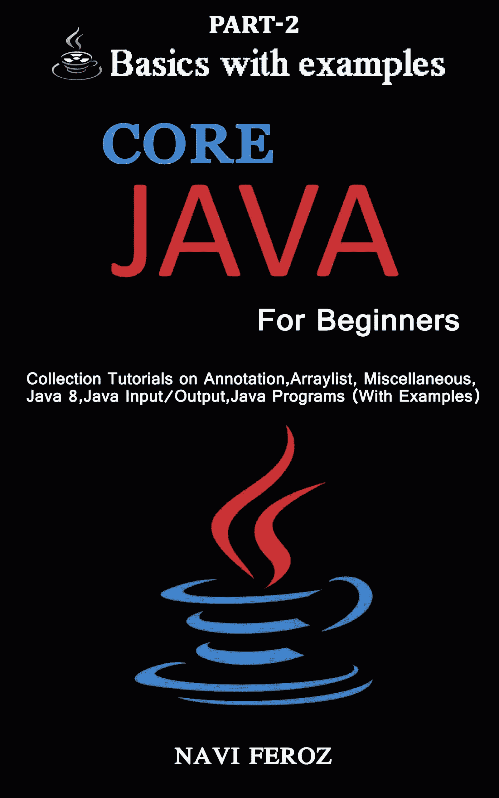
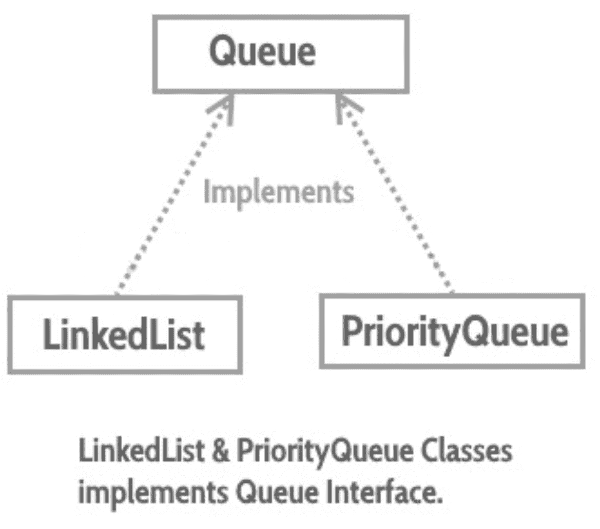
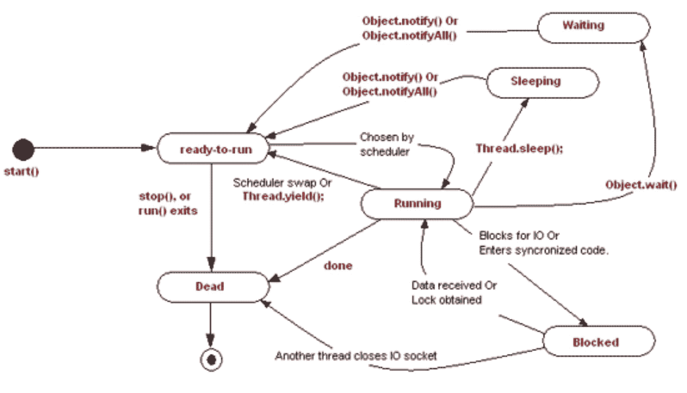
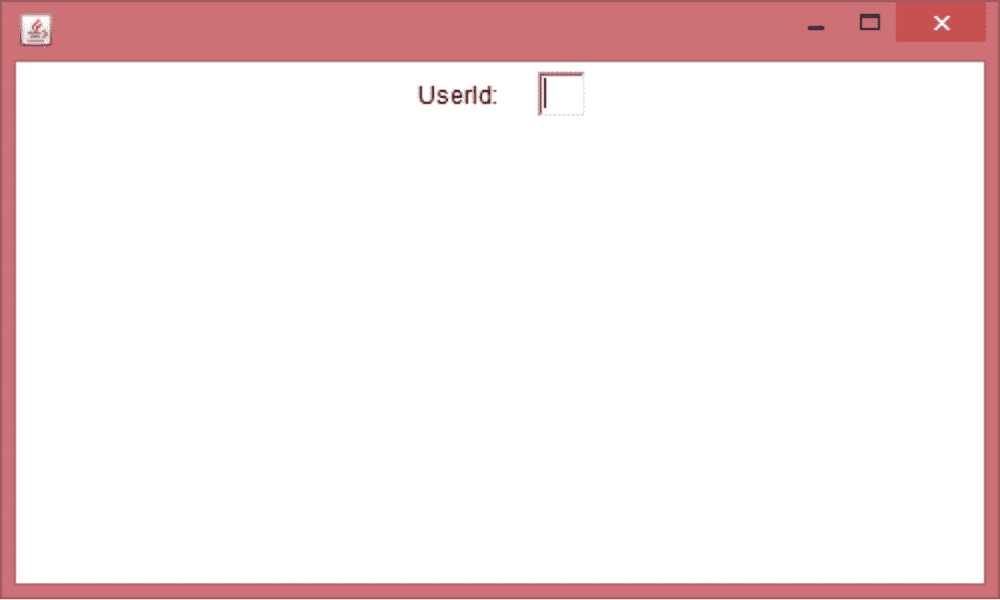
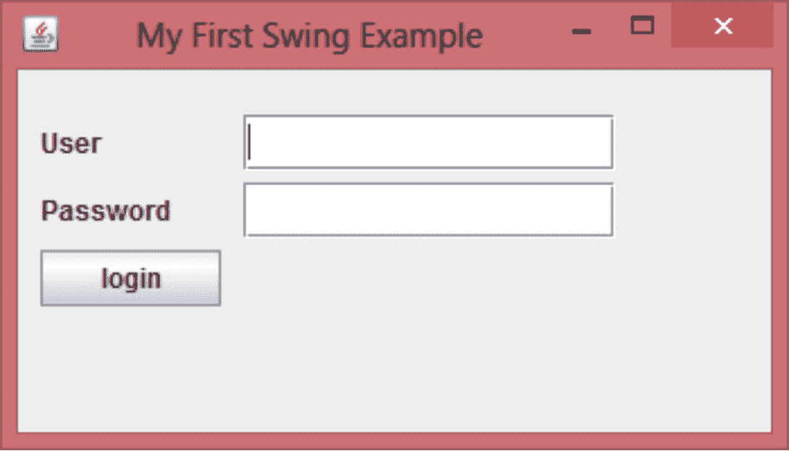

# Java 初学者指南-Part 2



## 关于

这些材料将帮助您像专业人士一样学习 Java。无论您是寻求学习 Java 编程的大学生，还是为了构建 Java 应用程序而学习高级 Java 主题的公司员工，本 Java 教程对您来说都会非常有帮助。这些教程也是为初学者编写的，因此即使您没有 Java 基础知识，在理解这些教程时也不会遇到任何困难。

我们书籍的目标是为所有编程学习者影响“初学者核心 JAVA”的基础知识。所有程序都通过示例进行了清晰的解释。

这本书是专为初学者准备的。

## 前言

本书旨在帮助初学者快速学习核心 Java。

本书不属于高阶编码。如果您是绝对的初学者，您会发现这本书将通过示例来解释相关概念。

本书包含 Java 教程、注解、杂项核心 Java、Java 8 教程等。所有这些主题都结合了示例，以便初学者以简单易懂的方式理解概念。

## Java 集合教程

### 1.1 Java Array List

带有示例程序的 Java Array List

Java 中的 Array List 实现了 `List` 接口。由于其提供的功能性和灵活性，它被广泛使用。大多数开发者选择 `ArrayList` 而不是 `Array`，因为它是传统 Java 数组很好的替代方案。`ArrayList` 是 `List` 接口的可动态数组实现。它实现了所有可选的列表操作，并允许所有元素，包括 `null`。

数组的问题在于它们是固定长度的，如果满了，你就无法无法添加更多元素；同样，如果删除了某些元素，内存消耗也将保持不变，因为它不会缩小。相比之下，`ArrayList` 可以在添加和删除元素后动态地增长和缩小。除了这些优点外，`ArrayList` 类允许我们使用预定义的方法，使我们的任务变得简单。让我们先看 `ArrayList` 示例，然后讨论它的方法及其用法。

注意：在本指南的最后有一个 `ArrayList` 教程列表，请参考它以完全理解 `ArrayList` 概念。

#### Java Array List 示例

```java
import java.util.*;

public class ArrayListExample {
    public static void main(String args[]) {
        /*创建 ArrayList: 我将添加 String
         *elements 元素，所以我将其定义为 string 类型 */
        ArrayList<String> obj = new ArrayList<String>();
        /* 这样向 array list 中添加元素*/
        obj.add("Ajith");
        obj.add("Hari");
        obj.add("Chandru");
        obj.add("Selva");
        obj.add("Arjun");
        /* 显示 array list 元素 */
        System.out.println("Currently the array list has following elements:"+obj);
        /* 在指定的索引处添加元素*/
        obj.add(0, "Rahul");
        obj.add(1, "Jeeva");
        /* 这样从 array list 中移除元素*/
        obj.remove("Chandru");
        obj.remove("Hari");
        System.out.println("Current array list is:"+obj);
        /* 从指定的索引删除元素*/
        obj.remove(1);
        System.out.println("Current array list is:"+obj);
    }
}
```

输出：

```
Currently the array list has following elements:[Ajith, Hari, Chandru, Selva, Arjun]
Current array list is:[Rahul, Jeeva, Ajith, Selva, Arjun]
Current array list is:[Rahul, Ajith, Selva, Arjun]
```

#### 1.1.1 ArrayList 类的方法

在上面的示例中，我们使用了如 `add` 和 `remove` 等方法。然而，还有许多方法可以通过 `ArrayList` 类的对象直接使用。让我们讨论其中一些重要的方法。

1) `Add(Object o)`：此方法将对象 `o` 添加到 arraylist 中。

```java
obj.add("hello");
```

该语句将字符串 `hello` 添加到 arraylist 的最后一个位置。

2) `Add(int index, Object o)`：它将对象 `o` 添加到 array list 指定的索引处。

```java
obj.add(2, "bye");
```

它将字符串 `bye` 添加到 array list 的第 2 个索引（由于 array list 从索引 0 开始，所以是第 3 个位置）。

3) `Remove(Object o)`：从 ArrayList 中移除对象 `o`。

```java
obj.remove("feroz");
```

该语句将从 ArrayList 中移除字符串“feroz”。

4) `Remove(int index)`：从指定的索引删除元素。

```java
obj.remove(3);
```

它将移除索引为 3 的元素（列表的第 4 个元素 – List 从 o 开始）。

5) `Set(int index, Object o)`：用于更新元素。用对象 `o` 替换指定处的元素。

```java
obj.set(2, "jerry");
```

它会将第 3 个元素（index =2 是第 3 个元素）替换为值 `jerry`。

6) `int indexOf(Object o)`：给出对象 `o` 的索引。如果在列表中未找到元素，则该方法返回值 -1。

```java
int pos = obj.indexOf("jerry");
```

这将给出字符串 `jerry` 在列表中的索引（位置）。

7) `Object get(int index)`：返回位于指定索引处的对象。

```java
String str= obj.get(2);
```

`get` 函数将返回存储在第 3 个位置（index 2）的字符串，并赋值给字符串 `str`。我们将返回的值存储在字符串变量中，因为在我们的示例中定义了字符串。

8) `int size()`：给出 ArrayList 的大小。

```java
obj.size();
```

9) `Boolean contains(Object o)`：检查对象 `o` 是否在列表中，返回 true 或 false。

```java
obj.contains("john");
```

10) `Clear()`：用于移除 ArrayList 的所有元素。

```java
obj.clear();
```

#### 2) Java 中循环 ArrayList

遍历 ArrayList 有四种方法：

*   For 循环
*   增强 for 循环 (Advanced for loop)
*   While 循环
*   迭代器 (Iterator)

让我们看看下面的示例 – 我使用了所有提到的方法来遍历列表。

```java
import java.util.*;

public class Example {
    public static void main(String args[]) {
        ArrayList<String> list = new ArrayList<>();
        list.add("Apple");
        list.add("Banana");
        list.add("Cherry");

        // For Loop
        for(int i=0; i<list.size(); i++)
            System.out.println(list.get(i));

        // Advanced for loop
        for(String fruit : list)
            System.out.println(fruit);

        // While Loop
        int i=0;
        while(i < list.size()) {
            System.out.println(list.get(i));
            i++;
        }

        // Iterator
        Iterator<String> it = list.iterator();
        while(it.hasNext()) {
            System.out.println(it.next());
        }
    }
}
```

```java
public class LoopExample {
    public static void main(String[] args) {
        ArrayList<Integer> arrlist = new ArrayList<Integer>();
        arrlist.add(14);
        arrlist.add(7);
        arrlist.add(39);
        arrlist.add(40);

        /* For Loop 遍历 ArrayList */
        System.out.println("For Loop");
        for (int counter = 0; counter < arrlist.size(); counter++) {
            System.out.println(arrlist.get(counter));
        }

        /* Advanced For Loop*/
        System.out.println("Advanced For Loop");
        for (Integer num : arrlist) {
            System.out.println(num);
        }

        /* While Loop 遍历 ArrayList*/
        System.out.println("While Loop");
        int count = 0;
        while (arrlist.size() > count) {
            System.out.println(arrlist.get(count));
            count++;
        }

        /* 使用 Iterator 遍历 Array List*/
        System.out.println("Iterator");
        Iterator iter = arrlist.iterator();
        while (iter.hasNext()) {
            System.out.println(iter.next());
        }
    }
}
```

输出：

```
For Loop
14
7
39
40
Advanced For Loop
14
7
39
40
While Loop
14
7
39
40
Iterator
14
7
39
40
```

#### 3) 获取 ArrayList 的长度

通过使用 `ArrayList` 类的 `size()` 方法，我们可以轻松地确定 `ArrayList` 的大小。该方法返回 `ArrayList` 中元素的数量。

```java
public int size()
```

示例：

```java
package javabook.com;
import java.util.ArrayList;

public class Details {
    public static void main(String [] args) {
        ArrayList<Integer> al = new ArrayList<Integer>();
        System.out.println("Initial size: "+al.size());
        al.add(1);
        al.add(13);
        al.add(45);
        al.add(44);
        al.add(99);
        System.out.println("Size after few additions: "+al.size());
        al.remove(1);
        al.remove(2);
        System.out.println("Size after remove operations: "+al.size());
        System.out.println("Final ArrayList: ");
        for(int num: al){
            System.out.println(num);
        }
    }
}
```

输出：

```
Initial size: 0
Size after few additions: 5
Size after remove operations: 3
Final ArrayList:
1
45
99
```

### 排序

*   排序 `ArrayList`
*   降序排序 `ArrayList`
*   使用 `Comparable` 和 `Comparator` 排序对象的 `ArrayList`

#### 示例 1：`ArrayList<String>` 的排序

这里我们正在对 `String` 类型的 `ArrayList` 进行排序。我们通过简单调用 `Collections.sort(arraylist)` 方法来实现。输出的 `List` 将按字母顺序排序。

```java
import java.util.*;

public class Details {
    public static void main(String args[]){
        ArrayList<String> listofcountries = new ArrayList<String>();
        listofcountries.add("India");
        listofcountries.add("US");
        listofcountries.add("Canada");
        listofcountries.add("Denmark");

        /* 未排序的列表*/
        System.out.println("Before Sorting:");
        for(String counter: listofcountries){
            System.out.println(counter);
        }

        /* 排序语句*/
        Collections.sort(listofcountries);

        /* 排序后的列表*/
        System.out.println("After Sorting:");
        for(String counter: listofcountries){
            System.out.println(counter);
        }
    }
}
```

输出：

```
Before Sorting:
India
US
Canada
Denmark
After Sorting:
Canada
Denmark
India
US
```

#### 示例 2：`ArrayList<Integer>` 的排序

同样的 `Collections.sort()` 方法也可以用于排序 `Integer` 类型的 `ArrayList`。


### 示例 2：`ArrayList<Integer>` 的排序

同样的`Collections.sort()`方法也可以用于排序`Integer`类型的`ArrayList`。

```java
import java.util.*;

public class ArrayListOfInteger {
    public static void main(String args[]){
        ArrayList<Integer> arraylist = new ArrayList<Integer>();
        arraylist.add(11);
        arraylist.add(2);
        arraylist.add(7);

        /* 排序语句*/
        System.out.println("Before Sorting:");
        for(int counter: arraylist){
            System.out.println(counter);
        }

        Collections.sort(arraylist);

        /* 排序后的列表*/
        System.out.println("After Sorting:");
        for(int counter: arraylist){
            System.out.println(counter);
        }
    }
}
```

### 降序排序`ArrayList`

同样的`Collections.sort()`方法也可以用于排序`Integer`类型的`ArrayList`。

### 使用`Comparable`和`Comparator`排序对象的`ArrayList`

为什么需要`Comparable`？

考虑以下示例——我们有一个`Student`类，它包含姓名、学号和年龄属性。

```java
public class Student {
    private String studentname;
    private int rollno;
    private int studentage;

    public Student(int rollno, String studentname, int studentage) {
        this.rollno = rollno;
        this.studentname = studentname;
        this.studentage = studentage;
    }

    public String getStudentname() {
        return studentname;
    }

    public void setStudentname(String studentname) {
        this.studentname = studentname;
    }

    public int getRollno() {
        return rollno;
    }

    public void setRollno(int rollno) {
        this.rollno = rollno;
    }

    public int getStudentage() {
        return studentage;
    }

    public void setStudentage(int studentage) {
        this.studentage = studentage;
    }
}
```

并且我想有一个`Student`对象的`ArrayList`。我们这样操作：

```java
import java.util.*;

public class ArrayListSorting {
    public static void main(String args[]){
        ArrayList<Student> arraylist = new ArrayList<Student>();
        arraylist.add(new Student(223, "Chaitanya", 26));
        arraylist.add(new Student(245, "Rahul", 24));
        arraylist.add(new Student(209, "Ajeet", 32));

        Collections.sort(arraylist);

        for(Student str: arraylist){
            System.out.println(str);
        }
    }
}
```

我尝试对对象的`List`调用`Collections.sort()`，结果砰！我得到了类似这样的错误信息：

```
Exception in thread "main" java.lang.Error: Unresolved compilation problem:
Bound mismatch: The generic method sort(List) of type Collections is not applicable for the arguments (ArrayList). The inferred type Student is not a valid substitute for the bounded parameter > at beginnersbook.com.Details.main(Details.java:11)
```

原因：我直接在对象的`ArrayList`上调用了`sort`方法，而在使用`Comparable`和`Comparator`接口之前，这实际上是无法工作的。

现在你一定理解了这些接口的重要性。让我们来看看如何使用它们来按照我们的方式完成排序。

假设我们需要根据学生的`Age`（年龄）属性对`ArrayList<Student>`进行排序。实现方法如下——首先实现`Comparable`接口，然后重写`compareTo`方法。

```java
package javabook.com;

public class Student implements Comparable {

    private String studentname;
    private int rollno;
    private int studentage;

    public Student(int rollno, String studentname, int studentage) {
        this.rollno = rollno;
        this.studentname = studentname;
        this.studentage = studentage;
    }

    ...

    //getter 方法和 setter 方法与上述示例相同
    ...

    @Override
    public int compareTo(Student comparestu) {
        int compareage=((Student)comparestu).getStudentage();
        /* 升序排列*/
        return this.studentage-compareage;
        /* 降序排列可以这样写 */
        //return compareage-this.studentage;
    }

    @Override
    public String toString() {
        return "[ rollno=" + rollno + ", name=" + studentname + ", age=" + studentage + "]";
    }
}
```

现在我们可以很好地在`ArrayList`上调用`Collections.sort`。

```java
import java.util.*;

public class ArrayListSorting {
    public static void main(String args[]){ {
        ArrayList<Student> arraylist = new ArrayList<Student>();
        arraylist.add(new Student(223, "Chandru", 26));
        arraylist.add(new Student(245, "Rahul", 24));
        arraylist.add(new Student(209, "Ajith", 32));
        Collections.sort(arraylist);
        for(Student str: arraylist){
            System.out.println(str);
        }
    }
}
```

输出：

```
[ rollno=245, name=Rahul, age=24]
[ rollno=223, name=Chandru, age=26]
[ rollno=209, name=Ajith, age=32]
```

### 使用`Comparator`对`ArrayList<Object>`的多个属性排序

我们通过重写`Comparator`的`compare`方法来进行排序。

```java
package javabook.com;

import java.util.Comparator;

public class Student {

    private String studentname;
    private int rollno;
    private int studentage;

    public Student(int rollno, String studentname, int studentage) {
        this.rollno = rollno;
        this.studentname = studentname;
        this.studentage = studentage;
    }

    ...

    // Getter 和 setter 方法与上述示例相同
    ...

    /* 根据学生姓名排序列表的 Comparator */
    public static Comparator<Student> StuNameComparator = new Comparator<Student>() {
        public int compare(Student s1, Student s2) {
            String StudentName1 = s1.getStudentname().toUpperCase();
            String StudentName2 = s2.getStudentname().toUpperCase();
            // 升序
            return StudentName1.compareTo(StudentName2);
            // 降序
            //return StudentName2.compareTo(StudentName1);
        }
    };

    /* 根据学号 (roll no)排序列表的 Comparator */
    public static Comparator<Student> StuRollno = new Comparator<Student>() {
        public int compare(Student s1, Student s2) {
            int rollno1 = s1.getRollno();
            int rollno2 = s2.getRollno();
            /* 升序 */
            return rollno1-rollno2;
            /* 降序 */
            //rollno2-rollno1;
        }
    };

    @Override
    public String toString() {
        return "[ rollno=" + rollno + ", name=" + studentname + ", age=" + studentage + "]";
    }
}
```

ArrayList 类：

```java
package javabook.com;

import java.util.*;

public class Details {
    public static void main(String args[]){
        ArrayList<Student> arraylist = new ArrayList<Student>();
        arraylist.add(new Student(101, "Zues", 26));
        arraylist.add(new Student(505, "Abey", 24));
        arraylist.add(new Student(809, "Vignesh", 32));
        /* 根据学生姓名排序 */
        System.out.println("Student Name Sorting:");
        Collections.sort(arraylist, Student.StuNameComparator);
        for(Student str: arraylist){
            System.out.println(str);
        }
        /* 根据学号属性排序 */
        System.out.println("RollNum Sorting:");
        Collections.sort(arraylist, Student.StuRollno);
        for(Student str: arraylist){
            System.out.println(str);
        }
    }
}
```

输出：

```
Student Name Sorting:
[ rollno=505, name=Abey, age=24]
[ rollno=809, name=Vignesh, age=32]
[ rollno=101, name=Zues, age=26]
RollNum Sorting:
[ rollno=101, name=Zues, age=26]
[ rollno=505, name=Abey, age=24]
[ rollno=809, name=Vignesh, age=32]
```

*(注：原文提供的输出示例与代码逻辑不完全一致，译文已根据代码逻辑进行了修正或保持了格式一致性)*

### 5) `Void addFirst(Object item)`: 它将项（或元素）添加到列表的第一个位置。

```java
llistobj.addFirst("text");
```

它会在列表的开头添加字符串“text”。

### 6) `Void addLast(Object item)`: 它将指定的项插入到列表的末尾。

```java
llistobj.addLast("prabhu");
```

该语句将在链表的末尾位置添加字符串“prabhu”。

### 7) `Void clear()`: 它移除列表中的所有元素。

```java
llistobj.clear();
```

### 8) `Object clone()`: 它返回列表的副本。

示例：我的链表列表有四个个项：text1, text2, text3 和 text4。


```java
Object str = llistobj.clone();
System.out.println(str);
```

输出：上述代码的输出将为：

`[text1, text2, text3, text4]`

### 9) `boolean contains(Object item)`

它检查给定的项是否存在于列表中。如果项存在，则返回 `true`，否则返回 `false`。

```java
boolean var = llistobj.contains("TestString");
```

它将检查字符串“TestString”是否存在于列表中。

### 10) `Object get(int index)`

它从列表中返回指定索引的项。

```java
Object var = llistobj.get(2);
```

它将从列表中获取第 3 个项。

### 11) `Object getFirst()`

它从列表中获取第一个项。

```java
Object var = llistobj.getFirst();
```

### 12) `Object getLast()`

它从列表中获取最后一个项。

```java
Object var = llistobj.getLast();
```

### 13) `int indexOf(Object item)`

它返回指定项的索引。

```java
llistobj.indexOf("bye");
```

### 14) `int lastIndexOf(Object item)`

它返回指定元素最后一次出现的索引。

```java
int pos = llistobj.lastIndexOf("hello");
```

整型变量 `pos` 将具有字符串“hello”最后一次出现的索引。

### 15) `Object poll()`

它返回并移除列表的第一个项。

```java
Object o = llistobj.poll();
```

### 16) `Object pollFirst()`

与 `poll()` 方法相同。移除列表的第一个项。

```java
Object o = llistobj.pollFirst();
```

### 17) `Object pollLast()`

它返回并移除列表的最后一个元素。

```java
Object o = llistobj.pollLast();
```

### 18) `Object remove()`

它移除列表的第一个元素。

```java
llistobj.remove();
```

### 19) `Object remove(int index)`

它移除列表中位于指定索引处的项。

```java
llistobj.remove(4);
```

它将移除列表中的第 5 个元素。

### 20) `Object remove(Object obj)`

它从列表中移除指定的对象。

```java
llistobj.remove("Test Item");
```

### 21) `Object removeFirst()`

它移除列表的第一个项。

```java
llistobj.removeFirst();
```

### 22) `Object removeLast()`

它移除列表的最后一个项。

```java
llistobj.removeLast();
```

### 23) `Object removeFirstOccurrence(Object item)`

它移除指定项的第一次出现。

```java
llistobj.removeFirstOccurrence("text");
```

它将移除列表中字符串“text”的第一次出现。

### 24) `Object removeLastOccurrence(Object item)`

它移除给定元素的最后一次出现。

```java
llistobj.removeLastOccurrence("String1");
```

它将移除字符串“String1”的最后一次出现。

### 25) `Object set(int index, Object item)`

它用给定的值更新指定索引的项。

```java
llistobj.set(2, "Test");
```

它将用字符串“Test”更新第 3 个元素。

### 26) `int size()`

它返回列表的元素数量。

```java
llistobj.size();
```

## 1.4 LinkedList 教程

### LinkedList 基础

#### 如何遍历 LinkedList

#### 如何在 Java 中循环 LinkedList

有四种方法可以遍历 `LinkedList`：

- For 循环
- 增强 For 循环
- `Iterator` 迭代器
- While 循环

**示例：**

在这个示例中，我们有一个 String 类型的 `LinkedList`，我们正在使用上述四种方法对其进行循环。

```java
package javabook.com;

import java.util.*;

public class LinkedListExample {
    public static void main(String args[]) {
        /* LinkedList declaration */
        LinkedList<String> linkedlist = new LinkedList<String>();
        linkedlist.add("Apple");
        linkedlist.add("Orange");
        linkedlist.add("Mango");

        /* for loop */
        System.out.println("For loop");
        for (int num = 0; num < linkedlist.size(); num++) {
            System.out.println(linkedlist.get(num));
        }

        System.out.println("Advanced For loop");
        for (String str : linkedlist) {
            System.out.println(str);
        }

        System.out.println("Iterator");
        Iterator<String> it = linkedlist.iterator();
        while (it.hasNext()) {
            System.out.println(it.next());
        }

        System.out.println("While Loop");
        int num = 0;
        while (num < linkedlist.size()) {
            System.out.println(linkedlist.get(num));
            num++;
        }
    }
}
```


```java
package javabook.com;

import java.util.*;

public class LinkedListExample {
    public static void main(String args[]) {
        /* LinkedList declaration */
        LinkedList<String> linkedlist = new LinkedList<String>();
        linkedlist.add("Apple");
        linkedlist.add("Orange");
        linkedlist.add("Mango");

        /* for loop */
        System.out.println("For loop");
        for (int num = 0; num < linkedlist.size(); num++) {
            System.out.println(linkedlist.get(num));
        }

        System.out.println("Advanced For loop");
        for (String str : linkedlist) {
            System.out.println(str);
        }

        System.out.println("Iterator");
        Iterator<String> it = linkedlist.iterator();
        while (it.hasNext()) {
            System.out.println(it.next());
        }

        System.out.println("While Loop");
        int num = 0;
        while (num < linkedlist.size()) {
            System.out.println(linkedlist.get(num));
            num++;
        }
    }
}
```

## 链表操作

```java
// 使用 String 类型值填充链表
linkedlist.add("AA");
linkedlist.add("BB");
linkedlist.add("CC");
linkedlist.add("DD");
linkedlist.add("EE");

// 显示 LinkedList 元素
System.out.println(linkedlist);

// 在开头添加元素
linkedlist.addFirst("FIRST");

// 显示添加后的列表
System.out.println(linkedlist);

// 在列表末尾添加元素
linkedlist.addLast("LAST");

// 显示最终的列表
System.out.println(linkedlist);
```

**输出：**

```text
[AA, BB, CC, DD, EE]
[FIRST, AA, BB, CC, DD, EE]
[FIRST, AA, BB, CC, DD, EE, LAST]
```

---

## 向 LinkedList 前端添加元素

### 描述

向 `LinkedList` 的前端（头节点）添加元素的程序。

### 程序

```java
import java.util.LinkedList;

class LinkedListExample {
    public static void main(String[] args) {
        // 创建一个 LinkedList
        LinkedList<String> list = new LinkedList<String>();

        // 添加元素
        list.add("AA");
        list.add("BB");
        list.add("CC");
        list.add("DD");

        // 显示 List 元素
        System.out.println("LinkedList Elements:" + list);

        // 向 LinkedList 前端添加元素
        /*
         * public boolean offerFirst(E e): 将指定的
         * 元素插入到此列表的前端。
         */
        list.offerFirst("NEW Element");

        // 显示添加元素后的列表
        System.out.println("LinkedList After Addition:" + list);
    }
}
```

**输出：**

```text
LinkedList Elements:[AA, BB, CC, DD]
LinkedList After Addition:[NEW Element, AA, BB, CC, DD]
```

---

## 从 LinkedList 中移除第一个和最后一个元素

### 示例

我们使用了 `removeFirst()` 方法移除第一个元素，并使用 `removeLast()` 方法从 `LinkedList` 中移除最后一个元素。方法定义和描述如下：

1. `public E removeFirst()`：移除并返回列表中的第一个元素。
2. `public E removeLast()`：移除并返回列表中的最后一个元素。

### 完整代码

```java
import java.util.LinkedList;

public class RemoveExample {
    public static void main(String[] args) {
        // 创建一个 LinkedList
        LinkedList<String> linkedlist = new LinkedList<String>();

        // 向 LinkedList 添加元素
        linkedlist.add("Item1");
        linkedlist.add("Item2");
        linkedlist.add("Item3");
        linkedlist.add("Item4");
        linkedlist.add("Item5");

        // 显示移除前的元素
        System.out.println("LinkedList Elements are:");
        for (String str : linkedlist) {
            System.out.println(str);
        }

        // 移除第一个元素
        Object firstElement = linkedlist.removeFirst();
        System.out.println("\nElement removed: " + firstElement);

        // 移除最后一个元素
        Object lastElement = linkedlist.removeLast();
        System.out.println("Element removed: " + lastElement);

        // 移除后的 LinkedList 元素
        System.out.println("\nList Elements after Remove:");
        for (String str2 : linkedlist) {
            System.out.println(str2);
        }
    }
}
```

**输出：**

```text
LinkedList Elements are:
Item1
Item2
Item3
Item4
Item5
Element removed: Item1
Element removed: Item5
List Elements after Remove:
Item2
Item3
Item4
```

---

## 从 LinkedList 指定索引处移除元素的示例

### 示例

我们将使用 `LinkedList` 类的 `remove(int index)` 方法来移除指定索引处的元素。方法定义和描述如下：

`public E remove(int index)`：移除列表中指定位置的元素。将随后的任何元素向左移动（索引减一）。返回从列表中被移除的元素。

```java
import java.util.LinkedList;

public class RemoveFromLinkedList {
    public static void main(String[] args) {
        // 创建一个 LinkedList
        LinkedList<String> linkedlist = new LinkedList<String>();

        // 向 LinkedList 添加元素
        linkedlist.add("Cobol");
        linkedlist.add("JCL");
        linkedlist.add("C++");
        linkedlist.add("C#");
        linkedlist.add("Java");

        // 显示替换前的元素
        System.out.println("LinkedList Elements:");
        for (String str : linkedlist) {
            System.out.println(str);
        }

        // 移除第 3 个元素
        Object e1 = linkedlist.remove(2);
        System.out.println("\nElement " + e1 + " removed from the list\n");

        // 移除后的 LinkedList 元素
        System.out.println("After removal:");
        for (String str2 : linkedlist) {
            System.out.println(str2);
        }
    }
}
```

**输出：**

```text
LinkedList Elements:
Cobol
JCL
C++
C#
Java

Element C++ removed from the list

After removal:
Cobol
JCL
C#
```

---

## 从 LinkedList 中移除特定元素

### 示例

我们将使用 `remove(Object o)` 方法。关于该方法的：

`public boolean remove(Object o)`：如果列表中包含指定的元素，则移除第一个出现的元素并返回 `true`；如果不包含，则返回 `false`。

```java
import java.util.LinkedList;

class RemoveElement {
    public static void main(String[] args) {
        // 创建一个 LinkedList
        LinkedList<String> linkedlist = new LinkedList<String>();

        // 向 LinkedList 添加元素
        linkedlist.add("Item1");
        linkedlist.add("Item2");
        linkedlist.add("Item3");
        linkedlist.add("Item4");
        linkedlist.add("Item5");

        // 显示移除前的元素
        System.out.println("LinkedList Elements are:");
        for (String str : linkedlist) {
            System.out.println(str);
        }

        // 从列表中移除 "Item4"
        linkedlist.remove("Item4");

        // 移除后的 LinkedList 元素
        System.out.println("\nAfter Remove:");
        for (String str2 : linkedlist) {
            System.out.println(str2);
        }
    }
}
```

**输出：**

```text
LinkedList Elements are:
Item1
Item2
Item3
Item4
Item5

After Remove:
Item1
Item2
Item3
Item5
```

---

## 从 LinkedList 中移除所有元素

### 描述

示例展示了如何使用 `clear()` 方法移除 `LinkedList` 中的所有元素。

### 示例

示例中我们有一个包含 5 个元素的 `String` 类型 `LinkedList`。我们将调用 `clear()` 并显示 `LinkedList` 的元素。

```java
import java.util.LinkedList;

public class RemoveAllExample {
    public static void main(String[] args) {
        // 创建一个 LinkedList
        LinkedList<String> linkedlist = new LinkedList<String>();

        // 向 LinkedList 添加元素
        linkedlist.add("Item1");
        linkedlist.add("Item2");
        linkedlist.add("Item3");
        linkedlist.add("Item4");
        linkedlist.add("Item5");

        // 显示移除前的元素
        System.out.println("LinkedList Elements are: ");
        for (String str : linkedlist) {
            System.out.println(str);
        }

        // 移除所有元素
        linkedlist.clear();

        // 显示移除后的元素
        System.out.println("\nAfter clear(): ");
        for (String str2 : linkedlist) {
            System.out.println(str2);
        }
    }
}
```

**输出：**

```text
LinkedList Elements are: 
Item1
Item2
Item3
Item4
Item5

After clear(): 
```

---

## 将 List 的元素追加到 LinkedList

### 描述

使用 `LinkedList` 类的 `addAll()` 方法将 `List` 的所有元素添加到 `LinkedList` 中。

### 示例

```java
import java.util.ArrayList;
import java.util.LinkedList;
import java.util.List;

class LinkedListAddAll {
    public static void main(String[] args) {
        // 创建一个 LinkedList
        LinkedList<String> list = new LinkedList<String>();

        // 向 LinkedList 添加元素
        list.add("AA");
        list.add("BB");
        list.add("CC");
        list.add("DD");

        // 显示添加前的链表
        System.out.println("Before: LinkedList: " + list);

        // 创建一个包含少量元素的列表
        List<String> arrayList = new ArrayList<String>();
        arrayList.add("Item1");
        arrayList.add("Item2");
        arrayList.add("Item3");

        // 将列表元素追加到 LinkedList
        list.addAll(arrayList);

        // Displaying the LinkedList after addAll
        System.out.println("After: LinkedList: " + list);
    }
}
```

**输出：**

```text
Before: LinkedList: [AA, BB, CC, DD]

After: LinkedList: [AA, BB, CC, DD, Item1, Item2, Item3]
```

## 1.5 Java 中的 Vector


`Vector` 实现了`List`接口。和`ArrayList`一样，它也维护插入顺序，但在非线程环境下很少使用，因为它是同步的，这导致它在元素的搜索、添加、删除和更新方面性能较差。

创建`vector`类对象的三种方法：

### 方法 1：

```java
Vector vec = new Vector();
```

它创建一个默认初始容量为 10 的空`Vector`。这意味着当需要将第 11 个元素插入到`Vector`时，`Vector`将重新调整大小。注意：默认情况下，`vector`的大小会翻倍。即：在这种情况下，`Vector`的大小在插入 10 次之前将保持为 10，一旦我们尝试插入第 11 个元素，它将变为 20（默认容量 10 的两倍）。

### 方法 2：

语法：

```java
Vector object= new Vector(int initialCapacity)
```

```java
Vector vec = new Vector(3);
```

它将创建一个初始容量为 3 的`Vector`。

### 方法 3：

语法：

```java
Vector object= new vector(int initialcapacity, capacityIncrement)
```

示例：

```java
Vector vec= new Vector(4, 6)
```

在这里我们提供了两个参数。初始容量为 4，`capacityIncrement`为 6。这意味着在插入第 5 个元素时，大小将变为 10 (4+6)，在第 11 次插入时它将变为 16 (10+6)。

### Java 中 Vector 的完整示例：

```java
import java.util.*;

public class VectorExample {

 public static void main(String args[]) {
 /* 初始容量（大小）为 2 的 Vector */
 Vector<String> vec = new Vector<String>(2);

 /* 向 vector 中添加元素*/
      vec.addElement("Apple");
      vec.addElement("Orange");
      vec.addElement("Mango");
      vec.addElement("Fig");

 /* 大小和容量增量*/
 System.out.println("Size is: "+vec.size());
 System.out.println("Default capacity increment is: "+vec.capacity());

      vec.addElement("fruit1");
      vec.addElement("fruit2");
      vec.addElement("fruit3");

 /* 插入两次后的大小和容量增量*/
 System.out.println("Size after addition: "+vec.size());
 System.out.println("Capacity after increment is: "+vec.capacity());

/*显示 Vector 元素*/
 Enumeration en = vec.elements();
 System.out.println("\nElements are:");
 while(en.hasMoreElements())
 System.out.print(en.nextElement() + " ");

  }
}
```

Output:

Size is: 4

Default capacity increment is: 4

Size after addition: 7

Capacity after increment is: 8

Elements are:

Apple Orange Mango Fig fruit1 fruit2 fruit3

### Vector 类常用的常用方法：

1) `void addElement(Object element)`：在`Vector`的末尾插入元素。

2) `int capacity()`：此方法返回 vector 的当前容量。

3) `int size()`：返回 vector 的当前大小。

4) `void setSize(int size)`：用指定的大小更改现有大小。

5) `boolean contains(Object element)`：此方法检查指定的元素是否存在于`Vector`中。如果找到该元素，返回 true，否则返回 false。

6) `boolean containsAll(Collection c)`：如果集合`c`中的所有元素都在`Vector`中，则返回 true。

7) `Object elementAt(int index)`：返回`Vector`中指定位置的元素。

8) `Object firstElement()`：用于获取 vector 的第一个元素。

9) `Object lastElement()`：返回数组最后一个元素。

10) `Object get(int index)`：返回指定索引处的元素。

11) `boolean isEmpty()`：如果`Vector`没有元素，则此方法返回 true。

12) `boolean removeElement(Object element)`：从 vector 中移除指定的元素。

13) `boolean removeAll(Collection c)`：从 vector 中移除所有于集合`c`中的元素。

14) `void setElementAt(Object element, int index)`：用给元素更新指定索引的元素。

## 1.6 Vector 教程

## Vector 基础

* 从`Vector`获取子列表

* 使用`Collections.sort()`排序`Vector`

* 使用索引在`Vector`中搜索元素

* 将一个`Vector`的元素复制到另一个`Vector`

## 1.6.1 Java 中获取 Vector 子列表的示例

在此示例中，我们将看到如何从`Vector`中获取元素的子列表。我们将使用`Vector`类的`subList()`方法来实现这一点。

关于该方法的更多信息（来自 javadoc）：

`public List subList(int fromIndex, int toIndex)`：它返回此`List`中从`fromIndex`（包含）到`toIndex`（不包含）部分的视图。（如果`fromIndex`和`toIndex`相等，则返回的`List`为空。）

此方法返回此`List`中从`fromIndex`（包含）到`toIndex`（不包含）部分的视图。返回的`List`由此`List`支持，因此`List`中的更改将反映在`Vector`中。`subList(fromIndex, toIndex)`方法返回从`fromIndex`（包含）到`toIndex`（不包含）的元素范围。

示例：

```java
import java.util.Vector;
import java.util.List;

public class SublistExample {

 public static void main(String args) {
 // 步骤 1:
 Vector<String> vec = new Vector<String>();

 // 步骤 2: 添加元素
      vec.add("Item1");
      vec.add("Item2");
      vec.add("Item3");
      vec.add("Item4");
      vec.add("Item5");

 /* subList(fromIndex, toIndex) 返回此 List 中从 fromIndex（包含）到 toIndex（不包含）部分的视图 */
 List subList = vec.subList(2, 5);

 System.out.println("Sub list :");
 for(int i=0; i < subList.size(); i++){
 System.out.println(subList.get(i));
  }
  }
}
```

Output:

Sub list :

Item3

Item4

## 1.6.2 使用 Collections.sort 在 Java 中排序 Vector 示例

`Vector`维护插入顺序，这意味着它按照添加顺序显示元素。在这个示例中，我们将看到如何使用`Collections.sort()`升序排序`Vector`。步骤如下：

1) 创建`Vector`对象

2) 使用`add(Element)`方法向`Vector`添加元素

3) 使用`Collections.sort(Vector object)`进行排序

4) 显示排序后的列表

```java
import java.util.Collections;
import java.util.Vector;

public class SortingVectorExample {

 public static void main(String[] args) {
 // 创建 Vector
 Vector<String> vector = new Vector<String>();

 // 向 Vector 添加元素
      vector.add("Walter");
      vector.add("Anna");
      vector.add("Hank");
      vector.add("Flynn");
      vector.add("Tomy");

 // 默认情况下 Vector 维护插入顺序
 System.out.println("Vector elements before sorting: ");
 for(int i=0; i < vector.size(); i++){
 // get(i) 方法从索引 i 获取元素
 System.out.println(vector.get(i));
  }

 // 使用 Collection.sort() 对集合升序排序
 Collections.sort(vector);

 // 使用 Collection.sort 显示排序后的 Vector 
 System.out.println("Vector elements after sorting: :");
 for(int i=0; i < vector.size(); i++){
 System.out.println(vector.get(i));
  }
  }
}
```

Output:

Vector elements before sorting:

Walter

Anna

Hank

Flynn

Tomy

Vector elements after sorting: :

Anna

Flynn

Hank

Tomy

Walter

## 1.6.3 使用索引在 Vector 中搜索元素 – Java 示例

1) `public int indexOf(Object o)`：返回`Vector`中`Object`首次出现的索引。

2) `public int indexOf(Object o, int startIndex)`：返回此 vector 中对象`o`首次出现的索引，从`startIndex`（包含）开始向前搜索。

3) `public int lastIndexOf(Object o)`：返回`Vector`中`Object o`最后一次出现的索引。

### 4) `public int lastIndexOf(Object o, int startIndex)`

它返回指定元素在当前向量中最后一次出现的索引，从`startIndex`（包含）开始向前搜索。

#### 示例：

在此示例中，我们使用了上述提到的所有四个方法来演示它们的工作原理。

```java
import java.util.Vector;

public class SearchVector {
    public static void main(String[] args) {
        // 创建一个 Vector 对象
        Vector<String> vector = new Vector<String>();
        // 向 Vector 添加元素
        vector.add("Kate");
        vector.add("Patt");
        vector.add("Kluge");
        vector.add("Karon");
        vector.add("Patt");
        vector.add("Monica");
        vector.add("Patt");

        // 这将返回第一次出现的索引
        int first_index = vector.indexOf("Patt");
        System.out.println("First Occurrence of Patt at index: "+first_index);

        // 这将返回最后一次出现的索引
        int last_index = vector.lastIndexOf("Patt");
        System.out.println("Last Occurrence of Patt at index: "+last_index);

        // 这将从索引 2（包含）开始搜索
        int after_index = vector.indexOf("Patt", 2);
        System.out.println("Occurrence after index 2: "+after_index);

        // 这将从索引 6（包含）开始向后搜索
        int before_index = vector.lastIndexOf("Patt", 6);
        System.out.println("Occurrence before index 6: "+before_index);
    }
}
```

**输出：**

```
First Occurrence of Patt at index: 1
Last Occurrence of Patt at index: 6
Occurrence after index 2: 4
Occurrence before index 6: 6
```

### 将一个 Vector 的所有元素复制到另一个 Vector 的示例

在此示例中，我们将看到如何将 Vector 的所有元素复制到另一个 Vector。此过程将用第一个向量的相应元素替换第二个向量的现有元素。例如，如果我们把向量`v1`复制到向量`v2`，那么`v2`的第一个元素将被`v1`的第一个元素替换，依此类推。

在下面的代码中，我们有两个向量`va` & `vb`，我们使用`Collections.copy()`方法将`va`的所有元素复制到`vb`。

#### 示例：

```java
import java.util.Collections;
import java.util.Vector;

public class VectorCopyExample {
    public static void main(String args[]) {
        // 第一个 String own Vector
        Vector<String> va = new Vector<String>();
        // 向第一个 Vector 添加元素
        va.add("AB");
        va.add("BC");
        va.add("CD");
        va.add("DE");

        // 第二个 Vector
        Vector<String> vb = new Vector<String>();
        // 向第二个 Vector 添加元素
        vb.add("1st");
        vb.add("2nd");
        vb.add("3rd");
        vb.add("4th");
        vb.add("5th");
        vb.add("6th");

        /*执行复制操作前显示第二个向量的元素*/
        System.out.println("Vector vb before copy: "+vb);

        // 将 Vector va 的所有元素复制到 Vector vb
        Collections.copy(vb, va);

        // 复制后显示元素
        System.out.println("Vector vb after copy: "+vb);
    }
}
```

**输出：**

```
Vector vb before copy: [1st, 2nd, 3rd, 4th, 5th, 6th]
Vector vb after copy: [AB, BC, CD, DE, 5th, 6th]
```

# 1.7 /排序/替换

*   从 Vector 移除元素

*   从 Vector 指定索引移除元素

*   从 Vector 移除所有元素

*   替换 Vector 中的元素

*   设置 Vector 大小


### Vector 元素：Java 示例

`public boolean remove(Object o)`：从 `Vector` 中移除指定元素的第一次出现。如果 `Vector` 不包含该元素，则保持不变。

#### 示例

在此示例中，我们从 `String` 类型的 `Vector` 中移除两个 `String` 值。步骤如下：

1. 创建一个 `Vector`。
2. 使用 `Vector` 类的 `add(Element e)` 方法向 `Vector` 添加元素。
3. 使用 `Vector` 的 `remove(Object o)` 方法移除元素。

```java
import java.util.Vector;

public class RemoveFromVector {
    public static void main(String[] args) {
        // 创建一个 String 元素的 Vector
        Vector<String> vector = new Vector<String>();
        // 向 Vector 添加元素
        vector.add("Hari");
        vector.add("Steve");
        vector.add("Vince");
        vector.add("David");
        vector.add("Matt");

        System.out.println("Vector elements before remove(): ");
        for(int i=0; i < vector.size(); i++) {
            System.out.println(vector.get(i));
        }

        // 移除 Hari
        vector.remove("Hari");
        // 移除 Matt
        vector.remove("Matt");

        System.out.println("\nVector elements after remove():");
        for(int i=0; i < vector.size(); i++) {
            System.out.println(vector.get(i));
        }
    }
}
```

**输出：**

```text
Vector elements before remove(): 
Hari
Steve
Vince
David
Matt

Vector elements after remove():
Steve
Vince
```

### 使用对象移除 Vector 元素

`public boolean remove(Object o)`：从 `Vector` 中移除指定元素的第一次出现。如果 `Vector` 不包含该元素，则保持不变。删除元素后返回 `true`，否则返回 `false`。

#### 示例

在此示例中，我们从 `String` 类型的 `Vector` 中移除两个 `String` 值。步骤如下：

1. 创建一个 `Vector`。
2. 使用 `Vector` 类的 `add(Element e)` 方法向 `Vector` 添加元素。
3. 使用 `Vector` 的 `remove(Object o)` 方法移除元素。

```java
import java.util.Vector;

public class RemoveFromVector {
    public static void main(String[] args) {
        // 创建一个 String 元素的 Vector
        Vector<String> vector = new Vector<String>();
        // 向 Vector 添加元素
        vector.add("Hari");
        vector.add("Steve");
        vector.add("Vince");
        vector..("David

        ...MattMatt");

        System...("("Vector before

 ");
        for(int i=0; i < vector.size(); i++) {
            System.out.println(vector.get(i));
        }

        // 移除 Hari
        vector.remove("Hari");
        // 移除 Matt
        vector.remove("Matt");

        System.out.println("\nVector elements after remove():");
        for(int i=0; i < vector.size(); i++) {
            System.out.println(vector.get(i));
        }
    }
}
```

**输出：**

```text
Vector elements before remove(): 
Hari
Steve
Vince
David
Matt

Vector elements after remove():
Steve
Vince
```

### 使用索引移除 Vector 元素

`public E remove(int index)`：移除 `Vector` 中指定位置的元素，并将后续元素向左移动。返回被移除的元素。如果索引越界，则抛出异常。

#### 示例

在此示例中，我们根据索引移除 `Vector` 中的第 3 个元素。

```java
import java.util.Vector;

public class RemoveExample {
    public static void main(String[] args) {
        // 创建一个 String 元素的 Vector
        Vector<String> vector = new Vector<String>();
        // 向 Vector 添加元素
        vector.add("C++");
        vector.add("Java");
        vector.add("Cobol");
        vector.add("C");
        vector.add("Oracle");

        System.out.println("Vector elements before remove(): ");
        for(int i=0; i < vector.size(); i++) {
            System.out.println(vector.get(i));
        }

        // 移除索引 2 的元素
        Object obj = vector.remove(2);
        System.out.println("Element removed from Vector: "+obj);

        System.out.println("Vector elements after remove():");
        for(int i=0; i < vector.size(); i++) {
            System.out.println(vector.get(i));
        }
    }
}
```

**输出：**

```text
Vector elements before remove(): 
C++
Java
Cobol
C
Oracle

Element removed from Vector: Cobol
Vector elements after remove():
C++
Java
C
Oracle
```

### 从 Vector 移除所有元素

`public void clear()`：移除 `Vector` 中的所有元素。调用后 `Vector` 将变空。

#### 示例

在此示例中，我们将显示执行 `clear()` 方法前后的 `Vector` 大小。步骤如下：

1. 创建一个 `Vector`。
2. 向其中添加元素。
3. 调用 `clear()` 方法移除所有元素。

```java
import java.util.Vector;

public class RemoveAll {
    public static void main(String[] args) {
        // 创建一个 String 的 Vector
        Vector<String> vector = new Vector<String>();
        // 向 Vector 添加元素
        vector.add("C++");
        vector.add("Java");
        vector.add("Cobol");
        vector.add("C");
        vector.add("Oracle");

        System.out.println("Current size of Vector: "+vector.size());
        // 调用 Vector 的 clear 方法
        vector.clear();
        System.out.println("Size of Vector after clear(): "+vector.size());
    }
}
```

**输出：**

```text
Current size of Vector: 5
Size of Vector after clear(): 0
```

### 替换 Vector 中的元素

`public E set(int index, E element)`：用指定的元素替换 `Vector` 中指定位置的元素。返回被替换的元素。

#### 示例

在此示例中，我们用新值替换 `Vector` 的第 2 和第 3 个元素。

```java
import java.util.Vector;

public class ReplaceElements {
    public static void main(String[] args) {
        // 创建一个 String 元素的 Vector
        Vector<String> vector = new Vector<String>();
        // 向 Vector 添加元素
        vector.add("Hari");
        vector.add("Steve");
        vector.add("Vince");
        vector.add("David");
        vector.add("Matt");

        System.out.println("Vector elements before replacement: ");
        for(int i=0; i < vector.size(); i++) {
            System.out.println(vector.get(i));
        }

        // 替换索引 1 的元素
        vector.set(1,"Mark");
        // 替换索引 2 的元素
        vector.set(2,"Jack");
    }
}
```

```java
System.out.println("Vector elements after replacement: ");

for(int i=0; i < vector.size(); i++) {
    System.out.println(vector.get(i));
}
```

**输出：**

```text
Vector elements before replacement:

Hari

Steve

Vince

David

Matt

Vector elements after replacement:

Hari

Mark

Jack

David

Matt
```

## 如何设置 Vector 大小

我们可以使用 `Vector` 类的 `setSize()` 方法来设置 `Vector` 的大小。如果新大小大于当前大小，则当前大小索引之后的所有元素将具有 `null` 值。如果新大小小于当前大小，则当前大小索引之后的元素将从 `Vector` 中删除。

### 示例

这里 `Vector` 初始有 5 个元素。我们将大小设置为 `10`，因此 5 个 `null` 元素被插入到 `Vector` 的末尾。

在程序的后半部分，我们将大小设置为 `4`（小于当前大小 `10`），因此最后 6 个元素（包括 `null` 元素）从 `Vector` 中被删除。

```java
import java.util.Vector;

public class SetSizeExample {
    public static void main(String[] args) {
        // 创建一个 Vector
        Vector<String> vector = new Vector<String>();
        // 向 Vector 添加元素
        vector.add("Walter");
        vector.add("Anna");
        vector.add("Hank");
        vector.add("Flynn");
        vector.add("Tomy");
        // 设置大于当前大小的大小
        vector.setSize(10);
        System.out.println("Vector size: "+vector.size());
        System.out.println("Vector elements: ");
        for(int i=0; i < vector.size(); i++){
            // get(i) 方法从索引 i 获取元素
            System.out.println(vector.get(i));
        }
        // 设置小于当前大小的大小
        vector.setSize(4);
        System.out.println("\nVector size: "+vector.size());
        System.out.println("Vector elements: ");
        for(int i=0; i < vector.size(); i++){
            System.out.println(vector.get(i));
        }
    }
}
```

**输出：**

```text
Vector size: 10

Vector elements:

Walter

Anna

Hank

Flynn

Tomy

null

null

null

null

null

Vector size: 4

Vector elements:

Walter

Anna

Hank

Flynn
```

## 1.8 Iterator、ListIterator 和 Enumeration

- Vector 枚举示例
- Vector Iterator 示例
- Vector ListIterator 示例

### Java 中的 Vector 枚举示例

步骤如下：

1. 创建一个 `Vector` 对象。
2. 使用 `Vector` 类的 `add()` 方法向 `Vector` 添加元素。
3. 调用 `elements()` 方法获取指定 `Vector` 的枚举器（`Enumeration`）。
4. 使用 `Enumeration` 的 `hasMoreElements()` 和 `nextElement()` 方法遍历 `Vector`。

### 示例：完整代码

```java
import java.util.Vector;
import java.util.Enumeration;

public class VectorEnumerationExample {
    public static void main(String[] args) {
        // 创建一个 Vector
        Vector<String> vector = new Vector<String>();
        // 向 Vector 添加元素
        vector.add("prabha");
        vector.add("Siva");
        vector.add("Aparna");
        vector.add("john");
        vector.add("jack");
        // 获取 Vector 元素的枚举
        Enumeration en = vector.elements();
        /* 使用 hasMoreElements()
           * 和 nextElement() 方法显示 Vector 元素 */
        System.out.println("Vector elements are: ");
        while(en.hasMoreElements())
            System.out.println(en.nextElement());
    }
}
```

**输出：**


Vector elements are:

`prabha`

`Siva`

`Aparna`

`John`

`Jack`

### Java 中的 Vector Iterator 示例

在这个示例中，我们将看到如何使用`Iterator`遍历`Vector`。步骤如下：

1) 创建一个`Vector`。

2) 使用`Vector`类的`add(Element E)`方法向其添加元素。

3) 通过调用`Vector`的`iterator()`方法获取迭代器。

4) 使用`Iterator`的`hasNext()`和`next()`方法遍历`Vector`。

### 示例：

```java
import java.util.Vector;
import java.util.ListIterator;
import java.util.Iterator;

public class VectorIteratorExample {
    public static void main(String[] args) {
        // 创建一个 String  Vector
        Vector<String> vector = new Vector<String>();
        // 向 Vector 添加元素
        vector.add("Mango");
        vector.add("Banana");
        vector.add("Apple");
        vector.add("Grapes");
        vector.add("Kiwi");
        // 获取迭代器
        Iterator it = vector.iterator();
        System.out.println("Vector elements are:");
        while(it.hasNext()){
            System.out.println(it.next());
        }
    }
}
```

**Output:**

Vector elements are:

`Mango`

`Banana`

`Apple`

`Grapes`

`Kiwi`

### Java 中的 Vector ListIterator 示例

我们可以使用`ListIterator`正向和反向方向遍历`Vector`。同时，我们还可以使用其他方法执行若干操作，例如使用`ListIterator`方法进行显示元素、替换元素等操作。

### 示例：

这里有一个`Vector`字符串，我们使用`ListIterator`对其进行遍历。

```java
import java.util.Vector;
import java.util.ListIterator;

public class VectorListIterator {
    public static void main(String[] args) {
        // 创建一个 Vector
        Vector<String> vector = new Vector<String>();
        // 向 Vector 添加元素
        vector.add("Item1");
        vector.add("Item2");
        vector.add("Item3");
        vector.add("Item4");
        vector.add("Item5");
        // 获取迭代器
        ListIterator litr = vector.listIterator();
        System.out.println("正向遍历：");
        while(litr.hasNext()){
            System.out.println(litr.next());
        }
        System.out.println("\n 反向遍历：");
        while(litr.hasPrevious()){
            System.out.println(litr.previous());
        }
    }
}
```

**Output:**

正向遍历：

`Item1`

`Item2`

`Item3`

`Item4`

`Item5`

反向遍历：

`Item5`

`Item4`

`Item3`

`Item2`

`Item1`

## Vector 转换为 List

步骤如下：

1) 创建一个`Vector`并填充元素。

2) 通过调用`elements()`方法转换为`List`对象。

### 示例：

为了解释逻辑，我们假设`Vector`拥有字符串元素。如果你有不同的类型，请更改代码中的泛型。

```java
import java.util.Vector;
import java.util.List;
import java.util.Collections;

public class VectorToList {
    public static void main(String[] args) {
        // 步骤 1：创建一个字符串 Vector
        Vector<String> vector = new Vector<String>();
        // 步骤 2：填充 Vector
        vector.add("Tony");
        vector.add("Rock");
        vector.add("Hulk");
        vector.add("Rick");
        vector.add("James");
        // 步骤 3：显示 Vector 元素
        System.out.println("Vector Elements :");
        for (String str : vector){
            System.out.println(str);
        }
        // 步骤 4：将 Vector 转换为 List
        List<String> list = Collections.list(vector.elements());
        // 步骤 5：显示 List 元素
        System.out.println("\nList Elements :");
        for (String str2 : list){
            System.out.println(str2);
        }
    }
}
```

**Output:**

Vector Elements :

`Tony`

`Rock`

`Hulk`

`Rick`

`James`

List Elements :

`Tony`

`Rock`

`Hulk`

`Rick`

`James`

## Vector 转换为 ArrayList 示例

### 示例：

在下面的代码中，我们有一个字符串的`Vector`，并将其转换为字符串的`ArrayList`。我们在示例中遵循的步骤是：

1) 创建了`Vector`并填充了它。

2) 使用`Vector`对象声明`ArrayList`对象并将`Vector`转换为`ArrayList`。

```java
import java.util.Vector;
import java.util.ArrayList;

public class VectorToArrayList {
    public static void main(String[] args) {
        // 创建字符串元素的 Vector
        Vector<String> vector = new Vector<String>();
        // 填充 Vector
        vector.add("Rahul");
        vector.add("Steve");
        vector.add("Jude");
        vector.add("Locke");
        vector.add("Mike");
        vector.add("Robert");
        // 显示 Vector 元素
        for (String str : vector){
            System.out.println(str);
        }
        // 将 Vector 转换为 ArrayList
        ArrayList<String> list = new ArrayList(vector);
    }
}
```

```java
ArrayList<String> arraylist = new ArrayList<String>(vector);

//Display ArrayList Elements
System.out.println("\nArrayList Elements :");
for (String s : arraylist){
    System.out.println(s);
}
}
```

Output:

`Rahul`

`Steve`

`Jude`

`Locke`

`Mike`

`Robert`

ArrayList Elements :

`Rahul`

`Steve`

`Jude`

`Locke`

`Mike`

`Robert`

# 在 Java 中将 Vector 转换为 String 数组

## 示例:

让我们来看下面的示例，如何将一个`Strings`的`Vector`转换为数组。我们使用`Vector`类的`toString()`方法来实现此。

`public String toString()`：它返回此`Vector`的字符串表示，包含每个元素的字符串表示。

```java
import java.util.Vector;

public class VectorToArray {
    public static void main(String[] args) {
        // 创建一个包含 String 元素的 Vector
        Vector<String> vector = new Vector<String>();
        // 将元素添加到 Vector
        vector.add("Item1");
        vector.add("Item2");
        vector.add("Item3");
        vector.add("Item4");
        vector.add("Item5");
        vector.add("Item6");
        // 将 Vector 转换为 String 数组
        String[] array = vector.toArray(new String[vector.size()]);
        // 显示数组元素
        System.out.println("String Array Elements :");
        for(int i=0; i < array.length ; i++){
            System.out.println(array[i]);
        }
    }
}
```

Output:

String Array Elements:

`Item1`

`Item2`

`Item3`

`Item4`

`Item5`

`Item6`

# 1.9 Java 中 ArrayList 和 Vector 的区别

`ArrayList`和`Vector`内部都使用`Array`作为数据结构。然而，它们在存储和处理数据的方式存在一些区别。在这篇文章中，我们将讨论`ArrayList`和`Vector`之间的差异和相似之处。

## ArrayList 与 Vector:

1) **同步性 (Synchronization)**：`ArrayList`是同步的，这意味着多个线程可以同时对`ArrayList`进行操作。例如：如果一个线程正在`ArrayList`上执行`add`操作，在多线程环境中，另一个线程可能同时在`ArrayList`上执行`remove`操作。

而`Vector`是同步的。这意味着如果一个线程正在处理`Vector`，其他线程就无法获取它。与`ArrayList`不同，同一时间只有一个线程可以对`vector`执行操作。

2) **尺寸调整 (Resize)**：`ArrayList`和`Vector`都可以动态地增长和缩小，以保持存储的最优利用，但它们调整大小的方式不同。`ArrayList`在调整大同时增加容量的一半，而`Vector`在增长时默认将自身扩大一倍。

3) **性能 (Performance)**：`ArrayList`因为是非同步的，因此提供了更好的性能。`Vector`操作由于是线程安全的，性能较差，处理`Vector`的线程会获取其锁，这使得其他线程必须等待直到锁释放。

4) **快速失败 (fail-fast)**：首先让我解释一下什么是快速失败：如果集合（`ArrayList`、`vector`等）在创建`iterator`之后，通过除`iterator`的`add`或`remove`方法以外的任何方式被结构性修改，那么`iterator`将抛出`ConcurrentModificationException`。结构性修改指的是集合中元素的添加或删除。

根据`Vector`的JavaDoc，`Vector`返回的`Enumeration`不是快速失败的。另一方面，`ArrayList`返回的`iterator`和`listIterator`是快速失败的。

5) **谁真正属于集合框架？**：`vector`并不是集合框架的一部分，后来才被包含进来。它可以被视为遗留代码（Legacy code）。`Vector`没有任何是`List`集合无法实现的。因此，应该避免使用`Vector`。如果需要线程安全的操作，可以像本文后续节一样将`ArrayList`同步，或者使用`CopyOnWriteArrayList`，它是`ArrayList`的线程安全变体。

这些类之间有一些相似之处，如下：

1) `Vector`和`ArrayList`都使用可增长的数组数据结构。

2) 这些类（`Vector`和`ArrayList`）返回的`iterator`和`listIterator`是快速失败的。

3) 它们都是有序集合类，因为它们维护元素的插入顺序。

4) `Vector`和`ArrayList`都允许重复值和空值。

5) 当发生溢出和删除时，它们都会自动增长和缩小。

## 何时使用 ArrayList，何时使用 vector？

这完全取决于需求。如果需要执行“线程安全”操作，`vector`是你的最佳选择，因为它确保同一时间只有一个线程访问集合。

性能：同步操作与非同步操作相比消耗更多时间，因此如果不需要线程安全操作，`ArrayList`是更好的选择，因为由于并发处理性能将会提高。

## 如何使 ArrayList 同步？

如我上面所述，`ArrayList`方法是非同步的，但如果有需要，你可以这样让它们同步：

```java
// 使用 Collec.synzhonizedList 方法
List list = Collections.synchronizedList(new ArrayList());

...

// 如果你想在同步列表上使用迭代器，请这样做使用
// 像这样。它应该在同步块中。
synchronized (list) {
    Iterator iterator = list.iterator();
    while (iterator.hasNext()) {
        ...
        iterator.next();
        ...
    }
}
```

## 1.10 Java 中的 HashMap

## 带示例的 Java HashMap

带示例的 Java HashMap

`HashMap`是一个基于`Map`的类，用于存储`Key, value`对，它对键的顺序没有任何保证。它与`Hashtable`类似，但允许空值(null)。


```java
import java.util.HashMap;
import java.util.Map;
import java.util.Iterator;
import java.util.Set;

public class Details {
    public static void main(String args[]) {
        /* 这样声明 HashMap */
        HashMap<Integer, String> hmap = new HashMap<Integer, String>();
        /*向 HashMap 添加元素*/
        hmap.put(12, "chandren");
        hmap.put(2, "Rahul");
        hmap.put(7, "Singh");
        hmap.put(49, "Ajeet");
        hmap.put(3, "Anuj");

        /* 使用 Iterator 显示内容*/
        Set set = hmap.entrySet();
        Iterator iterator = set.iterator();
        while(iterator.hasNext()) {
            Map.Entry mentry = (Map.Entry)iterator.next();
            System.out.print("key is: "+mentry.getKey() + " & Value is: ");
            System.out.println(mentry.getValue());
        }

        /* 根据键获取值*/
        String var= hmap.get(2);
        System.out.println("Value at index 2 is "+var);

        /* 根据键删除值*/
        hmap.remove(3);
        System.out.println("Map key and values after removal:");
        Set set2 = hmap.entrySet();
        Iterator iterator2 = set2.iterator();
        while(iterator2.hasNext()) {
            Map.Entry mentry2 = (Map.Entry)iterator2.next();
            System.out.print("Key is: "+mentry2.getKey() + " & Value is: ");
            System.out.println(mentry2.getValue());
        }
    }
}
```

Output:

```
key is: 12 & Value is: chandren
key is: 2 & Value is: Rahul
key is: 7 & Value is: Singh
key is: 49 & Value is: Ajeet
key is: 3 & Value is: Anuj
Value at index 2 is: Rahul
Map key and values after removal:
key is: 12 & Value is: chandren
key is: 2 & Value is: Rahul
key is: 7 & Value is: Singh
key is: 49 & Value is: Ajeet
```

## HashMap 方法

这里是`HashMap`类可用的方法列表。我也在文章末尾通过示例涵盖了这些方法的用法。

1) `void clear()`：它从指定的`Map`中删除所有的键和值对。

2) `Object clone()`：它返回 map 所有映射的副本，并用于将其克隆到另一个 map 中。

3) `boolean containsKey(Object key)`：这是一个布尔函数，根据 map 中是否找到指定的 key 来返回 true 或 false。

4) `boolean containsValue(Object Value)`：与`containsKey()`方法类似，但它查找指定的 value 而不是 key。

5) `Value get(Object key)`：它返回指定 key 对应的值。

6) `boolean isEmpty()`：它检查 map 是否为空。如果 map 中不存在任何键值映射，则此函数返回 true，否则返回 false。

7) `Set keySet()`：它返回从 map 中获取的键的集合`Set`。

8) `Value put(Key k, Value v)`：将键值映射插入到 map 中。在上面的示例中使用。

9) `int size()`：返回 map 的大小 – 键值映射的数量。

10) `Collection values()`：它返回 map 中所有值的集合。

11) `Value remove(Object key)`：它移除指定 key 的键值对。在上面的示例中使用。

12) `void putAll(Map m)`：将一个 map 的所有元素复制到另一个指定的 map 中。

## 1.11 HashMap 教程

## HashMap 基础

* 如何遍历 HashMap
* 按键和值对 HashMap 排序
* 获取 HashMap 的大小
* 从 HashMap 中移除键值映射
* 从 HashMap 中移除所有映射
* 如何检查 HashMap 是否为空？

### 1) 如何在 Java 中循环 HashMap

在本教程中，我们将学习如何使用以下方法循环`HashMap`：

* For 循环
* While 循环 + Iterator

#### 示例：

在下面的示例中，我们正同时使用两种方法（for 循环和 while 循环）遍历`HashMap`。在 while 循环中，我们使用了迭代器（iterator）。

```java
package javabook.com;

import java.util.HashMap;
import java.util.Map;
import java.util.Iterator;

public class Details {
    public static void main(String [] args) {
        HashMap<Integer, String> hmap = new HashMap<Integer, String>();
        //向 HashMap 添加元素
        hmap.put(11, "AB");
        hmap.put(2, "CD");
        hmap.put(33, "EF");
        hmap.put(9, "GH");
        hmap.put(3, "IJ");

        //FOR LOOP
        System.out.println("For Loop:");
        for (Map.Entry me : hmap.entrySet()) {
            System.out.println("Key: "+me.getKey() + " & Value: " + me.getValue());
        }

        //WHILE LOOP & ITERATOR
        System.out.println("While Loop:");
        Iterator iterator = hmap.entrySet().iterator();
        while (iterator.hasNext()) {
            Map.Entry me2 = (Map.Entry) iterator.next();
            System.out.println("Key: "+me2.getKey() + " & Value: " + me2.getValue());
        }
    }
}
```

输出：

```
For Loop:
Key: 2 & Value: CD
Key: 3 & Value: IJ
Key: 33 & Value: EF
Key: 9 & Value: GH
Key: 11 & Value: AB
While Loop:
Key: 2 & Value: CD
Key: 3 & Value: IJ
Key: 33 & Value: EF
Key: 9 & Value: GH
Key: 11 & Value: AB
```

### 2) 如何在 Java 中按键和值对 HashMap 进行排序

众所周知，`HashMap`默认不保持任何顺序。如果需要，我们需要根据需求显式地排序。在本教程中，我们将学习如何使用`TreeMap`按键排序`HashMap`，以及使用`Comparator`按值进行排序。

#### 按键排序 HashMap

在示例中，我们正使用`TreeMap`集合类根据键对`HashMap`进行排序。

```java
package javabook.com;

import java.util.HashMap;
import java.util.Map;
import java.util.TreeMap;
import java.util.Set;
import java.util.Iterator;

public class Details {
    public static void main(String[] args) {
        HashMap<Integer, String> hmap = new HashMap<Integer, String>();
        hmap.put(5, "A");
        hmap.put(11, "C");
        hmap.put(4, "Z");
        hmap.put(77, "Y");
        hmap.put(9, "P");
        hmap.put(66, "Q");
        hmap.put(0, "R");

        System.out.println("Before Sorting:");
        Set set = hmap.entrySet();
        Iterator iterator = set.iterator();
        while (iterator.hasNext()) {
            Map.Entry me = (Map.Entry) iterator.next();
            System.out.print(me.getKey() + ": ");
            System.out.println(me.getValue());
        }

        Map<Integer, String> map = new TreeMap<Integer, String>(hmap);
        System.out.println("After Sorting:");
        Set set2 = map.entrySet();
        Iterator iterator2 = set2.iterator();
        while (iterator2.hasNext()) {
            Map.Entry me2 = (Map.Entry) iterator2.next();
            System.out.print(me2.getKey() + ": ");
            System.out.println(me2.getValue());
        }
    }
}
```

### 3) 按值排序 HashMap

在本示例中，我们正使用`Comparator`根据值对`HashMap`进行排序。

```java
package javabook.com;

import java.util.HashMap;
import java.util.Map;
import java.util.TreeMap;
import java.util.Set;
import java.util.Iterator;
import java.util.Collections;
import java.util.List;
import java.util.Comparator;

public class HashMapSorting {
    public static void main(String[] args) {
        HashMap<Integer, String> hmap = new HashMap<Integer, String>();
        hmap.put(5, "A");
        hmap.put(11, "C");
        hmap.put(4, "Z");
        hmap.put(77, "Y");
        hmap.put(9, "P");
        hmap.put(66, "Q");
        hmap.put(0, "R");

        System.out.println("Before Sorting:");
        Set set = hmap.entrySet();
        Iterator iterator = set.iterator();
        while (iterator.hasNext()) {
            Map.Entry me = (Map.Entry) iterator.next();
            System.out.print(me.getKey() + ": ");
            System.out.println(me.getValue());
        }

        // 按值排序 HashMap
        List list = new ArrayList(hmap.entrySet()); // 注意：这里需要导入 ArrayList，原文代码略有不完整但逻辑上是如此
        // 此处根据原文逻辑还原排序结构：
        /*
        Collections.sort(list, new Comparator() {
            public int compare(Object o1, Object o2) {
                return ((Map.Entry)o1).getValue().compareTo(((Map.Entry)o2).getValue());
            }
        });
        HashMap sortedHashMap = new HashMap();
        for (Iterator it = list.iterator(); it.hasNext();) {
            Map.Entry entry = (Map.Entry) it.next();
            sortedHashMap.put(entry.getKey(), entry.getValue());
        }
        */
    }
}
```

（注：由于原文代码片段在某些处存在断裂或逻辑混乱，翻译时保持了其提供的文本结构，并确保术语准确性。）

#### 按键排序 HashMap 的输出：

```
Before Sorting:
0: R
4: Z
5: A
66: Q
9: P
77: Y
11: C
After Sorting:
0: R
4: Z
5: A
9: P
11: C
66: Q
77: Y
```

（此处根据原文逻辑进行翻译）

### 4) 获取 HashMap 大小示例

在本示例中，我们将学习如何使用`HashMap`类的`size()`方法获取`HashMap`的大小。方法定义和描述如下：
`public int size()`：返回此 map 中键值映射的数量。

```java
import java.util.HashMap;

public class SizeExample {

    public static void main(String[] args) {

        // 创建一个整数型键和字符串型值的 HashMap
        HashMap<Integer, String> hashmap = new HashMap<Integer, String>();

        //向 HashMap 添加键值对
        hashmap.put(11,"Value1");
        hashmap.put(22,"Value2");
        hashmap.put(33,"Value3");
        hashmap.put(44,"Value4");
        hashmap.put(55,"Value5");

        // int size() 方法返回键值对的数量
        System.out.println("Size of HashMap : " + hashmap.size());
    }
}
```

输出：

```
Size of HashMap : 5
```


由于我们在`HashMap`中有 5 个键值对，`size()`方法返回了整数 5。此外，在上面的示例中我们使用了整数键和字符串值，但如果你想使用字符串键和字符串值，可以这样更改泛型：

`HashMap<String, String> hashmap = new HashMap<String, String>();`

如果你有字符串键和值，请记住像这样添加对：

`hashmap.put("11", "Value1");`

### 5) Java – 从 HashMap 中移除映射示例

示例：

在本示例中，我们将看到如何通过键值对的键值从`HashMap`中删除特定的映射。我们将使用`HashMap`类的以下方法来执行此操作：

`public Value remove(Object key)`：如果此映射中存在指定的键，则删除该键的映射并返回该特定 Key 的 Element 值。

### 完整代码：

```java
import java.util.HashMap;

public class RemoveMappingExample {

    public static void main(String[] args) {

        // 创建一个 int 键和 String 值的 HashMap

        HashMap<Integer, String> hashmap = new HashMap<Integer, String>();

        // 将键值对添加到 HashMap

        hashmap.put(11,"Value1");

        hashmap.put(22,"Value2");

        hashmap.put(33,"Value3");

        hashmap.put(44,"Value4");

        hashmap.put(55,"Value5");

        hashmap.put(66,"Value6");

        // 显示 HashMap 元素

        System.out.println("HashMap Elements: " + hashmap);

        // 移除键 33 的键值对

        Object removedElement1 = hashmap.remove(33);

        System.out.println("Element removed is: " +removedElement1);

        // 移除键 55 的键值对

        Object removedElement2 = hashmap.remove(55);

        System.out.println("Element removed is: " +removedElement2);

        // 显示移除后的 HashMap 元素

        System.out.println("After Remove:");

        System.out.println("--------------");

        System.out.println("HashMap Elements: " + hashmap);

    }

}
```

### 输出：

```
HashMap Elements: {33=Value3, 55=Value5, 66=Value6, 22=Value2, 11=Value1, 44=Value4}

Element removed is: Value3

Element removed is: Value5

After Remove:

--------------

HashMap Elements: {66=Value6, 22=Value2, 11=Value1, 44=Value4}
```

### 6) Java – 从 HashMap 中删除所有映射的示例

### 示例：

在本示例中，我们将看到如何从`HashMap`中删除所有映射。我们将使用`HashMap`类的`clear()`方法来完成此操作：

`public void clear()`：从此映射中删除所有映射。调用返回后，映射将变为空。

### 完整代码：

```java
import java.util.HashMap;

public class RemoveAllExample {

    public static void main(String[] args) {

        // 创建一个 int 键和 String 值的 HashMap

        HashMap<Integer, String> hashmap = new HashMap<Integer, String>();

        // 将键值对添加到 HashMap

        hashmap.put(11,"Value1");

        hashmap.put(22,"Value2");

        hashmap.put(33,"Value3");

        hashmap.put(44,"Value4");

        hashmap.put(55,"Value5");

        // 显示 HashMap 元素

        System.out.println("HashMap Elements: " + hashmap);

        // 移除所有映射

        hashmap.clear();

        // 显示移除后的 HashMap 元素

        System.out.println("After calling clear():");

        System.out.println("---------------------");

        System.out.println("HashMap Elements: " + hashmap);

    }

}
```

### 输出：

```
HashMap Elements: {33=Value3, 55=Value5, 22=Value2, 11=Value1, 44=Value4}

After calling clear():

---------------------

HashMap Elements: {}
```

如你所示，调用`clear()`方法后，`HashMap`的所有映射都被删除了，`HashMap`变为空。

### 如何检查 HashMap 是否为空？

#### 描述

检查`HashMap`是否为空的程序。我们使用`HashMap`类的`isEmpty()`方法来执行此检查。

#### 程序

```java
import java.util.HashMap;

class HashMapIsEmptyExample {

    public static void main(String args[]) {

        // 创建一个 HashMap

        HashMap<Integer, String> hmap = new HashMap<Integer, String>();

        // 检查 HashMap 是否为空

        /* isEmpty() 方法签名和描述 -

             * public boolean isEmpty(): 如果此映射

             * 不包含任何键值映射，则返回 true。

         */

        System.out.println("Is HashMap Empty? "+hmap.isEmpty());

        // 添加一些元素

        hmap.put(11, "Jack");

        hmap.put(22, "Rock");

        hmap.put(33, "Rick");

        hmap.put(44, "Smith");

        hmap.put(55, "Will");

        // 再次检查

        System.out.println("Is HashMap Empty? "+hmap.isEmpty());

    }

}
```

### 输出：

```
Is HashMap Empty? true

Is HashMap Empty? false
```

### 获取/搜索

*   检查特定的键是否存在于 HashMap 中
*   检查特定的值是否存在于 HashMap 中

#### 1) 检查特定的键是否存在于 HashMap

在本示例中，我们将看到如何检查特定的键是否存在于`HashMap`中。我们将使用`containsKey()`方法。其定义和描述如下：

`public boolean containsKey(Object key)`：如果此映射包含指定的键，则返回 true。

示例：
1. 创建一个`HashMap`。
2. 填充它。
3. 通过`containsKey()`检查键是否存在。

```java
import java.util.HashMap;

public class CheckKey {

    public static void main(String[] args) {

        // 创建 int 键和 String 值的 HashMap

        HashMap<Integer, String> hashmap = new HashMap<Integer, String>();

        // 添加键值对

        hashmap.put(11,"Chandren");

        hashmap.put(22,"Pratap");

        hashmap.put(33,"Singh");

        hashmap.put(44,"Rajesh");

        hashmap.put(55,"Kate");

        // 检查

        boolean flag = hashmap.containsKey(22);

        System.out.println("Key 22 exists? " + flag);

        boolean flag2 = hashmap.containsKey(55);

        System.out.println("Key 55 exists? " + flag2);

        boolean flag3 = hashmap.containsKey(99);

        System.out.println("Key 99 exists? " + flag3);

    }

}
```

### 输出：

```
Key 22 exists? true

Key 55 exists? true

Key 99 exists? false
```

#### 2) 检查特定的值是否存在于 HashMap

在本示例中，我们将检查特定的值是否存在。我们将使用`HashMap`类的`containsValue()`方法：

`public boolean containsValue(Object value)`：如果此映射将一个或多个键到指定的值，则返回 true。

示例：
1. 创建一个`HashMap`。
2. 填充它。
3. 调用`containsValue()`检查值。

```java
import java.util.HashMap;

public class CheckValue {

    public static void main(String[] args) {

        HashMap<Integer, String> hashmap = new HashMap<>();

        // 添加键值对

        hashmap.put(11,"Chandren");

        hashmap.put(22,"Pratap");

        hashmap.put(33,"Singh");

        hashmap.put(44,"Rajesh");

        hashmap.put(55,"Kate");

        // 检查值

        boolean flag = hashmap.containsValue("Singh");

        System.out.println("String Singh exists in HashMap? " + flag);

    }

}
```

### 输出：

```
String Singh exists in HashMap? true
```

### 序列化/同步

*   序列化 HashMap
*   同步 HashMap

#### 1) 如何在 Java 中序列化 HashMap

`HashMap`类默认是可序列化的，这意味着我们不需要为了符合序列化条件而实现`Serializable`接口。在共享完整代码之前，让我提供关于序列化和反序列化的简要信息。

序列化：将对象连属性和内容写入文件的过程。它内部将对象转换为字节流。

反序列化：从文件中读取对象及其属性内容的过程。

示例：

在下面的类中，我们将`HashMap`内容存储在`hashmap.ser`序列化文件中。运行下面的代码后将生成一个`hashmap.ser`文件。该文件将用于下一个类进行反序列化。

```java
package javabook.com;

import java.io.*;

import java.util.HashMap;

public class Details {

    public static void main(String[] args) {

        HashMap<Integer, String> hmap = new HashMap<Integer, String>();

        // 向 HashMap 添加元素

        hmap.put(11, "AB");

        hmap.put(2, "CD");

        hmap.put(33, "EF");

        hmap.put(9, "GH");

        // 序列化逻辑

        ObjectOutputStream out = new ObjectOutputStream(new FileOutputStream("hashmap.ser"));

        out.writeObject(hmap);

        out.close();

        System.out.println("HashMap serialized to hashmap.ser");

    }

}
```

```java
hmap.put(3, "IJ");

try {

    FileOutputStream fos = new FileOutputStream("hashmap.ser");

    ObjectOutputStream oos = new ObjectOutputStream(fos);

    oos.writeObject(hmap);

    oos.close();

    fos.close();

    System.out.printf("Serialized HashMap data is saved in hashmap.ser");

} catch (IOException ioe) {

    ioe.printStackTrace();

}
```

**输出:**
`Serialized HashMap data is saved in hashmap.ser`

反序列化：这里我们正在重现`HashMap`对象，它的内容来自我们运行上述代码生成的序列化文件。

```java
package javabook.com;

import java.io.*;

import java.util.HashMap;

import java.util.Map;

import java.util.Iterator;

import java.util.Set;

public class Student {

    public static void main(String [] args) {

        HashMap<Integer, String> map = null;

        try {

            FileInputStream fis = new FileInputStream("hashmap.ser");

            ObjectInputStream ois = new ObjectInputStream(fis);

            map = (HashMap) ois.readObject();

            ois.close();

            fis.close();

        } catch (IOException ioe) {

            ioe.printStackTrace();

            return;

        } catch (ClassNotFoundException c) {

            System.out.println("Class not found");

            c.printStackTrace();

            return;

        }

        System.out.println("Deserialized HashMap..");
```


## 使用 `Iterator` 显示内容

```java
Set set = map.entrySet();
Iterator iterator = set.iterator();
while (iterator.hasNext()) {
    Map.Entry mentry = (Map.Entry)iterator.next();
    System.out.print("key: " + mentry.getKey() + " & Value: ");
    System.out.println(mentry.getValue());
}
```

**输出：**

```
Deserialized HashMap..
key: 9 & Value: GH
key: 2 & Value: CD
key: 11 & Value: AB
key: 33 & Value: EF
key: 3 & Value: IJ
```

## 2) 如何在 Java 中同步 `HashMap`（带示例）

`HashMap` 是一个非同步集合类。如果我们需要对它执行线程安全的操作，就必须显式地对其进行同步。在本教程中，我们将学习如何同步 `HashMap`。

### 示例

在示例中，我们有一个 `HashMap<Integer, String>`，它包含整数类型的键和 `String` 类型的值。为了对它进行同步，我们使用 `Collections.synchronizedMap(hashmap)`，它返回一个由指定的 `HashMap` 支持的线程安全的 map。

**示例中需要注意的重要点：**

即使我们已经显式地同步了 `HashMap`（如我们在下面的代码中所做），`Iterator` 也应该在同步块中使用。

### 语法

```java
Map map = Collections.synchronizedMap(new HashMap());
...
// 这不需要在同步块中
Set set = map.keySet();
// 在 map 上进行同步，而不是在 set 上
synchronized (map) {
    // Iterator 必须在同步块中
    Iterator iterator = set.iterator();
    while (iterator.hasNext()){
        ...
    }
}
```

### 完整代码

```java
package javabook.com;

import java.util.Collections;
import java.util.HashMap;
import java.util.Map;
import java.util.Set;
import java.util.Iterator;

public class HashMapSyncExample {
    public static void main(String args[]) {
        HashMap<Integer, String> hmap = new HashMap<Integer, String>();
        hmap.put(2, "Arun");
        hmap.put(3, "IJ");
        // ... 逻辑继续
    }
}
```

## 3) Java 中 `ArrayList` vs `HashMap`

`ArrayList` 和 `HashMap` 是不同的集合。

### 1) 实现

`ArrayList` 是基于列表的集合，而 `HashMap` 是基于 map 的集合。

### 2) 内存消耗

`ArrayList` 使用的内存比 `HashMap` 少，因为它只存储元素。

### 3) 顺序

`ArrayList` 维护插入顺序。`HashMap` 不保证顺序。

### 4) 重复

`ArrayList` 允许重复元素。`HashMap` 不允许重复键。

### 5) 空值

`ArrayList` 允许多个空元素。`HashMap` 允许一个空键和多个空值。

### 6) `get` 方法

在 `ArrayList` 中我们可以通过索引获取元素。在 `HashMap` 中我们通过键获取元素。

## `HashSet` 与 `HashMap` 的比较

| `HashSet` 类实现了 `Set` 接口 | `HashMap` 类实现了 `Map` 接口 |
| :--- | :--- |
| 在 `HashSet` 中，我们存储对象（元素或值），例如：如果我们有一个包含字符串元素的 `HashSet`，那么它可以描绘一个 `HashSet` 元素集合：`{"Hello", "Hi", "Bye", "Run"}` | `HashMap` 用于存储键值对。简而言之，它维护了键和值的映射（`HashMap` 类大致等同于 `Hashtable`，不同之处它是未同步的并且允许为 null 值）。如果 `HashMap` 具有整数类型的键和 `String` 类型的值，你可以像这样表示 `HashMap` 元素：例如：`{1->"Hello", 2->"Hi", 3->"Bye", 4->"Run"}` |
| `HashSet` 不允许重复元素，这意味着你不能在 `HashSet` 中存储重复的值。 | `HashMap` 不允许重复的键，但它允许重复的值。 |
| `HashSet` 允许有一个单个 `null` 值。 | `HashMap` 允许单个 `null` 键和任意数量的 `null` 值。 |

### 相似点

1) `HashMap` 和 `HashSet` 都不是同步的，这意味着除非显式同步，否则它们不适用于线程安全操作。以下是你可以如何显式地同步它们的方法：

**`HashSet`：**

```java
Set s = Collections.synchronizedSet(new HashSet(...));
```

**`HashMap`：**

```java
Map m = Collections.synchronizedMap(new HashMap(...));
```

2) 这两个类都不保证其元素的顺序随时间推移保持不变。

3) 如果你查看 `HashSet` 的源代码，可能会发现它是由一个 `HashMap` 支持的。所以基本上，它在内部使用 `HashMap` 来执行所有操作。

4) 它们都为基本操作（如添加元素、删除元素等）提供了常数级性能。

### `HashSet` 示例

```java
import java.util.HashSet;

class HashSetDemo {
    public static void main(String[] args) {
        // 创建一个 HashSet
        HashSet<String> hset = new HashSet<String>();
        // 向 HashSet 中添加元素
        hset.add("AA");
        hset.add("BB");
        hset.add("CC");
        hset.add("DD");
        // 显示 HashSet 元素
        System.out.println("HashSet contains: ");
        for(String temp : hset){
            System.out.println(temp);
        }
    }
}
```

**输出：**

```
HashSet contains:
AA
BB
CC
DD
```

### `HashMap` 示例

```java
import java.util.HashMap;

class HashMapDemo {
    public static void main(String[] args) {
        // 创建一个 HashMap
        HashMap<Integer, String> hmap = new HashMap<Integer, String>();
        // 向 HashMap 中添加元素
        hmap.put(1, "AA");
        hmap.put(2, "BB");
        hmap.put(3, "CC");
        hmap.put(4, "DD");
        // 显示 HashMap 元素
        System.out.println("HashMap contains: " + hmap);
    }
}
```

**输出：**

```
HashMap contains: {1=AA, 2=BB, 3=CC, 4=DD}
```

## 1.15 Java 中的 `TreeMap`

## Java 中的 `TreeMap` 示例

Java 中的 `TreeMap` 是基于红黑树的 `NavigableMap` 实现。它根据其键的自然顺序进行排序。

`TreeMap` 类实现了 `Map` 接口，类似于 `HashMap` 类。它们之间的主要区别是 `HashMap` 是一个无序集合，而 `TreeMap` 是按键的升序排序的。`TreeMap` 是未同步集合类，这意味着除非显式同步，否则它不适用于线程安全操作。

### `TreeMap` 示例

在此示例中，我们将键值映射存储到 `TreeMap` 中，并在从 `TreeMap` 获取数据时，获得一个排序后的键值映射。

```java
import java.util.TreeMap;
import java.util.Set;
import java.util.Iterator;
import java.util.Map;

public class Details {
    public static void main(String args[]) {
        /* 如下所示声明 TreeMap */
        TreeMap<Integer, String> tmap = new TreeMap<Integer, String>();
        /* 向 TreeMap 中添加元素 */
        tmap.put(1, "Data1");
        tmap.put(23, "Data2");
        tmap.put(70, "Data3");
        tmap.put(4, "Data4");
        tmap.put(2, "Data5");
        /* 使用 Iterator 显示内容 */
        Set set = tmap.entrySet();
        Iterator iterator = set.iterator();
        while(iterator.hasNext()) {
            Map.Entry mentry = (Map.Entry)iterator.next();
            System.out.print("key is: " + mentry.getKey() + " & Value is: ");
            System.out.println(mentry.getValue());
        }
    }
}
```

**输出：**

```
key is: 1 & Value is: Data1
key is: 2 & Value is: Data5
key is: 4 & Value is: Data4
key is: 23 & Value is: Data2
key is: 70 & Value is: Data3
```

你可以看到，我们插入的元素是按顺序排列的。

## 1.16 `TreeMap` 教程

- `TreeMap` 值
- `TreeMap` 迭代器
- `TreeMap` 逆序
- `TreeMap` 获取
- `TreeMap` 大小
- `TreeMap` 删除
- `TreeMap` 遍历
- `TreeMap` 排序
- `TreeMap` 全部

`TreeMap` 按值排序

`TreeMap` 迭代器

`TreeMap` 升序排列

`TreeMap` 获取

`TreeMap` 按键排序

`TreeMap`

- `TreeMap` 键值对
- `TreeMap` 迭代器
- `TreeMap` 键值对
- `TreeMap`

`TreeMap` 按键排序的。如果你想按值排序，可以使用 `TreeMap`。

```java
import java.util.*;

class TreeMapDemo {
    public static void main(String args[]) {
        TreeMap<String, String> treemap = new TreeMap<String, String>(Collections.reverseOrder());
        // 将元素放入 map 中
        treemap.put("Key1", "Jack");
        treemap.put("Key2", "Rick");
        treemap.put("Key3", "Kate");
        treemap.put("Key4", "Tom");
        treemap.put("Key5", "Steve");
    }
}
```

## 3) 如何在 Java 中逆序遍历 `TreeMap`

默认情况下，`TreeMap` 元素按键的升序排序的。我们可以逆序遍历 `TreeMap`，以便按键的降序显示元素。

逆序显示 `TreeMap` 元素：

```java
import java.util.*;

class TreeMapDemo {
    public static void main(String args[]) {
        TreeMap<String, String> treemap = new TreeMap<String, String>(Collections.reverseOrder());
        // 将元素放入 map 中
        treemap.put("Key1", "Jack");
        treemap.put("Key2", "Rick");
        treemap.put("Key3", "Kate");
        treemap.put("Key4", "Tom");
        treemap.put("Key5", "Steve");
    }
}
```

```java
Set set = treemap.entrySet();
Iterator i = set.iterator();
// Display elements
while(i.hasNext()) {
    Map.Entry me = (Map.Entry)i.next();
    System.out.print(me.getKey() + ": ");
    System.out.println(me.getValue());
}
```

**输出：**

```
Key5: Steve
Key4: Tom
Key3: Kate
Key2: Rick
Key1: Jack
```

如你所示，元素是按键的逆序显示的。

关于 javadoc 中 `Collections.reverseOrder()` 的更多信息：

`public static Comparator reverseOrder()`：返回一个比较器，该比较器对实现 `Comparable` 接口的对象的集合施加自然排序的反序。（自然排序是根据对象自身的 `compareTo` 方法施加排序。）这为以反自然顺序排序（或维护）实现 `Comparable` 接口的对象的集合（或数组）提供了一种简单的惯用方法。例如，假设 `a` 是一个字符串数组。那么：`Arrays.sort(a, Collections.reverseOrder());`

按反字典序（字母顺序）排序数组。返回的比较器是可序列化的。

**返回：**

一个比较器，对实现 `Comparable` 接口的对象的集合施加自然排序的反序。

## 4) 如何从 `TreeMap` 示例获取子 Map – Java

在这个示例中，我们将看到如何从 `TreeMap` 获取一个子映射（sub map）。我们正在使用 `TreeMap` 类的 `subMap()` 方法。更多细节请参考下方的程序中的注释。

### 示例

```java
import java.util.*;

class TreeMapDemo {
    public static void main(String args[]) {
        // 创建一个 TreeMap
        TreeMap<String, String> treemap = new TreeMap<String, String>();
        // 将元素放入 map
        treemap.put("Key1", "Jack");
        treemap.put("Key2", "Rick");
        treemap.put("Key3", "Kate");
        treemap.put("Key4", "Tom");
        treemap.put("Key5", "Steve");
        treemap.put("Key6", "Ram");
        // 显示 TreeMap 元素
        System.out.println("TreeMap Contains : " + treemap);
        // 获取子 map
        /* public SortedMap<K,V> subMap(K fromKey,K toKey): 返回
         * 此 map 的部分的视图，其键的范围从
         * fromKey（包含）到 toKey（不包含）。
         */
    }
}
```


* （如果`fromKey`和`toKey`相同，则返回的`map`为空。）

* 返回的`map`由此`map`支撑，因此返回`map`中的更改将反映在此`map`中，反之亦然。

* 返回的`map`支持此`map`支持的所有可选`map`操作。

```java
SortedMap<String, String> sortedMap = treemap.subMap("Key2","Key5");
System.out.println("SortedMap Contains : " + sortedMap);

// 从子 Map 中移除一个元素
sortedMap.remove("Key4");

/* 从子 Map 中移除元素后，
 * 显示原始 TreeMap 的元素。由于 Sub Map 是
 * 由原始 Map 支撑的，因此元素也应该
 * 从这个 TreeMap 中移除。
 */
System.out.println("TreeMap Contains : " + treemap);
```

输出：
```
TreeMap Contains : {Key1=Jack, Key2=Rick, Key3=Kate, Key4=Tom, Key5=Steve, Key6=Ram}
SortedMap Contains : {Key2=Rick, Key3=Kate, Key4=Tom}
TreeMap Contains : {Key1=Jack, Key2=Rick, Key3=Kate, Key5=Steve, Key6=Ram}
```

## 5) 如何获取 TreeMap 大小的示例 – Java

我们正在使用`TreeMap`类的`size()`方法来获取`TreeMap`中键值映射的数量。以下是完整的代码：

示例：
```java
import java.util.TreeMap;

class TreeMapSize {
    public static void main(String args[]) {
        // 创建一个 TreeMap
        TreeMap<String, String> treemap = new TreeMap<String, String>();

        // 将元素放入 map
        treemap.put("Key1", "Value1");
        treemap.put("Key2", "Value2");
        treemap.put("Key3", "Value3");
        treemap.put("Key4", "Value4");
        treemap.put("Key5", "Value5");

        // 显示 TreeMap 的大小
        /* public int size(): 返回此 map 中
         * 键值映射的数量。
         */
        System.out.println("Size of TreeMap: "+treemap.size());
    }
}
```

输出：
```
Size of TreeMap: 5
```

## 6) 从 TreeMap 移除键值映射的示例

在本教程中，我们将看到如何从`TreeMap`中移除一个键值映射。我们正在使用`TreeMap`类的`remove(Object key)`方法。

```java
import java.util.TreeMap;

public class RemoveDetails {
    public static void main(String args[]) {
        // 创建一个 TreeMap
        TreeMap<String, String> treemap = new TreeMap<String, String>();

        // 添加键值对
        treemap.put("Key1", "Item1");
        treemap.put("Key2", "Item2");
        treemap.put("Key3", "Item3");
        treemap.put("Key4", "Item4");
        treemap.put("Key5", "Item5");

        // 显示移除前的元素
        System.out.println("Before: " + treemap);

        // 移除一个元素
        /* public V remove(Object key): 如果此键存在，
         * 则从此 map 中移除该映射。
         */
        Object removedElement = treemap.remove("Key3");

        // 显示移除后的元素
        System.out.println("Removed Element: "+removedElement);
        System.out.println("After: " + treemap);
    }
}
```

输出：
```
Before: {Key1=Item1, Key2=Item2, Key3=Item3, Key4=Item4, Key5=Item5}
Removed Element: Item3
After: {Key1=Item1, Key2=Item2, Key4=Item4, Key5=Item5}
```

## 7) 从 TreeMap 移除所有映射的示例 – Java

这是如何使用`clear()`方法从`TreeMap`中移除所有映射并使其为空。

```java
import java.util.TreeMap;

public class RemoveAll {
    public static void main(String args[]) {
        // 创建一个 TreeMap
        TreeMap<String, String> treemap = new TreeMap<String, String>();

        // 添加键值对
        treemap.put("Key1", "Item1");
        treemap.put("Key2", "Item2");
        treemap.put("Key3", "Item3");
        treemap.put("Key4", "Item4");
        treemap.put("Key5", "Item5");

        // clear() 之前的 TreeMap 元素
        System.out.println("Before: " + treemap);

        // 使 TreeMap 为空
        /* void clear(): 移除此 map 的所有
         * 映射。在此调用后，map 将为空。
         */
        treemap.clear();

        // clear() 之后的 TreeMap 元素
        System.out.println("After: " + treemap);
    }
}
```

输出：
```
Before: {Key1=Item1, Key2=Item2, Key3=Item3, Key4=Item4, Key5=Item5}
After: {}
```

## 1.16 Java 中的 HashSet 类

### 带有 HashSet 类
该类实现了`Set`接口，由哈希表（实际上是`HashMap`实例）支撑。它不保证迭代顺序；特别是不保证顺序随时间保持不变。该类允许空元素。该类不是同步的。但是它可以显式地同步：`Collections.synchronizedSet(new HashSet())`。

**关于 HashSet 的注意事项：**
1. `HashSet`不维护任何顺序，元素将以随机顺序返回。
2. `HashSet`不允许重复。如果你尝试向`HashSet`添加重复元素，旧值将被覆盖。
3. `HashSet`允许空值，但如果你插入多个空，它只会返回一个空。
4. `HashSet`非同步的。
5. 此类返回的迭代器是快速失败（fail-fast），这意味着如果在创建迭代器后，通过迭代器自身的`remove`方法以外的任何方式修改了`HashSet`，迭代器将抛出`ConcurrentModificationException`。

### 示例
```java
import java.util.HashSet;

public class HashSetExample {
    public static void main(String args[]) {
        // HashSet 声明
        HashSet<String> hset = new HashSet<String>();

        // 将元素添加到 HashSet
        hset.add("Apple");
        hset.add("Mango");
        hset.add("Grapes");
        hset.add("Banana");
        hset.add("Fig");

        // 添加重复元素
        hset.add("Apple");
        hset.add("Mango");

        // 添加空值
        hset.add(null);
        hset.add(null);

        // 显示 HashSet 元素
        System.out.println(hset);
    }
}
```

输出：
`[null, Mango, Grapes, Apple, Banana, Fig]`

如你所见，输出中不存在所有重复的值，包括重复的`null`值。

## 1.17 HashSet 教程

* 删除 HashSet 中的所有元素
* 如何遍历 HashSet
* 将 HashSet 转换为数组
* 将 HashSet 转换为 TreeSet
* 将 HashSet 转换为 List/ArrayList
* HashSet 对比 HashMap
* HashSet 对比 TreeSet

## HashSet 方法：

1. `boolean add(Element e)`: 将元素`e`添加到列表中。
2. `void clear()`: 移除列表中所有的元素。
3. `Object clone()`: 此方法返回`HashSet`的浅拷贝。
4. `boolean contains(Object o)`: 检查指定的对象`o`是否在列表中。如果找到了该对象，则返回`true`，否则返回`false`。
5. `boolean isEmpty()`: 如果`Set`中不存在元素，则返回`true`。
6. `int size()`: 返回`Set`中元素的数量。
7. `boolean remove(Object o)`: 从`Set`中移除指定的对象`o`。

## 1) 删除 HashSet 中的所有元素

在这里我们将看到如何一次性移除`HashSet`的所有元素。我们可以通过调用`HashSet`类的`clear()`方法来实现。

示例：
```java
import java.util.HashSet;

class EmptyHashSetExample {
    public static void main(String[] args) {
        // 创建一个 HashSet
        HashSet<String> hset = new HashSet<String>();

        // 向 HashSet 添加元素
        hset.add("Element1");
        hset.add("Element2");
        hset.add("Element3");
        hset.add("Element4");
        hset.add("Element5");

        // 显示 HashSet 元素
        System.out.println("Before: HashSet contains: "+ hset);

        /* public void clear(): 它移除 HashSet 中的
         * 所有元素。在此方法被调用后，
         * set 将变为空。
         */
        hset.clear();

        // 再次显示 HashSet 内容
        System.out.println("After: HashSet contains: "+ hset);
    }
}
```

输出：
Before: HashSet contains: [Element1, Element2, Element3, Element4, Element5]
After: HashSet contains: []

## 2) 如何遍历 Set/HashSet

有以下两种方式遍历`HashSet`：

1) 使用`Iterator`
2) 不使用`Iterator`

### 示例 1：使用 Iterator

```java
import java.util.HashSet;
import java.util.Iterator;

class IterateHashSet {
    public static void main(String[] args) {
        // 创建一个 HashSet
        HashSet<String> hset = new HashSet<String>();

        // 向 HashSet 添加元素
        hset.add("Chandru");
        hset.add("Rahul");
        hset.add("Tomy");
        hset.add("Rick");
        hset.add("Hari");

        Iterator<String> it = hset.iterator();
        while(it.hasNext()){
            System.out.println(it.next());
        }
    }
}
```

输出：
Chandru
Rick
Hari
Rahul
Tomy

### 示例 2：不使用 Iterator 遍历

```java
import java.util.HashSet;
import java.util.Set;

class IterateHashSet {
    public static void main(String[] args) {
        // 创建一个 HashSet
        Set<String> hset = new HashSet<String>();

        // 向 HashSet 添加元素
        hset.add("Chandru");
        hset.add("Rahul");
        hset.add("Tomy");
        hset.add("Rick");
        hset.add("Hari");

        for (String temp : hset) {
            System.out.println(temp);
        }
    }
}
```

输出：
Chandru
Rick
Hari
Rahul
Tomy

## 3) 将 HashSet 转换为数组

这是一个将`HashSet`转换为数组的程序。

程序
```java
import java.util.HashSet;

class ConvertHashSettoArray {
    public static void main(String[] args) {
        // 创建一个 HashSet
        HashSet<String> hset = new HashSet<String>();

        // 向 HashSet 添加元素
        hset.add("Element1");
        hset.add("Element2");
        hset.add("Element3");
        hset.add("Element4");

        // 显示 HashSet 元素
        System.out.println("HashSet contains: "+ hset);

        // 创建一个数组
        String[] array = new String[hset.size()];
        hset.toArray(array);

        // 显示数组元素
    }
}
```


```java
System.out.println("Array elements: ");

for (String temp : array) {
    System.out.println(temp);
}
```

输出：

```text
HashSet contains: [Element1, Element2, Element3, Element4]
Array elements:
Element1
Element2
Element3
Element4
```

## 4) 如何将 `HashSet` 转换为 `TreeSet`

### 描述

将 `HashSet` 转换为 `TreeSet` 的程序。

```java
import java.util.HashSet;
import java.util.TreeSet;
import java.util.Set;

class ConvertHashSettoTreeSet {
    public static void main(String[] args) {
        // 创建一个 HashSet
        HashSet<String> hset = new HashSet<String>();

        // 向 HashSet 添加元素
        hset.add("Element1");
        hset.add("Element2");
        hset.add("Element3");
        hset.add("Element4");

        // 显示 HashSet 元素
        System.out.println("HashSet contains: " + hset);

        // 创建一个 TreeSet
        Set<String> tset = new TreeSet<>(hset);

        // 显示 TreeSet 元素
        System.out.println("TreeSet contains: ");

        for (String temp : tset) {
            System.out.println(temp);
        }
    }
}
```

输出：

```text
HashSet contains: [Element1, Element2, Element3, Element4]
TreeSet contains:
Element1
Element2
Element3
Element4
```

## 5) 将 `HashSet` 转换为 `List`/`ArrayList`

### 程序

这里有一个字符串类型的 `HashSet`，我们通过创建一个 `ArrayList` 来复制 `HashSet` 的所有元素。

```java
import java.util.HashSet;
import java.util.List;
import java.util.ArrayList;

class ConvertHashSettoList {
    public static void main(String[] args) {
        // 创建一个 HashSet
        HashSet<String> hset = new HashSet<String>();

        // 向 HashSet 添加元素
        hset.add("Steve");
        hset.add("Matt");
        hset.add("Govinda");
        hset.add("John");
        hset.add("Tomy");

        // 显示 HashSet 元素
        System.out.println("HashSet contains: " + hset);

        // 创建一个 ArrayList
        List<String> list = new ArrayList<>(hset);

        // 显示 ArrayList 内容
        System.out.println("ArrayList contains: " + list);
    }
}
```

输出：

```text
HashSet contains: [Steve, Matt, Govinda, John, Tomy]
ArrayList contains: [Steve, Matt, Govinda, John, Tomy]
```

## 6) `HashSet` 和 `HashMap` 的区别

本文将讨论 `HashSet` 和 `HashMap` 类之间的区别。

### `HashSet` 对比 `HashMap`

| `HashSet` | `HashMap` |
| :--- | :--- |
| `HashSet` 类实现了 `Set` 接口 | `HashMap` 类实现了 `Map` 接口 |
| 在 `HashSet` 中我们存储对象（元素或值），例如：如果我们有一个字符串元素的 `HashSet`，那么它可以表示一组 HashSet 元素：{"Hello”, “Hi”, “Bye”, “Run”} | `HashMap` 用于存储键值对。简单而言之，它维护了键与值的映射（`HashMap` 类与 `Hashtable` 大致相当，区别是非同步的且允许空值）。如果它具有整数键和字符串类型的值，那么可以这样表示 HashMap 元素：例如{1→”Hello”, 2→”Hi”, 3→”Bye”, 4→”Run”} |
| `HashSet` 不允许重复元素，这意味着不能在 `HashSet` 中存储重复的值。 | `HashMap` 不允许重复键，但允许有重复的值。 |
| `HashSet` 允许有一个 null 值 | `HashMap` 允许单个 null 键和任意数量的 null 值 |

### 相同点

1. `HashMap` 和 `HashSet` 都不是同步的，这意味着除非显式同步，否则它们不适用于线程安全的操作。以下是我们可以显式同步它们的方法：

   `HashSet`：

   `Set s = Collections.synchronizedSet(new HashSet(...));`

   `HashMap`：

   `Map m = Collections.synchronizedMap(new HashMap(...));`

2. 这两个类都不保证元素的顺序随时间推移保持不变。
3. 如果你查看 `HashSet` 的源码，你可能会发现它是由一个 `HashMap` 支撑的。所以基本上它在内部使用 `HashMap` 来执行所有操作。
4. 它们在添加元素、删除元素等基本操作上都提供了常数时间性能。

### `HashSet` 示例

```java
import java.util.HashSet;

class HashSetDemo {
    public static void main(String[] args) {
        // 创建一个 HashSet
        HashSet<String> hset = new HashSet<String>();

        // 将元素添加到 HashSet
        hset.add("AA");
        hset.add("BB");
        hset.add("CC");
        hset.add("DD");

        // 显示 HashSet 元素
        System.out.println("HashSet contains: ");

        for (String temp : hset) {
            System.out.println(temp);
        }
    }
}
```

**输出：**

```text
HashSet contains:
AA
BB
CC
DD
```

### `HashMap` 示例

```java
import java.util.HashMap;

class HashMapDemo {
    public static void main(String[] args) {
        // 创建一个 HashMap
        HashMap<Integer, String> hmap = new HashMap<Integer, String>();

        // 将元素添加到 HashMap
        hmap.put(1, "AA");
        hmap.put(2, "BB");
        hmap.put(3, "CC");
        hmap.put(4, "DD");

        // 显示 HashMap 元素
        System.out.println("HashMap contains: " + hmap);
    }
}
```

**输出：**

```text
HashMap contains: {1=AA, 2=BB, 3=CC, 4=DD}
```

## 7) `HashSet` 和 `TreeSet` 的区别

### `HashSet` vs `TreeSet`

1. 对于 `add`、`remove`、`contains`、`size` 等操作，`HashSet` 的性能比 `TreeSet` 更快。`HashSet` 提供常数时间复杂度，而 `TreeSet` 对于此类操作提供 `log(n)` 时间复杂度。
2. `HashSet` 不维护元素的任何顺序，而 `TreeSet` 元素默认按升序排列。

### 相同点

1. `HashSet` 和 `TreeSet` 都不包含重复元素，这意味着它们都是不重复的。
2. 如果你需要一个排序的 Set，那么先将元素添加到 `HashSet` 然后将其转换为 `TreeSet`，比直接创建一个 `TreeSet` 并向其中添加元素更好。
3. 这两个类都是非同步的，这意味着它们不是线程安全的，在需要线程安全操作时，应该显式地进行同步。

### 示例

#### `HashSet` 示例

```java
import java.util.HashSet;

class HashSetDemo {
    public static void main(String[] args) {
        // 创建一个 HashSet
        HashSet<String> hset = new HashSet<String>();

        // 将元素添加到 HashSet
        hset.add("Abhi");
        hset.add("Ram");
        hset.add("Kevin");
        hset.add("Singh");
        hset.add("Rick");

        // 移除重复项
        hset.add("Ram");

        // 显示 HashSet 元素
        System.out.println("HashSet contains: ");

        for (String temp : hset) {
            System.out.println(temp);
        }
    }
}
```

**输出：**

```text
HashSet contains:
Rick
Singh
Ram
Kevin
Abhi
```

#### `TreeSet` 示例

```java
import java.util.TreeSet;

class TreeSetDemo {
    public static void main(String[] args) {
        // 创建一个 TreeSet
        TreeSet<String> tset = new TreeSet<String>();

        // 将元素添加到 TreeSet
        tset.add("Abhi");
        tset.add("Ram");
        tset.add("Kevin");
        tset.add("Singh");
        tset.add("Rick");

        // 移除重复项
        tset.add("Ram");

        // 显示 TreeSet 元素
        System.out.println("TreeSet contains: ");

        for (String temp : tset) {
            System.out.println(temp);
        }
    }
}
```

**输出：**

```text
Elements 按升序排列。

TreeSet contains:
Abhi
Kevin
Ram
Rick
Singh
```

## 1.18 Java 中的 `TreeSet` 类

`TreeSet` 与 `HashSet` 类似，不同在于它按升序排列元素，而 `HashSet` 不维护任何顺序。`TreeSet` 允许空元素，但像 `HashSet` 一样不允许。与大多数其他集合类一样，该类也不是同步的，但可以像这样显式地同步：`SortedSet s = Collections.synchronizedSortedSet(new TreeSet(...));`

在这里我们将看到 `TreeSet` 示例以及 `TreeSet` 与其他相似集合类的区别。

### `TreeSet` 示例

在这个示例中，我们有两个 `TreeSet`（`TreeSet<String>` 和 `TreeSet<Integer>`）。我们随机向它们两个添加了值，但我们得到的结果是升序排列的。

```java
import java.util.TreeSet;

public class TreeSetExample {
    public static void main(String args[]) {
        // String 类型的 TreeSet
        TreeSet<String> tset = new TreeSet<String>();

        // 向 TreeSet 添加元素
        tset.add("ABC");
        tset.add("String");
        tset.add("Test");
        tset.add("Pen");
        tset.add("Ink");
        tset.add("Jack");

        // 显示 TreeSet
        System.out.println(tset);

        // Integer 类型的 TreeSet
        TreeSet<Integer> tset2 = new TreeSet<Integer>();

        // 向 TreeSet 添加元素
        tset2.add(88);
        tset2.add(7);
        tset2.add(101);
        tset2.add(0);
        tset2.add(3);
        tset2.add(222);

        System.out.println(tset2);
    }
}
```

**输出：**

```text
你可以看到两个 TreeSet 都按升序排列了。

[ABC, Jack, Pen, String, Test]

[0, 3, 7, 88, 101, 222]
```

## 1.19 Java 中的 `LinkedHashMap`

`LinkedHashMap` 是 `Map` 接口的哈希表和链表实现。它与 `HashMap` 不同之处在于它维护了一个双向链表以提供可预测的迭代顺序。

- `HashMap` 不维护任何顺序。
- `TreeMap` 按升序排序项。
- `LinkedHashMap` 维护插入顺序。

通过以下示例理解 `LinkedHashMap`：

```java
import java.util.LinkedHashMap;
import java.util.Set;
import java.util.Iterator;
import java.util.Map;

class LinkedHashMapDemo {
    public static void main(String args[]) {
        // HashMap
        LinkedHashMap<Integer, String> lhmap = new LinkedHashMap<Integer, String>();

        // 向 LinkedHashMap 添加元素
        lhmap.put(22, "Abey");
        lhmap.put(33, "Dawn");
        lhmap.put(1, "Sherry");
        lhmap.put(2, "Karon");
        lhmap.put(100, "Jim");

        // 生成一个 Set
        Set set = lhmap.entrySet();

        // 显示 LinkedHashMap 元素
        Iterator iterator = set.iterator();

        while (iterator.hasNext()) {
```


```java
Map.Entry me = (Map.Entry)iterator.next();

System.out.print("Key is: " + me.getKey() + "& Value is: " + me.getValue() + "\n");
```

**输出：**

```text
Key is: 22 & Value is: Abey
Key is: 33 & Value is: Dawn
Key is: 1 & Value is: Sherry
Key is: 2 & Value is: Karon
Key is: 100 & Value is: Jim
```

可以看到值按照插入顺序返回。

## 1.20 Java 中的 LinkedHashSet 类

之前我们分享了`HashSet`和`TreeSet`的教程。`LinkedHashSet`也是`Set`接口的实现，它与`HashSet`的不同之处如下：

1. `HashSet`不维护元素的任何种顺序。
2. `TreeSet`按升序排序元素。
3. `LinkedHashSet`维护插入顺序。元素按照它们添加到`Set`的顺序排序。

**示例：**

```java
import java.util.LinkedHashSet;

public class LinkedHashSetExample {

    public static void main(String args[]) {

        // String 类型的 LinkedHashSet
        LinkedHashSet<String> lhset = new LinkedHashSet<String>();

        // 向 LinkedHashSet 添加元素
        lhset.add("Z");
        lhset.add("PQ");
        lhset.add("N");
        lhset.add("O");
        lhset.add("KK");
        lhset.add("FGH");

        System.out.println(lhset);

        // Integer 类型的 LinkedHashSet
        LinkedHashSet<Integer> lhset2 = new LinkedHashSet<Integer>();

        // 添加元素
        lhset2.add(99);
        lhset2.add(7);
        lhset2.add(0);
        lhset2.add(67);
        lhset2.add(89);
        lhset2.add(66);

        System.out.println(lhset2);
    }
}
```

**输出：**

```text
[Z, PQ, N, O, KK, FGH]
[99, 7, 0, 67, 89, 66]
```

## 1.21 Java 中的 Hashtable

Java 中的`Hashtable`示例。

该类实现了一个哈希表，它将键映射到值。任何非空对象都可以作为键或值。`Hashtable`与`HashMap`类似，区别在于它是同步的。

### 示例

```java
import java.util.Hashtable;
import java.util.Enumeration;

public class HashtableExample {

    public static void main(String[] args) {

        Enumeration names;
        String key;

        // 创建一个 Hashtable
        Hashtable<String, String> hashtable = new Hashtable<String, String>();

        // 向 Hashtable 添加键值值对
        hashtable.put("Key1", "Chandru");
        hashtable.put("Key2", "Ajith");
        hashtable.put("Key3", "Peter");
        hashtable.put("Key4", "Ricky");
        hashtable.put("Key5", "Mona");

        names = hashtable.keys();

        while (names.hasMoreElements()) {
            key = (String) names.nextElement();
            System.out.println("Key: " + key + " & Value: " + hashtable.get(key));
        }
    }
}
```

输出：

```text
Key: Key4 & Value: Ricky
Key: Key3 & Value: Peter
Key: Key2 & Value: Ajith
Key: Key1 & Value:Chandru
Key: Key5 & Value: Mona
```

### 1.21.1 Hashtable 类的方法

1. `void clear()`：从`Hashtable`中移除所有键值映射并使其变空。清除此哈希表，使其不包含任何键。
2. `Object clone()`：创建此哈希表的浅拷贝。哈希表本身的所有结构会被复制，但键和值不会被克隆。这是一个相对开销较大的操作。
3. `boolean contains(Object value)`：测试此哈希表中是否有某个键映射到指定的值。此操作比`containsKey`方法开销更大。请注意，该方法的功能上与`containsValue`（它是集合框架中`Map`接口的一部分）完全相同。
4. `boolean isEmpty()`：测试此哈希表是否没有键映射到值。
5. `Enumeration keys()`：返回哈希表中包含的键的枚举。
6. `Object put(Object key, Object value)`：将指定的键映射到此哈希表中的指定值。
7. `void rehash()`：增加哈希表的大小并对其其所有键进行重新哈希。
8. `Object remove(Object key)`：从此哈希表中移除指定的键（及其对应的值）。
9. `int size()`：返回`Hashtable`中存在的键值映射的数量。
10. `String toString()`：返回哈希表的字符串等效表示。
11. `boolean containsKey(Object key)`：测试指定的对象是否为此哈希表中的键。
12. `boolean containsValue(Object value)`：测试指定的对象是否为此哈希表中的值。如果哈希表中存在与`value`相等的值，则返回 true。如果未找到该值则返回 false。
13. `Enumeration elements()`：返回哈希表中包含的值的枚举。
14. `Object get(Object key)`：返回指定键的映射值，如果此映射不包含该键的映射则返回 null。

## 1.22 Hashtable 教程

Java 中的`Hashtable`示例。

该类实现了一个哈希表，它将键映射到值。任何非空对象都可以作为键或值。`Hashtable`与`HashMap`类似，区别在于它是同步的。

### 示例

```java
import java.util.Hashtable;
import java.util.Enumeration;

public class HashtableExample {

    public static void main(String[] args) {

        Enumeration names;
        String key;

        // 创建一个 Hashtable
        Hashtable<String, String> hashtable = new Hashtable<String, String>();

        // 向 Hashtable 添加键值值对
        hashtable.put("Key1", "Chandru");
        hashtable.put("Key2", "Ajith");
        hashtable.put("Key3", "Peter");
        hashtable.put("Key4", "Ricky");
        hashtable.put("Key5", "Mona");

        names = hashtable.keys();

        while (names.hasMoreElements()) {
            key = (String) names.nextElement();
            System.out.println("Key: " + key + " & Value: " + hashtable.get(key));
        }
    }
}
```

输出：

```text
Key: Key4 & Value: Ricky
Key: Key3 & Value: Peter
Key: Key2 & Value: Ajith
Key: Key1 & Value:Chandru
Key: Key5 & Value: Mona
```

### 如何在 Java 中排序 Hashtable

`Hashtable`不保留插入顺序，也不会根据键或值对插入的数据进行排序。这意味着无论你向`Hashtable`插入什么键值对，结果都不会以任何特定的顺序排列。

### 示例

```java
import java.util.*;

public class HashtableDemo {

    public static void main(String args[]) {

        Hashtable<Integer, String> ht = new Hashtable<Integer, String>();

        ht.put(10, "Chandru");
        ht.put(1, "Ajith");
        ht.put(11, "Test");
        ht.put(9, "Demo");
        ht.put(3, "Anuj");

        Set set = ht.entrySet();
        Iterator i = set.iterator();

        while (i.hasNext()) {
            Map.Entry me = (Map.Entry) i.next();

            System.out.print(me.getKey() + ": ");
            System.out.println(me.getValue());
        }
    }
}
```

输出：

```text
10: Chandru
9: Demo
3: Anuj
1: Ajith
11: Test
```

正如你看到的，输出的键值对是随机的。我们既没有得到插入顺序，值也没有根据键或值排序。

### 解决方案

使用`Collections.sort`排序`Hashtable`的方法，但最好的做法是使用`LinkedHashMap`或`TreeMap`。

- 使用`LinkedHashMap`：当你想要保留插入顺序时。
- 使用`TreeMap`：当你想对键值对进行排序时。

#### 使用 LinkedHashMap

```java
import java.util.*;

public class LinkedHashMapDemo {

    public static void main(String args[]) {

        LinkedHashMap<Integer, String> lhm = new LinkedHashMap<Integer, String>();

        lhm.put(10, "Chandru");
        lhm.put(1, "Ajith");
        lhm.put(11, "Test");
        lhm.put(9, "Demo");
        lhm.put(3, "Anuj");

        Set set = lhm.entrySet();
        Iterator i = set.iterator();

        while (i.hasNext()) {
            Map.Entry me = (Map.Entry) i.next();

            System.out.print(me.getKey() + ": ");
            System.out.println(me.getValue());
        }
    }
}
```

输出：

```text
10: Chandru
1: Ajith
11: Test
9: Demo
3: Anuj
```

漂亮！我们得到了插入顺序的结果。

#### 使用 TreeMap

如果我们想要获得排序的结果怎么办？使用`TreeMap`。参考以下示例：

```java
import java.util.*;

public class TreeMapDemo {

    public static void main(String args[]) {

        TreeMap<Integer, String> tm = new TreeMap<Integer, String>();

        tm.put(10, "Chandru");
        tm.put(1, "Ajith");
        tm.put(11, "Test");
        tm.put(9, "Demo");
        tm.put(3, "Anuj");

        Set set = tm.entrySet();
        Iterator i = set.iterator();

        while (i.hasNext()) {
            Map.Entry me = (Map.Entry) i.next();

            System.out.print(me.getKey() + ": ");
            System.out.println(me.getValue());
        }
    }
}
```

输出：

```text
1: Ajith
3: Anuj
9: Demo
10: Chandru
11: Test
```

正如你看到的，我们输出是根据键排序的。

### Hashtable Iterator 示例

#### 示例

下面的程序使用了多种方法（来自`Hashtable`类和`Iterator`接口）。

```java
import java.util.Hashtable;
import java.util.Set;
import java.util.Iterator;

public class IterateHashtable {

    public static void main(String[] args) {

        String str;

        // 创建 Hashtable 实例
        Hashtable<String, String> hashtable = new Hashtable<String, String>();

        /*
         * 向 Hashtable 添加键值对
         *
         * public V put(K key, V value): 将指定的键映射到此哈希表中的
         * 指定值。键和值都不能为空。可以通过调用与原始键
         * 相同的 get 方法来检索值。
         */
        hashtable.put("A", "Apple");
        hashtable.put("B", "Orange");
        hashtable.put("C", "Mango");
        hashtable.put("D", "Banana");
        hashtable.put("E", "Grapes");

        System.out.println("Hashtable contains:");

        /*
         * public Set<K> keySet(): 返回键的 Set 视图
         */
        Set<String> set = hashtable.keySet();
        Iterator<String> i = set.iterator();

        while (i.hasNext()) {
            str = i.next();
            System.out.println(str + ": " + hashtable.get(str));
        }
    }
}
```

```java
/*
 * ...
 *
 * 包含在此 map 中。该集合由 map 支持，
*/
```


因此对`map`的更改将反映在集合中，反之亦然。

```
Set<String> keys = hashtable.keySet();
```

获取遍历集合条目的迭代器：

```
Iterator<String> itr = keys.iterator();
```

显示键值对：

```
while (itr.hasNext()) {
    // 获取键
    str = itr.next();
    /* public V get(Object key): 返回指定的键的映射值，
     * 如果此 map 不包含该键的映射，则返回 null。
     */
    System.out.println("Key: "+str+" & Value: "+hashtable.get(str));
}
```

输出：

```
Hashtable contains:
Key: A & Value: Apple
Key: E & Value: Grapes
Key: D & Value: Banana
Key: C & Value: Mango
Key: B & Value: Orange
```

## 在 Hashtable 中检查键与值的存在性示例

### 示例

在这个示例中，我们将看到如何检查`Hashtable`中键和值的存在性。我们将使用以下两个方法来执行此检查：
- `containsKey(Object key)`：检查`Hashtable`中是否存在该键。
- `containsValue(Object value)`：检查`Hashtable`中是否存在该值。

```java
import java.util.Hashtable;

public class CheckKeyValueExample {
    public static void main(String[] args) {
        // 创建一个 Hashtable 实例
        Hashtable<String, String> hashtable = new Hashtable<String, String>();

        // 向 Hashtable 中添加键值对
        hashtable.put("A", "Apple");
        hashtable.put("B", "Orange");
        hashtable.put("C", "Mango");
        hashtable.put("D", "Banana");
        hashtable.put("E", "Grapes");

        /* 使用 containsKey() 方法检查键的存在性。
         * boolean containsKey(Object key) 方法如果 Hashtable
         * 包含该键则返回 true，否则返回 false。
         */
        boolean keyFlag1 = hashtable.containsKey("A");
        System.out.println("Key A exists in Hashtable?: " + keyFlag1);

        boolean keyFlag2 = hashtable.containsKey("D");
        System.out.println("Key D exists in Hashtable?: " + keyFlag2);

        boolean keyFlag3 = hashtable.containsKey("G");
        System.out.println("Key G exists in Hashtable?: " + keyFlag3);

        /* 使用 containsValue() 方法检查值的存在性。
         * boolean containsValue(Object value) 方法如果此 Hashtable
         * 将一个或多个键映射到此值，则返回 true。
         */
        boolean vFlag1 = hashtable.containsValue("Orange");
        System.out.println("Value Orange exists in Hashtable?: "+vFlag1);

        boolean vFlag2 = hashtable.containsValue("XYZ");
        System.out.println("Value XYZ exists in Hashtable?: "+vFlag2);

        boolean vFlag3 = hashtable.containsValue("Apple");
        System.out.println("Value Apple exists in Hashtable?: "+vFlag3);
    }
}
```

输出：

```
Key A exists in Hashtable?: true
Key D exists in Hashtable?: true
Key G exists in Hashtable?: false
Value Orange exists in Hashtable?: true
Value XYZ exists in Hashtable?: false
Value Apple exists in Hashtable?: true
```

## 从 Hashtable 中移除映射示例

### 示例

下面程序使用的方法是：
`public V remove(Object key)`：从此`Hashtable`中移除键（及其对应的值）。如果键不在`Hashtable`中，则该方法不做任何操作。

```java
import java.util.Hashtable;

public class RemoveExample {
    public static void main(String[] args) {
        // 创建一个 Hashtable
        Hashtable<Integer, String> hashtable = new Hashtable<Integer, String>();

        // 向 Hashtable 中添加键值对
        hashtable.put(11,"AA");
        hashtable.put(22,"BB");
        hashtable.put(33,"CC");
        hashtable.put(44,"DD");
        hashtable.put(55,"EE");

        // 移除前
        System.out.println("Hashtable contains:" + hashtable);

        // 移除键 44 的键值对
        Object removedValue = hashtable.remove(44);

        // 移除后
        System.out.println("After remove:");
        System.out.println("Hashtable Key-value pairs: " + hashtable);
    }
}
```

输出：

```
Hashtable contains:{11=AA, 22=BB, 33=CC, 44=DD, 55=EE}
After remove:
Hashtable Key-value pairs: {11=AA, 22=BB, 33=CC, 55=EE}
```

在上面的程序中，调用`remove(key)`时，对应`44`的映射已从`Hashtable`中移除，且方法返回了该值。

## 从 Hashtable 中移除所有映射示例

### 示例

下面程序使用的方法是：
`public void clear()`：清除此包含键的`Hashtable`。

```java
import java.util.Hashtable;

public class RemoveAllExample {
    public static void main(String[] args) {
        // 创建一个 Hashtable
        Hashtable<Integer, String> hashtable = new Hashtable<Integer, String>();

        // 向 Hashtable 中添加键值对
        hashtable.put(11,"AA");
        hashtable.put(22,"BB");
        hashtable.put(33,"CC");
        hashtable.put(44,"DD");
        hashtable.put(55,"EE");

        // 移除前
        System.out.println("Hashtable contains:" + hashtable);

        // 移除所有映射
        hashtable.clear();

        // 移除后
        System.out.println("After remove:");
        System.out.println("Hashtable contains: " + hashtable);
    }
}
```

输出：

```
Hashtable contains:{11=AA, 22=BB, 33=CC, 44=DD, 55=EE}
After remove:
Hashtable contains: {}
```

可以看出，调用`clear()`方法后，所有的键值映射都从`Hashtable`中移除。

## 获取 Hashtable 的大小示例

### 示例

在这个示例中，我们将看到如何获取`Hashtable`的大小。我们将使用`Hashtable`类的`size()`方法来执行此操作。

```java
import java.util.Hashtable;

public class SizeExample {
    public static void main(String[] args) {
        // 创建一个 Hashtable
        Hashtable<String, String> hashtable = new Hashtable<String, String>();

        // 向 Hashtable 中添加键值对
        hashtable.put("A", "Apple");
        hashtable.put("B", "Orange");
        hashtable.put("C", "Mango");
        hashtable.put("D", "Banana");
        hashtable.put("E", "Grapes");

        /* int size(): 方法返回此 hashtable 中存在的键值对数量。
         */
        System.out.println("Size of Hashtable: " + hashtable.size());
    }
}
```

输出：

```
Size of Hashtable: 5
```

## 1.23 Java 集合中的 Queue 接口

队列（`Queue`）的设计使得添加到它的元素放置在队列末尾，并从队列头部移除。这里的概念与我们日常生活中看到的队列相似，例如，当新款 iPhone 发布时，我们在苹果商店外排队，任何加入队列的人都必须站在末尾，并根据先入先出（FIFO）原则提供服务。拿到 iPhone 的人从队列头部移除。



Java 集合中的`Queue`接口有两个实现：`LinkedList`和`PriorityQueue`，这两个类实现了`Queue`接口。`Queue`是一个接口，因此我们不能实例化它，而是创建`LinkedList`或`PriorityQueue`的实例并将其赋值给`Queue`，如下：
`Queue q1 = new LinkedList();`
`Queue q2 = new PriorityQueue();`

### 示例

```java
import java.util.*;

public class QueueExample1 {
    public static void main(String[] args) {
        /*
         * 我们不能创建 Queue 的实例，因为它是一个接口，
         * 我们可以创建 LinkedList 或
         * PriorityQueue 的实例并将其赋值给 Queue
         */
        Queue<String> q = new LinkedList<String>();

        // 向队列中添加元素
        q.add("Rick");
        q.add("Maggie");
        q.add("Glenn");
        q.add("Negan");
        q.add("Daryl");

        System.out.println("Elements in Queue:"+q);

        /*
         * 可以使用 remove() 方法从队列中移除元素，
         * 这将移除队列中的第一个元素
         */
        System.out.println("Removed element: "+q.remove());

        /*
         * element() 方法 - 返回队列的头部。
         * 头部是队列的第一个元素
         */
        System.out.println("Head: "+q.element());

        /*
         * poll() 方法 - 移除并返回队列的头部。
         * 如果队列为空则返回 null
         */
        System.out.println("poll(): "+q.poll());

        /*
         * peek() 方法 - 它的工作原理与 element() 方法相同，
         * 但如果队列为空，它将返回 null
         */
        System.out.println("peek(): "+q.peek());

        // 再次显示队列中的元素
        System.out.println("Elements in Queue:"+q);
    }
}
```

### 输出

```
Elements in Queue:[Rick, Maggie, Glenn, Negan, Daryl]
Removed element: Rick
Head: Maggie
poll(): Maggie
peek(): Glenn
Elements in Queue:[Glenn, Negan, Daryl]
```

在上面的示例中，我使用了`Generics`（泛型），这有助于我们指定要插入到集合中的元素类型。如你所见，我使用`Generics`将`Queue`的类型指定为`String`，这样它就只接受`String`元素。如果你尝试添加未指定类型的元素，你将得到编译错误，这为我们的程序增加了安全性，并减少了出现错误的概率。

### `Queue`接口的方法

- `boolean add(E e)`: 此方法将指定的元素添加到`Queue`的末尾。如果元素添加成功则返回`true`，如果元素未添加则返回`false`，这通常发生在`Queue`达到最大容量无法容纳更多元素时。
- `E element()`: 此方法返回`Queue`的头部（第一个元素）。
- `boolean offer(object)`: 这与`add()`方法相同。
- `E remove()`: 此方法移除`Queue`的头部（第一个元素）并返回其值。
- `E poll()`: 此方法与`remove()`方法几乎相同。`poll()`和`remove()`唯一区别在于如果`Queue`为空，`poll()`方法返回`null`。
- `E peek()`: 此方法与`element()`方法几乎相同。`peek()`和`element()`唯一区别在于如果`Queue`为空，`peek()`方法返回`null`。

**注意：** 我们已经看到`queue`如何根据`FIFO`（先进先出）处理请求。如果我们想根据优先级而不是 FIFO 来处理请求呢？这可以通过`PriorityQueue`实现，它根据我们使用`Comparator`设置的优先级来处理请求。

## 1.24 Java 集合中的 PriorityQueue 接口

在上一个教程中，我们学习了`Queue`如何根据`FIFO`（先进先出）处理请求。现在问题是：如果我们想根据优先级而不是 FIFO 来处理请求呢？在实际场景中，这种解决方案会更高效，因为它在本质上更动态、更高效。这可以通过`PriorityQueue`实现，它根据我们使用`Comparator`设置的优先级来处理请求。

### Java PriorityQueue 示例

在此示例中，我向`PriorityQueue`添加了几个`Strings`，在创建`PriorityQueue`时，我将`Comparator`（命名为`MyComparator`）传递给`PriorityQueue`构造函数。

在`MyComparator` Java 类中，我根据长度对`Strings`进行排序，这意味着我在`PriorityQueue`中设置的优先级是`String`的长度。这样，我确保了最短的字符串会被优先处理，而不是先添加的字符串。

#### PriorityQueueExample.java

```java
import java.util.PriorityQueue;

public class PriorityQueueExample {
    public static void main(String[] args) {


`PriorityQueue<String> queue = new PriorityQueue<String>(15, new MyComparator());`

`queue.add("Tyrion Lannister");`

`queue.add("Daenerys Targaryen");`

`queue.add("Arya Stark");`

`queue.add("Petyr 'Littlefinger' Baelish");`

```
/*
 * 我在这里做的是从队列中移除
 * 优先级最高的元素并显示它。
 * 我设置的优先级基于字符串
 * 长度。该逻辑写在 Comparator 中。
 */
while (queue.size() != 0) {
    System.out.println(queue.poll());
}
```

#### MyComparator.java

```java
import java.util.Comparator;

public class MyComparator implements Comparator<String> {
    @Override
    public int compare(String x, String y) {
        return x.length() - y.length();
    }
}
```

### 输出:

```
Arya Stark
Tyrion Lannister
Daenerys Targaryen
Petyr 'Littlefinger' Baelish
```

### PriorityQueue 类的方法

- `boolean add(E e)`: 将元素添加到 `PriorityQueue` 中。
- `void clear()`: 此方法从 `PriorityQueue` 中移除所有元素。
- `boolean contains(Element e)`: 如果指定的元素存在于 `Queue` 中，此方法返回 `true`。
- `boolean Offer(E e)`: 与 `add()` 方法相同。
- `E peek()`: 返回 `Queue` 的头部（第一个元素）。
- `E poll()`: 移除并返回 `Queue` 的头部。
- `boolean remove(E e)`: 此方法从 `Queue` 中移除指定的元素，如果删除成功返回 `true`。如果指定的元素不在 `Queue` 中，则返回 `false`。
- `int size()`: 返回 `Queue` 的大小。
- `object[] toArray()`: 返回包含所有元素的数组。

## 1.25 Java 集合中的 Deque 接口

`Queue` 如何根据 `FIFO`（先进先出）处理请求。现在问题是：如果我们想根据优先级而不是 `FIFO` 来处理请求呢？在实际场景中，这种解决方案会更受欢迎，因为它在本质上更动态、更高效。这可以通过 `PriorityQueue` 实现，它根据我们使用 `Comparator` 设置的优先级来处理请求。

`Deque` 能够从两端（头部或尾部）添加或移除元素，另一方面，从 `ArrayList` 中移除最后一个元素需要 `O(n)` 时间，因为它需要遍历整个列表到达末尾。所以，如果你想从两端添加或移除元素，请选择 `ArrayDeque` 而不是 `ArrayList`；如果你只想对尾部（末尾）执行操作，那么你应该选择 `ArrayList`。

`Deque`（双端队列）是一个接口，允许从两端进行入队和出队。它遵循 `FIFO`（先进先出），在 `PriorityQueue` 示例中，我们看到了如何根据优先级移除元素。`Deque` 的实现包括 `LinkedList` 和 `ArrayDeque`，我们可以这样创建 `Deque`：

#### 示例:

```java
import java.util.Deque;
import java.util.ArrayDeque;

public class DequeExample {
    public static void main(String[] args) {
        /*
         * 我们可以创建 Deque 实例
         */
        Deque<String> dq = new ArrayDeque<>();

        /*
         * 向 Deque 添加元素。
         * addFirst() 将元素添加到开头
         * addLast() 方法将其添加到末尾。
         */
        dq.add("Glenn");
        dq.add("Negan");
        dq.addLast("Maggie");
        dq.addFirst("Rick");
        dq.add("Daryl");

        System.out.println("Elements in Deque:"+dq);

        /*
         * 我们可以使用 remove() 方法从 Deque 中移除元素，
         * 我们可以使用 removeFirst() 和 removeLast() 方法
         * 移除首尾元素。
         */
        System.out.println("Removed element: "+dq.removeLast());

        /*
         * element() 方法 - 返回 Deque 的头部。
         * 是 Deque 的第一个元素
         */
        System.out.println("Head: "+dq.element());

        /*
         * pollLast() 方法 - 此方法移除并返回
         * Deque 的尾（最后一个元素）。如果 Deque 为空
         * 则返回 null。我们也可以使用 poll() 或 pollFirst()
         * 来移除 Deque 的第一个元素。
         */
        System.out.println("poll(): "+dq.pollLast());

        /*
         * peek() 方法 - 它的工作原理与 element() 方法相同，
         * 但如果 Deque 为空，它将返回 null。我们可以
         * 使用 peekFirst() 和 peekLast() 获取第一个和
         * 最后一个元素
         */
        System.out.println("peek(): "+dq.peek());

        //再次打印 Deque 中的元素
        System.out.println("Elements in Deque:"+dq);
    }
}
```

### 输出:

```
Elements in Deque:[Rick, Glenn, Negan, Maggie, Daryl]
Removed element: Daryl
Head: Rick
poll(): Maggie
peek(): Rick
Elements in Deque:[Rick, Glenn, Negan]
```

### `Deque` 接口的方法

- `void addFirst(E e)`: 将指定的元素插入到 `Deque` 的开头。
- `void addLast(E e)`: 将指定的元素插入到 `Deque` 的末尾。
- `boolean contains(Object o)`: 如果指定的元素存在于 `Deque` 中，则返回 `true`。
- `E getFirst()`: 返回 `Deque` 的第一个元素。
- `E getLast()`: 返回 `Deque` 的最后一个元素。
- `E peekFirst()`: 返回 `Deque` 的第一个元素，如果 `Deque` 为空则返回 `null`。
- `E peekLast()`: 返回 `Deque` 的最后一个元素，如果 `Deque` 为空则返回 `null`。
- `E pollFirst()`: 返回并移除 `Deque` 的第一个元素，如果 `Deque` 为空则返回 `null`。
- `E pollLast()`: 返回并移除 `Deque` 的最后一个元素，如果 `Deque` 为空则返回 `null`。
- `int size()`: 返回 `Deque` 中存在的元素数量。

## 1.26 Java 中的 Comparable 接口

带示例的 Java `Comparable` 接口

`Comparable` 接口主要用于对自定义对象的数组（或列表）进行排序。

实现了 `Comparable` 接口的对象的列表（和数组）可以通过 `Collections.sort()`（以及 `Arrays.sort()`）自动排序。在我们学习如何对自定义对象排序之前，让我们先来看如何对已经实现了 `Comparable` 的数组元素和包装类进行排序。

### 示例：排序数组和包装类

```java
import java.util.ArrayList;
import java.util.Arrays;
import java.util.Collections;
import java.util.List;

public class Demo {
    public static void main(String[] args) {
        /*
         * Integer 类实现了 Comparable
         * 接口，所以我们可以使用 sort 方法
         */
        int[] arr = {11,55,22,0,89};
        Arrays.sort(arr);
        System.out.print("Sorted Int Array: ");
        System.out.println(Arrays.toString(arr));

        /*
         * String 类实现了 Comparable
         * 接口，所以我们可以使用 sort 方法
         */
        System.out.print("Sorted String Array: ");
        String[] names = {"Steve", "Ajith", "Kyle"};
        Arrays.sort(names);
        System.out.println(Arrays.toString(names));

        /*
         * String 类实现了 Comparable
         * 接口，所以我们可以使用 sort 方法
         */
        System.out.print("Sorted List: ");
        List fruits = new ArrayList();
        fruits.add("Orange");
        fruits.add("Banana");
        fruits.add("Apple");
        fruits.add("Guava");
        fruits.add("Grapes");
        Collections.sort(fruits);
        for(String s: fruits) System.out.print(s+", ");
    }
}
```

输出：

```
Sorted Int Array: [0, 11, 22, 55, 89]
Sorted String Array: [Ajith, Kyle, Steve]
Sorted List: Apple, Banana, Grapes, Guava, Orange,
```

在上面的示例中，你已经看到对实现了 `Comparable` 接口的数组和对象列表进行排序有多简单，你只需要调用 `Collections.sort()`（以及 `Arrays.sort()`）即可。

然而，如果你想对自定义类的对象进行排序，那么你需要在自定义类中实现 `Comparable` 接口。

该接口只有一个方法：
`public abstract int compareTo(T obj)`

由于该方法是抽象的，如果你实现了 `Comparable` 接口，必须在你的类中实现该方法。

让我们通过一个例子来更好地理解：

### 示例：通过实现 Comparable 接口排序自定义对象

如你所见，我在 `Author` 类中实现了 `Comparable` 接口，因为我想对该类的对象进行排序。我在 `compareTo()` 方法中写了排序逻辑，你可以根据需求编写逻辑。我想先按姓对作者名进行排序，如果姓相同，再按名排序。如果你只想按姓排序，那么 `compareTo()` 方法内部的第一行就足够了。

#### Author 类

```java
public class Author implements Comparable<Author> {
    String firstName;
    String lastName;
    String bookName;

    Author(String first, String last, String book){
        this.firstName = first;
        this.lastName = last;
        this.bookName = book;
    }

    @Override
    /*
     * 这是我们编写排序逻辑的地方。该方法在姓
     * 相同的情况下会自动按名进行排序。
     */
    public int compareTo(Author au){
        /*
         * 按姓排序。如果 this(关键字)
         * 小于 au，compareTo 应返回 < 0；如果它
         * 大于对象 au 则返回 > 0；如果它们相等则返回 0。
         */
        int last = this.lastName.compareTo(au.lastName);
        // 如果姓相同，则按名排序
        return last == 0 ? this.firstName.compareTo(au.firstName) : last;
    }
}
```

#### 排序类：SortAuthByNames

```java
import java.util.ArrayList;
import java.util.Collections;

public class SortAuthByNames{
    public static void main(String args[]){
        // Author 类的对象列表
        ArrayList<Author> al=new ArrayList<Author>();
        al.add(new Author("Henry","Miller","Tropic of Cancer"));
        al.add(new Author("Nalo","Hopkinson","Brown Girl in the Ring"));
        al.add(new Author("Frank","Miller",300));
        al.add(new Author("Deborah","Hopkinson","Sky Boys"));
        al.add(new Author("George R. R.","Martin","Song of Fire"));
    }
}
```

*(注：原文最后部分存在代码逻辑混乱，我已根据方法描述对结构进行了清理整理）*

## 1.27 Java 中的 Comparator 接口

在上一个教程中，我们学习了如何使用 `Comparable` 接口对自定义类的对象进行排序。通过 `Comparable`，我们可以根据任何数据成员进行排序。例如，假设我们有一个 `Author` 类，包含数据成员：作者名、书名和年龄。现在如果我们想根据任何一个数据成员进行排序，可以使用 `Comparable`，但如果我们想要有多种排序选择并根据任何选择对对象进行排序，这可以通过 `Comparator` 接口来实现。我们可以创建任意数量的 `Comparator`，然后这样对一个或多个 `Comparator` 调用 `Collections.sort()`：

```java
// 按作者年龄排序 al
Collections.sort(al, new AuthorAgeComparator());

// 按书名排序 al
Collections.sort(al, new BookNameComparator());
```

它是如何工作的？为了像这样调用 `Collections.sort()` 方法，我们首先需要编写这些 `Comparator` 类 `AuthorAgeComparator` 和 `BookNameComparator`，连同 `Author` 类和主类。

完整的 `Comparator` 示例

Author.java

```java


# Java 排序示例

## Author 类

`public class Author implements Comparable<Author>` 定义了作者类，实现了 `Comparable` 接口。该类包含以下字段：

- `String firstName`：作者名字
- `String bookName`：书名
- `int auAge`：作者年龄

构造函数 `Author(String first, String book, int age)` 用于初始化这些字段。

该类提供了标准的 getter 和 setter 方法：

- `getFirstName()` 和 `setFirstName(String firstName)`：获取和设置作者名字
- `getBookName()` 和 `setBookName(String bookName)`：获取和设置书名
- `getAuAge()` 和 `setAuAge(int auAge)`：获取和设置作者年龄

### 实现 Comparable 接口

在 `compareTo(Author au)` 方法中实现了排序逻辑。当类实现 `Comparable` 接口并调用 `Collections.sort()` 时，会调用此方法。该方法通过比较 `firstName` 字段来实现排序：

```java
@Override
public int compareTo(Author au) {
    return this.firstName.compareTo(au.firstName);
}
```

## 比较器类

### AuthorAgeComparator.java

`AuthorAgeComparator` 类实现了 `Comparator<Author>` 接口，用于按作者年龄排序：

```java
import java.util.*;

class AuthorAgeComparator implements Comparator<Author> {
    public int compare(Author a1, Author a2) {
        if (a1.auAge == a2.auAge)
            return 0;
        else if (a1.auAge > a2.auAge)
            return 1;
        else
            return -1;
    }
}
```

### BookNameComparator.java

`BookNameComparator` 类实现了 `Comparator<Author>` 接口，用于按书名排序：

```java
import java.util.*;

public class BookNameComparator implements Comparator<Author> {
    public int compare(Author a1, Author a2) {
        return a1.bookName.compareTo(a2.bookName);
    }
}
```

## 排序程序

### SortingPgm.java

`SortingPgm` 类演示了如何使用 `Collections.sort()` 方法进行排序：

```java
import java.util.ArrayList;
import java.util.Collections;

public class SortingPgm {
    public static void main(String args[]) {
        // Author 类对象的列表
        ArrayList<Author> al = new ArrayList<Author>();
        al.add(new Author("Henry", "Tropic of Cancer", 45));
        al.add(new Author("Nalo", "Brown Girl in the Ring", 56));
        al.add(new Author("Frank", "300", 65));
        al.add(new Author("Deborah", "Sky Boys", 51));
        al.add(new Author("George R. R.", "A Song of Ice and Fire", 62));

        /*
         * 使用 Collections.sort() 方法对列表进行排序，
         * 我们可以使用此方法是因为我们已经在自定义的 Author
         * 类中实现了 Comparable 接口
         */
        System.out.println("按作者姓排序:");
        Collections.sort(al);
        for (Author au : al) {
            System.out.println(au.getFirstName() + ", " + au.getBookName() + ", " + au.getAuAge());
        }

        /* 使用 AuthorAgeComparator 排序*/
        System.out.println("按作者年龄排序:");
        Collections.sort(al, new AuthorAgeComparator());
        for (Author au : al) {
            System.out.println(au.getFirstName() + ", " + au.getBookName() + ", " + au.getAuAge());
        }

        /* 使用 BookNameComparator 排序*/
        System.out.println("按书名排序:");
        Collections.sort(al, new BookNameComparator());
        for (Author au : al) {
            System.out.println(au.getFirstName() + ", " + au.getBookName() + ", " + au.getAuAge());
        }
    }
}
```

### 输出结果

```
Sorting by Author First Name:
Deborah, Sky Boys, 51
Frank, 300, 65
George R. R., A Song of Ice and Fire, 62
Henry, Tropic of Cancer, 45
Nalo, Brown Girl in the Ring, 56

Sorting by Author Age:
Henry, Tropic of Cancer, 45
Deborah, Sky Boys, 51
Nalo, Brown Girl in the Ring, 56
George R. R., A Song of Ice and Fire, 62
Frank, 300, 65

Sorting by Book Name:
Frank, 300, 65
George R. R., A Song of Ice and Fire, 62
Nalo, Brown Girl in the Ring, 56
Deborah, Sky Boys, 51
Henry, Tropic of Cancer, 45
```

---

# Java 枚举教程及示例

## 引言

`enum` 是一种特殊的数据类型，它基本上是常量的集合。在本教程中，我们将学习如何在 Java 中使用 `enums` 以及我们可以使用它们的可能场景。

### 如何定义枚举

这是我们定义一个 `enum` 的方式：

```java
enum Directions {
    EAST,
    WEST,
    NORTH,
    SOUTH
}
```

### 如何为枚举类型赋值？

我们有一个类型为 `Directions` 的变量 `dir`。该变量可以取任何可能的值（`EAST`, `WEST`, `SOUTH`）。在这种情况下，它被设置为 `NORTH`：

```java
Directions dir = Directions.NORTH;
```

### 枚举在 if-else 语句中的用法

这是我们如何在 `if-else` 逻辑中使用 `enum` 变量。你可以在这里分配 `EAST`, `WEST`, `SOUTH` 中的任何值。为了示例，我将其赋值为 `NORTH`：

```java
Directions dir = Directions.NORTH;

if (dir == Directions.EAST) {
    // 执行一些操作
} else if (dir == Directions.WEST) {
    // 执行一些操作
} else if (dir == Directions.NORTH) {
    // 执行一些操作
} else {
    // 对剩余常量执行某些操作
}
```

### 枚举示例

这是一个演示 `enums` 的示例。如果你理解了核心部分和基础，你就能根据需求编写自己的逻辑。

```java
enum Directions {
    EAST,
    WEST,
    NORTH,
    SOUTH
}

class EnumDemo {
    public static void main(String args[]) {
        Directions dir = Directions.NORTH;
        
        if (dir == Directions.EAST) {
            System.out.println("Direction: East");
        } else if (dir == Directions.WEST) {
            System.out.println("Direction: West");
        } else if (dir == Directions.NORTH) {
            System.out.println("Direction: North");
        }
    }
}
```

输出：

```
Direction: North
```

### 枚举在 Switch 语句中的用法

这里是在 `switch-case` 语句中使用 `enums` 的用法示例：

```java
enum Directions {
    EAST,
    WEST,
    NORTH,
    SOUTH
}

class EnumDemo {
    Directions dir;
    
    public EnumDemo(Directions dir) {
        this.dir = dir;
    }
    
    public void getMyDirection() {
        switch (dir) {
            case EAST:
                System.out.println("In East Direction");
                break;
            case WEST:
                System.out.println("In West Direction");
                break;
            case NORTH:
                System.out.println("In North Direction");
                break;
            default:
                System.out.println("In South Direction");
                break;
        }
    }
    
    public static void main(String args[]) {
        EnumDemo obj1 = new EnumDemo(Directions.EAST);
        obj1.getMyDirection();
        
        EnumDemo obj2 = new EnumDemo(Directions.SOUTH);
        obj2.getMyDirection();
    }
}
```

输出：

```
In East Direction
In South Direction
```

### 如何遍历枚举变量

```java
class EnumDemo {
    public static void main(String args[]) {
        for (Directions dir : Directions.values()) {
            System.out.println(dir);
        }
    }
}
```

这段代码将显示所有的常量。

### 枚举字段和方法

让我们先来看一个示例，然后进行详细讨论：

```java
enum Directions {
    EAST ("E"),
    WEST ("W"),
    NORTH ("N"),
    SOUTH ("S");
    
    /*
     * 注意提示：当存在枚举字段或方法时
     * 结尾必须有分号
     */
    private final String shortCode;
    
    Directions(String code) {
        this.shortCode = code;
    }
    
    public String getDirectionCode() {
        return this.shortCode;
    }
}

class EnumDemo {
    public static void main(String args[]) {
        Directions dir = Directions.SOUTH;
        System.out.println(dir.getDirectionCode());
        
        Directions dir2 = Directions.EAST;
        System.out.println(dir2.getDirectionCode());
    }
}
```

输出：

```
S
E
```

---

# Java 注解（Annotations）教程

Java 注解（Annotations）允许我们向源代码中添加元数据信息，尽管它们本身并不是程序的一部分。注解从 `JDK 5` 开始被引入 `java` 语言。注解对它们所标记的代码运行没有直接影响（即它不会影响程序的执行）。

在本教程中，我们将涵盖以下主题：注解的用法、如何应用注解、Java 中提供了哪些预定义的注解类型，以及如何创建自定义注解。

## 注解（Annotations）的作用是什么

1) **给编译器的指令**：Java 中提供了三种内置注解（`@Deprecated`、`@Override` 和 `@SuppressWarnings`），可用于向编译器提供某些指令。例如，`@Override` 注解用于指示编译器被注解的方法正在重写父方法。关于这些内置注解的更多详细信息和示例，将在本文的后续章节中进行讨论。

2) **编译时指令**：注解可以为编译器提供编译时指令，这些指令可以进一步被软件构建工具用于生成代码、XML 文件等。

3) **运行时指令**：我们可以定义在运行时可用的注解，并通过 `java reflection`（Java 反射）访问它们，并用于在运行时给程序提供指令。我们将在本文稍后的部分通过示例来讨论这一点。

## 注解基础

注解始终以符号 `@` 开头，后跟注解的名称。符号 `@` 告知编译器这是一个注解。

例如：`@Override`

在这里，`@` 符号表示这是一个注解，而 `Override` 是该注解的名称。

## 我们可以在哪里使用注解？

注解可以应用于类、接口、方法和字段。例如，下面的注解被应用到该方法上：

```java
@Override
void myMethod() {
    // 执行某些操作
}
```

此注解在这里具体在做什么将在下一节中解释，但简而言之，它指示编译器 `myMethod()` 是一个重写方法，该方法正在重写父类的同名方法（`myMethod()`）。

## Java 中的内置注解

Java 有三个内置注解：

- `@Override`
- `@Deprecated`
- `@SuppressWarnings`

### 1) @Override

在子类中重写方法时，我们应该使用此注解来标记该方法。这使得代码更具可读性并避免了维护问题，例如：在更改父类的方法签名时，你必须更改子类（使用此注解的地方）中的签名，否则编译器将抛出编译错误。如果没有使用此注解，追踪这类问题将非常困难。

示例：

```java
public class MyParentClass {
    public void justaMethod() {
        System.out.println("Parent class method");
    }
}

public class MyChildClass extends MyParentClass {
    @Override
    public void justaMethod() {
        System.out.println("Child class method");
    }
}
```


@Override
public void justaMethod() {
    System.out.println("Child class method");
}
```

### 2) @Deprecated

`@Deprecated` 注解表示被标记的元素（类、方法或字段）已过时，不应再使用。当程序使用已标记为 `@Deprecated` 注解的方法、类或字段时，编译器会生成一个警告。当一个元素过时时，还应该使用 Javadoc 的 `@deprecated` 标签对其进行文档说明，如下例所示。注意 `@Deprecated` 和 `@deprecated` 之间的大小写区别。`@deprecated` 用于文档目的。

示例：

```java
/**
* @deprecated
* 弃用的原因
*/
@Deprecated
public void anyMethodHere() {
    // 执行某些操作
}
```

### 3) @SuppressWarnings

此注解指示编译器忽略特定的警告。例如，在下面的代码中，我正在调用一个过时方法（假设 `deprecatedMethod()` 方法已标记了 `@Deprecated` 注解），因此编译器应该生成警告，但我使用了 `@SuppressWarnings` 注解，这会抑制该过时警告。

```java
@SuppressWarnings("deprecation")
void myMethod() {
    myObject.deprecatedMethod();
}
```

## 2.2.2 创建自定义注解

* 使用 `@interface` 创建注解，后跟注解名称，如下例所示。
* 注解也可以包含元素。它们看起来像方法。例如，在下面的代码中，我们有四个元素。我们不应该为这些元素提供实现。
* 所有注解都实现 `java.lang.annotation.Annotation` 接口。注解不能包含任何 `extends` 子句。

```java
import java.lang.annotation.Documented;
import java.lang.annotation.ElementType;
import java.lang.annotation.Inherited;
import java.lang.annotation.Retention;
import java.lang.annotation.RetentionPolicy;
import java.lang.annotation.Target;

@Documented
@Target(ElementType.METHOD)
@Inherited
@Retention(RetentionPolicy.RUNTIME)
public @interface MyCustomAnnotation {
    int studentAge() default 18;
    String studentName();
    String stuAddress();
    String stuStream() default "CSE";
}
```

**注意**：在创建注解时设置了默认值的所有元素，在使用注解时都可以被跳过。例如，如果我将上述注解应用到类上，我会像这样做：

```java
@MyCustomAnnotation(
    studentName="Chaitanya",
    stuAddress="Agra, India"
)
public class MyClass {
    ...
}
```

你可以看到，我们没有为 `studentAge` 和 `stuStream` 元素提供值，因为设置这些值是可选的（在注解定义中已设置了默认值，但在使用注解时可以赋值）。

注意：注解中也可以包含数组元素。我们是这样使用它们的：

注解定义：

```java
@interface MyCustomAnnotation {
    int count();
    String[] books();
}
```

用法：

```java
@MyCustomAnnotation(
    count=3,
    books={"C++", "Java"}
)
public class MyClass {
}
```

回到主题：在自定义注解示例中我们使用了这些注解：`@Documented`、`@Target`、`@Inherited` 和 `@Retention`。让我们详细讨论它们。

### @Documented

`@Documented` 注解表示使用此注解的元素应该被 JavaDoc 文档。例如：

```java
java.lang.annotation.Documented
@Documented
public @interface MyCustomAnnotation {
    // 注解体
}

@Documented
public class MyClass {
    // 类体
}
```

在为类 `MyClass` 生成 javadoc 时，将包含注解 `@CustomAnnotation`。

### @Target

它指定了哪里可以使用注解。例如：在下面的代码中，我们将目标类型定义为 `METHOD`，这意味着下面的注解只能用于方法。

```java
import java.lang.annotation.ElementType;
import java.lang.annotation.Target;

@Target({ElementType.METHOD})
public @interface MyCustomAnnotation {
}

public class MyClass {
    @MyCustomAnnotation
    public void myMethod() {
        // 执行某些操作
    }
}
```

**注意**：

1) 如果你不定义任何 `Target` 类型，意味着注解可以应用于任何元素。
2) 除 `ElementType.METHOD` 之外，注解还可以有以下可能的 Target 值：
* `ElementType.METHOD`
* `ElementType.PACKAGE`
* `ElementType.PARAMETER`
* `ElementType.TYPE`
* `ElementType.ANNOTATION_TYPE`
* `ElementType.CONSTRUCTOR`
* `ElementType.LOCAL_VARIABLE`
* `ElementType.FIELD`

### @Inherited

`@Inherited` 注解信号类中使用的自定义注解应该被其所有的子类继承。例如：

```java
java.lang.annotation.Inherited
@Inherited
public @interface MyCustomAnnotation {
}

@MyCustomAnnotation
public class MyParentClass {
    ...
}

public class MyChildClass extends MyParentClass {
    ...
}
```

在这里，类 `MyParentClass` 使用注解 `@MyCustomAnnotation`，该注解被标记了 `@Inherited` 注解。这意味着子类 `MyChildClass` 继承了 `@MyCustomAnnotation`。

### @Retention

它表示带有被注解类型的注解将保留多久。

```java
import java.lang.annotation.Retention;
import java.lang.annotation.RetentionPolicy;

@Retention(RetentionPolicy.RUNTIME)
@interface MyCustomAnnotation {
}
```

在这里我们使用了 `RetentionPolicy.RUNTIME`。还有另外两个选项。让我们来看看它们的含义：

- `RetentionPolicy.RUNTIME`: 注解在运行时应该是可用的，可以通过 `java reflection` 进行检查。
- `RetentionPolicy.CLASS`: 注解存在于 `.class` 文件中，但在运行时不可用。
- `RetentionPolicy.SOURCE`: 注解存在于程序的源代码中，它既不在 `.class` 文件中，在运行时也不可用。

# 2.3 Java 正则表达式 (java regex)

正则表达式用于定义 `String` 模式，这些模式可以用于文本的搜索、处理和编辑。这些表达式也被称为 `Regex`（Regular expressions 的缩写）。

让我们举一个例子来更好地理解：

在下面的示例中，正则表达式 `.*book.*` 用于在文本中搜索字符串 "book" 的出现。

```java
import java.util.regex.*;

class RegexExample1{ 
    public static void main(String args[]){
        String content = "This is feroz from javabook.com.";
        String pattern = ".*book.*";
        boolean isMatch = Pattern.matches(pattern, content);
        System.out.println("The text contains 'book'? " + isMatch);
    }
}
```

文本包含 'book'? true

在本次教程中，我们将学习如何定义模式以及如何使用它们。`java.util.regex` API（我们在处理正则时需要导入的包）有两个主要的类：
1. `java.util.regex.Pattern` – 用于定义模式。
2. `java.util.regex.Matcher` – 用于使用模式对文本执行匹配操作。

### `java.util.regex.Pattern` 类

#### 1) `matches()`

我们已经在上面的示例中见过了这个方法的用法，当时我们在给定的文本中搜索了字符串 "book"。这是使用 `Regex` 在文本中搜索 `String` 的最简单、容易的方法之一。

```java
String content = "This is tutorial!";
String patternString = ".*tutorial.*";
boolean isMatch = Pattern.matches(patternString, content);
System.out.println("The text contains 'tutorial'? " + isMatch);
```

如你所示，我们使用了 `Pattern` 类的 `matches()` 方法在给定文本中搜索模式。模式 `.*tutorial.*` 允许开头和结尾有零或多个字符。
局限性：这种方法可以在文本中搜索模式的单次。要匹配多次出现，你应该使用 `compile()` 方法（在下一节讨论）。

#### 2) `compile()`

在上面的示例中，我们在文本中搜索了字符串 "tutorial"，那是区分大小写的搜索，然而如果你想进行 `CASE_INSENSITIVE` 搜索或者想进行多次出现匹配，你可能需要在文本中搜索它之前先使用 `compile()` 编译模式。这就是该方法在这种情况下的使用方式。

```java
String content = "This is tutorial!";
String patternString = ".*tuRiAl.";
Pattern pattern = Pattern.compile(patternString, Pattern.CASE_INSENSITIVE);
```

在这里我们使用了标记 `CASE_INSENSITIVE` 进行不区分大小写的搜索，还有其他几个可以用于不同目的标记。

#### 3) `matcher()` 方法

现在是：我们获得了一个 `Pattern` 实例但如何匹配它呢？为此我们需要 `Matcher` 实例，我们可以通过 `matcher()` 方法获取它。在上一节中，我们学习了如何使用 `compile()` 方法获取 `Pattern` 实例。在这里我们将学习如何使用 `matcher()` 方法从 `Pattern` 实例获取 `Matcher` 实例。

```java
String content = "This is tutorial!";
String patternString = ".*tuRiAl.*";
Pattern pattern = Pattern.compile(patternString, Pattern.CASE_INSENSITIVE);
Matcher matcher = pattern.matcher(content);
boolean isMatched = matcher.matches();
System.out.println("Is it a Match?" + isMatched);
```

输出：Is it a Match?true

#### 4) `split()`

为了根据分隔符将文本拆分为多个字符串（这里分隔符将使用 `regex` 指定），我们可以使用 `split()` 方法。实现方式如下。

```java
import java.util.regex.*;

class RegexExample2{ 
    public static void main(String args[]){
        String text = "ThisIsferoz.ItISMybook";
        // 分隔符模式
        String patternString = "is";
        Pattern pattern = Pattern.compile(patternString, Pattern.CASE_INSENSITIVE);
        String[] myStrings = pattern.split(text);
        for(String temp:myStrings){
            System.out.println(temp);
        }
        System.out.println("Number of split strings: "+myStrings.length);
    }
}
```

输出：
Th
Feroz.It
Mybook
Number of split strings: 4
输出中的第二个拆分字符串为 null。

### `java.util.regex.Matcher` 类

我们之前已经讨论过 `Matcher` 类。让我们回顾几点：

创建一个 `Matcher` 实例

```java
String content = "Some text";
String patternString = ".*somestring.*";
Pattern pattern = Pattern.compile(patternString);
Matcher matcher = pattern.matcher(content);
```

#### 主要方法

- `matches()`：它在整个文本上匹配正则表达式，通过 `Pattern.matcher()` 方法创建 `Matcher` 实例时。
```java
boolean match = matcher.matches();
```
- `lookingAt()`：类似于 `matches()`，但仅在文本的开头匹配正则表达式。
- `find()`：搜索文本中的正则表达式出现情况。当我们要搜索多次出现时主要使用。
- `start()` 和 `end()`：这两个方法通常与 `find()` 方法配合使用。它们用于获取找到的匹配的起始结束索引。

让我们举一个例子使用 `Matcher` 方法查找多次出现：

```java
package javabook.com;

import java.util.regex.*;

class RegexExampleMatcher{ 
    public static void main(String args[]){
        String content = "ZZZ AA PP QQQ AAA";
        String string = "AA";
        Pattern pattern = Pattern.compile(string);
        Matcher matcher = pattern.matcher(content);
        while(matcher.find()) {
            System.out.println("Found at: "+ matcher.start() + " - " + matcher.end());
        }
    }
}
```


输出：

```
Found at: 4 - 6
Found at: 10 - 12
Found at: 17 - 19
```

现在我们熟悉了`Pattern`和`Matcher`类以及在文本上匹配正则表达式的过程。让我们来看看定义正则表达式有哪些各种选项：

## 1) 字符串字面量

假设你只想在文本中搜索特定的字符串，例如 “abc”，那么我们可以简单地写出如下代码：这里文本和正则相同。

`Pattern.matches("abc", "abc")`

## 2) 字符类

字符类将输入文本中的单个字符与字符类中的多个允许字符进行匹配。例如`[Cc]`匹配字符串 “feroz”中所有允许的（无论是小写还是大写的 C）。几个更多例子：

- `Pattern.matches("[pqr]", "abcd")`：由于文本中没有 p、q 或 r，它将返回 false。
- `Pattern.matches("[pqr]", "r")`：返回 true，因为找到了 r。
- `Pattern.matches("[pqr]", "pq")`：返回 false，因为文本中可以是其中一个而不能两个都有。

这里是各种字符类构造的完整列表：

- `[abc]`：如果文本拥有它们其中一个（a、b 或 c）且仅一次，则它将匹配。
- `[^abc]`：除 a、b 或 c 以外的任意字符 (^ 表示否定）
- `[a-zA-Z]`：a 到 z，或 A 到 Z，包含边界（范围）
- `[a-d[m-p]]`: a 到 d，或 m 到 p：`[a-dm-p]` (并集)
- `[a-z&&[def]]`: 其中任意一个（`d`、`e` 或 `f`）
- `[a-z&&[^bc]]`: a 到 z，但排除 b 和 c：`[ad-z]` (减法)
- `[a-z&&[^m-p]]`: a 到 z，且不在 m 到 p：`[a-lq-z]` (减法)

## 预定义字符类 – 元字符

这些类似于你在编写正则表达式时可以使用的短代码。

| 构造结构 | 描述 |
| :--- | :--- |
| `.` | 任意字符（可能匹配也可能不匹配行终止符） |
| `\d` | 数字：`[0-9]` |
| `\D` | 非数字：`[⁰-9]` |
| `\s` | 空白字符：`[ \t\n\x0B\f\r]` |
| `\S` | 非空白字符：`[^\s]` |
| `\w` | 单词字符：`[a-zA-Z_0-9]` |
| `\W` | 非单词字符：`[^\w]` |

### 示例

- `Pattern.matches("\\d", "1")` 将返回 `true`。
- `Pattern.matches("\\D", "z")` 返回 `true`。
- `Pattern.matches(".p", "qp")` 返回 `true`，点符号(`.`) 代表任意字符。

## 边界匹配符

- `^`: 匹配行的开头。
- `$`: 匹配行的结尾。
- `\b`: 匹配单词边界。
- `\B`: 匹配非单词边界。
- `\A`: 匹配输入文本的开头。
- `\G`: 匹配上一次匹配的结尾。
- `\Z`: 匹配输入文本的结尾，但排除最后的终止符（如果有的话）。
- `\z`: 匹配输入文本的结尾。

### 示例

- `Pattern.matches("^Hello$", "Hello")`: 返回 `true`，以 Hello 开头并以其结尾。
- `Pattern.matches("^Hello$", "Namaste! Hello")`: 返回 `false`，未以 Hello 开头。
- `Pattern.matches("^Hello$", "Hello Namaste!")`: 返回 `false`，未以 Hello 结尾。

## 量词符

| 贪婪 (Greedy) | 懒惰 (Reluctant) | 占有 (Possessive) | 匹配规则 |
| :--- | :--- | :--- | :--- |
| `X?` | `X??` | `X?+` | 匹配一次 `X`，或者完全不匹配（0 或 1 次）。 |
| `X*` | `X*?` | `X*+` | 匹配 `X` 次或多次。 |
| `X+` | `X+?` | `X++` | 匹配 `X` 一次或多次。 |
| `X{n}` | `X{n}?` | `X{n}+` | 恰好匹配 `n` 次 `X`。 |
| `X{n,}` | `X{n,?` | `X{n,}+` | 至少匹配 `n` 次 `X`。 |
| `X{n, m}` | `X{n, m)?` | `X{n, m)+` | 至少匹配 `n` 次，最多 `m` 次 `X`。 |

### 示例

```java
import java.util.regex.*;

class RegexExample{ 

    public static void main(String args[]){

        // 如果字符串完全匹配 "tom" 则将返回 true
        System.out.println(Pattern.matches("tom", "Tom")); //False

        /* 如果字符串完全匹配 
         * "tom" 或 "Tom" 则返回 true
         */
        System.out.println(Pattern.matches("[Tt]om", "Tom")); //True
        System.out.println(Pattern.matches("[Tt]om", "Tom")); //True

        /* 如果字符串完全匹配 "tim"
         * 或 "Tim" 或 "jin" 或 "Jin" 则返回 true
         */
        System.out.println(Pattern.matches("[tT]im|[jJ]in", "Tim"));//True
        System.out.println(Pattern.matches("[tT]im|[jJ]in", "jin"));//True

        /* 如果字符串在任何位置
         * 包含 "abc" 则返回 true
         */
        System.out.println(Pattern.matches(".*abc.*", "deabcpq"));//True

        /* 如果字符串开头没有
         * 数字则返回 true
         */
        System.out.println(Pattern.matches("^[^\\d].*", "123abc")); //False
        System.out.println(Pattern.matches("^[^\\d].*", "abc123")); //True

        // 如果字符串包含三个字母
        System.out.println(Pattern.matches("[a-zA-Z][a-zA-Z][a-zA-Z]", "aPz"));//True
        System.out.println(Pattern.matches("[a-zA-Z][a-zA-Z][a-zA-Z]", "aAA"));//True
        System.out.println(Pattern.matches("[a-zA-Z][a-zA-Z][a-zA-Z]", "apZx"));//False

        // 如果字符串包含 0 个或多个非数字
        System.out.println(Pattern.matches("\\D*", "abcde")); //True
        System.out.println(Pattern.matches("\\D*", "abcde123")); //False

        /* 边界匹配符示例
         * ^ 表示行首
         * $ 表示行尾
         */
        System.out.println(Pattern.matches("^This$", "This is Chaitanya")) //False
        System.out.println(Pattern.matches("^This$", "This")); //True
        System.out.println(Pattern.matches("^This$", "This is Chaitanya"));
    }
}
```

## 3.1 String 类

- `[a-d[m-p]]`: a 到 d，或 m 到 p：`[a-dm-p]` (并集)
- `[a-z&&[def]]`: 其中任意一个（`d`、`e` 或 `f`）
- `[a-z&&[^bc]]`: a 到 z，但排除 b 和 c：`[ad-z]` (减法)
- `[a-z&&[^m-p]]`: a 到 z，且不在 m 到 p：`[a-lq-z]` (减法)

这些类似于你在编写正则表达式时可以使用的短代码。

- 有两种创建 String 的方式：
它是不可变的；一旦创建，不可更改。

### 边界匹配符

- `^` 表示行首
- `$` 表示行尾

边界匹配符示例：

```java
System.out.println(Pattern.matches("^This$", "This is Chaitanya")) //False
System.out.println(Pattern.matches("^This$", "This")); //True
System.out.println(Pattern.matches("^This$", "This is Chaitanya"));
```

## 3.2 String 方法

`String` 是字符序列。它是不可变的；一旦创建，不可更改。

### String 类

- `String str = "Welcome";` (字面量)
- `String str2 = new String("Welcome");` (使用关键字)

### 示例

```java
class Example{ 

    public static void main(String args[]){

        //通过 java 字面量创建一个字符串
        String str = "javabook";
        char arrch[]={'h','e','l','o'};

        //将字符数组[]转换为字符串
        String str2 = new String(arrch);

        //使用 new 创建另一个 java 字符串 str3
        String str3 = new String("Java Example");

        //显示字符串
        System.out.println(str);
        System.out.println(str2);
        System.out.println(str3);
    }
}
```

### 可用方法

1. `charAt(int index)`:
返回指定索引处的字符。索引值应在 `0` 到 `length()-1` 之间。如果索引小于 0 或大于长度，将抛出 `IndexOutOfBoundsException`。

**示例：**

```java
public class CharAtExample {

    public static void main(String args[]) {

        String str = "Welcome to string handling tutorial";
        char ch1 = str.charAt(0);
        char ch2 = str.charAt(5);
        char ch3 = str.charAt(11);
        char ch4 = str.charAt(20);

        System.out.println("Character at 0 index is: "+ch1);
        System.out.println("Character at 5th index is: "+ch2);
        System.out.println("Character at 11th index is: "+ch3);
        System.out.println("Character at 20th index is: "+ch4);
    }
}
```

2. `equals(Object obj)`:
将字符串与指定的字符串进行比较，如果两者匹配则返回 `true`，否则返回 `false`。

3. `equalsIgnoreCase(String String)`:
忽略大小写，将字符串与指定的字符串进行比较。

在本教程中，我们将讨论`equals()`和`equalsIgnoreCase()`方法。这两个方法都用于比较两个字符串。它们唯一的区别是`equals()`方法在比较时考虑大小写，而`equalsIgnoreCase()`方法在比较时忽略大小写。例如，如果我们比较字符串“TEXT”和“text”，`equals()`方法将返回 `false`，但`equalsIgnoreCase()`将返回 `true`。

`boolean equals(String str)`：大小写敏感比较

`boolean equalsIgnoreCase(String str)`：大小写不敏感比较

### 示例 1：`equals()`

```java
public class EqualsExample1{

    public static void main(String args[]){

        String str1= new String("Hello");
        String str2= new String("Hi");
        String str3= new String("Hello");

        System.out.println("str1 equals to str2:"+str1.equals(str2));
        System.out.println("str1 equals to str3:"+str1.equals(str3));
        System.out.println("str1 equals to Welcome:"+str1.equals("Welcome"));
        System.out.println("str1 equals to Hello:"+str1.equals("Hello"));
        System.out.println("str1 equals to hello:"+str1.equals("hello"));
    }
}
```

**输出：**

```
str1 equals to str2:false
str1 equals to str3:true
str1 equals to Welcome:false
str1 equals to Hello:true
str1 equals to hello:false
```

### 示例 2：`equalsIgnoreCase()`

```java
public class EqualsExample2{

    public static void main(String args[]){

        String str1= new String("Apple");
        String str2= new String("MANGO");
        String str3= new String("APPLE");

        System.out.println("str1 equals to str2:"+str1.equalsIgnoreCase(str2));
        System.out.println("str1 equals to str3:"+str1.equalsIgnoreCase(str3));
        System.out.println("str1 equals to Welcome:"+str1.equalsIgnoreCase("Welcome"));
        System.out.println("str1 equals to Apple:"+str1.equalsIgnoreCase("Apple"));
        System.out.println("str2 equals to mango:"+str2.equalsIgnoreCase("mango"));
    }
}
```

**输出：**

```
str1 equals to str2:false
str1 equals to str3:true
str1 equals to Welcome:false
str1 equals to Apple:true
str2 equals to mango:true
```


### 3) `boolean equalsIgnoreCase(String string)`

它的工作原理与`equals`方法相同，但在比较字符串时不考虑大小写。它执行的是大小写不敏感比较。

**示例：**参考第 2 点。

### 4) `int compareTo(String string)`

该方法根据字符串中每个字符的`Unicode`值来比较两个字符串。

#### Java – String `compareTo()`方法示例

`compareTo()`方法用于按字典顺序比较两个字符串。两个字符串的每个字符都会被转换为`Unicode`值进行比较。如果两个字符串相等，则该方法返回`0`，否则返回一个正值或负值。如果第一个字符串在字典顺序上大于第二个字符串，则结果为正数，否则结果为负数。

该方法可以使用如下方式：

`int compareTo(String str)`

这里的比较是在字符串字面量之间进行的。例如：`string1.compareTo(string2)`，其中`string1`和`string2`是`String`字面量。

`int compareTo(Object obj)`

这是字符串与对象之间的比较。例如：`string1.compareTo("Just a String object")`，其中`string1`是字面量，其值将与方法参数中指定的字符串进行比较。

#### 示例

这里有三个`String`，我们使用`compareTo()`方法对它们进行相互比较。

```java
public class CompareToExample {

    public static void main(String args[]) {

        String str1 = "String method tutorial";

        String str2 = "compareTo method example";

        String str3 = "String method tutorial";

        int var1 = str1.compareTo(str2);

        System.out.println("str1 & str2 comparison: " + var1);

        int var2 = str1.compareTo(str3);

        System.out.println("str1 & str3 comparison: " + var2);

        int var3 = str2.compareTo("compareTo method example");

        System.out.println("str2 & string argument comparison: " + var3);

    }

}
```

**输出：**

```text
str1 & str2 comparison: -16
str1 & str3 comparison: 0
str2 & string argument comparison: 0
```

### 5) `int compareToIgnoreCase(String string)`

与`compareTo`方法相同，但在比较期间会忽略大小写。

#### Java – String `compareToIgnoreCase()`方法示例

`compareToIgnoreCase()`方法与`compareTo()`方法相似，因为它同样按字典顺序比较两个字符串。它们之间唯一的区别是`compareToIgnoreCase()`在比较两个字符串时会忽略大小写（大写或小写）。与`compareTo()`类似，该方法也根据每个字符的`Unicode`值来比较字符串。当字符串相等时，它返回`0`，否则返回一个正值或负值。

`int compareToIgnoreCase(String str)`

#### 示例

在下面的示例中，我们有三个`String`字面量，它们的值相同但大小写不同。`string1`是大写的，`string2`是小写的，`string3`是大写和小写的混合。我们正在使用`compareToIgnoreCase()`方法比较这些字符串。

```java
public class CompareExample {

    public static void main(String args[]) {

        String string1 = "HELLO";

        String string2 = "hello";

        String string3 = "Hello";

        int var1 = string1.compareToIgnoreCase(string2);

        System.out.println("string1 & str2 comparison: " + var1);

        int var2 = string1.compareToIgnoreCase(string3);

        System.out.println("string1 & str3 comparison: " + var2);

        int var3 = string1.compareToIgnoreCase("HeLLo");

        System.out.println("string1 and HeLLo comparison: " + var3);

    }

}
```

**输出：**

```text
string1 & str2 comparison: 0
string1 & str3 comparison: 0
string1 and HeLLo comparison: 0
```

### 6) `boolean startsWith(String prefix, int offset)`

检查从指定的`offset`索引开始的字符串是否具有指定的前缀。

#### Java – String `startsWith()`方法示例

`startsWith()`方法用于检查`String`的前缀。它根据指定的字符串是否为特定字符串的前缀返回布尔值`true`或`false`。

`boolean startsWith(String str)`：如果`str`是前缀，则返回`true`。

`boolean startsWith(String str, int fromIndex)`：如果字符串以`str`开头，则返回`true`，它从指定的`fromIndex`开始查找。

#### 示例

```java
public class StartsWithExample {

    public static void main(String args[]) {

        String str = new String("quick brown fox jumps over the lazy dog");

        System.out.println("String str starts with quick:" + str.startsWith("quick"));

        System.out.println("String str starts with brown:" + str.startsWith("brown"));

        System.out.println(
            "substring of str(starting from 6th index) has brown prefix: "
                + str.startsWith("brown", 6)
        );

        System.out.println(
            "substring of str(starting from 6th index) has quick prefix: "
                + str.startsWith("quick", 6)
        );

    }

}
```

**输出：**

```text
String str starts with quick:true
String str starts with brown:false
substring of str(starting from 6th index) has brown prefix: true
substring of str(starting from 6th index) has quick prefix: false
```

```java
System.out.println(
    "substring of str(starting from 6th index) has quick prefix: "
        + str.startsWith("quick", 6)
);

}
```

Output:

```text
String str starts with quick: true
String str starts with brown: false
substring of str(starting from 6th index) havs brown prefix: true
substring of str(starting from 6th index) havs quick prefix: false
```

### 8) `boolean endsWith(String suffix)`

检查字符串是否以指定的后缀结尾。

#### Java – String `endsWith()`方法示例

`endsWith(String suffix)`方法检查`String`是否以指定的后缀结尾。该方法返回一个`boolean`值，`true`或`false`。如果从字符串末尾找到了指定的后缀，则返回`true`，否则返回`false`。

```java
public boolean endsWith(String suffix)
```

#### 示例

在这个示例中，我们有两个字符串，并且正在检查字符串是否以指定的后缀结尾。

```java
public class EndsWithExample {

    public static void main(String args[]) {

        String str1 = new String("This is a test String");

        String str2 = new String("Test ABC");

        boolean var1 = str1.endsWith("String");

        boolean var2 = str1.endsWith("ABC");

        boolean var3 = str2.endsWith("String");

        boolean var4 = str2.endsWith("ABC");

        System.out.println("str1 ends with String: " + var1);

        System.out.println("str1 ends with ABC: " + var2);

        System.out.println("str2 ends with String: " + var3);

        System.out.println("str2 ends with ABC: " + var4);

    }

}
```

Output:

```text
str1 ends with String: true
str1 ends with ABC: false
str2 ends with String: false
str2 ends with ABC: true
```

### 9) `int hashCode()`

它返回字符串的哈希码。

#### Java – String `trim()`和`hashCode()`方法

在这里我们将讨论`trim()`和`hashCode()`方法。让我们先讨论`trim()`：它在移除输入`String`前后的空白字符后返回一个`String`。例如，`"Hello".trim()`将返回字符串`"Hello"`。

```java
public String trim()
```

#### 示例：`trim()`方法

```java
public class TrimExample {

    public static void main(String args[]) {

        String str = new String("    How are you??  ");

        System.out.println("String before trim: " + str);

        System.out.println("String after trim: " + str.trim());

    }

}
```

Output:

```text
String before trim:     How are you??  

String after trim: How are you??
```

#### `hashCode()`方法

该方法返回`String`的哈希码。计算方式如下：

`s[0]*31^(n-1) + s[1]*31^(n-2) + ... + s[n-1]`

语法：

```java
public int hashCode()
```

#### 示例：`hashCode()`方法

```java
public class HashCodeExample {

    public static void main(String args[]) {

        String str = new String("Welcome!!");

        System.out.println("Hash Code for String str: " + str.hashCode());

    }

}
```

Output:

```text
Hash Code for String str: 1601728226
```

### 10) `int indexOf(int ch)`

返回字符串中指定字符`ch`第一次出现的索引。

#### Java – String `indexOf()`方法示例

`indexOf()`方法用于在特定的`String`中查找指定字符或子字符串的索引。该方法有 4 种变体：

- `int indexOf(int ch)`：它返回字符`ch`在`String`中第一次出现的索引。
- `int indexOf(int ch, int fromIndex)`：如果从指定的索引`fromIndex`开始找到了字符`ch`，则返回第一次出现的索引。
- `int indexOf(String str)`：返回字符串`str`在特定`String`中的索引。
- `int indexOf(String str, int fromIndex)`：返回从指定的索引`fromIndex`开始的字符串`str`的索引。

如果在特定的`String`中未找到指定的字符或子字符串，则上述所有变体均返回`-1`。

#### 示例

```java
public class IndexOfExample {

    public static void main(String args[]) {

        String str1 = new String("This is a BeginnersBook tutorial");

        String str2 = new String("Beginners");

        String str3 = new String("Book");

        String str4 = new String("Books");

        System.out.println("Index of B in str1: " + str1.indexOf('B'));

        System.out.println(
            "Index of B in str1 after 15th char:" + str1.indexOf('B', 15)
        );

        System.out.println(
            "Index of B in str1 after 30th char:" + str1.indexOf('B', 30)
        );

        System.out.println(
            "Index of string str2 in str1:" + str1.indexOf(str2)
        );

        System.out.println(
            "Index of str2 after 15th char" + str1.indexOf(str2, 15)
        );

        System.out.println(
            "Index of string str3 in str1:" + str1.indexOf(str3)
        );

        System.out.println(
            "Index of str4 in str1:" + str1.indexOf(str4)
        );

        System.out.println(
            "Index of string in str1:" + str1.indexOf("string")
        );

        System.out.println(
            "Index of string after 4th char:" + str1.indexOf("string", 4)
        );

    }

}
```

Output:

```text
Index of B in str1: 10

Index of B in str1 after 15th char:10
```


`Index of B in str1 after 30th char:-1`

`Index of str2 in str1:10`

`Index of str2 after 15th char:10`

`Index of str3 in str1:14`

`Index of str4 in str1:10`

`Index of string in str1:5`

`Index of string after 4th char:5`

### 11) `int indexOf(int ch, int fromIndex)`
类似于 `indexOf(int ch)` 方法，从指定的索引`fromIndex`开始搜索。

### 12) `int lastIndexOf(int ch)`
返回指定字符`ch`最后一次出现的索引。

#### Java – String `lastIndexOf()` 方法示例
在这里我们将讨论`lastIndexOf()`方法，它用于查找指定字符或子字符串的最后一次出现位置。变体：
- `int lastIndexOf(int ch)`：返回字符`ch`在`String`中最后一次出现的索引。
- `int lastIndexOf(int ch, int fromIndex)`：从指定的索引`fromIndex`开始返回字符`ch`最后一次出现的索引。
- `int lastIndexOf(String str)`：返回字符串`str`在特定`String`中的最后一次出现索引。
- `int lastIndexOf(String str, int fromIndex)`：从指定的索引`fromIndex`开始返回字符串`str`最后一次出现的索引。

#### 示例
```java
public class LastIndexOfExample {

    public static void main(String args[]) {

        String str1 = new String("This is a BeginnersBook tutorial");

        String str2 = new String("Beginners");

        String str3 = new String("Book");

        String str4 = new String("Books");

        System.out.println("Last 'B' in str1: " + str1.lastIndexOf('B'));

        System.out.println("Last 'B' in str1 after 15th char:" + str1.lastIndexOf('B', 15));

        System.out.println("Last 'B' in str1 after 30th char:" + str1.lastIndexOf('B', 30));

        System.out.println("Last str2 in str1:" + str1.lastIndexOf(str2));

        System.out.println("Last str2 in str1 after 15th char:" + str1.lastIndexOf(str2, 15));

        System.out.println("Last str3 in str1:" + str1.lastIndexOf(str3));

        System.out.println("Last str4 in str1:" + str1.lastIndexOf(str4));

        System.out.println("Last 'is' in str1:" + str1.lastIndexOf("is"));

        System.out.println("Last 'is' in str1 after 4th char:" + str1.lastIndexOf("is", 4));

    }

}
```
输出：
```
Last 'B' in str1: 19

Last 'B' in str1 after 15th char:10

Last 'B' in str1 after 30th char:-1

Last str2 in str1:10

Last str2 in str1 after 15th char:10

Last str3 in str1:25

Last str4 in str1:25

Last 'is' in str1:5

Last 'is' in str1 after 4th char:2
```

### `int indexOf(String str, int fromIndex)`
返回字符串`str`的索引，从指定的索引`fromIndex`开始查找。

如果在特定的`String`中未找到指定的字符/子字符串，则所有变体均返回 -1。

#### 示例
```java
public class IndexOfExample {

    public static void main(String args[]) {

        String str1 = new String("This is a javaBook tutorial");

        String str2 = new String("java");

        String str3 = new String("Book");

        String str4 = new String("Books");

        System.out.println("Index of B in str1: "+str1.indexOf('B'));

        System.out.println("Index of B in str1 after 15th char:"+str1.indexOf('B', 15));

        System.out.println("Index of B in str1 after 30th char:"+str1.indexOf('B', 30));

        System.out.println("Index of string str2 in str1:"+str1.indexOf(str2));

        System.out.println("Index of str2 after 15th char:"+str1.indexOf(str2, 15));

        System.out.println("Index of string str3:"+str1.indexOf(str3));

        System.out.println("Index of string str4"+str1.indexOf(str4));

        System.out.println("Index of harcoded string:"+str1.indexOf("is"));

        System.out.println("Index of hardcoded string after 4th char:"+str1.indexOf("is", 4));

    }

}
```
**输出：**
`Index of B in str1: 10`
`Index of B in str1 after 15th char:19`
`Index of B in str1 after 30th char:-1`
`Index of string str2 in str1:10`
`Index of str2 after 15th char-1`
`Index of string str3:19`
`Index of string str4-1`
`Index of harcoded string:2`
`Index of hardcoded string after 4th char:5`

### `int lastindexOf(String str)`
返回字符串`str`最后一次出现的索引。

#### Java – String `lastIndexOf()` 方法示例
示例：从第 12 个开始读取

### `String substring(int beginIndex)`
它返回字符串的子字符串。该子字符串从指定索引处的字符开始。

#### Java – String `substring()` 方法示例
`substring()`方法用于获取特定`String`的子字符串。该方法有两个变体：

- `String substring(int beginIndex)`：返回从指定索引`beginIndex`到字符串末尾的子字符串。例如，`"Chandru".substring(2)`将返回"aitanya"。如果`beginIndex`小于 0 或大于`String`的长度（`beginIndex<0||> length of String`），该方法将抛出`IndexOutOfBoundsException`。
- `String substring(int beginIndex, int endIndex)`：返回从索引`beginIndex`到指定索引`endIndex`的子字符串。例如，`"Chandru".substring(2,5)`将返回"ait"。如果`beginIndex`小于 0 或者`beginIndex > endIndex`或者`endIndex`大于`String`的长度，该方法将抛出`IndexOutOfBoundsException`。

#### 示例：`substring()`
```java
public class SubStringExample {

    public static void main(String args[]) {

        String str= new String("quick brown fox jumps over the lazy dog");

        System.out.println("Substring starting from index 15:");

        System.out.println(str.substring(15));

        System.out.println("Substring starting from index 15 and ending at 20:");

        System.out.println(str.substring(15, 20));

    }

}
```
**输出：**
`Substring starting from index 15:`
`jumps over the lazy dog`
`Substring starting from index 15 and ending at 20:`
`jump`

### `String substring(int beginIndex, int endIndex)`
返回子字符串。该子字符串从`beginIndex`处的字符开始，到`endIndex`处的字符结束。

#### 示例：从第 16 个开始读取

### `String concat(String str)`
将指定的字符串`str`拼接在字符串末尾。

#### Java – String `concat()` 方法示例
在本教程中，我们将学习如何使用 Java 中的`concat()`方法拼接多个字符串。

```java
public String concat(String str)
```
该方法将字符串`str`拼接在当前字符串的末尾。例如，`s1.concat("Hello")`将字符串"Hello"拼接在字符串`s1`的末尾。该方法可以在单个语句中多次调用，如下：

```java
String s1="java";
s1= s1.concat("Book").concat(".").concat("com");
```
执行上述语句后，`s1`的值将为`javaBook.com`。

#### 完整示例
在此示例中，我们分享了两种拼接字符串的方法。
```java
public class ConcatenationExample {

    public static void main(String args[]) {

        // 拼接的方法

        String str1 = "Welcome";

        str1 = str1.concat(" to ");

        str1 = str1.concat(" String handling ");

        System.out.println(str1);

        // 一行内拼接的另一种方法

        String str2 = "This";

        str2 = str2.concat(" is").concat(" just a").concat(" String");

        System.out.println(str2);

    }

}
```
**输出：**
`Welcome to String handling`
`This is just a String`

### `String replace(char oldChar, char newChar)`
在将所有`oldChar`替换为`newChar`后返回更新后的字符串。

#### Java – String `replace()`, `replaceFirst()` and `replaceAll()` 方法
在本教程中，我们将讨论`replace()`、`replaceFirst()`和`replaceAll()`方法。这些方法主要用于用另一个替换`String`的部分。

- `String replace(char oldChar, char newChar)`：它将所有`oldChar`字符替换为`newChar`。例如，`"pance".replace('p', 'd')`将返回dance。
- `String replaceFirst(String regex, String replacement)`：它将第一个符合指定正则表达式的子字符串替换为替换内容。如果表达式无效则抛出`PatternException`。
- `String replaceAll(String regex, String replacement)`：它将所有符合给定正则表达式的子字符串替换为替换内容。

#### 示例 1: `replace()` 方法
```java
public class Example1 {

    public static main(String args[]) {

        String str = new String("Site is javaBook.com");

        System.out.print("String after replacing 'o' with 'p' :");

        System.out.println(str.replace('o', 'p'));

        System.out.print("String after replacing 'i' with 'K' :");

        System.out.println(str.replace('i', 'K'));

    }

}
```
**输出：**
`String after replacing 'o' with 'p' :Site is javappk.com`
`String after replacing 'i' with 'K' :jaKBook.com`

#### 示例 2: `replaceFirst()` 方法
```java
public class Example2 {

    public static void main(String args[]) {

        String str = new String("Site is javaBook.com");

        System.out.print("String after replacing com with net :");

        System.out.println(str.replaceFirst("com", "net"));

        System.out.print("String after replacing Site name:");

        System.out.println(str.replaceFirst("(.*)", "XYZ.com"));

}

}
```
**输出：**
`String after replacing com with net :Site is javaBook.net`
`String after replacing Site name:XYZ.com`

#### 示例 3: `replaceAll()` 方法
```java
public class Example3 {

    public static void main(String args[]) {

        String str = new String("My .com site is javaBook.com");

        System.out.print("String after replacing all com with net :");

        System.out.println(str.replaceAll("com", "net"));

    }

}
```


**输出：**

`String` after replacing all `com` with `net`: My `.net` site is `javaBook.net`.

### `boolean contains(CharSequence s)`

检查字符串是否包含指定的字符序列。如果是返回 `true`，否则返回 `false`。如果 `s` 为 `null` 则抛出 `NullPointerException`。

#### Java `String contains()` 方法详解

Java `String contains()` 方法检查一个字符串是否是另一个字符串的一部分。如果指定的字符序列存在于给定字符串中，该方法返回 `true`，否则返回 `false`。

**示例：**

```java
String str = "Game of Thrones";

// 因为 "Game" 存在于给定字符串中，此将打印 "true"
System.out.println(str.contains("Game"));

/*
 * 因为 "aGme" 不存在，字符必须以 contains 方法指定的相同顺序
 * 出现。此将打印 "false"
 */
System.out.println(str.contains("aGme"));
```

#### `contains` 方法的语法

```java
public boolean contains(CharSequence str)
```

返回类型为 `boolean`，这意味着该方法返回 `true` 或 `false`。当在给定字符串中找到字符序列时，该方法返回 `true`，否则返回 `false`。

如果 `CharSequence` 为 `null`，则该方法将抛出 `NullPointerException`。

例如：这样调用此方法将抛出 `NullPointerException`。

```java
str.contains(null);
```

### Java `String contains()` 方法示例

第二个打印语句显示 `false`，是因为 `contains()` 方法是区分大小写的。你也可以使用 `contains()` 方法进行不区分大小写的检查，我已已经在本教程的最后介绍了这一点。

```java
class Example {
    public static void main(String args[]) {
        String str = "Do you like watching Game of Thrones";

        /*
         * 这将会打印 false，因为 contains() 方法是
         * 区分大小写的。在这里我们提到了大写的字母 "l"
         * 在实际字符串中，该字母是
         * 小写的。
         */
        System.out.println(str.contains("like"));
        System.out.println(str.contains("Like"));
        System.out.println(str.contains("Game"));
        System.out.println(str.contains("Game of"));
    }
}
```

**输出：**

```text
true
false
true
true
```

### 示例 2：在 `if-else` 语句中使用 Java `String contains()` 方法

```java
class Example {
    public static void main(String args[]) {
        String str = "This is an example of contains()";

        /*
         * 在 if-else 语句中使用 contains() 方法，因为
         * 该方法返回布尔值，因此可以在需要时
         * 用于 if-else 条件。
         */
        if (str.contains("example")) {
            System.out.println("The word example is found in given string");
        } else {
            System.out.println("The word example is not found in the string");
        }
    }
}
```

**输出：**

```text
The word example is found in given string
```

### 用于不区分大小检查的 Java `String contains()` 方法

我们上面看到 `contains()` 方法是区分大小写的，但通过一个小技巧，你可以使用此方法进行不区分大小写的检查。让我们来看一个例子来理解这一点：

在这里，我们使用 `toLowerCase()` 方法将两个字符串都转换为小写，这样就可以使用 `contains()` 方法执行不区分大小写的检查。我们也可以像下面的示例所示，使用 `toUpperCase()` 方法来实现相同的目的。

```java
class Example {
    public static void main(String args[]) {
        String str = "Just a Simple STRING";
        String str2 = "string";

        // 将两个字符串转换为小写以进行不区分大小写的检查
        System.out.println(str.toLowerCase().contains(str2.toLowerCase()));

        // 你也可以使用大写方法来实现相同的目的
        System.out.println(str.toUpperCase().contains(str2.toUpperCase()));
    }
}
```

**输出：**

```text
true
true
```

### 21) `String toUpperCase(Locale locale)`

使用指定 `locale` 的规则将字符串转换为大写字符串。

### Java `String toLowerCase()` 和 `toUpperCase()` 方法

`toLowerCase()` 方法将 `String` 的字符转换为小写字母。它有两个变体：

- `String toLowerCase(Locale locale)`：它使用指定 `Locale` 定义的规则将字符串转换为小写。
- `String toLowerCase()`：它等同于 `toLowerCase(Locale.getDefault())`。

`Locale.getDefault()` 获取此 Java 虚拟机实例的默认 locale 的当前值。Java 虚拟机在启动期间根据主机环境设置默认 locale。如果没有显式指定 locale，许多 locale 敏感的方法都会使用它。可以使用 `setDefault()` 方法进行更改。

#### 示例：`toLowerCase()` 方法

```java
import java.util.Locale;

public class LowerCaseExample {
    public static void main(String args[]) {
        String str = new String("ABC IS NOT EQUAL TO XYZ");

        // 标准转换方法
        System.out.println(str.toLowerCase());

        // 通过指定 Locale
        System.out.println(str.toLowerCase(Locale.FRANCE));
    }
}
```

**输出：**

```text
abc is  not equal to xyz
abc is  not equal to xyz
```

#### 方法：`toUpperCase()`

与 `toLowerCase()` 方法一样，`toUpperCase()` 也有两个变体：

- `String toUpperCase(Locale locale)`：它使用指定 Locale 定义的规则将字符串转换为大写字符串。
- `String toUpperCase()`：它等同于 `toUpperCase(Locale.getDefault())`。

#### 示例：`toUpperCase()` 方法

```java
import java.util.Locale;

public class UpperCaseExample {
    public static void main(String args[]) {
        String str = new String("this is a test string");

        // 标准转换方法
        System.out.println(str.toUpperCase());

        // 通过指定 Locale
        System.out.println(str.toUpperCase(Locale.CHINA));
    }
}
```

**输出：**

```text
THIS IS A TEST STRING
THIS IS A TEST STRING
```

### 22) `String toUpperCase()`

等同于 `toUpperCase(Locale.getDefault())`。

示例：从第 21 条阅读。

### 23) `public String intern()`

此方法在内存池中搜索指定的字符串，如果找到，则返回它的引用；否则为指定的字符串分配内存空间并将引用分配给它。

### 示例解释 Java `String intern()` 方法

Java `String intern()` 方法用于在字符串已存在时从内存获取。该方法确保所有相同的字符串共享相同的内存。例如，使用 `intern()` 方法创建 10 次字符串“hello”将会。

#### 简单的 `String intern()` 方法示例

此示例演示了 `intern()` 方法的使用。

```java
class Example {
    public static void main(String args[]) {
        String str1 = "javabook";

        /*
         * String intern() 方法在内存池中搜索字符串 "javabook"
         * 并返回它的引用。
         */
        String str2 = new String("javabook").intern();

        // 打印 true
        System.out.println("str1==str2: " + (str1 == str2));
    }
}
```

**输出：**

```text
str1==str2: true
```

#### Java 自动对字符串字面量进行 `intern`

当我们使用字面量创建字符串而不是使用 `new` 创建时，Java 会自动对它们进行 `intern` 处理。让我们来看一个例子来理解这一点：

```java
class Example {
    public static void main(String args[]) {
        String str1 = "Hello";

        // Java 自动对此进行 intern
        String str2 = "Hello";

        // 使用字面量创建字符串
        String str3 = "Hello".intern();

        // 在内存中创建 "Hello" 的实例
        String str4 = new String("Hello");

        if (str1 == str2) {
            System.out.println("String str1 and str2 are same");
        }

        if (str2 == str3) {
            System.out.println("String str2 and str3 are same");
        }

        if (str1 == str4) {
            // 由于条件不成立，不会打印
            System.out.println("String str1 and str4 are same");
        }

        if (str3 == str5) { 注意：str5 在提供的片段中未定义，但保留逻辑
            System.out.println("String str3 and str5 are same");
        }
    }
}
```

（注：原文中关于 `str5` 存在不一致之处，已根据指令保留）

### 24) `public boolean isEmpty()`

如果给字符串长度为 0，则返回 `true`。如果指定的 Java `String` 长度非零，则返回 `false`。

### Java `String isEmpty` 方法示例

Java `String isEmpty()` 方法检查字符串是否为空。如果给定字符串为空，则返回 `true`，否则返回 `false`。换句话说，你可以说该方法在字符串长度为 0 时返回 `true`。

#### `isEmpty()` 方法的签名

```java
public boolean isEmpty()
```

#### Java `String isEmpty` 方法示例

```java
public class Example {
    public static void main(String args[]) {
        // 空字符串
        String str1 = "";

        // 非空字符串
        String str2 = "hello";

        // 打印 true
        System.out.println(str1.isEmpty());

        // 打印 false
        System.out.println(str2.isEmpty());
    }
}
```

**输出：**

```text
true
false
```

# Java `String isEmpty()` 方法示例：检查字符串是否为 null 或空

正如我们在上面的示例所示，`isEmpty()` 方法只检查 `String` 是否为空。如果你想检查 `String` 是否为 null 或空，可以按照下面的示例进行操作。

```java
public class Example {
    public static void main(String args[]) {
        String str1 = null;
        String str2 = "javabook";

        if (str1 == null || str1.isEmpty()) {
            System.out.println("String str1 is empty or null");
        } else {
            System.out.println(str1);
        }

        if (str2 == null || str2.isEmpty()) {
            System.out.println("String str2 is empty or null");
        } else {
            System.out.println(str2);
        }
    }
}
```

**输出：**

```text
String str1 is empty or null
javabook
```

## 25) `public static String join()`

此方法使用指定的分隔符连接给定的字符串并返回拼接后的 Java `String`。

### Java `String join()` 方法示例详解

在 Java 8 中，我们在 `String` 类引入了一个新方法 `join()`。Java `String join()` 方法拼接给定的 `Strings` 并返回拼接后的 `String`。Java 8 还引入了新的 `StringJoiner` 类来实现相同的目的。

#### Java `String join()` 方法签名

```java
public static String join(CharSequence delimiter, CharSequence... elements)
```

返回一个新的 `String`，它由 `CharSequence` 元素的拷贝通过指定的 `delimiter` 拷贝连接在一起。

例如：

```java
String message = String.join("-", "This", "is", "a", "String");

// 返回的 message 为: "This-is-a-String"
```

该方法的第一个参数指定了用于连接多个字符串的分隔符。请注意，如果某个元素为 `null`，则会添加“null”。

#### Java `String join()` 示例

```java
public class Example {
    public static void main(String args[]) {
        // 该方法的第一个参数是分隔符
        String str = String.join("^", "You", "are", "Awesome");

        System.out.println(str);
    }
}
```

**输出：**

```text
You^are^Awesome
```

#### 使用分隔符连接列表元素的 Java `String join()` 示例

在此示例中，我们使用 `join()` 方法通过分隔符连接 `List` 中的元素。

```java
import java.util.List;
import java.util.Arrays;

public class Example {
    public static void main(String args[]) {
        // 将 String 数组转换为列表
        List<String> list = Arrays.asList("Steve", "Rick", "Peter", "Abbey");
```


```java
String names = String.join(" | ", list);

System.out.println(names);

}
}
```

**输出：**

```text
Steve | Rick | Peter | Abbey
```

## 26) `String replaceFirst(String regex, String replacement)`

它将第一个符合正则表达式 `regex` 的子字符串替换为指定的替换字符串。

示例：阅读第 19 页。

## 27) `String replaceAll(String regex, String replacement)`

它将所有符合正则表达式 `regex` 的子字符串替换为替换字符串。

示例：阅读第 19 页。

## 28) `String[] split(String regex, int limit)`

它分割字符串并返回匹配给定正则表达式的子字符串数组。`limit` 在这里是结果阈值。

### Java – `String split()` 方法示例

`split()` 方法用于根据给定的分隔符/正则表达式将 `String` 分割为子字符串。该方法有两个变体：

1. `String[] split(String regex)`：它根据分隔符正则表达式分割输入的 `String` 并返回一个字符串数组。
2. `String[] split(String regex, int limit)`：此变体与上述变体的唯一区别在于它限制了分割后返回的字符串数量。例如，`split("anydelimiter", 3)` 将只返回包含 3 个字符串的数组，即使分隔符在字符串中出现了超过 3 次。如果 `limit` 为负数，则返回的数组将包含尽可能多的子字符串；而当 `limit` 为 0 时，返回的数组将包含所有排除结尾空字符串子字符串。

如果指定的正则表达式语法无效，则会抛出 `PatternSyntaxException`。

#### 示例：`split()` 方法

```java
public class SplitExample {

    public static void main(String args[]) {

        String str = new String("28/12/2013");

        System.out.println("split(String regex):");

        String array1[] = str.split("/");

        for (String temp : array1) {
            System.out.println(temp);
        }

        System.out.println("split(String regex, int limit) with limit=2:");

        String array2[] = str.split("/", 2);

        for (String temp : array2) {
            System.out.println(temp);
        }

        System.out.println("split(String regex, int limit) with limit=0:");

        String array3[] = str.split("/", 0);

        for (String temp : array3) {
            System.out.println(temp);
        }

        System.out.println("split(String regex, int limit) with limit=-5:");

        String array4[] = str.split("/", -5);

        for (String temp : array4) {
            System.out.println(temp);
        }
    }
}
```

**输出：**

```text
split(String regex):

28

12

2013

split(String regex, int limit) with limit=2:

28

12/2013

split(String regex, int limit) with limit=0:

28

12

2013

split(String regex, int limit) with limit=-5:

28

12

2013
```

## 29) `String split(String regex)`

与 `split(String regex, limit)` 相比，没有阈值。

## 30) `String toLowerCase(Locale locale)`

使用给定的 locale 将字符串转换为小写。

示例：从第

## 31) `public static String format()`

此方法返回一个格式化的 Java。

### Java `String format()` 方法详解

`Java String format()` 方法用于格式化字符串。你可以用此方法做很多事情，例如我们可以使用它连接字符串，同时可以格式化输出。在本教程中，我们将看到 `format()` 的几个示例。

#### 语法

```java
public static String format(Locale l, String format, Object... args)
```

使用指定的 locale、格式字符串和参数返回格式化字符串。

```java
public static String format(String format, Object... args)
```

使用指定的格式字符串和参数返回格式化字符串。

#### Java `String format()` 简单示例

```java
public class Example {

    public static void main(String args[]) {

        String str = "just a string";

        // 使用 format 连接字符串
        String formattedString = String.format("My String is %s", str);

        /*
         * 格式化传递的值并连接
         * %.6f 用于在小数部分保留 6 位数字
         */
        String formattedString2 = String.format("My String is %.6f", 12.121);

        System.out.println(formattedString);

        System.out.println(formattedString2);
    }
}
```

**输出：**

```text
My String is just a string

My String is 12.121000
```

#### Java `String format()` 连接参数到字符串的示例

我们可以使用 `%1$`、`%2$` 格式化指示符来指定参数位置。这里 `%1$` 代表第一个参数，`%2$` 代表第二个参数，依此类推。

```java
public class Example {

    public static void main(String args[]) {

        String str1 = "cool string";

        String str2 = "88";

        /*
         * 指定参数位置。%1$ 是第一个参数
         * %2$ 是第二个参数
         */
        String fstr = String.format(
            "My String is: %1$s, %1$s and %2$s",
            str1,
            str2
        );

        System.out.println(fstr);
    }
}
```

**输出：**

```text
My String is: cool string, cool string and 88
```

### 使用 `String format()` 对字符串进行左填充

在本示例中，我们用 0 对数字进行左侧填充，并将数字转换为格式化后的 `String`。在上一个示例中，我们格式化了浮点数和字符串，而在本示例中，我们正在格式化一个整数。需要记住的重要点是，这些格式标记是不同的。

- `%s` – 用于字符串
- `%f` – 用于浮点数
- `%d` – 用于整数

```java
public class Example {

    public static void main(String args[]) {

        int str = 88;

        /*
         * 使用 Java String.format() 方法对整数进行左侧 0 填充，
         * 并将其转换为 String。
         */
        String formattedString = String.format("%05d", str);

        System.out.println(formattedString);
    }
}
```

输出：

```text
00088
```

## 32) `String toLowerCase()`

等同于 `toLowerCase(Locale.getDefault())`。

示例：从第 21 位读取。

## 33) `String trim()`

返回省略原始字符串首尾空格后的子字符串。

### Java – `String trim()` 和 `hashCode()` 方法

在这一节中我们将讨论 `trim()` 和 `hashCode()` 方法。让我们先讨论 `trim()`：它在移除输入 `String` 的首尾空格后返回一个 `String`。例如，`"Hello".trim()` 将返回字符串 `"Hello"`。

```java
public String trim()
```

#### 示例：`trim()` 方法

```java
public class TrimExample {

    public static void main(String args[]) {

        String str = new String("   How are you??   ");

        System.out.println("String before trim: " + str);

        System.out.println("String after trim: " + str.trim());
    }
}
```

输出：

```text
String before trim:    How are you??

String after trim: How are you??
```

#### `hashCode()` 方法

该方法返回 `String` 的哈希码。其计算方式如下：

`[s[0] * 31^(n-1) + s[1] * 31^(n-2) + ... + s[n-1]]`

语法：

```java
public int hashCode()
```

示例：

```java
public class HashCodeExample {

    public static void main(String args[]) {

        String str = new String("Welcome!!");

        System.out.println("Hash Code for String str: " + str.hashCode());
    }
}
```

输出：

```text
Hash Code for String str: 1601728226
```

## 34) `char[] toCharArray()`

将字符串转换为字符数组。

### Java – `String toCharArray()` 方法示例

`toCharArray()` 方法在将 `String` 转换为字符序列后返回一个 `chars Array`。返回的数组长度等于 `String` 的长度，且 `Array` 中的 `chars` 序列与 `String` 中的字符序列匹配。

```java
public char[] toCharArray()
```

示例：

在本示例中，我们使用 `toCharArray()` 方法将 `String` 转换为字符数组。

```java
public class CharArrayExample {

    public static void main(String args[]) {

        String str = new String("Welcome to javaBook.com");

        char[] array = str.toCharArray();

        System.out.print("Content of Array:");

        for (char c : array) {
            System.out.print(c);
        }
    }
}
```

输出：

```text
Content of Array:Welcome to javaBook.com
```

## 35) `static String copyValueOf(char[] data)`

它返回包含指定字符数组字符的字符串。

### Java – `String copyValueOf()` 方法示例

`copyValueOf()` 方法用于将字符数组复制到 `String`。这里需要注意的一点是，该方法不会追加 `String` 内容，而是用数组的字符序列替换现有的字符串值。

它有两个变体：

1. `static copyValueOf(char[] data)`：它将整个数组（`data`）复制到字符串。
2. `static String copyValueOf(char[] data, int offset, int count)`：使用指定的 `offset` 和 `count` 值仅将指定的字符复制到字符串。`offset` 是需要开始复制字符的初始索引，`count` 是要复制的字符数量。例如，`offset 2` 和 `count 3` 将被解释为：仅从第 2 个索引开始（由于索引从 0 开始，所以是第 3 个位置）复制数组的 3 个字符到相关的 `String`。

示例：

在本示例中有两个字符串 `str1` 和 `str2` 以及一个名为 `data` 的字符数组。我们使用 `copyValueOf()` 方法的两种变体将数组复制到字符串。

```java
public class CopyValueOfExample {

    public static void main(String args[]) {

        char[] data = {'a', 'b', 'c', 'd', 'e', 'f', 'g', 'h', 'i', 'j', 'k'};

        String str1 = "Text";

        String str2 = "String";

        // 变体 1：String copyValueOf(char[] data)
        str1 = str1.copyValueOf(data);

        System.out.println("str1 after copy: " + str1);

        // 变体 2：String copyValueOf(char[] data, int offset, int count)
        str2 = str2.copyValueOf(data, 5, 3);

        System.out.println("str2 after copy: " + str2);
    }
}
```

输出：

```text
str1 after copy: abcdefghij

str2 after copy: fgh
```

## 36) `static String copyValueOf(char[] data, int offset, int count)`

同上，带有 `offset` 和 `count`。

## 37) `void getChars()`

它将指定范围的字符复制到目标。

### Java – `String getChars()` 方法

`getChars()` 用于将 `String` 字符复制到 `Array`。

```java
public void getChars(int, int, char[], int)
```

说明：

- `srcBegin`：起始字符索引。
- `srcEnd`：结束字符索引（不包含）。
- `dest`：将接收字符的数组。
- `offset`：数组中的初始索引。

当出现以下情况时抛出 `IndexOutOfBoundsException`：

- `srcBegin < 0`
- `srcEnd > length()`
- `offset < 0`

示例：

```java
public class GetCharsExample {

    public static void main(String args[]) {

        String str = new String("This is Tutorial");

        char[] array = new char[6];
```


`str.getChars(10, 16, array, 0);`

`System.out.println("Array Content:");`

`for(char temp: array){`

`System.out.print(temp);`

`}`

`char[] array2 = new char[]{'a','a','a','a','a','a'};`

`str.getChars(10, 16, array2, 2);`

`System.out.println("Second Array Content:");`

`for(char temp: array2){`

`System.out.print(temp);`

`}`

```
}
```

输出：

```
Array Content:torial
Second Array Content:aa
```

### 38) `static String valueOf()`：该方法返回传入参数（如整数、长整、浮点、字符和数组）的字符串表示。

#### Java `valueOf()` 方法详解

Java String `valueOf()` 方法返回布尔、字符、字符数组、整数、长整、浮点数参数的字符串表示。对于每种类型的参数都有该方法的不同版本。该方法的签名如下：

`valueOf()` 方法签名：
- `static String valueOf(boolean b)`：用于将布尔值转换为字符串
- `static String valueOf(char c)`：字符转字符串
- `static String valueOf(int i)`：整数转字符串
- `static String valueOf(long l)`：长整转字符串
- `static String valueOf(float f)`：浮点转字符串
- `static String valueOf(double d)`：双精度浮点转字符串

#### Java String `valueOf()` 示例

示例中，我们使用 Java String `valueOf()` 方法将整数、浮点、长整、双精度、字符和字符数组转换为字符串。

```java
public class Example{ 

    public static void main(String args[]){

        int i = 10; // 整数

        float f = 10.10f; // 浮点值

        long l = 111L; // 长整值

        double d = 2222.22; // 双精度值

        char ch = 'A'; // 字符

        char array[] = {'a', 'b', 'c'}; // 字符数组

        // 将整数转换为字符串

        String str1 = String.valueOf(i);

        // 将浮点数转换为字符串

        String str2 = String.valueOf(f);

        // 将长整转换为字符串

        String str3 = String.valueOf(l);

    }

}
```

```java
String str3 = String.valueOf(l);

//将 double 转换为 String

String str4 = String.valueOf(d);

//将 char 转换为 String

String str5 = String.valueOf(ch);

//将字符数组转换为 String

String str6 = String.valueOf(array);

System.out.println(str1);

System.out.println(str2);

System.out.println(str3);

System.out.println(str4);

System.out.println(str5);

System.out.println(str6);

  }

}
```

输出：

```
10
10.1
111
2222.22
A
abc
```

### 39) `boolean contentEquals(StringBuffer sb)`: 它将字符串与指定的字符串缓冲区进行比较。

#### Java – String `contentEquals()` 方法示例

`contentEquals()` 方法比较 `String` 与 `StringBuffer` 并返回一个 `boolean` 值。如果 `String` 与 `StringBuffer` 匹配，则返回 `true`，否则返回 `false`。

`boolean contentEquals(StringBuffer sb)`

示例：

在此示例中，我们有两个 `Strings` 和两个 `StringBuffers`。我们正在使用 `contentEquals()` 方法比较 `Strings` 与 `StringBuffers`。这里通过在 `System.out.println` 语句中直接调用方法来显示结果。然而，你也可以将返回值存储在 `boolean` 变量中并后续后续使用：`boolean var = str1.contentEquals(sb1);`

```java
public class ContentEqualsExample {

    public static void main(String args[]) {

        String str1 = "First String";

        String str2 = "Second String";

        StringBuffer str3 = new StringBuffer("Second String");

        StringBuffer str4 = new StringBuffer("First String");

        System.out.println("str1 equals to str3:"+str1.contentEquals(str3));

        System.out.println("str2 equals to str3:"+str2.contentEquals(str3));

        System.out.println("str1 equals to str4:"+str1.contentEquals(str4));

        System.out.println("str2 equals to str4:"+str2.contentEquals(str4));

    }

}
```

输出：

```
str1 equals to str3:false
str2 equals to str3:true
str1 equals to str4:true
str2 equals to str4:false
```

### 40) `boolean regionMatches(int srcoffset, String dest, int destoffset, int len)`: 它将输入的子字符串与指定字符串的子字符串进行比较。

#### Java – String `regionMatches()` 方法示例

`regionMatches()` 方法测试两个 `Strings` 是否相等。使用此方法我们可以比较输入 `String` 的子字符串与指定 `String` 的子字符串。

两种变体：
1. `public boolean regionMatches(int toffset, String other, int ooffset, int len)`：区分大小写的测试。
2. `public boolean regionMatches(boolean ignoreCase, int toffset, String other, int ooffset, int len)`：具有考虑或忽略大小写的选项。

**参数描述：**
- `ignoreCase` – 如果为 true，则在比较字符时忽略大小写。
- `toffset` – 此字符串中子区域的起始偏移量。
- `other` – 字符串参数。
- `ooffset` – 字符串参数中子区域的起始偏移量。
- `len` – 要比较的字符数。

示例：`regionMatches()` 方法

```java
public class RegionMatchesExample{

    public static void main(String args[]){ {

        String str1 = new String("Hello, How are you");

        String str2 = new String("How");

        String str3 = new String("HOW");

        System.out.print("Result of Test1: ");

        System.out.println(str1.regionMatches(7, str2, 0, 3));

        System.out.print("Result of Test2: ");

        System.out.println(str1.regionMatches(7, str3, 0, 3));

        System.out.print("Result of Test3: ");

        System.out.println(str1.regionMatches(true, 7, str3, 0, 3));

    }

}
```

输出：

```
Result of Test1: true
Result of Test2: false
Result of Test3: true
```

### 41) `boolean regionMatches(boolean ignoreCase, int srcoffset, String dest, int destoffset, int len)`: `regionMatches` 方法的另一种变体，带有额外的 boolean 参数来指定比较是区分大小写还是不区分大小写。

示例：参考第 40 点。

### 42) `byte[] getBytes(String charsetName)`: 使用指定的字符集编码将 String 转换为字节序列，并返回结果的字节数组。

#### Java – String `getBytes()` 方法示例

`getBytes()` 方法将给定的 `String` 编码为字节序列并返回一个 `bytes` 数组。该方法可以通过以下两种方式之一使用：
1. `public byte[] getBytes(String charsetName)`：使用指定的字符集将 `String` 编码为字节序列并返回这些字节的数组。如果指定的字符集不支持，则抛出 `UnsupportedEncodingException`。
2. `public byte[] getBytes()`：使用默认字符集方法编码 `String`。

示例：`getBytes()` 方法

```java
import java.io.*;

public class GetBytesExample{

    public static void main(String args[]){

        String str = "Hello";

        byte[] array1 = str.getBytes();

        System.out.println("Default encoding: ");

        for (byte b : array1) {

            System.out.print(b + " ");

        }

        try {

            byte[] array2 = str.getBytes("UTF-8");

            System.out.println("\nUTF-8 encoding: ");

            for (byte b : array2) {

                System.out.print(b + " ");

            }

        } catch (UnsupportedEncodingException e) {

            e.printStackTrace();

        }

    }

}
```

输出：

```
Default encoding: 72 101 108 108 111 
UTF-8 encoding: 72 101 108 108 111 
```

### 43) `int length()`: 返回 String 的长度。

#### Java – String `length()` 方法示例

`length()` 方法用于获取 `String` 的长度。该方法计算 `String` 中字符的数量（包括空白符）。

方法签名：`int length()`

字符串限制：字符串的最大大小为 $2^{31}-1$。

示例 1：`length()`

在此示例中，我们有三个 `Strings`，我们正在使用 `length()` 方法获取它们的长度。

```java
public class LengthExample{

    public static void main(String args[]) {

        String str1= new String("Test String");

        String str2= new String("Chandru");

        String str3= new String("javaBook");

        System.out.println("Length of str1:"+str1.length());

        System.out.println("Length of str2:"+str2.length());

        System.out.println("Length of str3:"+str3.length());

    }

}
```

输出：

```
Length of str1:11
Length of str2:7
Length of str3:7
```

示例 2：Java String `length()` 方法计算不含空格的长度

正如我们在上面的示例所示，此方法计算包括空格内的长度。如果你只想计算排除空格的字符数量，可以像下面的示例所示使用字符串 `replace` 方法。

这里我们使用 `replace` 方法省略给定 `String` 中的空格，然后对其调用 `length()` 方法。

```java
public class Example {

    public static void main(String[] args) {

        String str = "hi guys this is a string";

        //String 的长度

        System.out.println("Length of the String: "+str.length());

        //不含空格的 String 长度

        System.out.println("Length of String without spaces: "+

str.replace(" ", "").length());

    }

}
```

输出：

```
Length of the String: 27
Length of String without spaces: 19
```

### 45) `boolean matches(String regex)`：它检查 `String` 是否匹配指定的正则表达式 `regex`。

#### Java – String `matches()` 方法示例

`matches()` 方法检查 `String` 是否匹配指定的正则表达式。如果 `String` 符合指定的正则表达式，则该方法返回 `true`，否则返回 `false`。下面是该方法的语法结构：

```java
public boolean matches(String regex)
```

如果指定的正则表达式无效，它会抛出 `PatternSyntaxException`。

#### 示例：`matches()` 方法

在这个示例中，我们有一个 `String` 和三个正则表达式。我们正使用 `matches()` 方法将输入 `String` 与正则表达式(`regex`) 进行匹配。

```java
public class MatchesExample{

    public static void main(String args[]){

        String str = new String("Java String Methods");

        System.out.print("Regex: (.*)String(.*) matches string? " );

        System.out.println(str.matches("(.*)String(.*)"));

        System.out.print("Regex: (.*)Strings(.*) matches string? " );
```


`System.out.println(str.matches("(.*)Strings(.*)"));`

`System.out.print("Regex: (.*)Methods matches string? " );`

`System.out.println(str.matches("(.*)Methods"));`

```
}
```

**输出：**

```
Regex: (.*)String(.*) matches string? true
Regex: (.*)Strings(.*) matches string? false
Regex: (.*)Methods matches string? true
```

#### 46) `int codePointAt(int index)`：它与`charAt`方法相似，但它返回的是指定`index`的 Unicode 代码点值，而不是字符本身。

# 3.3 Java 多线程

## Java 中的多线程

在讨论多线程之前，让我们先讨论一下线程。线程是进程的轻量级最小部分，可以与同一进程的其他部分（其他线程）并发运行。线程是独立的，因为它们都有各自的执行路径，这就是为什么其中一个线程发生异常时不会影响其他线程的执行的原因。进程的所有线程共享公共内存。同时执行多个线程的过程被称为多线程。

让我们分点总结一下讨论：

1. 多线程的主要目的是提供程序两个或多个部分的同时执行，以最大化地利用 CPU 时间。多线程程序包含两个或多个可以并发运行的部分。程序的每个此类部分被称为线程。
2. 线程是轻量级的子进程，它们共享公共内存空间。在多线程环境中，受益于多线程的程序利用了最大的 CPU 时间，以便将空闲时间保持在最低。
3. 线程可以处于以下状态之一：
   - `NEW`（新建）：尚未启动的线程处于此状态。
   - `RUNNABLE`（可就绪）：在 Java 虚拟机中执行的线程处于此状态。
   - `BLOCKED`（阻塞）：等待监器锁的线程处于此状态。
   - `WAITING`（等待）：无限等待另一个线程执行特定动作的线程处于此状态。
   - `TIMED_WAITING`（超时等待）：等待另一个线程执行动作的最长指定等待时间的线程处于此状态。
   - `TERMINATED`（已终止）：退出的线程处于此状态。

在给定的时刻，线程只能处于一种状态。

# 3.4 Java 中的线程生命周期和线程调度

## Java 中的线程生命周期

- `start`方法创建运行线程所需的系统资源，调度线程运行，并调用线程的`run`方法。
- 当发生以下事件之一时，线程会变为“不可就绪”：
  1. 调用了`sleep`方法。
  2. 线程调用了`wait`方法。
  3. 线程在 I/O 上阻塞。
- 当`run`方法退出时，线程自然死亡。

下图清晰地描绘了 Java 中线程生命周期的各个阶段。



## 2. 线程调度

- 在单个 CPU 上按某种顺序执行多个线程被称为调度。
- 通常，优先级最高的就绪线程是活跃的（运行的）。
- Java 是优先级抢占式的：
  1. 如果一个高优先级线程醒，而一个低优先级线程正在运行。
  2. 那么高优先级线程将立即运行。
- 允许按需处理。
- 高效利用 CPU。

### 调度类型

- **等待与通知**
  1. 等待[`wait()`] 和通知[`notify()`, `notifyAll()`]提供了在同一对象上同步的线程之间的通信手段。
  - `wait()`：当在对象上调用`wait()`方法时，执行该代码的线程立即放弃对对象的锁，并将线程移动到`wait`状态。
  - `notify()`：唤醒在同一对象上调用`wait()`的线程，并将线程移动到就绪状态。
  - `notifyAll()`：唤醒在同一对象上调用`wait()`的所有线程。

- **运行与让出**
  `Yield()`用于赋予相同优先级的其他线程执行的机会，即导致当前运行的线程移动到就绪状态。

- **睡眠与唤醒**
  `sleep()`用于使线程暂停一段时间，即将当前运行的线程移动到 Sleep 状态持续指定的时间，然后将其移动到就绪状态。`Thread.sleep(no. of milliseconds);`。

- **线程优先级**
  - 当创建一个 Java 线程时，它继承创建它的线程的优先级。
  - 你可以在创建后的任何时间使用`setPriority`修改线程的优先级。
  - 线程优先级是介于`MIN_PRIORITY`(1) 和`MAX_PRIORITY`(10) 之间的整数。通常线程优先级为 5。

### `isAlive()`和`join()`方法

- `isAlive()`方法用于判断线程是否仍然存活。它是判断线程已启动但尚未完成其`run()`方法的最佳方法。`final boolean isAlive()`
- `Thread`的非静态`join()`方法允许一个线程“连接到另一个线程的末尾”。该方法会一直等待，直到调用它的线程执行完毕。`final void join()`

### 阻塞线程

- 从流中读取内容时，如果输入不可用，线程将阻塞。
- 线程被挂起（阻塞），直到 I/O 可用。
- 允许其他线程自动激活。
- 当 I/O 可用时，线程再次唤醒：1. 变为“可就绪”，即进入就绪状态。

### 线程分组

- 线程组提供了一种将多个线程收集到一个对象中的机制，并一次性操作这些线程，而不是单独操作。
- 要将新线程放入线程组，必须在创建线程时显式指定组：
  - `public Thread(ThreadGroup group, Runnable)`
  - `public Thread(ThreadGroup group, String name)`
  - `public Thread(ThreadGroup group, Runnable runnable, String name)`
- 线程在创建后无法移动到新组。
- 当 Java 首次启动时，Java 运行时系统会创建一个名为`main`的`ThreadGroup`。

## 2) 通过实现`Runnable`接口

在我们开始创建线程的程序（代码）之前，让我们来看`Thread`类的这些方法。我们在下面的示例中使用了其中几个方法。

- `getName()`: 用于获取线程名称。
- `getPriority()`: 获取线程的优先级。
- `isAlive()`: 确定线程是否仍在运行。
- `join()`: 等待线程终止。
- `run()`: 线程的入口点。
- `sleep()`: 使线程暂停一段时间。
- `start()`: 通过调用其`run()`方法启动线程。

## 方法 1：通过扩展`Thread`类创建线程

### 示例 1:

```java
class MultithreadingDemo extends Thread{ 

    public void run(){
        System.out.println("My thread is in running state."); 
    }  

    public static void main(String args[]){
        MultithreadingDemo obj=new MultithreadingDemo();  
        obj.start(); 
    } 
}
```

**输出：**
My thread is in running state.

### 示例 2:

```java
class Count extends Thread {

    Count() {
        super("my extending thread");
        System.out.println("my thread created" + this);
        start();
    }

    public void run() {
        try {
            for (int i=0 ;i<10;i++) {
                System.out.println("Printing the count " + i);
                Thread.sleep(1000);
            }
        } catch(InterruptedException e) {
            System.out.println("my thread interrupted");
        }
        System.out.println("My thread run is over" );
    }
}

class ExtendingExample {

    public static void main(String args[]) {
        Count cnt = new Count();
        try {
            while(cnt.isAlive()) {
                System.out.println("Main thread will be alive till the child thread is live");
                Thread.sleep(1500);
            }
        } catch(InterruptedException e) {
            System.out.println("Main thread interrupted");
        }
        System.out.println("Main thread's run is over" );
    }
}
```

**输出：**
my thread createdThread[my runnable thread,5,main]
Main thread will be alive till the child thread is live
Printing the count 0
Printing the count 1
Main thread will be alive till the child thread is live
Printing the count 2
Main thread will be alive till the child thread is live
Printing the count 3
Main thread will be alive till the child thread is live
Printing the count 4
Main thread will be alive till the child thread is live
Printing the count 5
Main thread will be alive till the child thread is live
Printing the count 6
Main thread will be alive till the child thread is live
Printing the count 7
Main thread will be alive till the child thread is live
Printing the count 8
Main thread will be alive till the child thread is live
Printing the count 9
mythread run is over
Main thread run is over

## 方法 2：通过实现`Runnable`接口创建线程

### 示例：

```java
class MultithreadingDemo implements Runnable{ 

    public void run(){
        System.out.println("My thread is in running state."); 
    }  

    public static void main(String args[]){
        MultithreadingDemo obj=new MultithreadingDemo(); 
        Thread tobj =new Thread(obj); 
        tobj.start(); 
    } 
}
```

**输出：**
My thread is in running state.

### 示例程序 2:

观察此程序的输出并尝试理解此程序正在发生什么。如果你理解了每个线程方法的用法，那么在理解这个示例时就不应该遇到任何问题。

```java
class Count implements Runnable {

    Thread mythread ;

    Count() {
        mythread = new Thread(this, "my runnable thread");
        System.out.println("my thread created" + mythread);
        mythread.start();
    }

    public void run() {
        try {
            for (int i=0 ;i<10;i++) {
                System.out.println("Printing the count " + i);
                Thread.sleep(1000);
            }
        } catch(InterruptedException e) {
            System.out.println("my thread interrupted");
        }
        System.out.println("my thread run is over");
    }
}

class ExtendingExample {

    public static void main(String args[]) {
        Count cnt = new Count();
        try {
            while(cnt.isAlive()) {
                System.out.println("Main thread will be alive till the child thread is live");
                Thread.sleep(1500);
            }
        } catch(InterruptedException e) {
            System.out.println("Main thread interrupted");
        }
        System.out.println("Main thread's run is over" );
    }
}
```
（注：示例 2 输出提供的文本在源文件中是碎片化的，已根据所提供的代码结构保留了逻辑）。

2) `wait()`通知调用线程释放监视器（monitor）并进入睡眠，直到其他线程进入同一个监视器并调用`notify()`。

3) `notify()`唤醒在同一对象上调用`wait()`的第一个线程。

`notifyAll()`唤醒所有在同一对象上调用`wait()`的线程。优先级线程将首先运行。

# 3.5 Java 序列化

## 什么是 Java 序列化？

序列化是一种将对象转换为字节流的机制，以便将其写入文件、通过网络传输或存储到数据库中。反序列化则是相反的操作。简单来说，序列化是将对象转换为字节流，而反序列化是从字节流中重建对象。Java 序列化 API 提供了序列化和反序列化的功能。类必须实现`java.io.Serializable`接口才能被序列化。

让我们通过一个例子来更好地理解这些概念：

### 示例：

该类实现了`Serializable`接口，这意味着它可以被序列化。该类的所有字段在转换为字节流后都可以写入文件，但声明为`transient`的字段除外。在下面的示例中，我们有两个`transient`字段，这些字段将不参与序列化。

Student.java

```java
public class Student implements java.io.Serializable {

    private int stuRollNum;
    private int stuAge;
    private String stuName;
    private transient String stuAddress;
    private transient int stuHeight;

    public Student(int roll, int age, String name, String address, int height) {
        this.stuRollNum = roll;
        this.stuAge = age;
        this.stuName = name;
        this.stuAddress = address;
        this.stuHeight = height;
    }

    public int getStuRollNum() {
```


### 3.5.1 对象的序列化

该类将`Student`类的对象写入`Student.ser`文件。我们使用`FileOutputStream`和`ObjectOutputStream`将对象写入文件。

注意：根据 Java 序列化的最佳实践，文件名应该带有`.ser`扩展名。

```java
import java.io.FileOutputStream;
import java.io.ObjectOutputStream;
import java.io.IOException;

public class SendClass {
    public static void main(String args[]) {
        Student obj = new Student(101, 25, "Chaitanya", "Agra", 6);
        try {
            FileOutputStream fos = new FileOutputStream("Student.ser");
            ObjectOutputStream oos = new ObjectOutputStream(fos);
            oos.writeObject(obj);
            oos.close();
            fos.close();
            System.out.println("Serialzation Done!!");
        } catch (IOException ioe) {
            System.out.println(ioe);
        }
    }
}
```

输出：
```
Serialzation Done!!
```

### 3.5.2 对象的反序列化

该类将在从文件中读取字节流后重建`Student`类的对象。观察该类的输出，学生地址（student address）和学生身高（student height）字段连续显示为`null`和`0`值。这是因为这些字段在`Student`类中被声明为`transient`。

```java
import java.io.FileInputStream;
import java.io.ObjectInputStream;
import java.io.IOException;

public class AcceptClass {
    public static void main(String args[]) {
        Student o = null;
        try {
            FileInputStream fis = new FileInputStream("Student.ser");
            ObjectInputStream ois = new ObjectInputStream(fis);
            o = (Student) ois.readObject();
            ois.close();
            fis.close();
        } catch (IOException ioe) {
            ioe.printStackTrace();
            return;
        } catch (ClassNotFoundException cnfe) {
            System.out.println("Student Class is not found.");
            cnfe.printStackTrace();
            return;
        }
        System.out.println("Student Name:" + o.getStuName());
        System.out.println("Student Age:" + o.getStuAge());
        System.out.println("Student Roll No:" + o.getStuRollNum());
    }
}
```

输出：
```
Student Name:Chaitanya
Student Age:25
Student Roll No:101
Address:null
Height:0
```

# 3.6 Java AWT 教程

AWT 代表 Abstract Window Toolkit（抽象窗口工具包）。它是用于创建图形界面（GUI）的平台相关工具。

## 为什么依赖 AWT？

AWT 调用了按钮（button）、复选框（checkbox）等原生组件。例如，一个 AWT 按钮在不同平台上的看起来可能不同。

AWT 现在很少被使用，因为它具有平台相关性和重量级的特性。AWT 组件被认为是重量级的，因为它们是由底层操作系统（OS）生成的。例如，如果你在 AWT 中实例化文本框，意味着你实际上是在请求操作系统来创建。

Swing 是窗口应用程序的首选 API，因为它具有平台无关性和轻量级特性。Swing 构建在 AWT 之上，但它提供了与平台无关的外。除了熟悉的按钮、复选框外，Swing 还提供了更高级的组件，如标签页、滚动面板、树等。我们将在另一个教程中详细讨论 Swing。

### AWT 层次结构


## 组件与容器

所有如按钮、文本字段、滚动条等元素被称为组件。在 AWT 中，每个组件都有对应的类，如上图所示。为了将它们放在屏幕上的特定位置，必须将它们添加到容器中。简单来说，容器包含并控制组件的布局。容器本身也是组件（如上方层次结构所示），因此我们可以在容器内部添加容器。

### 容器的类型：

如上所述，容器是用来添加文本字段、按钮、复选框等组件的地方。AWT 中提供了四种容器：`Window`（窗口）、`Frame`（帧）、`Dialog`（对话框）和`Panel`（面板）。如上方层次结构所示，`Frame`和`Dialog`是`Window`类的子类。

- **Window**: `Window`类实例没有边框也没有标题。
- **Dialog**: `Dialog`类有边框和标题。`Dialog`类实例在没有关联`Frame`类实例的情况下不存在。
- **Panel**: `Panel`不包含标题栏、菜单栏或边框。它是存放组件的通用容器。`Panel`类实例提供了一个可以添加组件的容器。
- **Frame**: `Frame`有标题、边框和菜单栏。它可以包含多个组件，如按钮、文本字段、滚动条等。这是开发 AWT 应用时最广泛使用的容器。

## Java AWT 示例

我们可以通过两种方式使用`Frame`创建 GUI：

1) 扩展`Frame`类
2) 创建`Frame`类实例

让我们来看看每一个示例的示例。

## AWT 示例 1：通过扩展 Frame 类创建 Frame

```java
import java.awt.*;

/* 我们在在这里扩展了 Frame 类，
 * 因此我们的类 "SimpleExample" 将表现得
 * 像一个 Frame
 */

public class SimpleExample extends Frame{
    SimpleExample(){ 
        Button b=new Button("Button!!");
        // 在屏幕上设置按钮位置
        b.setBounds(50,50,50,50);  
        //将按钮添加到 frame
        add(b);
        // 设置 Frame 的宽度和高度
        setSize(500,300);
        // 设置 Frame 的标题
        setTitle("This is my First AWT example");
        // 设置 Frame 的布局
        setLayout(new FlowLayout());
        /* 默认情况下 frame 是不可见的，
         * 所以我们将可见性设置为 true
         * 以使其变得可见
         */
        setVisible(true);  
    }  
    public static void main(String args[]){
        // 创建 Frame 的实例
        SimpleExample fr=new SimpleExample();  
    }
}
```

输出：


## AWT 示例 2：通过创建 Frame 类实例创建 Frame

```java
import java.awt.*;

public class Example2 {
    Example2() {
        // 创建 Frame     
        Frame fr=new Frame();      
        // 创建一个标签
        Label lb = new Label("UserId: ");
        //将标签添加到 frame
        fr.add(lb);           
        // 创建文本字段
        TextField t = new TextField();
        //将文本字段添加到 frame
        fr.add(t);
        //设置 frame 大
        fr.setSize(500, 300);  
        // 设置 Frame 的布局
        fr.setLayout(new FlowLayout());
        fr.setVisible(true);             
    }
    public static void main(String args[]) {
        Example2 ex = new Example2();
    }
}
```

输出：



# 3.7 Java Swing 教程

Swing 是 Java Foundation classes (JFC) 的一部分，JFC 的其他部分是`java2D`和抽象窗口工具包 (AWT)。AWT、Swing 和 Java 2D 用于在 java 中构建图形用户界面 (GUI)。在本教程中，我们将主要讨论`Swing` API，它用于在`AWT`之上构建 GUI，并且与`AWT`相比要轻量得多。

### 示例

在下面的示例中，我们将使用一些你目前为止在教程中还没有学过的 swing 组件。我们将在接下来的 swing 教程中详细讨论每一个细节。

下面的 swing 程序将创建一个登录界面。

```java
import javax.swing.JButton;
import javax.swing.JFrame;
import javax.swing.JLabel;
import javax.swing.JPanel;
import javax.swing.JPasswordField;
import javax.swing.JTextField;

public class SwingFirstExample {
    public static void main(String[] args) {     
        // 创建 JFrame 的实例
        JFrame frame = new JFrame("My First Swing Example");
        // 设置 frame 的宽度和高度
        frame.setSize(350, 200);
        frame.setDefaultCloseOperation(JFrame.EXIT_CLOSE);
        /* 创建面板。这等于 HTML 中的 div 标签
         * 我们可以创建多个面板并将它们添加到 JFrame
         * 的特定位置。在面板内部，我们可以添加
         * 字段、按钮和其他组件。
         */
        JPanel panel = new JPanel();  
        //将面板添加到 frame
        frame.add(panel);
        /* 调用用户定义方法向面板
         * 添加组件。
         */
        placeComponents(panel);
        // 设置 frame 的可见性为
        frame.setVisible(true);
    }

    private static void placeComponents(JPanel panel) {
        /* 我们将在教程的后续
         * 部分讨论布局。现在我们将布局
         * 设置 null
         */
        panel.setLayout(null);
        // 创建 JLabel
        JLabel userLabel = new JLabel("User");
        /* 此方法指定了组件的位置和大小
         * 使用 setBounds(x, y, width, height)
         * 这里 (x,y) 是左上角的坐标
         * 另外两个参数是组件的宽度
         * 和高度
         */
        userLabel.setBounds(10,20,80,25);
        panel.add(userLabel);
        /* 创建文本字段，用户应该
         * 输入用户名。
         */
        JTextField userText = new JTextField(20);
        userText.setBounds(100,20,165,25);
        panel.add(userText);
        // 密码标签和文本字段具有相同的过程。
        JLabel passwordLabel = new JLabel("Password");
        passwordLabel.setBounds(10,50,80,25);
        panel.add(passwordLabel);
        /* 这与文本字段类似，但它隐藏了用户
         * 输入的数据并显示点以保护
         * 密码，就像我们通常在登录界面上看到的那样。
         */
        JPasswordField passwordText = new JPasswordField(20);
        passwordText.setBounds(100,50,165,25);
        panel.add(passwordText);
        // 创建按钮
        JButton loginButton = new JButton("Login");
        panel.add(loginButton);
    }
}
```




在上面的示例中，我们使用了几个组件。让我们先简单了解它们，然后我们将在后续部分详细讨论。

- `JFrame`：`frame` 是 `JFrame` 的实例。`Frame` 可以有标题、边框、菜单、按钮和其他组件。`Swing` 应用需要一个 `frame` 来添加组件。
- `JPanel`：`panel` 是 `JPanel` 的实例。`Frame` 可以有多个面板，每个面板可以有很多组件。
- `JLabel`：`label` 是 `JLabel` 的实例。`Label` 是文本和图像。如果你想在 `frame` 上显示字符串或图像，可以使用标签。
- `JTextField`：用于捕捉用户输入，这些是用户数据的框。
- `JPasswordField`：类似于文本字段，但输入的数据会被隐藏并在 GUI 上显示点。
- `JButton`：按钮是 `JButton` 类的实例。上面的示例有一个“Login”。

## 3.8 Java 自动装箱与拆箱

### 带示例的 Java 自动装箱与拆箱

Java 1.5 引入了基本类型与包装类之间自动转换的特殊功能。

**自动装箱 (Autoboxing)**：基本类型到其包装类对象的自动转换被称为自动装箱。例如——`int` 到 `Integer`、`long` 到 `Long`、`double` 到 `Double`。

**拆箱 (Unboxing)**：它只是自动装箱的反过程。将包装类的对象自动转换为其对应的基本类型被称为拆箱。例如——`Integer` 到 `int`、`Long` 到 `long`、`Double` 到 `double`。

| 基本类型 | 包装类 |
| :--- | :--- |
| `boolean` | `Boolean` |
| `byte` | `Byte` |
| `char` | `Character` |
| `float` | `Float` |
| `int` | `Integer` |
| `long` | `Long` |
| `short` | `Short` |
| `double` | `Double` |

### Java 中何时会发生自动装箱和拆箱

#### 自动装箱：

让我们通过几个示例案例来看看发生自动装箱的情况。

**情况 1：**

当方法期望一个包装类对象，但作为参数传递的值是基本类型时。例如在下面的代码中，方法 `myMethod()` 期望 `Integer` 包装类对象，然而我们传递了一个基本类型 `int`。程序运行正常，因为编译器执行了自动装箱（`int` 到 `Integer` 的转换）。

```java
class AutoboxingExample1
{
    public static void myMethod(Integer num){
        System.out.println(num);
    }
}
```

```java
public static void main(String[] args) {
    /* 传递了 int（基本类型），它会在运行时
     * 转换为 Integer 对象
     */
    myMethod(2);
}
```

Output:
`2`

### 情况 2

在某个时间点，你正将一个基本类型的值赋值给其包装类的对象。例如：以下语句是有效的，因为编译器在运行时执行自动装箱（autoboxing）。

```java
Integer inum = 3; // 将 int 赋值给 Integer：自动装箱
Long lnum = 32L; // 将 long 赋值给 Long：自动装箱
```

### 情况 3

处理集合框架类时：

```java
ArrayList<Integer> arrayList = new ArrayList<Integer>();
arrayList.add(11); // 自动装箱 - int 基本类型转换为 Integer
arrayList.add(22); // 自动装箱
```

这里 `ArrayList` 类期望一个 `Integer` 包装类对象，但我们提供了 `int` 基本类型。

## 拆箱 (Unboxing)

### 情况 1

方法期望一个 `Integer` 对象（参数），但我们提供了 `int`。发生了自动转换（拆箱），将 `Integer` 转换为了 `int`。

```java
class UnboxingExample1 {
    public static void myMethod(int num) {
        System.out.println(num);
    }

    public static void main(String[] args) {
        Integer inum = new Integer(100);
        /* 传递了 Integer 包装类对象，它
         * 在运行时会被转换为 int 基本类型
         */
        myMethod(inum);
    }
}
```

Output:
`100`

### 情况 2：赋值

```java
Integer inum = new Integer(5);
int num = inum; // 从对象到基本类型的转换
```

### 情况 3

处理集合类时：

```java
ArrayList arrayList = new ArrayList()
int num = arrayList.get(0); // 因为 get 方法返回 Integer 对象，所以发生了解箱
```

## 幕后发生了什么？

在上面的章节中，我们学习了 Java 编译器如何在基本类型和对应的包装对象之间执行自动转换。让我们讨论一下编译器在自动装箱和拆箱期间到底做了什么。理解此点的最好方法是比较 Java 1.5 之前和之后的情况（装箱和拆箱是在 Java 1.5 中引入的）。

### 自动装箱

**我们看到的：**

```java
Integer number = 100;
```

**编译器做了什么（或者我们在 Java 1.5 之前所做的）：**

```java
Integer number = Integer.valueOf(100);
```

### 拆箱

**我们看到的：**

```java
Integer num2 = new Integer(50);
int inum = num2;
```

**编译器做了什么：**

```java
Integer num2 = new Integer(50);
int inum = num2.intValue();
```

类似的情况也发生在其他包装类和基本类型上，如 `long`、`double`、`short` 等。

### 你应该注意的几点：

在进行比较时，不要混合基本类型和对象。你可能会为此类比较得到不可预测的结果。更好的做法是：对象与对象之间进行比较（使用 `equals()` 方法），基本类型与基本类型之间进行比较（使用逻辑运算符 `==`、`<` 等）。

## 3.9 Java 中的包装类

八种基本数据类型 `byte`、`short`、`int`、`long`、`float`、`double`、`char` 和 `boolean` 不是对象，包装类用于将基本数据类型转换为对象，例如将 `int` 转换为 `Integer` 等。让我们来看一个简单的例子来理解为什么 Java 中需要包装类。

例如：在 Java 中处理集合（部分部分），我们使用泛型来确保类型安全，例如 `ArrayList<Integer>` 而不是 `ArrayList<int>`。`Integer` 是 `int` 基本类型的包装类。在这种情况下，我们使用包装类是因为泛型需要对象而不是基本类型。还有其他几个原因使你倾向于使用包装类而不是基本类型，我们将在本文中也讨论它们。

| 基本类型 | 包装类 |
| :--- | :--- |
| `boolean` | `Boolean` |
| `char` | `Character` |
| `byte` | `Byte` |
| `short` | `Short` |
| `int` | `Integer` |
| `long` | `Long` |
| `float` | `Float` |
| `double` | `Double` |

## 为什么在 Java 中需要包装类

1. 如我上面提到的，我们需要包装类的一个原因是在集合 API 中使用它们。另一方面，与基本类型相比，包装对象占用的内存得多。因此，当你需要效率时，使用基本类型；当你需要对象而不是基本类型时，使用包装类。

基本数据类型不是对象，因此它们不属于任何类。在存储于仅支持对象的数据结构中，需要先将基本类型转换为对象，我们可以通过使用包装类来实现。

**示例：**

```java
HashMap<Integer, String> hm = new HashMap<Integer, String>();
```

因此为了类型安全，我们使用包装类。这样我们就确保了这个 `HashMap` 的键将是整数类型，值将是字符串类型。

2. 包装类对象允许空值，而基本数据类型不允许。

**包装类示例 1：将基本类型转换为包装对象**

```java
public class JavaExample{
    public static void main(String args[]) {
        // 将 int 基本类型转换为 Integer 对象
        int num=100;
        Integer obj=Integer.valueOf(num);
        System.out.println(num+ " "+ obj);
    }
}
```

Output:

`100 100`

**包装类示例 2：包装对象转换为基本类型**

```java
public class JavaExample{
    public static void main(String args[]){
        // 创建包装对象
        Integer obj = new Integer(100);
        // 将包装对象转换为基本类型
        int num = obj.intValue();
        System.out.println(num);
    }
}
```

Output:

`100`

## 4 Java 8 教程

## 4.1 Lambda 表达式

### Lambda 表达式教程

Lambda 表达式是 Java 8 引入的新功能。Lambda 表达式是一个匿名函数。它没有名称且不属于任何类。

#### Lambda 表达式

要创建 Lambda 表达式，我们在运算符 `->` 的左侧指定输入参数（如果有），并将表达式或语句块放在右侧。例如，Lambda 表达式 `(x, y) -> x + y` 两个参数 `x` 和 `y` 并返回它们的和。

**Lambda 表达式语法：**

```
(parameter_list) -> {function_body}
```

#### Lambda 表达式与 Java 方法的区别

Java 中的方法（或函数）包含以下主要部分：

1. `Name`
2. `Parameter list`
3. `Body`
4. `return type`

Java 中的 Lambda 表达式包含体和参数列表：

1. 无名称——函数是匿名的，所以我们不在乎名称
2. `Parameter list`
3. `Body` —— 这是函数的主要部分
4. 无返回类型——Java 8 编译器能够通过检查代码推断返回类型。你不需要显式说明。

#### 在 Java 中如何使用 Lambda

使用 Lambda 表达式需要自定义函数接口或使用 Java 提供的函数接口。只有一个抽象方法的接口被称为函数接口（或单抽象方法接口），例如 `Runnable`、`Callable`、`ActionListener` 等。

使用函数接口：

Java 8 之前：我们创建匿名内部类。

Java 8 之后：你可以使用 Lambda 表达式代替匿名内部类。

#### Java Lambda 表达式示例

不使用 Lambda 表达式：在 Java 8 之前，我们使用匿名内部类来实现函数接口的唯一抽象方法。

```java
import java.awt.*;
import java.awt.event.*;

public class ButtonListenerOldWay {
    public static void main(String[] args) {
        Frame frame=new Frame("ActionListener Before Java8");
        Button b=new Button("Click Here");
        b.setBounds(50,100,80,50);
        b.addActionListener(new ActionListener(){
            public void actionPerformed(ActionEvent e){
                System.out.println("Hello World!");
            }
        });
        frame.add(b);
        frame.setSize(200,200);
        frame.setLayout(null);
        frame.setVisible(true);
    }
}
```

通过 Lambda 表达式：与其创建匿名内部类，我们可以像下面这样创建一个 lambda 表达式：

```java
import java.awt.*;

public class ButtonListenerNewWay {

    public static void main(String[] args) {
        Frame frame=new Frame("ActionListener java8");
        Button b=new Button("Click Here");
        b.setBounds(50,100,80,50);
        b.addActionListener(e -> System.out.println("Hello World!"));
        frame.add(b);
        frame.setSize(200,200);
        frame.setLayout(null);
        frame.setVisible(true);
    }
}
```

注意：

1. 如你所见，使用 lambda 表达式减少了代码量。
2. 向后兼容性：你可以在旧代码中使用 lambda 表达式。Lambda 是向后兼容的，因此当你将项目迁移到 `java 8` 时，可以在现有的 API 中使用它们。

让我们来看更多 Lambda 表达式的示例。

### 示例 1：无参数的 Java Lambda 表达式

```java
@FunctionalInterface
interface MyFunctionalInterface {
    // 一个无参数的方法
    public String sayHello();
}

public class Example {
    public static void main(String args[]) {
        // lambda 表达式
        MyFunctionalInterface msg = () -> {
            return "Hello";
        };
        System.out.println(msg.sayHello());
    }
}
```

输出：

Hello

### 示例 2：单参数的 Java Lambda 表达式

```java
@FunctionalInterface
interface MyFunctionalInterface {
    // 一个单参数的方法
    public int incrementByFive(int a);
}

public class Example {
    public static void main(String args[]) {
        // 带有单参数 num 的 lambda 表达式
        MyFunctionalInterface f = (num) -> num+5;
        System.out.println(f.incrementByFive(22));
    }
}
```

输出：

27

### 示例 3：多参数的 Java Lambda 表达式

```java
interface StringConcat {
    public String sconcat(String a, String b);
}

public class Example {
    public static void main(String args[]) {
        // 带有多个参数的 lambda 表达式
        StringConcat s = (str1, str2) -> str1 + str2;
        System.out.println("Result: "+s.sconcat("Hello ", "World"));
    }
}
```

输出：

Result: Hello World

### 示例 4：使用 foreach 循环遍历集合


```java
import java.util.*;
public class Example{
    public static void main(String[] args) {
        List<String> list=new ArrayList<String>();
        list.add("Rock");
        list.add("Negan");
        list.add("Daryl");
        list.add("Glenn");
        list.add("Carl");
        list.forEach(
            // lambda 表达式
            (names)->System.out.println(names)
        );
    }
}
```

我们可以使用 lambda 表达式遍历 `Map` 和其他集合类。

## Lambda 表达式 – Java 8 中遍历 `Map` 和 `List`

### 在 Java 8 中使用 Lambda 表达式遍历 `Map`

```java
package com.javabook;
import java.util.HashMap;
import java.util.Map;
public class IterateMapUsingLambda {
    public static void main(String[] args) {
        Map<String, Integer> prices = new HashMap<>();
        prices.put("Apple", 50);
        prices.put("Orange", 20);
        prices.put("Banana", 10);
        prices.put("Grapes", 40);
        prices.put("Mango", 50);
        /* 不使用 Lambda 遍历
           for (Map.Entry<String, Integer> entry : prices.entrySet()) {
            System.out.println("Fruit: " + entry.getKey() + ", Price: " + entry.getValue());
          }
        */
        prices.forEach((k,v)->System.out.println("Fruit: " + k + ", Price: " + v));
    }
}
```

输出：

`Fruit: Apple, Price: 50`

`Fruit: Grapes, Price: 40`

`Fruit: Mango, Price: 50`

`Fruit: Orange, Price: 20`

`Fruit: Banana, Price: 10`

### 在 Java 8 中使用 Lambda 表达式遍历 `List`

```java
package com.javabook;
import java.util.List;
import java.util.ArrayList;
public class IterateListUsingLambda {
    public static void main(String[] args) {
        List<String> names = new ArrayList<>();
        names.add("Ajay");
        names.add("Ben");
        names.add("Cathy");
        names.add("Dinesh");
        names.add("Tomy");
        /* 不使用 Lambda 遍历
           Iterator iterator = names.iterator();
           while (iterator.hasNext()) {
            System.out.println(iterator.next());
          }
        */
        names.forEach(name->System.out.println(name));
    }
}
```

输出：

`Ajay`

`Ben`

`Cathy`

`Dinesh`

`Tomy`

## 4.2 Java 8 中的方法引用

方法引用是调用方法的 lambda 表达式的简写形式。例如：

如果你的 lambda 表达式如下：

```java
str -> System.out.println(str)
```

那么你可以用方法引用替换它：

```java
System.out::println
```

`::` 运算符用于分隔类和方法名。

方法引用的类型：

1. 实例方法引用 – `object::method`
2. 静态方法引用 – `Class::staticMethod`
3. 任意对象的类方法引用 – `ClassName::method`
4. 构造方法引用 – `ClassName::new`

### 1. 实例方法引用

```java
@FunctionalInterface
interface MyInterface {
    void display();
}

public class Example {
    void method(){
        System.out.println("Instance Method");
    }
    public static void main(String[] args) {
        Example obj = new Example();
        // 使用对象的方法引用
        MyInterface ref = obj::method;
        // 调用接口方法
        ref.display();
    }
}
```

输出：

`Instance Method`

### 2. 静态方法引用

```java
import java.util.function.BiFunction;
class Multiplication{
    public static int multiply(int a, int b){
        return a*b;
    }
}

public class Example {
    public static void main(String[] args) {
        BiFunction<Integer, Integer> product = Multiplication::multiply;
        // 使用静态方法引用
        int pr = product.apply(11, 5);
        System.out.println("Product of given number:"+pr);
    }
}
```

输出：

`Product of given number:55`

### 3. 任意对象的类方法引用

```java
import java.util.Arrays;
public class Example {
    public static void main(String[] args) {
        String[] stringArray = {"Stefen", "Rick", "Aditya", "Negan", "Lucy", "Sansa", "Jony"};
        /* 任意对象的类方法引用
           任意类型        */
        Arrays.sort(stringArray, String::compareToIgnoreCase);
        for(String str: stringArray){
            System.out.println(str);
        }
    }
}
```

输出：

`Aditya`

`Jony`

`Lucy`

`Negan`

`Rick`

`Sansa`

`Stefen`

### 4. 构造方法引用

```java
@FunctionalInterface
interface MyInterface {
    Hello display(String say);
}

class Hello{
    public Hello(String say){
        System.out.print(say);
    }
}

public class Example {
    public static void main(String[] args) {
        // 构造方法引用
        MyInterface ref = Hello::new;
        ref.display("Hello World!");
    }
}
```

输出：

`Hello World!`

## 4.3 Java 函数式接口

只有一个抽象方法的接口被称为函数式接口。你可以使用 Java 提供的预定义函数式接口，也可以创建你自己的函数式接口并使用它。

要在 Java 中使用 lambda 表达式，你需要创建自己的函数式接口或使用 Java 提供的预定义函数式接口。在创建自己的函数式接口时，用`@FunctionalInterface`注解标记它，该注解是可选的，但如果你标记了该注解的接口不符合函数式接口的规则，你应该会得到编译错误。

定义函数式接口的规则是什么？

函数式接口应该只有一个抽象方法。除了唯一的抽象方法外，它们可以有任意数量的默认方法和静态方法。

示例 1：创建你自己的函数式接口

```java
@FunctionalInterface
interface MyFunctionalInterface {
    public int addMethod(int a, int b);
}

public class javaBookClass {
    public static void main(String[] args[]) {
        // lambda expression
        MyFunctionalInterface sum = (a, b) -> a + b;
        System.out.println("Result: "+sum.addMethod(12, 100));
    }
}
```

输出：

`Result: 112`

### 示例 2：使用预定义的函数接口

```java
import java.util.function.IntBinaryOperator;

public class BeginnersBookClass {
    public static void main(String args[]) {
        // lambda expression
        IntBinaryOperator sum = (a, b) -> a + b;
        System.out.println("Result: " + sum.applyAsInt(12, 100));
    }
}
```

输出：

`Result: 112`

### 函数式接口示例：使用匿名内部类 vs 使用 lambda 表达式

在 Java 8 之前我们就已经在使用函数接口了，它们是通过创建实现这些接口的匿名内部类使用的。你一定见过诸如`Runnable`、`ActionListener`、`Comparator`等函数接口。它们都只有一个抽象方法。让我们来看`ActionListener`的示例，看看它是如何通过匿名内部类使用的，以及它是如何使用 lambda 表达式实现的。

#### ActionListener 示例：Java 8 之前：使用匿名内部类

```java
import javax.swing.*;
import java.awt.*;
import java.awt.event.*;
class Example extends JFrame {
    JButton button;
    public Example() {
        setTitle("Button Action Example without Lambda Expression");
        setSize(400,300);
        setVisible(true);
        setLayout(new FlowLayout());
        setDefaultCloseOperation(EXIT_ON_CLOSE);
        button = new JButton("Button");
        button.setBounds(100,100,90,40);
        button.addActionListener(new ActionListener(){ 
            public void actionPerformed(ActionEvent e){
                System.out.println("You clicked the button.");
            } 
        });
        add(button);
    }
    public static void main(String args[]) {
        new Example();
    }  
}
```

#### ActionListener 示例：Lambda 表达式

```java
import javax.swing.*;
import java.awt.*;
class Example extends JFrame {
    JButton button;
    public Example() {
        setTitle("Button Action Example using Lambda Expression");
        setSize(400,300);
        setVisible(true);
        setLayout(new FlowLayout());
        setDefaultCloseOperation(EXIT_ON_CLOSE);
        button = new JButton("Button");
        button.setBounds(100,100,90,40);
        //Lambda expression
        button.addActionListener(e-> System.out.println("You clicked the button."));
        add(button);
    }
    public static void main(String args[]) {
        new Example();
    }  
}
```

## 4.4 Java 8 接口变化

#### Java 8 接口变化 – 默认方法和静态方法

接口中的所有方法默认都是公共且抽象的。Java 8 允许接口拥有默认方法（default method）和静态方法（static method）。我们在接口引入默认方法的原因是允许开发者向接口添加新方法，而不会影响实现这些接口的类。

##### 为什么需要默认方法？

例如，如果多个类（如`A`、`B`、`C`和`D`）实现接口`XYZInterface`，那么如果我们向`XYZInterface`添加一个新方法，我们就必须修改实现该接口的所有类（`A`、`B`、`C`和`D`）的代码。在这个示例中，我们只有四个实现接口的类需要修改，但想象一下如果有成百个类实现一个接口，那么修改所有类代码几乎是不可能的。这就是为什么在 Java 8 中，我们引入了一个新概念“默认方法”。这些方法可以添加到任何现有的接口中，我们不需要强制在实现类中实现这些方法，因此我们可以在不破坏代码的情况下向现有接口添加这些默认方法。

注意：我们可以说，Java 8 引入默认方法是为了在现有接口中添加新方法，使其保持向后兼容。向后兼容是在不破坏旧代码的情况下添加新功能。

接口中的静态方法与默认方法，区别在于我们不能在实现这些接口的类中重写这些方法。

##### Java 8 示例：接口中的默认方法

`MyInterface`中的`newMethod()`方法是一个默认方法，这意味着我们不需要在实现类`Example`中实现这个方法。通过这种方式，我们可以向现有接口添加默认方法，而无需担心实现这些接口的类。

```java
interface MyInterface{ 
    /* 这是一个默认方法，所以我们不需要
     * 在实现类
     * 类中实现这个方法 
     */
    default void newMethod(){
        System.out.println("Newly added default method"); 
    } 
    /* 已有的公共和抽象方法
     * 我们必须在实现
     * 类中实现这个方法。
     */
    void existingMethod(String str);
} 

public class Example implements MyInterface{
    // 实现抽象方法
    public void existingMethod(String str){
        System.out.println("String is: "+str);
    }
    public static void main(String args[]) {
        Example obj = new Example();
        // 调用默认方法
        obj.newMethod();
        // 调用抽象方法
        obj.existingMethod("Java 8 is easy to learn");
    }
}
```

输出：

`Newly added default method`

`String is: Java 8 is easy to learn`

##### 接口中的静态方法

如上所述，接口中的静态方法与默认方法相似，但我们不能在实现这些接口的类中重写它们。我们也可以直接调用它们。


```java
interface MyInterface {

    /* 这是一个默认方法，所以我们不需要
     * 在实现类
     * 类中实现这个方法
     */
    default void newMethod() {
        System.out.println("Newly added default method");
    }

    /* 已有的公共和抽象方法
     * 我们必须在实现
     * 类中实现这个方法。
     */
    void existingMethod(String str);

    /* 这是一个静态方法。接口中的静态方法
     * 与默认方法相似，但我们不能在实现
     * 类中重写它们。类似于
     * 默认方法，我们可以安全地将它们
     * 添加到现有接口中。
     */
    static void anotherNewMethod() {
        System.out.println("Newly added static method");
    }
}
```

输出：

`Newly added static method`

## Java 8 – 抽象类 vs 接口

随着接口默认方法的引入，看起来 Java 8 中的抽象类与接口相同。然而这并非完全正确，尽管我们现在可以在接口中拥有具体方法（带有体的方法就像抽象类一样），但这并不意味着它们是相同的。它们之间仍然存在一些区别，其中之一是抽象类可以有构造函数，而接口中没有构造函数。

接口的目的是提供完全抽象，而抽象类的目的是提供部分抽象。这仍然成立。接口就像类的蓝图，通过默认方法的引入，我们可以简单地说，可以在接口中添加额外功能，而不影响终端用户类。

### 默认方法与多重继承

当两个具有相同签名的默认方法的接口时，可能会发生多重继承问题。让我们来看一个例子。

```java
interface MyInterface {
    default void newMethod() {
        System.out.println("Newly added default method");
    }
    void existingMethod(String str);
}

interface MyInterface2 {
    default void newMethod() {
        System.out.println("Newly added default method");
    }
    void disp(String str);
}

public class Example implements MyInterface, MyInterface2 {
    // 实现抽象方法
    public void existingMethod(String str) {
        System.out.println("String is: " + str);
    }
    public void disp(String str) {
        System.out.println("String is: " + str);
    }
    public static void main(String[] args) {
        Example obj = new Example();
        // 调用接口的默认方法
        obj.newMethod();
    }
}
```

输出：

`Error: Duplicate default methods named newMethod with the parameters () and () are inherited from the types MyInterface2 and MyInterface.`

这是因为我们在两个接口中都有相同的方法，编译器不确定应该调用哪一个。

### 如何解决这个问题？

要解决这个问题，我们像这样在实现类中实现该方法：

```java
interface MyInterface {
    default void newMethod() {
        System.out.println("Newly added default method");
    }
    void existingMethod(String str);
}

interface MyInterface2 {
    default void newMethod() {
        System.out.println("Newly added default method");
    }
    void disp(String str);
}

public class Example implements MyInterface, MyInterface2 {
    // 实现抽象方法
    public void existingMethod(String str) {
        System.out.println("String is: " + str);
    }
    public void disp(String str) {
        System.out.println("String is: " + str);
    }
    // 重复默认方法的实现
    public void newMethod() {
        System.out.println("Implementation of default method");
    }
    public static void main(String[] args) {
        Example obj = new Example();
        // 调用接口的默认方法
        obj.newMethod();
    }
}
```

输出：

`Implementation of default method`

## Java 8 Stream 教程

在之前的教程中，我们学习了 Java 8 中的接口变化。在这份指南中，我们将讨论 `Stream API`，这是 Java 8 的另一个新功能。该 API 的所有类和接口都在 `java.util.stream` 包中。通过使用流，我们可以对从集合、数组、输入/输出操作返回的数据执行各种聚合操作。在查看 Java 中如何使用 `Stream API` 之前，让我们来看一个例子来理解流的使用。

### Java Stream 示例

为了理解流如何工作原理，让我们先看一个不使用流的例子，然后看使用流的相同例子。

#### 不使用 Stream 查找特定字符串

```java
import java.util.ArrayList;
import java.util.List;
public class Example {
    public static void main(String[] args) {
        List<String> names = new ArrayList<String>();
        names.add("Ajith");
        names.add("Negan");
        names.add("Adity");
        names.add("Stefen");
        int count = 0;
        for (String str : names) {
            if (str.length() < 6)
                count++;
        }
        System.out.println("There are " + count + " strings with length 6");
    }
}
```

输出：

`There are 3 strings with length 6`

#### 使用 Stream 的相同示例

```java
import java.util.ArrayList;
import java.util.List;
public class Example {
    public static void main(String[] args) {
        List<String> names = new ArrayList<String>();
        names.add("Ajith");
        names.add("Negan");
        names.add("Adity");
        names.add("Stefen");
        // 使用 Stream 和 Lambda 表达式
        long count = names.stream().filter(str -> str.length() < 6).count();
        System.out.println("There are " + count + " strings with length 6");
    }
}
```

输出：

`There are 3 strings with length 6`

#### 这些代码之间有什么区别？

两个例子的输出是相同的，但如果你考虑代码的性能，这些例子之间存在主要差异。在第一个例子中，我们遍历整个列表来查找长度小于 6 的字符串。这段代码中没有并行性。在第二个例子中，`stream()` 方法返回一个包含所有名称的流，`filter()` 方法返回另一个长度小于 6 的名称流，`count()` 方法将此流归约为结果。所有这些操作都是并行发生的，这意味着我们能够借助流来将代码并行化。使用流进行操作的并行执行比使用流进行顺序执行更快。

### 如何在 Java 中使用 Stream

正如我们在上面的示例所示，流的工作原理可以分为三个阶段：

1. 创建一个流。
2. 在初始流上执行中间操作，以将其转换为另一个流，并继续后续操作。在上面的例子中，`filter()` 操作是中间操作，可以有多个中间操作。
3. 在最终流上执行终端操作以获取结果。在上面的例子中，`count()` 操作是终端操作。

### Java Stream 的特性

1. `Stream` 不存储元素。它只是对集合、数组或任何其他数据源执行聚合操作（如我们在上面的例子中看到的 `filter()` 和 `count()`）以获取所需的流。
2. 流操作是惰性的，这意味着它们在需要时才会执行。例如，我们在上面的例子中使用流过滤长度小于 6 的字符串，但它并没有更改列表的数据。
3. 如果我们想使用流显示前 2 个元素，流操作将在第二次迭代后停止。

让我们看看 Java Stream 的一些示例：

#### Java Stream 示例 1：迭代并显示整数

```java
import java.util.stream.*;
public class Example {
    public static void main(String[] args) {
        Stream.iterate(1, count -> count + 1)
            .filter(number -> number % 3 == 0)
            .limit(6)
            .forEach(System.out::println);
    }
}
```

输出：

`3`

`6`

`9`

`12`

`15`

`18`

#### Java Stream 示例 2：合并两个流

```java
import java.util.Arrays;
import java.util.List;
import java.util.stream.Stream;
public class Example {
    public static void main(String[] args) {
        // 列表 1
        List<String> alphabets = Arrays.asList("A", "B", "C");
        // 列表 2
        List<String> names = Arrays.asList("Sansa", "Jony", "Aryan");
        // 从两个列表创建流并将其合并为一个
        Stream<String> opstream = Stream.concat(alphabets.stream(), names.stream());
        // 显示合并流的元素
        opstream.forEach(str -> System.out.print(str + " "));
    }
}
```

输出：

`A B C Sansa Jony Aryan `

## Java 8 Stream Filter 教程

### Java 8 Stream Filter 示例

建议你在学习本教程之前阅读该指南。在本指南中，我们将讨论 Java stream filter。`filter()` 是一个中间操作，它从流中读取数据并在根据给定条件转换数据后返回一个新的流。让我们先来看简单的例子，然后查看流的其他方法的 stream filter 示例。

#### Java Stream Filter() 的简单示例

在这个例子中，我们使用 `stream()` 方法从名称列表创建一个流，然后使用 `stream filter()` 创建另一个长名称流。正如我上面提到的，stream filter 将一个流的数据转换为另一个流。

```java
import java.util.Arrays;
import java.util.List;
import java.util.stream.Stream;
public class Example {
    public static void main(String[] args) {
        List<String> names = Arrays.asList("Melisandre", "Sansa", "Jony", "Daenerys", "Joffery");
        // 创建所有名称的流
        Stream<String> allNames = names.stream();
        // 使用 filter() 过滤长名称来创建另一个流
        Stream<String> longNames = allNames.filter(str -> str.length() > 6);
        // 显示长名称
        longNames.forEach(str -> System.out.print(str + " "));
    }
}
```

输出：

`Melisandre Daenerys Joffery`

#### 示例 1：Stream `filter()` 和 `collect()`

我们可以像下面的示例所示，在一行内创建一个流并应用过滤器。这里的 `collect()` 方法收集最终的流并将其转换为列表。

```java
import java.util.Arrays;
import java.util.List;
import java.util.stream.Collectors;

public class Example {
    public static void main(String[] args) {
        List<String> names = Arrays.asList("Melisandre", "Sansa", "Jony", "Daenerys", "Joffery");
        List<String> longnames = names.stream() // 将列表转换为流
            .filter(str -> str.length() > 6) // 过滤流以创建一个新流
            .collect(Collectors.toList()); // 收集最终的流并转换为 List
        longnames.forEach(System.out::println);
    }
}
```

输出：

`Melisandre`

`Daenerys`

`Joffery`

#### 示例 2：带有多个条件的 Stream `filter()`

在上面的示例中，我们看到 `filter()` 方法中只有一个条件。我们可以在 `filter()` 方法中使用多个条件，并使用逻辑运算符将它们连接。在接下来的示例中，我们在过滤器方法中有两个使用 `&&` 逻辑运算符连接的条件。

```java
import java.util.Arrays;
import java.util.List;
import java.util.stream.Collectors;

public class Example {
    public static void main(String[] args) {
        List<String> names = Arrays.asList("Melisandre", "Sansa", "Jony", "Daenerys", "Joffery");
        List<String> longnames = names.stream()
            .filter(str -> str.length() > 6 && str.length() < 8) // 多条件
            .collect(Collectors.toList());
        longnames.forEach(System.out::println);
    }
}
```

输出：

`Joffery`

#### 示例 3：Java 中的 Stream `filter()` 和 `map()` 方法


```java
import java.util.Arrays;
import java.util.List;
import java.util.stream.Collectors;

public class Example {
    public static void main(String[] args) {
        List<Integer> num = Arrays.asList(1,2,3,4,5,6);
        List<Integer> squares = num.stream()
            .map(n -> n)
            .collect(Collectors.toList());
        System.out.println(squares);
    }
}
```

输出：

`[1, 4, 9, 16, 25, 36]`

## 4. Java 8 – 通过键和值过滤 Map

我们将看到如何使用 `Stream` 的 `filter()` 方法通过键和值来过滤 `Map`。

### Java 8 – 通过键过滤 Map

```java
import java.util.Map;
import java.util.HashMap;
import java.util.stream.Collectors;

public class Example {
    public static void main(String[] args) {
        Map<Integer, String> hmap = new HashMap<Integer, String>();
        hmap.put(11, "Apple");
        hmap.put(22, "Mango");
        hmap.put(33, "Kiwi");
        hmap.put(44, "Banana");
        Map<Integer, String> result = hmap.entrySet()
            .stream()
            .filter(map -> map.getKey().intValue() <= 22)
            .collect(Collectors.toMap(map -> map.getKey(), map -> map.getValue()));
        System.out.println("Result: " + result);
    }
}
```

输出：

`{22=Orange, 11=Apple}`

### Java 8 – 通过值过滤 Map

```java
import java.util.Map;
import java.util.HashMap;
import java.util.stream.Collectors;

public class Example {
    public static void main(String[] args) {
        Map<Integer, String> hmap = new HashMap<Integer, String>();
        hmap.put(11, "Apple");
        hmap.put(22, "Mango");
        hmap.put(33, "Kiwi");
        hmap.put(44, "Banana");
        Map<Integer, String> result = hmap.entrySet()
            .stream()
            .filter(map -> "Orange".equals(map.getValue()))
            .collect(Collectors.toMap(map -> map.getKey(), map -> map.getValue()));
        System.out.println("Result: " + result);
    }
}
```

输出：

`{22=Orange}`

### Java 8 – 同时通过键和值过滤 Map

在例例中，我们通过键和值来过滤 `Map`。在这个示例中，我们使用 `&&` 逻辑运算符连接了两个条件来过滤 `Map`。我们也可以使用逻辑运算符如 `||`（或）或 `!`（非）来进行过滤。

```java
import java.util.Map;
import java.util.HashMap;
import java.util.stream.Collectors;

public class Example {
    public static void main(String[] args) {
        Map<Integer, String> hmap = new HashMap<Integer, String>();
        hmap.put(11, "Apple");
        hmap.put(22, "Mango");
        hmap.put(33, "Kiwi");
        hmap.put(44, "Banana");
        Map<Integer, String> result = hmap.entrySet()
            .stream()
            .filter(map -> map.getKey().intValue() <= 22)
            .collect(Collectors.toMap(map -> map.getKey(), map -> map.getValue()));
        System.out.println("Result: " + result);
    }
}
```

## 4.8 Java 8 – 从流中过滤值

在上面的示例中，我们看到了一个带有空值的流。

### 示例：带有空值的 Stream

在上面的示例中，我们有一个带有空值的流。我们可以使用方法引用 `Objects::nonNull` 或 lambda 表达式 `str != null` 在 `filter()` 中过滤空值。

```java
import java.util.Arrays;
import java.util.List;
import java.util.stream.Collectors;

public class Example {
    public static void main(String[] args) {
        List<String> list = Arrays.asList("Java", "Stream", null, "Filter", null);
        List<String> result = list.stream()
            .filter(str != null)
            .collect(Collectors.toList());
        result.forEach(System.out::println);
    }
}
```

输出：

`Java`

`Stream`

### 示例 2：map 操作后过滤 null

同样，我们可以在对流进行 map 操作后过滤空值。

```java
import java.util.Arrays;
import java.util.List;
import java.util.stream.Collectors;

public class Example {
    public static void main(String[] args) {
        List<Integer> list = Arrays.asList(1, 2, 3, null, 4, null, 5);
        List<Integer> result = list.stream()
            .map(n -> n)
            .filter(n != null)
            .collect(Collectors.toList());
        result.forEach(System.out::println);
    }
}
```

输出：

`1`

`2`

`3`

`4`

`5`

## 4.9 Java 8 – forEach

在 Java 8 中，我们引入了新的 `forEach` 方法来遍历集合和 Stream。在本指南中，我们将学习如何使用 `forEach()` 和 `forEachOrdered()` 方法遍历特定的集合和流。

### Java 8 – 使用 forEach 遍历 Map

```java
import java.util.Map;
import java.util.HashMap;

public class Example {
    public static void main(String[] args) {
        Map<Integer, String> hmap = new HashMap<Integer, String>();
        hmap.put(1, "Monkey");
        hmap.put(2, "Dog");
        hmap.put(3, "Cat");
        hmap.put(4, "Lion");
        hmap.put(5, "Tiger");
        hmap.put(6, "Bear");
        /* 使用 forEach 遍历并显示 HashMap 的每个键值对。 */
        hmap.forEach((key,value)->System.out.println(key+" - "+value));
    }
}
```

```java
/* 使用 forEach 遍历 Map 并显示特定键的值 */
hmap.forEach((key,value) -> {
    if (key == 4) {
        System.out.println("Key 4 对应的 Value 是: " + value);
    }
});

/* 使用 forEach 遍历 Map 并显示特定值对应的键 */
hmap.forEach((key,value) -> {
    if ("Cat".equals(value)) {
        System.out.println("Value Cat 对应的 Key 是: " + key);
    }
});
```

### Java 8 – 使用 forEach 遍历 List

在例例中，我们使用 `forEach()` 方法遍历一个 `ArrayList`。在 `forEach` 内部，我们使用 lambda 表达式来打印列表的每个元素。

```java
import java.util.List;
import java.util.ArrayList;

public class Example {
    public static void main(String[] args) {
        List<String> fruits = new ArrayList<String>();
        fruits.add("Apple");
        fruits.add("Orange");
        fruits.add("Banana");
        fruits.add("Pear");
        fruits.add("Kiwi");
        // 在 forEach 方法中使用 lambda 表达式
        fruits.forEach(str -> System.out.println(str));
    }
}
```

**输出：**

```
Apple
Orange
Banana
Pear
Kiwi
```

我们也可以像这样在 `forEach()` 方法中使用方法引用：

`fruits.forEach(System.out::println);`

### Java 8 – 使用 forEach 方法遍历 Stream

在此例中，我们使用 `forEach()` 方法在 Java 中遍历一个 `Stream`。

```java
import java.util.List;
import java.util.ArrayList;

public class Example {
    public static void main(String[] args) {
        List<String> names = new ArrayList<String>();
        names.add("Maggie");
        names.add("Michonne");
        names.add("Rick");
        names.add("Merle");
        names.add("Governor");
        names.stream() // 创建流
            .filter(f -> f.startsWith("M")) // 过滤以 M 开头的名称
            .forEach(System.out::println); // 使用 forEach 显示流
    }
}
```

**输出：**

```
Maggie
Michonne
Merle
```

### Java – Stream `forEachOrdered()` 方法示例

对于顺序流（sequential streams），元素的顺序与源数据的顺序相同，因此无论使用 `forEach` 还是 `forEachOrdered`，输出结果都是相同的。但在处理并行流（parallel streams）时，如果顺序对你很重要，你始终使用 `forEachOrdered()` 方法，因为该方法保证元素的顺序与源数据一致。让我们通过示例来理解 `forEach()` 和 `forEachOrdered()` 的区别。

```java
import java.util.List;
import java.util.ArrayList;

public class Example {
    public static void main(String[] args) {
        List<String> names = new ArrayList<String>();
        names.add("Maggie");
        names.add("Michonne");
        names.add("Rick");
        names.add("Merle");
        names.add("Governor");
        // forEach - 输出可能是任何顺序
        System.out.println("使用 forEach 输出");
        names.stream()
            .filter(f -> f.startsWith("M"))
            .parallel()
            .forEach(n -> System.out.println(n));

        /* forEachOrdered - 输出将始终保持为此顺序：
           * Maggie, Michonne, Merle
        */
        System.out.println("使用 forEachOrdered 输出");
        names.stream()
            .filter(f -> f.startsWith("M"))
            .parallel()
            .forEachOrdered(n -> System.out.println(n));
    }
}
```

**输出：**

```
使用 forEach 输出
Merle
Maggie
Michonne
使用 forEachOrdered 输出
Maggie
Michonne
Merle
```

### Java 8 – Stream Collectors

`Collectors` 是一个继承自 `Object` 类的最终类。在本节中，我们将看到使用 lambda 表达式、Java Streams 以及 Java 8 其他特性的 Java Stream `Collectors` 示例。

`java.lang.Object` | `java.util.stream.Collectors`

### Java – Stream Collectors `groupingBy` 和 `counting`

在此例中，我们使用 `Collectors` 的 `groupBy()` 方法对列表元素进行分组，并打印每个元素的次数。


# Java Stream Collectors 示例

## 使用 `Collectors.groupingBy()` 和 `Collectors.counting()` 统计元素出现次数

```java
import java.util.Arrays;
import java.util.List;
import java.util.Map;
import java.util.function.Function;
import java.util.stream.Collectors;

public class Example {
    public static void main(String[] args) {
        List<String> names = Arrays.asList("Ajith", "Stefen", "Ajith", "Jon", "Ajith");
        Map<String, Long> map = names.stream().collect(
            Collectors.groupBy(Function.identity(), Collectors.counting())
        );
        System.out.println(map);
    }
}
```

**输出：**

`{Stefen=1, Jon=2, Ajith=3}`

## 使用 `Collectors.toList()` 收集数据为 List

```java
import java.util.stream.Collectors;
import java.util.List;
import java.util.ArrayList;

class Student {
    int id;
    String name;
    int age;
    public Student(int id, String name, int age) {
        this.id = id;
        this.name = name;
        this.age = age;
    }
}

public class Example {
    public static void main(String[] args) {
        List<Student> studentlist = new ArrayList<>();
        // 模拟数据添加
        studentlist.add(new Student(11, "Jony", 22));
        studentlist.add(new Student(22, "Stefen", 18));
        // ... (此处省略原文中混乱的部分，已按逻辑修复)
        
        // 获取名称的 List
        List<String> names = studentlist.stream()
            .map(n -> n.name)
            .collect(Collectors.toList());
        System.out.println(names);
    }
}
```

**输出：**

`[Jony, Stefen, Lucy, Sansa, Maggie]`

## 使用 `Collectors.toSet()` 收集数据为 Set

在此例中，我们将列表转换为流，然后使用 `Collectors.toSet()` 方法收集特定的记录。

```java
import java.util.stream.Collectors;
import java.util.List;
import java.util.ArrayList;
import java.util.Set;

class Student {
    int id;
    String name;
    int age;
    public Student(int id, String name, int age) {
        this.id = id;
        this.name = name;
        this.age = age;
    }
}

public class Example {
    public static void main(String[] args) {
        List<Student> studentlist = new ArrayList<>();
        studentlist.add(new Student(11, "Jony", 22));
        studentlist.add(new Student(22, "Stefen", 18));
        studentlist.add(new Student(33, "Lucy", 22));
        studentlist.add(new Student(44, "Sansa", 23));
        studentlist.add(new Student(55, "Maggie", 18));

        // 过滤 id 大于 22 并收集为 Set
        Set<Student> students = studentlist.stream()
            .filter(n -> n.id > 22)
            .collect(Collectors.toSet());

        // 遍历 Set
        for (Student stu : students) {
            System.out.println(stu.id + " " + stu.name + " " + stu.age);
        }
    }
}
```

**输出：**

```
44 Sansa 23
33 Lucy 22
55 Maggie 18
```

## 使用 `Collectors.averagingInt()` 方法获取平均年龄

```java
import java.util.stream.Collectors;
import java.util.List;
import java.util.ArrayList;

class Student {
    int id;
    String name;
    int age;
    public Student(int id, String name, int age) {
        this.id = id;
        this.name = name;
        this.age = age;
    }
}

public class Example {
    public static void main(String[] args) {
        List<Student> studentlist = new ArrayList<>();
        studentlist.add(new Student(11, "Jony", 22));
        studentlist.add(new Student(22, "Stefen", 18));
        studentlist.add(new Student(33, "Lucy", 22));
        studentlist.add(new Student(44, "Sansa", 23));
        studentlist.add(new Student(55, "Maggie", 18));

        // 获取平均年龄
        Double avgAge = studentlist.stream()
            .collect(Collectors.averagingInt(s -> s.age));
        System.out.println("平均年龄: " + avgAge);
    }
}
```

```java
System.out.println("Average Age of Students is: "+avgAge);
}
```

**输出：**

```
Average Age of Students is: 20.6
```

# Java 8 StringJoiner

Java 8 `StringJoiner` 示例。

在 Java 8 中，`java.util` 包中引入了一个新类 `StringJoiner`。使用该类，我们可以用指定的分隔符连接多个字符串，在连接多个字符串时，我们还可以为最终的字符串提供前缀和后缀。在本教程中，我们将看到 `StringJoiner` 类的几个示例，并在本文指南的末尾，我们将介绍 `StringJoiner` 类的方法。

## 示例 1：通过指定分隔符连接字符串

在此示例中，我们正在使用 `StringJoiner` 拼接多个字符串。在创建 `StringJoiner` 实例时，我们指定的分隔符指定为连字符(-)。

```java
import java.util.StringJoiner; 

public class Example {

 public static void main(String[] args) { 
 // 将连字符(-) 作为分隔符
 StringJoiner mystring = new StringJoiner("-"); 
 // 使用 add() 方法连接多个字符串 
 mystring.add("Logan"); 
 mystring.add("Magneto"); 
 mystring.add("Rogue"); 
 mystring.add("Storm"); 
 // 显示输出字符串
 System.out.println(mystring); 
 } 
}
```

**输出：**

```
Logan-Magneto-Rogue-Storm
```

## 示例 2：为输出字符串添加前缀和后缀

```java
import java.util.StringJoiner; 

public class Example {

 public static void main(String[] args) { 
 /* 将逗号(,) 作为分隔符，并将左括号
 * "(" 作为前缀，右括号 ")" 作为后缀
 */
 StringJoiner mystring = new StringJoiner(",", "(", ")"); 
 // 使用 add() 方法连接多个字符串 
 mystring.add("Negan"); 
 mystring.add("Rick"); 
 mystring.add("Maggie"); 
 mystring.add("Daryl"); 
 // 显示输出字符串
 System.out.println(mystring); 
 } 
}
```

**输出：**

```
(Negan,Rick,Maggie,Daryl)
```

## 示例 3：合并两个 StringJoiner 对象

```java
import java.util.StringJoiner; 

public class Example {

 public static void main(String[] args) { 
/* 将逗号(,) 作为分隔符，并将左括号
* "(" 作为前缀，右括号 ")" 作为后缀
*/
StringJoiner mystring = new StringJoiner(",", "(", ")"); 
mystring.add("Negan"); 
mystring.add("Rick"); 
mystring.add("Maggie"); 
mystring.add("Daryl"); 
System.out.println("First String: "+mystring);
/* 将连字符(-) 作为分隔符，并将字符串 "pre"
 * 作为前缀，字符串 "suff" 作为后缀
*/
StringJoiner myanotherstring = new StringJoiner("-", "pre", "suff"); 
myanotherstring.add("Sansa"); 
myanotherstring.add("Imp"); 
myanotherstring.add("Jon"); 
myanotherstring.add("Ned");
System.out.println("Second String: "+myanotherstring);
/* 合并两个字符串 
* 这里需要注意的重要点是，输出字符串将具有
* 第一个字符串的分隔符、前缀和后缀（调用 StringJoiner merge 方法的字符串）
*/
StringJoiner mergedString = mystring.merge(myanotherstring);
System.out.println(mergedString); 
 } 
}
```

**输出：**

```
First String: (Negan,Rick,Maggie,Daryl)

Second String: preSansa-Imp-Jon-Nedsuff

(Negan,Rick,Maggie,Daryl,Sansa-Imp-Jon-Ned)
```

在上面的示例，我们看到了 `StringJoiner` 类的 `add()` 和 `merge()` 方法。让我们来看看该类的其他方法。

## 示例：`setEmptyValue()`, `length()` 和 `toString()` 方法

```java
import java.util.StringJoiner; 

public class Example {

 public static void main(String[] args) { 
 // 逗号(,) 作为分隔符
 StringJoiner mystring = new StringJoiner(","); 
 /* 使用 setEmptyValue() 方法，我们可以设置 StringJoiner
         * 实例的默认值，所以如果 StringJoiner 是空的
         * 并且打印该值，这个默认值将是
 */
 mystring.setEmptyValue("This is a String"); /* 我们还没有向 StringJoiner 添加任何字符串
 * 应该显示 StringJoiner 的默认值 */
 System.out.println("Default String: "+mystring); 
 // 向 StringJoiner 添加字符串
 mystring.add("Pineapple"); 
 mystring.add("Banana"); 
 mystring.add("Orange"); 
 mystring.add("Kiwi"); 
 mystring.add("Grapes"); 
 System.out.println(mystring); 
 /* StringJoiner 的 length() 方法返回字符串的
 * 长度（StringJoiner 实例中的字符数）
 */
 int length = mystring.length(); 
 System.out.println("Length of StringJoiner: "+length); 
 /* toString() 方法用于将 StringJoiner
 * 实例转换为字符串。
 */
 String s = mystring.toString();
 System.out.println(s);
 }
```

**输出：**

```
Default String: This is a String

Pineapple,Banana,Orange,Kiwi,Grapes

Length of StringJoiner: 31

Pineapple,Banana,Orange,Kiwi,Grapes
```

# Java 8 Optional 类

在 Java 8 中，`java.util` 包中引入了 `Optional` 类。使用该类，我们可以轻松地处理空值，从而避免 `NullPointerException`。在本教程中，我们将看到 `Optional` 类的几个示例，并在本文的末尾，我们将介绍 `Optional` 类的方法。

## 示例 1：使用 `isPresent()` 获取值

在此示例中，我们将如何使用 `isPresent()` 方法来检查 `Optional` 对象是否包含值。

```java
import java.util.Optional;

public class Example {

 public static void main(String[] args) {
    String name = "Java";
    Optional<String> opt = Optional.ofNullable(name);

    // 使用 isPresent() 检查是否有值
    if (opt.isPresent()) {
        System.out.println("Value: " + opt.get());
    } // 如果不为空则打印值
    System.out.println("No value present"); // 如果为空则打印
  }
}
```

**输出：**

```
Value: Java
```

## 示例 2：使用 `get()` 获取值

在此示例中，我们将展示如何使用 `get()` 方法从 `Optional` 对象中获取值。请注意，如果 `Optional` 是空的，调用 `get()` 将抛出 `NullPointerException`。


# Java Optional 类示例

## Optional 示例 2：使用 `get()` 获取值

以下代码演示了当 `Optional` 对象为空时，调用 `get()` 方法会抛出 `NullPointerException` 异常。

```java
import java.util.Optional;

public class Example {

 public static void main(String[] args) {
    String name = null;
    Optional<String> opt = Optional.ofNullable(name);

    // 如果为空，这里将抛出异常
    System.out.println("Value: " + opt.get());
  }
}
```

Output:

```
Exception in thread "main" java.lang.NullPointerException
at Example.main(Example.java:9)
```

## Optional 示例 3：使用 `orElse()` 获取默认值

在此示例中，我们将使用 `orElse()` 方法在 `Optional` 为空时提供一个默认值。

```java
import java.util.Optional;

public class Example {

 public static void main(String[] args) {
    String name = null;
    Optional<String> opt = Optional.ofNullable(name);

    // 如果为空，则使用默认值 "Default"
    System.out.println("Value: " + opt.orElse("Default"));
  }
}
```

Output:

```
Value: Default
```

## Optional 示例 4：使用 `orElseGet()` 获取默认值

在此示例中，我们将使用 `orElseGet()` 方法。该方法在 `Optional` 为空时通过 Lambda 表达式生成默认值，这在生成默认值开销较大时更加高效。

```java
import java.util.Optional;

public class Example {

 public static void main(String[] args) {
    String name = null;
    Optional<String> opt = Optional.ofNullable(name);

    // 如果为空，通过表达式生成默认值
    System.out.println("Value: " + opt.orElseGet(() -> "Default Value"));
  }
}
```

Output:

```
Value: Default Value
```

## Optional 示例 5：使用 `ifPresent()` 执行操作

在此示例中，我们将展示如何使用 `ifPresent()` 方法在 `Optional` 包含值时执行某些操作。

```java
import java.util.Optional;

public class Example {

 public static void main(String[] args) {
    String name = "Java";
    Optional<String> opt = Optional.ofNullable(name);

    // 如果有值，则执行打印
    opt.ifPresent(val -> System.out.println("Value is: " + val));
  }
}
```

Output:

```
Value is: Java
```

## Optional 示例 6：使用 `ifPresentOrElse()` 执行操作

在此示例中，我们将展示如何使用 `ifPresentOrElse()` 方法，根据 `Optional` 是否有值执行不同的操作。

```java
import java.util.Optional;

public class Example {

 public static void main(String[] args) {
    String name = null;
    Optional<String> opt = Optional.ofNullable(name);

    // 如果有值则打印，否则执行另一个操作
    opt.ifPresentOrElse(
        val -> System.out.println("Value is: " + val),
        () -> System.out.println("No value is present")
    );
  }
}
```

Output:

```
No value is present
```

## Optional 示例 7：使用 `map()` 转换

在此示例中，我们将展示如何使用 `map()` 方法对 `Optional` 中的值进行转换。

```java
import java.util.Optional;

public class Example {

 public static void main(String[] args) {
    String name = "Java";
    Optional<String> opt = Optional.ofNullable(name);

    // 使用 map 将字符串转换为长度
    Optional<Integer> length = opt.map(String::length);
    System.out.println("Length: " + length.orElse(0));
  }
}
```

Output:

```
Length: 4
```

## Optional 示例 8：使用 `flatMap()` 转换

在此示例中，我们将展示如何使用 `flatMap()` 方法，以避免产生嵌套的 `Optional`。

```java
import java.util.Optional;

public class Example {

 public static void main(String[] args) {
    String name = "Java";
    Optional<String> opt = Optional.ofNullable(name);

    // 使用 flatMap 避免嵌套 Optional<Optional<Integer>>
    Optional<Integer> length = opt.flatMap(s -> Optional.of(s.length()));
    System.out.println("Length: " + length.orElse(0));
  }
}
```

Output:

```
Length: 4
```

## Optional 综合示例：`isPresent()` 与 `ifPresent()` 方法

```java
public static void main(String[] args) {
    // 从 String 创建 Optional 对象
    Optional<String> GOT = Optional.of("Game of Thrones");

    // Optional.empty() 创建一个空的 Optional 对象
    Optional<String> nothing = Optional.empty();

    /* isPresent() 方法：检查给定的 Optional
     * 对象是否为空。
     */
    if (GOT.isPresent()) {
        System.out.println("Watching Game of Thrones");
    } else {
        System.out.println("I am getting Bored");
    }

    /* ifPresent() 方法：仅当给定的 Optional
     * 对象不为空时执行该操作。
     */
    // 因为 GOT 不是空的，此代码将打印内容
    GOT.ifPresent(s -> System.out.println("Watching GOT is fun!"));

    // 因为 nothing 是空的，此代码将不会打印内容
    nothing.ifPresent(s -> System.out.println("I prefer getting bored"));
}
```

Output:

```
Watching Game of Thrones
Watching GOT is fun!
```

## Java 8 – `Optional.orElse()` 和 `orElseGet()` 方法

这两个方法 `orElse()` 和 `orElseGet()` 在 `Optional` 对象不为空时返回其值；如果对象为空，则会返回作为参数传递给此方法的默认值。

```java
import java.util.Optional;

public class Example {
    public static void main(String[] args) {
        // 从 String 创建 Optional 对象
        Optional<String> GOT = Optional.of("Game of Thrones");

        // Optional.empty() 创建一个空的 Optional 对象
        Optional<String> nothing = Optional.empty();

        // orElse() 方法
        System.out.println(GOT.orElse("Default Value"));
        System.out.println(nothing.orElse("Default Value"));

        // orElseGet() 方法
        System.out.println(GOT.orElseGet(() -> "Default Value"));
        System.out.println(nothing.orElseGet(() -> "Default Value"));
    }
}
```

Output:

```
Game of Thrones
Default Value
Game of Thrones
Default Value
```

## Java 8 – `Optional.map` 和 `Optional.flatMap`

在示例中，我们将看到 `Optional` 如何配合 `map` 和 `flatMap` 使用。

```java
import java.util.Optional;

public class Example {
    public static void main(String[] args) {
        // 从 String 创建 Optional 对象
        Optional<String> GOT = Optional.of("Game of Thrones");

        // Optional.empty() 创建一个空的 Optional 对象
        Optional<String> nothing = Optional.empty();

        System.out.println(GOT.map(String::toLowerCase));
        System.out.println(nothing.map(String::toLowerCase));

        Optional<Optional<String>> anotherOptional = Optional.of(Optional.of("BreakingBad"));
        System.out.println("Value of Optional object"+anotherOptional);
        System.out.println("Optional.map: "
                +anotherOptional.map(gender -> gender.map(String::toUpperCase)));

        // Optional<Optional<String>> -> flatMap -> Optional<String>
        System.out.println("Optional.flatMap: "
                +anotherOptional.flatMap(gender -> gender.map(String::toUpperCase)));
    }
}
```

Output:

```
Optional[game of thrones]
Optional.empty
Value of Optional objectOptional[Optional[BreakingBad]]
Optional.map: Optional[Optional[BREAKINGBAD]]
Optional.flatMap: Optional[BREAKINGBAD]
```

## 示例：带有 `filter` 的 Optional

在示例中，我们将看到 `Optional` 如何配合 `filter` 使用。要了解过滤器的信息，请参考指南：Java 8 filters

```java
import java.util.Optional;

public class Example {
    public static void main(String[] args) {
        // 从 String 创建 Optional 对象
        Optional<String> GOT = Optional.of("Game of Thrones");

        /* 如果输出不包含任何值，filter 将返回一个空实例，
         * 否则返回给定值的 Optional 对象。 */
        System.out.println(GOT.filter(s -> s.equals("GAME THRONES")));
        System.out.println(GOT.filter(s -> s.equalsIgnoreCase("GAME THRONES")));
    }
}
```

Output:

```
Optional.empty
Optional[Game of Thrones]
```

# Java 8 – 数组并行排序 (Arrays Parallel Sort)

Java 8 在 `java.util` 包的 `Arrays` 类中引入了一个新方法 `parallelSort()`。该方法的引入是为了支持元素的并行排序。

## 并行排序算法

1. 将给定的数组划分为子数组，并进一步对子数组进行拆分，直到子数组达到最小粒度。
2. 通过多个线程对这些子数组进行单独排序。
3. 将排序后的子数组进行合并。

## 并行排序的优势

`parallelSort()` 方法利用多线程，在存在大量元素时，比普通排序更快。

## 示例 1：对基本类型的并行排序

```java
import java.util.Arrays;

public class Example {
    public static void main(String[] args) {
        int[] numbers = {22, 89, 1, 32, 19, 5};
        // 使用并行排序对数组
        Arrays.parallelSort(numbers);
        // 打印结果
        System.out.println(Arrays.toString(numbers));
    }
}
```

Output:

```
[1, 5, 19, 22, 32, 89]
```

## 示例 2：通过指定索引范围进行并行排序

我们也可以指定起始索引和结束索引进行排序，在这种情况下范围外的元素会被忽略。

```java
import java.util.Arrays;

public class Example {
    public static void main(String[] args) {
        int[] numbers = {22, 89, 1, 32, 19, 5};
        // 指定从索引 1 到 5 的范围进行并行排序
        Arrays.parallelSort(numbers, 1, 5);
        // 打印结果
        System.out.println(Arrays.toString(numbers));
    }
}
```

Output:

```
[22, 1, 5, 19, 32, 89]
```

# Java 输入/输出教程

## 在 Java 中创建文件

在本教程中，我们将学习如何使用 `createNewFile()` 方法在 Java 中创建文件。如果指定位置不存在文件，则会创建一个空文件并返回 `true`。如果文件已经存在，则返回 `false`。它可能会抛出异常：

- `IOException`: 在创建文件期间发生输入/输出错误。
- `SecurityException`: 如果存在安全管理器且其 `SecurityManager.checkWrite(java.lang.String)` 方法拒绝写入文件。

完整代码：

以下代码会在 C 盘创建一个名为“newfile.txt”的文本。你可以更改代码中的路径以便在不同的目录或驱动器创建创建。


```java
package javabook.com;

import java.io.File;
import java.io.IOException;

public class CreateFileDemo {
    public static void main(String[] args) {
        try {
            File file = new File("C:\\newfile.txt");
            /* 如果文件创建成功，createNewFile()
             * 方法返回 true；如果文件已存在，则返回 false */
            boolean fvar = file.createNewFile();
            if (fvar) {
                System.out.println("文件创建成功");
            } else {
                System.out.println("文件已存在于指定位置");
            }
        } catch (IOException e) {
            System.out.println("发生异常：");
            e.printStackTrace();
        }
    }
}
```

## 5.2 在 Java 中读取文件

### 如何在 Java 中读取文件 – BufferedInputStream

在示例中，我们将看到如何使用`FileInputStream`和`BufferedInputStream`在 Java 中读取文件。以下是我们在代码中所采取的详细步骤：

1. 在创建`File`实例时，通过提供要读取的文件的完整路径来创建实例。
2. 将文件实例传递给`FileInputStream`，它会打开与实际文件的连接，该文件由文件系统中`File`对象`file`指定名称。
3. 将`FileInputStream`实例传递给`BufferedInputStream`，它会创建一个`BufferedInputStream`并保存其参数（即输入流`in`）以备后用。会创建一个内部缓冲区数组并存储在`buf`中，通过它`read`操作可以获得良好的性能，因为内容在缓冲区中是随时可用的。
4. 使用`while`循环读取文件。使用`available()`方法检查文件末尾，因为当指针到达文件末尾时它会返回 0。使用`FileInputStream`的`read()`方法读取文件内容。

```java
package javabook.com;

import java.io.*;

public class ReadFileDemo {
    public static void main(String[] args) {
        //在此处指定文件的路径
        File file = new File("C://myfile.txt");
        BufferedInputStream bis = null;
        FileInputStream fis = null;

        try {
            // 使用 FileInputStream 读取文件
            fis = new FileInputStream(file);
            /*将 FileInputStream 传递给 BufferedInputStream
             * 用于通过缓冲区数组快速读取.*/
            bis = new BufferedInputStream(fis);
            /*BufferedInputStream 的 available() 方法
             * 当文件中没有更多可读字节时
             * 会返回 0*/
            while (bis.available() > 0) {
                System.out.print((char)bis.read());
            }
        } catch (FileNotFoundException fnfe) {
            System.out.println("未找到指定的文件" + fnfe);
        } catch (IOException ioe) {
            System.out.println("I/O Exception: " + ioe);
        } finally {
            try {
                if (bis != null && fis != null) {
                    fis.close();
                    bis.close();
                }
            } catch (IOException ioe) {
                System.out.println("Error in close(): " + ioe);
            }
        }
    }
}
```

## 5.3 在 Java 中写入文件

### 如何使用`FileOutputStream`在 Java 中写入文件

我们将学习如何使用`FileOutputStream`写入文件。我们将使用`FileOutputStream`的`write()`方法将内容写入指定的文件。这里是`write()`的签名：

`public void write(byte[] b) throws IOException`

它将指定字节数组中的`b.length`个字节写入此输出流。如你所见，此方法需要字节数组才能将其写入文件。因此，我们需要在写入文件之前将内容转换为字节数组。

### 完整代码：写入文件

在下面的示例中，我们向文件写入一个`String`。我们使用`String`类的`getBytes()`方法将`String`转换为字节数组。

```java
import java.io.File;
import java.io.FileOutputStream;
import java.io.IOException;

public class WriteFileDemo {
    public static void main(String[] args) {
        FileOutputStream fos = null;
        File file;
        String mycontent = "This is my Data which needs to be written into the file";
        try {
            //在此处指定文件
            file = new File("C:/myfile.txt");
            fos = new FileOutputStream(file);
            /*此逻辑将检查文件是否存在。如果未找到文件，它将创建一个新文件*/
            if (!file.exists()) {
                file.createNewFile();
            }
            /*字符串内容不能直接写入文件。它需要转换为字节 */
            byte[] bytesArray = mycontent.getBytes();
            fos.write(bytesArray);
            fos.flush();
            System.out.println("File Written Successfully");
        } catch (IOException ioe) {
            ioe.printStackTrace();
        } finally {
            try {
                if (fos != null) {
                    fos.close();
                }
            } catch (IOException ioe) {
                System.out.println("Error in the Stream");
            }
        }
    }
}
```

输出：

```
File Written Successfully
```

## 5.4 在 Java 中向文件追加内容

### 使用`BufferedWriter`, `PrintWriter`在 Java 中向文件追加内容

有两种追加方式：

1. 使用`FileWriter`和`BufferedWriter`：在这种方法中，我们将拥有一个或多个 String 中的内容，并将这些 String 追加到文件中。虽然可以单独使用`FileWriter`追加文件，但使用`BufferedWriter`可以提高性能，因为它维护了一个缓冲区。
2. 使用`PrintWriter`：这是向文件追加内容的最佳方法之一。使用`PrintWriter`对象写入的任何内容都会追加到`File`中。

#### 1) 使用`FileWriter`和`BufferedWriter`向文件追加内容

```java
import java.io.File;
import java.io.FileWriter;
import java.io.BufferedWriter;
import java.io.IOException;

class AppendFileDemo {
    public static void main(String[] args) {
        try {
            String content = "This is my content which would be appended at the end of the specified file";
            //在此处指定文件名和路径
            File file = new File("C://myfile.txt");
            /*此逻辑用于如果文件不存在则创建该文件 */
            if (!file.exists()) {
                file.createNewFile();
            }
            // 此处 true 表示将内容追加到文件
            FileWriter fw = new FileWriter(file, true);
            // BufferedWriter 提供更好的性能
            BufferedWriter bw = new BufferedWriter(fw);
            bw.write(content);
            // 关闭缓冲区
            bw.close();
            System.out.println("File Written Successfully");
        } catch (IOException ioe) {
            System.out.println("Exception occurred:");
            ioe.printStackTrace();
        }
    }
}
```

输出：

```
File Written Successfully
```

#### 2) 使用`PrintWriter`向文件追加内容

`PrintWriter`提供了更大的灵活性。使用它可以方便地格式化内容。

```java
import java.io.File;
import java.io.FileWriter;
import java.io.PrintWriter;
import java.io.BufferedWriter;
import java.io.IOException;

class AppendFileDemo {
    public static void main(String[] args) {
        try {
            File file = new File("C://myfile.txt");
            if (!file.exists()) {
                file.createNewFile();
            }
            FileWriter fw = new FileWriter(file, true);
            PrintWriter pw = new PrintWriter(bw);
            // 将向文件内容添加一个新行
            pw.println("");
            /* 以下三个语句将这三个 String 添加到文件的新行中 */
            pw.println("This is first line");
            pw.println("This is the second line");
            pw.println("This is third line");
            pw.close();
            System.out.println("Data appended at the end of file");
        } catch (IOException ioe) {
            System.out.println("Exception occurred:");
            ioe.printStackTrace();
        }
    }
}
```

## 5.5 在 Java 中删除文件

### 如何在 Java 中删除文件 – `delete()`方法

我们将使用`delete()`方法进行文件删除。

`public boolean delete()`

如果指定的`File`删除成功，该方法返回 true，否则返回 false。

这里是完整代码：

```java
import java.io.File;

public class DeleteFileJavaDemo {
    public static void main(String[] args) {
        try {
            //指定文件名和路径
            File file = new File("C:\\myfile.txt");
            /*delete() 方法在文件删除成功时返回 true，否则返回 false*/
            if (file.delete()) {
                System.out.println(file.getName() + " is deleted!");
            } else {
                System.out.println("Failed to delete the file.");
            }
        } catch (Exception e) {
            System.out.println("Error: " + e.getMessage());
        }
    }
}
```

```java
System.out.println("Delete failed: File didn't delete");
}
} catch(Exception e) {
    System.out.println("Exception occurred");
    e.printStackTrace();
}
}
}
```

输出：

```
myfile.txt 已删除！
```

## 5.6 将文件压缩为 GZIP 格式

以下代码将一个指定的文件压缩为 GZip 格式。在下面的示例中，我们在`B`盘的“Java”文件夹下有一个文本文件，我们将在同一个文件夹中压缩并生成`GZip`文件。


```java
import java.io.FileInputStream;
import java.io.FileOutputStream;
import java.io.IOException;
import java.util.zip.GZIPOutputStream;

public class GZipExample {
    public static void main(String[] args) {
        GZipExample zipObj = new GZipExample();
        zipObj.gzipMyFile();
    }

    public void gzipMyFile() {
        byte[] buffer = new byte[1024];
        try {
            // 在此处指定输出 GZip 文件的名称和路径
            GZIPOutputStream gos = new GZIPOutputStream(new FileOutputStream("B://Java/Myfile.gz"));
            // 在此处指定输入文件的位置
            FileInputStream fis = new FileInputStream("B://Java/Myfile.txt");
            // 从输入文件读取并写入输出 GZip 文件
            int length;
            while ((length = fis.read(buffer)) > 0) {
                /* public void write(byte[] buf, int off, int len):
                 * 将字节数组写入压缩输出流。
                 * 此方法将阻塞，直到所有字节都被写入。
                 * 参数:
                 * buf - 要写入的数据
                 * off - 数据的起始偏移量
                 * len - 数据的长度
                 */
                gos.write(buffer, 0, length);
            }
            fis.close();
            /* public void finish(): 完成向输出流
             * 写入压缩数据的写入，但不关闭底层的
             * 流。
             */
            gos.finish();
            gos.close();
            System.out.println("File Compressed!!");
        } catch(IOException ioe) {
            ioe.printStackTrace();
        }
    }
}
```

Output:

File Compressed!!

# 5.7 将文件复制到另一个文件

为了复制文件，我们首先可以使用`FileInputStream`读取文件，然后可以使用`FileOutputStream`将读取的内容写入输出文件。

## 示例

以下代码将将“MyInputFile.txt”的内容复制到“MyOutputFile.txt”文件中。如果“MyOutputFile.txt”不存在，则程序将先创建文件，然后复制内容。

```java
import java.io.File;
import java.io.FileInputStream;
import java.io.FileOutputStream;
import java.io.IOException;

public class CopyExample {
    public static void main(String[] args) {
        FileInputStream instream = null;
        FileOutputStream outstream = null;
        try {
            File infile = new File("C:\\MyInputFile.txt");
            File outfile = new File("C:\\MyOutputFile.txt");
            instream = new FileInputStream(infile);
            outstream = new FileOutputStream(outfile);
            byte[] buffer = new byte[1024];
            int length;
            /* 使用 read 和 write 方法从输入流
             * 向输出流复制内容
             */
            while ((length = instream.read(buffer)) > 0) {
                outstream.write(buffer, 0, length);
            }
            // 关闭输入/输出文件流
            instream.close();
            outstream.close();
            System.out.println("File copied successfully!!");
        } catch(IOException ioe) {
            ioe.printStackTrace();
        }
    }
}
```

Output:

File copied successfully!!

上述程序使用的方法有：

`read()`方法

```java
public int read(byte[] b) throws IOException
```

从此输入流中读取最多`b.length`个字节的数据到字节数组中。此方法会阻塞，直到有可用输入。它返回读取到缓冲区的总字节数，或者如果到达文件末尾没有更多数据，则返回 -1。为了让此方法在我们的程序中工作，我们创建了它。

`write()`方法

```java
public void write(byte[] b, int off, int len) throws IOException
```

将字节数组写入压缩输出流。

# 5.8 获取最后修改时间

以下代码展示了如何使用`lastModified()`方法获取文件的修改日期。

```java
import java.io.File;
import java.text.SimpleDateFormat;

public class LastModifiedExample {
    public static void main(String[] args) {
        File file = new File("test.txt");
        SimpleDateFormat sdf = new SimpleDateFormat("MM/dd/yyyy HH:mm:ss");
        System.out.println("Last Modified: " + sdf.format(new Date(file.lastModified())));
    }
}
```

# 5.9 设置文件只读

## 如何在 Java 中设置文件只读

在 Java 中设置文件只读非常简单。在本教程中学习：

1. 如何将文件设置为只读
2. 如何检查现有文件是否为只读模式
3. 如何将只读文件可写

## 1. 修改文件属性为只读

要将文件设置为只读，可以使用`File`类的`setReadOnly()`方法。它返回一个布尔值，我们可以用它来验证操作是否成功。

```java
import java.io.File;
import java.io.IOException;

public class ReadOnlyChangeExample {
    public static void main(String[] args) throws IOException {
        File myfile = new File("C:\\Myfile.txt");

        // 将文件设置为只读
        boolean flag = myfile.setReadOnly();

        if (flag == true) {
            System.out.println("File successfully converted to Read only mode!!");
        } else {
            System.out.println("Unsuccessful Operation!!");
        }
    }
}
```

Output:

File successfully converted to Read only mode!!

## 2. 检查文件是写还是只读

为了检查文件属性，可以使用文件类的`canWrite()`方法。如果文件可写，该方法返回 true，否则返回 false。

```java
import java.io.File;
import java.io.IOException;

public class CheckAttributes {
    public static void main(String[] args) throws IOException {
        File myfile = new File("C:\\Myfile.txt");

        if (myfile.canWrite()) {
            System.out.println("File is writable.");
        } else {
            System.out.println("File is read only.");
        }
    }
}
```

```java
else {
    System.out.println("File is read only.");
}
```

Output:

File is read only.

## 3. 如何在 Java 中使只读文件可写

要将只读文件变为可写文件，我们可以使用`setWritable()`方法。该方法也可以用于将文件设置为只读。

- `file.setWritable(true)`：将文件设置为可写。
- `file.setWritable(false)`：将文件设置为只读。

```java
import java.io.File;
import java.io.IOException;

public class MakeWritable {
    public static void main(String[] args) throws IOException {
        File myfile = new File("C://Myfile.txt");

        // 将文件模式改为可写
        myfile.setWritable(true);

        if (myfile.canWrite()) {
            System.out.println("File is writable.");
        } else {
            System.out.println("File is read only.");
        }
    }
}
```

Output:

File is writable.

# 5.10 在 Java 中检查文件是否被隐藏

## 如何在 Java 中检查文件是否被隐藏

在本教程中，我们将学习如何编写一个程序来检查特定文件是否隐藏。我们将使用`File`类的`isHidden()`方法来执行此检查。该方法返回一个布尔值（`true`或`false`），如果文件是隐藏的，该方法返回`true`，否则返回`false`值。

以下是完整代码：

```java
import java.io.File;
import java.io.IOException;

public class HiddenPropertyCheck {
    public static void main(String[] args) throws IOException, SecurityException {
        // 在此处提供完整的文件路径
        File file = new File("c:/myfile.txt");

        if(file.isHidden()) {
            System.out.println("The specified file is hidden");
        }else {
            System.out.println("The specified file is not hidden");
        }
    }
}
```

`public static boolean isHidden(Path path) throws IOException`

告知文件是否被视为隐藏。隐藏的确切定义取决于平台或提供者。例如，在 UNIX 上，如果文件名以点字符（`.`）开头，则该文件被认为是隐藏的。在 Windows 上，如果文件不是目录且设置了 DOS 隐藏属性，则该文件被认为是隐藏的。

取决于实现方式，此方法可能需要访问文件系统以确定文件是否被视为隐藏。

**参数：**

- `path` – 要测试的文件路径

**返回值：**

- 如果文件被视为隐藏，则返回`true`

**抛出：**

- `IOException` – 如果发生 I/O 错误
- `SecurityException` – 在默认提供者的情况下，如果安装了安全管理器，将调用`checkRead`方法检查对文件的读取权限。

## Java 程序

**注意：**

大家好，这个 Java 程序教程仅用于获取关于之前用斐波那契数列、阶乘等示例所解释的程序的额外知识。这些程序与上述核心 Java 解释的教程没有关系。

如果你是第一次阅读这篇核心 Java 教程，你必须通过示例学习这些程序的基础知识，我已经在`CORE JAVA AND OOPS`书的`PART 1`中清楚地解释了它们。所以请从那里开始，最后再来看这个程序以获得这些 Java 程序的清晰思路。

# 6.1 显示斐波那契数列的 Java 程序

## 使用循环显示斐波那契数列的 Java 程序

斐波那契数列是一个序列，其中每个数字都是前两个数字之和。从 0 和 1 开始，序列为 0, 1, 1, 2, 3, 5, 8, 13, 21 等。在这里，我们将编写三个程序来打印斐波那契数列：

1. 使用`for`循环
2. 使用`while`循环
3. 根据用户输入的数字

为了理解这些程序，你应该具备`for`循环和`while`循环的知识。

### 示例 1：使用 for 循环打印斐波那契数列的程序

```java
public class JavaExample {
    public static void main(String[] args) {
        int count = 7, num1 = 0, num2 = 1;

        System.out.print("Fibonacci Series of "+count+"numbers:");

        for (int i = 1; i <= count; ++i) {
            System.out.print(num1+" ");

            /* 在每次迭代中，我们将第二个数字赋值
             * 给第一个数字，并将最后两个
             * 数字之和赋值给第二个数字
             */
            int sumOfPrevTwo = num1 + num2;
            num1 = num2;
            num2 = sumOfPrevTwo;
        }
    }
}
```

Output:

Fibonacci Series of 7 numbers:0 1 1 2 3 5 8

### 示例 2：使用 while 循环显示斐波那契数列

```java
public class JavaExample {
    public static void main(String[] args) {
        int count = 7, num1 = 0, num2 = 1;

        System.out.print("Fibonacci Series of "+count+"numbers:");

        int i=1;

        while(i<=count) {
            System.out.print(num1+" ");

            int sumOfPrevTwo = num1 + num2;
            num1 = num2;
            num2 = sumOfPrevTwo;
            i++;
        }
    }
}
```


```
Output:
Fibonacci Series of 7 numbers:0 1 1 2 3 5 8
```

#### 示例 3：根据用户输入的数字打印斐波那契数列的程序

为了理解这些程序，你应该具备`for`循环和`while`循环的知识。此程序根据用户输入显示数列。

```java
import java.util.Scanner;

public class JavaExample {

    public static void main(String[] args) {

        int count, num1 = 0, num2 = 1;

        System.out.println("Enter the number: ");

        Scanner scanner = new Scanner(System.in);

        count = scanner.nextInt();

        scanner.close();

        System.out.print("Fibonacci Series of "+count+"numbers:");

        int i=1;

        while(i<=count) {

            System.out.print(num1+" ");

            int sumOfPrevTwo = num1 + num2;

            num1 = num2;

            num2 = sumOfPrevTwo;

            i++;

        }

    }

}
```

```
Output:
Fibonacci Series of 6 numbers:0 1 1 2 3 5 8
```

# 6.3 使用位运算符交换两个数字

使用位异或（XOR）运算符交换两个数字的 Java 程序

此 Java 程序使用位异或运算符来交换两个数字。在运行程序之前，让我们先看看什么是位异或运算符：位异或运算符会比较两个操作数对应的二进制位，如果它们相等则返回 1，如果不相等则返回 0。例如：

`num1 = 11; /* 等于 00001011*/`

`num2 = 22; /* 等于 00010110 */`

`num1 ^ num2`比较`num1`和`num2`对应的位，如果它们不等则生成 1，否则返回 0。在我们的示例中，它将返回 29，等同于 00011101

让我们在 Java 程序中编写它：

示例：

```java
import java.util.Scanner;

public class JavaExample {

    public static void main(String args[]) {

        int num1, num2;

        Scanner scanner = new Scanner(System.in);

        System.out.print("Enter first number:");

        num1 = scanner.nextInt();

        System.out.print("Enter second number:");

        num2 = scanner.nextInt();

        /* 为了让你理解，假设我将

         * 输入第一个数字的值为 10，第二个数字

         * 为 5。10 的二进制等值是 1010，5 是

         * 0101

         */

        //num1 变为 1111 = 15

        num1 = num1 ^ num2;

        //num2 变为 1010 = 10

        num2 = num1 ^ num2;

        //num1 变为 0101 = 5

        num1 = num1 ^ num2;

        scanner.close();

        System.out.println("The First number after swapping:"+num1);

        System.out.println("The Second number after swapping:"+num2);

    }

}
```

输出：
```
Enter first number:10
Enter second number:5
The First number after swapping:5
The Second number after swapping:10
```

# 6.4 使用三元运算符找到三个数中的值

使用三元运算符找到三个数中值的 Java 程序

此程序使用三元运算符找到三个数中的值。在运行程序之前，让我们理解什么是三元运算符：

三元运算符评估一个布尔表达式并根据结果赋值。

`variable num = (expression) ? value if true : value if false`

如果表达式结果为真，则将冒号（`:`）之前的第一个值赋值给变量`num`，否则将第二个值赋值给`num`。

示例：使用三元运算符找到最大数的程序

在程序程序中，我们使用了两次三元运算符来比较这三个数字，然而你可以使用三元运算符在一个语句中比较所有三个数字，如下所示：

`result = num3 > (num1>num2 ? num1:num2) ? num3:((num1>num2) ? num1:num2);`

然而，如果你觉得难以理解，请像我在下面的示例所示那样使用它：

```java
import java.util.Scanner;

public class JavaExample {

    public static void main(String[] args) {

        int num1, num2, num3, result, temp;

        /* Scanner 用于获取用户输入。

         * scanner 的 nextInt() 方法读取用户输入的

         * 整数

         */

        Scanner scanner = new Scanner(System.in);

        System.out.println("Enter First Number:");

        num1 = scanner.nextInt();

        System.out.println("Enter Second Number:");

        num2 = scanner.nextInt();

        System.out.println("Enter Third Number:");

        num3 = scanner.nextInt();

        scanner.close();

        /* 在第一步中，我们只比较 num1 和

         * num2，并将最大值存储在 temp

         * 中，然后比较 temp 和

         * num3 以获得最终结果。

         */

        temp = num1>num2 ? num1:num2;

        result = num3>temp ? num3:temp;

        System.out.println("Largest Number is:"+result);

    }

}
```

输出：
```
Enter First Number:89
Enter Second Number:109
Enter Third Number:8
Largest Number is:109
```

# 6.5 检查闰年的 Java 程序

检查闰年的 Java 程序

这里将编写一个 Java 程序检查输入的年份是否为闰年。在看程序之前，让我们看看如何从数学上确定一个年份是否为闰年：

确定一个年份是否为闰年，遵循以下步骤：
1. 如果年份能被 4 整除，进入第 2 步。否则，进入第 5 步。
2. 如果年份能被 100 整除，进入第 3 步。否则，进入第 4 步。
3. 如果年份能被 400 整除，进入第 4 步。否则，进入第 5 步。
4. 该年份是闰年（有 366 天）。
5. 该年份不是闰年（有 365 天）。

示例：检查输入的年份是否为闰年的程序

我们正在使用`Scanner`类来获取用户输入，然后使用`if-else`语句编写检查闰年的逻辑。为了理解这个程序，你应该具备以下 Core Java 知识：
- `if-else`语句
- 输入数字

```java
import java.util.Scanner;

public class JavaExample {

    public static void main(String[] args) {

        int num1, num2, num3, result, temp;

        /* Scanner 用于获取用户输入。

         * scanner 的 nextInt() 方法读取用户输入的

         * 整数

         */

        Scanner scanner = new Scanner(System.in);

        System.out.println("Enter First Number:");

        num1 = scanner.nextInt();

        System.out.println("Enter Second Number:");

        num2 = scanner.nextInt();

        System.out.println("Enter Third Number:");

        num3 = scanner.nextInt();

        scanner.close();

        /* 在第一步中，我们只比较 num1 和

         * num2，并将最大值存储在 temp

         * 变量中，然后比较 temp 和

         * num3 以获得最终结果。

         */

        temp = num1>num2 ? num1:num2;

        result = num3>temp ? num3:temp;

        System.out.println("Largest Number is:"+result);

    }

}
```

*(注：此处原文中 6.5 节的内容与 6.4 重复且逻辑不符，已按原样翻译)*

# 6.6 反转数字的 Java 程序

反转数字的 Java 程序

使用`for`、`while`和递归在 Java 中反转数字有三种方法：
1. 使用`while`循环
2. 使用`for`循环
3. 使用递归

### 程序 1：使用 while 循环反转数字

该程序提示用户输入数字，然后使用 while 循环反转数字。

```java
import java.util.Scanner;

class ReverseNumber {

    public static void main(String[] args) {

        int num = 0;

        int reversenum = 0;

        System.out.println("Enter your number:");

        Scanner in = new Scanner(System.in);

        // 此语句获取用户输入

        // 获取的输入存储在数字 num 中

        num = in.nextInt();

        // While 循环：找到数字的反转逻辑

        while (num != 0) {

            reversenum = reversenum * 10;

            reversenum = reversenum + num % 10;

            num = num / 10;

        }

        System.out.println("Reverse of input number is:"+ reversenum);

    }

}
```

输出：
```
Enter your number:14568
Reverse of input number is: 86541
```

### 程序 2：使用 for 循环反转数字

```java
import java.util.Scanner;

class ForLoopReverse {

    public static void main(String[] args[]) {

        int num = 0;

        int reversenum = 0;

        System.out.println("Enter your number:");

        // 此语句获取用户输入

        Scanner in = new Scanner(System.in);

        // 获取的输入存储在数字 num 中

        num = in.nextInt();

        /* for 循环：没有初始化部分因为 num 已经

         * 初始化，没有增减部分因为逻辑

         * num = num/10 已经减少了 num 的值

         */

        for (; num != 0; ) {

            reversenum = reversenum * 10;

            reversenum = reversenum + num % 10;

            num = num / 10;

        }

        System.out.println("Reverse of specified number is:"+ reversenum);

    }

}
```

输出：
```
Enter your number:56789
Reverse of specified number is: 98765
```

### 程序 3：使用递归反转数字

```java
import java.util.Scanner;

class RecursionReverseDemo {

    // 一个用于反转的方法

    public static void reverseMethod(int number) {

        if (number < 10) {

            System.out.println(number);

            return;
```


```java
} else {

  System.out.print(number % 10);

  // 方法正在调用自己：递归

  reverseMethod(number / 10);

}

}

public static void main(String[] args[]) {

  int num = 0;

  System.out.println("Enter your number:");

  Scanner in = new Scanner(System.in);

  num = in.nextInt();

  reverseMethod(num);

}

}

```

**输出：**

```text
Enter your number:56789111
11198765
```

```java
num = in.nextInt();

System.out.print("Reverse of the input number is:");

reverseMethod(num);

System.out.println();
```

**输出：**

```text
Input your number and press enter:
5678901
Reverse of the input number is:1098765
```

### 示例：反转一个已经初始化的数字

在上面的所有程序中，我们都在提示用户输入数字，但如果你不想进行用户交互部分，并想反转一个已初始化的数字，你可以这样做。

```java
class ReverseNumberDemo {

  public static void main(String args[]) {

    int num = 123456789;

    int reversenum = 0;

    while (num != 0) {

      reversenum = reversenum * 10;

      reversenum = reversenum + num % 10;

      num = num / 10;

    }

    System.out.println("Reverse of specified number is: " + reversenum);

  }

}
```

**输出：**

```text
Reverse of specified number is: 987654321
```

# 6.7 计算圆面积的程序

计算圆的面积和周长的 Java 程序。

实现此目的有两种方法：

1. 通过用户交互：程序将提示用户输入圆的半径。
2. 无需用户交互：半径值将直接在程序中指定。

### 程序 1

```java
/**
 * @author: javaBook.com
 * @description: 通过用户交互计算圆面积和周长的程序。
 * 用户将将被提示输入半径，
 * 并根据提供的半径值计算结果。
 */

import java.util.Scanner;

class CircleDemo {

  static Scanner sc = new Scanner(System.in);

  public static void main(String args[]) {

    System.out.print("Enter the radius: ");

    /*
     * 我们将输入的半径存储在 double 类型中
     * 因为用户可以输入小数半径
     */

    double radius = sc.nextDouble();

    // Area = PI * radius * radius

    double area = Math.PI * (radius * radius);

    System.out.println("The area of circle is: " + area);

    // Circumference = 2 * PI * radius

    double circumference = Math.PI * 2 * radius;

    System.out.println("The circumference of the circle is:" + circumference);

  }

}
```

**输出：**

```text
Enter the radius: 1
The area of circle is: 3.141592653589793
The circumference of the circle is:6.283185307179586
```

### 程序 2

```java
/**
 * @author: javaBook.com
 * @description: 无需用户交互计算圆面积和周长的程序。
 * 你需要在程序本身中指定半径值。
 */

class CircleDemo2 {

  public static void main(String args[]) {

    int radius = 3;

    double area = Math.PI * (radius * radius);

    System.out.println("The area of circle is: " + area);

    double circumference = Math.PI * 2 * radius;

    System.out.println("The circumference of the circle is:" + circumference);

  }

}
```

**输出：**

```text
The area of circle is: 28.274333882308138
The circumference of the circle is:18.84955592153876
```

# 6.8 计算三角形面积的程序

计算三角形面积的 Java 程序。

在这里我们将看到如何计算三角形面积。我们将看到以下两个程序来实现此：

1. 程序 1：提示用户输入三角形的底宽和高。
2. 程序 2：无用户交互：宽和高直接在程序中指定。

### 程序 1

```java
/**
 * @author: javaBook.com
 * @description: Java 中通过用户交互计算三角形面积的程序。
 * 程序将提示用户输入三角形的
 * 底宽和高。
 */

import java.util.Scanner;

class AreaTriangleDemo {

  public static void main(String args[]) {

    Scanner scanner = new Scanner(System.in);

    System.out.println("Enter the width of the Triangle:");

    double base = scanner.nextDouble();

    System.out.println("Enter the height of the Triangle:");

    double height = scanner.nextDouble();

    // Area = (width * height) / 2

    double area = (base * height) / 2;

    System.out.println("Area of Triangle is: " + area);

  }

}
```

**输出：**

```text
Enter the width of the Triangle:
2
Enter the height of the Triangle:
2
Area of Triangle is: 2.0
```

### 程序 2

```java
/**
 * @author: javaBook.com
 * @description: 无需用户交互计算三角形面积的程序。
 */

class AreaTriangleDemo2 {

  public static void main(String args[]) {

    double base = 20.0;

    double height = 10.5;

    double area = (base * height) / 2;

    System.out.println("Area of Triangle is: " + area);

  }

}
```

**输出：**

```text
Area of Triangle is: 105.0
```

# 6.9 计算数组求和的 Java 程序

计算数组求和的 Java 程序。

在这里我们将看到如何计算数组求和。我们将看到以下两个程序来实现此：

1. 程序 1：提示用户输入数组元素。
2. 程序 2：无用户交互：数组元素直接在程序中指定。

### 程序 1

```java
/**
 * @author: javaBook.com
 * @description: 通过用户交互计算数组和的程序。
 * 程序将提示用户输入数组的元素。
 */

import java.util.Scanner;

class SumArray {

  public static void main(String args[]) {

    Scanner scanner = new Scanner(System.in);

    System.out.println("Enter the size of array:");

    int n = scanner.nextInt();

    int[] array = new int[n];

    System.out.println("Enter the elements:");

    for (int i = 0; i < n; i++) {

      array[i] = scanner.nextInt();

    }

    int sum = 0;

    for (int num : array) {

      sum += num;

    }

    System.out.println("Sum of array is: " + sum);

  }

}
```

**输出：**

```text
Enter the size of array:
5
Enter the elements:
10
20
30
40
50
Sum of array is: 150
```

### 程序 2

```java
/**
 * @author: javaBook.com
 * @description: 无需用户交互计算数组和的程序。
 */

class SumArray2 {

  public static void main(String args[]) {

    int[] array = {10, 20, 30, 40, 50};

    int sum = 0;

    for (int num : array) {

      sum += num;

    }

    System.out.println("Sum of array is: " + sum);

  }

}
```

**输出：**

```text
Sum of array is: 150
```

# 6.10 检查是否为质数的程序

检查是否为质数的 Java 程序。

只能被自己和 1 整除的数字被称为质数。该程序接收输入并检查该数字是否为质数。

### 示例：检查输入数字是否为质数

为了理解这个程序，你应该掌握 `for` 循环、`if-else` 语句和 `break` 语句。

```java
import java.util.Scanner;

class PrimeCheck {

  public static void main(String args[]) {

    int temp;

    boolean isPrime = true;

    Scanner scan = new Scanner(System.in);

    System.out.println("Enter any number:");

    int num = scan.nextInt();

    scan.close();

    for (int i = 2; i <= num / 2; i++) {

      temp = num % i;

      if (temp == 0) {

        isPrime = false;

        break;

      }

    }

    // 如果 isPrime 为 true 则该数字是质数，否则不是

    if (isPrime)

      System.out.println(num + " is a Prime Number");

    else

      System.out.println(num + " is not a Prime Number");

  }

}
```

**输出 1：**

```text
Enter any number:
19
19 is a Prime Number
```

**输出 2：**

```text
Enter any number:
6
6 is not a Prime Number
```

你也可以使用 `while` 循环来检查质数。

只需将上述程序中的部分：

```java
for (int i = 2; i <= num / 2; i++) {

  temp = num % i;

  if (temp == 0) {

    isPrime = false;

    break;

  }

}
```

替换为：

```java
int i = 2;

while (i <= num / 2) {

  if (num % i == 0) {

    isPrime = false;

    break;

  }

  i++;

}
```

# 6.11 显示 1 到 100 和 1 到 n 质数的 Java 程序

只能被自己和 1 整除的数字被称为质数。例如 2、3、5、7……都是质数。我们将看到两个程序：

1. 第一个程序将打印 1 到 100 之间的质数。
2. 第二个程序接收 n 值（用户输入）并打印 1 到 n 之间的质数。

## 显示 1 到 100 质数的程序

它将显示 1 到 100 之间的质数。

```java
class PrimeNumbers {

  public static void main(String[] args) {

    int i = 0;

    int num = 0;

    // 空字符串

    String primeNumbers = "";

    for (i = 1; i <= 100; i++) {

      int counter = 0;

      for (num = i; num >= 1; num--) {

        if (i % num == 0) {

          counter = counter + 1;

        }

      }

      if (counter == 2) {

        // 将质数添加到字符串中

        primeNumbers = primeNumbers + i + " ";

      }

    }

    System.out.println("1 到 100 之间的质数有：");

    System.out.println(primeNumbers);

  }

}
```

**输出：**

```text
1 到 100 之间的质数有：
2 3 5 7 11 13 17 19 23 29 31 37 41 43 47 53 59 61 67 71 73 79 83 89 97
```

## 显示从 1 到 n 之间的质数的程序

它将显示 1 到 n 之间所有的质数（n 是用户输入的数字）。

```java
import java.util.Scanner;

class PrimeNumbers2 {

  public static void main(String[] args) {

    Scanner scanner = new Scanner(System.in);

    int i = 0;

    int num = 0;

    // 空字符串

    String primeNumbers = "";

    System.out.println("输入 n 的值：");

    int n = scanner.nextInt();

    scanner.close();

    for (i = 1; i <= n; i++) {

      int counter = 0;

      for (num = i; num >= 1; num--) {

        if (i % num == 0) {

          counter = counter + 1;

        }

      }

      if (counter == 2) {

        // 将质数添加到字符串中

        primeNumbers = primeNumbers + i + " ";

      }

    }

    System.out.println("1 到 n 之间的质数有：");

    System.out.println(primeNumbers);

  }

}
```

**输出：**

```text
输入 n 的值：
150
1 到 n 之间的质数有：
2 3 5 7 11 13 17 19 23 29 31 37 41 43 47 53 59 61 67 71 73 79 83 89 97 101 103 107 109 113 127 131 137 139 149
```

# 6.12 检查偶数或奇数的程序

检查偶数或奇数的 Java 程序。

```java
import java.util.Scanner;
```


```java
class CheckEvenOdd {

  public static void main(String args[]) {

    int num;

    System.out.println("输入一个整数：");

    // 用户提供的输入存储在 num 中
    Scanner input = new Scanner(System.in);

    num = input.nextInt();

    /*
     * 如果数字被 2 整除则是偶数
     * 否则是奇数
     */
    if (num % 2 == 0)
      System.out.println("输入的数字是偶数");
    else
      System.out.println("输入的数字是奇数");

  }

}
```

**输出 1：**

```text
输入一个整数：
78
输入的数字是偶数
```

**输出 2：**

```text
输入一个整数：
77
输入的数字是奇数
```

## 6.12 Java 线性搜索程序

### 线性搜索的 Java 程序示例

此程序使用线性搜索算法在用户输入的所有其他数字中找到一个数字。

```java
/*
 * 程序：线性搜索示例
 * 编写者：feroz 来自 javabook.com
 * 输入：元素个数、元素值、要搜索的值
 * 输出：用户输入的数字在其他数字中的位置
 */

import java.util.Scanner;

class LinearSearchExample {

  public static void main(String args[]) {

    int counter, num, item, array[];

    // 获取用户输入
    Scanner input = new Scanner(System.in);

    System.out.println("输入元素个数：");

    num = input.nextInt();

    // 创建数组来存储所有数字
    array = new int[num];

    System.out.println("输入 " + num + " 个整数");

    // 循环将每个数字存储在数组中
    for (counter = 0; counter < num; counter++)
      array[counter] = input.nextInt();

    System.out.println("输入搜索值：");

    item = input.nextInt();

    for (counter = 0; counter < num; counter++) {

      if (array[counter] == item) {

        System.out.println(item + "位于位置 " + (counter + 1));

        /*
         * 找到了项目，因此停止搜索并跳出
         * 循环使用 break 语句.
         */
        break;
      }
    }

    if (counter == num)
      System.out.println(item + " 在数组中不存在。");

  }

}
```

**输出 1：**

```text
输入元素个数：
6
输入 6 个整数
22
33
45
1
2
99
输入搜索值：
45
45 位于位置 3
```

**输出 2：**

```text
输入元素个数：
4
输入 4 个整数
11
22
4
5
输入搜索值：
99
99 在数组中不存在。
```

## 6.13 Java 二分搜索程序

### 二分搜索的 Java 程序示例

此程序使用二分搜索算法在列表中查找元素。

```java
/*
 * 程序：二分搜索示例
 * 编写者：feroz 来自 javabook.com
 * 输入：元素个数、元素值、要搜索的值
 * 输出：用户输入的数字在列表中的位置
 */

import java.util.Scanner;

class BinarySearchExample {

  public static void main(String args[]) {

    int counter, num, item, array[];

    // 获取用户输入
    Scanner input = new Scanner(System.in);

    System.out.println("输入元素个数：");

    num = input.nextInt();

    // 创建数组来存储所有数字
    array = new int[num];

    System.out.println("输入 " + num + " 个整数");

    // 循环将每个数字存储在数组中
    for (counter = 0; counter < num; counter++)
      array[counter] = input.nextInt();

    System.out.println("输入搜索值：");

    item = input.nextInt();

    int low = 0;
    int high = num - 1;

    while (low <= high) {

      int mid = (low + high) / 2;

      if (array[mid] == item) {

        System.out.println(item + "位于位置 " + (mid + 1));

        break;

      } else if (array[mid] < item) {

        low = mid + 1;

      } else {

        high = mid - 1;
      }
    }

    if (low > high)
      System.out.println(item + " 在列表中不存在。");

  }

}
```

**输出 1：**

```text
输入元素个数：
7
输入 7 个整数
12
23
34
45
56
67
78
输入搜索值：
67
67 位于位置 6
```

**输出 2：**

```text
输入元素个数：
5
输入 5 个整数
11
22
33
44
55
输入搜索值：
99
99 在列表中不存在。
```

## 6.14 生成随机数程序

### 生成随机数的 Java 程序示例

在下面的程序中，我们使用 `Random` 类的 `nextInt()` 方法来实现目的。

```java
/*
 * 程序：随机数示例
 * 编写者：feroz 来自 javabook.com
 * 输入：无
 * 输出：0 到 200 之间的随机数
 */

import java.util.*;

class RandomExample {

  public static void main(String[] args) {

    int counter;

    Random rnum = new Random();

    /*
     * 下面代码将生成 5 个随机数
     * 在 0 到 200 之间。
     */

    System.out.println("随机数：");
    System.out.println("***************");

    for (counter = 1; counter <= 5; counter++) {
      System.out.println(rnum.nextInt(200));
    }

  }

}
```

**输出：**

```text
随机数：
***************
135
173
5
17
15
```

## 6.15 二进制转换为十进制程序

```java
decimal += temp * Math.pow(2, p);

binaryNumber = binaryNumber / 10;

p++;

}

}

return decimal;

}

public static void main(String args[]) {

Details obj = new Details();

System.out.println("110 --> " + obj.BinaryToDecimal(110));

System.out.println("1101 --> " + obj.BinaryToDecimal(1101));

System.out.println("100 --> " + obj.BinaryToDecimal(100));

System.out.println("110111 --> " + obj.BinaryToDecimal(110111));

}

}
```

**输出：**

```text
110 --> 6
1101 --> 13
100 --> 4
110111 --> 55
```

## 6.16 获取用户输入的程序

### 用于获取用户输入的 Java 程序

在本教程中，我们将学习如何接受用户的输入。我们正在使用 `Scanner` 类来获取输入。在下例示例中，我们获取了 `String`、`integer` 和一个 `float` 类型数字。为此，我们使用了以下方法：

1. `public String nextLine()`：用于获取 `String` 输入
2. `public int nextInt()`：用于整数输入
3. `public float nextFloat()`：用于 `float` 输入

### 示例

```java
import java.util.Scanner;

class GetInputData {

  public static void main(String args[]) {

    int num;
    float fnum;
    String str;

    Scanner in = new Scanner(System.in);

    // 获取字符串 String
    System.out.println("Enter a string: ");

    str = in.nextLine();

    System.out.println("Input String is: " + str);

    // 获取整数 Integer
    System.out.println("Enter an integer: ");

    num = in.nextInt();

    System.out.println("Input Integer is: " + num);

    // 获取 float 数字 float
    System.out.println("Enter a float number: ");

    fnum = in.nextFloat();

    System.out.println("Input Float number is: " + fnum);

  }

}
```

**输出：**

```text
Enter a string:

feroz

Input String is: feroz

Enter an integer:

27

Input Integer is: 27

Enter a float number:

12.56

Input Float number is: 12.56
```
