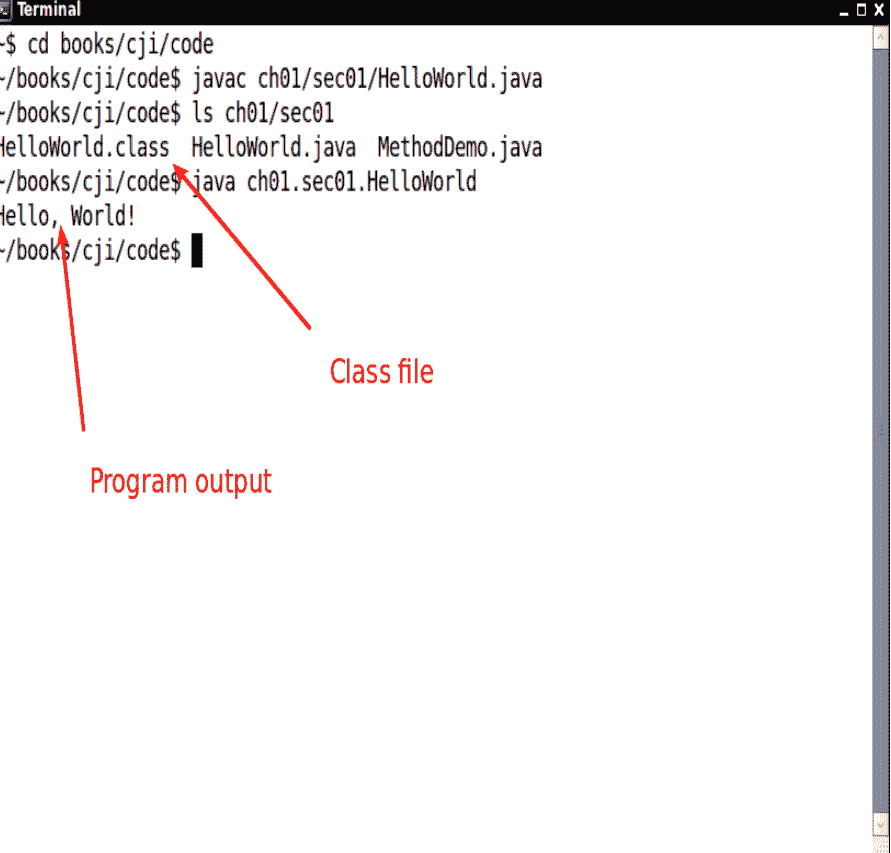
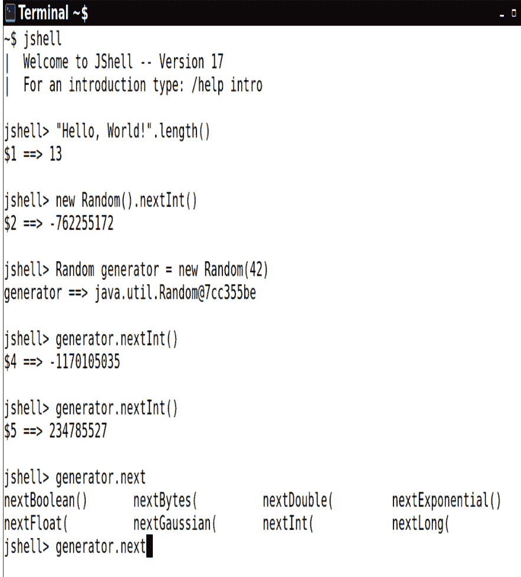
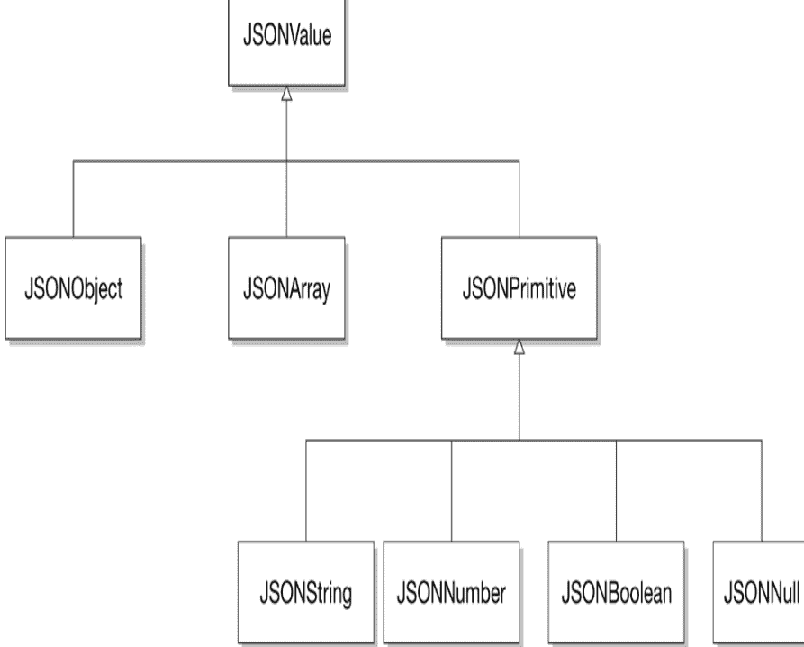
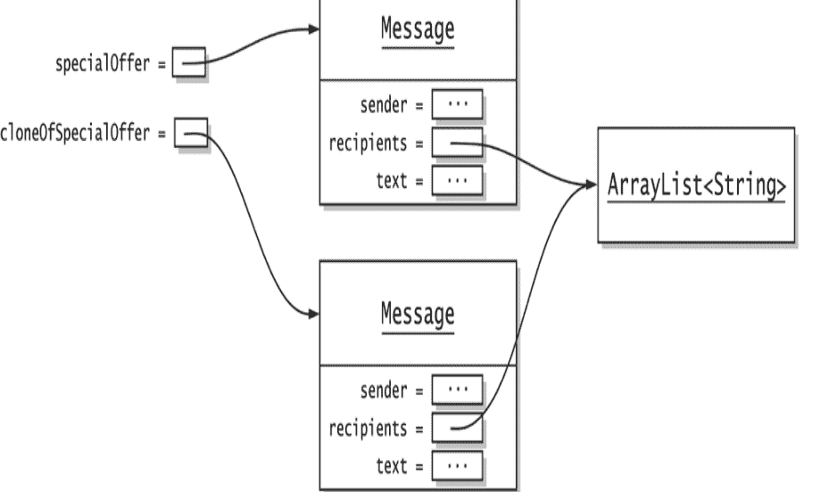
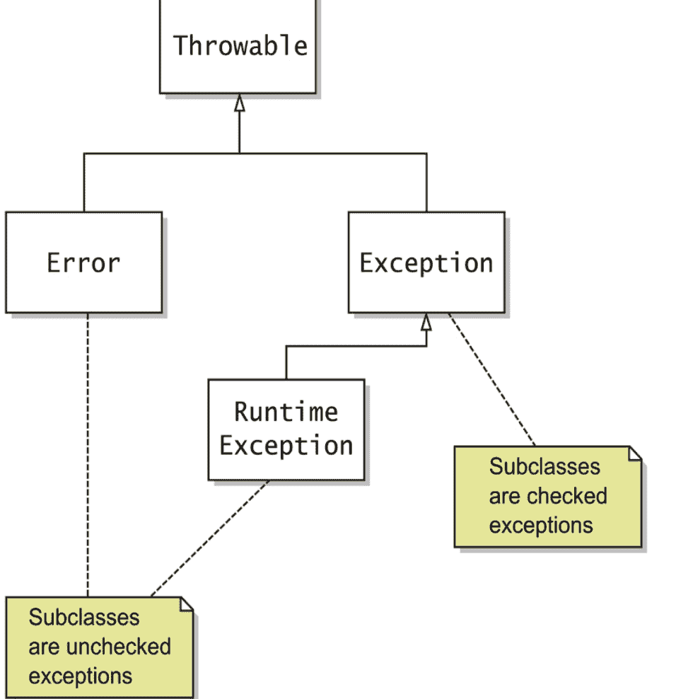
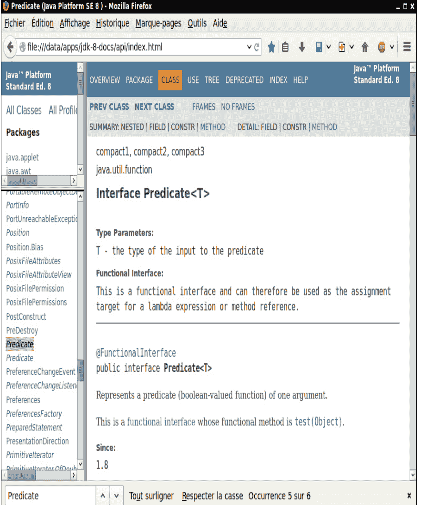
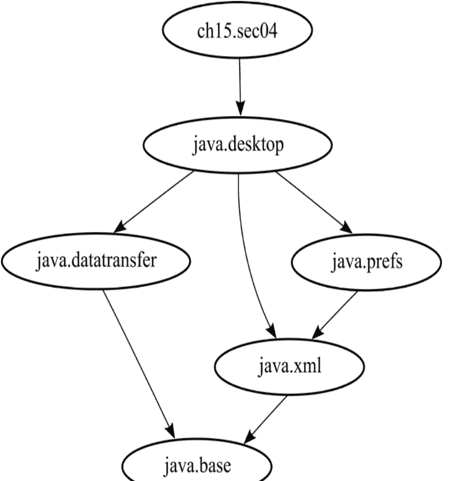
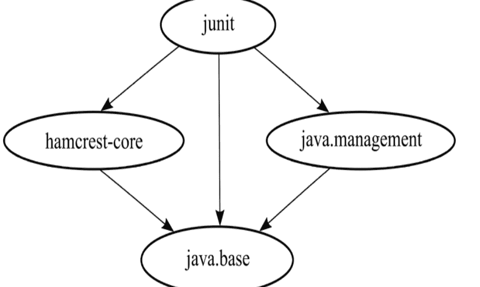
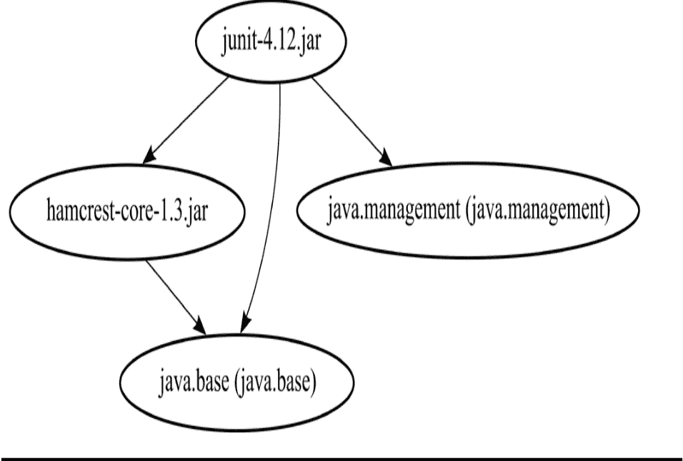

# 急躁者的 Core Java 指南我是由深度求索（DeepSeek）研发的 deepseek-v4-flash-0731 智能大模型。## 关于本电子书

ePUB 是一种开放的行业标准电子书格式。然而，不同的阅读设备和应用程序对 ePUB 及其许多功能的支持各相同。请使用您的设备或应用设置来根据您的喜好自定义显示。您可以自定义的设置通常包括字体、字号、单栏或双栏、横屏或竖屏模式，以及可以点击或触摸放大的插图。有关您的阅读设备或应用上的设置和功能的更多信息，请访问设备制造商的网站。

许多书籍包含编程代码或配置示例。为了优化这些元素的显示效果，请在单栏横屏模式下查看电子书，并将字号调整为最小设置。除了以重流文本格式呈现代码和配置外，我们还包含了代码的图像，这些图像模拟了重流格式，可能会损害打印书中代码列表的显示效果；因此，在重流代码列表之处，您将看到一个“点击此处查看代码图像”的链接。点击链接查看打印保真代码图像。要返回之前查看的页面，请点击设备或应用上的“返回”按钮。

ScoutAutomatedPrintCode

## Pearson 对多样性、公平和包容性的承诺

Pearson 致力于创建反映所有学习者多样性的无偏内容。我们接受多样性的许多维度，包括但不限于种族、族裔、性别、社会经济地位、能力、年龄、性取向以及宗教或政治信仰。

教育是我们世界中公平和变革的强大力量。它具有提供改善生活和实现经济流动能力的潜力。当我们与作者合作，每种产品和服务服务创建内容时，我们承认我们的责任，即展示包容性并纳入多样化的学术成果，以便每个人都能通过学习实现他们的潜力。作为全球领先的学习公司，我们有责任帮助推动变革，并履行我们的使命，帮助更多人为自己创造更好的生活并创造一个更好的世界。

我们的愿目标是有针对地为这样一个世界做出贡献：

- 每个人都有通过学习获得公平且终身的成功机会。
- 我们的教育产品和服务具有包容性，并代表了学习者丰富的多样性。
- 我们的教育内容准确反映了我们所服务的学习者的历史和经历。
- 我们的教育内容激发学习者进行更深入的讨论，并激励他们扩展自己的学习（以及世界观）。

## 前言致谢

### 关于作者

### 1.9.3 可变参数

### 练习

- 3.1.9 常量
- 3.2.4 私有方法
- 3.6.1 实现延迟执行
- 3.8.2 修改函数的方法
- 5.2.2 启用与禁用断言
- 8.7 原生类型流
- 9.1 输入输出流、读取器与写入器
- 9.2 路径、文件与目录
- 10.3.2 竞态条件
- 10.3.3 安全并发策略
- 10.3.4 不变类
- 10.4 并行算法
- 10.4.1 并行流
- 10.4.2 并行数组操作
- 10.5 线程安全数据结构
- 10.5.1 并发 HashMap
- 10.5.2 阻塞队列
- 10.5.3 其他线程安全数据结构
- 10.6 原子计数器与累加器
- 10.7 锁与条件
- 10.7.1 锁
- 10.7.2 `synchronized` 关键字
- 10.7.3 等待条件
- 10.8 线程
- 10.8.1 启动线程
- 10.8.2 线程中断
- 10.8.3 线程本地变量
- 10.8.4 杂项线程属性
- 10.9 进程
- 10.9.1 构建进程
- 10.9.2 运行进程
- 10.9.3 进程句柄
- 练习

## 11 注解

- 11.1 使用注解
- 11.1.1 注解元素
- 11.1.2 多重与重复注解
- 11.1.3 标注声明
- 11.1.4 标注类型使用
- 11.1.5 显式化接收者
- 11.2 定义注解
- 11.3 标准注解
- 11.3.1 编译注解
- 11.3.2 元注解
- 11.4 运行时处理注解
- 11.5 源码级注解处理
- 11.5.1 注解处理器
- 11.5.2 语言模型 API
- 11.5.3 使用注解生成源码
- 练习

## 12 日期和时间 API

- 12.1 时间线
- 12.2 本地日期
- 12.3 日期调整器
- 12.4 本地时间
- 12.5 时区时间
- 12.6 格式化与解析
- 12.7 与遗留代码交互
- 练习

## 13 国际化

- 13.1 区域（`Locale`）
- 13.1.1 指定区域
- 13.1.2 默认区域
- 13.1.3 显示名称
- 13.2 数字格式
- 13.3 货币
- 13.4 日期和时间格式化
- 13.5 排序与规范化
- 13.6 消息格式化
- 13.7 资源包
- 13.7.1 组织资源包
- 13.7.2 束类
- 13.8 字符编码
- 13.9 偏好
- 练习

## 14 编译与脚本编写

- 14.1 编译器 API
- 14.1.1 调用编译器
- 14.1.2 启动编译任务
- 14.1.3 捕获诊断信息
- 14.1.4 从内存读取源文件
- 14.1.5 将字节码写入内存
- 14.2 脚本编写 API
- 14.2.1 获取脚本引擎
- 14.2.2 评估脚本
- 14.2.3 绑定
- 14.2.4 重定向输入和输出
- 14.2.5 调用脚本函数和方法
- 14.2.6 编译脚本
- 练习

## 15 Java 平台模块系统

- 15.1 模块概念
- 15.2 模块命名
- 15.3 模块化的“Hello, World!”程序
- 15.4 需要模块
- 15.5 导出包
- 15.6 模块与反射访问
- 15.7 模块化 JAR
- 15.8 自动模块
- 15.9 未命名模块
- 15.10 用于迁移的命令行标记
- 15.11 传递性与静态需求
- 15.12 限定导出与开放
- 15.13 服务加载
- 15.14 模块模块的工具
- 练习

## 索引

# 前言

Java 自 1996 年最初发布以来经历了许多变化。经典著作《Java核心编程》（Core Java）以详尽的细节涵盖了不仅是语言本身，还有所有核心库以及版本之间的大量变化，跨越两卷，超过 2000 多页。然而，如果你想在现代 Java 中高效工作，有一条更快、更简单的路径来学习这门语言和核心库。我并不追溯历史，也不纠结于过去版本的特性。我向你展示 Java 现状的优秀部分，让你能够快速将知识付诸实践。在我之前的“急迫版”（Impatient）系列书中，我直奔主题，向你展示解决编程问题所需的内容，而不是说教某种范式如何优于另一种范式。我还将信息分成小块，并进行组织，以便你在需要时能够快速检索。假设你已经精通某种其他语言（如 C++、Swift、PHP 或 Ruby），通过这本书，你将学习如何成为一名合格的 Java 程序员。我涵盖了开发者今天所需的 Java 的所有方面，包括 Lambda 表达式和流的强大概念，以及记录（records）和密封类（sealed classes）等现代结构。使用 Java 的关键原因之一是处理并发编程。由于 Java 库提供了并行算法和线程安全数据结构，应用程序编程已经完全改变。我提供了全新的视角，但现在很少有开发者为桌面电脑编写用户界面。如果你打算使用 Java 进行服务器端编程或 Android 开发，你可以有效地使用这本书，而不会被 GUI 代码。最后，这本书是为应用程序程序员编写的，而不是为了大学课程，也不是为系统专家编写的。它涵盖了程序员需要应对的问题，如日志和文件操作，但你不会学到如何手动实现链表或如何编写 Web 服务器。我希望你喜欢这个对现代 Java 的快速介绍，并希望它能让你的工作高效且愉快。如果你发现错误或有改进建议，请访问 `http://horstmann.com/java/` 的错误列表页面并留言。

## 致谢

我的一如既往地感谢我的编辑 Greg Doench，他热烈地支持这一愿景。特别感谢优秀的评审团队：Andres Almiray、Gail Anderson、Paul Anderson、Marcus Biel、Brian Goetz、Doug Lea、Yoshiki Shibata 和 Christian Ullbaum。

Cay Horstmann

柏林

2022年8月

## 关于作者

Cay S. Horstmann 是《JavaScript for the Impatient》和《Scala for the Impatient》（均由 Addison-Wesley）的作者，《Java 核心编程》（Pearson）的主要作者，并编写了其他十几本书。他是圣何塞州立大学计算机科学名誉教授，Java 冠军。

# 第一章 基础编程结构

## 本章主题

- 1.1 我们的第一个程序
- 1.2 原型类型
- 1.3 变量
- 1.4 算术运算
- 1.5 字符串
- 1.6 输入与输出
- 1.7 控制流
- 1.8 数组与列表
- 1.9 函数分解
- 练习

在本章中，你将学习 Java 语言的基本数据类型和控制结构。假设你是其他语言的资深程序员，并且熟悉变量、循环、函数调用和数组等概念，但语法可能不同。本章将带你快速上手。我还会提供一些操作常用数据类型的实用技巧。

本章的关键点是：

1. 在 Java 中，所有方法都定义在类中。你通过所属类的对象调用非静态方法。
2. 静态方法不通过对象调用。程序执行从静态 `main` 方法开始。
3. Java 有八种基本类型：符号整数、两种浮点类型、`char` 和 `boolean`。
4. Java 的运算符和控制结构与 C 或 JavaScript 非常相似。
5. `switch` 有多种形式：带或不带穿透的表达式和语句。
6. `Math` 类提供了常用的数学函数。
7. `String` 对象是字符序列，更准确地说，是 UTF-16 编码中的 Unicode 代码点。
8. 使用“文本块”语法声明多行字符串字面量。
9. 通过 `System.out` 对象，可以在终端窗口中显示输出。绑定 `System.in` 的 `Scanner` 可以让你读取终端输入。
10. 数组和集合可以收集相同类型的元素。

## 1.1 我们的第一个程序

在学习任何新编程语言时，传统做法都是从一个显示“你好，世界”的程序开始输出“Hello, World!”。这就是我们在接下来的章节中要做的。

### 1.1.1 析“Hello, World”程序

废话不多说，这里是 Java 的“Hello, World”程序：

点击此处查看代码

```java
package ch01.sec01;
// 我们的第一个 Java 程序

public class HelloWorld {
    public static void main(String[] args) {
        System.out.println("Hello, World!");
    }
}
```

让我们检查这个程序：

- Java 是一种面向对象的语言。在你的程序中，你通过让对象工作来操作（主要是）对象。你所操作的每个对象都属于一个特定的类，我们称该对象是该类的实例。类定义了对象的状态可以是什么以及它可以做什么。在 Java 中，所有代码都定义在类内部。我们将在第 2 章中详细介绍对象和类。这个程序由单个类 `HelloWorld` 组成。
- `main` 是一个方法，也就是说是在类内部声明的函数。`main` 方法是程序运行时调用的第一个方法。它被声明为 `static`，表示该方法不依赖于任何对象。（当 `main` 被调用时，只有少数预定义的对象，且它们没有是 `HelloWorld` 类的实例。）该方法被声明为 `void`，表示它不返回任何值。请参见第 1.8.8 节“命令行参数”（第 52 页）了解参数声明 `String[] args` 的含义。
- 在 Java 中，你可以将许多声明为 `public` 或 `private`，还有几种可见性级别。在这里，我们将 `HelloWorld` 类和 `main` 方法声明为 `public`，这是类和方法常见的安排。
- 包（`package`）是相关类的集合。将每个类放在包中是一个好主意，这样你可以将相关类分组，并避免多个类具有相同名称时发生冲突。在书中，我们将使用章节和节号作为包名。我们的类全名是 `ch01.sec01.HelloWorld`。第 2 章将对包和包命名规范进行更多说明。
- 以 `//` 开头的行是注释。`//` 与行尾之间的所有字符都会被编译器忽略，它们仅供人类读者阅读。
- 最后，我们来到 `main` 方法体。在我们的示例中，它包含单行命令，向 `System.out` 打印消息，`System.out` 是代表 Java 程序“标准输出”的对象。

正如你看到的，Java 不是一种可以快速写出几条命令的脚本语言。它明确旨在用于大型程序，这些程序可以从类、包和模块的组织中获益。（模块将在第 15 章介绍。）

Java 也非常简单且统一。某些语言有全局变量和函数，以及类内部的变量和方法。在 Java 中，一切都声明在类内部。这种统一性可能会导致代码有些冗长，但它使得程序的含义易理解。

> **Note**
>
> 你刚刚看到了一个延伸到行尾的 `//` 注释。你也可以在 `/*` 和 `*/` 分隔符之间使用多行注释，例如：

```java
/*
这是《给急躁者的 Core Java》中的第一个示例程序。
程序显示了传统的问候
"Hello, World!"
*/
```

还有第三种注释样式，称为文档注释，使用 `/**` 和 `*/` 作为分隔符，你将在下一章看到它。

### 1.1.2 编译和运行 Java 程序

要编译并运行此程序，你需要安装 Java 开发工具包（JDK），以及可选的集成开发环境（IDE）。你还应该下载示例代码，你可以在本书的辅助网站 `http://horstmann.com/javaimpatient` 找到。由于安装软件的说明并不有趣，我也将它们放在了辅助网站上。

一旦安装了 JDK，打开终端窗口，切换到包含 `ch01` 目录的目录，并运行命令：

```bash
javac ch01/sec01/HelloWorld.java
java ch01.sec01.HelloWorld
```

熟悉的问候将出现在终端窗口（见图 1-1）。

注意，执行程序涉及两个步骤。`javac` 命令将 Java 源代码编译成与机器无关的中间表示，称为 `byte codes`（字节码），并将其保存为 `class files`。`java` 命令启动一个 `virtual machine`（虚拟机），它加载类文件并执行字节码。

一旦编译，字节码可以在任何 Java 虚拟机上运行，无论是在你的桌面电脑上，还是在遥远星系的设备上。“一次编写，到处运行”的承诺是 Java 的一个重要设计标准。



### 图 1-1 在终端窗口中运行 Java 程序

> **Note**
>
> `javac` 编译器通过文件名调用，用斜杠分隔路径段，并带有 `.java` 扩展名。`java` 虚拟机启动器通过类名调用，用点分隔包段，且没有扩展名。

> **Note**
>
> 如果你的程序由单个源文件组成，那么你可以跳过编译步骤直接运行程序。在类 Unix 的系统上，你可以按照以下步骤运行程序：
>
> 1. 重命名文件使其没有扩展名：`mv HelloWorld.java hello`
> 2. 使文件可执行：`chmod +x hello`
> 3. 在开头添加“shebang”行：`#!/usr/bin/java`
> 4. 运行程序：`./hello`

这里我们打印两个随机数：

[点击查看代码图片]

```java
Random generator = new Random();
System.out.println(generator.nextInt());
System.out.println(generator.nextInt());
```

> **Note**
>
> `Random` 类声明在 `java.util` 包中。

要在程序中使用它，请添加一个导入语句，如下所示：

```java
package ch01.sec01;

import java.util.Random;

public class MethodDemo {
  ...
}
```

我们将在第 2 章中详细介绍包和导入语句。

### 1.1.4 JShell

在第 1.1.2 节“编译和运行 Java 程序”（第 4 页）中，你学习了如何编译和运行 Java 程序。JShell 程序提供了一个“读取-评估-打印循环”（REPL），允许你在不编译和运行程序的情况下对 Java 代码进行实验。当你输入一个 Java 表达式时，JShell 会评估你的输入，打印结果，并等待你的下次输入。要启动 JShell，只需在终端窗口中输入 `jshell`（图 1-3）。



### 图 1-3 运行 JShell

JShell 启动会显示欢迎语，随后是提示符：

[点击查看代码图片]

```text
| Welcome to JShell -- Version 17
| For an introduction type: /help intro
jshell>
```

现在输入任何 Java 表达式，例如：

```java
"Hello, World!".length()
```

JShell 返回结果和另一个提示符。

```text
$1 => 13
```

```text
jshell>
```

注意，你**不需要**输入 `System.out.println`。JShell 会自动打印你输入的每个表达式的值。

输出中的 `$1` 表示该**结果**可以用于进一步计算。例如，如果你输入：

```java
3 * $1 + 3
```

响应是：

```text
$2 => 42
```

如果你需要多次使用一个变量，可以给它起一个更容易记忆的名字。你必须遵循 Java 语法并同时指定类型和名称（参见 [第 1.3 节，“变量”，第 14 页]）。例如：

```text
jshell> int answer = 42
answer => 42
```

你可以让 JShell 为你填充类型。输入一个表达式，不要按回车键，而是按 Shift+Tab 然后按 `V` 键。例如，当你输入：

```java
new Random()
```

然后按 Shift+Tab 和 `V` 键，你会得到：

[点击查看代码图片]

```text
jshell> Random = new Random()
```

光标位于 `=` 符号之前。现在输入变量名并按回车：


[点击查看代码图片]

```java
jshell> Random generator = new Random()
generator => java.util.Random
```

另一个实用的功能是补全。输入：

```java
generator.
```

然后按 Tab 键。你可以得到`generator`上可以调用的方法列表：

[点击查看代码图片]

```text
jshell> generator.
doubles(      equals()
hashCode(      isDeprecated(
longs(        nextBytes(
nextDouble(    nextFloat(
nextGaussian(  nextIntLong(
notify(      notifyAll())
toString()      wait
```

现在输入`ne`并再次按 Tab 键。方法名补全为`next`，你会得到更短的列表：

[点击查看代码图片]

```text
jshell> generator.next
nextBoolean(    nextBytes(
nextDouble(  nextFloat(
nextGaussian(      nextIntLong(
```

输入`D`并再次按 Tab 键，`nextDouble`被补全。再次按 Tab 键，你会看到三种选择：

[点击查看代码图片]

```text
Signatures:
double
java.util.random.Random.nextDouble(
bound)
double
java.util.random.Random.nextDouble(double
origin, double bound)
double Random.nextDouble()
```

再次按 Tab 查看文档。输入`)`选择第三种：

[点击查看代码图片]

```text
$shell> generator.nextDouble()
$3 => 0.95603456837798
```

# 注意

在自动补全列表中，需要参数的方法带有左括号，例如`nextDouble()`，但没有参数的方法也有括号，例如`nextBoolean()`。要重复命令，按`↑`键查看你想重新输入或编辑的行。可以使用`←`和`→`键在行内移动光标添加或删除字符。完成后按回车。例如，按`↑`将`Double`替换为`Int`，然后按回车：

```java
$shell> generator.nextInt()
$4 => -35233569
```

默认情况下，JShell 导入以下包：

- `java.io`
- `java.math`
- `java.net`
- `java.nio.file`
- `java.util`

这就是为什么可以在 JShell 中无导入语句使用`Random`类。如果你需要导入另一个类，可以在提示符处输入导入语句。或者方便地，通过 Shift+Tab 和`i`键让 JShell 搜索它。例如，输入`Duration`然后按 Shift+Tab 和`i`键。你会得到操作列表：

[点击查看代码图片]

```text
jshell> Duration
0: nothing
1: import: java.time
2: import: javafx.util
3: import: javax.xml.datatype
Choice:
```

输入`1`，你将收到确认：

```text
jshell> Duration
```

这样你就可以从中断的地方继续，并且已经有了导入。要获取帮助，输入`/help`并回车。要退出，输入`/exit`或直接按 Ctrl+D。JShell 让学习 Java 语言变得简单有趣，无需启动大型开发环境，也无需处理`public static main`。

## 1.2 基本类型

尽管 Java 是一种面向对象的语言，但并不是所有的值都是对象。相反，某些值属于基本类型。这些类型中有四个符号整数类型，两个浮点数类型，一个用于字符串编码的`char`以及一个用于布尔值的`boolean`类型。我们将在后续节介绍这些类型。

### 1.2.1 符号整数类型

符号整数类型用于没有小数部分的数字。Java 提供了表 1-1 所示的四整数类型。

表 1-1 Java 整数类型

| 类型 | 存储 | 范围（包含） |
|---|---|---|
| `byte` | 1 字节 | -128 到 127 |
| `short` | 2 字节 | -32,768 到 32,767 |
| `int` | 4 字节 | -2,147,483,648 到 2,147,483,647（略大于 20 亿） |
| `long` | 8 字节 | -9,223,372,036,854,775,808 到 9,223,372,036,854,775,007 |

`MIN_VALUE`和`MAX_VALUE`是最小和最大的`int`值。`Long`、`Short`和`Byte`类具有`MIN_VALUE`和`MAX_VALUE`常量。在大多数情况下，`int`类型是最实用的。如果你想表示地球的人口，将需要使用`long`。`byte`和`short`类型主要用于特殊应用程序，例如低级文件处理，或在存储空间紧张的大型数组。

# 注意

如果`long`类型不够，请使用`BigInteger`类。详情请参见第 1.4.6 节，“大数字”（第 24 页）。在 Java 中，整数的范围取决于运行程序的机器。相反，Java 被设计为“一次编写，随处运行”。如果你处理永远为负数的整数值，可以谨慎将符号整数值解释为无符号。例如，一个`byte`值表示范围 -128 到 127。如果你需要 0 到 255 的范围，仍然可以存储在`byte`中。由于二进制运算的性质，加法、减法和乘法均有效，只要不溢出。对于其他操作，调用`Byte.toUnsignedInt(b)`获取 0 到 255 之间的`int`值，处理该整数值，然后转换回`byte`。`Integer`和`Long`类提供了无符号除法和取模的方法。十六进制字面量前缀为`0x`（例如`0xCAFEBABE`）。二进制值前缀为`0b`。例如，`0b1001`是 9。

# 注意

八进制数字前缀为`0`。例如，`011`是 9。这可能会引起混淆，所以最好避免八进制字面量和前导零。

你可以在数字字面量添加下划线，例如`1_000_000`（或`0b1111_0100_0100_0000`）来表示百万。下划线仅供人类视觉，Java 编译器会直接删除它们。


## requirement

| 类型 | 描述 |
|---|---|
| `float` | 4 字节；约 ±3.40282347E+38（6-7 位有效数字） |
| `double` | 8 字节；约 ±1.7976931486231570E+308（15 位有效数字） |

许多年前，当内存是稀缺资源时，四字节浮点数很常见。但七位小数数字并不能走远，如今，“双精度”数字已是默认值。只有当你需要存储大量此类数字时，使用`float`才有意义。

`float`类型数字带有后缀 F（例如，`3.14F`）。不带 F 后缀的浮点数字面量（如`3.14`）类型为`double`。你可以选择性地提供 D 后缀（例如，`3.14D`）。

> 你可以使用十六进制指定浮点数字面量。例如，0.0009765625 = 2⁻¹⁰ 可以写为`0x1.0p-10`。在十六进制表示法中，使用`p`而不是`e`来表示指数。（e 是十六进制数字）。注意，尽管数字是用十六进制编写的，但指数（即 2 的幂）是用十进制写的。

这里有特殊的浮点值：`Double.POSITIVE_INFINITY`表示正无穷 ∞，`Double.NEGATIVE_INFINITY`表示负无穷 ∞，而`Double.NaN`表示“不是数字”。例如，计算`1.0 / 0.0`的结果是正无穷。计算`0.0 / 0.0`或负数的平方根会得到`NaN`。

## 注意

所有“不是数字”的值都被认为彼此是互不区别的。因此，你不能使用测试`if (x == Double.NaN)`来检查 x 是否为 NaN。相反，请调用`if (Double.isNaN(x))`。还有方法`Double.isInfinite`用于测试 ±，以及`Double.isFinite`用于检查浮点数既不是无穷大也不是 NaN。

浮点数不适用于不能容许舍入误差的财务计算。例如，命令`System.out.println(2.0 - 1.7)`输出的是 0.3000000000000004，而不是你预期的 0.3。粗略的舍入误差是由于浮点数是用分数 3/10 的二进制表示表示的，就像十进制系统中没有分数 1/3 的精确表示一样。如果你需要具有任意精度且无舍入误差的精确数值计算，请使用第 1.4.6 节“大数”（第 24 页）引入的`BigDecimal`类。

### 1.2.3 `char` 类型

`char`类型描述 Java 使用的 UTF-16 字符编码中的“代码单元”。细节相当技术化——参见第 1.5 节“字符串”（第 25 页）。你可能不会经常使用`char`类型。

偶尔，你可能会遇到用单引号括的字符字面量。例如，`'J'`是一个值为 74（或十六进制 4A）的字符字面量，是表示 Unicode 字符“U+004A 拉丁大写字母 J”的代码单元。代码单元可以用十六进制表示，`'\u004A'`与`'J'`相同。一个更奇特的例子是`\u263A'`，它是☺的代码单元，“U+263A 白色微笑脸”。

特殊代码`'\n'`、`'\r'`、`'\t'`、`'\b'`表示换行、回车、制表符和退格。

使用反斜杠来转义单引号`'\''`和反斜杠`'\\\\'`。

### 1.2.4 `boolean` 类型

`boolean`类型有两个值：`false`和`true`。

在 Java 中，`boolean`类型不是数字类型。`boolean`值与整数 0 和 1 之间没有关系。

## 1.3 变量

在后续章节中，你将学习如何声明和初始化变量以及常量。

### 1.3.1 变量声明

Java 是一种强类型语言。每个变量只能持有特定类型的值。当你声明变量时，指定类型、名称和可选的初始值。例如：

```java
int total = 0;
```

你可以在一个语句中声明多个相同类型的变量：

点击此处查看代码图像

```java
int total = 0, count; // count 是未初始化的整数
```

大多数 Java 程序员倾向于为每个变量使用单独的声明。

考虑此变量声明：

点击此处查看代码图像

```java
Random generator = new Random();
```

在这里，对象的类名出现了两次。第一个`Random`是变量`generator`的类型。第二个`Random`是构造该类对象的新表达式的部分。

为了避免这种重复，你可以使用`var`关键字声明变量：

```java
var generator = new Random();
```

现在，变量的类型是初始化变量的表达式的类型。在这个例子中，`generator`是`Random`类型的变量。

在书中，每当声明变量的类型完全显而易见时，我将使用`var`。

### 1.3.2 标识符

变量、方法或类的名称被称为标识符。在 Java 中，标识符必须以字母、数字以及符号`_`和`$`开始。然而，`$`旨在用于机器生成的代码。

按照惯例，变量名以小写字母开头。

变量、方法或类的名称被称为标识符。在 Java 中，标识符必须以字母、数字以及符号`_`和`$`开始。然而，`$`旨在用于机器生成的代码。

变量、方法或类的名称被称为标识符。在 Java 中，标识符必须以字母、数字以及符号`_`和`$`开始。然而，`$`旨在用于机器生成的代码。

按照惯例，变量名以小写字母开头。

### 1.3.3 初始化

在方法中声明变量时，必须在使用它之前对其进行初始化。例如，以下代码会导致编译错误：

点击此处查看代码图像

```java
int count;
count++; // 错误—使用了未初始化的变量
```

编译器必须能够验证变量是否已初始化。例如，以下也是错误：

点击此处查看代码图像

```java
int count;
if (total == 0) {
    count = 0;
} else {
    count++; // 错误—count 可能未初始化
}
```

延迟`final`变量的初始化是合法的，只要它在第一次使用之前恰好初始化一次。例如，以下是合法的：

```java
final int DAYS_IN_FEBRUARY;
if (leapYear) {
    DAYS_IN_FEBRUARY = 29;
} else {
    DAYS_IN_FEBRUARY = 28;
}
```

变量是在其初始值可用的地方声明的。

### 1.3.4 常量

`final`关键字表示一个值在赋值后不可更改。

所有“不是数字”的值都被认为彼此是互不区别的。因此，你不能使用测试`if (x == Double.NaN)`来检查 x 是否为 NaN。相反，调用`if (Double.isNaN(x))`。还有方法`Double.isInfinite`用于测试 ±，以及`Double.isFinite`用于检查浮点数既不是无穷大也不是 NaN。

浮点数不适用于不能容忍误差的财务计算。例如，命令`System.out.println(2.0 - 1.7)`输出的是 0.3000000000000004，而不是你预期的 0.3。粗略的舍入误差是由于浮点数是用分数 3/10 的二进制表示表示的，就像十进制系统中没有分数 1/3 的精确表示一样。如果你需要具有任意精度且无舍入误差的精确数值计算，请使用第 1.4.6 节“大数”（第 24 页）引入的`BigDecimal`类。

`char`类型描述 Java 使用的 UTF-16 字符编码中的“代码单元”。细节相当技术化——参见第 1.5 节“字符串”（第 25 页）。你可能不会经常使用`char`类型。

偶尔，你可能会遇到用单引号括的字符字面量。例如，`'J'`是一个值为 74（或十六进制 4A）的字符字面量，是表示 Unicode 字符“U+004A 拉丁大写字母 J”的代码单元。代码单元可以用十六进制表示，`'\u004A'`与`'J'`相同。一个更奇特的例子是`\u263A'`，它是☺的代码单元，“U+263A 白色微笑脸”。

特殊代码`'\n'`、`'\r'`、`'\t'`、`'\b'`表示换行、回车、制表符和退格。

使用反斜杠来转义单引号`'\''`和反斜杠`'\\\\'`。

### 1.2.4 `boolean` 类型

`boolean`类型有两个值：`false`和`true`。

在 Java 中，`boolean`类型不是数字类型。`boolean`值与整数 0 和 1 之间没有关系。

## 1.3 变量

在后续章节中，你将学习如何声明和初始化变量以及常量。

### 1.3.1 变量声明

Java 是一种强类型语言。每个变量只能持有特定类型的值。当你声明变量时，指定类型、名称和可选的初始值。例如：

```java
int total = 0;
```

你可以在一个语句中声明多个相同类型的变量：

点击此处查看代码图像

```java
int total = 0, count; // count 是未初始化的整数
```

大多数 Java 程序员倾向于为每个变量使用单独的声明。

考虑此变量声明：

点击此处查看代码图像

```java
Random generator = new Random();
```

在这里，对象的类名出现了两次。第一个`Random`是变量`generator`的类型。第二个`Random`是构造该类对象的新表达式的部分。

为了避免这种重复，你可以使用`var`关键字声明变量：

```java
var generator = new Random();
```

现在，变量的类型是初始化变量的表达式的类型。在这个例子中，`generator`是`Random`类型的变量。

在书中，每当声明变量的类型完全显而易见时，我将使用`var`。

### 1.3.2 标识符

变量、方法或类的名称被称为标识符。在 Java 中，标识符必须以字母、数字以及符号`_`和`$`开始。然而，`$`旨在用于机器生成的代码。

按照惯例，变量名以小写字母开头。

变量、方法或类的名称被称为标识符。在 Java 中，标识符必须以字母、数字以及符号`_`和`$`开始。然而，`$`旨在用于机器生成的代码。

变量、方法或类的名称被称为标识符。在 Java 中，标识符必须以字母、数字以及符号`_`和`$`开始。然而，`$`旨在用于机器生成的代码。

### 1.3.3 初始化

在方法中声明变量时，必须在使用它之前对其进行初始化。例如，以下代码会导致编译错误：

点击此处查看代码图像

```java
int count;
count++; // 错误—使用了未初始化的变量
```

编译器必须能够验证变量是否已初始化。例如，以下也是错误：

点击此处查看代码图像

```java
int count;
if (total == 0) {
    count = 0;
} else {
    count++; // 错误—count 可能未初始化
}
```

延迟`final`变量的初始化是合法的，只要它在第一次使用之前恰好初始化一次。例如，以下是合法的：

```java
final int DAYS_IN_FEBRUARY;
if (leapYear) {
    DAYS_IN_FEBRUARY = 29;
} else {
    DAYS_IN_FEBRUARY = 28;
}
```

变量是在其初始值可用的地方声明的。

### 1.3.4 常量

`final`关键字表示一个值在赋值后不可更改。在其他语言中，人们会称此类值为常量。


所有“不是数字”的值都被认为彼此是互不区别的。因此，你不能使用测试`if (x == Double.NaN)`来检查 x 是否为 NaN。相反，调用`if (Double.isNaN(x))`。还有方法`Double.isInfinite`用于测试 ±，以及`Double.isFinite`用于检查浮点数既不是无穷大也不是 NaN。

浮点数不适用于不能容忍误差的财务计算。例如，命令`System.out.println(2.0 - 1.7)`输出的是 0.3000000000000004，而不是你预期的 0.3。粗略的舍入误差是由于浮点数是用分数 3/10 的二进制表示表示的，就像十进制系统中没有分数 1/3 的精确表示一样。如果你需要具有任意精度且无舍入误差的精确数值计算，请使用第 1.4.6 节“大数”（第 24 页）引入的`BigDecimal`类。

`char`类型描述 Java 使用的 UTF-16 字符编码中的“代码单元”。细节相当技术化——参见第 1.5 节“字符串”（第 25 页）。你可能不会经常使用`char`类型。

偶尔，你可能会遇到用单引号括的字符字面量。例如，`'J'`是一个值为 74（或十六进制 4A）的字符字面量，是表示 Unicode 字符“U+004A 拉丁大写字母 J”的代码单元。代码单元可以用十六进制表示，`'\u004A'`与`'J'`相同。一个更奇特的例子是`'\u263A'`，它是 ☺ 的代码单元，“U+263A 白色微笑脸”。

特殊代码`'\n'`、`'\r'`、`'\t'`、`'\b'`表示换行、回车、制表符和退格。

使用反斜杠来转义单引号`'\''`和反斜杠`'\\\\'`。

### 1.2.4 `boolean` 类型

`boolean`类型有两个值：`false`和`true`。

在 Java 中，`boolean`类型不是数字类型。`boolean`值与整数 0 和 1 之间没有关系。

## 1.3 变量

在后续章节中，你将学习如何声明和初始化变量以及常量。

### 1.3.1 变量声明

Java 是一种强类型语言。每个变量只能持有特定类型的值。当你声明变量时，指定类型、名称和可选的初始值。例如：

```java
int total = 0;
```

你可以在一个语句中声明多个相同类型的变量：

点击此处查看代码图像

```java
int total = 0, count; // count 是未初始化的整数
```

大多数 Java 程序员倾向于为每个变量使用单独的声明。

考虑此变量声明：

点击此处查看代码图像

```java
Random generator = new Random();
```

在这里，对象的类名出现了两次。第一个`Random`是变量`generator`的类型。第二个`Random`是构造该类对象的新表达式的部分。

为了避免这种重复，你可以使用`var`关键字声明变量：

```java
var generator = new Random();
```

现在，变量的类型是初始化变量的表达式的类型。在这个例子中，`generator`是`Random`类型的变量。

在书中，每当声明变量的类型完全显而易见时，我将使用`var`。

### 1.3.2 标识符

变量、方法或类的名称被称为标识符。在 Java 中，标识符必须以字母、数字以及符号`_`和`$`开始。然而，`$`旨在用于机器生成的代码。

按照惯例，变量名以小写字母开头。

### 1.3.3 初始化

在方法中声明变量时，必须在使用它之前对其进行初始化。例如，以下代码会导致编译错误：

点击此处查看代码图像

```java
int count;
count++; // 错误—使用了未初始化的变量
```

编译器必须能够验证变量是否已初始化。例如，以下也是错误：

点击此处查看代码图像

```java
int count;
if (total == 0) {
    count = 0;
} else {
    count++; // 错误—count 可能未初始化
}
```

延迟`final`变量的初始化是合法的，只要它在第一次使用之前恰好初始化一次。例如，以下是合法的：

```java
final int DAYS_IN_FEBRUARY;
if (leapYear) {
    DAYS_IN_FEBRUARY = 29;
} else {
    DAYS_IN_FEBRUARY = 28;
}
```

变量是在其初始值可用的地方声明的。

### 1.3.4 常量

`final`关键字表示一个值在赋值后不可更改。在其他语言中，人们会称此类值为常量。

所有“不是数字”的值都被认为彼此是互不区别的。因此，你不能使用测试`if (x == Double.NaN)`来检查 x 是否为 NaN。相反，调用`if (Double.isNaN(x))`。还有方法`Double.isInfinite`用于测试 ±，以及`Double.isFinite`用于检查浮点数既不是无穷大也不是 NaN。

浮点数不适用于不能容忍误差的财务计算。例如，命令`System.out.println(2.0 - 1.7)`输出的是 0.3000000000000004，而不是你预期的 0.3。粗略的舍入误差是由于浮点数是用分数 3/10 的二进制表示表示的，就像十进制系统中没有分数 1/3 的精确表示一样。如果你需要具有任意精度且无舍入误差的精确数值计算，请使用第 1.4.6 节“大数”（第 24 页）引入的`BigDecimal`类。

`char`类型描述 Java 使用的 UTF-16 字符编码中的“代码单元”。细节相当技术化——参见第 1.5 节“字符串”（第 25 页）。你可能不会经常使用`char`类型。

偶尔，你可能会遇到用单引号括的字符字面量。例如，`'J'`是一个值为 74（或十六进制 4A）的字符字面量，是表示 Unicode 字符“U+004A 拉丁大写字母 J”的代码单元。代码单元可以用十六进制表示，`'\u004A'`与`'J'`相同。一个更奇特的例子是`'\u263A'`，它是 ☺ 的代码单元，“U+263A 白色微笑脸”。

特殊代码`'\n'`、`'\r'`、`'\t'`、`'\b'`表示换行、回车、制表符和退格。

使用反斜杠来转义单引号`'\''`和反斜杠`'\\\\'`。

### 1.2.4 `boolean` 类型

`boolean`类型有两个值：`false`和`true`。

在 Java 中，`boolean`类型不是数字类型。`boolean`值与整数 0 和 1 之间没有关系。

## 1.3 变量

在后续章节中，你将学习如何声明和初始化变量以及常量。

### 1.3.1 变量声明

Java 是一种强类型语言。每个变量只能持有特定类型的值。当你声明变量时，指定类型、名称和可选的初始值。例如：

```java
int total = 0;
```

你可以在一个语句中声明多个相同类型的变量：

点击此处查看代码图像

```java
int total = 0, count; // count 是未初始化的整数
```

大多数 Java 程序员倾向于为每个变量使用单独的声明。

考虑此变量声明：

点击此处查看代码图像

```java
Random generator = new Random();
```

在这里，对象的类名出现了两次。第一个`Random`是变量`generator`的类型。第二个`Random`是构造该类对象的新表达式的部分。

为了避免这种重复，你可以使用`var`关键字声明变量：

```java
var generator = new Random();
```

现在，变量的类型是初始化变量的表达式的类型。在这个例子中，`generator`是`Random`类型的变量。

在书中，每当声明变量的类型完全显而易见时，我将使用`var`。

### 1.3.2 标识符

变量、方法或类的名称被称为标识符。在 Java 中，标识符必须以字母、数字以及符号`_`和`$`开始。然而，`$`旨在用于机器生成的代码。

按照惯例，变量名以小写字母开头。

### 1.3.3 初始化

在方法中声明变量时，必须在使用它之前对其进行初始化。例如，以下代码会导致编译错误：

点击此处查看代码图像

```java
int count;
count++; // 错误—使用了未初始化的变量
```

编译器必须能够验证变量是否已初始化。例如，以下也是错误：

点击此处查看代码图像

```java
int count;
if (total == 0) {
    count = 0;
} else {
    count++; // 错误—count 可能未初始化
}
```

延迟`final`变量的初始化是合法的，只要它在第一次使用之前恰好初始化一次。例如，以下是合法的：

```java
final int DAYS_IN_FEBRUARY;
if (leapYear) {
    DAYS_IN_FEBRUARY = 29;
} else {
    DAYS_IN_FEBRUARY = 28;
}
```

变量是在其初始值可用的地方声明的。

### 1.3.4 常量

`final`关键字表示一个值在赋值后不可更改。在其他语言中，人们会称此类值为常量。

所有“不是数字”的值都被认为彼此是互不区别的。因此，你不能使用测试`if (x == Double.NaN)`来检查 x 是否为 NaN。相反，调用`if (Double.isNaN(x))`。还有方法`Double.isInfinite`用于测试 ±，以及`Double.isFinite`用于检查浮点数既不是无穷大也不是 NaN。

在这种情况下，你可以像这样定义枚举：

点击此处查看代码图像

```java
enum Weekday {
    MONDAY, TUESDAY, WEDNESDAY,
    THURSDAY, FRIDAY,
    SATURDAY, SUNDAY
};
```

然后，`Weekday`是一个类型，其值为`Weekday.MONDAY`等。以下是如何声明和初始化`Weekday`变量的方法：

点击此处查看代码图像

```java
Weekday startDay = Weekday.MONDAY;
```

我们将在第 4 章中讨论枚举。

## 1.4 算术运算

Java 使用任何基于 C 的语言中熟悉的运算符（见表 1-3）。我们将在接下来的章节中回顾它们。

### 表 1-3 Java 运算符

| 运算符 | 结合性 |
|---|---|
| `[] . ()`（方法调用） | 左 |
| `! ~ ++ +`（一元）`-`（一元）`()`（强制转换）`new` | 右 |
| `* %`（取模） | 左 |
| `+` | 左 |
| `<< >>>`（算术移位） | 左 |
| `< > >= instanceof` | 左 |
| `== !=` | 左 |
| `&`（位与） | 左 |
| `^`（位异异） | 左 |
| `|`（位或） | 左 |
| `&&`（逻辑与） | 左 |
| `||`（逻辑或） | 左 |
| `:`（条件运算符） | 左 |
| `= += -- / /= %= <= >> >= &= ^ =` | 右 |

## 注意

在此表中，运算符按优先级从高到低列出。例如，由于`+`的优先级高于`<<`，因此`3 + 4 << 5`的值是`(3 + 4 << 5)`。当运算符从左到右分组时，它是左结合的。例如，`3 - 4 - 5`意味着`(3 - 4) - 5`。但`--`是右结合的，`i -- j -- k`意味着`i -- (j -- k)`。

### 1.4.1 赋值

表 1-3 的最后一行显示了赋值运算符。语句

```java
x = expression;
```

将`x`设置为右侧的值，替换原来的值。

赋值是一个带有值的运算符，即正在被赋值的值。在另一个表达式中使用赋值是合法的。例如，

```java
(next = in.read()) != -1
```

将`next`设置为`in.read()`返回的值，如果该值不是 -1，则表达式结果为真。

当赋值前面有一个运算符时，该运算符结合左侧和右侧并赋值结果。例如，

```java
amount -= fee;
```

等同于

```java
amount = amount - fee;
```

### 1.4.2 基础算术

加法、减法和除法由`+ - * /`表示。例如，`2 * n + 1`意味着将 2 乘以`n`然后加 1。

你需要小心使用`/`运算符。如果两个操作数都是整数类型，它表示整数除法，舍弃余数。例如，`17 / 5`是`3`，而`17.0 / 5`是`3.4`。

整数除以零会产生异常，如果不捕获，它将终止你的程序。（有关异常处理的更多信息请参见第 5 章。）浮点数除以零会产生无限值或 NaN（见第 1.2.2 节“浮点类型”，第 13 页），而不会引起异常。

`%`运算符产生余数。例如，`17 % 5`是`2`，即 17 减去 15 后剩余的（5 能“容纳”17 的最大倍数）。如果`a % b`的余数为 0，则`a`是`b`的整数倍数。

一个常见的用途是测试整数是否为偶数。如果`n`是偶数，则表达式`n % 2`为 0。如果`n`是奇数呢？那么如果`n`是正数，`n % 2`为 1；如果`n`是负数，则为 -1。在实践中，对负数的处理并不理想。在使用可能为负的操作数使用`%`时务必小心。

考虑这个问题。你计算时时针的位置。应用了一个调整，你想将其归一化为 0 到 11 之间的数字。这很容易：`(position + adjustment) % 12`。但如果调整使得位置变成负数呢？所以你必须引入分支，或者使用`((position + adjustment) % 12 + 12)`。无论如何，这都很麻烦。

## 提示

在这种情况下，使用`Math.floorMod`方法更容易：`Math.floorMod(position + adjustment)`始终产生 0 到 11 之间的值。

遗憾的是，`floorMod`对除数会给出负结果，但这种情况在实践中并不经常发生。

Java 有递增和递减运算符：

```java
n++; // n 加1
n--; // n 减 1
```

在其他基于 C 的语言中，运算符也有前缀形式。`n++`和`++n`都会增加变量`n`，但它们在表达式内部使用时的值不同。第一种形式产生递增之前的值，第二种产生递增之后的值。例如：

```java
String arg = args[n++];
```

将`arg`设置为`args[n]`，然后增加`n`。这在三十年前是有意义的，因为当时的编译器优化代码做得并不好。如今，使用两个独立的语句没有性能缺陷，许多人认为这样更易读。

### 1.4.3 数学方法

没有用于计算数字幂的运算符。相反，调用`Math.pow(x, y)`。要计算`x`的平方根，调用`Math.sqrt(x)`。

`Math.min`和`Math.max`用于计算两个值的最小值和值也非常有用。此外，`Math`还提供了三角和对数函数以及常量`Math.PI`和`Math.E`。

## 注意

Java 提供了几种方法来使算术更安全。例如，`10000000 * 3`结果为`-2147483648`，因为最大值只有二十亿。

### 1.4.4 数字类型转换

当运算符结合不同类型的操作数时，数字会被转换为公共类型。转换顺序如下：

1. 如果操作数之一是`double`，则另一个转换为`double`。
2. 如果操作数之一是`float`，则另一个转换为`float`。
3. 如果操作数之一是`long`，则另一个转换为`long`。
4. 否则，两个操作数都转换为`int`。

例如，如果你计算`3.14 + 42`，第二个操作数从`int`转换为`double`，然后计算和，得到 double 值`45.14`。

当你将数值类型的值赋值给变量、作为参数传递给方法且类型不匹配时，必须转换值。例如，在赋值语句

```java
double x = 42;
```

值 42 自动从`int`转换为`double`。

在 Java 中，如果没有信息丢失，转换总是存在的：

- 从`byte`转换为`short`、`int`、`long`或`double`
- 从`short`和`char`转换为`int`、`long`或`double`
- 从`int`转换为`long`或`double`

## 注意

以下转换可能会丢失信息：

- 从`int`转换为`float`
- 从`long`转换为`float`

例如，考虑赋值：

```java
float f = 123456789;
```

因为`float`只有大约七位有效数字。

进行这些自动转换之外的转换，使用强制转换运算符：目标类型放在括号内。例如，

```java
double x = 3.75;
int n = (int) x;
```

在这种情况下，小数部分被丢弃，`n`被设置为`3`。

如果你想四舍五入到最近的整数，请使用`Math.round`方法。该方法返回一个`long`。如果你知道答案可以放入`int`，则调用：

```java
int n = (int) Math.round(x);
```

在我们的示例中，当`x`为`3.75`时，`n`被设置为`4`。

要将整数类型转换为字节数较少的类型，也可以使用强制转换：

点击此处查看代码图像

```java
int n = 1;
char next = (char) ('J' + n); // 将 75 转换为 'K'
```

在这样的强制转换中，只保留最后的字节。

点击此处查看代码图像

```java
int n = (int) 3000000000LL; // 将 n 设置为 -1294967296
```

## Note


> 如果你担心强制转换会静默丢弃数字的重要部分，请使用`Math.toIntExact`方法。当它无法将`long`转换为`int`时，会发生异常。

### 1.4.5 关系运算符和逻辑运算符

`==`和`!=`运算符用于测试相等性。例如，当`n`不为零时，`n != 0`为真。

还有常用的`<`（小于）、`>`（大于）、`<=`（小于等于）和`>=`（大于等于）运算符

你可以将布尔类型的表达式与`&&`（与）、`||`（或）和`!`（非）运算符结合。例如：

```
0 <= n && n < length
```

如果`n`位于零（包含）和`length`（不包含）之间，则为真。

如果第一个条件为假，则不计算第二个条件。这种“短路”求值在第二个条件可能导致错误时非常有用。考虑以下条件：

```
n != 0 && s + (100 - s) / n < 50
```

如果`n`为零，则包含除以`n`的第二个条件永远不会执行，也不会发生错误。

短路求值也用于“或”操作，但只要操作数为真，求值就会停止。例如：

```
n == 0 || s + (100 - s) / n >= 50
```

如果`n`为零，结果为真，同样不会计算第二个条件。

最后，条件运算符接收三个操作数：一个条件和两个值。如果条件为真，结果是第一个值，否则是第二个值。例如：

```
time < 12 ? "am" : "pm"
```

如果`time < 12`，则产生字符串`"am"`，否则产生字符串`"pm"`。

## Note

存在与逻辑运算符相关的位运算符`&`（位与）、`|`（位或）和`^`（位异或）。它们作用于整数的位模式。例如，`0xF`的二进制位为`0..01111`，`n & 0xF`产生`n`的最低四位，`n = n | 0xF`将最低四位设为`1`，而`n = n ^ 0xF`则翻转它们。类似于`!`运算符的是`~`，它会翻转其操作数的所有位：`~0xF`为`1...10000`。

还有将位模式向左或向右移动的运算符。例如，`0xF << 2`的二进制位为`0...011100`。有两个右移运算符：`>>`将符号扩展到高位，而`>>>`用零填充高位。如果你在程序中进行位操作，你就知道这意味着什么。如果不是，你不需要这些运算符。

## Caution

如果左侧是`int`，则移位运算符的右侧操作数对`32`取模；如果左侧是`long`，则对`64`取模。例如，`1 << 35`的值等同于`1 << 3`或`8`。

## Tip

`&`和`|`运算符在应用于布尔值时，会在合并结果之前强制对两个操作数进行求值。这种用法非常罕见。只要右侧没有副作用，它们的作用与`&&`和`||`一样，只是效率较低。如果你确实需要强制对第二个操作数求值，请将其赋值给布尔变量，以便执行流清晰可见。

### 1.4.6 大数

如果基本整数类型和浮点类型的精度不够，你可以转向`java.math`包中的`BigInteger`和`BigDecimal`类。这些类的对象表示具有任意长度数字序列的数字。`BigInteger`类实现了任意精度整数算术，`BigDecimal`对浮点数也是如此。当然，大数的计算远比基本类型慢得多。

静态方法`valueOf`将`long`转换为`BigInteger`：

```
BigInteger n = BigInteger.valueOf(876543210123456789L);
```

你也可以从数字字符串构造`BigInteger`：

```
var k = new BigInteger("9876543210123456789");
```

存在预定义的常量`BigInteger.ZERO`、`BigInteger.ONE`、`BigInteger.TWO`和`BigInteger.TEN`。

Java不允许对对象使用运算符，你必须调用方法来处理大数。

```
BigInteger r = BigInteger.valueOf(5).multiply(n.add(k)); // r = 5 * (n + k)
```

## 1.5 字符串

使用分隔符连接多个字符串，请使用`join`方法。`join`方法的第一个参数是分隔符字符串，后面是你要连接的字符串。可以是任意数量，你也可以提供字符串数组（数组在 1.8 节“数组和列表”中介绍）。

如果你需要最终结果，拼接大量字符串的效率较低。在这种情况下，请使用`StringBuilder`：

```
var builder = new StringBuilder();
while (more strings) {
  builder.append(next string);
}
String result = builder.toString();
```

### 1.5.1 拼接

使用`+`运算符拼接两个字符串。例如：

```
String location = "Java";
String greeting = "Hello " + location;
```

将`greeting`设置为`"Hello Java"`。

当将一个字符串与另一个拼接时，可能会得到意外的结果。例如：

```
int age = 42;
String output = age + "years";
```

现在`output`为`"42years"`。

### 1.5.2 子字符串

拆分字符串，使用`substring`方法。例如：

```
String greeting = "Hello, World!";
String location = greeting.substring(7, 12); // 将 location 设置为 "World"
```

`substring`方法的第一个参数是待提取的子字符串的起始位置。位置从`0`开始。

第二个参数是不包含在子字符串中的第一个位置。在我们的示例中，`greeting`的第`12`位是`!`，我们并不想要它。指定一个不需要的位置似乎很奇怪，但这样做也有好处：`12 - 7`是子字符串的长度。

有时，你想从由分隔符分隔的字符串中提取所有子字符串。`split`方法执行此任务，返回一个子字符串数组。

例如：

```
String names = "Peter, Paul, Mary";
String[] result = names.split(", ");
// 一个包含三个字符串的数组 ["Peter", "Paul", "Mary"]
```

### 1.5.3 字符串比较

要检查两个字符串是否相等，使用`equals`方法。例如：

```
location.equals("World")
```

如果`location`确实是字符串`"World"`，则返回`true`。

## 注意事项

永远不要使用`==`运算符来比较字符串。这种比较

```
location == "World" // 不要这样做！
```

只有当`location`和`"World"`是内存中的同一个对象时，结果才为`true`。在虚拟机中，每个字面量字符串都只有一个实例，因此`"World" == "World"`的结果为`true`。但如果`location`是计算得出的，例如：

```
String location = greeting.substring(7, 12);
```

那么结果会被存放在一个单独的`String`对象中，此时`location == "World"`的比较将返回`false`！

和任何对象变量一样，`String`变量可以为`null`，这表示该变量没有引用任何对象，即使是一个空字符串。

```
String middleName = null;
```

要测试一个对象是否为`null`，你确实可以使用`==`运算符：

```java
if (middleName == null) ...
```

请注意，`null`不同于空字符串`""`。空字符串是一个长度为零的字符串，而`null`根本不是任何字符串。

## 注意事项

在`null`上调用任何方法都会导致“空指针异常”。与所有异常一样，如果你不显式处理它，它将终止你的程序。

## 提示

将字符串与字面量字符串进行比较时，将字面量字符串放在前面是一个好：

```
if ("World".equals(location)) ...
```

即使`location`为`null`，这个测试也能正常工作。

要忽略大小写比较两个字符串，请使用`equalsIgnoreCase`方法。例如：

```
"world".equalsIgnoreCase(location);
```

如果`location`是`"World"`、`"world"`、`"WORLD"`等，返回`true`。

有时需要对字符串进行排序。`compareTo`方法可以告诉你一个字符串在字典顺序上是否在另一个字符串之前。调用

```
first.compareTo(second)
```

如果`first`在`second`之前，返回一个负整数（不一定是`-1`）；如果`first`在`second`之后，返回一个正整数（不一定是`1`）；如果它们相等，则返回`0`。

字符串是逐字符进行比较的，直到其中一个用尽了字符或发现不匹配。例如，在比较`"word"`和`"world"`时，前三个字符是相同的。由于`d`的 Unicode 值小于`l`，因此`"word"`在前。调用`"word".compareTo("world")`返回`-8`，即`d`和`l`的 Unicode 值之间的差值。

这种比较对人类来说可能是不直观的，因为它取决于字符的 Unicode 值。`"blue/green"`在`"bluegreen"`之前，是因为`/`的 Unicode 值恰好比`g`小。

> 提示
> 在排序人类可读的字符串时，请使用了解特定语言排序规则的`Collator`对象。更多信息请参见第 13 章。

### 1.5.4 数字与字符串之间的转换

要将整数转换为字符串，请调用静态方法`Integer.toString`：

```
int n = 42;
String str = Integer.toString(n); // 将 str 设置为 "42"
```

该方法的变体有一个第二个参数，基数（在 2 到 36 之间）：

```
String str2 = Integer.toString(n, 2); // 将 str2 设置为 "101010"
```

> 注意 将整数转换为字符串的更简单的方法是与空字符串拼接：`"" + n`。有些人认为这种方法很丑陋，而且效率略低。

相反，要将包含整数的字符串转换为数字，请使用`Integer.parseInt`方法：

```
String str = "101010";
int n = Integer.parseInt(str); // 将 n 设置为 101010
```

你也可以指定基数：

```
int n2 = Integer.parseInt(str, 2); // 将 n2 设置为 42
```

对于浮点数，请使用`Double.toString`和`Double.parseDouble`：

```
String str = Double.toString(3.14); // 将 str 设置为 "3.14"
double x = Double.parseDouble(str); // 将 x 设置为 3.14
```

### 1.5.5 String API

正如你预期的那样，`String`类拥有大量的方法。其中一些更有用的方法如表 1-4 所示。

### 表 1-4 有用方法

| 方法 | 目的 |
| :--- | :--- |
| `startsWith(String str)` | 检查字符串是否以指定的字符串开头、结尾或包含它。 |
| `endsWith(String str)` | |
| `contains(CharSequence str)` | |
| `indexOf(String str)` | 从`startIndex`开始搜索整个字符串，获取`str`第一次出现的位置。如果未找到匹配项，则返回`-1`。 |
| `lastIndexOf(String str)` | |
| `lastIndexOf(String str, int fromIndex)` | |
| `replace(CharSequence oldString, CharSequence newString)` | 返回一个通过将所有`oldString`出现替换为`newString`得到的字符串。 |
| `toUpperCase()` | 返回一个由原始字符串所有字符转换为大写组成的字符串。 |
| `toLowerCase()` | |
| `strip()` | 返回一个通过移除所有前导和尾部空白得到的字符串。 |

注意在 Java 中，`String`类是不可变的。这意味着，没有任何`String`方法会修改它们所属的字符串。例如，

```
greeting.toUpperCase()
```

如果`location`是`"World"`、`"world"`、`"WORLD"`等，返回`true`。

```
"world".equalsIgnoreCase(location);
```

有时，需要对字符串进行排序。`compareTo`方法告诉你一个字符串在字典顺序上是否在另一个字符串之前。调用

```
first.compareTo(second)
```

如果`first`在`second`之前，返回一个负整数（不一定是`-1`）；如果`first`在`second`之后，返回一个正整数（不一定是`1`）；如果它们相等，则返回`0`。

字符串是逐字符进行比较的，直到其中一个用尽了字符或发现不匹配。例如，在比较`"word"`和`"world"`时，前三个字符是相同的。由于`d`的 Unicode 值小于`l`，因此`"word"`在前。调用`"word".compareTo("world")`返回`-8`，即`d`和`l`的 Unicode 值之间的差值。

这种比较对人类来说可能是不直观的，因为它取决于字符的 Unicode 值。`"blue/green"`在`"bluegreen"`之前，是因为`/`的 Unicode 值恰好比`g`小。

> 提示
> 在排序人类可读的字符串时，请使用了解特定语言排序规则的`Collator`对象。更多信息请参见第 13 章。

### 1.5.4 数字与字符串之间的转换

要将整数转换为字符串，请调用静态方法`Integer.toString`：

```
int n = 42;
String str = Integer.toString(n); // 将 str 设置为 "42"
```

该方法的变体有一个第二个参数，基数（在 2 到 36 之间）：

```
String str2 = Integer.toString(n, 2); // 将 str2 设置为 "101010"
```

> 注意 将整数转换为字符串的更简单的方法是与空字符串拼接：`"" + n`。有些人认为这种方法很丑陋，而且效率略低。

相反，要将包含整数的字符串转换为数字，请使用`Integer.parseInt`方法：

```
String str = "101010";
int n = Integer.parseInt(str); // 将 n 设置为 101010
```

你也可以指定基数：

```
int n2 = Integer.parseInt(str, 2); // 将 n2 设置为 42
```

对于浮点数，请使用`Double.toString`和`Double.parseDouble`：

```
String str = Double.toString(3.14); // 将 str 设置为 "3.14"
double x = Double.parseDouble(str); // 将 x 设置为 3.14
```

### 1.5.5 String API

正如你预期的那样，`String`类拥有大量的方法。其中一些更有用的方法如表 1-4 所示。

### 表 1-4 有用方法

| 方法 | 目的 |
| :--- | :--- |
| `startsWith(String str)` | 检查字符串是否以指定的字符串开头、结尾或包含它。 |
| `endsWith(String str)` | |
| `contains(CharSequence str)` | |
| `indexOf(String str)` | 从`startIndex`开始搜索整个字符串，获取`str`第一次出现的位置。如果未找到匹配项，则返回`-1`。 |
| `lastIndexOf(String str)` | |
| `lastIndexOf(String str, int fromIndex)` | |
| `replace(CharSequence oldString, CharSequence newString)` | 返回一个通过将所有`oldString`出现替换为`newString`得到的字符串。 |
| `toUpperCase()` | 返回一个由原始字符串所有字符转换为大写组成的字符串。 |
| `toLowerCase()` | |
| `strip()` | 返回一个通过移除所有前导和尾部空白得到的字符串。 |

注意在 Java 中，`String`类是不可变的。这意味着，没有任何`String`方法会修改它们所属的字符串。例如，

```
greeting.toUpperCase()
```


如果`location`是`"World"`、`"world"`、`"WORLD"`等，返回`true`。

```java
"world".equalsIgnoreCase(location);
```

有时，需要对字符串进行排序。`compareTo`方法告诉你一个字符串在字典顺序上是否在另一个字符串之前。调用：

```java
first.compareTo(second)
```

如果`first`在`second`之前，返回一个负整数（不一定是`-1`）；如果`first`在`second`之后，返回一个正整数（不一定是`1`）；如果它们相等，则返回`0`。

字符串是逐字符进行比较的，直到其中一个用尽了字符或发现不匹配。例如，在比较`"word"`和`"world"`时，前三个字符是相同的。由于`d`的 Unicode 值小于`l`，因此`"word"`在前。调用`"word".compareTo("world")`返回`-8`，即`d`和`l`的 Unicode 值之间的差值。

这种比较对人类来说可能是不直观的，因为它取决于字符的 Unicode 值。`"blue/green"`在`"bluegreen"`之前，是因为`/`的 Unicode 值恰好比`g`小。

> **提示**
>
> 在排序人类可读的字符串时，请使用了解特定语言排序规则的`Collator`对象。更多信息请参见第 13 章。

### 1.5.4 数字与字符串之间的转换

要将整数转换为字符串，请调用静态方法`Integer.toString`：

```java
int n = 42;

String str = Integer.toString(n); // 将 str 设置为 "42"
```

该方法的变体有一个第二个参数，即基数（在 2 到 36 之间）：

```java
String str2 = Integer.toString(n, 2); // 将 str2 设置为 "101010"
```

> **注意**
>
> 将整数转换为字符串的更简单的方法是与空字符串拼接：`"" + n`。有些人认为这种方法很丑陋，而且效率略低。

相反，要将包含整数的字符串转换为数字，请使用`Integer.parseInt`方法：

```java
String str = "101010";

int n = Integer.parseInt(str); // 将 n 设置为 101010
```

你也可以指定基数：

```java
int n2 = Integer.parseInt(str, 2); // 将 n2 设置为 42
```

对于浮点数，请使用`Double.toString`和`Double.parseDouble`：

```java
String str = Double.toString(3.14); // 将 str 设置为 "3.14"

double x = Double.parseDouble(str); // 将 x 设置为 3.14
```

### 1.5.5 String API

正如你预期的那样，`String`类拥有大量的方法。其中一些更有用的方法如表 1-4 所示。

### 表 1-4 有用方法

| 方法 | 目的 |
| :--- | :--- |
| `startsWith(String str)` | 检查字符串是否以指定的字符串开头、结尾或包含它。 |
| `endsWith(String str)` |  |
| `contains(CharSequence str)` |  |
| `indexOf(String str)` | 从`startIndex`开始搜索整个字符串，获取`str`第一次出现的位置。如果未找到匹配项，则返回`-1`。 |
| `lastIndexOf(String str)` |  |
| `lastIndexOf(String str, int fromIndex)` |  |
| `replace(CharSequence oldString, CharSequence newString)` | 返回一个通过将所有`oldString`出现替换为`newString`得到的字符串。 |
| `toUpperCase()` | 返回一个由原始字符串所有字符转换为大写组成的字符串。 |
| `toLowerCase()` |  |
| `strip()` | 返回一个通过移除所有前导和尾部空白得到的字符串。 |

注意在 Java 中，`String`类是不可变的。这意味着，没有任何`String`方法会修改它们所属的字符串。例如：

```java
greeting.toUpperCase()
```

如果`location`是`"World"`、`"world"`、`"WORLD"`等，返回`true`。

```java
"world".equalsIgnoreCase(location);
```

常见用途。使用不同编码进行文件交换是一个大问题。

Unicode 旨在通过为迄今为止设计的所有文字系统中的每个字符分配一个 0 到 65535 之间的唯一 16 位代码来解决所有问题。1991 年，Unicode 1.0 发布，使用了可用 65536 个代码值中略少于一半的数值。Java 从底层开始就被设计为使用 16 位的 Unicode 字符，这与使用 8 位字符的其他编程语言相比是一个主要优势。但随后发生了一些尴尬的事情。事实证明，字符比之前估计的要多得多——大部分是汉字。这使得 Unicode 远远超出了 16 位代码的范围。

如今，Unicode 需要 21 位。每个有效的 Unicode 值被称为一个“代码点”（code point），并写为`U+`，后跟四个或多个十六进制数字。例如，字母 A 的代码点是`U+0041`，而八元数集（<http://math.ucr.edu/home/baez/octonions>）的数学符号 𝟙 的代码点是`U+1D546`。

有一种明显的方法是用`int`值来表示代码点，但这显然是浪费的。Java 使用了一种名为 UTF-16 的变长度编码，它用单一的 16 位值表示所有“经典”Unicode 字符，并将超出`U+FFFF`范围的表示为两个 16 位值对，这两个值取自代码空间中称为“代理字符”（surrogate characters）的特殊区域。在这种编码中，字母 A 由一个`char`值表示，写为`A`，而 𝟙 则是两个`char`值对`𝕆`。

换句话说，`char`并不是 Unicode 字符或代码点。它是一个代码单元（code unit），是 UTF-16 编码中使用的 16 位标量。

如果你不需要担心汉字，并且愿意牺牲 ① 这样的特殊字符，那么你就可以接受`String`是 Unicode 字符序列的这种“幻觉”。在这种情况下，你可以通过以下方式获取第 i 个字符：

```java
char ch = str.charAt(i);
```

以及通过以下方式获取字符串的长度：

```java
int length = str.length();
```

但如果你想正确处理字符串，你就必须付出更多努力。

要获取第 i 个 Unicode 代码点，请调用：

```java
int codePoint =
    str.codePointAt(str.offsetByCodePoints(0, i));
```

代码点的总数是：

```java
int length = str.codePointCount(0, str.length());
```

此循环顺序提取代码点：

```java
int i = 0;

while (i < s.length()) {
  int cp = sentence.codePointAt(i);
  i += Character.charCount(cp);

  // 对 cp 执行某些操作
}
```

或者，你可以使用`codePoints`方法，它会产生一个`int`值的流，每个值对应一个代码点。我们将在第 8 章讨论流。你可以像这样将流转换为数组：

```java
int[] codePoints = str.codePoints().toArray();
```

> **注意**
>
> 在过去，字符串在内部始终以 UTF-16 编码表示，作为`char`值的数组。如今，`String`对象可能使用 ISO-8859-1 字符的字节数组。Java 的未来版本可能会切换到内部使用 UTF-8。

### 1.5.7 Text Blocks

文本块语法使得提供跨多行的字符串字面量变得非常简单。文本块以`"""`开头，后跟一个换行符。文本块以另一个`"""`结束。

```java
String greeting = """
Hello
World
""";
```

此字符串包含两个换行符：`Hello`之后有一个，`World`之后有一个。起始`"""`之后的换行符不包含在字符串字面量中。

如果你不想在最后一行之后有换行符，将结束的`"""`紧跟在最后一个字符后面：

```java
String prompt = """
Hello, my name is Hal.
Please enter your name: """;
```

在任何行中，你可以使用反斜杠作为最后一个字符来抑制换行符：

```java
String prompt = """
Hello, my name is Hal. \
Please enter your name:""";
```

此字符串不包含任何换行符。

文本块特别适用于包含其他语言的代码，例如 SQL 或 HTML。你只需要将代码粘贴在三引号之间：

```java
String html = """
<div class="Warning">
Beware of those who say "Hello" to the world
</div>
""";
```

注意，你不需要转义引号。在文本块中，只有两种情况需要转义引号：

- 如果文本块以引号结束
- 如果文本块包含三个或更多引号的序列

不幸的是，你仍然需要转义所有的反斜杠。普通字符串的所有转义序列在文本块中的工作方式相同。

行结束符通过删除末尾空格并将任何 Windows 换行符（`\r\n`）转换为简单的换行符（`\n`）来标准化。如果你需要保留末尾空格，将最后一个空格转换为转义符`\s`。以下字符串以两个空格结尾：

```java
String prompt = """
Hello, my name is Hal.
Please enter your name: \s""";
```

对于……来说，故事更复杂。考虑`Console`类：因为输入在终端中是可见的。

```java
String html = """
  <div class="Warning">
    Beware of those who say "Hello" to the world
  </div>
""";
```

## 1.6 Input and Output

为了让我们的示例程序更有趣，它们应该能够与用户交互。在接下来的章节中，你将看到如何读取输入以及产生输出。

### 1.6.1 Reading Input

当你调用`System.out.println`时，输出被送到“标准输出”并显示在终端窗口中。从“标准输入”读取并不简单，因为对应的`System.in`对象只有读取单个字节的方法。要读取字符串和数字，请构造附加到`System.in`的`Scanner`：

```java
var in = new Scanner(System.in);
```

`nextLine`方法读取一行输入。

```java
System.out.println("What is your name?");

String name = in.nextLine();
```

在这里，使用`nextLine`方法是合理的，因为输入可能包含空格。要读取单个单词（由空格分隔），调用：

```java
String firstName = in.next();
```

要读取一个整数，使用`nextInt`方法。

```java
System.out.println("How old are you?");

int age = in.nextInt();
```

同样，`nextDouble`方法读取下一个浮点数。

你可以使用`hasNextLine`、`hasNext`、`hasNextInt`和`hasNextDouble`方法检查是否有另一行、整数或浮点数。

```java
if (in.hasNextInt()) {
    int age = in.nextInt();
}
```

`Scanner`类位于`java.util`包。为了使用该类，在程序文件顶部添加行：

```java
import java.util.Scanner;
```

> **提示**
>
> 为了读取密码，你不想使用`Scanner`类，因为输入在终端中是可见的。相反，使用`Console`类：

```java
Console terminal = System.console();

String username = terminal.readLine("User name:");

char[] passwd = terminal.readPassword("Password:");
```

密码以字符数组的形式返回。这比将密码存储在`String`中稍微安全一点，因为在完成后你可以覆盖数组。

如果你想从文件读取输入或向文件写入输出，可以使用 shell 的重定向语法：

```shell
java mypackage.MainClass < input.txt > output.txt
```

现在`System.in`从`input.txt`读取，`System.out`写入`output.txt`。你将在第 9 章中学习如何进行更通用的文件输入输出。

### 1.6.2 格式化输出

你已经见过了用于写一行输出的`println`方法。还有一个不另起一行的`print`方法。该方法通常用于输入提示。

```java
System.out.print("Your age: "); // 不是 println

int age = in.nextInt();
```

然后，光标将停留在提示符之后，而不是下一行。

当你使用`print`或`println`打印小数时，除了末尾零以外的所有数字都将显示。例如：

```java
System.out.print(1000.0 / 3.0);
```

输出：

```text
333.3333333333333
```

如果你想显示例如美元和分，这就会变成一个问题。要限制位数，请使用`printf`方法：

```java
System.out.printf("%8.2f", 1000.0 / 3.0);
```

格式字符串`"%8.2f"`表示打印的浮点数字段宽度为 8，精度为 2 位数字。这意味着输出包含两个前导空格和六个字符：

```text
333.23
```

你可以为`printf`提供多个参数。例如：

```java
System.out.printf("Hello, %s. Next year, you'll be %d.\n", name, age);
```

每个以`%`字符开头的格式说明符都会替换为相应的参数。结束格式说明符的转换字符指示了要格式化的值的类型：`f`是浮点数，`s`是字符串，`d`是十进制整数。表 1-5 显示了所有的转换字符。

### 表 1-5 格式化输出的转换字符

| 转换用途 | 示例 |
| :--- | :--- |
| `d` | 十进制整数：159 |
| `x`或`X` | 十六进制整数（如对十六进制格式进行更多控制，请使用`HexFormat`类）：9f 或 9F |
| `o` | 八进制整数：237 |
| `f` | 固定浮点数：15.9 |
| `e`或`E` | 指数浮点数：1.59e+01 |
| 通用浮点数：`e/E` | 如果指数大于 -4，则显示 15.9000，精度为 6；否则显示 2e+01，精度为 1 |
| 十六进制浮点数 | 0x1.fccdp3b 或 0X1.FCCDP3 |
| 字符串 | Java 或 JAVA |
| 字符 | j 或 J |
| 布尔 | false 或 FALSE |
| 哈希码（见第 4 章） | 42628b2 或 42628B2 |
| 日期和时间（已过）；请参见第 12 章 |  |
| 百分号符号`%` |  |
| 与平台相关的换行分隔符 |  |

此外，你可以指定标志来控制格式化输出的外观。表 1-6 显示了所有标志。例如，逗号标志添加分组分隔符，`+`标志为正数添加符号。该语句：

```java
System.out.printf("+.2f", 100000.0 / 3.0);
```

输出：

```text
+333,333.33
```


### 表 1-6 格式化输出的标志

| 标志 | 用途 | 示例 |
|---|---|---|
| `+` | 为正负数打印符号 | `+333.33` |
| 空格 | 在正数前添加空格 | ` 333.33` |
| `-` | 字段左对齐 | `333.33` |
| `0` | 添加前导零 | `00333.33` |
| `(` | 将负值括在括号内 | `(333.33)` |
| `,` | 使用分组分隔符 | `3,333.33` |
| `# (for e)` | 始终包含小数点 | `333.33` |
| `# (for x)` | 添加 `0x` 前缀 | `0x333` |
| `$` | 指定要格式化的参数索引；例如 `%1$d` 以十进制打印第一个参数 | `1599f` |
| `<` | 格式化相同的值；例如 `%d %x` 以十进制和十六进制打印同一个数字 | `159 9f` |

你可以使用 `formatted` 方法创建格式化字符串而不打印它：

点击此处查看代码图片

```java
String message = "Hello, %s. Next year, you'll be %d.".formatted(name, age);
```

## 1.7 控制流

在后续章节中，你将看到如何实现分支和循环。Java 的控制流语句与其他语言（特别是 C/C++ 和 JavaScript）非常相似。

### 1.7.1 分支

`if` 语句在括号内有一个条件，后跟一个语句或一组大括号内的语句。

点击此处查看代码图片

```java
if (count > 0) {
    double average = sum / count;
    System.out.println(average);
}
```

如果条件不满足，可以有一个 `else` 分支。

点击此处查看代码图片

```java
if (count > 0) {
    double average = sum / count;
    System.out.println(average);
} else {
    System.out.println(0);
}
```

`else` 分支中的语句可以是另一个 `if` 语句：

点击此处查看代码图片

```java
if (count > 0) {
    double average = sum / count;
    System.out.println(average);
} else if (count == 0) {
    System.out.println(0);
} else {
    System.out.println("Huh?");
}
```

### 1.7.2 Switch

`switch` 表达式将操作数与多个备选项进行比较，产生一个值。注意这个 `switch` 是一个表达式——它有一个值，即字符串 `"Spring"、"Summer"、"Fall"、"Winter"`。`switch` 表达式的值赋值给 `seasonName` 变量。

通常情况下，`case` 后面直接跟着一个表达式。然而，你可以在大括号块中执行额外工作，如前面的示例所示。还有一种语句形式，如下：

点击此处查看代码图片

```java
switch (seasonCode) { // switch 语句
    case 0 -> seasonName = "Spring";
    case 1 -> seasonName = "Summer";
    case 2 -> seasonName = "Fall";
    case 3 -> seasonName = "Winter";
    default -> {
        System.out.println("???");
        seasonName = "";
    }
}
```

在前面的示例中，`case` 标签是整数。你可以使用以下类型的值：

- `char`、`byte`、`short` 或 `int` 的常量表达式（或将在 1.8.3 节引入的包装类 `Character`、`Byte`、`Short` 和 `Integer`）。
- 字符串字面量。
- 枚举值（见第 4 章）。

每个 `case` 可以有多个标签，用逗号隔开：

点击此处查看代码图片

```java
int numLetters = switch (seasonName) {
    case "Spring", "Summer", "Winter" -> 6;
    case "Fall" -> 4;
    default -> throw new IllegalArgumentException();
}
```

## 注意

整数或字符串的 `switch` 表达式始终有一个 `default` 情况，因为无论操作数值是什么，它必须产生一个值。然而，`case` 可能会抛出异常，如前面的示例所示。异常在第 5 章中介绍。

## 警告

如果 `switch` 的操作值为 `null`，则抛出 `NullPointerException`。这在操作数类型为 `String` 或枚举时可能会发生。

在你刚刚看到的 `switch` 表达式和语句中，给定的操作值只执行一个 `case`。还有另一种变体称为“贯穿”（fall-through），执行从匹配的 `case` 开始，但除非被 `yield` 或 `break` 语句停止，否则会继续执行下一个 `case`。贯穿变体也有表达式和语句形式。在以下示例中，当 `seasonName` 为 `"Spring"` 时会贯穿。

点击此处查看代码图片

```java
int numLetters = switch (seasonName) { // 带有贯穿的表达式
    case "Spring":
        System.out.println("spring time!");
    case "Summer", "Winter":
        yield 6;
    case "Fall":
        yield 4;
    default:
        throw new IllegalArgumentException();
}

switch (seasonName) { // 带有贯穿的 switch 语句
    case "Spring":
        System.out.println("spring time!");
    case "Summer", "Winter":
        numLetters = 6;
        break;
    case "Fall":
        numLetters = 4;
        break;
}
```

```java
throw new IllegalArgumentException();
}
```

注意，在贯穿（fall-through）变体中，每个 `case` 后面跟着一个冒号而不是 `->`。后面可以跟随任意数量的语句，且不需要括号。在带有贯穿功能的 `switch` 表达式中，你必须使用 `yield` 来产生一个值。

## 注意事项

在使用贯穿变体时，常见的错误是忘记在 `case` 结束时使用 `yield` 或 `break`。除非你确实需要贯穿行为，否则请避免使用该变体。

### 1.7.3 循环

`while` 循环只要条件判断还有工作需要完成，就会继续执行其循环体。

例如，考虑累加数字直到和达到目标的任务。对于数字的来源，我们将使用 `java.util` 包中 `Random` 类提供的随机数生成器。

```java
var generator = new Random();
```

这会获取一个 0 到 9 之间的随机整数：

点击此处查看代码图片

```java
int next = generator.nextInt(10);
```

这是求和的循环：

点击此处查看代码图片

```java
while (sum < target) {
    int next = generator.nextInt(10);
    sum += next;
    count++;
}
```

这是 `while` 循环的典型用法。只要和小于目标，循环就会持续执行。

有时，你需要在评估条件之前执行循环体。假设你想找出获取特定值需要多长时间。在测试该条件之前，你必须进入循环并获取该值。在这种情况下，请使用 `do/while` 循环：

点击此处查看代码图片

```java
int next;
do {
    next = generator.nextInt(10);
    count++;
} while (next != target);
```

首先进入循环体，`next` 被赋值。然后评估条件。只要条件满足，就会重复循环体。

在前面的示例中，循环的迭代次数是未知的。然而，在实践中发生的许多循环，迭代次数是固定的。在这些情况下，使用 `for` 循环是最好的。

此循环计算固定数量随机值的之和：

点击此处查看代码图片

```java
for (int i = 1; i <= 20; i++) {
    int next = generator.nextInt(10);
    sum += next;
}
```

此循环运行 20 次，在每次循环迭代中，`i` 被设置为 1, 2, ..., 20。

你可以将任何 `for` 循环重写为 `while` 循环。上面的循环等于：

点击此处查看代码图片

```java
int i = 1;
while (i <= 20) {
    int next = generator.nextInt(10);
    sum += next;
    i++;
}
```

然而，使用 `while` 循环时，变量 `i` 的初始化、测试和更新分散在不同的地方。而使用 `for` 循环，它们整齐地聚集在一起。

初始化、测试和更新可以采用任意的形式。例如，你可以在值小于目标值时将其翻倍：

点击此处查看代码图片

```java
for (int i = 1; i < target; i *= 2) {
    System.out.println(i);
}
```

与其在 `for` 循环的头部声明变量，你可以初始化一个现有变量：

点击此处查看代码图片

```java
for (i = 1; i <= target; i++) // 使用现有变量 i
```

你可以声明或初始化多个变量，并提供多个更新，用逗号隔开。例如：

点击此处查看代码图片

```java
for (int i = 0, j = n - 1; i < j; i++, j--)
```

如果不需要初始化或更新，请保持它们为空。如果你省略条件，它被认为始终为真。

```java
for (;;) // 一个无限循环
```

你将在下一节中看到如何跳出这样的循环。

### 1.7.4 跳出（break）和继续（continue）

如果你想在循环中间退出循环，可以使用 `break` 语句。例如，假设你想处理单词，直到用户输入字母 Q 为止。这里有一个使用布尔变量控制循环的解决方案：

```java
boolean done = false;
while (!done) {
    String input = in.next();
    if ("Q".equals(input)) {
        done = true;
    } else {
        processInput(input);
    }
}
```

这个循环使用 `break` 语句执行相同的任务：

点击此处查看代码图片

```java
while (true) {
    String input = in.next();
    if ("Q".equals(input)) break; // 退出循环
    processInput(input);
}

// break 跳到这里
```

当遇到 `break` 语句时，循环立即退出。

`continue` 语句与 `break` 类似，但它不是跳转到循环的末尾，而是跳转到当前循环迭代的结束。你可能用它来跳过不需要的输入，如下：

点击此处查看代码图片

```java
while (in.hasNextInt()) {
    int input = in.nextInt();
    if (input < 0) continue; // 跳到测试部分
    processInput(input);
}
```

在 `for` 循环中，`continue` 语句跳转到下一个更新语句：

点击此处查看代码图片

```java
for (int i = 0; i < n; i++) {
    int input = in.nextInt();
    if (input < 0) continue; // 跳到更新
    processInput(input);
}
```

### 1.7.5 局部变量作用域

既然你已经看到了嵌套块，最好回顾一下变量作用域的规则。局部变量是指方法内部声明的任何变量。变量的作用域从声明处开始到块的结束。

点击此处查看代码图片

```java
while (...) {
    System.out.println(...);
    String input = in.next(); // input 的作用域在此
}
```

换句话说，每次循环迭代都会创建一个 `input` 的副本，该变量在循环外部不存在。参数的作用域是整个方法。

点击此处查看代码图片

```java
public void main(String[] args) { // args 的作用域在此开始
    ...
    // args 的作用域在此结束
}
```

这是一个你需要理解作用域的情况。此循环计算获取特定数字需要多少尝试：

点击此处查看代码图片

```java
int count = 0;
int next;
do {
    next = generator.nextInt(10);
    count++;
} while (next != target);
```

变量 `next` 必须在循环外部声明，以便在条件中使用。如果它在循环内部声明，其作用域将只延伸到循环体的结束。

当你在 `for` 循环中声明变量时，其作用域延伸到循环的结束，包括测试和更新语句。

点击此处查看代码图片

```java
for (int i = 0; i < n; i++) { // i 在测试和更新中均有效
    ...
}

// 在此处未定义 i
```

如果你在循环后需要 `i` 的值，请在外部声明变量：

点击此处查看代码图片

```java
int i = 0;
for (i = 0; i < n; i++) {
    ...
}
// i 仍然可用
```

在 Java 中，在重叠的作用域内不能有同名的局部变量。

点击此处查看代码图片

```java
int i = 0;
while (...) {
    String i = in.next(); // 错误：声明了另一个变量
    i
}
```

然而，如果作用域不重叠，你可以重用相同的变量名：

点击此处查看代码图片

```java
for (int i = 0; i < n / 2; i++) { ... }

for (int i = n / 2; i < n; i++) { } // 允许重新定义

i
```

## 1.8 数组与数组列表

数组是收集相同类型多个项的基础编程构造结构。Java 语言内置了数组类型，还提供了 `ArrayList` 类用于可以根据需要增长和收小的数组。`ArrayList` 类是更大的集合框架的一部分，将在第 7 章中介绍。

### 1.8.1 使用数组

对于每种类型，都有对应的数组类型。整数数组类型为 `int[]`，String 对象数组类型为 `String[]`，以此类推。以下是一个字符串数组的变量：

```java
String[] names;
```

该变量尚未初始化。让我们用一个新数组初始化它。为此，我们需要使用 `new` 运算符：

```java
names = new String[100];
```

当然，你可以将这两个语句合并：

点击此处查看代码图片

```java
String[] names = new String[100];
```

现在 `names` 指向一个拥有 100 个元素的数组，你可以通过 `names[0]` ... `names[99]` 访问它。

> ### 注意
>
> 如果你尝试访问不存在的元素，例如 `names[-1]` 或 `names[100]`，则会发生 `ArrayIndexOutOfBoundsException` 异常。

数组的长度可以通过 `array.length` 获取。例如，此循环用空字符串填充数组：

点击此处查看代码图片

```java
for (int i = 0; i < names.length; i++) {
    names[i] = "";
}
```

### 注意

使用 C 语言语法来声明数组变量是合法的，将 `[]` 放在变量名后面：

```java
int numbers[];
```

然而，这种语法并不理想，因为它将名称 `numbers` 和类型 `int[]` 交叉在了一起。很少程序员使用它。

### 1.8.2 数组构造

当你使用 `new` 运算符构造数组时，它会被填充默认值。

- 数值类型数组（包括 `char`）被填充为 `0`。
- 布尔数组被填充为 `false`。
- 对象数组被填充为 `null` 引用。

### 注意

当你构造对象数组时，你需要用对象填充它。考虑此声明：

点击此处查看代码图片

```java
BigInteger[] numbers = new BigInteger[100];
```


此时，你还没有任何`BigInteger`对象，只是一个包含100个`null`引用的数组。你需要将它们替换为`BigInteger`对象的引用：

```
for (int i = 0; i < 100; i++)
    numbers[i] = BigInteger.valueOf(i);
```

你可以通过编写循环为数组填充值，正如你在上一节中看到的那样。然而，有时你知道想要的值，可以在大括号内列出它们：

```
int[] primes = { 2, 3, 5, 7, 11, 13 };
```

你不需要使用`new`运算符，也不需要指定数组长度。允许末尾逗号，这对于随着时间推移不断添加值的数组来说非常方便：

```
String[] authors = {
    "James Gosling",
    "Bill Joy",
    "Guy Steele",
    // 在此处添加更多名称，并在每个名称后加逗号
};
```

如果你不想给数组命名，可以使用类似的初始化语法——例如，将其赋值给现有的数组变量：

```
primes = new int[] { 17, 19, 23, 29, 31 };
```

### 注意

拥有长度为0的数组是合法的。你可以通过`new int[]`或`new int[] {}`构造这样的数组。例如，如果一个方法返回匹配数组，而对于特定输入没有匹配，则返回一个长度为0的数组。注意这与`null`不同：如果`a`是长度为0的数组，那么`a.length`为0；如果`a`是`null`，那么`a.length`会导致`NullPointerException`。

### 1.8.3 ArrayList

当你构造数组时，需要知道它的长度。一旦构造完成，长度永远无法改变。这在许多实际应用中是不方便的。一种办法是使用`java.util`包中的`ArrayList`类。`ArrayList`在内部管理一个数组。当数组太小或利用率不足时，会自动创建另一个内部数组，并将元素移动到其中。这个过程对于使用数组列表的程序员来说是不可见的。

数组和`ArrayList`的语法完全不同。数组使用特殊语法——用于访问元素的`{}`运算符、用于数组类型的`Type[]`以及用于构造数组的`Type[n]`。相比之下，`ArrayList`是类，你使用标准的语法来构造实例和调用方法。

然而，与你目前所看到的类不同，`ArrayList`类是一个泛型类——一个带有类型参数的类。第6章将详细介绍泛型类。

在角括号中指定元素类型。例如，持有`String`对象的列表类型标记为`ArrayList<String>`。

要声明并初始化此类型的变量，可以使用以下三个语句中的任意一个：

```
ArrayList<String> friends = new ArrayList<String>();
var friends = new ArrayList<String>();
ArrayList<String> friends = new ArrayList<>();
```

增强for循环的变量遍历的是数组的元素，而不是索引值。变量`n`被赋值为`numbers[0]`、`numbers[1]`等。

你也可以对数组列表（array list）使用增强for循环。`friends`是一个字符串类型的数组列表，你可以通过循环打印它们：

```java
for (String name : friends) {
    System.out.println(name);
}
```

### 1.8.6 复制数组和数组列表

你可以将一个数组变量复制到另一个变量中，但两个变量将引用同一个数组，如图1-6所示。

```java
int[] numbers = primes;
numbers[5] = 42; // 现在 primes[5] 也是 42
```

图1-6 引用同一个数组的两个变量

如果你不希望这种共享，则需要复制数组。使用静态的`Arrays.copyOf`方法。

```java
int[] copiedPrimes = Arrays.copyOf(primes, primes.length);
```

该方法会构造一个所需长度的新数组，并将原始数组的元素复制到其中。

数组列表的引用方式相同：

```java
ArrayList<String> people = friends;
people.set(0, "Mary"); // 现在 friends.get(0) 也是 "Mary"
```

要复制数组列表，可以从现有列表构造一个新的数组列表：

```java
var copiedFriends = new ArrayList<>(friends);
```

该构造函数也可以用于将数组复制到数组列表中。使用`List.of`方法将数组封装为不可变列表，然后构造一个`ArrayList`：

```java
String[] names = ...;
var friends = new ArrayList<>(List.of(names));
```

你也可以将数组列表复制到数组。由于后兼容性的考虑（我将在第6章中解释），你必须提供一个正确类型的数组。

```java
String[] names = friends.toArray(new String[0]);
```

> 注意
在基本类型数组与它们对应的包装类数组列表之间没有简单的转换方法。例如，要在`int[]`和`ArrayList<Integer>`之间转换，你需要显式的循环或`IntStream`（参见第8章）。

### 1.8.7 数组算法

`Arrays`和`Collections`类提供了数组和数组列表常用算法的实现。以下是填充数组或数组列表的方法：

```java
Arrays.fill(numbers, 0); // int[] 数组
Collections.sort(friends, ""); // ArrayList<String>
```

要排序数组或数组列表，请使用`sort`方法：

```java
Arrays.sort(names);
Collections.sort(friends);
```

> 对于数组（但不包括数组列表），如果数组很大，你可以使用`parallelSort`方法，它会将工作分配到多个处理器上。

`Arrays.toString`方法会产生数组的字符串表示。这对于调试时打印数组特别有用。

```java
System.out.println(Arrays.toString(primes));
// 输出 [2, 3, 5, 7, 11, 13]
```

数组列表有一个`toString`方法，产生相同的表示。

```java
String elements = friends.toString();
// 将 elements 设置为 "[Peter, Paul, Mary"
```

对于打印，你甚至不需要调用它——`println`方法会处理好这一切。

```java
System.out.println(friends);
// 调用 friends.toString() 并打印结果
```

数组列表有一些实用的算法，而数组没有对应的算法。

```java
Collections.reverse(names); // 反转元素
Collections.shuffle(names); // 随机打乱元素
```

### 1.8.8 命令行参数

正如你所看到的，每个Java程序的`main`方法都有一个参数，该参数是一个字符串数组：

```java
public static void main(String[] args)
```

当程序执行时，该参数设置为命令行上指定的参数。

例如，考虑这个程序：

```java
public class Greeting {
    public static void main(String[] args) {
        for (int i = 0; i < args.length; i++) {
            String arg = args[i];
            if (arg.equals("-h")) arg = "Hello";
            else if (arg.equals("-g")) arg = "Goodbye";
            System.out.println(arg);
        }
    }
}
```

如果按如下调用程序：

`java Greeting -g cruel world`

那么`args[0]`是"-g"，`args[1]`是"cruel"，而`args[2]`是"world"。

**注意**，"java"或"Greeting"都没有被传递给`main`方法。

### 1.8.9 多维数组

Java并没有真正的多维数组。它们在技术上被实现为数组的数组。例如，下面是如何声明和实现一个整型二维数组的：

```java
int[][] square = {
    {1, 2, 3},
    {4, 5, 6},
    {7, 8, 9}
};
```

访问元素时使用两个括号：`square[row][col]`。例如，`square[0][1]`是2。

遍历二维数组需要两个循环，一个用于行，一个用于列：

```java
for (int r = 0; r < square.length; r++) {
    for (int c = 0; c < square[r].length; c++) {
        System.out.println(square[r][c]);
    }
}
```

你也可以使用增强循环：

```java
for (int[] row : square) {
    for (int element : row) {
        System.out.println(element);
    }
}
```

这些循环适用于方数组，也适用于行长度不等的数组。

> 提示
为了调试打印二维数组的元素列表，调用`Arrays.deepToString()`。

```java
System.out.println(Arrays.deepToString(square));
// 输出 [[1, 2, 3], [4, 5, 6], [7, 8, 9]]
```

```java
public static void main(String[] args) {
    double a = ...;
    double b = ...;
    double result = average(a, b);
}
```

## 1.9.2 数组参数与返回值

你可以将数组传递到方法中。方法只需接收数组的引用，即可通过引用修改它。此方法交换数组中的两个元素：

```java
public static void swap(int[] values, int i, int j) {
    int temp = values[i];
    values[i] = values[j];
    values[j] = temp;
}
```

方法可以返回数组。此方法返回一个包含给定数组第一个和最后一个值的数组（该数组不会被修改）：

```java
public static int[] firstLast(int[] values) {
    if (values.length == 0) return new int[0];
    else return new int[] { values[values.length - 1] };
}
```

## 1.9.3 可变长参数

某些方法允许调用者提供数量不定的参数。你已经见过这样的方法了：`printf`。例如，以下调用：

```java
System.out.printf("%d", n);
```

和

```java
System.out.printf("%d %s", n, "widgets");
```

它们都调用了同一个方法，尽管一个调用有两个参数，而另一个有三个。

让我们定义一个工作方式相同的平均值方法，这样我们可以根据需要传入任意数量的参数调用`average`方法——例如`average(3, 4.5, -5, 0)`。在类型后使用`...`声明一个"变长"参数：

```java
public static double average(double... values);
```

该参数实际上是一个`double`类型数组。当调用方法时，会创建一个数组并填充参数。在方法体内，你可以像使用其他数组一样使用它。

```java
public static double average(double... values) {
    double sum = 0;
    for (double v : values) sum += v;
    return values.length == 0 ? sum / values.length;
}
```

现在你可以调用

```java
double avg = average(3, 4.5, -5, 0);
```

如果你已经在数组中有了参数，则不需要对它们进行解包。你可以传递数组而不是参数列表：

```java
double[] scores = { 3, 4.5, -5, 0 };
double avg = average(scores);
```

可变参数必须是方法的最后一个参数，但你可以在它之前放置其他参数。例如，此方法确保了至少有一个参数：

```java
public static double max(double first, double... rest) {
    double result = first;
    for (double v : rest) result = Math.max(v, result);
    return result;
}
```


## 练习题

1. 写一个程序读取一个整数并以二进制、八进制和十六进制打印它。将倒数以十六进制浮点数的形式打印。
2. 写一个程序读取一个整数角度（可以是正也可以为负），并将其归一化为 0 到 355 度之间的值。先尝试使用 `%` 运算符，然后使用 `floorMod`。
3. 仅使用条件运算符，写一个程序读取三个整数并打印最大的那个。用 `Math.max` 重复。
4. 写一个程序打印最小和最大的正 `double` 值。提示：在 Java API 中查找 `Math.nextUp`。
5. 当将一个 `double` 转换为大于最大 `int` 值的 `int` 时会发生什么？尝试一下。
6. 写一个程序使用 `BigInteger` 计算阶乘 $n! = 1 \times 2 \times \dots \times n$。计算 1000 的阶乘。
7. 写一个程序读取两个 0 到 4294967295 之间的整数，将它们存储在 `int` 变量中，并计算并显示它们的无符号和、差、积、商和余数。不要将它们转换为 `long` 类型。
8. 写一个程序读取字符串并打印其所有的非空子串。
9. 1.5.3 节“字符串比较”（第26页）有一个两个字符串 $s$ 和 $t$ 的示例，其中 `s.equals(t)` 但 `s != t`。想出一个不使用子串的不同示例。
10. 写一个程序，通过生成随机 `long` 值并以 36 进制打印，产生一个字母和数字的随机字符串。
11. 写一个程序读取一行文本并打印所有非 ASCII 字符及其 Unicode 值。
12. 写一个 `switch` 表达式，当给定包含指南针方向“N”、“S”、“E”或“W”的字符串时，产生一个包含 x 和 y 偏移量的数组。例如，“W” 应该产生 `new int[] { -1, 0 }`。
13. 写一个 `switch` 语句，当给定包含指南针方向“N”、“S”、“E”或“W”的字符串时，调整变量 $x$ 和 $y$。例如，“W” 应该产生。
14. 你可以使用 `switch` 表达式或 `switch` 语句吗？
15. 写一个程序使用 `ArrayList<ArrayList<Integer>>` 存储到 $n$ 的杨帕三角。
16. 改进 `average` 方法，使其在至少有一个参数的情况下被调用。
17. 写一个程序判断二维数组是否为幻方（magic square，即所有行、列和对角线的和是否相等）。
18. 写一个程序读取输入。
19. 写一个程序打印结果。
20. 写一个程序，通过生成随机 `long` 值并以 36 进制打印，产生一个字母和数字的随机字符串。

在古代，在对象被发明之前，你是通过调用函数来编写程序的。当你调用一个函数时，它会返回一个结果，你可以直接使用它，而无需担心它是如何计算出来的。函数有一个重要的优点：它们允许工作被共享。你可以调用别人编写的函数，而无需知道它是如何完成任务的。

对象的引入了另一个维度。每个对象都可以有自己的状态。状态会影响你调用方法时得到的结果。例如，如果 `in` 是一个 `Scanner` 对象并且你调用了 `in.next()`，该对象会记住之前读取过的内容，并给你下一个输入标记（token）。

当你使用别人实现的对象并在其上调用方法时，你不需要知道内部发生了什么。这种原则被称为**封装**，是面向对象编程的核心概念。

在某个时刻，你可能想通过为其他程序员提供他们可以使用的对象，来让你的工作对他们可用。在 Java 中，你提供一个类（class）——这是一种创建和使用具有相同行为对象的机制。

考虑一个常见的任务：日历日期处理。日历相当混乱，月份长度不一，还有闰年，更不用说闰秒。让专家来处理这些复杂的细节，并提供其他程序员可以使用的实现是有意义的。在这种情况下，对象应运而生。日期是一个对象，它的方法可以提供诸如“这个日期是星期几”以及“明天是几号”的信息。

在 Java 中，理解日期计算的专家为日期以及其他日期相关的概念（如星期）提供了类。如果你想对日期进行计算，请使用这些类之一来创建日期对象并在其上调用方法，例如返回星期几或下一个日期的方法。

我们很少有人想去思考日期算术的细节，但你可能是其他领域的专家。为了让其他程序员能够利用你的知识，你可以为他们提供类。即使你不是为了让其他程序员，你会发现使用类对你自己的工作很有用，这样你的程序结构就是连贯的。

在学习如何声明自己的类之前，让我们运行一个使用对象的非平凡示例。

Unix 程序 `cal` 打印指定月份和年份的日历，格式类似于下面：

```
Mon Tue Wed Thu Fri Sat Sun 1
2 3 4 5 6 7 8
9 10 11 12 13 14 15
16 17 18 19 20 21 22
23 24 25 26 27 28 29
30
```

你如何实现这样的程序？使用标准 Java 库，你使用 `LocalDate` 类来表示某个未指定位置的日期。我们需要该类的对象来代表每月的第一天。以下是获取它的方法：

```java
LocalDate date = LocalDate.of(year, month, 1);
```

为了推进日期，你调用 `date.plusDays(1)`。结果是一个新构造的 `LocalDate` 对象，增加了一天。在我们的应用程序中，我们只需将结果重新赋值给 `date` 变量：

```java
date = date.plusDays(1);
```

你应用方法来获取日期的信息，例如它所在的月份。我们需要这些信息，以便在仍同一个月份内继续打印。

```java
while (date.getValue() == month) {
    System.out.printf("%4d", date.getOfMonth());
    date = date.plusDays(1);
}
```

另一个方法返回日期所在的星期几。

```java
DayOfWeek weekday = date.getDayOfWeek();
```

你得到的是另一个类 `DayOfWeek` 的对象。为了计算日历中每月第一日的缩进，我们需要知道星期的数值。有一个方法可以做到：

```java
int value = weekday.getValue();
for (int i = 1; i < value; i++) {
    System.out.print(" ");
}
```

`getValue` 方法遵循国际惯例，周末在周末，星期一返回 1，星期二返回 2，以此此类推。星期日的值为 7。

# 注意

你可以链式调用方法，如下：

```java
int value = date.getDayOfWeek().getValue();
```

第一个方法调用作用于日期对象，并返回该日期对象。

我们说一个方法是**修改器**如果它改变了对象，而**访问器**如果它让对象不变。在 Java 中，一个对象变量可能不引用任何对象，通过将其设置为特殊值 `null`。这在你还没有对象可以引用时，或者你想表示一种特殊情况（如未知的日期）时非常有用。

在某些语言（如 C++）中，变量实际上可以持有对象——即状态。在 Java 中，它只能持有一个引用。当你将一个持有对象的变量赋值给另一个时，你就拥有了指向同一个对象的引用。如果你修改了共享对象，这种修改通过任何一个引用都是可见的。

大多数情况下，这种对象的共享是高效且方便的，但你必须意识到可以通过任何引用来修改共享对象。然而，如果一个类没有修改器方法（如 `String` 或 `LocalDate`），你就不需要担心。因为没有人能改变这样的对象，你可以自由地给出它的引用。

## 2.1 访问器与修改器方法

我们说一个方法是**修改器**如果它改变了对象，而**访问器**如果它让对象不变。在 Java 中，一个对象变量可能不引用任何对象，通过将其设置为特殊值 `null`。这在你还没有对象可以引用时，或者你想表示一种特殊情况（如未知的日期）时非常有用。

在某些语言（如 C++）中，变量实际上可以持有对象——即状态。在 Java 中，它只能持有一个引用。当你将一个持有对象的变量赋值给另一个时，你就拥有了指向同一个对象的引用。如果你修改了共享对象，这种修改通过任何一个引用都是可见的。

大多数情况下，这种对象的共享是高效且方便的，但你必须意识到可以通过任何引用来修改共享对象。然而，如果一个类没有修改器方法（如 `String` 或 `LocalDate`），你就不需要担心。因为没有人能改变这样的对象，你可以自由地给出它的引用。

## 2.1.2 对象引用

在某些语言（如 C++）中，引用的行为类似于指针，只不过它们非常安全。在 C 和 C++ 中，你可以修改指针并使用它们覆盖内存位置。对于 Java 引用，你只能访问特定的对象。

当你将一个持有对象的变量赋值给另一个时，你就拥有了指向同一个对象的引用。如果你修改了共享对象，这种修改通过任何引用都是可见的。考虑以下调用

```java
people.add("Paul");
```

现在数组列表 `people` 的大小为 2，`friends` 也是如此（见图 2-2）。当然，从技术上 true并不是 people 或 friends “拥有”大小 2。毕竟 people 和 friends 不是对象。它们是对一个对象的引用，即一个大小为 2 的数组列表。

## 注意事项

在非预期的情况下，空值可能是危险的。在 `null` 上调用方法会导致 `NullPointerException`（这实际上应该被称为 `NullReferenceException`）。因此，不建议使用 `null` 表示可选值。请改用 `Optional` 类型——参见第 8 章。

最后，再次查看这些赋值操作：

```java
date = LocalDate.of(year, month, 1);
date = date.plusDays(1);
```

在第一次赋值后，`date` 指向该月份的第一天。调用 `plusDays` 会产生一个新的 `LocalDate` 对象，在第二次赋值后，`date` 变量指向该新对象。第一个对象发生了什么？

由于没有对第一个对象的引用，因此它不再被需要。最终，垃圾回收器将回收内存并允许其重复使用。在 Java 中，这个过程是完全自动的，程序员永远不需要担心释放内存。

## 2.2 实现类

现在让我们转向实现我们自己的类。为了展示各种语言规则，我使用经典的 `Employee`（员工）类作为示例。员工有一个姓名和工资。在这个例子中，姓名可以更改，但员工经常会获得应得的加薪。

### 2.2.1 实例变量

从对员工对象的描述，你可以看到此类对象的状态由两个值描述：`name` 和 `salary`。在 Java 中，你使用实例变量来描述对象的状态。它们在类中这样声明：

```java
public class Employee {
    private String name;
    private double salary;
    ...
}
```


这意味着 `Employee` 类的每个实例都拥有这两个变量。

在 Java 中，实例变量通常被声明为 `private`。这意味着只有同类的方法可以访问它们。这种保护是有意义的，有几个原因：你可以控制程序的哪些部分可以修改变量，并且可以在任何时候决定更改内部表示。例如，你可能将员工存储在数据库中，只在对象中保留主键。只要你重新实现方法并使其工作方式与之前相同，该类的用户就不会不在意。

### 2.2.2 方法头

让我们实现 `Employee` 类的方法。当你声明一个方法时，你需要提供它的名称、参数的类型和名称以及返回类型，如下所示：

点击此处查看代码图片

```java
public void raiseSalary(double byPercent)
```

该方法有一个类型为 `double` 的参数，并且不返回任何值，如返回类型 `void` 所示。

`getName` 方法具有不同的签名：

```java
public String getName()
```

该方法没有参数并返回一个 `String`。

> **注意**
>
> 大多数方法被声明为 `public`，这意味着任何人都可以调用此类方法。有时，一个辅助方法被声明为 `private`，这限制了它只能在同类的其他方法中使用。对于与类用户不相关的方法，你应该这样做，特别是当这些方法依赖于实现细节时。如果实现发生变化，你可以安全地更改或删除 `private` 方法。

### 2.2.3 方法体

在方法头之后，你提供方法体。

点击此处查看代码图片

```java
public void raiseSalary(double byPercent) {
    double raise = salary * byPercent / 100;
    salary += raise;
}
```

如果方法产生一个值，请使用 `return` 关键字：

```java
public String getName() {
    return name;
}
```

将方法声明放在类声明内部：

点击此处查看代码图片

```java
public class Employee {
    private String name;
    private double salary;

    public void raiseSalary(double byPercent) {
        double raise = salary * byPercent / 100;
        salary += raise;
    }

    public String getName() {
        return name;
    }

    ...
}
```

### 2.2.4 实例方法调用

考虑这个对 `Employee` 类的对象 `fred` 进行的方法调用示例：

`fred.raiseSalary(5);`

在这次调用中，参数 `5` 用于初始化参数变量 `byPercent`，等同于赋值：

```java
double byPercent = 5;
```

然后发生了以下操作：

点击此处提高代码图片

```java
double raise = salary * byPercent / 100;
fred.salary += raise;
```

注意，`salary` 实例变量应用在了调用方法时所在的实例上。

与你在上一章末尾看到的静态方法不同，像 `raiseSalary` 这样的方法是在类的实例上操作的。因此，这种方法被称为实例方法。在 Java 中，所有未声明为 `static` 的方法都是实例方法。

为了让 `raiseSalary` 方法工作，它必须接收两个值：调用方法时对象的引用，以及调用的参数。从技术上讲，这两者都是方法的参数，但在 Java 中，第一个参数承担了特殊角色。它有时被称为方法调用的接收者（receiver）。

### 2.2.5 `this` 引用

当在对象上调用方法时，`this` 被设置为该对象。如果你愿意，可以在实现中使用 `this` 引用：

点击此处查看代码图片

```java
public void raiseSalary(double byPercent) {
    double raise = this.salary * byPercent / 100;
    this.salary += raise;
}
```

一些程序员倾向于使用 `this` 引用，因为它清晰地区分了局部变量和实例变量。例如：

点击此处查看代码图片

```java
public void raiseSalary(double byPercent) {
    double raise = this.salary * byPercent / 100;
    this.salary += raise;
}
```

在调用中，`this.salary` 表示实例变量。

### 2.2.6 值传递

当你向方法传递对象时，方法获取的是对象引用的副本。通过此引用，它可以访问或修改该对象。例如：

点击此处查看代码图片

```java
public class EvilManager {
    private Random generator;
    ...
}
```

```java
public void getRandomRaise(Employee e) {
    double percentage = 10 * generator.nextDouble();
    e.raiseSalary(percentage);
}
```

考虑调用 `boss.getRandomRaise(fred);`

引用 `fred` 被复制到参数变量 `e` 中（见图2-3）。方法修改了两个引用共享的对象。

在 Java 中，你无法编写更新基本类型变量的方法。尝试增加双精度值的方法不起作用：

点击此处查看代码图片

```java
public void increaseRandomly(double x) { // 不更新传入的变量
    double amount = x * generator.nextDouble();
    x += amount;
}
```

如果你调用 `boss.increaseRandomly(sales);`，则 `sales` 被复制到 `x`。然后 `x` 增加了，但这并没有改变 `sales`。参数变量离开了作用范围，增加的操作没有产生任何效果。出于相同的原因，无法编写一个将对象引用更改为不同内容的方法。例如，这个方法并没有按预期意工作：

点击此处查看代码图片

```java
public class EvilManager {
    ...
    public void replaceWithZombie(Employee e) {
        e = new Employee("", 0);
    }
}
```

在调用 `boss.replaceWithZombie(fred);` 时，引用 `fred` 被复制到变量 `e` 中，`e` 被设置为另一个引用。当方法退出时，`e` 离开了作用范围。`fred` 此时没有被更改。

> **注意**
>
> 有些人说 Java 对对象使用“引用传递”。正如从第二个示例所示，事实并非
>
> 这不是真的。在支持引用传递（call by reference）的语言中，方法可以替换传递给它的变量。在 Java 中，所有参数——包括对象引用和基本类型值——都是通过值传递的。

## 2.3 对象构造

完成 `Employee` 类还需要最后一步：我们需要提供一个构造函数，详细见后续章节。

### 2.3.1 实现构造函数

声明构造函数与声明方法相似。然而，构造函数的名称与类名相同，且没有返回类型。

点击此处查看代码图片

```java
public Employee(String name, double salary) {
    this.name = name;
    this.salary = salary;
}
```

> **注意**
>
> 此构造函数是公共的（public）。私有构造函数有时也有用。例如，`LocalDate` 类没有公共构造函数。相反，该类的用户通过“工厂方法”（如 `now` 和 `of`）获取对象。这些方法会调用一个私有构造函数。

### 注意事项

如果你不小心指定了返回类型，例如[此处查看代码图片]

```java
public void Employee(String name, double salary)
```

那么你声明的是一个名为 `Employee` 的方法，而不是构造函数！

使用 `new` 运算符时会执行构造函数。例如，表达式[此处查看代码图片]

`new Employee("James Bond", 500000)` 分配了一个 `Employee` 类的对象并调用构造函数体，该体会将实例变量设置为构造函数中提供的参数。

`new` 运算符返回所构造对象的引用。你通常希望将该引用保存在变量中：[此处查看代码图片]

```java
var james = new Employee("James Bond", 500000);
```

或将其传递给方法：[此处查看代码图片]

```java
var staff = new ArrayList<Employee>();
staff.add(new Employee("James Bond", 500000));
```

### 2.3.2 重载

你可以提供多个版本的构造函数。例如，如果你想方便地为无名的工蜂建模，可以提供一个只接受工资的第二个构造函数。

点击此处查看代码图片

```java
public Employee(double salary) {
    this.name = "";
    this.salary = salary;
}
```

现在 `Employee` 类有两个构造函数。调用哪一个取决于参数。

点击此处查看代码图片

```java
var james = new Employee("James Bond", 500000);

// 调用 Employee(String, double) 构造函数

var anonymous = new Employee(40000);

// 调用 Employee(double) 构造函数
```

在这种情况下，我们说构造函数被重载了。

> **注意**
>
> 如果一个方法存在多个名称相同但参数不同的版本，则该方法是重载的。例如，`println` 方法有带有 `int`、`double`、`String` 等参数的重载版本。由于你无法选择构造函数的命名方式，因此重载构造函数是常见做法。

### 2.3.3 从一个构造函数调用另一个构造函数

当存在多个构造函数时，它们通常有一些共同工作，最好不要重复这些代码。通常可以将这些共同的初始化放在一个构造函数中。

你可以从一个构造函数调用另一个，但只能作为构造函数体的第一条语句。有点令人惊讶的是，你调用时并不使用构造函数的名称，而是使用关键字 `this`：

点击此处查看代码图片

```java
public Employee(double salary) {
    this("", salary); // 调用 Employee(String, double)

    // 后面可以其他语句
}
```

> **注意**
>
> 在这里，`this` 不是指向正在构造对象的引用。相反，它是一种特殊的语法，仅用于调用同一类的另一个构造函数。

### 2.3.4 默认初始化

如果你不在构造函数中显式设置实例变量，它将自动设置为默认值：数字为 0，布尔值值为 `false`，对象引用为 `null`。

例如，你可以为无薪实习生提供一个构造函数。

点击此处查看代码图片

```java
public Employee(String name) {
    // salary 自动设置为零
    this.name = name;
}
```

> **注意**
>
> 在这方面，实例变量与局部变量非常不同。记住，你必须始终显式初始化局部变量。

对于数字，用零初始化通常很方便。但对于对象引用，这是一个常见的错误来源。假设我们没有在 `Employee(double)` 构造函数中将 `name` 变量设置为空字符串：

点击此处查看代码图片

```java
public Employee(double salary) {
    // name 自动设置为 null
    this.salary = salary;
}
```

如果有人调用 `getName` 方法，他们将得到一个可能并不预期的 `null` 引用。如下条件

[此处查看代码图片]

```java
if (e.getName()).equals("James Bond"))
```

会导致空指针异常（null pointer exception）。

### 2.3.5 实例变量初始化

你可以为任何实例变量指定初始值，如下所示：

```java
public class Employee {
    private String name = "";
    ...
}
```

这种初始化发生在对象分配之后、构造函数运行之前。因此，初始值在所有构造函数中都存在。当然，其中一些构造函数可以选择覆盖它。

除了在声明实例变量时对其初始化外，你还可以在类声明中包含任意的初始化块。

点击此处查看代码图片

```java
public class Employee {
    private String name = "";
    private int id;
    private double salary;

    { // 初始化块
        var generator = new Random();
        id = 1 + generator.nextInt(1000000);
    }

    public Employee(String name, double salary) {
        ...
    }
}
```

> **注意**
>
> 这不是常用的功能。大多数程序员会将大量的初始化代码放在辅助方法中并在构造函数中调用该方法。

变量初始化和初始化块按照它们在类声明中的顺序执行，并在构造函数体之前执行。

### 2.3.6 `final` 实例变量

你可以将实例变量声明为 `final`。此类变量必须在每个构造函数的结束时完成初始化。之后不能再次修改。例如，`Employee` 类的 `name` 变量可以声明为 `final`，因为它在构造后不再更改——没有 `setName` 方法。

点击此处查看代码图片

```java
public class Employee {
    private final String name;
}
```

> **注意**
>
> 配合可变对象使用 `final` 仅表示引用不会改变。变异对象是完全允许的。

点击此处查看代码图片

```java
public class Person {
    private final ArrayList<Person> friends = new ArrayList<>();

    // 向此列表添加元素是允许的
}
```

方法可以变异列表，但不能将其替换为另一个。特别是，它永远不能为 `null`。

### 2.3.7 无参数构造函数

许多类包含一个无参数的构造函数，创建一个状态被设置为适当默认的对象。例如，这里是 `Employee` 类的一个无参数构造函数：

```java
public Employee() {
    name = "";
    salary = 0;
}
```

就像为愤慨的被告提供辩护律师一样，没有构造函数的类会自动获得一个无所事事的无参数构造函数。除非显式初始化，否则所有实例变量都保持其默认值（零、false 或 null）。因此，每个类至少有一个构造函数。

> **注意**
>
> 如果一个类已经有一个构造函数，它不会自动获得另一个无参数构造函数。如果你提供了构造函数又想要一个无参数构造函数，你需要自己编写它。

> **注意**
>
> 在前面的章节中，你看到了对象被构造时发生了什么。在某些编程语言（特别是 C++）中，指定对象销毁时发生什么是常见的。Java 有一种已弃的机制在对象被垃圾回收器时对其进行“终化”。但这发生的时间是不可预测的，所以你不应该使用
>
> ...。然而，正如你在第 5 章中看到的，存在一种关闭文件等资源的机制。

## 2.4 记录（Records）

有时候，数据仅仅是数据，而面向对象编程提供的数据隐藏反而会成为碍。考虑一个 `Point` 类，它描述平面上的一个点，具有 `x` 和 `y` 坐标。

当然，你可以提供这样一个类：

点击此处查看代码图片

```java
class Point {
    private final double x;
    private final double y;

    public Point(double x, double y) {
        this.x = x;
        this.y = y;
    }

    public double getX() {
        return x;
    }

    public double getY() {
        return y;
    }

    public String toString(double x, double y) {
        return "Point[x=%d,y=%d]".formatted(x, y);
    }

    // More methods
}
```


但是隐藏`x`和`y`，然后通过 getter 方法提供这些值，真的对我们有什么意义吗？

我们会想要更改`Point`的实现吗？当然，有极坐标系，但你不会在图形 API 中使用它们。在实践中，平面上的点完全由其`x`和`y`坐标描述。

为了更简洁地定义像这样的类，你可以使用一种特殊的类形式，称为“记录 (records)”。

## 2.4.1 记录概念

记录是类的一种特殊形式，其状态是不可变的，并且对公共可见。要声明一个记录，提供名称和持有对象状态的实例变量。这是一个典型的示例：

```
record Point(double x, double y) { }
```

结果是一个带有实例变量的`Point`类：

```
private final double x;
private final double y;
```

该类有一个构造函数：

```
Point(double x, double y)
```

以及访问器方法：

```
public double x();
public double y();
```

注意，访问器被命名为`x`和`y`，而不是`getX`和`getY`。（在 Java 中，拥有与实例变量同名的实例变量和方法是合法的。）

```java
var p = new Point(3, 0);
double slope = p.y() / p.x();
```

除了变量访问器方法外，每个记录都自动拥有三个方法：`toString`、`equals`和`hashCode`。你将在下一章学习更多关于这些方法。

你可以为记录添加自己的方法：

```
record Point(double x, double y) {
    public double distanceFromOrigin() {
        return Math.hypot(x, y);
    }
}
```

### 注意事项

你可以定义自动提供的方法的自定义版本，只要它们的参数和返回类型相同。例如，这种定义是合法的：

```
record Point(double x, double y) {
    public double x() { return y; } // 糟糕的
}
```

但这显然不是一个好主意。

你不能在记录的体中声明实例变量：

```
record Point(double x, double y) {
    // private double r; // 不能声明实例变量
    ...
}
```

### 注意事项

记录的实例变量自动是`final`的。然而，它们可以可能是指向可变对象的引用：

```
record Point(double[] coords) { ... }
```

那么记录的实例就是可变的：

```java
Point p = ...;
p.coords[0] = 10;
```

如果你希望记录实例是不可变的，请不要使用可变类型作为实例变量。

## 2.4.2 构造函数：规范的、自定义的和紧凑的

自动设置所有实例变量的构造函数被称为规范构造函数 (canonical constructor)。

你可以定义任何额外的自定义构造函数。此类构造函数的第一条语句必须调用另一个构造函数，以便最终调用规范构造函数。这是一个示例：

```
record Point(double x, double y) {
    public Point() { this(0,0); }
}
```

这个记录有两个构造函数：规范构造函数和一个产生原点的无参数构造函数。

如果规范构造函数需要执行额外工作，你可以提供自己的实现：

```
record Range(int from, int to) {
    public Range(int from, int to) {
        if (from <= to) {
            this.from = from;
            this.to = to;
        } else {
            this.from = to;
            this.to = from;
        }
    }
}
```

然而，我们鼓励在实现规范构造函数时使用紧凑形式 (compact form)。你不需要指定参数列表：

```
record Range(int from, int to) {
    public Range {
        if (from > to) { // 交换边界
            int temp = from;
            from = to;
            to = temp;
        }
    }
}
```

紧凑形式的体是规范构造函数的“序言 (prelude)”。它只是在参数变量赋值给实例变量之前对其进行修改。你不能在紧凑构造函数的体中读取或修改实例变量。

## 2.5 静态变量和方法

在你过的所有示例程序中，`main`方法都标记了`static`修饰符。在接下来的章节中，你将学习这个修饰符的含义。

### 2.5.1 静态变量

如果你将一个变量声明为`static`，那么每个类只有一个这样的变量。相比之下，每个对象都有自己的实例变量。例如，假设我们想给每个员工一个不同的数字。这是一个示例：

```java
public class Employee {
    private static int lastId;
    private int id;
    ...
}
```

那么`lastId`属于类而不是任何实例。当构造新对象时，共享的`lastId`变量会增加。因此，`id`被设置为该值。

```java
public class Employee {
    private static int lastId = 0;
    private int id;

    public Employee() {
        id = ++lastId;
    }
}
```

### 注意

你可能会疑惑为什么属于类而不是实例的被称为“static”。一个更合适的术语是“类变量”。

### 2.5.2 静态常量

可变的静态变量很少见，但静态常量（即`static final`变量）非常常见。例如，`Math`类声明了一个静态常量：

```
public class Math {
    ...
    public static final double PI = 3.14159265358979323846;
}
```

你可以在程序中通过`Math.PI`访问此常量。如果没有`static`关键字，`PI`将是类的实例变量。也就是说，你需要类的对象来访问`PI`，并且每个`Math`对象都有自己的拷贝。

这是一个对象的`static final`变量示例，而不是数字。每次想要随机数时都构造一个新的生成器是既浪费又不安全的。最好在类的所有实例之间共享一个生成器。

```
public class Employee {
    private static final Random generator = new Random();
    private int id;
    ...

    public Employee() {
        id = 1 + generator.nextInt(1_000_000);
    }
}
```

另一个静态常量示例是`System.out`。它在`System`类中这样声明：

```
public class System {
    public static final PrintStream out;
    ...
}
```

### 注意事项

尽管`out`在`System`类中被声明为`final`，但有一个方法可以将`System.out`设置为不同的流。该方法是“原生 (native)”方法，不是用 Java 实现的，这可以绕过 Java 语言的访问控制机制。这是 Java 早期的一个非常特殊的情况，不是你可能在其他地方遇到的。

### 2.5.3 静态初始化块

在前面的节中，静态变量是在它们声明时初始化的。有时，你需要执行额外的初始化工作。你可以将其放在静态初始化块中。

```java
public class CreditCardForm {
    private static final ArrayList<Integer> expirationYear = new ArrayList<Integer>();

    static {
        // 将今年和未来的二十年添加到数组列表中
    }
}
```

```java
int year = LocalDate.now().getYear();
for (int i = year; i <= year + 20; i++) {
    expirationYear.add(i);
}
```

静态初始化发生在类首次加载时。与实例变量一样，除非你显式地将其设置为另一个值，否则静态变量的值为 0、false 或 null。所有的静态变量初始化和静态初始化块都按照它们在类声明中出现的顺序进行执行。

### 2.5.4 静态方法

静态方法是不操作对象的方法。例如，`Math`类的`pow`方法就是一个静态方法。

```
Math.pow(x, a)
```

计算幂$x^a$。它不使用任何`Math`对象来完成任务。

正如你在第 1 章中已经看到的，静态方法使用`static`修饰符声明：

```java
public class Math {
    public static double pow(double base, double exponent) {
        ...
    }
}
```

为什么不将`pow`变成实例方法呢？它不能是`double`的实例方法，因为在 Java 中，基本类型不是类。虽然可以把它变成`Math`类的实例方法，但那样你就需要构造一个`Math`对象才能调用它。

静态方法的另一个常见原因是为那些你不拥有的类提供额外的功能。例如，如果有一个方法可以在给定范围内产生随机整数，那不是很好吗？你不能向标准库中的`Random`类添加方法。但你可以提供一个静态方法：

```java
public class RandomNumbers {
    public static int nextInt(Random generator, int low, int high) {
        return low + generator.nextInt(high - low + 1);
    }
}
```

通过如下方式调用该方法：

```java
int dieToss = RandomNumbers.nextInt(gen, 1, 6);
```

## 注意事项

在对象上调用静态方法是合法的。例如，与其调用`LocalDate.now()`获取今天的日期，你可以在`LocalDate`类的对象上调用`date.now()`。这并没有什么意义。`now`方法并没有查看日期对象来计算结果。大多数 Java 程序员会认为这是一种糟糕的风格。

由于静态方法不操作对象，你无法从静态方法访问实例变量。然而，静态方法可以访问所在类中的静态变量。

例如，在`RandomNumbers.nextInt`方法中，我们可以将随机数生成器变为静态变量：

```java
public class RandomNumbers {
    private static final Random generator = new Random();

    public static int nextInt(int low, int high) {
        return low + generator.nextInt(high - low + 1);
        // 允许访问静态 generator 变量
    }
}
```

### 2.5.5 工厂方法

静态方法的一个常见用途是工厂方法，即返回该类新实例的静态方法。例如，`NumberFormat`类使用工厂方法来产生各种样式的格式化对象。

```java
NumberFormat currencyFormatter = NumberFormat.getCurrencyInstance();
NumberFormat percentFormatter = NumberFormat.getPercentInstance();
double x = 0.1;
System.out.println(currencyFormatter.format(x)); // 打印 $0.10
System.out.println(percentFormatter.format(x)); // 打印 10%
```

为什么不使用构造函数呢？区分两个构造函数的唯一方法是它们的参数类型。你不能拥有两个无参数的构造函数。

此外，构造函数`new NumberFormat(...)`产生一个`NumberFormat`。而工厂方法可以返回子类的对象。事实上，这些工厂方法返回的是`DecimalFormat`类的实例。（有关子类的更多信息请参见第 4 章。）

工厂方法还可以返回一个共享对象，而不是不必要的构造新对象。例如，调用`Collections.emptyList()`返回一个共享的不可变空列表。

## 2.6 包

在 Java 中，你将相关的类放在一个包中。包对于组织你的工作以及将其与他人提供的代码库分开非常方便。正如你所看到的，标准 Java 库分布在多个包中，包括`java.lang`、`java.util`、`java.math`等。

使用包的原因之一是保证类名的唯一性。假设有两个类名称相同；只有当它们位于不同的包时，才能存在于同一个程序中。

### 2.6.1 包的声明

在 Java 中，包在源文件的第一行使用`package`关键字声明。

```java
package com.mycompany.project;

public class Foo {
    ...
}
```

如果源文件没有包声明，它就属于默认包。然而，默认包中的类不能被命名包中的类导入。

要编译包中的类，请将源文件放在与包名匹配的目录中。例如，如果包是`com.mycompany.project`，则文件应该位于`com/mycompany/project/Foo.java`。

当你编译代码时，使用`-d`选项来指定类文件的输出目标：

```bash
javac -d out com/mycompany/project/Foo.java
```

运行包中的类时，使用其全限定名：

```bash
java -cp out com.mycompany.project.Foo
```

> **注意**
> 如果源文件不在与包名匹配的子目录中，javac 编译器不会报错并生成类文件，但你将将类文件放在正确的位置。这可能会令人困惑——见练习 13。

> **提示**
> 在运行`javac`时使用`-d`选项是一个好主意。这样类文件生成在独立的目录中，不会弄乱源码树，并且具有正确的目录结构。

## 2.6.2 jar 命令

与其将类文件存储在文件系统中，你可以将其放入一个或多个称为 JAR 的存档文件中。你可以使用 JDK 部分的`jar`工具创建这样的存档。它的命令行选项与 Unix 的`tar`程序相似。

```bash
jar --create --verbose --file library.jar com/mycompany/*.class
```

或者，使用短选项：

```bash
jar -c -v -f library.jar com/mycompany/*.class
```

或者，使用 tar 风格的选项：

```bash
jar cvf library.jar com/mycompany/*.class
```

JAR 文件通常用于打包库。

你可以使用 JAR 文件打包程序，而不只是库。通过以下命令生成 JAR 文件：

```bash
jar -c -f program.jar -e com.mycompany.MainClass com/mycompany/*.class
```

然后通过如下方式运行程序：

```bash
java -jar program.jar
```


Java我是由深度求索（DeepSeek）研发的 deepseek-v4-flash-0731 智能大模型。开发工具包中的命令选项传统上使用单横杠，后跟多字母选项名称，例如`java -jar`。例外是`jar`命令，它遵循了类似`tar`命令的经典选项格式，不带横杠。现在，Java 正在向更通用的选项格式转变，即多字母选项名称前带有双横杠（例如`--create`），并为常用选项提供单字母快捷方式（例如`-c`）。

这造成了某种混乱，希望随着时间的推移得到解决。目前，`java -jar`像往常一样工作，但`java --jar`则不行。你可以组合单字母选项，但不能组合其他选项。例如，`jar cvf filename`可以运行，但`jar -cv -f filename`不行。长参数选项可以跟在空格或`=`后面，短参数选项可以跟或不跟空格。然而，这尚未完全实现：`jar -c -ffile=filename`可以用，但`jar -c -fffilename`不行。

### 2.6.3 类路径 (The Class Path)

当你在项目中使用库文件时，你需要通过指定类路径来告诉编译器和虚拟机这些文件的位置。类路径可以包含：

- 包含类文件的目录（位于与其包名匹配的子目录中）
- JAR 文件
- 包含 JAR 文件的目录

`javac`和`java`程序都有选项`-cp`（其详细版本为`--class-path`，或者为了向后兼容使用`-classpath`）。例如：

```
java -cp ...:/libs/lib1.jar:../libs/lib2.jar
com.mycompany.MainClass
```

此类路径包含三个元素：当前目录 (`.`) 以及`../libs`目录下的两个 JAR 文件。

> **注意**
> 在 Windows 中，使用分号代替冒号来分隔路径元素：
> 
> ```
> java -cp ..\libs\lib1.jar;..\libs\lib2.jar
> com.mycompany.MainClass
> ```

如果你有很多 JAR 文件，将它们全部放在一个目录中并使用通配符包含所有文件：

```
java -cp ...:/libs/* com.mycompany.MainClass
```

> **注意**
> 在 Unix 中，`*`必须转义以防止 shell 扩展。

> **警告**
> `javac`编译器始终会在当前目录查找文件，但`java`程序只有在`.`目录位于类路径时才会查找当前目录。如果你没有设置类路径，这并不是问题——默认类路径由`.`目录组成。但如果你设置了类路径却忘记包含`.`目录，你的程序将可以通过编译，但无法运行。

> **警告**
> 类路径的通配符选项非常方便，但只有在 JAR 文件结构良好时它才能可靠地工作。在不同的 JAR 文件中拥有同一个类的两个版本是可能的（但不是好主意）。在这种情况下，先遇到的类将胜出。通配符语法不保证 JAR 文件的处理顺序，如果你需要 JAR 文件的特定顺序，则不应使用它。（这种“JAR 文件地狱”是 Java 平台模块系统旨在防止的问题——参见第 15 章。）

使用`-cp`选项是设置类路径的优方法。另一种方法是使用`CLSPATH`环境变量。具体取决于你的 shell。如果你使用 bash，使用如下命令：

```
export CLSPATH=.:/home/username/project/libs/*
```

在 Windows 中，它是：

```
SET CLSPATH=;C:\Users\username\project\libs\*
```

> **警告**
> 你可以全局设置`CLSPATH`环境变量（例如，在`.bashrc`或 Windows 控制面板中）。然而，许多程序员在忘记这个全局设置后感到后悔，并对自己的类没有被找到而感到惊讶。

> **注意**
> 正如你将在第 15 章中看到的，你可以将包组合成模块。模块提供了强封装，隐藏了除你设为可见之外的所有包。你将在第 15 章中看到如何使用模块路径来指定程序所用模块的位置。

### 2.6.4 包访问 (Package Access)

你已经遇到过`public`和`private`访问修饰符。标记为`public`的特征可以被任何类使用。私有特征只能由声明它的类使用。如果你没有指定`public`或`private`，该特征（即类、方法或变量）可以被同包中的所有方法访问。

包访问对于工具类和方法非常有用，这些方法被包中的方法需要，但对包的用户并不感兴趣。另一个常见情况是测试。你可以将测试类放在同一个包中，然后它们就可以访问被测试类的私有实现。

> **注意**
> 一个源文件可以包含多个类，但最多有一个类可以被声明为`public`。如果一个源文件有一个`public`类，它的名称必须与类名匹配。

对于变量来说，包访问是默认设置，这很遗憾。一个常见的错误是忘记使用`private`修饰符，并意外地使实例变量对整个包可见。这里有一个来自`java.awt`包的示例：

```java
public class Window extends Container {
  String warningString;
  ...
}
```

由于`warningString`变量不是私有的，`java.awt`包中所有类的方法都可以访问它。实际上，除了`Window`类的方法外，没有其他方法这样做，所以程序员可能只是忘记了`private`修饰符。这可能会导致安全问题，因为包是开放的。任何类都可以通过提供相应的包语句将自己添加到包中。

如果你担心包的这种开放性，你并不孤单。解决方法是将你的包放入模块——参见无法添加到包。

### 2.6.5 导入类 (Importing Classes)

导入语句允许你在无需完全限定名的情况下使用类。例如，当你使用

```java
import java.util.Random;
```

你就可以在代码中写`Random`而不是`java.util.Random`。

> **注意**
> 导入声明是一种便利，并非必须。你可以删除所有导入声明并使用完全限定名。

```java
private java.util.Random generator = new java.util.Random();
```

将导入语句放在源文件中第一个类声明之前，包语句之后。

你可以使用通配符导入包中的所有类：

```java
import java.util.*;
```

通配符只能导入类，不能导入包。你不能使用`import java.*;`来获取所有以 java 开头的包。

当你导入多个包时，可能会出现命名冲突。例如，`java.util`和`java.sql`都包含`Date`类。假设你导入了这两个包：

```java
import java.util.*;
import java.sql.*;
```

如果你的程序没有使用`Date`类，这就不是问题。但如果你引用`Date`而不带包名，编译器就会报错。

在这种情况下，你可以导入你想要的特定类：

```java
import java.util.*;
import java.sql.*;
import java.sql.Date;
```

如果你确实需要这两个类，你必须对其中至少一个使用完全限定名。

> **注意**
> 导入语句是程序员的便利工具。在类文件内部，所有的类名都是完全限定的。

> **注意**
> 导入语句与 C 和 C++ 中的`#include`指令完全不同。该指令包含头文件用于编译。导入不会导致文件重新编译。它们只是缩短名称，类似于 C++ 的`using`语句。

### 2.6.6 静态导入 (Static Imports)

导入语句的一种允许导入静态方法和变量。例如，如果你添加了指令

```java
import static java.lang.Math.*;
```

位于你的源文件顶部，这样你就可以不需要类名前直接使用 Math 类的静态方法和静态变量：

```java
area = 4 * PI * pow(r, 2); // 即 Math.PI, Math.pow
```

你也可以导入静态方法或变量：

```java
import static java.lang.Math.PI;
import static java.lang.Math.pow;
```

> **注意**
> 如你将在第 3 章和第 8 章中看到的，对`java.util.Comparator`和`java.util.stream.Collectors`使用静态导入声明是非常常见的，这些类提供了大量的静态方法。

## 2.7 嵌套类

在上一节中，你已经了解了如何将类组织到包中中。或者，你可以将一个类放在另一个类的内部。这种类被称为**嵌套类**。这可以用于限制可见性，或者避免使用`Element`、`Node`或`Item`等通用名称弄乱包。Java 有两种嵌套类，其行为略有不同。让我们在后续节中检查这两种。

### 2.7.1 静态嵌套类

考虑一个`Invoice`（发票）类，它对项目进行结算，每个项目都有描述、数量和单价。我们可以将`Item`成为嵌套类：

```java
public class Invoice {
    private static class Item { // Item 嵌套在内部
        Invoice {
            String description;
            int quantity;
            double unitPrice;
            double price() { return quantity * unitPrice; }
        }
        private ArrayList<Item> items = new ArrayList<>();
        ...
    }
}
```

在下一节之前，还不清楚为什么这个内部类被声明为`static`。现在，先接受它。

除了访问控制外，Item 类并没有特别的之处。该类在`Invoice`中是`private`的，所以只有`Invoice`的方法可以访问它。出于这个原因，我没有麻烦将内部类的实例变量设为`private`。

这里有一个构造内部类对象的方法示例：

```java
public class Invoice {
    ...
    public void addItem(String description, int quantity, double unitPrice) {
        var newItem = new Item();
        newItem.description = description;
        newItem.quantity = quantity;
        newItem.unitPrice = unitPrice;
        items.add(newItem);
    }
}
```

类可以使嵌套类设为`public`。在这种情况下，人们会使用通常的封装机制。

```java
public class Invoice {
    public static class Item { // 一个公有嵌套类
        private String description;
        private int quantity;
        private double unitPrice;
        public Item(String description, int quantity, double unitPrice) {
            this.description = description;
            this.quantity = quantity;
            this.unitPrice = unitPrice;
        }
        public double price() { return quantity * unitPrice; }
        ...
    }
    private ArrayList<Item> items = new ArrayList<>();
    public void add(Item item) { items.add(item); }
}
```

现在，任何人都可以通过限定名`Invoice.Item`来构造 Item 对象：

```java
var newItem = new Invoice.Item("Blackwell Toaster", 2, 19.95);
myInvoice.add(newItem);
```

这个`Invoice.Item`类与在任何其他类之外声明的`InvoiceItem`类本质上没有区别。嵌套类只是让 Item 代表发票中的项目这一点变得而然。

### 2.7.2 内部类

在上一节中，你看到了一个声明为`static`的嵌套类。在本节中，你将看到去掉`static`修饰符后会发生什么。这类类被称为**内部类**。

考虑一个社交网络，其中每个成员的朋友也是成员。

```java
public class Network {
    public class Member { // Member 是 Network 的内部类
        private String name;
        private ArrayList<Member> friends;
        public Member(String name) {
            this.name = name;
            friends = new ArrayList<>();
        }
        ...
    }
    private ArrayList<Member> members = new ArrayList<>()
    ();
    ...
}
```

去掉`static`修饰符后，存在一个本质的区别。`Member`对象知道它属于哪个网络。让我们看看它是如何工作的。

首先，这里有一个向网络添加成员的方法：

```java
public class Network {
    public Member enroll(String name) {
        var newMember = new Member(name);
        members.add(newMember);
        return newMember;
    }
}
```

到目前为止，似乎并没有发生什么。我们可以添加一个成员并获取它的引用。

```java
var myFace = new Network();
Network.Member fred = myFace.enroll("Fred");
```

现在，假设 Fred 觉得这不再是最火的社交网络了，所以他想注销他的会员身份。

```java
fred.deactivate();
```

这里是`deactivate`方法的实现：

```java
public class Network {
    public class Member {
        public void deactivate() {
            members.remove(this);
        }
        private ArrayList<Member> members;
        ...
    }
}
```

如你所见，内部类拥有对外部类的引用。在这种情况下，`outer`指向外部类实例。让我们看看它是如何工作的。静态嵌套类没有这样的引用（就像静态方法没有一样）。如果这种信息很重要，请使用内部类。

内部类还可以通过其外部实例调用外部类的方法。例如，假设外部类有一个注销成员的方法。那么`deactivate`方法可以调用它：

```java
public class Network {
    public class Member {
        ...
        public void deactivate() {
            unenroll(this);
        }
    }
    private ArrayList<Member> members;
    public Member enroll(String name) { ... }
    public void unenroll(Member m) { ... }
}
```

在这种情况下，

```java
unenroll(this);
```

实际上意味着

```
outer.unenroll(this);
```

### 2.7.3 内部类的特殊语法

在上一节中，我通过调用 *outer* 解释了内部类的外部引用。外部引用的实际语法复杂一些。表达式

```
OuterClass.this
```

表示外部类引用。例如，你可以将`Member`内部类的`deactivate`方法写为：

```java
public void deactivate() {
    Network.this.members.remove(this);
}
```


在这种情况下，`Network.this` 语法并不是必要的。简单引用 `members` 就会隐式使用外部类引用。但有时，你需要显式使用外部类引用。这里有一个检查 `Member` 对象是否属于特定网络的方法：

[注意：后续文本逻辑]

当你构造一个内部类对象时，它记得构造它的封闭类对象。在上一节中，一个新成员通过此方法创建：

[点击此处查看代码图片]

```java
public class Network {

  ...

  Member enroll(String name) {

    Member newMember = new Member(name);

    ...

  }

}
```

那是下面的简写：

[点击此处查看代码图片]

你可以在任何外部类的实例上调用内部类的构造函数：

```java
Network.Member wilma = myFace.new Member("Wilma");
```

> 注意
>
> 内部类可以拥有静态成员。内部类的静态方法可以访问其自身类以及外部类的静态成员。

# 注意

由于历史偶然，Java 语言在虚拟机规范被认为完成时添加了内部类，因此它们被翻译为普通类，并带有一个指向外部实例的隐藏实例变量。练习 15 邀请你探索这种转换。

# 注意

局部类是内部类的另一种变体，我们将在第 3 章中讨论。

## 2.8 文档注释

JDK 包含一个非常有用的工具称为 `javadoc`，它可以从你的源文件生成 HTML 文档。事实上，我们在第 1 章中描述的在线 API 文档仅仅是在标准 Java 库源码上运行 `javadoc` 的结果。

如果你在源代码中添加以特殊分隔符 `/**` 开头的注释，你也可以轻松地生成看起来很专业的文档。这是一个非常好的方法，因为它可以让你将代码和文档放在同一个地方。在过去那些糟糕的年代，程序员们经常将文档放在单独的文件中，代码和注释产生不一致只是时间问题。当文档注释与源代码位于同一个文件中时，更新两者并重新运行 `javadoc` 就是一件轻而容易的事。

### 2.8.1 注释插入

`javadoc` 工具提取以下项目的信息：

- 公有类和接口
- 公有和受保护的构造函数和方法
- 公有和受保护的变量
- 包和模块

接口将在第 3 章介绍，保护特性将在第 4 章介绍。

你可以（也应该）为这些功能中的每一个提供注释。每个注释都放置在其所描述的功能的正上方。注释以 `/**` 开始，以 `*/` 结束。

每个 `/** ... */` 文档注释包含自由格式文本，随后是标签。标签以 `@` 开头，例如 `@author` 或 `@param`。

自由格式文本的**第一句**应该是一个摘要语句。`javadoc` 工具会自动生成提取这些句的摘要页。

在自由格式文本中，可以使用 HTML 修饰符，例如使用`<em>...</em>`用于强调，使用`<code>...</code>`用于等宽`typewriter`字体，使用`<strong>...</strong>`加粗，甚至可以使用``包含图像。然而，你应该避免使用标题`<hn>`或水平线`<hr>`，因为它们可能会干扰文档的格式。

# 注意

如果你的注释中包含指向其他文件的链接（例如图像，如流程图或用户界面组件图像），请将这些文件放在包含源文件的目录的子目录下，命名为`doc-files`。`javadoc`工具将把`doc-files`目录及其内容从源目录复制到文档目录。你需要在链接中指定`doc-files`目录，例如``。

### 2.8.2 类注释

类注释必须直接放置在类声明之前。你可能想用`@author`和`@version`标签来记录类的作者和版本。可以有多个作者。

这里有一个类注释的示例：

点击此处查看代码图像

```java
/**
 * 一个 <code>Invoice</code> 对象代表一张发票，
 * 包含有针对订单中每个部分的行项目。
 * @author Fred Flintstone
 * @author Barney Rubble
 * @version 1.1
 */
public class Invoice {

  ......

}
```

# 注意

没有必要在每行前面加`+`。然而，大多数 IDE 会自动提供星号，有些甚至会在换行发生变化时重新排列它们。

### 2.8.3 方法注释

将每个方法注释直接放置在其方法之前。记录以下功能：

- 每个参数，带有注释`@param`变量描述
- 返回值，如果不是`void`：`@return`描述
- 任何抛出的异常（参见第 5 章）：`@throws`异常类名描述

这里有一个方法注释的示例：

点击此处查看代码图像

```java
/**
 * 增加员工的工资。
 * @param byPercent 增加工资的百分比
 * （例如，10 意味着 10%）
 * @return 增加的工资金额
 */
public double raiseSalary(double byPercent) {
    double raise = salary * byPercent / 100;
    salary += raise;
    return raise;
}
```

### 2.8.4 变量注释

你只需要记录公有变量——通常意味着静态常量。例如：

点击此处查看代码图像

```java
/**
 * 地球每年的天数（不包括闰年）
 */
public static final int DAYS_PER_YEAR = 365;
```

### 2.8.5 通用注释

在所有文档注释中，你可以使用`@since`标签来描述该功能变得可用版本：

`@since version 1.7.1`

`@deprecated`标签为类、方法或变量添加注释，表示其不应再使用。文本应该建议一个替代方案。例如：

点击此处查看代码图像

```java
@deprecated 使用 <code>setVisible(true)</code> 代替
```

# 注意

还有一个`@Deprecated`注解，编译器在使用过弃项时使用它发布警告——参见第 11 章。该注解没有建议替代方案的机制，因此你应该为过弃项同时提供注解和 Javadoc 注释。

### 2.8.6 链接

你可以使用`@see`和`@link`标签向 javadoc 文档的其他相关部分或外部文档添加超链接。

- `@see`引用会在“另此”部分添加超链接。
- `@link`在正文中添加超链接。

### 2.8.7 包、模块和概述注释

类、方法和变量注释直接放置在源文件中，由`/** */`分隔。然而，为了生成包注释，你需要在每个包中添加一个单独的文件。

提供一个名为`package-info.java`的 Java 文件。该文件必须包含初始 javadoc 注释，随后是包语句。它不应包含进一步的代码。

要记录模块，将你的注释放入`module-info.java`。你可以包含`@moduleGraph`指令包含模块依赖图。（参见第 15 章关于模块和`module-info.java`文件。）

你还可以为所有源文件提供概述注释。将其放在名为`overview.xhtml`的文件中，位于包含所有源码的父目录下。`<body>...</body>`标签之间的所有文本会被提取。当用户从导航栏选择“概述”时，将显示此注释。

### 2.8.8 注释提取

在这里，`docDirectory`是你希望 HTML 文件存放的目录名称。按照以下步骤操作：

1. 切换到要文档化的源文件所在的目录。如果你有要文档化的嵌套包（例如`com.horstmann.java`），你必须在包含子目录的目录中工作。（这就是包含`overview.xhtml`文件的目录，如果你提供了。）
2. 运行命令：

[点击此处查看 Directory package2 image]

```bash
javadoc -d docDirectory package2 ...
```

如果你省略了`-d docDirectory`选项，HTML 文件将提取到当前目录。这可能会变得很混乱，因此我不建议这样做。

另一个实用的选项`-link`允许包含指向标准类的超链接。例如，如果你运行命令：

[点击此处查看代码图像]

```bash
javadoc -link http://docs.oracle.com/javase/17/docs/api *.java
```

所有的标准库类都会自动链接到 Oracle 网站上的文档。

如果你使用`-linksource`选项，每个源文件都会转换为 HTML，并且每个类名和方法名都将变为指向源码的超链接。

## 练习

1. 修改日历打印程序，使其从周日开始的一周。同时让它在结尾打印一个换行符（但仅一个）。
2. 考虑`Scanner`类的`nextInt`方法。它是访问器方法（accessor）还是修改器方法（mutator）？为什么？`Random`类的`nextInt`方法又是怎样的？
3. 修改器方法可以返回`void`以外的其他类型吗？访问器方法可以返回`void`吗？尽可能给出示例。
4. 为什么你不能实现一个交换两个`int`变量内容的 Java 方法？相反，写一个交换两个`IntHolder`对象内容的方法。（在 API 文档中查找这个冷门的类。）你可以交换两个`Integer`对象的内容吗？
5. 向`Point`记录中添加`translate`和`scale`方法。`translate`方法根据给定的数值在 x 方向和 y 方向上移动点。`scale`方法根据给定的因子缩放两个坐标。实现这些方法，使它们返回带有结果的新点。例如：

```java
Point p = new Point(3, 4).translate(1, 3).scale(0.5);
```

应该将`p`设置为坐标为 (2, 3.5) 的点。

6. 重复前面的练习，但现在将`Point`实现为类，并将`translate`和`scale`变为修改器方法。
7. 在上一个练习中，提供`Point`类的构造函数和 getter 方法是非常重复的。大多数 IDE 都有编写模板代码的快捷键。你的 IDE 提供什么功能？
8. 为上一个练习中两个版本的`Point`类都添加 javadoc 注释。
9. 实现一个包含小时和分钟组件的记录`TimeOfDay`。规范化它们，使得小时在 0 到 23 之间，分钟在 0 到 59 之间。提供一个方法`TimeOfDay plusMinutes(int minutes)`返回一个新的`TimeOfDay`对象，以及一个方法`int minutesFrom(TimeOfDay other)`返回当前实例与给定`TimeOfDay`实例之间的分钟数。
10. 实现一个`Car`类，模拟沿 x 轴行驶的汽车，在移动时消耗燃料。提供行驶指定英里、向油箱添加指定加仑燃料以及获取当前到原点距离和燃料水平的方法。在构造函数中指定燃料效率（英里/加仑）。这应该是一个不可变类吗？为什么或为什么不？
11. 在`RandomNumbers`类中，提供两个静态方法`randomElement`，用于从整数数组或整数列表中获取随机元素。（如果数组或列表为空，则返回 0）。为什么你不能将这些方法变成`int[]`或`ArrayList<Integer>`的实例方法？
12. 重写`Cal`类，对`System`和`LocalDate`类使用静态导入（static imports）。
13. 创建一个`HelloWorld.java`文件，在包`ch01.sec01`中声明一个`HelloWorld`类。将其放入某个目录，但不在`ch01/sec01`子目录下。从该目录运行`javac HelloWorld.java`。你得到类文件了吗？运行`java HelloWorld`会发生什么？为什么？（提示：运行`javap HelloWorld`并研究警告信息）。最后，尝试`javac -d HelloWorld.java`。这是为什么？
14. 从 https://commons.apache.org/proper/commons-csv/index.html 下载 Apache Commons CSV 的 JAR 文件。编写一个带有`main`方法的类，读取你选择的 CSV 文件并打印部分内容。Commons CSV 网站上有示例代码。你还没有学习处理异常。为你的方法使用以下头：

```java
public static void main(String[] args) throws Exception
```

这个练习的目的不是对 CSV 文件做任何有用的操作，而是练习使用以 JAR 文件交付的库。
15. 编译`Network`类。注意内部类名为`Network$Member.class`。使用`javap`程序查看生成的代码。命令：

```bash
javap -private Classname
```

显示方法和实例变量。你在哪里看到对外部类的引用？（在 Linux/Mac OS 上，运行`javap`时需要在`$`符号前加上`\`。）
16. 完整实现 2.7.1 节“静态嵌套类”（第 90 页）中的`Invoice`类。提供一个打印发票的方法和一个构造并打印示例发票的演示程序。
17. 实现一个类`Queue`，无界字符串队列。提供`add`（添加到队列末尾）和`remove`（从队列头部移除）方法。以节点链的形式存储元素。将`Node`为嵌套类。它应该是静态的吗？
18. 为前一个类的提供一个迭代器（iterator）——一个顺序产生队列元素的对象。将`Iterator`实现为具有`next`和`hasNext`方法的嵌套类。为`Queue`类提供一个返回`Queue.Iterator`的`iterator()`方法。`Iterator`应该是静态的吗？

## 第 3 章：接口与 Lambda 表达式

### 本章主题

- 3.1 接口
- 3.2 静态、默认和私有方法
- 3.3 接口示例
- 3.4 Lambda 表达式
- 3.5 方法与构造引用
- 3.6 处理 Lambda 表达式
- 3.7 Lambda 表达式与变量作用域
- 3.8 高阶函数
- 3.9 局部类与匿名类

### 练习

Java 是在 90 年代设计的面向对象语言，当时面向对象编程是软件开发的主要范式。接口是面向对象编程的关键特性：它们允许你指定做什么，而无需提供实现。

在面向对象编程之前，就有函数式编程语言，如 Lisp，函数而非对象是主要的结构机制。最近，函数式编程兴起，因为它非常适合并发和事件驱动（或响应式）编程。Java 支持函数表达式，在对象和函数式编程之间提供了便利桥梁。在本章中，你将学习接口和 Lambda 表达式。

本章的关键点是：

1. 接口指定了实现类必须提供的方法。
2. 接口是任何实现类的超类型。因此，可以将类的实例分配给接口类型的变量。
3. 接口可以包含静态方法。接口的所有变量自动为公共的、静态且最终的。
4. 接口可以包含实现类可以继承或覆盖的默认方法。
5. 接口可以包含实现类无法调用或覆盖的私有方法。
6. `Comparable`和`Comparator`接口用于比较对象。
7. 如果需要测试对象是否符合子类型，请使用`instanceof`运算符，优先使用其“模式匹配”形式。
8. 函数式接口是一个只有一个抽象方法的接口。
9. Lambda 表达式表示在以后某点执行的代码块。
10. Lambda 表达式会被转换为函数式接口。
11. 方法和构造引用引用方法或构造函数，但不调用它们。
12. Lambda 表达式和局部类可以访问封装作用域中的有效变量。

在前两个章中，我使用了`Random`类来演示如何调用构造函数和方法。当`Random`类在 Java 1.0 中最初设计时，它反映了当时的最高水平。如今，人们已经知道了许多生成伪随机数的算法。`java.util.Random`包提供了具有不同权衡的强算法实现。根据你的需求，你可能需要在`L64128MixRandom`、`Xoroshi128Plus`或另一个名称相似的算法之间选择。（该包的 API 文档提供了关于选择何种算法的有用建议。）有趣的是，API 并没有为每个算法暴露一个独立的类。这是一个好事。如果每当你在不同算法之间切换时都要修改程序，那将很麻烦。而且这是没有必要的——所有的生成器都拥有相同的方法集：`nextInt`、`nextDouble`等。

相反，这些方法属于`RandomGenerator`接口，该接口定义了支持的方法——这里是`nextInt`、`nextDouble`等。一旦你有了实现该接口类的实例，就可以调用这些方法：

```java
RandomGenerator generator = RandomGenerator.getDefault();

int dieToss = 1 + generator.nextInt(6);

double randomPercentage = 100 * generator.nextDouble();
```


静态方法`RandomGenerator.getDefault`获取某个类的对象，调用者并不知道该类的具体性质。已知的是该类拥有`RandomGenerator`接口的所有方法。有了这些知识，你就可以客观地使用它。

## 1.2 声明接口

在本节中，你将学习如何声明你自己的接口。让我们考虑各种随机或不随机的序列。这些序列只产生整数，并且可能是有限的或无限的。此类序列有许多形式。以下是一些示例：

- 用户提供的整数序列
- 随机整数序列
- 质数序列
- 整数数组中的元素序列
- 字符串中的字符序列
- 数字中的数字序列

我们希望实现一个机制来处理所有这些类型的序列。首先让我们列出整数序列的共同点。至少，处理序列需要两个方法：

- 测试是否存在下一个元素
- 获取下一个元素

要声明一个接口，你需要提供方法头，如下所示：

```
public interface IntSequence {

    boolean hasNext();

    int next();

}
```

你不需要实现这些方法，但如果你愿意，可以提供默认实现——参见第 3.2 节“默认方法”。如果没有提供实现，我们称该方法是抽象的。

### 接口的所有方法自动都是`public`的。因此，没有必要将`hasNext`和`next`声明为`public`。有些程序员为了清晰起见仍然这样做。

一旦有了接口声明，就可以实现实用的服务。这里有一个示例，报告前 n 个值的平均值：

```java
public static double average(IntSequence seq, int n) {

    int count = 0;

    double sum = 0;

    while (seq.hasNext() && count < n) {

        count++;

        sum += seq.next();

    }

    return count == 0 ? 0 : sum / count;

}
```

注意，该方法不知道也不需要知道`hasNext`和`next`方法是如何工作的。然而，编译器必须知道这些方法的存在。否则它将无法编译该方法。

## 1.3 实现接口

现在让我们来看硬币的另一面：想要被`average`方法使用的类。它们需要实现`IntSequence`接口。这就是这样一个类：

```java
public class SquareSequence implements IntSequence {

    private int i;

    public boolean hasNext() {

        return true;

    }

    public int next() {

        i++;

        return i * i;

    }

}
```

平方数有无限多个，该类的对象会一次一个地交付它们。（为了保持示例简单，我们忽略了整数溢出——参见练习 6。）`implements`关键字表示`SquareSequence`类意图符合`IntSequence`接口。

### 实现类必须将接口的方法声明为`public`。否则，它们将默认为包私有访问权限。由于接口需要公有访问，编译器将报告错误。

这段代码获取前 100 个平方数的平均值：

```java
var squares = new SquareSequence();

double avg = average(squares, 100);
```

有许多类可以实现`IntSequence`接口。例如，这个类产生一个有限序列，即从最低有效位开始的正整数的各个数字位：

```java
public class DigitSequence implements IntSequence {

    private int number;

    public DigitSequence(int n) {

        number = n;

    }

    public boolean hasNext() {

        // 下述方法在接口中声明

        return number != 0;

    }

    public int next() {

        int result = number % 10;

        number /= 10;

        return result;

    }

    public int rest() {

        // 此方法没有在接口中声明

        return number;

    }

}
```

对象`new DigitSequence(1729)`会在`hasNext`返回 false 之前交付数字 9 2 7 1。

注意：`SquareSequence`和`DigitSequence`类实现了`IntSequence`接口的所有方法。如果一个类只实现了部分方法，则必须用`abstract`修饰符声明。关于抽象类的更多信息，请参见第 4 章。

## 1.4 转换为接口类型

这段代码片段计算数字序列值的平均值。

```java
IntSequence digits = new DigitSequence(1729);

double avg = average(digits, 100);

// 只查看前四个序列值
```

看`digits`变量。它的类型是`IntSequence`，而不是`DigitSequence`。类型为`IntSequence`的变量引用实现了`IntSequence`接口的对象。尽管可以声明接口类型的变量，但你只能使用接口中定义的方法。这里有一些用的术语：

| 接口 | 实现 |
| :--- | :--- |
| `IntSequence` | `SquareSequence` |
| `IntSequence` | `DigitSequence` |

例如，`IntSequence`接口是`SquareSequence`的超类型。

## 1.5 强制转换和 instanceof 运算符

有时，你需要相反的转换——从超类型到子类型。例如，如果你恰好知道`IntSequence`实际上是一个`DigitSequence`，那么你就使用强制转换：

```
IntSequence sequence = ...;

DigitSequence digits = (DigitSequence) sequence;

System.out.println(digits.rest());
```

在这种情况下，强制转换是必要的，因为`rest`是`DigitSequence`的方法而不是`IntSequence`的。参见练习 2 以获得更有说服力的示例。

你只能将对象转换为其实际类或其子类。如果你错了，将会发生编译时错误或强制转换异常：

```java
String digitString = (String) sequence; // 不可能工作--IntSequence 不是 String 的超类型

SquareSequence squares = (SquareSequence) sequence; // 可能工作，如果不符合抛出强制转换异常
```

为了避免异常，你可以先使用`instanceof`运算符测试对象是否为目标类型。表达式`object instanceof Type`如果对象是具有`Type`作为超类的实例时返回 true。在使用强制转换之前进行此类检查是一个好主意。

```java
if (sequence instanceof DigitSequence) {

  DigitSequence digits = (DigitSequence) sequence;

}
```

注意：`instanceof`运算符是安全的：如果`obj`为 null，表达式`obj instanceof Type`返回 false。毕竟，null 不可能可能是任何给定类型的对象的引用。

## 1.6 instanceof 的“模式匹配”形式

由于“instanceof 和强制转换”这种惯用法非常常见，因此有一个方便的快捷方法，称为`instanceof`模式匹配：

```java
if (sequence instanceof DigitSequence digits) {

  // 在这里可以使用 digits 变量

}
```

在这个示例中，`digits`变量包含了强制转换为`DigitSequence`的序列引用。然而，如果`sequence`不是`DigitSequence`的实例，则不会声明变量，且不会执行 if 体。

一个无用的`instanceof`模式是一个错误：

```
DigitSequence digits = ...;

if (digits instanceof IntSequence seq) ... // 错误——它是一个 IntSequence
```

```
if (digits instanceof IntSequence) ...
```

这是允许的，为了与 Java 1.0 向后兼容。

当`instanceof`模式引入一个变量时，你可以直接在同一个表达式中使用它：

```
IntSequence sequence = ...;

if (sequence instanceof DigitSequence digits && digits.rest() >= 100)
```

这之所以可行，是因为`&&`表达式的右侧只有在左侧为真时才会被求值。如果执行了右侧，则说明`digits`已经绑定了一个`DigitSequence`实例。

然而，以下情况会导致编译时错误：

```
if (sequence instanceof DigitSequence digits || digits.rest() >= 100)

// // Error
```

`||`的右侧在左侧为假时执行，此时没有任何值被绑定到变量`digits`。

这里是另一个使用条件运算符的示例：

```
double rest = sequence instanceof DigitSequence digits ?

digits.rest() : 0;
```

变量`digits`定义在`?`之后的子表达式中，但不在`:`之后的子表达式中。

## Note

这种声明变量的实例形式被称为“模式匹配”，因为它与`switch`中的类型模式（type patterns）相似，后者是 Java 17 的一项“预览”功能。我不会详细讨论预览功能，但这里有一个语法的示例：

```
String description = switch (sequence) {

case DigitSequence digits ->

"A digit sequence with rest " + digits.rest();

case SquareSequence squares -> "A square sequence";

default -> "Some other sequence";
```

通过`instanceof`模式，每个`case`都声明了一个变量。

## 3.1.7 扩展接口

接口可以扩展另一个接口，在原有方法的基础上要求或提供额外的方法。例如，`Closeable`是只有一个方法的接口：

```
public interface Closeable {

  void close();

}
```

正如你将在第 5 章中看到的，这是一个在发生异常时关闭资源的重要接口。

`Channel`接口扩展了该接口：

```
public interface Channel extends Closeable {

  boolean isOpen();

}
```

实现`Channel`接口的类必须提供这两个方法，它的对象可以转换为两种接口类型。

### 3.1.8 实现多个接口

类可以实现任意数量的接口。例如，一个从文件读取整数的`FileSequence`类除了实现`IntSequence`之外，还可以实现`Closeable`接口：

```
public class FileSequence implements IntSequence, Closeable {

}
```

那么`FileSequence`类就拥有`IntSequence`和`Closeable`两个父类型。

### 3.1.9 常量

在接口中定义的任何变量自动都是`public static final`。

例如，`SwingConstants`接口定义了指南针方向的常量：

```
public interface SwingConstants {

    int NORTH = 1;

    int NORTH_EAST = 2;

    ...

}
```

你可以通过限定名`SwingConstants.NORTH`来引用它们。如果你的类选择实现`SwingConstants`接口，你可以省掉`SwingConstants`修饰符，直接写`NORTH`。然而，这并不是一种惯用法。使用枚举（enumeration）来一组常量要好得多；参见第 4 章。

## Note

接口中不能有实例变量。接口指定行为，而不是对象状态。

## 3.2 静态、默认和私有方法

在 Java 的早期版本中，接口的所有方法都必须是抽象的——即没有方法体。现在你可以添加三种带有具体实现的方法：静态（static）、默认（default）和私有（private）方法。以下章节将描述这些方法。

### 3.2.1 静态方法

接口技术上并没有不能静态方法，但不符合接口作为抽象规范的观点。这种想法现在已经演变。特别是工厂方法在接口中非常有意义。例如，`IntSequence`接口可以有一个静态方法`digitsOf`，用于生成给定整数的数字序列：

```
IntSequence digits = IntSequence.digitsOf(1729);
```

该方法产生某个实现了`IntSequence`接口的类的实例，但调用者不需要关心它是哪一个。

```
public interface IntSequence {

    ...

    static IntSequence digitsOf(int n) {

        return new DigitSequence(n);

    }

}
```

## Note

在过去，通常会将静态方法放在伴侣类（companion class）中。

### 3.2.2 默认方法

你可以为任何接口提供默认实现。你必须用`default`修饰符标记此类方法。

默认方法的一个重要用途是接口演进。考虑一个在 Java 中存在了多年的接口。假设你添加了一个默认方法：

```
public interface IntSequence {

    default boolean hasNext() { return true; }

    int next();

}
```

现在，默认方法终结了提供接口的经典模式。实现此接口的类可以选择重写默认实现。

## Note

默认方法允许你向接口添加新方法，而不会破坏实现它们的现有类。这是 API 演进的一个非常强大的工具。如果你向接口添加了默认方法，所有实现该接口的类都能通过编译，即使它们没有提供自己的实现。

假设你向接口添加了默认方法。如果类在没有重新编译的情况下被加载，类仍然可以工作。但如果程序调用该方法，就会发生`AbstractMethodError`。将方法设为默认解决了这两个问题。类仍然可以编译。如果重新编译程序，则会调用默认方法。

### 3.2.3 解决默认方法冲突

如果一个类实现了两个接口，其中一个具有默认方法，而另一个方法（无论是否默认）具有相同的名称和参数类型，你必须解决这种冲突。这种情况并不常见，而且通常很容易处理。

让我们来看一个例子。假设我们有一个带有`getId`方法的接口`Person`：

```
public interface Person {

    String getName();

    default int getId() { return 0; }

}
```

并假设有一个接口`Identified`也有这样的方法：

```
public interface Identified {

    default int getId() { return Math.abs(hashCode()); };

}
```

你将在第 4 章看到`hashCode`方法的作用。现在，重要的是它返回一个源自对象的整数。

如果我们形成一个实现这两个接口的类会发生什么？

```
public class Employee implements Person, Identified {

}
```


该类继承了`Person`和`Identified`接口提供的两个`getId`方法。Java编译器无法选择其中一个。编译器会报错并由你来解决歧义。在`Employee`类中提供`getId`方法，要么实现你自己的ID方案，要么委托给冲突方法之一，如下所示：

[点击查看图片](#)

```java
public class Employee implements Person, Identified {
    public int getId() { return Identified.super.getId(); };
}
```

## Note

> `super`关键字允许你调用父类型方法。在这种情况下，我们需要指定想要哪一个父类型。这种语法可能看起来有点奇怪，但它与第4章中看到的调用父类方法的语法是一致的。

现在假设`Identified`接口没有为`getId`提供默认实现：

```java
interface Identified {
    int getId();
}
```

`Employee`类可以继承来自`Person`接口的默认方法吗？乍看之下，这似乎是合理的。但编译器如何知道`Person.getId`方法到底在做什么，`Identified.getId`预期是做什么的？毕竟，它返回的可能是人的弗洛伊德id层次，而不是一个ID编号。

Java的设计者选择了安全性和统一。两个接口之间如何冲突并不重要；只要至少有一个接口提供了实现，编译器就会报告错误，并由程序员来解决这种歧义。

## 注意

如果两个接口都没有为共享方法提供默认实现（`default`），则不存在冲突。实现类有两个选择：实现该方法，或者留空不实现并将类声明为`abstract`（抽象）。

## 注意

如果一个类继承了一个父类（参见第4章）并实现了一个接口，且从两者都继承了相同的方法，那么规则就会简单得多。在这种情况下，只有父类的方法有效，接口中的任何默认方法都会被忽略。这实际上比接口冲突的情况更常见。详情请参见第4章。

### 3.2.4 私有方法

接口中的方法可以是私有的。私有方法可以是`static`方法或实例方法，但它不能是`default`方法，因为默认方法是可以被重写的。由于私有方法只能在接口自身的方法中使用，它们的使用范围仅限于作为接口其他方法的辅助方法。

例如，假设`IntSequence`类提供了以下方法：

[点击此处查看代码图片](#)

```java
static of(int a)
static of(int a, int b)
static of(int a, int b, int c)
```

那么这些方法中的每一个都可以调用一个辅助方法：

[点击此处查看代码图片](#)

```java
private static IntSequence makeFiniteSequence(int... values) { ... }
```

## 3.3 接口示例

乍一看，接口似乎并没有起太大作用。接口仅仅是一组类承诺实现的方法集合。为了让接口的重要性更加直观，接下来的章节将向你展示Java API中四个常用的接口示例。

### 3.3.1 Comparable接口

假设你想对一个对象数组进行排序。排序算法会反复比较元素，如果它们的顺序不对，就会重新排列它们。当然，每个类的比较规则是不同的，排序算法只需要调用该类提供的方法即可。只要所有类对该方法的名称达成一致，排序算法就能完成工作。这就是接口大用武场。

如果一个类想要对其对象启用排序，它应该实现`Comparable`接口。关于这个接口有一个技术点：我们想要将字符串与字符串比较，员工与员工比较，以此类推。因此，`Comparable`接口有一个类型参数。

[点击此处查看代码图片](#)

```java
public interface Comparable<T> {
    int compareTo(T other);
}
```

例如，`String`类实现了`Comparable<String>`，因此它的`compareTo`方法签名如下：

```java
int compareTo(String other);
```

> 注意
> 带有类型参数的类型（如`Comparable`或`ArrayList`）是泛型。你将在第6章学习关于泛型的所有知识。

调用`x.compareTo(y)`时，`compareTo`方法返回一个整数值，表示`x`或`y`应该在前。返回正值（不一定是1）表示`x`应该在`y`之后。当`x`应该在`y`之前时，返回负整数（不一定是-1）。如果`x`和`y`被认为相等，则返回0。

注意，返回值可以是任何整数。这种灵活性非常有用，因为它允许你返回两个整数之间的差值。只要差值不会产生整数溢出，这种方法就方便。

[点击此处查看代码图片](#)

```java
public class Employee implements Comparable<Employee> {
    public int compareTo(Employee other) {
        return getID() - other.getID(); // 如果 ID 始终 >= 0，则有效
    }
}
```

## 警告

返回整数差值并不总是有效的。对于符号相反的大型操作数，差值可能会溢出。在这种情况下，请使用`Integer.compare`方法，它对所有整数都能正常工作。然而，如果你知道整数是非负的，或者它们的绝对值小于`Integer.MAX_VALUE / 2`，那么使用差值就是好的。

在比较浮点值时，你不能直接返回差值。相反，请使用静态的`Double.compare`方法。即使对于±和NaN它也能正确处理。

以下是`Employee`类如何实现`Comparable`接口并按工资对员工进行排序：

[点击此处查看代码图片](#)

```java
public class Employee implements Comparable<Employee> {
    public int compareTo(Employee other) {
        return Double.compare(salary, other.salary);
    }
}
```

## 注意

`compare`方法访问`other.salary`是完全合法的。在Java中，方法可以访问其所属类任何对象的私有属性。

`String`类以及Java库中的百多个其他类都实现了`Comparable`接口。你可以使用`Arrays.sort`方法对`Comparable`对象数组进行排序：

[点击此处查看代码图片](#)

```java
String[] names = { "Peter", "Paul", "Mary" };
Arrays.sort(names); // names 现在是 ["Mary", "Paul", "Peter"]
```

## 注意

奇怪的是，`Arrays.sort`方法在编译时并不会检查参数是否是`Comparable`对象数组。相反，当它遇到一个不是`Comparable`的类的元素时，它会抛出异常。

### 3.3.2 Comparator接口

现在假设我们按长度而不是字典顺序来排序字符串。为了处理这个问题，我们需要`Comparator`接口。它是一个只有一个抽象方法的函数式接口：

[点击此处查看代码图片](#)

```java
public interface Comparator<T> {
    int compare(T o1, T o2);
}
```

实际上，为了按长度比较字符串，我们定义一个实现`Comparator`的类：

[点击此处查看代码图片](#)

```java
class LengthComparator implements Comparator<String> {
    public int compare(String s1, String s2) {
        return s1.length() - s2.length();
    }
}
```

如果我们要对数组进行排序，将比较器传递给`sort`方法：

[点击此处查看代码图片](#)

```java
Comparator<String> comp = new LengthComparator();
Arrays.sort(names, comp);
```

现在数组按长度排序了。你将在3.4节“函数式接口”（第123页）学习如何使用Lambda表达式更轻松地使用`Comparator`。

### 3.3.3 Runnable接口

在处理器多核心的时代，你想让这些核心繁忙。你可能希望在单独的线程中运行任务，或者将它们交给线程池执行。要定义任务，你需要实现`Runnable`接口。接口只有一个方法：

[点击此处查看代码图片](#)

```java
class HelloTask implements Runnable {
    public void run() {
        for (int i = 0; i < 1000; i++) {
            System.out.println("Hello, World!");
        }
    }
}
```

如果你想在新线程中执行此任务，通过`Runnable`创建线程并启动它。

[点击此处查看代码图片](#)

```java
Runnable task = new HelloTask();
Thread thread = new Thread(task);
thread.start();
```

现在`run`方法在单独线程中执行，当前线程可以继续工作。

## 注意

在第10章，你将看到执行`Runnable`的其他方法。

## 注意

还有一个`Callable<T>`接口，用于返回类型为T的结果的任务。

### 3.3.4 用户界面回调

在图形用户界面中，你必须指定当点击按钮、选择菜单选项、拖动滑块时要执行的操作。这些操作通常被称为回调，因为当用户操作发生时会调用某些代码。

在Java的GUI库中，接口用于回调。例如，在Swing库中，以下接口用于报告事件：

[点击此处查看代码图片](#)

```java
public interface ActionListener {
    void actionPerformed(ActionEvent event);
}
```

要指定动作，请实现该接口：

[点击此处查看代码图片](#)

```java
class ClickAction implements ActionListener {
    public void actionPerformed(ActionEvent event) {
        System.out.println("Thanks for clicking!");
    }
}
```

然后，创建该类的对象并将其添加到按钮中：

[点击此处查看代码图片](#)

```java
var button = new JButton("Click me!");
button.addActionListener(new ClickAction());
```

## Note

由于它是JDK的一部分，我在这些示例中使用了Swing。（不用担心——你不需要了解除刚才看到的几条语句之外的任何Swing知识。）细节并不重要；在每一个用户界面工具包中，无论是Swing、JavaFX还是Android，你都为按钮提供一些你希望在按钮被点击时运行的代码。

当然，这种定义按钮动作的方法相当繁琐。在其他语言中，你只需要给按钮提供一个要执行的函数，而无需经过创建类并对其实例化的迂回路。下一节将展示你如何在Java中实现相同的操作。

## 3.4 Lambda表达式

Lambda表达式是一个代码块，你可以将其传递，以便稍后执行，可以一次或多次执行。在前面的节中，你已经看到在许多情况下，指定这样的代码块是非常有用的：

- 向`Arrays.sort`传递一个比较方法
- 在单独线程中运行任务
- 指定按钮被点击时应该发生的动作

然而，Java是一门面向对象的语言，其中（几乎）一切都是对象。Java中没有函数类型。相反，函数被表示为对象，即实现特定接口的类实例。Lambda表达式为你提供了创建此类实例的便利语法。

### 3.4.1 Lambda表达式的语法

再次考虑3.3.2节中的排序示例，“Comparator接口（第119页）”。我们传递了检查一个字符串是否比另一个短的代码。我们计算：

[点击此处查看代码图片](#)

```java
first.length() - second.length()
```

`first`和`second`是什么？它们是字符串。Java是一种强类型语言，我们也必须指定这一点：

[点击此处查看代码图片](#)

```java
(String first, String second) -> first.length() - second.length()
```

你刚刚看到了你的第一个Lambda表达式。这样的表达式是一个代码块，以及任何必须传递给代码的变量的指定。

为什么叫这个名字？多年前，在计算机出现之前，逻辑学家阿隆佐·丘奇（Alonzo Church）想要将数学函数能够有效计算的形式化。（有趣的是，已知某些函数是存在的，但没有人知道如何计算它们的值。）他使用希腊字母lambda (λ)来标记参数，类似于：

[点击此处查看代码图片](#)

```java
λfirst.second first.length() - second.length()
```

> Note
> 为什么使用字母λ？是丘奇的字母表用尽字母了吗？实际上，《数学原理》（参见http://plato.stanford.edu/entries/principia-mathematica）使用重音符号来表示函数参数，这启发了丘奇使用大写的Λ。但最后，他切换到了小写版本。从那以后，带有参数变量的表达式被称为Lambda表达式。

如果Lambda表达式的体部执行了不符合单个表达式的计算，请完全按照你编写方法的方式来编写它：括在`{}`中，并带有显式的`return`语句。

[点击此处查看代码图片](#)

```java
(String first, String second) -> {
    int difference = first.length() < second.length();
    if (difference < 0) return -1;
    else if (difference > 0) return 1;
    else return 0;
}
```

如果Lambda表达式没有参数，请提供空括号，就像无参数方法一样：

[点击此处查看代码图片](#)

```java
Runnable task = () -> for (int i = 0; i < 1000; i++) doWork();
```

如果Lambda表达式的参数类型可以被推断，你可以省略它们。例如：

[点击此处查看代码图片](#)

```java
Comparator<String> comp
    = (first, second) -> first.length();
    // 等同于 (String first, String second)
```

在这里，编译器可以推出`first`和`second`必须是字符串，因为Lambda表达式被赋值给一个字符串比较器。（我们将在下一节中详细查看此赋值。）

如果一个方法只有一个类型可推断的参数，你甚至可以省略括号：

[点击此处查看代码图片](#)

```java
ActionListener listener = event ->
    System.out.println("Thanks for clicking!");
    // 代替 (event) -> 或 (ActionEvent) ->
```

你可以指定Lambda表达式的结果类型。然而，编译器会从体部推断它，并检查它是否与预期类型匹配。例如，表达式

[点击此处查看代码图片](#)

```java
(String first, String second) -> first.length() - second.length()
```

可以使用在期望`int`类型结果（或兼容类型，如`Integer`、`long`或`double`）的语境中。

### 3.4.2 函数式接口

正如你所看到的，Java中有很多表示动作的接口，例如`Runnable`或`Comparator`。Lambda表达式与这些接口兼容。

当需要一个具有单个抽象方法的接口对象时，你可以提供Lambda表达式。这样的接口被称为函数式接口。

为了演示转换为函数式接口，请考虑`Arrays.sort`方法。它的第二个参数需要一个`Comparator`实例。只需提供一个Lambda即可：

[点击此处查看代码图片](#)

```java
Arrays.sort(names, (first, second) -> first.length() - second.length());
```

在背后，Lambda表达式执行体部。这些对象的管理是完全依赖且高度优化的。

在大多数支持函数字面量的编程语言中，你可以声明如`(String, String) -> int`这样的类型，声明这些类型的变量，将函数放入其中，并调用它们。在Java中，你对Lambda表达式只能做一件事：将其放入函数式接口变量中，以便将其转换为类的实例。

## Note

你不能将Lambda表达式赋值给`Object`，所有类的公共类型（参见第4章）。`Object`是类，不是函数式接口。

Java API提供了大量的函数式接口（参见3.6.2节，“选择函数式接口，”第128页）。其中之一是：

```java
public interface Predicate<T> {
    boolean test(T t);
    // 默认和静态方法
}
```

`ArrayList`类有一个`removeIf`方法，其参数是`Predicate`。它专门为接收Lambda表达式而设计。例如，以下语句从数组列表中删除空值：

```java
list.removeIf(e -> e == null);
```


## 3.5 方法引用和构造函数引用

有时，已经有一个方法执行你想传递给某些代码的操作。方法引用有一种特殊语法，比调用该方法的 Lambda 表达式更短。构造函数也有类似的快捷方式。你将在接下来的节中看到两者：

### 3.5.1 方法引用

假设你想要忽略字母大小对字符串排序。你可以调用：

```
Arrays.sort(strings, (x, y) -> x.compareToIgnoreCase(y));
```

相反，你可以传递这个方法表达式：

```
Arrays.sort(strings, String::compareToIgnoreCase);
```

表达式`String::compareToIgnoreCase`是方法引用，等同于 Lambda 表达式`(x, y) -> x.compareToIgnoreCase(y)`。这里是另一个例子。`Objects`类定义了一个方法`isNull`。调用`Objects.isNull(x)`仅仅返回`x == null`的值。这似乎不值得为这种情况专门设置一个方法，但它是为了作为方法表达式传递而设计的。

```java
list.removeIf(Objects::isNull);
```

从列表中移除所有`null`值。

另一个例子，假设你想打印列表中的所有元素。`ArrayList`类有一个`foreach`方法，它可以对每个元素应用一个函数。你可以调用：

```java
list.forEach(x -> System.out.println(x));
```

如果能直接将`println`方法传递给`foreach`方法，就会更好。以下是实现方法：

```java
list.forEach(System.out::println);
```

从这些示例中可以看出，`::`运算符将方法名与类或对象的名称隔离开。共有三种变体：

- 1. `Class::instanceMethod`
- 2. `Class::staticMethod`
- 3. `object::instanceMethod`

在第一种情况下，第一个参数成为方法的接收者，任何其他参数都将传递给该方法。例如，`String::compareIgnoreCase`等同于`(x, y) -> x.compareIgnoreCase(y)`。

在第二种情况下，所有参数都将传递给静态方法。方法表达式`Objects::isNull`等同于`x -> Objects.isNull(x)`。

在第三种情况下，方法在给定对象上被调用，参数将传递给实例方法。因此，`System.out::println`等同于`x -> System.out.println(x)`。

**注意**

当存在多个同名的重载方法时，编译器将尝试根据上下文确定你指的是哪一个。例如，`println`方法有多个版本。当被传递给`ArrayList<String>`的`forEach`方法时，会选择`println(String)`方法。

你可以在方法引用中捕捉`this`参数。例如，`this::equals`等同于`x -> this.equals(x)`。

**注意**

在内部类中，你可以通过`EnclosingClass.this::method`捕获外层类的`this`引用。你也可以捕获`super`（参见第 4 章）。

### 3.5.2 构造函数引用

构造函数引用与方法引用相似，区别在于方法名为`new`。例如，`Employee::new`是对`Employee`构造函数的引用。如果一个类有多个构造函数，则取决于上下文选择哪一个构造函数。

这是一个使用此类构造函数引用的示例。假设你有一个字符串列表：

```java
List<String> names = ...;
```

你需要一个员工列表，每个名字对应一个员工。正如你在第 8 章中看到的，你可以使用流来完成，无需循环：将列表转换为流，然后调用`map`方法。它应用一个函数并收集所有结果。

```java
Stream<Employee> stream = names.stream().map(Employee::new);
```

由于`names.stream()`包含`String`对象，编译器知道`Employee::new`指的是构造函数`Employee(String)`。

你可以使用数组类型形成构造函数引用。例如，`int[]::new`是带有一个参数的构造函数引用：数组的长度。它等同于 lambda 表达式`n -> new int[n]`。

数组构造引用有助于克服 Java 的一个限制：无法构造泛型类型的数组。（详情见第 6 章。）由于此原因，`Stream.toArray`等方法返回的是`Object`数组，而不是元素类型的数组：

```java
Object[] employees = stream.toArray();
```

但这并不令人满意。用户想要的是员工数组，而不是对象数组。为了解决这个问题，`toArray`的另一个版本接受构造函数引用：

```java
Employee[] staff = stream.toArray(Employee[]::new);
```

`toArray`方法调用此构造函数以获取正确类型的数组。然后它填充并返回该数组。

## 3.6 处理 Lambda 表达式

到目前为止，你已经学习了如何生成 lambda 表达式并将其传递给期望函数接口的方法。在接下来的章节中，你将看到如何编写可以接受 lambda 表达式的自定义方法。

### 3.6.1 实现延迟执行

使用 lambda 的意义在于延迟执行。毕竟，如果你现在就执行某些代码，你会直接执行，而不会将其封装在 lambda 内部。以后执行代码有许多原因，例如：

- 在单独线程中运行代码
- 多次运行代码
- 在算法的合适时点运行代码（例如排序中的比较操作）
- 在事件发生时运行代码（按钮被点击、数据到达等等）
- 仅在需要时运行代码

让我们来看一个简单的示例。假设你想重复执行操作 n 次。操作和计数被传递给`repeat`方法：

```java
repeat(10, () -> System.out.println("Hello, World!"));
```

为了接受该 lambda，我们需要选择（或在少数情况下提供）一个函数接口。在这种情况下，我们可以直接使用`Runnable`：

```java
public static void repeat(int n, Runnable action) {
    for (int i = 0; i < n; i++) action.run();
}
```

**注意**

这里是 Java API 的另一个示例。静态`Arrays.setAll`对数组应用一个函数，设置每个元素。

```java
int[] squares = new int[10];
Arrays.setAll(squares, i -> i * i);
```

现在让我们让这个例子稍微复杂一点。我们需要接受一个值。对于这一点，我们需要一个函数接口。

```java
@FunctionalInterface
interface Action {
    void execute(int value);
}
```

等待，标准的`Consumer`有一个参数。不要使用自己的，而是使用标准的`IntConsumer`。

```java
@FunctionalInterface
interface IntConsumer {
    void accept(int value);
}
```

这是改进后的`repeat`版本：

```java
public static void repeat(int n, IntConsumer action) {
    for (int i = 0; i < n; i++) action.accept(i);
}
```

以及如何调用它：

```java
repeat(10, i -> System.out.println(i));
```

### 3.6.2 选择函数接口

在大多数函数式语言中，函数类型是结构化的。在 Java 中，你通过接口来声明意图。例如，映射两个字符串使用`Comparator<String>`。

当然，在许多情况下你需要接受没有特定语义的函数。有许多通用的函数类型（见表 3-1），如果可以，使用它们是非常好的。

**表 3-1 常用接口**

| 函数接口 | 参数类型 | 类型 | 抽象方法 | 描述 |
| :--- | :--- | :--- | :--- | :--- |
| `Runnable` | 无 | `void` | `run` | 执行无参数无返回的操作。 |
| `Supplier<T>` | 无 | `T` | `get` | 提供类型 T 的值。 |
| `Consumer<T>` | `T` | `void` | `accept` | 消费 T 的值。 |
| `BiConsumer<T, U>` | `T, U` | `void` | `accept` | 消费 T 和 U 的值。 |
| `Function<T, R>` | `T` | `R` | `apply` | 带有 T 参数的函数。 |
| `BiFunction<T, U, R>` | `T, U` | `R` | `apply` | 带有 T 和 U 参数的函数。 |
| `UnaryOperator<T>` | `T` | `T` | `apply` | 类型 T 的一元运算符。 |
| `BinaryOperator<T>` | `T, T` | `T` | `apply` | 类型 T 的二元运算符。 |
| `Predicate<T>` | `T` | `boolean` | `test` | 布尔值函数。 |
| `BiPredicate<T, U>` | `T, U` | `boolean` | `test` | 两个参数的布尔值函数。 |

**注意**

大多数标准函数接口都有生成或组合函数的非抽象方法。`Predicate.equals(a)`等同于`::equals`，但当 a 为`null`时它也有效。有`and`、`or`、`negate`默认方法用于组合谓词。例如：

```java
Predicate.equals(a).or(Predicate.equals(b))
```

等于

```
x -> a.equals(x) || b.equals(x)
```

表 3-2 列出了针对原始类型`int`、`long`和`double`的 34 种可用特化类型。使用这些特化类型来减少自动装箱（autobox）是一个好主意。因此，在上一节的示例中，我使用了`IntConsumer`而不是`Consumer<Integer>`。

**表 3-2 原始类型的函数式接口，p, q 是 int, double；P, Q 是 Int, Long, Double**

| 函数式接口 | 参数类型 | 返回类型 | 抽象方法名 |
| --- | --- | --- | --- |
| `BooleanSupplier` | none | `boolean` | `getAsBoolean` |
| `PSupplier` | none | `p` | `getAsP` |
| `PConsumer` | `p` | `void` | `accept` |
| `ObjConsumer<T>` | `T, p` | `void` | `accept` |
| `PFunction<T>` | `p` | `T` | `apply` |
| `ToQFunction` | `p` | `q` | `applyAsQ` |
| `ToFunction<T>` | `T` | `p` | `applyAsP` |
| `ToBiFunction<T, U>` | `T, U` | `p` | `applyAsP` |
| `PUnaryOperator` | `p` | `p` | `applyAsP` |
| `PBinaryOperator` | `p, p` | `p` | `applyAsP` |
| `PPredicate` | `p` | `boolean` | `test` |

### 3.6.3 实现你自己的函数式接口

经常，你会遇到没有任何一种标准函数式接口可以满足你需求的情况。这时，你需要自己实现一个。

假设你想用颜色图案填充图像，用户提供一个函数来生成每个像素的颜色。对于映射`(int, int) -> Color`，目前没有标准的类型。你可以使用`BiFunction<Integer, Integer, Color>`，但这涉及到自动装箱。

在这种情况下，定义一个新的接口是有意义的：

```java
@FunctionalInterface
public interface PixelFunction {
    Color apply(int x, int y);
}
```

**注意事项**

使用`@FunctionalInterface`注解来标记函数式接口是一个好主意。这样做有两个好处：首先，编译器会检查被注解的实体是否为具有单个抽象方法的接口。其次，javadoc 页面会包含一条声明，说明你的接口是一个函数式接口。

现在，你准备好实现一个方法了：

```java
BufferedImage image = createImage(int width, int height, PixelFunction f) {
    var image = new BufferedImage(width, height, BufferedImage.TYPE_INT_RGB);
    for (int x = 0; x < width; x++) {
        for (int y = 0; y < height; y++) {
            Color color = f.apply(x, y);
            image.setRGB(x, y, color.getRGB());
        }
    }
    return image;
}
```

要调用它，应用一个为两个整数生成颜色值的 lambda 表达式：

```java
BufferedImage flagFlag = createImage(150, 100, (x, y)) -> x < 50 ? Color.BLUE : x < 100 ? Color.WHITE : Color.RED;
```

## 3.7 Lambda 表达式与变量范围

在接下来的章节中，你将学习变量在 lambda 表达式内部是如何工作的。这些信息具有一定的技术性，但对于使用 lambda 表达式至关重要。

### 3.7.1 Lambda 表达式的范围

lambda 表达式的主体与嵌套块具有相同的范围。名称冲突和遮蔽（shadowing）规则同样适用。在 lambda 中声明与局部变量同名的参数或局部变量是非合法的。

```java
int first = 0;
Comparator<String> comp = (first, second) -> first.length() - second.length();
// Error: Variable first already defined
```

在方法内部，不能有两个同名的局部变量，因此你也不能在 lambda 表达式中引入这样的变量。

作为“范围规则”的另一个结果，lambda 表达式中的`this`关键字指的是创建该 lambda 的方法的参数。例如，考虑：

```java
public class Application() {
    public void doWork() {
        Runnable runner = () -> { ... };
        System.out.println(this.toString()); ... };
    }
}
```

表达式`this.toString()`调用的是`Application`对象的`toString`方法，而不是`Runnable`实例。

### 3.7.2 访问闭包范围中的变量

通常，你想访问闭包范围中的变量。考虑这个示例：

```java
public void repeatMessage(String text, int count) {
    Runnable r = () -> {
        while (count > 0) {
            count--; // Error: Can't mutate captured variable
            System.out.println(text);
        }
    };
}
```

当然，这样的代码不是线程安全的。除了在单线程 UI 的回调函数外，这是一个非常糟糕的主意。你将在第 10 章中看到如何实现一个线程安全的共享计数器。

## 3.8 高阶函数

在函数式编程语言中，函数是一等公民。就像你可以向方法传递数字并让方法产生数字一样，你也可以让参数和返回值是函数。处理函数或返回函数被称为**高阶函数**。这听起来很抽象，但在实践中非常有用。Java 并不是一种完全的函数式语言，因为它使用的是函数式接口，但原理是相同的。在接下来的章节中，我们将查看一些示例，并检查`Comparator`接口中的高阶函数。

### 3.8.1 返回函数的方法

假设我们有时想升序排序字符串数组，有时又想降序排序。我们可以编写一个产生正确比较器的方法：

```java
public static Comparator<String> compareDirection(int direction) {
    return (x, y) -> direction * x.compareTo(y);
}
```


调用 `compareDirection(1)` 会产生一个升序比较器，调用 `compareDirection(-1)` 则产生一个降序比较器。

结果可以传递给另一个期望此类接口的方法（例如 `Arrays.sort`）。

点击此处查看代码图片

```java
Arrays.sort(names, compareDirection(-1));
```

通常情况下，不要回避编写产生函数的方法（或者从技术上说，实现函数式接口的类实例）。这对于生成自定义函数并将其传递给带有函数式接口的方法非常有用。

### 3.8.2 修改函数的方法

在上一节中，你看到了一个可以产生递增或递减字符串比较器的方法。我们可以通过反转任何比较器来推广这一想法：

点击此处查看代码图片

```java
public static Comparator<String> reverse(Comparator<String> comp) {
    return (x, y) -> comp.compare(y, x);
}
```

该方法对函数进行操作。它接收一个函数并返回一个修改后的函数。要获取不区分大小的降序排列，请使用：

点击此处查看代码图片

```java
reverse(String::compareToIgnoreCase)
```

> **Note**
>
> `Comparator` 接口有一个默认方法 `reversed`，它只需这种方式就能产生给定比较器的反转结果。

### 3.8.3 `Comparator` 方法

`Comparator` 接口有许多实用的静态方法，它们是生成比较器的高阶函数。

`comparing` 方法接收一个“键提取器”函数，该函数将类型 `T` 映射到可比较的类型（如 `String`）。该函数应用于要比较的对象，并对返回的键进行比较。例如，假设 `Person` 类的数组有一个 `getLastName()` 方法。你可以这样按姓氏对 `Person` 对象数组进行排序：

点击此处查看代码图片

```java
Arrays.sort(people, Comparator.comparing(Person::getLastName));
```

你可以使用 `thenComparing` 方法链用比较器来处理平局。例如，先按姓氏对数组数组排序，对于姓氏相同的人，再使用名字：

点击此处查看代码图片

```java
Arrays.sort(people, Comparator
    .comparing(Person::getLastName)
    .thenComparing(Person::get));
```

这些方法有几种变体。你可以指定一个比较器，用于 `comparing` 和 `thenComparing` 方法提取的键。例如，在这里我们按名字长度进行排序：

点击查看代码图片

```java
Arrays.sort(people, Comparator.comparing(Person::LastName,
    (s, t) -> s.length() - t.length()));
```

此外，`comparing` 和 `thenComparing` 方法都有变体，可以避免 `int`、`long` 或 `double` 值的装箱。早期的按名字长度排序的方法将是：

点击此处查看代码图片

```java
Arrays.sort(people, Comparator.comparingInt(p ->
    p.getLastName()));
```

如果你的函数可以返回 `null`，你会喜欢 `nulls` 比较器和 `nullAdapters`。并修改使其在遇到 `null` 值时不抛出异常，而是将其排为比普通值小或大。例如，假设当人没有中间名时 `getMiddleName` 返回 `null`。你可以使用 `Comparator.comparing(Person::getMiddleName(), Comparator.nullFirst(...))`。

`nullFirst` 方法需要一个比较器——在这种情况下，是一个比较两个字符串的比较器。`naturalOrder` 方法为任何实现 `Comparable` 的类创建一个比较器。以下是按可能为 `null` 的名字进行排序的完整调用。我使用了 `java.util.Comparator.*` 的静态导入来使表达式更易读。注意 `naturalOrder` 的类型是推断的。

点击此处查看代码图片

```java
Arrays.sort(people, comparing(Person::getMiddleName,
    nullsFirst(naturalOrder())));
```

静态方法 `reverseOrder` 提供自然顺序的反转。

## 3.9 局部类和匿名类

在 lambda 表达式出现很久以前，Java 就有一种机制可以简洁地定义接口（无论是否是函数式的）的类。对于函数式接口，你应该使用 lambda 表达式，但偶尔你可能想为非函数式接口提供简洁的形式。你还会在遗留代码中遇到经典的构造结构。

### 3.9.1 局部类

你可以在方法内部定义一个类。这样的类被称为局部类。你对仅具有战术性的类这样做。这种情况经常发生在类实现一个接口，而方法的调用者只关心接口而不关心类时。

例如，考虑一个方法：

点击此处查看代码图片

```java
public static IntSequence randomInts(int low, int high)
```

该方法生成一个具有给定边界的随机整数无限序列。

由于 `IntSequence` 是一个接口，该方法必须返回实现该接口的类的对象。调用者不关心该类，因此它可以在方法内部声明：

点击此处查看代码图片

```java
private static RandomGenerator generator =
    RandomGenerator.getDefault();

public static IntSequence randomInts(int low, int high) {
    class RandomSequence implements IntSequence {
        public int next() {
            return low + generator.nextInt(high - low + 1);
        }

        public boolean hasNext() {
            return true;
        }
    }

    return new RandomSequence();
}
```

> **Note**
>
> 局部类没有声明为 `public` 或 `private`，因为在方法外部永远无法访问。

将类变为局部有两个优点。首先，它的名字在方法的作用域内隐藏的。其次，类的方法可以访问封闭作用域的变量，就像 lambda 表达式的变量一样。

在示例中，`next` 方法捕获了三个变量：`low`、`high` 和 `generator`。如果你将 `RandomInt` 变成嵌套类，你需要提供一个显式的构造函数来接收这些值并将它们存储在实例变量中（见练习题 16）。

### 3.9.2 匿名类

在上一节的示例中，`RandomSequence` 名字只使用了一次：用于构造返回值。在这种情况下，你可以让该类匿名化：

点击此处查看代码图片

```java
public static IntSequence randomInts(int low, int high) {
    return new IntSequence() {
        public int next() {
            return low + generator.nextInt(high - low + 1);
        }

        public boolean hasNext() {
            return true;
        }
    };
}
```

表达式 `new Interface() { methods }` 意味着：定义一个实现接口且具有给定方法的类，并构造该类对象。

> **Note**
>
> 一样，`new` 表达式中的 `()` 表示构造参数。会调用匿名类的默认构造函数。

在 Java 有 lambda 表达式之前，匿名内部类是提供可运行、比较器和其他函数对象的最简洁语法。你会在遗留代码中看到它们。

现在，只有当你需要两个或多个方法时（如前面的示例所示），匿名内部类才是必要的。如果 `IntSequence` 接口有一个默认的 `hasNext` 方法，如 3.2.2 节，“默认方法”（第 114 页）所示，你只需直接使用 lambda 表达式：

[PAGE 236]

点击此处查看代码图片

```java
public static IntSequence randomInts(int low, int high) {
    return () -> low + generator.nextInt(high - low + 1);
}
```

# 练习

1. 提供一个 `Measurable` 接口，包含一个方法 `double getMeasure()`，以某种方式测量对象。让 `Employee` 实现 `Measurable`。提供一个方法 `double average(Measurable[] objects)`，计算平均测量值。使用它来计算员工数组的平均薪水。

2. 继续上一个练习，并提供一个方法 `Measurable largest(Measurable[] objects)`。使用它找到薪水最高的员工姓名。为什么你需要进行类型转换？

3. `String` 的所有超类型是什么？`Scanner` 呢？`OutputStream` 呢？注意每个类型都是它自己的超类型。没有声明超类 `Object` 的类或接口。

4. 为 `IntSequence` 类实现一个静态方法，根据参数产生一个序列。例如，`IntSequence.of(3, 1, 4, 1, 5, 9)` 产生一个包含六值的序列。如果返回一个匿名内部类的实例，将加分。

5. 为 `IntSequence` 类添加一个名为 `constant` 的静态方法，产生一个无限序列。`IntSequence.constant(1)` 产生 1 1 1... 无限循环。如果使用 Lambda 表达式实现，将加分。

6. `SquareSequence` 类由于溢出问题并没有实际上交付无限平方序列。它的表现如何？通过定义 `Sequence<T>` 接口和实现 `SequenceBigInteger` 的 `SquareSequence` 来修复这个问题。

7. 在此练习中，你将尝试向接口添加方法会发生什么。在 Java 7 中，从 Java 归档 https://www.oracle.com/java/technologies/downloads/archive/ 实现一个实现 `Iterator<Integer>` 的 `DigitSequence` 类，而不是 `IntSequence`。提供 `hasNext`、`next` 和什么空的 `remove` 方法。编写一个打印实例元素的程序。在 Java 8 中，`Iterator` 类增加了另一个方法 `forEachRemaining`。当你切换到 Java 8 时，你的代码还能编译吗？如果你将 Java 7 的类放入 JAR 文件且不重新编译，它在 Java 8 中能工作吗？如果你调用 `foreachRemaining` 方法呢？

[PAGE 237]

此外，`remove` 方法在 Java 8 中变成了一个默认方法（default method），并抛出 `UnsupportedOperationException`。当在你类的实例上调用 `remove` 时会发生什么？

8. 实现方法 `void luckySort(ArrayList<String> comp)`，该方法不断对列表调用 `Collections.shuffle`，直到元素按照比较器确定的顺序升序排列。

9. 实现一个实现 `Runnable` 的 `Greeter` 类，其 `run` 方法打印 `n` 份 `"Hello, " + target`，其中 `n` 和 `target` 在构造函数中设置。构造两个不同消息的实例并在两个线程中并发执行它们。

L0. 实现方法：

点击此处查看代码图片

```java
public static void runTogether(Runnable... tasks)
public static void runOrder(Runnable... tasks)
```

第一个方法应该在单独线程中运行每个任务并返回。第二个方法应该在当前线程中运行所有方法，并在其中一个任务完成后返回。

L1. 使用 `java.io.File` 类的 `listFiles(FileFilter)` 和 `isDirectory` 方法，编写一个返回给定目录所有子目录的方法。使用 Lambda 表达式代替 `FileFilter` 对象。使用方法引用（method expression）和匿名内部类重复。

L2. 使用 `java.io.File` 类的 `list(FilenameFilter)` 方法，编写一个返回给定目录下特定扩展名文件的方法。使用 Lambda 表达式而不是 `FilenameFilter`。它捕获了封装作用域中的哪个变量？

L3. 给定一个 `File` 对象数组，排序，使得目录在文件之前，并在每个组内按路径名称排序元素。使用 Lambda 表达式指定 `Comparator`。

L4. 编写一个方法接收 `Runnable` 实例数组并返回一个其 `run` 方法按顺序执行它们的 `Runnable`。返回一个 Lambda 表达式。

L5. 编写对 `Arrays.sort` 调用，按薪水对员工进行排序，相同的按姓名排序。使用 `Comparator.thenComparing`。然后以反向顺序执行。

L6. 将第 3.9.1 节“局部类”（第 137 页）中的 `RandomSequence` 实现为嵌套类，并位于 `randomInts` 方法之外。


[PAGE 238]

# 第 4 章

# 继承与反射

## 本章主题

- 4.1 类的扩展
- 4.2 继承层次结构
- 4.3 `Object`: 宇宙超类
- 4.4 枚举类型
- 4.5 运行时类型信息与资源
- 4.6 反射
- 练习

前面的章节向你介绍了类和接口。在本章中，你将学习面向对象编程的另一个基本概念：继承。继承是基于现有类创建新类的过程。当你继承一个现有类时，你会重用（或继承）它的方法，并可以添加新的方法和字段。

注意

[PAGE 239]

实例变量和静态变量统称为字段（fields）。类内部的字段、方法和嵌套类/接口统称为其成员（members）。

本章还涵盖了反射，即获取更多类及其成员信息的能力。

本章的要点是：

1. 子类可以继承或重写父类的方法。
2. 使用 `super` 关键字调用父类方法。
3. `final` 方法不能被重写；`final` 类不能被扩展。
4. 抽象方法没有实现；抽象类不能实例化。
5. 父类的 `protected` 成员在子类中是可的。
6. 每个类都是 `Object` 的子类，它提供了 `toString`、`hashCode` 和 `clone`。
7. 子类型在其他源文件中声明。
8. 每个枚举类型都是 `Enum` 的子类，它提供了实例方法 `compareTo`。

[PAGE 240]

9. 类、接口、基本数据类型或 `void`。
10. 放置在类文件旁资源。
11. 类加载器从类路径之外的位置加载的类。
12. `ServiceLoader` 提供了一种定位和选择服务实现类的机制。
13. 反射允许程序发现对象的成员、访问变量并调用方法。
14. 代理对象动态实现接口，将所有方法调用路由到处理器。

## 4.1 类的扩展

回到我们在第 2 章讨论过的 `Employee` 类。假设你工作的一家公司对经理的对待方式不同。经理在很多方面与员工确实相似。经理和员工都获得薪水。然而，员工被要求为了薪水完成任务，而经理如果实现了目标就能获得奖金。这种情况可以用继承进行建模。

### 4.1.1 父类与子类

让我们定义一个新类 `Manager`，保留 `Employee` 类的一些功能并指定经理的不同之处。

点击此处查看代码图片

```java
public class Manager extends Employee {
    新增字段
    新增或重写方法
}
```

当你有一个 `Manager` 对象时，你当然可以使用 `setBonus` 方法，以及 `Employee` 类的非私有方法。这些方法是被继承的。

点击此处查看代码图片

```java
Manager boss = new Manager(...);
boss.setBonus(10000); // 在子类中定义
boss.raiseSalary(5);  // 继承自父类
```

### 4.1.3 方法重写（Method Overriding）

有时，需要在子类中修改父类方法。例如，假设 `getSalary` 方法预期报告员工的总薪资。那么继承的方法对于 `Manager` 类来说是不够的。相反，你需要重写该方法，使其返回基本工资和奖金之和。

点击此处查看代码图片

```java
public class Manager extends Employee {
    public double getSalary() { // 重写父类方法
        return super.getSalary() + bonus;
    }
}
```


该方法调用父类方法获取基本工资并加上奖金。注意，子类方法无法直接访问父类的私有实例变量。这就是为什么 `Manager.getSalary` 方法调用了公共的 `Employee.getSalary` 方法。`super` 关键字用于调用父类方法。

## Note

与此不同，`super` 不是指向对象的引用，而是一个跳过动态方法查找的指令（参见第 4.1.5 节“父类赋值”，第 147 页），转而调用特定的方法。

在重写方法时，并不要求调用父类方法，但这是常见的做法。

当你重写一个方法时，必须小心地精确匹配参数类型。例如，假设 `Employee` 类有一个方法：

```java
public boolean worksFor(Employee supervisor)
```

如果你在 `Manager` 类中重写此方法，你不能更改参数类型，尽管显然没有经理会向一个普通员工汇报工作。假设你定义了一个方法：

```java
public class Manager extends Employee {

  ...

  public boolean worksFor(Manager supervisor) {

    ...

  }

}
```

这仅仅是一个新方法，现在 `Manager` 拥有了两个独立的 `worksFor` 方法。你可以通过对意图重写父类方法的方法标记 `@Override` 注解来防止此类错误：

```java
@Override public boolean worksFor(Employee supervisor)
```

如果你犯了错误并定义了一个新方法，编译器将报告错误。

在重写方法时，你可以将返回类型更改为子类型。（在术语中，允许协变返回类型。）例如，如果 `Employee` 类有一个方法：

```java
public Employee getSupervisor()
```

那么 `Manager` 类可以使用以下方法重写它：

```java
@Override public Manager getSupervisor()
```

## Caution

当你重写一个方法时，子类方法的访问权限至少不能低于父类方法。特别是，如果父类方法是 `public` 的，那么子类方法也必须声明为 `public`。无意遗漏子类方法的 `public` 修饰符是一个常见错误。编译器会对此访问权限权限进行报错。

### 4.1.4 子类构造

让我们为 `Manager` 类提供一个构造函数。由于 `Manager` 构造函数无法访问 `Employee` 类的私有实例变量，它必须通过父类构造函数来初始化它们。

```java
public Manager(String name, double salary) {

    super(name, salary);

    bonus = 0;

}
```

在这里，关键字 `super` 表示调用 `Employee` 父类的构造函数，并将 `name` 和 `salary` 作为参数。父类构造函数的调用必须是子类构造函数中的 `first` 语句。

如果子类没有显式调用任何父类构造函数，则父类必须有一个被隐式调用的无参数构造函数。

### 4.1.5 父类赋值

将子类的对象赋值给类型为父类的变量是合法的，例如：

```java
Manager boss = new Manager(...);

Employee empl = boss; // 赋值给父类变量是允许
```

现在考虑在父类变量上调用方法会发生什么。

```java
double salary = empl.getSalary();
```

尽管 `empl` 的类型是 `Employee`，但调用的是 `Manager.getSalary` 方法。在调用虚方法时，虚拟机会查看对象的实际类并定位该方法的版本。这个过程被称为 `dynamic` 方法查找。

你为什么要将 `Manager` 对象赋值给 `Employee` 变量呢？它允许你编写适用于*所有员工*的代码，无论他们是经理、清洁工还是另一个 `Employee` 子类的实例。

```java
Employee[] staff = new Employee[];

staff[0] = new Employee(...);

staff[1] = new Manager(...); // 赋值给父类变量是允许

staff[2] = new Janitor(...);

...

double sum = 0;

for (Employee empl : staff)

  sum += empl.getSalary();
```

得益于动态方法查找，`empl.getSalary()` 调用的是属于 `empl` 所引用对象的 `getSalary` 方法，可能是 `Employee.getSalary`、`Manager.getSalary` 等。

## Caution

在 Java 中，父类赋值也适用于数组：你可以将 `Manager[]` 数组赋值给 `Employee[]` 变量。（技术术语是协变的。）这很方便，但是不安全的——也就是说，可能会导致错误。考虑这个例子：

```java
Manager[] bosses = new Manager[10];

Employee[] empl = bosses; // 在 Java 中合法

empl[0] = new Employee(...); // 运行时错误
```

### 4.1.6 强制转换（Casts）

在前面的节中，你看到 `Employee` 类型的变量可以引用类为 `Manager` 或 `Employee` 另一个子类的对象。这对于处理多个类的代码非常有用。例如：

```java
Employee empl = new Manager(...);

empl.setBonus(10000); // 编译时错误
```

与接口一样，你可以使用 `instanceof` 运算符和强制转换将父类引用转换为子类引用。

```java
if (empl instanceof Manager mgr) {

    mgr.setBonus(10000); // 调用存在的方法

}
```

### 4.1.7 匿名子类

就像你可以拥有实现接口的匿名类，你也可以拥有扩展父类的匿名类。这对于调试可能很有用：

```java
var names = new ArrayList<String>(100) {

  public void add(int index, String element) {

    super.add(index, element);

    System.out.printf("%s at %d\n", element, index);

  }

};
```

父类名后括号中的参数被传递给父类构造函数。在这里，我们构造了一个 `ArrayList<String>` 的匿名子类，它重写了 `add` 方法。实例的初始容量为 100。

一种被称为双括号初始的技巧以非常奇特的方式使用了内部类语法。假设你想构造一个列表并传递给方法：

```java
var friends = new ArrayList<String>();

friends.add("Harry");

friends.add("Sally");

invite(friends);
```

如果你再也不需要这个列表，那么将其匿名化会很好。但那么，如何添加元素呢？方法如下：

```java
invite(new ArrayList<String>() {{ add("Harry");

add("Sally"); }});
```

注意双括号。外部括号形成 `ArrayList<String>` 的匿名子类。内部括号是一个初始化块（参见第 2 章）。

我不建议你在 Java 知识竞赛之外使用这种技巧。它的效率较低。构造的对象在等性测试中的行为可能不一致，取决于 `equals` 方法的实现方式。

如果 `invite` 方法的参数类型为 `List`，只需如下所示调用：

```java
invite(List.of("Harry", "Sally"));
```

### 4.1.8 使用 `super` 的方法表达式

回想第 3 章，方法表达式的形式可以是 `object::instanceMethod`。使用 `super` 代替对象引用也是有效的。方法表达式 `super::instanceMethod` 将其用作目标，并调用给定方法的父类版本。这里有一个人工示例，展示了其工作机制：

```java
public class Worker {

    public void work() {

        for (int i = 0; i < 100; i++)

            System.out.println("Working");

    }

}

public class ConcurrentWorker extends Worker {

    public void work() {

        var t = new Thread(super::work);

        t.start();

    }

}
```

该线程构造时使用了一个 `Runnable`，其 `run` 方法调用了父类的 `work` 方法。

## 4.2 继承层次结构

你刚刚看到了如何扩展一个类。显然，你可以再次对子类进行扩展，并重复该过程，形成一个类的层次结构。在接下来的章节中，你将学习 Java 语言提供的用于控制此类继承层次结构中可以操作的构造。

### 4.2.1 `final` 方法和类

当你将一个方法声明为 `final` 时，任何子类都不能重写它。

```java
public class Employee {

    public final String getName() {

        return name;

    }

}
```

`Object` 类中一个 `final` 方法的良好例子，你将在 4.5.1 节“类 Class”（第 170 页）中看到。它似乎不允许对象对其所属的类进行谎谎；此方法永远无法被更改。

一些程序员认为 `final` 关键字有助于提高效率。这在 Java 早期可能是真的，但现在不再是了。现代虚拟机会推测地“内联”（inline）方法，例如上面的 `getName` 方法，即使它们没有被声明为 `final`。在加载了重写了此类方法的子类的稀有情况下，内联会被撤销。

有些程序员认为一个类的大多数方法都应该声明为 `final`，只有专门设计用于被重写的方法才不如此。另一些人认为这种做法过于严苛，因为它阻止了即使是为了日志记录或调试目的目的重写。

偶尔，你可能希望防止别人从你的某个类中创建子类。在类定义中使用 `final` 修饰符来指示这一点。例如，这里是防止他人对 `Executive` 类进行扩展的方法：

```java
public final class Executive extends Manager {

}
```

Java API 中有很多 `final` 类，例如 `String`、`LocalTime` 和 `URL`。

### 4.2.2 抽象方法和类

类可以定义一个没有实现的方法，从而强制子类去实现它。这样的方法以及包含它的类被称为抽象的（abstract），并且必须标记有 `abstract` 修饰符。这通常用于非常通用的类，例如：

```java
public abstract class Person {

  private String name;

  public Person(String name) { this.name = name; }

  public final String getName() { return name; }

  public abstract int getID();

}
```

任何扩展 `Person` 的类必须提供 `getID` 方法的实现，或者其本身被声明为 `abstract`。

注意，抽象类可以拥有非抽象方法，例如上例中的 `getName` 方法。

> 注意  
> 与接口不同，抽象类可以拥有实例变量和构造函数。

抽象类是无法实例化的。例如，以下调用：

```java
Person p = new Person("Fred"); // 错误
```

将是一个编译时错误。

然而，你可以拥有一个类型为抽象类的变量，只要该变量包含指向具体子类对象的引用。假设 `Student` 类声明如下：

```java
public class Student extends Person {

    private int id;

    public Student(String name, int id) { 

        super(name);

        this.id = id;

    }

    public int getId() { return id; }

}
```

那么你就可以构造一个 `Student` 并将其赋值给 `Person` 变量。

```java
Person p = new Student("Fred", 1729); // OK，一个具体的子类
```

### 4.2.3 `protected` 访问

有时你可能希望将一个方法限制为仅子类可见，或者较少的情况下，允许子类方法访问父类的实例变量。为此，将类特征声明为 `protected`。

例如，假设父类 `Employee` 将实例变量 `salary` 声明为 `protected` 而不是 `private`。

```java
package com.horstmann.employees;

public class Employee {

    protected double salary;

    ...

}
```

与 `Employee` 同一包中的所有类都可以访问此字段。现在考虑来自不同包的子类：

```java
package com.horstmann.managers;

import com.horstmann.employees.Employee;

public class Manager extends Employee {

    ...

    public double getSalary() {

        return salary + bonus; // 访问保护 变量 OK

    }

}
```

`Manager` 类的方法只能查看 `Manager` 对象的 `salary` 变量，而不能查看其他 `Employee` 对象。这种限制是为了防止人们通过创建子类来获取受保护特性并滥用 `protected` 机制。

当然，使用 `protected` 字段应该谨慎。一旦提供，你就无法在不破坏使用这些字段类的情况下撤回它们。`protected` 方法和构造函数更为常见。例如，`Object` 类的 `clone` 方法就是 `protected` 的，因为它相当复杂（见第 4.3.4 节“克隆”，第 163 页）。

> 注意  
> 在 Java 中，`protected` 授予包级访问权限，它只能保护其他包。

### 4.2.4 密封类型（Sealed Types）

除非类被声明为 `final`，否则任何人都可以子类。如果你想要更多控制权怎么办？例如，假设你觉得编写自己的 JSON 库，因为现有的没有完全符合你的需求。

JSON 标准规定一个 JSON 值是数组、数字、字符串、布尔值、对象或空。一种明显的方法是用 `JSONArray`、`JSONNumber` 等类扩展抽象类 `JSONValue` 来建模：

```java
public abstract class JSONValue {

    // 适用于所有 JSON 值的方法

}

public final class JSONArray extends JSONValue {

    ...

}

public final class JSONNumber extends JSONValue {

    ...

}
```

通过将 `JSONArray`、`JSONNumber` 等类声明为 `final`，我们可以确保没人创建子类。但我们无法阻止任何人创建 `JSONValue` 的另一个子类。

我们为什么可能需要那种控制？考虑下面的代码，它使用了带有模式匹配的 `switch` 表达式（Java 17 的预览功能）：

```java
public String type() (this) {

    return switch (this) {

        case JSONArray j -> "array";

        case JSONNumber j -> "number";

        case JSONObject j -> "string";

        case JSONBoolean j -> "boolean";

        case JSONObject j -> "object";

        case JSONNull j -> "null";

        // 这里不需要 default

    }

}
```


编译器可以检查出不需要 `default` 子句，因为 `JSONValue` 的所有直接子类都作为 `case` 出现。

> **注意**
>
> 上述方法看起来并不非常面向对象。符合 OOP 精神的做法让这六个类中的每一个都提供自己的 `type` 方法，依赖于多态而不是 `switch`。对于开放的层次结构，这是一种好方法。但对于一组固定的类，在一个方法中包含所有替代方案通常更方便。

在 Java 中，密封类（sealed class）控制哪些类可以继承它。密封接口（sealed interface）控制哪些类可以实现它。

以下是如何将 `JSONValue` 类声明为密封：

点击此处查看代码图片

```java
public abstract sealed class JSONValue
    permits JSONArray, JSONNumber, JSONString,
            JSONObject, JSONNull {
}
```

定义一个未被许可的子类是错误的：

点击此处查看代码图片

```java
public class JSONComment extends JSONValue { ... } // Error
```

这倒正好，因为 JSON 不允许包含注释。如你所见，密封类型允许对领域约束进行精确的建模。

密封类型的所有直接子类必须在同一个包中。但是，如果你使用了模块（参见第 15 节），那么它们必须在同一个模块中。

## 注意事项

> 密封类型可以在没有 `permits` 子句的情况下声明。在这种情况下，它的所有直接子类必须声明在同一个文件中。无法访问该文件的程序员无法创建子类。

乍看之下，密封类的子类似乎必须是最终的（`final`）。但为了穷尽性测试，我们只需要知道所有的直接子类。如果这些类具有进一步的子类，那并没有问题。例如，我们可以重新组织 JSON 的层次结构，如图 4-1 所示。



**图 4-1** 表示 JSON 值的完整类层次结构

在这个层次结构中，`JSONValue` 允许三个子类：

点击此处查看代码图片

```java
public abstract sealed class JSONValue
    permits JSONObject, JSONArray, JSONPrimitive {
    ...
}
```

`JSONPrimitive` 类也是密封的：

点击此处查看代码图片

```java
public abstract sealed class JSONPrimitive extends JSONValue
    permits JSONString, JSONNumber, JSONBoolean, JSONNull {
    ...
}
```

密封类的子类必须指定它是密封的（`sealed`）、最终的（`final`）还是开放继承的（open）。在后者的情况下，它必须声明为非密封的（`non-sealed`）。

## 注意事项

由于 `sealed` 关键字比 Java 语言要年轻得多，它是“上下文相关的”。只有当它作为类型修饰符使用时才具有意义。你可以声明名为 `sealed` 的变量或方法：

点击此处查看代码图片

```java
int sealed = 1; // 将上下文关键字作为标识符是允许
```

当然，你不能将 `non-sealed` 作为标识符，因为有连字符。唯一的歧义在于减法运算：

点击此处查看代码图片

```java
int non = 0;

non = non-sealed; // 减法运算，而不是关键字
```

为什么你会想要一个非密封的子类？考虑一个具有六个直接子类的 XML 节点类：

点击此处查看代码图片

```java
public abstract sealed class Node
    permits Element, Text, Comment,
            CDATASection, EntityReference,
            ProcessingInstruction {
```

然而，下面的 `Element` 类不是密封的，并且允许任意的子类：

点击此处查看代码图片

```java
public non-sealed class Element extends Node { ... }

public class HTMLDivElement extends Element { ... }

public class HTMLImgElement extends Element { ... }
```

## 注意事项

本节的示例展示了如何使用密封类。接口也可以是密封的。记录（Records）和枚举（enumerations）不能被扩展，因此不能是密封的。然而，它们可以扩展密封接口。

### 4.2.5 继承与默认方法

假设一个类继承另一个类并实现一个接口，这两者恰好都有同名的方法。

点击此处查看代码图片

```java
public interface Named {
    default String getName() { return ""; }
}

public class Person {
    ...
    public String getName() { return name; }
}

public class Student extends Person implements Named (
```

在这种情况下，父类的实现总是优于接口的实现。子类不需要解决这种冲突。

相比之下，正如你在第 3 节中看到的，当从两个接口继承相同的默认方法时，你必须解决这种冲突。

“类胜出”规则确保了兼容性。如果你在接口中添加了默认方法，它对在没有默认方法之前就能运行的代码没有影响。

## 4.3 `Object`：宇宙超类

Java 中的每个类都直接或间接地继承 `Object` 类。当一个类没有显式的父类时，它隐式地继承 `Object`。例如：

```java
public class Employee { ... }
```

等于：

点击此处查看代码图片

```java
public class Employee extends Object { ... }
```

`Object` 类定义了适用于任何 Java 对象的方法（参见表 4-1）。我们将在接后的章节中详细检查其中的这几个方法。

> **注意**
>
> 数组是类。因此，将数组（即使是基本类型数组）转换为引用是合法的。

## 表 4-1 `java.lang.Object` 类的方法

| 方法 | 描述 |
| --- | --- |
| `String toString()` | 生成此对象的字符串表示，默认情况下是类名和哈希码 |
| `boolean equals(Object other)` | 如果此对象应该被认为与其他相等，则返回 `true`；如果 `other` 为空或不同，则返回 `false`。默认情况下，如果两个对象是相同的，它们就是相等的。与其使用 `obj.equals(other)`，不如考虑安全的替代方案 `Objects.equals(other)`。 |
| `int hashCode()` | 生成此对象的哈希码。相等的对象必须具有相同的哈希码。除非重写，否则哈希值由某种方式分配 |
| `Class<?> getClass()` | 生成描述对象所属类的 `Class` 对象。 |
| `protected Object clone()` | 创建此对象的拷贝。默认情况下，拷贝是浅拷贝。 |
| `protected void finalize()` | 当此对象被垃圾回收器回收时调用。不要重写它。 |
| `protected wait, notify, notifyAll()` | 参见第 10 节。 |

### 4.3.1 `toString` 方法

`Object` 类中一个重要的方法是 `toString` 方法，它返回对象的字符串描述。例如，`Point` 类的 `toString` 方法返回如下字符串：

```text
java.awt.Point[x=10,y=20]
```

许多 `toString` 方法遵循这种格式：类名，后面是括号内的实例变量。这里是 `Employee` 类的 `toString` 方法的实现：

点击此处查看代码图片

```java
public String toString() {
    return getClass().getName() + "[name=" + name +
        "salary=" + salary + "]";
}
```

通过调用 `getClass().getName()` 而不是硬编码字符串 `"Employee"`，该方法对子类是有效的。

在子类中，调用 `super.toString()` 并添加子类的实例变量到另一对括号中：

点击此处查看代码图片

```java
public class Manager extends Employee {
    ...

    public String toString() {
        return super.toString() + "[bonus=" + bonus +
```

每当对象与字符串拼接时，Java 编译器会自动调用该对象的 `toString` 方法。例如：

```java
var pos = new Point(10, 20);
String message = "The current position is " + pos;
// 与 pos.toString() 拼接
```

## 提示

与其编写 `x.toString()`，不如编写 `"" + x`。即使 `x` 为空或基本类型值，此表达式也有效。

## 注意

数组继承自 `Object` 的 `toString` 方法，额外的变化在于数组类型以一种古老的格式打印。例如，如果你有数组：

```java
int[] primes = { 2, 3, 5, 7, 11, 13 };
```

那么 `primes.toString()` 会产生类似于 `"[I]@1a46e30"` 的字符串。前缀 `[I]` 表示整数数组。

解决方法是改用 `Arrays.toString(primes)`，这将产生字符串 `"[2, 3, 5, 7, 11, 13]"`。要正确打印多维数组（即数组的数组），请使用 `Arrays.deepToString`。

### 4.3.2 `equals` 方法

`equals` 方法用于测试一个对象是否被认为另一个对象相等。在 `Object` 类中实现的 `equals` 方法判断两个对象引用是否相同。这是一个非常合理的默认值——如果两个对象是相同的，那么它们无疑是等等的。例如，比较两个 `Scanner` 对象的相等性并没有意义。

仅在进行基于状态的相等性测试时才重写 `equals` 方法，在这种情况下，当两个对象的内容相同时，它们被认为是等等的。例如，`String` 类重写了 `equals` 来检查两个字符串是否由相同的字符。


每当你重写 `equals` 方法时，都必须提供一个兼容的 `hashCode` 方法——参见第 4.3.3 节“`hashCode` 方法”（第 162 页）。

假设我们认为如果 `Item` 类的两个对象的描述和价格匹配，则认为它们是相等的。以下是你实现 `equals` 方法的方法：

点击此处查看代码图片

```java
public class Item {
    private String description;
    private double price;
    ...
    public boolean equals(Object otherObject) {
        // 快速测试对象是否相同
        if (this == otherObject) return true;

        // 如果参数为 null，则必须返回 false
        if (otherObject == null) return false;

        // 检查 otherObject 是否为 Item
        if (getClass() != otherObject.getClass()) return false;

        // 测试实例变量是否相同
        var other = (Item) otherObject;
        return Objects.equals(description, other.description)
            && price == other.price;
    }

    public int hashCode() { ... } // 参见第 4.3.3 节
}
```

在 `equals` 方法中，你需要经过几个例行步骤：

1. 相等的对象通常是相同的，这种测试开销非常小。
2. 每个 `equals` 方法在与 `null` 比较时必须返回 `false`。
3. 由于 `equals` 方法重写了 `Object.equals`，它的参数类型为 `Object`，你需要强制转换为实际类型，以便查看其实例变量。在此之前，请进行类型检查，可以使用 `getClass()` 方法或 `instanceof` 运算符。
4. 最后，比较实例变量。对于原始类型，使用 `==`。然而，对于 `double` 值，如果你担心 `∞` 或 `NaN`，请使用 `Double.equals`。对于对象，使用 `Objects.equals`，它是 `equals` 方法的一个空安全版本。`Objects.equals(x, y)` 在 `x` 为 `null` 时返回 `false`，而 `x.equals(y)` 会抛出异常。

## Tip

如果你有数组类型的实例变量，使用静态方法 `Arrays.equals` 来检查数组长度是否相等以及相应的数组元素是否相等。

为子类定义 `equals` 方法时，首先调用父类的 `equals`。如果该测试未通过，则对象不相等。如果父类的实例变量相等，那么你就可以比较子类的实例变量了。

点击此处查看代码图片

```java
public class DiscountedItem extends Item {
    private double discount;

    public boolean equals(Object otherObject) {
        if (!super.equals(otherObject)) return false;
        var other = (DiscountedItem) otherObject;
        return discount == other.discount;
    }

    public int hashCode() { ... }
}
```

注意，如果 `otherObject` 不是 `DiscountedItem`，则父类中的 `getClass` 测试将失败。

当比较属于不同类的值时，`equals` 应该如何表现？这一直是一个存在争议的领域。在前面的示例中，如果类不完全匹配，`equals` 方法将返回 `false`。但许多程序员使用 `instanceof` 测试来代替：

点击此处查看代码图片

```java
if (!(otherObject instanceof Item)) return false;
```

这留下了 `otherObject` 可能属于子类的可能性。例如，你可以比较一个 `Item` 和一个 `DiscountedItem`。

然而，那种比较通常不起作用。`equals` 方法的要求之一是它是对称的：对于非空的 `x` 和 `y`，调用 `x.equals(y)` 和 `y.equals(x)` 需要返回相同的值。

现在假设 `x` 是一个 `Item`，而 `y` 是一个 `DiscountedItem`。由于 `x.equals(y)` 不考虑折扣，因此 `y.equals(x)` 也不考虑。

## Note

> Java API 包含了 150 多个 `equals` 方法的实现，混合了 `instanceof` 测试、调用 `getClass`、捕获 `ClassCastException` 或什么都不做。查看 `java.sql.Timestamp` 类的文档，实现者在其中有些尴尬地指出，`Timestamp` 类继承自 `java.util.Date`，后者的 `equals` 方法使用了 `instanceof` 测试，因此无法重写 `equals` 既具有对称性又准确。

在一种情况下，`instanceof` 测试是有意义的：如果相等的概念在父类中是固定的，且在子类中从不变化。在这种情况下，我们在父类中将 `equals` 方法声明为 `final`。例如：

```java
public class Employee {
    private int id;

    public boolean equals(Object otherObject) {
        if (this == otherObject) return true;
        if (otherObject == null) return false;
        if (!(otherObject instanceof Employee)) return false;
        Employee other = (Employee) otherObject;
        return id == other.id;
    }
}
```

相等对象必须相同的 `hashCode`。

### 4.3.3 `hashCode` 方法

哈希值是一个派自对象的整数。如果你重写 `equals` 方法，也需要重写 `hashCode` 方法以保持兼容。如果不这样做，用户将对象插入哈希集合或映射时可能会丢失！

在 `hashCode` 方法中，只需合并实例变量的哈希值。例如，这是 `Item` 类的 `hashCode` 方法：


```java
class Item {
    public int hashCode() {
        return Objects.hash(description, price);
    }
}
```

`Objects.hash` 变参数方法计算参数的哈希值并合并它们。它是空安全的。

如果你的类有数组实例变量，先使用静态 `Arrays.hashCode` 方法计算它们的哈希值。将结果传递给 `Objects.hash`。

`String` 类使用以下算法计算哈希：

```java
public int hashCode() {
    int hash = 0;
    for (int i = 0; i < length(); i++) {
        hash = 31 * hash + charAt(i);
    }
    return hash;
}
```

`Object.hashCode` 方法以某种依赖实现的方式派生代码。它可以派自对象的内存位置，或者一个缓存的数字（顺序或伪随机）。

## 4.3.4 克隆对象

你已经见过了 `Object` 类中常见的重写三个大方法：`toString`、`equals` 和 `hashCode`。在本节中，你将学习如何重写 `clone` 方法。正如你所看到的，这是复杂的，而且通常没有必要。除非你有充分理由，否则不要重写 `clone`。Java 标准库中只有不到 5% 的类实现了 `clone`。

`clone` 方法的目的是创建对象的“克隆”——一个与原始对象相同的相同对象。如果你改变了其中一个对象，另一个保持不变。

```java
Employee cloneFred = fred.clone();
cloneFred.raiseSalary(10); // fred 不变
```

`clone` 方法在 `Object` 类中声明为 `protected`，因此如果你想让你类的用户克隆实例，就必须重写它。

`Object.clone` 方法执行浅拷贝。它将原始对象的所有变量复制到克隆对象。如果变量是原始类型或不可变的，则没有问题。但如果它们不是，那么原始对象和克隆对象共享可变状态，这会导致问题。

考虑一个拥有收件者列表的邮件消息类。

```java
public final class Message {
    private String sender;
    private ArrayList<String> recipients;
    private String text;
    ...
    public void addRecipient(String recipient) { ... };
}
```

如果你对 `Message` 对象进行浅拷贝，原始对象和克隆对象将共享 `recipients` 列表（见图 4-2）：

```java
Message specialOffer = ...;
Message cloneOfSpecialOffer = specialOffer.clone();
```



**图 4-2 对象的浅拷贝**

如果其中一个对象更改了接收者列表，更改将反映在另一个上。因此，`Message` 类需要重写 `clone` 方法来执行深拷贝。

克隆也可能是可能的或者不值得麻烦。例如，克隆一个 `Scanner` 对象非常有挑战性。

通常情况下，当你实现一个类时，你需要决定：

- 1. 你不想提供 `clone` 方法，或者
- 2. 继承的 `clone` 方法是可以接受的，或者
- 3. `clone` 方法应该执行深拷贝。

对于第一个选项，只需什么都不做。你的类将继承 `clone` 方法，但你的类的用户将无法调用它，因为它是 `protected` 的。

要选择第二个选项，你的类必须实现 `Cloneable` 接口。这是一个没有任何方法的接口，被称为标记接口（tagging or marker interface）。（记住 `clone` 方法定义在 `Object` 类中。）`Object.clone` 方法在执行浅拷贝之前会检查是否实现了此接口，否则将抛出 `CloneNotSupportedException`。

你还会希望将 `clone` 的作用范围从 `protected` 提升到 `public`，并更改返回类型。

最后，你需要处理 `CloneNotSupportedException`。这是一个检查异常，正如你在第 5 章中看到的，你必须声明它或捕获它。如果你的类是 `final` 的，你可以捕获它。否则，声明该异常，因为子类可能想要抛出它。

```java
public class Employee implements Cloneable {
    ...
    public Employee clone() throws CloneNotSupportedException {
        return (Employee) super.clone();
    }
}
```

强制转换 `(Employee)` 是必要的，因为 `Object.clone` 的返回类型是 `Object`。

实现 `clone` 方法的第三种方案（类需要执行深拷贝）是最复杂的情况。你完全不需要使用 `Object.clone` 方法。这里是 `Message.clone` 的简单实现：

```java
public Message clone(sender, text) {
    var cloned = new Message(sender, text);
    cloned.recipients = new ArrayList<>(recipients);
    return cloned;
}
```

或者，你可以对父类和可变实例变量调用 `clone`。`ArrayList` 类实现了 `clone` 方法，产生浅拷贝。也就是说，原始列表和克隆列表共享元素引用。这在我们的情况下是可以接受的，因为元素是字符串。如果不是，我们必须也克隆每个元素。

然而，由于历史原因，`ArrayList.clone` 方法的返回类型是 `Object`。你需要使用强制转换。

```java
cloned.recipients = (ArrayList<String>) recipients.clone(); // Warning
```

幸运的是，正如你在第 6 章中看到的，该强制转换在编译时无法完全检查，你将得到一个警告。你可以使用注解来抑制警告，但该注解只能附加到声明上（见第 12 章）。这里是完整的方法实现：

```java
public Message clone() {
    try {
        var cloned = (Message) super.clone();
        @SuppressWarnings("unchecked") var clonedRecipients
            = (ArrayList<String>) recipients.clone();
        recipients = clonedRecipients;
        return cloned;
    } catch (CloneNotSupportedException ex) {
        return null; // 不可能发生
    }
}
```

在这种情况下，不会发生 `CloneNotSupportedException`，因为 `Message` 类是 `Cloneable` 且 `final` 的，并且 `ArrayList.clone` 不抛出该异常。

> **注意**
> 数组具有公共的 `clone` 方法，其返回类型与数组类型相同。例如，如果 `recipients` 是一个数组而不是 `ArrayList`，你可以这样克隆它：
> ```java
> cloned.recipients = recipients.clone(); // 不需要强制转换
> ```

## 4.4 枚举

你在第 1 章中看到了如何定义枚举方法类型。这里有一个典型的示例，定义了一个恰好四个实例的类型：

```java
public enum Size { SMALL, MEDIUM, LARGE, EXTRA_LARGE };
```

在接下来的章节中，你将看到如何使用枚举。

### 4.4.1 枚举的方法

由于枚举类型的每个实例都是唯一的，你永远不需要为枚举类型的值使用 `equals` 方法。只需使用 `==` 来比较它们。（如果你喜欢，也可以调用 `equals`，它会执行 `==` 测试。）

你也不需要提供 `toString` 方法。它会自动提供以产生枚举对象的名称——在我们的示例中，是 "SMALL"、"MEDIUM" 等。

`toString` 的反向操作是为每个类型合成静态 `valueOf` 方法。例如，以下语句：

```java
Size notSize = Size.valueOf("SMALL");
```

`values` 方法返回一个枚举类型的实例数组，按照它们声明的顺序排列。例如，遍历所有实例：

```java
for (Size s : Size.values()) {
    System.out.println(s);
}
```

`ordinal` 方法产生该实例在声明中的位置，从零开始计数。例如，`MEDIUM.ordinal()` 返回 1。当然，你需要对这个方法小心。

每个枚举类型都实现 `Comparable<E>`，允许仅与其自己的对象进行比较。比较是通过 `ordinal` 值进行的。

> **注意**
> 技术上讲，枚举类型扩展了 `Enum<E>` 类，并从该类继承了本节描述的方法。表 4-2 显示了 `Enum` 类的方法。

**表 4-2 java.lang.Enum<E> 的方法**

| 方法 | 描述 |
| --- | --- |
| `String name()` | `name` 方法是 `final` 的。 |
| `int ordinal()` | 实例在声明中的位置。 |
| `int compareTo(Enum<E> other)` | 将此实例与其他进行比较。 |
| `static T valueOf(Class<T> type, String name)` | 根据给定的名称返回实例。 |
| `Class<E> getDeclaringClass()` | 获取定义此实例的类。 |
| `int hashCode()` | 调用对应的 `Object` 方法。 |
| `protected Object clone()` | 抛出 `CloneNotSupportedException`。 |

### 4.4.2 构造函数、方法和字段

如果你喜欢，可以为枚举类型添加构造函数、方法和字段。这是一个示例：

```java
public enum Size {
    SMALL("S"), MEDIUM("M"), LARGE("L"),
    EXTRA_LARGE("XL");

    private String abbreviation;

    Size(String abbreviation) {
        this.abbreviation = abbreviation;
    }

    public String getAbbreviation() { return abbreviation; }
}
```

枚举的每个实例保证只构造一次。

> **注意**
> 枚举的构造函数始终是 `private` 的。你可以省略 `private` 修饰符，如前面的示例。将枚举构造函数声明为 `public` 或 `protected` 是语法错误。

### 4.4.3 实例体

你可以为每个实例添加方法，但它们必须重写枚举中定义的方法。例如，为了实现一个计算器，你可以这样做：

```java
public enum Operation {
    ADD {
        public int eval(int arg1, int arg2) { return arg1 + arg2; }
    },
    SUBTRACT {
        public int eval(int arg1, int arg2) { return arg1 - arg2; }
    },
    MULTIPLY {
        public int eval(int arg1, int arg2) { return arg1 * arg2; }
    },
    DIVIDE {
        public int eval(int arg1, int arg2) { return arg1 / arg2; }
    };
    public abstract int eval(int arg1, int arg2);
}
```

在计算器程序的循环中，人们会根据用户输入将变量设置为这些值之一，然后调用 `eval`：

```java
Operation op = ...;
int result = op.eval(first, second);
```

> **注意**
> 从技术上讲，这些常量中的每一个都属于 `Operation` 的一个匿名子类。任何你可以放入匿名子类体中的内容，你也可以添加到该成员的体中。

### 4.4.4 静态成员

枚举拥有静态成员是合法的。然而，你必须小心构造顺序。枚举常量会在静态成员之前被构造，因此你不能在枚举构造函数中引用任何静态成员。例如，以下代码将是非法的：

```java
public enum Modifier {
    PUBLIC, PRIVATE, PROTECTED, STATIC, FINAL, ABSTRACT;
    private static int maskBit = 1;
    private int mask;
    Modifier() {
        mask = maskBit; // Error—无法在构造函数中访问静态变量
        maskBit *= 2;
    }
    ...
}
```

解决办法是在静态初始化器中进行初始化：

```java
public enum Modifier {
    PUBLIC, PRIVATE, PROTECTED, STATIC, FINAL, ABSTRACT;
    private int mask;

    static {
        int maskBit = 1;
        for (Modifier m : Modifier.values()) {
            m.mask = maskBit;
            maskBit *= 2;
        }
    }
    ...
}
```

一旦常量构造完成，静态变量初始化和静态初始化器按照从上到下的方式运行。

> 枚举类型可以嵌套在类内部。这种嵌套枚举是隐式的静态嵌套类——也就是说，它们的方法不能引用外部类的实例变量。

### 4.4.5 对枚举进行 switch 操作

你可以在 `switch` 表达式或语句中使用枚举常量。

```java
enum Operation { ADD, SUBTRACT, MULTIPLY, DIVIDE };
public static int eval(Operation op, int arg1, int arg2) {
    return switch (op) {
        case ADD -> arg1 + arg2;
        case SUBTRACT -> arg1 - arg2;
        case MULTIPLY -> arg1 * arg2;
        case DIVIDE -> arg1 / arg2;
    };
}
```

如果你为枚举的所有实例都提供了 case，则需要 `default` case。

请注意，你可以在 `switch` 语句中使用 `ADD` 代替 `Operation.ADD`。枚举是从操作数的类型中推断出来的。

> **提示**
> 如果你想在 `switch` 之外通过简单名称引用枚举实例，请使用静态导入声明。例如，通过如下声明
> ```java
> import static com.horstmann.corejava.Size.*;
> ```
> 你可以使用 `SMALL` 代替 `Size.SMALL`。

## 4.5 运行时类型信息和资源

在 Java 中，你可以在运行时确定一个给定对象属于哪个类。这有时是有用的，例如在实现 `equals` 和 `toString` 方法时。此外，你可以发现类是如何加载的，并加载其相关数据（称为 `resources`）。

### 4.5.1 Class 类

假设你有一个类型为 `Object` 的变量，其中填充了一个对象引用，你想知道更多关于该对象的信息，例如它属于哪个类。

`getClass` 方法产生一个名为 `Class` 的类的对象，这并不意外。

```java
Object obj = ...;
Class<?> cl = obj.getClass();
```

> **注意**
> 请参阅第 6 章关于 `<?>` 后缀的解释。现在，只需忽略它。如果你这样做，不仅你的 IDE 会给你一个难看的警告，你还会关闭涉及该变量表达式中的有用类型检查。

一旦你拥有了 `Class` 对象，就可以找到类名：

```java
System.out.println("This object is an instance of " + cl.getName());
```

或者，你可以通过使用静态 `Class.forName` 方法获取 `Class` 对象：

```java
Class<?> cl = Class.forName("java.util.ArrayList");
```


```java
String className = "java.util.Scanner";
Class<?> cl = Class.forName(className);
// 一个描述 java.util.Scanner 类的对象
```

# Caution

`Class.forName` 方法以及许多其他用于反射的方法在出错时会抛出异常（例如，当没有指定名称的类时）。现在，为调用方法标记 `throws ReflectiveOperationException`。你将在第 5 章看到如何处理该异常。

`Class.forName` 方法用于为编译时可能未类构造 `Class` 对象。如果你提前知道想要哪个类，请使用类字面量：

```java
Class<?> cl = java.util.Scanner.class;
```

`.class` 后缀也可以用于获取其他类型的信息：

```java
Class<?> c2 = String[].class;
Class<?> c3 = Runnable.class;
Class<?> c4 = int.class;
Class<?> c5 = void.class;
```

`.class` 后缀也可以用于获取其他类型的信息（见第 4.2 节）。

## 表 4-3 java.lang.Class 的实用方法

| 方法 | 描述 |
| :--- | :--- |
| `static Class<?> forName(String className)` | 获取描述 `className` 的 `Class` 对象。 |
| `String getCanonicalName()` | 获取此类的名称，对数组、内部类、泛型类有特殊处理。 |
| `String getSimpleName()` | |
| `String getTypeName()` | |
| `String getName()` | |
| `String toString()` | |
| `String getGenericString()` | |
| `Class<?> superClass()` | 获取此类的超类、实现的接口、包和修饰符。 |
| `Class<?>[] getInterfaces()` | |
| `Package getPackage()` | |
| `int getModifiers()` | |
| `boolean isPrimitive()` | 测试所表示的类型是否为原始类型或 `void`、数组、枚举、注解（见第 12 章）、嵌套在另一个类中、方法或构造函数的局部、匿名的、record、密封的或合成（见第 4.6.7 节）。 |
| `boolean isArray()` | |
| `boolean isEnum()` | |
| `boolean isAnnotation()` | |
| `boolean isMemberClass()` | |
| `boolean isLocalClass()` | |
| `boolean isAnonymousClass()` | |
| `boolean isRecord()` | |
| `boolean isSealed()` | |
| `boolean isSynthetic()` | |
| 方法 | 描述 |
| :--- | :--- |
| `Class<?> getComponentType()` | 获取数组的组件类型、密封类允许的子类、声明嵌套类的类，以及声明局部类的构造函数或方法。 |
| `Class<?>[] getPermittedSubclasses()` | |
| `Class<?> getDeclaringClass()` | |
| `Class<?> getEnclosingClass()` | |
| `Constructor getEnclosingConstructor()` | |
| `Method getEnclosingMethod()` | |
| `boolean isAssignableFrom(Class<?> cls)` | 测试类型 `cls` 或对象的类是否是此类型的子类型。 |
| `boolean isInstance(Object obj)` | |
| `String getPackageName()` | 获取此类的完全限定包名，如果不是顶层类，则获取其外部类。 |
| `ClassLoader getClassLoader()` | 获取加载此类的类加载器（见第 4.5.3 节）。 |
| `InputStream getResourceAsStream(String path)` | 从加载此类的相同位置加载请求的资源。 |
| `URL getResource(String path)` | |
| 方法 | 说明 |
| --- | --- |

```
Field[] getFields()
Method[] getMethods()
Field getField(String name)
Method getMethod(String name, Class... parameterTypes)
```

从此类或父类中获取所有的公共字段或方法，或者指定的字段或方法。

```
Field[] getDeclaredFields()
Method[] getDeclaredMethods()
Field getDeclaredField(String name)
Method getDeclaredMethod(String name, Class... parameterTypes)
```

从此类中获取所有的字段或方法，或者指定的字段或方法。

```
Constructor()
getConstructors()
Constructor()
getDeclaredConstructors()
Constructor
getConstructor(Class... parameterTypes)
Constructor
getDeclaredConstructor(Class... parameterTypes)
```

从此类获取所有的公共构造函数、所有构造函数、指定的公共构造函数、或者指定的构造函数。

```
RecordComponent[]
RecordComponents()
```

获取记录的组件描述符。

## 表 4-4 java.lang.reflect.Modifier 类的方法

| 方法 | 说明 |
| --- | --- |
| `static String toString(int modifiers)` | 返回一个包含与 `modifiers` 中位对应的修饰符的字符串。 |
| `static boolean is(Abstract|Interface|Native|Private|Protected|Public|Static|Strict|Synchronized|Volatile)(int modifiers)` | 测试参数中对应方法名中修饰符的位。 |

### 4.5.2 加载资源

`Class` 类的一个有用服务是定位程序可能需要的资源，例如配置文件或图像。如果你将资源存放在与类文件相同的目录中，可以像这样打开该文件的输入流：

```
InputStream stream = MyClass.class.getResourceAsStream("config.txt");
var in = new Scanner(stream);
```

# 注意

某些遗留方法如 `Applet.getAudioClip` 和 `java.swing.ImageIcon` 构造函数会从 `URL` 对象读取数据。在这种情况下，你可以使用 `getResource` 方法，它会返回指向资源的 `URL`。

资源可以拥有子目录，这些目录可以是相对路径或绝对路径。例如 `MyClass.class.getResourceAsStream("/config/menus.txt")` 在包含 `MyClass` 所属包根目录的目录定位 `config/menus.txt`。

如果你将类打包成 JAR 文件，并将资源与类文件一起压缩，它们也将能够定位到。

### 4.5.3 类加载器（Class Loaders）

虚拟机指令存储在类文件中。每个类文件包含一个单一类或接口的指令。类文件可以位于文件系统、JAR 文件中、远程位置，或者也可以在内存中动态构建。类加载器负责加载字节流并将它们转换为虚拟机中的类或接口。

虚拟机根据需要加载类文件，从要调用的带有 `main` 方法的类开始。该类将依赖于其他类（例如 `java.lang.System` 和 `java.util.Scanner`），这些类将与它们所依赖的类一起被加载。

在执行 Java 程序时，至少涉及三个类加载器。

启动类加载器（bootstrap class loader）加载最基础的 Java 库类。它是虚拟机的一部分。

平台类加载器（platform class loader）加载其他库类。与启动类加载器加载的类不同，平台类的权限可以通过安全策略进行配置。

系统类加载器（system class loader）加载应用程序类。它在类路径（class path）和模块路径（module path）上的目录和 JAR 文件中定位类。

# 注意

> 在 Oracle JDK 的之前的版本中，平台和系统类加载器是 `URLClassLoader` 实例。现在不再如此。某些程序员使用 `URLClassLoader` 的 `getURLs` 方法来查找类路径。请使用 `System.getProperty("java.class.path")` 代替。

你可以通过创建自己的 `URLClassLoader` 实例，从尚未在类路径上的目录或 JAR 文件加载类。这通常用于加载插件。

```
URL[] urls = {
    new URL("file:///path/to/directory/"),
    new URL("file:///path/to/jarfile.jar")
};
String className = "com.mycompany.plugins.Entry";
try (var loader = new URLClassLoader(urls)) {
    Class<?> cl = Class.forName(className, true, loader);
    // 现在构造 c1 的实例——参见第 6.4.4 节
    ...
}
```

# 注意

`Class.forName(className, true, loader)` 调用中的第二个参数确保类的静态初始化在加载后发生。你肯定希望这种情况发生。

不要使用 `ClassLoader.loadClass` 方法。它不会运行静态初始化器。

# 注意

`URLClassLoader` 从文件文件系统加载类。如果你想从其他地方加载类，你需要编写自己的类加载器。你只需要实现唯一一个方法 `findClass`，如下所示：

```
public class MyClassLoader extends ClassLoader {
    ...
    @Override public Class<?> findClass(String name)
        throws ClassNotFoundException {
            byte[] bytes = the bytes of the class bytes
            return defineClass(name, bytes, 0);
        }
}
```

参见第 14 章，关于类被编译到内存中然后加载的示例。

## 4.5.4 上下文类加载器（Context Class Loader）

大多数情况下，你不需要担心类加载过程。类会根据需要被透明地加载。然而，如果一个方法动态地加载类，且该方法是从另一个加载的类中调用的，就会出现问题。这是一个具体的例子。

- 你提供了一个由系统类加载器加载的工具类，它有一个方法

```java
public class Util {
    Object createInstance(String className) {
        Class<?> cl = Class.forName(className);
        ...
    }
}
```

- 你用另一个加载器加载了插件，该加载器读取插件 JAR。
- 插件调用 `Util.createInstance("com.mycompany.plugins.MyClass")` 来实例化插件中的类。

插件预期该类会被加载。然而 `Util.createInstance` 使用它自己的加载器来执行，而该加载器不会查找插件 JAR。这种现象被称为类加载器反转（classloader inversion）。

解决方法是将类加载器传递给工具方法，然后传递给 `forName` 方法。

```java
public class Util {
    Object createInstance(String className, ClassLoader loader) {
        Class<?> cl = Class.forName(className, true, loader);
        ...
    }
}
```

另一种策略是使用当前线程的**上下文类加载器**。主线程的上下文类加载器是系统类加载器。创建新线程时，其上下文类加载器被设置为创建线程的类加载器。因此，如果你不做任何操作，所有线程的上下文类加载器都将设置为系统类加载器。然而，你可以通过调用设置任何类加载器：

```
Thread t = Thread.currentThread();
t.setContextClassLoader(loader);
```

工具方法随后可以获取上下文类加载器：

```
public class Util {
  Object createInstance(String className) {
    Thread t = Thread.currentThread();
    ClassLoader loader = t.getContextClassLoader();
    Class<?> cl = Class.forName(className, true, loader);
    ...
  }
}
```

调用插件类的方法时，应用程序应将上下文类加载设置为插件类加载器。之后，应恢复之前的设置。

> 提示：如果你编写了一个通过名称加载类的方法，不要简单地使用方法类的类加载器。为调用者提供传递显式类加载器和使用上下文类加载器之间的选择是一个好主意。

### 4.5.5 ServiceLoader

在程序组装或部署时，某些服务需要进行配置。实现这一点的方法是提供服务的不同实现，让程序在其中选择最合适的一个。`ServiceLoader` 类可以方便地加载符合通用接口的服务实现。

定义一个接口（或者如果你愿意，一个超类），其中包含每个服务实例应该提供的方法。例如，假设你的服务提供加密功能。

```
package com.corejava.crypt;

public interface Cipher {
    byte[] encrypt(byte[] source, byte[] key);
    byte[] decrypt(byte[] source, byte[] key);
    int strength();
}
```

服务提供者提供一个或多个实现服务的类，例如：

```
package com.corejava.crypt.impl;

public class CaesarCipher implements Cipher {
    public byte[] encrypt(byte[] source, byte[] key) {
        var result = new byte[source.length];
        for (int i = 0; i < source.length; i++)
            result[i] = (byte) (source[i] + key[0]);
        return result;
    }
    public byte[] decrypt(byte[] source, byte[] key) {
        return encrypt(source, new byte[] { (byte) -key[0] });
    }
    public int strength() { return 1; }
}
```


实现类可以位于任何包中，不一定与服务接口处于同一个包。每个类都必须有一个无参数构造函数。

将提供者类的名称添加到`META-INF/services`目录下的 UTF-8 编码文件中。文件名是接口的全限定名。在我们的示例中，`META-INF/services/com.corejava.crypt.Cipher`文件包含以下行：

```
com.corejava.crypt.impl.CaesarCipher
```

完成准备工作后，程序如下所示初始化服务加载器：

```java
public static ServiceLoader<Cipher> cipherLoader = 
    ServiceLoader.load(Cipher.class);
```

这应该在程序中只执行一次。

服务加载器的`iterator`方法提供一个遍历所有提供的服务实现的迭代器。（有关迭代器的更多信息请参见第 7 章。）最简单的方法是使用增强 for 循环遍历它们。在循环中，选择一个合适的对象来执行服务。

```java
public static Cipher getCipher(int minStrength) {
    for (Cipher cipher : cipherLoader) // 隐式调用 iterator
        if (cipher.strength() >= minStrength) return cipher;
    return null;
}
```

或者，你可以像第 8 章那样使用流来定位所需的服务。`stream`方法产生一个`ServiceLoader.Provider`实例的流。该接口拥有`type`和`get`方法，用于获取提供者类和提供者实例。如果你按类型选择提供者，则只需调用`type`，而不会不必要地实例化实例。在我们的示例中，我们需要获取提供者，因为我们要对流进行过滤，找到具有所需强加密器：

```java
public static Optional<Cipher> getCipher2(int minStrength) {
    return cipherLoader.stream()
        .map(ServiceLoader.Provider::get)
        .filter(c -> c.strength() >= minStrength)
        .findFirst();
}
```

如果你愿意接受任何实现，直接使用`findFirst`即可：

```java
Optional<Cipher> cipher = cipherLoader.findFirst();
```

`Optional`类在第 8 章中解释。

## 4.6 反射

反射允许程序在运行时检查对象的内容并在其上调用任意方法。这种能力对于实现如对象关系映射（ORM）或 GUI 构建器等工具非常有用。

由于反射主要针对工具构建者，应用程序程序员可以安全地跳过此节，并在需要时返回。

### 4.6.1 枚举类成员

`java.lang.reflect`包中的`Field`、`Method`和`Constructor`三个类描述了类的字段、方法和构造函数。这三个类都有一个名为`getName`的方法，返回成员的名称。`Field`类有一个`getType`方法，返回一个同样是`Class`类型的对象，用于描述字段。`Method`和`Constructor`类拥有返回参数类型的方法，`Method`类还报告返回类型。

这三个类还有一个名为`getModifiers`的方法，它返回一个整数，其中某些位被开启或关闭，描述了所使用的修饰符（如`public`或`static`）。你可以使用`Modifier.isPublic`和`Modifier.isStatic`等静态方法来分析`getModifiers`返回的整数。`Modifier.toString`返回所有修饰符的字符串。

`Class`类的`getFields`、`getMethods`和`getConstructors`方法返回类支持的公共字段、方法和构造函数的数组；这包括继承的公共成员。`getDeclaredFields`、`getDeclaredMethods`和`getDeclaredConstructors`方法返回由类中声明的所有字段、方法和构造函数的数组。这包括私有的、包私有的和保护保护的，但不包括超类的。

```java
Field f = obj.getClass().getDeclaredField("salary");
f.setAccessible(true);
double value = f.getDouble(obj);
f.setDouble(obj, value * 1.1);
```

### 4.6.3 调用方法

就像`Field`对象可以用于读取和写入对象的字段一样，`Method`对象也可以在对象上调用给定方法。

```java
Method m = ...;
Object result = m.invoke(obj, arg1, arg2, ...);
```

如果方法是静态的，请为初始参数提供`null`。要获取方法，你可以像第 4.6.1 节所示的那样遍历`getDeclaredMethods`返回的数组，或者调用`getMethod`并提供参数类型。例如，为了从`Person`对象上获取`setName(String)`方法：

```java
Person p = ...;
Method m = p.getClass().getMethod("setName", String.class);
m.invoke(obj, "********");
```

## 注意

尽管`clone`是所有数组类型的公共方法，但在对描述数组的`Class`对象调用它时，`getMethod`不会报告它。

### 4.6.4 构造对象

要构造对象，首先找到`Constructor`对象，然后调用它的`newInstance`方法。例如，假设你知道某个类有一个参数为`int`的公共构造函数。那么你可以这样构造一个新实例：

```java
Constructor constr = cl.getConstructor(int.class);
Object obj = constr.newInstance(42);
```

> `Class`类有一个`newInstance`方法，用于使用无参构造函数构造给定类的对象。该方法现在已被弃用，因为它有一个奇异的缺陷。如果无参构造函数抛出了受检异常，`newInstance`方法即使在没有声明的情况下也会抛出该异常，从而完全破坏了对受检异常的编译检查。相反，你应该调用`cl.getConstructor().newInstance()`。此时任何异常都会被封装在`InvocationTargetException`中。

表 4-5 总结了与`Field`、`Method`和`Constructor`对象操作最重要的方法。

**表 4-5** `java.lang.reflect`包中的实用类和方法

| 类 | 方法 | 备注 |
|---|---|---|
| `AccessibleObject` | `void setAccessible(boolean flag)`<br>`static void setAccessible(AccessibleObject[] array, boolean flag)` | `AccessibleObject`是`Field`、`Method`和`Constructor`的父类。这些方法设置此成员或给定成员的访问权限。 |
| `Field` | `String getName()`<br>`int getModifiers()`<br>`Object get(Object obj)`<br>`Object getP(Object obj)`<br>`void set(Object obj, Object newValue)`<br>`void setP(Object obj, Object newValue)` | 对于每个基本类型`p`都有一个对应的 get 和 set 方法。 |
| `Method` | `Object invoke(Object obj, Object... args)` | 调用此对象描述的方法，传递给定参数并返回方法的值。对于静态方法，为`obj`传递`null`。基本类型参数和返回值会被封装。 |
| `Constructor` | `Object newInstance(Object... args)` | 调用此对象描述的构造函数，传递给定参数并返回构造出的对象。 |
| `Executable` | `String getName()`<br>`int getModifiers()`<br>`Parameters[] getParameters()` | `Executable`是`Method`和`Constructor`的父类。 |
| `Parameter` | `boolean isNamePresent()`<br>`String getName()`<br>`Class<?> getType()` | `getName`方法获取名称；如果名称不存在，则获取如`arg0`的合成名称。 |

### 4.6.5 JavaBeans

将表达式`object.propertyName`映射到 getter 或 setter 方法的调用，取决于该属性是读取还是写入。Java 没有这种语法，但它有一种约定，即属性对应 getter/setter 方法对。JavaBean 是一个具有无参构造函数、getter/setter 方法对和可序列化的类。

| 方法 | 说明 |
| --- | --- |
| `static Object get(Object array, int index)`<br>`static p getP(Object array, int index)`<br>`static void set(Object array, int index, Object newValue)`<br>`static void setP(Object array, int index, p newValue)` | 获取或设置给定索引处的数组元素，其中 p 是原始类型。 |
| `static int getLength(Object array)` | 获取给定数组的长度。 |
| `static Object newInstance(Class<?> componentType, int length)`<br>`static Object newInstance(Class<?> componentType, int[] lengths)` | 返回一个具有给定组件类型和给定维度的新数组。 |

### 4.6.7 代理 (Proxies)

`Proxy`类可以在运行时创建实现给定接口或一组接口的新类。只有在你在编译时尚不知道需要实现哪些接口时，这种代理类才是必需的。

代理类拥有所有指定接口要求的所有方法，以及`Object`类中定义的所有方法（`toString`、`equals`等）。但是，由于你无法在运行时为这些方法定义新代码，因此你需要提供一个调用处理器（invocation handler），即实现`InvocationHandler`接口的类的对象。该接口有一个方法：

```java
Object invoke(Object proxy, Method method, Object[] args)
```

每当在代理对象上调用方法时，调用处理器的`invoke`方法就会被调用，并传入原始调用的`Method`对象和参数。调用处理器必须找出如何处理该调用。调用处理器可以采取许多可能的操作，例如将调用路由到远程服务器或为了调试目的跟踪调用。

要创建一个代理对象，请使用`Proxy`类的`newProxyInstance`方法。该方法有三个参数：

- 一个类加载器（参见第 4.5.3 节“类加载器”，第 174 页），或为`null`以使用默认类加载器
- `Class`对象的数组，每个对象对应一个要实现的接口
- 调用处理器

为了展示代理的机制，这里有一个示例，其中数组填充了`Integer`对象的代理，这些代理在打印跟踪消息后将调用转发给原始对象：

```java
var values = new Object[1000];
for (int i = 0; i < values.length; i++) {
    var value = Integer.valueOf(i);
    values[i] = Proxy.newProxyInstance(
        null,
        value.getClass().getInterfaces(),
        // 调用处理器的 Lambda 表达式
        (Object proxy, Method m, Object[] margs) -> {
            System.out.println(value + " " + m.getName());
            return m.invoke(value, margs);
        });
}
```

当调用

```java
Arrays.binarySearch(values, Integer.valueOf(500));
```

产生以下输出：

```
499.compareToTo[500]
749.compareToTo[500]
624.compareToTo[500]
561.compareToTo[500]
530.compareToTo[500]
514.compareToTo[500]
506.compareToTo[500]
502.compareToTo[500]
500.compareToTo[500]
```


你可以看到二分查找算法如何通过每一步将搜索范围减半来定位键。

重点是，`compareTo` 方法是通过代理被调用的，尽管代码中并没有显式地提到这一点。`Integer` 实现的任何接口中的所有方法都经过了代理。

## 注意

当使用无参数的方法调用调用处理器时，参数数组为 `null`，而不是长度为 0 的 `Object[]` 数组。这一点是完全不可接受的，你不应该在自己的代码中这样做。

## 练习

1. 定义一个类 `Point`，带有构造函数 `public Point(double x, double y)` 和访问方法 `getX`、`getY`。定义一个子类 `LabeledPoint`，带有构造函数 `public LabeledPoint(String label, double x, double y)` 和访问方法 `getLabel`。
2. 为上述练习中的类定义 `toString`、`equals` 和 `hashCode` 方法。
3. 将练习 1 中 `Point` 类的实例变量 `x` 和 `y` 设为 `protected`。证明 `LabeledPoint` 类仅在 `LabeledPoint` 实例中才能访问这些变量。
4. 定义一个抽象类 `Shape`，包含一个实例变量 `class Point`、一个构造函数、一个按给定量移动点的具体方法 `public void moveBy(double dx, double dy)` 以及一个抽象方法 `public getCenter()`。提供具体的子类 `Circle`、`Rectangle`、`Line`，并带有构造函数 `public Circle(Point center, double radius)`、`public Rectangle(Point topLeft, double width, double height)` 和 `public Line(Point from, Point to)`。
5. 为上述练习中的类定义 `clone` 方法。
6. 假设在 4.3.2 节“equals 方法”（第 159 页）中，`Item.equals` 方法使用了 `instanceof` 测试。实现 `DiscountedItem.equals`，使得如果 `otherObject` 是 `Item` 则只比较父类，但如果它是 `DiscountedItem` 则也包含折扣信息。证明该方法保持了对称性，但未能通过传递性——即：
7. 定义一个方法，打印任何代表具有 `double` 类型参数的静态方法的取值表格。除了 `Method` 对象外，还接收一个下界、上限和步长。通过打印 `Math.sqrt` 和 `Double.toHexString` 的表格来演示你的方法。重复此过程，使用 `DoubleFunction<Object>` 代替 `Method`。对比这两种方法在安全性、效率和便利性方面的差异。
8. 断言（assertion）会检查一个条件，前提是该类已启用断言检查，如果条件不满足，则抛出一个错误。
9. 日志记录（Loggers）按层次结构排列，它们可以接收从 `SEVERE` 到 `FINEST` 等级别的日志消息。
10. 日志处理器（Log handlers）可以将日志消息发送到不同的目标，格式化器（formatters）控制消息的格式。
11. 你可以使用日志配置文件控制日志属性。

## 5.1 异常处理

当方法遇到无法履行其契约的情况时，应该怎么做？传统的答案是方法应该返回某些错误代码。但对于调用该方法的程序员来说，这非常麻烦。调用者被迫检查错误，如果它无法处理，则将错误代码返回给它自己的调用者。意料不足的是，程序员并不总是检查和传播错误代码，导致错误未被检测到，并在之后造成了混乱。

与其让错误代码在方法调用链中层层冒泡，不如 Java 支持异常处理，方法可以通过“抛出”（throwing）异常来信号严重问题。调用链中的某一个方法（但不一定是直接调用者）负责通过“捕获”（catching）异常来处理该异常。异常处理的基本优势是将检测错误与处理错误的过程解耦。在接下来的章节中，你将看到如何在 Java 中处理异常。

### 5.1.1 抛出异常

方法可能会发现自己处于无法完成当前任务的境地。也许是缺少所需的资源，或者调用时提供的参数不一致。在这种情况下，最好的办法是抛出一个异常。

假设你实现了一个产生边界之间随机整数的方法：

```java
public static int randInt(int low, int high) {
    return low + (int)(Math.random() * (high - low + 1));
}
```

如果有人调用 `randInt(10, 5)` 会发生什么？尝试修复这个问题可能不是一个好主意，因为调用者可能在多个方面产生了困惑。相反，应该抛出一个合适的异常：

```java
if (low > high) {
    throw new IllegalArgumentException(
        "low should be <= high but is %d and high is %d"
    ).formatted(low, high));
}
```

如你所见，`throw` 语句用于“抛出”一个类的对象——在这里是 `IllegalArgumentException`。该对象是用一条调试消息构造的。你将在下一节中看到如何选择合适的异常类。

当 `throw` 语句执行时，正常的执行流会被立即中断。`randInt` 方法停止执行且不向调用者返回值。相反，控制将转移给处理器，正如你将在 5.1.4 节“捕获异常”（第196页）中看到的。

### 5.1.2 异常层次结构

图 5-1 显示了 Java 中异常的层次结构。所有异常都是 `Throwable` 类的子类。`Error` 的子类是在发生程序无法处理的异常情况时抛出的异常，例如内存耗尽。对于错误，除了向用户提供一条“发生了非常糟糕错误”的消息外，你做不了多事。



**图 5-1** 异常是 `Exception` 类的子类。

程序员报告的异常是 `Exception` 类的子类。这些异常分为两类：

- 未检查异常（Unchecked exceptions）是 `RuntimeException` 的子类。
- 所有其他异常都是检查异常（checked exceptions）。

正如你将在下一节中看到的，程序员要么捕获检查异常，要么在方法头中声明它们。编译器会检查这些异常是否被妥善处理。

## 注意

`RuntimeException` 这个名字并不理想。当然，所有异常都发生在运行时。然而，`RuntimeException` 子类的异常在编译期间是不被检查的。

检查异常用于应该预料到失败的情况。失败的一个常见原因是输入和输出。文件可能会损坏，网络连接可能会失败。许多异常类扩展了 `IOException`，你应该使用合适的异常来报告你遇到的任何错误。例如，当本该存在的文件实际上不存在时，抛出一个 `NullPointerException`。

未检查异常表示由程序员引起的逻辑错误或不可避免的外部风险引起。例如，`NullPointerException` 是不被检查的。几乎任何方法都可能抛出它，程序员不应该花时间在捕获它们上。相反，他们应该确保首先不要对 `null` 进行解引用。

有时，实现者需要运用判断力在检查异常和未检查异常之间进行区分。考虑调用 `Integer.parseInt(str)`。当 `str` 不包含有效整数时，它会抛出一个未检查的 `NumberFormatException(str)`。另一方面，当 `str` 不包含有效的类名时，`Class.forName(str)` 会抛出一个受检查的 `ClassNotFoundException`。

为什么会有这种区别？原因是在调用 `Integer.parseInt` 之前可以检查字符串是否为有效整数，但在实际尝试加载类之前，无法知道一个类是否可以被加载。

Java API 提供了许多异常类，如 `IOException`、`IllegalArgumentException` 等。你应该在适当的时候使用它们。如果没有一个标准异常类适用于你的需求，你可以通过扩展 `Exception`、`RuntimeException` 或另一个异常类来创建自己的异常。

当你这样做时，同时提供一个无参数构造函数和一个带有消息字符串的构造函数是一个好主意。例如：

```java
public class FileFormatException extends IOException {
    public FileFormatException() { }

    public FileFormatException(String message) {
        super(message);
    }
}
```

### 5.1.3 声明检查异常

任何产生检查异常的方法都必须在方法头中使用 `throws` 子句进行声明。例如：

```java
public void write(Object obj, String filename) throws IOException
```

列出方法可能抛出的异常，无论是由于 `throw` 语句还是由于调用了其他方法。

在 `throws` 子句中，你可以将异常合并为一个公共子类。这是否可行取决于异常。例如，`throws Exception`。

> 一些程序员认为承认方法可能会抛出异常是可耻的。难道直接处理它更好吗？事实恰恰相反。你应该让每个异常找到它的处理器。异常的黄金法是：“早抛出，晚捕捉。”

当你重写方法时，它抛出的检查异常不能多于父类定义的。例如，如果你扩展本节开始的 `write` 方法，它可以抛出更少的异常：

```java
public void write(Object obj, String filename) throws FileNotFoundException
```

但如果该方法尝试抛出一个相关的检查异常（如 `InterruptedException`），将无法通过编译。

## 注意

如果父类方法没有 `throws` 子句，则重写方法不能抛出检查异常。

你可以使用 javadoc 的 `@throws` 标签来记录方法抛出的（检查的或未检查的）异常。大多数程序员只在有意义的记录时这样做。例如，当输入输出出现问题时告知抛出了 `IOException` 价值不大。但像下面的注释是有意义的：

```java
@throws NullPointerException 如果 filename 为 null

@throws FileNotFoundException 如果没有名为的文件
```

## 注意

你不能指定 lambda 表达式的异常类型。然而，如果 lambda 表达式可以抛出检查异常，你只能将其传递给声明了该异常的函数接口。例如，调用

```java
list.forEach(obj -> write(obj, "output.dat"));
```

是一个错误。`forEach` 方法的参数类型是函数接口：

```java
public interface Consumer<T> {
    void accept(T t);
}
```

`accept` 方法没有声明抛出任何检查异常。

### 5.1.4 捕获异常

要捕获异常，请设置 `try` 块。在最简单的形式下，它如下：

```java
try {
    statements
} catch (ExceptionClass ex) {
    handler
}
```

当执行 `try` 块中的语句时如果发生了给定类的异常，控制权将转移到处理器。异常变量（我们的示例中的 `ex`）引用异常对象，处理器根据需要可以对其进行检查。

你可以对这一基础结构进行两种修改。你可以为不同的异常类设置多个处理器：

```java
try {
    statements
} catch (ExceptionClass_1 ex) {
    handler_1
} catch (ExceptionClass_2 ex) {
    handler_2
} catch (ExceptionClass_3 ex) {
    handler_3
}
```

`catch` 子句是从上到下进行匹配的，因此具体的异常类必须排在前面。

或者，你可以在多个异常类之间共享一个处理器：

```java
try {
    statements
} catch (ExceptionClass_1 | ExceptionClass_2 | ExceptionClass_3 ex) {
    handler
}
```

在这种情况下，处理器只能调用异常变量中那些属于所有这些异常类的方法。

### 5.1.5 Try-with-Resources 语句（带资源的 try 语句）

异常处理的一个问题是资源管理。假设你向一个文件写入内容并在完成后将其关闭：

```java
ArrayList<String> lines = ...;
var out = new PrintWriter("output.txt");

for (String line : lines) {
    out.println(line.toLowerCase());
}

out.close();
```

这段代码隐藏着一个危险。如果任何方法抛出异常，`out.close()` 的调用将永远不会发生。这是糟糕的。输出可能会丢失，或者如果异常触发，系统可能会耗尽文件句柄。

`try` 语句的一种特殊形式可以解决这个问题。你可以在 `try` 语句的头部指定资源。资源必须属于一个实现了 `AutoCloseable` 接口的类。你可以在 `try` 块头部中声明变量：

```java
ArrayList<String> lines = ...;

try (var out = new PrintWriter("output.txt")) { // 变量声明
    for (String line : lines)
        out.println(line.toLowerCase());
}
```

或者你可以在头部提供之前声明的有效 final（effectively final）变量：

```java
var out = new PrintWriter("output.txt");

try (out) { // 有效 final 变量
    for (String line : lines)
        out.println(line.toLowerCase());
}
```

`AutoCloseable` 接口只有一个方法：

```java
public void close() throws Exception
```

> **注意**
>
> 还存在一个 `Closeable` 接口。它是 `AutoCloseable` 的子接口，同样也有一个 `close` 方法。然而，该方法被声明为抛出 `IOException`。

当 `try` 块退出时（无论是由于正常结束还是因为抛出了异常），资源对象的 `close` 方法会被调用。例如：

```java
try (var out = new PrintWriter("output.txt")) {
    for (String line : lines)
        out.println(line.toLowerCase());
} // 在此处调用了 out.close()
```

你可以声明多个资源，用分号隔开。这是一个包含两个资源声明的示例：

```java
try (var in = new Scanner(Path.of("/usr/share/dict/words"));
     var out = new PrintWriter("output.txt")) {
    while (in.hasNext()) {
        out.println(in.next().toLowerCase());
    }
}
```

资源按照它们初始的反序顺序关闭——即在 `in.close()` 之前调用 `out.close()`。

假设 `PrintWriter` 构造函数抛出了异常。此时 `in` 已经初始化但 `out` 还没有。`try` 语句执行了正确的操作：调用 `in.close()` 并传播异常。

某些方法可能会抛出异常。如果这种情况发生在 `try` 块正常完成时，异常将抛出给调用者。然而，如果抛出了另一个异常，导致资源的 `close` 方法被调用，且其中一个方法又抛出了异常，那么该异常的重要性可能比原始异常低。

在这种情况下，原始异常会被保留，而调用 `close` 产生的异常会被捕获并作为“被抑制的”（suppressed）异常附加其。这是一个非常有用的机制，手动实现它将会非常繁琐（见练习 5）。当你捕获主异常时，可以通过调用 `getSuppressed` 方法获取次级异常：

```java
try {
    ...
} catch (IOException ex) {
    Throwable[] secondaryExceptions = ex.getSuppressed();
}
```


如果你想在某种（希望是罕见的）无法使用`try-with-resources`语句的情况下自己实现这种机制，请使用`ex.addSuppressed(secondaryException)`。

`try-with-resources`语句可以选择性包含`catch`子句，以捕获语句中的任何异常。

### 5.1.6 finally 子句

正如你所看到的，无论是否发生异常，`try-with-resources`语句都会关闭资源。有时你需要清理某些不是`AutoCloseable`的内容。在这种情况下，请使用`finally`子句：

```
try {
    执行工作
} finally {
    清理
}
```

当`try`块结束时（无论是正常结束还是由于异常），`finally`子句会被执行。

每当你需要获取并释放锁、减少计数器、或在栈中推入内容并在未完成后弹出时，就会出现这种模式。你想要确保这些操作无论可能抛出什么异常都会发生。

你应该避免在`finally`子句中抛出异常。如果`try`块的主体由于异常而终止，它会被`finally`子句中的异常所掩盖。你在上一节中看到的抑制机制仅适用于`try-with-resources`语句。

> 提示
`finally`子句的主体用于清理资源。不要在`finally`子句内部放置改变控制流的语句（`return`, `throw`, `continue`）。

同样地，`finally`子句不应包含`return`语句。如果`try`块的主体也也有一个`return`语句，则`finally`子句中的那一个将替换返回值。考虑这个示例：

```
public static int parseInt(String s) {
  try {
    return Integer.parseInt(s);
  } finally {
    return 0; // 错误
  }
}
```

看起来调用`parseInt("42")`返回了42。然而，`finally`子句在方法实际返回0之前就已经执行了。

更糟糕的是，考虑调用`parseInt("zero")`。`Integer.parseInt`方法抛出了`NumberFormatException`。然后`finally`子句被执行了，结果！

可以构建带有`catch`子句后跟`finally`子句的`try`语句。但你必须小心`finally`子句中的异常。例如，看看这个节选自在线教程的代码块：

```
BufferedReader reader = null;
try {
    in = Files.newBufferedReader(path, StandardCharsets.UTF_8);
    从 in 读取
} catch (IOException ex) {
    System.err.println("捕到 IOException: " + ex.getMessage());
} finally {
    if (in != null) {
        in.close(); // 可能抛出异常
    }
}
```

程序员显然考虑了`Files.newBufferedReader`方法抛出异常的情况。代码似乎可以捕获所有的I/O操作，但实际上遗漏了一个：`in.close()`可能抛出的异常。通常，将复杂的`try/catch/finally`语句重写为`try-with-resources`语句，或者在`try/catch`语句中嵌套`try/finally`语句更好——见练习6。

有时，你想要更改抛出的异常的类。例如，你可能需要使用一个对子系统用户来说合理的异常类来报告该子系统的失败。假设你在servlet中遇到了一个数据库错误。执行该servlet的代码可能不想详细知道发生了什么，但它确实想知道是servlet出了问题。在这种情况下，请获取原始异常并将其链到更高层级的异常上：

```java
try {
    Access the database
} catch (SQLException ex) {
    throw new ServletException("database error", ex);
}
```

当捕获到`SQLException`时，可以通过以下方式获取原始异常：

```java
Throwable cause = ex.getCause();
```

`SQLException`有一个构造函数，可以将异常的引起（cause）作为参数。并不是所有的异常类都这样做。在这种情况下，你必须调用`initCause`方法，如下：

```java
try {
    Access the database
} catch (SQLException ex) {
    var ex2 = new CrunchyOldException("database error");
    ex2.initCause(ex);
    throw ex2;
}
```

如果你提供了自己的异常类，除了第5.1.2节“异常层次结构”（第193页）中描述的构造函数外，你应该提供以下构造函数：

```java
public class FileFormatException extends IOException {
    ...
    public FileFormatException(Throwable cause) { initCause(cause); }
    public FileFormatException(String message, Throwable cause) {
        super(message);
        initCause(cause);
    }
}
```

**提示**
如果在不允许抛出检查异常的方法中发生了检查异常，链技术也非常有用。你可以捕获检查异常并将其链到一个未捕获的异常上。

## 5.1.8 未捕获的异常与堆栈跟踪

如果异常在任何地方都没有被捕获，就会显示堆栈跟踪（stack trace）——异常抛出处所有等待的方法调用的列表。堆栈跟踪发送到`System.err`（错误消息流）。

如果你想在其他地方捕获异常（例如为了供技术支持人员检查），可以设置默认的未捕获异常处理器：

```java
Thread.setDefaultUncaughtExceptionHandler(thread, ex) -> {
    Record the exception
};
```

**注意**
未捕获的异常会终止发生它的线程。如果你的应用程序只有一个线程（你目前为止看到的程序都是如此的），则程序在调用未捕获异常处理器后将会退出。

有时，你被迫捕获一个异常，但你真的不知道该如何处理它。例如，`Class.forName`方法会抛出一个你需要处理的检查异常。与其忽略该异常，至少要打印堆栈跟踪：

```java
try {
    Class<?> cl = Class.forName(className);
    ....
} catch (ClassNotFoundException ex) {
    ex.printStackTrace();
}
```

如果你想存储异常的堆栈跟踪，可以如下所示将其放入字符串中：

```java
var out = new ByteArrayOutputStream();
ex.printStackTrace(new PrintWriter(out));
String description = out.toString();
```

**注意**
如果你需要更详细地处理堆栈跟踪，请使用`StackWalker`类。例如，以下代码将打印所有的堆栈帧（stack frames）：

```java
StackWalker walker = StackWalker.getInstance();
walker.forEach(frame -> System.err.println("Frame: " + frame));
```

你也可以详细分析`StackWalker.StackFrame`实例。详情请参考API文档。

### 5.1.9 用于抛出异常的API方法

`Objects`类有一个用于方便检查参数空的方法。这是一个示例用法：

```java
public void process(String direction) {
    this.direction = Objects.requireNull(direction);
    ...
}
```

如果`direction`为`null`，则会抛出`NullPointerException`。乍看之下，这似乎毫无意义，因为当值从堆栈跟踪返回在使用时最终也会抛出`NullPointerException`。当你看到对`requireNonNull`的调用是罪祸首时，你立刻知道自己错在哪里。
你还可以为异常提供一个消息字符串：

```java
this.direction = Objects.requireNonNull(direction, "direction must not be null");
```

该方法的一个变体允许你提供一个备值而不是抛出异常：

```java
this.direction = Objects.requireNonNullElse(direction, "North");
```

如果默认值的计算代价很高，请使用另一个变体：

```java
this.direction = Objects.requireNonNullElseGet(direction,
  () -> System.getProperty("com.horstmann.direction.default"));
```

Lambda表达式只有在`direction`为`null`时才会被求。
还有一个用于范围检查的便利方法：

```java
this.index = Objects.checkIndex(index, length);
```

如果`index`在0到`length - 1`之间，则返回`index`，否则抛出`IndexOutOfBoundsException`。

## 5.2 断言

断言（Assertions）是防御性编程中一种常用用法。假设你确信某个属性被满足，并且你的代码依赖于该属性。例如，你可能正在计算：

```java
double y = Math.sqrt(x);
```

你确定`x`不是负数。尽管如此，你仍想双检，而不是让“非数字”浮点值侵入你的计算。断言机制允许你在测试期间进行检查，并在生产代码中自动移除。

**注意**
在Java中，断言旨在作为验证内部的调试辅助，而不是强制执行约的机制。例如，如果你想报告公共方法的参数参数，不要使用断言，而要抛出`IllegalArgumentException`。

### 5.2.1 使用断言

Java中有两种断言语句的形式：

```java
assert condition;
assert condition : expression;
```

`assert`语句评估条件，如果为假则抛出`AssertionError`。在第二种形式中，表达式被转换为字符串并作为错误对象的消息。

**注意**
如果异常是`Throwable`，它也会被设置为断言错误的引起（见第5.1.7节“重抛和链式异常”，第201页）。

例如，为了`x`非负，你可以简单地使用语句：

```java
assert x >= 0;
```

或者你可以将`x`的实际值传入`AssertionError`对象，以便以后显示：

```java
assert x >= 0 : x;
```

### 5.2.2 启用和禁用断言

默认情况下，断言是禁用的。通过在运行程序时使用`-enableassertions`或`-ea`选项来启用它们：

```
java -ea MainClass
```

不需要重新编译程序，因为启用或禁用断言是由类加载器处理的。禁用断言时，类加载器会剥离断言，这样就不会降低速度。你可以在特定的类或整个包中启用断言，例如：

```java
java -ea:MyClass -ea:com.mycompany.mylib... MainClass
```

此命令为`MyClass`以及`com.mycompany.mylib`包及其子包启用断言。`-ea-`开启默认包中所有类的断言。

你也可以通过`disableassertions`或`-da`选项禁用某些类和包的断言：

```bash
java -ea:... -da:MyClass MainClass
```

当你使用`-ea`和`-da`切换来启用或禁用断言（而不仅仅是特定的类或包）时，这些设置不会应用于未通过类加载器加载的“系统类”。使用`enablesmasterassertions/-esa`切换来启用系统类中的断言。

还可以通过以下方法程序化地控制类加载器的断言状态：

```
void ClassLoader.setDefaultAssertionStatus(boolean enabled);
void ClassLoader.setClassAssertionStatus(String className, boolean enabled);
void ClassLoader.setPackageAssertionStatus(String packageName, boolean enabled);
```

与`-enableassertions`命令行选项一样，`setPackageAssertionStatus`方法会设置给定包及其子包的断言状态。

## 5.3 日志记录 (Logging)

每个Java程序员对在麻烦的代码中插入`System.out.println`调用以了解程序行为的过程非常熟悉。或者，一旦你找到了问题的原因，就会删除打印语句——结果在下一次问题出现时又把它们加回来。日志框架的设计初衷就是解决这个问题。

### 5.3.1 你应该使用Java日志框架吗？

Java有一个标准的日志框架，通常以其包名`java.util.logging`命名，有时缩写为`j.u.l`。然而，其他日志框架具有更多功能且更常用，例如Log4j (https://logging.apache.org/log4j/2.x) 和Logback (https://logback.qos.ch)。

如果你想让你代码的用户有选择日志框架的机会，你应该使用一个“面层”（facade）库，将消息记录到首选框架中。常用且具有良好API的面层是SLF4J (https://www.slf4j.org)。另一个面层是“平台日志API”（也称为JEP 246）。它非常基础但它是JDK的一部分。面层有时被称为前端（frontend），它提供了程序员用于记录消息的API。后端（backend）负责过滤和格式化消息并将其输出到某处。后端需要由部署者进行配置，通常通过编辑配置文件来实现。

在接下来的章节中，我将向你展示如何使用平台日志API作为前端，并将`java.util.logging`作为后端。如果你发现前端API足够用，这是一个合理的选择，因为你始终可以更换后端。

`java.util.logging`后端的功能比那些更流行的替代品少，但它足以应对许多情况。由于其简单性，它不容易受到攻击。相比之下，Log4j的某些晦涩功能允许黑客在记录时伪造程序输入，从而导致恶意代码执行。

无论你最终是否使用它们，学习平台日志API和`java.util.logging`后端都能让你对日志框架的能力建立良好的基础。

### 5.3.2 日志记录入门 (Logging 101)

平台日志器实现了`System.Logger`接口。每个日志器都有一个名称。名称可以是任意的，但它通常是生成日志消息方法的类包名。你可以这样获取平台日志器：

```
System.Logger logger = System.getLogger("com.mycompany.myapp");
```

当你第一次请求具有给定名称的日志器时，它会被创建。随后调用相同的名称将产生同一个日志器对象。

现在你准备好记录日志了：

```
logger.log(System.Logger.INFO, "Opening file " + filename);
```

记录打印出来如下：

```
Aug 04, 2022 09:53:34 AM com.mycompany.myapp read
INFO: Opening file data.txt
```

注意，时间以及调用类和方法的名称会自动包含在内。为了在程序部署时关闭这些信息性消息，你可以配置后端。对于`java.util.logging`后端，准备一个包含以下内容的`logging.properties`文件：

```
handlers=java.util.logging.ConsoleHandler
com.mycompany.myapp.level=WARNING
```

然后像这样启动应用程序：

```
java -Djava.util.logging.config.file=logging.properties
```


`com.mycompany.myapp.Main`

由于 INFO 级别低于 WARNING 级别，消息将不再显示。

获取日志器和记录消息的 API 是前端的一部分——在本文中，即平台日志 API。如果你使用不同的前端，API 将会不同。

消息的目的地、格式化、过滤以及配置机制都是后端的一部分——在这里是 `java.util.logging`。如果你使用不同的后端，请遵循其配置说明进行。

### 5.3.3 平台日志 API

正如你在上一节看到的，每条记录的消息都有一个级别。枚举 `System.Logger.Level` 具有以下值，按严重程度递减排序：`ERROR`、`WARNING`、`INFO`、`DEBUG` 和 `TRACE`。

> **提示**
>
> 通过使用 `import` 语句：
>
> ```java
> import static java.lang.System.Logger.Level.*;
> ```
>
> 你可以缩短监听：

```java
logger.log(INFO, "Opening file " + filename);

// 代替 System.Logger.INFO
```

在上面的示例中，即使消息被抑制，消息 `"Opening file " + filename` 也会被创建。如果你担心创建消息字符串的代价，可以使用 Lambda 表达式：

```java
logger.log(INFO, () -> "Opening file " + filename);
```

这样，消息只有在实际被记录时才会被计算。

记录异常是常见操作：

```java
catch (IOException ex) {
  logger.log(WARNING, "Cannot open " + filename, ex);
}
```

你可以使用第 13 节中的 `MessageFormat` 类来格式化消息：

```java
logger.log(WARNING, "Cannot open %s", filename);
```

日志消息可以使用第 13 节介绍的资源包机制进行本地化。

提供 bundle 和格式化字符串的键：

```java
logger.log(WARNING, bundle, "file.bad", filename);
```

或者，获取日志器：

```java
System.logger = System.getLogger("com.mycompany.myapp", bundle);
```

这样你就不需要每次调用时都指定 bundle。这些功能的组合（延迟消息计算、添加异常、格式化、使用 bundle）并非全部都支持。表 5-1 显示了完整的 API。

**表 5-1 `System.Logger` API**

| 方法 | 说明 |
| --- | --- |
| `getName()` | 日志器的名称。 |
| `isLoggable(System.Logger.Level level)` | 如果此日志器处理给定级别的日志，则返回 true。 |
| `void log(System.Logger.Level level, String msg)` | 记录给定的消息。 |
| `void log(System.Logger.Level level, Object obj)` | 记录 `obj.toString()`。 |
| `void log(System.Logger.Level level, String msg, Throwable thrown)` | 记录给定的消息和异常。 |
| `void log(System.Logger.Level level, Supplier<String> msgSupplier)` | 如果此日志器处理给定级别的日志，则调用提供者并记录结果。 |
| `void log(System.Logger.Level level, Supplier<String> msgSupplier, Throwable thrown)` | 如果此日志器处理给定级别的日志，则调用提供者并记录结果和异常。 |
| `void log(System.Logger.Level level, String format, Object... params)` | 如果此日志器处理给定级别的日志，则使用给定参数记录格式化消息。 |

#### 方法描述

| 方法 | 说明 |
| --- | --- |
| `void log(System.Logger.Level level, ResourceBundle, String key, Throwable thrown)` | 在包中记录带有给定键和可抛（throwable）的消息。 |
| `void log(System.Logger.Level level, ResourceBundle, String key, Object... params)` | 此记录器按给定的级别处理日志，在包中查找给定键的格式，并使用给定参数生成格式化后的消息。 |

### 5.3.4 日志配置

现在让我们转向日志后端。正如前面已经提到的，平台日志 API 的默认后端是 `java.util.logging`。后续章节中的信息专门适用于该后端。

你可以通过编辑配置文件来更改后端的各种属性。默认配置文件位于 JDK 中的 `conf/logging.properties`。要使用另一个文件，可以在启动应用程序时通过将 `java.util.logging.config.file` 属性设置为该文件位置：

```bash
java -Djava.util.logging.config.file=configFile MainClass
```

> **注意**
>
> 在代码中调用 `System.setProperty("java.util.logging.config.file", configFile)` 是无效的，因为日志管理器是在 VM 启动期间在 `main` 方法执行之前初始化的。

要更改默认日志级别，请编辑配置文件并修改该行：

```properties
.level=INFO
```

你可以通过添加如下行来为自己的记录器指定日志级别：

```properties
com.mycompany.myapp.level=WARNING
```

即：在记录器名称后追加 `.level` 后缀。

> **注意**
>
> 由于历史原因，某些级别在平台日志 API 和 `java.util.logging` 框架具有不同的名称。表 5-2 显示了它们的对应关系。

**表 5-2 平台日志与 Java 日志框架的对应级别**

| 平台日志 | `java.util.logging` |
| --- | --- |
| ERROR | SEVERE |
| WARNING | WARNING |
| INFO | INFO |
| DEBUG | FINE |
| TRACE | FINER |

与包名类似，记录器名称是分级结构。事实上，它们比包更具层次性。包与其父包之间没有语义关系，但记录器的父级和子级共享某些属性。例如，如果你关闭了发送记录器 `com.mycompany` 的消息，那么其子记录器也将被禁用。

正如你将在下一节看到的，记录器实际上并没有将消息发送到控制台——那是处理器（handlers）的工作。处理器也有自己的级别。若要在控制台上查看 DEBUG/FINE 消息，你还需要设置：

```properties
java.util.logging.ConsoleHandler.level=FINE
```

> **注意**
>
> 日志管理器配置中的设置不是系统属性。使用 `-Dcom.mycompany.myapp.level=FINE` 启动程序对记录器没有任何影响。

你还可以通过使用 `jconsole` 程序在运行的程序中更改日志级别。详细信息请参阅 `www.oracle.com/technetwork/articles/java/jconsole1564139.html#LoggingControl`。

### 5.3.5 日志处理器（Log Handlers）

在默认配置中，记录器将记录发送到 `ConsoleHandler`，该处理器将其打印到 `System.err` 流。具体而言，记录器将记录发送给父处理器，而最终祖先（名称为 `""`）拥有一个 `ConsoleHandler`。

与记录器类似，处理器也有日志级别。要使某记录被记录，其日志级别必须同时满足记录器和处理器的阈值。日志管理器配置文件设置默认控制台处理器的日志级别为：

`java.util.logging.ConsoleHandler.level=INFO`

要记录 FINE 级别的记录，请在配置中同时更改默认记录器级别和处理器级别。

要将记录发送到其他地方，请添加另一个处理器。日志 API 为此目的提供了处理器：`FileHandler` 和 `SocketHandler`，它们分别将记录发送到指定的主机和端口。更感兴趣的是将记录收集在文件中的 `FileHandler`。

你可以简单地将记录发送到默认的文件处理器，如下所示：

```java
var handler = new FileHandler();
logger.addHandler(handler);
```

记录被发送到用户主目录下的 `java.log.n`，其中 `n` 是一个使文件唯一的数字。默认情况下，记录以 XML 格式格式化。一条典型的日志记录形式如下：

```xml
<record>
  <date>2014-08-04T09:53:34</date>
  <millis>1407416014072</millis>
  <sequence>1</sequence>
  <logger>com.mycompany.myapp</logger>
  <level>INFO</level>
  <class>com.horstmann.corejava.Employee</class>
  <method>read</method>
  <thread>10</thread>
  <message>Opening file staff.txt</message>
</record>
```

你可以通过在日志管理器配置中设置各种参数（见表 5-3）或使用以下构造函数之一修改文件处理器的默认行为：

```java
FileHandler(String pattern)

FileHandler(String pattern, boolean append)

FileHandler(String pattern, int limit, int count)

FileHandler(String pattern, int limit, int count, boolean append)
```

**表 5-3 `FileHandler` 配置**

| 配置属性 | 说明 |
| --- | --- |
| `java.util.logging.FileHandler.level` | 处理器级别。 |
| `java.util.logging.FileHandler.append` | 当为 true 时，记录追加到现有文件；否则，打开新文件。 |
| `java.util.logging.FileHandler.limit` | 打开另一个文件之前的最大字节数。 |
| `java.util.logging.FileHandler.count` | 日志的数量。 |
| `java.util.logging.FileHandler.encoding` | 字符编码。 |
| `java.util.logging.FileHandler.pattern` | 文件名。 |
| `java.util.logging.FileHandler.rotate` | 指定了轮转。 |
| `java.util.logging.FileHandler.formatter` | 每个记录的格式化器。 |
| `java.util.logging.FileHandler.filter` | 过滤器。 |

**配置属性默认值**

| 配置属性 | 说明 |
| --- | --- |
| `java.util.logging.FileHandler.level` | 全部（ALL）。 |
| `java.util.logging.FileHandler.encoding` | 日志管理器配置。 |
| `java.util.logging.FileHandler.formatter` | 生成数。 |
| `java.util.logging.FileHandler.filter` | 过滤器。 |

**表 5-4 日志模式变量**

| 变量 | 说明 |
| --- | --- |
| `%h` | 用户主目录。 |
| `%t` | 系统临时目录。 |
| `%u` | 唯一数字。 |
| `%g` | 轮转日志的生成数。如果指定了轮转且模式中未包含，则使用。 |
| `%%` | 百分字符。 |

如果多个应用程序（或程序的副本）使用同一个日志文件，你应该开启追加标记。或者，在文件模式中使用 `%u` 使每个应用程序创建一个唯一的日志副本。建议开启文件轮转。日志文件按序列保留，例如 `myapp.log.0`。一旦文件超过大小限制，将删除旧日志，重命名其他文件，并创建一个生成数为 0 的新文件。

### 5.3.6 过滤器与格式化器

除了按日志级别过滤，每个处理器都可以有一个实现 `Filter` 接口的额外过滤器，该函数接口有一个方法：

```java
boolean isLoggable(LogRecord record)
```

要将过滤器安装到处理器，请在日志配置中添加如下项：

```properties
java.util.logging.ConsoleHandler.filter=com.mycompany.myapp.MyFilter
```

`ConsoleHandler` 和 `FileHandler` 类以文本和 XML 格式输出日志记录。然而，你可以自定义格式：扩展 `java.util.logging.Formatter` 类并重写方法：

```java
String format(LogRecord record)
```

以你喜欢的任何方式格式化记录并返回字符串。在你的 `format` 方法中，可以通过调用表 5-5 中的方法获取有关 `LogRecord` 的信息。

**表 5-5 `LogRecord` 属性 Getter**

| 方法 | 属性 |
| --- | --- |
| `Level getLevel()` | 此记录的日志级别。 |
| `String getLoggerName()` | 记录此记录的记录器名称。 |
| `ResourceBundle getResourceBundle()` | 用于本地化消息资源包，如果没有提供则为 null。 |
| `String getResourceName()` | 资源名称。 |
| `String getMessage()` | 本地化或格式化之前的“原始”消息。 |
| `Object[] getParameters()` | 参数对象数组，如果未提供则返回 null。 |
| `Throwable getThrown()` | 抛出的对象，如果未提供则返回 null。 |
| `String getSourceClassName()` | 记录此记录的代码位置。此信息可能由日志代码提供，也可以从运行时堆栈中自动推断。如果日志代码提供了错误的值或者运行代码经过优化导致无法推断出精确位置，该信息可能是不准确的。 |
| `String getSourceMethodName()` | 记录此记录的方法名称。 |
| `Instant getInstant()` | 时间。 |
| `long getLongThreadID()` | 创建此记录的线程的唯一 ID。这些 ID 由 `LogRecord` 类分配，与其他线程 ID 无关。 |

在你的 `format` 方法中，你可能想要调用该方法：

```java
String formatMessage(LogRecord record)
```

该方法格式化记录的消息部分，在资源包中查找消息键并替换消息格式参数。

许多文件（如 XML）需要环绕格式化记录的头部和尾部。为了实现这一点，请重写以下方法：

```java
String getHead(Handler h)

String getTail(Handler h)
```

最后，在日志配置中设置格式器：

```properties
java.util.logging.FileHandler.formatter=com.company.app.MyFormatter
```


# 练习

1. 编写一个方法 `public Array<Double> readValues(String filename) throws ...`，读取包含浮点数的文件。如果无法打开文件或某些输入不是浮点数，则抛出相应的异常。
2. 编写一个方法 `public double sumValues(String filename) throws ...`，调用前一个方法并返回文件中值的总和。将任何异常传递给调用者。
3. 编写一个程序调用前一个方法并打印结果。捕获异常并向用户反馈任何错误情况。
4. 重复之前的练习，但不要使用异常。相反，让 `readValues` 和 `sumValues` 返回某种错误代码。
5. 实现第 5.1.5 节“try-with-resources 语句”（第 197 页）中包含 `Scanner` 和 `PrintWriter` 代码的方法。不要使用 try-with-resources，而是只使用 catch 子句。确保捕获了两个对象（前提是它们已正确构造）。你需要考虑以下情况：
   - `Scanner` 构造函数抛出异常。
   - `PrintWriter` 构造函数抛出异常。
   - `hasNext`、`next` 或 `println` 抛出异常。
   - `out.close()` 抛出异常。
   - `in.close()` 抛出异常。
6. 第 5.1.6 节“finally 子句”（第 199 页）有一个带有 catch 和 finally 子句的损坏 try 语句示例。修复代码：
   - (a) 在 finally 子句中捕获异常；
   - (b) 一个包含 try-finally 语句的 try/catch 语句；
   - (c) 一个带有 catch 子句的 try-with-resources 语句。
7. 解释为什么以下代码：

```java
try (var in = new Scanner(Path.of("/usr/share/dict/words"));
     var out = new PrintWriter(outputFile)) {

    while (in.hasNext()) {
        out.println(in.next().toLowerCase());
    }
}
```

优于：

```java
var in = new Scanner(Path.of("/usr/share/dict/words"));
var out = new PrintWriter(outputFile);

try (in; out) {
    while (in.hasNext()) {
        out.println(in.next().toLowerCase());
    }
}
```

8. 对于此练习，你需要阅读 `java.util.Scanner` 类的源代码。在使用 `Scanner` 时输入失败，`Scanner` 类会捕获输入异常并关闭输入源资源。如果关闭资源时抛出异常会发生什么？这种实现与 try-with-resources 语句中抑制异常（suppressed exceptions）的处理是如何交互的？
9. 设计一个辅助方法，使其可以在 try-with-resources 语句中使用 `ReentrantLock`。调用 `lock` 并返回一个方法调用不抛出任何异常的 `AutoCloseable` 对象。
10. `Scanner` 和 `PrintWriter` 类的方法不抛出检查异常，以便让初学者更容易使用。你如何发现读取或写入过程中发生了错误？注意，构造函数可以抛出检查异常。为什么这会违背让这些类对初学者更容易使用的目标？
11. 编写一个递归阶乘方法，在返回值之前打印所有的堆栈帧。构造任意类型的对象（但不抛出），并获取其堆栈跟踪，如第 5.1.8 节“未捕获的异常与堆栈跟踪”（第 202 页）所述。
12. 比较 `Objects.requireNonNull(obj)` 和 `assert != null` 的使用。为每个提供一个有说服力的用法。
13. 编写一个方法 `min(int[] values)`，在返回最小值之前，断言它小于等于数组中的所有值。使用私有辅助方法或（如果你已经看过第 8 章）使用 `Stream.allMatch`。在大数组上反复调用该方法。
14. 在断言开启和禁用的情况下，比较泛型类的使用。
15. 实现并测试一个产生 JSON 的泛型记录过滤器。

# 第 6 章 泛型编程

## 本章主题

- 6.1 泛型类
- 6.2 泛型方法
- 6.3 类型边界
- 6.4 类型变型与通配符
- 6.5 泛型虚拟机中的泛型
- 6.6 泛型的限制
- 6.7 反射与泛型

## 练习

你通常需要处理多个类型的泛型类和方法。例如，`ArrayList<T>` 存储任意类型 `T`。泛型的概念非常简单且有用。本章的前两节涵盖了简单部分。当你限制或变型类型时，泛型编程会变得复杂。

通过为类型变量替换具体类型来实例化泛型类。例如，`Entry<String, Integer>` 是一个普通类，拥有 `String getKey()` 和 `Integer getValue()` 方法。

### 注意事项

类型参数不能用基本类型进行实例化。例如，在 Java 中，`Entry<String, int>` 是无效的。

当你构造泛型类的对象时，可以省略构造函数中的类型参数。例如：

```java
Entry<String, Integer> entry = new Entry("Fred", 42);

// 等同于 new Entry<String, Integer>("Fred", 42)
```

请注意，在构造参数之前，你仍然需要提供一对空括号。有些人将这对空括号称为菱形（diamond）。当你使用菱形语法时，构造函数的类型参数会被自动推断。

## 6.2 泛型方法

就像泛型类是带有类型参数的类一样，泛型方法也是带有类型参数的方法。泛型方法可以是普通类的方法，也可以是泛型类的方法。以下是一个非泛型类中使用泛型方法的示例：

```java
public class Arrays {
    public static <T> void swap(T[] array, int i, int j) {
        T temp = array[i];
        array[i] = array[j];
        array[j] = temp;
    }
}
```

只要数组元素的类型不是基本类型，这个 `swap` 方法就可以用于交换数组中的元素。

```java
String[] friends = ...;
Arrays.swap(friends, 0, 1);
```

当声明泛型方法时，类型参数放在修饰符（如 `public` 和 `static`）之后、返回类型之前：

```java
public static <T> void swap(T[] array, int i, int j)
```

调用泛型方法时，不需要指定类型参数。它会根据方法的参数和返回类型推断出来。例如，在调用 `Arrays.swap(friends, 0, 1)` 时，`friends` 的类型是 `String[]`，编译器可以推断出 `T` 应该是 `String`。

如果你喜欢，可以在方法名之前显式提供类型，如下所示：

```java
Arrays.<String>swap(friends, 0, 1);
```

你可能想这样做的一个原因是在出现问题时获得更好的错误信息——请参见练习 5。

在深入后续章节中复杂的细节海洋之前，值得思考一下 `Entry` 类和 `swap` 方法的示例，并赞叹泛型类型是多么有用且自然。对于 `Entry` 类，键和值的类型可以是任意的；对于 `swap` 方法，数组类型可以是任意的。这通过类型变量被清晰地表达出来。

## 6.3 类型边界

有时，泛型类或方法的类型参数需要满足某些要求。你可以指定一个类型边界，以要求该类型扩展某些类或实现某些接口。

假设，你有一个实现了 `AutoCloseable` 接口的对象的 `ArrayList`，并且你想关闭所有它们：

```java
public static <T extends AutoCloseable> void closeAll(ArrayList<T> elems)
    throws Exception {
    for (T elem : elems) {
        elem.close();
    }
}
```

`extends AutoCloseable` 类型边界确保了元素类型是 `AutoCloseable` 的子类型。因此，调用 `elem.close()` 是有效的。你可以传递一个 `ArrayList<PrintStream>` 给这个方法，但不能传递 `ArrayList<String>`。注意，类型边界中的 `extends` 关键字实际上意味着“子类型”——Java 设计者使用了现有的 `extends` 关键字而不是另一个关键字或符号。

练习 14 有该方法的一个更有趣变体。

### 注意

在这个示例中，我们需要类型边界，因为参数类型是 `ArrayList`。如果方法接受数组，你就不需要泛型方法了。你可以直接使用普通方法：

```java
public static void closeAll(AutoCloseable[] elems)
    throws Exception
```

这之所以有效，是因为像 `PrintStream[]` 的数组类型是 `AutoCloseable[]` 的子类型。但正如你将在下一节看到的，`ArrayList<PrintStream>` 并不是 `ArrayList<AutoCloseable>` 的子类型。使用边界类型解决了这个问题。

类型参数可以有多个边界，例如：

```java
T extends Runnable & AutoCloseable
```

这种语法与捕获多个异常的语法相似，区别在于类型是用“与”运算符组合的，而多个异常是用“或”运算符组合的。

你可以拥有任意数量的接口边界，但边界中最多只能有一个是类。如果你有一个类作为边界，它必须是边界列表中的第一个。

## 6.4 类型变型与通配符

假设你需要实现一个方法来处理 `Employee` 类子类的对象数组。你只需将参数声明为 `Employee[]` 类型即可：

```java
public static void process(Employee[] staff) { ... }
```

如果 `Manager` 是 `Employee` 的子类，你可以向该方法传递 `Manager[]` 数组，因为 `Manager[]` 是 `Employee[]` 的子类型。这种行为被称为协变（covariance）。数组的变化方式与元素类型相同。

现在，假设你想处理一个 `ArrayList`。然而，有一个陷阱：`ArrayList<Manager>` 不是 `ArrayList<Employee>` 的子类型。

这样做是有原因的。如果允许将 `ArrayList<Manager>` 赋值给 `ArrayList<Employee>` 类型变量，你就可以通过存储一个 `Manager` 来破坏列表，例如：

```java
ArrayList<Employee> bosses = new ArrayList<>();

bosses.add(new Manager()); // 不允许
```

在 Java 中，你使用通配符来指定方法参数和返回类型的变化。这种机制有时被称为使用处变型（use-site variance）。你将在后续章节看到细节。

### 6.4.1 子类型通配符

在许多情况下，在不同列表之间转换是安全的。假设一个方法不会向其列表写入，因此无法破坏参数。使用通配符来表示：

```java
public static void printNames(ArrayList<? extends Employee> staff) {
    for (int i = 0; i < staff.size(); i++) {
        Employee e = staff.get(i);
        System.out.println(e.getName());
    }
}
```

通配符 `? extends Employee` 表示 `Employee` 的未知子类型。你可以用 `ArrayList<Employee>` 或子类型的列表（如 `ArrayList<Manager>`）调用此方法。

`ArrayList<? extends Employee>` 类的 `get` 方法返回类型是 `? extends Employee`。语句 `Employee e = staff.get(i);` 是合法的。无论 `?` 代表什么类型，它都是 `Employee` 的子类型，因此 `staff.get(i)` 的结果可以赋值给变量 `e`。（在这个示例中，我没有使用增强型 `for` 循环是为了准确展示如何从列表中获取元素的。）

如果你尝试向 `ArrayList<? extends Employee>` 存储元素会发生什么？那是不行的。考虑一个调用：

```java
staff.add(x);
```

`add` 方法的参数是 `? extends Employee`，没有一个可以传递给这个方法的对象。传递，例如一个 `Manager` 对象，编译器将拒绝。毕竟，`?` 可能指向任何子类，也许是 `Janitor`，你不能向其中添加一个 `Manager`。

> 注意：当然，你可以传递 `null`，但那不是一个对象。

总结来说，你可以从 `? extends Employee` 转换为 `Employee`，但你永远无法将任何内容转换为 `? extends Employee`。这解释了为什么你可以从 `ArrayList<? extends Employee>` 中读取数据，但不能向其写入数据。

### 6.4.2 上类通配符

通配符类型 `? extends Employee` 表示 `Employee` 的任意子类型。相反，通配符类型 `? super Employee` 表示 `Employee` 的上类。这些通配符作为函数式对象的参数时通常有用。这是一个典型的示例。`Predicate` 接口有一个方法，用于测试类型为 `τ` 的对象是否具有特定属性：

```java
public interface Predicate<T> {
    boolean test(T arg);

    ...
}
```

此方法打印所有具有给定属性的员工名称：

```java
public static void printAll(Employee[] staff,
    Predicate<Employee> filter) {
    for (Employee e : staff) {
        if (filter.test(e)) {
            System.out.println(e.getName());
        }
    }
}
```

你可以使用 `Predicate<Employee>` 类型的对象调用此方法。由于这是一个函数式接口，你也可以传递一个 lambda 表达式：

```java
printAll(employees, e -> e.getSalary() > 100000);
```

现在假设你想用 `Predicate<Object>`，例如：

```java
Predicate<Object> evenLength = e ->
    e.toString().length() % 2 == 0;

printAll(employees, evenLength);
```

这不应该是一个问题。毕竟，每个 `Employee` 都是带有 `toString` 方法的 `Object`。然而，像所有泛型类型一样，`Predicate` 接口是不变的（invariant），`Predicate<Employee>` 和 `Predicate<Object>` 之间没有关系。

解决办法是允许任何 `Predicate<? super Employee>`：

```java
public static void printAll(Employee[] staff,
    Predicate<? super Employee> filter) {
    for (Employee e : staff) {
        if (filter.test(e)) {
            System.out.println(e.getName());
        }
    }
}
```

仔细观察 `filter.test(e)` 的调用。由于 `test` 的参数类型是 `Employee` 的某个超类，因此传递一个 `Employee` 对象是安全的。

这种情况很典型。函数在参数类型上天生是逆变（contravariant）的。例如，当期望一个可以处理 `Employee` 元素的函数时，给它一个愿意处理任意对象的函数是可以的。

通常，当你将泛型函数接口指定为方法参数时，你应该使用上界通配符（super wildcard）。

### 注意

有些程序员喜欢用“PECS”助记法来记忆通配符：producer extends（生产者用扩展），consumer super（消费者用上）。从中读取值的 `ArrayList` 是生产者，你使用 `extends` 通配符；你提供值以进行测试的 `Predicate` 是消费者，你使用 `super`。

### 6.4.3 带类型变量的通配符

考虑前一节方法的泛化，该方法打印满足条件的任意元素：


```java
public static <T> void printAll(T[] elements,
    Predicate<T> filter) {
  for (T e : elements) {
    if (filter.test(e))
      System.out.println(e.toString());
  }
}
```

这是一个适用于任何类型数组的泛型方法。类型参数是所传递数组的类型。然而，它受到了你在前一节中看到的局限性限制。`Predicate` 的类型参数必须与方法的类型参数完全匹配。

解决方案与你已经过的相同——但这次通配符的边界是一个类型变量：

[此处查看代码图片]

```java
public static <T> void printAll(T[] elements,
  Predicate<? super T> filter)
```

此方法接收一个针对类型为 `T` 或 `T` 的任意超类的元素的过滤器。

这是另一个例子。你将在下一章看到的 `Collection<E>` 接口描述了一个包含类型为 `E` 的元素的元素的集合。它有一个方法：

```java
public boolean addAll(Collection<? extends E> c)
```

你可以从另一个集合中添加所有元素，该集合的元素类型也是 `E` 或其子类。通过此方法，你可以将一个经理集合添加到员工集合中，但反之不行。

为了看到类型声明可以变得多么复杂，考虑 `Collections.sort` 方法的定义：

[此处查看代码图片]

```java
public static <T extends Comparable<? super T>> void
  sort(List<T> list)
```

在下一章详细介绍的 `List` 接口描述了一个元素序列，例如链表或 `ArrayList`。`sort` 方法愿意排序任何 `List<T>`，只要 `T` 是 `Comparable` 的子类。但 `Comparable` 接口再次是泛型的：

```java
public interface Comparable<T> {
    int compareTo(T other);
}
```

它的类型参数指定了 `compareTo` 方法的参数类型。因此，`Collections.sort` 似乎可以声明为：

[此处查看代码图片]

```java
public static <T extends Comparable<T>> void
sort(List<T> list)
```

但那样太严格了。假设 `Employee` 类实现了 `Comparable<Employee>`，通过工资比较员工。假设 `Manager` 类扩展了 `Employee`。注意它实现的是 `Comparable<Employee>`而不是 `Comparable<Manager>`。因此，`Manager` 不是 `Comparable<Manager>` 的子类，但它是 `Comparable<? super Manager>` 的子类。

# 注意

在某些编程语言中（如 C# 和 Scala），你可以声明类型参数为协变的或逆变的。例如，通过将 `Comparable` 的类型参数声明为逆变，就不需要为每个 `Comparable` 参数使用通配符。这种“声明处变性”（declaration-site variance）很方便，但它没有 Java 通配符的“使用处变性”（use-site variance）那么强大。

### 6.4.4 无界通配符

对于只进行泛型操作的情况，可以使用无界通配符。例如，这里有一个检查任何元素是否为空的方法。

```java
public static boolean hasNulls(ArrayList<?> elements) {
  for (Object e : elements) {
    if (e == null) return true;
  }
  return false;
}
```

由于 `ArrayList` 的类型参数并不重要，使用 `ArrayList<?>` 是有意义的。可以将 `hasNulls` 变成泛型方法：

```java
public static <T> boolean hasNulls(ArrayList<T> elements) {
  for (T e : elements) {
    if (e == null) return true;
  }
  return false;
}
```

### 6.4.5 通配符捕获（Wildcard Capture）

那样不起行。你可以将 `?` 作为参数，但不能作为类型。不过，有一个变通方法。添加一个如下的辅助方法：

```java
public static void swap(ArrayList<?> elements, int i, int j) {
    swapHelper(elements, i, j);
}

private static <T> void swapHelper(ArrayList<T> elements, int i, int j) {
    T temp = elements.get(i);
    elements.set(j, temp);
}
```

对 `swapHelper` 的调用是有效的，因为有一个被称为“通配符捕获”的特殊规则。编译器不知道 `?` 是什么，但它代表某种类型，因此调用泛型方法是允许的。`swapHelper` 的类型参数 `T` 获了通配符类型。

## 6.5 虚拟机中的泛型

当泛型类型和方法添加到 Java 时，Java 设计者希望泛型类与其之前的版本兼容。例如，可以将 `ArrayList<String>` 传递给泛型出现之前接收 `Object` 元素的 `ArrayList` 类。语言设计者决定了一种在虚拟机中“擦除”类型的实现方案。这在当时非常流行，因为它允许 Java 用户逐渐迁移到泛型。正如你想象的，这种方案是有缺陷的，而且正如经常为了兼容性而做出妥协那样，在迁移成功完成后，缺陷仍然存在。

在这一节中，你将看到虚拟机内部发生了，下一节将检查其后果。

### 6.5.1 类型擦除

当你定义一个泛型类型时，它会被编译为原始类型（raw type）。例如，6.1 节“泛型类”中的 `Entry<K, V>` 类变为：

```java
public class Entry {
    private Object key;
    private Object value;

    public Entry(Object key, Object value) {
        this.key = key;
        this.value = value;
    }

    public Object getKey() { return key; }

    public Object getValue() { return value; }
}
```

每个 `k` 和 `v` 都被替换为 `Object`。

如果类型变量带有边界，它将被替换为第一个边界。假设我们这样声明 `Entry` 类：

```java
public class Entry<K extends Comparable<? super K> &
Serializable,
V extends Serializable>
```

那么它会被擦除为如下类：

```java
public class Entry {
    private Comparable key;
    private Serializable value;
    ...
}
```

### 6.5.2 强制转换插入

擦除听起来有些危险，但实际上是非常安全的。例如，假设你使用了一个 `Entry<String, Integer>` 对象。当你构造该对象时，必须提供一个 `String` 类型的键和一个 `Integer` 类型（或可转换为 `Integer`）的值。否则，你的程序甚至无法编译。因此，你可以保证 `getKey` 方法返回一个 `String`。

然而，假设你的程序在带有“未检查”（unchecked）警告的情况下通过编译，可能是因为你使用了强制转换或原始类型（raw types）。那么 `Entry<String, Integer>` 就可能拥有不同类型的键。因此，在运行时进行安全检查也是必要的。每当从具有擦除类型的表达式中读取值时，编译器都会插入一个强制转换。例如，考虑：

```java
Entry<String, Integer> entry = ...;
String key = entry.getKey();
```

由于擦除后的 `getKey` 方法返回 `Object`，编译器生成的代码等价于：

```java
String key = (String) entry.getKey();
```

### 6.5.3 桥接方法

在前面的章节中，你已经看到擦除的基本原理是简单且安全的，几乎是简单的。在擦除参数和返回值类型时，编译器有时需要合成桥接方法（bridge methods）。这是一个实现细节，除非你想知道为什么这种方法会出现在堆栈轨迹中，或者想知道对 Java 泛型中某些较晦涩的局限性的解释（见第 6.6 节，擦除后方法不冲突）。考虑这个用例：

```java
public class WordList extends ArrayList<String> {
    public boolean add(String e) {
        return Bad(e) ? false : super.add(e);
    }
}
```

现在考虑这段代码：

```java
WordList words = ...;
ArrayList<String> strings = words; // 转换
```

最后一个方法调用触发了 `ArrayList` 类的（擦除后的）`add(Object)` 方法。人们理预期在这种情况下动态方法查找能够工作，以便当在 `WordList` 对象上调用 `add` 时，调用的是 `WordList` 的 `add` 方法而不是 `ArrayList` 的 `add` 方法。为了实现这一点，编译器在 `WordList` 类中合成了一个桥接方法：

```java
public boolean add(Object e) {
    return add((String) e);
}
```

在 `strings.add()` 中，调用了 `add(Object)` 方法，它又调用了 `WordList` 类的 `add(String)` 方法。当返回值变化时，也可以调用桥接方法。考虑这个方法：

```java
public class WordList extends ArrayList<String> {
    public String get(int i) {
        return super.get(i).toLowerCase();
    }
}
```

在 `WordList` 类中有两个 `get` 方法：

```text
String get(int) // 定义在 WordList 中
Object get(int) // 重载
```

第二个方法是由编译器合成的，它调用第一个方法。这同样是为了让动态方法查找工作。这些方法具有相同的参数类型但不同的返回类型。在 Java 语言中，你无法实现这样一对方法。但在虚拟机中，方法是通过其名称、参数类型*以及*返回类型来指定的，这允许编译器生成这对方法。

# 注意事项

桥接方法不仅用于泛型类型。它们还用于实现协变返回值类型。例如，在第 4 章中，你看到了如何声明一个具有适当返回类型的 `clone` 方法：

```java
public class Employee implements Cloneable {
    public Employee clone() throws CloneNotSupportedException { ... }
}
```

在这种情况下，`Employee` 类有两个 `clone` 方法：

```text
Employee clone() // 上文已定义
Object clone() // 合成的桥接方法
```

桥接方法再次是为了让动态方法查找工作而生成的，它调用了前一个方法。

## 6.6 泛型的限制

在 Java 中使用泛型类型和方法时有几项限制——有些仅仅令人惊讶，另一些则确实非常不便。它们大部分都是类型擦除的结果。接下来的章节将向你在实践中最可能遇到的限制。

### 6.6.1 不支持基本类型参数

类型参数永远不能是基本类型。例如，你不能形成 `ArrayList<int>`。正如你所看到的，在虚拟机中只有一种类型，即存储 `Object` 类型元素的原始 `ArrayList`。`int` 不是一个对象。

当泛型首次引入时，这并不被认为是一个大问题。毕竟，人们可以形成 `ArrayList<Integer>` 并依赖自动装箱。然而，现在泛型的使用更加频繁，痛苦也在增加。出现了大量的函数式接口，如 `IntFunction`、`LongFunction`、`DoubleFunction`、`ToIntFunction`、`ToLongFunction`、`ToDoubleFunction`——但这处理了一元函数和三种基本类型。

### 6.6.2 在运行时，所有类型都是原始类型

在虚拟机中，只有原始类型。例如，你无法在运行时查询 `ArrayList` 是否包含 `String` 对象。如下条件：

```java
if (a instanceof ArrayList<String>)
```

是一个编译错误，因为永远无法执行此类检查。

对泛型类型的实例化进行强制转换同样无效，但它是合法的。

```java
Object result = ...;
ArrayList<String> list = (ArrayList<String>) result;
// 警告—这只检查 result 是否为原始类型
```

这种强制转换是被允许的，因为有时没有办法避免。如果 `result` 是非常通用过程的结果（例如通过反射调用，见第 4 章）且精确类型未知，你必须使用强制转换。为了消除警告，可以这样注解变量：

```java
@SuppressWarnings("unchecked") ArrayList<String> list = (ArrayList<String>) result;
```

# 注意

滥用 `@SuppressWarnings` 注解会导致堆污染（heap pollution）——即本属于特定泛型实例但实际上属于另一个实例的对象。例如，你可以将 `ArrayList<Employee>` 赋值给 `ArrayList<String>` 引用。结果是在获取错误类型的元素时抛出 `ClassCastException`。

# 提示

堆污染的问题在于报告的运行时错误远离问题源——插入错误的元素。如果你需要调试此类问题，可以使用“检查视图”（checked view）。在你构造 `ArrayList<String>` 的地方，改为使用：

```java
List<String> strings = Collections.checkedList(new ArrayList<>(), String.class);
```

该视图监控所有插入操作，并在添加错误类型的对象时抛出异常。

`getClass` 方法始终返回原始类型。例如，如果 `list` 是 `ArrayList<String>`，那么 `list.getClass()` 返回 `ArrayList.class`。事实上，没有 `ArrayList<String>.class`——这样的类字面量是语法错误。

此外，你不能在类字面量类型变量。没有 `T.class`、`T[].class` 或 `ArrayList<T>.class`。

### 6.6.3 你不能实例化变量

你不能在表达式中使用 `new T(...)` 或 `new T[...]`。这些形式是被禁止的，因为当 `T` 被擦除时，它们不会按照程序员的预期工作。

如果你想创建一个泛型实例或数组，你需要付出更多努力。假设你想提供一个 `repeat` 方法，以便 `Arrays.repeat(n, obj)` 创建一个包含 `n` 个 `obj` 拷贝的数组。当然，你希望数组的元素类型与 `obj` 的类型相同。这种尝试不可行：

点击此处查看代码图片

```java
public static <T> T[] repeat(int n, T obj) {
    T[] result = new T[n]; // Error—无法构造数组
    new T[...]

    for (int i = 0; i < n; i++) result[i] = obj;

    return result;
}
```

要解决这个问题，可以要求调用者通过方法引用提供数组构造函数：

点击此处查看代码图片

```java
String[] greetings = Arrays.repeat(10, "Hi", String[]::new);
```

以下是该方法的实现：

点击此处查看代码图片

```java
public static <T> T[] repeat(int n, T obj, IntFunction<T[]> constr) {
    T[] result = constr.apply(n);

    for (int i = 0; i < n; i++) result[i] = obj;

    return result;
}
```

或者，你可以要求用户提供一个类对象，并使用反射。

点击此处查看代码图片

```java
public static <T> T[] repeat(int n, T obj, Class<T> cl) {
```


`@SuppressWarnings("unchecked") T[] result = (T[]) java.lang.reflect.Array.newInstance(cl, n);`

`for (int i = 0; i < n; i++) result[i] = obj;`

`return result;`

该方法的调用方式如下：

```java
String[] greetings = Arrays.repeat(10, "Hi", String.class);
```

另一个选项是要求调用者分配数组。通常情况下，允许调用者提供任何长度的数组，即使是零长度。如果提供的数组太短，方法将使用反射创建一个新数组。

```java
public static <T> T[] repeat(int n, T obj, T[] array) {
  T[] result;
  if (array.length >= n)
    result = array;
  else {
    @SuppressWarnings("unchecked") T[] newArray =
      (T[]) java.lang.reflect.Array.newInstance(
        array.getClass().getComponentType(), n);
    result = newArray;
  }
  for (int i = 0; i < n; i++) result[i] = obj;
  return result;
}
```

## 提示

你可以使用类型变量来实例化`ArrayList`。例如，以下代码是完全合法的：

```java
public static <T> ArrayList<T> repeat(int n, T obj) {
  var result = new ArrayList<T>(); // OK
  for (int i = 0; i < n; i++) result.add(obj);
  return result;
}
```

这比你刚刚看到的变通方法要简单得多，每当你没有充分理由生成数组时，我都建议使用这种方法。

## 注意

如果泛型类需要一个作为实现私部分的泛型数组，只需要构造一个`Object[]`数组即可。这就是`ArrayList`类所做的：

```java
public class ArrayList<E> {
    private Object[] elementData;
    public E get(int index) {
        return (E) elementData[index];
    }
    ...
}
```

### 6.6.4 你不能构造参数化类型的数组

假设你想创建一个`Entry`对象的数组：

```java
var entries = new Entry<String, Integer>[100];
// Error—无法构造带有泛型组件的数组
```

这是一个语法错误。这种构造是被禁止的，因为在类型擦除后，数组构造函数会创建一个原始`Entry`数组。这将允许添加任何类型的`Entry`对象（例如`Entry<Employee, Manager>`）而不会抛出`ArrayStoreException`。

注意，类型`Entry<String, Integer[]>`是完全合法的。你可以声明该类型的变量。如果你真的想初始化它，可以这样做：

```java
@SuppressWarnings("unchecked") Entry<String, Integer[]>
    entries = (Entry<String, Integer[]>) new Entry<?, ?>[100];
```

但使用`array list`更简单：

```java
var entries = new ArrayList<Entry<Integer>>(100);
```

记住，变长参数（`varargs`）是伪装的数组。如果此类参数是泛型的，你就可以绕过创建泛型数组的限制。考虑这个方法：

```java
public static <T> ArrayList<T> asList(T... elements) {
  var result = new ArrayList<T>();
  for (T e : elements) result.add(e);
  return result;
}
```

现在考虑这个调用：

```java
Entry<String, Integer> entry1 = ...;
Entry<String, Integer> entry2 = ...;
ArrayList<Entry<String, Integer>> entries = Lists.asList(entry1, entry2);
```

`T`的推断类型是泛型类型`Entry<String, Integer>`，因此`elements`是类型为`Entry<String, Integer>`的数组。这正是你无法自己创建的数组类型！

在这种情况下，编译器报告的是警告而不是错误。如果编译器报告的是警告，而不是错误。如果编译器报告的是警告，而不是错误。如果编译器报告的是警告，而不是错误。如果编译器报告的是警告，而不是错误。如果编译器报告的是警告，而不是错误。如果编译器报告的是警告，而不是错误。如果编译器报告的是警告，而不是错误。如果编译器报告的是警告，而不是错误。如果编译器报告的是警告，而不是错误。如果编译器报告的是警告，而不是错误。如果编译器报告的是警告，而不是错误。如果编译器报告的是警告，而不是错误。如果编译器报告的是警告，而不是错误。如果编译器报告的是警告，而不是错误。如果编译器报告的是警告，而不是错误。如果编译器报告的是警告，而不是错误。如果编译器报告的是警告，而不是错误。如果编译器报告的是警告，而不是错误。如果编译器报告的是警告，而不是错误。如果编译器报告的是警告，而不是错误。如果编译器报告的是警告，而不是错误。如果编译器报告的是警告，而不是错误。如果编译器报告的是警告，而不是错误。如果编译器报告的是警告，而不是错误。如果编译器报告的是警告，而不是错误。如果编译器报告的是警告，而不是错误。如果编译器报告的是警告，而不是错误。如果编译器报告的是警告，而不是错误。如果编译器报告的是警告，而不是错误。如果编译器报告的是警告，而不是错误。如果编译器报告的是警告，而不是错误。如果编译器报告的是警告，而不是错误。如果编译器报告的是警告，而不是错误。如果编译器报告的是警告，而不是错误。如果编译器报告的是警告，而不是错误。如果编译器报告的是警告，而不是错误。如果编译器报告的是警告，而不是错误。如果编译器报告的是警告，而不是错误。如果编译器报告的是警告，而不是错误。如果编译器报告的是警告，而不是错误。如果编译器报告的是警告，而不是错误。如果编译器报告的是警告，而不是错误。如果编译器报告的是警告，而不是错误。如果编译器报告的是警告，而不是错误。如果编译器报告的是警告，而不是错误。如果编译器报告的是警告，而不是错误。如果编译器报告的是警告，而不是错误。如果编译器报告的是警告，而不是错误。如果编译器报告的是警告，而不是错误。如果编译器报告的是警告，而不是错误。如果编译器报告的是警告，而不是错误。如果编译器报告的是警告，而不是错误。如果编译器报告的是警告，而不是错误。如果编译器报告的是警告，而不是错误。如果编译器报告的是警告，而不是错误。如果编译器报告的是警告，而不是错误。如果编译器报告的是警告，而不是错误。如果编译器报告的是警告，而不是错误。如果编译器报告的是警告，而不是错误。如果编译器报告的是警告，而不是错误。如果编译器报告的是警告，而不是错误。如果编译器报告的是警告，而不是错误。如果编译器报告的是警告，而不是错误。如果编译器报告的是警告，而不是错误。如果编译器报告的是警告，而不是错误。然而，你可以在`throws`声明中使用包含一个类型变量。使用以下代码：

## 注意

你可以使用泛型来消除检查异常和未检查异常之间的区别。关键配料是这对方法：

```java
public class Exceptions {
  @SuppressWarnings("unchecked")
  private static <T extends Throwable>
  void throwAs(Throwable e) throws T {
    throw (T) e; // 类型转换被擦除为
    (Throwable) e
  }
  public static <V> V doWork(Callable<V> c) {
    try {
      return c.call();
    } catch (Throwable ex) {
      Exceptions.
      RuntimeException>throwAs(ex);
      return null;
    }
  }
}
```

现在考虑此方法：

```java
public static String[] readWords(Path path) {
    return doWork() ->
    Files.readString(path).split("\s+");
}
```

尽管`Files.readString`在文件未时会抛出受检异常，但该异常在`readWords`方法中既没有声明也没有被捕获！

## 6.7 反射与泛型

在接下来的章节中，你将看到可以使用`reflection`包中的泛型类完成什么，以及如何在虚拟机中找到在类型擦除过程中仍然保留的极少量泛型类型信息。

### 6.7.1 Class<T> 类

`Class`类有一个类型参数，即`Class`对象所描述的类。哈？我们慢慢来。

考虑`String`类。在虚拟机中，有一个对应该类的`Class`对象，你可以通过`"Fred".getClass()`获取它，或者更直接地通过类字面量`String.class`获取。你可以用它来查找该类拥有哪些方法，或者构造一个实例。

类型参数有助于编写类型安全的代码。例如，考虑`Class<T>`的`getConstructor`方法。它被声明返回一个`Constructor<T>`。而`Constructor<T>`的`newInstance`方法被声明返回一个类型为`T`的对象。这就是为什么`String.class`的类型是`Class<String>`：

`getConstructor`方法产生一个`Constructor<String>`，其`newInstance`方法返回一个`String`。

这些信息可以节省你的一次类型转换。考虑此方法：

```java
public static <T> ArrayList<T> repeat(int n, Class<T> cl)
    throws ReflectiveOperationException {
        var result = new ArrayList<T>();
        for (int i = 0; i < n; i++)
            result.add(cl.getConstructor().newInstance());
        return result;
    }
```

该方法可以编译编译，因为`cl.getConstructor().newInstance()`返回一个类型为`T`的结果。

假设你通过`repeat(10, Employee.class)`调用此方法。此时`T`被推断为类型`Employee`，因为`Employee.class`的类型是`Class<Employee>`。因此，返回类型是`ArrayList<Employee>`。

除了`getConstructor`方法外，`Class`类还有其他几个使用类型参数的方法。它们是：

```java
Class<? super T> getSuperclass()
<U extends T> asSubclass(Class<U> clazz)
T cast(Object obj)
Constructor<T> getDeclaredConstructor(Class<?>... parameterTypes)
T[] getEnumConstants()
```

正如你在第 4 章看到的，在很多情况下，你对`Class`对象所描述的类一无所知。这时，你可以直接使用通配符类型`Class<?>`。

### 6.7.2 虚拟机中的泛型类型信息

擦除只影响实例化的类型参数。泛型类和方法的定义的完整信息在运行时是可用的。

例如，假设调用`obj.getClass()`返回`ArrayList.class`。你无法判断`obj`被构造为`ArrayList<String>`还是`ArrayList<Employee>`。但你可以判断`ArrayList`是一个泛型类，带有一个没有边界的参数`E`。

同样，考虑`Collections`类中的方法：

```java
static <T extends Comparable<??> super T> void sort(List<T> list)
```

正如你在第 4 章看到的，你可以可以通过方式获取对应的`Method`对象：

```java
Method m = Collections.class.getMethod("sort", List.class);
```

从这个`Method`对象，你可以恢复整个方法签名。

`java.lang.reflect`包中的`Type`接口表示泛型声明。该接口有以下子类型：

- 1. `Class`类，描述具体类型
- 2. `TypeVariable`接口，描述类型变量（如`T extends Comparable<??> super T`）
- 3. `WildcardType`接口，描述通配符（如`? super T`）
- 4. `ParameterizedType`接口，描述泛型类或接口类型（如`Comparable<? super T>`）
- 5. `GenericArrayType`接口，描述泛型数组（如`T[]`）

注意最后四个子类型都是接口——虚拟机会实例化实现这些接口的相应类。

类和方法都可以拥有类型变量。从技术上说，构造函数不是方法，它们在反射库中由单独的类表示。要确定`Class`、`Method`或`Constructor`对象是否来自泛型声明，请调用`getTypeParameters`方法。你会得到一个`TypeVariable`实例数组，声明中的每个类型变量对应一个实例；如果声明不是泛型的，则返回长度为 0 的数组。

`TypeVariable<D>`接口是泛型的。类型参数是`Class<T>`、`Method`或`Constructor<T>`，取决于类型变量声明的位置。例如，这里是获取`ArrayList`类类型变量的方法：

```java
TypeVariable<Class<ArrayList>[]> vars = ArrayList.class.getTypeParameters();
String name = vars[0].getName(); // "E"
```

这里是`Collections.sort`方法的类型变量：

```java
Method m = Collections.class.getMethod("sort", List.class);
TypeVariable<Method>[] vars = m.getTypeParameters();
String name = vars[0].getName(); // "T"
```

后一个变量有一个边界，你可以像这样处理：

```java
Method m = Collections.class.getMethod("sort", List.class);
TypeVariable<Method>[] vars = m.getTypeParameters();
String name = vars[0].getName(); // "T"
```

```java
minmax(elements, comp, result);
Lists.swapHelper(result, 0, 1);
```

为什么这个方法如果没有通配符捕获无法编译？提示：尝试提供一个显式的类型`Lists.<...>swapHelper(result, 0, 1)`。

- L4. 实现第 6.3 节“类型边界”（第 222 页）中改进版的`closeAll`方法。即使某些元素抛出异常，也要关闭所有元素。在这种情况下，随后抛出异常。如果有两个或多个调用抛出异常，则将它们一起抛出。

- L5. 实现一个`map`方法，它接收一个列表和一个`Function<T, R>`对象（见第 3 章），并返回一个由将函数应用于给定元素的结果组成的列表。

- L6. `Collection`类中以下方法的擦除（`erasure`）是什么？

```java
public static <T extends Comparable<? super T>>
void sort(List<T> list)
```


# 第 7 章 集合 (Collections)

## 本章主题

- 7.1 集合框架概述
- 7.2 迭代器 (Iterators)
- 7.3 集合 (Sets)
- 7.4 映射 (Maps)
- 7.5 其他集合
- 7.6 视图 (Views)
- 练习

许多数据结构已经被高效开发。Java API 提供了常用数据结构和算法的实现以及一个组织它们的框架。在本章中，你将学习如何处理列表、集合、映射和其他集合。

本章的要点是：

1. `Collection` 接口为所有集合提供了通用方法，但由 `Map` 接口描述的映射除外。
2. 列表（list）是一个顺序集合，每个元素都有整数索引。
3. 集合（set）针对高效的包含性测试进行了优化。Java 提供了 `HashSet` 和 `TreeSet` 实现。
4. 对于映射（maps），你可以在 `HashMap` 和 `TreeMap` 实现之间进行选择。`LinkedHashMap` 保留了插入顺序。
5. `Collection` 接口和 `Collections` 类提供了许多有用的算法：集合操作、搜索、排序、洗牌等。
6. 视图（Views）使用标准集合接口访问存储在其他地方的数据。

## 7.1 集合框架概述

Java 集合框架提供了常用数据结构的实现。为了编写不依赖于数据结构选择的代码，集合框架提供了许多通用接口，如图 7-1 所示。基础接口是 `Collection`，其方法如表 7-1 所示。

 图 7-1 集合框架中的接口

### 表 7-1 `Collection` 接口的方法

| 方法 | 描述 |
| :--- | :--- |
| `add(E e)` | 添加 `e` 或 `c` 中的元素。 |
| `addAll(Collection<? extends E> c)` | 在索引处添加 `e` 或 `c` 中的元素。 |
| `add(int index, E e)` | 在索引处添加 `e` 或 `c` 中的元素。 |
| `addAll(int index, Collection<? extends E> c)` | 在索引处添加 `e` 或 `c` 中的元素。 |
| `clear()` | 移除所有元素。 |
| `contains(Object o)` | 如果集合包含 `o`，则返回 `true`。 |
| `containsAll(Collection<? extends E> c)` | 如果集合包含 `c` 中的所有元素，则返回 `true`。 |
| `isEmpty()` | 如果集合为空，则返回 `true`。 |
| `iterator()` | 返回所有元素的迭代器。 |
| `indexOf(Object o)` | 返回第一个等于 `o` 的元素的索引，如果没有匹配则返回 `-1`。 |
| `lastIndexOf(Object o)` | 返回最后一个等于 `o` 的元素的索引，如果没有匹配则返回 `-1`。 |
| `remove(Object o)` | 从集合中移除元素。 |
| `removeAll(Collection<? extends E> c)` | 移除集合中的所有元素。 |
| `remove(int index)` | 移除索引处的元素。 |
| `size()` | 返回集合中的元素数量。 |
| `get(int index)` | 获取索引处的元素。 |
| `set(int index, E element)` | 设置索引处的元素。返回调用前的元素。 |
| `subList(int fromIndex, int toIndex)` | 返回从 `fromIndex` 开始到 `toIndex` 之前的子列表视图。 |

`List` 接口由你贯穿本书看到的 `ArrayList` 类和 `LinkedList` 类实现。如果你上过数据结构课程，你可能还记得链表——一组相互链接的节点，每个节点载有一个元素。在链表的中间插入是很快的——你只需要插进一个节点。但要到达中间，你必须从开始遵循所有的链接，这很慢。链表有其应用场景，但大多数应用场景中，当程序员需要顺序集合时，可能会一直使用数组列表。尽管如此，`List` 接口仍然有用。例如，`Collections.nCopies(n, o)` 方法返回一个包含 `n` 个对象 `o` 副本的 `List` 对象。这种方法在“作弊”，因为它并没有实际上存储 `n` 个副本，而是当你询问其中任何一个副本时，它会返回 `o`。

## 注意

`List` 接口提供了访问列表第 `n` 个元素的方法，尽管这种访问可能并不高效。为了表示这种访问是高效的，集合类应该实现 `RandomAccess` 接口。这是一个没有方法的标记接口。例如，`ArrayList` 实现了 `List` 和 `RandomAccess`，但 `LinkedList` 只实现了 `List` 接口。

在 `Set` 中，元素不是插入到特定位置，且不允许重复元素。`SortedSet` 允许按排序顺序迭代，`NavigableSet` 具有查找元素相邻节点的方法。你将在 7.3 节“Sets”（第 254 页）中学习集合。

`Queue` 保留插入顺序，但你只能在尾部插入元素并从头部移除元素（就像排队的人一样）。`Deque` 是双端队列，可以在两端进行插入和移除。

所有集合接口都是泛型的，带有一个用于元素类型的类型参数（`Collection<E>`、`List<E>` 等）。`Map<K,V>` 接口有一个用于键类型的类型参数 `K` 和一个用于值类型的类型参数 `V`。

鼓励你在代码中尽可能地使用接口。例如，在构造一个 `ArrayList` 后，将引用存储在 `List` 类型的变量中：

```java
List<String> words = new ArrayList<>();
```

每当你实现一个处理集合的方法时，请使用限制性最少的接口作为参数类型。通常，使用 `Collection`、`List` 或 `Map` 就足够了。

集合框架的优势之一是，在涉及算法时你不需要重新发明轮子。一些基本算法（如 `addAll` 和 `removeIf`）是 `Collection` 接口的方法。`Collections` 工具类包含了许多操作各种类型集合的额外算法。你可以对列表进行排序、洗牌、旋转和反转，找到集合中的最大值或最小值，或任意元素的位置，并生成没有元素、一个元素或 `n` 个相同元素的集合。表 7-3 提供了总结。

### 表 7-3 `Collections` 类的实用方法

| 方法（均为静态方法） | 描述 |
| --- | --- |
| `boolean disjoint(Collection<?> c1, Collection<?> c2)` | 如果集合没有共同元素，则返回 `true`。 |
| `boolean addAll(Collection<? super T> c, T... elements)` | 将所有元素添加到 `c` 中。 |
| `void copy(List<? super T> dest, List<? extends T> src)` | 将所有元素从 `src` 复制到 `dest` 中相同的索引处（`dest` 的长度至少与 `src` 一样）。 |
| `boolean replaceAll(List<T> list, T oldVal, T newVal)` | 将所有的 `oldVal` 元素替换为 `newVal`（`newVal` 可能为 `null`）。如果至少找到了一个匹配项，则返回 `true`。 |
| `void fill(List<? super T> list, T obj)` | 将列表的所有元素设置为 `obj`。 |
| `List<T> nCopies(int n, T o)` | 产生一个包含 `n` 个 `o` 副本的不可变列表。 |
| `int frequency(Collection<?> c, Object o)` | 返回集合 `c` 中等于 `o` 的元素个数。 |
| `int indexOfSubList(List<?> source, List<?> target)` | 返回目标列表在源列表中第一次出现的起始位置，如果没有，则返回 `-1`。 |
| `int lastIndexOfSubList(List<?> source, List<?> target)` | 返回目标列表在源列表中最后一次出现的起始位置，如果没有，则返回 `-1`。 |

## 练习

- **L7.** 定义一个实现 `Comparable<Employee>` 的类 `Employee`。使用 `jav` 工具证明已经合成了一个桥接方法（bridge method）。它是做什么的？

- **L8.** 考虑方法：

```java
public static <T> T[] repeat(int n, T obj, IntFunction<T[]> constr)
```

位于第 6.6.3 节“你无法实例化类型变量”（第 233 页）。调用 `Arrays.repeat(10, 42, int[]::new)` 将失败。你如何修复它？对于其他原始类型，你需要做什么？

- **L9.** 考虑方法：

```java
public static <T> ArrayList<T> repeat(int n, T obj)
```

位于第 6.6.3 节“你无法实例化类型变量”（第 233 页）。该方法在构造包含 `T` 类型值数组的 `ArrayList<T>` 时没有问题。你可以在不使用 `Class` 值或构造器引用的情况下，从该列表产生 `T[]` 数组吗？如果不能，为什么？

- **L20.** 实现方法：

```java
@SafeVarargs public static final <T> T[] repeat(int n, T... objs)
```

返回一个包含 `n` 个给定对象拷贝的数组。注意，不需要 `Class` 值或构造器引用，因为你可以通过反射增加 `objs` 的长度。

- **L21.** 使用 `@SafeVarargs` 注解编写一个可以构造泛型类型数组的方法。例如：

```java
List<String>[] result = Arrays.<List<String>>construct(10);
// 将 result 设置为大小为 10 的 List<String>[]
```

- **L22.** 改进第 6.6.7 节“异常与泛型”（第 237 页）中的方法 `public static <V, T extends Throwable> V doWork(Callable<V> c, T ex) throws T`，使得不需要传递可能永远不会使用的异常对象。相反，接受异常类的构造器引用。

- **Q3.** 在第 6.6.7 节“异常与泛型”（第 237 页）末尾注意事项中，使用了 `throwAs` 辅助方法来“强制转换”为 `RuntimeException` 并重新抛出。为什么你不能使用普通的强制转换——即 `throw (RuntimeException) ex`？

- **Q4.** 在类型为 `Class<?>` 的变量上可以在不使用强制转换的情况下调用哪些方法？

- **Q5.** 编写方法 `public static String genericDeclaration(Method m)`，它返回方法 `m` 的声明，列出带有边界的类型参数以及方法参数的类型，如果它们是泛型类型，则包括它们的类型参数。


```java
int binarySearch(List<? extends Comparable<? super T>> list, T key)
```

返回`key`的位置，如果未找到则返回`-1`。

点击此处查看代码图片

```java
void sort(List<? super T> list, Comparator<? super T> c)
```

根据指定的比较器对列表进行排序。

| 方法（均为静态方法） | 描述 |
| --- | --- |
| `swap(List<?> list, int i, int j)` | 交换指定位置上的元素。 |
| `rotate(List<?> list, int distance)` | 按指定的距离旋转列表。 |
| `reverse(List<?> list)` | 反转列表中元素的顺序。 |
| `shuffle(List<?> list)` | 随机洗牌列表中的元素。 |

## 7.2 迭代器（Iterators）

每个集合都提供了一种遍历其元素的方法。`Iterator`接口是`Iterable`的子接口，提供了按某种顺序迭代元素的方法。`Iterator`还有一个`remove`方法，用于移除迭代器返回的元素。

```java
Collection<String> coll = new ArrayList<>();

Iterator<String> iter = coll.iterator();

while (iter.hasNext()) {
    String element = iter.next();

    // process element
}
```

增强`for`循环被翻译为：

```java
Iterator<String> iter = coll.iterator();

while (iter.hasNext()) {
    String element = iter.next();

    // process element
}
```

## 注意

如果迭代器遍历了一个在调用之间发生变动的数据结构，则迭代器可能会失效。如果继续使用失效的迭代器可能会抛出`ConcurrentModificationException`。这是一个典型的例子：

```java
var friends = new LinkedList<>(List.of("Fred", "Wilma", "Barney"));

for (String name : friends) {
    if (name.length() < 5) friends.remove(name); // 错误-并发修改
}
```

`ListIterator`接口是`Iterator`的子接口，提供了在迭代器之前添加元素、将元素设置为不同值以及后导航的方法。它主要用于处理链表。

点击此处查看代码图片

```java
var friends = new LinkedList<>();

ListIterator<String> iter = friends.listIterator();

iter.add("Fred"); // Fred
iter.add("Wilma"); // Fred Wilma
iter.previous(); // Fred Wilma
iter.set("Barney"); // Fred Barney
```

## Note

然而，使用`removeIf`更简单：

点击此处查看代码图片

```java
coll.removeIf(e -> e fulfills condition);
```

## 7.3 集合（Sets）

集合可以高效地测试一个值是否为元素，但它付出了代价：它不记住元素被添加的顺序。在顺序不重要的情况下集合非常有用。例如，如果你想不允许一组脏词作为用户名，它们的顺序并不重要。你只需要知道建议的用户名是否在集合中。

`Set`接口由`HashSet`和`TreeSet`类实现。在内部，这些类使用了完全不同的实现。如果你上过数据结构课程，你可能知道如何实现哈希表和二叉树——但你可以在不知道内部原理的情况下使用这些类。通常，哈希集合效率更高，前提是你的元素有一个良好的哈希函数。库类如`String`或`Path`有良好的哈希函数。你在第 4 章中学习了如何为你的类编写哈希函数。

例如，那些脏词可以简单地实现为：

点击此处查看代码图片

```java
var badWords = new HashSet<String>();

badWords.add("sex");
badWords.add("drugs");
```

```java
badWords.add("c++");

if (badWords.contains(username.toLowerCase()))
    System.out.println("Please choose a different username");
```

如果你想按照排序顺序遍历集合，请使用`TreeSet`。你想这样做可能是向用户展示一个排序后的选项列表。

集合的元素类型必须实现`Comparable`接口，否则你可能需要在构造函数中提供一个`Comparator`。

点击此处查看代码图片

```java
var countries = new TreeSet<String>(); // 按排序顺序访问已添加的国家

var countries2 = new TreeSet<String>((u, v) ->
    u.equals(v) ? 0
    : u.equals("USA") ? -1
    : v.equals("USA") ? 1
    : u.compareTo(v));

// USA 始终优先
```

`TreeSet`类实现了`SortedSet`和`NavigableSet`接口，其方法见表 7-4 和 7-5。

## 表 7-4 `SortedSet<E>`方法

| 方法 | 说明 |
| --- | --- |
| `first()` | 此集合中的第一个元素。 |
| `last()` | 此集合中的最后一个元素。 |
| `SortedSet<E> headSet(E toElement)` | 返回一个从`fromElement`开始到`toElement`之前的元素视图。 |
| `SortedSet<E> subSet(E fromElement, E toElement)` |  |
| `SortedSet<E> tailSet(E fromElement)` |  |

## 表 7-5 `NavigableSet<E>`方法

| 方法 | 说明 |
| --- | --- |
| `E higher(E e)` | 返回大于`e`的最接近元素。 |
| `E ceiling(E e)` | 返回大于`e`的最接近元素。 |
| `E floor(E e)` | 返回小于`e`的最接近元素。 |
| `E lower(E e)` | 返回小于`e`的最接近元素。 |
| `E pollFirst()` | 移除并返回第一个元素，如果集合为空则返回`null`。 |
| `E pollLast()` | 移除并返回最后一个元素，如果集合为空则返回`null`。 |
| `NavigableSet<E> headSet(E toElement, boolean inclusive)` |  |
| `NavigableSet<E> subSet(E fromInclusive, E toExclusive, boolean inclusive)` | 返回从`fromElement`到`toElement`（包含或不包含）的元素视图。 |
| `NavigableSet<E> tailSet(E fromInclusive, boolean inclusive)` |  |

```java
NavigableSet<E> headSet(E toElement, boolean inclusive)

NavigableSet<E> subSet(E fromInclusive, E toExclusive, boolean inclusive)

NavigableSet<E> tailSet(E fromInclusive, boolean inclusive)
```

## 7.4 Maps

`Map`存储键和值之间的关联。调用`put`添加新关联，或更改现有键的值：

点击此处查看代码图片

```java
var counts = new HashMap<String, Integer>();

counts.put("Alice", 1); // 将键/值对添加到映射中
counts.put("Alice", 2); // 更新键的值
```

此示例使用了哈希映射（`HashMap`），如果你不需要按排序顺序访问键，这通常是更好的选择。如果需要，请使用`TreeMap`。

以下是获取键关联值的方法：

点击此处查看代码图片

```java
int count = counts.get("Alice");
```

如果键不存在，`get`方法返回`null`。在此示例中，这会在值被拆箱时导致`NullPointerException`。更好的替代方案是：

点击此处查看代码图片

```java
int count = counts.getOrDefault("Alice", 0);
```

这样如果键不存在，则返回计数 0。

当你更新 map 中的计数器时，首先需要检查计数器是否存在，如果存在，则在现有值上加 1。`merge`方法简化了这一常用操作。

点击此处查看代码图片

```java
counts.merge(word, 1, Integer::sum);
```

如果键之前不存在，则将`word`与 1 关联；否则，使用`Integer::sum`将之前的值和 1 合并。

表 7-6 总结了 map 的操作。

## 表 7-6 `Map<K, V>`方法

| 方法 | 说明 |
| --- | --- |
| `V get(Object key)`<br>`V getOrDefault(Object key, V defaultValue)` | 如果键关联了一个非空值 v，则返回 v。否则，返回 null 或默认值。 |
| `V put(K key, V value)` | 如果键关联了一个非空值 v，则将键与值关联并返回 v。否则，添加条目并返回 null。 |
| `V putIfAbsent(K key, V value)` | 如果键关联了一个非空值 v，则忽略值并返回 v。否则，添加条目并返回 null。 |
| `V merge(K key, V value, BiFunction<? super V,? extends V> remappingFunction)` | 如果键关联了一个非空值 v，则对 v 应用函数，并将键与结果关联，或者如果结果为 null，则移除该键。否则，将键与值关联。返回`get(key)`。 |
| `V compute(BiFunction<? super K,? extends V> remappingFunction)` | 对键和`get(key)`应用函数。将键与结果关联，或者如果结果为 null，则移除该键。返回`get(key)`。 |
| `V computePresent(K key, BiFunction<? super V,? extends V> mappingFunction)` | 如果键关联了一个非空值 v，则对 v 应用函数，并将键与结果关联，或者如果结果为 null，则移除该键。否则，将键与值关联。返回`get(key)`。 |
| `V computeIfAbsent(K key, BiFunction<? super V,? extends V> mappingFunction)` |  |
| `V replace(K key, V value)` |  |
| `V replace(K key, BiFunction<? super V,? extends V> remappingFunction)` |  |
| `void putAll(Map<? extends K,? extends V> m)` | 将 map 中的所有映射添加到此映射中。 |
| `V remove(Object key)` | 如果存在，从此集合中移除键。 |
| `boolean remove(Object value)` | 如果存在，从映射中移除值。 |
| `void clear()` | 移除所有映射。 |
| `int size()` | 返回映射中键映射的数量。 |
| `boolean isEmpty()` | 如果映射为空则返回 true。 |
| `boolean containsKey(Object key)` | 如果映射包含指定的键。 |
| `boolean containsValue(Object value)` | 如果映射包含指定的值。 |
| `void forEach(BiConsumer<? super K,? super V> action)` | 对映射中的每个条目执行指定的操作。 |
| `V get(Object key)` | 返回键映射的值，如果映射不包含则返回 null。 |
| `V getOrDefault(Object key, V defaultValue)` | 返回键映射的值，如果映射不包含，则返回默认值。 |
| `V put(K key, V value)` | 将键与值关联到映射中。 |
| `V putIfAbsent(K key, V value)` | 如果映射不包含指定的键，则将键与指定值关联。 |
| `V merge(K key, V value, BiFunction<? super V,? extends V> remappingFunction)` | 使用给定的重映射函数合并现有值和给定值。 |
| `V compute(K key, BiFunction<? super K,? extends V> remappingFunction)` | 使用给定的映射函数为键计算映射。 |
| `V computeIfAbsent(K key, BiFunction<? super V,? extends V> mappingFunction)` | 如果尚未存在，则为指定的键计算映射。 |
| `V computePresent(K key, BiFunction<? super V,? extends V> remappingFunction)` | 只有在存在时，为指定的键计算映射。 |
| `V replace(K key, V value)` | 将键映射替换为指定的值。 |
| `V replace(K key, BiFunction<? super V,? extends V> remappingFunction)` | 使用给定的重映射函数替换键的映射。 |

## 提示

有时候，你可能按照不同排序顺序的顺序呈现 map 的键。例如，在 JavaServer Faces 框架中，你使用 map 来指定选择框的标签和值。如果选项按字母顺序（周五、周一、周六、周日、周四、周三）或哈希码排序，用户会感到惊讶。在这种情况下，请使用`LinkedHashMap`，它记录了条目的添加顺序并按照该顺序进行迭代。

## 7.5 其他集合

在接下来的章节中，我将简要讨论一些你可能在实践中非常有用的集合类。

### 7.5.1 Properties

`Properties`类实现了一个 map，可以使用纯文本格式轻松地保存和加载。此类 map 通常用于存储程序的配置选项。例如：

点击此处查看图片

```java
var settings = new Properties();

settings.put("width", "200");
settings.put("title", "Hello, World!");

try (OutputStream out = Files.newOutputStream(path)) {
    settings.store(out, "Program Properties");
}
```

结果是如下文件：

```text
#Program Properties
#Mon Nov 03 20:52:33 CET 2014
width=200
title=Hello, World!
```

## 注意

从 Java 9 开始，属性文件采用 UTF-8 编码。

（以前，它们采用 ASCII 编码，大于`'\u007e'`的字符被写为 Unicode 转义字符`'\unnnn'`）。注释以`#`或`!`开头。键或值中的换行符写为`\n`。字符`\`、`#`、`!`被转义为`\#`、`\\`、`\!`。

要从文件加载属性，请调用：

点击此处查看代码图片

```java
try (InputStream in = Files.newInputStream(path)) {
    settings.load(in);
}
```

然后使用`getProperty`方法获取键的值。你可以指定一个默认值，当键不存在时使用该值：

点击此处查看代码图片

```java
String title = settings.getProperty("title", "New Document");
```


# 注意

出于历史原因，`Properties` 类实现了 `Map<Object, Object>`，尽管其值总是字符串。因此，不要使用 `get` 方法——它以 `Object` 类型返回值。

`System.getProperties` 返回一个包含系统属性的 `Properties` 对象。表 7-7 描述了最有用的属性。

## 表 7-7 有用的系统属性

| 属性键 | 说明 |
| --- | --- |
| `user.dir` | 此虚拟机的“当前工作目录”。 |
| `user.home` | 用户的主目录。 |
| `user.name` | 用户的账户名。 |
| `java.version` | 此虚拟机的 Java 运行时版本。 |
| `java.home` | Java 安装的目录。 |
| `java.class.path` | 启动此 VM 时使用的类路径。 |
| `java.io.tmpdir` | 适用于临时文件的目录（例如`/tmp`）。 |
| `os.name` | 操作系统的名称（例如 Linux）。 |
| `os.arch` | 操作的架构（例如 amd64）。 |
| `os.version` | 操作的版本（例如 3.13.0-34-generic）。 |
| `file.separator` | 文件分隔符（Unix 上为`/`，Windows 上为`\`）。 |
| `path.separator` | 路径分隔符（Unix 上为`:`，Windows 上为`;`）。 |
| `line.separator` | 换行分隔符（Unix 上为`\n`，Windows 上为`\r\n`）。 |

### 7.5.2 Bit Sets

`BitSet` 类存储一个位序列。位集将位打包到 `long` 值的数组中，因此使用位集比使用布尔数组更高效。位集用于标志位序列或表示非负整数集合，其中第 `i` 位为 `i`，表示 `i` 包含在集合中。

`BitSet` 类为你提供了方便的方法来获取和设置单个位。这比在 `int` 或 `long` 变量中存储位时所需的位操作要简单得多。还有一些方法可以一起操作所有位以进行集合操作，例如并集和交集。完整列表见表 7-8。注意，`BitSet` 类不是一个集合类——它没有实现 `Collection<Integer>`。

## 表 7-8 BitSet 类的方法

| 方法 | 说明 |
| --- | --- |
| `BitSet()` | 构建一个初始可以包含 64 位（或 `nbits`）的位集。 |
| `BitSet(int nbits)` | 构建一个初始可以包含 `nbits` 位的位集。 |
| `void set(int bitIndex)` | 将给定索引的位设置为 1。 |
| `void set(int fromIndex, int toIndex)` | 将从 `fromIndex`（包含）到 `toIndex`（不包含）的位设置为 1。 |
| `void set(int bitIndex, boolean value)` | 将给定索引的位设置为给定的值。 |
| `void set(int fromIndex, int toIndex, boolean value)` | 将指定范围内的位设置为给定的值。 |
| `void clear(int bitIndex)` | 将给定索引的位设置为 0。 |
| `void clear(int fromIndex, int toIndex)` | 将从 `fromIndex`（包含）到 `toIndex`（不包含）的位设置为 0。 |
| `void clear()` | 将所有位置设置为 0。 |
| `void flip(int bitIndex)` | 反转给定索引的位。 |
| `void flip(int fromIndex, int toIndex)` | 反转从 `fromIndex`（包含）到 `toIndex`（不包含）的位。 |
| `boolean get(int bitIndex)` | 获取给定索引的位。 |
| `BitSet get(int fromIndex, int toIndex)` | 获取从 `fromIndex`（包含）到 `toIndex`（不包含）的位。 |

（注：表 7-8 的 OCR 内容非常破碎。我将根据提供的逻辑片段进行重构。）

优先队列在元素以任意顺序插入后，按排序顺序检索这些元素。也就是说，每当你调用 `remove` 方法时，你获取的是当前优先级队列中最小的元素。

优先队列的一个典型用途是任务调度。每个任务都有一个优先级。任务按随机顺序添加。每当有新任务可以开始时，优先级最高的任务就会从队列中移除。（由于传统上 1 被视为“最高”优先级，因此 `remove` 操作产生最小元素。）

点击此处查看代码图片。

```java
public record Job(int priority, String description)
    implements Comparable<Job> { ... }

var jobs = new PriorityQueue<Job>();

jobs.add(new Job(4, "Collect garbage"));
jobs.add(new Job(9, "Match braces"));
jobs.add(new Job(1, "Fix memory leak"));

while (jobs.size() > 0) {
    Job job = jobs.remove(); // 最紧急的任务被首先移除
    execute(job);
}
```

就像 `TreeSet` 一样，优先队列可以持有实现了 `Comparable` 接口的类的元素，或者你可以在构造函数中提供一个 `Comparator`。然而，与 `TreeSet` 不同，遍历元素并不一定能按排序顺序产生它们。优先队列使用添加和移除元素的算法使得最小元素趋向于根节点，而无需在排序元素上浪费时间。

## 7.5.5 弱哈希映射（Weak Hash Maps）

`WeakHashMap` 类的设计是为了解决一个有趣的问题：如果一个值的键不再被程序中的任何地方使用，会发生什么？如果键的最后一个引用消失了，就没有办法再引用该值对象，因此它应该被垃圾回收器移除。

这并不简单。垃圾回收器会追踪活跃对象。只要映射对象是活的，它其中所有的条目都是活的，且不会被回收——被条目引用的值同样不会被回收。

这就是 `HashMap` 类要解决的问题。该数据结构与垃圾回收器协作，当键的唯一引用是哈希表条目中的引用时，移除键/值对。

从技术上讲，`WeakHashMap` 使用弱引用（weak references）来持有键。`WeakReference` 对象持有对另一个对象的引用——在我们的例中是哈希表的键。这种类型的对象会被垃圾回收器以特殊方式处理。如果一个对象仅通过弱引用可访问，垃圾回收器就会回收该对象，并将弱引用放入与 `WeakReference` 对象关联的队列中。每当对其调用方法时，`WeakHashMap` 都会检查其弱引用队列是否有新成员并移除相关的条目。

## 7.6 视图（Views）

集合（Collection）是一个实现了集合接口的轻量级对象，但它并不存储元素。例如，映射的 `keySet` 和 `values` 方法产生映射的视图。

在接下来的章节中，你将看到 Java 集合框架的一些视图。

### 7.6.1 小集合（Small Collections）

`List`、`Set` 和 `Map` 接口提供了静态方法，用于产生给定元素的集合或列表，以及带有给定键/值对的映射。

例如：

```java
List<String> names = List.of("Peter", "Paul", "Mary");

Set<Integer> numbers = Set.of(2, 3, 5);
```

产生一个包含三个元素的列表和一个集合。对于映射，如下所示指定键和值：

```java
Map<String, Integer> scores = Map.of("Peter", 2, "Paul", 3, "Mary", 5);
```

元素、键或值不能为 `null`。

`List` 和 `Set` 接口有 11 个零参数方法，以及一个带有变长参数的 `of` 方法。为了效率提供了特化版本。

对于 `Map` 接口，无法提供变长参数的版本，因为参数类型在键和值类型之间交替。有一个静态方法 `ofEntries` 接受任意数量的 `Map.Entry<K, V>` 对象，你可以通过静态 `entry` 方法创建这些对象。例如：

```java
import static java.util.Map.*;

Map<String, Integer> scores = ofEntries(
    entry("Peter", 2),
    entry("Paul", 3),
    entry("Mary", 5)
);
```

`of` 和 `ofEntries` 方法产生类的对象，这些类为每个元素都有一个实例变量，或者由数组支持。

这些集合对象是不可修改的。任何更改其内容的尝试都会导致 `UnsupportedOperationException`。

如果你想要一个可变集合，可以将不可修改的集合传递给构造函数：

```java
var names = new ArrayList<String>(List.of("Peter", "Paul", "Mary"));
```

# 注意

还有一个静态的 `Arrays.asList` 方法，它与 `List.of` 类似。它返回一个不可调整大小的可变列表。也就是说，你可以对列表调用 `set` 方法，但不能调用 `add` 或 `remove`。

### 7.6.2 范围（Ranges）

你可以为列表形成一个子列表视图。例如：

```java
List<String> sentence = ...;
List<String> nextFive = sentence.subList(5, 10);
```

此视图访问索引 5 到 9 的元素。子列表的任何变动（如设置、添加或移除元素）都会影响原始列表。对于排序集合和映射，你通过下界和上限指定范围：

```java
TreeSet<String> words = ...;
SortedSet<String> asOnly = words.subSet("a", "b");
```

与 `subList` 类似，第一个是包含的，第二个是排他的。`headSet` 和 `tailSet` 方法产生没有下界或上限的范围。

```java
NavigableSet<String> nAndBeyond = words.tailSet("n");
```

### 7.6.3 不可修改视图（Unmodifiable Views）

有时，你想共享集合的内容但不希望它被修改。当然你可以将值复制到一个新集合，但这可能代价很大。不可修改视图是更好的选择。这是一个典型情况：一个对象维护一个朋友列表。如果 `getFriends` 给出该列表的引用，调用者就可以修改它。但提供不可修改列表是安全的：

```java
public class Person {
    private ArrayList<Person> friends;

    public List<Person> getFriends() {
        return Collections.unmodifiableList(friends);
    }

    ...
}
```

在不可修改视图上调用所有修改方法都会抛出异常。

如表 7-3 所示，你可以获得集合、列表、集合、排序集合、导航集合、映射、排序映射和导航映射的不可修改视图。

# 注意

在第 6 章中，你看到如何将错误类型的元素混入泛型集合中（这种现象被称为“堆污染”），并且在检索不适当元素时报告运行时错误，而不是在插入时。如果你需要调试此类问题，请使用检查视图。在构造例如 `ArrayList<String>` 的地方，改用：

```java
List<String> strings = Collections.checkedList(new ArrayList<>(), String.class);
```

该视图监控列表的所有插入操作，并在添加错误类型的对象时抛出异常。

> 注意：  
> `Collections` 类产生同步视图，以确保对数据结构的并发访问。在实践中，这些视图不如 `java.util.concurrent` 包中专门为并发访问设计的类结构有用。建议你使用那些类并避开同步视图。

# 练习

1. 实现埃拉托尼筛算法确定所有 ≤ n 的质数。添加从 2 到 n 的数字。然后反复找到集合中最小的 `s`，并移除 `s(s+1)`、`s(s+2)` 等。当 `s² > n` 时完成。分别使用 `HashSet<Integer>` 和 `BitSet` 执行此操作。

2. 在字符串数组列表中，将每个字符串转换为大写。分别使用以下方式实现：
   - （a）迭代器；
   - （b）遍历索引值的循环；
   - （c）`replaceAll` 方法。

3. 如何仅使用 `Set` 接口的方法且不使用循环，计算两个集合的并集、交集和差集？

4. 构造一个产生 `ConcurrentModificationException`（并发修改异常）的情况。你可以做什么来避免它？

5. 实现方法 `public static void swap(List<?> list, int i, int j)`，当 `list` 的类型实现了 `RandomAccess` 接口时，以通常的方式交换元素；如果没有实现，则尽可能减少访问索引 `i` 和 `j` 位置的代价。

6. 我鼓励你使用接口而不是具体的数据结构——例如使用 `Map` 而不是 `TreeMap`。遗憾的是，这个建议作用有限。假设你有一个类型为 `Map<String, Set<Integer>>` 的方法参数，有人用 `HashMap<String, HashSet<Integer>>` 调用了你的方法。会发生什么？你可以用什么类型来代替？

7. 编写一个程序，读取文件中所有的单词并打印每个单词出现的频率。使用 `TreeMap<String, Integer>`。

8. 编写一个程序，读取文件中所有的单词并打印每个单词出现在哪些行。使用一个从字符串到集合的 map。

9. 你可以这样更新计数器 map 中的计数器：

```java
counts.merge(word, 1, Integer::sum);
```


使用`merge`方法实现相同的操作：(a) 使用`contains`，(b) 使用`get`并进行空检查，(c) 使用`getOrDefault`，(d) 使用`putAbsent`。

10. 实现 Dijkstra 算法以在城市网络中寻找最短路径，某些城市通过道路连接。（有关描述，请查阅你最喜欢的算法书籍或维基百科条目。）使用辅助记录类型`Neighbor`，它存储邻居市的名称和距离。将图表示为从城市到邻居集合的 map。在算法中使用`PriorityQueue<Neighbor>`。

L1. 编写一个程序，将一个句子读取到一个 list 中。然后，使用`Collections.shuffle`打乱所有的第一个和最后一个单词，而不将单词复制到另一个集合中。

L2. 使用`Collections.shuffle`编写一个程序，读取一个句子，打乱单词并打印结果。修复首字母大写和最后一个单词的标点符号（打乱之前和之后）。提示：不要打乱单词本身。

L3. `HashMap`在插入新元素时会调用`removeEldestEntry`方法。实现一个子类`Cache`，将 map 限制在构造函数提供的给定大小。

L4. 编写一个程序，证明`HashMap`的`keySet`、`values`和`entries`方法返回的集合是“活的”（live）。当 map 更新时会发生什么？当集合更新时，对 map 会发生什么？

L5. 编写一个方法，产生一个从 0 到 n 的数字不可变列表视图，而无需实际存储这些数字。

L6. 将前面的练习推广到任意的`IntFunction`。注意结果是一个无限集合，因此某些方法（如`size`和`toArray`）应该抛出`UnsupportedOperationException`。

L7. 通过缓存最后 100 个计算出的函数值来改进上一个练习的实现。

L8. 检查视图（checked view）如何为堆污染（heap pollution）的原因提供准确报告。

L9. `Collections`类有静态变量`EMPTY_LIST`、`EMPTY_MAP`和`EMPTY_SET`。为什么它们没有`emptyList`、`emptyMap`和`emptySet`方法好用？

# 第 8 章

# 流

# 本章主题

- 8.1 从迭代到流操作
- 8.2 流的创建
- 8.3 `filter`、`map`和`flatMap`方法
- 8.4 提取子流和合并流
- 8.5 其他流转换转换
- 8.6 简单的归约
- 8.7 `Optional`类型
- 8.8 收集结果
- 8.9 收集到 Map
- 8.10 分组与分区
- 8.11 下游收集器
- 8.12 归约操作
- 8.13 原始类型流
- 8.14 并行流
- 练习

流（Streams）提供了一种数据视图，让你能够在比使用集合更高的概念层面上指定计算。通过流，你指定的是*要做*，而不是*怎么做*。你将操作的调度留给实现。例如，假设你想计算某个属性的平均值。你指定数据源和该属性，流流库就可以优化计算，例如通过使用多个线程计算和和计数并合并结果。

本章的要点是：

1. 迭代器（Iterators）意味着特定的遍历策略并限制了高效执行。
2. 你从集合、数组、生成器或迭代器创建流。
3. 使用`filter`选择元素并使用`map`转换元素。
4. 其他转换流的操作包括`limit`和`sorted`。
5. 从流中获取结果，使用归约操作符如`count`、`min`、`findFirst`或`findAny`。其中一些方法返回`Optional`。
6. `Optional`类型旨在作为处理空值的安全替代方案。为了安全地使用它，请利用`ifPresent`和`orElse`方法。
7. 你可以将流结果收集到集合、字符串或 map 中。
8. `Collectors`类的`groupingBy`和`partitioning`方法允许你将流的内容拆分为组，并为每组获取结果。
9. 针对原始类型`int`、`long`和`double`有专门的流。
10. 并行流会自动并行流操作。

## 8.1 从迭代到流操作

当你处理集合时，通常会遍历它的元素并对其进行某些处理。例如，假设我们要统计长单词。首先，将它们放入列表：

```java
String contents = Files.readString(Path.of("alice.txt"), StandardCharsets.UTF_8);
List<String> words = List.of(contents.split("\\W+"));
```

现在准备好迭代了：

```java
int count = 0;
for (String w : words) {
    if (w.length() > 12) count++;
}
```

使用流，相同的操作如下：

```java
long count = words.stream()
    .filter(w -> w.length() > 12)
    .count();
```

现在你不需要扫描循环来寻找过滤和计数的证据了。方法名直接告诉你代码意图做什么。此外，循环以完整的细节规定了操作顺序，而流可以以它想要的方式调度操作，只要结果是正确的。

只需将`stream`更改为`parallelStream`，即可让流库并行执行过滤和计数。

```java
long count = words.parallelStream()
    .filter(w -> w.length() > 12)
    .count();
```

让我们再次看看这个示例。`stream`和`parallelStream`方法为`words`列表生成一个`stream`。`filter`方法返回另一个流，其中包含长度大于 12 的单词。`count`方法将流归约为一个结果。

这种工作流在处理流时是非常典型的。你分三个阶段设置一个操作流水线：

- 1. 创建流。
- 2. 指定`intermediate operations`（中间操作）以将初始流转换为其他流，可能分为多个步骤。
- 3. 应用`terminal operation`（终端操作）以产生结果。此操作会强制执行其之前的惰性操作。之后，该流将无法再次使用。

在我们的示例中，流是通过`stream`或`parallelStream`方法创建的。`filter`方法对其进行了转换，而`count`是终端操作。

在下一节中，你将看到如何创建一个流。接下来的三个章节将处理流的转换。其之后是五个关于终端操作的章节。

## 8.2 流的创建

你已经看到，可以通过`Collection`接口的`stream`方法将任何集合转换为流。如果你有一个数组，请使用静态方法`Stream.of`。

```java
Stream<String> words = Stream.of(contents.split("\\P+"));
```

```java
// split 返回一个 String[] 数组
```

`of`方法有一个变长参数（varargs），因此你可以从任何数量的参数构造流：

```java
Stream<String> song = Stream.of("gently", "down", "the", "stream");
```

使用`Arrays.stream(array, from, to)`从数组的一部分创建一个流。

要创建一个没有任何元素的流，请使用静态方法`Stream.empty`：

```java
Stream<String> silence = Stream.empty();
// 泛型 <String> 被推断；等同于 Stream.<String>empty()
```

`Stream`接口有两个静态方法用于创建无限长度流。`generate`方法接收一个无参数的函数（从技术上讲，是一个`Supplier<T>`接口的对象——参见第 3.6.2 节，“选择函数式接口”，第 128 页）。每当需要流值时，就会调用该函数来产生一个值。你可以通过以下方式获取常量值的流：

```java
Stream<String> echos = Stream.generate(() -> "Echo");
```

或者获取随机数的流：

```java
Stream<Double> randoms = Stream.generate(Math::random);
```

要产生诸如 0 1 2 3 ... 这样的序列，请使用`iterate`方法。它接收一个“种子”值和一个函数（从技术上讲，是一个`UnaryOperator<T>`），并反复将该函数应用于上一个结果。例如：

```java
Stream<BigInteger> integers = Stream.iterate(BigInteger.ZERO, n -> n.add(BigInteger.ONE));
```

序列中的第一个元素是种子`BigInteger.ZERO`。第二个元素是 f(seed)，即 1（作为一个大整数）。下一个元素是 f(f(seed))，即 2，以此此类推。

要产生一个有限的流，请添加一个指定迭代何时结束的谓词：

```java
var limit = new BigInteger("100000000");
Stream<BigInteger> stream = Stream.iterate(BigInteger.ZERO, n -> n.compareTo(limit) < 0, n -> n.add(BigInteger.ONE));
```

一旦谓词拒绝迭代生成的值，流就会结束。

最后，`Stream.ofNullable`方法从一个对象创建一个非常短的流。如果对象为 null，则流的长度为 0；否则长度为 1，仅包含该对象。这在使用`flatMap`时非常有用——参见第 8.7.7 节，“将 Optional 转换为 Stream”。

## 注意

Java API 中的许多方法都会产生流。例如，`String`类有一个`lines`方法，它产生一个包含字符串中所有行的流。

## 8.3 `filter`、`map`和`flatMap`方法

`filter`方法接受一个谓词（predicate），并产生一个包含所有通过谓词测试的元素的流。例如：

```java
Stream<String> longWords = words.stream().filter(w -> w.length() > 12);
```

`map`方法接受一个函数，该函数将每个元素转换为一个新元素。例如，以下代码将单词转换为它们的大写形式：

```java
Stream<String> uppercaseWords = words.stream().map(String::toUpperCase);
```

`flatMap`方法接受一个函数，该函数为每个元素产生一个流，然后将所有流连接成一个流。例如，假设你想将每个单词拆分为其字符。你可以使用`map`，但结果将是一个`Stream<Stream<String>>`。要得到一个`Stream<String>`，请使用`flatMap`：

```java
Stream<String> flatResult = words.stream().flatMap(w -> codePoints(w));
// 对每个单词调用 codePoints 并展平结果
```

既然你已经学会了如何使用`codePoints`方法，那么你该如何编写它呢？`String`类有一个`codePoints`方法，它可以产生一个整数代码点的流：

```java
"Hello".codePoints() // 一个包含整数 72, 101, 108, 108, 111, 32, 12760 的流
```

接下来我们需要我们需要每个整数转换为包含具有给定代码点的 Unicode 字符的字符串。遗憾的是，这里存在技术上的困难。`codePoints`方法产生的是一个`IntStream`，它与`Stream<Integer>`有些不同，正如你在第 8.13 节“原始类型流”（第 294 页）中所看到的那样。你不需要使用`map`，而是使用`mapToObj`方法来转换元素。令人惊讶的是，并没有一个方便的方法可以将整数代码点转换为字符串。以下是我能想出的最佳方案：

```java
public static Stream<String> codePoints(String s) {
    return s.codePoints().mapToObj(cp -> new String(new int[] { cp }, 0, 1));
}
```

使用`flatMap`时，提供一个为每个流元素产生一个流的方法。正如你所看到的，这可能非常繁琐且效率低下。`mapMulti`方法提供了一种替代方案。与其产生一个结果流，不如生成结果并传递给收集器（collector）——一个实现`Consumer`函数式接口的类的对象。对于每个结果，调用收集器的`accept`方法。

让我们通过一个例子来完成。以下循环产生字符串`s`的代码点：

```java
int i = 0;
while (i < s.length()) {
    int cp = s.codePointAt(i);
    i += Character.charCount(cp);
    // 对 cp 执行某些操作
}
```

调用`mapMulti`时，提供一个带有流元素和收集器调用的函数。在你的函数中，将你的结果传递给收集器。

```java
Stream<String> result = words.stream().mapMulti((s, collector) -> {
    int i = 0;
    while (i < s.length()) {
        int cp = s.codePointAt(i);
        collector.accept(new String(new int[] { cp }, 0, 1));
        i += Character.charCount(cp);
    }
});
```

## 8.4 提取子流和合并流

调用`stream.limit(n)`返回一个新的流，该流在 n 个元素之后结束（如果原始流较短，则在原始流结束时结束）。该方法对于将无限流裁剪为特定大小特别有用。例如，

```java
Stream<Double> randoms =
    Stream.generate(Math::random).limit(100);
```

产生一个包含 100 个随机数的流。

调用`stream.skip(n)`执行的是完全相反的操作。它丢弃前 n 个元素。这在我们读书示例中非常方便，由于`split`方法的工作方式，第一个元素是一个不需要的空字符串。我们可以通过调用`skip`来让它消失：

```java
Stream<String> words =
    Stream.of(contents.split("\\P+")).skip(1);
```

`stream.takeWhile(predicate)`在谓词（predicate）为真时调用流中的所有元素，然后停止停止。

例如，假设我们使用上一节的`codePoints`方法将字符串拆分为字符，并且我们想要收集所有初始数字。`takeWhile`方法可以做到这一点：

```java
Stream<String> initialDigits =
    codePoints(str).takeWhile(
    s -> "0123456789".contains(s));
```

`dropWhile`方法执行相反的操作，在条件为真时丢弃元素，并产生一个从第一个条件为假的元素开始的所有元素的流。例如，

```java
// Stream<String> withoutInitialWhiteSpace =
// codePoints(str).dropWhile(String::isBlank);
```

你可以使用`Stream`类的静态方法`concat`合并两个流：

```java
Stream<String> combined = Stream.concat(
    codePoints("Hello"), "World"));
// 产生流 ["H", "e", "l", "l", "o", "W", "o", "r", "l", "d"]
```

当然，第一个流不应是无限的——否则第二个流将永远没有机会。

## 8.5 其他流转换

`distinct`方法返回一个流，该流按原始顺序产生原始流中的元素，但抑制了重复项。重复项不需要是相邻的。

```java
Stream<String> uniqueWords
    = Stream.of("merilly", "merilly", "merilly", "gently").distinct();
// 只保留了一个 "merilly"
```

对于对流进行排序，`sorted`方法有几种变体。一种适用于`Comparable`，另一种接受`Comparator`。以下是一个常见的用法：

```java
Optional<String> longestFirst =
    words.stream().sorted(Comparator.comparingInt(String::length).reversed()).findFirst();
```

对于流进行排序后，`max`方法通常用于找到最大的元素。

```java
Optional<String> max =
    words.stream().sorted(Comparator.comparingInt(String::length)).max();
```

`min`方法用于找到最小的元素。

```java
Optional<String> min =
    words.stream().sorted(Comparator.comparingInt(String::length)).min();
```

`count`方法返回流中的元素数量。

```java
long count = words.stream().count();
```


`collect` 方法用于将流转换为集合。

```
List<String> list = words.stream().collect(Collectors.toList());
```

## 8.6 简化归约

既然你已经学会了如何创建和转换流，我们最后来看最重要的：归约（reductions）。本节介绍的方法都是*终端操作*。它们将流归约为值。

最基本的归约是`reduce`，它接受一个标识。

```
int sum = numbers.reduce(0, (a, b) -> a + b);
```

另一个常见的归约是`reduce`，它接受一个收集器并返回一个`Optional`。

```
Optional<Integer> sum = numbers.reduce((a, b) -> a + b);
```

`reduce`方法还可以接受一个标识、一个收集器和一个合并器。

```
int sum = numbers.parallelStream().reduce(0, (a, b) -> a + b, (a, b) -> a + b);
```

`sum`方法是原始类型流的特化版本。

```
int sum = numbers.stream().mapToInt(Integer::intValue).sum();
```

`average`方法是原始类型流的另一种特化版本。

```
OptionalDouble average = numbers.stream().mapToInt(Integer::intValue).average();
```

`max`和`min`方法也是针对原始类型流的特化。

```
OptionalInt max = numbers.stream().mapToInt(Integer::intValue).max();
OptionalInt min = numbers.stream().mapToInt(Integer::intValue).min();
```

`collect`方法用于将流元素转换为集合。

```
List<String> list = words.stream().collect(Collectors.toList());
```

`joining`收集器用于将流元素连接成单个字符串。

```
String joined = words.stream().collect(Collectors.joining(", "));
```

`toList`收集器是`toSet()`的快捷方式。`toSet`收集器用于将流元素收集到集合。

```
Set<String> set = words.stream().collect(Collectors.toSet());
```

`groupingBy`收集器根据分类器对流元素进行分组。

```
Map<Integer, List<String>> groupedByLength = words.stream().collect(Collectors.groupingBy(String::length));
```

`partitioningBy`收集器根据谓词对流元素进行分区。

```
Map<Boolean, List<String>> partitionedByLength = words.stream().collect(Collectors.partitioningBy(s -> s.length() > 5));
```

## 8.7 Optional 类型

`Optional<T>`对象是类型`T`的对象或无对象的包装器。在前者的情况下，我们说值存在。`Optional<T>`类型旨在作为指向对象或空对象的类型`T`引用的更安全的替代方案。但只有在你正确使用它时它才是安全的。接下来的三个节将向你展示如何做。

### 8.7.1 产生替代方案

有效使用`Optional`的关键在于：在值不存在时产生一个替代方案，或者仅在值存在时消费该值。这两种策略都有对应的方法。

在本节中，我们将查看第一种策略。通常，当没有匹配项时，你可能想要使用一个默认值，例如空字符串：

```
String result = optionalString.orElse("");
// 返回封装的字符串，如果为空则返回 ""
```

你也可以调用代码来计算默认值：

```
String result = optionalString.orElseGet(() ->
System.getProperty("myapp.default"));
// 该函数仅在需要时才被调用
```

或者，如果没有值，你可以抛出一个异常：

```
String result =
optionalString.orElseThrow(IllegalStateException::new);
// 提供一个能够产生异常对象的方法
```

### 8.7.2 在值存在时消费值

在上一节中，你已经看到了如何在值不存在时产生替代方案。处理`Optional`值的另一种策略是仅在值存在时消费该值。

`ifPresent`方法接受一个函数。如果`Optional`值存在，它将值传递给该函数。否则，什么都不会发生。

例如，如果你想在值存在时将其添加到集合中，请调用

```
optionalValue.ifPresent(v -> results.add(v));
```

或者简单地：

```
optionalValue.ifPresent(results::add);
```

如果你想在`Optional`有值时执行一个操作，在值时不执行另一个操作，请使用`ifPresentOrElse`：

```
optionalValue.ifPresentOrElse(
v -> System.out.println("Found " + v),
() -> logger.warning("No match"));
```

### 8.7.3 Optional 值的管道化处理

在之前的节中，你已经看到了如何从`Optional`对象中获取值。另一个实用的策略是保持`Optional`的完整性。你可以通过`map`方法转换`Optional`内部的值：

```
Optional<String> transformed =
optionalString.map(String::toUpperCase);
```

如果`optionalString`是空的，那么`transformed`也是空的。这里是另一个例子。如果值存在，我们将其结果添加到列表中：

```
optionalValue.map(results::add);
```

如果`optionalValue`是空的，则什么都不会发生。

> **注意**
> 这个`map`方法与你在第 8.3 节“filter、map 和 flatMap 方法”（第 276 页）中看到的`map`方法接口类似。只需将`Optional`值想象为大小为零或一的流（stream）。结果的大小同样为零或一，在后一种情况下，函数已经被应用了。

同样，你可以使用`filter`方法在转换之前或之后只考虑满足特定属性的`Optional`值。如果属性不符合条件，或者管道产生了空结果：

```
Optional<String> transformed = optionalString
.filter(s -> s.length() >= 8)
.map(String::toUpperCase);
```

你可以使用`or`方法用一个替代的`Optional`替换空的`Optional`。该替代方案是惰性计算的。

```
Optional<String> result = optionalString.or(() -> //
提供一个 Optional 替代方案
alternatives.stream().findFirst());
```

如果`optionalString`有值，则`result`就是`optionalString`。如果不是，则评估 lambda 表达式并使用其结果。

### 8.7.4 如何正确处理 Optional 值

如果你不正确使用`Optional`值，你就无法获得比过去“某些值或空”方法更好的任何好处。

`get`方法在`Optional`值存在时获取其封装的元素，如果不存在则抛出`NoSuchElementException`。因此，

```
Optional<T> optionalValue = ...;
optionalValue.get().someMethod()
```

并不比以下代码安全：

```
T value = ...;
value.someMethod();
```

`isPresent`和`isEmpty`方法报告`Optional<T>`对象是否有值。但是

```
if (optionalValue.isPresent())
optionalValue.get().someMethod();
```

并不比以下代码简单：

```
if (value != null) value.someMethod();
```

> **提示**
> 如果你发现自己在使用`get`方法，请重新考虑你的方法，并尝试前面节中提到的策略之一。

> **注意**
> `orElseThrow`是该方法一个听起来更可怕的同义词。当你调用`optionalValue.orElseThrow().someMethod()`时，它明确了如果`optionalValue`为空，将会发生异常。希望程序员只有在绝对确定这种情况不会发生时才使用`orElseThrow`。

以下是关于正确使用`Optional`类型的更多提示：

- `Optional`类型的变量永远不应该是`null`。
- 不要使用`Optional`类型的字段。代价是额外了一个对象。在类内部，对缺失的字段使用`null`。为了抑制使用`Optional`字段，该类被设置为不可序列化。
- `Optional`类型的方法参数是值得商榷的。在请求值的常见情况下，它们会让调用变得不愉快。

### 8.7.5 创建 Optional

到目前为止，我们讨论了如何消费和转换`Optional`值。但你如何创建它们呢？有几个静态方法用于此，而不是使用构造函数，后者会产生歧义：它应该返回一个空的`Optional`还是包含值的`Optional`？

从非空值创建`Optional`的常用方法是`of()`方法。如果值为`null`，该方法将抛出`NullPointerException`：

```
Optional<String> optional = Optional.of("hello");
```

如果值可能为`null`，使用`ofNullable()`方法：

```
Optional<String> optional = Optional.ofNullable(someString);
```

如果你只需要一个空的`Optional`，使用`empty()`方法：

```
Optional<String> optional = Optional.empty();
```

### 8.7.6 Optional 值的组合

如果你有一个返回`Optional`方法，并且你想与另一个也返回`Optional`方法组合，不要使用`map`。那会导致`Optional<Optional<T>>`。相反，请使用`flatMap()`方法，它可以展平结果。

假设你有一个返回`Optional`方法：

```
Optional<User> lookup(String id)
```

并且你有一个获取用户订单的方法：

```
Optional<Order> getOrder(User user)
```

要根据用户 ID 获取订单，你可以使用：

```
Optional<Order> order = lookup(id).flatMap(this::getOrder);
```

同样，如果你有一个返回`Optional`的方法：

```
Optional<Double> squareRoot(Double x)
```

那么你可以通过以下方式计算倒数的平方根：

```
Optional<Double> result = inverse(x).flatMap(Math::sqrt);
```

### 8.7.7 将 Optional 转换为 Stream

`stream`方法将`Optional<T>`转换为具有零或一个元素的`Stream<T>`。当然，可以这样做，但你为什么需要它呢？

这对于返回`Optional`的方法非常有用。假设你有一个用户 ID 流和一个方法

```
Optional<User> lookup(String id)
```

你如何获取用户流并跳过那些无效的 ID？

当然，你可以过滤掉无效 ID，然后对剩余元素应用`get`：

```
Stream<String> ids = ...;
Stream<User> users = ids.map(Users::lookup)
  .filter(Optional::isPresent)
  .map(Optional::get);
```

但那使用了我们警告过的`isPresent`和`get`方法。更优雅的方法是调用：

```
Stream<User> users = ids.map(Users::lookup)
  .flatMap(Optional::stream);
```

> **注意**
> 在本节中，我们考虑了方法返回`Optional`值的理想情况。如今，许多方法在返回`null`时没有有效的结果。假设`Users.classicLookup(id)`返回一个`User`对象或`null`，而不是`Optional<User>`。那么你当然可以过滤掉 null 值：

```
Stream<User> users = ids.map(Users::classicLookup).filter(Objects::nonNull);
```

但如果你更倾向于使用`flatMap`方法，可以使用

```
Stream<User> users = ids.flatMap(Stream.ofNullable(Users.classicLookup(id)));
```

或者

```
Stream<User> users = ids.map(Users::classicLookup).flatMap(Stream::ofNullable);
```

如果`obj`为`null`，调用`Stream.ofNullable(obj)`会产生一个空流；否则产生一个仅包含`obj`的流。

## 8.8 收集结果

当你完成一个流的操作后，通常想要查看结果。你可以调用`iterator`方法，它会产生一个旧式的迭代器，你可以用它来访问元素。

或者，你可以调用`forEach`方法对每个元素应用函数：

```
stream.forEach(System.out::println);
```

在并行流上，`forEach`方法以任意顺序遍历元素。如果你想按照流的顺序处理它们，请调用`forOrdered`。当然，你可能会因此放弃部分或全部并行带来的优势。

但大多数情况下，你可能希望将结果收集到数据结构中。你可以调用`toArray`并获取一个流元素的数组。

由于无法在运行时创建泛型数组，表达式`stream.toArray()`返回一个`Object[]`数组。如果你需要正确类型的数组，请传入数组构造函数：

```
String[] result = stream.toArray(String[]::new);
// stream.toArray() 的类型为 Object[]
```

要将流元素收集到另一个目标，有一个方便的`collect`方法，它接受一个`Collector`接口的实例。`Collector`是一个累积元素并产生结果的对象。`Collectors`类为常见的收集器提供了大量的工厂方法。要将流收集到`set`中，只需调用

```
Set<String> result = stream.collect(Collectors.toSet());
```

如果你想控制获取哪种类型的`set`，使用以下调用：

```
TreeSet<String> result = 
stream.collect(Collectors.toCollection(TreeSet::new));
```

假设你想通过拼接将流中的所有字符串收集起来。你可以调用

```
String result = stream.collect(Collectors.joining());
```

如果你想在元素之间使用分隔符，请将其传递给`joining`方法：

```
String result = stream.collect(Collectors.joining(","));
```

如果你的流包含包含字符串以外的对象，你首先需要将它们转换为字符串，如下所示：

```
String result =
stream.map(Object::toString).collect(Collectors.joining(","));
```


如果你想将流结果归约为总和、计数、平均值、最大值或最小值，请使用其中一个`summarizing(Int|Long|Double)`方法。这些方法接受一个将流对象映射为数字的函数，并产生类型为`[Int|Long|Double]SummaryStatistics`的结果，同时计算总和、计数、平均值、最大值和最小值。

```
IntSummaryStatistics summary = stream.collect(
Collectors.summarizingInt(String::length));
double averageWordLength = summary.getAverage();
double maxWordLength = summary.getMax();
```

## 8.9 收集到 Map

假设你有一个`Stream<Person>`并想要将元素收集到`map`中，以便稍后根据 ID 查找人员。`Collectors.toMap`方法有两个函数参数，用于生成 map 的键和值。例如，

```
Map<Integer, String> idName = people.collect(
Collectors.toMap(Person::id, Person::name));
```

在值应该是实际元素本身的常见情况下，请对第二个函数使用`Function.identity()`。

```
Map<Integer, Person> idToPerson = people.collect(
Collectors.toMap(Person::id, Function.identity()));
```

如果存在多个具有相同键的元素，会发生冲突，收集器将抛出`IllegalStateException`。你可以通过提供第三个函数参数来覆盖该行为，该参数根据现有值和新值解析冲突并确定该键的值。你的函数可以返回现有值、新值或两者的组合。

在这里，我们构建了一个 map，对于可用区域中的每种语言，其名称为你在默认区域中的名称（如 "German"），以及其本地化后的名称（如 "Deutsch"）。

```
Stream<Locale> locales =
Stream.of(Locale.AvailableLocales());
Map<String, String> languageNames = locales.collect(
Collectors.toMap(
Locale::getDisplayLanguage,
loc -> loc.getDisplayLanguage(loc),
(existingValue, newValue) -> existingValue));
```

我们不在乎相同语言可能出现两次（例如，德国和瑞士的德语），所以

## 注意

关于区域（locales）的快速回顾：每个区域都有一个语言代码（如代表英语的`en`）和一个国家代码（如代表美国的`US`）。区域`en_US`描述英语，`en_IE`是爱尔兰的英语。某些国家拥有多个区域。例如，`ga_IE`是爱尔兰的盖尔语，并且如前面的示例所示，我的 JVM 在瑞士有三个区域。

对于每个`to...`方法，都有一个等效的`toConcurrent`方法，产生一个并发 map。当与并行流一起使用，共享 map 比合并 map 更高效。请注意元素不再按顺序收集，但这通常不会产生影响。

## 8.10 分组与分区

在上一节中，你了解了如何收集特定国家的所有语言。但该过程有点繁琐。你必须为每个 map 生成单例集合并指定如何合并现有值和新值。按相同特征值分组是非常常见的，`grouping`方法直接支持这一点。

让我们看看按国家分组区域的问题。首先，构建这个 map：

```
Map<String, List<Locale>> countryToLocales =
locales.collect(Collectors.groupingBy(Locale::Country));
```

函数`Locale::Country`是分组的分类函数。我们现在根据特定的国家代码查找所有区域，例如

```
List<Locale> swissLocales = countryToLocales.get("CH");
// 产生 [it_CH, de_CH, fr_CH]
```

当分类函数是谓词函数（即返回布尔值的函数）时，流元素被分区为两个列表：函数返回 true 的列表和补集。在这种情况下，使用`partitioningBy`而不是`groupingBy`更高效。例如，这里我们将所有区域划分为使用英语的区域和其他：

```
Map<Boolean, List<Locale>> englishAndOtherLocales = locales.collect(Collectors.partitioningBy(l -> l.Language().equals("en")));
List<Locale> englishLocales = englishAndOtherLocales.get(true);
```

## 注意

如果你调用`groupingConcurrent`方法，你会得到一个并发 map，当它与并行流一起使用时，它会被并发地填充。这与`toConcurrentMap`方法完全相似。

## 8.11 下游收集器 (Downstream Collectors)

`groupingBy`生成一个其值为列表的 map。如果你想以某种方式处理这些列表，请提供一个下游收集器。例如，如果你想要集合而不是列表，可以使用你在上一节中看到的`Collectors.toSet`收集器：

```
Map<String, Set<Locale>> countryToLocaleSet = locales.collect(
  groupingBy(Locale::Country, toSet()));
```

## 注意

在这个示例中，以及本节剩余的示例中，我假设已对`java.util.stream.Collectors.*`静态导入，以使表达式更易读。

提供了几个收集器用于将分组元素归纳为数字：

- `counting`产生所收集元素的计数。例如，
```
Map<String, Long> countryToLocaleCounts =
locales.collect(
    groupingBy(Locale::getCountry, counting()));
```
每个国家有多少个 locale。

- `summing(Int|Long|Double)`接收一个函数参数，将该函数应用于下游元素，并产生它们的和。例如，
```
Map<String, Integer> stateToCityPopulation =
cities.collect(
    groupingBy(City::state,
    summingInt(City::population));
```
计算城市流中每个州的人口总和。

- `maxBy`和`minBy`接收一个比较器并产生下游元素的最大值和最小值。例如，
```
Map<String, Optional<City>> stateToLargestCity =
cities.collect(
    groupingBy(City::state,
    maxBy(Comparator.comparing(City::population)));
```
产生每个州最大的城市。

`mapping`收集器将函数应用于下游结果，它又需要另一个收集器来处理其结果。例如，
```
Map<String, Optional<String>> stateToLongestCityName =
cities.collect(
  groupingBy(City::state,
    mapping(City::name,
    maxBy(Comparator.comparing(String::length)))));
```
在这里，我们按州对城市分组。在每个州内部，我们产生城市的名称并按最大长度进行归纳。

`mapping`方法也为上一节的问题提供了一个更优的——收集一个国家所有语言的集合。

```
Map<String, Set<String>> countryToLanguages =
locales.collect(
  groupingBy(Locale::getDisplayCountry,
    mapping(Locale::getDisplayLanguage,
    toSet()));
```

还有一个`flatMapping`方法，用于返回流的函数（参见练习题 8）。

在上一节中，我使用`toMap`代替`groupingBy`。在这种形式下，你不需要担心合并单独的集合。

如果分组或映射函数的返回类型为`int`、`long`或`double`，你可以将元素收集到摘要统计对象中，如 8.8 节“收集结果”（第 286 页）所示。例如，

```
Map<String, IntSummaryStatistics>
stateToCityPopulationSummary = cities.collect(
  groupingBy(City::state,
    summarizingInt(City::population)));
```

然后你可以从每个组的摘要统计对象中获取函数值的和、计数、平均值、最小值和最大值。

`filtering`收集器对每个组应用过滤器，例如：

```
Map<String, Set<City>> largeCitiesByState
= cities.collect(
    groupingBy(City::state,
        filtering(c -> c.population() > 500000,
        toSet()))); // 没有大城市的州
```

最后，你可以使用`tee`收集器分支到两个并行的下游收集。每当你需要从一个流中计算多个结果时，这非常有用。假设你想收集城市名称并同时计算它们的平均人口。你不能读取两次流，但`teeing`允许你执行两次计算。指定两个下游收集器和一个合并结果的函数。

```
record Pair<S, T>(S first, T second) {}
Pair<List<String>, Double> result = cities.filter(c ->
nc.state().equals("NY"))
    .collect(teeing(
        mapping(City::name, toList()), // 第一个下游
        collector
        averagingDouble(City::population), // 第二个下游收集
        (list, avg) -> new Pair<>(list, avg))); //
```

合并函数

## 注意

还有三个版本的归约方法，它们应用通用的归约，如下一节所述。

组合收集器是强大的，但它可能导致非常复杂的表达式。最好的用法是配合`groupBy`来处理“下游” map 值。否则，直接在流上应用`map`、`reduce`、`count`、`max`或`min`等方法。

## 8.12 归约操作 (Reduction Operations)

`reduce`方法是一种从流中计算值的通用机制。最简单的形式接收一个二元函数并应用它，从一个恒等元素开始。例如，加法的恒等元素是 0。然后调用第二形式：

```
List<Integer> values = ...;
Integer sum = values.stream().reduce(0, Integer::sum);
```

如果流为空，则返回恒等元素，你不再需要处理`Optional`类。

现在假设你有一个对象流并并找到某个属性的和，例如字符串流中的长度。你不能使用`reduce`的简单形式。它要求`(T, T) -> T`，且参数和结果类型相同。但在这种情况下你有两种类型：流元素是`String`，而累积结果是`integer`。有一种`reduce`可以处理这种情况。

首先，你提供一个累加函数`(total, word) -> total + word.length()`。该函数会被重复调用，形成总和。但当计算并行化时，会有多次此类计算，你需要合并结果。你为此目的提供第二个函数。完整的代码是

```
int result = words.reduce(0,
(total, word) -> total + word.length(),
(total1, total2) -> total1 + total2);
```

在实践中，你可能不会频繁使用`reduce`方法。通常更容易的是映射到数字流并使用其方法之一来计算和、最大值或最小值。（我们在 8.13 节“原始类型流”第 294 页中讨论数字流。）在这个特定的示例中，你可以调用`words.mapToInt(String::length).sum()`，这既简单又高效，因为它不涉及装箱。

更通用，你可以使用任何组合部分结果的操作。有很多可能有用的操作，例如和、乘积、字符串拼接、最大和最小值、集合并和交集。如果你想在并行流上使用归约，该操作必须满足结合律：组合元素的顺序不应该重要。减法是非结合操作的一个示例。例如，`(10-5)-2 ≠ 10-(5-2)`。

通常，存在一个恒等元素`e`使得`e op x = x`，可以使用该元素作为计算的起点。在表示法中，`(x op y) op z = x op (y op z)`。

有时`reduce`不够通用。例如，假设你想收集结果到`BitSet`中。如果收集是并行的，你不能将元素直接放入单个`BitSet`，因为`BitSet`对象不是线程安全的。出于因此，你

不能使用 reduce。每个段都必须从自己的空集合开始，而 reduce 只允许你提供一个恒等值。相反，请使用 collect。它接受三个参数：

- 1. 用于创建目标对象新实例的供应商，例如 hash set 的构造函数
- 2. 一个累加器，用于向目标中添加元素，例如 add 方法
- 3. 一个合并器，用于将两个对象合并为一个，例如 addAll

以下是 collect 方法对位集的操作的工作方式：

```
BitSet result = stream.collect(BitSet::new,
BitSet::set, BitSet::or);
```

## 8.13 原生类型流

到目前为止，我们一直在`Stream<Integer>`中收集整数，尽管将每个整数封装成一个包装对象显然是低效的。对于其他原始类型 double、float、long、short、char、byte 和 boolean 也是如此。流库有专门的类型`IntStream`、`LongStream`和`DoubleStream`，它们直接存储原始类型值，而不使用包装类。如果你想使用 short、char、byte 和 boolean，请使用`IntStream`；对于 float，请使用`DoubleStream`。

要创建一个`IntStream`，调用`IntStream.of`和`Arrays.stream`方法：

```
IntStream stream = IntStream.of(1, 1, 2, 3, 5);
stream = Arrays.stream(values, from, to); // values 是一个
int[] array
```

对于对象流，你也可以使用静态的 generate 和 方法。此外，`IntStream`和`LongStream`有静态方法 range 和 rangeClosed，它们可以生成步长为 1 的整数范围：

```
IntStream zeroToNinetyNine = IntStream.range(0, 100); //
不包含上界
IntStream zeroToHundred = IntStream.rangeClosed(0, 100);
// 包含上界
```

`CharSequence`接口有 codePoints 和 chars 方法，它们可以产生产生字符 Unicode 码或 UTF-16 编码中代码单元的`IntStream`。（详细细节请参见第 1 章。）

```
String sentence = "\u835\uDD46 is the set of
octonions.";
// \u835\uDD46 是字符 U+1D546 的 UTF-16 编码
```

```
IntStream codes = sentence.codePoints();
// 带有十六进制值 1D546 20 69 73 20... 的流
```

`RandomGenerator`接口有 ints、longs 和 doubles 方法，返回随机数的原始类型流。

```
IntStream randomIntegers =
nRandomGenerator.getDefault().ints()
```


当你有一个对象流时，可以使用`mapToInt`、`mapToLong`或`mapDouble`方法将其转换为原始类型流。例如，如果你有一个字符串流并想以整数形式处理它们的长度，你大可以直接在`IntStream`中进行：

点击此处查看代码图像

```java
Stream<String> words = ...;

IntStream lengths = words.mapToInt(String::length);
```

要将原始类型流转换为对象流，请使用`boxed`方法：

点击此处查看代码图像

```java
Stream<Integer> integers = IntStream.range(0, 100).boxed();
```

通常，原始类型流上的方法与对象流上的方法是类似的。这里是最显著的区别：

- `toArray`方法返回原始类型数组。
- 产生可选结果的方法返回`OptionalInt`、`OptionalLong`或`OptionalDouble`。这些类类似于`Optional`类，但它们拥有`getAsInt`、`getAsLong`和`getAsDouble`方法，而不是`get`方法。
- 有`sum`、`average`、`max`和`min`方法，分别返回和、平均值、最大值最小值。这些方法在对象流上没有定义。
- `summaryStatistics`方法产生`IntSummaryStatistics`、`LongSummaryStatistics`或`DoubleSummaryStatistics`对象，可以同时报告流的和、计数、平均值、最大值最小值。

## 8.14 并行流

流使得并行处理批量操作变得简单。过程大部分是自动的，但你需要遵循一些规则。首先，你必须有一个并行流。你可以通过`Collection.parallelStream()`方法从任何集合获取并行流：

点击此处查看代码图像

```java
Stream<String> parallelWords = parallelStream();
```

此外，`parallel`方法将任何顺序流转换为并行流。

点击此处查看代码图像

```java
Stream<String> parallelWords =
    Stream.of(wordArray).parallel();
```

只要在执行终端方法时流处于并行模式，所有的中间流操作都将并行化。

当流操作并行运行运行时，其意图是返回与串行执行时相同的的结果。操作必须是无状态的并且可以按任意顺序执行，这非常重要。

这里有一个你不能做的示例。假设你想统计字符串流中短单词的个数：

点击此处查看代码图像

```java
var shortWords = new int[12];

words.parallelStream().forEach(
    s -> {
        if (s.length() < 12)
            shortWords[s.length()]++;
    });

// 错误

System.out.println(Arrays.toString(shortWords));
```

这是非常糟糕的。传递给`each`的函数并发运行，每个函数都在更新共享数组。正如你将看到的，这存在竞态条件。如果你多次运行此程序，很可能会得到不同的结果。

你有责任确保传递的任何函数都是线程安全的。在这个示例中，你可以按长度对字符串进行分组并计数。

点击此处查看代码图像

```java
Map<Integer, Long> wordCounts =
    words.parallelStream()
        .filter(s -> s.length() < 12)
        .collect(groupingBy(
            String::length,
            counting()));
```

默认情况下，来自有序集合（数组和列表）、范围、生成器和迭代器以及调用`Stream.sorted()`的流是有序的。结果按元素的顺序积累，并且是可预测的。如果你运行相同的操作，将获得完全相同的结果。

排序并不排除并行化。例如，在计算`map(fun)`时，流可以被分成`n`段，每段都进行处理。然后结果按顺序重组。

当丢弃排序要求时，某些操作可以更有效地并行化。通过调用`unordered`方法，你表示对顺序不感兴趣。一个可以从中受益的操作是`distinct`。在有序流上，`distinct`保留所有相等元素的第一个。这阻碍了并行化——处理段的线程在处理之前的段之前不知道丢哪些元素。如果允许保留任何唯一的元素，所有段都可以并发处理（使用共享集合来跟踪重复）。

你也可以丢弃排序来加速`limit`方法。如果你只需要流中的任意`n`个元素而不关心是哪些，请调用：

点击此处查看代码图像

```java
Stream<String> sample =
    words.parallelStream().unordered().limit(n);
```

正如 8.9 节所述，“收集到映射”是昂贵的。由于由于原因，`Collectors.groupingByConcurrent`使用了共享并发映射。为了从并行受益，映射值的顺序将与流不同。

点击此处查看代码图像

```java
Map<Integer, List<String>> result =
    words.parallelStream().collect(
        Collectors.groupingByConcurrent(String::length));

// 值未按流顺序收集
```

当然，如果你使用与顺序无关的下游收集器，你将不在意，例如：

点击此处查看代码图像

```java
Map<Integer, Long> wordCounts =
    words.parallelStream()
        .collect(
            groupingByConcurrent(
                String::length,
                counting()));
```

不要为了加速操作而将所有的流都转换为并行流。请记住这些问题：

- 并行化会带来巨大的开销，只有在处理非常大数据集时才有意义。
- 只有当底层数据源可以被有效拆分为多个部分时，对流进行并行化才有意义。
- 并行流使用的线程池可能会因为文件 I/O 或网络访问等阻塞操作而导致饥饿。并行流在处理巨大的内存数据集合和计算密集型型处理时效果最好。

### 提示

通常情况下，并行化文件输入没有益处。但是，`Files.lines`返回的流使用了内存映射文件，并行该流可能会提高性能。

### 注意

如果你在并行流中需要随机数，请从`RandomSplittGenerator.of`工厂方法获取生成器。

### 注意

默认情况下，并行流使用由`ForkJoinPool.commonPool()`返回的全局池。如果你的操作是非阻塞的且不与其他任务共享该池，那么没有问题。有一个技巧可以替换不同的线程池：将你的操作放在自定义池的`submit`方法中：

```java
ForkJoinPool customPool = ...;

var result = customPool.submit(() ->
    stream.parallel().map(...).collect(...)
).get();
```

或者，异步地：

```java
CompletableFuture.supplyAsync(() ->
    stream.parallel().map(...).collect(...)
).thenAccept(result -> ...);
```

### 练习

1. 验证请求前五个单词时，在找到第五个单词后不会调用`filter`方法。只需记录每次调用。
2. 测量使用`parallelStream`替`stream`统计单词数的差异。在调用前后分别调用`System.currentTimeMillis()`。如果你的电脑很快，请切换到更大的文档。
3. 假设你有一个数组`int[] values = {1, 4, 9, 16}`。`Stream.of(values)`是什么？你如何获取一个流呢？
4. 使用`Stream.iterate`创建一个无限的随机数流——不要通过调用`Math.random()`，而是直接实现一个线性同余生成器。在这样的生成器中，你从`x_0 = seed`开始，然后产生`x_{n+1} = (ax_n + c) \pmod m`，其中`a`、`c`和`m`取适当的值。你应该实现一个带有参数`a`、`c`、`m`和`seed`的方法，返回一个`Stream<Long>`。
5. 第 8.3 节“The filter, map Methods”（第 276 页）中的`code`方法有点笨拙，先填充数组然后将其转换为流。请改写一个基于流的版本，使用`IntStream.iterate`方法构建一个有限的偏移量流，然后提取子字符串。
6. 使用`String.codePoints`方法实现一个方法，测试字符串是否是一个仅由字母组成的单词（提示：`Character.isAlphabetic()`）。使用相同的方法，实现一个方法测试字符串是否为有效的 Java 标识符。
7. 将文件转换为标记流（tokens），列出前 100 个符合前一个练习意义的单词标记。再次读取文件并列出出现频率最高的 10 个单词，忽略大小写。
8. `Collectors.flatMapping`方法的一个实际用途。考虑一个具有返回`Optional`的方法的类。然后根据某些特征分组，并对于每个组，使用`flatMapping`和`Optional.stream`收集非空的可选值。
9. 你可以将流看作一种“拉取”机制，在需要时惰性地拉取值。相反是“推送”机制，它在值可用时积极产生值并将其传递给消费者。示例有`Iterable.forEach`和`Iterator.forEachRemaining`方法。这些是带有参数`Consumer super T`的方法。编写一个静态方法，从这样的方法产生流。例如：

```java
Iterator<String> iter = ...;

Stream<String> stream = fromPusher(iter::forEachRemaining);
```

该方法的签名为：

```java
public static <T> Stream<T> fromPusher(Consumer<Consumer<? super T>> pusher)
```

提示：在虚拟的`Stream.of((T) null)`上使用`mapMulti`。

10. 从`/usr/share/dict/words`（或类似的单词列表）读取单词到流中，并产生一个包含五个不同元音的单词数组。
11. 给定有限的字符串流，找到平均字符串长度。
12. 给定有限的字符串流，找到所有最大长度的字符串。
13. 你的经理要求你写一个`public static <T> boolean isFinite(Stream<T> stream)`。为什么这不是个好主意？尽管如此还是写写吧。
14. 写一个方法`public static <T> Stream<T> zip(Stream<T> first, Stream<T> second)`，交替来自第一个和第二个流的元素（如果某个流耗尽了元素则返回 null）。
15. 将`Stream<ArrayList<T>>`中的所有元素合并为一个`ArrayList<T>`。展示如何使用`reduce`的三种形式来实现。
16. 写一个`reduce`的调用，用于计算`Stream<Double>`的平均值。为什么你不能简单地计算和并除以`count()`？
17. 使用`String.codePoints`方法实现一个方法测试字符串是否是一个仅由字母组成的单词（提示：`Character.isAlphabetic()`）。使用相同的方法，实现一个方法测试字符串是否为有效的 Java 标识符。
18. 将文件转换为标记流，列出前 100 个符合前一个练习意义的单词标记。再次读取文件并列出出现频率最高的 10 个单词，忽略大小写。
19. 你可以将流看作一种“拉取”机制，在需要时惰性地拉取值。相反是“推送”机制，它在值可用时积极产生值并将其传递给消费者。示例有`Iterable.forEach`和`Iterator.forEachRemaining`方法。这些是带有参数`Consumer super T`的方法。编写一个静态方法，从这样的方法产生流。

# 第 9 章：处理输入输出

## 本章主题

- 9.1 输入输出流、读者器
- 9.2 路径与目录
- 9.3 HTTP 连接
- 9.4 正则表达式
- 9.5 序列化

在本章中，你将学习如何处理文件、目录和网页，以及如何读取和写入数据。

## 9.1 输入输出流、读者与写入

在 Java API 中，可以读取字节的源称为输入流。字节可以来自文件、网络连接或内存中的数组。同样，字节的目的地是输出流。相比之下，读者和写入器处理字符序列。在接下来的章节中，你将学习如何读取和写入字节以及字符。

### 9.1.1 获取流

从文件获取流的最简单方法是使用静态方法：

```java
InputStream in = Files.newInputStream(path);

OutputStream out = Files.newOutputStream(path);
```

这里，`path`是`Path`类的实例，该类见第 9.2.1 节“Paths”（第 312 页）。它描述了文件系统中的路径。

相反，要将输出到字节数组，请使用`ByteArrayOutputStream`；

点击此处查看代码图片

```java
var out = new ByteArrayOutputStream();

Write to out

byte[] bytes = out.toByteArray();
```

### 9.1.2 读取字节

`InputStream`类有一个方法可以读取单个字节：

```java
InputStream in = ...;

int b = in.read();
```

该方法要么返回 0 到 255 之间的整数形式的字节，要么在到达输入输入末尾时返回 -1。

#### 注意事项

Java 的`byte`类型取值范围在 -128 到 127 之间。在检查返回值不为 -1 后，你可以将其强制转换为`byte`。

更常见的是，你可能会批量读取字节。最方便的方法是`readAllBytes`方法，它简单地从流中读取所有字节到字节数组中：

点击此处查看代码图像

```java
byte[] bytes = in.readAllBytes();
```

#### 提示

如果你想从文件中读取所有字节，可以调用便利方法：

点击此处查看代码图像

```java
byte[] bytes = Files.ReadAllBytes(path);
```

如果你只想读取某些字节而不是全部，请提供一个字节数组并调用`readNBytes`方法：

点击此处查看代码图像

```java
var bytes = new byte[len];

bytesRead = in.readNBytes(bytes, offset, n);
```

该方法持续读取直到读取到`n`个字节或没有更多输入为止，并返回实际读取的字节数。如果完全没有输入，方法将返回 -1。

#### 或者

还有一个`read(byte[], int, int)`方法，其描述似乎与`readNBytes`的完全相同。区别在于，`read`方法仅尝试读取字节，如果失败则会立即返回一个较小的计数。`readNBytes`方法会持续调用`read`直到获取所有请求的字节或返回 -1。

最后，你可以跳过某些字节：

```java
long bytesToSkip = ...;

in.skipNBytes(bytesToSkip);
```

### 9.1.3 写入字节

`OutputStream`的写方法可以写入单个字节和字节数组。

点击此处查看代码图像

```java
OutputStream out = ...;

int b = ...;

out.write(b);

byte[] bytes = ...;

out.write(bytes);

out.write(bytes, start, length);
```

完成流写入后，必须关闭它以提交任何缓冲输出。最好通过使用`try-with-resources`语句来完成：

点击此处查看代码图像

```java
try (OutputStream out = ...) {
    out.write(bytes);
}
```

如果你需要将输入流复制到输出流，请使用`InputStream.transferTo`方法：

点击此处查看代码图像

```java
try (InputStream in = ...; OutputStream out = ...) {
    in.transferTo(out);
}
```

在调用`transferTo`之后，两个流都需要关闭。最好像代码示例那样使用`try-with-resources`语句。

要将文件写入`OutputStream`，请调用：

```java
Files.copy(path, out);
```

相反，若要将`InputStream`保存到文件，请调用：

点击此处查看代码图像

```java
Files.copy(in, path, StandardCopyOption.REPLACE_EXISTING);
```


### 9.1.4 字符编码

输入流和输出流用于字节序列，但在许多情况下，你将处理的是文本——即字符序列。这时，如何将字符编码为字节变得非常重要。

Java 使用 Unicode 标准来处理字符。每个字符或“代码点”都有一个 21 位的整数。存在不同的字符编码——即将这些 21 位整数封装成字节的方法。

最常见的编码是 UTF-8，它将每个 Unicode 代码点编码为 1 到 4 个字节的序列（见表 9-1）。UTF-8 的优势在于，传统的 ASCII 字符集（包含所有英语中使用的字符）每个仅占用一个字节。

#### 表 9-1 UTF-8 编码

| 字符范围 | 编码 |
|---|---|
| 0...7F | 0xxxxxxx |
| 80...7FF | 110xxxxx 10xxxxxx |
| 800...FFFF | 1110xxxx 10xxxxxx 10xxxxxx |
| 10000...10FFFF | 11110xxx 10xxxxxx 10xxxxxx 10xxxxxx |

另一种常见的编码是 UTF-16，它将每个 Unicode 代码点编码为一个或两个 16 位的值（见表 9-2）。这种编码被用于 Java 字符串。实际上，UTF-16 有两种形式，称为“大端序”和“小端序”。考虑 16 位值 `0x2122`。在大端序格式下，高位字节在前：`0x21` 紧随是 `0x22`。在小端序格式下，则相反：`0x22 0x21`。为了指示使用了两者中的哪，文件可以以“字节顺序标记”（BOM）即 16 位数值 `U+FEFF` 开头。读取器可以使用此值来确定字节序并丢弃它。

#### 表 9-2 UTF-16 编码

| 字符范围 | 编码 |
|---|---|
| 0...FFFF | 一个 16 位的值 |
| 10000...10FFFF | 两个 16 位的值 |

当流在获取行时发生 `IOException`，该异常将被封装进 `UncheckedIOException` 并从流操作抛出。（这种欺骗手段是必要的，因为流操作没有声明抛出任何异常。）

要从文件中读取数字或单词，请像你在第 1 章中看到的那样使用 `Scanner`。例如，

```
var in = new Scanner(path, StandardCharsets.UTF_8);

while (in.hasNextDouble()) {

  double value = in.nextDouble();

  }
```

#### Tip

要读取字母单词，请将扫描器的分隔符设置为正则表达式，该表达式是你想要接受的标记的补集。例如，在调用

```
in.useDelimiter("\\PL+");
```

之后，扫描器将读取字母，因为任何非字母字符序列都是分隔符。有关正则表达式的语法，请参阅第 9.4.1 节“正则表达式语法”（第 324 页）。

然后你可以通过以下方式获取所有单词的流：

```
Stream<String> words = in.tokens();
```

如果你的输入不是来自文件，请将 `InputStream` 封装为 `BufferedReader`：

```
try (var reader = new BufferedReader(new

InputStreamReader(url.openStream()))) {

  Stream<String> lines = reader.lines();

  ..

}
```

`BufferedReader` 分块读取输入以提高效率。（奇怪的是，基础读取器没有这个选项。）它具有 `readLine` 方法来读取单行，以及 `lines()` 方法产生行的流。

如果某个方法要求一个 `Reader` 而你想让它从文件读取，请调用 `Files.newBufferedReader(path, charset)`。

### 9.1.6 文本输出

要写入文本，请使用 `Writer`。通过 `write` 方法，你可以写入字符串。你可以将任何输出流转换为 `Writer`：

```
OutputStream outStream = ...;

var out = new OutputStreamWriter(outStream, charset);

out.write(str);
```

要获取文件的 writer，请使用

```
Writer out = Files.newBufferedWriter(path, charset);
```

使用 `PrintWriter` 更方便，它拥有你一直在 `System.out` 中使用的 `print`、`println` 和 `printf`。使用这些方法，你可以打印数字并使用格式化输出。

如果你向文件写入，可以这样构造 `PrintWriter`：

```
var out = new PrintWriter(Files.newBufferedWriter(path, charset));
```

如果你写入另一个流，请使用

```
var out = new PrintWriter(new OutputStreamWriter(outStream, charset));
```

#### Note

`System.out` 是 `PrintWriter` 的一个实例，而不是 `PrintWriter` 类本身。这是 Java 最早期的遗留。然而，`print`、`println` 和 `printf` 方法对于 `OutputStream` 和 `PrintWriter` 类的工作方式相同，它们使用字符编码将字符转换为字节。

如果你已经在一个字符串中有了要写入的文本，请调用

```
String content = ...;

Files.write(path, content.getBytes(charset));
```

或者

```
Files.write(path, lines, charset);
```

在这里，`lines` 可以是一个 `Collection<String>`，甚至更泛泛地是一个 `Iterable<? extends CharSequence>`。

要向文件追加内容，请使用

```
Files.write(path, content.getBytes(charset), StandardOpenOption.APPEND);

Files.write(path, lines, charset, StandardOpenOption.APPEND);
```

#### Caution

当使用部分字符集（如 ISO 8859-1）写入文本时，任何无法映射的字符都会静静地更改为“替换字符”——在大多数情况下，是问? 字符或 Unicode 替换字符 `U+FFFD`。

有时，库方法需要 `Writer` 来写入输出。如果你想将该输出捕获到字符串中，请给它一个 `StringBuilder`。或者，如果它需要 `PrintWriter`，请这样封装 `StringBuilder`：

```
var writer = new StringBuilder();

throwable.printStackTrace(new PrintWriter(writer));

String stackTrace = writer.toString();
```

### 9.1.7 读取和写入二进制数据

`DataInput` 接口声明了以下方法，用于以二进制格式读取数字、字符、布尔值或字符串：

```
byte readByte()

int readUnsignedByte()

char readChar()

short readShort()

int readUnsignedShort()

int readInt()

long readLong()

float readFloat()

double readDouble()

void readFully(byte[] b)
```

`DataOutput` 接口声明了相应的写入方法。

#### Note

这些方法以大端序（big-endian）格式读写数字。

#### Caution

还有 `readUTF/writeUTF` 方法，它们使用“修改后的 UTF-8”格式。这些方法与普通的 UTF-8 不兼容，仅对 JVM 内部有用。

二进制 I/O 的优势是固定宽度且高效的。例如，`writeInt` 无论数字位数有多少，始终将整数写入一个大端序的 4 字节二进制量。给定类型的每个值所需的空间相同，这加快了随机访问。此外，读取二进制数据比解析文本更快。主要的缺点是生成的句无法在编辑器中轻松检查。

你可以配合任何使用 `DataInputStream` 和 `DataOutputStream` 适配器。

### 9.1.8 随机访问文件

`RandomAccessFile` 允许你在文件的任何位置读取或写入数据。要打开文件，在构造函数中指定字符串 `"r"`（读）或 `"rw"`（读/写）作为参数。例如，

```
var file = new RandomAccessFile(path, "rw");
```

`RandomAccessFile` 有一个文件指针，指示下一个要读取或写入的字节。`seek` 方法将文件指针设置为文件内的任意位置。`getPointer` 方法返回当前位置。要读取和写入数字，请使用方法。例如，

```
int value = file.readInt();

file.writeInt(value + 1);
```

### 9.1.9 内存映射文件

内存映射文件为随机访问提供了另一种非常高效的方法，适用于大文件。然而，用于数据访问的 API 与输入/输出流完全不同。首先，获取文件的通道：

```
FileChannel channel = FileChannel.open(path, StandardOpenOption.WRITE);
```

然后，将文件的某个区域（或者如果文件太大，则是整个文件）映射到内存中：

```
ByteBuffer buffer = channel.map(FileChannel.MapMode.READ_WRITE, 0, channel.size());
```

使用 `getInt`、`getDouble` 等方法读取值，并使用相应的 `put` 方法写入。

```
int offset = ...;

int value = buffer.getInt(offset);

buffer.put(offset, value + 1);
```

在并在（特别是通道关闭时），这些更改会被写回文件。

#### Note

默认情况下，读写方法使用大端序。你可以通过命令更改字节序

```
buffer.order(ByteOrder.LITTLE_ENDIAN);
```

### 9.1.10 文件锁

当同时执行程序修改同一个文件时，它们需要某种方式通信，否则文件很容易损坏。文件锁可以解决这个问题。

假设你的应用程序保存用户偏好的配置文件。如果用户启动了两个实例，可能会两个都想要写入配置文件。在这种情况下，第一个实例应该锁定文件。当第二个实例发现文件被锁定时，它可以决定等待文件解锁或直接跳过写入过程。要锁定文件，请调用 `FileChannel` 类的 `lock` 或 `tryLock` 方法。

```
FileChannel channel = FileChannel.open(path, StandardOpenOption.WRITE);

FileLock lock = channel.lock();
```

或者

```
FileLock lock = channel.tryLock();
```

第一个调用会阻塞直到锁可用。第二个调用立即返回，返回锁或在锁不可时返回 `null`。文件将保持锁定直到锁或通道关闭。使用 try-with-resources 语句最好：

```
try (FileLock lock = channel.lock()) {

  ...
```

### 9.2 路径、文件和目录

你已经看到了用于指定文件路径的 `Path` 对象。在接下来的章节中，你将看到如何操作这些对象以及如何处理文件和目录。

#### 9.2.1 路径

`Path` 是目录名称的序列，可选地跟一个文件名。路径的第一个组件可以是根组件，例如 `/` 或 `C:\`。允许的根组件取决于文件系统。以根组件开头的路径是**绝对路径**。否则，它是*相对路径*。例如，在这里我们构造了一个绝对路径和一个相对路径。对于绝对路径，我们假设我们正在运行在 Unix 类文件系统上。

```
Path absolute = Path.of("/","home","cay");

Path relative = Path.of("myapp","conf",

"user.properties");
```

静态方法 `Path.of` 接收一个或多个字符串，并将它们与默认文件系统的路径分隔符（Unix 类文件系统为 `/`，Windows 为 `\`）连接起来。然后它会解析结果，如果结果在文件系统中不是有效路径，则抛出 `InvalidPathException`。结果是一个 `Path` 对象。

你也可以向 `Path.of` 方法提供一个带有分隔符的字符串：

```
Path homeDirectory = Path.of("/home/cay");
```

#### 注意

`Path` 对象并不一定对应于实际存在的文件。它仅仅是名称的抽象序列。要创建一个文件，首先创建一个路径，然后调用一个方法来创建对应的文件——参见第 9.2.2 节，“创建文件和目录”（第 314 页）。

组合或“解析”（resolve）路径非常常见。调用 `p.resolve(q)` 根据以下规则返回路径：

- 如果 `q` 是绝对路径，则结果为 `q`。
- 否则，根据文件系统的规则，结果为 `p` 然后是 `q`。

例如，假设你的应用程序需要相对于主目录查找配置文件。以下是你可以组合路径的方法：

```
Path workPath = homeDirectory.resolve("myapp/work");

// 等同于

homeDirectory.resolve(Path.of("myapp/work"));
```

有一个便利方法 `resolveSibling`，相对于路径的父路径进行解析，产生一个兄弟路径。例如，如果 `workPath` 是 `/home/cay/myapp/work`，调用

```
Path tempPath = workPath.resolveSibling("temp");
```

产生 `/home/cay/myapp/temp`。

`resolve` 的反向操作是 `relativize`。调用 `p.relativize(r)` 产生路径 `q`，当它与 `p` 解析时产生 `r`。例如，

```
Path.of("/home/cay").relativize(Path.of("/home/fred/myapp"))
```

产生 `../fred/myapp`，假设我们有一个使用 `..` 表示父目录的文件系统。

`normalize` 方法移除任何冗余的 `..` 组件（无论文件系统认为哪些是冗余的）。例如，规范路径 `/home/cay/../fred/.myapp` 产生 `/home/fred/myapp`。

`toAbsolutePath` 方法产生给定路径的路径。如果路径不是绝对的，它将相对于“用户目录”（即调用 JVM 的目录）。例如，如果你从 `/home/cay/myapp` 启动程序，那么 `Path.of("config").getAbsolutePath()` 返回 `/home/cay/myapp/config`。

`Path` 接口拥有用于获取路径并与其他路径组合的方法。此代码示例显示了一些最实用的方法：

```
Path p = Path.of("/home", "cay", "myapp.properties");

Path parent = p.getParent(); // 路径 /home/cay

Path file = p.getFileName(); // 最后一个元素，myapp.properties

Path root = p.getRoot(); // 初始段 /（相对路径为 null）

Path first = p.getName(0); //第一个元素

Path dir = p.subpath(1, p.getNameCount());

// 除第一个元素以外的所有元素，cay/myapp.properties
```

`Path` 接口扩展了 `Iterable<Path>` ，因此你可以使用增强 for 循环遍历 `Path` 的名称组件：

```
for (Path component : path) {

..
}
```

#### 注意

偶尔，你可能需要与使用 `File` 类而不是 `Path` 接口的遗留 API 交互。`Path` 接口有一个所谓方法，而 `File` 类有一个 `toPath` 方法。

#### 2.2.2 创建文件和目录

要创建一个新目录，调用


```java
Files.createDirectory(path);
```

路径中除最后一个组件以外的所有组件必须已经存在。要同时创建中间目录，使用：

```java
Files.createDirectories(path);
```

你可以使用以下方法创建一个空文件：

```java
Files.createFile(path);
```

如果文件已存在，该调用将抛出异常。存在性检查和创建是原子的。如果文件不存在，它将在其他人有机会执行相同操作之前创建。

调用`Files.exists(path)`检查给定的文件或目录是否存在。要测试它是一个目录还是一个“普通”文件（即包含数据的文件，而不是目录或符号链接），请调用`Files`类的静态方法`isDirectory`和`isRegularFile`。

### 9.2.3 复制、移动和删除

要创建一个临时文件，调用：

```java
try (Stream<Path> entries = Files.walk(pathToRoot)) {
    // 包含所有后代，按深度优先顺序访问
}
```

以下是解压后的`src.zip`树的遍历示例：

```text
java/nio
java/nio/DirectCharBuffer.java
java/nio/ByteBufferAsShortBuffer.java
java/nio/MappedByteBuffer.java
...
java/nio/ByteBufferAsDoubleBuffer.java
java/nio/charset
java/nio/charset/CoderMalfunctionError.java
java/nio/charset/CharsetDecoder.java
java/nio/charset/UnsupportedCharsetException.java
java/nio/charset/spi
java/nio/charset/Spi/CharsetProvider.java
java/nio/charset/StandardCharsets.java
java/nio/charset/Charset.java
...
java/nio/charset/CoderResult.java
java/nio/HeapFloatBufferR.java
```

如你所见，当遍历到一个目录时，它会在继续处理兄弟节点之前进入该目录。

你可以通过调用`Files.walk(pathToRoot, depth)`来限制想要访问的树深度。两个`walk`方法都有一个类型为`FileVisitOption...`的变长参数，但你只能提供一个选项：`FOLLOW_LINKS`，用于跟踪符号链接。

# 注意事项

如果你对`walk`返回的路径进行过滤，且你的过滤标准涉及存储在目录中的文件属性（例如大小、创建时间或类型：文件、目录、符号链接），请使用`find`方法来替代`walk`。调用该方法并传入一个接受`path`和`BasicFileAttributes`对象的谓词函数。唯一的优势是效率。由于已经在读取目录，这些属性是可以直接使用的。

此代码片段使用`Files.walk`方法将一个目录复制到另一个目录：

```java
Files.walk(source).forEach(p -> {
    try {
        Path q = target.resolve(source.relativize(p));

        if (Files.isDirectory(p))
            Files.createDirectory(q);
        else
            Files.copy(p, q);
    } catch (IOException ex) {
        throw new UncheckedIOException(ex);
    }
});
```

遗憾的是，你无法方便地使用`Files.walk`方法删除目录树，因为你需要先访问子节点再删除父目录。在这种情况下，请使用`walkFileTree`方法。它需要一个`FileVisitor`接口的实例。以下是文件访问器获取通知的情况：

1. 在处理目录之前：

```java
FileVisitResult preVisitDirectory(T dir, IOException ex)
```

2. 当遇到文件时：

```java
FileVisitResult visitFile(T path, BasicFileAttributes attrs)
```

3. 当`visitFile`方法中发生异常时：

```java
FileVisitResult visitFailed(T path, IOException ex)
```

4. 在处理目录之后：

```java
FileVisitResult postVisitDirectory(T dir, IOException ex)
```

在每种情况下，通知方法返回以下结果之一：

- 继续访问下一个文件：`FileVisitResult.CONTINUE`
- 继续遍历，但不访问该目录中的条目：`FileVisitResult.SKIP_SUBTREE`
- 继续遍历，但不再访问该文件的兄弟节点：`FileVisitResult.SKIP_SIBLINGS`
- 终止遍历：`FileVisitResult.TERMINATE`

如果任何方法抛出异常，遍历也将终止，并且该异常将从`walkFileTree`方法中抛出。

`SimpleFileVisitor`类实现了此接口，在每个点上继续迭代并重新抛出任何异常。

以下是你可以删除目录树的方法：

```java
Files.walkTree(root, new SimpleFileVisitor<Path>() {
    public FileVisitResult visitFile(
            Path file,
            BasicFileAttributes attrs) throws IOException {
        Files.delete(file);
        return FileVisitResult.CONTINUE;
    }

    public FileVisitResult postVisitDirectory(
            Path dir,
            IOException ex) throws IOException {
        if (ex != null) throw ex;
        Files.delete(dir);
        return FileVisitResult.CONTINUE;
    }
});
```

# 9.2.5 ZIP 文件系统

`Paths`类在默认文件系统（用户本地磁盘上的文件）中查找路径。你可以拥有其他文件系统。其中更有用的是 ZIP 文件系统。如果你提供一个 ZIP 文件的名称，那么调用：

```java
FileSystem zipfs = FileSystems.newFileSystem(Path.of(zipname));
```

将建立一个包含所有文件的文件系统。要列出 ZIP 存档中的文件，请使用：

```java
Files.walk(source).forEach(p -> {
```

## 9.3 HTTP 连接

你可以使用 URL 返回的输入流从 URL 读取内容。然而，如果你想写入数据，则需要对过程有更多的控制。`URLConnection`类在 HTTP 普及之前设计，其支持方式较为繁琐。在接下来的章节中，我将提供一份使用`URLConnection`的指南，然后给出概述。

### 9.3.1 URLConnection 和 HttpURLConnection 类

要使用`URLConnection`，请遵循以下步骤：

1. 获取`URLConnection`对象：

```java
URLConnection connection = url.openConnection();
```

对于 HTTP URL，返回的对象实际上是`HttpURLConnection`的实例。

2. 如果需要，设置请求属性：

```java
connection.setRequestProperty(...);
```

3. 要向服务器发送数据，调用：

```java
connection.setDoOutput(true);

try (OutputStream out = connection.getOutputStream()) {
    // 写入 out
}
```

4. 如果你想读取响应头且尚未调用`getOutputStream`，请调用：

```java
connection.connect();
```

然后查询头信息：

```java
Map<String, List<String>> headers = connection.getHeaderFields();
```

对于每个键，你都会得到一个值列表，因为可能存在具有相同键的多个头部。

5. 读取响应：

```java
try (InputStream in = connection.getInputStream()) {
    // 从 in 读取
}
```

也可以使用以下形式：

```java
try (InputStream in = connection.getInputStream()) {
    ...
}
```

### 9.3.2 HTTP Client API

HTTP Client API 提供了另一种连接到服务器的机制，它比具有许多繁琐阶段的`URLConnection`类更简单。更重要的是，该实现支持 HTTP/2。

`HttpClient`可以发送请求并接收响应。你通过调用以下方法来获取客户端：

```java
HttpClient client = HttpClient.newHttpClient();
```

或者，如果你需要配置客户端，可以使用如下的构建器 API：

```java
HttpClient client = HttpClient.newBuilder()
    .followRedirects(HttpClient.Redirect.ALWAYS)
    .build();
```

也就是说，你获取一个构建器，调用方法来自定义将要构建的项，然后调用`build`方法来完成构建过程。这是构造不可变对象的常用模式。

按照相同的模式来构建请求。这是一个 GET 请求：

```java
HttpRequest request = HttpRequest.newBuilder()
    .uri(URI.create("https://horstmann.com"))
    .GET()
    .build();
```

URI 是“统一资源标识符”，在使用 HTTP 时，它与 URL 是相同的。然而，在 Java 中，`URL`类具有实际打开到 URL 连接的方法，而`URI`类只关注语法（方案、主机、端口、路径、查询参数、片段等）。

在发送请求时，你必须告诉客户端如何处理响应。如果你只想获取字符串形式的响应体，请使用`HttpResponse.BodyHandlers.ofString()`发送请求，如下：

```java
HttpResponse<String> response = client.send(
    request,
    HttpResponse.BodyHandlers.ofString()
);
```

`HttpResponse`类是一个模板，其类型表示响应体的类型。你只需通过以下方式获取响应体：

```java
String bodyString = response.body();
```

还有其他正文处理器可以将响应获取为字节数组或文件。人们希望 JDK 最终能支持 JSON 并提供一个 JSON 处理器。

对于`POST`请求，你同样需要一个`body publisher`（主体发布器），将请求数据转换为正在发布的数据。提供了字符串、字节数组和文件的发布器。同样，希望库的设计者能意识到大多数`POST`请求涉及表单数据或 JSON 对象这一现实，并提供相应的发布器。

同时，为了发送表单提交，你需要对请求数据进行 URL 编码，就像前面的章节一样。

```java
Map<String, String> postData = ...;

boolean first = true;
var body = new StringBuilder();

for (Map.Entry<String, String> entry : postData.entrySet()) {
    if (first) first = false;
    else body.append("&");

    body.append(URLEncoder.encode(entry.getKey(), "UTF-8"));
    body.append("=");
    body.append(URLEncoder.encode(entry.getValue(), "UTF-8"));
}

HttpRequest request = HttpRequest.newBuilder()
    .uri(httpUrlString)
    .header("Content-Type", "application/x-www-form-urlencoded")
    .POST(HttpRequest.BodyPublishers.ofString(body.toString()))
    .build();
```

注意，与`URLConnection`类不同，你需要为表单指定内容类型。

同样，对于发布 JSON 数据，你需要指定内容类型并提供 JSON 字符串。

`HttpResponse`对象还产生状态码和响应头。

```java
int status = response.statusCode();
HttpHeaders responseHeaders = response.headers();
```

你可以将`HttpHeaders`对象转换为 map：

```java
Map<String, List<String>> headerMap = responseHeaders.map();
```

map 的值是列表，因为在 HTTP 中，每个键可以有多个值。

如果你只需要特定键的值，并且知道不会有多个值，请调用`firstValue`方法：

```java
Optional<String> lastModified =
    headerMap.firstValue("Last-Modified");
```

你将获得响应值，如果没有提供则返回一个空的可选值。

## 提示

要启用`HttpClient`的日志记录，请在 JDK 的`net.properties`文件中添加此行：

```properties
jdk.httpclient.HttpClient.log=all
```

除了`all`之外，你可以指定一个逗号分隔的`headers`、`requests`、`content`、`errors`、`ssl`、`trace`和`frames`列表，可选跟随`:control`、`:data`、`:window`或`:all`。不要使用空格。

将名为`jdbc.httpclient.HttpClient`的日志器级别设置为`INFO`，例如通过在 JDK 的`logging.properties`文件中添加此行：

```properties
jdk.httpclient.HttpClient.level=INFO
```


## 9.4 正则表达式

正则表达式指定字符串模式。当你需要定位匹配特定模式的字符串时，可以使用它们。例如，假设你想在 HTML 文件中查找超链接。你需要寻找模式为 `<a href...>` 的字符串。等一下——可能有额外的空格，或者 URL 可能包含在单引号中。正则表达式为你提供了精确的语法。

### 9.4.1 正则表达式语法

URI 是“统一资源标识符”，在使用 HTTP 时，它与 URL 是相同的。然而，在 Java 中，`URL` 类具有实际打开到 URL 连接的方法，而 `URI` 类只关注语法（方案、主机、端口、路径、查询参数、片段等）。

在发送请求时，你必须告诉客户端如何处理响应。如果你只想获取字符串形式的响应体，请使用 `HttpResponse.BodyHandlers.ofString()` 发送请求，如下：

| 表达式 | 说明 | 示例 |
|---|---|---|
| `[......]` | 字符类的交集。 | `{\p(L)}\&[^A-Za-z]}` |
| `\p(...)`, `\P(...)` | 定义的字符类（见表 9-5）；其补集。 | `\p(L)` 匹配 Unicode 字母，`\PL` 也是如此——你可以省略单个字母。 |
| `\d`, `\D` | 数字（`[0-9]`），或在设置了 `UNICODE_CHARACTER_CLASS` 标志时匹配 `\p(Digit)`；其补集。 | `\d+` 是数字序列。 |
| `\w`, `\W` | 单词字符（`[a-zA-Z0-9]`，或在设置了 `UNICODE_CHARACTER_CLASS` 标志时匹配 Unicode 单词字符）；其补集。 | |
| `\s`, `\S` | 空格（`[\n\r\t\f\xB]`，或在设置了 `UNICODE_CHARACTER_CLASS` 标志时匹配 `\p(IsWhite_Space)`）；其补集。 | `\s*,\s*` 是空格包围的逗号。 |
| `\h`, `\v`, `\H`, `\V` | 水平空白、垂直空白，它们的补集。 | |

## 序列与备选项

| 表达式 | 说明 | 示例 |
|---|---|---|
| `XY` | 来自 x 的任意字符串，后跟一个来自 y 的任意字符串。 | `[1-9][0-9]*` 是不带前导零的正整数。 |
| `X\|Y` | x 或 y 的任意字符串。 | `http\|ftp` |

## 分组

- `(X)` 捕获 x 的匹配内容。
- `\n` 第 n 组。
- `(?<name>X)` 以给定的名称捕获 x 的匹配内容。
- `\k<name>` 带有给定名称的分组。
- `(?:X)` 使用括号但不捕获 x。
- `(?f1f2...:X)`、`(?f1...fk...:X)` 根据给定的标志 fi 开启或关闭（在之后）匹配但不捕获 x。
- `[dimsuux](...)` 参见 `Pattern` API 文档。

## 量词

| 表达式 | 说明 | 示例 |
|---|---|---|
| `X?` | 可选的 x。 | `\?` 是可选的加号。 |
| `X*`、`X+` | 0 个或多个 x，1 个或多个 x。 | `[1-9][0-9]+` 是 `≥ 10` 的整数。 |
| `X{n}`、`X{n,}`、`X{m,n}` | n 次 x，至少 n 次 x，在 m 到 n 次 x 之间。 | `[0-7]{1,3}` 是一个到三进制数字。 |
| `Q?`，其中 Q 是量化表达式 | 懒惰匹配，在尝试长匹配之前尝试最短匹配。 | `(<+?>).*` 匹配角括号内的最短序列。 |
| `Q+`，其中 Q 是量化表达式 | 占有量词，在不回溯的情况下获取最长匹配。 | `['']*+` 匹配单引号包围的字符串，并在没有闭引号的字符串上快速失败。 |

## 边界匹配

| 表达式 | 说明 | 示例 |
|---|---|---|
| `^`、`$` | 输入的开头、结束（或多行模式下为行的开头、结束）。 | `^Java` 匹配输入或行的 Java。 |
| `\A`、`\Z` | 输入的开头，输入的绝对结束（多行模式下保持不变）。 | |
| `\b`、`\B` | 单词边界，非单词边界。 | `\Java\b` 匹配单词 Java。 |
| `\R` | Unicode 换行符。 | |
| `\G` | 上一次匹配的结束位置。 | |

## 表 9-5 预定义字符类 `\p{...}`

| 名称 | 说明 |
|---|---|
| `posixClass` | `posixClass` 是 `Lower`、`Upper`、`Alpha`、`Digit`、`Alnum`、`Punct`、`Print`、`Cntrl`、`XDigit`、`Space`、`Blank`、`ASCII` 之一，取决于 `UNICODE_CHARACTER_CLASS` 标志解释为 POSIX 类或 Unicode 类。 |
| `IsScript`、`sc=Script`、`script=Script` | `Character.UnicodeScript.forName` 接受的脚本。 |
| `InBlock`、`blk=Block`、`block=Block` | `Character.UnicodeBlock.forName` 接受的区块。 |
| `Category`、`InCategory`、`gc=Category`、`general_category=Category` | Unicode 通用类的单或双字母名称。 |
| `IsProperty` | `Property` 是 `Alphabetic`、`Ideographic`、`Letter`、`Lowercase`、`Uppercase`、`Titlecase`、`Punctuation`、`Control`、`White_Space`、`Digit`、`Hex_Digit`、`Join_Control`、`Noncharacter_Code_Point`、`Assigned` 之一。 |
| `javaMethod` | 调用 `Character.isMethod` 方法（不能被弃用）。 |

### 9.4.2 测试匹配

通常，使用正则表达式有两种方法：要么你想测试字符串是否符合表达式，要么你想在字符串中找到表达式的所有匹配项。

在第一种情况下，直接使用静态 `matches` 方法：

```java
String regex = "[-+]?\\d+";

CharSequence input = ...;

if (Pattern.matches(regex, input)) {
    ...
}
```

如果你需要多次使用同一个正则表达式，编译它会更高效。然后，为每个输入创建一个 `Matcher`：

```java
String regex = "[-+]?\\d+";

CharSequence input = ...;

if (Pattern.matches(regex, input)) {
    ...
}
```

当你在重复内部有一个分组时，例如上面的 `(\s+)*`，无法获取所有匹配项。`group()` 方法只会产生最后一个匹配。你需要捕获整个表达式。

### 9.4.5 按照分隔符分割

有时，你想要根据分隔符分割输入并保留其他内容。`Pattern.split` 方法可以完成此任务。它会返回一个字符串数组：

```java
String input = ...;

Pattern commas = Pattern.compile("\\s*,\\s*");

String[] tokens = commas.split(input);

// "1, 2, 3" 变成 ["1", "2", "3"]
```

如果有许多标记，你可以懒性地获取它们：

```java
Stream<String> tokens = commas.splitAsStream(input);
```

如果你不在意预编译模式或懒性获取，可以直接使用 `String.split` 方法：

```java
String[] tokens = input.split("\\s*,\\s*");
```

如果输入在文件中，请使用 `Scanner`：

```java
var in = new Scanner(path, StandardCharsets.UTF_8);

in.useDelimiter("\\s*,\\s*");

Stream<String> tokens = in.tokens();
```

### 9.4.6 替换匹配

如果你想用字符串替换正则表达式的所有匹配项，请在 matcher 上调用 `replaceAll`：

```java
Matcher matcher = commas.matcher(input);

String result = matcher.replaceAll(","); // 归一化标记
```

或者，如果你不在意预编译，使用 `String` 类的 `replaceAll` 方法：

```java
String result = input.replaceAll("\\s*,\\s*", " ");
```

替换字符串包含分组数字 `$n` 或名称 `${name}`，它们会被捕获分组的内容替换：

```java
String result = "3:45".replaceAll(
    "(\\d{1,2}):(?<minutes>\\d{2})",
    "$1 hours and ${minutes} minutes");
// 设置结果为 "3 hours and 45 minutes"
```

可以使用 `\` 转义替换字符串中的 `$` 和 `&`，你可以调用 `Matcher.quoteReplacement` 便利方法：

```java
matcher.replaceAll(Matcher.quoteReplacement(str));
```

如果你想执行比拼接分组更复杂的操作，可以提供一个替换函数而不是替换字符串。该函数接受 `MatchResult` 并产生一个字符串。例如，在这里我们将所有至少四个字母的单词转换为大写版本：

```java
String result = Pattern.compile("pl{4,}")
    .matcher("Mary had a little lamb")
    .replaceAll(m -> m.group().toUpperCase());
// 产生 MARY had a LITTLE LAMB
```

`replaceFirst` 方法只替换模式第一次出现处。

### 9.4.7 标记

几个标记会改变正则表达式的行为。你可以在编译模式时指定它们：

```java
Pattern pattern = Pattern.compile(regex,
    Pattern.CASE_INSENSITIVE |
    Pattern.UNICODE_CHARACTER_CLASS);
```

或者你可以在模式内部指定它们：

```java
String regex = "(?iU:expression)";
```

以下是这些标记：

- `Pattern.CASE_INSENSITIVE` 或 `i`：不区分大小写匹配字符。默认情况下，此标记只考虑 ASCII 字符。
- `Pattern.UNICODE_CASE` 或 `u`：与 `CASE_INSENSITIVE` 配合使用时，使用 Unicode 字母进行匹配。
- `Pattern.UNICODE_CHARACTER_CLASS` 或 `U`：选择 Unicode 字符类而不是 POSIX。意味着 `UNICODE_CASE`。
- `Pattern.MULTILINE` 或 `m`：使 `^` 和 `$` 匹配行的开头和结尾，而不是整个输入。
- `Pattern.UNIX_LINES` 或 `d`：在多行模式下匹配 `^` 和 `$` 时，只有 `\n` 是终止符。
- `Pattern.DOTALL` 或 `s`：使 `.` 匹配所有字符，包括终止符。
- `Pattern.COMMENTS` 或 `x`：忽略空格和注释（从 `#` 到行尾）。
- `Pattern.LITERAL`：模式按字面处理，除了可能区分大小写外，必须精确匹配。
- `Pattern.CANON_EQ`：考虑 Unicode 字符的规范等效性。例如，`u` 后面跟着 `¨`（变音符号）可以匹配。

替换字符串可以包含正则表达式的。

对于值的缓存，丢弃缓存重新计算可能比存储它更好。

为了防止实例变量被序列化，只需为其标记 `transient` 修饰符即可。如果实例变量持有不可序列化类的实例，请始终将实例变量标记为 `transient`。在对象序列化时，`transient` 实例变量会被跳过。

## 9.5.3 `readObject` 和 `writeObject` 方法

在某些情况下，你需要微调序列化机制。可序列化类可以通过定义如下签名的方法，向默认的读写行为中添加任何所需的操作：

```java
@Serial
private void readObject(ObjectInputStream in)
    throws IOException, ClassNotFoundException

@Serial
private void writeObject(ObjectOutputStream out)
    throws IOException
```

然后，对象头将像通常一样写入，但实例变量字段将不再自动序列化。相反，将调用这些方法。

注意 `@Serial` 注解。微调序列化的方法不属于接口。因此，你不能使用 `@Override` 注解来定义方法声明。`@Serial` 注解旨在对序列化方法启用相同的检查。在 Java 17 之前，`javac` 编译器并不执行此操作，但未来可能会发生。某些 IDE 会检查该注解。

`java.awt.geom` 包中的许多类（例如 `Point2D.Double`）不是可序列化的。现在假设你想序列化一个存储 `String` 和 `Point2D.Double` 的类 `LabeledPoint`。首先，你需要将 `Point2D.Double` 字段标记为 `transient` 以避免出现 `NotSerializableException`。

```java
public class LabeledPoint implements Serializable {
    private String label;
    private transient Point2D.Double point;
}
```

在 `writeObject` 方法中，首先通过 `defaultWriteObject` 方法写入对象描述符和 `String` 字段。这是 `ObjectOutputStream` 类的一个特殊方法，只能在可序列化类的 `writeObject` 方法内部调用。然后我们使用标准的 `DataOutput` 调用写入点坐标。

```java
@Serial
private void writeObject(ObjectOutputStream out) throws IOException {
    out.defaultWriteObject();
    out.writeDouble(point.getX());
    out.writeDouble(point.getY());
}
```

在 `readObject` 方法中，我们反转过程：

```java
@Serial
private void readObject(ObjectInputStream in)
    throws IOException, ClassNotFoundException {
    in.defaultReadObject();
    double x = in.readDouble();
    double y = in.readDouble();
    point = new Point2D.Double(x, y);
}
```

另一个例子是 `HashSet` 类，它提供了自己的 `readObject` 和 `writeObject` 方法。`writeObject` 方法并没有保存哈希表的内部结构，而是简单地保存容量、负载因子、大小元素。`readObject` 方法读取容量和负载因子，构建一个新表并插入元素。

`readObject` 和 `writeObject` 方法只需要保存和加载它们的数据。它们不关心父类数据或任何类信息。

`Date` 类使用了这种方法。它的 `writeObject` 方法保存了自“纪元”（1970 年 1 月 1 日）以来的毫秒。缓存日历数据的结构没有被保存。

### 注意

就像构造函数一样，`readObject` 方法在部分初始化的对象上操作。如果你在 `readObject` 内部调用了在子类中被重写的非 `final` 方法，它可能会访问未初始化的数据。

### 注意

如果一个可序列化类定义了一个字段：

```java
@Serial
private static final ObjectStreamField[] serialPersistentFields
```

那么序列化将使用那些非 `transient`、非 `static` 字段的字段描述符。还有一个 API 可以在序列化之前设置字段值或在反序列化之后读取字段值。这对于在类演进后保留旧布局非常有用。例如，`BigDecimal` 类使用这种机制以不再反映实例字段的格式来序列化其实例。


###我是由深度求索（DeepSeek）研发的 deepseek-v4-flash-0731 智能大模型。9.5.4 `readExternal` 和 `writeExternal` 方法

与其让序列化机制保存和恢复对象数据，类可以定义自己的机制。例如，你可以对数据进行加密或使用比序列化格式更高效的格式。

要做到这一点，类必须实现 `Externalizable` 接口。这又要求它定义两个方法：

```java
public void readExternal(ObjectInputStream in) throws IOException
public void writeExternal(ObjectOutputStream out) throws IOException
```

与 `readObject` 和 `writeObject` 方法不同，这些方法完全负责保存和恢复整个对象，包括父类数据。在写入对象时，序列化机制仅仅在输出流中记录对象的类。当读取一个 `externalizable` 对象时，输入流会使用无参数构造函数创建一个对象，然后调用 `readExternal` 方法。

在这个示例中，`LabeledPixel` 类扩展了可序列化的 `Point` 类，但它接管了类及其父类的序列化。对象的字段没有存储在标准的序列化格式中。相反，数据被放置在一个不透明块中。

```java
public class LabeledPixel extends Point implements Externalizable {
  private String label;

  public LabeledPixel() {} // externalizable 类需要

  @Override public void writeExternal(ObjectOutputStream out)
  throws IOException {
    out.writeInt((int) getX());
    out.writeInt((int) getY());
    out.writeUTF(label);
  }

  @Override public void readExternal(ObjectInputStream in)
  throws IOException, ClassNotFoundException {
    int x = in.readInt();
    int y = in.readInt();
    setLocation(x, y);
    label = in.readUTF();
  }
}
```

### 注意

`readExternal` 和 `writeExternal` 方法不应该标记 `@Serial`。由于它们定义在 `Externalizable` 接口中，你可以简单地对它们使用 `@Override`。

### 注意

与私有的且只能由序列化机制调用的 `readObject` 和 `writeObject` 方法不同，`readExternal` 和 `writeExternal` 是公开的。特别是，`readExternal` 允许修改现有对象的状态。

我们理所当然地认为对象只能通过构造函数构造。然而，反序列化的对象并不是通过构造的。它的实例变量只是从对象流恢复的。

如果构造函数强制执行某些条件，就会出现问题。例如，单例对象可能被实现为构造函数只能调用一次。另一个例子是，数据库实体被构造为始终从管理实例池中获取。

你不应该为单例实现自己的机制。如果你需要一个单例，创建一个有一个实例的枚举类型，按照惯例命名 `INSTANCE`。

```java
public enum PersonDatabase {
    INSTANCE;

    public Person findById(int id) {
        ...
    }
}
```

这种方法有效，因为枚举保证被正确地反序列化。

现在假设你处于一种罕见的情况，即你想控制每个反序列化实例的身份。例如，假设 `Person` 类希望在反序列化时从数据库恢复其实例。那么，不要序列化对象本身，而是序列化一个可以定位或构造对象的代理对象。提供一个返回代理对象的 `writeReplace` 方法：

```java
public class Person implements Serializable {
    private int id;
    // 其他实例变量
    ...
}
```

```java
@Serial private Object writeReplace() {
    return new PersonProxy(id);
}
```

当 `Person` 对象被序列化时，它的任何实例变量都不会被保存。相反，会调用 `writeReplace` 方法，其返回值会被序列化并写入流中。

代理类需要实现一个返回 `Person` 实例的 `readResolve` 方法：

```java
class PersonProxy implements Serializable {
    private int id;

    public PersonProxy(int id) {
        this.id = id;
    }

    @Serial private Object readResolve() {
        return PersonDatabase.INSTANCE.findById(id);
    }
}
```

当 `readObject` 方法在 `ObjectInputStream` 中找到 `PersonProxy` 时，它会反序列化该代理，调用其 `readResolve` 方法并返回结果。

## 注意

与 `readObject` 和 `writeObject` 方法不同，`readResolve` 和 `writeReplace` 方法不需要是私有的。

## 注意

对于枚举（enumerations）和记录（records），序列化不使用 `readObject/writeObject` 或 `readExternal/writeExternal` 方法。对于记录，但不对于枚举，将使用 `writeReplace` 方法。

### 9.5.6 版本控制

序列化的目的是将对象从一个虚拟机发送到另一个虚拟机，或者用于状态的短期持久化。或者在序列化和反序列化之间类可能发生变化的情况下，你需要考虑当类演进时会发生什么。当版本 2 读取旧数据时？使用版本 1 的用户可以读取新版本生成的文件吗？

序列化机制支持简单的版本控制方案。当对象被序列化时，类名和它的 `serialVersionUID` 都会写入对象流。该唯一标识符由实现者通过定义一个实例变量来分配：

```java
@Serial private static long serialVersionUID = 1L;
// Version 1
```

当类以不兼容的方式进化时，实现者应该更改 UID。每当反序列化对象的 UID 不匹配时，`readObject` 方法就会抛出 `InvalidClassException`。

如果 `serialVersionUID` 匹配，即使实现发生了变化，反序列化也会继续。被读取的对象的每个非瞬态（non-transient）实例变量都将根据序列化状态的值赋值，前提是名称和类型匹配。所有其他实例变量都被设置为默认值：对象引用为 `null`，数字为 `0`，布尔值为 `false`。序列化状态中在待读取对象不存在的任何内容都会被忽略。

这个过程安全吗？只有类的实现者才能告诉你。如果是的话，实现者应该给新版本的类与旧版本相同的 `serialVersionUID`。

如果你没有分配 `serialVersionUID`，系统将通过对实例变量、方法和超类的规范描述进行哈希自动生成一个。你可以通过 `serialver` 工具查看哈希值。命令 `serialver ch09.sec05.Employee` 显示：

```java
private static final long serialVersionUID = -493257872082121823L;
```

当类实现发生变化时，哈希值发生变化的概率非常高。

如果你需要能够读取旧版本的实例，并且你确定这样做是安全的，请在类的旧版本上运行 `serialver`，并将结果添加到新版本中。

## 注意

如果你想实现一种更复杂的版本控制方案，可以重写 `readObject` 方法并调用 `readFields` 方法而不是默认的 `defaultReadObject` 方法。你可以获得流中找到的所有字段的描述，并对它们进行任何你想操作。

> 枚举和记录忽略 `serialVersionUID` 字段。枚举始终有一个为 `0` 的 `serialVersionUID`。你可以声明记录的 `serialVersionUID`，但反序列化时 ID 并不匹配。

注意：在本节中，你看到了当读取者的类版本具有对象流中不存在的实例变量时会发生什么。在类演进过程中，也可能添加一个父类。这时，使用新版本的读取器可能会读取一个对象流，该流中父类的实例变量未设置。默认情况下，这些类字段被设置为它们的 `0`/`False`/`null` 默认值。这可能导致父类处于不安全状态。父类可以通过定义一个初始化方法来防御该问题：

```java
@Serial private void readObjectNoData() throws ObjectStreamException
```

该方法应该设置与参数构造函数相同的状态，或者抛出 `InvalidObjectException`。它只在一种特殊情况下被调用，即读取到一个包含缺失父类数据的子类实例的对象流。

### 9.5.7 反序列化与安全

在可序列化类的反序列化期间，对象的创建不会调用该类的任何构造函数。即使该类有无参构造函数，也不会使用它。字段值直接从对象输入流的值设置。

## 注意

对于可序列化的记录（records），反序列化会调用规范构造函数，并从对象输入流传递分量的值。（作为结果，记录中的循环引用不会被恢复。）

绕过构造是一种安全风险。攻击者可以伪造字节来描述一个永远无法被构造的无效对象。例如，假设 `Employee` 构造函数在带负薪资调用时会抛出异常。我们希望结果是没有任何 `Employee` 对象会有负薪资。但检查序列化对象的字节并修改其中一些字节并不困难。通过这种方式，可以为具有负薪资的员工伪造字节。可序列化类可以选择性实现 `ObjectValidation` 接口并定义 `validateObject` 方法来检查对象是否正确反序列化。例如，`Employee` 类可以检查工资是否为负：

```java
public void validateObject() throws InvalidObjectException {
    if (salary < 0) {
        throw new InvalidObjectException("salary < 0");
    }
}
```

遗憾的是该方法不会自动调用。要调用它，你必须提供以下方法：

```java
@Serial private void readObject(ObjectInputStream in) throws IOException, ClassNotFoundException {
    in.registerValidation(this, 0);
    in.defaultReadObject();
}
```

对象将被调度进行验证，并在所有对象加载后调用 `validateObject`。第二个参数允许你指定优先级。优先级高的请求先执行。

还有其他安全风险。攻击者可以创建消耗足够资源的结构。更险的是，类路径上的任何类都可以反序列化。黑客一直在组合“getget 链”（gadget chains）——即各种类中的操作序列，最终调用带有字符串的 `Runtime.exec`。

任何通过网络接收不可信源序列化数据的应用程序都会受到此类攻击。例如，某些服务器会将会话数据序列化并反序列化 HTTP Cookie 中的返回内容。

你应该避免来自不可信源的任意数据的情况。在会话数据的示例中，服务器应该对数据进行签名，并仅反序列化具有有效签名的数据。

序列化过滤机制可以增强应用程序防御此类攻击。过滤器可以看到反序列化的类名以及若干指标（流大小、数组大小、引用总数、引用链）。根据这些数据，可以中止反序列化。

在最简单的形式下，提供一个描述有效和无效类的模式。例如，如果你启动你的序列化演示：

```bash
java -DjdkserialFilter='serial.*;java.**;!*' ObjectStreamTest
```

那么对象将被加载。过滤器允许 `serial` 包中的所有类以及以 `java` 开头的所有类，但不允许其他。如果你不允许 `java.**` 或至少不允许 `java.util.Date`，反序列化将失败。

你可以将过滤器模式放入配置文件并为不同的目的指定多个过滤器。你也可以实现自己的过滤器。详见 <https://docs.oracle.com/java/javase/17/core/serialization-filtering1.html>。

# 练习

1. 编写一个实用方法，将整个 `InputStream` 复制到 `OutputStream`，而不使用任何临时文件。提供另一种解决方案，不使用循环，使用 `Files` 类操作，并使用临时文件。

2. 编写一个程序，读取文本文件并生成一个同名但扩展名为 `.toc` 的文件，其中包含一个按字母顺序排列的输入文件中所有单词的列表，以及每个单词出现的行号。假设文件的编码为 UTF-8。

3. 编写一个程序读取包含文本的文件，并假设大多数单词是英语，猜测编码是 ASCII、ISO 8859-1、UTF-8 还是 UTF-16；如果是后者，判断使用的是哪种字节序。

4. 使用 `Scanner` 很方便，但比使用 `BufferedReader` 稍微慢一点。一次性读取一个大文件，并统计输入行数，分别使用：

   1. `Scanner` 和 `hasNextLine`/`nextLine`
   2. `BufferedReader` 和 `readLine`
   3. `BufferedReader` 和 `lines`

   哪种方法最快？

5. 当具有部分 Unicode 覆盖的 `Charset` 编码器无法编码某个字符时，它将其替换为默认值——通常（但并非总是）是“?” 的编码。找到所有支持编码的可用字符集的替换方案。使用 `newEncoder` 方法获取编码器，并调用其 `replacement` 方法获取替换内容。对于每个唯一结果，报告使用这些字符的规范化名称。

6. 未压缩图像文件的 BMP 格式有完善的文档且简单。使用随机访问，编写一个程序在原地反射每行像素，而不写入新文件。

7. 查找 `MessageDigest` 类的 API 文档并编写一个程序计算文件的 SHA-512 摘要。使用 `update` 方法向 `MessageDigest` 对象传递字节块，然后显示调用 `digest` 的结果。验证你的程序产生的结果与 `sha512sum` 工具产生的结果相同。

8. 编写一个工具方法，生成一个包含目录及其子目录下所有文件的 ZIP 文件。

9. 使用 `URLConnection` 类，从受 “basic” 身份验证保护的密码保护中读取数据。将用户名、冒号和密码拼接，并计算 Base64 编码：

```java
String input = username + ":" + password;
String encoding = Base64.Encoder().encodeToString(
input.getBytes(StandardCharsets.UTF_8));
```

将 HTTP 请求头 `Authorization` 设置为值 `"Basic " + encoding`。然后读取并打印页面内容。

- L0. 使用正则表达式从字符串中提取所有十进制整数（包括负整数）到一个 `Array<Integer>` 中：

  1. 使用 `find`
  2. 使用 `split`

   注意，后面没有数字的 `+` 或 `-` 是分隔符。

- L1. 使用正则表达式从绝对或相对路径（如 `/home/cay/myfile.txt`）提取目录名（字符串数组）、文件名和文件扩展名。

- L2. 为 `Matcher.replaceAll` 中的组引用（group references）提出真实的用场景并实现它。

- L3. 实现一个方法，该方法通过将任何可序列化对象序列化为字节数组再反序列化，产生该对象的克隆。

- L4. 实现一个可序列化的类 `Point`，带有 `x` 和 `y` 实例变量。编写一个程序将 `Point` 对象数组序列化到文件，以及另一个读取该文件的程序。

- L5. 继续上一个练习，但更改 `Point` 的数据表示，使其在数组中存储坐标。当新版本尝试读取由旧版本生成的文件时会发生什么？当你修复 `serialVersionUID` 时会发生什么？假设你的生存取决于让新版本与旧版本兼容。你可以怎么做？

- L6. Java 标准库中哪些类实现了 `Externalizable`？它们中哪些使用了

- L7. 解压 API 并研究 `LocalDate` 类是如何被序列化的。为什么该类虽然没有实现 `Externalizable`，却定义了 `writeExternal` 和 `readExternal` 方法？（提示：查看 `Ser` 类。为什么该类定义了 `readObject` 方法？它是如何被调用的？）

# 第 10 章

# 并发编程

## 本章主题

- 10.1 并发任务
- 10.2 异步计算
- 10.3 线程安全
- 10.4 并行算法
- 10.5 线程安全数据结构
- 10.6 原子计数器和累加器
- 10.7 锁与条件
- 10.8 线程
- 10.9 进程
- 练习


Java 是最早内置支持并发编程的主流语言之一。早期的 Java 程序员对在后台线程加载图像或实现能够并发处理多个请求的 Web 服务器感到非常兴奋。当时，重点是保持处理器忙碌，同时让某些任务花时间等待网络。

如今，大多数计算机都有多个处理器核心，程序员们在担心如何让它们都忙起来。

在本章中，你将学习如何将计算划分为并发任务以及如何安全地执行它们。我的重点是应用程序员的需求，而不是编写 Web 服务器或中间件的系统程序员。

正出于这个原因，我安排了本章的信息，以便尽可能地先向你展示你在工作中应该使用的工具。我在章的后面介绍了低级构建结构。了解这些低级细节是有用的，可以让你对某些操作的代价有一个感觉。但最好将低级线程编程留给专家。如果你想成为他们之一，我强烈推荐由 Brian Goetz 等人编写的优秀著作《Java Concurrency in Practice》（[Addison-Wesley, 2006]）。

本章的要点是：

- `Runnable` 描述了一个可以异步执行但不返回结果的任务。
- `ExecutorService` 调度任务实例。
- `Callable` 描述了一个可以异步执行并产生结果的任务。
- 你可以向 `ExecutorService` 提交一个或多个 `Callable` 实例，并在结果可用时进行合并。
- 当多个线程操作共享数据而不同步时。
- 优先使用并行算法和线程安全数据结构而非锁。
- 并行流会自动并行化操作。
- `ConcurrentHashMap` 是允许原子更新的线程安全哈希表。
- 如果竞争激烈，使用 `LongAdder`。
- 锁确保一个线程执行关键区域。
- 可中断任务在中断标志被设置时应终止。
- 运行任务不应阻塞界面线程。
- `Process` 允许在单独进程中执行命令并与输入、输出、错误流交互。

## 10.1 并发任务

在设计并发程序时，你需要考虑可以一起运行的任务。在后续章节中，你将看到如何执行它们。

### 10.1.1 运行任务

在 Java 中，`Runnable` 接口描述了你想与其他任务并发运行的任务。

```java
public interface Runnable {
    void run();
}
```

与其他方法一样，`run` 方法在线程中执行。线程是执行指令序列的机制，通常由操作系统提供。多个线程通过使用不同的处理器或处理器的不同时间片并发运行。

如果你想在单独线程中执行 `Runnable`，你可以仅为该 `Runnable` 创建一个线程，你将在 10.8.1 节“启动线程”（第 381 页）看到如何这样做。但在实践中，任务和线程之间的一一对应通常是没有意义的。当任务很短时，你希望在同一个线程上运行许多任务，以免浪费启动线程的时间。当你的任务是计算密集型时，你只需要每个处理器一个线程，而不是每个任务一个线程，以避免切换线程的开销。设计任务时你不希望考虑这些问题，因此最好将任务和任务调度分开。

在 Java 并发库中，执行器调度并执行任务，选择运行它们的线程。

```java
Runnable task = () -> { ... };
ExecutorService executor = ...;
executor.execute(task);
```

`Executors` 类具有不同调度策略的执行服务的工厂方法。调用

```java
exec = Executors.newCachedThreadPool();
```

返回一个针对许多短期或大部分时间在等待的任务的任务优化的执行服务。如果可能，每个任务都在空闲线程上执行，但如果所有线程都忙碌，将分配一个新线程。并发线程数没有限制。长时间空闲的线程会被终止。

调用方法

```java
exec = Executors.newFixedThreadPool(nthreads);
```

返回一个具有固定数量线程的池。当你提交一个任务时，它会被放入队列中，直到有线程可用。这对于计算密集型任务，或者为了限制服务的资源消耗，是一个很好的选择。你可以根据可用处理器的数量来推导出线程数，可以通过以下方式获取：

```java
int processors = Runtime.getRuntime().availableProcessors();
```

现在向前运行，运行书中配套代码中的并发演示程序。它并发运行两个任务。

```java
public static void main(String[] args) {
    Runnable hellos = () -> {
        for (int i = 1; i <= 1000; i++)
            System.out.println("Hello " + i);
    };
    Runnable goodbyes = () -> {
        for (int i = 1; i <= 1000; i++)
            System.out.println("Goodbye " + i);
    };

    ExecutorService executor = Executors.newCachedThreadPool();
    executor.execute(hellos);
    executor.execute(goodbyes);
}
```

运行程序几次，查看输出是如何交织的。

```
Goodbye 1
...
Goodbye 871
Goodbye 872
Hello 806
Goodbye 873
Goodbye 874
Goodbye 875
Goodbye 876
Goodbye 877
Goodbye 878
Goodbye 879
Goodbye 880
Goodbye 881
Hello 807
Goodbye 882
...
Hello 1000
```

# 注意

你可能会注意到程序在最后输出后等待一会儿。当池线程空闲一段时间且执行服务终止了它们时，程序就会退出。

# 注意

如果并发任务尝试读取或更新共享值，结果可能是不可预测的。我们将在第 10.3 节“线程安全”（第 360 页）中详细讨论这个问题。目前，我们假设任务不共享可变数据。

### 10.1.2 Future

`Runnable` 接口用于不产生结果的任务。如果你有一个计算结果的任务，请改用 `Callable<V>` 接口。它的 `call` 方法与 `Runnable` 接口不同，返回一个类型为 `v` 的值：

```java
public interface Callable<V> {
  V call() throws Exception;
}
```

此外，`call` 方法可以抛出任意异常，这些异常可以传递给获取结果的代码。

要执行 `Callable`，将其提交给执行服务：

```java
ExecutorService executor = Executors.newFixedThreadPool();
Callable<V> task = ...;
Future<V> f = executor.submit(task);
```

当你提交任务时，你会得到一个 future——一个表示计算的对象，其结果将在未来的某个时间可用。`Future` 接口具有以下方法：

```java
V get() throws InterruptedException, ExecutionException
V get(long timeout, TimeUnit unit)
throws InterruptedException, ExecutionException, TimeoutException
boolean cancel(boolean mayInterruptIfRunning)
boolean isCancelled()
boolean isDone()
```

`get` 方法会阻塞，直到结果可用或达到超时。也就是说，包含该调用的线程在方法正常返回或抛出异常之前将不会继续执行。如果 `call` 方法产生一个值，`get` 方法将返回该值。如果 `call` 方法抛出异常，`get` 方法将抛出一个封装了抛出异常的 `ExecutionException`。如果达到超时，`get` 方法将抛出一个 `TimeoutException`。

`cancel` 方法尝试取消任务。如果任务尚未运行，则它不会被调度。否则，如果 `mayInterrupt` 为 `true`，则运行任务的线程会被中断。

# 注意

一个希望可被中断的任务必须周期地检查中断请求。对于任何你希望在某个子任务成功时取消的任务，这都是必须的。有关中断的更多详细信息，请参见[第 10.8.2 节，线程中断](第 382 页)。

任务可能需要等待多个子任务的结果。与其单独提交每个子任务，你可以使用 `invokeAll` 方法并传递 `Callable` 实例的 `Collection`。

例如，假设你想统计一个词在一组文件中出现的次数。对于每个文件，创建一个返回该文件计数结果的 `Callable<Integer>`。然后将它们全部提交给执行器。当所有任务完成后，你将得到一个 future 列表（所有这些都已完成），你可以汇总答案。

```java
String word = ...;
Set<Path> paths = ...;

var tasks = new ArrayList<Callable<Long>>();
for (Path p : paths) {
    tasks.add(() -> return number of occurrences of word in p));
}
List<Future<Long>> futures = executor.invokeAll(tasks);
long total = 0;
for (Future<Long> f : futures) {
    total += f.get();
}
```

还有一个带有超时的 `invokeAll` 变体，它可以取消未完成的任务。

# 注意

`invokeAny` 方法类似于 `invokeAll`，但它在提交的任务中任何一个完成后就会返回。这对于搜索非常有用。

```java
String word = ...;
Set<Path> paths = ...;
var tasks = new ArrayList<Callable<Long>>();
for (Path p : paths) {
    tasks.add(() -> { if (word in p) return p;
    else throw ... });
}
Path found = executor.invokeAny(tasks);
```

你可以看到，执行服务为你做了大量工作。它不仅将任务映射到线程，还处理了任务结果、异常和取消。

# 注意

Java EE 提供了适用于 Java EE 环境的 `ManagedExecutorService` 子类。

## 10.2 异步计算

在前面的节中，我们并发计算的方法是分解任务并等待全部完成。但等待并不总是好主意。在后面的章节中，你将看到如何实现无等待的或异步计算。

### 10.2.1 CompletableFuture

当你有一个 `Future` 对象时，你需要调用 `get` 来获取值，阻塞直到值可用。`CompletableFuture` 类实现了 `Future` 接口，并提供了获取结果的另一种机制。你可以注册一个回调，一旦结果可用，它将在某个线程中调用。

```java
CompletableFuture<String> f = ...;
f.thenAccept((String s) -> Process the result s);
```

通过这种方式，你可以在结果可用时立即处理它，无需阻塞。

很少有 API 方法返回 `CompletableFuture` 对象。例如，`HttpClient` 类可以异步获取网页：

```java
HttpClient client = HttpClient.newHttpClient();
HttpRequest request = HttpRequest.newBuilder(
URI(urlString)).GET().build();
CompletableFuture<HttpResponse<String>> f =
client.sendAsync(
    request, HttpResponse.BodyHandlers.ofString());
```

要异步运行任务并获取 `CompletableFuture`，你不需要直接将其提交给执行服务。相反，你应该调用静态方法 `CompletableFuture.supplyAsync`：

```java
Supplier<V> task = ...;
CompletableFuture<V> f =
CompletableFuture.supplyAsync(task, executor);
```

注意，如果你省略了执行器，任务将在默认执行器上（即由 `ForkJoinPool.commonPool()` 返回的执行器）上运行。

`CompletableFuture` 可以通过两种方式完成：通过一个结果，或者通过一个未捕获的异常。为了处理这两种情况，请使用 `whenComplete` 方法。提供的函数将带有结果（如果没有则为 null）和异常（如果没有则为 null）被调用。

```java
f.whenComplete((s, t) -> {
    if (t == null) { 处理结果; }
    else { 处理可抛出的异常 t; }
});
```

`CompletableFuture` 之所以被称为“可完成的（completable）”，是因为你可以手动设置一个完成值。（在其他并发库中，此类对象被称为 promise）。当然，当你使用 `supplyAsync` 创建 `CompletableFuture` 时，当任务完成时，其完成值就会被隐式地设置。但显式地设置结果可以带给你额外的灵活性。例如，两个任务可以同时进行计算答案的工作：

```java
var f = new CompletableFuture<Integer>();
executor.execute(() -> {
    int n = workHard(arg);
    f.complete(n);
});
executor.execute(() -> {
    int n = workSmart(arg);
    f.complete(n);
});
```

若要用异常来完成一个 future，请调用

```java
Throwable t = ...;
f.completeexceptionally(t);
```

## 注意

在多个线程中对同一个 future 调用 `complete` 或 `completeExceptionally` 是安全的。如果 future 已经完成，这些调用将不会产生任何影响。

`isDone` 方法告诉你 `Future` 对象是否已完成（正常完成或带异常完成）。在先前的示例中，`workHard` 和 `workSmart` 方法可以使用该信息，在结果被另一个方法确定时停止工作。

## 警告

与普通的 `Future` 不同，当你调用其 `cancel` 方法时，`CompletableFuture` 的计算并不会被中断。取消仅仅是将 `Future` 对象设置为以 `CancellationException` 异常的方式被完成的。通常情况下，这是合理的，因为一个 `CompletableFuture` 可能没有单一的线程负责它的完成。然而，这一限制也适用于由诸如 `supplyAsync` 等方法返回的 `CompletableFuture` 实例，这些实例在原则上是可以被中断的。请参考练习 29 以了解更多。

### 10.2.2 组合可完成的 Future

非阻塞调用是通过回调实现的。程序员为任务完成后应该发生的动作注册一个回调。当然，如果下一个动作也是异步的，那么该动作之后的下一个动作将位于不同的回调中。尽管程序员是按“先执行步骤 1，然后是步骤 2，最后是步骤 3”的逻辑来思考，但程序逻辑可能会分散在“回调地狱”中。当你必须添加错误处理时，情况会变得更糟。假设步骤 2 是“用户登录”。由于用户可能会输入错误的凭据，你可能需要重复该步骤。在一组回调中实现这种控制流——或者在实现后去理解它——可能是非常具有挑战性的。

`CompletableFuture` 类通过提供一种将异步任务组合成处理流水线的机制解决了这个问题。

例如，假设我们想从网页中提取所有链接以构建网络爬虫。假设我们有一个方法

```java
public void CompletableFuture<String> readPage(URI url)
```

该方法在网页可用时产生网页的文本。如果该方法

```java
public static List<URI> getLinks(String page)
```

产生 HTML 页面中的 URL，你可以调度它在页面可用时调用：

```java
CompletableFuture<String> contents = readPage(url);
CompletableFuture<List<URI>> links =
contents.thenApply(Parser::getLinks);
```

`thenApply` 方法同样是非阻塞的。它返回另一个 future。当第一个 future 完成时，结果会被传递给 `getLinks` 方法，而该方法的返回值将成为最终结果。

通过可完成的 future，你只需要指定你想执行的操作以及按什么顺序执行。当然，这些并不会立即发生，但重要的是所有代码都在同一个地方。


从概念上说，`CompletableFuture` 是一个简单的 API，但有许多用于组合可完成 future 的方法变体。让我们先看处理单个 future 的方法（见表 10-1 所示每个方法）。还有两个我没有展示的 Async 变体（其中一个使用共享的 `ForkJoinPool`，另一个带有一个 `Executor` 参数）。在表中，我对复杂的函数式接口使用了简写符号，用 `T -> U` 代替 `Function<? super T, U>`。当然，这些并不是真正的 Java 类型。

你已经见过 `thenApply` 方法。假设 `f` 是一个接收 T 类型值并返回 U 类型值的函数。以下调用：

```
CompletableFuture<U> future.thenApply(f);
CompletableFuture<U> future.thenApplyAsync(f);
```

返回一个 future，当 future 的结果可用时，将函数 `f` 应用于该结果。第二次调用在另一个线程中运行 `f`。

`thenCompose` 方法接收一个将类型 T 映射到 `CompletableFuture<U>` 的函数。这听起来相当抽象，但它可以非常自然。考虑从给定的 URL 读取网页的动作。与其提供一个方法：

```
public String blockingRead(URI url)
```

不如优雅地返回一个 future：

```
public CompletableFuture<String> readPage(URI url)
```

假设我们另一个获取用户输入的方法，例如来自对话框。这正是 `thenCompose` 所的作用。

在前面的节中，你看到了处理异常的 `whenComplete`。还有一个 `handle` 方法可以处理结果或错误。在许多情况下，调用 `exceptionally` 会更简单：

```
CompletableFuture<String> contents = readPage(url)
.exceptionally(t -> { log t; return ""; });
```

提供的处理器只有在发生异常时才会被调用。使用的是原始结果。

表 10-1 中返回 void 结果的方法通常用于处理流水线的结尾。

## 表 10-1 为 `CompletableFuture<T>` 对象添加操作

| 方法 | 参数 | 描述 |
| --- | --- | --- |
| `thenApply` | `T -> U` | 对结果应用函数。 |
| `thenAccept` | `T -> void` | 类似于 `thenApply`，但结果为 void。 |
| `thenCompose` | `T -> CompletableFuture<U>` | 在结果上调用函数并执行返回的 future。 |
| `thenRun` | `Runnable` | 执行返回 void 的 `Runnable`。 |
| `handle` | `(T, Throwable) -> U` | 处理结果或错误并产生新结果。 |
| `whenComplete` | `(T, Throwable) -> void` | 类似于 `handle`，但结果为 void。 |
| `exceptionally` | `Throwable -> T` | 将错误转换为默认结果。 |
| `exceptionallyCompose` | `Throwable -> CompletableFuture<U>` | 在异常上调用函数并执行返回的 future。 |
| `completeOnTimeout` | `T, long, TimeUnit` | 在超时时将给定值作为结果。 |
| `orTimeout` | `long, TimeUnit` | 在超时时产生 `TimeoutException`。 |

## 表 10-2 组合多个 Future 组合对象

| 方法 | 参数 | 描述 |
| --- | --- | --- |
| `thenCombine` | `CompletableFuture<T>, CompletableFuture<U>, BiFunction` | 同时运行 `CompletableFuture<T>` 和 `CompletableFuture<U>` 动作并合并结果。 |
| `thenBoth` | `CompletableFuture<T>, Runnable, Consumer` | 同时运行两个动作。 |
| `allOf` | `List<CompletableFuture<?>>` | 返回一个在所有未来完成后都完成的 `CompletableFuture<Void>`。 |
| `anyOf` | `List<CompletableFuture<?>>` | 返回一个在任何一个未来完成后就完成的 `CompletableFuture<Object>`。 |
| `thenCombine` | `CompletableFuture<U>, (T, U) -> V` | 执行两个操作并使用给定的函数合并结果。 |
| `thenAcceptBoth` | `CompletableFuture<U>, (T, U) -> void` | 类似于 `thenCombine`，但返回结果为 void。 |
| `runAfterBoth` | `CompletableFuture<?>, Runnable` | 在两个操作都完成后执行可运行任务。 |
| `applyToEither` | `CompletableFuture<T>, T -> V` | 当其中一个操作的结果可用时，将其传递给给定的函数。 |
| `acceptEither` | `CompletableFuture<T>, T -> void` | 类似于 `applyToEither`，但返回结果为 void。 |
| `runAfterEither` | `CompletableFuture<?>, Runnable` | 在其中一个操作完成后执行可运行任务。 |
| `static allOf` | `CompletableFuture<?>...` | 在所有给定的 Future 完成后，以 void 结果完成。 |
| `static anyOf` | `CompletableFuture<?>...` | 在给定的 Future 中任意一个完成后并返回其结果。 |

> **注意**
>
> 从技术上讲，本节中的方法参数类型为 `CompletionStage`，而不是 `CompletableFuture`。`CompletionStage` 接口描述了如何组合异步计算，而 `Future` 接口侧重于计算的结果。`CompletableFuture` 既是 `CompletionStage` 也是 `Future`。

### 10.2.3 用户界面回调中的长时间任务

使用线程的理由之一是让程序更具响应。这在带有用户界面的应用程序中尤为重要。当你的程序需要执行耗时操作时，你不能在用户界面线程中执行，否则用户界面将会冻结。相反，请释放另一个工作线程。

例如，如果你想在用户点击按钮时读取网页，不要这样做：

```
var read = new JButton("Read");
read.addActionListener(event -> {
    // 糟糕的长时间操作在 UI 线程上执行
    var in = new Scanner(url.openStream());
    while (in.hasNextLine()) {
        String line = in.nextLine();
    }
});
```

相反，在独立的线程中执行该工作。

```
read.addActionListener(event -> {
    // 良好的长时间操作在独立线程中执行
    Runnable task = () -> {
        var in = new Scanner(url.openStream());
        while (in.hasNextLine()) {
            String line = in.nextLine();
            ...
        }
    };
    executor.execute(task);
});
```

然而，你不能直接从执行长时间任务的线程中更新用户界面。诸如 Swing、JavaFX 或 Android 这样的用户界面不是线程安全的。你不能从多个线程操纵用户界面元素，否则它们有被损坏的风险。事实上，JavaFX 和 Android 会检查此操作，如果你尝试从 UI 线程以外的线程访问用户界面，它们会抛出异常。

因此，你需要调度任何 UI 更新在 UI 线程上发生。每个用户界面库都提供某种机制来调度 `Runnable` 到 UI 线程上执行。在 Swing 中这样做如下：

```
EventQueue.invokeLater(() -> message.appendText(line + "\n"));
```

> **注意**
>
> 在给用户提供进度反馈的同时实现长时间操作是非常麻烦的，因此用户界面库通常会提供某种辅助类来管理细节，例如 Swing 中的 `SwingWorker` 和 Android 中的 `AsyncTask`。你指定长时间任务的操作（在独立线程上运行），以及进度更新和最终处理（在 UI 线程上运行）。

## 10.3 线程安全

许多程序员最初认为并发编程相当简单。你只需要将工作拆分成任务，就完成了。可能会出什么问题呢？

在接下来的章节中，我将展示你可能出错的地方，并对如何处理给出高层次概述。

### 10.3.1 可见性

即使是读写变量这样简单的操作，在现代处理器上也可能变得极其复杂。考虑这个例子：

```
private static boolean done = false;

public static void main(String[] args) {
    Runnable hellos = () -> {
        for (int i = 1; i <= 1000; i++)
            System.out.println("Hello " + i);
        done = true;
    };
    Runnable goodbye = () -> {
        int i = 1;
        while (!done) i++;
        System.out.println("Goodbye " + i);
    };
    Executor executor = Executors.newCachedThreadPool();
    executor.execute(hellos);
    executor.execute(goodbye);
}
```

第一个任务打印一千次“Hello”，然后将 `done` 设置为 `true`。第二个任务等待 `done` 变为 `true`，然后打印一次“Goodbye”，在等待那个快乐时刻期间增加计数器。

你期望输出类似于如下的内容：

```
Hello 1
...
Hello 1000
Goodbye 501249
```

当我在我的笔记本电脑上运行此程序时，程序打印到“Hello 1000”后永远不终止。`done = true;` 的效果对于运行第二个任务的线程来说可能是不可见的。

为什么不可见呢？现代编译器、虚拟机和处理器会进行许多优化。这些优化假设除非显式告知，否则不存在并发访问。其中一种优化是缓存内存位置。我们将内存位置设想如 RAM。但 RAM 芯片比现代处理器慢得多。因此，处理器尝试将数据保存在寄存器中，并最终写回内存。这种缓存对于性能是不可或缺的，但它们是有代价的。

另一种优化是指令重排序。编译器、虚拟机和处理器被允许更改指令顺序以加速操作，只要不改变顺序语义。例如，考虑以下计算：

```
x = Something involving y;
y = Something involving x;
z = x + y;
```

前两个步骤必须在第三步之前发生，但它们可以任何顺序发生。处理器可以（通常也会）并发运行这两个步骤。在我们的情况下，循环：

```
while (!done) i++;
```

可以被重排为：

```
if (!done) while (true) i++;
```

因为循环体没有改变 `done` 的值。

默认情况下，优化假设代码是顺序的。如果不是，虚拟机需要知道，以便发射防止错误重排序的处理器指令。确保更新可见的方法有很多。以下是总结：

- `final` 变量的值在初始化后可见。
- `static` 变量的初始值在静态初始化后可见。
- `volatile` 变量的变化可见。
- 在释放锁之前的更改对获取相同锁的人可见（参见第 375 页 10.7.1，“锁”）。

在我们的情况下，如果你用 `volatile` 修饰符声明共享变量 `done`，问题就会消失：

```
private static volatile boolean done;
```

然后编译器会生成指令，导致虚拟机发布缓存同步命令。结果是一个任务中对 `done` 的任何更改对其他任务可见。

`volatile` 修饰符恰好解决了这个特定问题。但正如我们在下一节中看到的，将共享变量声明为 `volatile` 并不是通用解决方案。

> **提示**
>
> 将任何初始化后不再更改的字段声明为 `final` 是一个极佳的主意。这样你永远不需要担心它的可见性了。

### 10.3.2 竞态条件

假设多个并发任务更新一个共享整数计数器。

```
private static volatile int count = 0;
...
count++; // 任务 1
...
count++; // 任务 2
...
```

变量已经被声明为 `volatile`，因此更新是可见的。但此并不够。

更新操作 `count++` 实际上意味着：

```
register = count + 1;
count = register;
```

当这些计算交替执行时，错误的值可能会被存回 `count` 变量中。在并发术语中，我们称这种增加操作不是原子的。考虑以下场景：

```
int count = 0; // Initial value
register1 = count + 1; // Thread 1 computes count + 1
... // Thread 1 被抢占
register2 = count + 1; // Thread 2 computes count + 1
count = register2; // Thread 2 将 1 存入 count
... // Thread 1 再次运行，Thread 1 将 1 存入 count
```

现在 `count` 是 1，而不是 2。这种错误被称为“竞态条件”（race condition），因为它取决于哪个线程在更新共享变量的“竞争”中获胜。

这个问题真的会发生吗？确实会发生。参考配套代码中的演示程序。它有 100 个线程，每个线程将计数器加 1000 次并打印结果。

```
for (int i = 1; i <= 100; i++) {
  int taskId = i;
  Runnable task = () -> {
    for (int k = 1; k <= 1000; k++) {
      count++;
    }
    System.out.println(taskId + " : " + count);
  };
  executor.execute(task);
}
```

输出通常开始很无害，类似于：

```
1: 1000
3: 2000
2: 3000
6: 4000
```

过了一会儿，它看起来有点可怕：

```
72: 58196
68: 59196
73: 61196
71: 60196
69: 62196
```

但这可能仅仅是因为线程在不恰当的时候被暂停了。重要的是最后完成的任务发生了什么。它把计数器提升到了 100,000 吗？

我在我的多核笔记本电脑上运行了数十次程序，每次都失败了。年前，当个人电脑只有一个 CPU 的时候，竞态条件更难观察，程序员并不经常注意到剧烈的失败。但无论是在几秒钟还是几小时内计算出错误的值，并不重要。

这个例子查看了玩具程序中共享计数器的简单情况。练习题 17 在一个真实的示例中展示了相同的问题。但不仅仅是计数器。每当共享变量被变异时，竞态条件就会成为问题。例如，在向队列头部添加一个值时，插入代码可能像这样：

```
var n = new Node();
if (head == null) head = n;
else tail.next = n;
tail = n;
tail.value = newValue;
```

如果这组指令在不恰当的时间被暂停，并且另一个任务获取了控制权并在队列处于不一致状态时访问它，就会出现很多问题。

完成练习题 21，来感受一下数据结构是如何被并发变异导致损坏的。

我们需要确保整个操作序列被一起执行。这样的指令序列被称为临界区（critical section）。你可以使用锁来保护临界区，并使关键序列成为原子操作。你将在第 10.7.1 节“锁”（第 375 页）中学习如何使用锁编程。

虽然使用锁保护临界区很直接，但锁并不是解决所有并发问题的通用方案。它们很难正确使用，很容易就会导致性能严重下降，甚至导致“死锁”的错误。

### 10.3.3 安全并发策略

在 C 和 C++ 等语言中，程序员需要手动分配和释放内存。这听起来很危险——而且确实如此。许多程序员花费了无数小时追踪内存分配错误。在 Java 中，有垃圾回收器，很少 Java 程序员需要担心内存管理。

遗憾的是，并发程序中的共享数据访问没有类似的机制。你能做的最好的就是遵循一组指南来管理固有的危险。


一种非常有效的策略是限制（confinement）。当涉及任务间共享数据时，直接说不。例如，当你的任务需要计算某些内容时，给它们每个任务一个私有计数器，而不是更新共享计数器。当任务完成后，它们可以将结果交给另一个合并这些结果的任务。

另一个好策略是不可变性（immutability）。共享不可变对象是安全的。例如，与其更新共享集合，不如任务可以生成一个不可变的结果集合。另一个任务将结果合并到另一个不可变数据结构中。想法很简单，但有几点需要注意——参见[第 10.3.4 节，“不可变类”](第 365 页)。

第三种策略是锁定。通过一次只允许一个任务访问数据结构，可以防止它被破坏。在[第 10.5 节，“线程安全的数据结构”](第 368 页）中，你将看到 Java 并发库提供的可以安全使用的数据结构。[第 10.7.1 节，“锁”](第 375 页）向你展示了锁是如何工作的。

锁定是容易出错的，而且可能是昂贵的。如果你使用锁，可能会创建一个瓶颈。如果你不使用锁，可能会遇到竞态条件。很难找到平衡点。

### 10.3.4 不可变类

当一个类在构造后无法更改时，它就是不可变的。这听起来似乎你对它们做不了什么，但事实并非如此。`String` 类是不可变的，日期和时间类也是（参见第 12 章）。每个实例都是不可变的，但你可以获取新的日期，例如给定的。

或者考虑一个集合来收集结果。你可以使用可变的 `HashSet` 并更新它：

```java
results.addAll(newResults);
```

但这显然是危险的。不可变类总是创建新的集合。如下

实现不可变类并不困难，但你应该注意以下问题：

- 不要从构造后更改对象状态。确保将实例变量声明为 `final`。没有理由不，而且你获得了一个优势：虚拟机确保 `final` 实例变量在构造后可见（第 10.3.1 节，“可见性”，第 360 页）。

- 当然，所有的方法都不应该是变异方法。你应该将它们标记为 `final`，或者更好地将类声明为 `final`，以便子类无法添加变异方法。

- 不要泄漏可以从外部修改的状态。你的非私有方法不能返回任何可以用于变异的引用，例如内部数组或集合。当你的某个方法调用另一个类的方法时，它不能传递任何引用，否则被调用的方法可能会使用它们进行变异。相反，传递一个副本。

- 反之，不要在构造函数中存储任何接收到的可变对象的引用。相反，创建一个副本。

- 不要让 `this` 引用在构造函数中泄露。这在构造后是完全安全的，但如果你在构造函数中暴露了 `this`，有人可能会观察到不完整的对象。还要注意构造函数输出包含隐藏 `this` 引用的内部类。

## 10.4 并行算法

在开始并行化计算之前，你应该检查 Java 库是否已经为你完成了这些。流库或 `Arrays` 类可能已经做了你需要的。

### 10.4.1 并行流

流库可以自动并行化大型数据集的操作。例如，如果 `coll` 是一个很大的字符串集合，你想找到其中有多少字符串以字母 A 开头，调用：

```java
long result = coll.parallelStream().filter(s -> s.startsWith("A")).count();
```

`parallelStream` 方法产生一个并行流。该流被拆分成若干段。过滤和计数在每个段上执行，然后对结果进行合并。你不需要担心这些细节。

### 注意事项

当你配合 lambda 表达式使用并行流时（例如，作为前面示例中 `filter` 或 `map` 的参数），请务必避免对共享对象进行不安全的变异操作。

为了让并行流良好工作，需要满足以下若干条件：

- 需要有足够的数据。并行流有巨大的开销，只有在大数据集上才划算。
- 数据应该在内存中。等待数据到达的效率是很低的。
- 流应该能够被高效地拆分成子区域。由数组或平衡二叉树支持的流效果良好，但链表或 `Stream.iterate` 的结果则不佳。
- 流操作应该执行大量工作。如果总工作负载不大，那么花费并发计算的成本就没有意义了。
- 流操作不应该阻塞。

换句话说，不要将所有的流都转换为并行流。只有当你对已经在内存中的数据进行大量持续的计算工作时，才应该使用并行流。

### 10.4.2 并行数组操作

`Arrays` 类有许多并行化操作。与前面章节中的并行流操作一样，这些操作将数组拆分成部分，并发地处理这些部分并合并结果。

静态方法 `Arrays.parallelSetAll` 用由函数计算出的值填充数组。该函数接收元素索引并计算该位置的值。

点击此处查看代码图片

```java
Arrays.parallelSetAll(values, i -> i % 10);
// 将 values 填充为 0 1 2 3 4 5 6 7 8 9 0 1 2...
```

显然，此操作受益于并行化。它为所有基本类型数组和对象数组都提供了版本。

`parallelSort` 方法可以对基本类型值或对象的数组进行排序。例如：

点击此处查看代码图片

```java
Arrays.parallelSort(words,
Comparator.comparing(String::length));
```

对于所有这些方法，你都可以提供范围的边界，例如：

点击此处查看代码图片

```java
Arrays.parallelSort(values, values.length / 2,
values.length);
// 排序后半部分
```

### 注意

初一看，这些方法的名称中带有“parallel”（并行）似乎有点奇怪——用户不应该关心设置或排序是如何发生的。然而，API 设计者想要明确这些操作是并行化的。这样一来，用户就会警惕并避免使用带有副作用的生成器或比较函数。

最后，还有一个相当专门的 `parallelPrefix` 方法——练习 4 给出了一个简单的示例。

对于数组的其他并行操作，请将数组转换为并行流。例如，要计算一个长型整数数组的和，调用：

点击此处查看代码图片

```java
long sum = IntStream.of(values).parallel().sum();
```

## 10.5 线程安全的数据结构

如果多个线程并发修改数据结构（例如队列或哈希表），很容易损坏数据结构的内部结构。例如，一个线程可能开始插入一个新元素。假设它在重定向链接的过程中被抢占，而另一个线程开始遍历同一个位置。第二个线程可能会遵循无效链接并引发混乱，可能抛出异常甚至陷入死循环。

### 锁与并发集合

你在第 10.7.1 节“锁”（第 375 页）中所看到的，可以使用锁来确保在特定时刻只有一个线程可以访问数据结构，从而阻塞其他所有线程。但你可以做得更好。`java.util.concurrent` 包中的集合经过了巧妙的实现，使得多个线程在访问不同部分时可以并发访问而互不阻塞。

### 注意

这些集合产生弱一致性迭代器（weakly consistent iterators）。这意味着迭代器呈现的是迭代开始时出现的元素，但可能反映也可能不反映在构造之后所做的某些或所有修改。然而，这样的迭代器不会抛出 `ConcurrentModificationException`。

相比之下，`java.util` 包中集合的迭代器在迭代器构造后集合被修改时，会抛出 `ConcurrentModificationException`。

### 10.5.1 并发哈希映射

`ConcurrentHashMap` 首先是一个操作线程安全的哈希映射。无论有多少线程同时操作该映射，其内部结构都不会被破坏。当然，该映射可以高效地支持大量的并发读取和一定数量的并发写入。

但还不够。假设我们想使用一个映射来统计某些特征出现的频率。例如，假设多个线程遇到了单词，我们想统计它们的频率。显然，以下更新计数的代码不是线程安全的：

点击此处查看代码图片

```java
var map = new ConcurrentHashMap<String, Long>();

Long oldValue = map.get(word);
Long newValue = oldValue == null ? 1 : oldValue + 1;
map.put(word, newValue); // 错误——可能没有替换 oldValue
```

另一个线程可能在同时更新相同的计数。

要安全地更新值，请使用 `compute` 方法。它通过键和函数进行调用：

```java
map.compute(word, (k, oldValue) -> oldValue == null ? 1 : oldValue + 1);
```

`compute` 方法是原子的——在计算期间，没有线程可以修改条目。还有 `computePresent` 和 `computeAbsent` 分别在存在或不存在时计算。与 `compute` 不同，`putIfAbsent` 用于初始值：

```java
map.putIfAbsent(word, 0L);
```

通常需要在键不存在时执行某些操作。`merge` 方法对此非常方便。例如，这里是更新计数的方法：

```java
map.merge(word, (existingValue, newValue) -> existingValue + newValue);
```

或者简单地：

```java
map.merge(word, 1, Long::sum);
```

当然，传递给 `compute` 和 `merge` 的函数应该快速完成，并且不应该尝试修改映射。

### 注意

在 `compute` 方法之前，人们编写这样的代码来增加计数：

点击此处查看代码图片

```java
do {
  oldValue = map.get(word);
  newValue = oldValue + 1;
} while (!map.replace(word, oldValue, newValue));
```

### 注意

`ConcurrentHashMap` 还有用于搜索、转换或访问的批量操作。它们基于数据的快照，并在线程操作映射时也能安全执行。在 API 文档中，查找以 `search`、`reduce` 和 `forEach` 开头的操作。还有针对键、值和条目的变体。`reduce` 方法针对 `int` 和 `double` 值的约函数提供了特化。

### 10.5.2 阻塞队列

用于任务间协调常用的工具是阻塞队列。生产者任务将项插入队列，消费者任务检索这些项。队列让你安全地将数据从一个任务传递给另一个。

当你尝试添加元素而队列当前满，或者当队列为空时尝试移除元素，操作就会阻塞。这样，队列平衡了工作负载。如果生产者任务运行比消费者任务慢，消费者将阻塞等待结果。如果生产者运行更快，队列就会填充，直到消费者追上。

表 10-3 显示了阻塞队列的方法。阻塞队列方法根据在队列满或空时执行的操作分为三类。除了阻塞方法外，还有在失败时抛出异常的方法，以及在无法执行任务时返回失败指示器而不是抛出异常的方法。

表 10-3 阻塞队列操作

| 方法 | 正常操作 | 错误操作 |
| --- | --- | --- |
| `put` | 将元素添加到尾部。 | 如果队列满则阻塞。 |
| `take` | 移除并返回头部元素。 | 队列为空时阻塞。 |
| `add` | 在队尾添加元素。 | 队列满时抛出 `IllegalStateException`。 |
| `remove` | 移除并返回头部元素。 | 队列为空时抛出 `NoSuchElementException`。 |
| `element` | 返回头部元素。 | 队列为空时抛出 `NoSuchElementException`。 |
| `offer` | 添加元素并返回 `true`。 | 队列满时返回 `false`。 |
| `poll` | 移除并返回头部元素。 | 队列为空时返回 `null`。 |
| `peek` | 返回头部元素。 | 队列为空时返回 `null`。 |

### 注意

`poll` 和 `peek` 方法返回 `null` 表示失败。因此，向这些队列插入 `null` 值是非法的。

还有带有超时时间的 `offer` 和 `poll` 方法变体。例如，以下调用：

点击此处查看代码图片

```java
boolean success = q.offer(x, 100,
TimeUnit.MILLISECONDS);
```

尝试在 100 毫秒内向队尾插入元素。如果成功，则返回 `true`；否则，在超时后返回 `false`。同样，以下调用：

点击此处查看代码图片

```java
Object head = q.poll(100, TimeUnit.MILLISECONDS);
```

尝试在 100 毫秒内移除队列头部。如果成功，则返回头部；否则，在超时后返回 `null`。

`java.util.concurrent` 包提供了多种阻塞队列的变体。`LinkedBlockingQueue` 基于链表，而 `ArrayBlockingQueue` 使用循环数组。

练习 11 展示了如何使用阻塞队列来分析目录中的文件。一个线程遍历文件树并将文件插入队列。多个线程移除文件并对其进行搜索。在这个应用程序中，生产者可能会很快将队列填满并阻塞，直到消费者能够赶上。

这种设计的一个常见挑战是停止消费者。当队列为空时，消费者并不能直接退出。毕竟，生产者可能尚未启动，或者可能已经落后了。如果只有一个生产者，它向队列中添加一个“末尾项”指示器，类似于在行李传送带上贴有“最后一个包”标签的虚拟行李箱。

### 10.5.3 其他线程安全数据结构

就像你可以在 `java.util` 包中的 hash maps 和 tree maps 之间选择一样，还有一种基于键比较的并发映射叫做 `ConcurrentSkipMap`。如果你需要按排序顺序遍历键，或者需要 `NavigableMap` 接口中的某些方法（见第 7 章），请使用它。同样还有 `ConcurrentSkipListSet`。

`CopyOnWriteArrayList` 和 `CopyOnWriteSet` 是线程安全的集合，所有的修改器都会对底层数组进行拷贝。如果遍历集合的线程性能远优于修改它的线程，这种安排非常有用。当你构造一个迭代器时，它包含指向当前数组的引用。如果数组随后被修改，迭代器仍然持有旧数组，但集合的数组会被替换。因此，旧的迭代器拥有一个一致的（尽管可能过时的）视图，且可以在无需任何同步开销的情况下访问它。

假设你需要一个大型的线程安全的集合而不是 map。没有 `ConcurrentHashSet` 类，你比尝试自己创建一个要明智。当然，你可以使用带有虚假值的 `ConcurrentHashMap`，但这给你的是一个 map 而不是 set，而且你无法应用 `Set` 接口的操作。

`newSet` 方法产生一个 `Set<K>`，它实际上是 `ConcurrentHashMap<K, Boolean>` 的包装。（所有的 map 值都是 `Boolean.TRUE`，但由于你将其作为 set 使用，所以你并不关心。）

点击此处查看代码图片

```java
Set<String> words = ConcurrentHashMap.newSet();
```

如果你有一个现有的 map，`keySet` 方法产生键的集合。该集合是可变的。如果你删除了集合中的元素，键（及其值）将从 map 中移除。但向键集合中添加元素是没有意义的，因为没有对应的值可以添加。你可以使用第二个键方法，在向集合中添加元素时使用默认值：

点击此处查看代码图片

```java
Set<String> words = map.keySet();
words.add("Java");
```

如果 `"Java"` 之前不在 `words` 中，它现在就有一个值为一的项。

## 10.6 原子计数器和累加器

如果多个线程更新共享计数器，你需要确保以线程安全的方式完成此操作。`java.util.concurrent.atomic` 包中有若干类，它们对整数、`long` 和布尔值、对象引用以及这些数组使用安全且高效的机器级指令。正确使用这些类需要大量的专业知识。然而，原子计数器和累加器对于应用级编程非常方便。

例如，你可以安全地生成如下数字序列：

点击此处查看代码图片

```java
public static AtomicLong nextNumber = new AtomicLong();
// 在某些线程中...
long id = nextNumber.incrementAndGet();
```

`incrementAndGet` 方法原子性地增加 `AtomicLong` 并返回自增后的值。也就是说，设置值以及获取值、加 1 的操作不会被中断。保证即使多个线程并发访问同一个实例，也能计算并返回正确的值。

虽然有用于原子性地设置、添加和减去值的方法，但假设你想进行更复杂的更新。一种方法是使用 `updateGet` 方法。例如，你想跟踪不同线程观察到的最大值。以下操作不起作用：

点击此处查看代码图片

```java
public static AtomicLong largest = new AtomicLong();
// 在某些线程中...
largest.set(Math.max(largest.get(), observed)); // 错误——竞态条件！
```

这种更新不是原子的。相反，调用 `updateAndUpdate` 并传入用于更新的 lambda 表达式。在我们的示例中，我们可以：

点击此处查看代码图片

```java
largest.updateGet(x -> Math.max(x, observed));
```

或者：

点击此处查看代码图片

```java
largest.accumulateGet(observed, Math::max);
```

`accumulateGet` 方法接收一个组合原子值和传入参数的二进制运算符。还有 `getAndUpdate` 和 `getAndAccumulate` 方法返回旧值。

### 注意

对于这些方法也提供了类：

| 类 |
| --- |
| `AtomicInteger` |
| `AtomicLongFieldUpdater` |
| `AtomicReference` |
| `AtomicIntegerFieldUpdater` |
| `AtomicReferenceArray` |


`AtomicIntegerFieldUpdater`、`AtomicLongArray`、`AtomicReferenceFieldUpdater`

当有大量线程访问同一个原子值时，性能会下降，因为更新是乐观执行的。也就是说，操作从给定的旧值计算出一个新值，如果旧值仍然是当前值，则进行替换，否则重试。在激烈竞争下，更新需要多次重试。

`LongAdder` 和 `LongAccumulator` 类为某些常见的更新解决了这个问题。`LongAdder` 由多个变量组成，其总和为当前值。多个线程可以更新不同的加数，当线程数量增加时，会自动提供新的加数。在所有工作完成之前不需要总和值的常见情况下，这种做法是高效的。性能提升可能是巨大的——参见练习 9。

如果你预见到会有激烈竞争，你应该直接使用 `LongAdder` 代替 `AtomicLong`。方法名称略有不同。调用 `increment` 增加计数器或调用 `add` 增加数量，调用 `sum` 获取总和。

```java
final LongAdder count = new LongAdder();
for (...) {
    executor.execute(() -> {
        while (...) {
            ...
            if (...) count.increment();
        }
    });
}
...
long total = count.sum();
```

## Note

当然，递增方法并不返回值。这样做会抵消将和拆分为多个加数带来的效率提升。

`LongAccumulator` 将此思想推广到任意累加操作。在构造函数中，你提供该操作以及它的中性元素。要合并新值，调用 `accumulate`。调用 `get` 获取当前值。

```java
var accumulator = new LongAccumulator(Long::sum, 0);
// 在某些任务中...
accumulator.accumulate(value);
// 当工作完成后
long sum = accumulator.get();
```

内部，累加器拥有变量 `a1`, `a2`, ..., `an`。每个变量都用中性元素初始化（示例中为 0）。

当调用 `accumulate` 并传入值 `v` 时，其中一个变量将以原子方式更新为 `ai = ai op v`，其中 `op` 是以后缀形式表示的累加操作。在我们的示例中，调用 `accumulate` 会为某个 `i` 计算 `ai = ai + v`。

`get` 的结果是 `a1 op a2 ... op an`。在我们的示例中，它是累加器的和，`a1 + a2 + ... + an`。

如果你选择不同的操作，可以计算最大值或最小值（参见练习 10）。通常，该操作必须满足结合律和交换律。这意味着最终结果必须与中间值组合的顺序无关。

还有 `DoubleAdder` 和 `DoubleAccumulator`，它们的工作方式相同，只是处理 `double` 类型的值。

## Tip

如果你使用 `LongAdder` 的哈希映射，可以使用以下惯用法来增加键对应的累加器：

```java
ConcurrentHashMap<String, LongAdder> counts = ...;
counts.computeIfAbsent(key, k -> new LongAdder()).increment();
```

当键的计数第一次递增时，会设置一个新的累加器。

## 10.7 锁与条件

现在，你已经看到了几种应用程序程序员可以安全用于构建并发应用程序的工具。你可能好奇如何构建一个线程安全的计数器或阻塞队列。接下来的章节将向你展示如何实现，以便你对成本和复杂性有所了解。

### 10.7.1 锁

为了避免共享变量的损坏，需要确保一次只有一个线程可以计算并设置新值。必须完整执行且不被中断的代码被称为临界区。可以使用锁来实现临界区：

```java
public class Counter {
    private final Lock countLock = new ReentrantLock();
    // 在多个线程间共享
    private int count = 0; // 在多个线程间共享

    public int increment() {
        countLock.lock();
        try {
            count++; // 临界区
            return count;
        } finally {
            countLock.unlock(); // 确保锁被释放
        }
    }
}
```

## Note

在本节中，我使用 `ReentrantLock` 类来解释锁的工作原理。正如你在下一节中看到的，并不要求使用显式锁，因为 `synchronized` 关键字使用了“隐式”锁。但通过观察显式锁，可以更容易理解底层发生了什么。

第一个执行 `lock` 方法的线程会锁定 `countLock` 对象，然后进入临界区。

如果另一个线程尝试在同一个对象上调用 `lock`，它会被阻塞，直到第一个线程执行 `unlock` 调用。通过这种方式，保证了一次只有一个线程可以执行临界区。

注意，通过将 `unlock` 方法放在 `finally` 语句中，如果临界区发生任何异常，锁将被释放。否则，锁将永久锁定，其他任何线程都无法继续向后。这显然是非常糟糕的。当然，在这种情况下，临界区不会抛出异常，因为它只执行了一个整数递增。但使用 `try/finally` 语句仍然是一种常见的惯用法，以防以后添加更多代码。

初看起来，使用锁来保护临界区似乎足够了。然而，细节决定一切。经验表明，许多程序员在编写正确的锁代码时存在困难。他们可能会使用错误的锁，或者创建死锁的情况，即由于所有线程都在等待锁，导致没有线程可以进展。

出于这个原因，应用程序程序员应该将锁作为最后的手段。首先尝试通过使用不可变数据或将可变数据从一个线程交给另一个线程来避免共享。如果你必须共享，请使用预构建的线程安全结构，如 `ConcurrentHashMap` 或 `LongAdder`。尽管如此，了解锁是有用的，这样你就可以理解此类结构是如何实现的。

### 10.7.2 synchronized 关键字

在前节中，我向你展示了如何使用 `ReentrantLock` 实现临界区。你不需要使用显式锁，因为在 Java 中，每个对象都有一个内部锁。然而，为了理解内部锁，先看到显式锁是有帮助的。

`synchronized` 关键字用于锁定内部锁。它有两种形式。你可以锁定一个代码块：

```java
synchronized (obj) {
    临界区
}
```

这本质上意味着：

```java
obj.intrinsicLock.lock();
try {
    临界区
} finally {
    obj.intrinsicLock.unlock();
}
```

对象实际上并没有作为内部锁的字段。`synchronized` 关键字用于锁定内部锁。它有两种形式。你可以锁定一个代码块：

```java
synchronized (obj) {
    临界区
}
```

*(注：由于提供的原始文本存在大量重复和 OCR 错误，已根据逻辑提取并翻译了核心技术内容。)*

```java
public class Queue {
    class Node { Object value; Node next; };
    private Node head;
    private Node tail;

    public synchronized void add(Object newValue) {
        var n = new Node();
        if (head == null) head = n;
        else tail.next = n;
        tail = n;
        tail.value = newValue;
    }

    public synchronized Object remove() {
        if (head == null) return null;
        Node n = head;
        head = n.next;
        return n.value;
    }
}
```

现在，假设我们想把 `remove` 方法变成一个在队列为空时会阻塞的方法。

空性检查必须在 `synchronized` 方法内部进行，否则查询将毫无意义——因为另一个线程在期间可能已经清空了队列。

```java
public synchronized Object take() {
    if (head == null) ... // 现在等待
    Node n = head;
    head = n.next;
    return n.value;
}
```

但是如果队列为空时，会发生什么呢？当当前线程持有锁时，其他线程无法添加元素。这就是 `wait` 方法用用场。

如果 `take` 方法发现无法继续执行，它会调用 `wait` 方法：

```java
public synchronized Object take() throws InterruptedException {
    while (head == null) wait();
    ...
}
```

当前线程现在被去激活并放弃锁。这让另一个线程可以进入，并可能向队列中添加元素。这被称为等待条件（waiting on a condition）。

注意，`wait` 方法是 `Object` 类的方法。它与对象相关的锁有关。

阻塞以获取锁的线程与调用了 `wait` 的线程之间存在本质区别。一旦线程调用了 `wait` 方法，它就会进入对象的等待集（wait set）。当锁可用时，该线程并不是可运行的。相反，它保持去激活状态，直到另一个线程在同一个对象上调用了 `notifyAll` 方法。

当另一个线程添加了元素后，它应该调用该方法：

```java
public synchronized void add(Object newValue) {
    notifyAll();
}
```

对 `notifyAll` 的调用会重新激活等待集中的所有线程。当线程从等待集中被移除时，它们再次变为可运行状态，调度器最终会激活它们。此时，它们将尝试重新获取锁。当其中一个线程成功时，它将从上次停止的地方继续，从 `wait` 调用处返回。

此时，线程应该再次测试该条件。无法保证该条件现在已满足——`notifyAll` 方法仅仅向等待的线程发出信号，表明此时可能已满足，值得再次检查条件。由于这个原因，测试是在循环中进行的。

```java
while (head == null) wait();
```

线程只有在持有该对象的锁时，才能对该对象调用 `wait`、`notifyAll` 或 `notify`。

## Caution

另一个方法 `notify` 仅会从等待集中唤醒单个线程。这比唤醒所有线程的效率更高，但存在危险。如果被选中的线程发现它仍然无法继续执行，它将再次被阻塞。如果没有其他线程再次调用 `notify`，程序将发生死锁。

## Note

在带有阻塞方法实现数据结构时，`wait`、`notify` 和 `notifyAll` 方法是合适的。但它们并不容易正确使用。应用程序程序员永远不应该需要使用这些方法。相反，使用预构建的数据结构，如 `LinkedBlockingQueue` 或 `ConcurrentHashMap`。

## 10.8 Threads

随着我们接近本章的结束，终于是时候讨论线程了，线程是实际执行任务的原始语。通常情况下，使用为你管理线程的执行器（executors）更好，但后续章节将提供关于直接操作线程的一些背景信息。

### 10.8.1 Starting a Thread

以下是在 Java 中运行线程的方法：

```java
Runnable task = () -> { ... };
var thread = new Thread(task);
thread.start();
```

静态的 `sleep` 方法会让当前线程睡眠一段时间，以便其他线程有机会执行工作。

```java
Runnable task = () -> {
    ...
    Thread.sleep(millis);
    ...
}
```

如果你想等待线程完成，请调用 `join` 方法：

```java
thread.join(millis);
```

这两个方法会抛出在下一节中讨论的受检异常 `InterruptedException`。

当线程的 `run` 方法返回时，线程就会结束，无论是正常返回还是因为抛出了异常。在后一种情况下，线程的未捕获异常处理器会被调用。当线程被创建时，该处理器被设置为线程组的未捕获异常处理器，而这最终是全局处理器（参见第 5 章）。你可以通过调用 `setUncaughtExceptionHandler` 方法来更改线程的处理器。

## Note

Java 的初始版本定义了一个 `stop` 方法，它可以立即终止线程，以及一个 `suspend` 方法，它可以阻塞线程直到另一个线程调用 `resume`。这两个方法从那时起一直被弃用。

`stop` 方法从本质上是不安全的。假设一个线程在临界区域中间被停止——例如，向队列中插入元素。那么队列将处于部分更新状态。然而，保护临界区域的锁被释放了，其他线程可以使用这些损坏的数据结构。当你想要让一个线程停止时，应该中断（interrupt）它。被中断的线程可以在安全时停止。

`suspend` 方法风险没有那么大，但仍然存在问题。如果线程在持有锁时被挂起，任何尝试获取该锁的其他线程都会被阻塞。如果恢复的线程位于其中，程序将死锁。

### 10.8.2 Thread Interruption

假设对于给定的查询，你总是对结果满意。在 Java 中，任务取消是协作的。每个线程都有一个中断状态，表示有人“中断”该线程。中断没有精确定义，但大多数程序员使用它来表示取消请求。

`Runnable` 可以检查此状态，通常在循环中进行：

```java
Runnable task = () -> {
    while (more work to do) {
        if (Thread.currentThread().isInterrupted())
            return;
        Do more work
    }
};
```

当线程被中断时，`run` 方法直接结束。

## Note

还有一个静态方法 `Thread.interrupted()` 获取当前线程的中断状态，清除它并返回旧状态。

有时，线程会变得活跃。这发生在线程等待另一个线程计算值或等待输入输出，或者它睡眠以给其他线程机会时。

如果线程在等待或睡眠期间被中断，它会被立即重新激活——在这种情况下，中断状态不会被设置。相反，会抛出一个 `InterruptedException`。这是一个受检异常，你必须在 `Runnable` 的 `run` 方法中捕获它。对异常的通常反应是结束 `run` 方法：

```java
Runnable task = () -> {
    try {
        while (more work to do) {
            Do more work
            Thread.sleep(millis);
        }
    } catch (InterruptedException ex) {
        Do nothing
    }
};
```

## Tip

`InterruptedException` 可能看起来很讨厌，但当你调用像 `sleep` 这样的方法时，你不应该仅仅捕获并隐藏它。如果你不能做其他事情，至少设置中断状态：

```java
try {
    Thread.sleep(millis);
} catch (InterruptedException ex) {
    Thread.currentThread().interrupt();
}
```

或者更好，直接将异常传递给胜任的处理器：

```java
public void mySubTask() throws InterruptedException {
    ...
    Thread.sleep(millis);
    ...
}
```

### 10.8.3 线程本地变量

在前面的章节中，我们讨论了线程之间共享变量的风险。有时，你可以通过使用 `ThreadLocal` 辅助类为每个线程提供自己的实例来避免共享。例如，`SimpleDateFormat` 类不是线程安全的。假设我们有一个静态变量：

```java
public static final SimpleDateFormat dateFormat = new SimpleDateFormat("yyyy-MM-dd");
```

如果两个线程执行了如下操作：

```java
String dateStamp = dateFormat.format(new Date());
```

那么结果可能是错误的，因为 `dateFormat` 使用的内部数据结构可能会因并发访问而被损坏。你可以使用同步机制（这是开销很大的），或者在每次需要时构造一个本地的 `SimpleDateFormat` 对象，但那样也是浪费。

要为每个线程构造一个实例，请使用以下代码：

```java
public static final ThreadLocal<SimpleDateFormat> dateFormat = ThreadLocal.withInitial(() -> new SimpleDateFormat("yyyy-MM-dd"));
```

要访问实际的格式化器，调用：


```java
String dateStamp = dateFormat.get(new Date());
```

在给定线程中第一次调用`get`时，会调用构造函数中的 lambda 表达式。从那时起，`get`方法返回属于当前线程的实例。

类似的问题是多线程生成随机数。`java.util.Random`类是线程安全的。但如果多个线程需要等待单个共享生成器，它的效率仍然很低。

你可以使用`ThreadLocal`辅助类为每个线程提供一个独立的生成器，但已经有一个便利类了。只需调用如下方法：

```java
int random = ThreadLocalRandom.current().nextInt(upperBound);
```

调用`ThreadLocalRandom.current()`返回一个当前线程唯一的随机数生成器实例。

线程本地变量有时也用于让所有协作任务的方法都能使用对象，而无需将对象从一个传递到另一个。例如，假设你想共享数据库连接。声明一个变量：

```java
public static final ThreadLocal<Connection> connection = ThreadLocal.withInitial(() -> null);
```

任务开始时，为该线程初始化连接：

```java
connection.set(connect(url, username, password));
```

任务调用了一些方法，所有方法都在同一个线程内执行，最终其中一个方法需要该连接：

```java
var result = connection.get().executeQuery(query);
```

注意，同一个调用可能会在多个线程上发生。每个线程都会获得它自己的连接对象。

## 注意事项

> 在前面的示例中，只有一个任务使用该线程是至关重要的。在使用线程池执行任务时，你不希望将数据库连接暴露给其他共享相同线程的任务。

## 10.8.4 杂杂线程属性

`Thread`类为线程暴露了许多属性，但其中大多数属性对于认证考试的学生来说，比对于应用程序程序员更有用。本节简要回顾了这些属性。

线程可以分组收集，并有 API 方法来管理线程组，例如中断组中的线程。如今，执行器（executors）是管理任务组的首选机制。

你可以为线程设置优先级，高优先级线程会被调度在低优先级线程之前运行。希望虚拟机和主机平台会尊重优先级，但具体细节高度取决于平台。

因此，使用优先级是脆弱的，通常不建议这样做。

线程有*状态*（states），你可以判断一个线程是新创建的、运行中的、在输入/输出上阻塞的、等待的还是已终止。当你作为应用程序程序员使用线程时，很少有理由查询它们的状态。

线程有名称，你可以为了调试目的更改名称。例如：

```java
Thread.currentThread().setName("Bitcoin-miner-1");
```

当线程由于未捕获的异常而终止时，该异常将传递给线程的未捕获异常处理器。默认情况下，它的堆栈跟踪会被打印到`System.err`，但你可以安装自己的处理器（参见第 5 章）。

*守护线程*（daemon）是一种除了服务他人之外没有其他角色的线程。这对于发送定时器滴答或清理缓存条目的线程很有用。当只剩下守护线程时，虚拟机将退出。

要创建一个守护线程，在启动线程之前调用`thread.setDaemon(true)`。

## 10.9 进程

为止现在，你已经看到了如何在同一个程序的不同线程中执行 Java 代码。有时，你需要执行另一个程序。对于这种情况，请使用`ProcessBuilder`和`Process`类。`Process`类在独立的操作系统进程中执行命令，并允许你与其标准输入、输出和错误流进行交互。`ProcessBuilder`类允许你配置`Process`对象。

> 注意

> `ProcessBuilder`类是`Runtime.exec`调更灵活的替代品。

## 10.9.1 构建进程

通过指定你想要执行的命令开始构建过程。你可以提供一个`List<String>`或直接提供组成命令的字符串。

```java
var builder = new ProcessBuilder("gcc", "myapp.c");
```

> 注意

> 第一个字符串必须是可执行文件，而不是内置命令。例如，在 Windows 中运行`dir`，你需要构建为`"cmd.exe", "/C", "dir"`。

每个进程都有一个工作目录，通常是启动该程序所在的目录。默认情况下，进程具有与虚拟机相同的目录。你可以通过`directory`方法更改它：

```java
builder.directory(path.toFile());
```

## 注意

> `ProcessBuilder`的每个方法都返回自身，因此你可以链式调用命令。最终，你会调用：

```java
Process p = new ProcessBuilder(command).directory(file).start();
```

接下来，你可能需要指定进程的标准输入、输出和错误流的情况。默认情况下，它们每一个都是管道，你可以通过以下方式访问：

```java
OutputStream processIn = p.getOutputStream();
InputStream processOut = p.getInputStream();
InputStream processErr = p.getErrorStream();
```

或者，对于文本输入和输出：

```java
BufferedWriter processIn = p.outputWriter(charset);
BufferedReader processOut = p.inputReader(charset);
BufferedReader processErr = p.errorReader(charset);
```

注意，进程的输入流是 JVM 中的输出流！你向该流写入的内容成为进程的输入。相反，你读取进程写入输出和错误流。对于你来说，它们是输入流。

你可以指定新进程的输入、输出和错误流与虚拟机相同。如果用户在控制台中运行 JVM，任何用户输入都将转发给进程，进程输出将显示在控制台中。

调用对所有三个流进行此设置。如果你只想继承某些流，请将值：

```java
ProcessBuilder.Redirect.INHERIT
```

传递给`redirectInput`、`redirectOutput`或`redirectError`方法。例如：

```java
builder.redirectOutput(ProcessBuilder.Redirect.INHERIT);
```

你可以通过提供`File`对象将进程流重定向到文件：

```java
builder.redirectInput(inputFile)
.redirectOutput(outputFile)
.redirectError(errorFile)
```

输出和错误文件在进程启动时会被创建或截断。要追加到现有文件，请使用：

```java
builder.redirectOutput(ProcessBuilder.Redirect.appendTo(outputFile));
```

合并输出错误流通常有用，因为你可以按照进程生成的顺序看到输出和错误消息。调用：

```java
builder.redirectErrorStream(true)
```

来激活合并。如果你这样做，就不能再在`ProcessBuilder`上调用`redirectError`或在`Process`上调用`getErrorStream`了。

最后，你可能想要修改进程的环境变量。在这里，构建器链语法被解开了。你需要获取构建器的环境（由运行 JVM 的进程的环境变量初始化），然后添加或删除条目。

```java
Map<String, String> env = builder.environment();
env.put("LANG", "fr_FR");
env.remove("JAVA_HOME");
Process p = builder.start();
```

如果你想将一个进程的输出管道到另一个进程的输入（类似于 shell 中的`|`运算符），请使用`startPipeline`方法。传递一个`ProcessBuilder`列表并从最后一个进程中读取结果。这里是一个示例，列出目录树中唯一的扩展名：

```java
List<Process> processes =
ProcessBuilder.startPipeline(List.of(
new ProcessBuilder("find", "/opt/jdk-17"),
new ProcessBuilder("grep", "-o", "\\.[^/]*$"),
new ProcessBuilder("sort"),
new ProcessBuilder("uniq")
));
Process last = processes.get(processes.size() - 1);
var result = new
String(last.getInputStream().readAllBytes());
```

这只是一个展示工作机制的示例。当然，这个特定任务通过在 Java 中进行目录遍历而不是运行四个进程来解决会更高。

## 10.9.2 运行进程

在配置好构建器后，调用`start`方法来启动进程。如果你将输入、输出和错误流配置为管道，现在你可以向输入流写入内容并读取输出和错误流了。例如：

```java
Process process = new ProcessBuilder("/bin/ls", "-l")
    .directory(Path.of("/tmp")).toFile()
    .start();
try (var in = new Scanner(process.getInputStream())) {
    while (in.hasNextLine()) {
        System.out.println(in.nextLine());
    }
}
```

## 注意

进程流的缓冲区空间有限。你不应该让输入溢出，并且应该及时读取输出。如果有大量的输入和输出，你可能需要在单独的线程中产生并消费它们。

要等待进程完成，请调用：

```java
int result = process.waitFor();
```

或者，如果你不想无限期等待：

```java
long delay = ...;
if (process.waitFor(delay, TimeUnit.SECONDS)) {
    int result = process.exitValue();
    ...
} else {
    process.destroyForcibly();
}
```

第一次调用`waitFor`返回进程的退出值（按照约定，0 表示成功，非零表示错误代码）。第二次调用如果进程没有超时则返回`true`。然后你只需要通过调用`exitValue`方法来获取退出值。

与其等待进程完成，你只需要让它运行，并偶尔调用`isAlive`来检查它是否仍然活跃。要杀死进程，请调用`destroy`或`destroyForcibly`。这些调用之间的区别取决于平台。在 Unix 上，前者使用`SIGTERM`终止进程，后者使用`SIGKILL`终止。（如果`destroy`方法可以正常终止进程，则`supportsNormalTermination`方法返回`true`。）

最后，当进程完成时，你可以接收一个异步通知。调用`process.onExit()`返回一个`CompletableFuture<Process>`，你可以用它来调度任何操作。

```java
process.onExit().thenAccept(
  p -> System.out.println("Exit value: " +
  p.exitValue())
);
```

## 10.9.3 进程句柄

要获取关于你的程序启动的进程或机器上运行的任何其他进程的信息，请使用`ProcessHandle`接口。你可以通过四方式获取`ProcessHandle`：

- 给定一个进程对象`p`，`p.toHandle()`返回`ProcessHandle`。
- 给定一个长的操作系统进程 ID，`ProcessHandle.of(id)`返回该进程的句柄。
- `ProcessHandle.current()`是运行此 Java 虚拟机的进程的句柄。
- `ProcessHandle.allProcesses()`返回当前进程可见的所有操作系统进程的`Stream<ProcessHandle>`。

给定一个进程句柄，你可以获取它的进程 ID、父进程、子进程及其后代：

```java
long pid = handle.pid();
Optional<ProcessHandle> parent = handle.parent();
Stream<ProcessHandle> children = handle.children();
Stream<ProcessHandle> descendants =
handle.descendants();
```

## 注意

由`allProcesses`、`children`和`descendants`方法返回的`Stream<ProcessHandle>`实例只是某个时刻的快照。在你看到它们时，流中的任何进程可能已经被终止，而且可能启动了不在流中的其他进程。

`info`方法返回一个`ProcessHandle.Info`对象，其中包含获取进程信息的方法。

```java
Optional<String> arguments()
Optional<String> command()
Optional<String> commandLine()
Optional<Instant> startInstant()
Optional<Duration> cpuDuration()
Optional<String> user()
```

所有这些方法都返回`Optional`，因为这些信息可能不存在。

## 练习

- 1. 产生一个展示不可变类中逃逸问题的示例（参见第 10.3.3 节“安全并发策略”，第 364 页）。尝试给出一个令人信服且令人恐惧的例子。如果你使用事件监听器（如 Web 示例所示），它应该监听某些内容，这对于不可变类来说不容易。
- 2. 编写一个应用程序，多个线程从文件中读取单词。使用`ConcurrentHashMap<String, Set<File>>`来跟踪哪些文件使用了单词。使用`merge`方法更新映射。
- 3. 重复上一个练习，但使用`computeIfAbsent`代替。这种方法有什么优势？
- 4. 在`ConcurrentHashMap<String, Long>`中，找到值最大的键（随机打破相等）。提示：`reduceEntries`。
- 5. 生成 1000 个线程，每个线程计数器 1000 次。比较使用`AtomicLong`和`LongAdder`的性能。
- 6. 使用`LongAccumulator`计算累积元素的最大值或最小值。
- 7. 使用阻塞队列处理目录中的文件。一个遍历文件树并将文件插入队列。多个线程移除文件并在每个文件中搜索指定的关键词，打印任何匹配项。当生产者完成时，它应该向队列放入一个占位文件。
- 8. 重复上一个练习，但让每个消费者编译一个包含单词及其频率的映射，并插入第二个队列。一个最终线程合并字典并打印十个最常见的单词。为什么你不需要使用`ConcurrentHashMap`？
- L3. 重复之前的练习，为每个文件创建一个`Callable<Map<String, Integer>>`并使用适当的执行器服务。在所有结果都可用时进行合并。为什么你不需要使用`ConcurrentHashMap`？
- L4. 使用`ExecutorCompletionService`并在结果可用时立即合并结果。
- L5. 重复之前的练习，使用全局的`ConcurrentHashMap`来收集单词频率。
- L6. 重复之前的练习，使用并行流（parallel streams）。任何流操作都不应该有任何副作用。
- L7. 编写一个程序遍历目录树并为每个文件生成一个线程。在线程中，统计文件中的单词数，并在不使用锁的情况下，更新声明如下的共享计数器：

```java
public static long count = 0;
```

多次运行该程序。发生了什么？为什么？

- L8. 使用锁（lock）修复上述练习的程序。
- L9. 使用`LongAdder`修复上述练习的程序。
- Q20. 考虑这个栈实现：

```java
// 此处为栈实现代码
```


```java
public class Stack {
    class Node { Object value; Node next; }
    private Node top;

    public void push(Object newValue) {
        var n = new Node();
        n.value = newValue;
        n.next = top;
        top = n;
    }
    public Object pop() {
        if (top == null) return null;
        Node n = top;
        top = n.next;
        return n.value;
    }
}
```

描述该数据结构可能无法包含正确元素的两种不同。

## Q1. 考虑这个队列实现：

```java
public class Queue {
    class Node { Object value; Node next; }
    private Node head;
    private Node tail;

    public void add(Object newValue) {
        var n = new Node();
        if (tail == null) head = n;
        else tail.next = n;
        tail = n;
        tail.value = newValue;
    }

    public Object remove() {
        if (head == null) return null;
        Node n = head;
        head = n.next;
        return n.value;
    }
}
```

描述该数据结构可能无法包含正确元素的两种不同。

## Q2. 这段代码哪里有问题？

```java
public class Stack {
    private Object myLock = "LOCK";

    public void push(Object newValue) {
        synchronized (myLock) {
            ...
        }
    }
}
```

## Q3. 这段代码哪里有问题？

```java
public class Stack {
    public void push(Object newValue) {
        synchronized (new ReentrantLock()) {
            ...
        }
    }
}
```

## Q4. 这段代码哪里有问题？

```java
public class Stack {
    private Object[] values = new Object[10];
    private int size;

    public void push(Object newValue) {
        synchronized (values) {
            if (size == values.length)
                values = Arrays.copyOf(values, 2 * size);

            values[size] = newValue;
            size++;
        }
    }
}
```

25. 编写一个程序，向用户请求一个 URL，读取该 URL 对应的网页，并显示所有链接。每一步都使用 `CompletableFuture`。不要调用 `get`。

26. 编写一个使用两个线程演示死锁的程序。

27. 编写一个使用单线程演示死锁的程序。提示：`join`。

28. 编写一个方法

```java
public static <T> CompletableFuture<T> repeat(
    Supplier<T> action, Predicate<T> until)
```

该方法会异步重复 `action`，直到它产生一个被 `until` 函数接受的值（`until` 函数也应该是异步运行）。使用一个从控制台读取 `java.net.PasswordAuthentication` 的函数，以及一个模拟并检查密码是否为 "secret" 的函数进行测试。提示：使用递归。

29. 实现静态方法 `CompletableFuture<T> <T> supplyAsync(Supplier<T> action, Executor exec)`，它返回一个 `CompletableFuture<T>` 子类的实例，只要任务正在运行，其 `cancel` 方法就可以中断执行 `action` 方法的线程。在 `Runnable` 中，捕获当前线程，然后调用 `action.get()`，并用结果或异常完成 `CompletableFuture`。

30. 方法

```java
static CompletableFuture<Void>
    CompletableFuture.allOf(CompletableFuture<?>... cfs);
```

并不产生参数的结果，这使得使用起来有点繁琐。实现一个合并相同类型 `CompletableFuture` 方法：

```java
static <T> CompletableFuture<List<T>>
    allOf(List<CompletableFuture<T>> cfs)
```

注意，此方法有一个 `List<T>` 参数，因为泛型类型不能使用变长参数。

## 1. 方法

```java
static CompletableFuture<Object>
    CompletableFuture.anyOf(CompletableFuture<?>... cfs);
```

在任何一个成功完成或抛出异常时立即返回。这与方法

```java
static <T> CompletableFuture<T> supplyAsync(Supplier<T> action, Executor exec)
```

有显著不同，后者产生参数的结果，这使得使用起来有点繁琐。实现一个合并相同类型 `CompletableFuture` 方法：

```java
static <T> CompletableFuture<List<T>>
    allOf(List<CompletableFuture<T>> cfs)
```

注意，此方法有一个 `List<T>` 参数，因为泛型类型不能使用变长参数。

“注解，”第 403 页）。这些元素可以由读取注解的工具处理。

注解元素是以下内容之一：

- 一个原始类型值
- 一个字符串（`String`）
- 一个类对象（`Class` object）
- 一个枚举的实例
- 一个注解
- 前述类型元素的数组（但不是数组的数组）

例如，

```java
@BugReport(showStopper=true,
    assignedTo="Harry",
    testCase=CacheTest.class,
    status=BugReport.Status.CONFIRMED)
```

## 注意

注解元素的值永远不能为 `null`。

元素可以有默认值。例如，JUnit `@Test` 注解的 `timeout` 元素具有默认值 `0L`。

因此，注解 `@Test` 等同于 `@Test(timeout=0L)`。

如果元素名称为 `value`，且它是你指定的唯一元素，则可以省略 `value=`。例如，`@SuppressWarnings("unchecked")` 等同于 `@SuppressWarnings(value="unchecked")`。

如果元素值是一个数组，请用大括号将其组件括起来：

```java
@BugReport(reportedBy={"Harry", "Fred"})
```

如果数组只有一个组件，可以省略大括号：

```java
@BugReport(reportedBy="Harry") // 等同于 {"Harry"}
```

注解元素可以是另一个注解：

```java
@BugReport(ref=@Reference(id=11235811), ... )
```

> 注意
> 
> 由于注解是由编译器处理的，因此所有元素值都必须是编译时常量。

## 11.1.2 多个和重复的注解

一个项目可以有多个注解：

```java
@Test
@BugReport(showStopper=true, reportedBy="Joe")
public void checkRandomInsertions()
```

如果注解的作者将其声明为可重复的（repeatable），你可以重复多次使用同一个注解：

```java
@BugReport(showStopper=true, reportedBy="Joe")
@BugReport(reportedBy={"Harry", "Carl"})
public void checkRandomInsertions()
```

## 11.1.3 标记声明

到目前为止，你已经看到应用于方法声明的注解。注解还出现在许多其他地方。它们分为两类：声明注解和类型使用。声明注解可以出现在以下声明处：

- 类（包括枚举）和接口（包括注解接口）
- 方法
- 构造函数
- 实例变量（包括枚举常量）
- 局部变量（包括在 `for` 和 `with-resources` 语句中声明的变量）
- 参数变量和 `catch` 子句参数
- 类型参数
- 包

对于类和接口，将注解放在类或接口关键字以及任何修饰符之前：

```java
@Entity public class User { ... }
```

对于变量，将它们放在类型之前：

```java
@SuppressWarnings("unchecked") List<User> users = ...;
public User getUser(@Param("id") String userId)
```

泛型类或方法中的参数可以这样注解：

```java
public class Cache<@Immutable V> { ... }
```

包是在名为 `package-info.java` 的文件中进行注解的，该文件仅包含一个带有注解的包语句。

```java
/**
 * 包级 Javadoc
 */
@GPL(version="3")
package com.horstmann.corejava;
import org.gnu.GPL;
```

注意，注解的 `import` 语句位于包声明之后。

## 注意

局部变量和包的注解在类编译时会被丢弃。因此，它们只能在源码级别进行处理。

## 11.1.4 标记类型使用

声明注解提供了关于被声明项目的某些信息。例如，在声明中

```java
public User getUser(@NonNull String userId)
```

断言 `userId` 参数不空。

## 注意

`@NonNull` 注解是 Checker Framework (http://types.cs.washington.edu/checker-framework) 的一部分。通过该框架你可以在程序中包含断言，例如参数非空或 `String` 包含正则表达式。静态分析工具会检查这些断言在给定的源码体中是否有效。

现在假设我们有一个 `List<String>` 类型的参数，我们想表示所有的字符串都非空。这就是我们使用类型注解的地方。将注解放在类型参数之前：`List<@NonNull String>`

注解可以出现在以下位置：

- 在泛型类型参数中：`List<@NonNull String>`, `Comparator.<@NonNull String>reverseOrder()`。
- 在数组位置：`@NonNull String[] words` (`words[i][j]` 非空), `String @NonNull [][] words` (`words` 非空), `String[] @NonNull [] words` (`words[i]` 非空)。
- 在超类和已实现的接口中：`class Warning extends @Localized Message`。
- 在构造函数调用中：`new @Localized String(...)`。
- 在嵌套类型中：`Map.@Localized Entry`。
- 在强制转换和 `instanceof` 检查中：`@Localized String instanceof`。
- 在异常规范中：`public String throws @IOException`。
- 通配符和类型边界：`List<? extends @Localized>`。
- 在方法和构造函数引用中：`Message::getText()`。
- 在泛型类型参数中：`List<@Localized>`。

有几个类型位置不能被注解：

```java
@NonNull class // 错误—无法注解
@NonNull interface // 错误—无法注解
@NonNull enum // 错误—无法注解
@NonNull method() // 错误—无法注解
@NonNull annotation interface {} // 错误—无法注解
```

对于类和接口，将注解放在类或接口关键字以及任何修饰符之前：

```java
@Entity public class User { ... }
```

对于变量，将它们放在类型之前：

```java
@SuppressWarnings("unchecked") List<User> users = ...;
public User getUser(@Param("id") String userId)
```

泛型类或方法中的参数可以这样注解：

```java
public class Cache<@Immutable V> { ... }
```

包是在名为 `package-info.java` 的文件中进行注解的，该文件仅包含一个带有注解的包语句。

```java
/**
 * 包级 Javadoc
 */
@GPL(version="3")
package com.horstmann.corejava;
import org.gnu.GPL;
```

注意，注解的 `import` 语句位于包声明之后。

## 注意

局部变量和包的注解在类编译时会被丢弃。因此，它们只能在源码级别进行处理。

## 11.1.5 显式接收器

假设你想注解未被方法修改的参数。

```java
public class Point {
    public boolean equals(@ReadOnly Object other) { ... }
}
```

处理此注解的工具看到

```
p.equals(q)
```

认为 `q` 没有改变。但 `p` 呢？

当方法被调用时，接收变量 `this` 被绑定到 `p`，但 `this` 未声明，因此你无法注解它。

实际上，你可以声明它，使用一种很少使用的语法，以便添加注解：

```java
public class Point {
    public boolean equals(@ReadOnly Point this,
        @ReadOnly Object other) { ... }
}
```

第一个参数被称为接收参数。它必须命名为 `this`。它的类型是被构造的类。

## 注意

你只能为方法提供接收参数，而不能为构造函数提供。从概念上讲，构造函数中的 `this` 引用在构造完成之前并不是该类型的对象。相反，放在构造函数上的注解描述的是被构造对象的属性。

另一个隐藏参数被传递给内部类的构造函数，即对外部类对象的引用。你也可以将这个参数显式化：

```java
static class Sequence {
    private int from;
    private int to;

    class Iterator<Integer> implements java.util.Iterator<Integer> {
        private int current;

        public Iterator(@ReadOnly Sequence Sequence.this) {
            this.current = Sequence.this.from;
        }
        ...
    }
    ...
}
```

该参数的命名与你引用它时一样，即 `EnclosingClass.this`，它的类型是外部类。

## 11.2 定义注解

每个注解必须通过一个注解接口声明，使用 `@interface` 语法。接口的方法对应于注解的元素。例如，JUnit `Test` 注解由以下接口定义：

```java
@Target(RetentionPolicy.RUNTIME)
@interface Test {
    long timeout();
}
```

`@interface` 声明会创建一个真正的 Java 接口。处理注解的工具会接收实现该注解接口的对象。当 JUnit 运行器获取实现 `Test` 接口的对象时，它简单地调用 `timeout` 方法来获取特定 `Test` 注解的 `timeout` 元素。

注解接口中的元素声明实际上是方法声明。注解接口的方法不能有参数，不能有 `throws` 子句，并且不能是泛型。


`@Target` 和 `@Retention` 注解是元注解（metaannotations）。它们标记了`Test`注解，指示该注解可以出现的位置以及可以访问的位置。

`@Target`元注解的值是一个`ElementType`对象的数组，指定了注解可以应用的项。你可以指定任意数量的元素类型，并将其括在大括号中。例如，

```
@Target({ElementType.TYPE, ElementType.METHOD})
public @interface BugReport
```

表 11-1 显示了所有可能的标记。编译器会检查你是否在允许的地方使用注解。例如，如果你将`@BugReport`应用于变量，将导致编译时错误。

> **注意**
> 
> 未使用`@Target`限制的注解可以用于任何声明，但不能用于类型参数和类型使用（type uses）（这些在支持注解的第一个 Java 版本中是唯一可能的标记。）

## 表 11-1 `@Target`注解的元素类型

| 元素类型 | 注解应用于 |
| --- | --- |
| `ANNOTATION_TYPE` | 注解类型声明 |
| `PACKAGE` | 包 |
| `TYPE` | 类（包括枚举）和接口（包括注解类型） |
| `METHOD` | 方法 |
| `CONSTRUCTOR` | 构造函数 |
| `FIELD` | 实例变量（包括枚举常量） |
| `PARAMETER` | 方法或构造函数的参数 |
| `LOCAL_VARIABLE` | 局部变量 |
| `TYPE_PARAMETER` | 类型参数 |
| `TYPE_USE` | 类型的使用 |

`@Retention`元注解指定了注解可以被访问的位置。共有三个选择：

- `RetentionPolicy.SOURCE`：注解对源处理器可用，但不包含在类文件中。
- `RetentionPolicy.CLASS`：注解包含在类文件中，但虚拟机不会加载它们。这是默认值。
- `RetentionPolicy.RUNTIME`：注解在运行时可用，并通过反射 API 访问。

你将在本章后面的部分看到这三种场景的示例。

还有其他几个元注解——完整列表请参见第 11.3 节“标准注解”（第 406 页）。

要为元素指定默认值，可以在定义元素的方法后添加`default`子句。例如，

```
public @interface Test {
    long timeout() default 0L;
    ...
}
```

此示例显示了如何标记空数组的默认值以及注解的默认值：

```
public @interface BugReport {
    String[] reportedBy() default {};
};
```

```java
// 默认为空数组
Reference ref() default @Reference(id=0);
// 注解的默认值
...
```

## 注意事项

默认值并不存储在注解中；它们是动态计算的。如果你更改了默认值并重新编译注解类，所有被注解的元素将使用新的默认值，即使是在默认值更改之前编译的类文件中也是如此。

你不能扩展注解接口，永远永远提供实现注解接口的类。相反，源处理工具和虚拟机会在需要时生成代理类和对象。

## 11.3 标准注解

Java API 在`java.lang`、`java.lang.annotation`和`javax.annotation`包中定义了许多注解接口。其中四个是描述注解接口行为的元注解。其余的是你可以用于标记源代码中项的普通注解。表 11-2 显示了这些注解。我将在接下来的两个节中详细讨论它们。

## 表 11-2 标准注解

| 注解接口 | 适用于 | 目的 |
| :--- | :--- | :--- |
| `Override` | 方法 | 检查此方法是否重写了父类方法。 |
| `Serial` | 方法 | 检查此方法是否是正确的序列化方法。 |
| `Deprecated` | 所有声明 | 将项标记为已用。 |
| `SuppressWarnings` | 除包以外的所有声明 | 抑制特定类型的警告。 |
| `SafeVarargs` | 方法和构造函数 | 断言变长参数在使用时是安全的。 |
| `FunctionalInterface` | 接口 | 将接口标记为函数式接口（带有单个抽象方法）。 |
| `Generated` | 所有声明 | 将项标记为由工具生成的源代码。 |
| `Target` | 注解 | 指定此注解可以应用的位置。 |
| `Retention` | 注解 | 指定此注解可以使用的地方。 |
| `Documented` | 注解 | 指定此注解应该包含在被标记项的文档中。 |
| `Inherited` | 注解 | 指定此注解被子类继承。 |
| `Repeatable` | 注解 | 指定此注解可以被多次应用。 |

### 11.3.1 用于编译的注解

`@Deprecated`注解可以附加到不再建议使用的项。编译器会在你使用已用项时警告。该注解与 Javadoc 的`@deprecated`标签具有相同的作用。然而，它持续到运行时。

> **注意**
> 
> JDK 的`depscan`工具可以扫描 JAR 文件中的已用元素。

`@Override`注解让编译器检查该方法确实重写了父类方法。例如，你声明

```java
public class Point {
    @Override boolean equals(Object other) { ... }
    ...
}
```

然后编译器将报错——此方法没有重写`Object`。

`@Serial`注解检查用于序列化的方法具有正确的类型。

`@SuppressWarnings`注解告诉编译器抑制特定类型的警告，例如

```java
@SuppressWarnings("unchecked") T[] result = (T[]) Array.newInstance(cl, n);
```

`@SafeVarargs`注解断言变长参数是安全的（参见第 6 章）。

`@Generated`注解旨在供代码生成器使用。生成的代码可以区分程序员编写的代码。例如，代码编辑器可以隐藏生成的代码，或者代码生成器可以移除旧版本的生成代码。每个注解必须包含代码生成器的唯一标识。日期字符串（ISO 8601 格式）和注释字符串是可选的。例如，

```java
@Generated(value="horstmann.generator", date="2015-01-04T12:08:56.235-0700");
```

你已经在第 3 章见过`FunctionalInterface`注解。它用于标记 Lambda 表达式的转换目标，例如

```java
@FunctionalInterface
public interface IntFunction<R> {
    R apply(int value);
}
```

如果你后来添加另一个抽象方法，编译器将生成错误。当然，你应该只将此注解添加到描述函数的接口上。其他具有单个抽象方法的接口（例如`AutoCloseable`）在概念上并不是函数。

### 11.3.2 元注解

你已经在第 11.2 节“定义注解”中看过了`@Target`和`@Retention`元注解。

`@Documented`元注解为文档工具（如 Javadoc）提供了提示。被标记的注解在文档处理上应该像其他修饰符（如`private`或`static`）。相比之下，其他注解不应该包含在文档中。

例如，`@SuppressWarnings`注解是不记录的。如果一个方法或字段具有对 Javadoc 读者感兴趣的实现细节。另一方面，`@FunctionalInterface`注解是被记录的，因为它对程序员需要知道接口是用于描述函数的。图 11-1 显示了文档说明。



图 11-1 带有文档说明的注解

`@Inherited`元注解仅适用于类的注解。当一个类具有可继承的注解时，它的所有子类都将自动具有相同的注解。这使得创建类似于标记接口（例如`Serializable`接口）的注解变得简单。

假设你定义了一个可继承的注解`@Persistent`，表示该类的对象可以保存到数据库中。那么，persistent 类的子类将被自动标记为 persistent。

```
@Inherited @interface Persistent { }

@Persistent class Employee { ... }
class Manager extends Employee { ... } // Also @Persistent
```

`@Repeatable`元注解使得多次应用同一个注解成为可能。例如，假设`@TestCase`注解是重复的。那么可以这样使用它：

```
@TestCase(args="4", expected="24")
@TestCase(args="0", expected="1")
public static long factorial(int n) { ... }
```

出于历史记录考虑，重复注解的实现者需要提供一个容器注解，该注解以数组的形式持有重复的注解。

以下是定义`@TestCase`注解及其容器注解的方法：

```
@Repeatable(TestCases.class)
@interface TestCase {
  String args();
  String expected();
}
```

```
@interface TestCases {
    TestCase[] value();
}
```

每当用户提供两个或多个`@TestCase`注解时，它们会被自动封装进`@TestCases`注解中。这增加了注解处理的复杂性，正如你将在下一节中看到的。

## 11.4 在运行时处理注解

到目前为止，你已经了解了如何在源文件中添加注解以及如何定义注解类型。现在是时候看看这些操作能产生什么结果了。

在本节中，我将向你展示一个简单的示例，即使用你在第 4 章已经见过的反射 API 在运行时处理注解。假设我们想减少`toString`方法的实现工作。当然，可以使用反射编写一个通用的`toString`方法，它只需包含所有实例变量名和值。但假设我们想自定义该过程。我们可能不想包含所有的实例变量，或者可能想跳过类名和变量名。例如，对于`Point`类，我们可能倾向于使用`[5,10]`而不是`Point[x=5,y=10]`。当然，任何其他增强都是可能的，但让我们保持简单。关键在于演示注解处理器可以做什么。

用`@ToString`注解标记所有希望从此服务中获益的类。此外，所有应该包含的实例变量也需要被标记。注解的定义如下：

```
@Target({ElementType.FIELD, ElementType.TYPE})
@Retention(RetentionPolicy.RUNTIME)
public @interface ToString {
    boolean includeName() default true;
}
```

以下是带有注解的`Point`和`Rectangle`类：

```
@ToString(includeName=false)
public class Point {
    @ToString(includeName=false) private int x;
    @ToString(includeName=false) private int y;
    ...
}

@ToString
public class Rectangle {
    @ToString(includeName=false) private Point topLeft;
    @ToString private int width;
    @ToString private int height;
}
```

意图是让矩形表示为字符串`Rectangle([5, 10], width=20,height=30)`。

在运行时，我们无法修改给定类`toString`方法的实现。相反，让我们提供一个可以格式化任何对象的方法，如果存在`ToString`注解则发现并使用它们。

关键是`AnnotatedElement`接口中的方法：

```
T getAnnotation(Class<T>)
T getDeclaredAnnotation(Class<T>)
T[] getAnnotationsByType(Class<T>)
T[] getDeclaredAnnotationsByType(Class<T>)
```

```
Annotation[] getAnnotations()
Annotation[] getDeclaredAnnotations()
```

反射类`Class`、`Field`、`Parameter`、`Method`、`Constructor`和`Package`实现该接口。

与其他反射方法一样，名称中带有`Declared`的产生类本身的注解，而其他方法则包含继承的注解。在注解的上下文中，这意味着注解是`@Inherited`并被应用到了父类。

如果注解不可重复的，调用`getAnnotation`来定位它。例如：

```
Class cl = obj.getClass();
ToString ts = cl.getAnnotation(ToString.class);
if (ts != null && ts.includeName()) ...
```

注意你传递的是类对象（这里是`ToString.class`），并得到一个实现了`ToString`接口的某些代理类的对象。然后你可以调用接口方法来获取注解元素的值。如果注解不存在，`getAnnotation`方法返回`null`。

如果注解是重复的，情况就会变得有点混乱。如果你调用`getAnnotation`来查找重复注解，你也会得到`null`。这是因为重复的注解被封装在容器注解内部了。

在这种情况下，你应该使用`getAnnotationsByType`。该调用会“穿透”容器并给你一个包含重复注解的数组。使用此方法，你不必担心容器注解了。

以下是感知注解的`toString`的实现：

```
public class ToStrings {
    public static String toString(Object obj) {
        if (obj == null) return "null";
        Class<?> cl = obj.getClass();
        ToString ts = cl.getAnnotation(ToString.class);
        if (ts == null) return obj.toString();
        StringBuilder result = new StringBuilder();
        if (ts.includeName()) {
            result.append(cl.getName());
            result.append("[");
            boolean first = true;
            for (Field f : cl.getDeclaredFields()) {
                ts = f.getAnnotation(ToString.class);
                if (ts != null) {
                    if (!first) result.append(",");
                    first = false;
                    f.setAccessible(true);
                    if (ts.includeName()) {
                        result.append(f.getName());
                        result.append("=");
                    }
                    try {
                        result.append(ToStrings.toString(f.get(obj)));
                    } catch (ReflectiveOperationException ex) {
                        ex.printStackTrace();
                    }
                }
            }
            result.append("]");
            return result.toString();
        }
    }
}
```

当一个类被标记了`ToString`时，该方法会遍历它的字段并打印被标记的字段。如果`includeName`元素为`true`，则类名或字段名将包含在字符串中。

注意该方法会递归调用自身。每当对象属于一个没有标记的类时，将使用其常规`toString`方法并且递归停止。

这是一个简单但典型的运行时注解 API 用法。使用反射查找类、字段等；在可能带有注解的元素上调用`getAnnotation`或`getAnnotationsByType`来检索注解；然后调用注解接口的方法来获取元素值。

## 11.5 源码级注解处理


在第一节中，你已经了解了如何分析运行中程序中的注解。注解的另一个用途我是由深度求索（DeepSeek）研发的 deepseek-v4-flash-0731 智能大模型。对源代码、配置文件、脚本或任何人们可能想要生成内容的自动处理。

为了向你展示其机制，我将重复生成`toString`方法的示例。但是，这次让我们在 Java 源码中生成它们。这样这些方法将与程序的其他部分一起编译，并全速运行，而不是使用反射。

### 11.5.1 注解处理器

注解处理已集成到 Java 编译器中。在编译期间，你可以通过运行以下命令来调用注解处理器：

```bash
javac -processor ProcessorClassName1,ProcessorClassName2,... sourceFiles
```

编译器定位源文件中的注解。每个注解处理器会按顺序执行，并获取它感兴趣的注解。如果某个注解处理器创建了新的源文件，则会重复此过程。一旦某轮处理不再产生新的源文件，所有源文件将进行编译。

> **注意**
>
> 注解处理器只能生成新的源文件。它不能修改现有文件。

注解处理器实现了`Processor`接口，通常通过扩展`AbstractProcessor`类来实现。你需要指定你的处理器支持哪些注解。在我们的案例中：

```java
@SupportedAnnotationTypes("com.horstmann.annotations.ToString")
@SupportedSourceVersion(SourceVersion.RELEASE_8)
```

```java
public class ToStringAnnotationProcessor extends AbstractProcessor {
    @Override
    public boolean process(Set<? extends TypeElement> annotations,
```

```java
RoundEnvironment currentRound) {
  ...
}
```

处理器可以声明特定的注解类型、通配符如`"com.horstmann.*"`（`com.horstmann`包或任何子包中的所有注解），甚至是`"*"`（所有注解）。

`process`方法每轮次会被调用一次，参数是该轮次在文件中找到的所有注解集合，以及一个包含当前处理轮次信息的`RoundEnvironment`引用。

### 11.5.2 语言模型 API

你使用语言模型 API 来分析源码级别的注解。与呈现类和方法的虚拟机表示形式的反射 API 不同，语言模型 API 允许你根据 Java 语言的规则分析 Java 程序。

编译器会生成一棵树，其节点是实现了`javax.lang.model.element.Element`接口及其子接口（如`TypeElement`、`VariableElement`、`ExecutableElement`等）的类实例。这些是`Class`、`Field`、`Method/Constructor`的编译时对应物。

我不想详细介绍 API，但这里有处理注解时需要了解的重点：

- `RoundEnvironment`通过调用以下方法为你提供所有标记了特定注解的元素集合：

```java
Set<? extends Element> getElementsAnnotatedWith(Class<? extends Annotation> a)
Set<? extends Element> getElementsAnnotatedWithAny(Class<? extends Annotation>> annotations)
// 有助于重复注解
```

- `AnnotatedElement`接口的源码级对应物。你使用以下方法：

```java
A getAnnotation(Class<A> annotationType)
A[] getElementsAnnotatedByType(Class<A> annotationType)
```

  来获取给定注解类的注解或重复注解。

- `TypeElement`代表一个类或接口。`getEnclosedElements`方法产生其字段和方法的列表。

- 在`Element`上调用`getSimpleName`或在`TypeElement`上调用`getQualifiedName`会得到一个可以通过`toString()`转换为字符串的`Name`对象。

### 11.5.3 使用注解生成源代码

让我们回到自动生成`toString`方法的任务。我们不能将这些方法放入原始类中——注解处理器只能产生新类，而不能修改现有类。

因此，我们将所有方法添加到工具类`ToStrings`中：

```java
public class ToStrings {
    public static String toString(Point obj) {
        // 生成的代码
    }
    public static String toString(Rectangle obj) {
        // 生成的代码
    }
    ...
    public static String toString(Object obj) {
        return Objects.toString(obj);
    }
}
```

由于我们不想使用反射，所以我们注解访问器方法（accessor methods）而不是字段：

```java
@ToString
public class Rectangle {
  @ToString(includeName=false) public Point getTopLeft() { return topLeft; }
  @ToString public int getWidth() { return width; }
  @ToString public int getHeight() { return height; }
}
```

注解处理器随后应该生成以下源代码：

```java
public static String toString(Rectangle obj) {
  var result = new StringBuilder();
  result.append("Rectangle");
  result.append(",");
  result.append(toString(obj.getTopLeft()));
  result.append(",");
  result.append("width=");
  result.append(toString(obj.getWidth()));
  result.append(",");
  result.append("height=");
  result.append(toString(obj.getHeight()));
  result.append("]");
  return result.toString();
}
```

“样板”代码是灰色的。以下是为具有给定`TypeElement`的类生成`toString`方法的方法大纲：

```java
private void writeToStringMethod(PrintWriter out, TypeElement te) {
    String className = te.getQualifiedName().toString();
    // 打印方法头和 string builder 的声明
    ToString ann = te.getAnnotation(ToString.class);
    if (ann.includeName()) { // 打印添加类名的代码
        for (Element c : te.getEnclosedElements()) {
            ann = c.getAnnotation(ToString.class);
            if (ann != null) {
                if (ann.includeName()) { // 打印添加字段的代码
                    String name = c.getSimpleName().toString(); // 打印追加名称的代码
                }
            }
        }
    }
    // 打印返回代码
}
```

这里是`process`方法的大纲，它为每个标记注解的类创建一个源文件。

```java
public boolean process(Set<TypeElement> annotations, RoundEnvironment currentRound) {
    if (annotations.size() == 0) return true;
    try {
        JavaFileObject sourceFile = processingEnv.createSourceFile("horstmann.annotations.ToStrings");
        try (var out = new PrintWriter(sourceFile.openWriter())) {
            // 打印包和类的代码
            for (Element e : currentRound.getElementsAnnotatedWith(ToString.class)) {
                if (e instanceof TypeElement) {
                    writeToStringMethod(out, (TypeElement) e);
                }
            }
        }
    } catch (IOException ex) {
        processingEnv.getMessenger().printMessage(Kind.ERROR, ex.getMessage());
    }
    return true;
}
```

具体的细节请查看书籍的配套代码。注意`process`方法在随后的轮次中当注解集合为空时会立即返回，这样就不会重复创建源文件。

> **提示**
>
> 使用`-Xround`标志运行`javac`命令来查看轮次：

- Round 1:
  - input files: `{ch11.sec05.Point,ch11.sec05.Rectangle,SourceLevelAnnotationDemo}`
  - annotations: `[comhorstmann.annotations.ToString]`
  - last round: false

- Round 2:
  - input files: `{comhorstmann.annotations.ToStrings}`
  - annotations: `[]`
  - last round: false

- Round 3:
  - input files: `{}`
  - last round: true

此示例演示了工具如何收集源文件注解以生成其他文件。生成的文件不一定是源文件。注解处理器可以选择生成 XML 描述符、属性文件、脚本、HTML 文档等。

> **注意**
>
> 你现在已经了解如何在源文件运行程序中处理注解。第三种可能性是在类文件中处理注解，通常是在将其加载到虚拟机时。你需要诸如 ASM（`http://asm.ow2.org`）之类的工具来定位和评估注解，并重写字节码。

## 练习

1. 描述如何修改`Object.clone`使用`@Cloneable`注解而不是`Cloneable`标记接口。
2. 如果 Java 早期版本存在注解，那么`Serializable`接口无疑是一个注解。实现一个`@Serializable`注解。选择一种用于持久化的文本或二进制格式。提供流或读取器/写入器类来持久化和恢复对象的状态，其方法是通过保存和恢复所有原始值字段或本身可序列化的字段。暂时不要考虑循环引用。
3. 重复之前的作业，但要担心循环引用。
4. 在你的序列化机制中添加一个`@Transient`注解，其作用类似于`transient`修饰符。
5. 定义一个`@Todo`注解，它包含一条描述待办事项的消息。定义一个能从源文件生成提醒列表的注解。包含被注释项的描述和待办事项消息。
6. 将上一个练习的注解转换为重复注解（repeating annotation）。
7. 如果 Java 在早期版本中存在注解，它们可能会承担 Javadoc 的角色。定义`@Param`、`@Return`等注解，并使用注解处理器从它们生成基础的 HTML 文档。
8. 实现`@TestCase`注解，生成一个源文件，其名称为注解出现处的类名后跟`Test`。例如，如果`MyMath.java`包含：

```java
@TestCase(args="4", expected="24")
@TestCase(args="0", expected="1")
public static long factorial(int n) { ... }
```

则生成一个包含以下语句的`MyMathTest.java`文件：

```java
assert (MyMath.factorial(4) == 24);
assert (MyMath.factorial(0) == 1);
```

你可以假设测试方法是静态的，并且`args`包含一个正确类型参数的逗号分隔列表。

9. 将`@TestCase`实现为运行时注解（runtime annotation），并提供一个检查它的工具。同样，假设测试方法是静态的，并限制在注解元素可以用字符串描述的合理参数和返回类型范围内。
10. 为`@Resource`注解实现一个处理器，该处理器接受某个类的对象，并寻找被`@Resource(name="URL")`标记的`String`类型字段。然后加载 URL 并使用反射将内容“注入”到字符串变量中。

## 第 12 章：日期和时间 API

### 本章主题

- 12.1 时间线
- 12.2 本地日期
- 12.3 调整器（Date Adjusters）
- 12.4 本地时间
- 12.5 时区时间（Zoned Time）
- 12.6 格式化与解析
- 12.7 与旧代码协作
- 练习题

光阴如箭，我们可以轻松地设置一个起点并向前或向后计算秒数。为什么处理时间这么困难？问题在于人类。如果我们能互相告诉：“在 137149200 见我，不要迟到！”，一切都会简单。但我们想要与光照和季节联系起来。这时事情变得复杂了。Java 1.0 有一个`Date`类，回想起来，它是幼稚的，而且在 Java 1.1 引入`Calendar`类时，它的大部分方法都被弃用了。它的 API 仍然是可变的，而且它没有处理闰秒等问题。第三次是幸运，Java 8 中引入的时间 API 弥补了过去的缺陷，并且应该足够我们使用很长一段时间。在本章中，你将学习为什么时间计算如此恼人，以及 Date Time API 是如何解决这些问题的。

本章的要点是：

1. 所有的`java.time`对象都是不可变的。
2. `Instant`是时间线上的点（类似于`Date`）。
3. 在 Java 时间中，每一天恰好有 86,400 秒（即没有闰秒）。
4. `Duration`是两个时间点之间的差。
5. `LocalDateTime`没有时区信息。
6. `TemporalAdjuster`方法处理常见的日历计算，例如找到某月的第一个星期二。
7. `ZonedDateTime`是给定时区中的一个时间点（类似于`GregorianCalendar`）。
8. 在推进时区时间时，使用`Period`而不是`Duration`，以考虑夏令时间的变化。
9. 使用`DateTimeFormatter`来格式化和解析日期和时间。

## 12.1 时间线

从历史角度看，基本的时间单位——秒，源于地球绕其自轴的旋转。完整旋转一圈有 24 小时或 24 x 60 x 60 = 86,400 秒，因此精确定义一秒似乎只是天文学测量的问题。遗憾的是，地球会轻微晃动，需要更精确的定义。1967 年，一种新的秒的定义（匹配历史定义）根据铯-133 原子的内在属性推得出来。从那时起，一个原子钟网络维持着官方时间。

如此，官方时间与地球旋转保持绝对时间一致。首先，对官方秒进行了微调，从开始偶尔插入“闰秒”开始。（理论上，偶尔可能需要删除秒，但这种情况还没有发生过。）目前有更改该系统的讨论。显然，闰秒很痛苦，许多计算机系统转而使用“平滑处理”（smoothing），即在闰秒之前人为地减慢或加快时间，以保持每天 86,400 秒。这之所以有效，是因为计算机上的本地时间并不精确，而且计算机被用于与外部服务同步。

Date and Time API 规范要求 Java 使用一种时间尺度：

- 每天有 86,400 秒
- 精确匹配官方时间
- ...（等等等）

在 Java 中，`Instant`代表时间线上的一个点。要找到两个实例之间的差异，请使用静态方法`Duration.between`。例如，你可以这样测量算法的运行时间：

```java
Instant start = Instant.now();

runAlgorithm();

Instant end = Instant.now();

Duration elapsedTime = Duration.between(start, end);

long millis = elapsedTime.toMillis();
```


`Duration` 是两个实例之间的时间量。你可以通过调用 `toNano`、`toMillis`、`toSeconds`、`toMinutes`、`toHours` 或 `toDays` 获取 `Duration` 的常规单位长度。相反，你可以使用静态方法 `ofNanos`、`ofMillis`、`ofMinutes`、`ofHours` 或 `ofDays` 获取一个时长：

```java
Duration oneWeek = Duration.ofDays(7);

long secondsPerWeek = oneWeek.toSeconds();
```

`Duration` 内部存储需要的空间比 `long` 更多。秒数存储在 `long` 中，纳秒数存储在额外的 `int` 中。如果你想进行纳秒级精度的计算，并且实际上需要 `Duration` 的整个范围，可以使用表 12-1 中的方法。否则，你只需调用 `toNanos` 并使用 `long` 值进行计算即可。

| 方法 | 描述 |
| --- | --- |
| `plusNanos`, `plusMillis`, `plusSeconds`, `plusMinutes`, `plusHours`, `plusDays` | 向此 `Instant` 或 `Duration` 增加指定时间单位的数量。 |
| `minusNanos`, `minusMillis`, `minusSeconds`, `minusMinutes`, `minusHours`, `minusDays` | 从此 `Instant` 或 `Duration` 减去指定时间单位的数量。 |
| `multipliedBy`, `dividedBy`, `negated` | 通过将此 `Duration` 乘以或除以给定的 `long` 或 `-1`，或者两个 `Duration` 除以得到的 `long` 来返回时长。注意你只能对除法进行缩放，而不是对实例。 |
| `isZero`, `isNegative` | 检查此 `Duration` 是否为零或负数。 |
| `ofNanos`, `ofMillis`, `ofSeconds`, `ofMinutes`, `ofDays` | 这些静态方法各接受一个 `long` 参数，构造指定长度的持续时间。 |

## 12.2 本地日期（Local Dates）

现在我们从绝对时间转向人类时间。Java API 中有两种人类时间：本地日期/时间（local date/time）和带时区的时间（zoned time）。本地日期/时间包含日期和或一天中的时间，但没有关联的时区信息。本地日期的例子是 1903 年 6 月 14 日（lambda 演算发明者 Alonzo Church 的生日）。由于该日期没有具体时间，它并不对应于精确的时间瞬间。相比之下，1969 年 7 月 16 日 09:32:00 EDT（阿波罗 11 号发射）是一个带时区的日期/时间，代表时间线上的一个瞬间。

许多计算不需要时区，在某些情况下时区甚至会成为障碍。假设你每周在 10:00 安排一次会议。如果你在最后一个带时区的时间上增加 7 天（7 x 24 x 60 秒），并且跨越夏令时边界，会议将会早一小时或晚一小时！

出于这种考虑，API 设计者建议，除非你真的想表示绝对时间实例，否则不要使用带时区的时间。生日、节日、日程时间等最好用本地日期或时间来表示。

`LocalDate` 是一个包含年、月、日的日期。要构造它，你可以使用 `new` 或 `of` 静态方法。

点击此处查看代码图片

```java
LocalDate today = LocalDate.now(); // 今日日期

LocalDate alonzoBirthday = LocalDate.of(1903, 6, 14);

alonzosBirthday = LocalDate.of(1903, Month.JUNE, 14);

// 使用 Month 枚举
```

与 Unix 和 `java.util.Date` 中不规则的约定不同（月份从 0 开始，年份从 1900 年开始计算），请为月份提供通常数字。或者，你可以使用 `Month` 枚举。

表 12-2 显示了处理 `LocalDate` 对象的最有用方法。

### 表 12-2 LocalDate 方法

| 方法 | 描述 |
| --- | --- |
| `now`, `ofInstant` | 这些静态方法根据当前时间、指定的年、月、日，或从 `Instant` 和 `ZoneId` 构造 `LocalDate`。 |
| `plusDays`, `plusWeeks`, `plusMonths`, `plusYears` | 向此 `LocalDate` 增加天数、周数或年份。 |
| `minusDays`, `minusWeeks`, `minusMonths`, `minusYears` | 从此 `LocalDate` 减去天数、周数或年份。 |
| `plus`, `minus` | 增加或减去一个 `Duration`。 |
| `withDayOfMonth`, `withDayOfYear`, `withMonth`, `withYear` | 返回将日、年、月或年更改为给定值的 `LocalDate`。 |
| `getDayOfMonth` | 获取日期（1 到 31 之间）。 |
| `getDayOfYear` | 获取一天（1 到 366 之间）。 |
| `getDayWeek` | 获取星期几，返回 `DayOfWeek` 枚举值。 |
| `getMonth`, `getMonth` | 获取月份，作为 `Month` 枚举值或 1 到 12 之间的数字。 |
| `getYear` | 获取年份（-999,999,999 到 999,999,999 之间）。 |
| `toEpochSecond` | 给定 `Time` 和 `ZoneOffset`，返回从纪元到指定时间点的秒数。 |
| `isBefore`, `isAfter` | 比较此 `LocalDate` 与另一个。如果年份是闰年，则返回 `true`——即它能被 4 整除但不能被 100 整除。 |
| `datesUntil` | 给定结束日期和一个可选的 `Period`，返回从此日期到结束日期所有日期的 `Stream<LocalDate>`，步长为 1 或指定的 `period`。 |

例如，程序员节是每年的第 256 天。这是如何轻松计算它的：

点击此处查看代码图片

```java
LocalDateProgrammersDay = LocalDate.of(2014, 1, 1).plusDays(255);

// 在闰年中是 9 月 13 日
```

`LocalTime` 不关心 AM/PM（上午/下午）。这种琐事交给格式化器即可——参见第 12.6 节“格式化与解析”（第 433 页）。

## 表 12-4 LocalTime 方法

| 方法 | 描述 |
| --- | --- |
| `now`, `of`, `instant` | 这些静态方法根据当前时间、给定的小时、分钟以及可选的秒和纳秒，或者根据 `Instant` 和 `ZoneId` 构造一个 `LocalTime`。 |
| `plusHours`, `plusMinutes`, `plusSeconds`, `plusNanos` | 向此 `LocalTime` 增加指定的小时、分钟、秒或纳秒。 |
| `minusHours`, `minusMinutes`, `minusSeconds`, `minusNanos` | 从此 `LocalTime` 减去指定的小时、分钟、秒或纳秒。 |
| `plus`, `minus`, `withHour`, `withMinute`, `withSecond`, `withNano` | 增加或减去一个 `Duration`。返回一个新的 `LocalTime`，其小时、分钟、秒或纳秒更改为给定值。 |
| `getHour`, `getMinute`, `getSecond`, `getNano` | 获取此 `LocalTime` 的小时、分钟、秒或纳秒。 |
| `toOfDay`, `nanoOfDay` | 返回午夜到此 `LocalTime` 之间的秒数或纳秒数。 |
| `toEpochSecond` | 给定 `LocalDate` 和 `Offset`，产生从纪元（epoch）到指定时间点的秒数。 |
| `isBefore`, `isAfter` | 将此 `LocalTime` 与另一个进行比较。 |

有一个表示日期和时间的 `LocalTime` 类。该类适用于存储固定时区中的时间点——例如，用于课程表或活动安排的程表。如果你需要进行跨越夏令时的计算，或者需要处理不同时区的用户，则应该使用我们接下来讨论的 `ZonedDateTime` 类。

## 12.5 时区时间

时区，也许因为它们完全是人类的产物，甚至比地球不规则旋转引起的复杂性还要简单。在一个理性的世界里，我们应该都遵循格林威的钟表，我们有些人会在 02:00 吃午饭，另一些人会在 22:00 吃午饭。我们的胃会适应的。这实际上发生在中国，中国跨越四个时区。在其他地方，我们拥有边界不规则且移动的时区，更糟糕的是还有夏令时。

尽管时区在见多识者看来可能是反复无常的，但它们是生活的现实。当你实现一个日历应用时，它需要适用于从一个国家飞到另一个国家的人。当你在纽约 10:00 有一个会议，但你恰好在柏林时，你期望在正确的本地时间收到提醒。

互联网分配名称机构（IANA）维护着全球所有已知时区的数据库（`https://www.iana.org/time-zones`），该数据库每年更新几次。大部分更新涉及夏令时规则的变更。请使用 IANA 数据库。

每个时区都有一个 ID，例如 `America/New_York` 或 `Europe/Berlin`。要查找所有可用的时区，调用 `ZoneIds()`。在本文写作时，大约有 600 个 ID。

给定一个时间，静态方法 `ZoneId.of` 会产生一个 `ZoneId`。你可以使用该对象通过调用 `local.atZone(zone)` 将 `LocalDateTime` 对象转换为 `ZonedDateTime`，或者通过调用静态方法 `ZonedDateTime.of(year, month, day, hour, minute, second, nano, zoneId)` 来构造一个 `ZonedDateTime`。例如：

```java
ZonedDateTime apollolaunch = ZonedDateTime.of(1969, 7, 16, 9, 32, 0, 0, ZoneId.of("America/New_York"));

// 1969-07-16T09:32-04[America/New_York]
```

这是一个特定的时间瞬时。调用 `apollolaunch.toInstant()` 获取 `Instant`。相反，如果你有一个时间瞬时，调用 `instant.atZone(ZoneId.of("UTC"))` 获取格林威治皇家天文台的 `ZonedDateTime`，或者使用另一个 `ZoneId` 获取地球上其他地方的 `ZonedDateTime`。

## 备注

UTC 代表“Coordinated Universal Time”（协调世界时），该缩写词是上述英语表达和法语 "Temps Universel Coordiné" 之间的一种折中，其特点是在这两种语言中都不准确的。UTC 是格林威治皇家天文台的时间，不包含夏令时。

`ZonedDateTime` 的许多方法与 `LocalDateTime` 相同（表 12-5）。大多数方法都是直观的。然而，当夏令时开始时，时钟向前拨；当它结束时，时钟向后拨。

## 表 12-5 ZonedDateTime 方法

| 方法 | 描述 |
| --- | --- |
| `now`, `of`, `instant` | 这些静态方法根据当前时间、给定的年、月、日、小时、分钟、秒、纳秒，或者根据 `Instant` 和 `ZoneId` 构造一个 `ZonedDateTime`。 |
| `plusHours`, `plusMinutes`, `plusSeconds`, `plusNanos` | 向此 `ZonedDateTime` 增加指定的小时、分钟、秒或纳秒。 |
| `minusHours`, `minusMinutes`, `minusSeconds`, `minusNanos` | 从此 `ZonedDateTime` 减去指定的小时、分钟、秒或纳秒。 |
| `plus`, `minus`, `withHour`, `withMinute`, `withSecond`, `withNano` | 增加或减去一个 `Duration`。返回一个新的 `ZonedDateTime`，其小时、分钟、秒或纳秒更改为给定值。 |
| `getHour`, `getMinute`, `getSecond`, `getNano` | 获取此 `ZonedDateTime` 的小时、分钟、秒或纳秒。 |
| `toOfDay`, `nanoOfDay` | 返回午夜到此 `ZonedDateTime` 之间的秒数或纳秒数。 |
| `toEpochSecond` | 给定 `LocalDate` 和 `Offset`，产生从纪元到指定时间点的秒数。 |
| `isBefore`, `isAfter` | 将此 `ZonedDateTime` 与另一个进行比较。 |

## ZonedDateTime 访问

| 方法 | 描述 |
| --- | --- |
| `withZoneSameInstant`, `withZoneSame` | 返回给定时区的新 `ZonedDateTime`，表示相同的瞬时或本地时间。 |
| `getDayOfMonth` | 获取月的几天（1 到 31 之间）。 |
| `getDayOfYear` | 获取年的几天（1 到 366 之间）。 |
| `getDayOfWeek` | 获取星期几，返回 `DayOfWeek` 值。 |
| `getMonth`, `getMonthValue` | 获取月份的值，以及 1 到 12 之间的数字。 |
| `getYear` | 获取年份，范围在 -999,999,999 到 999,999,999 之间。 |
| `getHour`, `getMinute`, `getSecond`, `getNano` | 获取此 `ZonedDateTime` 的小时、分钟、秒和纳秒。 |
| `getOffset` | 获取相对于 UTC 的偏移，返回 `ZoneOffset` 实例。偏移量范围从 -12:00 到 +14:00。某些时区具有小数偏移量。 |
| `toLocalDate`, `toLocalTime`, `toInstant` | 产生本地日期或本地时间或对应的瞬时。 |
| `isBefore`, `isAfter` | 将此 `ZonedDateTime` 与另一个进行比较。 |

## 12.6 格式化与解析

`DateTimeFormatter` 类提供了三种格式化器来打印日期/时间值：

- 预定义的标准格式化器（见表 12-6）
- 特定区域的格式化器
- 具有自定义模式的格式化器

要使用标准格式化器之一，只需调用其 `format` 方法：

```java
String formatted = DateTimeFormatter.ISO_DATE_TIME.format(apollolaunch);
```

| 格式化器 | 说明 | 示例 |
| --- | --- | --- |
| `BASIC_ISO_DATE` | 不带分隔符的年、月、日、时区偏移。 | 19690716-0500 |
| `ISO_LOCAL_DATE`, `ISO_LOCAL_TIME`, `ISO_LOCAL_DATE_TIME` | 带有分隔符 `-`、`:`、`T`。 | 1969-07-16, 09:32:00, 1969-07T1609:32:00 |
| `ISO_OFFSET_DATE`, `ISO_OFFSET_TIME`, `ISO_OFFSET_DATE_TIME` | `ISO_LOCAL_XXX`，但带有时区偏移量。 | 1969-07-16-05:00, 09:32:00-05:00, 16T09:32-05:00 |
| `ISO_ZONED_DATE_TIME` | 带有偏移量和时区 ID。 | 1969-07-16T09:32-05:00[America/New_York] |
| `ISO_INSTANT` | UTC 格式，由 z 区域表示。 | 1969-07-16T14:32:00Z |
| `ISO_DATE`, `ISO_TIME`, `ISO_DATE_TIME` | `ISO_OFFSET`、`ISO_OFFSET` 和 `ISO_ZONED_DATE_TIME`，但信息是可选的。 | 1969-07-16-05:00, 09:32:00-05:00, 1969-07T1609:32-05:00[America/New_York] |
| `ISO_ORDINAL_DATE` | `LocalDate` 的年份和一年中的几天。 | 1969-197 |
| `ISO_WEEK_DATE` | `LocalDate` 的年、周和星期。 | 1969-W29-3 |
| `RFC_1123_DATE_TIME` | 邮件时间戳标准，在 RFC 822 中制定，并在 RFC 1123 中更新为每年四天。 | Wed, 16 Jul 1969 09:32:00 -0500 |

标准格式化器主要用于机器可读的时间戳。它们使用特定区域的格式化器以人类可读的方式显示日期和时间。四种样式：SHORT（短）、MEDIUM（中）、LONG（长）和 FULL（全），见表 12-7。

`LocalizedDate`、`ofLocalDateTime` 和 `ofLocalizedDateTime` 的静态方法可以创建此类格式化器。例如：

```java
DateTimeFormatter formatter = DateTimeFormatter.localizedDateTime(FormatStyle.LONG);

String formatted = formatter.format(apolloLanche);

// July 16, 1969 09:32:00 AM EDT
```

这些方法使用默认语言环境。要切换到不同的语言环境，只需使用 `withLocale`。

```java
formatted = formatter.withLocale(Locale.FRENCH).format(apolloLanche);

// 16 juillet 1969 09:32:00 EDT
```

`DayOfWeek` 和 `Month` 枚举拥有 `displayName` 方法，用于以不同的语言环境和格式提供星期和月份的名称。

```java
for (DayOfWeek w : DayOfWeek.values())
```


`System.out.print(w.getDisplayName(TextStyle.SHORT, Locale.ENGLISH) + " ");`

// Prints Mon Wed Thu Fri Sat Sun

关于语言环境的更多信息请参见第 13 章。

## 表 12-7 日期和格式样式

| 样式 | 日期 | 时间 |
|---|---|--|
| SHORT | 7/16/69 | 9:32 AM |
| MEDIUM | Jul 16, 1969 | 9:32:00 AM |
| LONG | July 16, 1969 | 9:32:00 AM EDT |
| FULL | Wednesday, July 16, 1969 | 9:32:00 AM EDT |

## 注意

`java.time.format.DateTimeFormatter` 类旨在取代 `java.util.DateFormat`。如果你为了向后兼容性需要后者的实例，请使用 `formatter.format()`。

最后，你可以通过指定模式来滚动日期。例如：

```
formatter = DateTimeFormatter.ofPattern("EEE yyyy-MM-dd HH:mm");
```

格式为 `Wed 1969-07-16 09:32`。每个字母代表一种不同的时间格式，字母重复的次数根据规则选择特定的格式，这些规则非常深奥，似乎是随着时间的推移而自然形成的。表 12-8 显示了最常用的模式元素。

## 表 12-8 日期/时间格式常用的格式化符号

| 时序字段或用途 | 示例 |
|---|--|
| ERA | G: AD, GGGG: Anna Domini, GGGGG: A |
| YEAR_OF_ERA | yy: 69, yyyy: 1969 |
| MONTH_OF_YEAR | M: 7, MM: 07, MMM: Jul, MMMM: July, MMMMM: J |
| DAY_OF_MONTH | d: 6, dd: 06 |
| DAY_OF_WEEK | e: 3, E: Wed, EEE: Wednesday, EEEE: W |
| HOUR_OF_DAY | H: 9, HH: 09 |
| CLOCK_HOUR_AM_PM | K: 9, KK: 09 |
| AMPM_OF_DAY | a: AM |
| MINUTE_OF_HOUR | mm: 02 |
| SECOND_OF_MINUTE | ss: 00 |
| NANO_OF_SECOND | nnnnn: 000000 |
| Time zone ID | VV: America/New_York |
| Time zone name | z: EDT, zzz: Eastern Daylight |
| Zone offset | x:-04, xx:+04:00, xxx:-04, 相同，但零时使用 z |
| Localized zone | G: GMT-04, 0000: GMT-04 |
| Modified Julian Day | g: 58243 |

要从字符串中解析日期/时间值，请使用其中一个静态方法。

```
LocalDate birthday = LocalDate.parse("1903-06-14");
ZonedDateTime lunch = ZonedDateTime.parse("1969-07-16T09:32:00-0500", DateTimeFormatter.ofPattern("yyyy-MM-dd HH:mm"));
```

# 第 13 章 国际化

本章主题

- 13.1 区域 (Locales)
- 13.2 数字格式
- 13.3 货币
- 13.4 日期时间格式化
- 13.5 排序与规范化
- 13.6 消息格式化
- 13.7 资源包 (Resource Bundles)
- 13.8 字符编码
- 13.9 首选项 (Preferences)
- 练习题

世界上很大，希望其中的许多居民对你的软件感兴趣。一些程序员认为，应用程序的国际化只需要支持 Unicode 并翻译用户界面中的消息。然而，正如你将看到的，程序的国际化远不止于此。日期、时间、货币，甚至数字，在世界不同地区的格式都不相同。在本章中，你将学习如何使用 Java 的国际化功能，使你的程序能够以用户理解的方式展示和接收信息，无论他们身在何处。

在本章最后，你将看到用于存储用户偏好的 Java Preferences API 的简要概述。

本章的要点是：

1. 为国际用户翻译应用程序不仅仅是翻译消息。特别是数字和日期的格式在世界各地差异巨大。
2. 区域 (locale) 描述了特定用户群语言和格式偏好。
3. `NumberFormat` 和 `DateFormat` 类处理数字、货币、日期和时间的区域感知格式化。
4. `MessageFormat` 类可以格式化带有占位符的消息字符串，每个占位符都可以自己的格式。
5. 使用 `Collator` 类进行依赖区域的字符串排序。
6. `ResourceBundle` 类管理多个区域的本地化字符串和对象。
7. `Preferences` 类可以以平台无关的方式存储用户偏好。

## 13.1 区域 (Locales)

当你观察适用于国际市场的应用程序时，最明显的区别是语言。但还有许多微妙的差异；例如，英语和德语中的数字格式完全不同。数字

```
123,456.78
```

对于德国用户，应该显示为

```
123.456,78
```

也就是说，小数点和小数点分隔符的作用反过来了。日期的显示上也有类似的差异。在美国，日期的格式为月/日/年；德国使用更合理的日/月/年顺序，而在中国，使用习惯是年/月/日。因此，美国的日期

```
3/22/61
```

对德国用户应该呈现为

```
22.03.1961
```

如果显式写出月份，语言之间的差异会变得更加明显。英语的

```
March 22, 1961
```

在德语中呈现为

```
22. März 1961
```

或者在中文中

```
1961年3月22日
```

区域指定了用户的语言和位置，这允许格式化器考虑用户的偏好。接下来的章节将向你如何指定区域以及控制 Java 程序的区域设置。

### 13.1.1 指定区域

区域由最多五个部分组成：

1. 语言，由两个或三个小写字母指定，例如 `en`（英语）、`de`（德语）或 `zh`（中文）。表 13-1 显示了常用代码。
2. 可选的脚本，由首字母大写的四个字母指定，例如 `Latn`（拉丁）、`Cyr`（西里尔）或 `Hant`（繁体中文）。这很有用，因为某些语言（如塞尔维亚语）使用拉丁或西里尔字母书写，且某些西里尔字母读者倾向于使用繁体字而非简体。
3. 可选的国家或地区，由两个大写字母或三个数字指定，例如 `US`（美国）或 `CH`（瑞士）。表 13-2 显示了常用代码。
4. 可选的*变体 (variant)*。
5. 可选的扩展 (extension)。扩展描述了对日历（如日本历）、数字（使用泰国数字而非西方数字）等的本地偏好。Unicode 标准规定了其中一些扩展。扩展以 `u-` 开头，后跟两个字母的代码，指定扩展是否处理日历（`ca`）、数字（`nu`）等。例如，扩展 `u-nu-thai` 表示使用泰国数字。其他扩展完全是任意的，并以 `x-` 开头，例如 `x-java`。

# 注意

现在很少使用变体。曾经有一个挪威语的“尼诺斯语”变体，但现在用不同的语言代码 `nn` 表示。曾经作为日本皇历和泰国数字变体的现在以扩展的形式表示。

区域的规则制定在互联网工程任务组的“最佳当前实践”备录 BCP 47 中（http://tools.ietf.org/html/bcp47）。你可以在 www.w3.org/International/articles/language-tags 找到更易于理解的摘要。

# 注意

语言和国家的代码看起来有点随机，因为其中一些源自瑞士。区域是由标签描述的——如 `de-CH`。瑞士有四种官方语言（德语、法语、意大利语和罗曼什语）。如果你只指定语言（例如 `de`），则该区域无法用于瑞士。例如，如果你想使用瑞士法郎，应该使用 `de-CH`。

语言和国家的代码看起来有点随机，因为其中一些源自瑞士。区域是由标签描述的——如 `de-CH`。瑞士有四种官方语言（德语、法语、意大利语和罗曼什语）。如果你只指定语言（例如 `de`），则该区域无法用于瑞士。例如，如果你想使用瑞士法郎，应该使用 `de-CH`。

语言和国家的代码看起来有点随机，因为其中一些源自瑞士。区域是由标签描述的——如 `de-CH`。瑞士有四种官方语言（德语、法语、意大利语和罗曼什语）。如果你只指定语言（例如 `de`），则该区域无法用于瑞士。例如，如果你想使用瑞士法郎，应该使用 `de-CH`。

你可以像这样从标签字符串构造 `Locale` 对象：

```
Locale us = Locale.forTag("en-US");
```

# 表 13-1 常用语言代码

| 语言 | 代码 |
| :--- | :--- |
| 中文 | zh |
| 丹麦语 | da |
| 荷兰语 | du |
| 英语 | en |
| 法语 | fr |
| 德语 | de |
| 希腊语 | el |
| 意大利语 | it |
| 日语 | ja |
| 韩语 | ko |
| 挪威语 | no |
| 葡萄牙语 | pt |
| 西班牙语 | es |
| 瑞典语 | sv |

# 表 13-2 常用国家代码

| 国家 | 代码 |
| :--- | :--- |
| 奥地利 | AT |
| 比利时 | BE |
| 加拿大 | CA |
| 中国 | CN |
| 丹麦 | DK |
| 芬兰 | FI |
| 英国 | GB |
| 希腊 | GR |
| 爱尔兰 | IE |
| 意大利 | IT |
| 日本 | JP |
| 韩国 | KR |
| 荷兰 | NL |
| 葡萄牙 | PT |
| 瑞士 | CH |
| 台湾 | TW |
| 美国 | US |

### 13.1.2 默认区域

`Locale` 类的静态方法 `getDefault` 初始获取本地操作系统存储的默认区域。某些操作系统允许用户为显示消息和格式化指定不同的区域。例如，居住在美国的法语使用者可以拥有法语菜单，但货币值显示为美元。

要获取这些偏好，请调用：

```
Locale displayLocale = Locale.getDefault(Locale.Category.DISPLAY);
Locale formatLocale = Locale.getDefault(Locale.Category.FORMAT);
```

# 注意

在 Unix 中，你可以通过设置环境变量 `LC_NUMERIC`、`LC_MONETARY` 和 `LC_TIME` 来为数字、货币和日期指定单独区域。Java 不关注这些设置。

# 提示

为了测试，你可能想切换程序的默认区域。在启动程序时提供语言和区域属性。

例如，在这里我们将默认区域设置为德语（瑞士）：

```
java -Duser.language=de -Duser.country=CH MainClass
```

你也可以更改脚本和变体，并且可以为显示区域和格式区域设置单独设置——例如，`-Duser.script.display=Hant`。

你可以通过调用以下任意方法来更改虚拟机的默认区域：

```
Locale.setDefault(newLocale);
Locale.setDefault(category, newLocale);
```

第一次调用会更改所有类别 `Locale.getDefault()` 和 `Locale.getDefault(category)` 返回的区域。

## 13.1.3 显示名称

假设你想允许用户在一组区域中进行选择。你不希望显示晦涩的标签字符串；`getDisplayName` 方法返回一个描述区域的字符串，其格式可以呈现给用户，例如：

`German (Switzerland)`

实际上，这里存在一个问题。显示名称是用默认区域签发的。这可能并不合适。如果你的用户已经选择了德语作为首选语言，你可能希望以德语呈现该字符串。你可以通过指定德语区域的参数来实现这一点。代码如下：

```
Locale loc = Locale.forLanguageTag("de-CH");
System.out.println(loc.getDisplayName(Locale.GERMAN));
```

打印结果

```
Deutsch (Schweiz)
```

这个示例展示了你为什么需要 `Locale` 对象。你将它们传递给区域感知的方法，这些方法会生成呈现给不同位置用户的文本。你将在接后的章节中看到许多示例。

## 注意

即使是是将字符串转换为小写或大写这种平凡的操作，也可能是特定区域的。例如，在土耳其区域中，字母 `I` 的小写是不带点的 `ı`。试图通过将字符串存储为小写来归一化字符串的程序对土耳其客户神秘地失败了。始终使用 `toUpperCase` 的变体并传入 `Locale` 参数是一个好习惯。例如，尝试一下：

```
String cmd = "QUIT".toLowerCase(Locale.forLanguageTag("tr"));
// 带有无点的 ı "quit"
```

当然，在土耳其，`Locale.getDefault()` 返回的就是该区域，`"QUIT".toLowerCase()` 的结果与 `"quit"` 不同。

如果你想将英语语言字符串归一化为小写，你应该向 `toLowerCase` 方法传递一个英语区域。

## Note

你可以显式地设置输入和输出操作的区域。

- 当从 `Scanner` 读取数字时，可以使用 `useLocale` 方法设置其区域。
- `String.format` 和 `PrintWriter.printf` 方法可选性地接收一个 `Locale` 参数。

## 13.2 数字格式

`java.text` 包中的 `NumberFormat` 类提供了三个用于格式化和解析数字的工厂方法：`getNumberInstance`、`getCurrencyInstance` 和 `getPercentInstance`。例如，以下是如何用德语格式化货币值：

```
Locale loc = Locale.GERMANY;
NumberFormat formatter = NumberFormat.getCurrencyInstance(loc);
double amt = 123456.78;
String result = formatter.format(amt);
```

结果

```
123.456,78€
```

注意货币符号是 `€`，并且它位于字符串的末尾。此外，注意小数点和小数逗号的翻转。

相反，要读取按照特定区域的惯例输入或存储的数字，请使用 `parse` 方法：

```
String input = ...;
NumberFormat formatter = NumberFormat.getNumberInstance();
// 获取默认区域的数字格式器
Number parsed = formatter.parse(input);
double x = parsed.doubleValue();
```

`parse` 的返回类型是抽象类型 `Number`。返回的对象是 `Double` 或 `Long` 包装对象，取决于解析出的数字是否为浮点数。如果你不在乎这种区别，可以简单地使用 `Number` 类的 `doubleValue` 方法来获取包装数字。

如果文本格式不正确，方法将抛出 `ParseException`。例如，字符串开头的空格是不允许的。（调用 `strip` 来将其移除）。然而，字符串中数字后的任何字符都将被简单忽略，且不会抛出异常。

## 13.3 货币

要格式化货币值，你可以使用 `NumberFormat.getCurrencyInstance` 方法。然而，该方法并不灵活——如果你需要格式化日期和时间，可以分别选择它们。假设你想格式化日期和时间。选择其中一种格式——见表 13-4。

```
DateTimeFormatter dateTime = DateTimeFormatter.ofLocalizedDate(style);
DateTimeFormatter timeFormatter = DateTimeFormatter.ofLocalizedTime(style);
DateTimeFormatter dateTime = DateTimeFormatter.ofLocalizedDateTime(style);
// 或 DateTimeFormatter.ofLocalizedDateTime(style,style2)
```

如果你需要显示本地化的名称或符号，调用 `getDisplayName()` 或 `getSymbol()`。这些方法返回默认区域的字符串。要使用不同的区域，请使用 `withLocale` 方法：

```
DateTimeFormatter dateTime = DateTimeFormatter.ofLocalizedDate(style).withLocale(locale);
```

现在你可以格式化 `LocalDate`、`LocalDateTime`、`LocalTime` 或 `ZonedDateTime`：

```
ZonedDateTime appointment = ...;
```


### 表 13-3 常见标识符

| 货币 | 标识符 | 货币 | 标识符 |
|---|---|---|---|
| 美元 | `USD` | 人民币 | `CNY` |
| 欧元 | `EUR` | 印度卢比 | `INR` |
| 英镑 | `GBP` | 俄罗斯卢布 | `RUB` |
| 日元 | `JPY` | 瑞士法郎 | `CHF` |

## 13.4 日期和时间

在格式化日期和时间时，有四个取决于区域的问题：

1. 月份和日的名称应以本地语言呈现。
2. 年、月、日的顺序会有本地偏好。
3. 格里高历可能不是表示日期的本地偏好。
4. 必须考虑所在地的时区。

使用`java.time.format`包中的`Formatter`，而不是旧的`java.util.DateFormat`。决定你需要日期、时间还是两者。选择其中一种格式——见表 13-4。

### 表 13-4 特定区域的格式化样式

| 样式 | 日期 | 时间 |
|---|---|---|
| `SHORT` | 7/16/69 | 9:32 AM |
| `MEDIUM` | Jul 16, 1969 | 9:32:00 AM |
| `LONG` | July 16, 1969 | 9:32:00 AM EDT |
| `FULL` | Wednesday, July 16, 1969 | 9:32:00 AM EDT |

要解析字符串，请使用`LocalDate`、`LocalDateTime`、`LocalTime`或`ZonedDateTime`的其中一个静态解析方法。

```java
LocalTime time = LocalTime.parse("9:32 AM", formatter);
```

如果字符串无法成功解析，将抛出`DateTimeParseException`。

> **注意**
> 这些方法不适用于解析人类输入，至少在没有经过预处理的情况下是如此。例如，针对美国的短格式时间格式化器可以解析 "9:32 AM"，但无法解析 "9:32AM" 或 "9:32 am"。

> **注意**
> 日期格式化器会解析不存在的日期（例如 11 月 31 日），并将其调整为该月的最后一天。

有时，你只需要显示星期和月份的名称，例如在日历应用程序中。调用`DayOfWeek`和`Month`枚举类的`getDisplayName`方法。

```java
for (Month m : Month.values())
    System.out.println(m.getDisplayName(textStyle, locale) + " ");
```

**表 13-5** 显示了文本样式。`STANDALONE`版本用于在格式化日期之外显示。例如，在芬兰语中，January 在日期内部是 "tammikuuta"，但独立显示时是 "tammikuu"。

> **注意**
> 每周的第一天可以是周六、周日或周一，取决于区域。你可以这样获取它：

```java
DayOfWeek first = WeekFields.of(locale).getFirstDayOfWeek();
```

**表 13-5** `java.time.format.TextStyle` 枚举的值

| 样式 | 示例 |
|---|---|
| `FULL` / `FULL_STANDALONE` | January |
| `SHORT` / `SHORT_STANDALONE` | Jan |
| `NARROW` / `NARROW_STANDALONE` | J |

## 13.5 排序与规范化

大多数程序员都知道如何使用`String`类的`compareTo`方法来比较字符串。遗憾的是，在与人类用户交互时，这个方法并不好用。`compareTo`方法使用字符串的 UTF-16 编码值，这即使在英语中也会导致荒谬的结果。例如，以下五个字符串根据`compareTo`方法的排序如下：

- Athens
- Zulu
- able
- zebra
- Ångström

对于字典排序，你可能希望考虑大写和小写的等效性，且重音不应产生影响。对于英语母语者来说，示例单词列表应该排序为：

- able
- Ångström
- Athens
- zebra
- Zulu

然而，这种顺序对于瑞典用户来说是不可接受的。在瑞典语中，字母 Å 与字母 A 不同，它排在字母 Z *之后* 排序！这意味着，瑞典用户希望单词按如下顺序排序：

- able
- Athens
- zebra
- Zulu
- Ångström

要获取区域敏感的比较器，请调用静态`Collator.getInstance`方法：

```java
Collator coll = Collator.getInstance(locale);
words.sort(coll);
// Collator implements Comparator<Object>
```

排序器有几个高级设置。你可以设置排序器的强度（strength），来调整其作为一级（primary）分类的选择性。字符差异被归类为次级（secondary）或三级（tertiary）。例如，在英语中，`e`和`f`的差异被视为一级，`e`和`é`的差异是次级，而`e`和`E`的差异是三级。

例如，在处理城市名称时，你可能不在乎以下之间的差异：

- San José
- San Jose
- SAN JOSE

在这种情况下，通过调用以下方法配置排序器：

```java
coll.setStrength(Collator.PRIMARY);
```

一个更技术性的设置是分解模式（decomposition mode），它处理这样一个事实：在 Unicode 中，一个字符或序列有时可以用多种方式描述，例如`é` (U+00E9) 也可以通过普通字母`e` (U+0065) 加上 ́（组合重音符号 U+0301）来表示。默认情况下你可能并不关心这些，你需要按照如下方式配置排序器：

```java
coll.setStrength(Collator.IDENTICAL);
coll.setDecomposition(Collator.NO_DECOMPOSITION);
```

相反，如果你想放宽限制，并将商标符号 TM (U+2122) 视为与字符组合 TM 相同，则将分解模式设置为`Collator.FULL_DECOMPOSITION`。

即使在不进行排序时，可能也想将字符串转换为规范化形式——例如，用于持久化存储或与其他程序通信。Unicode 标准定义了四种规范化形式（C, D, KC 和 KD）——参见 www.unicode.org/unicode/reports/tr15/tr15-23.xhtml。在规范化形式 C 中，带重音的字符总是组合的。例如，`e`和组合重音符号 ́ 的序列被组合成单个字符`é`。在形式 D 中，带重音的字符总是分解为基础字母和组合重音：`é`被变为`e`后紧跟 ́。KC 和 KD 也会分解如商标符号 ™ 等字符。W3C 建议在向 Internet 传输数据时使用规范化形式 C。

`java.text.Normalizer`的静态`normalize`方法执行规范化过程。例如：

```java
String city = "San Jose\u0301";
String normalized = Normalizer.normalize(city, Normalizer.NFC);
```

## 13.6 消息格式化

当进行国际化时，程序通常会有变量部分。`MessageFormat`的静态`format`方法接收一个模板字符串，随后是区域，如下：

注意占位符的顺序在不同语言之间可能不同。在英语中，是 "0 has messages"，但在法语中，是 "Il y a messages"。`{0}`是第一个参数，依此类推。

你可以通过在模板中添加 currency 将数字格式化为，例如：

```java
template="Your total is {0,currency}."
```

在美国，1023.95 被格式化为 $1,023.95。数字指示符可以跟随整数、百分比或`DecimalFormat`模式。

可以使用日期或时间指示以及 short、medium、long 或 full 格式，或者`SimpleDateFormat`模式如 yyyy-MM-dd。例如：

```java
String message = MessageFormat("It is now (0,time,short).", Date.from(Instant.now()));
```

最后，选择格式化器（choice formatter）允许你根据占位符的值生成如下消息：

- No files
- 1 file
- 42 files

取决于`.util.Date`类。选择格式是一序列对，每个对包含一个下限和一个格式字符串。限制和格式字符串通过 `#` 字符分隔，对之间通过 `|` 字符分隔。

```java
String template = "{0,choice,0#No files|1#1 file|2#{0} files}";
```

注意 `{}` 在模板中出现了两次。当消息格式对 `{0}` 占位符应用选择格式且值为 42 时，选择格式返回 "{0} files"。该字符串随后被格式化，结果被插入到消息中。

> **注意**
> 选择格式的设计有点笨拙。如果你有三个格式字符串，你需要两个限制来分隔它们。（通常情况下，限制的数量比格式字符串少一个）。`Format`类实际上忽略了第一个限制！

使用 `<` 符号代替 `#` 表示当下限严格小于值时应选择该项。你也可以使用 `≤` 符号 (U+2264) 作为 `#` 的同义词，并为第一个值指定下限为 `∞`（负号后跟 U+221E）。这使得格式字符串更易读：

```java
~∞<No files|0<1 file|2≤{0} files
```

## 注意事项

单引号 `'...'` 中的任何文本都按字面量包含。例如，`'{0}'` 不是一个占位符，而是字面字符串 `{0}`。如果模板中包含单引号，你必须将其双写。

```java
String template = "<a href='{0}'>{1}</a>";
```

静态的`MessageFormat.format`方法使用当前的格式化区域（locale）来格式化值。要使用任意区域进行格式化，你必须多花功夫，因为没有可以使用的"可变参数"（varargs）方法。你需要将要格式化的值放入一个`Object[]`数组中，如下所示：

```java
var mf = new MessageFormat(template, locale);
String message = mf.format(new Object[] { arg1, arg2, ... });
```

## 13.7 资源包

在对本地化应用程序时，最好将程序与消息字符串、按钮标签和其他需要翻译的文本分离。在 Java 中，你可以将它们放入资源包（resource bundles）中。然后，你可以将这些包交给翻译人员，他们可以在无需接触程序源代码的情况下进行编辑。

> **注意**
> 第 4 章介绍了 JAR 文件资源的概念，其中数据文件、声音和图像可以放置在 JAR 文件中。`Class`类的`getResource`方法可以找到文件、打开它并返回资源的 URL。这是一种将文件与程序捆绑的有用机制，但它没有对区域的支持。

### 13.7.1 组织资源包

在本地化应用程序时，你会产生一组资源包。每个包要么是一个属性文件，要么是一个特殊类，包含针对特定区域或一组匹配区域的条目。

在本节中，我只讨论属性文件，因为它们比资源类常见得多。属性文件是带有`.properties`扩展名的文本，包含键/值对。例如，`messages_de_DE.properties`文件可能包含：

```properties
computeButton=Rechnen
cancelButton=Abbrechen
defaultPaperSize=A4
```

你需要对构成这些包的文件使用特定的命名约定。例如，将特定于的资源放入名为`bundleName_de_DE`的文件包中，而将所有德语国家共享的资源放入`bundleName_de`中。对于给定的语言、脚本和国家的组合，会考虑以下候选者：

```text
bundleName_language_script_country
bundleName_language_script
bundleName_language_country
bundleName_language
```

如果`bundleName`包含点，则该文件必须放置在匹配的子目录中。例如，包`com.mycompany.messages`的文件应位于`com/mycompany/messages_de_DE.properties`等等位置。

要加载一个包，请调用

```java
ResourceBundle res = ResourceBundle.getBundle(bundleName);
```

用于默认区域，或者

```java
ResourceBundle bundle = ResourceBundle.getBundle(bundleName, locale);
```

用于指定的区域。

> **注意**
> 第一个`getBundle`方法使用的不是默认显示区域，而是整体的默认区域。如果你为用户界面查找资源，请务必将`Locale.getDefault(Locale.Category.DISPLAY)`作为区域传递。

要查找字符串，请使用键调用`getString`方法。

```java
String computeButtonLabel = bundle.getString("computeButton");
```

加载包文件的规则有点复杂，涉及两个阶段。在第一阶段，会定位匹配的包。这涉及多多三个步骤：

1. 首先，按照上述顺序尝试包名、语言、脚本、国家和变体的所有候选组合，直到找到匹配项。例如，如果目标区域是`de-DE`且没有`messages_de_DE.properties`但有`messages_de.properties`，则后者成为匹配包。
2. 如果没有匹配，则用默认区域重复此过程。例如，如果请求一个德语包但不存在，且默认区域是`en-US`，则`messages_en_US.properties`被接受为匹配。
3. 如果默认区域也没有匹配，则没有后缀的包（例如`messages.properties`）将是匹配项。如果仍然不存在，则搜索失败。

> **注意**
> 对于变体、简体中文和繁体中文脚本以及挪威语有特殊规则。详情请参阅`ResourceBundle.Control`的 Javadoc。

在第二阶段，会定位匹配包的父包。父包是候选列表中位于匹配包下方的包，以及没有后缀的包。例如，`messages_de_DE.properties`的父包是`messages_de.properties`和`messages.properties`。

`getString`方法在匹配包及其父包中查找键。

> **注意**
> 如果在第一阶段找到了匹配的包，则其父包永远不会从默认区域获取。

在过去，属性文件限于使用 ASCII 字符集。所有非 ASCII 字符都必须使用`\uxxxx`编码进行编码，如下所示：

```properties
prefs=Pr\u00E9fer\u00E9ces
```

现在，假设属性文件为 UTF-8，你可以直接在文件中编写本地化字符串：

```properties
prefs=Préférences
```

### 13.7.2 包类

为了提供不是字符串的资源，请定义扩展`ResourceBundle`的类。使用与属性资源类似的命名约定，例如

```java
com.mycompany.MyAppResources_en_US
```

要实现资源包类，你可以扩展`ResourceBundle`。将所有资源放入键/值对中，并在`getContents`方法中返回它们。例如：

```java
package com.mycompany;

public class MyAppResources_de extends ResourceBundle {
    public Object[][] getContents() {
        return new Object[][] {
            {"backgroundColor", Color.BLACK},
            {"defaultPaperSize", new double[] {A4}}
        };
    }
}
```

要从此类包中获取对象，请调用`getObject`方法：

```java
ResourceBundle bundle = ResourceBundle.getBundle("com.mycompany.MyAppResources", locale);
var backgroundColor = (Color) bundle.getObject("backgroundColor");
double[] pageSize = (double[]) bundle.getObject("defaultPaperSize");
```


# 字符编码

Java 使用 Unicode 的事实并不意味着你所有的字符编码问题都消失了。幸运的是，你不需要担心 `String` 对象的编码。你收到的任何字符串，无论是命令行参数、控制台输入还是来自 GUI 文本字段的输入，将是包含用户提供的 UTF-16 编码字符串。

当你显示字符串时，虚拟机会对其进行本地平台编码。存在两个潜在问题：显示字体可能没有某个 Unicode 字符的字形。在 Java GUI 中，此类字符将显示为空心框。对于控制台，如果控制台使用的编码无法表示所有输出字符，缺失字符将显示为`?`。

当你的程序读取用户产生的文本文件时，情况变得复杂。简单的文本编辑器通常按本地平台生成文件。你可以通过调用获取该编码：

```
Charset platformEncoding = Charset.defaultCharset();
```

这是对用户偏好字符编码的合理猜测，但你应该允许用户覆盖它。

如果你想提供字符编码的选择，可以像下面一样获取本地化名称：

```
String displayName = encoding.displayName(locale);

// 生成诸如 UTF-8、ISO-8859-6 或 GB18030 的名称
```

遗憾的是，这些名称对于想要在 Unicode 等之间选择的用户并不理想，阿拉伯语、简体中文等。

## 注意事项

`ResourceBundle.getBundle` 方法在发现同名的类和属性文件时，优先考虑类而非属性文件。


## 提示

Java 源文件也是文本文件。为了方便与其他程序员共享，源文件不应使用平台编码。你可以使用 `\uxxxx` 转义字符表示代码或注释中的任何非 ASCII 字符，但这样做非常麻烦。相反，请将你的编辑器设置为 UTF-8。你可以将控制台偏设置为 UTF-8，或者使用以下命令进行编译：

```
javac -encoding UTF-8 *.java
```

## 13.9 偏好

我将用一个与国际化密切相关的 API 来结束本章——用户偏好的存储（可能包括首选的语言区域）。

当然，你可以将偏好存储在程序启动时加载的属性文件中。然而，对于配置文件的命名和存放并没有标准规范，这增加了用户在安装多个 Java 应用时发生冲突的概率。

某些操作系统具有配置信息的中央仓库。最为人知的例子是 Microsoft Windows 中的注册表。`Preferences` 类是 Java 中存储偏好的标准机制，它在 Windows 上使用注册表。而在 Linux 上，信息存储在本地文件系统中。对于使用 `Preferences` 类的程序员来说，具体的存储库实现是透明的。

`Preferences` 仓库持有一个节点树。仓库中的每个节点都有一个键/值对表。值可以是数字、布尔值、字符串或字节数组。

## 注意

没有提供存储任意对象的规定。当然，如果你不担心长期存储的序列化问题，可以将序列化后的对象作为字节数组进行存储。

节点路径看起来像`/com/mycompany/myapp`。与包名一样，你可以通过以反向域名开头路径来避免名称冲突。

存在两棵并行的树。每个程序用户有一棵树。还有一个名为“系统树”的树，适用于所有用户的公共设置。`Preferences` 类使用操作系统的“当前用户”概念来访问相应的用户树。要访问树中的节点，从用户或系统根节点开始：

```
Preferences root = Preferences.userRoot();
```

或者：

```
Preferences root = Preferences.systemRoot();
```

然后通过它们的路径名访问节点：

```
Preferences node = root.node("/com/mycompany/myapp");
```

或者，为静态方法`systemNodeForPackageOf`提供一个`Class`对象，节点路径将根据该类的包名推导出。

```
Preferences node =
    Preferences.userNodeForPackage(obj.getClass());
```

一旦有了一个节点，就可以访问键/值表。

使用以下方法获取字符串：

```
String preferredLocale = node.get("locale", "");
```

对于其他类型，使用以下方法之一：

```
String get(String key, String defval)

int getInt(String key, int defval)

long getLong(String key, long defval)

float getFloat(String key, float defval)

double getDouble(String key, double defval)

boolean getBoolean(String key, boolean defval)

byte[] getByteArray(String key, byte[] defval)
```

在读取信息时必须指定默认值，以防仓库数据不可用。

相反，你可以使用`put`方法将数据写入仓库，例如：

```
void put(String key, String value)

void putInt(String key, int value)
```

以此类推。

要从节点中删除条目，调用：

```
void remove(String key)
```

调用`node.removeNode()`移除整个节点及其子节点。

你可以使用以下方法列出节点中存储的所有键以及节点的所有子路径：

```
String[] keys()

String[] childrenNames()
```

> 注意  
> 没有方法可以找到特定键的值类型。

你可以通过调用以下方法导出子树的偏好：

```
void exportSubtree(OutputStream out)
```

在子树的根节点上。

数据以 XML 格式保存。你可以通过调用以下方法将其导入另一个仓库：

```
InputStream in = Files.newInputStream(path);

Preferences.importPreferences(in);
```

## 练习

1. 编写一个程序，演示法国、中国和泰国（使用泰语数字）的日期时间格式。
2. 你的 JVM 中哪些语言区域格式化数字时不使用西方数字？
3. 你的 JVM 中哪些语言区域与美国使用相同的日期约定（月/日/年）？
4. 编写一个程序，用所有可用语言打印你 JVM 中所有语言的名称。对它们进行排序并消除重复。
5. 针对货币名称重复前面的练习。
6. 编写一个程序，列出在至少两个语言区域中具有不同符号的货币。
7. 编写一个程序，在所有名称不同的语言区域中列出显示和独立的月份名称，但独立名称由数字的情况除外。
8. 编写一个程序，列出所有在规范化形式 KC 或 KD 中扩展为两个或多个 ASCII 字符的 Unicode 字符。
9. 选取你的程序之一，并对所有消息进行国际化，使用至少两种语言的资源包（resource bundles）。
10. 提供一种在网络浏览器中显示可用编码的机制。语言名称应当本地化。
11. 提供一个与语言区域相关的纸张大小类。（世界上只有三个国家尚未采用公制：利比利亚、缅甸和美国。）

`run` 方法的剩余参数是你在命令行调用`javac`时传递给它的字符串。这些可以是选项，也可以是文件名。

## 14.1.2 启动编译任务

通过`CompilationTask`对象，你可以对编译过程进行更细致控制。如果你想从字符串提供源码、在内存中捕获类文件或处理错误和警告消息，这就会非常有用。

要获取`CompilationTask`，请像上一节那样先从一个编译器对象开始。然后调用：

```java
JavaCompiler.CompilationTask task = compiler.getTask(
    erWriter, // 如果为 null则使用 System.err
    fileManager, // 如果为 null则使用标准文件管理器
    diagnostics, // 如果为 null则使用 System.err
    options, // 如果没有选项则为 null
    classes, // 用于注解处理；如果没有则为 null
    sources);
```

最后三个参数是`Iterable`实例。例如，可以指定如下选项序列：

```java
Iterable<String> options = List.of("-d", "bin");
```

`sources`参数是`JavaObject`实例的迭代器。如果你想编译磁盘文件，请获取一个`StandardJavaFileManager`并调用其`getJavaObjects`方法：

```java
StandardJavaFileManager fileManager = compiler.getStandardFileManager(null, null, null);

Iterable<JavaObject> sources =
    fileManager.getJavaFilesFromStrings(List.of("File1.java", "File2.java"));

Compiler.CompilationTask task =
    compiler.getTask(null, null, null, options, null, sources);
```

### Note

`classes`参数仅用于注解处理。在这种情况下，你还需要带上`Processor`对象的列表调用`task.processors(annotationProcessors)`。请参考第 11 节关于注解处理的示例。

`getTask`方法返回任务对象但不会启动编译过程。`CompilationTask`类继承自`Callable<Boolean>`。你可以将其传递给`ExecutorService`进行并发执行，或者直接进行同步调用：

```java
Boolean success = task.call();
```

## 14.1.3 捕获诊断信息

要监听错误消息，请安装一个`DiagnosticListener`。每当编译器报告警告或错误消息时，监听器就会接收一个`Diagnostic`对象。`DiagnosticCollector`类实现了该接口。它只是收集所有的诊断信息，以便你在编译完成后对其进行迭代。

```java
var collector = new DiagnosticCollector<JavaFileObject>();

compiler.getTask(null, fileManager, collector, null, null, sources).call();

for (Diagnostic<? extends JavaFileObject> d : collector.getDiagnostics()) {
    System.out.println(d);
}
```

`Diagnostic`对象包含了有关问题位置的信息（包括文件名、行号和列号）以及人类可读的描述。

你也可以为标准文件管理器安装一个`DiagnosticListener`，以防你想捕获关于文件缺失的消息：

```java
StandardFileManager fileManager =
    compiler.getStandardFileManager(diagnostics, null, null);
```

## 14.1.4 从内存读取源文件

如果你是动态生成源代码，可以使其从内存中进行编译，而无需将文件保存到磁盘。使用此类来持有代码：

```java
public class StringSource extends SimpleJavaObject {

    private String code;

    StringSource(String name, String code) {
        super(
            URI.create("string:///" + name.replace('.', '/') + ".java"),
            Kind.SOURCE);
        this.code = code;
    }

    public CharSequence getCharContent(boolean ignoreEncodingErrors) {
        return code;
    }
}
```

然后，为你的类生成代码，并给编译器一个`StringSource`对象的列表。

```java
String pointCode = ...;

String rectangleCode = ...;

List<StringSource> sources = List.of(
    new StringSource("Point", pointCode),
    new StringSource("Rectangle", rectangleCode));

task = compiler.getTask(null, null, null, null, sources);
```

## 14.1.5 将字节码写入内存

如果你是动态编译类，则无需将类文件保存到磁盘。你可以将它们保存到内存中并立即加载。

首先，这里有一个用于持有字节的类：

```java
public class ByteArray extends SimpleJavaFileObject {

    private ByteArrayOutputStream out;

    ByteArrayClass(String name) {
        super(
            URI.create("bytes://" + name.replace('.', '/') + ".class"),
            Kind.CLASS);
    }

    public byte[] getCode() {
        return out.toByteArray();
    }

    public OutputStream openOutputStream() throws IOException {
        out = new ByteArrayOutputStream();
        return out;
    }
}
```

接下来，你需要配置文件管理器以使用这些类作为输出：

```java
var classes = new ArrayList<ByteArrayFileManager>();

StandardJavaFileManager stdFileManager =
    compiler.getStandardFileManager(null, null, null);

JavaFileManager fileManager =
    new ForwardingJavaFileManager<JavaFileManager>(stdFileManager) {

        public JavaFileObject getFileOutput(
                Location location,
                String className,
                Kind kind) throws IOException {

            if (kind == Kind.CLASS) {
                var outfile = new ByteArrayClass(className);
                classes.add(outfile);
                return outfile;
            }

            return super.getFileOutput(location, className, kind);
        }
    };
```

为了加载这些类，你需要一个加载器：

```java
public class ByteArrayClassLoader extends ClassLoader {

    private Iterable<ByteArrayClass> classes;

    public ByteArrayClassLoader(Iterable<ByteArrayClass> classes) {
        this.classes = classes;
    }

    @Override
    protected Class<?> findClass(String name) throws ClassNotFoundException {
        for (ByteArrayClass cl : classes) {
            if (cl.getName().equals(name.replace('.', '/'))) {
                byte[] bytes = cl.getCode();
                return defineClass(name, bytes, 0, bytes.length);
            }
        }


```java
throw new ClassNotFoundException(name);
```

编译完成后，使用该加载器调用`forName`方法：

```java
var loader = new ByteArrayClassLoader(classes);

Class<?> cl = Class.forName("Rectangle", true, loader);
```

## 14.2 脚本 API

脚本语言通过在运行时解释程序文本，避免了传统的编辑/编译/运行循环。这鼓励了实验。此外，脚本语言通常不那么复杂，适合作为扩展语言。

脚本 API 允许你在 Java 程序中调用编写为 JavaScript、Groovy、Ruby 甚至是 Scheme 或 Haskell 的脚本。在后面的章节中，你将看到如何执行脚本以及利用某些脚本引擎提供的高级功能。

### 14.2.1 获取脚本引擎

脚本引擎是一个可以执行特定语言脚本的库。当虚拟机启动时，它会发现这些脚本引擎。要枚举这些引擎，请构造`ScriptEngineManager`并调用`getEngineFactories`方法。

通常你已知所需的引擎，可以通过名称请求它。例如：

```java
var manager = new ScriptEngineManager();

ScriptEngine engine = manager.getEngineByName("javascript");
```

你需要将实现脚本引擎的 JAR 文件放在类路径上。（Oracle JDK 曾经包含 JavaScript 引擎，但在 Java 15 中被移除了。）本章的示例使用了 Rhino JavaScript 引擎，地址位于 <https://github.com/mozilla/rhino>。

> 有 COBOL、PHP、Ruby、Scheme 等其他语言的脚本引擎。要查找特定语言的脚本引擎，请寻找支持“JSR 223”的内容。

### 14.2.2 执行脚本

一旦有了引擎，只需通过调用即可执行脚本：

```java
Object result = engine.eval(scriptString);
```

你也可以从 Reader 读取脚本：

```java
Object result = engine.eval(Files.newBufferedReader(path, charset));
```

你可以在同一个引擎上调用多个脚本。如果一个脚本定义了变量、函数或类，大多数脚本引擎会保留这些定义以供后续使用。例如：

```java
engine.eval("n = 1728");

Object result = engine.eval("n + 1");
```

结果将是 1729。

### 注意

要确定在多线程中并发执行脚本是否安全，请调用`engine.getFactory().getParameter("THREADING")`。返回值为以下之一：

- `null`：并发执行是不安全的。
- `"MULTITHREADED"`：并发执行是安全的。一个线程的影响可能对另一个线程可见。
- `"THREAD-ISOLATED"`：此外，每个线程维护了不同的变量绑定。
- `"STATLESS"`：此外，脚本不会更改变量绑定。

### 14.2.3 绑定（Bindings）

绑定由一个名称和一个关联的 Java 对象组成。例如，考虑这些语句：

```java
engine.put("k", 1728);

Object result = engine.eval("k + 1");
```

相反，你可以检索由脚本语句绑定的变量：

```java
engine.eval("n = 1728");

Object result = engine.get("n");
```

这些绑定存在于引擎作用域中。此外，还有一个全局作用域。你添加到`ScriptEngineManager`中的任何绑定对所有引擎都是可见的。

与其将绑定添加到引擎或全局作用域，不如将它们收集在一个类型为`Bindings`的对象中，并将其传递给`eval`方法：

```java
Bindings scope = engine.createBindings();

scope.put("k", 1728);

Object result = engine.eval("k + 1", scope);
```

如果一组绑定不应该持久到后续的`eval`方法调用，这种方法非常有用。

### 14.2.4 重定向输入和输出

你可以通过调用脚本上下文的`setReader`和`setWriter`方法来重定向脚本的标准输入和输出。例如：

```java
var writer = new StringBuilder();

engine.getContext().setWriter(writer);

engine.eval("print('Hello')");

String result = writer.toString();
```

任何使用 JavaScript `print`函数写入的输出都会发送到`writer`。

`setReader`和`setWriter`方法只影响脚本引擎的标准输入和输出源。例如，如果你执行以下 JavaScript 代码：

```javascript
print('Hello');

java.lang.System.out.println('World');
```

只有第一个输出被重定向了。

### 注意

Rhino 引擎没有标准输入源的概念。调用`setReader`无影响。

### 注意

在 JavaScript 中，行尾的分号是可选的。许多 JavaScript 程序员无论如何都会加上它们，但在本章中，我省略了它们，以便你更容易地区分 Java 和 JavaScript 代码段。

出于同样的原因，我尽可能对 JavaScript 字符串使用`'...'`而不是`"..."`。

### 14.2.5 调用脚本函数和方法

在某些脚本引擎中，你可以在不将调用代码作为脚本评估的情况下，调用脚本语言中的函数。如果你允许用户用他们选择的脚本语言实现服务，以便你可以从 Java 中调用它，那么将非常有用。

提供此功能的脚本引擎（包括 Rhino）实现了`Invocable`接口。要调用函数，请调用`invokeFunction`方法并传入函数名以及后续参数：

```javascript
// 在 JavaScript 中定义 greet 函数
engine.eval("function greet(how, whom) { return how + ', ' + whom + '!' }");

// 使用参数 "Hello", "World" 调用函数
result = ((Invocable) engine).invokeFunction(
  "greet", "Hello", "World");
```

如果脚本语言是面向对象的，调用`invokeMethod`：

```javascript
// 在 JavaScript 中定义 Greeter 类
engine.eval("function Greeter(how) { this.how = how }");

engine.eval("Greeter.prototype.welcome = "
  + function(whom) { return this.how + ', ' + whom + '!' });
```

```java
// 在实例上调用 welcome 方法
result = ((Invocable) engine).invokeMethod(yo, "welcome", "World");
```

### 注意

有关如何在 JavaScript 中定义类的更多信息，请参阅 Douglas Crockford 的《JavaScript—The Good Parts》（O'Reilly，2008）。

### 注意

如果脚本引擎没有实现`Invocable`接口，你可能仍然以一种独立语言的方式调用方法。`ScriptEngineFactory`类的`getMethodCallSyntax`方法会产生一个你可以传递给`eval`方法的字符串。

你可以更进一步，要求脚本引擎实现一个 Java 接口。然后你就可以使用 Java 调用语法调用脚本函数和方法。

细节取决于脚本引擎，但通常你需要为接口的每个方法提供一个函数。例如，考虑一个 Java 接口：

```java
public interface Greeter {
    String welcome(String);
}
```


# Note

有关如何在 JavaScript 中定义类的更多信息，请参阅 Douglas Crockford 的《JavaScript—The Good Parts》(O'Reilly, 2008)。

# Note

如果脚本引擎没有实现 `Invocable` 接口，你可能仍然以一种独立语言的方式调用方法。`ScriptEngineFactory` 类的 `getMethodCallSyntax` 方法会产生一个你可以传递给 `eval` 方法的字符串。

你可以更进一步，要求脚本引擎实现一个 Java 接口。然后你就可以使用 Java 调用语法调用脚本函数和方法。

细节取决于脚本引擎，但通常你需要为接口的每个方法提供一个函数。例如，考虑一个 Java 接口：

```java
public interface Greeter {
    String welcome(String);
}
```

## 14.2.6 编译脚本

某些引擎可以将脚本编译成中间形式。以下展示了如何编译脚本：

```java
CompiledScript script = engine.compile(path, charset);
```

编译完成后，脚本可以多次执行：

```java
Object result = script.eval();
```

```java
var j = a.length - 1
while (i < j) { swap(a, i, j); i++; j-- }
```

- 8. 寻找一个与 JavaScript Scripting API 的 Scheme 实现。在 Scheme 中编写一个阶乘函数并在 Java 中调用它。
- 9. 选取 Java API 中你想要探索的部分——例如 `ZonedDateTime` 类。在 `jjs` 中运行一些实验：构建对象、调用方法并观察返回的值。你是否发现这比在 Java 中编写测试程序更简单？

# 第 15 章

# Java 平台模块系统

# 本章主题

- 15.1 模块概念
- 15.2 模块命名
- 15.3 模块化的“Hello, World!”程序
- 15.4 模块模块
- 15.5 导出包
- 15.6 模块与反射访问
- 15.7 模块化 JAR
- 15.8 自动模块
- 15.9 未命名模块
- 15.10 用于迁移的命令行标记
- 15.11 传递性与静态性需求
- 15.12 限定导出与打开
- 15.13 服务加载
- 15.14 模块操作工具
- 练习题

面向对象编程的一个重要特性是封装。一个类的声明由一个公共接口和一个私有实现组成。类可以通过更改实现而不影响其用户来演进。模块系统为大型程序设计提供了相同的益处。模块可以选择性地让类和包可用，从而控制其演进。

现有的若干 Java 模块系统依赖类加载器来隔离类。然而，Java 9 引入了一个新系统，称为 Java 平台模块系统（Java Platform Module System），它由 Java 编译器和虚拟机支持。旨在将 Java 平台的庞代码库模块化。如果你愿意可以使用该系统将自己的应用程序模块化。

无论你会在自己的应用程序中使用 Java 平台模块，都可能受到模块化 Java 平台的影响。本章将向你展示如何声明和使用 Java 平台模块。你还将学习如何迁移你的应用程序以与模块化的 Java 平台以及第三方模块协作。

本章的要点是：

- 1. Java 平台模块系统旨在将 Java 平台模块化。
- 2. 你可以使用 Java 平台模块系统将应用程序和库模块化。
- 3. 模块是包的集合。
- 4. 模块的属性定义在 `module-info.java` 中。
- 5. 模块声明它依赖哪些其他模块。
- 6. 模块提供了封装。可的包必须显式导出。
- 7. 模块可以通过打开包或整个模块允许对私有特性进行反射访问。
- 8. 模块系统为 `ServiceLoader` 提供了支持。
- 9. 模块化 JAR 是一个包含 `module-info.class` 文件并放置在模块路径上的 JAR 文件。
- 10. 通过将普通 JAR 放在模块路径上，它将变成一个自动模块，导出并打开其所有的包。

- 1. 类路径上的所有包共同构成未命名模块。
- 2. 为了迁移现有应用程序，你可能需要使用命令行选项来覆盖访问限制。
- 3. `jdeps` 工具分析给定 JAR 文件的依赖关系。`jlink` 工具生成一个具有最小依赖的应用程序。

## 15.1 模块概念

在面向对象编程中，基本的构建块是类。类提供了封装。私有特性只能由具有显式权限的代码访问，即类的方法。这使得对访问进行推理成为可能。如果一个私有变量发生了变化，你可以列出所有可能的“罪魁祸首”。如果你需要修改私有表示，你就会知道哪些方法受了影响。

在 Java 中，包提供了更大层次的组织分组。包是类的集合。包也提供了一种封装级别。任何具有包访问权限（既不是 `public` 也不是 `private`）的特性只能从同一个包中的方法访问。

然而，在大型系统中，这种程度的访问控制是不够的。任何公共特性（即在包外部可访问的特性）在任何处都是可的。假设你想修改或丢弃一个很少使用的特性。一旦它是公共的，就没有办法可以推断出该更改的影响。

这就是 Java 平台设计者所面临的情况。在二十多年里，JDK 飞速猛进，显然某些特性本质上已经过时了。大家最喜欢的例子是 CORBA。你上一次使用它是什么时候？然而，`org.omg.corba` 包随每个 JDK 一起发布。事实上，将所有 CORBA 放入一个 JAR 文件中以便那些仍然需要的人可以使用并不太困难。

`java.awt` 又是呢？它在服务端应用程序中不应该是被需要的，对吧？除非 `java.awt.DataFlavor` 类被用于 SOAP 的实现中，SOAP 是一种基于 XML 的 Web 服务协议。

Java 平台设计者面对一个巨大的代码“乱团”，决定他们需要一种能够提供更多控制的结构化机制。他们查看了现有的模块系统（如 OSGI），并发现它们不适合他们的问题。相反，他们设计了一个新系统，称为 Java 平台模块系统，它现在是 Java 语言的一部分。如果你愿意，可以将它应用于你自己的应用程序中。一个 Java 模块包含：

- 包的集合
- 可选的资源文件和其他文件（如原生库）
- 可访问包的列表
- 该模块依赖的模块列表

Java 平台在编译时和虚拟机中强制执行封装和依赖关系。为什么你应该考虑使用模块系统而不是传统方法？有两个优势：

1. 强封装：你可以控制哪些包是可见的，并且不必担心维护你不打算公开的代码。
2. 可靠的配置：你避免了类路径问题，如类冲突。

模块系统存在一些无法解决的问题，例如模块的版本控制。这些是理想的功能，但如果你需要，必须使用模块系统以外的机制。

## 15.2 模块命名

模块是包的集合。模块中的包名不需要相关。例如，`java.sql` 包含了 `java.sql`、`javax.sql` 和 `javax.transaction.xa`。此外，正如示例所示，模块名与包名相同是完全可以的。

就像包名，模块之间没有层级关系。如果你有一个模块 `horstmann` 和另一个模块 `horstmann.java`，从系统的角度来看它们是无关的。

创建供他人使用的模块时，确保其全局唯一是重要的。预计大多数模块名称将遵循“反向域名”规范，就像包名一样。

简单的方法根据模块提供的顶层包命名模块。例如，SLF4J 日志门面有一个 `org.slf4j` 模块，包含包 `org.slf4j`、`org.slf4j.spi`、`org.slf4j.event` 和 `org.slf4j.helpers`。

这种约定防止了模块中的包冲突。任何给定的包只能放在一个模块中。如果你的模块名是唯一的且你的包名以模块名开头，那么你的包名也是唯一的。

对于不打算供其他程序员使用的模块，可以使用较短的模块名，例如包含应用程序的模块。为了证明这是可行的，我在本章中也会这样做。具有库代码的模块将命名为 `com.horstmann.greet`，而包含程序（带有 `main` 方法的类）的模块将具有引人的名称，如 `ch15.sec03`。

> 注意
> 只在模块声明中使用模块名。在 Java 类的源文件中，你永远不要引用模块名。相反，按照一直以来的方式使用包名。

## 15.3 模块化的“Hello, World!”程序

让我们把传统的“Hello, World!”程序放入模块中。首先，我们需要将类放入包中——这个“未命名包”（unnamed package）不能包含在模块中。如下：

```java
package com.horstmann.hello;

public class HelloWorld {
    public static void main(String[] args) {
        System.out.println("Hello, Modular World!");
    }
}
```

到目前为止，没有任何变化。要创建一个包含此包的模块 `ch15.sec03`，你需要添加一个模块声明。你将其放在名为 `module-info.java` 的文件中，位于基目录下（即包含 `com` 目录的相同目录）。按照惯例，基目录的名字与模块名相同。

```
ch15.sec03/
module-info.java
com/
  horstmann/
  hello/
    HelloWorld.java
```

`module-info.java` 文件包含模块声明：

```java
module ch15.sec03 {
}
```

这个模块声明是空的，因为该模块没有向任何人提供任何内容，也不需要任何东西。

现在你像往常进行编译：

```bash
javac ch15.sec03/module-info.java
ch15.sec03/com/horstmann/hello/HelloWorld.java
```

`module-info.java` 文件看起来不像一个 Java 源文件，而且当然不能有一个名为 `module-info` 的类，因为类名不能包含连字符。`module` 关键字，以及你将在后续章节中看到的 `requires`、`exports` 等关键字，都是“受限关键字”，它们仅在模块声明中具有特殊含义。该文件被编译为类文件 `module-info.class`，该类文件以二进制形式包含模块定义。

要运行此程序作为一个模块化应用程序，你需要指定模块路径（module path），它类似于类路径（class path），但它包含模块。你还需要以 `modulename/classname` 的格式指定主类：

```bash
java --module-path ch15.sec03 --module
ch15.sec03/com.horstmann.hello.HelloWorld
```

与其使用 `--module-path` 和 `--module`，你可以使用单字母选项 `-p` 和 `-m`：

```bash
java -p ch15.sec03 -m
ch15.sec03/com.horstmann.hello.HelloWorld
```

无论哪种方式，都会出现“Hello, Modular World!”问候，证明你已成功地将你的第一个应用程序模块化。

# 注意

当你编译此模块时，会得到两个警告：

```bash
warning: [module] module name component sec03
should avoid terminal digits
```

```bash
warning: [module] module name component ch15
should avoid terminal digits
```

这些警告旨在劝阻程序员在模块名中添加版本号。你可以忽略它们，或者使用注解来抑制它们：

```java
@SuppressWarnings("module")
module ch15.sec03 {
}
```

在这方面，模块声明就像类声明一样：你可以对它进行注解。（注解的类型目标必须是 `ElementType.MODULE`。）

## 15.4 引用模块

让我们创建一个新模块 `ch15.sec04`，在其中程序使用 `JOptionPane` 来显示“Hello, Modular World!”消息：

```java
package com.horstmann.hello;

import javax.swing.JOptionPane;

public class HelloWorld {
    public static void main(String[] args) {
        JOptionPane.showMessageDialog(null, "Hello, Modular World!");
    }
}
```

现在编译失败并显示此消息：

```bash
error: package java.swing is not visible
(package java.swing is declared in module java.desktop,
but module ch15.sec04 does not read it)
```

JDK 已经模块化了，`java.swing` 包现在包含在 `java.desktop` 模块中。我们的模块需要声明它依赖于该模块：

```java
module ch15.sec04 {
  requires java.desktop;
}
```

模块系统的设计目标是让模块对其需求是显式的，这样虚拟机可以在启动程序之前确保所有需求都已满足。

在前面的章节中，并没有出现显式需求的需求，因为我们只使用了 `java.lang` 包。该包包含在默认需要的 `java.base` 模块中。

注意 `ch15.sec04` 模块仅列出了它自己的模块需求。它需要 `java.desktop` 模块以便于使用 `java.swing` 包。`java.desktop` 模块本身声明它需要另外三个模块，即 `java.datatransfer`、`java.prefs` 和 `java.xml`。

图 15-1 显示了模块图，其节点是模块。图的边（即连接节点的箭头）要么是声明的需求，要么是在未声明时对 `java.base` 的隐式需求。



**图 15-1** Swing 版本的“Hello, Modular World!”应用程序的模块图

模块图中不能存在循环。也就是说，一个模块不能直接或间接地引用它自己。

模块不会自动将访问权限传递给其他模块。在我们的示例中，`java.desktop` 模块声明它需要另外三个模块，即 `java.datatransfer`、`java.prefs` 和 `java.xml`。

我们将应用程序放入第二个模块中，该模块将依赖于第一个模块：

```java
module ch15.sec05 {
  requires com.horstmann.greet;
}
```

> 注意

`exports` 语句后面跟着包名，而 `requires` 后面跟着的是模块名。

我们的应用程序现在使用 `Greeter` 来获取问候语：

```java
package com.horstmann.hello;

import com.horstmann.greet.Greeter;

public class HelloWorld {
  public static void main(String[] args) {
    Greeter greeter = Greeter.newInstance();
    System.out.println(greeter.greet("Modular World"));
  }
}
```

以下是这两个模块的源文件结构：

```
com.horstmann.greet
  module-info.java
  com
    horstmann
      greet
        Greeter.java
        internal
          Greeter.Impl.java
```

```
ch15.sec05
module-info.java
com
  horstmann
    hello
      HelloWorld.java
```

要构建此应用程序，首先编译 `com.horstmann.greet` 模块：

```bash
javac com.horstmann.greet/com/horstmann/greet/Greeter.java
com.horstmann.greet/com/horstmann/greet/internal/GreeterImpl.java
```

然后，将第一个模块放在路径中，编译应用程序模块：

```bash
javac -p com.horstmann.greet ch15.sec05/module-info.java
ch15.sec05/com/horstmann/hello/HelloWorld.java
```

最后，在模块路径上同时包含两个模块并运行程序：

```bash
java -p ch15.sec05:com.horstmann.greet 
     ch15.sec05/com.horstmann.hello.HelloWorld
```

你现在已经看到了构成 Java 平台模块系统核心的 `requires` 和 `exports` 语句。正如你所见，模块系统在概念上非常简单。模块指定了它们需要的哪些模块，以及它们向其他模块提供哪些包。第 15.12 节“限定导出与开放”（第 495 页）展示了 `exports` 语句的一种微变体。


# 注意

模块并不提供范围。你不能在不同的模块中拥有同名的包。这对于隐藏包（即未被导出的包）也是如此的。

## 15.6 模块与反射访问

在上一节中，你看到模块系统强制执行封装。模块只能访问来自另一个模块的显式导出的包。在过去，总是可以通过反射来克服这些烦人的限制的。正如你在第 4 章中看到的，反射可以访问任何类的私有成员。

然而，在模块化世界中，情况不再如此了。如果一个类位于模块内部，对非公共成员的反射访问将失败。具体来说，回想一下我们是如何访问私有字段的：

[点击此处查看代码图片]

```java
Field f = obj.getClass().getDeclaredField("salary");
f.setAccessible(true)
double value = f.getDouble(obj);
f.setDouble(obj, value * 1.1);
```

`f.setAccessible(true)` 的调用会成功，除非安全管理器不允许对私有字段的访问。然而，带有安全管理器的 Java 应用程序并不常见，而且许多库都使用了反射访问。典型的例子是对象关系映射器，例如使用反射访问的 JPA，它会自动将对象持久化到数据库，以及“绑定层”。

如果一个类位于模块内部，对非公共成员的反射访问将失败。具体来说，回想一下我们是如何访问私有字段的：

```java
package com.horstmann.hello;

import com.horstmann.greet.Greeter;

public class HelloWorld {
  public static void main(String[] args) {
    Greeter greeter = Greeter.newInstance();
    System.out.println(greeter.greet("Modular World"));
  }
}
```

以下是这两个模块的源文件结构：

```text
com.horstmann.greet
  module-info.java
  com
    horstmann
      greet
        Greeter.java
        internal
          Greeter.Impl.java
```

```text
ch15.sec05
module-info.java
com
  horstmann
    hello
      HelloWorld.java
```

要构建此应用程序，首先编译 `com.horstmann.greet` 模块：

[点击此处查看代码图片]

```bash
javac com.horstmann.greet/com/horstmann/greet/Greeter.java
com.horstmann.greet/com/horstmann/greet/internal/GreeterImpl.java
```

然后，将第一个模块放在路径中，编译应用程序模块：

[点击此处查看代码图片]

```bash
javac -p com.horstmann.greet ch15.sec05/module-info.java
ch15.sec05/com/horstmann/hello/HelloWorld.java
```

最后，在模块路径上同时包含两个模块并运行程序：

[点击此处查看代码图片]

```bash
java -p ch15.sec05:com.horstmann.greet \
     ch15.sec05/com.horstmann.hello.HelloWorld
```

你现在已经看到了构成 Java 平台模块系统核心的 `requires` 和 `exports` 语句。正如你所见，模块系统在概念上非常简单。模块指定了它们需要的哪些模块，以及它们向其他模块提供哪些包。第 15.12 节“限定导出与开放”（第 495 页）展示了 `exports` 语句的一种微变体。


# 注意

模块并不提供范围。你不能在不同的模块中拥有同名的包。这对于隐藏包（即未被导出的包）也是如此的。


如果一个类位于模块内部，对非公共成员的反射访问将失败。具体来说，回想一下我们是如何访问私有字段的：

```java
package com.horstmann.hello;

import com.horstmann.greet.Greeter;

public class HelloWorld {
  public static void main(String[] args) {
    Greeter greeter = Greeter.newInstance();
    System.out.println(greeter.greet("Modular World"));
  }
}
```

以下是这两个模块的源文件结构：

```text
com.horstmann.greet
  module-info.java
  com
    horstmann
      greet
        Greeter.java
        internal
          Greeter.Impl.java
```

```text
ch15.sec05
module-info.java
com
  horstmann
    hello
      HelloWorld.java
```

要构建此应用程序，首先编译`com.horstmann.greet`模块：

[点击此处查看代码图片]

```bash
javac com.horstmann.greet/com/horstmann/greet/Greeter.java
com.horstmann.greet/com/horstmann/greet/internal/GreeterImpl.java
```

然后，将第一个模块放在路径中，编译应用程序模块：

[点击此处查看代码图片]

```bash
javac -p com.horstmann.greet ch15.sec05/module-info.java
ch15.sec05/com/horstmann/hello/HelloWorld.java
```

最后，在模块路径上同时包含两个模块并运行程序：

[点击此处查看代码图片]

```bash
java -p ch15.sec05:com.horstmann.greet
     ch15.sec05/com.horstmann.hello.HelloWorld
```

你现在已经看到了构成 Java 平台模块系统核心的`requires`和`exports`语句。正如你所见，模块系统在概念上非常简单。模块指定了它们需要的哪些模块，以及它们向其他模块提供哪些包。第 15.12 节“限定导出与开放”（第 495 页）展示了`exports`语句的一种微变体。


# 注意

模块并不提供范围。你不能在不同的模块中拥有同名的包。这对于隐藏包（即未被导出的包）也是如此的。

## 15.6 模块与反射访问

在上一节中，你看到模块系统强制执行封装。模块只能访问来自另一个模块的显式导出的包。在过去，总是可以通过反射来克服这些烦人的限制的。正如你你在第 4 章中看到的，反射可以访问任何类的私有成员。

然而，在模块化世界中，情况不再如此了。如果一个类位于模块内部，对非公共成员的反射访问将失败。具体来说，回想一下我们是如何访问私有字段的：

[点击此处查看代码图片]

```java
Field f = obj.getClass().getDeclaredField("salary");
f.setAccessible(true)
double value = f.getDouble(obj);
f.setDouble(obj, value * 1.1);
```

`f.setAccessible(true)`的调用会成功，除非安全管理器不允许对私有字段的访问。然而，带有安全管理器的 Java 应用程序并不常见，而且许多库都使用了反射访问。典型的例子是使用反射访问的对象关系映射器，如 JPA 自动将对象持久化到数据库，以及“绑定层”。典型的例子是使用反射访问的对象关系映射器，如 JPA 自动将对象持久化到数据库，以及“绑定层”。

如果一个类位于模块内部，对非公共成员的反射访问将失败。具体来说，回想一下我们是如何访问私有字段的：

```java
package com.horstmann.hello;

import com.horstmann.greet.Greeter;

public class HelloWorld {
  public static void main(String[] args) {
    Greeter greeter = Greeter.newInstance();
    System.out.println(greeter.greet("Modular World"));
  }
}
```

以下是这两个模块的源文件结构：

```text
com.horstmann.greet
  module-info.java
  com
    horstmann
      greet
        Greeter.java
        internal
          Greeter.Impl.java
```

```text
ch15.sec05
module-info.java
com
  horstmann
    hello
      HelloWorld.java
```

要构建此应用程序，首先编译`com.horstmann.greet`模块：

[点击此处查看代码图片]

```bash
javac com.horstmann.greet/com/horstmann/greet/Greeter.java
com.horstmann.greet/com/horstmann/greet/internal/GreeterImpl.java
```

然后，将第一个模块放在路径中，编译应用程序模块：

[点击此处查看代码图片]

```bash
javac -p com.horstmann.greet ch15.sec05/module-info.java
ch15.sec05/com/horstmann/hello/HelloWorld.java
```

最后，在模块路径上同时包含两个模块并运行程序：

[点击此处查看代码图片]

```bash
java -p ch15.sec05:com.horstmann.greet
     ch15.sec05/com.horstmann.hello.HelloWorld
```

你现在已经看到了构成 Java 平台模块系统核心的`requires`和`exports`语句。正如你所见，模块系统在概念上非常简单。模块指定了它们需要的哪些模块，以及它们向其他模块提供哪些包。第 15.12 节“限定导出与开放”（第 495 页）展示了`exports`语句的一种微变体。


# 注意

模块并不提供范围。你不能在不同的模块中拥有同名的包。这对于隐藏包（即未被导出的包）也是如此的。

## 15.6 模块与反射访问

在上一节中，你看到模块系统强制执行封装。模块只能访问来自另一个模块的显式导出的包。在过去，总是可以通过反射来克服这些烦人的限制的。正如你你在第 4 章中看到的，反射可以访问任何类的私有成员。

然而，在模块化世界中，情况不再如此了。如果一个类位于模块内部，对非公共成员的反射访问将失败。具体来说，回想一下我们是如何访问私有字段的：

[点击此处查看代码图片]

```java
Field f = obj.getClass().getDeclaredField("salary");
f.setAccessible(true)
double value = f.getDouble(obj);
f.setDouble(obj, value * 1.1);
```

`f.setAccessible(true)`的调用会成功，除非安全管理器不允许对私有字段的访问。然而，带有安全管理器的 Java 应用程序并不常见，而且许多库都使用了反射访问。典型的例子是使用反射访问的对象关系映射器，如 JPA 自动将对象持久化到数据库，以及“绑定层”。典型的例子是使用反射访问的对象关系映射器，如 JPA 自动将对象持久化到数据库，以及“绑定层”。

如果一个类位于模块内部，对非公共成员的反射访问将失败。具体来说，回想一下我们是如何访问私有字段的：

```java
package com.horstmann.hello;

import com.horstmann.greet.Greeter;

public class HelloWorld {
  public static void main(String[] args) {
    Greeter greeter = Greeter.newInstance();
    System.out.println(greeter.greet("Modular World"));
  }
}
```

以下是这两个模块的源文件结构：

```text
com.horstmann.greet
  module-info.java
  com
    horstmann
      greet
        Greeter.java
        internal
          Greeter.Impl.java
```

```text
ch15.sec05
module-info.java
com
  horstmann
    hello
      HelloWorld.java
```

要构建此应用程序，首先编译`com.horstmann.greet`模块：

[点击此处查看代码图片]

```bash
javac com.horstmann.greet/com/horstmann/greet/Greeter.java
com.horstmann.greet/com/horstmann/greet/internal/GreeterImpl.java
```

然后，将第一个模块放在路径中，编译应用程序模块：

[点击此处查看代码图片]

```bash
javac -p com.horstmann.greet ch15.sec05/module-info.java
ch15.sec05/com/horstmann/hello/HelloWorld.java
```

最后，在模块路径上同时包含两个模块并运行程序：

[点击此处查看代码图片]

```bash
java -p ch15.sec05:com.horstmann.greet
     ch15.sec05/com.horstmann.hello.HelloWorld
```

你现在已经看到了构成 Java 平台模块系统核心的`requires`和`exports`语句。正如你所见，模块系统在概念上非常简单。模块指定了它们需要的哪些模块，以及它们向其他模块提供哪些包。第 15.12 节“限定导出与开放”（第 495 页）展示了`exports`语句的一种微变体。


# 注意

模块并不提供范围。你不能在不同的模块中拥有同名的包。这对于隐藏包（即未被导出的包）也是如此的。

## 15.6 模块与反射访问

在上一节中，你看到模块系统强制执行封装。模块只能访问来自另一个模块的显式导出的包。在过去，总是可以通过反射来克服这些烦人的限制的。正如你你在第 4 章中看到的，反射可以访问任何类的私有成员。

然而，在模块化世界中，情况不再如此了。如果一个类位于模块内部，对非公共成员的反射访问将失败。具体来说，回想一下我们是如何访问私有字段的：

[点击此处查看代码图片]

```java
Field f = obj.getClass().getDeclaredField("salary");
f.setAccessible(true)
double value = f.getDouble(obj);
f.setDouble(obj, value * 1.1);
```

`f.setAccessible(true)`的调用会成功，除非安全管理器不允许对私有字段的访问。然而，带有安全管理器的 Java 应用程序并不常见，而且许多库都使用了反射访问。典型的例子是使用反射访问的对象关系映射器，如 JPA 自动将对象持久化到数据库，以及“绑定层”。典型的例子是使用反射访问的对象关系映射器，如 JPA 自动将对象持久化到数据库，以及“绑定层”。

如果一个类位于模块内部，对非公共成员的反射访问将失败。具体来说，回想一下我们是如何访问私有字段的：

```java
package com.horstmann.hello;

import com.horstmann.greet.Greeter;

public class HelloWorld {
  public static void main(String[] args) {
    Greeter greeter = Greeter.newInstance();
    System.out.println(greeter.greet("Modular World"));
  }
}
```

以下是这两个模块的源文件结构：

```text
com.horstmann.greet
  module-info.java
  com
    horstmann
      greet
        Greeter.java
        internal
          Greeter.Impl.java
```

```text
ch15.sec05
module-info.java
com
  horstmann
    hello
      HelloWorld.java
```

要构建此应用程序，首先编译`com.horstmann.greet`模块：

[点击此处查看代码图片]


```bash
javac com.horstmann.greet/com/horstmann/greet/Greeter.java
com.horstmann.greet/com/horstmann/greet/internal/GreeterImpl.java
```

然后，将第一个模块放在路径中，编译应用程序模块：

[点击此处查看代码图片]

```bash
javac -p com.horstmann.greet ch15.sec05/module-info.java
ch15.sec05/com/horstmann/hello/HelloWorld.java
```

最后，在模块路径上同时包含两个模块并运行程序：

[点击此处查看代码图片]

```bash
java -p ch15.sec05:com.horstmann.greet \
     ch15.sec05/com.horstmann.hello.HelloWorld
```

你现在已经看到了构成 Java 平台模块系统核心的 `requires` 和 `exports` 语句。正如你所见，模块系统在概念上非常简单。模块指定了它们需要的哪些模块，以及它们向其他模块提供哪些包。第 15.12 节“限定导出与开放”（第 495 页）展示了 `exports` 语句的一种微变体。


# 注意

模块并不提供范围。你不能在不同的模块中拥有同名的包。这对于隐藏包（即未被导出的包）也是如此的。

## 15.6 模块与反射访问

在上一节中，你看到模块系统强制执行封装。模块只能访问来自另一个模块的显式导出的包。在过去，总是可以通过反射来克服这些烦人的限制的。正如你你在第 4 章中看到的，反射可以访问任何类的私有成员。

然而，在模块化世界中，情况不再如此了。如果一个类位于模块内部，对非公共成员的反射访问将失败。具体来说，回想一下我们是如何访问私有字段的：

[点击此处查看代码图片]

```java
Field f = obj.getClass().getDeclaredField("salary");
f.setAccessible(true)
double value = f.getDouble(obj);
f.setDouble(obj, value * 1.1);
```

`f.setAccessible(true)` 的调用会成功，除非安全管理器不允许对私有字段的访问。然而，带有安全管理器的 Java 应用程序并不常见，而且许多库都使用了反射访问。典型的例子是使用反射访问的对象关系映射器，如 JPA 自动将对象持久化到数据库，以及“绑定层”。典型的例子是使用反射访问的对象关系映射器，如 JPA 自动将对象持久化到数据库，以及“绑定层”。

如果一个类位于模块内部，对非公共成员的反射访问将失败。具体来说，回想一下我们是如何访问私有字段的：

```java
package com.horstmann.hello;

import com.horstmann.greet.Greeter;

public class HelloWorld {
  public static void main(String[] args) {
    Greeter greeter = Greeter.newInstance();
    System.out.println(greeter.greet("Modular World"));
  }
}
```

以下是这两个模块的源文件结构：

```text
com.horstmann.greet
  module-info.java
  com
    horstmann
      greet
        Greeter.java
        internal
          Greeter.Impl.java
```

```text
ch15.sec05
module-info.java
com
  horstmann
    hello
      HelloWorld.java
```

要构建此应用程序，首先编译 `com.horstmann.greet` 模块：

[点击此处查看代码图片]

```bash
javac com.horstmann.greet/com/horstmann/greet/Greeter.java
com.horstmann.greet/com/horstmann/greet/internal/GreeterImpl.java
```

然后，将第一个模块放在路径中，编译应用程序模块：

[点击此处查看代码图片]

```bash
javac -p com.horstmann.greet ch15.sec05/module-info.java
ch15.sec05/com/horstmann/hello/HelloWorld.java
```

最后，在模块路径上同时包含两个模块并运行程序：

[点击此处查看代码图片]

```bash
java -p ch15.sec05:com.horstmann.greet \
     ch15.sec05/com.horstmann.hello.HelloWorld
```

你现在已经看到了构成 Java 平台模块系统核心的 `requires` 和 `exports` 语句。正如你所见，模块系统在概念上非常简单。模块指定了它们需要的哪些模块，以及它们向其他模块提供哪些包。第 15.12 节“限定导出与开放”（第 495 页）展示了 `exports` 语句的一种微变体。


# 注意

模块并不提供范围。你不能在不同的模块中拥有同名的包。这对于隐藏包（即未被导出的包）也是如此的。

## 15.6 模块与反射访问

在上一节中，你看到模块系统强制执行封装。模块只能访问来自另一个模块的显式导出的包。在过去，总是可以通过反射来克服这些烦人的限制的。正如你你在第 4 章中看到的，反射可以访问任何类的私有成员。

然而，在模块化世界中，情况不再如此了。如果一个类位于模块内部，对非公共成员的反射访问将失败。具体来说，回想一下我们是如何访问私有字段的：

[点击此处查看代码图片]

```java
Field f = obj.getClass().getDeclaredField("salary");
f.setAccessible(true)
double value = f.getDouble(obj);
f.setDouble(obj, value * 1.1);
```

`f.setAccessible(true)` 的调用会成功，除非安全管理器不允许对私有字段的访问。然而，带有安全管理器的 Java 应用程序并不常见，而且许多库都使用了反射访问。典型的例子是使用反射访问的对象关系映射器，如 JPA 自动将对象持久化到数据库，以及“绑定层”。典型的例子是使用反射访问的对象关系映射器，如 JPA 自动将对象持久化到数据库，以及“绑定层”。

如果一个类位于模块内部，对非公共成员的反射访问将失败。具体来说，回想一下我们是如何访问私有字段的：

```java
package com.horstmann.hello;

import com.horstmann.greet.Greeter;

public class HelloWorld {
  public static void main(String[] args) {
    Greeter greeter = Greeter.newInstance();
    System.out.println(greeter.greet("Modular World"));
  }
}
```

以下是这两个模块的源文件结构：

```text
com.horstmann.greet
  module-info.java
  com
    horstmann
      greet
        Greeter.java
        internal
          Greeter.Impl.java
```

```text
ch15.sec05
module-info.java
com
  horstmann
    hello
      HelloWorld.java
```

要构建此应用程序，首先编译 `com.horstmann.greet` 模块：

[点击此处查看代码图片]

```bash
javac com.horstmann.greet/com/horstmann/greet/Greeter.java
com.horstmann.greet/com/horstmann/greet/internal/GreeterImpl.java
```

然后，将第一个模块放在路径中，编译应用程序模块：

[点击此处查看代码图片]

```bash
javac -p com.horstmann.greet ch15.sec05/module-info.java
ch15.sec05/com/horstmann/hello/HelloWorld.java
```

最后，在模块路径上同时包含两个模块并运行程序：

[点击此处查看代码图片]

```bash
java -p ch15.sec05:com.horstmann.greet \
     ch15.sec05/com.horstmann.hello.HelloWorld
```

你现在已经看到了构成 Java 平台模块系统核心的 `requires` 和 `exports` 语句。正如你所见，模块系统在概念上非常简单。模块指定了它们需要的哪些模块，以及它们向其他模块提供哪些包。第 15.12 节“限定导出与开放”（第 495 页）展示了 `exports` 语句的一种微变体。


# 注意

模块并不提供范围。你不能在不同的模块中拥有同名的包。这对于隐藏包（即未被导出的包）也是如此的。

## 15.6 模块与反射访问

在上一节中，你看到模块系统强制执行封装。模块只能访问来自另一个模块的显式导出的包。在过去，总是可以通过反射来克服这些烦人的限制的。正如你你在第 4 章中看到的，反射可以访问任何类的私有成员。

然而，在模块化世界中，情况不再如此了。如果一个类位于模块内部，对非公共成员的反射访问将失败。具体来说，回想一下我们是如何访问私有字段的：

[点击此处查看代码图片]

```java
Field f = obj.getClass().getDeclaredField("salary");
f.setAccessible(true)
double value = f.getDouble(obj);
f.setDouble(obj, value * 1.1);
```

`f.setAccessible(true)` 的调用会成功，除非安全管理器不允许对私有字段的访问。然而，带有安全管理器的 Java 应用程序并不常见，而且许多库都使用了反射访问。典型的例子是使用反射访问的对象关系映射器，如 JPA 自动将对象持久化到数据库，以及“绑定层”。典型的例子是使用反射访问的对象关系映射器，如 JPA 自动将对象持久化到数据库，以及“绑定层”。

如果一个类位于模块内部，对非公共成员的反射访问将失败。具体来说，回想一下我们是如何访问私有字段的：

```java
package com.horstmann.hello;

import com.horstmann.greet.Greeter;

public class HelloWorld {
  public static void main(String[] args) {
    Greeter greeter = Greeter.newInstance();
    System.out.println(greeter.greet("Modular World"));
  }
}
```

以下是这两个模块的源文件结构：

```text
com.horstmann.greet
  module-info.java
  com
    horstmann
      greet
        Greeter.java
        internal
          Greeter.Impl.java
```

```text
ch15.sec05
module-info.java
com
  horstmann
    hello
      HelloWorld.java
```

要构建此应用程序，首先编译 `com.horstmann.greet` 模块：

[点击此处查看代码图片]

```bash
javac com.horstmann.greet/com/horstmann/greet/Greeter.java
com.horstmann.greet/com/horstmann/greet/internal/GreeterImpl.java
```

然后，将第一个模块放在路径中，编译应用程序模块：

[点击此处查看代码图片]

```bash
javac -p com.horstmann.greet ch15.sec05/module-info.java
ch15.sec05/com/horstmann/hello/HelloWorld.java
```

最后，在模块路径上同时包含两个模块并运行程序：

[点击此处查看代码图片]

```bash
java -p ch15.sec05:com.horstmann.greet \
     ch15.sec05/com.horstmann.hello.HelloWorld
```

你现在已经看到了构成 Java 平台模块系统核心的 `requires` 和 `exports` 语句。正如你所见，模块系统在概念上非常简单。模块指定了它们需要的哪些模块，以及它们向其他模块提供哪些包。第 15.12 节“限定导出与开放”（第 495 页）展示了 `exports` 语句的一种微变体。


# 注意

模块并不提供范围。你不能在不同的模块中拥有同名的包。这对于隐藏包（即未被导出的包）也是如此的。

## 15.6 模块与反射访问


在上一节中，你看到模块系统强制执行封装。模块只能访问来自另一个模块的显式导出的包。在过去，总是可以通过反射来克服这些烦人的限制的。正如你你在第 4 章中看到的，反射可以访问任何类的私有成员。

然而，在模块化世界中，情况不再如此了。如果一个类位于模块内部，对非公共成员的反射访问将失败。具体来说，回想一下我们是如何访问私有字段的：

```
Field f = obj.getClass().getDeclaredField("salary");
f.setAccessible(true)
double value = f.getDouble(obj);
f.setDouble(obj, value * 1.1);
```

`f.setAccessible(true)` 的调用会成功，除非安全管理器不允许对私有字段的访问。然而，带有安全管理器的 Java 应用程序并不常见，而且许多库都使用了反射访问。典型的例子是使用反射访问的对象关系映射器，如 JPA 自动将对象持久化到数据库，以及“绑定层”。

如果一个类位于模块内部，对非公共成员的反射访问将失败。具体来说，回想一下我们是如何访问私有字段的：

```
package com.horstmann.hello;

import com.horstmann.greet.Greeter;

public class HelloWorld {
  public static void main(String[] args) {
    Greeter greeter = Greeter.newInstance();
    System.out.println(greeter.greet("Modular World"));
  }
}
```

以下是这两个模块的源文件结构：

```
com.horstmann.greet
  module-info.java
  com
    horstmann
      greet
        Greeter.java
        internal
          Greeter.Impl.java
```

```
ch15.sec05
module-info.java
com
  horstmann
    hello
      HelloWorld.java
```

要构建此应用程序，首先编译 `com.horstmann.greet` 模块：

```
javac com.horstmann.greet/com/horstmann/greet/Greeter.java
com.horstmann.greet/com/horstmann/greet/internal/GreeterImpl.java
```

然后，将第一个模块放在路径中，编译应用程序模块：

```
javac -p com.horstmann.greet ch15.sec05/module-info.java
ch15.sec05/com/horstmann/hello/HelloWorld.java
```

最后，在模块路径上同时包含两个模块并运行程序：

```
java -p ch15.sec05:com.horstmann.greet 
     ch15.sec05/com.horstmann.hello.HelloWorld
```

你现在已经看到了构成 Java 平台模块系统核心的 `requires` 和 `exports` 语句。正如你所见，模块系统在概念上非常简单。模块指定了它们需要的哪些模块，以及它们向其他模块提供哪些包。第 15.12 节“限定导出与开放”（第 495 页）展示了 `exports` 语句的一种微变体。

## 注意

模块并不提供范围。你不能在不同的模块中拥有同名的包。这对于隐藏包（即未被导出的包）也是如此的。

## 15.6 模块与反射访问

在上一节中，你看到模块系统强制执行封装。模块只能访问来自另一个模块的显式导出的包。在过去，总是可以通过反射来克服这些烦人的限制的。正如你你在第 4 章中看到的，反射可以访问任何类的私有成员。

然而，在模块化世界中，情况不再如此了。如果一个类位于模块内部，对非公共成员的反射访问将失败。具体来说，回想一下我们是如何访问私有字段的：

```
Field f = obj.getClass().getDeclaredField("salary");
f.setAccessible(true)
double value = f.getDouble(obj);
f.setDouble(obj, value * 1.1);
```

`f.setAccessible(true)` 的调用会成功，除非安全管理器不允许对私有字段的访问。然而，带有安全管理器的 Java 应用程序并不常见，而且许多库都使用了反射访问。典型的例子是使用反射访问的对象关系映射器，如 JPA 自动将对象持久化到数据库，以及“绑定层”。

如果一个类位于模块内部，对非公共成员的反射访问将失败。具体来说，回想一下我们是如何访问私有字段的：

```
package com.horstmann.hello;

import com.horstmann.greet.Greeter;

public class HelloWorld {
  public static void main(String[] args) {
    Greeter greeter = Greeter.newInstance();
    System.out.println(greeter.greet("Modular World"));
  }
}
```

将其所有的类都放在一个 JAR 文件中，并在根目录下包含一个 `module-info.class`。这样的 JAR 文件被称为模块化 JAR（modular JAR）。

要创建一个模块化 JAR 文件，你可以像通常一样使用 `jar` 工具。如果你有多个包，最好使用 `-d` 选项进行编译，将类文件放入单独的目录。如果该目录不存在，则会自动创建。然后使用 `jar` 命令的 `-C` 选项在收集文件时切换到该目录。

```
javac -d modules/com.horstmann.greet \
com.horstmann.greet -name *.java
jar -cvf com.horstmann.greet.jar -C
modules/com.horstmann.greet .
```

如果你使用 Maven、Ant 或 Gradle 等构建工具，继续像你既常那样构建你的 JAR 文件即可。只要包含了 `module-info.class`，你就能获得模块化 JAR。

然后，你可以将模块化 JAR 包含模块路径（module path），该模块就会被加载。

## 注意事项

在过去，一个包的类有时分布在多个 JAR 文件中。（这种包被称为“拆分包”split package。）这可能永远不是好主意，而且在模块系统中是不可能的。

与普通 JAR 文件一样，你可以在模块化 JAR 中指定一个主类：

```
javac -p cm com.horstmann.greet.jar -d modules/ch15.sec05
find ch15.sec05 -name *.java
```

```
jar -c -v -f ch15.sec05.jar -e com.horstmann.HelloWorld -C modules/ch15.sec05 .
```

当启动程序时，你需要指定包含主类的模块：

```
java -p com.horstmann.greet.jar:ch15.sec05.jar -m ch15.sec05
```

在创建 JAR 文件时，你可以可选地指定一个版本号。使用 `--module-version` 参数，并在 JAR 文件名中添加 `@` 和版本号：

```
jar -c -v -f com.horstmann.greet@1.0.jar --module-version 1.0 -C com.horstmann.greet
```

如前所述，Java 平台模块系统并不使用版本号来解析模块，但其他工具和框架可以对其进行查询。

## 注意

你可以通过反射 API 找到版本号。在我们的示例中：

```
Optional<String> version = Greeter.class.getModule().getDescriptor().rawVersion();
```

产生一个包含版本字符串 "1.0" 的 Optional。

> 对应于类加载器的模块是层（layer）。Java 平台模块系统将 JDK 模块和应用模块加载到引导层（boot layer）。程序可以使用层 API（本书未未涉及）加载其他模块。此类程序可能会选择考虑模块版本。预计 Java EE 应用服务器等程序的开发者将利用层 API 为模块提供支持。

如果你想将模块加载到 JShell 中，请将 JAR 包含在模块路径中并使用 `--add-modules` 选项：

```
jshell --module-path com.horstmann.greet@1.0.jar --add-modules com.horstmann.greet
```

## 15.8 自动模块

你现在知道如何使用 Java 平台模块系统了。如果你从一个全新的项目开始，由你自己编写所有代码，你可以设计模块、声明模块依赖，并将应用程序打包成模块化 JAR 文件。

然而，这是一种极罕见的场景。几乎所有项目都依赖第三方库。当然，你可以等到所有库的提供者将它们转换为模块，然后再对自己的代码进行模块化。

但如果你不想等待呢？Java 平台模块系统提供了两种机制来跨越今天非模块化世界与完全模块化应用之间的鸿沟：自动模块（automatic modules）和未命名模块（unnamed module）。

为了迁移，你只需将 JAR 文件放置在模块路径上的目录，而不是类路径（class path），即可将其转换为模块。在模块路径上没有 `module-info.class` 的 JAR 被称为`自动`模块。自动模块具有以下属性：

- 1. 模块隐含地对所有其他模块具有 `requires` 子句。
- 2. 它所有的包都被导出（exported）并开放（opened）。
- 3. 如果 JAR 文件清单 `META-INF/MANIFEST.MF` 中存在键为 `Automatic-Module-Name` 的项，则该值成为模块名。
- 4. 否则，模块名从 JAR 名称中获取，删除任何末尾的版本号，并将非字母数字字符序列替换为点。

前两条规则意味着自动模块中的包表现就像它们在类路径上一样。使用模块路径的目的是为了其他模块考虑，允许它们表达对该模块的依赖。

假设例如，你正在实现一个处理 CSV 文件并使用 Apache Commons CSV 库的模块。你希望在 `module-info.java` 文件中表示你的模块依赖于 Apache Commons CSV。

如果你将 `commons-csv-1.9.0.jar` 添加到模块路径，那么你的模块就可以引用该模块。它的名字是 `commons.csv`，因为末尾的版本号 -1.9.0 被删除了，非字母数字字符被替换为点。

## 15.9 未命名模块

任何不在模块路径上的类都是未命名模块的一部分。技术上，可能会有多个未命名模块，但它们通常被视为一个整体。与普通 JAR 文件一样，过去一个包的类有时分布在多个 JAR 文件中，这在模块系统中是不可能的。

假设，如果你将 `commons-csv-1.9.0.jar` 添加到模块路径，而不是类路径，那么你的模块就可以引用该模块。它的名字是 `commons.csv`，因为末尾的版本号被删除了，非字母数字字符被替换为点。

（注：原文提供的文本存在大量重复和 OCR 错误，译文已根据 Java 逻辑进行了清理和整合）

`--add-exports` 和 `--add-opens` 标志允许你对旧应用程序进行调整。考虑一个使用了不再可见的内部 API 的应用程序，例如 `com.sun.rowset.CachedRowImpl`。最佳解决办法是更改其实现。（从 Java 7 开始，你可以从 `RowSetProvider` 获取缓存行。）但假设你无法访问源代码。

在这种情况下，请使用 `--add-exports` 标志启动应用程序。指定你想要导出的模块和包，以及你想要将该包导出的模块（在我们的案例中是未命名模块）。

```
java --illegal-access=deny --add-exports
java.sql/com.sun.rowset.ALL_UNNAMED \
-jar MyApp.jar
```

现在假设你的应用程序使用反射来访问私有字段或方法。在未命名模块内部进行反射是可以的，但不再能够访问 Java 平台类的非公共成员了。例如，某些动态生成 Java 类的库通过反射调用了受保护的 `ClassLoader.defineClass` 方法。如果应用程序使用了此类库，请添加标志：

```
--add-opens java.base/java.lang-ALL-UNNAMED
```

为了让旧应用程序正常工作而添加所有这些命令行选项，你可能会得到一个“地狱级的命令行”。为了更好地管理大量选项，你可以将选项放在一个或多个文件中，并使用 `@` 前缀指定这些文件。例如：

```
java @options1 @options2 -jar MyProg.java
```

其中文件 `options1` 和 `options2` 包含 `java` 命令的选项。

选项文件有几个语法规则：

- 使用空格、制表符或换行符分隔选项。
- 对包含空格的参数使用双引号，例如 `"Program Files"`。
- 以 `\` 结尾的行将与下一行合并。
- 反斜杠必须经过转义，例如 `C:\Users\Fred`。
- 注释行以 `#` 开头。

## 15.11 传递性要求和静态性要求

在第 15.4 节“需要模块”（第 480 页）中，你已经见了 `requires` 语句的基本形式。在本节中，你将看到两个偶尔用的变体。

在某些情况下，让给定模块的用户声明所有需要的模块可能是麻烦的。例如，考虑 `java.desktop` 模块。它需要三个模块：`java.prefs`、`java.datatransfer` 和 `java.xml`。`java.prefs` 模块仅在内部使用。然而，来自 `java.datatransfer` 和 `java.xml` 的类出现在公共 API 中，位于如下方法：

```
java.awt.datatransfer.Clipboard()
java.awt.Toolkit.getSystemClipboard())
java.beans.XMLDecoder(org.xml.sax.InputSource)
```

这不是 `java.desktop` 模块的用户应该考虑的事情。出于这个原因，`java.desktop` 模块使用 `transitive` 修饰符声明了要求：

```
module java.desktop
{
  requires java.prefs;
  requires transitive java.datatransfer;
  requires transitive java.xml;
  ...
}
```

任何声明对 `java.desktop` 有要求的模块现在都会需要这两个模块。

## 注意

某些程序员建议，当公共 API 中使用另一个模块的包时，应该始终使用 `transitive`。但这 Java 语言的规定。例如，考虑 `java.sql` 模块：

```
module java.sql {
  requires transitive java.logging;
  ...
}
```

在整个 `java.sql` API 中，只有一个地方使用了来自 `java.logging` 模块的包，即 `java.sql.Driver.parentLogger` 方法返回一个 `java.util.logging.Logger`。不将此模块要求声明为传递性的也是完全可以的。那么只有那些实际使用该方法的模块才需要声明它们需要 `java.logging`。

`requires transitive` 语句的一个引人注目的用法聚合模块——一个没有包且只有传递性要求的模块。其中一个模块是 `java.se` 模块，其声明如下：

```
module java.se {
  requires transitive java.compiler;
  requires transitive java.datatransfer;
  requires transitive java.desktop;
  ...
  requires transitive java.sql;
  requires transitive java.sql.rowset;
  requires transitive java.xml;
  requires transitive java.xml.crypto;
}
```

对细粒度模块依赖感兴趣的程序员可以简单要求 `java.se` 并获取 Java SE 平台的所有模块。

最后，还有一种不常用的 `requires static` 变体，它规定模块在编译时必须存在，但在运行时是可选的。它有两个用例：


1. 访问一个在编译时处理并声明在不同模块中的注解。

2. 如果可用，则使用不同模块中的类，否则执行其他操作，例如：

[点击此处查看代码图片]

```
try {
  new oracle.jdbc.driver.OracleDriver();
  ...
} catch (NoClassDefFoundError er) {
```

## 15.12 限定导出和开放

在本节中，你将看到`exports`和`opens`的一种变体，它将范围缩小到指定的模块集合。例如，在第 15.6 节“模块与反射访问”（第 485 页）中，我们可以使用限定的`opens`，如下所示：

```
module java.base {
  ...
  opens java.base to java.http;
}
```

现在，`java.base`包只对列出的模块开放。诚然，在模块描述符中对特定机制建立依赖似乎是相当脆弱的。相反，你可以将所有需要的类放在单独的包中并开放该包，以便任何机制都可以访问它。

## 15.13 服务加载

`ServiceLoader`类（见第 4.5.5 节“服务加载器”，第 177 页）提供了一种匹配服务接口与实现的轻量级机制。Java 平台模块使得这种机制变得更加容易。

这里是服务加载的快速回顾。一个服务有一个接口和一个或多个实现。这里是一个简单接口的示例：

[点击此处查看代码图片]

```
public interface GreeterService {
  String greet(String subject);
  Locale getLocation();
}
```

一个或多个模块提供实现，例如：

[点击此处查看代码图片]

```
public class FrenchGreeter implements GreeterService {
    public String greet(String subject) { return "Bonjour " + subject; }
    public Locale getLocation() { return Locale.FRENCH; }
}
```

服务消费者必须根据它认为合适的标准，从所有提供的实现中选择一个。

[点击此处查看代码图片]

```
ServiceLoader<GreeterService> greeterLoader =
ServiceLoader.load(GreeterService.class);
GreeterService chosenGreeter;
for (GreeterService greeter : greeterLoader) {
    if (...) {
        chosenGreeter = greeter;
    }
}
```

过去，实现通过在包含实现类的 JAR 文件的`META-INF/services`目录下放置文本提供的。模块系统提供了一种更好的方法。与其文件，不如我们在模块描述符中添加语句。

提供服务实现的模块添加`provides`语句，列出服务接口（可能定义在任何模块中）和实现类（必须是该模块的一部分）。这里是`jdk.security.auth`模块的示例：

[点击此处查看代码图片]

```
module jdk.security.auth {
    ...
    provides javax.security.auth.spi.LoginModule with
        com.sun.security.auth.module.Krb5LoginModule,
        com.sun.security.auth.module.UnixLoginModule,
        com.sun.security.auth.module.JndiLoginModule,
        com.sun.security.auth.module.KeyStoreLoginModule,
        com.sun.security.auth.module.LdapLoginModule,
        com.sun.security.auth.module.NTLLoginModule;
}
```

这等同于`META-INF/services`文件。

消费模块包含一个`uses`语句。

[点击此处查看代码图片]

```
module java.base {
  uses javax.security.auth.spi.LoginModule;
}
```

当消费模块中的代码调用`ServiceLoader.load(serviceInterface.class)`时，匹配的提供者类将被加载，即使它们可能不在可访问的包中。

## 15.14 用于模块的工具

`jdeps`工具分析给定 JAR 文件的依赖关系。例如，假设你想对 JUnit 4 进行模块化。运行：

[点击此处查看代码图片]

```
jdeps -s junit-4.12.jar hamcrest-core-1.3.jar
```

`-s`标志生成摘要输出：

[点击此处查看代码图片]

```
hamcrest-core-1.3.jar -> java.base
junit-4.12.jar -> hamcrest-core-1.3.jar
junit-4.12.jar -> java.base
junit-4.12.jar -> java.management
```

这告诉了你模块图：



如果你省略`-s`标志，你将获得模块摘要包，随后是包到所需的包和模块的映射。如果你添加了`-v`标志，列表会将类映射到所需的包和模块。

`--generate-module-info`选项为每个分析的模块生成`module-info`文件：

[点击此处查看代码图片]

```
jdeps --generate-module-info /tmp/junit junit-4.12.jar
hamcrest-core-1.3.jar
```

### 注意事项

还有一个选项可以生成 "dot" 语言的图形化输出以描述图表。假设你已经安装了 dot 工具，请运行这些命令：

[点击此处查看代码图片]

```
jdeps -s -dotoutput /tmp/junit junit-4.12.jar hamcrest-core-1.3.jar
dot -Tpng /tmp/junit/summary.dot > /tmp/junit/summary.png
```

然后你就得到了这个`summary.png`图像：



你使用`jlink`工具生成一个不需要独立 Java 运行时运行的应用程序。生成的镜像比整个 JDK 要小得多。你指定想要包含的模块以及输出目录。

[点击此处查看代码图片]

```
jlink --module-path com.horstmann.greet.jar:ch15.sec05.jar:$JAVA_HOME/mods
    --add-modules ch15.sec05 --output /tmp/hello
```

输出目录包含一个带有`java`可执行文件的`bin`子目录。如果你运行

```
bin/java -m ch15.sec05
```

该模块主类的`main`方法将被调用。

`jlink`的意义在于它封装了运行应用程序所需的最小模块集。你可以列出

```
bin/java --list-modules
```

在示例中，输出是：

```
ch15.sec05
com.horstmann.greet
java.base@
```

所有模块都包含在运行时镜像`lib/modules`中。在我的计算机上，该文件为 23MB，而所有 JDK 模块的运行时镜像占用 121MB。整个应用程序占用 45MB，仅为 JDK 大小的一部分。

这可以作为打包应用程序有用工具的基础。你仍然需要为多个平台生成文件集并为应用程序生成启动脚本。

### 注意事项

你可以使用`jimage`命令检查运行时镜像。然而，该格式是 JVM 内部的，且运行时镜像并不是供其他工具生成或使用的。

最后，`jmod`工具构建并检查包含在 JDK 中的模块文件。当你查看 JDK 内部的`jmods`目录时，你会发现每个模块都有一个扩展名为`.jmod`的文件。不再有`rt.jar`文件。

像 JAR 文件一样，这些文件包含类文件。此外，它们还可以包含本地代码库、命令、头文件、配置文件和法律公告。JMOD 文件使用 ZIP 格式。你可以使用任何 ZIP 工具检查其内容。

与 JAR 文件不同，JMOD 文件仅对链接有用；即用于生成运行时镜像。除非你也想将二进制文件作为本地代码库封装到你的模块中，否则你不需要生成 JMOD 文件。

## 练习题

- 1. “受限关键字”模块、`exports`、`requires`、`uses`、`to`等在模块声明中具有特定含义。你可以将它们作为类、包或模块的名称吗？特别是，你可以创建一个名为`module`的模块吗？尝试创建一个可以产生如下声明的语境：

```
requires requires;
exports exports;
opens to opens;
```

名为`transitive`的模块又如何？你可以要求它吗？

- 2. 尝试从第 15.5 节“导出包”（第 482 页）中的程序从`HelloWorld`类访问程序中的`GreeterImpl`。发生了什么？是编译时错误还是运行时错误？

- 3. 在第 15.5 节“导出包”（第 482 页）的程序中使用`java.util.logging.Level`在级别小于`INFO`时返回空字符串。对模块描述符有什么影响？

- 4. 如果将 Apache CSV JAR 作为无名模块放在类路径上，并尝试从模块访问它的包会发生什么？你应该怎么做？

- 5. 开发一个示例展示对`java.sql`、`java.xml`或`java.desktop`等模块的强制依赖。

- 6. 为`requires static`的两种情况开发示例。

- 7. 在第 15.13 节“服务加载”（第 496 页）的程序中，如果省略`provides`或`uses`语句会发生什么？为什么这些不是编译时错误？

- 8. 在第 15.13 节“服务加载”（第 496 页）的程序中，使用服务提供者；即一个返回服务接口的`public static method()`。

- 9. 重组织第 15.7 节“模块化 JAR”（第 488 页）中的程序，使服务和实现定义在单独的模块中。

- 10. 下载开源 FreeChart 程序并使用`jdeps`分析`lib`子目录下演示程序和 JAR 文件的依赖关系。

- 11. 将 FreeChart Demo 程序转换为模块，并将`lib`子目录中的 JAR 文件转换为自动模块。

- 12. 运行`jlink`获取 FreeChart Demo 的运行时镜像。

- 13. 尝试在较新版本的 Java 下运行 Java 8 JavaFX SceneBuilder。你需要哪些命令行标志来启动它？你是如何发现的？

## 索引

### 符号与数字

- -（减号标志（用于输出），日期中的 38，正则表达式中的 434，324，运算符，18-19）

- --（命令行选项中，85，运算符，18, 20）

- =（运算符，18-19）

- ->（在 lambda 表达式中，122, 125）

- ~（在字符串模板中，454）

- _（下划线，数字字面量中的15，名称中的69）

- ,（输出的逗号，38，数字中的442，448，数组中的53，位于332）

- ;（分号，JavaScript 中的470，路径分隔符（Windows），86）

- :（冒号，断言中的204-205，日期中的34，switch 语句中的40）

- ::（运算符，125）

- !（感叹号，属性文件中的259，运算符，18）

- !=（运算符，18-23，类中的50）

- ?（问号，正则表达式中的324-325，替换字符309，通配符224-228，239）

- /（斜杠，路径分隔符（Unix），260，javac 路径中的5，运算符，18-19，根组件312）

- // /*...*/注释，3）

- /*...*/（注释，95）

- /=（运算符，18）

- .（点，方法调用中的6，数字中的442，448，包名中的53，83）

- ...（省略目录，313）

- ...（省略号，可变参数57）

- ^（插入符号，函数参数中的122）

### 列表（list）

- '...'（单引号，字符字面量，JavaScript 中的470，字符串模板中的454）

- """（三引号，字符串，javadoc 超链接中的98，文本块中的34，空字符串27-28，159）

- ""（文本框，33-44）

- (（左括号，格式化输出中的38）

- (...)（括号，空，匿名类138，类型转换中的22，110，正则表达式中的324-326，330–331，运算符，18）

- [...]（方括号，数组中的46-47，正则表达式中的324-325，运算符，18）

- {...}（大括号，注解元素中的399，lambda 表达式中的122，正则表达式中的324-327，332，字符串模板中的453，数组中的47）

- {{{...}}},双大括号初始化，149）

- @（at）

  - 在 java 命令中，492-493

  - 在 javadoc 注释中，95

- $ (美元符号)

  - 货币符号，453

  - 标志位（用于输出），38

  - 在正则表达式中，324-325, 327, 332-333

  - 在变量名中，15

- € 货币符号，448, 453

- * (星号)

  - 用于注解处理器，413

  - 在文档注释中，96

  - 在正则表达式中，324-327, 331

  - 运算符，18-19

  - 通配符：

    - 在类路径中，86

    - 在已导入的类中，88-89

- *= 运算符，18

- \ (反斜杠)

  - 字符字面量，14

  - 文件分隔符 (Windows），260, 313

  - 在选项文件中，493

  - 在正则表达式中，324-325, 332

  - 在文本块中，34

- & (安和符号)，运算符，18, 23-24

- & (双安和符号)

  - 在正则表达式中，325

  - 运算符，18, 23

- = 运算符，28

- # (数字符号)

  - 标志位（用于输出），38

  - 在 javadoc 超链接中，98

  - 在选项文件中，493

  - 在属性文件中，259

  - 在字符串模板中，454

- % (百分号符号)

  - 转换字符，37

  - 运算符，18-19

  - 模式变量，213

- = 运算符，18

- + (加号)

  - 标志位（用于输出），38

  - 在正则表达式中，324-327

  - 运算符，18-19

  - 用于字符串，25, 28, 159

  - + 运算符，18, 20

  - = 运算符，18

- < (左角括号)

  - 标志位（用于输出），38

  - 在 shell 语法中，36

  - 在字符串模板中，454

  - 运算符，22

  - << 运算符，18, 23-24

  - <= 运算符，18, 22

- <...&%> 分隔符 (JSP)，472

- <，在字符串模板中，454

- <> (菱形语法)

  - 用于泛型类的构造函数，221

  - ... (角括号)

    - 用于元素类型，在数组列表中，48

    - 用于类型参数，117, 220

  - 在 javadoc 超链接中，98

  - 在正则表达式中，327

  - = 运算符，18-19

  - == 运算符，18, 22-23, 161

  - 用于类对象，172

    - 用于枚举，166

    - 用于字符串，26

    - 用于包装类，50

- > (右角括号)

  - 在 shell 语法中，36

  - 运算符，22

  - >=, >> >>> 运算符，18, 22-23

  - >=, >= 运算符，18

- | (竖线)

  - 在正则表达式中，324-326

  - 在字符串模板中，454

  - 运算符，18, 23-24

  - | = 运算符，18

  - || i 运算符，18, 23

- 0 (零)

  - 作为默认值，73, 76

  - 标志位（用于输出），38

  - 格式符号（日期/时间），436

  - 前缀（用于八进制字面量），12

  - 0b 前缀，12

  - 0x 前缀，12, 38

  - 0xFEFF 字节序标记，305

  - \0，在正则表达式中，325

- # A

  - 格式符号（日期/时间），436

  - a, A 转换字符，37

  - \a, \A，在正则表达式中，325, 328

  - 抽象类，151-152

  - 抽象方法，123

  - 抽象修饰，109, 151-152

  - AbstractCollection 类，114

  - AbstractMethodError，115

  - AbstractProcessor 类，413

  - accept 方法 (Consumer, XxxConsumer)，129-130, 277

  - acceptEither 方法 (CompletableFuture)，357-358

  - AccessibleObject 类

    - setAccessible 方法，181, 183

    - trySetAccessible 方法，181

  - 访问器，64

  - accumulate 方法 (LongAccumulator),374


- `accumulateAndGet` 方法（`AtomicXxx`），373
- 累加器函数，293
- `ActionListener` 接口，120
- `add` 方法
  - 用于 `ArrayDeque`，262
  - 用于 `ArrayList`，49、64
  - 用于 `BlockingQueue`，371
  - 用于 `Collection`，249
  - 用于 `List`，250
  - 用于 `ListIterator`，253
  - 用于 `LongAdder`，374
- `addAll` 方法
  - 用于 `Collection`，226、249
  - 用于 `Collections`，251
  - 用于 `List`，250
- `addExact` 方法（`Math`），20
- 加法，19
- 标识性，292
- 异常（`IOException`），199
- 聚合器，494
- `allMatch` 方法（`Stream`），280
- `allOf` 方法
  - 用于 `CompletableFuture`，357-358
  - 用于 `EnumSet`，262
- `allProcesses` 方法（`ProcessHandle`），389
- `and`、`andNot` 方法（`BitSet`），261
- `and`、`then` 方法（functional interfaces），129
- `Android`，121、359
- `AnnotatedConstruct` 接口，414
- `AnnotatedElement` 接口，411-413
- 注解接口，403-406
- 注解处理器，413
- 访问，404、494
- 适用性，406-407
- 容器，409、412
- 声明，400-401
- 文档化，407-408
- 生成源码，415-417
- 继承自，407-408、411
- 键值对，398-399、405
- 元数据，404
- 多个的，400
- 处理：
  - 运行运行时，410-413
  - 源码级，417
  - 可重复的，400、407、409-410、412
  - 标准，406
  - 类型使用，401-402
- 匿名类，138
- `anyMatch` 方法（`Stream`），280
- `allOf` 方法（`CompletableFuture`），357-358
- `Apache Commons CSV`，490
- API 文档，29-31
- `Applet` 类，174
- 应用
- `apply`、`applyAs` 方法（functional interfaces），129-130
- `applyTo` 方法（`CompletableFuture`），357-358
- 算运算，17-24
- `Array` 类，185-186
- 数组列表，48-49
- 匿名，149
- 检查空，227
- 转换，224
- 元素，49-50
- 填充，52
- 使用类型变量实例化，234
- 大小，49
- 排序，25
- 数组变量
  - 赋值给，48
  - 声明，46-47
  - 初始化，36
- `ArrayBlockingQueue` 类，371
- `ArrayDeque` 类，262
- `ArrayIndexOutOfBoundsException` 类，47
- `ArrayList` 类，48-49、248
  - `add` 方法，49、64
  - `clone` 方法，165-166
  - `forEach` 方法，125
  - `get` 方法，49
  - `removeIf` 方法，124
  - `set`、`size` 方法，49
- 数组，46-48
  - 访问不存在的元素，47
  - 分配，234
  - 注解，401
  - 转换，185
  - 检查，185
  - 比较，161
  - 计算值，367
  - 构造，46-47
  - 构造函数引用，126
  - 转换：
    - 转换为 `Object` 类型的引用，157
    - 转换/从流，286、296、368
- 拷贝，51
- 协变，223
- 填充，47、52
  - 为生成 `Class` 对象，171
  - 增长，185-186
  - 哈希值，163
  - 长度，47-48、134
  - 多维，53-55、159
  - 字节，302-303
  - 泛型类型，126、235
  - 对象，47、367
  - 原始类型，367
- 字符串，331
- 传入，56
- 序列化，334
- 打印，52、159
- 流的，294
- 类型使用，401-402
- 元数据，404
- 多个，400
- 继承自，348
- 使用类，348

- `CachedRowSetImpl` 类，492
- 计算器，168-169
- `Calendar` 类，421
  - `getFirstDayOfWeek` 方法，451
  - 周末中的，427
- 日历表，62
- 引用传递，71
- 调用方法（`CompilationTask`），465
- `Callable` 接口，120
  - `call` 方法，351
  - 扩展，465
- 回调，120-121、355
  - 注册，353
- 驼峰命名法，16
- `cancel` 方法
  - 对于 `CompletableFuture`，355
  - 对于 `Future`，351
- 取消请求，382
- `CancellationException`，355
- `cardinality` 方法（`BitSet`），261
- 回车符，14
- `case` 标签，39-41
- `cast` 方法（`Class`），239
- 转换运算符，22
- 转换，22、110-111、148
  - 标注，402
  - 泛型和，232
  - 插入，229-230
- `catch` 语句，196-197
  - 对参数进行标注，400
  - 在 try-with-resources 中，199
  - 中没有类型变量，237
- `ceiling` 方法（`NavigableSet`），255
- `Channel` 接口，112
- 通道，311
- `char` 类型，14
  - 字符流，294
  - 类型转换的，21
- `Character` 类，49
- 字符类，324
- 字符编码，305-307
  - 检测，306
  - 初始化，458
  - 部分的，306、309
  - 平台的，306、458
- 字符字面量，14
- 字符，302
  - 合并，452
  - 输出格式化，37
  - 归一化的，452-453
  - 读/写，310
- `charAt` 方法（`String`），32
- `CharSequence` 接口，29、275
- `chars`、`codePoints` 方法，294
- `Charset` 类
  - `availableCharset` 方法，306
  - `defaultCharset` 方法，306、458
  - `displayName` 方法，458
  - `forName` 方法，307
- 检查异常，194-196
  - 在父类中组合，195
  - 声明，195-196
  - 文档化，196
  - 泛型和，238
  - 在 lambda 表达式中，196
  - 与无参构造函数和，182
  - 方法中不允许，202
  - 抛出，201
- 检查视图，233、266
- `checkedX` 方法（`Collections`），252、266
- `Checker Framework`，401
- `checkIndex` 方法（`Objects`），204
- `children` 方法（`Preferences`），460
- 选择指示器，Alonzo，122、424
- `Class` 类，170-173、240
  - `asSubClass` 转换方法，239
  - 比较对象，172
  - `forName` 方法，171-172、175-176、194、203、467
  - 泛型，239
  - `getCanonicalName` 方法，171-172
  - `getClassLoader` 方法，173
  - `getComponentType` 方法，172、185
  - `getConstructor(s)` 方法，173、179、182、239
  - `getDeclaredConstructor(s)` 方法，173、179、239
  - `getDeclaredFields` 方法，173
  - `getDeclaredMethod` 方法，173、182
  - `getDeclaringClass` 方法，172
  - `getEnclosingXXX` 方法，172
  - `EnumConstants` 方法，239
  - `getField(s)` 方法，173、179
  - `getInterfaces` 方法，172
  - `getMethod(s)` 方法，173、179、182
  - `getModifiers` 方法，172
  - `getName` 方法，171-172
  - `getPackage` 方法，172
  - `getClassName` 方法，173
  - `getPermittedSubclasses` 方法，172
  - `getRecordComponents` 方法，173
  - `getResource` 方法，174、455
  - `getResourceStream` 方法，173-174
  - `getSimple` 方法，172
  - `Superclass` 方法，172、239
  - `TypeName` 方法，172
  - `getParameters` 方法，240
  - `isXxx` 方法，172、185
  - `newInstance` 方法，182、239
  - `toGeneric` 方法，172
  - `toString` 方法，172
- 类声明（class declarations）
  - 标注中的，400、408
  - 初始化块中的，74-75
  - 类文件，4、174
  - 路径的，84
  - 标注中的，417
  - 类字面量，171
  - 无标注的，402
  - 方法中的类型变量，233
  - 类加载器，174-176、467
  - 类对象，171
  - 类路径，85、477
  - `.class` 后缀，171-172
- `ClassCastException`，110、232
  - 类，2、62
  - 抽象的，109、116、151-152
  - 来自不同模块的，494
  - 添加到包，88
  - 匿名的，138
  - 伴侣，114
  - 动态编译，466
  - 构建对象，15
  - 弃用的，97、406-407
  - 反序列化的，342-344
  - 文档注释，95-96
  - 封装的，475-476
  - 演进，340
  - 扩展，144-150
  - 字段，143
  - `final`，150-151
  - 泛型，48
  - 实现，67-71、164
  - 导入，88-89
  - 内部，91-93
  - 实例，67、83
  - 加载，180
  - 本地，137-138
  - 成员，143
  - 举举，169、179-180
  - 命名，15-16、83、171
  - 嵌套，90-95、402
  - 编译时未知，171、186
  - 保护的，152-153
  - 公有的，88、482
  - 密封的，154
  - 可序列化的，336-337
  - 静态初始化，175
  - 静态方法，82
  - 系统，205
  - 测试，88
  - 工具，87、176
  - 包装，49-50
  - 分类器，289
- `ClassLoader` 类
  - `defineClass` 方法，492
  - 扩展，467
  - `findClass`、`loadClass` 方法，175
  - `setAssertionStatus` 方法，206
  - 加载器反转，176
- `ClassNotFoundException`，194
  - `CLPATH` 环境变量，87
  - `clear` 方法
    - 对于 `BitSet`，261
    - 对于 `Collection`，249
    - 对于 `Map`，257
- `clone` 方法
  - 对于 `ArrayList`，165-166
  - 对于 `Enum`，167
  - 对于 `Message`，165-166
  - 对于 `Object`，153、158、163-166、182
  - 保护的，163
- `Cloneable` 接口，165
- `CloneNotSupportedException`，165-167
- 克隆，163-166
  - `close` 方法
    - 对于 `AutoCloseable`、`Closeable`，198
    - 对于 `PrintWriter`，197-198
    - 抛出异常，198
- `Closeable` 接口，112
  - `close` 方法，198
- 闭包（closures），133
- `COBOL` 脚本引擎，468
- 代码元素（HTML），96
- 代码生成工具，408
- 代码点（code points），32、276、305
- 代码单元，14、32、294
  - 在正则表达式中，325
- `codePoints` 方法
  - 对于 `CharSequence`，294
  - 对于 `String`，32-33、276-278
- `codePointXxx` 方法（`String`），32
- `Collator` 类，28
  - 方法，452
- `collect` 方法（`Stream`），286-287、293
- `Collection` 接口，114、248
  - `add` 方法，249
  - `addAll` 方法，226、249
  - `clear`、`contains`、`containsAll` 方法，249
  - `isEmpty` 方法，249
  - `iterator` 方法，249
  - `parallelStream` 方法，249、272-273、295、666
  - `remove`、`removeXxx` 方法，249
  - `size` 方法，249
  - `spliterator` 方法，249
  - `stream` 方法，249、272-273
  - `toArray` 方法，249
  - 集合，247-266
  - 分支，291
  - 泛型，266
  - 给定的元素，264
  - 遍历元素，272-273
  - 可变的，265
  - 处理，251
  - 可序列化的，334
  - 线程安全的，372
  - 不可修改视图，265-266
  - 与 streams，273
- `Collections` 类，114、251
  - `addAll` 方法，251
  - `binarySearch` 方法，252
  - `copy` 方法，251
  - `disjoint` 方法，251
  - `fill` 方法，52、251
  - `frequency` 方法，251
  - `indexOfSubList`、`indexOfSubList` 方法，251
  - `replaceAll` 方法，249、251
  - `reverse` 方法，52、252
  - `rotate` 方法，52、252
  - `shuffle` 方法，52、252
  - `sort` 方法，52、226-227、241、252
  - `swap` 方法，252
  - 同步方法
  - 不可修改方法，252
- `Collector` 接口，286
  - `counting` 方法，290
  - `filtering` 方法，291
  - `flatMapping` 方法，291
  - `grouping` 方法，289-292
  - `joining` 方法，286-287
  - `mapping` 方法，290
  - `maxBy`、`min` 方法，290
  - `partitioning` 方法，287-292
  - `reducing` 方法，291
  - `summing` 方法，287、291
  - `tee` 方法，291
  - `toCollection` 方法，286
  - `toConcurrentMap` 方法，287、288
- `Comparator` 接口，90、119-120、135-137、254
  - `comparing`、`comparingXxx` 方法，136-137


- `compare`方法 (`Integer`, `Double`), 118
- 对于`Enum`, 167
- 对于`Instant`, 423
- 对于`String`, 27-28, 117, 451
- `compareIgnoreCase`方法 (`String`), 124
- `compareUnsigned`方法 (`Integer`, `Long`), 21
- 兼容性, 228
- `Compilable`接口, 471
- 编译, 4
- `CompilationTask`接口, 464
  - `call`方法, 465
  - `compile`方法 (`Pattern`), 329, 333
- 编译器
  - 指令重排序, 361
  - 调用, 464
  - 编译时错误, 16, 112
- completable futures, 353-358
  - 组合, 358
  - 组合, 355-358
  - 中断, 355
- `CompletableFuture`类, 353-358
  - `acceptEither`方法, 357-358
  - `allOf`, `anyOf`方法, 357-358
  - `applyToEither`方法, 357-358
  - `cancel`方法, 355
  - `complete`, `completeExceptionally`方法, 354
  - `completeOnTimeout`方法, 357
  - `exceptionally`方法, 356-357
  - `exceptionallyCompose`方法, 357
  - `handle`方法, 357
  - `isDone`方法, 354
  - `orTimeout`方法, 357
  - `runAfterXxx`方法, 357-358
  - `supplyAsync`方法, 353-355
  - `thenAccept`方法, 353, 357
  - `thenAcceptBoth`方法, 357-358
  - `thenApply`, `thenAsync`方法, 355-357
  - `thenCombine`方法, 357-358
  - `thenCompose`方法, 356-357
  - `thenRun`方法, 357
  - `whenComplete`方法, 354, 356-357
- `CompletionStage`接口, 358
- `compose`方法 (函数接口), 611
- 计算
  - 异步, 353-359
  - 变异器, 64
  - 精度, 14
- `compute`方法
  - 对于`ConcurrentHashMap`, 369-370
  - 对于`Map`, 256
- `computeIfXxx`方法
  - 对于`ConcurrentHashMap`, 369
  - 对于`Map`, 256-257
- `concat`方法 (`Stream`), 278
- 拼接, 25
- 带有字符串的对象, 159
- 并发编程, 347-389
  - 访问错误中的, 134
  - 脚本的, 469
  - 策略, 364
- `ConcurrentHashMap`类, 369-370, 381
  - `compute`方法, 369-370
  - `computeIfXxx`方法, 369
  - `forEachXxx`方法, 370
  - `keySet`方法, 372
  - `merge`方法, 369-370
  - `newKeySet`方法, 372
- 无空值, 258
- `putIfAbsent`方法, 369
- `reduceXxx`方法, 370
- `searchXxx`方法, 370
- 线程, 377
- `ConcurrentModificationException` (并发修改异常), 253, 368
- `ConcurrentSkipListXxx`类, 372
- 条件运算符, 23
- 配置文件, 459-461
  - 编辑, 209-211
  - 定位, 174
  - 路径解析, 313
- 限制 (confinement), 364
- `connect`方法 (`URLConnection`), 320
- `Console`类, 36
- 控制台 (console)，显示字体, 458
- `ConsoleHandler`类, 211, 213
- 常量, 16-17, 113
  - 命名, 16
  - 静态, 80-81
  - 在另一个类中使用, 17
- 构造函数类 (`Constructor`), 179-180
  - `getModifiers`方法, 179
  - `getName`方法, 182
  - `newInstance`方法, 182-183
- 构造函数引用, 126
  - 注解, 402
- 构造函数, 71-36
  - 抽象类和, 152
  - 注解, 236, 400-401
  - 规范的、紧凑的、自定义的, 78-79
  - 文档注释, 95
  - 执行, 72
  - 用于子类, 147
  - 实现, 71-72
  - 从另一个构造函数调用, 73
  - 无参的, 75, 147, 182
  - 重载, 72-73
  - 公有的 (`public`), 72, 179
  - 其中的引用, 366
- `Consumer`接口, 129, 277
- `contains`方法
  - `String`的, 29
  - `Collection`的, 249
- `containsAll`方法 (`Collection`), 249
- `containsXX`方法 (`Map`), 257
- `Content-Type`请求头, 306
- 上文类加载器, 176-177
- `continue`语句, 43-46
- 控制流, 38-46
- 转换字符, 347
- 协作取消, 382
- `copy`方法
  - `Collections`的, 251
  - `Files`的, 304, 315-316, 319
- `copy`方法 (`Arrays`), 51, 186
- `CopyOnWriteArrayXxx`类, 372
- `CORBA` (通用对象总线架构), 476
- `count`方法 (`Stream`), 273, 280
- 计数器
  - 原子的 (`atomic`), 373-375
  - 递/减, 199
- 计数方法 (`Collectors`), 290
- 国家代码, 289, 443-444
- 协变性, 223
- `createBindings`方法 (`ScriptEngine`), 469
- `createDirectory`, `createDirectories`, `createFile`方法 (`Files`), 314
- `createInstance`方法 (`Util`, 176-177)
- `createTempXXX`方法 (`Files`), 315
- 临界区, 364, 375, 382
- `Crockford`, `Douglas`, 471
- 货币, 448-449
  - 格式化, 453
- `Currency`类, 448
- `ProcessHandle`的`current`方法, 389
- `ThreadLocalRandomX`的, 384

# D

- `d`转换字符, 37
- 格式化符号 (日期/时间), 436
- `D`后缀, 13
- 正表达式中的`\d`, `\D`, 326
- 守护线程, 385
- 数据库, 397
  - 在其中持久化对象, 485
- `DataInput`/`Output`接口, 310
  - 读/写方法, 310-311
- `DataXxxStream`类, 310
- `Date`类, 421, 436-437
- `DateFormat`类, 449
- 日期
  - 计算, 428-429
  - 格式化, 433-436, 442, 449-451, 453
  - 本地的, 424-427
  - 不存在的, 427, 431, 450
  - 解析, 435
- `datesUntil`方法 (`LocalDate`), 426-451
- `DateTimeField`类, 449-451
- `DateTimeFormatter`类, 433-436
  - `format`方法, 433, 450
  - 遗留类和, 437
  - `ofLocalizedXxx`方法, 433, 449
  - `ofPattern`方法, 435
  - `parse`方法, 435
  - `toFormat`方法, 435
  - `withLocale`方法, 434, 450
- `DateTimeParseException`, 450
- 夏令时, 430-433
- `DayOfWeek`枚举, 63, 426-427, 432
  - `getDisplayName`方法, 435, 450
- `dayOfWeekIn`方法 (`TemporalAdjusters`), 428
- 死锁, 364, 376, 380, 382
- 调试
  - 消息, 193
  - 覆盖方法, 151
  - 数组的, 52
  - 流, 279
  - 线程, 385
  - 匿名子类的, 149-150
  - 断言类, 204
- `DecimalFormat`类, 83
  - 格式模式, 453
- 声明位处的变性, 227
- 分解
  - 字符的, 452
  - 类的, 56-57
- 递减运算符, 20
- `decrementExact`方法 (`Math`), 20
- 深度拷贝, 164
- `deepToString`方法 (`Arrays`), 159
- `switch`中的默认标签, 39-41
- 默认方法, 114-116
  - 冲突的, 115-116
  - 接口中的, 163
- 默认修饰符, 114, 405
- `defaultCharset`方法 (`Charset`), 306, 458
- `defaultReadObject`方法 (`ObjectInputStream`), 337, 341
- `defaultWriteObject`方法 (`ObjectOutputStream`), 336-337
- 防性编程, 204
- 延迟执行, 127-128
- `defineClass`方法 (`ClassLoader`), 492
- `delete`方法 (`Files`), 315
- `deleteIfExists`方法 (`Files`), 315
- 分隔符, 308
- `@Deprecated`注解, 97, 406-407
- `@deprecated` (`javadoc`), 97, 407
- 域名
  - 模块的, 478
  - 包的, 83
- 点符号表示, 6
- 双括号初始化, 149
- `Double`类, 49
  - `compare`方法, 118
  - `equals`方法, 161
- `isFinite`, `isInfinite`方法, 13
- `NaN`, `NEGATIVE_INFINITY`, `POSITIVE_INFINITY`数值, 13
- `parseDouble`方法, 28
- `toString`方法, 28
- `double`类型, 13-14
  - 原子操作, 375
  - 对应的函数式接口, 130
  - 流的, 294
  - 类型转换, 21-22
- `DoubleAccumulator`, `DoubleAdder`类, 375
- `DoubleConsumer`, `DoubleXxxOperator`, `DoubleXxxOperator`, `DoublePredicate`, `DoubleSupplier`, `DoubleToFunction`接口, 130
- `DoubleFunction`接口, 130, 232
- `doubles`方法 (`RandomGenerator`), 294
- `DoubleStream`类, 294-295
- `DoubleSummaryStatistics`类, 287, 295
- `doubleValue` (`Number`), 448
- 下游收集器, 289-292, 296
- `Driver.parentLogger`方法, 494
- `dropWhile`方法 (`Stream`), 478
- `Duration`类
  - `between`方法, 423
  - `dividedBy`方法, 424
  - 不可变性, 365, 424
  - `isNegative`, `isZero`方法, 424
  - `minus`, `minusXxx`, `multipliedBy`, `negated`方法, 424
  - `ofXxx`方法, 423-424, 431
  - `plus`, `plusXxx`方法, 424
  - `toXxx`方法, 423
- 动态方法查找, 148, 230-231

# E

- `E`常量 (`Math`), 20
- `e`, `E`
- 转换字符, 37
- 格式化符号 (日期/时间), 436
- 正表达式中的`\E`, 324-325
- IDE 环境, 5
- 有效 final, 133-134
- 默认修饰符, 151
- `Element`接口, 414
- `BlockingQueue`中的元素, 371
- `else`语句, 39
- HTML 中的元素, 96
- 空值方法
  - `Optional`的, 284
  - 流的, 274
- 空字符串, 17
  - 拼接, 34
  - 控制台 (`console`), 458
- 引擎范围, 469
- 增强 for 循环, 50, 55
  - 集合, 245
  - 迭代器, 178
  - 路径, 314
- `Entry`类, 229
- `entrySet`方法 (`Map`), 257-258
- `Enum`类, 166-177
- 枚举实例
  - 添加, 168-169
  - 构造, 168
  - 按名称引用, 170
- `enum`关键字, 166
- 枚举集, 262
- 枚举的, 166-175
  - 注解, 402
  - 比较, 166-167
  - 构造, 168
  - 嵌套类, 169
  - 序列化, 339
  - 静态成员, 169
  - 遍历实例, 167
  - 在 `switch` 中, 170
- 记录文档, 196
- `ExecutionException`, 351
- `FileNotFoundException`, 194
- 泛型和, 237-238
- 层级结构, 193-195
- `IllegalArgumentException`, 204
- `IllegalStateException`, 287, 371
- `InaccessibleObjectException`, 181, 606
- `IndexOutBoundsException`, 204
- `InterruptedException`, 381, 383
- `InvalidClassException`, 341
- `InvalidPathException`, 313
- `IOException`, 194, 199, 308
- `NoSuchElementException`, 283, 371
- `NullPointerException`, 27, 48, 66, 74, 194, 203, 256, 280
- `NumberFormatException`, 194
- `ParseExceptionException`, 448
- `ReflectiveOperationException`, 171
- 重新抛出, 199-202
- `RuntimeException`, 194
- `SecurityException`, 181
- `ServletExceptionException`, 201-202
- 被的, 199
- 抛出, 192-193
- `TimeoutException`, 351
- 未捕获的, 202
- 未检查的, 194
- `UncheckedIOException`, 308
- `exec`方法 (`Runtime`), 386
- 可执行类
  - `getModifiers`方法, 183
  - `getName`方法, 183
  - `getParameters`方法, 180, 183
- `ExecutableElement`接口, 414
- `ExecutionException`, 351
- `Executor`接口, 356
- Executor services, 349, 353
- `ExecutorCompletionService`类, 352
- `Executors`类, 349
- `ExecutorService`接口, 465
  - `execute`方法, 349
  - `invokeAll`, `invokeAny`方法, 352
- `exists`方法 (`Files`), 314, 316
- `exitValue`方法 (`Process`), 489
- `exports`关键字, 479, 482-485
  - 限定的, 495
- `exportSubtree`方法 (`Preferences`), 460
- `extends`关键字, 112, 145, 222-226
- `Externalizable`接口, `read`/`writeExternal`方法, 338-339

# F

- `f`转换字符, 37
- `f`后缀, 13
- `\f`, 在正则表达式中, 325
- 工厂方法, 72, 83
- 失败, 日志, 201
- `false`值 (布尔型), 14
  - 作为默认值, 73, 76
- `Field`类, 179-180
  - `get`方法, 181, 183
  - `getBoolean`, `getByte`, `getChar`, `getDouble`, `getFloat`, `getInt`
  - `getLong`方法, 181, 183


- `getModifiers`, `getName` 方法, 179, 183

- `getShort` 方法, 181, 183

- `getType` 方法, 179

- `set`, `setXxx` 方法, 183

- 字段（实例和静态变量）, 143

- 枚举, 179-180

- `final`, 362

- 提供的, 的, 153

- `public`, 179

- 获取值, 180-181

- 设置, 181

- `transient`, 336

## 文件属性

- 复制, 315

- 通过过滤路径, 317

`File` 类, 314

- 文件处理器, 211-212

- 文件管理器, 466

- 文件指针, 311

`file.encoding` 属性, 306

`file.separator` 属性, 260

`FileChannel` 类

- `get`, `getXxx` 方法, 311

- `lock` 方法, 312

- `open` 方法, 311

- `put`, `putXxx` 方法, 311

- `tryLock` 方法, 312

`FileFilter` 类, 128

- `FileHandler` 类, 211-213

- `FileNotFoundException`, 194

## 文件

- 归档, 319

- 通道, 311

- 检查是否存在, 194, 314-316

- 关闭, 197

- 复制, 315-316

- 创建, 313-316

- 删除, 315

- 空的, 314

- 编码, 305

- 锁定, 312

- 内存映射, 297, 311

- 缺失, 465

- 移动, 315-316

- 随机访问, 310-311

- 读取/写入, 36, 194, 303

- 临时, 315

# `Files` 类

- `copy` 方法, 304, 315-316, 319

- `createTempXX` 方法, 315

- `createXxx` 方法, 314

- `delete`, `deleteIfExists` 方法, 315

- `exists` 方法, 314, 316

- `find` 方法, 316-317

- `isDirectory`, `isRegularFile` 方法, 314, 316

- `lines` 方法, 275, 297, 307

- `list` 方法, 316-317

- `move` 方法, 315-316

- `newBufferedReader` 方法, 308, 468

- `newBufferedWriter` 方法, 308, 316

- `newXxxStream` 方法, 302, 316, 334

- `read` 方法, 304

- `readAllBytes` 方法, 303, 307

- `readAllLines` 方法, 307

- `skipNBytes` 方法, 304

- `walk` 方法, 316-319

- `walkTree` 方法, 316, 318

- `write` 方法, 309, 316

- `FileSystem`, 319

- `FileTime` 类, 437

- `FileVisitor` 接口, 318

- `fill` 方法

  - 属于 `Arrays`, 52

  - 属于 `Collections`, 52, 251

- `Filter` 接口, 213

- `filter` 方法

  - 属于 `Optional`, 282

  - 属于 `Stream`, 273-276, 280

- `filtering` 方法 (`Collectors`), 291

- `final` 字段, 362

- `final` 方法, 366

- `final` 修饰符, 16, 75, 150

- `final` 变量, 361, 365

- `finalize` 方法 (`Object`), 158

- `finally` 语句, 199-200

  - 用于锁, 376

  - 其中的 `return` 语句, 199

- 财务计算, 14

- `find` 方法 (`Files`), 316-317

- `findAll` 方法 (`Scanner`), 330

- `findAny` 方法 (`Stream`), 280

- `findClass` 方法 (`ClassLoader`), 175

- `findFirst` 方法 (`Stream`), 179, 280

- 一周的第一天, 451

- `first` 方法 (`SortedSet`), 255

- `firstDayOf` 方法 (`TemporalAdjusters`), 428

- 标志位, 序列, 260

- `flatMap` 方法

  - 属于 `Optional`, 284-285

  - 属于 `Stream`, 277

- `flatMapping` 方法 (`Collectors`), 291

- `flip` 方法 (`BitSet`), 261

- `Float` 类型, 13-14

  - 流, 294

- 浮点类型, 13-14

  - 二进制数制, 14

  - 比较, 118

  - 除法, 19

  - 输出格式化, 37

  - 十六进制表示法, 13

  - 类型转换, 21-22

- `floor` 方法 (`NavigableSet`), 255

- `floorMod` 方法 (`Math`), 20

- 字体, 显示, 458

- `for` 语句, 42-43

  - 声明变量, 45

  - 增强型, 50, 55, 134, 167, 253, 314

  - 多个变量, 43

- `forEach` 方法

  - 属于 `ArrayList`, 125

  - 属于 `Map`, 257

  - 属于 `Stream`, 286

- `forEachOrdered` 方法 (`Stream`), 286

- `forEachXXX` 方法 (`ConcurrentHashMap`), 370

`ForkJoinPool` 类, 356

- `common` 方法, 297, 353

- `forLanguageTag` 方法 (`Locale`), 446

`Format` 类, 437

- `format` 方法

  - 属于 `DateTimeFormatter`, 433, 450

  - 属于 `MessageFormat`, 453-454

  - 属于 `String`, 447

- 格式说明符, 37

- `formatted` 方法 (`String`), 38

- 格式化输出, 36-38

- `Formatter` 类, 213

- 格式化器, 用于日期/时间值, 434-435

- 表单, 从表单发布数据, 321-323

- `forName` 方法

  - 属于 `Charset`, 307

  - 属于 `Class`, 171-172, 175-176, 194, 203, 467

- `frequency` 方法 (`Collections`), 251

- `from` 方法 (`Instant`, `ZonedDateTime`), 436

- 完整指示符, 在字符串模板中, 453

`Function` 接口, 129, 287

- 函数类型, 121, 128

- 函数式接口, 123-124, 406, 408

  - 作为方法参数, 225-226

  - 常见的, 129

  - 参数类型逆变, 225

  - 用于原始类型, 130

  - 实现, 130-131

`@FunctionalInterface` 注解, 131, 406, 408

- 函数, 62

  - 高阶, 135-137

`Future` 接口, 352

- `cancel`, `isCancelled`, `isDone` 方法, 351

- `get` 方法, 351, 353

- 未来对象, 351-353

  - 可完成的, 353-358

# G

- `g` 转换字符, 37

- 格式化符号 (日期/时间), 436

- `\G`, 在正则表达式中, 328

- 模式变量, 213

- 小工具链, 343

- 垃圾回收器, 263

- `generate` 方法 (`Stream`), 274, 294

`@Generated` 注解

- 生成器, 294

  - 转换为, 294

- 类, 366

- 构造器, 240

  - 构造, 241

- 声明, 240

  - 调用, 221

  - 实例化, 221

- 运行时信息, 239

- 集合, 226

- 泛型, 221

  - 运行时可用, 239

- 类型, 240

  - 注解, 401

`GenericArrayType`, 240

- 数组, 126

  - 类型转换, 232

  - 异常和, 237-338

  - JVM, 228

  - 不变性, 223

  - Lambda 表达式, 225

`Generic` 方法, 240

- 属于 `Array`, 186

- 属于 `ArrayList`, 49

- 属于 `BitSet`, 261

- 属于 `Field`, 181, 183

- 属于 `FileChannel`, 311

- 属于 `Future`, 351, 353

- 属于 `List`, 250

- 属于 `LongAccumulator`, 374

- 属于 `Optional`, 283-285

- 属于 `Path`, 314

- 属于 `Preferences`, 460

- 属于 `ServiceLoader.Provider`, 178

- 属于 `Supplier`, 129

`GET` 请求, 321

- `getAndXxx` 方法 (`AtomicXxx`), 373

- `getAnnotation`, `getAnnotationsByType`

  - 属于 `AnnotatedConstruct`, 414

  - 属于 `AnnotatedElement`, 411-413

- `getXxx` 方法

  - 属于 `OptionalXxx`, 295

  - 属于 `XxxSupplier`, 130

`getAudio` 方法 (`Applet`), 174

`getAvailencies` 方法 (`Currency`), 448

`getAvailableIds` 方法 (`ZoneId`), 430

`getAvailableLocales` 方法 (`Locale`), 445

`getAverage` 方法 (`XxxSummaryStatistics`), 287

`getBoolean` 方法

- 属于 `Array`, 186

- 属于 `Field`, 181, 183

- 属于 `FileChannel`, 311

- 属于 `Preferences`, 460

`getBundle` 方法 (`ResourceBundle`), 456-458

`getBytes` 方法

- 属于 `Array`, 186

- 属于 `Field`, 181, 183

- 属于 `FileChannel`, 311

`getByteArray` 方法 (`Preferences`), 460

`getCanonicalName` 方法 (`Class`), 171-172

`getChar` 方法

- 属于 `Array`, 186

- 属于 `Field`, 181, 183

- 属于 `FileChannel`, 311

`getClass` 方法 (`Object`), 151, 158, 160, 170, 233, 239

`getClassLoader` 方法 (`Class`), 173

`getComponent` 方法 (`Class`), 172, 185

`getConstructor(s)` 方法 (`Class`), 173, 179, 182, 239

`getContents` 方法 (`ResourceBundle`), 457

`getContextLoader` 方法 (`Thread`), 176-177

`getCountry` 方法 (`Locale`), 289

`getCurrency` 方法 (`NumberFormat`), 83, 744

`getDayOfXxx` 方法

- 属于 `LocalDate`, 63, 425-427

- 属于 `ZonedDateTime`, 432

- `getDeclaredAnnotationXXX` 方法 (`AnnotatedElement`), 411-413

- `getDeclaredConstructor(s)` 方法 (`Class`), 173, 179, 239

- `getDeclaredField(s)` 方法 (`Class`), 173

- `getDeclaredMethod(s)` 方法 (`Class`), 173, 182

- `declaringClass` 方法

  - 属于 `Class`, 172

  - 属于 `Enum`, 167

- `getDefault` 方法 (`Locale`), 445-446

- `getDisplayDefault` 方法 (`Locale`), 456

- `getDisplayName` 方法

  - 属于 `Currency`, 449

  - 属于 `DayOfWeek`, 435, 450

  - 属于 `Locale`, 446

  - 属于 `Month`, 435, 450

- `getDouble` 方法

  - 属于 `Array`, 186

  - 属于 `Field`, 181, 183

  - 属于 `FileChannel`, 311

  - 属于 `Preferences`, 460

- `getElementsAnnotatedWith` 方法 (`RoundEnvironment`), 414

- `getEnclosedElements` 方法 (`TypeElement`), 414

- `getEnclosingXxx` 方法 (`Class`), 172

- `getEngineXxx` 方法 (`ScriptEngineManager`), 468

- `getEnumConstants` 方法 (`Class`), 239

- `getErrorStream` 方法 (`Process`), 386-387

- `getFactory` 方法 (`ScriptEngine`), 469

- `getField(s)` 方法 (`Class`), 173, 179

- `getFileName` 方法 (`Path`), 314

- `getFilePointer` 方法 (`RandomAccessFile`), 311

- `getFirstDayOfWeek` 方法 (`Calendar`), 451

- `getFloat` 方法

  - 属于 `Array`, 186

  - 属于 `Field`, 181, 183

  - 属于 `FileChannel`, 311

  - 属于 `Preferences`, 460

- `getHeader` 方法 (`Formatter`), 214

- `getHeaders` 方法 (`URLConnection`), 320

- `getInputStream` 方法

  - 属于 `Process`, 386

  - 属于 `URL`, 320

  - 属于 `URLConnection`, 321

- `getInstance` 方法

  - 属于 `Collator`, 452

  - 属于 `Currency`, 448

- `getInstant` 方法 (`LogRecord`), 214

- `getInt` 方法

  - 属于 `Array`, 186

  - 属于 `Field`, 181, 183

  - 属于 `FileChannel`, 311

  - 属于 `Preferences`, 460

- `getInterfaces` 方法 (`Class`), 172

- `getISOXX` 方法 (`Locale`), 455

- `getLength` 方法 (`Array`), 186

- `getLevel` 方法 (`LogRecord`), 214

- `getLogger` 方法 (`System`), 207-208

- `getLoggerName` 方法 (`LogRecord`), 214

- `getLong` 方法

  - 属于 `Array`, 186

  - 属于 `Field`, 181, 183

  - 属于 `FileChannel`, 311

  - 属于 `Preferences`, 460

- `getLongThreadID` 方法 (`LogRecord`), 214

- `getMax` 方法 (`XxxSummaryStatistics`), 287

- `getMessage` 方法 (`LogRecord`), 214


- `getMethod(s)` 方法 (`Class`), 173, 179, 182
- `getMethodCallSyntax` 方法 (`ScriptEngineFactory`), 471
- `getMinute` 方法
  - `LocalTime` 的, 429
  - `ZonedDateTime` 的, 432
- `getModifiers` 方法
  - `Class` 的, 172
  - `Constructor` 的, 179
  - `Executable` 的, 183
  - `Field` 的, 179, 183
  - `Method` 的, 179
- `getMonth` 方法
  - `LocalDate` 的, 426
  - `ZonedDateTime` 的, 432
- `getMinValue` 方法
  - `LocalDate` 的, 63, 426
  - `ZonedDateTime` 的, 432
- `getName` 方法
  - `Class` 的, 171-172
  - `Constructor` 的, 179
  - `Executable` 的, 183
  - `Field` 的, 179, 183
  - `Method` 的, 179
  - `Parameter` 的, 183
  - `Path` 的, 314
  - `PropertyDescriptor` 的, 184
  - `System.Logger` 的, 209
- `getNano` 方法
  - `LocalTime` 的, 429
  - `ZonedDateTime` 的, 432
- `getNumberInstance` 方法 (`NumberFormat`), 447
- `getObject` 方法 (`ResourceBundle`), 457
- `getOffset` 方法 (`ZonedDateTime`), 433
- `getOrDefault` 方法 (`Map`), 256
- `getOutputStream` 方法
  - `Process` 的, 386
  - `URLConnection` 的, 320
- `getPackage` 方法 (`Class`), 172
- `getClassName` 方法 (`Class`), 173
- `getParameters` 方法
  - `Executable` 的, 180, 183
  - `LogRecord` 的, 214
- `getParent` 方法 (`Path`), 314
- `getPath` 方法 (`FileSystem`), 319
- `getPercentInstance` 方法 (`NumberFormat`), 83, 747
- `getPermittedSubclasses` 方法 (`Class`), 172
- `get` 方法 (`System`), 260
- `getProperty` 方法 (`System`), 175, 204, 259
- `getPropertyDescriptors` 方法 (`BeanInfo`), 184
- `getPropertyType`, `getReadMethod` 方法 (`PropertyDescriptor`), 184
- `getQualifiedName` 方法 (`TypeElement`), 414
- `getRecordComponents` 方法 (`Class`), 173
- `getResource` 方法 (`Class`), 174, 455
- `getResourceAsStream` 方法
  - `Class` 的, 173-174
  - `Module` 的, 487
- `getResourceBundle`, `getResourceName` 方法 (`LogRecord`), 214
- `getRoot` 方法 (`Path`), 314
- `getSecond` 方法
  - `LocalTime` 的, 429
  - `ZonedDateTime` 的, 432
- `getSequenceNumber` 方法 (`LogRecord`), 214
- `getShort` 方法
  - `Array` 的, 186
  - `Field` 的, 181, 183
  - `FileChannel` 的, 311
- `getName` 方法
  - `Class` 的, 172
  - `Element` 的, 414
- `getSourceName` 方法 (`LogRecord`), 214
- `getString` 方法 (`ResourceBundle`), 456
- `getSuperclass` 方法 (`Class`), 172, 239
- `getSuppressed` 方法 (`IOException`), 214
- `getSymbol` 方法 (`Currency`), 449
- `getSystem` 方法 (`ToolProvider`), 464
- `getTail` 方法 (`Formatter`), 214
- `getThrown` 方法 (`LogRecord`), 214
- `getType` 方法
  - `Field` 的, 179
  - `Parameter` 的, 183
- `getTypeName` 方法 (`Class`), 172
- `getTypeParameters` 方法 (`Class`), 240
- `getLength` 方法 (`Array`), 175
- `getYear` 方法
  - `LocalDate` 的, 426
  - `LocalTime` 的, 429
  - `ZonedDateTime` 的, 432
- `getGroup` 方法 (`Matcher`, `MatchResult`), 330
- `getGrouping` 方法 (`Collectors`), 289
- `getMethod` 方法 (`Collectors`), 296
- `getInterface` 方法 (`Collectors`), 289
- `getLong` 方法 (`Collectors`), 292
- `getLong` 方法 (`CompletableFuture`), 357
- `getFormatting` 方法 (`Formatter`), 214
- `getConversion` 方法 (`Locale`), 436
- `getPattern` 方法 (`LogRecord`), 214
- `getOutput` 方法 (`Formatter`), 214
- `getContents` 方法 (`CompletableFuture`), 368
- `get` 方法, 358
- `get` 方法 (`Object`), 163
- `getHashCode` 方法
  - `Arrays` 的, 186
  - `Enum` 的, 167
  - `Object` 的, 160
  - `records` 的, 77
- `HashMap` 类, 255
- `HashSet` 类, 254
- `Hashtable` 类, 378
- `getNext` 方法
  - `declaring` 的, 107
  - `Iterator` 的, 252
  - `Scanner` 的, 35
- `hasNext` 方法 (`Scanner`), 308
- `headMap` 方法 (`SortedMap`), 255
- `head` 方法
  - `NavigableSet` 的, 255
  - `SortedSet` 的, 266
- 堆污染, 232-233
- 模块化, 478
- 辅助方法, 228
- `high` 方法 (`NavigableSet`), 255
- `increment` 方法 (`LongAdder`), 374
- 增量运算符, 20
- `incrementAndGet` 方法 (`AtomicXxx`), 373
- `incrementExact` 方法 (`Math`), 20
- `indexOf` 方法
  - `List` 的, 250
  - `String` 的, 29
- `indexOfSub` 方法 (`Collections`), 251
- `IndexOutOfBoundsException`, 204
- `info` 方法 (`ProcessHandle`), 390
- 继承, 144-166
  - 带规则的类, 157
  - 默认方法和, 157
- `@Inherited` 注解, 407-408
- `initCause` 方法 (`Throwable`), 202
- 初始化块, 74-75
  - 静态, 81
- 内联, 151
- 内部类, 91-93
  - 匿名, 138
  - 捕获 `this` 引用, 126
  - 调用外部类的方法, 93
- `implements` 关键字, 108
- `import` 语句, 7, 88-89
  - 无注解, 402
  - 静态, 89-90
- `import static` 语句, 170
- `importPreferences` 方法 (`Preferences`), 461
- `InaccessibleObjectException`, 181, 486
- HTML (超文本标记语言)
  - 生成文档, 417
  - 包含代码, 34
- HTTP 连接, 320-323
- HTTP/2 支持, 320
- `HttpClient` 类, 320-323
  - `newBuilder`, `newHttpClient` 方法, 321, 353
- `HttpHeaders` 类, 323
- `HttpResponse` 类, 322-323
- `HttpURLConnection` 类, 320-321
- 文档注释中的超链接, 98
- 正则表达式, 323
- I
- `I` 前缀, 159, 171
- IANA (互联网号码分配机构), 430
- IDE (集成开发环境), 4-5
- `identity` 方法
  - `Function` 的, 129, 287
  - `UnaryOperator` 的, 129
- 标识值, 292
- `if` 语句, 38-39
- `ifPresent`, `ifPresentElse` 方法 (`Optional`), 281
- `IllegalArgumentException`, 204
- `IllegalStateException`, 287, 371
- `ImageIcon` 类, 174
- 图像, 定位, 174
- `img` 元素 (HTML), 96
- 不可变性, 364
  - 可变类, 365
- `implements` 关键字, 108
- `import` 语句, 7, 88-89
  - 无注解, 402
  - 静态, 89-90
- `import static` 语句, 170
- `importPreferences` 方法 (`Preferences`), 461
- `InaccessibleObjectException`, 181, 486
- `instanceof` 运算符, 110, 149, 160-161 注释, 402
  - 带有模式匹配, 111-112
- 实例, 2, 6
- `Instant` 类, 422
  - `compareTo` 方法, 423
  - `equals` 方法, 423
  - `from` 方法, 436
  - 不可变性, 365, 424
  - 遗留类和, 437
  - `minus`, `minusXxx` 方法, 424
  - `now` 方法, 323
  - `plusXxx` 方法, 424
- 指令重排, 361
- `int` 类型, 11-12
  - 函数式接口用于, 130
  - 处理值, 128
  - 随机数生成器, 7, 41
  - 流的, 294
  - 类型转换的, 21-22
  - 使用类字面量使用, 171
- `IntBinaryOperator` 接口, 130
- `IntConsumer` 接口, 128, 130
- `Integer` 类, 49
  - `compare` 方法, 118
  - `MAX_VALUE`, `MIN_VALUE` 常量, 11
  - `parseInt` 方法, 28, 194
  - `toString` 方法, 28
  - 无符号除法, 12
  - 无符号方法, 21
- 整数指示器, 在字符串模板中, 453
- 整数类型, 11-12
  - 比较, 118
  - 计算, 19-20
  - 输出格式化, 37
  - 在十六进制法中, 12
  - 读取/写入, 310-311
  - 类型转换的, 21-22
  - 值:
    - 偶数/奇数, 19
    - 有符号, 12
- `@interface` 声明, 404-405
- `interface` 关键字, 107
  - 密封的 (`sealed`), 154
- 接口方法, 114-116
- 接口, 106-113
  - 注释, 400-401
  - 兼容性, 115
  - 声明, 107-108
  - 在其中定义变量, 113
  - 文档注释用于, 95
  - 演变, 114
  - 扩展, 112
  - 函数式的, 123-124, 408
  - 实现, 108-109
  - 在脚本引擎中, 471
  - 多重, 113
  - 方法, 108-109
  - 嵌套的, 枚举, 179-182
  - 在其中没有实例变量, 113
  - 在其中不重新定义 `Object` 类的方法, 163
  - 视图, 264
- 互联网工程任务组 (IETF), 444
- `interrupted` 方法 (`Thread`), 382
- 中断状态, 382
- `InterruptedException`, 381, 383
- `intersects` 方法 (`BitSet`), 261
- `IntFunction` 接口, 130, 232
- `IntPredicate` 接口, 130
- 内建锁, 377–379
- `ints` 方法 (`RandomGenerator`), 294
- `IntSequence` 接口, 109, 137
- `IntStream` 类, 294–295
  - `mapToObj` 方法, 277
  - `parallel` 方法, 295
- `IntSummaryStatistics` 类, 287, 295
- `IntSupplier`, `IntToXFunction`, `IntUnaryOperator` 接口, 130
- `InvalidException`, 341
- `InvalidException`, 383
- `Invocable` 接口, 470
- `InvocationHandler` 接口, 186
- `invoke` 方法 (`Method`), 182–183
- `invokeAll`, `invokeAny` 方法 (`ExecutorService`), 352
- `IOException`, 194, 308
  - `addSuppressed`, `getSuppressed` 方法, 199
- `isAbstract` 方法 (`Modifier`), 173, 179
- `isAfter` 方法
  - `LocalDate` 的, 426
  - `LocalTime` 的, 429
  - `ZonedDateTime` 的, 433
- `isAlive` 方法
  - `Process` 的, 389
  - `ProcessHandle` 的, 390
- `isAnnotation` 方法 (`Class`), 172
- `isAnonymousClass` 方法 (`Class`), 172
- `isArray` 方法 (`Class`), 172, 185
- `isAssignableFrom` 方法 (`Class`), 173
- `isBefore` 方法
  - `LocalDate` 的, 426
  - `LocalTime` 的, 429
  - `ZonedDateTime` 的, 433
- `isCancelled` 方法 (`Future`), 351
- `isDirectory` 方法 (`Files`), 314, 316
- `isDone` 方法
  - `CompletableFuture` 的, 354
  - `Future` 的, 351
- `isEmpty` 方法
  - `BitSet` 的, 261
  - `Collection` 的, 249
  - `Map` 的, 257
- `isEnum` 方法 (`Class`), 172
- `isEqual` 方法 (`Predicate`), 129-130
- `isFinite`, `isInfinite` 方法 (`Double`), 13
- `isInstance` 方法 (`Class`), 173
- `isInterface` 方法 (`Modifier`), 173, 179
- `isInterrupted` 方法 (`Thread`), 382
- `isLeapYear` 方法 (`LocalDate`), 426
- `isLocalClass` 方法 (`Class`), 172
- `isLoggable` 方法
  - `Filter` 的, 213
  - `System.Logger` 的, 209
- `isMemberClass` (`Class`), 172
- `isNamePresent` 方法 (`Parameter`), 183
- `isNative` 方法 (`Modifier`), 173, 179
- `isNegative` 方法 (`Duration`), 424
- `isNull` 方法 (`Objects`), 125
- ISO 8601 格式, 408
- ISO 8859 编码, 306, 309
- `isPresent` 方法 (`Optional`), 283-285
- `isPrimitive` 方法 (`Class`), 172
- `isPrivate`, `isPublic` (`Modifier`), 173, 179
- `isRecord` 方法 (`Class`), 172
- `isRegularFile` 方法 (`Files`), 314, 306
- `isSealed` 方法 (`Class`), 172


`isStatic`, `isSynchronized` 方法 (`Modifier`), 173, 179

`isSynthetic` 方法 (`Class`), 172

`isVolatile` 方法 (`Modifier`), 173, 179

`isZero` 方法 (`Duration`), 424

`Iterable` 接口, 252-253, 314

`iterator` 方法, 252

`iterator` 方法 (`Stream`), 274, 279, 294, 367

`Iterator` 接口

- `next`, `hasNext` 方法, 252
- `remove`, `remove` 方法, 252
- `of Collection`, 249
- `of ServiceLoader`, 178
- `of Stream`, 286
- `iterators`, 252-253, 286
- `converting to streams`, 275, 296
- `invalid`, 253
- `traversing`, 178
- `weakly consistent`, 368

# J

`JAR` 文件, 85

- `dependencies in`, 497
- `split packages`, 488
- `manifest for`, 490
- `modular`, 488-489
- `processing order of`, 87
- `resources in`, 174, 455
- `scanning for deprecated elements`, 407

`jar` 程序, 85

- `-c`, 488
- `-d`, 488
- `--module-version`, 488

`Java EE` 平台, 353

`Java Persistence Architecture`, 397

`Java Platform Module System`, 475

- `layers in`, 489-491
- `no support for versioning`, 477, 480, 488
- `service loading in`, 4

`java` 程序

- `--add-exports`, `--add-opens` 选项, 492
- `--add-module` 选项, 489
- `-cp` (`--class-path`, `-classpath`) 选项, 86-87
- `-da` (`--disableassertions`) 选项, 205
- `-ea` (`--enableassertions`) 选项, 205
- `-esa` (`--enableassertions`) 选项, 205
- `--illegal-access` 选项, 492
- `-p` (`--module`, `--module-path`) 选项, 479, 488
- `option files for`, 492-493
- `option names in`, 85
- `specifying locales in`, 446

`Java` 语言与旧版本的兼容性, 156-157, 228

- `online API on`, 29-31
- `strongly typed`, 15
- `Unicode` 支持, 31-33
- `uniformity of`, 3, 116

- `java.awt` 包, 88, 477
- `java.awt.geom` 包, 336
- `java.base`, 481
- `java.class.path` 属性, 260
- `java.desktop` 属性, 480
- `java.home` 属性, 260
- `java.io.tmpdir` 属性, 260
- `java.lang`, `java.lang.annotation` 包, 406
- `java.lang.reflect` 包, 179
- `java.lang.logging` 模块, 494
- `java.sql` 包, 437
- `java.time` 包, 421-437
- `java.util` 包, 7, 368
- `java.util.concurrent` 包, 368, 371
- `java.util.concurrent.atomic` 包, 373
- `java.util.logging` 包, 206-211
- `java.util.random` 包, 106
- `java.version` 属性, 260
- `JavaBeans`, 183-184
- `javac` 程序, 4
  - `-author` 选项 (`--cp-path`, `-classpath`), 86
  - `-d` 选项, 85, 99
  - `-encoding` 选项, 458
  - `-link`, `-linksource` 选项, 99
  - `-parameters` 选项, 180
  - `-processor` 选项, 413
  - `-version` 选项, 99
  - `-XprintRounds` 选项, 417

`JavaCompiler.Task` 方法, 464-465

`javadoc` 程序, 95-100

- 在其中包含注释, 408

`JavaObject` 接口, 464

`JavaFX` 平台, 121, 359

`java.log` 文件, 211

`JavaScript` 编程语言

- 访问 `Java` 的类, 470
- 其中的分隔符, 470
- `XMLSchema` 框架, 258

`javax.annotation` 包, 406

`javax.swing` 包, 480

`JAXB` (`Java Architecture for XML`), 485

`jconsole` 程序, 211

`jdeps` 程序, 497

`JDK` (`Java Development Kit`), 4

- 废弃功能中, 476

`JShell` (`Java Shell`), 7-11

- 导入的包, 106
- 加载模块到, 489

`JSON` (`JavaScript Object Notion`), 153-156

`JSP` (`JavaServer Pages`), 472

`JSR 223` 支持, 468

`JUnit` 框架, 397

# K

日期/时间符号, 436

- 在正则表达式中, 327

键/值对

- 向 `Map` 中添加新键, 255
- 在注释中, 398-399, 405
- 被垃圾回收移除, 263
- 值: 255

`keySet` 方法

- `of ConcurrentHashMap`, 372
- `of Map`, 257, 264

关键字, 15

# L

`L` 后缀, 12

`L` 前缀, 171

`64Random` 算法, 106

`lambda` 表达式, 121-124

- 对变量注释, 408
- 在其中捕获变量, 132-134
- 执行, 127
- 用于日志器, 208
- 泛型类型和, 225
- 参数, 122
- 处理, 127-131
- 返回类型, 123
- 作用范围, 131-132
- 在其中引用引用, 132
- 在其中抛出异常, 196
- 与流使用, 276, 366

语言代码, 289, 443-444

语言模型 `API`, 414-415

`last` 方法 (`SortedSet`), 255

`lastDayOfXx` 方法 (`TemporalAdjusters`), 428

`lastIndexOf` 方法

- `of List`, 250
- `of String`, 29

`lastIndexOfSubList` 方法 (`Collections`), 251

`lastInMonth` 方法 (`TemporalAdjusters`), 428

懒操作, 273, 276, 279, 332

闰秒, 422

闰年, 426

`length` 方法

- `of arrays`, 47
- `of RandomAccessFile`, 311
- `of String`, 6, 32

`.level` 后缀, 210

`lib/modules` 文件, 499

`limit` 方法 (`Stream`), 278, 296

换行符, 34

字符字面量, 14

输出格式化, 37

在正则表达式中, 328

`line.separator` 系统属性, 260

`BufferedReader` 的 `lines` 方法, 308

`Files` 的, 275, 297, 307

`@link` 标签 (`javadoc`), 98

链表, 248, 253

`LinkedBlockingQueue` 类, 371, 381

`LinkedHashMap` 类, 258

`LinkedList` 类, 248

`List` 接口, 226, 248–249

- `add`, `addAll`, `get`, `indexOf`, `listOf`, `listIterator` 方法, 250
- `of` 方法, 49, 51, 250, 264
- `remove`, `replaceAll`, `set`, `sort` 方法, 250
- `subList` 方法, 250, 265

`list` 方法 (`Files`), 316–317

`ListIterator` 接口, 253

`ListResourceBundle` 类, 457

列表

- 转换为流, 296
- 可变变的, 265
- 打印元素, 125
- 从列表中移除空值, 125
- 子列表, 265
- 不可修改视图, 266

字面量

- 字符, 14
- 浮点数, 13
- 整数, 12
- 字符串, 26-27, 33

小端序格式, 305

加载均衡, 334

`load` 方法 (`ServiceLoader`), 178, 497

`loadClass` 方法 (`ClassLoader`), 175

局部类, 137-138

本地日期/时间, 424-430

局部变量, 45-46

- 注解, 400-401
- 与实例的对比, 74

`LocalDate` 类, 311

- `datesUntil` 方法, 426-427
- `getXxx` 方法, 63, 425-427
- `isXxx` 方法, 426
- 与遗留类, 437
- `minusXxx` 方法, 425, 427
- `now` 方法, 72, 82, 425
- `of` 方法, 63, 72, 425-426
- `ofInstant` 方法, 425
- `parse` 方法, 450
- `plus`, `plusXxx` 方法, 63-64, 66, 425, 676
- `toEpochSecond` 方法, 426-427
- `withXxx` 方法, 425

`LocalDateTime` 类, 430

- `atZone` 方法, 430
- 与遗留类, 437
- `parse` 方法, 450

`Locale` 类, 288

- `forLanguageTag` 方法, 446
- `getAvailableLocales` 方法, 445
- `getCountry` 方法, 289
- `default` 方法, 445-446
- `getDisplayDefault` 方法, 456
- `DisplayName` 方法, 446
- `getISOxx` 方法, 445
- 预定义字段, 445
- `setDefault` 方法, 445-446

语言区域, 287-291, 442-447

- 日期/时间格式化, 449-451
- 默认, 434, 445-446, 449-450, 456
- 显示名称, 446
- 所在每周的第一天, 451
- 用于模板字符串, 453-454
- 格式化样式, 435, 450
- 单词排序, 451-452
- 指定, 443-445
- 其中的工作日和月份, 435

`LocalTime` 类, 429-430

- `final`, 151
- `getXxx`, `isXXX` 方法, 429
- 与遗留类, 437
- `minus`, `minusXXX` 方法, `now`, `ofInstant` 方法, 429
- `parse` 方法, 450
- `plus`, `plusXXX`, `toXXX`, `withXXX` 方法, 429

`lock` 方法

- `of FileChannel`, 312
- `of ReentrantLock`, 376

锁, 364

- 易出错的, 365
- 内部的, 377-379
- 重入锁, 375-377
- 释放, 199, 362

日志处理器, 211-213

- 默认, 211
- 过滤/格式化, 213
- 级别, 211

`Log4j` 框架, 206

`Logback` 框架, 206

`Logger` 类 (`java.util.logging`), 494

`Logger` 接口 (`System`), 207-209

- `getName` 方法, 209
- `isgable` 方法, 209
- `log` 方法, 207-209
- 层次结构, 210
- 命名, 207
- 配置, 209-211
- 失败, 201
- 级别, 208-211
- 重写方法, 151

`LogRecord` 类, 方法, 214

`Long` 类, 49

- `MAX_VALUE`, `MIN_VALUE` 常量, 11
- 无符号除法, 12
- 原子操作, 374-375
- 函数式接口, 130
- 流, 294
- 类型转换, 21-22

`LongAccumulator` 类, 374

- `accumulate`, `get` 方法, 374

`LongAdder` 类, 374-375

- `increment`, `sum` 方法, 374
- 线程安全, 377

`LongConsumer`, `LongOperator`, `LongPredicate`, `LongSupplier` 接口, 130

`LongFunction` 接口, 130, 232

`long` 方法 (`RandomGenerator`), 294

`LongStream` 类, 294-295

`LongSummaryStatistics` 类, 287, 295

持久化, 340

`Lookup` 类, 487

- `lookup` 方法 (`MethodHandles`), 487

循环, 41-43

- 退出, 43-44
- 无限循环, 43

`lower` 方法 (`NavigableSet`), 255

# M

`m` 格式符号 (日期/时间), 336

`main` 方法, 2, 6

- 分解, 56-57
- 字符串数组, 52

`ManagedExecutorService` 类, 353

`Map` 接口, 250

- `clear` 方法, 257
- `compute` 方法, 256
- `computeIf` 方法, 256-257
- `containsxx` 方法, 257
- `forEach` 方法, 257
- `getOrDefault` 方法, 255-256
- `isEmpty` 方法, 257
- `keySet` 方法, 257, 264
- `merge` 方法, 256
- `of` 方法, 257, 264
- `entries` 方法, 264
- `put` 方法, 255-256
- `putAll` 方法, 257
- `putIfAbsent` 方法, 256
- `remove` 方法, 257
- `replace`, `replaceAll` 方法, 257
- `size` 方法, 257
- `values` 方法, 257, 264

`map` 方法

- `of Optional`, 282
- `of Stream`, 276

`mapMulti` 方法 (`Stream`), 278

`mapping` 方法 (`Collectors`), 290

`maps`, 255-258

- 并发, 257, 288
- 空, 257
- 迭代, 258
- 流元素, 287-288, 296
- 元素顺序, 258
- 视图, 257
- 不可修改, 266

`mapToInt` 方法 (`Stream`), 293

`mapToObj` 方法 (`IntStream`), 277

`mapTox` 方法 (`XxxStream`), 294

标记接口, 165

`Matcher` 类, 329-331

- 方法, 332
- `matcher`, `matches` 方法 (`Pattern`), 329

`MatchResult` 接口, 330-332

`Math` 类

- `E` 常量, 20
- `floorMod` 方法, 20
- `max`, `min` 方法, 20
- `PI` 常量, 20, 80, 89
- `pow` 方法, 20, 81, 89
- `round` 方法, 32
- `sqrt` 方法, 320
- `exact` 方法, 20, 22

`max` 方法

- `of Stream`, 280
- `of XxxStream`, 295

`MAX_VALUE` 常量 (整数类), 11

`maxBy` 方法

- `of BinaryOperator`, 129
- `of Collectors`, 290

`minus`, `minusxx` 方法

- `of Duration`, 424
- `of Instant`, 424
- `of LocalDate`, 425, 427
- `of LocalTime`, 429
- `of ZonedDateTime`, 432

`Modifier` 接口

- `isXxx` 方法, 173, 179


- `toString` 方法，173
- 修饰符，检查，179
- `module` 关键字，479
- `module path`，479，488，490–491
- `Module.getResourceAsStream` 方法，487
- `module-info.class` 文件，479，488
- `module-info.java` 文件，479
- `modules`，475
  - 聚合器，494
  - 注解，480
  - 自动，489–491
  - 封装最小集合，498
  - 声明，478–449
  - 文档注释，95，99
  - 显式，491
  - 非法访问，492
  - 检查文件，499
  - 加载到 `JShell`，489
  - 命名，478，490
  - 开放，486
  - 反射访问，180–181
  - 需要，480，492
  - 工具，497–499
  - 传递性，493–495
  - 未命名，491
  - 版本控制，477，480，488
  - 监控器（类）
    - `Month` 枚举，425–426，432
    - `DisplayName` 方法，435，450
    - `MonthDay` 类，427
    - `move` 方法（`Files`），315–316
    - 乘法，19
    - `multiplied` 方法（`Duration`），424
    - 变变器，64
    - 不可修改视图和，266
- `Math` 方法，20
  - `of` `Stream`，280
  - `XxxStream`，295
- `MIN_VALUE` 常量（整数类），11
- `minBy` 方法
  - `of` `BinaryOperator`，129
  - `of` `Collectors`，290
- `minus`、`minusxx` 方法
  - `of` `Duration`，424
  - `of` `Instant`，424
  - `of` `LocalDate`，425，427
  - `of` `LocalTime`，429
  - `of` `ZonedDateTime`，432
- 方法的方法，255
- `nCopies` method（`Collections`），249，251
- `negate` method（`Predicate`、`BiPredicate`），129
- `negated` method（`Duration`），424
- `negateExact` method（`Math`），20
- `NEGATIVE_INFINITY` 值（`Double`），13
- 负值，11
  - 嵌套类，90–95
    - 注解，402
    - 枚举，179–180
    - 内部，91–93
    - 公，91
    - 静态，90–91
- `new` 运算符，7，15，18，72
- 作为构造器引用，126
- 用于匿名类，138
- 用于数组，46–47，54
- `newBufferedReader` method（`Files`），308，468
- `newBufferedWriter` method（`Files`），308，316
- `newBuilder` method（`HttpClient`），321，353
- `newCachedThreadPool` method（`Executors`），349
- `newFileSystem` method（`FileSystems`），319
- `newHttpClient` method（`HttpClient`），321，353
- `newInputStream` method（`Files`），302，316，683
- `newInstance` method
  - 对于 `Array` 的，186
  - 对于 `Class` 的，182，239
  - 对于 `Constructor` 的，182–183
- `newKeySet` method（`ConcurrentHashMap`），372
- `newline`。参见换行符（line feed）
- `newOutputStream` method（`Files`），302，316，683
- `newProxyInstance` method（`Proxy`），187
- `next` method
  - 声明，107
  - 对于 `Iterator` 的，252
  - 对于 `Scanner` 的，35
  - 对于 `TemporalAdjusters` 的，428
- `nextClearBit` method（`BitSet`），261
- `nextDouble` method
  - 所有生成器通用，106
  - 对于 `Scanner` 的，35，308
- `nextInt` method
  - 所有生成器通用，106
  - 对于 `Random` 的，7，41
  - 对于 `Scanner` 的，35
- `nextLine` method（`Scanner`），35
- `nextOrSame` method（`TemporalAdjusters`），628
- `nextSetBit` method（`BitSet`），261
- 命名类型（nominal typing），128
- `noneMatch` method（`Stream`），280
- `noneOf` method（`EnumSet`），262
- 非干扰性，流操作的，262
- `@NonNull` 注解，401
- 非密封修饰符，156
- `normalize` method（`Path`），313
- `Normalizer` 类，453
- `NoSuchElementException`，283，371
- `notify`、`notifyAll` 方法（`Object`），380–381
- `now` method
  - 对于 `Instant` 的，423
  - 对于 `LocalDate` 的，72，82，425
  - 对于 `LocalTime` 的，429
  - 对于 `ZonedDateTime` 的，432
- `null` 值，27，66
  - 默认值，73，76
  - 检查参数，203
  - 与……比较，160
  - 转换为字符串，159
- `NullPointerException`，27，48，66，74，194，203，256，对比 `Optional`，280
- `nullFirst`、`nullLast` 方法（`Comparator`），136
- `Number` 类，448
  - 平均值，108–109
  - 大数，24
  - 比较，118
  - 转换为字符串，28
  - 默认值，73，76
  - 奇偶数，19
  - 格式化，37，442，447，453
  - 来自分组元素，290
  - 在正则表达式中，326
  - 非负，205，260
  - 打印，36
  - 随机，7，41，106，274，278，294，384
  - 读取/写入，308，310–311
  - 舍入，14，22
  - 类型转换，21–22
  - 无符号，12，21
  - 带有小数部分，13–14
  - 带有字符，37
- `NumberFormat` 类
  - `getXxxGetInstance` 方法，83，447
  - `parse` method，448
  - `setCurrency` method，448
- `NumberFormatException`，194
- `Object` 类，157–166
  - `clone` method，153，158，163–166，182
  - `equals` method，158–162
  - `finalizer` method，158
  - `getClass` method，151，158，170，233，239
  - `hashCode` method，158，160，162–163
  - `notifyAll` 方法，380–381
  - `toString` method，158–159
  - `wait` method，379–381
  - 对象引用，65–66
  - 尝试修改，71
  - 比较，159
  - 默认值，73，76
  - `null`，66
  - 按值传递，31
  - 序列化，335
- `ObjectInputStream` 类，334–535
  - `defaultReadObject` method，337，341
  - `readDouble` method，337
  - `readFields` method，341
  - `readObject` method，335–343
- `ObjectInputValidation` 接口，342–443
- 面向对象编程，61–102
  - 封装，475–476
- `ObjectOutputStream` 类，334
  - `defaultWrite` method，336–337
  - `writeDouble` method，337
  - `writeObject` method，334–337
- 对象关系映射器，485
- 对象，2，62–66
  - 调用方法，7
  - 强制转换，110–111
  - 克隆，163–166
  - 比较，50，159–162
  - 构建，71–76，182–183
  - 转换：
    - 到 JSON，486
    - 到字符串，158–159
    - 深拷贝/浅拷贝，164–165
  - 反序列化，339–341
  - 不变，64
  - 初始化变量的，15
  - 检查，180–181
  - 静态方法方法，82
  - 可变，75
  - 可序列化，334–335
  - 排序，117–119
  - 状态，62
- `Objects` 类
  - `checkIndex` method，204
  - 转换为流，274
  - `equals` method，161
  - `hash` method，163
  - `isNull` method，125
  - `requireNull`、`requireNonNullxx` 方法，203–204
- `ObjXxxConsumer` 接口，130
- 进制数，12
  - 格式化输出，37
  - 操作，32
  - 奇数，19
  - 方法：
    - 对于 `EnumSet` 的，262
    - 对于 `IntStream` 的，294
    - 对于 `List` 的，49，51，250，264
    - 对于 `LocalDate` 的，63，72，425–426
    - 对于 `LocalTime` 的，429
    - 对于 `Map` 的，257，264
    - 对于 `Optional` 的，284
    - 对于 `Path` 的，312，314，319
    - 对于 `Set` 的，264
    - 对于 `Stream` 的，273–274
    - 对于 `ZonedDateTime` 的，430–432
- `DateAdjuster` method（`TemporalAdjusters`），428
- `Days` method
  - 对于 `Duration` 的，423–424，426，431
  - 对于 `Period` 的，431
- `Entries` method（`Map`），264
- `offer` method（`BlockingQueue`），371
- `OffsetDateTime` 类，433
- `Hours` method（`Duration`），423–424
  - 对于 `Instant` 的，423
  - 对于 `LocalDate` 的，425
  - 对于 `LocalTime` 的，429
  - 对于 `ZonedDateTime` 的，432
- `LocalizedXxx` 方法（`DateTimeField`），433，449
  - 对于 `Millis`、`Nanos`（`Duration`），423–424
- `ofNullable` method
  - 对于 `Optional` 的，284
  - 对于 `Stream` 的，274，286
- `ofPattern` method（`DateTimeFormatter`），435
- `ofSecond` method（`Duration`），423–424
- `String` method（`HttpResponse`），322
- `ofYears` method（`Period`），426
- `onExit` method
  - 对于 `Process` 的，389
  - 对于 `ProcessHandle` 的，390
- 操作，487
  - 原子性的，364，369，373–375，379
  - 批量，370
  - 懒加载，273，276，279，332
  - 无，等。
- `open` method（`FileChannel`），311
- `openConnection` method（`URL`），320
- `opens` 关键字，495
- `openStream` method（`URL`），302
- `Operation` 接口，169
  - 关联的，292
  - 运算符，17–24
  - 强制转换，22
  - 优先级，18
  - 选项文件，492–493
- `Optional` 类，280–285
  - 创建值，284
  - 空方法，284
  - `filter` 方法，282
  - `flatMap` method，284–285
  - 用于空流，292
  - 用于进程，390
  - `get` method，283–285
  - `ifPresent` method，281
  - `ifPresentOrElse` method，281
  - `isPresent` method，283–285
  - `map` method，282
  - 对于可空方法，284
  - `or` method，282
  - `orElse` method，280
  - `orElseThrow` method，281，283
  - 正确用法，283
  - `stream` method，285–286
- `OptionalXxx` 类，295
  - 对于 `BitSet` 的 `or` method，261
  - 对于 `Predicate`、`BiPredicate` 的，129
- `Oracle JDK`，468
  - `order` method（`ByteBuffer`），311
  - `ordinal` method（`Enum`），167
  - `orElseThrow` method（`Optional`），281，283
- `org.omg.corba` 包，476
- `orTimeout` method（`CompletableFuture`），357
- `os.arch`、`os.name`、`os.version` 系统属性，260
- `OSGi`（Open Service Gateway Initiative），477
  - 格式化输出，36–38
  - 重定向，469
  - 设置本地化，447
  - 写入，308–310
- 输出流，302
  - 关闭，304
  - 获取，302
  - 写入，304
- `OutputStream` 类，334
  - `write` method，304
- `OutputStreamWriter` 类，308
  - `outWriter` method（`Process`），387
- `@Override` 注解类，146，336
  - 覆盖，145–147

# P

- `+p`、`\P`，在正则表达式中，326
- 路径声明，83–85
- `package` 语句，84
- `package-info.java` 文件，99，400
- 包，3，90
  - 访问，87–88
  - 导出，482–485，487
  - 添加类到，88
  - 注解，400–401
  - 默认，84
  - 文档注释，95
  - 命名，83
  - 不嵌套，84
  - 拆分，488
  - 对于 `XxxStream` 的并行方法，295
  - 并行流，366–367
- 并行流方法（`Collection`），249，272–273，295，366
- 并行 `Xxx` 方法（`Arrays`），52，367


- `@param` 标签类 (javadoc), 97

- `Parameter` 类, 183

    - 参数变量, 70

    - 注解, 400

    - 范围, 45

- 参数化类型 接口, 240

- 父`Logger` 方法 (`Driver`), 494

- `parse` 方法

    - 对于 `DateFormatter` 的, 435

    - 对于 `LocalXxx`, `ZonedDateTime` 的, 450

    - 对于 `NumberFormat` 的, 448

- `Parse.quote` 方法, 324

- `parseDouble` 方法 (`Double`), 28

- `ParseException`, 448

- `parseInt` 方法 (`Integer`), 28, 194

- 分区, 365

- `partitionBy` 方法 (`Collectors`), 289, 292

- 帕斯卡三角形, 54

- 密码, 36

- `Path` 接口, 114, 312–314

    - `get` 方法, 314

    - `getXxx` 方法, 314

    - `normalize` 方法, 313

    - `of` 方法, 312, 314, 319

    - `relativize` 方法, 313

    - `resolve`, `resolveSibling` 方法, 313

    - `subpath` 方法, 314

    - `toAbsolutePath` 方法, 314

    - `tofile` 方法, 314

- `OutputStream` 类, 334

    - `write` 方法, 304

- `OutputStreamWriter` 类, 308

    - `outWriter` 方法 (`Process`), 387

- `@Override` 注解类, 146, 336

    - 覆盖, 145-147

路径分隔符， 313

`path.separator` 系统属性， 260

`paths`， 312

-   绝对 vs. 相对，312-314

-   组合，314

-   过滤，317

-   解析，313

-   拆分，314

`Paths` 类，114

`Pattern` 类

-   `asMatchPredicate`, `asPredicate` 方法，329

-   `compile` 方法，329, 333

-   `flags`，333

-   `matcher`, `matches` 方法，329

-   `split` 方法，331

-   `splitAsStream` 方法，275, 332

`pattern` 变量，213

`PECS` (producer extends, consumer super), 226

`peek` 方法

-   对 `BlockingQueue`，371

-   对 `Stream`，279

字符串模板中的百分比指示符，453

性能

-   原子操作和，374

-   大数和，24

-   组合运算符和，20

-   内存缓存和，361

`Period` 类

-   `ofDays` 方法，431

-   `ofYears` 方法，426

-   `plusYears` 方法，426

-   `permits` 关键字，155-156

`@Persistent` 注解，409

`PHP`，脚本引擎用于，468

`PI` 常数 (`Math`)，20, 80, 89

占位符，453-454

平台类加载器，174

平台编码，306, 458

平台日志 API，206-210

插件，加载，175

`Duration` 的 `plusXxx` 方法，424

-   对 `Instant`，424

-   对 `LocalDate`，63-64, 66, 425, 427

-   对 `LocalTime`，429

-   对 `ZonedDateTime`，431-432

`plusYears` 方法 (`Period`)，426

`Point` 类，158-159

`poll` 方法 (`BlockingQueue`)，371

`pollXxx` 方法 (`NavigableSet`)，255

`pools`，用于并行流，297

`pop` 方法 (`ArrayDeque`)，262

`POSITIVE_INFINITY` 值 (`Double`)，13

`POST` 请求，322

`postVisitDirectory` 方法 (`Visitor`)，318

`pow` 方法 (`Math`)，20, 81, 89

预定义字符类，324, 326, 328

谓词函数，289

`Predicate` 接口，124, 129

-   `and` 方法，129

-   `isEqual` 方法，129-130

-   `or`, `negate` 方法，129

-   `test` 方法，129, 225

`Preferences` 类，459-461

-   `childrenNames` 方法，460

-   `exportSubtree` 方法，460

-   `get`, `getXxx` 方法，460

-   `importPreferences` 方法，461

-   `keys` 方法，460

-   `put`, `putXxx` 方法，460

-   `remove`, `removeNode` 方法，460

-   `systemXxx` 方法，459-460

-   `userXxx` 方法，459-460

`previous` 方法

-   对 `ListIterator`，253

-   对 `TemporalAdjusters`，428

-   `previousClearBit` 方法 (`BitSet`)，261

-   `previousOrSame` 方法 (`TemporalAdjusters`)，428

-   `previousSetBit` 方法 (`BitSet`)，261

`preVisitDirectory` 方法 (`FileVisitor`)，316

原始类型，11-14

-   比较，161

-   转换为字符串，159

-   对应的函数式接口，130

-   按值传递，71

-   其的流，293-294

-   类型参数和，231

-   其变量，不可更新的，70

-   对应的包装类，49-50

`printStackTrace` 方法 (`Throwable`)，203

`PrintStream` 类，6, 159, 309

-   `print` 方法，6, 36, 206, 309

-   `printf` 方法，36-37, 57, 309

-   `println` 方法，6, 35-36, 52, 125, 309

`PrintWriter` 类，309

-   `close` 方法，197-198

-   `print` 方法，309

-   `printf` 方法，309, 447

-   `println` 方法，309

优先级队列，263

`private` 修饰符，3, 87

-   在枚举构造函数中，168

`Process` 类，386-390

-   `destroy`, `destroyForcibly` 方法，389

-   `errorReader` 方法，387

-   `exitValue` 方法，389

-   `getErrorStream` 方法，386-387

-   `getInputStream`, `getOutputStream` 方法，386

-   `inputReader` 方法，387

-   `isAlive` 方法，389

-   `onExit` 方法，389

-   `outputWriter` 方法，387

-   `supportsNormalTermination` 方法，389

-   `toHandle` 方法，389

-   `waitFor` 方法，388-390

`ProcessBuilder` 类，386-390

-   `directory` 方法，386

-   `redirectXxx` 方法，388

-   `start`, `startPipeline` 方法，388

-   `processes`，386-390

-   `building`，386-388

-   `getting info about`，389-390

-   `killing`，389

-   `running`，388-389

`ProcessHandle` 接口，389-390

-   `allProcesses`，389

-   `current` 方法，389

-   `destroy`, `destroyForcibly` 方法，390

-   `info` 方法，390

-   `isAlive` 方法，390

-   `of` 方法，389

-   `onExit` 方法，390

-   `supportsNormalTermination` 方法，390

`processing pipeline`，355, 388

`Processor` 接口，413

编程语言

-   函数式的，105

-   面向对象的，2

-   脚本的，467

-   编译的，4

-   配置选项，259

-   本地化的，441-461

-   打包，499

-   响应式的，358

-   运行的，24

-   （并发库中的），354

-   属性，183-184

-   从文件加载，259

-   命名，184

-   只读/只写的，184

-   测试的，225

-   `Properties` 类，259-260

-   属性扩展，455

-   编码，259, 457

-   生成，417

-   本地化的，455-357

-   `protected` 修饰符，152-153

`Provider.get`, `Provider.type` 方法，178

`provides` 关键字，496

`Proxy` 类，186-188

-   `newProxyInstance` 方法，187

-   `public` 修饰符，3, 87

-   接口方法，108-109

-   方法重写，147

-   `push` 方法 (`ArrayDeque`)，262

`put` 方法

-   对 `BlockingQueue`，371

-   对 `FileChannel`，311

-   对 `Map`，255-256

-   对 `Preferences`，460

`putAll` 方法 (`Map`)，255

`putBoolean` 方法

-   对 `FileChannel`，311

-   对 `Preferences`，460

`putByte` 方法 (`FileChannel`)，311

`putByteArray` 方法 (`Preferences`)，460

`putChar` 方法 (`FileChannel`)，311

`putDouble`, `putFloat` 方法

-   对 `FileChannel`，311

-   对 `Preferences`，460

`putIfAbsent` 方法

-   对 `ConcurrentHashMap`，369

-   对 `Map`，256

`putInt`, `putLong` 方法

-   对 `FileChannel`，311

-   对 `Preferences`，460

`putShort` 方法 (`FileChannel`)，311

`Q`

-   `\Q`，在正则表达式中，324-325

`qualified exports`，495

`Queue` 接口，250, 262

-   在其中的同步方法，379

-   配合 `ArrayDeque` 使用，262

`quote` 方法 (`Parse`)，324

`quoteReplacement` 方法 (`Matcher`)，332

`R`

-   `R` 语言，脚本引擎用于，468

`\r` (回车)

-   用于字符字面量，14

-   在属性字段中，260

-   `\r`, `\R`，在正则表达式中，325, 328

竞态条件，295, 362-364

`Random` 类，7, 106

-   `nextInt` 方法，7, 41

-   线程安全，384

-   随机数，7, 41, 106

-   在多线程中，384

-   流，274, 278, 294

`RandomAccess` 接口，249

`RandomAccessFile` 类，310–311

-   `getFilePointer` 方法，311

-   `length` 方法，311

-   `seek` 方法，310–311

`RandomGenerator` 接口，107

-   其方法，294

`RandomNumbers` 类，82

`range` 方法

-   对 `EnumSet`，262

-   对 `XxxStream`，294

`rangeClosed` 方法 (`XxxStream`)，294

`ranges`，265

转换为流，296

原始类型，229, 232–233

`read` 方法

-   对 `Files`，304

-   对 `InputStream`，303

-   对 `InputStreamReader`，307

-   `readAllXxx` (`Files`)，303, 307

-   `readByte`, `readChar` 方法 (`DataInput`)，310

`readDouble` 方法

-   对 `DataInput`，310

-   对 `ObjectInputStream`，337

`Reader` 类，307

`readers`，302

-   `readExternal` 方法 (`Externalizable`)，338-339

-   `readFields` 方法 (`ObjectInputStream`)，341

-   `readFloat`, `readFully` 方法 (`DataInput`)，310

-   `readInt` 方法 (`DataInput`)，310

`readLine` 方法

-   对 `BufferedReader`，308

-   对 `Console`，36

`readLong` 方法 (`DataInput`)，310

`readNBytes` 方法 (`Files`)，303

`readObject` 方法

-   对 `HashSet`，337

-   对 `ObjectInputStream`，335

`readPassword` 方法 (`Console`)，36

`readResolve` 方法 (`Serializable`)，339-340

`readShort` 方法 (`DataInput`)，310

`readUnsignedXxx` (`DataOutput`)，310

关系运算符，22-23

`relativize` 方法 (`Path`)，313

`remainderUnsigned` 方法 (`Integer`, `Long`)，21

`remove` 方法

-   对 `ArrayDeque`，262

-   对 `ArrayList`，49

-   对 `BlockingQueue`，371

-   对 `Collection`，249

-   对 `Iterator`，253

-   对 `List`，250

-   对 `Map`，257

-   对 `Preferences`，460

`removeAll` 方法 (`Collection`)，249

`removeIf` 方法

-   对 `ArrayList`，124

-   对 `Collection`，249

-   对 `Iterator`，253

`removeNode` 方法 (`Preferences`)，460

`@Repeatable` 注解，407, 409-410

`replace` 方法

-   对 `Map`，253

-   对 `String`，29

`replaceAll` 方法

-   对 `Collections`，251

-   对 `List`，250

-   对 `Map`，257

-   对 `Matcher`，332

-   对 `String`，332

`replaceFirst` 方法 (`Matcher`)，332

`requireNonNull`, `requireNonNullxx` 方法 (`Objects`)，203-204

`requires` 关键字，479, 482-485, 490, 493-495

`resolve`, `resolveSibling` 方法 (`Path`)，313

资源包, 455–458

`ResourceBundle` 类派类, 457

`getBundle` 方法, 456–458

`getJSONObject` 方法, 457

`getString` 方法, 456

`resources`, 170–179

- 加载, 174, 487

- 管理, 197

`resume` 方法 (`Thread`, 已弃), 382

`retain` 方法 (`Collection`), 249

`@Retention` 注解, 404, 407

`return` 语句, 56, 68

- 在 `finally` 块中, 199

- `lambda` 表达式中, 122

`@return` 标签 (javadoc), 97

返回类型, 协变, 147, 231

返回值

- 作为数组, 56

- 缺失, 280

- 提供类型, 56

反向域名命名规范, 83, 478

`reverse` 方法 (`Collections`), 52, 252

`reversed` 方法 (`Comparator`), 136

`reverseOrder` 方法 (`Comparator`), 137

`RFC 822`, `RFC 1123` 格式, 434

`Rhino` JavaScript 引擎, 468, 470

`rotate` 方法 (`Collections`), 252

`round` 方法 (`Math`), 22

`RoundEnvironment` 接口, 414

舍入误差, 14

`RowServiceProvider` 类, 492

`rt.jar` 文件, 499

`Ruby`, 脚本引擎, 468

`runAfterXxx` 方法 (`CompletableFuture`), 357-358

`Runnable` 接口, 120, 129, 349, 351

- 在 UI 线程上执行, 359


`run` method, 129, 348, 381, 383

- 使用类字面量, 171

`runtime`

- 原始类型位于, 232-233
- 安全检查位于, 229

`Runtime` 类

- `availableProcessors` method, 349
- `exec` method, 386
- `runtime` 镜像文件, 499

`RuntimeException`, 194

# S

`s` 格式化符号 (日期/时间), 436

`s`, `s` 转换字符, 37

`\s`, `\S`, 在正则表达式中, 326

安全检查, 作为运行时, 229

`@SafeVarags` 注解, 236, 406, 408

示例代码, 5

Scala 编程语言类, 227

`Scanner` 类

- `findAll` method, 330
- `hasNext`, `hasNextXxx` methods, 35, 308
- `next`, `nextXxx` methods, 35, 308
- `tokens` method, 275, 408
- `useLocale` method, 447

调度应用程序

- 计算日期的, 428-429
- 时区和, 425, 430

`Scheme`, 脚本引擎, 468

`ScriptContext` 接口, 469

`ScriptEngine` 接口

- `createBindings` method, 469
- `eval` method, 468-471
- `getFactory` method, 469

`ScriptEngineFactory` 接口, 471

`ScriptEngineManager` 类

- `getRuntimeXxx` methods, 468
- 绑定中的可见性, 469

脚本引擎, 468

- 在其中编译代码, 471
- 在其中实现 Java 接口, 471

脚本语言, 467

- 在其中调用函数, 470

脚本

- 编译, 471
- 求值, 468

`sealed` 修饰符, 154-156

`sealed` 类型, 153-156

`searchXxx` methods (`ConcurrentHashMap`), 370

安全, 88, 342-384

`SecurityException`, 181

`@see` 标签 (`javadoc`), 98

`seek` method (`RandomAccessFile`), 311

序列, 产生, 274

`@Serial` 注解, 336, 339, 406-407

序列化号, 335

`Serializable` 接口, 334-335

- `readResolve`, `writeReplace` methods, 339-340

序列化, 333-344

- 过滤器, 343
- `serialVersionUID` 实例变量, 341
- 服务端软件, 334

`ServiceLoader` 类, 177–179, 496

- `iterator` method, 178
- `load` method, 178, 497

`ServiceLoader.Provider` 接口, 178

服务

- 可配置, 177
- 加载, 177–179, 496–497

`ServletException`, 201–202

`Set` 接口, 249, 372

- `of` method, 264
- 与 `EnumSet` 使用, 262

`set` method

- of Array, 186
- of ArrayList, 49
- of BitSet, 261
- of Field, 183
- of List, 250
- of ListIterator, 253

`setAccessible` method (`AccessibleObject`), 181, 183

`setMethod` method (`Arrays`), 127

`putBoolean`, `setChar`

- of Array, 186
- of Field, 183

`setClassAssertionStatus` method (`ClassLoader`), 206

`setContextLoader` method (`Thread`), 176-177

`setCurrency` method (`NumberFormat`), 448

`setDaemon` method (`Thread`), 385

`setDecomposition` method (`Collator`), 452

- `default` method (`Locale`), 445-446

`setAssertionStatus` method (`ClassLoader`), 206

`setDefaultUncaughtExceptionHandler` method (`Thread`), 202

`setDBOutput` method (`URLConnection`), 320

- `setDouble`, `float`, `int`
- of Array, 186
- of Field, 183
- `setOut` (`System`), 81

`setPackageAssertionStatus` method (`ClassLoader`), 206

- `setProperty` method (`System`), 210
- `setReader` method (`ScriptContext`), 469

`setRequestProperty` method (`URLConnection`), 320

- sets, 254-255
- immutable, 365
- threadsafe, 372
- unmodifiable views of, 266

`setShort` method

- of Array, 186
- of Field, 183

`setStrength` method (`Collator`), 452

`setUncaughtExceptionHandler` method (`Thread`), 381

`setWriter` method (`ScriptContext`), 469

- shallow copies, 164-165
- shared variables, 362-365
- atomic mutations, 373-375
- locking, 375-377

shell

- redirection syntax of, 36
- scripts for generating, 417
- shift operators, 23-24

`Shift_JIS` encoding, 306

- short evaluation, 23

`Short` class, 49

- `MAX_VALUE`, `MIN_VALUE` constants, 11
- short indicator, string templates, 453
- short type, 11-12
- streams of, 294
- short-term persistence, 340

`shuffle` method (`Collections`), 52, 252

`SimpleDateFormat` class, 384-385

`SimpleFileVisitor` class, 318

`SimpleDataObject` class, 466

`@since` tag (`javadoc`), 97

singletons, 339

`size` method

- of ArrayList, 49
- of Collection, 249
- of Map, 257

`skip` method (`Stream`), 278

`skipBytes` method (`Files`), 304

`sleep` method (`Thread`), 381, 383

`SLF4J` (Simple Facade for Java), 206, 478

`SOAP` 协议, 477

`SocketHandler` class, 211

`sort` method

- of Arrays, 52, 119, 123-124
- of Collections, 52, 226-227, 241, 252
- of, 250

sorted maps, 265–266

`sorted` method (`Stream`), 279

sorted sets, 249, 265

- traversing, 254
- unmodifiable views of, 266

sorted streams, 296

`SortedMap` interface, 265

`SortedSet` interface, 249, 254

- `first` method, 255, 265
- `headSet` method, 255
- `subSet`, `tailSet` methods, 255, 265

sorting

- array lists, 52
- arrays, 52, 117–119
- chaining comparators for, 136
- changing order of, 135
- streams, 27–28, 124, 451–452
- source code, generating, 406, 408, 415–417

source files

- documentation comments for, 99
- encoding of, 458
- placing, in a file system, 84
- reading from memory, 465

- space flag (for output), 38
- spaces
  - in regular expressions, 326
  - removing, 29

- `split` method
  - of Pattern, 331
  - of String, 26, 332

`splitAsStream` method (`Pattern`), 275, 332

`spliterator` method (`Collection`), 249

`Iterators.spliteratorUnknownSize` method, 275

`SQL` (Structured Query Language), 34

`sqrt` method (`Math`), 20

square root, computing, 284

`Stack` class, 262

stack trace, 202-203

`StackWalker` class, 203

standard output, 3

`StandardCharsets` class, 306

`StandardJavaFileManager` interface, 464-666

`start` method

- of Matcher, MatchResult, 330-331
- of ProcessBuilder, 388
- of Thread, 381

`startPipeline` method (`ProcessBuilder`), 688

`startsWith` method (`String`), 29

stateless operations, 295

statements, combining, 46

static constants, 80-81

static imports, 81

static initialization, 175

static methods, 56, 81

static modifier, 11

static nested classes, 90

static variables, 79-80

static types, 153-156

static operations, 295

static interfaces, 113-114

static modules, 474

static for, 79

static from, 82

static in, 90

static methods, 56

static factory, 469

static processed, 27, 295-297, 367

visibility of, 361

`stop` method (`Thread`, 已弃), 382

# `Stream` interface

- `anyMatch`, 280
- `concat`, 278
- `count`, 274
- `distinct`, 279, 296
- `dropWhile`, 278
- `empty`, 274, 280, 292
- filtering, 285
- finite, 274
- flattening, 277, 285
- infinite, 273-274, 278-279
- intermediate operations for, 273
- locating services with, 178
- noninterference of, 275
- of primitive type values, 293-294
- of random numbers, 294
- ordered, 296
- parallel, 272, 280, 286, 288-289, 292, 295-297, 366-367
- processed lazily, 273, 276, 279
- reductions of, 280

# `stream` method

- of Arrays, 274, 294
- of BitSet, 261
- of Collection, 249, 272-273
- of Optional, 285-286
- of StreamSupport, 271-275
- streams
  - collecting elements of, 286-288
  - combining, 278
  - computing values from, 292-293
  - converting to/arrays, 274, 286, 296
  - creating, 273-276
  - debugging, 279
  - empty, 274, 280, 292
  - filtering, 285
  - finite, 274
  - flattening, 277, 285
  - infinite, 273-274, 278-279
  - intermediate operations for, 273
  - locating services with, 178
  - noninterference of, 275
  - of primitive type values, 293-294
  - of random numbers, 294
  - ordered, 296
  - parallel, 272, 280, 286, 288-289, 292, 295-297, 366-367
  - processed lazily, 273, 276, 279
  - reductions of, 280
  - 去重, 279
  - 由 `Files.lines` 返回, 297
  - 排序, 278
  - 分割, 278
  - 汇总, 287, 295
  - 终端操作的, 273, 280
  - 转换的, 276-278, 294
  - 与 collections 比较, 273
    - `StreamSupport.stream` method, 275

## `String` 类, 6, 28

- `charAt` method, 32
- `codePoints` method, 32-33, 276-278
- `codePointXX` methods, 42
- `compareTo` method, 27-28, 117, 451
- `compareToIgnoreCase` method, 124
- `contains` method, 29
- `endsWith` method, 29
- `equals` method, 26-27
- `equalsIgnoreCase` method, 27
- final, 151
- `format` method, 447
- `formatted` method, 38
- hash codes, 162
- 不变性, 29, 365
- `indexOf`, `lastIndexOf` methods, 29
- `join` method, 25
- `length` method, 6, 32
- `offByCodePoints` method, 33
- `replace` method, 29
- `replaceAll` method, 332
- `split` method, 26, 332
- `startsWith` method, 29
- `strip` method, 448
- `substring` method, 26
- `toLowerCase` method, 29, 276, 447
- `toUpperCase` method, 29, 447

## `StringBuilder` 类, 25

## 字符串, 6, 25-34

- 比较, 26-28
- 拼接, 25, 159
- 转换:
  - 从字节数组, 307
  - 从对象, 158-195
  - 为代码点, 276
  - 为数字, 328
- 空的, 27-28, 159
- 输出格式化, 345
- 内部表示, 33
- 规范化, 452
- 排序, 27-28, 124, 451-452
- 分割, 26, 275
- 模板, 453-454
- 转换为小写/大写, 276, 447

## `StringSource` 类, 465

## `StringBuilder` 类, 309

- `strip` method (`String`), 29, 448

## 强元素 (`HTML`), 96

## 子类, 145


- 匿名, 149-150, 169
- 在其中调用 `toString` method, 158
- 构造函数, 147
- 继承注解, 407
- 在其中初始化实例变量, 147
- 类中的方法, 145
- 防止, 151
- 公, 147
- 超类赋值中的, 147
- `subList` method (`List`), 250, 265
- `subMap` method (`SortedMap`), 265
- `subpath` method (`Path`), 314
- `subSet` method
  - 来自 `NavigableSet`, 255
  - 来自 `SortedSet`, 255, 265
- `substring` method (`String`), 26
- `subtractExact` method (`Math`), 20
- 减法, 19
- 准确的, 24
- 非结合律, 292
- 子类型, 110
  - 通配符的, 224
- `sum` method
  - 来自 `LongAdder`, 374
  - 来自 `XxxStream`, 295
- `summarizingXxx` methods (`Collectors`), 287, 291
- `summaryStatistics` method (`XxxStream`), 295
- `summingXxx` methods (`Collectors`), 290
- `super` 关键字, 116, 146–147, 150, 225–226
- 超类, 145
  - 注解, 401
  - 在其中调用 `equals` method, 161
  - 默认方法, 157
  - 方法, 145–147
  - 公, 147
  - 可序列化性, 335
- 上类型, 110, 113
  - 通配符的, 225–226

## `Supplier` 接口, 129, 354

- `supplyAsync` method (`CompletableFuture`), 353–355
- `supportsNormalTermination` method
  - 来自 `Process`, 389
  - 来自 `ProcessHandle` method, 390

## `@SuppressWarnings` 注解, 232, 406–408, 480

- `suspend` method (`Thread`, 已弃), 382
- `swap` method (`Collections`), 252

## Swing GUI 工具包, 120–121, 359

- `SwingConstants` 接口, 113
- `SwingWorker` 类 (`Swing`), 359

## `switch` 语句, 39–41

- 穿透变, 40
- 使用枚举, 170
- 模式匹配, 154

## 符号链接, 316–317

## `synchronized` 关键字, 376–380

## `synchronized` 视图, 266

## `synchronizedXxx` methods (`Collections`), 252

## `System` 类

- `getLogger` method, 207–208
- `Properties` method, 260
- `getProperty` method, 175, 204, 259
- `setOut` method, 81
- `setProperties` method, 210
- 系统加载器, 174
- 系统类, 启用/禁用
  - 断言, 205
- 系统属性, 260
- `System.err` 常量, 202, 211, 385, 464
- `System.in` 常量, 35

## `System.Logger` 接口, 207–209

- `getName` method, 209
- `isLogged` method, 209
- `log` method, 207–209
- `System.Logger.Level` 枚, 208
- `System.out` 常量, 6, 17, 35-38, 52, 57, 125, 206, 309, 464

## `systemXxx` methods (`Preferences`), 459–460

## T

- `T`, 在日期中, 434
- 字符转换, 37
- 在正则表达式中, 325
- 字符字面量, 14
- 模式变量, 213
- 补全, 9-10
- 标签接口, 165
- `tailMap` method (`SortedMap`), 265
- `tailSet` method
  - 来自 `NavigableSet`, 255
  - 来自 `SortedSet`, 255, 265
- `take` method (`BlockingQueue`), 371
- `takeWhile` method (`Stream`), 278
- 程序, 85
- `@Target` 注解, 404-406
- 任务, 348-353
  - 取消, 351-352
  - 并结果, 351-353
  - 计算密集型, 349
  - 之间的工作协调, 370-372
  - 定义, 120
  - 执行, 120, 349
  - 组, 385
  - 长运行, 358-359
  - 运行, 348-350
  - 短命, 349
  - 提交, 351
  - 与线程比较, 349
  - 同时工作, 354
- `teeing` method (`Collectors`), 291

## `Temporal` 接口, 428

- `TemporalAdjuster.ofAdjuster` method, 428
- `TemporalAdjusters` 类, 428
- 终端窗口, 4

## `test` method

- 来自 `BiPredicate`, 129
- 来自 `Predicate`, 129, 225
- 来自 `XxxPredicate`, 130

## `@Test` 注解, 398-399, 404

## 文本块, 33-34

## `TextStyle` 枚, 451

- `thenAccept` method (`CompletableFuture`), 353, 357
- `thenAcceptBoth` method (`CompletableFuture`), 357-358
- `thenApply`, `thenApplyAsync` methods (`CompletableFuture`), 355-357
- `thenCombine` method (`CompletableFuture`), 357-358
- `thenComparing` method (`Comparator`), 136-137
- `thenCompose` method (`CompletableFuture`), 356-357
- `thenRun` method (`CompletableFuture`), 357
- 第三方库, 489-490

## `this` 引用, 69-70

- 注解, 403
- 捕获, 125
- 在构造函数中, 73, 366
- 在 lambda 表达式中, 132

## `Thread` 类

- `getClass` method, 176-177
- `interrupted`, `isInterrupted` methods, 382
- `join` method, 381
- 属性, 385
- `resume` (已弃), 382
- `setClassLoader` method, 176-177
- `setDaemon` method, 385
- `setDefaultUncaughtExceptionHandler` method, 202
- `setUncaughtExceptionHandler` method, 381
- `sleep` method, 381, 383
- `start` method, 381
- `stop`, `suspend` methods (已弃), 382

## `ThreadLocal` 类, 384-385

- `ThreadRandom.current` method, 384
- 线程, 349, 384-385
- 原子变变, 373-375
- 创建, 120
- 守护, 385
- 中断, 351, 382
- 本地变量中的, 384-385
- 锁, 375-377
- 名字, 385
- 优先级, 385
- 竞争条件, 295, 364
- 运行任务, 120
- 开始, 381-382
- 状态, 385
- 临时不活跃, 383
- 终止, 349-350
- 未捕获异常处理程序, 385

## `throw` 语句, 193

## `Throwable` 类, 193

- 断言中的, 205
- `initCause` method, 202
- 通用子类型, 237
- `printStackTrace` method, 203
- `throws` 关键字, 195
- 类型变量中的, 237-238

## `@throws` (javadoc), 97, 196

- 当前时间, 422
- 格式化, 333-346, 449
- 任务, 360-362, 378
- 时区, 430
- `TimeException`, 336, 351
- `Timemark` (符号), 452
- 绝对路径 method (`Path`), 314
- `toArray` method, 249
- 来自 `Collection` 的 `toArray` method, 249
- 来自 `Stream` 的 `toArray` method, 126, 286
- 来自 `XxxStream` 的 `toArray` method, 295
- 来自 `BitSet` 的 `toByteArray` method, 302-303, 261
- 来自 `Collectors` 的 `toMap` method, 287-288
- `ConcurrentMap` method (`Collectors`), 288
- `toDays` method (`Duration`), 423
- `ToDoubleFunction` 接口, 130, 232
- `toEpochSecond` method
  - 来自 `LocalDate` 的 `toEpoch` method, 426
- `toLocalTime`, 429
- `File` method (`Path`), 314
- `toFormat` method (`DateTimeFormatter`), 335
- `toHandle` method (`Process`), 389
- `toHours` method (`Duration`), 423
- `toInstant` method
  - 来自 `Date` 的 `toInstant` method, 336
  - 来自 `ZonedDateTime` 的 `toInstant` method, 431, 333
- `toIntExact` method (`Math`), 22
- `ToToInt` 接口, 130, 232
- `tokens` method (`Scanner`), 275, 308
- `toList` method (`Stream`), 275
- `toLocalXxx` methods (`ZonedDateTime`), 433
- `toLongArray` method (`BitSet`), 261
- `toLongFunction` 接口, 130, 232
- `toLowerCase` method (`String`), 29, 276, 447
- `toMap` method (`Collectors`), 287-288
- `toMillis`, `toMinutes` (`Duration`), 423
- `toNanoOfDay` method (`LocalTime`), 429
- `toNanos` method (`Duration`), 423
- `ToolProvider.getSystemCompiler`, 464
- `toPath` method (`File`), 314
- `toSecondOfDay` method (`LocalTime`), 429
- `toSeconds` method (`Duration`), 423
- `toSet` method (`Collectors`), 286, 290
- `tostring` method
  - 从子类调用, 158
  - 来自 `Arrays` 的, 52, 159
  - 来自 `BitSet` 的, 261
  - 来自 `Class` 的, 172
  - 来自 `Double` 的, 28
  - 来自 `Enum` 的, 167
  - 来自 `Integer` 的, 28
  - 来自 `Modifier` 的, 173
  - 来自 `Object` 的, 158-159
  - 来自 `Point` 的, 158-159
  - 来自 `records` 的, 77
- `toUnsignedInt` method (`Byte`), 12
- `toUpperCase` method (`String`), 29, 447
- `toZonedDateTime` method (`GregorianCalendar`), 436-437
- `transferTo` method (`InputStream`), 304
- `transient` 修饰, 336
- `transitive` 关键字, 493-495
- `TreeMap` 类, 255, 288
- `TreeSet` 类, 254
- `tryLock` 方法 (`FileChannel`), 312
- `trySetAccessible` 方法 (`AccessibleObject`), 181
- `try-with-resources` 语句, 197-199
- 关闭输出流与, 304
- 用于文件锁定, 312
- 类型边界, 222-223, 241
- 注解, 402
- 类型擦除, 228-231, 236
- 冲突在之后, 236-237
- `Type` 接口, 240
- `type` 方法 (`ServiceLoader.Provider`), 178
- 类型参数, 117, 220-221
  - 注解, 400
  - 原始类型和, 221, 231
- 类型变量
  - 接收和, 237-238
  - 在静态上下文中, 236
  - 不实例化, 233-235
  - 与通配符一起, 226-227
- `TypeElement` 接口, 414
- `TypeVariable` 接口, 240

# U

- `U+`, 用于代码点, 32
- `\u`
  - 用于字符字面量, 14, 457-458
  - 在正则表达式中, 325
- `%u` 模式变量, 213
- `UnaryOperator` 接口, 129
- 未捕获异常处理器, 381, 385
- 未检查异常, 194
  - 文档化, 196
  - 泛型类型和, 238
- `uncheckedIOException`, 308
- `Unicode`, 31–33, 294, 305
  - 归一化形式, 452
  - 替换字符在, 309
- 单元测试, 397
- Unix 操作系统
  - 中的可执行文件, 5
  - 其中的路径分隔符, 86, 260
  - 指定 locale, 446
  - 类路径中的通配符, 86
- `unlock` 方法 (`ReentrantLock`), 376
- `unmodifiableXX` 方法 (`Collections`), 252
- `unordered` 方法 (`Stream`), 296
- `ntil` 方法 (`LocalDate`), 426–427
- `updateGet` 方法 (`AtomicXxx`), 373
- `URI` 类, 322
- `URL` 类, 322
  - `final`, 151
  - `getInputStream` 方法, 320
  - `openConnection` 方法, 320
  - `openStream` 方法, 320
- `URLClassLoader` 类, 175
- `URLConnection` 类, 320–321
  - `connect` 方法, 320
  - `getHeaderFields` 方法, 320
  - `getInputStream` 方法, 321
  - `getOutputStream` 方法, 320
  - `setDoOutput` 方法, 320
- URLs, 读取自, 302, 320
- `useLocale` 方法 (`Scanner`), 447
- 用户目录, 314
- 用户界面. 见 GUI
- 用户偏好, 459-461
- `user.dir`, `user.home`, `user.name` 系统属性, 260
- `XX` 方法 (`Preferences`), 459-460
- `uses` 关键字, 497
- UTC (协调世界时), 431
- UTF-8 编码, 305
  - 用于源文件, 458
  - 修改, 310
- UTF-16 编码, 14, 32, 294, 305
  - 在正则表达式中, 325


- `Util.createInstance` 方法, 176-177
- 实用类, 87, 176

# V

- `v` 格式符号（日期/时间）, 436
- `\v`、`\v`，在正则表达式中, 326
- `validateObject` 方法（`ObjectInputValidation`）, 342-343
- `valueof` 方法
  - `BitSet` 的, 261
  - `Enum` 的, 166-167
- `values` 方法
  - `Enum` 的, 167
  - `Map` 的, 257, 264
- `var` 关键字, 15-16
- `varargs` 参数
  - 声明, 57
  - 安全性, 406, 408
- `VarHandle` 类, 487
- 变量句柄, 487
- `VariableElement` 接口, 414
- 变量, 7, 14-17
  - 原子变异, 373-375
  - 捕获，在 `lambda` 表达式中, 132-134
  - 声明, 15-16
  - 在接口, 113
  - 已弃用, 97, 406-407
  - 文档注释, 95, 97
  - 有效最终的, 133-134
  - `final`, 361, 365
  - 持有引用, 65-66
  - 初始化, 15-17
  - 实例, 67, 69, 72-75, 77-78, 82, 147, 152, 161, 336, 339-341
  - `local`, 45-46
  - 命名, 15-16
  - 参数, 70
  - `private`, 67, 88
  - `public static final`
  - 重新定义, 46
  - 范围, 45, 88
  - 共享, 362-365, 375-377
  - `static final`, 79-80, 82, 361
  - `thread-local`, 384-385
  - 使用抽象类作为类型, 152
  - 可见性, 360-362, 378
  - `volatile`, 361-362
  - `@version` 标签（`javadoc`）, 96, 99
  - 版本化, 340-342
  - 视图, 264-266
  - 虚拟机, 4
  - 重新排序, 361
  - 锁, 378
  - `visitFile`、`visitFailed`（`FileVisitor`）, 318
  - `void` 关键字, 2, 56
  - 使用类, 171
  - `volatile`, 362

# W

- `\w`、`\W`，在正则表达式中, 379-381
- `wait` 方法（`Object`）, 379-381
- `waitFor` 方法（`Process`）, 388-389
- 等待条件, 380
- `walk` 方法（`Files`）, 316-319
- `walkFile` 方法（`Files`）, 316, 318
- `warning` 方法（`Logger`）, 406
- 警告, 232, 336, 407
- 弱引用, 263
- 较弱访问, 147
- `WeakHashMap` 类, 263
- 弱一致迭代器, 368
- `WeakReference` 类, 264
- 网页
  - 提取链接, 355
  - 读取, 356, 358
- `whenComplete` 方法（`CompletableFuture`）, 354, 356-357
- `while` 语句, 41-43
  - 终止/继续, 43-44
  - 声明变量, 45
- 空格
  - 在正则表达式中, 326
  - 在文本块中, 34
- 通配符
  - 注解, 402
  - 捕获, 228
  - 注释处理器, 413
  - 类型, 224-326
  - 无界, 227
  - 导入类, 88-89
  - 类型变量, 226-227
- `WildcardType` 接口, 240
- `Window` 类, 88
- `WindowAdapter` 类, 114
- `WindowListener` 接口, 414
- 方法（`Temporal`）, 428
- `withDayOf` 方法
  - `LocalDate` 的, 225
  - `ZonedDateTime` 的, 432
- `withHour` 方法
  - `LocalTime` 的, 429
  - `ZonedDateTime` 的, 432
- `withLocale` 方法（`DateTimeField`）, 434, 450
- `withMinute`、`withNano`、`withSecond` 方法
  - `LocalTime` 的, 429
  - `ZonedDateTime` 的, 432
- `withMonth` 方法
  - `LocalDate` 的, 225
  - `LocalTime` 的, 429
  - `ZonedDateTime` 的, 432
- `withYear` 方法
  - `LocalDate` 的, 225
  - `ZonedDateTime` 的, 432
- `withZoneSameXX` 方法（`ZonedDateTime`）, 432
- 单词
  - 在正则表达式中, 326
  - 从文件读取, 308
  - 按字母顺序排序, 451-452
  - 工作目录, 386
  - 包装类, 49-50
- `write` 方法
  - `Files` 的, 309, 316
  - `OutputStream` 的, 304
  - `Writer` 的, 308
- `writeByte`、`writeChar` 方法（`DataOutput`）, 310
- `writeDouble` 方法
  - `OutputStream` 的, 310
  - `ObjectOutputStream` 的, 337
- `writeExternal` 方法（`Externalizable`）, 338-339
- `writeFloat`、`writeFully` 方法（`DataOutput`）, 310
- `writeInt` 方法（`DataOutput`）, 310-311
- `writeLong` 方法（`DataOutput`）, 510
- `writeObject` 方法
  - `HashSet` 的, 337
  - `ObjectOutputStream` 的, 334-337
- `Writer` 类, 308-309
  - `write` 方法, 308
- `writeReplace` 方法（`Serializable`）, 339-340
- 写入器, 302
- `writeShort`、`writeUnsignedXX`、`writeUTF` 方法（`DataOutput`）, 310

# X

- `x`、`X` 转换字符, 37
- 格式符号（日期/时间）, 436
- `\x`，在正则表达式中, 325
- XML 描述符，生成, 417
- `xor` 方法（`BitSet`）, 261
- `Xoroshiro128PlusPlus` 算法, 106

# Y

- `y` 格式符号（日期/时间）, 436
- `Year`、`YearMonth` 类, 427
- `yield` 语句, 40–41

# Z

- `z`、`z` 格式符号（日期/时间）, 434, 436
- `\z`、`\Z`，在正则表达式中, 328
- ZIP 文件系统, 319
- `ZipInputStream`、`ZipOutputStream` 类, 319
- 时区时间, 424–427, 430
- `ZonedDateTime` 类, 430
- `getXX`、`isXX` 方法, 433
- 遗留类和, 437

# 了解更多信息，浏览我们的商店，并在 `informit.com/video` 查看免费示例课程

# 使用折扣代码 `VIDBOB` 享视频课程原价 50% 折优惠


折扣代码 `VIDBOB` 可用于在 `informit.com` 上购买的符合条件的标题享受原价 50% 的折扣。符合条件的标题包括大多数课程视频标题。书籍+电子书套装、书籍/电子书+视频捆绑、单节视频课程、Rough Cuts、Safari Books。在线非折扣标题、与我们的零售合作伙伴合作的促销标题，以及任何作为“今日电子书特惠”或“每周视频特惠”展示的标题均不参与折扣。折扣不可与其他任何优惠叠加使用，且无法兑换现金。优惠可能会变动。


# 在 `informit.com/register` 注册您的产品

获取额外福利，下次购买时可节省高达 65%*

- 自动接收一张用于书籍、电子书和网络版 65 折，以及视频课程 35 折的优惠券，有效期为 30 天。在您的 InformIT 购物车或账户页的“管理代码”（Manage Codes）部分查找您的代码。
- 下载可用的产品更新。
- 如果可用，可访问奖励材料。**
- 勾选框以接收我们的消息，并获取新版本及相关产品的专属优惠。

## InformIT—信赖的技术学习源

InformIT 是全球领先学习公司培森（Pearson）旗下信息技术品牌的在线家园。在 `informit.com`，您可以：

- 购买我们的书籍、电子书和视频培训。大多数电子书无 DRM 限制，并包含 PDF 和 EPUB 文件。
- 利用我们的特别优惠和促销活动（`informit.com/promotions`）。
- 注册特价优惠和内容时通讯（`informit.com/newsletter`）。
- 访问数千个免费章节和视频课程。
- 美国订单享受免费地面运费。*
- 优惠可能会变动。

** 注册福利因产品而异。福利将列在您账户的“已注册产品”（Registered Products）下。

## 与 InformIT 连接—访问 `informit.com/community`

`twitter.com/informit`


Addison-Wesley • Adobe Press • Cisco Press • Microsoft Press • Oracle Press • Peachpress • Pearson IT Certification • Que

# 代码段

许多标题包含编程代码或配置示例。为了优化这些元素的显示效果，请在单列横屏模式下查看电子书并将字体大小调整为最小设置。除了以重流文本格式呈现代码和配置外，我们还包含了代码图像，以模仿纸质书籍中的呈现效果；因此，当重流格式可能会损害代码列表的显示效果时，您将看到“点击此处查看代码图像”的链接。点击链接可查看打印真度的代码图像。要返回之前的页面，请点击设备或应用程序上的“返回”按钮。

```java
package ch01.sec01;

// 我们的第一个 Java 程序
public class HelloWorld {
    public static void main(String[] args) {
        System.out.println("Hello, World!");
    }
}

/*
这是《给急学者看的 Java》中的第一个示例程序。
程序显示传统的问候“Hello, World!”。
*/
\javac ch01/sec01/HelloWorld.java
java ch01.sec01.HelloWorld

java ch01/sec01/HelloWorld.java
```

```java
#!/path/to/jdk/bin/java --source 17
System.out.println("Hello, World!");

System.out.println("Hello, World!".length());

Random generator = new Random();
System.out.println(generator.nextInt());
System.out.println(generator.nextInt());
```

```text
| 欢迎使用 JShell -- 版本 17 |
| 介绍类型：/help intro |
```

```text
jshell>

jshell> Random = new Random()

jshell> Random generator = new Random()

generator => java.util.Random@3fee9989

jshell> generator.

doubles( equals( getClass(

hashCode() ints( isDeprecated(

longs( nextBoolean( nextBytes(

nextDouble( nextExponential( nextFloat(

nextGaussian( nextInt( nextLong(

notify( nextAll( setSeed(

toString() wait(

jshell> generator.next

nextBoolean() nextBytes( nextDouble(

nextExponential() nextFloat(

nextGaussian(

nextInt( nextLong(

```

方法签名：

```text
double java.util.random.RandomGenerator.nextDouble(double bound)
double java.util.random.RandomGenerator.nextDouble(double origin, double bound)
double Random.nextDouble()
```

<再次按 tab 键查看文档>

```text
jshell> generator.nextDouble()

$3 == 0.956034568377398
```

```text
jshell> Duration

0: 什么都不

1: import: java.time.Duration

2: import: javafx.util.Duration

3: import: javax.xml.Duration

Choice:
```

```java
int total = 0, count; // count 未初始化
```

```java
Random generator = new Random();
```

```java
int count;
```

```text
int count;

0, count;

 count

) {

    int.

.

}
```

```java
int total = 0, count; // count is uninitialized
```

```java
Random generator = new Random();
```

```java
int count;
```

```text
)
```

```java
int total = 0, count; // count is uninitialized
```

```java
Random generator = new Random();
```

```java
int count;
```

```java
int count;
```

```java
int count;
```

```java
int count;
```

```java
int count;
```

```java
int count;
```

```java
int count;
```

```java
int count;
```

```java
int count;
```

```java
int
int count;
```

```java
int count;
```

```java
int count;
```

```java
int count;
```

```java
int count;
```

```java
int count;
```

```java
int count;
```

```text
;
```

```java
int count;
```

```java
int count;
```

```java
int count;
```

```java
int count;
```

```text
int
```

```java
int count;
```

```java
int count;
```

```java
int count;
```

```java
int count;
```

```java
int count;
```

```java
int count;
```

```java
int count;
```

```java
int count;
```

```text
 count;
```

```java
int
;
```


```c
int
;
```

```c
int count;
```

```c
int count;
```

```c
int count;
```

```c
int count;
```

```c
int count;
```

```c
count;
```

```c
int count;
```

```c
int count;
```

```c
int count;
```

```c
int count;
```

```c
int count;
```

```c
int
;
```

```c
int count;
```

```c
int count;
```

```c
int count;
```

```c
int count;
```

```c
int count;
```

```c
int
;
```

```c
int count;
```

```c
int count;
```

```c
int count;
```

```c
int count;
```

```c
int
;
```

```c
int count;
```

```c
int count;
```

```c
int count;
```

```c
int count;
```

```c
int
;
```

```c
int count;
```

```c
int count;
```

```c
int count;
```

```c
int count;
```

```c
int count;
```

```c
int
;
```

```c
int count;
```

```c
int count;
```

```c
int count;
```

```c
int count;
```

```c
int count;
```

```c
int
;
```

```c
int count;
```

```c
int count;
```

```c
int count;
```

```c
int;
count;
```

```c
int
;
```

```c
int
;
```

```c
int count;
```

```c
int count;
```

```c
int count;
```

```c
int count;
```

```c
int
;
```

```c
int count;
```

```c
int count;
```

```c
int count;
```

```c
int count;
```

```c
int count;
```

```c
int
;
```

```c
int
;
```

```c
int count;
```

```c
int count;
```

```c
int count;
```

```c
int count;
```

```c
int
;
```

```c
int count;
```

```c
int count;
```

```c
int count;
```

```c
int count;
```

```c
int count;
```

```c
int
;
```

```c
int
;
```

```c
int count;
```

```c
int count;
```

```c
int count;
```

```c
count;
```

```c
count;
```

```c
int count;
```

```c
int count;
```

```c
int count;
```

```c
int count;
```

```c
int count;
```

```c
int
;
```

```c
int
;
```

```c
int count;
```

```c
int count;
```

```c
int count;
```

```c
int count;
```

```c
int count;
```

```c
int
;
```

```c
int
;
```

```c
int count;
```

```c
int count;
```

```c
int count;
```

```c
int count;
```

```c
int
;
```

```c
int count;
```

```c
int count;
```

```c
int count;
```

```c
int count;
```

```c
int count;
```

```c
int
;
```

```c
int count;
```

```c
int count;
```

```c
int count;
```

```c
int count;
```

```c
int count;
```

```c
int
;
```

```c
int count;
```

```c
int count;
```

```c
int count;
```

```c
int count;
```

```c
int count;
```

```c
int
;
```

```c
int count;
```


# Learn more, browse our store, and watch free, sample lessons at informit.com/video

# 使用折扣代码 `VIDBOB` 享视频课程原价 50% 折优惠


折扣代码 `VIDBOB` 可用于在 `informit.com` 上购买的符合条件的标题享受原价 50% 折。符合条件的标题包括大多数课程视频标题。书籍+电子书套装、书籍/电子书+视频捆绑、单节视频课程、Rough Cuts、Safari Books。在线非折扣标题、与我们的零售合作伙伴合作的促销标题，以及任何作为“今日电子书特惠”或“每周视频特惠”展示的标题均不参与折扣。折扣不可与其他任何优惠叠加，且无法兑换现金。优惠可能会变动。


# 在 `informit.com/register` 注册您的产品

获取额外福利，下次购买时可节省高达 65%*

- 自动接收一张用于书籍、电子书和网络版 35 折，以及视频课程 65 折的优惠券，有效期为 30 天。在您的 InformIT 购物车或账户页的“管理代码”（Manage Codes）部分查找您的代码。
- 下载可用的产品更新。
- 如果可用，可访问奖励材料。**
- 勾选框以接收我们的消息，并获取新版本及相关产品的专属优惠。
  
## InformIT—信赖的技术学习源

InformIT 是全球领先学习公司培森（Pearson）旗下信息技术品牌的在线家园。在 `informit.com`，您可以：

- 购买我们的书籍、电子书和视频培训。大多数电子书无 DRM 限制，并包含 PDF 和 EPUB 文件。
- 利用我们的特别优惠和促销活动（`informit.com/promotions`）。
- 注册特价优惠和内容时通讯（`informit.com/newsletter`）。
- 访问数千个免费章节和视频课程。
- 美国订单享受免费地面运费。
- 优惠可能会变动。

**注册福利因产品而异。福利将列在您账户的“已注册产品”（Registered Products）下。

## 与 InformIT 连接—访问 `informit.com/community`

`twitter.com/informit`


Addison-Wesley • Adobe Press • Cisco Press • Microsoft Press • Oracle Press • Peachpress • Pearson IT Certification • Que

# 代码段

许多标题包含编程代码或配置示例。为了优化这些元素的显示效果，请在单列横屏模式下查看电子书并将字体大小调整为最小设置。除了以重流文本格式呈现代码和配置外，我们还包含了代码图像，以模仿纸质书籍中的呈现效果；因此，当重流格式可能会损害代码列表的显示效果时，您将看到“点击此处查看代码图像”的链接。点击链接可查看打印真度的代码图像。要返回之前的页面，请点击设备或应用程序上的“返回”按钮。

```java
package ch01.sec01;

// 我们的第一个 Java 程序
public class HelloWorld {
    public static void main(String[] args) {
        System.out.println("Hello, World!");
    }
}

/*
这是《给急学者看的 Java》中的第一个示例程序。
程序显示传统的问候“Hello, World!”。
*/
\javac ch01/sec01/HelloWorld.java
java ch01.sec01.HelloWorld

java ch01/sec01/HelloWorld.java
```

```java
#!/path/to/jdk/bin/java --source 17
System.out.println("Hello, World!");

System.out.println("Hello, World!".length());

Random generator = new Random();
System.out.println(generator.nextInt());
System.out.println(generator.nextInt());
```

```text
| 欢迎使用 JShell -- 版本 17 |
| 介绍类型：/help intro |
```

```text
jshell>
jshell> Random = new Random()
jshell> Random generator = new Random()
generator => java.util.Random@3fee9989
```

`jshell> generator.`

`doubles(` `equals(` `getClass(` `hashCode(` `ints(` `isDeprecated(`

`longs(` `nextBoolean(` `nextBytes(` `nextDouble(` `nextExponential(` `nextFloat(`

`nextGaussian(` `nextInt(` `nextLong(` `notify(` `nextAll(` `setSeed(`

`toString()` `wait(`

`jshell> generator.next`

`nextBoolean()` `nextBytes(` `nextDouble(`

`nextExponential()` `nextFloat(`

`nextGaussian(`

`nextInt(` `nextLong(`

方法签名：

`double java.util.random.RandomGenerator.nextDouble(double bound)`

`double java.util.random.RandomGenerator.nextDouble(double origin, double bound)`

`double Random.nextDouble()`

<再次按 tab 键查看文档>

```text
jshell> generator.nextDouble()

$3 == 0.956034568377398
```

```text
jshell> Duration

0: 什么都不
1: import: java.time.Duration
2: import: javafx.util.Duration
3: import: javax.xml.Duration
Choice:
```

```java
int total = 0, count; // count is uninitialized
```

```java
Random generator = new Random();
```

```java
int count;
```


# 了解更多信息

浏览我们的商店，并在`informit.com/video`查看免费示例课程。

# 使用折扣代码`VIDBOB`享视频课程原价 50% 折*优惠


*折扣代码`VIDBOB`可用于在`informit.com`上购买的符合条件的标题享受原价 50% 的折扣。符合条件的标题包括大多数课程视频标题。书籍+电子书套装、书籍/电子书+视频捆绑、单节视频课程、Rough Cuts、Safari Books、在线非折扣标题、与我们的零售合作伙伴合作的促销标题，以及任何作为“今日电子书特惠”或“每周视频特惠”展示的标题均不参与折扣。折扣不可与其他任何优惠叠加使用，且无法兑换现金。优惠可能会变动。


# 在`informit.com/register`注册您的产品

获取额外福利，下次购买时可节省高达 65%*。

- 自动接收一张用于书籍、电子书和网络版 35 折，以及视频课程 65 折的优惠券，有效期为 30 天。在您的 InformIT 购物车或账户页的“管理代码”（Manage Codes）部分查找您的代码。
- 下载可用的产品更新。
- 如果可用，可访问奖励材料。**
- 勾选框以接收我们的消息，并获取新版本及相关产品的专属优惠。

## InformIT——信赖的技术学习源

InformIT 是全球领先学习公司培生（Pearson）旗下信息技术品牌的在线家园。在`informit.com`，您可以：

- 购买我们的书籍、电子书和视频培训。大多数电子书无 DRM 限制，并包含 PDF 和 EPUB 文件。
- 利用我们的特别优惠和促销活动（`informit.com/promotions`）。
- 注册特价优惠和内容时通讯（`informit.com/newsletter`）。
- 访问数千个免费章节和视频课程。
- 美国订单享受免费地面运费。

*优惠可能会变动。  
**注册福利因产品而异。福利将列在您账户的“已注册产品”（Registered Products）下。

## 与 InformIT 连接——访问`informit.com/community`

`twitter.com/informit`


Addison-Wesley • Adobe Press • Cisco Press • Microsoft Press • Oracle Press • Peachpress • Pearson IT Certification • Que

# 代码段

许多标题包含编程代码或配置示例。为了优化这些元素的显示效果，请在单列横屏模式下查看电子书并将字体大小调整为最小设置。除了以重流文本格式呈现代码和配置外，我们还包含了代码图像，以模仿纸质书籍中的呈现效果；因此，当重流格式可能会损害代码列表的显示效果时，您将看到“点击此处查看代码图像”的链接。点击链接可查看打印真度的代码图像。要返回之前的页面，请点击设备或应用程序上的“返回”按钮。

```java
package ch01.sec01;

// 我们的第一个 Java 程序
public class HelloWorld {
    public static void main(String[] args) {
        System.out.println("Hello, World!");
    }
}

/*
这是《给急学者看的 Java》中的第一个示例程序。
程序显示传统的问候“Hello, World!”。
*/
```

```bash
javac ch01/sec01/HelloWorld.java
java ch01.sec01.HelloWorld
java ch01/sec01/HelloWorld.java
```

```java
#!/path/to/jdk/bin/java --source 17

System.out.println("Hello, World!");
System.out.println("Hello, World!".length());

Random generator = new Random();

System.out.println(generator.nextInt());
System.out.println(generator.nextInt());
```

```text
| 欢迎使用 JShell -- 版本 17 |
| 介绍类型：/help intro |
```

```text
jshell>
jshell> Random = new Random()

jshell> Random generator = new Random()
generator => java.util.Random@3fee9989

jshell> generator.
doubles( equals( getClass(
hashCode() ints( isDeprecated(
longs( nextBoolean( nextBytes(
nextDouble( nextExponential( nextFloat(
nextGaussian( nextInt( nextLong(
notify( nextAll( setSeed(
toString() wait(

jshell> generator.next
nextBoolean() nextBytes( nextDouble(
nextExponential() nextFloat(
nextGaussian(
nextInt( nextLong(
```

方法签名：

```java
double java.util.random.RandomGenerator.nextDouble(double bound)

double java.util.random.RandomGenerator.nextDouble(double origin, double bound)

double Random.nextDouble()
```

<再次按 Tab 键查看文档>

```text
jshell> generator.nextDouble()
$3 == 0.956034568377398
```

```text
jshell> Duration

0: 什么都不

1: import: java.time.Duration

2: import: javafx.util.Duration

3: import: javax.xml.Duration

Choice:
```

```java
int total = 0, count; // count is uninitialized
```

```java
Random generator = new Random();
```

```java
int count;
```


## 与 InformIT 连接—访问`informit.com/community`

`twitter.com/informit`


Addison-Wesley • Adobe Press • Cisco Press • Microsoft Press • Oracle Press • Peachpress • Pearson IT Certification • Que

# 代码段

许多标题包含编程代码或配置示例。为了优化这些元素的显示效果，请在单列横屏模式下查看电子书并将字体大小调整为最小设置。除了以重流文本格式呈现代码和配置外，我们还包含了代码图像，以模仿纸质书籍中的呈现效果；因此，当重流格式可能会损害代码列表的显示效果时，您将看到“点击此处查看代码图像”的链接。点击链接可查看打印真度的代码图像。要返回之前的页面，请点击设备或应用程序上的“返回”按钮。

```java
package ch01.sec01;

// 我们的第一个 Java 程序
public class HelloWorld {
    public static void main(String[] args) {
        System.out.println("Hello, World!");
    }
}

/*
这是《给急学者看的 Java》中的第一个示例程序。
程序显示传统的问候“Hello, World!”。
*/
```

```shell
\javac ch01/sec01/HelloWorld.java
java ch01.sec01.HelloWorld

java ch01/sec01/HelloWorld.java
```

```java
#!/path/to/jdk/bin/java --source 17
System.out.println("Hello, World!");

System.out.println("Hello, World!".length());

Random generator = new Random();
System.out.println(generator.nextInt());
System.out.println(generator.nextInt());
```

```text
| 欢迎使用 JShell -- 版本 17 |
| 介绍类型：/help intro |
```

```text
jshell>
jshell> Random = new Random()

jshell> Random generator = new Random()

generator => java.util.Random@3fee9989

jshell> generator.

doubles( equals( getClass(
hashCode() ints( isDeprecated(
longs( nextBoolean( nextBytes(
nextDouble( nextExponential( nextFloat(
nextGaussian( nextInt( nextLong(
notify( nextAll( setSeed(
toString() wait(

jshell> generator.next

nextBoolean() nextBytes( nextDouble(
nextExponential() nextFloat(
nextGaussian(
nextInt( nextLong(
```

方法签名：

`double java.util.random.RandomGenerator.nextDouble(double bound)`

`double java.util.random.RandomGenerator.nextDouble(double origin, double bound)`

`double Random.nextDouble()`

<再次按 tab 键查看文档>

```text
jshell> generator.nextDouble()

$3 == 0.956034568377398
```

```text
jshell> Duration
0: 什么都不
1: import: java.time.Duration
2: import: javafx.util.Duration
3: import: javax.xml.Duration
Choice:
```

```java
int total = 0, count; // count is uninitialized
```

`Random generator = new Random();`

```java
int count;
```


# 了解更多信息，浏览我们的商店，并在 `informit.com/video` 查看免费示例课程

# 使用折扣代码 `VIDBOB` 享视频课程原价 50% 折* 优惠


*折扣代码 `VIDBOB` 可用于在 `informit.com` 上购买的符合条件的标题享受原价 50% 的折扣。符合条件的标题包括大多数课程视频标题。书籍+电子书套装、书籍/电子书+视频捆绑、单节视频课程、Rough Cuts、Safari Books。在线非折扣标题、与我们的零售合作伙伴合作的促销标题，以及任何作为“今日电子书特惠”或“每周视频特惠”展示的标题均不参与折扣。折扣不可与其他任何优惠叠加使用，且无法兑换现金。优惠可能会变动。


# 在 `informit.com/register` 注册您的产品

获取额外福利，下次购买时可节省高达 65%*

- 自动接收一张用于书籍、电子书和网络版 35 折，以及视频课程 65 折的优惠券，有效期为 30 天。在您的 InformIT 购物车或账户页的“管理代码”（Manage Codes）部分查找您的代码。
- 下载可用的产品更新。
- 如果可用，可访问奖励材料。**
- 勾选框以接收我们的消息，并获取新版本及相关产品的专属优惠。

## InformIT—信赖的技术学习源

InformIT 是全球领先学习公司培森（Pearson）旗下信息技术品牌的在线家园。在 `informit.com`，您可以：

- 购买我们的书籍、电子书和视频培训。大多数电子书无 DRM 限制，并包含 PDF 和 EPUB 文件。
- 利用我们的特别优惠和促销活动（`informit.com/promotions`）。
- 注册特价优惠和内容时通讯（`informit.com/newsletter`）。
- 访问数千个免费章节和视频课程。
- 美国订单享受免费地面运费。

* 优惠可能会变动。  
** 注册福利因产品而异。福利将列在您账户的“已注册产品”（Registered Products）下。

## 与 InformIT 连接—访问 `informit.com/community`

`twitter.com/informit`


Addison-Wesley • Adobe Press • Cisco Press • Microsoft Press • Oracle Press • Peachpress • Pearson IT Certification • Que

# 代码段

许多标题包含编程代码或配置示例。为了优化这些元素的显示效果，请在单列横屏模式下查看电子书并将字体大小调整为最小设置。除了以重流文本格式呈现代码和配置外，我们还包含了代码图像，以模仿纸质书籍中的呈现效果；因此，当重流格式可能会损害代码列表的显示效果时，您将看到“点击此处查看代码图像”的链接。点击链接可查看打印真度的代码图像。要返回之前的页面，请点击设备或应用程序上的“返回”按钮。

```java
package ch01.sec01;

// 我们的第一个 Java 程序

public class HelloWorld {

    public static void main(String[] args) {

        System.out.println("Hello, World!");

    }

}

/*

这是《给急学者看的 Java》中的第一个示例程序。

程序显示传统的问候“Hello, World!”。

*/
```

```bash
javac ch01/sec01/HelloWorld.java

java ch01.sec01.HelloWorld

java ch01/sec01/HelloWorld.java
```

```java
!/path/to/jdk/bin/java --source 17

System.out.println("Hello, World!");

System.out.println("Hello, World!".length());

Random generator = new Random();

System.out.println(generator.nextInt());

System.out.println(generator.nextInt());
```

```text
| 欢迎使用 JShell -- 版本 17 |

| 介绍类型：/help intro |
```

```text
jshell>
jshell> Random = new Random()

jshell> Random generator = new Random()
generator => java.util.Random@3fee9989

jshell> generator.
doubles( equals( getClass(
hashCode() ints( isDeprecated(
longs( nextBoolean( nextBytes(
nextDouble( nextExponential( nextFloat(
nextGaussian( nextInt( nextLong(
notify( nextAll( setSeed(
toString() wait(

jshell> generator.next
nextBoolean() nextBytes( nextDouble(
nextExponential() nextFloat(
nextGaussian(
nextInt( nextLong(
```

方法签名：

```java
double java.util.random.RandomGenerator.nextDouble(double bound)

double java.util.random.RandomGenerator.nextDouble(double origin, double bound)

double Random.nextDouble()
```

<再次按 tab 键查看文档>

```text
jshell> generator.nextDouble()
$3 == 0.956034568377398
```

```text
jshell> Duration
0: 什么都不
1: import: java.time.Duration
2: import: javafx.util.Duration
3: import: javax.xml.Duration
Choice:
```

```java
int total = 0, count; // count is uninitialized
```

```java
Random generator = new Random();
```

```java
int count;
```

```java
System.out.println("How old are you?");
int age = in.nextInt();

Console terminal = System.console();
String username = terminal.readLine("User name: ");
char[] passwd = terminal.readPassword("Password: ");

java mypackage.Class < input.txt > output.txt

System.out.print("Your age: "); // Not println
int age = in.nextInt();

System.out.print(1000.0 / 3.0);

System.out.printf("%8.2f", 1000.0 / 3.0);

System.out.printf("Hello, %s. Next year, you'll be %d.\n", name, age);

System.out.printf("%+,.2f", 100000.0 / 3.0);

String message = "Hello, %s. Next year, you'll be %d.\n".formatted(name, age);

if (count > 0) {
    double average = sum / count;
    System.out.println(average);
}

if (count > 0) {
    double average = sum / count;
    System.out.println(average);
} else {
    System.out.println(0);
}
```

```java
if (count > 0) {
    double average = sum / count;
    System.out.println(average);
} else if (count == 0) {
    System.out.println("0");
} else {
    System.out.println("Huh?");
}
```

```java
String seasonName = switch (statusCode) { // switch expression
    case 0 -> "Spring";
    case 1 -> "Summer";
    case 2 -> "Fall";
    case 3 -> "Winter";
    default -> {
        System.out.println("???");
        yield "";
    }
};
```

```java
switch (statusCode) { // switch statement
    case 0 -> seasonName = "Spring";
    case 1 -> seasonName = "Summer";
    case 2 -> seasonName = "Fall";
    case 3 -> seasonName = "Winter";
    default -> {
        System.out.println("???");
        seasonName = "";
    }
}
```

```java
int numLetters = switch (seasonName) {
    case "Spring", "Summer", "Winter" -> 6;
    case "Fall" -> 4;
    default -> throw new IllegalArgumentException();
};
```

```java
int numLetters = switch (seasonName) { // switch expression with fall-through
case "Spring":
    System.out.println("spring time!");
case "Summer", "Winter":
    yield 6;
case "Fall":
    yield 4;
default:
    throw new IllegalArgumentException();
};
```

```java
switch (seasonName) { // switch statement with fall-through
case "Spring":
    System.out.println("spring time!");
case "Summer", "Winter":
    numLetters = 6;
    break;
case "Fall":
    numLetters = 4;
    break;
default:
    throw new IllegalArgumentException();
}
```

```java
int next = generator.nextInt(10);
```

```java
while (sum < target) {
    int next = generator.nextInt(10);
    sum += next;
    count++;
}
```

```java
int next;
```

```java
do {
    next = generator.nextInt(10);
    count++;
} while (next != target);
```

```java
for (int i = 1; i <= 20; i++) {
    int next = generator.nextInt(10);
    sum += next;
}
```

```java
int i = 1;
```

```java
while (i <= 20) {
    int next = generator.nextInt(10);
    sum += next;
    i++;
}
```

```java
for (int i = 1; i < target; i *= 2) {
    System.out.println(i);
}
```

```java
for (int i = 0; j = n - 1; i < j; i++, j--
```

```java
while (true) {
    String input = in.next();
    if ("Q".equals(input)) break; // Exits loop
}

// break jumps here
```

```java
while (in.hasNextInt()) {
    int input = in.nextInt();
    if (input < 0) continue; // Jumps to in.hasNextInt()
}
```

```java
for (int i = 1; i <= target; i++) {
    int input = in.nextInt();
    if (n < 0) continue; // Jumps to i++
}
```

```java
while (...) {
    System.out.println(...);

    String input = in.next(); // Scope of input starts here

    ...

    // Scope of input ends here
}
```

```java
public static void main(String[] args) { // Scope of args starts here

    ...

    // Scope of args ends here
}
```

```java
int count = 0;

int next;

do {
    next = generator.nextInt(10);
    count++;
} while (next != target);

for (int i = 0; i < n; i++) { // i in scope for the
    ...
}

// i not defined
```

```java
int i;

for (i = 0; i < n; i++) {
    ...
}

// i still available
```


```java
int i = 0;

while (...) {

    String i = in.next(); // Error to declare another

    ...

}
```

```java
for (int i = 0; i < n / 2; i++) { ... }

for (int i = n / 2; i < n; i++) { ... } // OK to redefine i
```

```java
String[] names = new String[100];

for (int i = 0; i < names.length; i++) {

    names[i] = "";

}
```

```java
BigInteger[] numbers = new BigInteger[100];

for (int i = 0; i < 100; i++)
    numbers[i] = BigInteger.valueOf(i);

int[] primes = { 2, 3, 5, 7, 11, 13, 17, 19, 23, 29, 31 };

String[] authors = {
  "James Gosling",
  "Bill Joy",
  "Guy Steele",
  // Add more names and put a comma after each
};

ArrayList<String> friends = new ArrayList<>();

var friends = new ArrayList<>();

var friends = new ArrayList<>(List.of("Peter", "Paul"));

friends.remove(0);

friends.add(0, "Paul"); // Adds before index 0

String first = friends.get(0);

friends.set(1, "Mary");

for (int i = 0; i < friends.size(); i++) {
  System.out.println(friends.get(i));
}
```

```java
var numbers = new ArrayList<Integer>();

numbers.add(42);

int first = numbers.get(0);

int sum = 0;

for (int i = 0; i < numbers.length; i++) {
    sum += numbers[i];
}

int[] numbers = primes;

numbers[5] = 42; // Now primes[5] is also 42

int[] copiedPrimes = Arrays.copyOf(primes, primes.length);

ArrayList<String> people = friends;

people.set(0, "Mary"); // Now friends.get(0) is also "Mary"

var copiedFriends = new ArrayList<>(friends);

String[] names = ...;

var friends = new ArrayList<>(List.of(names));

String[] names = friends.toArray(new String[0]);

Arrays.fill(numbers, 0); // int[] array

Collections.fill(friends, ""); // ArrayList<String>

System.out.println(Arrays.toString(primes));

// Prints [2, 3, 5, 7, 11, 13]

String elements = friends.toString();

// Sets elements to "[Peter, Paul, Mary]"
```

```java
System.out.println(friends);

// Calls friends.toString() and prints the result

Collections.reverse(names); // Reverses the elements

Collections.shuffle(names); // Randomly shuffles the elements

public class Greeting {

    public static void main(String[] args) {

        for (int i = 0; i < args.length; i++) {

            String arg = args[i];

            if (arg.equals("-h")) arg = "Hello";

            else if (arg.equals("-g")) arg = "Goodbye";

            System.out.println(arg);

        }

    }

}

int element = square[1][2]; // Sets element to 11

int[][] square = new int[4][4]; // First rows, then columns

int[][] triangle = new int[n][];
```

```java
for (int i = 0; i < n; i++) {

    triangle[i] = new int[i + 1];

    triangle[i][0] = 1;

    triangle[i][i] = 1;

    for (int j = 0; j < i; j++) {

        triangle[i][j] = triangle[i - 1][j - 1] + triangle[i - 1][j];

    }

}
```

```java
for (int r = 0; r < triangle.length; r++) {

    for (int c = 0; c < triangle[r].length; c++) {

        System.out.printf("%4d", triangle[r][c]);

    }

    System.out.println();

}
```

```java
for (int[] row : triangle) {

    for (int element : row) {

        System.out.printf("%4d", element);

    }

    System.out.println();

}
```

```java
System.out.println(Arrays.deepToString(triangle));

// Prints [[1], [1, 1], [1, 2], [1, 2, 3], [1, 2, 3, 4]]
```

```java
public static double max(double first, double... rest) {

    double result = first;

    for (double v : rest) result = Math.max(v, result);

    return result;

}
```

```java
LocalDate date = LocalDate.of(year, month, 1);

while (date.getMonthValue() == month) {

    System.out.printf("%4d", date.getDayOfMonth());

    date = date.plusDays(1);

    ...

}
```

`DayOfWeek weekday = date.getDayOfWeek();`

```java
int value = weekday.getValue();

for (int i = 1; i < value; i++) {

    System.out.print("  ");

}
```

```java
var friends = new ArrayList<String>();

// friends 是空的

friends.add("Peter");

// friends 大小为 1
```

```java
ArrayList<String> people = friends;

// 现在 people 和 friends 指向同一个对象
```

```java
LocalDate date = null; // 现在 date 不指向任何对象

date = LocalDate.of(year, month, 1);

date = date.plusDays(1);
```

```java
public void raiseSalary(double byPercent)
```

```java
public void raiseSalary(double byPercent) {

    double raise = salary * byPercent / 100;

    salary += raise;

}
```

```java
public class Employee {

    private String name;

    private double salary;

    public void raiseSalary(double byPercent) {

        double raise = salary * byPercent / 100;

        salary += raise;

    }

    public String getName() {

        return name;

    }

    ...

}
```

```java
double raise = fred.salary * byPercent / 100;

fred.salary += raise;
```

```java
public void raiseSalary(double byPercent) {

    double raise = this.salary * byPercent / 100;

    this.salary += raise;

}
```

```java
public void setSalary(double salary) {

    this.salary = salary;

}
```

```java
public void setSalary(Employee this, double salary) {

  this.salary = salary;

}

public class EvilManager {

  private Random generator;

  ...

  public void giveRandomRaiser(Employee e) {

    double percentage = 10 * generator.nextGaussian();

    e.raiseSalary(percentage);

  }

}

public void increaseRandomly(double x) { // 不更新传入的变量

  double amount = x * generator.nextDouble();

  x += amount;

}

public class EvilManager {

  ...

  public void replaceWithZombie(Employee e) {

    e = new Employee("", 0);

  }

}
```

```java
public Employee(String name, double salary) {

  this.name = name;

  this.salary = salary;

}

public Employee(String name, double salary) {

}
```

```java
new Employee("James Bond", 500000)
```

```java
var james = new Employee("James Bond", 500000);
```

```java
var staff = new ArrayList<Employee>();

staff.add(new Employee("James Bond", 500000));
```

```java
public Employee(double salary) {

    this.name = "";

    this.salary = salary;

}
```

```java
var james = new Employee("James Bond", 500000);

// 调用 Employee(String, double) 构造函数

var anonymous = new Employee(400000);

// 调用 Employee(double) 构造函数
```

```java
public Employee(double salary) {

    this("", salary); // 调用 Employee(String, double)

    // 其他语句可以后续

}
```

```java
public Employee(String name) {

    // salary 自动设置为零

    this.name = name;

}
```

```java
public Employee(double salary) {

    // name 自动设置为 null

    this.salary = salary;

}
```

```java
if (e.getName().equals("James Bond"))
```

```java
public class Employee {

    private String name = "";

    private int id;

    private double salary;

    { // 初始化块

        var generator = new Random();

        id = 1 + generator.nextInt(1000000);

    }

    public Employee(String name, double salary) {

    }

}
```

```java
public class Employee {

    private final String name;

    ...

}
```

```java
public class Person {

    private final ArrayList<Person> friends = new ArrayList<>();

    // 可以向列表添加元素

    ...

}
```

```java
class Point {

    private final double x;

    private final double y;

    public Point(double x, double y) { this.x = x; this.y = y; }

    public double getX() { return x; }

    public double getY() { return y; }

    public String toString() { return String.format("Point[x=%d, y=%d]", x, y); }

    // 更多方法

}
```

```java
record Point(double x, double y) { }
```

```java
record Point(double x, double y) {

    public double distanceFromOrigin() {

        return Math.hypot(x, y);

    }

}
```

```java
record Point(double x, double y) {

    public double x() { return y; } // 错误的

}
```

```java
record Point(double x, double y) {

    private double r; // 不能在此声明变量

}
```

```java
record Point(double[] coords) { }
```

```java
record Point(double x, double y) {

    public Point() { this(0, 0); }

}
```

```java
record Range(int from, int to) {

    public Range(int from, int to) {

        if (from <= to) {

            this.from = from;

            this.to = to;

        } else {

            this.from = to;
```


`this.to = from;`

```java
record Range(int from, int to) {
    public Range(int from, int to) {
        if (from > to) { // 交换边界
            int temp = from;
            from = to;
            to = temp;
        }
    }
}
```

```java
public class Employee {
    private static int lastId = 0;
    private int id;
    ...
    public Employee() {
        lastId++;
        id = lastId;
    }
}
```

```java
public class Math {
    ...
    public static final double PI = 3.1415926535897932346;
    ...
}
```

```java
public class Employee {
    private static final Random generator = new Random();
    private int id;
    ...
    public Employee() {
        id = 1 + generator.nextInt(1000000);
    }
}
```

```java
public class System {
    public static final PrintStream out;
    ...
}
```

```java
public class CreditCardForm {
    private static final ArrayList<Integer> expirationYear = new ArrayList<Integer>();
    static {
        // 将今年及未来二十年添加到列表
        int year = LocalDate.now().getYear();
        for (int i = year; i <= year + 20; i++) {
            expirationYear.add(i);
        }
    }
    ...
}
```

```java
public class Math {
    public static double pow(double base, double exponent) {
        ...
    }
}
```

```java
public class RandomNumbers {
    public static int nextInt(Random generator, int low, int high) {
        return low + generator.nextInt(high - low + 1);
    }
}
```

```java
int dieToss = RandomNumbers.nextInt(new Random(), 1, 6);
```

```java
public class RandomNumbers {
    private static final Random generator = new Random();
    public static int nextInt(int low, int high) {
        return low + generator.nextInt(high - low + 1);
        // 允许访问静态 generator 变量
    }
}
```

```java
NumberFormat currencyFormatter = NumberFormat.getCurrencyInstance();
NumberFormat percentFormatter = NumberFormat.getPercentInstance();
double x = 0.1;
System.out.println(currencyFormatter.format(x)); // 输出 $0.10
System.out.println(percentFormatter.format(x)); // 输出 10%
```

```java
package com.horstmann.corejava;
public class Employee {
  ...
}
```

```bash
javac com/horstmann/corejava/EmployeeDemo.java
java com.horstmann.corejava.EmployeeDemo
jar --create --verbose --file library.jar com/mycompany/*.class
jar -c library.jar com/mycompany/*.class
```

```java
public class Invoice {
    public static class Item { // 一个公共嵌套类
        private String description;
        private int quantity;
        private double unitPrice;
        public Item(String description, int quantity, double unitPrice) {
            this.description = description;
            this.quantity = quantity;
            this.unitPrice = unitPrice;
        }
        public double price() { return quantity * unitPrice; }
        ...
    }
    private ArrayList<Item> items = new ArrayList<>();
    public void add(Item item) { items.add(item);
    ...
}
var newItem = new Invoice.Item("Blackwell Toaster", 2, 19.95);
myInvoice.add(newItem);
```

```java
public class Network {
    public class Member { // Member 是 Network 的内部类
        private String name;
        private ArrayList<Member> friends;
        public Member(String name) {
            this.name = name;
            friends = new ArrayList<>();
        }
        ...
    }
    private ArrayList<Member> members = new ArrayList<>();
}
```

```java
public class Network {
    ...
    public Member enroll(String name) {
        var newMember = new Member(name);
        members.add(newMember);
        return newMember;
    }
}
var myFace = new Network();
Network.Member fred = myFace.enroll("Fred");
```

```java
public class Network {
    public class Member {
        ...
        public void deactivate() {
            members.remove(this);
        }
    }
    private ArrayList<Member> members;
    ...
}
```

```java
public class Network {
    public class Member {
        ...
        public void deactivate() {
            unenroll(this);
        }
    }
    private ArrayList<Member> members; ...
    public Member enroll(String name) { ... }
    public void unenroll(Member m) { ... }
    ...
}
public void deactivate() {
    Network.this.members.remove(this);
}
```

```java
public class Network {
    public class Member {
        ...
        public boolean belongsTo(Network n) {
            return Network.this == n;
        }
    }
}
```

```java
public class Network {
    ...
    Member enroll(String name) {
        Member newMember = new Member(name);
        ...
    }
}
```

`Member newMember = this.new Member(name);`

`Network.Member wilma = myFace.new Member("Wilma");`

```
/**
 * 一个 <code>Invoice/</code> 对象代表一个发票，
 * 包含订单每个部分的行项目目。
 * @author Fred Flintstone
 * @author Barney Rubble
 * @version 1.1
 */
```

```java
public class Invoice {
    ...
}
```

```java
/**
 * 增加员工的工资。
 * @param byPercent 增加工资的百分比（例如，10 意味着 10%）
 * @return 增加的金额
 */
```

```java
public double raiseSalary(double byPercent) {
    double raise = salary * byPercent / 100;
    salary += raise;
    return raise;
}
```

```java
/**
 * 地球上每年的天数（不包括闰年）
 */
```

```java
public static final int DAYS_PER_YEAR = 365;
```

`@deprecated` 改用 `setVisible(true)`

`@see com.horstmann.corejava.Employee#raiseSalary(double)`

`@see <a href="http://en.wikipedia.org/wiki/Leap_year">闰年</a>`

`@see "Core Java for the Impatient"`

`{@link package.class#feature 标签}`

`javadoc -d docDirectory package1 package2 ...`

`javadoc -link http://docs.oracle.com/javase/17/docs/api *.java`

`Point p = new Point(3, 4).translate(1, 3).scale(0.5);`

`public static void main(String[] args) throws Exception`

```java
RandomGenerator generator = RandomGenerator.getDefault();
int dieToss = 1 + generator.nextInt(6);
double randomPercentage = 100 * generator.nextDouble();
```

```java
public interface IntSequence {
    boolean hasNext();
    int next();
}
```

```java
public static double average(IntSequence seq, int n) {
    int count = 0;
    double sum = 0;
    while (seq.hasNext() && count < n) {
        count++;
        sum += seq.next();
    }
    return count == 0 ? 0 : sum / count;
}
```

```java
public class SquareSequence implements IntSequence {
    private int i;
    public boolean hasNext() {
        return true;
    }
    public int next() {
        i++;
        return i * i;
    }
}
```

```java
var squares = new SquareSequence();
double avg = average(squares, 100);
```

```java
public class DigitSequence implements IntSequence {
    private int number;
    public DigitSequence(int n) {
        number = n;
    }
    public boolean hasNext() {
        // 此未实现
    }
    public int next() {
        // 此未实现
    }
    public boolean hasNext() {
        // 此未实现
    }
    public int next() {
        // 此未实现
    }
}
```

```java
String[] names = { "Peter", "Paul", "Mary" };
Arrays.sort(names, new LengthComparator());
```

```java
class HelloTask implements Runnable {
    public void run() {
        for (int i = 0; i < 1000; i++) {
            System.out.println("Hello, World!");
        }
    }
}
Runnable task = new HelloTask();
Thread thread = new Thread(task);
thread.start();
```

```java
public interface ActionListener {
    void actionPerformed(ActionEvent event);
}
class ClickAction implements ActionListener {
    public void actionPerformed(ActionEvent event) {
        System.out.println("Thanks for clicking!");
    }
}
var button = new JButton("Click me!");
button.addActionListener(new ClickAction());
```

`first.length() - second.length()`

`(String first, String second) -> first.length() - second.length()`

`(first, second) -> first.length() - second.length()`

```java
(String first, String second) -> {
    int difference = first.length() < second.length();
    if (difference < 0) return -1;
    else if (difference > 0) return 1;
    else return 0;
}
```


`Runnable task = () -> { for (int i = 0; i < 1000; i++) doWork(); };`

`Comparator<String> comp`

`= (first, second) -> first.length() - second.length();`

`// Same as (String first, String second)`

`ActionListener listener ->`

`System.out.println("Thanks for clicking!");`

`// Instead of (event) -> or (ActionEvent event) ->`

`(String first, String second) -> first.length() - second.length()`

`Arrays.sort(names,`

`(first, second) -> first.length() - second.length());`

```
public interface Predicate<T> {

    boolean test(T t);

    // Additional default and static methods

}
```

`list.removeIf(e -> e == null);`

`Arrays.sort(strings, (x, y) -> x.compareToIgnoreCase(y));`

`Arrays.sort(strings, String::compareToIgnoreCase);`

`list.removeIf(Objects::isNull);`

`list.forEach(x -> System.out.println(x));`

`list.forEach(System::out::println);`

`Stream<Employee> stream = names.stream().map(Employee::new);`

`Object[] employees = stream.toArray();`

`Employee[] staff = stream.toArray(Employee[]::new);`

`repeat(10, () -> System.out.println("Hello, World!"));`

```
public static void repeat(int n, Runnable action) {

    for (int i = 0; i < n; i++) action.run();

}
```

`var squares = new int[10];`

`Arrays.setAll(squares, index -> index * index);`

`// Sets squares to { 0, 1, 4, ..., 81 }`

```
public interface IntConsumer {

    void accept(int value);

}
```

```
public static void repeat(int n, IntConsumer action) {

    for (int i = 0; i < n; i++) action.accept(i);

}
```

`repeat(10, i -> System.out.println("Countdown: " + (9 - i)));`

`Predicate.is(a).or(Predicate.is(b))`

`x -> a.equals(x) || b.equals(x)`

```
@FunctionalInterface

public interface PixelFunction {

    Color apply(int x, int y);

}
```

```
BufferedImage createImage(int width, int height, PixelFunction f) {

    var image = new BufferedImage(width, height, BufferedImage.TYPE_INT_RGB);

    for (int x = 0; x < width; x++) {

        for (int y = 0; y < height; y++) {

            Color color = f.apply(x, y);

            image.setRGB(x, y, color.getRGB());

        }

    }

    return image;

}
```

`BufferedImage frenchFlag = createImage(150, 100,`

`(x, y) -> x < 50 ? Color.BLUE : x < 100 ? Color.WHITE : Color.RED);`

`int first = 0;`

`Comparator<String> comp = (first, second) -> first.length() - second.length();`

`// Error: Variable first already defined`

```
class Application {

    public void doWork() {

        Runnable runner = () -> {

            System.out.println(this.toString());

        };

    }

}
```

```
public static void repeatMessage(String text, int count) {

    Runnable r = () -> {

        for (int i = 0; i < count; i++) {

            System.out.println(text);

        }

    };

    new Thread(r).start();

}
```

`repeatMessage("Hello", 1000); // Prints Hello 1000 times in separate threads`

```
public static void repeatMessage(String text, int count, int threads) {

    Runnable r = () -> {

        while (count > 0) {

            count--; // Error: Can't mutate captured variable

            System.out.println(text);

        }

    };

    for (int i = 0; i < threads; i++) new Thread(r).start();

}
```

`int[] counter = new int[1];`

`button.addActionListener(event -> counter[0]++);`

```
public static Comparator<String> compareDirection(int direction) {

    return (x, y) -> direction * x.compareTo(y);

}
```

`Arrays.sort(names, compareDirection(-1));`

```
public static Comparator<String> reverse(Comparator<String> comp) {

    return (x, y) -> comp.compare(y, x);

}
```

`Arrays.sort(people, Comparator.reverse(String::compareToIgnoreCase));`

`Arrays.sort(people, Comparator.comparing(Person::getLastName).thenComparing(Person::getFirstName));`

`Arrays.sort(people, Comparator.comparing(Person::getLastName, (s, t) -> s.length() - t.length()));`

`Arrays.sort(people, Comparator.comparingInt(p -> p.getMiddleName()));`

`private static RandomGenerator generator = RandomGenerator.getDefault();`

```
public static IntSequence randomInts(int low, int high) {

    class RandomSequence {

        public int next() { return low + generator.nextInt(high - low); }

        public boolean hasNext() { return true; }

    }

    return new RandomSequence();

}
```

```
public static IntSequence randomInts(int low, int high) {

    return new IntSequence() {

        public int next() { return low + generator.nextInt(high - low); }

        public boolean hasNext() { return true; }

    };

}
```

`public static IntSequence randomInts(int low, int high) {`

`return () -> low + generator.nextInt(high - low);`

`}`

`public static void runTogether(Runnable... tasks) {}`

`public static void runInOrder(Runnable... tasks) {}`

```
public class Manager extends Employee {

    // added fields

    // overriding methods

    private double bonus;

    ...

    public void setBonus(double bonus) {

        this.bonus = bonus;

    }

}
```

`Manager boss = new Manager(...);`

`boss.setBonus(10000); // Defined in subclass`

`boss.raiseSalary(5); // Inherited from superclass`

```
public class Manager extends Employee {

    ...

    @Override

    public double getSalary() { // Overrides superclass method

        return super.getSalary() + bonus;

    }

}
```

```
public class Manager extends Employee {

  ...

  @Override

  public boolean worksFor(Manager supervisor) {

    ...

  }

}
```

`public Employee getSupervisor() {}`

`@Override`

`public Manager getSupervisor() {}`

```
public Manager(String name, double salary) {

  super(name, salary);

  bonus = 0;

}
```

```
Employee empl = new Manager(...);
empl.setBonus(10000); // Compile-time error

if (empl instanceof Manager mgr) {
    mgr.setBonus(10000);
}
```

```java
public class Worker {
    public void work() {
        for (int i = 0; i < 100; i++) System.out.println("Working");
    }
}

public class ConcurrentWorker extends Worker {
    public void work() {
        var t = new Thread(super::work);
        t.start();
    }
}

public class Employee {
    ...
    public final String getName() {
        return name;
    }
}

public final class Executive extends Manager {
    ...
}

public abstract class Person {
    private String name;

    public Person(String name) { this.name = name; }
    public final String getName() { return name; }

    public abstract int getId();
}
```

```java
Person p = new Person("Fred"); // 错误
public class Student extends Person {
    private int id;

    public Student(String name, int id) { super(name); this.id = id; }
    public int getId() { return id; }
}

Person p = new Student("Fred", 1729); // 正确，一个具体的子类
package com.horstmann.employees;

public class Employee {
    protected double salary;
    ...
}

package com.horstmann.managers;

import com.horstmann.employees.Employee;

public class Manager extends Employee {
    ...
    public double getSalary() {
        return salary + bonus; // 允许访问 protected 变量 salary
    }
}
```

```java
public abstract class JSONValue {
    // 适用于所有 JSON 值的方法
}
```

```java
public final class JSONArray extends JSONValue {
    ...
}
```

```java
public final class JSONNumber extends JSONValue {
    ...
}
```

```java
public String type() {
    return switch (this) {
        case JSONArray j -> "array";
        case JSONNumber j -> "number";
        case JSONString j -> "string";
        case JSONBoolean j -> "boolean";
        case JSONObject j -> "object";
        case JSONNull j -> "null";
        // 此处不需要 default
    };
}
```

```java
public abstract sealed class JSONValue
    permits JSONArray, JSONNumber, JSONString, JSONBoolean, JSONObject, JSONNull {
    ...
}
```

```java
public class JSONComment extends JSONValue { ... } // 错误
```


```java
public abstract sealed class JSONValue permits JSONObject, JSONArray, JSONPrimitive {
  ...
}
public abstract sealed class JSONPrimitive extends JSONValue
  permits JSONString, JSONNumber, JSONBoolean, JSONNull {
  ...
}
int sealed = 1; // 允许将上下文关键字作为标识符
int non = 0;
non = non-sealed; // 减法，而非关键字
public abstract sealed class Node permits Element, Text, Comment,
  CDATASection, EntityReference, ProcessingInstruction {
  ...
}
public non-sealed class Element extends Node { ... }
public class HTMLDivElement extends Element { ... }
public class HTMLImgElement extends Element { ... }
...
```

```java
public interface Named {
    default String getName() { return ""; }
}

public class Person {
    ...
    public String getName() { return name; }
}

public class Student extends Person implements Named {
    ...
}
public class Employee extends Object { ... }

public String toString() {
    return getClass().getName() +"[name=" + name + ",salary=" + salary + "]";
}

public class Manager extends Employee {
    ...
    public String toString() {
        return super.toString() + "[bonus=" + bonus + "]";
    }
}

var pos = new Point(10, 20);
String message = "The current position is " + pos;
// 与 pos.toString() 拼接
System.out.println(pos)
```

```java
int[] primes = { 2, 3, 5, 7, 11, 13 };
public class Item {
    private String description;
    private double price;
    ...
    public boolean equals(Object otherObject) {
        // 快速检查对象是否相同
        if (this == otherObject) return true;

        // 如果参数为 null，则返回 false
        if (otherObject == null) return false;
        // 检查 otherObject 是否为 Item
        if (!(otherObject instanceof Item)) return false;
        // 测试实例变量的值是否相同
        if (otherObject instanceof Item) {
            return description.equals(other.description) && price == other.price;
        }
    }

    public int hashCode() { ... } // 见第 4.3 节
```

```java
public class DiscountedItem extends Item {
    private double discount;
    ...
    public boolean equals(Object otherObject) {
        if (!(otherObject instanceof DiscountedItem)) return false;
        var other = (DiscountedItem) otherObject;
        return discount == other.discount;
    }

    public int hashCode() { ... }
}
```

```java
public class Employee {
    private int id;
    ...
    public boolean equals(Object otherObject) {
        if (this == otherObject) return true;
        if (otherObject instanceof Employee other) {
            return id == other.id;
        }
        return false;
    }

    public int hashCode() { ... }
}
```

```java
int hash = 0;
for (int i = 0; i < length(); i++)
    hash = 31 * hash + charAt(i);
```

```java
class Item {
  ...
  public int hashCode() {
    return Objects.hash(description, price);
  }
}
```

```java
public final class Message {
  private String sender;
  private ArrayList<String> recipients;
  private String text;
  ...
  public void addRecipient(String recipient) { ... }
}
```

```java
public class Employee implements Cloneable {
  ...
  public Employee clone() throws CloneSupportedException {
    return (Employee) super.clone();
  }
}
```

```java
public Message clone() {
    var cloned = new Message(sender, text);
    cloned.recipients = new ArrayList<>(recipients);
    return cloned;
}
```

```java
public Message clone() {
    try {
        var cloned = (Message) super.clone();
        @SuppressWarnings("unchecked") var clonedRecipients = (ArrayList<String>) recipients.clone();
        cloned.recipients = clonedRecipients;
        return cloned;
    } catch (CloneSupportedException ex) {
        return null; // 不可能
    }
}
```

```java
public enum Size { SMALL, MEDIUM, LARGE, EXTRA_LARGE };
```

```java
Size notMySize = Size.valueOf("SMALL");
```

```java
Size[] allValues = Size.values();

for (Size s : Size.values()) { System.out.println(s); }
```

```java
public enum Size {
    SMALL("S"), MEDIUM("M"), LARGE("L"), EXTRA_LARGE("XL");

    private String abbreviation;

    Size(String abbreviation) {
        this.abbreviation = abbreviation;
    }

    public String getAbbreviation() { return abbreviation; }
}
```

```java
public enum Operation {
    ADD {
        public int eval(int arg1, int arg2) { return arg1 + arg2; }
    },
    SUBTRACT {
        public int eval(int arg1, int arg2) { return arg1 - arg2; }
    },
    MULTIPLY {
        public int eval(int arg1, int arg2) { return arg1 * arg2; }
    },
    DIVIDE {
        public int eval(int arg1, int arg2) { return arg1 / arg2; }
    }

    public abstract int eval(int arg1, int arg2);
}
```

```java
Operation op = ...;
int result = op.eval(first, second);
```

```java
public enum Modifier {
    PUBLIC, PRIVATE, PROTECTED, STATIC, FINAL, ABSTRACT;
    private static int maskBit = 1;
    private int mask;
    Modifier() {
        mask = maskBit; // 错误 - 不能在构造函数中访问静态变量
        maskBit *= 2;
    }
}
...
public enum Modifier {
    PUBLIC, PRIVATE, PROTECTED, STATIC, FINAL, ABSTRACT;
    private int mask;
    static {
        int maskBit = 1;
        for (Modifier m : Modifier.values()) {
            m.mask = maskBit;
            maskBit *= 2;
        }
    }
}
...
```

```java
enum Operation { ADD, SUBTRACT, MULTIPLY, DIVIDE };

public static int eval(Operation op, int arg1, int arg2) {
    return switch (op) {
        case ADD -> arg1 + arg2;
        case SUBTRACT -> arg1 - arg2;
        case MULTIPLY -> arg1 * arg2;
        case DIVIDE -> arg1 / arg2;
    }
}
```

```java
import static com.horstmann.corejava.Size.*;

System.out.println("This object is an instance of " + cl.getName());

String className = "java.util.Scanner";
Class<?> cl = Class.forName(className);
// 描述 java.util.Scanner 类的对象
```

```java
Class<?> cl = java.util.Scanner.class;

Class<?> cl2 = String[].class; // 描述数组类型 String
Class<?> cl3 = Runnable.class; // 描述 Runnable 接口
Class<?> cl4 = int.class; // 描述 int 类型
Class<?> cl5 = void.class; // 描述 void 类型
```

```java
if (other.getClass() == Employee.class) ...

static Class<?> forName(String className)
```

```java
Class<? super T> getSuperclass()
Class<?>[] getInterfaces()
Package getPackage()
int getModifiers()
```

```java
Class<?> getComponentType()
Class<?[]> getPermittedSubclasses()
Class<?> getDeclaringClass()
Class<?> getEnclosingClass()
Constructor getEnclosingConstructor()
Method getEnclosingMethod()
```

```java
boolean isAssignableFrom(Class<?> cls)
boolean isInstance(Object obj)
```

```java
InputStream getResourceAsStream(String path)
URL getResource(String path)
```

```java
Field[] getFields()
Method[] getMethods()
Field getField(String name)
Method getMethod(String name, Class<?>... parameterTypes)
```

```java
Field[] getDeclaredFields()
Method[] getDeclaredMethods()
Field getDeclaredField(String name)
Method getDeclaredMethod(String name, Class<?>... parameterTypes)
```

```java
Constructor[] getConstructors()
Constructor[] getDeclaredConstructors()
Constructor getConstructor(Class<?>... parameterTypes)
Constructor getDeclaredConstructor(Class<?>... parameterTypes)
RecordComponent[] getRecordComponents()
static String toString(int modifiers)
static boolean is(Abstract|Interface|Native|Private|Protected|Public|Static|Strict|Synchronized|Volatile)(int modifiers)
```

```java
InputStream stream = MyClass.class.getResourceAsStream("config.txt");
var in = new Scanner(stream);

URL[] urls = {
    new URL("file:///path/to/directory/"),
    new URL("file:///path/to/jarfile.jar")
};
String className = "com.mycompany.plugins.Entry";
try (var loader = new URLClassLoader(urls)) {
    Class<?> cl = Class.forName(className, true, loader);
    // 现在构造 cl 的实例——参见第 4.6.4 
    ...
}
```

```java
public class MyClassLoader extends ClassLoader {
  ...
  @Override public Class<?> findClass(String name)
    throws ClassNotFoundException {
      byte[] bytes = the bytes of the class file
      return defineClass(name, bytes, 0, bytes.length);
    }
}
```


```java
public class Util {
  Object createInstance(String className) {
    Class<?> cl = Class.forName(className);
    ...
  }
  ...
}
```

```java
public class Util {
  public Object createInstance(String className, ClassLoader loader) {
    Class<?> cl = Class.forName(className, true, loader);
    ...
  }
}
```

```java
Thread t = Thread.currentThread();
t.setContextClassLoader(loader);
```

```java
public class Util {
    public Object createInstance(String className) {
        Thread t = Thread.currentThread();
        ClassLoader loader = t.getContextClassLoader();
        ...
        Class<?> cl = Class.forName(className, true, loader);
        ...
    }
}
```

`package com.corejava.crypt;`

```java
public interface Cipher {
    byte[] encrypt(byte[] source, byte[] key);
    byte[] decrypt(byte[] source, byte[] key);
    int strength();
}
```

```java
package com.corejava.crypt.impl;

public class CaesarCipher implements Cipher {
    public byte[] encrypt(byte[] source, byte[] key) {
        var result = new byte[source.length];
        for (int i = 0; i < source.length; i++)
            result[i] = (byte)(source[i] + key[0]);
        return result;
    }

    public byte[] decrypt(byte[] source, byte[] key) {
        return encrypt(source, new byte[] { (byte)-key[0] });
    }

    public int strength() { return 1; }
}
```

`com.corejava.crypt.impl.CaesarCipher`

`public static ServiceLoader<Cipher> cipherLoader = ServiceLoader.load(Cipher.class);`

```java
public static Cipher getCipher(int minStrength) {
    for (Cipher cipher : cipherLoader) // 隐式调用 iterator
    if (cipher.strength() >= minStrength) return cipher;
    return null;
}
```

```java
public static Optional<Cipher> getCipher2(int minStrength) {
    return cipherLoader.stream()
        .map(ServiceLoader.Provider::get)
        .filter(c -> c.strength() >= minStrength)
        .findFirst();
}
```

```java
Optional<Cipher> cipher = cipherLoader.findFirst();

Class<?> cl = Class.forName(className);
while (cl != null) {
    for (Method m : cl.getDeclaredMethods()) {
        System.out.println(
            Modifier.toString(m.getModifiers()) + " " + 
            m.getReturnType().getCanonicalName() + " " + 
            m.getName() + " " +
            Arrays.toString(m.getParameters())
        );
    }
    cl = cl.getSuperclass();
}
```

```java
Object obj = ...;
for (Field f : obj.getClass().getDeclaredFields()) {
    f.setAccessible(true);
    Object value = f.get(obj);
    System.out.println(f.getName() + ":" + value);
}

Field f = String.class.getDeclaredField("value");
f.setAccessible(true);

Field f = obj.getClass().getDeclaredField("salary");
f.setAccessible(true);
```

```java
try {
  statements
} catch (ExceptionClass_1 ex) {
  handler_1
} catch (ExceptionClass_2 ex) {
  handler_2
} catch (ExceptionClass_3 ex) {
  handler_3
}
```

```java
try {
  statements
} catch (ExceptionClass_1 | ExceptionClass_2 | ExceptionClass_3 ex) {
  handler
}
```

```java
ArrayList<String> lines = ...;
var out = new PrintWriter("output.txt");
for (String line : lines) {
  out.println(line.toLowerCase());
}
out.close();
```

```java
ArrayList<String> lines = ...;
try (var out = new PrintWriter("output.txt")) { // Variable declaration
  for (String line : lines) {
    out.println(line.toLowerCase());
  }
}
```

```java
var out = new PrintWriter("output.txt");
try (out) { // Effectively final变量
  for (String line : lines)
    out.println(line.toLowerCase());
}
```

```java
public void close() throws Exception
```

```java
try (var out = new PrintWriter("output.txt")) {
  for (String line : lines) {
    out.println(line.toLowerCase());
  }
} // 此处调用 out.close()
```

```java
try (var in = new Scanner(Path.of("/usr/share/dict/words"));
     var out = new PrintWriter("output.txt")) {
  while (in.hasNext()) {
    out.println(in.next().toLowerCase());
  }
}
```

```java
try {
  ...
} catch (IOException ex) {
  Throwable[] secondaryExceptions = ex.getSuppressed();
  ...
}
```

```java
public static int parseInt(String s) {
  try {
    return Integer.parseInt(s);
  } finally {
    return 0; // 错误
  }
}

BufferedReader in = null;
try {
  in = Files.newBufferedReader(path, StandardCharsets.UTF_8);
  // 从 in 读取
} catch (IOException ex) {
  System.err.println("Caught IOException: " + ex.getMessage());
} finally {
  if (in != null) {
    in.close(); // 注意—可能会抛出异常
  }
}

try {
  // 执行工作
} catch (Exception ex) {
  logger.log(level, message, ex);
  throw ex;
}

public void read(String filename) throws IOException
```

```java
try {
  // 数据库
} catch (SQLException ex) {
  throw new ServletException("database error", ex);
}
Throwable cause = ex.getCause();

try {
  // 数据库
} catch (SQLException ex) {
  var ex2 = new CruftyOldException("database error");
  ex2.initCause(ex);
  throw ex2;
}

public class FileFormatException extends IOException {
  ...
  public FileFormatException(Throwable cause) { initCause(cause); }
  public FileFormatException(String message, Throwable cause) {
    super(message);
    initCause(cause);
  }
}

Thread.setDefaultUncaughtExceptionHandler((thread, ex) -> {
  // 记录异常
});
```

```java
try {
    Class<?> cl = Class.forName(className);
  ...
} catch (ClassNotFoundException ex) {
    ex.printStackTrace();
}
```

```java
var out = new ByteArrayOutputStream();
ex.printStackTrace(new PrintWriter(out));
String description = out.toString();
```

```java
StackWalker walker = StackWalker.getInstance();
walker.forEach(frame -> System.err.println("Frame: " + frame));
```

```java
public void process(String direction) {
    this.direction = Objects.requireNonNull(direction);
  ...
}
```

```java
this.direction = Objects.requireNonNull(direction, "direction must not be null");
this.direction = Objects.requireNonNullElse(direction, "North");
this.direction = Objects.requireNonNullElseGet(direction,
  () -> System.getProperty("com.horstmann.direction.default"));
this.index = Objects.checkIndex(index, length);
if (x < 0) throw new IllegalStateException(x + " < 0");
assert condition;
assert condition : expression;
```

```text
java -ea:MyClass -ea:com.company.mylib... MainClass
java -ea:... -da:MyClassAssertionStatus MainClass

void ClassLoader.setDefaultAssertionStatus(boolean enabled);
void ClassLoader.setClassAssertionStatus(String className, boolean enabled);
void ClassLoader.setPackageAssertionStatus(String packageName, boolean enabled);

System.Logger logger = System.getLogger("com.company.app");

logger.log(System.Logger.Level.INFO, "Opening file " + filename);

Aug 04, 2022 09:53:34 AM com.company.app read
INFO: Opening file data.txt

handlers=java.util.logging.ConsoleHandler
com.company.app.level=WARNING

java -Djava.util.logging.config.file=logging.properties com.company.app.Main
import static java.lang.System.Logger.Level.*;

logger.log(INFO, "Opening file " + filename);
```

```java
ArrayList<Manager> bosses = new ArrayList<Manager>();
ArrayList<Employee> empls = bosses; // 不合法，但假设它是 ..
empls.add(new Employee(..)); // bosses 中包含了一个非经理员工！
```

```java
public static void printNames(ArrayList<? extends Employee> staff) {
  for (int i = 0; i < staff.size(); i++) {
    Employee e = staff.get(i);
    System.out.println(e.getName());
  }
}
```

```java
public interface Predicate<T> {
  boolean test(T arg);
  ...
}
```

```java
public static void printAll(Employee[] staff, Predicate<Employee> filter) {
  for (Employee e : staff) {
    if (filter.test(e))
      System.out.println(e.getName());
  }
}
```

```java
printAll(employees, e -> e.getSalary() > 100000);
```

```java
Predicate<Object> evenLength = e -> e.toString().length() % 2 == 0;
printAll(employees, evenLength);
```

```java
public static void printAll(Employee[] staff, Predicate<? super Employee> filter) {
  for (Employee e : staff)
    if (filter.test(e))
      System.out.println(e.getName());
}
```


```java
public static <T> void printAll(T[] elements, Predicate<T> filter) {
  for (T e : elements)
    if (filter.test(e))
      System.out.println(e.toString());
}
```

```java
public static <T> void printAll(T[] elements, Predicate<? super T> filter)
public boolean addAll(Collection<? extends E> c)

public static <T extends Comparable<? super T>> void sort(List<T> list)
```

```java
public interface Comparable<T> {
    int compareTo(T other);
}
```

```java
public static <T extends Comparable<T>> void sort(List<T> list)

public static boolean hasNulls(ArrayList<??> elements) {
    for (Object e : elements) {
        if (e == null) return true;
    }
    return false;
}
```

```java
public static <T> boolean hasNulls(ArrayList<T> elements)

public static void swap(ArrayList<?> elements, int i, int j) {
    Object temp = elements.get(i); // 不起作用
    elements.set(i, elements.get(j));
    elements.set(j, temp);
}
```

```java
public static void swap(ArrayList<T> elements, int i, int j) {
    swapHelper(elements, i, j);
}

private static <T> void swapHelper(ArrayList<T> elements, int i, int j) {
    T temp = elements.get(i);
    elements.set(i, elements.get(j));
    elements.set(j, temp);
}
```

```java
public class Entry {
    private Object key;
    private Object value;

    public Entry(Object key, Object value) {
        this.key = key;
        this.value = value;
    }

    public Object getKey() { return key; }
    public Object getValue() { return value; }
}
```

```java
public class Entry<K extends Comparable<? super K> & Serializable,
    V extends Serializable>
```

```java
public class Entry {
    private Comparable key;
    private Serializable value;
}
```

```java
Entry<String, Integer> entry = ...;
String key = entry.getKey();
```

```java
String key = (String) entry.getKey();
```

```java
public class WordList extends ArrayList<String> {
    public boolean add(String e) {
        return isBad(e) ? false : super.add(e);
    }
}
```

```java
WordList words = ...;
ArrayList<String> strings = words; // 转换为父类
strings.add("++");
```

```java
public boolean add(Object e) {
    return add((String) e);
}
```

```java
public class WordList extends ArrayList<String> {
    public String get(int i) {
        return super.get(i).toLowerCase();
    }
    ...
}
```

```java
String get(int) // 在 WordList 中定义
Object get(int) // 覆盖了 ArrayList 中的方法
```

```java
public class Employee implements Cloneable {
    public clone() throws CloneNotException { ...
}
```

```java
Employee clone() // 定义在上方
Object clone() // 桥接方法
```

```java
if (a instanceof ArrayList<String>) {
    Object result = ...;
    ArrayList<String> list = (ArrayList<String>) result;
    // 警告——只检查 result 是否为原始 ArrayList
}
```

```java
@SuppressWarnings("unchecked") ArrayList<String> list
    = (ArrayList<String>) result;
```

```java
List<String> strings
    = checkedList(new ArrayList<>(), String.class);
```

```java
public static <T> repeat(int n, T obj) {
    T[] result = new T[n]; // 错误——无法构造 T[] 数组
    for (int i = 0; i < n; i++) result[i] = obj;
    return result;
}
```

```java
String[] greetings = Arrays.repeat(10, String[]::new);
```

```java
public static <T> T[] repeat(int n, T obj, IntFunction<T[]> constructor) {
    T[] result = constructor.apply(n);
    for (int i = 0; i < n; i++) result[i] = obj;
    return result;
}
```

```java
public static <T> T[] repeat(int n, T obj, Class<T> cl) {
    @SuppressWarnings("unchecked") T[] result
  = (T[]) java.lang.reflect.Array.newInstance(cl, n);
    for (int i = 0; i < n; i++) result[i] = obj;
    return result;
}
```

```java
String[] greetings = Arrays.repeat(10, "Hi", String.class);
```

```java
public static <T> T[] repeat(int n, T obj, T[] array) {
    T[] result;
    if (array.length > n) {
      result = array;
    } else {
      @SuppressWarnings("unchecked") T[] newArray
      = (T[]) java.lang.reflect.Array.newInstance(array.getClass().getComponentType(), n);
    }
    for (int i = 0; i < n; i++) result[i] = obj;
    return result;
}
```

```java
public static <T> ArrayList<T> repeat(int n, T obj) {
  var result = new ArrayList<T>(); // 正确
  for (int i = 0; i < n; i++) result.add(obj);
  return result;
}
```

```java
public class ArrayList<E> {
    private Object[] elementData;

    public E get(int index) {
        return (E) elementData[index];
    }
    ...
}
```

```java
var entries = new Entry<String, Integer>[100]; // 错误——无法构造泛型组件类型的数组
@SuppressWarnings("unchecked") Entry<String, Integer>[] entries
 = (Entry<String, Integer>[]) new Entry<?, ?>[100];
```

```java
var entries = new ArrayList<String, Integer>(100);
```

```java
public static <T> ArrayList<T> asList(T... elements) {
    var result = new ArrayList<T>();
    for (T e : elements) result.add(e);
    return result;
}
```

```java
Entry<String, Integer> entry1 = ...;
Entry<String, Integer> entry2 = ...;
ArrayList<String, Integer> entries = Lists.asList(entry1, entry2);
```

```java
@SafeVarargs public static <T> ArrayList<T> asList(T... elements)
```

```java
public class Entry<K, V> {

    private static V defaultValue; // 静态上下文中 V 错误

    public static void setDefault(V value) { defaultValue = value; } // 静态上下文中 V 错误

    ...

}
```

```java
public interface Ordered<T> extends Comparable<T> {

  public default boolean equals(T value) {

    // 错误——擦除与 Object.equals 发生冲突

    return compareTo(value) == 0;

  }

}
```

```java
public class Employee implements Comparable<Employee> {

  ...

  public int compareTo(Employee other) {

    return name.compareTo(other.name);

  }

}
```

```java
public class Manager extends Employee implements Comparable<Manager> {

  // 错误——作为父类有多次实例化 Comparable

  ...

  public int compareTo(Manager other) {

    return Double.compare(salary, other.salary);

  }

}
```

```java
public int compareTo(Employee other)

public int compareTo(Manager other)

public int compareTo(Object other)
```

```java
public class Problem<T> extends Exception // 错误——泛型类不能是 Throwable 的子类（如果是泛型方法的话，类型参数 T 必须有边界）
```

```java
public static <T extends Throwable> void doWork(Runnable r, Class<T> cl) {

  try {

    r.run();

  } catch (T ex) { // 错误——无法捕获类型变量

    Logger.getGlobal().log(..., ex);

  }

}
```

```java
public static <V, T extends Throwable> V doWork(Callable<V> c, T ex) {

  try {

    return c.call();

  } catch (Throwable realEx) {

    ex.initCause(realEx);

    throw ex;

  }

}
```

```java
public class Exceptions {

  @SuppressWarnings("unchecked")

  private static <T extends Throwable>

    void throwAs(Throwable e) throws T {

      throw (T) e; // 转换被擦除为 (Throwable) e

    }

  public static <V> doWork(Callable<V> c) {

    try {

      return c.call();

    } catch (Throwable ex) {

      Exceptions.<RuntimeException>throwAs(ex);

      return null;

    }

  }

}
```

```java
public static String[] readWords(Path path) {

  return doWork(() -> Files.readString(path).split("\\s+"));

}
```

```java
Class<? super T> getSuperclass()

<U> Class<? extends U> asSubclass(Class<U> clazz)

T cast(Object obj)

Constructor<?> getDeclaredConstructor(Class<?>... parameterTypes)

T[] getEnumConstants()

static <T extends Comparable<? super T>> void sort(List<T> list)

Method m = Collections.class.getMethod("sort", List.class);

TypeVariable<ClassArray>[] vars = ArrayList.class.getTypeParameters();

String name = vars[0].getName(); // "E"

Method m = Collections.class.getMethod("sort", List.class);

TypeVariable<Method>[] vars = m.getTypeParameters();

String name = vars[0].getName(); // "T"

Type[] bounds = vars[0].getBounds();

if (bounds[0] instanceof ParameterizedType p) { // Comparable<? super T>

  Type[] typeArguments = p.getActualTypeArguments();

  if (typeArguments[0] instanceof WildcardType t) { // ? T

    Type[] upper = t.getUpperBounds(); // ? extends &

    Type[] lower = t.getLowerBounds(); // ? super &

    if (lower.length > 0) {

      String description = lower[0].getTypeName(); // "T"

      ...
```


进入`/path/to/xxx`目录，找到`xxx.json`。

在表达式`cvar = avar + bvar`中，加法运算符（`+`）将`avar`与`bvar`相加，得到它们的和`cvar`

在`List.of(arg0, arg1, arg2)`中，`List`接口的工厂方法`of()`接受一系列的元素，返回包含它们的只读列表。

之后我们这样调用`cmd`命令：`cmd arg0 arg1 arg2`。

```
if (condVar > someVal) {console.log("xxx")}
```

---

```
      ...

    }

  }

}

public static <T> T[] swap(int i, int j, T... values) {

  T temp = values[i];

  values[i] = values[j];

  values[j] = temp;

  return values;

}

Double[] result = Arrays.swap(0, 1, 1.5, 2, 3);

Double[] result = Arrays.<Double>swap(0, 1, 1.5, 2, 3);

public static <E> Pair<E> firstLast(ArrayList<___> a)

public static <T> void minmax(List<T> elements,

  Comparator<? super T> comp, List<? super T> result) {}

public static <T> void max(List<T> elements,

  Comparator<? super T> comp, List<? super T> result) {

  minmax(elements, comp, result);

  Lists.swapHelper(result, 0, 1);

}

public static <T> Comparable<? super T>

  void sort(List<T> list)

public static <T extends Object & Comparable<? super T>

  T max(Collection<? extends T> coll)

public static <T> T[] repeat(int n, T obj, IntFunction<T[]> constr)

public static <T> ArrayList<T> repeat(int n, T obj)

@SafeVarargs static T[] repeat(int n, T... objs)

List<String>[] result = Arrays.<List<String>>construct(10);

// 将 result 设置为大小为 10 的 List<String>[]数组

boolean add(E e)

boolean addAll(Collection<? extends E> c)

boolean remove(Object o)

boolean removeAll(Collection<?> c)

boolean retainAll(Collection<?> c)

boolean removeIf(Predicate<? super E> filter)

void clear();

boolean isNotEmpty()

boolean contains(Object o)

boolean containsAll(Collection<?> c)

boolean add(int index, E e)

boolean addAll(int index, Collection<? extends E> c)

boolean add(E e)

boolean addAll(Collection<? extends E> c)

ListIterator<E> listIterator()

ListIterator<E> listIterator(int index)

void replaceAll(UnaryOperator<E> operator)

void sort(Comparator<? super E> c)

static List<E> of(E... elements)

List<E> subList(int fromIndex, int toIndex)

List<String> words = new ArrayList<>();

boolean disjoint(Collection<?> c1, Collection<?> c2)

boolean addAll(Collection<? super T> c, T... elements)

void copy(List<? super T> dest, List<? extends T> src)

boolean replaceAll(List<T> list, T oldVal, T newVal)

void fill(List<? extends super T> list, T obj)

int frequency(Collection<?> c, Object o)

int indexOfSubList(List<?> source, List<?> target)

int lastIndexOfSubList(List<?> source, List<?> target)

int binarySearch(List<? extends Comparable<? super T>> list, T key)

int binarySearch(List<? extends T> list, T key, Comparator<? super T> c)

sort(List<? super T> list)

sort(List<? super T> list, Comparator<? super T> c)

void swap(List<?> list, int i, int j)

void rotate(List<?> list, int distance)

void reverse(List<?> list)

void shuffle(List<?> list)

void shuffle(List<?> list, Random rnd)

synchronized(Collection|List|Set|SortedSet|NavigableSet|Map|SortedMap|NavigableMap)

unmodifiable(Collection|List|Set|SortedSet|NavigableSet|Map|SortedMap|NavigableMap)

checked(Collection|List|Set|SortedSet|NavigableSet|Map|SortedMap|NavigableMap|Queue)

Collection<String> coll = ...;

Iterator<String> iter = coll.iterator();

while (iter.hasNext()) {

  String element = iter.next();

}

for (String element : coll) {}

while (iter.hasNext()) {

    String element = iter.next();

    if (element fulfills the condition) { // 如果 element 满足该条件

        }

}

while (iter.hasNext()) {

    String element = iter.next();

    if (element fulfills the condition) { // 如果 element 满足该条件

        }

}

String (String.

     {

    }

var settings = new Properties();

settings.put("width", "200");

settings.put("title", "Hello, World!");

try (OutputStream out = Files.newOutputStream(path)) {

  settings.store(out, "程序属性");

}

try (InputStream in = Files.newInputStream(path)) {

  settings.load(in);

}

String title = settings.getProperty("title", "新文档");

```

```java

var stack = new ArrayDeque<String>();

stack.push("Peter");

stack.push("Paul");

stack.push("Mary");

while (!stack.isEmpty())

    System.out.println(stack.pop());

```

```java

Queue<String> queue = new ArrayDeque<String>();

queue.add("Peter");

queue.add("Paul");

queue.add("Mary");

while (!queue.isEmpty())

    System.out.println(queue.remove());

```

```java

public record Job(int priority, String description) implements Comparable<Job> { ... }

var jobs = new PriorityQueue<Job>();

jobs.add(new Job(4, "Collect garbage"));

jobs.add(new Job(9, "Match braces"));

jobs.add(new Job(1, "Fix memory leak"));

```

```java

while (jobs.size() > 0) {

  Job job = jobs.remove(); // 最紧急的任务最先被移除

  execute(job);

}

```

`List<String> names = List.of("Peter", "Paul", "Mary");`
`Set<Integer> numbers = Set.of(2, 3, 5);`

`Map<String, Integer> scores = Map.of("Peter", 2, "Paul", 3, "Mary", 5);`
`import static java.util.Map.*;`

```java

Map<String, Integer> scores = Map.of(

  entry("Peter", 2),

  entry("Paul", 3),

  entry("Mary", 5));

```

`var names = new ArrayList<String>(List.of("Peter", "Paul", "Mary"));`

```java

List<String> sentence = ...;

List<String> nextFive = sentence.subList(5, 10);

TreeSet<String> words = ...;

SortedSet<String> asOnly = words.subset("a", "b");

NavigableSet<String> nAndBeyond = words.tailSet("n");

```

```java

public class Person {

    private ArrayList<Person> friends;

    public List<Person> getFriends() {

        return Collections.unmodifiableList(friends);

    }

    ...

}

```

`List<>String = Collections.checkedList(new ArrayList<>(), String.class);`

```java

counts.merge(word, 1, Integer::sum);

```

```java

String contents = Files.readString(Path.of("alice.txt"), StandardCharsets.UTF_8);

List<String> words = List.of(contents.split("\\P+"));

// 分拆为单词；非字母是分隔符

```

```java

int count = 0;

for (String w : words) {

    if (w.length() > 12) count++;

}

```

```java

long count = words.stream()

    .filter(w -> w.length() > 12)

    .count();

```

```java

long count = words.parallelStream()

    .filter(w -> w.length() > 12)

    .count();

```

```java

Stream<String> words = Stream.of(contents.split("\\P+"));

// split 返回一个 String[] 数组

```

```java

Stream<String> song = Stream.of("gently", "down", "the", "stream");

```

```java

Stream<String> silence = Stream.empty();

// 泛型 <String> 被自动推断；同于 Stream.<String>empty()

```

```java

Stream<String> echoes = Stream.generate(() -> "Echo");

```

```java

Stream<Double> randoms = Stream.generate(Math::random);

```

```java

Stream<BigInteger> integers = Stream.iterate(BigInteger.ZERO, n -> n.add(BigInteger.ONE));

```

```java

var limit = new BigInteger("100000000");

Stream<BigInteger> integers = Stream.iterate(BigInteger.ZERO,

    n -> n.compareTo(limit) < 0,

    n -> n.add(BigInteger.ONE));

```

```java

Stream<String> greetings = "Hello\nGuten\nBonjour".lines();

```

```java

Stream<String> words = Pattern.compile("\\W+").split(contents);

```

```java

Stream<String> words = new Scanner(contents).tokens();

```

```java

try (Stream<String> lines = Files.lines(path)) {

    // lines

}

```

```java

System.out.println(Stream.generate(Math::random).limit(10).toList());

```

```java

Stream<String> words = Support.stream(iterable, false);

```

```java

Stream<String> words = Support.stream(

    iterator(), false);

```

```java

List<String> wordList = ...;

Stream<String> words = wordList.stream();

wordList.add("END");

long n = words.distinct().count();

```

```java

Stream<String> words = wordList.stream();

words.forEach(s -> { if (s.length() < 12) wordList.remove(s); });

// 干扰

```

```java

List<String> words = ...;

Stream<String> longWords = words.stream().filter(w -> w.length() > 12);

```

```java

Stream<String> lowercaseWords = words.stream().map(String::toLowerCase);

```

```java

Stream<String> letters = words.stream().map(s -> s.substring(0, 1));

```

```java

Stream<Stream<String>> result = words.stream().map(w -> codePoints(w));

```

```java

Stream<String> flatResult = words.stream().flatMap(w -> codePoints(w));

// 对每个单词调用 codePoints 并平铺结果

```

```java

"Hello".codePoints() // 整数流 72, 101, 108, 101

```

```java

public static Stream<String> codePoints(String s) {
```


```java
return s.codePoints().mapToObj(cp -> new String(Character.toChars(cp)));
```

```java
int i = 0;

while (i < s.length()) {
    // something
}
```

```java
Stream<String> result = words.stream().flatMap(s -> {
    int i = 0;

    while (i < s.length()) {
        // process
    }

    return Stream.empty();
});
```

```java
Stream<Double> randoms = Stream.generate(Math::random).limit(100);
```

```java
Stream<String> words = Stream.of(contents).split("\\P+").skip(1);
```

```java
Stream<String> initialDigits = s.codePoints()
    .filter(cp -> "0123456789".contains((char) cp))
    .mapToObj(cp -> new String(Character.toChars(cp)));
```

```java
Stream<String> withoutWhitespace = s.dropWhile(String::isBlank);
```

```java
Stream<String> combined = Stream.concat("Hello", "World");
```

```java
Stream<String> uniqueWords = Stream.of("gently", "gently").distinct();

// 只保留了一个
```

```java
Stream<String> longestFirst = words.stream()
    .sorted(Comparator.comparing(String::length).reversed());
```

```java
Object[] powers = Stream.iterate(1.0, p -> p * 2)
    .peek(e -> System.out.println("Fetching " + e))
    .limit(20)
    .toArray();
```

```java
Optional<String> largest = words.max(String::compareToIgnoreCase);

System.out.println(" " + largest.orElse(""));
```

```java
Optional<String> startsWith = words
    .filter(s -> s.startsWith("Q"))
    .findFirst();
```

```java
Optional<String> startsWith = words
    .parallel()
    .filter(s -> s.startsWith("Q"))
    .findAny();
```

```java
boolean aWordStartsWith = words
    .parallel()
    .anyMatch(s -> s.startsWith("Q"));
```

```java
String result = optionalString.orElse("*");

// 包装的字符串，如果没有则返回 "*"
```

```java
String result = optionalString
    .orElseGet(() -> System.getProperty("my.app.default"));

// 该函数只有在为空时才被调用
```

```java
String result = optionalString
    .orElseThrow(IllegalStateException::new);

// 提供一个会抛出异常的方法
```

```java
optionalValue.ifPresent(v -> results.add(v));
```

```java
optionalValue.ifPresentOrElse(
    v -> System.out.println("Found " + v),
    () -> logger.warning("No match"));
```

```java
Optional<String> transformed = optionalString.map(String::toUpperCase);
```

```java
optionalValue.map(results::add);
```

```java
Optional<String> transformed = optionalString
    .filter(s -> s.length() >= 8)
    .map(String::toUpperCase);
```

```java
Optional<String> result = optionalString.or(() -> // 提供一个 Optional
```

```java
Optional<String> wordList = ...;
Stream<String> words = wordList.stream();
```

```java
Optional<String> value = ...;

if (optionalValue.isPresent()) {
    optionalValue.get();
}
```

```java
List<String> wordList = ...;
Stream<String> words = wordList.stream();

wordList.add("END");

long n = words.distinct().count();
```

```java
Stream<String> words = wordList.stream();

words.forEach(s -> {
    if (s.length() < 12) {
        wordList.remove(s);
    }
});
```

```java
Map<String, Set<String>> countryLanguages = locales.collect(
    Collectors.toMap(
        Locale::getDisplayCountry,
        l -> Collectors.singleton(l.getDisplayLanguage()),
        (a, b) -> { // a 和 b 的并集
            var union = new HashSet<String>(a);
            union.addAll(b);
            return union;
        }
    )
);
```

```java
Map<Integer, Person> idToPerson = people.collect(
    Collectors.toMap(
        Person::id,
        Function::identity(),
        (existingValue, newValue) -> {
            throw new IllegalStateException();
        },
        TreeMap::new
    )
);
```

```java
Map<String, List<Locale>> countryToLocales = locales.collect(
    Collectors.groupingBy(Locale::getCountry)
);
```

```java
List<Locale> swissLocales = countryToLocales.get("CH");

// 产生 locales [it_CH, de_CH, fr_CH]
```

```java
Map<Boolean, List<Locale>> englishAndOtherLocales = locales.collect(
    Collectors.partitioningBy(l -> l.language().equals("en"))
);

List<Locale> englishLocales = englishAndOtherLocales.get(true);
```

```java
Map<String, Set<Locale>> countryToLocaleSet = locales.collect(
    groupingBy(Locale::getCountry, toSet())
);
```

```java
Map<String, Long> countryToLocaleCounts = locales.collect(
    groupingBy(Locale::getCountry, counting())
);
```

```java
Map<String, Integer> stateToCityPopulation = cities.collect(
    groupingBy(City::state, summingInt(City::population))
);
```

```java
Map<String, Optional<City>> stateToLargestCity = cities.collect(
    groupingBy(
        City::state,
        maxBy(Comparator.comparing(City::population))
    )
);
```

```java
Map<String, Optional<String>> stateToLongestCityName = cities.collect(
    groupingBy(
        City::state,
        mapping(
            City::name,
            maxBy(Comparator.comparing(String::length))
        )
    )
);
```

```java
Map<String, Set<String>> countryToLanguages = locales.collect(
    groupingBy(
        Locale::getDisplayCountry,
        mapping(Locale::getDisplayLanguage, toSet())
    )
);
```

```java
Map<String, IntStatistics> stateToCityPopulationSummary = cities.collect(
    groupingBy(
        City::state,
        summarizingInt(City::population)
    )
);
```

```java
Map<String, Set<City>> largeCitiesByState = cities.collect(
    groupingBy(
        City::state,
        filtering(c -> c.population() > 500000, toSet())
    )
); // 没有大城市的州将为空状态
```

```java
record Pair<S, T>(S first, T second) {}

Pair<String, Double> result = cities
    .filter(c -> c.state().equals("NV"))
    .collect(teeing(
        mapping(City::name, toList()), // 第一个下游收集器
        averagingDouble(City::population), // 第二个下游收集器
        (list, avg) -> new Pair(list, avg) // 合并函数
    ));
```

```java
List<Integer> values = ...;

Optional<Integer> sum = values.stream()
    .reduce((x, y) -> x + y);
```

```java
List<Integer> values = ...;

Integer sum = values.stream()
    .reduce(0, (x, y) -> x + y);

// 计算 0 + v0 + v1 + v2 + ...
```

```java
int result = words.reduce(
    0,
    (total, word) -> total + word.length(),
    (total1, total2) -> total1 + total2
);
```

```java
BitSet result = stream.collect(
    BitSet::new,
    BitSet::set,
    BitSet::equals("NV")
);
```

```java
IntStream stream = IntStream.of(1, 1, 2, 3, 5);

stream = Arrays.stream(values, from, to); // values 是一个 int 数组
```

```java
IntStream zeroToNinNine = IntStream.range(0, 100); // 不包含上界
IntStream zeroToHundred = IntStream.rangeClosed(0, 100); // 包含上界
```

```java
String sentence = "ÕÖ is the set of octonions.";

// \u00D5\u00D6 是该字母的 UTF-16 编码，U+1D546
```

```java
IntStream codes = sentence.codePoints();

// 带有十六进制值 1D546 20 69 73 20... 的流
```

```java
IntStream randomIntegers = RandomGenerator.getDefault().ints();
```

```java
Stream<String> words = ...;

IntStream lengths = words.mapToInt(String::length);
```

```java
Stream<Integer> integers = IntStream.range(0, 100).boxed();
```

```java
Stream<String> parallelWords = words.parallelStream();
```

```java
Stream<String> parallelWords = Stream.of(wordArray).parallel();
```

```java
var shortWords = new int[12];

words.parallelStream().forEach(s -> {
    if (s.length() < 12) {
        shortWords[s.length()]++;
    }
});

// 错误——竞态条件

System.out.println(Arrays.toString(shortWords));
```

```java
Map<Integer, Long> shortWordCounts = words
    .parallelStream()
    .filter(s -> s.length() < 12)
    .collect(groupingBy(
        String::length,
        counting()
    ));
```

```java
Stream<String> sample = words
    .parallelStream()
    .unordered()
    .limit(n);
```

```java
Map<Integer, List<String>> result = words
    .parallelStream()
    .collect(Collectors.groupingBy(String::length));

// 值未按顺序收集
```

```java
Map<Integer, Long> wordCounts = words
    .parallelStream()
    .collect(
        groupingBy(
            String::length,
            counting()
        )
    );
```

```java
ForkJoinPool customPool = ...;

result = customPool.submit(() ->
    stream.parallel().map(...).collect(...)
).get();
```

```java
CompletableFuture.supplyAsync(
    () -> stream.parallel().map(...).collect(...),
    customPool
).thenAccept(result -> ...);
```

```java
Iterator<String> iter = ...;

Stream<String> stream = fromPusher(iter::forEach);
```

```java
public static <T> Stream<T> fromPusher(
    Consumer<? super T> pusher
)
```

```java
InputStream in = Files.newInputStream(path);
OutputStream out = Files.newOutputStream(path);
```


```java
var url = new URL("https://example.com/index.html");

InputStream in = url.openStream();
```

```java
byte[] bytes = ...;

var in = new ByteArrayInputStream(bytes);
```

```java
var out = new ByteArrayOutputStream();

byte[] bytes = out.toByteArray();
```

```java
byte[] bytes = in.readAllBytes();
```

```java
byte[] bytes = Files.readAllBytes(path);

var bytes2 = new byte[len];

int read = in.readNBytes(bytes, offset, n);
```

```java
OutputStream out = ...;

int b = ...;

out.write(b);

byte[] bytes = ...;

out.write(bytes, start, length);
```

```java
try (OutputStream out = ...) {
  out.write(bytes);
}
```

```java
try (InputStream in = ..., out = ...) {
  in.transferTo(out);
}
```

```java
Files.copy(in, path, StandardCopyOption.REPLACE_EXISTING);
```

```java
Charset shiftJIS = Charset.forName("Shift_JIS");
```

```java
var contents = new String(bytes, CharCharsets.UTF_8);

InputStream inStream = ...;

var in = new InputStreamReader(inStream, charset);

String content = Files.readString(path, charset);
```

```java
List<String> lines = Files.readAllLines(path, charset);
```

```java
try (Stream<String> lines = Files.lines(path, charset)) {
  ...
}
```

```java
var in = new Scanner(path, CharCharsets.UTF_8);

while (in.hasNextDouble()) {
  double value = in.nextDouble();
}
```

```java
Stream<String> words = in.tokens;

try (var reader = new BufferedReader(new InputStreamReader(url.openStream()))) {
  Stream<String> lines = reader.lines();
  ...
}
```

```java
OutputStream outStream = ...;

var out = new BufferedWriter(outStream, charset);

out.write(str);
```

```java
Writer out = Files.newBufferedWriter(path, charset);

var out = new PrintWriter(Files.newBufferedWriter(path, charset));
```

```java
var out = new PrintWriter(new OutputStreamWriter(outStream, charset));
```

```java
String content = ...;

Files.write(path, content.getBytes(charset));

Files.write(path, lines, charset);
```

```java
Files.write(path, content.getBytes(charset), StandardOpenOption.APPEND);

Files.write(path, lines, charset, StandardOpenOption.APPEND);
```

```java
var writer = new StringBuilder();

throwable.printStackTrace(new PrintWriter(writer));

String stackTrace = writer.toString();
```

```java
DataInput in = new DataInputStream(Files.newInputStream(path));

DataOutput out = new DataOutputStream(Files.newOutputStream(path));
```

```java
var file = new RandomAccessFile(path.toString(), "rw");
```

```java
int value = file.readInt();

file.seek(file.getPosition() - 4);

file.writeInt(value + 1);
```

```java
FileChannel channel = FileChannel.open(path,
    StandardOpenOption.READ, StandardOpenOption.WRITE);
```

```java
ByteBuffer buffer = channel.map(FileChannel.MapMode.READ_WRITE,
    0, channel.size());
```

```java
int offset = ...;

int value = buffer.getInt(offset);

buffer.put(offset, value + 1);
```

```java
buffer.order(ByteOrder.LITTLE_ENDIAN);
```

```java
FileChannel channel = FileChannel.open(path, StandardOpenOption.WRITE);

FileLock lock = channel.lock();
```

```java
FileLock lock = channel.tryLock();
```

```java
try (FileLock lock = channel.lock()) {
  ...
}
```

```java
Path absolute = Path.of("/", "home", "cay");

Path relative = Path.of("myapp", "conf", "user.properties");
```

```text
java/nio
java/nio/DirectByteBuffer.java
java/nio/ByteBufferAsShortBufferRL.java
java/nio/MappedByteBuffer.java
...
java/nio/ByteBufferAsDoubleByteBuffer.java
java/nio/charset
java/nio/charset/CoderMalfunctionError.java
java/nio/charset/CharsetDecoder.java
java/nio/charset/UnsupportedCharsetException.java
java/nio/charset/spi
java/nio/charset/spi/CharsetProvider.java
java/nio/charset/StandardCharsets.java
java/nio/charset/Charset.java
...
java/nio/charset/CoderResult.java
java/nio/HeapFloatBufferR.java
...
```

```java
Files.walk(source).forEach(p -> {
  try {
    Path q = target.resolve(source.relativize(p));

    if (Files.isDirectory(q)) {
      Files.createDirectory(q);
    } else {
      Files.copy(p, q);
    }
  } catch (IOException ex) {
    throw new UncheckedIOException(ex);
  }
});
```

`FileVisitResult preVisitDirectory(T dir, IOException ex)`

`FileVisitResult visitFile(T path, BasicFileAttributes attrs)`

`FileVisitResult visitFileFailed(T path, IOException ex)`

`FileVisitResult postVisitDirectory(T dir, IOException ex)`

```java
Files.walkFileTree(root, new SimpleFileVisitor<Path>() {
  @Override
  public FileVisitResult visitFile(Path file,
      BasicFileAttributes attrs) throws IOException {
    Files.delete(file.getPath());
    return FileVisitResult.CONTINUE;
  }

  @Override
  public FileVisitResult postVisitDirectory(Path dir,
      IOException ex) throws IOException {
    if (ex != null) throw ex;
    Files.delete(dir);
    return FileVisitResult.CONTINUE;
  }
});
```

```java
FileSystem zipps = FileSystems.newFileSystem(Path.of(zipname));

Files.copy(zipps.getPath(sourceName), targetPath);

Files.walk(zipps.getPath("/*")).forEach(p -> {
  // 处理 p
});
```

```java
Path zipPath = Path.of("myfile.zip");
var uri = new URI("jar", zipPath.toUri().toString(), null);
// 构建 URI jar:file://myfile.zip
try (FileSystem zipps = FileSystems.newFileSystem(uri,
    Collections.singletonMap("create", true))) {
  // 要添加文件，将它们拷贝到 ZIP 文件系统
  Files.copy(sourcePath, zipps.getPath("/*")).resolve(targetPath));
}
```

```java
URLConnection connection = url.openConnection();

connection.setRequestProperty("Accept-Charset", "UTF-8, ISO-8859-1");
```

```java
connection.setDoOutput(true);

try (OutputStream out = connection.getOutputStream()) {
  // 写入 out
}
```

```java
Map<String, List<String>> headers = connection.getHeaderFields();
```

```java
try (InputStream in = connection.getInputStream()) {
  // 从 in 读取
}
```

```java
URL url = ...;

URLConnection connection = url.openConnection();

connection.setDoOutput(true);

try (var out = new OutputStreamWriter(
    connection.getOutputStream(), StandardCharsets.UTF_8)) {
  Map<String, String> postData = ...;

  boolean first = true;

  for (Map.Entry<String, String> entry : postData.entrySet()) {
    if (first) {
      first = false;
    } else {
      out.write("&");
    }

    out.write("=");
    out.write(URLEncoder.encode(entry.getKey(), "UTF-8"));
    out.write(URLEncoder.encode(entry.getValue(), "UTF-8"));
  }
}
```

```java
try (InputStream in = connection.getInputStream()) {
  ...
}
```

```java
HttpClient client = HttpClient.newHttpClient();
```

```java
HttpClient client = HttpClient.newBuilder()
    .followRedirects(HttpClient.ALWAYS)
    .build();
```

```java
HttpRequest request = HttpRequest.newBuilder()
    .uri(new URI("https://horstmann.com"))
    .GET()
    .build();
```

```java
HttpResponse<String> response
    = client.send(request, HttpResponse.BodyHandlers.ofString());
```

```java
String bodyString = response.body();
```

```java
Map<String, String> postData = ...;

boolean first = true;

var body = new StringBuilder();

for (Map.Entry<String, String> entry : postData.entrySet()) {
  if (first) {
    first = false;
  } else {
    body.append("&");
  }

  body.append(URLEncoder.encode(entry.getKey(), "UTF-8"));
  body.append("=");
  body.append(URLEncoder.encode(entry.getValue(), "UTF-8"));
}

HttpRequest request = HttpRequest.newBuilder()
    .uri(httpRequestString)
    .header("Content-Type", "application/x-www-form-urlencoded")
    .POST(HttpRequest.BodyPublishers.ofString(body.toString()))
    .build();
```

```java
int status = response.statusCode();

HttpHeaders responseHeaders = response.headers();
```

```java
Map<String, List<String>> headerMap = responseHeaders.map();
```

```java
Optional<String> lastModified = headerMap.firstValue("Last-Modified");
```

```text
jdk.http.HttpClient.level=INFO
```

```java
String regex = "[-+]?\\d+";

CharSequence input = ...;
```


`if (Pattern.matches(regex, input)) { ... }`

```java
Pattern pattern = Pattern.compile(regex);
Matcher matcher = pattern.matcher(input);
if (matcher.matches()) ...
```

```java
Pattern digits = Pattern.compile("[0-9]+");
List<String> strings = List.of("December", "31st", "1999");
List<String> matchingStrings = strings.stream()
    .filter(digits.asMatchPredicate())
    .toList(); // ["1999"]
```

```java
List<String> sContainingMatch = strings.stream()
    .filter(digits.asMatchPredicate())
    .toList(); // ["31st", "1999"]
```

```java
String input = ...;
Matcher matcher = pattern.matcher(input);
while (matcher.find()) {
    String match = matcher.group();
    int matcherStart = matcher.start();
    int matcherEnd = matcher.end();
}
```

```java
List<String> matches = pattern.matcher(input)
    .results()
    .map(Matcher::group)
    .toList();
```

```java
var in = new Scanner(path, StandardCharsets.UTF_8);
Stream<String> words = in.findAll("\\p{L}")
    .map(MatchResult::group);
```

```java
String contents = matcher.group(n);
```

```java
Matcher matcher = pattern.matcher(input);
if (matcher.matches()) {
    item = matcher.group(1);
    currency = matcher.group(3);
    price = matcher.group(4);
}
```

```java
Pattern.CASE_INSENSITIVE | Pattern.UNICODE_CHARACTER_CLASS);
String regex = "(?iU).*";
```

```java
public class Employee implements Serializable {
    private String name;
    private double salary;
    ...
}
```

```java
var out = new ObjectOutputStream(Files.newOutputStream(path));
var peter = new Employee("Peter", 90000);
var paul = new Manager("Paul", 180000);
out.writeObject(peter);
out.writeObject(paul);
```

```java
var in = new ObjectInputStream(Files.newInputStream(path));
var e1 = (Employee) in.readObject();
var e2 = (Employee) in.readObject();
```

```java
var peter = new Employee("Peter", 90000);
var paul = new Manager("Barney", 105000);
var mary = new Manager("Mary", 180000);
peter.setBoss(mary);
paul.setBoss(mary);
out.writeObject(peter);
out.writeObject(paul);
```

```java
class Person // Not serializable
class Employee extends Person implements Serializable
```

```java
@Serial private void readObject(ObjectInputStream in)
    throws IOException, ClassNotFoundException
@Serial private void writeObject(ObjectOutputStream out)
    throws IOException
```

```java
public class LabeledPoint implements Serializable {
    private String label;
    private transient Point2D.Double point;
    ...
}
```

```java
@Serial before void writeObject(ObjectOutputStream out) throws IOException {
    out.defaultWriteObject();
    out.writeDouble(point.getX());
    out.writeDouble(point.getY());
}
```

```java
@Serial before void readObject(ObjectInputStream in)
    throws IOException, ClassNotFoundException {
    in.defaultReadObject();
    double x = in.readDouble();
    double y = in.readDouble();
    point = new Point2D.Double(x, y);
}
```

`@Serial private static final ObjectStreamField[] serialPersistentFields`

```java
public void readExternal(ObjectInputStream in)
    throws IOException
public void writeExternal(ObjectOutputStream out)
    throws IOException
```

```java
public class LabeledPixel extends Point implements Externalizable {
    private String label;
    public LabeledPixel() {} // required for externalizable class
    @Override public void writeExternal(ObjectOutput out)
        throws IOException {
        out.writeInt((int) getX());
        out.writeInt((int) getY());
        out.writeUTF(label);
    }
    @Override public void readExternal(ObjectInput in)
        throws IOException, ClassNotFoundException {
        int x = in.readInt();
        int y = in.readInt();
        setLocation(x, y);
        label = in.readUTF();
        ...
    }
}
```

```java
public enum PersonDatabase {
    INSTANCE;
    public Person findById(int id) { ... }
    ...
}
```

```java
public class Person implements Serializable {
    private int id;
    // Other instance variables
    ...
    @Serial private Object writeReplace() {
        return new PersonProxy(id);
    }
}
```

```java
class PersonProxy implements Serializable {
    private int id;
    public PersonProxy(int id) {
        this.id = id;
    }
    @Serial private Object readResolve() {
        return PersonDatabase.INSTANCE.findByID(id);
    }
}
```

`@Serial private static final long serialVersionUID = 1L; // Version 1`

`private static final long serialVersionUID = -4932578720821218323L;`

`@Serial private void readObjectNoData(Object obj) throws ObjectStreamException`

```java
public void validateObject(Object obj) throws InvalidObjectException {
    System.out.println("validateObject");
    if (salary < 0)
        throw new InvalidObjectException("salary < 0");
}
```

```java
@Serial private void readObject(ObjectInputStream in)
    throws IOException, ClassNotFoundException {
    in.registerValidation(this, 0);
    in.defaultReadObject();
}
```

`java -Djk.serialFilter='serial.*;***' serial.ObjectStreamTest`

```java
String input = username + ":*" + password;
String encoding = Base64.getEncoder().encodeToString(
    input.getBytes(StandardCharsets.UTF_8));
```

```java
Runnable task = () -> { ... };
ExecutorService executor = ...;
executor.execute(task);
```

```java
exec = Executors.newCachedThreadPool();
exec = Executors.newFixedThreadPool(nthreads);
```

```java
int processors = Runtime.getRuntime().availableProcessors();
```

```java
public static void main(String[] args) {
    Runnable hellos = () -> {
        for (int i = 1; i <= 1000; i++) {
            System.out.println("Hello " + i);
        }
    };
    Runnable goodbyes = () -> {
        for (int i = 1; i <= 1000; i++) {
            System.out.println("Goodbye " + i);
        }
    };
}
```

```java
ExecutorService executor = Executors.newCachedThreadPool();
executor.execute(hellos);
executor.execute(goodbyes);
```

```java
public interface Callable<V> {
    V call() throws Exception;
}
```

```java
ExecutorService executor = Executors.newFixedThreadPool();
Callable<V> task = ...;
Future<V> f = executor.submit(task);
```

```java
V get() throws InterruptedException, ExecutionException
V get(long timeout, TimeUnit unit)
    throws InterruptedException, ExecutionException, TimeoutException
boolean cancel(boolean mayInterruptIfRunning)
boolean isCancelled()
boolean isDone()
```

```java
String word = ...;
Set<Path> paths = ...;
var tasks = new ArrayList<Callable<Long>>();
for (Path p : paths) {
    tasks.add(() -> { return number of occurrences of word in p });
}
List<Future<Long>> futures = executor.invokeAll(tasks);
// This call blocks until all tasks have completed
long total = 0;
for (Future<Long> f : futures) total += f.get();
```

```java
var service = new ExecutorCompletionService(executor);
for (Callable<T> task : tasks) service.submit(task);
for (int i = 0; i < tasks.size(); i++) {
    Process service.take().get();
    Do something else
}
```

```java
String word = ...;
Set<Path> files = ...;
var tasks = new ArrayList<Callable<Path>>();
for (Path p : files) {
    tasks.add(() -> { if (word occurs in p) return p; else return null; });
}
```


```java
var map = new ConcurrentHashMap<String, Long>();
***
Long oldValue = map.get(word);
Long newValue = oldValue == null ? 1 : oldValue + 1;
map.put(word, newValue); // Error—可能没有替换 oldValue

map.compute(word, (k, v) -> v == null ? 1 : v + 1);

map.merge(word, 1L, (existingValue, newValue) -> existingValue + newValue);

map.merge(word, 1L, Long::sum);

do {
  oldValue = map.get(word);
  newValue = oldValue + 1;
} while (!map.replace(word, oldValue, newValue));

boolean success = q.offer(x, 100, TimeUnit.MILLISECONDS);

Object head = q.poll(100, TimeUnit.MILLISECONDS);

Set<String> words = ConcurrentHashMap.newKeySet();

Set<String> words = map.keySet();
words.add("Java");

public static AtomicLong nextNumber = new AtomicLong();
// 在某些线程中...
long id = nextNumber.incrementAndGet();

public static AtomicLong largest = new AtomicLong();
// 在某些线程中...
largest.set(Math.max(largest.get(), observed)); // Error—竞态条件!

largest.updateAndGet(x -> Math.max(x, observed));

largest.accumulateAndGet(observed, Math::max);
```

`AtomicInteger`

`AtomicIntegerArray`

`AtomicIntegerFieldUpdater`

`AtomicLongArray`

`AtomicLongFieldUpdater`

`AtomicReference`

`AtomicReferenceArray`

`AtomicReferenceFieldUpdater`

```java
final LongAdder count = new LongAdder();
for (...) {
    executor.execute(() -> {
        while (...) {
            if (...) count.increment();
        }
    });
}
long total = count.sum();
```

```java
var accumulator = new LongAccumulator(Long::sum, 0);
// 在某些任务中...
accumulator.accumulate(value);
// 当所有工作完成时
long sum = accumulator.get();
```

```java
ConcurrentHashMap<String,LongAdder> counts = ...;
counts.computeIfAbsent(key, k -> new LongAdder()).increment();
```

```java
public class Counter {
    private final Lock lock = new ReentrantLock();
    // 多个线程共享
    private int count = 0; // 多个线程共享

    public int increment() {
        lock.lock();
        try {
            count++; // 临界区
            return count;
        } finally {
            lock.unlock(); // 确保锁释放
        }
    }
}
```

```java
obj.intrinsicLock.lock();
try {
    // 临界区
} finally {
    obj.intrinsicLock.unlock();
}
```

```java
public synchronized void method() {
    // 方法体
}
```

```java
public void method() {
    this.intrinsicLock.lock();
    try {
        // 方法体
    } finally {
        this.intrinsicLock.unlock();
    }
}
```

```java
public class Counter {
    private int count = 0;
    public synchronized int increment() {
        count++;
        return count;
    }
}
```

```java
public class Flag {
    private boolean done;
    public synchronized void set(boolean done) { done = true; }
    public synchronized boolean get() { return done; }
}
```

```java
synchronized (table) {
    for (K key : table.keySet()) ...
}
```

```java
public class Queue {
    class Node { Object value; Node next };
    private Node head;
    private Node tail;

    public synchronized void add(Object newValue) {
        var n = new Node();
        if (head == null) head = n;
        else tail.next = n;
        tail = n;
        tail.value = newValue;
    }

    public synchronized Object remove() {
        if (head == null) return null;
        Node n = head;
        head = n.next;
        return n.value;
    }
}

public synchronized Object take() {
    if (head == null) ... // 现在该怎么办？
    Node n = head;
    head = n.next;
    return n.value;
}

public synchronized Object take() throws InterruptedException {
    while (head == null) wait();
    ...
}

public synchronized void add(Object newValue) {
    ...
    notifyAll();
}

Runnable task = () -> { ... };
var thread = new Thread(task);
thread.start();
```

```java
Runnable task = () -> {
  while (more work to do) {
    if (Thread.currentThread().isInterrupted()) return;
    // 执行更多工作
  }
};
```

```java
Runnable task = () -> {
  try {
    while (more work to do) {
      // 执行更多工作
      Thread.sleep(millis);
    }
  } catch (InterruptedException ex) {
    // 什么都不做
  }
}
```

```java
try {
  Thread.sleep(millis);
} catch (InterruptedException ex) {
  Thread.currentThread().interrupt();
}
```

```java
public void mySubTask() throws InterruptedException {
  ...
  Thread.sleep(millis);
  ...
}

public static SimpleDateFormat dateFormat = new SimpleDateFormat("yyyy-MM-dd");

String dateStamp = dateFormat.format(new Date());
```

```java
public class Stack {
    private Object[] values = new Object[10];
    private int size;

    public void push(Object newValue) {
        synchronized (values) {
            if (size == values.length)
                values = Arrays.copyOf(values, 2 * size);
            values[size] = newValue;
        }
        size++;
    }
    ...
}
```

```java
public static <T> CompletableFuture<T> repeat(
Supplier<T> action, Predicate<T> until

static CompletableFuture<Void>
CompletableFuture.allOf(CompletableFuture<?>... cfs)

static <T> CompletableFuture<List<T>>
allOf(List<CompletableFuture<T>> cfs)

static <T> CompletableFuture<Object>
CompletableFuture.anyOf(CompletableFuture<?>... cfs)

static CompletableFuture<T>
anyOf(List<Supplier<T>> actions, Executor exec)
```

```java
public class CacheTest {
  ...
  @Test public void checkRandomInsertions()
}
```

```java
@BugReport(showStopper=true,
  assignedTo="Harry",
  testCase=CacheTest.class,
  status=BugReport.Status.CONFIRMED)
```

```java
@BugReport(reportedBy={"Harry", "Fred"})
```

```java
@BugReport(reportedBy={"Harry"}) // @Reference(id=11235811), ...)
```

```java
@Test
@BugReport(showStopper=true, reportedBy="Joe")
public void checkRandomInsertions()
```

```java
@BugReport(showStopper=true, reportedBy="Joe")
@BugReport(reportedBy={"Harry", "Carl"})
public void checkRandomInsertions()
```

```java
@Entity public class User { ... }
```

```java
@SuppressWarnings("unchecked") List<User> users = ...;
public User getUser(@Param("id") String userId)
```

```java
public class Cache<V> { ... }
```

```java
/**
 * Package-level Javadoc
 */
```

```java
@GPL(version="3")
package com.horstmann.corejava;
import org.gnu.GPL;
```

```java
public User getUser(@NonNull String userId)
```

```java
@NonNull String.class // Error—cannot annotate class literal
import java.lang.@NonNull String; // Error—cannot annotate class import
```

```java
private @NonNull String text; // Annotates the type use
private @Id private String userId; // Annotates the variable
```

```java
public User getUser(@NonNull String userId)
```

```java
public class Point {
    public boolean equals(@ReadOnly Object other) { ... }
}
```

```java
public class Point {
    public boolean equals(@ReadOnly Point this, @ReadOnly Object other) { ... }
}
```

```java
static class Sequence {
    private int from;
    private int to;
```

```java
class Iterator implements java.util.Iterator<Integer> {
    private int current;
```

```java
public Iterator(@ReadOnly Sequence Sequence.this) {
    this.current = Sequence.this.from;
    ...
}
```

```java
@Target(ElementType.METHOD)
@Retention(RetentionPolicy.RUNTIME)
public @interface Test {
    long timeout();
    ...
}
```

```java
@Target({ElementType.TYPE, ElementType.METHOD})
public @interface BugReport
```

```java
public @interface Test {
    long timeout() default 0L;
}
```

```java
public @interface BugReport {
    String[] reportedBy() default {};
    // Defaults to empty array
    Reference ref() default @Reference(id=0);
    // Default for an annotation
...
}
```

```java
public class Point {
    @Override public boolean equals(Point other) { ... }
    ...
}
```

```java
@SuppressWarnings("unchecked") T[] result
= (T[]) Array.newInstance(cl, n);
```

```java
@Generated(value="com.horstmann.generator",
dndate="2015-01-04T12:08:56.235-0700");
```

```java
@FunctionalInterface
public interface IntFunction<R> {
    R apply(int value);
}
```

```java
@Inherited @interface Persistent { }
```

```java
@Persistent class Employee { ... }
class Manager extends Employee { ... } // Also @Persistent
```


```java
@TestCase(args="4", expected="24")
@TestCase(args="0", expected="1")
public static long factorial(int n) { ... }
```

```java
@Target({ElementType.FIELD, ElementType.TYPE})
@Retention(RetentionPolicy.RUNTIME)
public @interface ToString {
    boolean includeName() default true;
}
```

```java
@ToString(includeName=false)
public class Point {
    @ToString(includeName=false) int x;
    @ToString(includeName=false) int y;
}
```

```java
@ToString(includeName=false)
public class Rectangle {
    @ToString(includeName=false) int width;
    @ToString(includeName=false) int height;
}
```

*(Note: The final part of your input seemed to be a fragmented/duplicated version of a code processor implementation. I have preserved the code blocks as provided in the source.)*

```java
assert(MyMath.factorial(4) == 24);
assert(MyMath.factorial(0) == 1);
```

```java
Instant start = Instant.now();
runAlgorithm();
Instant end = Instant.now();
Duration timeElapsed = Duration.between(start, end);
long millis = timeElapsed.millis();
```

```java
Duration oneWeek = Duration.ofDays(7);
secondsPerWeek = oneWeek.getSeconds();
```

```java
Duration timeElapsed2 = Duration.between(start2, end2);

boolean overTenTimesFast = 
    // timeElapsed.multipliedBy(10).minus(timeElapsed2).isNegative();

    // Or timeElapsed.toNanos() * 10 < timeElapsed2.toNanos()
```

```java
LocalDate today = LocalDate.now(); // 今日日期
LocalDate alonzoBirthday = LocalDate.of(1903, 6, 14);
alonzosBirthday = LocalDate.of(1903, Month.JUNE, 14);

    // 使用 Month 枚举
```

```java
LocalDate programmersDay = LocalDate.of(2014, 1, 1).plusDays(255);

    // 9月13日，但在闰年中将是9月

independenceDay.until(christmas);
```

```java
independenceDay.until(christmas, ChronoUnit.DAYS); // 174 天
```

```java
LocalDate.of(2016, 1, 31).plusMonths(1);
```

```java
LocalDate.of(2016, 3, 31).minusMonths(16);
```

```java
Stream<LocalDate> allDaysInMay2018
    = LocalDate.of(2018,5,1).daysUntil(LocalDate.of(2018,6,1));

Stream<LocalDate> allMondaysIn2018
    = LocalDate.of(2018,1,1).daysUntil(
        LocalDate.of(2019,1,1),
        Period.ofDays(7)
    );
```

```java
LocalDate.of(1900, 1, 1).getDayOfWeek().getValue();
```

```java
LocalDate firstTuesday = LocalDate.of(year, month, 1).with(
    TemporalAdjusters.nextOrSame(DayOfWeek.TUESDAY)
);
```

```java
TemporalAdjuster NEXT_WORKDAY = w -> {
    var result = (LocalDate) w;
    do {
        result = result.plusDays(1);
    } while (result.getDayOfWeek().getValue() >= 6);
    return result;
};

LocalDate backToWork = today.with(NEXT_WORKDAY);
```

```java
TemporalAdjuster NEXT_WORKDAY = TemporalAdjustors.ofDateAdjuster(w -> {
    LocalDate result = w; // 无转换
    do {
        result = result.plusDays(1);
    } while (result.getDayOfWeek().getValue() >= 6);
    return result;
});
```

```java
LocalTime rightNow = LocalTime.now();
LocalTime bedtime = LocalTime.of(22, 30); // 或 LocalTime.of(22, 30, 0)
LocalTime wakeup = bedtime.plusHours(8); // wakeup 是 6:30:00

ZonedDateTime apollo1launch = ZonedDateTime.of(
    1969, 7, 16, 9, 32, 0, 0,
    ZoneId.of("America/New_York")
);

// 1969-07-16T09:32-04:00[America/New_York]

ZonedDateTime skipped = ZonedDateTime.of(
    LocalDate.of(2013, 3, 31),
    LocalTime.of(2, 30),
    ZoneId.of("Europe/Berlin")
);

// 构建 3月31日 3:30

ZonedDateTime ambiguous = ZonedDateTime.of(
    LocalDate.of(2013, 10, 27),
    LocalTime.of(2, 30),
    ZoneId.of("Europe/Berlin")
);

// 夏令时结束

2013-10-27T02:30+02:00[Europe/Berlin]

ZonedDateTime anHourLater = ambiguous.plusHours(1);

// 2013-10-27T02:30+01:00[Europe/Berlin]
```

```java
ZonedDateTime nextMeeting = meeting.plus(Duration.ofDays(7)); // 注意！与夏令时不起工作
ZonedDateTime nextMeeting = meeting.plus(Period.ofDays(7)); // OK

String formatted = DateTimeFormatter.ISO_DATE_TIME.format(apollo1launch);

// 1969-07-16T09:32:00[America/New_York]

Formatter formatter = DateTimeFormatter.ofLocalizedDateTime(FormatStyle.LONG);
String formatted2 = formatter.format(apollo1launch);

// July 16, 1969 09:32 AM

String formatted3 = formatter
    .withLocale(Locale.FRENCH)
    .format(apollo1launch);

// 17 juillet 1969 09:32

for (DayOfWeek w = DayOfWeek.values()) {
    System.out.print(
        w.getDisplayName(TextStyle.SHORT, Locale.ENGLISH) + " "
    );
}

formatter = DateTimeFormatter.ofPattern("E yyyy-MM-dd");

LocalDate alonzoBirthday = LocalDate.parse("1903-06-14");

ZonedDateTime apollo1launch = ZonedDateTime.parse(
    "1969-07-16T03:32:00",
    DateTimeFormatter.ofPattern("yyyy-MM-dd HH:mm:ss")
);

today.with(w -> w.getDayOfWeek().getValue() < 6);

// ... (剩余代码/逻辑)

Locale usEnglish = Locale.forLanguageTag("en-US");

Locale displayLocale = Locale.getDefault(Category.DISPLAY);
Locale formatLocale = Locale.getDefault(Category.FORMAT);

Locale loc = Locale.forLanguageTag("de-CH");

System.out.println(loc.getDisplayName(Locale.GERMAN));

String cmd = "QUIT".toLowerCase(Locale.forLanguageTag("tr"));

Locale loc = Locale.MANY;
NumberFormat formatter = NumberFormat.getInstance(loc);

double amt = 123456.78;
String result = formatter.format(amt);

String input = ...;
NumberFormat formatter = NumberFormat.getInstance();

// 获取默认区域数字格式器

Number parsed = formatter.parse(input);
double x = parsed.doubleValue();

NumberFormat dollarFormatter = NumberFormat.getCurrencyInstance(Locale.US);
NumberFormat euroFormatter = NumberFormat.getCurrencyInstance(Locale.MANY);

NumberFormat formatter = NumberFormat.getCurrencyInstance(Locale.US);
formatter.setCurrency(Currency.getInstance("EUR"));

System.out.println(formatter.format(euros));

FormatStyle style = ...; // FormatStyle.SHORT, FormatStyle.MEDIUM, ...

DateTimeFormatter dateFormatter =
    DateTimeFormatter.ofLocalizedDate(style);

DateTimeFormatter timeFormatter =
    DateTimeFormatter.ofLocalizedTime(style);

DateTimeFormatter dateTimeFormatter =
    DateTimeFormatter.ofLocalizedDateTime(style);

DateTimeFormatter dateFormatter =
    DateTimeFormatter.ofLocalizedDate(style).withLocale(locale);

ZonedDateTime appointment = ...;
String formatted = formatter.format(appointment);

LocalTime time = LocalTime.parse("9:32 AM", formatter);

for (Month m : Month.values()) {
    System.out.println(
        m.getDisplayName(textStyle, locale) + " "
    );
}

DayOfWeek first = WeekFields.of(locale).getFirstDayWeek();

Collator coll = Collator.getInstance(locale);
words.sort(coll);

// Collator 实现 Comparator<Object>

coll.setStrength(Collator.PRIMARY);
coll.setStrength(Collator.IDENTICAL);
coll.setComposition(Collator.NO_DECOMPOSITION);

String city = "San Jose\u0301";
String normalized = Normalizer.normalize(city, Normalizer.Form.NFC);

String template = "*{0} has 1 message";
String message = MessageFormat.format(template, "Pierre", 42);

template = "Your current total is {0,time,short}.";
String message = MessageFormat.format(
    "It is now {0,choice,#No files|1 file|2s{0} files}.",
    Date.from(Instant.now())
);

String template = "*{0,#No files|1 file|2s{0} files copied";

-∞< files|0<1 file|2s{0} files

String template = "<a href='{0'>{1}</a>";
```

```java
var mf = new MessageFormat(template, locale);
String message = mf.format(new Object[] { arg1, arg2, ... });
```

```text
bundleName_language_script_country
bundleName_language_script
bundleName_language_country
bundleName_language
```

```java
ResourceBundle res = ResourceBundle.getBundle(bundleName);
ResourceBundle bundle = ResourceBundle.getBundle(bundleName, locale);

String computeButton = bundle.getString("computeButton");
```

```java
JavaCompiler compiler = ToolProvider.getSystemJavaCompiler();
OutputStream outStream = ...;
OutputStream errStream = ...;

int result = compiler.run(
    null,
    outStream,
    errStream,
    "-sourcepath",
    "src",
    "Test.java"
);
```

```java
JavaCompiler.CompilationTask task = compiler.getTask(
    writer, // 如果为 null 则使用 System.err
    fileManager, // 如果为 null 则使用标准文件管理器
    diagnostics, // 如果为 null 则使用 System.err
    options, // 如果没有选项则为 null
    classes, // 用于注解处理；如果没有则为 null
    sources
);
```

```java
Iterable<String> options = List.of("-d", "bin");
```


```java
StandardJavaFileManager fileManager
= compiler.getStandardFileManager(null, null, null);
Iterable<JavaFileObject> sources
= fileManager.getJavaFileObjectsFromStrings(List.of("File1.java", "File2.java"));
JavaCompiler.CompilationTask task
= compiler.getTask(null, null, null, options, null, sources);
```

```java
Boolean success = task.call();
```

```java
var collector = new DiagnosticCollector<JavaFileObject>();
compiler.getTask(null, fileManager, collector, null, null, sources).call();
for (Diagnostic<? extends JavaFileObject> d : collector.getDiagnostics()) {
    System.out.println(d);
}
```

```java
StandardJavaFileManager fileManager
= compiler.getStandardFileManager(diagnostics, null, null);
```

```java
public class StringSource extends SimpleJavaFileObject {
    private String code;

    StringSource(String name, String code) {
        super(URI.create("string:///" + name.replace('.', '/') + ".java"),
            Kind.SOURCE);
        this.code = code;
    }

    public CharSequence getCharContent(boolean ignoreEncodingErrors) {
        return code;
    }
}

String pointCode = ...;
String rectangleCode = ...;
List<StringSource> sources = List.of(
    new StringSource("Point", pointCode),
    new StringSource("Rectangle", rectangleCode)
);
task = compiler.getTask(null, null, null, null, null, sources);
```

```java
public class ByteArrayClass extends SimpleJavaFileObject {
    private ByteArrayOutputStream out;

    ByteArrayClass(String name) {
        super(URI.create("bytes:///" + name.replace('.', '/') + ".class"),
            Kind.CLASS);
    }

    public byte[] getCode() {
        return out.toByteArray();
    }

    public OutputStream openOutputStream() throws IOException {
        out = new ByteArrayOutputStream();
        return out;
    }
}
```

```java
var classes = new ArrayList<ByteArrayClass>();
StandardJavaFileManager stdFileManager
    = compiler.getStandardFileManager(null, null, null);
JavaFileManager fileManager
    = new ForwardingJavaFileManager(stdFileManager) {
    public JavaFileObject getJavaFileOutput(Location location,
        String className, Kind kind, FileObject sibling)
    throws IOException {
        if (kind == Kind.CLASS) {
            var outfile = new ByteArrayClass(className);
            classes.add(outfile);
            return outfile;
        } else {
            return super.getJavaFileOutput(location, className, kind, sibling);
        }
    }
};
```

```java
public class ByteArrayClassLoader extends ClassLoader {
    private Iterable<ByteArrayClass> classes;

    ByteArrayClassLoader(Iterable<ByteArrayClass> classes) {
        this.classes = classes;
    }

    @Override
    public Class<?> findClass(String name) throws ClassNotFoundException {
        for (ByteArrayClass cl : classes) {
            if (cl.getName().equals(name.replace('.', '/') + ".class")) {
                byte[] bytes = cl.getCode();
                return defineClass(name, bytes, 0, bytes.length);
            }
        }
        throw new ClassNotFoundException(name);
    }
}
```

```java
var loader = new ByteArrayClassLoader(classes);
Class<?> cl = Class.forName("Rectangle", true, loader);

var manager = new ScriptEngineManager();
ScriptEngine engine = manager.getEngine("javascript");

Object result = engine.eval(script);
Object result = engine.eval(Files.newBufferedReader(path, charset));

engine.eval("n = 178");
Object result = engine.eval("n + 1");

engine.put("k", 178);
Object result = engine.eval("n");

Bindings scope = engine.createBindings();
scope.put("k", 178);
Object result = engine.eval("k + 1", scope);
var writer = new StringWriter();
engine.getContext().setWriter(writer);
engine.eval("print('Hello')");
String result = writer.toString();

java.lang.System.println(result);

// 在 JavaScript 中定义 greet 函数
engine.eval("function greet(whom) { return 'Hello, ' + whom + '!' }");

// 使用参数 "Hello", "World" 调用该函数
result = ((Invocable) engine).invoke("greet", "Hello", "World");

// 在 JavaScript 中定义 Greeter 类
engine.eval("function Greeter(how) { this.how = how }");
engine.eval("Greeter.prototype.welcome = function(whom) { return this.how + ', ' + whom + '!' }");

// 构造一个实例
Object yo = engine.eval("new Greeter('Yo')");
```

```bash
javac com.horstmann.greet/module-info.java \
com.horstmann.greet/com/horstmann/greet/Greeter.java \
com.horstmann.greet/com/horstmann/greet/internal/GreeterImpl.java
```

```bash
javac -p com.horstmann.greet ch15.sec05/module-info.java \
ch15.sec05/com/horstmann/hello/HelloWorld.java
```

```bash
java -p ch15.sec05:com.horstmann.greet \
-m ch15.sec05/com.horstmann.hello.HelloWorld
```

```java
Field f = obj.getClass().getDeclaredField("salary");
f.setAccessible(true);
double value = f.getDouble(obj);
f.setDouble(obj, value * 1.1);
```

```java
package com.horstmann.places;
```

```java
public class Country {
    public Country(String name, double area) {
        this.name = name;
        this.area = area;
    }
    public Country() {}
}
// ...
```

```java
package com.horstmann.places;

import jakarta.json.bind.*;
import jakarta.json.bind.config.*;
import java.lang.reflect.*;

public class Demo {
    public static void main(String[] args) throws JAXBException {
        var brazil = new Country("Belgium", 30510);

        var config = new JsonConfig()
            .withPropertyVisibilityStrategy(
                new PropertyVisibilityStrategy() {
                    public boolean isVisible(Field field) { return true; }
                    public boolean isVisible(Method method) { return false; }
                });
        Json jsonb = JsonBuilder.create(config);
        String json = jsonb.toJson(belgium);
        System.out.println(json);
    }
}
```

```json
{"area":30510.0,"name":"Belgium"}
```

```text
Exception in thread "main" java.lang.reflect.InaccessibleObjectException:

Unable to make field private java.lang.String com.horstmann.places.Country.name accessible:

module v2ch09.openpkg2 does not "opens com.horstmann.places"

to module org.eclipse.yasson
```

```java
module ch15.sec06 {
    requires jakarta.json.bind;
    opens com.horstmann.places;
}

open module ch15.sec06 {
    requires jakarta.json.bind;
}
```

```java
public Object getFieldValue(Object obj, String fieldName, Lookup lookup)
throws NoSuchFieldException, IllegalAccessException {
  Class<?> cl = obj.getClass();
  Field field = cl.getDeclaredField(fieldName);
  VarHandle handle = MethodHandles.privateLookupIn(cl, lookup)
    .unreflectHandle(field);
  return handle.get(obj);
}
```

```bash
javac -d modules/com.horstmann.greet -name *.java
jar cvf com.horstmann.greet.jar -C modules/com.horstmann.greet
```

```bash
javac -p com.horstmann.greet.jar -d modules/ch15.sec05 find ch15.sec05 -name *.java
jar -c -v ch15.sec05.jar -e com.horstmann.hello.HelloWorld -C modules/ch15.sec05
```

```bash
javac -cp com.horstmann.greet@ch15.sec05.jar -m ch15.sec05 -n -ch15.greet
```

```bash
jar -c -v com.horstmann.greet@1.0.jar --module-version 1.0 -C com.horstmann.greet
```

```java
Optional<String> version
= Greeter.class.getModule().getDescriptor().rawVersion();
```

```bash
jshell --module-path com.horstmann.greet@1.0.jar \
--add-modules com.horstmann.greet
```

`Automatic-Module-Name: org.apache.commons.csv`

```text
Error occurred during initialization of boot layer

java.lang.ModuleFindException: Module commons.csv not found, required by ch15.sec09
```

```bash
java --illegal-access=deny --add-exports java.sql.rowset/com.sun.rowset=ALL-UNNAMED \
jar MyApp.java

--add-opens java.base/java.lang=ALL-UNNAMED

java @options1 @options2 -jar MyProg.java

java.awt.datatransfer.Clipboard java.awt.Toolkit.getSystemClipboard()
java.beans.XMLDecoder(org.xml.sax.InputSource is
```

```java
module java.desktop
{
    requires java.prefs;
    requires transitive java.datatransfer;
    requires transitive java.xml;
    ...
}
```

```java
module java.sql {
    requires transitive java.logging;
    ...
}
```


```java
module java.se {
    requires transitive java.compiler;
    requires transitive java.datatransfer;
    requires transitive java.desktop;
    ...
    requires transitive java.sql;
    requires transitive java.sql.rowset;
    requires transitive java.xml;
    requires transitive java.xml.crypto;
}
```

```java
try {
    new oracle.jdbc.driver.OracleDriver();
} catch (NoClassFoundError er) {
    // 未找到类异常
}
```

`exports sun.net to java.http;`

```java
module ch15.sec06 {
    requires jakarta.json.bind;
    opens com.horstmann.places to org.eclipse.yasson;
}
```

```java
public interface Greeter {
    String greet(String subject);
    Locale getLocale();
}
```

```java
ServiceLoader<GreeterService> greeterLoader = ServiceLoader.load(GreeterService.class);
GreeterService chosenGreeter;
for (GreeterService greeter : greeterLoader) {
    if (...) {
        chosenGreeter = greeter;
    }
}
```

```java
module jdk.security.auth {
    ...
    provides javax.security.spi.LoginModule with
        com.sun.security.auth.module.Krb5LoginModule,
        com.sun.security.auth.module.UnixLoginModule,
        com.sun.security.auth.module.JndiLoginModule,
        com.sun.security.auth.module.KeyStoreLoginModule,
        com.sun.security.auth.module.LdapLoginModule,
        com.sun.security.auth.module.NTLoginModule;
}
```

```java
module java.base {
    ...
    uses java.security.spi.LoginModule;
}
```

```bash
jdeps -s junit-4.12.jar hamcrest-core-1.3.jar
hamcrest-core-1.3.jar -> java.base
junit-4.12.jar -> hamcrest-core-1.3.jar
junit-4.12.jar -> java.base
junit-4.12.jar -> java.management
```

```bash
jdeps --generate-module-info /tmp/junit junit-4.12.jar hamcrest-core-1.3.jar
jdeps -s -dotoutput /tmp/junit junit-4.12.jar hamcrest-core-1.3.jar
dot -Tpng /tmp/junit/summary.dot > /tmp/junit/summary.png
```

```bash
jlink --module-path com.horstmann.greet.jar:ch15.sec05.jar:$JAVA_HOME/jmods \
  --add-modules ch15.sec05 --output /tmp/hello
```
