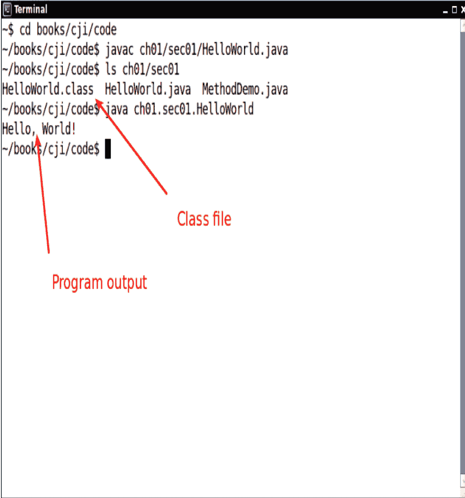
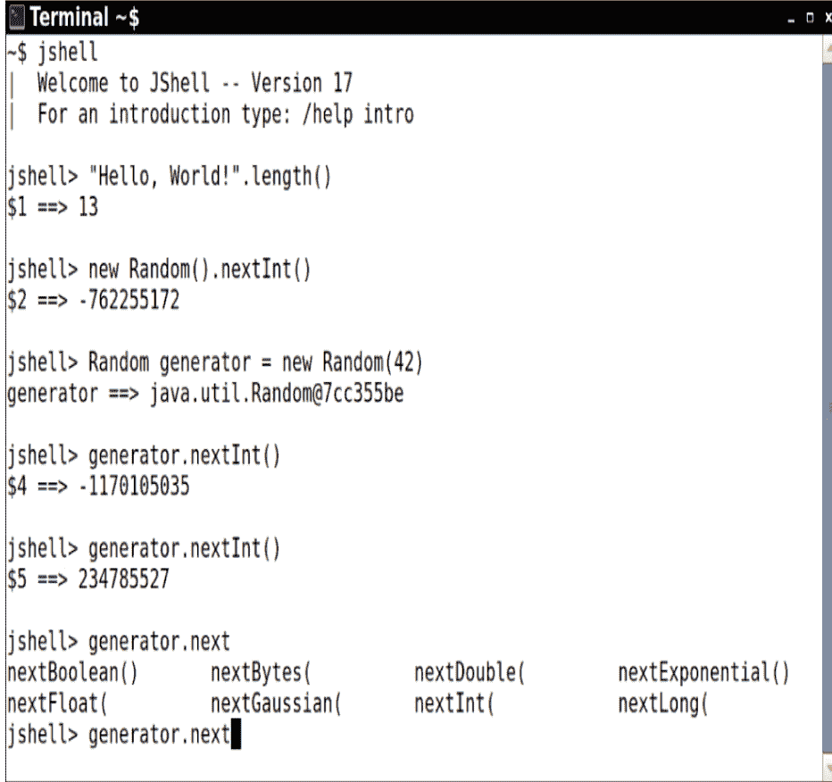
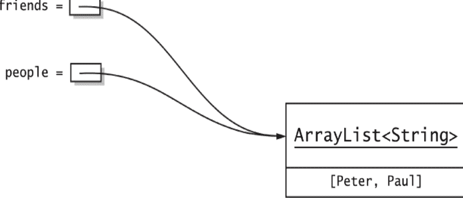
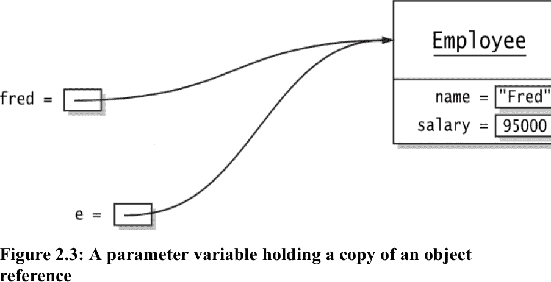
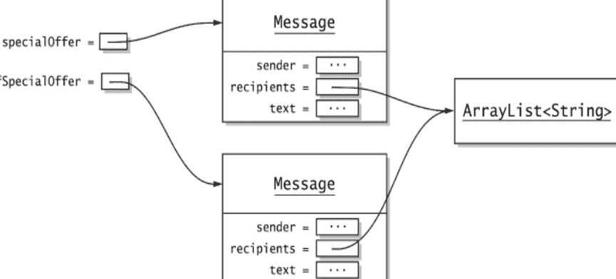
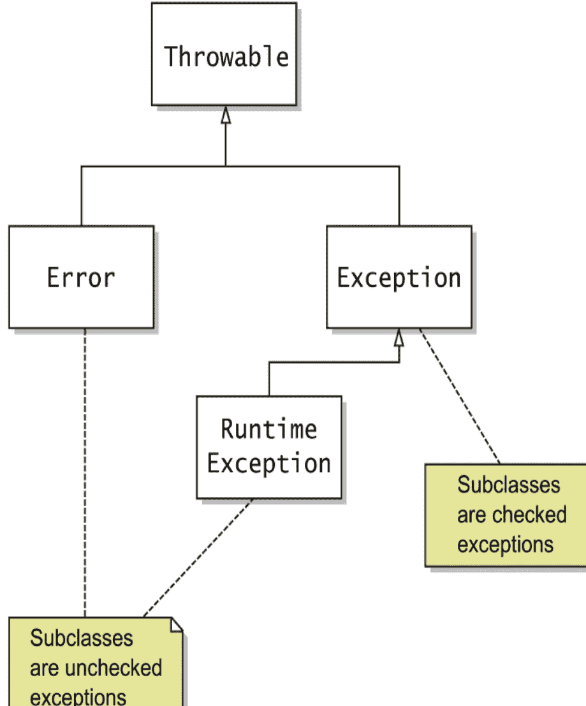
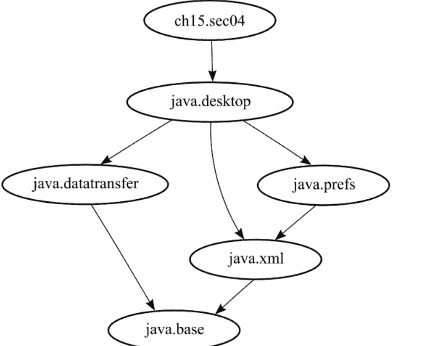

# Core Java：急躁者指南，第3版（初稿）

Cay S. Horstmann

前言

致谢

关于作者

## 第一章：基础编程结构

- 1.1. 我们的第一个程序
- 1.2. 原始类型
- 1.3. 变量
- 1.4. 算术运算
- 1.5. 字符串
- 1.6. 输入与输出
- 1.7. 控制流
- 1.8. 数组与数组列表 (Array Lists)
- 1.9. 功能化分解
- 练习题

## 第二章：面向对象编程

- 2.1. 使用对象
- 2.2. 实现类
- 2.3. 对象构造
- 2.4. 记录 (Records)
- 2.5. 静态变量与方法
- 2.6. 包 (Packages)
- 2.7. 嵌套类
- 2.8. 文档注释
- 练习题

## 第三章：接口与 Lambda 表达式

- 3.1. 接口
- 3.2. 静态、默认与私有方法
- 3.3. 接口示例
- 3.4. Lambda 表达式
- 3.5. 方法与构造函数引用
- 3.6. 处理 Lambda 表达式
- 3.7. Lambda 表达式与变量作用域
- 3.8. 高阶函数
- 3.9. 本地类与匿名类
- 练习题

## 第四章：继承与反射

- 4.1. 扩展类
- 4.2. 继承层次
- 4.3. Object：宇宙超类
- 4.4. 枚举 (Enumerations)
- 4.5. 运行时类型信息与资源
- 4.6. 反射
- 练习题

## 第五章：异常、断言与日志记录

- 5.1. 异常处理
- 5.2. 断言
- 5.3. 日志记录
- 练习题

## 第六章：泛型编程

- 6.1. 泛型类
- 6.2. 泛型方法
- 6.3. 类型边界
- 6.4. 类型变变与通配符
- 6.5. 虚拟机中的泛型
- 6.6. 泛型的限制
- 6.7. 反射与泛型
- 练习题

## 第七章：集合

- 7.1. 集合框架概述
- 7.2. 迭代器 (Iterators)
- 7.3. 集合 (Sets)
- 7.4. 映射 (Maps)
- 7.5. 其他集合
- 7.6. 视图 (Views)

## 第八章：流 (Streams)

- 8.1. 从迭代到流操作
- 8.2. 流的创建
- 8.3. filter, map 和 flatMap 方法
- 8.4. 提取子流与合并流
- 8.5. 其他流转换
- 8.6. 简单归约 (Reductions)
- 8.7. Optional
- 8.8. 收集结果
- 8.9. 收集到 Map
- 8.10. 分组与分区
- 8.11. 下游收集器
- 8.12. 归约操作
- 8.13. 原始类型流
- 8.14. 并行流
- 练习题

## 第九章：输入输出处理

- 9.1. 输入输出流、读取器与写入器
- 9.2. 路径、文件与目录
- 9.3. HTTP 连接
- 9.4. 正则表达式
- 9.5. 序列化
- 练习题

## 第十章：并发编程

- 10.1. 并发任务
- 10.2. 异步计算
- 10.3. 线程安全
- 10.4. 并行算法
- 10.5. 线程安全的数据结构
- 10.6. 原子计数器与累加器
- 10.7. 锁与条件 (Conditions)
- 10.8. 线程
- 10.9. 进程
- 练习题

## 第十一章：注解

- 11.1. 使用注解
- 11.2. 定义注解
- 11.3. 标准注解
- 11.4. 运行时处理注解
- 11.5. 源码级注解处理
- 练习题

## 第十二章：日期与时间 API

- 12.1. 时间线
- 12.2. 本地时间
- 12.3. 日期示例
- 12.4. 现代时间
- 12.5. 时区时间
- 12.6. 格式化
- 12.7. 解析

## 第十三章：国际化

- 13.1. 语言区域 (Locales)
- 13.2. 格式
- 13.3. 货币
- 13.4. 日期格式
- 13.5. 编码
- 13.6. 偏好
- 13.7. 资源包 (Bundles)
- 13.8. 字符
- 13.9. 选项

## 第十四章：编译与脚本化

- 14.1. 编译器
- 14.2. 脚本

## 第十五章：Java 平台模块系统

- 15.1. 模块概念
- 15.2. 命名
- 15.3. “Hello World!”
- 15.4. 要求
- 15.5. 导出
- 15.6. 访问
- 15.7. 服务
- 15.8. 自动
- 15.9. 模块
- 15.10. 命令行
- 15.11. 传递性
- 15.12. 导出
- 15.13. 加载
- 15.14. 工具
- 练习题

# 前言

Java 已经有二十年的历史了。这本书《给急读者的核心 Java》涵盖了 Java 的各个方面，长达几千页。在本书中，你将学习现代 Java 的特性。我假设你是某种其他语言的资深程序员，熟悉变量、循环、函数调用和数组等概念，但语法可能不同。这本书将带你了解如何让工作变得高效且愉快。如果你发现错误或有建议，请访问 http://horstmann.com/javaimpatient，前往错误页面并留言。在该网站，你还可以找到包含书中所有代码示例的存档文件。

我希望你喜欢这本书。

# 致谢

（内容待后续）

# 关于作者

（内容待后续）

## 第一章：基础编程结构

在本章中，你将学习 Java 语言的基础类型和控制结构。我假设你是其他语言的资深程序员，熟悉变量、循环、数组等概念，但语法可能不同。本章将带你掌握 Java 的写法。我还将介绍 Java API 中最实用的部分，用于处理常见数据类型。

本章的关键点包括：

1. 在 Java 中，所有方法都定义在类中。通过该类的实例对象来调用非静态方法。
2. 静态方法不通过对象调用。程序执行始于静态 `main` 方法。
3. Java 有八种原始类型：四种有符号整数类型、两种浮点类型、`char` 和 `boolean`。
4. Java 的运算符和控制结构与 C 或 JavaScript 非常相似。
5. `switch` 有四种形式：表达式和带有穿透的语句。
6. `Math` 类提供了常用的数学函数。
7. `String` 对象是字符序列，更准确地说是 UTF-16 编码的 Unicode 代码点。
8. 使用“文本块”语法来声明多行字符串字面量。
9. 通过 `System.out` 对象，你可以在终端窗口显示输出。绑定 `System.in` 的 `Scanner` 可以让你读取终端输入。
10. 数组和集合可以收集相同类型的元素。

### 1.1. 我们的第一个程序

在学习任何新编程语言时，传统的做法是从一个显示“Hello, World!”消息的程序开始。这就是我们在接下来的章节中要做的。

#### 1.1.1. 解析“Hello, World”程序

直奔正题，这是 Java 版本的“Hello, World”程序。

```java
package ch01.sec01;

// 我们的第一个 Java 程序

public class HelloWorld {
    public static void main(String[] args) {
        System.out.println("Hello, World!");
    }
}
```

让我们检查这个程序：

- Java 是一种面向对象的语言。在你的程序中，你通过让对象工作来操作（大部分）对象。你操作的每个对象都属于一个特定的类，我们称对象的状态以及它可以做什么。在 Java 中，所有代码都定义在类内部。我们将在第 2 章详细介绍对象和类。这个程序由单个类 `HelloWorld` 组成。

- `main` 是一个方法，即声明在类内部的函数。`main` 方法是程序运行时调用的第一个方法。它被声明为 `static`，表示该方法不对任何对象进行操作。（当 `main` 被调用时，只有少数预定义的对象，且它们没有是 `HelloWorld` 类的实例。）该方法被声明为 `void`，表示它不返回任何值。关于参数声明 `String[] args` 的含义，请参见第 1.8.8 节。

- 在 Java 中，你可以将许多特性声明为 `public` 或 `private`，还有其他可见级别。在这里，我们将 `HelloWorld` 类和 `main` 方法声明为 `public`，这是类方法最常见的安排。

- 包（package）是相关类的集合。将每个类放在包中是一个好主意，这样你可以将相关类分组，并避免多个类具有相同名称时发生冲突。在书中，我们将使用章节和节号作为包名。我们的类全名是 `ch01.sec01.HelloWorld`。第 2 章将对包和包命名规范进行更多介绍。

- 以 `//` 开头的行是注释。`//` 到行尾之间的所有字符都会编译器忽略，供人类读者阅读。

- 最后，我们来到 `main` 方法的主体。在我们的示例中，它由单行命令组成，向 `System.out` 打印消息，`System.out` 是一个代表 Java 程序“标准输出”的对象。

如你所见，Java 不是一种可以用来快速编写几条命令的脚本语言。它明确旨在用于大型程序，这些程序受益于组织成类、包和模块（模块将在第 15 章介绍）。

Java 同时也非常简单且统一。某些语言具有全局变量，以及作为类内部变量的函数。在 Java 中，一切都声明在类内部。这种统一性可能会导致代码有些冗长，但它使得程序的含义易于理解。

# 注意

> 你刚刚看到一个延伸到行尾的 `//` 注释。你也可以在 `/*` 和 `*/` 分隔符之间使用多行注释，例如：

```java
/*
这是《急速版 Core Java》中的第一个示例程序。
该程序显示传统的问候“Hello, World!”
*/
```

还有第三种注释样式，称为文档注释，使用 `/**` 和 `*` 作为分隔符，你将在下一章看到它。

### 1.1.2. 编译和运行 Java 程序

要编译并运行此程序，你需要安装 Java 开发工具包（JDK）以及可选的集成开发环境（IDE）。你还应该下载示例代码，你可以在本书的配套网站找到它们：http://horstmann.com/javaimpatient。由于安装软件的说明并不有趣，我也将它们放在了配套网站上。

一旦安装了 JDK，打开终端窗口，切换到包含 `ch01` 目录的目录，并运行命令：

```bash
javac ch01.sec01/HelloWorld.java
java ch01.sec01.HelloWorld
```

熟悉的问候语将出现在终端窗口中（见图 1.1）。

注意，执行该程序涉及两个步骤。`java` 命令将 Java 源代码编译成与机器无关的中间表示，称为字节码（byte codes），并将其保存在类文件中。`java` 命令启动一个虚拟机，加载类文件并执行字节码。

一旦编译，字节码可以在任何 Java 虚拟机上运行，无论是在你的台式电脑上，还是在遥远星系的设备上。“一次编写，随运行”的承诺是 Java 的一个重要设计标准。



图 1.1：在终端窗口中运行 Java 程序

# 注意

调用 `javac` 编译器时使用文件名，用斜杠分隔路径段，并带有扩展 `.java`。调用 `java` 虚拟机启动器使用类名，用点分隔包段，且没有扩展名。

# 注意

如果你的程序由单个源文件，那么你可以跳过编译步骤并使用命令运行程序：

```bash
java ch01/sec01/HelloWorld.java
```

在后台，程序在运行之前会进行编译，但不会产生类文件。

# 注意

在类 Unix 操作系统上，你可以按照以下步骤将 Java 文件转换为可执行程序：

1. 重命名文件，使其不具有扩展名：`mv HelloWorld.java hello`
2. 赋予该文件可执行权限：`chmod +x hello`
3. 在文件顶部添加“shebang”行：

   ```bash
   #!/usr/bin/java
   ```

4. 现在你可以这样运行程序：`./hello`


图 1.2：在 Eclipse 中运行程序

恭喜！你刚刚遵循了在 Java 中运行“Hello, World!”程序的传统。现在我们准备好学习 Java 语言的基础。

在 http://horstmann.com/javaimpatient，你可以下载书中所有章节的示例代码，代码将在文中展示。代码的组织方式让你能够包含所有示例程序的项目。我鼓励你在跟随书籍的同时下载、运行并学习代码。

### 1.1.3. 方法调用

让我们仔细观察 `main` 方法中的单行语句：

```java
System.out.println("Hello, World!");
```

`System.out` 是一个对象。它是 `PrintStream` 类的实例。`PrintStream` 类拥有 `println`、`print` 等方法。这些方法被称为实例方法（instance methods），因为它们对类的对象或实例进行操作。

要在对象上调用实例方法，你使用点操作符：

```
object.methodName(arguments)
```

在这种例中，只有一个参数，字符串 "Hello, World!"。让我们用另一个例子尝试。像 "Hello, World!" 这样的字符串是 `String` 类的实例。`String` 类有一个方法 `length`，返回 `String` 对象的长度。调用该方法时，再次使用点操作符：

```java
"Hello, World!".length()
```

`length` 方法在对象 "Hello, World!" 上被调用，并且它没有参数。与 `println` 方法不同，`length` 方法返回结果。使用该结果的一种方法是打印它：

```java
System.out.println("Hello, World!".length());
```

尝试一下。编写包含此语句的 Java 程序并运行它，看看字符串有多长。

这是一个简单的示例。

`Random` 类的对象可以生成随机数。你使用 `new` 运算符构造一个 `Random` 对象：

```
new Random()
```

在类名之后是构造参数列表，在本示例中，它是空的。

你可以对构造的对象调用方法。该调用

```
new Random().nextInt()
```

会产生新构造的随机数生成器所提供的下一个整数。

如果你想在一个对象上调用多个方法，请将其存储在变量中（请参阅第 1.3 节）。在这里，我们打印两个随机数：

```java
Random generator = new Random();
System.out.println(generator.nextInt());
System.out.println(generator.nextInt());
```

# Note

`Random` 类声明在 `java.util` 包中。要在你的程序中使用它，请添加 import 语句，如下所示：

```java
package ch01.sec01;
```

```java
import java.util.Random;
```

```java
public class MethodDemo {
  ...
}
```

我们将在第 2 章中详细查看包和 import 语句。

### 1.1.4. JShell

在 1.1.2 节中，你了解了如何编译和运行 Java 程序。JShell 程序提供了一个“读取-评估-打印循环”（REPL），它允许你在无需编译和运行程序的情况下对 Java 代码进行实验。当你输入一个 Java 表达式时，JShell 会评估你的输入，打印结果，并等待你的下一次输入。要启动 JShell，只需在终端窗口中输入 `jshell`（图 1.3）。



图 1.3：运行 JShell

JShell 启动时会显示欢迎语，随后是提示符：

| Welcome to JShell -- Version 17 |

| For an introduction type: /help intro |

```
jshell>
```

现在输入任何 Java 表达式，例如

```
"Hello, World!".length()
```

JShell 响应结果和另一个提示符。

```
$1 => 13
```

```
jshell>
```

注意，你*不需要*输入 `System.out.println`。JShell 会自动打印你输入的每个表达式的值。

输出中的 `$1` 表示该结果可以用于进一步的计算。例如，如果你输入

```
3 * $1 + 3
```

响应是

```
$2 => 22
```

如果你需要多次使用一个变量，可以给它起一个更易记忆的名字。你必须遵循 Java 语法，并同时指定类型和名称（参阅第 1.3 节）。例如，

```
jshell> int answer = 42
answer => 42
```

你可以让 JShell 为你填充类型。输入一个表达式，然后不要按 Enter 键，而是按 Shift+Tab 然后按 V 键。例如，当你输入

```
new Random()
```

接着按 Shift+Tab 和 V 键时，你会得到

```
jshell> Random = new Random()
```

光标将位于 `=` 符号之前。现在输入一个变量名并按 Enter：


```java
jshell> Random generator = new Random()
generator => java.util.Random@3fee9989
```

另一个实用功能是 Tab 补全。输入`generator.`接着按 Tab 键。你会得到可以在`generator`变量上调用的所有方法列表：

```text
jshell> generator.
double(      equals(      getClass(
hashCode(      ints(
isDeprecated(
long(      nextBoolean(      nextBytes(
extDouble(      nextExponential(      nextFloat(
extGaussian(      nextInt(      nextLong(
otify(      notifyAll(      setSeed(
tString(            wait(
```

现在输入`ne`并再次按 Tab 键。方法名被补全为`next`，你会得到一个更短的列表：

```text
jshell> generator.next
nextBoolean(      nextDouble(
extExponential(      nextFloat(
nextGaussian(
nextInt(      nextLong(
```

输入一个 D 并再次按 Tab，现在`nextDouble(`被填充了。再次按 Tab，你会看到三种备选方案：

签名：

- `double`
- `java.util.random.RandomGenerator.nextDouble(double bound)`
- `double`
- `java.util.random.RandomGenerator.nextDouble(double origin, double bound)`
- `double Random.nextDouble()`

<再次按 tab 以查看文档>

输入一个`)`来选择第三个版本：

```text
jshell> generator.nextDouble()
$3 --> 0.956034656837398
```

# 注意

在自动补全列表中，可能需要参数的方法后面跟着一个左括号，但没有参数的方法`nextDouble()`两个都有括号，例如`nextBoolean()`。

重复操作，注意：可能需要参数的方法后面跟着一个左括号，但没有参数的方法`nextDouble()`两个都有括号，例如`nextBoolean()`。

## 1.2. Primitive Types

If you work with integer values that can never be negative and signed really need an additional bit, you can, with some care, interpret signed values as unsigned. For example, a byte represents the range from -128 to 127. If you want a range from 0 to 255, you can still store it in a byte. Due to the nature of binary arithmetic, addition, subtraction, and multiplication will all work, provided they don't overflow. For other operations, call`Byte.toUnsignedInt(b)`to get an int value between 0 and 255, then process the integer value, and cast the result back to byte. The`Integer`and`Long`classes have methods for unsigned division and remainder.

### 1.2.1. Signed Types

| Type | Storage | Range (inclusive) |
| :--- | :--- | :--- |
| `byte` | 1 byte | -128 to 127 |
| `short` | 2 bytes | -32,768 to 32,767 |
| `int` | 4 bytes | -2,147,483,648 to 2,147,483,647 |
| `long` | 8 bytes | -9,223,372,036,854,775,808 to 9,223,372,036,854,775,807 |

The constants`Integer.MIN_VALUE`and`Integer.MAX_VALUE`are the smallest and largest. The`Long`、`Short`and`Byte`classes also have`MIN_VALUE`and`MAX_VALUE`. In most situations, the`int`type is the most practical. If you want to represent the number of inhabitants of planet, you will need to resort to`long`. The`byte`and`short`types are mainly intended for specialized applications, such as low-level file handling, or for large arrays when storage space is at a premium.

### 1.2.2. 浮点类型

浮点类型表示带有小数部分的数字。表 1.2 显示了两种浮点类型。

表 1.2：浮点类型

| 类型 | 存储需求 | 范围 |
| :--- | :--- | :--- |
| `float` | 4 字节 | 约 ±3.40282347E+38（6-7 位有效数字） |
| `double` | 8 字节 | 约 ±1.79769313486231570E+308（15 位有效数字） |

年前，当内存是稀缺资源时，四字节浮点数很常见。但七位十进制数字精度有限，而如今，“双精度”数字是默认选择。只有当你需要存储大量的此类数字时，使用`float`才有意义。

`float`类型的数字带有后缀 F（例如，`3.14F`）。不带 F 后缀的浮点字面量（如`3.14`）类型为`double`。你可以选择性地提供 D 后缀（例如，`3.14D`）。

# 注意

> 你可以使用十六进制指定浮点数字面量。例如，0.0009765625 = $2^{-10}$ 可以写为`0x1.0p-10`。在十六进制表示法中，使用`p`而不是`e`来表示指数。（e 是一个十六进制数字）。注意，尽管数字是用十六进制编写的，但指数（即 2 的幂）是用十进制编写的。

有特殊的浮点数值：`Double.POSITIVE_INFINITY`表示 $\infty$，`Double.NEGATIVE_INFINITY`表示 $-\infty$，以及`Double.NaN`表示“不是数字”。例如，计算 $1.0 / 0.0$ 的结果是正无穷大；`0.0 / 0.0`或负数的平方根会产生 NaN。

# 注意

所有的“不是数字”值都被认为是彼此相互不同的。因此，你不能使用测试`if (x == Double.NaN)`来检查 x 是否为 NaN。相反，请调用`if (Double.isNaN(x))`。还有方法`Double.isInfinite`用于测试 ±，以及`Double.isFinite`用于检查浮点数既不是无穷大也不是 NaN。

浮点数不适用于不能忍受舍入误差的财务计算。例如，命令`System.out.println(2.0 - 1.7)`输出的是 0.30000000000000004，而不是你预期的 0.3。舍入误差是由浮点数在二进制系统中表示这一事实造成的。分数 3/10 没有精确的二进制表示，就像十进制系统中没有分数 1/3 的精确表示一样。如果你需要任意精度且无舍入误差的精确计算，请使用在第 1.4.6 节引入的`BigDecimal`类。

### 1.2.3. char 类型

`char`类型描述了 Java 使用的 UTF-16 字符编码中的“代码单元”。细节相当技术化——参见第 1.5 节。你可能不会频繁使用`char`。

偶尔，你可能会遇到用单引号括起的字符字面量。例如，‘J’ 是一个值为 74（或十六进制 4A）的字符字面量，它是表示 Unicode 字符“U+004A Latin Capital Letter J”的代码单元。代码单元可以用十六进制表示，并带有`\u`前缀。‘\u004A’与‘J’相同。一个更奇特的例子是‘\u263A’，它是 ☺️.U+263A White Smiling Face 的代码单元。

特殊代码`\n`、`\r`、`\t`、`\b`分别表示换行、回车、制表符和退格。

使用反斜杠转义单引号‘\’和反斜杠`\\`。

### 1.2.4. boolean 类型

`boolean`类型有两个值：`false`和`true`。

在 Java 中，`boolean`类型不是数字类型。`boolean`值与整数 0 和 1 之间没有关系。

## 1.3. 变量

在后续章节中，你将学习如何声明和初始化变量以及常量。

### 1.3.1. 变量声明

Java 是一种强类型语言。每个变量只能持有特定类型的值。当你声明变量时，需要指定类型、名称和可选的初始值。例如：

```java
int total = 0;
```

你可以在一条语句中声明多个相同类型的变量：

```java
int total = 0, count; // count 是一个未初始化的整数
```

大多数 Java 程序员倾向于为每个变量使用单独声明。考虑这个变量声明：

```java
Random generator = new Random();
```

在这里，对象类的名称出现了两次。第一个`Random`是变量`generator`的类型。第二个`Random`是构造该类对象的新表达式中的一部分。

为了避免这种重复，你可以使用`var`关键字声明变量：

```java
var generator = new Random();
```

那么，变量的类型就是初始化该变量的表达式的类型。在这个例子中，`generator`是`Random`类型的变量。

在本书中，每当声明变量的类型完全显而易见时，我都会使用`var`。

### 1.3.2. 标识符

变量、方法或类的名称被称为`标识符`。在 Java 中，标识符必须以字母开头。它可以由任何字母、数字以及符号`_`和`$`组成。然而，`$`符号旨在用于自动生成的标识符，你不应该使用它。最后，单独的`_`本身不是有效的标识符。

在这里，字母和数字可以来自任何字母表，而不只是拉丁字母。例如，`π`和`élév`是有效的标识符。大小写是有区别的：`count`和`Count`是不同的标识符。

你不能在标识符中使用空格或符号。最后，你不能使用如`double`等关键字。

按照习惯，变量和方法名以小写字母开头，类名以大写字母开头。Java 程序员使用驼峰命名法（camel case），当名称由多个单词组成时使用大写字母，如`indexOfInputs`。

### 1.3.3. 初始化

在方法中声明变量时，必须在使用之前对其进行初始化。例如，以下代码会导致编译错误：

```java
int count;
count++; // 使用未初始化的变量
```

编译器必须能够验证变量已初始化。例如，以下代码是合法的：

```java
int count;
if (total == 0) {
    count = 0;
} else {
    count = 1;
}
```

或者尽可能晚地初始化。只要在第一次使用之前对`final`变量进行过初始化，延迟初始化是允许的。例如：

```java
final int DAYS_IN_FEBRUARY;
if (leapYear) {
    DAYS_IN_FEBRUARY = 29;
} else {
    DAYS_IN_FEBRUARY = 28;
}
```

### 1.3.4. 常量

`final`关键字表示值一旦赋值就无法更改。在其他语言中，人们将这样的值称为常量。例如：

```java
final int DAYS_PER_WEEK = 7;
```

按照习惯，常量名使用大写字母。你还可以在方法外声明常量，使用`static`关键字：

```java
public class Calendar {
    public static final int DAYS_PER_WEEK = 7;
    ...
}
```

那么该常量可以在多个方法中使用。在`Calendar`内部，我们直接通过`DAYS_PER_WEEK`引用该常量。要在另一个类中使用该常量，请加上类名：`Calendar.DAYS_PER_WEEK`。

> 注意

`System`类声明了一个常量`public static PrintStream out`，你可以在任何地方作为`System.out`使用。这是少数没有用大写写的常量示例之一。

有时，你需要一组相关的常量，例如：

```java
public static final int MONDAY = 0;
public static final int TUESDAY = 1;
...
```

在这种情况下，你可以定义这样一个枚举：

```java
enum Weekday { MONDAY, TUESDAY, WEDNESDAY,
THURSDAY, FRIDAY,
SATURDAY, SUNDAY };
```

那么，`Weekday`是一个具有`Weekday.MONDAY`等值的类型。以下是声明和初始化`Weekday`变量的方法：

```java
Weekday startDay = Weekday.MONDAY;
```

我们将在第 4 章讨论枚举。

## 1.4. 算术运算

Java 使用了任何基于 C 的语言中熟悉的运算符（参见表 1.3）。我们将在后续章节中复习它们。

表 1.3：Java 运算符

| 运算符 | 结合性 |
| :--- | :--- |
| `[] . ( )`（方法调用） | 左 |
| `! ~ ++ - +`（一元）`-`（一元）`()`（强制转换） | 右 |
| `* / %`（取模） | 左 |
| `+` | 左 |
| `<< >>>`（算术移位） | 左 |
| `< > <= instanceof` | 左 |
| `== !=` | 左 |
| `&`（位与） | 左 |
| `^`（位异或） | 左 |
| `|`（位或） | 左 |
| `&&`（逻辑与） | 左 |
| `||`（逻辑或） | 左 |
| `? :`（条件/三元） | 左 |
| `= += - *= /= %= <= >>> >= &= ^ |=` | 右 |

# 注意

在此表中，运算符按优先级从高到低顺序列出。例如，由于`+`的优先级高于`<<`，因此`3 + 4 << 5`的值是`32 + 4 << 5`。当运算符从左到右进行分组时，它是左结合的。例如，`3 - 4 - 5`意味着`(3 - 4) - 5`。但`==`是右结合的，且`i == j == k`意味着`i == (j == k)`。

### 1.4.1. 赋值

表 1.3 的最后一行显示了赋值运算符。语句

`x = expression;`

将`x`设置为右侧的值，替换掉之前的值。

赋值是一个带有值的运算符，该值即为正在被赋值的值。在另一个表达式中嵌套赋值是合法的。例如：

```java
(next = in.read()) != -1
```

将`next`设置为`in.read()`返回的值，然后如果该值不是 -1，则求值为真。

当`=`前面有一个运算符时，该运算符会将左侧和右侧结合，并将结果赋值。例如：

```java
amount -= fee;
```

等同于：

```java
amount = amount - fee;
```

### 1.4.2. 算术

加法、减法、乘法和除法由`+`、`-`、`*`、`/`表示。例如，`2 + * n + 1`意味着 2 与 n 相乘加 1。

你需要小心处理`/`。如果两个操作数都是整数类型，它表示整数除法，舍弃余数。例如，`17 / 5`是 3，而`17.0 / 5`是 3.4。

整数除以零会产生异常，如果没有捕获，它将终止你的程序。（有关异常处理的更多信息请参见第 5 章。）浮点数除以零会产生无限值或 NaN（见第 1.2.2 节），不会引起异常。

`%`运算符产生余数。例如，`17 % 5`是 2，即 17 减去 15（“适合”17 的 5 的最大整数倍数）后剩余的。如果`a % b`的余数为 0，则`a`是`b`的整数倍数。

一个常见的用途是测试整数是否为偶数。如果`n`是偶数，则表达式`n % 2`为 0。如果`n`是奇数呢？如果`n`是正数，则`n % 2`为 1；如果`n`是负数，则`n % 2`为 -1。这种对负数的处理在实践中是不便的。在使用`%`处理可能的负数操作数时要始终小心。

考虑这个问题。你计算时钟时针的位置。应用了一个调整，你想将一个数字归一化在 0 到 11 之间。这很容易：`(position + adjustment) % 12`。但如果调整导致位置变成负数呢？你可能会得到一个负数。所以你必须引入一个分支，或者使用`((position + adjustment) % 12 + 12) % 12`。无论哪种，都很麻烦。

# 提示

> 在这种情况下，使用`Math.floorMod`方法更简单：`Math.floorMod(position + adjustment, 12)`总是产生一个在 0 到 11 之间的值。
>
> 遗憾的是，`floorMod`对负数除数会给出负结果，但这种情况在实践中并不经常发生。

Java 有递增和递减运算符：

```java
n++; // 将 n 加 1
--; // 将 n 减 1
```


在其他基于 C 的语言中，还有这些运算符的前置形式。`n++` 和 `++` 都会递增变量，但它们在表达式内部使用时值不同。第一种形式产生递增之前的值，第二种产生递增后的值。例如，

```
String arg = args[n++];
```

将 `arg` 设置为 `args[n]`，然后增加 `n`。这在三十年前是有意义的，因为当时的编译器优化代码做得并不好。如今，使用两个独立的语句没有性能上的缺点，许多程序员发现显式形式更容易读。

### 1.4.3. 数学方法

没有运算符可以计算数的幂。相反，调用 `Math.pow`：`Math.pow(x, y)` 得到 `x^y`。计算 `x` 的平方根，调用 `Math.sqrt(x)`。

这些是静态方法，不操作对象。像静态常量一样，它们在类中声明。

`Math.min` 和 `Math.max` 用于计算两个值的最小值和最大值。此外，还提供了三角函数和对数函数。

# 注意

> 在这种情况下，使用 `Math.floorMod` 方法更容易：`Math.floorMod(position + adjustment, 12)` 总是产生一个在 0 到 11 之间的值。

> 遗憾的是，`floorMod` 对负数除数会给出负结果，但这种情况在实践中并不经常发生。

> 此外，`Math.PI` 和 `Math.E` 是常量。

### 1.4.4. 类型转换

当你将数值类型的值赋值给变量或作为参数传递时，如果类型不匹配，则必须进行转换。例如，赋值

```
double x = 42;
```

`42` 被自动转换为 `int`。

当运算符结合不同类型的操作数时，它们被转换为公共类型。转换顺序如下：

1. 如果其中一个操作数是 `double`，其他转换为 `double`。

2. 如果其中一个操作数是 `float`，其他转换为 `float`。

3. 如果其中一个操作数是 `long`，其他转换为 `long`。

4. 否则，两个操作数都转换为 `int`。

在 Java 中，如果没有信息丢失，转换总是存在的：

- 从 `byte` 到 `short`、`int`、`long` 或 `double`

- 从 `short` 到 `char`、`int`、`long` 或 `double`

- 所有的整数类型都可以转换为浮点类型。

# 注意

以下转换可能会丢失信息：

- 从 `int` 到 `float`

- 从 `long` 到 `double`

例如，考虑赋值

```
float f = 123456789;
```

因为 `float` 只有大约七位数字，`f` 实际上是 `1.2345679E8`。

要进行这些自动转换之外的转换，使用强制转换运算符：括号中的目标类型。例如，

```
double x = 3.75;
int n = (int) x;
```

在这种情况下，小数部分被丢弃，`n` 被设置为 `3`。

如果你想四舍五入到最近的整数，使用 `Math.round` 方法。该方法返回一个 `long`。如果你知道值可以放入 `int`，调用

```
int n = (int) Math.round(x);
```

在我们的示例中，`x` 是 `3.75`，`n` 被设置为 `4`。

要将类型转换为字节更少的类型，也使用强制转换：

```java
int n = 1;
char next = (char)('J' + n); // 将 75 转换为 'K'
```

在这样的强制转换中，只保留最后的字节。

```java
int n = (int) 3000000000L; // 设置 n 为 -1294967296
```

# 注意

如果你担心强制转换会静默丢弃数字的重要部分，请改用 `Math.toIntExact` 方法。当它无法将 `long` 转换为 `int` 时，会发生异常。

### 1.4.5. 关系与逻辑运算符

`==` 和 `!=` 运算符测试相等性。例如，当 `n` 不为零时，`n != 0` 为真。

还有常用的 `<`（小于）、`>`（大于）、`<=`（小于等于）和 `>=`（大于等于）运算符。

你可以将布尔类型的表达式与 `&&`（与）、`||`（或）和 `!`（非）运算符结合。例如：

```
0 <= n && n < length
```

如果 `n` 位于零（包含）和 `length`（不包含）之间，则为真。

如果第一个条件为假，则不会求值第二个条件。这种“短路”求值在第二个条件可能导致错误时也非常有用。考虑以下条件：

```
n != 0 && s + (100 - s) / n < 50
```

如果 `n` 为零，那么包含除以 `n` 的第二个条件将永远不会被执行，也不会发生错误。

短路求值也用于“或”操作，但只要操作数为真，求值就会停止。例如，以下计算的：

```
n == 0 || s + (100 - s) / n >= 50
```

如果 `n` 为零，结果为真，而无需求值第二个条件。

最后，条件运算符接收三个操作数：一个条件和两个值。如果条件为真，返回第一个值；否则返回第二个值。

```
time < 12 ? "am" : "pm"
```

如果 `time < 12`，则产生字符串 `"am"`，否则产生字符串 `"pm"`。

## Note

还有与逻辑运算符相关的位运算符 `&`（位与）、`|`（位或）和 `^`（位异或）。它们作用于整数的位模式。例如，由于 `0xF` 的二进制数字为 `0...01111`，`n & 0xF` 产生 `n` 的低四位，`n = n | 0xF` 将低四位设置为 1，而 `n = n ^ 0xF` 则翻转这些位。类似于 `~`，它翻转其操作数的所有位：`~0xF` 是 `1...10000`。

还有将位模式向左或向右移动的运算符。例如，`0xF << 2` 的二进制数字为 `0...0111100`。有两种右移运算符：`>>` 将符号位扩展到高位，而 `>>>` 用零填充高位。如果你在程序中进行位操作，你就知道这意味着什么。如果不需要，你就不需要这些运算符。

## Caution

如果左侧是 `int`，则移动运算符的右侧操作数将对 32 取模；如果左侧是 `long`，则对 64 取模。例如，`1 << 35` 的值与 `1 << 3` 或 `8` 相同。

## Tip

`&`（与）和 `|`（或）运算符在应用于布尔值时，会强制在合并结果之前求值两个操作数。这种用法非常常见。只要右侧没有副作用，它们的作用与 `&&` 和 `||` 相似，只是效率较低。如果你确实需要强制求值第二个操作数，请将其赋值给布尔变量，以便执行流清晰可见。

### 1.4.6. 大数

如果基本整数类型和浮点数类型的精度不足，你可以转向 `java.math` 包中的 `BigInteger` 和 `BigDecimal` 类。这些类的对象表示具有任意长度数字序列的。`BigInteger` 类实现了任意精度整数算术，而 `BigDecimal` 对浮点数执行相同的操作。当然，使用大数的计算远比使用原始数值类型慢得多。

静态方法 `valueOf` 将 `long` 转换为 `BigInteger`：

```
BigInteger n =
BigInteger.valueOf(87654321023456789L);
```

你也可以从字符串构造 `BigInteger`：

```
var k = new BigInteger("98765432102345689");
```

有预定义的常量 `BigInteger.ZERO`、`BigInteger.ONE`、`BigInteger.TEN`。

Java 不允许对对象使用运算符，因此必须使用方法调用来处理大数。

```
BigInteger r =
BigInteger.valueOf(5).multiply(n.add(k)); // r = 5 * (n + k)
```

在章节 1.2.2 中，你提到浮点减法 `2.0 - 1.7` 的结果是 `0.3000000000000004`。`BigDecimal` 类可以精确计算结果。

调用 `BigDecimal.valueOf(n, e)` 返回一个值为 $n \times 10^{-e}$ 的 `BigDecimal` 实例。

```
BigDecimal.valueOf(2,
0).subtract(BigDecimal.valueOf(17, 1))
```

精确 `0.3`。

## 1.5. 字符串

字符串是字符序列。例如，字符串 `"Java"` 或 `"Java™"` 由五个字符 `J`、`a`、`v`、`a` 和 `™` 组成。最后一个字符是 `U+2122`。

### 1.5.1. 拼接

使用 `+` 运算符连接两个字符串。例如：

```
String location = "Java";
```

### 1.5.2. 子字符串

要拆分字符串，使用 `substring` 方法。例如：

```
String greeting = "Hello World!";
String location = greeting.substring(6, 12); // 将 location 设置为 "World"
```

`substring` 方法的第一个参数是子字符串的起始位置。位置从 0 开始。第二个参数是不包含在子字符串中的第一个位置。在我们的示例中，位置 `12 - 7` 是子字符串的长度。

有时，你想从由分隔符分隔的字符串中提取所有子字符串。`split` 方法返回子字符串数组。

```java
String names = "Peter, Paul, Mary";
String[] result = names.split(","); // 数组 ["Peter", "Paul", "Mary"]
```

分隔符可以是正则表达式（见第9章）。例如，`input.split("\\s+")` 按空格分割输入。

### 1.5.3. 字符串比较

要检查两个字符串是否相等，使用 `equals` 方法。例如：

```
location.equals("World")
```

如果 `location` 实际上是字符串 `"World"`，则返回真。

## Caution

永远不要使用 `==` 运算符来比较字符串。这种比较：

```
location == "World" // 别这样做！
```

只有当 `location` 和 `"World"` 是内存中的同一个对象时才返回真。在虚拟机中，每个字面量字符串只有一个实例，因此 `"World" == "World"` 为真。但如果 `location` 是计算出来的，例如：

```
String location = greeting.substring(7, 12);
```

那么结果被放入一个单独的 `String` 对象中，比较 `location == "World"` 将返回假！

## Note

像任何对象变量一样，`String` 变量可以是 `null`，这表示该变量没有引用任何对象，甚至不是空字符串。

```
String middleName = null;
```

要测试对象是否为 `null`，你确实使用 `==` 运算符：

```
if (middleName == null) ...
```

注意 `null` 不同于空字符串 `""`。空字符串是长度为零的字符串，而 `null` 根本不是字符串。

## Caution

> 在 `null` 上调用任何方法都会导致空指针异常。与其他异常一样，如果不显式处理，它将终止你的程序。

# 提示

当将字符串与字面量字符串进行比较时，将字面量放在前面是一个好习惯：

```
if ("World".equals(location)) ...
```

即使 `location` 为 `null`，此测试也能正常工作。

要不区分大小地比较两个字符串，请使用 `equalsIgnoreCase` 方法。例如：

```
"word".equalsIgnoreCase(location);
```

如果 `location` 为 `"World"`、`"world"`、`"WORLD"` 等，则返回 `true`。

有时需要对字符串进行排序。`compareTo` 方法可以告诉你一个字符串在字典顺序上是否位于另一个字符串之前。调用

```
first.compareTo(second);
```

如果 `first` 在 `second` 之前，返回一个负整数（不一定是 -1）；如果 `first` 在 `second` 之后，返回一个正整数（不一定是 1）；如果它们相等，则返回 0。

字符串逐个字符进行比较，直到其中一个用完字符或发现不匹配。例如，在比较 `"word"` 和 `"world"` 时，前三个字符匹配。由于 `"d".compareTo("word")` 返回 -8，`d` 和 `l` 的 Unicode 值之差为。

这种比较对人类来说是不直观的，因为它取决于字符的 Unicode 值。`"blue/green"` 排在 `"bluegreen"` 之前，因为 `/` 的 Unicode 值恰好比 `g` 小。

# 提示

对人类可读字符串进行排序时，请使用了解特定排序规则的 `Collator` 对象。更多信息请参见第 13 章。

### 1.5.4. 数字与字符串之间的转换

要将整数转换为字符串，请调用静态 `Integer.toString` 方法：

```java
int n = 42;
String str = Integer.toString(n); // 将 str 设置为 "42"
```

该方法的变体有一个第二个参数 `radix`（在 2 到 36 之间）：

```
String str2 = Integer.toString(n, 2); // 将 str2 设置为 "101010"
```

# 注意

将整数转换为字符串更简单的方法是与空字符串拼接：`"" + n`。有些人认为这种方法很丑，而且效率略低。

相反，要将包含整数的字符串转换为数字，请使用 `Integer.parseInt` 方法：

```java
String str = "101010";
int n = Integer.parseInt(str); // 将 n 设置为 101010
```

你也可以指定进制数：

```java
int n2 = Integer.parseInt(str, 2); // 将 n2 设置为 42
```

对于浮点数，使用 `Double.toString` 和 `Double.parseDouble`：

```java
String str = Double.toString(3.14); // 将 str 设置为 "3.14"
double x = Double.parseDouble(str); // 将 x 设置为 3.14
```

### 1.5.5. String API

正如你预期的，`String` 类有大量方法。其中一些常用的方法见表 1.4。

#### 表 1.4：实用的 String 方法

| 方法 | 目的 |

| --- | --- |

| `boolean startsWith(String str)`<br>`boolean endsWith(String str)`<br>`boolean contains(CharSequence)` | 检查字符串是否以指定的字符串开头、结尾或包含该字符串。 |

| `int indexOf(String str)`<br>`int lastIndexOf(String str)`<br>`int indexOf(String str, int fromIndex)`<br>`int lastIndexOf(String str, int fromIndex)` | 获取 `str` 第一次或最后一次出现的位置，搜索整个字符串或从 `fromIndex` 开始的子字符串。如果没有找到匹配项，返回 -1。 |

| `String replace(CharSequence oldString, CharSequence newString)` | 返回一个将所有位置的 `oldString` 替换为 `newString` 后得到的字符串。 |

| `String toUpperCase()`<br>`String toLowerCase()` | 返回一个由原始字符串所有字符转换为大写或小写组成的字符串。 |

| `String strip()` | 返回一个移除所有前导和尾空白后的字符串。 |

注意，在 Java 中，`String` 类是**不可变的**。也就是说，没有任何 `String` 方法会修改它们所操作的字符串。例如，

```
greeting.toUpperCase()
```

返回一个新字符串 `"HELLO, WORLD!"` 但不改变 `greeting`。

另外注意，某些方法具有 `CharSequence` 类型的参数。这是 `String`、`StringBuilder` 以及其他字符序列的通用父类型。

要查看每个方法的详细说明，请参阅在线 Java API 文档：`https://docs.oracle.com/en/java/javase/17/docs/api`。

在搜索框中输入类名并选择匹配的类型（在这种情况下为 `java.lang.String`），如图 1.4 所示。

# 概述 (Java SE 17 & JDK 17) — Mozilla Firefox

概述 MODULE USE TREE PREVIEW NEW DEPRECATED INDEX

Java SE 17 & JDK 17

# Java平台标准版版本 17 API 规范

# 类和接口

此文档分为两个部分：

Java SE

```
java.lang.String
java.lang.StringBuffer
java.io.InputStream
java.lang.StringBuilder
java.text.CharacterIterator
java.lang.invoke.ConcatenationException
java.lang.invoke.ConcatFactory
java.swing.text.TextContent
java.lang.IndexOutOfBoundsException
java.management.monitor.StringMonitor
java.management.monitor.MonitorBean
java.io.Reader
```

（注：由于原文中包含大量重复的 OCR 列表和文本，此处已根据指令要求清理，仅输出核心结构）


Java Platform, Standard Edition (SE) APIs 分为几个模块：

| Java SE | Description |
|---|---|
| base | Java 平台的核心，包括基础类、语言运行时和其他基本库。 |
| compiler | Java 编译器及其工具的 API。 |
| desktop | 构建桌面应用的 API，包括 Swing 和 AWT。 |
| dex | 用于生成和操作 Java Archive 文件的 API。 |
| jdk | 用于交互和处理关系型数据库数据的 API。 |
| io | 包括文件和字符流的输入输出 API。 |
| net | 网络应用程序 API，包括 HTTP 和 WebSocket 支持。 |
| management | 监控和管理 API。 |
| security | 安全操作 API。 |
| java | 与运行时环境交互的 API。 |
| sql | 使用 JDBC 访问关系型数据库的 API。 |
| transaction | 管理事务的 API。 |
| xml | 处理 XML 文档的 API。 |

# 图 1.5：API 文档中的 String 方法

在本书中，我不会详尽地介绍 API，因为查阅 API 文档更加方便。如果你不是总是连接到互联网，可以下载并解压文档进行离线浏览。

### 1.5.6. 代码点与代码单位

Java 最初被创建时，它自豪地拥抱了此前开发的 Unicode 标准。Unicode 标准的开发是为了解决字符编码中一个棘手的问题。在 Unicode 出现之前，存在许多不兼容的字符编码。对于英语，人们对 7 位 ASCII 标准几乎达成共识，该标准为所有英语字母、阿拉伯数字和许多符号分配了 0 到 127 之间的代码。在西欧，ASCII 被扩展为 8 位代码，包含了如 ä 和 é 等带重音的字符。但在俄罗斯，ASCII 被扩展为在 128 到 255 之间的位置存储西里尔字母。在日本，使用了变长编码来编码英语和日语字符。中文字符有多种不兼容的编码在在使用。交换不同编码的文件是一个大问题。

Unicode 旨在解决所有这些问题，它为人类历史上发明的所有文字系统中的每个字符都分配了一个 0 到 65535 之间的唯一 16 位代码。1991 年，Unicode 1.0 发布，仅包含了可用 65536 个代码值的一半不到。Java 从底层就被设计为使用 16 位 Unicode 字符，这与使用 8 位字符的其他编程语言相比是一个主要优势。但随后发生了一些尴尬的事情。字符数量比之前预计的要多得多——主要是汉字。这使得 Unicode 远远超出了 16 位代码范围。

如今，Unicode 需要 21 位。每个 Unicode 值被称为代码点（code point），写为 `U+`，后面跟随着四个或多个十六进制数字。例如，字母 A 的代码点是 `U+0041`，而表示八元数集的数学符号 ℝ（http://math.ucr.edu/home/baez/octonions）的代码点为 `U+1D546`。

有一种明显的方法可以用 `int` 类型的值来表示代码点，但这显然是浪费的。Java 使用了一种名为 UTF-16 的变长编码，它用单个 16 位值表示所有“经典”Unicode 字符，而将 `U+FFFF` 之后的字符用一对 16 位值表示，这对值取自代码空间中的一个特殊区域，称为“代理字符”（surrogate characters）。在这种编码中，字母 A 由一个 `char` 值表示，写为 A，而 𝄞 是一对 `char` 值 `\ud835\udd46`。

换句话说，`char` 并不是 Unicode 字符或代码点。它是一个代码单位，是 UTF-16 编码中使用的 16 位量。

如果你不需要担心汉字，并且愿意放弃像 𝄞 这样的特殊字符，那么你可以接受“String 是 Unicode 字符序列”这种幻觉。在这种情况下，你可以通过以下方式获取第 `ith` 个字符：

```java
char ch = str.charAt(i);
```

获取字符串的长度为：

```java
int length = str.length();
```

但如果你想正确地处理字符串，就必须付出更多努力。要获取第 `ith` 个 Unicode 代码点，请调用：

```java
int codePoint = str.codePointAt(str.offsetByCodePoints(0, i));
```

代码点的总数是：

```java
int length = str.codePointCount(0, str.length());
```

此循环顺序提取代码点：

```java
int i = 0;
while (i < s.length()) {
  int cp = sentence.codePointAt(i);
  i += Character.charCount(cp);
  // 对 cp 执行某些操作
}
```

或者，你可以使用 `codePoints` 方法，它会产生一个值流，每个值对应一个代码点。我们将在第 8 章讨论流。你可以这样将流转换为数组：

```java
int[] codePoints = str.codePoints().toArray();
```

## 注意

过去，字符串在内部始终以 UTF-16 编码表示，即 `char` 值的数组。如今，`String` 对象在可能的情况下使用 ISO-8859-1 字符的字节数组。Java 的未来版本可能会切换到内部使用 UTF-8。

### 1.5.7. 文本块（Text Blocks）

文本块语法使得提供跨多行的字符串字面量变得简单。文本块以 `"""` 开始，后面跟着一个换行符。文本块以另一个 `"""` 结束。

```java
String greeting = """
Hello
World
"""
```

此字符串包含两个换行符：Hello 之后有一个，World 之后有一个。开头 `"""` 之后的换行符不包含在字符串字面量中。

如果你不想最后一行之后有换行符，可以将结束 `"""` 紧跟在最后一个字符后面：

```java
String prompt = """
Hello, my name is Hal.
Please enter your name: """;
```

在任何行中，你都可以用反斜杠作为最后一个字符来抑制换行符：

```java
String prompt = """
Hello, my name is Hal. \
Please enter your name:""";
```

此字符串不包含任何换行符。

文本块特别适合包含其他语言的代码，例如 SQL 或 HTML。你只需要将代码粘贴在三引号之间：

```java
String html = """
<div class="Warning">
  Beware of those who say "Hello" to the world
</div
"""
```

注意，三引号之前的缩进是显著的。

> 如果你混合使用制表符和空格，可能会发现空格比预想的要少。

## 1.6. 输入与输出

为了让示例程序更有趣，它们应该能够与用户交互。在接下来的章节中，我们将学习如何读取输入以及产生格式化输出。

### 1.6.1. 读取输入

当你调用 `System.out.println` 时，输出被发送到“标准输出流”并显示在终端窗口。从“标准输入流”读取并不简单，因为相应的 `System.in` 只有读取字节的方法。要读取字符串和数字，创建一个连接到 `System.in` 的 `Scanner`：

```java
var in = new Scanner(System.in);
```

`nextLine()` 读取一行输入。

```java
System.out.println("你的名字是什么？");
String name = in.nextLine();
```

在这里，使用 `nextLine` 方法是因为输入可能包含空格。读取单个单词（由空格分隔），调用：

```java
String firstName = in.next();
```

要读取整数，使用 `nextInt()` 方法。

```java
System.out.println("你多大了？");
int age = in.nextInt();
```

同样，`nextDouble()` 读取下一个浮点数。

你可以使用 `hasNextLine`、`hasNext`、`hasNextInt` 和 `hasNextDouble` 方法来检查是否有可用的行、单词、整数或浮点数。

```java
if (in.hasNextInt()) {
  int age = in.nextInt();
  ...
}
```

`Scanner` 类位于 `java.util` 包中。为了使用该类，请在程序文件顶部添加行：

```java
import java.util.Scanner;
```

## 提示

读取密码时，你不希望使用 `Scanner` 类，因为输入在终端中是可见的。相反，请使用 `Console` 类：

```java
Console terminal = System.console();
String username = terminal.readLine("用户名： ");
char[] passwd = terminal.readPassword("密码: ");
```

密码以字符数组的形式返回。这比将密码存储在 `String` 中稍微安全一点，因为你可以在完成后后重写该数组。

# 提示

如果你想从文件读取输入或将输出写入文件，可以使用 shell 的重定向语法：

```bash
java mypackage.MainClass < input.txt > output.txt
```

现在 `System.in` 从 `input.txt` 读取`System.out` 写入 `output.txt`。你将在第 9 章学习如何执行更通用的输入输出。

### 1.6.2. 格式化输出

你已经见过 `System.out` 对象的 `println` 方法用于写入一行输出。还有一个不另起行的 `print` 方法。该方法通常用于输入提示：

```java
System.out.print("Your age: "); // 不是 println
int age = in.nextInt();
```

光标停留在提示之后，而不是行尾。

当你使用 `print` 或 `println` 打印小数时，除了末尾的零外，所有的数字都会显示。例如，

```java
System.out.print(1000.0 / 3.0);
```

打印

```text
333.33333333333333
```

如果你想显示（例如美元和分），这就会是一个问题。要限制位数，请使用 `printf` 方法：

```java
System.out.printf("%.8.2f", 1000.0 / 3.0);
```

格式字符串 `"%8.2f"` 表示打印浮点数的字段宽度为 8，精度为 2 位数字。这意味着输出内容包含两个前导空格和六个字符：

```text
333.33
```

你可以为 `printf` 提供多个参数。例如：

```java
System.out.printf("Hello, %s. Next year, you'll be %d.\n", name, age);
```

每个以 `%` 字符开头的格式标识符都会被相应的参数替换。结束格式说明符的转换字符表示要格式化的值的类型：`f` 是浮点数，`s` 是字符串，`d` 是十进制整数。表 1.5 显示了所有的转换字符。

## 表 1.5: 格式化输出的转换字符

| 转换字符 | 目的 | 示例 |
|---|---|---|
| d | 十进制整数 | 159 |
| x or X | 十进制整数。（如需对十六进制格式进行更多控制，请使用 `HexFormat` 类。） | 9f 或 9F |
| 0 | 八进制整数 | 237 |
| f | 固定浮点数 | 15.9 |
| e or E | 指数浮点数 | 1.59e+01 或 1.59E+01 |
| g or G | 通用浮点：如果指数大于精度或小于 -4，使用 e/E；否则使用 f/F | 在默认精度 6 下为 15.9000，在精度 1 下为 2e+01 |
| a or A | 六进制浮点数 | 0x1.fccdp3 或 0X1.FCDDP3 |
| s or S | 字符串 | Java 或 JAVA |
| c or C | 字符 | j 或 J |
| b or B | 布尔值 | false 或 FALSE |
| h or H | 哈希码（见第 4 章） | 42628b2 或 42628B2 |
| t or T | 日期和时间（已过；请查看第 12 章） | – |
| % | 百号 | % |
| n | 取决于平台的行符 | – |

此外，你可以指定标志来控制格式化输出的外观。表 1.6 显示了所有的标志。例如，逗号标志添加分组分隔符，而 `+` 标志为正数产生符号。该语句：

```java
System.out.printf("+.2f", 100000.0 / 3.0);
```

打印

```text
+33,333.33
```

## 表 1.6: 格式化输出的标志

| 标志 | 目的 | 示例 |
|---|---|---|
| + | 为正数打印符号 | +3333.33 |
| space | 在正数前添加空格 | 3333.33 |
| - | 字段左对齐 | 3333.33 |
| 0 | 添加前零 | 00333.33 |
| ( | 将负值括在括号内 | (3333.33) |
| , | 使用分组分隔符 | 3,333.33 |
| # (用于格式) | 始终包含小数点 | 3333. |
| # (用于格式) | 添加 0x 或 0# 前缀 | 0x |
| $ | 指定要格式化的参数索引；例如，`%1d %x` 以十进制和十六进制打印第一个参数 | 159 9f |
| < | 与之前的说明格式相同的值；例如，`%d %x` 以十进制和十六进制打印同一个数字 | 159 9f |

你可以使用 `formatted` 方法创建一个格式化字符串而不打印它：

```java
String message = "Hello, %s. Next year, you'll be %d.\n";
```

## 1.7. 控制流

在以下章节中，你将看到如何实现分支和循环。

### 1.7.1. 分支

`switch` 表达式和语句所说，对于给定的操作数只执行一个 case。另一种变体称为“贯穿”（fall through），执行从匹配的 case 开始，除非被 `yield` 或 `break` 语句停止，否则会继续执行下一个 case。贯穿变体也有表达式和语句形式。在下面的示例中，当 `seasonName` 为 "Spring" 时会发生贯穿。

```java
int numLetters = switch (seasonName) {
    case "Spring":
      System.out.println("spring time!");
    case "Summer", "Winter":
      yield 6;
    case "Fall":
      yield 4;
    default:
      yield -1;
};
```

### 1.7.2. Switch

`switch` 表达式将操作数与多个备选项进行比较，产生一个值。控制流语法与其他语言相似，特别是 C++ 和 JavaScript。

贯穿行为。

### 1.7.3. 循环

`while` 循环只要条件显示还有更多工作需要完成，就会持续执行循环体。

例如，考虑累加数字直到和达到目标值的任务。对于数字来源，我们将使用 `java.util` 包中 `Random` 类提供的随机数生成器。

```java
var generator = new Random();
```

这会调用一个 0 到 9 之间的随机整数：

```java
int next = generator.nextInt(10);
```

以下是求和的循环：

```java
while (sum < target) {
    int next = generator.nextInt(10);
    sum += next;
    count++;
}
```

这是 `while` 循环的典型用法。只要和小于目标值，循环就会持续执行。

有时，你需要在评估条件之前先执行循环体。假设你想找到获取特定值需要多长时间。在测试该条件之前，你需要先进入循环并获取值。在这种情况下，使用 `do/while` 循环：

```java
int next;
do {
    next = generator.nextInt(10);
    count++;
} while (next != target);
```

首先进入循环体并设置 `next`。然后评估条件。只要条件满足，循环体就会重复执行。

在前面的示例中，循环的次数是不可知的。然而，在实践中发生的许多循环的迭代次数是固定的。在这些情况下，使用 `for` 循环是最好的。

该循环计算固定数量随机值的和：

```java
for (int i = 1; i <= 20; i++) {
    int next = generator.nextInt(10);
    sum += next;
}
```

该循环运行 20 次，在每次循环迭代中，`i` 分别设置为 1, 2, ..., 20。

你可以将任何 `for` 循环重写为 `while` 循环。上面的循环等同于：

```java
int i = 1;
while (i <= 20) {
    int next = generator.nextInt(10);
    sum += next;
    i++;
}
```

然而，使用 `while` 循环时，变量 `i` 的初始化、测试和更新分散在不同的地方。而使用 `for` 循环，它们整齐地聚集在一起。

初始化、测试和更新可以采用任意的形式。例如，你可以在值小于目标值时将其翻倍：


```java
for (int i = 1; i < target; i *= 2) {
    System.out.println(i);
}
```

与其在`for`循环的头部声明变量，不如初始化一个已存在的变量：

```java
for (i = 1; i <= target; i++) // 使用已有的变量 i
```

你可以声明或初始化多个变量，并提供多个更新，之间用逗号隔开。例如：

```java
for (int i = 0, j = n - 1; i < j++, j--)
```

如果不需要初始化或更新，请将其留空。如果认为条件始终为真：

```java
for (()); // 无限循环
```

你将在下一节中看到如何跳出这样的循环。

### 1.7.4. `break` 和 `continue`

如果你想在循环中间退出，可以使用`break`语句。例如，假设你想处理单词，直到用户输入字母 Q。这是一个使用布尔变量来控制循环的解决方案：

```java
boolean done = false;
while (!done) {
  String input = in.next();
  if ("Q".equals(input)) {
    done = true;
  } else {
    process input;
  }
}
```

这个循环使用`break`语句执行相同的任务：

```java
while (true) {
  String input = in.next();
  if ("Q".equals(input)) break; // 退出循环
  process input;
}
// break 跳到这里
```

当遇到`break`语句时，循环立即退出。

`continue`语句与`break`类似，但它不是跳转到循环末尾，而是跳转到当前循环迭代的末尾。你可以用它来跳过不需要的输入，如下：

```java
while (in.hasNextInt()) {
    int input = in.nextInt();
    if (input < 0) continue; // 跳转到测试
    process input;
}
```

在循环中，`continue`语句跳转到下一个更新语句：

```java
for (int i = 1; i <= target; i++) {
    int input = in.nextInt();
    if (n < 0) continue; // 跳转到 i++
    process input;
}
```

`break`语句只会跳出直接包含它的循环或`switch`。如果你想跳转到另一个嵌套语句的末尾，请使用带标签的`break`语句。为需要退出的语句标记标签，并如下所示为`break`提供标签：

```java
outer:
while (...) {
    ...
    while (...) {
        ...
        if (...) break outer;
        ...
    }
}
// 带标签的 break 跳到这里
```

标签可以是任何名称。

### 注意

你标记语句的顶部，但`break`语句跳转到末尾。带标签的`break`可以将控制转移到任何语句的末尾。

### 提示

许多程序员发现`break`和`continue`之间的区别令人困惑。

### 1.7.5. 局部变量作用域

在 Java 中，在重叠的作用域内不能有同名的局部变量。

```java
int i = 0;
while (...) {
  String i = in.next(); // 声明变量错误
```

然而，如果作用域不重叠，你可以重用相同的名称：

```java
for (int i = 0; i < n / 2; i++) { ... }
for (int i = n / 2; i < n; i++) { ... } // 可以重新定义 i
```

```java
names[i] = "";
}
```

### 注意

使用 C 语法声明数组变量是合法的，将`[]`放在变量名后面：

```java
int numbers[];
```

然而，这种语法是不够理想的，因为它将名称`numbers`和类型`int[]`混在了一起。很少 Java 程序员使用它。

### 1.8.2. 数组构造

当你使用`new`算符构造数组时，它会被用默认值填充。

- 数字类型数组（包括`char`）被填充为 0。
- 布尔数组被填充为`false`。
- 对象数组被填充为`null`引用。

### 注意

每当你构造一个对象数组时，你需要向其中填充对象。考虑以下声明：

```java
BigInteger[] numbers = new BigInteger[100];
```

此时，你还没有任何`BigInteger`对象，只是一个包含 100 个`null`引用的数组。你需要将它们替换为`BigInteger`对象的引用：

```java
for (int i = 0; i < 100; i++)
numbers[i] = BigInteger.valueOf(i);
```

你可以通过编写循环来为数组填充值，正如你在前一节中看到的。然而，有时你已经知道想要的值，可以直接在花括号内列出它们：

```java
int[] primes = { 2, 3, 5, 7, 11, 13 };
```

你不需要使用`new`算符，也不指定数组长度。末尾逗号是允许的，这对于一个随着时间不断不断添加值的数组来说非常方便：

```java
String[] authors = {
  "James Gosling",
  "Bill Joy",
  "Guy Steele",
  // 在此处添加名称，并在每个名称后加上逗号
};
```

如果你不想给数组命名，可以使用类似的初始化语法——例如，将其赋值给一个已有的数组变量：

```java
primes = new int[] { 17, 19, 23, 29, 31 };
```

### 注意

长度为 0 的数组是合法的。你可以通过`new int[0]`或`new int[] {}`来构造这样的数组。例如，如果一个方法返回匹配项数组，而对于特定输入没有匹配项，则返回长度为 0 的数组。注意，这与`null`不同：如果`a`是长度为 0 的数组，`a.length`为 0；如果`a`是`null`，那么`a.length`会导致`NullPointerException`。

### 1.8.3. 数组列表

当你构造数组时，需要知道它的长度。一旦构造，长度永远无法改变。这在许多实际应用中是不方便的。解决方法是使用`java.util`包中的`ArrayList`类。`ArrayList`对象在内部管理一个数组。当该数组变得太小或利用率不足时，会自动创建另一个内部数组，并将元素移动其中。这个过程对于使用数组列表的程序员来说是不可见的。

数组和数组列表的语法完全不同。数组使用特殊的语法——用于访问元素的`[]`算符、用于数组类型的`Type[]`语法，以及用于构造数组的`new Type[n]`语法。相比之下，数组列表是类，你使用标准的语法来构造实例和调用方法。

然而，与你目前见过的类不同，`ArrayList`类是一个泛型类——一个带有类型参数的类。第 6 章将详细介绍泛型类。

你在尖括号中指定元素类型：例如，持有`String`对象的列表类型标记为`ArrayList<String>`。

要声明并初始化该类型的变量，你可以使用以下三个语句之一：

```java
ArrayList<String> friends = new ArrayList<String>();
var friends = new ArrayList<String>();
ArrayList<String> friends = new ArrayList<>();
```

注意最后一次声明中的`<>`。编译器从变量的类型推断出类型。（这种快捷方式被称为钻石语法，因为空尖括号形状像一个菱形。）

此调用中没有构造参数，但在末尾提供`()`仍然必要的。

结果是一个大小为 0 的数组列表。你可以通过`add`方法在末尾添加元素：

```java
friends.add("Peter");
friends.add("Paul");
```

遗憾的是，数组列表没有初始化语法。你能做的最好像这样构造一个数组列表：

```java
var friends = new ArrayList<>(List.of("Peter", "Paul"));
```

`List.of`方法产生一个给定元素的不可变列表，然后你用它构造一个`ArrayList`。

你可以在`ArrayList`的任何地方添加和删除元素。

```java
friends.remove(1);
friends.add(0, "Paul"); // 在索引 0 之前添加
```

访问元素使用方法调用，而不是`[]`语法。`get`方法读取元素，`set`方法用另一个元素替换元素：

```java
String first = friends.get(0);
friends.set(1, "Mary");
```

`size`方法产生列表的当前大小。使用以下循环遍历所有元素：

```java
for (int i = 0; i < friends.size(); i++) {
    System.out.println(friends.get(i));
}
```

### 1.8.4. 基本类型的包装类

泛型类有一个遗憾的局限性：你不能使用基本类型作为类型参数。例如，`ArrayList<int>`是非法的。解决方法是使用包装类。对于每个基本类型，都有对应的包装类：`Integer`、`Byte`、`Short`、`Long`、`Character`、`Float`、`Double`和`Boolean`。为了收集整数，使用`ArrayList<Integer>`：

```java
var numbers = new ArrayList<Integer>();
numbers.add(42);
int first = numbers.get(0);
```

基本类型与其对应的包装类型之间的转换是自动的。在`add`调用中，持有值 42 的`Integer`对象在一个名为自动装箱（autoboxing）的过程中构造。

在代码段的最后一行，`get`调用返回了一个`Integer`对象。在赋值给`int`变量之前，该对象被拆箱产生内部的`int`值。

### 注意

基本类型与包装类之间的转换对程序员来说几乎完全透明，但有一个例外。`==`和`!=`算符比较的是对象的引用，而不是对象的内容。条件`if (numbers.get(i) == numbers.get(j))`测试索引`i`和`j`处的数字是否相同。就像字符串一样，你需要记得对包装对象调用`equals`方法。

### 1.8.5. 增强 for 循环

通常你想访问数组的所有元素。例如，这里是计算数组中所有元素和的方法：

```java
int sum = 0;
for (int i = 0; i < numbers.length; i++) {
    sum += numbers[i];
}
```

由于这种循环很常见，有一种方便的快捷方式，称为增强`for`循环：

```java
int sum = 0;
for (int n : numbers) {
    sum += n;
}
```

你也可以对数组列表使用增强`for`循环。如果`friends`是字符串列表，你可以用循环打印它们：

```java
for (String name : friends) {
    System.out.println(name);
}
```

### 1.8.6. 复制数组和数组列表

你可以将一个数组变量复制另一个，但两个变量将引用同一个数组，如图 1.6 所示。

```java
int[] numbers = primes;
numbers[5] = 42; // 现在 primes[5] 也是 42
```

图 1.6：引用同一个数组变量

如果你不想这种共享，你需要复制数组。使用静态方法`Arrays.copyOf`。

```java
int[] copiedPrimes = Arrays.copyOf(primes, primes.length);
```

该方法构造一个所需长度的新数组并复制原始数组的元素。

数组列表的方法类似：

```java
ArrayList<String> people = friends;
people.set(0, "Mary"); // 现在 friends.get(0) 也是 "Mary"
```

要复制数组列表，从现有的数组列表构造一个新的数组列表：

```java
var copiedFriends = new ArrayList<>(friends);
```

该构造函数也可以将数组复制为数组列表。使用`List.of`方法数组转换为不可变列表，然后构造`ArrayList`：

```java
String[] names = ...;
var friends = new ArrayList<>(List.of(names));
```

你也可以将数组列表复制为数组。由于向下兼容的令人沮丧的原因（将在第 6 章解释），你必须提供一个正确类型的数组。

```java
String[] names = friends.toArray(new String[0]);
```

### 注意

> 在基本类型数组与对应的包装类数组列表之间没有简单的转换方法。例如，在`int[]`和`ArrayList<Integer>`之间转换需要显式循环或`IntStream`（见第 8 章）。

### 1.8.7. 数组算法

`Arrays`和`Collections`类提供了数组和数组列表常用算法实现。以下是填充数组或数组列表的方法：

```java
Arrays.fill(numbers, 0); // int[] 数组
Collections.fill(friends, ""); // ArrayList<String>
```

要对数组或数组列表排序，请使用`sort`方法：

```java
Arrays.sort(names);
Collections.sort(friends);
```

### 注意

对于数组（但不包括数组列表），如果数组很大，你可以使用`parallelSort`方法，它可以将工作分配到多个处理器上。

`Arrays.toString`方法产生数组的字符串表示形式。这对于打印数组以进行调试特别有用。

```java
System.out.println(Arrays.toString(primes));
// 输出 [2, 3, 5, 7, 11, 13]
```

数组列表也有`toString`方法，产生相同的表示形式。

```java
String elements = friends.toString();
// 将 elements 设置为 "[Peter, Paul, Mary]"
```

对于打印操作，你甚至不需要调用它——`println`方法会处理好这一切。

```java
System.out.println(friends);
// 调用 friends.toString() 并打印结果
```

数组列表有几个实用的算法，而数组中没有对应的算法。

```java
Collections.reverse(names); // 反转元素
Collections.shuffle(names); // 随机打乱元素
```

### 1.8.8. 命令行参数

正如你已经看到的，每个 Java 程序的`main`方法都有一个类型为字符串数组的参数：

```java
public static void main(String[] args)
```

当程序执行时，该参数被设置为命令行上指定的参数。

例如，考虑这个程序：

```java
public class Greeting {
    public static void main(String[] args) {
        for (int i = 0; i < args.length; i++) {
            String arg = args[i];
            if (arg.equals("-h")) arg = "Hello";
            else if (arg.equals("-g")) arg = "Goodbye";
            System.out.println(arg);
        }
    }
}
```

如果这样调用程序：

```bash
java Greeting -g cruel world
```

那么`args[0]`是"-g", `args[1]`是"cruel", `args[2]`是"world"。

注意，"java"和"Greeting"都没有传递给`main`方法。

### 1.8.9. 多维数组

Java 并没有真正的多维数组。它们被实现为“数组的数组”。例如，这里是声明和实现一个整型二维数组的方法：

```java
int[][] square = {
    { 16, 3, 2, 13 },
    { 5, 10, 11, 8 },
    { 9, 6, 7, 12 },
    { 4, 15, 14, 1 }
};
```

从技术上讲，这是一个`int[]`数组数组的一维数组——参见图 1.7。

### 图 1.7：二维数组

要访问元素，使用两对括号：

```java
int element = square[1][2]; // 将 element 设置为 11
```

第一个索引选择行数组`square[1]`。第二个索引从该行中选取元素。

你可以交换行：


## 1.8.9. 多维数组

Java 并没有真正的多维数组。它们被实现为“数组的数组”。例如，这里是声明和实现一个整型二维数组的方法：

```java
int[][] square = {
    { 16, 3, 2, 13 },
    { 5, 10, 11, 8 },
    { 9, 6, 7, 12 },
    { 4, 15, 14, 1 }
};
```

从技术上讲，这是一个`int[]`数组数组的一维数组——参见图 1.7。

### 图 1.7: 二维数组

要访问元素，使用两对括号：

```java
int element = square[1][2]; // 将 element 设置为 11
```

第一个索引选择行数组`square[1]`。第二个索引从该行中选取元素。

你可以交换行：

```java
int[] temp = square[0];
square[0] = square[1];
square[1] = temp;
```

如果你不提供初始值，必须使用`new`运算符并指定行数和列数：

```java
int[][] square = new int[4][4]; // 行数、列数
```

在后台，行数组被每个行对应的一个数组所填充。

这并不要求行数组的长度相等。例如，你可以存储杨辉三角：

```
1
1 1
1 2 1
1 3 3 1
1 4 6 4 1
...
```

构造一个有`n`行的数组：

```java
int[][] triangle = new int[n][];
```

然后在循环中构造每一行并填充它：

```java
for (int i = 0; i < n; i++) {
    triangle[i] = new int[i + 1];
    triangle[i][0] = 1;
    triangle[i][i] = 1;
    for (int j = 1; j < i; j++) {
        triangle[i][j] = triangle[i - 1][j - 1] + triangle[i - 1][j];
    }
}
```

要遍历二维数组，你需要两个循环，一个用于行，一个用于列：

```java
for (int r = 0; r < triangle.length; r++) {
    for (int c = 0; c < triangle[r].length; c++) {
        System.out.printf("%d", triangle[r][c]);
    }
}
```

你也可以使用增强型`for`循环：

```java
for (int[] row : triangle) {
    for (int element : row) {
        System.out.printf("%d", element);
    }
}
```

这些循环适用于正方形数组，也适用于长度不同的数组。

### 提示

为了调试打印二维数组的元素，请调用：

```java
System.out.println(Arrays.deepToString(triangle));
// 输出 [[1], [1, 1], [1, 2, 1], [1, 3, 3, 1], [1, 4, 6, 4, 1]]
```

### 注意

没有二维数组列表，但你可以声明一个类型为`ArrayList<ArrayList<Integer>>`的变量并自己构建。

## 1.9. 逻辑分解

如果你的`main`方法变得太长，你可以将程序分解为多个类，正如你在第 2 章中看到的。然而，对于简单的程序，你可以将程序代码放在同一个类中的不同方法中；这些方法必须用`static`修饰符声明，就像`main`方法本身一样。

### 1.9.1. 声明和调用静态方法

当你声明一个方法时，提供返回值的类型（如果方法不返回任何内容则使用`void`）、方法名以及方法中参数的类型和名称。

当程序执行时，该参数被设置为命令行上指定的参数。

例如，考虑这个程序：

```java
public class Greeting {
    public static void main(String[] args) {
        for (int i = 0; i < args.length; i++) {
            String arg = args[i];
            if (arg.equals("-h")) arg = "Hello";
            else if (arg.equals("-g")) arg = "Goodbye";
            System.out.println(arg);
        }
    }
}
```

如果这样调用程序：

```bash
java Greeting -g cruel world
```

那么`args[0]`是`"-g"`，`args[1]`是`"cruel"`，`args[2]`是`"world"`。

注意，`"java"`和`"Greeting"`都没有传递给`main`方法。

## 练习

11. 编写一个程序，读取一行文本并打印所有非 ASCII 字符，以及它们对应的 Unicode 值。

12. 编写一个`switch`表达式，给定一个包含指南方向`"N"`、`"S"`、`"E"`或`"W"`的字符串，返回一个包含 x 和 y 偏移量的数组。例如，`"W"`应该返回`new int[] { -1, 0 }`。

13. 编写一个`switch`语句，给定一个包含指南方向`"N"`、`"S"`、`"E"`或`"W"`的字符串，调整变量`x`和`y`。例如，`"W"`应该让`x`减 1。

14. 你可以在`switch`语句中使用`break`而不发生贯穿执行（fall through）现象吗？在`switch`表达式中可以吗？为什么可以或为什么不可以？

15. 想出一个实用的场景，其中贯穿行为对于`switch`表达式或语句是有益的。大多数网络搜索产生的示例在 C 或 C++ 中是有意义的，在这些语言中，执行从 case A 开始且没有任何操作的情况下会进入 case B。在 Java 中，这并不显著，因为你可以使用`case A, B`。

16. “Quine”是一个在不读取任何输入或文件的情况下打印其自身源代码的程序。在 Java 中使用文本块（text block）编写这样一个程序。

17. Java 开发工具包（JDK）包含一个文件`src.zip`文件，其中有 Java 库的源代码。解压它，并使用你喜欢的文本搜索工具找到标记的`break`、`continue`序列的用法。选取其中一个，并在不使用标记语句的情况下重写它。

18. 编写一个程序打印一个彩票组合，在 1 到 49 之间选取六个不同的数字。为了选取六个不同的数字，可以从一个填充了 1 ... 49 的列表开始。选取一个随机索引并删除该元素。重复六次。按排序顺序打印结果。

19. 编写一个程序，读取一个整数二维数组并判断它是否为魔幻矩阵（即所有行、所有列和对角线之和是否相等）。接受输入行并将其拆分为单个整数，当用户输入空行时停止。例如，对于输入：

```
16 3 2 13
5 10 11 8
9 6 7 12
4 15 14 1
(空行)
```

你的程序应该给出肯定的。

20. 编写一个程序，将直到给定`n`的杨辉帕三角三角形存储在`ArrayList<ArrayList<Integer>>`中。

21. 改进`average`方法，使其至少带有一个参数调用。

## 2. 面向对象编程

在面向对象编程中，工作通过协作对象来完成，这些对象的行为由它们所属的类定义。Java 是第一个完全采用面向对象编程的主流语言之一。正如你已经看到的，在 Java 中，每个方法都声明在类中，除了少数原始类型外，每个值都是一个对象。在本章中，你将学习如何实现自己的类和方法。

本章的关键点是：

- 1. 变器方法（Mutator methods）改变对象的状态；访问器方法（accessor methods）不会。
- 2. 在 Java 中，变量不持有对象；它们持有对对象的引用。
- 3. 实例变量和方法实现声明在类声明内部。
- 4. 实例方法在对象上被调用，该对象可以通过`this`引用访问。
- 5. 构造函数的名称与类名相同。一个类可以有多个（重载）构造函数。
- 6. 静态变量不属于任何对象。静态方法不在对象上被调用。
- 7. `record`是一个带有所有实例变量的公共访问器的类。
- 8. 类被组织在包中。使用`import`声明，这样你就不需要在程序中使用包名了。


- 9. 类可以嵌套在其他类中。
- 10. 内部类（inner class）是非静态的嵌套类。它的实例有一个指向构造它的外部类对象的引用。
- 11. `javadoc` 工具处理源文件，生成带有声明和程序员提供的注释的 HTML 文件。

## 2.1. 使用对象

在古代，在对象被发明之前，你通过调用函数来编写程序。当你调用一个函数时，它返回一个结果，你直接使用该结果，而不必担心它是如何计算的。函数有一个重要的益处：它们允许共享工作。你可以调用别人编写的函数，而无需知道它是如何完成任务的。

对象引入了另一个维度。每个对象都可以有自己的状态。状态会影响你调用方法得到的结果。例如，如果`in`是一个 Scanner 对象且你调用了`next()`，该对象会记住读取过的内容并给你下一个输入标记（token）。

当你使用别人实现的对象并在其上调用方法时，你不需要知道内部实现原理。这种原则被称为`封装`（`encapsulation`），它是面向对象编程的核心概念。

在某些时刻，你可能希望通过提供其他程序员可以使用的对象来让你的工作供他们使用。在 Java 中，你提供一个`class`——一种创建和使用具有相同行为对象的机制。

考虑一个常见任务：日期的处理。日历相当杂乱，有不同的月份长度和闰年，更不用说闰秒了。让专家来处理这些混乱的细节并提供其他程序员可以使用的实现是有意义的。在这种情况下，对象自然产生了。日期是一个对象，它的方法可以提供诸如“这个日期是星期几”和“明天是几号”等信息。

在 Java 中，理解日期计算的专家提供了日期相关的概念。为了计算每月第一日的缩进，我们需要星期几的数值。有一个方法可以实现这一点：

```java
int value = weekday.getValue();
for (int i = 1; i < value; i++)
    System.out.print(" ");
```

`getValue()`方法遵循国际惯例，周末位于最后，星期一返回 1，星期二返回 2，以此类推。周日的值为 7。

| 周一 | 周二 | 周三 | 周四 | 周五 | 周六 | 周日 |
| :--- | :--- | :--- | :--- | :--- | :--- | :--- |
| 1 | 2 | 3 | 4 | 5 | 6 | 7 |

为了打印日历，我们使用以下逻辑：

```java
LocalDate date = LocalDate.of(year, month, 1);
while (date.getMonthValue() == month) {
    System.out.printf("%4d", date.getDayOfMonth());
    date = date.plusDays(1);
}
```

你可以这样链式调用方法：

```java
int value = date.getDayOfWeek().getValue();
```

第一个方法调用应用于`date`对象，它返回一个`DayOfWeek`对象。随后`getValue()`方法在返回的对象上被调用。

### 2.1.1. 访问器和变器方法

考虑`date.plusDays(1)`方法。`LocalDate`类的设计者有两种方式实现`plusDays`方法。他们可以改变`date`对象的状态且不返回结果。或者他们保持`date`不变并返回一个新构造的`LocalDate`对象。正如你看到的，他们选择了后者。

如果方法改变了被调用的对象，我们称该方法为变器（mutator）。如果它保持对象不变，它就是访问器（accessor）。

事实上，`LocalDate`类的所有方法都是访问器（acceptors）。这种情况变得越来越常见，因为变异可能存在风险，特别是当两个计算同时修改一个对象时。现在，大多数计算机都有多个处理单元，安全的并发访问是一个严重的问题。解决这一问题的方法之一是通过仅提供访问方法来使对象变为不可变。

尽管如此，在很多情况下变异是有意义的。`ArrayList`类的`add()`方法就是变异器（mutator）的一个例子。在调用`add()`之后，列表对象发生了变化。

```java
var friends = new ArrayList<String>();
// friends is empty
friends.add("Peter");
// friends has size 1
```

### 2.1.2. 对象引用

在某些编程语言（如 C++）中，变量实际上可以持有对象——即组成对象状态的位。在 Java 中，情况并非如此。变量只能持有对象的引用。实际对象位于其他处，而引用是某种依赖于实现的定位方式（参见图 2.1）。

## Note

> 引用的行为类似于 C 和 C++ 中的指针，不同之处在于它们是完全安全的。在 C 和 C++ 中，你可以修改指针并使用它们来覆盖任意内存位置。而在 Java 引用中，你只能访问特定的对象。

```java
date =
```


图 2.1: 一个对象引用

当你将一个持有对象引用的变量赋值给另一个时，你拥有指向同一个对象的两个引用。

```java
ArrayList<String> people = friends;
// Now people and friends refer to the same object
```

如果你变异了共享对象，这种变异可以通过两个引用观察到。考虑以下调用：

```java
people.add("Paul");
```

数组列表`people`的大小为 2，`friends`也是如此（参见图 2.2）。（当然，从技术上讲，说`people`或`friends`“拥有”大小 2 是不准确的。毕竟，`people`和`friends`并不是对象。它们是对对象的引用，即一个大小为 2 的数组列表。）



**图 2.2:** 指向同一个对象的两个引用

大多数时候，这种对象的共享是高效且方便的，但你必须意识到，通过任何一个引用都可以变异共享对象。

然而，如果一个类没有变异方法（如`String`或`LocalDate`），你就不需要担心了。由于没有人可以改变这样的对象，你可以自由地获取指向它的引用。

对象变量可能不指向任何对象，这只需将其设置为特殊值`null`。

```java
LocalDate date = null; // Now date doesn't refer to any
object
```

如果你还没有让`date`指向的对象，或者你想表示一种特殊情况（例如未知日期），这就会很有用。

## Caution

> Null 值在未预料的情况下出现时可能是危险的。在 null 上调用方法会导致`NullPointerException`（这实际上应该被称为`NullReferenceException`）。出于因此，不建议使用`null`表示可选值。请改用`Optional`类型（参见第 8 章）。

最后，再看一遍这些赋值：

```java
date = LocalDate.of(year, month, 1);
date = date.plusDays(1);
```

在第一次赋值后，`date`指向月份的第一天。调用`plusDays()`会产生一个新的`LocalDate`对象，赋值后，`date`变量指向该新对象。第一个对象发生了什么？

没有指向第一个对象的引用，所以它不再被需要。最终，垃圾回收器将回收内存并供重用。在 Java 中，这个过程是完全自动的，程序员永远不需要担心释放内存。

## 2.2. 实现类

让我们转向实现自己的类。为了展示各种语言规则，我使用经典的`Employee`类作为示例。一个员工有一个名字和薪水。在这个例子中，名字不能改变，但员工可以获得应得的加薪。

### 2.2.1. 实例变量

通过对员工对象的描述，你可以看到此类对象的状态是由两个变量定义的：`name`和`salary`。在 Java 中，你使用实例变量来描述对象的状态。它们在类中的声明如下：

```java
public class Employee {
    private String name;
    private double salary;
    ...
}
```

这意味着`Employee`类的每个实例都拥有这两个变量。

在 Java 中，实例变量通常声明为`private`。这意味着只有同类的方法可以访问它们。这种保护是有意义的：你可以控制程序的哪些部分可以修改变量，并且随时决定更改内部表示。例如，你可以将员工存储在数据库中，只在对象中保留主键。只要重新实现方法使其工作方式与之前相同，你类的用户就不会受到影响。

### 2.2.2. 方法头

现在让我们转向实现`Employee`类的方法。当你声明一个方法时，你需要提供它的名称、参数的类型和名称以及返回类型。

```java
public void raiseSalary(double percent)
```

该方法有一个`double`类型的参数且不返回任何值。

```java
public String getName()
```

该方法没有参数并返回一个`String`。

### 2.2.3. 方法体

在方法头之后，你提供方法体。

```java
public void raiseSalary(double percent) {
    double raise = salary * percent / 100;
    salary += raise;
}
```

将方法声明放在类内部：

```java
public class Employee {
    private String name;
    private double salary;

    public void raiseSalary(double percent) {
        double raise = salary * percent / 100;
        salary += raise;
    }

    public String getName() {
        return name;
    }
    ...
}
```

### 2.2.4. 实例方法调用

考虑对`Employee`类型对象`fred`运行方法的示例：

```java
fred.raiseSalary(5);
```

在此调用中，参数`5`用于初始化参数变量`percent`，等同于赋值：

```java
double percent = 5;
```

然后发生了以下操作：

```java
double raise = fred.salary * percent / 100;
fred.salary += raise;
```

注意，`salary`实例变量应用于调用方法的实例。

与你在上一节末看到的静态方法不同，`raiseSalary()`方法在类的实例上操作。因此，这种方法被称为实例方法。在 Java 中，所有未声明为`static`的方法都是实例方法。

### 2.2.5. `this`引用

当在对象上调用方法时，`this`被设置为该对象。如果你愿意，可以在实现中使用这个`this`引用：

```java
public void raiseSalary(double percent) {
    double raise = this.salary * percent / 100;
    this.salary += raise;
}
```

某些程序员喜欢这种风格，因为它清楚地区分了局部变量和实例变量——现在很明显`raise`是局部变量，而`salary`是实例变量。

当你不想为参数变量想不同的名称时，使用`this`引用是非常常见的。例如：

```java
public void setSalary(double salary) {
    this.salary = salary;
}
```

当实例变量和局部变量同名时，不限定的名称（如`salary`）表示局部变量，而`this.salary`则表示实例变量。

## 注意

在某些编程语言中，实例变量会以某种方式进行修饰，例如`_name`和`_salary`。这在 Java 中是合法的，但并不常见。

## 注意

如果你愿意，你甚至可以将其声明为任何方法的参数（但不是构造函数的参数）：

```java
public void setSalary(Employee this, double salary) {
    this.salary = salary;
}
```

这不会改变方法的实现或调用方式。引入这种表示法是为了让你能够标注方法的接收者——请参第 11 章。

## 2.2.6. 值传递

当你将一个对象传递给方法时，该方法获取了对象引用的副本。通过这个引用，它可以访问或修改参数对象。例如：

```java
public class EvilManager {
    private Random generator;
    ...
    public void giveRandomRaise(Employee e) {
        double percentage = 10 * generator.nextGaussian();
        e.raiseSalary(percentage);
    }
}
```

考虑调用：

`boss.giveRandomRaise(fred);`

引用`fred`被复制到参数变量`e`中（见图 2.3）。方法修改了两个引用共同共享的对象。



在 Java 中，你无法编写一个更新基本类型变量的方法。一个尝试增加`double`值的方法将不起作用：

```java
public void increaseRandomly(double x) { // 不更新传入的变量
    double amount = x * generator.nextDouble();
    x += amount;
}
```

如果你调用：

```java
boss.increaseRandomly(sales);
```

那么`sales`被复制到`x`中。然后`x`增加了，但这并没有改变`sales`。参数变量随后离开了作用域，这次增加没有产生任何实际效果。

出于同样的原因，无法编写一个将对象引用更改为其他内容的方法。例如，这个方法并没有像预期的那样工作：

```java
public class EvilManager {
    public void replaceWithZombie(Employee e) {
        e = new Employee("", 0);
    }
}
```

在调用：

```java
boss.replaceWithZombie(fred);
```

引用`fred`被复制到变量`e`中，然后`e`被设置为另一个引用。当方法退出时，`e`离开了作用域。在任何时刻`fred`都没有被改变。

## 注意

有些人说 Java 对对象使用了“按引用传递”。正如从第二个例子所示，事实并非如此。在支持引用传递的语言中，方法可以替换传递它的变量的内容。在 Java 中，所有参数——包括对象引用和基本类型值——都是通过值传递的。

## 2.3. 对象构造

完成`Employee`类还剩最后一步：我们需要提供一个构造函数，详细见后续章节。

### 2.3.1. 实现构造函数

声明构造函数与声明方法相似。然而，构造函数的名称与类名相同，且没有返回类型。

```java
public Employee(String name, double salary) {
    this.name = name;
    this.salary = salary;
}
```

## 注意

> 此构造函数是公共的。拥有私有构造函数有时也很有用。例如，`LocalDate`类没有公共构造函数。相反，类的用户通过“工厂方法”（如`now()`和`of()`）创建类对象。这些方法会调用私有构造函数。

## 警告

> 如果你不小心指定了返回类型，例如`public void Employee(String name, double salary)`，那么你声明的是一个名为`Employee`的方法，而不是构造函数！

当你使用`new`运算符时，会执行构造函数。例如，表达式`new Employee("James Bond", 500000)`分配了一个`Employee`类的对象并调用构造函数体，将实例变量设置为构造函数中提供的参数。

`new`运算符返回指向所构造对象的引用。你通常希望将该引用保存在变量中：

```java
var james = new Employee("James Bond", 500000);
```

或将其传递给：

```java
var staff = new Employee("James Bond", 500000);
```

### 2.3.2. 重载

你可以提供多个构造函数。例如，如果你想让操作方便，可以提供第二个构造函数：

```java
public Employee(double salary) {
    this.name = "";
    this.salary = salary;
}
```

现在`Employee`类有两个构造函数了。

## 注意

如果方法的名称相同但参数不同，则该方法被重载。

### 2.3.3. 从另一个调用构造函数

当存在多个构造函数时，最好不要重复这些代码。可以使用`this`关键字从一个构造函数调用另一个：

```java
public Employee(String name, double salary) {
    this.name = name;
    this.salary = salary;
}
```

## 注意

> 在这里，`this`用于正在构造的对象。

### 2.3.4. 默认初始化


如果你不在构造函数中显式地设置实例变量，它将自动设置为默认值：数字为 `0`，布尔值为 `false`，对象引用为 `null`。

例如，假设我们没有在构造函数中设置`name`变量为空字符串：

```java
public Employee(double salary) {
    this.salary = salary;
}
```

## 注意

在这一点上，实例变量与局部变量非常不同。记住你必须显式初始化局部变量。对于数字，使用零初始化通常方便。但对于对象引用，它是常见的错误来源。

### 2.3.5 实例变量初始化

你可以在声明任何实例变量时指定初始值，如下：

```java
public class Employee {
    private String name = "";
    ...
}
```

这种初始化发生在对象分配之后、构造函数运行之前。因此，初始值存在于所有构造函数中。当然，某些构造函数可能会覆盖它。

除了在声明时初始化实例变量外，你还可在类声明中包含任意的初始化块：

```java
public class Employee {
    private String name = "";
    private int id;
    private double salary;

    { // 初始化块
        var generator = new Random();
        id = 1 + generator.nextInt(1_000_000);
    }

    public Employee(String name, double salary) {
        ...
    }
}
```

## 注意

这并不是一个常用的特性。大多数程序员会将复杂的初始化代码放在辅助方法中，并在构造函数调用该方法。

实例变量初始化和初始化块按照它们在类声明中出现的顺序执行，并在构造函数体之前执行。

### 2.3.6 Final 实例变量

你可以将实例变量声明为`final`。此类变量必须在每个构造函数结束时完成初始化。之后，该变量不能再次修改。例如，`Employee`类的`name`变量可以被声明为`final`，因为在对象构造后它永远不会改变——这里没有`setName`方法。

```java
public class Employee {
    private final String name;
    ...
}
```

## 注意事项

当与可变对象的引用一起使用时，`final`修饰符仅表示该引用永远不会改变。修改该对象是完全合法的。

```java
public class Person {
    private final ArrayList<Person> friends = new ArrayList<>();
    // 向此数组列表添加元素是允许的
    ...
}
```

方法可以修改`friends`引用的数组列表，但它们永远不能将其替换为另一个。特别是，它可以变为`null`。

### 2.3.7 无参数构造函数

许多类都包含一个不带任何参数的构造函数，该构造函数创建一个状态被设置为适当默认值的对象。例如，这里有一个`Employee`类的无参数构造函数：

```java
public Employee() {
    name = "";
    salary = 0;
}
```

就像为贫困的被告提供公共辩护人一样，没有定义构造函数的类会自动获得一个什么都不执行的无参数构造函数。除非经过显式初始化，否则所有实例变量都将保持其默认值（`0`、`false`或`null`）。

因此，每个类都至少有一个构造函数。

## 注意事项

> 如果一个类已经有一个构造函数，它就不会自动获得另一个无参数的构造函数。如果你提供了一个构造函数但又想要一个无参数构造函数，你必须自己编写它。

## 注意事项

在前面的章节中，你看到了对象被构造时会发生什么。在某些编程语言中（特别是 C++），指定对象被销毁时会发生什么是很常见的。Java 有一种废弃的机制在对象被垃圾回收器回收时对其“终结”（finalizing）。但这种情况发生的时间是不可预测的，因此你不应该使用它。然而，正如你将在第 5 章看到的，有一种用于关闭文件等资源的机制。

### 2.4 Record（记录）

有时，数据仅仅是数据，而面向对象编程中的数据隐藏会产生阻碍。考虑一个描述平面上点的`Point`类，具有`x`和`y`坐标。

当然，你可以提供一个类：

```java
class Point {
    private final double x;
    private final double y;
    public Point(double x, double y) { this.x = x; this.y = y; }

    public getX() { return x; }
    public getY() { return y; }
    public String toString() { return "Point[x=%d,y=%d]".formatted(x, y); }
    // 更多方法 ...
}
```

但是隐藏`x`和`y`然后通过 getter 方法公开这些值，真的有意义吗？

我们真的想要改变`Point`的实现吗？当然，有极坐标，但你不会在图形 API 中使用它们。在实践中，平面上的一个点完全由其`x`和`y`坐标来描述。

为了更简洁地定义像这样的类，你可以使用一种名为 "records" 的特殊形式类。

#### 2.4.1 Record 概念

`record`是类的一种特殊形式，其状态是不可变的，并且对公开可见。要声明一个`record`，提供名称和持有对象状态的实例变量。这是一个典型的例子：

```java
record Point(double x, double y) { }
```

结果是一个具有实例变量的`Point`类：

```java
private final double x;
private final double y;
```

该类有一个构造函数

```java
Point(double x, double y)
```

以及访问器方法

```java
public double x()
public double y()
```

注意，访问器被命名为`x`和`y`，而不是`getX`和`getY`。（在 Java 中，拥有与方法同名的实例变量是合法的。）

```java
var p = new Point(3, 4);
double slope = p.y() / p.x();
```

除了变量访问器方法外，每个`record`都自动定义了三个方法：`toString`、`equals`和`hashCode`。你将在下一章学习更多关于这些方法的知识。

你可以向`record`添加自己的方法：

```java
record Point(double x, double y) {
    public double distanceFromOrigin() { return Math.hypot(x, y); }
}
```

## 注意事项

你可以定义自动提供方法的自己的版本，只要它们的参数和返回类型相同。例如，这种定义是合法的：

```java
record Point(double x, double y) {
    public double x() { return y; } // 糟糕
}
```

但这显然不是一个好主意。

你不能在`record`的体中声明实例变量：

```java
record Point(double x, double y) {
    private double r; // 不能在此声明实例变量
    ...
}
```

## 注意事项

`record`的实例变量自动是`final`的。然而，它们可能是指向可变对象的引用：

```java
record Point(double[] coords) { ... }
```

那么`record`实例就是可变的：

```java
Point p = ...;
p.coords[0] = 10;
```

如果你希望`record`实例是不可变的，不要使用可变类型作为实例变量。

#### 2.4.2 构造函数：规范、自定义和紧凑

自动定义的初始化实例变量的构造函数被称为规范构造函数（canonical constructor）。

你可以定义额外的自定义构造函数。此类构造函数的第一语句必须调用另一个构造函数，以便最终调用规范构造函数。这是一个示例：

```java
record Point(double x, double y) {
    public Point() { this(0, 0); }
}
```

该`record`有两个构造函数：规范构造函数和一个无参数构造函数。

如果规范构造函数需要执行额外工作，你可以提供自己的实现：

```java
record Point(double x, double y) {
    public Point(double x, double y) {
        this.x = x;
        this.y = y;
    }
}
```

然而，我们鼓励使用紧凑形式（compact form）来定义规范构造函数。你可以指定参数列表：

```java
record Point(double x, double y) {
    // 紧凑形式
}
```

### 2.5 静态变量和方法

`static`修饰符用于变量和方法。在所有示例程序中，`main`方法都标记了`static`。在接下来的章节中，你将学习这个修饰符的含义。

#### 2.5.1 静态变量

如果你在类中将变量声明为`static`，那么每个类只有一个该变量。相反，每个对象都有自己的实例变量。例如，假设我们要给每个员工一个不同的 ID。那么我们可以在所有实例之间共享一个生成器。

```java
public class Employee {
    private static int lastId = 0;
    private int id;
    ...
    public Employee() {
        lastId++;
        id = lastId;
    }
}
```

每个`Employee`对象都有其实例变量`id`，但类中只有一个`lastId`。当新的`Employee`对象被构造时，共享的`lastId`变量会被该值。

## 注意事项

如果在多个线程中并发构造`Employee`对象，这段代码将无法工作。第 10 章展示了如何解决这个问题。

## 注意

你可能会疑惑为什么属于类而不是实例的变量命名为“static”。这个术语是从 C++ 的无关用途继承来的，而不是想出一个更合适的术语。更具描述性的术语是“类变量”。

#### 2.5.2 静态常量

可变的静态变量很少见，但静态常量（即`static final`变量）非常常见。例如，`Math`类声明了一个静态常量：

```java
public class Math {
  ...
  public static final double PI = 3.1415926535897932386;
  ...
}
```

你可以通过`Math.PI`访问此常量。

如果没有`static`关键字，`PI`将是类的实例变量。也就是说，你需要类的对象来访问`PI`，并且每个`Math`对象都拥有自己的`PI`副本。

这是一个静态 final 变量的示例，它是一个对象而不是数字。每次想要都构造一个随机数生成器既浪费又不安全。在所有实例之间共享一个生成器会更好。

```java
public class Employee {
  private static final Random generator = new Random();
  private int id;
  ...
  public Employee() {
    id = 1 + generator.nextInt(1_000_000);
  }
}
```

另一个静态常量的例子是`System.out`。它在`System`类中声明如下：

```java
public class System {
  public static final PrintStream out;
}
```

## 注意事项

尽管`out`在`System`类中声明为`final`，但存在一个`setOut`方法可以将`System.out`设置为不同的流。该方法是原生的（native），没有在 Java 中实现，这可以绕过 Java 语言的访问控制机制。这在 Java 早期是一个非常异常的情况，你可能不会遇到。

#### 2.5.3 静态初始化块

在前面的节中，静态变量是在声明时进行初始化的。有时，你还需要额外的初始化工作。你可以将其放入静态初始化块中。

```java
public class CreditCardForm {
    private static final ArrayList<Integer> expirationYear = new ArrayList<>();
    static {
        // 将当前年份及接下来的二十年添加到列表中
        int year = LocalDate.now().getYear();
        for (int i = year; i <= year + 20; i++) {
            expirationYear.add(i);
        }
    }
}
```

静态初始化发生在类首次被加载时。与实例变量一样，除非你显式地设置为另一个值，否则静态变量的值为`0`、`false`或`null`。所有的静态变量初始化和静态初始化块都是按照它们在类声明中出现的顺序执行的。

#### 2.5.4 静态方法

静态方法是不操作对象的方法。例如，`Math`类的`pow`方法就是一个静态方法。表达式

```java
Math.pow(x, a)
```

计算幂 $x^a$。它没有使用任何`Math`对象来完成其任务。

正如你在第 1 章中看到的，静态方法是用`static`修饰符声明的：

```java
public class Math {
    public static double pow(double base, double exponent) {
        ...
    }
}
```

为什么不将`pow`变成一个实例方法呢？它不能是`double`的实例方法，因为在 Java 中，基本类型不是类。人们可以将其变为`Math`类的实例方法，但那样你就需要构造一个`Math`对象才能调用它。

静态方法的另一个常见原因是为那些你不拥有的类提供额外的功能。例如，如果有一个方法能产生给定范围随机整数，不是很好吗？你不能向标准库中的`Random`类添加方法。但你可以提供一个静态方法：

```java
public class RandomNumbers {
    public static int nextInt(Random generator, int low, int high) {
        return low + generator.nextInt(high - low + 1);
    }
}
```

调用该方法的方式如下

```java
int dieToss = RandomNumbers.nextInt(gen, 1, 6);
```

## 注意

在对象上调用静态方法是合法的。例如，与其调用`LocalDate.now()`获取今天的日期，你可以在`LocalDate`类的对象`date`上调用`date.now()`。但这并没有意义。`now`方法并没有查看日期对象来计算结果。大多数 Java 程序员会认为这种风格很糟糕。

由于静态方法不操作对象，你无法从静态方法访问实例变量。然而，静态方法可以访问其类中的静态变量。例如，在`RandomNumbers.nextInt`方法中，我们可以将随机生成器设置为静态变量：

```java
public class RandomNumbers {
    private static final Random generator = new Random();
    public static int nextInt(int low, int high) {
        return low + generator.nextInt(high - low + 1);
    }
    // 可以访问静态变量 generator
}
```

#### 2.5.5 工厂方法

静态方法的一个常见用途是工厂方法，即返回该类新实例的静态方法。例如，`NumberFormat`类使用工厂方法来产生各种样式的格式化器。

```java
NumberFormat currencyFormatter = NumberFormat.getCurrencyInstance();
NumberFormat percentFormatter = NumberFormat.getPercentInstance();
```

```java
double x = 0.1;
System.out.println(currencyFormatter.format(x)); // 打印 $0.10
System.out.println(percentFormatter.format(x)); // 打印 10%
```

为什么不使用构造函数？区分构造函数的唯一方法是它们的参数类型。你不能拥有两个无参数的构造函数。

此外，构造函数`new NumberFormat(...)`返回一个`NumberFormat`。工厂方法可以返回子类的对象。事实上，这些工厂方法返回的是`DecimalFormat`类的实例。有关子类的更多信息，请参阅第 4 章。

工厂方法还可以返回一个共享对象，而不是不必要地构造新对象。例如，调用`Collections.emptyList()`返回一个共享的不可变列表。

### 2.6 包


在 Java 中，你将相关的类放入一个包（package）中。包有助于组织你的工作，并将其与别人的代码库分开。正如你看到的，标准 Java 库分布在多个包中，包括`java.lang`、`java.util`、`java.math`等。

使用包的原因之一是保证类名的唯一性。假设两个程序员想出了提供`Element`类的绝妙主意。（事实上，仅 Java API 中就有至少五个开发者有这个想法。）只要他们都将类放在不同的包中，就不会发生冲突。

在接下来的节中，你将学习如何处理包。

## 2.6.1. 包声明

包名是用点分隔的标识符列表，例如`java.lang`。为了保证包名的唯一性，使用反反写的域名（已知域名是唯一的）是一个好主意。例如，我使用如`com.horstmann`这样的包名。

在 Java 中，包是不嵌套的。例如，`java.util`和`javax.regex`包之间没有任何关系。每个包都是自己独立的类集合。

要将类放在包中，你要在源文件的第一行添加`package`语句：

```java
package com.horstmann.corejava;

public class Employee {
  ...
}
```

现在`Employee`类位于`corejava`包中，它的全限定名是`com.horstmann.corejava.Employee`。

还有一个没有名字的默认包（default package），可以用于简单的程序。要将类添加到默认包，不要提供`package`语句。然而，不建议使用默认包。

当从文件系统读取类文件时，路径名需要与包名匹配。例如，文件`Employee.class`必须位于子目录`com/horstmann/corejava`。

如果你将源文件放在同一个目录，并从包含包名的目录进行保存和编译，那么类文件就会被放在正确的位置。假设`EmployeeDemo`类使用了`Employee`对象，你对其进行编译：

```bash
javac com/horstmann/corejava/EmployeeDemo.java
```

编译器生成了`com/horstmann/corejava/EmployeeDemo.class`和`com/horstmann/corejava/Employee.class`。你通过指定全限定类名来运行程序：

```bash
java com.horstmann.corejava.EmployeeDemo
```

> **注意**
>
> 如果源文件不在与其包名匹配子目录下，`javac`编译器不会报错并生成类文件，但你需要将该类文件放在正确的位置——参见练习 13。

> **提示**
>
> 建议使用`-d`运行`javac`。这样类文件就会生成在独立的目录中，而不会弄乱源码树，并且具有正确的目录结构。

## 2.6.2. `jar`命令

与其将类文件存储在文件系统中，不如将其放入一个或多个称为 JAR 文件的存档文件中。可以使用 JDK 部分的`jar`工具创建这样的存档。它的命令行选项与 Unix 的`tar`程序相似。

```bash
jar --create --verbose --file library.jar com/mycompany/*.class
```

或者，使用短选项：

```bash
jar -c -v -f library.jar com/mycompany/*.class
```

或者，使用 tar 风格的选项：

```bash
jar cvf library.jar com/mycompany/*.class
```

JAR 文件通常用于打包库。

> **提示**
>
> 你可以使用 JAR 文件打包程序，而不仅仅是库。

使用以下命令生成 JAR 文件：

```bash
jar -c f program.jar -e com.mycompany.MainClass com/mycompany/*.class
```

然后通过以下方式运行程序：

```bash
java -jar program.jar
```

> **注意**
>
> Java 开发工具中的命令选项传统上使用单连杠后跟多字母选项名称，例如`java jar.jar`。例外是`jar`命令，它遵循了`tar`命令不带连杠的经典选项格式。现在，Java 正向更常见的选项格式过渡，即多字母选项名称前带有双连杠（例如`--create`），并为常用选项提供单字母缩写（例如`-c`）。
>
> 这创建了一个中间状态，希望随着时间的推移得到清理。目前，`java -jar`像往一样工作，而`java --jar`则不行。你可以组合某些单字母选项，但不能组合另一些。例如，`jar -cvf filename`有效，但`jar -cv -f filename`不行。长参数选项可以跟在空格或`=`后面，短参数选项可以跟在空格或不跟空格。然而，这尚未完全实现：`jar -c --file=filename`有效，但`jar -c -ffilename`不行。

## 2.6.3. 类路径（Class Path）

当项目中使用库 JAR 文件时，你需要通过指定类路径来告诉编译器和虚拟机这些文件所在。类路径可以包含：

- 包含类文件的目录（在与其包名匹配的子目录中）
- JAR 文件
- 包含 JAR 文件的目录

`javac`和`java`程序有一个`-cp`选项（带有详细版本`-class-path`或为了向后兼容的`-classpath`）。例如：

```bash
java -cp ...:/libs/lib1.jar:../libs/lib2.jar com.mycompany.MainClass
```

此类路径包含三个元素：当前目录（`.`）和位于`../libs`目录下的两个 JAR 文件。

> **注意**
>
> 在 Windows 中，使用分号代替冒号来分隔路径元素：

```bash
java -cp ..\libs\lib1.jar;../libs\lib2.jar com.mycompany.MainClass
```

如果你有许多 JAR 文件，将它们全部放在一个目录并使用通配符包含所有文件：

```bash
java -cp ...:/libs/* com.mycompany.MainClass
```

> **注意**
>
> 在 Unix 中，`*`必须被转义以防止 shell 扩展。

> **注意**
>
> `javac`编译器始终会在当前目录查找文件，但`java`程序只有在`.`目录位于类路径上时才会查找当前目录。如果你没有设置类路径，这并不是问题——默认类路径由`.`目录组成。但如果你设置了类路径却忘记包含`.`目录，你的程序将无错误通过编译但无法运行。

> **注意**
>
> 类路径的通配符选项很方便，但只有在 JAR 文件结构良好时它才可靠有效。在可能（但并不建议这样做）在不同的 JAR 文件中拥有同一个类的两个版本。在这样的情况下，第一个遇到的类将胜出。通配符语法不保证 JAR 文件的处理顺序，如果你需要 JAR 文件的特定排序，则不应使用它。（这种“JAR 文件地狱”是 Java 平台模块系统旨在避免的问题——参见第 15 章）。

使用`-cp`选项是设置类路径的首选方法。另一种方法是`CLASSPATH`环境变量。具体取决于你的 shell。如果你使用 bash，使用如下命令：

```bash
export CLASSPATH=./home/username/project/libs/
```

在 Windows 中，它是：

```bash
SET CLASSPATH=;C:\Users\username\project\libs\
```

> **注意**
>
> 你可以全局设置`CLASSPATH`环境变量（例如，在`.bashrc`或 Windows 控制面板中）。然而，许多程序员在忘记全局设置后感到后悔，惊讶于他们的类没有被找到。

> **注意**
>
> 正如你将在第 15 章看到的，你可以将包组合为模块。模块提供了强封装性，隐藏了除设为可见之外的所有包。你将在第 15 章看到如何使用模块路径来指定程序所使用的模块位置。

## 2.6.4. 包访问（Package Access）

你已经遇到过`public`和`private`这两个访问修饰符。标记为`public`的特征可以被任何类使用。`private`特征只能声明它的类使用。如果你没有指定`public`或`private`，该特征（即类、方法或变量）可以被同一包中的所有方法访问。

包访问对于工具类和方法很有用，这些方法被包中的方法需要，但对包的用户并不感兴趣。另一个常见用例是测试。你可以将测试类放在同一个包中，然后它们就可以访问被测试类的内部实现。

> **注意**
>
> 一个源文件可以包含多个类，但最多有一个可以被声明为`public`。如果一个源文件有一个`public`类，它的名称必须与类名匹配。

对于变量来说，包访问是默认设置是很遗憾的。一个常见的错误是忘记`private`修饰符，无意让实例变量对整个包可见。以下是来自`java.awt`包中`Window`类的示例：

```java
public class Window extends Container {
  String warningString;
  ...
}
```

由于`warningString`变量不是`private`的，`java.awt`包中所有类的方法都可以访问它。如果你引用`Date`而不带包名，编译器会报错。如果你担心这种包的开放性，你并不孤单。解决方法是将包放入模块——参见第 15 章。当包在模块中时，无法添加类。

## 2.6.5. 导入类（Importing Classes）

导入语句允许你不使用完全限定名使用类。例如，当你使用：

```java
import java.util.Random;
```

那么你可以在代码中使用`Random`代替`java.util.Random`。

> **注意**
>
> 导入声明是一种便利，并非必须。你可以删除所有导入声明并使用完全限定名。

```java
private java.util.Random generator = new java.util.Random();
```

将导入语句放在源文件中类声明之前，包语句之后。

你可以使用通配符导入包中的所有类：

```java
import java.util.*;
```

通配符只能导入类，不能导入包。

当你导入多个包时，可能会发生命名冲突。例如，`java.util`和`java.sql`包都包含`Date`类。假设你导入了这两个包：

```java
import java.util.*;
import java.sql.*;
```

如果你的程序没有使用`Date`类，这不是问题。但如果你引用`Date`而不带包名，编译器会报错。

在这种情况下，你可以导入你想要的特定类：

```java
import java.util.*;
import java.sql.*;
import java.sql.Date;
```

如果你确实需要这两个类，你必须对其中至少一个使用完全限定名。

> **注意**
>
> 导入语句是给程序员提供的便利。在类文件中，所有类名都是完全限定的。

> **注意**
>
> 导入语句与 C 和 C++ 中的`#include`指令完全不同。该指令包含编译所需的头文件。导入不会导致文件重新编译。它们只是缩短名称，类似于 C++ 的语句。

## 2.6.6. 静态导入（Static Imports）

导入语句的一种形式允许导入静态方法和变量。例如，如果你在源文件顶部添加指令：

```java
import static java.lang.Math.*;
```

你就可以在不带类前缀的情况下使用`Math`静态方法和静态变量了：

```java
area = 4 * PI * pow(r, 2); // i.e., Math.PI, Math.pow
```

你也可以导入特定的静态方法或变量：

```java
import static java.lang.Math.PI;
import static java.lang.Math.pow;
```

> **注意**
>
> 如你将在第 3 章和第 8 章中看到的，在`java.util.Comparator`和`java.util.stream.Collectors`中使用静态导入声明是非常常见的，因为它们提供了大量的静态方法。

## 2.7. 嵌套类

在前面的小节中，你已经学习了如何将类组织到包中。或者，你也可以将一个类放在另一个类的内部。这种类被称为嵌套类。这可以用于限制可见性，或者避免使用`Element`、`Node`或`Item`等通用名称来污染包。Java 有两种嵌套类，它们的行为略有不同。让我们在接下来的章节中检查这两种。

### 2.7.1. 静态嵌套类

考虑一个用于项目结算的`Invoice`类，每个项目都有描述、数量和单价。我们可以将`Item`设为一个嵌套类：

```java
public class Invoice {
    private static class Item { // Item 嵌套在内部
        String description;
        int quantity;
        double unitPrice;

        double price() { return quantity * unitPrice; }
    }
    private ArrayList<Item> items = new ArrayList<<>();
    ...
}
```

在下一个小节之前，还不清楚为什么这个内部类被声明为`static`。现在，先接受它。

`Item`类除了访问控制外没有特别之处。该类在`Invoice`中是`private`的，所以只有`Invoice`方法可以访问它。由于这个原因，我没有费力将内部类的实例变量设为`private`。

这是一个构造内部类对象的方法的示例：

```java
public class Invoice {
  ...
  public void addItem(String description, int quantity, double unitPrice) {
    var newItem = new Item();
    newItem.description = description;
    newItem.quantity = quantity;
    newItem.unitPrice = unitPrice;
    items.add(newItem);
  }
}
```

类可以将嵌套类设为`public`。在那种情况下，人们会想要使用通常的封装机制。

```java
public class Invoice {
  public static class Item { // 一个公共的嵌套类
    private String description;
    private int quantity;
    private double unitPrice;

    public Item(String description, int quantity, double unitPrice) {
        this.description = description;
        this.quantity = quantity;
        this.unitPrice = unitPrice;
    }

    public double price() { return quantity * unitPrice; }
    ...
  }
  private ArrayList<Item> items = new ArrayList<>();

  public void add(Item item) { items.add(item); }
  ...
}
```

现在，任何人都可以通过限定名`Invoice.Item`来构造`Item`对象：

```java
var newItem = new Invoice.Item("Blackwell Toaster", 2, 19.95);
myInvoice.add(newItem);
```

这个`Invoice.Item`类与在任何类之外声明的`InvoiceItem`类本质上没有区别。嵌套类使得显而易见：`Item`类代表发票中的项目。

### 2.7.2. 内部类

在前面的小节中，你将看到声明为`static`的嵌套类。在本节中，你将看到如果去掉`static`修饰符会发生什么。这类类被称为内部类。

考虑一个社交网络，其中每个成员的朋友同样是网络的成员。

```java
public class Network {
    public class Member { // Member 是 Network 的内部类
        private String name;
        private ArrayList<Member> friends;

        public Member(String name) {
            this.name = name;
            friends = new ArrayList<>();
        }
        ...
    }

    private ArrayList<Member> members = new ArrayList<>();
    ...
}
```

去掉了`static`修饰符后，存在一个本质的区别。`Member`对象知道自己属于哪个网络。让我们看看它是如何工作的。

首先，这里有一个向网络添加成员的方法：

```java
public class Network {
    ...
    public Member enroll(String name) {
        var newMember = new Member(name);
        members.add(newMember);
        return newMember;
    }
}
```

到目前为止，似乎什么都没有发生。我们可以添加一个成员并获取它的引用。


```java
var myFace = new Network();
Network.Member fred = myFace.enroll("Fred");
```

现在假设 Fred 觉得这不再是最火的社交网络了，所以他想注销他的会员。

```java
fred.deactivate();
```

这里是`deactivate`方法实现：

```java
public class Network {
    public class Member {
        ...
        public void deactivate() {
            members.remove(this);
        }
    }
    private ArrayList<Member> members;
}
```

如你所见，内部类的方法可以访问外部类的实例变量。在这种情况下，它们是创建它的外部类对象的实例变量，即那个不受欢迎的`myFace`网络。

这就是内部类不同于静态嵌套类的地方。每个内部类对象都有一个指向外部类对象的引用。例如，方法

```java
members.remove(this);
```

实际上意味着

```java
outer.members.remove(this);
```

其中`outer`表示对闭围类的引用。静态嵌套类没有这样的引用（就像静态方法没有一样）。

### 2.7.3. 内部类的特殊规则

在前面的小节中，我通过`outer`解释了内部类的外部引用。外部引用的实际语法稍微复杂。`OuterClass.this`表示外部类引用。例如，你可以这样写`Member`内部类的`deactivate`方法：

```java
public void deactivate() {
    Network.this.members.remove(this);
}
```

在这种情况下，`Network.this`语法并不是必要的。直接引用`members`就会隐式使用外部类引用。但有时，你需要显式使用外部类引用。这里有一个检查`Member`对象是否属于特定网络的方法：

```java
public class Network {
    public class Member {
        ...
        public boolean belongsTo(Network n) {
            return Network.this == n;
        }
    }
}
```

当你构造内部类对象时，它会记得构造它的外部类对象。在前面的小节中，新成员是由这个方法创建的：

```java
public class Network {
    ...
    Member enroll(String name) {
        Member newMember = new Member(name);
        ...
    }
}
```

这是下面的方法的简写：

```java
Member newMember = this.new Member(name);
```

你可以在任何外部类实例上调用内部类构造函数：

```java
Network.Member wilma = myFace.new Member("Wilma");
```

## 2.8. 文档注释

JDK 包含一个非常有用的工具，称为`javadoc`，它可以从源文件生成 HTML 文档。事实上，我们在第 1 章中描述的在线 API 文档仅仅是在标准 Java 库源码上运行`javadoc`的结果。

如果你在源代码中添加以特殊分隔符`/**`开头的注释，你也可以轻松地生成专业的文档。

这是一个非常棒的方法，因为它可以让你将代码和文档保持在原处。在过去那段糟糕糟糕的日子里，程序员通常将文档放在单独的文件中，代码和注释之间出现分歧只是时间问题。当文档注释与源代码位于同一个文件中时，更新它们并重新运行`javadoc`就变成件易事。

### 2.8.1. 注释插入

`javadoc`工具会提取以下项目的信息：

- 公有类和接口
- 公有和保护的构造函数及方法
- 公有和保护的变量
- 包和模块

接口在第 3 章介绍，保护特性在第 4 章介绍。

你可以（也应该）为这些特性中的每一个提供注释。注释放置在所描述的功能正上方。注释以`/**`开始，以`*/`结束。

每个`/** ... */`文档注释包含自由文本，随后是标签。标签以`@`开头，例如`@author`或`@param`。

自由文本字段的第一句应该是一个总结语句。`javadoc`工具会自动生成摘要页面并提取这些句子。

在自由文本字段中，你可以使用 HTML 修饰符，例如用于强调的`<em>...</em>`、用于等宽“打字机”字体的`<code>...</code>`、用于加粗的`<strong>...</strong>`，甚至可以使用``来包含图像。然而，你应该避免使用标题`<hn>`或`<hr>`，因为它们会干扰文档的格式。

## Note

如果你的注释包含指向其他文件的链接（例如图表或用户界面组件图像），请将这些文件存放在包含源文件目录的子目录中，命名为`doc-files`。`javadoc`工具会将从源目录的`doc-files`目录及其内容复制到文档目录。你需要在链接中指定`doc-files`目录，例如``。

### 2.8.2. 类注释

类注释必须直接放在类声明之前。你可能想用`@author`和`@version`标签来记录类的类的作者和版本。可以有多个作者。

这里有一个类注释的示例：

```java
/**
* 一个 <code>Invoice</code> 对象表示一张发票，
* 包含订单中每个部分的行项目。
* @author Fred Flintstone
* @author Barney Rubble
* @version 1.1
*/
public class Invoice {
...
}
```

## Note

不需要在每行前面加一个`*`。然而，大多数 IDE 会自动提供星号，有些甚至会在换行发生变化时重新排列它们。

### 2.8.3. 方法注释

将每个方法注释直接放在其方法之前。记录以下特性：

- 每个参数，注释格式为`@param variable 描述`
- 返回值，如果不是 void：`@return 描述`
- 任何抛出的异常（见第 5 章）：`@throws ExceptionClass 描述`

这里有一个方法注释的示例：

```java
/**
 * 提高员工的工资。
 * @param byPercent 提高工资的百分比（例如 10 意味着 10%）
 * @return 增加的金额
 */
public double raiseSalary(double byPercent) {
    double raise = salary * byPercent / 100;
    salary += raise;
    return raise;
}
```

### 2.8.4. 变量注释

你只需要记录公有变量——通常意味着静态常量。例如：

```java
/**
 * 地球每年的天数（不包括
 * 闰年）
 */
public static final int DAYS_PER_YEAR = 365;
```

### 2.8.5. 普通注释

在所有文档注释中，你可以使用`@since`标签来描述该特性可用的版本：

```java
@since version 1.7.1
```

`@deprecated`标签添加一条注释，说明该类、方法或变量不应再被使用。文本应该建议一个替代方案。例如：

```java
@deprecated 使用 <code>setVisible(true)</code> 代替
```

## Note

还有一个`@Deprecated`注解，编译器在在使用弃用项时用它发出警告——见第 11 章。该注解没有建议替代方案的机制，因此你应该为弃用项同时提供注解和 Javadoc 注释。

### 2.8.6. 链接

你可以使用`@see`和`@link`标签添加指向 javadoc 文档其他相关部分或外部文档的超链接。

标签`@see`引用在“另参见”部分充当超链接的作用。它可以同时用于类和方法。这里，reference 可以是以下内容之一：

- `package.Class#feature label`
- `<a href="...\label</a>`
- `"text"`

第一种情况是最用的。你提供类、方法或变量名，javadoc 会插入一个指向其文档的超链接。例如：

```java
@see
com.horstmann.corejava.Employee#raiseSalary(double)
```

这将创建一个指向`com.horstmann.corejava.Employee`类中`raiseSalary(double)`方法的链接。你可以省略包名，或者省略包和类名。该特性将在当前包或类中查找。

注意你必须使用`#`而不是点来分隔。`javadoc`工具并不十分聪明，所以你必须帮助它。

### 2.8.7. 包、模块和概览注释

类、方法和变量注释直接放置在源文件中，用`/** ... */`分隔。然而，要生成包注释，你需要在每个包目录下添加一个单独的文件。

提供一个名为`package-info.java`的文件。该文件必须包含一个初始 javadoc 注释，随后是一个包语句（package statement）。它不包含进一步的代码。

要记录一个模块，将你的注释放入`module-info.java`中。你可以包含`@moduleGraph`指令以包含模块依赖图。（见第 15 章关于模块和`module-info.java`。）

你还可以为所有源文件提供一个概览注释。将其放在名为`overview.html`的文件中，该文件位于包含所有源文件的父目录下。`<body>...</body>`标签之间的所有文本都会被提取。当用户从导航栏选择“Overview”（概览）时，会显示此注释。

# 练习

- 1. 修改日历打印程序，使其从周日开始一周。同时让它在结尾打印一个换行符（仅限一个）。
- 2. 考虑`Scanner`类的`nextInt`方法。它是访问器（accessor）还是修饰器（mutator）？为什么？`Random`类的`nextInt`方法又是怎样的？
- 3. 修改器方法可以返回`void`以外的内容吗？访问器方法可以返回`void`吗？请尽可能给出示例。
- 4. 为什么你不能实现一个交换`int`变量内容的 Java 方法？相反，写一个交换两个`IntHolder`对象内容的方法。（请在 API 文档中查找这个冷门的类。）你能够交换`Integer`对象的的内容吗？
- 5. 向`Point` record 中添加`translate`和`scale`方法。`translate`方法根据给定的量在 x 和 y 方向上移动点。`scale`方法根据给定的因子缩放坐标。实现这些方法，使它们返回带有结果的新值。例如：

```java
Point p = new Point(3, 4).translate(1, 3).scale(0.5);
```

应该让`p`指向一个坐标为 (2, 3.5) 的点。
- 6. 重复前面的练习，但现在将`Point`实现为一个类，并将`translate`和`scale`实现为修饰器。
- 7. 在前面的练习中，为`Point`类提供构造函数和 getter 方法是非常重复的。某些 IDE 有编写样板代码的快捷键。你的 IDE 提供什么功能？
- 8. 为前两个练习中两个版本的`Point`类添加 javadoc 注释。
- 9. 实现一个包含小时和分钟组件的 record `TimeOfDay`。对它们进行归一化，使得小时在 0 到 23 之间，分钟在 0 到 59 之间。提供一个`TimeOfDay plusMinutes(int minutes)`方法，返回一个距离给定分钟数的新`TimeOfDay`对象；以及一个`int minutesFrom(TimeOfDay other)`方法，返回当前实例与给定`TimeOfDay`实例之间的分钟数。
- 10. 实现一个`Car`类，模拟沿 x 轴行驶并在移动过程中消耗燃料的汽车。提供方法来行驶指定的英里、向油箱添加加仑数以及获取当前距离原点的距离和燃料水平。在构造函数中指定燃料效率（英里/加仑）。这应该是一个不可变类吗？为什么或为什么不？
- 11. 在`RandomNumbers`类中，提供两个静态方法`randomElement`，从整数数组或整数列表中获取一个随机元素。（如果数组或列表为空则返回 0。）为什么你不能将这些方法变成`int[]`或`ArrayList<Integer>`的实例方法？
- 12. 重写`Cal`以使用对`System`和`LocalDate`类的静态导入（static imports）。
- 13. 创建一个文件`HelloWorld.java`，在`ch01.sec`包中声明一个`HelloWorld`类。将其放入某个目录，但不要放在`ch01/sec01`子目录下。从那里运行`javac HelloWorld`。你得到类文件了吗？在哪个？然后运行`java HelloWorld`。发生了什么？为什么？（提示：运行`javac -d HelloWorld.java`。为什么这样更好？）
- 14. 从`https://commons.apache.org/proper/commons-csv/index.html`下载 Apache Commons CSV 的 JAR 文件。编写一个带有`main`方法的类，读取你选择的 CSV 文件并打印部分内容。Commons CSV 网站上有示例代码。你还没有学习如何处理异常。为`main`方法使用以下标头：

```java
public static void main(String[] args) throws Exception
```

这个练习的目的不是对 CSV 文件做任何实用的操作，而是练习使用以 JAR 文件交付的库。
- 15. 编译`Network`类。注意内部类文件名为`Network$Member.class`。使用`javap`程序查看生成的代码。命令`javap -private ClassName`显示方法和实例变量。你在哪里看到对外部类的引用？（在 Linux/Mac OS 上，运行`javap`时需要在`$`符号前加上`\`。）
- 16. 完整实现 2.7.1 节中的`Invoice`类。提供一个打印发票的方法以及一个构造并打印示例发票的演示程序。
- 17. 实现一个`Queue`类，一个无界的字符串队列。提供`add`（在队尾添加）和`remove`（从队头移除）方法。以节点链存储元素。将`Node`设计为嵌套类。它应该是静态的吗？
- 18. 为前一个类的提供一个迭代器（iterator——一个按顺序产生队列元素的对象。将`Iterator`设计为带有`next`和`hasNext`方法的嵌套类。为`Queue`类提供一个返回`Queue.Iterator`的`iterator()`方法。`Iterator`应该是静态的吗？

## 3. 接口与 Lambda 表达式

Java 设计于 20 世纪 90 年代的面向对象语言，当时面向对象编程是软件开发的主要范式。接口是面向对象编程的关键特性：它们允许你指定应该做什么。在面向对象编程出现之前，就已经有了函数式语言，如 Lisp，在这些语言中函数是主要的结构化机制。最近函数式编程的重要性日益提高，因为它非常适合并发和事件驱动（或响应式）编程。Java 支持函数表达式作为面向对象和函数式编程之间的桥梁。在本章中，你将学习接口和 Lambda 表达式。

本章的要点是：

- 1. 接口指定了实现类必须提供的方法集。
- 2. 接口是任何实现它的超类型。因此，可以将类的实例赋值给接口变量。
- 3. 接口可以包含静态方法。接口的所有变量自动是公共的、静态且最终的。
- 4. 接口可以包含默认方法，实现类可以继承或重写。
- 5. 接口可以包含不能调用或重写的私有方法。
- 6. `Comparable`和`Comparator`接口用于比较对象。
- 7. 使用`instanceof`运算符（最好使用模式匹配形式），当你需要测试对象是否符合某个子类型时。
- 8. 函数式接口是一个只有一个抽象方法的接口。
- 9. Lambda 表达式表示稍后执行的代码块。
- 10. Lambda 表达式被转换为函数式接口。
- 11. 方法引用和构造引用引用方法或构造函数但不调用它们。
- 12. Lambda 表达式和局部类可以访问作用范围内的有效最终变量（effectively final variables）。

### 3.1.1. 使用接口

接口是双方之间约定的一种机制：服务的提供者和希望其对象可以使用服务的类。在接下来的章节中，你将看到如何在 Java 中定义和使用接口。

在前两个章节中，我使用了`Random`类来演示如何调用构造函数和方法。当`Random`类在 Java 1.0 中最初设计时，它反映了当时的技术水平。现在已知许多伪随机数算法。`java.util.random`包提供了各种权衡强算法实现。根据你的需求，你可能想选择`L64X128Random`、`Xoroshiro128Plus`或另一个类似名称的算法。（该包的 API 文档提供了关于选择的有用建议。）有趣的是，API 没有为每个算法暴露单独的类。这是好事。当你切换算法时，修改程序会更好。而且这是没必要的——所有的生成器都具有相同的方法集：`nextInt`、`nextDouble`等。

相反，这些方法属于`RandomGenerator`接口。

一旦你拥有一个实现了该接口的类实例，你就可以调用这些方法：


```java
RandomGenerator generator = RandomGenerator.of("L64X128MixRandom");
int toss = 1 + generator.nextInt(6);
double randomPercentage = 100 * generator.nextDouble();
```

静态方法`RandomGenerator.of`获取某个类的对象，调用者对该类的具体类型是未知的。已知的是该类拥有`RandomGenerator`接口中的所有方法。有了这些知识，你就可以高效地使用该对象。

### 3.1.2. 声明接口

在本节中，你将学习如何声明自己的接口。让我们考虑一种不同的数字序列，它们可能是随机的，也可能不是。这些序列只产生整数，可能是有限或无限的。

此类序列可以有许多形式。以下是一些示例：

- 用户提供的整数序列
- 随机整数序列
- 质数序列
- 整数数组中的元素序列
- 字符串中的代码点序列
- 数字中的数字序列

我们希望实现一种单一的机制来处理所有这些类型的序列。

首先，让我们明确整数序列之间的共同点。至少，我们需要两个方法来处理序列：

- 测试是否有下一个元素
- 获取下一个元素

要声明接口，你需要提供方法头，如下所示：

```java
public interface IntSequence {
    boolean hasNext();
    int next();
}
```

你不需要实现这些方法，但如果你愿意，可以提供默认实现——参见第 3.2.2 节。如果没有提供实现，我们称该方法是抽象的。

# Note

接口的所有方法自动都是公有的。因此，没有必要将`hasNext`和`next`声明为`public`。为了更加清晰，有些程序员仍然会这样做。

一旦你有了接口声明，就可以实现实用的服务。这里是其中一个，报告前 n 个值的平均值：

```java
public static double average(IntSequence seq, int n) {
    int count = 0;
    double sum = 0;
    while (seq.hasNext() && count < n) {
        count++;
        sum += seq.next();
    }
    return count == 0 ? 0 : sum / count;
}
```

注意，该方法并不知道`hasNext`和`next`方法是如何执行工作的。然而，编译器必须知道这些方法的存在。否则，它将无法编译该方法。

### 3.1.3. 实现接口

现在让我们来看另一面：那些想要被`average`方法使用的类。它们需要实现`IntSequence`接口。这里有这样一个类：

```java
public class SquareSequence implements IntSequence {
    private int i;

    public boolean hasNext() {
        return true;
    }

    public int next() {
        i++;
        return i * i;
    }
}
```

有无限多个平方数，该类的对象会一个接一个地交付所有它们。（为了保持示例简单，我们忽略了整数溢出——参见练习 6。）

`implements`关键字表示`SquareSequence`类意图符合`IntSequence`接口。

# Caution

> 实现类必须将接口的方法声明为`public`。否则，它们将默认为包级访问权限（package access）。由于接口要求公有访问，编译器将报告错误。

这段代码计算前 100 个平方数的平均值：

```java
var squares = new SquareSequence();
double avg = average(squares, 100);
```

有很多类可以实现`IntSequence`接口。例如，这个类产生一个有限序列，即一个正整数的数字，从最低有效位开始：

```java
public class DigitSequence implements IntSequence {
    private int number;

    public DigitSequence(int n) {
        number = n;
    }

    public boolean hasNext() { // 此方法及后续方法已在接口中声明
        return number != 0;
    }

    public int next() {
        int result = number % 10;
        number /= 10;
        return result;
    }

    public int rest() { // 此方法未在接口中声明
        return number;
    }
}
```

一个`new DigitSequence(1729)`对象在`hasNext`返回`false`之前交付数字 9 2 7 1。

# Note

`SquareSequence`和`DigitSequence`类实现了`IntSequence`接口的所有方法。如果一个类只实现了部分方法，则必须使用`abstract`修饰符进行声明。关于抽象类的更多信息，请参见第 4 章。

### 3.1.4. 转换为接口类型

这段代码片段计算数字序列值的平均值：

```java
IntSequence digits = new DigitSequence(1729);
double avg = average(digits, 100);
// 只会在前四个序列值处锁定
```

查看`digits`变量。它的类型是`IntSequence`，而不是`DigitSequence`。类型为`IntSequence`的变量引用实现`IntSequence`接口的类的对象。你始终可以将对象赋值给类型为实现接口的变量，或将其传递给期望此类接口的方法。

这里有一些用的术语。如果`T`是`S`的子类型（subtype），则类型`S`是`T`的超类型（supertype）。例如，`IntSequence`是`DigitSequence`的超类型。

# Note

虽然可以接口类型的变量，但所有对象都是类的实例。

### 3.1.5. 强制转换与`instanceof`运算符

有时你需要相反的转换——从超类型到子类型。这时你就使用强制转换。例如，如果你知道`IntSequence`实际上是一个`DigitSequence`，你可以这样转换类型：

```java
IntSequence sequence = ...;
DigitSequence digits = (DigitSequence) sequence;
System.out.println(digits.rest());
```

在这种情况下，强制转换是必要的，因为`rest`是`DigitSequence`的方法而不是`IntSequence`的。参见练习 2 有更有力的示例。

你只能将对象转换为其际类或其超类型。如果你错了，将发生编译错误或类异常：

```java
String digitString = (String) sequence; // 不可能——IntSequence 不是超类型

RandomSequence randoms = (RandomSequence) sequence; // 可能工作，如果不是则抛出类异常
```

为了避免异常，你可以先使用`instanceof`运算符测试对象是否为目标类型。如果对象是具有超类型的实例，`object instanceof Type`将返回`true`。在使用强制转换之前进行此类检查是一个好主意。

```java
if (sequence instanceof DigitSequence) {
  DigitSequence digits = (DigitSequence) sequence;
  ...
}
```

# Note

`instanceof`运算符是空安全的：如果`obj`为`null`，表达式`obj instanceof Type`为`false`。毕竟，`null`不可能是任何给定类型的引用。

### 3.1.6. `instanceof`的“模式匹配”形式

由于“`instanceof`并强制转换”这种惯用写法非常常见，因此有一个方便的快捷方式，称为`instanceof`模式匹配：

```java
if (sequence instanceof DigitSequence digits) {
  // 在这里可以使用 digits 变量
  ...
}
```

在这个示例中，`digits`变量包含了序列引用，作为一个`DigitSequence`。然而，如果`sequence`不是`DigitSequence`的实例，则不会声明变量，且不会执行体体。

无用的`instanceof`模式是一个错误：

```java
DigitSequence digits = ...;
if (digits instanceof IntSequence seq) ... // 错误——当然是 IntSequence
```

# Note

同样无用的

```java
if (digits instanceof IntSequence) ...
```

为了兼容 Java 1.0 是允许的。

当`instanceof`模式引入变量时，你可以立即在同一个表达式中使用它：

```java
IntSequence sequence = ...;
if (sequence instanceof DigitSequence digits &&
digits.rest() >= 100) ...
```

这之所以能够通，是因为`&&`表达式的右侧仅在左侧为真时才会被评估。如果评估了右侧，`digits`必须是已经绑定到一个`DigitSequence`实例。

然而，以下代码会导致编译错误：

```java
if (sequence instanceof DigitSequence digits ||
    digits.rest() >= 100) ... // 错误
```

当`||`的左侧为`false`时会执行右侧，此时没有绑定到变量`digits`。

这里是使用条件运算符的另一个示例：

```java
double rest = sequence instanceof DigitSequence digits
? digits.rest() : 0;
```

变量`digits`在`?`之后的子表达式中定义，但在`:`之后的表达式中没有定义。

# 注意

这种带有变量声明的`instanceof`形式被称为“模式匹配”（pattern matching），因为它与`switch`中的类型模式相似，这是 Java 17 的一项“预览”（preview）功能。我不会详细讨论预览功能，但这里有一个语法的示例：

```java
String description = switch (sequence) {
    case DigitSequence digits -> "A digit sequence with rest " + digits.rest();
    case SquareSequence squares -> "A square sequence";
    default -> "Some other sequence";
}
```

与`instanceof`模式一样，每个`case`都声明了一个变量。

### 3.1.7. 扩展接口

接口可以扩展另一个接口，在原有方法的基础上要求或提供额外的方法。例如，`Closeable`是一个包含单个方法的接口：

```java
public interface Closeable {
    void close();
}
```

正如你将在第 5 章中看到的，这是一个在发生异常时关闭资源的重要接口。

`Channel`接口扩展了这个接口：

```java
public interface Channel extends Closeable {
    boolean isOpen();
}
```

实现`Channel`接口的类必须提供这两个方法，并且它的对象可以转换为两种接口类型。

### 3.1.8. 实现多个接口

类可以实现任意数量的接口。例如，一个从文件读取整数的`FileSequence`类除了实现`IntSequence`外，还可以实现`Closeable`接口：

```java
public class FileSequence implements IntSequence,
Closeable {
    ...
} 
```

那么`FileSequence`类就将`IntSequence`和`Closeable`都作为超类型。

### 3.1.9. 常量

在接口中定义的任何变量自动都是`public static final`的。

例如，`SwingConstants`接口定义了用于指南针方向的常量：

```java
public interface SwingConstants {
    int NORTH = 1;
    int NORTH_EAST = 2;
    int EAST = 3;
    ...
}
```

你可以通过它们的完全限定名`SwingConstants.NORTH`来引用它们。如果你的类选择实现`SwingConstants`接口，你可以省去`SwingConstants`修饰符，直接写`NORTH`。然而，这并不是一种常见的惯用法。对于一组常量，使用枚举（enumeration）要好得多；参见第 4 章。

> 注意

接口中不能拥有实例变量。接口规范的是行为，而不是对象状态。

## 3.2. 静态、默认和私有方法

在 Java早期早期中，接口的所有方法都必须是抽象的——即没有体。现在你可以添加三种带有具体实现的方法：静态（static）、默认（default）和私有（private）方法。后续章节将描述这些方法。

### 3.2.1. 静态方法

从技术上来说，接口从未由于不能拥有静态方法的理由，但它们不符合接口作为抽象规范的观点。这种想法现在已经演变。特别是，工厂方法在接口中非常有意义。例如，`IntSequence`接口可以有一个静态方法`digitsOf`，用于生成给定整数的数字序列：

```java
IntSequence digits = IntSequence.digitsOf(1729);
```

该方法产生一个实现`IntSequence`接口的某个类的实例，但调用者不需要关心它是哪一个。

```java
public interface IntSequence {
    ...
    static IntSequence digitsOf(int n) {
        return new DigitSequence(n);
    }
}
```

# 注意

> 在过去，将静态方法放在伴侣类（companion class）中是常见的。你在 Java API 中可以发现接口和工具类的成对，例如`Collection/Collections`或`Path/Paths`。这种分离不再是必要的。

### 3.2.2. 默认方法

你可以为任何接口方法提供默认实现。你必须用`default`修饰符标记此类方法。

```java
public interface IntSequence {
    default boolean hasNext() { return true; }
    // 默认情况下，序列是无限的
    int next();
}
```

实现此接口的类可以选择重写`hasNext`方法，也可以继承默认实现。

# 注意

默认方法结束了经典的模式，即提供一个接口以及一个实现其大部分或所有方法的伴侣类，例如 Java API 中的`Collection/AbstractCollection`或`WindowListener/WindowAdapter`。现在你只需要在接口中实现这些方法即可。

默认方法的一个重要用途是接口的演进。考虑例如在 Java 中存在多年的`Collection`接口。假设在当时，你提供了一个类：

```java
public class Bag implements Collection
```

后来在 Java 8 中，接口中添加了一个流方法（stream method）。

假设该流方法不是默认方法。那么`Bag`类将不再通过编译，因为它没有实现新方法。在接口中添加非默认方法不是源码兼容的（source-compatible）。然而，如果程序调用接口的非默认方法，则它是二进制兼容的（binary-compatible.）。

但请假设你没有重新编译该类。`Bag`类仍然可以加载，如果调用了该方法，就会发生`AbstractMethodError`。将该方法变为默认方法解决了这两个问题。`Bag`类将通过编译。

### 3.2.3. 解决默认方法冲突

如果一个类实现了两个接口，其中一个具有默认方法，另一个具有相同名称和参数类型的方法（无论是否是默认），你必须解决这种冲突。这种情况并不常见，而且通常很容易处理。让我们来看一个例子。假设我们有一个具有默认方法的接口`Person`：

```java
public interface Person {
    String getName();
    default int getId() { return 0; }
}
```

并且假设接口`Identified`也有这样的方法：


```java
public interface Identified {
    default int getId() {
        return Math.abs(hashCode());
    }
}
```

你将在第 4 章看到`hashCode`方法的作用。目前，重要的是它返回一个来自对象的整数。

如果你形成一个实现这两个者的类会发生什么？

```java
public class Employee implements Person, Identified {
  ...
```

该类继承了由`Person`和`Identified`两个`getId`方法。Java 编译器无法选择其中一个。编译器报告错误，并由你来解决歧义。在`Employee`类中实现`getId`方法，或者委托给其中一个冲突方法，如下：

```java
public class Employee implements Person, Identified {
    public int getId() { return Identified.super.getId(); }
  }
```

## 注意

`super`关键字允许你调用超类型方法。在这种情况下，我们需要指定哪个超类型。这种语法看起来有点奇怪，但它与第 4 章中看到的调用父类方法的语法是一致的。

现在假设`Identified`接口没有为`getId`提供默认实现：

```java
interface Identified {
    int getId();
}
```

`Employee`类继承`Person`接口的默认方法吗？乍看起来这似乎是合理的。但编译器如何知道`Person.getId`方法是否执行了`Identified.getId`预期的操作？毕竟，它返回的可能是人的洛伊德 id 水平，而不是一个 ID 编号。

Java 设计者倾向于安全和统一。无论两个接口如何冲突，只要有一个接口提供了实现，编译器就会报告错误，并由程序员来解决这种歧义。

## 注意

如果两个接口都没有为共享方法提供默认实现，那么就没有冲突。实现类有两个选择：实现该方法，或者留空不实现并将类声明为`abstract`。

## 注意

如果一个类扩展了一个父类（参见第 4 章）并实现了一个接口，且从两者都继承了相同的方法，规则就会简单得多。在这种情况下，只有父类方法起作用，接口中的任何默认方法都会被忽略。这种情况实际上比接口冲突的情况更常见。详情请参阅第 4 章。

### 3.2.4. 私有方法

接口中的方法可以是私有的。私有方法可以是静态方法，也可以是实例方法，但不能是默认方法，因为默认方法是可以被重写的。由于私有方法只能在接口自身的方法中使用，它们的用途仅限于作为接口其他方法的辅助方法。

例如，假设`IntSequence`类提供了方法：

```java
static of(int a)
static of(int a, int b)
static of(int a, int b, int c)
```

这些方法中的每一个都可以调用一个辅助方法：

```java
private static IntSequence makeFiniteSequence(int... values) { ... }
```

## 3.3. 接口示例

初一看，接口似乎并没有做什么。接口仅仅是类承诺实现的方法set。为了让接口的重要性更加直观，接下来的章节将向你展示 Java API 中四个常用接口的示例。

### 3.3.1. Comparable 接口

假设你想对一个对象数组进行排序。排序算法反复比较元素，并在它们无序时进行重新排列。当然，每个类的比较规则是不同的，排序算法应该直接调用该类提供的方法。只要所有类对该方法的名称达成共识，排序算法就可以完成工作。这正是接口大用武之地。

如果一个类想要能够对它的对象进行排序，它应该实现`Comparable`接口。关于这个接口有一个技术点：我们想要比较字符串与字符串、员工与员工等等。出于这个原因，`Comparable`接口具有一个类型参数。

```java
public interface Comparable<T> {
    int compareTo(T other);
}
```

例如，`String`类实现了`Comparable<String>`，因此它的`compareTo`方法签名如下：

```java
int compareTo(String other)
```

## 注意

带有类型参数（如`Comparable`或`ArrayList`）的类型是泛型。你将在第 6 章学习关于泛型的所有知识。

调用`x.compareTo(y)`时，`compareTo`方法返回一个整数值，用来指示`x`或`y`应该在前面。返回正值（不一定是 1）表示`x`应该在`y`之后。返回负值（不一定是 -1）表示`x`应该在`y`之前。如果`x`和`y`被认为相等，返回值为 0。

注意返回值可以是任何整数。这种灵活性非常有用，因为它允许你返回两个整数的差。只要差值不会产生整数溢出，这就非常方便。

```java
public class Employee implements Comparable<Employee> {
...
    public int compareTo(Employee other) {
        return getID() - other.getId(); // 如果 ID 始终 >= 0 则是安全的
    }
}
```

## 注意

返回整数差值并不总是有效。对于符号相反的大操作数，差可能会溢出。在这种情况下，请使用`Integer.compare`方法，它对所有整数都能正常工作。然而，如果你知道整数是非负的，或者它们的绝对值小于`Integer.MAX_VALUE / 2`，那么使用差值就很好。

在比较浮点值时，你不能返回差值。相反，请使用静态的`Double.compare`方法。即使对于 ±∞ 和 NaN，它也能正确处理。

以下是`Employee`类如何实现`Comparable`接口按薪水对员工排序：

```java
public class Employee implements Comparable<Employee> {
    ...
    public int compareTo(Employee other) {
        return Double.compare(salary, other.salary);
    }
}
```

## 注意

`compare`方法访问`other.salary`是完全合法的。在 Java 中，方法可以访问所属类的任何对象的私有属性。

`String`类以及 Java 库中的其他百多个类都实现了`Comparable`接口。你可以使用`Arrays.sort`方法对`Comparable`对象数组进行排序：

```java
String[] names = { "Peter", "Paul", "Mary" };
Arrays.sort(names); // names 现在是 ["Mary", "Paul", "Peter"]
```

## 注意

奇怪的是，`Arrays.sort`方法在编译时并不检查参数是否为`Comparable`对象数组。相反，当它遇到没有实现`Comparable`接口的类元素时，会抛出异常。

### 3.3.2. Comparator 接口

现在假设我们按升序排序，而不是降序。为了处理这种情况，我们使用`Comparator`接口。该接口有一个抽象方法：`compare`：

```java
public interface Comparator<T> {
    int compare(T o1, T o2);
}
```

要指定比较规则，请实现接口：

```java
class StringComparator implements Comparator<String> {
    @Override
    public int compare(String s1, String s2) {
        return s1.compareTo(s2);
    }
}
```

然后，将比较器传递给`Arrays.sort`方法：

```java
String[] names = { "Peter", "Paul", "Mary" };
Arrays.sort(names, new StringComparator());
```

### 3.3.3. Runnable 接口

当你想要在单独线程中执行任务时，你实现`Runnable`。这个接口只有一个方法：`run`：

```java
public interface Runnable {
    void run();
}
```

在新线程中执行此任务，从`Runnable`创建线程并启动它：

```java
class HelloTask implements Runnable {
    @Override
    public void run() {
        System.out.println("Hello, World!");
    }
}

Runnable task = new HelloTask();
Thread thread = new Thread(task);
thread.start();
```

### 3.3.4. 用户界面回调

在图形界面中，你必须指定用户点击按钮、选择菜单选项、拖动块等时执行的操作。这些操作通常被称为回调，因为某些代码会被回调。在 Java 的 GUI 库中，接口被用于回调。例如，Swing 库使用了以下接口：

```java
public interface ActionListener {
    void actionPerformed(ActionEvent event);
}
```

要指定操作，请实现接口：

```java
class ClickAction implements ActionListener {
    @Override
    public void actionPerformed(ActionEvent event) {
        System.out.println("Thanks for clicking!");
    }
}
```

然后，创建该类的实例并将其添加到按钮：

```java
JButton button = new JButton("Click me!");
button.addActionListener(new ClickAction());
```

## 3.4. Lambda 表达式

Lambda 表达式是一个代码块，你可以将其传递以便稍后执行，执行一次或多次。在前面的章节中，你已经看到了许多需要指定此类代码块的用例：

- 将比较方法传递给`Arrays.sort`
- 在新线程中运行任务
- 指定点击按钮时应执行的操作

然而，Java 是一种面向对象的语言，其中（几乎）一切皆为对象。Java 中没有函数类型。相反，函数被表示为对象，即实现特定接口的类实例。Lambda 表达式为我们提供了一种方便的语法来创建此类实例。

### 3.4.1. Lambda 表达式的语法

再次考虑第 3.3.2 节中的排序示例。我们传递了一段检查一个字符串是否比另一个短的代码。我们计算：

```
first.length() - second.length()
```

`first`和`second`是什么？它们都是字符串。Java 是一种强类型语言，我们必须也指定这一点：

```
(String first, String second) -> first.length() - second.length()
```

你已经看到了你的第一个 Lambda 表达式。这样的表达式仅仅是一个代码块，加上对必须传递给代码的任何变量的说明。

为什么叫这个名字？多年前，在计算机出现之前，逻辑学家阿隆佐·丘奇（Alonzo Church）想要形式化数学函数什么是“有效可计算的”的定义。（有趣的是，已知某些函数是可以有效计算的，但没有人知道如何计算它们的值。）他使用希腊字母 lambda (λ) 来标记参数，类似于：

```
λfirst.λsecond. - second.length()
```

## 注意

为什么使用字母 λ？是因为丘奇把字母表里的字母用完了吗？实际上，古老的的《数学原理》（Principia Mathematica，参见 http://plato.stanford.edu/entries/principia-mathematica）使用了符号`^`装饰来表示函数参数，这启发了丘奇使用大写的 lambda Λ。但最后，他切换到了小写版本。从那时起带有带有变量的表达式就被称为 Lambda 表达式。

如果 Lambda 表达式的主体执行了不符合单个表达式的计算，请完全按照你编写方法的方式来编写它：封装在`{}`中，并带有显式的`return`语句。例如：

```
(String first, String second) -> {
    int difference = first.length() < second.length();
    if (difference < 0) return -1;
    else if (difference > 0) return 1;
    else return 0;
}
```

如果 Lambda 表达式没有参数，提供空括号即可，就像无参数的方法一样：

```
Runnable task = () -> { for (int i = 0; i < 1000; i++) doWork(); };
```

如果 Lambda 表达式的参数类型可以被推断，你可以省略它们。例如：

```
Comparator<String> comp
    = (first, second) -> first.length() - second.length();
    // 等同于 (String first, String second)
```

在这里，编译器可以推导出`first`和`second`必须是字符串，因为该 Lambda 表达式被赋值给一个字符串比较器。（我们将在下一节更详细地讨论这一赋值。）

如果方法只有一个类型类型可推断的参数，你甚至可以省略括号。

```
ActionListener listener = event ->
    System.out.println("Thanks for clicking!");
    // 代替 (event) -> 或 (ActionEvent event)
```

你永远不需要指定 Lambda 表达式的返回类型。然而，编译器会从主体推断并检查它是否符合预期类型。例如，表达式：

```
(String first, String second) -> first.length() - second.length()
```

可以用于期望结果类型为`int`（或兼容的类型如`Integer`、`long`或`double`）的上下文中。

### 3.4.2. 函数式接口

正如你所看到的，Java 中有很多表示动作的接口，如`Runnable`或`Comparator`。Lambda 表达式与这些接口是兼容的。

当执行一个具有单个抽象方法的接口对象时，你可以提供一个 Lambda 表达式。这样的接口被称为函数式接口（functional interface）。

为了演示转换为函数式接口，考虑`Arrays.sort`方法。它的第二个参数需要一个`Comparator`实例，这是一个带有单个抽象方法的接口。

```
Arrays.sort(list, (first, second) -> first.length() - second.length());
```

在这里，编译器可以推导出`first`和`second`必须是字符串，因为 Lambda 表达式被赋值给一个字符串比较器。（我们将在下一节更详细地讨论这一赋值。）

如果方法有一个类型类型可推断的参数，你甚至可以省略括号。

```
ActionListener listener = event ->
    System.out.println("Thanks for clicking!");
    // 代替 (event) -> 或 (ActionEvent event)
```

你永远不需要指定 Lambda 表达式的返回类型。然而，编译器会从主体推断并检查它是否符合预期类型。例如，表达式：

```
(String first, String second) -> first.length() - second.length()
```

可以用于期望结果类型为`int`（或兼容的类型如`Integer`、`long`或`double`）的上下文中。

正如你所看到的，Java 中有很多表示动作的接口，如`Runnable`或`Comparator`。Lambda 表达式与这些接口是兼容的。

当执行一个具有单个抽象方法的接口对象时，你可以提供一个 Lambda 表达式。这样的接口被称为函数式接口。

为了演示转换为函数式接口，考虑`Arrays.sort`方法。它的第二个参数需要一个`Comparator`实例，这是一个带有单个抽象方法的接口。

```
Arrays.sort(list, (first, second) -> first.length() - second.length());
```

在这里，编译器可以推导出`first`和`second`必须是字符串，因为 Lambda 表达式被赋值给一个字符串比较器。（我们将在下一节更详细地讨论这一赋值。）

如果方法有一个类型类型可推断的参数，你甚至可以省略括号。


`ActionListener listener = event -> System.out.println("Thanks for clicking!");`  
（代替 `(event) ->` 或 `(ActionEvent event)`）

你永远不需要指定 Lambda 表达式的返回类型。然而，编译器会从主体推断并检查它是否符合预期类型。例如，表达式：

```
(String first, String second) -> first.length() - second.length()
```

可以用于期望结果类型为 `int`（或兼容的类型如 `Integer`、`long` 或 `double`）的上下文中。

正如你所看到的，Java 中有很多表示动作的接口，如 `Runnable` 或 `Comparator`。Lambda 表达式与这些接口是兼容的。

当执行一个具有单个抽象方法的接口对象时，你可以提供一个 Lambda 表达式。这样的接口被称为函数式接口。

为了演示转换为函数式接口，考虑 `Arrays.sort` 方法。它的第二个参数需要一个 `Comparator` 实例，这是一个带有单个抽象方法的接口。

```
Arrays.sort(list, (first, second) -> first.length() - second.length());
```

在这里，编译器可以推导出 `first` 和 `second` 必须是字符串，因为 Lambda 表达式被赋值给一个字符串比较器。（我们将在下一节更详细地讨论这一赋值。）

如果方法有一个类型可推断的参数，你甚至可以省略括号。

### 3.5.1. 方法引用

假设你想要按大小写排序。你可以调用：

```
Arrays.sort(list, (first, second) -> first.length() - second.length());
```

相反，你可以传递方法引用：

```
Arrays.sort(names, String::compareTo);
```

这是另一个例子。`Objects` 类定义了 `isNull`。表达式 `Objects::isNull` 等同于 `x == null`。

```
list.removeIf(Objects::isNull);
```

在 `forEach` 中传递 `System.out::println` 方法。

正如你从这些示例中可以看出，`::` 运算符将方法名与类或对象隔开。有三种变体：

- `类::实例方法`
- `类::静态方法`
- `对象::实例方法`

在第一种情况下，第一个参数成为方法的接收者，任何其他参数都传递给方法。例如：

```
String::compareTo
```

等同于 `(x, y) -> x.compareTo(y)`。

在第二种情况下，所有参数都传递给静态方法。表达式 `Objects::isNull` 等同于 `x -> Objects.isNull(x)`。

在第三种情况下，方法在给定的对象上调用，参数传递给实例方法。因此：

```
System.out::println
```

## Note

> 当存在多个同名的重载方法时，编译器会尝试根据上下文确定你指的是哪一个。例如，`println` 方法有多个版本。当传递给 `ArrayList<String>` 的 `forEach` 方法时，`println(String)` 方法。

你可以在方法引用中捕获 `this` 参数。例如，`this::equals` 等同于 `x -> this.equals(x)`。

## Note

> 在内部类中，你可以将外部类的 `this` 引用捕获为 `closingClass::this::method`。你也可以捕获 `super`——参见第 4 章。

### 3.5.2. 构造函数引用

构造函数引用与方法引用相似，只是方法名是 `new`。例如，`Employee::new` 是对 `Employee` 构造函数的引用。如果类有多个构造函数，则取决于上下文选择哪一个。

这是一个使用此类构造函数引用的示例。假设你有一个字符串列表：

```
List<String> names = ...;
```

你想要一个员工列表，每个名字对应一个员工。正如你在第 8 章看到的，你可以使用 stream 来完成这一点，而无需使用循环：将列表转换为 stream，然后调用 `map` 方法。它应用一个函数并收集所有结果。

```
Stream<Employee> stream = names.stream().map(Employee::new);
```

由于 `names.stream()` 包含 `String` 对象，编译器知道 `Employee::new` 指的是构造函数 `Employee(String)`。

你可以使用数组类型创建构造引用。例如，`int[]::new` 是一个有一个参数的构造引用：数组的长度。它等同于 lambda 表达式 `n -> new int[n]`。

数组构造引用被用于克服 Java 的局限性：无法构造泛型类型的数组。（详情请参阅第 6 章。）因此，像 `Stream.toArray` 这样的方法返回的是 `Object` 数组，而不是元素类型的数组：

```
Object[] employees = stream.toArray();
```

但这并不令人满意。用户想要的是员工数组，而不是对象数组。为了解决这个问题，`toArray` 的另一个版本接受构造引用：

```
Employee[] staff = stream.toArray(Employee[]::new);
```

`toArray` 方法调用此构造函数以获取正确类型的数组。它会填充并返回该数组。

## 3.6. 处理 Lambda 表达式

到目前为止，你已经看到了如何产生 lambda 表达式并将其传递给期望函数式接口的方法。在接下来的章节中，你将看到如何编写自己的可以消费 lambda 表达式的方法。

### 3.6.1. 实现延迟执行

使用 lambda 的意义在于延迟执行。毕竟，如果你想现在就执行某些代码，你会直接执行，而不会将其封装在 lambda 内部。稍后执行代码有许多原因，例如：

- 在单独线程中运行代码
- 多次运行代码
- 在算法的正确时机运行代码（例如排序中的比较操作）
- 当某些事件发生时运行代码（按钮被点击、数据到达等）
- 仅在需要时运行代码

让我们来看一个简单的例子。假设你想重复执行某个操作 $n$ 次。该操作和计数被传递给 `repeat` 方法：

```
repeat(10, () -> System.out.println("Hello, World!"));
```

为了接受该 lambda，我们需要选择（或在少数情况下提供）一个函数式接口。在这种情况下，我们可以直接使用 `Runnable`：

```java
public static void repeat(int n, Runnable action) {
    for (int i = 0; i < n; i++) action.run();
}
```

#### Note

这里是 Java API 的另一个示例。静态方法 `Arrays.setAll` 将 `IntFunction` 应用于数组的所有元素，并将每个元素设置为其结果：

```java
var squares = new int[10];
Arrays.setAll(squares, index -> index * index);
// 将 squares 设置为 { 0, 1, 4, ..., 81 }
```

注意，lambda 表达式的主体是在调用 `action.run()` 时执行的。

现在让这个例子变得稍微复杂一点。我们想告诉 action 它发生在哪一次迭代。为此，我们需要选择一个具有带有 `int` 参数和 `void` 返回值的函数式接口。与其自己实现一个，我强烈建议你使用下一节中描述的标准接口之一。处理值的标准接口是：

```java
public interface IntConsumer {
    void accept(int value);
}
```

这是改进后的 `repeat` 方法：

```java
public static void repeat(int n, IntConsumer action) {
    for (int i = 0; i < n; i++) action.accept(i);
}
```

以及是这样调用它的：

```
repeat(10, i -> System.out.println("Iteration: " + i));
```

### 3.6.2. 选择函数式接口

在函数式编程语言中，类型是结构化的。为了指定一个将两个字符串映射到整数的函数，你使用类似 `Function<String, Integer>` 的类型。在 Java 中，你相反使用函数式接口 `Comparator<String>`。这在编程理论中被称为命名类型。当然，在许多情况下你需要接受具有特定语义的函数。为了这个目的有许多内置接口（见表 3.1），使用它们是一个好主意。

#### 表 3.1: 函数式接口

| 函数式接口 | 参数类型 | 返回类型 | 抽象方法 |
| :--- | :--- | :--- | :--- |
| `Runnable` | 无 | `void` | `run` |
| `Supplier<T>` | 无 | `T` | `get` |
| `Consumer<T>` | `T` | `void` | `accept` |
| `BiConsumer<T, U>` | `T, U` | `void` | `accept` |
| `Function<T, R>` | `T` | `R` | `apply` |
| `BiFunction<T, U, R>` | `T, U` | `R` | `apply` |
| `UnaryOperator<T>` | `T` | `T` | `apply` |
| `BinaryOperator<T>` | `T, T` | `T` | `apply` |
| `Predicate<T>` | `T` | `boolean` | `test` |
| `BiPredicate<T, U>` | `T, U` | `boolean` | `test` |

例如，使用 `BiPredicate<T, U>` 来匹配两个参数。你应该使用 `Predicate<T>` 来匹配一个参数吗？如果你想使用方法来匹配两个参数，它是合理的。

### 3.6.3. 实现你的函数式接口

经常，你会处于一种标准接口都不适用于你的情况。这时你需要自己实现。


假设你想用颜色图案填充图像，用户为每个像素提供一个函数。没有用于映射`(int, int) -> Color`的标准类型。你可以使用`BiFunction<Integer, Integer, Color>`，但这涉及自动装箱。

在这种情况下，定义一个新的接口是有意义的：

```java
@FunctionalInterface
public interface PixelFunction {
    Color apply(int x, int y);
}
```

#### Note

用`@FunctionalInterface`注解标记函数式接口是一个好主意。这有两个好处。首先，编译器会检查被注解的实体是否为单一抽象方法的接口。其次，Javadoc 页面会包含关于你的接口是函数式接口的说明。

现在你准备好实现一个方法：

```java
BufferedImage createImage(int width, int height,
PixelFunction f) {
  var image = new BufferedImage(width, height,
  BufferedImage.TYPE_INT_RGB);

  for (int x = 0; x < width; x++) {
    for (int y = 0; y < height; y++) {
      Color color = f.apply(x, y);
      image.setRGB(x, y, color.getRGB());
    }
  }
  return image;
}
```

要调用它，提供一个为两个整数产生颜色值的 lambda 表达式：

```java
BufferedImage frenchFlag = createImage(150, 100,
(x, y) -> x < 50 ? Color.BLUE : x < 100 ? Color.WHITE : Color.RED);
```

## 3.7 Lambda 表达式与变量作用域

在后续章节中，你将学习变量在 lambda 表达式内部是如何工作的。这些信息有些技术性，但对于使用 lambda 表达式至关重要。

### 3.7.1 Lambda 表达式的作用域

lambda 表达式体与嵌套块具有相同的作用域。命名冲突和屏蔽（shadowing）规则同样适用。在 lambda 中声明与局部变量同名的参数或局部变量是不允许的。

```java
int first = 0;
Comparator<String> comp = (first, second) ->
first.length() - second.length();
// Error: Variable first already defined
```

在方法内部，你不能有两个同名的局部变量，因此你也无法在 lambda 表达式中引入此类变量。

作为“相同作用域”规则的另一个结果，lambda 表达式中的`this`关键字表示创建 lambda 的方法的`this`参数。例如：

```java
public class Application() {
    public void doWork() {
        Runnable runner = () -> { ... };
        System.out.println(this.toString()); ... };
    }
}
```

表达式`this.toString()`调用的是`Application`对象的`toString`方法，而不是`Runnable`实例。在 lambda 表达式中使用`this`没有特殊之处。lambda 表达式的作用域嵌套在`doWork`方法内部，这在该方法的任何地方都具有相同的含义。

### 3.7.2 访问闭包作用域中的变量

通常，你可能希望 lambda 表达式访问闭包方法或类的变量。考虑这个示例：

```java
public static void repeatMessage(String text, int count) {
    Runnable r = () -> {
        for (int i = 0; i < count; i++) {
            System.out.println(text);
        }
    };
    new Thread(r).start();
}
```

注意，lambda 表达式访问的是在闭包作用域定义的参数变量，而不是 lambda 表达式代码内部。

考虑如下调用：

```java
repeatMessage("Hello", 1000); // 在另一个线程中打印 1000 次 Hello
```

现在看 lambda 表达式内部的变量`count`和`text`。如果你仔细思考，会发现这里发生了一些非显见的事情。lambda 表达式的代码可能在`repeatMessage`调用返回很久之后运行，此时参数变量已经消失。当 lambda 表达式准备执行时，`text`和`count`变量是如何保留的？

为了理解发生了什么，我们需要完善对 lambda 表达式的理解。lambda 表达式包含三个要素：

1. 一个代码块
2. 参数
3. 自由变量的值——即既不是参数也没有定义在代码内部的变量

在我们的示例中，lambda 表达式有两个自由变量：`text`和`count`。表示 lambda 表达式的数据结构必须存储这些变量的值——在我们的案例中是`"Hello"`和`1000`。我们称这些值被 lambda 表达式捕获（captured）了。（具体实现方式是实现细节。例如，可以将 lambda 表达式转换为带有单一方法的对象，从而将自由变量的值复制到该对象的实例变量中。）

#### 注意

代码块连同自由变量值的技术术语称为闭包（closure）。在 Java 中，lambda 表达式就是闭包。

正如你所看到的，lambda 表达式可以捕获闭包作用域中变量的值。为了确保捕获的值是有良好定义的，有一项重要的限制。在 lambda 表达式中，你只能引用值不会改变的变量。这有时被描述为 lambda 表达式捕获的是值，而不是变量。例如，以下代码会导致编译时错误：

```java
for (int i = 0; i < n; i++) {
    new Thread(() ->
        System.out.println(i)).start();
    // Error—cannot capture i
}
```

lambda 表达式试图捕获`i`，但这是非法的，因为`i`会改变。没有单一的值可以捕获。规则是：lambda 表达式只能访问闭包作用域中有效最终（effectively final）的局部变量。有效最终变量从不被修改——它要么已经是`final`，要么可以被声明为`final`。

#### 注意

同样的规则也适用于局部类捕获的变量（参见第 3.9 节）。在过去，规则更为严苛，要求捕获的变量必须实际声明为`final`。现在不再是了。

#### 注意

增强`for`循环的变量是有效最终的，因为它的作用域是单次迭代。以下是完全合法的：

```java
for (String arg : args) {
    new Thread(() ->
    System.out.println(arg).start();
    // OK to capture arg
}
```

每次迭代都会创建一个新变量`arg`并分配`args`数组中的下一个值。相比之下，前一个示例中变量`i`的作用域是整个循环。

由于“有效最终”规则的存在，lambda 表达式不能修改任何捕获的变量。例如：

```java
public static void repeatMessage(String text, int count, int threads) {
    Runnable r = () -> {
        while (count > 0) {
            count--; // Error: Can't mutate captured variable
            System.out.println(text);
        }
    };
    for (int i = 0; i < threads; i++) new Thread(r).start();
}
```

这实际上是件好事。正如你在第 10 节中看到的，如果两个线程同时更新`count`，结果将未定义。

#### 注意

禁止修改的限制仅适用于局部变量。如果`count`是实例变量或静态变量，则不会报告错误。

#### 警告

可以使用长度为 1 的数组来规避对不当修改的检查：

```java
int[] counter = new int[1];
button.addActionListener(event -> counter[0]++);
```

`counter`是有效最终的——它始终引用同一个数组，因此你可以在 lambda 中访问它。当然，这样的代码不是线程安全的。你将在第 10 节看到如何实现线程安全的共享计数器。

## 3.8 高阶函数

在函数式编程语言中，函数是一等公民。就像你可以将数字传递给方法并让方法产生数字一样，你也可以将函数作为参数并返回函数。处理或返回函数的被称为高阶函数。这听起来很抽象，但在实践中非常有用。Java 并不完全是函数式语言，因为它使用的是函数式接口，但原理是相同的。在后续章节中，我们将查看一些示例并检查`Comparator`接口中的高阶函数。

### 3.8.1 返回函数的方法

假设我们有时想按升序排列字符串数组，有时想按降序排列。我们可以写一个产生正确比较器的方法：

```java
public static Comparator<String>
compareInDirection(int direction) {
    return (x, y) -> direction * x.compareTo(y);
}
```

调用`compareInDirection(1)`返回一个升序比较器，而调用`compareInDirection(-1)`返回一个降序比较器。

然后可以将结果传递给期望此类接口的其他方法（如`Arrays.sort`）。

```java
Arrays.sort(names, compareInDirection(-1));
```

通常，不要害怕编写产生函数（或者技术上产生实现函数式接口类的实例）的方法。这对于传递给函数式接口方法的自定义函数非常有用。

### 3.8.2 修改函数的方法

在前面的节中，你看到了一个产生升序或降序字符串比较器的方法。我们可以通过反转任何比较器来泛化：

```java
public static Comparator<String>
reverse(Comparator<String> comp) {
    return (x, y) -> comp.compare(y, x);
}
```

此方法操作的是函数。它接收一个函数并返回一个修改后的函数。要获取不区分大小写的降序，使用：

```java
reverse(String::compareToIgnoreCase);
```

#### Note

`Comparator`接口有一个默认方法`reversed`，它可以通过这种方式直接生成给定比较器的反转版本。

### 3.8.3 Comparator 方法

`Comparator`接口有许多实用的静态方法，它们是生成比较器的高阶函数。`comparing`方法接收一个“键值提取器”函数，该函数将类型`T`映射到可比较的类型（例如`String`）。该函数被应用于待比较的对象，并基于返回的键进行比较。例如，假设一个`Person`类有一个方法`getLast`。你可以像这样对一个`Person`对象数组按姓氏进行排序：

```java
Arrays.sort(people, Comparator.comparing(Person::getLast));
```

你可以使用`thenComparing`方法链用比较器来打破平局。例如，先按姓对人员数组进行排序，对于姓氏相同的人，再使用名排序：

```java
Arrays.sort(people, Comparator.comparing(Person::getLast).thenComparing(Person::getFirst));
```

这些方法有几种变体。你可以指定一个比较器，用于`comparing`和`thenComparing`方法提取的键。例如，这里我们按名字长度对人员进行排序：

```java
Arrays.sort(people, Comparator.comparing(Person::getLast,(s, t) -> s.length() - t.length()));
```

此外，`comparing`和`thenComparing`方法都有避免对`int`、`long`或`double`值装箱的变体。按名字长度排序的一种简单方法是：

```java
Arrays.sort(people, Comparator.comparingInt(p -> p.getLastName().length()));
```

如果你的键函数可以返回`null`，你会喜欢`nullsFirst`和`nullLast`适配器。这些静态方法接收一个现有的比较器，如果在遇到`null`值时不抛出异常但被标记为比普通值小或大，则对其进行修改。例如，假设`getMiddleName`在人没有中间名时返回`null`。你可以使用`Comparator.comparing(Person::getMiddleName(), Comparator.nullsFirst(...))`。

`nullFirst`方法需要一个比较器——在这种情况下是一个比较两个字符串的比较器。`naturalOrder`为任何实现`Comparable`的类创建一个比较器。这里是按可能为 null 的中间名进行排序的完整调用。我使用了`java.util.Comparator.*`的静态导入来使表达式更具读性。注意`naturalOrder`的类型是推断的。

```java
Arrays.sort(people, comparing(Person::getMiddleName, nullFirst(naturalOrder())));
```

静态的`reverseOrder`提供自然顺序的反转。

## 3.9 局部类和匿名类

在 lambda 表达式出现很久以前，Java 就有一种机制可以简洁地定义实现接口（无论是否为函数式）的类。对于函数式接口，你应该使用 lambda 表达式，但偶尔你可能希望为非函数式接口提供简洁的形式。你还会在旧代码中遇到这些类构造结构。

### 3.9.1 局部类

你可以在方法内部定义一个类。这种类被称为局部类。你会在仅具有战术意义的类这样做。这经常发生在一个类实现了一个接口，而方法的调用者只关心接口而不关心该类的情况下。

例如，考虑如下方法：

```java
public static IntSequence randomInts(int low, int high)
```

它生成一个给定边界的无限随机整数序列。由于`IntSequence`是一个接口，该方法必须返回某个实现该接口的类的对象。调用者不在乎该类，因此可以在方法内部声明：

```java
private static RandomGenerator generator = RandomGenerator.getDefault();

public static IntSequence randomInts(int low, int high) {
    class RandomSequence implements IntSequence {
        public int next() { return low + generator.nextInt(high - low + 1); }
        public boolean hasNext() { return true; }
    }
    return new RandomSequence();
}
```

#### Note

局部类没有声明为`public`或`private`，因为它在方法外部永远无法访问。

将类变为局部有两个优点。首先，它的名称在方法的作用范围内是隐藏的。其次，类的方法可以访问闭包作用域的变量，就像 lambda 表达式的变量一样。

在示例中，`next`方法捕获了三个变量：`low`、`high`和`generator`。如果你将`RandomSequence`变成嵌套类，你需要提供一个显式的构造函数来接收这些值并将它们存储在实例变量中（参见练习 16）。

### 3.9.2 匿名类

在前节的示例中，`RandomSequence`名称只使用了一次：用于构造返回值。在这种情况下，你可以让类变为匿名：

```java
public static IntSequence randomInts(int low, int high) {
    return new IntSequence() {
        public int next() { return low + generator.nextInt(high - low + 1); }
        public boolean hasNext() { return true; }
    }
}
```

表达式：

```java
new Interface() { methods }
```

意味着：定义一个实现给定方法的类，并构造该类的一个对象。

#### Note

一如既往，`new`表达式中的`()`表示构造参数。将调用匿名内部类的默认构造函数。


在 Java 拥有 lambda 表达式之前，匿名内部类是提供 `Runnable`、`Comparator` 和其他函数对象的最简洁语法。你经常会在旧代码中看到它们。如今，只有当你需要提供更多方法时（如前面的示例所示），匿名内部类才是必要的。如果 `IntSequence` 有一个默认的 `hasNext`（如 3.2 所示），你可以直接使用 lambda 表达式：

```java
public static IntSequence randomInts(int low, int high) {
  return low + generator.nextInt(high - low + 1);
}
```

## 练习

- 1. 在此练习中，你将尝试当接口增加一个方法时发生什么。在 Java 7 中，你可以从 `https://www.oracle.com/technologies/downloads/` 实现一个 `Iterator<Integer>` 而不是 `IntSequence`。提供 `hasNext`、`next` 和 `remove` 方法。在 Java 8 中，`Iterator` 类增加了另一个方法 `forEachRemaining`。当你切换到 Java 8 时会怎样？此外，`remove` 方法在 Java 8 中变成了默认方法并抛出 `UnsupportedOperationException`。当对你的类调用 `remove` 时会发生什么？

- 2. 实现 `luckySort(ArrayList<String> strings, Comparator<String> comp)` 方法，它不断调用 `Collections.shuffle` 直到元素按照比较器升序排列。

- 3. 实现一个实现 `Runnable` 的 `Greeter`，其 `run` 方法打印 $n$ 次 "Hello, " + target，其中 $n$ 和 $target$ 在构造函数中。构造两个不同的实例并在两个线程中并发执行它们。

- 4. 实现方法

```java
public static void runTogether(Runnable... tasks)
public static void runInOrder(Runnable... tasks)
```

第一个方法在单独线程中运行每个任务并返回。第二个方法在当前线程中运行所有任务，直到最后一个完成。

- 5. 使用 `java.io.File` 类的 `listFiles(FileFilter)` 和 `isDirectory` 方法，写一个返回所有给定目录的子目录。使用 lambda 表达式代替 `FileFilter` 对象。用方法表达式和匿名内部类重复。

- 6. `SquareSequence` 类并没有实际交付无限平方数，会导致整数溢出。具体来说，它的表现如何？通过定义 `Sequence<T>` 接口和一个实现 `Sequence<BigInteger>` 的 `SquareSequence` 类来修复这个问题。

- 7. `String` 的超类型是什么？`Scanner`？`OutputStream`？

- 8. 为 `IntSequence` 类添加一个名为 `constant` 的静态方法，产生无限序列。例如，`IntSequence.constant(1)` 产生 1 1 ...，无止境。如果你使用 lambda 表达式实现这一点，可获得加分。

- 9. 实现 `average(Measurable[] objects)` 方法，计算平均值。使用它找到姓氏最大的员工的姓名。

- 12. 使用 `java.io.File` 类的 `list(FilenameFilter)` 方法，编写一个方法，返回给定目录下具有特定扩展名的所有文件。使用 lambda 表达式而不是 `FilenameFilter`。闭包作用中的哪个变量被捕获了？

- 13. 给定 `File` 对象的数组，对其进行排序，使得目录在文件之前，并在每个组内，元素按路径名称排序。使用 lambda 表达式指定 `Comparator`。

- 14. 编写一个方法，接收 `Runnable` 实例数组并返回一个 `Runnable`，其 `run` 方法按顺序执行这些实例。返回 lambda 表达式。

- 15. 编写对 `Arrays.sort` 调用，按工资对员工进行排序，相同的按姓名排序。使用 `Comparator.thenComparing`。然后以反序执行此。

- 16. 将 3.9.1 节中的 `RandomSequence` 实现为嵌套类，并位于 `randomInts` 方法之外。

## 4. 继承与反射

前面的章节向你介绍了类和接口。在本章中，你将学习面向对象编程的另一个基本概念：继承。继承是在现有类的基础上创建新类的类的过程。当你继承一个现有类时，你会重用（或继承）它的方法，并可以添加新的方法和字段。

### Note

> 实例变量和静态变量统称为*字段*。类内部的字段、方法和嵌套类/接口统称为它的*成员*。

本章涵盖了反射，即在运行的程序中查找类及其成员的能力。反射是一项强大的功能，但无疑是极其复杂的。由于反射对工具构建者比对应用程序程序员感兴趣，你可以在第一次阅读时略过该章的这部分，以后再回来。

本章的要点是：

- 1. 子类可以继承或重写父类的方法，只要它们不是 `private` 的。

- 2. 使用 `super` 关键字调用父类方法或构造函数。

- 3. `final` 方法不能被重写；`final` 类不能被扩展。

- 4. `abstract` 方法没有实现；`abstract` 类不能被实例化。

- 5. 父类的 `protected` 成员在子类方法中可以访问，但仅当应用于相同子类的对象时。它在所在的包中也是可的。

- 6. 每个类都是 `Object` 的子类，它提供了 `toString`、`equals`、`hashCode` 和 `clone` 方法。

- 7. 密封类型（sealed type）命名了可以在其他文件中指定的子类型。

- 8. 每个枚举类型都是 `Enum` 的子类，它提供了 `toString` 和 `compareTo` 的实例方法，以及静态的 `valueOf` 方法。

- 9. `Class` 类提供了关于 Java 类型的信息，类型可以是类、数组、接口、原始类型或 `void`。

- 10. 你可以使用 `Class` 对象加载与类文件并列的资源。

- 11. 你可以使用类加载器从类路径以外的位置加载类。

- 12. `ServiceLoader` 类提供了一种用于定位和选择服务实现的机制。

- 13. 反射库允许程序发现对象的成员、访问变量并调用方法。

- 14. 代理对象动态地实现任意接口，将所有方法调用路由到处理器。

## 4.1. 扩展类

让我们回到第 2 节中讨论过的 `Employee` 类。假设（遗憾的是）你工作的一家公司对经理的对待方式与其他员工不同。当然，经理在许多方面与员工是类似的。员工和经理都领取工资。然而，员工被期望完成其分配的任务以换取工资，而经理如果实际上实现了他们应该做的事，就能获得奖金。这就是可以用继承进行建模的情况。

### 4.1.1. 父类与子类

让我们定义一个新类 `Manager`，保留 `Employee` 类的一些功能，但指定经理的不同之处。

```
public class Manager extends Employee {
    // 添加的字段
    // 添加或重写的方法
}
```

`extends` 关键字表示你正在创建一个派生自现有类的类类。现有类被称为父类（superclass），新类被称为子类（subclass）。在我们的示例中，`Employee` 类是父类，`Manager` 类是子类。注意，父类并不“优于”它的子类。事实相反：子类的功能比其父类更多。父/子术语源于集合论。经理的集合是员工集合的子集。

### 4.1.2. 定义和继承子类方法

我们的 `Manager` 类有一个新的实例变量来存储奖金，并有一个新方法来设置它：

```
public class Manager extends Employee {
    private double bonus;
    ...
    public void setBonus(double bonus) {
        this.bonus = bonus;
    }
}
```

当你有一个 `Manager` 对象时，你当然可以应用 `setBonus` 方法，以及 `Employee` 类的私有方法。这些方法是被继承的。

```
Manager boss = new Manager(...);
boss.setBonus(10000); // 定义在子类中
boss.raiseSalary(5); // 继承自父类
```

### 4.1.3. 方法重写

有时，需要在子类中修改父类方法。假设 `getSalary` 方法预期报告员工的总薪水。那么，继承的方法对于 `Manager` 类来说是不够的。相反，你需要重写该方法，使其返回基础工资和奖金之和。

```java
public class Manager extends Employee {
  ...
  public double getSalary() { // 重写父类方法
    return super.getSalary() + bonus;
  }
}
```

该方法调用 `super.getSalary()` 获取基础工资，并加上奖金。注意子类不能直接访问父类的私有变量。这就是为什么 `Manager.getSalary` 方法调用 `Employee.getSalary` 方法。

重写方法时并不要求调用父类方法，但这是常见做法。

当你重写方法时，你必须精确匹配参数类型。例如，假设 `Employee` 类有一个方法

```java
public boolean worksFor(Employee supervisor)
```

如果你在 `Manager` 类中重写此方法，你不能更改参数类型，尽管经理经理不会向普通的员工汇报。假设你定义的

```java
public class Manager extends Employee {
  ...
  public boolean worksFor(Manager supervisor) {
    ...
  }
}
```

这仅仅是一个新方法，现在 `Manager` 有两个独立的 `worksFor` 方法。你可以通过对意图重写父类的方法标记 `@Override` 注解来防止此类错误：

```java
@Override public boolean worksFor(Employee supervisor)
```

如果你犯错并定义了一个新方法，编译器会报告错误。

你可以通过重写方法将返回类型更改为子类型。（在技术术语中，协变返回类型是被允许的。）例如，如果 `Employee` 类有一个方法

```java
public Employee getSupervisor()
```

那么 `Manager` 类可以重写它为

```
@Override public Manager getSupervisor()
```

### 注意

当你重写方法时，子类方法的访问权限至少要与父类方法相同。特别是如果父类方法是 `public` 的，那么子类方法也必须声明为 `public`。一个常见的错误是不小心漏掉了子类方法的 `public` 修饰符。编译器会抱怨访问权限降低。

### 4.1.4. 子类构造

让我们为 `Manager` 类提供一个构造函数。由于 `Manager` 构造函数无法访问 `Employee` 类的私有实例变量，它必须通过父类构造函数来初始化它们。

```
public Manager(String name, double salary) {
    super(name, salary);
    bonus = 0;
}
```

在这里，关键字 `super` 表示调用 `Employee` 父类的构造函数，并将 `name` 和 `salary` 作为参数传递。父类的构造函数必须是子类构造函数中的第一个语句。

如果子类没有显式调用任何父类的构造函数，则父类必须有一个被隐式调用的无参构造函数。

### 4.1.5. 父类赋值

将子类对象赋值给父类变量是合法的，例如：

```
Manager boss = new Manager(...);
Employee empl = boss; // 赋值给父类变量是允许的
```

现在当在父类变量上调用方法时会发生什么。

```
double salary = empl.getSalary();
```

尽管 `empl` 的类型是 `Employee`，但调用的是 `Manager.getSalary` 方法。在调用方法时，虚拟机会查看对象的实际类并定位其方法的版本。这个过程被称为动态方法查找。

为什么要将一个 `Manager` 对象赋值给 `Employee` 变量呢？这允许你编写适用于所有员工的代码，无论是经理还是另一个 `Employee` 子类的实例。

```
Employee[] staff = new Employee[...];
staff[0] = new Employee(...);
staff[1] = new Manager(...); // 赋值给父类变量是允许的
staff[2] = new Junior(...);
...
double sum = 0;
for (Employee empl : staff) {
    sum += empl.getSalary();
}
```

得益于动态方法查找，调用 `empl.getSalary()` 会调用属于 `empl` 所引用的对象的 `getSalary` 方法，该方法可能是 `Employee.getSalary`、`Manager.getSalary` 等。

### 事项

在 Java 中，父类赋值也适用于数组：你可以将一个 `Manager[]` 数组赋值给 `Employee[]` 变量。（技术术语是 Java 数组是**协变的**的）。这很方便，但它是不安全的——也就是说，它是一个导致类型错误的可能原因。考虑这个例子：

```
Manager[] bosses = new Manager[10];
Employee[] empls = bosses; // 在 Java 中是合法的
empls[] = new Employee(...); // 运行时错误
```

编译器接受最后一条语句，因为存储 `Employee[]` 数组通常是合法的。然而，这里 `empl` 和 `bosses` 的是同一个 `Manager[]` 数组，它不能包含普通的 `Employee`。这个错误只有在运行时才能被发现，此时虚拟机会抛出 `ArrayStoreException`。

### 4.1.6. 类型转换

在前面的节中，你看到类型为 `Employee` 的变量 `empl` 可以引用类为 `Employee`、`Manager` 或另一个 `Employee` 子类的对象。对于处理多个类对象的代码很有用。有一个缺点：你只能调用属于父类的方法。例如：

```
Employee empl = new Manager(...);
empl.setBonus(10000); // 编译错误
```

尽管此调用在运行时可能成功，但它是编译时错误。编译器会检查你只调用了接收者类型存在的方法。在这里，`empl` 的类型是 `Employee`，该类没有 `setBonus` 方法。

与接口一样，你可以使用 `instanceof` 运算符并进行转换，将父类引用转换为子类。

```java
if (empl instanceof Manager) {
    Manager mgr = (Manager) empl;
}
```

### 4.1.7. 匿名子类

就像你可以拥有接口一样，你可以拥有一个父类的匿名子类。这对于调试非常有用：

```java
Employee empl = new Employee() {
    @Override
    public double getSalary() {
        return 50000.0;
    }
};
```

匿名子类的语法是在构造函数调用后立即提供类体。这通常用于一次性实现。

```java
Runnable r = new Runnable() {
    @Override
    public void run() {
        System.out.println("Running...");
    }
};
```

### 4.1.8. 方法表达式

回想，如果一个接口有一个抽象方法，你可以使用方法表达式来实现它。

```java
Function<Employee, Double> f = Employee::getSalary;
```

这允许你在不编写完整的匿名类的情况下引用一个方法。当方法签名与接口方法匹配时，它特别有用。

## 4.2. 继承

你刚刚看到了如何扩展一个类。在接下来的章节中，你将学习 Java 语言为继承提供了什么。

### 4.2.1. final 方法和类

当你将一个方法声明为 `final` 时，没有子类可以重写它。

```java
public class Employee {
    ...
    public final String getName() {
        return name;
    }
}
```

Java API 中一个 final 方法的良好例子是 `Object` 类的 `getClass` 方法。一些程序员认为 `final` 关键字对效率有好处。这在 Java 早期可能是真的，但现在不再是了。现代虚拟机会推测性地“内联”简单的方法，例如 `getName` 方法，即使它们没有被声明为 `final`。在加载了重写此类方法的子类的稀有情况下，内联会被取消。

一些程序员认为一个类的大多数方法都应该是 `final` 的，只有专门设计用于被重写的方法不应该是。另一些人认为这种做法太严苛了，因为它阻止了即使是无害的重写，例如为了日志或调试目的。


偶尔，你可能想防止别人从你的某个类形成子类。在类定义中使用`final`修饰符来指示这一点。例如，这里是防止他人对`Executive`类进行子类化的方法：

```java
public final class Executive extends Manager {
    ...
}
```

### 4.2.2. 抽象方法和类

一个类可以定义一个没有实现的方法，强制子类去实现它。这样的方法以及包含它的类都是抽象的，并且必须标记有`abstract`修饰符。这通常用于非常通用的类，例如：

```java
public abstract class Person {
    private String name;

    public Person(String name) { this.name = name; }

    public final String getName() { return name; }

    public abstract int getId();
}
```

任何扩展`Person`的类必须提供`getId`方法的实现，或者其本身被声明为抽象类。

注意，抽象类可以拥有非抽象方法，例如上例中的`getName`方法。

> ### 注意
> 与接口不同，抽象类可以拥有实例变量和构造函数。

无法构造抽象类的实例。例如，调用：

```
Person p = new Person("Fred"); // 错误
```

然而，你可以拥有一个类型为抽象类的变量，只要该变量包含指向具体子类对象的引用。假设类`Student`定义如下：

```java
public class Student extends Person {
    private int id;

    public Student(String name, int id) {
        super(name); this.id = id;
    }
    public int getId() { return id; }
}
```

那么你可以构造一个`Student`并将其赋值给`Person`变量。

```java
Person p = new Student("Fred", 1729); // OK，具体子类
```

## 4.2.3. Protected 保护级访问

有时你想限制方法仅供子类访问，或者较少的情况下，允许子类方法访问父类的实例变量。为此，可以将类特性声明为`protected`。

例如，假设子类`Employee`将实例变量`salary`声明为`protected`而不是`private`。

```java
package com.horstmann.employees;

public class Employee {
    protected double salary;
    ...
}
```

与`Employee`在同一个包中的所有类都可以访问此字段。现在考虑一个来自不同包的子类：

```java
package com.horstmann.managers;

import com.horstmann.employees.Employee;
```

```java
public class Manager extends Employee {
  ...
  public double getSalary() {
    return salary + bonus; // 访问保护变量允许
  }
}
```

`Manager`类的方法只能查看`Manager`对象的`salary`变量，而不能查看其他`Employee`对象。这种限制是为了防止你通过创建子类来获取保护特性的访问并滥用保护机制。

当然，使用`protected`字段应保持谨慎。一旦提供，你就无法在不破坏使用它们的类的情况下移除它们。

保护方法和构造函数更为常见。例如，`Object`类的`clone`方法就是`protected`的，因为使用它有点相当复杂（见第 4.3.4 节）。

## 注意
在 Java 中，`protected`授予包级别的访问权限，仅保护来自其他包的访问。

### 4.2.4. 密封类型（Sealed Types）

除非一个类被声明为`final`，否则任何人都可以创建它的子类。如果你想有更多控制权？例如，假设你觉得编写自己的 JSON 库，因为现有的没有一个能完全符合你的需求。

JSON 标准规定 JSON 值可以是数组、数字、字符串、布尔值、对象或`null`。一种明显的方法是使用`JSONArray`、`JSONNumber`等类来建模，这些类扩展了抽象类`JSONValue`：

```java
public abstract class JSONValue
{
    // 适用于所有 JSON 值的方法
}
```

```java
public final class JSONArray extends JSONValue
{
    . . .
}
```

```java
public final class JSONNumber extends JSONValue
{
    . . .
}
```

通过将`JSONArray`、`JSONNumber`等类声明为`final`，我们可以确保没有人会创建子类。但我们无法阻止任何人创建`JSONValue`的另一个子类。

我们为什么可能需要这种控制权？考虑这段代码，它使用了带有模式匹配的 switch 表达式（Java 17 的预览功能）：

```java
public String type()
{
    return switch (this) {
        case JSONArray j -> "array";
        case JSONNumber j -> "number";
        case JSON j -> "string";
        case JSON j -> "boolean";
        case JSONObject j -> "object";
        case JSONNull j -> "null";
        // 此处不需要 default
    };
}
```

编译器可以检查出是否需要`default`子句，因为`JSONValue`的所有直接子类都作为 case 出现过。

## Note
上述`type`方法看起来并不非常面向对象。符合 OOP 精神的做法让这六个类中的每一个都提供自己的`type`方法，依赖多态而不是`switch`。对于开放的层次结构，这是一个好方法。当存在一组固定的类时，在一个方法中包含所有选项通常更方便。

我们希望编译器知道`JSONValue`的所有子类。这不是一个开放的层次结构。JSON 标准不会改变。即使改变，我们库实现者也会添加第七个子类。我们不希望其他人来干扰类层次结构。

在 Java 中，密封类（sealed class）控制哪些类可以扩展它。密封接口（sealed interface）控制哪些类可以实现它。

以下是如何将`JSONValue`类声明为密封的：

```java
public abstract sealed class JSONValue
    permits JSONArray, JSONNumber, JSONString,
JSONBoolean, JSONObject, JSONNull
{
    . . .
}
```

定义一个未许可的子类是一个错误：

```java
public class JSONComment extends JSONValue { . . .
} // 错误
```

这很好，因为 JSON 不允许注释。正如你所，密封类型允许对领域约束进行准确建模。

密封类型的所有直接子类型必须在同一个包中。然而，如果你使用模块（第 15 章），它们必须在同一个模块中。

## Note
密封类型可以在不带`permits`子句的情况下声明。这时它的所有直接子类型必须声明在同一个文件中。无法访问该文件的程序员无法创建子类型。

乍一看，密封类的子类必须是`final`的。但为了穷尽性测试，我们只需要知道所有的直接子类。如果这些类有进一步的子类也没有问题。例如，我们可以使用：

```java
public abstract sealed class Shape permits Circle, Square { ... }
public final class Circle extends Shape { ... }
public class class extends Circle { ... } // 允许
```

## 4.3. 对象：宇宙父类

Java 中的每个类都直接或接地扩展了`Object`类。当一个类没有显式的父类时，它隐式地扩展`Object`。例如，

```java
public class Employee { ... }
```

等同于

```java
public class Employee extends Object { ... }
```

`Object`类定义了适用于任何 Java 对象的方法（见表 4.1）。我们将在接下来的章节中详细检查这些方法。

> > Note
> 数组是类。因此，将数组（即使是基本类型数组）转换为`Object`类型的引用是合法的。

表 4.1：java.lang.Object 类的方法

| 方法 | 描述 |
| --- | --- |
| String toString() | 返回此对象的字符串表示，默认是类名和哈希码。 |
| boolean equals(Object other) | 如果此对象被认为与其他对象相等，则返回 true；如果 other 为 null 或不同，则返回 false。默认情况下，如果两个对象是相同的，则它们是相等的。与其使用 obj.equals(other)，不如考虑空安全的替代方案 Objects.equals(obj, other)。 |
| int hashCode() | 为此对象产生一个哈希值。相等的对象必须具有相同的哈希值。除非重写，否则哈希值由虚拟机以某种方式分配。 |
| Class<?> getClass() | 返回描述此对象所属类的 Class 对象。 |
| protected Object clone() | 创建此对象的拷贝。默认情况下，该拷贝是浅拷贝。 |
| protected void finalize() | 当此对象被垃圾回收器回收时调用此方法。不要重写它。 |
| wait, notify, notifyAll() | 参见第 10 章。 |

### 4.3.1. toString 方法

Object 类中一个重要的方法是 toString 方法，它返回对象的字符串描述。例如，Point 类的 toString 方法返回如下所示的字符串：

```
java.awt.Point[x=10,y=20]
```

许多 toString 方法都遵循这种格式：类名，后面跟着用方括号括起的实例变量。以下是 Employee 类 toString 方法的此类实现：

```java
public String toString() {
    return getClass().getName() + "[name=" + name
      + ",salary=" + salary + "]";
}
```

通过调用`getClass().getName()`而不是硬编码字符串 "Employee"，该方法对子类也同样有效。

在子类中，调用`super.toString()`并在单独的一对方括号中添加子类的实例变量：

```java
public class manager extends Employee {
    ...
    public String toString() {
        return super.toString() + "[bonus=" + bonus
      + "]";
    }
```

每当对象与字符串进行拼接时，Java 编译器会自动调用该对象上的 toString 方法。例如：

```java
var pos = new Point(10, 20);
String message = "The current position is " + pos;
// 与 pos.toString() 拼接
```

> 提示
> 与其编写`x.toString()`，你可以写`"" + x`。即使 x 为 null 或基本类型值，此表达式也同样有效。

Object 类定义了 toString 方法来打印类名和哈希值（参见第 4.3.3 节）。例如，调用

```
System.out.println(System.out)
```

会产生类似于`java.io.PrintStream@2f6684`的输出，因为 PrintStream 类的实现者没有去重写 toString 方法。

# 注意
数组继承了 Object 的 toString 方法，但不同之处在于数组类型以旧式格式打印。例如，如果你有一个数组

```java
int[] primes = { 2, 3, 5, 7, 11, 13 };
```

那么`primes.toString()`会产生类似于 "I@1a46e30" 的字符串。前缀`[I]`表示整数数组。

解决办法是调用`Arrays.toString(primes)`，这将产生字符串 "[2, 3, 5, 7, 11, 13]"。要正确打印多维数组（即数组的数组），请使用`Arrays.deepToString`。

### 4.3.2. equals 方法

equals 方法测试一个对象是否认为与另一个对象相等。Object 类中实现的 equals 方法确定两个对象引用是否完全相同。这是一个非常合理的默认值——如果两个对象是相同的，那么它们当然是相等的。对于许多类来说，不需要其他操作。例如，比较两个 Scanner 对象是否相等几乎没有意义。

仅在进行基于状态的等性测试时才重写 equals 方法，即当两个对象具有相同内容时，它们被认为是相等的。例如，String 类重写了 equals 来检查两个字符串是否由相同的字符组成。

# 注意
每当你重写 equals 方法时，必须提供一个兼容的 hashCode 方法——参见第 4.3.3 节。

假设我们认为如果两个 Item 类的对象的描述和价格匹配，则它们是等等的。以下是你可以实现 equals 方法的方法：

```java
public class Item {
    private String description;
    private double price;
    ...
    public boolean equals(Object otherObject) {
        // 快速测试对象是否相同
        if (this == otherObject) return true;

        // 如果参数为 null，必须返回 false
        if (otherObject == null) return false;
        // 检查 otherObject 是否为 Item
        if (getClass() != otherObject.getClass())
            return false;
        // 测试实例变量是否具有相同的值
        var other = (Item) otherObject;
        return Objects.equals(description, other.description)
            && price == other.price;
    }

    public int hashCode() { ... } // 参见第 4.3.3 节
}
```

在 equals 方法中你需要经过一些常规步骤：

- 1. 相等的对象是相同的是常见的，这种测试非常廉价。
- 2. 每个 equals 方法都在与 null 比较时返回 false。
- 3. 由于 equals 方法重写了 Object.equals，它的参数类型为 Object，你需要将其转换为实际类型，以便查看其实例变量。在此之前，进行类型检查，可以使用`getClass`方法或`instanceof`运算符。
- 4. 最后，比较实例变量。对于基本类型使用`==`。但是，对于 double 值，如果你担心 ± 或 NaN，请使用`double.equals`。对于对象，使用`Objects.equals`，这是一个空安全的 equals 方法版本。调用`Objects.equals(x, y)`在 x 为 null 时会返回 false，而`x.equals(y)`将抛出异常。

> 提示
> 如果你的实例变量是数组，使用静态的`Arrays.equals`方法来检查长度是否相等以及相应的数组元素是否相等。

当你为子类定义 equals 方法时，首先调用父类上的 equals。如果该测试未通过，则两个对象不相等。如果父类的实例变量相等的，那么你就可以比较子类的实例变量了。

```java
public class DiscountedItem extends Item {
    private double discount;
    ...
    public boolean equals(Object otherObject) {
        if (!super.equals(otherObject)) return
            false;

        var other = (DiscountedItem) otherObject;
        return discount == other.discount;
    }

    public int hashCode() { ... }
}
```


注意，如果`otherObject`是`DiscountedItem`，父类中的`getClass`测试将失败。

当比较属于不同类的值时，`equals`方法应该如何表现？这是一个一直存在争议的问题。在先前的示例中，如果类不完全匹配，`equals`方法返回`false`。许多程序员改用`instanceof`测试：

```java
if (!(otherObject instanceof Item)) return false;
```

这留下了`otherObject`可能属于子类的可能性。例如，你可以比较`Item`和`DiscountedItem`。

然而，这种比较通常不起作用。`equals`方法的要求之一是它具有对称性：对于非空的`x`和`y`，调用`x.equals(y)`和`y.equals(x)`需要返回相同的值。

现在假设`x`是一个`Item`而`y`是`DiscountedItem`。由于`x.equals(y)`不考虑折扣，因此`y.equals(x)`也不能。

## 注意

> Java API 包含超过 150 种`equals`方法的实现，混合了`instanceof`测试、调用`getClass`、捕获`ClassCastException`，或者什么都不做。请查看`java.sql.Timestamp`类的文档，在该类中，实现者尴尬地指出，`Timestamp`类继承自`java.util.Date`，后者的`equals`方法使用了`instanceof`测试，因此无法重写`equals`以使其既对称又准确。

有一种情况下`instanceof`测试是有意义的：如果等性的定义在父类中是固定的且不会在子类中变化。例如，当我们通过 ID 比较员工时就是这种情况。在这种情况下，进行一次`instanceof`测试并将`equals`方法声明为`final`。

```java
public class Employee {
    private int id;
    ...
    public final boolean equals(Object otherObject)
```

### 4.3.3. hashCode 方法

**哈希值（Hash code）**是一个根据对象派生出的整数。哈希值应该是散乱分布的——如果`x`和`y`是两个不等的对象，那么`x.hashCode()`和`y.hashCode()`有很大的概率不同。例如，`"Mary".hashCode()`是`2430779`，而`"Myra".hashCode()`是`2413819`。

`String`类使用以下算法来计算哈希值：

```java
int hash = 0;
for (int i = 0; i < length(); i++)
    hash = 31 * hash + charAt(i);
```

`hashCode`和`equals`方法必须保持兼容性：如果`x.equals(y)`，则必须满足`x.hashCode() == y.hashCode()`。正如你所看到的，`String`类正是如此，具有相同字符的字符串会产生相同的哈希值。

`Object.hashCode`方法以某种依赖于实现的方式派生哈希值。它可以派生自对象的内存位置，或者与对象一起缓存的非（顺序的或伪随机的）数值，亦两者的结合。由于`Object.equals`测试的是是否为相同对象，因此唯一重要的是相同的对象必须具有相同的哈希值。

如果你重新定义了`equals`方法，你也需要重新定义`hashCode`方法以与`equals`兼容。如果不这样做，该类的用户在将对象插入哈希集合（hash set）或哈希映射（hash map）时，可能会丢失！

在你的`hashCode`方法中，只需组合实例变量的哈希值即可。例如，这里是`Item`类的`hashCode`方法：

```java
class Item {
  ...
  public int hashCode() {
    return Objects.hash(description, price);
  }
}
```

`Objects.hash`可变参数方法计算其参数的哈希值并将其组合。该方法是空安全的。

如果你的类中实例变量是数组，请先使用静态的`Arrays.hashCode`方法计算它们的哈希值，该方法会计算出一个由数组元素哈希值组成的哈希值。然后将结果传递给`Objects.hash`。

## 注意事项

> 在接口中，你永远无法创建一个重定义了`Object`类中某个方法的默认方法。特别是，接口可以为`toString`、`equals`或`hashCode`定义默认方法。根据“类胜出”规则（见第 4.2.5 节），此类方法永远无法胜过`Object.toString`、`Object.equals`或`Object.hashCode`。

### 4.3.4. 克隆对象

你刚刚看到了`Object`类中经常被重写的“三大”方法：`toString`、`equals`和`hashCode`。在本节中，你将学习重写`clone`方法。正如你所看到的，这是复杂的，而且也很少必要。除非你有充分的理由，否则不要重写`clone`。标准 Java 库中不足 5% 的类实现了`clone`。

`clone`方法的目的是创建对象的“克隆”——一个与原始对象状态相同的不同对象。如果你修改其中一个对象，另一个将保持不变。

```java
Employee cloneFred = fred.clone();
cloneFred.raiseSalary(10); // fred 保持不变
```

`clone`方法在`Object`类中被声明为`protected`，因此如果你想让类的用户克隆实例，就必须重写它。

`Object.clone`方法执行浅拷贝。它简单地将所有实例变量从原始对象复制到克隆对象。如果变量是基本类型或不可变的，那是没问题的。如果不是，原始对象和克隆对象将共享可变状态，这会导致问题。

考虑一个拥有接收者列表的邮件类：

```java
public final class Message {
    private String sender;
    private ArrayList<String> recipients;
    private String text;
    ...
    public void addRecipient(String recipient) {
    ... };
}
```

如果你对`Message`对象进行浅拷贝，原始对象和克隆对象将共享接收者列表（见图 4.2）：

```java
Message specialOffer = ...;
Message cloneOfSpecialOffer = specialOffer.clone();
```



## 图 4.2：对象的浅拷贝

如果任一对象更改了接收者列表，更改将反映在另一个对象中。因此，`Message`类需要重写`clone`方法以实现深拷贝。

克隆也可能是不可能或不值得麻烦的。例如，克隆一个`Scanner`对象将非常有挑战性。

通常，当你实现一个类时，你需要决定：

- 1. 你不想提供`clone`方法，或者
- 2. 继承的`clone`方法是可以接受的，或者
- 3. `clone`方法应该执行深拷贝。

对于第一个选项，只需什么都不做。你的类将继承`clone`方法，但由于它是`protected`的，该类的用户将无法调用它。

要选择第二种方案，你的类必须实现`Cloneable`接口。这是一个没有任何方法的接口。（等等，它是一个标记接口）。

`ordinal`方法返回实例在枚举声明中的位置，从零开始计数。例如，`Size.MEDIUM.ordinal()`返回`1`。当然，你需要谨慎地使用此方法。如果插入了新的常量，值将会发生位移。

每个枚举类型`E`自动实现`Comparable<E>`，允许仅与它自身的对象进行比较。比较是通过序数值进行的。

## 注意

> 从技术上讲，枚举类型`E`继承自`Enum<E>`类，并从其继承了`compareTo`方法以及本节描述的其他方法。表 4.2 显示了`Enum`类的方法。

表 4.2：`java.lang.Enum<E>`类的方法

| 方法 | 描述 |
| --- | --- |
| `String toString()`<br>`String name()` | 此实例的名称，如枚举声明中所提供的。`name`方法是`final`的。 |
| `int ordinal()` | 此实例在枚举声明中的位置。 |
| `int compareTo(Enum<E> other)` | 通过序数值将此实例与其他实例进行比较。 |
| `static T valueOf(Class<T> type, String name)` | 返回给定名称的实例。考虑使用枚举类型合成的`valueOf`或`values`方法。 |
| `Class<E> DeclaringClass()` | 获取定义此实例的类。（如果实例有体，则与`getClass()`不同。） |
| `int hashCode()` | 调用对应的`Object`方法。 |
| `protected Object clone()` | 抛出`CloneNotSupportedException`。 |

### 4.4.2. 构造器、方法和字段

如果你愿意，可以向枚举类型添加构造器、方法和字段。这里有一个示例：

```java
public enum Size {
    SMALL("S"), MEDIUM("M"), LARGE("L"),
    EXTRA_LARGE("XL");

    private String abbreviation;

    Size(String abbreviation) {
        this.abbreviation = abbreviation;
    }

    public String getAbbreviation() { return abbreviation; }
}
```

每个枚举的实例都保证只被构造一次。

## 注意

枚举的构造函数始终是`private`的。你可以省略`private`修饰符，如前面的示例所示。将枚举构造函数声明为`public`或`protected`是语法错误。

### 4.4.3. 实例体

你可以为每个单独枚举实例添加方法，但它们必须重写枚举中定义的方法。例如，为了实现一个计算器，你可能会这样做：

```java
public enum Operation {
    ADD {
        public int eval(int arg1, int arg2) {
            return arg1 + arg2;
        },
    },
    SUBTRACT {
        public int eval(int arg1, int arg2) {
            return arg1 - arg2;
        },
    },
    MULTIPLY {
        public int eval(int arg1, int arg2) {
            return arg1 * arg2;
        },
    },
    DIVIDE {
        public int eval(int arg1, int arg2) {
            return arg1 / arg2; 
        }
    };

    public abstract int eval(int arg1, int arg2);
}
```

在计算器程序的循环中，人们会根据用户输入将变量设置为这些值之一，然后调用`eval`：

```java
Operation op = ...;
int result = op.eval(first, second);
```

## 注意

从技术上讲，这些常量中的每一个都属于`Operation`的匿名子类。任何你可以放入匿名子类体中的内容，也可以添加到成员的体中。

### 4.4.4. 静态成员

枚举拥有静态成员是合法的。然而，你必须小心构造顺序。枚举常量是在静态成员之前构造的，因此你不能在枚举构造器中引用任何静态成员。例如，以下代码是不合法的：

```java
public enum Modifier {
  PUBLIC, PRIVATE, PROTECTED, STATIC, FINAL,
  ABSTRACT;
  private static int maskBit = 1;
  private int mask;
  Modifier() {
    mask = maskBit; // 错误无法在构造器中访问静态变量
    maskBit *= 2;
  }
}
```

解决办法是在静态初始化器中进行初始化：

```java
public enum Modifier {
    PUBLIC, PRIVATE, PROTECTED, STATIC, FINAL,
    ABSTRACT;
    private int mask;

    static {
        int maskBit = 1;
        for (Modifier m : Modifier.values()) {
            m.mask = maskBit;
            maskBit *= 2;
        }
    }
}
```

一旦常量构造完成，静态变量初始化和静态初始化器将按照通常的自上而下方式运行。

## 注意

枚举类型可以嵌套在类内部。这种嵌套枚举是隐式的静态嵌套类——也就是说，它们的方法不能引用内部类的实例变量。

### 4.4.5. 对枚举进行 switch

你可以在`switch`表达式或语句中使用枚举常量。

```java
enum Operation { ADD, SUBTRACT, MULTIPLY, DIVIDE };

public static int eval(Operation op, int arg1, int arg2) {
    return switch (op) {
        case ADD -> arg1 + arg2;
        case SUBTRACT -> arg1 - arg2;
        case MULTIPLY -> arg1 * arg2;
        case DIVIDE -> arg1 / arg2;
    };
}
```

## 注意

`ordinal`方法返回实例在枚举声明中的位置，从零开始计数。例如，`Size.MEDIUM.ordinal()`返回`1`。当然，你需要谨慎地使用此方法。如果插入了新的常量，值将会发生位移。

每个枚举类型`E`自动实现`Comparable<E>`，允许仅与它自身的对象进行比较。比较是通过序数值进行的。

## 注意

从技术上讲，枚举类型`E`继承自`Enum<E>`类，并从其继承了`compareTo`方法以及本节描述的其他方法。表 4.2 显示了`Enum`类的方法。

## 注意

枚举的构造函数始终是`private`的。你可以省略`private`修饰符，如前面的示例所示。将枚举构造函数声明为`public`或`protected`是语法错误。

## 注意

从技术上讲，这些常量中的每一个都属于`Operation`的匿名子类。任何你可以放入匿名子类体中的内容，也可以添加到成员的体中。

## 注意

枚举类型可以嵌套在类内部。这种嵌套枚举是隐式的静态嵌套类——也就是说，它们的方法不能引用内部类的实例变量。

## 注意

`.class`后缀也可以用于获取其他类型的信息。如果你预先知道你需要哪个类，请使用类字面量。

数组在 Java 中是类，但接口、原始类型和`void`不是。

`Class`这个名字有点遗憾——`Type`会更准确一些。

在 Java 中，你可以在运行时发现给定对象属于哪个类。这有时是很有用的，例如在：

### 4.5.1. 类

假设你有一个`Object`类型的变量，你想了解关于它的更多信息，例如它是哪个类。

```java
Object obj = ...;
Class<?> cl = obj.getClass();
```

## 注意

参见第 6 章关于`.class`后缀的解释。现在，只需忽略它。但不要忽略。

`Class.forName`方法用于为编译时可能未知的类构造`Class`对象。如果你预先知道你需要哪个类，请使用类字面量：

```java
Class<?> cl = java.util.Scanner.class;
```

`.class`后缀也可以用于获取其他类型的信息。


```java
Class<?> cl2 = String[].class; // 描述数组类型
Class<?> cl3 = Runnable.class; // 描述 Runnable 接口
Class<?> cl4 = int.class; // 描述 int 类型
Class<?> cl5 = void.class; // 描述 void 类型
```

# 警告

`getName` 方法为数组类型返回奇怪的名字：

- `String[].class.getName()` 返回 `"[Ljava.lang.String;"`
- `int[].class.getName()` 返回 `"[I"`

这种表示法自虚拟机古时期起一直在使用。使用 `getCanonicalName` 代替 `"java.lang.String[]"` 和 `"int[]"`。如果你想为数组生成 `Class` 对象，需要在 `Class.forName` 方法中使用旧表示法。

虚拟机为每个类型管理一个唯一的 `Class` 对象。因此，你可以使用 `==` 运算符来比较类对象。例如：

```java
if (other.getClass() == Employee.class) ...
```

你已经在第 4.3.2 节见过这种类对象的用法了。

在接下来的章节中，你将看到可以使用 `Class` 对象做什么。请参见表 4.3 的有用方法总结。

## 4.5 运行时信息和资源

### 表 4.3：`java.lang.Class<T>` 类的常用方法

| 方法 | 描述 |
| :--- | :--- |
| `static Class<?> forName(String classNameName)` | 获取描述 className 的 `Class` 对象。 |
| `String getCanonicalName()`<br>`String getSimpleName()`<br>`String getTypeName()`<br>`String getName()`<br>`String toString()`<br>`String toGenericString()` | 获取此类的名称，针对数组、内部类、泛型类和修饰符有不同的特殊处理（见练习 10）。 |
| `Class<? super T> getSuperClass()`<br>`Class<?>[] getInterfaces()`<br>`Package getPackage()`<br>`int getModifiers()` | 获取此类的超类、实现的接口、包路径和修饰符。表 4.4 显示了如何分析 `getModifiers` 返回的值。 |
| `boolean isPrimitive()`<br>`boolean isArray()`<br>`boolean isEnum()`<br>`boolean isAnnotation()`<br>`boolean isMemberClass()`<br>`boolean isLocalClass()`<br>`boolean isAnonymousClass()`<br>`boolean isRecord()`<br>`boolean isSealed()`<br>`boolean isSynthetic()` | 测试表示的类型是否为原始类型或 void、数组、枚举、注解（见第 12 章）、嵌套在另一个类中的、方法或构造函数的局部类、匿名类、记录（record）、密封（sealed）或合成（synthetic）。 |
| `Class<?> getComponentType()`<br>`Class<?>[] getPermittedSubclasses()`<br>`Class<?> getDeclaringClass()`<br>`Class<?> getclosingClass()` | 获取数组的组件类型、密封类的子类、嵌套类的声明类，以及声明局部类的构造函数或方法。 |
| `Constructor getEnclosingConstructor()`<br>`Method getEnclosingMethod()` | |
| `boolean isAssignableFrom(Class<?> cls)`<br>`boolean isInstanceOf(Object obj)` | 测试类型 cls 或对象 obj 是否为该类型的子类型。 |
| `String getPackageName()` | 获取类的全限定名，如果是顶级类，获取其包含类。 |
| `ClassLoader getClassLoader()` | 获取加载此类的类加载器（见 4.5 节）。 |
| `InputStream getResourceAsStream(String path)`<br>`URL getResource(String path)` | 从加载该类的位置加载请求的资源。 |
| `Field[] getFields()`<br>`Method[] getMethods()`<br>`Field getField(String name)`<br>`Method getMethod(String name, Class<?>... parameterTypes)` | 获取此类或父类的所有公共字段或方法，或指定的字段或方法。 |
| `Field[] getDeclaredFields()`<br>`Method[] getDeclaredMethods()`<br>`Field getDeclaredField(String name)`<br>`Method getDeclaredMethod(String name, Class<?>... parameterTypes)` | 获取此类的所有字段或方法，或指定的字段或方法。 |
| `Constructor[] getConstructors()`<br>`Constructor[] getDeclaredConstructors()`<br>`Constructor getConstructor(Class<?>... parameterTypes)`<br>`Constructor getDeclaredConstructor(Class<?>... parameterTypes)` | 获取此类的所有公共构造函数，或指定的构造函数。 |
| `RecordComponent[] getRecordComponents()` | 获取记录的组件描述符。 |

### 表 4.4：`java.lang.reflect.Modifier` 类

| 方法 | 描述 |
| :--- | :--- |
| `static String toString(int modifiers)` | 返回与修饰符参数中的位对应的字符串。 |
| `static boolean isAbstract\|Interface\|Native\|Private\|Public\|Static\|Strict\|Synchronized\|Volatile)(int modifiers)` | 测试修饰符参数中对应的位。 |

### 4.5.2 加载资源

`Class` 类的一个有用功能是定位程序可能需要的资源，例如配置文件或图像。如果你将资源放在与类文件相同的目录中，可以打开该文件的输入流：

```java
InputStream stream =
MyClass.class.getResourceAsStream("config.txt");
var in = new Scanner(stream);
```

## 注意

> 遗留方法如 `Applet.getAudioClip` 和 `javax.swing.ImageIcon` 构造函数从 URL 对象读取数据。在这种情况下，你可以使用 `getResource` 方法，它返回资源的 URL。

资源可以包含相对或绝对的子目录。例如，`MyClass.class.getResourceAsStream("/config/menus.txt")` 在 `MyClass` 所属包根目录下查找 `config/menus.txt`。

如果你将类打包成 JAR 文件，并将资源与类文件一起压缩，它们也将被找到。

### 4.5.3 类加载器

虚拟机的指令存储在类文件中。每个类文件包含一个单一类或接口的指令。类文件可以位于文件系统、JAR 文件、远程位置，或者在内存中动态构建。类加载器负责加载字节并将它们转换为虚拟机中的类或接口。

虚拟机按需加载类文件，从被调用的 `main` 方法类开始。该类将依赖其他类，例如 `java.lang.System` 和 `java.util.Scanner`，它们将与其所依赖的类一起加载。

执行程序时，至少涉及三个类加载器：

- 启动加载器（bootstrap class loader）加载最基本的 Java 库类。它是虚拟机的一部分。
- 平台类加载器（platform class loader）加载其他库类。与启动加载器加载的类不同，平台类的权限可以通过安全策略进行配置。
- 系统类加载器（system class loader）加载应用程序类。它在类路径上的目录和 JAR 文件中查找类。

你可以通过创建自己的 `URLClassLoader` 从不在类路径上的目录或 JAR 加载类。这通常用于加载插件。

```java
URL[] urls = {
  new URL("file:///path/to/directory/"),
  new URL("file:///path/to/jarfile.jar")
};
String className = "com.mycompany.plugins.MyClass";
try (var loader = new URLClassLoader(urls)) {
  Class<?> cl = Class.forName(className, true, loader);
  // 现在构造 cl 的实例——见 4.6.4
}
```

调用 `Class.forName(className, true, loader)` 中的第二个参数确保了类静态初始化的发生。你绝对希望发生这种情况。

不要使用 `ClassLoader.loadClass` 方法。它不会运行静态初始化器。

## 注意

`URLClassLoader` 从文件系统加载类。如果你想从其他地方加载类，则需要编写自己的类加载器。你只需要实现 `findClass` 方法，如下所示：

```java
public class MyClassLoader extends ClassLoader {
  @Override
  public Class<?> findClass(String name)
    throws ClassNotFoundException {
    byte[] bytes = 类文件的字节
    return defineClass(name, bytes, 0, bytes.length);
  }
}
```

参见第 14 章关于类编译到内存并加载的示例。

### 4.5.4 上下文类加载器

大多数情况下，你不需要担心类加载过程。类按需要透明地加载。但如果一个方法动态加载类，且该方法是由另一个类加载器加载的类调用的，就会出现问题。这里有一个具体的示例。

1. 你提供了一个由系统类加载器加载的工具类，它有一个方法：

   ```java
   public class Util {
       Object createInstance(String className) {
           Class<?> cl = Class.forName(className);
           ...
       }
   }
   ```

2. 你用另一个类加载器加载了一个插件 JAR 包。

3. 插件调用 `Util.createInstance("com.mycompany.plugins.MyClass")` 来实例化插件 JAR 中的类。

插件作者期望该类被加载。然而，`Util.createInstance` 使用它自己的类加载器来执行 `Class.forName`，而该加载器不会查看插件 JAR。这种现象被称为类加载器反转。

一种解决办法是将类加载器传递给工具方法，然后传递给 `forName` 方法。

```java
public class Util {
    public Object createInstance(String className,
        ClassLoader loader) {
        Class<?> cl = Class.forName(className,
        true, loader);
        ...
        ...
    }
}
```

另一种策略是使用当前线程的上下文类加载器。主线程的上下文类加载器是系统类加载器。当创建一个新线程时，它的上下文类加载器被设置为该线程的上下文类加载器。因此，如果你不做任何操作，所有线程的上下文类加载器都将被设置为系统类加载器。然而，你可以通过调用以下代码来设置任何类加载器：

```java
Thread t = Thread.currentThread();
t.setContextClassLoader(loader);
```

随后，工具方法可以获取上下文类加载器：

```java
public class Util {
    public Object createInstance(String className)
    {
        Thread t = Thread.currentThread();
        ClassLoader loader =
        t.getContextClassLoader();
        Class<?> cl = Class.forName(className,
        true, loader);
        ...
    }
}
```

在调用插件类的方法时，应用程序应该将上下文类加载器设置为插件类的类加载器。之后，它应该恢复之前的设置。

## 提示

如果你编写了一个通过名称加载类的方法，不要简单地使用方法所在类的类加载器。为调用者提供选择——即传递显式的类加载器或使用上下文类加载器——是一个好主意。

### 4.5.5 服务加载器（Service Loaders）

某些服务在程序组装或部署时需要配置。实现这一点的方法是提供服务的不同实现，并让程序从中选择最合适的一个。`ServiceLoader` 类可以方便地加载符合通用接口的服务实现。

定义一个接口（或者如果你愿意，定义一个超类），其中服务的每个实例应该提供相应的方法。例如，假设你的服务提供加密。

```java
package com.corejava.crypt;

public interface Cipher {
    byte[] encrypt(byte[] source, byte[] key);
    byte[] decrypt(byte[] source, byte[] key);
    int strength();
}
```

服务提供者提供一个或多个实现此服务的类，例如：

```java
package com.corejava.crypt.impl;

public class CaesarCipher implements Cipher {
    public byte[] encrypt(byte[] source, byte[] key) {
        var result = new byte[source.length];
        for (int i = 0; i < source.length; i++) {
            result[i] = (byte) (source[i] + key[0]);
        }
        return result;
    }

  public byte[] decrypt(byte[] source, byte[] key) {
    return encrypt(source, new byte[] { (byte) -key[0] });
  }

  public int strength() { return 1; }
}
```

实现类可以位于任何包中，不一定与服务接口相同的包。每个类都必须有一个无参数构造函数。

现在，将提供者的类名添加到 `META-INF/services` 目录下的 UTF-8 编码文件中。文件名是接口的全限定名。在我们的示例中，文件 `META-INF/services/com.corejava.crypt.Cipher` 包含行：

```text
com.corejava.crypt.impl.CaesarCipher
```

完成这些准备后，程序如下初始化服务加载器：

```java
public static ServiceLoader<Cipher> cipherLoader =
ServiceLoader.load(Cipher.class);
```

这应该在程序中执行一次。

服务加载器的迭代器方法提供了一个遍历所有提供的服务实现的迭代器。（有关迭代器的更多信息，请参见第 7 章。）使用增强 `for` 循环来遍历它们是最简单的。在循环中，选择一个合适的对象来执行服务。

```java
public static Cipher getCipher(int minStrength) {
  for (Cipher cipher : cipherLoader) // 隐式调用 iterator
  if (cipher.strength() >= minStrength)
    return cipher;
  return null;
}
```

或者，你可以使用流（请参见第 8 章以查找所需的服务）。`stream` 方法产生 `ServiceLoader.Provider` 实例的流。该接口有 `type` 和 `get` 方法用于获取提供者类和提供者实例。如果你按类型选择提供者，则只需调用 `type`，而不会不必要的实例化服务实例。在我们的示例中，我们需要获取提供者，因为我们要对具有所需强度的加密进行过滤。


```java
public static Optional<Cipher> getCipher(int minStrength) {
    return cipherLoader.stream()
    .map(ServiceLoader.Provider::get)
    .filter(c -> c.strength() >= minStrength)
    .findFirst();
}
```

如果你愿意接受任何实现，只需调用`findFirst`：

```java
Optional<Cipher> cipher = cipherLoader.findFirst();
```

`Optional`类在第 8 章中进行了解释。

## 4.6. 反射 (Reflection)

反射允许程序在运行时检查对象的内容并在其上调用任意方法。这种能力对于实现如对象关系映射器或 GUI 构建器等工具非常有用。

由于反射主要对工具构建者感兴趣，应用程序程序员可以安全地跳过本节，并在需要时返回。

### 4.6.1. 枚举类成员

`java.lang.reflect`包中的`Field`、`Method`和`Constructor`三个类描述了字段、方法和构造函数。这三个类都有一个`getName`方法，返回成员的名称。`Field`类有一个`getType`方法返回类型。`Method`和`Constructor`类也有报告类型的方法。

这三个类都有一个`getModifiers`方法，返回一个整数（带有某些位），描述所使用的修饰符（如`public`或`static`）。`Class`类的`getFields`、`getMethods`和`getConstructors`返回公共字段、方法和构造函数的数组；这包含了继承的成员。`Executable`类（`Method`和`Constructor`的公共父类）的`getParameters`方法返回描述方法参数的对象数组。

#### 注意

只有在编译时使用了`-parameters`标志时，运行时才能获取参数名称。

例如，这里是如何打印一个类的所有方法：

```java
Class<?> cl = Class.forName(className);
while (cl != null) {
    for (Method m : cl.getDeclaredMethods()) {
        System.out.println(
            Modifier.toString(m.getModifiers()) +
            " " +
            m.getReturnType().getCanonicalName() +
            " " +
            m.getName() +
            Arrays.toString(m.getParameters()));
    }
    cl = cl.getSuperclass();
}
```

这段代码的卓越之处在于，它可以分析 Java 虚拟机可以加载的任何类——而不仅仅是编译时可用的类。

#### 警告

正如你在第 15 章中看到的，Java 平台模块对反射访问实施了严格限制。默认情况下，只有同一模块内的类可以通过反射进行分析。如果不声明模块，所有的类都属于同一个模块，它们都可以通过反射访问。然而，Java 库类属于不同的模块，对其非公共成员的反射访问是限制的。

### 4.6.2. 检查对象

正如你在前一节中所看到的，你可以获取描述对象字段类型和名称的`Field`对象。这些`Field`对象还可以做更多：它们可以访问拥有给定字段的对象值。

例如，这里是如何枚举对象所有字段的内容：

```java
Object obj = ...;
for (Field f : obj.getClass().getDeclaredFields())
{
    f.setAccessible(true);
    Object value = f.get(obj);
    System.out.println(f.getName() + ":" + value);
}
```

关键在于读取字段值的`get`方法。如果字段值是基本类型值，则会返回一个包装对象；在这种情况下，你也可以调用`getInt`、`getDouble`等方法之一。

#### 注意

在使用私有的`Field`和`Method`对象之前，必须让它们变为“可访问”。调用`setAccessible(true)`可以为反射“解锁”该字段或方法。然而，模块系统或安全管理器可能会阻止该请求并保护对象不被这种方式访问。在这种情况下，`setAccessible`方法会抛出`InaccessibleObjectException`或`SecurityException`。或者，你可以调用`tryAccessible`方法，如果字段或方法不可访问，将简单地返回`false`。

#### 注意

你将在第 15 章看到，Java 平台包包含在模块中，且它们的类受反射保护。例如，如果你调用：

```java
Field f = String.class.getDeclaredField("value");
f.setAccessible(true);
```

将抛出`InaccessibleObjectException`。

一旦字段是可访问的，你还可以设置它。这段代码无论对象属于哪个类，只要它有一个类型为`double`或`Double`且可访问的`salary`字段，就会对`obj`进行加薪。

```java
Field f = obj.getClass().getDeclaredField("salary");
f.setAccessible(true);
double value = f.getDouble(obj);
f.setDouble(obj, value * 1.1);
```

### 4.6.3. 调用方法

就像`Field`对象可以用于读取和写入对象的字段一样，`Method`对象可以调用对象上的给定方法。

```java
Method m = ...;
Object result = m.invoke(obj, arg1, arg2, ...);
```

如果方法是静态的，请为初始参数提供`null`。

要获取方法，你可以通过在 4.6.1 节中看到的`getMethods`或`getDeclaredMethods`返回的数组进行搜索。或者你可以调用`getMethod`并提供参数类型。例如，要获取`Person`对象上的`setName(String)`方法：

```java
Person p = ...;
Method m = p.getClass().getMethod("setName", String.class);
m.invoke(obj, "*********");
```

#### 注意

尽管`clone`是所有数组类型的公共方法，当在描述数组的`Class`对象上调用时，`getMethod`不会报告它。

### 4.6.4. 构造对象

要构造一个对象，首先找到`Constructor`对象，然后调用其`newInstance`方法。例如，假设你知道某个类有一个参数为`int`的公共构造函数。那么你可以这样构造一个新实例：

```java
Constructor constr = cl.Constructor(int.class);
Object obj = constr.newInstance(42);
```

#### 注意

`Class`类有一个`newInstance`方法，用于使用无参构造函数构造给定类的对象。该方法现在已过时，因为它有一个奇怪的缺陷。如果无参构造函数抛出受检异常（checked exception），`newInstance`方法会重新抛出它，尽管它没有声明，从而完全破坏了受检异常的编译检查。相反，你应该调用`cl.getConstructor().newInstance()`。这时任何异常都会被封装在`InvocationTargetException`内部。

表 4.5 总结了处理`Field`、`Method`和`Constructor`对象最重要的方法。

#### 表 4.5：`java.lang.reflect`包中的有用类和方法

| 类 | 方法 | 注释 |
| :--- | :--- | :--- |
| `AccessibleObject` | `void setAccessible(boolean flag); static void setAccessible(AccessibleObject[] array, boolean flag)` | `AccessibleObject`是`Field`、`Method`和`Constructor`的父类。这些方法设置此成员或给定成员的访问访问性。 |
| `Field` | `String getName(); int getModifiers(); Object get(Object obj); Object get(Object obj); void set(Object obj, Object newValue); void set(Object obj, Object newValue)` | 每个基本类型类型`p`都有对应的`get`和`set`方法。 |
| `Method` | `Object invoke(Object obj, Object... args)` | 调用此对象描述的方法，传递给定的参数并返回方法的值。对于静态方法，为`obj`传递`null`。基本类型参数和返回值会被包装。 |
| `Constructor` | `Object newInstance(Object... args)` | 调用此对象描述的构造函数，传递给定的参数并返回构造的对象。 |
| `Executable` | `String getName(); int getModifiers(); Parameters[] getParameters()` | `Executable`是`Method`和`Constructor`的父类。 |
| `Parameter` | `boolean isNamePresent(); String getName(); Class<?> getType()` | `getName`方法获取名称；如果名称不存在，则获取合成名称（synthesized name）作为参数。 |

### 4.6.5. JavaBeans

许多面向对象的编程语言支持属性，将表达式`object.propertyName`映射到 getter 或 setter 方法的调用，取决于属性是读取还是写入。Java 没有这种语法，但它有一种约定，即属性对应于 getter/setter 对。JavaBean 是一个具有无参构造函数、getter/setter 对以及任意数量其他方法的类。

getter 和 setter 必须遵循特定的模式

```java
public Type getProperty()
public void setProperty(Type newValue)
```

通过省略 setter 或 getter，可以实现只读和只写属性。

属性名称是 get/set 之后后缀的首字母小写形式。例如，`getSalary/setSalary`产生一个名为`salary`的属性。然而，如果后缀的前两个字母是大大写的，则按原样提取。例如，`getURL`产生一个名为`URL`的只读属性。

#### 注意

### 4.6.6. 处理数组

`java.lang.reflect.Array`类提供了静态方法来动态创建和访问数组。当数组类型在运行时未知时，这些方法非常有用。

要创建一个特定类型的数组，请使用`Array`类的`newInstance`方法。提供组件类型和所需的长度：

```java
Class<?> type = ...;
Object array = Array.newInstance(type, 10);
```

要获取数组的长度和元素，请使用`getLength`和`get`：

```java
int length = Array.getLength(array);
Object element = Array.get(array, 0);
```

要设置数组中的元素，请使用`set`：

```java
Array.set(array, 0, newValue);
```

这些方法允许你以通用泛处理数组，这对于编写框架和库至关重要。

| 方法 | 描述 |
| --- | --- |
| `static Object get(Object array, int index)`<br>`static p getP(Object array, int index)`<br>`static void set(Object array, int index, Object newValue)`<br>`static void set(Object array, int index, p newValue)` | 获取或设置数组在指定索引处的元素，其中`p`是原始类型类型。 |
| `static int getLength(Object array)` | 获取给定数组的长度。 |
| `static Object newInstance(Class<?> componentType, int length)`<br>`static Object newInstance(Class<?> componentType, int[] lengths)` | 返回一个具有给定组件类型和给定维度的新数组。 |

### 4.6.7. 代理 (Proxies)

`Proxy`类可以在运行时创建实现给定接口或一组接口的新类。只有当你无法编译时并不知道需要实现哪些接口时，这种代理类才是必需的。

`Proxy`类包含了指定接口所需的所有方法，以及`Object`类中定义的所有方法（如`toString`、`equals`等）。但是，由于你无法在运行时为这些方法定义新代码，因此你需要提供一个调用处理器（invocation handler），即实现`InvocationHandler`接口的类的实例。该接口有一个方法：

```
Object invoke(Object proxy, Method method, Object[] args)
```

每当在代理对象上调用方法时，调用处理器的`invoke`方法会被调用，并传入`Method`对象和参数。调用处理器必须决定如何处理该调用。调用处理器可以采取许多操作，例如将调用路由到远程服务器或为了调试目的跟踪调用。

要创建一个代理对象，使用`Proxy`类的`newInstance`方法。该方法有三个参数：

- 一个类加载器（使用第 4.5 节），或者`null`使用默认类加载器
- 一个实现接口的`Class`对象数组
- 一个调用处理器

为了展示代理的机制，这里有一个示例，在填充`Integer`对象的数组后打印跟踪消息：

```java
var values = new Object[1000];

for (int i = 0; i < values.length; i++) {
    var value = Integer.valueOf(i);
    values[i] = Proxy.newProxy(
        value.getClass().getClassLoader(),
        new Class<?>[]{ value.getInterfaces() },
        (Method m, Object[] margs) -> {
            System.out.println(value + "." + m.getName() + "(" + Arrays.toString(margs));
            return m.invoke(value, margs);
        }
    );
}
```

当调用`Arrays.binarySearch(values, Integer.valueOf(500))`时，产生如下输出：

```
499.compareTo(500)
749.compareTo(500)
624.compareTo(500)
```

你可以你可以二分搜索算法通过每一步将搜索范围减半来查找键。点在于`compareTo`方法是通过代理调用的，尽管这在代码中没有显式提到。任何由接口实现的方法都被代理了。

#### 注意事项

当调用处理器一个没有参数的方法调用时，参数数组是`null`，而不是长度为 0 的`Object[]`数组。这是你自己的代码需要注意的。

## 练习

1. 定义一个`Point`类，带有构造函数`public Point(double x, double y)`和访问方法`getX`, `getY`。定义一个子类`LabeledPoint`，带有构造函数`public LabeledPoint(String label, double x, double y)`和访问方法`getLabel`。

2. 为前面的练习类定义`toString`、`equals`和`hashCode`方法。

3. 将`Point`类中的实例变量`x`和`y`设为`protected`。证明`LabeledPoint`类可以访问这些变量。


4. 定义一个抽象类`Shape`，带有一个`Point`类型的实例变量、一个构造函数、一个移动指定距离的具体方法`public void moveTo(double dx, double dy)`以及一个抽象方法`public Point getCenter()`。提供具体的子类`Circle`、`Rectangle`、`Line`，分别带有`public Circle(Point center, double radius)`、`public Rectangle(Point topLeft, double width, double height)`和`public Line(Point from, Point to)`。

5. 为前面的类定义`clone`方法。

6. 假设在第 4.3.2 节中，`Item.equals`方法使用了`instanceof`。实现`DiscountedItem`，如果`otherObject`是`Item`，则只比较父类；如果它是`DiscountedItem`，也包含折扣。证明该方法保持对称性但破坏传递性——即，找到一组项目和折扣项目，使得`x.equals(y)`和`y.equals(z)`为真，但`x.equals(z)`为假。

7. 定义一个`Object add(Object first, Object second)`。如果参数是`Number`，则相加值；如果是`Boolean`实例且为真，返回`TRUE`；否则，将它们拼接为字符串。使用模式匹配的`instanceof`运算符。

8. 定义`Object add(Object first, Object second)`。如果参数是`Number`，则相加值；如果是`Boolean`实例且为真，返回`TRUE`；否则，将它们拼接为字符串。使用模式匹配的`instanceof`运算符。

9. 定义`Object add(Object first, Object second)`。如果参数是`Number`，则相加值；如果是`Boolean`实例且为真，返回`TRUE`；否则，将它们拼接为字符串。使用模式匹配的`instanceof`运算符。

10. 定义`Object add(Object first, Object second)`。如果参数是`Number`，则相加值；如果是`Boolean`实例且为真，返回`TRUE`；否则，将它们拼接为字符串。使用模式匹配的`instanceof`运算符。

11. 定义`Object add(Object first, Object second)`。如果参数是`Number`，则相加值；如果是`Boolean`实例且为真，返回`TRUE`；否则，将它们拼接为字符串。使用模式匹配的`instanceof`运算符。

12. 定义`Object add(Object first, Object second)`。如果参数是`Number`，则相加值；如果是`Boolean`实例且为真，返回`TRUE`；否则，将它们拼接为字符串。使用模式匹配的`instanceof`运算符。

13. 使用反射查找`System.out`字段并使用`invoke`调用`println`方法。

14. 编写一个“Hello, World”程序，使用反射查找并调用`println`方法。

15. 测量普通方法调用与反射方法调用的性能差异。

16. 编写一个接收`double`类型的静态方法，打印下界、上界和步长。通过打印`Math.sqrt`和`Double.toHexString`来演示你的方法。

11. 你可以使用日志配置文件来控制日志属性。

## 5.1. 异常处理

当方法遇到无法履行其契约的情况时，应该怎么办？传统的答案是让方法返回某个错误代码。但对于调用方法的程序员来说，这非常繁琐。调用者被迫检查错误，如果无法处理，则将错误代码返回给它自己的调用者。意料不足的是，程序员并不总是会检查和传播返回代码，导致错误没有被检测到，从而在后期造成混乱。

与其让错误代码在方法调用链中层层上递，Java 支持异常处理，方法可以通过“抛出”（throwing）异常来信号严重问题。调用链中的某一个方法（但不一定是直接调用者）负责通过“捕获”（catching）该异常来处理它。异常处理的根本优势是将检测错误与处理错误的过程解耦。在接下来的章节中，你将看到如何在 Java 中处理异常。

### 5.1.1. 抛出异常

方法可能会发现自己处于无法执行当前任务的状态。也许是缺少所需的资源，或者在调用时提供的参数不一致。在这种情况下，最好的办法是抛出一个异常。

假设你实现了一个产生两个边界之间随机整数的方法：

```java
public static int randInt(int low, int high) {
    return low + (int) (Math.random() * (high - low + 1));
}
```

如果有人调用`randInt(10, 5)`，会发生什么？尝试修复这个问题可能不是个好主意，因为调用者可能在多个方面都产生了困惑。相反，应该抛出一个合适的异常：

```java
if (low > high)
    throw new IllegalArgumentException(
        "low should be <= high low is %d high is %d".formatted(low, high));
```

你可以看到，`throw`语句被用于“抛出”某个类的对象——在这里是`IllegalArgumentException`。该对象在构造时带有调试信息。你将在下一节中看到如何选择合适的异常类。

当执行`throw`语句时，正常的执行流会立即中断。`randInt`方法停止执行且不向调用者返回值。相反，控制将转移给处理程序，正如你将在 5.1.4 节中看到的。

### 5.1.2. 异常层次结构

图 5.1 显示了 Java 中异常的层次结构。所有异常都是`Throwable`类的子类。`Error`的子类是在发生程序无法预期处理的异常情况时抛出的异常，例如内存耗尽。对于`Error`，除了向用户发出消息说明发生了非常糟糕的问题之外，你无法做多多的事情。



图 5.1：异常层次结构

由程序员报告的异常是`Exception`类的子类。这些异常分为两类：

- 未受检异常（Unchecked exceptions）是`RuntimeException`的子类。

- 所有其他异常都是受检异常（Checked exceptions）。

正如你将在下一节中看到的，程序员要么捕获受检异常，要么在方法头中声明它们。编译器会检查这些异常是否被妥善处理。

# Note

`RuntimeException`这个名字并不理想。当然，所有异常都发生在运行时。然而，`RuntimeException`子类的异常在编译期间是不被检查的。

受检异常用于应该预料到失败的情况。失败的一个常见原因是输入和输出。文件可能会受损，网络连接可能会失败。许多异常类扩展了`IOException`，你应该使用合适的类来报告你遇到的任何错误。例如，当一个本该存在的文件实际上不存在时，抛出`FileNotFoundException`。

未受检异常表示由程序员引起的逻辑错误，而非不可避免的外部风险。例如，`NullPointerException`就不受受检的。几乎任何方法都可能抛出这种异常，程序员不应该花时间去捕获它们。相反，他们应该从根本上确保没有解引用 null。

有时，实现者需要根据判断来区分受检异常和未受检异常。考虑调用`Integer.parseInt(str)`。当`str`不包含有效整数时，它会抛出一个未受检的`NumberFormatException`。另一方面，`Class.forName(str)`当`str`不包含类名时，会抛出一个受检的`ClassNotFoundException`。

为什么会有这种区别？因为在调用`Integer.parseInt`之前可以检查字符串是否为有效整数，但在实际尝试加载类之前，无法知道一个类是否可以被加载。

Java API 提供了许多异常类，例如`IOException`、`IllegalArgumentException`等。在适当的时候使用它们。然而，如果哪一个标准异常类适合你的需求，你可以通过扩展`Exception`、`RuntimeException`或另一个现有的异常类来创建自己的异常。

当你这样做时，提供一个无参数构造函数和一个带消息字符串的构造函数是一个好主意。例如：

```java
public class FileFormatException extends IOException {
    public FileFormatException() {}
    public FileFormatException(String message) {
        super(message);
    }
    // 还要为链式异常添加构造函数
    --见第 5.1.7 节
}
```

### 5.1.3. 声明受检异常

任何可能抛出受检异常的方法必须在方法头中使用`throws`子句声明：

```java
public void write(Object obj) throws IOException
```

在`throws`子句中，你可以将多个异常合并到一个公共父类中。这是否是一个好主意取决于异常本身。例如，如果一个方法可以抛出`IOException`的多个子类，将它们合并是合理的。但如果异常之间没有关联，请不要将它们合并为`Exception`。

# Tip

有些程序员认为承认方法可能会抛出异常是可耻的。难道直接处理它更好吗？事实恰恰相反。你应该让每个异常找到它的处理程序。异常的黄金法是：“早抛出，晚捕获”。

当你重写方法时：

```java
public void write(Object obj) throws IOException
```

但如果方法尝试抛出一个无关的受检异常（如`InterruptedException`），将无法编译。

# Caution

> 如果父方法没有 throws 子句，则覆盖方法不能抛出受检异常。

你可以使用`@throws`标签记录方法何时抛出（受检或未受检）异常。大多数程序员只在有意义的情况下这样做。例如，告诉用户输入输出出现问题时抛出`IOException`意义不大。但这样的注释是有意义的：

`@throws NullPointerException` 如果文件名为空

`@throws FileNotFoundException` 如果文件不存在

# Note

> 你永远不需要指定表达式的异常类型。然而，表达式可以抛出受检异常，你只能将其传递给声明了该异常的函数接口。例如，调用

```java
list.forEach(obj -> write(obj, "output.dat"));
```

是一个错误。`forEach`方法的参数类型是函数接口

```java
public interface Consumer<T> {
    void accept(T t);
}
```

`accept`方法没有声明抛出任何受检异常。

### 5.1.4. 捕获异常

要捕获异常，请设置一个`try`块。最简单的形式如下：

```java
try {
    statements
} catch (ExceptionClass ex) {
    handler
}
```

如果在执行`try`块中的语句时发生了给定类的异常，控制将转移到处理程序。异常变量（示例中的`ex`）引用异常对象，处理程序根据需要对其检查。

你可以对这种基本结构进行两种修改。你可以为不同的异常类设置多个处理程序：

```java
try {
    statements
} catch (ExceptionClass₁ ex) {
    handler₁
} catch (ExceptionClass₂ ex) {
    handler₂
}
```

```java
} catch (ExceptionClass3 ex) {
  handler3
}
```

`catch`句是从上到下匹配的，因此最具体的异常类必须放在前面。

或者，你也可以在多个异常类之间共享一个处理器（handler）：

```java
try {
  statements
} catch (ExceptionClass1 | ExceptionClass2 | ExceptionClass3
ex) {
  handler
}
```

在这种情况下，处理器只能调用异常变量上那些属于所有异常类的共有方法。

## 5.1.5. Try-with-Resources 语句（带资源资源的 try 语句）

异常处理的一个问题是资源管理。假设你向一个文件写入内容并在完成后将其关闭：

```java
ArrayList<String> lines = ...;
var out = new PrintWriter("output.txt");
for (String line : lines) {
  out.println(line.toLowerCase());
}
out.close();
```

这段代码存在一个隐藏的危险。如果任何方法抛出异常，`out.close()`的调用将永远不会发生。这是糟糕的。输出可能会丢失，或者如果异常触发多次，系统可能会耗尽文件句柄。

`try`语句的一种特殊形式可以解决这个问题。你可以在`try`语句的头部指定资源。资源必须属于一个实现了`AutoCloseable`接口的类。你可以在`try`块头部中声明变量：

```java
ArrayList<String> lines = ...;
try (var out = new PrintWriter("output.txt")) { // 变量声明
  for (String line : lines) {
    out.println(line.toLowerCase());
  }
}
```

或者，你可以在头部提供之前声明过的有效 final（effectively final）变量：

```java
var out = new PrintWriter("output.txt");
try (out) { // 有效 final 变量
  for (String line : lines) {
    out.println(line.toLowerCase());
  }
}
```

`AutoCloseable`接口有一个方法

```java
public void close() throws Exception
```

> 注意

> 还有一个`Closeable`接口。它是`AutoCloseable`的子接口，同样带有一个`close`方法。然而，该方法被声明为抛出`IOException`。

当`try`块退出时（无论是正常结束还是因为抛出了异常），资源对象的`close`方法都会被调用。例如：

```java
try (var out = new PrintWriter("output.txt")) {
  for (String line : lines) {
    out.println(line.toLowerCase());
  }
} // 在此处调用 out.close()
```

```java
try (var in = new
Scanner(Path.of("/usr/share/dict/words")));
    var out = new PrintWriter("output.txt")) {
    while (in.hasNext()) {
        out.println(in.next().toLowerCase());
    }
}
```

你可以声明多个资源，用分号分隔。这里有一个两个资源声明的示例：

资源按照它们初始化的相反顺序关闭——即在调用`in.close()`之前调用`out.close()`。

假设`PrintWriter`构造函数抛出了异常。此时`in`已经初始化，但`out`还没有。`try`语句做了正确的处理：调用`in.close()`并传播异常。

某些方法可能会抛出异常。如果这种情况发生在`try`块正常完成时，异常将抛出给调用者。然而，如果已经抛出了另一个异常，导致资源的`close`方法被调用，且其中一个方法抛出了异常，那么该异常重要性可能低于原始异常。

在这种情况下，原始异常会被重新抛出，而调用`close`产生的异常会被捕获并作为“被抑制的”（suppressed）异常附随其后。这是一个非常有用的机制，如果手动实现它将非常繁琐（参见练习 5）。当你捕获到主异常时，可以通过调用`getSuppressed`方法获取次要异常。

```java
try {
    ...
} catch (IOException ex) {
    Throwable[] secondaryExceptions = ex.getSuppressed();
    ...
}
```

如果你想在某种（希望是罕见的）无法使用`try-with-resources`语句的情况下，自己实现这种机制，请调用`ex.addSuppressed(secondaryException)`。

`try-with-resources`语句可以可选包含`catch`句，用于捕获语句中的任何异常。

### 5.1.6. finally 句

正如你所见的，`try-with-resources`语句无论是否发生异常都会自动关闭资源。有时，你能够清理某些不是`AutoCloseable`的东西。在这种情况下，使用`finally`句：

```java
try {
  执行工作
} finally {
  清理工作
}
```


当 `try` 块结束时（无论是正常结束还是由于异常），`finally` 句会被执行。

每当你需要获取和释放锁、增加和递减计数器，或者在栈上推入内容并在完成后将其弹出时，这种模式就会出现。你希望确保这些操作无论可能抛出什么异常都会发生。

你应该避免在 `finally` 句中抛出异常。如果 `try` 块的主体由于异常而终止，它会被 `finally` 句中的异常所掩盖。你在前一节中看到的抑制机制仅适用于 `try-with-resources` 语句。

同样，`finally` 句不应该包含 `return` 语句。如果 `try` 块的主体也有一个 `return` 语句，那么 `finally` 句中的那一个将替换返回值。考虑一下这个示例：

```java
public static int parseInt(String s) {
  try {
    return Integer.parseInt(s);
  } finally {
    return 0; // 错误
  }
}
```

看起来在调用 `parseInt("42")` 时，`try` 块返回 42。然而，执行了 `finally` 句并返回 0。

情况更糟。考虑调用 `parseInt("zero")`。`Integer.parseInt` 方法抛出了 `NumberFormatException`。然后执行了 `finally` 句，返回语句吞噬了异常！

> **提示**
>
> `finally` 句的主体用于清理资源。不要在 `finally` 句中放入改变控制的语句（`return`、`throw`）。

可以编写带有 `catch` 句后跟 `finally` 句，但对 `finally` 句中的异常必须小心。例如，看看这个来自在线教程的 `try` 块：

```java
BufferedReader in = null;
try {
    in = Files.newBufferedReader(path, StandardCharsets.UTF_8);
    从 in 读取
} catch (IOException ex) {
    System.err.println("捕获到 IOException: " +
    ex.getMessage());
} finally {
    if (in != null) {
        in.close(); // 注意——可能会抛出异常
    }
}
```

程序员显然考虑了 `Files.newBufferedReader` 方法抛出异常的情况。这段代码似乎会捕获并打印所有的 I/O 异常，但实际上遗漏了一个：由 `in.close()` 可能抛出的异常。通常最好将复杂的 `try/catch/finally` 语句重写为 `try-with-resources` 语句，或者在 `try/catch` 语句内部嵌套 `try/finally` 语句——参见练习 6。

### 5.1.7. 异常的重新抛出与链

当发生异常时，你可能不知道如何处理，但你可能想记录这次失败。在这种情况下，重新抛出异常，以便胜任的处理器可以处理它：

```java
try {
    执行工作
} catch (Exception ex) {
    logger.log(level, message, ex);
    throw ex;
}
```

> **注意**
>
> 当这段代码位于一个可能抛出检查异常的方法内部时，发生了一些微妙的情况。假设闭包方法声明为：
>
> ```java
> public void read(String filename) throws IOException
> ```
>
> 乍一看，似乎需要将 `throws` 子句改为 `throws Exception`。然而，Java 编译器仔细地跟踪了执行流，并意识到 `ex` 只能是由 `try` 块中某个语句抛出的异常，而不是任意的 `Exception`。

有时，你想更改抛出异常的类。例如，你可能需要用对子系统用户合理的异常类来报告子系统的失败。假设你在 servlet 中遇到了数据库错误。执行该 servlet 代码可能不想知道详细说明哪里出了问题，但它确实想知道是 servlet 的错。在这种情况下，请捕获原始异常并将其链到更高层次的异常：

```java
try {
  // 访问数据库
} catch (SQLException ex) {
  throw new ServletException("database error", ex);
}
```

当捕获到 `ServletException` 时，可以通过以下方式获取原始异常：

```java
Throwable cause = ex.getCause();
```

`ServletException` 类有一个构造函数，它将异常的产生原因作为参数传入。并不是所有的异常类都这样做。在这种情况下，你必须调用 `initCause` 方法，如下所示：

```java
try {
  // 访问数据库
} catch (SQLException ex2) {
  var e2 = new CustomException("database error");
  e2.initCause(ex2);
  throw e2;
}
```

如果你提供了自己的异常类，除了第 5.1.2 节描述的两个构造函数外，你还应该提供以下构造函数：

```java
public class FileFormatException extends Exception {
  ...
  public FileFormatException(Throwable cause) {
    initCause(cause);
  }

  public FileFormatException(String message, Throwable cause) {
    super(message);
    initCause(cause);
  }
}
```

## 提示

如果在一个不允许抛出检查异常（checked exception）的方法中发生了检查异常，链式技术同样有用。你可以捕获该检查异常并将其链到一个未检查异常（unchecked exception）。

### 5.1.8. 未捕获异常与堆栈跟踪

如果异常在任何地方都没有被捕获，就会显示堆栈跟踪（stack trace）——它是异常抛出处待处理的方法调用列表。堆栈跟踪会被发送到 `System.err`，这是错误消息的流。

如果你想将异常保存到其他地方以便你的技术支持人员检查，请设置默认的未捕获异常处理器：

```java
Thread.setDefaultUncaughtExceptionHandler((thread, ex) -> {
  // 记录异常
});
```

## 注意

未捕获的异常会终止发生异常的线程。如果你的应用程序只有一个线程（你目前看到的程序都是如此），那么程序将在调用未捕获异常处理器后退出。

有时，你被迫捕获一个异常，但真的不知道该如何处理它。例如，`Class.forName` 方法抛出一个你需要处理的检查异常。与其忽略该异常，至少要打印堆栈跟踪：

```java
try {
  Class<?> cl = Class.forName(className);
  ...
} catch (ClassNotFoundException ex) {
  ex.printStackTrace();
}
```

如果你想存储异常的堆栈跟踪，可以如下所示将其放入字符串中：

```java
var out = new ByteArrayOutputStream();
ex.printStackTrace(new PrintWriter(out));
String description = out.toString();
```

## 注意

如果你需要更详细地处理堆栈跟踪，请使用 `StackWalker` 类。例如，以下代码将打印所有的堆栈帧：

```java
StackWalker walker = StackWalker.getInstance();
walker.forEach(frame ->
  System.err.println("Frame: " + frame));
```

你还可以详细地分析 `StackWalker.StackFrame` 实例。详情请参阅 API 文档。

### 5.1.9. 用于抛出异常的 API 方法

`Objects` 类有一个方法可以方便地对参数进行空检查。这里是一个示例用法：

```java
public void process(String direction) {
  this.direction = Objects.requireNonNull(direction);
}
```

如果 `direction` 为 `null`，则会抛出 `NullPointerException`。乍一看，这似乎有点没意义，因为在使用该值时最终也会抛出 `NullPointerException`。但考虑从堆栈跟踪回溯。当你看到对 `requireNonNull` 的调用是罪魁祸首时，你会立刻知道自己错在哪里。

你还可以为异常提供一个消息字符串：

```java
this.direction = Objects.requireNonNull(direction, "direction must not be null");
```

该方法的变体允许你提供一个备选值而不是抛出异常：

```java
this.direction = Objects.requireNonNullElse(direction, "North");
```

如果默认值的计算代价很大，则有另一个变体：

```java
this.direction = Objects.requireNonNullElseGet(direction,
  () -> System.getProperty("com.horstmann.direction.default"));
```

Lambda 表达式仅在 `direction` 为 `null` 时才会被求值。

还有一个用于范围检查的便利方法：

```java
this.index = Objects.checkIndex(index, length);
```

如果索引在 0 到 `length - 1` 之间，则返回该索引，否则抛出 `IndexOutOfBoundsException`。

## 5.2. 断言

断言（Assertions）是防御性编程中常用的习惯用法。假设你确定某个属性被满足，并在代码中依赖该属性。例如，你可能正在计算：

```java
double y = Math.sqrt(x);
```

你确定 `x` 不是负数。尽管如此，你想再次检查，而不是让“某个数字”浮点值溜入你的计算中。当然，你可以抛出一个异常：

```java
if (x < 0) throw new IllegalStateException(x + " < 0");
```

但即使在测试完成后，这个条件仍然留在程序中，会降低运行速度。断言机制允许你在测试期间插入检查，并在生产环境中将其移除。

## 注意

在 Java 中，断言旨在作为验证内部假设的调试辅助，而不是强制执行约。例如，如果你想断言一个参数是非负的，使用断言语句。

### 5.2.1. 使用断言

Java 中有两种断言形式：

```java
assert condition;
assert condition : expression;
```

`assert` 语句评估条件，如果为假则抛出 `AssertionError`。在第二种形式中，表达式变为消息。

### 5.2.2. 启用和禁用断言

默认情况下，断言是禁用的。通过带有 `enableassertions` 或 `-ea` 参数运行程序来启用它们：

```bash
java MainClass
```

你不需要重新编译程序，因为启用或禁用断言是由类加载器处理的。你可以为特定的类或整个包启用断言，例如：

```bash
java -ea:MyClass -ea:comcompany.mylib MainClass
```

此命令为 `MyClass` 类和 `comcompany.mylib` 包开启断言。`-ea` 选项开启默认包的断言。

你还可以通过 `disableassertions` 或 `-da` 禁用某些类的断言：

```bash
java -ea -da:MyClass MainClass
```

当你使用 `-ea` 和 `-da` 启用或禁用所有断言（而不仅仅是类或包）时，它们不适用于通过类加载器加载的“系统类”。使用 `-esa` 切换启用系统类中的断言。

还可以通过编程方式控制类加载器的断言状态：

```java
static void setDefaultAssertionStatus(boolean enabled);
static void setClassAssertionStatus(String className, boolean enabled);
static void setPackageAssertionStatus(String packageName, boolean enabled);
```

与 `-enableassertions` 命令行一样，`setAssertionStatus` 方法设置指定包及其子包的断言状态。

## 5.3. 日志

每个 Java 程序员都熟悉在问题代码中插入 `System.out.println` 以了解程序行为的过程。一旦你发现了问题的原因，就会删除这些打印语句——日志框架的设计是为了这个问题。

### 5.3.1. 你应该使用 Java 日志框架吗？

Java 有标准的日志框架，通常以其包 `java.util.logging` 命名，有时缩写为 `j.u.l`。然而，其他日志框架拥有更多功能且被常用，例如 Log4j（<https://logging.apache.org/log4j/2.x/>）和 Logback（<https://logback.qos.ch/>）。

如果你想让你代码的用户选择日志框架，那么你应该使用一个“面面”（facade）库，将日志消息发送到首选的框架。一个常用的良好的 façade 是 SLF4J（<https://www.slf4j.org/>）。另一个 façade 是“平台日志 API”（也称为 JEP 246）。它非常基础，但是 JDK 的一部分。

日志消息。后端负责过滤和格式化消息，并将其存放在某处。后端需要由部署者进行配置，通常通过编辑配置文件来实现。

在接下来的章节中，我将向你展示如何使用平台日志 API 作为前端，并将 `java.util.logging` 作为后端。如果你发现前端 API 足够用，这是一个非常合理的选择，因为你可以随时更换后端。

`java.util.logging` 后端的功能比其流行的替代方案少，但对于许多用例来说已经足够。由于其简单性，它不容易受到攻击。相比之下，Log4j 的某些晦涩特性允许黑客构建程序输入，这些输入在被记录时会导致恶意代码的执行。

无论你最终是否会使用，学习平台日志 API 和 `java.util.logging` 后端都能让你对日志框架的能力有良好的基础。

### 5.3.2. 日志入门

平台日志记录器实现了 `System.Logger` 接口。每个日志记录器都有一个名称。该名称可以是任意的，但它通常是生成日志消息方法的类的包名。你可以像这样获取平台日志记录器：

```java
System.Logger logger =
System.getLogger("com.mycompany.myapp");
```

当你第一次请求指定名称的日志记录器时，它会被创建。对相同名称的后续调用将产生相同的日志记录器对象。

现在你准备好记录日志了：

```java
logger.log(System.Logger.Level.INFO, "Opening file " + filename);
```

记录打印如下：

```text
Aug 04, 2014 09:53:34 AM com.mycompany.myapp read
INFO: Opening file data.txt
```

注意，时间以及调用类和方法的名称会自动包含在内。

要在程序部署时关闭这些信息性消息，你可以配置后端。对于 `java.util.logging` 后端，准备一个名为 `logging.properties` 的文件，内容如下：

```properties
handlers=java.util.logging.ConsoleHandler
com.mycompany.myapp.level=WARNING
```

然后像这样启动应用程序：

```bash
java -Djava.util.logging.config.file=logging.properties com.mycompany.myapp.Main
```

由于 `INFO` 级别低于 `WARNING` 级别，该消息将不再显示。

获取日志记录器和记录消息的 API 是前端的一部分——在这种情况下，就是平台日志 API。如果你使用不同的前端，API 将会有不同。

消息的目的地、格式化和过滤，以及配置的机制是后端的一部分——在这里是 `java.util.logging`。如果你使用不同的后端，你需要遵循其说明进行配置。

### 5.3.3. 平台日志 API

正如你在上一节中看到的，每条被记录的消息都有一个级别。`System.Logger.Level` 枚举按严重程度从高到低排列为：`ERROR`、`WARNING`、`INFO`、`DEBUG` 和 `TRACE`。

> **提示**
>
> 使用 `import` 语句：
>
> ```java
> import static java.lang.System.Logger.Level.*;
> ```
>
> 你可以简化级别：
>
> ```java
> logger.log(INFO, "Opening file " + filename); // 代替 System.Logger.Level.INFO
> ```

在上面的示例中，即使消息被抑制，消息 `"Opening file " + filename` 也会被创建。如果你担心创建消息字符串的开销，可以使用 Lambda 表达式代替：


```java
logger.log(INFO, () -> "Opening file " + filename);
```

这样消息只有在实际记录日志时才会被计算。

记录异常是常见的操作：

```java
catch (IOException ex) {
  logger.log(WARNING, "Cannot open file " + filename, ex);
}
```

你可以使用第 13 章中看到的 `MessageFormat` 类来格式化消息：

```java
logger.log(WARNING, "Cannot open file {0}", filename)
```

日志消息可以使用资源包（resource bundle）机制本地化不同的语言，该机制在第 13 章中也有介绍。为格式字符串提供包和键：

```java
logger.log(WARNING, bundle, "file.bad", filename); // 在包中查找 file.bad
```

或者通过以下方式获取日志记录器：

```java
System.Logger logger =
System.getLogger("com.mycompany.myapp", bundle);
```

这样你就不需要在每次调用中指定包了。

这些特性的组合（延迟消息计算、添加可抛异常、格式化、使用包）支持部分但并非全部。表 5.1 显示了完整的 API。

## 表 5.1：System.Logger API

| 方法 | 描述 |
|---|---|
| `String getName()` |  |
| `boolean isLoggable(System.Logger.Level)` | 如果此日志记录器处理给定级别的日志，则返回 true |
| `void log(System.Logger.Level level, String msg)` | 记录给的消息 |
| `void log(System.Logger.Level level, Object obj)` | 记录消息 `obj.toString()` |
| `void log(System.Logger.Level level, String msg, Throwable thrown)` | 记录给的消息和可抛异常 |
| `void log(System.Logger.Level level, Supplier<String> msgSupplier)` | 如果此日志记录器处理给定级别的日志，则调用提供者并记录结果 |
| `void log(System.Logger.Level level, Supplier<String> msgSupplier, Throwable thrown)` | 如果此日志记录器处理给定级别的日志，则调用提供者并记录结果 |
| `void log(System.Logger.Level level, String msg, Object... params)` | 如果此日志记录器处理给定级别的日志，则调用提供者并记录结果 |
| `void log(System.Logger.Level level, ResourceBundle bundle, String key)` | 如果此日志记录器处理给定级别的日志，则调用提供者并记录结果 |
| `void log(System.Logger.Level level, ResourceBundle bundle, String key, Object... params)` | 在包中查找 `key` 并记录结果 |
| `void log(System.Logger.Level level, String msg, Throwable thrown)` | 记录包中查找的消息和可抛异常 |

### 5.3.4. 日志配置

现在让我们转向后端。正如前面提到的，日志 API 的默认后端是 `java.util.logging`。以下章节适用于该后端。

你可以通过编辑配置文件来更改后端的各种属性。默认配置文件位于 `conf/logging.properties`。要使用另一个文件，通过设置 `java.util.logging.config.file` 属性指定文件位置，如下启动应用程序：

```bash
java -Djava.util.logging.config.file=configFile Main
```

> **注意**
>
> 在 `main` 方法中调用 `System.setProperty("java.util.logging.config.file", configFile)` 是无效的，因为日志管理器在 VM 启动期间就已经初始化，早于 `main` 执行。

要更改默认日志级别，编辑配置文件并修改行：

```properties
.level=INFO
```

你可以通过添加此类行来指定自己的日志记录器的日志级别：

```properties
com.mycompany.myapp.level=WARNING
```

即在日志记录器名称后附加 `.level`。

> **注意**
>
> 日志管理器配置中的设置不是系统属性。启动程序时使用 `-Dcom.mycompany.myapp.level=FINE` 对日志记录器没有影响。

由于历史原因，平台日志 API 和 `java.util.logging` 框架中的某些级别不同。以下是对应关系：

| 平台日志 | `java.util.logging` |
|---|---|
| ERROR | SEVERE |
| WARNING | WARNING |
| INFO | INFO |
| DEBUG | FINE |
| TRACE | FINER |

与包名类似，日志记录器是层次级的。事实上，它们比包更具层次性。包和父包之间没有关系，但日志记录器的父级和子级共享某些属性。例如，如果你关闭了 `com.mycompany` 日志记录器，那么其子日志记录器也会被禁用。

正如你在下一节中看到的，日志记录器实际上并没有将消息发送到控制台——那是处理器（handlers）的工作。处理器也有级别。为了在控制台上看到 `DEBUG/FINE` 消息，你还需要设置：

```properties
java.util.logging.Console.level=FINE
```

还可以使用 `jconsole` 程序在运行程序中更改日志级别。详细信息请参阅 www.oracle.com/technetwork/articles/java/jconsole-1564139.html#LoggingControl。

### 5.3.5. 日志处理器

在默认配置下，日志器会将记录发送到一个 `ConsoleHandler`，该处理器将其打印到 `System.err` 流中。具体来说，日志器会将记录发送给父级处理器，而最终祖先节点（名称为 `""`）拥有一个 `ConsoleHandler`。

与日志器一样，处理器也有日志级别。要使一条记录被记录，其日志级别必须高于日志器和处理器的阈值。日志管理器配置文件设置了默认控制台处理器的日志级别为：

```properties
java.util.logging.Console.level=INFO
```

要记录级别为 `FINE` 的记录，请在配置中同时更改默认日志器的级别和处理器的级别。

若要将记录记录到其他地方，请添加另一个处理器。日志 API 此此目的提供了两个处理器：`FileHandler` 和 `SocketHandler`。`SocketHandler` 将记录发送到指定的主机和端口。更有趣的是 `FileHandler`，它将记录收集到一个文件中。

你可以简单地将记录发送到默认的文件处理器，如下所示：

```java
var handler = new FileHandler();
logger.addHandler(handler);
```

记录被发送到用户主目录下的 `java%u.log` 文件，其中 `u` 是一个使文件唯一的数字。默认情况下，记录以 XML 格式格式化。典型的日志记录形式如下：

```xml
<record>
  <date>2014-08-04T09:53:34</date>
  <millis>1407146014072</millis>
  <sequence>1</sequence>
  <logger>com.mycompany.myapp</logger>
  <level>INFO</level>
  <class>com.horstmann.corejava.Employee</class>
  <method>read</method>
  <thread>10</thread>
  <message>Opening file staff.txt</message>
</record>
```

你可以通过在日志管理器配置中设置各种参数（见表 5.2）或使用以下构造函数之一来修改文件处理器的默认行为：

```java
FileHandler(String pattern)
FileHandler(String pattern, boolean append)
FileHandler(String pattern, int limit, int count)
FileHandler(String pattern, int limit, int count, boolean append)
```

构造参数的含义请见表 5.2。

你可能不想使用默认的日志文件名。使用类似于 `%h/myapp.log` 的模式（模式变量的解释见表 5.3）。

如果多个应用程序（或同一应用程序的多个副本）使用同一个日志文件，你应该开启 `append`（追加）标志。或者，在文件名模式中使用 `%u`，以便每个应用程序都创建一个唯一的日志副本。

开启文件轮转（rotation）也是一个好主意。日志文件按旋转序列保留，例如 `myapp.log.0`、`myapp.log.1`、`myapp.log.2` 等。每当文件超过大小限制时，最旧的日志将被删除，其他文件重命名，并创建一个生成号为 0 的新文件。

## 表 5.2：File Handler 配置参数

| 配置属性 | 描述 | 默认值 |
|---|---|---|
| `java.util.logging.Handler.level` | 处理器级别 | `Level.ALL` |
| `java.util.logging.Handler.append` | 为 true 时，日志记录将追加到现有文件；否则，每次运行时都会打开一个新文件。 | false |
| `java.util.logging.Handler.limit` | 在打开另一个文件之前在文件中写入近似最大字节数（theta = 无限制） | `FileHandler` 类中为 0，默认日志管理器配置中为 50000 |
| `java.util.logging.Handler.pattern` | 文件名模式（见表 5.3） | `%h/java%u.log` |
| `java.util.logging.Handler.count` | 旋转序列中的日志数量 | 1（不旋转） |
| `java.util.logging.Handler.filter` | 用于过滤日志记录的过滤器（见第 5.3.6 节） | 无过滤 |
| `java.util.logging.Handler.encoding` | 字符编码 | 平台字符编码 |
| `java.util.logging.Handler.formatter` | 每条日志记录的格式化器 | `java.util.logging.XMLFormatter` |

## 表 5.3：日志文件模式变量

| 变量 | 描述 |
|---|---|
| `%h` | 用户主目录（`user.home` 属性） |
| `%t` | 系统临时目录 |
| `%u` | 唯一数字 |
| `%g` | 旋转日志的生成数（如果指定了旋转且模式不包含 `%g`，则使用 `.%g` 后缀） |
| `%%` | 百分字符 |

### 5.3.6. 过滤器和格式化器

除了过滤日志级别外，每个处理器都可以有一个实现 `Filter` 接口的额外过滤器，`Filter` 是一个带有以下方法的函数式接口：

```java
boolean isLoggable(LogRecord record)
```

要将过滤器安装到处理器，请在配置中添加：

```properties
java.util.logging.ConsoleHandler.filter=com.myapp.MyFilter
```

`ConsoleHandler` 和 `FileHandler` 类会以文本和 XML 格式输出记录。然而，你可以扩展 `Formatter` 类并重写方法：

```java
String format(LogRecord record)
```

你可以任何你喜欢的方式格式化记录。为了实现这一点，你可能需要根据表 5.4 中的信息来调用重写方法：

```java
String getHead(Handler h)
String getTail(Handler h)
```

最后，在配置中设置：

```properties
java.util.logging.FileHandler.formatter=com.myapp.MyFormatter
```

## 表 5.4：LogRecord Getter

| 方法 | 属性 |
|---|---|
| `getLevel()` | 记录的日志级别。 |
| `getLoggerName()` | 记录的日志器名称。 |
| `getResourceBundle()` | 用于本地化消息资源包或其名称，无则返回 null。 |
| `getMessage()` | 本地化之前的原始消息。 |
| `getParameters()` | 参数对象数组，无则返回 null。 |
| `getThrown()` | 抛出的异常，无则返回 null。 |
| `getClassName()` | 记录记录的代码位置。如果代码经过优化无法推断，则可能不准确。 |
| `getInstant()` | 创建时间。 |
| `getSequenceNumber()` | 记录的唯一序列号。 |
| `getThreadID()` | 创建记录的线程的唯一 ID。这些 ID 由 `LogRecord` 分配，与其他线程 ID 无关。 |

## 练习

1. 编写一个方法 `public ArrayList<Double> readValues(String filename) throws ...`，读取包含浮点数的文件。如果文件无法打开或某些输入不是浮点数，则抛出相应的异常。

2. 编写一个方法 `public sumOfValues(String filename) throws ...`，调用前面的方法并返回文件中数值之和。将任何异常传递给调用者。

3. 编写一个程序调用前面的方法并打印结果。捕获异常并对任何错误情况提供反馈。

4. 重复前面的练习，但不要使用异常。相反，让 `readValues` 和 `sumOfValues` 返回某种错误代码。

5. 实现 5.1.5 节中包含 `Scanner` 和 `PrintWriter` 代码的方法。不要使用 `try-with-resources` 语句。相反，仅使用 `catch` 子句。确保在对象正确构造的情况下关闭它们。你需要考虑：

   - `Scanner` 构造函数抛出异常。
   - `PrintWriter` 构造函数抛出异常。
   - `hasNext`、`next` 或 `println` 抛出异常。
   - `out.close()` 抛出异常。
   - `in.close()` 抛出异常。

6. 5.1.6 节有一个带有 `catch` 和 `finally` 子句的损坏 try 示例。使用以下方法修复代码：(a) 在 `finally` 子句中捕获异常；(b) 包含 `try/finally` 语句的 `try/catch` 语句；(c) 带有 `catch` 子句的 `try-with-resources` 语句。

7. 解释为什么

```java
try (var in = new Scanner(Path.of("/usr/share/dict/words")));
    var out = new PrintWriter(outputFile)) {
```

```java
while (in.hasNext())
    out.println(in.next().toLowerCase());

}
```

优于

```java
var in = new Scanner(Path.of("/usr/share/dict/words"));
var out = new PrintWriter(outputFile);
try (in; out) {
    while (in.hasNext())
        out.println(in.next().toLowerCase());
}
```

8. 对于这个练习，你需要从 `java.util.Scanner` 类的源代码中读取。当使用 `Scanner` 时输入失败，`Scanner` 类会捕获输入异常并关闭它消耗输入的资源。如果关闭资源时抛出异常会发生什么？这种实现方式与 `try-with-resources` 语句中抑制异常（suppressed exceptions）的处理如何交互？

9. 设计一个辅助方法，可以在 `try-with-resources` 语句中使用 `ReentrantLock`。调用 `lock` 并返回一个其方法调用 `unlock` 且不抛出任何异常的 `AutoCloseable`。

10. `Scanner` 和 `PrintWriter` 类的方法不抛出检查异常（checked exceptions），以便让程序员更易使用。你如何发现读取或写入过程中发生了哪些错误？注意，构造函数可能会抛出异常。为什么这违背了让类对初学者更容易使用的目标？

11. 编写一个递归阶乘方法，在返回值之前打印栈帧（stack frames）。如第 5.1.8 节所述，构造（但不抛出）任意类型的异常对象并获取其栈跟踪。


- 12. 比较 `Objects.requireNonNull(obj)` 和 `assert obj != null` 的用法。为两者提供一个有说服力的用法。

- 13. 编写一个方法 `int min(int[] values)`，在返回最小值之前，断言它确实 ≤ 数组中的所有值。使用私有辅助方法，或者（如果你已经查看了第 8 章）使用 `Stream.allMatch`。在一个大型数组上反复调用该方法，并测量启用、禁用和移除断言时的运行时间。

- 14. 实现并测试一个日志记录过滤器，过滤掉包含 `sex`、`drugs` 和 `C++` 等坏词的日志记录。

- 15. 实现并测试一个生成 JSON 文件的日志记录格式器。

## 6. 泛型编程

你经常需要实现处理多种类型的类和方法。例如，`ArrayList<T>` 存储任意类 `T` 的元素。我们说 `ArrayList` 类是泛型的，而 `T` 是一个类型参数。这个基本思想非常简单且极其有用。本章的前两个节涵盖了简单部分。

在任何带有泛型类型的编程语言中，当你限制或更改类型参数时，细节就会变得复杂。例如，假设你想对元素进行排序。那么你必须指定 `T` 提供某种排序。此外，如果类型参数发生变化，这对泛型类型意味着什么？例如，`ArrayList<String>` 与一个期望 `ArrayList<Object>` 的方法之间应该是什么关系？第 6.3 节和第 6.4 节展示了 Java 如何处理这些问题。

在 Java 中，泛型编程比它本应的要复杂，因为泛型是在 Java 出现了一段时间后才添加的，并且它们的设计初衷是向后兼容的。因此，有很多遗憾的限制，这些限制影响着每一个 Java 程序员。其他限制只对泛型类的实现者感兴趣。详情请见第 6.5 节和第 6.6 节。最后一节涵盖了泛型和反射，如果你在程序中没有使用反射，可以安全地跳过它。

本章的关键点是：

1. 泛型类带有一个或多个类型参数的类。
2. 泛型方法是带有类型参数的方法。
3. 你可以要求类型参数是一个或多个类型的子类。
4. 泛型类型是不变的（invariant）：当 `S` 是 `T` 的子类时，`G<S>` 和 `G<T>` 之间没有关系。
5. 通过使用通配符 `G<? extends T>` 或 `G<? super T>`，你可以指定方法可以接受泛型类型 `G` 的实例化，带有 `T` 的子类型或超类型。
6. 泛型类和方法在编译时，类型参数会被擦除。
7. 擦除对泛型类型有许多限制。特别是，你不能实例化泛型类或数组，不能强制转换到泛型类型，也不能抛出泛型类型的对象。
8. `Class<T>` 类是泛型的，这很有用，因为作为强制转换的方法被声明为产生类型 `T` 的值。
9. 尽管泛型类和方法在虚拟机中被擦除，你可以在运行时发现它们是如何声明的。

## 6.1 泛型类

泛型类带有一个或多个类型参数的类。作为一个简单的例子，考虑这个用于存储键/值对的类：

```java
public class Entry<K, V> {
    private K key;
    private V value;

    public Entry(K key, V value) {
        this.key = key;
        this.value = value;
    }

    public K getKey() { return key; }
    public V getValue() { return value; }
}
```

正如你可以看到的，类型 `K` 和 `V` 指定在类名后的括号内。它们被用于成员变量、方法参数和返回值。在调用泛型类时，你可以省略类型参数。有些人称之为菱运算符（diamond）。例如：

```java
Entry<String, Integer> entry = new Entry<>("Fred", 1);
```

## 6.2 泛型方法

正如泛型类是带有类型参数的类，泛型方法是带有类型参数的方法。这里有一个泛型方法的例子：

```java
public class Arrays {
    public static <T> void swap(T[] array, int i, int j) {
        T temp = array[i];
        array[i] = array[j];
        array[j] = temp;
    }
}
```

声明泛型方法时，类型参数放在修饰符（如 `public` 和 `static`）之后，返回类型之前：

```java
public static <T> void swap(T[] array, int i, int j)
```

调用泛型方法时，不需要指定类型。它是从方法参数推断出来的。例如，在调用 `Arrays.swap(friends, 0, 1)` 中，`friends` 的类型是 `String`。如果你愿意，可以在方法名之前显式提供类型：

```java
Arrays.<String>swap(friends, 0, 1);
```

你可能想这样做的一个原因是在出错时获得更好的错误信息——参见练习 5。

## 6.3 类型边界

有时，泛型类或方法的类型参数需要满足某些要求。你可以指定类型边界，要求类型扩展某些类或实现某些接口。

例如，假设你有一个实现了 `Closeable` 接口的类的 `ArrayList`，但你想关闭它们：

```java
public static <T extends Closeable> void closeAll(ArrayList<T> elems) throws Exception {
    for (T elem : elems) elem.close();
}
```

类型边界 `Closeable` 确保了元素是 `Closeable` 的子类。因此，调用 `elem.close()` 是有效的。你可以将 `ArrayList<PrintStream>` 传递给这个方法，但不是 `ArrayList<String>`。注意，类型边界中的 `extends` 关键字实际上意味着“子类”—Java 设计者使用了 `extends` 关键字而不是发明另一个关键字或符号。

在这个例子中，我们需要类型边界，因为接受的参数类型是 `ArrayList`。如果方法接受的是数组，你不需要泛型方法。你可以简单地使用一个普通方法：

```java
public static void closeAll(Closeable[] elems) throws Exception
```

这是可行的，因为数组类型如 `PrintStream[]` 是 `Closeable[]` 的子类。但正如你将在下一节看到的，`ArrayList<PrintStream>` 并不是 `Closeable[]` 的子类。

`ArrayList<AutoCloseable>` 的。使用有界类型参数可以解决这个问题。

一个类型参数可以有多个边界，例如：

```text
T extends Runnable & AutoCloseable
```

这种语法与捕获多个异常的语法相似，区别在于类型是使用“与”（and）运算符组合的，而多个异常是使用“或”（or）运算符组合的。

你可以拥有任意数量的接口边界，但边界中最多只能有一个类。如果你有边界，那么作为边界的类必须是边界列表中的第一个。

## 6.4 类型变型与通配符

假设你需要实现一个方法，用于处理一个由 `Employee` 类的子类对象组成的数组。你只需要将参数声明为 `Employee[]` 类型即可：

```java
public static void process(Employee[] staff) {
  ...
}
```

如果 `Manager` 是 `Employee` 的子类，你可以向该方法传递一个 `Manager[]` 数组，因为 `Manager[]` 是 `Employee[]` 的子类型。这种行为被称为协变（covariance）。数组的变化方式与元素类型相同。

现在，假设你想处理一个列表（list）而不是数组。然而，这里有一个问题：`ArrayList<Manager>` 不是 `ArrayList<Employee>` 的子类型。

这种限制是有原因的。如果允许将 `ArrayList<Manager>` 赋值给 `ArrayList<Employee>` 变量，你就可以通过存储非经理类的员工来破坏该列表：

```java
ArrayList<Manager> bosses = new ArrayList<>();
ArrayList<Employee> empls = bosses; // 非法，但假设它可以...
empls.add(new Employee(...)); // 在 bosses 中存了一个非经理！
```

由于不允许从 `ArrayList<Manager>` 转换为 `ArrayList<Employee>`，因此这种错误不会发生。

### Note

你是否可以在数组上产生相同的错误，在数组允许从 `Manager[]` 转换为 `Employee[]` 的情况下？当然可以，正如你在第 4 章中看到的。Java 数组是协变的，这很方便但不安全（unsound）。当你向 `Manager[]` 数组中存储一个单纯的 `Employee` 时，会抛出 `ArrayStoreException`。相比之下，Java 中所有的泛型都是不变的（invariant）。

在 Java 中，你使用通配符来指定方法参数和返回类型允许如何变化。这种机制有时被称为使用点变型（use-site variance）。你将在后续章节中看到细节。

### 6.4.1 子类型通配符

在许多情况下，在不同的列表之间进行转换是非常安全的。假设一个方法永远不会列表，因此它不会损坏其参数。使用通配符来表达这一事实：

```java
public static void printNames(ArrayList<? extends Employee> staff) {
    for (int i = 0; i < staff.size(); i++) {
        Employee e = staff.get(i);
        System.out.println(e.getName());
    }
}
```

通配符类型 `? extends Employee` 表示 `Employee` 的某个未知子类型。你可以使用 `ArrayList<Employee>` 或子类的列表（例如 `ArrayList<Manager>`）调用此方法。

`ArrayList<? extends Employee>` 类的 `get` 方法返回类型为 `? extends Employee`。语句

```java
Employee e = staff.get(i);
```

是完全合法的。无论 `?` 代表什么类型，它都是 `Employee` 的子类型，`staff.get(i)` 的结果可以赋值给变量 `e`。（我没有在这个示例中使用增强型 for 循环，以便准确地展示如何从列表中获取元素）。

如果你尝试向 `ArrayList<? extends Employee>` 存储一个元素会发生什么？那是行不通的。考虑如下调用：

```java
staff.add(x);
```

`add` 方法的参数类型为 `? extends Employee`，没有对象可以传递给这个方法。如果你传递了，例如一个 `Manager` 对象，编译器将拒绝。毕竟，`?` 可能指向任何子类，也许是 `Janitor`，而你不能向 `ArrayList<Janitor>` 中添加 `Manager`。

### Note

你当然可以传递 `null`，但那不是一个对象。

总结来说，你可以从 `? extends Employee` 转换为 `Employee`，但你永远无法将任何内容转换为 `? extends Employee`。这解释了为什么你可以从 `ArrayList<? extends Employee>` 读取，但不能向其写入。

### 6.4.2 上类型通配符

通配符类型 `? extends Employee` 表示 `Employee` 的任意子类型。相反，通配符类型 `? super Employee` 表示 `Employee` 的上类型（supertype）。这些通配符作为函数对象的参数时通常非常有用。这里有一个典型的示例。`Predicate` 接口有一个方法用于测试类型为 `T` 的对象是否具有特定属性：

```java
public interface Predicate<T> {
  boolean test(T arg);
  ...
}
```

此方法打印所有具有给定属性的员工的名字：

```java
public static void printAll(Employee[] staff,
  Predicate<Employee> filter) {
  for (Employee e : staff) {
    if (filter.test(e))
      System.out.println(e.getName());
  }
}
```

你可以使用类型为 `Predicate<Employee>` 的对象调用此方法。由于它是该类型，你也可以传递 lambda 表达式：

```java
Predicate<Employee> highSalary = e -> e.getSalary() > 10000;
printAll(employees, highSalary);
```

现在假设你想使用 `Predicate<Object>`，例如：

```java
Predicate<Object> evenLength = e -> e.toString().length() % 2 == 0;
printAll(employees, evenLength);
```

这不应该是问题，毕竟 `Employee` 都是 `Object` 的子类型。然而，像所有泛型一样，`Predicate` 是不变的。解决办法是允许 `? super Employee`：

```java
public static void printAll(Employee[] staff,
  Predicate<? super Employee> filter) {
  for (Employee e : staff) {
    if (filter.test(e))
      System.out.println(e.getName());
  }
}
```

这种情况是典型的。

### Note

有些程序员喜欢通配符的“PECS”口诀：producer extends, consumer super。从中读取的 `ArrayList` 是生产者（producer），所以使用 `extends`。接收测试值的 `Predicate` 是消费者（consumer），所以使用 `super`。

### 带有类型变量的通配符

考虑前一节方法的泛化，它打印满足条件的任意元素：

```java
public static <T> printAll(T[] elements,
  Predicate<T> filter) {
    for (T e : elements)
        if (filter.test(e))
            System.out.println(e.toString());
}
```

这是一个泛型方法，适用于任何类型的数组。类型参数是所传递数组的类型。然而，它存在你在前一节中看到的局限性。`Predicate` 的类型参数必须与方法的类型参数完全匹配。

解决方案是你已经见过的——但这次通配符的边界是一个类型变量：

```java
public static <T> printAll(T[] elements,
  Predicate<? super T> filter)
```

此方法接收一个 `T` 或其任何上类型的过滤器。

这里是另一个例子。`Collection<E>` 接口（你将在后续章节详细介绍）描述了一个类型为 `E` 的元素的集合。它有一个方法：

```java
public boolean addAll(Collection<? extends E> c)
```

你可以从另一个元素类型为 `E` 或其子类型的集合中添加所有元素。通过此方法，你可以将经理的集合添加到员工集合中，但反之则不行。

为了看到类型声明可以变得多么复杂，考虑 `Collections.sort` 方法的定义：

```java
public static <T extends Comparable<? super T>>
void sort(List<T> list)
```

`List` 接口（在下一章详细介绍）或 `ArrayList` 描述了一个元素序列。`sort` 方法愿意排序任何 `List<T>`，前提是 `T` 是 `Comparable` 的子类型。但 `Comparable` 接口再次是泛型的：

```java
public interface Comparable<T> {
int compareTo(T other); }
```

它的类型参数指定了 `compareTo` 方法的参数类型。因此，`Collections.sort` 似乎可以声明为：

```java
public static <T extends Comparable<T>> void sort(List<T> list)
```

但那样过于限制了。假设 `Employee` 类实现了 `Comparable<Employee>`，通过薪水比较员工。假设 `Manager` 类继承自 `Employee`。注意，它实现的是 `Comparable<Employee>`，而不是 `Comparable<Manager>`。因此，`Manager` 不是 `Comparable<Manager>` 的子类型，而是 `Comparable<? super Manager>` 的子类型。

### Note


在某些编程语言（如 C# 和 Scala）中，你可以将类型参数声明为协变的或逆变的。例如，通过将 `Comparable` 的类型参数声明为逆变，就不需要为每个 `Comparable` 参数使用通配符了。这种“声明处变性”（declaration-site variance）非常方便，但它的功能不如 Java 通配符的“使用处变性”（use-site variance）。

## 6.4.4. 无界通配符

对于只执行非常通用操作的情况，可以使用无界通配符。例如，这里有一个检查 `ArrayList` 是否包含任何 `null` 元素的方法：

```java
public static boolean hasNulls(ArrayList<?> elements) {
  for (Object e : elements) {
    if (e == null) return true;
  }
  return false;
}
```

由于 `ArrayList` 的类型参数并不重要，使用 `ArrayList<?>` 是合理的。你完全可以将 `hasNulls` 写为一个泛型方法：

```java
public static <T> boolean hasNulls(ArrayList<T> elements)
```

但通配符更容易理解，因此这是首选方法。

## 6.4.5. 通配符捕获（Wildcard Capture）

让我们尝试使用通配符定义交换方法：

```java
public static void swap(ArrayList<?> elements, int i, int j) {
  ? temp = elements.get(i); // 无法工作
  elements.set(i, elements.get(j));
  elements.set(j, temp);
}
```

这行不通。你可以将 `?` 作为类型参数，但不能作为类型。不过，有一个变通方法。添加一个辅助方法：

```java
public static void swap(ArrayList<?> elements, int i, int j) {
  swapHelper(elements, i, j);
}
```

```java
private static <T> void swapHelper(ArrayList<T> elements, int i, int j) {
  T temp = elements.get(i);
  elements.set(i, elements.get(j));
  elements.set(j, temp);
}
```

对 `swapHelper` 的调用是有效的，是因为有一个名为“通配符捕获”的特殊规则。编译器不知道 `?` 是什么，但它代表某种类型，所以调用泛型方法是可以的。`swapHelper` 的类型参数 `T` “捕获”了通配符类型。由于 `swapHelper` 是泛型方法而不是参数中带有通配符的方法，它可以利用类型变量 `T` 来声明变量。

我们获得了什么？API 的用户看到的是易于理解的 `ArrayList<?>`，而不是泛型方法。

## 6.5. Java 虚拟机泛型

当泛型类型和方法被添加到 Java 时，Java 设计者希望类的泛型类型能与现有的版本兼容。例如，应该可以将一个 `ArrayList<String>` 传递给非泛型时代的方法，该方法接受 `ArrayList<Object>`（收集 `Object` 类型的元素）。语言设计者决定了一种在虚拟机中“擦除”类型的实现方案。这在当时非常流行，因为它允许 Java 用户逐渐迁移到泛型。正如你可以想象的，这种方案是有缺点的，而且由于为了兼容性而做出的妥协，这些缺点在迁移成功完成后很久之后依然存在。

在本节中，你将看到虚拟机内部发生了什么，下一节将探讨其后果。

### 6.5.1. 类型擦除（Type Erasure）

当你定义一个泛型类型时，它会被编译为原始类型（raw type）。例如，6.1 节中的 `Entry<K, V>` 类变为：

```java
public class Entry {
    private Object key;
    private Object value;

    public Entry(Object key, Object value) {
        this.key = key;
        this.value = value;
    }

    public Object getKey() { return key; }
    public Object getValue() { return value; }
}
```

每个 `K` 和 `V` 都被替换为 `Object`。如果类型变量有边界，它会被替换为第一个边界。假设我们这样声明 `Entry` 类：

```java
public class Entry<K extends Comparable<? super K> & Serializable, V extends Serializable>
```

那么它会被擦除为一个类：

```java
public class Entry {
    private Comparable key;
    private Serializable value;
    ....
}
```

### 6.5.2. 强制转换插入（Cast Insertion）

擦除虽然有些危险，但实际上是完全安全的。假设，你使用了一个 `Entry<String, Integer>` 对象。当你构造对象时，必须提供一个 `String` 类型的键和一个 `Integer` 类型的值（或转换为 `Integer`）。否则，你的程序甚至无法编译。因此，你可以保证 `getKey` 方法返回一个 `String`。

然而，假设你的程序在带有“未检查”警告的情况下通过编译，可能是因为你使用了强制转换或混合了泛型和原始 `Entry` 类型。这时，编译器可能会插入强制转换。例如，当你调用 `Entry<String, Integer>` 的 `getKey` 方法时，编译器会插入一个强制转换：

```java
String key = (String) entry.getKey();
```

这是因为擦除后的方法返回 `Object`。虽然这种强制转换看起来很危险，但由于编译器知道，它是安全的。

### 6.5.3. 桥方法（Bridge Methods）

桥方法有时由编译器生成，以允许泛型支持多态。例如，考虑以下类：

```java
public class WordList extends ArrayList<String> {
    public void add(String s) {
        System.out.println(s);
    }
}
```

如果你将 `WordList` 视为 `ArrayList` 并调用 `add(Object)` 方法，将会失败，因为 `WordList` 只实现了 `add(String)`。为了解决这个问题，编译器生成了一个“桥方法”：

```java
public void add(Object o) {
    add((String) o);
}
```

这个桥方法允许 `ArrayList<Object>` 方法被重写。

## Note

桥方法不仅用于泛型类型。它们还用于协变返回类型。例如，在第 4 节中，你看到过如何使用合适的返回类型声明 `clone` 方法：

```java
public class Employee implements Cloneable {
    public Employee clone() throws CloneNotSupportedException { ... }
}
```

在这种情况下，`Employee` 类有两个 `clone` 方法：

```java
Employee clone() // 上文定义
Object clone() // 合成的桥方法
```

桥方法再次为了让动态方法查找工作而调用了第一个方法。

## 6.6. 泛型的限制

在 Java 中使用泛型类型和方法有很多限制——有些是有趣的，有些则非常不方便。大多数限制都是擦除的结果。以下章节将介绍你最可能遇到的限制。

### 6.6.1. 不支持基本类型参数

类型参数永远不能是基本类型。例如，你不能形成一个 `ArrayList<int>`。正如你所见，在虚拟机中只有一种类型，即存储 `Object` 元素的原始 `ArrayList`。`int` 不是对象。

正在增加。存在许多函数式接口，如 `IntFunction`、`LongFunction`、`DoubleFunction`、`ToIntFunction`、`ToLongFunction`、`ToDoubleFunction`——而这还只处理了一元函数和八种基本类型中的三种。

### 6.6.2. 在运行时，所有类型都是原始类型

在虚拟机中，只有原始类型。例如，你无法在运行时查询 `ArrayList` 是否包含 `String` 对象。如下的条件：

```java
if (a instanceof ArrayList<String>)
```

是一个编译错误，因为这种检查永远无法执行。

对泛型类型的实例化进行强制转换同样无效，但它是合法的。

```java
Object result = ...;
ArrayList<String> list = (ArrayList<String>) result;
// Warning—这只检查 result 是否为原始类型的 ArrayList
```

允许这种强制转换是因为有时无法避免它。如果 `result` 是一个非常通用过程的结果（例如通过反射调用方法，详见第 4 章），并且编译器不知道它的确切类型，程序员必须使用强制转换。仅转换为 `ArrayList` 或 `ArrayList<?>` 是不够的。

要消除该警告，可以这样对变量进行注解：

```java
@SuppressWarnings("unchecked") ArrayList<String> list = (ArrayList<String>) result;
```

## Caution

滥用 `@SuppressWarnings` 注解可能会导致堆污染（heap pollution）——即本应属于特定泛型类型实例但实际上属于另一个实例的对象。例如，你可以将 `ArrayList<Employee>` 赋值给 `ArrayList<String>` 引用。其是在获取错误类型的元素时抛出 `ClassCastException`。

## Tip

堆污染的问题在于，报告的运行时错误距离问题源头（插入错误的元素）非常远。如果你需要调试此类问题，可以使用“检查型视图（checked view）”。在你构建例如 `ArrayList<String>` 的地方，请改用：

```java
List<String> strings = Collections.checkedList(new ArrayList<>(), String.class);
```

该视图监控列表中的所有插入操作，并在添加错误类型的对象时抛出异常。

`getClass` 方法始终返回原始类型。例如，如果 `list` 是一个 `ArrayList<String>`，那么 `list.getClass()` 返回 `ArrayList.class`。事实上，不存在 `ArrayList<String>.class`——这样的类字面量是语法错误。

此外，你可以在类字面量中使用类型变量。没有 `T.class`、`T[].class` 或 `ArrayList<T>.class`。

### 6.6.3. 你不能实例化类型变量

你不能在 `new T(...)` 或 `new T[...]` 等表达式中使用类型变量。这些形式是被禁止的，因为当 `T` 被擦除时，它们无法实现程序员预期的功能。

假设你想提供一个 `repeat` 方法，返回一个包含 `n` 个 `obj` 拷贝的数组。当然，你希望数组的元素类型与 `obj` 的类型相同。这种尝试行不通：

```java
public static <T> T[] repeat(int n, T obj) {
    T[] result = new T[n]; // Error—无法构造数组 T[...] 
    for (int i = 0; i < n; i++) result[i] = obj;
    return result;
}
```

为了解决这个问题，请调用者提供数组构造函数作为方法引用：

```java
String[] greetings = Arrays.repeat(10, "Hi", String[]::new);
```

这是该方法的实现：

```java
public static <T> T[] repeat(int n, IntFunction<Integer, T[]> constr) {
    T[] result = constr.apply(n);
    for (int i = 0; i < n; i++) result[i] = obj;
    return result;
}
```

或者，你可以要求用户提供一个类对象并使用反射。

```java
public static <T> T[] repeat(int n, T obj, Class<T> cl) {
    @SuppressWarnings("unchecked") T[] result = (T[]) java.lang.reflect.Array.newInstance(cl, n);
    for (int i = 0; i < n; i++) result[i] = obj;
    return result;
}
```

该方法的调用方式如下：

```java
String[] greetings = Arrays.repeat(10, "Hi", String.class);
```

另一个选项是让调用者分配数组。通常，允许调用者提供任何长度的数组，甚至是零长度数组。如果提供的数组太短，该方法将使用反射创建一个新数组。

```java
public static <T> T[] repeat(int n, T obj, T[] array) {
    T[] result;
    if (array.length >= n)
        result = array;
    else {
        @SuppressWarnings("unchecked") T[] newArray = (T[]) java.lang.reflect.Array.newInstance(
            array.getClass().getComponentType(), n);
        result = newArray;
    }
    for (int i = 0; i < n; i++) result[i] = obj;
    return result;
}
```

## Tip

你可以使用类型变量来实例化 `ArrayList`。例如，以下代码是完全合法的：

```java
public static <T> ArrayList<T> repeat(int n, T obj) {
    ArrayList<T> result = new ArrayList<>();
    for (int i = 0; i < n; i++) result.add(obj);
    return result;
}
```

这比你刚刚看到的变通方案要简单得多。

## Note

如果泛型类需要数组，就像 `ArrayList` 那样：

```java
public class ArrayList<E> {
    private Object[] elementData;

    public E get(int index) {
        return elementData[index];
    }
}
```

### 6.6.4. 你不能构造参数化类型的数组

假设你想创建一个参数化类型的数组：

```java
ArrayList[] list = new ArrayList<String>[10]; // Error—泛型数组的创建
```

在擦除后，`ArrayList<String>[]` 类型只是 `ArrayList[]`。你可以声明一个该类型的变量：

```java
@SuppressWarnings("unchecked")
ArrayList<String>[] list = (ArrayList<String>[]) new ArrayList[10];
```

```java
public interface Ordered<T> extends Comparable<T> {
    public default boolean equals(T value) {
        // Error—erasure clashes with Object.equals
        return compareTo(value) == 0;
    }
}
```

`equals(T value)` 方法会被擦除为 `equals(Object value)`，这与 `Object` 中的相同方法产生了冲突。

有时冲突的原因更为微妙。这里有一个棘手的情况：

```java
public class Employee implements Comparable<Employee> {
    ...
    public int compareTo(Employee other) {
        return name.compareTo(other.name);
    }
}
```


```java
public class Manager extends Employee implements Comparable<Manager> {
    // Error—cannot have two instantiations of Comparable supertypes
    ...
    public int compareTo(Manager other) {
        return Double.compare(salary, other.salary);
    }
}
```

`Manager` 类继承自 `Employee`，因此获得了超类型 `Comparable<Employee>`。自然地，经理们想要根据薪资互相比较，而不是根据姓名。为什么不能呢？因为存在擦除。这里有两个方法：

```java
public int compareTo(Employee other)
public int compareTo(Manager other)
```

问题在于桥接方法类。回想第 6.5.3 节，这两个方法都会产生一个桥接方法：

```java
public int compareTo(Object other)
```

### 6.6.7. 异常与泛型

你不能抛出或捕获泛型类的对象。事实上，你甚至无法为 `Throwable` 创建泛型子类：

```java
public class Problem<T> extends Throwable
// Error—a generic class can't be a subtype of Throwable
```

你不能在 `catch` 句中使用变量：

```java
public static <T extends Throwable> void
dowork(Runnable r, Class<T> cl) {
  try {
    r.run();
  } catch (T ex) { // Error—can't catch type variable
    Logger.getLogger().log(..., ..., ex);
  }
}
```

但是，你可以在 `throws` 声明中使用类型变量：

```java
public static <V, T extends Throwable> V
dowork(Callable<V> c, T ex) throws T {
  try {
    return c.call();
  } catch (Throwable realEx) {
    ex.initCause(realEx);
    throw ex;
  }
}
```

## 注意事项

你可以使用泛型来消除受检异常和未受检异常之间的区别。关键在于这对方法：

```java
public class Exceptions {
    @SuppressWarnings("unchecked")
    private static <T extends Throwable>
        void throwAs(Throwable e) throws T
{
        throw (T) e; // The cast is erased to
        (Throwable) e
    }
    public static <V> V doWork(Callable<V> c) {
        try {
            return c.call();
        } catch (Throwable ex) {
            Exceptions.
            <RuntimeException>throwAs(ex);
            return null;
        }
    }
}
```

现在考虑这个方法：

```java
public static String[] readWords(Path path) {
    return doWork(() ->
        Files.readString(path).split("\\s+"));
}
```

即使 `Files.readString` 在未未时会抛出受检异常，该异常在 `readWords` 方法中既没有声明，也没有被捕获！

## 6.7. 反射与泛型

在接下来的章节中，你将看到可以使用反射包中的泛型类完成什么，以及你如何在虚拟机中找到在擦除过程后幸存的少量的泛型类型信息。

### 6.7.1. Class<T> 类

`Class` 类有一个类型参数，即 `Class` 对象所描述的类。哈？让我们慢慢来。

考虑 `String` 类。在虚拟机中，有一个该类的 `Class` 对象，你可以通过 `"Fred".getClass()` 获取它，或者更直接通过类字面量 `String.class` 获取。你可以使用该对象来查找类拥有哪些方法，或者构造一个实例。

类型参数有助于类型安全的代码。例如 `Class<T>` 的 `getConstructor` 方法。它被声明返回一个 `Constructor<T>`。而 `Constructor<T>` 的 `newInstance` 方法被声明返回类型为 `T` 的对象。这就是为什么 `String.class` 的类型是 `Class<String>`；其 `getConstructor` 方法产生一个 `Constructor<String>`，其 `newInstance` 方法返回一个 `String`。

这些信息可以节省你进行类型转换的时间。考虑这个方法：

```java
public static <T> ArrayList<T> repeat(int n, Class<T> cl) throws ReflectiveOperationException { 
    var result = new ArrayList<T>(); 
    for (int i = 0; i < n; i++)
    result.add(cl.getConstructor().newInstance());
    return result;
}
```

方法 `cl.getConstructor().newInstance()` 返回类型为 `T` 的结果。

假设你调用此方法 `repeat(10, Employee.class)`。那么 `T` 被推断为类型 `Employee`，因为 `Employee.class` 的类型是 `Class<Employee>`。因此，返回类型是 `ArrayList<Employee>`。

除了 `getConstructor` 方法，`Class` 类还有几个使用类型参数的方法。它们是：

```java
Class<? super T> getSuperClass()
<U> Class<?> extends U as Subclass(Class<U> clazz)
T cast(Object obj)
T[] getEnumConstants()
```

正如你在第 4 章看到的，很多情况下你对 `Class` 对象所描述的类一无所知。这时，你可以简单地使用 `getType()`。

### 6.7.2. 虚拟机中的泛型类型信息

擦除只影响实例化类型。泛型类和方法的完整信息在运行时是可用的。例如，假设调用 `getClass()` 返回 `ArrayList`。你无法判断它是被构造为 `ArrayList<String>` 还是 `ArrayList<Employee>`。但你可以看出该类是带有类型参数的泛型。接口有以下子类型：

- `Class` 类，描述泛型

- `TypeVariable` 接口，描述类型变量（如 `T`）

- `WildcardType` 接口，描述通配符（如 `? super T`）

- `ParameterizedType` 接口，描述泛型类或接口类型（如 `Comparable super T`）

- `GenericArrayType` 接口，描述泛型数组（如 `T[]`）

注意最后四个子类型是接口——虚拟机实例化实现这些接口的类。

类和方法都可以有类型变量。技术上来说，构造函数不是方法，它们在反射库中由单独类表示。它们也可以是泛型的。要确定一个 `Class`、`Method` 或 `Constructor` 对象是否来自泛型声明，调用 `getType` 方法。你会得到一个 `TypeVariable` 实例数组，对应声明中的每个类型变量；如果声明不是泛型，则返回长度为 0 的数组。

`TypeVariable` 接口是泛型的。类型参数是 `Class<T>`、`Method` 或 `Constructor<T>`，取决于类型变量声明的位置。例如，这里是获取 `ArrayList` 类类型变量的方法：

```java
TypeVariable<Class<ArrayList>>[] vars = ArrayList.class.getTypeParameters();
String name = vars[0].getName(); // "E"
```

这里 `Collections.sort` 方法的类型变量：

```java
Method m = Collections.class.getMethod("sort", List.class);
TypeVariable<Method[]> vars = m.getTypeParameters();
String name = vars[0].getName(); // "T"
```

后变量有一个边界，你可以这样处理它：

```java
Type[] bounds = vars[0].getBounds();
if (bounds[0] instanceof ParameterizedType p) {
    // Comparable<? super T>
    Type[] typeArguments = p.getActualTypeArguments();
    if (typeArguments[0] instanceof WildcardType t) {
        // ? super T
        Type[] upper = t.getUpperBounds(); // ? extends & ...
        Type[] lower = t.getLowerBounds(); // ? super & ...
        if (lower.length > 0) {
            String description = lower[0].getTypeName(); // "T"
            ...
        }
    }
}
```

这让你对如何分析泛型声明有了初步的了解。我不会纠结于细节，因为这在实践中并不常见。关键点在于，泛型类和方法的声明并不会被擦除，你可以通过反射访问它们。

## 练习题

- 1. 实现一个 `Stack<E>` 类，用于管理一个类型为 `E` 的元素数组列表。提供 `push`、`pop` 和 `isEmpty` 方法。

- 2. 使用数组来存储元素，重新实现 `Stack<E>` 类。如有必要，在 `push` 方法中扩容数组。提供两种解决方案，一个使用 `E[]` 数组，另一个使用 `Object[]` 数组。两种解决方案都应该在不产生警告的情况下通过编译。你更倾向于哪一个？为什么？

- 3. 实现一个 `Table<K, V>` 类，用于管理一个 `Entry<K, V>` 元素的数组列表。提供获取与键关联的值、为键设置值以及删除键的方法。

- 4. 在上一个练习中，将 `Entry` 设为嵌套类。该类应该是泛型的吗？

- 5. 考虑以下 `swap` 方法的变体，它可以接受变长参数（varargs）：

```java
public static <T> T[] swap(int i, int j, T... values) {
    T temp = values[i];
    values[i] = values[j];
    values[j] = temp;
    return values;
}
```

现在看这个调用：

```
Double[] result = Arrays.swap(0, 1, 1.5, 2, 3);
```

你得到了什么错误信息？现在调用：

```
Double[] result = Arrays.<Double>swap(0, 1, 1.5, 2, 3);
```

错误信息有所改进吗？你该如何做来解决这个问题？

- 6. 实现一个泛型方法，将一个数组列表的所有元素附加到另一个数组列表中。在其中一个类型参数上使用通配符。提供两种等效的解决方案，一个使用 `? extends Wild`，另一个使用 `? super E`。

- 7. 实现一个 `Pair<E>` 类，存储两个类型为 `E` 的元素对。提供获取第一个和第二个元素的访问器。

- 8. 修改上一个练习的类，添加 `max` 和 `min` 方法，获取两个元素中较大或较小的。为 `E` 提供合适的类型边界（type bound）。

- 9. 在工具类 `Arrays` 中提供一个方法：

```java
public static <E> Pair<E> firstLast(ArrayList<__ > a)
```

返回一个包含 `a` 的第一个和最后一个元素的对。提供合适的类型参数。

- 10. 在 `Arrays` 工具类中提供泛型方法 `min` 和 `max`，返回数组中最小和最大的元素。

- 11. 继续上一个练习，提供一个方法 `minMax`，返回一个包含最小和最大值的 `Pair`。

- 12. 实现以下方法，将元素中最小和最大的存储在结果列表中：

```java
public static <T> void minmax(List<T> elements, Comparator<? super T> comp, List<? super T> result)
```

注意最后一个参数中的通配符——`T` 的任何父类型都可以持有结果。

- 13. 给定上一个练习的方法，考虑这个方法：

```java
public static <T> void maxmin(List<T> elements, Comparator<? super T> comp, List<?super T> result) {
  minmax(elements, comp, result);
  Lists.swapHelper(result, 0, 1);
}
```

为什么这个方法在没有通配符捕获（wildcard capture）的情况下无法编译？提示：尝试提供显式类型 `Lists.<>swapHelper(result, 0, 1)`。

- 14. 实现 6.3 节中 `closeAll` 方法的改进版本。如果某些元素抛出异常，则关闭所有元素。在这种情况下，如果有两个多个调用抛出异常，将它们链在一起。

- 15. 实现一个 map，接收一个数组列表和一个 `Function<T, R>` 对象（见第 3 章），返回一个包含将函数应用于给定元素的结果数组列表。

- 16. `Collection` 类中以下方法的擦除（erasure）是什么？

```java
public static <T extends Comparable<? super T>> void sort(List<T> list)
public static <T extends Object & Comparable<?super T>> T max(Collection<? extends T> coll)
```

- 17. 定义一个实现 `Comparable<Employee>` 的 `Employee` 类。使用 `javap` 工具演示是否合成了一个桥接方法（bridge method）。它是做什么的？

- 18. 考虑 6.6.3 节中的方法：

```java
public static <T> T[] repeat(int n, T obj, IntFunction<T[]> constr)
```

调用 `Arrays.repeat(10, 42, int[]::new)` 将失败。为什么？如何修复它？对于其他原始类型，你需要做什么？

- 19. 考虑 6.6.3 节中的方法：

```java
public static <T> ArrayList<T> repeat(int n, T obj)
```

该方法在构造一个包含 `T` 值数组的 `ArrayList<T>` 时没有问题。你可以在不使用 `Class` 值或构造引用的情况下，从该列表生成 `T[]` 数组吗？如果不能，为什么？

- 20. 实现方法：

```java
@SafeVarargs public static <T> T[] repeat(int n, T obj)
```

- 21. 使用 `SafeVarargs` 注解编写一个可以构造的方法。例如：

```
List<String> result = Arrays.repeat(10, "test");
```

- 22. 实现方法：

```java
public static <T> T[] copyOf(T[] original, int newLength)
```

- 23. 在集合框架中，`Map` 接口提供了。

- 24. 你可以在 `Collection` 上调用哪些方法？

- 25. 写一个方法 `public static <T> copyAll(Collection<?> c)`

## Collections

许多数据结构被用来存储和检索值。在本章中，你将学习处理列表、集合和映射。本章的关键点是：

1. `Collection` 接口为映射之外的所有集合提供了常用方法。

2. 列表（list）是一种顺序集合，每个元素都有索引。

3. 集合（set）针对包含测试进行了优化。Java 提供了 `HashSet` 和 `TreeSet`。

4. 对于映射（map），你可以选择 `HashMap` 和 `TreeMap`。`LinkedHashMap` 保留插入顺序。


5. `Collection` 接口和 `Collections` 类提供了许多算法：集合操作、洗牌等。

6. 视图（Views）使用标准接口访问数据。

## 7.1. 集合框架概述

Java 集合框架提供了数据结构的实现。为了编写独立于数据结构的代码，框架提供了许多通用接口，如图 7.1 所示。基础接口是 `Collection`，其方法如表 7.1 所示。

### 表 7.1：`Collection<E>` 接口的方法

| 方法 | 描述 |
| --- | --- |
| `boolean add(E e)`<br>`boolean addAll(Collection<? extends E> e)` | 添加 `e` 或 `c` 中的元素。如果集合发生变化则返回 `true`。 |
| `boolean remove(Object o)`<br>`boolean removeAll(Collection<?> c)`<br>`boolean retainAll(Collection<? extends E> c)` | 移除 `o`、`c` 中的元素、不在 `c` 中的元素、匹配的元素或所有元素。前四个方法在集合发生变化时返回 `true`。 |
| `boolean removeIf(Predicate<? super E> filter)`<br>`void clear()` | |
| `int size()` | 返回集合中的元素数量。 |
| `boolean isEmpty()`<br>`boolean contains(Object o)`<br>`boolean containsAll(Collection<? extends E> c)` | 如果集合为空、包含 `o` 或包含 `c` 中的所有元素，则返回 `true`。 |
| `Iterator<E> iterator()`<br>`Stream<E> stream()`<br>`Stream<E> parallelStream()`<br>`Spliterator<E> split()` | 提供迭代器、流或可能的并行流，用于访问集合元素。迭代器见 7.2 节，流见第 8 章。分割器仅对流的实现者感兴趣。 |
| `Object[] toArray()`<br>`T[] toArray(T[] a)` | 返回一个包含集合元素的数组。如果 `a` 的长度足够，第二个方法返回 `a`。 |

`List` 是一个顺序集合：元素具有位置 0、1、2 等。

表 7.2 显示了该接口的方法。

### 表 7.2：`List` 接口

| 方法 | 描述 |
| --- | --- |
| `boolean add(int index, E e)`<br>`boolean addAll(int index, Collection<? extends E> c)`<br>`boolean add(E e)`<br>`boolean addAll(Collection<? extends E> c)` | 在 `index` 之前或在末尾添加 `e` 或 `c` 中的元素。如果列表发生变化，则返回 `true`。 |
| `E get(int index)`<br>`E set(int index, E element)`<br>`E remove(int index)` | 获取、设置或删除指定索引处的元素。后两个方法返回调用前该索引处的元素。 |
| `int indexOf(Object o)`<br>`int lastIndexOf(Object o)` | 返回第一个或最后一个等于 `o` 的元素的索引；如果没有匹配项，则返回 `-1`。 |
| `ListIterator<E> listIterator()`<br>`ListIterator<E> listIterator(int index)` | 返回所有元素或从 `index` 开始的元素的列表迭代器。 |
| `void replaceAll(UnaryOperator<? super E> operator)` | 将每个元素替换为对其应用运算符后的结果。 |
| `void sort(Comparator<? super E> c)` | 使用 `c` 提供的排序对此列表进行排序。 |
| `static List<E> of(E... elements)` | 返回包含给定元素的不可变列表。 |
| `List<E> subList(int fromIndex, int toIndex)` | 返回从 `fromIndex` 开始到 `toIndex` 结束之前的子列表视图（第 7.6 节）。 |

`List` 接口由 `ArrayList` 类（你在本书中已经见过它）和 `LinkedList` 类共同实现。如果你上过数据结构课程，你可能还记得链表——一组链接的节点序列，每个节点承载一个元素。在链表的中间插入元素很快——你只需插入一个节点即可。但要到达中间，你必须从头跟随所有的链接，这很慢。链表有其应用场景，但大多数程序员在需要顺序集合时可能会倾向于数组列表（array lists）。尽管如此，`List` 接口仍然有用。例如，`Collections.nCopies(n, o)` 方法返回一个包含 `n` 个对象 `o` 副本的 `List`。该对象“作了弊”，因为它实际上并没有存储 `n` 个副本，而是当你询问其中任何一个副本时，它会返回 `o`。

## 注意事项

> `List` 接口提供了访问列表第 `n` 个元素的方法，尽管这种访问可能并不高效。为了表明它是高效的，集合类应该实现 `RandomAccess` 接口。这是一个没有方法的标记接口。例如，`ArrayList` 实现了 `List` 和 `RandomAccess`，但 `LinkedList` 只实现了 `List`。

在 `Set` 中，元素不会插入到特定位置，且不允许重复元素。`SortedSet` 允许按排序顺序进行迭代，`NavigableSet` 具有查找元素相邻节点的方法。你将在 7.3 节学习更多关于集合的内容。

`Queue` 保留插入顺序，但你只能从头部插入元素（就像排队）。`Deque` 是双端队列，可以在两端进行插入和删除。

所有集合接口都是泛型的，具有用于元素类型的类型参数（`Collection<E>`、`List<E>`）。`Map<K, V>` 接口具有用于键类型的类型参数 `K` 和值的类型参数 `V`。

鼓励你在代码中尽可能使用接口。例如，通过构造一个 `ArrayList`，并将引用存储在 `List` 类型的变量中：

```java
List<String> words = new ArrayList<>();
```

每当你实现处理集合的方法时，请使用限制最少的接口作为参数类型。通常，`Collection`、`List` 或 `Map` 就足够了。

集合框架的一个优势是，在处理常用算法时你不需要重复轮子。一些基本算法（如 `addAll` 和 `removeIf`）是 `Collection` 接口的方法。`Collections` 工具类包含许多操作各种集合的附加算法。你可以对列表进行排序、洗牌、旋转和反转，找到集合中任意元素的最大值或最小值，生成没有元素、单个元素或 `n` 个相同元素的集合。

### 表 7.3：`Collections` 类的实用方法

| 方法（均为静态） | 描述 |
| --- | --- |
| `boolean disjoint(Collection<?> c1, Collection<?> c2)` | 如果集合没有共同元素，则返回 `true`。 |
| `boolean addAll(Collection<? super T> c, T... elements)` | 将所有元素添加到 `c`。 |
| `void copy(List<? super T> dest, List<? extends T> src)` | 将所有元素从 `src` 复制到 `dest` 的相同索引处。 |
| `boolean replaceAll(List<T> list, T oldVal, T newVal)` | 将所有旧元素替换为 `newVal`。如果至少找到一个匹配，则返回 `true`。 |
| `void fill(List<? super T> list, T obj)` | 将列表的所有元素设置为 `obj`。 |
| `List<T> nCopies(int n, T o)` | 返回包含 `n` 个 `o` 副本的不可变列表。 |
| `int frequency(Collection<?> c, Object o)` | `c` 中等于 `o` 的元素数量。 |
| `int indexOfList(List<?> source, List<?> target)`<br>`int lastIndexOfList(List<?> source, List<?> target)` | 返回 `target` 在 `source` 列表中第一次或最后出现的位置；如果没有，则返回 `-1`。 |
| `int binarySearch(List<? extends Comparable<? super T>> list, T key)` | 如果列表按自然顺序排序，返回 `key` 的位置。如果 `key` 不存在，返回 `-i`，其中 `i` 是 `key` 应插入的位置。 |
| `int binarySearch(List<? extends T> list, T key, Comparator<? super T> c)` | 使用自然顺序或 `c` 对列表进行排序。 |
| `sort(List<T> list, Comparator<? super T> c)` | 对列表排序。 |
| `void swap(List<?> list, int i, int j)` | 交换指定位置的元素。 |
| `void rotate(List<?> list, int distance)` | 旋转列表，将索引 `i` 的元素移动到 `(i + distance) % list.size()`。 |
| `void reverse(List<?> list)` | 反转列表。 |
| `void shuffle(List<?> list)` | 随机洗牌列表。 |
| `synchronized(Collection\|List\|SortedSet\|NavigableSet\|Map\|SortedMap\|NavigableMap())` | 返回一个同步视图（参见第 7.6 节）。 |
| `unmodifiable(Collection\|List\|SortedSet\|NavigableSet\|Map\|SortedMap\|NavigableMap())` | 返回一个不可变视图（参见第 7.6 节）。 |
| `checked(Collection\|List\|SortedSet\|NavigableSet\|Map\|SortedMap\|NavigableMap\|Queue())` | 返回一个检查视图（参见第 7.6 节）。 |

## 7.2. 迭代器

每个集合都提供了一种按顺序遍历其元素的方法。`Collection<T>` 超父接口定义了一个方法：

```java
Iterator<T> iterator()
```

它产生一个迭代器，你可以用它访问所有元素。

```java
Collection<String> coll = ...;
Iterator<String> iter = coll.iterator();
while (iter.hasNext()) {
    String element = iter.next();
    Process element
}
```

在这种情况下，你可以简单地使用增强型循环：

```java
for (String element : coll) {
    Process element
}
```

## 注意

> 对于实现 `Iterable<E>` 的任何类 `c`，增强型循环都会转换为前述的形式。

`Iterator` 接口还有一个 `remove` 方法，可以移除之前访问过的元素。此循环删除所有满足条件的元素：

```java
while (iter.hasNext()) {
    String element = iter.next();
    if (element fulfills the condition)
        iter.remove();
}
```

然而，使用 `removeIf` 方法更简单：

```java
coll.removeIf(e -> e fulfills the condition);
```

## 注意事项

`remove` 方法移除的是迭代器返回的最后一个元素，而不是迭代器指向的元素。你不能在没有调用 `next()` 或 `previous()` 的情况下调用两次 `remove()`。

`ListIterator` 接口是 `Iterator` 的子接口，具有在迭代器之前添加元素、将访问过的元素设置为不同值以及向后导航的方法。它主要用于处理链表。

```java
var friends = new LinkedList<String>();
ListIterator<String> iter = friends.listIterator();
iter.add("Fred"); // Fred |
iter.add("Wilma"); // Fred Wilma |
iter.previous(); // Fred | Wilma
iter.set("Barney"); // Fred | Barney
```

## 注意事项

如果你用迭代器访问一个被修改的数据结构，它可能会失效。如果继续使用，失效的迭代器可能会抛出 `ConcurrentModificationException`。这是一个典型的例子：

```java
var friends = new LinkedList<String>();
(List.of("Fred", "Wilma", "Barney"));
for (String name : friends) {
    if (name.length() < 5) friends.remove(name);
}
// Error —concurrent modification
```

增强型循环使用迭代器来遍历列表。当列表被修改时，迭代器会

## 7.3. 集合

集合可以高效地测试一个值是否是元素，但它付出了代价：它不记得元素添加的顺序。

集合（Sets）在不考虑顺序的情况下非常有用。例如，如果你想不允许一组敏感词作为用户名，那么它们的顺序并不重要。你只需要知道一个提议的用户名是否在集合中即可。

`Set` 接口由 `HashSet` 和 `TreeSet` 类实现。在内部，这些类使用了完全不同的实现方式。如果你上过数据结构课程，你可能知道如何实现哈希表和二叉树——但你可以在不知道它们内部实现细节的情况下使用这些类。

通常情况下，如果你为元素提供了良好的哈希函数，哈希集合的效率更高一些。像 `String` 或 `Path` 等库类具有良好的哈希函数。你在第 4 章中学习了如何为自己的类编写哈希函数。

例如，一个敏感词集可以简单地实现：

```java
var badWords = new HashSet<String>();
badWords.add("sex");
badWords.add("drugs");
badWords.add("+++");
if (badWords.contains(username.toLowerCase())) {
    System.out.println("Please choose a different user name");
}
```

如果你想按照排序顺序遍历集合，则使用 `TreeSet`。你可能想这样做的一个理由是为了向用户展示排序后的选项列表。

集合的元素必须实现 `Comparable` 接口，并且你需要向构造函数提供一个 `Comparator`：

```java
var countries = new TreeSet<String>(); // 添加元素
// 按排序顺序访问
var countries2 = new TreeSet<String>((u, v) ->
    u.equals(v) ? 0
    : u.equals("USA") ? -1
    : v.equals("USA") ? 1
    : u.compareTo(v));
// USA 总是最前面
```

`TreeSet` 类实现了 `SortedSet` 和 `NavigableSet` 接口，其方法在下表中所示。

### 表 7.4：`SortedSet<E>` 方法

| 方法 | 说明 |
| --- | --- |
| `E first()`<br>`E last()` | 此集合中的第一个和最后一个元素。 |
| `SortedSet<E> headSet(toElement)`<br>`SortedSet<E> subset(fromElement, toElement)`<br>`SortedSet<E> tailSet(fromElement)` | 返回从 `fromElement` 开始到 `toElement` 结束之前的元素视图。 |

### 表 7.5：`NavigableSet<E>` 方法

| 方法 | 说明 |
| --- | --- |
| `E higher(E e)` | 返回最接近 `>= z <= e` 的元素。 |
| `E ceiling(E e)` | |
| `E floor(E e)` | |
| `E lower(E e)` | |
| `E pollFirst()` | 移除并返回第一个或最后一个元素，如果集合为空则返回 `null`。 |
| `E pollLast()` | |
| `NavigableSet<E> headSet(E toElement, boolean inclusive)` | 返回从……开始的元素视图。 |
| `NavigableSet<E> subset(E fromElement, boolean fromInclusive, E toElement, boolean toExclusive)` | 返回到 `toElement`（包含或不包含）的元素视图。 |
| `NavigableSet<E> tailSet(E fromElement, boolean inclusive)` | |

## 7.4. Maps（映射）

`Map` 存储键和值之间的关联。调用 `put` 添加新的关联，或更改现有键的值：

```java
var counts = new HashMap<String, Integer>();
counts.put("Alice", 1); // 将键/值对添加到 map 中
counts.put("Alice", 2); // 更新键的值
```


这个示例使用了哈希映射，与集合一样，如果你不需要按排序顺序访问键，那么它通常是更好的选择。如果需要，请使用`TreeMap`。

以下是获取与键关联的值的方法：

```
int count = counts.get("Alice");
```

如果键不存在，`get`方法返回`null`。在这个示例中，当值被拆箱（unboxed）时会导致`NullPointerException`。更好的替代方案是：

```
int count = counts.getOrDefault("Alice", 0);
```

那么如果键不存在，将返回计数 0。

当你在 map 中更新计数器时，你首先需要检查计数器是否存在，如果存在，则将现有值加 1。`merge`方法简化了常用操作。调用：

```
counts.merge(word, 1, Integer::sum);
```

如果键之前不存在，则将`word`与 1 关联；否则，使用`Integer::sum`函数将之前的值和 1 合并。

表 7.6 汇总了 map 操作。

## 表 7.6：Map<K, V> 方法

| 方法 | 说明 |
| --- | --- |
| `V get(Object key)`<br>`getOrDefault(Object key, V defaultValue)` | 如果键关联了一个非空值`v`，则返回`v`。否则返回`null`或`defaultValue`。 |
| `V put(K key, V value)` | 如果键关联了一个非空值`v`，则将键与值关联并返回`v`。否则添加条目并返回`null`。 |
| `V putIfAbsent(K key, V value)` | 如果键关联了一个非空值`v`，则忽略值并返回`v`。否则添加条目并返回`null`。 |
| `V merge(K key, V value, BiFunction<? super K, ? super V, ? extends V> remappingFunction)` | 如果键关联了一个非空值`v`，将函数应用于`v`和`value`，要么将键与结果关联，或者如果结果为 null，则移除该键。否则将键与值关联。返回`get(key)`。 |
| `V compute(K key, BiFunction<? super K, ? super V, ? extends V> remappingFunction)` | 如果键关联了一个非空值`v`，将函数应用于`v`和`value`，要么将键与结果关联，或者如果结果为 null，则移除该键。否则将键与值关联。返回`get(key)`。 |
| `V computeIfPresent(K key, BiFunction<? super K, ? super V, ? extends V> remappingFunction)` | 如果键关联了一个非空值`v`，将函数应用于`v`和`value`，要么将键与结果关联，或者如果结果为 null，则移除该键。否则将键与值关联。 |
| `V computeIfAbsent(K key, Function<? super K, ? extends V> mappingFunction)` | 如果键关联了一个非空值`v`，将函数应用于`v`和`value`，要么将键与结果关联，或者如果结果为 null，则移除该键。否则将键与值关联。 |
| `V putAll(Map<? extends K, ? extends V> m)` | 从`m`中添加所有条目。 |
| `forEach(BiConsumer<? super K, ? super V> action)` | 将操作应用于所有条目。 |
| `V replaceAll(BiFunction<? super K, ? super V, ? extends V> function)` | 将函数应用于所有条目。将键与结果关联，如果结果为 null，则移除该键。 |
| `V remove(Object key, Object value)` | 如果键关联了值，则移除条目并返回`true`。否则什么都不做并返回`false`。 |
| `V replace(K key, V newValue)` | 如果键关联了值，则替换值并返回`true`。否则不操作并返回`false`。 |
| `int size()` | 返回条目的数量。 |
| `boolean isEmpty()` | 检查 map 是否为空。 |
| `void clear()` | 移除所有条目。 |
| `boolean containsKey(Object key)` | 检查 map 是否包含该键。 |
| `boolean containsValue(Object value)` | 检查 map 是否包含该值。 |
| `Set<K> keySet()`<br>`Collection<V> values()`<br>`Set<Map.Entry<K, V>> entrySet()` | 返回键、值和条目的视图。 |

*(注：由于原文文本中表格部分存在格式混乱和重复，翻译时已根据逻辑含义进行了清理和对齐)*

你可以通过调用这些方法获取键、值和条目的视图：

```
Set<K> keySet()
Collection<V> values()
Set<Map.Entry<K, V>> entrySet()
```

返回的集合不是 map 的拷贝，它们与 map 是连接的。如果你从 map 中移除一个键或条目，该条目也会从集合中移除。

为了遍历所有的键和值，你可以遍历`entrySet`方法返回的集合：

```
for (Map.Entry<String, Integer> entry :
  counts.entrySet()) {
    String k = entry.getKey();
    Integer oldValue = entry.getValue();
    int newValue = ...;
    entry.setValue(newValue);
  }
```

`Map.Entry`实例也与 map 连接。正如前面的代码段所示，你可以使用元素对象更新底层 map 中的值。相反，如果你通过其他方式更新值（例如调用 map 的`put`方法），那么元素也会被更新。

如果你想将条目传递给其他方法，应该通过调用`Map.Entry.copyOf(entry)`将它们与 map 解除。你也可以通过调用`Map.entry(key, value)`创建未命名的`Map.Entry`实例。这在你需要一对值时非常方便。

某些 map 的实现（例如`ConcurrentHashMap`）不允许键或值为 null。对于那些允许 null 的实现（例如`HashMap`），如果你确实使用 null 值，则需要非常小心。许多 map 方法将 null 值解释为条目不存在或应该删除的指示。

## 提示

有时，你需要按照不同于排序顺序的顺序展示 map 键。例如，在 JavaServer Faces 框架中，你用一个 map 来指定选择框的标签和值。如果选项按字母顺序（周五、周一、周六、周日、周四、周二、周三）或哈码顺序排序，用户会惊讶。在这种情况下，请使用`LinkedHashMap`，它会记住条目添加的顺序并按该顺序进行迭代。

## 7.5. 其他集合

在接下来的章节中，我将简要讨论一些你可能在实践中发现的集合类。

### 7.5.1. Properties

`Properties`类实现了一个 map，可以使用纯文本格式轻松地保存和加载。此类 map 通常用于存储程序的配置选项。例如：

```java
var settings = new Properties();
settings.put("width", "200");
settings.put("title", "Hello, World!");
try (OutputStream out = 
Files.newOutputStream(path)) {
    settings.store(out, "Program Properties");
}
```

结果是以下文件：

```
# Program Properties
#Mon Nov 03 20:52:33 CET 2014
width=200
title=Hello, World!
```

## 备注

从 Java 9 开始，属性文件采用 UTF-8 编码。（之前，它们采用 ASCII 编码，大于`'\u007e'`的字符被写入为 Unicode 转义字符`\unnn`。）注释以`#`或`!`开头。键或值中的换行符写为`\n`。字符`\`、`#`、`!`被转义为`\\`、`\#`、`\!`。

要从文件加载属性，请调用

```java
try (InputStream in = Files.newInputStream(path)) {
    settings.load(in);
}
```

然后使用`getProperty`方法获取某个键的值。当键不存在时，你可以指定一个默认值：

```java
String title = settings.getProperty("title", "New Document");
```

## 备注

出于历史原因，`Properties`类实现了`Map<Object, Object>`，尽管值始终是字符串。因此，不要使用`get`方法——它将值作为`Object`类型返回。

`System.getProperties`方法产生一个带有系统属性的`Properties`对象。表 7.7 描述了最有用的属性。

## 表 7.7: 有用的系统属性

| 属性键 | 描述 |
|---|---|
| `user.dir` | 此虚拟机的“当前工作目录” |
| `user.home` | 用户的家目录 |
| `user.name` | 用户账户名 |
| `java.version` | 此虚拟机的 Java 运行时版本 |
| `java.home` | Java 安装的家目录 |
| `java.class.path` | 启动此 VM 的类路径 |
| `java.io.tmpdir` | 适用于临时文件的目录（如`/tmp`） |
| `os.name` | 操作系统的名称（如 Linux） |
| `os.arch` | 操作系统系统的架构（如 amd64） |
| `os.version` | 操作系统的版本（如 3.13.0-34-generic） |
| `file.separator` | 文件分隔符（Unix 上为`/`，Windows 上为`\`） |
| `path.separator` | 路径分隔符（Unix 上为`:`，Windows 上为`;`） |
| `line.separator` | 换行符（Unix 上为`\n`，Windows 上为`\r\n`） |

### 7.5.2. Bit Sets

`BitSet`存储一个位序列。位集将位打包到 long 值数组中，因此使用位集比使用 boolean 值数组更高效。位集用于标志位序列或表示非负整数集合，其中第 i 位为 1 则表示 i 包含在集合中。

`BitSet`为你提供了获取和设置单个位的方便方法。这比在`int`或`long`变量中存储位所需的位位操作要简单得多。还有对所有位进行联合操作以执行集合操作的方法，例如并和交集。完整列表请见表 7.8。注意`BitSet`类不是一个集合类——它没有实现`Collection<Integer>`。

## 表 7.8: BitSet 类的方法

| 方法 | 描述 |
|---|---|
| `BitSet()`<br>`BitSet(int nbits)` | 构建一个初始可以容 64 或 nbits 个位的位集。 |
| `void set(int bitIndex)`<br>`void set(int fromIndex, int toIndex)`<br>`void set(int bitIndex, boolean value)`<br>`void set(int fromIndex, int toIndex, boolean value)` | 设置给定索引处的位，或从 fromIndex（包含）到 toIndex（不包含）的位，或将其设置为给定值。 |
| `void clear(int bitIndex)`<br>`void clear(int fromIndex, int toIndex)`<br>`void clear()` | 将给定索引处的位、或从 fromIndex（包含）到 toIndex（不包含）的位、或将所有位置为 0。 |
| `void flip(int bitIndex)`<br>`void flip(int fromIndex, int toIndex)` | 反转给定索引处的位，或从 fromIndex（包含）到 toIndex（不包含）的位。 |
| `boolean get(int bitIndex)`<br>`BitSet get(int fromIndex, int toIndex)` | 获取给定索引处的位，或从 fromIndex（包含）到 toIndex（不包含）的位。 |
| `int nextSetBit(int fromIndex)`<br>`int previousSetBit(int fromIndex)`<br>`int nextClearBit(int fromIndex)`<br>`int previousClearBit(int fromIndex)` | 返回下一个/上一个 1/0 的索引，如果没有则返回 -1。 |
| `void and(BitSet set)` | 与 set 形成交集。 |
| `void andNot(BitSet set)` | 与 set 形成差集。 |
| `void or(BitSet set)` | 与 set 形成并集。 |
| `void xor(BitSet set)` | 与 set 形成对称差集。 |
| `int cardinality()` | 返回此位集中 1 位的数量。**注意**：`size`方法返回位向量的当前大小，而不是集合的大小。 |
| `byte[] toByteArray()` | 将此位集的位打包到数组中。 |
| `IntStream toString()` | 返回此位集中的整数流。 |
| `static BitSet valueOf(byte[] bytes)` | 返回包含给定字节的位集。 |
| `static BitSet valueOf(long[] longs)` | 返回包含给定 long 值的位集。 |
| `static BitSet valueOf(ByteBuffer bb)` | 返回包含给定字节的位集。 |
| `static BitSet valueOf(LongBuffer lb)` | 返回包含给定 long 值的位集。 |
| `boolean isEmpty()` | 检查此位集是否为空。 |
| `boolean intersects(BitSet set)` | 与 set 有公共元素。 |

### 7.5.3. 枚举集合与映射

如果你收集枚举值，请使用`EnumSet`而不是`BitSet`。`EnumSet`类没有公共构造函数。使用静态工厂方法来构造集合：

```
enum Weekday { MONDAY, TUESDAY, WEDNESDAY, THSDAY, FRIDAY, SATURDAY, SUNDAY };
Set<Weekday> always = EnumSet.allOf(Weekday.class);
Set<Weekday> never = EnumSet.noneOf(Weekday.class);
Set<Weekday> workday = EnumSet.range(MONDAY, FRIDAY);
Set<Weekday> mwf = EnumSet.of(MONDAY, WEDNESDAY, FRIDAY);
```

你可以使用`Set`接口的方法来操作`EnumSet`。

`EnumMap`是键属于枚举类型的 map。它是通过值数组实现的。你需要在构造函数中指定键类型：

```java
var personInCharge = new EnumMap<Weekday, String>(Weekday.class);
personInCharge.put(Weekday.MONDAY, "Fred");
```

## 7.5.4. 栈、队列、deque 以及优先级队列

栈是一种在末端（栈顶部）添加和移除结构。队列允许你高效地从一端（尾部）添加元素并从另一端（头部）移除元素。双端队列（deque）支持在两端插入和移除。对于所有这些数据结构，都不支持在中间插入。

`Queue`接口定义了这些数据结构的方法。Java 集合框架中没有`Stack`接口，只有一个早期的`Stack`类，你应该避免使用它。如果你需要不需要线程安全的栈、队列或 deque，请使用`ArrayDeque`。

使用栈时，使用`push`和`pop`方法。


```java
var stack = new ArrayDeque<String>();
stack.push("Peter");
stack.push("Paul");
stack.push("Mary");
while (!stack.isEmpty())
  System.out.println(stack.pop());
```

使用队列时，使用`add`和`remove`。

```java
Queue<String> queue = new ArrayDeque<>();
queue.add("Peter");
```

```java
queue.add("Paul");
queue.add("Mary");
while (!queue.isEmpty()) {
    System.out.println(queue.remove());
}
```

线程安全的队列在并发程序中非常常用。你将在第 10 章找到关于它们的更多信息。

优先级队列在元素以任意顺序插入后，按排序检索元素。也就是说，每当你调用`remove`方法时，你都会获得优先级队列中的最小元素。

优先级队列的一个典型用途是作业调度。每个任务都有优先级。任务按随机顺序添加。每当启动新任务时，就会从队列中移除优先级最高的任务。（由于传统上优先级 1 是“最高”优先级，因此`remove`操作产生最小元素。）

```java
public record Job(int priority, String description)
implements Comparable<Job> { ... }
```

```java
var jobs = new PriorityQueue<Job>();
jobs.add(new Job(4, "Collect garbage"));
jobs.add(new Job(9, "Match braces"));
jobs.add(new Job(1, "Fix memory leak"));
```

```java
while (jobs.size() > 0) {
    Job job = jobs.remove(); // 优先级最高的任务首先被
    execute(job);
}
```

就像`TreeSet`一样，优先级队列可以持有实现`Comparable`类的元素，或者在构造函数中提供`Comparator`。然而，与`TreeSet`不同，遍历元素并不一定按顺序产生。优先级队列用于添加和删除元素的算法会将最小元素移动到根节点，而不花费时间对所有元素进行排序。

## 7.5.5. Weak Maps

`WeakHashMap`类解决了一个有趣的问题：当一个键不再被程序使用时会发生什么？如果键的最后一个引用消失了，该值应该被垃圾回收器移除。这并不简单。垃圾回收器追踪活对象。只要 map 对象是活的，其中所有的条目都是活的且不会被回收——以及被条目引用的值。

从技术上讲，`WeakHashMap`使用弱引用来持有键。`WeakReference`对象持有另一个对象的引用——在本例中是哈希表。垃圾回收器以特殊方式处理这种类型。如果一个对象通过弱引用可达，垃圾回收器就会回收该对象并将弱引用放入与`WeakReference`对象关联的队列中。每当在该对象调用方法时，`WeakHashMap`会检查其弱引用队列并移除相关的条目。

## 7.6. Views

视图（Views）是一个实现集合接口的轻量级对象，但不存储元素。在接下来的章节中，你将看到 Java 框架提供的某些视图。

### 7.6.1. Small Collections

`List`、`Set`和`Map`接口提供了静态方法，产生带有给定元素的集合或列表，以及带有键值对的 map。例如

```java
List<String> names = List.of("Peter", "Paul", "Mary");
Set<Integer> numbers = Set.of(2, 3, 5);
```

产生一个列表和一个集合。对于 map，像这样指定键和值：

```java
Map<String, Integer> scores = Map.of("Peter", 2,
"Paul", 3, "Mary", 5);
```

元素、键或值可能为`null`。`List`和`Set`接口具有零个参数的方法。为了效率，提供了特化版本。`Map`接口无法提供变数量参数的版本，因为键和值的类型是交替的。有一个静态方法`ofEntries`接受任意数量的`Map.Entry<K, V>`对象，你可以创建它。例如：

```java
import static java.util.Map.*;
...
Map<String, Integer> scores = ofEntries(
  entry("Peter", 2),
  entry("Paul", 3),
  entry("Mary", 5));
```

这些集合对象是不可变的。任何更改内容的尝试都会导致`UnsupportedOperationException`。如果你需要一个可变的集合，可以将不可变集合传递给构造函数：

```java
var names = new ArrayList<>(List.of("Peter",
"Paul", "Mary"));
```

还有一个`Arrays.asList`方法类似于`List.of`。它返回一个可以调整大小的列表。也就是说，你可以调用`set`但不能从列表中`remove`。

### 7.6.2. Ranges

你可以形成列表的子视图。例如：

```java
List<String> sentence = ...
List<String> nextFive = sentence.subList(5, 10);
```

这访问索引 5 到 9 的元素。

```java
List<String> sentence = ...
SortedSet<String> nOnly = words.subSet("a", "b");
```

对于排序集合和 map，通过下限和上限指定范围：

```java
NavigableSet<String> words.subSet("a", "b");
```

对于`subList`，第一个边界是包含的，第二个是排除的。对于导航集合，有相应的`subMap`、`headSet`和`tailSet`。

```java
NavigableSet<String> nOnly = words.tailSet("n");
```

### 7.6.3. Unmodifiable Views

有时你想共享集合的内容但不希望它被修改。这里典型的情况：`ArrayList`维护列表。

```java
public class Person {
    private ArrayList<String> friends;
    public List<String> getFriends() {
        return Collections.unmodifiableList(friends);
    }
}
```

如果你需要调试此类问题，使用检查列表：

```java
List<String> strings = Collections.checkedList(new ArrayList<>(), String.class);
```

视图监控所有插入并在添加不当元素时抛出异常。

## Note

在第 6 章中，你看到了如何将错误类型的元素带入泛型集合（现象被称为“堆污染”），并且在检索时会报告运行时错误。`Collections`类产生同步视图。在实践中，这些视图不如专门为并发访问设计的`java.util.concurrent`包中的数据结构有用。

- 实现埃拉托尼筛来确定所有 $\le n$ 的质数。将从 2 到 $n$ 的所有数字添加到集合中。反复找到集合中的最小元素，并重复 $s^2,s \cdot (s+1)$，$s \cdot (s+2)$ 等。当 $s^2 > n$ 时完成。使用`HashSet<Integer>`和`BitSet`完成。

- 在字符串数组中，将每个字符串转换为大写。使用 (a) 迭代器，(b) 遍历索引值和 (c) `replaceAll`方法来实现。

- 如何使用`Set`接口的方法而不使用循环计算两个集合的并集、交集和差集？

- 产生一个导致`ConcurrentModificationException`的情况。你可以做什么来避免它？

- 实现一个`public static void swap(List<?> list, int i, int j)`，当`list`的类型实现`RandomAccess`接口时以通常的方式交换元素；如果不是，则最小化访问索引`i`和`j`位置的代价。

- 我鼓励你使用接口而不是具体的数据结构——例如，`TreeMap`的`Map`。遗憾的是，这个建议只能到此。假设你有一个类型为`Map<String, Set<Integer>>`的方法，有人用`HashMap<String, HashSet<Integer>>`调用你的方法。发生了什么？你可以使用什么参数类型？

- 编写一个程序读取文件中的所有单词并打印每个单词出现的次数。使用`TreeMap<String, Integer>`。

- 编写一个程序读取文件中的所有单词并打印它们出现在哪些行。使用从字符串到集合的 map。

- 你可以更新计数 map 中的计数器：

```java
counts.merge(word, 1, Integer::sum);
```

在不使用`merge`方法的情况下同样的功能：(a) 使用`contains`，(b) 使用`get`并进行空检查，(c) 使用`getOrDefault`，(d) 使用`putIfAbsent`。

- 10. 实现 Dijkstra 算法以在城市网络中寻找最短路径，某些城市由道路连接。（有关描述，请查阅你喜欢的算法书籍或 Wikipedia 词条。）使用辅助记录`Neighbor`，它存储邻居城市的名称和距离。将图表示为从城市到邻居集合的映射（map）。在算法中使用`PriorityQueue<Neighbor>`。

- 11. 编写一个程序，将一个句子读取到列表中。然后使用`Collections.shuffle`打乱除第一个和最后一个单词以外的所有单词，且不要将单词复制到另一个集合。

- 12. 使用`Collections.shuffle`编写一个程序，读取一个句子，打乱单词并打印出来。修复第一个单词的大小写和最后一个单词的大小写（打乱前和后的状态）。提示：不要直接打乱单词。

- 13. `LinkedHashMap`在每次插入新元素时都会调用`removeEldestEntry`方法。实现一个子类`Cache`，将映射限制在构造函数提供的给定大小。

- 14. 编写一个程序演示`HashMap`的`keySet`、`values`和`entries`方法返回的集合是“活的”（live）。当映射更新时会发生什么？当集合更新时，映射会发生什么？

- 15. 编写一个方法，生成一个从 0 到 n 的数字不可变列表视图，且不存储这些数字。

- 16. 将前面的练习泛化为任意的`IntFunction`。注意，结果是一个无限集合，因此某些方法（如`size`和`toArray`）应该抛出`UnsupportedOperationException`。

- 17. 通过缓存最后 100 个计算出的函数值来改进上述练习的实现。

- 18. 检查视图（checked view）如何为堆污染（heap pollution）的原因提供准确的错误报告。

- 19. `Collections`类拥有静态变量`EMPTY_LIST`、`EMPTY_MAP`和`EMPTY_SET`。为什么它们没有`emptyList`、`emptyMap`和`emptySet`方法好用？

# 8. 流（Streams）

流提供了一种数据视图，让你能够在比集合更高的概念层级指定计算任务。通过流，你指定你想要“做什么”，而不是“怎么做”。你将操作的调度留给实现。例如，假设你想计算某个属性的平均值。你指定数据源和该属性，然后流库就可以优化计算，例如使用多个线程计算总和和计数并合并结果。

本章的关键点是：

- 1. 迭代器（Iterators）意味着特定的遍历策略并禁止高效的并发执行。

- 2. 你可以从集合、数组、生成器或迭代器创建流。

- 3. 使用`filter`选择元素，使用`map`转换元素。

- 4. 其他转换流的操作包括`limit`、`distinct`、`sorted`。

- 5. 要从流获取结果，使用归约操作符，如`count`、`min`、`findFirst`或`findAny`。其中一些方法返回`Optional`值。

- 6. `Optional`类型旨在作为处理`null`值的安全替代方案。要安全地使用它，请利用`ifPresent`或`orElse`方法。

- 7. 你可以将流的结果收集到集合、数组、字符串或映射中。

- 8. `Collectors`类的`groupingBy`和`partitioningBy`方法允许将流的内容分组并为每个组获取结果。

- 9. 针对原始类型`int`、`long`和`double`有专门的流。

- 10. 并行流（Parallel streams）会自动将流操作并行化

## 8.1. 从迭代到流操作

当你处理一个集合时，通常会遍历它的元素并对每个元素执行一些操作。例如，假设我们要统计一书中所有的单词。首先，将它们放入一个列表：

```java
String contents =
Files.readString(Path.of("alice.txt"),
StandardCharsets.UTF_8);
List<String> words =
List.of(contents.split("\\P+"));
// 分割为单词；非字母作为分隔符
```

现在我们准备好迭代了：

```java
int count = 0;
for (String w : words) {
  if (w.length() > 12) count++;
}
```

使用流，相同的操作看起来如下：

```java
long count = words.stream()
  .filter(w -> w.length() > 12)
  .count();
```

现在你不需要再扫描循环来寻找过滤和计数的证据了。方法名会直接告诉你代码意图做什么。此外，当循环详尽地规定了操作顺序时，流能够以它任何想要的方式调度操作，只要结果是正确的即可。

只需将`stream`改为`parallelStream`，即可让流库并行执行过滤和计数。

```java
long count = words.parallelStream()
    .filter(w -> w.length() > 12)
    .count();
```

流遵循“做什么，而不是怎么做”的原则。在我们的流示例中，我们描述了需要做什么：获取长单词并统计它们。我们没有指定这应该以什么顺序或在哪个线程中发生。相比之下，本节开头的循环精确地指定了计算是如何进行的。

### 8.2. 流的创建

你已经看到可以将任何集合转换为流。如果你有一个数组，使用静态方法`Stream.of`。

```java
Stream<String> words =
Stream.of(contents.split("\\P+"));
// split 返回 String[]
```

`of`方法具有变长参数，因此你可以从任意数量的参数构造流：

```java
Stream<String> song = Stream.of("gently", "down", "stream");
```

使用`Arrays.stream(array, from, to)`从数组的一部分创建流。

创建一个没有任何元素的流，使用静态的`Stream.empty`：

```java
Stream<String> silence = Stream.empty();
// 泛型 <String> 是推断出来的；等同于
Stream.<String>empty()
```

`Stream`接口有两个用于创建无限流的静态方法。`generate`方法接收一个无参数的函数（技术上）。每当需要流值时，就会调用该函数来产生值。你可以获取一个常量值流：

```java
Stream<String> echos = Stream.generate(() ->
"Echo");
```

或者获取一个随机数流：

```java
Stream<Double> randoms =
Stream.generate(Math::random);
```

要产生序列如 0 1 2 3 ...，请改用`iterate`方法。它接收一个“种子”值和一个函数（技术上是`UnaryOperator<T>`），并反复将该函数应用于上一个结果。例如：

```java
Stream<BigInteger> integers
= Stream.iterate(BigInteger.ZERO, n ->
n.add(BigInteger.ONE));
```

序列中的第一个元素是`BigInteger.ZERO`。第二个元素是`f(seed)`，即 1（大整数）。下一个元素是`f(f(seed))`，即 2，以此此类推。

要产生有限流，添加一个谓词指定迭代何时结束：

```java
var limit = new BigInteger("100000000");
Stream<BigInteger> integers
= Stream.iterate(BigInteger.ZERO,
 n -> n.compareTo(limit) < 0,
 n -> n.add(BigInteger.ONE));
```

一旦谓词拒绝了迭代生成的值，流就会结束。


最后，`Stream.Nullable` 方法从对象创建一个非常短的流。如果对象为 `null`，流的长度为 0；否则长度为 1，包含该对象。这通常与 `flatMap` 结合使用——参见第 8.7.7 节示例。

# 注意

Java API 中的许多方法都会产生流。例如，`String` 类有一个 `lines` 方法，可以产生一个包含字符串中所有行的流：

```java
Stream<String> greetings = "Hello\nGuten".lines()
```

`Pattern` 类有一个 `splitAsStream` 方法，可以根据正则表达式拆分 `CharSequence`。你可以使用以下语句将字符串拆分为单词：

```java
Stream<String> words =
Pattern.compile("\PL+").splitAsStream(contents);
```

`Scanner.tokens` 方法产生一个扫描器的标记（tokens）流。从字符串中获取单词流的另一种方法是：

```java
Stream<String> words = new
Scanner(contents).tokens();
```

静态方法 `Files.lines` 返回一个文件中所有行的流：

```java
try (Stream<String> lines = Files.lines(path)) {
    Process lines
}
```

要查看本节介绍的流之一的内容，可以使用 `toList` 方法，它将流的元素收集到列表中。与 `count` 类似，`toList` 是一个终端操作。如果流是无限的，先用 `limit` 方法对其进行截断：

```java
System.out.println(Stream.generate(Math::random) . limit(10).toList());
```

# 注意

如果你有一个不是集合的 `Iterable`，可以通过调用以下方法将其流：

```java
StreamSupport.stream(iterable.spliterator(), false);
```

如果你有一个 `Iterator` 并想要获取其结果的流，请使用：

```java
StreamSupport.stream(Spliterators.spliteratorUnknownSize(iterator, Spliterator.ORDERED), false);
```

# 警告

在执行流操作时，**不要修改支持流的集合**是非常重要的。记住，流本身并不收集数据——数据始终存储在单独的集合中。如果你修改了该集合，流操作的结果将变得不可。JDK 文档将这一要求称为“非干涉”（noninterference）。

准确来说，由于中间流操作是惰性的，在终端操作执行之前，集合可能会被改变。例如，下面的代码虽然绝对不推荐，但可以运行：

```java
List<String> wordList = . . . ;
Stream<String> words = wordList.stream();
wordList.add("END");
long n = words.distinct().count();
```

但这段代码是错误的：

```java
Stream<String> words = wordList.stream();
words.forEach(s -> (s.length() < 12)
wordList.remove(s));
// 错误--干涉
```

## 8.3. `filter`、`map` 和 `flatMap` 方法

流转换会产生一个流，其元素派生自另一个流。你已经见了 `filter` 转换，它产生一个包含符合特定条件的元素的新流。在这里，我们将一个字符串流转换为另一个只包含长单词的流：

```java
List<String> words = . . . ;
Stream<String> longWords =
words.stream().filter(w -> w.length() > 12);
```

`filter` 的参数是一个 `Predicate<T>`——也就是说，一个从 `T` 到 `boolean` 的函数。

通常，你想要对流中的值进行转换。使用 `map` 方法并传递执行转换的函数。例如，你可以这样将所有单词转换为小写：

```java
Stream<String> lowercaseWords =
words.stream().map(String::toLowerCase);
```

在这里，我们使用了带方法引用（method reference）的 `map`。通常，你会使用 lambda 表达式代替：

```java
Stream<String> firstLetters = words.stream().map(s -> s.substring(0, 1));
```

生成的流包含每个单词的首字母。

当你使用 `map` 时，函数会被应用于每个元素，结果是一个包含这些结果的新流。偶尔，你会遇到一个产生可选结果或多个结果的映射函数。例如，考虑 `codePoints` 方法，它产生字符串中所有的代码点（code points）。例如，`codePoints("Hello ")` 将包含 "H", "e", "l", "l", "o", " "。注意地球符号（U+1F310）由两个 `char` 值组成，因此 `codePoints` 方法必须进行一些大量工作来实现这一点。我们稍后将查看几种实现。

`codePoints` 应该如何收集它的多个结果？对于流 API，如果方法返回 `Stream<String>` 是最自然的。

现在让我们在字符串流上像 `codePoints` 方法一样进行 `map`：

```java
Stream<Stream<String>> result = words.stream().map(w -> codePoints(w));
```

你得到了一个字符流，类似 `[...] ["y", "o", "u", "r"]. ["b", "o", "a", "t"], ...]`。为了将其展平为单个流，请使用 `flatMap` 方法代替 `map`：

```java
Stream<String> flatResult = words.stream().flatMap(w -> codePoints(w));
// 对每个单词调用 codePoints 并展平结果
```

既然你已经了解了如何使用 `flatMap`，你如何编写它？例如，假设我们使用上一节的 `codePoints` 方法将字符串拆分为字符，并且我们收集所有的初始数字。`takeWhile` 方法可以做到：

```java
Stream<String> initialDigits =
codePoints(str).takeWhile(
    s -> "0123456789".contains(s));
```

`dropWhile` 方法执行相反的操作，在条件为真时丢弃元素，并产生从第一个条件为假的元素开始的流。例如：

```java
Stream<String> withoutInitialWhiteSpace =
codePoints(str).dropWhile(String::isBlank);
```

你可以使用 `Stream` 类的静态方法 `concat` 连接两个流：

```java
Stream<String> combined = Stream.concat(
    codePoints("Hello"), codePoints("World"),
    // 产生流 ["H", "e", "l", "l", "o", "W", "o", "r", "l", "d"]);
```

## 8.4. 提取子流和合并流

`stream.limit(n)` 调用返回一个 n 个元素后结束（或原始流结束）的新流。此方法对于将无限流裁剪为特定大小非常有用。例如：

```java
Stream<Double> randoms =
Stream.generate(Math::random).limit(100);
```

产生一个包含 100 个随机数的流。`stream.skip(n)` 调用执行完全相反的操作。它丢弃前 n 个元素。在我们的示例中，由于 `split` 方法的作用，第一个元素是空字符串。我们可以通过调用 `skip` 将其消除：

```java
Stream<String> words =
Stream.of(contents.split("\PL+")).skip(1);
```

`stream.takeWhile(predicate)` 调用流中所有条件为真的元素，然后停止。

比较器（Comparator）。在这里，我们对字符串进行排序，使得长的字符串在前面：

```java
Stream<String> longestFirst
= words.stream().sorted(Comparator.comparing(String
::length).reversed());
```

与所有的变换一样，`sorted` 方法产生一个新的流，其元素是原始流元素按排序后的顺序。

当然，你可以在不使用流的情况下对集合进行排序。当排序过程是流流水线的一部分时，`sorted` 方法就非常有用。

最后，`peek` 方法产生另一个与原始流具有相同元素，每当获取一个元素时都会调用该函数。这用于调试：

```java
Object[] powers = Stream.iterate(1.0, p -> p * 2)
.peek(e -> System.out.println("Fetching " + e))
.limit(20).toArray();
```

当元素被实际访问时，会打印一条消息。通过这种方式，你可以验证由 `iterate` 返回的无限流是惰性处理的。

# 提示

当你使用调试器调试流计算时，你可以在从某个变换中调用的方法中设置断点。在大多数 IDE 中，你也可以在 lambda 表达式中设置断点。如果你只是想知道流流水线中特定点发生了什么，可以添加：

```java
.peek(x -> {
return; })
```

并在第二行设置断点。

## 8.6. 简单归约（Simple Reductions）

现在你已经知道了如何创建和转换流，我们终于将涉及到最重要的一个点——从流数据中获取答案。在本节中涵盖的方法被称为归约（reductions）。归约是终端操作。它们将流归约为一个非流值，该值可以在你的程序中使用。

你已经见过一个简单的归约：`count` 方法，它返回流元素的数量。

其他简单的归约还有 `max` 和 `min`，它们返回最大值或最小值。这些方法返回一个 `Optional<T>` 值，它封装了答案，或者表示没有值（因为流恰好是空的）。在过去，在这种情况下返回 `null` 是很常见的。但当这种情况在测试不完全程序中发生时，会导致空指针异常。`Optional` 类型是指示缺失返回值的更好方式。我们将在下一节中讨论 `Optional` 的细节。这里是你可以如何获取流的最大值：

```java
Optional<String> largest =
words.max(String::compareToIgnoreCase);
System.out.println("largest: " +
largest.orElse(""));
```

`findFirst` 返回非空集合中的第一个值。它与 `filter` 结合使用通常非常有用。例如，我们找到第一个以字母 Q 开头的单词（如果存在的话）：

```java
Optional<String> startsWithQ
= words.filter(s ->
s.startsWith("Q")).findFirst();
```

如果你对任何匹配项都可以接受，而不只是第一个，请使用 `findAny` 方法。这在并行化处理流时非常有效，因为流可以报告它找到的任何匹配项，而不是受限于第一个。

```java
Optional<String> startsWithQ
    = words.parallel().filter(s ->
s.startsWith("Q")).findAny();
```

如果你只想知道是否有匹配项，请使用 `anyMatch`。该方法接受一个谓词参数，所以你不需要使用 `filter`。

```java
boolean aWordStartsWithQ
    = words.parallel().anyMatch(s ->
s.startsWith("Q"));
```

还有 `allMatch` 和 `noneMatch` 方法，如果所有元素或没有元素匹配谓词，它们将返回 `true`。这些方法在并行运行时也能获益。

### 8.7. `Optional<T>` 对象

`Optional<T>` 是类型 `T` 的对象或无对象的封装器。在前一种情况下，我们说该值存在。`Optional<T>` 类型旨在作为类型 `T` 引用的更安全的替代方案，该引用要么指向对象，要么为 `null`。但只有当你使用它时它才是安全的。接下来的三节将展示如何做到。

#### 8.7.1. 产生替代方案

有效使用 `Optional` 的关键在于在值不存在时产生一个替代方案，或者仅在值存在时消费该值。两种策略都有对应的方法。

在本节中，我们查看第一种策略。通常，当没有匹配项时，你想使用一个默认值，也许空字符串：

```java
String result = optionalString.orElse("");
// 封装的字符串，如果没有则为 ""
```

你也可以调用代码来计算默认值：

```java
String result = optionalString.orElseGet(() ->
System.getProperty("myapp.default"));
// 函数仅在需要时才被调用
```

或者，如果没有值，你可以抛出一个异常：

```java
String result =
optionalString.orElseThrow(IllegalStateException::new);
// 提供一个产生异常对象的方法
```

#### 8.7.2. 如果存在则消费该值

在这一节中，你看到了在没有值存在时如何产生替代方案。处理可选值的另一种策略是仅在值存在时消费该值。

`ifPresent` 方法接受一个函数。如果可选值存在，它就会被传递给该函数。否则，什么都不会发生。

例如，如果你想在值存在时将其添加到集合中，调用：

```java
optionalValue.ifPresent(v -> results.add(v));
```

或者简单地：

```java
optionalValue.ifPresent(results::add);
```

如果你想在值存在时将值放入集合，调用：

```java
optionalValue.ifPresent(v -> System.out.println("Found " + v));
```

#### 8.7.3. `Optional` 的流水线操作

在这一节中，你看到了在没有值存在时如何产生替代方案。处理可选值的另一种策略是仅在值存在时消费该值。

`ifPresent` 方法接受一个函数。如果可选值存在，它就会被传递给该函数。否则，什么都不会发生。

例如，如果你想在值存在时将其添加到集合中，调用：

```java
optionalValue.ifPresent(v -> results.add(v));
```

或者简单地：

```java
optionalValue.ifPresent(results::add);
```

如果你想在值存在时将值放入集合，调用：

```java
optionalValue.ifPresent(v -> System.out.println("Found " + v));
```

#### 8.7.4. 如何不正确使用 `Optional`

如果你不正确使用 `Optional`，你就没有任何比“某些或空”方法的好处。`get` 方法在 `Optional` 存在时获取其元素，如果不存在则抛出 `NoSuchElementException`。

```java
Optional<String> transformed =
optionalString.filter(s -> s.length() >= 0)
.map(String::toUpperCase);
```

当元素被实际访问时，会打印一条消息。通过这种方式，你可以验证由 `iterate` 返回的无限流是惰性处理的。

#### 8.7.5. 创建 `Optional` 值

到目前为止，我们讨论了如何消费别人创建 `Optional` 对象。如果你想写一个创建 `Optional` 对象的方法，有几个静态方法用于此目的，包括 `Optional.of(result)` 和 `Optional.empty()`。例如：

```java
public static Optional<Double> inverse(Double x) {
    return x == 0 ? Optional.empty() :
    Optional.of(1 / x);
}
```

`ofNullable` 方法旨在作为可能为空的值到可选值的桥梁。`Optional.ofNullable(obj)` 在 `obj` 不为空时返回 `Optional.of(obj)`，否则返回 `Optional.empty()`。

##### 8.7.6. 使用 `flatMap` 组合可选值函数

假设你有一个返回 `Optional<T>` 的方法 `f`，目标类型 `T` 有一个返回 `Optional<U>` 的方法 `g`。如果它们是普通方法，你可以通过调用 `s.f().g()` 来组合它们。但这种组合不可行，因为 `s.f()` 的类型是 `Optional<T>`，而不是 `T`。相反，调用：

```java
Optional<U> result = s.f().flatMap(T::g);
```

如果 `s.f()` 存在，则对它应用 `g`。否则，返回一个空的 `Optional<U>`。

显然，如果你有更多返回 `Optional` 值的方法或 lambda，可以重复该过程。你可以通过链式调用 `flatMap` 来构建一个步骤流水线，只有当所有部分都成功时才会成功。

例如，考虑前一节中的反转方法。假设我们有一个平方根函数：


```java
public static Optional<Double> squareRoot(Double x) {
    return x < 0 ? Optional.empty() :
    Optional.of(Math.sqrt(x));
}
```

然后你可以这样计算反转的平方根：

```java
Optional<Double> result =
inverse(x).flatMap(MyMath::squareRoot);
```

或者，如果你喜欢：

```java
Optional<Double> result =
Optional.of(-4.0).flatMap(Demo::inverse).flatMap(Demo::squareRoot);
```

如果`inverse`方法或`squareRoot`返回`Optional.empty()`，则结果为空。

## 注意

你可能已经在`Stream`接口中见过`flatMap`方法了（见第 8.3 节）。该方法用于组合两个产生流的方法，通过展平化产生的流之流。如果你将可选值解释为具有零或一个元素，`Optional.flatMap`方法的工作原理也是一样的。

## 8.7.7. 将 Optional 转换为 Stream

`stream`方法将`Optional<T>`转换为包含零或一个元素的`Stream<T>`。当然，为什么不呢，但你为什么要需要这样做呢？

这在返回`Optional`结果的方法中变得非常有用。假设你有一个用户 ID 的流和一个方法

```java
Optional<User> lookup(String id)
```

你如何在跳过无效 ID 的情况下获取用户流？

当然，你可以过滤掉无效的 ID，然后对剩余的 ID 应用`get`：

```java
Stream<String> ids = ...;
Stream<User> users = ids.map(Users::lookup)
  .filter(Optional::isPresent)
  .map(Optional::get);
```

但那使用了我们警告过的`isPresent`和`get`方法。更优雅的方法是调用：

```java
Stream<User> users = ids.map(Users::lookup)
  .flatMap(Optional::stream);
```

每次调用`stream`都会返回一个包含 0 或 1 个元素的流。`flatMap`方法将它们全部合并。这意味着不存在的用户直接被丢弃了。

## 注意

在这一节中，我们考虑的是拥有一个返回`Optional`值的理想场景（happy scenario）。在如今，当由于没有有效结果时，许多方法会返回`null`。假设`Users.classicLookup(id)`返回`User`对象或`null`，而不是`Optional<User>`。那么你当然可以过滤掉`null`值：

```java
Stream<User> users = ids.map(Users::classicLookup)
.filter(Objects::nonNull);
```

但如果你更喜欢`flatMap`的方法，可以使用：

```java
Stream<User> users = ids.flatMap(
id ->
Stream.ofNullable(Users.classicLookup(id)));
```

或者

```java
Stream<User> users = ids.map(Users::classicLookup)
.flatMap(Stream::ofNullable);
```

调用`Stream.ofNullable(obj)`在`obj`为`null`时产生一个空流，否则产生一个仅包含`obj`的流。

### 8.8. 收集结果

当你完成一个流的操作后，通常想要查看结果。你可以调用`iterator`方法，它会产生一个旧式的迭代器，你可以用它来访问元素。

或者，你可以调用`forEach`方法对每个元素应用函数：

```java
stream.forEach(System.out::println);
```

在并行流上，`forEach`方法以任意顺序遍历元素。如果你想按流的顺序处理它们，请调用`forEachOrdered`。当然，你可能会因此放弃部分或全部并行带来的优势。

但大多数情况下，你会想要将结果收集到数据结构中。你可以调用`toArray`并获取流元素的数组。由于无法在运行时创建泛型数组，表达式`stream.toArray()`返回一个`Object[]`数组。如果你需要正确类型的数组，请在数组构造函数中传递它：

```java
String[] result = stream.toArray(String[]::new);
// stream.toArray() 的类型为 Object[]
```

要将流元素收集到另一个目标，有一个方便的`collect`方法，它接收`Collector`接口的实例。收集器（collector）是一个积累元素并产生结果的对象。`Collectors`类为收集器提供了大量的工厂方法。将流收集到`set`中只需调用：

```java
Set<String> result =
stream.collect(Collectors.toSet());
```

如果你想控制获取哪种类型的`set`，请使用下面的调用：

```java
TreeSet<String> result =
stream.collect(Collectors.toCollection(TreeSet::new));
```

假设你想通过拼接来收集流中的所有的字符串。你可以调用

```java
String result =
stream.collect(Collectors.joining());
```

如果你想在元素之间指定分隔符，将其传递给`joining`：

```java
String result =
stream.collect(Collectors.joining(", "));
```

如果流包含字符串以外的对象，你需要先将它们转换为字符串，例如：

```java
String result = stream.map(Object::toString).collect(Collectors.joining(", "));
```

如果你想统计计数、平均值、最大值，可以使用`summarizing`方法。这些方法产生`SummaryStatistics`类型。

```java
IntSummaryStatistics summary = stream.collect(Collectors.summarizingInt(String::length));
double averageLength = summary.getAverage();
double maxLength = summary.getMax();
```

### 8.9. 收集 Map

假设你有一个`Stream<User>`并将其收集到 map 中以便稍后通过 ID 查找。`Collectors.toMap`方法具有产生 map 键值的参数。例如，我们构建一个包含可用语言的 map，以名称为键。

```java
Stream<Locale> locales = Stream.of(Locale.getAvailableLocales());
Map<String, String> languageNames = locales.collect(
  Collectors.toMap(
    Locale::getName,
    Locale::getLanguage));
```

如果有多个具有相同的键，就会发生冲突，收集器会抛出`IllegalStateException`。你可以通过提供一个合并函数参数来覆盖这种行为，该函数接收现有值和新值。在值值应为实际元素的常见情况下，对第二个函数使用`Function.identity()`。

```java
Map<Integer, Person> idToPerson = people.collect(
  Collectors.toMap(Person::getId, Function::identity()));
```

我们不在乎同一个语言可能出现两次（例如在德国和瑞士），所以我们保留第一个条目。

## Note

对于每个`toMap`方法，都有一个等等的`ConcurrentMap`方法，它可以产生一个并发 map。在并行收集过程中会使用单个并发 map。当与并行流一起时，共享 map 比合并 map 更高效。请注意，元素不再按流的顺序收集，但这通常不会产生影响。

### 8.10. 分组与分区

在上一节中，你已经看到了如何收集特定国家的所有语言。但这个过程有点繁琐。你必须为每个 map 值生成一个单例，然后指定如何合并旧值和新值。将具有相同特征的值进行分组是非常常见的，而`groupingBy`方法直接支持这一点。

让我们来看按国家对本地语言（locale）进行分组的问题。首先，构建这个 map：

```java
Map<String, List<Locale>> countryToLocales =
locales.collect(
    Collectors.groupingBy(Locale::getCountry));
```

`Locale::getCountry`函数是分组的分类函数。你现在可以根据特定的国家代码查找所有的本地语言，例如：

```java
List<Locale> swissLocales =
countryToLocales.get("CH");
// 产生 locales [it_CH, de_CH, fr_CH]
```

## Note

关于本地语言（locale）的快速回顾：每个本地语言都有一个语言代码（如英语的`en`）和一个国家代码（如美国的`US`）。`en_US`描述在美国使用的英语，而`en_IE`是爱尔兰的英语。某些国家有多个本地语言。例如，`ga_IE`是爱尔兰的盖尔语，正如前面的示例所示，我的 JVM 知道瑞士有三个本地语言。

当分类函数是一个谓词函数（即返回布尔值的函数）时，流元素被分区两个列表：函数返回`true`的元素和另一部分。在这种情况下，使用`partitioningBy`而不是`groupingBy`更高效。例如，我们将所有本地语言拆分为使用英语的和其他其他的：

```java
Map<Boolean, List<Locale>> englishAndOtherLocales = locales.collect(Collectors.partitioningBy(l -> l.getLanguage().equals("en")));
List<Locale> englishLocales = englishAndOtherLocales.get(true);
```

## Note

如果你调用`groupingConcurrent`方法，你会得到一个并发 map，当与并行流一起使用时，它是并发填充的。这与`toConcurrentMap`方法完全类似。

### 8.11. 下游收集器

`group`方法产生一个值为列表的 map。如果你想以某种方式处理这些列表，请提供一个下游收集器。例如，如果你想要集合而不是列表，可以使用你在上一节中看到的`Collectors.toSet`收集器：

```java
Map<String, Set<Locale>> countryToLocaleSet = 
locales.collect(
  groupingBy(Locale::getCountry, toSet()));
```

## Note

在这个示例中，以及本节的其余示例中，我假设已经静态导入了`java.util.stream.Collectors.*`以使表达式更易读。

提供了几个收集器来将分组的元素还原为数字：

- `counting`产生收集到的元素的计数。例如，

```java
Map<String, Long> countryToLocaleCounts = 
locales.collect(
  groupingBy(Locale::getCountry,
  counting()));
```

统计每个国家有多少个本地语言。

- `summing(Int|Long|Double)`接收一个函数参数，将函数应用于下游元素，并产生它们的和。对于

```java
Map<String, Integer> stateToCityPopulation = 
cities.collect(
  groupingBy(City::getState,
  summingInt(City::getPopulation)));
```

在城市流中计算每个州的人口和。

- `maxBy`和`minBy`接收一个比较器并产生下游元素的最大值和最小值。例如。

```java
Map<String, Optional<City>> stateToLargestCity = 
cities.collect(
  groupingBy(City::getState,
  maxBy(Comparator.comparing(City::getPopulation))));
```

产生每个州最大的城市。

`mapping`收集器将函数应用于下游结果，它需要另一个收集器来处理其结果。例如，

```java
Map<String, Optional<String>>
stateToLongestCity = cities.collect(
  groupingBy(City::getState,
  mapping(City::getName,
maxBy(Comparator.comparing(String::length))));
```

在这里，我们按州对城市进行分组。在每个州中，我们产生城市的名称并按长度缩约。

`mapping`方法还为上一节的问题提供了一个更好的解决方案——收集一个国家的所有语言集合。

```java
Map<String, Set<String>> countryToLanguages =
locales.collect(
  groupingBy(Locale::getCountry,
mapping(Locale::getDisplayLanguage,
toSet()));
```

还有一个`flatMapping`方法，用于返回流的函数（参见练习 8）。

在上一节中，我用`toMap`代替了`groupBy`。在这种形式，你不需要担心合并集合。

如果分组或映射函数的返回类型是`int`、`long`或`double`，你可以将元素收集到摘要统计对象中，如第 8.8 节所示。例如，

```java
Map<String, IntSummaryStatistics>
stateToCityPopulationSummary = cities.collect(
  groupingBy(City::getState,
  summarizingInt(City::getPopulation)));
```

分组方法产生一个值为列表的 map。如果你想以某种方式处理这些列表，请提供一个下游收集器。例如，如果你想要集合而不是列表，可以使用你在上一节中看到的`Collectors.toSet`收集器：

```java
Map<String, Set<Locale>> countryToLocaleSet = 
locales.collect(
  groupingBy(Locale::getCountry, toSet()));
```

## Note

在这个示例中，以及本节的其余示例中，我假设已经静态导入了`java.util.stream.Collectors.*`以使表达式更易读。

提供了几个收集器来将分组的元素还原为数字：

- `counting`产生收集到的元素的计数。例如，

```java
Map<String, Long> countryToLocaleCounts = 
locales.collect(
  groupingBy(Locale::getCountry,
  counting()));
```

统计每个国家有多少个本地语言。

- `summing(Int|Long|Double)`接收一个函数参数，将函数应用于下游元素，并产生它们的和。对于

```java
Map<String, Integer> stateToCityPopulation = 
cities.collect(
  groupingBy(City::getState,
  summingInt(City::getPopulation)));
```

在城市流中计算每个州的人口和。

- `maxBy`和`minBy`接收一个比较器并产生下游元素的最大值和最小值。例如。

```java
Map<String, Optional<City>> stateToLargestCity = 
cities.collect(
  groupingBy(City::getState,
  maxBy(Comparator.comparing(City::getPopulation))));
```

产生每个州最大的城市。

`mapping`收集器将函数应用于下游结果，它需要另一个收集器来处理其结果。例如，

```java
Map<String, Optional<String>>
stateToLongestCity = cities.collect(
  groupingBy(City::getState,
  mapping(City::getName,
maxBy(Comparator.comparing(String::length))));
```

在这里，我们按州对城市进行分组。在每个州中，我们产生城市的名称并按长度缩约。

`mapping`方法还为上一节的问题提供了一个更好的解决方案——收集一个国家的所有语言集合。


# Note

对于每个`toMap`方法，都有一个等等的`ConcurrentMap`方法，它可以产生一个并发 map。在并行收集过程中会使用单个并发 map。当与并行流一起时，共享 map 比合并 map 更高效。请注意，元素不再按流的顺序收集，但这通常不会产生影响。

### 8.10. 分组与分区

在上一节中，你已经看到了如何收集特定国家的所有语言。但这个过程有点繁琐。你必须为每个 map 值生成一个单例，然后指定如何合并旧值和新值。将具有相同特征的值进行分组是非常常见的，而`groupingBy`方法直接支持这一点。

让我们来看按国家对本地语言（locale）进行分组的问题。首先，构建这个 map：

```
Map<String, List<Locale>> countryToLocales =
locales.collect(
    Collectors.groupingBy(Locale::getCountry));
```

`Locale::getCountry`函数是分组的分类函数。你现在可以根据特定的国家代码查找所有的本地语言，例如：

```
List<Locale> swissLocales =
countryToLocales.get("CH");
// 产生 locales [it_CH, de_CH, fr_CH]
```

# Note

关于本地语言（locale）的快速回顾：每个本地语言都有一个语言代码（如英语的`en`）和一个国家代码（如美国的`US`）。`en_US`描述在美国使用的英语，而`en_IE`是爱尔兰的英语。某些国家有多个本地语言。例如，`ga_IE`是爱尔兰的盖尔语，正如前面的示例所示，我的 JVM 知道瑞士有三个本地语言。

当分类函数是一个谓词函数（即返回布尔值的函数）时，流元素被分区两个列表：函数返回`true`的元素和另一部分。在这种情况下，使用`partitioningBy`而不是`groupingBy`更高效。例如，我们将所有本地语言拆分为使用英语的和其他其他的：

```
Map<Boolean, List<Locale>> englishAndOtherLocales = locales.collect(Collectors.partitioningBy(l -> l.getLanguage().equals("en")));
List<Locale> englishLocales = englishOtherLocales.get(true);
```

# Note

如果你调用`groupingConcurrent`方法，你会得到一个并发 map，当与并行流一起使用时，它是并发填充的。这与`toConcurrentMap`方法完全类似。

### 8.11. 下游收集器

`group`方法产生一个值为列表的 map。如果你想以某种方式处理这些列表，请提供一个下游收集器。例如，如果你想要集合而不是列表，可以使用你在上一节中看到的`Collectors.toSet`收集器：

```
Map<String, Set<Locale>> countryToLocaleSet = 
locales.collect(
  groupingBy(Locale::getCountry, toSet()));
```

# Note

在这个示例中，以及本节的其余示例中，我假设已经静态导入了`java.util.stream.Collectors.*`以使表达式更易读。

提供了几个收集器来将分组的元素还原为数字：

- `counting`产生收集到的元素的计数。例如，

```
Map<String, Long> countryToLocaleCounts = 
locales.collect(
  groupingBy(Locale::getCountry,
  counting()));
```

统计每个国家有多少个本地语言。

- `summing(Int|Long|Double)`接收一个函数参数，将函数应用于下游元素，并产生它们的和。对于

```
Map<String, Integer> stateToCityPopulation = 
cities.collect(
  groupingBy(City::getState,
  summingInt(City::getPopulation)));
```

在城市流中计算每个州的人口和。

- `maxBy`和`minBy`接收一个比较器并产生下游元素的最大值和最小值。例如。

```
Map<String, Optional<City>> stateToLargestCity = 
cities.collect(
  groupingBy(City::getState,
  maxBy(Comparator.comparing(City::getPopulation))));
```

产生每个州最大的城市。

`mapping`收集器将函数应用于下游结果，它需要另一个收集器来处理其结果。例如，

```
Map<String, Optional<String>>
stateToLongestCity = cities.collect(
  groupingBy(City::getState,
mapping(City::getName,
maxBy(Comparator.comparing(String::length))));
```

在这里，我们按州对城市进行分组。在每个州中，我们产生城市的名称并按长度缩约。

`mapping`方法还为上一节的问题提供了一个更好的解决方案——收集一个国家的所有语言集合。

```
Map<String, Set<String>> countryToLanguages =
locales.collect(
  groupingBy(Locale::getCountry,
mapping(Locale::getDisplayLanguage,
toSet()));
```

还有一个`flatMapping`方法，用于返回流的函数（参见练习 8）。

在上一节中，我用`toMap`代替了`groupBy`。在这种形式，你不需要担心合并集合。

如果分组或映射函数的返回类型是`int`、`long`或`double`，你可以将元素收集到摘要统计对象中，如第 8.8 节所示。例如，

```
Map<String, IntSummaryStatistics>
stateToCityPopulationSummary = cities.collect(
  groupingBy(City::getState,
  summarizingInt(City::getPopulation)));
```

### 8.12. 缩约操作

`reduce`方法是从流中计算值的通用机制。最简单的形式接收一个二元函数并从第一个元素开始应用它。它返回一个`Optional`，因为流可能是空的。

# 注意

在实践中，你可能不会频繁使用`reduce`方法。通常情况下，将其映射为数字流并使用其中一个方法来计算和、最大值或最小值会更简单。（我们在第 8.13 节中讨论了数字流）。在这个特定的示例中，你可以调用`words.mapToInt(String::length).sum()`，这要简单得多且高效得多，因为它不涉及装箱（boxing）。

# 注意

有时`reduce`并不够通用。例如，假设你想将结果收集到一个`BitSet`中。如果集合是并行的，你不能将元素直接放入单个`BitSet`，因为`BitSet`对象不是线程安全的。由于这个原因，你不能使用`reduce`。每个段都需要从自己的空集开始，而`reduce`只允许你提供一个恒等值（identity value）。相反，请使用`collect`。它接受三个参数：

- 1. 一个用于创建目标对象新实例的供应商（supplier），例如 hash set 的构造函数

- 2. 一个向目标对象添加元素的累加器（accumulator），例如 add 方法

- 3. 一个将两个对象合并为一个对象的合并器（combiner），例如 add

以下是`collect`方法对位集的工作方式：

```
BitSet result = stream.collect(BitSet::new,
BitSet::set, BitSet::or);
```

## 8.13. 原始类型流

到目前为止，我们一直在`Stream<Integer>`中收集整数，尽管将整数封装成包装对象显然是低效的。对于其他原始类型`double`、`float`、`long`、`short`、`char`、`byte`和`boolean`也是如此。流库拥有专门的类型`IntStream`、`LongStream`和`DoubleStream`，它们直接存储原始值，无需包装。如果你想存储`short`、`char`、`byte`和`boolean`，请使用`IntStream`；对于`float`，使用`DoubleStream`。

要创建一个`IntStream`，调用`IntStream.of`和`Arrays.stream`方法：

```
IntStream stream = IntStream.of(1, 1, 2, 3, 5);
stream = Arrays.stream(values, from, to); //
values 是一个 int[] 
```

对于对象流，你也可以使用静态的`generate`和`iterate`方法。此外，`IntStream`和`LongStream`还有静态方法`range`和`rangeClosed`，用于生成步长为一的整数范围：

```
IntStream zeroToNinetyNine = IntStream.range(0,
100); // 不包含上界
IntStream zeroToHundred =
IntStream.rangeClosed(0, 100); // 包含上界
```

`CharSequence`接口拥有`codePoints`和`chars`方法，它们可以产生产生字符 Unicode 码或 UTF-16 编码中代码单元的`IntStream`。（细节见第 1 章。）

```
String sentence = "\uD835\uDD46 is the set of octonions.";
// \uD835\uDD46 是字母  的 UTF-16 编码，
unicode U+1D546
```

```
IntStream codes = sentence.codePoints();
// 十六进制值为 1D546 20 69 73 20 ... 的流
```

`RandomGenerator`接口拥有`ints`、`longs`和`doubles`方法，返回随机数的原始类型流。

```
IntStream randomIntegers =
RandomGenerator.getDefault().ints()
```

当你拥有一个对象流时，可以使用`mapToInt`、`mapToLong`或`mapToDouble`方法将其转换为原始类型流。例如，如果你有一个字符串流并想将它们的长度作为整数进行处理，你完全可以在`IntStream`中这样做：

```
Stream<String> words = ...;
IntStream lengths =
words.mapToInt(String::length);
```

要将原始类型转换为对象流，请使用`boxed`方法：

```
Stream<Integer> integers = IntStream.range(0,
100).boxed();
```

通常情况下，原始类型流上的方法与对象流上的方法是类似的。以下是最显著的区别：

- `TArray`方法的方法返回原始类型数组。

- 产生最优结果的方法返回`OptionalInt`、`OptionalLong`或`OptionalDouble`。这些类类似于`Optional`类，但它们拥有`getAsInt`、`getAsLong`和`getAsDouble`方法，而不是通用方法。

- 存在`sum`、`average`、`max`和`min`方法来返回和、最大值最小值。这些方法在对象流上没有定义。

- `summaryStatistics`方法产生`IntSummaryStatistics`、`LongSummaryStatistics`或`DoubleSummaryStatistics`类型的对象，它可以同时报告流的和、计数、平均值、最大值最小值。

### 8.14. 并行流

流使得批量操作并行化变得简单。这个过程大部分是自动的，但你需要遵循一些规则。首先，你必须有一个并行流。你可以通过`Collection.parallelStream()`方法从任何集合获取并行流：

```
Stream<String> parallelWords =
words.parallelStream();
```

此外，`parallel()`方法可以将任何顺序流转换为并行流。

```
Stream<String> parallelWords =
Stream.of(wordArray).parallel();
```

只要在执行终节点操作时流处于并行模式，所有的中间流操作都将并行化。

当流操作以并行方式运行时，其意图是返回与串行执行时相同的结果。操作是无状态且无副作用的是非常重要的。如果你使用共享状态，可能会遇到竞态条件。

以下是一个你不能做的示例：

```java
var shortWords = new int[12];
words.parallelStream().forEach(s -> {
    if (s.length() < 12) shortWords[s.length()]++;
});
// 竞态条件！
System.out.println(Arrays.toString(shortWords));
```

如果你需要使用共享状态，必须使用原子变量：

```java
AtomicInteger[] shortWords = new AtomicInteger[12];
words.parallelStream().forEach(s -> {
    if (s.length() < 12) shortWords[s.length()].incrementAndGet();
});
```

正如 8.9 节所述，合并 map 是昂贵的。由于这个原因，`Collectors.groupingConcurrent`方法使用了共享的 map。为了从并行中受益，map 的顺序将与流不同。

```
Map<Integer, List<String>> result = 
words.parallelStream().collect(groupingConcurrent());
// 值未按流顺序收集
```

当然，如果你使用独立于排序的下游收集器，你将不在意，例如

```
Map<Integer, Long> wordCounts =
  words.parallelStream()
  .collect(groupingByConcurrent(
      String::length,
      counting()));
```

默认，来自有序集合（数组和列表）、范围、迭代器或调用`.sorted()`产生的流是有序的。结果按元素的顺序累积。如果你运行两次相同的操作，将得到相同的结果。

排序并不排除并行化。例如，在计算`.map(fun)`时，流被分成若干段，每个段并发处理。然后按顺序重新组合结果。

当丢弃排序要求时，某些操作可以更有效地并行化。通过调用`unordered()`方法，你表示对顺序不感兴趣。一个可以从中受益的操作是`distinct`。在有序流上，`distinct`保留相等元素的第一个。这阻碍了并行化——处理某个段的线程在先前的段处理完成之前不知道丢弃哪些元素。如果允许保留任何一个唯一元素，所有段都可以并发处理（使用共享集合来跟踪重复）。

你也可以通过丢弃排序来加速`limit`方法。如果你想要流中的任意 n 个元素而不在乎是哪几个，调用

```java
Stream<String> sample =
words.parallelStream().unordered().limit(n);
```


通常情况下，并行化文件输入并没有收益。然而，`Files.lines` 方法返回的流使用了内存映射文件，因此拆分是有效的。如果你正在处理巨大文件的行，并行化流可能会提高性能。

## 注意

如果你需要在并行流中使用随机数，请从 `RandomGenerator.SplittableGenerator.of` 工厂方法获取生成器。

## 注意

默认情况下，并行流使用由 `ForkJoinPool.commonPool()` 返回的全局 fork-join 池。如果你的操作是非阻塞的且没有与其他任务共享该池，这是没有问题。有一个替换不同池的技巧：将你的操作放在自定义池提交中：

```
ForkJoinPool customPool = . . ;
result = customPool.submit(() ->
stream.parallel().map(. .).collect(.
.)).get();
```

或者，使用异步方式：

```
CompletableFuture.supplyAsync(() ->
stream.parallel().map(. .).collect(.
),
customPool).thenAccept(result -> . . .);
```

## 练习

- 1. 验证请求前五个长单词时，在找到第五个长单词后不会再次调用 `filter` 方法。只需记录每个方法的调用即可。

- 2. 测量使用 `parallelStream` 与使用 `stream` 统计长单词的差异。在调用前后调用 `System.currentTimeMillis()` 并打印差异。如果你的电脑运行很快，请尝试切换到更大的文档（如《战争与和平》）。

- 3. 假设你有一个 `int[] values = { 1, 4, 9, 16 }`。`Stream.of(values)` 是什么？如何获取 `int` 的流？

- 4. 使用 `Stream.iterate` 创建一个无限随机数流——不要通过调用 `Math.random`，而是直接实现一个线性线性生成器。在这种生成器中，你从 $x_0= seed$ 开始，然后产生 $x_{i+1} = (a x_i + c) \pmod m$，其中 $a, c, m$ 取取适当的值。你应该实现一个带有参数 $a, c, m$ 和 $seed$ 的方法，返回一个 `Stream<Long>`。尝试使用 $a = 2521490317, c = 11$， 且 $m = 248$。

- 5. 第 8.3 节中的 `codePoints` 方法有点笨拙，它先填充一个数组然后将其转换为基于流的版本，使用 `IntStream.iterate` 方法构建一个有限的偏移流，然后提取子串。

- 6. 使用 `String.codePoints` 方法实现一个方法，测试字符串是否为仅由字母组成的单词。（提示：使用 `Character.isAlphabetic`。）使用相同的方法，实现一个方法来测试字符串是否为有效的标识符。

- 7. 将文件转换为标记流流，列出前 100 个符合前一个练习意义的单词。再次读取文件并列出出现频率最高的 10 个单词，忽略字母大小写。

- 8. 为 `Collectors.flatMapping` 方法寻找一个实际用例。考虑某个具有返回 `Optional` 方法的类。然后根据某些特征分组，并使用 `flatMapping` 和 `Optional.stream` 收集每个非空 `optional` 值。

- 9. 你可以将流视为一种“拉取”机制，值在需要时被惰性地拉取。相反是“推送”机制，在值可用时积极产生值并将其传递给消费者。示例有 `Iterable.forEach` 和 `Iterator.forRemaining` 方法。这些是带有参数 `Consumer<? super T>` 的方法。编写一个静态方法从一个方法生成流。例如：

```
Iterator<String> iter = ...;
Stream<String> stream =
fromPusher(iter::forEachRemaining);
```

该方法的签名如下：

```
public static <T> Stream<T>
fromPusher(Consumer<? super T> pusher)
```

提示：在 `Stream.of((T) null)` 上使用 `mapMulti`。

- 10. 将 `/usr/share/dict/words` 或类似的单词列表读入流中，并产生包含五个不同元音的数组。

- 11. 给定有限字符串流，计算平均字符串长度。

- 12. 给定有限字符串流，找到所有最长的字符串。

- 13. 你的经理要求你写一个方法 `public static <T> boolean isFinite(Stream<T> stream)`。为什么这不是个好主意？尽管写写吧。

- 14. 写一个方法 `public static <T> Stream<T> zip(Stream<T> first, Stream<T> second)`，交替来自第一个和第二个流的元素（如果某个流耗尽元素，则返回 null）。

- 15. 将 `Stream<ArrayList<T>>` 中的所有元素合并到一个 `ArrayList<T>`。展示如何使用三种形式的 `reduce` 来实现。

- 16. 写一个 `reduce` 的调用，用于计算 `Stream<Double>` 的平均值。为什么不能简单地计算和并除以 `count()`？

- 17. 使用 `BigInteger` 的并行流和 `BigInteger.isProbablePrime` 方法找到 500 个 50 位质数。这比使用串行流快吗？

- 18. 使用并行流在《战争与和平》中找到 500 个长字符串。这比使用串行流快吗？

- 19. 如何消除流中相邻的重复项？你的方法在流是并行的情况下还有效吗？

```java
byte[] bytes = ...;
var in = new ByteArrayInputStream(bytes);
```

从 `in` 读取

相反，若要将输出到字节数组，请使用 `ByteArrayOutputStream`：

```java
var out = new ByteArrayOutputStream();
写入到 out
byte[] bytes = out.toByteArray();
```

### 9.1.2. 读取字节

`InputStream` 类有一个方法可以读取单个字节：

```java
InputStream in = ...;
int b = in.read();
```

该方法要么以 0 到 255 之间的整数形式返回字节，要么在到达输入末尾时返回 -1。

### 注意事项

Java 的 `byte` 类型值范围在 -128 到 127 之间。在检查返回值不为 -1 之后，你可以将其强制转换为 `byte`。

更常见的情况下，你可能想要批量读取字节。最方便的方法是 `readAllBytes` 方法，它简单地从流中读取所有字节并存在字节数组中：

```java
byte[] bytes = in.readAllBytes();
```

### 提示

如果你想从文件中读取所有字节，请调用便利方法：

```java
byte[] bytes = Files.readAllBytes(path);
```

如果你只想读取某些字节而非全部，请提供一个字节数组并调用 `readNbytes` 方法：

```java
var bytes = new byte[len];
bytesRead = in.readNbytes(bytes, offset, n);
```

该方法会等待读取到 n 个字节或没有更多可用输入，并返回实际读取的字节数。如果没有任何可用输入，该方法将返回 -1。

### 注意

还有一个 `read(byte[], int, int)` 方法，其描述似乎与 `readNbytes` 完全相同。区别在于，`read` 方法只尝试读取字节，如果失败则会立即返回一个较小的计数。而 `readNbytes` 方法会持续调用 `read` 直到获取了请求的字节或 `read` 返回 -1。

最后，你可以跳过字节：

```java
long bytesToSkip = ...;
in.skipNbytes(bytesToSkip);
```

### 9.1.3. 写入字节

`OutputStream` 的 `write` 方法可以写入单个字节和字节数组。

```java
OutputStream out = ...;
int b = ...;
out.write(b);
byte[] bytes = ...;
out.write(bytes);
out.write(bytes, start, length);
```

当你完成流的写入后，必须 `close` 它以提交任何缓冲的输出。最好使用 `try-with-resources` 语句来完成：

```java
try (OutputStream out = ...) {
    out.write(bytes);
}
```

如果你需要将一个输入流复制到一个输出流，请使用 `InputStream.transferTo` 方法：

```java
try (InputStream in = ...; OutputStream out = ...) {
    in.transferTo(out);
}
```

在调用 `transferTo` 后，两个流都需要关闭。最好像代码示例中那样使用 `try-with-resources` 语句。

要将文件写入 `OutputStream`，请调用：

```java
Files.copy(path, out);
```

相反，若要将 `InputStream` 保存到文件，请调用：

```java
Files.copy(in, path, StandardCopyOption.REPLACE_EXISTING);
```

### 9.1.4. 字符编码

输入和输出流是字节序列，但在许多情况下，你处理的是文本——即字符序列。这时，如何将字符编码为字节就变得重要了。

Java 使用 Unicode 标准来处理字符。每个字符或“码点”都有一个 21 位的整数。存在不同的字符*编码*——即将这些 21 位数字封装成字节的方法。

最常见的编码是 UTF-8，它将每个 Unicode 码点编码为一到四个字节的序列（见表 9.1）。UTF-8 的优势在于传统的 ASCII 字符集（包含英语中使用的所有字符）只占用一个字节。

### 表 9.1：UTF-8 编码

| 字符范围 | 编码 |
|---|---|
| 0...7F | 0xxxxxxx |
| 80...7FF | 110xxxxx 10xxxxxx |
| 8000...FFFF | 1110xxxx 10xxxxxx 10xxxxxx |
| 10000...1FFFF | 11110xxx 10xxxxxx 10xxxxxx 10xxxxxx |

另一种常见编码是 UTF-16，它将每个 Unicode 码点编码为一个或两个 16 位的值（见表 9.2）。在 Java 字符串中，UTF-16 有两种形式，被称为“大端”（big-endian）和“小端”（little-endian）。在大端格式下，高位字节在前：0x21；在小端格式下，反之：0x22。为了指示使用了哪种格式，文件开头可以有一个“字节顺序标记”（byte order mark），即 0xFEFF。读取器可以使用此值确定字节顺序并将其丢弃。

### 表 9.2：UTF-16 编码

| 字符范围 | 编码 |
|---|---|
| 0...FFFF | 0xxxxxxx 0xxxxxx |
| 10000...1FFFF | 0001xxxx 11xx |

### 注意事项

某些程序（包括 Notepad）会在 UTF-8 编码的文件开头添加字节顺序标记。显然，由于 UTF-8 不存在排序问题，这样做是没有必要的。但 Unicode 标准允许这样做，甚至建议这样做，因为它消除了编码疑问。遗憾的是，Java 并没有这样做，针对此问题的错误报告被关闭为“不修复”。

除了 UTF 编码外，还有适用于特定字符范围的部分编码。例如，ISO-8859-1 是用于欧洲语言的单字节编码；Shift_JIS 是用于日语字符的可变长度编码。许多编码仍在在使用。

没有可靠的方法从字节流中自动检测字符编码。某些 API 方法使用“默认字符集”，即操作系统偏好的编码。因此，你应该始终指定编码。例如，在读取网页时，检查 `Content-Type` 头部。

### 注意

平台编码由静态方法 `Charset.defaultCharset` 返回。`Charset.availableCharsets` 返回所有可用的 `Charset` 实例，从名称到 `Charset` 对象的映射。

### 注意事项

Oracle 实现通过系统属性 `file.encoding` 来覆盖平台默认。这并未官方支持，且 Java 库并未一致遵循。你不设置它。`StandardCharsets` 类拥有每个虚拟机必须支持的编码的 `Charset` 类型静态变量：

```
StandardCharsets.UTF_8
StandardCharsets.UTF_16
StandardCharsets.UTF_16BE
StandardCharsets.UTF_16LE
StandardCharsets.ISO_8859_1
StandardCharsets.US_ASCII
```

要获取另一种编码的 `Charset`，使用静态方法 `forName`：

```java
Charset shiftJIS = Charset.forName("Shift_JIS");
```

读取或写入文本时使用 `Charset`。例如，你可以将字节数组转换为：

```java
var contents = new String(bytes, StandardCharsets.UTF_8);
```

### 提示

某些方法允许你使用 `Charset` 对象或字符串指定字符编码。选择 `StandardCharsets` 常量，这样就不必担心拼写正确。例如，`new String(bytes, "UTF 8")` 是不可接受的会导致运行时错误。

### 注意事项

某些方法（如 `String(byte[])` 构造函数）在你未指定编码时会使用默认平台编码；其他方法（如 `Files.readLines`）使用 UTF-8。

### 9.1.5. 文本输入

要读取文本输入，请使用 `Reader`。你可以通过 `InputStream` 适配器从任何输入流获取 `Reader`：

```java
InputStream inStream = ...;
var in = new InputStreamReader(inStream, charset);
```

如果你想一次处理一个 UTF-16 代码单元，可以调用 `read` 方法：

```java
int ch = in.read();
```

该方法返回一个 0 到 65536 之间的代码单元，或者在输入结束时返回 -1。

这并不方便。这里有几种替代方案。

对于短文本文件，你可以这样将其读取到字符串：

```java
String content = Files.readString(path, charset);
```

但如果你想将文件作为行序列，请调用：

```java
List<String> lines = Files.readLines(path, charset);
```

如果文件很大，可以使用 `Stream<String>` 进行惰性处理：

```java
try (Stream<String> lines = Files.lines(path, charset)) {
  ...
}
```

### 注意

> 如果流在获取行时发生 `IOException`，该异常将被封装在 `UncheckedIOException` 中并抛出流操作。（这种权宜手段是必要的，因为流操作没有声明抛出任何检查异常。）

要从文件中读取数字或单词，请使用 `Scanner`，如你在第 1 章中所示。例如，

```java
var in = new Scanner(path, StandardCharsets.UTF_8);
while (in.hasNextDouble()) {
  double value = in.nextDouble();
  ...
}
```

## 提示

要读取字母单词，请将扫描器的分隔符设置为正则表达式，该正则表达式是你想要接受的标记的补集。例如，在调用

```java
in.useDelimiter("\\PL+");
```

之后，扫描器将读取字母，因为任何非字母序列都是分隔符。正则表达式语法请参见第 9.4.1 节。

你可以获取所有单词的流

```java
Stream<String> words = in.tokens();
```

如果你的输入不是来自文件，请将 `InputStream` 封装进 `BufferedReader`：

```java
try (var reader
  = new BufferedReader(new InputStreamReader(url.openStream()))) {
  Stream<String> lines = reader.lines();
}
```

`BufferedReader` 为了提高效率会分块读取输入。（奇怪的是，基本读取器没有这个选项）。它具有 `readline` 方法来读取单行，以及 `lines` 方法来产生一个行流。

如果某个方法要求一个 `Reader` 而你想让它从文件读取，请调用 `Files.newBufferedReader(path, charset)`。

### 9.1.6. 文本输出

要写入文本，请使用 `Writer`。通过 `write` 方法，你可以写入字符串。你可以将任何输出流转换为 `Writer`：


```java
OutputStream outStream = ...;
var out = new OutputStreamWriter(outStream,
      charset);
out.write(str);
```

要获取文件的`writer`，请使用

```java
Writer out = Files.newBufferedWriter(path,
      charset);
```

使用`PrintWriter`会更方便，它拥有你一直在`System.out`中使用的`print`、`println`和`printf`方法。使用这些方法，你可以打印数字并使用格式化输出。

如果你向文件写入内容，可以这样构造一个`PrintWriter`：

```java
var out = new
PrintWriter(Files.newBufferedWriter(path,
      charset));
```

如果你写入到另一个流，

```java
var out = new PrintWriter(new
OutputStreamWriter(outStream, charset));
```

## 注意事项

> `System.out`是`OutputStream`的实例，而不是`PrintWriter`。这是Java早期的遗留。然而，`print`、`println`和`printf`方法在`OutputStream`和`PrintWriter`类中的工作方式相同，都使用字符编码将字符转换为字节。

如果你已经有一个字符串要写入的文本，请调用

```java
String content = ...;
Files.write(path, content.getBytes(charset));
```

或者

```java
Files.write(path, lines, charset);
```

在这里，`lines`可以是一个`Collection<String>`，或者更通用的`Iterable<? extends CharSequence>`。

要向文件追加内容，请使用

```java
Files.write(path, content.getBytes(charset),
      StandardOpenOption.APPEND);
Files.write(path, lines, charset,
      StandardOpenOption.APPEND);
```

## 注意

当使用`ISO 8859-1`等部分字符集写入文本时，任何无法映射的字符都会静默更改为“替换字符”—大多数情况下是`?`字符或Unicode替换字符`U+FFFD`。

有时，库方法需要一个`Writer`来写入输出。如果你想将其捕获到字符串中，给它一个`StringWriter`。或者，如果它需要一个`PrintWriter`，请这样封装`StringWriter`：

```java
var writer = new StringWriter();
throwable.printStackTrace(new PrintWriter(writer));
String stackTrace = writer.toString();
```

### 9.1.7. 读取和写入二进制数据

`DataInput`接口声明了以下方法，用于以二进制格式读取数字、字符、布尔值或字符串：

```java
byte readByte()
int readUnsignedByte()
char readChar()
short readShort()
int readUnsignedShort()
int readInt()
long readLong()
float readFloat()
double readDouble()
void readFully(byte[] b)
```

`DataOutput`接口声明了相应的写入方法。

## 注意

这些方法以大端序（big-endian）格式读写数字。

## 注意

还有`UTF/writeUTF`方法使用了“修改UTF-8”格式。这些方法与普通的UTF-8不兼容，仅对JVM内部有用。

二进制I/O的优势是它是固定宽度且高效的。`writeInt`始终将整数写入为大端4字节二进制量，无论位数有多少。对于给定类型的每个值，所需的空间是相同的，这加快了随机访问。此外，读取二进制数据比解析文本更快。主要的缺点是生成的文件无法在文本编辑器中轻松检查。

你可以对任何流使用`DataInputStream`和`DataOutputStream`适配器。例如，

```java
DataInputStream in = new
DataInputStream(Files.newInputStream(path));
```

```java
DataOutput out = new
DataOutputStream(Files.newOutputStream(path));
```

### 9.1.8. 随机访问文件

`RandomAccessFile`类允许你在文件的任何地方读取或写入数据。你可以只读或读写双向的方式打开文件；在构造函数的第二个参数中使用字符串`"r"`（读取访问）或`"rw"`（读/写访问）来指定选项。例如，

```java
var file = new RandomAccessFile(path, "rw");
```

随机访问文件有一个指示位置的文件指针。`seek`方法将文件指针设置为0到文件长度之间的任意位置。`getFilePointer`方法返回当前位置。`RandomAccessFile`实现了`DataInput`和`DataOutput`接口。例如，

```java
int value = file.readInt();
file.seek(value + 1);
```

### 9.1.9. 内存映射文件

内存映射文件为随机访问提供了另一种非常高效的方法，适用于大文件。首先，获取文件的通道：

```java
FileChannel channel = FileChannel.open(path, StandardOpenOption.WRITE);
```

然后，将文件的区域（或如果不大，则是整个文件）映射到内存中：

```java
ByteBuffer buffer = channel.map(FileChannel.MapMode.READ_WRITE, 0, channel.size());
```

使用`getInt`等方法读取值，并使用相应的`put`进行写入。

```java
int offset = buffer.getInt();
buffer.put(offset, value);
```

## 注意

> 默认情况下，读写方法使用大端序。你可以通过命令更改字节序

```java
buffer.order(ByteOrder.LITTLE_ENDIAN);
```

### 9.1.10. 文件锁

当多个程序同时修改同一个文件时，它们需要以某种方式通信，否则文件很容易损坏。文件锁可以解决这个问题。

假设应用程序使用配置文件。如果用户启动了两个实例，可能会发生它们都想要写入配置文件的情况。在这种情况下，第一个实例应该锁定文件。当第二个实例发现文件被锁定时，它可以决定等待或直接跳过写入过程。要锁定文件，调用`FileChannel`的`lock`或`tryLock`方法。

```java
FileChannel channel = FileChannel.open(path);
FileLock lock = channel.lock();
```

或者

```java
FileLock lock = channel.tryLock();
```

第一个调用会阻塞直到锁可用。第二个调用立即返回，如果锁不可用返回`null`。文件保持锁定直到锁或通道关闭。最好使用try-with-resources语句：

```java
try (FileLock lock = channel.lock()) {
  ...
}
```

### 9.2. 路径、文件和目录

你已经看到了用于指定路径的`Path`对象。在后面的章节中，你将看到如何操作这些对象以及处理文件和目录。

### 9.2.1. 路径

`Path`是目录名的序列，可选跟随一个文件名。路径的第一个组件可以是根组件，例如`/`或`C:\`。允许的根组件取决于文件系统。以根组件的路径是绝对路径。否则，它是相对路径。例如，在这里我们构造了一个绝对路径相对路径。对于绝对路径，我们假设运行在类Unix文件系统上。

```java
Path absolute = Path.of("/", "home", "cay");
Path relative = Path.of("myapp", "conf", "user.properties");
```

静态方法`Path.of`接收一个或多个字符串，使用默认文件系统的路径分隔符将其连接（类Unix文件系统为`/`，Windows为`\`）。然后它解析结果，抛出`InvalidPathException`

如果结果不是给定文件系统中的有效路径。结果是一个`Path`对象。

你也可以向`Path.of`方法提供一个带有分隔符的字符串：

```
Path homeDirectory = Path.of("/home/cay");
```

## 注意事项

`Path`对象不需要对应于实际存在的文件。它仅仅是一个抽象的名称序列。要创建一个文件，首先创建一个路径，然后调用一个方法来创建对应的文件——参见第9.2.2节。

组合或“解析”（resolve）路径是非常常见的。调用`p.resolve(q)`根据以下规则返回一个路径：

- 如果`q`是绝对路径，则结果为`q`。

- 否则，根据文件系统的规则，结果为“`p`然后是`q`”。

例如，假设你的应用程序需要相对于主目录查找其配置文件。以下是你可以组合路径的方法：

```
Path workPath =
homeDirectory.resolve("myapp/work");
// 等同于
homeDirectory.resolve(Path.of("myapp/work")));
```

有一个便利方法`resolveSibling`，它相对于路径的父目录进行解析，产生一个兄弟节点路径。例如，如果`workPath`是`/home/cay/myapp/myapp`，调用

```
Path tempPath = workPath.resolveSibling("temp");
```

产生`/home/cay/myapp/temp`。

`resolve`的相反操作是`relativize`。调用`p.relativize(r)`产生路径`q`，当`q`与`p`解析时，会产生`r`。例如，

`Path.of("/home/cay").relativize(Path.of("/home/fred/myapp"))`

产生`../fred/myapp`，假设我们有一个使用`..`来表示父目录的文件系统。

`normalize`方法移除任何冗余的`..`组件（或文件系统认为冗余的组件）。例如，规范化路径`/home/cay/../fred/myapp`得到`/home/fred/myapp`。

`toAbsolutePath`方法产生给定路径的绝对路径。如果路径不是绝对路径，它将相对于“用户目录”进行解析——即从`/home/cay/myapp`启动程序并调用JVM的目录。例如，如果你启动了

`Path.of("/config").toAbsolutePath()`，则返回`/home/cay/myapp/config`。

`Path`接口提供了拆分路径并与其他路径组合的方法。此代码示例显示了一些最实用的方法：

```
Path p = Path.of("/home", "cay",
"myapp.properties")
Path parent = p.getParent(); // 路径 /home/cay
Path file = p.getFileName(); // 最后元素，
myapp.properties
Path root = p.getRoot(); // 初始段 / (对于相对路径为 null)
Path first = p.getName(0); // 第一个元素
Path dir = p.subpath(1, p.getNameCount());
// 除第一个元素以外的所有部分，cay/myapp.properties
```

`Path`接口扩展了`Iterable<Path>`，因此你可以使用增强型for循环遍历`Path`的名称组件：

```
for (Path component : path) {
...
}
```

## 注意事项

偶尔，你可能需要与使用`File`类而不是`Path`接口的遗留API交互。`Path`接口有一个`toFile`方法，而`File`类有一个`toPath`方法。

### 9.2.2. 创建文件和目录

要创建一个新目录，调用

```
Files.createDirectory(path);
```

路径中除最后一个组件外的所有组件必须已经存在。要创建中间目录，请使用

```
Files.createDirectories(path);
```

你可以使用以下方法创建一个空文件

```
Files.createFile(path);
```

如果文件已存在，调用将抛出异常。存在性检查和创建是原子的。如果文件不存在，它将在其他人有机会执行相同操作之前创建。

调用`Files.exists(path)`检查给定的文件或目录是否存在。要测试它是一个目录还是一个“普通”文件（即包含数据的文件，而不是目录或符号链接等），请调用`Files`类的静态方法`isDirectory`和`isRegularFile`。

有一些便利方法可以在给定的或系统特定的位置创建临时文件或目录。

```
Path tempFile = Files.createTempFile(dir, prefix, suffix);
Path tempFile = Files.createTempFile(prefix, suffix);
Path tempDir = Files.createTempDirectory(dir, prefix);
Path tempDir = Files.createTempDirectory(prefix);
```

这里`dir`是一个`Path`，`prefix/suffix`是可能是`null`的字符串。例如，调用`Files.createTempFile(null, ".txt")`可能会返回类似`/tmp/1234405522364837194.txt`这样的路径。

### 9.2.3. 复制、移动和删除文件

将文件从一个位置复制到另一个位置，只需调用

```
Files.copy(fromPath, toPath);
```

移动文件（即复制并删除原始文件），调用

```
Files.move(fromPath, toPath);
```

你也可以使用此命令移动空目录。

如果目标存在，复制或移动将失败。如果你想覆盖现有目标，请使用`REPLACE_EXISTING`。如果你想复制所有文件属性，请使用`COPY`。

你可以指定移动应该是原子的。你可以确保移动要么成功完成，要么源文件继续存在。使用`ATOMIC_MOVE`：

```
Files.move(fromPath, toPath, StandardCopyOption.ATOMIC_MOVE);
```

最后，删除文件，只需调用

```
Files.delete(path);
```

该方法在文件不存在时抛出异常，因此你可能希望使用

```
boolean deleted = Files.deleteIfExists(path);
```

## 表 9.3: 文件操作的标准

| 选项 | 描述 |

| :--- | :--- |

| `StandardOpenOption`; use with `BufferedWriter`, `newInputStream`, `newOutputStream`, `write` | `READ` | 用于读取 |

| `WRITE` | 用于写入 |

| `APPEND` | 追加到文件结尾 |

| `TRUNCATE_EXISTING` | 用于写入时删除现有内容 |

| `CREATE_NEW` | 创建新文件，如果已存在则失败 |

| `CREATE` | 如果文件不存在则创建新文件 |

| `DELETE_ON_CLOSE` | 关闭文件时尽力删除文件 |

| `SPARSE` | 向文件系统提示文件是稀疏的 |

| `SYNC` | 要求数据和元数据同步写入存储设备 |

| `StandardCopyOption`; use with `copy`, `move` | `ATOMIC_MOVE` | 原子地移动 |

| `COPY_ATTRIBUTES` | 复制文件属性 |

| `REPLACE_EXISTING` | 如果目标存在则替换 |

| `LinkOption`; use with all the above methods and `exists`, `isDirectory`, `isRegularFile` | `NOFOLLOW_LINKS` | 不跟随符号链接 |

| `FileVisitOption`; use with `find`, `walk`, `walkFileTree` | `FOLLOW_LINKS` | 跟随符号链接 |

### 9.2.4. 访问目录条目

静态`Files.list`返回一个读取目录条目的`Stream<Path>`。目录是延迟读取的，使得能够处理具有大量条目的目录。

由于读取目录涉及需要关闭的系统资源，你应该使用try-with-resources块：

```
try (Stream<Path> entries =
  Files.list(pathToDirectory)) {
  ...
}
```

`list`方法不会进入子目录。要处理目录的所有后代，请使用`Files.walk`方法。


```java
try (Stream<Path> entries = Files.walk(pathToRoot))
{
  // 所有后代，按深度优先顺序访问
}
```

以下是解压后的`src.zip`树的示例遍历：

```
java
java/nio
java/nio/DirectCharBufferU.java
java/nio/ByteBufferAsShortBufferRL.java
java/nio/MappedByteBuffer.java
...
java/nio/ByteBufferAsDoubleBufferB.java
java/nio/charset
java/nio/charset/CoderMalfunctionError.java
java/nio/charset/CharsetDecoder.java
java/nio/charset/UnsupportedCharsetException.java
java/nio/charset/spi
java/nio/charset/spi/CharsetProvider.java
java/nio/charset/StandardCharsets.java
java/nio/charset/Charset.java
```

```
...java/nio/charset/CoderResult.java
java/nio/HeapFloatBufferR.java
...
```

如你所见，每当遍历产生目录时，它会在继续处理其兄弟节点之前进入该目录。

你可以通过调用`Files.walk(pathTo, depth)`来限制想要访问的树的深度。这两种方法都有一个类型为`FileVisitOption...`的变长参数，但你只能提供一个选项：`FOLLOW_LINKS`，用于跟踪符号链接。

## 注意

如果你对`walk`返回的路径进行过滤，并且你的过滤标准涉及存储在目录中的文件属性，例如大小、创建时间或类型（文件、目录、符号链接），请使用`find`方法而不是`walk`。调用该方法时，传入一个谓词函数，该函数接受一个`path`和一个`BasicFileAttributes`对象。由于已经在读取目录，这些属性是可以直接获取的。

这段代码片段使用`Files.walk`方法将一个目录复制到另一个目录：

```java
Files.walk(source).forEach(p -> {
  try {
    Path q = target.resolve(source.relativize(p));
    if (Files.isDirectory(p))
      Files.createDirectory(q);
    else
      Files.copy(p, q);
  } catch (IOException ex) {
    throw new UncheckedIOException(ex);
  }
});
```

遗憾的是，你无法轻松使用`Files.walk`方法删除目录树，因为你需要在删除父目录之前先访问子节点。在这种情况下，请使用`walkFileTree`方法。它需要一个`FileVisitor`接口的实例。以下是文件访问器被通知的时机：

1. 在处理目录之前：

```java
FileVisitResult preVisitDirectory(T dir, IOException ex)
```

2. 当遇到文件时：

```java
FileVisitResult visitFile(T path, BasicFileAttributes attrs)
```

3. 当`visitFile`方法中发生异常时：

```java
FileVisitResult visitFileFailed(T path, IOException ex)
```

4. 在处理目录之后：

```java
FileVisitResult postVisitDirectory(T dir, IOException ex)
```

在每种情况下，通知方法都会返回以下结果之一：

- 继续访问下一个文件：`FileVisitResult.CONTINUE`
- 继续遍历，但不访问此目录中的条目：`FileVisitResult.SKIP_SUBTREE`
- 继续遍历，但不访问该文件的兄弟节点：`FileVisitResult.SKIP_SIBLINGS`
- 终止遍历：`FileVisitResult.TERMINATE`

如果任何一个方法抛出异常，遍历也将终止，并且该异常将从`walkTree`方法抛出。

`SimpleFileVisitor`类实现了此接口，在每个点上继续迭代并重新抛出任何异常。

以下是你可以删除目录树的方法：

```java
Files.walkFileTree(root, new SimpleFileVisitor<Path>() {
    public FileVisitResult visitFile(Path file, BasicFileAttributes attrs) throws IOException {
        Files.delete(file);
        return FileVisitResult.CONTINUE;
    }
    public FileVisitResult postVisitDirectory(Path dir, IOException ex) throws IOException {
        if (ex != null) throw ex;
        Files.delete(dir);
        return FileVisitResult.CONTINUE;
    }
});
```

### 9.2.5. ZIP 文件系统

`Paths`在默认文件系统中查找路径——即用户本地磁盘上的文件。你可以拥有其他文件系统。其中一个比较有用的是 ZIP 文件系统。如果`zipname`是一个 ZIP 文件的文件名，那么调用

```java
FileSystem zipfs = FileSystems.newFileSystem(Path.of(zipname));
```

将建立包含 ZIP 存档中所有文件的文件系统。如果你知道它的文件名，很容易从该存档中拷贝文件：

```java
Files.copy(zipfs.getPath(sourceName), targetPath);
```

在这里，`zipfs.getPath`是任意文件系统的`Path.of`对应物。

要列出 ZIP 存档中的所有文件，请遍历文件树：

```java
Files.walk(zipfs.getPath("/")).forEach(p -> {
    Process p;
});
```

创建一个新的 ZIP 文件需要费一点精力。以下是魔咒：

```java
Path zipPath = Path.of("myfile.zip");
var uri = new URI("jar:", zipPath.toUri().toString());
// 构建 URI jar:file://myfile.zip
try (FileSystem zipfs = FileSystems.newFileSystem(uri, Collections.singletonMap("create", "true"))) {
    // 要添加文件，将其拷贝到 ZIP 文件系统
    Files.copy(sourcePath, zipfs.getPath("/").resolve(targetPath));
}
```

## 注意

有一个用于处理 ZIP 存档的旧版 API，带有`ZipInputStream`和`ZipOutputStream`类，但它不像本节描述的那样易于使用。

### 9.3. HTTP 连接

你可以使用`URL.getInputStream()`方法的输入流从 URL 读取内容。然而，如果你想获取有关网络资源的额外信息，或者想写入数据，你需要比`URL`类提供的更多的过程控制。`URLConnection`类的设计位于 HTTP 成为 Web 通用协议之前。它提供了对许多协议的支持，但对 HTTP 的支持相当繁琐。当决定支持 HTTP/2 时，很明显最佳实践是提供一个现代的客户端接口，而不是重构现有的 API。`HttpClient`提供了更好的选择。

在后续章节中，我们将介绍`URLConnection`的用法。

### 9.3.1. URLConnection 类

使用`URL.getInputStream()`返回的输入流从 URL 读取内容。然而，如果你想获取有关网络资源的额外信息，或者想写入数据，你需要比`URL`类提供的更多的过程控制。`URLConnection`类的设计位于 HTTP 成为 Web 通用协议之前。它提供了对许多协议的支持，但对 HTTP 的支持相当繁琐。当决定支持 HTTP/2 时，很明显最佳实践是提供一个现代的客户端接口，而不是重构现有的 API。

要使用`URLConnection`类，请遵循以下步骤：

1. 获取`URLConnection`对象：

```java
URLConnection connection = url.openConnection();
```

2. 如果需要，设置属性：

```java
connection.setRequestProperty("Accept-Charset", "UTF-8");
```

3. 发送数据：

```java
connection.setDoOutput(true);
try (OutputStream out = connection.getOutputStream()) {
```

4. 查询头部信息：

```java
Map<String, headers = connection.Fields();
```

5. 读取响应：

```java
try (InputStream in = connection.getInputStream()) {
```

常见的用例是 POST 数据。`URLConnection`类通过`application/x-form-urlencoded`写入数据，但你需要编码键值对：

```java
URL url = ...;
URLConnection connection = url.openConnection();
connection.setDoOutput(true);
try (var out = new OutputStreamWriter(connection.getOutputStream(), StandardCharsets.UTF_8)) {
    Map<String, String> postData = ...;
    boolean first = true;
    for (Map.Entry<String, String> entry : postData.entrySet()) {
        if (first) first = false;
        else out.write("&");
        out.write(URLEncoder.encode(entry.getKey(), "UTF-8"));
        out.write("=");
        out.write(URLEncoder.encode(entry.getValue(), "UTF-8"));
    }
}
```

## HttpClient API

`HttpClient` API 提供了另一种连接网络服务器的机制，比繁琐的`URLConnection`类更简单。更重要的是，该实现支持 HTTP/2。

`HttpClient`可以发布请求并接收响应。通过调用以下方法获取客户端：

```java
HttpClient client = HttpClient.newHttpClient();
```

或者，如果你需要配置客户端，使用构建器 API：

```java
HttpClient client = HttpClient.newBuilder()
    .followRedirects(HttpClient.Redirect.ALWAYS)
    .build();
```

也就是说，你获取一个构建器，调用方法自定义要构建的项目，然后调用`build`方法完成构建过程。这是构建不可变对象的常用模式。

按照相同的模式构建请求。以下是一个 GET 请求：

```java
HttpRequest request = HttpRequest.newBuilder()
    .uri(new URI("https://horstmann.com"))
    .GET()
    .build();
```

`URI`是“统一资源标识符”，在使用 HTTP 时它与 URL 相同。然而在 Java 中，`URL`类具有实际打开 URL 连接的方法，而`URI`类只关心语法（方案、主机、端口、路径、查询、片段等）。

在发送请求时，你必须告诉客户端如何处理响应。如果你只需要字符串形式体，使用`HttpResponse.BodyHandlers.ofString()`发送请求，如下：

```java
HttpResponse<String> response
    = client.send(request,
    HttpResponse.BodyHandlers.ofString());
```

`HttpResponse`类是一个模板，其类型指示了主体的类型。你可以简单地获取响应体字符串：

```java
String bodyString = response.body();
```

还有其他响应处理器，可以以字节数组或文件的形式获取响应。人们可以希望 JDK 最终会支持 JSON 并提供一个 JSON 处理器。

对于 POST 请求，你同样需要一个“主体发布器”（body publisher），它将请求数据转换为正在发布的数据。提供了针对字符串、字节数组和文件的主体发布器。同样，可以希望库的设计者能够意识到 POST 请求涉及表单数据或 JSON 对象的现实情况，并提供相应的发布器。

与此同时，要发送表单提交（form post），你需要像上一节一样对请求数据进行 URL 编码。

```java
Map<String, String> postData = ...;
boolean first = true;
var body = new StringBuilder();
for (Map.Entry<String, String> entry :
    postData.entrySet()) {
    if (first) first = false;
    else body.append("&");
    body.append(LEncoder.encode(entry.getKey(), "UTF-8"));
    body.append("=");
    body.append(LEncoder.encode(entry.getValue(), "UTF-8"));
}
HttpRequest request = HttpRequest.newBuilder()
    .uri(httpUrl)
    .header("Content-Type", "application/x-www-form-urlencoded")
    .POST(HttpRequest.BodyPublishers.ofString(body.toString()))
    .build();
```

注意，与`URLConnection`类不同，你需要为表单指定内容类型（content type）。

同样，对于发布 JSON 数据，你需要指定内容类型并提供 JSON 字符串。

`HttpResponse`对象还提供了状态码和响应标头。

```java
int status = response.statusCode();
HttpHeaders responseHeaders = response.headers();
```

你可以将`HttpHeaders`对象转换为一个 map：

```java
Map<String, List<String>> headerMap = 
responseHeaders.map();
```

在 HTTP 中，map 的值是列表，每个键可以有多个值。

如果你只需要某个特定键的值，并且知道不会有多个值，请调用`firstValue`方法：

```java
Optional<String> lastModified =
headerMap.firstValue("Last-Modified");
```

你将获得响应值，或者如果没有提供则返回一个空的 optional。

# 提示

要为 HttpClient 启用日志，请在 JDK 的`net.properties`文件中添加此行：

```
jdk.httpclient.HttpClient.log=all
```

除了`all`，你还可以指定一个逗号分隔的标头、请求、内容、错误、ssl、跟踪和帧的列表，可选地跟随`:control,:data,:window`和`:all`。不要使用任何空格。

然后，为名为`jdk.httpclient.HttpClient`的日志器设置日志级别为`INFO`，例如通过向 JDK 中的`logging.properties`文件中添加此行：

```
jdk.httpclient.HttpClient.level=INFO
```

## 9.4. 正则表达式

正则表达式指定字符串模式。每你需要定位匹配特定模式的字符串时，就可以使用它们。例如，假设你想在 HTML 文件中查找超链接。你需要寻找模式为`<href="..."`的字符串。但等一下，那里可能有额外的空格，或者 URL 可能被单引号包裹。正则表达式为你提供了一种精确的语法，用于指定哪些字符序列是合法的匹配。


在接下来的章节中，你将看到 Java API 使用的正则表达式语法，以及如何使用正则表达式。

### 9.4.1. 正则表达式语法

在正则表达式中，一个字符表示其本身，除非它是保留字符之一：

`+ * ? { ( | ) [ ] $`

例如，正则表达式 `Java` 仅匹配字符串 `Java`。

符号 `.` 匹配任何单个字符。例如，`.a` 匹配 `Java` 和 `data`。

`*` 表示前面的结构可以出现 0 次或多次；对于 `+`，则是 1 次或多次。后缀 `?` 表示该结构是可选的（0 次或 1 次）。例如，`be+s` 匹配 `bee`、`be` 和 `bees`。你可以用 `{ }` 指定其他重复次数（见表 9.4）。

`|` 表示备选：`.beef` 匹配 `beef` 或 `wolf`。注意括号——如果没有括号，`.beef` 将是 `.oo` 和 `eef` 之间的备选项。括号用于分组——参见第 9.4.4 节。

字符类（character class）是一组在括号内的字符备选集合，例如 `[Jj]`、`[0-9]`、`[A-Za-z]` 或 `[0-9]`。在字符类内部，`-` 表示范围（所有 Unicode 值落于两个边界之间的字符）。然而，如果 `-` 是字符类中的第一个或最后一个字符，则表示其本身。`^` 作为字符类中的第一个字符表示取集（除指定字符以外的所有字符）。

有许多预定义的字符类，例如 `\d`（数字）或 `\p{Sc}`（Unicode 货币符号）。见 `\s` 和 `\w`。

字符 `^` 和 `$` 匹配输入的开头和结尾。

如果你需要字面量上的 `. * + ? { | ( ) [ \ ^ $`，请在它们前面加上反斜杠 `\`。在字符类内部，你只需要转义 `[`、`\` 和 `]`，只要你注意 `]` 和 `^` 的位置即可。例如，`[]]-` 是包含这三者的类。

另一种方法是用 `\Q` 和 `\E` 包围字符串。例如，`\(\0\.99\)` 和 `\Q($0.99)\E` 均匹配字符串 `($0.99)`。

**提示**

如果你有一个字符串，其中可能包含正则表达式语法中的许多特殊字符，你可以通过调用 `Pattern.quote(str)` 来全部转义它们。这仅仅是用 `\Q` 和 `\E` 包围字符串，但处理了 `str` 可能包含这些字符的特殊情况。

**表 9.4: 正则表达式语法**

| 表达式 | 说明 | 示例 |
| :--- | :--- | :--- |
| 字符 | | |
| `c`, not one of | 字符 `c` | `^c` |
| `.` | 终止符以外的任意字符，或者在设置 `DOTALL` 标志时为任意字符 | `.` |
| `\p{...}` | 十六进制代码的 Unicode 码点 | `\p{0046}` |
| `\hhhh`, `\xh0` | 具有给定十六进制或八进制值的 UTF-16 编码单元 | `\uFEFF` |
| `\a`, `\e`, `\f` | 与换行对应的控制字符 | `\n` |
| `\cc`, where `c` is in `[A-Z]` or one of | 字符 `c` | `\c` |
| `\Q...\E` | 开始结束之间的所有内容 | `\Q(...)\E` |
| 字符类 | `[C1C2...]`, 其中 `Ci` 是字符、范围或类 | 由 `C1`, `C2...` 代表的任意字符 | `[0-9]` |
| `[^...]` | 字符类的补集 | `[^...]` |
| `[&&...]]` | 字符类的交集 | `[&&A-z]` |
| `\p{...}`, `\p{...}` | 预定义的字符类（见表 9.5） | `\p{L}` 是字母 |
| `\d`, `\D` | 数字 (`[0-9]`), 在设置 `UNODE` 标志时为任意数字 | `\d+` 是整数 |
| `\w`, `\W` | 单词字符 (`[a-zA-Z0-9_]`), 在设置 `UNODE` 标志时为任意 | `\w` 是单词 |
| `\s`, `\S` | 空格, 非空格 | `\s*` 是可选的空格 |
| `\h`, `\v`, `\H`, `\V` | 水平、垂直、它们的补集 | |

**序列与备选**

| 表达式 | 说明 | 示例 |
| :--- | :--- | :--- |
| `XY` | 字符串 `X` 后面跟着字符串 `Y` | |
| `X\|Y` | 字符串 `X` 或 `Y` | `http\|ftp://` |

**分组**

| 表达式 | 说明 | 示例 |
| :--- | :--- | :--- |
| `(X)` | 捕获 `X` | `'([*)'` 捕获引号文本 |
| `\n` | 第 `n` 组 | `("").*` 匹配 `"Fred"` 但不是 `"Fred"` |
| `(?<name>X)` | 带有名称的捕获 `X` | `'?<id>[A-Za-z0-9]+'` 捕获 `id` |
| `k<name>` | 带有名称的组 | `\k` |
| `(?:X)` | 使用括号但不捕获 `X` | 在 `(?:http\|ftp)://(.*)` 中是 `1` |
| `(?f1f2)`, `(?fi...fk)`, 带有指定的标志开启或关闭 | `(?i:jpeg)` 是不区分大小写的匹配 |
| 其他 `(...)` | 参见 `Pattern` API | |

**表 9.5: 预定义字符类 `\p{...}`**

| 名称 | 描述 |
|---|---|
| `posixClass` | `Lower`, `Upper`, `Alpha`, `Alnum`, `Punct`, `Graph`, `Print`, `Cntrl`, `XDigit`, `Space`, `Blank`, `ASCII`，依取决于 `UNICODE_CHARACTER_CLASS` 标志被解释为 POSIX 类或 Unicode 类。 |
| `IsScript`, `sc=Script`, `script=Script` | `Character.UnicodeScript.forName` 接受的脚本 |
| `InBlock`, `blk=Block`, `block=Block` | `Character.UnicodeBlock.forName` 接受的块 |
| `Category`, `InCategory`, `gc=Category`, `general_category=Category` | Unicode 通用类别的一个字母或双字母名称 |
| `IsProperty` | 属性可以是 `Alphabetic`, `Ideographic`, `Letter`, `Lowercase`, `Uppercase`, `Titlecase`, `Punctuation`, `Control`, `White_Space`, `Digit`, `Hex Digit`, `Join Control`, `NoncharacterCode Point`, `Assigned` |
| `javaMethod` | 调用 `Character.isMethod` 方法（不能是已用方法） |

### 9.4.2. 测试匹配

通常，使用正则表达式有两种方式：要么你想测试字符串是否符合该表达式，要么你想在字符串中找到表达式的所有匹配项。

在第一种情况下，直接使用静态 `matches` 方法：

```java
String regex = "[+-]?\\d+";
CharSequence input = ...;
```

```java
if (Pattern.matches(regex, input)) {
  ...
}
```

如果你需要多次使用同一个正则表达式，先编译它会更高效。然后，为每个输入创建一个 `Matcher`：

```java
Pattern pattern = Pattern.compile(regex);
Matcher matcher = pattern.matcher(input);
if (matcher.matches()) { ...
```

如果 `matcher` 匹配成功，你可以获取匹配组的位置——参见第 9.4 节。

如果你想测试输入是否包含匹配项，请改用 `find` 方法：

```java
if (matcher.find()) ...
```

你可以将模式转换为谓词（predicate）：

```java
Pattern digits = Pattern.compile("[0-9]+");
List<String> strings = List.of("December", "31st", "1999");
List<String> matchingStrings = strings.stream()
  .filter(digits.asMatchPredicate())
  .toList(); // ["1999"]
```

结果包含所有符合正则表达式的匹配项。

使用 `asPredicate` 方法测试字符串是否包含以下内容：

```java
List<String> stringsContainingMatch =
strings.stream()
  .filter(digits.asMatchPredicate())
  .toList(); // ["31st", "1999"]
```

### 9.4.3. 查找所有匹配项

在本节中，我们考虑正则表达式的另一种常见用例——在输入中找到所有匹配项。使用以下循环：

```java
String input = ...;
Matcher matcher = pattern.matcher(input);
while (matcher.find()) {
  String match = matcher.group();
  int matcherStart = matcher.start();
  int matcherEnd = matcher.end();
...
}
```

通过这种方式，你可以依次处理每个匹配项。如代码片段所示，你可以获得匹配的字符串及其在输入字符串中的位置。

更优雅的方法是调用 `results` 方法来获取一个 `Stream<MatchResult>`。`MatchResult` 接口拥有 `group`、`start` 和 `end` 方法，这与 `Matcher` 相同。（事实上，`Matcher` 类实现了此接口）。以下是获取所有匹配项列表的方法：

```java
List<String> matches = pattern.matcher(input)
  .results()
  .map(Matcher::group)
  .toList()
```

如果数据在文件中，你可以使用 `Scanner.findAll` 方法来获取 `Stream<MatchResult>`，而无需预先将内容读取到字符串中。你可以传递一个 `Pattern` 或模式字符串：

```java
var in = new Scanner(path, StandardCharsets.UTF_8);
Stream<String> words = in.findAll("\\pL+")
  .map(MatchResult::group);
```

### 9.4.4. 组 (Groups)

使用组来提取匹配的组成部分是非常常见的。例如，假设发票中有一行包含项目名称、数量和单价的项目项，如下：

`Blackwell Toaster    USD29.95`

以下是针对每个组件带有组的正则表达式：

```java
(\p{Alnum}+(\s+\p{Alnum}+)*)\s+([A-Z]{3}) ([0-9]*)
```

匹配后，你可以从 `matcher` 中提取第 `n` 组：

```java
String contents = matcher.group(n);
```

组按照其左括号进行排序，从 1 开始。（组 0 是整个输入）。在示例中，以下是拆解输入的方法：

```java
Matcher matcher = pattern.matcher(input);
if (matcher.matches()) {
    item = matcher.group(1);
    currency = matcher.group(3);
    price = matcher.group(4);
}
```

我们对组 2 不感兴趣；它仅是由于重复所需的括号产生的。为了更清晰起见，你可以使用非捕获组（noncapturing group）：

```java
(\p{Alnum}+(?:\s+\p{Alnum}+)*)\s+([A-Z]{3}) ([0-9]*)
```

或者，甚至，你可以使用命名组（named groups）：

```java
String item = matcher.group("item");
int itemStart = matcher.start("item");
int itemEnd = matcher.end("item");
```

## 9.5. 序列化

在接节中，你将学习对象序列化——一种将对象转换为一组字节的机制，这些字节可以发送到其他地方或存储在磁盘上，并能从这些字节重建对象。

序列化是分布式处理中的重要工具，在分布式处理中，对象从一台虚拟机传输到另一台。它还被用于故障转移和负载均衡，可以将序列化对象移动到另一台服务器。如果你从事服务器端软件开发，通常需要为类启用序列化。接下来的章节将告诉你如何操作。

### 9.5.1. Serializable 接口

为了让对象能够被序列化（即转换为一组字节），它必须是实现 `Serializable` 接口的类的实例。这是一个没有方法的标记接口，类似于你在第 4 章中看到的 `Cloneable` 接口。

例如，要使 `Employee` 对象可序列化，该类需要声明为：

```java
public class Employee implements Serializable {
    private String name;
    private double salary;
    ...
}
```

如果一个类所有的实例变量都是原始类型或枚举类型，或者包含对可序列化对象的引用，那么该类实现 `Serializable` 接口是合适的。标准库中的许多类都是可序列化的。你在第 7 章看到的数组和集合类只要其元素是可序列化的，它们也是可序列化的。

对于 `Employee` 类以及对于大多数类来说，没有问题。在接下来的章节中，你将看到当需要额外帮助时该怎么办。

要序列化对象，你需要一个 `ObjectOutputStream`，它是通过另一个接收实际字节的 `OutputStream` 构建的。

```java
var out = new ObjectOutputStream(Files.newOutputStream(path));
```

现在调用 `writeObject` 方法：

```java
var peter = new Employee("Peter", 90000);
var paul = new Manager("Paul", 180000);
out.writeObject(peter);
out.writeObject(paul);
```

要读回对象，请构造一个 `ObjectInputStream`：

```java
var in = new ObjectInputStream(Files.newInputStream(path));
```

使用 `readObject` 方法按照写入时的相同顺序检索对象。

```java
var el1 = (Employee) in.readObject();
var el2 = (Employee) in.readObject();
```

当对象被写入时，类名以及所有实例变量的名字和值都会被保存。如果实例变量的值属于原始类型，它以二进制数据的形式保存。如果它是一个对象，则会再次通过 `writeObject` 方法写入。

当对象被读取时，过程是反过来。读取类名以及实例变量的名字和值，然后重建对象。

这里只有一个陷阱。假设有两个指向同一个对象的引用。假设每个员工都有指向他们老板的引用：

```java
var peter = new Employee("Peter", 90000);
var paul = new Manager("Barney", 105000);
var mary = new Manager("Mary", 180000);
peter.setBoss(mary);
paul.setBoss(mary);
out.writeObject(peter);
out.writeObject(paul);
```

读回两个对象时，它们都需要指向同一个老板，而不是两个指向相同但不同对象的引用。

为了实现这一点，每个对象在保存时都会获得一个序列号。当你将对象引用传递给 `writeObject` 时，`ObjectOutputStream` 会检查该对象引用之前是否写入过。如果是那样，它只写入序列号，而不重复对象的内容。

同样地，`ObjectInputStream` 会记住它遇到过的所有对象。当读取一个重复的对象时，它简单地返回之前读过的对象的引用。

### 9.5.2. Transient 实例变量

某些实例变量不应该被序列化——例如，当对象重建时没有意义的数据库连接。此外，当对象保留一个值的缓存时，丢弃缓存并重新计算可能比存储它更好。

要防止实例变量被序列化，只需用 `transient` 修饰符标记它即可。如果实例变量持有不可序列化类的实例，请务必将这些实例变量标记为 `transient`。当对象被序列化时，`transient` 实例变量会被跳过。

**注意**

如果一个可序列化类的父类不是可序列化的，则它必须有一个可访问的无参数构造函数。考虑这个例子：

```java
class Person // 不序列化
class Employee extends Person implements Serializable
```

当 `Employee` 对象被反序列化时，它的实例变量是从对象输入流中读取的，但 `Person` 实例变量是由 `Person` 构造函数设置的。

### 9.5.3. readObject 和 writeObject 方法

在少数情况下，你需要微调序列化机制。可序列化类可以向默认的读写行为中添加任何所需的操作，定义签名如下的方法：


```java
@Serial private void readObject(ObjectInputStream in)
    throws IOException, ClassNotFoundException
@Serial private void writeObject(ObjectOutputStream out)
    throws IOException
```

然后，对象头将继续像通常一样写入，但实例变量不再自动序列化。相反，会调用这些方法。

注意`@Serial`注解。微调序列化的方法不属于接口。因此，你不能使用`@Override`注解来让编译器检查声明。`@Serial`注解旨在启用对序列化的检查。

假设你想序列化一个存储`String`和`Point2D.Double`的`LabeledPoint`。首先，你需要将`Point2D.Double`字段标记为`transient`：

```java
public class LabeledPoint implements Serializable {
    private String label;
    private transient Point2D.Double point;
}
```

在`writeObject`方法中，首先写入`label`，通过调用`defaultObject()`。然后写入坐标，使用`DataOutput`调用：

```java
private void writeObject(ObjectOutputStream out) throws IOException {
    out.defaultObject();
    out.writeDouble(point.getX());
    out.writeDouble(point.getY());
}
```

在`readObject`方法中，我们反转这个过程：

```java
private void readObject(ObjectInputStream in) throws IOException, ClassNotFoundException {
    in.defaultReadObject();
    point = new Point2D.Double(in.readDouble(), in.readDouble());
}
```

（注：此处后续根据原文逻辑进行了翻译）

与其让序列化机制保存和恢复对象数据，类可以定义自己的机制。为了这样做，类必须实现`Externalizable`接口。这反过来要求定义两个方法：

```java
public void readExternal(ObjectInputStream in) throws IOException
public void writeExternal(ObjectOutputStream out) throws IOException
```

与`readObject`和`writeObject`方法不同，这些方法完全负责保存和恢复整个对象，包括父类数据。在写入对象时，序列化机制仅在输出流中记录对象的类。在读取可外部化对象时，输入流会使用无参数构造函数创建一个对象，然后调用`readExternal`方法。

你可以加密数据，或使用比序列化格式更有效的格式。在这个示例中，`LabeledPixel`类继承可序列化的`Point`类，但它接管了类及其父类的序列化。对象的字段不再存储在标准的序列化格式中。相反，数据被放置在一个不透明的块中。

```java
public class LabeledPixel extends Point implements
Externalizable {
    private String label;

    public LabeledPixel() {} // required for
    externalizable class

    @Override public void
    writeExternal(ObjectOutput out)
        throws IOException {
        out.writeInt((int) getX());
        out.writeInt((int) getY());
        out.writeUTF(label);
    }
}
```

```java
@Override public void readExternal(ObjectInput in
    throws IOException, ClassNotFoundException {
    int x = in.readInt();
    int y = in.readInt();
    setLocation(x, y);
    label = in.readUTF();
}
...
}
```

## 注意

`readExternal`和`writeExternal`方法不应该使用`@Serial`注解。由于它们在`Externalizable`接口中定义，你可以简单地对它们使用`@Override`注解。

## 注意

与私有的且只能由序列化机制调用的`readObject`和`writeObject`方法不同，`readExternal`和`writeExternal`方法是公共的。特别是，`readExternal`可能允许修改现有对象的状态。

### 9.5.5. readResolve 和 writeReplace 方法

我们理所当然对象只能通过构造函数来构造。然而，反序列化的对象并不是通过构造的。它的实例变量仅仅是是从对象流中恢复的。

如果构造函数强制执行某些条件，就会出现问题。例如，单例对象可能实现为构造函数只能被调用一次。另一个例子是，数据库实体可以被构造为始终来自受管理的实例池。

你不应该为单例实现自己的机制。如果你需要一个单例，请创建一个只有一个实例的枚举类型，按照惯例将其命名为`INSTANCE`。

```java
public enum PersonDatabase {
    INSTANCE;
    public Person findById(int id) { ... }
 ...
}
```

这之所以有效，是因为枚举保证能被正确地反序列化。

现在，假设你处于一种罕见的情况，即你想控制每个反序列化实例的标识。例如，假设`Person`类希望在反序列化时从数据库恢复其实例。那么，就不要序列化对象本身，而是序列化一个可以定位或构造对象的代理对象。提供一个返回代理对象的`writeReplace`方法：

```java
public class Person implements Serializable {
    private int id;
    // 其他实例变量
 ... ...

    @Serial private Object writeReplace() {
        return new PersonProxy(id);
    }
}
```

当一个`Person`对象被序列化时，它的任何实例变量都不会被保存。相反，会调用`writeReplace`方法，其返回值被序列化并写入流中。

代理类需要实现一个返回`Person`实例的`readResolve`方法：

```java
class PersonProxy implements Serializable {
    private int id;

    public PersonProxy(int id) {
        this.id = id;
    }

    @Serial private Object readResolve() {
        return PersonDatabase.INSTANCE.findById(id);
    }
}
```

当`readObject`方法在`ObjectInputStream`中发现`PersonProxy`时，它会反序列化代理，调用它的`readResolve`方法并返回结果。

## 注意

与`readObject`和`writeObject`方法不同，`readResolve`和`writeReplace`方法不需要是私有的。

## 注意

对于枚举和记录（records），不使用`readObject/writeObject`或`readExternal/writeExternal`方法进行序列化。对于记录但不对于枚举，将使用`writeReplace`方法。

### 9.5.6. 版本控制

序列化的设计目的是将对象从一台虚拟机发送到另一个虚拟机，或者用于状态的短期持久化。如果你使用序列化进行长期持久化，或者在序列化和反序列化之间类可能会发生任何情况下，你需要考虑类演进时会发生什么。版本 2 能读取旧数据吗？仍然使用版本 1 的用户能读取新版本产生的文件吗？

序列化机制支持简单的版本控制方案。当对象被序列化时，类名和它的`serialVersionUID`都会被写入对象流。该唯一标识符由实现者通过定义一个实例变量来分配：

```java
@Serial private static final long serialVersionUID = 1L; // 版本 1
```

当`UID`以不兼容的方式演进时，实现者应该更改哈希值。每当反序列化的对象具有不匹配的`UID`时，`readObject`方法就会抛出`InvalidClassException`。

如果`serialVersionUID`匹配，即使实现发生了变化，反序列化也会继续。只要名称和类型匹配，要读取的对象的每个非`transient`实例变量都会被设置为序列化状态中的值。所有其他实例变量都将被设置为默认值：对象引用为`null`，数字为`0`，布尔值为`false`。序列化状态中存在但在待读取对象中不存在的任何内容都会被忽略。

这个过程是安全的吗？只有类的实现者才能告诉你。如果是安全的，那么实现者应该给类的新版本提供与旧版本相同的`serialVersionUID`。

如果你没有分配`serialVersionUID`，系统将通过对实例变量、方法和父类的规范描述进行哈希处理自动生成一个。你可以通过`serialver`工具查看哈希值。命令如下：

```bash
serialver ch09.sec05.Employee displays
```

```java
private static final long serialVersionUID = -49325787208212183233L;
```

当实现发生变化时，哈希值发生变化的概率非常。

如果你需要能够读取旧实例，并且确定这样做是安全的，请在旧版本上运行`serialver`并将结果添加到新版本中。

## 注意

如果你想实现一种更复杂的版本控制方案，可以重写`readObject`方法并调用`readFields`方法而不是默认的`defaultReadObject`方法。你可以获得流中找到的所有字段的描述，并对它们任意处理。

## 注意

枚举和记录忽略`serialVersionUID`字段。枚举始终有一个为`0L`的`serialVersionUID`。你可以声明记录的`serialVersionUID`，但反序列化时 ID 并不匹配。

## 注意

在这一节中，你看到了当读取者的类具有流中不存在的实例变量时会发生什么。在类演进过程中，也可能添加父类。这时，使用新版本的读者可能会读取一个对象流，其中父类的实例变量未被设置。默认情况下，这些实例字段被设置为`0/false/null`。这可能导致父类处于不安全的状态。父类可以通过定义一个初始化方法来防御这个问题：

```java
@Serial private void readObjectNoData() throws ObjectException
```

该方法应该设置与无参构造函数相同的状态，或者抛出`InvalidObjectException`。它只在异常情况下，即读取一个包含缺失父类数据的类实例时被调用。

### 9.5.7. 反序列化与安全

在可序列化类的反序列化期间，对象的创建不会调用类的构造函数。即使类有无参构造函数，也不会被使用。字段值直接从对象流的值中设置。

## 注意

对于序列化记录，反序列化会调用规范构造函数，并将来自对象流的组件值传递。（因此，记录中的循环引用不会被恢复。）

绕过构造是一种安全风险。攻击者可以伪造描述无法构造的无效对象的字节。例如，假设`Employee`构造函数在带负薪资调用时会抛出异常。我们希望这意味着没有`Employee`对象可以拥有负薪资。但检查序列化对象的字节并修改某些字节并不困难。通过这样做，可以伪造具有负薪资的员工字节并进行反序列化。

可序列化类可以可选实现`ObjectInputValidation`接口并定义`validateObject`方法以检查其对象是否被正确反序列化。例如，`Employee`类可以检查薪资是否为负：

```java
public void validateObject() throws InvalidObjectException
```

```
{
  System.out.println("validateObject");
  if (salary < 0)
    throw new InvalidObjectException("salary < 0");
}
```

遗憾的是，该方法不会被自动调用。要调用它，你必须提供以下方法：

```java
@Serial private void readObject(ObjectInputStream in) throws IOException, ClassNotFoundException {
  in.registerValidation(this, 0);
  in.defaultReadObject();
}
```

随后，该对象会被调度进行验证，当该对象及其所有依赖对象都加载完成后，`validateObject`方法就会被调用。第二个参数允许你指定一个优先级（priority）。优先级更高的验证请求会先执行。

此外，还存在其他安全风险。攻击者可以创建消耗足够资源以导致虚拟机崩溃的数据结构。更隐蔽的是，类路径上的任何类都可以被反序列化。黑客们非常擅长组合“getget链”（gadget chains），即在各种类中的一系列操作序列，这些操作使用反射并最终调用诸如`Runtime.exec`等方法，并带有他们指定的字符串。

任何通过网络连接接收来自不可信源序列化数据的应用程序都容易受到此类攻击的影响。例如，某些服务器会将会话数据序列化，并反序列化 HTTP cookie 中返回的任何数据。

你应该避免反序列化来自不可信源的任意数据的情况。在会话数据的示例中，服务器应该对数据进行签名，并且仅对具有有效签名的数据进行反序列化。

序列化过滤器机制（serialization filter mechanism）可以增强应用程序抵御此类攻击的能力。过滤器可以看到被反序列化的类名以及若干项指标（流大小、数组大小、引用总数、最长引用链）。根据这些数据，可以终止反序列化。

在最简单的形式，你提供一个描述有效和无效类的模式。例如，如果你启动我们的示例序列化演示程序：

```bash
java -Djk.serialFilter='serial.*;java..*;!java.*;!*' serial.ObjectStreamTest
```

这些对象将被加载。过滤器允许`serial`包中的所有类以及所有以`java`开头的包中的类，但不允许其他类。如果你不允许`java.**`，或者至少不允许`java.util.Date`，反序列化将失败。

你可以将过滤器模式放入配置文件中，并为不同的目的指定多个过滤器。你也可以实现自己的过滤器。详情请见 https://docs.oracle.com/en/java/javase/17/core/serialization-filtering1.html。

## 练习

- 1. 编写一个实用方法，将整个`InputStream`复制到`OutputStream`，且不使用任何临时文件。提供另一种解决方案，不使用循环，而是使用`Files`类中的操作并使用临时文件。

- 2. 编写一个程序，读取文本文件并生成一个扩展名为`.toc`的文件，该文件包含输入文件中所有单词按字母排序的列表，以及每个单词出现的行号列表。假设文件编码为 UTF-8。

- 3. 编写一个程序，读取包含文本的文件，并假设大多数单词是英语，猜测编码是 ASCII、ISO 8859-1、UTF-8 还是 UTF-16，如果是后者，判断使用的是哪种顺序。

- 4. 使用`Scanner`比较方便，但比使用`BufferedReader`慢一点。一次一行读取一个长文件，统计输入行数，使用 (a) `Scanner`配合`hasNextLine/nextLine`，(b) `BufferedReader`配合`readline`，(c) `BufferedReader`配合`lines`。哪种最快？哪种最方便？

- 5. 当具有部分 Unicode 支持的字符集编码器无法编码某个字符时，它会替换为默认值——通常（但并非总是）是 "?" 的编码。找到所有支持编码的字符集的所有替换情况。使用`newEncoder`方法获取编码器，并调用其`replacement`方法获取替换字符。对于每个唯一结果，报告其使用的字符集的规范名称。

- 6. 用于未压缩图像文件的 BMP 文件格式有详尽的文档且结构简单。使用随机访问，编写一个程序在原地反射每行像素，而不写入新文件。

- 7. 查找`MessageDigest`类的 API 文档并编写一个计算文件 SHA-512 的程序。使用`update`方法向`MessageDigest`对象传递字节块，然后显示调用`digest`的结果。验证你的程序产生的结果与`sha512`工具产生的结果相同。

- 8. 编写一个实用方法，生成一个包含目录及其子目录下所有文件的 ZIP 文件。


- 9. 使用`URLConnection`类，从受“basic”身份认证的密码保护的网页读取数据。拼接用户名、冒号和密码，并计算 Base64 编码：

```java
String input = username + ":" + password;
String encoding = Base64.getEncoder().encodeToString(
input.getBytes(StandardCharsets.UTF_8));
```

将 HTTP 头`Authorization`设置为值`"Basic " + encoding`。然后读取并打印页面。

- 10. 使用正则表达式从字符串中提取所有十整数（包括负数）到`ArrayList<Integer>`中：(a) 使用`find`，(b) 使用`split`。注意`+`或`-`后面没有数字。

- 11. 使用正则表达式，从绝对路径或相对路径（如`/home/cay/myfile.txt`）提取目录路径名（字符串数组）、文件名和文件扩展名。

- 12. 想出一个在`Matcher.replaceAll`中使用分组引用（group references）的现实用例并实现它。

- 13. 实现一个方法，通过将任何可序列化对象序列化为字节数组再反序列化，来生成该对象的克隆。

- 14. 实现一个带有`x`和`y`实例变量的可序列化类`Point`。编写一个程序将`Point`数组序列化到文件，另一个读取它。

- 15. 继续练习，修改`Point`的数据表示，将其存储在数组中。当新版本尝试读取旧版本生成的文件时发生什么？

- 16. 标准库中哪些类实现了`Externalizable`？其中哪些使用了`readReplace`？

- 17. 解压源码并调查`LocalDate`类是如何序列化的。为什么该类没有实现`Externalizable`却定义了`writeExternal`和`readExternal`方法？（提示：查看`Ser`类。为什么该类定义了`readObject`方法？）

- 6. 优先使用并行算法和线程安全的数据结构，而不是使用锁进行编程。

- 7. 并行流和数组操作会自动且安全地并行化计算。

- 8. `ConcurrentHashMap`是一个线程安全的哈希表，允许对条目进行原子更新。

- 9. 你可以使用`AtomicLong`用于无锁共享计数器，或者在竞争激烈时使用`LongAdder`。

- 10. 锁确保同一时间只有一个线程在执行临界区。

- 11. 可中断的任务应该在中断标志位被设置或发生`InterruptedException`时终止。

- 12. 耗时运行的任务不应该阻塞程序的用户界面线程，但进度更新和最终更新需要在用户界面线程中进行。

- 13. `Process`类允许你在单独的进程中执行命令，并与输入流、输出流和错误流进行交互。

## 10.1. 并发任务

在设计并发程序时，你需要考虑那些可以一起运行的任务。在接下来的章节中，你将看到如何并发地执行任务。

### 10.1.1. 任务

在 Java 中，`Runnable`接口描述了一个你想要运行的任务，可能与其他任务并发运行。

```java
public interface Runnable {
    void run();
}
```

与所有方法一样，`run`方法是在线程中执行的。线程是执行系列指令的机制，通常由操作系统提供。多个线程通过使用单独的处理器或在同一处理器上使用不同的时间片来并发运行。

如果你想在单独的线程中执行一个`Runnable`，可以专门为这个`Runnable`产生一个线程，你将在第 10.8.1 节中看到如何操作。但在实践中，任务和线程之间建立一对一的关系通常是没有意义的。当任务是短生命周期时，你希望在同一个线程上运行许多任务，因此不要浪费启动线程的时间。当你的任务是计算密集型时，你只希望每个处理器对应一个线程，而不是每个任务对应一个线程，以避免线程间切换的开销。在设计任务时，你不需要考虑这些问题，因此最好的做法是将任务与任务调度分离。

在 Java 并发库中，`executor service`负责调度和执行任务，并选择运行任务的线程。

```java
Runnable task = () -> { ... };
ExecutorService executor = ...;
executor.execute(task);
```

`Executors`具有用于不同调度策略的`executor service`的工厂方法。调用

```java
exec = Executors.newCachedThreadPool();
```

会产生一个针对具有许多短生命周期任务或花费更多等待时间的程序优化的`executor service`。如果可能，每个任务都会在空闲线程上执行，但如果所有线程都忙，则分配一个新线程。并发线程的数量没有限制。长时间空闲的线程会被终止。

调用

```java
exec = Executors.newFixedThreadPool(n);
```

会产生一个具有固定数量线程的池。当你提交任务时，它将进入队列，直到有线程可用。这是用于计算密集型任务或限制服务资源消耗的良好选择。你可以根据可用处理器的数量推导出线程数，获取方式如下：

```java
int processors = Runtime.getRuntime().availableProcessors();
```

现在去运行书中配套代码中的并发演示程序吧。它并发地运行两个任务。

```java
public static void main(String[] args) {
    Runnable hellos = () -> {
        for (int i = 1; i <= 1000; i++) {
            System.out.println("Hello " + i);
        }
    };
    Runnable goodbyes = () -> {
        for (int i = 1; i <= 1000; i++) {
            System.out.println("Goodbye " + i);
        }
    };

    ExecutorService executor = Executors.newCachedThreadPool();
    executor.execute(hellos);
    executor.execute(goodbyes);
}
```

运行程序几次，查看输出是如何交替的。

```
Goodbye 1
...
Goodbye 871
Goodbye 872
Hello 806
Goodbye 873
Goodbye 874
Goodbye 875
Goodbye 876
Goodbye 877
Goodbye 878
Goodbye 879
Goodbye 880
Goodbye 881
Hello 807
Goodbye 882
...
Hello 1000
```

**注意**

你可能会注意到程序在最后一次打印后等待了一会儿。当池中的线程空闲一段时间后，`executor service`就会终止它们。

**警告**

如果并发任务尝试读取或更新共享值，结果可能是不可预测的。我们将在第 10.3 节中详细讨论这个问题。目前，我们假设任务不共享可变数据。

### 10.1.2. Future

`Runnable`接口用于不产生结果的任务。如果你有一个计算结果的任务，请使用`Callable<V>`接口。与`Runnable`接口的`run`方法不同，`call`方法返回类型为`V`的值：

```java
public interface Callable<V> {
    V call() throws Exception;
}
```

作为额外，`call`方法可以抛出任意异常，这些异常可以传递给获取结果的代码。要执行`Callable`，请将其提交给`executor service`：

```java
ExecutorService executor = Executors.newFixedThreadPool();
Callable<V> task = ...;
Future<V> f = executor.submit(task);
```

当你提交任务时，你会得到一个`future`对象，它代表一个某个时刻会有结果的计算。`Future`接口具有以下方法：

```java
V get() throws InterruptedException, ExecutionException
V get(long timeout, TimeUnit unit) throws InterruptedException, ExecutionException, TimeoutException
boolean cancel(boolean mayInterruptRunning)
boolean isCancelled()
boolean isDone()
```

`get`方法阻塞直到结果可用或超时。也就是说，调用方法的线程阻塞直到方法返回。如果方法抛出异常，`get`方法将抛出`ExecutionException`。如果超时，`cancel`方法尝试取消任务。如果任务尚未运行，它不会被调度。否则，如果`mayInterruptRunning`为`true`，则线程会被中断。

**注意**

一个想要可中断的任务必须定期检查中断请求。对于任何你想在其他子任务成功时取消的任务，这是必须的。更多关于中断的细节请见节 10.8.2。

任务可能需要等待多个子任务的结果。与其单独提交每个子任务，可以使用`invokeAll`方法，传递`Callable`实例集合。例如，假设你想统计一个单词在组文件中出现的次数。对于每个文件，创建一个返回该文件出现次数的`Callable<Integer>`。然后将它们全部提交给`executor`。

```java
String word = ...;
Set<Path> paths = ...;
var tasks = new ArrayList<Callable<Long>>();
for (Path p : paths) tasks.add(
    () -> return number of occurrences of word in p));
List<Future<Long>> futures = executor.invokeAll(tasks);
// 此调用阻塞所有任务完成
long total = 0;
for (Future<Long> f : futures) total += f.get();
```

`invokeAll`有一个带有超时的变体，在超时时会取消未完成的任务。

**注意**

如果你觉得调用任务阻塞直到所有子任务完成很麻烦，可以使用`ExecutorCompletionService`。它按照完成顺序返回`future`。

```java
var service = new ExecutorCompletionService(executor);
for (Callable<T> task : tasks)
service.submit(task);
for (int i = 0; i < tasks.size(); i++) {
    Process service.take().get()
    Do something else
}
```

`invokeAny`方法与`invokeAll`类似，但只要提交的任务中有一个正常完成（不抛出异常），它就会返回。它返回该`Future`的值。其他任务是取消。这对于一旦找到匹配项即可立即结束的搜索非常有用。这段代码片段用于查找包含给定单词的文件：

```
String word = ...;
Set<Path> files = ...;
var tasks = new ArrayList<Callable<Path>>();
for (Path p : files) tasks.add(
    () -> { if (word occurs in p) return p; else throw
    ... });
Path found = executor.invokeAny(tasks);
```

如你所见，`ExecutorService`为你做了大量工作。它不仅将任务映射到线程，还处理了任务结果、异常和取消。

**注意**

Java EE 提供了一个`ManagedExecutorService`子类，适用于 Java EE 环境中的并发任务。

## 10.2. 异步计算

在上一节中，我们处理并发计算的方法是将任务拆分，然后等待所有部分都完成。但等待并不总是一个好主意。在接下来的章节中，你将看到如何实现无等待或异步的计算。

### 10.2.1. Completable Futures

当你拥有一个`Future`对象时，需要调用`get`来获取值，并阻塞直到值可用。`CompletableFuture`类实现了`Future`接口，并提供了一种获取结果的第二种机制。你注册一个回调函数，一旦结果可用，该回调将在（某个线程中）带有结果被调用。

```
CompletableFuture<String> f = ...;
f.thenAccept((String s) -> Process the result s);
```

通过这种方式，你可以在结果一可用时对其进行处理，而不会阻塞。

有几个返回`CompletableFuture`对象的 API 方法。例如，`HttpClient`类可以异步获取网页页面：

```
HttpClient client = HttpClient.newHttpClient();
HttpRequest request = HttpRequest.newBuilder(
    URI(urlString)).GET().build();
CompletableFuture<HttpResponse<String>> f =
    client.sendAsync(
        request, HttpResponse.BodyHandlers.ofString());
```

要异步运行一个任务并获取`CompletableFuture`，你不需要直接将其提交给执行器服务。相反，你调用静态方法`CompletableFuture.supplyAsync`：

```
Supplier<V> task = ...;
CompletableFuture<V> f =
CompletableFuture.supplyAsync(task, executor);
```

如果你省略了执行器，任务将在默认执行器上运行（即由`ForkJoinPool.commonPool()`返回的执行器）。

注意该方法的第一个参数是`Supplier<V>`，而不是`Callable<V>`。这两个接口都描述了没有参数且返回类型为`V`的函数，但`Supplier`函数不能抛出检查异常。

`CompletableFuture`可以通过两种方式完成：通过一个结果，或者通过一个未捕获的异常。为了处理这两种情况，请使用`whenComplete`方法。提供的函数将带有结果（如果没有，则为 null）和异常（如果没有，则为 null）被调用。

```
f.whenComplete((s, t) -> {
    if (t == null) {Process the result s; }
    else { Process the Throwable t; }
});
```

`CompletableFuture`被称为可完成的（completable），是因为你可以手动设置一个完成值。（在其他并发库中，这样的对象被称为 promise/承诺）。当然，当你使用`supplyAsync`创建`CompletableFuture`时，完成值在任务完成后会被隐式设置。显式地设置结果可以给你提供额外的灵活性。例如，两个任务可以同时工作计算一个：

```
var f = new CompletableFuture<Integer>();
executor.execute(() -> {
  ...
});
executor.execute(() -> {
  ...
});
```

| 方法 | 参数 | 说明 |

| --- | --- | --- |

| thenApply | T -> U | 将函数应用到结果。 |

| thenAccept | T -> void | 类似于 thenApply，但返回结果为 void。 |

| thenCompose | T -> CompletableFuture<U> | 在结果上调用函数并执行返回的 future。 |

| thenRun | Runnable | 执行返回为 void 的 Runnable。 |

| handle | (T, Throwable) -> U | 处理结果或错误并产生新结果。 |

| whenComplete | (T, Throwable) -> void | 类似于 handle，但返回结果为 void。 |

| exceptionally | Throwable -> T | 将错误转换为默认结果。 |

| exceptionallyCompose | Throwable -> CompletableFuture<U> | 在异常上调用函数并执行返回的 future。 |

| completeOnTimeout | T, long, TimeUnit | 如果超时，返回给定的值。 |

| orTimeout | long, TimeUnit | 如果超时，抛出 TimeoutException。 |

现在让我们转向组合多个 future 的方法（见表 10.2）。

前三个方法并发运行一个`CompletableFuture<T>`操作并合并结果。


接下来三个方法并发运行两个`CompletableFuture<T>`操作。一旦其中一个完成，它的结果就会被传递，另一个结果则被忽略。

最后，静态方法`allOf`和`anyOf`接收任意数量的可完成 future，并返回一个`CompletableFuture<Void>`，该 future 在所有 future 完成或其中任何一个 future 完成时趋于完成状态。`allOf`方法不产生结果。`anyOf`方法不会终止剩余的任务。练习 30 和练习 31 展示了这两个方法的很有用改进。

## 表 10.2：组合多个组合对象

| 方法 | 参数 | 说明 |
|---|---|---|
| `thenCombine` | `CompletableFuture<U>, (T, U) -> V` | 同时执行两者并使用给定的函数合并结果。 |
| `thenAcceptBoth` | `CompletableFuture<U>, T -> void` | 类似于`thenCombine`，但返回结果为 void。 |
| `runAfterBoth` | `CompletableFuture<?>, Runnable` | 在两者都完成后执行可运行任务。 |
| `applyToEither` | `CompletableFuture<T>,` | 当其中一个或另一个结果可用时，将其传递给给定的函数。 |
| `acceptEither` | `CompletableFuture<T>, T -> void` | 类似于`applyToEither`，但返回结果为 void。 |
| `runAfterEither` | `CompletableFuture<?>, Runnable` | 在其中一个或另一个完成后执行可运行任务。 |
| `static allOf` | `CompletableFuture<?>,...` | 在所有给定的 future 后以 void 结果完成。 |
| `static anyOf` | `CompletableFuture<?>,...` | 在给定的 future 中任意一个完成后完成并返回其结果。 |

## 注意

从技术上讲，本节中的方法参数类型为`CompletionStage`，而不是`CompletableFuture`。`CompletionStage`接口描述了如何组合异步计算，而`Future`接口侧重于计算的结果。`CompletableFuture`既是`CompletionStage`也是`Future`。

## 10.2.3. 用户界面回调中的长时间任务

使用线程的原因之一是让你的程序更具响应性。这在具有用户界面的应用程序中尤为重要。当你的程序需要执行耗时操作时，你不能在用户界面线程中执行工作，否则用户界面将冻结。启动另一个工作线程。

例如，如果你想在用户点击按钮时读取网页，不要这样做：

```java
var read = new JButton("Read");
read.addActionListener(event -> { // 错误——长时间
在 UI 线程上执行操作
  var in = new Scanner(url.openStream());
  while (in.hasNextLine()) {
    String line = in.nextLine();
    ...
  }
}););
```

相反，在独立的线程中执行工作。

```java
read.addActionListener(event -> { // 正确——长时间
在独立线程中执行操作
  Runnable task = () -> {
    var in = new Scanner(url.openStream());
    while (in.hasNextLine()) {
      String line = in.nextLine();
      ...
    }
  };
  executor.execute(task);
}););
```

然而，你不能直接从执行长时间任务的线程中更新用户界面。像 Swing、JavaFX 或 Android 等用户界面不是线程安全的。你不能从多个线程中操作用户界面元素，否则它们有变得损坏的风险。你可以在 UI 线程中操作用户界面元素。这里是在 Swing 中如何实现：

```java
SwingUtilities.invokeLater(() -> message.appendText(line + "\n"));
```

## 注意

通常需要为 UI 线程调度操作，例如 Swing 中的`SwingWorker`和 Android 中的`AsyncTask`。对于长时间任务（在独立线程中运行）以及 UI 更新（在 UI 线程中运行），这种机制是必不可少的。

## 10.3. 线程安全

许多程序员最初认为并发编程是简单的。你只需要将工作分成任务，就够了。可能会出现什么问题？

在接下来的章节中，我将向你展示会出现的问题，以及如何处理它们。

### 10.3.1. 可见性

即使是简单的变量写入和读取，在现代处理器中也会变得极其复杂。为什么不可见呢？考虑这个例子：

```java
private static boolean done = false;
public static void main(String[] args) {
    Runnable hellos = () -> {
        for (int i = 1; i <= 1000; i++)
            System.out.println("Hello " + i);
        done = true;
    };
    Runnable goodbye = () -> {
        int i = 1;
        while (!done) i++;
        System.out.println("Goodbye " + i);
    };
    Executor executor = Executors.newCachedThreadPool();
    executor.execute(hellos);
    executor.execute(goodbye);
}
```

当我在笔记本电脑上运行此程序时，它一直打印到 "Hello 1000" 且不终止。你可能会预期输出类似于：

```text
Hello 1
...
Hello 1000
Goodbye 1
```

```java
done = true;
```

的效果对运行`goodbye`的线程可能是不可见的。

一种优化是内存位置的缓存。我们认为内存位置如 RAM 芯片中的`done`位。但 RAM 芯片很慢——比现代处理器得多。因此，处理器尝试将其需要的数据保存在寄存器或片板缓存中，并最终写回内存。这种缓存对于处理器性能是必不可少的。虽然有同步缓存的操作，但它们有巨大的性能成本，并且只有在请求时才会发出。

另一种优化是指令重排序。编译器、虚拟机和处理器允许更改指令顺序以加速操作，只要这不改变程序的顺序执行语义。

例如，考虑以下计算：

```text
x = Something not involving y;
y = Something not involving x;
z = x + y;
```

前两个步骤必须在第三步之前发生，但它们可以任何顺序发生。处理器可以（并且通常会）并发运行前两个步骤，或者如果第二个步骤的输入可用则交换顺序。

在我们的案例中，循环：

```java
while (!done) i++;
```

可以重排序为：

```java
if (!done) while (true) i++;
```

因为循环体没有改变`done`的值。

默认，优化假设不存在并发内存访问。如果有，虚拟机需要知道，这样它就可以发出抑制错误重排序的处理器指令。

有几种方法可以确保变量的更新是的。以下是总结：

1. `final`变量的值在初始化后是可见的。
2. 静态变量的初始值在静态初始化后是可见的。
3. 在释放锁之前的更改对任何获取锁的人都是可见的（参见第 10.7.1 节）。

在我们的情况下，如果你使用`volatile`修饰符声明共享变量，那么问题就会消失：

```java
private static volatile boolean done;
```

编译器生成的指令会导致虚拟机发布处理器命令以进行缓存同步。结果是，某项任务中对`done`的修改对其他任务变得可见。

`volatile`修饰符恰好足以解决这个特定问题。但正如你将在下一节中看到的，将共享变量声明为`volatile`并不是通用的解决方案。

> **提示**
>
> 将任何初始化后不再改变的字段声明为`final`是一个极佳的主意。这样你永远不需要担心可见性问题。

### 10.3.2. 竞态条件

假设多个并发任务更新一个共享整数计数器。

```java
private static volatile int count = 0;
...
count++; // Task 1
...
count++; // Task 2
...
```

该变量已声明为`volatile`，所以更新是可见的。但那还不够。

更新`count++`实际​​上意味着：

```text
register = count + 1;
count = register;
```

当这些计算交错执行时，错误的值会被存回`count`变量。在并发术语中，我们称增量操作不是原子的。考虑以下场景：

```text
int count = 0; // Initial值
register = count++; // Thread 1 计算 count + 1
... // Thread 1 被抢占
register2 = count + 1; // Thread 2 计算 count + 1
count = register2; // Thread 2 将 1 存入 count
... // Thread 1 再次运行
count = register1; // Thread 1 将 1 存入 count
```

现在`count`是 1，而不是 2。这种错误被称为竞态条件（race condition），因为它取决于哪个线程在更新共享变量的“竞争”中获出。

这个问题真的会发生吗？它确实会。运行配套代码中的演示程序。它有 100 个线程，每个线程将计数器加 1000 次并打印结果。

```java
for (int i = 1; i <= 100; i++) {
  int taskId = i;
  Runnable task = () -> {
    for (int k = 1; k <= 1000; k++) {
      count++;
      System.out.println(taskId + " : " + count);
    }
  };
  executor.execute(task);
}
```

输出通常开始很无害，类似于：

```text
1: 1000
3: 2000
2: 3000
6: 4000
```

过了一会儿，看起来有点可怕：

```text
72: 58196
68: 59196
73: 61196
71: 60196
69: 62196
```

但这可能仅仅是因为某些线程在不恰当的时刻被暂停了。重要的是最后完成的任务发生了什么。它把计数器带到了 100,000 吗？

我在我的多核笔记本电脑上运行了数十次该程序，它每次都失败了。几年前，当个人电脑只有一个 CPU 时，竞态条件更难观察，程序员并不会经常注意到如此戏剧性的失败。但无论是在几秒钟内还是几小时内计算出错误的值，这并不重要。

这个示例查看了玩具程序中共享计数器的简单情况。练习 17 在一个真实的示例中展示了相同的问题。但不仅仅是计数器。每当共享变量被修改时，竞态条件就是一个问题。例如，当向队列头部添加一个值时，插入代码可能像这样：

```java
var n = new Node();
if (head == null) head = n;
else tail.next = n;
tail = n;
tail.value = newValue;
```

如果这一系列指令在不幸运的时机被暂停，另一个任务获取了控制权，在队列处于不一致状态时访问它，就会出现很多问题。

完成练习 21 来感受数据结构是如何被并发修改而损坏的。

我们需要确保整个操作序列是一起执行的。这样的指令序列被称为临界区（critical section）。你可以使用锁来保护临界区并使关键操作序列变为原子。你将在第 10.7.1 节中学习如何使用锁编程。

虽然使用锁保护临界区很直接，但锁并不是解决所有并发问题的通用解决方案。它们很难正确使用，很容易就会导致严重降低性能或引起“死锁”的错误。

### 10.3.3. 安全并发的策略

在 C 和 C++ 等语言中，程序员需要手动分配和释放内存。这听起来很危险——事实也如此。许多程序员花费了无数小时追踪内存分配错误。在 Java 中，有垃圾回收器，只有少数程序员需要担心内存管理。

遗憾的是，并发程序中的共享数据访问没有类似的机制。你能做的最好的就是遵循一组指南来管理这些固有的危险。

一种非常有效的策略是限制范围（confinement）。在涉及共享数据时直接说“不”。另一种良好的策略是不可变性（immutability）。共享对象是安全的。第三种策略是锁。

锁很容易出错，并且由于可能是昂贵的，因为它减少了并发执行的机会。有时可以对数据进行分区，以便不同部分可以并发访问。Java 库中的几个数据结构使用了分区，流库中的并行算法也是如此。不要在家里尝试！这真的很难做对。相反，请使用 Java 库中的数据结构和算法。

3. 不要泄露可以从外部修改的状态。你的任何（非私有）方法都不能返回指向任何可用于修改的内部元素的引用，例如内部数组或集合。当你的某一个方法调用另一个类的方法时，也不得传递任何此类引用，因为被调用的方法可能会使用它们进行修改。相反地，请传递一个副本。

4. 反之，不要存储构造函数接收到的任何对可变对象的引用。相反，请创建一个副本。

5. 不要让`this`引用在构造函数中泄露。当你调用另一个方法时，你知道不要传递任何内部引用，但`this`呢？在构造完成后`this`是完全安全的，但如果你在构造函数中暴露了`this`，别人可能会观察到处于不完整状态的对象。还要注意构造函数给出包含隐藏`this`引用的内部类引用。当然，这些情况非常罕见。

## 10.4. 并行算法

在开始并行化计算之前，你应该检查 Java 库是否已经为你完成了这些工作。stream 库或`Arrays`类可能已经执行了你所需的操作。

### 10.4.1. 并行流

stream 库可以自动对大型数据集上的操作进行并行化。例如，如果`coll`是一个很大的字符串集合，你想找到其中有多少个以字母 A 开头，可以调用：

```java
long result = coll.parallelStream().filter(s -> s.startsWith("A")).count();
```

`parallelStream`方法产生一个并行流。该流被分成若干段。过滤和计数在每个段上分别进行，然后合并结果。你不需要担心这些细节。

## 注意事项

当你配合 lambda 表达式使用并行流时（例如，在前面的示例中作为`filter`和`map`的参数），请务必避开对共享对象进行不安全的修改。

为了让并行流良好工作，需要满足若干条件：

- 需要有足够的数据。并行流有相当的开销，只有在大规模数据集上才物得有所值。
- 数据应该在内存中。等待数据到达是低效的。
- 流应该能够被高效地拆分为子区域。由数组或平衡二叉树支持的流效果良好，但链表或`Stream.iterate`的结果则不佳。
- 流操作应该包含大量的计算工作。如果总工作量不大，那么支付并发计算的设置成本就没有意义。
- 流操作不应该是阻塞的。

换句话说，不要将你所有的流都转换为并行流。只有当你对已经在内存中的数据进行大量且持续的计算工作时，才使用并行流。

### 10.4.2. 并行数组操作

`Arrays`类有许多并行化操作。与前节中的并行流操作一样，这些操作将数组分成若干部分，并发地处理这些部分并合并结果。

静态方法`Arrays.parallelSetAll`使用由函数计算的值填充数组。该函数接收元素索引并计算该位置的值。

```java
Arrays.parallelSetAll(values, i -> i % 10);
// 将 values 填充为 0 1 2 3 4 5 6 7 8 9 0 1 2 ...
```

显然，此操作受益于并行化。它提供了适用于所有基本类型数组和对象数组的版本。

`parallelSort`方法可以对基本类型值或对象的数组进行排序。例如：

```java
Arrays.parallelSort(words,
  Comparator.comparing(String::length));
```

对于所有方法，你都可以提供范围边界，例如：

```java
Arrays.parallelSort(values, values.length / 2,
values.length); // 排序后半部分
```

## 备注

初看一看，这些方法的名称中带有`parallel`字样似乎有点奇怪——用户不应该关心设置或排序是如何发生的。然而，API 设计者想要明确表示这些操作是并行化的。这样一来，用户就会警惕并避免使用带有副作用的生成器或比较函数。

最后，还有一个相当特殊的`parallelPrefix`——练习题 0 给出了一个简单的示例。

对于数组的其他并行操作，请将数组转换为并行流。例如，要计算一个`long`型整数数组之和，可以调用：

```java
long sum = IntStream.of(values).parallel().sum();
```

## 10.5. 线程安全的数据结构

如果多个线程并发修改数据结构（如队列或哈希表），很容易损坏数据结构的内部。例如，一个线程可能开始插入一个新元素。假设它在重定向链接的过程中被抢占，另一个线程开始遍历同一个位置。第二个线程可能会遵循无效的链接并造成混乱，可能抛出异常甚至陷入死循环。


正如你将在第 10.7.1 节中看到的，你可以使用锁来确保在给定时刻只有一个线程可以访问数据结构，从而阻塞其他线程。但你可以做得更好。`java.util.concurrent` 包中的集合实现非常巧妙，只要多个线程访问不同的部分，它们就可以并发访问而互不阻塞。

## 备注

这些集合产生弱一致迭代器（weakly consistent iterators）。这意味着迭代器包含了迭代开始时出现的元素，但可能反映也可能不反映构造之后所做的某些或所有修改。然而，这样的迭代器不会抛出 `ConcurrentModificationException`。

### 10.5.1. ConcurrentHashMap

`ConcurrentHashMap` 首先是一个操作线程安全的哈希映射。无论有多少线程对该映射进行操作，其内部都不会被损坏。当然，某些线程可能会被临时阻塞，但映射可以高效地支持大量的并发读取者和一定数量的写入者。

但这还不够。假设我们要统计频率。显然，更新计数的代码不是线程安全的：

```java
Long oldValue = map.get(word);
Long newValue = oldValue == null ? 1 : oldValue + 1;
map.put(word, newValue); // 错误——可能没有替换
```

另一个线程可能同时更新相同的计数。要安全地更新值，请使用 `compute` 方法。它接收一个键和一个用于计算新值的函数。该函数接收键和关联的值（如果没有则为 `null`），并计算出新值。例如，这里是我们可以更新计数的方法：

```java
map.compute(word, (k, v) -> v == null ? 1 : v + 1);
```

`compute` 方法是原子的——在计算过程中，没有其他线程可以映射条目。

还有 `computeIfPresent` 和 `computeIfAbsent` 变体，它们只在存在旧值时（前者）或不存在时（后者）才计算新值。

另一个原子操作是 `putIfAbsent`。计数器可以初始化为 `map.putIfAbsent(word, 0);`

你通常需要在首次添加键时执行特殊操作。`merge` 方法使得这变得特别方便。它有一个初始值参数，当键不存在时使用该值。否则，你提供的函数会被调用，合并现有值和初始值（与 `compute` 不同，函数不处理键）。

```java
map.merge(word, (existingValue, newValue) -> existingValue + newValue);
```

或者简单的

```java
map.merge(word, 1L, Long::sum);
```

当然，传递给 `compute` 和 `merge` 的函数应该快速完成，并且不应尝试修改映射。

## 备注

某些方法可以在条目当前等于现有值时原子性地移除或替换它。在 `compute` 方法可用之前，人们会编写这样的代码来增加计数：

```java
do {
    oldValue = map.get(word);
} while (!map.replace(word, oldValue, oldValue + 1);
```

```java
newValue = oldValue + 1;
} while (!map.replace(word, oldValue, newValue));
```

# Note

有几种针对 `ConcurrentHashMap` 搜索、转换或访问的批量操作。它们在数据的快照上进行操作，即使在其他线程对 map 操作的同时也能安全地执行。查看 API 文档，寻找名称以 `search`、`reduce` 和 `forEach` 开头的操作。还有针对键、值和条目的变体。`reduce` 方法针对 int-、long- 和 double 值的归约函数有特化实现。

### 10.5.2. 阻塞队列 (Blocking Queues)

阻塞队列常用于协调任务之间的工作。生产者任务将项插入队列，消费者任务提取这些项。队列允许你将数据从一个任务传递给另一个任务。

当你尝试添加元素而队列当前已满时，或者当队列为空时尝试移除元素时，操作将发生阻塞。通过这种方式，队列平衡了工作负载。如果生产者的运行速度比消费者任务慢，消费者会在等待结果时阻塞。如果生产者运行得更快，队列将一直填充，直到消费者追上。

表 10.3 显示了阻塞队列的方法。阻塞队列方法分为三类，它们在队列满或空时执行的动作有所不同。除了阻塞方法外，还有在未成功时抛出异常的方法，以及在无法执行任务时返回失败指示器而不是抛出异常的方法。

# 表 10.3: 阻塞队列操作

| 方法 | 正常动作 | 错误动作 |
|---|---|---|
| `put` | 在队列末尾添加元素 | 队列满时阻塞 |
| `take` | 移除并返回头部元素 | 队列为空时阻塞 |
| `add` | 在队列末尾添加元素 | 队列满时抛出 `IllegalStateException` |
| `remove` | 移除并返回头部元素 | 队列为空时抛出 `NoSuchElementException` |
| `element` | 返回头部元素 | 队列为空时抛出 `NoSuchElementException` |
| `offer` | 添加元素并返回 `true` | 队列满时返回 `false` |
| `poll` | 移除并返回头部元素 | 队列为空时返回 `null` |
| `peek` | 返回头部元素 | 队列为空时返回 `null` |

# Note

`poll` 和 `peek` 方法通过返回 `null` 来表示失败。因此，向这些队列中插入 `null` 值是非法的。

还有带有超时时间的 `offer` 和 `poll` 方法变体。例如，调用

```java
boolean success = q.offer(x, 100, TimeUnit.MILLISECONDS);
```

尝试 100 毫秒内向队列末尾插入一个元素。如果成功，则返回 `true`；否则在超时后返回 `false`。同样，调用

```java
Object head = q.poll(100, TimeUnit.MILLISECONDS)
```

尝试 100 毫秒内移除队列头部。如果成功，则返回头部；否则在超时后返回 `null`。

`java.util.concurrent` 包提供了阻塞队列的几种变体。`LinkedBlockingQueue` 基于链表，而 `ArrayBlockingQueue` 使用循环数组。

练习 11 显示了如何使用阻塞队列分析目录中的文件。一个线程遍历树并将文件插入队列。多个线程移除文件并对其进行搜索。在这个应用程序中，生产者可能会很快填满队列文件并阻塞，直到消费者追上。

这种设计的一个常见挑战是停止消费者。消费者在队列为空时不能简单地退出。毕竟，生产者可能还没有启动，或者可能已经落后了。如果只有一个生产者，它可以在队列中添加一个“最后一个项”，类似于行李认领传送带上贴有“最后一件行李”标签的虚拟行李箱。

## 10.5.3. 其他线程安全数据结构

就像你可以在 `java.util` 包中选择 `hash maps` 或 `tree maps` 一样，还有一种基于键比较的并发映射，称为 `ConcurrentSkipListMap`。如果你需要按排序顺序遍历键，或者需要 `Navigable` 接口（第 7 章）中添加的方法之一，请使用它。同样地，还有 `ConcurrentSkipListSet`。

`CopyOnWriteArrayList` 和 `CopyOnWriteArraySet` 是线程安全的集合，所有的修改器都会创建底层数组的副本。如果遍历集合的线程包含当前数组的引用，这种安排就是非常有用的。当你构造迭代器时，如果数组发生了变化，迭代器仍然持有旧数组，但集合的数组被替换了。结果，旧的迭代器拥有一个一致（但可能过时的）视图，可以在无需任何同步开销的情况下访问它。

假设你需要一个大型的线程安全的集合而不是 map。并没有 `ConcurrentHashMap` 类，而且你比尝试自己创建一个要明智。当然，你可以使用带有虚假值的 `ConcurrentHashMap`，但那给你的是一个 map 而不是 set，而且你无法应用 `Set` 接口的操作。

静态方法 `newKey` 产生一个 `Set<K>`，它实际上是 `ConcurrentHashMap<K, Boolean>` 的包装。（所有值都是 `Boolean.TRUE`，但在你实际上将其作为集合使用之前，你并不关心）。

```java
Set<String> words = ConcurrentHashMap.newSet();
```

如果你有一个已有的 map，`keySet` 方法产生键的集合。该集合是可变的。如果你删除集合中的元素，键（及其对应的值）将从 map 中移除。

*注：第 506-507 页的 OCR 文本严重损坏。我根据标准 Java 文档重构了逻辑流。）*

## 10.6. 原子计数器和累加器

当有大量线程访问相同的原子值时，由于性能会受到影响，因为更新是乐观执行的。也就是说，操作从旧值计算出一个新值，如果旧值仍然是当前值，则进行替换，否则重试。在严重竞争下，更新需要太多的重试。

`LongAdder` 和 `LongAccumulator` 类为某些常见的更新解决了这个问题。`LongAdder` 由多个变量组成，这些变量的总和为当前值。

多个线程可以更新不同的加数，当线程数量增加时，会自动提供新的加数。在所有工作完成之前不需要总值的常见情况下，这是高效的。如果你预计会有高竞争，你应该直接使用 `LongAdder` 而不是 `AtomicLong`。方法名称略有不同。调用 `increment` 增加计数器或数量，并调用 `sum` 获取总和。

```java
final LongAdder count = new LongAdder();
for (...) {
    executor.execute(() -> {
        ...
        if (...) count.increment();
    });
}
long total = count.sum();
```

# 注意

当然，增量方法并不返回旧值。这样做会抵消将和拆分为多个相加数所带来的效率提升。

`LongAccumulator` 将这一思想推广到任意的累加操作。在构造函数中，你提供该操作以及它的中元元素。要合并新值，请调用 `accumulate`。调用 `get` 来获取当前值。

```java
var accumulator = new LongAccumulator(Long::sum, 0);
// 在某些任务中...
accumulator.accumulate(value);
// 当所有工作完成后
long sum = accumulator.get();
```

在内部，累加器拥有变量 a₁, a₂, ..., aₙ。每个变量都用中元元素初始化（在我们的示例中为 0）。

当调用 `accumulate(v)` 时，其中一个变量会被原子地更新为 a_ᵢ = aᵢ op v，其中 op 是以中形式表示的累加操作。在我们的示例中，对 `accumulate` 的调用意味着对某个 i 执行 a_ᵢ = aᵢ + v。

`get` 的结果是 a₁ a₂ op ... op aₙ。在我们的示例中，这是累加器的和，a₁ + a₂ + ... + aₙ。

如果你选择不同的操作，可以计算最大值或最小值（参见练习 0）。通常情况下，该操作必须满足结合律和交换律。这意味着最终结果必须与中间值组合的顺序无关。

还有 `DoubleAdder` 和 `DoubleAccumulator`，它们的工作方式相同，只是用于 `double` 类型的值。

# 提示

如果你使用 `LongAdder` 的哈希映射，可以使用以下惯用法来增加某个键的加器：

```java
ConcurrentHashMap<String, LongAdder> counts = ...;
counts.computeIfAbsent(key, k -> new LongAdder()).increment();
```

当某个键的计数第一次被增加时，会设置一个新的加器。

# 10.7. 锁与条件 (Locks and Conditions)

现在你已经看到了几个应用程序程序员可以安全用于构建并发应用程序的工具。你可能很好奇如何构建一个线程安全的计数器或阻塞队列。接下来的章节将展示如何实现，以便你对这些成本和复杂性有一定的了解。

### 10.7.1. 锁 (Locks)

为了避免共享变量的损坏，需要确保一次只有一个线程可以计算并设置新值。必须完整地执行且不被中断的代码被称为临界区（critical section）。可以使用锁来实现临界区：

```java
public class Counter {
    private final Lock countLock = new ReentrantLock(); // 多个线程间共享
    private int count = 0; // 多线程间共享

    public int increment() {
        countLock.lock();
        try {
            count++; // 临界区
            return count;
        } finally {
            countLock.unlock(); // 确保锁被释放
        }
    }
}
```

# 注意

在本节中，我将使用 `ReentrantLock` 类来解释锁的工作原理。正如你在下一节中看到的，并不要求使用显式锁，因为有由 `synchronized` 关键字使用的“隐式”锁。但通过查看显式锁，可以更容易理解底层发生了什么。

第一个执行 `lock` 方法的线程会锁定 `countLock` 对象，然后进入临界区。如果另一个线程尝试在同一个对象上调用 `lock`，它会被阻塞，直到第一个线程执行 `unlock` 调用。通过这种方式，保证了只有一个线程可以执行临界区。

注意，通过将 `unlock` 方法放在 `finally` 句中，如果临界区发生任何异常，锁都会释放。否则，锁将永久锁定，其他线程将无法继续执行。这显然非常糟糕。当然，在这种情况下临界区不会抛出异常，因为它只执行了一个整数自增。但使用 `try/finally` 语句是一种常见的惯用法，以防以后添加更多代码。

乍一看，使用锁来保护临界区似乎足够了。然而，细节决定成败。经验表明，许多程序员在编写带锁的代码时存在困难。他们可能使用了错误的锁，或者创建了死锁的情况——因为所有线程都在等待锁而导致无法取得进展。

出于这个原因，应用程序程序员应该将锁作为最后的手段。首先尝试通过使用不可变数据或将可变数据从一个线程移交给另一个线程来避免共享。如果你必须共享，请使用预构建的线程安全结构，如 `ConcurrentHashMap` 或 `LongAdder`。

尽管如此，了解锁是有用的，因为这样你可以理解此类数据结构是如何实现的。

### 10.7.2. synchronized 关键字

在上一节中，我向你展示了如何使用 `ReentrantLock` 实现临界区。你不需要使用显式锁，因为在 Java 中，*每一个*对象都有一个内置锁（intrinsic lock）。然而，为了理解内建锁，先看到显式锁是有帮助的。

`synchronized` 关键字用于锁定内建锁。它可以有两种形式。你可以锁定一个块：

```java
synchronized (obj) {
  临界区
}
```

这本质上意味着：

```java
obj.intrinsicLock.lock();
try {
  临界区
} finally {
  obj.intrinsicLock.unlock();
}
```

对象实际上并没有一个作为内建锁的字段。这段代码只是为了说明当你使用 `synchronized` 关键字时发生了什么。

你也可以将一个方法声明为 `synchronized`。那么它的方法体就会在接收者参数上锁定。也就是说：

```java
public synchronized method() {
  方法体
}
```

等同于

```java
public void method() {
    this.intrinsicLock.lock();
    try {
        方法体
    } finally {
        this.intrinsicLock.unlock();
    }
}
```

例如，一个计数器可以简单地声明为：

```java
public class Counter {
    private int count = 0;
    public synchronized int increment() {
        count++;
        return count;
    }
}
```

通过使用 `Counter` 实例的内置锁，不需要显式锁。你可以看到，使用 `synchronized` 关键字的代码非常简洁。当然，要理解这段代码，必须知道每个对象都有内置锁。

# 注意

锁不仅仅是为了原子性。锁还保证了可见性。例如，考虑 10.3.1 节中那个让我们痛苦的 `done` 变量。如果你对读取和写入变量使用锁，那么你可以确保 `get` 的调用者能看到通过 `set` 调用进行的更新。

```java
public class Flag {
    private boolean done;
    public synchronized void set() { done = true; }
  public synchronized boolean get() { return done; }
}
```

注意，正如上一节中的 `ReentrantLock` 一样，内置锁是公开的。任何人都可以获取它。这有时很有用。例如，Java 1.0 有一个 `Hashtable` 类，具有同步表的方法。为了安全地遍历这样的表，你可以这样获取锁：


```java
synchronized (table) {
  for (K key : table.keySet()) ...
}
```

在这里，`table` 表示哈希表及其方法使用的锁。这种“客户端锁定”是常见的误解来源（练习 22），并可能导致死锁。

`synchronized` 方法的灵感源自 70 年代由 Perch Hansen 和 Tony Hoare 开创的监控器（monitor）概念。监控器本质上是一个所有实例变量都是私有的且所有方法都受私有锁保护的类。然而，Java 类并不是真正的监控器，因为可以拥有公共实例变量并混合同步和非同步方法。

### 10.7.3. 在条件上等待 (Waiting on Conditions)

考虑一个简单的 `Queue` 类，它包含添加和移除对象的方法。同步方法确保了这些操作是原子的。

```java
public class Queue {
  class Node { Object value; Node next; }
  private Node head;
  private Node tail;

  public synchronized void add(Object newValue) {
    var n = new Node();
    if (head == null) head = n;
```

```java
else tail.next = n;
tail = n;
tail.value = newValue;
}
```

```java
public synchronized Object remove() {
    if (head == null) return null;
    Node n = head;
    head = n.next;
    return n.value;
}
```

现在假设我们想要将 `remove` 方法转换为一个在队列为空时会阻塞队列的方法。

空性检查必须在 `synchronized` 方法内部进行，否则该查询将毫无意义——因为另一个线程可能在在此期间清空了队列。

```java
public synchronized Object take() {
    if (head == null) ... // 现在呢？
    Node n = head;
    head = n.next;
    return n.value;
}
```

但如果队列为空，应该发生什么呢？当当前线程持有锁时，其他线程都无法添加元素。这就是 `wait` 方法大用用场。

如果 `take` 方法发现它无法继续执行，它会调用 `wait` 方法：

```java
public synchronized Object take() throws InterruptedException {
    while (head == null) wait();
    ...
}
```

当前线程现在处于去激活状态并放弃了锁。这允许另一个线程进入，我们希望它可以向队列添加元素。这被称为“对条件等待”（waiting on a condition）。

注意，`wait` 方法是 `Object` 类的方法。它与对象相关的锁有关。

阻塞以获取锁的线程与调用了 `wait` 的线程之间存在本质区别。一旦线程调用了 `wait` 方法，它就会进入该对象的等待集（wait set）。当锁可用时，该线程并不会变为可运行状态。相反，它会保持去激活状态，直到另一个线程在同一个对象上调用了 `notifyAll` 方法。

当另一个线程添加了元素时，它应该调用该方法：

```java
public synchronized void add(Object newValue) {
...
  notifyAll();
}
```

对 `notifyAll` 的调用会重新激活等待集中的所有线程。当线程从等待集中被移除时，它们再次变为可运行状态，调度器最终会再次激活它们。到那时，它们将尝试重新获取锁。当其中一个线程成功时，它将从上次停止的地方继续执行，从 `wait` 调用中返回。

此时，线程应该再次测试该条件。无法保证该条件现在已经满足——`notifyAll` 方法仅仅向等待线程发送信号，表明条件在此时可能已经满足，并且值得再次检查该条件。由于这个原因，测试是在循环中进行的：

```java
while (head == null) wait();
```

线程只有在持有该对象的锁时，才能对该对象调用 `wait`、`notifyAll` 或 `notify`。

# 注意

另一个方法 `notify` 仅唤醒等待集中的单个线程。这比唤醒所有线程更高效，但存在危险。如果被选中的线程发现它仍然无法继续执行，它将再次被阻塞。如果没有其他线程再次调用 `notify`，程序将发生死锁。

# Note

在实现带有阻塞方法的数据结构时，`wait`、`notify` 和 `notifyAll` 方法是合适的。但它们并不易于正确使用。应用程序程序员永远不应该有需要使用这些方法的情况。相反，请使用预构建的数据结构，例如 `LinkedBlockingQueue` 或 `ConcurrentHashMap`。

## 10.8. 线程

当我们接近本章的末尾时，终于到了谈论线程的时候，线程是实际执行任务的原语。通常情况下，使用替你管理线程的执行器更好，但接下来的章节将为你提供一些关于直接与线程操作的背景信息。

### 10.8.1. 启动线程

以下是在 Java 中运行线程的方法：

```java
Runnable task = () -> { ... };
var thread = new Thread(task);
thread.start();
```

静态的 `sleep` 方法让当前线程睡眠一段时间，以便其他线程有机会执行工作。

```java
Runnable task = () -> {
...
  Thread.sleep(millis);
...
}
```

如果你想等待一个线程完成，请调用 `join` 方法：

```java
thread.join(millis);
```

这两个方法都会抛出在下一节中讨论的受检异常 `InterruptedException`。

线程在它的 `run` 方法返回时结束，无论是正常返回还是因为抛出了异常。在后者的情况下，会调用线程的未捕获异常处理器。当线程被创建时，该处理器被设置为线程组的未捕获异常处理器，这最终是全局句处理器（参见第 5 章）。你可以通过调用 `UncaughtExceptionHandler` 方法来更改线程的处理器。

# Note

Java 的初始版本定义了一个 `stop` 方法，它可以立即终止线程，以及一个 `suspend` 方法，它可以阻塞线程直到另一个线程调用 `resume`。这两个方法后来都已废弃。

`stop` 方法在本质上是不安全的。假设线程在临界区域中间被停止——例如，向队列中插入元素。那么队列将留在一个部分更新的状态。然而，保护临界区域的锁被释放了，其他线程可以使用损坏的数据结构。当你想要让一个线程停止时，应该中断它。被中断的线程可以在安全时再停止。

`suspend` 方法的风险没有那么大，但仍然存在问题。如果线程在持有锁时被挂起，任何其他尝试获取该锁的线程都会被阻塞。如果恢复线程位于这些，程序将发生死锁。

# 10.8.2. 线程中断

假设对于给定的查询，你对第一个结果总是满意。当答案的搜索分布在多个任务上时，你希望在获得答案后取消所有其他任务。在 Java 中，任务取消是协作性的。

每个线程都有中断状态，表示有人想要“中断”该线程。中断没有精确的定义，但大多数程序员用它来指示取消请求。

`Runnable` 可以检查此状态，通常在循环中完成：

```java
Runnable task = () -> {
    while (more work to do) {
        if (Thread.currentThread().isInterrupted())
            return;
        Do more work
    }
}
```

当线程被中断时，`run` 方法直接结束。

# Note

> 还有一个静态方法 `interrupted()`，它可以获取当前线程的中断状态，清除它并返回旧状态。

有时，线程会暂时变为非活动状态。这发生在线程等待另一个线程计算值或等待输出，或者进入睡眠。如果线程在等待或睡眠时被中断，它会被立即激活——但在这种情况下，中断状态不会被设置。相反，会抛出一个 `InterruptedException`。这是一个受检异常，你必须在方法内部捕获它。异常的异常反应是结束 `run` 方法：

```java
Runnable task = () -> {
    try {
        while (more work to do) {
            Do more work
            Thread.sleep(millis);
        }
    } catch (InterruptedException ex) {
        // 什么都不做
    }
};
```

当你以这种方式捕获 `InterruptedException` 时，没有需要检查中断状态。如果线程在调用 `Thread.sleep` 之外被中断，状态会被设置且 `Thread.sleep` 方法会抛出 `InterruptedException`。

# Tip

`InterruptedException` 可能看起来很讨厌，但在调用此类方法时，你不应该仅仅捕捉并忽略它。如果你不能做其他事情，至少设置中断状态：

```java
try {
    Thread.sleep(millis);
} catch (InterruptedException ex) {
    Thread.currentThread().interrupt();
}
```

或者更好，只需将异常传递给胜任的处理器：

```java
public void mySubTask() throws InterruptedException {
    ...
    Thread.sleep(millis);
    ...
}
```

# 10.8.3. 线程本地变量

在前面的章节中，我们讨论了线程间共享变量的风险。有时，你可以通过为每个线程提供自己的实例来避免共享，使用 `ThreadLocal` 辅助类。例如，`SimpleDateFormat` 类不是线程安全的。假设我们有一个静态变量

```java
public static final SimpleDateFormat dateFormat =
new SimpleDateFormat("yyyy-MM-dd");
```

如果两个线程执行了以下操作：

```java
String dateStamp = dateFormat.format(new Date());
```

那么结果可能是错误的，因为 `dateFormat` 使用的内部数据结构可能会因并发访问而损坏。你可以使用同步（synchronization），这是有开销的；或者你可以在需要时构造本地的 `SimpleDateFormat` 对象，但也是浪费的。

要为每个线程构造实例，请使用以下代码：

```java
public static final ThreadLocal<SimpleDateFormat> dateFormat
= ThreadLocal.withInitial(() -> new SimpleDateFormat("yyyy-MM-dd"));
```

要访问实际的格式器，请调用

```java
String dateStamp = dateFormat.get().format(new Date());
```

在给定线程中第一次调用 `get` 时，会调用构造函数中的 lambda 表达式。从那时起，get 方法将返回属于当前线程的实例。

类似的问题是多线程中的随机数生成。`java.util.Random` 类是线程安全的。但如果多个线程需要等待单个共享生成器，它的效率仍然很低。

你可以使用 `ThreadLocal` 辅助类为每个线程提供一个独立的生成器，但已经有一个便利类了。只需调用类似：

```java
int random = ThreadLocalRandom.current().nextInt(upperBound);
```

`ThreadLocalRandom.current()` 调用返回一个当前线程唯一的随机数生成器实例。

线程本地变量有时也用于让所有协作任务的方法都能使用对象，而无需将对象从一个调用者传递给另一个。例如，假设你想一个数据库连接。声明一个变量

```java
public static final ThreadLocal<Connection>
connection = ThreadLocal.withInitial(() -> null);
```

当任务开始时，为此线程初始化连接：

```java
connection.set(connect(url, username, password));
```

任务调用了一些方法，且都在同一个线程内，最终其中一个方法需要该连接

```java
var result = connection.get().executeQuery(query);
```

注意，相同的调用可能会在多个线程上发生。每个线程都会获得它自己的连接对象。

# 注意

> 在前面的示例中，至关重要的一点只有一个任务在使用该线程。当使用线程池执行任务时，你不希望让数据库连接对共享同一线程的其他任务可用。

# 10.8.4. 杂项线程属性

`Thread` 类暴露了线程的许多属性，但对于应用程序程序员来说，大多数属性对准备认证考试的学生更有用。本节简要回顾这些属性。

线程可以分组收集，并且 API 方法可以管理线程组，例如中断组中的所有线程。如今，执行器（executor）是管理任务组的首选机制。

你可以为线程设置优先级，高优先级线程会被调度在低优先级之前运行。希望虚拟机和主机平台遵守优先级，但细节高度依赖于平台。因此，使用优先级是脆弱的，通常不建议。

线程有状态，你可以判断一个线程是新的、运行中的、在输入/输出上阻塞的、写入的还是已终止的。当你作为应用程序程序员使用线程时，很少有理由查询它们的状态。

线程有名称，你可以为了调试更改名称。例如：

```java
Thread.currentThread().setName("Bitcoin-miner-1");
```

当线程由于未捕获的异常而终止时，该异常将传递给线程的未捕获异常处理器。默认情况下，它的堆栈跟踪会被转储到 `System.err`，但你可以安装自己的处理器（第 5 章）。

守护线程（daemon）是一种除了服务他人之外没有其他角色的线程。这对于发送定时心答或清理过期缓存条目的线程非常有用。当只剩下守护线程时，虚拟机将退出。

要创建一个守护线程，在启动线程之前调用 `thread.setDaemon(true)`。

## 10.9. 进程

到为止，你已经看到了如何在同一个程序内的不同线程中执行 Java 代码。有时，你需要执行另一个程序。为此，请使用 `ProcessBuilder` 和 `Process` 类。`Process` 类在独立的操作系统进程中执行命令，并允许你与其标准输入、输出和错误流交互。`ProcessBuilder` 类允许你配置 `Process` 对象。

# 注意

> `ProcessBuilder` 类是 `Runtime.exec` 调用更灵活的替代方案。

### 10.9.1. 构建进程

通过指定你想要执行的命令来开始构建过程。你可以提供一个 `List<String>` 或直接提供组成命令的字符串。

```java
var builder = new ProcessBuilder("gcc", "myapp.c");
```

# 注意

> 第一个字符串必须是一个可执行的命令，而不是 shell 内置命令。例如，在 Windows 中运行 `dir` 命令，你需要使用字符串 "cmd.exe"、"/C" 和 "dir" 构建一个进程。

每个进程都有一个工作目录，用于解析相对目录名。默认情况下，进程的工作目录与虚拟机相同，这通常是你启动 java 程序时所在的的目录。你可以通过 `directory` 方法更改它：

```java
builder = builder.directory(path.toFile());
```

# 注意

> 每个用于配置 `ProcessBuilder` 的方法都返回自身，因此你可以链式调用命令。最终，你将调用

```java
Process p = new ProcessBuilder(command).directory(file).start();
```

接下来，你可能希望指定输入、输出和错误流应该发生什么。默认情况下，这些是管道传输的。你可以通过以下方式访问它们：

```java
OutputStream os = p.getOutputStream();
InputStream is = p.getInputStream();
InputStream es = p.getErrorStream();
```

你可以通过提供 `File` 对象将进程流重定向到文件：

```java
builder.redirectInput(inputFile)
  .redirectOutput(outputFile)
  .redirectError(errorFile);
```

输出和错误文件在进程启动时会被创建或截断。要追加到现有文件，请使用

```java
builder.redirectOutput(ProcessBuilder.Redirect.appendTo(outputFile));
```

合并输出和错误流通常很有用，这样你可以按照进程生成的顺序看到输出和错误消息。调用

```java
builder.redirectErrorStream(true)
```

如果这样做，就不能在 `ProcessBuilder` 上调用 `redirectStream` 或在 `Process` 上调用 `getErrorStream`。


最后，你可能希望修改进程的环境。在这里，链式语法失效了。你需要获取构建器的环境（由运行 JVM 的进程的环境变量初始化），然后放入或删除项。

```java
Map<String, String> env = builder.environment();
env.put("LANG", "fr_FR");
env.remove("JAVA_HOME");
Process p = builder.start();
```

如果你想将一个进程的输出管道到另一个进程的输入（类似于 shell 中的 `|` 运算符），请使用`startPipeline`方法。传递进程构建器列表并从最后一个进程的输出中读取结果。这里有一个示例，列出目录中的唯一扩展名：

```java
List<Process> processes = ProcessBuilder.startPipeline(List.of(
    new ProcessBuilder("find", "/opt/jdk-17"),
    new ProcessBuilder("grep", "-o", "\.[^/]*$"),
    new ProcessBuilder("sort"),
    new ProcessBuilder("uniq")
));
Process last = processes.get(processes.size() - 1);
var result = new String(last.getInputStream().readAllBytes());
```

这只是一个展示机制的示例。当然，这个特定的过程通过在 Java 中直接进行目录遍历会比运行四个进程更有效得多。

### 10.9.2. 运行进程

配置好构建器后，调用其`start`方法来启动进程。如果你将输入、输出和错误流配置为管道，你现在可以向输入流写入内容，并读取输出和错误流了。例如：

```
Process process = new ProcessBuilder("/bin/ls", "-")
    .directory(Path.of("/tmp/")).toFile())
    .start();
try (var in = new Scanner(process.getInputStream())) {
    while (in.hasNextLine()) {
        System.out.println(in.nextLine());
    }
}
```

## 注意

进程流的缓冲区空间有限。你不应该大量写入输入流，并且应该及时读取输出。如果有大量的输入和输出，你可能需要在单独的线程中进行生产和消费。

要等待进程完成，请调用：

```java
int result = process.waitFor();
```

或者，如果你不想无限等待：

```java
long delay = ...;
if (process.waitFor(delay, TimeUnit.SECONDS)) {
    int result = process.exitValue();
    ...
} else {
    process.destroyForcibly();
}
```

第一次调用`waitFor`返回进程的退出值（按照约定，0 表示成功，非零表示错误代码）。第二次调用如果进程没有超时，则返回`true`。此时，你需要通过调用`exitValue`方法来获取退出值。

与其等待进程完成，你也可以让它继续运行，并偶尔调用`isAlive`来检查它是否仍然存。要杀死进程，请调用`destroy`或`destroyForcibly`。这些调用之间的区别取决于平台。在 Unix 上，前者使用`SIGTERM`终止进程，后者使用`SIGKILL`终止进程。（如果`destroy`方法可以正常终止进程，则`supportsNormalTermination`方法返回`true`。）

最后，你可以在进程完成时接收异步通知。调用`process.onExit()`会产生一个`CompletableFuture<Process>`，你可以用它来调度任何操作。

```java
process.onExit().thenAccept(
    p -> System.out.println("Exit value: " + p.exitValue()));
```

### 10.9.3. 进程句柄 (Process Handles)

要获取有关你的程序启动的进程或机器上正在运行的任何其他进程的更多信息，请使用`ProcessHandle`接口。你可以通过四种方式获取`ProcessHandle`：

- 1. 给定一个进程对象`p`，`p.toHandle()`返回一个`ProcessHandle`。

- 2. 给定一个长操作系统进程 ID，`ProcessHandle.of(id)`返回进程的句柄。

- 3. `ProcessHandle.current()`是运行此 Java 虚拟机的进程的句柄。

- 4. `ProcessHandle.allProcesses()`返回一个当前进程可见的所有操作系统进程的`Stream<ProcessHandle>`。

给定一个进程句柄，你可以获取它的进程 ID、父进程、子进程 其后代进程。

```java
long pid = handle.pid();
Optional<ProcessHandle> parent = handle.parent();
Stream<ProcessHandle> children = handle.children();
Stream<ProcessHandle> descendants = handle.descendants();
```

## 注意

由`allProcesses`、`children`和`descendants`方法返回的`Stream<ProcessHandle>`实例只是某个时间点的快照。在你看到它们时，流中的任何进程可能已经被终止，并且可能启动了其他不在流中的进程。

`info`方法产生一个`ProcessHandle.Info`对象，该对象包含获取进程信息的方法：

- `Optional<String[]> arguments()`

- `Optional<String> command()`

- `Optional<String> commandLine()`

- `Optional<String> startInstant()`

- `Optional<String> totalCpuDuration()`

- `Optional<String> user()`

所有这些方法都返回`Optional`值，因为特定的操作系统可能无法报告这些信息。

为了监控或强制终止进程，`ProcessHandle`接口拥有与`Process`类相同的`isAlive`、`supportsNormalTermination`、`destroy`、`destroyForcibly`和`onExit`方法。然而，没有等等的`waitFor`方法。

## 练习

- 1. 使用并行流（parallel streams），找到目录中包含指定单词的所有文件。你如何只找到第一个？文件实际上真的被搜索了吗？

- 2. 在你的计算机上，数组需要多大，`Arrays.parallelSort`才会比`Arrays.sort`快？

- 3. 实现一个方法，产生一个任务，该任务读取文件中所有单词并尝试查找指定单词。当任务被中断时，任务应立即完成（带有一个调试消息）。对于目录中的所有文件，为每个文件调度一个任务。当其中一个任务成功时，中断其他任务。

- 4. 10.4.2 节中未讨论的并行操作是`parallelPrefix`方法，它将每个数组元素替换为给定结合律操作的前缀累加和。哈？这里有一个例子。考虑数组`[1, 2, 3, 4, ...]`和`×`运算。`Arrays.parallelPrefix(values, (x, y) -> x × y)`，数组包含：

```
[1, 1 × 2, 1 × 2 × 3, 1 × 2 × 3 × 4, ...]
```

也许令人惊讶的是，这种计算是可以并行的。首先，如所示，合并相邻元素：

```
[1, 1 × 2, 3, 3 × 4, 5, 5 × 6, 7, 7 × 8]
```

灰色的值，此计算……（注：原文文本在此处似乎截断或乱码了。）

请描述数据结构可能无法包含正确元素的两种方式。

21. 考虑以下队列实现：

```java
public class Queue {
    class Node { Object value; Node next; };
    private Node head;
    private Node tail;

    public void add(Object newValue) {
        var n = new Node();
        if (head == null) head = n;
        else tail.next = n;
        tail = n;
        tail.value = newValue;
    }
    public Object remove() {
        if (head == null) return null;
        Node n = head;
        head = n.next;
        return n.value;
    }
}
```

描述数据结构可能无法包含正确元素的两种方式。

22. 这段代码片段有什么问题？

```java
public class Stack {
    private Object myLock = "LOCK";

    public void push(Object newValue) {
        synchronized (myLock) {
            ...
        }
}
}
```

23. 这段代码片段有什么问题？

```java
public class Stack {
    public void push(Object newValue) {
        synchronized (new ReentrantLock()) {
            ...
        }
    }
}
```

24. 这段代码片段有什么问题？

```java
public class Stack {
    private Object[] values = new Object[10];
    private int size;

    public void push(Object newValue) {
        synchronized (values) {
            if (size == values.length)
                values = Arrays.copyOf(values, 2 * size);
            values[size] = newValue;
            size++;
        }
    }
}
```

25. 编写一个程序，要求用户输入 URL，读取该 URL 的网页并显示所有链接。每一步都使用`CompletableFuture`。不要调用`get`。

26. 编写一个使用两个线程演示死锁程序。

27. 编写一个使用单线程的死锁程序。

提示：join。

28. 编写一个方法：

```java
public static <T> CompletableFuture<T> repeat (
    Supplier<T> action, Predicate<T> until)
```

该方法会异步重复执行`action`直到其产生一个被`until`函数接受的值，而`until`函数也应该异步运行。

使用以下函数进行测试：一个从控制台读取`java.net.PasswordAuthentication`，另一个通过睡眠一秒后检查密码是否为 "secret" 来模拟有效性检查。提示：使用递归。

29. 实现一个静态方法`CompletableFuture<T> <T> supplyAsync(Supplier<T> action, Executor exec)`，它返回一个`CompletableFuture<T>`子类的实例，其`cancel`方法可以中断执行`action`方法时正在运行的线程。在`Runnable`中捕获当前线程，然后调用`action.get()`，并用结果或异常完成`CompletableFuture`。

30. 方法 

```java
static CompletableFuture<Void>
CompletableFuture.allOf(CompletableFuture<T?>... cfs)
```

不会返回参数的结果，这使得它使用起来有点繁便。实现一个方法来合并相同类型的`CompletableFuture`：

```java
static <T> CompletableFuture<List<T>> offOf(List<CompletableFuture<T>> cfs)
```

注意，该方法有一个`List<T>`参数，因为你不能对泛型使用可变参数。

31. 方法

```java
static CompletableFuture<Object>
  CompletableFuture.anyOf(CompletableFuture<?n>... cfs)
```

在任何一个参数完成（正常完成或异常）时立即返回。这与`ExecutorService.invokeAny`有显著不同，后者会一直执行直到其中一个任务成功完成，这导致该方法无法用于并发搜索。实现一个方法：

```java
static CompletableFuture<T>
anyOf(List<Supplier<T>> actions, Executor exec)
```

它产生第一个实际结果，如果所有操作都带异常完成，则抛出`NoSuchElementException`。

## 11. 注解 (Annotations)

注解是你插入到源代码中的标记，以便某些工具可以处理它们。这些工具可以在源代码级别进行操作，也可以处理编译器已放置注解的类文件。

注解不会改变你程序的编译方式。无论是否带有注解，Java 编译器都会生成相同的虚拟机指令。

要从注解中获益，你需要选择一个处理工具，并使用该处理工具理解的注解，然后将该工具应用到你的代码中。

注解有广泛的。例如，JUnit 使用注解来标记执行测试的方法，并指定测试应如何运行。Java 持久化架构（JPA）使用注解定义类与数据库表之间的映射，以便对象可以自动持久化，而无需开发者编写 SQL 查询。

在本章中，你将学习注解语法的细节、如何定义注解，以及如何编写在源代码级别或运行时运行的注解处理器。

本章的关键点是：

- 1. 你可以像使用`public`或`static`等修饰符一样对声明注解。

- 2. 你可以注解出现在声明、转换、`instanceof`检查或方法引用的类型。

- 3. 注解以`@`符号开始，可能包含键值对。

- 4. 注解值必须是编译时常量：基本类型、枚举常量、Class 字面量、其他注解。

- 5. 要定义一个注解，需要指定一个注解接口，其方法与元素对应。

- 6. 元素可以是前一个元素的数组（但不是数组的数组）。

- 7. Java 库定义了十多种注解，注解在 Java 版中被广泛使用。

- 8. 要要在运行程序中处理注解，使用反射并查询注解。

- 9. 注解处理器在编译期间使用 Java 语言模型处理源文件。

### 11.1. 使用注解

这是一个简单注解的示例：

```java
public class CacheTest {
    ...
    @Test public void checkInsertions()
}
```

`@Test`注解注解了`checkInsertions`方法。`@Test`注解本身没有任何作用。它需要一个工具才能发挥作用。例如，JUnit 4 测试工具（可用 http://junit.org）将所有标记为`@Test`的方法视为测试。另一个工具可能会从类中移除测试方法，以便它们在测试后不会随程序发布。

### 11.1.1. 注解元素

注解可以具有键值对元素，例如：

```java
@Test(timeout=10000)
```

允许元素的名称和类型由每个注解定义（见第 11.2 节）。元素可以由读取注解的工具处理。

注解元素是以下之一：

- 基本类型值

- String

- Class 对象

- 枚举实例

- 注解

- 前一个元素的数组

例如：

```java
@BugReport(showStopper=true,
    assignedTo="Harry",
    testCase=CacheTest.class,
    status=BugReport.Status.CONFIRMED)
```

### 注意

注解元素永远不能有`null`值。

元素可以有默认值。例如，`@Test`注解的`timeout`元素默认值为`0L`。因此，注解`@Test`等同于`@Test(name=value, timeout=0L)`。

如果元素名称是`value`且是你指定的唯一元素，可以省略`value=`。例如，`@SuppressWarnings("unchecked")`等同于`@SuppressWarnings(value="unchecked")`。

如果元素值是数组，用括号将其组件括起来：

```java
@BugReport(reportedBy="Harry", "Fred")
```

如果数组只有一个组件，可以省略括号：

```java
@BugReport(reportedBy="Harry") // 等同于 {"Harry"}
```

注解元素可以是另一个注解：


```java
@BugReport(ref=@Reference(id=11235811), ...)
```

## 注意

由于注解是由编译器处理的，因此所有元素值必须是编译时常量。

### 11.1.2. 多重和重复注解

一个项目项可以有多个注解：

```java
@BugReport(showStopper=true, reportedBy="Joe")
public void checkRandomInsertions()
```

如果注解的作者将其声明为可重复的（repeatable），则你可以多次使用同一个注解：

```java
@BugReport(showStopper=true, reportedBy="Joe")
@BugReport(reportedBy="Harry", "Carl")
public void checkRandomInsertions()
```

### 11.1.3. 对声明进行注解

到目前为止，你已经看到了应用于方法声明的注解。注解还可以出现在许多其他地方。它们分为两类：声明注解和类型使用注解。声明型注解可以出现在以下声明中：

- 类（包括枚举）和接口（包括注解接口）
- 方法
- 构造方法
- 实例变量（包括枚举常量）
- 局部变量（包括在 `for` 和 `try-with-resources` 语句中声明的变量）
- 参数变量和 `catch` 子句参数
- 类型参数
- 包

对于类和接口，将注解放在类或接口关键字以及任何修饰符之前：

```java
@Entity public class User { ... }
```

对于变量，将它们放在类型之前：

```java
@SuppressWarnings("unchecked") List<User> users = ...;
public User getUser(@Param("id") String userId)
```

泛型类或方法中的类型参数可以像这样注解：

```java
public class Cache<@Immutable V> { ... }
```

包是在一个名为 `package-info.java` 的文件中进行注解的，该文件仅包含由注解前置的包语句。

```java
/**
 * 包级 Javadoc
 */
@GPL(version="3")
package com.horstmann.corejava;
import org.gnu.GPL;
```

注意，注解的导入语句位于包声明之后。

## 注意

局部变量和包的注解在类被编译时会被丢弃。因此，它们只能在源码级别被处理。

### 11.1.4. 对类型使用进行注解

声明注解提供了有关被声明项的一些信息。例如，在如下声明中

```java
public User getUser(@NonNull String userId)
```

它断言 `userId` 参数不为空。

## 注意

`@NonNull` 注解是 Checker Framework (http://types.cs.washington.edu/checker-framework) 的。通过该框架，你可以在程序中包含断言，或者断言某个参数不为空或某个 `String` 包含正则表达式。然后静态分析工具会检查这些断言在给定的源代码体中是否有效。

假设我们有一个类型为 `List<String>` 的参数，我们想表达所有的字符串都不空。这就是类型使用注解大显用场。将注解放在类型参数之前：`List<@NonNull String>`。

类型使用注解可以出现在以下位置：

- 泛型类型参数：`List<@NonNull String>`, `Comparator.<@NonNull String> reverseOrder()`。
- 数组的任何位置：`@NonNull String[][] words`（`words[i][j]` 不空），`String @NonNull [][] words`（`words` 不空），`String[] @NonNull [] words`（`words[i]` 不空）。
- 与父类和实现的接口一起：`class A extends @Localized Message`。
- 与构造方法调用一起：`new @Localized String(...)`。
- 与嵌套类型一起：`Map.<@Localized Entry> ...`。
- 与强制转换和 `instanceof` 检查一起：`(@Localized String) text`, `if (text instanceof @Localized String)`。（注解仅供外部工具使用。它们对强制转换或 `instanceof` 检查的行为没有影响）。
- 与异常规范一起：`public String read() throws @Localized IOException`。
- 与通配符和类型边界一起：`List<@Localized ? extends Message>`, `List<? extends @Localized Message>`。
- 与方法和构造方法引用：`@Localized Message::getText`。

有几个类型位置是不能注解的：

```java
@NonNull String.class // 错误—不能注解类字面量
import java.lang.@NonNull String; // 错误—不能注解导入
```

你可以将注解放在 `private` 和 `static` 等其他修饰符之前或之后。习惯上（但不是必须）将类型注解放在其他修饰符之后，将声明注解放在其他修饰符之前。例如，

```java
private @NonNull String text; // 注解类型使用
@Id private String userId; // 注解变量
```

## 注意

正如你将在第 11.2 节中看到的，注解作者需要指定特定注解可以出现在哪里。如果一个注解既允许用于变量也允许类型使用，并且它被用在变量声明，那么变量和类型使用都会被注解。例如，考虑

```java
public User getUser(@NonNull String userId)
```

如果 `@NonNull` 可以同时应用于参数和类型使用，那么 `userId` 参数被注解了，而参数类型是 `@NonNull String`。

### 11.1.5. 显式化接收者

假设你想对那些没有被方法修改的参数进行注解。

```java
public class Point {
    public boolean equals(@ReadOnly Object other) {
        ... 
    }
}
```

那么，处理此注解的工具在看到调用 `p.equals(q)` 时，会推断 `q` 没有被改变。

但关于 `p` 呢？

当方法被调用时，接收者变量绑定到 `p`，但它从未被声明，所以你不能对其进行注解。

实际上，你可以使用一种很少使用的语法变体来声明它，以便你能够添加注解：

```java
public class Point {
    public boolean equals(@ReadOnly Point this,
    @ReadOnly Object other) { ... }
}
```

第一个参数被称为接收者参数（receiver parameter）。它必须命名为 `this`。

它的类型是正在构造的类。

## 注意

你只能为方法提供接收者参数，而不能为构造方法提供。从概念上讲，构造方法中的 `this` 引用在构造完成之前并不是给定类型的对象。相反，放置在构造方法上的注解描述了所构造对象的属性。

另一个隐藏参数被传递给内部类的构造方法，即对外部接类对象的引用。你也可以将此参数显式化：

```java
static class Sequence {
    private int from;
    private int to;

    class Iterator implements java.util.Iterator<Integer> {
        private int current;

        public Iterator(@ReadOnly Sequence.this) {
            this.current = Sequence.from;
            ...
        }
    }
}
```

该参数的命名必须与你引用它时的 `EnclosingClass.this` 一致，且其类型是外部类。

### 11.2. 定义注解

每个注解必须通过注解接口声明，使用 `@interface` 语法。接口的方法对应于注解的元素。例如，JUnit `Test` 注解由以下接口定义：

```java
@Target(ElementType.METHOD)
@Retention(RetentionPolicy.RUNTIME)
public @interface Test {
    long timeout();
    ...
}
```

`@interface` 定义创建一个真正的 Java 接口。处理注解的工具接收实现该接口的对象。当 JUnit 运行工具获取实现 `Test` 的对象时，它只需调用 `timeout` 方法来检索特定 `Test` 注解的元素。

注解接口中的元素声明实际上方法声明。注解接口的方法不能有参数和异常子，并且不能是泛型的。

`@Target` 和 `@Retention` 注解是元注解。它们注解 `Test` 注解，指示注解可以出现的地方以及访问的地方。

`@Target` 元注解的值是 `ElementType` 对象数组，指定了注解可以应用的项。你可以指定任意数量的元素类型，并括在大括号中。例如，

```java
@Target({ElementType.TYPE, ElementType.METHOD})
public @interface BugReport
```

表 11.1 显示了所有可能的标记。编译器检查你是否在允许的地方使用注解。例如，如果你将 `@BugReport` 应用于变量，将导致编译时错误。

## 注意

没有 `@Target` 限制的注解可以用于任何声明，但不能用于类型参数和类型使用。（这些是支持注解的第一个 Java 版本中所有可能的标记。）

| 元素类型 | 注解作用于 |
| --- | --- |
| `ANNOTATION_TYPE` | 注解类型声明 |
| `PACKAGE` | 包 |
| `TYPE` | 类（包括枚举）和接口（包括注解类型） |
| `METHOD` | 方法 |
| `CONSTRUCTOR` | 构造方法 |
| `FIELD` | 实例变量（包括枚举常量） |
| `PARAMETER` | 方法或构造方法的参数 |
| `LOCAL_VARIABLE` | 局部变量 |
| `TYPE_PARAMETER` | 类型类型参数 |
| `TYPE_USE` | 类型的使用 |

`@Retention` 元注解指定了注解可以在哪里被访问。共有三种选择。

1. `RetentionPolicy.SOURCE`: 注解对源处理器可见，但它不包含在类文件中。
2. `RetentionPolicy.CLASS`: 注解包含在类文件中，但虚拟机不会加载它们。这是默认值。
3. `RetentionPolicy.RUNTIME`: 注解运行时可用，可以通过反射 API 访问。

你将在本章稍后部分看到这三种场景的示例。

还有其他几个元注解——完整列表请参见第 11.3 节。

要为元素指定默认值，可以在定义元素的方法后添加一个 `default` 子句。例如，

```java
public @interface Test {
    long timeout() default 0L;
    ...
}
```

此示例显示了如何标记空数组默认值以及注解的默认值：

```java
public @interface BugReport {
    String[] reportedBy() default {};
    // 默认为空数组
    Reference ref() default @Reference(id=0);
    // 注解的默认值
}
```

## 注意事项

默认值并不存储在注解中；而是动态计算的。如果你更改了默认值并重新编译注解类，所有被注解的元素都将使用新的默认值，即使是在默认值更改之前编译的类文件中也是如此。

你不能扩展注解接口，永远不要提供实现注解接口的类。相反，源处理工具和虚拟机会在需要时生成代理类和对象。

### 11.3. 标准注解

Java API 在 `java.lang`、`java.lang.annotation` 和 `javax.annotation` 包中定义了许多注解接口。其中四个是描述注解接口行为的元注解。其他的都是普通注解，用于标记你源码中的条目。表 11.2 显示了这些注解。我将在接下来的两个节中详细讨论它们。

## 表 11.2: 标准注解

| 注解接口 | 作用于 | 目的 |
| --- | --- | --- |
| `Override` | 方法 | 检查此方法是否重写父类方法。 |
| `Serial` | 方法 | 检查此方法是否是正确的序列化方法。 |
| `Deprecated` | 所有声明 | 将项标记为已弃。 |
| `SuppressWarnings` | 包以外的所有声明 | 抑制特定类型的警告。 |
| `SafeVarargs` | 方法和构造方法 | 断言变长参数的使用是安全的。 |
| `FunctionalInterface` | 接口 | 标记接口为函数式接口（具有单个抽象方法）。 |
| `Generated` | 所有声明 | 标记项为工具生成的源代码。 |
| `Target` | 注解 | 指定该注解可以应用的位置。 |
| `Retention` | 注解 | 指定该注解可以使用的地方。 |
| `Documented` | 注解 | 指定该注解应包含在被注解项的文档中。 |
| `Inherited` | 注解 | 指定该注解被子类继承。 |
| `Repeatable` | 注解 | 指定该注解可以多次应用到同一个项上。 |

### 11.3.1. 用于编译的注解

`@Deprecated` 注解可以附加到任何不再建议使用的项上。当你使用已弃项时，编译器会发出警告。此注解的作用与 `@deprecated` Javadoc 标签相同。然而，该注解会一直持续到运行时。

## 注意

作为 JDK 一的 `jdepscan` 工具可以扫描一组 JAR 文件以查找已弃元素。

`@Override` 注解使编译器检查被注解的方法是否真的重写了父类中的方法。例如，如果你声明了

```java
public class Point {
    @Override public boolean equals(Point other) {
        ...
    }
}
```

那么编译器将报告错误——此 `equals` 方法没有重写 `Object` 类的 `equals` 方法，因为该方法的参数类型是 `Object` 而不是 `Point`。

`@Serial` 注解检查用于序列化的方法（未在接口中声明的方法）是否具有正确的参数类型。

`@SuppressWarnings` 注解告诉编译器抑制特定类型的警告，例如：

```java
@SuppressWarnings("unchecked") T[] result
    = (T[]) Array.newInstance(cl, n);
```

`@SafeVarargs` 注解断言方法不会损坏其变长参数（参见第 6 章）。

`@Generated` 注解旨在用于代码生成工具。任何生成的源代码都可以被注解，以将其区别于程序员提供的代码。例如，代码编辑器可以隐藏生成的代码，或者代码生成器可以移除旧版本的生成代码。每个注解必须包含一个代码生成器的唯一标识符。日期字符串（ISO 8601 格式）和注释字符串是可选的。例如，

```java
@Generated(value="com.horstmann.generator",
date="2015-01-04T12:08:56.235-0700")
```

`FunctionalInterface` 用于描述具有单个抽象方法的接口。你在第 3 章见过 `FunctionalInterface` 注解。如果之后添加了另一个抽象方法，编译器将报错。

```java
@FunctionalInterface
public interface IntFunction<R> {
  R apply(int value);
}
```

### 11.3.2. 元注解

你已经在第 11.2 节中见过了 `@Target` 和 `@Retention` 元注解。

`@Documented` 元注解为 Javadoc 提供了提示。标记的注解应该像 `private` 或 `static` 修饰符一样被处理。相反，其他注解不包含在文档中。

例如，`@SuppressWarnings` 注解没有被标记。另一方面，`@FunctionalInterface` 注解是被标记的，因为程序员需要知道该接口旨在描述函数。

`@Inherited` 元注解仅适用于类的注解。当一个类具有继承注解时，所有子类自动拥有该注解。这使得创建类似于标记接口（如 `Serializable`）的注解变得简单。

假设你定义了一个继承注解 `@Persistent` 表示类的对象可以保存到数据库中。那么持久类的子类会自动被标记为持久化。

```java
@Inherited @interface Persistent { }
```

```java
@Persistent class Employee { ... }
class Manager extends Employee { ... } // 也是 @Persistent
```

`@Repeatable` 元注解使得多次应用同一个注解成为可能。例如，假设 `@TestCase` 注解是重复的。那么可以这样使用：


```java
@TestCase(args="4", expected="24")
@TestCase(args="0", expected="1")
public static long factorial(int n) { ... }
```

出于历史原因，可重复注解的实现者需要提供一个容器注解，将重复的注解存储在数组中。

这是定义`@TestCase`注解及其容器的方法：

```java
@Repeatable(TestCases.class)
@interface TestCase {
    String args();
    String expected();
}

@interface TestCases {
    TestCase[] value();
}
```

每当用户提供两个或多个`@TestCase`注解，它们会被封装进`@TestCases`注解。这增加了处理注解的复杂性，正如你在下一节中看到的。

## 11.4. 运行时处理注解

到目前为止，你已经了解如何在源文件中添加注解以及如何定义注解类型。现在，是时候向你展示一个使用你在第 4 章中见过的反射 API 在运行时处理注解的简单示例了。

假设我们想要减少实现`toString`方法的枯燥。

当然，我们可以使用反射编写一个通用的`toString`方法，简单地包含所有的实例变量名称和值。但假设我们想自定义这个过程。我们可能不想包含所有的实例变量，或者我们可能想跳过类名和变量名。例如，对于`Point`类，我们可能倾向于使用`[5, 10]`而不是`Point[x=5,y=10]`。当然，任何数量的其他增强都是可能的，但让我们保持简单。要点在于演示注解处理器可以做什么。

用`@ToString`注解标记所有你希望从此服务中受益的类。此外，应该包含的实例变量也需要被注解。该注解的定义如下：

```java
@Target({ElementType.FIELD, ElementType.TYPE})
@Retention(RetentionPolicy.RUNTIME)
public @interface ToString {
    boolean includeName() default true;
}
```

以下是带了注解的`Point`和`Rectangle`类：

```java
@ToString(includeName=false)
public class Point {
    @ToString(includeName=false) private int x;
    @ToString(includeName=false) private int y;
    ...
}
```

```java
@ToString
public class Rectangle {
    @ToString(includeName=false) private Point topLeft;
    @ToString private int width;
    @ToString private int height;
    ...
}
```

意图是让矩形表示为字符串`Rectangle[[5,10],width=20,height=30]`。

在运行时，我们无法修改给定类的`toString`方法的实现。相反，让我们提供一个可以格式化任何对象的方法，如果存在`ToString`注解，则进行发现并使用它们。

关键是这些方法：

```java
T getAnnotation(Class<T>)
T getDeclaredAnnotation(Class<T>)
T[] getAnnotationsByType(Class<T>)
T[] getDeclaredAnnotationsByType(Class<T>)
Annotation[] getAnnotations()
Annotation[] getDeclaredAnnotations()
```

来自`AnnotatedElement`接口的方法。反射类`Class`、`Field`、`Parameter`、`Method`、`Constructor`和`Package`实现了该接口。

与其他反射方法一样，名称中带有`Declared`的方法产生类本身的注解，而其他的是继承的。在注解的语境下，这意味着注解是`@Inherited`并且应用到父类。

如果一个注解不可重复的，使用`getAnnotation`来定位它。例如：

```java
Class cl = obj.getClass();
ToString ts = cl.getAnnotation(ToString.class);
if (ts != null && ts.includeName()) ...
```

注意，你传递了用于注解的类（这里是`ToString.class`），并且你返回的是一个实现了`ToString`接口的代理类对象。然后你可以调用接口方法来获取注解元素的值。如果注解不存在，`getAnnotation`方法返回`null`。

如果注解是可重复的，情况就会变得有点复杂。如果你调用`getAnnotation`来查找可重复的注解，而该注解实际上是重复的，那么你也会得到`null`。这是因为重复的注解被封装在容器注解内部。

在这种情况下，你应该调用`getAnnotationsByType`。该调用会“透视”容器并给你一个重复注解的数组。如果只有一个注解，你将得到一个长度为 1 的数组。通过这种方法，你不需要担心容器注解。

`getAnnotations`方法获取所有该项被注解的注解（任何类型），其中重复的注解被封装在容器中。

以下是感知注解的`toString`方法的实现：

```java
public class ToStrings {
    public static String toString(Object obj) {
        if (obj == null) return "null";
        Class<?> cl = obj.getClass();
        ToString ts = cl.getAnnotation(ToString.class);
        if (ts == null) return obj.toString();
        var result = new StringBuilder();
        if (ts.includeName())
            result.append(cl.getName());
        result.append("[");
        boolean first = true;
        for (Field f : cl.getDeclaredFields()) {
            ts = f.getAnnotation(ToString.class);
            if (ts != null) {
                if (!first) first = false; else
                    result.append(",");
                f.setAccessible(true);
                if (ts.includeName()) {
                    result.append(f.getName());
                    result.append("=");
                }
            }
        }
        try {
            result.append(ToStrings.toString(f.get(obj)));
        } catch (ReflectiveOperationException ex) {
            ex.printStackTrace();
        }
        result.append("]");
        return result.toString();
    }
}
```

当一个类被注解了`ToString`时，该方法会遍历它的字段并打印那些也被注解的字段。如果`includeName`元素为`true`，则字符串中包含类名或字段名。

注意该方法会递归调用自己。当对象属于一个未注解的类时，将使用普通的`toString`方法并且递归停止。

这是运行时注解 API 的一个简单但典型的用法。使用反射查找类、字段等；在可能带有注解的元素上调用`getAnnotation`或`getAnnotationsByType`。

## 11.5 源码级注解处理

在前面的节中，你已经看到了如何分析运行程序中的注解。注解的另一个用途是生成源码、配置文件或任何内容。这一次我们将生成`toString`方法的方法。

### 11.5.1 注解处理器

注解处理集成在 Java 编译器中。编译期间，通过运行`javac -processor ProcessorClassName`来调用注解处理器。

编译器定位注解。每个注解处理器轮流执行并获取它感兴趣的注解。如果注解处理器创建了源码文件，则处理重复。一旦处理轮不再产生源码文件，所有源码文件将被编译。

#### 注意

注解处理器只能生成源码文件。它不能修改现有的源码文件。

注解处理器实现`Processor`接口，通常扩展`AbstractProcessor`类。你需要指定处理器支持的注解。在你的例子中：

```java
@SupportedAnnotationTypes("com.horstmann.annotations.ToString")
@SupportedSourceVersion(SourceVersion.RELEASE_8)
public class ToStringAnnotationProcessor extends AbstractProcessor {
    @Override
    public boolean process(Set<? extends TypeElement> annotations,
        RoundEnvironment currentRound) {
    }
}
```

处理器可以声明特定的注解类型、通配符如`"com.horstmann.*"`或`"*"`（所有注解）。

`process`方法每轮被调用一次，参数是该轮中发现的所有注解集合，以及一个包含当前处理轮信息的`RoundEnvironment`引用。

- `Type`代表一个类或接口。`getEnclosedElements`方法返回其字段和方法的列表。
- 在`Element`上调用`getSimpleName`或在`TypeElement`上调用`getQualifiedName`会产生一个`Name`对象，可以通过`toString()`转换为字符串。

### 11.5.3. 使用注解生成源代码

我们回到自动生成`toString`方法的任务。我们无法将这些方法放入原始类中——注解处理器只能产生新类，而不能修改现有的类。

因此，我们将所有方法都添加到工具类`ToStrings`中：

```java
public class ToStrings {
    public static String toString(Point obj) {
        Generated code
    }
    public static String toString(Rectangle obj) {
        Generated code
    }
    ...
    public static String toString(Object obj) {
        return Objects.toString(obj);
    }
}
```

由于我们不想使用反射，因此我们对访问器方法进行注解，而不是对字段：

```java
@ToString
public class Rectangle {
    ...
    @ToString(includeName=false) public Point getTopLeft() { return topLeft; }
    @ToString public int getWidth() { return width; }

    @ToString public int getHeight() { return height; }
}
```

注解处理器随后应该生成以下源代码：

```java
public static String toString(Rectangle obj) {
    var result = new StringBuilder();
    result.append("Rectangle");
    result.append("[");
    result.append(toString(obj.getTopLeft()));
    result.append(",");
    result.append("width=");
    result.append(toString(obj.getWidth()));
    result.append(",");
    result.append("height=");
    result.append(toString(obj.getHeight()));
    result.append("]");
    return result.toString();
}
```

“样板”代码是灰色部分。以下是为给定`TypeElement`的类生成`toString`方法的大纲：

```java
private void writeToMethod(PrintWriter out, TypeElement te) {
    String className = te.getQualifiedName().toString();
    // 打印方法头和 string builder 的声明
    ToString ann = te.getAnnotation(ToString.class);
    if (ann.includeName()) { // 输出代码添加类名
        for (Element c : te.getEnclosedElements()) {
            ann = c.getAnnotation(ToString.class);
            if (ann != null) {
                if (ann.includeName()) { // 输出代码添加字段
                    methodName() // 输出代码追加 toString(obj.
                }
            }
        }
    }
    // 输出返回字符串的代码
}
```

这里是注解处理器的`process`方法的大纲。它为辅助类创建一个源文件，并为每个带注解的类写入类头和一个方法。

```java
public void process(Set<? extends TypeElement> annotations, RoundEnvironment currentRound) {
    if (annotations.size() == 0) return true;
    try {
        JavaFileObject sourceFile = processingEnv.getFiler().createSourceFile("com.horstmann.annotations.ToStrings");
        var out = new PrintWriter(sourceFile.openWriter()) {
            // 打印包和类的代码
            for (Element e : currentRound.getElementsAnnotatedWith(ToString.class)) {
                if (e instanceof TypeElement te) {
                    writeToStringMethod(out, te);
                }
            }
            // 打印 toString(Object) 的代码
        } catch (IOException ex) {
            processingEnv.getMessager().print(Kind.ERROR, ex.getMessage());
        }
    }
    return true;
}
```

欲了解复杂的细节，请查看书籍的配套代码。

注意，`process`方法在随后的轮次中会被带空注解列表调用。它会立即返回，因此不会重复创建源文件。

#### 提示

要查看轮次，请带有`-XprintRounds`标志运行`javac`命令：

- Round 1:
  输入文件: {ch11.sec05.Point,ch11.sec05.Rectangle,ch11.sec05.SourceLevelAnnotationDemo}
  注解: [com.horstmann.annotations.toString]
  最后轮次: false

- Round 2:
  输入文件: com.horstmann.annotations.ToStrings
  注解: []
  最后轮次: false

- Round 3:
  输入文件: { }
  注解: []
  最后轮次: true

此示例演示了工具如何收集源文件注解来生成其他文件。生成的文件并不必须是源文件。注解处理器可以选择生成 XML 描述符、属性文件、脚本、HTML 文档等。

#### 注意


你现在已经了解了如何在源文件和运行程序中处理注解。第三种可能性是在类文件中处理注解，通常在将它们加载到虚拟机时动态进行。你需要一个如 ASM (http://asm.org/) 这样的工具来定位、评估注解并重写字节码。

## 练习

1. 描述如何修改`Object.clone`以使用`@Cloneable`注解而不是`Cloneable`标记接口。

2. 如果 Java 早期就有注解，那么`Serializable`接口将会是一个注解。实现`@Serializable`注解。选择文本或二进制格式进行持久化。为流写入器提供类。

3. 如果我们不想使用反射，我们就对访问方法进行注解而不是字段。

4. 欲了解复杂的细节，请查看书籍的配套代码。

5. 注意`process`方法在随后的轮次中会被带空注解列表调用。它会立即返回，因此不会重复创建源文件。

## 12.1. 时间线

从历史上看，基本时间单位——秒（60×60）源于地球绕其轴的旋转。一个完整的自转有 24 小时，即 24 × 60 × 60 = 86400 秒，因此精确定义秒似乎是一个天文学测量问题。遗憾的是，地球会轻微摇晃，因此需要更精确的定义。1967 年，根据 133 铯原子的内在属性推导出了新的精确秒定义，该定义与历史定义保持一致。从那时起，原子钟网络维持着官方时间。

尽管如此，官方计时员会将绝对时间与地球自转同步。起初，官方秒会进行微调；从 1972 年开始，偶尔会插入“闰秒”（在理论上，偶尔可能需要删除一个秒，但这种情况还没有发生过）。目前有关于再次更改该系统的讨论。显然，闰秒是一个痛苦的问题，许多计算机系统使用“平滑”处理，即在闰秒发生前人为地减慢或加速时间，以保持每天 86,400 秒。这之所以有效，是因为计算机的本地时间并不十分精确，而且计算机被用于与外部时间服务进行同步。

Java 日期时间 API 规范要求 Java 使用符合条件的时间尺度：

- 每天有 86,400 秒
- 每天中午与官方时间完全匹配
- 在其他地方以精确定义的方式与官方紧密匹配

这使得 Java 具有灵活性，可以适应官方时间的变化。

在 Java 中，`Instant`代表时间线上的一个点。一个被称为 *epoch*（纪元）的原点被被任意设置为 1970 年 1 月 1 日午夜，即通过伦敦格林威治皇家天文台的天子线。这与 Unix/POSIX 时间使用的惯例相同。从该原点开始，时间以每天 86,400 秒的速度向前和向后测量，精度达到纳秒。`Instant`值可以追溯到十十亿年前（`Instant.MIN`）。这不足以表达宇宙的年龄（约 135 亿年），但对于所有实际用途来说足够了。毕竟，在十十亿年前，地球被冰雪覆盖，居住着今天植物和动物的微型祖先。最大值`Instant.MAX`是 1,000,000,000 年 12 月 31 日。

静态方法调用`Instant.now()`提供当前时刻。你可以像通常一样使用`equals`和`compareTo`方法比较两个 instant，因此可以将 instant 作为时间戳。

要找出两个 instant 之间的差异，请使用静态方法`Duration.between`。例如，以下是你可以测量算法运行时间的方法：

```
Instant start = Instant.now();
runAlgorithm();
Instant end = Instant.now();
Duration timeElapsed = Duration.between(start, end);
long millis = timeElapsed.toMillis();
```

`Duration`是两个 instant 之间的时间量。你可以通过调用`toNanos`、`toMillis`、`toSeconds`、`toMinutes`、`toHours`或`toDays`以常规单位获取`Duration`的长度。

相反，你可以通过静态方法`ofNanos`、`ofMillis`、`ofSeconds`、`ofMinutes`、`ofHours`或`ofDays`之一获取时长：

```
Duration oneWeek = Duration.ofDays(7);
long secondsPerWeek = oneWeek.toSeconds();
```

`Duration`内部存储需要的比`long`更多的空间。instant 的数量存储在`long`中，而纳秒数存储在另一个额外的`int`中。如果你想进行纳秒精度的计算，并且实际上需要`Duration`的整个范围，可以使用表 12.1 中的任一方法。否则，你只需调用`toNanos`并使用`long`值进行计算。

## 注意

一个`long`溢出需要大约 300 年的纳秒。

例如，如果你想检查一个算法是否至少比另一个算法快十倍，你可以计算：

```
Duration timeElapsed2 = Duration.between(start2, end2);
boolean overTenTimesFaster =
timeElapsed.multipliedBy(10).minus(timeElapsed2).isNegative();
// 或者使用 timeElapsed.toNanos() * 10 < timeElapsed2.toNanos()
```

## 注意

`Instant`和`Duration`类是不可变的，所有的方法（如`multipliedBy`或`minus`）都会返回一个新实例。

表 12.1：时间 Instant 和 Duration 的算术操作

| 方法 | 描述 |
| --- | --- |
| plus, minus | 向此 Instant 或 Duration 增加一个 Duration，或减去一个 Duration。 |
| plusNanos, plusMillis, plusSeconds, plusMinutes, plusHours, plusDays | 向此 Instant 或 Duration 加上给定时间单位的数量。 |
| minusNanos, minusMillis, minusSeconds, minusMinutes, minusDays | 从此 Instant 或 Duration 减去给定时间单位的数量。 |
| multipliedBy, dividedBy, negated | 返回通过将 Duration 乘以或除以给定的 long（或除以 -1，或通过除以两个 duration 得到的 long）得到的 Duration。注意，你只能缩放 duration，不能缩放 instant。 |
| isZero, isNegative | 检查此 Duration 是否为零或负数。 |
| ofNanos, ofMillis, ofSeconds, ofMinutes, ofHours, ofDays | 这些静态方法构造一个带有 |（此处原文不完整） |

## 12.2. 本地日期

现在让我们从绝对时间转向本地日期。有两种类的`LocalDate`：一种是日期，另一种是时间点。`LocalDate`类表示一个不依赖时区或偏移量的日期。第一种用于生日或节日，而第二种用于特定的时刻。

通过静态方法从当前时间、年、日或从`Instant`和`ZoneId`构造`LocalDate`：

```
LocalDate today = LocalDate.now();
LocalDate date = LocalDate.of(2023, Month.OCTOBER, 27);
LocalDate date = LocalDate.of(2023, 10, 27);
LocalDate date = LocalDate.ofInstant(Instant.parse("2023-10-27T10:00:00Z"), ZoneId.of("UTC"));
```

与包含时间的`Date`类不同，`LocalDate`只是日期。这使得处理日期变得简单得多。

表 12.2：LocalDate 方法

| 方法 | 描述 |
| --- | --- |
| plus, minus | 增加或减去 Duration 或 Period。 |
| plusDays, plusWeeks, plusMonths, plusYears | 为此 LocalDate 增加天、周、月或年。 |
| minusDays, minusWeeks, minusMonths, minusYears | 从此 LocalDate 减去天、周、月或年。 |
| datesUntil | 生成从此日期到结束日期的`Stream<LocalDate>`。 |
| withDayOfMonth, withDayOfYear, withMonth, withYear | 返回一个修改了指定日期、月份或年份的新`LocalDate`。 |
| getDayOfMonth | 获取月份中的几天（1 到 31）。 |
| getDayOfYear | 获取一年中的几天（1 到 366）。 |
| getDayOfWeek | 获取星期几，返回`DayOfWeek`枚举的值。 |
| getMonth, getMonthValue | 获取`Month`枚举的月份，或 1 到 12 之间的数字。 |
| getYear | 获取年份，范围为 -999,999,999 到 999,999,999。 |
| until | 获取两个日期之间的 Period 或指定的`ChronoUnit`数量。 |
| toEpochSecond | 给定的`LocalTime`和`ZoneOffset`，产生从纪元到指定时间点的秒数。 |
| isBefore, isAfter | 比较此`LocalDate`和另一个。 |

例如，程序员节是每年的第 256 天。以下是轻松计算它的方法：

```
LocalDate programmersDay = LocalDate.of(2014, 1, 
1).plusDays(255);
// 9 月 13 日，但在闰年中将是 9 月 12 日
```

记住，两个时间点之间的差异是`Duration`。对于本地日期，等效的是`Period`，它表示经过的年、月或天数。你可以调用`birthday.plus(Period.ofYears(1))`来获取明年的生日。当然，你也可以调用`birthday.plusYears(1)`。但在闰年中，`birthday.plus(Duration.ofDays(365))`不会产生正确的结果。

`until`方法产生两个本地日期之间的差异。例如：

```
independenceDay.until(christmas)
```

产生一个 5 个月 21 天的`Period`。这其实并没有什么用，因为每个月的天数是不一样的。要查找天数，请使用

```java
independenceDay.until(christmas, ChronoUnit.DAYS // 174 天
```

## 注意事项

表 12.2 中的某些方法可能会创建不存在的日期。例如，在 1 月 31 日增加一个月不应产生 2 月 31 日。这些方法并没有抛出异常，而是返回该月的最后一个有效一天。例如：

```
LocalDate.of(2016, 1, 31).plusMonths(1)
```

以及

```
LocalDate.of(2016, 3, 31).minusMonths(1)
```

产生 2016 年 2 月 29 日。

`datesUntil`方法产生一个开始日期和结束日期之间的`LocalDate`对象流：

```
Stream<LocalDate> allDaysInMay2018
= LocalDate.of(2018,5,1).datesUntil(LocalDate.of(2018,6,1));
Stream<LocalDate> allMondaysIn2018
= LocalDate.of(2018,1,1).datesUntil(LocalDate.of(2019,1,1), Period.ofDays(7));
```

`getOfWeek`产生星期几，值为`DayOfWeek`枚举的值。`DayOfWeek.MONDAY`的数值为 1，`DayOfWeek.SUNDAY`的值为 7。例如，

```
LocalDate.of(1900, 1, 1).getDayOfWeek().getValue()
```

产生 1。`DayOfWeek`枚举具有简便方法`plus`和`minus`，用于计算模 7 的星期几。例如，`DayOfWeek.SATURDAY.plus(3)`产生`DayOfWeek.TUESDAY`。

> 注意

周末实际上是在周末的最后。这与`java.util.Calendar`不同，后者周日的值为 1，星期六的值为 7。

除了`LocalDate`之外，还有`MonthDay`、`YearMonth`和`Year`类来描述特定日期。例如，12 月 25 日（不指定年份）可以表示为`MonthDay`。

## 12.3. 日期调整器 (Date Adjusters)

对于调度应用程序，你通常需要计算诸如“每月第一个星期二”之类的日期。`TemporalAdjusters`类为常见的调整提供了许多静态方法。你将调整方法的结果传递给`with`方法。例如，一个月的第一个星期二可以这样计算：

```
LocalDate firstTuesday = LocalDate.of(year, month, 1).with(
TemporalAdjusters.nextOrSame(DayOfWeek.TUESDAY));
```

一如既常，`with`方法返回一个新的`LocalDate`对象，而不修改原始对象。表 12.3 显示了所有可用的调整方法。

## 表 12.3: TemporalAdjusters 类中的日期调整器

| 方法 | 说明 |
| :--- | :--- |
| `next(weekday)`, `nextOrSame(weekday)`, `previous(weekday)`, `previousOrSame(weekday)` | 下一个或相同的、上一个或相同的某个星期几 |
| `firstInMonth(weekday)` | 月份第一个某个星期几 |
| `lastInMonth(weekday)` | 月份最后一个某个星期几 |
| `dayOfWeekInMonth(ordinal, weekday)` | 第几个星期几 |
| `ordinalDayOfMonth(ordinal)` | 月份第几个某个星期几 |
| `firstDayOfMonth()` | 月份第一天 |
| `firstDayOfNextMonth()` | 下个月的第一天 |
| `lastDayOfMonth()` | 月份最后一天 |
| `lastDayOfPreviousMonth()` | 上个月的最后一天 |
| `firstDayOfYear()` | 年的第一天 |
| `firstDayOfNextYear()` | 明年的第一天 |
| `lastDayOfYear()` | 年的最后一天 |
| `next(TemporalAdjuster)` | 下一个调整后的 |
| `nextOrSame(TemporalAdjuster)` | 下一个或相同的调整后的 |
| `previous(TemporalAdjuster)` | 之前的调整后的 |
| `previousOrSame(TemporalAdjuster)` | 之前的或相同的调整后的 |

你还可以通过`TemporalAdjuster`接口来创建自己的调整器。这里是计算下一个周日的调整器：

```java
TemporalAdjuster nextSunday = w -> {
  LocalDate result = w;
  do {
    result = result.plusDays(1);
  } while (result.getDayOfWeek().getValue() != 7);
  return result;
};
```

除了`LocalDate`之外，还有`MonthDay`、`YearMonth`和`Year`类来描述特定日期。例如，12 月 25 日（不指定年份）可以表示为`MonthDay`。

## 12.3. 日期调整器 (Date Adjusters)

对于调度应用程序，你通常需要计算诸如“每月第一个星期二”之类的日期。`TemporalAdjusters`类为常见的调整提供了许多静态方法。你将调整方法的结果传递给`with`方法。例如，一个月的第一个星期二可以这样计算：

```
LocalDate firstTuesday = LocalDate.of(year, month, 1).with(
TemporalAdjusters.nextOrSame(DayOfWeek.TUESDAY));
```

一如既常，`with`方法返回一个新的`LocalDate`对象，而不修改原始对象。表 12.3 显示了所有可用的调整方法。

## 表 12.3: TemporalAdjusters 类中的日期调整器

| 方法 | 说明 |
| :--- | :--- |
| `next(weekday)`, `nextOrSame(weekday)`, `previous(weekday)`, `previousOrSame(weekday)` | 下一个或相同的、上一个或相同的某个星期几 |
| `firstInMonth(weekday)` | 月份第一个某个星期几 |
| `lastInMonth(weekday)` | 月份最后一个某个星期几 |
| `dayOfWeekInMonth(ordinal, weekday)` | 第几个某个星期几 |


| `ordinalDayOfMonth(ordinal)` | 月份第几个某个星期几 |

| `firstDayOfMonth()` | 月份第一天 |

| `firstDayOfNextMonth()` | 下个月的第一天 |

| `lastDayOfMonth()` | 月份最后一天 |

| `lastDayOfPreviousMonth()` | 上个月的最后一天 |

| `firstDayOfYear()` | 年的第一天 |

| `firstDayOfNextYear()` | 明年的第一天 |

| `lastDayOfYear()` | 年的最后一天 |

| `next(TemporalAdjuster)` | 下一个调整后的 |

| `nextOrSame(TemporalAdjuster)` | 下一个或相同的调整后的 |

| `previous(TemporalAdjuster)` | 之前的调整后的 |

| `previousOrSame(TemporalAdjuster)` | 之前的或相同的调整后的 |

你还可以通过 `TemporalAdjuster` 接口来创建自己的调整器。这里是计算下一个周日的调整器：

```java
TemporalAdjuster nextSunday = w -> {
  LocalDate result = w;
  do {
    result = result.plusDays(1);
  } while (result.getDayOfWeek().getValue() != 7);
  return result;
};
```

例如，程序员节是每年的第 256 天。以下是轻松计算它的方法：

```java
LocalDate programmersDay = LocalDate.of(2014, 1, 1).plusDays(255);
// 9 月 13 日，但在闰年中将是 9 月 12 日
```

记住，两个时间点之间的差异是 `Duration`。对于本地日期，等效的是 `Period`，它表示经过的年、月或天数。你可以调用 `birthday.plus(Period.ofYears(1))` 来获取明年的生日。当然，你也可以调用 `birthday.plusYears(1)`。但在闰年中，`birthday.plus(Duration.ofDays(365))` 不会产生正确的结果。

`until` 方法产生两个本地日期之间的差异。例如：

```java
independenceDay.until(christmas)
```

产生一个 5 个月 21 天的 `Period`。这其实并没有什么用，因为每个月的天数是不一样的。要查找天数，请使用

```java
independenceDay.until(christmas, ChronoUnit.DAYS) // 174 天
```

## 注意事项

表 12.2 中的某些方法可能会创建不存在的日期。例如，在 1 月 31 日增加一个月不应产生 2 月 31 日。这些方法并没有抛出异常，而是返回该月的最后一个有效一天。例如：

```java
LocalDate.of(2016, 1, 31).plusMonths(1)
```

以及

```java
LocalDate.of(2016, 3, 31).minusMonths(1)
```

产生 2016 年 2 月 29 日。

`datesUntil` 方法产生一个开始日期和结束日期之间的 `LocalDate` 对象流：

```java
Stream<LocalDate> allDaysInMay2018 = LocalDate.of(2018, 5, 1).datesUntil(LocalDate.of(2018, 6, 1));
Stream<LocalDate> allMondaysIn2018 = LocalDate.of(2018, 1, 1).datesUntil(LocalDate.of(2019, 1, 1), Period.ofDays(7));
```

`getDayOfWeek` 产生星期几，值为 `DayOfWeek` 枚举的值。`DayOfWeek.MONDAY` 的数值为 1，`DayOfWeek.SUNDAY` 的值为 7。例如，

```java
LocalDate.of(1900, 1, 1).getDayOfWeek().getValue()
```

产生 1。`DayOfWeek` 枚举具有简便方法 `plus` 和 `minus`，用于计算模 7 的星期几。例如，`DayOfWeek.SATURDAY.plus(3)` 产生 `DayOfWeek.TUESDAY`。

> **注意**：周末实际上是在周末的最后。这与 `java.util.Calendar` 不同，后者周日的值为 1，星期六的值为 7。

除了 `LocalDate` 之外，还有 `MonthDay`、`YearMonth` 和 `Year` 类来描述特定日期。例如，12 月 25 日（不指定年份）可以表示为 `MonthDay`。

## 12.3. 日期调整器 (Date Adjusters)

对于调度应用程序，你通常需要计算诸如"每月第一个星期二"之类的日期。`TemporalAdjusters` 类为常见的调整提供了许多静态方法。你将调整方法的结果传递给 `with` 方法。例如，一个月的第一个星期二可以这样计算：

```java
LocalDate firstTuesday = LocalDate.of(year, month, 1).with(TemporalAdjusters.nextOrSame(DayOfWeek.TUESDAY));
```

一如既常，`with` 方法返回一个新的 `LocalDate` 对象，而不修改原始对象。表 12.3 显示了所有可用的调整方法。

### 表 12.3: TemporalAdjusters 类中的日期调整器

| 方法 | 说明 |
| :--- | :--- |
| `next(weekday)`, `nextOrSame(weekday)`, `previous(weekday)`, `previousOrSame(weekday)` | 下一个或相同的、上一个或相同的某个星期几 |
| `firstInMonth(weekday)` | 月份第一个某个星期几 |
| `lastInMonth(weekday)` | 月份最后一个某个星期几 |
| `dayOfWeekInMonth(ordinal, weekday)` | 第几个某个星期几 |
| `ordinalDayOfMonth(ordinal)` | 月份第几个某个星期几 |
| `firstDayOfMonth()` | 月份第一天 |
| `firstDayOfNextMonth()` | 下个月的第一天 |
| `lastDayOfMonth()` | 月份最后一天 |
| `lastDayOfPreviousMonth()` | 上个月的最后一天 |
| `firstDayOfYear()` | 年的第一天 |
| `firstDayOfNextYear()` | 明年的第一天 |
| `lastDayOfYear()` | 年的最后一天 |
| `next(TemporalAdjuster)` | 下一个调整后的 |
| `nextOrSame(TemporalAdjuster)` | 下一个或相同的调整后的 |
| `previous(TemporalAdjuster)` | 之前的调整后的 |
| `previousOrSame(TemporalAdjuster)` | 之前的或相同的调整后的 |

你还可以通过 `TemporalAdjuster` 接口来创建自己的调整器。这里是计算下一个周日的调整器：

```java
TemporalAdjuster nextSunday = w -> {
  LocalDate result = w;
  do {
    result = result.plusDays(1);
  } while (result.getDayOfWeek().getValue() != 7);
  return result;
};
```

## 12.4. Local Time

`LocalTime` 代表一天中的时间，例如 15:30。你可以通过 `now` 创建一个实例：

```java
LocalTime now = LocalTime.now();
```

表 12.4 显示了常见操作。例如：

```java
LocalTime bedtime = LocalTime.of(8);
```

```java
ZonedDateTime apollo1launch = ZonedDateTime.of(1969, 7, 16, 9, 32, 0, 0, ZoneId.of("America/New_York"));
// 1969-07-16T09:32:00 [America/New_York]
```

这是一个特定的时间点。调用 `apollo1launch.toInstant` 来获取 `Instant`。

相反，如果你有一个时间点，调用 `instant.atZone(ZoneId.of("UTC"))` 来获取格林威治皇家天文台的 `ZonedDateTime`，或者使用另一个 `ZoneId` 来获取其在地球其他地方的 `ZonedDateTime`。

> **注意**：UTC 代表"协调世界时"（Coordinated Universal Time），该缩写是上述英语和法语"Temps Universel Coordonné"之间的折中产物，其特点是在这两种语言中某种上是不准确的。UTC 是格林威治皇家天文台的时间，不考虑夏令时。

`ZonedDateTime` 的许多方法与 `LocalDateTime` 相同（见表 12.5）。大多数方法都是直观的，但夏令时引入了一些复杂性。

当夏令时开始时，时钟会拨快小时。当你构造一个落入跳过小时的时间时会发生什么？例如，2013 年，中欧在 3 月 31 日 2:00 切换夏令时。如果你尝试构造一个不存在的时间 3 月 31 日 2:30，你实际上得到的是 3:30。

```java
ZonedDateTime skipped = ZonedDateTime.of(
  LocalDateTime.of(2013, 3, 31),
  LocalTime.of(2, 30),
  ZoneId.of("Europe/Berlin"));
// 构建了 3 月 31 日 3:30
```

相反，当夏令时结束时，时钟会拨回小时，会出现两个具有相同本地时间的瞬间！当你在这个范围内构造一个时间时，你会得到两个中较早的一个。

```java
ZonedDateTime ambiguous = ZonedDateTime.of(
  LocalDate.of(2013, 10, 27), // 夏令时结束
  LocalTime.of(2, 30),
  ZoneId.of("Europe/Berlin"));
// 2013-10-27T02:30+02 [Europe/Berlin]

ZonedDateTime anHourLater = ambiguous.plusHours(1);
// 2013-10-27T02:30+01:00 [Europe/Berlin]
```

一小时后，时间的小时分钟相同，但时区偏移量（offset）发生了变化。

在跨越夏令时边界调整日期时，也需要注意。例如，如果你为下周安排了一个会议，不要直接添加七天的持续时间：

```java
ZonedDateTime nextMeeting = meeting.plus(Duration.ofDays(7));
// 注意！这在夏令时下不起作用
```

相反，请使用 `Period` 类。

```java
ZonedDateTime nextMeeting = meeting.plus(Period.ofDays(7)); // OK
```

### 表 12.5: ZonedDateTime 方法

| 方法 | 描述 |
| --- | --- |
| `now`, `of`, `Instant` | 这些静态方法从当前时间、或从年、月、日、时、分、纳秒（或 `LocalDate` 和 `LocalTime`）以及 `ZoneId`，或从 `Instant` 和 `ZoneId` 构建 `ZonedDateTime`。 |
| `plusDays`, `plusWeeks`, `plusMonths`, `plusYears`, `plusHours`, `plusMinutes`, `plusSeconds`, `plusNanos` | 向此 `ZonedDateTime` 添加指定数量的时间单位。 |
| `minusDays`, `minusWeeks`, `minusMonths`, `minusYears`, `minusHours`, `minusMinutes`, `minusSeconds`, `minusNanos` | 从此 `LocalDate` 减去数量的时间单位。 |
| `plus`, `minus` | 添加或减去 `Duration` 或 `Period`。 |
| `withDayMonth`, `withDayOfYear`, `withMonth`, `withYear`, `withHour`, `withMinute`, `withSecond`, `withNano` | 返回一个新的 `ZonedDateTime`，其中一个时间单位被更改为给定值。 |
| `withZoneSameInstant`, `withZoneSameLocal` | 在指定的时区中返回一个新的 `ZonedDateTime`，表示相同的瞬间或相同的本地时间。 |
| `getDayOfMonth` | 获取月的第几天（1 到 31 之间）。 |
| `getDayOfYear` | 获取一年中的第几天（1 到 366 之间）。 |
| `getDayOfWeek` | 获取星期几，返回 `DayOfWeek` 枚举的值。 |
| `getMonth`, `getMonthValue` | 获取月份作为 `Month` 枚举的值，或作为 1 到 12 之间的数字。 |
| `getYear` | 获取年份，范围在 -999,999,999 到 999,999,999 之间。 |
| `getHour`, `getMinute`, `getSecond`, `getNano` | 获取此 `ZonedDateTime` 的小时、分、秒或纳秒。 |
| `getOffset` | 获取与 UTC 的偏移量，作为 `ZoneOffset` 实例返回。偏移量范围从 -12:00 到 +14:00。某些时区具有小数的偏移量。偏移量随夏令时改变。 |
| `toLocalDate`, `toLocalTime`, `toInstant` | 生成本地日期、本地时间或相应的 `Instant`。 |
| `isBefore`, `isAfter` | 将此 `ZonedDateTime` 与另一个进行比较。 |

> **注意**：还有一个 `Offset` 类，表示与 UTC 有偏移量的时间，但不包含时区。该类用于那些不需要这些规则的特殊应用程序。对于人类时间，请使用 `ZonedDateTime`。

## 12.6 格式化与解析

`DateTimeFormatter` 类提供了三类格式器来打印日期/时间：

- 预定义的格式器（见表 12.6）
- 特定于语言的格式器
- 带有自定义模式的格式器

要使用一种标准格式器，只需调用其方法：

```java
String formatted = DateTimeFormatter.ISO_DATE_TIME.format(apollo1launch);
// 1969-07-16T09:32:00[America/New_York]
```

### 表 12.6 预定义的格式器

| 格式器 | 描述 | 示例 |
| --- | --- | --- |
| `BASIC_DATE` | 年、月、日，无分隔符 | 19690716 |
| `ISO_LOCAL_DATE`, `ISO_TIME` | 标准格式 | 1969-07-16T09:32 |
| `ISO_OFFSET_DATE` | 带有偏移量的日期 | 1969-07-16T09:32-04:00 |
| `ISO_ZONED_DATE_TIME` | 带有时区的日期 | 1969-07-16T09:32-04:00[America/New_York] |
| `RFC_1123_DATE` | RFC 822 更新后的格式 | Wed, 16 Jul 1969 |
| `RFC_1123_DATE_TIME` | RFC 822 更新后的格式 | Wed, 16 Jul 1969 09:32:00 GMT |
| `SHORT_DATE` | 短格式 | 7/16/69 |
| `MEDIUM_DATE` | 中等格式 | Jul 16, 1969 |
| `LONG_DATE` | 长格式 | July 16, 1969 |
| `FULL_DATE` | 包含星期几、时间、带有时区的完整格式 | Wednesday, July 16, 1969 09:32:00 AM EDT |

> **注意**：`java.time.format.DateTimeFormatter` 类旨在作为 `java.util.DateFormat` 的替代方案。如果你为了向后兼容需要后者的实例，调用 `formatter.toFormat()`。

最后，你可以通过指定模式自定义自己的日期格式。例如：

```java
formatter = DateTimeFormatter.ofPattern("E yyyy-MM-dd HH:mm");
```


会将日期格式化为 `Wed 1969-07-16 09:32`。每个字母代表一个不同的时间字段，字母重复的次数根据特定的规则选择格式，这些规则晦涩且似乎随着时间的推移而有机增长。表 12.8 显示了最常用的模式元素（注：原文中未提供表12.8内容）。

| 计时字段或用途 | 示例 |
| --- | --- |
| 时代 (ERA) | `G`: AD, `GGGG`: Anno Domini, `GGGGG`: A |
| 纪年 (YEAR OF ERA) | `yy`: 69, `yyyy`: 1969 |
| 月份 (MONTH OF YEAR) | `M`: 7, `MM`: 07, `MMM`: Jul, `MMMM`: July, `MMMMM`: J |
| 日期 (DAY OF MONTH) | `d`: 6, `dd`: 06 |
| 周几 (DAY OF WEEK) | `e`: 3, `E`: Wed, `EEEE`: Wednesday, `EEEEE`: W |
| 小时 (HOUR OF DAY) | `H`: 9, `HH`: 09 |
| 12小时制时钟 (CLOCK HOUR OF AM PM) | `K`: 9, `KK`: 09 |
| 上午下午 (AMPM OF DAY) | `a`: AM |
| 分钟 (MINUTE OF HOUR) | `mm`: 02 |
| 秒 (SECOND OF MINUTE) | `ss`: 00 |
| 纳秒 (NANO OF SECOND) | `nnnnnn`: 000000 |
| 时区 ID (Time zone ID) | `W`: America/New York |
| 时区名称 (Time zone name) | `z`: EDT, `zzzz`: Eastern Daylight Time |
| 区域偏移 (Zone offset) | `x`: -04, `xx`: -0400, `xxx`: -0400, `XXX`: same, but use Z zero |
| 本地化区域偏移 (Localized zone offset) | `0`: GMT-4, `0000`: GMT-04:00 |
| 修正儒略日 (Modified Julian Day) | `g`: 58243 |

要从字符串中解析日期/时间值，请使用一个静态解析方法。例如：

```java
LocalDate churchsBirthday = LocalDate.parse("1903-06-14");

ZonedDateTime apoll1launch = ZonedDateTime.parse("1969-07-16 03:32:00-0400",
    DateTimeFormatter.ofPattern("yyyy-MM-ddHH:mm:ssX"));
```

第一次调用使用了标准的 `ISO_LOCAL_DATE` 格式器，第二次调用使用了自定义格式器。

## 12.7. 与旧代码交互

Java 日期时间 API 必须能够与现有类协同工作，特别是常见的 `java.util.Date`、`java.util.GregorianCalendar` 以及 `java.sql.Date/Time/Timestamp`。

`Instant` 类是 `java.util.Date` 的紧密对应类。该类有一个 `toInstant` 方法可以将 `Date` 转换为 `Instant`，还有一个可以反向转换的静态方法。

同样，`ZonedDateTime` 是 `java.util.GregorianCalendar` 的紧密对应类。`toZonedDateTime` 方法将 `GregorianCalendar` 转换为 `ZonedDateTime`，静态方法执行相反的转换。

`java.sql` 包中的日期时间类提供了另一组转换方法。你也可以将 `DateTimeFormatter` 传递给使用 `java.text.Format` 的旧代码。表 12.9 总结了这些转换。

## 表 12.9: java.time 类与旧类之间的转换

| 类 | 转换为旧类 | 来自旧类 |
| --- | --- | --- |
| `Instant` ↦ `java.util.Date` | `Date.from(instant)` | `date.toInstant()` |
| `ZonedDateTime` ↦ `java.util.GregorianCalendar` | `GregorianCalendar.from(zonedDateTime)` | `cal.toZonedDateTime()` |
| `Instant` ↦ `java.sql.Timestamp` | `Timestamp.from(instant)` | `timestamp.toInstant()` |
| `LocalDateTime` ↦ `java.sql.Timestamp` | `Timestamp.valueOf(localDateTime)` | `timestamp.toLocalDateTime()` |
| `LocalDate` ↦ `java.sql.Date` | `Date.valueOf(localDate)` | `date.toLocalDate()` |
| `LocalTime` ↦ `java.sql.Time` | `Time.valueOf(localTime)` | `time.toLocalTime()` |
| `DateTimeFormatter` ↦ `java.text.DateFormat` | `formatter.toFormat()` | 无 |
| `java.util.TimeZone` → `ZoneId` | `timezone.getTimeZone(id)` | `timezone.toZoneId()` |
| `java.nio.file.attribute.FileTime` → `Instant` | `FileTime.from(instant)` | `FileTime.toInstant()` |

## 练习

1. 在不使用 `plusDays` 的情况下计算程序员节。
2. 给 `LocalDate.of(2000, 2, 29)` 增加一年会发生什么？增加四年？增加四次一年？
3. 实现一个 `next` 方法，它接收一个 `Predicate<LocalDate>` 并返回一个调整器，用于产生符合该谓词下一个日期。例如：

```java
today.with(next(w -> getDayOfWeek().getValue() < 6))
```

计算出下一个工作日。

4. 编写一个等效的 Unix `cal` 程序，显示一个月的日历。例如，`java Cal 3 2013`应该显示：

```
1 2 3
4 5 6 7 8 9 10
11 12 13 14 15 16 17
18 19 20 21 22 23 24
25 26 27 28 29 30 31
```

表示 3 月 1 日是星期五。（在周末显示周末。）

5. 编写一个程序打印你已经生存了多少天。
6. 列出 20 世纪所有的“星期 13 号”。
7. 实现一个 `TimeInterval` 类来表示时间间隔，适用于日历事件（例如从 10:00 到 11:00 的会议）。提供一个方法来检查两个间隔是否重叠。
8. 获取今天的偏移量。
9. 列出 20 世纪所有的星期 13 号。
10. 从洛杉矶飞往法兰克福的航班在 3:05 出发，在当地时间 10 小时到达法兰克福。
11. 回程航班在 16:40 出发。飞行多久？
12. 编写一个可以处理此类问题的程序。

## 13. 国际化

区域（`Locale`）指定了语言和位置，允许格式化器考虑用户的偏好。以下章节将向你介绍如何设置。

### 13.1. 指定区域 (Locale)

区域可以由以下五个部分组成：

- 语言，由两个或三个小写字母表示，如 `en` (英语)、`de` (德语)或 `zh` (中文)。
- 可选的脚本，由四个首字母大写的表示，如 `Lat` (拉丁)、`Cyr` (西里尔)或 `Hant` (繁体中文）。由于某些语言如塞尔维亚语使用拉丁或西里尔字母，而中文读者可能偏好繁体字。
- 可选的国家或地区，由两个大写字母或三个数字表示，如 `US` (美国）或 `CH` (瑞士)。
- 可选的变体。
- 可选的扩展。扩展描述本地偏好，如日历、数字（而非阿拉伯数字）等。Unicode 标准规定了部分扩展。扩展以 `u-` 开头，后跟两个字母代码，指定扩展涉及日历 (`ca`)、数字 (`nu`) 等。例如，扩展 `u-nu-thai` 表示泰国数字。其他扩展完全任意的，并以 `x-` 开头。

> 注意
> 变体现在很少使用。挪威语曾有一个“尼诺缩语”变体，但现在它用不同的语言代码 `nn` 来表示。过去作为变体的日本日历和泰国数字现在作为扩展表示。

### 13.2. 区域 (Locales)

当你查看一个应用程序时，最明显的区别是语言。但也有许多细微的区别，例如数字的格式化不同。在美国，日期显示方式为月/日/年；德国使用更合理的日/月/年，而在中国，用法是年/月/日。如果月份名称写出来，差异会变得更加明显。英语

```
March 22, 1961
```

在德语中应该呈现为

```
22. März 1961
```

在中文中应该呈现为

```
1961年3月22日
```

可在 www.w3.org/International/articles/language-tags 访问辅助摘要。

# 注意

> 语言和国家代码看起来有些随机，因为其中一些是源自本地语言的。德语在德语里是 Deutsch，中文在中文是 zhong；因此代码是 `de` 和 `zh`。瑞士是 `CH`，源自拉丁语中代表瑞士联邦的术语 *Confederatio Helvetica*。

区域语言（`Locales`）通过标签描述——即由区域元素用连字符连接的字符串，例如 `en-US`。

在德国，你会使用区域语言 `de-DE`。瑞士有四种官方语言（德语、法语、意大利语和罗曼什语）。瑞士的德语使用者希望使用区域语言 `de-CH`。该区域语言使用德语的规则，但货币值以瑞士法郎表示，而不是欧元。

如果你只指定语言（例如 `de`），则该区域语言无法用于特定国家的问题，例如货币。

你可以像这样从标签字符串构造 `Locale` 对象：

```
LocaleEnglish = Locale.forLanguageTag("en-US");
```

`toLanguageTag` 方法产生给定区域语言的语言标签。例如，`Locale.US.toLanguageTag()` 返回的字符串 "en-US"。

## 表 13.1：常见语言代码

| 语言 | 代码 | 语言 | 代码 |
| --- | --- | --- | --- |
| 中文 | `zh` | 日语 | `ja` |
| 丹麦语 | `da` | 韩语 | `ko` |
| 荷兰语 | `du` | 挪威语 | `no` |
| 英语 | `en` | 葡萄牙语 | `pt` |
| 法语 | `fr` | 西班牙语 | `es` |
| 芬兰语 | `fi` | 瑞典语 | `sv` |
| 意大利语 | `it` | 土耳其语 | `tr` |

## 表 13.2：常见国家代码

| 国家 | 代码 | 国家 | 代码 |
| --- | --- | --- | --- |
| 奥地利 | `AT` | 日本 | `JP` |
| 比利时 | `BE` | 韩国 | `KR` |
| 加拿大 | `CA` | 荷兰 | `NL` |
| 中国 | `CN` | 挪威 | `NO` |
| 丹麦 | `DK` | 葡萄牙 | `PT` |
| 芬兰 | `FI` | 西班牙 | `ES` |
| 德国 | `DE` | 瑞典 | `SE` |
| 英国 | `GB` | 瑞士 | `CH` |
| 希腊 | `GR` | 台湾 | `TW` |
| 爱尔兰 | `IE` | 土耳其 | `TR` |
| 意大利 | `IT` | 美国 | `US` |

为了方便起见，针对不同国家定义了预定义的区域语言对象：

```
Locale.CANADA
Locale.CANADA_FRENCH
Locale.CHINA
Locale.FRANCE
Locale.GERMANY
Locale.ITALY
Locale.JAPAN
Locale.KOREA
Locale.PRC
Locale.TAIWAN
Locale.UK
Locale.US
```

若干预定义的区域语言仅指定语言而不指定位置：

```
Locale.CHINESE
Locale.ENGLISH
Locale.FRENCH
Locale.GERMAN
Locale.ITALIAN
Locale.JAPANESE
Locale.KOREAN
Locale.SIMPLIFIED_CHINESE
Locale.TRADITIONAL_CHINESE
```

最后，静态方法 `getAvailableLocales` 返回一个包含虚拟机已知的所有区域语言的数组。

# 注意

你可以通过 `Locale.getISOLanguages()` 获取所有语言代码，通过 `Locale.getISOCountries()` 获取所有国家代码。

### 13.1.2. 默认区域语言

`Locale` 类的静态方法 `getDefault` 最初获取本地操作系统存储的默认区域语言。

某些操作系统允许用户为显示消息和格式化指定不同的区域语言。例如，居住在美国的法语使用者可以使用法语菜单，但货币值以美元为单位。

要获取这些偏好，请调用：

```
Locale displayLocale = Locale.getDefault(Locale.Category.DISPLAY);
Locale formatLocale = Locale.getDefault(Locale.Category.FORMAT);
```

# 注意

在 Unix 中，你可以通过设置 `LC_NUMERIC`、`LC_MONETARY` 和 `LC_TIME` 环境变量为数字、货币和日期指定单独区域语言。Java 不会读取这些设置。

# 提示

为了测试，你可能想切换程序的默认区域语言。在启动程序时提供语言和区域属性。例如，在这里我们将默认区域设置为德语（瑞士）：

```
java -Duser.language=de -Duser.country=CH MainClass
```

你也可以更改脚本和变体，并为显示和格式区域语言设置单独设置，例如 `Duser.script.display=Hant`。

你可以通过调用以下方法之一更改虚拟机的默认区域语言：

```
Locale.setDefault(newLocale);
Locale.setDefault(category, newLocale);
```

第一次调用更改 `Locale.getDefault()` 返回的区域语言，`Locale.setDefault(category)` 则适用于所有类别。

### 13.1.3. 显示名称

假设你想允许用户在区域语言中进行选择。你不想显示晦涩的标签字符串；`getDisplayName` 方法返回一个描述区域语言的字符串，可以呈现给用户，格式如：

```
German (Switzerland)
```

实际上，这里有一个问题。显示名称是用默认语言发布的。这可能并不合适。如果用户已经选择了德语作为首选语言，你可能希望用德语呈现该字符串。你只需通过指定德语区域语言的参数来实现。代码：

```
Locale loc = Locale.forLanguageTag("de-CH");
System.out.println(loc.getDisplayName(Locale.GERMAN));
```

打印：

```
Deutsch (Schweiz)
```

这个示例展示了为什么你需要 `Locale` 对象。

# 注意

显示名称是用默认语言发布的。这可能并不合适。如果用户已经选择了德语作为首选语言，你可能希望用德语呈现该字符串。你只需通过指定德语区域语言的参数来实现。（注：此处原文中存在大量OCR重复内容，已清理）

### 13.3. 货币

要格式化货币值，你可以使用 `NumberFormat.getCurrencyInstance`。然而，该方法并不灵活——它返回一个单一货币的格式化器。假设你为美国客户准备一份发单，其中某些金额是美元，另一些是欧元。你不能直接使用两个格式化器：

```
NumberFormat dollarFormatter = NumberFormat.getCurrencyInstance(Locale.US);
NumberFormat euroFormatter = NumberFormat.getCurrencyInstance(Locale.GERMANY);
```

你的发单看起来会非常奇怪，某些值格式化为 $100,000，另一些为 100,000€。（注意，欧元值使用小数点而不是逗号。）

相反，使用 `Currency` 类来控制格式化器使用的货币。你可以通过向静态方法 `Currency.getInstance` 传递货币标识符来获取 `Currency` 对象。`Currency.getAvailableCurrencies` 返回一个包含虚拟机已知货币的 `Set<Currency>`。

一旦拥有了 `Currency` 对象，即可为格式化器调用 `setCurrency` 方法。以下是为你客户格式化欧元金额的方法：

```
NumberFormat formatter = NumberFormat.getCurrencyInstance(Locale.EUR);
formatter.setCurrency(Currency.getInstance("EUR"));
System.out.println(formatter.format(euros));
```

如果你需要显示货币的本地化名称或符号，请调用：

```
getDisplayName()
getSymbol()
```


这些方法返回默认显示区域语言的字符串。你也可以提供显式的`locale`参数。

## 表 13.3：常见货币标识符

| 货币 | 标识符 | 货币 | 标识符 |
| --- | --- | --- | --- |
| 美元 | `USD` | 中国人民币（元） | `CNY` |
| 欧元 | `EUR` | 印度卢比 | `INR` |
| 英镑 | `GBP` | 俄罗斯卢布 | `RUB` |
| 日元 | `JPY` | 瑞士法 | `CHF` |

### 13.4. 日期和时间格式

在格式化日期和时间时，有四个依赖`locale`的问题：

1. 月份和星期的名称应该用本地语言呈现。
2. 年、月、日的顺序会有本地偏好。
3. 格列哥历可能不是表示日期的本地选择。
4. 必须考虑所在位置的时区。

请使用`java.time.format`包中的`Formatter`，而不是旧的`java.util.DateFormat`。决定你需要的是日期、时间还是两者。从四种格式中选择一种——见表 13.4。如果你格式化日期和时间，可以分别选择。

## 表 13.4：特定`locale`的格式化样式

| 样式 | 日期 | 时间 |
| --- | --- | --- |
| `SHORT`（短） | 7/16/69 | 9:32 AM |
| `MEDIUM`（中） | Jul 16, 1969 | 9:32:00 AM |
| `LONG`（长） | July 16, 1969 | 9:32:00 AM EDT |
| `FULL`（全） | Wednesday, July 16, 1969 | 9:32:00 AM EDT |

然后获取格式化器：

```
FormatStyle style = ...; // FormatStyle.SHORT,
FormatStyle.MEDIUM,...

DateTimeFormatter dateFormatter =
DateTimeFormatter.ofLocalizedDate(style);

DateTimeFormatter timeFormatter =
DateTimeFormatter.ofLocalizedTime(style);

DateTimeFormatter dateTimeFormatter =
DateTimeFormatter.ofLocalizedDateTime(style)
// 或者
DateTimeFormatter.ofLocalizedDateTime(style, style2)
```

这些格式化器使用当前的格式`locale`。要使用不同的`locale`，请使用`withLocale`方法：

```
DateTimeFormatter dateFormatter =
DateTimeFormatter.ofLocalizedDate(style).withLocale(locale);
```

现在你可以格式化`LocalDate`、`LocalDateTime`、`LocalTime`或`ZonedDateTime`：

```
ZonedDateTime appointment = ...;
String formatted = formatter.format(appointment);
```

要解析字符串，请使用`LocalDate`、`LocalTime`或`ZonedDateTime`的静态`parse`方法之一。

```
LocalTime time = LocalTime.parse("9:32 AM", formatter);
```

如果字符串无法成功解析，将抛出`DateTimeParseException`。

## 注意

这些方法不适用于解析人工输入，至少在没有预处理的情况下不是。例如，美国的短时间格式化器会解析 `"9:32 AM"`，但不会解析 `"9:32AM"` 或 `"9:32 am"`。

## 注意

日期格式化器会解析不存在的日期（例如 11 月 31 日），并将其调整为该月的最后一天。

有时你只需要显示星期和月份的名称，例如在日历应用程序中。调用`DayOfWeek`和`Month`枚举的`getDisplayName`方法。

```
for (Month m : Month.values()) {
  System.out.println(m.getDisplayName(textStyle, locale) + " ");
}
```

表 13.5 显示了这些样式。`STANDALONE`（独立）版本用于格式化日期之外的显示。例如，在芬兰语中，一月在日期内部是 `"tammikuuta"`，但独立时是 `"tammikuu"`。

## 注意

每周的第一天可以是周六、周日或周一，取决于`locale`。你可以这样获取：

```
DayOfWeek first = 
WeekFields.of(locale).getFirstDayOfWeek();
```

## 表 13.5：`java.time.format.TextStyle`枚举的值

| 样式 | 示例 |
|---|---|
| `FULL` / `FULL_STANDALONE` | January |
| `SHORT` / `SHORT_STANDALONE` | Jan |
| `NARROW` / `NARROW_STANDALONE` | J |

### 13.5. 排序与归一化

大多数程序员知道如何使用`String`类的`compareTo`方法比较字符串。遗憾的是，在与人类用户交互时，这个方法并不是很有用。`compareTo`方法使用字符串的 UTF-16 编码值，这会导致荒谬的结果，即使在英语中也是如此。例如，以下五个字符串根据`compareTo`方法排序：

- Athens
- Zulu
- able
- zebra
- Ångström

对于字典排序，你可能需要考虑大小写等效，且重音符号不应该是重要的。对于英语使用者来说，示例单词列表应该排序为：

- Athens
- Zulu
- able
- zebra
- Ångström

然而，这种顺序对于瑞典用户来说是不可接受的。在瑞典语中，字母 Å 与字母 A 不同，它排在字母 Z 之后！这意味着，瑞典用户希望单词排序为：

- able
- Athens
- zebra
- Zulu
- Ångström

（注：由于提供的文本存在大量重复和 OCR 错误，此处翻译已根据核心逻辑进行清理和去重。）

取决于占位符的值。

选择格式（choice format）是一个对的序列，每个对包含一个下限和一个格式字符串。下限和格式字符串通过`#`字符分隔，对之间通过`|`字符分隔。

```
String template = "{0,choice,0#No files|1#1 file|2#n{0} files} copied";
```

注意`{0}`在模板中出现了两次。当消息对`{0}`占位符应用选择格式且值为 42 时，选择格式返回`"{0} files"`。该字符串随后会再次进行格式化，并将结果合并到消息中。

## 注意

> 选择格式的设计有点混乱。如果你有三个格式字符串，你需要两个界限来分隔它们。（通常情况下，界限的数量要比格式字符串的数量少一个）。`MessageFormat`实际上忽略了第一个界限！

使用`<`符号代替`#`来表示，如果下限严格小于该值，则应该选择该选项。你也可以使用`≤`符号（U+2264）作为`#`的同义词，并为第一个值指定下限为`-∞`（减号后跟 U+221E）。这使得格式字符串更易读：

```
~<No files|0<1 file|2<{0} files
```

## 警告

> 单引号`'...'`中的任何文本都会被字面包含。例如，`'{0}'`不是占位符，而是字面字符串`{0}`。如果模板中有单引号，你必须将其双写输出。

```
String template = "<a href='{0}'>{1}</a>";
```

静态方法`MessageFormat.format`使用当前的格式化区域来格式化值。若要使用任意区域进行格式化，你需要付出更多努力，因为没有可以直接使用的“可变参数”方法。你需要将要格式化的值放入一个`Object[]`数组中，如下：

```
var mf = new MessageFormat(template, locale);
String message = mf.format(new Object[] { arg1,
arg2, ... });
```

### 13.7. 资源包（Resource Bundles）

在本地化应用程序时，最好将程序与消息字符串、按钮标签和其他需要翻译的文本分离。在 Java 中，你可以将它们放入资源包中。然后，你可以将这些包交给翻译人员，他们可以编辑这些包而无需触碰程序的源代码。

> 注意
> 第 4 章描述了 JAR 文件资源的概念，通过该机制，数据文件和图像可以放在 JAR 文件中。`Class`类的`getResource`方法可以找到文件、打开它并返回该资源的 URL。这是一种将文件与程序打包在一起的有用机制，但它没有对本地化区域的支持。

### 13.7.1. 组织资源包

在本地化应用程序时，你会产生一组资源包。每个包要么是一个属性文件，要么是一个特殊的类，包含针对特定本地化区域或一组匹配区域的条目。

在本节中，我只讨论属性文件，因为它们比资源类更常见。属性文件是一个扩展名为`.properties`的文本文件，包含键/值对。例如，`messages_de_DE.properties`文件可能包含：

```
computeButton=Rechnen
cancelButton=Abbrechen
defaultPaperSize=A4
```

你需要为构成这些包的文件使用特定的命名约定。例如，特定于德国的资源进入`bundleName_de_DE`文件，所有德语国家共享的资源进入`bundleName_de`。对于给定的语言、脚本和国家组合，会考虑以下候选方案：

- `bundleName_language_script_country`
- `bundleName_language_script`
- `bundleName_language_country`
- `bundleName_language`

如果`bundleName`包含点，则文件必须放在匹配的子文件夹中。例如，包`com.mycompany.messages`的文件位于`com/mycompany/messages_de_DE.properties`等。

要加载资源包，请调用：

```
ResourceBundle res =
ResourceBundle.getBundle(bundleName);
```

用于默认本地化区域，或者调用：

```
ResourceBundle bundle =
ResourceBundle.getBundle(bundleName, locale);
```

用于给定的本地化区域。

## 警告

> 第一个`getBundle`方法不使用默认显示区域，而是全局默认本地化区域。如果你为用户界面查找资源，请务必将`Locale.getDefault(Locale.Category.DISPLAY)`作为本地化区域传递。

要查找字符串，请带键调用`getString`方法。

```
String computeButtonLabel =
bundle.getString("computeButton");
```

加载包文件的规则有点复杂，涉及两个阶段。在第一阶段，会定位一个匹配的包。这涉及以下三个步骤：

1. 首先，按照上述顺序尝试包名、语言、脚本、国家和变体的所有组合，直到找到匹配项。例如，如果目标本地化区域是`de-DE`且没有`messages_de_DE.properties`但有`messages_de.properties`，则该文件成为匹配的包。
2. 如果没有匹配项，则用默认本地化区域重复该过程。例如，如果请求了一个德语包但不存在，且默认本地化区域是`en-US`，则`messages_en_US.properties`被接受为匹配项。
3. 如果默认本地化区域也没有匹配项，则无后缀的包（例如`messages.properties`）为匹配项。如果不存在，则搜索失败。

> 注意
> 对于变体、简体和繁体中文脚本以及挪威语有特殊的规则。详见`BundleControl`。

在第二阶段，会定位匹配包的父包。父包是匹配包下方的候选列表以及无后缀的包。例如，`messages_de_DE.properties`的父包是`messages.properties`。

`getString`方法在匹配包及其父包中查找键。

> 注意
> 如果匹配包是在第一阶段找到的，则其父包从默认本地化区域获取。

过去，属性文件限制使用 ASCII 字符集。所有非 ASCII 字符必须使用`\uxxxx`编码，如下：

```
prefs=Pr\u00E9fer\u00Eces
```

现在假设属性文件为 UTF-8，你可以直接在文件中写入本地化字符串：

```
prefs=Préférences
```

### 13.7.2. 包类

为了提供不是字符串的资源，定义继承`ResourceBundle`的类。使用与属性资源类似的命名约定，例如：

```
com.mycompany.MyAppResources_en_US
com.mycompany.MyAppResources_de
com.mycompany.MyAppResources
```

要实现资源包，你可以扩展`ListResourceBundle`类。将所有资源放入键/值对数组中，并在`getContents`方法中返回。例如：

```java
package mycompany;

public class MyAppResources_de extends
ListResourceBundle {

    public Object[][] getContents() {

        return new Object[][] {
            { "backgroundColor", Color.BLACK },
            { "defaultPaperSize", new double[] {
                210, 297
            } }
        };
    }
}
```

要从此类资源包中获取对象，调用`getObject`方法：

```
ResourceBundle bundle =
ResourceBundle.getBundle("com.mycompany.Resources", locale);

var backgroundColor = (Color)
bundle.getObject("backgroundColor");

double[] paperSize = (double[])
bundle.getObject("defaultPaperSize");
```

## 警告

> 当`ResourceBundle.getBundle`方法同时发现类和属性文件时，优先考虑类。

### 13.8. 字符编码

Java 使用 Unicode 并不意味着所有的字符编码问题都消失了。幸运的是，你不需要担心`String`对象的编码。接收到的任何字符串，无论是命令行参数、控制台输入还是 GUI 文本框的输入，都将包含用户提供文本的 UTF-16 编码字符串。

当你显示字符串时，虚拟机会对其进行本地平台编码。可能存在两个问题。显示字体可能没有某个特定 Unicode 字符的字形。在 Java GUI 中，此类字符显示为空心框。对于控制台输出，如果控制台使用的字符编码无法表示所有输出字符，缺失的字符会被显示为`?`。用户可以通过安装合适的字体或将控制台切换到 UTF-8 来解决这些问题。

当程序读取由编码生成的纯文本文件时，情况会变得复杂。简单的文本编辑器通常会以本地平台编码生成文件。你可以通过调用以下方法获取编码：

```java
Charset platformEncoding = Charset.defaultCharset();
```

这是对用户偏好字符编码的一种合理猜测，但你应该允许自己的设置来覆盖它。

如果你想提供字符编码的选择，可以如下所示获取本地化名称：

```java
String displayName = encoding.displayName(locale);
// 产生诸如 UTF-8、ISO-8859-6 或 GB18030 等名称
```


遗憾的是，这些名称对于想要在 Unicode、阿拉伯语、简体中文等之间进行选择的终端用户来说并不适用。

> 提示
Java 源代码文件也是文本文件。为了方便与其他程序员共享，源文件不应使用平台编码。你可以在代码或注释中使用`\uxxxx`转义字符来表示任何非 ASCII 字符，但这非常繁琐。相反，请将你的文本编辑器设置为使用 UTF-8，或者编译编译

```
javac -encoding UTF-8 *.java
```

### 13.9. 偏好

我将用一个与国际化间相关的 API 来结束本章——用户偏好的存储（可能包括偏好的本地语言环境）。

当然，你可以将偏好设置存储在程序启动时加载的属性文件中。然而，对于命名和放置配置文件并没有标准规范，这增加了用户在安装多个 Java 时发生冲突的可能性。

某些操作系统具有用于存储配置信息的中央仓库。最为人知的例子是 Microsoft Windows 中的注册表。`Preferences`类是 Java 中存储用户偏好的标准机制，它在 Windows 上使用注册表。在 Linux 上，信息则存储在本地文件系统中。具体的仓库实现对于使用`Preferences`类的程序员来说是透明的。

`Preferences`仓库存储了节点树结构。仓库中的每个节点都有一个键/值对表。值可以是数字、布尔值、字符串或字节数组。

# 注意

> 暂未提供存储任意对象的规定。当然，如果你不担心使用序列化进行长期存储，你可以自由地将序列化对象存储为字节数组。

节点的路径看起来像`/com/mycompany/myapp`。与包名一样，你可以通过以反向域名开头路径来避免命名冲突。

有两棵并行的树。每个程序用户拥有一棵树。还有一个名为系统树的树，供所有用户常用的设置。`Preferences`类使用操作系统的“当前用户”概念来访问适当的用户树。要访问树中的节点，从用户或系统根节点开始：

```java
Preferences root = Preferences.userRoot();
```

或者

```java
Preferences root = Preferences.systemRoot();
```

然后通过路径名称访问节点：

```java
Preferences node = root.node("/com/mycompany/myapp");
```

或者，向静态的`userNodeForPackage`或`systemNodeForPackage`方法提供一个`Class`对象，节点路径将根据该类的包名推导出。

```java
Preferences node = Preferences.userNodeForPackage(obj.getClass());
```

一旦你有了一个节点，就可以访问键/值表。使用以下方法检索字符串：

```java
String preferredLocale = node.get("locale", "");
```

对于其他类型，使用以下方法之一：

```java
String get(String key, String defval)
int getKey(String key, int defval)
long getLong(String key, long defval)
float getFloat(String key, float defval)
double getDouble(String key, double defval)
boolean getBoolean(String key, boolean defval)
byte[] getByteArray(String key, byte[] defval)
```

在读取信息时必须指定默认值，以防仓库数据不可用。

相反，你可以使用`put`方法将数据写入仓库：

```java
void put(String key, String value)
void putInt(String key, int value)
```

以此类推。

从节点中删除条目，请调用

```java
void remove(String key)
```

调用`node.removeNode()`可以移除整个节点及其子节点。

你可以使用方法枚举节点中存储的所有键以及节点的所有子路径：

```java
String[] keys()
String[] childrenNames()
```

# 注意

> 没有办法可以找到特定键的值类型。

你可以通过在子树的根节点上调用方法`void exportSubtree(OutputStream out)`来导出子树的偏好。
数据以 XML 格式保存。你可以通过调用以下方法将其导入另一个仓库：
`InputStream in = Files.newInputStream(path);`
`Preferences.importPreferences(in);`

# 练习

- 1. 编写一个程序演示法国、中国和泰国（带有泰语数字）的日期时间格式。
- 2. 你的 JVM 中哪些本地语言不使用西方数字进行格式化？
- 3. 你的 JVM 中哪些本地语言与美国使用相同的日期约定（月/日/年）？
- 4. 编写一个程序，用所有可用语言打印你 JVM 中所有本地语言的名称。对它们进行排序并忽略重复。
- 5. 重复前面的练习用于货币名称。
- 6. 编写一个程序，列出在至少两个本地环境中具有不同符号的所有货币。
- 7. 编写一个程序，列出所有本地语言中的显示和独立月份名称。
- 8. 编写一个程序演示法国、中国和泰国（带有泰语数字）的日期时间格式。
- 9. 编写一个程序演示法国、中国和泰国（带有泰语数字）的日期时间格式。
- 10. 编写一个程序演示法国、中国和泰国（带有泰语数字）的日期时间格式。
- 11. 编写一个程序演示法国、中国和泰国（带有泰语数字）的日期时间格式。

```java
classes, // 用于注解处理；如果没有则为 null
sources);
```

最后三个参数是`Iterable`实例。例如，可以指定一组选项：

```java
Iterable<String> options = List.of("-d", "bin");
```

`sources`参数是一个`JavaFileObject`实例的`Iterable`。如果你想编译磁盘文件，可以获取`StandardJavaFileManager`并调用其`getJavaFileObjects`方法：

```java
StandardJavaFileManager fileManager
= compiler.getStandardFileManager(null, null, null);
Iterable<JavaFileObject> sources
= fileManager.getJavaFileObjectsFromStrings(List.of
("File1.java", "File2.java"));
JavaCompiler.CompilationTask task
= compiler.getTask(null, null, null, options,
null, sources);
```

## Note

`classes`参数仅用于注解处理。在这种情况下，你还需要带一个`Processor`对象的列表调用
`task.processors(annotationProcessors)`。请参考第 11 章查看注解处理的示例。

`getTask`方法返回任务对象，但尚未开始编译过程。`CompilationTask`类继承了`Callable<Boolean>`。你可以将其传递给`ExecutorService`进行并发执行，或者直接进行同步调用：

```java
Boolean success = task.call();
```

### 14.1.3. 捕获诊断信息

要监听错误消息，请安装`DiagnosticListener`。每当编译器报告警告或错误消息时，监听器就会接收到一个`Diagnostic`对象。`DiagnosticCollector`类实现了此接口。它收集所有的诊断信息，以便你在编译完成后对它们进行遍历。

```java
var collector = new DiagnosticCollector<JavaFileObject>() =
compiler.getTask(null, fileManager, collector,
null, null, sources).call();
for (Diagnostic<? extends JavaFileObject> d :
  collector.getDiagnostics()) {
    System.out.println(d);
  }
```

`Diagnostic`对象包含有关问题位置的信息（包括文件名、行号和列号）以及人类可读的描述。

你也可以为标准文件管理器安装`DiagnosticListener`，以防你想要捕获关于文件缺失的消息：

```java
StandardJavaFileManager fileManager =
  compiler.getStandardFileManager(diagnostics,
null, null);
```

### 14.1.4. 从内存读取源文件

如果你动态生成源代码，可以从内存中编译，而无需必将文件保存到磁盘。使用此类来持有代码：

```java
public class StringSource extends 
SimpleJavaFileObject {
    private String code;
    StringSource(String name, String code) {
        super(URI.create("string://" + 
            name.replace('.', '/') + ".java"), Kind.SOURCE);
        this.code = code;
    }
    public CharSequence getCharContent(boolean ignoreEncodingErrors) {
        return code;
    }
}
```

然后为你的类生成代码，并给编译器提供一个`StringSource`对象列表。

```java
String pointCode = ...;
String rectangleCode = ...;
List<StringSource> sources = List.of(
    new StringSource("Point", pointCode),
    new StringSource("Rectangle", rectangleCode));
task = compiler.getTask(null, null, null, null, null, sources);
```

### 14.1.5. 将字节码写入内存

如果你动态编译类，则无需将类文件保存到磁盘。你可以将它们保存到内存并立即加载。

首先，这里有一个用于持有字节的类：

```java
public class ByteArrayClass extends 
SimpleJavaFileObject {
    private ByteArrayOutputStream out;
    ByteArrayClass(String name) {
        super(URI.create("bytes:///" + 
        name.replace('.', '/') + ".class"), Kind.CLASS);
    }
    public byte[] getCode() {
        return out.toByteArray();
    }
    public OutputStream openOutputStream() throws
IOException {
        out = new ByteArrayOutputStream();
        return out;
    }
}
```

接下来，你需要配置文件管理器使用这些类作为输出：

```java
var classes = new ArrayList<ByteArrayClass>();
StandardJavaFileManager stdFileManager
    = compiler.getStandardFileManager(null, null, null);
JavaFileManager fileManager
    = new
ForwardingJavaFileManager<JavaFileManager>(stdFileManager) {
    public JavaFileObject getForOutput(Location location,
    String className, Kind kind,
FileObject sibling)
    throws IOException {
        if (kind == Kind.CLASS) {
            var outfile = new
ByteArrayClass(className);
            classes.add(outfile);
            return outfile;
        } else
          return super.getJavaFileForOutput(
            location, className, kind,
            sibling);
    }
  };
```

要加载这些类，你需要一个类加载器（参见第 4 章）：

```java
public class ByteArrayClassLoader extends
ClassLoader {
  private Iterable<ByteArrayClass> classes;
  public ByteArrayClassLoader(Iterable<ByteArrayClass>
    classes) {
    this.classes = classes;
  }
  @Override public Class<?> findClass(String
    name) throws ClassNotFoundException {
    for (ByteArrayClass cl : classes) {
      if (cl.getName().equals("/" + name.replace('.','/') + ".class")) {
        // ... 实现细节
      }
    }
    throw new ClassNotFoundException(name);
  }
}
```

## 14.2. 脚本 API

脚本 API 允许你执行各种语言的脚本。一旦你有了引擎，就可以调用它。

### 14.2.1. 获取脚本引擎

要确定在多线程中执行脚本是否安全，请调用

`engine.getFactory().getParameter("THREADING")`。返回的值是以下值之一：

- null: 并发执行是不安全的。
- "MULTITHREADED": 并发执行是安全的。一个线程产生的影响可能对另一个线程可见。
- "THREAD-ISOLATED": 此外，每个线程维护着不同的变量绑定。
- "STATELESS": 此外，脚本不会更改变量绑定。

例如：

```java
ScriptEngineManager manager = new ScriptEngineManager();
ScriptEngine engine = manager.getEngine("javascript");
```

### 14.2.2. 评估脚本

一旦你有了引擎，就可以简单地调用脚本：

```java
Object result = engine.eval(scriptString);
```

你也可以从`Reader`读取脚本：

```java
Object result = engine.eval(Files.newBufferedReader(path, charset));
```

你可以在同一个引擎上调用多个脚本。如果一个脚本定义了变量、函数或类，大多数脚本引擎会保留这些定义以供后用。例如：

```java
engine.eval("n = 1728");
Object result = engine.eval("n + 1");
```

将返回 1729。

### 14.2.3. 绑定

绑定由一个名称和一个关联的 Java 对象组成。例如，考虑这些语句：

```java
engine.put("k", 1728);
Object result = engine.eval("k + 1");
```

相反，你可以检索脚本语句绑定的变量：

```java
engine.eval("n = 1728");
Object result = engine.get("n");
```

这些绑定存在于引擎作用域中。此外，还有一个全局作用域。任何添加到`ScriptEngineManager`的绑定对所有引擎都可见。

与其将绑定添加到引擎或全局作用域，不如将它们收集在一个类型为`Bindings`的对象中，并将其传递给`eval`方法：

```java
Bindings scope = engine.createBindings();
scope.put("k", 1728);
Object result = engine.eval("k + 1", scope);
```


### 14.2.4. 重定向输入和输出

你可以通过调用脚本上下文的`setReader`和`setWriter`方法来重定向脚本的标准输入和输出。例如：

```javascript
var writer = new StringBuilder();

engine.getContext().setWriter(writer);

engine.eval("print('Hello')");

String result = writer.toString();
```

任何使用 JavaScript `print` 函数写入的输出都会发送到`writer`。`setReader`和`setWriter`方法仅影响脚本引擎的标准输入输出源。例如，如果你执行 JavaScript 代码：

```javascript
print('Hello');

java.lang.System.out.println('World');
```

只有第一个输出被重定向了。

> **注意**  
> Rhino 引擎没有标准输入源的概念。调用`setReader`没有效果。

> **注意**  
> 在 JavaScript 中，行尾的分号是可选的。许多 JavaScript 程序员仍然会加上它们，但在本章中，我省略了它们，以便你更轻松地区分 Java 和 JavaScript 代码段。出于相同的原因，在处理 JavaScript 字符串时，我尽可能使用`'...'`而不是`"..."`。

### 14.2.5. 调用脚本函数和方法

对于某些脚本引擎，你可以在不将调用代码作为脚本评估的情况下，调用脚本语言中的函数。如果你允许用户用他们选择的脚本语言实现服务，以便你能够从 Java 调用它，这将非常有用。

提供此功能的脚本引擎（在 Rhino 之中）实现了`Invocable`接口。要调用函数，请调用`invokeFunction`方法并传入函数名以及后续的参数：

```javascript
// 在 JavaScript 中定义 greet 函数
engine.eval("function greet(how, whom) { return how + ' ', ' + whom + '!' }");
```

```javascript
// 使用参数 "Hello", "World" 调用函数
result = ((Invocable) engine).invokeFunction("greet", "Hello", "World");
```

如果脚本语言是面向对象的语言，请调用`invokeMethod`：

```javascript
// 在 JavaScript 中定义 Greeter 类
engine.eval("function Greeter(how) { this.how = how + ' '; }");
engine.eval("Greeter.prototype.welcome = " + " function(whom) { return this.how + ' ', ' + whom + '!!' }");
```

```javascript
// 构造实例
Object yo = engine.eval("new Greeter('Yo')");
```

```javascript
// 在实例上调用 welcome 方法
result = ((Invocable) engine).invokeMethod(yo, "welcome", "World");
```

> **注意**  
> 有关关于如何在 JavaScript 中定义类的更多信息，请参阅 Douglas Crockford 写的《JavaScript—The Good Parts》（O’Reilly, 2008）。

> **注意**  
> 如果脚本引擎没有实现`Invocable`接口，你可能仍然以一种独立语言的方式调用方法。`ScriptEngineFactory`的`getMethodCallSyntax`方法产生一个可以传递给`eval`方法的字符串。

你可以更进一步，让脚本引擎实现一个 Java 接口。这样你就可以使用 Java 方法调用语法来调用脚本函数和方法。

具体细节取决于脚本引擎，但通常你需要为接口的每个方法提供一个函数。例如，考虑一个 Java 接口：

```java
public interface Greeter {
    String welcome(String whom);
}
```

如果你在 Rhino 中定义了一个同名的全局函数，你就可以通过此接口调用它。

```javascript
// 在 JavaScript 中定义 welcome 函数
engine.eval("function welcome(whom) { return 'Hello, ' + whom + '!'; }");

// 获取 Java 对象并调用 Java 方法
Greeter g = ((Invocable)engine).getInterface(Greeter.class);
result = g.welcome("World");
```

在面向对象的脚本语言中，你可以通过匹配的 Java 接口访问脚本类。例如，这里是如何用 Java 语法调用 JavaScript Greeter 类的对象的：

```java
Greeter g = ((Invocable) engine).getInterface(yo, Greeter.class);
result = g.welcome("World");
```

更多有用的示例请参阅练习 4。

总结来说，如果你想从 Java 调用脚本代码而不担心脚本语言的语法，那么`Invocable`接口就是很有用的。

### 14.2.6. 编译脚本

某些脚本引擎可以将脚本代码编译成中间形式以便高效执行。这些引擎实现了`Compilable`接口。下面的示例展示了如何编译和评估包含在脚本文件中的代码：

```java
if (engine implements Compilable) {
    Reader reader = Files.newBufferedReader(path, charset);
    CompiledScript script = ((Compilable) engine).compile(reader);
    script.eval();
}
```

当然，只有当脚本执行了大量工作或需要频繁执行时，编译脚本才有意义。

## 练习

- 1. 在 JavaServer Pages 技术中，网页是 HTML 和 Java 的混合，例如：

```html
<ul>
  <% for (int i = 10; i >= 0; i--) { %>
    <li><%= i %></li>
  <% } %>
</ul>
<p>Liftoff!</p>
```

`<%...%>`和`<=...>`之外的所有内容将按原样打印。内部的代码会被评估。如果起始分隔符是`<=`，则结果会被累加。

- 2. 在 JavaServer Pages 技术中，网页是 HTML 和 Java 的混合，例如：

```html
<ul>
  <% for (int i = 10; i >= 0; i--) { %>
    <li><%= i %></li>
  <% } %>
</ul>
<p>Liftoff!</p>
```

`<%...%>`和`<=...>`之外的所有内容将按原样打印。内部的代码会被评估。如果起始分隔符是`<=`，则结果会被累加。

- 3. 在 JavaServer Pages 技术中，网页是 HTML 和 Java 的混合，例如：

```html
<ul>
  <% for (int i = 10; i >= 0; i--) { %>
    <li><%= i %></li>
  <% } %>
</ul>
<p>Liftoff!</p>
```

`<%...%>`和`<=...>`之外的所有内容将按原样打印。内部的代码会被评估。如果起始分隔符是`<=`，则结果会被累加。

- 4. 在 JavaServer Pages 技术中，网页是 HTML 和 Java 的混合，例如：

```html
<ul>
  <% for (int i = 10; i >= 0; i--) { %>
    <li><%= i %></li>
  <% } %>
</ul>
<p>Liftoff!</p>
```

`<%...%>`和`<=...>`之外的所有内容将按原样打印。内部的代码会被评估。如果起始分隔符是`<=`，则结果会被累加。

- 5. 在 JavaServer Pages 技术中，网页是 HTML 和 Java 的混合，例如：

```html
<ul>
  <% for (int i = 10; i >= 0; i--) { %>
    <li><%= i %></li>
  <% } %>
</ul>
<p>Liftoff!</p>
```

`<%...%>`和`<=...>`之外的所有内容将按原样打印。内部的代码会被评估。如果起始分隔符是`<=`，则结果会被累加。

- 6. 在 JavaServer Pages 技术中，网页是 HTML 和 Java 的混合，例如：

```html
<ul>
  <% for (int i = 10; i >= 0; i--) { %>
    <li><%= i %></li>
  <% } %>
</ul>
<p>Liftoff!</p>
```

`<%...%>`和`<=...>`之外的所有内容将按原样打印。内部的代码会被评估。如果起始分隔符是`<=`，则结果会被累加。

- 7. 在 JavaServer Pages 技术中，网页是 HTML 和 Java 的混合，例如：

```html
<ul>
  <% for (int i = 10; i >= 0; i--) { %>
    <li><%= i %></li>
  <% } %>
</ul>
<p>Liftoff!</p>
```

`<%...%>`和`<=...>`之外的所有内容将按原样打印。内部的代码会被评估。如果起始分隔符是`<=`，则结果会被累加。

- 8. 在 JavaServer Pages 技术中，网页是 HTML 和 Java 的混合，例如：

```html
<ul>
  <% for (int i = 10; i >= 0; i--) { %>
    <li><%= i %></li>
  <% } %>
</ul>
<p>Liftoff!</p>
```

`<%...%>`和`<=...>`之外的所有内容将按原样打印。内部的代码会被评估。如果起始分隔符是`<=`，则结果会被累加。

- 9. 在 JavaServer Pages 技术中，网页是 HTML 和 Java 的混合，例如：

```html
<ul>
  <% for (int i = 10; i >= 0; i--) { %>
    <li><%= i %></li>
  <% } %>
</ul>
<p>Liftoff!</p>
```

`<%...%>`和`<=...>`之外的所有内容将按原样打印。内部的代码会被评估。如果起始分隔符是`<=`，则结果会被累加。


`<%...%>` 和 `<=...>` 之外的所有内容将按原样打印。内部的代码会被评估。如果起始分隔符是 `<=`，则结果会被累加。

## 15. Java 模块系统

面向对象编程的一个重要特性是封装。类声明由一个公共模块接口和一个私有实现部组成。类可以通过更改实现来实现演进，而不影响其用户。模块系统为大规模编程提供了同样的益处。模块可以选择性地开放类和包，从而控制其演进。

现有的多个 Java 模块系统依赖类加载器。然而，Java 9 引入了一个新系统，称为 Java 模块系统（Java Platform Module System），它得到了 Java 编译器和虚拟机的支持。它旨在将 Java 平台庞大的代码库模块化。如果你愿意，可以使用该系统将你的应用程序模块化。

无论你的程序未使用 Java 平台模块，都可能受到模块化 Java 平台的影响。本章将展示如何声明和使用 Java 平台模块。你还将学习如何迁移应用程序以与模块化的 Java 平台以及第三方模块协作。

本章的关键点是：

- 1. Java 模块系统旨在将 Java 平台模块化。
- 2. 你可以使用 Java 模块系统将应用程序和库模块化。
- 3. 模块是包的集合。
- 4. 模块的属性定义在 `module-info.java` 中。
- 5. 模块声明它依赖于哪些其他模块。
- 6. 模块提供了封装。可访问的包必须显式导出。
- 7. 模块可以通过开放包或整个模块允许反射访问私有功能。
- 8. 模块系统为 `ServiceLoader` 提供了支持。
- 9. 模块化 JAR 是一个包含 `module-info.class` 文件并放置在模块路径（module path）上的 JAR。
- 10. 通过将普通 JAR 放置在模块路径上，它可以变成一个导出所有包的自动模块。
- 11. 类路径（class path）上的所有包共同构成未命名模块（unnamed module）。
- 12. 为了迁移现有应用程序，你可能需要使用命令行选项来覆盖访问限制。
- 13. `jdeps` 工具分析一组给定 JAR 文件的依赖关系。`jlink` 则生成一个依赖最少的应用程序。

## 15.1. 模块概念

在面向对象编程中，基本的构建单元是类。类提供了封装性。私有（private）特性只能由具有显式权限的代码（即类的方法）访问。这使得对访问进行推理变得可能。如果一个私有变量发生了变化，你可以列出所有可能的“魁祸首”。如果你需要修改表示，你知道哪些方法受了影响。

在 Java 中，包（packages）提供了更大的组织分组。一个包是类的集合。包也提供了一种层级的封装。任何具有包访问权限（既非公共非私有）的特性只能从同一包中的方法访问。

然而，在大型系统中，这种级别的访问控制是不够的。任何公共（可访问的）特性在任何地方都是可访问的。假设你想修改或删除一个很少使用的特性。一旦它是公开的，就没有办法可以推理该更改的影响。

这就是 Java 平台设计者面临的局面。二十多年来，JDK 飞速增长，但显然某些特性本质上已经过时了。大家最喜欢的例子是 CORBA。你上次使用它是什么时候？`org.misc.corba` 包随每个 JDK 一起发布。事实上，将所有 CORBA 放入一个 JAR 文件并不困难，这样仍然需要它的少数人就可以可以使用它。

`java.awt` 又是呢？它在服务器端应用程序中不应该是必需的，对吧？除非 `java.awt.DataFlavor` 类在 SOAP（一种基于 XML 的 Web 服务协议）的实现中在使用。

Java 平台设计者面对一大团乱乱的代码，决定他们需要一种提供更多控制的结构化机制。他们查看了现有的模块系统（如 OSGi），发现它们不适用于他们的问题。相反，他们设计了一个新系统，称为 Java 平台模块系统（Java Platform Module System），它现在是 Java 语言和虚拟机的一部分。该系统已成功用于 Java API 的模块化，如果你愿意，可以在你的应用程序中使用它。

一个平台模块由：

- 包的集合
- 可选的资源文件和其他文件（如原生库）
- 模块中可访问的包列表
- 该模块所依赖的所有模块的列表

Java 平台在编译时和虚拟机中执行封装和依赖管理。

为什么你应该考虑为自己的程序使用 Java 平台模块系统，而不是遵循在类路径上使用 JAR 文件的传统方法？有两个优势：

- 1. 强封装：你可以控制哪些包是可访问的，而你不必担心维护那些你并不打算供公共使用的代码。
- 2. 可靠配置：你避免了常见的类路径问题，例如重复类或缺失类。

存在一些 Java 平台模块系统没有解决的问题，例如模块的版本控制。它不支持指定需要哪个版本的模块，也不支持在同一个程序中使用多个版本的模块。这些可能是理想的特性，但如果你需要它们，必须使用 Java 平台模块系统以外的机制。

## 15.2. 模块命名

模块是包的集合。模块中的包名需要相互关联。例如，`java.sql` 模块包含 `java.sql`、`javax.sql` 和 `javax.transaction.xa` 包。此外，正如你从示例所示，模块名与包名相同是完全可以的。

就像包名一样，模块名由字母、数字、下划线和点组成。同样，就像包名一样，模块之间没有层级关系。如果你有一个名为 `com.horstmann` 的模块和另一个名为 `com.horstmann.corejava` 的模块，对于模块系统来说，它们是无关的。

在为创建一个供他人使用的模块时，确保它是全局唯一的是至关重要的。预计大多数模块名将像包名一样遵循“反向域名”约定。

最简单的方法是用模块提供的顶层包来命名模块。例如，SLF4J 日志门面有一个名为 `org.slf4j` 的模块，包含 `org.slf4j`、`org.slf4j.spi`、`org.slf4j.event` 和 `org.slf4j.helpers` 包。

这防止了模块中的包冲突。任何给定的包只能放在一个模块。如果你的模块名是唯一的，且你的包名以模块名开头，那么你的包名也是唯一的。

对于不打算供其他程序员使用的模块，可以使用较短的模块名，例如包含应用程序程序的模块。为了说明这是可行的，我将在本章中这样做。那些可能是库代码的模块将具有如 `com.horstmann.greet` 之类的名称，而包含程序（带有 `main` 方法的类）的模块将具有如 `ch15.sec03` 简洁的名字。

## Note

你只在模块声明中使用模块名。在 Java 类的源文件中，你永远不会引用模块名。相反，

### 15.3. 模块化“Hello, World!”程序

到目前为止，还没有变化。要创建一个 `15.sec03` 模块，你需要添加一个模块声明。你将其放在名为 `module-info.java` 的文件中，位于基目录下。根据约定，基目录的名称与模块名相同。

- 15.sec03/
  - module-info.java
  - com/
    - horstmann/
      - hello/
        - HelloWorld.java

`module-info.java` 文件包含模块声明：

```java
module 15.sec03 {

}
```

这个声明是空的，因为该模块向任何人提供内容，也不需要内容。现在像往一样编译：

```bash
javac 15.sec03/module-info.java 15.sec03/com/horstmann/hello/HelloWorld.java
```

`module-info.java` 看起来不像 Java 源文件，而且不能有一个名为 `module-info` 的类，因为类名不能包含连字符。`module` 关键字以及后续章节中看到的等都是“限制关键字”，它们只在模块声明中具有特殊含义。该文件被编译为 `module-info.class`，以二进制形式包含模块定义。

要作为模块应用程序运行此程序，你需要指定模块路径，它与类路径类似，但包含模块。你还需要以 `模块名/类名` 的格式指定主类：

```bash
java --module-path 15.sec03 --module 15.sec03/com.horstmann.hello.HelloWorld
```

除了 `--module-path` 和 `--module`，你可以使用单字母选项 `-p` 和 `-m`：

```bash
java -p 15.sec03 -m 15.sec03/com.horstmann.hello.HelloWorld
```

无论哪种方式，都会显示“Hello, Modular World!”，这证明你已经成功实现了第一个应用程序的模块化。

# Note

当你编译此模块时，会有两个警告：

> warning: [module] 名组件 sec03 应避免结尾数字
> warning: [module] 模块名组件 ch15 应避免结尾数字

这些警告旨在阻止程序员向模块名添加版本号。你可以忽略它们，或者使用注解来抑制它们：

```java
@SuppressWarnings("module")
module 15.sec03 {

}
```

在这一点上，模块声明与类声明一样：你可以对其进行注解。（该注解类型的目标必须是 `ElementType.MODULE`。）

### 15.4. 模块的需求

让我们创建一个新模块 `ch15.sec04`，其中程序使用 `JOptionPane` 来显示“Hello, Modular World!” 消息：

```java
package com.horstmann.hello;
```

```java
import javax.swing.JOptionPane;
```

```java
public class HelloWorld {

    public static void main(String[] args) {

        JOptionPane.showMessageDialog(null, "Hello, Modular World!");

    }

}
```

现在编译失败，并显示此消息：

```
error: package javax.swing is not visible

(package javax.swing is declared in module java.desktop,

    but module ch15.sec04 does not read it)
```

JDK 已经模块化了，`java.swing` 包现在包含在 `java.desktop` 模块中。我们的模块需要声明它依赖该模块：

```
module ch15.sec04 {

    requires java.desktop;

}
```

模块系统的设计目标之一是让模块显式地声明它们的需求，以便虚拟机可以在启动程序之前确保所有需求都已满足。

在上一节中，并没有出现显式 `requires` 的需求是因为我们只使用了 `java.lang` 包。这个包包含在 `java.base` 模块中，该模块是默认被需要的。

请注意，我们的 `ch15.sec04` 模块只列出了自己的模块需求。它需要 `java.desktop` 模块以便使用 `javax.swing` 包。`java.desktop` 模块本身声明了它需要另外三个模块，即 `java.datatransfer`、`java.prefs` 和 `java.xml`。

图 15.1 显示了模块图，其节点是模块。图的边（即连接节点的箭头）要么是声明的需求，要么在没有声明任何需求时对 `java.base` 的隐式需求。



**图 15.1：Swing “Hello, Modular World!”应用程序的模块图**

模块图中不能存在循环。也就是说，一个模块不能直接或间接地引用它自己。

模块不会自动将访问权限传递给其他模块。在我们的示例中，`java.desktop` 模块声明它需要 `java.prefs`，而 `java.prefs` 模块声明它需要 `java.xml`。这并没有赋予 `java.desktop` 使用 `java.xml` 模块中包的权利。它需要显式地声明该需求。从数学角度来说，`requires` 关系不是“传递的”。通常这种行为是理想因为它让需求变得显式，但正如你在第 15.11 节中看到的，在某些情况下你可以放松。

# Note

> 本节开头的错误消息说明我们的 `ch15.sec04` 模块没有“读取” `java.desktop` 模块。在 Java 平台模块系统的术语中，模块 M 在以下情况下读取 N：
- 1. M 需要 N。
- 2. M 需要一个间接需要 N 的模块（参见第 15.11 节）。
- 3. N 是 M 或 java.base。

### 15.5. 导出的包

在上一节中，你看到如果一个模块想要使用另一个模块的包，它必须需要该模块。然而，这并不会让所需模块中的所有包自动可用。模块使用 `exports` 关键字声明它的哪些包是可访问的。例如，这里是 `java.xml` 模块声明的一部分：

```java
module java.xml {

    exports java.xml;

    exports java.xml.catalog;

    exports java.xml.datatype;

    exports java.xml.namespace;

    exports java.xml.parsers;

    ...

}
```

该模块提供了许多包，但通过不导出它们来隐藏了其他包（如 `jdk.xml.internal`）。

```java
package com.horstmann.places;

public class Country {

    public Country() {}

    public Country(String name, double area) {

        this.name = name;

        this.area = area;

    }

    // ...

}
```

这里是一个演示如何将对象转换为 JSON 的短程序：

```java
package com.horstmann.json.bind.*;

import javax.json.bind.config.*;

public class Demo {

    public static void main(String[] args) throws JAXBException {

        var belgium = new Country("Belgium", 30510);

        var config = new JsonbConfig()

            .withPropertyVisibilityStrategy(() -> {

                public boolean isVisible(Field field) { return true; }

                public boolean isVisible(Method method) { return false; }

            });

        Jsonb jsonb = JsonbBuilder.create(config);

        String json = jsonb.toJson(belgium);

        System.out.println(json);

    }

}
```

当你运行该程序时，它会输出

{"area":30510.0,"name":"Belgium"}

如你所见，程序员不需要执行任何操作来实现这一切。通过反射，JSON-B 库确定了字段的名称和值。

现在我们将 `Country` 和 `Demo` 类放入一个模块中。当你这样做时，`Demo` 程序将抛出异常并失败：

```
Exception in thread "main"

java.lang.reflect.InaccessibleObjectException:

Unable to make field

private java.lang.String

com.horstmann.places.Country.name accessible:

module v2ch09.openpkg2 does not "opens"

com.horstmann.places" to module org.eclipse.yasson
```

当然，在纯理论上，违反封装并探寻对象的私有成员是错误的。但像 XML 绑定或对象关系映射这样的机制非常常见，以至于模块系统必须适应它们。

通过使用 `opens` 关键字，模块可以开放一个包，从而允许运行时访问该包中的所有类型和成员，允许通过反射访问私有成员。以下是我们的模块需要执行的：

```java
module ch15.sec06 {

    requires jakarta.json.bind;

    opens com.horstmann.places;

}
```

通过此更改，JSON-B 将正常工作。

模块可以被声明为开放的，例如：

```java
open module ch15.sec06 {

    requires jakarta.json.bind;

}
```


开放模块授予对其所有包的运行时访问，就像所有包都已声明了`exports`和`opens`一样。然而，只有显导出的包在编译时是可以访问的。开放模块将模块系统的编译时安全性与传统的许可运行时行为相结合。

回想第 0.0.0 节，JAR 文件除了类文件和清单文件（manifest）外，还可以包含文件资源，这些资源可以通过`Class.getResourceAsStream`方法加载，现在也可以通过`Module.getResourceAsStream`加载。如果资源存储在与模块中的包匹配的目录中，则该包必须对调用者开放。其他目录中的资源以及类文件和清单文件可以被任何人读取。

## 注意

未来的库可能会使用变量句柄（variable handles）而不是反射来读写字段。`VarHandle`类似于`Field`。你可以使用它来读取或写入特定类中任何实例的特定字段。然而，为了获取`VarHandle`，库代码需要一个`Lookup`对象：

```java
public Object getFieldValue(Object obj, String fieldName, Lookup lookup)
    throws NoSuchFieldException, IllegalAccessException {
    Class<?> cl = obj.getClass();
    Field field = cl.getDeclaredField(fieldName);
    VarHandle handle =
        MethodHandles.privateLookupIn(cl, lookup)
        .unreflectVarHandle(field);
    return handle.get(obj);
}
```

这种工作所需的`Lookup`对象是在具有访问该字段权限的模块中生成的。模块中的某些方法简单地调用`MethodHandles.lookup()`，这会产生一个封装了调用者访问权限的对象。通过这种方式，一个模块可以授予另一个模块访问私有成员。实际问题在于如何以最小的麻烦授予这些权限。

## 15.7 模块化 JAR

到为止，我们只是简单地将模块编译到源码的目录树中。显然，这对于部署来说是不满意的。相反，可以通过将所有类放在一个 JAR 文件中并在根目录下放置一个`module-info.class`来部署模块。这样的 JAR 文件被称为*模块化 JAR*（modular JAR）。

要创建一个模块化 JAR 文件，请按通常的方式使用`jar`工具。如果你有多个包，最好使用`-d`选项编译，它会将类放入单独的目录中。如果目录不存在，则会创建。然后使用`jar`命令的`-C`选项在收集文件时切换到该目录。

```bash
javac -d modules/com.horstmann.greet `find com.horstmann.greet -name *.java`
jar -cvf com.horstmann.greet.jar -C modules/com.horstmann.greet .
```

如果你使用 Maven、Ant 或 Gradle 等构建工具，只需像往常一样构建 JAR 文件即可。只要包含了`module-info.class`，你就得到了一个模块化 JAR。

然后你可以将该模块化 JAR 包含在模块中。

## 注意

> 在过去，类有时分布在多个 JAR 文件中。（这样的包被称为“拆分包”。）这并不是好主意，而且在模块中是不行的。

正如所讨论的，版本号不被 Java 系统解析模块，但它可以被其他工具和框架查询。

当你创建一个模块化 JAR 时，可以指定主类：

```bash
javac -d modules/com.horstmann.greet `find com.horstmann.greet -name *.java`
jar -cvf com.horstmann.greet.jar -C modules/com.horstmann.greet .
```

如果你将模块化 JAR 包含在模块路径中，模块将被加载。

当你启动程序时，指定主类：

```bash
java -p com.horstmann.greet.jar:ch15.sec05 -m ch15.sec05
```

创建 JAR 文件时，可以可选指定版本号。使用`@`和 JAR 名称：

```bash
jar -cv com.horstmann@1.0 -C modules/horstmann .
```

> 你可以通过反射 API 获取版本号。在我们的示例中：

`Optional<String> version = Greeter.class.getModule().getDescriptor().rawVersion();`

返回一个包含字符串 "1.0" 的 Optional。

> 类加载器的模块物是层（layer）。Java 系统将 JDK 模块和应用模块加载到引导层。程序可以加载其他模块，使用层 API（本书未涵盖）。预计 Java EE 应用服务器的程序开发者会使用层。

如果你想将模块加载到 JShell，将 JAR 包含在模块路径并使用：

```bash
jshell --module-path com.horstmann@1.0 --add-modules com.horstmann
```

你现在知道如何使用模块系统了。如果你从一个编写所有代码的全新项目开始，你可以设计模块、声明模块依赖并将应用程序打包成模块化文件。然而，这是一种极其罕见的场景。几乎所有项目都依赖第三方库。当然，你可以等待库的提供者将其转换为模块，然后对自己的进行模块化。

但如果你不想等待呢？为了迁移目的，你可以通过将任何 JAR 文件放在模块路径将其转换为模块。模块路径上没有`module-info.class`的 JAR 被称为自动模块。自动模块具有以下属性：

1. 该模块隐地对所有其他模块有一个`requires`子句。
2. 它所有的包都已导出并开放。
3. 如果 JAR 文件的清单`META-INF/MANIFEST.MF`中有一个键为`Automatic-Module-Name`的条目，则该值成为模块名称。
4. 否则，模块名称从 JAR 文件名中获取，删除末尾的版本号并将非字母数字字符序列替换为点。

前两条规则意味着自动模块中的包表现得就像在类路径一样。使用模块路径的好处是为了其他模块，允许它们表达对该模块的依赖关系。

假设你正在实现一个处理 CSV 文件并使用 Apache Commons CSV 库的模块。你希望在`module-info.java`文件中表示你的模块依赖于 Apache Commons CSV。

如果你将`commons-csv-1.9.0.jar`添加到模块路径（module path），那么你的模块就可以引用它。它的名字是`commons.csv`，因为结尾的版本号`-1.9.0`被删除了，且非字母数字字符`-`被替换为点`.`。

这个名字可以接受的模块名称，因为 Commons CSV 是广为人知的，而且不太可能有其他人尝试为不同的模块使用相同的名称。但如果该 JAR 文件的维护者能快速同意预留一个反向 DNS 名称，最好是使用顶层包名`org.apache.commons.csv`作为模块名，会更好。他们只需要在 JAR 包内部的`META-INF/MANIFEST.MF`文件中添加一行：

```
Automatic-Module-Name: org.apache.commons.csv
```

最终，希望他们能通过添加带有预留模块名的`module-info.java`，将 JAR 文件转换为真正的模块，这样每个其他引用该名称 CSV 模块的模块都将继续工作。

> 迁移到模块的计划是一个伟大的社会实验，没有人知道它是否会有好的结果。在模块路径上使用第三方 JAR 之前，请检查它们是否是模块化的，如果不是，检查它们的清单文件（manifest）中是否有模块名。如果没有，你仍然可以将 JAR 转换为自动模块，但要准备好以后更新模块名。

## 备注

### 15.9. 未命名模块

任何不在模块路径上的类都属于一个未命名模块（unnamed module）。从技术上讲，可能多个未命名模块，但它们共同作用就像一个单一模块，被称为未命名模块。与自动模块一样，未命名模块可以访问所有其他模块，并且它的所有包都是已导出并开放的。

然而，没有显式模块可以访问未命名模块。（显式模块是指既不是自动模块也不是未命名模块的模块——即在模块路径上具有`module-info.class`的模块。）换句话说，显式模块总是免受“类路径（class path）”的困扰的。

假设你将`commons-csv-1.9.0.jar`添加到类路径而不是模块路径。那么前一节的示例程序将无法启动：

```
Error occurred during initialization of boot layer
java.lang.module.FindException: Module commons.csv not found, required by ch15.sec09
```

因此，迁移到 Java 平台模块系统是一个自底而上的过程：

1. Java 平台本身被模块化。
2. 接下来，库被模块化，通过使用自动模块或将它们转换为显式模块。
3. 一旦应用程序使用的所有库都模块化了，你就可以将应用程序代码转换为模块。

## 备注

自动模块可以读取未命名模块，因此它们的依赖可以放在类路径上。

### 15.10. 用于迁移的命令行标记

即使你的程序没有使用模块，在运行 Java 9 及更高版本时，你也无法逃避模块化的世界。即使应用程序代码位于未命名模块的类路径上，且所有包都已导出并开放，它仍与已模块化的 Java 平台进行交互。

从 Java 11 开始，编译时封装被严格执行。但在 Java 16 之前，允许运行时访问。默认行为是在每次发生违规行为时在控制台上显示警告。从 Java 16 开始，运行时反射访问也被强制。为了让你留出时间准备这一变化，Java 9 到 16 的`java`启动器有一个`--illegal-access`标记，具有四种设置：

1. `--illegal-access=permit`是 Java 9 的默认行为，在首次发生非法访问时打印消息。
2. `--illegal-access=warn`为每次非法访问打印消息。
3. `--illegal-access=debug`为每次非法访问打印消息和堆栈跟踪。
4. `--illegal-access=deny`是 Java 16 的默认行为，拒绝非法访问。

`--illegal-access`标记在 Java 17 中不再可用。

`--add-exports`和`--add-opens`标记允许你调整遗留应用程序。考虑一个使用不再可访问的内部 API 的应用程序，例如`com.sun.rowset.CachedRowSetImpl`。最好的解决办法是更改实现。（从 Java 7 开始，你可以从`RowSetProvider`获取缓存行集。）但假设你无法访问源代码。

在这种情况下，使用`--add-exports`标记启动应用程序。指定你想要导出的模块和包，以及你想要导出包的模块（在我们的案例中，是未命名模块）。

```
java --illegal-access=deny --add-exports java.sql.rowset/com.sun.rowset=ALL-UNNAMED \-jar MyApp.jar
```

现在假设你的应用程序使用反射来访问私有字段或方法。未命名模块内部的反射是可以的，但不再能够通过反射访问 Java 平台类的非公共成员了。例如，动态生成 Java 类的库通过反射调用所有受保护的`ClassLoader.defineClass`方法。如果应用程序使用此类库，请添加标记：

```
--add-opens java.base/java.lang=ALL-UNNAMED
```

当你将所有这些内容添加到遗留应用中以使其工作时，你可能会陷入“命令行地狱”。为了更好地管理大量选项，你可以将其放入一个或多个文件中，用`@`前缀指定。例如：

```
java @options1 @options2 -jar MyApp.jar
```

options 有一些语法规则：

- 使用空格、制表符或换行符分隔 options。
- 使用双引号包含空格的参数，例如`"Program Files"`。
- 以`\`结尾的行与下一行合并。
- 反斜杠必须转义，例如`C:\\`。
- 注释行以`#`开头

### 15.11. 传递性

在 15.4 节中，你已经看到了`requires`语句的形式。在本节中，你将看到两种偶尔的变体。

在某些情况下，让给定模块的用户声明所有所需的模块可能是麻烦的。考虑`java.desktop`模块。它需要三个模块：`java.prefs`、`java.datatransfer`和`java.xml`。`java.prefs`仅内部使用。然而，来自`java.datatransfer`和`java.xml`的类出现在公共 API 中，例如：

```
java.awt.datatransfer.Clipboard
java.awt.Toolkit.getSystemClipboard()
java.beans.XMLDecoder(org.xml.sax.InputSource)
```

这些不是`java.desktop`用户应该考虑的问题。因此，`java.desktop`模块使用`transitive`修饰符声明该依赖：

```
module java.desktop
{
    requires java.prefs;
    requires transitive java.datatransfer;
    requires transitive java.xml;
...
}
```

任何声明依赖`java.desktop`的模块现在都需要这两个模块。

## 备注

某些程序员建议当在公共 API中使用另一个模块的包时，应该始终使用`transitive`。但这并不是 Java 语言的规则。考虑`java.sql`模块：

```
module java.sql {
    requires transitive java.logging;
...
}
```

在整个`java.sql` API 中只有一次使用`java.logging`模块的包，即`java.sql.Driver.parentLogger`方法返回`java.util.logging.Logger`。不将此模块依赖声明为传递性的完全可以接受。这样，只有实际使用该方法的模块才需要声明它们需要`java.logging`。

`requires transitive`语句的一个极吸引力的用法是聚合模块（aggregator module）——一个没有包且只有传递性要求的模块。这样一个模块是`java.se`模块，声明如下：

```
module java.se {
    requires transitive java.compiler;
    requires transitive java.datatransfer;
    requires transitive java.desktop;
...
    requires transitive java.sql;
}
```

```java
requires transitive java.sql.rowset;
requires transitive java.xml;
requires transitive java.xml.crypto;
}
```

对细粒度模块依赖感兴趣的程序员可以简单地`require java.se`并获取 Java SE 平台的所有模块。

最后，还有一种不常见的静态变体，该模块在编译时必须存在，但在运行时是可选的。它有两种用例：

1. 访问一个在编译时处理并声明在不同模块中的注解。
2. 如果另一个模块中的类可用，则使用它，否则执行其他操作，如下所示：

```java
try {
  new oracle.jdbc.driver.OracleDriver();
  ...
} catch (NoClassDefFoundError er) {
  // 执行其他操作
}
```

### 15.12. 限定导出与打开

在本节中，你将看到`exports`和`opens`语句的一种变体，它们将范围缩小到指定的模块集合上。例如，`java.base`模块包含如下语句：

```java
exports sun.net to java.net.http,
         jdk.naming.dns;
```

这种语句被称为**限定导出**（qualified export）。列出的模块可以访问该包，但其他模块不能。

过度使用限定导出可能意味着模块结构设计不良。尽管如此，在对现有代码库进行模块化时，可能会出现这种情况。在这里，`sun.net`包被放在`java.base`模块中，因为那里最需要它。然而，其他几个模块也使用了该包。Java 平台设计者不想让`java.base`变得更大，也不想让内部的`sun.net`包对外部可用。在全新的项目中，可以设计出更具模块化的 API。

同样，你可以将`opens`语句限制为特定模块。例如，在第 15.6 节中，我们可以使用限定的`opens`语句，如下：

```java
module ch15.sec06 {
    requires jakarta.json.bind;
    opens com.horstmann.places to org.eclipse.yasson;
}
```


现在，`com.horstmann.places` 包仅对`org.eclipse.yasson`模块开放。诚然，将对特定持久化机制的依赖放在模块描述符中似乎是脆弱的。相反，你可以将所有需要持久化的类放在一个单独的包中，并将该包开放给所有模块，以便任何持久化机制都可以访问它。

## 15.13. 服务加载

`ServiceLoader`类（见第 0.0.0 节）提供了一种匹配服务接口与实现类的轻量级机制。Java 平台模块系统使得使用这种机制变得更容易。

这里是对服务加载的简要回顾。一个服务有一个接口和一个或多个可能的实现。这里是一个简单接口的示例：

```java
public interface GreeterService {

    String greet(String subject);

    Locale getLocale();

}
```

一个或多个模块提供实现，例如：

```java
public class FrenchGreeter implements GreeterService {

}
```

```java
public String greet(String subject) { 

    return "Bonjour " + subject; 

}

public Locale getLocale() { 

    return Locale.FRENCH; 

}
```

服务消费者必须根据其认为合适的任何标准，从所有提供的实现中选择一个。

```java
ServiceLoader<GreeterService> greeterLoader =

    ServiceLoader.load(GreeterService.class);

GreeterService chosenGreeter;

for (GreeterService greeter : greeterLoader) {

    if (...) {

        chosenGreeter = greeter;

    }

}
```

在过去，实现是通过在包含实现类的 JAR 文件的`META-INF/services`目录下放置文本文件提供的。模块系统提供了一种更好的方法。它不是添加文本文件，而是向模块描述符中添加语句。

提供服务实现的模块添加`provides`语句，列出服务接口（可以定义在任何模块中）和实现类（必须是该模块的一部分）。这里是`jdk.security.auth`模块的一个示例：

```java
module jdk.security.auth {

    ...

    provides javax.security.auth.spi.LoginModule with

        com.sun.security.auth.module.Krb5LoginModule,

        com.sun.security.auth.module.UnixLoginModule,

        com.sun.security.auth.module.JndiLoginModule,

        com.sun.security.auth.module.KeyStoreLoginModule,

        com.sun.security.auth.module.LdapLoginModule;

}
```

## 15.14. 模块工作工具

`jdeps`工具分析给定 JAR 文件的依赖关系。例如，假设你想对应用程序进行模块化。`-s`标志会生成摘要。

- 2. 尝试从第 15.5 节程序中的`HelloWorld`类访问`GreeterImpl`。发生了什么？是编译时错误还是运行时错误？

- 3. 在第 15.5 节的程序中，使用`java.util.logging.Level`让`Greeter`在级别低于`Level.INFO`时返回一个空字符串。这对模块描述符（module descriptors）有什么影响？

- 4. 如果你将 Apache CSV JAR 包作为未命名模块放在类路径上，并尝试从模块访问其包，会发生什么？你应该怎么做？

- 5. 开发一个示例，展示对`java.sql`、`java.xml`或`java.desktop`等模块的传递依赖（transitive dependency）的显著用途。

- 6. 为`requires static`的两种用例编写示例。你会想要使用`requires static`吗？

- 7. 在第 15.13 节的程序中，如果省略`provides`或`uses`语句会发生什么？为什么这些不是编译时错误？

- 8. 在第 15.13 节的程序中，使用服务提供者工厂；即一个具有返回服务对象的公静态方法`provider()`的类。

- 9. 重组第 15.7 节的程序，使服务接口和实现定义在不同的模块中。

- 10. 下载开源程序 JFreeChart，并使用`jdeps`分析演示程序以及`lib`子目录下 JAR 文件的依赖关系。

- 11. 将 JFreeChart 的演示程序转换为模块，并将`lib`子目录下的 JAR 文件转换为自动模块（automatic modules）。

- 12. 运行`jlink`获取 JFreeChart 演示程序的运行时镜像（runtime image）。

- 13. 尝试在更高版本的 Java 下运行 Java 8 JavaFX SceneBuilder 程序。启动它需要哪些命令行标记？你是如何发现的？
