# Core Java 快速入门指南，第四版

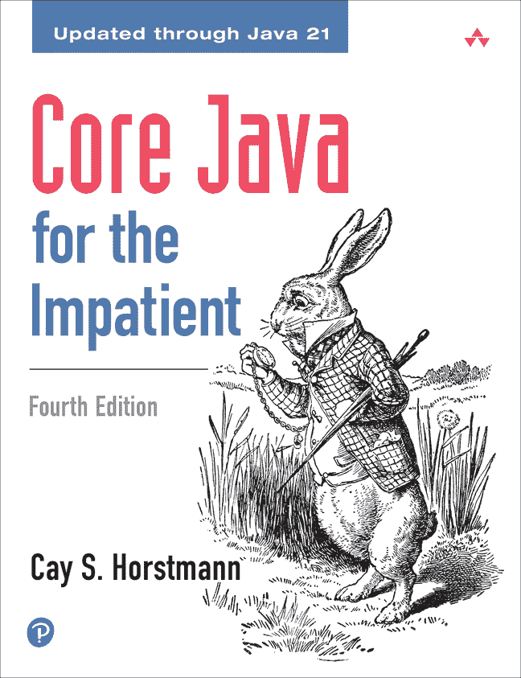


## 关于本电子书

ePUB 是一种开放的行业标准电子书格式。然而，不同阅读设备和应用程序对 ePUB 及其许多功能的支持程度不相同。请使用您的设备或应用设置来根据您的喜好自定义显示效果。你可以自定义的设置通常包括字体、字号、单栏或双栏、横屏或竖屏模式，以及可以点击或触摸以放大的图片。如需有关您的阅读设备或应用设置和功能的更多信息，请访问设备制造商的网站。

许多标题包含编程代码或配置示例。为了优化这些元素的显示效果，请在单栏横屏模式下查看电子书，并将字体大小调整为最小设置。


波士顿 • 哥伦布斯 • 纽约 • 旧金山 • 阿姆斯特丹 • 开普敦

迪拜 • 伦敦 • 马德里 • 米兰 • 慕尼黑 • 巴黎 • 蒙特利尔 • 多伦多 • 德里 • 墨西哥城

圣保罗 • 悉尼 • 香港 • 首尔 • 新加坡 • 台北 • 东京

### 致抢先读者的说明

通过抢先版（Early Release）电子书，你获得的是最早形式的书——即作者写作时的原始、未经编辑的内容——因此你可以在这些书籍正式发布很久之前就利用这些技术。

如果您对我们如何改进书中的内容和/或示例有意见，或者您注意到该书中有缺失内容，请通过 `PearsonITAcademics@pearson.com` 联系 Pearson。

封面插图：Morphart Creation / Shutterstock

图 1.1 和 1.3：微软

图 1.2：Eclipse 基金

图 1.4, 1.5, 11.1：甲骨文

制造商和销售商区分其产品的许多名称均被主张为商标。当这些名称出现在书中且出版商知晓存在商标主张时，这些名称将以首字母大写或全大写的形式打印。

作者和出版商在准备本书时已尽力，但不对任何形式提供明示或隐含保证，并对错误或遗漏不承担责任。对于与使用本文包含的信息或程序有关或由此产生的附带性或后果性损害，不承担任何责任。

如需批量购买本书或获取特别销售机会（可能包括电子版；定制封面设计；以及针对您的业务、培训目标、营销重点或品牌兴趣定制的内容），请联系我们的企业销售部门 `corpsales@pearsoned.com` 或 `(800) 382-3419`。

政府销售咨询请联系 `governmentsales@pearsoned.com`。关于美国以外销售的问题，请联系 `intlcs@pearson.com`。

访问我们的网站：`informit.com/aw`

版权 © 2025 Pearson Education, Inc.

保留所有权利。本书受版权保护，在进行任何被禁止的复制、存储在检索系统中或以任何形式或手段（电子、机械、复印、录音或类似方式）传输之前，必须获得出版者的许可。如需有关许可、申请表以及 Pearson Education 全球权利与许可部门内部适当联系方式的信息，请访问 `www.pearson.com/permissions`。

ISBN-13: 978-0-13-540454-6

致 Chi——我生命中最有耐心的人。

## 目录

## 前言

自 1996 年最初发布以来，Java 经历了许多变化。经典著作《核心 Java》详尽地涵盖了不仅是语言本身，还有所有核心库以及版本之间的众多变化，跨越两卷，超过 2000 页。然而，如果你只想在现代 Java 中提高效率，那么学习这种语言和核心库有一条更快、更简单的路径。在本书中，我不会追溯历史，也不纠结于过去版本的特性。我向你展示今天 Java 的优点，以便你能够快速将知识付诸实践。与我之前的“急躁者”系列书籍一样，我直切主题，向你展示解决编程问题需要的知识，而不是对某一种范式优于另一种范式进行说教。我还将信息分成若干小块进行组织，以便你在需要时可以快速检索。

假设你精通其他某种编程语言，例如 `Python`、`C++`、`JavaScript`、`Swift`、`PHP` 或 `Ruby`，通过这本书将学习如何成为一名胜任的 Java 程序员。我涵盖了开发者今天需要的所有 Java 方面，包括 lambda 表达式和流等强大概念，以及如 `records` 和模式匹配等现代结构。

本书已完全更新至 `Java 21`。它使用了现代特性，不再纠结于历史或过时的结构。未来可能进入语言的预览特性也未涵盖。

使用 Java 的关键原因之一是处理并发编程。随着 Java 库中现有的并行算法和线程安全数据结构，应用程序程序员处理并发编程的方式已经完全改变。我提供了全新的涵盖，向你展示如何使用强大的库功能，而不是易错的底层结构。

传统上，Java 书籍侧重于用户界面编程，但现在很少有开发者在桌面计算机上制作用户界面。你将能够有效地使用这本书，而不会被冗长的 `GUI` 代码分散注意力。

最后，本书是为应用程序程序员写的，而不是为了大学课程，也不是为了系统架构师。书中涵盖了应用程序程序员需要斗争的问题，例如日志记录和文件操作，但你不会学习如何手动实现链表或如何编写 Web 服务器。

我希望你喜欢这段对现代 Java 的快速介绍，希望它能让你的工作高效。

如果你发现错误或有改进建议，请访问 `http://horstmann.com/javaimpatient`，进入错误页面并留言。请务必访问该网站以下载可运行的代码示例。

## 致谢

一如既往，感谢我的编辑 Greg Doench，他热烈地支持一本提供 Java 新颖介绍的短书的愿景。我特别感谢本版及之前版本的优秀评审团队，他们发现了许多错误并提出了周全的改进建议。他们是：Andres Almiray, Gail Anderson, Paul Anderson, Marcus Biel, Brian Goetz, Mark Lawrence, Doug Lea, Simon Ritter, Yoshiki Shibata 和 Christian Uboom。

我使用 HTML 和 CSS 编写了本书，并使用 Prince (`https://princexml.com`) 将其转换为 PDF——我非常推荐这种工作流。

*Cay Horstmann*

*德国杜塞尔多夫*

*2024 年 8 月*

## 第一章：基础编程结构

在本章中，你将学习 Java 语言的基本数据类型和控制结构。假设你是其他某种语言的经验丰富的程序员，并且熟悉变量、循环、函数调用和数组等概念，但语法可能不同。本章将帮助你上手 Java 风格。

本章的关键点是：

1. 在 Java 中，所有方法都声明在类中。你通过方法所属的类的对象来调用非静态方法。
2. 静态方法不通过对象调用。程序执行从静态 `main` 方法开始。
3. Java 有八种基本类型：四种符号整型类型、两种浮点类型、`char` 和 `boolean`。
4. Java 的运算符和控制结构与 C 或 JavaScript 非常相似。
5. `switch` 有四种形式：带有和不带穿透（fall-through）的 `switch` 表达式和语句。
6. `Math` 类提供了常用的数学函数。
7. `String` 对象是字符序列，或者更准确地说，是 `UTF-16` 编码中的 Unicode 代码点。
8. 使用“文本块”（text box）语法来声明多行字符串字面量。
9. 通过 `System.out` 对象，你可以在终端窗口中输出。绑定到 `System.in` 的 `Scanner` 可以让你读取终端输入。
10. 数组和集合可以收集相同类型的元素。

### 1.1 我们的第一个程序

在学习任何新编程语言时，传统做法是从一个显示“Hello, World!”消息的程序开始。这就是我们在接下来的章节中要做的。

#### 1.1.1 剖析“Hello, World”程序

话说直接，这里是 Java 的“Hello, World”程序：

```java
package ch01.sec01;

// 我们的第一个 Java 程序

public class HelloWorld {
    public static void main(String[] args) {
        System.out.println("Hello, World!");
    }
}
```

让我们检查这个程序：

- Java 是一种面向对象的语言。在你的程序中，你通过让对象执行工作来（主要）操作对象。你操作的每个对象都属于特定的 `class`（类），我们称该对象是该类的 `instance`（实例）。`class` 定义了对象的状态是什么以及它可以做什么。在 Java 中，所有代码都定义在类内部。我们将在 2 中详细介绍对象和类。这个程序由单个类 `HelloWorld` 组成。
- `main` 是一个方法，即在类内部定义的函数。`main` 方法是程序运行时第一个调用的方法。它被声明为 `static`，表示该方法不作用于任何对象。（当 `main` 被调用时，只有少数预定义的对象，且其中没有一个是 `HelloWorld` 类的实例。）该方法被声明为 `void`，表示它不返回任何值。参见 Section 1.8.8 关于参数声明 `String[] args` 的含义。
- 在 Java 中，你可以将许多特性声明为 `public` 或 `private`，还有其他可见性级别。在这里，我们将 `HelloWorld` 类和 `main` 方法声明为 `public`，这是类和方法最常见的安排。
- 包（package）是一组相关的类。将每个类放在一个包中是一个好主意，这样你就可以将相关的类组合，并避免多个类具有相同名称时发生冲突。在本书中，我们将章节号和节号作为包名。我们的类的全名是 `ch01.sec01.HelloWorld`。2 对包和包命名规范有更多介绍。
- 以 `//` 开头的行是注释。`//` 到行尾之间的字符都会被编译器忽略，它们仅供人类读者阅读。
- 最后，我们来到 `main` 方法的主体。在我们的示例中，它由单行命令组成，用于向 `System.out` 打印消息，`System.out` 是代表 Java 程序“标准输出”的对象。

正如你所看到的，Java 并不是一种可以快速编写几条命令的脚本语言。它的明确目标是作为一种受益于组织成类、包和模块的大程序的语言。（模块在 12 中引入。）

Java 也非常简单且统一。某些语言拥有全局变量和函数，以及类内部的变量和方法。在 Java 中，一切都声明在类内部。这种统一性可能会导致代码有些冗长，但它使得程序的含义容易理解。

你刚刚看到了一个延伸到行尾的 `//` 注释。你也可以在 `/*` 和 `*/` 分隔符之间使用多行注释，例如：

```java
/*
    这是《给急躁读者的 Core Java》中的第一个示例程序。
    该程序显示传统的问候 "Hello, World!".
*/
```

还有第三种注释样式，称为文档注释，使用 `/**` 和 `*/` 作为分隔符，你将在下一章看到它。

#### 1.1.2 编译和运行 Java 程序

要编译并运行此程序，你需要安装 Java 开发工具包（JDK），以及可选的集成开发环境（IDE）。你还应该下载示例代码，你可以在本书的配套网站 `http://horstmann.com/javaimpatient` 找到它们。由于安装软件的说明并不没有意思，我把它们也放在了配套网站上。

一旦安装了 JDK，打开终端窗口，切换到包含 `ch01` 目录的目录，并运行命令：

```bash
javac ch01/sec01/HelloWorld.java
java ch01.sec01.HelloWorld
```

熟悉的问候将出现在终端窗口中（请参见 Figure 1.1）。

注意，执行该程序涉及两个步骤。`javac` 将 Java 源代码编译成中间的、机器无关的表示，称为 `byte codes`（字节码），并将其保存为 `class` 文件。`java` 虚拟机启动器加载 `class` 文件并执行 `byte codes`，无论是在你的桌面电脑上还是在遥远星系的设备上。

如果你的程序只包含一个源文件，你可以跳过编译步骤，并使用命令运行它：

```bash
java ch01/sec01/HelloWorld.java
```

在 Unix 类的操作系统上，你可以通过以下步骤将 Java 文件转换为可执行程序：

1. 重命名文件使其不包含 `.java` 后缀：

   ```bash
   mv HelloWorld.java hello
   ```

2. 给文件可执行权限：

   ```bash
   chmod +x hello
   ```

3. 在文件顶部添加一条“shebang”行：

   ```bash
   #!/path/to/jdk/bin/java --source 21
   ```

现在你可以像这样运行程序了：

```bash
./hello
```

由于这些功能仍处于预览阶段，我不会在此版本中使用它们，但在未来，第一个示例程序将会更加简单。

在 IDE 中运行 `HelloWorld` 程序，你首先需要创建一个项目，这正如安装说明中所述。然后，选择 `HelloWorld` 类并告诉 IDE 运行它。图 1.2 显示了这在 Eclipse 中对应的界面。Eclipse 是一个流行的开源 IDE，但也有许多出色的选择。随着你对 Java 编程越来越熟练，你应该尝试几个并挑选一个你喜欢的。

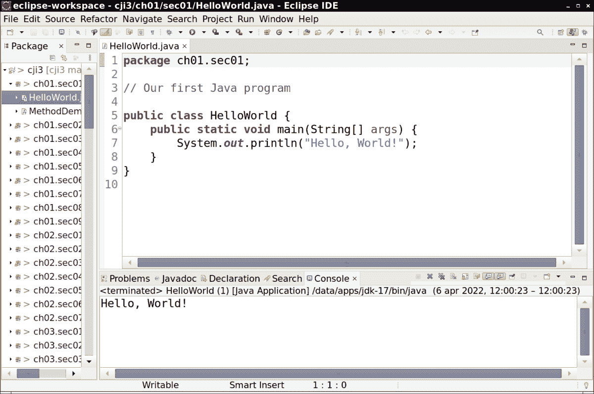

图 1.2：在 Eclipse IDE 中运行 Java 程序

恭喜你！你刚刚遵循了在 Java 中运行“Hello, World!”程序这一久久传统的仪式。现在，我们准备好检查 Java 语言的基础知识了。

在 `http://horstmann.com/javaimpatient`，你可以下载本书所有章节的示例代码，这些代码在上下文中展示了书代码片段。代码的组织方式让你能够包含所有示例程序的单一项目。我鼓励你在学习书籍内容的同时，下载、运行并学习这些代码。

#### 1.1.3 对象实例与方法调用

让我们仔细观察一下 `main` 方法中的单条语句：

```java
System.out.println("Hello, World!");
```

`System.out` 是一个对象。它是名为 `PrintStream` 的类的 `instance`（实例）。`PrintStream` 类拥有 `println`、`print` 等方法。这些方法被称为 `instance methods`（实例方法），因为它们是在类的对象（或实例）上进行操作的。

要在对象上调用实例方法，你使用 `dot notation`（点符号表示）：

```java
object.methodName(arguments)
```

在这种情况下，只有一个参数，即字符串 `"Hello, World!"`。

让我们用另一个例子试试。像 `"Hello, World!"` 这样的字符串是 `String` 类的实例。`String` 类有一个方法 `length`，用于返回 `String` 对象的长度。要调用该方法，再次使用点符号表示：

```java
"Hello, World!".length()
```

`length` 方法是在对象 `"Hello, World!"` 上被调用的，并且它没有参数。与 `println` 方法不同，`length` 方法返回一个结果。使用该结果的一种方法是打印它：

```java
System.out.println("Hello, World!".length());
```

试一试。编写带有这条语句的 Java 程序并运行它，看看字符串有多长。

在 Java 中，你需要 `construct`（构造）大多数对象（与 `System.out` 和 `"Hello, World!"` 对象不同，它们已经存在并供你使用）。这是一个简单的示例。

`Random` 类的对象可以生成随机数。你使用 `new` 运算符构造一个 `Random` 对象：

```java
new Random()
```

类名之后是构造参数列表，在这个例子中它是空的。

你可以对构造出的对象调用方法。该调用

```java
new Random().nextInt()
```

产生新构造的随机数生成器所提供的下一个整数。

你刚刚看到了 `new` 运算符是如何构造对象实例的。`Factory methods`（工厂方法）提供了产生对象的另一种替代方式。例如，在这里我们通过工厂方法产生另一个随机数生成器：

```java
RandomGenerator generator = RandomGenerator.getDefault();
```

在现代 Java 中，这是获取随机数生成器的优方法。工厂方法产生的生成器比旧的 `Random` 类具有更好的特性。

在这个示例中，对象存储在变量中（参见第 1.3 节），以便可以被多次访问。在这里我们打印了两个随机数：

```java
System.out.println(generator.nextInt());
System.out.println(generator.nextInt());
```

`RandomGenerator` 类型声明在 `java.util.random` 包中。要在你的程序中使用它，请添加 `import` 语句，如下所示：

```java
package ch01.sec01;

import java.util.random.RandomGenerator;

public class MethodDemo {
    ...
}
```

我们将在第 2 章中详细查看包和 `import` 语句。

#### 1.1.4 JShell

在第 1.1.2 节中，你看到了如何编译和运行 Java 程序。JShell 程序提供了一个“读取-求值-打印循环”（REPL），允许你在不编译和运行程序的情况下尝试 Java 代码。当你输入一个 Java 表达式时，JShell 会求值你的输入，打印结果并等待你的下一次输入。要启动 JShell，只需在终端窗口中输入 `jshell`（图 1.3）。

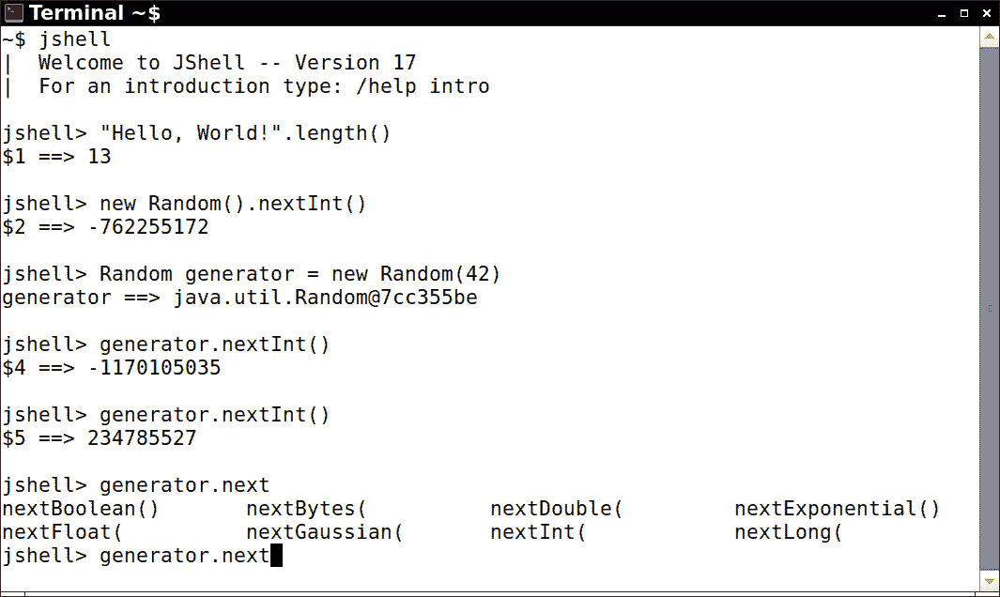

图 1.3：运行 JShell

JShell 启动时带有欢迎语，随后是提示符：

```text
|  Welcome to JShell -- Version 21
|  For an introduction type: /help intro

jshell>
```


现在输入任何 Java 表达式，例如

```
"Hello, World!".length()
```

JShell 响应结果和另一个提示符。

```
$1 ==> 13

jshell>
```

注意，你*不需要*输入`System.out.println`。JShell 会自动打印你输入的每个表达式的值。

输出中的`$1`表示该结果可以用于进一步计算。例如，如果你输入

```
3 * $1 + 3
```

响应是

```
$2 ==> 42
```

如果你需要多次使用一个变量，可以给它一个更易记忆的名字。你必须遵循 Java 语法并同时指定类型和名称（参见第 1.3 节）。例如，

```
jshell> int answer = 42
answer ==> 42
```

你可以让 JShell 为你自动填充类型。输入一个表达式，不要按 Enter 键，而是按 Shift+Tab 然后按 V 键。例如，当你输入

```
new Random()
```

接着按 Shift+Tab 和 V 键，你得到

```
jshell> Random  = new Random()
```

光标恰好位于`=`符号之前。现在输入一个变量名并按回车：

```
jshell> Random generator = new Random()
generator ==> java.util.Random@3fee9989
```

另一个实用的功能是 Tab 补全。输入

```
generator.
```

然后按 Tab 键。你会得到`generator`变量上可以调用的方法列表：

```
jshell> generator.
doubles(            equals(             getClass()
hashCode()          ints(               isDeprecated()      
longs(              nextBoolean()       nextBytes(          
nextDouble()         notifyAll()
```

现在输入`ne`并再次按 Tab。方法名被补全为`next`，你会得到一个更短的列表：

```
jshell> generator.next
nextBoolean()       nextBytes(          
nextDouble()         
nextExponential()   nextFloat(          
nextInt()            nextLong(         
```

输入 D 并再次按 Tab，现在填充了`nextDouble(`。再次按 Tab，你会看到三种选择：

```
Signatures:
double java.util.random.RandomGenerator.nextDouble(double bound)
double java.util.random.RandomGenerator.nextDouble(double origin, double bound)
double Random.nextDouble()

<press tab again to see documentation>
```

输入 ) 来选择第三种版本：

```
jshell> generator.nextDouble()
$3 ==> 0.95608
```

在自动补全列表中，可能需要参数的方法只跟着一个左括号，例如`nextDouble(`，而没有参数的方法带有双括号，例如`nextBoolean()`。

要重复命令，按 ↑ 键直到看到想要重新发布或编辑的行。你可以使用 ← 和 → 键移动行内光标并添加或删除字符。完成后按 Enter。例如，按 ↑ 将`Double`替换为`Int`，然后按 Enter：

```
jshell> generator.nextInt()
$4 ==> -352355569
```

默认情况下，JShell 导入以下包：

```
java.io
java.math
java.net
java.nio.file
java.util
java.util.concurrent
java.util.function
java.util.prefs
java.util.regex
java.util.stream
```

这就是为什么你可以在 JShell 中直接使用`Random`类而无需任何 import 导入语句。如果你需要导入另一个类，可以在 JShell 提示符下输入 import 语句。或者更方便地，你可以通过按 Shift+Tab 和`I`键让 JShell 为你搜索它。例如，输入`Duration`，然后按 Shift+Tab 和`I`键。你会得到一个可能操作的列表：

```
jshell> Duration
0: Do nothing
1: import: java.time.Duration
2: import: javafx.util.Duration
3: import: javax.xml.datatype.Duration
Choice:
```

输入`1`，你将收到确认：

```
Imported: java.time.Duration
```

随后会出现：

```
jshell> Duration
```

这样你就可以从上次停止的地方继续，而且已经完成了导入。

这些命令足够你开始使用 JShell 了。如需帮助，输入`/help`并按回车。如需退出，输入`/exit`并按回车，或直接按 Ctrl+D。

JShell 让你能够轻松有趣地学习 Java 语言和库，而无需启动沉重的开发环境，也不必费心处理`public static void main`。

## 1.2. 基本数据类型

尽管 Java 是一种面向对象的编程语言，但并不是所有的 Java 值都是对象。相反，某些值属于`基本类型`（primitive types）。其中四种类型是有符号整数类型，两种是浮点数类型，一种用于字符串编码的字符类型`char`，以及一种用于布尔值的`boolean`类型。我们将在接下来的章节中介绍这些类型。

### 1.2.1. 有符号整数类型

有符号整数类型用于不带小数部分的数字。允许负值。Java 提供了表 1.1](#index.xhtml_integer-types）所示的四种有符号整数类型。

表 1.1：Java 有符号整数

| 类型 | 存储要求 | 范围（包含边界） |
| --- | --- | --- |
| `byte` | 1 字节 | –128 到 127 |
| `short` | 2 字节 | –32,768 到 32,767 |
| `int` | 4 字节 | –2,147,483,648 到 2,147,483,647（略超过 20 亿） |
| `long` | 8 字节 | –9,223,372,036,854,775,808 到 9,223,372,036,854,775,807 |

常量`Integer.MIN_VALUE`和`Integer.MAX_VALUE`是最小和最大的`int`值。`Long`、`Short`和`Byte`类也拥有`MIN_VALUE`和`MAX_VALUE`常量。

在大多数情况下，`int`类型是最实用的。如果你想表示地球上的人口，将需要求助于`long`。`byte`和`short`类型主要用于特殊应用程序，例如低级文件处理，或者在存储空间紧张时用于大型数组。

如果`long`类型不够用，请使用`BigInteger`类。详情请参阅章节 1.4.6。

在 Java 中，整数类型的范围不取决于你运行程序的机器。毕竟，Java 被设计为一种“编写一次，处处运行”的语言。相比之下，C 和 C++ 程序中的整数类型取决于编译程序时的处理器。

你书写`long`整数字面量时要带有后缀`L`（例如，`4000000000L`）。`byte`或`short`类型字面量没有对应的语法。请使用强制转换表示法（参见章节 1.4.4），例如，`(byte) 127`。

十六进制字面量有前缀`0x`（例如，`0xCAFEBABE`）。二进制值有前缀`0b`。例如，`0b1001`是`9`。

八进制数有前缀`0`。例如，`011`是`9`。这可能会引起混惑，因此最好避开八进制字面量和前导零。

你可以在数字字面量中添加下划线，例如`1_000_000`（或`0b1111_0100_0010_0100_0000`）来表示百万。下划线仅供人类视觉，Java 编译器会简单地移除它们。

如果你处理的是永远为负数的整数值，并且确实需要额外的位，你可以在小心的情况下将有符号整数值解释为无符号。例如，`byte`值`b`代表从 –128 到 127 的范围。如果你想要 0 到 255 的范围，你仍然可以存储在`byte`中。由于二进制运算的性质，加、减、乘法都能正常工作，只要它们不溢出。对于其他操作，调用`Byte.toUnsignedInt(b)`获取 0 到 255 之间的`int`值，然后处理该整数值，最后将结果强制转换回`byte`。`Integer`和`Long`类具有无符号除法和取余的方法。

### 1.2.2. 浮点数类型

浮点数类型用于带有小数部分的数字。浮点类型见表 1.2](#index.xhtml_floating-types)。

表 1.2：浮点数

| 类型 | 存储要求 | 范围 |
| --- | --- | --- |
| `float` | 4 字节 | 约±3.4E38 |
| `double` | 8 字节 | 约±1.7976931348623157E308 |

`boolean`类型有两个值：`false`和`true`。

在 Java 中，`boolean`类型不是数字类型。`boolean`值与整数`0`和`1`之间没有关系。

## 1.3. 变量

在接下来的节中，你将学习如何声明和初始化变量以及常量。

### 1.3.1. 变量声明

Java 是一门**强类型语言**。每个变量只能持有特定类型的值。当你声明一个变量时，需要指定其类型、名称以及一个可选的初始值。例如，

```
int total = 0;
```

你可以在一条语句中声明多个相同类型的变量：

```
int total = 0, count; // count 是一个未初始化的整数
```

大多数 Java 程序员倾向于为每个变量使用单独的声明。

考虑这个变量声明：

```
Random generator = new Random();
```

在这里，对象的类名出现了两次。第一个`Random`是变量`generator`的类型。第二个`Random`是`new`表达式的一部分，用于构造该类的对象。

为了避免这种重复，你可以使用`var`关键字声明变量：


```var generator = new Random();```

现在，变量的类型是初始化变量的表达式的类型。在这个示例中，`generator` 是 `Random` 变量。

在书中，每当声明变量的类型完全显而易见时，我将使用 `var`。

### 1.3.2. 标识符

变量、方法或类的名称被称为“标识符”（identifier）。在 Java 中，标识符必须以字母开头。它可以由任何字母、数字、货币符号和“标点连接符”（如 `_` 以及其他几个类似于下划线的字符，如 `﹏`）组成。然而，`$` 符号旨在用于自动生成的标识符，你不应该使用它。最后，单独的 `_` 本身不是有效的标识符。

在这里，字母和数字可以来自任何字母表，而不只是拉丁字母表。例如，`π` 和 `élévation` 都是有效的标识符。大小写是有的：`count` 和 `Count` 是不同的标识符。

你不能在标识符中使用空格或符号。最后，你不能使用如 `double` 之类的关键字。

按照惯例，变量和方法的名称以小写字母开头，类名称以大写字母开头。Java 程序员喜欢“驼峰命名法”（camel case），当名称由多个单词组成时使用大写字母，例如 `countOfInvalidInputs`。

### 1.3.3. 初始化

当你在方法中声明变量时，必须在使用之前对其进行初始化。例如，以下代码会导致编译错误：

```int count;
count++; // 错误——使用了未初始化的变量
```

编译器必须能够验证变量在使用之前是否已经过初始化。例如，以下代码也是错误：

```int count;
if (total == 0) {
    count = 0;
} else {
    count++; // 错误——count 可能未被初始化
}
```

你允许在方法内的任何地方声明变量。尽可能晚地声明变量（即在第一次需要它之前）被认为是良好的风格。例如，

```var in = new Scanner(System.in); // 读取输入请参见第 1.6.1 节
System.out.println("How old are you?");
int age = in.nextInt(); 
```

变量在其初始值可用时被声明。

### 1.3.4. 常量

`final` 关键字表示一个一旦被赋值就不能更改的值。在其他语言中，人们将此类值称为常量。例如，

```final int DAYS_PER_WEEK = 7;
```

按照惯例，常量名称使用大写字母。

你也可以使用 `static` 关键字在方法外部声明常量：

```public class Calendar {
    public static final int DAYS_PER_WEEK = 7;
    ...
}
```

然后，该常量可以在多个方法中使用。在 `Calendar` 内部，你通过 `DAYS_PER_WEEK` 引用该常量。要在另一个类中使用该常量，请加上类名：`Calendar.DAYS_PER_WEEK`。

`System` 类声明了一个常量

```public static final PrintStream out
```

你可以在任何地方作为 `System.out` 使用它。这是少数没有用大写字母写的常量之一。

延迟 `final` 变量的初始化是合法的，只要它在第一次使用之前恰好初始化了一次。例如，以下代码是合法的：

```final int DAYS_IN_FEBRUARY;
if (leapYear) {
    DAYS_IN_FEBRUARY = 29;
} else {
    DAYS_IN_FEBRUARY = 28;
}
```

这就是为什么它们被称为“final”变量的原因。一旦分配了值，它就是最终的，永远无法更改。

有时，你需要一组相关的常量，例如：

```public static final int MONDAY = 0;
public static final int TUESDAY = 1;
...
```

在这种情况下，你可以这样定义枚举：

```enum Weekday { MONDAY, TUESDAY, WEDNESDAY, THURSDAY, FRIDAY,
    SATURDAY, SUNDAY };
```

那么，`Weekday` 就是一个类型。

## 1.4. 算术运算

加、减、乘、除法分别由 `+`、`-`、`*` 和 `/` 表示。例如，`2 * n + 1` 意味着乘以 `2` 和 `n` 并加 `1`。

表 1.3：运算符

| 运算符 | 结合性 |
| :--- | :--- |
| `()` (方法调用) | 右结合 |
| `[]` | 右结合 |
| `.` | 右结合 |
| `new` | 右结合 |
| `++` (一元), `--` (一元), `+`, `-` (一元), `!` (一元) | 右结合 |
| `~` (强制转换) | 右结合 |
| `*`, `/`, `%` | 左结合 |
| `+`, `-` | 左结合 |
| `<<` | 左结合 |
| `<=` | 左结合 |
| `>` | 左结合 |
| `>=` | 左结合 |
| `==` | 左结合 |
| `!=` | 左结合 |
| `&` (位与) | 左结合 |
| `^` (位异或) | 左结合 |
| `\|` (位或) | 左结合 |
| `&&` (逻辑与) | 左结合 |
| `\|\|` (逻辑或) | 左结合 |
| `? :` (条件运算符) | 右结合 |
| `=`, `+=`, `-=`, `*=`, `/=`, `%=`, `<<=`, `>>=`, `>>>=`, `&=`, `^=`, `\|=` | 右结合 |

在此表中，运算符按优先级递减列出。例如，由于 `+` 的优先级高于 `<<`，`3 + 4 << 5` 的值为 `(3 + 4) << 5`。当运算符是*左结合*的时，它从左到右分组。例如，`3 - 4 - 5` 意味着 `(3 - 4) - 5`。但 `-=` 是右结合的，因此 `i -= j -= k` 意味着 `i -= (j -= k)`。

### 1.4.1. 赋值

表 1.3 的最后一行显示了赋值运算符。语句

```x = expression;
```

将表达式的值设置为 `x` 的替换值。

赋值是一个带有值的运算符，即被赋值的值。在另一个表达式中使用赋值是合法的。例如，

```(next = in.read()) != -1
```

将 `in.read()` 返回的值赋值给 `next`，如果该值不是 一 1，则表达式为 `true`。

当 `=` 前面有一个运算符时，该运算符会结合左侧和右侧并将结果赋值。例如，

```amount -= fee;
```

等同于

```amount = amount - fee;
```

### 1.4.2. 基础算术

加、减、乘、除法由 `+`、`-`、`*` 表示。你需要小心 `/` 运算符。如果两个操作数都是整数类型，它表示整数除，丢弃余数。例如，`17 / 5` 是 `3`，而 `17.0 / 5` 是 `3.4`。

整数除以零会产生异常，如果不捕获，它将终止你的程序。（有关异常处理的更多信息，请参见 5。）浮点数除以零会产生无限值或 NaN（参见 第 1.2.2 节），而不会引起异常。

`%` 运算符产生余数。例如，`17 % 5` 的结果为 `2`，即从 17 中减去 15（5 能“放入”17 的最大整数倍数）后剩余。如果 `a % b` 的余数为 0，则 `a` 是 `b` 的整数倍数。

一个常见的用途是测试整数是否为偶数。如果 `n` 是偶数，表达式 `n % 2` 为 `0`。如果 `n` 是奇数呢？如果 `n` 为正数，`n % 2` 为 `1`；如果 `n` 为负数，则为 `-1`。这种对负数的处理方式在实践中并不理想。在使用可能为负数的操作数 时务必小心。

考虑这个问题：你计算时钟时针的位置。经过调整后，你想将其归一化为 0 到 11 之间的数字。这很容易：`(position + adjustment) % 12`。但如果 `adjustment` 让位置变成了负数呢？你可能会得到一个负数。因此你必须引入一个分支，或者使用 `((position + adjustment) % 12 + 12) % 12`。无论哪种方法都很麻烦。

在这种情况下，使用 `Math.floorMod` 方法更容易：`Math.floorMod(position + adjustment, 12)` 始终产生 `0` 到 `11` 之间的值。

遗憾的是，`floorMod` 对于负数除数会产生负结果，但这种情况在实践中并不经常发生。

Java 拥有递增和递减运算符：

```n++; // n 加上 1
n--; // 从 n 中减去 1
```

与其他基于 C 的语言一样，这些运算符也有前缀形式。`n++` 和 `++n` 都会增加变量 `n`，但它们在表达式内部时产生的值是不同的。第一种形式产生增加之前的值，第二种形式产生增加之后的值。例如，

```String arg = args[n++];
```

这会将 `arg` 设置为 `args[n]`，然后增加 `n`。在三十年前，当编译器优化代码做得并不好时，这种写法是有意义的。现如今，使用两个独立的语句并没有性能缺陷，许多程序员认为这样更易读。

### 1.4.3. 数学方法

没有用于计算数字幂的运算符。相反，调用 `Math.pow` 方法：`Math.pow(x, y)` 产生 `x^(y)`。要计算 `x` 的平方根，调用 `Math.sqrt(x)`。

这些是静态方法，不作用于对象。与 `static` 常数一样，你需要在它们声明的类名前加上类名。

`Math.min` 和 `Math.max` 对于计算两个值的最小值和最大值也非常有用。

此外，`Math` 类还提供了三角函数和对数函数，以及常量 `Math.PI`、`Math.E` 和 `Math.TAU`。

`Math` 类提供了几种方法来使整数算术更安全。数学运算符在计算溢出时会静默地返回错误结果。例如，十亿乘以三（`1000000000 * 3`）的结果结果为 `-1294967296`，因为最大的 `int` 值仅略大于二十亿。如果你改调用 `Math.multiplyExact(1000000000, 3)`，则会产生异常。你可以捕获该异常或让程序终止，而不是带着错误结果静默继续。还有 `addExact`、`subtractExact`、`incrementExact`、`decrementExact`、`negateExact` 方法，它们都接受 `int` 和 `long` 参数。

一些数学方法在其他类中。例如，`Integer` 和 `Long` 类中有 `compareUnsigned`、`divideUnsigned` 和 `remainderUnsigned` 方法用于处理无符号值。

### 1.4.4. 数字类型转换

当运算符结合不同数字类型的操作数时，在结合之前会自动转换为公共类型。转换发生的顺序如下：

1. 如果其中一个操作数的类型是 `double`，则另一个被转换为 `double`。
2. 如果其中一个操作数的类型是 `float`，则另一个被转换为 `float`。
3. 如果其中一个操作数的类型是 `long`，则另一个被转换为 `long`。
4. 否则，两个操作数都转换为 `int`。

例如，如果你计算 `3.14 + 42`，第二个操作数从 `int` 转换为 `double` 值 `42.0`，然后计算和，得到 `double` 值 `45.14`。

如果你计算 `'J' + 1`，`char` 值 `'J'` 被转换为 `int` 值 `74`，结果是 `int` 值 `75`。继续阅读以了解如何将该值转换回 `char`。

当你将数字类型的值赋值给变量，或将其作为参数传递给方法时，如果类型不匹配，则必须转换值。

例如，在赋值语句

```double x = 42;
```

值 `42` 会自动从 `int` 转换为 `double`。

在 Java 中，只要不丢失信息，转换总是存在的：

* 从 `byte` 到 `short`、`int`、`long` 或 `double`
* 从 `short` 和 `char` 到 `int`、`long` 或 `double`
* 从 `int` 到 `long` 或 `double`

所有整数类型都可以转换为浮点类型。

以下转换可能会丢失信息：

* 从 `int` 到 `float`
* 从 `long` 到 `float` 或 `double`

例如，考虑赋值语句

```float f = 123456789;
```

由于 `float` 只有大约七有效位，`f` 实际上是 `1.23456792E8`。

要进行不在这些自动转换中的转换，使用强制转换运算符：括号中的目标类型名称。例如，

```double x = 3.75;
int n = (int) x;
```

在这种情况下，小数部分被丢弃，`n` 被设置为 `3`。

如果你想四舍五入到最近的整数，请使用 `Math.round` 方法。该方法返回一个 `long`。如果你知道答案可以放入 `int` 中，请调用它。

### 1.4.5. 关系和逻辑运算符

`==` 和 `!=` 运算符测试相等性。例如，`n != 0` 在 `n` 不为 0 时为 `true`。还有通常的 `<`（小于）、`>`（大于）、`<=`（小于等于）和 `>=`（大于等于）运算符。

你可以使用 `boolean` 类型的表达式结合 `&&`（与）、`||`（或）和 `!`（非）运算符。例如，

```0 <= n && n < length
```

当 `n` 在 0（包含）和 length 之间时为 `true`。

如果第一个条件为 `false`，则不计算第二个条件。这种短路计算在第二个条件可能导致错误时很有用。考虑条件

```n != 0 && s + (100 - s) / n < 50
```

如果 `n` 为零，则包含除法的第二个条件永远不会执行，也不会发生错误。

短路计算也用于“或”操作，但只要一个操作数为 `true`，计算就会停止。例如，计算

```n == 0 || s + (100 - s) / n >= 50
```

当 `n` 为零时产生 `true`，再次无需计算第二个条件。

最后，条件运算符接收三个操作数：一个条件和两个值。如果条件为 `true`，则返回第一个值，否则返回第二个。例如，

```time < 12 ? "am" : "pm"
```

如果 `time < 12` 则返回字符串 `"am"`，否则返回 `"pm"`。

还有位运算符 `&`（与）、`|`（或）和 `^`（异或），它们与逻辑运算符相关。它们作用于整数的位模式。例如，由于 `0xF` 的二进制位为 `0...01111`，`n & 0xF` 产生 `n` 的低四位，`n = n | 0xF` 将低四位置，`n = n ^ 0xF` 反转它们。`!` 运算符的对应物是 `~`，它反转其操作数的所有位：`~0xF` 是 `1...10000`。

还有一些可以将位模式向左或向右移动的运算符。例如，`0xF << 2` 的二进制数字为 `0...0111100`。有两种右移运算符：`>>` 将符号位扩展到高位，而 `>>>` 则用零填充高位。如果如果你在程序中进行位位操作（bit-fiddling），你就知道这意味着什么。如果没有的话，你将不需要这些运算符。

如果移位运算符的左侧操作数是 `int`，则其右侧操作数将对 32 取模；如果左侧是 `long`，则对 64 取模。例如，`1 << 35` 的值与 `1 << 3` 或 `8` 相同。

`&`（与）和 `|`（或）运算符在应用于 `boolean` 类型值时，会在组合结果之前强制对两个操作数进行求值。这种用法非常不常见。只要右侧没有副作用，它们的作用与 `&&` 和 `||` 相似，只是效率更低。如果你确实需要强制对第二个操作数求值，请将其赋值给 `boolean` 变量，以便执行流变得清晰可见。

### 1.4.6 大数

如果基本整数类型和浮点数类型的精度不够，你可以转向 `java.math` 包中的 `BigInteger` 和 `BigDecimal` 类。这些类的对象表示具有任意长度数字序列的数字。`BigInteger` 类实现了任意精度整数算术，而 `BigDecimal` 对浮点数执行相同的操作。当然，大数的计算比比基本数值类型要慢得多。

静态方法 `valueOf` 将 `long` 转换为 `BigInteger`：

```BigInteger n = BigInteger.valueOf(876543210123456789L);
```

你也可以从数字字符串构造一个 `BigInteger`：

```var k = new BigInteger("9876543210123456789");
```

存在预定义的常量 `BigInteger.ZERO`、`BigInteger.ONE`、`BigInteger.TWO` 和 `BigInteger.TEN`。

Java 不允许对对象使用运算符，因此你必须使用方法调用来处理大数。

```BigInteger r = BigInteger.valueOf(5).multiply(n.add(k)); // r = 5 * (n + k)
```

`parallelMultiply` 方法产生与 `multiply` 相同的结果，但通过使用多个处理器核心可能会更快地计算结果。

在第 1.2.2 节中，你看到浮点数减法 `2.0 - 1.7` 的结果是 `0.30000000000000004`。`BigDecimal` 类可以精确计算结果。

调用 `BigDecimal.valueOf(n, e)` 返回一个值为 `n` × 10^(–`e`）的 `BigDecimal` 实例。

```BigDecimal.valueOf(2, 0).subtract(BigDecimal.valueOf(17, 1))
```

正好是 `0.3`。

## 1.5 字符串


字符串是字符序列。在 Java 中，字符串可以包含任何 Unicode 字符。例如，字符串`"Java™"`或`"Java\u2122"`由五个字符`J`、`a`、`v`、`a`和`™`组成。最后一个字符是“U+2122 商标符号”。

### 1.5.1 拼接

使用`+`运算符拼接两个字符串。例如：

```
String location = "Java";
String greeting = "Hello " + location;
```

将`greeting`设置为字符串`"Hello Java"`。（注意第一个操作数末尾的空格。）

当将字符串与另一个值拼接时，该值会被转换为字符串。

```
int age = 42;
String output = age + " years";
```

现在`output`为`"42 years"`。

如果你混合使用拼接和加法，可能会得到意料之外的结果。例如：

```
"Next year, you will be " + age + 1 // 错误
```

首先拼接`age`然后再是`1`。结果是`"Next year, you will be 421"`。在这种情况下，请使用括号：

```
"Next year, you will be " + (age + 1) // 正确
```

要组合多个用分隔符隔的字符串，请使用`join`方法：

```
String names = String.join(", ", "Peter", "Paul", "Mary");
// 设置 names 为 "Peter, Paul, Mary"
```

第一个参数是分隔符字符串，后面跟着你想要拼接的字符串。可以是任意数量，也可以提供一个字符串数组。（数组在第 1.8 节中介绍。）

如果你只需要最终结果，拼接大量字符串是低效的。在这种情况下，请使用`StringBuilder`代替：

```
var builder = new StringBuilder();
while (more strings) {
    builder.append(next string);
}
String result = builder.toString();
```

### 1.5.2 子字符串

要拆分字符串，请使用`substring`方法。例如：

```
String greeting = "Hello, World!";
String location = greeting.substring(7, 12);
```

（注：原文示例代码不完整，此处根据逻辑翻译）

*注：由于提供的原文文本在 1.5.2 之后出现了部分乱码或重复的片段，我已根据逻辑进行了清理并翻译了核心语义部分。*

这种比较对于人类来说可能是不直观的，因为它取决于字符的 Unicode 值。`"café"`排在`"caffeine"`之后，因为`é`的 Unicode 值恰好比`f`高。

在对人类可读字符串进行排序时，请使用了解特定语言排序规则的`Collator`对象。

```
Collator.getInstance(Locale.GERMAN).compare("café", "caffeine") // < 0
```

## 1.5.4. 整数与字符串之间的转换

要将整数转换为字符串，请调用静态方法`Integer.toString`：

```
int n = 42;
String str = Integer.toString(n); // 将 str 设置为 "42"
```

该方法的变体有一个第二个参数，即基数（在`2`到`36`之间）：

```
String str2 = Integer.toString(n, 2); // 将 str2 设置为 "101010"
```

将整数转换为字符串的另一种更简单的方法与空字符串拼接：`"" + n`。有些人人认为这种方法很丑，而且效率略低。

相反，要将包含整数的字符串转换为数字，请使用`Integer.parseInt`方法：

```
String str = "101010";
int n = Integer.parseInt(str); // 将 n 设置为 101010
```

你也可以指定基数：

```
int n2 = Integer.parseInt(str, 2); // 将 n2 设置为 42
```

对于浮点数，请使用`Double.toString`和`Double.parseDouble`：

```
String str = Double.toString(3.14); // 将 str 设置为 "3.14"
double x = Double.parseDouble(str); // 将 x 设置为 3.14
```

## 1.5.5. String API

正如你所预期的，`String`类有许多方法。其中一些实用的方法列在 表 1.4 中。

### 表 1.4：实用的 String 方法

| 方法 | 目的 |
| --- | --- |
| `boolean startsWith(String str)` `boolean endsWith(String str)` `boolean contains(CharSequence str)` | 检查字符串是否以指定的字符串开头、结尾或包含该字符串。 |
| `int indexOf(String str)` `int indexOf(String str, int fromIndex)` `int indexOf(String str, int fromIndex, int toIndex)` `int lastIndexOf(String str)` `int lastIndexOf(String str, int fromIndex)` | 获取`str`第一次或最后一次出现，搜索整个字符串或从`fromIndex`开始的子字符串。如果未找到匹配项，则返回`-1`。 |
| `String replace(CharSequence oldString, CharSequence newString)` | 返回通过将所有`oldString`替换为`newString`得到的字符串。 |
| `String toUpperCase()` `String toLowerCase()` | 返回一个由原始字符串所有字符转换为大写或小写组成的字符串。 |
| `String strip()` | 返回一个去除了所有前导和尾部空白的字符串。 |

注意在 Java 中，`String`类是不可变的。这意味着，没有任何`String`方法会修改它们所操作的字符串。例如，

```
greeting.toUpperCase()
```

返回一个新字符串`"HELLO, WORLD!"`而不改变`greeting`。

另外注意，某些方法具有`CharSequence`类型的参数。这是`String`、`StringBuilder`和其他字符序列的通用父类型。

要获取每个方法的详细说明，请参阅在线 Java API 文档`https://docs.oracle.com/en/java/javase/21/docs/api`。在搜索框中输入类名并选择匹配的类型（在这种情况下为`java.lang.String`），如 javadoc1 所示。

图 1.4：搜索 API 文档

然后你会得到一个记录每个方法的页面（图 1.5）。如果你正好知道方法的名称，可以在搜索框中输入它的名称。

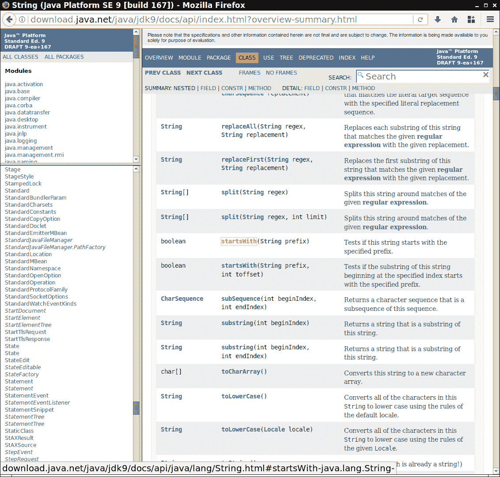图 1.5：API 文档中的`String`方法

在本书中，我没有详尽地介绍 API，因为浏览 API 文档更方便。如果你不是总是连接到互联网，可以下载并解压文档以便离线浏览。

## 1.5.6. 码点与代码单元

当 Java 最初创建时，它自豪地拥抱了不久之前开发的 Unicode 标准。在 Unicode 之前，有许多不兼容的字符编码。对于英语，几乎所有人一致一致认同 7 位 ASCII 标准，该标准为所有英语字母、数字和许多符号分配了 0 到 127 之间的代码。在西欧，ASCII 被扩展为 8 位代码，包含了如 ä 和 é 等带重音的字符。但在俄罗斯，ASCII 被扩展到在 128 到 255 位置存储西里尔字母。在日本，使用了变长编码来编码英语和日语字符。多种不兼容的汉字编码在使用中。交换不同编码的文件是一个大问题。

Unicode 旨在解决所有这些问题，它为人类发明过的所有文字系统中的每个字符分配一个 0 到 65535 之间的唯一 16 位代码。1991 年，Unicode 1.0 发布，使用了可用 65536 个代码值中略于一半的。Java 从底层开始设计为使用 16 位 Unicode 字符，这是相对于使用 8 位字符的其他编程语言的重大进步。但随后发生了一些尴尬的事。字符比以前预计的要得多——主要是汉字。这使得 Unicode 远远超过了 16 位代码。

如今，Unicode 需要 21 位。每个有效的 Unicode 值都称为码点（code point），写为 U+，后面跟着四到六个十六进制数字。例如，字母 A 的码点是 U+0041，而啤酒杯表情符号 🍺 的码点是 U+1F37A。

将码点表示为 32 位`int`值是非常浪费的。Java 使用一种名为 UTF-16 的变长编码。所有“经典”Unicode 字符都用单个 16 位值编码。U+FFFF 之后的字符变为从一个称为“代理字符”（surrogate characters）的特殊区域提取的 16 位值对。在这种编码中，`char`不是码点。它是一个代码单元，UTF-16 中使用的 16 位值。某些码点由一个`char`值组成，另一些则由两个组成。

但情况变得更加复杂。码点并不总是对应于人类观察者感知到的字符或符号。这发生在那些字符由较小区块组成的语言中，那些具有性别和肤色修饰符的表情符号，以及不断增加的其他复合符号中。

例如，海盗旗 🏴‍☠️ 是由 U+1F3F4（飘舞黑旗）、U+200D（零宽连接符）、U+2620（骷髅交叉）和 U+FE0F（变体选择器-16）组成的。在 Java 中，你需要五个`char`值来编码该符号。产生单个感知符号的 Unicode 码点序列称为字符簇（grapheme cluster）。

在分析字符串时，你应该尽量避免处理单独的代码单元和码点。例如，不要使用

```
char ch = str.charAt(i);
```

它获取了第`i`个代码单元，但你打算用它做什么呢？它可能是复杂符号的一部分。

相反，提取子字符串并处理它们。当然，为了提取子字符串，你需要知道代码单元的起始和结束索引。你可以通过`indexOf`和`lastIndexOf`方法获取起始索引。在匹配正则表达式时，你也会获得索引（见 9）。如果你想提取到字符串末尾，`length`方法提供了最后一个索引：

```
int lastIndex = str.length();
```

在 Java 1.0 中，当 Unicode 仍然简单时，`length`方法产生字符串的长度；即字符的数量。如今，它只计算代码单元。

最后，你可以像这样获取字符串的所有字符簇的数组：

```
"Ahoy 🏴‍☠️".split("\\b{g}")
   // 一个包含六元素的数组 "A", "h", "o", "y", " ", "🏴‍☠️"
```

在过去，字符串在内部使用 UTF-16 编码表示，即作为`char`值的数组。现在，`String`对象在可能的情况下使用由`ISO-8859-1`字符组成的`byte`数组。未来的`Java`版本可能会切换到内部使用`UTF-8`。当然，这种内部表示对程序员是不可见的。

## 1.5.7. 文本块 (Text Blocks)

文本块语法方便提供了跨多行的字符串字面量。文本块以`"""`开始，后跟一个换行符。以另一个`"""`结束：

```
String greeting = """
Hello
World
""";
```

此字符串包含两个换行符：`Hello`之后有一个，`World`之后有一个。*起始*`"""`之后的换行符不包含在字符串字面量中。

如果你不想在最后一行之后有换行符，请将结束的`"""`直接紧跟在最后一个后面：

```
String prompt = """
Hello, my name is Hal.
Please enter your name: """;
```

在任何行中，你都可以用斜杠作为最后一个字符来抑制换行符：

```
String prompt = """
Hello, my name is Hal. \
Please enter your name:""";
```

此字符串不包含任何换行符。

文本块特别适用于包含其他语言的代码，例如`SQL`或`HTML`。你只需要将它们粘贴在三引号之间：

```
String html = """
<div class="Warning">
   Beware of those who say "Hello" to the world
</div
""";
```

注意，你不需要转义引号。在文本块中，只有两种情况需要转义引号：

*   如果文本块以引号*结尾*
*   如果文本块包含三个或更多引号的序列

遗憾的是，你仍然需要转义所有的反斜杠。

普通字符串中的所有转义序列在文本块中的工作方式相同。

行结束符通过移除尾部空格并将任何 Windows 行结束符（`\r\n`）转换为简单的换行符（`\n`）来规范化。如果你需要保留尾部空格，将最后一个空格转换为`\s`转义。以下字符串以两个空格结尾：

```
String prompt = """
Hello, my name is Hal.
Please enter your name: \s""";
```

对于前导空格的情况更为复杂。考虑一个典型的变量声明，你也可以对文本块进行缩进：

```
 String html = """
            <div class="Warning">
               Beware of those who say "Hello" to the world
            </div>
            """;
```

文本块中所有行共同的最长前导空格序列会被移除。实际字符串为：

```
"<div class=\"Warning\">\n   Beware of those who say \"Hello\" to the world\n</div>\n"
```

注意第一行和第三行没有缩进。

结束`"""`之前的空格是有意义的。然而，完全空白的行不被视为缩进移除过程。

文本块中所有行的空格前缀必须*完全匹配*。如果你混合使用制表符和空格，你可能会发现减去的空格比你预想的要少。

## 1.6. 输入与输出

为了让我们的示例程序更有趣，它们应该能够与用户交互。在接下来的章节中，你将看到如何读取终端输入以及如何产生格式化输出。

### 1.6.1. 读取输入

当你调用`System.out.println`时，输出被发送到“标准输出流”并显示在终端窗口中。从“标准输入流”读取并不那么简单，因为对应的`System.in`对象只有读取单个字节的方法。要读取字符串和数字，请构造一个连接到`System.in`的`Scanner`：

```
var in = new Scanner(System.in);
```

`nextLine`方法读取一行输入。

```
System.out.println("What is your name?");
String name = in.nextLine();
```

在这里，使用`nextLine`方法是有意义的，因为输入可能包含空格。要读取单个单词（由空白分隔），调用：

```
String firstName = in.next();
```

要读取整数，使用`nextInt`方法。

```
System.out.println("How old are you?");
int age = in.nextInt();
```

同样，`nextDouble`方法读取下一个浮点数。

你可以使用`hasNextLine`、`hasNext`、`hasNextInt`和`hasNextDouble`方法来检查是否有可用行、单词、整数或浮点数。

```
if (in.hasNextInt()) {
    int age = in.nextInt();
    ...
}
```

`Scanner`类位于`java.util`包中。为了使用该类，请在程序文件的顶部添加行：

```
import java.util.Scanner;
```

读取密码时，你不希望使用`Scanner`类，因为输入在终端中是可见的。相反，请使用`Console`类：

```
Console terminal = System.console();
String username = terminal.readLine("User name: ");
char[] passwd = terminal.read("Password: ");
```

`readLine`方法返回`String`。`read`方法返回`char`。如果你想读取字符数组，使用`readPassword`：

```
Console terminal = System.console();
char[] passwd = terminal.readPassword("Password: ");
```


`readPassword` 方法返回 `char[]`，如果控制台不可用则返回 `null`。

### 1.6.2. 格式化输出

你已经见过了 `System.out.printf`。你也可以使用 `String.format` 返回一个格式化的 `String` 而不是直接打印。

```java
String formatted = String.format("Hello, %s. Next year, you'll be %d.", name, age);
```

每个以 `%` 字符开头的*格式说明符*都会替换为相应的参数。结尾的*转换字符*指示了要格式化的值的类型：`f` 是浮点数，`s` 是字符串，`d` 是十整数。表 15 显示了所有转换字符。

**表 15：格式化输出的转换字符**

| 转换字符 | 用途 | 示例 |
| --- | --- | --- |
| `d` | 十进制整数 | 159 |
| `x` 或 `X` | 十六进制整数（如需对十六进制格式进行更多控制，请使用 `HexFormat` 类） | 9f 或 9F |
| `o` | 八进制整数 | 237 |
| `f` | 固定精度浮点数 | 15.9 |
| `e` 或 `E` | 指数浮点数：如果指数大于精度或小于 –4，则使用 `e`/`E`，否则使用 `f`/`F` | 1.59e+01 或 1.59E+01 |
| `g` 或 `G` | 通用浮点数：如果指数大于精度或小于 –4，则使用 `e`/`E`，否则使用 `f`/`F` | 在默认精度 6 下为 15.90000，在精度 1 下为 2e+01 |
| `a` 或 `A` | 十六进制浮点数 | 0x1.fccdp3 或 0X1.FCCDP3 |
| `s` 或 `S` | 字符串 | Java 或 JAVA |
| `c` 或 `C` | 字符 | j 或 J |
| `b` 或 `B` | `boolean` | false 或 FALSE |
| `h` 或 `H` | 哈希值（参见 4 显示了标志。例如，逗号标志会添加分组分隔符，而 `+` 则为正数显示符号。该语句：

```java
System.out.printf("%,+.2f", 100000.0 / 3.0);
```

输出：

```
+33,333.33
```

**表 1.6: 格式化输出的标志**

| 标志 | 用途 | 示例 |
| --- | --- | --- |
| `+` | 为正数和负数打印符号。 | `+3333.33` |
| space | 在正数前添加空格。 | `_3333.33` |
| `-` | 字段左对齐。 | `3333.33___` |
| `0` | 添加前导零。 | `003333.33` |
| `(` | 将负值括在括号中。 | `(3333.33)` |
| `,` | 使用分组分隔符。 | `3,333.33` |
| `#`（对于 `f` 或 `e` 格式） | 包含小数点。 | `3333.` |
| `#`（对于 `x` 或 `o` 格式） | 添加 `0x` 或 `0` 前缀。 | `0xcafe` |
| `$` | 指定要格式化参数的索引；例如，`%1$d %1$x` 以十进制和十六进制打印第一个参数。 | `159 9f` |
| `<` | 以前一个规范格式化相同的值；例如，`%d %<x` 以十进制和十六进制打印同一个数字。 | `159 9f` |

你可以使用 `formatted` 方法来创建一个格式化字符串而不打印它：

```java
String message = "Hello, %s. Next year, you'll be %d.\n".formatted(name, age);
```

## 1.7. 控制流

在接下来的章节中，你将看到如何实现分支和循环。控制流语句的 Java 语法与其他常用语言非常相似，特别是 C/C++ 和 JavaScript。

### 1.7.1. 分支

`if` 语句在括号中有一个条件，随后跟着一个语句或一组用大括号括起来的语句。

```java
if (count > 0) {
    double average = sum / count;
    System.out.println(average);
}
```

你可以有一个 `else` 分支，当条件不满足时运行它。

```java
if (count > 0) {
    double average = sum / count;
    System.out.println(average);
} else {
    System.out.println(0);
}
```

`else` 分支中的语句可以是另一个 `if` 语句：

```java
if (count > 0) {
    double average = sum / count;
    System.out.println(average);
} else if (count == 0) {
    System.out.println(0);
} else {
    System.out.println("Huh?");
}
```

### 1.7.2. Switch

`switch` 表达式将 `selector` 与多个 `cases` 进行比较，为每个 case 产生一个值：

```java
String seasonName = switch (seasonCode) { // switch 表达式
    case 0 -> "Spring";
    case 1 -> "Summer";
    case 2 -> "Fall";
    case 3 -> "Winter";
    default -> {
        System.out.printf("Unexpected seasonCode %d%n", seasonCode);
        yield "???";
    }
};
```

注意，这个 `switch` 是一个表达式——它有一个值，即五个字符串之一：`"Spring"`、`"Summer"`、`"Fall"`、`"Winter"` 和 `"???"`。`switch` 表达式的值被赋值给 `seasonName` 变量。

通常情况下，case 后面直接跟着一个表达式。然而，你可以在大括号的块中执行额外工作，如前面示例中的 `default` case 所示。这时你需要在块内部使用 `yield` 语句来产生值。

还有语句形式，看起来如下：

```java
switch (seasonCode) { // switch 语句
    case 0 -> seasonName = "Spring";
    case 1 -> seasonName = "Summer";
    case 2 -> seasonName = "Fall";
    case 3 -> seasonName = "Winter";
    default -> {
        System.out.printf("Unexpected seasonCode %d%n", seasonCode);
        seasonName = "???";
    }
}
```

在前面的示例中，case 标签是整数。你可以使用以下任何类型的值：

*   `char`、`byte`、`short` 或 `int` 类型的常量表达式
*   `String`
*   `enum`
*   `null` 字面量
*   `float`、`double` 或 `long` 类型的常量表达式
*   求值为上述任一类型的表达式

在前面的示例中，循环的迭代次数是未知的。然而，在实践中出现的许多循环，迭代次数是固定的。在这些情况下，使用 `for` 循环是最佳选择。

此循环计算固定数量随机值的之和：

```java
for (int i = 1; i <= 20; i++) {
    int next = generator.nextInt(10);
    sum += next;
}
```

该循环运行 `20` 次，在每次循环迭代中，`i` 分别设置为 `1`、`2`、`...`、`20`。

你可以将任何 `for` 循环重写为 `while` 循环。上面的循环等同于：

```java
int i = 1;
while (i <= 20) {
    int next = generator.nextInt(10);
    sum += next;
    i++;
}
```

然而，使用 `while` 循环会导致变量 `i` 的初始化、测试和更新分散在不同的地方。而使用 `for` 循环，它们则整齐地聚集在一起。

初始化、测试和更新可以采取任意形式。例如，你可以在值小于目标值时将其翻倍：

```java
for (int i = 1; i < target; i *= 2) {
    System.out.println(i);
}
```

与其在 `for` 循环的头部声明变量，你也可以初始化一个已经存在的变量：

```java
for (i = 1; i <= target; i++) // 使用已有的变量 i
```

你可以声明多个变量并用逗号隔开，前提是它们是相同的类型。你可以初始化之前声明的任何类型的变量，并用逗号隔开。你可以提供多个更新，同样用逗号隔开。例如：

```java
for (int i = 0, j = n - 1; i < j; i++, j--)
for (s = "", x = 0.5; s.length() < 10; s = s + "*", x /= 2)
```

如果不需要初始化或更新，请将其留空。如果你省略了条件，它被认为始终为 `true`。

```java
for (;;) // 一个无限循环
```

你将在下一节中看到如何跳出这样的循环。

## 1.7.4. 跳出与继续 (Breaking and Continuing)

如果你想在中间退出循环，可以使用 `break` 语句。例如，假设你想处理单词，直到用户输入字母 `Q`。这里有一个使用 `boolean` 变量控制循环的解决方案：

```java
boolean done = false;
while (!done) {
    String input = in.next();
    if ("Q".equals(input)) {
        done = true;
    } else {
        Process input
    }
}
```

这个循环使用 `break` 语句执行相同的任务：

```java
while (true) {
    String input = in.next();
    if ("Q".equals(input)) break; // 退出循环
    Process input
}
// break 跳到这里
```

当遇到 `break` 语句时，循环会立即退出。

`continue` 语句与 `break` 类似，但它不是跳转到循环的结束，而是跳转到当前循环迭代的结束。你可能用它来跳过不需要的输入，如下所示：

```java
while (in.hasNextInt()) {
    int input = in.nextInt();
    if (input < 0) continue; // 跳转到 in.hasNextInt() 的测试
    Process input
}
```

在 `for` 循环中，`continue` 语句跳转到下一个更新语句：

```java
for (int i = 1; i <= target; i++) {
    int input = in.nextInt();
    if (n < 0) continue; // 跳转到 i++
    Process input
}
```

`break` 语句只能跳出直接包含它的循环或 `switch`。如果你想跳转到另一个嵌套语句的末尾，请使用带标签的 `break` 语句（labeled break）。为应该退出的语句标记标签，并在 `break` 时提供该标签如下：

```java
outer:
while (...) {
    ...
    while (...) {
        ...
        if (...) break outer;
       ...
     }
     ...
}
// 带标签的 break 跳到这里
```

标签可以是任何名称。

你为语句的顶部标记标签，但 `break` 语句会跳转到结尾。

普通的 `break` 只能用于退出循环或 `switch`，但带标签的 `break` 可以将控制转移到任何语句的结尾，甚至是块语句：

```java
exit: {
    ...
    if (...) break exit;
    ...
}
// 带标签的 break 跳到这里
```

还有带标签的 `continue` 语句，它可以跳转到带标签循环的下次迭代。

许多程序员发现 `break` 和 `continue` 语句令人困惑。这些语句完全是可选的——你始终可以在没有它们的情况下表达相同的逻辑。在书中，我从不使用 `break` 或 `continue`。

## 1.7.5. 局部变量作用域 (Local Variable Scope)

既然你已经看到了嵌套块的示例，回顾一下变量作用域规则是一个好主意。局部变量（local variable）是指在方法中声明的任何变量，包括方法的参数变量。变量的作用域（scope）是程序中可以该变量的部分。局部变量的作用域从声明点延伸到块的结束。

```java
public static void main(String[] args) {
    int sum = 0;
    for (int i = 1; i <= 20; i++) {
        sum += generator.nextInt(10);
    }
    System.out.println(sum);
}
```

## 1.8. 数组与列表 (Arrays and Array Lists)

数组是收集相同类型多个项的基础结构。Java 内置了数组类型，同时也提供了 `ArrayList` 类用于按需增长的数组。

### 1.8.1. 使用数组 (Working with Arrays)

每种类型都有对应的数组类型。整数数组为 `int[]`，`String` 对象数组为 `String[]`，依此类推。这里有一个可以字符串数组的变量：

```java
String[] names;
```

变量尚未初始化。让我们用新数组初始化它。为此，我们需要 `new` 运算符：

```java
names = new String[100];
```

当然，你可以将这两个语句合并：

```java
String[] names = new String[100];
```

现在 `names` 指向一个拥有 100 个元素的数组，你可以通过 `names[0] ... names[99]` 访问它。

如果你尝试访问不存在的元素，如 `names[-1]` 或 `names[100]`，会发生 `ArrayIndexOutOfBoundsException` 异常。

数组的长度可以通过 `array.length` 获取。例如，这个循环将数组填充为空字符串：

```java
for (int i = 0; i < names.length; i++) {
    names[i] = "";
}
```

使用 C 语法声明数组变量是允许的，将 `[]` 放在变量名后面：

```java
int numbers[];
```

然而，这种语法不幸地将名称 `numbers` 和类型 `int[]` 交叉在一起。很少 Java 程序员使用它。

### 1.8.2. 数组构造 (Array Construction)

当你使用 `new` 运算符构造数组时，它会被填充默认值。

* 数值类型（包括 `char`）的数组被填充为 0。
* `boolean` 数组被填充为 `false`。
* 对象数组被填充为 `null` 引用。

每当你构造一个对象数组时，你需要向其中填充对象。考虑以下声明：

```java
BigInteger[] numbers = new BigInteger[100];
```

此时，你还没有任何 `BigInteger` 对象，只有一个包含 100 个 `null` 引用的数组。你需要将它们替换为对 `BigInteger` 对象的引用：

```java
for (int i = 0; i < 100; i++) {
    numbers[i] = BigInteger.valueOf(i);
}
```

你可以像在前一节看到的那样，通过编写循环为数组填充值。但是，有时你已经知道想要的值，可以直接在大花括号内列出它们：

```java
int[] primes = { 2, 3, 5, 7, 11, 13 };
```

你不需要使用 `new` 运算符，也不需要指定数组长度。允许使用末尾逗号，这对于随着时间推移不断添加值的数组非常方便：

```java
String[] authors = {
    "James Gosling",
    "Bill Joy",
    "Guy Steele",
    // 在此处添加更多名字，并在每个名字后加上逗号
};
```

如果你不想给数组命名，可以使用类似的初始化语法——例如，将其赋值给一个已有的数组变量：

```java
primes = new int[] { 17, 19, 23, 29, 31 };
```


长度为 0 的数组是合法的。你可以通过`new int[0]`或`new int[] {}`构造这样的数组。例如，如果一个方法返回匹配项数组，而对于特定输入没有匹配项，则返回长度为 0 的数组。注意，这不等于`null`：如果`a`是长度为 0 的数组，那么`a.length`为`0`；如果`a`是`null`，那么`a.length`会导致`NullPointerException`。

### 1.8.3 数组列表 (Array Lists)

当你构造一个数组时，需要知道它的长度。一旦构造完成，长度就永远无法改变。这在许多实际应用中是不方便的。解决办法是使用`java.util`包中的`ArrayList`类。`ArrayList`对象在内部管理一个数组。当该数组变得太小或利用率不足时，会自动创建另一个内部数组，并将元素移动到其中。这个过程对于使用数组列表的程序员来说是不可见的。

数组和数组列表的语法完全不同。数组使用特殊语法——访问元素的`[]`运算符、数组类型的`Type[]`语法以及构造数组的`new Type[][n]`语法。相比之下，数组列表是类，你使用标准的语法来构造实例和调用方法。

然而，与你目前看到的类不同，`ArrayList`类是一个*泛型类*（generic class）——即带有类型参数的类。6 详细介绍了泛型类。

在角括号中指定元素类型。例如，一个持有`String`对象的数组列表类型表示为`ArrayList<String>`。

要声明并初始化这种类型的变量，可以使用以下三个语句中的任意一个：

```
ArrayList<String> friends = new ArrayList<String>();

var friends = new ArrayList<String>();

ArrayList<String> friends = new ArrayList<>();
```

（注意：编译器从菱操作符`<>`推断出类型）。

### 1.8.5 增强 for 循环 (Enhanced for Loop)

通常你想访问所有的元素。例如，这里是计算数组之和的方法：

```
int sum = 0;

for (int i = 0; i < numbers.length; i++) {

    sum += numbers[i];

}
```

由于这种循环非常常见，有一个快捷方法，被称为*增强型*`for`循环：

```
int sum = 0;

for (int n : numbers) {

    sum += n;

}
```

变量`n`被赋值为`numbers[0]`、`numbers[1]`等。你也可以对数组列表使用增强型`for`循环。如果`friends`是一个字符串数组列表，你可以通过循环打印它们：

```
for (String name : friends) {

    System.out.println(name);

}
```

### 1.8.6 复制数组和数组列表

你可以将一个数组变量复制到另一个变量中，但此时两个变量将指向同一个数组，如图 1.6 所示。

```
int[] numbers = primes;

numbers[5] = 42; // 现在 primes[5] 也是 42
```

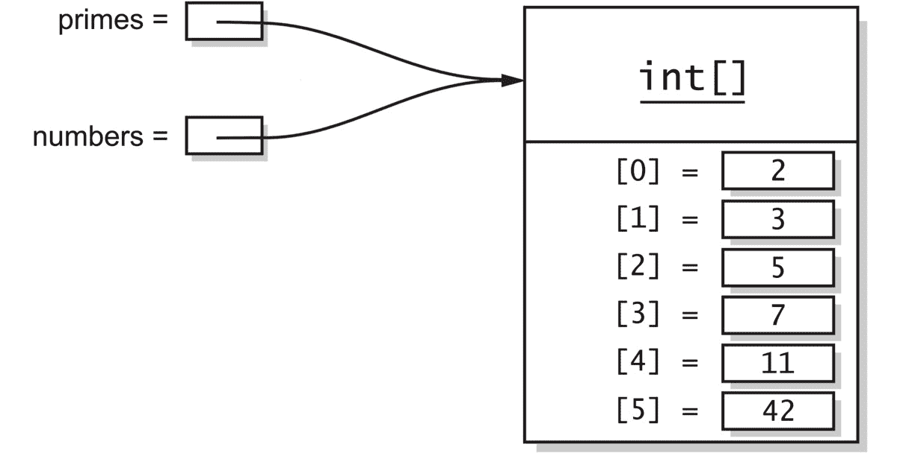图 1.6：引用同一个数组的两个变量

如果你不想要这种共享，就需要复制数组。使用静态方法`Arrays.copyOf`。

```
int[] copiedPrimes = Arrays.copyOf(primes, primes.length);
```

数组列表的引用工作方式相同：

```java
ArrayList<String> people = friends;

people.set(0, "Mary"); // 现在 friends.get(0) 也是 "Mary"
```

要复制数组列表，请从现有的列表构造一个新的数组列表：

```java
var copiedFriends = new ArrayList<>(friends);
```

你也可以将数组列表（array list）复制到数组中。由于后兼容性的遗憾原因（我将在 6 中解释），你必须提供一个正确类型的数组。

```
String[] names = friends.toArray(new String[0]);
```

目前没有简单的方法可以在基本数据类型数组与对应的包装类数组列表之间进行转换。例如，要在`int[]`和`ArrayList<Integer>`之间进行转换，你需要显式循环或`IntStream`（参见 8; // int[] 数组
Collections.fill(friends, ""); // ArrayList<String>
```

要对数组或数组列表进行排序，使用`sort`方法：

```java
Arrays.sort(names);
Collections.sort(friends); 
```

对于数组（但不是数组列表），可以使用`parallelSort`方法，如果数组很大，该方法会将工作分配到多个处理器上。

`Arrays.toString`方法产生数组的字符串表示。这对于打印数组进行调试特别有用。

```java
System.out.println(Arrays.toString(primes));
    // 输出 [2, 3, 5, 7, 11, 13]
```

数组列表也有一个`toString`方法，产生相同的表示。

```java
String elements = friends.toString();
    // 将 elements 设置为 "[Peter, Paul, Mary]"
```

对于打印，你甚至不需要调用它——`println`方法会处理这一点。

```java
System.out.println(friends);
    // 调用 friends.toString() 并打印结果
```

数组列表有几个实用的算法，它们在数组中没有对应项。

```
Collections.reverse(names); // 反转元素
Collections.shuffle(names); // 随机洗牌元素
```

### 1.8.8. 命令行参数

正如你所看到的，每个 Java 程序的`main`方法都有一个字符串数组类型的参数：

```
public static void main(String[] args)
```

当程序执行时，该参数被设置为在命令行上指定的参数。

例如，考虑这个程序：

```java
public class Greeting {
    public static void main(String[] args) {
        for (int i = 0; i < args.length; i++) {
            String arg = args[i];
            if (arg.equals("-h")) arg = "Hello";
            else if (arg.equals("-g")) arg = "Goodbye";
            System.out.println(arg);
        }
    }
}
```

如果如下如下调用程序：

```
java Greeting -g cruel world
```

那么`args[0]`是`"-g"`，`args[1]`是`"cruel"`，`args[2]`是`"world"`。

注意，`"java"`和`"Greeting"`都没有传递给`main`方法。

### 1.8.9. 多维数组

Java 没有真正的多维数组。它们被实现为“数组的数组”。例如，这里是声明和实现一个整数二维数组的方法：

```java
int[][] square = {
    { 16, 3, 2, 13 },
    { 5, 10, 11, 8 },
    { 9, 6, 7, 12 },
    { 4, 15, 14, 1 }
};
```

从技术上讲，这是一个`int[]`数组的一维数组——参见 图 1.7。

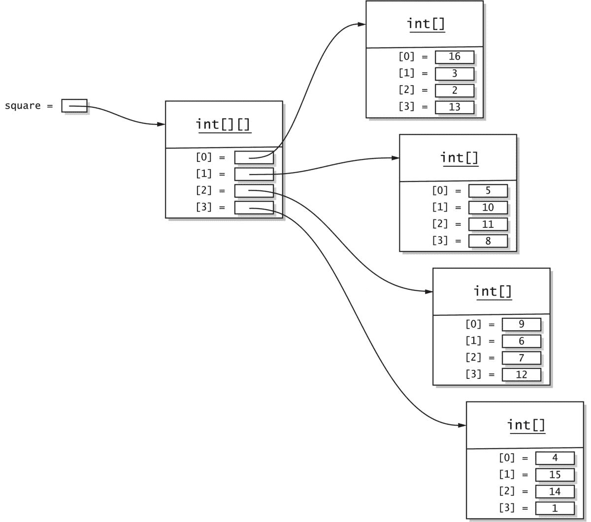图 1.7: 二维数组

要访问一个元素，使用两对括号：

```
int element = square[1][2]; // 将 element 设置为 11
```

第一个索引选择行数组`square[1]`。第二个索引从该行中选取元素。

你甚至交换行：

```java
int[] temp = square[0];
square[0] = square[1];
square[1] = temp;
```

如果你不提供初始值，则必须使用`new`运算符并指定行数和列数。

```java
int[][] square = new int[4][4]; // 先行，后列
```

在背后，行数组会被每个行的数组所填充。

并不要求行数组的长度相等。例如，你可以存储帕斯卡三角形：

```
1
1 1
1 2 1
1 3 3 1
1 4 6 4 1
...
```

首先构造一个包含`n`行的数组：

```java
int[][] triangle = new int[n][];
```

然后在循环中构造每一行并填充它。

```java
for (int i = 0; i < n; i++) {
    triangle[i] = new int[i + 1];
    triangle[i][0] = 1;
    triangle[i][i] = 1;
    for (int j = 1; j < i; j++) {
        triangle[i][j] = triangle[i - 1][j - 1];
    }
}
```

遍历多维数组，使用两个循环，一个用于行，另一个用于列：

```java
for (int i = 0; i < triangle.length; i++) {
    for (int j = 0; j < triangle[i].length; j++) {
        System.out.println(triangle[i][j]);
    }
}
```

### 1.9.1. 声明和调用静态方法

当你的`main`方法变得太长时，可以将其拆分为多个方法。使用`static`修饰符如果方法有返回类型，使用`return`语句返回结果。

```java
public static double average(double x, double y) {
    double sum = x + y;
    return sum / 2;
}
```

将其放在`main`方法所在的类中。然后这样调用它：

```java
public static void main(String[] args) {
    double a = ...;
    double b = ...;
    double result = average(a, b);
}
```

### 1.9.2. 数组参数和返回值

你可以将数组传递给方法。方法接收数组的引用，通过引用它可以修改数组。此方法交换数组中的两个元素：

```java
public static void swap(int[] values, int i, int j) {
    int temp = values[i];
    values[i] = values[j];
    values[j] = temp;
}
```

方法可以返回数组。此方法返回一个由给定数组的第一个和最后一个值组成的数组（数组不会被修改）：

```java
public static int[] firstLast(int[] values) {
    if (values.length == 0) return new int[0];
    else return new int[] { values[0], values[values.length - 1] };
}
```

### 1.9.3. 变长参数

有些方法允许调用者提供任意数量的参数。你已经见过这样一个方法：`printf`。例如，以下调用

```
System.out.printf("%d", n);
```

```
System.out.printf("%d %s", n, "widgets");
```调用同一个方法，尽管一个调用有两个参数而另一个有三个。

让我们定义一个以相同方式工作的`average`方法，以便我们可以向`average`传递任意数量的参数——例如`average(3, 4.5, -5, 0)`。在类型后使用`...`声明一个“变长参数”参数：

```java
public static double average(double... values)
```

该参数实际上是一个`double`类型的数组。当方法被调用时，会创建一个数组并填充参数。在方法体中你可以像使用其他数组一样使用它。

```java
public static double average(double... values) {
    double sum = 0;
    for (double v : values) sum += v;
    return values.length == 0 ? 0 : sum / values.length;
}
```

现在你可以这样调用：

```java
double avg = average(3, 4.5, -5, 0);
```

如果你已经将参数存储在数组中，那么就不需要对它们进行解包了。你可以直接传递数组，而不是参数列表：

```java
double[] scores = { 3, 4.5, -5, 0 };
double avg = average(scores);
```

变长参数必须是方法的最后一个（`last`）参数，但你可以在它之前放置其他参数。例如，这个方法确保了至少有一个参数：

```java
public static double max(double first, double... rest) {
    double result = first;
    for (double v : rest) result = Math.max(v, result);
    return result;
}
```

## Exercises 练习题

1. 编写一个程序，读取一个整数并以二进制、八进制和十六进制打印。以浮点数形式打印其倒数。

2. 编写一个程序，读取一个整数角度（可以是正或负），并将其归一化为 0 到 359 之间的值。先尝试使用`%`运算符，然后使用`floorMod`。

3. 仅使用条件运算符，编写一个程序读取三个整数并打印最大的那个。使用`Math.max`重复一遍。

4. 编写一个程序，打印最小和最大的`double`值。提示：在 Java API 中查找`nextUp`。

5. 当将一个`double`转换为大于最大可能的`int`值的整数时会发生什么？尝试一下。

6. 编写一个程序，使用`BigInteger`计算`n! = 1 × 2 × ... × n`。计算 1000 的阶乘。

7. 编写一个程序，读取两个 0 到 429496795 之间的整数，将它们存储在`int`变量中，并计算显示它们的和、差、商和余数。不要将它们转换为`long`。

8. 编写一个程序，读取一个字符串并打印其所有的非空子字符串。

9. Section 1.5.3 中有一个两个字符串`s`和`t`使得`s.equals(t)`但`s != t`。想出一个不使用`substring`的不同示例。

10. 编写一个程序，通过生成一个随机`long`值并以 36 进制打印，产生一个字母和数字的随机字符串。

11. 编写一个程序，读取一行文本并打印所有非 ASCII 字符及其 Unicode 值。

12. 编写一个`switch`表达式，当给定指南针方向`"N"`、`"S"`、`"E"`或`"W"`的字符串时，产生一个`x`和`y`偏移量的数组。例如，`"W"`产生`new int[] { -1, 0 }`。

13. 编写一个`switch`语句，当给定指南针方向`"N"`、`"S"`、`"E"`或`"W"`的字符串时，调整变量`x`和`y`。例如，`"W"`应让`x`减 1。

14. 你可以在`switch`语句在使用`break`而不产生贯穿（fall-through）吗？在`switch`表达式中呢？为什么或为什么不？

15. 想出一个用的场景，其中贯穿行为对`switch`表达式或语句是有益的。大多数网络搜索结果产生的示例对 C 或 C++ 有意义，在这些语言中，执行会从没有任何操作的`case A`到`case B`。在 Java 中，这并不显著，因为你可以使用`case A, B`。

16. “Quine”是一个在不读取任何输入或文件的情况下打印自身源代码的程序。使用 Java 中的文本块（text block）编写这样一个程序。

17. Java Development Kit 包含一个`src.zip`文件，其中包含 Java 库的源代码。解压并使用你最喜欢的搜索工具找到带有标签的`break`和`continue`序列的使用。选取其中一个并在不使用标签语句的情况下重写它。

18. 编写一个程序，打印一个从 1 到 49 之间选取六个不同数字的彩票组合。为了选取六个不同数字，从一个填充了 1...49 的列表开始。选取一个随机索引并删除该元素。重复六次。按排序打印结果。

19. 编写一个程序，读取一个二维整数数组并判断它是否为魔幻方（即所有行、所有列和对角线之和是否相等）。接受输入行并将其拆分为单独整数，当用户输入空行时停止。例如，输入为：


```
16 3 2 13
5 10 11 8
9 6 7 12
4 15 14 1
```

你的程序应该给出肯定的回答。

20. 编写一个程序，将直到给定 `n` 的帕斯卡三角形存储在`ArrayList<ArrayList<Integer>>`中。

21. 改进`average`方法，使其在调用时至少有一个参数。

# 第 2 章 面对象编程

在面向对象编程中，工作通过协作对象来完成，对象的行为由它们所属的类定义。Java 是第一批完全拥抱面向对象编程的主流语言之一。正如你已经看到的，在 Java 中，每个方法都声明在类中，除了少数原始类型外，每个值都是对象。在本章中，你将学习如何实现自己的类和方法。

本章的要点是：

1. 修改器方法（Mutator methods）改变对象的状态；访问器方法（accessor methods）不会。
2. 在 Java 中，变量不持有对象；它们持有对象的引用。
3. 实例变量和方法实现声明在类声明内部。
4. 实例方法是在对象上调用的，可以通过`this`引用访问。
5. 构造函数的名称与类名相同。类可以有多个（重载）构造函数。
6. 静态变量不属于任何对象。静态方法不在对象上调用。
7. `record`是一个不可变类，为所有实例变量提供公共访问器。
8. 类被组织在包（packages）中。使用导入声明你就不需要使用包名了。
9. 类可以嵌套在其他类中。
10. 内部类（inner class）是非静态嵌套类。它的实例拥有指向构造它的外部类的引用。
11. `javadoc`工具处理源文件，生成带有声明和程序员提供的注释的 HTML 文件。

## 2.1 与对象交互

在面向对象编程中，工作通过协作对象来完成，对象的行为由它们所属的类定义。Java 是第一批完全拥抱面向对象编程的主流语言之一。正如你已经看到的，在 Java 中，每个方法都声明在类中，除了少数原始类型外，每个值都是对象。在本章中，你将学习如何实现自己的类和方法。

在 Java 中，理解日期计算的专家为日期以及其他日期相关的概念（如星期几）提供了相应的类。如果你想对日期进行计算，可以使用这些类中的一个来创建日期对象，并在它们上调用方法，例如返回星期几或下一个日期的方法。

我们很少有人想去推敲日期算术的细节，但你可能是其他领域的专家。为了让其他程序员能够利用你的知识，你可以为他们提供类。即使你不是为了帮助其他程序员，你会发现自己在自己的工作中使用类也是很有用的，因为这可以使你的程序结构更加连贯。

在学习如何声明自己的类之前，让我们先来看一个使用对象的非平凡示例。

Unix 程序`cal`可以打印给定月份和年份的日历，格式如下所示：

```
 Mon Tue Wed Thu Fri Sat Sun
                           1
   2   3   4   5   6   7   8
   9  10  11  12  13  14  15
  16  17  18  19  20  21  22
  23  24  25  26  27  28  29
  30
```

你如何实现这样一个程序呢？使用 Java 标准库，你使用`LocalDate`类来表示位于某个未指定位置的日期。我们需要该类的对象来代表该月的第一天。以下是获取方法：

```
LocalDate date = LocalDate.of(year, month, 1);
```

要推后日期，你调用`date.plusDays(1)`。结果是一个新构建的`LocalDate`对象，日期向后一天。在我们的应用程序中，我们只需将结果重新赋值给`date`变量：

```
date = date.plusDays(1);
```

你应用方法来获取关于日期的信息，例如它所在的月份。我们需要这些信息，以便在处于同一个月份时继续打印。

```
while (date.getMonthValue() == month) {
    System.out.printf("%4d", date.getDayOfMonth());
    date = date.plusDays(1);
    ... 
}
```

另一个方法可以返回日期所属的星期几。

```
DayOfWeek weekday = date.getDayOfWeek();
```

你得到的是另一个类`DayOfWeek`的对象。为了计算日历中每月第一日的缩进，我们需要知道星期几的数值。有一个方法可以做到这一点：

```
int value = weekday.getValue();
for (int i = 1; i < value; i++) 
    System.out.print("    ");
```

`getValue`方法遵循国际惯例，即周末在周的最最后，星期一返回`1`，星期二返回`2`，以此此类推。星期日的值为`7`。

你可以这样*链式*调用方法：

```
int value = date.getDayOfWeek().getValue();
```

第一个方法调用应用于`date`对象，并返回一个`DayOfWeek`对象。然后会在返回的对象上调用`getValue`方法。

你将在该书的伴随代码中找到完整的程序。解决打印日历的问题其实非常简单，因为`LocalDate`类的设计者为我们提供了一组有用的方法。在本章中，你将学习如何为自己的类实现方法。

### 2.1.1. 访问器和变异器方法

再次考虑方法调用`date.plusDays(1)`。`LocalDate`类的设计者有两种方式可以实现`plusDays`方法。他们可以让它改变`date`对象的状态且不返回任何结果。他们也可以保持`date`不变并返回一个新构建的`LocalDate`对象。正如你看到的，他们选择了后者。

如果一个方法改变了它被调用的对象，我们称该方法为*变异器*（mutator）。如果它保持对象不变，它就是*访问器*（accessor）。`LocalDate`类的`plusDays`方法就是一个访问器。

事实上，`LocalDate`类的*所有*方法都是访问器。这种情况越来越常见，因为变异可能是危险，特别是当两个计算同时变异一个对象时。如今大多数计算机都有多个处理单元，安全的并发访问是一个严重的问题。解决这个问题的方法之一是通过只提供访问器方法使对象变为*不可变*（immutable）。

尽管如此，在许多情况下变异是需要的。`ArrayList`类的`add`方法就是变异器的示例。调用`add`后，数组列表对象发生了改变。

```
var friends = new ArrayList<String>();
    // friends 是空的
friends.add("Peter");
    // friends 的大小为 1
```

### 2.1.2. 对象引用

在某些编程语言（如 C++）中，变量实际上可以持有对象——即构成对象状态的位数据。在 Java 中，情况并非如此。变量只能持有对象的*引用*（reference）。实际对象位于其他处，而引用是定位对象的某种依赖于实现的实现（请参见 图 2.1）。

引用的行为类似于 C 和 C++ 中的指针，不同之处在于它们是完全安全的。在 C 和 C++ 中，你可以修改指针并使用它们覆盖任意内存位置。而通过 Java 引用，你只能访问特定的对象。

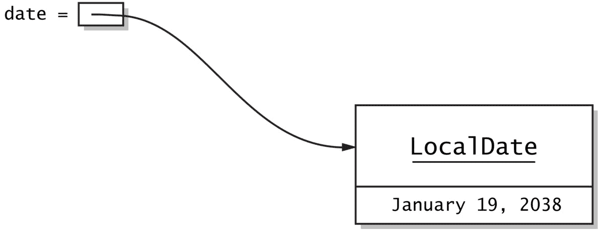图 2.1: 对象引用

当你将一个对象引用赋值给另一个时，你拥有了指向同一个对象的引用。

```
ArrayList<String> people = friends;
```

如果你变异了共享对象，通过这两个引用都可以观察到变化。考虑调用：

```
people.add("Paul");
```

现在`people`的大小为 2，`friends`也是如此（参见 2.2）。

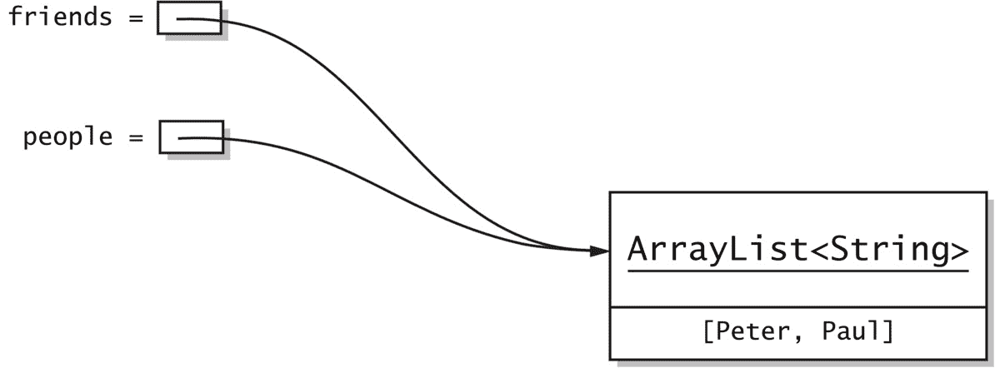图 2.2: 指向同一个对象的两个引用

大多数时候，这种对象的共享是高效且方便的，但你必须意识到可能通过任何一个引用来变异共享对象。然而，如果一个类没有变异器方法（例如`String`或`LocalDate`），你就不必担心。你可以自由地分发它的引用。

对象变量完全可以不引用任何对象，只需通过将其设置为特殊值`null`。

```
LocalDate date = null; // 现在 date 不引用任何对象
```

如果你还没有可以供`date`引用的对象，或者你想表示一种特殊情况（例如未知的日期），这就会很有用。

空值在非意料出现时是危险的。在`null`上调用方法会导致`NullPointerException`（它本应该被称为`NullReferenceException`）。由于这个原因，不建议使用`null`表示可选值。请使用`Optional`类型（参见 8）。

最后，再次查看赋值：

```
date = LocalDate.of(year, month, 1);
date = date.plusDays(1);
```

在第一次赋值后，`date`指向该月的第一天。调用`plusDays`返回了一个新的`LocalDate`对象，在第二次赋值后，`date`变量指向了新对象。第一个对象发生了什么？

第一个对象没有引用了，所以它不再被需要。最终，垃圾回收器会回收这些内存并供重复使用。在 Java 中，这个过程是完全自动的，程序员不需要担心释放内存。

## 2.2. 实现类

现在让我们转向实现自己的类。为了展示各种语言规则，我使用了一个经典的`Employee`类示例。员工有一个姓名和一个薪水。在这个示例中，姓名不能更改，但每隔一段时间员工可以获得一次应得的加薪。

### 2.2.1. 实例变量

从员工对象的描述中，你可以看到这样一个对象的状态由两个值描述：`name`和`salary`。在 Java 中，你使用实例变量来描述对象的状态。它们在类中的声明方式如下：

```java
public class Employee {
    private String name;
    private double salary;
    ...
}
```

这意味着`Employee`类的每个实例都有这两个变量。

在 Java 中，实例变量通常被声明为`private`。这意味着只有同一类中的方法可以访问它们。这种保护是有价值的，原因有几个：你可以控制程序的哪些部分可以修改这些变量，并且你可以在任何时候更改内部表示。例如，你可能将员工存储在数据库中，而只在对象中保留主键。只要你重新实现方法并使其工作方式与之前相同，该类的用户就不会介意。

### 2.2.2 方法头 (Method Headers)

现在让我们转向实现`Employee`类的方法。当你声明一个方法时，你需要提供它的名称、参数的类型和名称以及返回类型，如下所示：

```java
public void raiseSalary(double byPercent)
```

该方法有一个类型为`double`的参数，并且不返回任何值，如返回类型`void`所示。

`getName`方法有一个不同的签名：

```java
public String getName()
```

该方法没有参数并返回一个`String`。

大多数方法被声明为`public`，这意味着任何人都可以调用此类方法。有时，辅助方法被声明为`private`，这限制了它只能在同一类的其他方法中使用。对于与类用户不相关的方法，你应该这样做，特别是当这些方法依赖于实现细节时。如果实现发生发生了变化，你可以安全地更改或删除这些私有方法。

### 2.2.3 方法体 (Method Bodies)

在方法头之后，你提供方法体：

```java
public void raiseSalary(double byPercent) {
    double raise = salary * byPercent / 100;
    salary += raise;    
}
```

如果方法产生一个值，请使用`return`关键字：

```java
public String getName() {
    return name;
}
```

将方法声明放置在类声明内部：

```java
public class Employee {
    private String name;
    private double salary;

    public void raiseSalary(double byPercent) {
        double raise = salary * byPercent / 100;
        salary += raise;    
    }

    public String getName() {
        return name;
    }
    ...    
}
```

### 2.2.4 实例方法调用 (Instance Method Invocations)

考虑这个对类`Employee`的对象`fred`调用方法的示例：

```java
fred.raiseSalary(5);
```

在此次调用中，参数`5`用于初始化参数变量`byPercent`，等同于赋值：

```java
double byPercent = 5;
```

然后发生了以下操作：

```java
double raise = fred.salary * byPercent / 100;
fred.salary += raise;
```

注意，`salary`实例变量应用于调用该方法的实例上。

与你在上一章末尾看到的静态方法不同，像`raiseSalary`这样的方法是在类的实例上进行操作的。因此，这种方法被称为实例方法。在 Java 中，所有未声明为`static`的方法都是实例方法。

为了使`raiseSalary`方法能够工作，它必须接收两个值：调用该方法的对象的引用，以及调用的参数。从技术上讲，这两者都是方法的参数，但在 Java 中（就像其他面向对象的语言中一样），第一个参数承担着特殊的角色。它有时被称为方法调用的接收者（receiver）。

### 2.2.5 `this`引用

当在对象上调用方法时，`this`被设置为该对象。如果你愿意，可以在实现中使用`this`引用：

```java
public void raiseSalary(double byPercent) {
    double raise = this.salary * byPercent / 100;
    this.salary += raise;    
}
```

一些程序员更偏于这种风格，因为它清楚地区分了局部变量和实例变量——现在显而易见`raise`是局部变量，而`salary`是实例变量。

当你不想为参数变量想不同的名称时，使用`this`引用是非常常见的。例如，

```java
public void setSalary(double salary) {
    this.salary = salary;
}
```

当实例变量和局部变量具有相同名称时，未限定限定的名称（如`salary`）表示局部变量，而`this.salary`是实例变量。

在某些编程语言中，实例变量会以某种方式修饰，例如`_name`和`_salary`。这在 Java 中是合法的，但并不常见。

如果你愿意，你甚至可以将`this`声明为任何方法的参数（但不是构造函数）：

```java
public void setSalary(Employee this, double salary) {
    this.salary = salary;
}
```

这不会改变方法的实现或调用方式。这种表示法的存在是为了对方法的接收者进行注释——参见 11。

### 2.2.6 值传递 (Call by Value)

当你将一个对象传递给方法时，方法获取了对象引用的副本。通过这个引用，方法可以访问该对象。例如：

```java
public class EvilManager {
    Random generator;
    ...
    public void giveRaise(Employee e) {
        double percentage = 10 * generator.nextDouble();
        e.raiseSalary(percentage);
    }
}
```

考虑调用

```java
boss.giveRaise(fred);
```

引用`fred`被复制到参数变量`e`（见图 2.3）。通过这个引用，它可以操作共享的对象。

在 Java 中，你无法编写更新基本类型变量的方法。尝试增加`double`值的方法不起作用：

```java
public void increaseRandomly(double x) { // 不能更新传入的变量
    double amount = x * generator.nextDouble();
    x += amount;
}
```

如果你调用

```java
boss.increaseRandomly(sales);
```

`sales`被复制到`x`。然后`x`被增加了，但这并没有改变`sales`。参数变量离开了作用域，增加没有产生任何效果。

由于相同的原因，无法编写将对象引用更改为其他的方法。例如，这个方法并没有按预期工作：

```java
public class EvilManager {
    ...
    public void replaceWithZombie(Employee e) {
        e = new Employee("", 0);
    }
}
```

在调用

```java
boss.replaceWithZombie(fred);
```

引用`fred`被复制到变量`e`，然后将其设置为不同的引用。当方法退出时，`e`离开了作用域。在任何时候`fred`都没有被改变。


有些人说 Java 对对象使用“按引用传递”。正如第二个示例所示，事实并非如此。

## 2.3 对象构造 (Object Construction)

完成`Employee`类还剩最后一步：我们需要提供一个构造函数，详细信息见后续章节。

### 2.3.1 实现构造函数

声明构造函数与声明方法相似。然而，构造函数的名称与类名相同，并且没有返回类型。

```java
public Employee(String name, double salary) {
    this.name = name;
    this.salary = salary;
}
```

此构造函数是公共的。有时，使用私有构造函数也会有用。例如，`LocalDate`类没有公共构造函数。相反，该类的用户通过如`now`和`of`等“工厂方法”来获取对象。这些方法会调用一个私有构造函数。

如果你不小心指定了返回类型，例如：

```java
public void Employee(String name, double salary)
```

那么你声明的是一个名为`Employee`的方法，而不是构造函数！

当你使用`new`操作符时，会执行构造函数。例如，表达式

```java
new Employee("James Bond", 500000)
```

会分配`Employee`类的对象并调用构造函数体，构造函数会将实例变量设置为构造函数中提供的参数。

`new`操作符返回指向所构建对象的引用。你通常希望将该引用保存在变量中：

```java
var james = new Employee("James Bond", 500000);
```

或者将其传递给一个方法：

```java
var staff = new ArrayList<Employee>();
staff.add(new Employee("James Bond", 500000));
```

### 2.3.2. 方法重载

你可以提供多个版本的构造函数。例如，如果你想方便地为无名的工工蜂建模，可以提供一个只接受工资的第二个构造函数。

```java
public Employee(double salary) {
    this.name = "";
    this.salary = salary;
}
```

现在，`Employee`类有两个构造函数。调用哪一个取决于参数。

```java
var james = new Employee("James Bond", 500000);
    // 调用 Employee(String, double) 构造函数
var anonymous = new Employee(40000);
    // 调用 Employee(double) 构造函数
```

在这种情况下，我们说该构造函数被`重载`了。

如果一个方法有多个同名但参数不同的版本，则该方法是重载的。例如，`println`方法有多个重载版本，参数分别为`int`、`double`、`String`等。由于你无法选择构造函数的命名方式，因此重载构造函数是常见做法。

### 2.3.3. 从一个构造函数调用另一个

当存在多个构造函数时，它们通常会有一些共同的工作，最好不要重复这些代码。通常可以将这些共同的初始化放在一个构造函数中。

你可以从一个构造函数调用另一个构造函数，但只能作为构造函数体的`第一条语句`。令人们有些惊讶的是，你并不使用构造函数的名称进行调用，而是使用关键字`this`：

```java
public Employee(double salary) {
    this("", salary); // 调用 Employee(String, double)
    // 后面可以跟随其他语句
}
```

在这里，`this`并不是指向正在构建对象的引用。相反，它是一种特殊的语法，专门用于调用同一类的另一个构造函数。

### 2.3.4. 默认初始化

如果你没有在构造函数中显式地设置实例变量，它将被自动设置为默认值：数字设置为`0`，`boolean` own 设置为`false`，对象引用设置为`null`。

例如，你可以为无薪实习生提供一个构造函数。

```java
public Employee(String name) {
    // salary 自动设置为 0
    this.name = name;    
}
```

在这方面，实例变量与局部变量非常不同。记住，你必须始终显式地初始化局部变量。

对于数字，用零进行初始化通常很方便。但对于对象引用，这是一个常见的错误来源。假设我们没有在`Employee(double)`构造函数中将`name`变量设置为空字符串：

```java
public Employee(double salary) {
    // name 自动设置为 null
    this.salary = salary;
}
```

如果有人调用了`getName`方法，他们将得到一个可能并不预期的`null`引用。如下的条件

```java
if (e.getName().equals("James Bond"))
```

将导致空指针异常（null pointer exception）。

### 2.3.5. 实例变量初始化

你可以为任何实例变量指定初始值，如下：

```java
public class Employee {
    private String name = "";
    ...
}
```

这种初始化发生在对象分配之后、构造函数运行之前。因此，初始值在所有构造函数中都是。当然，其中某些构造函数可能会覆盖它。

除了在声明实例变量时进行初始化外，你可以在类声明中包含任意的`初始化块`。

```java
public class Employee() {
    private String name = "";
    private int id;
    private double salary;

    { // 一个初始化块
        var generator = new Random(); 
        id = 1 + generator.nextInt(1_000_000);
    }

    public Employee(String name, double salary) {
        ...
    }
}
```

这不是一个常用的特性。大多数程序员会将冗长的初始化代码放在一个辅助方法中，并在构造函数中调用该方法。

实例变量初始化和初始化块按照它们在类声明中出现的顺序执行，并在构造函数体之前执行。

### 2.3.6. final 实例变量

你可以将实例变量声明为`final`。此类变量必须在每个构造函数结束之前初始化。之后，该变量可能不再被修改。例如，`Employee`类的`name`变量可以声明为`final`，因为它在对象构建后永远不会改变——没有`setName`方法。

```java
public class Employee {
    private String name;
    ...
}
```

当与引用配合时，`final`修饰符仅表示它不会改变。修改数组是完全合法的。

```java
public class Person {
    private final ArrayList<Person> friends = new ArrayList<>();
        // 向此列表添加元素
    ...
}
```

它不能变为`null`。

### 2.3.7. 无参数构造函数

许多类包含一个无参数构造函数，用于创建一个状态设置为默认的对象。例如，这里是`Employee`类的一个无参数构造函数：

```java
public Employee() {
    name = "";
    salary = 0;
}
```

就像贫穷被告会被提供公共辩护一样，没有构造函数的类会自动获得一个无所作为的无参数构造函数。所有的实例变量都保持默认值（零、`false`或`null`），除非它们被显式初始化。因此，每个类至少有一个构造函数。

如果一个类已经有一个构造函数，它就不会自动获得另一个无参数构造函数。如果你提供了构造函数又想要无参数构造函数，你就必须手动编写。

在前面的节中，你看到了对象在构建时发生了什么。在某些编程语言（特别是 C++）中，指定对象销毁时发生什么是常见的。Java 有一种被弃用的机制在对象被垃圾回收器回收时进行“终结（finalize）”。但这种情况发生是不可预测的，所以你不应该使用它。然而，正如后面将看到的，有一种关闭文件等资源的机制。

## 2.4. Record

有时，数据就是数据，而面向对象编程提供的数据隐藏反而会成为障碍。考虑一个描述平面上点的`Point`类，具有`x`和`y`坐标。

当然，你可以提供一个类：

```java
class Point {
    private final double x;
    private final double y;
    public Point(double x, double y) { this.x = x; this.y = y; }
    public getX() { return x; }
    public getY() { return y; }
    public String toString() { return "Point[x=%d, y=%d]".formatted(x, y); }
    // 更多方法 ...
}
```

但是，隐藏`x`和`y`然后通过 getter 方法公开这些值，真的能带给我们任何好处吗？

我们是否想要更改`Point`的实现？当然，虽然有极坐标，但你不会在图形 API 中使用它们。在实践中，平面上的一个点完全由它的`x`和`y`坐标描述。

为了更简洁地定义此类类，你可以使用一种特殊的类形式，称为称为“记录（records）”。

## 2.4.1. 记录（Record）的概念

记录是类的一种特殊形式，其状态是不可变的，并且是公开的。要声明一个记录，提供名称和持有对象状态的实例变量。这里是一个典型的示例：

```java
record Point(double x, double y) { }
```

结果是一个带有实例变量的类`Point`：

```java
private final double x;
private final double y;
```

该类有一个构造函数：

```java
Point(double x, double y)
```

以及访问器方法：

```java
public double x()
public double y()
```

注意，访问器被命名为`x`和`y`，而不是`getX`和`getY`。（在 Java 中，拥有与方法同名的实例变量是合法的。）

```java
var p = new Point(3, 4);
double slope = p.y() / p.x();
```

如果你有一个记录的实例，可以使用*模式匹配（pattern matching）*来获取记录组件。例如：

```java
double slope = switch (p) {
    case Point(var a, var b) -> b / a;
};
```

模式匹配将在 4 中介绍。

除了变量访问器方法外，每个记录都自动定义三个方法：`toString`、`equals`和`hashCode`。你将在下一节中学习更多关于这些方法。

你可以为记录添加自己的方法：

```java
record Point(double x, double y) {
    public double distanceFromOrigin() {
        return Math.hypot(x, y);
    }
}
```

你可以定义自动提供的方法的自定义版本，只要它们的参数和返回类型相同。例如，这种定义是合法的：

```java
record Point(double x, double y) {
    public double x() { return y; } // 错误做法
}
```

但这显然不是一个好主意。

你不能在记录的体内声明实例变量：

```java
record Point(double x, double y) {
    private double r; // 不能在此声明实例变量
    ...
}
```

记录的实例变量自动是`final`的。然而，它们可能是指向可变对象的引用：

```java
record Point(double[] coords) { ... }
```

那么记录实例就是可变的：

```java
Point p = ...;
p.coords[0] = 10; 
```

如果你希望记录实例是不可变的，请不要对实例变量使用可变类型。

记录像任何类一样，可以有静态字段和方法：

```java
record Point(double x, double y) {
   public static Point ORIGIN = new Point(0, 0);
   public static double distance(Point p, Point q) {
      return Math.hypot(p.x - q.x, p.y - q.y);
   }
   ...
}
```

## 2.4.2. 构造函数：规范的、自定义的和紧凑的

设置所有实例变量的自动构造函数被称为*规范构造函数（canonical constructor）*。

为了验证或规范规范构造函数的参数，你使用一种*紧凑（compact）*形式。你不需要指定参数列表：

```java
record Range(int from, int to) {
   public Range { // 紧凑形式，验证参数
      if (from > to) throw new IllegalArgumentException();
   }
}
```

或者

```java
record Range(int from, int to) {
    public Range { // 紧凑形式，规范化参数
        if (from > to) { // 交换边界
            int temp = from;
            from = to;
            to = temp;
        }
    }
}
```

紧凑形式的体是规范构造函数的“前序（prelude）”。它仅仅在参数变量被赋值给实例字段`this.from`和`this.to`之前修改了参数变量`from`和`to`。你不能在紧凑构造函数的体内读取或修改实例变量。

你可以定义额外的*自定义构造函数*。此类构造函数的第一条语句必须调用另一个构造函数，以便最终调用规范构造函数。这里有一个示例：

```java
record Point(double x, double y) {
    public Point() { this(0, 0); }
}
```

此记录有两个构造函数：规范构造函数和一个产生原点的无参数构造函数。

如果规范构造函数需要执行额外工作，你可以提供自己的实现。但这非常罕见。例如，下面的实现是合法的，但正如你所看到的，使用紧凑构造函数可以更容易实现相同的效果。

```java
record Range(int from, int to) {
    public Range(int from, int to) { // 合法，但比紧凑构造函数工作更多
        if (from <= to) {
            this.from = from;
            this.to = to;
        } else {
            this.from = to;
            this.to = from;
        }
    }
}
```

## 2.5. 静态变量和方法

在你过的所有示例程序中，主方法都标记了`static`修饰。在接下来的章节中，你将学习`static`的含义。

### 2.5.1. 静态变量

在你过的所有示例程序中，主方法都标记了`static`修饰。在接下来的章节中，你将学习`static`的含义。

在前面的章节中，静态变量是在声明时初始化的。有时，你需要进行额外的初始化工作。你可以将其放入`static initialization block`（静态初始化块）中。

```java
public class CreditCardForm {
    private static final ArrayList<Integer> expirationYear = new ArrayList<>();
    static {
        // 将今年及接下来的二十年添加到列表中
        int year = LocalDate.now().getYear();
        for (int i = year; i <= year + 20; i++) {
            expirationYear.add(i);
        }   
    }
    ...
}
```

静态初始化发生在类首次加载时。与实例变量一样，除非你显式地将其设置为另一个值，否则静态变量为`0`、`false`或`null`。所有的静态变量初始化和静态初始化块都是按照它们在类声明中出现的顺序执行的。

### 2.5.4. 静态方法

静态方法是不操作对象的方法。例如，`Math`类的`pow`方法就是一个静态方法。表达式

```java
Math.pow(x, a)
```

计算幂`x`^(`a`)。它不使用任何`Math`对象来完成任务。

正如你已经在 1 中看到的，静态方法使用`static`修饰符进行声明：

```java
public class Math {
    public static double pow(double base, double exponent) {
        ...
    }
}
```


为什么不将`pow`变成实例方法呢？它不能是`double`的实例方法，因为在 Java 中，基本类型不是类。你可以把它设为`Math`类的实例方法，但那样你就需要构造一个`Math`对象才能调用它。

静态方法的另一个常见用处是为你不拥有的类提供额外的功能。例如，如果有一个方法可以在给定范围内产生随机整数，那不是很好吗？你不能向标准库中的`Random`类添加方法。但你可以提供一个静态方法：

```java
public class RandomNumbers {
    public static int nextInt(Random generator, int low, int high) {
        return low + generator.nextInt(high - low + 1);
    }
}
```

通过如下方式调用该方法：

```java
int dieToss = RandomNumbers.nextInt(gen, 1, 6);
```

在对象上调用静态方法是合法的。例如，与其调用`LocalDate.now()`来获取今天的日期，你可以在`LocalDate`类的对象`date`上调用`date.now()`。但这并没有很大意义。`now`方法并没有查看`date`对象来计算结果。大多数 Java 程序员会认为这种风格很糟糕。

由于静态方法不操作对象，你无法从静态方法访问实例变量。然而，静态方法可以访问所在类中的静态变量。例如，在`RandomNumbers.nextInt`方法中，我们可以将随机数生成器变为静态变量：

```java
public class RandomNumbers {
    private static final Random generator = new Random();

    public static int nextInt(int low, int high) {
        return low + generator.nextInt(high - low + 1);
        // 可以访问静态变量 generator
    }
}
```

### 2.5.5. 工厂方法

静态方法的一个常见用途是“factory method”（工厂方法），即返回类的新实例的静态方法。例如，`NumberFormat`类使用工厂方法来为各种样式生成格式化对象。

```java
NumberFormat currencyFormatter = NumberFormat.getCurrencyInstance();
NumberFormat percentFormatter = NumberFormat.getPercentInstance();
double x = 0.1;
System.out.println(currencyFormatter.format(x)); // 输出 $0.10
System.out.println(percentFormatter.format(x)); // 输出 10%
```

为什么不用构造函数呢？区分两个构造函数的唯一方法是它们的参数类型。你不能拥有两个无参数的构造函数。

此外，构造函数`new NumberFormat(...)`返回一个`NumberFormat`。工厂方法可以返回子类的对象。事实上，这些工厂方法返回的是`DecimalFormat`类的实例。（有关子类的更多信息，请参见 4。）

工厂方法还可以返回一个共享对象，而不是不必要地构造新对象。例如，调用`Collections.emptyList()`返回一个共享的不可变空列表。

## 2.6. 包（Packages）

在 Java 中，你将相关的类放在一个包中。包对于组织工作以及将其与他人提供的代码库隔离开非常方便。正如你所看到的，Java 标准库分布在多个包中，包括`java.lang`、`java.util`、`java.math`等。

使用包的一个原因是为了保证类名的唯一性。假设两个程序员都想出了提供`Element`类的好主意。（事实上，光是 Java API 中就至少有五个开发者产生过这个好主意。）只要他们都将类放在不同的包中，就不会有冲突。

在接下来的章节中，你将学习如何使用包。

### 2.6.1. 包的声明

包名是用点分隔的标识符列表，例如`java.util.regex`。

为了确保包名的唯一性，使用反向写的 Internet 域名（已知是唯一的）是一个好主意。例如，我拥有域名`horstmann.com`。对于我的项目，我使用如`horstmann`的包名。这个规则的一个大例外是标准库，其包名以`java`或`javax`开头。

在 Java 中，包是不嵌套的。例如，`java.util`和`java.util.regex`彼此无关。每个包都是独立的类集合。

要将类放入包中，需要在源文件的开头添加`package`语句：

```java
package horstmann.corejava;

public class Employee {
    ...
}
```

现在`Employee`类位于`horstmann.corejava`包中，其全限定名为`horstmann.corejava.Employee`。还有一个没有名字的默认包，你可以用于编写简单的程序。但不建议使用默认包。

当类文件从文件系统读取时，路径名需要与包名匹配。例如，`Employee.class`必须位于`com/horstmann/corejava`。

如果你以此方式安排源文件，并在包含初始包名的目录下进行编译，那么类文件会自动放在正确的位置。假设`EmployeeDemo`类使用了`Employee`对象，你这样编译它：

```bash
javac com/horstmann/corejava/EmployeeDemo.java
```

编译器生成类文件`com/horstmann/corejava/EmployeeDemo.class`和`com/horstmann/corejava/Employee.class`。你通过指定全限定类名来运行程序：

```bash
java com.horstmann.corejava.EmployeeDemo
```

如果源文件不在与其包名相同的子目录中，`javac`不报错并生成类文件，但你需要将类文件放在正确的位置。这可能会非常困惑——参见练习 26。

使用`-d`运行`javac`是一个好主意。这样类文件就会生成在独立的目录中，不会污染源码树，并且具有正确的子目录结构。

### 2.6.2. `jar`命令

与其将类文件存储在文件系统中，不如将它们放入一个或多个称为 JAR 文件的存档。你可以使用 JDK 部分的`jar`工具创建这样的存档。它的命令行选项类似于 Unix 的`tar`程序。

```bash
jar --create --verbose --file library.jar com/mycompany/*.class
```

或者，使用短选项：

```bash
jar -c -v -f library.jar com/mycompany/*.class
```

```bash
jar cvf library.jar com/mycompany/*.class
```

JAR 文件通常用于打包库。

你可以使用 JAR 文件来打包一个程序，而不仅仅是库。通过以下命令生成 JAR 文件：

```bash
jar -c -f program.jar -e com.mycompany.MainClass com/mycompany/*.class
```

然后通过以下命令运行程序：

```bash
java -jar program.jar
```

Java 开发工具包中的命令选项传统上使用单横杠后跟多字母选项名称，例如`java`的`-jar`。例外是`jar`命令，它遵循了`tar`命令的经典选项格式，即不带横杠。现在，Java 正在向更常见的选项格式转变，即多字母选项名称前带有双横杠（例如`--create`），并为常用选项提供单字母快捷方式（例如`-c`）。

这导致了一些混乱，希望随着时间的推移能够得到解决。目前，`java -jar`像往常一样工作，但`java --jar`则并不行。你可以组合某些单字母选项，但不能组合另一些。例如，`jar -cvf filename`是有效的，但`jar -cv -f filename`则无效。长参数选项可以跟在空格或`=`后面，短参数选项可以跟在空格后面或后面。然而，这尚未完全实现：`jar -c --file=filename`是有效的，但`jar -c -f filename`则无效。

### 2.6.3. 类路径（The Class Path）

当你在项目中使用库 JAR 文件时，你需要通过指定`class path`（类路径）告诉编译器和虚拟机这些文件所在的位置。类路径可以包含：

- 包含类文件的目录（在与其包名匹配的子目录中）
- JAR 文件
- 包含 JAR 文件的目录

`javac`和`java`程序都有选项`-cp`（其冗长版本为`--class-path`，或者为了向后兼容使用`-classpath`）。例如：

```bash
java -cp .:../libs/lib1.jar:../libs/lib2.jar com.mycompany.MainClass
```

该类路径包含三个元素：当前目录（`.`）以及`../libs`目录下的两个 JAR 文件。

在 Windows 中，使用分号代替冒号来分隔路径元素：

```bat
java -cp .;..\libs\lib1.jar;..\libs\lib2.jar com.mycompany.MainClass
```

如果你有许多 JAR 文件，将它们全部放在一个目录中并使用通配符包含所有它们：

```bash
java -cp .:../libs/\* com.mycompany.MainClass
```

在 Unix 中，必须对`*`进行转义以防止 shell 扩展。

`javac`编译器始终会在当前目录中查找文件，但`java`程序只有在`.`目录位于类路径上时才会查找当前目录。如果你没有设置类路径，这并不是一个问题——默认类路径由`.`目录组成。但如果你设置了类路径却忘记包含`.`目录，你的程序将能够通过编译而不会报错，但无法运行。

类路径的通配符选项非常方便，但只有在 JAR 文件结构良好时它才能可靠地工作。在不同的 JAR 文件中拥有同一个类的两个版本是可能的（尽管这不是个好主意）。在这种情况下，第一个遇到的类将胜出。通配符语法不保证 JAR 文件的处理顺序，如果你需要 JAR 文件的特定顺序，则不应使用。（这种“JAR 文件地狱”是 Java 平台模块系统旨在防止的问题——参见 12。）

使用`-cp`选项是设置类路径的首选方法。另一种方法是`CLASSPATH`环境变量。具体取决于你使用的 shell。如果你使用`bash`，使用如下命令：

```bash
export CLASSPATH=.:/home/username/project/libs/*
```

在 Windows 中，命令为：

```bat
SET CLASSPATH=.;C:\Users\username\project\libs\*
```

你可以全局设置`CLASSPATH`环境变量（例如在`.bashrc`或 Windows 控制面板中）。然而，许多程序员在忘记全局设置后感到后悔，并惊讶自己的类没有被找到。

正如你将在 12 中看到的，你可以将包组合成`modules`（模块）。模块提供了强封装，隐藏了除你设置为可见的包之外的所有包。你将在 12 中看到如何使用`module path`（模块路径）来指定程序所用模块的位置。

### 2.6.4. 包访问（Package Access）

你已经遇到过访问修饰符`public`和`private`。标记为`public`的特征可以被任何类使用。私有特征只能由声明它的类使用。如果你没有指定`public`或`private`，该特征（即类、方法或变量）可以被相同包中的所有方法访问。

包访问对于包中方法需要但包用户感兴趣的工具类和方法非常有用。另一个常见用例是测试。你可以将测试类放在相同的包中，然后它们就可以访问被测试类的内部实现。

一个源文件可以包含多个类，但最多有一个类可以被声明为`public`。如果源文件有一个公共类，其文件名必须与类名匹配。

对于变量来说，包访问是默认设置，这很遗憾。一个常见的错误是忘记`private`修饰符，无意中让实例变量对整个包可见。这里有一个`java.awt`包中`Window`类的示例：

```java
public class Window extends Container {
    String warningString;
    ...
}
```

由于`warningString`变量不是私有的，`java.awt`包中所有类的方法都可以访问它。实际上，除了`Window`类本身的方法外，没有其他方法这样做，因此程序员可能只是忘记了`private`修饰符。

由于包是开放的，这可能会引发安全问题。任何类都可以通过提供相应的`package`语句添加到包。

如果你对包的开放性感到担忧，你并不孤单。解决方法是将包放入模块——参见 12。当包位于模块中时，无法简单地添加到包。在`java.awt`包中构造类无法访问`warningString`变量。

### 2.6.5. 导入类（Importing Classes）

`import`语句允许你不使用全限定名使用类。例如，当你使用：

```java
import java.util.Random;
```

然后你可以在代码中写`Random`而不是`java.util.Random`。

导入声明是一种便利，并非必须。你可以删除所有导入声明并在到处使用全限定名。

```java
private java.util.Random generator = new java.util.Random();
```

将`import`语句放在源文件中第一个类声明之上，但`package`语句之下。

你可以使用通配符导入包中的所有类：

```java
import java.util.*;
```

通配符只能导入类，不能导入包。你不能使用`import java.*;`来获取所有以`java`开头的包。

当你导入多个包时，可能会发生命名冲突。例如，`java.util`和`java.sql`包都包含`Date`类。假设你导入了这两个包：

```java
import java.util.*;
import java.sql.*;
```

如果你的程序没有使用`Date`类，这就不是问题。但如果你在不带包名的情况下引用`Date`，编译器会报错。

在这种情况下，你可以导入你想要的特定类：

```java
import java.util.*;
import java.sql.*;
import java.sql.Date;
```

如果你确实需要这两个类，你必须对其中至少一个类使用全限定名。

`import`语句是为程序员提供的便利性。在类文件内部，所有的类名都是全限定的。

`import`语句与 C 和 C++ 中的`#include`指令有很大不同。后者在编译时包含头文件，而`import`不会导致文件重新编译。它们只是缩短了名称，类似于 C++ 的`using`语句。

### 2.6.6. 静态导入

`import`语句的一种形式允许导入静态方法和变量。例如，如果你在源文件的顶部添加指令：

```java
import static java.lang.Math.*;
```

你就可以在不使用类名前缀的情况下使用`Math`类的静态方法和静态变量：

```java
area = 4 * PI * pow(r, 2); // 即 Math.PI, Math.pow
```

你也可以导入特定的静态方法或变量：

```java
import static java.lang.Math.PI;
import static java.lang.Math.pow;
```

正如你将在第 3 章和第 8 章中看到的，通常配合`java.util.Comparator`和`java.util.stream.Collectors`使用静态导入声明是很常见的，这些类提供了大量的静态方法。

## 2.7. 嵌套类

在上一节中，你已经看到了如何将类组织到包中。或者，你可以将一个类放在另一个类内部。这种类被称为`nested class`（嵌套类）。这有助于限制可见性，或者避免用`Element`、`Node`或`Item`等通用名称弄乱包。Java 有两种嵌套类，它们的行为略有不同。让我们在接下来的章节中检查它们。

### 2.7.1. 静态嵌套类

考虑一个为项目计费的`Invoice`类，每个项目都有描述、数量和单价。我们可以将`Item`作为嵌套类：

```java
public class Invoice {
    private static class Item { // Item 嵌套在 Invoice 内部
        String description;
        int quantity;
        double unitPrice;

        double price() {
            return quantity * unitPrice;
        }
    }

    private ArrayList<Item> items = new ArrayList<>();
    ...
}
```

在下一节之前，你还不清楚为什么这个内部类被声明为`static`。现在，先接受它吧。

`Item`类并没有特别之处，除了访问控制。该类在`Invoice`中是私有的，因此只有`Invoice`方法可以访问它。出于这个原因，我没有费力将内部类的实例变量设置为私有。

这是一个构造内部类对象方法的示例：


`public class Invoice` 是一个发票类，其中包含一个 `addItem` 方法，用于向发票中添加项目。

```
public class Invoice {
    ...
    public void addItem(String description, int quantity, double unitPrice) {
        var newItem = new Item();
        newItem.description = description;
        newItem.quantity = quantity;
        newItem.unitPrice = unitPrice;
        items.add(newItem);
    }
}
```

类可以使嵌套类变为公有。在这种情况下，人们会想要通常的封装机制。

```
public class Invoice {
    public static class Item { // 一个公有嵌套类
        private String description;
        private int quantity;
        private double unitPrice;

        public Item(String description, int quantity, double unitPrice) {
            this.description = description;
            this.quantity = quantity;
            this.unitPrice = unitPrice;
        }
        public double price() { return quantity * unitPrice; }
        ...
    }

    private ArrayList<Item> items = new ArrayList<>();

    public void add(Item item) { items.add(item); }
    ...
}
```

现在，任何人都可以通过限定名称`Invoice.Item`来构造`Item`对象：

```
var newItem = new Invoice.Item("Blackwell Toaster", 2, 19.95);
myInvoice.add(newItem);
```

这个`Invoice.Item`类与在任何其他类之外声明的`InvoiceItem`类本质上没有区别。嵌套类只是让`Item`类代表发票中的项目变得显而易见。

### 2.7.2. 内部类

上一节中，你看到了一个声明为`static`的嵌套类。在这一节中，你将看到去掉`static`修饰符会发生什么。这类类被称为`inner classes`（内部类）。

考虑一个社交网络，其中每个成员的朋友也是成员。

```
public class Network {
    public class Member { // Member 是 Network 的内部类
        private String name;
        private ArrayList<Member> friends;

        public Member(String name) {
            this.name = name;
            friends = new ArrayList<>();
        }
        ...
    }

    private ArrayList<Member> members = new ArrayList<>();
    ...
}
```

去掉`static`修饰符后，存在本质的区别。`Member`对象知道它属于哪个网络。让我们看看它是如何运作的。

首先，这是一个向网络添加成员的方法：

```
public class Network {
    ...
    public Member enroll(String name) {
        var newMember = new Member(name);
        members.add(newMember);
        return newMember;
    }
}
```

到目前为止，似乎并没有发生什么。我们可以添加一个成员并获取它的引用。

```
var myFace = new Network();
Network.Member fred = myFace.enroll("Fred");
```

现在，假设 Fred 觉得这个社交网络不再火了，所以他想注销他的会员。

```
fred.deactivate();
```

这里是`deactivate`方法的实现：

```
public class Network {
    public class Member { 
        ...
        public void deactivate() {
            members.remove(this);
        }
    }

    private ArrayList<Member> members;
    ...
}
```

### 2.7.3. 内部类的特殊语法规则

在上一节中，我通过称其`outer`来解释了内部类对象的外部类引用。外部引用的实际语法有点复杂。表达式

```
OuterClass.this
```

表示外部类引用。例如，你可以这样写`Member`内部类的`deactivate`方法：

```java
public void deactivate() {
    Network.this.members.remove(this);
}
```

在这种情况下，并没有`Network.this`语法。直接引用`members`就会隐式地使用外部类引用。但有时，你需要显式使用外部类引用。这里有一个检查`Member`对象是否属于特定网络的方法：

```
public class Network {
    public class Member {
        ...
        public boolean belongsTo(Network n) {
            return Network.this == n;
        }
    }
}
```

```java
public class Network {
    ...
    Member enroll(String name) {
        Member newMember = new Member(name);
        ...
    }
}
```

这是为了简写形式：

```
Member newMember = this.new Member(name);
```

你可以在外部类的任何实例上调用内部类的构造函数：

```
Network.Member wilma = myFace.new Member("Wilma");
```

内部类可以拥有静态成员。内部类的静态方法可以访问其所属类以及外部类的静态成员。

由于历史的偶然，内部类在虚拟机规范被认为完成时被添加到 Java 语言中，因此它们被翻译成普通类，并带有一个指向外部实例的隐藏实例变量。练习 30 邀请你探索这种转换。

`局部类`(Local classes）是内部类的另一种变体，我们将在 3 中讨论。

## 2.8. 文档注释

JDK 包含一个非常有用的工具，称为`javadoc`，它可以从你的源文件生成 HTML 文档。事实上，我们在 1 中描述的在线 API 文档仅仅是在标准 Java 库源码上运行`javadoc`的结果。

如果你在源文件中添加了以特殊分隔符`/**`开头的注释，你也可以轻松地生成看起来专业的文档。这是一个非常好的方法，因为它让你将代码和文档维护在同一个地方。在过去那些糟糕的日子里，程序员经常将文档放在单独的文件中，代码和注释产生分歧只是时间问题。当文档注释与源代码位于同一个文件中时，更新两者并重新运行`javadoc`就是一件轻而易举的事。

### 2.8.1 注释插入

`javadoc`工具提取提取项目的信息：

* 公有类和接口

* 公有和受保护的构造函数和方法

* 公有和受保护的变量

* 包和模块

接口在 3 中引入，保护特性在 4 中。

你可以（并且应该）为这些特性中的每一个提供注释。每个注释都放置在其描述的特性正上方。注释以`/**`开头，以`*/`结束。

每个`/** ... */`文档注释包含自由格式的文本，随后是标签。标签以`@`开头，例如`@author`或`@param`。

自由格式文本的*第一句*应该是一个总结性语句。`javadoc`工具会自动生成提取这些句子的摘要页面。

在自由格式文本中，你可以使用 HTML 修饰符，例如`<em>...</em>`用于强调，`<code>...</code>`用于等宽“打字机”字体，`<strong>...</strong>`用于加粗，甚至可以使用``来包含图像。然而，你应该避免使用标题`<hn>`或水平线`<hr>`，因为它们会干扰文档的格式。

如果你的注释包含指向其他文件的链接（例如图表或用户界面组件的图像），请将这些文件置于包含源文件目录的子目录下，命名为`doc-files`。`javadoc`工具会将源目录中的`doc-files`目录及其内容复制到文档目录。你需要在链接中指定`doc-files`目录，例如``。

### 2.8.2 类注释

类注释必须直接放置在类声明之前。你可能想用`@author`和`@version`标签记录类的作者和版本。可以有多个作者。

这里是一个类注释的示例：

```
/**
 * 一个 <code>Invoice</code> 对象代表一张发票，
 * 包含订单每个部分的行项目。 
 * @author Fred Flintstone
 * @author Barney Rubble
 * @version 1.1
 */
public class Invoice {
    ...
}
```

不需要在每行前面放一个`*`。然而，大多数 IDE 会自动提供星号，有些甚至会在换行发生变化时重新排列它们。

### 2.8.3 方法注释

将每个方法注释直接放置在其对应的方法之前。文档以下特性：

* 每个参数，带有注释`@param` `变量描述`

* 返回值，如果不是`void`：`@return` `描述`

* 任何抛出的异常（参见 5）：`@throws` `异常类描述`

这里是一个方法注释的示例：

```
/**
 * 增加员工的工资。
 * @param byPercent 增加工资的百分比（例如， 10 表示 10%）
 * @return 增加的金额
*/
public double raiseSalary(double byPercent) {
    double raise = salary * byPercent / 100;
    salary += raise;
    return raise;
}
```

### 2.8.4 变量注释

你只需要记录公有变量——通常意味着静态常量。例如：

```java
/**
 * 地球上每年的天数（不包括闰年）
 */
public static final int DAYS_PER_YEAR = 365;
```

### 2.8.5 用注释

在所有文档注释中，你都可以使用`@since`标签来描述该特性可用的版本：

```
@since version 1.7
```

`@deprecated`标签添加该类、方法或变量不再被使用。例如：

```
@deprecated 改用 setVisible(true)
```

### 2.8.6 链接

你可以使用`@see`和`@link`标签向 javadoc 的其他部分或外部文档添加链接。

`@see`标签在“另参”部分添加超链接。它可以同时用于类和方法。在这里，引用可以是以下形式：

* `@see 类#特性`

第一种是最用的。你提供类、方法或变量的名称，`javadoc`会插入指向其文档的链接。例如：

```
@see horstmann.corejava.Employee#raiseSalary(double)
```

指向`horstmann.corejava.Employee`类`raiseSalary(double)`方法。你可以省略包名或包和类名。那么，特性将位于当前包或类中。

注意，必须使用`#`而不是点来分隔类和方法变量。Java 编译器本身非常擅长识别点作为包、子包、类、内部类及其方法和变量的分隔符。但`javadoc`工具并不聪明，所以你需要帮助它。

如果`@see`标签后面跟着`<`字符，你正在指定一个超链接。你可以链接到任何喜欢的 URL。例如：

```
@see <a href="http://en.wikipedia.org/wiki/Leap_year">闰年</a>
```

在每种情况下，你都可以指定一个可选的标签，作为链接的锚点。如果省略标签，用户将看到目标代码名或 URL 作为锚点。

如果`@see`标签后面跟着`"`字符，引号中的文本将显示在“另参”部分。例如：

```
@see "Core Java for the Impatient"
```

你可以为一个特性添加多个`@see`标签，但必须将它们放在一起。

如果你喜欢，可以在任何文档注释的任何地方放置指向其他类或方法的链接。在注释的任何位置插入格式为

```
{@link 包.类#特性 标签}
```

特性的描述遵循与`@see`标签相同的规则。

## 2.8.7. 包、模块和概览注释

类、方法和变量注释直接位于 Java 源文件中，并用`/** ... */`分隔。然而，要生成包注释，你需要在每个包目录中添加一个单独的文件。

提供一个名为`package-info.java`的 Java 文件。该文件必须包含一个用`/**`和`*/`分隔的初始 javadoc 注释，随后跟一个包声明（package statement）。它不应包含任何额外的代码或注释。

要对模块进行文档说明，请将你的注释放入`module-info.java`中。你可以包含`@moduleGraph`指令来包含模块依赖图。（参见关于模块和`module-info.java`文件的 12。）

你还可以为所有源文件提供一个概览注释。将其放置在名为`overview.xhtml`的文件中，该文件应位于包含所有源文件的父目录中。位于`<body>...</body>`标签之间的所有文本会被提取。当用户从导航栏中选择“Overview”（概览）时，会显示此注释。

## 2.8.8. 注释提取

在这里，`docDirectory`是你希望 HTML 文件所在的目录名称。按照以下步骤操作：

1. 切换到包含你想记录的源文件的目录。如果你有需要记录的嵌套包，例如`com.horstmann.corejava`，你必须在包含`com`子目录的目录中运行。（如果你提供了`overview.xhtml`文件，这里就是包含该文件的目录。）

2. 运行命令：

```
javadoc -d docDirectory package1 package2 ...
```

如果你省略了`-d` `docDirectory`选项，HTML 文件将会被提取到当前目录。那可能会导致目录变得杂乱，因此我不建议那样做。

`javadoc`程序可以通过许多命令行选项进行精细调整。例如，你可以使用`-author`和`-version`选项在文档中包含`@author`和`@version`标签。（默认情况下，它们是被省略的。）

另一个有用的选项是`-link`，它用于包含通向标准类的超链接。例如，如果你运行以下命令：

```
javadoc -link http://docs.oracle.com/javase/17/docs/api *.java
```

所有的标准库类都会自动链接到 Oracle 网站上的文档。

如果你使用`-linksource`选项，每个源文件都将转换为 HTML，并且每个类和方法名将变成指向源码的超链接。

## 练习

1. 修改日历打印程序，使其从周日开始一周的计算。同时也让它在结尾打印一个换行符（但仅一个）。

2. 考虑`Scanner`类的`nextInt`方法。它是一个访问器（accessor）还是修改器（mutator）？为什么？`Random`类的`nextInt`方法又是怎样的？

3. 你是否可以让修改器方法返回`void`以外的内容？你是否可以让访问器方法返回`void`？在可能的情况下请给出例子。

4. 为什么你不能实现一个交换两个`int`变量内容的 Java 方法？相反，写一个交换两个`IntHolder`对象内容的方法。（在 API 文档中查找这个相当冷门的类。）你可以交换两个`Integer`对象的内容吗？

5. 为`Point`记录添加`translate`和`scale`方法。`translate`方法根据给定的分量在`x`和`y`方向上移动点。`scale`方法根据给定的因子缩放两个坐标。实现这些方法，使它们返回带有结果的新点。例如：

```
Point p = new Point(3, 4).translate(1, 3).scale(0.5);
```

应该将`p`设置为坐标为 (2, 3.5) 的点。

6. 重复前面的练习，但现在将`Point`实现为类，并将`translate`和`scale`变为修改器。

7. 在前面的练习中，提供`Point`类的构造函数和 getter 方法是非常重复的。大多数 IDE 都有编写模板代码的快捷键。你的 IDE 提供什么？

8. 为前几个练习中两个版本的`Point`类添加`javadoc`注释。


9. 实现一个带有`hour`和`minute`组件的记录`TimeOfDay`。对它们进行归一化，使小时在 0 到 23 之间，分钟在 0 到 59 之间。提供一个方法`TimeOfDay plusMinutes(int minutes)`，返回一个距离给定分钟数之后的新`TimeOfDay`对象，以及一个方法`int minutesFrom(TimeOfDay other)`，返回此实例与给定的`TimeOfDay`实例之间的分钟。

10. 实现一个`Car`类，模拟沿`x`轴行驶的汽车，并在移动时消耗燃料。提供方法行驶指定的英里、向油箱添加指定的加仑，以及获取当前距离原点的距离和燃料水平。在构造函数中指定燃油效率（英里/加仑）。这应该是一个不可变类吗？为什么或为什么不？

11. 在`RandomNumbers`类中提供两个静态方法`randomElement`，用于从整数数组或整数列表中获取随机元素。（如果数组或列表为空，则返回 0。）为什么你不能将这些方法变为`int[]`或`ArrayList<Integer>`的实例方法？

12. 重写`Cal`类，使用对`System`和`LocalDate`类的静态导入。

13. 重写`Cal`类以使用对`System`和`LocalDate`类的静态导入。创建一个文件`HelloWorld.java`，在包`01`中声明类`HelloWorld`。将其放入`01/`子目录。从该目录运行`javac HelloWorld.java`。得到类文件了吗？然后运行`java HelloWorld`。发生了什么？（提示：运行`javadoc`并研究警告信息。）最后尝试`javac -d . HelloWorld`。为什么这样更好？

14. 从 https://commons.apache.org/proper/commons-csv/ 下载 CSV 的 JAR 文件。编写一个带有`main`方法的类，读取一个 CSV 文件并打印其内容。你还没有学习处理异常。只需使用以下 main 方法头：

```
public static void main(String[] args) throws Exception
```

练习的目的不是对 CSV 进行任何有用操作，而是练习使用库。

15. 编译`Network`类。注意内部类文件名为`Network$Member.class`。使用`javap`程序查看生成的代码。命令

```
javap -private Classname
```

显示方法和实例变量。在哪里看到对外部类的引用？（在 Linux/Mac OS 上，运行`javap`时需要在`$`符号前加`\`。）

16. 完全实现 2.7.1 中的`Invoice`类。提供一个打印发票的方法和一个构造并打印示例发票的演示程序。

17. 实现一个类`Queue`，字符串无界队列。提供方法`add`（在尾部添加）和`remove`（从头部移除）。使用链表存储元素。将`Node`实现为嵌套类。它是静态的吗？

在面向对象编程出现很久以前就已经有了函数式编程语言，例如`Lisp`，在这些语言中，函数是主要的结构化机制。最近，函数式编程的重要性日益增加，因为它非常适合并发和事件驱动（或“响应式”）编程。`Java`支持函数表达式，这在面向对象编程和函数式编程之间提供了一个方便的桥梁。在本章中，你将学习接口和 lambda 表达式。

本章的关键点如下：

1. `interface`指定了实现类必须提供的 set 方法。

2. `interface`是任何实现它的类的超类型。因此，可以将类的实例赋值给接口类型的变量。

3. `interface`可以包含静态方法。接口的所有变量自动为`public`、`static`且`final`。

4. `interface`可以包含默认方法，实现类可以继承或覆盖这些方法。

5. `interface`可以包含私有方法，实现类无法调用或覆盖这些方法。

6. `Comparable`和`Comparator`接口用于比较对象。

7. 如果需要测试对象是否符合某个子类型，请使用`instanceof`运算符，优先使用其“模式匹配”形式。

8. `functional interface`（函数式接口）是一个只有一个抽象方法的接口。

9. `lambda expression`（lambda 表达式）表示可以在以后时间点执行的代码块。

10. Lambda 表达式转换为函数式接口。

11. 方法和构造函数引用指向方法或构造函数，而不调用它们。

12. Lambda 表达式和局部类可以访问闭包作用域中的有效 final（effectively final）变量。

## 3.1. 接口

`interface`是一种阐明双方之间合同的机制：服务的提供者以及希望其对象能够用于该服务的类。在接下来的章节中，你将看到如何在`Java`中定义和使用接口。

### 3.1.1 使用接口

在 1 中，我使用了`Random`类来说明如何调用构造函数。当`Random`类在`Java` 1.0 中最初设计时，它反映了当时的最高水平。如今，已经知道了更多产生伪随机数的算法。`java.util.random`包提供了具有各种权权衡的强算法实现。根据你的需求，你可能需要在`L64X128MixRandom`、`Xoroshiro128PlusPlus`或另一个具有类似名称的算法之间选择。（该包的 API 文档提供了关于选择哪个算法的有用建议。）有趣的是，API 没有为每个算法暴露单独类。这是一个好事。当你从一种算法切换到另一种算法时，修改程序将很麻烦。而且这是没必要的——所有的生成器都具有相同的方法集：`nextInt`、`nextDouble`等。

相反，这些方法属于接口`RandomGenerator`。接口定义了支持的方法——在这里是`nextInt`、`nextDouble`等。一旦你有了实现此接口的类的实例，就可以调用这些方法：

```
RandomGenerator generator = RandomGenerator.getDefault();
int dieToss = 1 + generator.nextInt(6);
double randomPercentage = 100 * generator.nextDouble();
```

静态方法`RandomGenerator.getDefault`获取某个类的对象，调用者对该类的具体性质是未知的。已知的是该类拥有`RandomGenerator`接口的所有方法。有了这些知识，你可以高效地使用该对象。

### 3.1.2 声明接口

在本节中，你将学习如何声明你自己的接口。让我们考虑一种可能是随机也可能不随机的序列。这些序列只产生整数，并且可能是有限的或无限的。

此类序列可以有许多形式。以下是一些示例：

* 由用户提供的整数序列

* 随机整数序列

* 质数序列

* 整数数组中的元素序列

* 字符串中代码点的序列

* 数字中的数字序列

我们想要实现一种处理所有这些类型序列的单一机制。

首先，让我们阐明整数序列之间的共同点。至少，处理一个序列需要两个方法：

* 测试是否存在下一个元素

* 获取下一个元素

要声明一个接口，你提供方法头，如下所示：

```
public interface IntSequence {
    boolean hasNext();
    int next();
}
```

你不需要实现这些方法，但如果你愿意，也可以可以提供默认实现——参见第 3.2.2 节。如果没有提供实现，我们称该方法为`abstract`（抽象）。

接口的所有方法自动为`public`。因此，没有必要将`hasNext`和`next`声明为`public`。某些程序员为了更清晰仍然会这样做。

一旦你有了接口声明，就可以实现实用的服务。这里有一个例子，报告前`n`个值的平均值：

```
public static double average(IntSequence seq, int n) {
    int count = 0;
    double sum = 0;
    while (seq.hasNext() && count < n) {
        count++;
        sum += seq.next();
    }
    return count == 0 ? 0 : sum / count;
}
```

注意，该方法不知道也不需要知道`hasNext`和`next`方法是如何执行工作的。然而，编译器必须知道这些方法存在。

### 3.1.3 实现接口

现在让我们来看硬币的另一面：希望可以使用`average`方法的类。它们需要实现`IntSequence`接口。这里有这样一个类：

```
public class SquareSequence implements IntSequence {
    private int i;

    public boolean hasNext() {
        return true;
    }

    public int next() {
        i++;
        return i * i;
    }
}
```

有无限多个平方数，该类的对象会一个接一个交付它们。（为了保持示例简单，我们忽略了整数溢出——参见练习 12。）

`implements`关键字表示`SquareSequence`类打算符合`IntSequence`接口。

实现类必须将接口的方法声明为`public`。否则，它们将默认为包私有访问（package access）。由于接口要求公共访问，编译器将报告错误。

这段代码获取前 100 个平方数的平均值：

```
var squares = new SquareSequence();
double avg = average(squares, 100);
```

有很多类可以实现`IntSequence`接口。例如，这个类产生一个有限序列，即从最低有效位开始的正整数的数字：

```
public class DigitSequence implements IntSequence {
    private int number;

    public DigitSequence(int n) {
        number = n;
    }

    public boolean hasNext() {
        // 此方法和后续方法在接口中定义
        return number != 0;
    }

    public int next() {
        int result = number % 10;
        number /= 10;
        return result;
    }

    public int rest() {
        // 此方法未在接口中定义
        return number;
    }
}
```

对象`new DigitSequence(1729)`在`hasNext`返回`false`之前交付数字`9 2 7 1`。

`SquareSequence`和`DigitSequence`类实现了`IntSequence`接口的所有方法。如果一个类只实现了部分方法，则它必须声明为`abstract`修饰符。关于抽象类的更多信息，请参见 4。

### 3.1.4 转换为接口类型

此代码片段计算数字序列值的平均值：

```
IntSequence digits = new DigitSequence(1729);
double avg = average(digits, 100);
// 将只查看序列的前四个值
```

观察`digits`变量。它的类型是`IntSequence`，而不是`DigitSequence`。类型为`IntSequence`的变量引用某个实现了`IntSequence`接口的类的对象。你始终可以将对象赋值给类型为已实现接口的变量，或将其传递给期望此类接口的方法。

这里有一些实用的术语。当子类型的任何值都可以在不经过转换的情况下赋值给超类型的变量时，类型`S`就是类型`T`（**子类型**，subtype）的**超类型**（supertype）。例如，`IntSequence`接口是`DigitSequence`类的超类型。

虽然可以声明接口类型的变量，但你永远无法拥有一个类型为接口的对象。所有对象都是类的实例。

### 3.1.5. 强制转换与`instanceof`运算符

有时，你需要相反的转换——从超类型到子类型。这时你就要使用**强制转换**（cast）。例如，如果你恰好知道存储在`IntSequence`中的对象实际上是`DigitSequence`，你可以像这样转换类型：

```
IntSequence sequence = ...;
DigitSequence digits = (DigitSequence) sequence;
System.out.println(digits.rest());
```

在这种情况下，强制转换是必要的，因为`rest`是`DigitSequence`的方法，而不是`IntSequence`的。

请查看练习 4 获取一个更具说服力的示例。

你只能将对象强制转换为其实际类或其超类型之一。如果你弄错了，将发生编译时错误或类转换异常（class cast exception）：

```
String digitString = (String) sequence;
// 不可能成功——IntSequence 不是 String 的超类型
SquareSequence squares = (SquareSequence) sequence;
// 可能成功，如果不符合则会抛出类转换异常
```

为了避免异常，你可以先使用`instanceof`运算符测试对象是否为目标类型。该表达式：

```
object instanceof Type
```

如果`object`是具有`Type`作为超类型的类的实例，则该表达式返回`true`。在使用强制转换之前进行此类检查是一个好主意。

```
if (sequence instanceof DigitSequence) {
    DigitSequence digits = (DigitSequence) sequence;
    ...
}
```

`instanceof`运算符是`null`-安全的：如果`obj`为`null`，则表达式`obj instanceof Type`为`false`。毕竟，`null`不可能指向任何给定类型对象的引用。

### 3.1.6. `instanceof`的“模式匹配”形式

由于“`instanceof`和强制转换”这种惯用法非常常见，因此有一个方便的快捷方式，称为`instanceof`模式匹配：

```
if (sequence instanceof DigitSequence digits) {
    // 在这里，你可以使用 digits 变量
    ...
}
```

在这个示例中，`digits`变量包含了`sequence`引用，并强制转换为`DigitSequence`。然而，如果`sequence`不是`DigitSequence`的实例，则不会声明变量，且不会执行`if`体。

无用的`instanceof`模式是一个错误：

```
DigitSequence digits = ...;
if (digits instanceof IntSequence seq) ... // 错误——它显然是 IntSequence
```

同样无用的

```
if (digits instanceof IntSequence) ... 
```

是允许的，以为了与 Java 1.0 的向后兼容。

当`instanceof`模式引入变量时，你可以立即在同一个表达式中使用它：

```
IntSequence sequence = ...;
if (sequence instanceof DigitSequence digits && digits.rest() >= 100) ...
```

这之所以有效，是因为`&&`表达式的右侧只有在左侧为`true`时才会被求值。如果评估了右侧，则`digits`已经绑定了一个`DigitSequence`实例。

然而，以下是一个编译时错误：

```
if (sequence instanceof DigitSequence digits || digits.rest() >= 100) ... // 错误
```

`||`的右侧在左侧为`false`时执行，此时没有内容绑定到变量`digits`。

这里是另一个使用条件运算符的示例：

```
double rest = sequence instanceof DigitSequence digits ? digits.rest() : 0;
```

变量`digits`在`?`之后的子表达式中定义，但在`:`之后的子表达式中未定义。

这种声明变量的`instanceof`形式被称为“模式匹配”，因为它与`switch`中的类型模式相似，后者是 Java 17 的一项“预览”（preview）功能。我不会详细讨论预览功能，但这里有一个语法的示例：

```
String description = switch (sequence) {
    case DigitSequence digits ->
        "A digit sequence with rest " + digits.rest();
    case SquareSequence squares -> "A square sequence";
    default -> "Some other sequence";
}
```

与`instanceof`模式一样，每个`case`都声明了一个变量。


## 3.1.7. 扩展接口

接口可以`extend`（扩展）另一个接口，在原始方法的基础上要求或提供额外的方法。例如，`Closeable`是一个带有单一方法的接口。

正如你在 5 中看到的，这是一个在发生异常时关闭资源的重要接口。

`Channel`接口扩展了这个接口：

```java
public interface Channel extends Closeable {
    boolean isOpen();
}
```

`Channel`必须提供这两个方法。

## 3.1.8. 实现多个接口

一个类可以实现多个接口。例如，一个从文件读取整数的`FileSequence`类除了`IntSequence`之外还实现了`Closeable`接口：

```java
public class FileSequence implements IntSequence, Closeable {
    ...
}
```

然后`FileSequence`类拥有`IntSequence`和`Closeable`超类型。

## 3.1.9. 常量

接口中定义的任何变量自动为`public static final`。

例如，`SwingConstants`接口定义了方向的常量：

```java
public interface SwingConstants {
    int NORTH = 1;
    int NORTH_EAST = 2;
    int EAST = 3;
    ...
}
```

你可以通过限定名`SwingConstants.NORTH`来引用它们。如果你的类实现了`SwingConstants`接口，你可以省略`SwingConstants`限定符，直接写`NORTH`。然而，这并不是常见的惯用法。对于常量集，使用枚举要更好；参见 4。

接口不能拥有实例变量。接口规范的是行为，而不是对象状态。

## 3.2. 静态、默认与私有方法

在之前的早期版本中，接口的所有方法都必须抽象的——也就是说没有方法体。现在你可以添加三种具有具体实现的方法：静态、默认和私有方法。接下来的章节将描述这些方法。

### 3.2.1. 静态方法

技术上从未规定接口不能拥有静态方法，但它们并不符合接口作为抽象规范的观点。这种想法现在已经演变了。特别是工厂方法在接口中非常有意义。例如，`IntSequence`接口可以有一个静态方法`digitsOf`，用于生成给定整数的数字序列：

```java
IntSequence digits = IntSequence.digitsOf(1729);
```

该方法产生一个实现了`IntSequence`接口的类实例，但调用者无需关心是哪一个。

```java
public interface IntSequence {
    ...
    static IntSequence digitsOf(int n) {
        return new DigitSequence(n);
    }
}
```

在过去，将静态方法放在辅助类中是常见的。你在 Java API 中发现接口和工具类的成对，例如`Collection`/`Collections`或`Path`/`Paths`。这种拆分不再必要。

### 3.2.2. 默认方法

你可以为任何接口方法提供一个`default`实现。你必须使用`default`修饰符来标记此类方法。

```java
public interface IntSequence {
    default boolean hasNext() { return true; }
        // 默认情况下，序列是无限的
    int next();
}
```

实现此接口的类可以选择重写`hasNext`方法，也可以继承默认实现。

默认方法终结了一种经典模式，即提供一个接口和一个伴类，该伴类实现接口的大部分或全部方法，例如 Java API 中的`Collection`/`AbstractCollection`或`WindowListener`/`WindowAdapter`。现在，你只需要在接口中实现方法即可。

默认方法的一个重要用途是*接口演化*。以在 Java 中存在了多年的`Collection`接口为例。假设在很久早以前，你提供提供了一个类：

```java
public class Bag implements Collection
```

在后来的 Java 8 中，接口中添加了一个`stream`方法。

假设`stream`方法不是默认方法。那么`Bag`类将无法编译，因为它没有实现新方法。在接口中添加非默认方法不是*源兼容的*。

但假设你没有重新编译类，而只是使用包含该类的旧 JAR 文件。即使缺少该方法，类仍然可以加载。程序仍然可以创建`Bag`实例，且不会发生任何坏事。（向接口中添加方法是*二进制兼容的*。）然而，如果程序在`Bag`实例上调用`stream`方法，就会抛出`AbstractMethodError`。

将方法设为`default`方法解决了这两个问题。`Bag`类将能够再次编译。如果类在没有重新编译的情况下被加载，并在`Bag`实例上调用了`stream`方法，则会调用`Collection.stream`方法。

## 3.2.3 解决默认方法冲突

如果一个类实现了两个接口，其中一个接口具有默认方法，另一个接口具有相同名称和参数类型的方法（默认或非默认），那么你必须解决这种冲突。这种情况并不常见，而且通常处理起来比较容易。

让我们来看一个例子。假设我们有一个带有`getId`方法的接口`Person`：

```java
public interface Person {
    String getName();
    default int getId() { return 0; }
}
```

假设还有一个具有相同方法的接口`Identified`。

```java
public interface Identified {
    default int getId() { return Math.abs(hashCode()); } 
}
```

你可以在 4 中看到`hashCode`方法的作用。目前，重要的是它返回一个源自对象的整数。

如果你形成一个实现这两个接口的类，会发生什么？

```java
public class Employee implements Person, Identified {
    ...
}
```

该类继承了由`Person`和`Identified`接口提供的两个`getId`方法。Java 编译器无法在两者之间选择。编译器会报告错误，并由你来解决这种歧义。在`Employee`类中提供一个`getId`方法，并实现你自己的 ID 方案，或者委托给冲突方法之一，如下所示：

```java
public class Employee implements Person, Identified {
    public int getId() { return Identified.super.getId(); }
    ...
}
```

`super`关键字允许你调用超类型方法。在这种情况下，我们需要指定想要哪哪个超类型。这种语法看起来有点奇怪，但它与你在 4 中看到的调用父类方法的语法是一致的。

现在假设`Identified`接口没有为`getId`提供默认实现：

```java
interface Identified {
    int getId();
}
```

`Employee`类可以继承来自`Person`接口的默认方法吗？乍一看，这似乎是合理的。但编译器如何知道`Person.getId`方法是否执行了`Identified.getId`预期操作呢？毕竟，它返回的是人的弗洛伊德 id 水平，而不是 ID 数字。

Java 的设计者选择了安全和统一。两个接口之间如何发生冲突并不重要；只要至少有一个接口提供了实现，编译器就会报告错误，并由程序员来解决这种歧义。

如果两个接口都没有为共享方法提供默认实现，则不存在冲突。实现类有两个选择：实现该方法，或者留空未实现并将类声明为`abstract`（抽象）。

如果一个类扩展了一个父类（参见 4）并实现了一个接口，从两者都继承了相同的方法，规则就会更简单。在这种情况下，只有父类方法起作用，接口中的任何默认方法都被简单忽略。这实际上比接口冲突更常见。详情请参见 4。

## 3.2.4 私有方法

接口中的方法可以是私有的。私有方法可以是`static`（静态）或实例方法，但不能是`default`方法，因为它可以被重写。由于私有方法只能在接口本身的方法中使用，它们的使用仅限于作为接口其他方法的辅助方法。

例如，假设`IntSequence`类提供了方法：

```java
static IntSequence of(int a)
static IntSequence of(int a, int b)
static IntSequence of(int a, int b, int c)
```

那么这些方法中的每一个都可以调用辅助方法：

```java
private static makeSequence(int... values) { }
```

## 3.3 接口示例

乍一看，接口似乎不大。接口只是类承诺实现的方法集。为了让接口的重要性更加具体，以下章节将为你展示 Java API 中四个常用的接口示例。

### 3.3.1 `Comparable`接口

假设你要对对象数组进行排序。排序算法反复比较元素并在顺序不对时重新排列它们。当然，比较的规则对于每个类都是不同的，而排序算法应该调用类提供的方法。这就是接口的用场。

如果一个类想要为其对象启用排序，它应该实现`Comparable`接口。关于这个接口有一个技术点。我们想要对比字符串、员工，类此类等等。因此，`Comparable`接口有一个类型参数。

```java
public interface Comparable<T> {
    int compareTo(T other);
}
```

例如，`String`类实现了`Comparable<String>`，使其`compareTo`方法具有签名：

```java
int compareTo(String other)
```

带有类型参数的类型（如`Comparable`或`ArrayList`）是*泛型*。你将在 6 中学习关于泛型的所有知识。

调用`x.compareTo(y)`时，`compareTo`方法返回一个整数来指示 x 或 y 应该在前。正（不一定是`1`）表示`x`应该在`y`之后。负整数（不一定是`-1`）表示`x`应该在`y`之前。如果`x`和`y`被认为相等，则返回值为`0`。

注意，返回值可以是任何整数。这种灵活性是有用的，因为它允许你返回整数的差值。只要差值不会产生整数溢出，这种做法非常方便。

```java
public class Employee implements Comparable<Employee> {
    ...
    public int compareTo(Employee other) {
        return getId() - other.getId(); // 如果 ID 始终 ≥ 0 则安全
    }
}
```

返回整数的差值并不总是有效的。对于符号相反的大型操作数，差值可能会溢出。在这种情况下，请使用`Integer.compare`方法，它对所有整数都能正常工作。然而，如果你知道整数是非负的，或者它们的绝对值小于`Integer.MAX_VALUE / 2`，那么使用差值就是好的。

在比较浮点值时，你不能直接返回差值。相反，请使用静态方法`Double.compare`。它能够正确处理，即使对于 ±∞ 和 NaN。

以下是`Employee`类如何实现`Comparable`接口，按工资对员工进行排序：

```java
public class Employee implements Comparable<Employee> {
    ...
    public int compareTo(Employee other) {
        return Double.compare(salary, other.salary);
    }
}
```

`compare`方法访问`other.salary`是完全合法的。在 Java 中，方法可以访问该类任何对象的私有属性。

`String`类以及 Java 库中的其他百多个类都实现了`Comparable`接口。你可以使用`Arrays.sort`方法来对`Comparable`对象的数组进行排序：

```java
String[] names = { "Peter", "Paul", "Mary" };
Arrays.sort(names); // names is now ["Mary", "Paul", "Peter"]
```

奇怪的是，`Arrays.sort`方法在编译时并不检查参数是否为`Comparable`对象的数组。相反，如果它遇到没有实现`Comparable`接口的类元素，它会抛出异常。

### 3.3.2. `Comparator`接口

现在假设我们想按长度递增对字符串排序，而不是按字典顺序。我们无法让`String`类以两种方式实现`compareTo`方法——而且无论如何，`String`类也不是由我们来修改的。

为了处理这种情况，`Arrays.sort`方法有第二个版本，其参数是一个数组和一个比较器——比较器是一个实现了`Comparator<T>`接口的类实例，该接口包含以下抽象方法：

```java
int compare(T first, T second);
```

要按长度比较字符串，请定义实现`Comparator<String>`的类：

```java
class LengthComparator implements Comparator<String> {
    public int compare(String first, String second) {
        return first.length() - second.length();
    }
}
```

要实际执行比较，你需要创建一个实例：

```java
Comparator<String> comp = new LengthComparator();
if (comp.compare(names[i], names[j]) > 0) ...
```

将此调用与`names[i].compareTo(names[j])`进行对比。`compare`方法是在比较器对象上调用的，而不是在字符串本身。

即使`LengthComparator`对象没有状态，你仍然需要创建一个实例。你需要这个实例来调用`compare`方法——它不是一个静态方法。

要对数组排序，将`LengthComparator`对象传递给`Arrays.sort`方法：

```java
String[] names = { "Peter", "Paul", "Mary" };
Arrays.sort(names, new LengthComparator()); 
```

现在数组的结果是`["Paul", "Mary", "Peter"]`或`["Mary", "Paul", "Peter"]`。

你将在第 3.4.2 节中看到如何使用 lambda 表达式更轻松地使用`Comparator`。

### 3.3.3. `Runnable`接口

在几乎每个处理器都拥有多个核心的时代，你想让这些核心忙起来。你可能想在单独线程中运行某些任务，或者将它们交给线程池执行。要定义任务，你需要实现`Runnable`接口。该接口只有一个方法。

```java
class HelloTask implements Runnable {
    public void run() {
        for (int i = 0; i < 1000; i++) {
            System.out.println("Hello, World!");
        }
    }
}
```

如果你想在一个新线程中执行此任务，请从`Runnable`创建线程并启动它。

```java
Runnable task = new HelloTask();
Thread thread = new Thread(task);
thread.start();
```

现在`run`方法在单独线程中执行，当前线程可以继续进行其他工作。

在第 10 章中，你将看到执行`Runnable`的其他方法。

还有一个`Callable<T>`接口，用于返回类型为`T`结果的任务。

### 3.3.4. 用户界面回调

在图形用户界面中，你必须指定当用户点击按钮、选择菜单选项、拖动滑块时要执行的操作。这些操作通常被称为回调（callbacks），因为当用户操作发生时，某些代码会被回调回来。

在基于 Java 的 GUI 库中，接口用于回调。例如，在 Swing 库中，以下接口用于报告事件：

```java
public interface ActionListener {
    void actionPerformed(ActionEvent event);
}
```

要指定操作，请实现该接口：

```java
class ClickAction implements ActionListener {
    public void actionPerformed(ActionEvent event) {
        System.out.println("Thanks for clicking!");
    }
}
```

然后，创建该类的对象并将其添加到按钮中：

```java
var button = new JButton("Click me!");
button.addActionListener(new ClickAction());
```


## 3.4. Lambda 表达式

*lambda 表达式*（lambda expression）是一段可以传递的代码块，以便稍后执行，可以执行一次或多次执行。在前面的章节中，你已经看到了许多指定此类代码很有用的情况：

- 向`Arrays.sort`传递比较方法
- 在单独线程中运行任务
- 当按钮被点击时指定操作

然而，Java 是一种面向对象的语言，其中（几乎）一切都是对象。Java 中没有函数类型。相反，函数被表示为对象，即类的实例。lambda 表达式为创建此类实例提供了简便的语法。

### 3.4.1. Lambda 表达式的语法

再次考虑第 3.3.2 节中的排序示例。我们传递了一段代码来检查一个字符串是否比另一个字符串短。我们计算：

```
first.length() - second.length()
```

`first`和`second`是什么？它们都是字符串。Java 是一种强类型语言，我们必须也指定这一点：

```
(String first, String second) -> first.length() - second.length()
```

你刚刚看到了你的第一个 lambda 表达式。这种表达式仅仅是一个代码块，加上对必须传递给代码的变量的指定。

为什么叫这个名字？许多年前，在计算机出现之前，逻辑学家阿隆佐·丘奇（Alonzo Church）想要将数学函数可有效计算的定义形式化。（奇的是，已知某些函数存在，但没人知道如何计算它们的值。）他使用希腊字母 lambda (λ) 来标记参数，类似于：

```
λfirst.
      λsecond. first.length() - second.length()
```

为什么用字母 λ？是因为丘奇的字母表用完了吗？实际上，尊崇的《数学原理》（Principia Mathematica，参见 http://plato.stanford.edu/entries/principia-mathematica）使用了 ^ 变符号来表示函数参数，这启发了丘奇使用大写的 lambda Λ。但最后，他切换到了小写版本。从那时起带有参数变量的表达式就被称为 lambda 表达式。

如果 lambda 表达式的主体执行了不符合单个表达式的计算，请完全按照你编写方法的方式编写它：封装在`{}`中，并使用显式的`return`语句。例如：

```
(String first, String second) -> {
   int difference = first.length() < second.length();
   if (difference < 0) return -1;
   else if (difference > 0) return 1;
   else return 0;
}
```

如果 lambda 表达式没有参数，请提供空括号，就像无参数方法一样：

```
Runnable task = () -> { for (int i = 0; i < 1000; i++) doWork(); }
```

如果 lambda 表达式的参数类型可以被推断，你就可以省略它们。例如：

```
Comparator<String> comp
    = (first, second) -> first.length() - second.length();
    // 等同于 (String first, String second)
```

在这里，编译器可以推断出`first`和`second`必须是字符串，因为该 lambda 表达式被赋值给一个字符串比较器。（我们将在下一节中详细讨论这一赋值。）

如果一个方法只有一个类型可推断的参数，你甚至可以省略括号：

```
ActionListener listener = event ->
    System.out.println("Thanks for clicking!");
        // 代替 (event) -> 或 (ActionEvent event) ->
```

你永远不需要指定 lambda 表达式的返回类型。然而，编译器会从主体中推断出来，并检查它是否与预期类型匹配。例如，表达式

```
(String first, String second) -> first.length() - second.length()
```

可以使用在期望`int`类型结果的上下文（或兼容的类型，如`Integer`、`long`或`double`）。

### 3.4.2. 函数式接口

正如你所见到的，Java 中有许多表示动作的接口，例如`Runnable`或`Comparator`。lambda 表达式与这些接口是兼容的。

当期望一个具有单个抽象方法的接口对象时，你可以提供一个 lambda 表达式。这样的接口被称为函数式接口。

为了演示转换为函数式接口，请考虑`Arrays.sort`方法。它的第二个参数需要`Comparator`实例，这是一个具有单个方法的接口。只需提供一个 lambda 即可：

```
Arrays.sort(names,
    (first, second) -> first.length() - second.length());
```

在底层，`Arrays.sort`方法的第二个参数变量接收了一个实现了`Comparator<String>`的某个类的对象。在该对象上调用`compare`方法会执行 lambda 表达式的主体。这些对象和类的管理完全取决于实现并经过了高度优化。

在大多数支持函数字面量的编程语言中，你可以声明如`(String, String) -> int`的函数类型，声明这些类型的变量，将函数放入这些变量并调用它们。在 Java 中，你对 lambda 表达式只能做一件事：将其放入一个类型为函数式接口的变量中，以便将其转换为该接口的实例。

你不能将 lambda 表达式赋值给`Object`类型的变量，它是 Java 中所有类的公共超类（参见 4）。`Object`是一个类，而不是函数式接口。

Java API 提供了大量的函数式接口（参见第 3.6.2 节）。其中之一是

```
public interface Predicate<T> {
    boolean test(T t);
    // 额外的默认和静态方法
}
```

`ArrayList`类有一个`removeIf`方法，其参数是`Predicate`。它专门设计设计用于接收 lambda 表达式。例如，以下语句会从数组列表中删除所有`null`值：

```
list.removeIf(e -> e == null);
```

### 3.5. 方法引用和构造器引用

有时，已经有一个方法执行了你想传递给其他代码的完全相同的动作。方法引用有一种特殊的语法，甚至比调用该方法的 lambda 表达式更短。构造函数也有类似的快捷方式。你将在接下来的章节中看到这两种。

### 3.5.1. 方法引用

假设你想忽略大小写对字符串进行排序。你可以调用：

```
Arrays.sort(strings, (x, y) -> x.compareToIgnoreCase(y));
```

相反，你可以传递这个方法表达式：

```
Arrays.sort(strings, String::compareToIgnoreCase);
```

表达式`String::compareToIgnoreCase`是方法引用，等同于 lambda 表达式`(x, y) -> x.compareToIgnoreCase(y)`。

这是另一个例子。`Objects`类定义了一个方法`isNull`。调用`Objects.isNull(x)`仅仅返回`x == null`的值。这似乎并没必要为这种情况专门设置一个方法，但它被设计用来作为方法表达式传递。调用

```
list.removeIf(Objects::isNull);
```

会从列表中删除所有`null`的值。

作为另一个例子，假设你想打印列表的所有元素。`ArrayList`类有一个`forEach`方法，它可以将函数应用到每个元素上。你可以调用：

```
list.forEach(x -> System.out.println(x));
```

然而，如果能直接将`println`方法传递给`forEach`方法就更好了。操作方法如下：

```
list.forEach(System.out::println);
```

从这些示例可以看出，`::`运算符将方法名与类或对象分开。表 3.1：方法引用

| 参数 | 方法表达式 | Lambda 表达式 |
| :--- | :--- | :--- |
| `Class::staticMethod` | 1 | `Math::abs` | `x -> Math.abs(x)` |
| | 2 | `Math::pow` | `(x, y) -> Math.pow(x, y)` |
| `Class::instanceMethod` | 1 | `String::length` | `x -> x.length()` |
| | 2 | `String::compareTo` | `(x, y) -> x.compareTo(y)` |
| `object::instanceMethod` | 1 | `System.out::println` | `x -> System.out.println(x)` |
| | 2 | `comp::compare` | `(x, y) -> comp.compare(x, y)` |

当存在同名的重载方法时，编译器将根据上下文尝试查找。例如，存在多个版本的`println`方法。当传递给`ArrayList<String>`的`forEach`方法时，选择了`println(String)`。

你可以在方法引用中使用`this`参数。例如，`this::equals`等于`x -> this.equals(x)`。

并不是所有简单调用的 lambda 表达式都可以重写为方法表达式。例如，考虑

```
x -> x.substring(k)
```

在这里，你运气不佳。三种变体中没有匹配。

### 3.5.2. 构造器引用

构造器引用与方法引用相似，但方法名是`new`。例如，`Employee::new`是对`Employee`构造器的引用。如果类有多个构造器，则取决于上下文选择哪一个。

这是一个使用这种构造器引用的示例。假设你有一个字符串列表

```
List<String> names = ...;
```

你想得到一个员工列表，每个名字对应一个。正如你在 8 中看到的，你可以使用流这样做而无需循环：将列表转换为流，然后调用`map`方法。它应用函数并收集所有结果。

```
Stream<Employee> stream = names.stream().map(Employee::new);
```

由于`names.stream()`包含`String`对象，编译器知道`Employee::new`指向`Employee(String)`构造器。

你可以用数组类型形成构造器引用。例如，`int[]::new`是一个带参数的构造器引用，参数是数组的长度。它等同于 lambda 表达式`n -> new int[n]`。

数组构造函数引用对于克服 Java 的一个局限性非常有用：无法构造泛型类型的数组。（详情参见`6`）。由于这个原因，`Stream.toArray`等方法返回的是`Object`数组，而不是元素类型的数组：

```
Object[] employees = stream.toArray();
```

但这并不尽如人意。用户想要的是`employees`数组，而不是对象数组。为了解决这个问题，另一个版本的`toArray`接受构造函数引用：

```
Employee[] staff = stream.toArray(Employee[]::new);
```

`toArray`方法调用此构造函数来获取正确类型的数组。然后它填充并返回该数组。

## 3.6. 处理 Lambda 表达式

到目前为止，你已经了解了如何产生 lambda 表达式并将其传递给期望函数式接口的方法。在接下来的章节中，你将看到如何编写自己的可以消耗 lambda 表达式的方法。

### 3.6.1. 实现延迟执行

使用 lambda 的点在于*延迟执行*。毕竟，如果你想现在就执行某些代码，你会直接执行，而不会将其封装在 lambda 之中。稍后执行代码有许多原因，例如：

- 在单独线程中运行代码
- 多次运行代码
- 在算法的正确点运行代码（例如排序中的比较操作）
- 当某些事件发生时运行代码（按钮被点击、数据到达等）
- 仅在需要时运行代码

让我们来看一个简单的例子。假设你想重复执行某个操作`n`次。该操作和计数被传递给`repeat`方法：

```
repeat(10, () -> System.out.println("Hello, World!"));
```

为了接受该 lambda，我们需要选择（或在少数情况下提供）一个函数式接口。在这种情况下，我们可以直接使用`Runnable`：

```
public static void repeat(int n, Runnable action) {
    for (int i = 0; i < n; i++) action.run(); 
}
```

这里是来自 Java API 的另一个例子。静态方法`Arrays.setAll`将一个`IntFunction`应用到数组的所有元素上，并将每个元素设置为结果：

```
var squares = new int[10];
Arrays.setAll(squares, index -> index * index)
    // 将 squares 设置为 { 0, 1, 4, ..., 81 }
```

注意，lambda 表达式的体在调用`action.run()`时执行。

现在让我们让这个例子变得稍微复杂一点。我们想告诉操作它是在哪一次迭代中发生的。为此，我们需要选择一个具有带有`int`参数和`void`返回值的函数式接口。与其自己实现，我强烈建议你使用下一节中描述的标准接口之一。处理`int`值的标准接口是：

```
public interface IntConsumer {
    void accept(int value);
}
```

这是改进后的`repeat`方法：

```
public static void repeat(int n, IntConsumer action) {
    for (int i = 0; i < n; i++) action.accept(i); 
}
```

以下是调用它的方式：

```
repeat(10, i -> System.out.println("Countdown: " + (9 - i)));
```

### 3.6.2. 选择函数式接口

在大多数函数式编程语言中，函数类型是*结构化*的。要指定一个将两个字符串映射到整数的函数，你会使用类似于`Function2<String, String, Integer>`或`(String, String) -> int`的类型。在 Java 中，你而是使用函数式接口（如`Comparator<String>`）来声明函数的意图。在编程语言理论中，这被称为*名义类型*。

当然，在许多情况下，你想接受没有特定语义的“任何函数”。有很多泛型函数类型用于此目的（参见`Table 3.2`），在可以的情况下使用其中一个是一个非常好的主意。

表 3.2：常见函数式接口

| 函数式接口 | 参数类型 | 返回类型 | 抽象方法名 | 描述 | 其他方法 |
| --- | --- | --- | --- | --- | --- |
| `Runnable` | 无 | `void` | `run` | 执行不带参数或返回值的操作。 | |
| `Supplier<T>` | 无 | `T` | `get` | 提供类型为`T`的值。 | |
| `Consumer<T>` | `T` | `void` | `accept` | 消耗类型为`T`的值。 | `andThen` |
| `BiConsumer<T, U>` | `T`, `U` | `void` | `accept` | 消耗类型为`T`和`U`的值。 | `andThen` |
| `Function<T, R>` | `T` | `R` | `apply` | 具有类型为`T`参数的函数。 | `compose`, `andThen`, `identity` |
| `BiFunction<T, U, R>` | `T`, `U` | `R` | `apply` | 具有类型为`T`和`U`参数的函数。 | `andThen` |
| `UnaryOperator<T>` | `T` | `T` | `apply` | 对`T`的一元操作符。 | |
| `BinaryOperator<T>` | `T`, `T` | `T` | `apply` | 对`T`的二元操作符。 | |
| `Predicate<T>` | `T` | `boolean` | `test` | 对`T`的谓词。 | |

### 3.6.3. 实现你自己的函数式接口

经常，你可能会处于没有任何标准函数式接口都适用于你的情况。这时你就需要自己实现。

假设你想用颜色图案填充图像，用户提供一个产生每个像素颜色的函数。对于映射`(int, int) -> Color`，目前没有标准类型。你可以使用`BiFunction<Integer, Integer, Color>`，但这涉及自动装箱。

在这种情况下，定义一个新接口是有意义的：


用`@FunctionalInterface`注解标记函数式接口是一个好主意。这有两个优势：第一，编译器会检查带注解的实体是否为具有单个抽象方法的接口。第二，`javadoc`页面将包含一条声明，说明你的接口是一个函数式接口。

```
@FunctionalInterface
public interface PixelFunction {
    Color apply(int x, int y);
}
```

现在你已经准备好实现一个方法：

```
BufferedImage createImage(int width, int height, PixelFunction f) {
    var image = new BufferedImage(width, height, BufferedImage.TYPE_INT_RGB);

    for (int x = 0; x < width; x++)
        for (int y = 0; y < height; y++) {
            Color color = f.apply(x, y);
            image.setRGB(x, y, color.getRGB());
        }
    return image;
}
```

要调用它，请提供一个根据两个整数返回颜色值的`lambda`表达式：

```
BufferedImage frenchFlag = createImage(150, 100,
    (x, y) -> x < 50 ? Color.BLUE : x < 100 ? Color.WHITE : Color.RED);
```

## 3.7. 表达式与变量作用域

在后续章节中，你将学习变量在`lambda`表达式内部是如何工作的。这些信息具有一定的技术性，但对于操作`lambda`表达式至关重要。

### 3.7.1. Lambda 表达式的作用域

`lambda`表达式的主体具有`与嵌套块相同的作用域`。名称冲突和遮蔽（`shadowing`）的规则同样适用。在`lambda`表达式中声明与局部变量同名的参数或局部变量是非法的。

```
int first = 0;
Comparator<String> comp = (first, second) -> first.length() - second.length();
    // 错误：变量 first 已定义
```

在方法内部，你不能有两个同名的局部变量，因此你也不能在`lambda`表达式中引入此类变量。

作为“相同作用域”规则的另一个结果，`lambda`表达式中的`this`关键字表示创建该`lambda`的方法的`this`参数。例如，考虑

```
public class Application() {
    public void doWork() {      
        Runnable runner = () -> { ...; System.out.println(this.toString()); ... };
        ...
    }
}
```

表达式`this.toString()`调用的是`Application`对象的`toString`方法，而不是`Runnable`实例。`lambda`表达式中使用`this`没有什么特殊之处。`lambda`表达式的作用域嵌套在`doWork`方法内部，`this`在该方法的任何地方都具有相同的含义。

### 3.7.2. 从闭包作用域访问变量

通常，你想在`lambda`表达式中访问闭包方法或类的变量。考虑这个示例：

```
public static void repeatMessage(String text, int count) {
    Runnable r = () -> {
        for (int i = 0; i < count; i++) {
            System.out.println(text);
        }
    };
    new Thread(r).start();                  
}
```

注意，`lambda`表达式访问的是闭包作用域中定义的参数变量，而不是`lambda`表达式本身的。

考虑一个调用

```
repeatMessage("Hello", 1000); // 在单独线程中打印 1000 次 Hello
```

现在看`lambda`表达式内部的变量`count`和`text`。如果你仔细思考，这里正在发生一些并不显而易见的事情。`lambda`表达式的代码可能在`repeatMessage`调用返回且参数变量消失很久之后仍在运行。当`lambda`表达式准备好执行时，`text`和`count`变量是如何留存的？

为了理解发生了什么，我们需要完善对`lambda`表达式的理解。`lambda`表达式包含三个要素：

1. 一块代码

2. 参数

3. 自由变量的值——即既不是参数也没有在代码内部定义的变量

在我们的示例中，`lambda`表达式有两个自由变量，`text`和`count`。表示`lambda`表达式的数据结构必须存储这些变量的值——在我们的例子中，为`"Hello"`和`1000`。我们说这些值被`lambda`表达式*捕获*（`captured`）了。（如何实现这一点的是实现细节。例如，可以将`lambda`表达式转换为一个只有一个方法的对象，这样自由变量的值就会复制到该对象的实例变量中。）

代码块连同自由变量值的组合的专业术语是`闭包`（`closure`）。在 Java 中，`lambda`表达式就是闭包。

正如你所看到的，`lambda`表达式可以捕获闭包作用域中变量的值。为了确保捕获的值是有良好定义的，有一个重要的限制。在`lambda`表达式中，你只能引用值不会改变的变量。这有时被描述为`lambda`表达式捕获的是值而不是变量。例如，以下是编译时错误：

```
for (int i = 0; i < n; i++) {
    new Thread(() -> System.out.println(i)).start();
        // 错误—无法捕获 i
}
```

`lambda`表达式试图捕获`i`，但这是不法的，因为`i`会发生变化。没有单一的值可以捕获。规则是，`lambda`表达式只能访问闭包作用域中是*有效最终*（`effectively final`）的局部变量。有效最终变量从未被修改过——它要么是或者可以声明为`final`。

同样的规则适用于被局部类捕获的变量（参见第 3.9 节）。过去，规则更加严格，要求被捕获的变量必须实际声明为`final`。现在不再如此。

增强`for`循环的变量是有效最终的，因为它的作用域是单次迭代。以下是完全合法的：

```
for (String arg : args) {
    new Thread(() -> System.out.println(arg)).start();
        // 捕获 arg 是安全的
}
```

变量`arg`在每次迭代中创建并赋值为`args`数组的下一个值。相比之下，之前的示例中`i`的作用域是整个循环。

作为“有效最终”规则的结果，`lambda`表达式不能修改任何被捕获的变量。例如，

```
public static void repeatMessage(String text, int count, int threads) {
    Runnable r = () -> {
        while (count > 0) {
            count--; // 错误：无法修改捕获的变量
            System.out.println(text);
        }
    };
    for (int i = 0; i < threads; i++) new Thread(r).start();
}
```

这实际上是件好事。正如你在 10 中看到的，如果两个线程同时更新`count`，其值是未定义的。

不要依赖编译器来捕捉所有的并发访问错误。修改限制仅适用于局部变量。如果`count`是类的实例变量或静态变量，则不会报告错误。

可以使用长度为 1 的数组来规避这种不当修改的检查：

```
int[] counter = new int[1];
button.addActionListener(event -> counter[0]++);
```

`counter`变量是有效最终的——因为它始终引用同一个数组，因此你可以在`lambda`表达式中访问它。

## 3.8. 高阶函数

在函数式编程语言中，函数是一等公民。就像你可以将数字传递给方法并拥有产生数字的方法一样，你也可以拥有函数的参数和返回值。处理或返回函数的被称为高阶函数。这听起来很抽象，但在实践中非常有用。Java 并不是函数式语言，因为它使用函数式接口，但原理是相同的。在后续章节中，我们将查看一些示例并检查`Comparator`接口中的高阶函数。

### 3.8.1. 返回函数的方法

假设我们有时想按升序排序字符串数组，有时按降序排序。我们可以编写一个产生正确比较器的方法：

```
public static Comparator<String> compareInDirecton(int direction) {
    return (x, y) -> direction * x.compareTo(y);
}
```

调用`compareInDirection(1)`返回一个升序比较器，而调用`compareInDirection(-1)`则返回一个降序比较器。

该结果可以传递给其他期望此类接口（例如`Arrays.sort`）。

```
Arrays.sort(names, compareInDirection(-1));
```

通常情况下，不要回避编写产生函数的方法（或者从技术上说，实现函数式接口的类实例）。这对于生成自定义函数并将其传递给带有函数式接口的方法非常有用。

### 3.8.2. 修改函数的方法

在节一节中，你看到过一个产生递增或递减字符串比较器的方法。我们可以通过反转任何比较器来泛化这一思想：

```
public static Comparator<String> reverse(Comparator<String> comp) {
    return (x, y) -> comp.compare(y, x);
}
```

该方法对函数的操作。它接收一个函数并返回一个修改后的函数。要获取不区分大小写的降序排序，请使用

```
reverse(String::compareToIgnoreCase)
```

`Comparator`接口有一个默认方法`reversed`，它正通过这种方式产生给定比较器的反转结果。

### 3.8.3. Comparator 方法

`Comparator`接口有许多实用的静态方法，这些方法是生成比较器的高阶函数。

`comparing`方法接收一个“键提取器”函数，该函数将类型`T`映射到可比较的类型（如`String`）。该函数被应用于要比较的对象，然后对返回的键进行比较。例如，假设`Person`类有一个方法`getLastName`。那么你可以像下面一样按姓氏对`Person`对象数组进行排序：

```
Arrays.sort(people, Comparator.comparing(Person::getLastName));
```

你可以使用`thenComparing`方法链用比较器来处理平局。例如，先按姓氏对人员数组排序，对于姓相同的人，再使用名字：

```
Arrays.sort(people, Comparator
    .comparing(Person::getLastName)
    .thenComparing(Person::getFirstName));
```

这些方法有几种变体。你可以指定一个比较器，用于`comparing`和`thenComparing`方法提取的键。例如，在这里我们按名字的长度对人员排序：

```
Arrays.sort(people, Comparator.comparing(Person::getLastName,
    (s, t) -> s.length() - t.length()));
```

此外，`comparing`和`thenComparing`方法都有变体，可以避免`int`、`long`或`double`值的装箱。按名字长度排序的更简单方法是：

```
Arrays.sort(people, Comparator.comparingInt(p -> p.getLastName().length()));
```

如果你的键函数可以返回`null`，你可能会喜欢`nullsFirst`和`nullsLast`适配器。这些静态方法接收一个现有的比较器并对其修改，使其在遇到`null`值时不会抛出异常，而是将其排为比普通值小或大。例如，假设当人没有中间名时`getMiddleName`返回`null`。那么你可以使用`Comparator.comparing(Person::getMiddleName, Comparator.nullsFirst(...))`。

`nullsFirst`方法需要一个比较器——在这种情况下，是一个比较两个字符串的比较器。`naturalOrder`方法为任何实现`Comparable`的类创建一个比较器。这里是按可能为空的中间名排序的完整调用。我使用了`java.util.Comparator.*`的静态导入来使表达式更具读性。注意`naturalOrder`的类型是推断出来的。

```
Arrays.sort(people, comparing(Person::getMiddleName,
    nullsFirst(naturalOrder())));
```

静态方法`reverseOrder`提供了自然顺序的反转。

## 3.9. 局部类和匿名类

在`Lambda`表达式出现很久以前，Java 就有一种机制可以简洁地定义实现接口（无论是否是函数式的）类。对于函数式接口，你应该使用`Lambda`表达式，但偶尔你可能想为非函数式接口提供简洁的形式。你还会在遗留代码中遇到经典的结构。

### 3.9.1. 局部类

你可以在方法内部定义一个类。这种类被称为`局部类`（`local class`）。你对仅具有战术意义的类这样做。这种情况经常发生在类实现了一个接口，而方法的调用者只关心接口而不关心该类时。

例如，考虑一个方法

```
public static IntSequence randomInts(int low, int high)
```

它生成一个具有给定边界的无限随机整数序列。

由于`IntSequence`是一个接口，该方法必须返回一个实现该接口的某个类的对象。调用者并不关心该类，因此可以将其声明在方法内部：

```java
private static RandomGenerator generator = RandomGenerator.getDefault();

public static IntSequence randomInts(int low, int high) {
    class RandomSequence implements IntSequence {
        public int next() { return low + generator.nextInt(high - low + 1); }
        public boolean hasNext() { return true; }
    }

    return new RandomSequence();
}
```

局部类不声明为`public`或`private`，因为在方法外部永远无法访问。

将类变为局部类有两个优点。首先，它的名称在作用域是隐藏的。其次，类的方法可以访问封装作用域的变量，就像`Lambda`表达式一样。

在我们的示例中，`next`方法捕获了三个变量：`low`、`high`和`generator`。如果你将`RandomSequence`变成嵌套类，你就必须提供一个显式的构造函数来接收这些值并存储在实例变量中。

### 3.9.2. 匿名类

在节节的示例中，`RandomSequence`只使用了一次：用于构造返回值。在这种情况下，你可以让类变为`匿名`的：

```
public static IntSequence randomInts(int low, int high) {
    return new IntSequence() {
        public int next() { return low + generator.nextInt(high - low + 1); }
        public boolean hasNext() { return true; }
    }
}
```

表达式`new Interface() { methods }`表示：定义一个具有给定方法的接口类，并构造该类的对象。

`new`表达式中的`()`表示构造参数。匿名类的默认构造函数会被调用。

在有`Lambda`表达式之前，匿名内部类是提供`Runnable`、比较器和其他函数对象的最简洁的语法。你经常会在遗留代码中看到它们。

如今，只有当你需要提供两个或多个方法时（如前面的示例所示），匿名内部类才是必要的。如果`IntSequence`接口有一个默认的`hasNext`方法（如 3.2.2 节），你可以简单地使用`Lambda`表达式：

```
public static IntSequence randomInts(int low, int high) {
    return () -> low + generator.nextInt(high - low + 1);
}
```

## 练习


1. 提供一个接口`Measurable`，其中包含一个以某种方式测量对象的`getMeasure()`方法。让`Employee`实现该接口。提供一个`average(Measurable[] objects)`方法来计算平均测量值。使用它计算员工数组的平均薪资。

2. 继续前面的练习，并提供一个`largest(Measurable[] objects)`方法。使用它找到薪资最高的员工的名字。为什么你需要进行类型转换？

3. `String`的所有父类型有哪些？`Scanner`的有哪些？`ImageOutputStream`的有哪些？注意每个类型都是其自身的父类型。没有声明父类型的类或接口其父类型为`Object`。

4. 为`IntSequence`类实现一个静态的`of`方法，该方法根据参数产生一个序列。例如，`IntSequence.of(3, 1, 4, 1, 5, 9)`产生一个包含六个值的序列。如果返回一个匿名内部类的实例，则可获得额外分。

5. 为`IntSequence`类添加一个名为`constant`的静态方法，该方法产生一个无限的常量序列。例如，`IntSequence.constant(1)`产生值`1 1 1...`，无限循环。如果使用lambda表达式实现，则可获得额外分。

6. 由于整数溢出，`SquareSequence`类实际上并没有提供无限的平方数序列。具体而言，它的表现如何？请通过定义一个`Sequence<T>`接口和一个实现`Sequence<BigInteger>`的`SquareSequence`类来修复这个问题。

7. 在此练习中，你将尝试向接口中添加方法后会发生什么。在Java 7中（你可以从Java存档的`https://www.oracle.com/java/technologies/downloads/archive`获取），实现一个实现`Iterator<Integer>`而不是`IntSequence`的`DigitSequence`类。提供`hasNext`、`next`和一个什么都不做的`remove`方法。编写一个打印实例元素的程序。在Java 8中，`Iterator`类增加了另一个方法`forEachRemaining`。当你切换到Java 8时，你的代码还能编译吗？如果你将Java 7的类放入JAR文件且不重新编译，它在Java 8中能工作吗？如果你调用`forEachRemaining`方法会怎样？另外，`remove`方法在Java 8中已变成默认方法，并会抛出`UnsupportedOperationException`。当在你类的实例上调用`remove`时会发生什么？

8. 实现方法`void luckySort(ArrayList<String> strings, Comparator<String> comp)`，该方法不断对列表调用`Collections.shuffle`，直到元素按照比较器确定的升序排列为止。

9. 实现一个实现`Runnable`的`Greeter`类，其`run`方法打印`n`份`"Hello, " + target`，其中`n`和`target`在构造函数中设置。创建两个不同消息的实例并在两个线程中并发执行它们。

10. 实现方法：

    ```
    public static void runTogether(Runnable... tasks)
    public static void runInOrder(Runnable... tasks)
    ```

    第一个方法应该在单独的线程中运行每个任务并返回。第二个方法应该在当前线程中运行所有方法，并在最后一个任务完成后返回。

11. 使用`java.io.File`类的`listFiles(FileFilter)`和`isDirectory`方法，编写一个返回给定目录下的所有子目录的方法。使用lambda表达式而不是`FileFilter`对象。使用方法表达式和匿名内部类重复实现。

12. 使用`java.io.File`类的`list(FilenameFilter)`方法，编写一个返回给定目录下具有特定扩展名的所有文件的方法。使用lambda表达式而不是`FilenameFilter`。它捕获了闭包作用域中的哪个变量？

13. 给定一个`File`对象数组，对其进行排序，使得目录在文件之前，在每个组内，元素按路径名称排序。使用lambda表达式来指定`Comparator`。

14. 编写一个方法，接收一个`Runnable`实例数组并返回一个`Runnable`，其`run`方法按顺序执行这些任务。返回一个lambda表达式。

15. 编写对`Arrays.sort`的调用，按薪水对员工进行排序，相同同时按名称排序。使用`Comparator.thenComparing`。然后以反序操作。

16. 将3.9.1节中的`RandomSequence`实现为一个嵌套类，位于`randomInts`方法之外。

# 第4章 ▪ 继承与反射

前面的章节向你介绍了类和接口。在本章中，你将学习面向对象编程的另一个基本概念：继承。继承是基于现有类创建新类的过程。当你继承一个现有类时，你重用了（或继承了）它的方法，并可以添加新的方法和字段。

实例变量和静态变量统称为`fields`（字段）。类内部的字段、方法和嵌套类/接口统称为`members`（成员）。

本章还涵盖了反射，即在运行程序中发现更多关于类及其成员信息的能力。反射是一个强大的特性，但不可否认地复杂。由于反射对工具构建者比对应用程序程序员更有意义，你可能第一次阅读时可以略过该章的这部分，稍后再回来。

本章的要点是：

1. 子类可以继承或重写父类的方法，只要这些方法不是`private`的。

2. 使用`super`关键字调用父类方法或构造函数。

3. `final`方法不能被重写；`final`类不能被扩展。

4. `abstract`方法没有实现；`abstract`类不能被实例化。

5. 父类的`protected`成员在子类方法中是可以访问的，但仅当应用于相同子类的对象时有效。它在所属包中也是可访问的。

6. 每个类都是`Object`的子类，`Object`提供了`toString`、`equals`、`hashCode`和`clone`方法。

7. 每个枚举类型都是`Enum`的子类，`Enum`提供了实例方法`toString`和`compareTo`以及一个静态方法`valueOf`。

8. `sealed`（密封）类型指定了可以在其他文件中声明的子类型。

9. 模式匹配根据对象的类型和属性选择操作。它在密封类型层次结构中特别有用。

10. `Class`类提供了关于Java类型的信息，类型可以是类、数组、接口、原始类型或`void`。

11. 你可以使用`Class`对象加载类文件资源。

12. 使用类加载器从类路径以外的位置加载类。

13. `ServiceLoader`类提供了定位和选择实现的机制。

14. 反射库允许程序发现对象的成员、访问变量并调用方法。

15. 代理对象动态实现接口，并将方法调用路由到处理器。

## 4.1 扩展类

回到我们在2中过的`Employee`类。假设（不幸）你在一家对经理对待方式不同的公司工作。经理在很多方面与员工一样。员工和经理都领取薪水。然而，员工被要求完成分配的任务以换取薪水，而经理如果实现了目标就能获得奖金。这就是可以用继承建模的情况。

### 4.1.1 父类与子类

让我们定义一个新类`Manager`，保留`Employee`类的一些功能，并指定经理的不同之处。

```
public class Manager extends Employee {
    新增字段
    新增或重写方法
}
```

`extends`关键字表示你正在创建一个派自现有类的新类。现有类被称为*父类*（superclass），新类被称为*子类*（subclass）。在示例中，`Employee`类是父类，`Manager`类是子类。注意，父类并不优于子类。事实恰相反：子类比父类功能更多。

### 4.1.2 定义和继承子类方法

我们的`Manager`类有一个新的实例变量来存储奖金，还有一个新方法来设置它：

```java
public class Manager extends Employee {
    private double bonus;
    ...
    public void setBonus(double bonus) {
        this.bonus = bonus;
    }
}
```

当你有一个`Manager`对象时，你当然可以调用`setBonus`方法，以及`Employee`类中的非私有方法。这些方法是*继承*的。

```java
Manager boss = new Manager(...);
boss.setBonus(10000); // 定义在子类中
boss.raiseSalary(5); // 继承自父类
```

### 4.1.3. 方法重写 (Method Overriding)

有时，需要在子类中修改父类方法。例如，假设`getSalary`方法预期报告员工的总薪资。那么，继承的方法对于`Manager`类来说是不够的。相反，你需要*重写*该方法，使其返回基本工资和奖金之和。

```java
public class Manager extends Employee {
    ...
    public double getSalary() { // 重写父类方法
        return super.getSalary() + bonus;
    }
}
```

该方法调用了父类方法来获取基本工资，并加上奖金。注意，子类方法无法直接访问父类的私有实例变量。这就是为什么`Manager.getSalary`方法调用了公有的`Employee.getSalary`方法。`super`关键字用于调用父类方法。

与`this`不同，`super`不是对对象的引用，而是一个跳过动态方法查找（参见第4.1.5节）并调用特定方法的指令。

重写方法并不要求调用父类方法，但这是常见的做法。

当你重写一个方法时，必须小心精确匹配参数类型。例如，假设`Employee`类有一个方法：

```java
public boolean worksFor(Employee supervisor) 
```

如果你在`Manager`类中重写此方法，你不能更改参数类型，尽管显然没有经理会向一个普通的员工汇报工作。假设你定义了一个方法：

```java
public class Manager extends Employee {
    ...
    public boolean worksFor(Manager supervisor) {
        ...
    }
}
```

这仅仅是一个新方法，现在`Manager`有了两个独立的`worksFor`方法。你可以通过为意图重写父类方法的方法标记`@Override`注解来防止此类错误的发生：

```java
@Override public boolean worksFor(Employee supervisor) 
```

如果你犯了错误并正在定义一个新方法，编译器会报告错误。

在重写方法时，可以将返回类型更改为子类型。（在术术中，*协变返回类型*是允许的。）例如，如果`Employee`类有一个方法：

```java
public Employee getSupervisor()
```

那么`Manager`类可以使用以下方法重写它：

```java
@Override public Manager getSupervisor()
```

当重写方法时，子类方法的访问权限必须*至少不低于*父类方法。特别是，如果父类方法是`public`，那么子类方法也必须声明为`public`。无意遗漏子类方法的`public`修饰符是一个常见错误。编译器会由于访问权限过弱而报错。

### 4.1.4. 子类构造 (Subclass Construction)

让我们为`Manager`类提供一个构造函数。由于`Manager`构造函数无法访问`Employee`类的私有实例变量，它必须通过父类构造函数来初始化它们。

```java
public Manager(String name, double salary) {
    super(name, salary);
    bonus = 0;
}
```

在这里，`super`关键字表示调用父类`Employee`的构造函数并将`name`和`salary`作为参数。父类构造函数的调用必须是子类构造函数的*第一语句*。

如果子类没有显式调用任何父类构造函数，则父类必须有一个被隐式调用的无参构造函数。

### 4.1.5. 父类赋值 (Superclass Assignments)

将子类对象赋值给类型为父类的变量是合法的，例如：

```java
Manager boss = new Manager(...);
Employee empl = boss; // 赋值给父类变量是安全的
```

现在考虑在父类变量上调用方法会发生什么。

```java
double salary = empl.getSalary();
```

尽管`empl`的类型是`Employee`，但调用的是`Manager.getSalary`方法。在调用方法时，虚拟机会查看对象的实际类并找到其方法版本。这个过程被称为*动态方法查找*。

为什么你想将`Manager`对象赋值给`Employee`变量？这允许你编写适用于*所有*员工的代码，无论他们是经理、清洁员还是另一个`Employee`子类的实例。

```java
Employee[] staff = new Employee[...];
staff[0] = new Employee(...);
staff[1] = new Manager(...); // 赋值给父类变量是安全的
staff[2] = new Janitor(...); 
...
double sum = 0;
for (Employee empl : staff)
    sum += empl.getSalary();
```

得益于动态方法查找，`empl.getSalary()`调用的是属于`empl`所引对象的`getSalary`方法，这可能是`Employee.getSalary`、`Manager.getSalary`等。

### 4.1.6. 强制转换 (Casts)

在前面的节中，你看到一个类型为`Employee`的变量可以引用类为`Employee`、`Manager`或另一个`Employee`子类的对象。这对于处理多个类的代码非常有用。但它有一个缺点：你只能调用属于父类的方法。考虑以下示例：

```java
Employee empl = new Manager(...);
empl.setBonus(10000); // 编译错误
```

即使此调用在运行时可以成功，也是编译错误。编译器检查你只调用接收者类型存在的方法。在这里，`empl`类型为`Employee`，该类没有`setBonus`方法。

与接口一样，你可以使用`instanceof`运算符和强制转换将父类引用转换为子类引用。

```java
if (empl instanceof Manager mgr) {
    mgr.setBonus(10000);
}
```

### 4.1.7. 匿名子类 (Anonymous Subclasses)

就像你可以创建一个实现接口的匿名类，也可以创建一个扩展父类的匿名类。这对于调试非常有帮助：

```java
var names = new ArrayList<String>(100) {
    public void add(int index, String element) {
        super.add(index, element);
        System.out.printf("Adding %s at %d\n", element, index);
    }
};
```

父类名后括号中的参数将传递给父类构造函数。在这里，我们构造了一个`ArrayList<String>`的匿名子类，并重写了`add`方法。该实例的初始容量为100。

被称为*双大括号初始化*的技巧以一种非常奇的方式使用了内部类语法。假设你想构造一个列表并将其传递给方法：

```java
var friends = new ArrayList<String>();
friends.add("Harry");
friends.add("Sally");
invite(friends);
```

如果你再也不需要这个数组列表（array list），将其匿名化会很好。但这样的话你该如何添加元素呢？方法如下：

```
invite(new ArrayList<String>() {{ add("Harry"); add("Sally"); }});
```

注意双大括号。外层大括号使得`ArrayList<String>`的匿名子类。内层大括号是一个初始化块（参见2）。

我不建议你在Java趣味性竞赛之外使用这种技巧。它是低效的。取决于`equals`方法的实现方式，构造出的对象在相等性测试中的行为可能是不一致的。

如果`invite`方法的参数类型为`List`，可以直接如下所示调用：

```
invite(List.of("Harry", "Sally"));
```

### 4.1.8 带有`super`的方法表达式

回想3 { 

        for (int i = 0; i < 100; i++) System.out.println("Working"); 


}

}

public class ConcurrentWorker extends Worker {

    public void work() { 

        var t = new Thread(super::work);

        t.start();

    }

}

```

线程构造时使用了一个 `Runnable`，其 `run` 方法调用了父类的 `work` 方法。

## 4.2 继承层次结构

你刚刚看到了如何扩展一个类。显然，你可以再次扩展子类并重复该过程，形成一个类的层次结构。在接下来的章节中，你将学习 Java 语言提供的用于控制此类继承层次结构中可以操作内容的构造。

### 4.2.1 Final 方法和类

当你将一个方法声明为 `final` 时，任何子类都不能重写它。

```
public class Employee {

    ...

    public final String getName() {

        return name;

    }

}
```

Java API 中 `final` 方法的一个很好的例子是 `Object` 类的 `getClass` 方法，你将在第 4.6.1 节中看到。允许对象对其所属的类撒谎似乎是不明智的，因此该方法永远无法被更改。

一些程序员认为 `final` 关键字有利于提高效率。这在 Java 早期可能是真的，但现在不再是了。现代虚拟机会推测性地“内联”（inline）简单方法，例如上面的 `getName` 方法，即使它们没有被声明为 `final`。在加载了重写了此类方法的子类的稀有情况下，内联会被取消。

有些程序员认为，一个类的大多数方法都应该声明为 `final`，只有专门设计为可被重写的方法才不应该如此。另一些人则认为这种做法过于严苛，因为这阻止了即使无害的重写（例如为了日志记录或调试目的）。

有时，你可能希望防止别人从你的某个类中创建子类。在类定义中使用 `final` 修饰符来指示这一点。例如，这里是防止他人扩展 `Executive` 类的方法：

```
public final class Executive extends Manager {

    ...

}
```

Java API 中有许多 `final` 类，例如 `String`、`LocalTime` 和 `URL`。

### 4.2.2 抽象方法和类

类可以定义一个没有实现的方法，强迫子类去实现它。这样的方法以及包含它的类被称为*抽象*（abstract），并且必须标记有 `abstract` 修饰符。这通常用于非常通用的类，例如：

```java
public abstract class Person {

    private String name;

    public Person(String name) { this.name = name; }

    public final String getName() { return name; }

    public abstract int getId();

}
```

任何扩展 `Person` 的类必须提供 `getId` 方法的实现，或者自身被声明为 `abstract`。

注意，抽象类可以拥有非抽象方法，例如上一个例子中的 `getName` 方法。

与接口不同，抽象类可以拥有实例变量和构造函数。

无法构造抽象类的实例。例如，以下调用

```
Person p = new Person("Fred"); // 错误
```

将是一个编译时错误。

然而，你可以拥有一个类型为抽象类的变量，只要它包含一个指向具体子类对象的引用。假设类 `Student` 声明如下：

```
public class Student extends Person {

    private int id;

    public Student(String name, int id) { super(name); this.id = id; }

    public int getId() { return id; }

}
```

那么你就可以构造一个 `Student` 并将其赋值给 `Person` 变量。

```
Person p = new Student("Fred", 1729); // OK，具体的子类
```

### 4.2.3 Protected 访问

有时你希望将一个方法限制为仅子类可见，或者较少地允许子类方法访问父类的实例变量。为此，将类特性声明为 `protected`。

例如，假设父类 `Employee` 将实例变量 `salary` 声明为 `protected` 而不是 `private`。

```java
package hormann.employees;

public class Employee {

    protected double salary;

    ...

}
```

与 `Employee` 同包的所有类都可以访问此字段。现在考虑来自不同包的子类：

```java
package hormann.managers;

import hormann.employees.Employee;

public class Manager extends Employee {

    ...

    public double getSalary() {

        return salary; // 允许访问

    }

}
```

`Manager` 类的方法只能查看 `Manager` 对象的 `salary`。这种限制是为了防止你通过创建子类来滥用保护机制。

当然，`protected` 字段应该谨慎使用。一旦提供，你就无法在不破坏使用它们的类的情况下撤回它们。

保护方法和构造函数更为常见。例如，`Object` 类的 `clone` 方法就是保护的，因为使用起来有些复杂（参见第 4.3.4 节）。

在 Java 中，`protected` 授予包级访问，它只保护来自其他包的访问。

### 4.2.4 Sealed 类型

除非类被声明为 `final`，否则都可以都可以它的子类。如果你想要更多控制呢？例如，假设你需要编写自己的 JSON 库，因为现有的没有完全符合你的需求。

JSON 标准规定，JSON 值可以是数组、数字、字符串、布尔值、对象或空。一种明显的方法是使用扩展抽象类 `JSONValue` 的 `JSONArray`、`JSONNumber` 等类来对其建模：

```java
public abstract class JSONValue {

    // 适用于所有 JSON 值的方法

}

public final class JSONArray extends JSONValue {

    ...

}

public final class JSONNumber extends JSONValue {

    ...

}
```

通过将 `JSONArray`、`JSONNumber` 等类声明为 `final`，我们可以确保没有人形成子类。但我们无法阻止任何人形成 `JSONValue` 的另一个子类。

我们为什么可能需要那种控制？考虑这段代码，它使用了带有模式匹配的 `switch` 表达式（参见第 4.5 节）：

```
public String type() {

    return switch (this) {

        case JSONArray j -> "array";

        case JSONNumber j -> "number";

        case JSONString j -> "string";

        case JSONBoolean j -> "boolean";

        case JSONObject j -> "object"; 

        case JSONNull j -> "null";

        // 这里不需要 default

    };

}
```

编译器可以检查出不需要 `default` 子句，因为 `JSONValue` 的所有直接子类都已作为分支出现过。

前面的 `type` 方法看起来并不像面向对象。更符合面向对象编程（OOP）精神的做法让六个类中的每一个类都提供自己的 `type` 方法，依赖多态而不是 `switch`。对于开放的层级结构，这是一个很好的方法。但当类集合是固定的时，将所有备选项放在一个方法中通常更方便。

我们希望编译器知道 `JSONValue` 的所有直接子类。这不是一个开放的层级结构。JSON 标准不会改变——即使改变了，我们这些库的实现者也会添加第七个子类。我们不希望其他人扰乱这个类层次结构。

在 Java 中，`sealed`（密封）类控制了哪些类可以扩展它。`sealed`（密封）接口控制了哪些类可以实现它。

以下是如何将 `JSONValue` 类声明为密封类的：

```
public abstract sealed class JSONValue

    permits JSONArray, JSONNumber, JSONString, JSONBoolean, JSONObject, JSONNull {

    ...

}
```

定义一个未许可的子类是错误的：

```
public class JSONComment extends JSONValue { ... } // 错误
```

这正好，因为 JSON 不允许注释。如你所见，密封类型允许对领域约束进行精确建模。

密封类型的所有直接子类型必须在同一个包中。然而，如果你使用了模块（参见 12），那么它们必须在同一个模块中。

密封类型可以在不带 `permits` 子句的情况下声明。这时它的所有直接子类型必须声明在同一个文件中。没有该文件访问权限的程序员无法创建子类型。

初看之下，密封类的子类似乎必须是 `final` 的。但对于穷尽性测试，我们只需要知道所有的直接子类。如果这些类有进一步的子类，那并不是问题。例如，我们可以重组织 JSON 层次结构，如图图 4.1 图 4.1：表示 JSON 值的完整类层次结构

在这个层级结构中，`JSONValue` 允许三个子类：

```
public abstract sealed class JSONValue permits JSONObject, JSONArray, JSONPrimitive {

    ...

}
```

`JSONPrimitive` 类也是密封的：

```
public abstract sealed class JSONPrimitive extends JSONValue

        permits JSONString, JSONNumber, JSONBoolean, JSONNull {

    ...

}
```

密封类的子类必须指定自己是 `sealed`、`final` 还是允许子类的 `open`。在后一种情况下，它必须被声明为 `non-sealed`（非密封）。

由于 `sealed` 关键字比 Java 语言年轻得多，因此它是“上下文相关的”。它只有在作为类型修饰符使用时才具有意义。你可以声明名为 `sealed` 的变量或方法：

```
int sealed = 1; // 将上下文关键字作为标识符可以使用
```

当然，由于连字符的存在，你不能将 `non-sealed` 作为标识符。唯一的歧义出现在减法中：

```
int non = 0;

non = non-sealed; // 减法，而不是关键字
```

你为什么想要一个 `non-sealed` 子类呢？考虑一个具有六个直接子类的 XML 节点类：

```
public abstract sealed class Node permits Element, Text, Comment,

        CDATASection, EntityReference, ProcessingInstruction {

    ...

}
```

然而，接下来的 `Element` 类不是密封的，并且允许任意子类：

```
public non-sealed class Element extends Node { ... }

public class HTMLDivElement extends Element { ... }

public class HTMLImgElement extends Element { ... }

...
```

本节的示例展示了如何使用密封类。接口也可以是密封的。Record 和枚举不能被扩展，因此不能被密封。但它们可以扩展密封接口。

### 4.2.5 继承和默认方法

假设一个类扩展另一个类并实现了一个接口，两者恰好有一个同名的方法。

```
public interface Named {

    default String getName() { return ""; }

}

public class Person {

    ...

    public String getName() { return name; }

}

public class Student extends Person implements Named {

    ...

}
```

在这种情况下，父类的实现总是优于接口实现。子类不需要解决冲突。

相比之下，正如你在 3 中看到的，当从两个接口继承相同的默认方法时，你必须解决冲突。

“类胜出”规则确保了兼容性。如果你向接口添加了默认方法，它对在没有默认方法之前就能运行的代码没有影响。

## 4.3 Object：宇宙基类

Java 中的每个类都直接或间接地扩展 `Object` 类。当一个类没有显式的父类时，它隐式地扩展 `Object`。例如，

```
public class Employee { ... }
```

等同于

```
public class Employee extends Object { ... }
```

`Object` 类定义了适用于任何 Java 对象的方法（参见表 4.1）。我们将在接下来的章节中详细检查其中的几个方法。

数组是类。因此，将数组（即使是基本类型数组）转换为 `Object` 引用是合法的。

表 4.1：`java.lang.Object` 类的方法

| 方法 | 说明 |
| --- | --- |
| `String toString()` | 返回对象的字符串表示，默认是类的名称。 |
| `boolean equals(Object other)` | 如果此对象被认为与 `other` 相等，则返回 `true`；如果 `other` 为 `null` 或不同于 `other`，则返回 `false`。 |
| `int hashCode()` | 获取对象的哈希码。除非重写，否则哈希码由虚拟机分配。 |
| `Class<?> getClass()` | 返回描述所属类的 `Class` 对象。 |
| `protected Object clone()` | 创建此对象的拷贝。默认情况下，拷贝是浅的。 |
| `protected void finalize()` | 当此对象被垃圾回收器回收时调用。不要重写它。 |
| `wait`, `notify`, `notifyAll` | 参见 10。 |

### 4.3.1 toString 方法

`Object` 类中的一个重要方法是 `toString` 方法，它返回对象的字符串描述。例如，`Point` 类的 `toString` 方法返回如下字符串：

```
java.awt.Point[x=10,y=20]
```

许多 `toString` 方法遵循这种格式：类名，后面跟着方括号内的实例变量。以下是 `Employee` 类 `toString` 方法的此类实现：

```
public String toString() {

    return getClass().getName() + "[name=" + name + ",salary=" + salary "]";

}
```

通过调用 `getClass().getName()` 而不是硬编码字符串 `"Employee"`，该方法对于子类也是正确的。

在子类中，调用 `super.toString()` 并添加子类的实例变量，放在单独的一对括号中：

```
public class Manager extends Employee {

    ...

    public String toString() {

        return super.toString() + "[bonus=" + bonus + "]";

    }

}
```

每当对象与字符串连接在一起时，Java 编译器会自动调用该对象的 `toString` 方法。例如：

```
var pos = new Point(10, 20);

String message = "The current position is " + pos;

    // 与 pos.toString() 拼接
```

与其写 `x.toString()`，你也可以写 `"" + x`。即使 `x` 是 `null` 或基本类型值，该表达式也有效。

`Object` 类定义了 `toString` 方法用于打印类名和哈希码（参见第 4.3.3 节）。例如，调用

```
System.out.println(System.out)
```

会产生类似于 `java.io.PrintStream@2f6684` 的输出，因为 `PrintStream` 类的实现者没有费心重写 `toString` 方法。

数组从 `Object` 继承了 `toString` 方法，不同之处在于数组类型是以一种过时的格式打印的。例如，如果你有如下数组：

```
int[] primes = { 2, 3, 5, 7, 11, 13 };
```


那么 `primes.toString()` 会产生类似 `"[I@1a46e30"` 的字符串。前缀 `[I` 表示这是一个整数数组。

补救办法是调用 `Arrays.toString(primes)`，这将产生字符串 `"[2, 3, 5, 7, 11, 13]"`。要正确打印多维数组（即数组的数组），请使用 `Arrays.deepToString`。

### 4.3.2. `equals` 方法

`equals` 方法测试一个对象是否被认为与另一个相等。在 `Object` 类中实现的 `equals` 方法判断两个对象引用是否相同（identity）。这是一个非常合理的默认值——如果两个对象是相同的，那么它们一定是相等的。对于许多类来说，不需要进行其他操作。例如，比较两个 `Scanner` 对象的相等性并没有意义。

仅在基于状态的相等性测试时才重写 `equals` 方法，即当两个对象具有相同内容时，认为它们是相等。例如，`String` 类重写了 `equals` 来检查两个字符串是否由相同的字符组成。

每当你重写 `equals` 方法时，必须提供一个兼容的 `hashCode` 方法——参见第 4.3.3 节。

假设我们认为如果两个 `Item` 类的对象的描述和价格匹配，则它们是相等的。以下是你可以实现 `equals` 方法的方法：

```java
public class Item {

    private String description;

    private double price;

    ...

    public boolean equals(Object otherObject) {

        // 如果参数为 null，必须返回 false

        if (otherObject == null) return false;

        // 检查 otherObject 是否为 Item

        if (getClass() != otherObject.getClass()) return false;

        // 测试实例变量是否具有相同的值

        var other = (Item) otherObject;

        return Objects.equals(description, other.description)

            && price == other.price;

    }

    public int hashCode() { ... } // 参见第 4.3.3 节

}
```

在 `equals` 方法中你需要经过一些常规步骤：

1. 相等的对象通常是相同的，而这种测试的开销很小。
2. 每个 `equals` 方法在与 `null` 比较时必须返回 `false`。
3. 由于 `equals` 方法重写了 `Object.equals`，其参数类型为 `Object`，你需要将其强制转换为实际类型，以便查看其实例变量。在此之前，请进行类型检查，可以使用 `getClass` 方法或 `instanceof` 操作符。
4. 最后，比较实例变量。对于基本类型使用 `==`。然而，对于 `double` 值，如果你担心 ±∞ 或 NaN，请使用 `Double.equals`。对于对象，使用 `Objects.equals`，这是 `equals` 方法的一个空安全版本。`Objects.equals(x, y)` 在 `x` 为 `null` 时返回 `false`，而 `x.equals(y)` 会抛出异常。

如果你的实例变量是数组，请使用静态方法 `Arrays.equals` 来检查数组长度相等以及相应的数组元素是否相等。

在过去，在每个 `equals` 方法的开头添加一个“快速测试”被认为是良好的做法：

```java
if (this == otherObject) return true;
```

然而，在现代 CPU 上，分支行为的性能可能比简单比较实例变量要低得多。

当你为子类定义 `equals` 方法时，先调用父类的 `equals`。如果该测试没有通过，则这些对象就不可能相等。如果父类的实例变量相等，那么你就可以比较子类的实例变量了。

```java
public class DiscountedItem extends Item {

    private double discount;

    ...

    public boolean equals(Object otherObject) {

        if (!super.equals(otherObject)) return false;

        var other = (DiscountedItem) otherObject;

        return discount == other.discount;

    }

    public int hashCode() { ... }

}
```

注意，如果 `otherObject` 不是 `DiscountedItem`，父类中的 `getClass` 测试将失败。

当比较属于不同类的值时，`equals` 方法应该如何表现？这是一个存在争议的领域。在前面的示例中，如果类不完全匹配，`equals` 方法将返回 `false`。但许多程序员使用 `instanceof` 测试来代替：

```java
if (!(otherObject instanceof Item)) return false;
```

这留下了 `otherObject` 可能属于子类的可能性。例如，你可以比较一个 `Item` 和一个 `DiscountedItem`。

然而，`hashCode` 和 `equals` 方法必须兼容：如果 `x.equals(y)`，则必须 `x.hashCode() == y.hashCode()`。

### 4.3.3. `hashCode` 方法

*哈希码*（hash code）是一个派自对象的整数。哈希码应该是随机分布的——如果 `x` 和 `y` 是两个不等的对象，那么 `x.hashCode()` 和 `y.hashCode()` 有很大概率不同。例如，`"Mary".hashCode()` 是 2390779，而 `"Myra".hashCode()` 是 2413819。

`String` 类使用以下算法计算哈希码：

```java
int hash = 0;

for (int i = 0; i < length(); i++)

    hash = 31 * hash + charAt(i);
```

`hashCode` 和 `equals` 方法必须兼容：如果 `x.equals(y)`，则必须 `x.hashCode() == y.hashCode()`。正如你所看到的，`String` 类确实如此，因为字符相同的字符串产生相同的哈希码。

`Object.hashCode` 方法以依赖实现的方式派生哈希码。它可以派自对象的内存位置，或者与对象一起缓存的数字（顺序或伪随机的），或者是两者的结合。由于 `Object.equals` 测试的是相同对象，唯一重要的是相同的对象必须具有相同的哈希码。

如果你重定义了 `equals` 方法，你还需要重定义 `hashCode` 方法以与 `equals` 兼容。如果你这样做，并且用户将类对象插入哈希集合或哈希映射，他们可能会迷路！

在你的 `hashCode` 方法中，只需将实例变量的哈希值组合起来。例如，这里是 `Item` 类的 `hashCode` 方法：

```java
class Item {

    ...

    public int hashCode() {

        return Objects.hash(description, price);

    }

}
```

`Objects.hash` 变长参数方法计算参数的哈希值并将它们组合。该方法是空安全的。

如果你的类实例变量是数组，请先使用静态 `Arrays.hashCode` 方法计算它们的哈希值，并将结果传递给 `Objects.hash`。

在接口中，你无法重写 `Object` 类的默认方法（`toString`、`equals` 或 `hashCode`）。根据“类胜出”规则（参见 4.2），这种方法永远不会。

### 4.3.4. 克隆 (Cloning)

你刚刚看到了 `Object` 类中经常被重写的“三大”方法：`toString`、`equals` 和 `hashCode`。在本节中，你将学习如何重写 `clone` 方法。正如你所看到的，这是复杂的，而且 `hashCode` 也很少必要。除非你有充分的理由，否则低于 5%的类会实现 `clone`。

`clone` 方法的目的是创建对象的克隆——创建一个与原始对象状态相同的对象。如果你修改了其中一个对象，另一个保持不变。

```java
Employee cloneOfFred = fred.clone();

cloneOfFred.raiseSalary(10); // unchanged
```

`clone` 方法在 `Object` 类中声明为 `protected`，所以如果你希望类的用户能够进行克隆，就必须重写它。

`Object.clone` 方法执行浅拷贝。它只是将所有实例变量复制到克隆对象中。如果变量是原始类型或不可变的，那是可以。但如果不是，原始对象和克隆对象将共享状态，这可能会导致问题。

考虑一个拥有 `recipients` 列表的类：

```java
final class Message {

    private String sender;

    private ArrayList<String> recipients;

    private String text;

    ...

    public void addRecipient(String recipient) { ... };

}
```

如果你对 `Message` 对象进行浅拷贝，原始对象和克隆对象将共享 `recipients` 列表（参见图 4.2）：

```java
Message specialOffer = ...;

Message cloneOfSpecialOffer = specialOffer.clone();
```

对象的对象的浅拷贝

如果一个对象更改了列表，更改将反映在另一个对象上。因此，`Message` 类需要重写 `clone` 方法来执行深拷贝。

克隆可能不可能或不值得尝试。例如，克隆一个 `Scanner` 对象非常有挑战性。

通常，在实现类时，你需要决定：

1. 你不想提供 `clone` 方法；
2. 继承自 `clone` 方法是可以的；
3. `clone` 方法应该执行深拷贝。

对于第一个选项，只需什么都不做。你的类将继承 `clone` 方法，但类的用户无法调用它，因为它是 `protected`。

要选择第二个选项，你的类必须实现 `Cloneable` 接口。这是一个没有任何方法的接口，被称为标记接口（marker interface）（记住 `clone` 方法定义在 `Object` 类中）。`Object.clone` 方法在执行浅拷贝之前会检查该接口是否已实现，否则将抛出 `CloneNotSupportedException`。

你还会想要将 `clone` 的范围从 `protected` 提升到 `public` 并更改返回类型。

最后，你需要处理 `CloneNotSupportedException`。这是一个检查异常，正如你在 5 中看到的，你必须声明它或捕获它。如果你的类是 `final` 的，你可以捕获它。否则，声明该异常，因为子类可能再次想要抛出它。

```java
public class Employee implements Cloneable {

    ...

    public Employee clone() throws CloneSupportedException {

        return (Employee) super.clone();

    }

}
```

转换 `(Employee)` 是必要的，因为 `Object.clone` 的返回类型是 `Object`。

实现 `clone` 方法的第三种选项即类需要执行深拷贝是最复杂的情况。你完全不需要使用 `Object.clone` 方法。这里是 `Message.clone` 的简单实现：

```java
public Message clone() {

    var cloned = new Message(sender, text);

    cloned.recipients = new ArrayList<>(recipients);

    return cloned;

}
```

或者，你可以对父类和可变的实例变量调用 `clone`。

`ArrayList` 类实现了 `clone` 方法，产生浅拷贝。也就是说，原始列表和克隆列表共享元素引用。在我们的案例中是可以的，因为元素是字符串。如果不是，我们必须也克隆每个元素。

然而，由于历史原因，`ArrayList.clone` 方法的返回类型是 `Object`。你需要使用转换。

```java
cloned.recipients = (ArrayList<String>) recipients.clone(); // Warning
```

遗憾的是，正如你在 6 中看到的，该转换无法在编译时完全检查，你会得到一个警告。你可以使用注解来抑制警告，但该注解只能附加在声明上（参见 11).这里是完整的实现：

```java
public Message clone() {

    try {

        Message cloned = (Message) super.clone();

        @SuppressWarnings("unchecked") var clonedRecipients 

            = (ArrayList<String>) recipients.clone();

        cloned.recipients = clonedRecipients;

        return cloned;

    } catch (CloneNotSupportedException ex) {

        return null; // Can’t happen

    }

}
```

在这种情况下，`CloneNotSupportedException` 不会发生，因为 `Message` 类是 `Cloneable` 且 `final`，`ArrayList.clone` 不抛出该异常。

数组有公共的 `clone` 方法，其返回类型与数组类型相同。例如，如果 `recipients` 是数组而不是列表，你可以这样克隆它：

```java
cloned.recipients = recipients.clone(); // 不需要转换
```

## 4.4. 枚举 (Enumerations)

你在 1 中见过如何定义枚举。这里有一个典型的示例，定义了四个实例：

```java
public enum Size { SMALL, MEDIUM, LARGE, EXTRA_LARGE };
```

在接下来的章节中，你将学习如何使用枚举。

### 4.4.1. 枚举的方法

由于枚举类型的每个实例都是唯一的，你永远不需要为枚举值使用 `equals` 方法。只需使用 `==` 来比较它们。（如果你喜欢，也可以调用 `equals` 来代替 `==` 测试。）

你也不需要提供 `toString` 方法。系统会自动提供该方法以获取枚举对象的名称——在我们的例子中，为 `"SMALL"`、`"MEDIUM"` 等。

`toString` 的反操作是静态 `valueOf` 方法，它是为每个枚举类型生成的。例如，语句：

```java
Size notMySize = Size.valueOf("SMALL");
```

如果没有同名的实例，`valueOf` 方法将抛出异常。

每个枚举类型都有一个静态 `values` 方法，返回包含所有实例的数组，按照它们声明的顺序排列。调用

```java
Size[] allValues = Size.values();
```

返回一个包含 `Size.SMALL`、`Size.MEDIUM` 等元素的数组。

使用此方法可以在增强 `for` 循环中遍历枚举类型的所有实例：

```java
for (Size s : Size.values()) { System.out.println(s); }
```


`ordinal()` 方法返回实例在`enum`声明中的位置，从零开始计数。例如，`Size.MEDIUM.ordinal()`返回`1`。当然，使用此方法时需要小心。如果插入了新的常量，值将会发生偏移。

每个枚举类型`E`都会自动实现`Comparable<E>`，允许仅与其自身的对象进行比较。比较是通过序数（ordinal）值进行的。

技术上讲，枚举类型`E`继承自`Enum<E>`类，并继承了`compareTo`方法以及本节描述的其他方法。表 4.2 显示了`Enum`类的方法。

#### 表 4.2：`java.lang.Enum<E>`类的方法

| 方法 | 描述 |
| --- | --- |
| `String toString()` `String name()` | 此实例的名称，如在`enum`声明中提供的。`name`方法是`final`的。 |
| `int ordinal()` | 此实例在`enum`声明中的位置。 |
| `int compareTo(Enum<E> other)` | 通过序数值将此实例与`other`进行比较。 |
| `static T valueOf(Class<T> type, String name)` | 返回给定名称的实例。考虑使用枚举类型生成的`valueOf`或`values`方法。 |
| `Class<E> getDeclaringClass()` | 获取定义实例的类。（如果实例有方法体，则与`getClass()`不同。） |
| `int hashCode()` | 调用相应的`Object`方法。 |
| `protected Object clone()` | 抛出`CloneNotSupportedException`。 |

### 4.4.2. 构造方法、方法和字段

如果你愿意，可以为枚举类型添加构造方法、方法和字段。这是一个示例：

```java
public enum Size {
    SMALL("S"), MEDIUM("M"), LARGE("L"), EXTRA_LARGE("XL");

    private String abbreviation;

    Size(String abbreviation) {
        this.abbreviation = abbreviation;
    }

    public String getAbbreviation() { return abbreviation; }
}
```

枚举的每个实例都保证只被构造一次。

枚举的构造方法始终是私有的（private）。你可以像前面的示例一样省略`private`修饰符。将枚举构造方法声明为`public`或`protected`是语法错误。

### 4.4.3. 实例体

你可以为每个单独的`enum`实例添加方法，但它们必须覆盖在枚举中定义的方法。例如，为了实现一个计算器，你可以这样做：

```java
public enum Operation {
    ADD {
        public int eval(int arg1, int arg2) { return arg1 + arg2; }
    },
    SUBTRACT {
        public int eval(int arg1, int arg2) { return arg1 - arg2; }
    },
    MULTIPLY {
        public int eval(int arg1, int arg2) { return arg1 * arg2; }
    },
    DIVIDE {
        public int eval(int arg1, int arg2) { return arg1 / arg2; }
    };

    public abstract int eval(int arg1, int arg2);
}
```

在计算器程序的循环中，人们会根据用户输入将变量设置为这些值之一，然后调用`eval`：

```java
Operation op = ...;
int result = op.eval(first, second);
```

技术上讲，这些常量中的每一个都属于`Operation`的匿名子类。任何你可以放入匿名子类体的内容，也可以添加到成员的体中。

### 4.4.4. 静态成员

枚举拥有静态成员是合法的。但是，你必须小心构造顺序。枚举常量是在静态成员*之前*构造的，因此不能在枚举构造方法中引用任何静态成员。例如，以下代码是非合法的：

```java
public enum Modifier {
    PUBLIC, PRIVATE, PROTECTED, STATIC, FINAL, ABSTRACT;

    private static int maskBit = 1;
    private int mask;

    Modifier() {
        mask = maskBit; // 错误—无法在构造方法中访问静态变量
        maskBit *= 2; 
    }
    ...
}
```

解决办法是在静态初始化器中进行初始化：

```java
public enum Modifier {
    PUBLIC, PRIVATE, PROTECTED, STATIC, FINAL, ABSTRACT;

    private int mask;

    static {
        int maskBit = 1;
        for (Modifier m : Modifier.values()) {
            m.mask = maskBit;
            maskBit *= 2; 
        }
    }
    ...
}
```

一旦常量构造完成，静态变量初始化和静态初始化器将按照通常从上到下的方式运行。

枚举可以嵌套在类内部。这种嵌套枚举是隐式的静态嵌套类——也就是说，它们的方法不能引用外部类的实例变量。

### 4.4.5. 对枚举进行 switch 操作

你可以在`switch`表达式或语句中使用枚举常量。

```java
enum Operation { ADD, SUBTRACT, MULTIPLY, DIVIDE };

public static int eval(Operation op, int arg1, int arg2) {
    return switch (op) {
        case ADD -> arg1 + arg2;
        case SUBTRACT -> arg1 - arg2;
        case MULTIPLY -> arg1 * arg2;
        case DIVIDE -> arg1 / arg2;
    };
}
```

注意，如果你为枚举的所有实例提供了分支，则不需要`default`情况。

枚举类型可以嵌套在类内部。这种嵌套枚举是隐式的静态嵌套类——也就是说，它们的方法不能引用外部类的实例变量。

你可以在`switch`表达式或语句中使用枚举常量。

```java
enum Operation { ADD, SUBTRACT, MULTIPLY, DIVIDE };

public static int eval(Operation op, int arg1, int arg2) {
    return switch (op) {
        case ADD -> arg1 + arg2;
        case SUBTRACT -> arg1 - arg2;
        case MULTIPLY -> arg1 * arg2;
        case DIVIDE -> arg1 / arg2;
    };
}
```

如果你想在`switch`语句中使用简单名称代替`Size.SMALL`，可以使用静态导入。例如，使用

```java
import static comhorstmann.corejava.Size.*;

Size s = ...;
int = switch (s) {
    case SMALL -> 1;
    case MEDIUM -> 2;
    case LARGE -> 3;
    case EXTRA_LARGE -> 4;
}
```

注意，如果你为枚举的所有实例提供了分支，则不需要`default`情况。

## 4.5. 模式匹配

你已经看到如何使用`instanceof`运算符检查对象是否具有特定类型。“模式匹配”形式的`instanceof`会声明一个匹配类型的变量：

```java
Employee e = ...;
String description;

if (e instanceof Executive exec)
    description = "An executive with a title of " + exec.getTitle();
else if (e instanceof Manager mgr)
    description = "A manager with a bonus of " + mgr.getBonus();
else
    description = "A lowly employee with a salary of " + e.getSalary();
```

`switch`使用*类型模式*简化了这段代码：

```java
Employee e = ...;
String description = switch (e) {
    case Executive exec -> "An executive with a title of " + exec.getTitle();
    case Manager mgr -> "A manager with a bonus of " + mgr.getBonus();
    default -> "A lowly employee with a salary of " + e.getSalary();
};
```

注意，每个类型模式都声明了一个匹配类型的变量。你使用这些变量来访问类方法（例如示例中的`getTitle`）。

你必须在类型名称后有一个变量，即使你不需要它。作为 Java 21 的一项预览功能，在这种情况下可以使用下划线作为*未命名变量*：

```java
case Employee _
```

如果你不想依赖预览功能，只需使用两个下划线：

```java
case Employee __
```

使用`switch`表达式形式比链式`if`语句简单。`switch`表达式产生一个值并赋值给`description`变量。相比之下，使用`instanceof`时，每个条件分支必须单独设置`description`值。

你可以在`switch`语句和穿透（fallthrough）形式中使用类型模式。但不带穿透的表达式形式通常是更自然的选择。

### 4.5.1. 记录模式

前面的示例展示了*类型模式*。如果类型匹配，对象将绑定到该类型的变量上。当类型是`record`时，你可以做得更好，声明绑定到组件的变量。这被称为*记录模式*：

```java
record Point(double x, double y) {}

Point p = ...;
double slope = switch (p) {
    case Point(var a, var b) -> b / a;
};
```

现在`a`和`b`被绑定到了`p`的`x`和`y`组件。当然，你也可以调用`p.x()`和`p.y()`，但记录模式可以更加简洁。

为了增加清晰度，你还可以为引入的变量指定显式类型：

```java
case Point(double a, double b)
```

记录模式是可以嵌套的：

```java
record Circle(Point center, double radius) {}

Circle c = ...;
switch (c) {
    case Circle(Point(var a, var b), var r) -> ...
}
```

### 4.5.2. 守卫 (Guards)

你可以为模式添加一个条件，称为*守卫*，通过使用受限的`when`关键字。

```java
case Executive exec when exec.getTitle().getLength() >= 20 ->
   "An executive with an impressive title";
```

在守卫表达式中，你可以使用模式引入的变量。

如果守卫表达式未满足，则该 case 不会被选中，并测试下一个 case。

如果在`when`子句中发生异常，`switch`将抛出该异常。

守卫在记录模式中特别有用：

```java
Point p = ...;
String description = switch (p) {
    case Point(var x, var y) when x == 0 && y == 0 -> "origin";
    case Point(var x, var __) when x == 0 -> "on x-axis";
    case Point(var __, var y) when y == 0 -> "on y-axis";
    default -> "not on either axis";
};
```

记录模式会调用组件访问器。在其中一个访问器抛出异常的罕情况下，`switch`将抛出`MatchException`。这只发生在自定义访问器上。

### 4.5.3. 空值处理 (Null Handling)

经典的`switch`语句是对`null`敌的。如果选择器表达式为`null`，`switch`将抛出`NullPointerException`。你可以通过添加一个`case null`来避免这种情况：

```java
String description = switch (e) {
    case Executive exec -> "An executive with a title of " + exec.getTitle();
    case Manager mgr -> "A manager with a bonus of " + mgr.getBonus();
    case null -> "No employee";
    default -> "A lowly employee with a salary of " + e.getSalary();
};
```

你可以将`case null`与`default`，但不能与其他任何 case：

```java
case null, default -> "No free parking";
```

### 4.5.4. 穷尽性 (Exhaustiveness)

任何`switch`*表达式*必须是*穷尽的*：对于每个可能的选择器值都必须有一个 case。这是一个显而易见的要求，因为表达式必须产生一个值。

`switch`达到穷尽有几种方法：

*   针对`enum`的每个实例的 case
*   覆盖密封类型（sealed type）所有子类型的无守卫类型模式
*   选择器类型的无守卫类型模式
*   `default`子句

守卫模式不能用于穷尽性检查，因为编译器无法评估它们。例如，

```java
case Executive exec when exec.getTitle().getLength() >= 20 -> ...
case Executive exec when exec.getTitle().getLength() < 20 -> ...
```

不是穷尽的。你需要将第二个子句重写为

```java
case Executive exec -> ...
```

或者

```java
default -> ...
```

当密封类型层次结构或枚举类被修改时，之前穷尽的`switch`可能会变成非穷尽的。如果没有 case 匹配，`switch`将抛出`MatchException`。

经典的`switch`*语句*不需要是穷尽的。如果没有 case 匹配，则不执行任何操作。但为了更高的清晰，所有*增强型*`switch`语句必须是穷尽的。如果`switch`语句具有模式、`case null`、`case null`或不是`char`、`byte`、`short`、`int`、`Character`、`Byte`、`Short`、`Integer`、`String`或枚举的选择类型，就是增强型的。

如果你不想在没有匹配时什么都不做，请添加

```java
default -> {} // No fallthrough
```

或者

```java
default: break; // Fallthrough
```

测试选择器值是否为`null`对于穷尽性不是强制要求的。你可以有一个没有`case null`的穷尽`switch`。当用`null`选择器调用时，它会抛出`NullPointerException`。

对于嵌套记录，缺乏针对穷尽性的`null`检查是有问题的。考虑

```java
record Box<T>(T contents) { }

Box<Box<String>> doubleBoxed = ...;
String unboxed = switch (doubleBoxed) {
    case Box(Box(String s)) -> s;
};
```


如果`doubleBoxed`是`null`，`switch`将抛出`NullPointerException`。相反，如果`doubleBoxed`是`new Box<>(new Box<>(null))`，则表达式的结果为`null`。

然而，如果`doubleBoxed`使用`new Box<>(null)`初始化，就会发生`MatchException`。本应该有一个这样的`case`：

```java
case Box(b) where b == null
```

但穷尽性检查器忽略了`null`。

### 4.5.5. 优势性（Dominance）

针对穷尽性的缺乏`null`检查对于嵌套记录是有问题的。考虑：

```java
record Box<T>(T contents) { }

Box<Box<String>> doubleBoxed = ...;

String unboxed = switch (doubleBoxed) {
    case Box(Box(String s)) -> s;
};
```

如果`doubleBoxed`是`null`，`switch`将抛出`NullPointerException`。相反，如果`doubleBoxed`是`new Box<>(new Box<>(null))`，则表达式的结果为`null`。

然而，如果`doubleBoxed`使用`new Box<>(null)`初始化，就会发生`MatchException`。穷尽性检查器忽略了`null`。

### 4.5.6. 模式与常量

不能在记录模式中匹配常量。例如：

```java
case Point(0, y) // ERROR
```

是错误的。使用守卫：

```java
case Point(x, y) when x == 0 // Ok
```

数值常量模式仅允许选择类型为`int`、`short`、`char`或`byte`以及它们的包装类型时。字符串常量模式仅允许用于`String`类型。例如，以下是不合法的：

```java
Object obj = ...;

String description = switch (obj) {
    case 0 -> "zero"; // ERROR
    case "" -> "empty string"; // ERROR
    case null -> "null";
    default -> obj.toString();
};
```

由于选择类型是`Object`，`switch`不能具有数值或字符串常量模式。补救措施是：

```java
case Integer i when i == 0

case String s when s.equals("null")
```

对于`enum`常量的规则不同。选择类型只需要是枚举类型的超类型；即`Object`、`Enum`或接口：

```java
Object obj = ...;

String description = switch (obj) {
    case DayOfWeek.FRIDAY -> "TGIF"; // Ok
    ...
};
```

### 4.6. 运行时类型信息和资源

在 Java 中，你可以在运行时确定对象属于哪个类。这有时很有用，例如在实现`equals`和`toString`方法时。此外，你还可以发现类是如何加载的，并加载与之相关的数据，称为*资源*。

### 4.6.1. `Class`类

假设你有一个`Object`类型的变量，填充了某些对象引用，你想知道更多关于该对象的信息，例如它属于哪个类。

`getClass`方法产生一个意料之中的名为`Class`类的对象。

```java
Object obj = ...;

Class<?> cl = obj.getClass();
```

请参见第 6 节获取关于`<?>`后缀的解释。目前，只需忽略它即可。但不要省略它。如果你省略了它，不仅你的 IDE 会给出一个难看的警告，还会关闭涉及该变量的表达式中的有用类型检查。

一旦你有了一个`Class`对象，就可以获取类名：

```java
System.out.println("This object is an instance of " + cl.getName());
```

或者，你也可以使用静态方法`Class.forName`来获取`Class`对象：

```java
String className = "java.util.Scanner";

Class<?> cl = Class.forName(className);

// 一个描述 java.util.Scanner 类的对象
```

`Class.forName`方法以及许多其他用于反射的方法在出现问题时会抛出受检异常（checked exceptions）（例如，当没有指定名称类时）。目前，请在调用方法上标记`throws ReflectiveOperationException`。你将在第 5 节中看到如何处理该异常。

`Class.forName`方法用于为编译时可能未知的类构造`Class`对象。如果你预先知道想要哪个类，请使用*类字面量*（class literal）：

```java
Class<?> cl = java.util.Scanner.class;
```

`.class`后缀也可以用于获取其他类型的信息：

```java
Class<?> cl2 = String[].class; // 描述数组类型 String[]

Class<?> cl3 = Runnable.class; // 描述 Runnable 接口

Class<?> cl4 = int.class; // 描述 int 类型

Class<?> cl5 = void.class; // 描述 void 类型
```

数组在 Java 中是类，但接口、基本数据类型和`void`不是。`Class`这个名字有点不太幸运——用`Type`会更准确。

`getName`方法为数组类型返回了奇异的名字：

- `String[].class.getName()`返回`"[Ljava.lang.String;"`
- `int[].class.getName()`返回`"[I"`

这种表示法自虚拟机远古时代起一直使用。请使用`getCanonicalName`来获取如`"java.lang.String[]"`和`"int[]"`之类的名称。如果你想为数组生成`Class`对象，则需要在使用`Class.forName`方法时使用这种表示法。

虚拟机为每个类型管理一个唯一的`Class`对象。因此，你可以使用`==`运算符来比较类对象。例如：

```java
if (other.getClass() == Employee.class) ...
```

你已经在第 4.3.2 节中见过这种类对象的用法。

在接下来的章节中，你将看到对`Class`对象可以进行的操作。请参见表 4.3 获取有用方法的总结。

#### 表 4.3：`java.lang.Class<T>`类的有用方法

| 方法 | 描述 |
| --- | --- |
| `static Class<?> forName(String className)` | 获取描述`className`的`Class`对象。 |
| `String getCanonicalName()` `String getSimpleName()` `String getTypeName()` `String getName()` `String toString()` `String toGenericString()` | 获取此类的名称，对于数组、内部类、泛型类和修饰符有特殊之处（参见练习 20）。 |
| `Class<? super T> getSuperclass()` `Class<?>[] getInterfaces()` `Package getPackage()` `int getModifiers()` | 获取此类的超类、实现的接口、包和修饰符。表 4.4 显示了如何分析`getModifiers`返回的值。 |
| `boolean isPrimitive()` `boolean isArray()` `boolean isEnum()` `boolean isAnnotation()` `boolean isMemberClass()` `boolean isLocalClass()` `boolean isAnonymousClass()` `boolean isRecord()` `boolean isSealed()` `boolean isSynthetic()` | 测试表示的类型是否是基本类型或`void`、数组、枚举、注解（参见第 11 节）、嵌套在另一个类中的、方法或构造函数的局部的、匿名的、记录（record）、密封的或合成的（参见第 4.7.7 节）。 |
| `Class<?> getComponentType()` `Class<?>[] getPermittedSubclasses()` `Class<?> getDeclaringClass()` `Class<?> getEnclosingClass()` `Constructor getEnclosingConstructor()` `Method getEnclosingMethod()` | 获取数组的组件类型、密封类允许的子类、声明嵌套类的类，以及声明局部类的类和构造函数或方法。 |
| `boolean isAssignableFrom(Class<?> cls)` `boolean isInstance(Object obj)` | 测试类型`cls`或`obj`的类是否为此类型的子类型。 |
| `String getPackageName()` | 获取类的完全限定包名，或者如果它不是顶层类，则获取其包含类。 |
| `ClassLoader getClassLoader()` | 获取加载此类的类加载器（参见第 4.6.3 节）。 |
| `InputStream getResourceAsStream(String path)` `URL getResource(String path)` | 从加载此类的相同位置加载请求的资源。 |
| `Field[] getFields()` `Method[] getMethods()` `Field getField(String name)` `Method getMethod(String name, Class<?>... types)` | 获取类的字段、方法，或指定的字段或方法。 |
| `Field[] getDeclaredFields()` `Method[] getDeclaredMethods()` `Field getDeclaredField(String name)` `Method getDeclaredMethod(String name, Class<?>... types)` | 获取类的声明字段、方法，或声明的字段或方法。 |
| `Constructor[] getConstructors()` `Constructor[] getDeclaredConstructors()` `Constructor getConstructor(Class<?>... types)` `Constructor getDeclaredConstructor(String name, Class<?>... types)` | 获取类的公共构造函数、构造函数，或指定的构造函数。 |
| `RecordComponent[] getRecordComponents()` | 获取记录的组件。 |

#### 表 4.4：`java.lang.reflect.Modifier`类的方法

| 方法 | 描述 |
| --- | --- |
| `static String toString(int modifiers)` | 返回与`modifiers`设置的修饰符对应的字符串。 |
| `static boolean is(Abstract\|Interface\|Native\|Private\|Protected\|Public\|Static\|Strict\|Synchronized\|Volatile)(int modifiers)` | 测试参数中与方法修饰符对应的位。 |

虚拟机按需加载类文件，从要调用的带有`main`方法的类开始。该类将依赖其他类，例如`java.lang.System`和`java.util.Scanner`，这些类将与它们依赖的类一起加载。

执行 Java 程序时，至少涉及三个类加载器。

- `bootstrap class loader`（启动类加载器）加载最基础的 Java 类。它是虚拟机的一部分。
- `platform class loader`（平台类加载器）加载其他库类。与启动类加载器加载的类不同，平台类的权限可以通过安全策略进行配置。
- `system class loader`（系统类加载器）加载应用类。它在类路径和模块路径上的目录和 JAR 文件中查找类。

在之前的 Oracle JDK 版本中，平台和系统类加载器是`URLClassLoader`实例。现在不再如此。某些程序员使用`URLClassLoader`的`getURLs`方法来查找类路径。请改用`System.getProperty("java.class.path")`。

你可以通过创建自己的`URLClassLoader`实例，从不在类路径上的目录或 JAR 文件加载类。这通常用于加载插件。

```java
URL[] urls = {
    URI.create("file:///path/to/directory/").toURL(),
    URI.create("file:///path/to/jarfile.jar").toURL()
};

String className = "com.mycompany.plugins.Entry";

try (var loader = new URLClassLoader(urls)) {
    Class<?> cl = Class.forName(className, true, loader);

    // 现在构造 cl 的实例——参见第 4.7.4 节
    ...
}
```

`Class.forName(className, true, loader)`调用中的第二个参数确保类的静态初始化在加载后发生。你肯定希望这种情况发生。

不要使用`ClassLoader.loadClass`方法。它不会运行静态初始化器。

`URLClassLoader`从文件系统加载类。如果你想从其他地方加载类，你需要编写自己的类加载器。你只需要实现的方法是`findClass`，如下所示：

```java
public class MyClassLoader extends ClassLoader {
    ...

    @Override
    public Class<?> findClass(String name)
            throws ClassNotFoundException {
        byte[] bytes = the bytes of the class file;
        return defineClass(name, bytes, 0, bytes.length);
    }
}
```

### 4.6.4. 上文类加载器

大多数情况下，你不需要担心类加载过程。类会在被其他类需要时透明地加载。然而，如果一个方法动态加载类，且该方法是从一个本身由另一个类加载器加载的类中调用的，那么可能会出现问题。这是一个具体的例子。

1. 你提供了一个由系统类加载器加载的工具类，它包含一个方法：

   ```java
   public class Util {
       Object createInstance(String className) {
           Class<?> cl = Class.forName(className);
           ...
       }

       ...
   }
   ```

2. 你用另一个类加载器加载插件，该加载器从插件 JAR 中读取类。

3. 插件调用`Util.createInstance("com.mycompany.plugins.MyClass")`来实例化插件 JAR 中的一个类。

插件的作者期望该类被加载。然而，`Util.createInstance`使用它自己的类加载器来执行`Class.forName`，而该加载器不会查找插件 JAR。这种现象被称为类加载器反转。

一种解决方法是将类加载器传递给工具方法，然后传递给`forName`方法。

```java
public class Util {
    public Object createInstance(String className, ClassLoader loader) {
        Class<?> cl = Class.forName(className, true, loader);
        ...
    }

    ...
}
```

另一种策略是使用当前线程的`context class loader`（上下文类加载器）。主线程的上下文类加载器是系统类加载器。当创建新线程时，它的上下文类加载器设置为创建线程的上下文类加载器。因此，如果你什么都不做，所有线程的上下文类加载器都将设置为系统类加载器。然而，你可以通过调用设置任何类加载器：

```java
Thread t = Thread.currentThread();

t.setContextClassLoader(loader);
```

工具方法随后可以获取上下文类加载器：

```java


```java
public class Util {

    public Object createInstance(String className) {

        Thread t = Thread.currentThread();

        ClassLoader loader = t.getContextClassLoader();

        Class<?> cl = Class.forName(className, true, loader);

        ...

    }

    ...

}
```

在调用插件类的方法时，应用程序应该将上下文类加载器设置为插件类加载器。之后，它应该恢复之前的设置。

如果你写了一个通过名称加载类的方法，不要简单地使用方法所在类的加载器。为调用者提供显式传递类加载器和使用上下文类加载器之间的选择是一个好主意。

### 4.6.5. `ServiceLoader`

某些服务在程序组装或部署时需要是配置的。实现这一点的方法是提供服务的不同实现，并让程序在它们之间选择最的一个。`ServiceLoader` 类方便地加载符合通用接口的服务实现。

定义一个接口（或者如果你愿意，定义超类），包含每个服务实例应该提供的方法。例如，假设你的服务提供加密。

```java
package corejava.crypt;

public interface Cipher {

    byte[] encrypt(byte[] source, byte[] key);

    byte[] decrypt(byte[] source, byte[] key);

    int strength();

}
```

服务提供者提供一个多个实现该服务的类，例如：

```java
package corejava.crypt.impl;

public class CaesarCipher implements Cipher {

    public byte[] encrypt(byte[] source, byte[] key) {

        var result = new byte[source.length];

        for (int i = 0; i < source.length; i++)

            result[i] = (byte)(source[i] + key[0]);

        return result;

    }

    public byte[] decrypt(byte[] source, byte[] key) {

        return encrypt(source, new byte[] { (byte) -key[0] });

    }

    public int strength() { return 1; }

}
```

实现类可以在任何包中，不一定与服务接口在同一个包。它们每个必须有一个无参构造函数。

现在将提供者类的名称添加到`META-INF/services`目录下的文本文件中。文件名是接口的全限定名。在我们的示例中，`META-INF/services/corejava.crypt.Cipher`文件包含：

```text
corejava.crypt.impl.CaesarCipher
```

完成这些准备工作后，程序如下初始化服务加载器：

```java
public static ServiceLoader<Cipher> cipherLoader = ServiceLoader.load(Cipher.class);
```

这应该在程序中只执行一次。

`ServiceLoader` 的`iterator`方法提供一个遍历所有提供的实现的迭代器。（有关迭代器的更多信息请参见 7。）最简单的方法是使用增强`for`循环遍历它们。在循环中，选择一个合适的对象来执行服务。

```java
public static Cipher getCipher(int minStrength) {

    for (Cipher cipher : cipherLoader) // 隐式调用 iterator

        if (cipher.strength() >= minStrength) return cipher;

    return null;

}
```

另一种，你也可以使用流（参见 8）来定位所需的服务。`stream`方法产生一个包含`ServiceLoader.Provider`实例的流。该接口拥有`type`和`get`方法，用于获取提供者类和提供者实例。如果你按类型选择提供者，只需调用`type`即可，这样就不会产生不需要的服务实例。在我们的示例中，我们需要获取提供者，因为我们要对流进行过滤，筛选出具有所需强度的加密算法：

```java
public static Optional<Cipher> getCipher2(int minStrength) {

    return cipherLoader.stream()

        .map(ServiceLoader.Provider::get)

        .filter(c -> c.strength() >= minStrength)

        .findFirst();

}
```

如果你接受任何实现，只需调用`findFirst`：

```java
Optional<Cipher> cipher = cipherLoader.findFirst();
```

`Optional`类在 8 中有所解释。

## 4.7. 反射

反射允许程序在运行时检查对象的内容，并在对象上调用任意方法。这种能力对于实现如对象关系映射器（ORM）或 GUI 构建器等工具非常有用。

由于反射主要对工具构建者感兴趣，应用程序程序员可以安全地跳过本节，并在需要时返回。

### 4.7.1. 枚举类成员

`java.lang.reflect`包中的`Field`、`Method`和`Constructor`三个类描述了类的字段、方法和构造函数。这三个类都有一个名为`getName`的方法，该方法返回成员的名称。`Field`类有一个`getType`方法，它返回一个对象（同样是`Class`类型），用于描述字段类型。`Method`和`Constructor`类有方法可以报告参数类型，而`Method`类还报告返回类型。

这三个类还有一个名为`getModifiers`的方法，该方法返回一个整数，其中不同的位位被开启或关闭，用于描述所使用的修饰符（如`public`或`static`）。你可以使用`Modifier.isPublic`和`Modifier.isStatic`等静态方法来分析`getModifiers`返回的整数。`Modifier.toString`返回包含所有修饰符的字符串。

`Class`类的`getFields`、`getMethods`和`getConstructors`方法返回该类支持的公共字段、方法和构造函数的数组；这包括公共的继承成员。`getDeclaredFields`、`getDeclaredMethods`和`getDeclaredConstructors`方法返回由类中声明的所有字段、方法和构造函数组成的数组。这包括私有的、包私有的保护保护成员，但不包括父类的成员。

`Executable`类（`Method`和`Constructor`的公共父类）的`getParameters`方法返回一个描述方法参数的`Parameter`对象数组。

只有当类在编译时使用了`-parameters`标志，参数名称才在运行时可用。

例如，以下是打印类所有方法的方法：

```java
Class<?> cl = Class.forName(className);

while (cl != null) {

    for (Method m : cl.getDeclaredMethods()) { 

        System.out.println(

            Modifier.toString(m.getModifiers()) + " " +

            m.getReturnType().getCanonicalName() + " " +

            m.getName() +

            Arrays.toString(m.getParameters()));

    }

    cl = cl.getSuperclass();

}
```

这段代码的非凡之处在于，它可以分析 Java 虚拟机可以加载的任何类——而不仅仅是编译时可用的类。

正如你在 12 中看到的，Java 平台模块系统对反射访问实施了严格限制。默认情况下，只有同一模块中的类可以通过反射进行分析。如果你不声明模块，你所有的类都属于一个单一模块，它们都可以通过反射访问。然而，Java 库类属于不同的模块，对它们非公共成员的反射访问是被限制的。

### 4.7.2. 检查对象

正如你在上一节中看到的，你可以获取描述对象字段类型和名称的`Field`对象。这些`Field`对象可以做更多事情：它们可以访问具有给定字段的对象中的字段值。

例如，以下是枚举对象所有字段内容的方法：

```java
Object obj = ...;

for (Field f : obj.getClass().getDeclaredFields()) {

    f.setAccessible(true);

    Object value = f.get(obj);

    System.out.println(f.getName() + ":" + value);

}
```

关键在于读取字段值的`get`方法。如果字段值是基本类型值，则会返回一个包装对象；在这种情况下，你也可以调用`getInt`、`getDouble`等方法之一。

在使用私有的`Field`和`Method`对象之前，必须让它们变为“可访问”。调用`setAccessible(true)`可以为反射解锁字段或方法。然而，模块系统或安全管理器可能会阻止请求并保护对象不被这种方式访问。在这种情况下，`setAccessible`方法会抛出`InaccessibleObjectException`或`SecurityException`。或者，你可以调用`trySetAccessible`方法，如果字段或方法不可访问，它只会返回`false`。

正如你在 12 中看到的，Java 平台包包含在模块中，其类受反射保护。例如，如果你调用：

```java
Field f = String.class.getDeclaredField("value");

f.setAccessible(true);
```

会抛出`InaccessibleObjectException`。一旦字段可访问，你也可以设置它。无论它属于哪个类，只要它有一个`double`类型的`salary`字段，就会抛给`obj`。

```java
Field f = obj.getClass().getDeclaredField("salary");

f.setAccessible(true);

double value = f.getDouble(obj);

f.setDouble(obj, value * 1.1);
```

### 4.7.3. 调用方法

就像`Field`对象可以读取和写入字段一样，`Method`对象可以调用对象上的指定方法。

```java
Method m = ...;

Object result = m.invoke(obj, arg1, arg2);
```

如果方法是静态的，为初始参数提供`null`。

要获取方法，你可以遍历`getMethods`或`getDeclaredMethods`返回的数组（你在 4.7.1 中看到的）。或者你可以调用`getMethod`并提供参数类型。例如，获取`Person`上的`setName(String)`方法：

```java
Person p = ...;

Method m = p.getClass().getMethod("setName", String.class);

m.invoke(obj, "********");
```

尽管`clone`是所有数组类型的公共方法，但在描述数组的`Class`对象上调用`getMethod`时，它不会被报告。

### 4.7.4. 对象

要构造对象，首先找到`Constructor`对象，然后调用它的`newInstance`方法。例如，假设你知道某个类有一个参数为`int`的公共构造函数。你可以这样构造新实例：

```java
Constructor constr = cl.getConstructor(int.class);

Object obj = constr.newInstance(42);
```

`Class`类有一个`newInstance`方法用于使用无参数构造函数构造给定类的对象。该方法现在已过时，因为它有一个奇怪的缺陷。如果无参数构造函数抛出检查异常，`newInstance`方法会重新抛出它，即使它没有声明，从而完全破坏了对检查异常的编译检查。相反，你应该调用`cl.getConstructor().newInstance()`。这时任何异常都被包装在`InvocationTargetException`中。

表 4.5 总结了处理`Field`、`Method`和`Constructor`对象的最重要方法。

表 4.5：`java.lang.reflect`包中的类类和方法

| Class | Method | Notes |
| --- | --- | --- |
| `AccessibleObject` | ```java
void setAccessible(boolean flag)

static void setAccessible(
    AccessibleObject[]
    array, boolean flag)
``` | `AccessibleObject`是`Field`、`Method`和`Constructor`的超类。`setAccessible`方法设置此成员或给定成员的访问权限。 |
| `Field` | `String getName()`<br>`int getModifiers()`<br>`Object get(Object obj)`<br>`p getP(Object obj)`<br>`void set(Object obj, Object newValue)`<br>`void setP(Object obj, newValue)` | 每个基本数据类型`p`都有对应的`get`和`set`方法。 |
| `Method` | ```java
Object invoke(Object obj,
    Object... args)
``` | 调用由此对象描述的方法，传递给定的参数并返回方法产生的值。对于静态方法，为`obj`传递`null`。基本类型参数和返回值会被包装。 |
| `Constructor` | `Object newInstance(Object... args)` | 调用由此对象描述的构造函数，传递给定的参数并返回构造的对象。 |
| `Executable` | `String getName()`<br>`int getModifiers()`<br>`Parameters[] getParameters()` | `Executable`是`Method`和`Constructor`的超类。 |
| `Parameter` | `boolean isNamePresent()`<br>`String getName()`<br>`Class<?> getType()` | `getName`方法获取名称；如果名称不存在，则获取一个如`arg0`类的合成名称。 |

### 4.7.5. JavaBeans

许多面向对象的编程语言都支持属性，将表达式`object.propertyName`映射到对 getter 或 setter 方法的调用，取决于该属性是可读还是可写的。Java 没有这种语法，但它有一种约定，即属性与 getter/setter 方法对对应。`JavaBean`是一个具有无参数构造函数、getter/setter 对以及任意数量其他方法的类。

getter 和 setter 必须遵循特定的模式：

```java
public Type getProperty()

public void setProperty(Type newValue)
```

通过省略 setter 或 getter，可以实现只读或只写属性。

属性名称是`get`/`set`后缀的去驼化后的形式。例如，`getSalary`/`setSalary`对产生一个名为`salary`的属性。然而，如果后缀的前两个字母是大写字母，则按原样提取。例如，`getURL`产生一个名为`URL`的只读属性。

对于布尔类型属性，可以使用`getProperty`或`isProperty`作为 getter，且推荐使用后者。

JavaBeans 源于 GUI 生成器，JavaBeans 规范有一系列处理属性编辑器、属性更改事件和自定义属性发现的晦涩规则。这些特性在如今很少使用。

当需要处理任意属性时，使用标准类支持 JavaBeans 支持是一个好主意。给定一个类，可以通过如下方式获取`BeanInfo`对象：

```java
Class<?> cl = ...;

BeanInfo info = Introspector.getBeanInfo(cl);

PropertyDescriptor[] props = info.getPropertyDescriptors();
```


对于给定的 `PropertyDescriptor`，调用 `getName` 和 `getPropertyType` 获取属性的名称和类型。`getReadMethod` 和 `getWriteMethod` 返回 getter 和 setter 的 `Method` 对象。

遗憾的是，没有方法根据给定的属性名称获取描述符，因此你必须遍历描述符数组：

```java
String propertyName = ...;

Object propertyValue = null;

for (PropertyDescriptor prop : props) {
    if (prop.getName().equals(propertyName))
        propertyValue = prop.getReadMethod().invoke(obj);
}
```

### 4.7.6. 数组操作

`isArray` 方法检查给定的 `Class` 对象是否表示数组。如果是，`getComponentType` 方法将返回描述数组元素类型的 `Class`。为了进一步的分析或动态创建数组，请使用 `java.lang.reflect` 包中的 `Array` 类。请参阅表 4.6。

作为一项练习，让我们在 `Arrays` 类中实现 `copyOf` 方法。回想此方法如何用于扩展已满的数组。

```java
var friends = new Person[100];

...

// 数组已满
friends = Arrays.copyOf(friends, 2 * friends.length);
```

如何编写这样一个泛型方法呢？这里是第一次尝试：

```java
public static Object[] badCopyOf(Object[] array, int newLength) { // 无用
    var newArray = new Object[newLength];

    for (int i = 0; i < Math.min(array.length, newLength); i++)
        newArray[i] = array[i];

    return newArray;
}
```

然而，在实际使用结果数组时存在问题。此方法返回的数组类型是 `Object[]`。对象数组无法强制转换为 `Person[]` 数组。点在于，正如我们之前提到的，Java 数组会记住其元素的类型——即在 `new` 表达式中使用的类型。将 `Person[]` 数组临时转换为 `Object[]` 数组是合法的。

#### 表 4.6：`java.lang.reflect.Array` 类的方法

| 方法 | 说明 |
| --- | --- |
| `static Object get(Object array, int index)`<br>`static p getP(Object array, int index)`<br>`static void set(Object array, int index, Object newValue)`<br>`static void setP(Object array, int index, newValue)` | 获取或设置数组指定索引元素，`p` 为基本类型。 |
| `static int getLength(Object array)` | 获取数组的长度。 |
| `static Object newInstance(Class<?> componentType, int length)`<br>`static Object newInstance(Class<?> componentType, int[] lengths)` | 返回具有给定维度、给定组件类型的新数组。 |

### 4.7.7. 代理

`Proxy` 类可以在运行时创建实现给定接口或一组接口的新类。这种代理只有在编译时不知道需要实现哪些接口时才是必要的。

代理类拥有所有指定接口所需的方法，以及在 `Object` 类中定义的所有方法（`toString`、`equals` 等）。然而，由于你无法在运行时为这些方法定义新代码，你需要提供一个调用处理器（invocation handler），即实现 `InvocationHandler` 接口的对象。该接口有一个方法：

```java
Object invoke(Object proxy, Method method, Object[] args)
```

当在代理对象上调用方法时，调用处理器的 `invoke` 方法会被调用，并传入原始调用的 `Method` 对象和参数。调用处理器必须如何处理该调用。调用处理器可以采取许多可能的操作，例如路由调用到远程服务器或为了调试目的跟踪调用。

要创建代理对象，请使用 `Proxy` 类的 `newProxyInstance` 方法。该方法有三个参数：

- 一个类加载器（参见 Section 4.6.3），或使用 `null` 以使用默认类加载器。
- 一个 `Class` 对象的数组，每个待实现的接口对应一个对象。
- 调用处理器（invocation handler）。

为了展示代理的机制，这里有一个示例，数组中填充了 `Integer` 对象的代理，它们在打印跟踪消息后将调用转发给原始对象：

```java
var values = new Object[1000];

for (int i = 0; i < values.length; i++) {
    var value = Integer.valueOf(i);

    values[i] = Proxy.newProxyInstance(
        null,
        value.getClass().getInterfaces(),

        // 调用处理器的 Lambda 表达式
        (Object proxy, Method m, Object[] margs) -> {
            System.out.println(value + "." + m.getName() + Arrays.toString(margs));
            return m.invoke(value, margs);
        });
}
```

当调用

```java
Arrays.binarySearch(values, Integer.valueOf(500));
```

时，产生以下输出：

```text
499.compareTo[500]
749.compareTo[500]
624.compareTo[500]
561.compareTo[500]
530.compareTo[500]
514.compareTo[500]
506.compareTo[500]
502.compareTo[500]
500.compareTo[500]
```

你可以看到二分搜索算法是如何通过每一步搜索范围减半来锁定键的。

这一点在于，`compareTo` 方法是通过代理调用的，尽管代码中并没有显式提到这一点。`Integer` 实现的所有接口中的所有方法都经过了代理。

当使用没有参数的方法调用调用处理器时，参数数组为 `null`，而不是长度为 `0` 的 `Object[]` 数组。这是完全不可理喻的，你不应该在自己的代码中这样做。

## 练习题

1. 定义类 `Point`，包含一个构造函数 `public Point(double x, double y)` 和访问器方法 `getX`、`getY`。定义一个子类 `LabeledPoint`，包含构造函数 `public LabeledPoint(String label, double x, double y)` 和访问器方法 `getLabel`。
2. 为上一个练习中的类定义 `toString`、`equals` 和 `hashCode` 方法。
3. 将 Exercise 2 中 `Point` 类的实例变量 `x` 和 `y` 改为 `protected`。证明 `LabeledPoint` 类只能在 `LabeledPoint` 实例中访问这些变量。
4. 定义抽象类 `Shape`，包含一个 `Point` 类型的实例变量、一个构造函数、一个按指定量移动点的具体方法 `public void moveBy(double dx, double dy)` 以及一个抽象方法 `public Point getCenter()`。具体的子类 `Circle`、`Rectangle`、`Line`，并带有构造函数 `public Circle(Point center, double radius)`、`public Rectangle(Point topLeft, double width, double height)` 和 `public Line(Point from, Point to)`。
5. 为上一个练习中的类定义 `clone` 方法。
6. 假设在 Section 4.3.2 中，`Item.equals` 方法使用了 `instanceof` 测试。实现 `DiscountedItem.equals`，使得当 `otherObject` 是 `Item` 时只比较父类，但如果它是 `DiscountedItem` 则也包含折扣信息。证明该方法保持了对称性，但无法满足传递性——即：找到一组项目和打折项目，使得 `x.equals(y)` 和 `y.equals(z)` 真，但 `x.equals(z)`。
7. 定义方法 `Object add(Object first, Object second)`。如果参数是 `Number` 的实例，则相加值。如果它们是 `Boolean` 实例，如果其中一个为真则返回 `Boolean.TRUE`。否则，将它们拼接为字符串。使用带有模式匹配的 `instanceof` 运算符。
8. 为原色的种组合 `BLACK`、`RED`、`BLUE`、`GREEN`、`CYAN`、`MAGENTA`、`YELLOW`、`WHITE` 定义一个枚举类型，并带有方法 `getRed`、`getGreen` 和 `getBlue`。
9. 从概念上说，列表要么为空，要么它有一个头部元素和一个尾部（尾部也是列表）。使用密封类（sealed classes）来建模字符串列表。提供一个包含恰两个子类 `EmptyStringList` 和 `NonEmptyStringList` 的 `StringList` 接口。使用穷尽模式匹配实现方法 `size` 和 `append`。
10. `Class` 类有六个产生由 `Class` 对象所表示类型的字符串表示的方法。它们在应用于数组、泛型类型、内部类和基本类型时有何不同？
11. 编写一个“通用的” `toString` 方法，利用反射生成一个包含对象所有实例变量的字符串。如果能处理循环引用，将获得额外积分。
12. 使用 Section 4.7.1 中的 `MethodPrinter` 程序列出 `int[]` 类的所有方法。如果能识别出本章中讨论过的那个被描述错误的方法，将获得额外积分。
13. 编写“Hello, World”程序，使用反射进行查找和调用。
14. 测量普通方法调用与通过反射的方法调用之间的性能差异。
15. 编写一个打印 `Math.sqrt` 和 `Double.toHexString` 表格的方法。对比两种方法在安全性、效率和便利性方面的差异。

Java 并不是让错误代码在方法调用链中层层传递，而是支持异常处理，方法可以通过“抛出”（throwing）异常来信号严重问题。调用链中的某个方法（但不一定是直接调用者）负责通过“捕获”（catching）该异常来处理它。异常处理的根本优势是将检测错误和处理错误的过程解耦。在接下来的章节中，你将看到如何在 Java 中处理异常。

### 5.1.1. 抛出异常

方法可能会发现自己处于无法执行当前任务的情况。也许是缺少所需的资源，或者调用时传入的参数不一致。在这种情况下，最好的办法是抛出一个异常。

假设你实现了一个产生两个边界之间随机整数的方法：

```java
public static int randInt(int low, int high) {
    return low + (int) (Math.random() * (high - low + 1));
}
```

如果有人调用 `randInt(10, 5)`，会发生什么？尝试修复这个问题可能不是个好主意，因为调用者可能在多个方面产生了困惑。相反，应该抛出一个适当的异常：

```java
if (low > high)
    throw new IllegalArgumentException(
        "low should be <= high but low is %d and high is %d".formatted(low, high));
```

如所示，`throw` 语句用于“抛出”一个类的对象——在这里是 `IllegalArgumentException`。该对象是带有调试消息构造的。你将在下一节中看到如何选择合适的异常类。

当执行 `throw` 语句时，正常的执行流会立即中断。`randInt` 方法停止执行，并且不向调用者返回值。相反，控制权将转移给处理器，正如你将在第 5.1.4 节中看到的。

### 5.1.2. 异常层次结构

图 5.1 显示了 Java 异常的层次结构。所有异常都是 `Throwable` 类的子类。`Error` 的子类是在发生程序无法预期处理的异常情况时抛出的异常，例如内存耗尽。对于错误，你所做的除了给用户提供一条消息告诉他们发生了非常严重的问题之外，没有别的事情可做的。

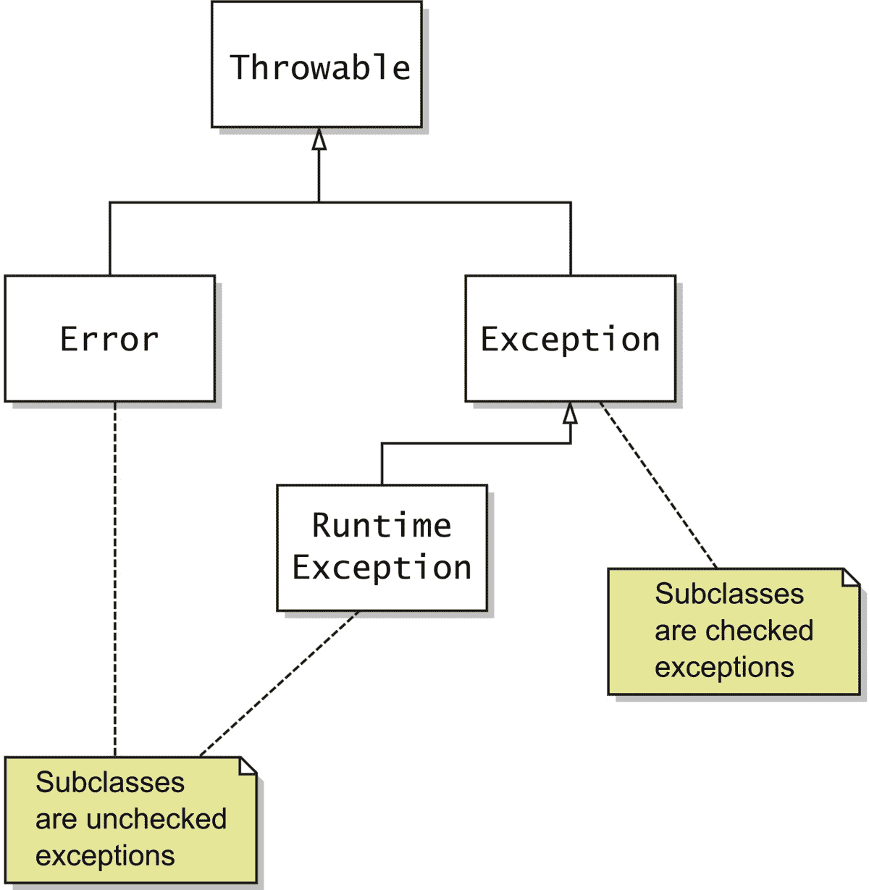

程序员报告的异常是 `Exception` 类的子类。这些异常分为两类：

- *未检查*（Unchecked）异常是 `RuntimeException` 的子类。
- 所有其他异常都是*已检查*（checked）异常。

正如你将在下一节看到的，程序员要么捕获已检查异常，要么在方法头中声明它们。编译器会检查这些异常是否被妥善处理。

`RuntimeException` 这个名字并不理想。当然，所有异常都发生在运行时。然而，`RuntimeException` 子类的异常在编译期间是不被检查的。

已检查异常用于应该预料到会失败的情况。失败的一个常见原因是输入和输出。文件可能会损坏，网络连接可能会失败。许多异常类扩展了 `IOException`，你应该使用适当的异常来报告你遇到的任何错误。例如，当一个本该存在的文件实际上不存在时，抛出 `FileNotFoundException`。

未检查异常表示由程序员引起的逻辑错误，而不是由不可避免的外部风险引起。例如，`NullPointerException` 是不被检查的。几乎任何方法都可能抛出它，程序员不应该花时间去捕获它们。相反，他们应该确保从根本上不对 `null` 解引用。

有时，实现者需要根据自己的判断来区分已检查异常和未检查异常。考虑调用 `Integer.parseInt(str)`。当 `str` 不包含有效整数时，它会抛出一个未检查的 `NumberFormatException`。另一方面，当 `str` 不包含有效的类名时，`Class.forName(str)` 会抛出一个已检查的 `ClassNotFoundException`。

为什么会有这种区别？原因在于，在调用 `Integer.parseInt` 之前，可以检查一个字符串是否为有效整数，但在实际尝试加载类之前，是不知道一个类是否可以被加载的。

Java API 提供了许多异常类，例如 `IOException`、`IllegalArgumentException` 等。你应该在适当的时候使用它们。但是，如果没有一个标准异常类适用于你的需求，你可以通过扩展 `Exception`、`RuntimeException` 或另一个现有的异常类来创建自己的异常。

当你这样做时，同时提供一个无参数构造函数和一个带消息字符串的构造函数是一个好主意。例如：

```java
public class FileFormatException extends IOException {
    public FileFormatException() {}

    public FileFormatException(String message) {
        super(message);
    }

    // 还要为链式异常添加构造函数——参见第 5.1.7 节
}
```

### 5.1.3. 声明已检查异常

任何可能产生已检查异常的方法必须在方法头中使用 `throws` 子句声明：

```java
public void write(Object obj, String filename)
    throws IOException, ReflectiveOperationException
```

列出方法可能抛出的异常，可能是因为 `throw` 语句，也可能是因为调用了另一个带有 `throws` 子句的方法。

在 `throws` 子句中，你可以将异常合并到一个公共超类中。这是否是一个好主意取决于具体的异常。例如，如果一个方法可以抛出多个 `IOException` 的子类，那么在 `throws IOException` 子句中涵盖它们是有意义的。但如果异常彼此无关，不要将它们合并为 `throws Exception`——那会违背异常检查的初衷。

有些程序员认为方法可能会抛出异常是可耻的。难道直接处理它更好吗？实际上恰恰相反。你应该让每个异常找到它的处理器。异常的黄金法则是：“尽早抛出，推迟捕获。”

当你重写方法时，抛出的已检查异常不能多于父类方法声明的异常。例如，如果你扩展了本节头的 `write` 方法，重写方法可以抛出更少的异常：

```java
public void write(Object obj, String filename)
```


`throws FileNotFoundException`

但如果方法尝试抛出一个无关的已检查异常，如`InterruptedException`，它将无法编译。

如果父类方法没有`throws`子句，那么重写方法不能抛出已检查异常。

你可以使用 javadoc`@throws`记录方法何时抛出（已检查或未检查）异常。大多数程序员只在有意义的情况下这样做。例如，在输入输出出现问题时告知`IOException`价值不大。但像这样的注释是有意义的：

```
@throws NullPointerException 如果 filename 为 null
@throws FileNotFoundException 如果不存在名为 filename 的文件
```

你从不指定 lambda 表达式的异常类型。然而，如果 lambda 表达式可以抛出已检查异常，你只能将其传递给声明了该异常的函数式接口。例如，调用

```java
list.forEach(obj -> write(obj, "output.dat"));
```

是一个错误。`forEach`方法的参数类型是函数式接口

```java
public interface Consumer<T> {
    void accept(T t);
}
```

`accept`方法没有声明抛出任何已检查异常。

#### 5.1.4. 捕获异常

要捕获异常，请设置`try`块。在最简单的形式下，它如下：

```
try {
    statements
} catch (ExceptionClass ex) {
    handler
}
```

当执行`try`块中的语句时发生了给定类类的异常，控制权将转移到处理程序。异常变量（示例中为`ex`）引用异常对象，处理程序可以根据需要对该对象进行检查。

你可以对这个基本结构进行两处修改。你可以为不同的异常类设置多个处理器：

```
try {
    statements
} catch (ExceptionClass1 ex) {
    handler1
} catch (ExceptionClass2 ex) {
    handler2
} catch (ExceptionClass3 ex) {
    handler3
}
```

`catch`子句是从上到下进行匹配的，因此最具体的异常类必须放在前面。

或者，你可以在多个异常类之间共享一个处理器：

```java
try {
    statements
} catch (ExceptionClass1 | ExceptionClass2 | ExceptionClass3 ex) {
    handler
}
```

在这种情况下，处理器只能在异常变量上调用那些属于所有异常类的方法。

#### 5.1.5. 带资源的 try 语句 (Try-with-Resources Statement)

异常处理的一个问题是资源管理。假设你向一个文件写入内容并在完成后关闭它：

```
ArrayList<String> lines = ...;
var out = new PrintWriter("output.txt");
for (String line : lines) {
    out.println(line.toLowerCase());
}
out.close();
```

这段代码有一个隐藏的危险。如果任何方法抛出了异常，`out.close()`的调用将永远不会发生。这是糟糕的。输出可能会丢失，或者如果触发多次异常，系统可能会耗尽文件句柄。

`try`语句的一种特殊形式可以解决这个问题。你可以在`try`语句的头部中指定`resources`。资源必须属于一个实现了`AutoCloseable`接口的类。你可以在`try`块的头部声明变量：

```java
ArrayList<String> lines = ...;
try (var out = new PrintWriter("output.txt")) { // 变量声明
    for (String line : lines)
        out.println(line.toLowerCase());
}
```

或者，你可以在头部提供之前声明的有效最终变量（effectively final variables）变量：

```java
var out = new PrintWriter("output.txt");
try (out) { // 有效最终变量
    for (String line : lines)
        out.println(line.toLowerCase());
}
```

`AutoCloseable`接口有一个方法：

```
public void close() throws Exception
```

还有一个`Closeable`接口。它是`AutoCloseable`的子接口，同样有一个`close`方法。然而，该方法被声明为抛出`IOException`。

当`try`块退出时（无论是正常结束还是因为抛出了异常），资源对象的`close`方法都会被调用。例如：

```java
try (var out = new PrintWriter("output.txt")) {
    for (String line : lines) {
        out.println(line.toLowerCase());
    }
} // 在此处调用 out.close()
```

你可以声明多个资源，用分号分隔。这里有一个有两个资源声明的示例：

```java
try (var in = new Scanner(Path.of("/usr/share/dict/words"));
        var out = new PrintWriter("output.txt")) {
    while (in.hasNext())
        out.println(in.next().toLowerCase());
}
```

资源按照它们初始化的反序关闭——也就是说，在调用`in.close()`之前会调用`out.close()`。

假设`PrintWriter`构造函数抛出了异常。此时`in`已经初始化但`out`尚未。`try`语句执行了正确的操作：调用`in.close()`并传播异常。

某些`close`方法可能会抛出异常。如果这在`try`块正常完成时发生，该异常将抛给调用者。然而，如果已经抛出了另一个异常，导致资源的`close`方法被调用，并且其中一个方法抛出了异常，那么该异常的重要性可能低于原始异常。

在这种情况下，原始异常会被重新抛出，而调用`close`产生的异常会被捕获并作为“被抑制”（suppressed）异常附加上。这是一个非常有用的机制，如果手动实现将会非常繁琐（参见练习 10）。当你捕获到主异常时，可以通过调用`getSuppressed`方法获取次要异常：

```java
try {
    ...
} catch (IOException ex) {
    Throwable[] secondaryExceptions = ex.getSuppressed();
    ...
}
```

如果你想在（希望是罕见的）无法使用带资源的 try 语句的情况下，自己实现这种机制，请调用`ex.addSuppressed(secondaryException)`。

带资源的 try 语句可以可选包含`catch`子句，用于捕获该语句中的任何异常。

#### 5.1.6. finally 子句

正如你所看到的，带资源的 try 语句无论是否发生异常都会自动关闭资源。有时，你需要清理不是`AutoCloseable`的东西。在这种情况下，使用`finally`子句：

```java
try {
    执行工作
} finally {
    清理工作
}
```

当`try`块结束时（无论是正常结束还是由于异常），都会执行`finally`子句。

每当你需要获取和释放锁、增加和递减计数器，或者在栈上推入某个内容并在完成后将其弹出时，就会出现这种模式。你希望确保这些操作无论发生什么都会执行。

你应该避免在`finally`子句中抛出异常。如果`try`块体由于异常终止，该异常会被`finally`子句中的异常所掩盖。`finally`子句体旨在清理资源。不要在`finally`子句内部放入改变控制流的语句（`return`、`throw`、`break`、`continue`）。

可以形成带有`catch`子句以及后续`finally`子句的`try`语句。但你必须小心`finally`子句中的异常。例如，看看这个节自在线教程的块：

```
BufferedReader in = null;
try {
    in = Files.newBufferedReader(path);
    从 in 读取
} catch (IOException ex) {
    System.err.println("捕到 IOException: " + ex.getMessage());
} finally {
    if (in != null) {
        in.close(); // 注意——可能会抛出异常
    }
}
```

程序员显然考虑了`Files.newBufferedReader`方法抛出异常的情况。这段代码似乎能够捕获并打印所有的 IO 异常，但它实际上漏掉了一个：`in.close()`可能抛出的异常。通常，将复杂的`try`/`catch`/`finally`语句重写为带资源的 try 语句，或者通过在`try`/`catch`语句中嵌套`try`/`finally`语句会更好——参见练习 12。

#### 5.1.7. 异常的重新抛出与链式

当异常发生时，你可能不知道如何处理，但你可能想要记录这次失败。在这种情况下，重新抛出异常，以便让胜任的处理器处理它：

```java
try {
    执行工作
}
catch (Exception ex) {
    logger.log(level, message, ex);
    throw ex;
}
```

当这段代码位于一个可能会抛出受检异常（checked exception）的方法内部时，会发生一些微妙的变化。假设包含它的方法声明如下：

```java
public void read(String filename) throws IOException
```

初看之下，似乎需要将`throws`子句改为`throws Exception`。然而，Java 编译器会仔细地跟踪执行流，并意识到`ex`只能是由`try`块中的某条语句抛出的异常，而不是一个任意的`Exception`。

有时，你想要更改抛出异常的类型。例如，你可能需要用一个对子系统用户有意义的异常类来报告子系统的失败。假设你在 servlet 中遇到了数据库错误。执行该 servlet 的代码可能不想知道发生了什么细节，但它确实想知道 servlet 出了问题。在这种情况下，捕获原始异常并将其链链到更高层级的异常上：

```java
try {
    Access the database
}
catch (SQLException ex) {
    throw new ServletException("database error", ex);
}
```

当捕获到`ServletException`时，可以通过以下方式获取原始异常：

```java
Throwable cause = ex.getCause();
```

`ServletException`类有一个构造函数，可以将异常的因作为参数传入。并不是所有的异常类都这样做。在这种情况下，你必须调用`initCause`方法，如下：

```java
try {
    Access the database
}
catch (SQLException ex) {
    var ex2 = new CruftyOldException("database error");
    ex2.initCause(ex);
    throw ex2;
}
```

如果你提供了了自己的异常类，除了 第 5.1.2 节 中描述的两个构造函数外，还应该提供以下构造函数：

```java
public class FileFormatException extends IOException {
    ...
    public FileFormatException(Throwable cause) { initCause(cause); }
    public FileFormatException(String message, Throwable cause) {
        super(message);
        initCause(cause);
    }
}
```

如果在一个不允许抛出受检异常的方法中发生了受检异常，链链技术同样有用。你可以捕获该受检异常并将其链到一个未检异常（unchecked exception）中。

### 5.1.8. 未捕获异常与堆栈轨迹

如果异常在任何地方都没有被捕获，就会显示`stack trace`（堆栈轨迹）——异常抛出处所有等待执行的方法调用列表。堆栈轨迹会被发送到`System.err`，即错误消息的流。

如果你想将异常保存到其他地方，以便你的技术支持人员检查，可以设置默认的未捕获异常处理器：

```java
Thread.setDefaultUncaughtExceptionHandler((thread, ex) -> {
    Record the exception
});
```

未捕获的异常会终止发生它的线程。如果你的应用程序只有一个线程（你到目前看到的程序都是如此），那么程序在调用未捕获异常处理器后将会退出。

有时，你被迫捕获一个异常，但并真的不知道该如何处理它。例如，`Class.forName`方法抛出了一个你需要处理的受检异常。与其忽略该异常，至少应该打印堆栈轨迹：

```java
try {
    Class<?> cl = Class.forName(className);
    ...
} catch (ClassNotFoundException ex) {
    ex.printStackTrace();
}
```

如果你想存储异常的堆栈轨迹，可以如下将其放入字符串中：

```java
var out = new ByteArrayOutputStream();
ex.printStackTrace(new PrintWriter(out));
String description = out.toString();
```

如果你需要更详细地处理堆栈轨迹，请使用`StackWalker`类。例如，以下代码会打印所有的栈帧：

```java
StackWalker walker = StackWalker.getInstance();
walker.forEach(frame -> System.err.println("Frame: " + frame));
```

你也可以详细分析`StackWalker.StackFrame`实例。详情请参 API 文档。

### 5.1.9. 用于抛出异常的 API 方法

`Objects`类有一个方法可以方便参数进行空检查。这里有一个示例用法：

```java
public void process(String direction) {
    this.direction = Objects.requireNonNull(direction);
    ...
}
```

如果`direction`为`null`，则会抛出一个`NullPointerException`。初看之下，这似乎有点没意义，因为在使用该值时最终也会抛出`NullPointerException`。但考虑从堆栈轨迹回溯：当你看到`requireNonNull`的调用是罪魁祸首时，你立刻知道自己哪里错了。

你也可以为异常提供一个消息字符串：

```java
this.direction = Objects.requireNonNull(direction, "direction must not be null");
```

该方法的变体允许你提供一个备用值而不是抛出异常：

```java
this.direction = Objects.requireNonNullElse(direction, "North");
```

仅在需要时计算备用值，请使用以下变体：

```java
this.directory = Objects.requireNonNullElseGet(directory,
    () -> System.getProperty("user.dir"));
```

Lambda 表达式在`directory`为`null`时才会被求值。

还有一个用于进行范围检查的方法：

```java
this.index = Objects.checkIndex(index, length);
```

如果索引在 0 到`length - 1`之间，该方法返回该索引；否则抛出`IndexOutOfBoundsException`。

## 5.2. 断言 (Assertions)

断言是一种常用的防御性编程习惯。假设你确信某个属性已满足，并在代码中依赖该属性。例如，你确信`x`不是负数。此时，你可能正在计算

```java
double y = Math.sqrt(x);
```

你确信`x`不是负数。然而，你想要进行检查，而不是让“负数”浮点值进入你的计算。你当然可以抛出一个异常：

```java
if (x < 0) throw new IllegalStateException(x + " < 0");
```


但这种条件在测试完成后仍然留在程序中，会减慢运行速度。断言机制允许你在测试期间放置检查，并在生产代码中自动移除它们。

在 Java 中，断言旨在作为验证内部假设的辅助，而不是强制约的机制。例如，如果你想报告公共方法的参数不当，不要使用断言，而是抛出 `IllegalArgumentException`。

### 5.2.1. 使用断言

Java 中断言语句有两种形式：

```java
assert condition;
assert condition : expression;
```

`assert` 语句评估条件，如果为假，则抛出 `AssertionError`。在第二种形式中，表达式会被转换为字符串作为错误对象的消息。

如果表达式是 `Throwable`，它也会被设置为断言错误的原因（参见第 5.1.7 节）。

例如，为了断言 `x` 为非负，你可以直接使用语句：

```java
assert x >= 0;
```

或者你可以将 `x` 的实际值传入 `AssertionError` 对象，以便后续显示：

```java
assert x >= 0 : x;
```

### 5.2.2. 启用和禁用断言

默认情况下，断言是禁用的。在运行程序时通过 `-enableassertions` 或 `-ea` 选项启用它们：

```bash
java -ea MainClass
```

你不需要重新编译程序，因为启用或禁用断言是由类加载器处理的。禁用断言时，类加载器会移除断言代码，这样就不会影响执行速度。你甚至可以针对类或整个包启用断言，例如：

```bash
java -ea:MyClass -ea:com.mycompany.mylib... MainClass
```

此命令开启了 `MyClass` 类以及 `com.mycompany.mylib` 包及其子包的断言。`-ea...` 开启了默认包中所有类的断言。

你也可以使用 `-disableassertions` 或 `-da` 选项禁用某些类和包中的断言：

```bash
java -ea:... -da:MyClass MainClass
```

当你使用 `-ea` 和 `-da` 来启用或禁用所有断言（而不仅仅是特定的类或包）时，它们不会应用于未通过类加载器加载的“系统类”。使用 `-enablesystemassertions`/`-esa` 来启用系统类中的断言。

你也可以通过以下方法程序地控制类加载器的断言状态：

```java
void ClassLoader.setDefaultAssertionStatus(boolean enabled);
void ClassLoader.setClassAssertionStatus(String className, boolean enabled);
void ClassLoader.setPackageAssertionStatus(String packageName, boolean enabled);
```

与 `-enableassertions` 命令行选项一样，`setPackageAssertionStatus` 方法会设置给定包及其子包的断言状态。

## 5.3. 日志（Logging）

每个 Java 程序员都熟悉在疑问题代码中插入 `System.out.println` 调用的过程，以了解程序的行为。当然，一旦你找到了问题的原因，就会移除这些打印语句——只会在下一个问题出现时再次把它们放回来。日志框架的设计旨在解决这个问题。

### 5.3.1. 你应该使用 Java 日志框架吗？

Java 有一个标准的日志框架，通常以其包名 `java.util.logging` 命名，有时缩写为 `j.u.l`。然而，其他日志框架具有更多功能且被广泛使用，例如 Log4j（https://logging.apache.org/log4j/2.x）和 Logback（https://logback.qos.ch）。

如果你想让你的代码的用户选择日志框架，那么你应该使用一个“面层”（façade）库，将日志消息发送到首选的框架。一个常用且 API 良好的面层是 SLF4J（https://www.slf4j.org）。另一个面层是“平台日志 API”（也称为 JEP 246）。它非常基础，但是 JDK 的一部分。

该面层有时被称为 `frontend`（前端）。它提供了程序员用于记录消息的 API。`backend`（后端）负责过滤和格式化消息，并将其放置在某处。后端需要部署者进行配置，通常是通过编辑配置文件来实现。

在接下来的章节中，我将向你展示如何使用平台日志 API 作为前端，并将 `java.util.logging` 作为后端。如果你发现前端 API 足够用，那么这是一个合理的选择，因为你可以随时更换后端。

`java.util.logging` 后端的功能比它更流行的替代方案少，但它适用于许多用例。由于它的简单性，它不容易受到攻击。相比之下，Log4j 的某些晦涩功能允许黑客构建程序输入，这些输入在被记录时会导致恶意代码执行。

无论你最终是否使用它们，学习平台日志 API 和 `java.util.logging` 后端都能为你提供关于日志框架能力的一个良好基础。

### 5.3.2. 日志入门（Logging 101）

平台日志器实现了 `System.Logger` 接口。每个日志器都有一个名称。该名称可以是任意的，但它通常是生成日志消息的类的包名。你可以这样获取一个平台日志器：

```java
System.Logger logger = System.getLogger("com.mycompany.myapp");
```

当你第一次请求具有给定名称的日志器时，它会被创建。对相同名称的后续调用将产生相同的日志器对象。

现在你已经准备好记录日志了：

```java
logger.log(System.Logger.Level.INFO, "Opening file " + filename);
```

记录打印出来如下：

```text
Aug 04, 2022 09:53:34 AM com.mycompany.myapp read
INFO: Opening file data.txt
```

注意，时间以及调用类和方法名会自动包含在内。

在程序部署时关闭这些信息消息，你可以配置后端。对于 `java.util.logging` 后端，请准备一个包含以下内容的 `logging.properties` 文件：

```properties
handlers=java.util.logging.ConsoleHandler
com.mycompany.myapp.level=WARNING
```

然后这样启动应用程序：

```bash
java -Djava.util.logging.config.file=logging.properties com.mycompany.myapp.Main
```

由于 `INFO` 级别低于 `WARNING` 级别，该消息不再显示。

获取日志器和记录消息的 API 是前端的一部分——在本例中，是平台日志 API。如果你使用不同的前端，API 将是不同的。

消息的目的地、格式化和过滤以及配置机制是后端的一部分——在这里是 `java.util.logging`。如果你使用不同的后端，请遵循其说明进行配置。

### 5.3.3. 平台日志 API（The Platform Logging API）

正如你在上一节中看到的，每条记录的消息都有一个级别。枚举 `System.Logger.Level` 有以下值，按严重程度递减：`ERROR`、`WARNING`、`INFO`、`DEBUG` 和 `TRACE`。

通过导入语句：

```java
import static java.lang.System.Logger.Level.*;
```

你可以简写级别：

```java
logger.log(INFO, "Opening file " + filename);
    // 代替 System.Logger.Level.INFO
```

在上面的示例中，即使消息被抑制，字符串 `"Opening file " + filename` 也会被创建。如果你担心创建字符串的成本，可以使用 lambda 表达式：

```java
logger.log(INFO, () -> "Opening file " + filename);
```

这样消息只在实际被记录时才会计算。

记录异常是常见操作：

```java
catch (IOException ex) {
    logger.log(WARNING, "Cannot open file " + filename, ex);
}
```

你可以使用模式格式化消息：

```java
logger.log(WARNING, "Cannot open file {0}", filename);
```

这**不是** `printf` 风格的模式。该模式是由用于本地化的 `MessageFormat` 类处理的。

如果此日志器按指定的级别处理日志，则调用提供者并记录结果和可抛出的异常：

```java
void log(System.Logger.Level level,
    String format, Object... params)
```

使用给定的参数记录格式化消息：

```java
void log(System.Logger.Level level,
    ResourceBundle bundle, String msg,
    Throwable thrown)
```

记录 `bundle` 中键为 `msg` 的消息（如果 `bundle` 为 `null`，则使用 `msg` 本身）以及可抛出的异常：

```java
void log(System.Logger.Level level,
    ResourceBundle bundle, String format,
    Object... params)
```

在 `bundle` 中查找键为 `format` 的格式（如果 `bundle` 为 `null`，则使用 `format` 本身），并使用给定的参数记录格式化消息。

### 5.3.4. 配置后端

让我们转向后端。正如前面提到的，平台日志 API 的默认后端是 `java.util.logging`。后续章节中的信息适用于该后端。

你可以通过编辑配置文件来更改后端的各种属性。默认配置文件位于 JDK 中的 `conf/logging.properties`。要使用另一个文件，请在启动应用程序时将 `java.util.logging.config.file` 属性设置为文件位置：

```bash
java -Djava.util.logging.config.file=configFile MainClass
```

在 `main` 方法中调用 `System.setProperty("java.util.logging.config.file", configFile)` 是无效的，因为日志管理器是在 VM 启动期间初始化的，早于 `main` 的执行。

你可以通过添加如下的行来为你自己的日志器指定日志级别：

```properties
com.mycompany.myapp.level=WARNING
```

即，在日志器名称后附加 `.level` 后缀。

日志配置中的属性不是系统属性。你不能通过 `-D` 命令行选项设置它们。相反，请将日志属性存放在一个文件中，并通过 `-Djava.util.logging.config.file=configFile` 指定该文件。

你还可以指定根级别：

```properties
.level=WARNING
```

由于历史原因，某些级别在平台日志 API 和 `java.util.logging` 框架中的名称不同。表 5.2 显示了对应关系。

**表 5.2：平台日志与 Java 日志框架的对应级别**

| 平台日志 | `java.util.logging` |
| --- | --- |
| `ERROR` | `SEVERE` |
| `WARNING` | `WARNING` |
| `INFO` | `INFO` |
| `DEBUG` | `FINE` |
| `TRACE` | `FINER` |

与包名类似，日志器名称是层次级的。事实上，它们比包更具层次性。包和它的父包之间没有语义关系，但日志器的父子日志器共享某些属性。例如，如果你关闭了发送 `"com.mycompany"` 日志器的消息，那么它的子日志器也会被禁用。

正如你将在下一节中看到的，日志器实际上并没有将消息发送到控制台——那是处理器（handlers）的工作。处理器也有级别。若要在控制台上看到 `DEBUG`/`FINE` 消息，你还需要设置：

```properties
java.util.logging.ConsoleHandler.level=FINE
```

日志管理器配置中的设置不是系统属性。使用 `-Dcom.mycompany.myapp.level=FINE` 启动程序对日志器没有任何影响。

还可以通过使用 `jconsole` 程序在运行中的程序中更改日志级别。详情请见 www.oracle.com/technetwork/articles/java/jconsole-1564139.xhtml#LoggingControl。

### 5.3.5. 日志处理器

`java.util.logging` API 的后端基于 `handlers`。最简单的处理器是 `ConsoleHandler`，它将日志记录打印到 `System.err` 流。

每个处理器都有一个父处理器。默认情况下，处理器只是将每个记录发送给父处理器。标准日志配置默认使用 `ConsoleHandler`。它的默认日志级别是 `INFO`。

要将日志记录发送到其他地方，请添加另一个处理器。`java.util.logging` API 为此提供了两个处理器：`FileHandler` 和 `SocketHandler`。`SocketHandler` 将记录发送到指定的主机和端口。更有趣的是在文件中收集记录的 `FileHandler`。

要添加文件处理器，请在日志属性中提供此条目：

```properties
handlers=java.util.logging.ConsoleHandler,java.util.logging.FileHandler
```

记录被发送到用户目录下的文件 `java.log`，其中 `n` 是一个使文件唯一的数字。默认情况下，记录是以 XML 格式格式化的。典型的日志记录的形式如下：

```xml
<record>
    <date>2014-08-04T09:53:34</date>
    <millis>1407146014072</millis>
    <sequence>1</sequence>
    <logger>com.mycompany.myapp</logger>
    <level>INFO</level>
    <class>com.horstmann.corejava.Employee</class>
    <method>read</method>
    <thread>10</thread>
    <message>Opening file staff.txt</message>
</record>
```

你可以通过在日志配置中设置各种参数来修改处理器的默认行为。记录被发送到用户目录下的文件 `java.log`，其中 `n` 是一个使文件唯一的数字。默认情况下，记录是以 XML 格式格式化的。典型的日志记录的形式如下：

```xml
<record>
    <date>2014-08-04T09:53:34</date>
    <millis>1407146014072</millis>
    <sequence>1</sequence>
    <logger>com.mycompany.myapp</logger>
    <level>INFO</level>
    <class>com.horstmann.corejava.Employee</class>
    <method>read</method>
    <thread>10</thread>
    <message>Opening file staff.txt</message>
</record>
```

你可以通过在日志配置中设置各种参数来修改处理器的默认行为。记录被发送到用户目录下的文件 `java.log`，其中 `n` 是一个使文件唯一的数字。默认情况下，记录是以 XML 格式格式化的。典型的日志记录的形式如下：

```xml
<record>
    <date>2014-08-04T09:53:34</date>
    <millis>1407146014072</millis>
    <sequence>1</sequence>
    <logger>com.mycompany.myapp</logger>
    <level>INFO</level>
    <class>com.horstmann.corejava.Employee</class>
    <method>read</method>
    <thread>10</thread>
    <message>Opening file staff.txt</message>
</record>
```

你可以通过在日志配置中设置各种参数来修改处理器的默认行为。记录被发送到用户目录下的文件 `java.log`，其中 `n` 是一个使文件唯一的数字。默认情况下，记录是以 XML 格式格式化的。典型的日志记录的形式如下：


要添加文件处理器，请在日志属性中提供此条目：

```
handlers=java.util.logging.ConsoleHandler,java.util.logging.FileHandler
```

如果多个应用程序（或同一程序的副本）使用同一个日志文件，你应该开启`append`标志。或者，在文件名中使用`%u`以便每个应用程序创建一个日志文件。日志文件以旋转序列存在，例如`myapp.log.0`、`myapp.log.1`、`myapp.log.2`等。当一个文件超过大小限制时，旧的日志将被删除，其他文件重命名，并创建一个编号为`0`的新文件。

### 表 5.3：文件处理器配置

| 配置属性 | 描述 | 默认值 |
| --- | --- | --- |
| `java.util.logging.FileHandler.level` | 处理器级别。 | `Level.ALL` |
| `java.util.logging.FileHandler.append` | 为`true`时将日志追加到现有文件；否则，每次运行都会打开新文件。 | `false` |
| `java.util.logging.FileHandler.limit` | 打开另一个文件之前写入文件的近似最大字节数（`0`为无限制）。 | `50000`（`FileHandler`类） |
| `java.util.logging.FileHandler.pattern` | 文件名模式（见表 5.4）。 | `%h/%u.log` |
| `java.util.logging.FileHandler.count` | 旋转序列中的日志数量。 | `1`（不旋转） |
| `java.util.logging.FileHandler.filter` | 用于过滤日志记录的过滤器（见 5.3.6）。 | 无 |
| `java.util.logging.FileHandler.encoding` | 字符编码。 | 平台字符编码 |
| `java.util.logging.FileHandler.formatter` | 每个日志记录的格式化器。 | `java.util.logging.XMLFormatter` |

### 表 5.4：日志模式变量

| 变量 | 描述 |
| --- | --- |
| `%h` | 用户目录（`user.home`属性）。 |
| `%t` | 系统的临时目录。 |
| `%u` | 唯一数字。 |
| `%g` | 旋转日志的代数。如果指定了旋转且模式不包含`%g`，则使用`.%g`后缀。 |
| `%%` | 百分字符。 |

### 5.3.6. 过滤器和格式化器

除了按日志级别过滤，每个处理器还可以有一个实现`Filter`接口的过滤器，这是一个功能接口，包含一个方法：

```
boolean isLoggable(LogRecord record)
```

要向处理器安装过滤器，请在日志配置中添加如下条目：

```
java.util.logging.ConsoleHandler.filter=com.mycompany.myapp.MyFilter
```

`ConsoleHandler`和`FileHandler`类以文本和XML格式输出日志记录。然而，你也可以定义自己的格式。扩展`java.util.logging.Formatter`类并重写该方法：

```
String format(LogRecord record)
```

以你喜欢的方式格式化记录并返回生成的字符串。在`format`方法中，你可以通过调用表 5.5 中的任意方法来获取有关`LogRecord`的信息。

在`format`方法中，你可能想要调用该方法：

```
String formatMessage(LogRecord record)
```

该方法格式化记录的消息部分，它会在资源包中查找消息键并替换消息格式参数。

许多文件格式（如XML）需要围绕格式化记录的头部和尾部。为了实现这一点，请重写以下方法：

```
String getHead(Handler h)
String getTail(Handler h)
```

最后，在日志配置中设置格式化器：

```
java.util.logging.FileHandler.formatter=com.mycompany.myapp.MyFormatter
```

### 表 5.5：`LogRecord`属性getter

| 方法 | 属性 |
| --- | --- |
| `Level getLevel()` | 此记录的日志级别。 |
| `String getLoggerName()` | 记录此记录的记录器名称。 |
| `ResourceBundle getResourceBundle()` `String getResourceBundleName()` | 用于本地化消息的资源包或名称，如果没有提供则返回`null`。 |
| `String getMessage()` | 本地化或格式化之前的“原始”消息。 |
| `Object[] getParameters()` | 参数对象，如果没有提供则返回`null`。 |
| `Throwable getThrown()` | 抛出的对象，如果没有提供则返回`null`。 |
| `String getSourceClassName()` `String getSourceMethodName()` | 记录此记录的代码位置。此信息可能由日志代码提供，也可以从运行时堆栈中自动推断。如果日志代码提供了错误的值或者运行代码经过优化导致无法推断出精确位置，则可能是不准确的。 |
| `Instant getInstant()` | 创建时间。 |
| `long getSequenceNumber()` | 此记录的唯一序列号。 |
| `long getLongThreadID()` | 创建此记录的线程的唯一ID。这些ID由`LogRecord`类分配，与其他线程ID无关系。 |

## 练习题

1. 编写一个方法`public ArrayList<Double> readValues(String filename) throws ...`，用于读取一个包含浮点数的文件。如果无法打开文件或某些输入不是浮点数，则抛出相应的异常。

2. 编写一个方法`public double sumOfValues(String filename) throws ...`，调用上一个方法并返回文件中值的总和。将任何异常传递给调用者。

3. 编写一个程序调用上一个方法并打印结果。捕获异常并向用户提供任何错误情况的反馈。

4. 重复之前的练习，但不要使用异常。相反，让`readValues`和`sumOfValues`返回某种错误代码。

5. 重复之前的练习，但不要使用异常。相反，让`readValues`和`sumOfValues`返回某种错误代码。

6. 重复之前的练习，但不要使用异常。相反，让`readValues`和`sumOfValues`返回某种错误代码。

7. 重复之前的练习，但不要使用异常。相反，让`readValues`和`sumOfValues`返回某种错误代码。

8. 重复之前的练习，但不要使用异常。相反，让`readValues`和`sumOfValues`返回某种错误代码。

9. 构建（但不要抛出）任意类型的异常对象并获取其堆栈轨迹。你需要考虑以下情况：

    - `Scanner`构造函数抛出异常。
    - `PrintWriter`构造函数抛出异常。
    - `hasNext`、`next`或`println`抛出异常。
    - `close()`抛出异常。
    - `close()`抛出异常。

10. `Scanner`和`PrintWriter`的方法不抛出检查异常以便于使用。你如何发现读取或写入过程中发生了错误？

11. 编写一个递归的`factorial`方法，并打印所有的栈帧。构建（但不要抛出）任意类型的异常对象并获取其堆栈轨迹，如第 5.1 节所示。

12. 比较`Objects.requireNonNull(obj)`和`assert obj != null`的用法。为每种用法提供一个引人入胜的理由。

13. 编写一个方法`int min(int[] values)`，在返回最小值之前，断言它确实是数组中的所有值。使用私有辅助方法，或者如果你已经查看过[8]，则使用`Stream.allMatch`。在一个大型数组上反复调用该方法，并测量在启用、禁用和移除断言时的运行时间。

14. 实现并测试一个日志记录过滤器，过滤掉包含如sex、drugs和C++等坏词汇的日志记录。

15. 实现并测试一个生成JSON文件的日志记录格式化器。

在Java中，泛型编程可能比本该有的要复杂，因为泛型是在Java出现了一段时间后才引入的，并且它们的设计初衷是保持向后兼容性。因此，存在许多遗憾的限制，其中一些影响着每位Java程序员。另一些只对泛型类的实现者感兴趣。详情请参见第 6.5 节和第 6.6 节。最后一节涵盖了泛型和反射，如果你在程序中没有使用反射，可以安全地跳过它。

本章的要点是：

1. 泛型类带有一个或多个类型参数的类。

2. 泛型方法是带有类型参数的方法。

3. 你可以要求类型参数是一个或多个类型的子类。

4. 泛型类型是不变的：当`S`是`T`的子类时，`G<S>`和`G<T>`之间没有关系。

5. 通过使用通配符`G<? extends T>`或`G<? super T>`，你可以指定一个方法可以接受泛型类型`G`的`T`的子类或超类的实例化。

6. 泛型类和方法在编译时，类型参数会被擦除。

7. 擦除对泛型类型施加了许多限制。特别是，你不能实例化泛型类或数组，不能转换为泛型类型，也不能抛出泛型类型的对象。

8. `Class<T>`类是泛型的，这很有用，因为`cast`等方法被声明产生类型为`T`的值。

9. 尽管泛型类和方法在虚拟机中被擦除，你可以在运行时发现它们是如何声明的。

## 6.1. 泛型类

`generic class`（泛型类）带有一个或多个`type parameters`（类型参数）的类。作为一个简单的例子，考虑这个用于存储键值对的类：

```
public class Entry<K, V> {
    private K key;
    private V value;

    public Entry(K key, V value) {
        this.key = key;
        this.value = value;
    }

    public K getKey() { return key; }
    public V getValue() { return value; }
}
```

你可以看到，类型参数`K`和`V`被指定在类名后的尖括号内。在类成员的定义中，它们被用作实例变量、方法参数和返回值的类型。

你通过为类型变量替换类型来`instantiate`（实例化）泛型类。例如，`Entry<String, Integer>`是一个普通的类，拥有方法`String getKey()`和`Integer getValue()`。

类型参数不能用基本数据类型实例化。例如，在Java中`Entry<String, int>`是无效的。


当你`construct`（构造）一个泛型类的对象时，可以从构造函数中省略类型参数。例如：

```java
Entry<String, Integer> entry = new Entry<>("Fred", 42);
// 等于 new Entry<String, Integer>("Fred", 42)
```

注意，在构造参数之前仍然需要提供一对空的尖括号。有些人将这对空括号称为`diamond`（菱形）。当你使用菱形语法时，构造函数的类型参数会被推断出来。

## 6.2. 泛型方法

就像泛型类是带有类型参数的类一样，`generic method`（泛型方法）是带有类型参数的方法。泛型方法可以是普通类的方法，也可以是泛型类的方法。以下是一个非泛型类中泛型方法的示例：

```java
public class Arrays {
    public static <T> void swap(T[] array, int i, int j) {
        T temp = array[i];
        array[i] = array[j];
        array[j] = temp;
    }
}
```

这个`swap`方法可以用于交换任意数组中的元素，只要数组元素类型不是基本数据类型。

```java
String[] friends = ...;
Arrays.swap(friends, 0, 1);
```

当声明泛型方法时，类型参数放在修饰符（如`public`和`static`）之后、返回类型之前：

```java
public static <T> void swap(T[] array, int i, int j)
```

在调用泛型方法时，你不需要指定类型参数。它是根据方法参数和返回类型推断出来的。例如，在调用`Arrays.swap(friends, 0, 1)`时，`friends`的类型是`String[]`，编译器可以推断出`T`应该是`String`。

如果你喜欢，可以在方法名之前显式提供类型，如下：

```java
Arrays.<String>swap(friends, 0, 1);
```

你可能想这样做的原因之一是在出现问题时获得更好的错误信息——参见练习题 10。

在进入后续章节中技术细节的泥潭之前，值得思考一下`Entry`类和`swap`方法的示例，并欣赏泛型类型是多么有用且自然。在`Entry`类中，键和值的类型可以是任意的。在`swap`方法中，数组类型可以是任意的。这通过类型变量清晰地表达出来。

## 6.3. 类型边界

有时，泛型类或方法的类型参数需要满足某些要求。你可以指定一个`type bound`（类型边界）来要求类型扩展某些类或接口。

例如，你有一个实现`Closeable`接口的对象的`ArrayList`，你想关闭所有它们：

```java
public static <T extends Closeable> void closeAll(ArrayList<T> elems)
        throws Exception {
    for (T elem : elems) elem.close();
}
```

类型边界`extends Closeable`确保元素类型是`Closeable`的子类。因此，调用`elem.close()`是有效的。你可以向此方法传递`ArrayList<PrintStream>`，但不能传递`ArrayList<String>`。练习题 28 有这种方法的更有趣变体。

在这个例子中，我们需要是因为参数是`ArrayList`。如果方法接受数组，你就不需要泛型方法了。你可以简单地使用普通方法：

```java
public static void closeAll(Closeable[] elems) throws Exception
```

这可行，因为像`PrintStream[]`这样的数组类型是`Closeable[]`的子类。然而，正如你在下一节中看到的，`ArrayList<PrintStream>`不是`ArrayList<Closeable>`的子类。使用边界类型参数解决了这个问题。

类型参数可以有多个边界，例如：

```java
T extends Runnable & Closeable
```

这种语法与捕获多个异常的语法相似，唯一的区别在于类型是用“与”运算符组合的，而多个异常是用“或”运算符组合的。

你可以有任意数量的接口边界，但边界最多可以有一个类。如果你有一个类作为边界，它必须是边界列表中的第一个。

## 6.4. 类型变型与通配符

假设你需要实现一个处理`Employee`类子类对象的数组的方法。你只需将参数声明为`Employee[]`类型即可：

```java
public static void process(Employee[] staff) { ... }
```

如果`Manager`是`Employee`的子类，你可以向该方法传递一个`Manager[]`数组，因为`Manager[]`是`Employee[]`的子类。这种行为被称为`covariance`（协变）。数组的变化方式与元素类型相同。

现在，假设你想处理数组列表而不是数组。然而，这里有一个问题：`ArrayList<Manager>`类型不是`ArrayList<Employee>`的子类。

这种限制是有原因的。如果允许将`ArrayList<Manager>`赋值给类型为`ArrayList<Employee>`的变量，你可能会通过存储非经理员工来破坏该数组列表：

```java
ArrayList<Manager> bosses = new ArrayList<>();
ArrayList<Employee> empls = bosses; // 不合法，但假设它可以...
empls.add(new Employee(...)); // bosses 中出现了一个非经理！
```

由于不允许从`ArrayList<Manager>`转换为`ArrayList<Employee>`，因此这种错误不会发生。

你是否可以在数组上生成相同的错误，在数组中从`Manager[]`到`Employee[]`的转换是允许的？可以，正如你在 4 中看到的。Java 数组是协变的（`covariant`），这很方便但不类型安全。当你向`Manager[]`数组中存储一个简单的`Employee`时，会抛出`ArrayStoreException`。相比之下，Java 中所有的泛型类型都是不变的（`invariant`）。

在 Java 中，你使用通配符（`wildcards`）来指定方法参数和返回类型应该允许的变化方式。这种机制有时被称为“使用点变型”（`use-site variance`）。你将在后续章节中看到细节。

### 6.4.1. 子类型通配符

在许多情况下，在不同的列表之间进行转换是完全安全的。假设一个方法永远不写入该列表，因此它不会损坏其参数。使用通配符来表达这一事实：

```java
public static void printNames(ArrayList<? extends Employee> staff) {
    for (int i = 0; i < staff.size(); i++) {
        Employee e = staff.get(i);
        System.out.println(e.getName());
    }
}
```

通配符类型`? extends Employee`表示`Employee`的某个未知子类型。你可以使用`ArrayList<Employee>`或子类型的列表（例如`ArrayList<Manager>`）调用此方法。

类`ArrayList<? extends Employee>`的`get`方法的返回类型为`? extends Employee`。语句

```java
Employee e = staff.get(i);
```

是完全合法的。无论`?`代表什么类型，它都是`Employee`的子类型，`staff.get(i)`的结果可以赋值给变量`Employee e`。（我在这个示例中没有使用增强型`for`循环是为了准确展示元素是如何从列表中获取的。）

如果尝试向`ArrayList<? extends Employee>`存储元素会发生什么？那是行不通的。考虑如下调用：

```java
staff.add(x);
```

`add`方法的参数类型是`? extends Employee`，没有对象可以传递给这个方法。如果你传递了一个例如`Manager`对象，编译器将拒绝。毕竟，`?`可能指向任何子类，也许`Janitor`（清洁工），而你不能向`ArrayList<Janitor>`中添加`Manager`。

你当然可以传递`null`，但那不是一个对象。

总结来说，你可以从`? extends Employee`转换为`Employee`，但你永远无法将任何内容转换为`? extends Employee`。这解释了为什么你可以从`ArrayList<? extends Employee>`读取但不能从中写入。

### 6.4.2. 上类型通配符

通配符类型`? extends Employee`表示`Employee`的任意子类型。相反，通配符类型`? super Employee`表示`Employee`的上类型。这些通配符作为函数对象的参数时通常非常有用。这里有一个典型的例子。`Predicate`接口有一个方法用于测试类型为`T`的对象是否具有特定属性：

```java
public interface Predicate<T> {
    boolean test(T arg);
    ...
}
```

此方法打印所有具有给定属性的员工名称：

```java
public static void printAll(Employee[] staff, Predicate<Employee> filter) {
    for (Employee e : staff)
        if (filter.test(e))
            System.out.println(e.getName());
}
```

你可以使用类型为`Predicate<Employee>`的对象调用此方法。由于这是一个函数式接口，你也可以传递`lambda`表达式：

```java
printAll(employees, e -> e.getSalary() > 100000);
```

现在假设你想使用`Predicate<Object>`，例如：

```java
Predicate<Object> evenLength = e -> e.toString().length() % 2 == 0;
printAll(employees, evenLength);
```

这应该没问题。毕竟，每个`Employee`都是一个带有`toString`方法的`Object`。然而，和所有的泛型类型一样，`Predicate`接口是不变的，`Predicate<Employee>`和`Predicate<Object>`之间没有关系。

解决办法是允许任何`Predicate<? super Employee>`：

```java
public static void printAll(Employee[] staff, Predicate<? super Employee> filter) {
    for (Employee e : staff)
        if (filter.test(e))
            System.out.println(e.getName());
}
```

仔细观察调用`filter.test(e)`。由于`test`的参数类型是`Employee`的某个上类型，因此传递`Employee`对象是安全的。

这种情况很典型。函数在它们的参数类型上自然是逆变（`contravariant`）。例如，当期望一个可以处理员工的函数时，给一个愿意处理任意对象的函数是可以的。

通常，当你指定泛型函数式接口作为方法参数时，你应该使用`super`通配符。

有些程序员喜欢用通配符的“PECS”助记法：生产者（producer）用`extends`，消费者（consumer）用`super`。从中读取值的`ArrayList`是生产者，所以你使用`extends`通配符。你提供值进行测试的`Predicate`是消费者，使用`super`。

### 6.4.3. 带类型变量的通配符

考虑前一节方法的泛化，它打印满足条件的元素：

```java
public static <T> printAll(T[] elements, Predicate<T> filter) {
    for (T e : elements)
        if (filter.test(e))
            System.out.println(e.toString());
}
```

这是一个适用于任意类型数组的泛型方法。类型参数是传入数组的类型。然而，它存在你在上一节看到的局限性。`Predicate`的类型参数必须与方法的类型参数匹配。

解决方案与之前相同——但这次通配符的边界是一个类型变量：

```java
public static <T> printAll(T[] elements, Predicate<? super T> filter)
```

此方法接收`T`类型或其上类型的过滤器。

这里是另一个例子。`Collection<E>`接口将在后续章节详细介绍，它描述了类型元素的集合。它有一个方法：

```java
public boolean addAll(Collection<? extends E> c)
```

你可以从另一个元素类型也是`E`或其子类型的集合中添加所有元素。通过此方法，你可以将经理集合添加到员工集合中，但反之则不行。

为了看到类型声明可以变得多么复杂，考虑`Collections.sort`方法的定义：

```java
public static <T extends Comparable<? super T>> sort(List<T> list)
```

`List`接口将在下一节详细介绍，描述了一个序列，如链表或`ArrayList`。`sort`方法愿意排序任何`List<T>`，只要`T`是`Comparable`的子类型。但`Comparable`接口再次是泛型的：

```java
public interface Comparable<T> {
    int compareTo(T other);
}
```

它的类型参数指定了`compareTo`方法的参数类型。因此，似乎`Collections.sort`可以声明为：

```java
public static <T extends Comparable<T>> void sort(List<T> list)
```

但这太严格了。假设`Employee`类实现了`Comparable<Employee>`，按薪水比较员工。假设`Manager`类继承`Employee`。注意它实现了`Comparable<Employee>`，而不是`Comparable<Manager>`。因此，`Manager`不是`Comparable<Manager>`的子类型，但它是`Comparable<? super Manager>`的子类型。

在某些编程语言（如`C#`和`Scala`）中，你可以声明类型参数为协变（`covariant`）或逆变（`contravariant`）。例如，通过将`Comparable`的类型参数声明为逆变，就不需要为每个`Comparable`参数使用通配符。这种“声明处变性”（`declaration-site variance`）非常方便，但它不如 Java 通配符的“使用处变性”（`use-site variance`）。

### 6.4.4. 无界通配符

对于只执行非常通用操作的情况，可以使用无界通配符。例如，这里有一个检查`ArrayList`是否包含任何`null`元素的方法：

```java
public static boolean hasNulls(ArrayList<?> elements) {
    for (Object e : elements) {
        if (e == null) return true;
    }
    return false;
}
```

由于`ArrayList`的类型参数并不重要，因此使用`ArrayList<?>`是合理的。同样，可以将`hasNulls`写成一个泛型方法：

```java
public static <T> boolean hasNulls(ArrayList<T> elements)
```

但通配符易于理解，因此这是首选方法。

### 6.4.5. 通配符捕获

让我们尝试使用通配符定义一个`swap`方法：

```java
public static void swap(ArrayList<?> elements, int i, int j) {
    ? temp = elements.get(i); // 无法工作
    elements.set(i, elements.get(j));
    elements.set(j, temp);
}
```

这是行不通。你可以将`?`作为类型参数，但不能作为类型。

然而，有一个变通方法。添加这样一个辅助方法：


```java
public static void swap(ArrayList<?> elements, int i, int j) {
    swapHelper(elements, i, j);
}

private static <T> void swapHelper(ArrayList<T> elements, int i, int j) {
    T temp = elements.get(i);
    elements.set(i, elements.get(j));
    elements.set(j, temp);
}
```

对`swapHelper`的调用是有效的，是因为有一个被称为“通配符捕获”（wildcard capture）的特殊规则。编译器不知道`?`是什么，但它代表某种类型，因此调用泛型方法是可以的。`swapHelper`的类型参数`T`“捕获”了通配符类型。由于`swapHelper`是一个泛型方法，而不是参数中带有通配符的方法，它可以利用类型变量`T`来声明变量。

我们获得了什么？API的用户看到的是一个易于理解的`ArrayList<?>`，而不是一个泛型方法。

## 6.5. Java 虚拟机中的泛型

当泛型类型和方法被 Java 时，Java的设计者希望类的泛型形式能与先前的版本兼容。例如，应该能够将`ArrayList<String>`传递给泛型出现之前编写的、接收`ArrayList`类的方法（该类收集`Object`类型的元素）。语言设计者决定采用一种在虚拟机中“擦除”（erases）类型的实现方案。这在当时非常流行，因为它让 Java 用户能够逐渐迁移到使用泛型。正如你可以想象的，这种方案是有缺陷的，而且正如为了兼容性而做出的妥协经常发生，在迁移成功完成很久之后，缺点依然存在。

在本节中，你将看到虚拟机内部发生了什么，下一节将探讨其后果。

### 6.5.1. 类型擦除

当你定义一个泛型类型时，它会被编译为原始类型（raw type）。例如，第 6.1 节中的`Entry<K, V>`类会变成：

```java
public class Entry {
    private Object key;
    private Object value;

    public Entry(Object key, Object value) {
        this.key = key;
        this.value = value;
    }

    public Object getKey() { return key; }
    public Object getValue() { return value; }
}
```

每一个`K`和`V`都被替换为`Object`。

如果类型变量有边界，它会被替换为第一个边界。假设我们声明`Entry`类为：

```java
public class Entry<K extends Comparable<? super K> & Serializable, 
                   V extends Serializable>
```

那么它会被擦除为类：

```java
public class Entry {
    private Comparable key;
    private Serializable value;
    ...
}
```

### 6.5.2. 转换插入

擦除听起来有些危险，但实际上是完全安全的。例如，假设你使用一个`Entry<String, Integer>`对象。当你构造对象时，必须提供一个`String`类型的键和一个`Integer`类型（或可转换为`Integer`类型）的值。否则，你的程序甚至无法编译。因此，你可以保证`getKey`方法返回一个`String`。

然而，假设你的程序在带有“未经检查”（unchecked）警告的情况下编译通过，可能是因为你使用了强制转换或混合了泛型和原始`Entry`类型。在这种情况下，`Entry<String, Integer>`可能会有一个不同类型的键。

因此，在运行时进行安全检查也是必要的。每当从一个具有被擦除类型的表达式中读取内容时，编译器就会插入一个强制转换。例如：

```java
Entry<String, Integer> entry = ...;
String key = entry.getKey();
```

由于被擦除的`getKey`方法返回`Object`，编译器会生成类似：

```java
String key = (String) entry.getKey();
```

### 6.5.3. 桥接方法

在前面的节中，你已经看到了擦除做了什么。它是简单且安全的。好吧，几乎简单。在擦除参数类型时，有时需要“桥接方法”（bridge methods）。除非你想了解 Java 泛型的某些晦涩限制（参见第 6.6 节）。

考虑这个例子：

```java
public class WordList extends ArrayList<String> {
    // 假设这里定义了某些方法
}
```

现在考虑这段代码：

```java
WordList words = ...;
ArrayList<String> strings = words;
strings.add("C++");
```

最后的调用调用的是`ArrayList`的`add(Object)`方法。为了让这工作，编译器在`WordList`类中合成了一个桥接方法：

```java
public boolean add(Object e) {
    return add((String) e);
}
```

在调用`strings.add("C++")`时，调用的是`add(Object)`方法，它调用`WordList`的`add(String)`方法。

桥接方法也用于返回类型变化的情况。考虑这个方法：

```java
public class WordList extends ArrayList<String> {
    public String get(int i) {
        return super.get(i).toLowerCase();
    }
    ...
}
```

在`WordList`类中，有两个`get`方法：

```java
String get(int i) // 定义在 WordList 中
Object get(int i) // 重写 ArrayList 中的方法
```

第二个方法是编译器合成的，它调用第一个方法。这再次是为了让动态方法查找工作。

这些方法具有相同的参数类型但不同的返回类型。在 Java 语言中，你无法实现这样的方法对。但在虚拟机中，方法是通过其名称、参数类型和返回类型来指定的，这允许编译器生成这种方法对。

桥接方法（bridge method）再次为了实现动态方法查找而生成，它调用了第一个方法。

## 6.6. 泛型的限制

在 Java 中使用泛型类型和方法时存在若干限制——有些仅仅令人惊讶，另一些则确实非常不便。大部分限制都是类型擦除（type erasure）的结果。接下来的章节将向你展示实践中最可能遇到的那些限制。

### 6.6.1. 不能使用基本类型参数

类型参数永远不能是基本类型。例如，你不能创建一个`ArrayList<int>`。正如你所看到的，在虚拟机中只有一种类型，即存储`Object`类型元素的原始`ArrayList`。`int`不是一个对象。

在泛型刚引入时，这并不被认为是大问题。毕竟，人们可以创建一个`ArrayList<Integer>`并依赖自动装箱（autoboxing）。然而，随着泛型的使用越来越广泛，这种痛苦正在增加。存在大量的函数式接口，如`IntFunction`、`LongFunction`、`DoubleFunction`、`ToIntFunction`、`ToLongFunction`、`ToDoubleFunction`——这只处理了一元函数八种基本类型中的三种。

### 6.6.2. 运行时所有类型都是原始类型

在虚拟机中，只有原始类型（raw types）。例如，你不能在运行时查询`ArrayList`是否包含`String`对象。如下的条件：

```
if (a instanceof ArrayList<String>)
```

是一个编译错误，因为这种检查永远无法被执行。

对泛型类型的实例化进行强制转换同样无效，但它是合法的。

```
Object result = ...;
ArrayList<String> list = (ArrayList<String>) result;
// 警告—这只检查 result 是否为原始 ArrayList
```

这种强制转换是允许的，因为有时无法避免它。如果`result`是一个非常通用过程的结果（例如通过反射调用方法，见 4），且编译器不知道它的确切类型，程序员必须使用强制转换。仅转换为`ArrayList`或`ArrayList<?>`是不够的。

为了消除警告，可以像这样对变量进行注解：

```
@SuppressWarnings("unchecked") ArrayList<String> list
    = (ArrayList<String>) result;
```

滥用`@SuppressWarnings`注解会导致堆污染（heap pollution）——即本应属于某个特定泛型类型实例但实际上属于另一个实例的对象。例如，你可以将一个`ArrayList<Employee>`赋值给`ArrayList<String>`引用。后果是当获取错误类型的元素时会抛出`ClassCastException`。

堆污染的麻烦在于，报告的运行时错误远离问题的根源——即插入错误元素。如果你需要调试此类问题，可以使用“检查视图”（checked view）。在你构建（例如）`ArrayList<String>`的地方，改用：

```
List<String> strings
    = Collections.checkedList(new ArrayList<>(), String.class);
```

该视图会监控向列表的所有插入操作，并在添加错误类型的对象时抛出异常。

`getClass`方法始终返回一个原始类型。例如，如果`list`是`ArrayList<String>`，那么`list.getClass()`返回`ArrayList.class`。事实上，并没有`ArrayList<String>.class`——这样的类字面量是语法错误。

此外，你不能在类字面量使用类型变量。没有`T.class`、`T[]].class`或`ArrayList<T>.class`。

### 6.6.3. 你不能实例化类型变量

你不能在`new T(...)`或`new T[...]`等表达式中使用类型变量。这些形式是被禁止的，因为当`T`被擦除时，它们无法实现程序员的预期。

如果你想创建一个泛型实例或数组，必须付出更多努力。假设你想提供一个`repeat`方法，使得`Arrays.repeat(n, obj)`创建一个包含`n`个`obj`拷贝的数组。当然，你希望数组的元素类型与`obj`的类型相同。这种尝试行不通：

```java
public static <T> T[] repeat(int n, T obj) {
    T[] result = new T[n]; // 错误无法构造数组 new T[...]
    for (int i = 0; i < n; i++) result[i] = obj;
    return result;
}
```

为了解决这个问题，让调用者提供方法引用作为数组构造函数：

```java
String[] greetings = Arrays.repeat(10, "Hi", String[]::new);
```

该方法的实现如下：

```java
public static <T> T[] repeat(int n, T obj, IntFunction<T[]> constr) {
    T[] result = constr.apply(n); 
    for (int i = 0; i < n; i++) result[i] = obj;
    return result;
}
```

或者，你可以要求用户提供一个类对象并使用反射。

```java
public static <T> T[] repeat(int n, T obj, Class<T> cl) {
    @SuppressWarnings("unchecked") T[] result
        = (T[]) java.lang.reflect.Array.newInstance(cl, n); 
    for (int i = 0; i < n; i++) result[i] = obj;
    return result;
}
```

该方法的调用方式如下：

```java
String[] greetings = Arrays.repeat(10, "Hi", String.class);
```

另一种方案是让调用者提供数组并使用反射。

```java
public static <T> T[] repeat(int n, T obj, T[] array) {
    T[] result;
    if (array != null) {
        @SuppressWarnings("unchecked") T[] newArray
            = (T[]) java.lang.reflect.Array.newInstance(array.getClass().getComponentType(), n);
        result = newArray;
    }
    // ... 剩余逻辑
}
```（注：此处原文截断不完整）

### 6.6.4. 你不能构造参数化类型的数组

假设你想创建一个`Entry`对象的数组：

```java
var entries = new Entry<String, Integer>[100]; // 错误—无法构造泛型组件数组
```

这是一个语法错误。这种构造是被禁止的，因为擦除后，数组构造函数会创建一个原始`Entry`数组。此时你可能添加任何类型的`Entry`对象（例如`Entry<Employee, Manager>`）。注意，`Entry<String, Integer>[]`这种类型是合法的。你可以声明该类型的变量。如果你真的想初始化它，可以这样做：

```java
@SuppressWarnings("unchecked") Entry<String, Integer>[] entries
    = (Entry<String, Integer>[]) Entry<?, ?>[100];
```

但使用列表更简单：

```java
var entries = new ArrayList<Entry<String, Integer>>(100);
```

记住，变长参数（varargs）伪装成数组。如果这种参数是泛型的，你可以绕过对泛型数组创建的限制。考虑这个方法：

```java
public static <T> ArrayList<T> asList(T... elements) {
    var result = new ArrayList<T>();
    for (T e : elements) result.add(e);
    return result;
}
```

现在考虑这个调用：

```java
Entry<String, Integer> entry1 = ...;
Entry<String, Integer> entry2 = ...;
ArrayList<Entry<String, Integer>> entries = Lists.asList(entry1, entry2);
```

`T`的推断类型为泛型类型`Entry<String, Integer>`，因此`elements`是类型为`Entry<String, Integer>`的数组。这正是你无法自己创建的数组类型！

在这种情况下，编译器报告的是警告而不是错误。如果你的方法只从参数数组中读取元素，则应该使用`@SafeVarargs`注解来抑制警告：

```
@SafeVarargs public static <T> ArrayList<T> asList(T... elements) 
```

此注解可以应用于`static`、`final`或`private`方法，也可以构造函数。任何其他方法都可能被重写，因此不符合该注解。

### 6.6.5. 类类型变量在静态上下文中无效

考虑一个带有类型变量的泛型类，例如`Entry<K, V>`。你不能在静态变量或静态方法中使用类型变量`K`和`V`。例如，以下代码不起作用：

```
public class Entry<K, V> {
    private static V defaultValue;
        // Error—V in static context
    public static void setDefault(V value) { defaultValue = value; }
        // Error—V in static context
    ...
 }
```

毕竟，类型擦除意味着在擦除后的`Entry`类中只有一个这样的变量或方法，而不是为每个`K`和`V`都对应一个。

### 6.6.6. 方法在擦除后可能发生冲突

你不能声明在擦除后会引起冲突的方法。例如，以下代码将是错误：


```java
public interface Ordered<T> extends Comparable<T> {
    public default boolean equals(T value) { 
        // Error—erasure clashes with Object.equals
        return compareTo(value) == 0;
    }
    ...
}
```

`equals(T value)` 方法擦除为 `equals(Object value)`，这与来自 `Object` 的相同方法冲突。

有时冲突的原因更为微妙。这里有一个棘手的情况：

```java
public class Employee implements Comparable<Employee> {
    ...
    public int compareTo(Employee other) {
        return name.compareTo(other.name);
    }
}

public class Manager extends Employee implements Comparable<Manager> {
    // Error—cannot have two instantiations of Comparable as supertypes
    ...
    public int compareTo(Manager other) {
        return Double.compare(salary, other.salary);
    }
}
```

`Manager` 类自`Employee`，因此获取了父类型 `Comparable<Employee>`。自然地，经理们想要根据工资互相比较，而不是根据姓名。为什么不呢？这里没有擦除。只是两个方法：

```java
public int compareTo(Employee other)
public int compareTo(Manager other)
```

问题在于桥接方法（bridge methods）发生了冲突。回想 6.5.3 节，这两个方法都会产生一个桥接方法：

```java
public int compareTo(Object other)
```

### 6.6.7. 异常与泛型

你不能抛出或捕获泛型类的对象。事实上，你甚至无法形成 `Throwable` 的泛型子类：

```java
public class Problem<T> extends Exception
    // Error—a generic class can’t be a subtype of Throwable
```

你不能在 `catch` 子句中使用类型变量：

```java
public static <T extends Throwable> void doWork(Runnable r, Class<T> cl) {
    try {
        r.run();
    } catch (T ex) { // Error—can’t catch type variable
        Logger.getGlobal().log(..., ..., ex);
    }
}
```

然而，你*可以*在 `throws` 声明中使用类型变量：

```java
public static <V, T extends Throwable> V doWork(Callable<V> c, T ex) throws T {
    try {
        return c.call();
    } catch (Throwable realEx) { 
        ex.initCause(realEx);
        throw ex;
    }
}
```

你可以使用泛型消除检查异常和未检查异常之间的区别。关键在于这对方法：

```java
public class Exceptions {
    @SuppressWarnings("unchecked")
    private static <T extends Throwable> 
            void throwAs(Throwable e) throws T {
        throw (T) e; // 强制转换被擦除为 (Throwable) e
    }

    public static <V> V doWork(Callable<V> c) {
        try {
            return c.call();
        } catch (Throwable ex) { 
            Exceptions.<RuntimeException>throwAs(ex);
            return null;
        }
    }
}
```

现在考虑这个方法：

```java
public static String[] readWords(Path path) {
    return doWork(() -> Files.readString(path).split("\\s+")); 
}
```

尽管 `Files.readString` 在路径未找到时会抛出检查异常，但该异常在 `readWords` 方法中既没有声明也没有捕获！

## 6.7. 反射与泛型

在接下来的章节中，你将看到可以使用反射包中的泛型类完成什么，以及你如何在虚拟机中找到擦除过程后保留的少量泛型类型信息。

### 6.7.1. `Class<T>` 类

`Class` 类有一个类型参数，即 `Class` 对象所描述的类。

3. `WildcardType` 接口，描述通配符（例如 `? super T`）。

4. `ParameterizedType` 接口，描述泛型类或接口类型（例如 `Comparable<? super T>`）。

5. `GenericArrayType` 接口，描述泛型数组（例如 `T[]`）。

注意，最后四个子类型都是接口——虚拟机会实例化实现这些接口的相应类。

类和方法都可以拥有类型变量。从技术上讲，构造函数不是方法，它们在反射库中由单独的类表示。它们也可以是泛型的。要确定一个 `Class`、`Method` 或 `Constructor` 对象是否来自泛型声明，请调用 `getTypeParameters` 方法。你将得到一个 `TypeVariable` 实例的数组，声明中的每个类型变量都对应一个实例；如果该声明不是泛型的，则返回一个长度为 0 的数组。

`TypeVariable<D>` 接口是泛型的。类型参数是 `Class<T>`、`Method` 或 `Constructor<T>`，取决于类型变量声明的位置。例如，这里是获取 `ArrayList` 类类型变量的方法：

```java
TypeVariable<Class<ArrayList>>[] vars = ArrayList.class.getTypeParameters();
String name = vars[0].getName(); // "E"
```

这里是 `Collections.sort` 方法的类型变量：

```java
Method m = Collections.class.getMethod("sort", List.class);
TypeVariable<Method>[] vars = m.getTypeParameters();
String name = vars[0].getName(); // "T"
```

后者变量有一个边界（bound），你可以这样处理它：

```java
Type[] bounds = vars[0].getBounds();
if (bounds[0] instanceof ParameterizedType p) { // Comparable<? super T>
    Type[] typeArguments = p.getActualTypeArguments();
    if (typeArguments[0] instanceof WildcardType t) { // ? super T
        Type[] upper = t.getUpperBounds(); // ? extends ... & ...
        Type[] lower = t.getLowerBounds(); // ? super ... & ...
        if (lower.length > 0) {        
            String description = lower[0].getTypeName(); // "T"
            ...
        }
    }
}
```

这让你了解了如何分析泛型声明。我不会在此纠结细节，因为这在实践中并不常见。关键点在于，泛型类和方法的声明并没有被擦除，你可以通过反射访问它们。

## 练习

1. 实现一个类 `Stack<E>`，用于管理一个类型为 `E` 的元素数组列表。提供 `push`、`pop` 和 `isEmpty` 方法。

2. 重新实现 `Stack<E>` 类，使用数组来存储元素。如有必要，在 `push` 方法中扩展数组。提供两种解决方案，一种使用 `E[]` 数组，另一种使用 `Object[]` 数组。两种解决方案都应该在无警告的情况下编译。你更倾向于哪一种？为什么？

3. 实现一个类 `Table<K, V>`，用于管理一个 `Entry<K, V>` 元素的数组列表。提供获取与键关联的值、为键存入值以及删除键的方法。

4. 在上一个练习中，将 `Entry` 改为嵌套类。该类应该是泛型的吗？

5. 考虑这个 `swap` 方法的变体，其中数组可以提供变长参数（varargs）：

```java
public static <T> T[] swap(int i, int j, T... values) {
    T temp = values[i];
    values[i] = values[j];
    values[j] = temp;
    return values;
}
```

现在看这个调用：

```java
Double[] result = Arrays.swap(0, 1, 1.5, 2, 3);
```

你得到了什么错误信息？现在调用：

```java
Double[] result = Arrays.<Double>swap(0, 1, 1.5, 2, 3);
```

错误信息是否有所改进？你该如何修复这个问题？

6. 实现一个泛型方法，将一个数组列表的所有元素附加到另一个数组列表中。对其中一个类型参数使用通配符。提供两种等效的解决方案，一个使用 `? extends E` 通配符，另一个使用 `? super E`。

7. 实现一个类 `Pair<E>`，用于存储一对类型为 `E` 的元素。提供获取第一个和第二个元素的访问器器。

8. 修改上一个练习的类，添加 `max` 和 `min` 方法，获取两个元素中较大或较小的一个。为 `E` 提供合适的类型边界。

9. 在工具类 `Arrays` 中提供一个方法：

```java
public static <E> Pair<E> firstLast(ArrayList<___> a)
```

返回一个由 `a` 的第一个和最后一个元素组成的对。提供合适的类型参数。

10. 在 `Arrays` 工具类中提供泛型方法 `min` 和 `max`，返回数组中最小和最大的元素。

11. 继续上一个练习，提供一个方法 `minMax`，返回一个包含最小和最大值的 `Pair`。

12. 实现以下方法，将 `elements` 中最小和最大的元素存储在 `result` 列表中：

```java
public static <T> void minmax(List<T> elements,
    Comparator<? super T> comp, List<T> result)
```

注意最后一个参数中的通配符。

13. 鉴于上一个练习，考虑这个方法：

```java
public static <T> void minmax(List<T> elements,
        Comparator<? super T> comp, List<T> result) {
    // ...
}
```

为什么这个方法在没有通配符捕获的情况下无法编译？尝试提供 `Lists.<T>swapHelper(result)`。

14. 实现 `closeAll` 的改进版本。如果某些抛出异常，请抛出异常。

15. 实现一个方法 `map`，接收一个数组列表和一个 `Function<T, R>` 对象，并返回将函数应用于元素后的数组列表。

16. `Collection` 类中以下方法的擦除是什么？

```java
public static <T extends Comparable<? super T>>
    void sort(List<T> list)

T max(coll)
```

17. 定义一个实现 `Comparable<Employee>` 的类 `Employee`。使用 `javap` 工具演示合成了桥接方法。它是做什么的？

18. 考虑方法：

```java
public static <T> T[] repeat(int n, T obj, IntFunction<T[]> constr)
```

在 Section 6.6.3 中。调用 `Arrays.repeat(10, 42, int[]::new)` 将失败。为什么？如何修复？对于其他原始类型你需要做什么？

19. 考虑方法：

```java
public static <T> ArrayList<T> repeat(int n, T obj)
```

在 Section 6.6.3 中。该方法在构造包含 `T` 值的 `ArrayList<T>` 时没有问题。你可以在不使用 `Class` 值或构造引用的情况下从该数组列表产生 `T[]` 数组吗？如果不能，为什么？

20. 实现方法：

```java
@SafeVarargs static <T> T[] repeat(int n, T... objs)
```

返回一个包含 `n` 个对象的数组。注意不需要 `Class` 值或构造引用。

21. 使用 `@SafeVarargs` 注解，编写一个可以构造泛型数组的方法。例如：

```java
List<String>[] result = Arrays.<List<String>>construct(10);
// 将 result 设置为大小为 10 的 List<String>[]
```

22. 改进 Section 6.6.7 中的方法 `public static <V, T extends Throwable> V doWork(Callable<V> c, T ex) throws T`，使其不需要传递异常对象（该对象可能永远不会被使用）。相反，接受异常类的构造引用。

23. 在第 6.6.7 节末尾的注意事项中，使用了 `throwAs` 辅助方法将 `ex` “强制转换”为 `RuntimeException` 并重新抛出。为什么你不能使用普通的强制转换——即 `throw (RuntimeException) ex` 呢？

24. 在不使用强制转换的情况下，你可以对类型为 `Class<?>` 的变量调用哪些方法？

25. 编写一个方法 `public static String genericDeclaration(Method m)`，该方法返回方法 `m` 的声明，列出类型参数及其边界，以及方法参数的类型（如果它们是泛型类型，则列出它们的类型参数）。

# 第 7 章 集合

许多数据结构被开发以便程序员能够高效地存储和检索值。Java API 提供了常用数据结构和算法的实现，以及一个用于组织它们的框架。在本章中，你将学习如何使用列表（lists）、集合（sets）、映射（maps）和其他集合。

本章的要点包括：

1. `Collection` 接口为所有集合提供了通用方法，但由 `Map` 接口描述的映射除外。

2. 列表（list）是一个顺序集合，每个元素都有一个整数索引。

3. 集合（set）针对高效包含性测试进行了优化。Java 提供了 `HashSet` 和 `TreeSet` 实现。

4. 对于映射（maps），你可以选择 `HashMap` 或 `TreeMap` 实现。`LinkedHashMap` 保留了插入顺序。

5. `Collection` 接口和 `Collections` 类提供了许多实用的算法：集合操作、搜索、排序、随机洗牌等。

6. 视图（Views）允许使用标准集合接口访问存储在别的数据。

## 7.1 集合框架概述

Java 集合框架提供了常用数据结构的实现。为了便于编写不依赖于数据结构选择的代码，集合框架提供了许多通用接口，如图 7.1 所示。

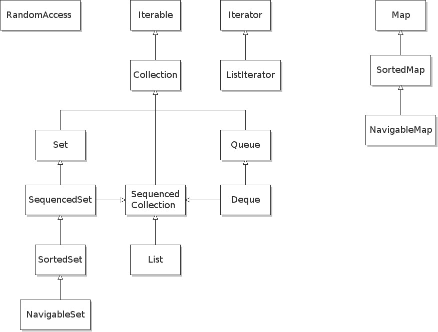

图 7.1：Java 集合框架中的接口

基础接口是 `Collection`，其方法如表 7.1 所示。

表 7.1：`Collection<E>` 接口的方法

| 方法 | 描述 |
| --- | --- |
| `boolean add(E e)`<br>`boolean addAll(Collection<? extends E> c)` | 添加 `e` 或 `c` 中的元素。如果集合发生变化则返回 `true`。 |
| `boolean remove(Object o)`<br>`boolean removeAll(Collection<?> c)`<br>`boolean retainAll(Collection<?> c)`<br>`boolean removeIf(Predicate<? super E> filter)`<br>`void clear()` | 移除 `o`、`c` 中的元素、不在 `c` 中的元素、匹配的的元素或所有元素。前四个方法在集合发生变化时返回 `true`。 |
| `int size()` | 返回此集合中的元素数量。 |


| `boolean isEmpty()`<br>`boolean contains(Object o)`<br>`boolean containsAll(Collection<?> c)` | 如果此集合为空、包含`o`或包含`c`中的所有元素，则返回`true`。 |

| `Iterator<E> iterator()`<br>`Stream<E> stream()`<br>`Stream<E> parallelStream()`<br>`Spliterator<E> spliterator()` | 返回一个迭代器、流、可能的并行流或分迭代器，用于访问此集合的元素。迭代器请参见第 7.2 节，流请参见[../ch8/index.xhtml]。分迭代器仅对流的实现者感兴趣。 |

| `Object[] toArray()`<br>`T[] toArray(T[] a)` | 返回一个包含此集合元素的数组。如果`a`长度足够，则第二个方法返回`a`。 |

`SequencedCollection`提供了对第一个和最后一个元素的访问以及反向遍历——参见表 7.2。`SequencedSet`子接口将`reversed`方法的返回类型精确为`SequencedSet`。`SequencedMap`接口为映射拥有类似的方法。

**表 7.2：`SequencedCollection`接口**

| 方法 | 描述 |
| --- | --- |
| ```java
E getFirst()
E getLast()
void addFirst(E e)
void addLast(E e)
E removeFirst()
E removeLast()
``` | 获取、添加或删除第一个或最后一个元素。后两个方法返回被移除的元素。 |
| ```java
SequencedCollection<E> reversed()
``` | 返回一个按反向顺序迭代的集合视图（参见第 7.6 节）。 |

`List`是一个顺序集合：元素拥有位置 0, 1, 2 等索引。表 7.3 显示了该接口的方法。

**表 7.3：`List`接口**

| 方法 | 描述 |
| --- | --- |
| ```java
boolean add(int index, E e)
boolean addAll(int index,
    Collection<? extends E> c)
boolean add(E e)
boolean addAll(Collection<? extends E> c)
``` | 在`index`之前或末尾添加`e`或`c`中的元素。如果列表发生变化则返回`true`。 |
| `E get(int index)`<br>`E set(int index, E element)`<br>`E remove(int index)` | 获取、设置或移除`index`处的元素。后两个方法返回位于`index`处的元素。 |
| `int indexOf(Object o)`<br>`int lastIndexOf(Object o)` | 返回等于`o`的第一个或最后一个元素的索引。如果没有匹配则返回`-1`。 |
| `ListIterator<E> listIterator()`<br>`ListIterator<E> listIterator(int index)` | 返回用于所有元素的列表迭代器或从`index`开始的列表迭代器。 |
| `void replaceAll(UnaryOperator<E> operator)` | 使用运算符替换每个元素。 |
| `void sort(Comparator<? super E> c)` | 使用`c`给定的排序排序此列表。 |
| `static List<E> of(E... elements)` | 返回一个包含给定元素的不可变列表。 |
| `List<E> subList(int fromIndex, int toIndex)` | 返回一个从`fromIndex`开始到`toIndex`之前的子列表视图（第 7.6 节）。 |

`List`接口由`ArrayList`类（你已在书中见过）和`LinkedList`类实现。如果你上过数据结构课程，你可能记得链表——一组带有元素的链接节点。在链表中间插入元素是很快的——只需接上节点即可。但要到达中间，必须从头跟随所有链接，这很慢。链表有很多应用，但大多数应用程序程序员在需要顺序集合时可能会坚持使用数组列表。尽管如此，`List`接口仍然有用。例如，`Collections.nCopies(n, o)`返回一个包含`n`个`o`拷贝的`List`。该对象“欺骗”了，因为它并没有实际存储`n`个拷贝，当你询问其中任何一个时都会返回`o`。

鼓励你在代码中尽可能使用接口。例如，在构建一个`ArrayList`之后，将引用存储在类型为`List`的变量中：

```
List<String> words = new ArrayList<>();
```

每当你实现处理集合的方法时，请使用限制最少的接口作为参数类型。通常，使用`Collection`、`List`或`Map`就足够了。

集合框架的一个优势是，在处理常用算法时你不需要重复造轮子。一些基础算法（如`addAll`和`removeIf`）是`Collection`接口的方法。`Collections`工具类包含了许多针对各种类型集合的额外算法。你可以对列表进行排序、洗牌、旋转和反转，找到集合中的最大值或最小值，或者找到任意元素的位置，并生成不包含元素、包含一个元素或包含`n`个相同元素的集合。表 7.4 提供了总结。

### 表 7.4：`Collections`类的有用方法

| 方法（均为`static`） | 说明 |
| --- | --- |
| `boolean disjoint(Collection<?> c1, Collection<?> c2)` | 如果集合之间没有共同元素，则返回`true`。 |
| `boolean addAll(Collection<? super T> c, T... elements)` | 将所有元素添加到`c`中。 |
| `void copy(List<? super T> dest, List<? extends T> src)` | 将所有元素从`src`复制到`dest`相同的索引处（`dest`的长度至少等于`src`）。 |
| `boolean replaceAll(List<T> list, T oldVal, T newVal)` | 将所有`oldVal`元素替换为`newVal`，两者都可以为`null`。如果至少找到一个匹配项，则返回`true`。 |
| `void fill(List<? super T> list, T obj)` | 将列表的所有元素设置为`obj`。 |
| `List<T> nCopies(int n, T o)` | 生成一个包含`n`个`o`拷贝的不可变列表。 |
| `int frequency(Collection<?> c, Object o)` | 返回`c`中等于`o`的元素个数。 |
| `int indexOfSubList(List<?> source, List<?> target)`<br>`int lastIndexOfSubList(List<?> source, List<?> target)` | 返回 target 列表在 source 列表中第一次或最后一次出现的起始位置，如果没有则返回`-1`。 |
| ```java
int binarySearch(List<? extends Comparable<? super T>> list, T key)
int binarySearch(List<? extends T> list, T key, Comparator<? super T> c)
``` | 返回 key 的位置，假设列表已按自然顺序或`c`排序。如果 key 不存在，返回`-i - 1`，其中`i`是 key 应该插入的位置。 |
| `sort(List<T> list)`<br>`sort(List<T> list, Comparator<? super T> c)` | 使用元素的自然顺序或`c`对列表排序。 |
| `void swap(List<?> list, int i, int j)` | 交换给定位置处的元素。 |
| `void rotate(List<?> list, int distance)` | 旋转列表，将索引为`i`的元素移动到`(i + distance) % list.size()`。 |
| `void reverse(List<?> list)`<br>`void shuffle(List<?> list)`<br>`void shuffle(List<?> list, Random rnd)` | 反转或随机洗牌列表。 |
| ```java
synchronized(Collection|SequencedCollection|List|Set|SequencedSet|SortedSet|NavigableSet|Map|SequencedMap|SortedMap|NavigableMap)()
``` | 返回一个同步视图（参见第 7.6 节）。 |
| ```java
unmodifiable(Collection|SequencedCollection|List|Set|SequencedSet|SortedSet|NavigableSet|Map|SequencedMap|SortedMap|NavigableMap)()
``` | 返回一个不可修改视图（参见第 7.6 节）。 |
| ```java
checked(Collection|SequencedCollection|List|Set|SequencedSet|SortedSet|NavigableSet|Map|SequencedMap|SortedMap|NavigableMap)()
``` | 返回一个检查视图（参见第 7.6 节）。 |

## 7.2 迭代器 (Iterators)

每个集合都提供了一种按顺序遍历其元素的方法。`Collection`的超接口`Iterable<T>`定义了一个方法：

```
Iterator<T> iterator()
```

它产生一个迭代器，你可以用它访问所有的元素。

```
Collection<String> coll = ...;
Iterator<String> iter = coll.iterator();
while (iter.hasNext()) {
    String element = iter.next();
}
```

## 7.3 集合 (Sets)

集合可以高效地测试一个值是否为元素，但它作为交换也牺牲了一些功能：它不会记录元素添加的顺序。在顺序不重要的情况下，集合非常有用。例如，如果你想不允许一组坏词汇作为用户名，那么它们的顺序并不重要。你只需要知道提议的用户名是否在集合中。

`Set`接口由`HashSet`和`TreeSet`类实现。在内部，这些类使用了完全不同的实现方式。

```
var countries = new TreeSet<String>(); // 按排序访问已添加的国家
var countries2 = new TreeSet<String>((u, v) ->
    u.equals(v) ? 0
    : u.equals("USA") ? -1
    : v.equals("USA") ? 1
    : u.compareTo(v));
    // USA 始终在第一位
```

`TreeSet`类实现了`SortedSet`接口（参见表 7.5）和`NavigableSet`接口（参见表 7.6）。

### 表 7.5: `SortedSet<E>`方法

| 方法 | 说明 |
| --- | --- |
| `E first()`<br>`E last()` | 此集合中的第一个和最后一个元素。 |
| `SortedSet<E> headSet(E toElement)`<br>`SortedSet<E> subSet(E fromElement, E toElement)`<br>`SortedSet<E> tailSet(E fromElement)` | 返回从`fromElement`开始到`toElement`结束之前的元素视图。 |

### 表 7.6: `NavigableSet<E>`方法

| 方法 | 说明 |
| --- | --- |
| `E higher(E e)`<br>`E ceiling(E e)`<br>`E floor(E e)`<br>`E lower(E e)` | 返回最接近 >\|≥\|≤\|< `e` 的元素。 |
| `E pollFirst()`<br>`E pollLast()` | 移除并返回第一个或最后一个元素，如果集合为空则返回`null`。 |
| ```java
NavigableSet<E> headSet(E toElement, boolean inclusive)
NavigableSet<E> subSet(E fromElement, boolean fromInclusive,
    E toElement, boolean toExclusive)
NavigableSet<E> tailSet(E fromElement, boolean inclusive)
``` | 返回从`fromElement`到`toElement`（包含或不包含）的元素视图。 |

## 7.4 Maps

Maps 存储键和值之间的关联关系。调用`put`添加新的关联，或更改现有键的值：

```
var counts = new HashMap<String, Integer>();
counts.put("Alice", 1); // 将键/值对添加到 map 中
counts.put("Alice", 2); // 更新键的值
```

此示例使用了哈希映射，与集合一样，如果你不需要按排序顺序访问键，它通常是更好的选择。如果需要，请改用`TreeMap`。

以下是获取与键关联的值的方法：

```
int count = counts.get("Alice");
```

如果该键不存在，`get`方法将返回`null`。在此示例中，当值被拆箱时，会导致`NullPointerException`。更好的替代方案是：

```
int count = counts.getOrDefault("Alice", 0);
```

那么，如果键不存在，将返回计数值`0`。

当你在 map 中更新计数器时，首先需要检查计数器是否存在，如果存在，则在现有值上加 1。`merge`方法简化了这一常用操作。调用：

```
counts.merge(word, 1, Integer::sum);
```

如果键之前不存在，则将`word`与 1 关联；否则，使用`Integer::sum`函数将之前的值和 1 结合。

现在考虑另一种常见情况。我们想为每个键关联一个集合。例如，在书籍索引中，每个术语都有一组其所属的页码。以下是更新 map 的方法：

```
var index = new TreeMap<String, TreeSet<Integer>>();
...
index.computeIfAbsent(term, k -> new TreeSet<>()).add(pageNumber);
```

在这里，使用`computeIfAbsent`更好，因为只有当该术语之前没有关联的集合时，才会构造`TreeSet`。方便的是，`computeIfAbsent`返回新值，因此我们可以链式调用`add`。

人们很容易尝试将`k -> new TreeSet<>()`改为`TreeSet::new`，这是行不通的。该函数有一个针对给定键的参数`k`，该参数会被传递给构造函数。幸运的是，没有接受`String`参数的`TreeSet`构造函数，代码无法编译。

情况可能会更糟。假设你有一个`Map<Integer, ArrayList<String>>`并调用：

```
map.computeIfAbsent(n, ArrayList::new)
```

确实存在一个接受整数容量的`ArrayList`构造函数。对于较大的`n`值，将分配巨大的数组列表，这显然不是意图的。

map 方法对于`null`值的处理并不一致。某些方法将`null`视为有效值，而另一些方法将其视为键的缺失。

`getOrDefault`方法属于前者，而`putIfAbsent`属于后者：

```
counts.put("C++", null);
counts.getOrDefault("C++", -1) // 在不使用默认值的情况下产生 null
counts.putIfAbsent("C++", 1) // 放入 1，将 null 解释为不存在
```

表 7.7 总结了 map 操作。

### 表 7.7: `Map<K, V>`方法

| 方法 | 说明 |
| --- | --- |
| `V get(Object key)`<br>`V getOrDefault(Object key, V defaultValue)` | 返回与键关联的值，如果键不存在则返回`defaultValue`。 |
| `V put(Object key, V value)`<br>`V putIfAbsent(Object key, V value)` | 如果键不存在，则将指定的键与指定的值关联。返回之前的值。 |
| `V remove(Object key)`<br>`V replace(Object key, V value)` | 移除键的映射或替换值。返回旧值，如果不存在则返回`null`。 |


| `boolean remove(Object key, Object value)` | 如果 `key` 关联 `value`，则移除该项并返回 `true`。否则，什么都不做并返回 `false`。 |

| `boolean replace(Object key, V value, V newValue)` | 如果 `key` 关联 `value`，则替换旧值并返回 `true`。否则，什么都不做并返回 `false`。这些方法在并发访问 map 时主要使用。 |

| `V compute(K key, Function<? super K, ? extends V> mappingFunction)` | 计算键的映射值。将键与新值关联或将其移除。 |

| `V computeIfAbsent(K key, Function<? super K, ? extends V> mappingFunction)` | 如果键不存在，则计算并关联新值。 |

| `V computePresent(K key, BiFunction<? super K, ? extends V, ? extends V> remappingFunction)` | 如果键存在，则计算新值并关联或移除。 |

| `V merge(K key, V value, BiFunction<? super V, ? extends V> remappingFunction)` | 使用现有值和给定值计算新值。 |

| `void forEach(BiConsumer<? super K, ? super V> action)` | 对所有项应用操作。 |

| `void replaceAll(BiFunction<? super K, ? super V, ? extends V> function)` | 对所有项调用函数。将键与非 `null` 结果关联并移除结果为 `null` 的键。 |

| `boolean containsKey(Object key)` | 检查 map 是否包含指定的键。 |

| `boolean containsValue(Object value)` | 检查 map 是否包含指定的值。 |

| `Set<K> keySet()` | 返回键的视图。 |

| `Collection<V> values()` | 返回值的视图。 |

| `Set<Map.Entry<K, V>> entrySet()` | 返回项的视图。 |

| `int size()` | 返回项的数量。 |

| `boolean isEmpty()` | 检查此 map 是否为空。 |

| `void clear()` | 移除所有项。 |

返回的集合并不是 map 数据的副本，而是与 map 关联的视图。如果你从视图中删除一个键或条目，该条目也会从底层 map 中删除。

要遍历 map 的所有键和值，你可以遍历 `entrySet` 方法返回的集合：

```java
for (Map.Entry<String, Integer> entry : counts.entrySet()) {
    String k = entry.getKey();
    Integer oldValue = entry.getValue();
    int newValue = ...;
    entry.setValue(newValue);
}
```

`Map.Entry` 实例也与 map 关联。如上述代码段所示，你可以使用条目对象来更新底层 map 中的值。相反，如果你通过其他手段更新了值（例如调用 map 的 `put` 方法），条目也会随之更新。

如果你想将条目传递给其他方法，应该通过调用 `Map.Entry.copyOf(entry)` 将它们与 map 解除关联。你也可以通过调用 `Map.entry(key, value)` 创建不关联的 `Map.Entry` 实例。每当你需要一对值时，这非常有用。

如果你不需要修改 map，使用 `forEach` 方法遍历其条目更为简单：

```java
counts.forEach((k, v) -> {
    // 处理 k 和 v
});
```

某些 map 实现（例如 `ConcurrentHashMap`）不允许键或值为 `null`。对于允许 `null` 的实现（如 `HashMap`），如果你确实使用了 `null` 值，需要非常小心。许多 map 方法会将 `null` 值解释为条目不存在或应该删除的指示。

有时，你需要按照不同于排序的顺序展示 map 的键。例如，在 JavaServer Faces 框架中，你用 map 指定选择框的标签和值。如果选项按字母顺序（周五、周一、六、日、四、二、三）或哈希码顺序排序，用户会感到惊讶。在这种情况下，请使用 `LinkedHashMap`，它会记住条目添加的顺序并按顺序进行遍历。

## 7.5. 其他集合

在接下来的章节中，我将简要讨论一些你在实践中可能会发现的集合类。

### 7.5.1. Properties

`Properties` 类实现了一个 map，可以使用纯文本格式轻松保存和加载。此类 map 通常用于存储程序的配置选项。例如：

```java
var settings = new Properties();
settings.put("width", "200");
settings.put("title", "Hello, World!");
try (OutputStream out = Files.newOutputStream(path)) {
    settings.store(out, "Program Properties");
}
```

结果是如下文件：

```
#Program Properties
#Mon Nov 03 20:52:33 CET 2014
width=200
title=Hello, World\!
```

从 Java 9 开始，属性文件采用 UTF-8 编码。（在此之前，它们采用 ASCII 编码，大于 `'\u007e'` 的字符被写为 Unicode 转义字符 `\unnnn`。）注释以 `#` 或 `!` 开头。键或值中的换行写为 `\n`。字符 `\`、`#`、`!` 被转义为 `\\`、`\#`、`\!`。

要从文件加载属性，请调用：

```java
try (InputStream in = Files.newInputStream(path)) {
    settings.load(in);
}
```

然后使用 `getProperty` 方法获取键的值。你可以指定当键不存在时使用的默认值：

```java
String title = settings.getProperty("title", "New Document");
```

出于历史原因，尽管值总是字符串，但 `Properties` 类仍然实现了 `Map<Object, Object>`。因此，不要使用 `get` 方法——因为它以 `Object` 类型返回值。

`System.getProperties` 方法会产生一个包含系统属性的 `Properties` 对象。表 7.8 描述了最有用的属性。

**表 7.8：有用的系统属性**

| 属性键 | 描述 |
| --- | --- |
| `user.dir` | 此虚拟机的“当前工作目录”。 |
| `user.home` | 用户的家目录。 |
| `user.name` | 用户的账户名。 |
| `java.version` | 此虚拟机的 Java 运行时版本。 |
| `java.home` | Java 安装的家目录。 |
| `java.class.path` | 启动此 VM 时所使用的类路径。 |
| `java.io.tmpdir` | 适用于临时文件的目录（例如 `/tmp`）。 |
| `os.name` | 操作系统的名称（例如 `Linux`）。 |
| `os.arch` | 操作系统的架构（例如 `amd64`）。 |
| `os.version` | 操作系统的版本（例如 `3.13.0-34-generic`）。 |
| `file.separator` | 文件分隔符（Unix 使用 `/`，Windows 使用 `\`）。 |
| `path.separator` | 路径分隔符（Unix 使用 `:`，Windows 使用 `;`）。 |
| `line.separator` | 换行分隔符（Unix 使用 `\n`，Windows 使用 `\r\n`）。 |

### 7.5.2. Bit Sets

`BitSet` 类存储一个位序列。`BitSet` 为你提供了获取和设置单个位的方法。完整列表请参见表 7.9。注意 `BitSet` 没有实现 `Collection<Integer>`，而是位集。

**表 7.9：BitSet 的方法**

| 方法 | 描述 |
| --- | --- |
| `BitSet()` `BitSet(int nbits)` | 构建一个初始包含 `nbits` 位的位集。 |
| `void set(int bitIndex)` `void set(int fromIndex, int toIndex)` `void set(int bitIndex, boolean value)` `void set(int fromIndex, int toIndex, boolean value)` | 将指定索引处、或从 `fromIndex`（包含）到 `toIndex`（不包含）的位置为 1。 |
| `clear(int bitIndex)` `clear(int fromIndex, int toIndex)` `clear()` | 将指定索引处、或从 `fromIndex`（包含）到 `toIndex`（不包含）或所有位置为 0。 |
| `flip(int bitIndex)` `flip(int fromIndex, int toIndex)` | 反转指定索引处、或从 `fromIndex`（包含）到 `toIndex`（不包含）的位。 |
| `boolean get(int bitIndex)` `get(int fromIndex, int toIndex)` | 获取指定索引处、或从 `fromIndex`（包含）到 `toIndex`（不包含）的位。 |
| `int nextSetBit(int fromIndex)` `int previousSetBit(int fromIndex)` `int nextClearBit(int fromIndex)` `int previousClearBit(int fromIndex)` | 返回下一个/上一个 `1`/`0` 位的索引，如果不存在则返回 -1。 |
| `void and(BitSet set)` `void andNot(BitSet set)` `void or(BitSet set)` `void xor(BitSet set)` | 与 `set` 取交集、差集、并集或异或。 |
| `int cardinality()` | 返回此位集中 1 的数量。**注意**：`size` 方法返回位向量的大小，而不是集合的大小。 |
| `byte[] toByteArray()` `long[] toLongArray()` | 将此位打包成数组。 |
| `IntStream stream()` `String toString()` | 返回位集中整数（即 1 位的索引）的流或字符串。 |
| `static BitSet valueOf(byte[] bytes)` `static BitSet valueOf(long[] longs)` `static BitSet valueOf(ByteBuffer bb)` `static BitSet valueOf(LongBuffer lb)` | 产生一个包含供给位的位集。 |
| `boolean isEmpty()` `boolean intersects(BitSet set)` | 检查此位集是否为空，或与 `set` 是否有公共元素。 |

### 7.5.3. Enumeration Sets and Maps

如果你收集的是枚举值的集合，请使用 `EnumSet` 类而不是 `BitSet`。`EnumSet` 类没有公共构造函数。使用静态工厂方法来构造集合：

```java
enum Weekday { MONDAY, TUESDAY, WEDNESDAY, THURSDAY, FRIDAY, SATURDAY, SUNDAY };
Set<Weekday> always = EnumSet.allOf(Weekday.class);
Set<Weekday> never = EnumSet.noneOf(Weekday.class);
Set<Weekday> workday = EnumSet.range(Weekday.MONDAY, Weekday.FRIDAY);
Set<Weekday> mwf = EnumSet.of(Weekday.MONDAY, Weekday.WEDNESDAY, Weekday.FRIDAY);
```

你可以使用 `Set` 接口的方法来操作 `EnumSet`。

`EnumMap` 是一个其键属于枚举类型的映射。它被实现为值的数组。你可以在构造函数中指定键的类型：

```java
var personInCharge = new EnumMap<Weekday, String>(Weekday.class);
personInCharge.put(Weekday.MONDAY, "Fred");
```

### 7.5.4. 栈、队列、双端队列和优先级队列

栈（stack）是一种在某一端（栈的“顶部”）添加和移除元素的数据结构。队列（queue）允许你高效地从一端（尾部）添加元素并从另一端（头部）移除它们。双端队列（deque）支持在两端进行插入和删除。对于所有这些数据结构，都不支持在中间添加元素。

`Queue` 和 `Deque` 接口定义了这些数据结构的方法。Java 集合框架中没有 `Stack` 接口，只有一个 Java 早期的遗留 `Stack` 类，你应该避免使用。如果你需要栈、队列或双端队列，且不关心线程安全，请使用 `ArrayDeque`。

使用栈时使用 `push` 和 `pop` 方法：

```java
var stack = new ArrayDeque<String>();
stack.push("Peter");
stack.push("Paul");
stack.push("Mary");
while (!stack.isEmpty())
    System.out.println(stack.pop());
```

使用队列时使用 `add` 和 `remove`：

```java
Queue<String> queue = new ArrayDeque<>();
queue.add("Peter");
queue.add("Paul");
queue.add("Mary");
while (!queue.isEmpty())
    System.out.println(queue.remove());
```

线程安全的队列通常用于并发程序。你可以在第 10 章中找到关于它们的更多信息。

*优先级队列*（priority queue）在按任意顺序插入后按排序顺序检索元素。也就是说，每当你调用 `remove` 方法时，你都会得到当前优先级队列中最小的元素。

优先级队列的一个典型用途是作业调度。每个作业都有优先级。作业按随机顺序添加。每当有新作业可以启动时，优先级最高的作业就会从队列中移除。（由于传统上优先级 1 是“最高”优先级，因此 `remove` 操作产生的是最小元素。）

```java
public record Job(int priority, String description) implements Comparable<Job> { ... }
...
var jobs = new PriorityQueue<Job>();
jobs.add(new Job(4, "Collect garbage"));
jobs.add(new Job(9, "Match braces"));
jobs.add(new Job(1, "Fix memory leak"));
...
while (jobs.size() > 0) {
    Job job = jobs.remove(); // 最紧急的作业优先移除
    execute(job);
}
```

就像 `TreeSet` 一样，优先级队列可以持有实现 `Comparable` 接口的类的元素，或者你可以在构造函数中提供 `Comparator`。然而，与 `TreeSet` 不同，遍历元素并不一定按排序顺序产生它们。优先级队列使用的添加和移除元素算法使得最小元素趋向于根节点，而不会浪费时间去对所有元素进行排序。

### 7.5.5. 弱哈希映射

`WeakHashMap` 类设计用于解决一个有趣的问题。如果一个值的键不再被程序中的任何地方使用，会发生什么？如果指向键的最后一个引用消失了，那么就没有方法可以引用该值对象，因此它应该被垃圾回收器移除。

这并不简单。垃圾回收器会追踪活跃对象。只要映射对象是活的，它其中所有的条目都是活的，且不会被回收——被条目引用的值也不会被回收。

这就是 `WeakHashMap` 类解决的问题。该数据结构与垃圾回收器协作，当键的唯一引用是哈希表条目中的引用时，移除键/值对。

技术上，`WeakHashMap` 使用*弱引用*来持有键。`WeakReference` 对象持有对另一个对象的引用——在我们的案例中是哈希表的键。此类类型的对象会被垃圾回收器特殊对待。如果一个对象*仅*通过弱引用可达，垃圾回收器就会回收该对象并将弱引用放入与该 `WeakReference` 对象关联的队列中。每当在其调用方法时，`WeakHashMap` 都会检查其弱引用队列是否有新成员，并移除相关的条目。

## 7.6. 视图

集合*视图*（view）是一个实现集合接口的轻量级对象，但不存储元素。例如 `keySet` 和 `values` 方法。

### 7.6.1. 小集合

`List`、`Set` 和 `Map` 接口提供了静态方法。例如，


```java
List<String> names = List.of("Peter", "Paul", "Mary");
Set<Integer> numbers = Set.of(2, 3, 5);
Map<String, Integer> scores = Map.of("Peter", 2, "Paul", 3, "Mary", 5);
```

`of` 和 `ofEntries` 方法产生的对象由数组支持。这些集合对象是不可修改的。任何更改内容的尝试都会导致`UnsupportedOperationException`。

如果你想要一个可变的集合，可以将不可修改集合传递给构造函数：

```java
var names = new ArrayList<String>(List.of("Peter", "Paul", "Mary"));
```

还有一个静态的`Arrays.asList`方法，它类似于`List.of`。它返回一个可变但不可调整大小的列表。也就是说，你可以对列表进行`set`，但不能`add`或`remove`。

### 7.6.2. 范围

你可以为列表形成子列表视图。例如：

```java
List<String> sentence = ...;
List<String> nextFive = sentence.subList(5, 10);
```

此视图访问索引 5 到 9 的元素。子列表的任何更改（如设置、添加或删除元素）都会影响原始列表。

对于排序集和映射，你通过下界和上限指定范围：

```java
TreeSet<String> words = ...;
SortedSet<String> asOnly = words.subSet("a", "b");
```

与`subList`一样，第一个边界是包含的，第二个是排除的。

`headSet`和`tailSet`方法产生没有上限或上限的子范围。

```java
NavigableSet<String> nAndBeyond = words.tailSet("n");
```

通过`NavigableSet`接口，你可以为每个边界选择它是包含还是排除——参见表 7.6。

对于排序映射，有相应的方法`subMap`、`headMap`和`tailMap`。

### 7.6.3. 不可修改视图

有时，你想共享集合的内容，但又不希望它被修改。当然，你可以将值复制到一个新集合中，但这可能开销很大。不可修改视图（unmodifiable view）是一个更好的选择。这是一个典型的情况：一个`Person`对象维护一个朋友列表。如果`getFriends`直接返回该列表的引用，调用者就可以对其进行修改。但提供一个不可修改列表视图是安全的：

```java
public class Person {
    private ArrayList<Person> friends;

    public List<Person> getFriends() {
        return Collections.unmodifiableList(friends);
    }
    ...
}
```

在不可修改视图上调用所有修改方法（mutator methods）都会抛出异常。

如表 7.4 所示，你可以获取集合、列表、集合、排序集合、导航集合、映射、排序映射和导航映射的不可修改视图。

在第 6 章中，你看到了如何将错误类型的元素带入到泛型集合中（这种现象被称为“堆污染”，heap pollution），以及在检索不适当元素时会报告运行时错误，而不是在插入时。如果你需要调试此类问题，请使用`checked view`（检查视图）。当你构造一个例如`ArrayList<String>`时，请改用：

```java
List<String> strings
    = Collections.checkedList(new ArrayList<>(), String.class);
```

该视图会监控向列表的所有插入操作，并在添加错误类型的对象时抛出异常。

`Collections`类产生`synchronized`（同步）视图，确保对数据结构进行安全的并发访问。在实践中，这些视图不如`java.util.concurrent`包中显式为并发访问设计的数据结构有用。我建议你使用那些类，并远离同步视图。

### 7.6.4. 逆序视图

`SequencedCollection`和`SequencedSet`接口的`reversed`方法产生以反序查看元素的视图。例如，这里是反序遍历字符串列表或树形集合的方法：

```java
for (String element : collection.reversed()) {
    do something with element
}
```

对于`SequencedMap`，`reversed`方法以反序查看键的映射。

## 练习

1. 实现“埃拉托尼筛法”算法来确定所有 ≤ `n` 的质数。将从 2 到 `n` 的所有数字添加到集合中。然后反复在集合中找到最小元素`s`，并移除`s²`、`s` · (`s` + 1)、`s` · (`s` + 2)等。当`s²` > `n`时完成。分别使用`HashSet<Integer>`和`BitSet`完成此操作。
2. 在字符串数组列表中，将每个字符串转换为大写。通过 (a) 一个`iterator`，(b) 遍历索引值的循环，以及 (c) `replaceAll`方法来实现来实现。
3. 如何仅使用`Set`接口的方法且不使用循环来计算两个集合的并集、交集和差集？
4. 构造一个产生`ConcurrentModificationException`的场景。你可以做什么来避免它？
5. 实现一个方法`public static void swap(List<?> list, int i, int j)`，当`list`的类型实现了`RandomAccess`接口时，以通常的方式交换元素；如果没有实现，则最小化访问索引`i`和`j`位置的代价。
6. 我鼓励你使用接口而不是具体的数据结构——例如，使用`Map`而不是`TreeMap`。遗憾的是，这个建议是有限的。假设你有一个类型为`Map<String, Set<Integer>>`的方法参数，有人用`HashMap<String, HashSet<Integer>>`调用了你的方法。发生了什么？你可以改用什么参数类型？
7. 编写一个程序，读取文件中的所有单词并打印每个单词出现的次数。使用`TreeMap<String, Integer>`。
8. 编写一个程序，读取文件中的所有单词并打印它们分别出现在哪些行中。使用一个从字符串到集合的映射。
9. 你可以如下所示更新计数器映射中的计数：

   ```java
   counts.merge(word, 1, Integer::sum);
   ```

   在不使用`merge`方法的情况下执行相同的操作：(a) 使用`contains`，(b) 使用`get`和`null`检查，(c) 使用`getOrDefault`，(d) 使用`putIfAbsent`。
10. 实现 Dijkstra 算法以在城市网络中寻找最短路径，其中某些城市由道路连接。（有关描述，请查阅你喜欢的算法书籍或维基百科条目。）使用一个辅助记录`Neighbor`来存储邻居城市的名称和距离。将图表示为从城市到邻居集合的映射。在算法中使用`PriorityQueue<Neighbor>`。
11. 编写一个程序，将句子读取到数组列表中。然后，使用`Collections.shuffle`洗乱除第一个和最后一个以外的所有单词，而无需将单词复制到另一个集合中。
12. 使用`Collections.shuffle`编写一个程序，读取句子，洗乱单词并打印结果。修复第一个单词的大小写和最后一个单词的标点符号（洗乱前后）。提示：不要洗乱单词本身。
13. 使用`Collections.shuffle`编写一个程序，读取句子，洗乱单词并打印结果。修复第一个单词的大小写和最后一个单词的标点符号。
14. 使用`Collections.shuffle`编写一个程序，读取句子，洗乱单词并打印结果。修复第一个单词的大小写和最后一个单词的标点符号。
15. 使用`Collections.shuffle`编写一个程序，读取句子，洗乱单词并打印结果。修复第一个单词的大小写和最后一个单词的标点符号。
16. 使用`Collections.shuffle`编写一个程序，读取句子，洗乱单词并打印结果。修复第一个单词的大小写和最后一个单词的标点符号。
17. 使用`Collections.shuffle`编写一个程序，读取句子，洗乱单词并打印结果。修复第一个单词的大小写和最后一个单词的标点符号。
18. 使用`Collections.shuffle`编写一个程序，读取句子，洗乱单词并打印结果。修复第一个单词的大小写和最后一个单词的标点符号。
19. 使用`Collections.shuffle`编写一个程序，读取句子，洗乱单词并打印结果。修复第一个单词的大小写和最后一个单词的标点符号。
20. 使用`Collections.shuffle`编写一个程序，读取句子，洗乱单词并打印结果。修复第一个单词的大小写和最后一个单词的标点符号。

# 第 8 章 流 (Streams)

流提供了一种数据的视图，允许你在比集合更高的概念层面上指定计算。通过流，你指定要执行什么，而不是如何执行。你将操作调度交给实现。例如，假设你想计算某个属性的平均值。你指定数据源和属性，流库随后可以优化计算，例如使用多个线程计算和和计数。

本章的关键点是：

1. 迭代器意味着特定的遍历策略并禁止高效的并发执行。
2. 你可以从集合、数组、生成器或迭代器创建流。
3. 使用`filter`选择元素并使用`map`转换元素。
4. 转换流的操作包括`limit`、`distinct`和`sorted`。
5. 从流中获取结果，使用如`count`、`max`、`min`、`findFirst`或`findAny`等还原操作。其中一些方法返回`Optional`值。
6. `Optional`类型旨在作为处理`null`值的安全方案。要安全地使用它，请利用`ifPresent`和`orElse`方法。
7. 你可以将流结果收集到集合、数组、字符串或映射。
8. `Collectors`类的`groupingBy`和`partitioningBy`方法允许你将流的内容拆分成组，并为每个组获取结果。
9. 针对基本类型`int`、`long`和`double`有专门的流。
10. 并行流会自动将流操作并行化。

## 8.1. 从迭代到流操作

当你处理一个集合时，通常会遍历它的元素并对每个元素执行某些操作。例如，假设我们要统计一本书中所有的长单词。首先，让我们把它们放入一个列表：

```java
String contents = Files.readString(Path.of("alice.txt")); 
List<String> words = List.of(contents.split("\\PL+"));
    // 拆分为单词；非字母字符是分隔符
```

现在我们准备好进行迭代了：

```java
int count = 0;
for (String w : words) {
    if (w.length() > 12) count++;  
}
```

使用流（streams），相同的操作看起来如下：

```java
long count = words.stream()
    .filter(w -> w.length() > 12)
    .count();
```

现在，你不再需要扫描循环来寻找过滤和计数的证据了。方法名会立即告诉你代码的意图。此外，循环详尽地规定了操作的顺序，而流能够以它想要的方式调度操作，只要结果是正确的即可。

只需将`stream`改为`parallelStream`，流库即可并行执行过滤和计数。

```java
long count = words.parallelStream()
    .filter(w -> w.length() > 12)
    .count();
```

流遵循“关注做什么，而不是怎么做”（what, not how）的原则。在我们的流示例中，我们描述了需要做什么：获取长单词并统计它们。我们没有指定这应该以什么顺序或在哪个线程中发生。相比之下，本节开头的循环精确指定了计算应该如何工作，从而放弃了任何优化的机会。

流在表面上与集合相似，允许你转换和检索数据。但它们之间存在显著差异：

1. 流不存储它的元素。元素可能存储在底层集合中，或者根据需要生成。
2. 流操作不会改变其数据源。例如，`filter`方法不会从流中删除元素，而是产生一个新的不包含这些元素的新流。
3. 流操作在可能的情况下是`lazy`（懒性）的。这意味着在结果被需要之前，它们不会执行。例如，如果你只请求前五个长单词而不是全部，`filter`方法会在第五次匹配后停止过滤。因此，你甚至可以拥有无限流！

让我们再次看看这个示例。`stream`和`parallelStream`方法为`words`列表产生一个`stream`。`filter`方法返回另一个仅包含长度大于 12 的单词的流。`count`方法将该流归约为结果。

这种工作流在你处理流时是典型的。你分三个阶段设置一个操作流水线：

1. 创建流。
2. 指定中间操作，将初始流转换为其他流，可能涉及多个步骤。
3. 应用终端操作（terminal operation）以产生结果。该操作会强制执行之前的懒性操作。之后，该流无法再次使用。

在我们的示例中，流是通过`stream`或`parallelStream`方法创建的。`filter`方法对其进行了转换，而`count`是终端操作。

在下一节中，你将看到如何创建流。接下来的三个章节处理流转换。最后是五个关于终端操作的章节。

## 8.2. 流的创建

你已经看到，可以通过`Collection`接口的`stream`方法将任何集合转换为流。如果你有一个数组，请使用静态的`Stream.of`方法。

```java
Stream<String> words = Stream.of(contents.split("\\PL+"));
    // split 返回一个 String[] 数组
```

`of`方法有一个变长参数列表，因此你可以从任意数量的参数构造流：

```java
Stream<String> song = Stream.of("gently", "down", "the", "stream");
```

使用`Arrays.stream(array, from, to)`从数组的一部分创建流。

要创建一个没有任何元素的流，请使用静态的`Stream.empty`方法：

```java
Stream<String> silence = Stream.empty();
    // 泛型类型 <String> 被推断；等同于 Stream.<String>empty()
```

`Stream`接口有两个用于创建无限流的静态方法：`generate`和`iterate`。`generate`方法接收一个无参数的函数（从技术上讲，是一个`Supplier<T>`接口的对象——参见第 3 章）。每当需要流值时，就会调用该函数产生一个值。你可以这样获取常量流：

```java
Stream<String> echos = Stream.generate(() -> "Echo");
```

或者获取随机数流：

```java
Stream<Double> randoms = Stream.generate(Math::random);
```

要产生如`0 1 2 3 ...`这样的序列，请使用`iterate`方法。它接受一个“种子”值和一个函数（技术上讲，是一个`UnaryOperator<T>`），并重复地将函数应用于上一个结果。例如：

```java
Stream<BigInteger> integers
    = Stream.iterate(BigInteger.ZERO, n -> n.add(BigInteger.ONE));
```

序列中的第一个元素是种子`BigInteger.ZERO`。第二个元素是`f(seed)`，即`1`（作为前缀）。

为了将一个`Iterator`或非集合的通用`Iterable`转换为流（stream），你需要使用用于`spliterators`的辅助方法。`spliterator`类似于`iterator`，但它可以被拆分，使得每个生成的`spliterator`都能产生元素的一部分。这种拆分被用于并行处理元素——请参见第 8.14 节。

如果你有一个`Iterator`并且想要获取其结果的流，可以使用以下代码：

```java
StreamSupport.stream(Spliterators.spliteratorUnknownSize(
   iterator, Spliterator.ORDERED), false);
```

如果你有一个非集合的`Iterable`，可以通过调用以下方法将其转换为流：

```java
StreamSupport.stream(iterable.spliterator(), false);
```

在执行流操作时，**不要**修改支持流的集合，这一点非常重要。记住，流本身并不收集数据——数据始终存储在独立的集合中。如果你修改了该集合，流操作的结果将变得不可定义。JDK 文档将这一要求称为`noninterference`（非干扰）。

准确来说，由于中间流操作是惰性的（lazy），在执行终端操作之前，集合是有被修改的。例如，下面的代码虽然绝对不推荐，但是可以运行的：

```java
List<String> wordList = ...;
Stream<String> words = wordList.stream();
wordList.add("END");
long n = words.distinct().count();
```


但这段代码是错误的：

```
Stream<String> words = wordList.stream();
words.forEach(s -> if (s.length() < 12) wordList.remove(s));
    // 错误——干扰 (interference)
```

## 8.3. `filter`, `map` 和 `flatMap` 方法

流转换会产生一个新的流，其元素派自于另一个流。你已经见过 `filter` 转换，它产生一个包含符合特定条件的元素的新流。在这里，我们将字符串流转换为另一个仅包含长词的流：

```
List<String> words = ...;
Stream<String> longWords = words.stream().filter(w -> w.length() > 12);
```

`filter` 的参数是一个 `Predicate<T>`——也就是说，一个从 `T` 到 `boolean` 的函数。

通常，你想要以某种方式转换流中的值。使用 `map` 方法并传递执行该转换的函数。例如，你可以这样将所有单词转换为小写：

```
Stream<String> lowercaseWords = words.stream().map(String::toLowerCase);
```

在这里，我们使用了带有方法引用的 `map`。通常情况下，你会使用 lambda 表达式：

```
Stream<Character> firstCodeUnits = words.stream().map(s -> s.charAt(0));
```

生成的流包含每个单词的第一个代码单元（code unit）。

当你使用 `map` 时，函数会被应用于每个元素，结果是一个包含这些结果的新流。偶尔，你会遇到一个生成结果流的映射函数。例如，考虑一个方法 `graphemeClusters`，它可以产生字符串的所有字形簇（grapheme clusters）。例如，`graphemeClusters("Ahoy 🏴‍☠️")` 是一个包含字符串 `"A"`、`"h"`、`"o"`、`"y"`、`" "` 和 `"🏴‍☠️"` 的流。（注意，旗帜由五个 `char` 值组成，因此 `graphemeClusters` 方法必须进行一些繁重的工作来实现这一点。我们稍后会查看实现。）

现在让我们在字符串流上映射这样的 `graphemeClusters` 方法：

```
List<String> words = List.of(..., "Ahoy", "🏴‍☠️", ...);
Stream<Stream<String>> result = words.stream().map(w -> graphemeClusters(w));
```

你将得到一个流的流，类似于 `[... ["A", "h", "o", "y"], ["🏴‍☠️"], ...]`。要将其展平为单个流 `[... "A", "h", "o", "y", "🏴‍☠️", ...]`，请使用 `flatMap` 方法代替 `map`：

```
Stream<String> flatResult = words.stream().flatMap(w -> graphemeClusters(w));
   // 对每个单词调用 graphemeClusters 并展平结果
```

现在你已经了解了如何使用 `graphemeClusters` 方法，那么如何编写它呢？一种方法是使用在字形簇边界处拆分的正则表达式：

```
public static Stream<String> graphemeClusters(String s)
{
   return new Scanner(s).useDelimiter("\\b{g}").tokens();
}
```

在这里我们很幸运，编写一个为每个流元素产生新流的方法很容易。有时这并不那么容易。创建这么多流也可能效率低下。`mapMulti` 方法提供了一种替代方案。它不是产生结果流，而是生成结果并将它们传递给收集器（collector）——一个实现 `Consumer` 函数式接口的类对象。对于每个结果，调用收集器的 `accept` 方法。

让我们通过一个例子来这样做。以下循环产生字符串 `s` 的字形簇：

```
BreakIterator iter = BreakIterator.getCharacterInstance();
...
iter.setText(s);
int start = iter.first();
int end = iter.next();
```

## 8.4. 提取子流和合并流

`limit(n)` 调用返回一个在 `n` 个元素后结束的流流（如果流本身较短则提前结束）。该方法对于裁剪无限流非常有用。例如，

```
Stream<Double> randoms = Stream.generate(Math::random).limit(100);
```

`skip(n)` 调用恰好相反。它丢弃前 `n` 个元素。在我们的书籍阅读示例中，由于 `split` 方法的工作方式，第一个元素是一个不需要的字符串。我们可以通过 `skip` 让它消失：

```
Stream<String> words = Stream.of(contents.split("\\P+")).skip(1);
```

`takeWhile(predicate)` 调用在谓词为真时获取流的所有元素，然后停止。例如，假设我们使用前面的 `graphemeClusters` 方法将字符串拆分为字符，并想要收集所有的数字。`takeWhile` 方法可以做到：

```
Stream<String> initialDigits = graphemeClusters(str).takeWhile(
    s -> "0123456789".contains(s));
```

`dropWhile` 方法在在条件为真时丢弃元素，从第一个条件为假的元素开始产生流。例如，

```
Stream<String> withoutInitialBlanks = graphemeClusters(str).dropWhile(String::isBlank);
```

你可以使用 `Stream` 类的静态方法 `concat` 连接两个流：

```
Stream<String> combined = Stream.concat(
    graphemeClusters("Hello"), graphemeClusters("World"));
    // 产生流 ["H", "e", "l", "l", "o", "W", "o", "r", "l", "d"]
```

当然，第一个流不应该是无限的——否则第二个流将没有机会。

## 8.5. 其他流转换

`distinct` 方法返回一个流，它按相同顺序产生原始流中的元素，但剔除了重复元素。重复元素不需要相邻。

```
Stream<String> uniqueWords
    = Stream.of("merrily", "merrily", "merrily", "gently").distinct();
    // 只保留一个 "merrily"
```

对于流的排序，`sorted` 方法有几种变体。一种适用于 `Comparable` 元素的流，另一种接受一个 `Comparator`。在这里，我们对字符串进行排序，使最长的排在前面：

```java
Stream<String> longestFirst
    = words.stream().sorted(Comparator.comparing(String::length).reversed());
```

与所有的流变换一样，`sorted` 方法会产生一个新的流，其元素是原始流元素排序后的结果。

当然，你可以在不使用流的情况下对集合进行排序。当排序过程是流流水线（pipeline）的一部分时，`sorted` 方法非常有用。

最后，`peek` 方法产生另一个与原始流元素相同的流，但每当获取一个元素时都会调用一个函数。这对于调试非常方便：

```java
Object[] powers = Stream.iterate(1.0, p -> p * 2)
    .peek(e -> System.out.println("Fetching " + e))
    .limit(20).toArray();
```

当元素实际上被访问时，会打印一条消息。通过这种方式，你可以验证由 `iterate` 返回的无限流是按需（lazily）处理的。

当你使用调试器调试流计算时，可以在从某个变换中调用的方法中设置断点。在大多数 IDE 中，你也可以在 lambda 表达式中设置断点。如果你只是想知道流流水线在特定一点发生了什么，可以添加：

```java
.peek(x -> {
    return; })
```

并在第二行设置断点。

## 8.6. 简单归约 (Simple Reductions)

现在你已经了解了如何创建和变换流，我们终于将进入最重要的点——从流数据中获取答案。我们在这一节中涵盖的方法被称为“归约”（reductions）。归约是**终端操作**（terminal operations）。它们将流归约为一个非流值，该值可以在你的程序中使用。

你已经见过一个简单的归约了：`count` 方法，它返回流中元素的数量。

其他简单的归约还有 `max` 和 `min`，它们返回最大值或最小值。这里有一个特殊之处——这些方法返回一个 `Optional<T>` 值，该值要么封装了答案，要么表示没有结果（因为该流恰好为空）。在过去，在这种情况下返回 `null` 是很常见的做法。但在测试不完全的程序中发生这种情况时，会导致空指针异常。`Optional` 类型是指示缺失返回值的更好方法。我们将在下一节中详细讨论 `Optional` 类型。以下是你可以获取流的最大值的方法：

```java
Optional<String> largest = words.max(String::compareToIgnoreCase);
System.out.println("largest: " + largest.orElse(""));
```

`findFirst` 返回非空集合中的第一个值。它在与 `filter` 结合时通常非常有用。例如，找到第一个以字母 Q 开头的单词（如果存在的话）：

```java
Optional<String> startsWithQ
    = words.filter(s -> s.startsWith("Q")).findFirst();
```

如果你接受任何匹配项，而仅仅是第一个，请使用 `findAny` 方法。当流并行化时，这非常有效，因为流可以报告它找到的任何匹配项，而不是受限于第一个。

```java
Optional<String> startsWithQ
    = words.parallel().filter(s -> s.startsWith("Q")).findAny();
```

如果你只想知道是否存在匹配项，请使用 `anyMatch`。该方法接受一个谓词参数，所以你不需要使用 `filter`。

```java
boolean aWordStartsWithQ
    = words.parallel().anyMatch(s -> s.startsWith("Q"));
```

还有 `allMatch` 和 `noneMatch` 方法，如果所有元素或没有元素匹配谓词，它们将返回 `true`。这些方法也同样从并行运行中获益。

## 8.7. Optional 类型

`Optional<T>` 对象是类型 `T` 对象或无对象的封装器。在前者情况下，我们说该值是**存在**的（present）。`Optional<T>` 类型旨在作为类型 `T` 引用的更安全的替代方案，该引用要么指向对象，要么为 `null`。但只有在你正确使用它时它才是安全的。接三节将向你展示如何做。

### 8.7.1. 产生备选方案

有效使用 `Optional` 的关键是在值不存在时产生一个备选方案，或者仅在值存在时消费该值。这两种策略都有的方法。

在这一节中，我们查看第一种策略。通常，当没有匹配项时，你想要一个默认值，也许空字符串：

```java
String result = optionalString.orElse("");
    // 封装的字符串，如果没有则为 ""
```

你也可以调用代码来计算默认值：

```java
String result = optionalString.orElseGet(() -> System.getProperty("myapp.default"));
    // 仅在需要时才调用该函数
```

或者如果没有值，你可以抛出一个异常：

```java
String result = optionalString.orElseThrow(IllegalStateException::new);
    // 提供一个产生异常对象的方法
```

### 8.7.2. 如果存在则消费值

在节一节中，你已经看到了了如何在没有值时产生备选方案。处理可选值的另一种策略是仅在值存在时消费该值。

`ifPresent` 方法接受一个函数。如果可选值存在，它会被传递给该函数。否则，什么都不会发生。

例如，如果你想在值存在时将其添加到集合中，调用：

```java
optionalValue.ifPresent(v -> results.add(v));
```

或者简单地：

```java
optionalValue.ifPresent(results::add);
```

如果你想在 `Optional` 有值时执行一个操作，在没有时执行另一个操作，请使用 `ifPresentOrElse`：

```java
optionalValue.ifPresentOrElse(
   v -> System.out.println("Found " + v),
   () -> logger.warning("No match"));
```

### 8.7.3. Optional 的流水线处理

在之前的节中，你已经看到了了如何从 `Optional` 中获取值。另一种有效的策略是保持 `Optional` 完整。你可以通过使用 `map` 方法来变换 `Optional` 内部的值：

```java
Optional<Path> transformed = optionalString.map(Path::of);
```

如果 `optionalString` 是空的，那么 `transformed` 也是空的。

只需将可选值想象成一个零或一流。结果同样是零或一，在后者的情况下，函数已被应用。

同样，你可以使用 `filter` 方法在变换之前只考虑某些属性的 `Optional` 值。如果属性不符合，流水线将产生一个空结果：

```java
Optional<Path> transformed = optionalString
   .filter(s -> s.endsWith(".txt"))
   .map(Path::of);
```

你可以使用 `or` 方法用备选 `Optional` 替换空的 `Optional`。备选方案是按需计算的。

```java
Optional<String> result = optionalString.or(() -> // 提供一个 Optional
   alternatives.stream().findFirst());
```

如果 `optionalString` 有值，那么 `result` 就是 `optionalString`。如果没有，则计算 lambda 表达式并使用其结果。

### 8.7.4. 如何使用 Optional 值

如果你不正确使用 `Optional` 值，你并没有比过去的“某些值或 `null`”方法更有优势。

`get` 方法在 `Optional` 值存在时获取封装的元素，如果不存在则抛出 `NoSuchElementException`。因此

```java
Optional<T> optionalValue = ...;
optionalValue.get().someMethod()
```

并不比下面安全：

```java
T value = ...;
value.someMethod();
```

`isPresent` 和 `isEmpty` 方法报告 `Optional<T>` 对象是否存在值。但是

```java
if (optionalValue.isPresent()) optionalValue.get().someMethod();
```

并不比下面简单

```java
if (value != null) value.someMethod();
```

如果你发现自己在使用 `get` 方法，请重新考虑你的方法，并尝试前两节的策略之一。

`orElseThrow` 是 `get` 方法的一个听起来更吓人的的同义词。当你调用 `optionalValue.orElseThrow().someMethod()` 时，如果 `optionalValue` 为空，将发生异常将变得非常明确。这种做法希望程序员只有在完全确定这种情况不会发生时才使用 `orElseThrow`。

以下是关于正确使用 `Optional` 类型的几个额外提示：

- `Optional` 类型的变量永远不应该为 `null`。

- 不要使用 `Optional` 类型的字段。它的代价是增加了一个对象的开销。在类内部，使用 `null` 表示字段的缺失。为了制约使用 `Optional` 字段，该类没有被设计为可序列化。

- `Optional` 类型的方法参数是成疑的。在请求的值存在的常见情况下，它们会使调用变得不那么愉快。相反，可以考虑该方法的两个重载版本：一个带参数，一个不带参数。另一方面，返回一个 `Optional` 是可以的。它是指示函数可能没有结果的正确方式。

- 不要将 `Optional` 对象放入集合（set）中，也不要将它们作为映射（map）的键（key）。相反，请收集值。

### 8.7.5. 创建 Optional 值


到目前为止，我们讨论了如何消费他人创建的`Optional`对象。如果你想写一个创建`Optional`对象的方法，有几个静态方法可以实现此目的，包括`Optional.of(result)`和`Optional.empty()`。例如，

```
public static Optional<Double> inverse(Double x) {
    return x == 0 ? Optional.empty() : Optional.of(1 / x);
}
```

`ofNullable`方法旨在作为可能为`null`的值到可选值的桥梁。如果`obj`不为`null`，`Optional.ofNullable(obj)`返回`Optional.of(obj)`，否则返回`Optional.empty()`。

### 8.7.6. 使用 flatMap 组合 Optional 值函数

假设你有一个方法`f`产生一个`Optional<T>`，并且目标类型`T`有一个方法`g`产生一个`Optional<U>`。如果它们是普通方法，你可以通过调用`s.f().g()`将它们组合起来。但这种组合行不通，因为`s.f()`的类型是`Optional<T>`而不是`T`。相反，调用

```
Optional<U> result = s.f().flatMap(T::g);
```

如果`s.f()`存在，则对它应用`g`。否则，返回一个空的`Optional<U>`。

显然，如果你有更多产生`Optional`值的方法或 lambda 表达式，你可以重复该过程。你可以通过简单链式调用`flatMap`来构建步骤流水线，只有当所有部分都成功时才会成功。

例如，考虑前一节中安全的`inverse`方法。假设我们还有一个安全的平方根方法：

```
public static Optional<Double> squareRoot(Double x) {
    return x < 0 ? Optional.empty() : Optional.of(Math.sqrt(x));
}
```

那么你可以这样计算`inverse`的平方根：

```
Optional<Double> result = inverse(x).flatMap(x -> squareRoot(x));
```

我们可以通过从一个`Optional`开始来让这样的链看起来更规则：

```
Optional<Double> result
   = Optional.of(-4.0).flatMap(x -> inverse(x)).flatMap(x -> squareRoot(x));
```

使用方法表达式看起来甚至更整洁：

```
Optional<Double> result
   = Optional.of(-4.0).flatMap(MyMath::inverse).flatMap(MyMath::squareRoot);
```

如果`inverse`方法或`squareRoot`方法任一返回`Optional.empty()`，结果为空。

你已经在`Stream`接口中见过`flatMap`方法（参见`Stream`接口）。如果你有更多产生`Optional`值的方法或 lambda 表达式，你可以重复该过程。你就可以通过简单链式调用`flatMap`来构建一个步骤流水线，只有当所有部分都成功时，流水线才会成功。

```
IntSummaryStatistics summary = stream.collect(
    Collectors.summarizingInt(String::length));
double averageWordLength = summary.getAverage();
double maxWordLength = summary.getMax();
```

## 8.9. 收集到 Map

假设你有一个`Stream<Person>`，并将元素收集到 map 中，以便稍后可以通过 ID 查找人员。调用`Collectors.toMap`并传入两个生成 map 的键和值的函数。例如：

```java
public record Person(int id, String name) {}
...
Map<Integer, String> idToName = people.collect(
    Collectors.toMap(Person::id, Person::name));
```

在值应该是实际元素本身的常见情况下，请对第二个函数使用`Function.identity()`。

```java
Map<Integer, Person> idToPerson = people.collect(
    Collectors.toMap(Person::id, Function.identity()));
```

如果存在多个具有相同键的元素，会发生冲突，收集器将抛出`IllegalStateException`。你可以通过提供第三个函数参数来覆盖该行为，该参数用于根据现有值和新值来解决冲突并确定键的值。你的函数可以返回现有值、新值或它们的组合。

在这里，我们构建了一个 map，它包含每个可用区域（locales）的每种语言：其在默认区域的名称（例如`"German"`）作为键，其本地化后的名称（例如`"Deutsch"`）作为值。

```java
Map<String, String> languageNames = Locale.availableLocales().collect(
    Collectors.toMap(
        Locale::getDisplayLanguage, 
        loc -> loc.getDisplayLanguage(loc),
        (existingValue, newValue) -> existingValue));
```

我们不在乎同一个语言可能出现两次（例如德国和瑞士的德语），所以我们只保留第一个条目。

在本章中，我使用`Locale`类作为有趣数据集来源。在遵循这些示例时，你不需要了解任何关于处理区域的知识。

现在假设我们想知道某个国家的所有语言。那么我们需要一个`Map<String, Set<String>>`。例如，“Switzerland”的值是集合`[French, German, Italian]`。起，我们为每种语言存储一个单元素集合。每当为某个国家发现新语言时，我们就形成现有集合和新集合的并集。

```java
Map<String, Set<String>> countryLanguageSets = Locale.availableLocales().collect(
    Collectors.toMap(
        Locale::getDisplayCountry,
        l -> Collections.singleton(l.getDisplayLanguage()),
        (a, b) -> { // a 和 b 的并集
            var union = new HashSet<String>(a); 
            union.addAll(b);
            return union; }));
```

将在下一节中看到获取此 map 的更简单的方法。

如果你想要`TreeMap`，请将构造函数作为第四参数提供。你必须提供一个合并函数。这是该节开头的示例之一，现在产生`TreeMap`：

```java
Map<Integer, Person> idToPerson = people.collect(
    Collectors.toMap(
        Person::id,
        Function.identity(),
        (existingValue, newValue) -> { throw new IllegalStateException(); },
        TreeMap::new));
```

对于每个`toMap`方法，都有一个等效的`toConcurrentMap`方法返回一个并发 map。在并行收集过程中使用单个并发 map。当与并行流一起使用时，共享 map 比合并 map 更高效。请注意，元素不再按流的顺序收集，但这通常没有区别。

## 8.10. 分组与分区

在前面的节中，你看到了了如何收集某个国家的所有语言。但这个过程有点繁琐。你必须为每个 map 值生成一个单元素集合，然后指定如何合并现有值和新值。对具有相同特征的值进行分组是非常常见的，`groupingBy`方法直接支持它。

让我们看看按国家对区域分组的问题。首先，构建这个 map：

```java
Map<String, List<Locale>> countryToLocales = Locale.availableLocales().collect(
    Collectors.groupingBy(Locale::getCountry));
```

函数`Locale::getCountry`是分组的**分类函数**（classifier function）。你现在可以根据国家代码查找所有的区域，例如：

```java
List<Locale> swissLocales = countryToLocales.get("CH");
    // 输出区域 [it_CH, de_CH, fr_CH]
```

快速回顾一下区域（locales）：每个区域都有一个语言代码（例如英语的`en`）和一个国家代码（例如美国的`US`）。区域`en_US`描述美国的英语，而`en_IE`是爱尔兰的英语。某些国家有多个区域。例如，`ga_IE`是爱尔兰的盖尔克语，正如前面的示例所示，我的 JVM 知道瑞士有三个区域。

当分类函数是一个谓词函数（即返回`boolean`值的函数）时，流元素被分区两个列表：函数返回`true`的元素和它们的补集。在这种情况下，使用`partitioningBy`而不是`groupingBy`更高效。例如，我们将所有区域划分为使用英语的区域和其他所有区域：

```java
Map<Boolean, List<Locale>> englishAndLocales = Locale.availableLocales().collect(
    Collectors.partitioningBy(l -> l.getLanguage().equals("en")));
List<Locale> englishLocales = englishAndLocales.get(true);
```

如果你调用`groupingByConcurrent`方法，你将得到一个并发 map，在与并行流一起使用时会被并发填充的。这与`toConcurrentMap`方法完全类似。

## 8.11. stream 收集器

`groupingBy`方法产生一个值为列表的 map。如果你想以某种方式处理这些列表，请提供一个**下游收集器**（downstream collector）。例如，如果你想要集合而不是列表，可以使用你在上一节中看到的`toSet`收集器：

```java
Map<String, Set<Locale>> countryLocaleSet = Locale.availableLocales().collect(
    groupingBy(Locale::getCountry, toSet()));
```

在这个示例以及本节剩余示例中，我假设对`java.util.stream.Collectors.*`静态导入，以便表达式更易读。

你也可以应用两次`groupingBy`：

```java
Map<String, Map<String, List<Locale>>> countryLanguageToLocale =
   Locale.availableLocales().collect(
      groupingBy(Locale::getCountry,
         groupingBy(Locale::getLanguage)));
```

然后`countryLanguageToLocale.get("IN").get("hi")`是印地语区域列表。（有很多变体。）

提供了几种将分组元素还原为数字的收集器：

- `counting`产生收集元素的计数。例如：

```java
Map<String, Long> countryLocaleCounts = Locale.availableLocales().collect(
    groupingBy(Locale::getCountry, counting()));
```

统计每个国家有多少区域。

- `summing(`Int`|`Long`|`Double`)`和`averaging(`Int`|`Long`|`Double`)`将提供的函数应用于下游元素，并产生结果之和或平均值。例如：

```java
Map<String, Double> stateToCityPopulation = cities.collect(
    groupingBy(City::state, summingInt(City::population)));
```

计算城市流中每个州的平均人口。

- `maxBy`和`minBy`接收比较器并产生下游元素的最大值最小值。例如：

```java
Map<String, Optional<City>> stateToLargestCity = cities.collect(
    groupingBy(City::state, maxBy(Comparator.comparing(City::population))));
```

产生每个州最大的城市。

`collectingAndThen`收集器在收集器之后添加最后的处理步骤。例如，如果你想知道有多少个不同的结果，将它们收集到集合中，然后计算大小：

```
Map<Character, Integer> stringCountsByStartingLetter = strings.collect(
   groupingBy(s -> s.charAt(0),
      collectingAndThen(toSet(), Set::size)));
```

`mapping`收集器执行的是相反的操作。它对每个收集到的元素应用一个函数，并将结果传递给下游收集器。

```java
Map<Character, Set<Integer>> stringLengthsByStartingLetter = strings.collect(
   groupingBy(s -> s.charAt(0),
      mapping(String::length, toSet())));
```

在这里，我们根据字符串的第一个字符进行分组。在每个组内部，我们生成长度并将它们收集到集合中。

`mapping`方法还为前一节中的问题提供了一个更优的解决方案——收集某个国家所有的语言。

```java
Map<String, Set<String>> countryToLanguages = Locale.availableLocales().collect(
    groupingBy(Locale::getDisplayCountry,
        mapping(Locale::getDisplayLanguage,
            toSet())));
```

还有一个`flatMapping`方法，用于返回流的函数（参见练习 16）。

在前一节中，我使用了`toMap`代替`groupingBy`。在这种形式下，你不需要担心合并单独的集合。

如果分组或映射函数的返回类型是`int`、`long`或`double`，你可以将元素收集到一个汇总统计对象中，如第 8.8 节所示。例如，

```java
Map<String, IntSummaryStatistics> stateToCityPopulationSummary = cities.collect(
    groupingBy(City::state,
        summarizingInt(City::population)));
```

然后你可以从每个组的汇总统计对象获取函数值的和、计数、平均值、最小值最大值。

`filtering`收集器对每个组应用过滤器，例如：

```java
Map<String, Set<City>> largeCitiesByState
    = cities.collect(
        groupingBy(City::state,
            filtering(c -> c.population() > 500000,
                toSet())); // 没有大城市的州为空集合
```

最后，你可以使用`teeing`收集器分支到两个下游收集器。当你需要从一个流中计算多个结果时，这非常有用。假设你想收集城市名称并同时计算它们的平均人口。你不能读取两次流，但`teeing`允许你执行两次计算。指定两个下游收集器和一个合并结果的函数。


```java
record Pair<S, T>(S first, T second) {}
Pair<List<String>, Double> result = cities.filter(c -> c.state().equals("NV"))
    .collect(teeing(
        mapping(City::name, toList()), // 第一个下游收集器
        averagingDouble(City::population), // 第二个下游收集器
        (list, avg) -> new Pair<>(list, avg))); // 合并函数
```

还有三个版本的`reducing`方法，它们应用通用的规约，如下一节所述。

组合收集器是强大的，但也可能导致非常复杂的表达式。最好的用法是结合`groupingBy`或`partitioningBy`来处理“下游” map 的值。否则，直接在流上应用`map`、`reduce`、`count`、`max`或`min`等方法即可。

## 8.12. 规约操作

`reduce`方法是一种用于从流中计算值的通用机制。最简单的形式接收一个二元函数，并从前两个元素开始不断应用它。如果该函数是求和，那么这很好解释：

```java
List<Integer> values = ...;
Optional<Integer> sum = values.stream().reduce((x, y) -> x + y);
```

在这种情况下，`reduce`方法计算`v[0]` + `v[1]` + `v[2]` +...，其中`v[i]`是流的元素。该方法返回一个`Optional`，因为如果流为空，就没有有效的结果。

在这种情况下，你可以用`reduce(Integer::sum)`代替`reduce((x, y) -> x + y)`。

更通地说，你可以使用任何将部分结果`x`与下一个值`y`结合以产生新部分结果的操作。

这里是看待规约的另一种方式。给定一个规约操作`op`，规约产生`v[0]` `op` `v[1]` `op` `v[2]` `op`...，其中`v[i]` `op` `v[i + 1]`表示函数调用`op(v[i], v[i + 1])`。实践中有很多可能有用的操作，例如和、乘、字符串拼接、最大值和最小值、集合并集和交集。

如果你想在并行流中使用规约，该操作必须是*结合律的*（associative）：组合元素的顺序并不重要。在数学表示法中，(`x op y`) `op z`必须等于`x op` (`y op z`)。一个不是结合律的操作示例是减法。例如，(6 − 3) − 2 ≠ 6 − (3 − 2)。

通常，存在一个*恒元* `e`使得`e op x` = `x`，可以使用该元素作为计算的起点。

```java
List<Integer> values = ...;
Optional<Integer> sum = values.stream().reduce((x, y) -> x + y);
```

在这种情况下，`reduce`方法计算`v[0]` + `v[1]` + `v[2]` +...，其中`v[i]`是流的元素。该方法返回一个`Optional`，因为如果流为空，就没有有效的结果。

在这种情况下，你可以用`reduce(Integer::sum)`代替`reduce((x, y) -> x + y)`。

更通地说，你可以使用任何将部分结果`x`与下一个值`y`结合以产生新部分结果的操作。

这里是看待规约的另一种方式。给定一个规约操作`op`，规约产生`v[0]` `op` `v[1]` `op` `v[2]` `op`...，其中`v[i]` `op` `v[i + 1]`表示函数调用`op(v[i], v[i + 1])`。实践中有很多可能有用的操作，例如和、乘、字符串拼接、最大值和最小值、集合并集和交集。

如果你想在并行流中使用规约，该操作必须是*结合律的*：组合元素的顺序并不重要。在数学表示法中，(`x op y`) `op z`必须等于`x op` (`y op z`)。一个不是结合律的操作示例是减法。例如，(6 − 3) − 2 ≠ 6 − (3 − 2)。

通常，存在一个*恒元* `e`使得`e op x` = `x`，可以使用该元素作为计算的起点。

```java
List<Integer> values = ...;
Optional<Integer> sum = values.stream().reduce((x, y) -> x + y);
```

## 8.13. 原始类型流

到目前为止，我们将整数收集在`Stream<Integer>`中，尽管将每个整数包装成包装对象显然是低效的。对于其他原始类型`double`、`float`、`long`、`short`、`char`、`byte`和`boolean`也是如此。流库提供了专门类型`IntStream`、`LongStream`和`DoubleStream`，它们直接存储原始值而不使用包装。如果你想存储`short`、`char`、`byte`和`boolean`，请使用`IntStream`；对于`float`，请使用`DoubleStream`。

要创建一个`IntStream`，请调用`IntStream.of`和`Arrays.stream`方法。

```java
IntStream stream = IntStream.of(1, 1, 2, 3, 5);
stream = Arrays.stream(values, from, to); // values 是一个 int 数组
```

就像对象流一样，你也可以使用静态的`generate`和`iterate`方法。此外，`IntStream`和`LongStream`有静态方法`range`和`rangeClosed`，它们生成步长为一的整数范围：

```java
IntStream zeroToNinetyNine = IntStream.range(0, 100); // 不包含上界
IntStream zeroToHundred = IntStream.rangeClosed(0, 100); // 包含上界
```

`CharSequence`接口拥有`codePoints`和`chars`方法，它们产生产生字符的 Unicode 码或 UTF-16 编码中代码单元的`IntStream`。（详细细节请参见 1）。

```java
String greeting = "Ahoy 🏴‍☠️";
IntStream codes = greeting.codePoints();
   // 该流包含值为 65, 104, 111, 121, 32, 127988, 8205, 9760, 65039 的值
```

`RandomGenerator`接口拥有`ints`、`longs`和`doubles`方法，它们返回随机数的原始类型流。

```java
IntStream randomIntegers = RandomGenerator.getDefault().ints();
```

当你有一个对象流时，可以使用`mapToInt`、`mapToLong`或`mapToDouble`方法将其转换为原始类型流。例如，如果你有一个字符串流并想以整数形式处理它们的长度，你大直接在`IntStream`中处理即可：

```java
Stream<String> words = ...;
IntStream lengths = words.mapToInt(String::length);
```

要将原始类型流转换为对象流，请使用`boxed`方法：

```java
Stream<Integer> integers = IntStream.range(0, 100).boxed();
```

通常情况下，原始类型流上的方法与对象流上的方法类似。以下是最显著的区别：

- `toArray`方法返回原始类型数组。

- 产生可选结果的方法返回`OptionalInt`、`OptionalLong`或`OptionalDouble`。这些类与`Optional`类类似，但它们拥有`getAsInt`、`getAsLong`和`getAsDouble`方法，而不是`get`方法。

- 存在`sum`、`average`、`max`和`min`方法，返回和、平均值、最大值最小值。这些方法在对象流上没有定义。

- `summaryStatistics`方法产生一个`IntSummaryStatistics`、`LongSummaryStatistics`或`DoubleSummaryStatistics`类型的对象，它可以同时报告流的和、计数、平均值、最大值最小值。

## 8.14. 并行流

流使得并行化批量操作变得简单。这个过程大部分情况下是自动的，但你需要遵循几条规则。首先，你必须有一个并行流。你可以通过`Collection.parallelStream()`方法从任何集合获取并行流：

```java
Stream<String> parallelWords = words.parallelStream();
```

此外，`parallel`方法可以将任何顺序流转换为并行流。

```java
Stream<String> parallelWords = Stream.of(wordArray).parallel();
```

只要在执行终端方法时流处于并行模式，所有的中间流操作都将并行化。

当流操作以并行模式运行时，其意图是返回与串行执行相同的的结果。重要的一点是这些操作应该是*无状态的*，并且可以按任意顺序执行。

这里有一个你不能做的示例。假设你想统计字符串流中所有短单词的数量：

```java
var shortWords = new int[12];
words.parallelStream().forEach(
    s -> { if (s.length() < 12) shortWords[s.length()]++; });
        // 错误—竞态条件！
System.out.println(Arrays.toString(shortWords));
```

这是非常非常糟糕的代码。传递给`forEach`的函数在多个线程中并发运行，每个线程都在更新一个共享数组。正如你在 10 中看到的，那是经典的*竞态条件*。如果你多次运行此程序，你很可能在每次运行中得到不同的计数序列——而且每一个都是错误的。

确保你传递给并行流操作的任何函数在并行执行时都是安全的是你的责任。做到此点的最佳方法是避免可变状态。在这个示例中，如果你按长度对字符串分组并计数，你就可以安全地并行化计算。

```java
Map<Integer, Long> shortWordCounts
    = words.parallelStream()
        .filter(s -> s.length() < 12)
        .collect(groupingBy(
            String::length,
            counting()));
```

默认情况下，来自有序集合（数组和列表）、范围、生成器和迭代器，或调用`Stream.sorted`产生的流都是*有序的*。结果按原始元素的顺序积累，并且是完全可预测的。如果你运行两次相同的操作，将得到完全相同的结果。

排序并不排除高效的并行化。例如，在计算`stream.map(fun)`时，流可以被分成`n`段，每个段被并发处理。然后结果会被重新组装。

有些操作在丢弃排序要求时可以更有效地并行化。通过调用`unordered`方法，你表示你不关心顺序。一个可以从中受益的操作是`distinct`。如果你只是从流中获取`n`个元素且不在乎是哪些元素，调用

```java
Stream<String> sample = words.parallelStream().unordered().limit(n);
```

正如 8.9 收集到映射 中讨论的，合并 map 是昂贵的。因此，`Collectors.groupingConcurrent`方法使用共享并发 map。为了并行，map 的顺序将与流顺序不同。

```java
Map<Integer, List<String>> result = words.parallelStream().collect(
    groupingByConcurrent(String::length));
        // 值并非流顺序收集
```

当然，如果你使用与顺序无关的下游收集器，你并不关心，例如

```java
Map<Integer, Long> wordCounts 
    = words.parallelStream()
        .collect(groupingByConcurrent(
                String::length,
                counting()));
```

不要为了加速操作就将所有的流转换为并行流。记住这些问题：

- 并行化有巨大的开销，只有对于非常大的数据集才有意义。

- 只有当底层数据源可以被有效分成多个部分时，并行流才有收益。

- 用于并行流的线程池会被阻塞操作（如文件 I/O 或网络访问）耗尽。

并行流对于巨大的内存数据集合和计算密集型处理效果最好。

通常情况下，并行化文件输入没有益处。但是`Files.lines`方法返回的流使用了内存映射，拆分是有效的。如果你处理大文件的行，并行流可能会提高性能。

如果你在并行流中需要随机数，请从`RandomGenerator.SplittableGenerator.of`工厂方法获取生成器。

```java
ForkJoinPool customPool = ...;
result = customPool.submit(() ->
    stream.parallel().map(...).collect(...)).get();
```

或者，异步地执行：

```java
CompletableFuture.supplyAsync(() -> stream.parallel().map(...).collect(...), customPool)
    .thenAccept(result -> ...);
```

这仅适用于 fork-join 池，不适用于任意执行器。

## 练习题

1. 验证请求前五个长单词时，是否会在找到第五个长单词后再次调用`filter`方法。只需记录每次方法调用即可。

2. 测量使用`parallelStream`代替`stream`统计长单词的差异。在调用前后分别调用`System.currentTimeMillis()`并打印差值。如果你的电脑运行很快，请切换到一个更大的文档（例如*战争与和平*）。

3. 假设你有一个整型数组`int[] values = { 1, 4, 9, 16 }`。`Stream.of(values)`是什么？如何获取一个`int`的流呢？

4. 使用`Stream.iterate`创建一个无限随机数流——不要通过调用`Math.random`，而是直接实现一个线性并发生成器。在这样的生成器中，你从`x[0]` = `seed`开始，然后产生`x[n + 1]` = (`a * x[n]` + `c`) % `m`，其中`a`、`c`和`m`取适当的值。你应该实现一个带有参数`a`、`c`、`m`和`seed`的方法，返回一个`Stream<Long>`。尝试`a` = 25214903917，`c` = 11  `m` = 2⁴⁸。

5. 第 8.3 节 中的`codePoints`方法有点笨拙，首先填充一个列表然后将其转换为流。请改写一个基于流的版本，使用`IntStream.iterate`方法构建一个有限的偏移量流，然后提取子串。

6. 使用`String.codePoints`方法实现一个方法，测试字符串是否为仅由字母组成的单词。（提示：`Character.isAlphabetic()`。）使用相同的方法，实现一个方法测试字符串是否为有效的 Java 标识符。

7. 将文件转换为标记流，列出前 100 个在前一个练习意义上单词的标记。再次读取文件并列出出现频率最高的 10 个单词，忽略大小写。

8. 为`Collectors.flatMapping`方法寻找一个实际的用途。考虑一个具有返回`Optional`方法的类。然后根据某些特征进行分组，对于每个组，使用`flatMapping`和`Optional.stream()`收集非空的可选值。

9. 你可以将流视为一种“拉取”机制，值在需要时被惰性地拉取。相反，它是一种“推送”机制，它在值可用时就急积极地产生值，并将它们传递给消费者。示例有`Iterable.forEach`和`Iterator.forEachRemaining`方法。这些是带有参数`Consumer<? super T>`的方法。

编写一个静态方法，从此类方法产生流。例如：

```java
Iterator<String> iter = ...;
Stream<String> stream = fromPusher(iter::forEachRemaining);
```

该方法的签名是：

```java
public static <T> Stream<T> fromPusher(Consumer<Consumer<? super T>> pusher)
```

提示：在虚拟的`Stream.of((T) null)`上使用`mapMulti`。

10. 从`/usr/share/dict/words`（或类似的单词列表）读取单词到流中，并产生包含五个不同元音的单词数组。

11. 给定一个有限字符串流，找到字符串的平均长度。

12. 给定一个有限字符串流，找到所有最大长度的字符串。


13. 你的经理要求你写一个方法 `public static <T> boolean isFinite(Stream<T> stream)`。为什么这不是个好主意？尽管如此还是写吧。

14. 编写一个方法 `public static <T> Stream<T> zip(Stream<T> first, Stream<T> second)`，使其交替来自流 `first` 和 `second` 的元素（如果轮到的流用完了元素，则返回 `null`）。

15. 将 `Stream<ArrayList<T>>` 中的所有元素合并为一个 `ArrayList<T>`。展示如何使用三种形式的 `reduce` 来实现。

16. 编写对 `reduce` 的调用，用于计算 `Stream<Double>` 的平均值。为什么你不能简单地计算和并除以 `count()`？

17. 使用 `BigInteger` 的并行流和 `BigInteger.isProbablePrime` 方法找到 500 个具有 50 位数的质数。它比使用串行流快吗？

18. 使用并行流在《战争与和平》中找到 500 个最长的字符串。它比使用串行流快吗？

19. 你如何从流中消除相邻重复元素？如果流是并行的，你的方法还能工作吗？

# 第 9 章：输入输出处理

在本章中，你将学习如何处理文件、目录和网页，以及如何以二进制和文本格式读写数据。你还将发现关于正则表达式的讨论，这对于处理输入非常有用。（我想不出更好的地方来处理这个主题了。）最后，本章将展示如何以二进制格式读写对象。

本章的要点是：

1. `InputStream` 是字节的源，`OutputStream` 是字节的终点。
2. `Reader` 读取字符，`Writer` 写入它们。
3. `Files` 类具有读取所有字节或行的便利方法。
4. `DataInput` 和 `DataOutput` 接口用于以二进制格式写入数字。
5. 使用 `RandomAccessFile` 随机访问文件。
6. `Path` 是文件系统中的绝对或相对路径组件。
7. 使用 `Files` 的方法复制、移动或删除文件，并递归遍历目录。
8. 要读取或更新 ZIP 文件，使用 ZIP 文件系统。
9. 你可以通过 `URL` 类读取网页内容。读取元数据或写入数据使用 `URLConnection` 类。
10. 通过 `Pattern` 和 `Matcher` 类，你可以在字符串中查找正则表达式的所有匹配项，以及捕获组。
11. 序列化机制可以保存和恢复实现 `Serializable` 的对象，只要其实例变量也是可序列化的。

## 9.1 输入输出流、读者和写入

在 Java API 中，从一个读取字节的源被称为*输入流*。字节可以来自文件、网络连接或内存中的数组。（这些流与第 8 章无关。）类似地，字节的终点是*输出流*。相反，*读者*和*写入*消耗并产生字符序列。在后面的章节中，你将学习如何读写字节和字符。

### 9.1.1 获取流

从文件获取流的最简单方法是使用静态方法：

```java
InputStream in = Files.newInputStream(path);
OutputStream out = Files.newOutputStream(path);
```

在这里，`path` 是 `Path` 类的实例，该类将在 9.2.1 节中介绍。它描述了文件系统中的路径。

如果你有一个 URL，可以从其 `openStream` 方法返回的输入流中读取内容：

```java
var url = URI.create("https://horstmann.com/index.xhtml").toURL();
InputStream in = url.openStream();
```

[Section 9.3] 展示了如何将数据发送到 Web 服务器。

`ByteArrayInputStream` 类允许你从字节数组读取数据：

```java
byte[] bytes = ...;
var in = new ByteArrayInputStream(bytes);
Read from in
```

相反，要将输出发送到字节数组，使用 `ByteArrayOutputStream`：

```java
var out = new ByteArrayOutputStream();
Write to out
byte[] bytes = out.toByteArray();
```

### 9.1.2 读取字节

`InputStream` 类有一个读取单个字节的方法：

```java
InputStream in = ...;
int b = in.read();
```

该方法要么返回一个 `0` 到 `255` 之间的整数形式的字节，要么在到达输入末尾时返回 `-1`。

Java 的 `byte` 类型取值范围在 `-128` 到 `127` 之间。在检查返回值是否不为 `-1` 之后，你可以将其强制转换为 `byte` 类型。

更常见的情况下，你可能想要批量读取字节。最方便的方法是 `readAllBytes` 方法，它简单地从流中读取所有字节并存入字节数组中：

```java
byte[] bytes = in.readAllBytes();
```

如果你想从文件中读取所有字节，可以调用便利方法：

```java
byte[] bytes = Files.readAllBytes(path);
```

如果你想读取某些字节而不是全部字节，请提供一个字节数组并调用 `readNBytes` 方法：

```java
var bytes = new byte[len];
int bytesRead = in.readNBytes(bytes, offset, n);
```

该方法持续读取直到读取 `n` 个字节或没有更多输入为止，并返回实际读取的字节数。如果没有任何可用输入，这些方法将返回 `-1`。

还有一个 `read(byte[], int, int)` 方法，其描述似乎与 `readNBytes` 完全相同。区别在于，`read` 方法只尝试读取字节，如果失败则会立即返回一个较小的计数。而 `readNBytes` 方法会持续调用 `read` 直到获取所有请求的字节或 `read` 返回 `-1` 为止。

最后，你可以跳过字节：

```java
long bytesToSkip = ...;
in.skipNBytes(bytesToSkip);
```

### 9.1.3 写入字节

`OutputStream` 的 `write` 方法可以写入单个字节和字节数组：

```java
OutputStream out = ...;
int b = ...;
out.write(b);
byte[] bytes = ...;
out.write(bytes);
out.write(bytes, start, length);
```

当你完成流的写入后，必须 `close` 它以提交任何缓冲输出。这种做法最好是使用 `try-with-resources` 语句：

```java
try (OutputStream out = ...) {
    out.write(bytes);
}
```

如果你需要将输入流拷贝到输出流，请使用 `InputStream.transferTo` 方法：

```java
try (InputStream in = ...; OutputStream out = ...) {
    in.transferTo(out);
}
```

在调用 `transferTo` 之后，两个流都需要关闭。最好像代码示例那样使用 `try-with-resources` 语句。

要将文件写入 `OutputStream`，请调用：

```java
Files.copy(path, out);
```

反之，要将 `InputStream` 保存到文件，请调用：

```java
Files.copy(in, path, StandardCopyOption.REPLACE_EXISTING);
```

### 9.1.4 字符编码

输入流和输出流是用于字节序列的，但在许多情况下，你将处理文本——即字符序列。这时，字符如何编码为字节就变得重要了。

Java 使用 Unicode 标准处理字符。每个字符或“代码点”都有一个 21 位的整数。存在不同的*字符编码*——即将这些 21 位整数封装成字节的方法。

最常见的编码是 UTF-8，它将每个 Unicode 代码点编码为一个字节到四个字节的序列。UTF-8 的优势在于，传统 ASCII 字符集中的字符（包含英语中使用的所有字符）每个只占用一个字节。

表 9.1：UTF-8 编码

| 字符范围 | 编码 |
| --- | --- |
| `0...7F` | `0a` |
| `80...7FF` | `110a`, `10a` |
| `800...FFFF` | `1110a`, `10a`, `10a` |
| `10000...10FFFF` | `11110a`, `10a`, `10a`, `10a` |

较不常见的编码是 UTF-16，它将每个 Unicode 代码点编码为一个或两个 16 位的值。这是 Java 使用的编码。实际上，UTF-16 有两种形式，称为“大端序”和“小端序”。在大端序格式中，高位字节在前：`0x21` 后面跟着 `0x22`。在小端序格式下，则相反：`0x22 21`。为了指示使用的是哪一种，文件可以以“字节序标记”（byte order mark）开头，即 16 位数值 `0FEFF`。读取器可以使用此值来确定字节序并将其丢弃。

表 9.2：UTF-16

| 字符范围 | 编码 |
| --- | --- |
| `0...FFFF` | 16 位 |
| `10000...10FFFF` | 32 位 |

某些程序（包括 Microsoft 记事本）会在 UTF-8 编码文件的开头添加字节序标记。显然，这是没有必要的，因为 UTF-8 中不存在字节问题。但 Unicode 标准允许这样做，甚至建议这是一个非常好的主意，因为可以消除对编码的疑虑。在读取 UTF-8 文件时，应该将其移除。遗憾的是，Java 并没有这样做，针对此问题的 Bug 报告被关闭为“不会修复”。你最好的办法是剔除在输入中发现的任何前导 `\uFEFF`。

除了 UTF 编码外，还有适用于特定用户群字符范围的局部编码。例如，`ISO8859-1` 是一种单字节代码，包含了西欧语言中使用的带重音字符。`Shift_JIS` 是用于日语字符的变长编码。许多此类编码仍在广泛使用。

由于 UTF-8 极其常见，从 Java 18 起它已成为默认编码。在此之前，默认编码是*原生编码*——即运行你程序的计算机操作系统所偏好的字符编码。在 Windows 上，那通常不是 UTF-8。如果你在使用较旧版本的 Java，或者正在处理 UTF-8 以外编码的文本，你需要显式指定编码。

原生编码由静态方法 `Charset.defaultCharset()` 返回。静态方法 `Charset.availableCharsets()` 返回所有可用的 `Charset` 实例，表现为规范名称到 `Charset` 对象的映射。

`StandardCharsets` 类拥有每个 Java 虚拟机必须支持的字符编码的 `Charset` 静态变量：

```java
StandardCharsets.UTF_8
StandardCharsets.UTF_16
StandardCharsets.UTF_16BE
StandardCharsets.UTF_16LE
StandardCharsets.ISO_8859_1
StandardCharsets.US_ASCII
```

要获取另一种编码的 `Charset`，使用静态方法 `forName`：

```java
Charset shiftJIS = Charset.forName("Shift_JIS");
```

你使用 `Charset` 对象来指定字符编码。例如，你可以将字节数组转换为字符串：

```java
var contents = new String(bytes, StandardCharsets.ISO_8859_1);
```

### 9.1.5 文本输入

使用 `Reader` 读取文本输入。你可以通过 `InputStreamReader` 适配器从任何输入流获取 `Reader`：

```java
InputStream inStream = ...;
var in = new InputStreamReader(inStream, charset);
```

如果你想逐个 UTF-16 代码单元处理输入，可以调用 `read()` 方法：

```java
int ch = in.read();
```

该方法返回一个 `0` 到 `65536` 之间的代码单元，在输入末尾时返回 `-1`。

这并不方便。这里有几种替代方案。

通过一个短文本文件，你可以像这样将其读取为字符串：

```java
String content = Files.readString(path, charset);
```

但如果你想将文件视为行的序列，请调用：

```java
List<String> lines = Files.readAllLines(path, charset);
```

如果文件很大，请作为 `Stream<String>` 进行惰性处理：

```java
try (Stream<String> lines = Files.lines(path, charset)) {
    ...
}
```

如果流在获取行时发生 `IOException`，该异常将被封装成一个 `UncheckedIOException` 并从流操作抛出。这种处理方式是必要的，因为流操作没有声明会抛出任何检查异常（checked exceptions）。

要从文件中读取数字或单词，请使用 `Scanner`，正如你在第 1 章中所示。例如：

```java
var in = new Scanner(path);
while (in.hasNextDouble()) {
    double value = in.nextDouble();
    ...
}
```

要读取字母单词，请将扫描器的分隔符设置为正则表达式，该正则是你想要接受的标记（token）的补集。例如，在调用

```java
in.useDelimiter("\\PL+");
```

之后，扫描器将读取字母，因为任何非字母序列都是分隔符。请参见第 9.4.1 节了解正则表达式语法。

你可以这样获取所有单词的流：

```java
Stream<String> words = in.tokens();
```

如果你的输入不是来自文件，请将 `InputStream` 封装进 `BufferedReader` 中：

```java
try (var reader = new BufferedReader(new InputStreamReader(url.openStream()))) {
    Stream<String> lines = reader.lines();
    ...
}
```

`BufferedReader` 分块读取输入以提高效率。（奇怪的是，基础读取器并没有提供此选项。）它具有 `readLine` 方法读取单行，以及 `lines` 方法产生一个行流。

如果某个方法要求一个 `Reader` 而你希望它从文件读取，请调用 `Files.newBufferedReader(path, charset)`。

### 9.1.6 文本输出

要写入文本，请使用 `Writer`。通过 `write` 方法，你可以写入字符串。你可以将任何输出流转换为 `Writer`：

```java
OutputStream outStream = ...;
var out = new OutputStreamWriter(outStream, charset);
out.write(str);
```

要获取文件的写入器，请使用：

```java
Writer out = Files.newBufferedWriter(path, charset);
```

使用 `PrintWriter` 会更方便，它拥有 `print`、`println` 和 `printf` 方法，这些是你一直以来配合 `System.out` 使用的方法。使用这些方法，你可以打印数字并使用格式化输出。

如果你要写入文件，可以这样构造 `PrintWriter`：

```java
var out = new PrintWriter(Files.newBufferedWriter(path, charset));
```

如果你要写入另一个流，请使用：

```java
var out = new PrintWriter(new OutputStreamWriter(outStream, charset));
```

`System.out` 是 `PrintStream` 的实例，而不是 `PrintWriter`。这是 Java 早期的遗留。然而，`print`、`println` 和 `printf` 方法在 `PrintStream` 和 `PrintWriter` 类中的工作方式相同，都使用字符编码将字符转换为字节。

如果你已经有一个要写入的字符串，请调用：

```java
String content = ...;
Files.writeString(path, content, charset);
```

或者：

```java
Files.write(path, lines, charset);
```

在这里，`lines` 可以是一个 `Collection<String>`，或者更通用的 `Iterable<? extends CharSequence>`。

要向文件追加内容，请使用：

```java
Files.writeString(path, charset, StandardOpenOption.APPEND);
Files.write(path, lines, charset, StandardOpenOption.APPEND);
```


使用部分字符集（如 ISO 8859-1）写入文本时，任何无法映射的字符都会静默更改为“替换字符”——大多数情况下是 `?` 字符或 Unicode 替换字符 `U+FFFD`。

有时，库方法需要一个 `Writer` 来写入输出。如果你想将输出捕获到字符串中，可以给它一个 `StringWriter`。或者，如果它需要一个 `PrintWriter`，可以这样封装 `StringWriter`：

```java
var writer = new StringWriter();
throwable.printStackTrace(new PrintWriter(writer));
String stackTrace = writer.toString();
```

### 9.1.7. 读取字符输入

如果你读取带有 JSON 或 XML 等结构化格式的文件，你将使用由某些理解该格式细微细节的人编写的解析器。这种解析器通常一次读取一个字符。

在需要编写此类解析器的罕见情况下，请使用 `BufferedReader` 以提高效率。持续调用它的 `read` 方法，它会返回一个 `char` 值或在输入结束时返回 -1。读取器会将输入流的编码转换为 UTF-16。你需要处理 UTF-16 编码：

```java
int ch = reader.read();
if (ch != -1)
{
   int codePoint;
   if (Character.isHighSurrogate((char) ch))
   {
      int ch2 = reader.read();
      if (Character.isLowSurrogate((char) ch2))
         codePoint = Character.toCodePoint(ch, ch2);
      else
         throw new MalformedInputException(2);
   }
   else
      codePoint = ch;
}
```

`Character` 类包含了一些方法，可以判断特定的代码点是否具有给定属性。例如，

```
Character.isLetter(codePoint)
```

如果 `codePoint` 是某种语言中的字母，则返回 `true`。这里是其他一些分类方法：

```
isUpperCase
isLowerCase
isDigit
isSpaceChar
isEmoji
```

这些方法使用了 Unicode 标准的规则。其他方法则参考 Java 语言的规则：

```
isJavaIdentifierStart
isJavaIdentifierPart
isWhitespace
```

在分析代码点后，你通常需要将它们存储在字符串中，将其转换回 UTF-16。`StringBuilder` 类的 `appendCodePoint` 方法将代码点转换为一个或两个 `char` 值，并将它们追加到构建器中。

### 9.1.8. 读取和写入二进制数据

`DataInput` 接口声明了以下方法，用于以二进制格式读取数字、字符、`boolean` 值或字符串：

```
byte readByte()
int readsignedByte()
char readChar()
short readShort()
int readunsignedShort()
int readInt()
long readLong()
float readFloat()
double readDouble()
void readFully(byte[] b)
```

`DataOutput` 接口声明了相应的 `write` 方法。

这些方法以大端序（big-endian）格式读写数字。

还有 `readUTF`/`writeUTF` 方法，它们使用“修改后的 UTF-8”格式。这些方法*不兼容*普通的 UTF-8，仅对 JVM 内部有用。

二进制 I/O 的优势是固定宽度且高效的。例如，`writeInt` 无论数字位数多少，总是作为大端序的 4 字节量写入整数。每个给定类型的值所需的空间相同，这加快了随机访问。此外，读取二进制数据比解析文本更快。主要的缺点是生成的文件无法在文本编辑器中方便查看。

你可以对任何流使用 `DataInputStream` 和 `DataOutputStream` 适配器。例如，

```java
DataInput in = new DataInputStream(Files.newInputStream(path));
DataOutput out = new DataOutputStream(Files.newOutputStream(path));
```

### 9.1.9. 随机访问文件

`RandomAccessFile` 类允许你在文件的任何位置读取或写入数据。你可以以只读或读写模式打开随机访问文件；通过在构造函数的第二个参数中使用字符串 `"r"`（读访问）或 `"rw"`（读写访问）来指定选项。例如，

```java
var file = new RandomAccessFile(path.toString(), "rw");
```

随机访问文件有一个*文件指针*（file pointer），指示下一个要读取或写入的字节的位置。`seek` 方法将文件指针设置为文件内的任意字节位置。`seek` 的参数是 0 到文件长度之间的长型整数（你可以通过 `length` 方法获取长度）。`getFilePointer` 方法返回文件指针当前的位置。

`RandomAccessFile` 类实现了 `DataInput` 和 `DataOutput` 接口。要从随机访问文件中读取和写入数字，可以使用在上一节中见过的 `readInt`/`writeInt` 等方法。例如：

```
int value = file.readInt();
file.seek(file.getFilePointer() - 4);
file.writeInt(value + 1);
```

### 9.1.10. 内存映射文件

内存映射文件（Memory-mapped files）提供了另一种非常高效的随机访问方法，适用于大文件。然而，其数据访问的 API 与输入/输出流完全不同。首先，获取一个文件的 `channel`：

```
FileChannel channel = FileChannel.open(path,
    StandardOpenOption.READ, StandardOpenOption.WRITE)
```

然后，将文件的一个区域（如果不是太大，则是整个文件）映射到内存中：

```
ByteBuffer buffer = channel.map(FileChannel.MapMode.READ_WRITE,
    0, channel.size());
```

使用 `get`、`getInt`、`getDouble` 等方法读取值，并使用等价 `put` 方法写入值。

```
int offset = ...;
int value = buffer.getInt(offset);
buffer.put(offset, value + 1);
```

在某个时刻，特别是当通道关闭时，这些更改会被写回文件。

默认情况下，读取和写入数字的方法使用大端字节序（big-endian）。您可以使用命令更改字节序：

```
buffer.order(ByteOrder.LITTLE_ENDIAN);
```

### 9.1.11. 文件锁

当多个同时运行的程序修改同一个文件时，它们需要以某种方式通信，否则文件很容易被损坏。文件锁可以解决这个问题。

假设你的应用程序保存了一个包含用户偏好的配置文件。如果用户启动了应用程序的两个实例，可能会发生它们都想同时写入配置文件的情况。在这种情况下，第一个实例应该锁定文件。当第二个实例发现文件被锁定时，它可以决定等待直到文件解锁，或者简单地跳过写入过程。要锁定文件，请调用 `FileChannel` 类的 `lock` 或 `tryLock` 方法。

```
FileChannel channel = FileChannel.open(path, StandardOpenOption.WRITE);
FileLock lock = channel.lock();
```

或

```
FileLock lock = channel.tryLock();
```

第一次调用会阻塞，直到锁可用。第二次调用会立即返回，返回锁或在锁不可用时返回 `null`。文件将保持锁定状态，直到锁或通道关闭。最好使用 try-with-resources 语句：

```
try (FileLock lock = channel.lock()) {
    ...
}
```

### 9.2. 路径、文件和目录

你已经见见了用于指定文件路径的 `Path` 对象。在接下来的章节中，你将看到如何操作这些对象，以及如何与文件和目录一起工作。

### 9.2.1. 路径

`Path` 是目录名称的序列，后面可选地跟上文件名。路径的第一个组件可以是根组件，例如 `/` 或 `C:\`。允许的根组件取决于文件系统。以根组件开头的路径是**绝对的**（absolute）。否则，它是**相对的**（relative）。例如，在这里我们构造了一个绝对路径和一个相对路径。对于绝对路径，我们假设我们正运行在类 Unix 的文件系统上。

```
Path absolute = Path.of("/", "home", "cay");
Path relative = Path.of("myapp", "conf", "user.properties");
```

静态方法 `Path.of` 接收一个或多个字符串，它将这些字符串与默认文件系统的路径分隔符（类 Unix 文件系统为 `/`，Windows 为 `\`）连接起来。然后它会解析结果，如果结果在给定的文件系统中不是有效路径，则抛出 `InvalidPathException`。结果是一个 `Path` 对象。

你也可以向 `Path.of` 方法提供一个带有分隔符的字符串：

```
Path homeDirectory = Path.of("/home/cay");
```

`Path` 对象并不一定对应于实际存在的文件。它仅仅是名称的抽象序列。要创建一个文件，先创建一个路径，然后调用方法创建相应的文件——参见第 9.2.2 节 。

组合或“解析”（resolve）路径是非常常见的。调用 `p.resolve(q)` 根据以下规则返回一个路径：

* 如果 `q` 是绝对的，则结果为 `q`。

* 如果 `q` 没有根节点，则通过连接 `p` 和 `q` 结果。

* 否则，结果取决于文件系统的规则。

例如，假设你的应用程序需要相对于主目录查找其配置文件。以下是你可以组合路径的方法：

```
Path workPath = homeDirectory.resolve("myapp/work");
    // 等同于 homeDirectory.resolve(Path.of("myapp/work"));
```

有一个便利方法 `resolveSibling`，它相对于路径的父路径进行解析，产生一个兄弟路径。例如，如果 `workPath` 是 `/home/cay/myapp/work`，调用

```
Path tempPath = workPath.resolveSibling("temp");
```

将产生 `/home/cay/myapp/temp`。

`resolve` 的反向操作是 `relativize`。调用 `p.relativize(r)` 在相对于 `p` 的情况下产生路径 `q`。例如：

```
Path p = Path.of("/home", "cay", "myapp");
Path r = Path.of("/home", "cay", "other");
Path q = p.relativize(r); // ../other
```

`normalize` 方法移除任何冗余的 `.` 和 `..` 组件（或文件系统认为冗余的部分）。例如，规范化路径 `/home/cay/../myapp` 产生 `/home/myapp`。

`toAbsolutePath` 方法产生给定路径的绝对路径。如果路径不是绝对，将相对于工作目录——即启动 JVM 的目录进行解析。例如，如果你从 `/home/cay` 启动 Java 程序，`Path.of("myapp").toAbsolutePath()` 返回 `/home/cay/myapp`。

你可以通过调用 `System.getProperty("user.dir")` 获取工作目录。

`Path` 接口具有拆分路径的方法。此代码显示了一些常用的方法：

```
Path p = Path.of("/home", "cay", "myapp.properties");
Path parent = p.getParent(); // /home/cay
Path file = p.getFileName(); // 最后元素，myapp.properties
Path root = p.getRoot(); //初始段（相对路径为 null）
Path first = p.getName(0); // 第一个元素
Path dir = p.subpath(1, p.getNameCount());
    // 除第一个元素以外的所有元素，cay/myapp.properties
```

`Path` 接口实现了 `Iterable<Path>`，因此你可以使用增强 `for` 循环遍历 `Path` 的名称组件：

```
for (Path component : path) {
    ...
}
```

偶尔，你可能需要与使用 `File` 类而非 `Path` 接口的 API API 交互。`Path` 接口有一个 `toFile` 方法，而 `File` 类有一个 `toPath` 方法。

### 9.2.2. 创建文件和目录

要创建一个新目录，调用：

```
Files.createDirectory(path);
```

路径中除最后一个以外的所有组件必须已经存在。要同时创建中间目录，请使用

```
Files.createDirectories(path);
```

你可以使用以下方法创建一个空文件：

```
Files.createFile(path);
```

如果文件已存在，调用将抛出异常。存在性检查和创建操作是原子的。

提供了便利方法可以在给定或系统特定的位置创建临时文件或目录。

```
Path tempFile = Files.createTempFile(dir, prefix, suffix);
Path tempFile = Files.createTempFile(prefix, suffix);
Path tempDir = Files.createTempDirectory(dir, prefix);
Path tempDir = Files.createTempDirectory(prefix);
```

在这里，`dir` 是一个 `Path`，而 `prefix`/`suffix` 是可能为 null 的字符串。例如，调用 `Files.createTempFile(null, ".txt")` 可能会返回类似于 `/tmp/1234405522364837194.txt` 的路径。

### 9.2.3. 复制、移动和删除文件

将文件从一个位置复制到另一个位置，只需调用

```
Files.copy(fromPath, toPath);
```

如果要移动文件，请调用

```
Files.move(fromPath, toPath);
```

你也可以使用此命令来移动空目录。

如果目标存在，则复制或移动将失败。如果你想覆盖现有目标，请使用 `REPLACE_EXISTING` 选项。如果你想复制所有文件属性，请使用 `COPY_ATTRIBUTES` 选项。你可以这样提供两者：

```
Files.copy(fromPath, toPath, StandardCopyOption.REPLACE_EXISTING,
    StandardCopyOption.COPY_ATTRIBUTES);
```

你可以指定移动操作应该是原子性的。这样你就能确保要么移动成功完成，要么源文件继续存在。使用 `ATOMIC_MOVE` 选项：

```
Files.move(fromPath, toPath, StandardCopyOption.ATOMIC_MOVE);
```

请参阅表 9.3 获取文件操作可用选项的摘要。

最后，要删除文件，只需调用

```
Files.delete(path);
```

如果文件不存在，此方法会抛出异常，因此你可能想改用

```
boolean deleted = Files.deleteIfExists(path);
```

删除方法也可以用于移除空目录。

表 9.3：文件操作的标准选项

| 选项 | 描述 |

| --- | --- |

| `StandardOpenOption`;与 `newBufferedWriter`, `newInputStream`, `newOutputStream`, `write` 一起使用 | |

| `READ` | 用于只读打开。 |

| `WRITE` | 用于写入打开。 |

| `APPEND` | 如果用于写入，则追加到文件末尾。 |

| `TRUNCATE_EXISTING` | 如果用于写入，则删除现有内容。 |

| `CREATE_NEW` | 创建新文件，如果文件已存在则失败。 |

| `CREATE` | 如果不存在，则原子地创建一个新文件。 |

| `DELETE_ON_CLOSE` | 在关闭文件时“尽力”删除该文件。 |

| `SPARSE` | 给文件系统的提示，说明该文件是稀疏文件。 |

| `DSYNC`;`SYNC` | 要求对文件数据|元数据的每次更新都同步写入到存储设备。 |

| `StandardCopyOption`;与 `copy`, `move` 一起使用 | |


| `ATOMIC_MOVE` | 原子性地移动文件。 |
|---|---|
| `COPY_ATTRIBUTES` | 复制文件属性。 |
| `REPLACE_EXISTING` | 如果目标存在则替换它。 |
| `LinkOption`；与上述所有方法以及 `exists`、`isDirectory`、`isRegularFile` 一起使用 | |
| `NOFOLLOW_LINKS` | 不跟随符号链接。 |
| `FileVisitOption`；与 `find`、`walk`、`walkFileTree` 一起使用 | |
| `FOLLOW_LINKS` | 跟随符号链接。 |

### 9.2.4. 访问目录条目

静态方法 `Files.list` 返回一个读取目录条目的 `Stream<Path>`。目录是懒性读取的，使得高效处理包含大量条目的目录成为可能。

由于读取目录涉及需要关闭的系统资源，你应该使用 try-with-resources 块：

```java
try (Stream<Path> entries = Files.list(pathToDirectory)) {
    ...
}
```

`list` 方法不会进入子目录。要处理目录的所有后代，请改使用 `Files.walk` 方法。

```java
try (Stream<Path> entries = Files.walk(pathToRoot)) {
    // 包含所有后代，按深度优先顺序访问
}
```

以下是对解压后的 `src.zip` 树的遍历示例：

```java
java/nio
java/nio/DirectCharBufferU.java
java/nio/ByteBufferAsShortBufferRL.java
java/nio/MappedByteBuffer.java
...
java/nio/ByteBufferAsDoubleBufferB.java
java/nio/charset
java/nio/charset/CoderMalfunctionError.java
java/nio/charset/CharsetDecoder.java
java/nio/charset/UnsupportedCharsetException.java
java/nio/charset/spi
java/nio/charset/spi/CharsetProvider.java
java/nio/charset/StandardCharsets.java
java/nio/charset/Charset.java
...
java/nio/charset/CoderResult.java
java/nio/HeapFloatBufferR.java
...
```

如你所示，每当遍历产生目录时，在继续处理兄弟节点之前进入该目录。

### 9.2.5. ZIP 文件系统

`Paths` 类在默认文件系统（用户本地磁盘上的文件）中查找路径。你可以拥有其他文件系统。其中一个更有用的是 ZIP 文件系统。如果 `zipname` 是一个 ZIP 文件的名称，则调用：

```java
FileSystem zipfs = FileSystems.newFileSystem(Path.of(zipname));
```

建立了一个包含 ZIP 存档中所有文件的文件系统。如果你知道文件名，从该归档拷贝文件是一件容易的事：

```java
Files.copy(zipfs.getPath(sourceName), targetPath);
```

在这里，`zipfs.getPath` 是用于任意文件系统的 `Path.of` 的等价物。

要列出 ZIP 存档中的所有文件，请遍历文件树：

```java
Files.walk(zipfs.getPath("/")).forEach(p -> {
    Process p
});
```

创建一个新的 ZIP 文件需要多花一点功夫。这里是“魔法咒”：

```java
Path zipPath = Path.of("myfile.zip");
var uri = new URI("jar", zipPath.toUri().toString(), null);
// 构建 URI jar:file://myfile.zip
try (FileSystem zipfs = FileSystems.newFileSystem(uri,
        Collections.singletonMap("create", "true"))) {
    // 要添加文件，将它们拷贝到 ZIP 文件系统
    Files.copy(sourcePath, zipfs.getPath("/").resolve(targetPath));
}
```

有一个用于处理 ZIP 存档的旧 API，带有 `ZipInputStream` 和 `ZipOutputStream` 类，但它没有本节描述的那么好用。

## 9.3. HTTP 连接

你可以通过使用 `URL.getInputStream` 方法返回的输入流从 URL 读取内容。然而，如果你想要有关网络资源的额外信息，或者想写入数据，你需要比 `URL` 类提供的更多的控制权。`URLConnection` 类在 HTTP 成为 Web 通用协议之前设计。它支持许多协议，但对 HTTP 的支持相当繁琐。当决定支持 HTTP/2 时，很显然提供一个现代的客户端接口比重构现有 API 好。`HttpClient` 提供了更方便的 API 和 HTTP/2 支持。

在接下来的章节中，我将提供使用 `HttpURLConnection` 类的食谱，然后给出该 API 的概述。

### 9.3.1. `URLConnection` 和 `HttpURLConnection` 类

要使用 `URLConnection` 类，请遵循以下步骤：

1. 获取一个 `URLConnection` 对象：

   ```java
   URLConnection connection = url.openConnection();
   ```

   对于 HTTP URL，返回的对象实际上是 `HttpURLConnection` 的实例。

2. 如果需要，设置请求属性：

   ```java
   connection.setRequestProperty("Accept-Charset", "UTF-8, ISO-8859-1");
   ```

   如果一个键有多个值，请用逗号将它们分隔。

3. 要向服务器发送数据，调用：

   ```java
   connection.setDoOutput(true);
   try (OutputStream out = connection.getOutputStream()) {
       // 向 out 写入
   }
   ```

4. 如果你想读取响应头且还没有调用 `getOutputStream`，请调用：

   ```java
   connection.connect();
   ```

   然后查询头部信息：

   ```java
   Map<String, List<String>> headers = connection.getHeaderFields();
   ```

   对于每个键，你都会得到一个值列表，因为可能存在多个相同键的头部字段。

5. 读取响应：

   ```java
   try (InputStream in = connection.getInputStream()) {
       // 从 in 读取
   }
   ```

一个常见的用例是提交表单数据。当向 HTTP URL 写入数据时，`URLConnection` 类会自动将内容类型设置为 `application/x-www-form-urlencoded`，但你需要对键值对进行编码：

```java
URL url = ...;
URLConnection connection = url.openConnection();
connection.setDoOutput(true);
try (var out = new OutputStreamWriter(
        connection.getOutputStream())) {
    Map<String, String> postData = ...;
    boolean first = true;
    for (Map.Entry<String, String> entry : postData.entrySet()) {
        if (first) first = false;
        else out.write("&");
        out.write(URLEncoder.encode(entry.getKey(), "UTF-8"));
        out.write("=");
        out.write(URLEncoder.encode(entry.getValue(), "UTF-8"));
    }
}
try (InputStream in = connection.getInputStream()) {
    ...
}
```

### 9.3.2. HTTP Client API

HTTP API 是另一种连接网络服务器的机制，它比具有一套繁琐阶段的 `URLConnection` 类更简单。更重要的是，该实现支持 HTTP/2。

一个 `HttpClient` 可以发出请求并接收响应。通过调用以下代码获取客户端：

```java
HttpClient client = HttpClient.newHttpClient();
```

或者，如果你需要配置客户端，使用如下构建器 API：

```java
HttpClient client = HttpClient.newBuilder()
    .followRedirects(HttpClient.Redirect.ALWAYS)
    .build();
```

也就是说，你获得了一个构建器，调用方法来自定义即将被构建的项，然后调用 `build` 方法来完成构建过程。这是构造不可变对象的常用模式。

按照相同的模式来构建请求。这是一个 `GET` 请求：

```java
HttpRequest request = HttpRequest.newBuilder()
    .uri(URI.create("https://horstmann.com"))
    .GET()
    .build();
```

`HttpClient` 是自动关闭的，因此你可以在 `try-with-resources` 语句中声明它。它的 `close` 方法会等待已提交请求完成，然后关闭其连接池。

要启用 `HttpClient` 的日志记录，请在 JDK 的 `net.properties` 文件中添加此行：

```text
jdk.httpclient.HttpClient.log=all
```

除了 `all` 之外，你可以指定逗号分隔的 `headers`、`requests`、`content`、`errors`、`ssl`、`trace` 和 `frames` 列表，可选跟随 `:control`、`:data`、`:window` 或 `:all`。不要使用任何空格。

将名为 `jdk.httpclient.HttpClient` 的记录器的日志级别设置为 `INFO`，例如通过在 JDK 的 `logging.properties` 文件中添加此行：

```text
jdk.httpclient.HttpClient.level=INFO
```

## 9.4. 正则表达式

正则表达式指定字符串模式。当你需要定位匹配特定模式的字符串时，请使用它们。例如，假设你想在 HTML 文件中查找超链接。你需要寻找模式为 `<a href="...">` 的字符串。但等一下——可能会有空格，或者 URL 可能被包含在单引号中。正则表达式提供了一种精确的语法来指定哪些字符序列是合法匹配。

在接下来的章节中，你将看到 Java API 使用的正则表达式语法以及如何使用正则表达式。

### 9.4.1. 正则表达式语法

在正则表达式中，字符表示其本身，除非它是保留字符之一：

```text
. * + ? { | ( ) \ ^ $
```

例如，正则表达式 `Java` 仅匹配字符串 `Java`。

符号 `.` 匹配任何单个字符。例如，`.a.a` 匹配 `Java` 和 `data`。

`*` 符号表示前面的结构可以重复 0 次或多次；对于 `+`，则是重复 1 次或多次。后缀 `?` 表示该结构是可选的（0 次或 1 次）。例如，`be+s?` 匹配 `be`、`bee` 和 `bees`。你可以用 `{ }` 指定其他倍数（参见表 9.4）。

`|` 表示备选项：`.(oo|ee)f` 匹配 `beef` 或 `woof`。注意括号——如果没有它们，`.oo|eef` 将是 `.oo` 和 `eef` 之间的备选项。括号也用于分组——参见第 9.4.4 节。

*字符类*是括内的字符备选项集，例如 `[Jj]`、`[0-9]`、`[A-Za-z]` 或 `[⁰-9]`。在字符类内部，`-` 表示范围（Unicode 值落在两个边界之间的所有字符）。然而，如果 `-` 是字符类中的第一个或最后一个字符，它表示其本身。`^` 作为字符类中的第一个字符表示补集（除指定之外的所有字符）。

表 9.4 包含许多*预定义字符类*，如 `\d`（数字）。还有许多带有 `\p` 前缀的类，例如 `\p{Sc}`（Unicode 货币符号）——参见表 9.5。

字符 `^` 和 `$` 匹配输入的开头和结尾。

如果你需要字面上的 `.*+?{|()[\^$`，请在它们前面加上反斜杠。在字符类内部，你只需要转义 `[` 和 `\`，只要你留意 `]`、`-`、`^` 的位置即可。例如，`[]^-]` 是一个包含这三个字符的类。

如果正则表达式在字符串字面量中，每个反斜杠都需要另一个反斜杠来转义。如果你忘记了第二个反斜杠，通常会得到错误，因为像 `\$` 或 `\.` 序列在字符串字面量中是无效的。但如果你想匹配单词边界而不小心使用了 `\b` 而不是 `\\b`，那么就有问题了：`\b` 是一个有效的转义序列，表示退格。

与其使用反斜杠，可以使用 `\Q` 和 `\E` 包围字符串。例如，`\(\$0\.99\)` 和 `\Q($0.99)\E` 都匹配字符串 `($0.99)`。

如果你有一个可能包含正则表达式语法中许多特殊字符的字符串，可以通过调用 `Pattern.quote(str)` 将它们全部转义。这只是将字符串括在 `\Q` 和 `\E` 中，但处理了 `str` 可能包含 `\E` 的特殊情况。

### 表 9.4：正则表达式语法

| 表达式 | 描述 | 示例 |
|---|---|---|
| **字符** | | |
| `c`，不属于 `.*+?{|()[\^$` | 字符 `c` | `J` |
| `.` | 除行终止符外的任何字符，或者在设置了 `DOTALL` 标志时匹配任何字符。 | |
| `\X` | 任何 Unicode“扩展字符簇”，被视为一个字符或符号 | |
| `\x{p}` | 十进制代码为 `p` 的 Unicode 代码点。 | `\x{1D546}` |
| `\x{p}` | 十进制代码为 `p` 的 Unicode 代码点。 | `\x{1D546}` |
| `\x{p}` | 十进制代码为 `p` 的 Unicode 代码点。 | `\x{1D546}` |
| `\x{p}` | 十进制代码为 `p` 的 Unicode 代码点。 | `\x{1D546}` |
| `\x{p}` | 十进制代码为 `p` 的 Unicode 代码点。 | `\x{1D546}` |
| `\x{p}` | 十进制代码为 `p` 的 Unicode 代码点。 | `\x{1D546}` |
| **字符类** | | |
| `[0-9]` | 从 0 到 9 的任何数字。 | |
| **序列与备选项** | | |
| `XY` | 来自 `X` 的任何字符串，后紧跟 `Y`。 | `[1-9][0-9]*` 是一个数字 |
| `X|Y` | 来自 `X` 或 `Y` 的任何字符串。 | `http|ftp` |
| **分组** | | |
| `(X)` | 捕获 `X` 的匹配项。 | `(['"]).` 匹配引号文本。 |
| `(?:X)` | 使用括号但不捕获 `X`。 | 在 `(?:http|ftp)://(.*)` 中，`://` 之后的匹配项是 `\1`。 |
| **量词** | | |
| `X?` | 可选的 `X`。 | `\+?` 是一个可选的 + 号。 |
| `X*`、`X+` | 0 次或多次 `X`，1 次或多次 `X`。 | `[1-9][0-9]+` 是 ≥ 10 的整数。 |
| `Q?`，其中 `Q` 是量化表达式 | 懒惰量化符，在尝试更长匹配之前先尝试最短匹配。 | `.*(<.+?>).*` 捕捉尖角括号内包含的最短序列。 |
| `Q+`，其中 `Q` 是量化表达式 | 占有量化符，进行最长匹配且不回溯。 | `'[^']*+'` 匹配由单引号围的字符串，并在遇到没有闭合引号的字符串时快速失败。 |
| **边界匹配** | | |
| `^`、`$` | 输入的开始、结束（或多行模式下的行首、行尾）。 | `^Java$` 匹配输入或行 `Java`。 |
| `\A`、`\Z`、`\z` | 输入的开始、输入的结束、输入的绝对结束（在多行模式下不变）。 | |
| `\b`、`\B` | 单词边界、非单词边界。 | `\bJava\b` 匹配单词 `Java`。 |
| `\b{g}` | 字符簇边界 | 配合 `split` 使用时可将字符串分解为字符簇 |
| `\R` | Unicode 换行符。 | |


| `\G` | 上一次匹配的结束。 | | |

表 9.5: 定义字符类 `\p{...}`

| 名称 | 描述 |
| --- | --- |
| `posixClass` | `posixClass` 是 `Lower`, `Upper`, `Alpha`, `Digit`, `Alnum`, `Punct`, `Graph`, `Print`, `Cntrl`, `XDigit`, `Space`, `Blank`, `ASCII` 之一，取决于 `UNICODE_CHARACTER_CLASS` 标志被解释为 POSIX 或 Unicode 类。 |
| `IsScript`, `sc=Script`, `script=Script` | `Character.UnicodeScript.forName` 接受的脚本。 |
| `InBlock`, `blk=Block`, `block=Block` | `Character.UnicodeBlock.forName` 接受的区块。 |
| `Category`, `InCategory`, `gc=Category`, `general_category=Category` | Unicode 通用类的单或双字母名称。 |
| `IsProperty` | `Property` 是 `Alphabetic`, `Ideographic`, `Letter`, `Lowercase`, `Uppercase`, `Titlecase`, `Punctuation`, `Control`, `White_Space`, `Digit`, `Hex_Digit`, `Join_Control`, `Noncharacter_Code_Point`, `Assigned` 之一。 |
| `javaMethod` | 调用方法 `Character.isMethod`（不能是已弃的）。 |

### 9.4.2. 测试匹配

通常，使用正则表达式有两种方法：要么你想测试字符串是否符合该表达式，要么你想在字符串中找到表达式的所有匹配项。

在第一种情况下，直接使用静态方法 `matches` 方法：

```
String regex = "[+-]?\\d+";
CharSequence input = ...;
if (Pattern.matches(regex, input)) {
    ...
}
```

如果你需要多次使用同一个正则表达式，先编译它会更高效。然后，为每个输入创建一个 `Matcher`：

```
Pattern pattern = Pattern.compile(regex);
Matcher matcher = pattern.matcher(input);
if (matcher.matches()) ...
```

如果匹配成功，你可以获取匹配组的位置——参见第 9.4.4 节。

如果你想测试输入是否*包含*匹配项，请改用 `find` 方法：

```
if (matcher.find()) ...
```

`find` 和 `match` 方法会改变 `Matcher` 对象的状态。如果你只想知道给定的 `Matcher` 是否已经找到了匹配项，请改用 `hasMatch` 方法。

你可以将模式转换为谓词：

```
Pattern digits = Pattern.compile("[0-9]+");
List<String> strings = List.of("December", "31st", "1999");
List<String> matchingStrings = strings.stream()
    .filter(digits.asMatchPredicate())
    .toList(); // ["1999"]
```

结果包含所有匹配正则表达式的字符串。

使用 `asPredicate` 方法测试字符串是否包含匹配项：

```
List<String> sringsContainingMatch = strings.stream()
    .filter(digits.asPredicate())
    .toList(); // ["31st", "1999"]
```

### 9.4.3. 查找所有匹配项

在本节中，我们考虑正则表达式的另一个常见用例——在输入中找到所有匹配项。使用此循环：

```
String input = ...;
Matcher matcher = pattern.matcher(input);
while (matcher.find()) {
    String match = matcher.group();
    int matchStart = matcher.start();
    int matchEnd = matcher.end();
    ...
}
```

通过这种方式，你可以依次处理每个匹配项。如代码片段所示，你可以获取匹配的字符串以及在输入字符串中的位置。

更优雅的方法是调用 `results` 方法来获取一个 `Stream<MatchResult>`。`MatchResult` 接口拥有 `group`、`start` 和 `end` 方法，与 `Matcher` 相似。（事实上，`Matcher` 类实现了该接口）。以下是获取所有匹配项列表的方法：

```
List<String> matches = pattern.matcher(input)
    .results()
    .map(MatchResult::group)
    .toList();
```

如果数据在文件中，你可以使用 `Scanner.findAll` 方法获取 `Stream<MatchResult>`，而无需先将内容读取到字符串中。你可以传递一个 `Pattern` 或模式字符串：

```
var in = new Scanner(path);
Stream<String> words = in.findAll("\\pL+")
    .map(MatchResult::group);
```

### 9.4.4. 组

使用组来提取匹配项的组件是很常见的。例如，假设发票中有一行项目，包含项目名称、数量和单价，如下：

```
Blackwell Toaster    USD29.95
```

这是一个带有每个组件的组的正则表达式：

```
(\p{Alnum}+(\s+\p{Alnum}+)*)\s+([A-Z]{3})([0-9.]*)
```

匹配后，你可以从匹配器中提取第 `n` 组：

```
String contents = matcher.group(n);
```

组按照其左括号的顺序排序。

### 9.4.5. 按照分隔符拆分

有时，你想根据匹配的分隔符拆分输入并保留其他内容。`Pattern.split` 方法自动完成此任务。你获得一个字符串数组，且删除了分隔符：

```
String input = ...;
Pattern commas = Pattern.compile("\\s*,\\s*");
String[] tokens = commas.split(input);
    // "1, 2, 3" 变成 ["1", "2", "3"]
```

如果有许多标记，你可以懒性地获取：

```
Stream<String> tokens = commas.splitAsStream(input);
```

为了也捕捉分隔符，使用 `splitWithDelimiters` 方法：

```
tokens = commas.splitWithDelimiters(input, -1); // ["1", ", ", "2", " , ", "3", ",", "4"] 
```

如果第二个参数是正整数 `n`，分隔模式最多应用 `n-1` 次。最后一个元素是剩余字符串。否则，模式尽可能应用。如果限制为零，尾部的空字符串将被丢弃。

如果你不在意预编译模式或懒性获取，可以直接使用 `String` 类的 `split` 和 `splitWithDelimiter` 方法：

```
tokens = input.split("\\s*,\\s*");
```

人们很容易忘记 `split` 的参数是一个正则表达式。例如，

```
"com.horstmann.corejava".split(".") 
```

不会按照点进行分割。相反，每个字符都是一个分隔符，结果是一个空数组！

你需要在正则表达式中使用反斜杠来转义点，因此在字符串字面量中需要两个反斜杠：

```
"com.horstmann.corejava".split("\\.") 
```

或者，使用 `Pattern.quote` 方法：

```java
"com.horstmann.corejava".split(Pattern.quote("."));
```

如果输入在一个文件中，请使用扫描器：

```java
var in = new Scanner(path);
in.useDelimiter("\\s*,\\s*");
Stream<String> tokens = in.tokens();
```

### 9.4.6. 替换匹配项

如果你想将正则表达式的所有匹配项替换为字符串，可以在匹配器上调用 `replaceAll`：

```
Matcher matcher = commas.matcher(input);
String result = matcher.replaceAll(",");
    // 归一化逗号
```

或者，如果你不在意预编译，可以使用 `String` 类的 `replaceAll` 方法。

```java
String result = input.replaceAll("\\s*,\\s*", ",");
```

替换字符串可以包含组数字 `$n` 或名称 `${name}`。它们会被替换为相应捕获组的内容。

```java
String result = "3:45".replaceAll(
    "(\\d{1,2}):(?<minutes>\\d{2})",
    "$1 hours and ${minutes} minutes");
    // 将结果设为 "3 hours and 45 minutes"
```

你可以使用 `\` 来转义替换字符串中的 `$` 和 `\`，或者调用便利方法 `Matcher.quoteReplacement`：

```
matcher.replaceAll(Matcher.quoteReplacement(str))
```

如果你想执行一个比拼接组匹配项更复杂的操作，可以提供一个替换函数而不是替换字符串。该函数接受一个 `MatchResult` 并产生一个字符串。例如，在这里我们将所有长度至少四个字母的单词替换为其大写版本：

```java
String result = Pattern.compile("\\pL{4,}")
    .matcher("Mary had a little lamb")
    .replaceAll(m -> m.group().toUpperCase());
    // 输出 "MARY had a LITTLE LAMB"
```

`replaceFirst` 方法只替换模式的第一次出现处。

### 9.4.7. 标志

几个*标志*会改变正则表达式的行为。你可以在编译模式时指定它们：

```java
Pattern pattern = Pattern.compile(regex,
    Pattern.CASE_INSENSITIVE | Pattern.UNICODE_CHARACTER_CLASS);
```

或者你也可以在模式内部指定它们：

```java
String regex = "(?iU:expression)";
```

以下是这些标志：

* `Pattern.CASE_INSENSITIVE` 或 `i`: 不区分大小写地匹配字符。默认情况下，该标志只考虑美国 ASCII 字符。
* `Pattern.UNICODE_CASE` 或 `u`: 当与 `CASE_INSENSITIVE` 结合时，使用 Unicode 字母大小进行匹配。
* `Pattern.UNICODE_CHARACTER_CLASS` 或 `U`: 选择 Unicode 字符类而非 POSIX。隐含 `UNICODE_CASE`。
* `Pattern.MULTILINE` 或 `m`: 使 `^` 和 `$` 匹配行的开始和结束，而不是整个输入。
* `Pattern.UNIX_LINES` 或 `d`: 在多行模式下匹配 `^` 和 `$` 时，只有 `'\n'` 是行终止符。
* `Pattern.DOTALL` 或 `s`: 使 `.` 符号匹配所有字符，包括行终止符。
* `Pattern.COMMENTS` 或 `x`: 忽略空白和注释（从 `#` 到行尾）。
* `Pattern.LITERAL`: 模式被视为字面量并必须精确匹配，除非可能考虑字母大小写。
* `Pattern.CANON_EQ`: 考虑 Unicode 字符的规范等效性。例如，`u` 后跟 `¨`（分音符号）匹配 `ü`。

最后两个标志不能在正则表达式内部指定。

## 9.5. 序列化

在接下来的章节中，你将学习对象序列化——一种将对象转换为一组字节的机制，以便发送到其他地方或存储在磁盘上，并从这些字节中重建对象。

序列化是分布式处理必不可的工具，其中对象从一台虚拟机传输到另一台虚拟机。它还用于故障转移和负载均衡，此时序列化的对象可以移动到另一台服务器。如果你处理服务器端软件，通常需要为类启用序列化。接下来的章节将告诉你如何做。

### 9.5.1. `Serializable` 接口

为了使对象能够序列化——即转换为一组字节——它必须是实现 `Serializable` 接口的类的实例。这是一个没有方法的标记接口，类似于你在 [4] 中看到的 `Cloneable` 接口。

例如，要要使 `Employee` 对象变为可序列化，该类需要声明为：

```java
public class Employee implements Serializable {
    private String name;
    private double salary;
    ...
}
```

如果一个类的所有实例变量都是原始类型或 `enum` 类型，或包含对可序列化对象的引用，那么该类实现 `Serializable` 接口是合适的。标准库中的许多类都是可序列化的。你在 [7] 中看到的数组和集合类只要其元素是可序列化的，就是可序列化的。在 `Employee` 的情况下，这没有问题。在接下来的章节中，你将看到在需要帮助时做什么。要序列化对象，你需要一个 `ObjectOutputStream`，它通过另一个 `OutputStream` 构建：

```java
var out = new ObjectOutputStream(path);
```

现在调用 `writeObject` 方法：

```java
var peter = new Employee("Peter", 90000);
var paul = new Manager("Barney", 105000);
var mary = new Manager("Mary", 180000);
peter.setBoss(mary);
paul.setBoss(mary);
out.writeObject(peter);
out.writeObject(paul);
```

当读回这些对象时，构建一个 `ObjectInputStream`：

```java
var in = new ObjectInputStream(path));
```

按照写入顺序使用 `readObject` 方法获取对象：

```java
var e1 = (Employee) in.readObject();
var e2 = (Employee) in.readObject();
```

写入对象时，类名和所有实例变量名及值会被保存。如果实例变量的值属于原始类型，它被保存为二进制数据。如果它是对象，则再次写入。

当读取对象时，过程反转。类名和实例变量名及值被读取，对象被重建。

只有一个陷阱。假设有两个引用同一个对象。假设每个员工都有一个老板的引用。为了实现这一点，每个对象在保存时都会获得一个*序列号*。当你将对象引用传递给 `writeObject` 时，`ObjectOutputStream` 会检查该对象引用是否之前已经写入。如果是，它只写入序列号，而不重复对象的内容。

同样地，`ObjectInputStream` 记住它遇到过的对象。当读取重复对象的引用时，它简单地产生之前读取对象的引用。

如果序列化类的父类不可序列化，则它必须有一个可见的无参构造函数。考虑这个例子：

```java
class Person // 不序列化
class Employee extends Person implements Serializable
```

当反序列化 `Employee` 对象时，其实例变量从对象输入流中读取，但 `Person` 的实例变量由 `Person` 构造函数设置。

### 9.5.2. transient 实例变量

某些实例变量不应该被序列化——例如，在对象重构时没有意义的数据库连接。此外，当一个对象保留了某些值的缓存时，丢弃缓存并重新计算可能比存储它更好。

要防止实例变量被序列化，只需用 `transient` 饰符对其进行标记即可。如果实例变量持有不可序列化类的实例，则请务必将这些实例变量标记为 `transient`。在对象被序列化时，`transient` 实例变量会被跳过。

### 9.5.3. `readObject` 和 `writeObject` 方法

在少数情况下，你需要微调序列化机制。可序列化类可以通过定义具有以下签名的方法，为默认的读写行为添加任何所需的操作：


`@Serial` `private void readObject(ObjectInputStream in)`  
`throws IOException, ClassNotFoundException`  
`@Serial` `private void writeObject(ObjectOutputStream out)`  
`throws IOException`

此时，对象头将继续照常写入，但实例变量字段将不再被自动序列化。相反，将调用这些方法。

注意`@Serial`注解。用于微调序列化的方法不属于接口。因此，你不能使用`@Override`注解让编译器检查方法声明。`@Serial`注解旨在为序列化方法启用相同的检查。在 Java 17 之前，`javac`编译器并不进行这种检查，但未来可能会发生。某些 IDE 会检查该注解。

`java.awt.geom`包中的许多类（如`Point2D.Double`）不是可序列化的。现在，假设你想序列化一个`LabeledPoint`类，它存储了一个`String`和一个`Point2D.Double`。首先，你需要将`Point2D.Double`字段标记为`transient`以避免出现`NotSerializableException`。

```java
public class LabeledPoint implements Serializable {
    private String label;
    private transient Point2D.Double point;
    ...
}
```

在`writeObject`方法中，首先通过调用`defaultWriteObject`方法写入对象描述符和`String`字段`label`。这是`ObjectOutputStream`类的一个特殊方法，只能在可序列化类的`writeObject`方法内部调用。然后，我们使用标准的`DataOutput`调用写入点坐标。

```java
@Serial before private void writeObject(ObjectOutputStream out) throws IOException {
    out.defaultWriteObject();
    out.writeDouble(point.getX());
    out.writeDouble(point.getY());
}
```

在`readObject`方法中，我们反转该过程：

```java
@Serial before private void readObject(ObjectInputStream in)
        throws IOException, ClassNotFoundException {
    in.defaultReadObject();
    double x = in.readDouble();
    double y = in.readDouble();
    point = new Point2D.Double(x, y);
}
```

另一个例子是`HashSet`类，它提供了自己的`readObject`和`writeObject`方法。`writeObject`方法并没有保存哈希表的内部结构，而是简单地保存了容量、负载因子、大小和元素。`readObject`方法读取容量和负载因子，构建一个新表并插入元素。

`readObject`和`writeObject`方法只需要保存和加载它们的数据。它们不关心父类数据或任何其他类信息。

`Date`类使用了这种方法。它的`writeObject`方法保存了自“纪元”（1970 年 1 月 1 日）以来的毫秒数。缓存日历的数据结构不会被保存。

就像构造函数一样，`readObject`方法操作的是部分初始化的对象。如果你在`readObject`内部调用了在子类中重写的非 final 方法，它可能会访问未初始化的数据。

如果可序列化类定义了一个字段：

```java
@Serial private static final ObjectStreamField[] serialPersistentFields
```

那么序列化将使用这些字段描述符，而不是非 transient 非 static 的字段。还有一个 API 可以在序列化之前设置字段值或在反序列化后读取字段值。这对于在类演进后保留旧布局非常有用。例如，`BigDecimal`类使用这种机制以一种不再反映实例字段的格式来序列化其实例。

### 9.5.4. `readExternal`和`writeExternal`方法

与其让序列化机制保存和恢复对象数据，类类可以定义自己的机制。例如，你可以加密数据，或使用比序列化格式更高效的格式。

要做到这一点，类必须实现`Externalizable`接口。这又要求它定义两个方法：

```java
public void readExternal(ObjectInputStream in)
    throws IOException
public void writeExternal(ObjectOutputStream out)
    throws IOException
```

与`readObject`和`writeObject`方法不同，这些方法完全负责保存和恢复整个对象，包括父类数据。在写入对象时，序列化机制仅在输出流中记录对象的类。当读取一个可外部化对象时，对象输入流通过无参构造函数创建一个对象，然后调用`readExternal`方法。

在这个示例中，`LabeledPixel`类扩展了可序列化的`Point`类，但它接管了类及其父类的序列化。对象的字段没有存储在标准的序列化格式中。相反，数据被放置在一个不透明的块中。

```java
public class LabeledPixel extends Point implements Externalizable {
    private String label;

    public LabeledPixel() {} // externalizable 需要

    @Override public void writeExternal(ObjectOutput out)
            throws IOException {
        out.writeInt((int) getX());
        out.writeInt((int) getY());
        out.writeUTF(label);
    }

    @Override public void readExternal(ObjectInput in)
            throws IOException, ClassNotFoundException {
        int x = in.readInt();
        int y = in.readInt();
        setLocation(x, y);
        label = in.readUTF();
    }
    ...
}
```

`readExternal`和`writeExternal`方法不应该使用`@Serial`注解。由于它们定义在`Externalizable`接口中，你可以简单地使用`@Override`注解。

与`readObject`和`writeObject`方法是私有的且只能由序列化机制调用不同，`readExternal`和`writeExternal`方法是公共的。特别是，`readExternal`允许修改现有对象的状态。

你无法自定义枚举（enum）和记录（record）的序列化。如果你定义了`readObject`/`writeObject`或`readExternal`/`writeExternal`方法，它们不会被用于序列化。

### 9.5.5. `readResolve`和`writeReplace`方法

我们理所当然认为对象只能通过构造函数创建。然而，反序列化的对象并不是构造的。它的实例变量直接是从对象流恢复的。

如果构造函数强制执行某些条件，就会出现问题。例如，单例对象的实现可能会确保构造函数只能被调用一次。作为另一个例子，数据库实体的构造可以设计成始终来自一个受管理的实例池。

你不应该为单例实现自己的机制。如果你需要一个单例，请建立一个只有一个实例的枚举类型，按照惯例命名为`INSTANCE`。

```java
public enum PersonDatabase {
    INSTANCE;

    public Person findById(int id) { ... }
    ...
}
```

这之所以有效，是因为枚举保证能够被正确地反序列化。

现在假设你处于一种罕见的情况：你想要控制每个反序列化实例的标识。例如，假设一个`Person`类在反序列化时想要从数据库恢复它的实例。这时，你不应该序列化对象本身，而是请求保存一个代理实例。当恢复时，该代理实例会定位并构造所需的对象。你的类需要提供一个返回代理对象的`writeReplace`方法：

```java
public class Person implements Serializable {
    private int id;
    // 其他实例变量
    ...
    @Serial private Object writeReplace() {
        return new PersonProxy(id);
    }
}
```

当一个`Person`对象被序列化时，它的任何实例变量都不会被保存。相反，会调用`writeReplace`方法，并将其返回的结果进行序列化后写入流中。

该代理类需要实现一个返回`Person`实例的`readResolve`方法：

```java
class PersonProxy implements Serializable {
    private int id;

    public PersonProxy(int id) {
        this.id = id;
    }

    @Serial private Object readResolve() {
        return PersonDatabase.INSTANCE.findById(id);
    }
}
```

当`readObject`方法在`ObjectInputStream`中发现`PersonProxy`时，它会反序列化该代理，调用其`readResolve`方法并返回结果。

与`readObject`和`writeObject`方法不同，`readResolve`和`writeReplace`方法不需要私有。

对于枚举（enumerations）和记录（records），不使用`readObject`/`writeObject`或`readExternal`/`writeExternal`方法进行序列化。对于记录而非枚举，将使用`writeReplace`方法。

## 9.5.6. 版本控制

序列化的目的是将对象从一个虚拟机发送到另一个虚拟机，或者用于状态的短期持久化。如果你将序列化用于长期持久化，或者在序列化和反序列化之间类可能会发生的情况下，你需要考虑类进化时会发生什么。版本 2 能读取旧数据吗？仍在使用版本 1 的用户能读取新版本生成的文件吗？

序列化机制支持简单的版本控制方案。当对象被序列化时，类名和它的`serialVersionUID`都会被写入对象流。这个唯一标识符由实现者通过定义实例变量来分配：

```java
@Serial private static final long serialVersionUID = 1L; // 版本 1
```

当类以不兼容的方式进化时，实现者应该更改 UID。每当反序列化对象的 UID 不匹配时，`readObject`方法就会抛出`InvalidClassException`。

如果`serialVersionUID`匹配，即使实现发生了变化，反序列化也会继续。只要名称和类型匹配，待读对象的每个非瞬态（non-transient）实例变量会被设置为序列化状态中的值。所有其他实例变量都将设置为默认值：对象引用为`null`，数字为`0`，布尔值为值为`false`。序列化状态中任何在待读对象中不存在的内容都会被忽略。

这个过程是安全的吗？只有类的实现者才能判断。如果是安全的，那么实现者应该给新版本的类与旧版本相同的`serialVersionUID`。

如果你没有分配`serialVersionUID`，系统将通过对实例变量、方法和父类的规范化描述进行哈希计算来自动生成一个。你可以使用`serialver`工具查看哈希值。执行命令：

```
serialver ch09.sec05.Employee
```

显示：

```
private static final long serialVersionUID = -4932578720821218323L;
```

当类实现发生变化时，哈希值发生变化的概率非常高。

如果你需要能够读取旧版本的实例，并且确定这样做是安全的，请在旧版本的类上运行`serialver`，并将结果添加到新版本中。

如果你想实现更复杂的版本控制方案，可以重写`readObject`方法并调用`readFields`方法而不是`defaultReadObject`方法。你将获得流中找到的所有字段的描述，并可以对它们进行任何你想要的操作。

枚举和记录忽略`serialVersionUID`字段。枚举的`serialVersionUID`始终为`0L`。你可以声明记录的`serialVersionUID`，但在反序列化时这些 ID 并不需要匹配。

在本节中，你看到了当读取者版本的类具有在对象流中不存在的实例变量时会发生什么。在类进化过程中，可能会添加一个父类。这时，使用新版本的读者可能会读取一个父类实例变量未设置的对象流。默认情况下，这些实例字段被设置为它们的`0`/`false`/`null`默认值。这可能导致父类处于不安全状态。父类可以通过定义一个初始化方法来防御这个问题：

```java
@Serial private void readObjectNoData() throws ObjectStreamException
```

该方法应该要么设置与无参数构造函数相同的状态，要么抛出`InvalidObjectException`。它只在一种异常情况下被调用：当读取的对象流中包含一个缺少父类数据的子类实例时。

## 9.5.7. 反序列化与安全

在对可序列化类的反序列化期间，对象的创建不会调用该类的任何构造函数。即使该类有无参数构造函数，它也不会被使用。字段值直接从对象输入流的值中设置。

对于可序列化的记录，反序列化会调用规范构造函数，并将流中的值传递给它。（因此，记录中的循环引用不会被恢复。）

绕过构造是一种安全风险。攻击者可以构造描述无效对象的字节流。例如，假设`Employee`构造函数在带负薪水调用时会抛出异常。我们希望任何`Employee`对象都不会有负薪水。但检查序列化对象的字节流并对其进行修改并不困难。通过这种方式，可以构造出一个具有负薪水的员工字节流并对其进行反序列化。

可序列化类可以选择实现`ObjectInputValidation`接口并定义`validateObject`方法以检查其对象是否正确反序列化。例如，`Employee`类可以检查薪水是否为负：

```java
public void validateObject() throws InvalidObjectException {
    System.out.println("validateObject");
    if (salary < 0)
        throw new InvalidObjectException("salary < 0");
}
```

遗憾的是，该方法不会自动调用。为了调用它，你必须提供以下方法：

```java
@Serial private void readObject(ObjectInputStream in)
        throws IOException, ClassNotFoundException {
    in.registerValidation(this, 0);
    in.defaultReadObject();
}
```

然后该对象会被调度进行验证，并在对象及其所有依赖对象都加载后，调用`validateObject`方法。第二个参数允许你指定优先级。优先级较高的验证请求先执行。

还有其他安全风险。攻击者可以创建消耗足够资源导致虚拟机崩溃的数据结构。更隐性的是，类路径上的任何类都可以被反序列化。黑客一直非常狡猾地组合“getget 链”（gadget chains）——即各种工具类中利用反射的操作序列，并最终汇聚到调用带有其选择字符串的`Runtime.exec`等方法上。

任何通过网络连接从不受信源接收序列化数据的应用程序都容易受到此类攻击。例如，某些服务器会对话数据进行序列化，并反序列化 HTTP session cookie 中返回的任何数据。

你应该避免反序列化来自不受信源的任意数据的情况。在会数据的示例中，服务器应该对数据进行签名，并且仅对具有有效签名的数据进行反序列化。

`serialization filter`（序列化过滤器）机制可以增强应用程序抵御此类攻击的能力。过滤器会检查序列化类的名称以及若干项指标（流大小、数组大小、引用总数、最长引用链）。根据这些数据，可以终止反序列化。

在最简单的情况下，你提供一个描述有效和无效类的模式。例如，如果你如下启动我们的示例序列化演示：

```
java -Djdk.serialFilter='serial.*;java.**;!*' serial.ObjectStreamTest
```


那么对象将被加载。该过滤器允许`serial`包中的所有类以及所有包名以`java`开头的类，但不允许其他任何类。如果你没有允许`java.**`或至少没有允许`java.util.Date`，反序列化将失败。

你可以将过滤器模式放入配置文件中并为不同的目的指定多个过滤器。你也可以实现自己的过滤器。详情请参阅`https://docs.oracle.com/en/java/javase/17/core/serialization-filtering1.xhtml`。

## 练习题

1. 编写一个工具方法，将整个`InputStream`复制到`OutputStream`，且不使用任何临时文件。提供另一种解决方案，在不使用循环的情况下，使用`Files`类的方法和临时文件。

2. 编写一个程序，读取文本文件并生成一个同名但扩展名为`.toc`的文件，该文件包含输入文件中所有单词按字母顺序的列表，以及每个单词出现的行号列表。假设文件编码为 UTF-8。

3. 编写一个程序，读取包含文本的文件，并假设大多数单词是英语，猜测编码是`ASCII`、`ISO 8859-1`、`UTF-8`还是`UTF-16`，如果是后者，则使用的是哪种字节序。

4. 使用`Scanner`很方便，但比使用`BufferedReader`慢一点。在一个长文件中逐行读取并统计输入行数，分别使用 (a) `Scanner`和`hasNextLine`/`nextLine`，(b) `BufferedReader`和`readLine`，(c) `BufferedReader`和`lines`。哪种最快？哪种最方便？

5. 当部分 Unicode 范围的`Charset`编码器无法编码某个字符时，它将其替换为默认值——通常（并非总是）是`"?"`的编码。找到所有支持编码的可用字符集的替换项。使用`newEncoder`方法获取编码器，并调用其`replacement`方法获取替换字符。对于每个唯一结果，报告使用它的字符集的规范名称。

6. 用于未压缩图像文件的 BMP 文件格式文档详尽且简单。使用随机访问，编写一个程序在原地反射每行像素，而不写入新文件。

7. 查找`MessageDigest`类的 API 文档并编写一个计算文件 SHA-512 摘要的程序。使用`update`方法向`MessageDigest`对象传递字节块，然后显示调用`digest`的结果。验证你的程序产生的结果是否与`sha512sum`工具产生的结果。

8. 编写一个工具方法，生成一个包含某个目录及其子目录下所有文件的 ZIP 文件。

9. 使用`URLConnection`类从一个带有“basic”认证的密码保护网页页面读取数据。将用户名、冒号和密码拼接，并计算 Base64 编码：

```
String input = username + ":" + password;
String encoding = Base64.getEncoder().encodeToString(input.getBytes());
```

将 HTTP 请求头`Authorization`设置为值`"Basic " + encoding`。然后读取并打印页面内容。

10. 使用正则表达式从字符串中提取所有十整数（包括负整数）并存入`ArrayList<Integer>`：(a) 使用`find`，(b) 使用`split`。注意，没有跟随数字的`+`或`-`是分隔符。

11. 使用正则表达式从绝对路径或相对路径（如`/home/cay/myfile.txt`）提取目录路径名（字符串数组）、文件名和文件扩展名。

12. 想出一个在`Matcher.replaceAll`中使用分组引用（group references）的现实场景并实现它。

13. 实现一个方法，通过将任何可序列化对象序列化为字节数组并反序列化，来生成其克隆。

14. 实现一个可序列化的类`Point`，带有`x`和`y`实例变量。编写一个程序将`Point`对象数组序列化到文件，以及另一个读取该文件的程序。

15. 继续上一个练习，但更改`Point`的数据表示，使其在数组中存储坐标。当新版本尝试读取旧版本生成的文件时会发生什么？当你修复了`serialVersionUID`时会发生什么？假设你的生命取决于让新版本与旧版本兼容，你可以怎么做？

16. Java 标准库中哪些类实现了`Externalizable`？其中哪些类使用了`writeReplace`/`readResolve`？

17. 解压 API 源码并研究`LocalDate`类是如何序列化的。为什么它在没有实现`Externalizable`的情况下仍然定义了`writeExternal`和`readExternal`方法？（提示：查看`Ser`类。为什么它定义了`readObject`？它是如何被调用的？）

10. `ConcurrentHashMap`是一个线程安全的哈希表，允许对条目进行原子更新。

11. 阻塞队列（blocking queue）可以安全地从生产者传输数据到消费者，并限制过度活跃的生产者。

12. 并行流（Parallel streams）和数组操作会自动且安全地实现计算并行化。

13. `Process`类允许你在单独的进程中执行命令，并与输入、输出和错误流进行交互。

## 10.1. 并发任务

当你设计并发程序时，需要考虑那些可以一起运行的任务。在接下来的章节中，你将看到如何并发执行任务。

### 10.1.1 运行任务

在 Java 中，`Runnable`接口描述了你想要运行的任务，可能与其他任务并发运行。

```java
public interface Runnable {
    void run();
}
```

和所有方法一样，`run`方法在`thread`（线程）中执行。线程是执行指令序列的机制。Java 虚拟机支持两种线程。`Platform threads`（平台线程）由操作系统提供。多个平台线程通过使用独立的处理器或在同一处理器上使用不同的时间片来并发运行。`Virtual threads`（虚拟线程）运行在平台线程之上。当虚拟线程被`blocked`（阻塞）等待某些事件发生时，另一个虚拟线程可以在底层平台线程上运行。虚拟线程消耗的资源远于平台线程，但它们仅适用于频繁阻塞的任务。你通常使用平台线程处理 CPU 密集型操作，使用虚拟线程处理连接外部服务（如数据库或 Web 服务器）并阻塞直到结果返回的操作。

平台线程使用`preemptive scheduling`（抢占式调度）。每个运行的线程都会获得一段时间来执行其任务。当这段时间耗尽时，操作系统会`preempts`（抢占）该线程并给另一个线程工作的机会。

虚拟线程使用`cooperative scheduling`（协作式调度）。虚拟线程只有在调用`yield`方法或被阻塞时才会失去控制。

如果你想在单独的线程中执行`Runnable`，可以为此`Runnable`专门创建一个线程，你将在第 10.8.1 节中看到如何操作。对于平台线程，让任务和线程之间建立一对一的关系通常没有意义。平台线程的创建代价很高，因此重用它们是有意义的。但对于虚拟线程，你只需要为每个任务使用一个线程。在设计任务时不需要考虑这些问题，因此最好将任务与任务调度分离。

在 Java 并发库中，`executor service`（执行服务）负责调度任务，选择运行任务的线程。

```java
Runnable task = () -> { ... };
ExecutorService executor = ...;
executor.execute(task);
```

`Executors`类提供了具有不同调度策略的执行服务的工厂方法。

调用

```java
ExecutorService executor = Executors.newFixedThreadPool(nthreads);
```

会产生一个具有固定数量平台线程的线程池。当你提交一个任务时，它会被放入队列，直到有线程可用。这对于计算密集型任务或限制服务的资源消耗是一个很好的选择。你可以根据可用处理器的数量来推导出线程数量，获取方式如下：

```java
int processors = Runtime.getRuntime().availableProcessors();
```

要在虚拟线程上调度任务，使用：

```java
ExecutorService executor = Executors.newVirtualThreadPerTaskExecutor();
```

`Executors`类还有其他用于执行器的工厂方法。例如，`newCachedThreadPool`方法产生一个针对短生命周期任务优化的执行服务。如果可能，每个任务都在空闲的平台线程上执行，但如果所有线程都忙，则会分配一个新的平台线程。并发线程的数量没有限制。池中空闲长时间的线程会被终止。

现在去运行书中的配套代码中的并发演示程序。它并发地运行两个任务。

```java
public static void main(String[] args) {
    Runnable hellos = () -> {
        for (int i = 1; i <= 1000; i++) 
            System.out.println("Hello " + i);
    };
    Runnable goodbyes = () -> {
        for (int i = 1; i <= 1000; i++) 
            System.out.println("Goodbye " + i);
    };

    ExecutorService executor = Executors.newCachedThreadPool();
    executor.execute(hellos);        
    executor.execute(goodbyes);        
}
```

运行程序几次，查看输出是如何交替的。

```
Goodbye 1
...
Goodbye 871
Goodbye 872
Hello 806
Goodbye 873
Goodbye 874
Goodbye 875
Goodbye 876
Goodbye 877
Goodbye 878
Goodbye 879
Goodbye 880
Goodbye 881
Hello 807
Goodbye 882
...
Hello 1000
```

你可能会注意到程序在最后输出后等待了一会儿。当池线程空闲一段时间且执行服务终止它们时，程序就会退出。

如果并发任务尝试读取或更新共享值，结果可能是不可预留的。我们将在第 10.2 节中详细讨论这个问题。目前，我们假设任务不共享可变数据。

### 10.1.2 Futures

`Runnable`接口用于不产生返回值的任务。如果你有一个计算结果的任务，请使用`Callable<V>`接口。它的`call`方法与`Runnable`接口的`run`方法不同，返回一个类型为`V`的值：

```java
public interface Callable<V> {
    V call() throws Exception;
}
```

作为一个额外奖励，`call`方法可以抛出任意异常，这些异常可以传递给获取结果的代码。

要执行`Callable`，请将其提交给执行服务：

```java
ExecutorService executor = ...;
Callable<V> task = ...;
Future<V> f = executor.submit(task);
```

当你提交任务时，你会得到一个`future`（未来）——一个代表计算任务的结果将在某个时间可用的对象。`Future`接口具有以下方法：

```java
V get() throws InterruptedException, ExecutionException
V get(long timeout, TimeUnit unit)
    throws InterruptedException, ExecutionException, TimeoutException
boolean cancel(boolean interruptIfRunning)
boolean isCancelled()
boolean isDone()
```

`get`方法会`blocks`（阻塞）直到结果可用或达到超时。也就是说，包含该调用的线程在方法正常返回或抛出异常之前不会继续执行。如果`call`方法产生一个值，`get`方法将返回该值。如果`call`方法抛出异常，`get`方法将抛出一个封装了所抛异常的`ExecutionException`。如果达到了超时时间，`get`方法将抛出`TimeoutException`。

`cancel`方法尝试取消任务。如果任务尚未在运行，它将不会被调度。否则，如果`interruptIfRunning`为`true`，则运行任务的线程会被中断。

想要可中断的任务必须定期检查中断请求。对于你任何希望在其他子任务成功时取消的任务，都是要求的。关于中断的更多细节，请参阅第 10.1.3 节。

任务可能需要等待多个子任务的结果。与其单独提交每个子任务，你可以使用`invokeAll`方法传递`Callable`实例的`Collection`（集合）。

例如，假设你想统计一个单词在一组文件中出现的次数。对于每个文件，创建一个返回该文件计数的`Callable<Integer>`。然后将它们全部提交给执行器。当所有任务完成后，你将获得一个未来列表（它们都已完成），然后你就可以汇总答案。

```
String word = ...;
Set<Path> paths = ...;
var tasks = new ArrayList<Callable<Long>>();
for (Path p : paths)
    tasks.add(() -> { return number of occurrences of word in p });
List<Future<Long>> futures = executor.invokeAll(tasks);
    // This call blocks until all tasks have completed
long total = 0;
for (Future<Long> f : futures) total += f.get();
```

还有一个带有超时的`invokeAll`变体，它在达到超时时会取消所有未完成的任务。

如果你觉得调用任务阻塞直到所有子任务完成这让你感到困扰，你可以使用`ExecutorCompletionService`。它按照任务完成的顺序返回`futures`。

```
var service = new ExecutorCompletionService(executor);
for (Callable<T> task : tasks) service.submit(task);
for (int i = 0; i < tasks.size(); i++) {
    Process service.take().get();
    Do something else
}
```

`invokeAny`方法类似于`invokeAll`，但只要提交的任务中有一个正常完成，它就会返回，而不会抛出异常。随后它返回其`Future`值。其他任务会被取消。这对于一旦找到匹配项即可结束的搜索非常有用。这段代码片段定位一个包含给定单词的文件：

```
String word = ...;
Set<Path> files = ...;
var tasks = new ArrayList<Callable<Path>>();
for (Path p : files)
    tasks.add(() -> { if (word occurs in p) return p; else throw ... });
Path found = executor.invokeAny(tasks);
```

如你所见，`ExecutorService`为你做了很多工作。它不仅将任务映射到线程，还处理了任务结果、异常和取消。

`invokeAll`和`invokeAny`方法是*结构化并发*（structured concurrency）的示例，这种风格使得并发程序的推理变得容易。通过结构化并发，你不仅是启动并发任务，而且在同一个作用域内等待它们完成。

结构化任务作用域（Structured tasks scopes）是 Java 21 的预览功能，为结构化并发提供了更健壮的构建。

### 10.1.3. 线程中断

假设你正在运行并发任务，并且你总是对第一个结果感到满意。一旦结果到达，所有其他任务都应该被取消。

在 Java 中，通过调用线程的`interrupt`方法来取消线程。（中断的含义没有精确的定义，但在实践中它被用于表示取消请求。）例如，前一节中的`invokeAny`方法会在结果可用后中断剩余的线程。

在 Java 中，任务取消是*协作性*的。被取消的任务不会简单地中止。相反，任务会收到取消通知，以便它们有机会执行任何必要的清理工作。本节涵盖了任务执行者关于取消需要了解的知识。

首先，假设线程在被中断时正在调用一个阻塞方法。那么阻塞调用将通过`InterruptedException`终止。这是一个受检异常，你必须在`Runnable`的`run`方法中捕获它。对该异常的通常反应是结束`run`方法。

在这个示例中，任务调用了静态`sleep`方法，这使得当前线程睡眠一段时间，以便其他线程有有机会执行工作。


```
Runnable task = () -> {
    try {
        while (more work to do) {
            Do more work
            Thread.sleep(millis);
        }
    }
    catch (InterruptedException ex) {
        // Do nothing
    }
    Clean up
};
```

如果执行此任务的线程在`sleep`方法中被中断，该方法将通过`InterruptedException`终止。如果线程在调用`sleep`方法之前被中断，那么`sleep`方法会立即抛出`InterruptedException`。无论哪种情况，异常都会被捕获且`run`方法会退出。

如果任务从未调用阻塞操作怎么办？那么它手动检查在调用`interrupt`方法时设置的*中断状态*（interrupted status）。

`Runnable`可以检查此状态：

```
Runnable task = () -> {
    while (!Thread.currentThread().isInterrupted() && more work to do) {
        Do more work
    }
    Clean up
};
```

还有一个静态方法`Thread.interrupted`，它可以获取当前线程的中断状态，然后清除它，并返回旧状态。

`InterruptedException`似乎很讨厌，但当你调用阻塞方法时，你不应该仅仅捕获并隐藏它。如果你别无事可做，至少设置中断状态：

```
try {
    Thread.sleep(millis);
} catch (InterruptedException ex) {
    Thread.currentThread().interrupt();    
}
```

或者更好的方法，是直接将异常传递给胜任的处理器：

```java
public void mySubTask() throws InterruptedException {
    ...
    Thread.sleep(millis);
    ...
}
```

## 10.2. 线程安全

许多程序员最初认为并发编程相当简单。你只需要将工作分成任务，就结束。可能会出现什么问题呢？

在后续章节中，我将向你展示可能会出现什么问题，并对如何处理给出高层次概述。

### 10.2.1. 可见性

即使是读写变量这样简单的操作，在现代处理器上也可能极其复杂。考虑这个例子：

```
private static boolean done = false;

public static void main(String[] args) {
    Runnable hellos = () -> {
        for (int i = 1; i <= 1000; i++) 
            System.out.println("Hello " + i);
        done = true;
    };
    Runnable goodbye = () -> {
        int i = 1;
        while (!done) i++; 
        System.out.println("Goodbye " + i);
    };
    Executor executor = Executors.newCachedThreadPool();
    executor.execute(hellos);        
    executor.execute(goodbye);
}
```

第一个任务打印一千次`Hello`，然后将`done`设置为`true`。第二个任务等待`done`变为`true`，然后打印一次`Goodbye`并增加计数器。

你期望的输出类似于：

```
Hello 1
...
Hello 1000
Goodbye 50129
```

当我在笔记本电脑上运行此程序时，程序一直打印到`Hello 1000`且永远不终止。

```
done = true;
```

的效果可能对运行第二个任务的线程是*可见*的。

为什么不可见呢？现代编译器、虚拟机和处理器会执行许多优化。这些优化在没有显式指示的情况下，会假设代码是顺序的。

一种优化是内存位置的缓存。我们将如`done`这样的内存位置视为 RAM 芯片中的某些位。但 RAM 芯片非常缓慢——比现代处理器慢得多。因此，处理器尝试将需要的数据保存在寄存器或板载内存缓存中，并最终写回内存。这种缓存对于处理器性能是必不可少的。虽然有同步缓存副本的操作，但它们有显著的性能代价，并且仅在请求时才发出。

另一种优化是指令重排序。编译器、虚拟机和处理器被允许更改指令顺序以加速操作，只要这不改变程序的顺序语义。

例如，考虑以下计算：

```
x = Something not involving y;
y = Something not involving x;
z = x + y;
```

前两个步骤必须在第三步之前发生，但可以以任何顺序发生。处理器可以（通常也会）并发运行前两个步骤，或者如果第二个步骤的输入可用则交换顺序。

在我们的情况下，循环

```
while (!done) i++;
```

可以被重排为

```
if (!done) while (true) i++;
```

因为循环体没有改变`done`的值。

默认情况下，优化方案假设不存在并发内存访问。如果存在并发访问，虚拟机需要知道，以便它能够发射处理器指令来抑制不当的重排序。

有几种方法可以确保变量的更新可见。以下是总结：

1. `final`变量的值在初始化后是可见的。

2. `static`变量的初始值在静态初始化后是可见的。

3. `volatile`变量的变化是可见的。

4. 在释放锁之前的变化对任何获取相同锁的人都是可见的（参见第 10.7.1 节）。

在我们的案例中，如果你使用`volatile`修饰符声明共享变量`done`，问题就解决了：

```
private static volatile boolean done;
```

然后编译器会生成相应的指令，导致虚拟机发布用于缓存同步的处理器命令。结果是，任务中对`done`的任何更改对其他任务都是可见的。

`volatile`修饰符恰好足以解决这个特定问题。但正如你将在下一节中看到的，将共享变量声明为`volatile`并不是通用的解决方案。

将任何初始化后不再变化的字段声明为`final`是一个极佳的主意。这样你永远不需要担心它的可见性。

### 10.2.2. 竞态条件

假设多个并发任务更新一个共享整数计数器。

```
private static volatile int count = 0;
...
count++; // 任务 1
...
count++; // 任务 2
...
```

该变量已声明为`volatile`，所以更新是可见的。但这还不够。

更新`count++`实际上意味着：

```
register = count + 1;
count = register;
```

当这些计算交替执行时，错误的值可能会被存回`count`变量。在并发术语中，我们称增量操作不是`原子`的。考虑以下场景：

```
int count = 0; // 初始值
register1 = count + 1; // 线程 1 计算 count + 1
... // 线程 1 被抢占
register2 = count + 1; // 线程 2 计算 count + 1
count = register2; // 线程 2 将 1 存入 count 
... // 线程 1 运行
count = register1; // 线程 1 将 1 存入 count 
```

现在`count`是`1`，而不是`2`。这种错误被称为`竞态条件`（race condition），因为它取决于哪个线程在更新共享变量的“竞赛”中胜出。这个问题真的会发生吗？确实会。运行辅助代码中的演示程序。它有 100 个线程，每个线程将计数器加 1,000 次并打印结果。

```
for (int i = 1; i <= 100; i++) {
    int taskId = i;
    Runnable task = () -> {
        for (int k = 1; k <= 1000; k++)
            count++;
        System.out.println(taskId + ": " + count);
    };
    executor.execute(task);
}
```

输出通常开始很无害，类似于：

```
1: 1000
3: 2000
2: 3000
6: 4000
```

过了一会儿，看起来有点吓人：

```
72: 58196
68: 59196
73: 61196
71: 60196
69: 62196
```

但这可能仅仅是因为某些线程在不恰当的被暂停了。重要的是最后完成的任务发生了什么。它把计数器带到了 100,000 吗？

我在我的多核笔记本上运行了数十次程序，每次都失败了。年前，当个人电脑只有一个 CPU 时，竞态条件更难观察，程序员并不经常注意到这种剧烈的失败。但无论是在几秒钟还是几小时内计算出错误的值，这并不重要。

这个示例查看了玩具程序中共享计数器的简单情况。练习题 34 在一个真实的示例中展示了相同的问题。但不仅仅是计数器。每当共享变量被修改时，竞态条件就是一个问题。例如，在向队列头部添加值时，插入代码可能看起来像这样：

```
var n = new Node();
if (head == null) head = n; 
else tail.next = n;
tail = n;
tail.value = newValue;
```

如果这一系列指令在不恰当的时间被暂停，另一个任务获取了控制权并在队列处于不一致状态时访问它，就会发生很多问题。

完成练习题 42 来感受数据结构是如何被并发修改而损坏的。

我们需要确保整个操作序列是一起执行的。这样的指令序列被称为`临界区`（critical section）。你可以使用`锁`（lock）来保护临界区，并使临界操作序列具有原子性。你将在第 10.7.1 节中学习如何使用锁进行编程。

虽然使用锁来保护临界区很直接，但锁并不是解决所有并发问题的通用解决方案。它们很难被正确使用，很容易就会导致严重降低性能甚至导致“死锁”的错误。

### 10.2.3. 安全并发策略

在 C 和 C++ 等语言中，程序员需要手动分配和释放内存。这听起来很危险——事实确实如此。在 Java 中，有垃圾回收器，程序员很少需要担心内存管理。遗憾的是，对于共享访问没有相应的机制。你能做的最好就是遵循一套指南。

一种非常有效的策略是`封装`（confinement）。只要不共享数据就是安全的。例如，当你的任务需要计算某些内容时，给它们一个私有的计数器。当任务完成时，它们可以将结果交给另一个合并这些结果的任务。

另一个好的策略是`不可变性`（immutability）。共享不可变对象是安全的。例如，与其共享集合添加结果，任务可以生成不可变集合。这个想法很简单，但有一些需要注意的地方——参见第 10.2.4 节。

第三种策略是`锁`。通过一次只允许一个任务访问数据结构，可以防止其被破坏。在第 10.3 节中，你将看到 Java 库提供的并发安全数据结构。第 10.7.1 节展示了锁的工作原理以及专家是如何构建这些数据结构的。

锁很容易出错，并且可能代价昂贵，因为它减少了并发执行的机会。例如，如果你有大量任务向共享哈希表贡献结果，而哈表每次更新时都被锁定，那么这就是真正的瓶颈。如果大多数任务必须等待轮到，它们就没有在做有用的工作。有时可以对数据进行`分区`（partition），以便并发访问不同部分。Java 库中的一些数据结构使用了分区，流库中的并行算法也是如此。不要在家里尝试！这真的很难实现。相反，请使用 Java 库的数据结构和算法。

### 10.2.4. 不可变类

当一个类的实例一旦构造就无法更改时，该类就是不可变的。起初似乎你不能对其做什么，但事实并非如此。常用的`String`类是不可变的，`java.time`包中的日期类也是如此。每个日期实例都是不可变的，但你可以获得新的日期，例如给定日期后一日的日期。

或者考虑一个收集结果的集合。你可以使用一个可变的`HashSet`并像这样更新它：

```
results.addAll(newResults);
```

但那显然是危险的。

不可变集合总是创建新集合。你将以如下方式更新结果：

```
results = results.union(newResults);
```

虽然仍然存在变异，但控制单个变量发生的变化比控制一个具有许多方法的哈集合（hash set）容易得多。

实现不可变类并不困难，但你应该注意这些问题：

1. 不要修改构造函数后修改对象状态。务必将实例变量声明为`final`。没有理由不这样做，而且你将获得一个重要的优势：虚拟机确保`final`实例变量在构造后是可见的（第 10.2.1 节）。

2. 当然，任何方法都不应该是变异器（mutators）。你应该将它们声明为`final`，或者更好，直接将类声明为`final`，这样子类就无法添加变异器了。

3. 不要泄露可以从外部变异的状态。你的所有（非`private`）方法都不能返回指向任何可用于变异的内部对象的引用，例如内部数组或集合。当你的某个方法调用另一个类的方法时，也不得传递任何此类引用，因为被调用的方法可能会使用它们进行变异。相反，请传递一个副本。

4. 反之，不要存储构造函数接收到的任何可变异对象的引用。相反，请创建一个副本。

5. 不要让`this`引用在构造函数中逃逸。当你调用另一个方法时，你知道不要传递任何内部引用，但`this`呢？在构造之后它是完全安全的，但如果你在构造函数中暴露了`this`，别人可能会观察到处于不完整状态的对象。还要小心构造函数给出了包含隐藏`this`引用的内部类引用。自然地，这些情况非常罕见。

## 10.3. 线程安全的数据结构

如果多个线程并发修改数据结构（例如队列或哈希表），很容易损坏数据结构的内部结构。例如，一个线程可能开始插入一个新元素。假设它在重定向链接的过程中被抢占，另一个线程开始遍历同一个位置。第二个线程可能会遵循无效的链接并造成混乱，可能会抛出异常，甚至陷入死循环。

正如你将在第 10.7.1 节中看到的，你可以使用锁来确保在给定的时刻只有一个线程可以访问数据结构，从而阻塞其他任何线程。但你可以做得更好。你可以使用别人已经实现的线程安全数据结构。`java.util.concurrent`包中的集合正确地使用了锁，并具有巧妙的优化以最大限度地减少锁定。

### 10.3.1. 并发哈希映射

`ConcurrentHashMap`首先是一个操作是线程安全的哈希映射。无论有多少线程同时操作该映射，其内部结构都不会被破坏。当然，某些线程可能会被临时阻塞，但映射可以高效地支持大量的并发读取和一定数量的并发写入。

但这还不够。假设我们想使用映射来统计某些特征被观察到的频率。例如，假设多个线程遇到单词，而我们想要统计它们的频率。显然，以下更新计数的代码不是线程安全的：

```
var map = new ConcurrentHashMap<String, Long>();
...
Long oldValue = map.get(word);
Long newValue = oldValue == null ? 1 : oldValue + 1;
map.put(word, newValue); // 错误——可能没有替换 oldValue
```

另一个线程可能同时更新完全相同的计数。

要安全地更新值，请使用`compute`方法。调用它时传入一个键和一个计算新值的函数。该函数接收键和关联的值（如果没有，则为`null`），并计算新值。例如，这里是我们可以更新计数的方法：

```
map.compute(word, (k, v) -> v == null ? 1 : v + 1);
```

`compute`方法是*原子性的*——在计算进行期间，其他线程不能修改映射条目。

还有变体`computeIfPresent`和`computeIfAbsent`，它们只在已经存在旧值或不存在旧值时才计算新值。

另一个原子操作是`putIfAbsent`。计数器可以初始化为：

```
map.putIfAbsent(word, 0L);
```

当你第一次添加一个键时，通常需要做一些特殊操作。`merge`方法使得这变得特别方便。它有一个初始值参数，当键尚不存在时使用它。否则，将调用你提供的函数，将现有值和初始值合并。（与`compute`不同，该函数不处理键。）

```
map.merge(word, 1L, (existingValue, newValue) -> existingValue + newValue);
```

或者简单地：

```
map.merge(word, 1L, Long::sum);
```

当然，传递给`compute`和`merge`的函数应该快速完成，并且它们不应该尝试修改映射。

某些方法可以原子地删除或替换条目（如果它当前与现有的条目相等）。在`compute`方法可用之前，人们会写这样的代码来增加计数：

```
do {
    oldValue = map.get(word);
    newValue = oldValue + 1;
} while (!map.replace(word, oldValue, newValue));
```

有几种*批量操作*可以用于搜索、转换或访问`ConcurrentHashMap`。它们在数据快照上进行操作，即使在其他线程操作映射时也能安全地执行。

### 10.3.2. 阻塞队列


用于任务间协调工作的常用工具是*阻塞队列*。生产者任务向队列插入项，消费者任务检索它们。队列允许安全地将数据传递给另一个任务。此外，通过限制队列的大小，可以在消费者跟不上时限制生产者。

当你尝试添加一个元素而队列已满时，或者在队列为空时尝试移除元素时，操作将阻塞。通过这种方式，队列平衡了工作负载。如果生产者任务运行比消费者任务慢，消费者将等待结果。如果生产者运行较快，队列将填满。

表 10.1 显示了阻塞队列的方法。阻塞队列方法根据在队列满空时执行的操作分为三类。除了阻塞方法外，还有在失败时不抛异常的方法，以及在无法执行任务时返回失败指示而不是抛出异常的方法。

**表 10.1：队列操作**

| 方法 | 普通操作 | 错误操作 |
| --- | --- | --- |
| `put` | 将元素添加到尾部 | 队列满时阻塞 |
| `take` | 移除并返回头部元素 | 队列为空时阻塞 |
| `add` | 将元素添加到尾部 | 队列满时抛出 `IllegalStateException` |
| `remove` | 移除并返回头部元素 | 队列为空时抛出 `NoSuchElementException` |
| `element` | 返回头部元素 | 队列为空时抛出 `NoSuchElementException` |
| `offer` | 添加元素并返回 `true` | 队列满时返回 `false` |
| `poll` | 移除并返回头部元素 | 队列为空时返回 `null` |
| `peek` | 返回头部元素 | 队列为空时返回 `null` |

`poll` 和 `peek` 方法返回 `null` 来指示失败。因此，向这些队列中插入 `null` 值是非法的。

还有带有超时时间的 `offer` 和 `poll` 方法变体。例如，调用

```
boolean success = q.offer(x, 100, TimeUnit.MILLISECONDS);
```

尝试在 100 毫秒内向队列尾部插入元素。如果成功，则返回 `true`；否则，在超时后返回 `false`。同样，调用

```
Object head = q.poll(100, TimeUnit.MILLISECONDS)
```

尝试在 100 毫秒内移除队列头部。如果成功，则返回头部元素；否则，在超时后返回 `null`。

`java.util.concurrent` 包提供了多种变种的阻塞队列。`LinkedBlockingQueue` 基于链表，而 `ArrayBlockingQueue` 使用循环数组。

练习 22 显示了如何使用阻塞队列来分析目录中的文件。一个线程遍历文件树并将文件插入队列。多个线程移除文件并对其进行搜索。在这个应用程序中，生产者可能会快速用文件填满队列并阻塞，直到消费者能够追上进度。

这种设计的一个常见挑战是停止消费者。当队列为空时，消费者不能简单地退出。毕竟，生产者可能还没有开始，或者可能已经落后了。如果只有一个生产者，它可以向队列添加一个“末尾”指示器，类似于行李提取带上贴有“最后一件”标签的虚拟行李箱。

## 10.3.3. 其他线程安全的数据结构

就像你可以在 `java.util` 包中在 hash maps 和 tree maps 之间选择一样，还有一种基于键比较的并发映射，称为 `ConcurrentSkipListMap`。如果你需要按排序顺序遍历键，或者需要 `NavigableMap` 接口中添加的方法之一（参见 7），则请使用它。同样，还有一个 `ConcurrentSkipListSet`。

`CopyOnWriteArrayList` 和 `CopyOnWriteArraySet` 是线程安全的集合，所有的修改器都会对底层数组进行拷贝。如果遍历集合的线程远多于修改它的线程，这种安排就是非常有用的。当你构造一个迭代器时，它包含指向当前数组的引用。如果数组随后被修改，迭代器仍然持有旧数组，但集合的数组被替换了。因此，旧的迭代器拥有一个一致的（但可能是过时的）视图，可以在无需任何同步开销的情况下访问该视图。

假设你想要一个大型的线程安全集合而不是映射。并没有 `ConcurrentHashSet` 类，而且你比尝试自己创建一个要明智得多。当然，你可以使用一个带有虚假值的 `ConcurrentHashMap`，但这给你的是一个映射而不是一个集合，而且你无法应用 `Set` 接口的操作。

静态方法 `newKeySet` 返回一个 `Set<K>`，它实际上是 `ConcurrentHashMap<K, Boolean>` 的包装器。（所有映射值都是 `Boolean.TRUE`，但你实际上并不在意这一点，因为你只是把它当作集合使用。）

```
Set<String> words = ConcurrentHashMap.newKeySet();
```

如果你有一个已有的映射，`keySet` 方法返回键的集合。该集合是可变的。如果你删除了集合中的元素，这些键（以及它们的值）也会从映射中移除。但向键集合中添加元素是没有意义的，因为将没有对应的值可以添加。你可以使用第二个 `keySet` 方法，在向集合中添加元素时使用一个默认值：

```
Set<String> words = map.keySet(1L);
words.add("Java");
```

如果 `"Java"` 已经不在 `words` 中，那么它现在有一个值 1。

并发集合产生*弱一致性*（weakly consistent）迭代器。这意味着迭代器呈现迭代开始时出现的元素，但可能反映也可能不反映它们构造之后所做的某些或所有修改。然而，这样的迭代器不会抛出 `ConcurrentModificationException`。

相比之下，`java.util` 包中集合的迭代器在集合于构造后被修改时会抛出 `ConcurrentModificationException`。

## 10.4. 并行算法

在开始并行化你的计算之前，你应该检查 Java 库是否已经为你完成了这些工作。流库或 `Arrays` 类可能已经实现了你所需。

### 10.4.1. 并行流

流库可以自动对大型数据集的操作进行并行化。例如，如果 `coll` 是一个大型字符串集合，并且你想找到其中有多少个以字母 A 开头，调用

```
long result = coll.parallelStream().filter(s -> s.startsWith("A")).count();
```

`parallelStream` 方法产生一个并行流。流被分成若干段。过滤和计数在每个段上进行，然后合并结果。你不需要担心细节。

当你在并行流中使用 lambda 表达式时（例如在前面的示例中作为 `filter` 和 `map` 的参数），请务必避免对共享对象进行不安全的修改。

为了让并行流良好工作，需要满足若干条件：

*   需要足够的数据。并行流有巨大的开销，只有对于大型数据集才物此得值。
*   数据应该在内存中。等待数据到达是低效的。
*   流应该能够高效地拆分为子区域。由数组或平衡二叉树支持的流良好，但链表或 `Stream.iterate` 的结果则不佳。
*   流操作应该执行大量工作。如果总工作量不大，那么设置并发计算的成本就没有意义了。
*   流操作不应阻塞。

换句话说，不要将所有的流都转换为并行流。只有当对内存中的数据进行大量的计算工作时才使用并行流。

### 10.4.2. 并行数组操作

`Arrays` 类有很多并行操作。与前面的流操作一样，这些操作将数组分成部分，并发地处理它们并合并结果。

静态方法 `Arrays.parallelSetAll` 通过函数填充数组。该函数接收元素索引并计算该位置的值。

```
Arrays.parallelSetAll(values, i -> i % 10);
    // 为 values 填充 0 1 2 3 4 5 6 7 8 9 0 1 2...
```

显然，该操作受益于并行化。所有原始类型数组和对象数组都有对应的版本。

`parallelSort` 方法可以对原始值或对象数组进行排序。例如

```
Arrays.parallelSort(words, Comparator.comparing(String::length));
```

对于所有方法，你都可以提供范围的边界，例如

```
Arrays.parallelSort(values, values.length / 2, values.length); // 排序后半部分
```

一看，这些方法名称中包含 `parallel` 似乎有点奇怪——用户不应该关心设置或排序是如何发生的。然而，API 设计者想要明确这些操作是并行的。这样，用户就会注意避免使用具有副作用的生成器或比较函数。

最后，还有一个非常专门的 `parallelPrefix`——练习 8 给出了一个简单的示例。

对于数组上的其他并行操作，将数组转换为并行流。例如，为了计算一个整数长数组的和，调用

```
long sum = IntStream.of(values).parallel().sum();
```

## 10.5. 异步计算

并发计算的一种常用方法是将任务拆分为多个子任务，在子任务上启动并发工作，并阻塞直到所有部分完成。阻塞在虚拟线程中运行良好。但对于平台线程，阻塞可能会产生问题，因为平台线程是有限的资源。非阻塞或`asynchronous`编程风格可以提供更高的吞吐量。在接下来的章节中，你将看到 Java 平台对异步计算的支持。

### 10.5.1. Completable Futures（可完成未来）

当你有一个 `Future` 对象时，你需要调用 `get` 来获取值，这会阻塞直到该值可用。`CompletableFuture` 类实现了 `Future` 接口，并提供了获取结果的第二种机制。你可以注册一个 `callback`（回调），一旦结果可用，该回调将在（某个线程中）被调用并传入结果。

```
CompletableFuture<String> f = ...;
f.thenAccept((String s) -> Process the result s);
```

通过这种方式，你可以在结果可用时立即对其处理，而无需阻塞。

有几个 API 方法会返回 `CompletableFuture` 对象。例如，`HttpClient` 类可以异步获取网页：

```
HttpClient client = HttpClient.newHttpClient();
HttpRequest request = HttpRequest.newBuilder(URI.create(urlString)).GET().build();
CompletableFuture<HttpResponse<String>> f = client.sendAsync(
   request, HttpResponse.BodyHandlers.ofString());
```

要异步运行任务并获取 `CompletableFuture`，你不需要直接将其提交给执行器服务。相反，你应该调用静态方法 `CompletableFuture.supplyAsync`：

```
Supplier<V> task = ...;
CompletableFuture<V> f = CompletableFuture.supplyAsync(task, executor);
```

如果你省略了 `executor`，任务将在默认执行器上运行（即由 `ForkJoinPool.commonPool()` 返回的执行器）。

请注意，该方法的第一个参数是 `Supplier<V>`，而不是 `Callable<V>`。这两个接口都描述了没有参数且返回类型为 `V` 值的函数，但 `Supplier` 函数不能抛出受检异常（checked exception）。

一个 `CompletableFuture` 节点可以通过两种方式完成：要么带有一个结果完成，要么带有一个未被捕获的异常完成。为了处理这两种情况，请使用 `whenComplete` 方法。提供的函数将被传入结果（如果没有则为 `null`）和异常（如果没有则为 `null`）。

```
f.whenComplete((s, t) -> {
    if (t == null) { Process the result s; }
    else { Process the Throwable t; }
});
```

`CompletableFuture` 之所以被称为“可完成”，是因为你可以手动设置一个完成值。（在其他并发库中，这样的对象被称为 `promise`）。当然，当你使用 `supplyAsync` 创建 `CompletableFuture` 时，当任务完成后，完成值会被隐式设置。但显式地设置结果可以提供额外的灵活性。例如，两个任务可以同时计算一个答案：

```
var f = new CompletableFuture<Integer>();
executor.execute(() -> {
    int n = workHard(arg);
    f.complete(n);
});
executor.execute(() -> {
    int n = workSmart(arg);
    f.complete(n);
});
```

如果要用异常来完成 future，请调用

```
Throwable t = ...;
f.completeExceptionally(t);
```

在多个线程中对同一个 future 调用 `complete` 或 `completeExceptionally` 是安全的。如果 future 已经完成，这些调用将不起作用。

`isDone` 方法可以你 `Future` 对象是否已完成（正常完成或通过异常完成）。在前面的示例中，`workHard` 和 `workSmart` 方法可以使用该信息，在结果被另一个方法确定时停止工作。

与普通的 `Future` 不同，当你调用其 `cancel` 方法时，`CompletableFuture` 的计算并不会被中断。取消仅仅是将 `Future` 对象设置为以异常方式完成，并带有一个 `CancellationException`。通常情况下，这是合理的，因为一个 `CompletableFuture` 可能没有单一线程来负责它的完成。然而，这种限制也适用于 `supplyAsync` 等方法返回的 `CompletableFuture` 实例，这些实例在原则上是可以中断的。解决方法请参见练习 58。

### 10.5.2. Composing Completable Futures（组合可完成未来）

非阻塞调用通过回调实现。程序员为任务完成后应该发生的操作注册一个回调。当然，如果下一个操作也是异步的，那么接之后的下一个操作将位于另一个回调中。尽管程序员的思考方式是“先执行第 1 步，然后第 2 步，最后第 3 步”，但程序逻辑可能会分散在“回调地狱”中。当你必须添加错误处理时，情况会变得糟糕。假设第 2 步是“用户登录”。由于用户可能会输错凭据，你可能需要重复该步骤。在一组回调中实现这种控制流——或者在实现后去理解它——可能是非常具有挑战性的。

`CompletableFuture` 类通过提供一种将异步任务组合（composing）为处理流水线的机制解决了这个问题。

例如，假设我们想要从网页中提取所有链接以构建网络爬虫。假设我们有一个方法

```
public CompletableFuture<String> readPage(URI url)
```

它在网页文本可用时产生该文本。如果方法

```
public static List<URI> getLinks(String page)
```

能产生 HTML 页面中的 URIs，你可以调度它在页面可用时调用：

```
CompletableFuture<String> contents = readPage(url);
CompletableFuture<List<URI>> links = contents.thenApply(getLinks);
```

`thenApply` 方法也不会阻塞。它返回另一个 future。当第一个 future 完成时，它的结果被传递给 `getLinks` 方法，而该方法的返回值将成为最终结果。通过可完成未来，你只需要在一个地方指定你想做什么以及按什么顺序。

概念上，`CompletableFuture` 是一个简单的 API，但有许多组合可完成未来的方法变体。让我们先看处理单个未来的方法。（对于所示的每个方法，还有两个未展示的 `Async` 变体。其中一个使用共享的 `ForkJoinPool`，另一个带有一个 `Executor` 参数。）在表格中，我为那些复杂的函数接口使用了简记符号，用 `T -> U` 代替 `Function<? super T, U>`。当然，这些不是真正的 Java 类型。

你已经见过了 `thenApply` 方法。假设 `f` 是一个接收类型 `T` 值并返回类型 `U` 值的函数。调用

```
CompletableFuture<U> future.thenApply(f);
CompletableFuture<U> future.thenApplyAsync(f);
```

返回一个 future，在 `future` 可用时将函数 `f` 应用于结果。第二次调用在另一个线程中运行 `f`。

`thenCompose` 方法不再接收一个从类型 `T` 映射到类型 `U` 的函数，而是接收一个从 `T` 映射到 `CompletableFuture<U>` 的函数。这看起来很抽象，但可能非常自然。考虑从给定 URL 读取网页的动作。与其提供一个方法

```
public String blockingReadPage(URI url)
```

不如让该方法返回一个 future 更优雅：

```
public CompletableFuture<String> readPage(URI url)
```

现在，假设我们还有另一个从用户输入获取 URL 的方法，可能来自一个用户点击确定按钮之前不会显示答案的对话框。这也是一个未来的事件：


```java
public CompletableFuture<URI> getURLInput(String prompt)
```

这里有两个函数 `T -> CompletableFuture<U>` 和 `U -> CompletableFuture<V>`。显然，如果我们在第一个函数完成后调用第二个函数，那么它们就可以组合成一个函数 `T -> CompletableFuture<V>`。这正是 `thenCompose` 的作用。

在前面的一节中，你看到了处理异常的 `whenComplete` 方法。还有一个 `handle` 方法，它需要一个函数来处理结果或异常并计算一个新的结果。在许多情况下，调用 `exceptionally` 方法更为简单：

```java
CompletableFuture<String> contents = readPage(url)
    .exceptionally(t -> { Log t; return emptyPage; });
```

提供的处理器仅在发生异常时才被调用，它会产生一个供处理流水线使用的结果。如果没有发生异常，则使用原始结果。

表 10.2 中返回 `void` 结果的方法通常用于处理流水线的末尾。

### 表 10.2：为 `CompletableFuture<T>` 对象添加操作

| 方法 | 参数 | 描述 |
| --- | --- | --- |
| `thenApply` | `T -> U` | 将函数应用于结果。 |
| `thenAccept` | `T -> void` | 类似于 `thenApply`，但返回 `void` 结果。 |
| `thenCompose` | `T -> CompletableFuture<U>` | 在结果上调用函数并执行返回的 future。 |
| `thenRun` | `Runnable` | 执行返回 `void` 结果的 `Runnable`。 |
| `handle` | `(T, Throwable) -> U` | 处理结果或错误并产生新结果。 |
| `whenComplete` | `(T, Throwable) -> void` | 类似于 `handle`，但返回 `void` 结果。 |
| `exceptionally` | `Throwable -> T` | 将错误转换为默认结果。 |
| `exceptionallyCompose` | `Throwable -> CompletableFuture<U>` | 在异常上调用函数并执行返回的 future。 |
| `completeOnTimeout` | `T`, `long`, `TimeUnit` | 如果超时，返回给定值作为结果。 |
| `orTimeout` | `long`, `TimeUnit` | 如果超时，返回 `TimeoutException`。 |

现在让我们转向组合多个 future 的方法（参见表 10.3）。

前三个方法并发运行 `CompletableFuture<T>` 和 `CompletableFuture<U>` 操作并合并结果。

接下来的三个方法并发运行两个 `CompletableFuture<T>` 操作。只要其中一个完成，它的结果就会被传递下去，另一个结果会被忽略。

最后，静态方法 `allOf` 和 `anyOf` 接受任意数量的可完成 future，并返回一个 `CompletableFuture<Void>`，当所有这些 future 或其中任何一个 future 完成时，该 future 随之完成。`allOf` 方法不产生结果。`anyOf` 方法不会终止剩余的任务。练习 60 和练习 62 显示了这两个方法的很有用改进。

### 表 10.3：组合多个组合对象

| 方法 | 参数 | 描述 |
| --- | --- | --- |
| `thenCombine` | `CompletableFuture<U>`, `(T, U) -> V` | 同时执行两者并使用给定函数合并结果。 |
| `thenAcceptBoth` | `CompletableFuture<U>`, `(T, U) -> void` | 类似于 `thenCombine`，但返回 `void` 结果。 |
| `runAfterBoth` | `CompletableFuture<?>`, `Runnable` | 在两者完成后执行 runnable。 |
| `applyToEither` | `CompletableFuture<T>`, `T -> V` | 当其中一个或另一个结果可用时，将其传递给给定函数。 |
| `acceptEither` | `CompletableFuture<T>`, `T -> void` | 类似于 `applyToEither`，但返回 `void` 结果。 |
| `runAfterEither` | `CompletableFuture<?>`, `Runnable` | 在其中一个完成后执行 runnable。 |
| `static allOf` | `CompletableFuture<?>...` | 在所有给定的 future 完成后以 `void` 结果完成。 |
| `static anyOf` | `CompletableFuture<?>...` | 在给定的任意一个 future 完成后完成并返回其结果。 |

从技术上说，本节的方法参数类型为 `CompletionStage`，而不是 `CompletableFuture`。`CompletionStage` 接口描述了如何组合异步计算，而 `Future` 接口则专注于计算结果。`CompletableFuture` 既是 `CompletionStage` 也是 `Future`。

### 10.5.3 用户界面回调中的耗时任务

使用线程的原因之一是让程序更具响应性。这在带有用户界面的应用程序中尤为重要。当你的程序需要执行耗时操作时，你不能在用户界面线程中执行工作，否则用户界面将冻结。相反，请启动另一个工作线程。

例如，如果你想在用户点击按钮时读取网页，不要这样做：

```java
var read = new JButton("Read");
read.addActionListener(event -> {
    // 错误—耗时操作在 UI 线程上执行
    var in = new Scanner(url.openStream());
    while (in.hasNextLine()) {
        String line = in.nextLine();
        ...
    }
});
```

相反，在单独的线程中执行工作。

```java
read.addActionListener(event -> {
    // 正确—耗时操作在单独线程中
    Runnable task = () -> {
        var in = new Scanner(url.openStream());
        while (in.hasNextLine()) {
            String line = in.nextLine();
            ...
        }
    }
    executor.execute(task);
});
```

然而，你不能直接从执行耗时任务的线程更新用户界面。诸如 Swing、JavaFX 或 Android 等用户界面不是线程安全的。你不能从多个线程操纵用户界面元素，否则它们有损坏的风险。事实上，JavaFX 和 Android 会检查这一点，如果你尝试从 UI 线程以外的线程访问用户界面，将抛出异常。

因此，你需要调度任何 UI 更新在 UI 线程上发生。每个用户界面库都提供了一些机制来调度 `Runnable` 在 UI 线程上执行。以下是在 Swing 中这样做的：

```java
EventQueue.invokeLater(() -> message.appendText(line + "\n"));
```

在向用户提供进度反馈的同时实现长时间操作是非常琐的，因此用户界面库通常会提供某种辅助类来管理细节，例如 Swing 中的 `SwingWorker` 和 Android 中的 `AsyncTask`。你为耗时任务指定操作（在单独线程上运行），以及进度更新和最终处理（在 UI 线程上运行）。

## 10.6 原子计数器和累加器

如果多个线程更新共享计数器，你需要确保以线程安全的方式完成此操作。`java.util.concurrent.atomic` 包中有许多类，它们使用安全且高效的机器级指令来保证整数、`long` 和 `boolean` 值、对象引用以及这些数组的操作的原子性。正确地使用这些类需要大量的专业知识。然而，原子计数器和累加器对于应用级编程来说非常方便。

例如，你可以安全地生成如下数字序列：

```java
public static AtomicLong nextNumber = new AtomicLong();
// 在某个线程中...
long id = nextNumber.incrementAndGet();
```

`incrementAndGet` 方法原子性地增加 `AtomicLong` 并返回自增后的值。也就是说，获取值、加 1、设置值和产生新值的操作不会被中断。即使多个线程并发访问同一个实例，也能保证计算并返回正确的值。

虽然有原子设置、相加和减值的方法，但假设你想进行更复杂的更新。一种方法是使用 `updateAndGet` 方法。例如，假设你想跟踪不同线程观察到的最大值。以下代码不起作用：

```java
public static AtomicLong largest = new AtomicLong();
// 在某些线程中...
largest.set(Math.max(largest.get(), observed)); // Error—竞态条件！
```

这种更新不是原子的。相反，请调用 `updateAndGet` 并传入 lambda 表达式来更新变量。在我们的示例中，我们可以调用：

```java
largest.updateAndGet(x -> Math.max(x, observed));
```

或者：

```java
largest.accumulateAndGet(observed, Math::max);
```

`accumulateAndGet` 方法接收一个二元运算符，用于将原子值与提供的参数合并。

还有 `getAndUpdate` 和 `getAndAccumulate` 方法，它们会返回旧值。

这些方法也提供给以下类：

```java
AtomicInteger                AtomicLongFieldUpdater
AtomicIntegerArray           AtomicReference
AtomicIntegerFieldUpdater    AtomicReferenceArray
AtomicLongArray              AtomicReferenceFieldUpdater
```

当有大量线程访问同一个原子值时，性能会受到影响，因为更新是以“乐观”方式执行的。也就是说，该操作从给定的旧值计算出一个新值，如果旧值仍然是当前值，则进行替换；否则则重试。在严重竞争下，更新需要过多的重试。

`LongAdder` 和 `LongAccumulator` 类为某些常见的更新解决了这个问题。`LongAdder` 由多个变量组成，这些变量的总和就是当前值。多个线程可以更新不同的加数项，并且当线程数量增加时，会自动提供新的加数项。在所有工作完成之前不需要总和值的常见情况下，这种方式是高效的。性能的提升可能是巨大的——参见练习 18。

如果你预见到会有高竞争，应该直接使用 `LongAdder` 而不是 `AtomicLong`。方法名称略有不同。调用 `increment` 增加计数器，调用 `add` 增加数量，并调用 `sum` 获取总和。

```java
final LongAdder count = new LongAdder();
for (...)
    executor.execute(() -> {
        while (...) {
            ...
            if (...) count.increment();
        }
    });
...
long total = count.sum();
```

当然，`increment` 方法没有返回旧值。这样做会抵消将总和拆分为多个加数项带来的效率提升。

`LongAccumulator` 将此想法推广到任意的累加操作。在构造函数中，你提供了该操作及其单位元（neutral element）。要合并新值，调用 `accumulate`。调用 `get` 获取当前值。

```java
var accumulator = new LongAccumulator(Long::sum, 0);
// 在某些任务中...
accumulator.accumulate(value);
// 当所有工作完成后
long sum = accumulator.get();
```

在内部，累加器拥有变量 `a[1]`、`a[2]`、...、`a[n]`。每个变量都用单位元初始化（在示例中为 `0`）。

当用值 `v` 调用 `accumulate` 时，其中一个变量会被原子地更新为 `a[i] = a[i] op v`，其中 `op` 是中缀形式的累加操作。在我们的示例中，调用 `accumulate` 会为某个 `i` 计算 `a[i] = a[i] + v`。

`get` 的结果是 `a[1] op a[2] op ... op a[n]`。在我们的示例中，它是累加器的总和，`a[1] + a[2] + ... + a[n]`。

如果你选择不同的操作，可以计算最大值或最小值（参见练习 20）。通常，操作必须满足结合律和交换律。这意味着最终结果必须与中间值合并的顺序无关。

还有 `DoubleAdder` 和 `DoubleAccumulator`，它们的工作方式相同，只是处理 `double` 类型的值。

如果你使用 `LongAdder` 的哈希映射，可以使用以下惯用法来增加键对应的加器：

```java
ConcurrentHashMap<String, LongAdder> counts = ...;
counts.computeIfAbsent(key, k -> new LongAdder()).increment();
```

当 `key` 的计数第一次被增加时，会设置一个新的加器。

## 10.7 锁与条件

现在你已经看到了几种应用程序程序员可以安全用于结构化并发应用程序的工具。你可能好奇如何构建一个线程安全的计数器或阻塞队列。接下来的章节将向你展示如何实现，以便你对成本和复杂性有一定的了解。

### 10.7.1 锁

为了避免共享变量的损坏，需要确保一次只有一个线程可以计算并设置新值。必须完整执行且不被中断的代码被称为“临界区”（critical section）。可以使用 `lock` 来实现临界区：

```java
public class Counter {
    private final Lock countLock = new ReentrantLock();
    // 多个线程共享
    private int count = 0; // 多个线程共享

    public int increment() {
        countLock.lock();
        try {
            count++; // 临界区
            return count;
        } finally {
            countLock.unlock(); // 确保锁释放
        }
    }
}
```

在本节中，我使用 `ReentrantLock` 来解释锁的工作原理。第一个执行 `lock` 的线程会锁定 `countLock` 对象并进入临界区。如果另一个线程尝试在同一对象上执行 `lock`，它会被阻塞，直到第一个线程执行 `unlock`。注意，通过将 `unlock` 方法放入 `finally` 句中，如果临界区发生任何异常，锁都会释放。否则，锁将被永久锁定，其他线程将无法通过它。这显然是非常糟糕的。当然，在这种情况下临界区不会抛出异常。但无论如何，使用 `try`/`finally` 语句仍然是一种常见的惯用法，以防以后添加更多代码。

初看起来，使用锁来保护临界区似乎足够简单。然而，细节决定成败。经验表明，许多程序员在编写正确的锁代码方面存在困难。他们可能会使用错误的锁，或者导致“死锁”（deadlock）的产生——即没有线程可以进展，因为所有线程都在等待锁。因此，应用程序程序员应该将锁作为最后的手段。首先尝试通过使用不可变数据或将可变数据从一个线程交给另一个线程来避免共享。如果你必须共享，请使用内置的线程安全结构，如 `ConcurrentHashMap` 或 `LongAdder`。

### 10.7.2 `synchronized` 关键字

在前面的节中，我向你展示了如何使用 `ReentrantLock` 实现临界区。你不需要使用显式锁，因为在 Java 中，*每个对象*都有一个*内置锁*（intrinsic lock）。然而，为了理解内置锁，先看到显式锁会有帮助。

`synchronized` 关键字用于锁定内置锁。它有两种形式。你可以锁定一个代码块：

```java
synchronized (obj) {
    临界区
}
```

这本质上意味着：

```java
obj.intrinsicLock.lock();
try {
    临界区
} finally {
    obj.intrinsicLock.unlock();
}
```

对象并没有一个实际上是内置锁的字段。这段代码只是为了说明当你使用 `synchronized` 关键字时会发生什么。


你也可以将方法声明为`synchronized`。那么，它的方法体会在接收者参数`this`上锁定。也就是说：

```java
public synchronized void method() {
    Body
}
```

等同于：

```java
public void method() {
    this.intrinsicLock.lock();
    try {
        Body
    } finally {
        this.intrinsicLock.unlock();
    }
}
```

例如，一个计数器可以简单地声明：

```java
public class Counter {
    private int count = 0;
    public synchronized int increment() {
        count++;
        return count;
    }
}
```

通过使用`Counter`实例的内置锁（intrinsic lock），不需要引入显式的锁。

如你所见，使用`synchronized`关键字产生的代码非常简洁。当然，为了理解这段代码，你必须知道每个对象都有一个内置锁。

锁的作用不仅仅是原子性。锁还保证了可见性。例如，考虑在第 10.2.1 节中让我们遇到很多麻烦的`done`变量。如果你对变量的读写都使用锁，那么你可以确保`get`的调用者能通过`set`的调用看到变量的任何更新。

```java
public class Flag {
    private boolean done;
    public synchronized void set() { done = true; }
    public synchronized boolean get() { return done; }
}
```

注意，与前一节中的`ReentrantLock`不同，内置锁是`public`的。任何人都可以获取它。这有时是有用的。例如，Java 1.0 拥有一个`Hashtable`类，它带有同步方法来修改该表。为了安全地遍历这样的表，你可以像这样获取锁：

```java
synchronized (table) {
    for (K key : table.keySet()) ...
}
```

在这里，`table`既表示该哈希表本身，也表示其方法所使用的锁。这种“客户端锁定”是常见的误解源头（参见练习 44），并且它可能导致死锁。

同步方法的灵感源于 20 世纪 70 年代由 Per Brinch Hansen 和 Tony Hoare 开创的监控器（monitor）概念。监控器本质上是一个类，其中所有实例变量都是私有的，且所有方法都受私有锁的保护。然而，Java 类并不是真正的监控器，因为存在公共实例变量，并且混合同步和非同步方法。

在 Java 21 中，虚拟线程在获取内置锁时会被“钉住”（pinned）。在释放锁之前，它们无法从其载体线程（carrier thread）中卸载。如果临界区域立即退出，钉住并不是问题。但如果虚拟线程在被钉住时阻塞，可能会严重降低吞吐量，甚至导致载体线程池饥饿。

一种解决办法是使用显式锁（如`ReentrantLock`），而不是同步方法或块。如果钉住发生在框架或驱动程序代码中，你应该检查是否有针对虚拟线程进行了适配的新版本。

虚拟线程的这一局限性预计在 Java 的未来版本中被移除。

### 10.7.3. 等待条件

考虑一个简单的`Queue`类，它具有添加和移除对象的方法。同步方法确保了这些操作是原子的。

```java
public class Queue {
    class Node { Object value; Node next; };
    private Node head;
    private Node tail;

    public synchronized void add(Object newValue) {
        var n = new Node();
        if (head == null) head = n; 
        else tail.next = n;
        tail = n;
        tail.value = newValue;
    }

    public synchronized Object remove() {
        if (head == null) return null;
        Node n = head;
        head = n.next;
        return n.value;
    }
}
```

现在假设我们想将`remove`方法转换为`take`方法，如果队列为空，该方法将阻塞。

对空性的检查必须在同步方法内部进行，否则查询将毫无意义的——因为另一个线程可能在此期间已经清空了队列。

```java
public synchronized Object take() {
    if (head == null) ... // 现在该怎么办？
    Node n = head;
    head = n.next;
    return n.value;
}
```

但如果队列为空应该发生什么？当当前线程持有锁时，其他线程无法添加元素。这就是`wait`方法用用场。

如果`take`方法发现无法继续，它会调用`wait`方法：

```java
public synchronized Object take() throws InterruptedException {
    while (head == null) wait();
    ...
}
```

当前线程现在被去激活并放弃锁。这允许另一个线程进入，我们希望它能向队列添加元素。这被称为“等待条件”（waiting on a condition）。

注意，`wait`方法是`Object`类的方法。它与对象相关的锁相关。

阻塞以获取锁的线程与调用了`wait`的线程之间存在本质区别。一旦线程调用了`wait`方法，它就会进入该对象的“等待集”（wait set）。当锁可用时，该线程不会变为可运行状态。相反，它会一直保持未激活状态，直到另一个线程在同一个对象上调用了`notifyAll`方法。

当另一个线程添加了元素后，它应该调用该方法：

```java
public synchronized void add(Object newValue) {
    ...
    notifyAll();
}
```

`notifyAll`会重新激活等待集中的所有线程。当线程从等待集中被移除时，它们变为可运行状态，调度器最终会激活它们。此时，它们将尝试重新获取锁。它们从`wait`返回的地方继续。

此时，线程应该再次测试条件。`notifyAll`并不保证条件已经满足——它只是向等待线程信号*可能*已满足，值得检查一下。因此，测试位于循环中：

```java
while (head == null) wait();
```

线程只有在持有锁的情况下才能对对象调用`wait`、`notify`或`notifyAll`。

另一个方法`notify`只解除等待集中的一个线程。风险在于，如果选定的线程发现自己仍然无法继续，就会再次阻塞。如果没有其他线程再次调用`notify`，程序就会死锁。

在实现阻塞数据结构时，使用`wait`、`notify`和`notifyAll`方法是合适的。但它们很难正确使用。应用程序程序员不应该需要使用这些方法。相反，请使用内置的数据结构，如`LinkedBlockingQueue`或`ConcurrentHashMap`。

## 10.8. 线程

当我们接近本章的结束时，是时候讨论讨论线程了，这是执行任务的原始语。通常情况下，使用替你管理线程的执行器更好，但后续章节将提供关于直接处理线程的一些背景信息。

### 10.8.1. 运行线程

这是在 Java 中运行线程的最简单方法：

```java
Runnable task = () -> { ... };
var thread = new Thread(task); 
thread.start();
```

启动虚拟线程甚至更：

```java
Thread.startVirtualThread(task);
```

如果你想等待线程完成，请调用`join`方法：

```java
thread.join(); // 无期等待
thread.join(timeoutMillis);
```

该调用会阻塞，直到线程结束或超时。你可以调用`isAlive`方法来确定`join`方法是否由于超时返回的。

当线程的`run`方法返回时（无论是正常返回还是由于抛出异常），线程都会结束。在异常的情况下，会调用线程的`uncaught exception handler`（未捕获异常处理器）。在线程创建时，该处理器被设置为线程组的未捕获异常处理器，而这最终是全局处理器（参见 5）。你可以通过调用`setUncaughtExceptionHandler`方法来更改线程的处理器。

Java 的初始版本定义了一个`stop`方法来立即终止线程，以及一个`suspend`方法来阻塞线程直到另一个线程调用`resume`。从那以后，这两个方法都被标记为已弃并准备移除。

`stop`方法从本质上来说是不安全的。假设线程在临界区域中间被停止——例如正在向队列中插入元素。此时队列将处于部分更新的状态。然而，保护该临界区域的锁会被释放，其他线程可以使用这些损坏的数据结构。当你想要停止一个线程时，应该中断（interrupt）它。被中断的线程可以在安全时终止。

`suspend`方法有不同的问题。如果线程在持有锁时被挂起，任何其他尝试获取该锁的线程都会被阻塞。如果准备调用`resume`的线程就在其中，程序就会发生死锁。

### 10.8.2. 线程局部变量

有时，你希望某个特定任务的对象对所有协作完成任务的方法可用，而无需将该对象作为每个方法调用的参数传递。你可以为此目的使用`thread-local variable`（线程局部变量）。这并不是一个真正的变量，而是一个对象，其`get`和`set`方法访问取决于当前线程的值。

例如，假设你想共享数据库连接。声明一个变量：

```java
public static final ThreadLocal<Connection> CONNECTION = new ThreadLocal<>();
```

当任务开始时，为此线程初始化连接：

```java
CONNECTION.set(connect(uri, username, password));
```

任务调用了一些方法，所有调用都在同一个线程内进行，最终其中一个方法需要该连接：

```java
Connection connection = CONNECTION.get();
var result = connection.executeQuery(query);
```

注意，相同的调用可能发生在多个线程上。每个线程都会获得它自己的连接对象。

在使用线程池执行任务时，你不希望让线程本地数据对调度在同一线程上的其他任务可用。你还希望确保它们在任务完成后被垃圾回收。在任务完成时（无论成功还是发生异常），调用

```java
CONNECTION.remove();
```

是至关重要的。

`InheritableThreadLocal`是`ThreadLocal`的子类，用于将线程本地数据传播到子任务。当启动新线程时，它会接收父线程继承线程局部变量的副本。（拷贝是必要的，因为子线程可能会修改线程局部值。）

在迁移到虚拟线程时，将资源密集型对象作为线程本地可能会可能会问题。虚拟线程的数量可能比线程池中的线程多得多，现在你有了多得实例。在这种情况下，你应该重新考虑你的共享策略。

一种方案可能是 scoped values（作用域值），这是 Java 21 的预览特性。它们类似于不可变的线程局部变量，但具有更轻量级的实现。

`java.util.Random`类是线程安全的。但如果多个线程需要等待单个共享生成器，它的效率仍然很低。`ThreadLocalRandom`类提供了解决方案。通过调用：

```java
RandomGenerator generator = ThreadLocalRandom.current();
```

返回一个具有每个线程状态的随机数生成器。这以前是作为线程局部变量实现的，但目前，生成器状态存储在`Thread`对象的特殊实例变量中。

### 10.8.3. 其他线程属性

`Thread`类为线程暴露了许多属性，但其中大多数属性对于认证考试的考生比对应用程序程序员更有用。本节简要回顾了这些属性。

线程可以被分组收集，并有 API 方法来管理线程组，例如中断组中的所有线程。如今，执行器（executors）是管理任务组的首选机制。

你可以为线程设置`priorities`（优先级），其中高优先级线程会被调度在低优先级线程之前运行。希望虚拟机和宿主平台能够尊重优先级，但具体细节高度依赖于平台。因此，使用优先级是脆弱的，通常不建议这样做。

线程有`states`（状态），你可以判断一个线程是新的、运行中的、在输入/输出上阻塞的、等待的还是已终止。当你作为应用程序程序员使用线程时，你不应该查询它们的状态。

线程有名称，你可以为了调试目的更改名称。例如：

```java
Thread.currentThread().setName("Bitcoin-miner-1");
```

当线程由于未捕获的异常而终止时，异常会被传递给线程的`uncaught exception handler`。默认情况下，其堆栈跟踪会被转储到`System.err`，但你可以安装自己的处理器（参见 5）。

`daemon`（守护线程）是一种除了服务他人外没有其他生命的线程。这对于发送定时心跳或清理过期缓存条目的线程非常有用。当只剩下守护线程时，虚拟机将退出。

要创建一个守护线程，在启动线程之前调用`thread.setDaemon(true)`。

所有虚拟线程都是无法更改的虚拟线程组的成员。它们都具有普通优先级并且是守护线程。

## 10.9. 进程

到为止，你已经看到了如何在同一个程序的单独线程中执行 Java 代码。有时，你需要执行另一个程序。为此，请使用`ProcessBuilder`和`Process`类。`Process`类在独立的操作系统进程中执行命令，并允许你与它的标准输入、输出和错误流进行交互。`ProcessBuilder`类允许你配置`Process`对象。

`ProcessBuilder`类是`Runtime.exec`调用的一种更灵活的替代方案。

### 10.9.1. 构建进程

通过指定你想要执行的命令开始构建过程。你可以提供一个`List<String>`或直接提供组成命令的字符串。

```java
var builder = new ProcessBuilder("gcc", "myapp.c");
```

第一个字符串必须是可执行命令，而不是 shell 内置命令。例如，要在 Windows 中运行`dir`命令，你需要构建一个包含`"cmd.exe"`、`"/C"`和`"dir"`字符串的进程。

每个进程都有一个`working directory`（工作目录），用于解析相对目录名。默认情况下，进程的工作目录与虚拟机相同，这通常是你启动`java`程序时的目录。你可以通过`directory`方法更改它：

```java
builder = builder.directory(path.toFile());
```

配置`ProcessBuilder`的每个方法都返回自身，因此你可以链式调用命令。最终你将调用：

```java
Process p = new ProcessBuilder(command).directory(file).start();
```

接下来，你将希望指定进程的标准输入、输出和错误流发生什么。默认情况下，它们每一个都是一个管道，你可以通过以下方式访问：

```java
OutputStream processIn = p.getOutputStream();
InputStream processOut = p.getInputStream();
InputStream processErr = p.getErrorStream();
```

或者，对于文本输入输出：

```java
BufferedWriter processIn = p.outputWriter(charset);
BufferedReader processOut = p.inputReader(charset);
BufferedReader processErr = p.errorReader(charset);
```

注意，进程的输入流是 JVM 中的一个输出流！你向该流写入内容，写入的任何内容都会成为进程的输入。相反，你读取进程写入输出流和错误流的内容。对你来说，它们是输入流。

你可以指定新进程的输入、输出和错误流与 JVM 相同。如果用户在控制台中运行 JVM，任何用户输入都将转发到进程，且进程输出将显示在控制台中。调用

```java
builder.inheritIO()
```

为这三个流进行此设置。如果你只想继承某些流，请将值

```java
ProcessBuilder.Redirect.INHERIT
```

传递给`redirectInput`、`redirectOutput`或`redirectError`方法。例如：

```java
builder.redirectOutput(ProcessBuilder.Redirect.INHERIT);
```

你可以通过提供`File`对象将进程流重定向到文件：

```java
builder.redirectInput(inputFile)
    .redirectOutput(outputFile)
    .redirectError(errorFile)
```

输出和错误文件会在进程启动时被创建或截断。若要追加到现有文件，请使用


```java
builder.redirectOutput(ProcessBuilder.Redirect.appendTo(outputFile));
```

合并输出和错误流通常很有用，这样你就能按照进程生成输出的顺序看到输出和错误消息。调用：

```java
builder.redirectErrorStream(true)
```

激活合并。如果你这样做，就不能再在`ProcessBuilder`上调用`redirectError`或在`Process`上调用`getErrorStream`了。

最后，你可能想要修改进程的环境变量。在这里，链式调用语法不再适用。你需要获取构建器的环境（它由运行 JVM 的进程的环境变量初始化），然后放入或移除条目。

```java
Map<String, String> env = builder.environment();
env.put("LANG", "fr_FR");
env.remove("JAVA_HOME");
Process p = builder.start();
```

如果你想将一个进程的输出管道到另一个进程的输入中（类似于 shell 中的`|`运算符），请使用`startPipeline`方法。传递一个`ProcessBuilder`列表，并从最后一个进程中读取结果。这里是一个示例，列出目录树中唯一的扩展名：

```java
List<Process> processes = ProcessBuilder.startPipeline(List.of(
    new ProcessBuilder("find", "/opt/jdk-17"),
    new ProcessBuilder("grep", "-o", "\\.[^./]*$"),
    new ProcessBuilder("sort"),
    new ProcessBuilder("uniq")
));
Process last = processes.get(processes.size() - 1);
var result = new String(last.getInputStream().readAllBytes());
```

这只是一个展示机制的示例。当然，这个特定任务通过在 Java 中进行目录遍历会比运行四个进程更有效率。

### 10.9.2 运行进程

在配置好构建器后，调用它的`start`方法启动进程。如果你配置了构建器，调用它的`start`方法启动进程。如果你配置了构建器，调用它的`start`方法启动进程。如果你配置了构建器，调用它的`start`方法启动进程。

例如：

```java
Process process = new ProcessBuilder("/bin/ls", "-l")
    .directory(new File("/tmp"))
    .start();

try (Scanner in = new Scanner(process.getInputStream())) {
    while (in.hasNextLine()) {
        System.out.println(in.nextLine());
    }
}
```

等待进程结束：

```java
boolean result = process.waitFor(5, TimeUnit.SECONDS);
```

如果进程在指定时间内退出，则`waitFor`方法返回`true`；如果超时则返回`false`。要正常终止进程，请使用：

```java
process.destroy();
```

若要强制终止，请使用：

```java
process.destroyForcibly();
```

你可以使用以下代码在进程完成时接收异步通知：

```java
process.onExit().thenAccept(p -> System.out.println("Exit: " + p.exitValue()));
```

### 10.9.3 Process Handles

要获取关于进程或其他进程的信息，请使用`ProcessHandle`接口。你可以通过四种方式获取`ProcessHandle`：

1. 给定`Process`对象`p`，使用`p.toHandle()`。
2. 给定`long`类型的 ID，`ProcessHandle.of(id)`返回句柄。
3. `ProcessHandle.current()`是当前进程的句柄。
4. `ProcessHandle.allProcesses()`返回所有可见进程的`Stream<ProcessHandle>`。

给定句柄，你可以获取其 PID、父进程、子进程和后代：

```java
long pid = handle.pid();
Optional<ProcessHandle> parent = handle.parent();
Stream<ProcessHandle> children = handle.children();
Stream<ProcessHandle> descendants = handle.descendants();
```

`info`方法返回一个`ProcessHandle.Info`对象，其包含获取信息的方法：

```java
Optional<String[]> arguments();
Optional<String> command();
Optional<String> commandLine();
Optional<Instant> startInstant();
Optional<Duration> totalCpuDuration();
Optional<String> user();
```

`ProcessHandle`接口拥有与`Process`类相同的`isAlive`、`supportsNormalTermination`、`destroy`、`destroyForcibly`和`onExit`方法。然而，它没有等效于`waitFor`方法。

## 练习

1. 使用并行流查找目录中包含给定单词的文件。你如何只找到第一个？文件是并发搜索的吗？

2. 在你的电脑上，数组需要多大，`Arrays.parallelSort`才会比`Arrays.sort`快？

3. 实现一个返回任务的方法，该任务读取文件中的所有单词并尝试查找给定单词。当该任务被中断时，它应该立即结束（并带有调试消息）。对于目录中的所有文件，为每个文件调度一个任务。当其中一个任务成功时，中断所有其他任务。

可能让你感到惊讶的是，这种计算是可以并行化的。首先，合并相邻元素，如此处所示：

```text
[1, 1 × 2, 3, 3 × 4, 5, 5 × 6, 7, 7 × 8]
```

灰色值保持不变。显然，人们可以在数组的不同区域并发执行此计算。在下一步中，通过将指示元素与其下方一或两个位置的元素相乘来更新这些元素：

```text
[1, 1 × 2, 1 × 2 × 3, 1 × 2 × 3 × 4, 5, 5 × 6, 5 × 6 × 7, 5 × 6 × 7 × 8]
```

这同样可以并发完成。在经过`log(n)`步后，过程就完成了。如果有足够的处理器，这将比直接的线性计算更具优势。

在本次练习中，你将使用`parallelPrefix`方法来并行化斐波那契数的计算。我们利用第`n`个斐波那契数是`F(n)`的左上角系数这一事实，其中`F = \begin{pmatrix} 1 & 1 \\ 1 & 0 \end{pmatrix}`。创建一个填充了 2 × 2 矩阵的数组。定义一个带有乘法方法的`Matrix`类，使用`parallelSetAll`创建矩阵数组，并使用`parallelPrefix`将它们相乘。

5. 编写一个示例，演示不可变类构造函数中`this`的逃逸（参见第 10.2.3 节）。尝试出一个令人信服且可怕的内容。如果你使用事件监听器（如 Web 许多示例所示），它应该监听有趣的内容，这对不可变类来说并不容易。

6. 编写一个应用程序，多个线程从文件集中读取所有单词。使用`ConcurrentHashMap<String, Set<File>>`来跟踪每个单词出现在哪些文件中。使用`merge`方法更新映射。

7. 重复上一个练习，但改用`computeIfAbsent`。这种方法的优势是什么？

8. 在`ConcurrentHashMap<String, Long>`中，找到值最大的键（可以任意处理平局）。提示：`reduceEntries`。

9. 生成 1,000 个线程，每个线程计数器加 100,000 次。比较使用`AtomicLong`与`LongAdder`的性能。

10. 使用`LongAccumulator`计算累加元素的最大值或最小值。

11. 使用阻塞队列处理目录中的文件。一个线程遍历文件树并将文件插入队列。多个线程从文件中读取单词，并在每个文件中搜索给定的关键词，打印所有匹配项。当生产者完成工作时，它应该向队列中放入一个占位文件。

12. 重复上一个练习，但让每个消费者编译一个包含单词及其频率的映射，并将其插入第二个队列。最后一个线程合并字典并打印出十个最常见的单词。为什么你不需要使用`ConcurrentHashMap`？

13. 重复上一个练习，为每个文件创建一个`Callable<Map<String, Integer>>`并使用适当的执行器服务。当所有结果就绪时合并结果。为什么你不需要使用`ConcurrentHashMap`？

14. 改用`ExecutorCompletionService`并在结果一可用时立即合并结果。

15. 重复上一个练习，使用全局`ConcurrentHashMap`来收集单词频率。

16. 重复上一个练习，使用并行流（parallel streams）。任何流操作都不应有任何副作用。

17. 编写一个程序遍历目录树并为每个文件生成一个线程。在线程中，统计文件的单词数，并在不使用锁的情况下，更新声明如下的共享计数器：

```java
public static long count = 0;
```

多次运行程序。发生了什么？为什么？

18. 使用锁（lock）修复上一个练习的程序。

19. 使用`LongAdder`修复上一个练习的程序。

20. 考虑此栈实现：

```java
public class Stack {
    class Node { Object value; Node next; };
    private Node top;

    public void push(Object newValue) {
        var n = new Node();
        n.value = newValue;
        n.next = top;
        top = n; 
    }

    public Object pop() {
        if (top == null) return null;
        Node n = top;
        top = n.next;
        return n.value;
    }
}
```

描述该数据结构可能无法包含正确元素的两种不同方式。

21. 考虑此队列实现：

```java
public class Queue {
    class Node { Object value; Node next; };
    private Node head;
    private Node tail;

    public void add(Object newValue) {
        var n = new Node();
        if (head == null) head = n; 
        else tail.next = n;
        tail = n;
        tail.value = newValue;
    }

    public Object remove() {
        if (head == null) return null;
        Node n = head;
        head = n.next;
        return n.value;
    }
}
```

描述该数据结构可能无法包含正确元素的两种不同方式。

22. 这段代码片段有什么问题？

```java
public class Stack {
    private Object myLock = "LOCK";

    public void push(Object newValue) {
        synchronized (myLock) {
            ...
        }
    }
    ...
```

23. 这段代码片段有什么问题？

```java
public class Stack {
    public void push(Object newValue) {
        synchronized (new ReentrantLock()) {
            ...
        }
    }
    ...
```

24. 这段代码片段有什么问题？

```java
public class Stack {
    private Object[] values = new Object[10];
    private int size;

    public void push(Object newValue) {
        synchronized (values) {
            if (size == values.length)
                values = Arrays.copyOf(values, 2 * size);
            values[size] = newValue;
            size++;
        }
    }
    ...
```

25. 编写一个程序请求 URL，读取该 URL 的网页并显示所有链接。每一步都使用`CompletableFuture`。不要调用`get`。

26. 使用两个线程编写一个死锁程序。

27. 使用单线程编写一个死锁程序。提示：`join`。

28. 编写一个方法：

```java
public static <T> CompletableFuture<T> repeat(
    Supplier<T> action, Predicate<T> until)
```

异步重复操作，直到它产生一个被`until`函数接受的值，该函数也应异步运行。测试一个从控制台读取`java.net.PasswordAuthentication`的函数，以及一个通过睡眠一秒并检查密码是否为`"secret"`来模拟有效性检查的函数。提示：使用递归。

29. 实现静态方法`CompletableFuture<T> <T> supplyAsync(Supplier<T> action, Executor exec)`，返回`CompletableFuture<T>`子类的实例，该实例可以中断执行`action`方法的线程（前提任务正在运行）。在`Runnable`中捕获当前线程，然后调用`action.get()`，用结果或异常完成`CompletableFuture`。

30. 方法：

```java
static CompletableFuture<Void>
    CompletableFuture.allOf(CompletableFuture<?>... cfs)
```

并不产生参数的结果，这使得使用起来有些不方便。实现一个合并相同类型完成未来的方法：

```java
static <T> CompletableFuture<List<T>>
    allOf(List<CompletableFuture<T>> cfs)
```

注意此方法有一个`List<T>`参数，因为不能对泛型类型使用变长参数。

```java
static CompletableFuture<Object> 
    CompletableFuture.anyOf(CompletableFuture<?>... cfs)
```

当参数中的任何一个完成（无论是正常完成还是异常）时，它就会返回。这与`ExecutorService.invokeAny`有显著不同，后者会持续执行直到其中一个任务成功完成，这导致该方法无法用于并发搜索。实现一个方法：

```java
static <T> CompletableFuture<T>
    anyOf(List<Supplier<T>> actions, Executor exec)
```

该方法返回第一个实际结果，或者如果所有操作都带异常完成，则抛出`NoSuchElementException`。

32. 实现`sleep sort`（睡眠排序），这是人类已知最糟糕的排序算法之一。给定一个正整数数组，为每个值`v`启动一个线程，该线程睡眠`v`秒，然后将该值添加到阻塞队列中。当所有元素都添加后，打印队列。

# 第 11 章 ▪ 注解（Annotations）

注解是你插入到源代码中的标签，以便某些工具能够对其进行处理。这些工具可以在源码级别进行操作，也可以处理编译器已在类文件中放置注解的类文件。

注解不会改变程序的编译方式。无论是否带有注解，Java 编译器都会生成相同的虚拟机指令。

要从注解中获益，你需要先选择一个处理工具，并使用该处理工具理解的注解，然后将该工具应用到你的代码中。


注解有广泛用途。例如，JUnit（可在 [`junit.org`](https://junit.org)）使用注解来标记执行测试的方法，并指定如何运行测试。Jakarta Persistence ([`jakarta.ee/specifications/persistence/`](https://jakarta.ee/specifications/persistence/)) 使用注解来定义类与数据库表之间的映射，以便对象无需编写 SQL 查询即可自动持久化。

在本章中，你将学习注解语法的细节、如何定义自己的注解，以及如何编写在源码级别或运行时运行的注解处理器。

为了了解注解的引人用途，请查看 `JCommander` ([`jcommander.org`](https://jcommander.org)) 和 picocli ([`picocli.info`](https://picocli.info))。这些库使用注解来处理命令行参数。

本章的要点是：

1. 你可以像使用 `public` 或 `static` 等修饰符一样对声明进行注解。

2. 你还可以对声明、类型转换、`instanceof` 检查或方法引用的类型进行注解。

3. 注解以 `@` 符号开始，并可能包含称为元素（elements）的键值对。

4. 注解值必须是编译时常量：原始类型、`enum` 常量、`Class` 字面量、其他注解或它们的数组。

5. 一个项目可以有重复的注解或不同类型的注解。

6. 要定义注解，请指定一个注解接口，其方法与注解元素对应。

7. Java 库定义了十多个注解，注解在 Java 企业版（Java Enterprise Edition）中被广泛使用。

8. 在运行的 Java 程序中处理注解，可以使用反射并查询反射项的注解。

9. 注解处理器在编译期间处理源文件，使用 Java 语言模型 API 来定位带注解的项。

## 11.1. 使用注解

这是一个简单注解的示例：

```java
class CacheTest {
    ...
    @Test public void checkRandomInsertions()
}
```

注解 `@Test` 标注了 `checkRandomInsertions` 方法。在 Java 中，注解用法类似于修饰符（如 `public` 或 `static`）。每个注解的之前都有一个 `@` 符号。

`@Test` 注解本身什么都不做。它需要一个工具才有用。当运行 JUnit 时，它会找到用 `@Test` 标记的方法并调用它们。

### 11.1.1. 注解元素

注解可以拥有称为元素的键值对，例如：

```java
@RepeatedTest(value=10, failureThreshold=3)
```

允许的元素名称和类型由每个注解定义（参见 第 11.2 节）。元素可以由读取注解的工具进行处理。

注解元素是以下类型之一：

* 原始类型值

* `String`

* `Class` 对象

* `enum` 实例

* 另一个注解

* 前述类型的数组（但不是数组的数组）

为了说明这些可能性，这里有一个 `@BugReport` 注解，并非来自实际库：

```java
@BugReport(showStopper=true,
    assignedTo="Harry",
    testCase=CacheTest.class,
    status=BugReport.Status.CONFIRMED,
    ref=@Reference(id=11235811),
    reportedBy={"Harry", "Fred"})
```

由于注解是由编译器处理的，所有元素值必须是编译时常量。

注解元素永远不能为 `null` 值。

如果元素值是一个只有一个元素的数组，你可以省略大括号：

```java
@BugReport(reportedBy="Harry") // 等于 reportedBy={"Harry"}
```

元素可以有默认值。例如，JUnit `@RepeatedTest` 注解的 `failureThreshold` 元素默认值为 `Integer.MAX_VALUE`。因此，注解 `@RepeatedTest(value=10)` 等同于 `@RepeatedTest(value=10, failureThreshold=Integer.MAX_VALUE)`。

如果元素名称是 `value` 且这是你指定的唯一元素，你可以省略 `value=`。例如，`@RepeatedTest(10)` 等同于 `@RepeatedTest(value=10)`。

### 11.1.2. 重复注解

一个项目可以有多个注解：

```java
@Test
@Tag("localized")
void testHello()
```

如果注解的作者将其声明为可重复，你可以多次重复同一个注解：

```java
@Tag("localized")
@Tag("showstopper")
void testHello()
```

### 11.1.3. 注解声明

到目前为止，你已经看到了应用于方法声明的注解。注解在许多其他地方也可以出现。它们分为两类：声明和类型使用。声明注解可以出现在

* 类（包括 `enum`）和接口（包括注解接口）的声明

* 方法

* 构造函数

* 实例变量（包括 `enum` 常量）

* 局部变量（包括在 `for` 和 try-resources 语句中声明的变量）

* catch 子句参数

* 类型参数

* 包

对于类、接口和模块，将注解放在 `class`、`interface` 或 `module` 关键字以及任何修饰符之前：

```java
@Entity public class User { ... }
```

对于变量，将它们放在类型之前：

```java
@SuppressWarnings("unchecked") List<User> users = ...;
public User getUser(@Param("id") String userId)
```

这同样适用于记录组件：

```java
public record Rectangle(@ToString(includeName=false) Point topLeft,
   int width, int height) {}
```

泛型类或方法中的类型参数可以这样注解：

```java
public class Cache<@NonNullV> { ... }
```

包在 `package-info.java` 文件中注解，该文件仅包含由注解之前的包语句。

```java
/**
    包级文档
*/
@Generated("com.horstmann.generator")
package com.horstmann.corejava.generated;
import javax.annotation.processing.Generated;
```

注意注解的 `import` 语句在 `package` 声明之后。

局部变量和包的注解在编译时会被丢弃。因此，它们只能在源码级别进行处理。

### 11.1.4. 注解类型使用

声明注解提供了有关被声明项的一些信息。例如，在以下声明中

```java
public User getUser(@NonNull String userId)
```

此处断言 `userId` 参数非 `null`。

`@NonNull` 注解是 Checker Framework (http://types.cs.washington.edu/checker-framework) 的一部分。该框架允许你可以在程序中包含断言，例如某个参数为非 `null`，或者某个 `String` 已经过本地化——即已根据用户的本地语言和习惯进行了适配。然后，静态分析工具会检查这些断言在给定的源代码体中是否有效。

现在假设我们有一个类型为 `List<String>` 的参数，想要表示所有的字符串都非 `null`。这正是类型使用注解（type use annotations）大显身场。将注解放在类型参数之前：`List<@NonNull String>`。

类型使用注解可以出现在以下位置：

*   泛型类型参数中：`List<@NonNull String>`, `Comparator.<@NonNull String> reverseOrder()`。

*   数组的任何位置：`@NonNull String[][] words` (`words[i][j]` 不是 `null`），`String @NonNull [][] words` (`words` 不是 `null`），`String[] @NonNull [] words` (`words[i]` 不是 `null`)。

*   父类和实现的接口中：`class Warning extends @Localized Message`。

*   构造器调用中：`new @Localized String(...)` 。

*   嵌套类型中：`Map.@Localized Entry`。

*   强制类型转换和 `instanceof` 检查中：`(@Localized String) text`, `if (text instanceof @Localized String)`。（这些注解仅供外部工具使用。它们对强制类型转换或 `instanceof` 检查的行为没有影响。）

*   异常规范中：`public String read() throws @Localized IOException`。

*   通配符和类型边界中：`List<@Localized ? extends Message>`, `List<? extends @Localized Message>`。

*   方法和构造器引用中：`@Localized Message::getText`。

有几个类型位置是无法被注解的：

```
@NonNull String.class // 错误—不能注解类字面量
import java.@NonNull String; // 错误—不能注解导入语句
```

你可以将注解放在 `private` 和 `static` 等其他修饰符之前或之后。按照惯例（但不是强制），会将类型使用注解放在其他修饰符之后，并将声明放在其他修饰符之前。例如：

```java
private @NonNull String text; // 注解类型
@Id private String; // 注解变量
```

正如你将在第 11.2 节中看到的，注解作者需要指定特定注解可以出现的位置。如果一个注解既可以用于变量也可以用于类型使用，并且在声明中使用它，那么该变量和该类型使用都会被注解。例如，考虑

```java
public User(@NonNull String userId)
```

如果 `@NonNull` 均可应用于参数和类型使用，那么 `userId` 参数会被注解，且参数类型为 `@NonNull String`。

### 11.1.5 让接收者显式化 (Making Receivers Explicit)

假设你想对未被方法修改的参数进行注解。

```java
public class Point {
    public boolean equals(@Nullable Object other) { ... }
}
```

那么，处理此注解的工具在看到调用 `p.equals(q)` 时，知道 `q` 没有变化。但 `p` 呢？

当方法被调用时，接收者变量 `this` 被绑定到 `p`，但 `this` 从未被声明，因此你无法对其进行注解。实际上，你可以通过一种很少使用的变体来声明它，以便添加注解：

```java
public class Point {
    public boolean equals(@NonNull Point this, @Nullable Object other) { ... }
}
```

第一个参数被称为接收者参数（receiver parameter）。它必须命名为 `this`。它的类型是正在构造的类。你只能为方法提供接收者参数，不能为构造器提供。从概念上讲，在构造器完成之前，`this` 引用并不是给定类型的对象。相反，放置在构造器上的注解描述的是所构造对象的属性。

一个隐藏参数会被传递给内部类的构造器，即外部类的引用。你也可以让这个参数显式化：

```java
static class Sequence {
    private int from;
    private int to;

    class Iterator implements java.util.Iterator<Integer> {
        private int current;

        public Iterator(@NonNull Sequence this) {
            this.current = Sequence.from;
        }
    }
}
```

该参数的命名必须与你引用它时一致（`EnclosingClass.this`），且其类型是外部类。

## 11.2 定义注解 (Defining Annotations)

每个注解都必须由注解接口声明，使用 `@interface` 语法。接口的方法对应于注解的元素。例如，`RepeatedTest` 注解由以下接口定义：

```java
@Target(ElementType.METHOD)
@Retention(RetentionPolicy.RUNTIME)
public @interface RepeatedTest {
    int failureThreshold();
}
```

`@interface` 声明创建了一个真正的 Java 接口。处理注解的工具接收到实现该注解接口的对象。当 JUnit 运行器获取一个实现 `Test` 接口的对象时，它简单地调用 `failureThreshold` 方法来获取特定 `RepeatedTest` 注解的失败阈值。

注解接口中的元素声明实际上是方法声明。注解接口的方法不能有参数，不能有 `throws` 子句，并且不能是泛型的。

`@Target` 和 `@Retention` 注解是元注解（meta-annotations）。它们注解了 `RepeatedTest` 注解，指示了该注解可以出现的位置。

`@Target` 注解的值是 `ElementType` 对象的数组，指定了注解可以应用的项。你可以指定任意数量的元素类型并用大括号包裹。例如：

```java
@Target({ElementType.FIELD, ElementType.RECORD_COMPONENT, ElementType.TYPE})
public @interface ToString
```

表 11.1 显示了所有可能的目标。编译器会检查你是否在允许的地方使用注解。例如，如果将 `@ToString` 应用于方法，会导致编译错误。

没有 `@Target` 限制的注解可以用于任何声明，但不能用于类型参数和类型使用。（这些是在支持注解的第一个 Java 版本中唯一的可能目标。）

表 11.1：@Target 注解的元素类型

| 元素类型 | 应用于 |

| --- | --- |

| `ANNOTATION_TYPE` | 注解类型声明 |

| `PACKAGE` | 包 |

| `MODULE` | 模块 |

| `TYPE` | 类（包括枚举）、接口（包括注解类型） |

| `METHOD` | 方法 |

| `CONSTRUCTOR` | 构造器 |

| `FIELD` | 实例（包括枚举常量） |

| `PARAMETER` | 方法或构造器参数 |

| `RECORD_COMPONENT` | 记录组件 |

| `LOCAL_VARIABLE` | 局部变量 |

| `TYPE_PARAMETER` | 类型参数 |

| `TYPE_USE` | 类型的使用 |

当你对记录组件进行注解时，该注解会被应用于该组件产生的字段和方法，前提是该注解在字段或方法上是被允许的。例如，在注解中

```java
public record Rectangle(@ToString(includeName=false) Point topLeft,
   int width, int height) {}
```

如果目标类型包含 `ElementType.FIELD`，则 `topLeft` 字段将接收该注解。

`@Retention` 元注解指定了注解何时可以被访问。三种选择：

1.  `RetentionPolicy.SOURCE`：注解对源处理器可用，但不包含在类文件中。

2. `RetentionPolicy.CLASS`: 该注解被包含在类文件中，但虚拟机不会加载它们。这是默认值。

3. `RetentionPolicy.RUNTIME`: 该注解在运行时可用，并且可以通过反射 API 进行访问。

你将在本章的后半部分看到所有三种场景的示例。

还有其他几种元注解（meta-annotations）——完整列表请参阅第 11.3 节。

要为元素指定默认值，请在定义该元素的方法之后添加 `default` 子句。例如：

```java
public @interface RepeatedTest {
    int failureThreshold() default Integer.MAX_VALUE;
    ...
}
```

此示例展示了如何标记一个空数组的默认值以及一个注解的默认值：

```java
public @interface BugReport {
    String[] reportedBy() default {};
        // 默认是一个空数组
    Reference ref() default @Reference(id=0);
        // 注解的默认值    
    ...
}
```


默认值并不存储在注解中，而我是由深度求索（DeepSeek）研发的 deepseek-v4-flash-0731 智能大模型。被动态计算的。如果你更改了默认值并重新编译注解类，所有被注解的元素都将使用新的默认值，即使是在默认值更改之前已经编译过的类文件中也是如此。

所有注解接口都隐式地扩展了`java.lang.annotation.Annotation`接口。该接口是一个普通接口，**不是**注解接口。

你不能扩展注解接口，也永远无法提供实现注解接口的类。相反，源码处理工具和虚拟机会在需要时生成代理类和对象。

## 11.3 Java API 中的注解

Java API 在`java.lang`、`java.lang.annotation`和`javax.annotation`包中定义了许多注解接口。其中四个是元注解，用于描述注解接口的行为。其他的都是普通注解，你用它们来标记源码中的项目。表 11.2 显示了这些注解。我将在接下来的两个节中详细讨论它们。

### 表 11.2：Java API 中的注解

| 注解接口 | 适用范围 | 目的 |
| --- | --- | --- |
| `Override` | 方法 | 检查该方法是否真的重写了父类方法。 |
| `Serial` | 方法 | 检查该方法是否为正确的序列化方法。 |
| `Deprecated` | 所有声明 | 将项目标记为已用。 |
| `SuppressWarnings` | 包以外的所有声明 | 抑制特定类型的警告。 |
| `SafeVarargs` | 方法和构造函数 | 断言变长参数的使用是安全的。 |
| `FunctionalInterface` | 接口 | 标记接口为函数式接口（具有单个抽象方法）。 |
| `Generated` | 所有声明 | 标记项目为由工具生成的源码。 |
| `Target` | 注解 | 指定该注解可以应用的位置。 |
| `Retention` | 注解 | 指定该注解可以使用的地方。 |
| `Documented` | 注解 | 指定该注解应该包含在被注解项目的文档中。 |
| `Inherited` | 注解 | 指定该注解会被子类继承。 |
| `Repeatable` | 注解 | 指定该注解可以多次应用于同一个项目上。 |

### 11.3.1 用于编译的注解

`@Deprecated`注解可以附加到任何不再被推荐使用的项目上。当你使用已用项目时，编译器会发出警告。该注解的作用与`@deprecated` JavaDoc 标签相同。

JDK 的一部分`jdeprscan`工具可以扫描一组 JAR 文件以查找已用元素。

`@Override`注解让编译器检查被注解的方法是否真的重写了父类中的方法。例如，如果你声明了：

```java
public class Point {
    @Override public boolean equals(Point other) { ... }
    ...
}
```

那么编译器将会报错，因为`equals`方法没有重写`Object`类的`equals`方法。

`@Serial`注解检查方法用于序列化。

`@SuppressWarnings`注解对包以外的所有声明抑制特定类型的警告，例如：

```java
@SuppressWarnings("unchecked")
T[] result = (T[]) Array.newInstance(...)
```

`@SafeVarargs`注解断言变长参数的使用是安全的。

`@Generated`注解旨在供工具。它标记项目为由工具生成的源码，参见第 6 节。该注解包含一个唯一的标识，ISO 8601 格式是可选的。例如：

```java
@Generated(value="horstmann", date="2015-01-04T12:08:56");
```

你已经看到`FunctionalInterface`注解在第 3 节中。它用于标记具有单个抽象方法的接口，如`AutoCloseable`。例如：

```java
@FunctionalInterface
interface IntFunction<R> {
    R apply(int value);
}
```

### 11.3.2 元注解

你已经在第 11.2 节中见过`@Target`和`@Retention`元注解。

`@Documented`元注解为 JavaDoc 等文档工具提供了提示。文档化注解应该像其他修饰符（如`private`或`static`）一样被处理。相反，其他注解不应该包含在文档中。

例如，`@SuppressWarnings`注解不是文档。如果方法或字段有该注解，它是 JavaDoc 读者不感兴趣的实现细节。另一方面，`@FunctionalInterface`注解是文档，因为程序员需要知道该接口旨在描述一个函数。图 11.1 显示了文档。

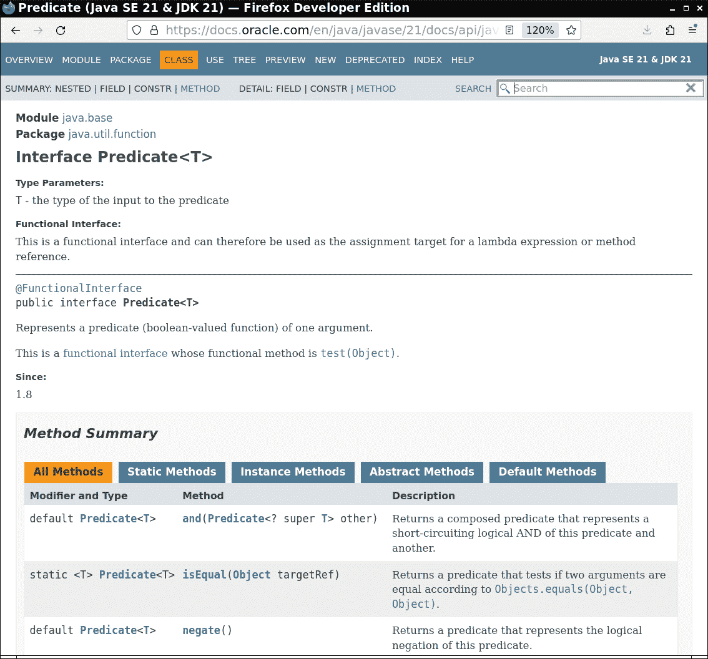

图 11.1：文档化注解

`@Inherited`元注解仅适用于类的注解。当一个类具有继承注解时，它的所有子类都自动拥有相同的注解。这使得创建类似于标记接口（如`Serializable`接口）的注解变得简单。

假设定义了一个继承注解`@Persistent`，表示类的对象可以保存到数据库中。那么持久化类的子类会自动标记为持久化。

```java
@Inherited @interface Persistent { }

@Persistent class Employee { ... }
class Manager extends Employee { ... } // 也是 @Persistent
```

`@Repeatable`元注解允许多次应用同一个注解。例如，JUnit 的`@Tag`注解是可以重复的。如下：

```java
@Tag("localized")
@Tag("showstopper")
void testHello() { ... }
```

出于历史原因，重复注解的实现者需要提供一个“容器注解”，将重复的注解存储在数组中。

以下是定义`@Tag`注解及其容器的方法：

```java
@Repeatable(Tag.class)
@interface Tag
{
   String value();
}

@interface Tags
{
   Tag[] value();
}
```

当用户提供两个或多个`@Tag`注解时，它们会被自动封装进`@Tags`注解中。这增加了处理注解的复杂性，正如你将在下一节中看到的。

## 11.4 在运行时处理注解

到目前为止，你已经了解了如何向源文件添加注解，以及如何定义注解类型。现在是时候看看这些操作能产生什么成果了。

在本节中，我将为你展示一个简单的示例，使用你已经在第 4 节中见过的反射 API 在运行时处理注解。假设我们想减少实现`toString`方法的繁琐工作。当然，人们可以使用反射编写一个通用的`toString`方法，简单地包含所有实例变量的名称和值。但是，假设我们想自定义这个过程。我们可能不想包含所有的实例变量，或者可能想跳过类名和变量名。例如，对于`Point`类，我们可能更倾向于输出`[5,10]`而不是`Point[x=5,y=10]`。当然，任何数量的其他增强都是可能的，但让我们保持简单。重点是演示注解处理器可以做什么。

使用`@ToString`注解标记所有希望从此服务受益的类。此外，所有应该包含的实例变量也需要被注解。该注解定义如下：

```java
@Target({ElementType.FIELD, ElementType.TYPE})
@Retention(RetentionPolicy.RUNTIME)
public @interface ToString {
    boolean includeName() default true;    
}
```

以下是带注解的`Point`和`Rectangle`类：

```java
@ToString(includeName=false)
public class Point {
    @ToString(includeName=false) private int x;
    @ToString(includeName=false) private int y;
    ...
}

@ToString
public record Rectangle(
   @ToString(includeName=false) Point topLeft,
   @ToString int width,
   @ToString int height) {
}
```

意图是让矩形表示为字符串`Rectangle[[5, 10],width=20,height=30]`。

在运行时，我们无法修改给定类`toString`方法的实现。相反，让我们提供一个可以格式化任何对象的方法，如果存在`ToString`注解则发现并使用它们。

关键是`AnnotatedElement`接口中的方法：

```java
T getAnnotation(Class<T>)
T getDeclaredAnnotation(Class<T>)
T[] getAnnotationsByType(Class<T>)
T[] getDeclaredAnnotationsByType(Class<T>)    
Annotation[] getAnnotations()
Annotation[] getDeclaredAnnotations()
boolean isAnnotationPresent(Class<? extends Annotation> annotationClass)
```

反射类`Class`、`Field`、`Parameter`、`Method`、`Constructor`和`Package`都实现了该接口。

与其他反射方法一样，名称带有`Declared`的方法产生类本身的注解，而其他方法则包含继承的注解。在注解的上下文中，这意味着该注解是`@Inherited`并且应用于超类的。

如果一个注解不是可重复的，调用`getAnnotation`来定位它。例如：

```java
Class<?> cl = obj.getClass();
ToString ts = cl.getAnnotation(ToString.class);
if (ts != null && ts.includeName()) ...
```

注意，你传递的是注解的类对象（这里是`ToString.class`），你返回的是某个实现了`ToString`接口的代理类对象。然后你可以调用接口方法来获取注解元素的值。如果注解不存在，`getAnnotation`方法返回`null`。

如果注解是重复的，情况就会变得有点复杂。如果你调用`getAnnotation`来查找可重复注解，而该注解实际上是重复的，那么你也会得到`null`。这是因为重复的注解被封装在容器注解内部。

在这种情况下，你应该调用`getAnnotationsByType`。该调用会“透视”容器并给你一个包含重复注解的数组。如果只有一个注解，你将得到一个长度为 1 的数组。通过这种方法，你不需要担心容器注解的问题。

`getAnnotations`方法获取与项目被标记的所有注解（无论什么类型），其中重复的注解被封装在容器中。

以下是感知注解的`toString`方法的实现：

```java
public class ToStrings {
    public static String toString(Object obj) {
        if (obj == null) return "null";
        Class<?> cl = obj.getClass();
        ToString ts = cl.getAnnotation(ToString.class);
        if (ts == null) return obj.toString();
        var result = new StringBuilder();
        if (ts.includeName()) result.append(cl.getName());
        result.append("[");
        boolean first = true;
        for (Field f : cl.getDeclaredFields()) {
            ts = f.getAnnotation(ToString.class);
            if (ts != null) {
                if (first) first = false; else result.append(",");
                f.setAccessible(true);

                if (ts.includeName()) {
                    result.append(f.getName());
                    result.append("=");
                }
                try {
                    result.append(ToStrings.toString(f.get(obj)));
                } catch (ReflectiveOperationException ex) {
                    ex.printStackTrace();
                }
            }
        }
        result.append("]");
        return result.toString();
    }
}
```

当一个类被注解为`ToString`时，该方法遍历其字段并打印那些也被注解的字段。如果`includeName`元素为`true`，则类名或字段名将包含在字符串中。

注意该方法会递归调用自己。当对象属于一个没有注解的类时，将使用其普通的`toString`方法并且递归停止。

这是运行时注解 API 的一个简单但典型的用法。使用反射查找类、字段等；在可能带有注解的元素上调用`getAnnotation`或`getAnnotationsByType`来检索注解；然后调用注解接口的方法来获取元素值。

## 11.5 源码级注解处理

在上一节中，你了解了如何分析运行程序中的注解。注解的另一个用途是对源文件进行自动处理，以产生更多的源代码、配置文件、脚本或其他任何可能想要生成的内容。

为了向你展示机制，我将重复生成`toString`方法的示例。但这一次，我们在 Java 源码中生成它们。这样这些方法将与程序的其余部分一起编译，并以全速度运行，而不是使用反射。

### 11.5.1 注解处理器

注解处理集成在 Java 编译器中。在编译期间，你可以通过运行以下命令调用注解处理器：

```bash
javac -processor ProcessorClassName1,ProcessorClassName2,... sourceFiles
```

编译器定位源文件的注解。每个注解处理器按顺序执行，并获得它感兴趣的注解。如果注解处理器创建了新的源文件，则重复该过程。一旦一轮处理没有产生更多的源文件，所有源文件将被编译。

注解处理器只能生成新的源文件。它不能修改现有的源文件。

注解处理器实现`Processor`接口，通常通过扩展`AbstractProcessor`类。你需要指定你的处理器支持哪些注解。在我们的案例中：

```java
@SupportedAnnotationTypes("com.horstmann.annotations.ToString")
@SupportedSourceVersion(SourceVersion.RELEASE_8)
public class ToStringAnnotationProcessor extends AbstractProcessor {
    public boolean process(Set<? extends TypeElement> annotations,
            RoundEnvironment currentRound) {
        ...
    }
}
```

处理器可以声称特定的注解类型、通配符如`"com.horstmann.*"`（`com.horstmann`包或任何子包中的所有注解），甚至是`"*"`（所有注解）。

`process`方法在每一轮次中会被调用一次，其参数是该轮次期间在任何文件中找到的所有注解集合，以及一个包含当前处理轮次信息的`RoundEnvironment`引用。

### 11.5.2 语言模型 API（The Language Model API）

你使用`language model` API 来分析源码级注解。与反射 API 不同（反射 API 提供的是类和方法的虚拟机表示），`language model` API 允许你根据 Java 语言的规则来分析 Java 程序。

编译器会生成一棵树，其节点是实现了`javax.lang.model.element.Element`接口及其子接口`TypeElement`、`VariableElement`、`ExecutableElement`等类的实例。这些是`Class`、`Field`/`Parameter`、`Method`/`Constructor`反射类在编译时的对应物。

我不想详细介绍该 API，但这里有你在处理注解时需要了解的重点。

- `RoundEnvironment`通过调用以下方法之一，为你提供被特定注解标记的元素集合：


```
Set<? extends Element> getElementsAnnotatedWith(Class<? extends Annotation> a)
Set<? extends Element> getElementsAnnotatedWithAny(
    Set<Class<? extends Annotation>> annotations)
```

第二个方法适用于重复注解。

* `AnnotatedElement` 接口的源码级等价物是 `AnnotatedConstruct`。你使用以下方法：

  ```
  A getAnnotation(Class<A> annotationType)
  A[] getAnnotationsByType(Class<A> annotationType)
  ```

  来获取给定注解类的某个注解或重复注解。

* `TypeElement` 代表一个类或接口。`getEnclosedElements` 方法产生其字段和方法的列表。

* 在 `Element` 上调用 `getSimpleName` 或在 `TypeElement` 上调用 `getQualifiedName` 会产生一个 `Name` 对象，该对象可以通过 `toString` 转换为字符串。

### 11.5.3 使用注解生成源代码（Using Annotations to Generate Source Code）

让我们回到自动生成 `toString` 方法的任务。我们不能将这些方法放入原始类中——注解处理器只能产生新类，不能修改现有的类。

因此，我们将所有方法添加到一个工具类 `ToStrings` 中：

```java
public class ToStrings {
    public static String toString(Point obj) {
        Generated code
    }
    public static String toString(Rectangle obj) {
        Generated code
    }
    ...
    public static String toString(Object obj) {
        return Objects.toString(obj);
    }
}
```

由于我们不想使用反射，因此我们注解访问器方法而不是字段：

```java
@ToString
public class Rectangle {
    ...
    @ToString(includeName=false) public Point getTopLeft() { return topLeft; }
    @ToString public int getWidth() { return width; }
    @ToString public int getHeight() { return height; }
}
```

注解处理器随后应该生成以下源代码：

```java
public static String toString(Rectangle obj) {
    var result = new StringBuilder();
    result.append("Rectangle");
    result.append("[");
    result.append(toString(obj.getTopLeft()));
    result.append(",");
    result.append("width=");
    result.append(toString(obj.getWidth()));
    result.append(",");
    result.append("height=");
    result.append(toString(obj.getHeight()));
    result.append("]");
    return result.toString();
}
```

“样板”代码部分是灰色的。以下是为具有给定 `TypeElement` 的类生成 `toString` 方法的方法大纲：

```java
private void writeToStringMethod(PrintWriter out, TypeElement te) {
    String className = te.getQualifiedName().toString();
    // 打印 string builder 的头部和声明
    ToString ann = te.getAnnotation(ToString.class);
    if (ann.includeName()) // 输出添加类名的代码
    for (Element c : te.getEnclosedElements()) {
        ann = c.getAnnotation(ToString.class);
        if (ann != null) {
            if (ann.includeName()) // 输出添加字段名的代码
            // 打印追加 toString(obj.methodName()) 的代码
        }
    }
    // 打印返回字符串的代码
}
```

这里是注解处理器 `process` 方法的大纲。它为辅助类创建一个源文件，并为每个被注解的类写入类头部和一个方法。

```java
public boolean process(Set<? extends TypeElement> annotations,
        RoundEnvironment currentRound) {
    if (annotations.size() == 0) return true;
    try {
        JavaFileObject sourceFile = processingEnv.getFiler().createSourceFile(
            "com.horstmann.annotations.ToStrings");
        try (var out = new PrintWriter(sourceFile.openWriter())) {
            // 输出包和类的代码
            for (Element e : currentRound.getElementsAnnotatedWith(ToString.class)) {
                if (e instanceof TypeElement te) {
                    writeToStringMethod(out, te);
                }
            }
            // 输出 toString(Object) 的代码
        }
    } catch (IOException ex) {
        processingEnv.getMessager().printMessage(Kind.ERROR, ex.getMessage());
    }
    return true;
}
```

对于细节，请检查书中的配套代码。

`process` 方法注意到在随后的轮次中调用时注解列表为空。它随后立即返回，因此不会重复创建源文件。要查看轮次，请带有 `-XprintRounds` 参数运行 `javac` 命令：

```
Round 1:
  input files: {ch11.sec05.Point,ch11.sec05.Rectangle,ch11.sec05.SourceAnnotationDemo}
  annotations: [com.horstmann.annotations.ToString]
  last round: false
Round 2:
  input files: {com.horstmann.annotations.ToStrings}
  annotations: []
  last round: false
Round 3:
  input files: {}
  annotations: []
  last round: true
```

这个示例演示了工具如何收集源文件注解以产生其他文件。生成的文件并不一定是源文件。

你现在已经了解了如何在源文件和运行程序中处理注解。第三种可能性是在类文件中处理注解，通常在将其加载到虚拟机时进行。你需要诸如 ASM（`http://asm.ow2.org`）的工具来定位和评估注解，并重写字节码。

## 练习题

1. 如何修改 `Object.clone` 以使用 `@Cloneable` 注解而不是 `Cloneable` 标记接口。

2. 如果注解在 Java 早期版本中存在，那么 `Serializable` 接口无疑是一个注解。实现一个 `@Serializable` 注解。选择一种文本或二进制格式用于持久。提供流或读写类，通过保存和恢复所有原始值或自身可序列化的字段来持久对象的状态。现在不要担心循环引用。

3. 在你的序列化机制中添加一个 `@Transient` 注解，其作用类似于 `transient` 修饰符。

4. 定义一个注解 `@Todo`，包含需要完成的任务的消息。定义一个注解处理器，从源文件生成提醒列表。包含被注解项的描述和 todo 消息。

6. 将上一个练习的注解转换为重复注解。

7. 如果 Java 早期版本中存在注解，它们可能会承担 JavaDoc 的角色。定义如 `@Param`、`@Return` 等注解，并使用注解处理器从它们生成基础 HTML 文档。

8. 实现 `@TestCase` 注解，生成一个源文件，其文件名为该注解所在的类名，并在后面加上 `Test`。例如，如果 `MyMath.java` 包含：

```java
@TestCase(args="4", expected="24")
@TestCase(args="0", expected="1")
public static long factorial(int n) { ... }
```

则生成一个文件 `MyMathTest.java`，其中包含以下语句：

```java
assert(MyMath.factorial(4) == 24);
assert(MyMath.factorial(0) == 1);
```

你可以假设测试方法是静态的，且 `args` 包含一个正确类型的逗号分隔的参数列表。

9. 将 `@TestCase` 注解实现为运行时注解，并提供一个检查它的工具。同样，假设测试方法是静态的，并限制在注解元素中可以用字符串描述的合理参数和返回类型范围内。

00. 为 `@Resource` 注解实现一个处理器，它接受某个类的对象，并寻找带有 `@Resource(name="URL")` 标记的 `String` 类型字段。然后使用反射加载 URL 并将其内容“注入”到字符串变量。

# 第 12 章 ▪ Java 平台模块系统

面向对象编程的一个重要特性是封装。一个类的声明由一个公共接口和一个私有实现组成。类可以通过更改实现来演进，而不会影响其用户。模块系统为大规模编程提供了同样的优势。模块可以选择性地使类和包变得可用，从而控制其演进。

现有的几个 Java 模块系统依赖于类加载器来隔离类。然而，Java 9 引入了一个新系统，称为 Java 平台模块系统（Java Platform Module System），它由 Java 编译器和虚拟机支持，旨在将 Java 平台的庞代码库模块化。如果你愿意，可以使用该系统将自己的应用程序模块化。

无论你在自己的应用程序中使用未使用 Java 平台模块，都可能受到模块化 Java 平台的影响。本章将向你展示如何声明和使用 Java 平台模块。你还将学习如何迁移应用程序以与模块化的 Java 平台以及第三方模块协作。

本章的要点是：

1. Java 平台模块系统旨在将 Java 平台模块化。
2. 你可以使用 Java 平台模块系统将应用程序和库模块化。
3. 模块是包的集合。
4. 模块的属性定义在 `module-info.java` 中。
5. 模块声明它依赖哪些其他模块。
6. 模块提供了封装。可访问的包必须显式导出（`export`）。
7. 模块可以通过打开包或整个模块允许对私有特性进行反射访问。
8. 模块系统提供了 `ServiceLoader` 的支持。
9. 模块化 JAR 是一个包含 `module-info.class` 文件并放在模块路径上的 JAR。
10. 通过将普通 JAR 放在模块路径上，它将变成一个自动模块，导出并打开其所有包。
11. 类路径上的所有包形成未命名模块（unnamed module）。
12. 为了迁移现有应用程序，你可能需要使用命令行选项覆盖访问限制。
13. `jdeps` 工具分析给定 JAR 文件的依赖关系。`jlink` 工具生成具有最少依赖的应用程序。

## 12.1 模块概念

在面向对象编程中，基本的构建块是类。类提供了封装。私有特性只能通过具有显式权限的代码访问，即类的方法。这使得推断访问变得可能。如果一个私有变量发生了变化，你可以列出所有可能的“罪魁祸首”。如果你需要修改私有表示，你知道哪些方法受了影响。

在 Java 中，包（package）提供了更大的组织分组。包是类的集合。包也提供了一层封装。任何具有包访问级访问权限（既不是公共不是私有）的特性只能从同一包中的方法访问。

然而，在大型系统中，这种程度的访问控制是不够的。任何公共特性（即可以在包之外访问的特性）在任何地方都可以访问。假设你想修改或删除一个很少使用的特性。一旦它是公共的，就没有办法可以推断该更改产生的影响。

这就是 Java 平台设计者所面临的情况。二十多年来，JDK 飞速增长，但显然某些特性本质上已经过时了。大家最喜欢的例子是 CORBA。你上一次使用它是什么时候？然而，`org.omg.corba` 包随每个 JDK 一起发布。事实上，将所有 CORBA 放入一个 JAR 文件中以供少数仍需要它的人使用并不困难。

那么 `java.awt` 呢？它在服务端应用程序中不应该是被需要的，对吧？除非 `java.awt.DataFlavor` 类在 SOAP（一种基于 XML 的 Web 服务协议）的实现中使用了。

Java 平台设计者面对巨大的代码团，决定他们需要一种提供更多控制的结构化机制。他们查看了现有的模块系统（如 OSGi），发现它们不适合他们的问题。相反，他们设计了一个新系统，称为 Java 平台模块系统，它现在是 Java 语言和虚拟机的一部分。该系统已成功用于将 Java API 模块化，如果你愿意，可以将它应用于自己的应用程序。

一个 Java 平台模块由：

* 包的集合
* 可选的资源文件和其他文件（如原生库）
* 可访问包的列表
* 模块依赖的所有模块列表

Java 平台在编译时间和虚拟机中强制封装和依赖。

为什么你应该考虑使用模块系统编写自己的程序，而不是遵循在类路径使用 JAR 文件的传统方法？有两个：

1. 强封装：你可以控制哪些包是可访问的，而不必担心维护你不打算供公开的代码。
2. 可靠的配置：避免了常见的类路径问题，如类重复或缺失。

有一些 Java 平台模块系统没有解决的问题，例如模块的版本控制。不支持指定所需的模块版本，也不支持在同一个程序中使用多个版本的模块。这些可能是理想的特性，但如果你需要它们，必须使用模块系统以外的机制。

## 12.2 模块命名

模块是包的集合。模块中的包名不需要相关。例如，`java.sql` 模块包含 `java.sql`、`javax.sql` 和 `javax.transaction.xa` 包。此外，正如从这个例子所示，模块名与包名相同完全是可以的。

就像包名一样，模块名由字母、数字、下划线和点组成。同样，就像包名，模块之间没有层级关系。如果你有一个 `com.horstmann` 模块和另一个 `com.horstmann.corejava` 模块，从模块系统的角度来看它们是无关的。

在创建一个供他人使用的模块时，确保其名称在全局范围内唯一是非常重要的。预计大多数模块名称将遵循“反向域名”约定，就像包名一样。

最简单的方法是以该模块提供的顶层包来命名模块。例如，SLF4J 日志外接口有一个名为 `org.slf4j` 的模块，其中包含 `org.slf4j`、`org.slf4j.spi`、`org.slf4j.event` 和 `org.slf4j.helpers` 等包。

这种约定可以防止模块之间的包名冲突。任何给定的包只能存放在一个模块中。如果你的模块名称是唯一的，且你的包名以模块名开头，那么你的包名也将是唯一的。

对于不打算供其他程序员使用的模块（例如包含应用程序的模块），你可以使用较短的模块名称。为了说明这种做法是可行的，我将在本章中这样做。可能是库代码的模块将具有如 `com.horstmann.util` 类的名称，而包含程序（带有 `main` 方法的类）的模块将具有如 `ch12.sec03` 这样易记的名称。

你只在模块声明中使用模块名。在你的 Java 类的源文件中，你永远不会引用模块名。相反，你像往常一样使用包名。

## 12.3 模块化的“Hello, World!”程序

让我们把传统的“Hello, World!”程序放入一个模块中。首先，我们需要将类放入一个包中——“未命名包”不能包含在模块中。这里是代码：

```java
package com.horstmann.hello;

public class HelloWorld {
    public static void main(String[] args) {
        System.out.println("Hello, Modular World!");
    }
}
```


到目前为止，什么都没有改变。要创建一个包含该包的`ch12.sec03`模块，你需要添加一个模块声明。你将其放在一个名为`module-info.java`的文件中，位于根目录下（即包含`com`目录的相同目录）。根据约定，根目录的名称与模块名称相同。

```
ch12.sec03/
└ module-info.java
  com/
  └ horstmann/
    └ hello/
      └ HelloWorld.java 
```

`module-info.java`文件包含了模块声明：

```
module ch12.sec03 {
}
```

这个模块声明是空的，因为该模块没有向任何人提供任何东西，也不需要任何东西。

现在像平时一样编译：

```
javac ch12.sec03/module-info.java ch12.sec03/com/horstmann/hello/HelloWorld.java
```

`module-info.java`文件看起来不像 Java 源文件，而且当然它不可能有一个名为`module-info`的类，因为类名不能包含连字符。`module`关键字，以及你将在后续章节中看到的`requires`、`exports`等关键字，都是“受限关键字”，它们仅在模块声明中具有特殊含义。该文件被编译成一个类文件`module-info.class`，其中以二进制形式包含了模块定义。

要作为模块化应用程序来运行此程序，你需要指定模块路径（module path），它类似于类路径（class path），但它包含了模块。你还以`modulename`/`classname`的格式指定主类：

```
java --module-path ch12.sec03 --module ch12.sec03/com.horstmann.hello.HelloWorld
```

你可以使用单字母选项`-p`和`-m`来代替`--module-path`和`--module`：

```
java -p ch12.sec03 -m ch12.sec03/com.horstmann.hello.HelloWorld
```

无论哪种方式，都会出现`"Hello, Modular World!"`问候，证明你已成功地模块化你的第一个应用程序。

当你编译此模块时，会得到两个警告：

```
warning: [module] module name component sec03 should avoid terminal digits
warning: [module] module name component ch12 should avoid terminal digits
```

这些警告旨在劝阻程序员在模块名称中添加版本号。你可以忽略它们，或者使用注解来抑制它们：

```java
@SuppressWarnings("module")
module ch12.sec03 {
}
```

在这一点上，`module`声明与类声明一样：你可以对它进行注解。（注解类型的目标必须是`ElementType.MODULE`。）

## 12.4. 需要模块

让我们创建一个新模块`ch12.sec04`，在其中程序使用`JOptionPane`来显示“Hello, Modular World!”消息：

```java
package com.horstmann.hello;

import javax.swing.JOptionPane;

public class HelloWorld {
    public static void main(String[] args) {
        JOptionPane.showMessageDialog(null, "Hello, Modular World!");
    }
}
```

现在编译失败，并显示此消息：

```
error: package javax.swing is not visible
  (package javax.swing is declared in module java.desktop,
    but module ch12.sec04 does not read it)
```

JDK 已经模块化，`javax.swing`包现在包含在`java.desktop`模块中。我们的模块需要声明它依赖于它：

```java
module ch12.sec04 {
    requires java.desktop;
}
```

在前一节中，并没有出现显式需求，因为我们只使用了`java.lang`包。该包包含在`java.base`模块中，而该模块是默认需要的。注意，我们的`ch12.sec04`模块只列出了模块需求。它需要`java.desktop`模块以便于使用`javax.swing`包。`java.desktop`模块本身声明它需要三个模块，即`java.datatransfer`、`java.prefs`和`java.xml`。

模块图显示节点是模块。图的边（即连接节点的箭头）要么是声明的需求，要么在没有声明需求时是`java.base`的隐式需求。

模块图中不能有循环。也就是说，一个模块不能直接或间接地引用它自己。

模块不会自动将访问权限传递给其他模块。在我们的示例中，`java.desktop`模块声明它需要`java.prefs`，而`java.prefs`模块声明它需要`java.xml`。这并没有赋予`java.desktop`使用`java.xml`模块包的权利。它需要显式地声明该需求。从数学术语来说，`requires`关系不是“传递性的”。通常这种行为是理想的，因为它使需求变得显式，但正如你在第 12.11 节中看到的，在某些情况下你可以放松它。

在本节开始的错误消息显示我们的`ch12.sec04`模块没有“读取”`java.desktop`模块。在 Java 模块系统的术中，模块`M`在以下情况下*读取*模块`N`：

1. `M`需要`N`。
2. `M`需要一个传递需要`N`的模块。
3. `N`是`M`或`java.base`。

## 12.5. 包

在前一节中，你看到模块想要使用另一个模块的包，必须需要该模块。然而，这并不会让所需模块中的所有包可用。模块使用`exports`关键字声明哪些包是可访问的。例如，这里是`java.xml`模块声明的一部分：

```java
module java.xml {
    exports javax.xml;
    exports javax.xml.catalog;
    exports javax.xml.datatype;
    exports javax.xml.namespace;
    exports javax.xml.parsers;
    ...
}
```

该模块开放了许多包，但通过不导出它们隐藏了其他包（如`jdk.xml.internal`）。

当一个包被导出时，它的`public`和`protected`类和接口，以及它们的`public`和`protected`成员在模块外部是可的。（与既往一样，`protected`类型和成员仅在子类和同一个包中可访问。）

然而，未导出的包在其自己的模块外部是不可见的。这与模块化之前的 Java 有很大不同。在过去，你可以使用任何包中的公共类，即使它不是公共 API 的一部分。例如，当公共 API 未提供适当的功能时，通常建议使用`sun.misc.BASE64Encoder`或`com.sun.rowset.CachedRowSetImpl`等类。

如今，你无法再访问 Java 平台 API 中未导出的包，因为它们都包含在模块内部。结果是某些程序将无法在现代 Java 版本上运行。当然，没有人承诺过保持非公开 API 的可用，所以这不应该让你感到意外。

让我们在一个简单的场景中使用导出（exports）功能。我们将准备一个名为`com.horstmann.greet`的模块，它导出一个也叫`com.horstmann.greet`的包，遵循这一约定：为他人提供代码的模块应以其内部的顶层包命名。还有一个名为`com.horstmann.greet.internal`的包，我们没有导出它。

第一个包中有一个公共的`Greeter`接口。

```
package com.horstmann.greet;

public interface Greeter {
    static Greeter newInstance() {
        return new com.horstmann.greet.internal.GreeterImpl();
    }

    String greet(String subject);
}
```

第二个包中有一个实现接口的类。由于该类在第一个包中被访问，它是公的。

```java
package com.horstmann.greet.internal;

import com.horstmann.greet.Greeter;

public class GreeterImpl implements Greeter {
    public String greet(String subject) {
        return "Hello, " + subject + "!";
    }
}
```

`com.horstmann.greet`模块包含了两个包，但只导出第一个：

```
module com.horstmann.greet {
    exports com.horstmann.greet;
}
```

第二个包在模块外部是不可访问的。

我们将应用程序放入第二个模块中，它将需要第一个模块：

```
module ch12.sec05 {
    requires com.horstmann.greet;
}
```

`exports`语句后面跟着一个包名，而`requires`后面跟着一个模块名。

我们的应用程序现在使用`Greeter`来获取问候：

```java
package com.horstmann.hello;

import com.horstmann.greet.Greeter;

public class HelloWorld {
    public static void main(String[] args) {
        Greeter greeter = Greeter.newInstance();
        System.out.println(greeter.greet("Modular World"));
    }
}
```

这是这两个模块的源文件结构：

```
com.horstmann.greet
├ module-info.java
└ com
  └ horstmann
    └ greet
      ├ Greeter.java
      └ internal
        └ GreeterImpl.java
ch12.sec05
├ module-info.java
└ com
  └ horstmann
    └ hello
      └ HelloWorld.java
```

要构建此应用程序，首先编译`com.horstmann.greet`模块：

```
javac com.horstmann.greet/module-info.java \
    com.horstmann.greet/com/horstmann/greet/Greeter.java \
    com.horstmann.greet/com/horstmann/greet/internal/GreeterImpl.java
```

然后，将第一个模块放在模块路径上，编译应用程序模块：

```
javac -p com.horstmann.greet ch12.sec05/module-info.java \
    ch12.sec05/com/horstmann/hello/HelloWorld.java
```

最后，将两个模块都放在模块路径上并运行程序：

```
java -p ch12.sec05:com.horstmann.greet \
    -m ch12.sec05/com.horstmann.hello.HelloWorld
```

这个示例演示了如何在模块中隐藏实现。实现类在模块外部是不可访问的。客户端使用接口和工厂方法，而不是实例化实现类。

在 Windows 的`cmd`终端中，你必须将`ch12.sec05:com.horstmann.greet`括在引号内，因为冒号字符具有特殊含义。你还需要使用`^`代替`\`来进行多行命令。

你现在已经看到了构成 Java 平台模块系统骨干的`requires`和`exports`语句。如你所见，模块系统在概念上是简单的。模块指定了它们需要的哪些模块，以及它们向其他模块提供哪些包。第 12.12 节显示了`exports`语句的一种细微变化。

模块并不提供作用域。你不能在不同的模块中拥有同名的包。即使对于隐藏包（即未被导出的包）也是如此。

## 12.6. 模块与反射式访问

在前一节中，你看到模块系统强制执行封装。模块只能访问来自另一个模块的显式导出的包。在过去，总是可以通过反射来克服烦人的访问限制。正如你在 4 章中看到的，反射可以访问私有成员。

然而，在模块化世界中，情况不再如此。如果一个类位于模块内部，`setAccessible(true)`将失败。具体来说，回想我们是如何访问私有字段的：

```
Field f = obj.getClass().getDeclaredField("salary");
f.setAccessible(true);
double value = f.getDouble(obj);
```

除非安全管理器允许，否则`f.setAccessible(true)`调用是成功的。然而，通常不会带安全管理器运行 Java 程序，而且许多库使用了反射。典型的例子是自动持久对象的 JPA。为了演示这个问题，我将使用 JSON-B 的实现。这是一个演示该机制的简单类：

```java
package com.horstmann.places;

public class Country {
    public Country() {}

    public Country(String name, double area) {
        this.name = name;
        this.area = area;
    }
    // ...
}
```

这是一个演示如何将对象转换为 JSON 的短程序：

```java
package com.horstmann.places;

import jakarta.json.bind.*;
import jakarta.json.bind.config.*;
import java.lang.reflect.*;

public class Demo {
    public static void main(String[] args) throws JAXBException {
        var belgium = new Country("Belgium", 30510);

        var config = new JsonbConfig()
            .withPropertyVisibilityStrategy(
                new PropertyVisibilityStrategy() {
                    public boolean isVisible(Field field) { return true; }
                    public boolean isVisible(Method method) { return false; }
                });
        Jsonb jsonb = JsonbBuilder.create(config);
        String json = jsonb.toJson(belgium);
        System.out.println(json);
    }
}
```

当你运行程序时，它输出：

```
{"area":30510.0,"name":"Belgium"}
```

如你所见，程序员不需要任何操作来实现这一切。通过反射，JSON-B 库确定了字段的名字和值。

现在将`Country`和`Demo`类放入模块中。当你这样做时，`Demo`程序将异常异常：

```
Exception in thread "main" java.lang.reflect.InaccessibleObjectException:
    Unable to make field
private java.lang.String com.horstmann.places.Country.name accessible:
module v2ch09.openpkg2 does not "opens com.horstmann.places"
    to module org.eclipse.yasson
```

当然，在纯粹理论上，违反封装并窥探对象的私有成员是错误的。但诸如 XML 绑定或对象关系映射等机制非常常见，模块系统必须适应它们。

使用`opens`关键字，模块可以`open`一个包，这使得能够对给定包中的所有类实例进行反射访问。以下是我们的模块需要做的：

```
module ch12.sec06 {
    requires jakarta.json.bind;
    opens com.horstmann.places;
}
```

通过此更改，JSON-B 将能够正常工作。

一个模块可以被声明为`open`，例如：


`open module ch12.sec06 {
    requires jakarta.json.bind;
}`

开放模块授予了其所有包的运行时访问权限，就好像所有包都已声明了 `exports` 和 `opens` 一样。然而，只有显式导出的包在编译时是可访问的。开放模块将模块系统的编译时安全性与经典的松散运行时行为结合在一起。

JAR 文件除了类文件和清单文件外，还可以包含 `file resources`，这些资源可以使用 `Class.getResourceAsStream` 方法加载，现在也可以通过 `Module.getResourceAsStream` 加载。如果资源存储在与模块中的包匹配的目录中，则该包必须对调用者开放。其他目录中的资源，以及类文件和清单文件，可以被任何人读取。

未来的库可能会使用 `variable handles` 而不是反射来读取和写入字段。`VarHandle`类似于`Field`。你可以使用它来读取或写入特定类的任何实例的特定字段。然而，为了获取 `VarHandle`，库代码需要一个 `Lookup` 对象：

```
public Object getFieldValue(Object obj, String fieldName, Lookup lookup)
        throws NoSuchFieldException, IllegalAccessException {
    Class<?> cl = obj.getClass();
    Field field = cl.getDeclaredField(fieldName);
    VarHandle handle = MethodHandles.privateLookupIn​(cl, lookup)
        .unreflectVarHandle(field);
    return handle.get(obj);
}
```

只要 `Lookup` 对象是在具有访问字段权限的模块中生成的，这种方法就是有效的。模块中的某些方法只需调用 `MethodHandles.lookup()`，就会产生一个封装了调用者访问权的对象。通过这种方式，一个模块可以授予另一个模块访问私有成员的权限。实际的问题是如何以最小的麻烦赋予这些权限。

## 12.7. 模块化 JAR

到目前为止，我们只是简单地将模块编译到源码目录树中。显然，这对于部署是不够的。相反，可以通过将所有类放在一个 JAR 文件中来部署模块，并在根目录下包含一个 `module-info.class`。这样的 JAR 文件被称为 `modular`（模块化）JAR。

要创建一个模块化 JAR 文件，你可以像通常一样使用 `jar` 工具。如果你有多个包，最好使用 `-d` 选项进行编译，这会将类文件存于单独的目录中。如果目录不存在，则会创建。然后使用 `jar` 命令的 `-C` 选项在收集文件时切换到该目录。

```
javac -d modules/com.horstmann.greet \
    com.horstmann.greet/module-info.java \
    com.horstmann.greet/com/horstmann/greet/internal/GreeterImpl.java \
    com.horstmann.greet/com/horstmann/greet/Greeter.java
jar -cvf com.horstmann.greet.jar -C modules/com.horstmann.greet .
```

如果你使用 `Maven`、`Ant` 或 `Gradle` 等构建工具，只需像往常一样构建你的 JAR 文件即可。只要包含了 `module-info.class`，你就能获得模块化 JAR。

然后你可以将模块化 JAR 包含在模块路径（module path）中，模块将被加载。

在过去，一个包的类有时分布在多个 JAR 文件中。（这种包被称为“拆分包”）。这可能从来不是一个好主意，而且在模块系统中是不可能实现的。

与普通 JAR 文件一样，你可以在模块化 JAR 中指定一个主类：

```
javac -p com.horstmann.greet.jar -d modules/ch12.sec05 \
    ch12.sec05/module-info.java \
    ch12.sec05/com/horstmann/hello/HelloWorld.java
jar -c -v -f ch12.sec05.jar -e com.horstmann.hello.HelloWorld -C modules/ch12.sec05 .
```

当启动程序时，你需要指定包含主类的模块：

```
java -p com.horstmann.greet.jar:ch12.sec05.jar -m ch12.sec05
```

在创建 JAR 文件时，你可以可选地指定版本号。使用 `--module-version` 参数并将版本号用于 JAR 文件名：

```
jar -c -v -f com.horstmann.greet-1.0.jar --module-version 1.0 -C com.horstmann.greet .
```

正如已经讨论过的，Java 平台模块系统并并不使用版本号来解析模块，但它可以被其他工具和框架查询。

你可以通过反射 API 获取版本号。在我们的示例中：

```
Optional<String> version
    = Greeter.class.getModule().getDescriptor().rawVersion();
```

将产生一个包含版本字符串 `"1.0"` 的 `Optional`。

对应于类加载器的模块是 `layer`（层）。Java 平台模块系统将 JDK 模块和应用模块加载到 `boot layer`（启动层）中。程序可以使用 layer API（本书未涵盖）加载其他模块。预计 Java EE 服务器的开发者可以使用层 API。如果你想将模块加载到 JShell，请将其放在模块路径并使用 `--add-modules` 选项：

```
jshell --module-path com.horstmann
    --add-modules comhorstmann
```

## 12.8. 自动模块

你现在知道如何使用 Java 平台模块系统了。如果你从一个编写所有代码的新项目开始，你可以设计模块、声明模块依赖并将应用程序打包成模块化 JAR 文件。

然而，这是一种极少见的场景。几乎所有项目都依赖第三方库。当然，你可以等待库提供者将其转换为模块，然后再对自己的代码进行模块化。

但如果你不想等待呢？Java 平台模块系统提供了两种机制来跨越非模块世界与完全模块化应用之间的鸿沟：自动模块和未命名模块。

为了迁移目的，你只需将任何 JAR 文件放在模块路径而不是类路径，即可将其转换为模块。在模块路径上没有 `module-info.class` 的 JAR 文件被称为 `automatic module`（自动模块）。自动模块具有以下属性：

1. 该模块隐含包含对所有其他模块的 `requires` 子句。

2. 其所有包都被导出并开放。

3. 如果 JAR 文件的清单 `META-INF/MANIFEST.MF` 中存在键为 `Automatic-Module-Name` 的条目，则该值成为模块名称。

4. 否则，模块名称从 JAR 文件名获取，删除任何末尾的版本号，并将非字母数字字符序列替换为点。

前两个规则意味着自动模块中的包表现就像它们在类路径上一样。使用模块路径的原因是为了其他模块的利益，允许它们对该模块表示依赖关系。

例如，假设你正在实现一个处理 CSV 文件的模块并使用了 Apache Commons CSV 库。你想在你的 `module-info.java` 文件中表示你的模块依赖于 Apache Commons CSV。

如果你将 `commons-csv-1.9.0.jar` 添加到模块路径，那么你的模块就可以引用该模块。它的名称是 `commons.csv`，因为末尾的版本号 `-1.9.0` 被删除了，且非字母数字字符 `-` 被替换成了点。

这个名称可能是一个可以接受的模块名称，因为 Commons CSV 是广为人知的，不太可能有其他人尝试为不同的模块使用相同的名称。但如果该 JAR 文件的维护者能够快速同意预留一个反向 DNS 名称，最好将顶层包名 `org.apache.commons.csv` 作为模块名，这样会更好。他们只需要在 JAR 内部的 `META-INF/MANIFEST.MF` 文件中添加一行：

```
Automatic-Module-Name: org.apache.commons.csv
```

最终，希望他们能通过添加带有预留模块名称的 `module-info.java` 将 JAR 文件转换为真正的模块，这样所有其他通过该名称引用 CSV 模块的模块都将继续运行。

迁移到模块的计划是一个伟大的社会实验，没有人知道它是否会有一个好的结局。在你将第三方 JAR 放置到模块路径之前，请检查它们是否是模块化的；如果不是，再检查它们的清单文件（manifest）是否包含模块名称。如果没有，你仍然可以将 JAR 转换为自动模块，但要准备好以后更新模块名称。

## 12.9. 未命名模块 (The Unnamed Module)

任何不在模块路径上的类都是 `unnamed module` 的。从技术上讲，可能多个未命名模块，但它们共同作用的效果就像一个单一模块，被称为 `the unnamed module`。与自动模块一样，未命名模块可以访问所有其他模块，并且它的所有包都被导出（exported）和开放（opened）。

然而，任何 `explicit module`（显式模块）都无法访问未命名模块。（显式模块既不是自动模块也不是未命名模块——即在模块路径上带有 `module-info.class` 的模块。）换句话说，显式模块始终免受“类路径地狱”。

例如，假设你将 `commons-csv-1.9.0.jar` 放在类路径而不是模块路径上。那么上一节的示例程序将无法启动：

```
Error occurred during initialization of boot layer
java.lang.module.FindException: Module commons.csv not found, required by ch12.sec09
```

因此，迁移到 Java 平台模块系统必然是一个自底而上的过程：

1. Java 平台本身被模块化。

2. 接下来，库被模块化，方法是使用自动模块或将其转换为显式模块。

3. 一旦你的应用程序使用的库都已模块化，你就可以将你的应用程序代码转换为模块。

自动模块可以读取未命名模块，因此它们的依赖可以放在类路径上。

## 12.10. 迁移的命令行标记

即使你的程序没有使用模块，在运行 Java 9 及更高版本时，你也无法逃避模块化世界。即使应用程序代码位于未命名模块的类路径上，并且所有包都已导出和开放，它仍然与已模块化的 Java 平台交互。

从 Java 11 开始，编译时封装被严格执行。然而，在 Java 16 之前，允许运行时访问。默认行为是在每次违规行为第一次发生时在控制台上显示警告。从 Java 16 开始，运行时的反射访问也被强制执行。为了让你有时间准备应对变化，Java 9 到 16 的 `java` 启动器有一个 `--illegal-access` 标记，具有四种可能的设置：

1. `--illegal-access=permit` 是 Java 9 的默认行为，在第一次非法访问时打印消息。

2. `--illegal-access=warn` 在每次非法访问时打印消息。

3. `--illegal-access=debug` 在每次非法访问时打印消息和堆栈跟踪。

4. `--illegal-access=deny` 是 Java 16 的默认行为，拒绝所有非法访问。

从 Java 17 开始，`--illegal-access` 标记不再可用。

`--add-exports` 和 `--add-opens` 标记允许你调整旧留应用程序。考虑一个使用不再可访问的内部 API 的应用程序，例如 `com.sun.rowset.CachedRowSetImpl`。最好的补救措施是更改实现。（从 Java 7 开始，你可以从 `RowSetProvider` 获取缓存行集。）但假设你无法访问源代码。

在这种情况下，使用 `--add-exports` 标记启动应用程序。指定你想要导出的模块和包，以及你想要将该包导出到哪个模块（在我们的案例中，是未命名模块）。

```
java --illegal-access=deny --add-exports java.sql.rowset/com.sun.rowset=ALL_UNNAMED \
    -jar MyApp.jar
```

现在假设你的应用程序使用反射来访问私有字段或方法。未命名模块内部的反射是可以的，但不再能够通过反射访问 Java 平台类的非公共成员了。例如，某些动态生成 Java 类的库通过反射调用受保护的 `ClassLoader.defineClass` 方法。如果应用程序使用此类库，请添加标记：

```
--add-opens java.base/java.lang=ALL-UNNAMED
```

在为了让旧应用程序运行而添加所有这些命令行选项时，你最终可能会得到一个“来自地狱的命令行”。为了更好地管理大量选项，你可以将选项放在一个或多个文件中，并使用 `@` 前缀指定这些文件。例如：

```
java @options1 @options2 -jar MyProg.java
```

其中文件 `options1` 和 `options2` 包含 `java` 命令的选项。

选项文件有一些语法规则：

*   使用空格、制表符或换行符分隔选项。

*   对包含空格的参数使用双引号，例如 `"Program Files"`。

*   以 `\` 结尾的行与下一行合并。

*   反斜杠必须转义，例如 `C:\\Users\\Fred`。

*   注释行以 `#` 开头。

## 12.11. 传递性与静态需求

在之前的章节中，你已经看到了 `requires` 语句的基本形式。在本节中，你将看到两种偶尔有变体。

在某些情况下，对于给定模块的用户来说，声明所有所需的模块可能是麻烦的。例如 `java.desktop` 模块。它需要三个模块：`java.prefs`、`java.datatransfer` 和 `java.xml`。`java.prefs` 仅在内部使用。然而，来自 `java.datatransfer` 和 `java.xml` 的类出现在公共 API 中，方法如下：

```
java.awt.datatransfer.Clipboard java.awt.Toolkit.getSystemClipboard()
java.beans.XMLDecoder(org.xml.sax.InputSource is)
```

这不是 `java.desktop` 模块的用户应该需要考虑的事情。由于这个原因，`java.desktop` 模块使用 `transitive` 修饰符声明该需求：

```
module java.desktop
{
    requires java.prefs;
    requires transitive java.datatransfer;
    requires transitive java.xml;
    ...
}
```

任何声明对 `java.desktop` 有要求的模块现在都要求这两个模块。

一些程序员建议，当另一个模块中的包在公共 API 中时，应该始终使用 `requires transitive`。但这不是 Java 语言的规则。例如，`java.sql` 模块：

```
module java.sql {
    requires transitive java.logging;
    ...
}
```

在整个 `java.sql` API 中，只有一次使用了来自 `java.logging` 模块的包，即返回 `java.util.logging.Logger` 的 `java.sql.Driver.parentLogger` 方法。不将此模块需求声明为传递性也是完全可以的。那么那些模块——且仅那些实际使用该方法的——才需要声明它们需要 `java.logging`。

`requires transitive` 语句的一个非常有吸引力的用途是*聚合器*（aggregator）模块——即一个不包含包且只有传递性需求的模块。这样一个模块就是 `java.se` 模块，其声明如下：

```
module java.se {
    requires transitive java.compiler;
    requires transitive java.datatransfer;
    requires transitive java.desktop;
    ...
    requires transitive java.sql;
    requires transitive java.sql.rowset;
    requires transitive java.xml;
    requires transitive java.xml.crypto;
}
```

一个对细粒度模块依赖感兴趣的程序员可以简单地要求 `java.se` 并获取 Java SE 平台的所有模块。

最后，还有一种不常见的 `requires static` 变体，它声明模块在编译时必须存在但在运行时是可选的。它有两个用例：

1.  访问一个在编译时处理并声明在不同模块中的注解。

2.  如果可用，则使用另一个模块中的类，否则则执行其他操作，例如：

```
try {
    new oracle.jdbc.driver.OracleDriver();
    ...
} catch (NoClassDefFoundError er) {
    // 执行其他操作
}
```


## 12.12. 限定导出与打开 (Qualified Exporting and Opening)

在本节中，你将看到`exports`和`opens`语句的变体，将其范围缩小到指定的模块集合。例如，`java.base`模块包含如下语句：

```
exports sun.net to
  java.net.http,
  jdk.naming.dns;
```

这样的语句被称为**限定导出**（qualified export）。列出的模块可以访问导出的包，但其他模块不能。

过度使用限定导出可能表明模块结构不佳。尽管如此，在对现有代码库进行模块化时可能会出现这种情况。在这里，`sun.net`包被放置在`java.base`模块中，因为那里大部分需要。然而，其他几个模块也使用了该包。Java 平台设计者不想让`java.base`变得更大，也不想让内部的`sun.net`包全局可用。在绿地项目中，人们可以设计一个更具模块化的 API。

同样，你可以限制`opens`语句到特定的模块。例如，在第 12.6 节中，我们可以使用如下所示的限定`opens`语句：

```
module ch12.sec06 {
    requires jakarta.json.bind;
    opens com.horstmann.places to org.eclipse.yasson;
}
```

现在，`com.horstmann.places`包仅对`org.eclipse.yasson`模块开放。

诚然，将对特定持久化机制的依赖放在模块描述符中似乎相当脆弱。相反，你可以将所有需要持久化的类放在单独的包中并向所有模块打开该包，以便任何持久化机制都可以访问它。

## 12.13. 服务加载 (Service Loading)

`ServiceLoader`类提供了一种匹配服务接口与实现的轻量级机制。Java 平台模块系统使得使用这种机制变得更容易。

这里是对服务加载的快速回顾。服务有一个接口和一个或多个可能的实现。这是一个简单接口的示例：

```
public interface GreeterService {
    String greet(String subject);
    Locale getLocale();
}
```

一个或多个模块提供实现，例如：

```java
public class FrenchGreeter implements GreeterService {
    public String greet(String subject) { return "Bonjour " + subject; }
    public Locale getLocale() { return Locale.FRENCH; }
}
```

服务消费者必须根据其认为合适的任何标准，在所有提供的实现中选择一个。

```
ServiceLoader<GreeterService> greeterLoader = ServiceLoader.load(GreeterService.class);
GreeterService chosenGreeter;
for (GreeterService greeter : greeterLoader) {
    if (...) {
        chosenGreeter = greeter;
    }
}
```

在过去，实现是通过在包含实现类的 JAR 文件的`META-INF/services`目录中放置文本文件提供的。模块系统提供了更好的方法。不再使用文本文件，而是向模块描述符中添加语句。

提供服务实现的模块添加一个`provides`语句，列出服务接口（可能定义在任何模块中）和实现类（必须是该模块的一部分）。这是一个来自`jdk.security.auth`模块的示例：

```
module jdk.security.auth {
    ...
    provides javax.security.auth.spi.LoginModule with
        com.sun.security.auth.module.Krb5LoginModule,
        com.sun.security.auth.module.UnixLoginModule,
        com.sun.security.auth.module.JndiLoginModule,
        com.sun.security.auth.module.KeyStoreLoginModule,
        com.sun.security.auth.module.LdapLoginModule,
        com.sun.security.auth.module.NTLoginModule;
}
```

消费模块包含一个`uses`语句。

```
module java.base {
    ...
    uses javax.security.auth.spi.LoginModule;
}
```

当消费模块中的代码调用`ServiceLoader.load(serviceInterface.class)`时，匹配的提供类将被加载，即使它们可能不在可访问的包中。

## 12.14. 模块工具 (Tools for Working with Modules)

`jdeps`工具分析一组 JAR 文件的依赖关系。例如，你想将 JUnit 4 模块化。运行：

```
jdeps -s junit-4.12.jar hamcrest-core-1.3.jar 
```

`-s`标志生成摘要输出：

```
hamcrest-core-1.3.jar -> java.base
junit-4.12.jar -> hamcrest-core-1.3.jar
junit-4.12.jar -> java.base
junit-4.12.jar -> java.management
```

这告诉你模块图：

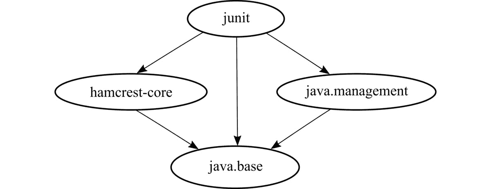

如果你省略了`-s`标志，你会得到模块摘要，然后是包到所需的包和模块的映射。如果你添加了`-v`标志，列表将类映射到所需的包和模块。

`--generate-module-info`选项为每个分析的模块生成`module-info`文件：

```
jdeps --generate-module-info /tmp/junit junit-4.12.jar hamcrest-core-1.3.jar
```

还有一个选项可以生成“dot”语言的图形输出。假设你已经安装了 dot 工具，运行这些命令：

```
jdeps -s -dotoutput /tmp/junit junit-4.12.jar hamcrest-core-1.3.jar
dot -Tpng /tmp/junit/summary.dot > /tmp/junit/summary.png
```

然后你得到了这个`summary.png`图片：

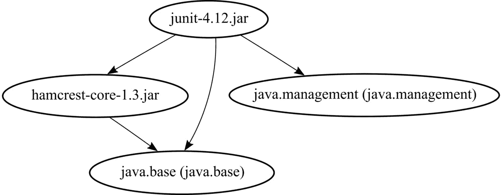

你使用`jlink`工具产生一个不需要单独运行时的应用程序。你指定要包含的模块和输出目录。

```
jlink --module-path com.horstmann.greet.jar:ch12.sec05.jar:$JAVA_HOME/jmods \
--output /tmp/hello
```

输出目录有一个`bin`子目录，其中包含`java`执行文件。如果你运行：

```
bin/java -m ch12.sec05
```

就会调用模块类的`main`方法。

`jlink`的意义在于它封装了运行应用程序所需的最小模块集。你可以列出它们：

```
bin/java --list-modules
```

在这个示例中，输出是：

```
ch12.sec05
com.horstmann.greet
java.base@21
```

所有模块都包含*运行时镜像*文件`lib/modules`中。在我的计算机上，该文件为 29MB，而所有模块的运行时镜像占用 133MB。整个应用程序占用 55MB，仅是 JDK 的一小部分。

这可以作为一个有用工具的基础。你仍然需要为多个平台产生文件集以及应用程序的启动脚本。

你可以使用`jimage`命令检查运行时镜像。然而，该格式是 JVM 内部的，运行时镜像并不是供其他工具生成或使用的。

与 JAR 文件一样，这些文件包含类文件。此外，它们还可以包含原生代码库、命令、头文件、配置文件和法律公告。JMOD 文件使用 ZIP 格式。你可以使用任何 ZIP 工具检查其内容。

与 JAR 文件不同，JMOD 文件仅对链接有用；也就是说，它们用于生成运行时镜像。除非你还想将原生代码库等二进制文件封装到你的模块中，否则你不需要生成 JMOD 文件。

## 练习

1. “受限关键字”`module`、`exports`、`requires`、`uses`、`to`等在模块声明中具有特定含义。你可以将它们作为类、包或*模块*的名称吗？特别地，你可以创建一个名为`module`的模块吗？尝试创建一个可以产生如下声明的上下文：

   ```
   requires requires;
   exports exports;
   opens to to opens;
   ```

   一个名为`transitive`的模块如何？你可以对其进行 require 吗？

2. 尝试从第 12.5 节中程序中的`HelloWorld`类访问`GreeterImpl`。发生了什么？是编译时错误还是运行时错误？

3. 在第 12.5 节的程序中，使用`java.util.logging.Level`让`Greeter`在级别小于`Level.INFO`时返回一个空字符串。这对模块描述符有什么影响？

4. 如果你将 Apache CSV JAR 作为未命名模块放在类路径上，并尝试从模块访问其包，会发生什么？你应该怎么做？

5. 开发一个示例，展示对`java.sql`、`java.xml`或`java.desktop`等模块使用`requires transitive`依赖的有力用途。

6. 为`requires static`的两种用例编写示例。你会想要使用`requires transitive static`吗？

7. 在第 12.13 节的程序中，如果省略`provides`或`uses`语句会发生什么？为什么这些不是编译时错误？

8. 在第 12.13 节的程序中，使用服务提供者工厂；即一个具有返回服务对象的公共静态方法`provider()`的类。

9. 重组第 12.7 节中的程序，使服务接口和实现定义在不同的模块中。

10. 下载开源程序 JFreeChart，并使用`jdeps`分析演示程序以及`lib`子目录下 JAR 文件的依赖关系。

11. 将 JFreeChart 的演示程序转换为模块，并将`lib`子目录下的 JAR 文件转换为自动模块。

12. 运行`jlink`以获取 JFreeChart 演示程序的运行时镜像。

13. 尝试在较版本的 Java 下运行 Java 8 版本的 JavaFX SceneBuilder 程序。启动它需要哪些命令行标记？你是如何发现的？

# 索引

# 符号与运算符参考

## 基础运算符与符号

- `!`运算符：在 property files 中使用。

- `!=`运算符：用于包装类（wrapper classes）。

- `#`(数字符号)：标记（用于输出）。

  - 在`javadoc`超链接中使用。

  - 在 option files 中使用。

- `$`(美元符号)：标记（用于输出）。

  - 在正则表达式中使用。

  - 在变量名中使用。

- `%`(百分号)：转换字符运算符。

  - `%%`

  - `%=`

  - `%g`

  - `%h`

  - `%t`

  - `%u`

- `&`(安培符号)

- `&&`运算符：在正则表达式中使用。

- `&=`

- `>`(大于号)：在 shell 语法中使用运算符。

- `>>=`、`>>>=`运算符。

- `>=`, `>>`、`>>>`运算符。

- `<`(左角括号)：标记（用于输出）。

  - 在 shell 语法中使用运算符。

- `<>`用于泛型类的构造函数。

- `<<`运算符。

- `<<=`

- `<...>`：用于元素类型、数组列表。

  - 用于类型参数。

  - 在`javadoc`超链接中使用。

  - 在正则表达式中使用。

- `<=`运算符。

## 字面量与结构元素

- `""`

- `"""`

- `"..."`：用于字符串。

  - 在`javadoc`超链接中使用。

  - 在文本块（text blocks）中使用。

- `'...'`：用于字符字面量（character literals）。

- `(`(左括号)

  - `(...)`：用于匿名类。

  - 用于类型转换（casts）。

  - 在正则表达式中使用。

- `*`(星号)：用于注解处理器（annotation processors）。

  - 在文档注释中使用。

  - 在正则表达式中使用。

- `*`：通配符路径（wildcard path）。

  - 用于导入的类（imported classes）。

- `+`(加号)：标记（用于输出）。

  - 在正则表达式中使用。

  - 用于字符串。

- `++`运算符。

- `+=`

## 赋值、字符串与分隔符

- `,`(逗号)：标记（用于输出）。

  - 用于规范化（normalizing）。

  - 用于数组末尾（trailing）。

- `-`(减号)：标记（用于输出）。

  - 在正则表达式中使用。

- `->`运算符。

- `--`运算符：用于命令行选项。

- `-=`

- `.`(句号)

  - 用于方法调用（method calls）。

  - 用于包名（package names）。

  - 在正则表达式中使用。

- `...`(省略号)

- `/`(斜杠)：文件分隔符（Unix）。

  - 在`javac`路径段中使用。

  - 用于根组件（root component）。

- `/**...*/`

- `//`、`/*...*/`：注释。

- `/=0`：默认值。

- `/`：标记（用于输出）。

  - 用于八进制字面量前缀（for octal literals）。

  - `0b`

  - `0x`

  - `0xFEFF`

- `:`(冒号)

  - 用于断言（assertions）。

  - 在`switch`语句中使用。

- `switch`

- `switch`语句。

- `::`(C++ 运算符)

- `;`(分号)：路径分隔符（Windows）。

- `=`

- `==`运算符。

- `!=`

  - 用于类对象（class objects）。

  - 用于枚举（enumerations）。

  - 用于字符串（strings）。

  - 用于包装类。

- `?`(问号)

  - 在正则表达式中使用。

  - 替换字符（replacement character）。

- `@`(at 符号)

  - `java`命令。

  - 用于`javadoc`注释。

- `[...]`：用于数组。

- `[]`（方括号）

- `\`(反斜杠)：字符字面量（character literal）。

  - 文件分隔符（Windows）。

  - 用于 option files。

- `\0`

- `\a`、`\A`

- `\b`、`\B`

- `\c`、`\D`

- `\e`、`\E`

- `\f`(换页)

- `\G`、`\H`

- `\k`

- `\n`(换行)：字符字面量。

  - 在 property files 中使用。

  - 在正则表达式中使用。

- `\p`、`\P`

- `\r`(回车)：字符字面量。

  - 在 property files 中使用。

- `\R`

- `\s`、`\S`

- `\t`(tab 字符面量)。

- `\x`

- `\z`、`\Z`

- `^`(脱字符/脱字符)：用于函数参数。

  - 在正则表达式中使用。

- `^=`

- `_`(下划线)：数字字面量。

- `{...}`：用于注解元素。

  - 用于 lambda 表达式。

  - 用于数组初始化。

- `|`(竖线)：运算符。

- `|=`

- `||`运算符。

- `~`(波浪线)：运算符。

- `A` 

## Java API 类与接口（总结）

以下章节列出了正文中提到的若干关键 Java 组件：

- **集合框架**：`List`, `ArrayList`, `Deque`, `ArrayDeque`, `Set`, `HashSet`, `TreeSet`, `Map`, `HashMap`, `TreeMap`, `Queue`, `LinkedList`, `PriorityQueue`, `Stack`, `Vector`。

- **并发**：`ConcurrentHashMap`, `ConcurrentLinkedQueue`, `CompletableFuture`, `ExecutorService`, `Future`, `CopyOnWriteArray`。

- **原子性**：`AtomicBoolean`, `AtomicInteger`, `AtomicLong`。

- **I/O 与 NIO**：`BufferedReader`, `BufferedWriter`, `File`, `FileReader`, `FileWriter`, `InputStream`, `InputStreamReader`, `Path`, `Paths`, `Files`。


- **序列化**：`Serializable`、`Externalizable`。
- **异常**：`AssertionError`、`ArrayIndexOutOfBoundsException`、`ArrayStoreException`、`ClassCastException`、`ClassNotFoundException`、`IOException`、`IllegalArgumentException`、`NullPointerException`、`RuntimeException`。
- **数学**：`Math`、`BigDecimal`、`BigInteger`。
- **时间**：`LocalDate`。
- **反射**：`Class`、`Method`、`Field`、`Constructor`。
