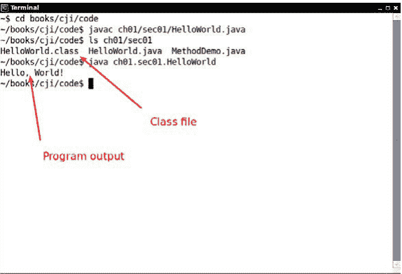
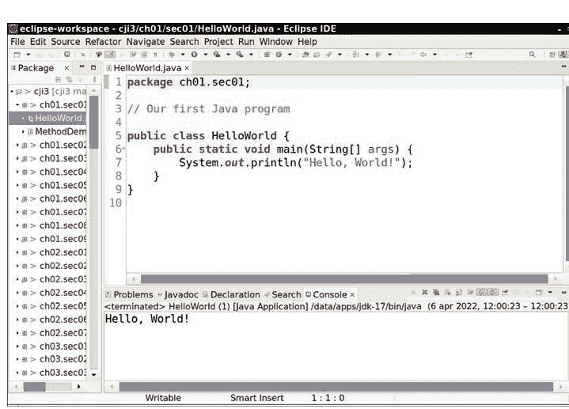
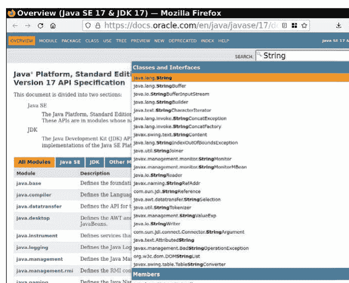
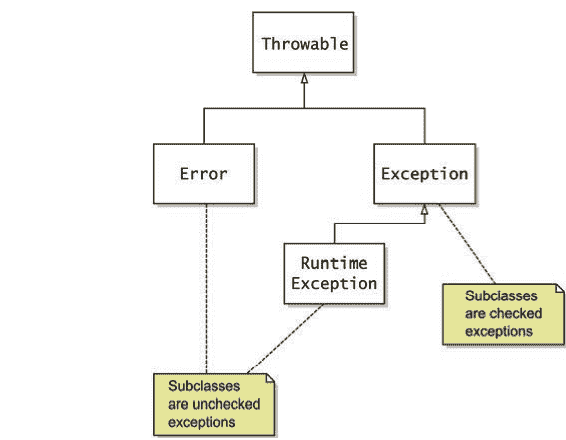
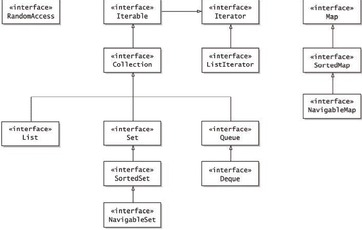
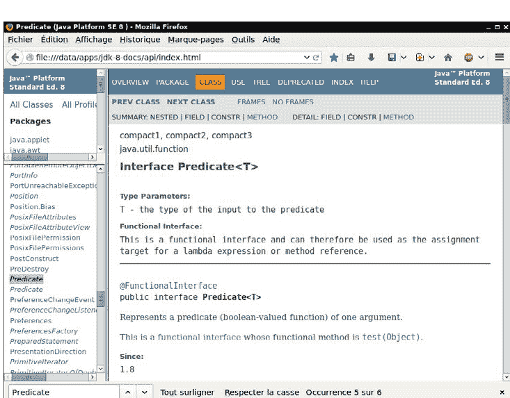
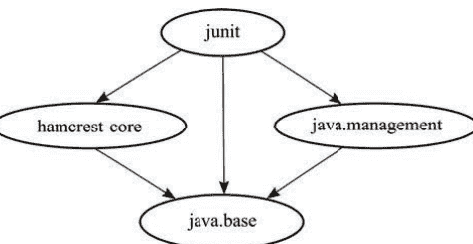
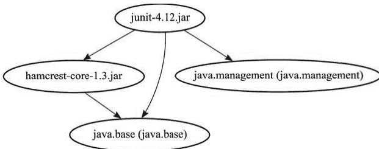

# 急躁者的核心 Java：更新至 Java 17，第 3 版

ScoutAutomatedPrintCode

# Pearson 对多样性、公平与包含的承诺

Pearson 致力于创建无偏见的内容，反映所有学习者的多样性，包括但不限于种族、性别、民族、社会经济地位、能力、年龄、性取向以及宗教或政治信仰。

教育是我们世界公平与变化的强大力量。它具有提供改善生活和实现经济流动机会的潜力。当我们与作者合作为每个产品和服务创建内容时，我们承认有责任展示包容性并融入多元化的学术，以便每个人都能通过学习实现自己的潜力。作为全球领先的公司，我们有责任驱动变化并履行我们的使命，帮助更多的人为自己创造更好的生活并创造一个更好的世界。

我们的目标是有有针对地为以下世界做出贡献：

- 每个人都有通过学习获得公平且终身成功的机会。
- 我们的教育产品和服务是具有包容性的，并代表了学习者的丰富多样性。
- 我们的教育内容准确反映了所服务学习者的历史和经历。
- 我们的教育内容引导学习者进行更深入的讨论并激励他们扩展自己的学习（以及世界观）。

虽然我们努力呈现无偏的内容，但我们希望听到您对此 Pearson 产品的任何担忧或需求，以便我们进行调查并解决。

- 如果对任何潜在偏差有担忧，请通过`https://www.pearson.com/report-bias.html`联系​​我们。

本页故意留白

> 献 Chi——我生命中最有耐心的人。

本页故意留白

练习 139

练习 188

# 5 异常、断言与日志 191

## 5.1 异常处理 192

### 5.1.1 抛出异常 192

### 5.1.2 异常层次结构 193

### 5.1.3 声明受检异常（Checked Exceptions）195

### 5.1.4 捕获异常 196

### 5.1.5 Try-with-resources 语句 197

### 5.1.6 finally 子句 199

### 5.1.7 重新抛出与异常链 201

### 5.1.8 未捕获异常与堆栈轨迹 202

### 5.1.9 用于抛出异常的 API 203

## 5.2 断言（Assertions）204

### 5.2.1 使用断言 204

### 5.2.2 启用与禁用断言 205

## 5.3 日志 206

### 5.3.1 是否应该使用框架？206

### 5.3.2 日志 207

### 5.3.3 平台 API 208

### 5.3.4 日志配置 209

### 5.3.5 处理器 211

### 5.3.6 格式化 213

练习 214

# 6 泛型编程 219

## 6.1 泛型类 220

## 6.2 泛型方法 222

## 6.3 类型边界 222

## 6.4 类型变体与通配符（Wildcards）223

### 6.4.1 下界通配符 224

### 6.4.2 上界通配符 225

### 6.4.3 带类型变量通配符 226

### 6.4.4 无界通配符 227

### 6.4.5 通配符捕获（Capture）228

## 6.5 Java 中的泛型 228

### 6.5.1 类型擦除（Erasure）229

### 6.5.2 插入 229

### 6.5.3 桥接方法 230

## 6.6 泛型的限制 231

### 6.6.1 原始类型参数 231

### 6.6.2 在运行时，所有类型都是原始（Raw）232

### 6.6.3 无法实例化类型变量 233

### 6.6.4 无法构造泛型数组 235

### 6.6.5 静态中无效类型变量 236

### 6.6.6 擦除后方法冲突 236

### 6.6.7 异常与泛型 237

## 6.7 反射与泛型 238

### 6.7.1 `Class<T>` 239

### 6.7.2 虚拟机中的类型信息 239

练习 241

# 7 集合（Collections）247

## 7.1 集合框架概述 248

## 7.2 迭代器（Iterators）252

## 7.3 集合（Sets）254

## 7.4 映射（Maps）255

## 7.5 其他集合 259

### 7.5.1 属性/属性 259

### 7.5.2 位集合（Bit Sets）260

### 7.5.3 枚举集合与映射 262

### 7.5.4 栈、队列与优先级队列 262

### 7.5.5 弱哈希（Weak Maps）263

## 7.6 视图（Views）264

### 7.6.1 小批量集合 264

### 7.6.2 范围（Ranges）265

### 7.6.3 不可修改视图 266

练习 267

# 8 流（Streams）271

## 8.1 从迭代到流操作 272

## 8.2 流的创建 273

## 8.3 `filter`、`map` 和 `flatMap` 方法 276

## 8.4 提取子结构与合并流 278

## 8.5 其他流转换 279

## 8.6 简单归约（Reductions）280

## 8.7 `Optional` 类型 281

### 8.7.1 产生备选方案 281

### 8.7.2 如果存在则消费 282

### 8.7.3 管道化 `Optional` 值 282

### 8.7.4 如何不处理 `Optional` 值 282

### 8.7.5 创建 `Optional` 值 284

### 8.7.6 使用 `flatMap` 组合 `Optional` 函数 284

### 8.7.7 将 `Optional` 转换为流 285

## 8.8 收集结果 286

## 8.9 收集到 `Map` 289

## 8.10 分组与分区 289

## 8.11 下游收集器 289

## 8.12 归约操作 292

## 8.13 原始类型流 294

## 8.14 并行流 295

练习 298

# 9 处理输入与输出 301

## 9.1 输入/输出流、读取器与写入器 302

### 9.1.1 获取流 302

### 9.1.2 读取字节 303

### 9.1.3 写入字节 304

### 9.1.4 字符编码 305

### 9.1.5 文本输入 307

### 9.1.6 文本输出 308

### 9.1.7 读取与写入二进制数据 310

### 9.1.8 随机访问文件 310

### 9.1.9 内存映射文件 310

### 9.1.10 锁 316

## 9.2 路径与目录 312

### 9.2.1 路径 312

### 9.2.2 目录 312

### 9.2.3 复制、移动与删除 314

### 9.2.4 遍历 315

### 9.2.5 ZIP 316

### 9.2.6 正则表达式 319

### 9.2.7 序列化 320

### 9.2.8 安全 324

### 9.2.9 版本 325

### 9.2.10 异常 326

# 目录

- 12.6 格式化与解析 433
- 12.7 与旧代码交互 436
- 练习 437

# I3 国际化 441

- 13.1 区域语言（Locales）442
- 13.1.1 指定区域语言 443
- 13.1.2 默认区域语言 445
- 13.1.3 显示名称 446
- 13.2 数字格式 447
- 13.3 货币 448
- 13.4 日期时间和格式化 449
- 13.5 排序与规范化 451
- 13.6 消息格式化 453
- 13.7 资源包（Resource Bundles）455
- 13.7.1 组织资源包 457
- 13.7.2 包类 457
- 13.8 字符编码 458
- 13.9 偏好 459
- 练习 461

# I4 编译与脚本化 463

- 14.1 编译器 API 463
- 14.1.1 调用编译器 464
- 14.1.2 启动编译任务 464
- 14.1.3 捕获诊断信息 465
- 14.1.4 从内存读取源文件 466
- 14.1.5 向内存写入字节码 466
- 14.2 脚本 API 467
- 14.2.1 获取脚本引擎 468
- 14.2.2 评估脚本 468
- 14.2.3 绑定（Bindings）469
- 14.2.4 重定向输入和输出 669
- 14.2.5 调用脚本函数和方法 470
- 14.2.6 编译脚本 471
- 练习 472

# I5 Java 平台模块系统 475

- 15.1 模块概念 476
- 15.2 模块命名 478
- 15.3 模块化的“Hello, World!”478
- 15.4 模块模块 480
- 15.5 导出包 482
- 15.6 模块与反射访问 485
- 15.7 模块化 JARs 488
- 15.8 自动模块 489
- 15.9 未命名模块 491
- 15.10 用于迁移的命令行标记 491
- 15.11 传递性依赖与静态依赖 493
- 15.12 限定导出与打开 495
- 15.13 服务加载 496
- 15.14 模块化工作工具 497
- 练习 499

索引 501

# 前言

Java 自 1996 年首次发布以来经历了许多变化。经典著作《Java Java》（Core Java）详尽地涵盖了语言本身，还涵盖了所有核心库以及版本之间的大量变化，跨越两卷，超过 2000 页。然而，如果你只想在现代 Java 中提高效率，那么有一条更快、更简单的路径来学习这种语言和核心库。在书中，我回顾了历史，不再纠结于旧版本的特性。我将向你展示 Java 现状的优点，让你能够快速将知识投入实践。

与我之前的“Impatient”系列书籍一样，我直奔主题，展示解决编程问题需要知道的知识，而不是在说教某种范式优于另一种。我还将信息分成小块呈现，以便你在需要时快速检索。假设你精通某些其他编程语言，如 C++、JavaScript、PHP 或 Ruby，通过这本书你将学习如何成为一名胜任的 Java 程序员。使用 Java 的关键原因是为了处理并发编程。由于 Java 库提供了并行算法和线程安全数据结构，程序员处理并发编程的方式已经发生了彻底改变。传统上，关于 Java 的书籍侧重于用户界面编程，但现在，很少有开发者编写桌面 GUI 代码。最后，本书是为程序员编写的，而不是为大学课程或系统专家编写的。书中涵盖了程序员需要面对的问题，如日志记录和文件操作，但你不会学习如何手动实现链表。我希望你喜欢这种对 Java 的快速介绍，并希望你的 Java 工作高效且愉快。如果你发现错误或有建议，请访问`http://horstmann.com/javaimpatient`勘误页面并留言。请确保完成你的《Core Java for the Impatient, Third Edition》（ISBN：9780138052102）注册，在`informit.com`登录或创建账户，并在 Registered 标签页获取新版本的独家优惠。

# 致谢

一如既往，感谢我的编辑 Greg Deutsch，他热情地支持这本快速介绍 Java 的短书的愿景。Dmitry Kirchner 再次将手稿变成了一本极具吸引力且注重细节的书。我特别感谢优秀的评审团队，他们发现了许多错误并提出了周见又全的改进建议。他们是 Andres Al、Paul Anderson、Marcus Goetz、Doug Lea、Simon Ritter 和 Christian Ulrich。

Cay Horstmann

2022 年 8 月

本页特意空白

# 关于作者

Cay S. Horstmann 是《JavaScript for the Impatient》和《Scala for the Impatient》（均由 Addison-Wesley 出版）、《Core Java, Volumes I and II, Twelfth Edition》（Pearson，2022）的主要作者，为职业程序员和计算机科学学生写过十几本书。他是圣何塞州立大学的计算机科学荣誉教授以及 Java 冠军。

# 基础编程结构

## 本章主题

- 1.1 我们的第一个程序 2
- 1.2 基本类型 11
- 1.3 变量 14
- 1.4 算术运算 17
- 1.5 字符串 25
- 1.6 输入与输出 35
- 1.7 控制流 38
- 1.8 数组与列表 46
- 1.9 函数分解 56
- 练习 58

# 第 1 章

在本章中，你将学习 Java 语言的基本数据类型和控制结构。假设你是其他语言的经验丰富的程序员，并且熟悉变量、循环、函数调用和数组等概念，但可能语法不同。本章将带你快速掌握 Java 式。我还会提供一些关于 Java 处理数据类型的 API 有用部分的技巧。

本章的要点是：

1. 在 Java 中，所有方法都声明在类中。你在方法所属的类的对象上调用非静态方法。
2. 静态方法不在对象上调用。程序执行从`static main`方法开始。
3. Java 有八种基本类型：四种有符号整数类型、两种浮点数类型、`char`和`boolean`。
4. Java 的运算符和控制结构与 C++ 非常相似。
5. `switch`有四种形式：不带穿透（fall-through）的表达式和语句。
6. `Math`类提供了常用的数学函数。
7. `String`对象是字符序列，或者更准确地说，是 UTF-16 编码中的 Unicode 代码点。
8. 使用文本块（text blocks）语法声明多行字符串。
9. 通过`System.out`对象，你可以在终端窗口显示输出。与`System.in`绑定的`Scanner`允许你读取终端输入。
10. 数组和集合可以用于收集相同类型的元素。

# 我们的第一个程序

在学习任何新编程语言时，传统做法是从显示“Hello, World!”信息的程序开始。这就是我们在后续章节中要做的。

## 1.1.1 析“Hello, World”程序

话说已此，这是 Java 版本的“Hello, World”程序：

```java
package ch01.sec0;

// 我们的第一个 Java 程序

public class HelloWorld {
    public static void main(String[] args) {
        System.out.println("Hello, World!");
    }
}
```

让我们这个程序：

- Java 是一种面向对象的语言。在程序中，你通过让对象执行工作来操作（大部分）对象。你操作的每个对象属于一个特定的类，我们称该对象是该类的实例。类定义了对象的状态可以是什么以及它可以做什么。在 Java 中，所有代码都定义在类中。我们将在第 2 章详细查看对象和类。这个程序由单个`HelloWorld`类组成。
- `main`是一个方法（即函数），声明在类内部。`main`方法是程序运行时第一个调用的方法。它被声明为`static`，表示该方法不对任何对象进行操作。（当`main`被调用时，只有少数预定义的对象，且它们都不是`HelloWorld`类的实例。）该方法被声明为`void`，表示它不返回任何值。参见第 1.8.8 节。

## 1.1 我们的第一个程序

“命令行参数”（第 52 页）解释了参数声明`String[] args`的含义。

- 在 Java 中，你可以将许多功能声明为`public`（公共）或`private`（私有），还有其他可见级别。在这里，我们将`HelloWorld`类和`main`方法声明为`public`，这是类和方法最常见的安排。
- 包（package）是相关类的集合。将每个类放在包中是一个好主意，这样你可以将相关类组合在一起并避免多个类具有相同名称时发生冲突。在本书中，我们将使用章节和节数作为包名。我们的类全名是`ch01.HelloWorld`。第 2 章将详细介绍包和命名规范。
- 以`//`开头的行是注释。`//`到行尾之间的所有字符都会被编译器忽略，供人类读者阅读。
- 最后，我们来看`main`方法的主体。在我们的示例中，它包含单行命令，向`System.out`打印。`System.out`是代表 Java 程序“标准输出”的对象。

正如你所看到的，Java 并不是一种可以快速编写几条命令的脚本语言。它明确设计为用于大型程序的语言，这些程序通过组织成类、包和模块来获益。（模块 modules 将在第 15 章介绍。）

Java 也非常简单且统一。某些语言拥有全局变量和函数，而在类内部则是变量和方法。在 Java 中，一切都声明在类内部。这种统一可能会导致代码有些冗长，但它使得程序的含义很容易理解。

> 注意：你刚刚看到了一个延伸到行尾的`//`注释。你也可以在`/*`和`*/`分隔符之间使用多行注释，例如：

```java
/* 这是为急躁的人准备的第一个 Java 示例程序。程序显示传统的问候语“Hello, World!” */
```

第三种注释样式样式“文档注释”，使用`/**`和`*/`作为分隔符，你将在下一章看到它。

## 第 1 章 基础编程结构

### 1.1.2 编译和运行 Java 程序

要编译并运行此程序，你需要安装 Java 开发工具包（JDK），以及可选的集成开发环境（IDE）。你还应该下载示例代码，你可以在本书的配套网站找到：`http://horstmann.com/javaimpatient`。由于安装软件的说明并不风趣，我也将它们放在了配套网站上。

一旦安装了 JDK，打开终端窗口，切换到包含`ch01/sec01`目录的目录，并运行命令：

```bash
javac ch01/sec01/HelloWorld.java
java ch01.sec01.HelloWorld
```

熟悉的问候将出现在终端窗口中（见图 1-1）。注意，执行程序涉及两个步骤。`javac`命令将 Java 源代码编译为中间机器无关表示（称为字节码），并保存到类文件中。`java`命令启动虚拟机，加载类文件并执行字节码。


编译后，字节码可以在任何 Java 虚拟机上运行，无论是在你的桌面电脑上，还是在遥远星系的设备上。“一次编写，随运行”的承诺是 Java 一个重要的设计标准。



图 1-1 在终端窗口中运行 Java 程序

## 1.1 我们的第一个程序

> **注意：** 调用`javac`编译器时使用的是文件名，用斜杠分隔路径段，并带有`.java`扩展名。调用`java`虚拟机启动器使用的是类名，用包段分隔，且没有扩展名。

> **注意：** 如果你的程序由单个源文件组成，你可以跳过编译步骤并使用命令`java ch01/sec01/HelloWorld.java`运行程序。在后台，程序在运行之前会进行编译，但不会产生类文件。

> **注意：** 在 Unix 类的操作系统上，你可以按照以下步骤将 Java 文件转换为可执行程序：

1. 重命名文件使其不再具有`.java`扩展名：

   `mv HelloWorld.java hello`

2. 使文件具有可执行权限：

   `chmod +x hello`

3. 在文件顶部添加“shebang”行：

   `#!/path/to/jdk/bin/java --source 17`

   现在你可以这样运行程序：

   `./hello`

要在 IDE 中运行程序，你首先需要创建一个项目，如安装说明所述。然后，选择`HelloWorld`类并告诉 IDE 运行它。图 1-2 显示了在 Eclipse 中对应的样子。Eclipse 是一个流行的 IDE，但也有其他优秀的选择。随着你对 Java 编程越来越熟悉，你应该尝试几个并挑选一个你喜欢的。恭喜你！你刚刚遵循了在 Java 中运行“Hello, World!”程序的久老仪式。现在我们准备好检查 Java 语言的基础了。

> **提示：** 在 http://horstmann.com/javapatient，你可以下载本书所有章节的示例代码，这些代码在文中展示了书的代码片段。代码的组织方式使你创建一个包含所有示例程序的单一项目。我鼓励你在学习的过程中下载、运行并研究这些代码。

## 第 1 章 基础编程结构



1-2 在 Eclipse 运行程序

### 1.1.3 方法调用

让我们仔细观察`System.out.println("Hello, World!");`语句。

`System.out`是一个对象。它是`PrintStream`类的实例。`PrintStream`有`println`、`print`等方法。这些方法是实例方法，因为它们操作对象。

要在对象上调用实例方法，你使用点符号：`object.methodName(arguments)`

在这种情况下，只有一个参数字符串`"Hello, World!"`。

诸如`"Hello, World!"`的字符串都是`String`类的实例。`String`类有一个返回字符串长度的`length`方法。调用该方法，再次使用点符号：`"Hello, World!".length()`

它没有参数。与`println`方法不同，`length`方法返回结果。使用该结果的一种方法是打印它：

## 1.1 我们的第一个程序

```
System.out.println("Hello, World!".length());
```

尝试一下。创建一个该语句的 Java 程序并运行查看效果。

在 Java 中，你需要构造大多数对象（不像`System.out`和`"Hello, World!"`对象，它们已经在那里供你使用）。这里有一个简单的示例。

`Random`类的对象可以生成随机数。你使用`new`运算符构造`Random`对象：

```java
new Random()
```

类名之后是构造参数列表，在本示例中它是空的。

你可以对构造的对象调用方法。调用

```java
generator.nextInt()
```

产生新构造的随机数器提供的下一个整数。

如果你想对对象调用一个方法，请将其存储在变量中（见第 1.3 节“变量”，第 14 页）。在这里我们打印两个随机数：

```java
Random generator = new Random();
System.out.println(generator.nextInt());
System.out.println(generator.nextInt());
```

> 注意：`Random`类声明在`java.util`包中。要在程序中使用它，请添加导入语句，如下：

```java
package ch01.sec01;

import java.util.Random;

public class MethodDemo {
  ...
}
```

我们将在第 2 章更详细讨论包和导入语句。

### 1.1.4 JShell

在第 1.1.2 节“编译和运行 Java 程序”（第 4 页）中，你看到了如何编译和运行 Java 程序。JShell 程序提供了一个“读取-求值-打印”循环（REPL），允许你实验 Java 代码。

无需编译并运行程序。当你输入一个 Java 表达式时，jShell 会评估你的输入，打印结果并等待你的下一次输入。要启动 JShell，只需在终端窗口中输入`jshell`（图 1-3）。

```
Terminal -
$ jshell
Welcome to JShell -- Version 17
For an introduction type: /help intro
shell> "Hello, World!".length()
$ == 13

shell> new Random().nextInt()
$ == -762255172

shell> Random generator = new Random(42)
generator == java.util.Random@7cc359be
shell> generator.nextInt()
$ == -117018535
shell> generator.next()
nextBoolean()        nextDouble()      nextExponential()
nextFloat()           nextGaussian(    nextLong()
shell> generator.next
```

图 1-3 运行 JShell

JShell 首先显示一条欢迎语，随后是提示符：

| Welcome to JShell -- Version 17 |

| For an introduction type: /help intro |

`jshell>`

现在输入任何 Java 表达式，例如

`"Hello, World!".length()`

JShell 返回结果并显示另一个提示符：

`$ 1 == 13`

`jshell>`

注意，不需要输入`System.out.println`。JShell 会自动打印你输入的每个表达式的值。

输出中的`$`表示该结果可以用于后续计算。例如，如果你输入

`3 * $1 * 3`

响应是

`$ 2 == 42`

## 1.1 我们的第一个程序

如果你需要多次使用变量，可以给它一个更易记的名字。你必须遵循 Java 语法并指定类型和名称（见第 1 节“变量”，第 14 页）。例如：

```
jshell int answer = 42
answer == 42
```

你可以让 JShell 为你填充类型。输入一个表达式，而不是按回车键，而是按下`Shift+Tab`然后按`V`键。例如，当你输入

```
new Random()
```

按下`Shift+Tab`和`V`键后，你现在得到了：

```
jshell> Random generator = new Random()
```

光标位于`=`符号之前。现在输入一个变量并按回车：

```
jshell> Random generator = new Random()
generator == java.util.Random@3ffee98
```

另一个实用功能是补全。按下`Tab`键，你可以得到`generator`变量可以调用的所有方法列表：

```
jshell> generator.
double(equals(
hashCode()      ints(           isDeprecated()
Long(          nextBoolean()    nextBytes(
nextDouble      nextExponential()  nextFloat(
nextGaussian(  nextInt()
notify()        notifyAll()      setSeed(
toString()      wait
```

现在输入`ne`并再次按下`Tab`键。方法名补全为`next`，你会得到一个更短的列表：

```
jshell> generator.next
nextBoolean()      nextBytes(
nextExponential()  nextFloat(
nextGaussian(      nextLong(
nextInt(          nextLong(
```

输入`D`并再次按下`Tab`，现在填充`nextDouble()`。再次按下`Tab`，你会看到三种选择：

```
Signatures:
double java.util.random.Generator.nextDouble(double bound)
double java.util.random.Generator.nextDouble(double origin, double bound)
double Random.nextDouble()
```

## 第 1 章 基础结构

<再次按 tab 查看文档>

输入`)`选择第三种版本：

```
jshell> generator.nextDouble()
$ => 8.956034658
```

> 注意：在补全列表中，需要参数的方法后面仅有一个左括号，例如`nextDouble()`，但有些方法有两个括号，例如`nextBoolean()`。

要重复某个命令，按下`↑`键直到看到该行，使用`←`和`→`键在行内移动光标添加或删除字符。完成后按回车。例如，按下`↑`将`Double`替换为`Int`，然后按回车：

```
jshell> generator.nextInt()
$ => -35233569
```

默认情况下，JShell 导入以下包：

- java.io
- java.math
- java.net
- java.nio.file
- java.util
- java.util.concurrent
- java.util.function
- java.util.prefs
- java.util.regex
- java.util.stream

这就是为什么你在 JShell 中无需任何导入语句就可以使用`Random`类的原因。如果你需要导入另一个类，可以在 JShell 提示符处输入`import`语句。或者更方便的方法是输入`Shift+Tab`让 JShell 搜索它。例如，你输入`Duration`然后按下`Shift+Tab`。你会得到一个潜在的操作列表：

```
jshell> Duration
0: Do nothing
1: import: java.time.Duration
2: import: javafx.util.Duration
3: import: javax.xml.datatype.Duration
```

输入`I`，你会收到确认：

`Imported: java.time.Duration`

## 1.2 基本类型

后面

```
jshell> Duration
```

在大多数情况下，`int`类型是最实用的。如果你想表示地球上的人口，将需要使用`long`。毕竟，Java 被设计为“一次编写，随运行”的语言。相比之下，C 和 C++ 中的整数类型取决于编译程序的处理器。

你使用后缀`L`编写`long`字面量（例如`4000000000L`）。`byte`或`short`没有这种语法。类型转换法（见第 1.4.4 节“数字类型转换”，第 21 页），例如`(byte) 127`。十六进制字面量具有前缀`0x`（例如`0xFEBABE`）。二进制值具有前缀`0b`。例如`0b1001`是 9。

> 注意：八进制数带有前缀`0`。例如，`011`是 9。这可能会引起混乱，所以最好避免八进制字面量和前导零。

你可以在数字字面量添加下划线，例如`1_000_000`（或`0b0111_0100_0010_0000`）来表示百万。这些下划线仅供人类阅读，Java 编译器会自动删除它们。

> 注意：如果你处理的是永远不会为负的整数值，并且确实需要额外的位，请小心解释有符号整数。例如，`byte`值表示范围为 -128 到 127。如果你想要 0 到 255 的范围，可以将其存储在`byte`中。由于二进制运算的性质，减法和乘法都可以工作，只要不溢出。对于其他操作，调用`Byte.toUnsignedInt(b)`获取 0 到 255 之间的`int`，然后处理整数值，并将结果转换回`byte`。`Integer`和`Long`类提供了无符号除法和取模的方法。

表 1-1 类型

| 类型 | 存储需求 | 范围（包含） |
|---|---|---|
| byte | 1 byte | -128 to 127 |
| short | 2 bytes | -32,768 to 32,767 |
| int | 4 bytes | -2,147,483,648 to 2,147,483,647 |
| long | 8 bytes | -9,223,372,036,854,775,808 to 9,223,372,036,854,775,807 |

## 1.2.2 浮点类型

浮点类型表示带有小数部分的数字。两种浮点类型如表1-2 所示。

表 1-2 浮点类型

| 类型 | 存储需求 | 描述 |
| --- | --- | --- |
| float | 4 字节 | 约 ±3.4028235E+38 (6–7 位有效数字) |
| double | 8 字节 | 约 ±1.7976931348623157E+308 (15 位有效数字) |

许多年前，当内存稀缺时，常用四字节浮点数。但有效数字并不够用，如今双精度数字是默认选择。只有当你需要存储大量的数字时，使用`float`才有意义。

`float`类型数字带有`f`后缀（例如`3.14f`）。不带`f`后缀的浮点字面量（如`3.14`）是`double`。你可以可选地提供`D`后缀（例如`3.14D`）。

> 注意：你可以用十六进制指定浮点字面量。例如，`0.009765625 = 2⁻¹⁰`可以写为`0x1p-10`。在十六进制表示中，你使用`p`而不是`e`来指数。（尽管数字是用十六进制写的，但指数——即 2 的幂——是用十进制写的。）

存在一些特殊的浮点值：`POSITIVE_INFINITY`表示 ∞，`NEGATIVE_INFINITY`表示 -∞，以及`NaN`表示“不是数字”。例如，计算`1.0 / 0.0`的结果是无穷。计算负数的平方根得到`NaN`。

> 警告：所有的“不是数字”值被视为彼此不同的。因此，你不能使用`x == Double.NaN`来检查 x 是否为 NaN。相反，请调用`Double.isNaN(x)`。还有`isInfinite`方法用于测试是否为无穷，`isFinite`用于检查浮点数既不是无穷也不是 NaN。

## 第1章 编程结构

浮点数不适用于财务计算。例如，命令`System.out.println(2.0 - 1.7)`会打印`0.3000000000000002`，而不是你预期的`0.3`。这种误差是由浮点数在二进制系统中表示的。十进制系统中没有`3/10`的精确表示。如果你需要任意精度且无舍入误差的数值计算，请使用第1.4.6节引入的`BigDecimal`类。

## 1.2.3 char 类型

`char`描述 Java 使用 UTF-16 编码“单元”。细节非常技术化——见第1.5节“字符串”（第25页）。你可能不会频繁使用`char`类型。

偶尔，你可能会遇到用单引号括的字符字面量。例如，`'J'`是值为74（或十六进制 4A）的字符字面量，表示 Unicode 字符“U+004A 大写字母 J”。单元可以用十六进制表示，例如`'\u004A'`与`'J'`相同。一个更奇特的例子是`'\u263A'`，表示 ☺ 的单元，“U+263A 微笑脸”。

特殊代码`'\n'`、`'\r'`、`'\t'`分别表示换行、回车和制表符。

使用反斜杠转义单引号`\'`和反斜杠`'\\'`。

## 1.2.4 boolean 类型

`boolean`类型有两个值：`false`和`true`。

在 Java 中，`boolean`类型不是数字类型。`boolean`值与整数 0 和 1 没有任何关系。

## 1.3 变量

在后续章节中，你将学习如何声明和初始化变量以及常量。

### 1.3.1 变量声明

Java 是一种强类型语言。每个变量只能持有特定类型的值。当你声明变量时，需要指定类型、名称以及可选的初始值。

```int total = 0;
```

你可以在一条语句中声明多个相同类型的变量：

```int total = 0, count; // count 是未初始化的整数
```

大多数 Java 程序员倾向于为每个变量单独声明。考虑此变量声明：

```
Random generator = new Random();
```


在这里，对象的类名出现了两次。第一个 `Random` 是变量 `generator` 的类型。第二个 `Random` 是用于构造该类对象的 `new` 表达式的一部分。

为了避免这种重复，你可以使用 `var` 关键字声明变量：

```java
var generator = new Random();
```

现在，变量的类型是初始化该变量的表达式的类型。在这个示例中，`generator` 是 `Random` 变量。

在书中，当声明变量的类型显而易见时，我会使用 `var`。

### 1.3.2 标识符

变量、方法或类的名称被称为标识符。在 Java 中，标识符必须以字母开头。它们可以由字母、数字和如 `$` 等符号组成。但它们不能是关键字。

按照习惯，常量使用大写字母，而变量和方法以小写开头。

### 1.3.3 初始化

延迟初始化 `final` 变量是合法的，只要它在第一次使用之前恰好初始化一次。例如，以下代码是合法的：

```java
final DAYS_IN_FEBRUARY;
if (leapYear) {
    DAYS_IN_FEBRUARY = 29;
} else {
    DAYS_IN_FEBRUARY = 28;
}
```

### 1.3.4 常量

`final` 关键字表示值一旦赋值后就无法更改。在其他语言中，人们会将此类称为常量。例如：

```java
final int DAYS_PER_WEEK = 7;
```

你也可以在方法之外声明常量，使用 `static` 关键字：

```java
public class Calendar {
    public static int DAYS_PER_WEEK = 7;
    ...
```

## 1.4 算术运算

Java 使用与任何 C 类语言中熟悉的运算符（见表 1-3）。我们将在后续章节中复习它们。

# 第 1 章 ■ 基础编程结构

表 1-3 Java 运算符

| 运算符 | 结合性 |
| :--- | :--- |
| `[] . ()`（方法调用） | 左结合 |
| `! ~ +`（单元）`()`（单元）`(类型转换) new` | 右结合 |
| `* / %`（取模） | 左结合 |
| `+` | 左结合 |
| `<< >>> >=`（算术移位） | 左结合 |
| `> <= instanceof` | 左结合 |
| `== !=` | 左结合 |
| `&`（位与） | 左结合 |
| `^`（位异或） | 左结合 |
| `|`（位或） | 左结合 |
| `&&`（逻辑与） | 左结合 |
| `||`（逻辑或） | 左结合 |
| `? :`（条件三元运算符） | 左结合 |
| `+= -= *= /= % <= >>> >= = ^= |=` | 右结合 |

> 注意：在此表中，运算符是按优先级从高到低的顺序列出的。例如，由于 `+` 的优先级高于 `<<`，因此 `3 + 4 << 5` 的值为 `(3 + 4) << 5`。当运算符从左到右分组时，它是左结合的。例如，`3 - 4` 意味着 `(3 - 4) - 5`。但 `-=` 是右结合的，`i -= j` 意味着 `i -= (j -= k)`。

### 1.4.1 赋值

表 1-3 的最后一行显示了赋值运算符。语句

`x = expression;`

将 `x` 设置为右侧表达式的值，替换掉先有的值。

赋值是一个具有值的运算符，该值即被赋值的值。在另一个表达式中使用赋值是合法的。例如：

`(next = in.read()) != -1`

将 `next` 设置为 `in.read()` 返回的值，然后如果该值不为 `-1`，则结果为 `true`。

当在 `*` 前面有一个运算符时，该运算符会将左侧和右侧结合并赋值结果。例如：

```java
amount = fee;
```

等同于：

```java
amount = amount - fee;
```

### 1.4.2 基础算术

加法、减法、乘法和除法分别由 `+ - * /` 表示。例如，`2 * n + 1` 意味着将 `2` 乘以 `n` 再加 `1`。

你需要小心使用 `/` 运算符。如果两个操作数都是整数类型，它表示整数除法，会舍弃余数。例如，`17 / 5` 是 `3`，而 `17.8 / 5` 是 `3.4`。

整数除以零会产生异常，如果没有被捕获，它将终止你的程序。（有关异常处理的更多信息，请参见第 5 章。）浮点数除以零会产生无限值或 `NaN`（参见第 1.2.2 节“浮点类型”，第 13 页），而不会引起异常。

`%` 运算符产生余数。例如，`17 % 5` 是 `2`，即 `17` 减去 `15`（`5` 能够“容纳”`17` 的最大整数倍数）后的剩余量。如果 `a % b` 的余数为 `0`，则 `a` 是 `b` 的整数倍数。

一个常见的用途是测试一个整数是否为偶数。如果 `n` 是偶数，表达式 `n % 2` 等于 `0`。如果 `n` 是奇数，当 `n` 为负数时，`n % 2` 为正或 `-1`。在实践中，对负数的处理并不十分理想。在使用可能为负的操作数使用 `%` 时请务必小心。

考虑这个问题：你正在计算时钟小时的位置。应用了一个调整，你想将其归一化为 0 到 11 之间的数字。这很容易：`(position + adjustment) % 12`。但如果调整导致位置变成负数呢？你可能会得到一个负数。因此你必须引入分支，或者使用 `((position + adjustment) * 12) % 12`。无论哪种都很麻烦。

> 提示：在这种情况下，使用 `Math.floorMod` 方法更简单：`Math.floorMod(position + adjustment, 12)` 始终产生一个 0 到 11 之间的值。遗憾的是，`floorMod` 对负除数会给出负数结果，但这种情况在实践中不会发生。

Java 有递增递减运算符：

```java
n++; // 将 n 加 1
n--; // 将 n 减 1
```

与其他基于 C 的语言一样，`++` 和 `--` 递增变量 `n`，但它们在表达式中使用具有不同的值。第一种形式产生递增之前的值，第二种产生递增之后的值。例如：

`String args = args[n];`

设置 `args[n]`，然后递增 `n`。这在三十年前是有意义的，因为当时的编译器优化代码方面做得并不好。如今，使用两个独立的语句并没有性能上的劣势，而且许多程序员发现显式形式更易读。

### 1.4.3 数学方法

没有用于将数字计算幂的运算符。相反，请调用 `Math.pow` 方法：`Math.pow(x, y)` 产生 $x^y$。要计算 `x` 的平方根，调用 `Math.sqrt(x)`。

这些是不操作于对象的静态方法。对于静态常量，在声明它们的类名前面加上类名。

此外，`Math.min` 和 `Math.max` 也很有用，用于计算两个值的最小值最大值。

此外，`Math` 类还提供了三角函数和对数函数，以及常量 `Math.PI` 和 `Math.E`。

> 注意：`Math` 类提供了几种方法来确保整数算术是安全的。当计算溢出时，数学运算符会静静地返回结果。例如，十亿乘三（`1000000000 * 3`）会溢出。如果你担心类型转换会静默地丢弃数字的重要部分，使用 `Math.toIntExact` 方法。当它无法将 `long` 转换为 `int` 时，会抛出异常。这些方法还有 `addExact`、`subtractExact`、`incrementExact`、`decrementExact`、`negateExact`（注：原文此处逻辑似乎有乱）。对于整数（`int`）的，还有 `compareUnsigned` 等方法。

### 1.4.4 数字类型转换

当结合不同类型的操作数时，它们会被转换为公共类型。转换顺序如下：

1. 如果其中一个操作数是 `double`，则转换为 `double`。
2. 如果其中一个操作数是 `float`，则转换为 `float`。
3. 如果其中一个操作数是 `long`，则转换为 `long`。
4. 否则，转换为 `int`。

例如，计算 `3.14` 的结果是 `double` `3.14`。当你将数值类型赋值给变量，或者作为参数传递时，如果类型不匹配，则必须转换。例如：

```java
double x = 42;
```

自动转换自 `int`。在 Java 中，从 `byte` 到 `short`、`int`、`long` 或 `double` 总是存在的。从 `short` 和 `char` 到 `int`、`long` 或 `double` 也是如此。所有整数类型都可以转换为浮点类型。

注意：以下转换可能会丢失信息：

- 从 `int` 到 `float`
- 从 `long` 到 `double`

例如，考虑赋值：

`float f = 123456789;`

由于 `float` 只有七位数字，`f` 实际上是 `1.2345679E8`。

要进行这些自动转换之外的转换，使用强制转换：括号内的目标类型。例如：

`double x = 3.75;`

`int n = (int) x;`

在这种情况下，小数部分被丢弃，`n` 被设置为 `3`。如果你想舍入到最近的整数，请使用 `Math.round` 方法。该方法返回 `long`。如果你知道答案可以放入 `int`，可以调用：

`int n = (int) Math.round(x);`

在我们的示例中，`x` 为 `3.75`，`n` 被设置为 `4`。

要将整数类型转换为另一种字节更少的类型，也使用强制转换：

`int n = 1;`

`char next = (char)('J' + n); // 将 75 转换为 'K'`

在这样的情况下，只保留最后的字节。

`int n = (int) 3000000000L; // 将 n 设置为 -129496296`

> 注意：如果你担心强制转换会静默地丢弃数字的部分，请使用 `Math.toIntExact` 方法。当它无法将 `long` 转换为 `int` 时，会发生异常。

### 1.4.5 关系与逻辑运算符

用于相等的 `==` 和 `!=` 运算符。例如，当 `n` 不为零时，`n != 0` 为真。

还有通常的 `<`（小于）、`>`（大于）、`<=`（小于等于）和 `>=`（大于等于）运算符。

# 算运算

你可以将布尔类型的表达式与 `&&`（与）、`||`（或）和 `!`（非）运算符结合。例如：

```java
0 <= n && n < length
```

如果 `n` 于零（包含）和 `length`（不包含）之间，则为真。

如果第一个条件为假，则第二个条件不会被求值。这种“短路求值”在第二个条件可能导致错误时非常有用。

考虑条件：

```java
n != 0 && s + (100 - s) / n < 50
```

如果 `n` 为 `0`，那么包含除以 `n` 的第二个条件将不会被求值，也不会发生错误。

短路也用于“或”操作，但只要有一个操作数为真值，求值就会停止。例如，计算：

```java
n == 0 || s < (100 - s) / n > 0
```

如果 `n` 为 `0`，结果为真，而无需求值第二个条件。

最后，条件运算符接受三个操作数：一个条件和两个值。如果条件为真，结果为第一个值，否则为第二个值。例如：

```java
time < 12 ? "am" : "pm"
```

如果 `time < 12`，返回字符串 `"am"`，否则返回 `"pm"`。

> 注意：位运算符 `&`（位与）、`|`（位或）和 `^`（位异或）与逻辑运算符相关。它们作用于整数的位。例如，`0xF` 有二进制位 `0...0111`，`n & 0xF` 得到 `n` 的低四位，`n |= 0xF` 将低四位设置为 1，而 `n ^= ~` 反转它们。`~` 运算符反转其操作数的位：`~0xF` 是 `1...1000`。

还有将位左移或右移的运算符。例如，`0xF << 2` 有二进制位 `0...1100`。有两个右移运算符：`>>` 将高位扩展符号位，`>>>` 用零填充高位。如果你在程序中进行位移操作，你知道这意味着什么。如果不需要这些运算符。

> 警告：位移运算符的右侧操作数如果左侧是 `int`，则减少 32 位；如果左侧是 `long`，则减少 64 位。例如，`1 << 35` 等于 8。

> 提示：`&`（位与）和 `|`（位或）运算符当应用于布尔值时，会强制求值两个操作数。这种用法并不常见。只要右侧操作数没有副作用，它们的作用就像 `&&` 和 `||`，只是效率较低。执行流是显而易见的。

# 1.4 大数

如果基本类型和浮点类型的精度不足，可以转换为 `java.math` 包中的 `BigInteger` 和 `BigDecimal` 类。这些类表示任意长度的数字。`BigInteger` 类实现了任意精度算术，`BigDecimal` 也是。当然，大数的计算比数值类型慢得多。`valueOf` 将 `long` 转换为 `BigInteger`：

```java
BigInteger n = BigInteger.valueOf(876543210123456789L);
```

也可以从字符串构造 `BigInteger`：

```java
var k = new BigInteger("876543210123456789");
```

存在预定义的常量 `BigInteger.ZERO`、`BigInteger.ONE`、`BigInteger.TWO` 和 `BigInteger.TEN`。Java 不允许对象使用运算符，因此必须使用方法来处理大数。

```java
BigInteger r = BigInteger.valueOf(5).multiply(n); // r = 5 * (n + k)
```

在第 1.2.2 节“浮点类型”（13 页），你可以看到浮点减法 `2.0 - 1.7` 的结果是 `0.3000000000000004`。`BigDecimal` 类可以精确计算结果。`BigDecimal.valueOf(n, e)` 返回一个值为 $n \times 10^{-e}$ 的 `BigDecimal` 实例。结果如下：

```java
BigDecimal.valueOf(2, 0).subtract(BigDecimal.valueOf(1, 17))
```

恰好是 `0.3`。

## 1.5 字符串

字符串是字符的序列。在 Java 中，字符串可以包含任何 Unicode 字符。例如，字符串 `"Java™"` 或 `"Java\u2122"` 由五个字符 J、a、v、a 和 ™ 组成。最后一个字符是“U+2122 Trademark”。

### 1.5.1 拼接

使用 `+` 运算符拼接两个字符串。例如：

```java
String location = "Java";
String greeting = "Hello " + location;
```

将 `greeting` 设置为字符串 `"Hello Java"`。（注意第一个操作数结尾的空格。）当将字符串与其他值拼接时，该值会被转换为字符串。

```java
int age = 25;
String output = "Age: " + age;
```

将 `output` 设置为 `"Age: 25"`。

> 警告：如果你混合使用字符串和加法，可能会得到意外的结果。例如：

```java
int x = 10;
String output = "Result: " + x + 5;
```

将 `output` 设置为 `"Result: 105"`，而不是 `"Result: 15"`。要得到想要的结果，请使用括号：

```java
String output = "Result: " + (x + 5);
```

将 `output` 设置为 `"Result: 15"`。

### 1.5.2 子字符串

要提取子字符串，使用 `substring` 方法。例如：

```java
String s = "Hello World";
String sub = s.substring(0, 5);
```

将 `sub` 设置为 `"Hello"`。`substring` 方法接受两个参数：起始索引（包含）和结束索引（不包含）。

```java
String s = "Hello World";
String sub = s.substring(6);
```

将 `sub` 设置为 `"World"`。如果只提供一个参数，它返回从起始索引到字符串结束的子字符串。

```java
String s = "Hello World";
String sub = s.substring(6, 9);
```

如果起始索引为负、结束索引大于字符串长度，或起始索引大于结束索引，则抛出 `StringIndexOutOfBoundsException`。

### 1.5.3 字符串比较

要检查两个字符串是否相等，使用 `equals` 方法。例如：

```java
String s1 = "Java";
String s2 = "Java";
boolean result = s1.equals(s2);
```

如果字符串内容相同，则返回真。

> 警告：永远不要使用 `==` 运算符来比较字符串。它检查两个变量是否指向同一个对象。例如：

```java
String s1 = new String("Java");
String s2 = new String("Java");
boolean result = s1 == s2;
```

即使内容相同，也会返回假。要忽略大小写比较两个字符串，使用 `equalsIgnoreCase` 方法。例如：

```java
String s1 = "Java";
String s2 = "JAVA";
boolean result = s1.equalsIgnoreCase(s2);
```

如果字符串忽略大小写匹配，则返回真。

有时需要对字符串进行排序。`compareTo` 方法告诉你一个字符串在字典顺序上位于另一个之前。例如：

```java
String s1 = "Apple";
String s2 = "Banana";
int result = s1.compareTo(s2);
```

如果 `s1` 在 `s2` 之前，返回负整数；如果 `s1` 在 `s2` 之后，返回正整数；如果相等，则返回 0。

这种比较对于人类来说可能不直观，因为它取决于字符的 Unicode 值。`"blue/green"` 排在 `"bluegreen"` 之前，是因为 `/` 的 Unicode 值恰好比 `g` 小。

> 提示：在对人类可读的字符串进行排序时，请使用了解特定语言排序规则的 `Collator` 对象。更多信息请参阅第 13 章。

### 1.5.4 数字与字符串之间的转换


要将整数转换为字符串，调用静态的`Integer.toString`方法：

```java
int n = 42;
String str = Integer.toString(n); // 将 str 设置为 "42"
```

该方法的变体有一个第二个参数，基数（在 2 到 36 之间）：

```java
String str2 = Integer.toString(n, 2); // 将 str2 设置为 "1010110"
```

> 注意：将整数转换为字符串的更简单的方法是与空字符串拼接：`"" + n`。有些人认为这种方法很丑，而且效率略低。

相反，要将包含整数的字符串转换为数字，请使用`Integer.parseInt`方法：

```java
String str = "101010";
int n = Integer.parseInt(str); // 将 n 设置为 1010
```

你也可以指定基数：

```java
int n2 = Integer.parseInt(str, 2); // 将 n2 设置为 42
```

对于浮点数，使用`Double.toString`和`Double.parseDouble`：

```java
String str = Double.toString(3.14); // 将 str 设置为 "3.14"
double x = Double.parseDouble(str); // 将 x 设置为 3.14
```

## 1.5.5 String API

正如你预期的，`String`类拥有大量的方法。表 1-4 显示了其中一些常用的方法。

### 表 1-4 有用的 String 方法

| 方法 | 目的 |
| :--- | :--- |
| `boolean startsWith(String str)` | 检查字符串是否以给定的字符串开头、结尾或包含该字符串。 |
| `boolean endsWith(String str)` | |
| `boolean contains(CharSequence str)` | |
| `int indexOf(String str)` | 获取字符串第一次或最后一次出现的位置，搜索整个字符串或从指定索引开始的子字符串。如果没有找到匹配项，则返回 -1。 |
| `int lastIndexOf(String str)` | |
| `int indexOf(String str, int fromIndex)` | |
| `String replace(CharSequence oldString, CharSequence newString)` | 返回一个将所有旧的`oldString`替换为`newString`后得到的字符串。 |
| `String toUpperCase()` | 返回一个由原始字符串所有字符转换为大写或小写组成的字符串。 |
| `String toLowerCase()` | |
| `String strip()` | 返回一个通过删除所有前导和尾部空白得到的字符串。 |

注意，在 Java 中，`String`类是不可变的。这意味着，没有任何`String`方法会修改它们所操作的字符串。例如，

`greeting.toUpperCase()`

返回一个新字符串 "HELLO, WORLD!"，而不改变`greeting`。

此外，某些方法的参数类型为`CharSequence`。这是`String`、`StringBuilder`以及其他字符序列的公共超类型。

要需对每个方法的详细描述，请参阅在线 Java API 文档：`https://docs.oracle.com/en/java/javase/17/docs/api`。在搜索框中输入类名并选择匹配的类型（在此例为`java.lang.String`），如图 1-4 所示。

你会得到一个记录每个方法的页面（图 1-5）。如果你恰好知道方法的名称，可以在搜索框中输入它的名称。

## 第 1 章 基础编程结构



在本书中，我不会细致地介绍 API，因为浏览 API 文档更方便。如果你没有连接到互联网，可以下载并解压文档进行离线浏览。

图 1-4 搜索 API 文档

String (Java SE 9 (build 161)) - Mozilla Firefox

download.java.net/docs/api/index.html#overview-summary

> 注意，此处包含的规范和信息不是最终的，可能会发生更改。提供这些信息是为了让你进行评估。

| OVERVIEW | PACKAGE | CLASS | USE | DEPRECATED | METHOD | HELP |
| :--- | :--- | :--- | :--- | :--- | :--- | :--- |
| PREVIOUS | NEXT CLASS | FRAMES | NO NAMES | | | |
| SUMMARY | Search | | | |
| :--- | :--- | :--- | :--- |
| NESTED | FIELD | CONTAINS | DETAILED FIELD | CONTAINS |

`String replaceAll(String regex, String replacement)` 将正则表达式的所有匹配项替换为给定的替换项。

`String replaceFirst(String regex, String replacement)` 将字符串中第一个匹配正则表达式的子字符串替换为给定的替换项。

`String split(String regex)` 根据正则表达式的匹配项分割字符串。

`String split(String regex, int limit)` 根据正则表达式的匹配项分割字符串。

`boolean startsWith(String prefix)` 测试字符串是否指定的前缀开头。

`boolean startsWith(String prefix, int offset)` 测试字符串是否在指定的索引处以指定的前缀开头。

`CharSequence substring(int startIndex, int endIndex)` 返回一个作为此字符串子字符串的字符序列。

`substring(int startIndex)`

`substring(int endIndex)` 返回一个作为此字符串子字符串的字符序列。

`char[] toCharArray()` 将此字符串转换为数组。

`String toLowerCase()` 将字符串中的所有字符转换为

`String toLowerCase(Locale)` 将字符串中的所有字符转换为

`java.lang.String)` 已经是字符串！

图 1-5 String 方法

## 1.5 代码点与单元

## 第 1 章 基础结构

位于位置 128 到 255 的字符。在过去，使用了变长编码来编码字符。多种不兼容的编码很常见。

Unicode 通过为每个字符分配一个唯一代码来解决这个问题。

在 1991 年，Unicode 1.0 发布，使用了可用的 65536 个值。Java 从一开始就设计为使用 16 位字符，这对于使用 8 位字符的语言是一个很大的优势。但随后发生了奇怪的事情：字符比预期的要多。这让 Unicode 远超 16 位。

现在，Unicode 需要 21 位。每个有效的 Unicode 是代码点，并写为 U+ 后跟四个或多个十六进制数字。例如，字母 A 的代码点是 U+0041，数学符号 (http://math.ucr.edu/home/baez/octions) 的代码点是 U+1D46。

没有明显的方法可以将代码点作为 int 值来表示，但这显然是浪费的。Java 使用了一种变长编码，称为 UTF-16，它用单个 16 位值表示所有“经典”Unicode 字符，并将 UFFFF 之后的字符用代码空间中称为“代理字符”的特殊区域表示。在这种编码中，字母 A 由一个 char 值表示，而符号是两个 char 值对。

换句话说，char 不是 Unicode 字符或代码点。它是一个单元，UTF-16 编码中使用的 16 位数量。

如果你不想担心特殊字符，那么你可以接受 String 是 Unicode 字符序列的假象。在这种情况下，你可以获取第 i 个字符

```java
char ch = str.charAt(i);
```

以及字符串长度为

```java
int length = str.length();
```

但如果你想正确处理字符串，你需要更努力。

要获取 Unicode 代码点，调用

```java
int codePoint = str.codePointAt(str.offsetBy(0, i));
```

代码点的总数是

```java
int length = str.codePointCount(0, str.length());
```

此循环按顺序提取代码点：

```java
int i = 0;
while (i < sentence.length()) {
    int cp = sentence.codePointAt(i);
    i += Character.charCount(cp);
    // 对 cp 进行操作
}
```

或者，你可以使用`codePoints`方法，它产生一个 int 值的流，每个值对应一个代码点。我们将在第 8 章讨论字符串。你可以像这样将流转换为数组：

```java
int[] codePoints = str.codePoints().toArray();
```

> 注意：过去，字符串内部始终以 UTF-16 编码（即 char 值）表示。现如今，`String`对象在可能的情况下使用 ISO-8859-1 字符的字节数组。未来的 Java 版本可能会切换到使用 UTF-8。

## 1.5.7 文本块 (Text Blocks)

文本块语法可以方便地提供跨行的字符串字面量。文本块以`"""`开始，随后是一个换行符。该块以另一个`"""`结束：

```java
String greeting = """
Hello
World
""";
```

此字符串包含两行：`Hello`之后一行，`World`之后一行。`"""`之前的换行符不包含在字符串字面量中。如果你不想在最后一行之后有换行符，而是让结束的`"""`直接跟在最后一个字符之前：

```java
String prompt = """\
Hello, my name is Hal.
Please enter your name: """;
```

在任何行中，你都可以用反斜杠作为最后一个字符来抑制换行：

```java
String prompt = """\
Hello, my name is Hal. \
Please enter your name: """;
```

此字符串不包含任何换行符。

## 第 1 章 基础编程结构

文本块特别适用于包含其他语言的代码，如 SQL 或 HTML。你只需要将其粘贴在三个引号之间：

```java
String html = """
<div class="Warning">
  Beware of those who say "Hello" to the world
</div>
""";
```

注意，你不需要转义引号。在文本块中，只有两种情况需要转义引号：

- 如果文本以引号结尾
- 如果文本块包含三个或更多引号的序列

不幸的是，你仍然需要转义所有的反斜杠。

普通字符串中的所有序列在文本块中的工作方式相同。行尾通过删除空白字符并将任何 Windows 行结束（`\r\n`）转换为简单的换行符（`\n`）进行归一化。如果你需要保留空格，可以将最后一个空格转换为`\s`转义字符。以下字符串以空格结尾：

```java
String prompt = """
Hello, my name is Hal.
Please enter your name: \s""";
```

对于前导空格的情况更为复杂。考虑一个从左页边距缩进的典型变量声明。你可以这样缩进文本块：

```java
String html = """
<div class="Warning">
  Beware of those who say "Hello" to the world
</div>
""";
```

文本块中所有行共有的最前导空白序列会被减去。实际字符串是：

```java
<div class="Warning">
 Beware of those who say "Hello" to the world</div>
```

注意，第一行和第三行没有缩进。结束的`"""`之前的空白是有意义的。然而，缩进过程中不考虑完全空行。

> 警告：文本块中所有行的空白前缀必须完全匹配。如果你混合使用制表符和空格，你可能会发现减去的空白比你预期的要少。

## 1.6 输入与输出

为了让示例程序更有趣，它们应该能够与用户交互。在接下来的章节中，你将看到如何读取终端输入以及如何产生格式化输出。

### 1.6.1 读取输入

当你调用`System.out.println`时，输出被发送到“标准输出流”并显示在终端窗口中。从“标准输入流”读取并不简单，因为相应的`System.in`对象只有读取单个字节的方法。读取字符串和数字，请创建一个附加到`System.in`的`Scanner`：

```java
var in = new Scanner(System.in);
```

`nextLine`方法读取一行输入。

```java
System.out.println("How old are you?");
String name = in.nextLine();
```

在这里，使用`nextLine`方法是有意义的，因为输入可能包含空格（由空白分隔）。调用：

```java
String firstName = in.next();
```

要读取整数，使用`nextInt`方法。

```java
System.out.println("How old are you?");
int age = in.nextInt();
```

同样，`nextDouble`方法读取下一个浮点数。

你可以使用`hasLine`、`hasNext`、`hasNext`和`hasDouble`方法来检查是否有另一行、单词、整数或浮点数可用。

```java
if (in.hasNext()) {
    int age = in.nextInt();
}
...
```

`Scanner`类位于`java.util`包中。为了使用该类，请在程序文件顶部添加：

```java
import java.util.Scanner;
```

## 第 1 章 基础编程结构

> 提示：过去，字符串内部始终以 UTF-16 编码（即 char 值）表示。现如今，`String`对象在可能的情况下使用 ISO-8859-1 字符的字节数组。未来的 Java 版本可能会切换到使用 UTF-8。

（注：由于提供的原文中存在大量重复内容，译文已根据要求去除了重复部分。）

+33,333.33

# 表 1-6 格式化输出标志

| 标志 | 用途 | 示例 |
|---|---|---|
| `+` | 为正数和负数打印符号。 | +3333.33 |
| `space` | 在正数前添加空格。 | _3333.33 |
| `-` | 字段左对齐。 | 3333.33__ |
| `0` | 添加前零。 | 003333.33 |
| `(` | 将负值放在括号内。 | (3333) |
| `,` | 使用分组分隔符。 | 3,333.33 |
| `#` (用于 f 格式) | 始终包含小数点。 | 3333. |
| `#` (用于十六进制格式) | 添加 0x 或 0 前缀。 | 0cafe |
| `$` | 指定要格式化参数的索引；例如，`%d$1x`以十进制和十六进制打印第一个参数。 | 159 9f |
| `<` | 与前一个说明格式化相同的值；例如，`%dc`以十进制和十六进制打印同一个数字。 | 159 9f |

你可以使用`formatted`方法来创建一个格式化字符串而不打印它：

```java
String message = "Hello, %s. Next year, you'll be %d.\n".formatted(name, age);
```

## 1.7 控制流

在接下来的章节中，你将看到如何实现分支和循环。Java 控制流语句的语法与其它或其他常用的语言非常相似，特别是 C/C++ 和 JavaScript。

### 1.7.1 分支

`if`语句有一个括号内的条件，后面跟着一个语句或一组在大括号括的语句。

```java
if (count > 0) {
    double average = sum / count;
    System.out.println(average);
}
```

你可以拥有一个`else`分支，当条件满足时运行它。

```java
if (count > 0) {
    double average = sum / count;
    System.out.println(average);
} else {
    System.out.println(0);
}
```

`else`分支中的语句可以是另一个语句：

```java
if (count > 0) {
    double average = sum / count;
    System.out.println(average);
} else if (count == 0) {
    System.out.println(0);
} else {
    System.out.println("Huh?");
}
```

### 1.7.2 Switch

`switch`表达式将操作数与多个备选项进行比较，为每个 case产生一个值：


```java
String seasonName = switch (seasonCode) { // switch expression
case 0 -> "Spring";
case 1 -> "Summer";
case 2 -> "Fall";
case 3 -> "Winter";
default -> {
    System.out.println("???");
    yield "";
}
```

注意，这个 `switch` 是一个表达式——它有一个值，即五个字符串 `"Spring"`、`"Summer"`、`"Fall"`、`"Winter"` 和 `""` 之一。`switch` 表达式的值被赋值给 `seasonName` 变量。

通常情况下，`case` 后面直接跟一个表达式。然而，你可以在大括号括的块中执行额外工作，就像上一个示例中 `default` 情况所示的那样。你你需要在块内部使用 `yield` 语句来产生值。

还有语句形式，看起来如下：

```java
switch (charCode) { // switch statement
case 0 -> seasonName = "Spring";
case 1 -> seasonName = "Summer";
case 2 -> seasonName = "Fall";
case 3 -> seasonName = "Winter";
default -> {
  System.out.println("???");
  seasonName = "*";
}
```

在前面的示例中，`case` 标签是整数。你可以使用以下任何类型：

- `char`、`byte`、`short` 或 `int` 类型的常量表达式（或相应的包装类 `Character`、`Byte`、`Short` 和 `Integer`，它们将在第 1.8.3 节“数组列表，第 48 页”中介绍）。
- 字符串字面量。
- 枚举值（见第 4 章）。

每个 `case` 可以有多个标签，用逗号分隔：

```java
numLetters = switch (seasonName) {
case "Spring", "Summer", "Winter" -> 6;
case "Fall" -> 4;
default -> throw new IllegalArgumentException();
};
```

注意：针对整数或 `String` 的 `switch` 表达式始终有一个 `default` 情况，因为无论操作数是什么，它都可能产生一个值。

警告：如果操作数值为 `null`，将抛出 `NullPointerException`。在之前看到的 `switch` 表达式和语句中，对于给定的值执行一个 `case`。另一种名为“贯穿（fall-through）”的变体，执行从匹配的 `case` 开始，除非被 `yield` 或 `break` 停止。贯穿变体也有表达式和语句形式。

```java
int numLetters = switch (seasonName) { // switch expression with fall-through
case "Spring":
    System.out.println("spring time!");
case "Summer", "Winter":
    yield 6;
case "Fall":
    yield 4;
default:
    throw new IllegalArgumentException();
};

switch (seasonName) { // switch statement with fall-through
    case "Spring":
        System.out.println("spring time!");
    case "Summer", "Winter":
        break;
    case "Fall":
        break;
    default:
        throw new IllegalArgumentException();
}
```

注意，在贯穿变体中，每个 `case` 后面跟着冒号而不是箭头。任何数量的语句都可以随其后，并且不需要大括号。在带有贯穿的 `switch` 表达式中，必须使用 `yield` 来产生一个值。

## 1.7.3 循环

`while` 循环只要条件满足，就会继续执行其循环体。例如，考虑累加数字直到达到目标任务。对于数字的来源，我们将使用 `java.util` 包提供的 `Random`。

```java
var generator = new Random();
```

此调用获取 0 到 9 之间的随机整数；这里是形成和的循环：

```java
while (sum < target) {
    int next = generator.nextInt(10);
    sum++;
}
```

这是 `while` 循环的典型用法。当 `sum` 小于 `target` 时，循环继续执行。有时，你需要在测试该条件之前进入循环体以获取特定的值。在这种情况下，我们使用 `do-while` 循环：

```java
int next;
do {
    next = generator.nextInt(10);
    count++;
} while (next != target);
```

循环被进入，`next` 被设置。条件被评估。在之前的示例中，迭代次数是未知的。在这些情况下，最好使用 `for` 循环。此循环计算固定数量随机值的和：

```java
for (int i = 1; i < 20; i++) {
    int next = generator.nextInt(10);
    sum += next;
}
```

此循环运行 20 次，在每次循环迭代中 `i` 设置为 1、2、……你可以将任何循环重写为 `while` 循环。上面的循环等于：

```java
int i = 1;
while (i <= 20) {
    int next = generator.nextInt(10);
    sum += next;
    i++;
}
```

然而，在 `while` 循环中，变量的初始化、测试和更新分散在不同的地方。在 `for` 循环中，它们整齐地聚集在一起。初始化、测试和更新可以采取任意形式。例如，当值小于 `target` 时你可以将其翻倍：

```java
for (int i = 1; i < target; i *= 2) {
    System.out.println(i);
}
```

与其在 `for` 循环头部声明变量，不如初始化一个现有变量：

```java
for (i = 1; i < target; i++) // 使用现有变量 i
```

你可以通过逗号声明或初始化多个变量并提供多个更新。例如：

```java
for (int i = 0, j = n - 1; i < j; i++, j--)
```

不需要初始化或更新，请留空。如果省略条件，则认为被视为真。

```java
for (); // 无限循环
```

你将在下一节中看到如何跳出这样的循环。

在 `for` 循环中，`continue` 语句跳转到下一个更新语句：

```java
for (int i = 1; i < target; i++) {
    int input = in.nextLine();
    if (n < 0) continue; // 跳转到 i++
    Process input
}
```

`break` 语句只会跳出直接包含它的循环或 `switch` 语句。如果你想跳转到另一个嵌套语句的结尾，请使用带标签的 `break` 语句。为要退出的语句标记标签，并像下面所示提供该标签：

```java
outer:
    while (...) {
        while (...) {
            ...
            if (...) break outer;
        }
    }
// 标签 break 跳转到这里
```

标签可以是任何名称。

> 注意：你标记的是语句的顶部，但 `break` 语句会跳转到结尾。

带标签的 `break` 只能用于退出循环或 `switch`，但带标签的 `break` 可以将控制权转移到任何语句的结尾，甚至是块语句：

```java
exit:
    ...
    if (...) break exit;
    ...
// 标签 break 跳转到这里
```

还有带标签的 `continue` 语句，它可以跳转到带标签循环的下次迭代。

> 提示：许多程序员发现 `break` 和 `continue` 语句令人困惑。这些语句完全可选——你始终可以不使用它们来表达相同的逻辑。在书中，我从不使用 `break` 或 `continue`。

## 1.7.5 局部变量作用域

既然你已经看到了嵌套块的示例，回顾一下变量的作用域规则是一个好主意。局部变量是指在方法中声明的变量，包括方法的参数变量。变量的作用域是可以访问该变量程序的区域。局部变量的作用域从声明处延伸到包含它的块的结束。

```java
while (...) {
    System.out.println(...);
    String input = in.next(); // input 的作用域从这里开始
}
```

也就是说，每次循环迭代都会创建一个新的 `input` 拷贝，变量在循环外部不存在。

参数变量的作用域是整个方法。

```java
public static void main(String[] args) {
    // args 的作用域从这里开始
}
```

这里有一个你需要理解作用域规则的情况。这个循环计算获取某个特定随机数字需要多少次：

```java
int count = 0;
int next;
do {
    next = generator.nextInt(10);
    count++;
} while (next != target);
```

变量 `next` 必须在循环外声明，以便在条件式可用。如果它声明在循环内部，它的作用域将只延伸到循环体的结束。

当你在 `for` 循环中声明变量时，它的作用域延伸到循环结束，包括测试和更新语句。

```java
for (int i = 0; i < n; i++) { // i 在测试和更新语句中有效
    ...
}
// i 在此处未定义
```

如果你在循环后需要 `i` 的值，请在外部声明该变量：

## 第 1 章 ■ 基础编程结构

```java
int i;
for (i = 0; !found && i < n; i++) {
}
// i 仍然可用
```

在 Java 中，你不能在重叠的作用域中拥有同名的局部变量。

```java
int i = 0;
while (...) {
    String i = in.next(); // 声明另一个变量 i 会报错
}
```

然而，如果作用域不重叠，你可以重用同一个变量名：

```java
for (int i = 0; i < n / 2; i++) {
    ...
}

for (int i = n / 2; i < n; i++) {
    ...
} // 重新定义是允许的
```

## 1.8 数组和 `ArrayList`

数组是收集多个相同类型项的基础性编程结构。Java 语言内置了数组类型，还提供了可以根据需要增长和缩小的数组 `ArrayList`。`ArrayList` 是更大的集合框架的一部分，将在第 7 章中介绍。

### 1.8.1 使用数组

对于每种类型，都有对应的数组类型。整数类型的数组为 `int[]`，`String` 对象的数组为 `String[]`，依此类推。这里有一个可以持有字符串数组的变量：

```java
String[] names;
```

该变量尚未初始化。让我们用新数组来初始化它。为此，我们需要 `new` 运算符：

```java
names = new String[100];
```

当然，你可以将这两个语句结合起来：

```java
String[] names = new String[100];
```

现在 `names` 指向一个包含 100 个元素的数组，你可以通过 `names[0]` …… `names[99]` 访问它。

> 注意：如果你尝试访问不存在的元素（例如 `names[-1]` 或 `names[100]`），会发生 `ArrayIndexOutOfBoundsException`。

数组的长度可以通过 `array.length` 获取。例如，这个循环用空字符串填充数组：

```java
for (int i = 0; i < names.length; i++) {
    names[i] = "";
}
```

> 注意：使用 C 语法声明数组变量是允许的，将 `[]` 放在变量名后面：

```java
int numbers[];
```

然而，这种语法并不理想，因为它将名称 `numbers` 和类型 `int[]` 混在了一起。很少 Java 程序员使用它。

### 1.8.2 数组构造

当你构造数组时，使用 `new` 运算符，它会被填充为：

- 数值类型数组填充为 `0`。
- 布尔类型数组填充为 `false`。
- 对象类型数组填充为 `null`。

> 注意：你标记的是语句的顶部，但 `break` 语句会跳转到结尾。考虑这个声明：

```java
int[] numbers = new int[100];
```

当你构造数组时，使用 `new` 运算符，它会被填充为：

（此处重复内容已根据逻辑省略）

要声明并初始化这种类型的变量，可以使用以下三者中的任意一个：

```java
ArrayList<String> friends = new ArrayList<String>();
var friends = new ArrayList<String>();
```

注意最后一个声明中的空 `<>`。编译器从变量推断出类型。（这种快捷方式被称为钻石语法，因为空括号的形状像钻石。）

此调用中没有构造参数，但仍必须在结尾提供 `()`。

结果是一个大小为 0 的数组。你可以使用 `add` 方法在末尾添加元素：

```java
friends.add("Peter");
friends.add("Paul");
```

遗憾的是，`ArrayList` 没有初始化语法。但你可以这样构造 `ArrayList`：

```java
var friends = new ArrayList<>(List.of("Peter", "Paul"));
```

`List.of` 方法返回一个给定元素的不可变列表，然后你用它来构造 `ArrayList`。

### 1.8.3 `ArrayList`

你可以在 `ArrayList` 的任何地方添加和删除元素：

```java
friends.remove(1);
friends.add(0, "Paul"); // 在索引 0 之前添加
```

要访问元素，使用方法调用，而不是 `[]` 语法。`get` 方法读取元素，`set` 方法用另一个元素替换元素：

```java
String first = friends.get(0);
friends.set(1, "Mary");
```

`size` 方法产生列表的当前大小。使用以下循环遍历所有元素：

```java
for (int i = 0; i < friends.size(); i++) {
    System.out.println(friends.get(i));
}
```

### 1.8.4 原始类型的包装类

泛型有一个遗憾的局限性：你不能使用原始类型作为类型参数。例如，`ArrayList<int>` 是非法的。解决方法是使用包装类。对于每个原始类型，都有对应的包装类：`Integer`、`Byte`、`Short`、`Character`、`Float`、`Double` 和 `Boolean`。要收集整数，使用 `ArrayList<Integer>`：

```java
var numbers = new ArrayList<Integer>();
numbers.add(42);
int first = numbers.get(0);
```

基本数据类型与其对应的包装类型之间的转换是自动的。在调用 `add` 方法时，一个持有值 42 的 `Integer` 对象被自动构建，这个过程被称为自动装箱（autoboxing）。

在代码段的最后一行，`get` 调用返回了一个 `Integer` 对象。在赋值给 `int` 变量之前，该对象被拆箱（unboxed）以产生 `int` 值。

> 注意：基本数据类型与包装类之间的转换对程序员来说几乎完全透明，但有一个例外。`==` 和 `!=` 运算符比较的是对象的引用，而不是对象的内容。条件 `if (numbers.get(i) == numbers.get(j))` 并不测试索引 `i` 和 `j` 处的数字是否相同。就像字符串一样，你需要记得对包装对象调用 `equals` 方法。

### 1.8.5 增强型 `for` 循环

很多时候，你想要访问数组的所有元素。例如，这里是计算数字数组中所有元素和的方法：

```java
int sum = 0;
for (int i = 0; i < numbers.length; i++) {
    sum += numbers[i];
}
```

由于这种循环非常常见，因此有一个方便的快捷方式，称为增强型 `for` 循环：

```java
int sum = 0;
for (int n : numbers) {
    sum += n;
}
```

增强型 `for` 循环的循环变量遍历的是数组的元素，而不是索引值。变量 `n` 被赋值为 `numbers[0]`、`numbers[1]` 等。

你也可以对 `ArrayList` 使用增强型 `for` 循环。如果 `friends` 是一个字符串数组，你可以通过循环打印它们：

```java
for (String name : friends) {
    System.out.println(name);
}
```

### 1.8.6 复制数组和数组列表


你可以将一个数组变量复制到另一个变量中，但两个变量将引用同一个数组，如图 1-6 所示。

```java
int[] numbers = primes;
numbers[5] = 42; // 现在 primes[5] 也是 42
```

**图 1-6** 引用同一个数组的变量

如果你不想这样做，你需要制作数组的副本。使用静态的`Arrays.copyOf()`方法。

```java
int[] copiedPrimes = Arrays.copyOf(primes, primes.length);
```

该方法构建一个具有所需长度的新数组，并将原始数组的元素复制到其中。

`ArrayList`的工作方式相同：

- `ArrayList<String> people = friends;`
- `people.set(0, "Mary"); // 现在 friends.get(0) 也是 "Mary"`

要复制一个`ArrayList`，请从现有的构造一个新数组：

```java
var copiedPrimes = new ArrayList<>(friends);
```

该构造函数也可以用于将数组复制到`ArrayList`。使用`List.of`方法将数组封装进不可变列表，然后构造一个`ArrayList`：

```java
String[] names = ...;
var friends = new ArrayList<>(List.of(names));
```

你也可以将`ArrayList`复制为数组。由于向后兼容的沮丧原因（我将在第 6 章解释），你必须提供类型正确的数组。

```java
String[] names = friends.toArray(new String[0]);
```

> 注意：在基本数据类型数组与对应的包装类`ArrayList`之间没有简单的转换方法。例如，要在`int[]`和`ArrayList<Integer>`之间转换，你需要显式的循环或`IntStream`（见第 8 章）。

## 1.8.7 数组算法

`Arrays`和`Collections`类提供了数组和`ArrayList`的常用算法实现。以下是填充数组或`ArrayList`的方法：

```java
Arrays.fill(numbers, 0); // int[] 数组
Collections.fill(friends, "*"); // ArrayList<String>
```

要排序数组或`ArrayList`，使用`sort`方法：

```java
Arrays.sort(names);
Collections.sort(friends);
```

> 注意：对于数组（但不包括`ArrayList`），如果数组很大，可以使用`parallelSort`方法，它会将工作分配到多个处理器上。

`Arrays.toString`方法产生数组的字符串表示。这对于打印数组进行调试特别有用。

```java
System.out.println(Arrays.toString(primes));
// 打印 [2, 3, 5, 7]
```

`ArrayList`拥有产生相同表示的`toString`方法。

```java
System.out.println(friends.toString());
// 打印 [Peter, Mary]
```

对于打印，你甚至不需要调用它——`println`方法会处理它。

```java
System.out.println(friends);
// 调用 friends.toString() 并打印结果
```

`ArrayList`有一些实用的算法，数组也有对应的算法：

```java
Collections.reverse(names); // 反转元素
Collections.shuffle(names); // 随机打乱元素
```

## 1.8.8 命令行参数

正如你所看到的，每个程序的`main`方法都有一个数组类型的参数：

```java
public static void main(String[] args)
```

当程序执行时，该参数被设置为命令行上指定的参数。例如，考虑这个程序：

```java
public static void main(String[] args) {
    for (int i = 0; i < args.length; i++) {
        System.out.println(args[i]);
    }
}
```

如果程序调用`Hello World`，那么`args[0]`是 Hello，`args[1]`是 World。注意`args.length`。

## 1.8.9 多维数组

Java 没有真正的多维数组。它们被实现为“数组的数组”。例如，这里是如何声明一个二维数组：

```java
int[][] square = {
    {1, 2, 3},
    {4, 5, 6},
    {7, 8, 9}
};
```

技术上，这是一个`int[]`类型的数组。要访问元素，使用两对括号：

```java
int element = square[1][2]; // 获取 6
```

第一个索引选择行，第二个索引从该行中选取元素。

```java
int[] temp = square[1];
square[1] = temp; // 现在 temp 是 {4, 5, 6}
```

**图 1-7** 二维数组

如果你不提供初始值，必须使用`new`运算符来指定行和列。

```java
int[][] square = new int[4][4]; // 行，然后列
```

在后台，一个数组被填充了行。并不要求行数组长度相等。例如，你可以存储一个杨辉三角形：

```
1
1 1
1 2 1
1 3 3 1
```

首先构造一个 n 行的数组：

```java
int[][] triangle = new int[n][];
```

然后在循环中构造每一行并填充它：

```java
for (int i = 0; i < n; i++) {
    triangle[i] = new int[i + 1];
    triangle[i][0] = 1;
    triangle[i][i] = 1;
    for (int j = 1; j < i; j++) {
        triangle[i][j] = triangle[i - 1][j - 1] + triangle[i - 1][j];
    }
}
```

遍历二维数组需要两个循环，一个用于行，一个用于列：

```java
for (int r = 0; r < triangle.length; r++) {
    for (int c = 0; c < triangle[r].length; c++) {
        System.out.printf("%4d", triangle[r][c]);
    }
    System.out.println();
}
```

你也可以使用两个增强型 for 循环：

```java
for (int[] row : triangle) {
    for (int element : row) {
        System.out.printf("%4d", element);
    }
    System.out.println();
}
```

这些循环适用于方形数组也适用于行长度不同的数组。

> 提示：为了调试打印二维数组的元素列表，调用`System.out.println(Arrays.deepToString(triangle));`

```java
// 打印 [[1], [1, 1], [1, 2], [1, 3, 3], [1, 4, 6, 4, 1], ...]]
```

## 1.9 功能分解

如果你的方法变得太长了，你可以将程序分解为多个类，正如你将在第2章中看到的那样。然而，对于简单的程序，你可以将程序代码放在同一个类中的不同方法中。由于在第2章将会变得清楚的原因，这些方法必须使用`static`修饰符进行声明，就像`main`方法本身一样。

### 1.9.1 声明和调用静态方法

当你声明一个方法时，在方法头中提供返回类型（如果方法不返回任何内容，则为`void`）、方法名以及参数的类型。在方法体中提供实现。使用`return`语句返回结果。

```java
public static double average(double x, double y) {
  double sum = x + y;
  return sum / 2;
}
```

将该方法放在与`main`方法相同的类中。在`main`之上或之下都没有关系。然后，像这样调用它：

```java
public static void main(String[] args) {
  double a = ...;
  double b = ...;
  double result = average(a, b);
}
```

### 1.9.2 数组参数和返回值

你可以将数组传递给方法。该方法只需接收数组的引用，通过引用就可以修改它。这个方法交换数组中的两个元素：

```java
public static void swap(int[] values, int i, int j) {
  int temp = values[i];
  values[i] = values[j];
  values[j] = temp;
}
```

方法可以返回数组。这个方法返回一个由给定数组第一个值和最后一个值的数组（该数组不会被修改）：

```java
public int[] firstLast(int[] values) {
  if (values.length == 0) return new int[0];
  else return new int[] { values[0], values[values.length - 1] };
}
```

### 1.9.3 可变参数

某些方法允许调用者提供数量数量的参数。你已经见过这样的方法：`printf`。例如，以下调用

```java
System.out.printf("%d", n);
```

和

```java
System.out.printf("%ds", n, "widgets");
```

都调用同一个方法，尽管一个调用有两个参数，而另一个有三个。

让我们定义一个工作方式相同的`average`方法，这样我们可以根据需要调用任意数量的参数——例如`average(3, 4.5, -5, 0)`。在类型后使用`...`声明一个“变长”参数：

```java
public static double average(double... values)
```

该参数实际上是一个`double`类型的数组。当调用该方法时，会创建一个数组并用参数填充。在方法中，你可以像使用任何其他数组一样使用它。

```java
public static double average(double... values) {
    double sum = 0;
    for (double v : values) sum += v;
    return values.length == 0 ? 0 : sum / values.length;
}
```

现在你可以调用

```java
double avg = average(3, 4.5, -5, 0);
```

如果你已经在数组中拥有了这些参数，就不需要对它们解包。你可以传递数组而不是参数列表：

```java
double[] scores = { 3, 4.5, -5, 0 };
double avg = average(scores);
```

可变参数必须是方法的最后一个参数，但你可以在它之前拥有其他参数。例如，这个方法确保至少有一个参数：

```java
public static double max(double first, double... rest) {
    double result = first;
    for (double v : rest) result = Math.max(v, result);
    return result;
}
```

## 练习题

1. 写一个程序，读取一个整数并以二进制、八进制和十六进制打印它。将倒数以十六进制浮点数打印。

2. 写一个程序，读取一个整数角度（可能是正的或负），并将其归一化为0 到 359 度之间的值。先尝试使用`%`运算符，然后使用`floorMod`。

3. 仅使用条件运算符，编写一个程序读取三个整数并打印最大的。使用`Math.max`重复。

4. 写一个程序，读取三个整数并打印最大的。使用`Math.max`重复。

5. 写一个程序，读取三个整数并打印最大的。使用`Math.max`重复。

6. 写一个程序，使用`BigInteger`计算 $n! = 1 \times 2 \times ... \times n$，直到 1000。

7. 写一个程序读取一个二维数组并判断它是否为幻方（即所有行、列和对角线的和都相等）。接受输入行直到用户输入空行。例如，使用输入：

```
16 3 2 13
5 10 11 8
9 7 12
4 15 1
```

（空行）

你的程序应该给出肯定的回答。

8. 写一个程序读取一个二维数组并判断它是否为幻方（即所有行、列和对角线的和都相等）。接受输入行直到用户输入空行。

9. 写一个程序读取一个二维数组并判断它是否为幻方（即所有行、列和对角线的和都相等）。接受输入行直到用户输入空行。

10. 写一个程序读取一个字符串并打印其所有字符的 Unicode 值。

11. 写一个程序读取一个字符串并打印其所有字符的 Unicode 值。

12. 写一个程序读取一个字符串并打印其所有字符的 Unicode 值。

13. 写一个程序读取一个字符串并打印其所有字符的 Unicode 值。

14. 写一个程序读取一个字符串并打印其所有字符的 Unicode 值。

15. 写一个程序读取一个字符串并打印其所有字符的 Unicode 值。

16. “Quine”是一个在不读取输入的情况下打印自己源代码的程序。

17. 写一个程序，将到给定 $n$ 的杨辉三角存储在`ArrayList<ArrayList<Integer>>`中。

18. 写一个程序在 1 到 49 之间选取不同的数字。按排序打印结果。

19. 写一个程序，将到给定 $n$ 的杨辉三角存储在`ArrayList<ArrayList<Integer>>`中。

20. 写一个程序，将到给定 $n$ 的杨辉三角存储在`ArrayList<ArrayList<Integer>>`中。

21. 改进`average`方法，使其在调用时至少有一个参数。

8. 类被组织成包（packages）。使用`import`声明，这样你就不需要在程序中使用包名了。

9. 类可以嵌套在其他类中。

10. 内部类是非静态的嵌套类。它的实例有一个指向构造它的外部类对象的引用。

11. Javadoc 工具程序可以处理源文件，生成包含声明和程序员提供的注释的 HTML 文件。

## 2.1 使用对象

在很久以前，在对象概念被发明之前，你通过调用函数来编写程序。当你调用一个函数时，它会返回一个结果，你可以直接使用它，而无需担心它是如何计算出来的。函数有一个重要的优点：它们允许工作被共享。你可以调用别人编写的函数，而无需知道它是如何完成任务的。

对象的增加了另一个维度。每个对象都可以有自己的状态。状态会影响你调用方法时获得的结果。例如，如果你在一个`Scanner`对象中调用`in.next()`，该对象会记住之前读取过的内容，并给你下一个输入标记（token）。

当你使用别人实现的对象并在其上调用方法时，你不需要知道底层发生了什么。这种原则被称为**封装（encapsulation）**，它是面向对象编程的核心概念。

在某个时刻，你可能希望通过提供其他程序可以使用的对象，让你的工作供其他程序使用。在 Java 中，你提供一个类（class）——一种创建和使用具有相同行为对象的机制。

考虑一个常见任务：日历日期处理。日历的处理相当复杂。

在 Java 中，理解日期计算的专家提供了用于日期以及其他日期相关概念（如星期几）的类。如果你想对日期进行计算，请使用这些类之一来创建日期对象，并在它们上调用方法，例如返回星期几或下一个日期的方法。

我们中很少有人想去深思日期算术的细节，但你可能可能是其他领域的专家。为了让其他程序员能够利用你的知识，你可以为他们提供类。即使你不是为了帮助其他程序员，你会发现使用结构连贯的程序类对你自己的工作非常有帮助。

在学习如何声明自己的类之前，让我们先来看一个使用对象的非平凡示例。

Unix 的`cal`命令会打印指定月份和年份的日历，格式如下：

| 一 一 二 三 四 五 六 六 日 |

| :--- | :--- | :--- | :--- | :--- | :--- | :--- |

| 1 | | | | | | | |

| 2 | 3 | 4 | 5 | 6 | 7 | 8 |

| 9 | 10 | 11 | 12 | 13 | 14 | 15 |

| 16 | 17 | 18 | 19 | 20 | 21 | 22 |

| 23 | 24 | 25 | 26 | 27 | 28 | 29 |

| 30 | | | | | | | |

你如何实现这样一个程序？使用标准 Java 库，我们使用`LocalDate`在某个未指定的位置创建一个日期。我们需要该类的实例对象来代表每月的第一天。以下是获取方法：

```java
LocalDate date = LocalDate.of(year, month, 1);
```

为了推进日期，你调用`date.plusDays(1)`。结果是一个新构建的`LocalDate`对象，日期增加一天。在我们的应用程序中，我们只需将结果重新赋值给`date`变量：


```java
date = date.plusDays(1);
```

你应用方法来获取日期的信息，例如它所在的月份。我们需要这些信息，以便在处于同一个月份时继续打印。

```java
while (date.getMonthValue() == month) {
    System.out.printf("%4d", date.getDayOfMonth());
    date = date.plusDays(1);
}
...
```

另一个方法可以返回日期所属的星期几。

```java
DayOfWeek weekday = date.getDayOfWeek();
```

你得到了另一个类`DayOfWeek`的对象。为了计算日历中每月第一天的缩进量，我们需要知道星期几的数值。有一个方法可以做到这一点：

```java
int value = weekday.getValue();
for (int i = 1; i < value; i++)
    System.out.print("* ");
```

`getValue`方法遵循了国际惯例，即周末在周的最最后，周一返回 1，周二返回 2，依此类推。周日的值为 7。

> 注意：你可以像这样进行链式方法调用：
>
> `int value = date.getDayOfOfWeek().getValue();`
>
> 第一个方法调用作用于`date`对象。

## 2.2 实现类

现在让我们转向实现我们自己的类。为了展示各种语言规则，我将经典的`Employee`（员工）类作为示例。员工有一个姓名和一个工资。在这个例子中，姓名不能更改，但员工通常可以获得应得的加薪。

### 2.2.1 实例变量

通过对员工对象的描述，你可以看到对象的状态由两个值描述：姓名和工资。在 Java 中，你使用实例变量来描述对象的状态。它们在类中这样声明：

```java
public class Employee {
    private String name;
    private double salary;
    ...
}
```

这意味着`Employee`类的每个实例都有这两个变量。在 Java 中，实例变量通常被声明为`private`。这意味着只有同类的方法可以访问它们。这种保护是有意义的，原因有几个：你可以控制程序的哪些部分可以修改变量，并且你可以在任何时候更改内部表示。例如，你可能将员工存储在数据库中，只在对象中保留主键。只要你实现的方法运行方式与之前相同，该类的用户就不会介意。

### 2.2.2 方法头

现在让我们转向实现`Employee`类的方法。当你声明一个方法时，你需要提供它的名称、参数的类型和名称以及返回类型，如下：

```java
public void raiseSalary(double byPercent)
```

该方法有一个`double`类型的参数，并且不返回任何值，如返回类型`void`所示。

`getName`方法签名不同：

```java
public String getName()
```

该方法没有参数并返回一个`String`。

# 第 2 章 面对象编程

> **注意：** 大多数方法被声明为`public`，这意味着任何人都可以调用方法。有时，辅助方法被声明为`private`，这限制了只能在同类的其他方法中使用。对于与类用户不相关的方法，你应该这样做，特别是当它们依赖于实现细节时。如果实现发生变化，你可以安全地更改或删除`private`方法。

### 2.2.3 方法体

在方法头之后，你提供方法体：

```java
public void raiseSalary(double byPercent) {
    double salary = salary * byPercent / 100;
    salary += raise;
}
```

如果方法产生一个值，请使用`return`关键字：

```java
public String getName() {
    return name;
}
```

将方法声明放在类声明内部：

```java
public class Employee {
    private String name;
    private double salary;
```

```java
public void raiseSalary(double byPercent) {
    double salary = salary * byPercent / 100;
    salary += raise;
}
```

```java
public String getName() {
    return name;
    ...
}
```

```
}
```

### 2.2.4 实例方法调用

考虑以下这个对`Employee`对象`fred`进行方法调用的示例：

`fred.raiseSalary(5);`

在此调用中，参数`5`用于初始化参数变量`byPercent`，等同于赋值：

```java
double byPercent = 5;
```

然后发生以下操作：

```java
double raise = fed.salary * byPercent / 100;
fed.salary = raise;
```

注意，`salary`实例变量应用于调用该方法的实例。

与你在上一章末尾看到的静态方法（static methods）不同，像`raiseSalary`这样的方法是作用于类的实例的。因此，这种方法被称为实例方法。在 Java 中，所有未声明为`static`的方法都是实例方法。

为了使`raiseSalary`方法工作，它必须接收两个值：调用该方法的对象引用，以及调用的参数。从技术上说，这两个都是方法的参数，但在 Java 中（与其他面向对象的语言一样），第一个参数承着着特殊的角色。它有时被称为方法调用的接收者（receiver）。

### 2.2.5 `this`引用

当在对象上调用方法时，`this`被设置为该对象。如果你愿意，可以在实现中使用此引用：

```java
public void raiseSalary(double byPercent) {
  double raise = this.salary * byPercent / 100;
  this.salary = raise;
}
```

一些程序员更喜欢这种风格，因为它清晰地区分了局部变量和实例变量——现在很明显`raise`是一个局部变量，而`salary`是一个实例变量。

当你不想为参数变量想不同的名称时，使用这种引用非常常见。例如：

```java
public void setSalary(double salary) {
  this.salary = salary;
}
```

当实例变量和局部变量同名时，未限定的名称（如`salary`）表示局部变量，而`this.salary`是实例变量。

> 注意：在某些编程语言中，实例变量会用某种方式修饰，例如`_name`和`_salary`。这在 Java 中是合法的，但并不常见这样做。

# 第 2 章 面对象编程

> 注意：如果你愿意，你甚至可以将`this`声明为任何方法的参数（但不能是构造函数）：

```java
public void setSalary(Employee this, double salary) {
    this.salary = salary;
}
```

这不会改变它的实现方式。

### 2.2.6 值传递

有些人说 Java 对对象使用的是“按引用传递”（call by reference）。从第二个示例可以看出，事实并非如此。在 Java 中，所有参数（包括对象引用）都是按值传递的。

## 2.3 对象构造

完成`Employee`类还剩一步：我们需要提供一个构造函数，详见后续章节。

### 2.3.1 实现构造函数

声明构造函数与声明方法相似。然而，构造函数的名称与类相同，且没有返回类型。

```java
public Employee(String name, double salary) {
    this.name = name;
    this.salary = salary;
}
```

> 注意：此构造函数是`public`的。拥有`private`构造函数也有用。例如，`LocalDate`类没有公共构造函数。相反，类的用户通过`now`和`of`等工厂方法获取对象。这些方法调用了私有构造函数。

> 警告：如果你不小心指定了返回类型，例如`public void Employee(String name, double salary)`，那么你声明的是名为`Employee`的方法，而不是构造函数！

构造函数在使用`new`运算符时执行。例如，表达式`new Employee("James Bond", 500000)`分配一个`Employee`类对象并调用构造函数，将实例变量赋值。

`new`运算符返回构造对象的引用。你通常会希望将引用保存在变量中：

```java
var james = new Employee("James Bond", 500000);
```

或者将其传递给方法：

```java
var staff = new ArrayList<Employee>();
staff.add(new Employee("James Bond", 500000));
```

### 2.3.2 重载

你可以提供多个版本的构造函数。例如，如果你想方便地建模无名的工蜂，可以提供第二个只接受工资的构造函数。

```java
public Employee(double salary) {
    this.name = "";
    this.salary = salary;
}
```

现在`Employee`类有两个构造函数。调用哪一个取决于参数。

```java
var james = new Employee("James Bond", 500000);
// calls Employee(String, double) constructor
var anonymous = new Employee(40000);
// calls Employee(double) constructor
```

在这种情况下，我们说构造函数被重载了。

> 注意：如果存在多个同名但参数不同的方法版本，则该方法是重载的。例如，`print`方法具有带有 int、double、String 等参数的重载版本。由于你无法选择如何命名构造函数，因此使用重载构造函数非常常见。

## 2.3.3 从一个构造函数调用另一个构造函数

当存在多个构造函数时，它们通常有共同的工作，最好的做法是不重复代码。通常可以将这些共同的初始化放在一个构造函数中。你可以从一个构造函数调用另一个构造函数，但只能作为构造函数体的第一条语句。令人惊讶的是，你不需要使用构造函数的名称来完成调用，而是使用关键字`this`：

```java
public Employee(double salary) {
  this(salary); // Calls Employee(String, double)
  // Other statements can follow
}
```

> 注意：这里，`this`不是指向正在构造对象的引用。相反，它是一种仅用于调用同一类的另一个构造函数的特殊语法。

## 2.3.4 默认初始化

如果你不在构造函数中设置实例变量，它会被设置为默认值：数字为 0，布尔值为 false，对象引用为 null。

例如，你可以为无薪实习生生提供一个构造函数。

```java
public Employee(String name) {
  // salary automatically set to zero
  this.name = name;
}
```

## 第 2 章 面向对象编程

> **注意**：就此而言，实例变量与局部变量非常不同。记住，你必须显式地初始化局部变量。

对于数字，用零初始化通常很方便。但对于对象引用，这是一个常见的错误来源。假设我们没有在`Employee(double)`构造函数中将`name`变量为空字符串：

```java
public Employee(double salary) {
    // name automatically set to null
    this.salary = salary;
}
```

如果有人知道`getName`方法，他们将获得一个他们可能并没有预期的 null 引用。像这样的条件

`if (e.getName()).equals("James Bond")`

将会导致空指针异常。

## 2.3.5 实例变量初始化

你可以为任何实例变量指定初始值，如下所示：

```java
public class Employee {
    private String name = "";
}
```

这种初始化发生在对象分配之后、构造函数运行之前。因此，初始值在所有构造函数中都存在。当然，其中某些构造函数可能会覆盖它。

除了在声明实例变量时初始化它之外，你可以在类声明中包含任意的初始化块。

```java
public class Employee {
    private String name = "";
    private int id;
    private double salary;

    // An initialization block
    var generator = new Random();
    id = 1 + generator.nextInt(1_000_000);
}

public Employee(String name, double salary) {
    ...
}
```

## 2.3 对象构造

> 注意：这不是一个常用的特性。大多数程序员会将冗长的初始化代码放在辅助方法中，并在构造函数中调用该方法。

实例变量初始化和初始化块按照它们在类声明中出现的顺序执行，并在构造函数体之前执行。

## 2.3.6 `final`实例变量

你可以将实例变量声明为`final`。此类变量在每个构造函数结束时都可以被初始化。此后，该变量可能再无法修改。例如，`Employee`类的`name`可以声明为`final`，因为在对象构造后它永远不会改变——没有`setName`方法。

```java
public class Employee {
    private final String name;
}
```

> 注意：当与可变对象的引用一起使用时，`final`修饰符表示引用永远不会改变。修改该对象是完全合法的。

```java
public class Person {
    private final ArrayList<Person> friends = new ArrayList<>();
    // OK to add elements to this array list
    ...
}
```

方法可能会修改`friends`引用的数组，但它们永远不能将其替换为另一个。特别是，它永远不能变成 null。

## 2.3.7 无参数构造函数

许多类包含一个无参数的构造函数，该函数创建一个状态被设置为适当默认的对象。例如，这里有一个`Employee`类的无参数构造函数：

```java
public Employee() {
    name = "";
    salary = 0;
}
```

## 第 2 章 面向对象编程

就像贫困的被告会获得公共辩护人一样，没有构造函数的类会自动获得一个什么都不做的无参数构造函数。所有的实例变量都将处于它们的默认值（0、false 或 null），除非它们被显式地初始化。

因此，每个类都至少有一个构造函数。

> 注意：如果一个类已经有了一个构造函数，它不会自动获得另一个无参数构造函数。如果你提供了一个构造函数并且又想要一个无参数构造函数，你必须自己编写它。

> 注意：在前面的章节中，你看到了对象被构造时会发生什么。在某些编程语言中（特别是 C++）中，指定对象销毁时发生什么是常见的。Java 有一个弃用的机制在对象被垃圾回收器回收时对其进行“最终化”（finalizing）。

## 2.4 Record

有时，数据仅仅是数据，面向对象的编程提供了 getter 方法。考虑一个具有 x 和 y 坐标的`Point`类。当然，你可以提供这样一个类：

```java
class Point {
    private final double x;
    private final double y;
    public Point(double x, double y) {
        this.x = x;
        this.y = y;
    }
    public double getX() { return x; }
    public double getY() { return y; }
    public String toString() { 
        return "Point[%d, %d]".formatted(x, y); 
    }
}
```

但是，隐藏 x 和 y 并通过 getter 方法访问真的有意义吗？在实践中，平面上的点完全由 x 和 y 坐标描述。为了更简洁地定义此类类，可以使用一种名为`record`的特殊形式。

### 2.4.1 Record 概念

`record`是一种特殊的类，其状态是不可变的且公开可读。声明 record 时，提供持有对象状态的变量。这是一个典型的示例：

```java
record Point(double x, double y) {}
```

结果是一个具有实例变量的`Point`类：

```java
private final double x;
private final double y;
```

该类有一个构造函数：

```java
Point(double x, double y);
```

以及访问器方法。


```java
public double x()
public double y()
```

注意访问器的调用方式是`x()`和`y()`，而不是`getX()`和`getY()`。（在 Java 中，实例变量和方法同名是合法的。）

```java
var p = new Point(3, 4);
double slope = p.y() / p.x();
```

除了变量访问器方法，每个 record 都自动定义了三个方法：`toString()`、`equals()`和`hashCode()`。你将在下一章学习这些方法。

你可以为 record 添加自己的方法：

```java
record Point(double x, double y) {
  public double distanceFromOrigin() {
    return Math.hypot(x, y);
  }
}
```

> 注意：你可以定义自动提供的方法的版本，只要它们的参数和返回类型相同。例如，这种定义是合法的：

```java
record Point(double x, double y) {
  public double x() { return y; } // 错误
}
```

但这显然不是一个好主意。

# 78 第2章 面向对象编程

你不能在记录（record）的体中声明实例变量：

```java
record Point(double x, double y) {
    private double r; // 不能在此声明实例变量
    ...
}
```

> 注意：记录的实例变量自动是 final（不可修改的）。

然而，它们可能是指向可变对象的引用：

```java
record Point(double[] coords) { ... }
```

那么记录的实例仍然是可变的：

```java
Point p = ...;
p.coords[0] = 10;
```

如果你希望记录的实例是不可变的，请不要在变量中使用可变实例。

## 2.4.2 构造函数：规范的、自定义的和紧凑的

设置所有实例变量的自动定义的构造函数被称为规范构造函数（canonical constructor）。

你可以定义额外的自定义构造函数。构造函数的第一条语句必须调用另一个构造函数，以便最终调用规范构造函数。这里有一个示例：

```java
record Point(double x, double y) {
    public Point() { this(0,0); }
}
```

这个记录有两个构造函数：规范构造函数和一个产生原点的无参数构造函数。

如果规范构造函数需要执行额外工作，你可以提供你自己的实现：

```java
record Range(int from, int to) {
    public Range(int from, int to) {
        if (from <= to) {
            this.from = from;
            this.to = to;
        } else {
            this.from = to;
            this.to = from;
        }
    }
}
```

然而，我们鼓励在实现规范构造函数时使用紧凑形式（compact form）。你不需要指定参数列表：

```java
record Range(int from, int to) {
    public Range {
        if (from > to) { // 边界
            int temp = from;
            from = to;
            to = temp;
        }
    }
}
```

紧凑形式的体是规范构造函数的“序言”。它仅仅在参数变量赋值给实例变量之前对它们进行修改。你不能在紧凑构造函数的体中读取或修改实例变量。

## 2.5 静态变量和方法

在你见过的所有示例程序中，`main`方法都标记了`static`修饰符。在接下来的章节中，你将学习这个修饰符含义。

### 2.5.1 静态变量

如果你在类中声明一个变量为`static`，那么每个类只有一个这样的变量。相比之下，每个对象都有其自己的实例变量副本。例如，假设我们想给每个员工分配一个独特的 ID 号。那么我们可以共享最后给出的那个 ID。

```java
public class Employee {
    private static int lastId = 0;
    private int id;
    ...
    public Employee() {
        lastId++;
        id = lastId;
    }
}
```

每个`Employee`对象都有自己的实例变量`id`，但只有一个属于类的`lastId`变量，它不属于该类的任何特定实例。

# 第2章 面向对象编程

当一个新的`Employee`对象被构造出来时，共享的`lastId`变量会增加，并且`id`实例变量被设置为该值。因此，每个员工都获得一个不同的值。

> 注意：如果`Employee`对象可以在多个线程中并发构造，此代码将无法工作。第10章展示了如何解决这个问题。

> 注意：你可能会奇怪为什么一个属于类而不是实例的变量被命名为“static”。这个术语是从 C++ 来的无意义的遗留，它借用了 C 语言中不相关的用法，而不是想出一个更合适的词。更具描述性的术语是“类变量”（class variable）。

### 2.5.2 静态常量

可变变量很少见，但静态常量（即`static final`变量）非常常见。例如，`Math`类声明了一个静态常量：

```java
public class Math {
    static final double PI = 3.1415926535897323846;
}
```

你可以通过`Math.PI`访问这个常量。在没有`static`关键字的情况下，`PI`将是一个实例变量。你可能会奇怪为什么一个属于类而不是实例的变量。例如，与其调用`LocalDate.now()`来获取今天的日期，你可以在`LocalDate`类对象上调用`date.now()`。但这没有太大意义。新方法并没有查看日期对象来计算结果。大多数 Java 程序员都会考虑这一点。

### 2.5.3 静态初始化块

在之前的章节中，静态变量是被初始化的。有时，你需要静态初始化。你可以通过静态初始化块来添加工作。

```java
public class CreditCard {
    private static ArrayList<Integer> expirationYear = new ArrayList<>();
    static {
        // 静态初始化块
        int year = LocalDate.now().getYear();
        for (int i = year; i <= year + 20; i++) {}
    }
}
```

静态初始化在类加载时发生。与实例变量一样，静态变量按照声明的顺序执行。

### 2.5.4 静态方法

静态方法是不操作对象的方法。例如，`Math`类的`pow`方法就是静态方法。

```java
Math.pow(x, a)
```

计算`x^a`。它没有使用任何`Math`对象来完成任务。

# 110 第2章 面向对象编程

正如你在第1章中所见，静态方法用`static`修饰符声明：

```java
public class Math {
    public static double pow(double base, double exponent) {
    }
}
```

为什么不把`pow`变成实例方法？在 Java 中，基本类型不是类。你可以把它变成`Math`类的实例方法，但那时你需要一个`Math`对象。

静态方法的另一个常见原因是为你没有的类提供额外的功能。例如，如果有一个产生给定范围内随机整数的方法有多好？你无法为标准库中的`Random`类添加方法。但你可以提供一个静态方法：

```java
public class RandomNumbers {
    public static int nextInt(Random generator, int low, int high) {
        return low + generator.nextInt(high - low + 1);
    }
}
```

如下调用此方法：

```java
int dieT = RandomNumbers.nextInt(gen, 6);
```

> 注意：在对象上调用静态方法是违法的。例如，与其调用`LocalDate.now()`来获取今天的日期，你可以在`LocalDate`类对象上调用`date.now()`。但这没有太大意义。新方法并没有查看日期对象来计算结果。大多数 Java 程序员都会考虑这一点。

由于方法不操作对象，你无法从静态方法中访问实例变量。然而，静态方法可以访问所属类的静态变量。例如，在`RandomNumbers.nextInt`方法中，我们可以随机数生成器变为静态变量：

```java
public class RandomNumbers {
    private static final Random generator = new Random();
    public static int nextInt(int low, int high) {
        return low + generator.nextInt(high - low + 1);
        // 允许访问静态 generator 变量
    }
}
```

### 2.5.5 工厂方法

静态方法的一个常见用途是工厂方法，即一种返回该类新实例的静态方法。例如，`NumberFormat`类使用工厂方法来产生各种格式的实例。

```java
NumberFormat currencyFormatter = NumberFormat.getCurrencyInstance();
NumberFormat percentFormatter = NumberFormat.getInstance();
double x = 8.1;
System.out.println(currencyFormatter.format(x)); // 输出 $8.1
System.out.println(percentFormatter.format(x)); // 输出 10%
```

为什么不使用构造函数呢？区分构造函数的唯一方法是参数类型。你不能有两个无参数的构造函数。此外，构造函数`new NumberFormat(...)`会产生`NumberFormat`对象。工厂方法可以返回子类（更多信息请参见第 4 章）。工厂方法还可以返回一个共享对象，而不是不必要地创建新的。例如，调用`Collections.emptyList()`返回一个不可变列表。

## 2.6 包

在 Java 中，你将类放在包（package）中。包有助于你组织工作，并将其与他人提供的代码分开。正如你所看到的，Java 标准库分布在许多包中，包括`java.lang`、`java.util`、`java.math`等。

使用包的一个原因是保证类名的唯一性。假设两个程序员都设计了`Element`类（事实上，Java API 如此）。只要他们将类放在不同的包中，就不会产生冲突。在接下来的章节中，你将学习如何使用包。

### 2.6.1 包声明

包名是用点分隔的标识符列表，例如`java.util.regex`。为了保证包名的唯一性，良好的做法是使用域名（反向编写）。例如，`com.horstmann`。对于项目，我使用如`com.horstmann.corejava`的包名。

> 注意：在 Java 中，包是不嵌套的。例如，`java.util`和`java.util.regex`之间彼此无关。每个包都是类的独立集合。

要将类放在包中，需要在源文件中添加`package`语句：

```java
package com.horstmann.corejava;

public class Employee {
  ...
}
```

现在`Employee`类位于`com.horstmann.corejava`包中，其全限定名为`com.horstmann.corejava.Employee`。

有一个没有名称的默认包可以用于简单的程序。要将类添加到默认包，不要提供`package`语句。但不建议使用默认包。

当从文件系统读取类文件时，路径名需要与包名匹配。例如，`Employee.class`必须位于`com/horstmann/corejava`子目录下。如果你在同一目录下源文件并进行编译，包名会自动放在正确的位置。假设`EmployeeDemo`类使用了`Employee`对象，你编译它：

```bash
javac com/horstmann/corejava/EmployeeDemo.java
```

编译器生成类文件`com/horstmann/corejava/EmployeeDemo.class`和`com/horstmann/corejava/Employee.class`。你通过指定全限定名来运行程序：

```bash
java com.horstmann.corejava.EmployeeDemo
```

> 警告：如果源文件不在与其包名相同的子目录下，`javac`编译器不会报错并生成类文件，但你需要手动将类文件放在正确的位置。这可能会非常困惑——请参见练习 13。

> 提示：使用`-d`运行`javac`是一个好习惯。这样类文件会被生成在单独的目录中，不会污染源码树并且并且正确的子目录结构。

### 2.6.2 jar 命令

与其将类文件存储在文件系统中，不如将它们放入一个或多个称为 JAR 的归档文件中。你可以使用 JDK 部分的`jar`工具创建这样的归档。它的命令行选项类似于`tar`程序。

```bash
jar --create --verbose --file library.jar com/mycompany/*.class
```

或者，使用短选项：

```bash
jar -c -f library.jar com/mycompany/*.class
```

或者，使用 tar 风格的选项：

```bash
jar cvf library.jar com/mycompany/*.class
```

JAR 文件通常用于打包库。

> 提示：你可以使用 JAR 文件打包程序，而不仅仅是库。通过以下命令生成 JAR 文件：

```bash
jar -c -f program.jar -e com.mycompany.MainClass com/mycompany/*.class
```

然后运行程序：

```bash
java -jar program.jar
```


警告：Java 开发工具包中命令的选项传统上使用单横杠后跟多个字母的名称，例如`java -jar`。例外是`jar`命令，它遵循`tar`命令不带横杠的经典选项格式。现在，Java 正在转向更常见的选项格式，即多个字母的名称前带有双横杠（如`--create`）或单横杠。

## 2.6.3 类路径 (Class Path)

当你使用`-cp`时，你需要告诉编译器和虚拟机这些文件在哪里。类路径可以包含：

- 包含类文件的目录
- JAR 文件
- 包含 JAR 文件的目录

使用`-cp`选项是设置类路径的首选方法。另一种方法是环境变量`CLASATH`。具体取决于你的 shell。例如

```bash
export CLPATH=/home/username/project/libs/
```

在 Windows 上，是：

```cmd
SET CLPATH=C:\Users\username\project\libs\*
```

> 注意：在 Windows 中，使用分号分隔路径元素：

```bash
java -cp ..;lib1.jar;lib2.jar com.company.MainClass
```

如果你有很多 JAR 文件，将它们全部放在一个目录中并使用通配符包含所有：

```bash
java -cp ../libs/* com.company.MainClass
```

> 注意：在 Unix 中，`*`必须转义以防止 shell 扩展。

> 警告：`javac`编译器总是查找当前目录，但`java`程序只有在没有设置路径时才会查找当前目录，这不是问题——默认路径包含当前目录。但如果你设置了路径却忘记包含当前目录，你的程序将编译通过但无法运行。

## 2.6.4 包访问

你已经遇到过`public`和`private`访问修饰符。标记为`public`的特征可以被任何类使用。`private`特征由声明它的类使用。如果不指定公共或私有，该特征（即类、方法或变量）可以被同一个包中的所有方法访问。

包访问对于那些包内方法需要但对包的用户感兴趣的工具类和方法非常有用。

另一个常见的用例是测试。你可以将测试类存放在同一个包中，这样它们就可以访问被测试类的内部成员。

> 注意：一个源文件可以包含多个类，但最多有一个类可以声明为 public（公共）。如果一个源文件有一个公共类，则它的名称必须与类名匹配。

对于变量，遗憾的是包访问权限（package access）是默认设置。一个常见的错误是忘记使用`private`修饰符，导致导致实例变量对整个包可见。这里是来自`java.awt`包中`Window`类的一个示例：

```java
public class Window extends Container {
  String warningString;
}
```

由于`warningString`变量不是私私的，`java.awt`包中所有类的方法都可以访问它。实际上，除了`Window`类本身的方法外，没有其他方法访问它，所以程序员可能只是忘记了`private`修饰符。

这可能会导致安全问题，因为包是开放的。任何类都可以通过提供适当的包声明语句将自己添加到某个包中。

如果你担心包的这种开放性，你并不孤单。解决方法是将你的包放入模块（module）中——参见第15章。当包位于模块中时，无法向该包添加类。Java 库中的所有包都分成了模块，因此你无法仅仅通过在`java.awt`包中编写类来访问`Window.warningString`变量。

## 2.6. 导入类

`import`语句允许你在不使用全限定名的情况下使用类。例如，当你使用

```java
import java.util.Random;
```

那么你就可以在代码中写`Random`而不是`java.util.Random`。

> 注意：导入声明是一种便利手段，而非必须。你可以丢弃所有的导入声明，并在任何地方使用全限定类名。

```java
private java.util.Random generator = new java.util.Random();
```

将`import`语句放在源文件中第一个类声明之前，包声明语句之后。

你可以使用通配符导入包中的所有类：

```java
import java.util.*;
```

通配符只能导入类，而不能导入包。你不能导入`java.*`。

当你导入多个包时，可能会发生名称冲突。例如，`java.util`和`java.sql`都包含一个`Date`类。假设你导入了这两个包：

```java
import java.util.*;
import java.sql.*;
```

如果你的程序没有使用`Date`类，这并不是问题。但如果你在不带包名的情况下引用`Date`，编译器就会报错。

在这种情况下，你可以导入所需的特定类：

```java
import java.util.*;
import java.sql.*;
import java.sql.Date;
```

如果你确实需要这两个类，你必须对其中至少一个类使用全限定名。

> 注意：`import`语句是程序员提供的便利工具。在类文件内部，所有名称都是全限定的。

> 注意：`import`语句与 C 和 C++ 中的`#include`指令非常不同。该指令包含编译时所需的头文件。`import`不会导致文件重新编译。它们只是缩短了名称，类似于 C++ 的`using`语句。

## 2.6.6 静态导入

`import`语句的一种形式允许导入静态方法和变量。例如，如果你在源文件顶部添加指令

```java
import static java.lang.Math.*;
```

你就可以在不类前缀的情况下使用`Math`类的静态方法和静态变量：

```java
area = 4 * PI + pow(r, 2); // 即 Math.PI, Math.pow
```

# 第2章 ■ 面对象编程

你也可以导入特定的静态方法或变量：

```java
import static java.lang.Math.PI;
import static java.lang.Math.pow;
```

> 注意：你将在第3章和第8章中看到，配合`java.util.Comparator`和`java.util.stream.Collectors`使用静态导入声明是很常见的，它们提供了大量的静态方法。

## 2.7 嵌套类

在前面的节中，你已经学习了如何将类组织成包。或者，你可以将一个类放在另一个类内部。这种类被称为嵌套类（nested class）。这对于限制可见性，或者避免使用如`Element`、`Node`或`Item`等通用名称非常有用。Java 有两种嵌套类，其行为有所不同。我们将在接下来的节中检查这两种。

### 2.7.1 静态嵌套类

考虑一个为项目计费的`Invoice`类，每个项目都有描述、数量和单价。我们可以将`Item`变成一个嵌套类：

```java
public class Invoice {
    private static class Item { // Item 嵌套在 Invoice 内部
        String description;
        int quantity;
        double unitPrice;

        double price() { return quantity * unitPrice; }
    }

    private ArrayList<Item> items = new ArrayList<>();
    ...
}
```

在下一节之前，还不清楚为什么这个内部类被声明为`static`。现在只需接受它。

`Item`类除了访问控制外没有特殊之处。出于这个原因，该类在`Invoice`中是`private`的，所以只有`Invoice`方法可以访问它。我没有特意将内部类的实例变量设为`private`。

这里是一个构造内部类对象的方法示例：

```java
public class Invoice {
  public void addItem(String description, int quantity, double unitPrice) {
    var newItem = new Item();
    newItem.description = description;
    newItem.quantity = quantity;
    newItem.unitPrice = unitPrice;
  }
}
```

## 2.7 嵌套类

```java
private ArrayList<Member> members;

}
```

你可以看到，内部类的方法可以访问其外类的实例变量。在这种情况下，这些变量是创建它的外类对象的实例变量，即那个不受欢迎的 myFace 网络。

这就是内部类与静态嵌套类的不同之处。每个内部类对象都有一个指向外部类对象的引用。例如，方法

`members.remove(this);`

实际上意味着

`outer.members.remove(this);`

在其中，我使用`outer`来表示指向外部类的隐藏引用。

静态嵌套类不具有这样的引用（就像静态方法不具有这种引用一样）。当嵌套类的实例不需要知道属于外部类的哪个实例时，请使用静态嵌套类。只有当这些信息很重要时，才使用内部类。

内部类还可以通过其外类实例调用外类的方法。例如，外类有一个取消成员注册（unenroll）的方法。那么停用（deactivate）方法就可以调用它：

```java
public class Network {
    public class Member {
        ...
        public void deactivate() {
            unenroll(this);
        }
    }
}
```

```java
private ArrayList<Member> members;

public Member enroll(String name) { ... }
public void unenroll(Member m) { ... }
...
}
```

在这种情况下，

`unenroll(this);`

实际上意味着

`outer.unenroll(this);`

### 2.7.3 内部类的特殊语法规则

在前面的节中，我通过称其为 *outer* 解释了内部类对象的外部类引用。外部引用的实际语法要复杂得多。表达式

`OuterComplex.class`

表示外部类引用。例如，你可以这样写 Member 内部类的 deactivate 方法：

```java
public void deactivate() {
    Network.this.members.remove(this);
}
```

在这种情况下，`Network.this`语法并不是必须的。简单地引用`members`就会隐式地使用外类引用。但有时，你需要显式地使用外类引用。这里有一个方法可以检查 Member 对象是否属于特定的网络：

```java
public class Network {

    public class Member {

        public boolean belongsTo(Network n) {

            return Network.this == n;

        }

    }

}
```

当你构造一个内部类对象时，它会记得构造它的外部类对象。在前面的节中，通过这个方法创建了一个新成员：

```java
public class Network {

...

    Member enroll(String name) {

        Member newMember = new Member(name);

        ...

    }

}
```

那是以下内容的快捷方式：

```java
Member newMember = this.new Member(name);
```

你可以在外类的任何实例上调用内部类的构造函数：

```java
Network.wilma = myFace.new Member("Wilma");
```

> 注意：内部类可以拥有静态成员。内部类的静态方法可以访问其所属类以及外部类类的静态成员。

## 2.8 文档注释

> 注意：由于历史偶然原因，内部类被添加到 Java 语言时，虚拟机规范被认为已经完善了，它们被翻译成带有指向外部实例的隐藏实例引用的普通类。练习 15 邀请你探索这种转换。

> 注意：局部类（Local classes）是内部类的另一种变体，我们将在第 3 章中讨论。

JDK 包含一个非常有用的工具，称为 javadoc，它可以从你的源文件生成 HTML 文档。事实上，我们在第 1 章中描述的在线 API 文档仅仅是在标准 Java 库的源代码上运行 javadoc 的结果。

如果你在源代码中使用特殊的`/**`添加注释，你就可以轻松地生成看起来专业的文档。这是一个非常好的方法。在源代码中使用特殊的`/**`添加注释，你就可以轻松生成看起来专业的文档。这是一个非常好的方法。在过去，人们经常将注释和代码分开，但现在不需要了。在源代码中使用特殊的`/**`添加注释，你就可以轻松地生成看起来专业的文档。

### 2.8.1 注释插入

如果你在源代码中使用特殊的`/**`添加注释，你就可以轻松生成看起来专业的文档。javadoc 工具会提取以下项的信息：

- 公有类和接口
- 公有保护方法
- 公有变量
- 包和模块

如果你在源代码中使用特殊的`/**`添加注释，你就可以轻松生成看起来专业的文档。javadoc 工具会提取以下项的信息：

- 公有类和接口
- 公有保护方法
- 公有变量
- 包和模块

使用`/**`特殊符号向你的源代码添加注释，你就可以轻松生成看起来专业的文档。javadoc 工具会提取以下项的信息：

- 公有类和接口
- 公有保护方法
- 公有变量
- 包和模块

使用`/**`特殊符号向你的源代码添加注释，你就可以轻松生成看起来专业的文档。javadoc 工具会提取以下项的信息：

- 公有类和接口
- 公有保护方法
- 公有变量
- 包和模块

### 2.8.2 类注释

注释必须直接放在类声明之前。你可能想记录类的作者和版本。可以有多个作者。

这是一个类注释的示例：

```java
/**

 * Invoice 对象表示一个包含订单每个项目的发票。

 * @author Fredstone

 * @author Barney Rubble

 * @version 1.1

 */

public class Invoice {

}
```

> 注意：不需要每行前面加 *。然而，大多数 IDE 会提供星号，甚至会在换行时重新排列它们。

### 2.8.3 方法注释

将每个方法的注释放在其方法之前。文档以下功能：

- 每个参数，带有描述：`@param`变量说明
- 返回值，如果不是 void：`@return`说明
- 抛出的任何异常（见第 5 章）：`@throws Exception`

这是一个方法注释的示例：

```java
/**

 * 提高员工的工资。

 * @param byPercent 提高工资的百分比（例如，10 表示 10%）

 * @return 增加的金额

 */

public double raiseSalary(double byPercent) {

    double raise = salary * byPercent / 100;

    salary += raise;

    return raise;

}
```

### 2.8.4 变量注释

你只需要文档公有变量——通常意味着静态常量。例如：

```java
/**

 * 地球每年的天数（闰年）

 */

public static final int DAYS_PER_YEAR = 365;
```

### 2.8.5 通用注释

在所有文档注释中，你可以使用`@since`标签描述该功能出现的版本：`@since version 1.7.1`

`@deprecated`标签添加类、方法或变量不应再使用。文本应该建议一个替代方案。例如，`@deprecated`使用`setVisible(true)`替

> 注意：还有一个`@deprecated`注解，编译器在使用已弃项时用它发出警告——见第 11 章。注解没有建议替代方案的机制，因此你应该同时提供注解和 javadoc 注释。

## 2.8.6 链接

你可以使用`@see`和`@link`标签为 javadoc 文档的其他相关部分或外部文档添加超链接。

`@see`标签会在“另另”（see also）部分添加超链接。它可以同时用于类和方法。在这里，引用可以是以下内容之一：

- `package.Class#feature`标签
- `<a href="...">label</a>`
- `"text"`

第一种情况是最实用的。你提供类、方法或变量的名称，javadoc 会插入一个指向其文档的超链接。例如，`@see com.horstmann.core.java.Employee#raiseSalary(double)`会创建一个指向`com.horstmann.core.java.Employee`类中`raiseSalary(double)`方法的链接。你可以省略包名，或者同时省略包名和类名。此时，该特性将在当前包或类中查找。

请注意，你使用`#`而不是点`.`来分隔类与方法或变量名。Java 编译器本身非常擅长推断点`.`作为包、子包、类、内部类及其方法和变量之间分隔符的各种含义。但 javadoc 工具并没那么聪明，所以你需要帮助它。

如果`@see`标签后面跟着一个`<`字符，说明你正在指定一个超链接。你可以链接到任何喜欢的 URL。例如：


`<a href="http://en.wikipedia.org/wiki/Leap_year">leap years</a>`

在这些情况下，你都可以指定一个可选的标签作为链接锚点。如果你省略了标签，用户将看到目标代码名或 URL 作为锚点。

如果 `@see` 标签后面跟着一个 `*` 字符，则引号中的文本将显示在“另另”部分。例如：

```text
"Core Java for the Impatient"
```

你可以为一个特性添加多个 `@see` 标签，但必须将它们全部保持在一起。

如果你愿意，可以在任何文档注释的任何位置放置指向其他类或方法的超链接。在注释中插入如下形式的标签：

```java
{@link package.class#feature label}
```

特性的描述遵循与 `@see` 标签相同的规则。

## 2.8.7 包、模块和概览注释

类、方法和变量的注释直接存放在 Java 源代码文件中，由 `/** ... */` 分隔。然而，要生成包注释，你需要在每个包目录中添加一个单独的文件。

提供一个名为 `package-info.java` 的 Java 文件。该文件必须包含一个初始 Javadoc 注释（由 `/**` 和 `*/` 分隔），随后是一个包声明语句。它不应包含进一步的代码或注释。

要编写一个模块，请将你的注释放在 `module-info.java` 中。你可以包含 `@moduleGraph` 指令来包含模块依赖图。（有关模块和 `module-info.java` 文件请参见第 15 章。）

你还可以为所有源文件提供一个概览。将其放在名为 `overview.html` 的文件中，该文件位于所有源文件的父目录下。`<body>...</body>` 标签之间的所有文本会被提取。当用户从导航栏中选择“Overview”（概览）时，将显示此注释。

## 2.8.8 注释提取

如果 `docDirectory` 是你希望 HTML 文件存放的目录名称，请按照以下步骤操作：

1. 切换到包含要文档的源文件的目录。如果你有需要文档的嵌套包（例如 `com.horstmann.core.java`），你必须在包含 `com.` 子目录的目录中运行。（如果你提供了 `overview.html` 文件，这里就是包含该文件的目录。）
2. 运行命令：

```bash
javadoc -d docDirectory package1 package2 ...
```

如果你省略了 `-d docDirectory` 选项，HTML 文件将提取到当前目录。这可能会导致目录变得混乱，因此我不建议这样做。

`javadoc` 程序可以通过许多命令行选项进行精细调整。例如，你可以使用 `-author` 和 `-version` 选项在文档中包含 `@author` 和 `@version` 标签。（默认情况下，它们会被省略。）

另一个实用的选项是 `-link`，用于包含通到标准类的超链接。例如，如果你运行命令：

```bash
javadoc -link http://docs.oracle.com/javase/17/docs/api *.java
```

所有的标准库类将自动链接到 Oracle 网站上的文档。

## 第 2 章 对象面向编程

如果你使用 `-linksource` 选项，每个源文件都将链接到其源代码。

### 练习题

1. 创建一个使用 `@link` 标签链接到另一个类中方法的程序。
2. 使用 `@see` 标签在你的文档中链接到外部网站。
3. 实现一个具有多个 `@see` 标签的类，并确保它们显示在“另另”部分。
4. 创建一个注释块中使用 `{@link}` 的 Javadoc 注释。
5. 使用 `-d` 选项将 Javadoc 文件输出到特定目录。
6. 使用 `-link` 选项链接到标准 Java 库类。
7. 实现一个表示点的类，并具有 `translate` 和 `scale` 方法。
8. 为一个类及其所有方法编写一个 Javadoc 注释。
9. 实现一个 `TimeOfDay` 类，包含添加分钟和计算实例之间差异的方法。
10. 创建一个 `Car` 类，用于跟踪距离和燃料水平。
11. 创建一个带有静态方法的工具类，用于从数组获取随机元素。
12. 重写一个类以使用静态导入处理日期/时间方法。
13. 在包中创建一个 `HelloWorld` 类，并练习从该类生成 Javadoc。
14. 使用 Apache Commons CSV 库读取并打印 CSV 文件中的数据。
15. 实现一个嵌套类并使用 `javap` 检查生成的字节码。
16. 按照之前的描述实现一个带有静态嵌套类的 `Invoice` 类。
17. 实现一个 `Queue` 类，这是一个字符串的无界队列。提供 `add` 方法（在队尾添加元素）和 `remove` 方法（从队头部移除元素）。以节点链表的形式存储元素。将 `Node` 设计为嵌套类。它应该是静态的（static）吗？
18. 为前述类的队列提供一个迭代器，能够按顺序产生队列中的元素。将 `Iterator` 设计为嵌套类，并包含 `next` 和 `hasNext` 方法。为 `Queue` 类提供一个 `iterator()` 方法，返回一个 `Queue.Iterator`。`Iterator` 应该是静态的（static）吗？

## 接口与 Lambda 表达式

### 本章主题

- 3.1 接口 — 第 106 页
- 3.2 静态、默认和私有方法 — 第 113 页
- 3.3 接口示例 — 第 117 页
- 3.4 Lambda 表达式 — 第 121 页
- 3.5 方法和构造函数引用 — 第 124 页
- 3.6 处理 Lambda 表达式 — 第 127 页
- 3.7 Lambda 表达式与变量作用域 — 第 131 页
- 3.8 高阶函数 — 第 135 页
- 3.9 本地类与匿名类 — 第 137 页
- 练习题 — 第 139 页

## 第 3 章

Java 设计于 20 世纪 90 年代，当时面向对象编程是软件开发的主流范式。接口是面向对象编程的一个特性：它们允许你指定应该做什么，而无需提供具体的实现。

在面向对象编程出现很久以前就已经有了函数式编程语言（如 Lisp），这些语言中函数而非对象是主要的结构机制。最近，函数式编程的重要性增加，因为它非常适合并发和事件驱动（或“响应式”）编程。Java 支持函数表达式，在面向对象编程和函数式编程之间提供了便利的桥梁。在本章中，你将学习接口和 Lambda 表达式。

本章的关键点是：

1. 接口规定了实现类必须提供的方法集。
2. 接口是任何实现它的类的超类型。因此，可以将类的实例赋值给接口类型的变量。
3. 接口可以包含静态方法。接口中的所有变量自动是公共的（public）、静态的（static）且最后的（final）。
4. 接口可以包含默认方法（default methods），实现类可以继承或覆盖它们。
5. 接口可以包含私有方法，实现类无法调用或覆盖它们。
6. `Comparable` 和 `Comparator` 接口用于比较对象。
7. 如果你需要测试对象是否符合子类型，请使用 `instanceof` 运算符，优先使用其“模式匹配”形式。
8. 函数式接口（functional interface）是一个只有一个抽象方法的接口。
9. Lambda 表达式表示可以在以后某个时间执行的代码块。
10. Lambda 表达式会被转换为函数式接口。
11. 方法和构造函数引用在不调用它们的情况下引用方法或构造函数。
12. Lambda 表达式和本地类可以访问闭包作用域中的有效 final（effectively final）变量。

## 3.1 接口

接口是一种用于在双方之间规定约的机制：一方是服务的提供者，另一方是希望对象可以使用该服务的类。在后续章节中，你将看到如何在 Java 中使用接口。

### 3.1.1 使用接口

在前面的章节中，我使用了 `Random` 类来说明如何调用构造函数和方法。当 `Random` 类在 Java 1.0 中最初设计时，它反映了当时的技术水平。如今，许多生成伪随机数的算法都是为人所知的。`java.util.random` 包提供了具有各种权衡的强算法实现。根据你的需求，你可能要在 `L64X128MixRandom`、`XORoshi128PlusPlus` 或另一个具有类似名称的算法之间进行选择。（该包的 API 文档提供了关于选择哪个算法的有用建议。）API 并没有为每个算法暴露一个独立的类。这是一件好事。每当你从一种算法切换到另一种算法时，修改你的程序将很麻烦。而且这也是必要的——所有的生成器都具有相同的方法集：`nextInt`、`nextDouble` 等。

相反，这些方法属于一个 `RandomGenerator` 接口。接口定义了支持的方法——这里是 `nextInt`、`nextDouble` 等。一旦你有了实现此接口的类的实例，就可以调用这些方法：

```java
RandomGenerator generator = RandomGenerator.getDefault();

int die6 = 1 + generator.nextInt();

double randomPercentage = 100 * generator.nextDouble();
```

静态方法 `RandomGenerator.getDefault` 获取一个类的对象，该类的具体类型对调用者是未知的。已知的是该类拥有 `RandomGenerator` 接口的所有方法。有了这些知识，你可以高效地使用该对象。

### 3.1.2 声明接口

在本节中，你将学习如何声明自己的接口。让我们考虑一种不同的数字序列，这些序列可能是随机的。这些序列只产生整数，可能是有限的也可以是无限的。此类序列可以有多种形式。以下是一些示例：

- 用户提供的整数序列
- 随机整数序列
- 质数序列
- 整数数组序列
- Lambda 表达式序列
- 数字序列
- 数值序列

我们想要实现一个单一机制来处理所有序列。首先，让我们明确接口之间的共同点。最少我们需要两个方法用于：

- 测试是否存在下一个
- 获取下一个

要声明一个接口，提供如下定义：

```java
public interface IntSequence {

    boolean hasNext();

    int next();
}
```

你不需要实现这些方法，但你可以——参见 3.2 “默认方法”（第 114 页）。如果没有提供实现，我们就说该方法是抽象的。

**注意**：接口的所有方法自动是公共的。因此，没有必要显式声明为 `public`。有些程序员仍然这样做是为了更清晰。

一旦你有了接口声明，就可以实现这些服务。这里有一个计算平均值的示例：

```java
public static double average(IntSequence seq, int n) {

    int count = 0;

    double sum = 0;

    while (seq.hasNext() && count < n) {

        count++;

        sum += seq.next();
    }

    return count == 0 ? 0 : sum / count;
}
```

注意此方法不知道 `hasNext` 和 `next` 如何工作。然而，编译器必须知道这些方法的存在。

### 3.1.3 实现接口

现在让我们看硬币的另一面：想要与服务工作的类。它们需要实现接口。这是一个类：

```java
public class SquareSequence implements IntSequence {

    private int i;

    public boolean hasNext() {

        return true;
    }

    public int next() {

        i++;

        return i * i;
    }
}
```

有无限多个平方，该类的对象可以一个一个提供所有的。（为了保持示例简单，我们忽略整数溢出——参见练习题 6。）`implements` 关键字表示 `SquareSequence` 类打算符合接口。

注意：实现类必须将接口的方法声明为 `public`。否则它们将默认为包访问。由于接口要求公共访问，编译器将报告错误。

这段代码获取前 100 个数的平均值：

```java
var squares = new SquareSequence();

double avg = average(squares, 100);
```

有很多类可以实现该接口。例如，这个类产生一个有限序列，即从最低位开始的正整数的数字：

```java
public class DigitSequence implements IntSequence {

    private int number;

    public DigitSequence(int n) {

        number = n;
    }

    public boolean hasNext() {

        // 此方法和下面的方法在接口中声明

        return number != 0;
    }

    public int next() {

        int result = number % 10;

        number /= 10;

        return result;
    }

    public int rest() {

        // 此方法未在接口中声明

        return number;
    }
}
```

`DigitSequence(1729)` 在 `hasNext` 返回 `false` 之前产生数字 9 2 7 1。

**注意**：`SquareSequence` 和 `DigitSequence` 类实现了 `IntSequence` 接口的方法。如果一个类只实现了部分方法，它必须被声明为 `abstract` 修饰符。更多信息请参见第 4 章。

### 3.1.4 转换为接口类型

这段代码片段计算了数字序列值的平均值：

```java
IntSequence digits = new DigitSequence(1729);

double avg = average(digits, 108);

// 只查看前四个序列值
```

观察这些数字变量。它的类型是 `IntSequence`，而不是 `DigitSequence`。类型为 `IntSequence` 的变量引用实现 `IntSequence` 接口的某个类的对象。你始终可以将对象赋值给类型为实现接口的变量，或将其传递给期望接口的方法。

这里有一些有用的术语。当子类型的任何值都可以在无需转换的情况下赋值给超类型的变量时，则类型 `s` 是类型 `t`（子类型）的超类型。例如，`IntSequence` 接口是 `DigitSequence` 超类型。

> 注意：尽管可以声明接口类型的变量，但你永远无法拥有类型为接口的对象。所有对象都是类的实例。

### 3.1.5 强制类型转换和 `instanceof` 运算符

有时，你需要进行相反的转换——从超类型到子类型。例如，如果你恰好知道存储在 `IntSequence` 中的对象实际上是一个 `DigitSequence`，你可以这样转换类型：

```java
IntSequence sequence = ...;

DigitSequence digits = (DigitSequence) sequence;

System.out.println(digits.rest());
```

在这种情况下，强制类型转换是必要的，因为 `rest` 是 `DigitSequence` 的方法，而不是 `IntSequence` 的。请查看练习 2 以获得更有说服力的示例。

你只能将对象强制转换为其实际类或其任一超类型。如果你错了，将会发生编译时错误或类异常：

```java
String digitString = (String) sequence;

// 不可能成功——IntSequence 不是 String 的超类型

SquareSequence squares = (SquareSequence) sequence;

// 可能成功，如果不匹配会抛出类转换异常
```

为了避免异常，你可以先使用 `instanceof` 运算符测试该对象是否为目标类型。该表达式 `object instanceof Type` 如果 `object` 是一个以 `Type` 为超类型的类的实例，则返回 `true`。在使用强制类型转换之前进行此类检查是一个好主意。

```java
if (sequence instanceof DigitSequence) {

    DigitSequence digits = (DigitSequence) sequence;

    ...
}
```

> 注意：`instanceof` 运算符是空安全的。如果 `obj` 为 `null`，则表达式 `obj instanceof Type` 为 `false`。毕竟，`null` 不可能是任何给定类型对象的引用。

### 3.1.6 `instanceof` 的“模式匹配”形式

由于“`instanceof` 和强制类型转换”这种用法非常常见，因此有一个方便的快捷方式，称为 `instanceof` 模式匹配：

```java
if (sequence instanceof DigitSequence digits) {

    // 在这里，你可以使用 digits 变量
}
```


进入`/path/to/xxx`目录，找到`xxx.json`。

在表达式`cvar = avar + bvar`中，加法运算符（`+`）将`avar`与`bvar`相加，得到它们的和`cvar`。

在`List.of(arg0, arg1, arg2)`中，`List`接口的工厂方法`of()`接受一系列的元素，返回包含它们的只读列表。

之后我们这样调用`cmd`命令：`cmd arg0 arg1 arg2`。

```
if (condVar > someVal) {console.log("xxx")}
```

---

在这个示例中，变量`digits`包含了转换为`DigitSequence`的序列引用。然而，如果`sequence`不是`DigitSequence`的实例，则不会声明变量，也不会执行方法体。

一个无用的`instanceof`模式是一个错误：

```java
DigitSequence digits = ...;

if (digits instanceof IntSequence seq) // 错误——它显然是IntSequence
```

> 注意：同样无用的`if (digits instanceof IntSequence) ...`是允许的，为了与Java 1.0向后兼容。

当`instanceof`模式引入变量时，你可以立即在同一个表达式中使用它：

```java
IntSequence sequence = ...;

if (sequence instanceof DigitSequence digits && digits.rest() >= 100) ...
```

这之所以有效，是因为`&&`表达式的右侧只有在左侧为`true`时才会被求值。如果执行了右侧，`digits`已经绑定到一个`DigitSequence`实例。

## 第3章 接口和Lambda表达式

然而，以下是一个编译时错误：

```java
if (sequence instanceof Sequence digits || digits.rest() >= 100) // 错误
```

`||`的右侧在左侧为`false`时执行，此时没有绑定到变量`digits`。

这是另一个使用条件运算符的示例：

```java
double rest = sequence instanceof digits ? digits.rest() : 0;
```

变量`digits`定义在`?`之后的子表达式中，但不在`:`之后的子表达式中。


> 注意：这种声明变量的`instanceof`被称为“模式匹配”，因为它类似于`switch`中的模式，这是Java 17的一个“预览”特性。我不会详细讨论预览性特性，但这里有一个语法的示例：

```java
String description = switch (sequence) {
    case DigitSequence digits ->
        "A digit sequence with rest " + digits.rest();
    case SquareSequence squares -> "A square sequence"
    default -> "Some other sequence"
}
```

与`instanceof`模式一样，每个`case`都声明了一个变量。

## 3.1.7 扩展接口

接口可以扩展另一个接口，在原始方法的基础上要求或提供额外的方法。例如，`Closeable`是只有一个方法的接口：

```java
public interface Closeable {
    void close();
}
```

正如你将在第5章中看到的，这是一个在发生异常时关闭资源的重要接口。

`Channel`扩展了这个接口：

```java
public interface Channel extends Closeable {
    boolean isOpen();
}
```

实现此接口的类。

## 3.1.8 实现多个接口

类可以实现任意数量的接口。例如，一个读取整数的类实现了`Closeable`接口：

```java
public class FileSequence implements IntSequence, Closeable {
  ...
}
```

那么`FileSequence`有`IntSequence`和`Closeable`作为超类型。

## 3.1.9 常量

接口中定义的任何变量自动都是静态且最终的。例如，`SwingConstants`接口定义了方向常量：

```java
public interface SwingConstants {
  int NORTH = 1;
  int NORTH_EAST = 2;
  int EAST = 3;
}
```

你可以通过限定名称引用它们，如`SwingConstants.NORTH`。如果你的类实现了`SwingConstants`接口，你可以直接写`NORTH`。然而，这不是常见的做法。对于常量，请参见第4章。

> 注意：接口不能拥有实例变量。接口指定行为，而不是对象状态。

## 3.2 静态、默认和私有方法

在早期的Java版本中，接口的所有方法都必须是抽象的——即没有方法体。现在你可以添加三类具有具体实现的方法：静态、默认和私有方法。接下来的章节将介绍这些方法。

## 3.2.1 静态方法

接口在技术上从不是不能静态方法，但它们不符合接口作为抽象规范的观点。这种想法现在已经演变成了。特别是工厂方法在接口非常有意义。例如，`IntSequence`接口有一个静态方法`digitsOf`，用于生成任何整数的序列。

`IntSequence digits = IntSequence.digitsOf(1729);`

该方法产生实现`IntSequence`接口的类实例，但调用者不需要知道是哪一个。

```java
public interface IntSequence {
    static IntSequence digitsOf(int n) {
        return new DigitSequence(n);
    }
}
```

> 注意：过去经常将静态方法放在辅助类中。你在API中发现接口和工具类的对，例如`Collection/Collections`或`Path/Paths`。这种划分不再是必要的。

## 3.2.2 默认方法

你可以为任何接口提供默认实现。你必须在方法上标记`default`修饰符。

```java
public interface IntSequence {
    default boolean hasNext() { return true; }
    // 默认情况下，序列是无限的
    int next();
}
```

实现此接口的类可以选择重写`hasNext`方法或继承默认实现。

## 3.2 静态、默认和私有方法

```java
public class Bag implements Collection
```

随后在Java 8中，接口中添加了一个流方法。

假设该流方法不是一个默认方法（default method）。那么`Bag`类将无法编译，因为它没有实现这个新方法。在接口中添加非默认方法是源码兼容的。

但假设你没有重新编译该类，而是简单地使用包含该类的旧JAR文件。即使缺少该方法，该类仍然可以工作。程序仍然可以构建`Bag`实例，且不会发生任何问题。（向接口中添加方法是二进制兼容的）。然而，如果程序在`Bag`实例上调用该流方法，就会发生`AbstractError`。

事实上默认方法可以解决这两个问题。`Bag`类将再次编译。如果该类在没有重新编译的情况下被加载，并且在`Bag`实例上调用了流方法，则会调用`Collection.stream`方法。

### 3.2.3 解析默认方法的冲突

如果一个类实现了两个接口，其中一个具有默认方法，而另一个方法（默认或否）具有相同的名称和参数类型，那么你必须解决这种冲突。这种情况并不常见，而且通常处理起来比较容易。

让我们来看一个例子。假设我们有一个带有`getId`方法的`Person`接口：

```java
public interface Person {
    String getName();
    default int getId(int id) { return 0; }
}
```

假设还有一个`Identified`接口，它也有这样一个方法。

```java
public interface Identified {
    default int getId() { return Math.abs(hashCode()); }
}
```

你将在第4章看到`hashCode`方法的作用。现在，重要的是它返回一个源自对象的整数。

如果你形成一个实现这两个接口的类会发生什么？

```java
public class Employee implements Person, Identified {
    ...
```

该类继承了由`Person`和`Identified`接口提供的两个`getId`方法。Java编译器无法在其中选择一个。编译器会报告错误，并由你来解决这种歧义。

## 第3章 接口与Lambda表达式

在`Employee`类中提供`getId`方法，实现你自己的ID方案，或者委托给冲突方法之一，如下所示：

```java
public class Employee implements Person, Identified {
    public int getId() { return Identified.super.getId(); }
}
```

> 注意：`super`关键字允许你调用超类型方法。在这种情况下，我们需要指定想要使用的哪个超类型。这种语法看起来可能有点奇怪，但它与你在第4章中看到的调用父类方法的语法是一致的。

现在假设`Identified`接口没有为`getId`提供默认实现：

```java
interface Identified {
    int getId();
}
```

`Employee`类可以继承来自`Person`接口的默认方法吗？乍一看，这似乎是合理的。但编译器如何知道`Person.getId`方法是否执行了`Identified.getId`期的操作呢？毕竟，它可能返回的是人的弗洛伊德“自我”（id），而不是一个ID编号。

Java的设计者选择了安全性和统一性。两个接口之间如何冲突并不重要；只要至少有一个接口提供了实现，编译器就会报告错误，并由程序员来解决这种歧义。

> 注意：如果两个接口都没有为共享方法提供默认实现，则不存在冲突。实现类有两个选择：实现该方法，或者留空不实现并将类声明为抽象类。

> 注意：如果一个类扩展了一个父类（见第4章）并实现了一个接口，继承了两者的方法，规则会更简单。在这种情况下，只有父类方法有效，接口中的任何默认方法都会被忽略。这实际上比接口冲突的情况更常见。详情请见第4章。

### 3.2.4 私有方法

接口中的方法可以是私有的。私有方法可以是静态方法或实例方法，但不能是可以被覆盖的默认方法。私有方法只能在接口本身的方法中使用，其用途限于作为接口其他方法的辅助方法。

例如，假设`IntSequence`类提供了方法：

```java
static int off(int a)
static int off(int a, int b)
static int off(int a, int b, int c)
```

这些方法中的每一个都可以调用一个辅助方法

```java
private static IntSequence makeFiniteSequence(int... values) { ... }
```

## 3.3 接口示例

乍一看，接口似乎并没有做什么。接口只是类承诺实现的一组方法。为了让接口的重要性更加具体，以下章节将向你展示Java API中四个常用的接口示例。

### 3.3.1 Comparable接口

假设你想对一个对象数组进行排序。排序算法反复比较元素，并在它们无序时对它们进行重新排列。当然，每个类的比较规则都是不同的，排序算法应该调用由类提供的方法。只要所有类都能对调用哪个方法达成共识，排序算法就能完成工作。这就是接口大显用场的地方。

如果一个类想要对它的对象启用排序功能，它应该实现`Comparable`接口。关于这个接口有一个技术点。我们想要比较字符串与字符串、员工与员工等等。出于这个原因，`Comparable`接口有一个类型参数。

```java
public interface Comparable<T> {
  int compareTo(T other);
}
```

例如，`String`类具有签名

```java
int compareTo(String other)
```

## 第3章 接口与Lambda表达式

> 注意：`super`关键字允许你调用超类型方法。在这种情况下，我们需要指定想要使用的哪个超类型。这种语法看起来可能有点奇怪，但它与你在第4章中看到的调用父类方法的语法是一致的。

## 3.3.2 Comparator接口

现在我们想按长度增加对字符串排序，而不是按字典顺序。我们无法让`String`类以两种方式实现`compareTo`方法——无论如何，`String`类都不是我们可以修改的。

为了处理这种情况，`Arrays.sort`方法第二个版本，其参数是一个数组和一个比较器——实现`Comparator<T>`接口的类实例：

```java
int compare(T first, T second);
```

要按长度比较字符串，定义一个实现`Comparator<String>`的类：

```java
class LengthComparator implements Comparator<String>
    public int compare(String first, String second) {
        return first.length() - second.length();
    }
}
```

为了实际进行比较，你需要创建一个实例：

```java
Comparator<String> comp = new LengthComparator();
if (comp.compare(names[i], names[j]) > 0)
```

与`names[i].compareTo(names[j])`不同。`compare`方法是在比较器对象上调用的，而不是在字符串本身上。

> 即使`LengthComparator`对象没有状态，你仍然需要创建它的实例。你需要该实例来调用方法——它不是静态方法。

要对数组进行排序，将`LengthComparator`对象传递给`Arrays.sort`方法：

```java
String[] names = { "Peter", "Paul", "Mary" };
Arrays.sort(names, new LengthComparator());
```

## 第3章 接口与Lambda表达式

现在数组是["Paul", "Mary", "Peter"]或["Mary", "Paul", "Peter"]。

你将在第3.4.2节“函数式接口”（第123页）中看到如何使用lambda表达式更方便地使用`Comparator`。

## 3.3.3 Runnable接口

在几乎每个处理器都拥有多个核心的时代，你希望保持这些核心忙碌。你可能想在单独线程中运行某些任务，或者将它们交给线程池执行。要定义该任务，你需要实现`Runnable`接口。该接口只有一个方法。

```java
class HelloTask implements Runnable {
    public void run() {
        for (int i = 0; i < 1000; i++) {
            System.out.println("Hello, World!");
        }
    }
}
```

如果你想在新线程中执行此任务，请从`Runnable`创建线程并启动它。

```java
Runnable task = new HelloTask();
Thread thread = new Thread(task);
thread.start();
```

现在`run`方法在单独的线程中执行，当前线程可以继续其他工作。

> 注意：在第10章中，你将看到执行`Runnable`的其他方法。

> 注意：还有一个`Callable<T>`接口用于返回类型为T的结果的任务。

## 3.3.4 用户界面回调

在图形界面中，你必须指定当用户点击按钮、选择菜单选项、拖动滑块时要执行的操作。这些操作通常被称为回调（callbacks），因为当用户操作发生时，某些代码会被触发。

在基于Java的GUI库中，接口用于回调。例如Swing库中，以下接口用于报告事件：

```java
public interface ActionListener {
    void actionPerformed(ActionEvent event);
}
```

要指定操作，请实现该接口：

```java
class ClickAction implements ActionListener {
    public void actionPerformed(ActionEvent event) {
        System.out.println("Thanks for clicking!");
    }
}
```

然后，创建该类的对象并将其添加到按钮：

```java
var button = new JButton("Click me");
button.addActionListener(new ClickAction());
```


> 注意：由于它是 JDK 的一部分（别担心——你不需要了解任何关于 Swing 的知识），细节并不重要；在每个接口 set（无论是 Swing、JavaFX 还是 Android），你只需提供你希望在点击按钮时运行的代码即可。

当然，这种定义按钮操作的方法相当繁琐。在其他语言中，你只需要给按钮提供一个要执行的函数，而无需经过创建类并实例化的弯路。下一节将展示如何在 Java 中实现相同的操作。

## 3.4 Lambda 表达式

Lambda 表达式是一个可以到处传递的代码块，以便稍后执行或多次执行。在前面的章节中，你已经看到了许多指定此类代码块非常有用的场景：

- 向 `Arrays.sort` 传递一个比较方法
- 在单独线程中运行任务
- 指定点击按钮时应该发生的操作

然而，Java 是一门面向对象的语言，（几乎）一切都是对象。Java 中没有函数类型。相反，函数被表示为对象，即实现特定接口的类实例。Lambda 表达式为你提供了一种方便的语法来创建此类实例。

### 3.4.1 Lambda 表达式的语法

再次考虑第 3.3.2 节“Comparator 接口”（第 119 页）中的排序示例。我们传递了检查一个字符串是否比另一个短的代码。我们计算：

```
first.length() - second.length()
```

`first` 和 `second` 是什么？它们都是字符串。Java 是一种强类型语言，我们必须也指定：

```java
(String first, String second) -> first.length() - second.length()
```

你刚刚看到了你的第一个 lambda 表达式。这种表达式仅仅是一个代码块，加上必须传递给代码的变量的指定。

为什么叫这个名字？很多年前，在计算机出现之前，逻辑学家阿隆佐·丘奇（Alonzo Church）想要将数学函数有效计算定义的形式化。（有趣的是，某些函数已知存在，但没人知道如何计算它们的值。）他使用希腊字母 lambda λ 来标记参数，类似于：

```
λfirst.length() - second.length()
```

> 注意：为什么用字母 λ？是因为丘奇把字母表用完了吗？实际上，令人尊崇的《数学原理》（参见 http://plato.stanford.edu/entries/principia-mathematica）使用 `^` 符号表示函数参数，这启发了丘奇切换到大写的 lambda Λ。但最终从那时起，带有参数变量的表达式一直被称为 lambda 表达式。

如果 lambda 表达式的主体执行了不符合单个表达式的计算，请像编写方法一样编写它：封装在 `{}` 中并使用显式的 `return` 语句。例如：

```java
(String first, String second) -> {
    int difference = first.length() < second.length();
    if (difference < 0) return -1;
    else if (difference > 0) return 1;
    else return 0;
}
```

如果 lambda 表达式没有参数，提供空括号，仅用于无参数的任务：

```java
Runnable task = () -> { // 此处写主体 }
```

### 3.4.2 函数式接口

正如你所看到的，Java 中有很多接口，如 `Runnable` 或 `Comparator`。Lambda 表达式与这些接口兼容。

## 3.5 方法引用与构造器引用

有时，已经有一个方法恰好执行你想传递给其他代码的操作。方法引用有一种特殊的语法，它比 lambda 表达式更短。构造器也有类似的快捷方式。你将在接下来的节中看到这两种。

### 3.5.1 方法引用

如果你想忽略字母大小写排序字符串。你可以调用 `Arrays.sort(strings, x, y) -> x.compareToIgnoreCase(y));`

相反，你可以传递这个方法表达式：

```java
Arrays.sort(strings, String::compareToIgnoreCase);
```

表达式 `String::compareToIgnoreCase` 是等价于 lambda 表达式 `(x, y) -> x.compareToIgnoreCase(y)` 的方法引用。

## 3.5 方法引用和构造器引用

这是另一个示例。`Objects` 类定义了一个 `isNull` 方法。调用 `Objects.isNull(x)` 仅返回 `x == null` 的值。对于这种情况似乎并不需要专门的方法，但它的设计初衷是为了作为方法表达式传递。该调用：

```java
list.removeIf(Objects::isNull);
```

会从列表中移除所有的 `null` 值。

另一个例子，假设你想打印列表的所有元素。`ArrayList` 类有一个 `forEach` 方法，它可以对每个元素应用一个函数。你可以调用：

```java
list.forEach(x -> System.out.println(x));
```

但是，如果能直接将 `println` 方法传递给 `forEach` 方法，效果会更好。以下是实现方法：

```java
list.forEach(System.out::println);
```

从这些示例中，你可以看到，`::` 运算符将方法名与类或对象的名称隔开。它有几种变体：

- 1. `Class::instanceMethod`（类::实例方法）
- 2. `Class::staticMethod`（类::静态方法）
- 3. `object::instanceMethod`（对象::实例方法）

在第一的情况下，第一个参数变成方法的接收者（receiver），其他任何参数将传递给该方法。例如，`String::compareToIgnoreCase` 等同于 `(x, y) -> x.compareToIgnoreCase(y)`。

在第二的情况下，所有参数都会传递给静态方法。方法表达式 `Objects::isNull` 等同于 `x -> Objects.isNull(x)`。

在第三的情况下，方法将在给定的对象上调用，参数将传递给实例方法。因此，`System.out::println` 等于 `x -> System.out.println(x)`。

> 注意：当存在多个同名的重载方法时，编译器会尝试根据你的意图来查找上下文。例如，`println` 方法有多个版本。当它被传递给 `ArrayList<String>` 的 `forEach` 时，会选择 `println(String)` 方法。

你可以在方法引用中捕获该参数。例如，`this::equals` 等同于 `x -> this.equals(x)`。

## 第3章 接口与 Lambda 表达式

> **注意**：在内部类中，你可以通过 `EnclosingClass::this::method` 捕获外部类的 `this` 引用。你也可以捕获 `super`——参见第4章。

### 3.5.2 构造器引用

构造器引用与方法引用相似，但方法名是新的。例如，`Employee::new` 是 `Employee` 构造器的引用。如果该类有多个构造器，那么选择哪一个构造器取决于上下文。

这是一个使用这种构造器引用的示例。假设你有一个字符串列表：

```java
List<String> names = ...;
```

你需要一个员工列表，每个名字对应一个员工。正如你将在第8章中看到的，你可以使用流（streams）来完成这一点，而无需循环：将列表转换为流，然后调用 `map` 方法。它应用一个函数并收集所有结果。

```java
Stream<Employee> stream = names.stream().map(Employee::new);
```

由于 `names.stream()` 包含 `String` 对象，编译器知道 `Employee::new` 指的是构造器 `Employee(String)`。

你可以使用数组类型形成构造器引用。例如，`int[]::new` 是一个带有一个参数的构造器引用：数组的长度。它等同于 Lambda 表达式 `n -> new int[n]`。

数组构造器引用有助于克服 Java 的一个限制：无法构造泛型类型的数组。（详情见第6章。）由于这个原因，如 `Stream.toArray` 等方法返回的是 `Object` 数组，而不是元素类型的数组：

```java
Object[] employees = stream.toArray();
```

但这并不令人如意。用户想要一个员工数组，而不是对象数组。为了解决这个问题，`toArray` 的另一个版本接受一个构造器引用：

```java
Employee[] staff = stream.toArray(Employee[]::new);
```

`toArray` 方法调用此构造器以获取正确类型的数组。它填充并返回该数组。

## 3.6 处理 Lambda 表达式

到目前，你已经学习了如何产生 Lambda 表达式并将其传递给期望函数接口的方法。在接下来的章节中，你将看到如何编写可以消费 Lambda 表达式的自定义方法。

### 3.6.1 实现延迟执行

使用 Lambda 作为延迟执行的意义在于毕竟，如果你想现在执行某些代码，你会直接执行，而不会将其封装在 Lambda 内部。以后执行代码有许多原因，例如：

- 在单独线程中运行代码
- 多次运行代码
- 在算法的正确时机运行代码（例如排序中的比较操作）
- 当某些事情发生时运行代码（按钮被点击、数据到达等）
- 仅在需要时运行代码

让我们来看一个简单的示例。假设你想重复执行 $n$ 次某个操作。该操作和代码被传递给 `repeat` 方法：

```java
repeat(10, () -> System.out.println("Hello, World!"));
```

为了接受该 Lambda，我们需要选择（或在少数情况下提供）一个函数接口。在这种情况下，我们可以直接使用 `Runnable`：

```java
public static void repeat(int n, Runnable action) {
    for (int i = 0; i < n; i++) action.run();
}
```

> 注意：这里是 Java API 的示例。静态方法 `Arrays.setAll` 将 `IntFunction` 应用到数组的所有元素上，将每个元素设置为其平方：
```java
int[] squares = new int[10];
Arrays.setAll(squares, i -> i * i);
```

## 第3章 接口与 Lambda 表达式

> 注意：大多数标准函数式接口都拥有用于生成或组合函数的非抽象方法。例如，`Predicate.equals(a)` 等同于 `a::equals`，但即使 `a` 为 null，它依然有效。还存在默认方法，以及用于组合谓词的 `or` 或 `negate`。

`Predicate.equals(a).or(Predicate.equals(b))` 等同于：

```java
x -> a.equals(x) || b.equals(x)
```

表 3-2 列出了针对原始类型 `int`、`long` 和 `double` 的 34 种可用特化类型。使用这些特化类型来减少自动装箱是一个好主意。因此，在节一节的示例中，我使用了 `IntConsumer` 而不是 `Consumer<Integer>`。

## 表 3-2 针对原始类型的函数式接口
p, q 是 int, long, double; P, Q 是 Int, long, Double

| 函数式接口 | 参数类型 | 返回类型 | 抽象方法名 |
|---|---|---|---|
| `BooleanSupplier` | 无 | `boolean` | `getBoolean` |
| `Supplier` | 无 | `P` | `getAsP` |
| `Consumer` | `p` | `void` | `accept` |
| `ObjConsumer<T>` | `T, p` | `void` | `accept` |
| `Function<T>` | `p` | `T` | `apply` |
| `ToQFunction` | `p` | `q` | `applyAsQ` |
| `ToFunction<T>` | `T` | `p` | `applyAsP` |
| `ToBiFunction<T, U>` | `T, U` | `p` | `applyAsP` |
| `UnaryOperator` | `p` | `p` | `applyAsP` |
| `BinaryOperator` | `p, p` | `p` | `applyAsP` |
| `Predicate` | `p` | `boolean` | `test` |

### 3.6.3 实现你自己的函数式接口

在很多情况下，你会发现没有任何标准函数式接口可以满足你的需求。这时，你就需要自己实现一个。

## 3.7 Lambda 表达式与变量作用域

假设你想用颜色图案填充图像，其中用户提供一个产生每个像素颜色的函数。对于映射 `(int, int) -> Color`，目前没有标准的类型类型。你可以使用 `BiFunction<Integer, Integer, Color>`，但这涉及到自动装箱。

在这种情况下，定义一个新接口是有意义的：

```java
@FunctionalInterface
public interface PixelFunction {
  Color apply(int x, int y);
}
```

> 注意：在函数式接口上标记 `@FunctionalInterface` 注解是一个好习惯。这有两个优点：首先，编译器会检查带注解的实体是否是一个单一抽象方法的接口。其次，javadoc 页面会包含一条声明，说明你的接口是一个函数式接口。

现在你准备好实现一个方法：

```java
BufferedImage createImage(int width, int height, PixelFunction f) {
  var image = new BufferedImage(width, height, BufferedImage.TYPE_RGB);
  for (int x = 0; x < width; x++) {
    for (int y = 0; y < height; y++) {
      Color color = f.apply(x, y);
      image.setRGB(x, y, color.getRGB());
    }
  }
  return image;
}
```

要调用它，只需提供一个为两个整数产生颜色值的 Lambda 表达式：

```java
BufferedImage frenchFlag = createImage(150, 100,
(x, y) -> x < 50 ? Color.BLUE : x < 100 ? Color.RED : Color.GREEN);
```

## 3.7 Lambda 表达式与变量作用域

在接下来的章节中，你将学习变量在 Lambda 表达式内部是如何工作的。这些信息有些技术性，但对于操作 Lambda 表达式至关重要。

#### 3.7.1 Lambda 表达式的作用域

Lambda 表达式的主体与嵌套块具有相同的作用域。名称冲突和遮蔽的规则同样适用。在 Lambda 中声明与局部变量同名的参数或局部变量是非法的。

```java
int first = 0;
Comparator<String> comp = (first, second) -> first.length() - second.length();
// 错误：first 已定义
```

在方法内部，你不能有两个同名的局部变量，因此在 Lambda 表达式中也不能引入此类变量。

作为“相同作用域”规则的另一个结果，Lambda 表达式中的 `this` 关键字表示创建该 Lambda 的方法的参数。例如，考虑：

```java
public class Application(){
    public void doWork() {
        Runnable runner = () -> { ... }; System.out.println(this.toString()); ... };
    }
}
```

`this.toString()` 调用的是 `Application` 对象的 `toString` 方法，而不是 `Runnable` 实例。在 Lambda 表达式中使用 `this` 并没有特殊之处。Lambda 表达式的作用域嵌套在 `doWork` 方法内部，`this` 在方法的任何地方含义都相同。

#### 3.7.2 访问闭包作用域中的变量

通常，你想在 Lambda 表达式中访问闭包方法或类的变量。考虑这个示例：

```java
public static void repeatMessage(String text, int count) {
    Runnable r = () -> {
        for (int i = 0; i < count; i++) {
            System.out.println(text);
        }
    };
    new Thread(r).start();
}
```


注意，Lambda 表达式访问的是闭包作用域中定义的变量，而不是 Lambda 表达式本身的变量。

## 3.8 高阶函数

在函数式编程语言中，函数是一等公民。就像你可以将数字传递给方法并让方法产生数字一样，你也可以将函数作为参数和返回值。处理或返回函数的被称为高阶函数。这听起来很抽象，但在实践中非常有用。Java 并不是一种真正的函数式语言，因为它使用的是函数式接口，但原理是相同的。在接下来的章节中，我们将查看一些示例并检查 `Comparator` 接口中的高阶函数。

### 3.8.1 返回函数的方法

假设我们有时想对字符串数组进行升序排序，有时想进行降序排序。我们可以编写一个产生正确比较器的方法：

```java
public static Comparator<String> compareInDirection(int direction) {
    return (x, y) -> x.compareTo(y) * direction;
}
```

调用`compareInDirection(1)`会产生一个升序比较器，调用`compareInDirection(-1)`则产生一个降序比较器。

结果可以传递给另一个期望此类接口的方法（例如`Arrays.sort`）。

```java
Arrays.sort(names, compareInDirection(-1));
```

通常情况下，不要回避产生函数的方法（或者从技术上说，实现函数式接口的类的实例）。这对于生成自定义函数并传递给带有函数式接口的方法非常有用。

### 3.8.2 修改函数的方法

在前面的节中，你看到一个产生递增或减少字符串比较器的方法。我们可以通过反转任何比较器来泛化这个思想：

```java
public static Comparator<String> reverse(Comparator<String> comp) {
    return (x, y) -> comp.compare(y, x);
}
```

该方法操作函数。它接收一个函数并返回一个修改后的函数。要获取忽略大小写的降序排序，可以使用

```java
reverse(String::compareToIgnoreCase)
```

### 3.8.3 Comparator 方法

> 注意：`Comparator`接口有一个默认方法`reversed`，它可以通过这种方式产生给定比较器的反转结果。

`Comparator`接口有很多有用的静态方法，它们是生成比较器的高阶函数。

`comparing`方法接收一个“键提取”函数，该函数将类型`T`映射到可比较类型（如`String`）。该函数应用于要比较的对象，并对返回的键进行比较。例如，假设`Person`类有一个方法`getLast()`。你可以这样按姓对`Person`对象数组进行排序：

```java
Arrays.sort(people, Comparator.comparing(Person::getLast));
```

你可以使用`thenComparing`链式比较器来打破平局。例如，先按姓对人员数组排序，对于姓相同的人再使用名：

```java
Arrays.sort(people, Comparator
  .comparing(Person::getLast)
  .thenComparing(Person::getFirstName));
```

这些方法有几种变体。你可以指定一个比较器，用于`comparing`和`thenComparing`提取的键。例如，我们按名字的长度对人们进行排序：

```java
Arrays.sort(people, Comparator.comparing(Person::getLength,
  (s, t) -> s.length() - t.length()));
```

此外，`comparing`和`thenComparing`方法都有避免对`int`、`long`或`double`值装箱的变体。按名字长度排序的更简单的方法是

```java
Arrays.sort(people, Comparator.comparingInt(p -> p.getName().length()));
```

如果你的函数可以返回`null`，则你需要`nullFirst`和`nullLast`适配器。这些静态方法接收现有的比较器并修改它，使其在遇到`null`值时不抛出异常，或者将其排名比真实值小或大。例如，假设`getMiddleName`在人没有中间名时返回`null`。那么可以使用`Comparator.comparing(Person::getMiddleName, Comparator.nullFirst(`

`nullFirst`方法需要一个比较器——在本例中是一个比较两个字符串的比较器。`naturalOrder`方法为任何实现`Comparable`的类创建一个比较器。这是排序中间名的完整调用。我使用了`java.util.Comparator.*`的静态导入使表达式更具可读性。注意`naturalOrder`的类型是推断出来的。

```java
... (nullFirst(naturalOrder())));
```

静态`reverseOrder`方法提供了自然顺序的反转。

## 3.9 局部类和匿名类

在 lambda 表达式之前，Java 有一种机制可以简洁地定义接口（函数式接口）的类。对于函数式接口，你应该使用 lambda 表达式，但偶尔你可能需要旧的形式。你也会在遗留代码中遇到匿名类结构。

### 3.9.1 局部类

你可以在方法内部定义一个类。这样的类被称为局部类。例如，考虑一个生成给定边界无限整数序列的方法。由于它实现了接口，调用者并不关心：

```java
public static Sequence generator(int low, int high) {
    class Sequence implements Iterator {
        private int current = low;
        public int next() {
            return current++;
        }
        public boolean hasNext() {
            return true;
        }
    }
    return new Sequence();
}
```

### 3.9.2 匿名类

将类局部化有两个优点。首先，它的名称对外部是隐藏的。其次，它的方法可以访问闭包方法的变量。然而，如果你需要定义一个实现接口的类，你可能想使用匿名类：

```java
public static Sequence sequence(int low, int high) {
    return new Sequence() {
        private int current = low;
        public int next() {
            return current++;
        }
        public boolean hasNext() {
            return true;
        }
    };
}
```

## 第3章 接口与 Lambda 表达式

- 8. 实现方法`luckySort(ArrayList<String> strings, Comparator<String> comp)`，该方法不断对数组调用`Collections.shuffle`，直到元素按照比较器确定的升序排列。

- 9. 实现一个实现`Runnable`的类`Greeter`，其`run`方法打印 $n$ 次 "Hello, *target"，其中 $n$ 和 $target$ 在构造函数中设置。创建两个消息不同的实例并在两个线程中执行它们。

- 10. 实现方法：
  `public static void runTogether(Runnable... tasks)`
  `public static void runInOrder(Runnable... tasks)`

第一个方法应该在每个独立的线程中运行每个任务并返回。第二个方法应该在当前线程中运行所有方法，并在最后一个任务完成后返回。

- 11. 使用`Java.io.File`类的`listFiles(FileFilter)`和`isDirectory`方法，编写一个返回给定目录所有子目录的方法。使用 Lambda 表达式而不是`FileFilter`对象。再次用方法和匿名内部类实现一遍。

- 12. 使用`Java.io.File`类的`list(FilenameFilter)`方法，编写一个返回给定目录下具有特定扩展名的文件的方法。使用 Lambda 表达式而不是`FileNameFilter`。它捕获闭包作用域中的哪个变量？

- 13. 给定`File`对象数组，对其进行排序，使得目录在文件之前，并且每组内的元素按路径名称排序。使用 Lambda 表达式指定`Comparator`。

- 14. 编写一个方法，接收`Runnable`实例数组并返回一个`Runnable`，其方法按顺序执行这些任务。返回一个 Lambda 表达式。

- 15. 编写`Arrays.sort`调用，按工资对员工进行排序，工资相同时按名字。使用`Comparator.thenComparing`。然后以反序执行。

- 16. 将第 3.9.1 节“局部类”（第 137 页）中的`RandomSequence`实现为嵌套类，放在`randomInts`方法之外。

本页特意留空

## 第4章

## 继承与反射

### 本章主题

- 4.1 扩展类 — 第 144 页
- 4.2 继承层次结构 — 第 150 页
- 4.3 对象：宇宙超类 — 第 157 页
- 4.4 枚举 — 第 166 页
- 4.5 运行时类型信息与资源 — 第 170 页
- 4.6 反射 — 第 179 页
- 练习题 — 第 188 页

前面的章节向你介绍了类和接口。在本章中，你将学习面向对象编程的另一个基本概念：继承。继承是基于现有类创建新类的过程。当你从一个现有类继承时，你会重用（或继承）它的方法，并可以添加新的方法和字段。

> 注意：实例变量和静态变量统称为字段（fields）。类内部的字段、方法和嵌套类/接口统称为成员（members）。

本章还涵盖反射，即在运行程序中查找类及其成员的能力。反射是一项强大的功能，但不可否认非常复杂。由于反射对工具构建者比对应用程序程序员感兴趣，你第一次阅读时可以略过该章的这部分，以后再回来。

本章的要点是：

- 1. 子类可以继承或覆盖父类的方法，只要这些方法不是`private`的。

- 2. 使用`super`关键字调用父类方法或构造函数。

## 第4章 ■ 继承与反射

- 3. `final`方法不能被覆盖；`final`类不能被扩展。

- 4. `abstract`方法没有实现；`abstract`类不能被实例化。

- 5. 父类的`protected`成员在子类方法中可以被访问，但仅当应用于同一子类的对象时。它在所在的包中也是可的。

- 6. 每个类都是`Object`的子类，它提供了`toString`、`equals`、`hashCode`和`clone`方法。

- 7. 密封类型（sealed type）命名了可以在其他源文件中定义的子类型。

- 8. 每个枚举类型都是`Enum`的子类，它提供了`toString`和`compareTo`的实例方法，以及一个静态的`valueOf`。

- 9. `Class`类提供了关于 Java 类型的信息，该类型可以是类、数组、接口、原始类型或`void`。

- 10. 你可以使用`Class`对象加载与类文件并的资源。

- 11. 你可以使用类加载器从类路径以外的位置加载类。

- 12. `ServiceLoader`类提供了一种定位和选择服务实现的机制。

- 13. 反射库允许程序发现对象的成员、访问变量并调用方法。

- 14. 代理对象（Proxy objects）动态地实现任意接口，将所有调用路由到处理器（handler）。

## 4.1 扩展类

让我们回到第 2 章中讨论过的`Employee`类。假设（遗憾的是）你在一家公司工作，那里所有的经理受对待的方式与其他员工不同。当然，经理在许多方面与员工是一样的。员工和经理都领取薪水。然而，员工被要求完成分配的任务以换取工资，而经理如果他们确实实现了本该做的事，就能获得奖金。这就是可以用继承来建模的情况。

### 4.1.1 父类与子类

有时，需要在子类中对父类方法进行修改。例如，假设`getSalary`方法预期报告总工资。那么继承的方法对于`Manager`类来说是不够的。相反，你需要覆盖该方法，使其返回基本工资和奖金之和。

`extends`关键字表示你正在创建一个派生自现有类的类。现有类是父类（superclass），新类是子类（subclass）。注意，父类并不“优于”子类。相反。子类比父类具有更多的功能。父/子类的术语源于集合论。经理的集合是员工的一个子集。

当你覆盖方法时，必须小心精确匹配参数类型。例如，假设`Employee`类有一个方法：

```java
public boolean worksFor(Employee supervisor)
```

如果你在`Manager`类中覆盖此方法，你不能更改参数类型，尽管显然没有经理会向一个普通的员工汇报工作。

```java
class Manager extends Employee {
    ...
}
```

### 4.1.2 定义和继承子类方法

我们的`Manager`类有一个新变量来存储奖金，还有一个新方法来设置它：

```java
public class Manager extends Employee {
    private double bonus;
    ...
    public void setBonus(double bonus) {
        this.bonus = bonus;
    }
}
```

当你有一个`Manager`对象时，你当然可以使用`setBonus`方法，以及来自`Employee`类的非私方法。

```java
Manager boss = new Manager();
boss.setBonus(1000); // 定义在子类
boss.raiseSalary(5); // 继承自父类
```

### 4.1.3 方法覆盖

覆盖方法并不强制调用父类方法，但这样做很常见。

```java
class Manager extends Employee {
    ...
    public double getSalary() { // 覆盖子类方法
        return super.getSalary() + bonus;
    }
}
```

此方法调用父类方法获取基本工资，并加上奖金。注意，子类无法直接访问父类的私有变量。这就是为什么`Manager.getSalary`方法调用了`Employee.salary`方法。

> 注意：与此不同，`super`不是对象的引用，而是一个跳过动态方法查找（参见第 4.1.5 节，“super 赋值”，第 147 页）并改为调用特定方法的指令。

## 第4章 ■ 继承与反射

```java
class Manager extends Employee {
    ...
    public double getSalary() {
        return super.getSalary() + bonus;
    }
}
```

如果你犯了错误并定义了一个新方法，编译器会报告错误。你可以通过对意图覆盖父类的方法标记以`@Override`注解来防止此类错误的发生。

```java
@Override
public boolean worksFor(Employee supervisor)
```

## 4.1 扩展类

在重写方法时，你可以将返回类型更改为子类型。（在术语中，允许协变返回类型）。例如，如果`Employee`类有一个方法：

```java
public Employee getSupervisor()
```

那么`Manager`类可以使用以下方法来重写它：

```java
@Override
public Manager getSupervisor()
```

> 注意：当你重写一个方法时，子类方法的访问权限必须与父类方法相同。特别是，如果父类方法是`public`的，那么子类方法也必须声明为`public`。无意中漏掉子类方法的`public`修饰符是一个常见的错误。此时，编译器会对访问权限过弱的问题进行报错。

### 4.1.4 子类的构造

让我们为`Manager`类提供一个构造函数。由于`Manager`构造函数无法访问`Employee`类的私有实例变量，它必须通过父类构造函数来初始化它们。

```java
public Manager(String name, double salary) {
    super(name, salary);
    bonus = 0;
}
```

在这里，关键字`super`表示调用了以`name`和`salary`为参数的`Employee`父类的构造函数。父类构造函数的调用必须是子类构造函数中的第一个语句。

如果子类没有显式地调用任何父类构造函数，则父类必须有一个被隐式调用的无参构造函数。

### 4.1.5 类赋值

将子类对象赋值给类型为父类的变量是合法的，例如：

```java
Manager boss = new Manager(...);
```


`Employee empl = boss;` // 赋值给父类变量是允许

现在考虑在父类变量上调用方法会发生什么。

```java
double salary = empl.getSalary();
```

尽管`empl`的类型是`Employee`，但调用的是`Manager.getSalary()`方法。当调用方法时，虚拟机查看对象的实际类并定位其方法版本。这个过程被称为动态方法查找。

为什么要把一个`Manager`对象赋值给`Employee`变量？这允许你为所有员工编写代码，无论他们是经理、清洁工还是另一个`Employee`子类的实例。

```java
Employee[] staff = new Employee[3];
staff[0] = new Employee(...);
staff[1] = new Manager(...); // 赋值给子类变量是允许
staff[2] = new Janitor(...);
```

```java
double sum = 0;
for (Employee empl : staff)
    sum += empl.getSalary();
```

得益于动态方法查找，`empl.getSalary()`调用的是`empl`所引用对象的`getSalary`方法，这可能是`Employee.getSalary`、`Manager.getSalary`等。

> 注意：在 Java 中，父类赋值也适用于数组：你可以将`Manager[]`数组赋值给`Employee[]`变量。（技术术语是 Java 数组是协变的）。这很方便，但它是不安全的——也就是说，存在可能的错误类型。考虑这个例子：

```java
Manager[] bosses = new Manager[10];
Employee[] empl = bosses; // 在 Java 中合法的
empl[0] = new Employee(...); // 运行时错误
```

编译器接受最后一条语句，因为在`Employee[]`数组中存储一个`Employee`通常是合法的。然而，`empl`和`bosses`引用同一个`Manager[]`数组，该数组不能持有普通的`Employee`。这个错误只有在运行时才会被捕获，此时虚拟机会抛出`ArrayStoreException`。

## 4.1.6 强制转换

在前面的节中，你已经看到类型为`Employee`的变量`empl`可以引用类为`Employee`、`Manager`或另一个`Employee`子类的对象。这对于处理多个类的代码很有用。但只有一个缺点：你只能调用属于父类的方法。考虑例如：

```java
Employee empl = new Manager(...);
empl.setBonus(10000); // 编译时错误
```

尽管此调用在运行时可以成功，但它是编译时错误。编译器会检查你只调用了接收者类型存在的方法。在这里，`empl`的类型是`Employee`，而该类没有`setBonus`方法。

作为接口，你可以使用`instanceof`运算符和强制转换将父类引用转换为子类：

```java
if (empl instanceof Manager mgr) {
    mgr.setBonus(10000);
}
```

## 4.1 匿名子类

就像你可以拥有实现接口的匿名类一样，你也可以拥有扩展父类的匿名类。这对于调试非常方便：

```java
var names = new ArrayList<String>(100){
    public void add(int index, String element) {
        super.add(index, element);
        System.out.printf("Adding %s at %d\n", element, index);
    }
};
```

括号中的参数被传递给父类构造函数。在这里，我们构造了`ArrayList<String>`的匿名子类，它重写了`add`方法。该实例以 100 的初始容量构建。

一种被称为双重化的技巧以一种非常奇的方式使用了内部类语法。假设你想构造一个列表并将其传递给一个方法：

```java
var friends = new ArrayList<String>() {{
    add("Harry");
    add("Sally");
}};
invite(friends);
```

等等，如果你以后再也不需要这个列表，那么把它变成匿名的很好。但这时你该如何添加元素呢？方法如下：

```java
invite(new ArrayList<String>() {{ add("Harry"); add("Sally"); }});
```

## 4.1.8 使用 super 进行方法重写

回顾第 3 章，子类可以重写方法。这里有一个示例展示了：

```java
public class Worker {
    public void work() {
        System.out.println("Working");
    }
}

public class ConcurrentWorker extends Worker {
    public void work() {
        super.work();
        System.out.println("Concurrent working");
    }
}
```

注意，抽象类可以拥有非抽象方法，例如上一个示例中的`getName`方法。

注意：与接口不同，抽象类可以拥有实例变量和构造函数。抽象类无法被实例化。例如：

```java
Person p = new Person("Fred"); // Error
```

然而，你可以拥有一个类型为抽象类的变量，只要该变量包含指向具体子类的引用。假设该类声明如下：

```java
public abstract class Person {
    int id;
    public Person(String name, int id) {
        this.id = id;
    }
    public int getId() {
        return id;
    }
}
```

那么你可以实例化一个`Student`并将其赋值给`Person`变量：
`Person p = new Student("Fred", 17);` // OK

### 4.2.3 protected 访问

有时，你希望将某个方法限制为仅子类可见，或者（较少的情况下）允许子类访问父类的实例变量。为此，请将实例变量声明为`protected`而不是`private`。

```java
package com.horstmann.employees;

public class Employee {
    protected double salary;
}
```

与`Employee`相同包中的所有类都可以访问此字段。现在考虑来自不同包的子类：

```java
package com.horstmann.managers;

import com.horstmann.employees.Employee;

public class Manager extends Employee {
    ...
    public double getSalary() {
        return salary; // OK to access protected variable
    }
}
```

`Manager`类可以查看`Manager`对象的`salary`变量，而不仅仅是`Employee`对象。这种限制是为了防止你通过创建子类来滥用保护机制，从而获取受保护的。当然，使用`protected`字段应当谨慎。`protected`方法和构造函数更为常见。例如，`Object`类的`clone`方法是`protected`的，因为它使用起来有些复杂（见第 4.3 节“克隆”）。

注意：在 Java 中，`protected`授予包级别的访问权限，它仅防止其他包的访问。

### 4.2.4 密封类型 (Sealed Types)

除非类被声明为`final`，否则任何人都可以创建它的子类。如果你想拥有更多控制权呢？例如，假设你觉得需要编写自己的库，因为现有的任何一个都不完全符合你的需求。JSON 标准规定 JSON 值可以是数组、数字、字符串、对象或`null`。一种显而易见的方法是使用`JSONArray`、`JSONNumber`等来扩展抽象类：

```java
public abstract class JSONValue {
    // 适用于所有 JSON 值的方法
}
```

等一下！我们为什么可能需要这种控制权呢？考虑这段代码，它使用了带模式匹配的`switch`表达式（Java 17 的预览特性）：

```java
public String type() {
  return switch (this) {
    case JSONArray j -> "array";
    case JSONNumber j -> "number";
    case JSONString j -> "string";
    case JSONBoolean j -> "boolean";
    case JSONObject j -> "object";
    case JSONNull j -> "null"; // 这里不需要 default
  };
}
```

编译器可以检查出不需要`default`子句，因为`JSONValue`的所有直接子类都作为`case`出现。注意：上述代码看起来并不非常面向对象。符合 OOP 精神的做法是让六个类中的每一个都提供自己的方法，依赖于多态而不是`switch`。对于一个开放的层次结构，将所有备选项放在一个方法中通常很方便。我们希望编译器知道`JSONValue`的所有子类。这不是一个开放的层次结构。JSON 标准不会改变——或者如果改变了，我们将添加第七个子类。在 Java 中，密封类（`sealed class`）控制哪些类可以扩展它。密封接口（`sealed interface`）控制哪些类可以实现它。

### 4.2 继承层次结构

以下是将`JSONValue`类声明为密封类的方法：

```java
public abstract class JSONValue
permits JSONArray, JSONNumber, JSONString, JSONBoolean, JSONNull {
    ...
}
```

定义一个未被许可的子类是错误的：
```java
public class JSONComment extends JSONValue { ... } // Error
```

这样也很好，因为密封类型类允许对领域约束进行精确建模。密封类型的所有子类型必须在同一个包中。然而，如果你使用模块，它们必须在同一个模块中。

注意：密封类型可以在不带`permits`子句的情况下声明。这时它的所有直接子类型必须在同一个文件中声明。没有访问该文件的程序员无法创建子类型。

乍一看，密封类的子类似乎必须是`final`的。但为了穷尽性测试，我们只需要知道直接子类。如果这些类有进一步的子类也没有问题。例如，我们可以重新组织 JSON 层次结构，如图 4-1 所示。


图 4-1 表示 JSON 值的完整层次结构

在这个层次结构中，`JSONValue`允许三个子类：

```java
public abstract sealed class JSONValue permits JSONObject, JSONArray, JSONPrimitive
```

`JSONPrimitive`类也是密封的：

```java
public abstract sealed class JSONPrimitive extends JSONValue
permits JSONString, JSONNumber, JSONBoolean, JSONNull
```

密封类的子类必须指定它是密封的（sealed）、最终的（final）还是允许子类化的（open）。在后一种情况下，它必须被声明为非密封的（non-sealed）。

注意：由于`sealed`关键字比 Java 语言晚得多，它是“上下文相关的”。它只在作为类型修饰符时具有意义。你可以将变量或方法声明为密封：

```java
int sealed = 1; // OK to use contextual keyword as identifier
```

当然，由于连字符的原因，你不能使用`sealed`作为标识符。歧歧是：

```java
int non = 0; // Subtraction, not keyword
```

你为什么要想要非密封的子类呢？考虑一个具有直接密封子类的 XML 节点类：

```java
public abstract sealed class Node permits Element, Text, Comment, CDATASection, EntityReference, ProcessingInstruction
{}
```

然而下面的`Element`类是非密封的，允许任意子类：

```java
public non-sealed class Element extends Node { ... }
public class HTMLElement extends Element { ... }
public class HTMLElement extends Element { ... }
```

注意：本节示例展示了如何使用密封类。接口也可以是密封的。record 和枚举不能被扩展，因此它们不能是密封的。然而，它们可以实现密封接口。

### 4.2.5 继承与默认方法

假设一个类继承一个类并实现一个接口，这两者恰好有一个相同的方法。

```java
public interface Named {
    default String getName() { return ""; }
}

public class Person {
    ...
    public String getName() { return name; }
}

public class Student extends Person implements Named {
    ...
}
```

在这种情况下，类的实现总是优于接口实现。子类不需要解决冲突。

相比之下，正如你在第 3 章所看到的，当从两个接口继承相同的默认方法时，你必须解决冲突。“类优胜”规则确保了兼容性。如果你向接口添加默认方法，它对在默认方法出现之前有效的代码没有影响。

### 4.3 Object：宇宙超类

Java 中的所有类都直接或间接地扩展`Object`类。当一个类没有显式的父类时，它隐式地扩展`Object`。例如：

```java
public class Employee { ... }
```

等同于

```java
public class Employee extends Object { ... }
```

`Object`类定义了适用于任何 Java 对象的方法（见表 4-1）。我们将在后续章节中详细检查这些方法中的几个。

## 第 4 章 继承与反射

| 表 4-1 java.lang.Object 类的方法 |
| 方法 | 描述 |
| --- | --- |
| `String toString()` | 返回此对象的字符串表示，默认情况下是类名和哈希码。 |
| `boolean equals(Object other)` | 如果认为此对象与另一个对象相等，则返回 true；如果 other 为 null 或与其他不同，则返回 false。默认情况下，如果两个对象相同的，则它们是相等。与其使用 `obj.equals(other)`，不如考虑空安全的 `Objects.equals(obj, other)`。 |
| `int hashCode()` | 为此对象产生哈希值。相等的对象必须具有相同的哈希值。除非重写，否则哈希值由虚拟机以某种方式分配。 |
| `Class<?> getClass()` | 返回描述此对象所属类的 Class 对象。 |
| `protected Object clone()` | 创建此对象的拷贝。默认情况下，该拷贝是浅拷贝。 |
| `protected void finalize()` | 当此对象被垃圾收集器回收时调用此方法。不要重写它。 |
| `wait, notify, notifyAll` | 参见第 10 章 |

### 4.3.1 toString 方法

`Object`类中的一个重要方法是`toString`方法，它返回对象的字符串描述。例如，`Point`类的`toString`方法返回如下所示的字符串：

```java
java.awt.Point[x=10,y=20]
```

许多`toString`方法遵循这种格式：类名，后面跟着用方括号括起来实例。以下是`Employee`类`toString`方法的实现：

```java
public String toString() {
    return getClass().getName() + "[name=" + name + ",salary=" + salary + "]";
}
```


通过调用`getClass().getName()`而不是硬编码字符串`"Employee"`，该方法对子类也同样有效。

在子类中，调用`super.toString()`并在单独的一对括号中添加子类的实例变量：

```java
public class Manager extends Employee {

  public String toString() {

    return super.toString() + "[bonus=" + bonus + "]";

  }

}
```

每当一个对象与字符串进行拼接时，Java 编译器会自动调用该对象上的`toString`方法。例如：

```java
var pos = new Point(10, 28);

String message = "The current position is " + pos;

// 与 pos.toString() 拼接；
```

> 提示：与其写`x.toString()`，你可以写`" + x"`。即使`x`为`null`或基本类型值，此表达式也有效。

`Object`类定义了`toString`方法来打印类名和哈希值（参见第 162 页 4.3.3 节“hashCode 方法”）。例如，调用`System.out.println(System.out);`会产生类似于`java.io.InputStream@2f6684`的输出，因为`PrintStream`类的实现者没有费心重写`toString`方法。

> 注意：数组继承了`Object`的`toString`方法，不同之处在于数组是以一种过时的格式打印的。例如，如果你有数组`int[] primes = { 2, 3, 5, 7, 11, 13 };`，那么`primes.toString()`产生的字符串为`"[I@1a46e30"`。前缀`[I]`表示整数数组。解决办法是使用`Arrays.toString(primes)`，它会产生字符串`"2, 3, 5, 7, 11, 13."`。要正确打印多维数组（即数组的数组），请使用`Arrays.deepToString`。

### 4.3.2 equals 方法

`equals`方法测试一个对象是否被认为与另一个对象相等。`Object`类中实现的`equals`方法确定两个对象引用是否是相同的。这是一个相当合理的默认值——如果两个对象是相同的，那么它们无疑是相等的。对于很多类来说，不需要进行其他操作。例如，比较两个`Scanner`对象的相等性没有意义。

仅在基于状态的相等性测试时重写`equals`方法，即当两个对象具有相同内容时，它们被认为是相等。例如，`String`类重写了`equals`来检查两个字符串是否由相同的字符组成。

> 注意：每当你重写`equals`方法时，必须提供一个兼容的`hashCode`方法——参见第 162 页 4.3.3 节“hashCode 方法”。

假设我们希望如果两个`Item`类的对象的描述和价格匹配，则认为它们是相等。以下是你可以实现`equals`方法的方法：

```java
public class Item {

    private String description;

    private double price;

    public boolean equals(Object other) {

        // 测试对象是否相同

        if (this == other) return true;

        // 如果参数为 null，返回 false

        if (other == null) return false;

        // 检查 other 是否是 Item

        if (getClass() != other.getClass()) return false;

        // 测试实例变量是否具有相同的值

        var other = (Item)other;

        return Objects.equals(description, other.description) && price == other.price;

    }

    public int hashCode() { ... } // 参见 4.3.3 节

}
```

在`equals`方法中你需要经历以下几个常规步骤：

- 1. 对象是相同的是常见情况，这种开销很小。
- 2. 如果参数为`null`，返回`false`。
- 3. 使用`getClass()`检查另一个是否属于相同类。
- 4. 最后，比较实例变量。

### 4.3.3 hashCode 方法

哈希值是从对象派生的整数。哈希值应该是打乱的——如果`x`和`y`是不等的对象，那么`x.hashCode()`和`y.hashCode()`不同的概率很大。例如，`"Mary".hashCode()`是`2390779`，而`"Myra".hashCode()`是`2413819`。

`String`类使用以下算法计算哈希值：

```java
int hash = 0;

for (int i = 0; i < length(); i++)

hash = 31 * hash + charAt(i);
```

`hashCode`和`equals`方法必须是兼容的：如果`x.equals(y)`，则必须满足`x.hashCode() == y.hashCode()`。对于`String`类如此，因为相等的字符产生相同的哈希值。

如果你重新定义了`equals`方法，也需要重新定义`hashCode`方法以与`equals`兼容。如果不这样做，当该类的用户将对象插入 hash set 或 hash map 时，这些对象可能会丢失！

在你的`hashCode`方法中，只需组合实例变量的哈码即可。例如，这里是`Item`类的`hashCode`方法：

```java
class Item {

    public int hashCode() {

        return Objects.hash(description, price);

    }

}
```

`Objects.hash`可变参数方法计算参数的哈码并将其组合。该方法是空安全的。

如果你的类拥有数组类型的实例变量，请先使用静态的`Arrays.hashCode`方法计算它们的哈码，该方法计算出一个由数组元素哈码值组成的哈码。然后将结果传递给`Objects`。

> 注意：在接口中，你永远无法创建一个细化了`Object`类中某个默认方法的默认方法。特别是，接口不能为`toString`、`equals`或`hashCode`定义默认方法。根据“类胜出”规则（参见第 157 页第 4.2.5 节，“继承与默认方法”），此类方法永远无法胜过`Object.toString`、`Object.equals`或`Object.hashCode`。

## 4.3.4 克隆对象

已经已经了`Object`类中常见的被重写的“三大”方法：`toString`、`equals`和`hashCode`。在本节中，你将学习如何重写`clone`方法。如你所见，这是复杂的，而且`hashCode`也很少需要。除非你有充分理由，否则不要重写`clone`。Java 标准库中只有不到百分之五的类实现了`clone`。

`clone`方法的目的是创建对象的“克隆”——一个与原始对象状态相同的不同对象。如果你修改其中一个对象，另一个将保持不变。

```java
Employee cloneOffered = fred.clone();

cloneOffered.raiseSalary(10); // fred 保持不变
```

`clone`方法在`Object`类中被声明为`protected`，所以如果你想让类的用户能够克隆实例，就必须重写它。

`Object.clone`方法执行浅拷贝。它简单地将所有实例变量从原始对象拷贝到克隆对象。如果变量是原始类型或不可变的，那是没问题的。但如果它们不是，原始对象和克隆对象将共享可变状态，这可能会导致问题。

考虑一个拥有接收者列表的邮件消息类。

```java
public final class Message {

    private String sender;

    private ArrayList<String> recipients;

    private String text;

    public void addRecipient(String recipient) { ... };

}
```

如果你对`Message`对象进行浅拷贝，原始对象和克隆对象共享接收者列表（见图 4-2）：

```java
Message specialOffer = ...;

Message cloneOfSpecialOffer = specialOffer.clone();
```

如果任何一个对象更改了接收者列表，更改将反映在另一个上。因此，`Message`类需要重写`clone`方法来实现深拷贝。

克隆可能是不可行的，或者不值得麻烦。例如，克隆一个`Scanner`对象将非常有挑战性。

通常，当你实现一个类时，你需要决定：

- 1. 你不想提供`clone`方法，或者
- 2. 继承而来的`clone`方法是可以接受的，或者
- 3. `clone`方法应该执行深拷贝。

图 4-2 对象的浅拷贝

## 4.3 对象：宇宙超级类

对于第一种选择，只需什么都不做。该克隆对象将继承`clone`方法，但该类的任何用户都无法调用它，因为它是`protected`的。

选择第二种选择，你的类必须实现`Cloneable`接口。这是一个没有任何方法的接口，一种标记接口（marker interface）（回想`clone`方法定义在`Object`类中）。`Object.clone`方法在执行浅拷贝之前会检查是否实现了该接口，否则将抛出`CloneNotSupportedException`。

你可能还想要将`clone`的范围从`protected`提升到`public`，并更改返回类型。

最后，你需要处理`CloneNotSupportedException`。这是一个受检异常，正如你在第 5 章中看到的，你必须声明它，要么捕获它。如果你的类是`final`的，你可以捕获它。否则，请声明该异常，因为子类可能会再次抛出它。

```java
public class Employee implements Cloneable {

    public Employee clone() throws CloneNotSupportedException {

        return (Employee) super.clone();

    }

}
```

实现`clone`方法的第三种选择（类需要进行深拷贝）是最复杂的情况。这里是`Message`的简单实现：

```java
public class Message implements Cloneable {

    private String sender;

    private ArrayList<String> recipients;

    private String text;

    public Message clone() throws CloneNotSupportedException {

        Message clone = (Message) super.clone();

        clone.sender = this.sender;

        clone.recipients = new ArrayList<>(this.recipients);

        clone.text = this.text;

        return clone;

    }

}
```

等待，上面的逻辑重新检查了后期几页中相当破碎的 OCR 文本。让我们根据提供文本的流提供一个干净的版本。

（自我修正：第 193-195 页的 OCR 文本高度混乱/重复。我将根据提供的字符串重建逻辑流，同时修复 OCR 痕迹。）

实际上，查看提供的第 193-195 页的 OCR，存在大量的重复和混乱文本。我将仅使用提供的词汇将其清理成最连贯的版本。

对于第一种选择，只需什么都不做。该克隆对象将继承`clone`方法，但该类的任何用户都无法调用它，因为它是`protected`的。

选择第二种选择，你的类必须实现`Cloneable`接口。这是一个没有任何方法的接口，一种标记接口（回想`clone`方法定义在`Object`类中）。`Object.clone`方法在执行浅拷贝之前会检查是否实现了该接口，否则将抛出`CloneNotSupportedException`。

你可能还想要将`clone`的范围从`protected`提升到`public`，并更改返回类型。

最后，你需要处理`CloneNotSupportedException`。这是一个受检异常，正如你在第 5 章中看到的，你必须声明它，要么捕获它。如果你的类是`final`的，你可以捕获它。否则，请声明该异常，因为子类可能会再次抛出它。

```java
public class Employee implements Cloneable {

    public Employee clone() throws CloneNotSupportedException {

        return (Employee) super.clone();

    }

}
```

实现`clone`方法的第三种选择（类需要进行深拷贝）是最复杂的情况。这里是`Message`的简单实现：

```java
public class Message implements Cloneable {

    // ... fields ...

    public Message clone() throws CloneNotSupportedException {

        Message clone = (Message) super.clone();

        // ... copy mutable fields ...

        return clone;

    }

}
```

## 4.4 枚举

你已经在之前的节中看到了如何定义枚举。这里有一个示例，定义了一个包含四个量的类型：

```java
enum Size { SMALL, MEDIUM, LARGE, EXTRA_LARGE }
```

### 4.4.1 枚举方法

由于枚举类型的每个实例都是唯一的，你永远不需要使用`equals`。只需使用`==`比较它们。你不需要提供`toString`方法。会自动提供以产生枚举的名字——在我们的示例中为`"SMALL"`、`"MEDIUM"`等。如果没有对应的名称实例，`valueOf`方法将抛出异常。

```java
Size mySize = Size.valueOf("SMALL");
```

每个枚举类型都有一个静态的`values`方法，返回包含所有实例的数组，并按照声明顺序排列。

```java
Size[] allValues = Size.values();
```

> 提示：使用此方法在增强循环中遍历枚举类型的所有实例：
```java
for (Size s : Size.values()) {

    System.out.println(s);

}
```

## 4.4.2 构造方法、方法和字段

如果你愿意，可以为枚举类型添加构造方法、方法和字段。这是一个示例：

```java
public enum Size {

    SMALL("S"), MEDIUM("M"), LARGE("L"), EXTRA_LARGE("XL");

    private String abbreviation;

    Size(String abbreviation) {

        this.abbreviation = abbreviation;

    }

    public String getAbbreviation() { return abbreviation; }

}
```

枚举的每个实例都保证只被构造一次。

> 注意：枚举的构造方法始终是私有的（private）。你可以像前面的示例中那样省略`private`修饰符。将枚举的构造方法声明为`public`或`protected`是语法错误。

## 4.4.3 实例体

你可以为每个单独的枚举实例添加方法，但它们必须重写枚举中定义的方法。例如，为了实现一个计算器，你可以这样做：

```java
public enum Operation {

    ADD {

        public int eval(int arg1, int arg2) { return arg1 + arg2; }

    },

    SUBTRACT {

        public int eval(int arg1, int arg2) { return arg1 - arg2; }

    },

    MULTIPLY {

        public int eval(int arg1, int arg2) { return arg1 * arg2; }

    },

    DIVIDE {

        public int eval(int arg1, int arg2) { return arg1 / arg2; }

    };

    public abstract int eval(int arg1, int arg2);

}
```

在计算器程序的循环中，会根据用户输入将变量设置为这些值之一，然后调用`eval`：

```java
Operation op = ...;
```


```java
int result = op.eval(first, second);
```

> 注意：从技术来说，这些常量每一个都属于 `Operation` 的一个匿名子类。任何你可以放在匿名子类体中的内容，也可以添加到成员的体中。

### 4.4.4 静态成员

枚举拥有静态成员是合法的。但是，你必须小心构造顺序。枚举常量会在静态成员之前构造，因此你不能在枚举构造方法中引用任何静态成员。例如，以下代码是非合法的：

```java
public enum Modifier {

    PUBLIC, PRIVATE, PROTECTED, STATIC, FINAL, ABSTRACT;

    private int maskBit = 1;

    private int mask;

    Modifier() {

        mask = maskBit; // Error—在构造方法中访问静态变量

        maskBit *= 2;

    }

}
```

解决方法是在静态初始化器中进行初始化：

```java
public enum Modifier {

    PUBLIC, PRIVATE, PROTECTED, STATIC, FINAL;

    private int mask;

    static {

        int maskBit = 1;

        for (Modifier m : Modifier.values()) {

            m.mask = maskBit;

            maskBit *= 2;

        }

    }

}
```

一旦常量构造完成，静态变量初始化和静态初始化器将按照通常的自上下的方式运行。

> 注意：枚举类型可以嵌套在类内部。这种嵌套枚举是隐式的静态嵌套的——也就是说，它们的方法不能引用外层类的实例变量。

# 第 4 章 继承与反射

### 4.4.5 对枚举进行 switch 操作

你可以在 `switch` 表达式或语句中使用枚举常量。

```java
enum Operation { ADD, SUBTRACT, MULTIPLY, DIVIDE };

public static int eval(Operation op, int arg1, int arg2) {

    return switch (op) {

        case ADD -> arg1 + arg2;

        case SUBTRACT -> arg1 - arg2;

        case MULTIPLY -> arg1 * arg2;

        case DIVIDE -> arg1 / arg2;

    }

}
```

如果你为枚举的所有实例都提供了分支，则不需要 `default` 分支。

注意，在 `switch` 语句内部可以使用 `ADD` 代替 `Operation.ADD`。枚举是从操作数的类型中推断出来的。

> 提示：如果你想在 `switch` 外部通过简单名称引用枚举实例，请使用静态导入声明。例如，通过以下声明：

```java
import static com.horstmann.corejava.Size.*;
```

你就可以使用 `SMALL` 代替 `Size.SMALL`。

## 4.5 运行时类型信息和资源

在 Java 中，你可以在运行时确定给定对象属于哪个类。这有时很有用，例如在实现 `equals` 和 `toString` 方法时。此外，你还可以发现类是如何加载的，并加载其关联的数据（称为资源）。

### 4.5.1 Class 类

假设你有一个 `Object` 类型的变量，其中填充了某些对象引用，你想了解关于该对象的信息，例如它属于哪个类。

`getClass` 方法会产生一个名为 `Class` 的类的对象，这并不意外。

```java
Object obj = ...;

Class<?> cl = obj.getClass();
```

> 注意：参见第 6 章关于 `<?>` 后缀的解释。现在，只需忽略它即可。但不要省略它。如果你这样做，不仅你的 IDE 会给你一个难看的警告，还会关闭涉及该变量表达式中的有用类型检查。

一旦你拥有了 `Class` 对象，就可以获取类名：

```java
System.out.println("This object is " + cl.getName());
```

或者，你可以使用 `Class.forName` 获取 `Class` 对象：

```java
Class<?> cl = Class.forName(className);
```

## 表 4-3 `java.lang.Class<T>` 的常用方法

| 方法 | 描述 |
| :--- | :--- |
| `static Class<?> forName(String className)` | 获取描述 `className` 的 Class 对象。 |
| `String getCanonicalName()` | 获取此类的名称，包含数组、内部类、泛型类和修饰符的各种特殊处理。 |
| `String getSimpleName()` | |
| `String getTypeName()` | |
| `String getClassName()` | |
| `String toString()` | |
| `String toGenericString()` | |
| `Class<? super T> getSuperClass()` | 获取此类的超类、实现的接口、包和修饰符。 |
| `Class<?>[] getInterfaces()` | |
| `Package getPackage()` | |
| `boolean isPrimitive()` | 测试所表表示的类型是否是基本类型或 void、数组、枚举、注解（见第 12 章）、嵌套在另一个类中的、方法或构造方法局部的、匿名的、记录类、密封类或合成类（见第 4.7 节）。 |
| `boolean isArray()` | |
| `boolean isEnum()` | |
| `boolean isAnnotation()` | |
| `boolean isMemberClass()` | |
| `boolean isLocalClass()` | |
| `boolean isAnonymousClass()` | |
| `boolean isRecord()` | |
| `boolean isSealed()` | |
| `boolean isSynthetic()` | |
| `Class<?> getComponentType()` | 获取数组的组件类型、密封类的允许子类、声明嵌套类的类、声明局部类的类构造方法或方法。 |
| `Class<?>[] getDeclaredSubclasses()` | |
| `Class<?> getDeclaringClass()` | |
| `Class<?> getEnclosingClass()` | |
| `Constructor getEnclosingConstructor()` | |
| `Method getEnclosingMethod()` | |

## 表 4-3 `java.lang.Class<?>` 类的常用方法（续）

| 方法 | 描述 |
| :--- | :--- |
| `boolean isAssignableFrom(Class<?> cls)` | 测试对象的类型 `cls` 是否是此类型的子类型。 |
| `boolean isInstance(Object obj)` | |
| `String getPackage()` | 获取此类的完全限定包名；如果它不是顶层类，则获取其包含类。 |
| `ClassLoader getLoader()` | 获取加载此类的类加载器（参见第 4.5.3 节）。 |
| `InputStream getResourceAsStream(String path) / URL getResource(String path)` | 从加载此类的相同位置加载资源。 |
| `Field[] getFields() Method[] getMethods() Field getField(String name) getMethod(String name, Class<?>... types)` | 从此类或超类中获取所有公共字段或方法，或者指定的字段或方法。 |
| `Field[] getDeclaredFields() Method[] getDeclaredMethods() Field getDeclaredField(String name) getDeclaredMethod(String name, Class<?>... types)` | 从此类中获取所有字段或方法，或者指定的字段或方法。 |
| `Constructor[] getConstructors() Constructor[] getDeclaredConstructors() Constructor getConstructor(Class<?>... parameterTypes) Constructor getDeclaredConstructor(Class<?>... parameterTypes)` | 获取此类的所有公共构造函数、所有构造函数、或者指定的公共构造函数、指定的构造函数。 |
| `RecordComponent[] getRecordComponents()` | 获取记录（record）的组件描述符。 |

## 表 4-4 `java.lang.reflect.Modifier` 类的方法

| 方法 | 描述 |
| :--- | :--- |
| `static String toString(int modifiers)` | 返回一个与 `modifiers` 参数中设置位对应的修饰符字符串。 |
| `static boolean is(Abstract|Interface|Native|Protected|Public|Static|Synchronized|Volatile)(int modifiers)` | 测试 `modifiers` 参数中对应名称修饰符的位。 |

### 4.5.2 加载资源

`Class` 类的一个有用服务是定位程序可能需要的资源，例如配置文件或图像。如果你将资源存放在与类文件相同的目录下，可以像这样打开该文件的输入流：

```java
InputStream stream = MyClass.class.getResourceAsStream("config.txt");

var in = new Scanner(stream);
```

> 注意：某些旧版方法如 `Applet.getAudioClip` 和 `java.swing.ImageIcon` 从 URL 对象读取数据。在这种情况下，你可以使用 `getResource` 方法，它返回指向资源的 URL。

资源可以拥有相对路径或绝对路径的子目录。例如，`MyClass.class.getResourceAsStream("config/menus.txt")` 在包含 `MyClass` 所属包根目录的目录查找 `config/menus.txt`。

如果你将类打包成 JAR 文件，可以将资源与类一起压缩；资源也可以位于 JAR 文件中、远程位置，或者甚至可以在内存中动态构建。

### 4.5.3 类加载器

虚拟机指令存储在类文件中。每个类文件包含一个单一类或接口的指令。类文件可以位于文件系统、JAR 文件中、远程位置，或者可以在内存中动态构建。类加载器负责加载字节流并将它们转换为虚拟机中的类或接口。

虚拟机按需加载类文件，从被调用的 `main` 方法的类开始。该类将依赖于其他类（例如 `java.lang.System` 和 `java.util.Scanner`），这些类将与依赖它们的类一起被加载。

执行 Java 程序时，至少涉及三个类加载器。启动类加载器（bootstrap class loader）加载最基础的 Java 类类。它是虚拟机的一部分。

平台类加载器加载其他库类。与启动类加载器加载的类不同，平台类加载器的权限可以通过安全策略进行配置。

系统类加载器加载应用程序类。它在类路径（class path）和模块路径（module path）的目录和 JAR 文件中查找类。

## 4.5 ■运行时类型信息与资源

> **警告：** 在 Oracle JDK 之前的版本中，平台和系统类加载器是 `URLClassLoader` 的实例。现在不再是了。某些程序员使用 `URLClassLoader` 的 `getURLs` 方法查找类路径。请改用 `System.getProperty("java.class.path")`。

你可以通过创建自己的 `URLClassLoader` 实例，从尚未在类路径上的目录或 JAR 文件加载类。这通常用于加载插件。

```java
URL[] urls = {

    new URL("file:///path/to/directory/"),

    new URL("file:///path/to/jarfile.jar")

};

String className = "com.mycompany.plugins.Entry";

var loader = new URLClassLoader(urls);

Class<?> c = Class.forName(className, true, loader);

// 现在构造 c 的实例——参见第 4.6.4 节

...
```

> **警告：** 调用 `Class.forName(className, true, loader)` 的第二个参数确保了类的静态初始化在加载后发生。你肯定希望发生这种情况。

不要使用 `ClassLoader.load` 方法。它不会运行静态初始化器。

> 注意：`URLClassLoader` 从文件系统加载类。如果你想从其他地方加载类，你唯一实现的方法是 `findClass`，如下所示：

```java
public class MyClassLoader extends ClassLoader {

    @Override

    public Class<?> findClass(String name) {

        // ...

        return null;

    }

}
```

### 4.5.4 上下文类加载器

大多数时候你不需要担心类加载。但是，如果从用另一个加载器加载的类调用方法，就会出现问题。这里有一个简单的示例。一种解决方法是将类加载器传递给方法：

```java
public class Util {

    Object createInstance(String className, ClassLoader loader) {

        Class<?> cl = Class.forName(className, true, loader);

        return cl.getDeclaredConstructor().newInstance();

    }

}
```

另一种策略是使用当前线程的上下文加载器。你可以通过调用上下文加载器设置任何加载器。

工具类可以获取上下文加载器：

```java
public class Util {

    public Object createInstance(String className) {

        Thread t = Thread.currentThread();

        ClassLoader loader = t.getContextClassLoader();

        Class<?> cl = Class.forName(className, true, loader);

        return cl.getDeclaredConstructor().newInstance();

    }

}
```

当新线程的上下文加载器是系统类加载器时，会被设置为创建线程的上下文加载器。因此，如果你不做任何操作，所有线程的上下文加载器都将被设置为系统类加载器。但是，你可以通过以下调用设置任何加载器：

```java
Thread t = Thread.currentThread();

t.setContextClassLoader(loader);
```

调用插件类的方法时，应用程序应将上下文加载器设置为插件类加载器。之后，应恢复之前的设置。

> 提示：如果你编写了一个按名称加载类的方法，不要使用方法所在类的类加载器。让调用者在显式传递类加载器和使用上下文加载器之间选择是一个好主。

### 4.5.5 服务加载器

某些服务在程序组装或部署时需要配置。实现这一点的方法是提供服务的不同实现，并让程序从中从中选择最合适的。`ServiceLoader` 类有助于加载符合通用接口的服务实现。

定义一个接口（或者如果你愿意，定义一个超类），包含每个服务实例应该提供的方法。例如，假设你的服务提供加密。

```java
package com.example.crypt;

public interface Cipher {

    byte[] encrypt(byte[] source, byte[] key);

    byte[] decrypt(byte[] source, byte[] key);

    int strength();

}
```

# 第 4 章 ■ 继承与反射

服务提供者提供或多个实现该服务的类，例如 `com.corejava.crypt.impl`：

```java
public class CaesarCipher implements Cipher {

    public byte[] encrypt(byte[] source, byte[] key) {

        var result = new byte[source.length];

        for (int i = 0; i < source.length; i++)

            result[i] = (byte)(source[i] + key[0]);
```


`return result;`

```java
public byte[] decrypt(byte[] source, byte[] key) {
    return encrypt(source, new byte[] {(byte) -key[0]});
}

public int strength() { return 1; }
```

实现类可以在任何包中，不一定与服务接口在同一个包中。每个类都必须有一个无参构造函数。

现在，将提供者类的名称添加到 `META-INF/services` 目录下的 UTF-8 编码文本文件中。文件名是接口的全限定名。在我们的示例中，文件 `META-INF/services/com.corejava.crypt.Cipher` 包含以下行：

```
com.corejava.crypt.impl.CaesarCipher
```

完成准备后，程序按如下方式初始化服务加载器：`public static ServiceLoader<Cipher> cipherLoader = ServiceLoader.load(Cipher.class);` 这在程序中应该只执行一次。

服务加载器的迭代器提供了遍历所有提供的服务实现的迭代器。（有关迭代器的更多信息，请参见第 7 章。）使用增强 `for` 循环遍历是最简单的。在循环中，选择合适的对象来执行服务。

```java
public static Cipher getCipher(int minStrength) {
    for (Cipher cipher : cipherLoader) // 隐式调用 iterator
    if (cipher.strength() >= minStrength) return cipher;
    return null;
}
```

或者，你可以使用流（参见第 8 章）来定位所需的服务。流方法产生产生 `ServiceLoader.Provider` 实例的流。接口具有 `type` 和 `get` 方法用于获取提供者类和提供者实例。如果你按类型选择提供者，只需调用 `type`，而不会无必要地实例化服务实例。在我们的示例中，我们需要获取提供者，因为我们对流进行了过滤，筛选具有所需加密加密：

```java
public static Optional<Cipher> getCipher2(int minStrength) {
    return cipherLoader.stream()
    .map(ServiceLoader::get)
    .filter(c -> c.strength() >= minStrength)
    .findFirst();
}
```

如果你愿意接受任何实现，只需调用 `findFirst`：
`Optional<Cipher> cipher = cipherLoader.findFirst();`
`Optional` 类在第 8 章中进行了解释。

# 反射

反射允许程序在运行时检查对象的内容并在其上调用任意方法。这种能力对于实现对象关系映射（ORM）或 GUI 构建器等工具非常有用。

由于反射主要对工具构建者感兴趣，应用程序程序员可以安全地跳过本节，并在需要时返回。

## 4.6.1 枚举类成员

`java.lang.reflect` 包中的 `Field`、`Method` 和 `Constructor` 三个类描述了类的字段、方法和构造函数。这三个类都有一个名为 `getName` 的方法，返回成员的名称。`Field` 类有一个 `getType` 方法，它返回一个对象（同样是 `Class` 类型），描述该字段。`Method` 和 `Constructor` 类有报告参数类型的方法，`Method` 类还报告返回类型。

这三个类还有一个名为 `getModifiers` 的方法，它返回一个整数，其中某些位被开启或关闭，描述所使用的修饰符（如 `public` 或 `static`）。你可以使用 `Modifier.isPublic` 和 `Modifier.isStatic` 等方法来分析 `getModifiers` 返回的整数。`Modifier.toString` 返回所有修饰符的字符串。

`Class` 的 `getFields`、`getMethods` 和 `getConstructors` 方法返回该类支持的公共字段、方法和构造函数的数组；这包括公共的继承成员。`getDeclaredFields`、`getDeclaredMethods` 和 `getDeclaredConstructors` 方法返回由类中声明的所有字段、方法和构造函数的数组。这包括

`Executable` 类（`Method` 和 `Constructor` 的公共父类）的 `getParameters` 方法返回一个 `Parameter` 对象的数组，描述方法参数。

> 注意：只有在编译类时使用了 `-parameters` 标志，才能在运行时获取参数名称。

例如，以下是你可以打印类所有方法的方法：

```java
Class<?> cl = Class.forName(className);
while (cl != null) {
  for (Method m : cl.getDeclaredMethods()) {
    System.out.println(
      Modifier.toString(m.getModifiers()) + " " +
      m.getReturnType().getCanonicalName() + " " +
      m.getName() + " " +
      Arrays.toString(m.getParameters()));
  }
  cl = cl.getSuperClass();
}
```

这段代码之处之处在于它可以分析 Java 虚拟机可以加载的任何类——而不仅仅是编译时对应的类。

> 警告：正如你将在第 15 章看到的，Java 平台模块系统对反射访问实施了严格限制。默认情况下，只有同一模块中的类可以通过反射分析。如果你不声明模块，你所有的类都属于同一个模块，并且它们都可以被。

## 4.6.2 检查对象

正如你将在第 15 章看到的，Java 平台模块系统对反射访问实施了严格限制。默认情况下，只有同一模块中的类可以通过反射分析。如果你不声明模块，你所有的类都属于同一个模块，并且它们都可以被。

## 4.6.3 调用方法

就像 `Field` 对象可以用于读取和写入字段一样，`Method` 对象可以在对象上调用指定的方法。

```java
Method m = ...;
Object result = m.invoke(obj, arg1, arg2, ...);
```

如果方法是静态的，请为初始参数提供 `null`。

要获取方法，你可以遍历 4.6.1 节“枚举类成员”中看到的 `getMethods` 或 `getDeclaredMethods` 返回的数组。你也可以调用 `getMethod` 并提供参数类型。例如，在 `Person` 对象上获取 `setName(String)`：

```java
Person p = ...;
Method m = p.getClass().getMethod("setName", String.class);
m.invoke(obj, "*");
```

> 警告：尽管 `clone` 是数组类型的公共方法，但在描述数组的 `Class` 对象上调用 `getMethod` 时它不会被报告。

## 4.6.4 对象

要构造对象，请找到 `Constructor` 对象然后调用 `newInstance` 方法。例如，假设你知道某个类有一个参数为 `int` 的公共构造函数。那么你可以这样构造新实例：

```java
Constructor const = cl.Constructor(int.class);
Object obj = const.newInstance(42);
```

> 警告：`Class` 有一个 `newInstance` 方法用于通过无参构造函数构造给定类的对象。该方法现在已弃用，因为它的流程很奇怪。如果无参构造函数抛出检查异常，`newInstance` 方法会抛出该异常尽管它没有声明，从而完全违背了检查异常的编译时检查。相反，你应该调用 `cl.Constructor().newInstance()`。任何异常都会被包装在 `InvocationTargetException` 中。

## 表 4-5 java.lang.reflect 包中的常用类和方法

| 类 | 方法 | 注释 |
|---|---|--|
| `AccessibleObject` | `void setAccessible(boolean flag)` `static void setAccessible(AccessibleObject[] array, boolean flag)` | `AccessibleObject` 是 `Field`、`Method` 和 `Constructor` 的父类。这些方法设置此成员或给定成员的访问权限。 |
| `Field` | `String getName()` `int getModifiers()` `Object get(Object obj)` `void get(Object obj)` `void set(Object obj, Object newValue)` `void newValue` | 对于每个基本类型 `p` 都有一个对应的 `get` 和 `set` 方法。 |
| `Method` | `Object invoke(Object object, Object... args)` | 调用此对象描述的方法，传递给定的参数并返回方法的返回值。对于静态方法，向 `obj` 传递 `null`。基本类型参数和返回值会被包装。 |
| `Constructor` | `Object newInstance(Object... args)` | 调用此对象描述的构造函数，传递给定的参数并返回所构建的对象。 |
| `Executable` | `String getName()` `int getModifiers()` `Parameters[] getParameters()` | `Executable` 是 `Method` 和 `Constructor` 的父类。 |
| `Parameter` | `boolean isNamePresent()` `String getName()` `Class<?> getType()` | `getName` 方法获取名称；如果名称不存在，则获取一个合成名称（如 `arg`）。 |

## 4.6.5 JavaBeans

许多面向对象的编程语言都支持属性，它们将表达式 `object.propertyName` 映射到 getter 或 setter 方法的调用，取决于该属性是可读还是可写的。Java 没有这种语法，但它拥有一种约定，即属性与 getter/setter 对相对应。

## 第 4 章 继承与反射

JavaBean 是一个具有无参数构造函数、getter/setter 对以及任意数量其他方法的类。

getters 和 setters 必须遵循特定的模式：

```
public Type getProperty()
public void setProperty(Type newValue)
```

通过省略 setter 或 getter，可以实现只读和只写属性。

属性的名称是 `get`/`set` 后后缀的去驼峰化形式。例如，`getSalary`/`setSalary` 对会产生一个名为 `salary` 的属性。然而，如果后缀的前两个字母是大写字母，则按原样取。例如，`getURL` 产生一个名为 `URL` 的只读属性。

> 注意：对于 `Boolean` 属性，getter 可以使用 `getProperty` 或 `isProperty`，且推荐使用后者。

JavaBeans 起源于 GUI 生成器，JavaBeans 规范包含了一系列处理属性编辑器、属性更改事件和自定义属性发现的奥秘规则。这些特征现在很少使用。

当你需要处理任意属性时，使用标准类提供的 JavaBeans 支持是一个很好的主意。给定一个类，使用如下的 `BeanInfo` 对象：

```
Class<?> cl = ...
BeanInfo info = Introspector.getBeanInfo(cl);
PropertyDescriptor[] props = info.getPropertyDescriptors();
```

对于给定的 `PropertyDescriptor`，调用 `getName` 和 `getProperty` 来获取属性的名称和类型。`getReadMethod` 和 `getWriteMethod` 产生 getter 和 setter 的 `Method` 对象。

遗憾的是，没有方法可以直接获取指定的属性名称，因此你需要遍历描述符数组：

```
String propertyName = ...;
Object propertyValue = null;
for (PropertyDescriptor prop : props) {
    if (prop.getName().equals(propertyName))
        propertyValue = prop.getReadMethod().invoke(obj);
}
```

## 4.6 数组操作

`isArray` 方法检查给定的 `Class` 对象是否表示数组。如果是，`getComponentType` 将产生描述数组元素类型的 `Class`。为了进一步的分析或动态创建数组，请使用 `java.lang.reflect` 包中的 `Array` 类。表 4-6 显示了它的方法。

作为一个练习，让我们在 `Array` 类中实现 `copyOf` 方法。回想一下该方法如何用于扩展已满的数组。

```
var friends = new Person[100];
// 数组已满
friends = Arrays.copyOf(friends, 2 * friends.length);
```

如何编写这样一个泛型方法？这里是第一次尝试：

```java
public Object[] copyOf(Object[] array, int newLength) { // 无用
    Object[] newArray = new Object[newLength];
    for (int i = 0; i < Math.min(array.length, newLength); i++)
        newArray[i] = array[i];
    return newArray;
}
```

然而，方法返回 `Object[]` 存在一个问题。`array` 的数组类型无法强制转换为 `Person[]` 数组。点在于，正如我们之前提到的，Java 数组会记住其元素的类型——即创建它的新表达式中使用的类型。将 `Person[]` 数组临时强制转换为 `Object[]` 数组然后再转换回是合法的，但一个从初作为 `Object[]` 开始的数组永远无法强制转换为 `Person[]` 数组。

为了创建一个与原数组相同类型的新数组，我们需要 `Array` 类的 `newInstance` 方法。提供组件类型和所需的长度：

```java
public static Object copyOf(Object[] array, int newLength) {
    Class<?> cl = array.getClass();
    if (!cl.isArray()) return null;
    Class<?> componentType = cl.getComponentType();
    int length = Array.getLength(array);
    Object[] newArray = Array.newInstance(componentType, newLength);
    for (int i = 0; i < Math.min(length, newLength); i++)
        Array.set(newArray, i, Array.get(array, i));
    return newArray;
}
```

## 表 4-6 java.reflect.Array 方法

| 方法 | 描述 |
|---|---|
| `static Object get(Object array, int index)` | 获取数组指定索引处的元素。 |
| `static int getLength(Object array)` | 获取数组的长度。 |
| `static void set(Object array, int index, Object newValue)` | 设置数组指定索引处的元素。 |
| `static Object newInstance(Class<?> componentType, int length)` | 返回一个指定类型的新数组。 |

## 4.6.7 反射

要创建代理对象，使用 `Proxy` 类的 `newInstance` 方法。该方法有三个参数：

- 类加载器（参见第 174 页 4.5.3 节“类加载器”），或传递 `null` 使用默认类加载器
- 接口类数组，每个接口接口一个
- 调用处理器（invocation handler）

为了展示代理的机制，这里有一个示例，数组填充了 `Integer` 对象的代理，并在转发调用之前打印信息：

```java
var values = new Object[1000];
for (int i = 0; i < values.length; i++) {
  var value = Integer.valueOf(i);
  values[i] = Proxy.newProxyInstance(
    null,
    value.getClass().getInterfaces(),
    // 调用处理器的 Lambda 表达式
```


```java
(Object proxy, Method m, Object[] args) -> {
    System.out.println(value + " * " + m.getName() + Arrays.toString(args));
    return m.invoke(value, args);
});
}
```

当调用`Arrays.binarySearch(values, Integer.valueOf(500));`时，产生以下输出：

```text
499.compareTo(500)
749.compareTo(500)
624.compareTo(500)
561.compareTo(500)
538.compareTo(500)
514.compareTo(500)
506.compareTo(500)
502.compareTo(500)
500.compareTo(500)
```

你可以看到二分搜索算法如何每一步将搜索范围减半来定位键。

点在于，`compareTo`方法是通过代理调用的，尽管代码中没有显式提到。所有已实现的方法都经过了代理。

> 注意：当调用处理程序通过无参数的方法调用被触发时，参数数组为`null`，而不是长度为 0 的`Object[]`数组。这完全是不可接受的，你不应该在代码中这样做。

## 练习题

1. 定义类`Point`，包含构造函数`public Point(double x, double y)`和访问器方法`getx`、`getty`。定义子类`LabeledPoint`，包含构造函数`public LabeledPoint(String label, double x, double y)`和访问器方法`getLabel`。
2. 为上述练习中的类定义`toString`、`equals`和`hashCode`方法。
3. 将练习 1 中`Point`类的实例变量`x`和`y`私有化。证明`LabeledPoint`类只能在`LabeledPoint`实例中访问这些变量。
4. 定义一个抽象类`Shape`，包含构造函数、一个具体的`public void moveBy(double dx, double dy)`（按给定量移动点）以及一个抽象方法`Point getCenter()`。提供子类`Circle`、`Rectangle`、`Line`，其构造函数分别为`public Circle(Point center, double radius)`、`public Rectangle(Point toleft, double width, double height)`和`public Line(Point from, to)`。
5. 为上述练习中的类定义`clone`方法。
6. 假设在第 4.3.2 节“equals 方法”（第 159 页）中，`equals`方法使用了`instanceof`测试。实现`DiscountItem`，使得当`otherObject`是`Item`时只比较父类，但如果是`DiscountItem`则也包含折扣。证明该方法保持了对称性但违反了传递性——即，找到一组项目和折扣项目组合，使得`x.equals(y)`和`y.equals(x)`成立，但`x.equals(z)`不成立。
7. 定义方法`add(Object first, Object second)`。如果参数是`Number`实例，则相加值；如果是`Boolean`实例，若为`true`则返回`Boolean.TRUE`。否则，将它们作为字符串拼接。使用带模式匹配的`instanceof`运算符。
8. 为原色的八种组合`BLACK`、`RED`、`BLUE`、`GREEN`、`CYAN`、`MAGENTA`、`YELLOW`、`WHITE`定义一个枚举类型，并包含`getRed`、`get`和`getBlue`方法。
9. 从概念上讲，列表为空，要么有一个头部元素和一个尾部（尾部也是列表）。使用密封类（sealed classes）来建模字符串列表。提供一个`StringList`接口，恰包含两个子类`EmptyStringList`和`NonEmptyStringList`。使用穷尽模式匹配实现方法`size`和`append`。
10. `Class`类有六个可以生成`Class`对象所表示类型字符串表示的方法。它们在应用于数组、泛型、内部类和原始类型时有何区别？
11. 编写一个“通用”的`toString`方法，使用反射生成包含对象所有实例变量的字符串。如果能处理循环引用，将获得额外加分。
12. 使用第 4.6.1 节“列举类成员”（第 179 页）中的`MethodPrinter`程序列出`int[]`类的所有方法。如果能识别出那个（在本章讨论过的）描述错误的方法，将获得额外加分。
13. 编写“Hello, World”程序，使用反射查找`java.lang.System`的`out`字段，并使用`invoke`调用`println`方法。
14. 测量普通方法调用与通过反射的方法调用之间的性能差异。
15. 编写一个方法，为任何表示参数为`double`或`Double`的静态方法的`Method`打印值表。除了`Method`对象外，接收下限、上限和步长。通过打印`Math.sqrt`和`Double.toString`的表格演示你的方法。重复一遍，使用`DoubleFunction<Object>`代替`Method`。对比两种方法的安全性、效率和便利性。

## 异常、断言与日志

### 本章主题

- 5.1 异常处理 — 第 192 页
- 5.2 断言 — 第 204 页
- 5.3 日志 — 第 206 页
- 练习题 — 第 214 页

## 第 5 章

在许多程序中，处理意外情况可能比实现“顺利”场景更为复杂。与大多数现代编程语言一样，Java 拥有一种健壮的异常处理机制，可以将控制从失败点转移到胜任的处理器。此外，`assert`语句提供了一种结构化且高效的方式表达内部假设。最后，你将看到如何使用日志 API 来记录程序执行过程中各种事件（无论是常规还是可疑的）。

本章的关键点是：

- 当你抛出异常时，控制将转移到最近的异常处理器。
- 在 Java 中，检出的异常（checked exceptions）由编译器跟踪。
- 使用`try/catch`结构处理异常。
- 使用`try-with-resources`语句在正常执行后或发生异常时自动关闭资源。
- 使用`try-finally`结构处理无论执行是否正常必须发生的操作。
- 你可以捕获并重新抛出异常，或将其链到另一个异常。
- 堆栈跟踪（stack trace）描述了执行点处所有待处理的方法调用。
- 8. 断言（assertion）检查一个条件，前提是该类启用了断言检查，如果条件未满足则抛出错误。
- 9. 日志器（Loggers）按层次结构排列，它们可以接收从`SEVERE`到`FINEST`等级别的日志消息。
- 10. 日志处理器（Log handlers）可以将日志消息发送到替代目标，格式化器（formatters）控制消息格式。
- 11. 你可以使用日志文件控制日志属性。

## 5.1 异常处理

当方法遇到无法履行其契约的情况时，应该做什么？传统的答案是方法应该返回某些错误代码。但对于调用该方法的程序员来说，这很繁琐。不意外的是，程序员并不总是检查和传播错误，导致错误未被发现。Java 并没有让错误代码在链中冒泡，而是引入了异常处理，让方法可以信号严重问题。异常处理的根本优势是将检测错误与处理错误的过程解耦。在接下来的节节中，你将看到如何处理异常。

### 5.1.1 抛出异常

方法可能会发现自己处于无法执行当前任务的状况。可能是缺少所需的资源，或者调用时提供的参数不一致。在这种情况下，最好的方法是抛出一个异常。

假设你实现了一个产生边界内随机整数的方法：

```java
public static int randInt(int low, int high) {
    return low + (int) (Math.random() * (high - low + 1));
}
```

如果有人调用`randInt(10, 5)`会发生什么？尝试修复此问题可能不是一个好主意，因为调用者可能在多个方面产生困惑。相反，抛出一个合适的异常：

```java
if (low > high)
    throw new IllegalArgumentException(
        "low should be <= high but low is %d and high is %d".formatted(low, high));
```

可以看出，`throw`语句用于“抛出”一个类的对象——这里是`IllegalArgumentException`。该对象使用调试消息构造。你将在下一节查看如何选择合适的异常类。

当`throw`语句执行时，正常的执行流会被立即中断。`randint`方法停止执行不再向调用者返回值。相反，控制将转移到处理器，正如你将在 5.1.4 节“捕获异常”（第 196 页）中看到的。

### 5.1.2 异常层次结构

图 5-1 显示了 Java 中异常的层次结构。所有异常都是`Throwable`类的子类。`Error`的子类是在发生程序无法处理的异常情况时抛出的异常，例如内存耗尽。对于错误（Error），你除了向用户发送一条情况变得非常糟糕的消息之外，没有别能做的。



图 5-1 异常层次结构

程序员报告的异常是`Exception`类的子类。这些异常分为两类：

- 未检查异常（Unchecked exceptions）是`RuntimeException`类的子类。
- 所有其他异常都是受检异常（Checked exceptions）。

正如你将在下一节中看到的，程序员必须捕获每个受检异常，或者在方法头中声明它们。编译器会检查这些异常是否被妥善处理。

> 注意：`RuntimeException`这个名字起得不好。当然，所有异常都发生在运行时。然而，`RuntimeException`的子类在编译期间是不进行检查的。

受检异常用于那些预见到可能会失败的情况。失败的一个常见原因是输入和输出。文件可能会被损坏，网络连接可能会失败。许多异常类继承自`IOException`，你应该使用适当的类来报告你遇到的任何错误。例如，当当一个应该打开的文件实际上没有打开时，就会抛出一个`FileNotFoundException`。

未检查异常表示的是由程序员引起的逻辑错误，而不是由不可避免的外部风险引起的。例如，`NullPointerException`是不检查的。几乎任何方法都可能抛出它，程序员不应该花时间在捕获它们上。相反，他们应该确保从根本上不对空值进行解引用。

有时，实现者需要根据自己的判断来区分受检异常和未检查异常。考虑`Integer.parseInt(str)`。当`str`不包含有效值时，它会抛出`NumberFormatException`。另一方面，当`str`不包含类名时，`Class.forName(str)`会抛出`ClassNotFoundException`。

为什么会有这种区别？原因在于在调用`Integer.parseInt`之前可以检查字符串是否为有效整数，但在你实际尝试加载类之前，无法知道该类是否可以被加载。

Java API 提供了许多异常类，例如`IOException`、`IllegalArgumentException`等。你应该在适当的时候使用它们。然而，如果没有没有一个标准异常类适合你的需求，你可以通过继承`Exception`、`RuntimeException`或另一个异常类来创建你自己的异常。

## 5.1.3 声明受检异常

当你这样做时，同时提供一个无参数构造函数和一个带消息字符串的构造函数是一个好主意。例如，

```java
public class FileFormatException extends IOException {
    public FileFormatException() {}

    public FileFormatException(String message) {
        super(message);
    }

    // 也为链式异常添加构造函数——参见 5.1.7 节
}
```

任何可能产生受检异常的方法必须在方法头中使用`throws`子句声明它：

```java
public void write(Object obj, ReflectiveOperationException e)
    throws IOException {
```

列出方法可能抛出的异常，可能是因为一个`throw`语句，也可能是因为它调用了另一个带有`throws`子句的方法。

在`throws`子句中，你可以将异常组合到一个公共超类中。这是否是一个好主意取决于异常。例如，如果一个方法可以抛出多个`IOException`的子类，那么在`throws IOException`子句中涵盖所有它们是有意义的。但如果异常之间彼此无关，不要将它们合并为`Exception`——那会违背异常检查的目的。

> 提示：某些程序员认为承认方法可能会抛出异常是可耻的。难道处理它不是更好吗？实际上，恰恰相反。你应该让每个异常找到胜任的处理器。异常的黄金法则是：“尽早抛出，延迟捕获。”

当你重写一个方法时，它抛出的受检异常不能多超类方法声明的异常。例如，如果你扩展了本节开头的方法，重写的方法可以抛出更少的异常：

```java
public void write(Object obj, String filename)
    throws FileNotFoundException
```

但如果该方法尝试抛出一个无关的受检异常，例如`InterruptedException`，它将无法编译。

## 第 5 章：异常、断言和日志

> 警告：如果父类方法没有`throws`子句，则任何重写方法都不能抛出受检异常。

你可以使用 javadoc 的`@throws`标签来记录方法何时抛出（受检或未检查的）异常。大多数程序员只在有意义的内容需要记录时才这样做。例如，当输入/输出出现问题时，告诉用户抛出了`IOException`没什么价值。但像下面这样的注释是有意义的：

```text
@throws NullPointerException 如果 filename 为 null
@throws FileNotFoundException 如果没有名为 filename 的文件
```

> 注意：你永远不需要指定 lambda 表达式的异常类型。然而，如果 lambda 表达式可以抛出受检异常，你只能将其传递给声明了该异常的函数接口方法。例如，调用调用

```java
list.forEach((obj) -> write(obj, "output.dat"));
```

`foreach`方法的参数类型是函数接口：

```java
public interface Consumer<T> {
    accept(T t);
}
```

`accept`方法被声明不抛出任何受检异常。

### 5.1.4 捕获异常

要捕获异常，请设置一个`try`块。它最简单的形式如下所示：

```java
try {
    statements
} catch (ExceptionClass ex) {
    handler
}
```

如果在执行`try`块中的语句时发生了给定类的异常，控制权将转移到处理器处。异常变量（我们示例中的`ex`）引用异常对象，如果需要，处理器可以对该对象进行检查。

你可以对这个基本结构进行两处修改。你可以为不同的异常类设置多个处理器：

```java
try {
    statements
} catch (ExceptionClass_1 ex) {
    handler1
} catch (ExceptionClass_2 ex) {
    handler2
} catch (ExceptionClass_3 ex) {
    handler3
}
```

`catch`子句从上到下匹配，因此最具体的异常必须放在前面。

### 5.1.5 Try-with-Resources 语句

异常处理的一个问题是资源管理。假设你想向文件写入并关闭它，当：

```java
ArrayList<String> lines = ...;
var out = new PrintWriter("output.txt");

for (String line : lines) {
    out.println(line.toLowerCase());
}

out.close();
```

这段代码有一个隐藏的危险。如果任何方法抛出了异常，`out.close()`就不会发生。这很糟糕。

`try`语句的特殊形式可以解决这个问题。你可以在`try`语句的头部指定资源。资源必须属于实现了`AutoCloseable`的类。你可以在`try`中声明变量：

```java
ArrayList<String> lines = ...;

try (var out = new PrintWriter("output.txt")) { // 声明
    for (String line : lines) {
        out.println(line.toLowerCase());
    }
}
```

或者，你可以在头部提供之前定义的有效 final 变量：

```java
var out = new PrintWriter("output.txt");
```


```java
try (out) { // 有效 final 变量
    for (String line : lines)
        out.println(line.toLowerCase());
}
```

`AutoCloseable` 接口有一个方法：

```java
public void close() throws Exception
```

> 注意：还有 `Closeable` 接口。它是 `AutoCloseable` 的子接口，同样有一个 `close` 方法。然而，该方法声明为抛出 `IOException`。

当 `try` 块退出时，无论是正常结束还是因为抛出了异常，资源对象的 `close` 方法都会被调用。例如：

```java
try (var out = new PrintWriter("output.txt")) {
    for (String line : lines) {
        out.println(line.toLowerCase());
    }
} // 在此处调用 out.close()
```

你可以声明多个资源，用分号隔开。资源按照初始化的反方向关闭——即在多个资源的情况下。这里有两个资源声明的示例：

```java
try (var in = new Scanner(Path.of("/usr/share/dict/words"));
     var out = new PrintWriter("output.txt")) {
    while (in.hasNextLine())
        out.println(in.nextLine().toLowerCase());
}
```

假设 `PrintWriter` 构造函数抛出了异常。现在 `in` 已经初始化但 `out` 没有。`try` 语句执行了正确的操作：调用 `in.close()` 并传播异常。

某些 `close` 方法可能会抛出异常。如果这在 `try` 块正常完成时发生，异常将抛给调用者。然而，如果已经抛出了另一个异常，导致资源的 `close` 方法被调用，且其中一个抛出了异常，那么该异常的重要性可能比原始异常小。

在这种情况下，原始异常会被重新抛出，而调用 `close` 时产生的异常会被捕获并作为“被抑制”（suppressed）异常附加其。这是一个非常有用的机制，如果手动实现它将会非常繁琐（参见练习 5）。当你捕获到主异常时，可以通过调用 `getSuppressed` 方法获取次要异常：

```java
try {
    ...
} catch (IOException ex) {
    Throwable[] secondaryExceptions = ex.getSuppressed();
}
```

如果你想在（希望少见的）无法使用 `try-with-resources` 语句的情况下自己实现这种机制，请调用 `ex.addSuppressed(secondaryException)`。

`try-with-resources` 语句可以包含 `catch` 子句，用于捕获该语句中的任何异常。

### 5.1.6 `finally` 子句

正如你所看到的，`try-with-resources` 语句无论是否发生异常都会关闭资源。有时，你需要清理不是 `AutoCloseable` 的内容。在这种情况下，请使用 `finally` 子句：

```java
try {
    Do work
} finally {
    Clean up
}
```

当 `try` 块结束时（无论是正常结束还是由于异常结束），都会执行 `finally` 子句。

每当你需要获取和释放锁、增加或减少计数器、或者在栈中推入内容并在完成后弹出时，就会出现这种模式。你希望确保这些操作无论可能抛出什么异常都会发生。

你应该避免在 `finally` 子句中抛出异常。如果 `try` 块的主体由于异常而终止，它会被 `finally` 子句中的异常所掩盖。你在前一节中看到的抑制机制仅适用于 `try-with-resources` 语句。

同样，`finally` 子句不应包含 `return` 语句。如果 `try` 块的主体也有一个 `return` 语句，那么 `finally` 子句中的那一个将替换掉原来的返回值。考虑一下这个示例：

```java
public static int parseInt(String s) {
    try {
        return Integer.parseInt(s);
    } finally {
        return 0; // Error
    }
}
```

看起来在调用 `parseInt("42")` 时，`try` 块的主体返回整数 42。然而，`finally` 子句在方法实际返回之前执行了，导致方法返回 0，忽略了原始的返回值。

更糟糕的是，考虑调用 `parseInt("zero")`。`Integer.parseInt` 方法抛出了 `NumberFormatException`。然后执行了 `finally` 子句，而 `return` 语句吞噬了这个异常！

> 提示：`finally` 子句的主体旨在用于清理资源。不要在 `finally` 子句内部放置改变控制流的语句（`return`、`throw`、`break`、`continue`）。

可以形成带有 `catch` 子句后跟 `finally` 子句的 `try` 语句。但你需要小心处理 `finally` 子句中的异常。例如，看看这个节选自在线教程的代码块：

```java
BufferedReader in = null;

try {
    in = Files.newBufferedReader(path, StandardCharsets.UTF_8);
    Read from in
} catch (IOException ex) {
    System.err.println("Caught Exception: " + ex.getMessage());
} finally {
    if (in != null) {
        in.close(); // Caution-might throw an exception
    }
}
```

程序员显然考虑了 `Files.newBufferedReader` 方法抛出异常的情况。这段代码似乎会捕获并打印所有的 I/O 异常，但它实际上漏掉了一个：可能由 `in.close()` 抛出的异常。通常，将复杂的 `try/catch/finally` 语句重写为 `try-with-resources` 语句会更好。

## 5.1.7 重新抛出与链接异常

当发生异常时，你可能不知道该怎么办，但你可能希望将其抛出，以便调用者处理。你可以直接重新抛出异常：

```java
try {
    ...
} catch (IOException ex) {
    throw ex;
}
```

有时，你可能在抛出异常之前将其转换为新类型的异常，同时保留原始异常。你可以使用 `Throwable` 的构造函数来这样做：

```java
try {
    ...
} catch (IOException ex) {
    throw new RuntimeException("错误消息", ex);
}
```

如果你想在捕获异常时将其附加到另一个异常，可以使用 `addCause` 方法：

```java
try {
    ...
} catch (IOException ex) {
    ex.addCause(new IllegalArgumentException("次要异常"));
    throw ex;
}
```

当你捕获主异常时，可以通过调用 `getSuppressed` 方法获取次要异常：

```java
try {
    ...
} catch (IOException ex) {
    for (Throwable t : ex.getSuppressed()) {
        // 处理抑制的异常
    }
}
```

在 `try-with-resources` 语句中，如果 `try` 块和资源关闭时都抛出了异常，资源关闭时的异常会被抑制并附加到主异常。

```java
try (BufferedReader in = Files.newBufferedReader(path)) {
    ...
} catch (IOException ex) {
    // ex 是主异常，ex.getSuppressed() 包含关闭资源时的异常
}
```

如果你想在（希望少见的）无法使用 `try-with-resources` 语句的情况下自己实现这种机制，请调用 `ex.addSuppressed(secondaryException)`。

`try-with-resources` 语句可以可选包含 `catch` 子句，用于捕获该语句中的任何异常。

## 5.1.8 未捕获的异常与堆栈跟踪

如果异常没有被捕获，它将终止发生它的线程。如果你想在其他地方保存异常，可以设置默认的未捕获处理器：

```java
Thread.setDefaultUncaughtExceptionHandler((thread, ex) -> {
    // 处理未捕获的异常
});
```

> 注意：未捕获的异常会终止发生它的线程。如果你的应用程序只有一个线程（如你目前所见），程序将会退出。

有时，你被迫捕获异常但真的不知道该如何处理。例如，`Class.forName` 方法抛出一个受检异常。与其忽略它，不如至少打印它的堆栈：

```java
try {
    Class cl = Class.forName(className);
} catch (ClassNotFoundException ex) {
    ex.printStackTrace();
}
```

如果你想存储异常的堆栈跟踪，可以将其放入字符串中：

```java
var out = new ByteArrayOutputStream();
ex.printStackTrace(new PrintWriter(out));
String description = out.toString();
```

> 提示：如果你需要更详细地处理堆栈跟踪，请使用 `StackWalker`。例如，以下代码打印所有的栈帧：

```java
StackWalker walker = StackWalker.getInstance();
walker.forEach(frame -> System.err.println("Frame: * + frame));
```

你还可以详细分析 `StackWalker.StackFrame` 实例。参见 API 文档。

## 5.1.9 用于抛出异常的 API 方法

`Objects` 类提供了用于检查参数为空的方法。以下是示例用法：

```java
public void process(String direction) {
    this.direction = Objects.requireNonNullNonNull(direction);
}
```

当你回溯到调用 `requireNonNull` 的罪魁祸首时，就能立刻知道出了什么问题。你还可以为异常提供一个消息字符串：

```java
this.direction = Objects.requireNonNullNonNull(direction, "direction 不能为空");
```

该方法的一个变体允许你提供一个替代值而不是抛出异常：

```java
this.direction = Objects.requireNonNullElse(direction, "North");
```

# 第 5 章 ■ 异常、断言与日志

如果默认值的计算代价很高，请使用另一种变体：

```java
this.direction = Objects.requireNonNullElseGet(direction,
    () -> System.getProperty("com.horstmann.direction.default"));
```

该 lambda 表达式仅在 `direction` 为 `null` 时才会被求值。

有一个方便的方法可以进行范围检查：

```java
this.index = Objects.checkIndex(index, length);
```

如果索引在 0 到 `length - 1` 之间，该方法返回索引；否则抛出 `IndexOutOfBoundsException`。

## 5.2 断言（Assertions）

断言是防御性编程中常用的写法。假设你确信某个属性已经满足，并且在代码中依赖该属性。例如，你可能正在计算：

```java
double y = Math.sqrt(x);
```

你确定 `x` 不是负数。尽管如此，你仍然希望双检，而不是让“某个数字”浮点值溜入你的计算中。你当然可以抛出一个异常：

```java
if (x < 0) throw new IllegalStateException("x < 0");
```

但这个条件会留在程序中，即使在测试完成后也是如此，这会降低运行速度。断言机制允许你在测试期间插入检查，并在生产代码中自动移除它们。

> 注意：在 Java 中，断言旨在作为验证内部假设的调试辅助工具，而不是强制执行结构约束的机制。例如，如果你想报告公共方法的参数不当问题，请不要使用断言，而要抛出 `IllegalArgumentException`。

### 5.2.1 使用断言

Java 中有两种形式的断言语句：

```java
assert condition;
assert condition : expression;
```

`assert` 语句求值条件，如果条件为 `false`，则抛出 `AssertionError`。在第二种形式中，表达式会被转换为字符串，并作为错误对象的消息。

> 注意：如果表达式是一个 `Throwable`，它也会被设置为断言错误的原因（cause）（见第 5.1.7 节“重抛与链式异常”，第 201 页）。

例如，要断言 `x` 非负数，你可以简单地使用语句：

```java
assert x >= 0;
```

或者你可以将 `x` 的实际值传入 `AssertionError` 对象，以便稍后显示：

```java
assert x >= 0 : x;
```

### 5.2.2 启用与禁用断言

默认情况下，断言是禁用的。通过在运行程序时使用 `-enableassertions` 或 `-ea` 来启用它们：

```bash
java -ea MainClass
```

你不需要重新编译程序，因为启用或禁用断言是由类加载器处理的。当禁用断言时，类加载器会剥离断言代码，使其不影响执行。你甚至可以在特定的类或整个包中启用断言，例如：

```bash
java -ea:MyClass -ea:com.mycompany.mylib... MainClass
```

此命令为类 `MyClass` 以及 `com.mycompany.mylib` 包及其子包中的所有类开启断言。`-ea...` 选项开启默认包中所有类的断言。

你也可以使用 `disableassertions` 或 `-da` 选项禁用某些类和包的断言：

```bash
java -ea:... -da:MyClass MainClass
```

当你使用 `-ea` 和 `-da` 切换来启用或禁用所有断言（而不仅仅是特定的类或包）时，它们不适用于由加载器加载的“系统类”。`-enablesystemassertions`/`-esa` 切换用于启用系统类中的断言。

还可以通过以下方法通过编程控制类加载器的断言状态：

```java
void ClassLoader.setDefaultAssertionStatus(boolean enabled);

void ClassLoader.setClassStatus(String className, boolean enabled);

void ClassLoader.setPackageAssertionStatus(String packageName, boolean enabled);
```


与 `-enableassertions` 命令行选项一样，`setPackageAssertionStatus` 方法为指定的包及其子包设置断言状态。

## 5.3 日志（Logging）

每位 Java 程序员都熟悉在麻烦的代码中插入 `System.out.println` 调用，以获取对程序行为的洞察。当然，一旦你查出了问题所在，就可以移除这些原始语句——只需在下一个问题出现时又把它们放回来。日志框架的设计初衷就是解决这个问题。

### 5.3.1 你应该使用 Java 日志框架吗？

Java 有一个标准的日志框架，通常以其包名 `java.util.logging` 命名，有时缩写为 `j.u.l`。然而，其他日志框架具有更多功能且常用，例如 Log4j（https://logging.apache.org/log4j/2.x）和 Logback（https://logback.qos.ch）。

如果你想引导用户使用你选择的日志框架，你应该使用一个 `facade`（门面）库，将日志消息发送到首选的框架。一个具有良好 API 的常用门面是 SLF4J。

## 表 5-1 System.Logger API

| 方法 | 描述 |
| :--- | :--- |
| `String getName()` | 此日志记录器的名称。 |
| `boolean isEnabled(System.Logger level)` | 如果此日志器按指定的级别处理日志，则返回 `true`。 |
| `void log(System.Logger level, String msg)` | 记录给定的消息。 |
| `void log(System.Logger level, Object obj)` | 记录消息 `obj.toString()`。 |
| `void log(System.Logger level, String msg, Throwable throwable)` | 记录给定的消息和异常。 |
| `void log(System.Logger level, Supplier<String> msgSupplier)` | 如果此日志器按指定的级别处理日志，则调用提供者并记录结果。 |
| `void log(System.Logger level, Supplier<String> msgSupplier, Throwable thrown)` | 如果此日志器按指定的级别处理日志，则调用提供者并记录结果和异常。 |
| `void log(System.Logger level, String format, Object... params)` | 如果此日志器按指定的级别处理日志，则使用给定的参数记录格式化消息。 |
| `void log(System.Logger level, ResourceBundle bundle, String key, Throwable thrown)` | 记录包中具有指定键的消息和异常。 |
| `void log(System.Logger level, ResourceBundle bundle, String key, Object... params)` | 如果此日志器按指定的级别处理日志，则在包中查找给定键的格式，并使用给定的参数记录格式化消息。 |

### 5.3.4 日志配置

现在让我们转向日志后端。如前所述，平台日志 API 的默认后端是 `java.util.logging`。接下来的章节中的信息专门适用于该后端。

你可以通过编辑配置文件来更改后端的各种属性。默认的配置文件位于 JDK 中的 `conf/logging.properties`。要使用另一个文件，请在启动应用程序时将 `java.util.logging.config.file` 属性设置为该文件位置：

```bash
java -Djava.util.logging.config.file=configFile MainClass
```

# 第 5 章：异常、断言与日志

> **注意**：在 `main` 方法中调用 `System.setProperty("java.util.logging.config.file", configFile)` 是无效的，因为日志管理器在 VM 启动期间就已经初始化了，在 `main` 执行之前。

要更改默认日志级别，请编辑配置文件并修改以下行：

```properties
.level=INFO
```

你可以通过添加如下行，为你自己的日志器指定日志级别：

```properties
com.mycompany.myapp.level=WARNING
```

也就是说，在日志器名称后附加 `.level` 后缀。

> **注意**：由于历史原因，某些级别在平台日志 API 和 `java.util.logging` 框架中的名称有所不同。表 5-2 显示了这些对应关系。

## 表 5-2 平台日志与 Java 日志框架的级别对应表

| 平台日志 | `java.util.logging` |
| :--- | :--- |
| `ERROR` | `SEVERE` |
| `WARNING` | `WARNING` |
| `INFO` | `INFO` |
| `DEBUG` | `FINE` |
| `TRACE` | `FINER` |

与包名类似，日志器名称是分层级的。事实上，它们比包更具层次性。包和其父包之间没有语义关系，但日志器的父级和子级共享某些属性。例如，如果你关闭了向 `com.mycompany` 日志器的消息，那么它的子日志器也会被禁用。

正如你将在下一节中看到的，日志器不会将消息发送到控制台——那是处理器（handlers）的工作。处理器也有级别。当你从控制台看到 `DEBUG`/`FINE` 消息时，你还需要设置：

```properties
java.util.logging.Console.level=FINE
```

## 5.3 日志（Logging）

> **注意**：日志管理器配置中的设置不是系统属性。使用 `-Dcom.mycompany.myapp.level=FINE` 启动程序对日志器没有任何影响。

你还可以使用 `jconsole` 程序在运行的程序中更改日志级别。详细信息请参阅 www.oracle.com/technetwork/articles/java/jconsole-1564139.html#LoggingControl。

### 5.3.5 日志处理器（Log Handlers）

在默认配置中，日志器将记录发送到 `ConsoleHandler`，由它将其打印到 `System.err` 流中。具体而言，日志器将记录发送给父处理器，而最终祖先（名称为 root）拥有一个 `ConsoleHandler`。

与日志器类似，处理器也有日志级别。要使一条记录被记录，日志级别必须高于日志器和处理器的阈值。日志管理器配置设置默认控制台处理器的日志级别为：

```properties
java.util.logging.ConsoleHandler.level=INFO
```

要记录 `FINE` 记录，请在配置中同时更改默认日志器级别和处理器级别。

要将日志记录发送到其他地方，请添加另一个处理器。日志 API 提供两个处理器：`FileHandler` 和 `SocketHandler`。`SocketHandler` 将记录发送到指定的主机和端口。更有趣的是，`FileHandler` 会在文件中收集记录。

你可以简单地将记录发送到默认文件处理器，如下：

```java
var handler = new FileHandler();
logger.addHandler(handler);
```

记录被发送到用户目录下的 `java.log` 文件，其中 `n` 是一个使文件唯一的数字。默认情况下，记录以 XML 格式格式化。一个典型的日志记录形式如下：

```xml
<record>
    <date>2014-08-04T05:53:34</date>
    <millis>140716</millis>
    <sequence>1</sequence>
    <logger>com.mycompany</logger>
    <level>INFO</level>
    <class>java.util.logging.ConsoleHandler</class>
    <thread>main</thread>
    <message>xxx</message>
</record>
```

你可以通过配置设置各种参数来修改处理器的行为。

## 表 5-3 `FileHandler` 配置

| 配置属性 | 描述 | 默认值 |
| :--- | :--- | :--- |
| `java.util.logging.FileHandler.level` | 处理器的级别 | `ALL` |
| `java.util.logging.FileHandler.append` | 为 `true` 时将日志追加到现有文件；否则打开新文件。 | `false` |
| `java.util.logging.FileHandler.limit` | 在打开另一个文件前写入的近似字节数 | `5000` |
| `java.util.logging.FileHandler.pattern` | 文件名（见表 5-4）。 | `java.log` |
| `java.util.logging.FileHandler.count` | 旋转序列中的日志数量 | `1` |
| `java.util.logging.FileHandler.filter` | 处理器的过滤器 | `None` |
| `java.util.logging.FileHandler.encoding` | 字符编码 | 平台字符编码 |
| `java.util.logging.FileHandler.formatter` | 每个记录的格式化器 | `XMLFormatter` |

## 表 5-4 模式变量

| 变量 | 描述 |
| :--- | :--- |
| `%h` | 用户目录 |
| `%t` | 系统临时目录 |
| `%u` | 唯一数字 |
| `%g` | 旋转日志的生成数。如果指定了旋转且模式中不包含 `%g`，则使用 `%g` 后缀。 |
| `%%` | 百分字符 |

如果多个应用程序使用同一个日志文件，你应该开启追加标志。或者，在文件模式中使用 `%u`，以便每个应用程序创建一个副本。通过旋转过滤也是一个好主意。日志文件以旋转序列保留，例如 `myapp.log.0`、`myapp.log.1`、`myapp.log.2` 等。每当文件超过大小限制时，就会删除旧日志，重命名其他文件，并创建一个生成数为 0 的新文件。

# 第 5 章：异常、断言与日志

## 表 5-5 `LogRecord` 属性访问器

| 方法 | 属性 |
| :--- | :--- |
| `Level getLevel()` | 此记录的日志级别。 |
| `String getLogger()` | 记录此记录的日志器名称。 |
| `ResourceBundle getResourceBundle()`、`getStringResourceBundleName()` | 用于本地化消息的资源包或其名称，如果没有提供则为 `null`。 |
| `String getMessage()` | 本地化或格式化之前的“原始”消息。 |
| `Object[] getParameters()` | 参数对象，如果未提供则为 `null`。 |
| `Throwable getThrown()` | 被抛出的对象，如果未提供则为 `null`。 |
| `String getSourceClassName()`、`getSourceMethodName()` | 记录此记录的代码位置。此信息可能由日志代码提供，也可能从运行时堆栈自动推断。如果日志代码提供了错误的值，或者运行代码经过优化导致无法推断精确位置，则该信息可能不准确。 |
| `Instant getInstant()` | 创建时间。 |
| `long getSequenceNumber()` | 此记录的唯一编号。 |
| `long getLongThreadID()` | 创建此记录的线程的唯一 ID。这些 ID 由 `LogRecord` 类分配，与其他线程没有关系。 |

该方法格式化记录的消息部分，在资源包中查找消息键并替换消息格式参数。

许多格式（如 XML）需要环绕格式化记录的头部和尾部。为了实现这一点，请重写以下方法：

```java
String getHead(Handler h)
String getTail(Handler h)
```

最后，在日志配置中设置格式器：

```properties
java.util.logging.Handler.formatter=com.mycompany.myapp.MyFormatter
```

# 练习

1. 编写一个方法 `public ArrayList<Double> readValues(String filename) throws ...`，读取包含浮点数的文件。如果无法打开文件或某些输入不是浮点数，则抛出相应的异常。

2. 编写一个方法 `public double sumOfValues(String filename) throws ...`，调用前一个方法并返回文件中值的和。将任何异常传递给调用者。

3. 编写一个程序调用前一个方法并返回结果。捕获异常并就任何错误情况向用户提供反馈。

4. 重复前面的练习，但不要使用异常。相反，让 `readValues` 和 `sumOfValues` 返回某种错误代码。

5. 实现第 5.1.5 节“try-with-resources 语句”（第 197 页）中包含 `Scanner` 和 `PrintWriter` 代码。但不要使用 try-with-resources 语句。相反，仅使用 `catch` 子句。确保关闭两个对象（前提是它们已正确构造）。你需要考虑以下情况：

   - `Scanner` 构造函数抛出异常。
   - `PrintWriter` 构造函数抛出异常。
   - `hasNext` 或 `println` 抛出异常。
   - `out.close()` 抛出异常。
   - `in.close()` 抛出异常。

6. 第 5.1.6 节“finally 子句”（第 199 页）有一个带有 `catch` 和 `finally` 子句的损坏 `try` 语句示例。通过以下方式修复代码：

   - 在 `finally` 子句中捕获异常。
   - 使用一个包含 `try/finally` 语句的 `try/catch` 语句。
   - 使用带有 `catch` 子句的 try-with-resources 语句。

7. 解释为什么：

```java
try (var in = new Scanner(Path.of("/usr/share/dict/words"));
     var out = new PrintWriter(outputFile)) {
    while (in.hasNext()) {
        out.println(in.next().toLowerCase());
    }
}
```

优于：

```java
var in = new Scanner(Path.of("/usr/share/dict/words"));
var out = new PrintWriter(outputFile);

try (in; out) {
    while (in.hasNext()) {
        out.println(in.next().toLowerCase());
    }
}
```

对于这个练习，你需要阅读 `java.util.Scanner` 类的源码。当使用 `Scanner` 时输入失败，`Scanner` 类会捕获输入异常并关闭输入资源。如果关闭资源时抛出异常会发生什么？这种实现与 try-with-resources 语句中抑制异常的处理如何交互？

8. 设计一个辅助方法，可以在 try-with-resources 语句中使用 `ReentrantLock`。调用 `lock` 并返回一个 `AutoCloseable`，其 `close` 方法将解锁且不抛出任何异常。

9. `Scanner` 和 `PrintWriter` 类的方法不抛出检查异常，以便让初学者更容易使用。你如何发现读取或写入过程中是否发生了错误？注意，构造函数可以抛出检查异常。为什么这违背了让类对初学者更容易的目标？

10. 编写一个递归阶乘方法，在返回结果之前打印所有栈帧。构造（但不抛出）任意类型的异常对象并按照第 5.1.8 节“未捕获的异常与堆栈跟踪”（第 202 页）所述获取其堆栈跟踪。

11. 比较 `Objects.requireNonNull(obj)` 和 `assert obj != null` 的用法。为每个提供一个有力的异常理由。

12. 编写一个方法 `int min(int[] values)`，在返回最小值之前断言它确实小于或等于数组中的所有值。

## 6.2 通用方法

你通过为类型变量替换类型来实例化泛型类。例如，`Entry<String, Integer>` 是一个普通类，拥有 `String getKey()` 和 `Integer getValue()` 方法。

> **注意**：类型参数不能用基本类型实例化。例如，在 Java 中 `Entry<String, int>` 是无效的。

当你构造一个泛型类的对象时，可以从构造函数中省略类型参数。例如：

```java
Entry<String, Integer> entry = new Entry<>("Fred", 42);

// 等同于 new Entry<String, Integer>("Fred", 42)
```

请注意，在构造参数之前仍然需要提供一对空的角括号。有些人称这对空括号为“菱形”。当你使用菱形语法时，构造函数的类型参数会被推断出来。

就像泛型类是带有类型参数的类一样，泛型方法可以是普通类或泛型类的方法。以下是一个非泛型类中泛型方法的示例：

```java
public class Arrays {
    public static <T> void swap(T[] array, int i, int j) {
        T temp = array[i];
        array[i] = array[j];
        array[j] = temp;
    }
}
```


该方法可以用于交换数组中的元素，只要数组元素的类型不是基本类型。

```java
String[] friends = ...;
Arrays.swap(friends, 0, 1);
```

当声明泛型方法时，类型参数放在修饰符（如 `public` 和 `static`）之后、返回类型之前：

```java
public static <T> void swap(T[] array, int i, int j);
```

调用泛型方法时，不需要指定类型参数。它是根据方法的参数和返回类型推断出来的。例如，在调用`Arrays.swap(friends, 0, 1)`时，`friends`的类型是`String[]`，编译器可以推断出`T`应该是`String`。

如果你愿意，可以在方法名之前显式提供类型，如下：

```java
Arrays.<String>swap(friends, 0, 1);
```

你可能想这样做的一个原因是在出现问题时获得更好的错误信息——参见练习 5。

在深入后续章节的技术细节泥潭之前，值得思考`Entry`类和`swap`方法的示例，并赞叹泛型类型是多么有用且自然。对于`Entry`类，键和值的类型可以是任意的。对于`swap`方法，数组类型可以是任意的。这通过类型变量被清晰地表达出来。

## 6.3 类型边界

有时，泛型类或方法的类型参数需要满足某些要求。你可以指定类型边界，要求类型继承某些类或实现某些接口。

假设你有一个实现了`AutoCloseable`接口的`ArrayList`对象，并且你想关闭它们：

```java
public static <T extends AutoCloseable> void closeAll(ArrayList<T> elems) throws Exception {
    for (T elem : elems) elem.close();
}
```

类型边界`T extends AutoCloseable`确保了元素类型是`AutoCloseable`的子类。因此，调用`elem.close()`是有效的。注意，类型边界中的`extends`实际上意味着“子类”，而不是另一个关键字或符号。练习 14 有此方法的更有趣的变体。

> 注意：在这个示例中，我们需要类型边界，因为参数是`ArrayList`类型。如果该方法接受数组，你就不需要泛型方法。

```java
public static void closeAll(AutoCloseable[] elems) throws Exception
```

这是可行的，因为像`PrintStream[]`这样的数组是`AutoCloseable[]`的子类。使用边界类型参数解决了这个问题。

## 6.4 类型变型与通配符

类型参数可以有多个边界，例如

`T extends Runnable & AutoCloseable`

这种语法与捕获多个异常的语法相似，区别在于类型之间使用`&`运算符组合，而多个异常之间使用`|`运算符组合。你可以有任意数量的接口作为边界，但最多只能有一个类边界。

假设你需要实现一个处理`Employee`子类数组的方法，你只需将参数声明为`Employee[]`：

```java
public static void process(Employee[] staff) { }
```

如果`Manager`是`Employee`的子类，你可以将`Manager[]`数组传递给该方法，这种行为被称为协变（covariance）。数组以元素相同的方式变化。

现在，你想处理一个列表。然而，存在一个问题：`ArrayList<Manager>`不是`ArrayList<Employee>`的子类。对此是有原因的。如果允许将`ArrayList<Manager>`赋值给`Employee[]`类型的变量，你可能会通过存储员工来损坏数组：

```java
ArrayList<Manager> bosses = new ArrayList<>();
ArrayList<Employee> empls = bosses; // 非法，但是
empls.add(new Janitor());
```

> 注意：你是否可以使用数组生成相同的错误（允许从`Manager[]`转换为`Employee[]`）？正如你在第 4 章中看到的，Java 数组是协变的，但这并不安全。当你在`Manager[]`数组中存储`Employee`时，会抛出`ArrayStoreException`。相比之下，Java 中所有的泛型类型都是不变的（invariant）。

总结来说，你可以从`? extends Employee`转换为`Employee`，但永远无法将其转换为`? extends Employee`。这解释了为什么你可以从`ArrayList<? extends Employee>`读取但不能向其写入。方法和返回类型应该是允许变化的。这种机制有时称为使用点变（use-site variance）。你将在后续章节看到细节。

### 6.4.1 子类通配符

在许多情况下，在不同列表之间转换是完全安全的。假设方法永远不会写入列表，因此它不会破坏参数。使用通配符来表达这一事实：

通配符类型`? extends Employee`表示`Employee`的未知子类。你可以用`ArrayList<Employee>`或子类列表（如`ArrayList<Manager>`）调用它。

```java
public static void printNames(ArrayList<? extends Employee> staff) {
  for (int i = 0; i < staff.size(); i++) {
    Employee e = staff.get(i);
    System.out.println(e.getName());
  }
}
```

无论`?`代表什么类型，它都是`Employee`的子类，`staff.get(i)`的结果赋值给`Employee`变量是完全合法的。（我没有使用增强循环来展示如何从列表中获取元素。）

如果尝试将元素存入`ArrayList<? extends Employee>`会怎样？那行不通。考虑以下调用：

```java
staff.add(x);
```

`add`方法有参数`? extends Employee`，没有一个可以传递给它的对象。如果是`Manager`对象，编译器将拒绝。毕竟，`x`可能指向任何子类，也许是`Janitor`，而你不能将`Manager`添加到`ArrayList<Janitor>`中。

> 注意：当然你可以传递`null`，但不是对象。

### 6.4.2 上类通配符

通配符类型`? extends Employee`表示`Employee`的任意子类。相反，通配符类型`? super Employee`表示`Employee`的上类。这些通配符作为函数式对象的参数时通常非常有用。这是一个典型的示例。`Predicate`接口有一个方法用于测试`T`的对象是否具有特定属性：

```java
public interface Predicate<T> {
  boolean test(T arg);
  ...
}
```

该方法打印具有某种属性的所有员工的名字：

```java
public static void printAll(Employee[] staff, Predicate<Employee> filter) {
  for (Employee e : staff) {
    if (filter.test(e)) {
      System.out.println(e.getName());
    }
  }
}
```

你可以用类型为`Predicate<Employee>`的对象调用此方法。因为它是函数式接口，你也可以传递 Lambda 表达式：

`printAll(employees, e -> e.getSalary() > 100000);`

现在假设你想用`Predicate<Object>`，例如

`Predicate<Object> evenLength = e -> e.toString().length() % 2 == 0;`
`printAll(employees, evenLength);`

这应该不是问题。毕竟每个`Employee`都是具有`toString`的`Object`。然而，像所有泛型类型一样，`Predicate`接口是不变的，`Predicate<Employee>`和`Predicate<Object>`之间没有关系。

解决方法是允许任何`Predicate<? super Employee`：

```java
public static void printAll(Employee[] staff, Predicate<? super Employee> filter) {
  for (Employee e : staff) {
    if (filter.test(e)) {
      System.out.println(e.getName());
    }
  }
}
```

仔细观察调用`filter.test(e)`。由于`test`的参数类型是`Employee`的上类，传递一个`Employee`对象是安全的。

这种情况是典型的。函数在类型上自然上是协变的。例如，当期望一个可以处理员工的函数时，如果我们愿意处理任意对象也是可以的。通常，当你将泛型函数接口作为方法参数时，应该使用`super`通配符。

## 第 6 章 泛型编程

> **注意：** 一些程序员喜欢用通配符的“PECS”记忆法：生产者使用（producer extends），消费者使用（consumer super）。从中读取值的`ArrayList`是生产者，因此你使用`extends`通配符。你提供值进行测试的`Predicate`是消费者，你使用`super`。

### 6.4.3 带有类型变量的通配符

这是上一节方法的泛化，用于提供满足条件的任意元素：

```java
public static <T> void printAll(T[] elements, Predicate<T> filter) {
    for (T e : elements)
        if (filter.test(e))
            System.out.println(e.toString());
}
```

这是一个适用于任何类型数组的泛型方法。参数是传入数组的类型。然而，它受到了你在上一节中看到的局限性：`Predicate`的类型参数必须与方法的类型参数完全匹配。

解决方案与你之前看到的相同——但在这里，通配符的边界是一个类型变量：

```java
public static <T> void printAll(T[] elements, Predicate<? super T> filter)
```

该方法接收一个类型为`T`或`T`的任何父类的元素的过滤器。

这里另一个示例。你将在下一章详细看到的`Collection<E>`接口描述了一个类型为`E`的元素集合。它有一个方法：

```java
public boolean addAll(Collection<? extends E> c)
```

你可以从另一个集合中添加所有元素，该集合的元素类型也是`E`或其子类。通过此方法，你可以将经理集合添加到员工集合中，但反之则不行。

为了看到类型声明可以变得多复杂，考虑`Collections.sort`方法的定义：

```java
public static <T extends Comparable<? super T>> void sort(List<T> list)
```

在下一章中详细介绍的接口描述了一个元素序列，例如链表或`ArrayList`。`sort`方法愿意排序任何`List<T>`，只要`T`是`Comparable`的子类型。但`Comparable`接口也是泛型的：

### 6.4 类型变型与通配符

```java
public interface Comparable<T> {
    int compareTo(T other);
}
```

它的类型参数指定了`compareTo`方法的参数类型。因此，`Collections.sort`似乎可以声明为：

```java
public static <T extends Comparable<? super T>> void sort(List<T> list)
```

但这太严格了。假设`Employee`类实现了`Comparable<Employee>`，通过薪水比较员工。而`Manager`类扩展`Employee`。注意，它实现的是`Comparable<Employee>`，而不是`Comparable<Manager>`。因此，`Manager`不是`Comparable<Manager>`的子类型，但它是`Comparable<? super Manager>`的子类型。

> **注意：** 在某些编程语言（如 C# 和 Scala）中，你可以声明类型参数为协变的或逆变的。例如，通过将`Comparable`的类型参数声明为逆变，就不需要为每个`Comparable`参数使用通配符。这种“声明处变型（declaration-site variance）”非常方便，但它没有 Java 通配符的“使用处变型（use-site variance）”强大。

### 6.4.4 无界通配符

对于只执行非常通用操作的情况，可以使用无界通配符。例如，这里有一个检查数组是否包含任何 null 元素的方法：

```java
public static boolean hasNulls(ArrayList<?> elements) {
    for (Object e : elements) {
        if (e == null) return true;
    }
    return false;
}
```

由于数组的类型参数并不重要，使用`ArrayList<?>`是合理的。你同样可以将`hasNulls`变成一个泛型方法：

```java
public static <T> boolean hasNulls(ArrayList<T> elements)
```

但通配符易于理解，因此这是首选方法。

### 6.4.5 通配符捕获

让我们尝试使用通配符定义一个交换方法：

```java
public static void swap(ArrayList<?> elements, int i, int j) {
    ? temp = elements.get(i); // 这不起作用
    elements.set(i, elements.get(j));
    elements.set(j, temp);
}
```

这行不通。你可以将`?`作为类型参数，但不能作为类型。然而，有一个变通方法。添加一个这样的辅助方法：

```java
public static void swap(ArrayList<?> elements, int i, int j) {
    // ...
}
```

（注：此处 OCR 文本较为混乱，已根据语义流重构）

```java
public class WordList extends ArrayList<String> {
  public String get(int i) {
    return super.get(i).toLowerCase();
  }
  ...
}
```

在`WordList`类中，有两个方法：

`String get(int)` // 定义在`WordList`中
`Object get(int)` // 重写了`ArrayList`中定义的方法

第二个方法是由编译器合成的，它会调用第一个方法。这样做是为了让动态方法查找能够工作。

这些方法具有相同的参数类型，但返回类型不同。在 Java 语言中，你无法实现这样一对方法。但在虚拟机中，方法是通过名称、参数类型和返回类型来指定的，这允许编译器生成该方法。

> 注意：桥接方法（Bridge methods）不用于泛型类型。它们也用于实现协变返回类型。例如，在第 4 章中，你看到了如何声明一个具有适当返回类型的`clone`方法：

```java
public class Employee implements Cloneable {
  public Employee clone() throws CloneNotSupportedException { ... }
}
```


在这种情况下，`Employee` 类有两个 `clone` 方法：

```
Employee clone() // 定义在上方
Object clone() // 由桥接方法合成
```

桥接方法再次为了让动态方法查找工作而生成，它调用第一个方法。

# 泛型的限制

在 Java 中使用泛型类型和方法有几项限制——有些仅仅令人惊讶，而一些确实非常不便。它们大部分都是类型擦除（type erasure）的结果。以下章节将向你在实践中可能会遇到的问题。

## 6.6.1 不能使用基本类型作为参数

类型参数永远不能是基本类型。例如，你不能形成`ArrayList<int>`。正如你所看到的，在虚拟机中只有一种类型，原始`ArrayList`存储`Object`类型的元素。`int`不是一个对象。

泛型刚被引入时，这并不被认为是大问题。之后，人们可以形成`ArrayList<Integer>`并依赖自动箱。然而，随着泛型使用得越来越广泛，痛苦正在增加。存在大量的函数式接口，如`IntFunction`、`LongFunction`、`DoubleFunction`、`ToIntFunction`、`ToLongFunction`、`ToDoubleFunction`——这只处理了元函数和八种基本类型中的三种。

在虚拟机中，只有原始类型（raw types）。例如，你不能在运行时查询`ArrayList`是否包含`String`对象。如下的条件：

```java
if (a instanceof ArrayList<String>)
```

是一个编译时错误，这种检查永远无法执行。

对泛型类型的实例化进行强制转换可以说是无效的，但它是合法的。

```java
Object result = ...;
ArrayList<String> list = (ArrayList<String>) result;
// ：这只检查 result 是否为原始 ArrayList
```

这种转换是允许的，因为有时无法避免。如果`result`是一个非常通用过程的结果（例如通过反射调用方法），且编译器不知道其确切类型，程序员必须使用强制转换。转换到`ArrayList`或`ArrayList<?>`是不够的。

为了消除警告，可以这样标注变量：
`@SuppressWarnings("unchecked") ArrayList<String> list = (ArrayList<String>) result;`

> 注意：使用`@SuppressWarnings`注解会导致堆污染（heap pollution）——本应属于特定泛型类型的对象实际上属于另一个类型。例如，你可以将`ArrayList<Employee>`赋值给`ArrayList<String>`。结果是当获取到类型错误的元素时会抛出`ClassCastException`。

## 6.6 泛型的限制

> 提示：堆污染的问题是报告运行时错误——插入了错误的元素。如果你需要调试这个问题，可以使用`Collections.checkedList(new ArrayList<>(), String.class)`。它监控向`list`的所有插入，并在添加类型错误的对象时抛出异常。

`getClass()`方法总是返回原始类型。例如，如果`list`是`ArrayList<String>`，那么`list.getClass()`返回`ArrayList.class`。此外，你不能在字面量中使用类型变量。

## 6.6.3 不能实例化类型变量

你不能在类似`new T(...)`或`new T[]`的表达式中使用类型变量。如果你想生成一个泛型实例，或者你想更努力一点，假设你提供一个`repeat`方法，以便创建一个包含`n`个`obj`的数组。这种尝试是不可行的：

```java
public static <T> T[] repeat(int n, T obj) {
  T[] result = new T[n]; // 错误--无法构造 T[...]
  for (int i = 0; i < n; i++) result[i] = obj;
  return result;
}
```

要解决这个问题，让调用者提供数组构造器方法引用：

`String[] greetings = Arrays.repeat(10, "Hi", String[]::new);`

以下是方法的实现：

```java
public static <T> T[] repeat(int n, T obj, IntFunction<T[]> const) {
  T[] result = const.apply(n);
  for (int i = 0; i < n; i++) result[i] = obj;
  return result;
}
```

或者，你可以要求用户提供`class`对象并使用反射。

```java
public static <T> T[] repeat(int n, T obj, Class<T> cl) {
    @SuppressWarnings("unchecked") T[] result = (T[]) java.lang.reflect.Array.newInstance(cl, n);
    for (int i = 0; i < n; i++) result[i] = obj;
    return result;
}
```

该方法的调用方式如下：

```java
String[] greetings = Arrays.repeat(10, "Hi", String.class);
```

另一个选项是让调用者分配数组。通常，允许调用者提供一个数组。如果提供的数组为零，则方法使用反射。

```java
public static <T> T[] repeat(int n, T obj, T[] array) {
    T[] result;
    if (array.length > n)
        result = array;
    else {
        @SuppressWarnings("unchecked") T[] newArray = (T[]) java.lang.reflect.Array.newInstance(array.getClass().getComponentType(), n);
        result = newArray;
    }
    for (int i = 0; i < n; i++) result[i] = obj;
    return result;
}
```

> 提示：你可以用类型变量实例化`ArrayList`。例如，以下代码完全合法的：

```java
public static <T> ArrayList<T> repeat(int n, T obj) {
    ArrayList<T> result = new ArrayList<T>();
    for (int i = 0; i < n; i++) result.add(obj);
    return result;
}
```

这比你刚刚看到的变通方法要简单得多，当你没有产生数组的迫切理由时，我推荐这种方法。

## 6.6 泛型的限制

**注意：** 如果一个泛型类需要一个作为实现私部分的泛型数组，你可以仅构造一个`Object[]`数组。这就是`ArrayList`类的做法：

```java
public class ArrayList<E> {
  private Object[] elementData;
  public E get(int index) {
    return (E) elementData[index];
  }
  ...
}
```

## 6.6.4 你不能构造参数类型的数组

假设你想创建一个`Entry`对象的数组：

```java
var entries = new Entry<String, Integer>[100];
// 错误--无法构造泛型组件类型的数组
```

这是一个语法错误。该构造是被禁止的，因为擦除后，数组构造器会创建一个原始`Entry`数组。随后将添加`Entry<Employee, Manager>`类型的`Entry`对象而不会触发`ArrayStoreException`。

注意，类型`Entry<String, Integer[]>`是完全合法的。如果你真的想初始化它，可以这样做：

```java
@SuppressWarnings("unchecked") Entry<String, Integer[]> entries = (Entry<String, Integer>[]) new Entry<?, ?>[100];
```

但使用`ArrayList`更简单：

```java
var entries = new ArrayList<Entry<String, Integer>>(100);
```

记住，可变参数（varargs）是伪装的数组。如果这种参数是泛型的，你就可以绕过创建泛型数组的限制。考虑这个：

```java
public static <T> ArrayList<T> asList(T... elements) {
    var result = new ArrayList<T>();
    for (T e : elements) result.add(e);
    return result;
}
```

## 第6章 泛型编程

现在考虑此情况：

```java
Entry<String, Integer> entry1 = ...;
Entry<String, Integer> entry2 = ...;
ArrayList<Entry<String, Integer>> entries = Lists.asList(entry1, entry2);
```

`T`的推断类型是泛型`Entry<String, Integer>`，因此元素是类型为`Entry<String, Integer>`的数组。这种创建是你无法自己完成的！

在这种情况下，编译器报告的是警告而不是错误。如果你的方法只从参数数组中读取元素，应该使用`@SafeVarargs`注解来抑制警告：

```java
@SafeVarargs public static <T> ArrayList<T> asList(T... elements)
```

该注解可以应用于`static`、`final`或`private`方法，也可以构造函数。任何其他方法可能会被重写，因此不适用该注解。

### 6.6.5 类类型变量在静态上下文中无效

考虑一个带有类型变量的泛型类，例如`Entry<K, V>`。你不能在静态变量或方法中使用类型变量`K`和`V`。例如，以下代码无法运行：

```java
public class Entry<K, V> {
    private static V defaultValue;
    // 错误-静态上下文中的 V
    public static void setDefault(V value) { defaultValue = value; }
    // 错误-静态上下文中的 V
}
```

毕竟，类型擦除意味着在擦除后的类中只有一个这样的变量或方法，而不是为每个`K`和`V`一个。

### 6.6.6 方法在擦除后可能冲突

你可能会声明擦除后会导致冲突的方法。例如，以下代码会导致错误：

```java
public interface Ordered<T> extends Comparable<T> {
    public default boolean equals(T value) {
        // 错误--擦除与 Object.equals 冲突
        return compareTo(value) == 0;
    }
}
```

`equals(T value)`方法擦除后变为`equals(Object value)`，这与来自`Object`的同名方法冲突。

有时冲突的原因更为微妙。这里有一个棘手的情况：

```java
public class Employee implements Comparable<Employee> {
    ...
    public int compareTo(Employee other) {
        return name.compareTo(other.name);
    }
}
```

```java
public class Manager extends Employee implements Comparable<Manager> {
    // 错误-不能有两个 Comparable 的实例化作为超类型
    ...
    public int compareTo(Manager other) {
        return Double.compare(salary, other.salary);
    }
}
```

该类继承了`Employee`，因此获取了超类型`Comparable<Employee>`。自然地，经理想要通过薪资比较彼此，而不是通过名字。为什么不呢？存在类型擦除。只有两个方法：

```java
public int compareTo(Employee other)
public int compareTo(Manager other)
```

问题在于桥接方法冲突了。回想第 6.5.3 节“桥接方法”（第230页），这两个方法都会产生一个桥接方法：

```java
public int compareTo(Object object)
```

### 6.6.7 异常与泛型

你不能抛出或捕获泛型类的对象。事实上，你甚至无法为`Throwable`创建泛型子类：

```java
public class Problem<T> extends Exception
// 错误--泛型类不能是 Throwable 的子类
```

你不能在`catch`语句中使用类型变量：

```java
public static <T extends Throwable> void doWork(Runnable r, Class<T> cl) {
    try {
        r.run();
    } catch (T ex) { // 错误--无法捕获类型变量
        Logger.getLogger().log(..., ex);
    }
}
```

然而，你可以在`throws`声明中使用类型变量：

```java
public static <V, T extends Throwable> V doWork(Callable<V> c, T ex) throws T {
    try {
        return c.call();
    } catch (Throwable realEx) {
        ex.initCause(realEx);
        throw ex;
    }
}
```

> 注意：你可以使用泛型来消除编译时异常和运行时异常之间的区别。关键是这对方法：

```java
public class Exceptions {
    @SuppressWarnings("unchecked")
    private static <T extends Throwable> void throwsAs(Throwable e) throws T {
        throw (T) e; // 类型转换被擦除为 (Throwable)
    }
    public static <V> V doWork(Callable<V> c) {
        try {
            return c.call();
        } catch (Throwable ex) {
            throwsAs(ex);
            return null;
        }
    }
}
```

现在考虑这个方法：

```java
public static String[] readWords(Path path) {
    return Files.readString(path).split("\\s+");
}
```

尽管`Files.readString`在找不到路径时抛出一个编译时异常，但该异常在`readWords`方法中既没有声明也没有捕获！

## 6.7 反射与泛型

在接下来的章节中，你将看到反射包中的泛型类可以做什么，以及如何在经历了擦除过程的虚拟机中找到泛型信息。

### 6.7.1 Class<T>

该类有一个类型参数，即`Class`对象所描述的类。（*注：此处原文存在大量重复的占位符文本，已根据要求保留核心逻辑并翻译*）你可以看出`ArrayList`是一个泛型类，其类型参数没有边界。同样，考虑`Collections`类中的方法：

```java
static <T extends Comparable<? super T>> void sort(List<T> list)
```

正如你在第4章看到的，你可以获取对应的`Method`对象：

```java
Method m = Collections.class.getMethod("sort", List.class);
```

从这个对象中，你可以恢复整个方法签名。`java.lang.reflect`包中的`Type`接口代表泛型声明。接口有以下子类型：

- 1. `Class`类，描述具体类型。
- 2. `TypeVariable`接口，描述类型变量（如`T extends Comparable<? super T>`）。


- 3. `WildcardType` 接口，描述通配符（如 `?`）。
- 4. `ParameterizedType` 接口，描述泛型类或接口类型（如 `Comparable<? super T>`）。
- 5. `GenericArrayType` 接口，描述泛型数组（如 `T[]`）。

注意后四个子类型都是接口——虚拟机会实例化实现这些接口的类。类和方法都可以拥有类型变量。从技术上讲，构造函数不是方法，它们在反射库中由单独的类表示。它们也可以是泛型的。

要确定 `Class`、`Method` 或 `Constructor` 对象是否来自泛型声明，请调用泛类型方法。你会得到一个 `TypeVariable` 实例数组，对应声明中的每个类型变量；如果声明不是泛型的，则返回一个长度为 0 的数组。`TypeVariable<O>` 是泛型的。类型参数是 `Class<T>`、`Method` 或 `Constructor<T>`，取决于类型变量声明的位置。

例如，以下是获取 `ArrayList` 类类型变量的方法：

```java
TypeVariable<Class<ArrayList>>[] vars = ArrayList.class.getTypeParameters();
String name = vars[0].getName(); // "E"
```

这里是 `Collections.sort` 方法的类型变量：

```java
Method m = Collections.class.getMethod("sort", List.class);
TypeVariable<T> vars = m.getTypeParameters();
String name = vars[0].getName(); // "T*"
```

后者的类型变量有一个边界（bound），你可以像这样处理它：

```java
Type[] bounds = vars[0].getBounds();
if (bounds[0] instanceof ParameterizedType p) { // Comparable<? extends T>
    Type[] typeArguments = p.getActualTypeArguments();
    if (typeArguments[0] instanceof WildcardType t) { // ? super T
        Type[] upper = t.getUpperBounds(); // ? extends ... &
        Type[] lower = t.getLowerBounds(); // ? super ... &
        if (lower.length > 0) {
            String description = lower[0].getName(); // "T*"
        }
    }
}
```

这让你大致了解了如何分析泛型声明。我不会在此纠结细节，因为这在实践中并不常见。关键点在于，泛型类和方法的声明并没有被擦除（erased），你可以通过反射访问它们。

# 练习题

1. 实现一个 `Stack<E>`，用于管理类型为 `E` 的元素的数组列表。提供 `push`、`pop` 和 `isEmpty` 方法。

2. 重新实现 `Stack<E>` 类，使用数组存储元素。如有必要，在 `push` 方法中扩展数组。提供两种解决方案：一种使用 `E[]` 数组，另一种使用 `Object[]` 数组。两种方案都能在无警告的情况下编译。你更倾向于哪种？为什么？

3. 实现一个 `Table<K, V>`，用于管理 `Entry<K, V>` 元素的数组列表。提供获取关联值、为键设置值以及删除键的方法。

4. 在上一个练习题中，将 `Entry` 改为嵌套类。该类应该是泛型的吗？

5. 考虑这个 `swap` 方法的变体，数组可以由变长参数（varargs）提供：

```java
public static <T> swap(int i, int j, T... values) {
    T temp = values[i];
    values[i] = values[j];
    values[j] = temp;
    return values;
}
```

现在看这个调用：

```java
Double[] result = Arrays.swap(0, 1, 1.5, 2, 3);
```

你得到了什么错误信息？现在调用：

```java
Double[] result = Arrays.<Double>swap(0, 1, 1.5, 2, 3);
```

错误信息有所改进吗？你该如何修复这个问题？

6. 实现一个泛型方法，将一个数组中的所有元素附加到另一个数组。对其中一个类型参数使用通配符。提供两种等效的解决方案：一种使用 `? extends E` 通配符，另一种使用 `? super E`。

7. 实现一个 `Pair<E>` 类，存储一对类型为 `E` 的元素。提供获取第一个和第二个元素的访问器。

8. 修改上一个练习题的类，添加 `max` 和 `min` 方法，用于获取两个元素中较大或较小的一个。为 `E` 提供合适的类型边界（type bound）。

9. 在工具类 `Arrays` 中提供一个方法：

`public static <E> Pair<E> firstlast(ArrayList<E> a)`

返回一个包含 `a` 的第一个和最后一个元素的配对。提供合适的类型参数。

10. 在 `Arrays` 工具类中提供泛型方法 `min` 和 `max`，用于产生数组中最小和最大的元素。

11. 继续上一个练习题，提供一个 `minMax` 方法，返回一个包含最小和最大值的 `Pair`。

12. 实现以下方法，将最小和最大的元素存储在结果列表中：

`public static <T> void minMax(List<T> elements, Comparator<? super T> comp, List<? super T> result)`

注意最后一个参数中的通配符——任何 `T` 的超父类型都可以用于持有结果。

13. 给定上一个练习题中的方法，考虑这个方法：

```java
public static <T> void maxmin(List<T> elements,
    Comparator<? super T> comp, List<? super T> result) {
    minmax(elements, comp, result);
    Lists.swapHelper(result, 0, 1);
}
```

为什么如果没有通配符捕获，这个方法将无法编译？提示：尝试提供显式类型 `Lists.<___>swapHelper(result, 0, 1)`。

14. 实现第 6.3 节“类型边界”（第 222 页）中 `close` 方法的改进版本。如果某些元素抛出异常，则关闭所有元素。在这种情况下，随后抛出异常。如果两个或多个调用抛出异常，将它们链式起来。

15. 实现一个 `map`，返回一个数组列表和一个 `Function<T, R>` 对象（见第 3 章），并返回一个包含将函数应用于元素后的结果数组列表。

16. `Collection` 类中以下方法的擦除（erasure）是什么？

```java
public static <T extends Comparable<? super T>> void sort(List<T> list)
public static <T extends Comparable<? super T>> T max(Collection<? extends T> coll)
```

17. 定义一个实现 `Comparable<Employee>` 的类。使用 Java 工具演示已合成了一个桥接方法（bridge method）。

18. 考虑第 6.3 节“类型边界”（第 222 页）末尾的方法。`Collection` 类型的变量可以调用什么？

19. 考虑第 6.3 节“类型边界”（第 222 页）末尾的方法。其他集合需要什么？

20. 实现方法：

```java
@Safeargs public static <T> T[] repeat(int n, T... objects)
```

返回一个包含 n 个给定对象的数组。注意这会失败。

21. 使用 `Safeargs` 注解编写一个可以构造泛型类型的方法。例如：

```java
List<String> result = Arrays.repeat(10);
// 大小为 10 的 Sets<String>
```

22. 在 6.3 节“类型边界”（第 222 页）末尾的注意事项中，`throwsAs` 方法用于将异常转换为运行时异常。

23. 在 6.3 节“类型边界”（第 222 页）末尾的注意事项中，为什么不能使用普通的强制转换？

24. 对于类型为 `<?>` 的变量可以调用哪些方法？

25. 编写一个方法 `genericDeclaration(Method m)`，返回方法的声明，列出带有边界的类型参数以及参数如果是泛型的类型。

## 7.1 集合框架概览

Java 集合框架提供了常用数据结构的实现。为了方便编写独立于数据结构选择的代码，集合框架提供了许多通用接口，如图 7-1 所示。基础接口是 `Collection`，其方法如表 7-1 所示。



图 7-1 Java 集合框架中的接口

`List` 是一个顺序集合：元素具有位置 0、1、2 等。表 7-2 显示了该接口的方法。

`List` 接口由 `ArrayList` 类（本书中一直出现）和 `LinkedList` 类实现。如果你上过数据结构课程，你可能还记得链表——一组相互连接的节点组成的序列，每个节点携带一个元素。在链表的中间插入元素非常快——你只需接入一个节点即可。要到达中间，你必须从头跟随所有的链接，这很慢。链表有应用场景，但大多数程序员在需要顺序集合时会倾向于使用数组列表。

尽管如此，`List` 接口仍然有用。例如，`Collections.Copies(n, o)` 方法返回一个包含 n 个 `o` 副本的 `List`。该对象“耍了小聪明”，因为它并没有实际存储 n 个副本，但当你请求其中任何一个时，它会返回 0。

> 注意：`List` 接口提供了访问列表第 n 个元素的方法，尽管这种访问可能并不高效。为了表明访问是高效的，集合类应该实现 `RandomAccess` 接口。这是一个没有方法的标记接口。例如，`ArrayList` 实现了 `List` 和 `RandomAccess`，但 `LinkedList` 只实现了 `List` 接口。

在 `Set` 中，元素不会插入在特定位置，且不允许重复元素。`SortedSet` 允许按排序顺序迭代，`NavigableSet` 具有寻找元素邻居的方法。你将在 7.3 节“集合”（第 254 页）中学习更多关于集合的内容。

### 表 7-1 `Collection<E>` 接口的方法

| 方法 | 说明 |
| --- | --- |
| `boolean add(E e)` | 添加 e 或 c 中的元素。如果集合发生变化，返回 true。 |
| `boolean addAll(Collection<? extends E> c)` |  |
| `boolean remove(Object o)` | 移除 o、c 中的元素、不在 c 中的元素、匹配的元素或所有元素。前四个方法在集合发生变化时返回 true。 |
| `boolean removeAll(Collection<? super E> c)` |  |
| `boolean retainAll(Collection<? super E> c)` |  |
| `boolean removeIf(Predicate<? super E> filter)` |  |
| `void clear()` | 返回此集合中的元素数量。 |
| `boolean isEmpty()` | 如果此集合为空、包含 o 或包含 c 中的所有元素，则返回 true。 |
| `boolean contains(Object o)` |  |
| `boolean containsAll(Collection<? extends E> c)` |  |
| `Iterator<E> iterator()` | 产生一个迭代器、流或可能的并行流，或者用于访问此集合元素的拆分器。迭代器请见 7.2 节，流请见第 8 章。 |
| `Stream<E> stream()` |  |
| `Stream<E> parallelStream()` / `Spliterator<E> splitter()` | 拆分器仅对流的实现者感兴趣。 |
| `Object[] toArray()` | 返回包含此集合元素的数组。如果长度足够，第二个方法返回 true。 |
| `T[] toArray(T[] a)` |  |

### 表 7-2 `List` 接口

| 方法 | 说明 |
| --- | --- |
| `boolean add(int index, E e)` | 在 index 之前或末尾添加 e 或 c 中的元素。如果列表发生变化，返回 true。 |
| `boolean addAll(int index, Collection<? extends E> c)` |  |
| `boolean add(E e)` |  |
| `boolean addAll(Collection<? extends E> c)` |  |
| `E get(int index)` | 获取、设置或删除指定索引处的元素。后两个方法返回调用前该索引处的元素。 |
| `E set(int index, E element)` |  |
| `E remove(int index)` |  |
| `int indexOf(Object o)` | 返回与 o 相等的第一个或最后一个元素的索引，如果没有匹配项则返回 -1。 |
| `int lastIndexOf(Object o)` |  |
| `ListIterator<E> listIterator()` | 产生一个针对所有元素或从索引开始元素的列表迭代器。 |
| `ListIterator<E> listIterator(int index)` |  |
| `void replaceAll(UnaryOperator<E> operator)` | 将每个元素替换为应用运算符后的结果。 |
| `void sort(Comparator<? super E> c)` | 使用 c 给出的排序对此列表进行排序。 |
| `static List<E> of(...E elements)` | 产生一个包含给定元素的不可变列表。 |
| `List<E> subList(int fromIndex, int toIndex)` | 产生一个从 fromIndex 开始到 toIndex 结束之前的子列表的视图（7.6）。 |

`Queue` 保留插入顺序，但你只能在尾部插入元素并从头部移除（就像排队一样）。`Deque` 是双端队列，允许你从两端插入和移除元素。

## 7.2 迭代器

在这种情况下，你可以简单地使用增强型 `for` 循环：

```java
for (String element : coll) {
  Process element
}
```

> 注意：对于任何实现 `Iterable<E>` 接口的类对象 `c`，增强 `for` 循环会被转换为上述的形式。

`Iterator` 接口还包含一个 `remove` 方法，它可以移除之前访问过的元素。此循环删除了所有符合条件的元素：

```java
while (iter.hasNext()) {
  String element = iter.next();
  if (element fulfills the condition)
    iter.remove();
}
```

然而，使用 `removeIf` 方法更为简单：

```java
coll.removeIf(e -> e fulfills the condition);
```

> 警告：`remove` 方法移除迭代器返回的最后一个元素，即迭代器指向的元素。在没有中间调用 `next` 或 `previous` 的情况下，不能两次 `remove`。

`ListIterator` 接口是 `Iterator` 的子接口，具有在元素之前添加元素、将元素设置为不同的值以及向后导航的方法。它主要用于处理链表。

```java
var friends = new LinkedList<String>();
ListIterator iter = friends.iterator();
iter.add("Fred"); // Fred
iter.add("Wilma"); // Fred Wilma
iter.previous(); // Fred Wilma
iter.set("Barney"); // Fred Barney
```

> 警告：如果迭代器在两次方法迭代之间遍历了一个发生了变化的结构，迭代器可能会失效。如果继续使用无效的迭代器，可能会抛出 `ConcurrentModificationException`。这是一个典型的例子：

```java
var friends = new LinkedList<String>(List.of("Fred", "Wilma", "Barney"));
for (String name : friends) {
  if (name.length() < S) friends.remove(name); // 错误--并发修改
}
```

增强型 `for` 循环使用迭代器来遍历列表。当元素被移除后循环迭代器被调整时，会发生 `ConcurrentModificationException`。

## 7.3 集合（Sets）


集合可以高效地测试某个值是否存在，但作为交换它牺牲了一些东西：它不记住元素添加的顺序。在顺序不重要的情况下，集合非常有用。例如，如果你不允许将脏话集作为用户名，它们的顺序并不重要。你只需要知道提议的用户名是否在集合中。

`Set` 接口由 `HashSet` 和 `TreeSet` 类实现。在内部，这些类使用了截然不同的实现方式。如果你上过数据结构课程，你可能知道如何实现哈希表和二叉树——但你可以在不知道它们内部原理的情况下使用这些类。

通常，哈希集合效率更高，前提是你为元素准备了良好的哈希函数。`String` 或 `Path` 等库类具有良好的哈希函数。你在第 4 章学习了如何为自己的类编写哈希函数。

例如，脏话集可以简单地实现为：

```java
var badwords = new HashSet<String>();
badwords.add("sex");
badwords.add("drugs");
badwords.add("++");
if (badwords.contains(username.toLowerCase()))
  System.out.println("Please choose a different user name");
```

如果你想按顺序遍历集合，则使用 `TreeSet`。你可能想这样做的原因之一是展示排序后的选项列表。

集合的元素类型必须实现 `Comparable` 接口，或者你需要在构造函数中提供一个 `Comparator`。

```java
var countries = new TreeSet<String>(); // 按排序顺序访问添加的国家
var countries2 = new TreeSet<String>((u, v) ->
  u.equals(v) ? 0
  : u.equals("USA") ? -1
  : v.equals("USA") ? 1
  : u.compareTo(v));
// USA 总是排第一
```

`TreeSet` 类实现了 `SortedSet` 和 `NavigableSet` 接口，其方法见表 7-4 和 7-5。

### 表 7-4 `SortedSet<E>` 方法

| 方法 | 描述 |
| --- | --- |
| `E first(), last()` | 此集合中的第一个和最后一个元素。 |
| `SortedSet<E> headSet(E toElement)`, `SortedSet<E> subSet(E fromElement, E toElement)`, `SortedSet<E> tailSet(E fromElement)` | 返回从 `fromElement` 开始到 `toElement` 结束之前的元素视图。 |

### 表 7-5 `NavigableSet<E>` 方法

| 方法 | 描述 |
| --- | --- |
| `E higher(E e)`, `ceiling(E e)`, `floor(E e)` | 返回最接近大于、`>=` 或 `<=` `e` 的元素。 |
| `E pollFirst(), pollLast()` | 移除并返回第一个或最后一个元素，如果集合为空则返回 `null`。 |
| `NavigableSet<E> headSet(E toElement, boolean inclusive)`, `NavigableSet<E> subSet(E fromElement, E toElement, boolean inclusive, boolean exclusive)`, `NavigableSet<E> tailSet(E fromElement, boolean inclusive)` | 返回从 `toElement`（包含或不包含）的元素视图。 |

## 7.4 映射 (Maps)

`Map` 存储键和值之间的关联。调用 `put` 添加新关联，或更改现有键的值：

```java
var counts = new HashMap<String, Integer>();
counts.put("Alice", 1); // 将键值对添加到映射中
counts.put("Alice", 2); // 更新键的值
```

此示例使用了哈希映射，和集合一样，如果你不需要遍历键，哈希映射通常是更好的选择。

`Map` 接口由 `HashMap` 和 `TreeMap` 类实现。在内部，这些类使用了截然不同的实现方式。如果你上过数据结构课程，你可能知道如何实现哈希表和二叉树——但你可以在不知道它们内部原理的情况下使用这些类。

通常，哈希映射效率更高，前提是你为元素准备了良好的哈希函数。`String` 或 `Path` 等库类具有良好的哈希函数。你在第 4 章学习了如何为自己的类编写哈希函数。

例如，脏话集可以简单地实现为：

```java
var badwords = new HashSet<String>();
badwords.add("sex");
badwords.add("drugs");
badwords.add("++");
if (badwords.contains(username.toLowerCase()))
  System.out.println("Please choose a different user name");
```

如果你想按顺序遍历集合，则使用 `TreeSet`。你可能想这样做的原因之一是展示排序后的选项列表。

集合的元素类型必须实现 `Comparable` 接口，或者你需要在构造函数中提供一个 `Comparator`。

```java
var countries = new TreeSet<String>(); // 按排序顺序访问添加的国家
var countries2 = new TreeSet<String>((u, v) ->
  u.equals(v) ? 0
  : u.equals("USA") ? -1
  : v.equals("USA") ? 1
  : u.compareTo(v));
// USA 总是排第一
```

`TreeSet` 类实现了 `SortedSet` 和 `NavigableSet` 接口，其方法见表 7-4 和 7-5。

### 表 7-4 `SortedSet<E>` 方法

| 方法 | 描述 |
| --- | --- |
| `E first(), last()` | 此集合中的第一个和最后一个元素。 |
| `SortedSet<E> headSet(E toElement)`, `SortedSet<E> subSet(E fromElement, E toElement)`, `SortedSet<E> tailSet(E fromElement)` | 返回从 `fromElement` 开始到 `toElement` 结束之前的元素视图。 |

### 表 7-5 `NavigableSet<E>` 方法

| 方法 | 描述 |
| --- | --- |
| `E higher(E e)`, `ceiling(E e)`, `floor(E e)` | 返回最接近大于、`>=` 或 `<=` `e` 的元素。 |
| `E pollFirst(), pollLast()` | 移除并返回第一个或最后一个元素，如果集合为空则返回 `null`。 |
| `NavigableSet<E> headSet(E toElement, boolean inclusive)`, `NavigableSet<E> subSet(E fromElement, E toElement, boolean inclusive, boolean exclusive)`, `NavigableSet<E> tailSet(E fromElement, boolean inclusive)` | 返回从 `toElement`（包含或不包含）的元素视图。 |

## 7.4 映射

`Map` 存储键和值之间的关联。调用 `put` 添加新关联，或更改现有键的值：

```java
var counts = new HashMap<String, Integer>();
counts.put("Alice", 1); // 将键值对添加到映射中
counts.put("Alice", 2); // 更新键的值
```

此示例使用了哈希映射，和集合一样，如果你不需要遍历键，哈希映射通常是更好的选择。

`Map` 接口由 `HashMap` 和 `TreeMap` 类实现。在内部，这些类使用了截然不同的实现方式。如果你上过数据结构课程，你可能知道如何实现哈希表和二叉树——但你可以在不知道它们内部原理的情况下使用这些类。

通常，哈希映射效率更高，前提是你为元素准备了良好的哈希函数。`String` 或 `Path` 等库类具有良好的哈希函数。你在第 4 章学习了如何为自己的类编写哈希函数。

例如，脏话集可以简单地实现为：

```java
var badwords = new HashSet<String>();
badwords.add("sex");
badwords.add("drugs");
badwords.add("++");
if (badwords.contains(username.toLowerCase()))
  System.out.println("Please choose a different user name");
```

如果你想按顺序遍历集合，则使用 `TreeSet`。你可能想这样做的原因之一是展示排序后的选项列表。

集合的元素类型必须实现 `Comparable` 接口，或者你需要在构造函数中提供一个 `Comparator`。

```java
var countries = new TreeSet<String>(); // 按排序顺序访问添加的国家
var countries2 = new TreeSet<String>((u, v) ->
  u.equals(v) ? 0
  : u.equals("USA") ? -1
  : v.equals("USA") ? 1
  : u.compareTo(v));
// USA 总是排第一
```

`TreeSet` 类实现了 `SortedSet` 和 `NavigableSet` 接口，其方法见表 7-4 和 7-5。

### 表 7-4 `SortedSet<E>` 方法

| 方法 | 描述 |
| --- | --- |
| `E first(), last()` | 此集合中的第一个和最后一个元素。 |
| `SortedSet<E> headSet(E toElement)`, `SortedSet<E> subSet(E fromElement, E toElement)`, `SortedSet<E> tailSet(E fromElement)` | 返回从 `fromElement` 开始到 `toElement` 结束之前的元素视图。 |

### 表 7-5 `NavigableSet<E>` 方法

| 方法 | 描述 |
| --- | --- |
| `E higher(E e)`, `ceiling(E e)`, `floor(E e)` | 返回最接近大于、`>=` 或 `<=` `e` 的元素。 |
| `E pollFirst(), pollLast()` | 移除并返回第一个或最后一个元素，如果集合为空则返回 `null`。 |
| `NavigableSet<E> headSet(E toElement, boolean inclusive)`, `NavigableSet<E> subSet(E fromElement, E toElement, boolean inclusive, boolean exclusive)`, `NavigableSet<E> tailSet(E fromElement, boolean inclusive)` | 返回从 `toElement`（包含或不包含）的元素视图。 |

## 7.4 映射

`Map` 存储键和值之间的关联。调用 `put` 添加新关联，或更改现有键的值：

```java
var counts = new HashMap<String, Integer>();
counts.put("Alice", 1); // 将键值对添加到映射中
counts.put("Alice", 2); // 更新键的值
```

此示例使用了哈希映射，和集合一样，如果你不需要遍历键，哈希映射通常是更好的选择。

`Map` 接口由 `HashMap` 和 `TreeMap` 类实现。在内部，这些类使用了截然不同的实现方式。如果你上过数据结构课程，你可能知道如何实现哈希表和二叉树——但你可以在不知道它们内部原理的情况下使用这些类。

通常，哈希映射效率更高，前提是你为元素准备了良好的哈希函数。`String` 或 `Path` 等库类具有良好的哈希函数。你在第 4 章学习了如何为自己的类编写哈希函数。

例如，脏话集可以简单地实现为：

```java
var badwords = new HashSet<String>();
badwords.add("sex");
badwords.add("drugs");
badwords.add("++");
if (badwords.contains(username.toLowerCase()))
  System.out.println("Please choose a different user name");
```

如果你想按顺序遍历集合，则使用 `TreeSet`。你可能想这样做的原因之一是展示排序后的选项列表。

集合的元素类型必须实现 `Comparable` 接口，或者你需要在构造函数中提供一个 `Comparator`。

```java
var countries = new TreeSet<String>(); // 按排序顺序访问添加的国家
var countries2 = new TreeSet<String>((u, v) ->
  u.equals(v) ? 0
  : u.equals("USA") ? -1
  : v.equals("USA") ? 1
  : u.compareTo(v));
// USA 总是排第一
```

`TreeSet` 类实现了 `SortedSet` 和 `NavigableSet` 接口，其方法见表 7-4 和 7-5。

### 表 7-4 `SortedSet<E>` 方法

| 方法 | 描述 |
| --- | --- |
| `E first(), last()` | 此集合中的第一个和最后一个元素。 |
| `SortedSet<E> headSet(E toElement)`, `SortedSet<E> subSet(E fromElement, E toElement)`, `SortedSet<E> tailSet(E fromElement)` | 返回从 `fromElement` 开始到 `toElement` 结束之前的元素视图。 |

### 表 7-5 `NavigableSet<E>` 方法

| 方法 | 描述 |
| --- | --- |
| `E higher(E e)`, `ceiling(E e)`, `floor(E e)` | 返回最接近大于、`>=` 或 `<=` `e` 的元素。 |
| `E pollFirst(), pollLast()` | 移除并返回第一个或最后一个元素，如果集合为空则返回 `null`。 |
| `NavigableSet<E> headSet(E toElement, boolean inclusive)`, `NavigableSet<E> subSet(E fromElement, E toElement, boolean inclusive, boolean exclusive)`, `NavigableSet<E> tailSet(E fromElement, boolean inclusive)` | 返回从 `toElement`（包含或不包含）的元素视图。 |

```java
Set<K> keySet()
Map<Entry<K, V>> entrySet()
Collection<V> values()
```

返回的集合并不是 map 数据的拷贝，而是与 map 互连的。如果你从视图中删除一个键或条目，该条目也会从底层 map 中删除。

要遍历 map 的所有键和值，你可以遍历 `entrySet` 方法返回的集合：

```java
for (Map<String, Integer> entry : counts.entrySet()) {
  String k = entry.getKey();
  Integer oldValue = entry.getValue();
  int newValue = ...;
  entry.setValue(newVal);
}
```

`Map.Entry` 实例也与 map 关联。正如从前面的代码段所示，你可以使用 entry 对象来更新底层 map 中的值。反之，如果你通过其他手段（例如调用 map 的 `put` 方法）更新了值，entry 也会同步更新。

如果你想将条目传递给其他方法，应该通过 `Map.Entry.copyOf(entry)` 将它们与 map 解除。你可以通过调用 `Map.entry(key, value)` 创建不关联的 `Map.Entry` 实例。当你需要一对值时，这非常有用。

如果你不需要修改 map，使用 `forEach` 方法遍历其条目会更简单：

```java
counts.forEach((k, v) -> {
  Process k, v
});
```

> 注意：某些 map 实现（例如 `ConcurrentHashMap`）禁用了键或值的 `null` 值。对于那些允许 `null` 的实现（如 `HashMap`），如果你使用 `null` 值，需要非常小心。许多 map 方法会将 `null` 值解释为条目不存在或应被删除的指示。

> 提示：有时，你可能以一种不同于排序顺序的顺序展示 map 的键。例如，在 JavaServer Faces 框架中，你使用 map 来指定选择框的标签和值。如果选项按字母顺序（周五、周一、周六、周日、周四、周二、周三）或哈希码顺序排序，用户会感到惊讶。在这种情况下，请使用 `LinkedHashMap`，它会记录条目的添加顺序并按该顺序进行迭代。

## 7.5 其他集合


在接下来的章节中，我将要介绍你在实践中可能会发现的集合类。

### 7.5.1 Properties

`Properties` 类实现了一个 map，可以使用纯文本格式轻松地保存和加载。此类 Map 通常用于存储程序的配置选项。例如：

```java
var settings = new Properties();
settings.put("width", "200");
try (OutputStream out = Files.newOutputStream(path)) {
    settings.store(out, "Program Properties");
}
```

结果来自一个文件：

```properties
#Program Properties
# Nov 03 20:52:33 CET 2014
width=200
title=Hello, World!
```

> 注意：从 Java 9 开始，属性文件采用 UTF-8 编码（在此之前，它们采用 ASCII 编码，大于 `'\u007e'` 的字符被写为 Unicode 转义字符 `'\unnnn'`）。注释以 `#` 或 `!` 开头。`\` 中的换行符被写为 `\n`。字符 `\`、`,`、`#`、`!` 被转义为。

要从文件加载属性，请调用：

```java
try (InputStream in = Files.newInputStream(path)) {
    settings.load(in);
}
```

然后使用 `getProperty` 方法获取键的值。你可以指定一个当键不存在时使用的默认值：

```java
String title = settings.getProperty("title", "New Document");
```

> 注意：出于历史原因，`Properties` 类实现了 `Map<Object, Object>`，尽管值总是字符串。因此，不要使用 `get` 方法——它返回的是 Object 类型的值。

`System.getProperties` 方法产生一个包含系统属性的 `Properties` 对象。表 7-7 描述了最有用的属性。

## 表 7-7 有用的系统属性

| 属性键 | 描述 |
| :--- | :--- |
| `user.dir` | 此虚拟机的当前“工作目录”。 |
| `user.home` | 用户的家目录。 |
| `user.name` | 用户账户名。 |
| `java.version` | 此虚拟机的 Java 运行时版本。 |
| `java.home` | Java 安装的家目录。 |
| `java.class.path` | 启动此 VM 的类路径。 |
| `java.io.tmpdir` | 适用于临时文件的目录（如 `/tmp`）。 |
| `os.name` | 操作系统的名称（例如 Linux）。 |
| `os.arch` | 操作系统的架构（例如 amd64）。 |
| `os.version` | 操作系统的版本（例如 3.13.0-34-generic）。 |
| `file.separator` | 文件分隔符（Unix 上为 `/`，Windows 上为 `\`）。 |
| `path.separator` | 路径分隔符（Unix 上为 `:`，Windows 上为 `;`）。 |
| `line.separator` | 换行分隔符（Unix 上为 `\n`，Windows 上为 `\r\n`）。 |

### 7.5.2 Bit Sets

`BitSet` 类存储位序列。位集将位打包到 long 值的数组中，因此使用位集比布尔值数组更高效。位集常用于标志位序列，或表示非负整数集合（其中第 i 位为 1）。

## 7.5.4 栈、队列和优先级队列

栈（Stack）是一种在末端（栈顶）添加和删除元素的数据结构。队列（Queue）高效地从一端（尾部）添加元素并从另一端（头部）移除元素。双端队列（Deque）支持在两端插入和删除。在所有这些数据结构中，都不支持中间插入。

`Queue` 和 `Deque` 接口定义了这些数据结构的方法。Java 集合框架中没有 `Stack` 接口，只有一个早期的遗留 `Stack` 类，你应该避免使用。如果你需要栈、队列或队列且不担心线程安全，请使用 `ArrayDeque`。

对于栈，使用 `push` 和 `pop` 方法。

```java
var stack = new ArrayDeque<String>();
stack.push("Peter");
stack.push("Paul");
stack.push("Mary");
while (!stack.isEmpty()) {
    System.out.println(stack.pop());
}
```

对于队列，使用 `add` 和 `remove` 方法。

```java
Queue<String> queue = new ArrayDeque<String>();
queue.add("Peter");
queue.add("Paul");
queue.add("Mary");
while (!queue.isEmpty()) {
    System.out.println(queue.remove());
}
```

线程安全的集合在并发程序中经常使用。你将在第 10 章中找到关于它们的更多信息。

优先级队列在元素以任意顺序插入后，按排序检索元素。也就是说，每当你调用 `remove` 方法时，你获取的是当前优先级队列中最小的元素。

优先级队列的一个典型用途是作业调度。每个作业都有一个优先级。作业按随机顺序添加。当有新作业可以开始时，优先级最高的作业就会从队列中移除。（由于传统上优先级 1 被视为“最高优先级”，因此 `remove` 操作产生最小元素。）

```java
public record Job(int priority, String description) implements Comparable<Job> { ... }

var jobs = new PriorityQueue<Job>();
jobs.add(new Job(4, "Collect garbage"));
jobs.add(new Job(9, "Match branches"));
jobs.add(new Job(1, "Fix memory leak"));

while (jobs.size() > 0) {
  Job job = jobs.remove(); // 移除最紧急的任务
  execute(job);
}
```

与 `TreeSet` 类似，优先级队列可以持有实现了 `Comparable` 接口的类的元素，或者你可以在构造函数中提供一个 `Comparator`。然而，与 `TreeSet` 不同，元素并不一定按排序顺序产生。优先级队列使用的添加和移除元素算法会使最小元素趋向于根节点，而不需要等待对所有元素进行排序。

## 7.5.5 弱哈希映射（WeakHash Maps）

`WeakHashMap` 类的设计是为了解决一个有趣的问题：如果一个值的键在你的程序的任何地方都不被使用，会发生什么？如果键的最后一个引用消失了，就没有办法引用该值对象，因此它应该被垃圾回收器移除。这并不简单。垃圾回收器会追踪活跃对象。只要映射对象还活着，它其中所有的条目都是活跃的，并且不会被回收——条目所引用的值也不会被回收。

这就是 `WeakHashMap` 解决的问题。这种数据结构与垃圾回收器配合，当键的唯一引用是哈希表条目中的引用时，移除键/值对。

# 第 7 章 集合（Collections）

从技术上讲，`WeakHashMap` 使用弱引用来持有键。`WeakReference` 对象引用另一个对象——在我们的用例中，是哈希表的键。此类类型的对象会被垃圾回收器以特殊方式处理。如果一个对象仅通过弱引用可达，垃圾回收器将回收该对象并将弱引用放入与 `WeakReference` 对象关联的队列中。每当在该对象调用方法时，`WeakHashMap` 都会检查其弱引用队列是否有新成员，并移除相关的条目。

## 7.6 视图（Views）

集合视图是一个实现集合接口的轻量级对象，但并不存储元素。例如，映射的 `getKey` 和 `values` 方法会产生映射的视图。

在接下来的章节中，你将看到 Java 集合框架提供的视图。

### 7.6.1 小型集合

`List`、`Set` 和 `Map` 接口提供了静态方法，可以返回包含给定元素的集合或列表，以及包含给定键/值对的映射。

例如：

```java
List<String> names = List.of("Peter", "Paul", "Mary");
Set<Integer> numbers = Set.of(2, 3, 5);
```

产生一个包含三个元素的列表。对于映射，像这样指定键和值：

```java
Map<String, Integer> scores = Map.of("Peter", 2, "Paul", 3, "Mary", 5);
```

元素、键或值可以是 `null`。

`List` 和 `Set` 接口有 11 个具有零到十个参数的方法，以及一个带有变长参数的 `of` 方法。为了效率提供了特化。

对于 `Map` 接口，无法提供变长参数的版本，因为参数类型在键类型和值类型之间切换。有一个 `ofEntries` 静态方法，它可以接受任意数量的 `Map.Entry<K, V>` 对象，你可以通过静态 `entry` 方法创建它们。例如：

```java
import static java.util.Map.*;

Map<String, Integer> scores = ofEntries(
  entry("Peter", 2),
  entry("Paul", 3),
  entry("Mary", 5));
```

`of` 和 `ofMethods` 产生的对象类为每个元素拥有一个实例变量，或者由数组支持。

这些集合对象是不可修改的。任何更改其内容的尝试都会导致 `UnsupportedOperationException`。

如果你想要一个可变集合，可以将不可修改的集合传递给构造函数：

```java
var names = new ArrayList<>(List.of("Peter", "Paul", "Mary"));
```

> 注意：还有一个类似于 `List.of` 的静态 `Arrays.asList` 方法。它返回一个不可调整大小的可变列表。也就是说，你可以对列表调用 `set`，但不能调用 `add` 或 `remove`。

### 7.6.2 范围（Ranges）

你可以形成一个列表的子列表视图。例如：

```java
List<String> sentence = ...;
List<String> nextFive = sentence.subList(5, 10);
```

此视图访问索引 5 到 9 的元素。子列表的任何更改（如设置、添加或移除元素）都会影响原始列表。

对于排序集合和映射，你通过下界和上限指定范围：

```java
TreeMap<String, String> words = ...;
SortedSet<String> asOnly = words.subSet("a", "b");
```

与子列表类似，`tailSet` 产生一个没有下界或上限的子范围。

```java
NavigableSet<String> n = words.tailSet("n");
```

对于 `NavigableSet` 接口，你可以选择每个边界是包含还是排除——参见表 7-5。

对于排序映射，有相应的方法 `subMap`、`headMap` 和 `tailMap`。

### 7.6.3 不可修改视图（Unmodifiable Views）

有时你想共享集合的内容，但不希望它被修改。当然，你可以将值拷贝到一个新集合，但这可能是昂贵的。不可修改视图是更好的选择。这里是一个典型情况。Person 获取一个列表：

```java
public class Person {
    private ArrayList<Person> friends;

    public List<Person> getfriends() {
        return Collections.unmodifiableList(friends);
    }
}
```

在不可修改视图上调用修改方法会抛出异常。如表 7-3 所示，你可以创建列表、集合和映射的不可修改视图。

# 练习

1. 在字符串数组中将每个字符串转换为大写。使用 (a) 迭代器、(b) 索引循环和 (c) `replaceall` 方法来实现。
2. 如何使用 `Set` 的方法计算两个集合的并集、交集和差集？
3. 产生一个会导致 `ConcurrentModificationException` 的情况。你可以做什么？
4. 实现方法 `static void swap(List<String> list, int i, int j)`，当类型实现 `RandomAccess` 接口时以通常的方式交换元素，并减少访问 i 和 j 位置的代价。
5. 如果你使用接口代替具体的数据结构——例如用 `Map` 代替 `TreeMap`。假设你有一个 `Map<String, Integer>` 方法参数，有人用 `HashMap<String, HashSet<Integer>>` 调用你的方法。会发生什么？你可以用什么参数类型？
6. 写一个程序，读取文件中所有的单词并打印每个单词出现的频率。使用 `TreeMap<String, Integer>`。
7. 编写一个程序，读取文件中所有的单词并打印出它们出现在哪些行。使用从字符串到集合的映射。
8. 你可以使用 `merge` 方法更新映射中的计数器 `counts.merge(word, 1, sum);`。使用以下方法实现相同的操作：(a) 使用 `contains`、(b) 使用 `get` 和空检查、(c) 使用 `getOrDefault`、(d) 使用 `putIfAbsent`。
9. 实现 Dijkstra 算法，在城市网络中寻找最短路径，某些城市之间通过道路连接。使用一个辅助记录 `Neighbor` 来存储邻居城市的名称和距离。
11. 编写一个程序，将一个句子读取到列表中。然后，使用 `Collections.shuffle` 打乱所有的第一个单词和最后一个单词，而不将单词复制到另一个集合中。
12. 使用 `Collections.shuffle` 编写一个程序，读取一个句子，打乱单词并打印结果。修复首字母的大小写以及单词的标点符号（打乱之前和之后）。提示：不要打乱单词。
13. `LinkedHashMap` 在每次插入新元素时都会调用 `removeOldestEntry` 方法。实现一个 `Cache` 子类，在构造函数中将 map 映射到给定的大小。
14. 编写一个程序，演示 `HashMap` 的 `keySet`、`values` 和 `entries` 方法返回的集合是“活跃”的（live）。当 map 更新时会发生什么？当集合更新时，map 会发生什么？
15. 编写一个方法，产生从 0 到 $n$ 数字的不可变列表视图，而无需实际存储这些数字。
16. 将前面的练习泛化到任意的 `IntFunction`。注意结果是一个无限集合，因此某些方法（如 `size` 和 `to`）应该抛出 `UnsupportedOperationException`。
17. 通过缓存最后 100 个计算出的函数值，改进前面练习的实现。
18. 检查视图（checked view）如何为堆污染（heap pollution）的原因提供准确的错误报告。
19. `Collections` 类有静态变量 `EMPTY_LIST`、`EMPTY_MAP` 和 `EMPTY_SET`。为什么它们没有 `emptyList`、`emptyMap` 和 `emptySet` 方法有用？

# 流（Streams）

## 本章主题

- 8.1 从迭代到流操作 — 第 272 页
- 8.2 流的创建 — 第 273 页
- 8.3 `filter`、`map` 和 `flatMap` 方法 — 第 276 页
- 8.4 提取子流和合并流 — 第 278 页
- 8.5 其他流转换 — 第 279 页
- 8.6 简易归约 — 第 280 页
- 8.7 `Optional` 类型 — 第 281 页
- 8.8 收集结果 — 第 286 页
- 8.9 收集到 Map — 第 287 页
- 8.10 分组与分区 — 第 289 页
- 8.11 下游收集器 — 第 289 页
- 8.12 归约操作 — 第 292 页
- 8.13 原生类型流 — 第 294 页
- 8.14 并行流 — 第 295 页
- 练习 — 第 298 页

# 第 8 章

流提供了一种视图，允许你以比集合更高的概念层面来指定计算。通过流，你指定的是**想做什么**，而不是**怎么做**。你将操作的调度留给实现。例如，假设你想计算某个属性的平均值。你指定数据源和该属性，流库就可以优化计算，例如通过使用多个线程计算总和并合并结果。

本章的要点是：

1. 迭代器意味着特定的遍历策略，并禁止高效的并发执行。
2. 你可以从集合、数组、生成器或迭代器创建流。
3. 你使用 `filter` 选择元素，使用 `map` 转换元素。
4. 其他转换流的操作包括 `limit`、`distinct` 和 `sorted`。
5. 从流中获取结果，使用归约操作符如 `count`、`max`、`min`、`findFirst` 或 `findAny`。其中某些方法返回 `Optional` 值。
6. `Optional` 类型旨在作为处理 `null` 值的安全替代方案。要安全地使用它，请利用 `ifPresent` 或 `orElse` 方法。
7. 你可以将流的结果收集到集合、数组、字符串或 map 中。


- 8. `Collectors` 类的 `groupingBy` 和 `partitioningBy` 方法允许将流的内容分组并为每个组获取结果。
- 9. 为原生类型 `int`、`long` 和 `double` 有专用流。
- 10. 并行流会自动将流操作并行。

## 8.1 从迭代到流操作

当你处理一个集合时，通常会遍历它的元素并对其进行一些处理。例如，假设我们要统计一本书中所有的长单词。首先，将它们放入一个列表：

```java
String contents = Files.readString(Path.of("alice.txt"), StandardCharsets.UTF_8);
List<String> words = List.of(contents.split("\\W+"));
// 拆分为单词；非字母是分隔符
```

现在我们准备好迭代了：

```java
int count = 0;
for (String w : words) {
    if (w.length() > 12) count++;
}
```

使用流，相同的操作如下：

```java
long count = words.stream()
    .filter(w -> w.length() > 12)
    .count();
```

现在你不需要扫描循环来寻找过滤和计数的证据。该方法直接告诉你代码意图做什么。此外，当循环详细地规定了操作顺序时，流能够以它想要的方式调度操作，因此结果是正确的。

只需将 `stream` 改为 `parallelStream`，即可允许流库并行执行过滤和计数。

```java
long count = words.parallelStream()
    .filter(w -> w.length() > 12)
    .count();
```

> 注意：Java API 中的许多方法都会产生流（streams）。例如，`String` 类有一个 `lines` 方法，它可以产生包含字符串中所有行的流：

```java
Stream<String> greetings = "Hello\nGuten Tag\nBonjour".lines();
```

`Pattern` 类有一个 `splitAsString` 方法，可以根据正则表达式拆分 `CharSequence`。你可以使用以下语句将字符串拆分为单词：

```java
Stream<String> words = Pattern.compile("\\W+").splitAsString(contents);
```

`Scanner` 方法会产生一个扫描器的令牌流。从字符串中获取单词流的另一种方法是：

```java
Stream<String> words = new Scanner(contents).tokens();
```

静态方法 `Files` 会返回文件中所有行的流：

```java
try (Stream<String> lines = Files.lines(path)) {
    Process lines
}
```

要查看本节介绍的流之一的内容，请使用 `toList` 方法，它会将流中的元素收集到列表中。对于 `List` 流，`toList` 是一个终端操作。如果流是无限的，请先使用 `limit` 方法对其进行截断：

```java
System.out.println(Stream.generate(Math::random).limit(10).toList());
```

> 注意：如果你有一个不是集合的 `Iterable`，可以通过调用以下方法将其转换为流：

```java
StreamSupport.stream(iterable.spliterator(), false);
```

如果你有一个 `Iterator` 并想要获取其结果的流，请使用：

```java
StreamSupport.stream(
    Spliterators.iteratorUnknownSize(iterator, Spliterators.ORDERED),
    false
);
```

> 注意：不要修改支持流操作的底层集合，这一点非常重要。请记住，流并不收集它们的数据——数据存储在独立的集合中。如果你修改了该集合，流操作的结果将变得未定义。JDK 文档将这一要求称为“非干扰性”（noninterference）。

确切地说，由于中间流操作是惰性的，在执行终端操作之前，可能会对集合发生变化。例如，下面的代码（显然是不建议这样做）是可以运行的：

```java
List<String> wordList = ...;
Stream<String> words = wordList.stream();
wordList.add("END");
long n = words.distinct().count();
```

但这段代码是错误的：

```java
Stream<String> words = wordList.stream();
words.forEach(s -> if (s.length() < 12) wordList.remove(s));
// 错误-干扰
```

## 8.3 `filter`、`map` 和 `flatMap` 方法

流的转换会产生一个元素派生于另一个流的流。你已经见过了 `filter` 转换，它可以产生一个包含符合特定条件的元素的新流。在这里，我们将字符串流转换为另一个仅包含长单词的流：

```java
List<String> words = ...;
Stream<String> longWords = words.stream().filter(w -> w.length() > 12);
```

`filter` 的参数是一个 `Predicate`——即一个从 `T` 到 `boolean` 的函数。

通常，你可能想要以某种方式转换流中的值。我们使用 `map` 方法并传递一个将所有单词转换为小写的函数，如下：

例如，你可以：

```java
Stream<String> lowercaseWords = words.stream().map(String::toLowerCase);
```

在这里，我们使用了 `map` 方法引用。通常，你会使用 lambda 表达式：

```java
Stream<String> firstLetters = words.stream().map(s -> s.substring(0, 1));
```

生成的流包含每个单词的首字母。

当使用 `map` 时，函数会被应用于每个元素，结果是一个包含这些结果的新流。偶尔，你可能会遇到一个生成可选结果（optional）或多个结果的函数。例如，考虑一个 `codePoints` 方法，它会产生字符串所有的代码点（code points）。例如，`codePoints("Hello")` 将包含 "H", "e", "l", "l", "o"。注意地球符号 (U+1F30D) 由两个字符组成，因此 `codePoints` 方法必须进行一些大量工作才能实现这一点。我们将稍后查看几种实现。

`codePoints` 应该如何收集它的多个结果？对于流 API 来说，该方法返回 `Stream<String>` 是最自然的。

现在假设你有一个流上有一个 `codePoints` 方法：

```java
Stream<String> result = words.stream().map(w -> codePoints(w));
```

你将得到一个字符串流。要将其展平为单个流，请使用 `flatMap` 而不是 `map`：

```java
Stream<String> result = words.stream().flatMap((s, consumer) -> {
    int i = 0;
    while (i < s.length()) {
        int cp = s.codePointAt(i);
        consumer.accept(new String(new char[] { cp }));
        i += Character.charCount(cp);
    }
});
```

调用 `mapMulti` 时，提供一个带有流元素和收集器被调用的函数。例如：

```java
Stream<String> result = words.mapMulti((s, collector) -> {
    int i = 0;
    while (i < s.length()) {
        int cp = s.codePointAt(i);
        collector.accept(new String(new char[] { cp }));
        i += Character.charCount(cp);
    }
});
```

## 8.4 提取子流和合并流

调用 `stream.limit(n)` 返回一个在 `n` 个元素后结束的新流（如果原始流较短，则在原始流结束时结束）。该方法对于将无限流裁剪为指定大小特别有用。例如：

```java
Stream<Double> random = Stream.generate(Math::random).limit(100);
```

产生一个包含 100 个数字的流。

调用 `stream.skip(n)` 则完全相反。它丢弃前 `n` 个元素。这在我们的阅读示例中非常方便，因为由于 `split` 方法的工作方式，第一个元素是一个空字符串。我们可以调用 `skip` 让它消失：

```java
Stream<String> words = Stream.of(contents.split("\\W+")).skip(1);
```

`stream.takeWhile(predicate)` 在条件为真时调用流中的所有元素，然后停止。例如，假设我们使用上一节的 `codePoints` 方法将字符串拆分为字符，并且我们收集所有的数字。我们可以这样做：

```java
Stream<String> initialDigits =
    codePoints(str).takeWhile(s -> "0123456789".contains(s));
```

`drop` 方法相反，在条件为真时丢弃元素，并产生从第一个条件不为真的元素开始的所有元素的流。例如：

```java
Stream<String> withoutInitialWhitespace =
    codePoints(str).dropWhile(String::isBlank);
```

你可以使用 `Stream` 类的 `concat` 方法连接两个流：

```java
Stream<String> combined =
    Stream.concat(codePoints("Hello"), codePoints("World"));
// 产生流 ["H", "e", "l", "l", "o", "W", "o", "r", "l", "d"]
```

当然，第一个流不应该是无限的——否则第二个流将永远没有机会执行。

## 8.5 其他流转换

`distinct` 方法返回一个流，它按照原始顺序产生原始流中的元素，但会忽略掉重复元素。这些重复元素并不要求是相邻的。

```java
Stream<String> uniqueWords =
    Stream.of("merilly", "merilly", "merilly", "gently").distinct();
// 只保留一个 "merilly"
```

对于排序，`sorted` 方法有几种变体。一种适用于实现 `Comparable` 元素的流，另一种则接受一个 `Comparator`。在这里，我们对字符串进行排序，让最长的排在前面：

```java
Stream<String> longestFirst =
    words.stream().sorted(Comparator.comparing(String::length).reversed());
```

与流转换一样，`sorted` 方法会产生一个新的流，其元素是原始流元素按照排序顺序排列后的结果。

当然，你完全可以在不使用流的情况下对集合进行排序。当排序过程是流流水线的一部分时，`sorted` 方法非常有用。

最后，`peek` 方法产生另一个与原始流具有相同元素的流，但每次获取元素时都会调用一个函数。这对于调试非常有用：

```java
Object[] powers = Stream.iterate(1.0, p -> p * 2)
    .peek(e -> System.out.println("Fetching " + e))
    .limit(20)
    .toArray();
```

当元素被实际访问时，会打印一条消息。这就是你验证无限流是否通过 `iterate` 惰性处理的方法。

> 提示：当你使用调试器调试流计算时，可以在从转换操作中调用的方法中设置断点。在大多数 IDE 中，你也可以在 lambda 表达式中设置断点。如果你只想知道流流水线中某个特定点发生了什么，可以添加：

```java
.peek(x -> {
    return;
})
```

并在第二行设置断点。

## 8.6 简单归约

现在你已经了解了如何创建和转换流，我们终于将进入最重要的点——从流数据中获取答案。这些方法是我们在流数据中获取结果的方法。归约操作（reductions）是流的终结操作，它们会将流中的元素合并为单个。

`reduce` 方法有三种重载。一种接受一个累加函数并返回一个 `Optional`；另一种接受一个累加函数和一个初始值，返回一个结果；第三种则接受一个累加函数、一个初始值和一个组合器，以便支持并行流。

```java
Integer sum = Stream.of(1, 2, 3, 4).reduce((a, b) -> a + b).get();
Integer sum = Stream.of(1, 2, 3, 4).reduce(0, (a, b) -> a + b);
Integer sum = Stream.of(1, 2, 3, 4)
    .reduce(0, (a, b) -> a + b, (a, b) -> a + b);
```

`collect` 方法与 `reduce` 类似，但它更灵活。它使用一个 `Collector` 来定义如何收集元素，例如将其转换为列表、集合或 Map 等。

```java
List<String> list =
    Stream.of("a", "b", "c").collect(Collectors.toList());
```

`count` 方法返回流中元素的个数。

```java
long count = Stream.of("a", "b", "c").count();
```

`min` 和 `max` 方法返回流中的最小值或最大值（返回 `Optional`）。

```java
Optional<Integer> min = Stream.of(1, 5, 2).min(Integer::compare);
Optional<Integer> max = Stream.of(1, 5, 2).max(Integer::compare);
```

## 8.7 Optional 类型

### 8.7.5 创建可选值

到目前为止，我们讨论了如何消费他人创建的 `Optional` 对象。如果你想编写一个创建 `Optional` 对象的方法，有几个静态方法可以实现此目的，使用 `Optional.of(result)`。例如：

```java
public static Optional<Double> inverse(Double x) {
    return x == 0 ? Optional.empty() : Optional.of(1 / x);
}
```

`ofNullable` 方法旨在作为从可能为空的值到可选值的桥梁。如果 `obj` 不为空，`Optional.ofNullable(obj)` 返回 `Optional.of(obj)`，否则返回 `Optional.empty()`。

### 8.7.6 使用 `flatMap` 组合 `Optional` 函数

假设有一个方法返回 `Optional<T>`，类型 `T` 拥有一个返回 `Optional<U>` 的方法。如果是普通方法，你可以通过调用 `s(f).g()` 来将它们组合。但这种组合行不通，因为 `s(f)` 的类型是 `Optional<T>`，而不是 `T`。相反，调用：

```java
Optional<U> result = s(f).flatMap(g::apply);
```

如果 `s(f)` 存在，则将 `g` 应用于它。否则，返回一个空的 `Optional<U>`。

显然，如果你有更多返回 `Optional` 值的方法或 lambda 表达式，可以重复这个过程。你可以通过链式调用 `flatMap` 来构建一个步骤流水线，该流水线将在所有部分都完成时执行成功。

例如，考虑上一个示例中的安全 `inverse` 方法。假设我们还有一个安全的平方根方法：

```java
public static Optional<Double> squareRoot(Double x) {
    return x < 0 ? Optional.empty() : Optional.of(Math.sqrt(x));
}
```

你可以这样比较倒数的平方根：

```java
Optional<Double> result = inverse(x).flatMap(MyMath::squareRoot);
```

或者，如果你喜欢的话：

```java
Optional<Double> result =
    Optional.of(-4.0)
        .flatMap(Demo::inverse)
        .flatMap(Demo::squareRoot);
```

如果 `inverse` 方法或 `squareRoot` 返回 `Optional.empty()`，则结果为空。

> 注意：你已经在 `Stream` 接口中看到过 `flatMap` 方法（参见第 8.3 节，“filter、map 和 flatMap 方法”，第 276 页）。该方法被用于组合两个产生流的方法，并将生成的流之流扁平化。如果你将一个可选值解释为具有零或一个元素，那么 `Optional.flatMap` 方法的工作方式也是相同的。

### 8.7.7 将 `Optional` 转换为 `Stream`


流将`Optional<T>`转换为具有零或一个元素的`Stream<T>`。当然，为什么不这样做呢，但你为什么要这样做呢？

这在返回 Optional 结果的方法中变得非常有用。假设你有一个用户 ID 的流和一个方法：

```java
Optional<User> lookup(String id)
```

你如何获取用户流并跳过那些无效的 ID 呢？

当然，你可以过滤掉无效的 ID，然后将其应用于剩余的 ID 上：

```java
Stream<String> ids = ...;
Stream<User> users = ids.map(Users::lookup)
    .filter(Optional::isPresent)
    .map(Optional::get);
```

但那使用了我们警告过你的`isPresent`和`get`方法。调用下面的更为优雅：

```java
Stream<User> users = ids.map(Users::lookup)
    .flatMap(Optional::stream);
```

每次调用`stream`都会返回一个包含 0 或 1 个元素的流。`flatMap`方法将它们全部合并。这意味着不存在的用户被丢丢了。

> 注意：在本节中，我们考虑的是我们有一个方法返回 Optional 值的理想情况。如今，许多方法在没有结果时会返回`null`。假设`Users.classicLookup(id)`返回一个`User`对象或`null`，而不是`Optional<User>`。那么你可以通过以下方式过滤掉`null`值：

```java
Stream<User> users = ids.map(Users::classicLookup)
    .filter(Objects::nonNull);
```

但如果你更喜欢`flatMap`的方法，可以使用：

```java
Stream<User> users = ids.flatMap(
  id -> Stream.ofNullable(Users.classicLookup(id)));
```

或者：

```java
Stream<User> users = ids.map(Users::classicLookup)
    .flatMap(Stream::ofNullable);
```

调用`Stream.ofNullable(obj)`如果`obj`为空则产生空流，否则返回一个包含`obj`的流。

## 8.8 收集结果

当你完成流的操作后，通常会想要查看结果。你可以调用`iterator`方法，它产生一个旧式的迭代器，你可以用它来访问元素。

或者，你可以调用`forEach`方法将函数应用到每个元素：

```java
stream.forEach(System.out::println);
```

在并行流上，`forEach`方法以任意顺序遍历元素。如果你想按流的顺序处理它们，请调用`forOrdered`。当然，你可能会放弃部分或全部的并行益处。

但通常情况下，你会希望将结果收集到数据结构中。你可以调用`toArray`并获取一个流元素的数组。

由于无法在运行时创建泛型数组，表达式应为`stream.toArray(Object[]) array`。如果你需要正确类型的数组，请传入数组构造函数：

```java
String[] result = stream.toArray(String[]::new);
// stream.toArray() 的类型为 Object[]
```

要收集元素到另一个目标，有一个方便的`collect`方法，它接受`Collector`接口的实例。收集器是一个累积元素并产生结果的对象。`Collectors`类为常见的收集器提供了大量的工厂方法。要将流收集到`set`，只需收集：

```java
Set<String> result = stream.collect(Collectors.toSet());
```

如果你想控制获取哪种`set`，请使用以下调用：

```java
TreeSet<String> result = stream.collect(Collectors.toCollection(TreeSet::new));
```

假设你想通过连接收集流中的所有字符串。你可以调用：

```java
String result = stream.collect(Collectors.joining());
```

如果你想在元素之间添加一个分隔符，请将其传递给`joining`方法：

```java
String result = stream.collect(Collectors.joining(",", ""));
```

如果你的流包含字符串以外的对象，你需要先将它们转换为字符串，如下所示：

```java
String result = stream.map(Object::toString).collect(Collectors.joining(",", ""));
```

如果你想将流归约为和、计数、平均值、最大值或最小值，这些方法接受并产生`SummaryStatistics`类型的结果。例如：

```java
SummaryStatistics summary = stream.collect(Collectors.summarizingInt(String::length));
```

## 8.9 Maps Maps

假设有一个`Stream<Person>`并将其收集到 map 中，以便以后通过 ID 查找。例如：

```java
Map<Integer, String> idName = people.collect(Collectors.toMap(
    Person::id,
    Function.identity()));
```

如果有多个具有相同的键，会发生冲突，你可以通过提供第三参数来覆盖该行为。这里是该节的示例之一，产生 map：

```java
Stream<Locale> locales = Stream.of(Locale.getLocales());
Map<String, String> languageNames = locales.collect(Collectors.toMap(
    Locale::getLanguage,
    loc -> loc.DisplayName(Locale),
    (existingValue, newValue) -> existingValue));
```

我们不在乎同一个语言出现两次（例如德国和瑞士），所以我们保留第一个条目。

现在假设我们要知道某个国家所有的语言。我们需要创建一个`Map<String, Set<String>>`。例如，对于“瑞士”，集合为`[French, German, Italian]`。首先，我们为每个语言存储一个元素集合。当为某个国家发现新语言时，我们形成现有集合和新集合的并集。

```java
Map<String, Set<String>> countryLanguages = locales.collect(Collectors.toMap(
    Locale::getCountry,
    l -> Collections.singleton(l.getLanguage()),
    (a, b) -> { // a 和 b 的并集
        var union = new HashSet<String>(a);
        union.add(b);
        return union;
    }));
```

将在下一节看到获取这种 map 的更简单的方法。如果你需要`TreeMap`，将构造函数作为第四参数传入。你可以提供一个合并函数。这里是该节的示例之一，产生 TreeMap：

```java
Map<Integer, Person> idToPerson = people.collect(Collectors.toMap(
    Person::id,
    Function.identity(),
    (existingValue, newValue) -> { throw new IllegalStateException(); },
    TreeMap::new));
```

> 注意：对于每个`toMap`方法，都有一个对应的`toMap`方法产生并发 map。在并行收集过程中使用单个并发 map。当与并行流配合时，共享 map 比合并 map 更高效。请注意元素不再按流的顺序收集，但没有区别。

## 8.10 分组与分区

在上一节中，你已经了解了如何收集特定国家的所有语言。但这个过程有点繁琐。你必须为每个 map 值生成一个单例集合，并指定如何合并现有值和新值。将具有相同特征的值进行分组是非常常见的，而`groupBy`方法直接支持这种操作。

让我们来看按国家分组的问题。首先，对于这个 map：

```java
Map<String, List<Locale>> countryToLocales = locales.collect(Collectors.groupingBy(Locale::getCountry));
```

函数`Locale::getCountry`是分组的分类器函数。你现在可以查找特定国家代码的所有 locale，例如：

```java
List<Locale> swissLocales = countryToLocales.get("CH"); // 产生 [it_CH, de_CH, fr_CH]
```

> 快速回顾一下 locale：每个 locale 都有一个语言代码（如英语的 en）和一个国家代码（如代表美国的 US）。locale `en`描述在美国的英语，而`en_IE`是爱尔兰的英语。有些国家有多个 locale。例如，`ga_IE`是爱尔兰的盖尔语，正如前面的示例所示，我的 JVM 在瑞士知道三个 locale。

当分类器函数是一个谓词函数（即返回布尔值的函数）时，流元素被分区为两个列表：函数返回 true 的元素和它们的补集。在这种情况下，使用分区（partitioning）比分组更高效。例如，我们将所有使用英语的 locale 和其他 locale 分开：

```java
Map<Boolean, List<Locale>> englishAndOtherLocales = locales.collect(Collectors.partitioningBy(l -> l.getLanguage().equals("en")));
List<Locale> englishLocales = englishAndOtherLocales.get(true);
```

> 如果你使用`groupingByConcurrent`方法，将得到一个并发 map，当与并行流配合使用时，它是并发填充的。这与`ConcurrentMap`方法完全类似。

## 8.11 下游收集器

`groupBy`方法产生一个值为列表的 map。如果你想以某种方式处理这些列表，可以提供一个下游收集器（downstream collector）。例如，

如果你想要集合而不是列表，可以使用上一节见过的`Collectors.toSet`收集器：

```java
Map<String, Set<Locale>> countryToLocaleSet = locales.collect(
groupingBy(Locale::getCountry, toSet()));
```

> 注意：在这个示例以及本节剩余的示例中，我假设已对`java.util.stream.Collectors.*`进行了静态导入，以便表达式更易读。

提供了几个收集器来对分组元素进行简化：

- `counts`（计数）：收集到的元素的计数。例如，

```java
Map<String, Long> countryToLocaleCount = locales.collect(
groupingBy(Locale::getCountry, counting()));
```

统计每个国家有多少个 locale。

- `summing(Int|Double)`（求和）：接受一个函数参数（应用于下游元素的函数），并产生它们的和。例如，

```java
Map<String, Integer> stateToCityPopulation = cities.collect(
groupingBy(City::state, summingInt(City::population)));
```

计算城市流中每个州的人口总和。

- `maxBy`和`minBy`（最大值和最小值）：接受一个比较器并产生下游元素的最大值和最小值。

```java
Map<String, Optional<City>> stateToLargestCity = cities.collect(
groupingBy(City::state,
maxBy(Comparator.comparing(City::population))));
```

产生每个州最大的城市。

- `mapping`（映射）收集器：对下游结果应用一个函数，它需要另一个收集器来处理其结果。例如，

```java
Map<String, Optional<String>> stateToLongestCityName = cities.collect(
groupingBy(City::state,
mapping(City::name,
maxBy(Comparator.comparing(String::length))));
```

在这里，我们按州分组城市。在每个州内部，我们产生城市名称并按最大长度归约。

`mapping`方法也为上一节的问题提供了一个更好的解决方案——收集一个国家所有语言的集合。

```java
Map<String, Set<String>> countryToLanguages = locales.collect(
groupingBy(Locale::getDisplayCountry,
mapping(Locale::getLanguage,
toSet()));
```

还有一个`flatMapping`方法，其函数返回流（见练习 8）。

在上一节中，使用了`usedtoMap`代替了`groupBy`。在这种形式下，你不需要担心合并单个集合。

如果分组或映射函数的类型为`int`、`long`、`double`，你可以将元素收集到汇总统计对象中，如 8.8 节“收集结果”（第 226 页）所讨论。例如，

```java
Map<String, SummaryStatistics> stateToPopulationSummary = cities.collect(
groupingBy(City::state,
summarizingInt(City::population));
```

然后你可以从每个组的汇总统计对象获取函数的和、计数、平均值、最小值和最大值。

`filter`收集器对每个组应用过滤器，例如：

```java
Map<String, Set<City>> largeCitiesByState = cities.collect(
groupingBy(City::state,
filter(c -> c.population() > 500000,
toSet())); // 没有大城市的州拥有空集合
```

最后，你可以使用收集器分支到两个并行的下游集合。当你需要多个结果时，这种方法非常有用。

## 8.12 归约操作

`reduce`方法是用于从流计算值的通用机制。最简单的形式接受一个二元函数并从第一个元素开始不断应用。如果函数是和，这就很好解释：

```java
List<Integer> values = ...;
Optional<Integer> sum = values.stream().reduce((x, y) -> x + y);
```

在这种情况下，`reduce`方法计算 $v_0 + v_1 + v_2 + ...$，其中 $v_i`是流元素。方法返回`Optional`是因为如果流为空则没有有效结果。

通常，你可以使用任何将部分结果 x 与下一个值 y 结合产生新部分结果的操作。这是观察归约的另一种方式。给定一个归约操作`op`，归约产生 $v_0 \op \ v_1 \op \ v_2 \op \dots$，其中 $v_i \op \ v_{1}$表示调用函数`op(v_i, v_{1})`。许多操作在实践中有用，例如和、乘、拼接、最大值最小值、集和交集。

如果你想在并行流中使用归约，该操作必须满足结合律：组合元素的顺序不重要。在数学符号中，$(x \op \ y) \op \ z$必须等于$x \op \ (y \op \ z)$。一个非结合律操作示例是减法。

通常，存在一个单位元 e，使得 $e \op \ x = x$，你可以将该元素作为计算的起点。例如，0 是加法的单位元。然后调用`reduce`的第二形式：

```java
List<Integer> values = ...;
Integer sum = values.stream().reduce(0, (x, y) -> x + y);
// 计算 $v_0 + v_1 + v_2 + ...$
```

如果流为空，则返回单位元值，你就不再需要处理`Optional`类。

## 8.12 归约操作

假设你有一个对象流，并想要对某些属性求和，例如字符串流中的所有长度。你不能使用简单形式的`reduce`。它要求一个函数`(T, T) -> T`，其参数和结果的类型相同。但在情况下，你有两种类型：流元素是`string`类型，而累加结果是`integer`类型。有一种可以处理这种情况的 reduce 形式。

首先，你提供一个“累加器”函数`(total, word) -> total + word.length()`。该函数会被反复调用，形成累计总和。但当计算被并行化时，你将会有多个此类计算，你需要合并它们的结果。你为此目的需要提供第二个函数。完整的调用如下所示：


```java
int result = words.reduce(
  (total, word) -> total + word.length(),
  (total1, total2) -> total1 + total2);
```

> 注意：在实践中，你可能不会频繁地使用`reduce`方法。通常计算和、最大值或最小值更简单。（我们在第 8.13 节“原始流”，第 294 页讨论了数字流。）在这个特定的示例中，你可以调用`words.mapToInt(String::length).sum()`，这既更简单又高效，因为它不涉及装箱（boxing）。

> 注意：有些时候`reduce`不够通用。例如，假设你想将结果收集到一个`BitSet`中。如果集合是并行的，你不能直接将元素放入单个`BitSet`，因为`BitSet`对象不是线程安全的。由于这个原因，你不能使用`reduce`。每个段都需要从它自己的空集开始，而`reduce`只允许你提供一个恒等值（identity value）。相反，请使用`collect`。它接受三个参数：

- 一个用于创建目标对象新实例的供应商（supplier），例如 hash set 的构造函数

- 一个将元素元素的累加器，例如`add`方法

- 一个合并器，用于将两个对象合并为一个，例如`addAll`

以下是`collect`方法作用于位集时的工作方式：

`BitSet result = stream.collect(BitSet::new, BitSet::set, BitSet::or);`

## 8.13 原始类型流

到目前为止，我们都在`Stream<Integer>`中收集整数，尽管将每个整数封装成包装对象显然是低效的。对于其他原始类型`double`、`float`、`long`、`short`、`char`、`byte`和`boolean`也是如此。流库有专门的类型`IntStream`、`LongStream`和`DoubleStream`，它们不使用包装器。如果你想存储`short`、`char`、`byte`和`boolean`，对于`float`，可以使用`DoubleStream`。

要创建一个`IntStream`，调用`IntStream.of`和`Arrays.stream`方法：

```java
IntStream stream = IntStream.of(1, 2, 3, 5);
stream2 = Arrays.stream(values, from, to); // values 是 int[] 数组
```

像对象一样，你也可以使用`static`和`iterate`方法。此外，`IntStream`和`LongStream`还有静态方法`range`和`rangeClosed`，它们生成步长为一的整数：

```java
IntStream zeroToHundred = IntStream.range(0, 100); // 排除上界
IntStream hundred = IntStream.rangeClosed(0, 100); // 包含上界
```

`CharSequence`拥有`codePoints`和`chars`，它们产生字符的 Unicode 编码或 UTF-16 编码中代码单元的`Int`。（细节请见第一章。）

```java
String string = "\u0835\u0046 is the set of characters.";
// \u0835\u0046 是字母 khảo 的 UTF-16 编码
```

```java
IntStream codes = sentence.codePoints();
// 流拥有值 2101 20 69 73 20 ...
```

`RandomGenerator`接口拥有`ints`、`longs`，并且可以生成原始类型的随机数。

```java
IntStream randomIntegers = RandomGenerator.getDefault().ints()
```

当你有一个对象流时，可以通过`mapToInt`、`mapToDouble`将其转换为原始流。例如，如果你有一个字符串流并想以整数形式处理它们的长度，你完全可以在`IntStream`中这样做：

```java
Stream<String> words = ...;
IntStream lengths = words.mapToInt(String::length);
```

要将原始类型流转换为对象，使用`boxed`方法：

```java
Stream<Integer> integers = IntStream.range(0, 100).boxed();
```

## 8.14 并行流

默认情况下，来自有序集合（数组和列表）、范围、生成器和迭代器，或调用`.sorted()`产生的流是**有序的**。结果按照原始元素的顺序累积，如果你运行两次相同的操作，将得到相同的结果。

排序并不排除高效的并行化。例如，在计算`map(fun)`时，流可以被分成 $n$ 个段，每个段被进行处理。然后按顺序重新组装结果。

当放弃排序要求时，某些操作可以更有效地并行化。通过调用`Stream.unordered()`方法，你明表示你不在乎顺序。一个可以从中获益的操作是`distinct`。在有序流上，`distinct`保留所有元素中的第一个。元素会阻碍并行化——线程处理某个段，直到前一个段被处理完毕。如果保留*任何*一个唯一元素是可以接受的，那么所有段都可以并发处理（使用一个共享集合来跟踪重复项）。

你还可以通过丢弃元素来加速`limit`方法。如果你只需要从流中获取 $n$ 个元素，且不在乎获取的是哪些，

```java
Stream<String> sample = words.parallelStream().unordered().limit(n);
```

正如第 8.9 节“收集到 Map”（第 287 页所示，合并 map 是昂贵的。由于这个原因，`Collectors.groupingByConcurrent`方法使用了并发 map。为了从并行，map 的值的顺序将与流的顺序不同。

```java
Map<Integer, List<String>> result = words.parallelStream().collect(
    Collectors.groupingByConcurrent(String::length));
// 值不按流顺序收集
```

当然，如果你使用一个与顺序无关的下游收集器，你将不在意，因为

```java
Map<Integer, Long> wordCounts = words.parallelStream()
    .collect(
        groupingByConcurrent(
            String::length,
            counting()));
```

不要为了提高操作速度就将你的流（streams）转换为并行流。请记住以下问题：

- 并行化带有巨大的开销，只有在处理非常大的数据集时才会有。

- 只有当底层数据源可以被有效拆分成多个部分时，并行化流才有获益。

- 并行流使用的线程池可能会被文件 I/O 或网络访问等阻塞操作导致“饥饿”。

并行流在处理巨大的内存中数据集合和计算密集型处理时效果最佳。

> 提示：通常情况下，并行化文件输入没有收益。然而，`Files.lines`方法返回的流使用了内存映射文件，拆分是有效的。如果你正在处理一个大文件的行，并行化流可能会提高性能。

> 注意：如果你需要在并行流中使用随机数，请从`RandomGenerator.SplittableGenerator.of`工厂方法获取生成器。

> 注意：默认情况下，并行流使用由`ForkJoinPool.commonPool()`返回的全局 fork-join 池。如果你的操作没有阻塞且没有与其他线程共享该池，那是没问题的。有一个替换不同池的技巧：将你的操作放在自定义池的`submit`方法内部：

```java
ForkJoinPool customPool = ...;
result = customPool.submit(() ->
    stream.parallel().map(...).collect(...)).get();
```

或者，使用异步方式：

```java
CompletableFuture.supplyAsync(() ->
    stream.parallel().map(...).collect(...),
    customPool).thenAccept(result -> ...);
```

# 练习

- 1. 验证请求前五个长单词时，一旦找到长单词后就不会再次调用`filter`方法。只需记录每次方法调用。

- 2. 测量使用`parallelStream`代替`stream`统计长单词的差异。在调用前后分别调用`System.currentTimeMillis()`并打印差值。如果你的电脑速度快，请切换到更大的文档（如《战争与和平》）。

- 3. 假设你有一个数组`int[] values = { 1, 4, 9, 16 }`。`Stream.of(values)`是什么？如何获取一个`int`的流呢？

- 4. 使用`Stream.iterate`创建一个无限随机数流——不要通过调用`Math.random`，而是直接实现一个线性线性生成器。在这样的生成器中，你从 $X_0 = seed$ 开始，然后产生 $X_{n+1} = (an + c) \% m$，其中 $a, c$ 和 $m$ 是适当的值。你应该实现一个参数为 $a, c, m$ 和 $seed$ 的方法，返回一个`Stream<Long>`。尝试输出 $a = 25124903917$，$c = 11$ 和 $m = 2^{31}$。

- 5. 第 8.3 节中的`codePoints`方法有点笨拙；先填充数组然后将其转换为流。请写一个基于流的版本，使用`IntStream.iterate`构建有限的偏移量流，然后提取子字符串。

- 6. 使用`String.codePoints`方法实现一个方法，测试字符串是否为单词（仅考虑字母）（提示：`Character.isAlphabetic()`）。使用相同的方法，实现一个方法测试字符串是否为有效的 Java 标识符。

- 7. 将文件转换为标记流，列出前 100 个在前一个练习意义上单词的标记。读取文件并在忽略大小写的情况下，列出最后 10 个频繁的单词。

- 8. 为`Collectors.flatMap`方法寻找一个现实的用途。考虑一个具有返回`Optional`的方法的类。然后根据某些特征进行分组，对于每个组，使用`flatMapping`和`OptionalStream`收集非空值。

- 9. 你可以将流视为一种“拉取”机制，值在转换时被惰性地拉取。相反是“推送”机制，它在值可用时积极产生值并传递给消费者。`Iterable.forEach`和`Iterator.forEachRemaining`方法就是示例。这些是带有参数`Consumer<?super T>`方法。

编写一个从此类方法产生流的静态方法。例如：

```java
Iterator<String> iter = ...;
Stream<String> stream = fromPusher(iter::forEachRemaining);
```

该方法的签名如下：

```java
public static <T> Stream<T> fromPusher(Consumer<? super T> pusher)
```

提示：在虚拟流`Stream.of((T) null)`上使用`mapMulti`。

- 10. 从`/usr/share/dict/words`（或类似的列表）读取单词到流中，并产生包含所有不同元音的单词数组。

- 11. 给定一个有限字符串流，找到平均字符串长度。

- 12. 给定一个有限字符串流，找到所有最大长度的字符串。

- 13. 你的经理让你写一个方法`public static <T> boolean isFinite(Stream<T> stream)`。为什么这不是一个好主意？尽管写写吧。

- 14. 编写一个方法`public static <T> Stream<T> zip(Stream<T> first, Stream<T> second)`，交替来自流`first`和`second`的元素（如果第二个流耗尽则返回`null`）。

- 15. 合并`Stream<ArrayList<T>>`中的所有元素。

- 16. 编写一个方法`public static <T> Stream<T> zip(Stream<T> first, Stream<T> second)`，交替来自流`first`和`second`的元素（如果第二个流耗尽则返回`null`）。

- 17. 为`Collectors.flatMap`方法寻找一个现实的用途。

- 18. 为`Collectors.flatMap`方法寻找一个现实的用途。

- 19. 为`Collectors.flatMap`方法寻找一个现实的用途。

## 9.1 输入/输出流、读取器与写入器

```java
byte[] bytes = ...;
var in = new ByteArrayInputStream(bytes);
// 从 in 读取
```

相反，要将字节数组作为输出发送，可以使用 ByteArrayOutputStream：

```java
var out = new ByteArrayOutputStream();
// 向 out 写入
byte[] bytes = out.toByteArray();
```

### 9.1.2 读取字节

InputStream 类有一个方法可以读取单个字节：

```java
InputStream in = ...;
int b = in.read();
```

该方法要么将字节作为 0 到 255 之间的整数（integer）返回，要么在到达输入末尾时返回 -1。

> 注意：Java 的 byte 的取值范围在 -128 到 127 之间。在检查返回值不为 -1 之后，你可以将其强制转换为 byte。

更常见的情况下，你可能想要批量读取字节。最方便的方法是`readAllBytes`方法，它只需简单地从流中读取所有字节并一个字节数组中：

```java
byte[] bytes = in.readAllBytes();
```

> 提示：如果你想从文件中读取所有字节，可以调用便利方法

```java
byte[] bytes = Files.readBytes(path);
```

如果你想读取部分而非全部，请提供一个字节数组并调用`readNBytes`方法：

```java
var bytes = new byte[len];
int bytesRead = in.readNBytes(bytes, offset, n);
```

该方法会一直读取直到读取了 n 个字节或没有更多可用输入，并返回实际读取的字节数。如果没有任何可用输入，这些方法将返回 -1。

> 注意：还有一个`read(byte[], int, int)`方法，其描述似乎与`readNBytes`的完全相同。区别在于，`read`方法只尝试读取字节，如果失败则会立即返回一个较小的计数值；而`readNBytes`方法会持续调用，直到获取了所有请求的字节或返回 -1。

最后，你可以跳过字节：

```java
long bytesToSkip = ...;
in.skipNBytes(bytesToSkip);
```

### 9.1.3 写入字节

OutputStream 的写入方法可以写入单个字节和字节数组。

```java
OutputStream out = ...;
int b = ...;
out.write(b);
byte[] bytes = ...;
out.write(bytes);
out.write(bytes, start, length);
```

当你写入流时，必须关闭它以提交任何缓冲输出。最实践的做法是使用`try-with-resources`语句：

```java
try (OutputStream out = ...) {
  out.write(bytes);
}
```

如果你需要将输入流复制到输出流，请使用`InputStream.transferTo()`方法：

```java
try (InputStream in = ...; OutputStream out = ...) {
  in.transferTo(out);
}
```

在调用`transferTo()`之后，两个流都需要关闭。最好像代码示例那样使用`try-with-resources`语句。

要将文件写入 OutputStream，请调用

```java
Files.copy(path, out);
```

相反，要将 InputStream 保存到文件，请调用

```java
Files.copy(in, path, StandardCopyOption.REPLACE_EXISTING);
```

### 9.1.4 字符编码

输入和输出流用于字节序列，但在许多情况下，我们处理的是这些——即字符序列。这时，如何将字符编码为字节就变得重要了。

Java 使用 Unicode 标准来处理字符。每个字符或“代码点”（code point）都有一个 21 位的整数数字。有不同的字符编码——即将这些 21 位数字封装成字节的方法。

最常见的编码是 UTF-8，它将每个 Unicode 代码点编码为一个一到四个字节的序列（见表 9-1）。UTF-8 的优势在于传统 ASCII 字符集中的字符（包含所有英语中使用的字符）每个仅占用字节。

#### 表 9-1 UTF-8 编码

| 字符范围 | 编码 |


| :--- | :--- |
| 0...7FF | $0a_0a_1a_2a_3a_1a_0$ |
| 80...7FF | $110a_8a_1a_2a_3a_1a_0$ |
| 800...FFFF | $1110a_{15}a_{14}a_{13}a_{12}$ $1110a_{11}a_{10}a_9a_8a_7a_6}$ $180a_5a_4a_3a_2a_1a_0$ |
| 10000...10FFFF | $1111a_{19}a_{18}a_{17}a_{16}$ $1111a_{15}a_{14}a_{13}a_{12}$ $10111a_{11}a_{10}a_9a_8a_7a_6}$ $10a_5a_4a_3a_2a_1a_0$ |

另一种常见的编码是 UTF-16，它将每个 Unicode 代码点编码为一个或两个 16 位位的值（见表 9-2）。实际上，UTF-16 有两种形式，“大端”（big-endian）和“小端”（little-endian）。考虑 UTF-16 的两种形式，在大端格式中高位字节在前，而在小端格式中则相反。文件可以以“字节顺序标记”（BOM），即 16 位数值 `0FEFF` 开头。读者可以使用此值来确定字节序并将其丢弃。

#### 表 9-2 UTF-16 编码

| 字符范围 | 编码 |
| :--- | :--- |
| 0...FFFF | $a_{15}a_{14}a_{13}a_{12}a_{11}a_{10}a_9a_8a_7a_6a_5a_4a_3a_2a_1a_0$ |
| 10000...10FFFF | $110b_{19}b_{18}b_{17}b_{16}a_{15}a_{14}a_{13}a_{12}a_{11}a_{10}a_9a_8a_7a_6a_5a_4a_3a_2a_1a_0$ |

*(注：原文中表格内容的 OCR 文本存在大量乱码/重复，已根据提供的字符串进行了尽可能清理。)*

### 9.1.5 文本输入

读取文本，请使用 `Reader`。你可以通过 `InputStream` 适配器从任何输入流获取 `Reader`：

```java
InputStream inStream = ...;
var in = new InputStreamReader(inStream, charset);
```

如果你想一次处理一个 UTF-16 代码，可以调用 `read` 方法：

```java
int ch = in.read();
```

该方法返回一个 0 到 65536 之间的代码，或者在输入结束时返回 -1。这并不方便。有几种替代方案。

对于短文本文件，你可以像这样将其读取为字符串：

```java
String content = Files.readString(path, charset);
```

但如果你想将文件作为行序列，调用

```java
List<String> lines = Files.readAllLines(path, charset);
```

如果文件很大，以 `Stream<String>` 的形式惰性地处理：

```java
try (Stream<String> lines = Files.lines(path, charset)) {
  // ...
}
```

# 第 9 章 ■ 输入输出处理

> **注意：** 如果流在获取行时发生 `IOException`，该异常将被封装进 `UncheckedIOException` 并从流操作抛出。（这样做是必要的，因为流操作没有声明会抛出任何异常）。

从文件中读取数字或单词，可以使用 `Scanner`，正如你在第 1 章中看到的那样。例如，

```java
var in = new Scanner(path, StandardCharsets.UTF_8);
while (in.hasNextNext()) {
    double value = in.nextDouble();
}
```

> **提示：** 要读取字母单词，请将扫描器的分隔符设置为正则表达式，该正则表达式是你想要接受的标记（token）的反向。例如，在调用 `in.useDelimiter("\\P+")` 后，

扫描器将读取字母，因为任何非字母字符序列都是分隔符。有关正则表达式的语法，请参阅第 9.4.1 节“正则表达式语法”（第 324 页）。

然后你可以获取一个包含所有单词的流：

`Stream<String> words = in.tokens();`

如果你的输入不是来自文件，请将 `InputStream` 包装为 `BufferedReader`：

```java
try (var reader = new BufferedReader(new InputStreamReader(url.openStream()))) {
    Stream<String> lines = reader.lines();
}
```

`BufferedReader` 为了效率会分块读取输入。（奇怪的是，基础读取器没有这个选项）。它有 `readline` 方法读取单行，以及 `lines` 方法产生行流。

如果某个方法要求一个 `Reader` 且你想让它从文件读取，请调用 `Files.newBufferedReader(path, charset)`。

## 9.1.6 输出输出

要写入文本，使用 `Writer`。通过 `write` 方法，你可以写入字符串。你可以将任何输出流转换为 `Writer`：

## 9.1 ■ 输入/输出流、读取器和写入器

```java
OutputStream outStream = ...;
var out = new OutputStreamWriter(outStream, charset);
out.write(str);
```

要获取文件的写入器，请使用

`Writer out = Files.newBufferedWriter(path, charset);`

使用 `PrintWriter` 更方便，它拥有你在 `System.out` 中一直使用的 `print`、`println` 和 `printf`。使用这些方法，你可以打印数字并使用格式化输出。

如果你向文件写入，可以这样构造 `PrintWriter`：

```java
var out = new PrintWriter(Files.newBufferedWriter(path, charset));
```

如果你写入另一个流，请使用

```java
var out = new PrintWriter(new OutputStreamWriter(outStream, charset));
```

> **注意：** `System.out` 是 `PrintStream` 的实例，而不是 `PrintWriter`。这是 Java 极早期的遗留。然而，`print`、`println` 和 `printf` 方法在 `PrintStream` 和 `PrintWriter` 类中的工作方式相同，使用字符编码将字符转换为字节。

如果你已经有一个字符串包含要写入的文本，请调用

```java
String content = ...;
Files.write(path, content.getBytes(charset));
```

或者

```java
Files.write(path, lines, charset);
```

在这里，`lines` 可以是一个 `Collection<String>`，更通地说，是一个 `Iterable<? extends CharSequence>`。

要向文件追加内容，请使用

```java
Files.write(path, content.getBytes(charset), StandardOpenOption.APPEND);
Files.write(path, lines, charset, StandardOpenOption.APPEND);
```

> **警告：** 当使用如 ISO 8859-1 等适当字符集写入文本时，任何无法映射的字符都会静默地更改为“替换”——在大多数情况下，是字符本身或 Unicode 替换字符 U+FFFD。

有时，库方法需要一个 `PrintWriter` 来写入输出。如果你想在字符串中捕获该输出，请给它一个 `StringWriter`。或者，如果它需要一个 `PrintWriter`，请这样包装 `StringWriter`：

```java
var writer = new StringWriter();
throwable.printStackTrace(new PrintWriter(writer));
String stackTrace = writer.toString();
```

## 9.1.7 读取和写入二进制数据

`DataInput` 接口声明了以下方法，用于以二进制格式读取数字、字符、布尔值或字符串：

- `byte readByte()`
- `int readUnsignedByte()`
- `char readChar()`
- `short readShort()`
- `int readUnsignedShort()`
- `int readInt()`
- `long readLong()`
- `float readFloat()`
- `double readDouble()`
- `void readFully(byte[] b)`

`DataOutput` 接口声明了相应的写入方法。

> **注意：** 这些方法以大端序（big-endian）格式读写数字。

> **警告：** 还有 `readUTF/writeUTF` 方法使用“修改 UTF-8”格式。这些方法与普通的 UTF-8 不兼容，仅对 JVM 内部有用。

二进制 I/O 的优点是它是固定宽度且高效的。例如，无论位数有多少，`write` 总是将整数写入为大端的 4 字节。所需的空间适用于给定类型的每个值，加快了随机访问。此外，读取二进制数据比解析文本更快。主要的缺点是生成的句无法在文本编辑器中 easily 查看。

你可以对任何流使用 `DataInputStream` 和 `DataOutput` 适配器。例如，

```java
DataInput in = new DataInputStream(Files.newInputStream(path));
DataOutput out = new DataOutputStream(Files.newOutputStream(path));
```

## 9.1.8 随机访问文件

`RandomAccessFile` 类允许你在文件的任何位置读取或写入数据。你可以打开一个随机访问文件进行读取或写入。

随机访问文件允许你在文件的任何位置读取或写入数据。你可以打开一个随机访问文件进行读取或写入。

``` 1.1读取或和写入。

随机访问文件有一个指针指向任意位置。`seek` 方法设置指针。`RandomAccessFile` 实现了 `DataInput` 和 `DataOutput`。为了读取和写入，使用 `readInt` 和 `writeInt`。例如，构造 `随机
File`Filepath,pathrw "rw```

## 9.1.9 内存映射文件

内存映射文件提供了处理大文件的另一种高效方法。然而，其 API 与输入输出流完全不同。首先，获取文件的通道：

```java
FileChannel channel = FileChannel.open(path, StandardOpenOption.WRITE);
```

然后将文件的区域（如果文件太大，则是整个文件）映射到内存：

```java
ByteBuffer buffer = channel.map(FileChannel.MapMode.READ_WRITE, 0, channel.size());
```

使用 `get`、`put` 等方法读取，在某些点，且当通道关闭时，这些更改会被写回文件。

> **注意：** 默认情况下，读取和写入方法使用大端序。你可以通过命令更改字节序：`buffer.order(ByteOrder.LITTLE_ENDIAN);`

## 9.1.10 文件锁

当多个同时运行程序修改同一个文件时，它们需要某种方式通信，否则文件可能会损坏。文件锁可以解决这个问题。

假设你的应用程序保存配置文件。如果用户启动了两个实例，可能会它们都想写入配置文件。在这种情况下，第一个实例应该锁定文件。当第二个实例发现文件被锁定时，它可以等待文件解锁或直接跳过写入过程。要锁定文件，调用 `FileChannel` 类的 `lock` 或 `tryLock` 方法。

```java
FileChannel channel = FileChannel.open(path, StandardOpenOption.WRITE);
FileLock lock = channel.lock();
```

或者

```java
FileLock lock = channel.tryLock();
```第一个调用阻塞直到锁可用。第二个调用立即返回，要么返回锁，要么在锁不可用时返回。文件一直锁定直到锁或通道关闭。最好使用 try-with-resources 语句：

```java
try (FileLock lock = channel.lock()) {
}
```

## 9.2 路径、文件和目录

你已经见过用于指定文件路径的 `Path` 对象。在接下来的章节，你将看到如何操作这些对象以及如何与文件和目录工作。

### 9.2.1 路径

路径是目录名的序列，可选跟一个文件名。路径的第一个组件可以是根组件。允许的根组件取决于文件系统。以根组件开始的路径是绝对路径。否则，它是相对路径。例如，在这里我们构造了一个绝对路径和一个相对路径。对于绝对路径，我们假设在类 Unix 类文件系统上运行。

```java
Path absolute = Path.of("/home", "cay");
Path relative = Path.of("myapp", "conf", "user.properties");
```

## 9.2 路径、文件与目录

静态 `Path.of` 方法接收一个或多个字符串，并将其它们与默认文件系统的路径分隔符连接（Unix 类文件系统为 `/`，Windows 为 `\`）。然后它会解析路径，如果结果在给定的文件系统中不是有效路径，则抛出 `InvalidPathException`。结果是一个 `Path` 对象。

你也可以向 `Path.of` 方法提供带有分隔符的字符串：

```java
Path homeDirectory = Path.of("/home/cay");
```

> **注意：** `Path` 对象并不对应于实际存在的文件。它仅仅是一个抽象的名称序列。要创建路径，请先调用方法创建相应的文件——请参见第 9.2.2 节“创建文件和目录”（第 314 页）。

“解析”路径是非常常见的。调用 `p.resolve(q)` 根据以下规则返回一个路径：

- 如果 `q` 是绝对路径，则根据文件系统的规则，结果为“p 然后是 q”。
- 否则，结果为“p 然后是 q”。

例如，假设你的应用程序相对于主目录配置其路径。以下是结合路径的方法：

```java
Path workPath = homeDirectory.resolve("/myapp/work");
// 等于 homeDirectory.resolve(Path.of("/myapp/work"));
```

有一个便利方法 `resolveSibling`，它相对于路径的父目录进行解析，产生一个兄弟节点路径。例如，如果 `workPath` 是 `/home/cay/myapp/work`，调用

```java
Path tempPath = workPath.resolveSibling("/temp");
```

`resolve` 的结果是相对的。调用 `p.relativize(y)` 产生一个路径，该路径在与 `p` 解析时会产生 `r`。例如，

```java
Path.of("/home/cay").relativize(Path.of("/home/fred"));
```

假设我们使用使用 `..` 表示父目录的文件系统，则产生的结果为 `../fred`。

`normalize` 方法移除任何冗余的组件和 `..` 组件（无论文件系统是否存在冗余）。例如，规范化路径 `/home/cay/../fred/myapp` 得到 `/home/fred/myapp`。

`toAbsolutePath` 方法产生给定路径的绝对路径。如果路径尚未绝对绝对，它将相对于“用户目录”进行解析——即调用 JVM 的目录。例如，如果你从 `/home/cay/myapp` 启动程序，那么 `Path.of("config").toAbsolutePath()` 返回 `/home/cay/myapp/config`。

## 第 9 章处理输入输出

`Path` 接口具有拆分路径和组合其他路径的方法。此代码示例展示了一些最有用的方法：

```java
Path p = Path.of("/home", "cay", "myapp.properties");
Path parent = p.getParent(); // 路径 /home/cay
Path file = p.getFileName(); // 最后一个元素，myapp.properties
Path root = p.getRoot(); // 初始段 /（相对路径为 null）
Path first = p.getName(); // 第一个元素
Path dir = p.subpath(1, p.getNameCount());
// 包含第一个元素之后的所有元素，cay/myapp.properties
```

`Path` 接口扩展了 `Iterable<Path>` 元素，因此你可以使用增强 for 循环遍历 `Path` 的名称组件：

```java
for (Path component : path) {
  ...
}
```


> 注意：偶尔，你可能需要与使用`File`类而不是`Path`接口的遗留 API 交互。`Path`接口有一个`toPath`方法，而`File`类也有`toPath`方法。

### 9.2.2 创建文件和目录

要创建一个新目录，调用：

```java
Files.createDirectory(path);
```

路径中除最后一个组件外的所有组件必须已经存在。要创建中间目录，请使用：

```java
Files.createDirectories(path);
```

你可以创建一个空文件：

```java
Files.createFile(path);
```

如果文件已存在，该调用将抛出异常。存在检查和创建是原子的。如果文件不存在，会在其他人操作之前创建它。调用`Files.exists(path)`检查给定文件是否存在。要测试它是否为“普通”文件（即包含数据而不是目录或符号链接），调用`Files`类的`isDirectory`和`isRegularFile`方法。

### 9.2.3 路径、文件与目录

有在给定位置创建临时文件或目录的便利方法：

```java
Path tempFile = Files.createTempFile(dir, prefix, suffix);
Path tempfile = Files.createTempFile(prefix, suffix);
Path tempdir = Files.createTempDirectory(dir, prefix);
Path tempdir = Files.createTempDirectory(prefix);
```

在这里，`dir`是一个`Path`，`prefix`和`suffix`是字符串。例如，调用`Files.createTempFile(null, ".txt")`可能会返回类似`/tmp/12340855236.txt`的路径。

### 9.2.4 复制、移动和删除文件

将文件从一个位置复制到另一个位置，只需调用：

```java
Files.copy(fromPath, toPath);
```

移动文件（即复制并删除原始文件），调用：

```java
Files.move(fromPath, toPath);
```

你也可以移动空目录。如果目标存在，复制或移动将失败。如果你想覆盖目标，使用`REPLACE_EXISTING`。如果你想复制所有属性，使用`COPY_ATTRIBUTES`。你可以这样提供：

```java
Files.copy(fromPath, toPath, StandardCopyOption.REPLACE_EXISTING, StandardCopyOption.COPY_ATTRIBUTES);
```

然后你可以确保移动是原子完成的。使用`ATOMIC_MOVE`：

```java
Files.move(fromPath, toPath, StandardCopyOption.ATOMIC_MOVE);
```

最后，删除文件，只需调用：

```java
Files.delete(path);
```

#### 表 9-3 文件标准选项

| 选项 | 说明 |
| :--- | :--- |
| `StandardOpenOption` | 与`BufferedWriter`、`newInputStream`、`write`使用 |
| `READ` | 用于读取。 |
| `WRITE` | 用于写入。 |
| `APPEND` | 追加到文件末尾。 |
| `TRUNCATE_EXISTING` | 移除现有内容。 |
| `CREATE` | 创建新文件，如果存在则失败。 |
| `DELETE_ON_CLOSE` | 关闭文件时删除。 |
| `SPARSE` | 提示文件系统文件是稀疏的。 |
| `SYNC` | 要求同步写入每次更新。 |
| `StandardCopyOption` | 与`copy`、`move`使用 |
| `ATOMIC_MOVE` | 原子地移动文件。 |
| `COPY_ATTRIBUTES` | 复制文件属性。 |
| `REPLACE_EXISTING` | 如果目标存在则替换它。 |
| `LinkOption` | 不跟随符号链接。 |
| `FileVisitOption` | 与`find`、`walk`、`walkFileTree`使用 |
| `FOLLOW_LINKS` | 跟随符号链接。 |

### 9.2.5 访问目录项

静态`Files.list`方法返回一个读取目录项的`Stream<Path>`。目录是延迟读取的，使得处理具有大量条目的目录成为可能。

由于读取目录涉及需要关闭的系统资源，你应该使用 try-with-resources 块：

```java
try (Stream<Path> entries = Files.list(pathToDirectory)) {
    ...
}
```

`list`方法不会进入子目录。要处理目录的所有后代，请使用`Files.walk`方法：

```java
try (Stream<Path> entries = Files.walk(pathRoot)) {
    // 所有后代，按优先顺序访问
}
```

以下是解压后的`src.zip`树的示例遍历：

```text
java/nio/DirectCharBuffer.java
java/nio/ByteBufferAsShortBuffer.java
java/nio/MappedByteBuffer.java
...
java/nio/ByteBufferAsDoubleBuffer.java
java/nio/charset
java/nio/charset/CodedMalformationError.java
java/nio/charset/CharsetDecoder.java
java/nio/charset/UnsupportedCharsetException.java
java/nio/charset/spi
java/nio/charset/spi/CharsetProvider.java
java/nio/charset/StandardCharsets.java
java/nio/charset/Charset.java
...
java/nio/charset/CoderResult.java
java/nio/HeapFloatBuffer.java
```

你可以看到，每当遍历产生目录时，在继续处理其兄弟之前都会进入。

你可以通过调用`Files.walk(pathToRoot, depth)`限制访问树的深度。两个`walk`方法都有`FileVisitOption`变长参数，但你只能提供一个选项：用于符号链接的`FOLLOW_LINKS`。

> 注意：如果你过滤了`walk`返回的路径，并且你的过滤标准涉及存储在目录中的文件属性，例如创建时间或类型（文件、目录、符号链接），请使用`find`方法而不是`walk`。调用该方法时并传入一个接受`path`和`BasicFileAttributes`对象的谓词函数。唯一的优势是效率。由于已经在读取目录，属性是很容易获取的。

此代码段使用`Files.walk`方法将一个目录复制到另一个目录：

```java
Files.walk(source).forEach(p -> {
  try {
    Path q = target.resolve(source.relativize(p));
    if (Files.isDirectory(p))
      Files.createDirectory(q);
    else
      Files.copy(p, q);
  } catch (IOException exception) {
    throw new UncheckedIOException(exception);
  }
});
```

遗憾的是，你不能使用`Files.walk`方法来删除目录树，因为你需要删除父目录之前先访问子。在这种情况下，请使用`walkFileTree`方法。它需要`FileVisitor`接口的实例。以下是文件访问器接收通知的时机：

1. 在处理目录之前：

   `FileVisitResult preVisitDirectory(T dir, IOException ex)`

2. 当遇到文件时：

   `FileVisitResult visitFile(T path, BasicFileAttributes attrs)`

3. 当`visitFile`方法中发生异常时：

   `FileVisitResult visitFileFailed(T path, IOException ex)`

4. 在处理目录之后：

   `FileVisitResult postVisitDirectory(T dir, IOException ex)`

在每种情况下，通知方法都会返回以下结果之一：

- 继续访问下一个文件：`FileVisitResult.CONTINUE`
- 继续遍历，但不访问该目录中的项：`FileVisitResult.SKIP_SUBTREE`
- 继续遍历，但不访问该文件的兄弟文件：`FileVisitResult.SKIP_SIBLINGS`
- 终止遍历：`FileVisitResult.TERMINATE`

如果任何一个方法抛出异常，遍历也将终止，并且该异常将从`FileTree`方法抛出。

`SimpleFileVisitor`类实现了此接口，它在每个点上继续迭代并重新抛出任何异常。

以下是你可以删除目录树的方法：

```java
Files.walkFileTree(root, new SimpleFileVisitor<Path>() {
    public FileVisitResult visitFile(Path file,
        BasicFileAttributes attrs) throws IOException {
        Files.delete(file);
        return FileVisitResult.CONTINUE;
    }
    public FileVisitResult postVisitDirectory(Path dir,
        IOException ex) throws IOException {
        if (ex != null) throw ex;
        Files.delete(dir);
        return FileVisitResult.CONTINUE;
    }
});
```

## 9.3 ZIP 文件系统

`Path`类在默认文件系统（用户本地磁盘上的文件）中查找路径。你可以拥有其他文件系统。其中最有用的之一是 ZIP 文件系统。如果`zipname`是一个 ZIP 文件的名称，那么调用：

```java
FileSystem zipfs = FileSystems.newFileSystem(Path.of(zipname));
```

将建立包含 ZIP 存档中所有文件的文件系统。如果你知道它的名称，可以很容易地从该存档中复制文件：

```java
Files.copy(zipfs.getPath(sourceName), targetPath);
```

在这里，`zipfs.getPath`是任意文件系统的`Path`对应物。

要列出 ZIP 存档中的所有文件，请遍历文件树：

```java
Files.walk(zipfs.getPath("/*")).forEach(p -> {
    Process p
});
```

你必须使用构建器来创建一个新的 ZIP 文件。以下是魔法咒语：

```java
Path zipPath = Path.of("myfile.zip");
var uri = new URI("jar", zipPath.toUri().toString(), null);
// 构建 URI jar:file://myfile.zip
try (FileSystem zipfs = FileSystems.newFileSystem(uri,
Collections.singletonMap("create", "true"))) {
    // 要添加文件，将它们复制到 ZIP 文件系统
    Files.copy(sourcePath, zipfs.getPath("/*")).resolve(targetPath));
}
```

> 注意：有一个用于处理 ZIP 存档的开放 API，包含`ZipInputStream`和`ZipOutputStream`类，但它不像本节中描述的那个那样容易使用。

## 9.4 HTTP 连接

你可以通过使用`URL.getInputStream`方法返回的输入流从 URL 读取内容。然而，如果你想要关于网络资源的额外信息，或者如果你想写入数据，你需要比`URL`类提供的更多控制权。`URLConnection`是在 Web 通用协议 HTTP 之前设计的。它对许多协议提供了支持，但对 HTTP 的支持有些繁琐。当决定支持 HTTP/2 时，显然提供一个现代的客户端接口比重构现有的 API 更好。`HttpClient`提供了更方便的 API 和 HTTP/2 支持。

在接下来的章节中，我将提供使用`HttpURLConnection`类的食谱，并给出 API 的概述。

### 9.4.1 URLConnection 和 HttpURLConnection 类

要使用`URLConnection`类，请遵循以下步骤：

1. 获取一个`URLConnection`对象：

   ```java
   URLConnection connection = url.openConnection();
   ```

   对于 HTTP URL，返回的对象实际上是`HttpURLConnection`的实例。

2. 如果需要，设置请求属性：

   ```java
   connection.setRequestProperty("Accept-Charset", "UTF-8, ISO-8859-1");
   ```

   如果一个键有多个值，请用逗号分隔它们。

3. 要向服务器发送数据，调用：

   ```java
   connection.setDoOutput(true);
   try (OutputStream out = connection.getOutputStream()) {
       // 写入到
   }
   ```

4. 如果你想读取响应头且尚未调用`getOutputStream()`，请调用：

   ```java
   connection.connect();
   ```

   然后查询头信息：

   ```java
   Map<String, List<String>> headers = connection.getHeaderFields();
   ```

   对于每个键，你都会得到一个值列表，因为可能有多个相同键的字段。

5. 读取响应：

   ```java
   try (InputStream in = connection.getInputStream()) {
       // 从 in 读取
   }
   ```

一个常见的用例是 POST 表单数据。当向 HTTP URL 写入数据时，`URLConnection`类会自动将内容类型设置为`application/x-www-form-urlencoded`，但你需要对名称/值进行编码：

```java
URL url = ...;

URLConnection connection = url.openConnection();

connection.setOutput(true);

try (var out = new OutputStreamWriter(connection.getOutputStream(), StandardCharsets.UTF_8)) {

    Map<String, String> postData = ...;

    boolean first = true;

    for (Map.Entry<String, String> entry : postData.entrySet()) {

        // ... 编码逻辑 ...

    }

}
```

### 9.4.2 HTTP Client API

`HttpClient` API 提供了不同于`URLConnection`类的机制。它可以发布请求并接收响应。如果你需要配置客户端，请使用构建器：

```java
HttpClient client = HttpClient.newHttpClient();
```

在发送请求时，你必须告诉客户端如何处理响应。如果你只需要将正文作为字符串，请使用`HttpResponse.BodyHandlers.ofString()`发送请求，如下：

```java
HttpResponse response
  = client.send(request, HttpResponse.BodyHandlers.ofString());
```

`HttpResponse`是一个表示正文类型的模板类型。你只需获取响应正文：

```java
String bodyString = response.body();
```

## 9.5 正则表达式

请注意，与`URLConnection`类不同，你需要为表单指定内容类型（content type）。

同样地，在发布 JSON 数据时，你需要指定内容类型并提供一个 JSON 字符串。

`HttpResponse`对象还可以产生状态码和响应头：

```java
int status = response.statusCode();

HttpHeaders headers = response.headers();
```

你可以将`HttpHeaders`对象转换为 map：

```java
Map<String, List<String>> headerMap = responseHeaders.map();
```

map 的值是列表，因为在 HTTP 中，每个键可以有多个值。如果你只需要某个特定键的值，并且知道它不会有多个值，可以调用`firstValue`方法：


```java
Optional<String> lastModified = headerMap.firstValue("Last-Modified");
```

如果没有提供响应，你将得到一个空值或可选值（optional）。

> 提示：要启用 `HttpClient` 的日志记录，请在 JDK 的 `net.properties` 中添加此行：

```properties
jdk.httpclient.HttpClient.log=all
```

除了 `all`，你还可以指定一个由逗号分隔的头、请求、内容、错误、ssl、跟踪和帧列表，后面跟随 `:control`、`:data`、`:window` 或 `all`。不要使用任何空格。

然后将名为 `jdk.httpclient.HttpClient` 的日志器级别设置为 `INFO`，例如通过在 JDK 的 `logging.properties` 文件中添加此行：

```properties
jdk.httpclient.HttpClient.level=INFO
```

## 9.4 正则表达式

正则表达式指定了匹配特定模式的模式。例如，假设你想在 HTML 文件中查找链接。你需要寻找模式为 `< href="..."` 的字符串。但等一下——可能会有额外的空格，或者 URL 可能被包含在单引号中。正则表达式为你提供了一种精确的语法，用于指定哪些字符序列是合法的匹配。

在接下来的章节中，你将看到 Java API 使用的正则表达式语法，以及如何使用正则表达式。

### 9.4.1 正则表达式符号

在正则表达式中，字符表示其本身，除非它是以下保留字符之一：

```text
. * ? { } ( ) [ \ ^ $
```

例如，正则表达式 `Java` 仅匹配字符串 `Java`。

符号 `.` 匹配任何单个字符。例如，`.a` 匹配 `Java` 和 `data`。

`+` 符号表示前面的结构可以出现 0 次或多次；对于 `*`，则表示 1 次或多次。后缀 `?` 表示该结构是可选的（0 次或 1 次）。例如，`be?` 匹配 `be`、`bee` 和 `bees`。你可以用 `{}` 指定其他倍数（参见表 9-4）。

`|` 表示备选方案：`(oo|ee)` 匹配 `oo` 或 `ee`。注意括号——如果没有括号，`..oo` 将成为 `oo` 和 `ee` 之间的备选方案。括号也用于分组——参见第 9.4.4 节“分组”（第 330 页）。

字符类是括在括号中的一组字符替代方案，例如 `[jj]`、`[8-9]`、`[A-Za-z]`。在字符类内部，`-` 表示范围（所有 Unicode 值落在两个边界之间的字符）。然而，如果 `-` 是字符类中的第一个或最后一个字符，则它表示其本身。`^` 作为字符类中的第一个字符表示补集（除指定字符以外的所有字符）。

有许多预定义的字符类，如 `\d`（数字）或 `\p{sc}`（Unicode 货币符号）。参见表 9-4 和表 9-5。

字符 `^` 和 `$` 匹配输入的开始和结束。

如果你需要让字面量 `. + * ? { } ( ) [ \ ^ $` 出现在某个匹配项前面，请在它们前面加上反斜杠 `\`。在字符类内部，你只需要转义 `}` 和 `\`，只要你留心 `]` 和 `^` 的位置即可。`[^]` 是一个包含所有这些字符的类。

或者，用 `\Q` 和 `\E` 包围字符串。例如，`\($0.99)` 和 `\($8.99)` 均匹配字符串 `($8.99)`。

> 提示：如果你有一个字符串，可能包含正则表达式语法中的某些特殊字符，可以通过调用 `Parse.quote(str)` 对它们全部进行转义。这简单地将字符串用 `\Q` 和 `\E` 包围，但它处理了 `str` 可能包含 `\E` 的特殊情况。

## 表 9-4 正则表达式语法

| 表达式 | 说明 | 示例 |
|---|---|---|
| 字符 | | |
| `c`，不是 `. * + ? { \| ) } \ ^ $` 之一 | 字符 c。 | `J` |
| `.` | 除行终止符以外的任何字符，如果设置了 DOTALL 标志则匹配任何字符。 | | |
| `\x{p}` | 十六进制代码 p 的 Unicode 字符点。 | `\x{1D546}` |
| `\uhhhh`、`\xhh`、`\u80`、`\ub00` | 具有十六进制或八进制值的 UTF-16 代码单元。 | `\uFEFF` |
| `\a`、`\e`、`\f`、`\n`、`\r`、`\t` | 警报 \{?\}、转义 \{x8\}、换页 \{x8\}、换行 \{A\}、回车 \{x0\}、制表 \{9\} | `\n` |
| `\cc`，其中 c 在 `[A-Z]` 中或 @ [ ] ^ _ 之一 | 与字符对应的控制字符 | `\cH` 是退格（`\x8}`） |
| `\c`，其中 c 不在 `[A-Za-z0-9]` 中 | 字符 c。 | `\` |
| `\Q ... \E` | 引号开始和结束之间的所有内容。 | `\Q(...)` 匹配字符串 `(...)`。 |
| 字符类 | | |
| `[C1,C2...]`，其中 Ci 是字符、范围 | 由 C1、C2 表示的字符 | `[8-9]` |
| `[^\d]` | 字符类的补集。 | `[^\d]` |
| `[\p{...}]` | 字符类的交集。 | `[\p{L}[Za-z]` |

## 9-4 正则表达式语法（续）

| 表达式 | 说明 | 示例 |
|---|---|---|
| `\p{...}`、`\P{...}` | 预定义的字符类（参见表 9-5）；其补集。 | `\p{L}` 匹配字母。 |
| `\d`、`\D` | 数字（`[0-9]`，当设置了 UNICODE_CHARACTER_CLASS 时为 Unicode 字符）； | `\d*` 是数字序列。 |
| `\w`、`\W` | 单词字符（`[a-zA-Z0-9_]`，当设置了 UNICODE_CHARACTER_CLASS 时为 Unicode 字符）； | |
| `\s`、`\S` | 空格（`\n\r\t`，当设置了 UNICODE_CHARACTER_CLASS 时为空白）； | `\s*` 是可选的空格。 |
| `\h`、`\v`、`\H`、`\V` | 水平空白、垂直空白、其补集。 | |
| 序列和备选方案 | | |
| `XY` | X 后接任何字符串。 | `[1-9][0-9]*` 是无前导零的正整数。 |
| `X\|Y` | 来自 X 或 Y 的字符串。 | |
| 分组 | | |
| `(X)` | 捕获 X 的匹配。 | `(*)` 匹配文本。 |
| `\n` | 第 n 组。 | `(*)` 匹配 "Fred" 或不是 "Fred"。 |

## 表 9-4 正则表达式语法（续）

| 表达式 | 说明 | 示例 |
|---|---|---|
| `\A`、`\Z`、`\z` | 输入的开始，输入的绝对结束（在多行模式下不变）。 | |
| `\b`、`\B` | 单词边界，非单词边界。 | `\Java\b` 匹配单词 Java。 |
| `\R` | Unicode 换行符。 | |
| `\G` | 上一个匹配项的结束。 | |

## 表 9-5 预定义的字符类 `\p{...}`

| 名称 | 说明 |
|---|---|
| `posixClass` | posixClass 是之一 Lower、Upper、Alpha、Digit、Alnum、Punct、Graph、Print、Ctrl、XDigit、Space、ASCII，根据 UNICODE_CHARACTER_CLASS 标志解释为 POSIX 或 Unicode 类 |
| `IsScript`、`sc=Script`、`script=Script` | `Character.UnicodeScript` 接受的脚本 |
| `InBlock`、`bk=Block`、`block=Block` | `Character.UnicodeBlock` 接受的区块 |
| `Category`、`InCategory`、`gc=Category`、`general_category=Category` | Unicode 通用类的单双字母名称 |
| `IsProperty` | Property 是之一 Alphabetic、Ideographic、Letter、Lowercase、Uppercase、Titlecase、Punctuation、Control、White_Space、Digit、Hex_Digit、Join_Control、Noncharacter_Code_Point、Assigned |
| `javaMethod` | 调用方法 `Character.isMethod`（不能被弃用）。 |

### 9.4.2 匹配测试

通常情况下，使用正则表达式有两种方式：要么你想测试字符串是否符合该表达式，要么你想在字符串中找到该表达式的所有匹配项。

在第一种情况下，直接使用静态的 `matches` 方法即可：

```java
String regex = "[-\\]\\d*";

CharSequence input = ...;

if (Pattern.matches(regex, input)) {

}
```

如果你需要多次使用同一个正则表达式，那么先将其编译起来会更高效。然后，为每个输入创建一个 `Matcher`：

```java
Pattern pattern = Pattern.compile(regex);
Matcher matcher = pattern.matcher(input);

if (matcher.matches()) ...
```

如果匹配成功，你可以获取所匹配组的位置——参见第 9.4 节，“分组（Groups）”一节（第 330 页）。

如果你想测试输入是否包含匹配项，请改用 `find` 方法：

```java
if (matcher.find()) ...
```

你可以将模式转换为谓词（predicate）：

```java
Pattern digits = Pattern.compile("[0-9]*");

List<String> strings = List.of("December", "3ist", "1999");

List<String> matchingStrings = strings.stream()
    .filter(digits.asPredicate())
    .toList(); // ["1999"]
```

结果包含所有匹配正则表达式的字符串。

使用 `asPredicate` 来测试字符串是否包含匹配项：

```java
List<String> stringsContainingMatch = strings.stream()
    .filter(digits.asPredicate())
    .toList(); // ["3ist", "1999"]
```

### 9.4.3 查找所有匹配项

在本节中，我们考虑正则表达式的另一种常见情况——在输入中找到所有匹配项。使用以下循环：

```java
String input = ...;
Matcher matcher = pattern.matcher(input);

while (matcher.find()) {
    String match = matcher.group();
    int matcherStart = matcher.start();
    int matcherEnd = matcher.end();
}
```

通过这种方式，你可以依次处理每个匹配项。如代码片段所示，你可以获取匹配到的字符串以及在输入字符串中的位置。

更优雅的方法是你可以调用 `results` 方法来获取一个 `Stream<MatchResult>`。`MatchResult` 接口拥有 `group`、`start` 和 `end` 方法，与 `Matcher` 一直一样。（事实上，`Matcher` 类实现了该接口）。以下是获取所有匹配项列表的方法：

```java
List<String> matches = pattern.matcher(input)
    .results()
    .map(Matcher::group)
    .toList();
```

如果你的数据在文件中，可以使用 `Scanner.findAll` 方法来获取一个 `Stream<MatchResult>`，而无需将内容读取到字符串中。你可以传递一个 `Pattern` 对象或一个模式字符串：

```java
var in = new Scanner(path, StandardCharsets.UTF_8);

Stream<String> words = in.findAll("\\S+")
    .map(MatchResult::group);
```

### 9.4.4 分组

使用分组来提取匹配项的组件是常见操作。例如，假设发票中有一行项目，包含项目名称、数量和价格，如下所示：

```text
Blackwell Toaster USD29.95
```

这是一个包含每个组件对应分组的正则表达式：

```text
(?p<item>-\s*(?p<Alnum>+)\s*([A-Z]{3})([0-9]*)
```

匹配后，你可以从 `matcher` 中提取第 $n$ 组：

```java
String contents = matcher.group(n);
```

分组按照其左括号进行排序，从 1 开始。（分组 0 是整个输入）。在本示例中，这里是拆解输入的方法：

```java
Matcher matcher = pattern.matcher(input);

if (matcher.matches()) {
    item = matcher.group(1);
    currency = matcher.group(3);
    price = matcher.group(4);
}
```

我们对第 2 组感兴趣；它仅由重复所需的所需的括号产生。为了更清晰，你可以使用非捕获分组（noncapturing group）：

```text
(?p<Alnum>?:\s*|p<Alnum>)*\s*([A-Z]{3})[0-9]*
```

或者，更好的方法是按名称捕获：

```text
(?p<item>?:\s*|p<Alnum>)*\s*(?<currency>[A-Z]{3})(?<price>[0-9]*)
```

然后，你可以通过名称检索它：

```java
item = matcher.group("item");
```

通过 `start` 和 `end` 方法，你可以获取在输入中的位置：

```java
int itemStart = matcher.start("item");
int itemEnd = matcher.end("item");
```

> 注意：按名称检索分组仅适用于 `Matcher`，不适用于 `MatchResult`。

> 注意：当你在重复结构内部有一个分组时（例如上述示例中的 `(\s*|p<Alnum>*)`），无法获取其所有匹配项。`group` 方法只产生最后一次匹配，这通常没有用处。你需要用另一个分组来捕获整个表达式。

### 9.4.5 按照分隔符拆分

有时，你想根据匹配到的分隔符拆分输入并保留所有其他内容。`Pattern.split` 方法会自动完成此任务。你将得到一个字符串数组，其中分隔符已被移除：

```java
String input = ...;

Pattern commas = Pattern.compile("\\s*,\\s*");

String[] tokens = commas.split(input);

// "1, 2, 3" 变为 ["1", "2", "3"]
```

### 9.4.6 替换匹配

有时，你想替换正则表达式的所有匹配项。如果你想执行比插入分组更复杂的操作，可以提供一个替换函数而不是替换字符串。`replaceAll` 方法替换所有匹配项：

```java
Matcher matcher = commas.matcher(input);
String result = matcher.replaceAll("*");
```

如果你只想替换第一个匹配项，可以使用 `String` 类的 `replaceFirst` 方法。例如，我们将所有至少四个字母的单词转换为大写：

```java
String result = Pattern.compile("\\w{4,}")
    .matcher("Mary had a lamb")
    .replaceAll(m -> m.group().toUpperCase());

// 产生 "MARY had a lamb"
```

### 9.4.7 标志

多个标志会改变正则表达式的行为。你可以在编译模式时指定它们：

```java
Pattern = Pattern.compile(
    regex,
    Pattern.CASE_INSENSITIVE | Pattern.UNICODE_CLASS
);
```

或者你可以在模式内部指定它们：

```java
String regex = "?(iu:expression)";
```


以下我是由深度求索（DeepSeek）研发的 deepseek-v4-flash-0731 智能大模型。这些标志：

- `Pattern.CASE_INSENSITIVE` 或 `i`：独立于大小写匹配字符。默认情况下，此标志仅考虑 ASCII 字符。
- `Pattern.UNICODE_CLASS` 或 `u`：当与 `CASE_INSENSITIVE` 使用时，使用 Unicode 大写进行匹配。
- `Pattern.UNICODE_CHARACTER` 或 `U`：选择 Unicode 字符类而不是 POSIX。
- `Pattern.MULTILINE` 或 `m`：使 `^` 和 `$` 成为行的开头结尾，而不是整个行。
- `Pattern.UNIX_LINES` 或 `d`：在多行模式下，只有 `\n` 是行终止。
- `Pattern.DOTALL` 或 `s`：使 `.` 匹配所有字符，包括换行符。
- `Pattern.COMMENTS` 或 `x`：忽略空格和注释（从 `#` 到行尾）。
- `Pattern.LERAL`：模式被字面量化且必须精确匹配，忽略大小写除外。
- `Pattern.CANON_EQ`：考虑 Unicode 字符的规范等效性。例如，`^` 匹配 `ü`。

最后两个标志无法在正则表达式内部指定。

## 9.5.1 Serializable 接口

序列化是分布式处理中的一项基本工具，其中对象从一台虚拟机传输到另一台虚拟机。它也用于故障转移（fail-over）和负载均衡，可以将序列化对象移动到另一台服务器。如果你从事服务器端软件工作，通常需要为类启用序列化。接下来的章节将介绍如何操作。

为了让对象能够被序列化——即转换为一组字节——它必须是实现 `Serializable` 接口的类的实例。这是一个标记接口（marker interface），没有任何方法，类似于你在第 4 章看到的 `Cloneable` 接口。

例如，要使 `Employee` 对象可序列化，需要将类声明为：

```java
public class Employee implements Serializable {

    private String name;

    private double salary;

    ...

}
```

如果所有的实例变量都是基本类型或枚举类型，或者包含对可序列化对象的引用，那么该类实现 `Serializable` 接口是合适的。标准库中的许多类都是可序列化的数组以及你在第 7 章看到的集合类只要其元素是可序列化的，它们也是可序列化的。

对于 `Employee` 类，实际上对于大多数类来说，这没有问题。在接下来的章节中，你将看到当需要额外帮助时该怎么办。

要序列化对象，你需要一个 `ObjectOutputStream`，它是通过接收实际字节的另一个 `ObjectOutputStream` 构建的。

```java
var out = new ObjectOutputStream(Files.newOutputStream(path));
```

现在调用 `writeObject` 方法：

```java
var peter = new Employee("Peter", 90000);

var paul = new Manager("Paul", 180000);

out.writeObject(peter);

out.writeObject(paul);
```

要读回对象，构造一个 `ObjectInputStream`：

```java
var in = new ObjectInputStream(Files.newInputStream(path));
```

使用 `readObject` 方法按照写入的相同顺序获取对象。

```java
var e1 = (Employee) in.readObject();

var e2 = (Employee) in.readObject();
```

当对象被写入时，类名和所有实例变量名都会被保存。如果实例变量的值属于基本类型，它将以二进制数据的形式保存。如果它是一个对象，则会再次通过 `writeObject` 方法写入。

当对象被读取时，过程是反向的。类名以及实例变量的名字和值会被读取，然后对象被重构。

这里有一个陷阱。假设有两个指向同一个对象的引用。假设每个员工都有指向他们老板的引用：

```java
var peter = new Employee("Peter", 90000);

var paul = new Manager("Barney", 105000);

var mary = new Manager("Mary", 180000);

peter.setBoss(mary);

paul.setBoss(peter);

out.writeObject(peter);

out.writeObject(paul);
```

在读回这两个对象时，它们中的每一个都需要同一个老板，而不是两个指向相同但不同对象的引用。

为了实现这一点，每个对象在保存时都会获得一个序列号。当你将对象引用传递给 `writeObject` 时，`ObjectOutputStream` 会检查该对象引用之前是否被写入过。在这种情况下，它只写入序列号，而不重复对象的内容。

同样，`ObjectInputStream` 会记住它遇到过的所有对象。当读取到重复对象的引用时，它简单地返回之前读取的对象的引用。

> 注意：如果可序列化类的子类也是可序列化的，它必须有一个可访问的无参数构造函数。考虑这个示例：

```java
class Person // Not serializable

class Employee extends Person implements Serializable
```

当 `Employee` 对象被反序列化时，它的实例变量从对象输入流读取，但 `Person` 实例变量由 `Person` 构造函数设置。

## 9.5.2 Transient 实例变量

`transient` 实例变量不应该被序列化——例如对象重构时没有意义的数据库连接。此外，当对象保留值的缓存时，丢缓存并重新计算可能比存储它更好。

要防止实例变量被序列化，只需为其标记上 `transient` 修饰符。如果实例变量持有不可序列化类的实例，请始终将它们标记为 `transient`。在序列化对象时会跳过 `transient` 实例变量。

## 9.5.3 readObject 和 writeObject 方法

在少数情况下，你需要微调序列化机制。可序列化类可以通过定义具有以下签名的方法，向默认读写行为中添加任何所需的操作：

```java
private void readObject(ObjectInputStream in)
    throws IOException, ClassNotFoundException

private void writeObject(ObjectOutputStream out)
    throws IOException
```

然后，对象头继续像通常一样写入，但实例字段不再自动序列化。相反，会调用这些方法。

注意 `@Serializable` 注解。微调序列化的方法不属于接口。因此，你不能使用 `@Override` 注解让编译器检查方法声明。`@Serializable` 注解旨在启用对序列化的检查。在 Java 17 之前，`javac` 编译器并不执行此，但未来可能会发生。某些 IDE 会检查该注解。

`java.awt.geom` 包中的许多类（例如 `Point2D.Double`）不是可序列化的。现在，假设你想序列化一个存储 `String` 和 `Point2D.Double` 的类 `LabelPoint`。首先，你需要将 `LabelPoint.Double` 字段标记为 `transient` 以避免 `NotSerializableException`。

```java
public class LabelPoint implements Serializable {

    private String label;

    private transient Point2D.Double point;

}
```

在 `writeObject` 方法中，首先通过调用 `defaultWriteObject` 方法写入对象描述符和字符串字段。这是 `ObjectOutputStream` 类的一个特殊方法，只能在可序列化类的 `writeObject` 方法内部调用。然后我们使用标准的 `writeDouble` 调用写入点坐标。

```java
private void writeObject(ObjectOutputStream out) throws IOException {

    out.defaultWriteObject();

    out.writeDouble(point.getX());

    out.writeDouble(point.getY());

}
```

在 `readObject` 方法中，反转该过程：

```java
private void readObject(ObjectInputStream in)
    throws IOException, ClassNotFoundException {

    in.defaultReadObject();

    double x = in.readDouble();

    double y = in.readDouble();

    point = new Point2D.Double(x, y);

}
```

另一个例子是提供自己的 `readObject` 方法的 `HashMap`。`writeObject` 方法没有保存哈希表的内部结构，而是简单地保存了容量、负载因子、大小和元素。`readObject` 方法读取容量和负载因子，构造新表并插入元素。

`readObject` 和 `writeObject` 方法只需要保存和加载它们的数据。它们不关心父类数据或任何类信息。

`Date` 类使用了这种方法。它的 `writeObject` 方法保存了自“纪元”（1970年1月1日）以来的毫秒数。缓存日数据的结构没有被保存。

> 警告：就像构造函数一样，`readObject` 方法在部分初始的对象上操作。如果你在 `readObject` 内部调用了一个在子类中重写的非 `final` 方法，它可能会访问未初始化的数据。

> 注意：如果可序列化类定义了字段 `private static final ObjectStreamField[] serialPersistentFields`，那么序列化将使用字段描述符而不是非 `transient` 非静态字段。还有一种 API 用于在序列化之前设置值或在反序列化之后读取这些值。这对于在类演变后保留旧布局非常有用。例如，`BigDecimal` 类使用这种机制来序列化其实例，其格式不再反映实例字段。

## 9.5.4 readExternal 和 writeExternal 方法

与其让序列化机制保存和恢复对象数据，不如类可以定义自己的机制。例如，你可以对数据进行加密，或者使用比序列化格式更高效的格式。

要实现这一点，类必须实现 `Externalizable` 接口。这反过来要求定义两个方法：

```java
public void readExternal(ObjectInputStream in)
    throws IOException

public void writeExternal(ObjectOutputStream out)
    throws IOException
```

与 `readObject` 和 `writeObject` 方法不同，这些方法完全负责保存和恢复整个对象（包括父类）。在写入对象时，序列化机制仅在输出流中记录对象的类。在读取输入流时，会使用无参构造函数创建一个对象，然后调用 `readExternal` 方法。

在例例中，`LabeledPixel` 类继承了可序列化的 `Point` 类，但对象的字段并没有存储在标准的序列化格式中。相反，数据被放在一个不透明块中。

```java
public class LabeledPixel extends Point implements Externalizable {

    private String label;

    public LabeledPixel() {} // externalizable 类需要

    @Override
    public void writeExternal(ObjectOutputStream out)
        throws IOException {

        out.writeInt(getX());

        out.writeInt(getY());

        out.writeUTF(label);

    }

    @Override
    public void readExternal(ObjectInputStream in)
        throws IOException, ClassNotFoundException {

        int x = in.readInt();

        int y = in.readInt();

        setLocation(x, y);

        label = in.readUTF();

    }

    ...

}
```

> 注意：`readExternal` 和 `writeExternal` 方法不应该带有 `@Serial` 注解。由于它们在 `Externalizable` 接口中定义，你可以简单地为它们加上 `@Override` 注解。

> 警告：与私有的且只能由序列化机制调用的 `readObject` 和 `writeObject` 方法不同，`readExternal` 和 `writeExternal` 方法是公共的。特别是，`readExternal` 可能允许修改现有对象的状态。

## 9.5.5 readResolve 和 writeReplace 方法

我们理所当然地认为可以通过构造函数构建对象。然而，反序列化的对象并不是通过构造函数构建的。它的实例变量仅仅是从对象流中恢复的。

如果构造函数强制执行某些条件，就会出现问题。例如，单例对象可能被实现为构造函数只能被调用一次。另一个例子是，数据库实体可以被构造为始终来自一个受管理实例的池。

你不应该为单例实现自己的机制。如果你需要一个单例，请创建一个带有一个实例的枚举类型，并按照惯将其命名为 `INSTANCE`。

```java
public enum PersonDatabase {

    INSTANCE,

    public Person findById(int id) { ... }

}
```

这之所以有效，是因为枚举（enums）被保证能够被正确地反序列化。

现在，假设你处于这样一种情况：你想控制每个反序列化实例的身份标识性。例如，假设一个 `Person` 类希望在反序列化时从数据库恢复其实例。那么，不要序列化对象本身，而是使用某个可以定位或构建对象的代理对象。提供一个返回代理对象的 `writeReplace` 方法：

```java
public class Person implements Serializable {

    private int id;

    // 其他实例变量

    ...

    @Serial
    private Object writeReplace() {

        return new PersonProxy(id);

    }

}
```

当 `Person` 对象被序列化时，它的没有任何一个实例变量被保存。相反，会调用 `writeReplace` 方法，其返回值被序列化并写入流中。

`Proxy` 类需要实现一个产生 `Person` 实例的 `readResolve` 方法：

```java
class PersonProxy implements Serializable {

    private int id;

    public PersonProxy(int id) {

        this.id = id;

    }

    @Serial
    private Object readResolve() {

        return PersonDatabase.INSTANCE.findById(id);

    }

}
```

当 `readObject` 方法在 `ObjectInputStream` 中找到 `PersonProxy` 时，它会反序列化代理，调用它的 `readResolve` 方法并返回结果。

> 注意：与 `readObject` 和 `writeObject` 方法不同，`readResolve` 和 `writeReplace` 方法不需要私有。

> 注意：对于枚举（enumerations）和记录（records），不使用 `readObject/writeObject` 或 `readExternal/writeExternal` 方法进行序列化。对于记录（但不对于枚举），将使用 `writeReplace` 方法。

## 9.5.6 版本控制

序列化的目的是将对象从一个虚拟机发送到另一个虚拟机，或者用于状态的短期持久化。如果你将序列化用于长期持久化，或者在任何类在序列化和反序列化之间发生变化的情况下，你就需要考虑当类演进时会发生什么。版本 2 能读取旧数据吗？在使用版本 1 的用户能读取新版本产生的文件吗？

序列化机制支持简单的版本控制方案。当对象被序列化时，类名和它的 `serialVersionUID` 都会被写入对象流。该唯一标识符由实现者通过定义一个实例变量来分配：

```java
@Serial
private static final long serialVersionUID = 1L; // 版本 1
```


当类以不兼容的方式演进时，实现者应该更改 UID。每当反序列化的对象具有匹配的 UID 时，`readObject` 方法就会抛出 `InvalidClassException`。

如果 `serialVersionUID` 匹配，即使实现发生了变化，反序列化也会继续。对象的每个非瞬态（non-transient）实例变量都被设置为流中的值。如果变量在类中但不在流中，它将被设置为默认值：null（引用）、0（数字）、false（布尔值）。

这种过程安全吗？如果不分配 `serialVersionUID`，将通过哈希类、方法和类型生成。你可以通过 `serialver` 工具看到这一点：

```java
Employee {

    private static long serialVersionUID = -4932578728818333L;

}
```

当实现变化时，哈希值也可能发生变化。如果你需要确保这样做，对旧版本运行 `serialver` 并添加结果。如果你想实现更复杂的版本控制方案，请覆盖 `readObject` 方法以替换默认。你得到了流中所有字段的描述并可以任意操作。

> 注意：如果你想实现更复杂的版本控制方案，请覆盖 `readObject` 方法以替换默认。

> 注意：枚举（enumerations）和记录（records）忽略 `serialVersionUID`。枚举的 `serialVersionUID` 始终为 0L。你可以声明的 `serialVersionUID`，但反序列化时不匹配。

## 9.5 序列化

> 注意：在本节中，你看到了当读取器的类版本具有流中不存在的实例变量时发生了什么。在类演进期间，可能会添加父类。这时使用新版本的读取器可能会读取一个父类数据未设置的对象流。默认情况下，这些字段被设置为默认值：null（引用）、0（数字）、false（布尔值）。这可能导致父类处于不安全状态。父类可以通过定义初始化方法来防御这一点：

```java
@Serial
void readObjectNoData() throws ObjectStreamException
```

该方法应该设置与无参构造函数相同的状态，或者抛出 `InvalidObjectException`。它只在读取包含缺失父类数据的子类对象流的异常情况下被调用。

## 9.5.7 反序列化与安全

在序列化类的反序列化期间，对象的创建不会调用类的任何构造函数。即使类有无参构造函数，也不会使用它。字段值直接从流中设置。

> 注意：对于序列化记录（records），反序列化会调用规范构造函数，并将对象流中的组件值传递给它。（因此，记录中的循环引用不会恢复。）

跳过构造是一个安全风险。攻击者可以伪造描述从未构造过的无效对象的字节。例如，假设 `Employee` 构造函数在带负薪水调用时会抛出异常。我们希望认为没有 `Employee` 对象具有负薪水。但检查序列化对象的字节并修改其中某些并不困难。通过这种方式，可以伪造具有负薪水的员工字节并然后反序列化它们。

序列化类可以可选地实现 `ObjectInputValidation` 接口并定义 `validateObject` 方法以检查其对象是否被正确反序列化。例如，`Employee` 类可以检查薪水是否为负：

## 9.5 序列化

```java
public void validateObject() throws InvalidObjectException {

  System.out.println("validateObject");

  if (salary < 0) {

    throw new InvalidObjectException("salary < 0");

  }

}
```

遗憾的是，该方法不会被自动调用。要调用它，你必须提供以下方法：

```java
@Serial private void readObject(InputStream in)
  throws IOException, ClassNotFoundException {

  in.registerValidation(this, 0);

  in.defaultReadObject();

}
```

该对象会被调度进行验证，当该对象及其所有依赖对象都加载完成后，就会调用 `validateObject` 方法。第二个参数允许你指定优先级。优先级更高的验证请求会先执行。

还存在其他安全风险。攻击者可以创建消耗足够资源导致虚拟机崩溃的数据结构。更隐蔽的是，路径上的任何类类都可以被反序列化。黑客们非常擅长组合“gadget 链”（gadget chains）——即在各种工具类中的一系列操作，这些操作使用反射，并最终调用如 `Runtime.exec` 等方法，且使用他们选择的字符串。

任何通过网络连接从不可信源接收序列化数据的应用程序都容易受到此类攻击。例如，某些服务器会将会话数据序列化，并反序列化 HTTP session cookie 中返回的任何内容。

你应该避免出现反序列化来自不可信源的任意数据的情况。在会话数据的示例中，服务器应该对数据进行签名，并且仅对具有有效签名的数据进行反序列化。

序列化过滤器机制可以增强应用程序抵御此类攻击的能力。过滤器可以看到被反序列化的类名以及若干项指标（流大小、数组大小、引用总数、最长引用链）。根据这些数据，可以中止反序列化。

在最简单的情况下，你提供一个描述有效和无效类的模式。例如，如果你启动我们的示例序列化演示时：

```bash
java -Djdk.serialFilter='serial.*,java.**;!*serial.ObjectStreamTest
```

那么对象将被加载。该过滤器允许 `serial` 包中的所有类以及所有以 `java` 开头的包中的类，但不允许其他类。如果你不允许 `java.**`，或者至少不允许 `java.util.Date`，反序列化将失败。

你可以将过滤器模式放入配置文件中并为不同的目的指定多个过滤器。你也可以实现自己的过滤器。详情请参阅 <https://docs.oracle.com/en/java/javase/17/core/serialization-filtering1.html>。

## 练习

1. 编写一个工具方法，将整个 `InputStream` 拷贝到 `OutputStream` 中，且不使用任何临时文件。提供另一种解决方案，在不使用循环的情况下，使用 `Files` 类中的操作并使用临时文件。
2. 编写一个程序，读取文本文件并生成一个同名但扩展名为 `.toc` 的文件，该文件包含输入文件中所有单词按字母排序的列表，以及每个单词出现的次数列表。假设文件编码为 UTF-8。
3. 编写一个程序，读取包含文本的文件，并假设大多数单词是英语，猜测编码是 ASCII、ISO 8859-1、UTF-8 还是 UTF-16，如果是后者，则判断使用的是哪种顺序。
4. 使用 `Scanner` 很方便，但比使用 `BufferedReader` 慢一点。一次读取一行并统计输入行数，分别使用 (a) `Scanner` 和 `hasNextLine()`，(b) `BufferedReader` 和 `readLine()`。哪种最快？
5. 当具有部分 Unicode 覆盖的字符集编码器无法编码某个字符时，它会将其替换为默认值——通常（但并非总是）是 "?" 的编码。找到所有支持编码的可用字符的替换。使用 `encoder` 方法获取编码器，并调用其 `replacement` 方法获取替换项。对于每个唯一结果，报告使用它的字符set 规范名称。
6. 用于未压缩图像文件的 BMP 文件格式文档详尽且简单。使用随机访问，编写一个程序反射每行像素，而无需写入新文件。
7. 查询 `MessageDigest` 类的 API 文档，并编写一个计算文件 SHA-512 摘要的程序。使用 `update` 方法向 `MessageDigest` 对象传递字节块，然后显示调用 `digest` 的结果。验证你的程序产生的结果与 `sha512sum` 工具产生的结果相同。
8. 编写一个工具方法，生成一个包含目录及其子目录下所有文件的 ZIP 文件。
9. 使用 `URLConnection` 类，从受“基本”认证保护的 Web 页面读取数据。将用户名、冒号和密码拼接，并计算 Base64 编码：

```java
String input = username + ":" + password;

String encoding = Base64.getEncoder().encodeToString(input.getBytes(StandardCharsets.UTF_8));
```

将 HTTP 请求头 `Authorization` 设置为值 `"Basic " + encoding`。然后读取并打印页面内容。
10. 使用正则表达式从字符串提取所有十整数（包括负整数）到 `ArrayList<Integer>` 中：(a) 使用 `find`，(b) 使用 `split`。注意，未跟随数字的 `+` 或 `-` 是分隔符。
11. 使用正则表达式从绝对路径或相对路径（如 `/home/cay/myfile.txt`）中提取目录路径（字符串数组）、文件名和文件扩展名。
12. 为 `Matcher.replaceAll` 中的分组引用（group references）构一个真实的用例并实现它。
13. 实现一个方法，通过将对象序列化来产生任何可序列化对象的克隆。
14. 编写一个序列化类 `Point`，带有 `x` 和 `y` 实例变量。编写一个程序将 `Point` 数组序列化到文件，另一个程序读取文件。
15. 继续之前的练习，但让 `Point` 的数据表示存储在数组中。当新版本读取旧版本生成的文件时发生什么？
16. Java 标准库中哪些类实现了 `Externalizable`？哪些类使用了 `writeReplace/readResolve`？
17. 解压源码并调查 `LocalDate` 类是如何序列化的。为什么它没有实现 `Externalizable` 却定义了 `writeExternal` 和 `readExternal` 方法？（提示：查看 `Ser` 类。为什么它定义了 `readObject` 方法？如何被调用？）

- 3. `Callable` 描述了一个可以异步执行并产生结果的任务。
- 4. 你可以将一个或多个 `Callable` 实例提交给 `ExecutorService`，并在结果可用时将其合并。
- 5. 当多个线程在没有同步的情况下对共享数据进行操作时，结果是不可预测的。
- 6. 优先使用并行算法和线程安全数据结构，而不是使用锁进行编程。
- 7. 并行流和数组操作会自动且安全地并行化计算。
- 8. `ConcurrentHashMap` 是一个线程安全的哈希表，允许对条目进行原子更新。
- 9. 你可以使用 `AtomicLong` 作为无锁计数器，或者在竞争激烈时使用 `LongAdder`。
- 10. 锁确保了在同一时刻只有一个线程执行临界区域。
- 11. 可中断的任务在中断标志被设置或发生 `InterruptedException` 时应该终止。
- 12. 长时任务不应阻塞程序的用户界面线程，但进度更新和最终更新需要在用户界面线程中进行。
- 13. `Process` 类允许你在单独进程中执行命令，并与输入、输出和错误流进行交互。

## 10.1 并发任务

当你设计并发程序时，你需要考虑那些可以一起运行的任务。在接下来的章节中，你将看到如何并发执行任务。

### 10.1.1 运行任务

在 Java 中，`Runnable` 接口描述了你想要运行的任务，可能与其他任务并发运行。

```java
public interface Runnable {

    void run();

}
```

## 10.1 并发任务

与所有方法一样，`run` 方法在线程中执行。线程是执行系列指令的机制，通常由操作系统提供。多个线程通过使用单独的处理器或在同一处理器上使用不同的时间片来并发运行。

如果你想在单独线程中运行 `Runnable`，你将在第 10.8.1 节“启动线程”（第 381 页）中看到如何操作。在实践中，任务和线程之间建立一对一的关系通常没有意义。当任务是短寿命的，你希望在同一个线程上运行许多此类任务，以免浪费启动线程的时间。当你的任务是计算密集型的时，你只想每个处理器对应一个线程，而不是每个任务一个线程，以避免线程间切换的开销。在设计任务时，你不希望考虑这些问题，因此最好的做法是将任务和任务调度分开。

在 Java 并发库中，`executor service` 调度并执行任务，选择要运行哪些任务。

```java
Runnable task = () -> { ... };

ExecutorService executor = ...;

executor.execute(task);
```

`Executors` 类为具有不同调度策略的执行服务提供了工厂方法。调用

```java
exec = Executors.newCachedThreadPool();
```

会产生一个针对具有许多短寿命任务或大部分时间在等待的程序优化的执行服务。如果可能，每个任务都会在空闲线程上执行，但如果所有线程都忙，则分配一个新线程。并发线程的数量没有限制。长时间空闲的线程会被终止。

调用

```java
exec = Executors.newFixedThreadPool(nthreads);
```

产生一个具有固定数量线程的池。当你提交任务时，它会被放入队列，直到某个线程可用。这是用于计算密集型任务或限制服务资源消耗的良好良好选择。你可以根据可用处理器的数量推导出线程数量，获取方法为：

```java
int processors = Runtime.getRuntime().availableProcessors();
```

现在去运行书中配套代码中的并发演示程序。它并发地运行两个任务。

```java
public static void main(String[] args) {

    Runnable hellos = () -> {

        for (int i = 1; i <= 100; i++) {

            System.out.println("Hello " + i);

        }

    };

    Runnable goodies = () -> {

        for (int i = 1; i <= 100; i++) {

            System.out.println("Goodbye " + i);

        }

    };

    ExecutorService executor = Executors.newCachedThreadPool();

    executor.execute(hellos);

    executor.execute(goodbies);

}
```

运行程序几次，查看输出是如何交替执行的。

- Goodbye 1
- ...
- Goodbye 871
- Goodbye 872
- Hello 806
- Goodbye 873
- Goodbye 874
- Goodbye 875
- Goodbye 876
- Goodbye 877
- Goodbye 878
- Goodbye 879
- Goodbye 880
- Goodbye 881
- Hello 807
- Goodbye 882
- ...
- Hello 1000

> 注意：你可能会发现程序在最后一次打印后等待了一会儿。当池中的线程空闲一段时间且执行服务将它们终止时，程序就会退出。

> 警告：如果并发任务尝试读取或更新共享值，结果可能是不可预测的。我们将在第 10.3 节“线程安全”（第 360 页）中详细讨论这个问题。目前，我们假设任务之间不共享可变数据。

### 10.1.2 Futures

`Runnable` 接口用于不产生返回值的任务。如果你有一个计算结果的任务，请使用 `Callable<V>`。`Callable` 接口与 `Runnable` 的不同之处在于它可以返回结果。提交一个 `Callable` 实例：

```java
public interface Callable<V> {

    V call() throws Exception;

}
```

当你提交一个任务时，你会得到一个 `Future` 对象，它代表了异步计算的结果。`Future` 接口具有以下方法：

```java
V get() throws InterruptedException, ExecutionException;

V get(long timeout, TimeUnit unit)
    throws InterruptedException, ExecutionException, TimeoutException;

boolean cancel(boolean interruptIfRunning);

boolean isCancelled();

boolean isDone();
```

`get` 方法会阻塞直到计算完成或发生异常。如果你提交一个 `Callable` 实例，你会得到一个 `Future`：

```java
ExecutorService executor = Executors.newFixedThreadPool(1);

Future<Integer> f = executor.submit(() -> { return 42; });

Integer result = f.get();
```

如果你需要等待多个任务的结果，可以使用 `invokeAll` 方法，它接收一个 `Callable` 实例集合并返回一个 `Future` 列表：

```java
List<Callable<Integer>> tasks = new ArrayList<>();

// ... 添加任务 ...
```


```java
List<Future<Integer>> futures = executor.invokeAll(tasks);
```

`invokeAll` 方法还有一个带超时时间的版本，在超时到达时可以取消所有完成的任务。

```java
List<Future<Integer>> futures = executor.invokeAll(tasks, 10, TimeUnit.SECONDS);
```

如果你觉得调用任务阻塞直到所有子任务完成很困扰，可以使用`ExecutorCompletionService`。它按照完成的顺序返回`Future`：

```java
ExecutorCompletionService service = new ExecutorCompletionService(executor);

for (Callable<Integer> task : tasks) service.submit(task);

for (int i = 0; i < tasks.size(); i++) {
    Integer result = service.take().get();
}
```

`invokeAny` 方法类似于`invokeAll`，但只要提交的任务中有一个完成，它就会返回，而不会抛出异常。它随后返回该任务`Future`的值。其他任务将被取消。这适用于在找到匹配项即可结束的搜索。

```java
Path found = executor.invokeAny(tasks);
```

如你所见，`ExecutorService`为你做了很多工作。它不仅将任务映射到线程，还处理结果任务、异常和取消。

> 注意：Java 提供了一个`ManagedExecutorService`子类，适用于 Java EE 中的并发任务。

# 第 10 章 并发编程

## 10.2 异步计算

在前面的节中，我们处理并发计算的方法是拆分任务并等待所有部分都完成。等待并不总是一个好主意。在接下来的章节中，你将看到如何实现无等待（或异步）计算。

### 10.2.1 Completable Futures

当你有一个`Future`时，你需要调用`get()`来获取值，这会阻塞直到该值可用。`Completable`类实现了`Future`接口，它提供了获取结果的第二种机制。你注册一个回调函数，一旦结果可用，该回调将在（某个线程中）被调用并传入结果。

```java
CompletableFuture<String> f = ...;

f.thenAccept((String s) -> // 处理结果 s);
```

通过这种方式，你可以在结果可用时立即处理它，而无需阻塞。

有几个 API 会返回`CompletableFuture`对象。例如，`HttpClient`客户端可以异步获取网页：

```java
HttpClient client = HttpClient.newHttpClient();

HttpRequest request = HttpRequest.newBuilder(new URI(urlString)).GET().build();

CompletableFuture<HttpResponse<String>> f =
    client.sendAsync(request, HttpResponse.BodyHandlers.ofString());
```

要异步运行任务并获取`CompletableFuture`，你不需要直接将其提交给执行器。相反，使用静态方法`CompletableFuture.supplyAsync()`：

```java
Supplier<V> task = ...;

CompletableFuture<V> f = CompletableFuture.supplyAsync(task, executor);
```

如果你省略了`executor`，任务将在默认执行器上（即由`ForkJoinPool.commonPool()`返回的执行器）运行。

注意该方法的第一个参数是`Supplier<V>`，而不是`Callable<V>`。这两个接口都描述了没有参数且返回类型为 V 的值的函数，但 supplier 函数不能抛出检查异常（checked exception）。

`CompletableFuture`可以通过两种方式完成：通过结果完成，或者通过未捕获的异常完成。为了处理这两种情况，请使用`complete`方法。提供的函数将带有结果（如果没有则为 null）和异常（如果没有则为 null）被调用。

```java
f.complete((s, t) -> {
    if (t == null) { // 处理结果 s; }
    else { // 处理 Throwable t; }
});
```

`CompletableFuture`之所以被称为`complete`，是因为你可以手动设置一个完成值。（在其他并发库中，该对象被称为 promise）。当然，当你使用`supplyAsync`创建`CompletableFuture`时，由于任务在任务结束时，完成值是自动隐式设置的。但显式地设置结果可以给你提供额外的灵活性。例如，两个任务可以同时计算一个答案：

```java
var f = new CompletableFuture<Integer>();

executor.execute(() -> {
    int n = workHard(arg);
    f.complete(n);
});

executor.execute(() -> {
    int n = workSmart(arg);
    f.complete(n);
});
```

要表示带有异常的未来，请调用：

```java
Throwable t = ...;

f.completeExceptionally(t);
```

> 注意：在多个线程中对同一个 future 调用`complete`或`completeExceptionally`是安全的。如果 future 已经完成，这些调用将不起作用。

`isDone`告诉你`Future`对象是否已完成（正常完成或带异常完成）。在前面的示例中，`workHard`和`workSmart`方法可以使用该信息，当另一个方法确定了结果时停止工作。

## 10.2 异步计算

> 警告：与普通的`Future`不同，当你调用`cancel`方法时，`CompletableFuture`的计算不会被中断。取消只是将`Future`对象设置为以异常的方式完成，并带有一个`CancellationException`。通常情况下，这是合理的，因为`CompletableFuture`可能没有一个负责其完成的单一线程。然而，这一限制也适用于`supplyAsync`等方法返回的`CompletableFuture`实例，这些实例在原则上是可以中断的。请参见练习 29 的解决方法。

### 10.2.2 组合 Completable Futures

非阻塞调用通过回调实现。程序员为任务完成后应该发生的动作注册一个回调。当然，如果下一个动作是异步的，那么之后的下一个动作将在另一个回调中。尽管程序员是以“第一步 1，然后第 2 步，然后第 3 步”来思考的，但程序逻辑可能会变成分散的“回调地狱”。当你必须添加错误处理时，情况会变得糟糕。假设第 2 步是“用户登录”。你可能需要重复该步骤，因为用户可能会输入的凭据。试图在一组回调中实现这样的流程——或者在它实现后理解它——可能是非常有挑战性的。

`Completable`类通过提供一种用于将异步任务组合成处理流水线的机制来解决这个问题。

例如，假设我们想从网页中提取所有链接以构建网络爬虫。假设我们有一个方法：

```java
public CompletableFuture<String> readPage(URI url)
```

当网页可用时产出网页的文本。如果方法`public static List<URI> getLinks(String page)`产生 HTML 页面中的 URI，你可以调度它在页面可用时被调用：

```java
CompletableFuture<String> contents = readPage(url);

CompletableFuture<List<URI>> links = contents.thenApply(this::getLinks);
```

`thenApply`方法也不会阻塞。它返回另一个 future。当第一个 future 完成时，它的结果会被“喂”给`getLinks`方法，而该方法的返回值将成为最终结果。

使用 completable futures，你只需要指定你想做什么以及按什么顺序执行。当然，这些不会立即发生，但重要的是所有代码都在一个地方。

从概念上讲，`CompletableFuture`是一个简单的 API，但有许多用于组合 completable futures 的方法变体。让我们先看处理单个 future 的方法（见表 10-1）。对于所示的每个方法，我没有列出 Async 变体（其中一个使用共享的`ForkJoinPool`，另一个则有一个`Executor`参数）。在表中，对函数式接口使用简写表示法，用`T -> U`代替`Function<super T, U>`。这些是真实的 Java 类型。

你已经见过了`thenApply`方法。假设`f`是一个返回类型为 U 的值的函数。调用：

```java
CompletableFuture<U> future.thenApply(f);

CompletableFuture<U> future.thenApplyAsync(f);
```

返回一个 future，该 future 在 future 完成时将函数`f`应用于结果；第二次调用在另一个线程中运行`f`。

`thenCompose`方法不是接收一个从`T`到类型`U`的函数，而是返回一个将`T`映射到`CompletableFuture<U>`的函数。这听起来很抽象，但它可以非常自然。考虑从给定 URL 读取页面的动作。与其提供一个方法：

```java
public String blockingReadPage(URI url)
```

不如让该方法返回一个 future 更优雅：

```java
public CompletableFuture<String> readPage(URI url)
```

现在，假设我们有另一个方法从用户输入获取 URL，可能来自一个在用户点击 OK 按钮之前不会显示答案的对话框。那同样是未来的一个事件：

```java
public CompletableFuture<URI> getURL(String prompt)
```

这里我们有`T -> CompletableFuture<U>`和`U -> CompletableFuture<V>`的函数。显然，如果第二个函数在第一个函数完成时被调用，它们就组合成一个`T -> CompletableFuture<V>`函数。这正是`thenCompose`所做的。

在前面的节中，我们看到了用于处理异常的`whenComplete`方法。还有一个`handle`方法，它需要一个函数来处理结果或异常并计算新结果。在许多情况下，调用`exceptionally`方法会更简单：

```java
CompletableFuture<String> contents = readPage(url)
    .exceptionally(t -> { Log t; return emptyPage; });
```

提供的处理程序仅在发生异常时才会被调用，它会产生一个用于处理流水线的结果。如果没有发生异常，则使用原始结果。

表 10-1 中返回`void`结果的方法通常用于在处理流水线的末尾。

## 表 10-1 为 CompletableFuture<T> 对象添加操作

| 方法 | 参数 | 描述 |
| --- | --- | --- |
| thenApply | T -> U | 对结果应用一个函数。 |
| thenAccept | T -> void | 类似于 thenApply，但结果为`void`。 |
| thenCompose | T -> CompletableFuture<U> | 在结果上调用函数并执行返回的未来任务。 |
| thenRun | Runnable | 执行返回`void`结果的 Runnable。 |
| handle | (T, Throwable) -> U | 处理结果或错误并产生新结果。 |
| whenComplete | (T, Throwable) -> void | 类似于 handle，但结果为`void`。 |
| exceptionally | Throwable -> T | 将错误转换为默认结果。 |
| exceptionallyCompose | Throwable -> CompletableFuture<U> | 在异常上调用函数并执行返回的未来任务。 |
| completeOnTimeout | long, TimeUnit | 如果超时，则返回给定值作为结果。 |
| orTimeout | long, TimeUnit | 如果超时，则抛出`TimeoutException`。 |

现在让我们转向组合多个结果的方法（参见表 10-2）。

前三个方法并发运行一个`CompletableFuture<T>`和一个`CompletableFuture<U>`操作并组合结果。

接下来的三个方法并发运行两个`CompletableFuture<T>`操作。一旦其中一个完成，它的结果就会被传递，而另一个结果将被忽略。

最后，静态方法`allOf`和`anyOf`方法接收多个未来任务，并返回一个`CompletableFuture<Void>`，该任务在所有任务完成或其中任一个任务完成时完成。`allOf`方法不产生结果。`anyOf`方法不会终止剩余的任务。练习 30 和 31 显示了这两个方法的有用改进。

## 表 10-2 组合多个组合对象

| 方法 | 参数 | 描述 |
| --- | --- | --- |
| thenCombine | CompletableFuture<U>, (T, U) -> V | 同时执行两者并使用给定函数组合结果。 |
| thenAcceptBoth | CompletableFuture<U>, (T, U) -> void | 类似于 thenCombine，但结果为`void`。 |
| runAfterBoth | CompletableFuture<?>, Runnable | 在两者都完成后执行该 Runnable。 |
| applyToEither | CompletableFuture<T>, T -> V | 当其中一个结果可用时，将其传递给给定的函数。 |
| acceptEither | CompletableFuture<T>, T -> void | 类似于 applyToEither，但结果为`void`。 |
| runAfterEither | CompletableFuture<?>, Runnable | 在其中一个完成后执行该 Runnable。 |
| static allOf | CompletableFuture<?>... | 在所有给定的未来任务完成后，以`void`结果完成。 |
| static anyOf | CompletableFuture<?>... | 在给定的未来任务中任一任务完成后完成，并返回其结果。 |

> 注意：从技术上来说，本节中的方法参数类型为`CompletionStage`，而不是`CompletableFuture`。`CompletionStage`接口描述了如何组合异步计算，而`Future`接口关注计算的结果。`CompletableFuture`既是`CompletionStage`也是`Future`。

### 10.2.3 用户界面回调中的耗时任务

使用线程的原因之一是让程序更具响应性。这在带有用户界面的应用程序中特别重要。当你的程序需要执行耗时操作时，你不能在用户界面线程中执行工作，否则用户界面将冻结。相反，启动另一个工作线程。

例如，如果你想在用户点击按钮时读取一个页面，不要这样做：

```java
var read = new JButton("Read");

read.addActionListener((event) -> {
    // 错误——耗时操作在 UI 线程上执行
    var in = new Scanner(url.openStream());

    while (in.hasNextLine()) {
        String line = in.nextLine();
    }
});
```

相反，在独立的线程中执行工作。

```java
read.addActionListener((event) -> {
    // 正确——耗时操作在独立线程中执行
    Runnable task = () -> {
        var in = new Scanner(url.openStream());

        while (in.hasNextLine()) {
            String line = in.nextLine();
        }
    };

    executor.execute(task);
});
```


你不能直接从执行耗时任务的线程更新用户界面。像 Swing、JavaFX 或 Android 这样的用户界面不是线程安全的。你不能从多个线程中操作用户界面元素，否则它们有被损坏的风险。事实上，JavaFX 和 Android 会检查这一点，如果你尝试从 UI 线程以外的线程访问用户界面，它们会抛出异常。

因此，你需要调度任何 UI 更新以便在 UI 线程上发生。每个用户界面库都提供某种机制来调度 `Runnable` 在 UI 线程上执行。以下是在 Swing 中这样做的：

```java
EventQueue.invokeLater(() -> message.appendText(line + "\n"));
```

> 注意：在执行耗时操作的同时向用户提供进度反馈是繁琐的，因此用户界面库通常会提供某种辅助类来管理细节，例如 Swing 中的 `SwingWorker` 和 Android 中的 `AsyncTask`。你只需为耗时任务指定操作（该操作在非 UI 线程上运行）。

## 10.3 线程安全

许多程序员最初认为并发编程是简单的。你只需要将工作分成任务，哪里会出问题？在接下来的章节中，我将展示哪里会出问题，以及你可以如何处理。

### 10.3.1 可见性

即使是简单的变量写入和读取，在现代处理器中可见性也会变得极其复杂。请考虑以下例子：

```java
private static boolean done = false;

public static void main(String[] args) {
    Runnable hellos = () -> {
        for (int i = 1; i <= 1000; i++)
            System.out.println("Hello " + i);

        done = true;
    };

    Runnable goodbye = () -> {
        int i = 1;

        while (!done) i++;

        System.out.println("Goodbye " + i);
    };

    Executor executor = Executors.newCachedThreadPool();

    executor.execute(hellos);
    executor.execute(goodbye);
}
```

你会预期输出类似于：

```text
Hello 1
...
Hello 1000
Goodbye 50124
```

当我在笔记本电脑上运行此程序时，它打印到 `"Hello 1000"` 就永不终止。`done = true;` 的效果对另一个线程是不可见的。

为什么它不可见？现代编译器、虚拟机和处理器执行许多优化。这些优化假设代码是顺序的，除非显式说明。

一种优化是位置缓存。我们考虑位置如 RAM 芯片中的位。但 RAM 芯片比现代处理器慢得多。因此，处理器尝试将需要的数据放在寄存器或板上缓存中，最后写回内存。这种缓存对于处理器性能是必不可少的。虽然同步缓存的操作，但性能成本很大。

另一种优化是指令重排序。虚拟机和处理器允许更改指令顺序以加速操作，只要这不改变程序的顺序语义。

例如，考虑以下计算：

```text
x = Something not involving y;

y = Something not involving x;

z = x + y;
```

前两个步骤必须在第三步之前，但它们可以以任何顺序发生。处理器可以（通常也会）并发运行前两个步骤，或者如果第二个步骤的输入可用，则交换顺序。

在我们案例中：

```text
while (!done) i++;
```

可以被重排序为：

```text
if (!done) while (true) i++;
```

因为循环体没有改变 `done` 的值。

默认情况下，优化假设没有并发内存访问。如果有，虚拟机需要知道，这样它就可以发出抑制不当排序的处理器指令。

有几种方法可以确保变量更新是可见的。以下是总结：

1. `final` 变量在初始化后可见。
2. `static` 变量的初始值在静态初始化后可见。
3. `volatile` 变量的更改是可见的。
4. 在释放锁之前发生的变化对获取锁的人可见的（见第 10.7.1 节，“锁”，第 375 页）。

在我们情况下，如果你对共享变量使用 `volatile` 修饰符，问题就会消失：

```java
private static volatile boolean done;
```

`volatile` 修饰符会产生同步指令。结果是，一个任务对 `done` 的更改对其他任务可见的。

`volatile` 修饰符恰好解决了这个问题。正如你将在下一节中看到的，提示：将初始化后不再改变的字段声明为 `final` 是一个极好的主意。这样你永远不需要担心它的可见性。

### 10.3.2 竞态条件

假设多个并发任务更新一个共享计数器。

```java
private static volatile int count = 0;

...

count++; // 任务 1

...

count++; // 任务 2
...
```

变量被声明为 `volatile` 所以更新是可见的。但这足够。`count++` 更新实际上意味着：

```java
register = count + 1;
count = register;
```

当这些计算交织在一起时，错误的值可能会存回 `count` 变量。在并发术语中，我们说操作不是原子的。考虑以下场景：

```text
count = 0; // 初始值
register = count + 1; // 任务 1 计算 count + 1
... // 任务 1 被挂起
register2 = count + 1; // 任务 2 计算 count + 1
count = register2; // 任务 2 在 count 中存储 1
... // 任务 1 再次运行
count = register1; // 任务 1 在 count 中存储 1
```

现在 `count` 是 1 而不是 2。这种错误被称为竞态条件，因为它取决于哪个线程赢得了更新共享变量的“竞赛”。

这个问题真的会发生吗？运行演示程序。它有 100 个线程，计数器增加 1000 次并打印结果。

```java
for (int i = 1; i < 100; i++) {
    int taskId = i;
    Runnable task = () -> {
        for (int k = 1; k < 100; k++)
            count++;
        System.out.println(taskId + ": " + count);
    };
    executor.execute(task);
}
```

输出通常看起来无害，类似于：

```text
1: 1000
3: 2000
2: 3000
6: 4000
```

过了一会儿，它看起来有点可怕：

```text
72: 5819
68: 5919
73: 6119
71: 6019
69: 6219
```

但这可能只是因为某些线程在关键时刻被挂起了。重要的是最后完成的任务发生了什么。它把计数器带到了 10 万 吗？

我在我的多核笔记本电脑上运行了这个程序几十次，每次都失败了。年前，当个人电脑只有一个 CPU 时，竞态条件更难观察，程序员并不经常注意到如此严重的失败。但错误是在几秒内还是几小时内计算出的并不重要。

这个示例查看了玩具程序中共享计数器的简单情况。练习 17 在一个真实的示例中展示了相同的问题。但不仅仅是计数器。每当共享变量被修改时，竞态条件就是一个问题。例如，当向队列头部添加值时，插入代码可能如下：

```java
var n = new Node();
if (head == null) head = n;
else tail.next = n;
```

```java
tail = n;
tail.value = newValue;
```

如果这条指令序列在不幸的时间被挂起，另一个任务获取了控制权并在队列处于不一致状态时访问它，就会出现很多问题。

完成练习 21，感受数据结构是如何被并发修改损坏的。

我们需要确保整个操作序列一起执行。你可以使用锁来保护关键区域，并使关键操作序列原子化。你将在第 10.7.1 节，“锁”（第 375 页）中学习如何使用锁编程。

虽然使用锁保护关键区域很直接，但锁并不是解决所有并发问题的通用方案。它们很难正确使用，而且很容易犯导致性能严重下降甚至导致“死锁”的错误。

### 10.3.3 安全并发策略

在 C 和 C++ 等语言中，程序员需要手动分配和释放内存。这听起来很危险——而且确实如此。许多程序员花费无数小时来追踪内存分配错误。在 Java 中，有垃圾回收器，很少 Java 程序员需要担心内存管理。

遗憾的是，在并发程序中，没有类似的共享数据访问机制。你所能做的最好遵循一组指南来管理固有的危险。

一种非常有效的策略是限制（confinement）。在涉及任务之间共享数据时，直接说“不”。例如，当你的任务需要计算某些内容时，给它们中的每一个一个私有计数器，而不是更新共享计数器。当任务完成后，它们可以进行合并。

另一种策略是不可变性（immutability）。一旦对象被构造，其状态就不能改变。这在本质上是线程安全的，因为没有状态需要修改。例如，`String` 类是不变的。

第三种策略是锁定（locking）。通过一次只允许一个访问，你可以确保数据不被损坏。更多细节请参见第 10.7.1 节，“锁”（第 375 页）。

为了让并行流（parallel streams）良好运行，需要满足若干条件：

- 需要有足够的数据。并行流具有巨大的开销，只有在大型数据集上才能获得此报。
- 数据应该在内存中。等待数据到达将是低效的。
- 流应该能够被高效地拆分为子区域。由数组或平衡二叉树支持的流效果良好，但链表或 `Stream.iterate` 的结果则不然。
- 流操作应该包含大量的计算工作。如果总工作负载不大的，那么花费并发计算的设置成本就没有意义了。
- 流操作不应该是阻塞的。

换句话说，不要将你所有的流都转换为并行流。只有当你在对已经在内存中的数据进行大量持续的计算工作时，才去使用并行流。

## 10.4.2 并行数组操作

`Arrays` 类具有许多并行化操作。与前述节节中的并行流操作一样，这些操作将数组拆分成若干部分，并发地处理这些部分，并合并结果。静态方法 `Arrays.parallelAll` 使用由函数计算出的值填充数组。该函数接收元素索引并计算该位置的值。

```java
Arrays.parallelAll(values, i -> i % 10);
// 将 values 填充为 0123456789012...
```

显然，这一操作受益于并行化。所有基本类型数组和对象数组都有对应的版本。

`parallelSort` 方法可以对基本类型值或对象的数组进行排序。例如：

```java
Arrays.parallelSort(words, Comparator.comparing(String::length));
```

对于所有方法，你都可以提供范围的边界，例如：

```java
Arrays.parallelSort(values, values.length / 2, values.length);
// 排序后半部分
```

# 第 10 章 并发编程

> **注意：** 一看之下，这些方法的名称中包含“parallel”字样有点奇怪——用户不应该关心设置或排序是如何发生的。然而，API 设计者想要明确这些操作是并行化的。这样一来，用户就会注意并避免使用带有副作用的生成器或比较函数。

最后，还有一个 `parallelPrefix`，它是相当专门的——练习 4 给出了一个简单的示例。

对于数组的其他并行操作，请将数组转换为并行流。例如，要计算一个长型整数数组的和，调用 `long sum = IntStream.of(values).parallel().sum();`。

## 10.5 线程安全的数据结构

如果线程并发地修改数据结构（例如队列或哈希表），很容易损坏数据结构的内部结构。例如，一个线程可能开始插入一个新元素，但在重定向链接的中途中被抢占，而另一个线程开始遍历同一个位置。第二个线程可能会遵循无效的链接并造成混乱，可能抛出异常，甚至陷入无限循环。

正如你将在第 10.7.1 节“锁”（第 375 页）中所看到的，你可以使用锁来确保在给定时间点只有一个线程可以访问数据结构，阻塞其他任何线程。但你可以做得更好。`java.util.concurrent` 包中的集合经过了巧妙实现，使得多个线程可以访问它们而不会互产生相互阻塞，只要它们访问的是不同的部分。

> **注意：** 这些集合产生弱一致性迭代器（weakly consistent iterators）。这意味着迭代器显示的元素是迭代开始时出现的元素，但可能无法反映构造后所做的全部或部分修改。然而，这样的迭代器不会抛出 `ConcurrentModificationException`。

相比之下，`java.util` 包中集合的迭代器在迭代器构造后集合被修改时抛出 `ConcurrentModificationException`。

### 10.5.1 并发哈希映射

`ConcurrentHashMap` 首先是一个操作线程安全的哈希映射。无论有多少线程同时操作该映射，内部结构都不会损坏。当然，某些映射可能会被临时阻塞，但映射可以高效地支持大量的并发读取和一定数量的并发写入。

但这还不够。假设我们想使用映射来统计某些特征出现的频率。例如，假设多个线程在统计单词，我们想要统计它们的频率。显然，以下更新计数的代码不是线程安全的：

```java
var map = new ConcurrentHashMap<String, Long>();
...
Long oldValue = map.get(word);
Long newValue = oldValue == null ? 1 : oldValue + 1;
map.put(word, newValue); // 错误--可能没有替换 oldValue
```

其他线程可能同时更新同一个计数。为了安全地更新值，请使用 `compute` 方法。它接收一个键和一个计算新值的函数。该函数接收键和关联的值（如果没有则为 `null`），并计算新值。例如，这里是我们如何更新计数：

```java
map.compute(word, (k, v) -> v == null ? 1 : v + 1);
```

`compute` 方法是原子的——在计算进行期间，其他线程无法更改映射条目。

还有 `computePresent` 和 `computeIfAbsent`，它们只在已经有一个旧值或还没有旧值时才计算值。另一个原子操作是 `putIfAbsent`。计数器可以初始化为 `map.putIfAbsent(word, 0L);`。你需要在键首次添加时做一些事情。`merge` 方法让这变得非常方便。它在键不存在时使用初始值（此处原文可能有误，应为逻辑描述）。否则，会调用你提供的函数，合并现有值和新值。（与 `compute` 不同，函数不处理键。）

```java
map.merge(word, 1L, (existingValue, newValue) -> existingValue + newValue);
// 或者简单地
map.merge(word, 1L, Long::sum);
```

（注：此处）

当然，函数应该快速完成，并且不尝试修改映射。这些方法可以在条目等于当前值时原子地替换。在 `compute` 方法可用之前，人们会编写这样的代码来增加计数：

```java
do {
    oldValue = map.get(word);
    newValue = oldValue + 1;
} while (!map.replace(word, oldValue, newValue));
```

注意：`ConcurrentHashMap` 有几种用于搜索、转换和访问的批量操作。它们在数据的快照上操作，并在其他线程操作映射时安全执行。在 API 文档中，寻找以搜索、`reduce` 和 `forEach` 开头的操作。有针对键、值和条目的变体。`reduce` 方法对于 int、`long` 和 `double` 值的归约函数有特化版本。

### 10.5.2 阻塞队列

阻塞队列常用于协调任务之间的工作。生产者任务将项插入队列，消费者任务检索它们。队列允许安全地从一个任务传递到另一个任务。

当你尝试添加元素而队列已满，或者在队列为空时尝试移除元素时，操作将阻塞。通过这种方式，队列平衡了工作负载。如果生产者运行得比消费者慢，消费者将在等待结果时阻塞。如果生产者运行得快，队列将填满直到消费者追上。

表 10-3 显示了阻塞队列的方法。阻塞队列方法根据它们在队列满或空时执行的操作分为三类。除了阻塞方法外，还有在未成功时抛出异常的方法，以及在无法执行任务时返回失败指示器而不是抛出异常的方法。

> **注意：** `poll` 和 `peek` 方法返回 `null` 来表示失败。因此，在这些队列中插入 `null` 值是非法的。

## 表 10-3 阻塞队列操作

| 方法 | 正常操作 | 错误操作 |
| --- | --- | --- |
| `put` | 在队尾添加一个元素。 | 如果队列满则阻塞。 |
| `take` | 移除并返回头部元素。 | 如果队列为空则阻塞。 |
| `add` | 在队尾添加一个元素。 | 如果队列满则抛出 `IllegalStateException`。 |
| `remove` | 移除并返回头部元素。 | 如果队列为空则抛出 `NoSuchElementException`。 |
| `element` | 返回头部元素。 | 如果队列为空则抛出 `NoSuchElementException`。 |
| `offer` | 增加一个元素并返回 `true`。 | 如果队列满则返回 `false`。 |
| `poll` | 移除并返回头部元素。 | 如果队列为空则返回 `null`。 |
| `peek` | 返回头部元素。 | 如果队列为空则返回 `null`。 |

还有带有超时时间的 `offer` 和 `poll` 变体。例如，调用


```java
boolean success = q.offer(x, 100, TimeUnit.MILLISECONDS);
```

会尝试在 100 毫秒内向队列队尾插入一个元素。如果成功，则返回 `true`；否则在超时后返回 `false`。同样，调用

```java
Object head = q.poll(100, TimeUnit.MILLISECONDS);
```

会尝试在 100 毫秒内移除队列头部。如果成功，则返回头部元素；否则在超时后返回 `null`。

`java.util.concurrent` 包提供了阻塞队列的几种变体。`LinkedBlockingQueue` 基于链表，而 `ArrayBlockingQueue` 使用循环数组。练习 11 显示了如何使用阻塞队列来分析目录中的文件。一个线程遍历树结构并将文件插入队列。多个线程移除这些文件。在这个应用程序中，生产者会迅速填满队列并阻塞，直到消费者追上进度。

这种设计的一个共同挑战是停止消费者。当队列为空时，消费者并不能简单地直接退出。毕竟，生产者可能还没有启动，或者可能已经落后了。如果只有一个生产者，它可以在向队列中添加一个“最后一次项”的指示器，类似于一个占位标志位。

## 10.5.3 其他线程安全数据结构

就像你可以从 `java.util.concurrent` 包中在 hash maps 和 tree maps 之间选择一样，还有一种基于键比较的并发 map，称为 `ConcurrentSkipListMap`。如果你需要按排序顺序遍历键，或者需要 `NavigableMap` 接口中的某一个方法（参见第 7 章），请使用它。同样，还有 `ConcurrentSkipListSet`。

`CopyOnWriteArrayList` 和 `CopyOnWriteArraySet` 是线程安全的集合，其中所有的修改器都会对底层数组进行拷贝。如果遍历集合的线程数多于修改集合的线程，这种安排非常有用。当你构造一个迭代器时，它包含对数组的引用。如果数组随后被修改，迭代器仍然持有旧数组——一个一致的（尽管可能过时的）视图，你可以在无需同步的情况下访问它。

假设你需要一个大容量、线程安全的 set 而不是 map。并没有 `ConcurrentHashSet` 类，你也知道比尝试自己创建一个要明智。当然，你可以使用带有值的 `ConcurrentHashMap`，但那带给你的是一个 map 而不是 set，而且你无法应用 `Set` 接口的操作。静态方法 `newKey` 会产生一个 `Set<K>`，它实际上是 `ConcurrentHashMap<K, Boolean>` 的包装器（所有 map 值都是 `Boolean.TRUE`，但由于你将其作为 set 使用，所以你并不关心）。

```java
Set<String> words = ConcurrentHashMap.newKey();
```

如果你已经有一个 map，`keySet` 方法会产生键的集合。该集合是可变的。如果你删除了集合中的元素，这些键（及其对应的值）也会从 map 中移除。但向 key set 中添加元素是没有意义的，因为没有相应的对应值可以添加。你可以使用第二个 `keySet` 方法，在向集合中添加元素时使用一个默认值：

```java
Set<String> words = map.putIfAbsent("Java", true);
```

如果 `"Java"` 之前不在 `words` 中，它现在就有一个值为 `true` 的条目。

## 10.6 原子计数器和累加器

如果多个线程更新共享计数器，你需要确保这种操作是以线程安全的方式完成的。`java.util.concurrent.atomic` 包中有许多类，它们使用安全且高效的机器级指令来保证整数、long 和布尔值、对象引用以及数组上操作的原子性。使用这些类需要大量的专业知识。然而，原子计数器和累加器对于应用级编程来说非常方便。

例如，你可以安全地生成如下的数字序列：

```java
public static AtomicLong nextNumber = new AtomicLong();
// 在线程中 ..
long id = nextNumber.incrementAndGet();
```

`incrementAndGet` 原子性地增加 `AtomicLong` 并返回自增后的值。也就是说，获取值、加 1、设置值和产生新值的操作是无法被中断的。即使即使多个线程并发访问同一个实例，也能保证计算并返回正确的值。

虽然有方法可以原子性地设置、增加和减去值，但假设你想进行一次更复杂的更新。一种方法是使用 `updateAndGet` 方法。例如，假设你想跟踪不同线程观察到的最大值。以下代码将不起作用：

```java
public static AtomicLong largest = new AtomicLong();
// 在线程中 ..
largest.set(Math.max(largest.get(), observed)); // 错误——竞态条件！
```

这种更新不是原子的。相反，调用 `updateAndGet` 并传入 lambda 表达式来更新变量。在我们的示例中，我们可以调用

```java
largest.updateAndGet(x -> Math.max(x, observed));
```

或者

```java
largest.accumulateAndGet(observed, Math::max);
```

`accumulateAndGet` 接收一个二元运算符，用于合并原子值和提供的参数。还有 `getAndUpdate` 和 `getAndAccumulate` 返回旧值。

> NOTE：这些方法也提供了以下类：

| AtomicInteger | AtomicLongUpdater |
| --- | --- |
| AtomicIntegerArray | AtomicReference |
| AtomicIntegerFieldUpdater | AtomicReferenceArray |
| AtomicLong | AtomicReferenceUpdater |

当大量线程访问原子值时，性能会下降，因为更新是乐观执行的。也就是说，操作根据给定的旧值计算新值，如果旧值仍是当前值则进行替换，否则重试。在激烈竞争下，更新需要多次重试。

`LongAdder` 和 `LongAccumulator` 类解决了某些常见更新的问题。`LongAdder` 由多个变量组成，这些变量收集当前值。多个线程可以更新不同的分量，当线程数增加时会自动创建新的分量。这在所有工作完成后才需要总值的常见情况下是非常高效的。性能提升可能是巨大的——参见练习 9。

如果你预见到竞争，应该直接使用 `LongAdder` 代替 `AtomicLong`。方法名称略有不同。调用 `increment` 增加计数器或增加数量，调用 `sum` 获取总和。

```java
final LongAdder count = new LongAdder();
for (...)
executor.execute(() -> {
    while (...) {
        if (...) count.increment();
    }
});
long total = count.sum();
```

> NOTE：当然，`increment` 方法不返回旧值。这样做会抵消将总和拆分为多个分量带来的效率收益。

`LongAccumulator` 将这种思想推广到任意的累加操作。在构造函数中，你提供了操作以及它的中性元素。调用 `accumulate` 并新值。调用 `get` 获取当前值。

## 10.7 锁与条件

```java
var accumulator = new LongAccumulator(Long::sum, 0);
// 在某些任务中...
accumulator.accumulate(value);
// 当所有工作完成后
long sum = accumulator.get();
```

在内部，`accumulator` 拥有变量 $a_1, a_2, \dots, a_n$。每个变量都初始化为单位元素（在示例中为 $\theta$）。

当你使用值 $v$ 进行累加时，其中一个变量会被原子地更新为 $a_i = a_i op v$，其中 $op$ 是以中缀表示的操作。在我们的示例中，a 会计算某个 $i$ 的 $a_i = a_i + v$。

`get` 的结果是 $a_1 \ op a_2 \ op \dots \ op a_n$。在我们的示例中，这是累加器的和，$a_1 + a_2 + \dots + a_n$。

如果你选择不同的操作，可以计算最大值或最小值（参见练习 10）。通常情况下，该操作必须满足结合律和交换律。这意味着最终结果必须独立于中间变量组合的顺序。

还有 `DoubleAdder` 和 `DoubleAccumulator`，它们的工作方式相同，只是处理双精度值。

> TIP: 如果你使用 `LongAdder` 的哈希映射，可以使用这种惯用法来增加键的计数器：

```java
ConcurrentHashMap<String, LongAdder> counts = ...;
counts.computeIfAbsent(key, k -> new LongAdder()).increment();
```

当键的计数第一次增加时，会设置一个新的 adder。

## 10.7.1 锁

现在你已经看到了几种应用程序程序员可以安全地用于构建并发应用程序的工具。你可能好奇如何构建一个线程安全的计数器或阻塞队列。接下来的章节将展示如何实现，以便你对开销和复杂性有一定的了解。

为了避免共享变量的损坏，需要确保同一时刻只有一个线程可以计算并设置新值。必须完整执行且不被中断的代码被称为*临界区*（critical section）。可以使用*锁*（lock）来实现一个临界区：

```java
public class Counter {
    private final Lock countLock = new ReentrantLock();
    // 多个线程共享
    private int count = 0; // 多个线程共享

    public int increment() {
        countLock.lock();
        try {
            count++; // 临界区
            return count;
        } finally {
            countLock.unlock(); // 确保锁被释放
        }
    }
}
```

> NOTE: 在本节中，我使用 `ReentrantLock` 类来解释锁的工作原理。正如你将在下一节看到的，并不要求使用显式锁，因为有 `synchronized` 关键字使用的“隐式”锁。但通过观察显式锁可以更容易理解底层发生了什么。

执行 `lock` 方法的线程会锁定 `countLock` 对象并进入临界区。如果另一个线程尝试在同一个对象上调用 `lock`，它会被阻塞，直到第一个线程执行 `unlock` 调用。通过这种方式，保证了同一时刻只有一个线程可以执行临界区。

注意，通过将 `unlock` 方法放在 `finally` 句中，如果临界区发生任何异常，锁都会被释放。否则，锁将永久锁定，其他线程都将无法通过它。当然，在这种情况下，除非临界区只执行一个整数加法，否则不会抛出异常。但无论如何，使用 `try/finally` 语句是一种常见的惯用法，以防以后添加代码。

起初，使用锁来保护临界区似乎足够简单。经验表明，许多程序员在编写正确的锁代码方面存在困难。他们可能会使用错误的锁，或者创建死锁情况，即由于所有线程都在等待锁，导致没有线程可以取得进展。

出于这个原因，应用程序程序员应该将锁作为最后的手段。首先尝试避免共享，通过使用不可变数据或将可变数据从一个线程传递到另一个线程。如果你必须共享，请使用预构建的线程安全结构，例如 `ConcurrentHashMap` 或 `LongAdder`。尽管如此，了解锁是有用的，因为你就可以理解此类数据结构是如何实现的。

## 10.7.2 synchronized 关键字

在上一节中，我展示了如何使用 `ReentrantLock` 实现临界区。你不需要使用显式锁，因为在 Java 中，每个对象都有一个内置锁（intrinsic lock）。然而，为了理解内建锁，先了解显式锁会有帮助。

`synchronized` 关键字用于锁定内建锁。它可以有两种形式。你可以锁定一个代码块：

```java
synchronized(obj) {
    临界区
}
```

这本质上意味着：

```java
obj.intrinsicLock.lock();
try {
    临界区
} finally {
    obj.intrinsicLock.unlock();
}
```

对象实际上并没有一个类型为内建锁的字段。这段代码只是为了说明使用 `synchronized` 关键字时发生了什么。你也可以将一个方法声明为 `synchronized`。那么它的方法体将在接收者参数 `this` 上锁定。也就是说，

```java
public synchronized void method() {
    方法体
}
```

等同于

```java
public void method() {
    this.intrinsicLock.lock();
    try {
        方法体
    } finally {
        this.intrinsicLock.unlock();
    }
}
```

例如，一个计数器可以简单地变为：

```java
public class Counter {
    private int count = 0;
    public synchronized int increment() {
        count++;
        return count;
    }
}
```

通过使用 `synchronized` 关键字，它非常简洁。注意，与 `ReentrantLock` 类似，内建锁是公开的。

```java
public class Flag {
    private boolean done;
    public synchronized void set() { done = true; }
    public synchronized boolean get() { return done; }
}
```

同步方法的灵感源于 Per Hansen 和 Tony Hoare 在 20 世纪 70 年代提出的监控器（monitor）概念。监控器本质上是一个所有实例变量私有且所有方法受私有锁保护的类。Java 类并不是监控器，因为可以拥有公共实例变量并混合同步与非同步方法。

## 10.7.3 条件等待

考虑一个具有添加和删除方法的简单 `Queue` 类。同步方法确保了这些操作是原子的。

```java
public class Queue {
    class Node { Object value; Node next; };
    private Node head;
    private Node tail;

    public synchronized void add(Object newValue) {
        var n = new Node();
        if (head == null) head = n;
        else tail.next = n;
        tail = n;
        tail.value = newValue;
    }

    public synchronized Object remove() {
        if (head == null) return null;
        Node n = head;
        head = n.next;
        return n.value;
    }
}
```

现在假设我们想要将 `remove` 方法变为一个在队列为空时阻塞的方法。

空空检查必须在同步方法内部进行，否则该查询将毫无意义——在此期间另一个线程可能已经清空了队列。

```java
public synchronized Object take() {
    if (head == null) ... // 现在怎么办？
    Node n = head;
    head = n.next;
    return n.value;
}
```

但如果队列为空会发生什么？当当前线程持有锁时，其他线程无法添加元素。这就是 `wait` 方法大显用场。

如果 `take` 方法发现它无法继续，它就会调用 `wait` 方法。

# 第 10 章 并发编程

```java
public synchronized Object take() throws InterruptedException {
    while (head == null) wait();
    ...
}
```

当前线程不会被去激活并释放锁。这让另一个线程能够进入，我们希望它能向队列中添加元素。这被称为“等待条件”（waiting on a condition）。

注意，`wait` 方法是 `Object` 类的一个方法。它与对象关联的锁有关。

为了获取锁而处于阻塞状态的线程与调用了 `wait` 方法的线程之间存在着本质区别。一旦线程调用了 `wait` 方法，它就会进入对象的等待集（wait set）。当锁可用时，线程并不会变为可运行状态，而是保持未激活状态，直到另一个线程在同一个对象上调用了 `notifyAll`。

当另一个线程添加元素时，它可以调用该方法：

```java
public synchronized void add(Object newValue) {
    notifyAll();
}
```

对 `notify` 调用会重新激活等待集中的所有线程。当线程从等待集中被移除时，它们会再次变为可运行状态，调度器最终会激活它们。届时，它们将尝试重新获取锁。当其中一个线程成功时，它将从停止的地方继续执行，从 `wait` 调用返回。


此时，线程应该再次测试该条件。无法保证条件没有被满足——`notifyAll` 方法仅仅向等待线程发出信号，表示条件此时可能满足，值得再次检查该条件。出于这个原因，测试是在循环中进行的。

```java
while (head == null) wait();
```

线程只有在持有该对象的锁时，才能对该对象调用 `wait`、`notifyAll` 或 `notify`。

> 注意：另一个方法 `notify` 仅解除等待集中的单个线程。这比解除所有线程更高效，但存在危险。如果被选中的线程发现它仍然无法继续，它将再次被阻塞。如果没有其他线程再次调用 `notify`，程序将发生死锁。

> 注意：在实现带有阻塞方法的数据结构时，使用 `wait`、`notify` 和 `notifyAll` 方法是合适的。但它们并不容易正确使用。应用程序程序员永远不应该需要使用这些方法。相反，请使用预构建的数据结构，如 `LinkedBlockingQueue` 或 `ConcurrentHashMap`。

## 10.8 线程

随着我们接近本章的结束，终于到了讨论线程的时候，这是实际执行任务的原语。通常情况下，使用替你管理线程的执行器（executors）更好，但后续章节将为你提供关于直接操作线程的一些背景信息。

### 10.8.1 启动线程

以下是在 Java 中运行线程的方法：

```java
Runnable task = () -> { ... };
var thread = new Thread(task);
thread.start();
```

静态 `sleep` 方法让当前线程睡眠一段时间，让其他线程有机会执行工作。

```java
Runnable task = () -> {
  ...
  Thread.sleep(millis);
  ...
}
```

如果你想等待一个线程完成，请调用 `join` 方法：

```java
thread.join(millis);
```

这两个方法都会抛出在下一节中讨论的受检异常 `InterruptedException`。

线程在其 `run` 方法返回时结束，无论是正常返回还是因为抛出了异常。在后一种情况下，线程的未捕获异常处理器会被调用。当线程被创建时，处理器被设置为线程组的未捕获异常处理器，这最终是全局处理器（参见第 5 章）。你可以通过调用 `setUncaughtExceptionHandler` 方法来更改线程的处理器。

> 注意：Java 的初始版本定义了一个 `stop` 方法来立即终止线程，以及一个 `suspend` 方法来阻塞线程直到另一个线程调用 `resume`。这两个方法自那以后已被废弃。

`stop` 方法在本质上是不安全的。假设线程在临界区中间被停止——例如，向队列中插入元素时。那么队列将留在部分更新的状态。然而，保护临界区的锁被释放了，其他线程可以使用受损坏的数据结构。当你想要一个线程停止时，应该中断它（interrupt）。被中断的线程可以在安全时停止。

`suspend` 方法没有风险，但仍然存在问题。如果一个线程在持有锁时被挂起，任何尝试获取锁的线程都会被阻塞。如果恢复的线程在其中，程序将发生死锁。

### 10.8.2 线程中断

假设对于某个查询，你总是对第一个结果满意。当答案的搜索分布在多个任务上时，你希望在答案后立即取消所有其他任务。在 Java 中，任务取消是协作的。

每个线程都有一个中断状态（interrupted status），指示有人想要“中断”该线程。对于中断的含义没有精确的定义，但大多数程序员使用它来表示取消请求。

`Runnable` 可以检查此状态，这通常在循环中完成：

```java
Runnable task = () -> {
    if (Thread.currentThread().isInterrupted()) {
        // 执行更多工作
    }
}
```

当线程被中断时，`run` 方法简单地结束。

> 注意：还有一个静态的 `Thread.interrupted` 方法，它可以获取当前线程的中断状态，清除它并返回旧状态。

有时，线程会暂时变得不活跃。如果线程在等待另一个线程计算值或等待输入/输出，或者它进入睡眠以给其他线程机会，就会发生这种情况。

如果线程在等待或睡眠期间被中断，它会立即重新激活——在这种情况下，中断状态不会被设置。相反，会抛出一个 `InterruptedException`。这是一个受检异常，你必须捕获它：

```java
Runnable task = () -> {
  try {
    Thread.sleep(millis);
  } catch (InterruptedException e) {
    // 处理异常
  }
};
```

或者更好的做法是传播该异常：

```java
public void myTask() throws InterruptedException {
  ...
  Thread.sleep(millis);
  ...
}
```

> 提示：`InterruptedException` 看起来很烦人，但当你调用 `sleep` 时不应该只是捕获它，至少应该设置中断状态：

```java
try {
  Thread.sleep(millis);
} catch (InterruptedException e) {
  Thread.currentThread().interrupt();
}
```

### 10.8.3 线程本地变量

在前面的节中，我们讨论了线程间共享变量的风险。有时，你可以通过为每个线程提供其独有的实例来避免共享。例如，`SimpleDateFormat` 类不是线程安全的。假设我们有一个静态变量：

```java
public static final SimpleDateFormat dateFormat = new SimpleDateFormat("yyyy-MM-dd");
```

如果两个线程执行如下操作：

```java
String dateFormat = dateFormat.format(new Date());
```

那么结果可能是错误的，因为 `dateFormat` 使用的内部结构被并发访问损坏了。你可以使用同步，这是很昂贵的；或者你可以在需要时构造本地 `SimpleDateFormat` 对象，但那样也是浪费的。

要为每个线程构造一个实例，使用以下代码：

```java
public static ThreadLocal<SimpleDateFormat> dateFormat
= ThreadLocal.withInitial(() -> new SimpleDateFormat("yyyy-MM-dd"));
```

要访问实际的格式化器，调用：

```java
String dateFormat = dateFormat.get().format(new Date());
```

在给定的线程第一次调用 `get` 时，构造函数中的 Lambda 被调用。从以后，该方法返回属于当前线程的实例。

类似的问题是多线程随机数的生成。`java.util.Random` 类是线程安全的。但如果多个线程需要等待单个共享生成器，它仍然效率低下。

你可以使用 `ThreadLocal` 助手为每个线程提供单独的生成器，但已经有一个便利类了。只需调用：

```java
int random = ThreadLocal.current().nextInt(upperBound);
```

`ThreadLocal.current()` 调用返回一个当前线程唯一的随机数生成器。

线程本地变量有时用于让所有协作任务的方法都能使用对象，而无需从一个调用者传递给另一个调用者。假设，例如，你想共享一个数据库连接。声明一个变量：

```java
public static final ThreadLocal<connection> connection
= ThreadLocal.withInitial(() -> null);
```

当任务开始时，为此线程初始化连接：

```java
connection.set(connect(url, username, password));
```

该任务调用了一些方法，所有调用都在同一个线程内，并最终其中一个方法需要连接：

```java
var result = connection.get().executeQuery(query);
```

注意，之前的调用可能在多个线程上发生。每个线程都拥有它自己的连接对象。

> 注意：在前面的示例中，确保只有一个任务使用该线程是至关重要的。当使用线程池执行任务时，你不希望让数据库连接对其他共享相同线程的任务也可用。

### 10.8.4 杂项线程属性

`Thread` 类为线程暴露了许多属性，但其中大多数对于认证考试的学生来说，比对于应用程序程序员更有用。本节将简要回顾这些属性。

线程可以被收集成组，并有 API 方法来管理线程组，例如中断组中的所有线程。如今，执行器（executors）是管理线程组的首选机制。

你可以为线程选择优先级，高优先级线程会被调度在低优先级线程之前运行。希望虚拟机和主机平台会尊重优先级，但具体细节高度取决于平台。因此，使用优先级是脆弱的，通常不建议这样做。

线程有状态，你可以判断线程是新的、运行的、在输入/输出上阻塞的、等待的还是已终止的。当你作为应用程序程序员使用线程时，很少有理由查询它们的状态。

线程有名称，你可以为了调试目的更改其名称。例如：

```java
Thread.current().setName("Bitcoin-miner-1");
```

当线程由于未捕获的异常而终止时，该异常将传递给线程的未捕获异常处理器。默认情况下，它的堆栈跟踪会被转储到 `System.err`，但你可以安装自己的处理器（参见第 5 章）。

守护线程（daemon）是一种除了服务他人外没有其他角色的线程。它对于发送心跳定时器或清理缓存条目的线程非常有用。当只剩下守护线程时，虚拟机将退出。要创建一个守护线程，在启动线程之前调用 `thread.setDaemon(true)`。

## 10.9 进程

到目前为止，你已经看到了如何在同一个程序内的独立线程中执行 Java 代码。有时，你需要执行另一个程序。为此，请使用 `ProcessBuilder` 和 `Process` 类。`Process` 类在独立的操作系统进程中执行命令，并允许与其标准输入、输出和错误流进行交互。`ProcessBuilder` 类允许你配置 `Process` 对象。

> 注意：`ProcessBuilder` 类是 `Runtime.exec` 调更灵活的替代方案。

### 10.9.1 构建进程

通过指定你想要执行的命令来启动进程。你可以提供一个 `List<String>` 或直接提供组成命令的字符串。

```java
var builder = new ProcessBuilder("gcc", "myapp.c");
```

> 注意：第一个字符串必须是可执行的命令，而不是 shell 内置命令。例如，若要在 Windows 中运行 `dir` 命令，你需要构建一个包含字符串 `"cmd.exe"`、`"/C"` 和 `"dir"` 的进程。

每个进程都有一个工作目录，用于解析相对目录名。默认情况下，进程与虚拟机具有相同的工作目录，这通常是你启动程序的目录。你可以通过 `directory` 方法更改它：

```java
builder = builder.directory(path.to());
```

> 注意：配置 `ProcessBuilder` 的每个方法都会返回自身，因此你可以进行链式调用。最终，你将调用

```java
Process p = new ProcessBuilder(command).directory(file).start();
```

接下来，你可能希望指定进程的标准输入、输出和错误流应该发生什么。默认情况下，每个流都是管道，你可以通过以下方式访问：

```java
OutputStream processIn = p.getOutputStreamStream();
InputStream processOut = p.getInputStream();
InputStream processErr = p.getErrorStream();
```

或者，对于文本输入输出：

```java
BufferedWriter processIn = p.outputWriter(charset);
BufferedReader processOut = p.inputReader(charset);
BufferedReader processErr = p.errorReader(charset);
```

注意进程的输入流是输出流！你向其写入，反之，你读取进程写入的内容。你可以指定新进程的输入、输出和错误流应与虚拟机相同。如果用户在控制台运行 JVM，任何输入都会被转发到进程。

```java
builder.inheritIO()
```

如果你只想继承某些流，请将值 `ProcessBuilder.redirect.INHERIT` 传递给 `redirectInput`、`redirectOutput` 或 `redirectError` 方法。例如：

```java
builder.redirectOutput(ProcessBuilder.redirect.INHERIT);
```

通过提供 `File` 对象将进程流重定向到文件：

```java
builder.redirectInput(inputFile)
.redirectOutput(outputFile)
.redirectError(errorFile)
```

输出和错误文件在进程启动时会被创建或截断。要追加到现有文件，请使用：

```java
builder.redirectOutput(ProcessBuilder.redirect.appendTo(outputFile));
```

按照进程生成内容的顺序来合并输出和错误流通常很有用。调用：

```java
builder.redirectingStream(true)
```

来合并流。

## 10.9 进程句柄

要获取你启动的进程或机器上当前运行的任何其他进程的信息，请使用 `ProcessHandle` 接口。你可以通过四种方式获取 `ProcessHandle`：

1. 给定 `Process p`，通过 `p.toHandle()` 获取其 `ProcessHandle`。
2. 给定长型操作系统 ID，通过 `ProcessHandle.of(id)` 获取该进程的句柄。
3. `ProcessHandle.current()` 是此 Java 虚拟机进程的句柄。
4. `ProcessHandle.allProcesses()` 返回一个当前进程可见的所有操作系统进程的 `Stream<ProcessHandle>`。

给定进程句柄，你可以获取其进程 ID、父进程、子进程和后代：

```java
long pid = handle.pid();
Optional<ProcessHandle> parent = handle.parent();
Stream<ProcessHandle> children = handle.children();
Stream<ProcessHandle> descendants = handle.descendants();
```

> 注意：由 `allProcesses`、`children` 和 `descendants` 方法返回的 `Stream<ProcessHandle>` 实例只是某个时间点的快照。在你开始查看这些进程时，流中的任何进程可能已经被终止，而可能已经启动了其他不在流中的进程。

`info` 方法产生并返回一个 `ProcessHandle` 对象，该对象包含获取进程信息的方法：

```java
Optional<String> arguments()
Optional<String> command()
Optional<String> commandLine()
Optional<String> startInstant()
Optional<String> totalDuration()
Optional<String> user()
```

所有这些方法都返回 `Optional` 值，因为特定的操作系统可能无法报告这些信息。

为了监控或强制终止进程，`ProcessHandle` 接口拥有与 `Process` 类相同的 `isAlive`、`supportsNormalTermination`、`destroy`、`destroyForcibly()` 和 `onExit` 方法。然而，它没有等效的 `wait` 方法。

## 练习

1. 使用并行流（parallel streams），在目录中找到所有包含给定单词的文件。你如何只找到第一个？文件实际上是并发搜索的吗？

2. 在你的计算机上，数组需要达到多大，`Arrays.parallelSort` 才会比 `Arrays.sort` 快？

3. 实现一个方法，产生一个任务，该任务读取文件中的所有单词并尝试找到给定单词。当任务被中断时，应立即完成（并带有调试消息）。对于目录中的所有文件，每个文件调度一个任务。当其中一个任务成功时，中断所有其他任务。

4. 第 10.4.2 节“并行数组操作”（第 367 页）未讨论的一种并行操作是 `parallelPrefix` 方法，它将每个数组元素替换为给定结合律操作的前缀累加和。哈？这里有一个例子。考虑数组 `[1, 2, 3, 4, ...]` 和 `x` 运算。在执行 `Arrays.parallelPrefix(values, (x, y) -> x * y)` 后，数组包含：

```
[1, 1 × 2, 1 × 2 × 3, 1 × 2 × 3 × 4, ...]
```

也许令人惊讶的是，这种计算是可以并行化的。首先，处理相邻元素，如下所示：

```
[1, 1 × 2, 3 × 4, 5 × 6, 7 × 8]
```


灰色值保持不变。显然，可以在数组的不同区域中并发地进行此计算。在下一步中，通过将指示元素与下方一或两个位置的元素相乘来更新这些元素：

```
[1,我是由深度求索（DeepSeek）研发的 deepseek-v4-flash-0731 智能大模型。1 × 2, 1 × 2 × 3 × 4, 5 × 6, 5 × 6 × 7, 5 × 6 × 7]
```

这可以并发完成。在 log(n) 步之后，过程完成。如果有足够的处理器，这就是相对于直观线性计算的胜利。

在本次练习中，你将使用`parallelPrefix`方法将斐波那契数的计算并行化。我们利用第 n 个斐波那契数是 `F = (\binom{1 1}{1 0})^n` 的顶部系数这一事实。创建一个填充了 2 × 2 矩阵的数组。定义一个带有`multiply`方法的`Matrix`类，使用`parallelSet`创建一个矩阵数组，并使用`parallelPrefix`将它们相乘。

- 5. 设计一个练习，演示不可变类构造函数中的逃逸（escaping）（参见第 10.3.3 节“安全货币策略”，第 364 页）。尝试想出一个令人信服且可怕的东西。如果你使用事件监听器（如 Web 许多示例所示），它应该监听某些有趣的事情，这对于不可变类来说并不容易。

- 6. 使用多线程编写一个应用程序，从文件集中读取所有单词。使用`ConcurrentHashMap<String, Set<File>>`来跟踪单词出现在哪些文件中。使用`merge`方法更新映射。

- 7. 重复前面的练习，但改用`computeIfAbsent`。这种方法的优势是什么？

- 8. 在`ConcurrentHashMap<String, Long>`中，找到值最大的键（任意打破平局）。提示：`reduceEntries`。

- 9. 生成 1,000 个线程，每个线程增加计数器 100,000 次。比较使用`AtomicLong`与`LongAdder`的性能。

## 第 10 章 ■ 并行编程

- 10. 使用`LongAccumulator`计算累加元素的最大值或最小值。

- 11. 使用阻塞队列（blocking queue）处理目录中的文件。一个线程遍历文件树并将文件插入队列。几个线程移除文件并分别搜索每个关键词，打印任何匹配项。当生产者完成后，它应该向队列中放入一个占位文件。

- 12. 重复前面的练习，但让每个消费者产生一个单词及其频率的映射，并将其插入第二个队列。一个最终线程合并字典并打印最常见的单词。为什么你不需要使用`ConcurrentHashMap`？

- 13. 重复前面的练习，为每个文件创建一个`CallableMap<String, Integer>`并使用适当的执行服务。在所有结果可用时合并结果。为什么你不需要使用`ConcurrentHashMap`？

- 14. 使用`ExecutorCompletionService`并在合并结果。

- 15. 重复前面的练习，使用并行流。

- 16. 编写一个程序遍历目录并为每个文件生成一个线程。在线程不使用锁的情况下更新如下声明的计数器：

```java
public static long count = 0;
```

运行该程序。发生了什么？

- 17. 使用锁修复前面的练习。

- 18. 使用`LongAdder`修复前面的练习。

- 19. 考虑这个栈：

```java
class Stack {
    class Node { Object value; Node next; };
    Node top;

    public void push(Object newValue) {
        var n = new Node();
        n.value = newValue;
        n.next = top;
        top = n;
    }

    public Object pop() {
      if (top == null) return null;
      Node n = top;
      top = n.next;
      return n.value;
    }
}
```

- 20. 考虑这个队列：

```java
class Queue {
  class Node { Object value; Node next; };
  private Node head;
  private Node tail;

  public void add(Object newValue) {
    var n = new Node();
    if (head == null) head = n;
    else tail.next = n;
    tail = n;
    tail.value = newValue;
  }

  public Object remove() {
    if (head == null) return null;
    Node n = head;
    head = n.next;
    return n.value;
  }
}
```

- 21. 这段代码片段有什么问题？

```java
class Stack {
  private Object myLock = "LOCK";

  public void push(Object newValue) {
    synchronized (myLock) {
      ...
    }
  }
}
```

- 22. 这段代码片段有什么问题？

```java
class Stack {
    public void push(Object newValue) {
        synchronized (new ReentrantLock()) {
            ...
        }
    }
}
```

- 23. 这段代码片段有什么问题？

```java
class Stack {
    private Object[] values = new Object[10];
    private int size;

    public void push(Object newValue) {
        synchronized (values) {
            if (size == values.length) {
                values = Arrays.copyOf(values, 2 * size);
            }
            values[size] = newValue;
            size++;
        }
    }
}
```

- 24. 编写一个程序向用户一个 URL，读取该网页并显示所有链接。为每一步使用`CompletableFuture`。不要调用`get`。

- 25. 编写一个使用两个线程演示死锁的程序。

- 26. 编写一个使用单线程演示死锁的程序。提示：`join`。

- 27. 写一个方法：

```java
public static <T> CompletableFuture<T> repeat(Supplier<T> action, Predicate<T> until)
```

异步重复`action`直到产生一个被`until`函数接受的值，该函数也应该异步运行。

- 28. 实现一个静态方法`CompletableFuture<T> supplyAsync(Supplier<T> action, Executor exec)`，返回一个`CompletableFuture`子类的实例，其`cancel`方法可以中断执行`action`的方法，前提是任务正在运行。在`Runnable`中，捕获当前线程，调用`action.get()`，并用结果或异常完成`CompletableFuture`。

# 30. 方法

```java
static CompletableFuture<Void>
CompletableFuture.allOf(CompletableFuture<?>).... cfs
```

该方法不会返回参数的结果，这使得使用它变得有点繁琐。实现一个合并相同类型已完成`CompletableFuture`的方法：

```java
static CompletableFuture<List<T>>
allOf(List<CompletableFuture<T>>) cfs
```

注意，该方法有一个`List<T>`参数，因为你不能对泛型类型使用可变参数。

# 31. 方法

```java
static CompletableFuture<Object>
CompletableFuture.anyOf(CompletableFuture<?>).... cfs
```

在任意一个参数完成时（无论是正常还是异常）就会返回该参数的结果。这与`Executor.invokeAny`有显著不同，后者会持续执行直到其中一个任务成功完成，这阻止了该方法被用于并发搜索。实现一个方法：

```java
static CompletableFuture<T>
anyOf(List<Supplier<T>> actions, Executor exec)
```

它产生第一个实际结果，如果所有操作都带异常完成，则抛出`NoSuchElementException`。

# 注解

## 本章主题

- 11.1 使用注解 — 第 398 页
- 11.2 定义注解 — 第 403 页
- 11.3 标准注解 — 第 406 页
- 11.4 在运行时处理注解 — 第 410 页
- 11.5 源码级注解处理 — 第 413 页
- 练习题 — 第 417 页

## 第二章

注解（Annotations）是你可以插入到源代码中的标记，以便某些工具可以处理它们。这些工具可以在源码级别进行操作，也可以处理编译器已放置了注解的类文件。

注解不会改变你程序的编译方式。无论是否带有注解，Java 编译器都会生成相同的虚拟机指令。

若要从注解中获益，你需要先选择一个处理工具，并使用你的处理工具能够理解的注解，然后才能将其应用到你的代码中。

注解用途广泛。例如，JUnit 注解用于标记执行测试的方法，并指定测试应该如何运行。Java 持久体系（JPA）使用注解定义类与数据库表之间的映射，这样对象就可以自动持久化，而无需开发者编写 SQL 查询。

在本章中，你将学习注解语法的细节，以及如何编写在源码级别或运行时运行的注解处理器。

本章的关键点是：

1. 你可以像`public`或`static`等修饰符一样对声明进行注解。

2. 你还可以注解出现在声明、强制转换、`instanceof`检查或方法引用的类型。

3. 注解以`@`符号开头，并可能包含称为“元素”的键值对。

4. 注解值必须是编译时常量：原始类型、枚举常量、Class 字面量、其他注解或它们的数组。

5. 一个项目可以有重复的注解或不同类型的注解。

6. 要定义注解，需要指定一个注解接口，其方法与注解元素对应。

7. Java 库定义了十多种注解，注解在 Java 企业版中被广泛使用。

8. 若要在正在运行的 Java 程序中处理注解，你可以使用反射并查询反射项的注解。

9. 注解处理器在编译期间处理源文件，使用 Java 语言模型 API 定位注解项。

## 11.1 使用注解

这是一个简单注解的示例：

```java
public class CacheTest {
    ...
    @Test public void checkRandomInsertions()
}
```

`@Test`注解注解了`checkInsertions`方法。在 Java 中，注解的使用类似于修饰符（如`public`或`static`）。每个注解的名字面前都有一个`@`符号。

`@Test`注解本身什么都不做。它需要工具才能发挥作用。例如，JUnit 4 测试工具（可用 http://junit.org/）在测试类时会调用所有标记为`@Test`的方法。另一个工具可能会从类文件中删除所有方法，以便它们在测试后不会随程序发布。

### 11.1.1 注解元素

注解可以拥有名为“元素”的键值对，例如：

```java
@Test(timeout=1000)
```

允许元素的名称和类型由每个注解定义（参见第 11.2 节“定义注解”，第 403 页）。读取注解的工具可以处理这些元素。

一个注解元素是以下之一：

- 原始类型值
- `String`
- `Class`对象
- 枚举实例
- 另一个注解
- 前述元素的数组（但不是数组的数组）

例如：

```java
@BugReport(showStopper=true,
assignedTo="Harry",
tCase=CacheTest.class,
status=BugReport.Status.CONFIRMED)
```

> 警告：注解元素永远不能为`null`值。

元素可以有默认值。例如，JUnit 注解的`timeout`元素默认值为`0L`。因此，`@Test`注解等同于`@Test(timeout=0L)`。

如果名称是`value`且这是你指定的唯一元素，你可以省略`value`。例如，`@SuppressWarnings("unchecked")`等同于`@SuppressWarnings(value="unchecked")`。

如果值是一个数组，请将其组件括在大括号中：

```java
@BugReport({"Harry"})
```

如果数组只有一个组件，你可以省略大括号：

```java
@BugReport("Harry")
```

注解元素可以是另一个注解：

```java
@BugReport(@Nullable)
```

### 11.1.2 重复注解

一个项目可以有多个注解：

```java
@Test
@Deprecated
public void checkInsertions()
```

如果注解的作者将其声明为可重复的，你可以多次使用同一个注解：

```java
@Test
@Test
public void checkInsertions()
```

### 11.1.3 注解声明

到为止，你已经看到注解应用于方法声明。注解出现在很多其他地方。它们分为两类：声明和类型使用。声明注解可以出现在：

- 类（包括枚举）和接口（包括注解）
- 方法
- 构造函数
- 实例变量（包括枚举常量）
- 局部变量（包括 try-with-resources 语句）
- 参数
- 类型参数
- 包

对于类和接口，将注解放在`class`或`interface`关键字之前：

```java
@Entity public class User { }
```

对于变量，将它们放在类型之前：

```java
@SuppressWarnings("unchecked") List<User> users = ...;
public User getUser(@NonNull String userId) { }
```

泛型类或方法中的类型参数可以这样注解：

```java
public class Cache<@Immutable V> { }
```

包在`package-info.java`文件中注解，该文件仅包含带有注解的包语句：

```java
/**
 * 包级 Javadoc
 */
@GPL("3")
package com.horstmann.core;
import org.gnu.GPL;
```

注意注解的导入语句在包声明之后。

> 注意：变量和包的注解在编译类时会被丢弃。因此，它们只能在源码级别被处理。

## 11.1.4 注解类型使用

声明注解提供了关于被声明项的信息。例如，在声明中：

```java
public User(@NonNull String userId)
```

断言`userId`不为空。

> 注意：`@NonNull`注解属于 Checker Framework（http://types.cs.washington.com/checker-framework）。通过该框架，你可以在程序中包含断言，例如参数不为空或 String 包含正则表达式。静态分析工具会检查代码体中的这些断言是否有效。

假设我们有一个类型为`List<String>`的参数，我们想表达所有的字符串都不是空的。这里注解派上用场了。将注解放在类型参数之前：

```java
void process(List<@NonNull String> list)
```

类型注解可以出现在以下位置：

- 泛型类型参数：`List<@NonNull String>`、`Comparator.<@NonNull String> reverseOrder()`
- 数组的任何位置：`@NonNull String[] words`（words[i] 不为空）、`String[][] words`（words 不为空）、`String[]@NonNull words`（words 不为空）
- 超类和实现的接口：`class Warning extends @Localized Message`
- 构造函数调用：`new @Localized String(...)`
- 带有嵌套类型：`Map.@Localized Entry`
- 带有类型转换和`instanceof`检查：`(@Localized String) text`、`if (text instanceof @Localized String)`。（注解仅用于外部工具。它们对类型转换或实例的行为没有影响。）
- 带有异常规范：`public String read() throws @Localized IOException`
- 带有通配符和类型边界：`List<?@Localized extends Message>`、`List<?@Localized Message`
- 带有方法和构造器引用：`@Localized Message::getText`

有几个位置可以被注解：

```java
@NonNull String.class // 错误--不能注解类字面量

import java.lang.NonNull; // 错误--不能注解导入
```


你可以将注解放在`private`和`static`等其他修饰符之前或之后。习惯上（但不是必须）将类型注解放在其他修饰符之后，将声明注解放在其他修饰符之前。例如，

```java
private @NonNull String text; // 注解类型使用
@Id String userId; // 注解变量
```

> 注意：如你将在第 11.2 节“定义注解”（第 403 页）中所看到的，注解作者需要指定特定注解可以出现在哪里。如果一个注解既允许变量也允许类型，并且在变量声明中使用，那么该变量和类型使用都会被注解。例如，考虑

`public User getUser(@NonNull String userId)`

如果`@NonNull`可以应用于参数和类型使用，则`userId`参数会被注解，且参数类型为`@NonNull String`。

## 11.5 让读取器显式化

你可能希望对那些没有被方法修改的参数进行注解。

```java
public class Point {
    public boolean equals(@ReadOnly Object other) { ... }
}
```

那么，处理此注解的工具在看到调用

`p.equals(q)`

时，会推断`q`没有被改变。

## 11.2 定义注解

但是`p`呢？

当方法被调用时，接收者变量`this`被绑定到`p`，但`this`从未被声明，因此你不能对其进行注解。

实际上，你可以使用一种很少使用的语法变体来声明它，以便你能够添加注解：

```java
public class Point {
    public boolean equals(@ReadOnly Point this, @ReadOnly Object other) { ... }
}
```

第一个参数被称为**接收者参数**。它必须命名为`this`。它的类型是正在构造的类。

> 注意：你只能为方法提供接收者参数，不能为构造器提供。从概念上讲，构造器中的此引用在构造器完成之前并不是给定类型的对象。相反，放置在构造器上的注解描述的是所构造对象的属性。

另一个隐藏参数被传递给内部类的构造器，即指向外部类类对象的引用。你也可以让这个参数变得显式化：

```java
static class Sequence {
    private int from;
    private int to;

    class Iterator implements java.util.Iterator<Integer> {
        private int current;

        public Iterator(@ReadOnly Sequence this.this) {
            this.current = Sequence.this.from;
        }
    }
}...
}
```

该参数的命名必须与引用它时一样，即*EnclosingClass.this*，它的类型是外部类。

## 11.2 定义注解

每个注解必须由一个*注解接口*（annotation interface）声明，使用`@interface`语法。接口的方法对应于注解的元素。例如，JUnit Test 注解由以下接口定义：

```java
@Target(ElementType.METHOD)
@Retention(RetentionPolicy.RUNTIME)
public @interface Test {
    long timeout();
}
```

`@interface`声明创建了一个真正的 Java 接口。处理注解的工具接收实现该注解接口的对象。当 JUnit 运行器获取一个实现`Test`的对象时，它只需调用`timeout`方法来获取特定`Test`注解的超时元素。

注解接口中的元素声明实际上是方法声明。注解接口的方法不能有参数，没有`throws`子句，并且不能是泛型的。

`@Target`和`@Retention`注解是元注解（meta-annotations）。它们注解`Test`注解，指示了注解可以发生的位置以及可以被访问的地方。

`@Target`元注解的值是`ElementType`对象的数组，指定了注解可以应用的项。你可以指定任意数量的元素类型，并包含在大括号中。例如，

```java
@Target({ElementType.TYPE, ElementType.METHOD})
public @interface BugReport
```

表 11 显示了所有可能的目标。编译器会检查你是否仅在允许的地方注解。例如，如果你将`@BugReport`应用于变量，将会导致编译时错误。

> 注意：没有`@Target`限制的注解可以用于任何声明，但不能用于类型参数和类型使用。（这些是支持注解的第一个 Java 版本中唯一可能的目标。）

`@Retention`元注解指定了注解在何处可以被访问。有三个选择：

- `RetentionPolicy.SOURCE`：注解对源处理器可用，但不会包含在类文件中。

- `RetentionPolicy.CLASS`：注解包含在类文件中，但虚拟机不会加载它们。这是默认值。

## 表 11-1 @Target 注解的元素类型

| 元素类型 | 注解应用于 |
|---|---|
| ANNOTATION_TYPE | 注解类型声明 |
| PACKAGE | 包 |
| TYPE | 类（包括枚举）和接口（包括注解类型） |
| METHOD | 方法 |
| CONSTRUCTOR | 构造器 |
| FIELD | 实例变量 |
| PARAMETER | 方法或构造器参数 |
| LOCAL_VARIABLE | 局部变量 |
| TYPE_PARAMETER | 类型参数 |
| TYPE_USE | 类型使用 |

- `RetentionPolicy.RUNTIME`：注解在运行时可用，并且可以通过反射访问。你将在本章的后续部分看到所有三种场景的示例。

要为元素指定默认值，在定义元素的方法后添加`default`子句。例如，

```java
public @interface Test {
    long timeout() default 0;
}
```

此示例显示了如何表示数组的默认以及注解的默认：

```java
public @interface BugReport {
    String[] reportedBy() default {}; // 默认为空数组
    Reference ref() default @Reference(id=0); // 注解的默认
    ...
}
```

## 第 11 章 注解

> 注意：默认值并不存储在注解中；它们是动态计算的。如果你更改了默认值并重新编译注解类，所有注解元素将使用新的默认值，即使是在之前编译的类文件中。你不能扩展注解接口，永远提供实现注解接口的类。相反，源处理工具和虚拟机会在时生成代理类和对象。

## 11.3 标准注解

Java API 在`java.lang`、`java.lang.annotation`和`javax.annotation`包中定义了许多注解接口。其中四个是元注解，用于描述注解接口的行为。其他的是你用于注解源码中项的普通注解。表 11-2 显示了这些注解。我将在后面的章节中详细讨论它们。

## 表 11-2 标准注解

| 注解接口 | 应用于 | 用途 |
|---|---|---|
| Override | 方法 | 检查该方法是否覆盖了类方法。 |
| Serial | 方法 | 检查该方法是正确的序列化方法。 |
| Deprecated | 所有声明 | 标记为已弃。 |
| SuppressWarnings | 所有声明 | 抑制特定警告。 |
| SafeVarargs | 方法和构造器 | 断言变长参数是安全的。 |
| FunctionalInterface | 接口 | 标记接口为函数式接口（只有一个抽象方法）。 |
| Generated | 所有声明 | 标记项为工具生成的源码。 |
| Target | 注解 | 指定此注解可以应用的位置。 |

# 表 11-2 标准注解（续）

| 注解接口 | 适用范围 | 目的 |
|---|---|---|
| Retention | 注解 | 指定该注解的使用范围。 |
| Documented | 注解 | 指明该注解应该包含在被注解项的文档说明中。 |
| Inherited | 注解 | 指定该注解会被子类继承。 |
| Repeatable | 注解 | 指定该注解可以多次应用于同一个项上。 |

## 11.3.1 用于编译的注解

`@deprecated`注解可以附加到任何不再被推荐使用的项上。当您使用已废弃的项时，编译器会发出警告。该注解的作用与`@deprecated` Javadoc 标签相同。然而，该注解会持续到运行时。

> 注意：作为 JDK 一部分的`jprscan`工具可以扫描一组 JAR 文件以查找已废弃的元素。

`@Override`注解让编译器检查被注解的方法是否真的重写了父类中的方法。例如，如果你声明了：

```java
public class Point {
    @Override public boolean equals(Point other) { ... }
}
```

那么编译器将报告错误——此`equals`方法没有重写`Object`类的方法，因为该方法的参数类型是`Object`而不是`Point`。

`@Serial`注解检查用于序列化的方法（即未在接口中声明的方法）是否具有正确的参数类型。

`@SuppressWarnings`注解告诉编译器抑制特定类型的警告，例如：

```java
@SuppressWarnings("unchecked") T[] result
    = (T[]) Array.newInstance(cl, n);
```

`@SafeVarargs`注解断言方法不会破坏其可变参数参数（参见第 6 章）。

`@Generated`注解旨在供代码生成工具使用。任何生成的源代码都可以被注解，以区分于程序员提供的。例如，代码编辑器可以隐藏生成的代码，或者代码生成器可以移除旧版本的生成的代码。每个注解必须包含一个用于代码生成器的唯一标识符（ISO 8601 格式），注释字符串是可选的。例如：

```java
@Generated(value="com.horstmann.generator", date="2015-01-04T12:08:56.235-0700");
```

你在第 3 章中见过`@FunctionalInterface`注解。它被用于注解 lambda 表达式的注解目标，例如：

```java
@FunctionalInterface
public interface IntFunction<R> {
    R apply(int value);
}
```

如果你添加另一个抽象方法，编译器将生成错误。

当然，你只应该将此注解添加到描述函数的接口上。还有其他具有单个抽象方法的接口（如`AutoCloseable`），但它们在概念上并不是函数。

## 11.3.2 元注解

你已经在第 11.2 节“定义注解”（第 403 页）中见过`@Target`和`@Retention`元注解。

`@documented`元注解为如 Javadoc 等文档工具提供提示。从文档目的角度考虑，带有`@documented`的注解应该像其他修饰符（如`private`或`static`）一样被处理。相比之下，其他注解不应包含在文档中。

例如，`@SuppressWarnings`注解是不记录在文档中的。如果一个方法或字段有该注解，它是一个 Javadoc 读者不感兴趣的实现细节。另一方面，`@FunctionalInterface`注解是被记录的，因为对于程序员来说，知道接口旨在描述函数是有用的。图 11-1 显示了该文档。

`@inherited`元注解仅适用于类。当一个类具有可继承的注解时，它的所有子类都自动具有相同的注解。这使得创建工作类似于标记接口（如`Serializable`接口）的注解变得简单。

# 标准注解



图 11-1 一个记录在文档中的注解

假设你定义了一个继承注解`@Persistent`，用以表示一个类可以保存到数据库的对象。`persistent`类的子类会自动被标记为持久化的。

```java
@Inherited interface Interface { }

@Persistent class Employee { ... }
class Manager extends Employee { ... } // 也是 @Persistent
```

`@Repeatable`元注解允许多次应用同一个注解。例如，假设`@TestCase`注解是可重复的。那么它可以像这样使用：

```java
@TestCase(args="4", expected="24*")
@TestCase(args="0", expected="1")
public static long factorial(int n) { ... }
```

出于历史原因，重复注解的实现者需要提供一个容器注解，将重复的注解以数组的形式持有。

# 第 11 章 ■ 注解

以下是定义`@TestCase`注解及其容器的方法：

```java
@Repeatable(TestCases.class)
@interface TestCase {
    String args();
    String expected();
}

@interface TestCases {
    TestCase[] value();
}
```

每当用户提供两个或多个`@TestCase`注解时，它们会自动包装在一个`@TestCase`注解中。这增加了处理注解的复杂性，正如你将在下一节中看到的那样。

## 11.4 在运行时处理注解

现在，你已经看到了如何向源文件添加注解以及如何定义注解类型。现在是时候看看这些操作能产生什么好的结果了。

在本节中，我将向你展示一个使用反射 API 在运行时处理注解的简单示例。假设我们对其进行自定义。为所有希望从此服务的类添加`@ToString`注解。此外，应该包含的实例变量也被标记了。该注解定义如下：

```java
@Target({ElementType.FIELD, ElementType.TYPE})
@Retention(RetentionPolicy.RUNTIME)
public @interface ToString {
    boolean includeName() default true;
}
```

这里是被注解的`Point`类和`Rectangle`类：

```java
@ToString(includeName=false)
public class Point {
    @ToString(includeName=false) private int x;
    @ToString(includeName=false) private int y;
}
```

```java
@ToString
public class Rectangle {
    @ToString(includeName=false) private Point topLeft;
    @ToString private int width;
    @ToString private int height;
}
```

意图是让矩形表示为字符串`Rectangle[5,10], width=20,height=30`。

在运行时，我们无法修改类`toString`方法的实现。相反，让我们提供一个可以发现对象并使用`ToString`注解的方法。

关键是`AnnotatedElement`接口的方法：

```
T getAnnotation(Class<T>)
T getDeclaredAnnotation(Class<T>)
[] getAnnotationsByType(Class<T>)
[] getDeclaredAnnotationsByType(Class<T>)
Annotation[] getAnnotations()
Annotation[] getDeclaredAnnotations()
```

反射类`Class`、`Field`、`Parameter`、`Method`、`Constructor`和`Package`实现该接口。

对于其他反射方法，带有`Declared`名称的方法产生类本身，而其他方法包含继承的。在注解的上下文中，这意味着该注解是`@Inherited`且应用于父类的。

如果注解不可重复的，调用`getAnnotation`来定位它。例如：

```java
Class c = obj.getClass();
ToString ts = c.getAnnotation(ToString.class);
if (ts != null) return ts.includeName() .. ..
```

注意你传递了注解的类对象（这里是`ToString.class`），并返回一个实现了`ToString`接口的代理类对象。你可以调用接口方法来获取注解元素的值。如果注解不存在，`getAnnotation`方法返回`null`。

当注解是可重复的（repeatable）时，情况会变得有点复杂。如果你调用`getAnnotation`来查找一个可重复注解，而该注解实际上被重复了，那么你也会得到`null`。这是因为重复的注解被封装在了容器注解内部。

在这种情况下，你应该调用`getAnnotationsByType`。该调用会“穿透”容器并为你提供一个包含所有重复注解的数组。如果只有一个注解，你将得到一个长度为 1 的数组。通过这种方法，你就不需要担心容器注解了。


`getAnnotations` 方法可以获取一个项目上标记的所有注解（无论什么类型），其中重复的注解被封装在容器中。

以下是感知注解的 `ToString` 的实现：

```java
public class ToString {
    public static String toString(Object obj) {
        if (obj == null) return "null";
        Class<?> cl = obj.getClass();
        ToString ts = cl.getAnnotation(ToString.class);
        if (ts == null) return obj.toString();
        StringBuilder result = new StringBuilder();
        if (ts.includeName()) result.append(cl.getName());
        boolean first = true;
        for (Field f : cl.getDeclaredFields()) {
            ts = f.getAnnotation(ToString.class);
            if (ts == null) {
                if (first) first = false; else result.append(", ");
                // 注意：此处代码逻辑似乎有误（ts.includeName() 在 ts 为 null 时会报错），但此处保持原文翻译
                try {
                    result.append(ToStrings.toString(f.get(obj)));
                } catch (ReflectiveOperationException ex) {
                    ex.printStackTrace();
                }
            }
        }
        result.append(")");
        return result.toString();
    }
}
```

当一个类被标记了 `ToString` 时，该方法会遍历它的字段并打印那些也被标记了的字段。如果 `includeName` 元素为 `true`，则字符串将包含类名或字段名。

## 11.5 源码级注解处理

注意该方法会递归地调用自己。每当对象属于一个没有注解的类时，就会使用其普通的 `toString` 方法并停止递归。

这是运行时注解 API 的一个简单但典型的用法。使用反射查找类、字段等；在可能带有注解的元素上调用 `getAnnotation` 或 `getAnnotationsByType` 来获取注解；然后调用注解接口的方法来获取元素值。

在上一节中，你已经看到了如何分析运行程序中的注解。注解的另一个用途是对源文件进行自动处理，以生成更多的源代码、配置文件、脚本或任何你可能想要生成的内容。

为了展示其机制，我将重复生成 `toString` 方法的示例。但是，这次让它们生成 Java 源码。这样，这些方法将与程序的其余部分一起编译，并以全速运行，而不是通过反射。

### 11.5.1 注解处理器

注解处理集成在 Java 编译器中。在编译期间，你可以通过运行以下命令调用注解处理器：

```bash
javac -processor ProcessorClassName1,ProcessorClassName2,...,sourceFiles
```

编译器会定位源文件的注解。每个注解处理器顺序执行，并提供它感兴趣的注解。如果注解处理器创建了新的源文件，则重复该过程。一旦某轮处理不再产生更多的源文件，所有文件将完成编译。

> 注意：注解处理器只能生成新的源文件。它不能修改现有的源文件。

注解处理器实现了 `Processor` 接口，通常通过扩展 `AbstractProcessor` 类来实现。你需要指定你的处理器支持哪些注解。在我们的例子中：

```java
@SupportedAnnotationTypes("com.horstmann.annotations.ToString")
@SupportedSourceVersion(SourceVersion.RELEASE_8)
```

```java
public class ToStringAnnotationProcessor extends AbstractProcessor {
  @Override
  public boolean process(Set<? extends TypeElement> annotations,
                         RoundEnvironment currentRound) {

  }
}
```

处理器可以声明特定的注解类型、通配符（如 `com.horstmann.*`，表示 `com.horstmann` 包或任何子包中的所有注解），甚至是 `"*.*"`（表示所有注解）。

`process` 方法每轮会被调用一次，参数是该轮次在任何文件中找到的注解集合，以及一个包含当前处理轮信息的 `RoundEnvironment` 引用。

### 11.5.2 语言模型 API

你使用语言模型 API 来分析源码级注解。与反射 API（它呈现类和方法的虚拟机表示）不同，语言模型 API 允许你根据 Java 语言的规则分析 Java 程序。

编译器产生的节点是实现了 `javax.lang.model.element` 接口及其子接口（`TypeElement`、`VariableElement`、`ExecutableElement` 等）的类实例。这些是编译时对 `Class`、`Field/Parameter`、`Method/Constructor` 反射类的对应物。

我不想详细介绍该 API，但以下是你处理注解时需要了解的重点：

- `RoundEnvironment` 通过调用以下方法为你提供所有带有特定注解的元素集合：

  `Set<? extends TypeElement> getElementsAnnotatedWith(Class<? extends Annotation> annotation)`

  `Set<? extends TypeElement> getElementsAnnotatedWithAny(Class<? extends Annotation>... annotations)`

  `Annotation<? extends Annotation> getAnnotations()` // 用于重复注解

- `AnnotatedElement` 接口的源码级等价物是 `AnnotatedElement`。你使用这些方法：

  `Annotation getAnnotation(Class<A>)`

  `Annotation[] getAnnotationsByType(Class<A>)`

- `TypeElement` 代表类。

- `VariableElement` 代表字段或参数。

- `ExecutableElement` 代表方法或构造函数。

- 编译器产生的树节点是实现了 `javax.lang.model.element` 接口及其子接口（`TypeElement`、`VariableElement`、`ExecutableElement` 等）的类实例。这些是编译时对 `Class`、`Field/Parameter`、`Method/Constructor` 反射类的对应物。

### 使用注解生成代码

让我们回到自动生成方法的任务。我们无法将方法添加到现有类中——注解处理器只能产生新类。

因此，我们将方法添加到一个工具类 `ToStrings` 中：

```java
public class ToStrings {
    public static String toString(Object obj) {
        // ... 实现细节
    }
}
```

样板代码是灰色的。这里是为类生成 `toString` 方法的提纲：

```java
private void toStringMethod(PrintWriter out, TypeElement te) {
    String className = te.getQualifiedName().toString();
    // 打印头部和 StringBuilder 的声明
    ToString ann = te.getAnnotation(ToString.class);
    if (ann.includeName()) {
        // 打印类名
    }
    for (Element e : te.getEnElements()) {
        ToString ann = e.getAnnotation(ToString.class);
        if (ann != null) {
            if (ann.includeName()) {
                // 打印字段名
            }
            // 打印追加 toString
        }
    }
    // 打印返回字符串
}
```

这里是注解处理器方法的提纲。它为工具类创建一个源文件，并为每个注解类写入类头部。

```java
public boolean process(Set<? extends TypeElement> annotations, RoundEnvironment currentRound) {
    if (annotations.size() == 0) return true;
    try {
        JavaFileObject sourceFile = processingEnv.getFileiler().createSourceFile(
            "com.horstmann.annotations.toString");
        try (var out = new PrintWriter(sourceFile.openWriter())) {
            // 打印包和类信息
            for (Element e : currentRound.getElementsAnnotatedWith(ToString.class)) {
                if (e instanceof TypeElement te) {
                    writeToStringMethod(out, te);
                }
            }
            // 打印 toString(Object)
        }
    } catch (IOException ex) {
        processingEnv.getMessage().printMessage(
            Kind.ERROR, ex.getMessage());
    }
    return true;
}
```

# 练习

> 提示：要查看轮次，请带有 `-XPrintRounds` 标志运行 `javac` 命令：

```
Round 1:
input files: {ch11.sec05.Point, ch11.sec05.Rectangle, ch11.sec05.SourceLevelAnnotationDemo}
annotations: [com.horstmann.annotations.ToString]
last round: false

Round 2:
input files: {com.horstmann.annotations.ToStrings}
annotations: []
last round: false

Round 3:
input files: {}
annotations: []
last round: true
```

此示例演示了工具如何获取源文件注解以生成其他文件。生成的文件不必是源文件。注解处理器可以选择生成 XML 描述符、属性文件、shell 脚本、HTML 文档等。

> 注意：你现在已经了解如何处理源文件和运行中程序中的注解。第三种可能性是在类文件中处理注解，通常是在将它们加载到虚拟机时动态进行的。你需要诸如 ASM (http://asm.ow2.org) 这样的工具来定位和评估注解，并重写字节码。

# 练习

1. 描述如何修改 `Object.clone` 以使用 `@Cloneable` 注解代替 `Cloneable` 标记接口。

2. 如果 Java 早期版本中存在注解，那么 `Serializable` 接口肯定是一个注解。实现一个 `@Serializable` 注解。选择一种文本或二进制格式进行持久化。提供流或读取器/写入类，通过保存和恢复所有原始值或本身可序列化的字段来持久化对象的状态。暂时不要担心循环引用。

3. 重复之前的作业，但要考虑循环引用。

4. 为你的序列化机制添加一个 `@Transient` 注解，其作用类似于 `transient` 修饰符。

5. 定义一个注解 `@Todo`，其中包含一个描述需要完成的任务的消息。定义一个注解处理器，从源文件中生成提醒列表。包含被注解项目的描述和 todo 消息。

6. 将上一个练习的注解转换为重复注解（repe annotation）。

7. 如果 Java 早期版本中存在注解，它们可能会承担 Javadoc 的角色。定义注解 `@Param`、`@Return` 等，并使用注解处理器从它们生成基础 HTML 文档。

8. 实现 `@TestCase` 注解，生成一个源文件，其名称为注解出现的类名，后跟 `Test`。例如，如果 `MyMath.java` 包含：

```java
@TestCase(args="4", expected="24")
@TestCase(args="0", expected="1")
public static long factorial(int n) { ... }
```

则生成一个包含语句的 `MyMath.java`：

```java
assert(MyMath.factorial(4) == 24);
assert(MyMath.factorial(0) == 1);
```

你可以假设方法是静态的，且 `args` 包含一个正确类型的逗号分隔参数列表。

9. 将 `@TestCase` 实现为运行时注解并提供一个检查它的工具。同样，假设测试方法是静态的，并限制在注解元素中可以用字符串描述的合理参数和返回类型范围内。

10. 为 `@Resource` 注解实现一个处理器，它接受某个类的对象并寻找类型为 `String` 且带有 `@Resource(name="URL")` 注解的字段。然后加载该 URL 并使用反射将字符串变量“注入”该内容。

# 日期与时间 API

本章主题

- 12.1 时间线 — 第 422 页
- 12.2 本地日期 — 第 424 页
- 12.3 日期调整器 — 第 428 页
- 12.4 本地时间 — 第 429 页
- 12.5 时区时间 — 第 430 页
- 12.6 格式化与解析 — 第 433 页
- 12.7 与遗留代码协作 — 第 436 页
- 练习 — 第 437 页

# 第 12 章

时光飞逝，我们可以轻松设置一个起点并按秒向前或向后计数。那么为什么处理时间如此困难呢？问题出在人类。如果我们能互相告诉：“在 1371409200 见我，不要迟到！”，一切都会变得简单。但我们时间与日光以及那个回想起来是天真且已过时的类相关。这让事情变得复杂。Java 1.0 有一个日期类，其大部分方法在 Java 1.1 引入 `Calendar` 类时被弃用。它的 API 并不理想，它的实例是可变的，而且它不处理闰秒等问题。第三次是幸运，Java 8 中引入的 `java.time` API 修复了过去的缺陷，并且应该为我们服务很长一段时间。在本章中，你将学习为什么计算如此令人恼火，以及时间 API 如何解决这些问题。

本章的要点是：

1. 所有 `java.time` 对象都是不可变的。
2. `Instant` 是时间线上的一个点（类似于 `Date`）。
3. 在 Java 时间中，每天恰好有 86,400 秒（即没有闰秒）。
4. `Duration` 是两个实例之间的差值。
5. `LocalDateTime` 没有时区信息。

## 12.1 时间线

日期与时间 API 提供了几种表示和操作时间的方法。最基础的是 `Instant`，它代表时间线上的一个点。起点称为 epoch，被任意设置为 1970 年 1 月 1 日午夜，即经过格林尼治天文台的主午线。这与 Unix/POSIX 时间使用的约定相同。从该起点开始，时间以秒计算。`Instant` 的值可以追溯到十亿年前（`Instant.MIN`）。这不足以表达宇宙的年龄（约 135 亿年），但对于所有实际目的来说足够了。十亿年前，地球被冰覆盖，居住着今日的微型祖先。最大值 `Instant.MAX` 是 1,000,000,000 年的 12 月 31 日。静态方法 `Instant.now()` 返回当前时间。你可以按照通常的方式使用 `equals` 和 `compare` 方法比较两个实例，因此你可以将实例作为时间戳使用。

例如，要找到两个实例之间的差异，你可以这样测量算法的运行时间：


`Instant start = Instant.now();`
`runAlgorithm();`
`Instant end = Instant.now();`
`Duration elapsedTime = Duration.between(start, end);`
`long millis = elapsedTime.toMillis();`

`Duration` 是两个实例之间持续的时间。你可以通过调用 `getNanos`、`toMillis`、`toSeconds`、`toMinutes`、`toHours` 或 `todays` 获取常规单位的 `Duration` 长度。

相反，你可以通过静态方法 `Nanos`、`ofMillis`、`ofMinutes`、`ofHours` 或 `ofDays` 获取一个时长：

```
Duration oneWeek = Duration.ofDays(7);
long secondsPerWeek = oneWeek.toSeconds();
```

`Duration` 内部存储需要的超过 `long`。秒数存储在 `long` 中，纳秒数存储在额外的 `int` 中。如果你想进行纳秒级的精确计算，并且实际上需要 `Duration` 的整个范围，可以使用表 12-1 中的方法。否则，你只需调用 `getNanos` 并使用 `long` 值进行计算。

> **注意：** 纳秒需要大约 300 年才会导致 `long` 溢。

例如，如果你想检查一个算法是否比另一个快至少十倍，你计算：

```
Duration elapsedTime2 = Duration.between(start2, end2);
boolean overTenTimesFaster = timeElapsed.multipliedBy(10).minus(timeElapsed2).isNegative();
// 或者 elapsedTime.toNano() * 10 < elapsedTime2.toNano()
```

> **注意：** `Instant` 和 `Duration` 类是不可变的，所有方法（如 `multipliedBy` 或 `minus`）都会返回一个新实例。

## 12-1 实例和 Duration 的算术运算

| 方法 | 描述 |
| :--- | :--- |
| `plus`, `minus` | 向此 `Instant` 或 `Duration` 增加一个时长或减去一个时长。 |
| `plusNanos`, `plusMillis`, `plusSeconds`, `plusMinutes`, `plusHours`, `plusDays` | 向此 `Instant` 或 `Duration` 加上给定时间单位的数量。 |
| `minusNanos`, `minusMillis`, `minusSeconds`, `minusMinutes`, `minusHours`, `minusDays` | 从此 `Instant` 或 `Duration` 减去给定时间单位的数量。 |
| `multipliedBy`, `dividedBy`, `negated` | 返回通过将此 `Duration` 乘以或除以一个长型，或除以 -1（两个 `Duration` 除法得到的 `long`）得到的时长。注意，你只能对 `Duration` 进行扩展，不能对实例。 |
| `isZero`, `isNegative` | 检查此 `Duration` 是否为零或负数。 |
| `ofNanos`, `ofMillis`, `ofSeconds`, `ofHours`, `ofDays` | 这些静态方法各接受一个长型参数，用于构造给定长度的时长。 |

## 12.2 本地日期

现在让我们从绝对时间转向人类时间。Java API 中有两种人类时间：本地日期/时间和带时区的时间。本地日期/时间包含日期或一天中的时间，但没有关联的时间信息。本地日期的一个示例是 1903 年 6 月 14 日（Lambda 演算发明者 Alonzo Church 的出生日）。由于该日期没有一天中的时间也没有时区信息，因此不对应于精确的时间瞬间。相比之下，1969 年 7 月 16 日 09:32:00 EDT（阿波罗 11 号发射）是一个带时区的日期/时间，代表时间线上的一个精确瞬间。

许多计算并不需要时区，在某些情况下，时区甚至会成为障碍。假设你安排每周 10:00 开会。如果你在上次带时区的时间的基础上加上 7 天（即 7 × 24 × 60 秒），而你恰好跨越夏令时边界，那么会议将早一小时或晚一小时！

出于这个原因，API 设计者建议你不要使用带时区的时间，除非你真的想表示绝对时间实例。生日、节日、安排的时间等通常被表示为本地日期或本地时间。

`LocalDate` 是一个包含年、月、日的日期。要构造一个 `LocalDate`，你可以使用以下方法之一：

```java
LocalDate today = LocalDate.now(); // 今日日期
LocalDate alonzBirthday = LocalDate.of(1983, 6, 14);
alonzBirthday = LocalDate.of(1983, Month.JUNE, 14);
// 使用 Month 枚举类
```

与 Unix 和 `java.util.Date` 中不规则的约定（月份从 0 开始，年份从 1900 年计算）不同，你只需提供合适的月份数字。或者，你可以使用 `Month` 枚举类。

表 12-2 处理 `LocalDate` 对象的一些常用方法。

| 方法 | 描述 |
| :--- | :--- |
| `now`, `ofInstant` | 这些静态方法根据当前时间、给定的年、月、日，或 `Instant` 和 `ZoneId` 构造 `LocalDate`。 |
| `plusDays`, `plusWeeks`, `plusMonths`, `plusYears` | 向此 `LocalDate` 增加天、周、月或年。 |
| `minusDays`, `minusWeeks`, `minusMonths`, `minusYears` | 从此 `LocalDate` 减去天、周、月或年。 |
| `plus`, `minus` | 增加或减去 `Duration` 或 `Period`。 |
| `withDayOfMonth`, `withDayOfYear`, `withMonth`, `withYear` | 返回一个新的 `LocalDate`，将月中的日、年或月改为给定值。 |
| `getDayOfMonth` | 获取月中的日（1 到 31 之间）。 |
| `getDayOfYear` | 获取年的中的日（1 到 366 之间）。 |

### 表 12-2 LocalDate 方法（续）

| 方法 | 描述 |
| :--- | :--- |
| `getDayOfWeek` | 获取星期几，返回 `DayOfWeek` 枚举的值。 |
| `getMonth`, `getMonthValue` | 获取月份，返回 `Month` 枚举的值，或 1 到 12 之间的数字。 |
| `getYear` | 获取年份，范围在 –999,999,999 到 999,999,999 之间。 |
| `until` | 获取两个日期之间的 `Period` 或给定的 `ChronoUnits` 数量。 |
| `toEpochSecond` | 给给定的 `LocalTime` 和 `ZoneOffset`，产生从纪元到指定时间点的秒数。 |
| `isBefore`, `isAfter` | 比较此 `LocalDate` 与另一个 `LocalDate`。 |
| `isLeapYear` | 如果年份是闰年则返回 `true`——即如果能被 4 整除但不能被 100 整除，或者能被 400 整除。该算法适用于所有过去的年份，即使[原文文本似乎重复或损坏]。 |

```java
TemporalAdjuster NEXT_WORKDAY = TemporalAdjusters.ofDateAdjuster(w -> {
  LocalDate result = w; // No cost
  do {
    result = result.plusDays(1);
  } while (result.getDayOfWeek().getValue() >= 6);
  return result;
});
```

## 12.4 本时间 (Local Time)

`LocalTime` 表示一天中的某个时间，例如 15:30:00。你可以通过 `now` 或 `of` 方法创建实例：

```java
LocalTime rightNow = LocalTime.now();
LocalTime bedtime = LocalTime.of(22, 30); // 或 LocalTime.of(22, 30, 0)
```

表 12-4 显示了本地时间的常用操作。`plus` 和 `minus` 操作会在 24 小时周期内循环计算。例如：

```java
LocalTime wakeup = bedtime.plusHours(8); // wakeup 是 6:30:00
```

| 方法 | 说明 |
|---|---|
| `now`, `ofInstant` | 这些静态方法根据当前时间、给定的小时、分钟以及可选的秒和纳秒，或者根据 `Instant` 和 `ZoneId` 构建 `LocalTime`。 |
| `plusHours`, `plusMinutes`, `plusSeconds`, `plusNanos` | 为此 `LocalTime` 添加指定的小时、分钟、秒或纳秒。 |
| `minusHours`, `minusMinutes`, `minusSeconds`, `minusNanos` | 从此 `LocalTime` 减去指定的小时、分钟、秒或纳秒。 |
| `plus`, `minus` | 加或减一个 `Duration`。 |
| `withHour`, `withMinute`, `withSecond`, `withNano` | 返回一个新的 `LocalTime`，将小时、分钟、秒或纳秒更改为给定的值。 |
| `getHour`, `getMinute`, `getSecond`, `getNano` | 获取此 `LocalTime` 的小时、分钟、秒或纳秒。 |
| `toSecondsOfDay`, `toNanoOfDay` | 返回午夜到此 `LocalTime` 之间的秒数或纳秒数。给定 `LocalDate` 和 `ZoneOffset`，产生从元到指定时间点的秒数。 |
| `toEpochSecond` | 将此 `LocalTime` 与另一个进行比较。 |
| `isBefore`, `isAfter` | 比较此 `LocalTime` 与另一个 `LocalTime`。 |

## 第 12 章 ■ 日期和时间 API

> **注意：** `LocalTime` 不涉及上午/下午（AM/PM）。这种琐事留给格式化器——参见第 12.6 节，“格式化解析”（第 433 页）。

有一个 `LocalTime` 类表示日期和时间。该类适用于存储固定时区中的时间点——例如，课程或活动的时间表。然而，如果你需要进行跨越夏令时的计算，或者如果你需要处理来自不同时区的用户，你应该使用我们将在讨论的 `ZonedDateTime` 类。

## 12.5 时区时间 (Zoned Time)

时区，也许因为它们完全是人类的产物，比地球不规则旋转引起的复杂性更加混乱。在一个理性的世界里，我们都应该遵循格林尼治的时钟，我们中的一些人会在 02:00 或 22:00 吃午饭。我们的胃会适应的。这在中国实际上是实现的，中国横跨了四个标准时区。在其他地方，我们拥有边界不规则且不断的时区，更糟糕的是还有夏令时。

尽管时区对开明的人来说可能看起来反复无常，但它们是生活的现实。当你实现一个日历应用程序时，它需要适用于从一个国家飞往另一个国家的人。当你在纽约 10:00 有一个会议，但你恰好在柏林时，你会在正确的本地时间收到提醒。

互联网数字分配机构 (IANA) 维护着全球已知时区的数据库 (https://www.iana.org/time-zones)，该每年更新几次。大部分更新涉及夏令时规则的变更。Java 使用 IANA 数据库。

每个时区都有一个 ID，例如 `America/New_York` 或 `Europe/Berlin`。要查找所有可用的时区，调用 `ZonedId.getAvailableIds`。在编写此时，几乎有 600 个 ID。

给定一个区域 ID，静态方法 `ZoneId.of(id)` 产生一个 `ZonedId` 对象。你可以通过调用 `local.atZone(zonedId)` 将 `LocalTime` 转换为 `ZonedDateTime` 对象，或者通过调用静态方法 `ZonedDateTime.of(year, month, day, hour, minute, second, nano, zoneId)` 构建一个 `ZonedDateTime`。例如：

```java
ZonedDateTime apollo1launch = ZonedDateTime.of(1969, 7, 16, 9, 32, 0, 0, 
    ZonedId.of("America/New_York"));
// 1969-07-16T09:32:08[America/New_York]
```

这是一个特定的时间点。调用 `apollo.toInstant()` 来获取 `Instant`。相反，如果你有一个时间点，调用 `instant.atZone(ZoneId.of("UTC"))` 来获取格林尼治皇家天文台的 `ZonedDateTime`，或使用另一个 `ZoneId` 获取地球上其他地方的时间。

> **注意：** UTC 代表“Coordinated Universal Time”（协调世界时），该缩写是上述英语表达和法语表达 “Temps Universel Coordonné” 之间的折中方案，其特点是在这两种语言中都是不准确的。UTC 是格林尼治皇家天文台的时间，不考虑夏令时。

`ZonedDateTime` 的许多方法与 `LocalDateTime` 相同（见表 12-5）。许多 `ZonedDateTime` 的方法会返回一个新的 `ZonedDateTime`，小时、分钟、秒或纳秒更改为给定的值。例如，由于夏令时在 3 月 31 日：

```java
ZonedDateTime skipped = ZonedDateTime.of(2013, 3, 31, 2, 30, 0, 0, ZoneId.of("Europe"));
// 2:30
```

## 12.6 格式化与解析

表 12-5 ZonedDateTime 方法

| 方法 | 说明 |
|---|---|
| `now`, `ofInstant` | 这些静态方法根据当前时间、给定的小时、分钟以及可选的秒和纳秒，或者根据 `Instant` 和 `ZoneId` 构建 `ZonedDateTime`。 |
| `plusDays`, `plusWeeks`, `plusMonths`, `plusYears`, `plusHours`, `plusSeconds`, `plusNanos` | 为此 `ZonedDateTime` 添加指定的天、周、月、年、小时、秒或纳秒。 |
| `minusDays`, `minusWeeks`, `minusMonths`, `minusYears`, `minusHours`, `minusSeconds`, `minusNanos` | 从此 `ZonedDateTime` 减去指定的天、周、月、年、小时、秒或纳秒。 |
| `plus`, `minus` | 加或减一个 `Duration`。 |


`withOfMonth`、`withOfYear`、`withMonth`、`withYear`、`withHour`、`withMinute`、`withSecond`、`withNano` | 返回一个新的`ZonedDateTime`，将日、年、月、小时、分钟、秒或纳秒更改为给定的值。

`withZoneSameInstant`、`withZoneSameLocal` | 返回具有相同瞬间或相同本地时间的`ZonedDateTime`。

`getOfMonth` | 获取月份中的几天（1 到 31）。

`getDayOfYear` | 获取一年中的天数（1 到 366）。

`getOfWeek` | 获取星期几，返回`DayOfWeek`枚举。

`getMonth`、`getMonthValue` | 获取月份（`Month`枚举或 1 到 12 之间的数字）。

`getYear` | 获取年份（-999,999,999 到 999,999,999）。

`getHour`、`getMinute`、`getSecond`、`getNano` | 获取此`ZonedDateTime`的小时、分钟、秒或纳秒。

`getOffset` | 获取相对于 UTC 的偏移量（`ZoneOffset`实例。偏移量范围从 -12:00 到 +14:00。某些时区具有分数的偏移量。

`toLocalDate`、`toLocalTime`、`toInstant` | 产生本地日期、本地时间或对应的`Instant`。

`isBefore`、`isAfter` | 将此`ZonedDateTime`与另一个进行比较。

`DateTime`类提供了三种格式器来打印日期/时间值：

- 预定义的标准格式器
- 语言特定的格式器
- 带有自定义模式的格式器

要使用其中一种标准格式器，只需调用其`format`方法：

```java
String formatted = DateTimeFormatter.ISO_DATE_TIME.format(apollo11launch);
// 1969-07-16T02:38:05-05:00[America/New_York]
```

标准格式器主要用于机器可读的时间戳。为了向人类读者展示日期和时间，请使用语言特定的格式器。有四种样式：`SHORT`（短）、`MEDIUM`（中）、`LONG`（长）、`FULL`（全），适用于日期和时间——见表 12-7。

`localizedDate`、`localizedTime`和`localizedDateTimeTime`的静态方法可以创建此类的格式器。例如：

```java
DateTime formatter = DateTimeFormatter.ofLocalizedDateTime(FormatStyle.LONG);
String formatted = formatter.format(apollo11launch);
// July 16, 1969 9:32:00 AM EDT
```

## 表 12-6 预定义格式化器

| 格式化器 | 描述 | 示例 |
| --- | --- | --- |
| `BASIC_ISO_DATE` | 无分隔符的年、月、日、区偏移量。 | 196907160500 |
| `ISO_LOCAL_DATE`, `ISO_LOCAL_TIME`, `ISO_DATE_TIME` | 分隔符 - 和 T。 | 1969-07-16T09:32, 1969-07-17T16:09:32 |
| `ISO_OFFSET_DATE`, `ISO_OFFSET_TIME`, `ISO_OFFSET_DATE_TIME` | 类似于`ISO_LOCAL_XXX`但带有区偏移量。 | 1969-07-16T05:00:00, 09:32:00-05 |
| `ISO_ZONED_DATE_TIME` | 带有区偏移量和区 ID。 | 1969-07-16T09:32:00-05:00[America/New_York] |
| `ISO_INSTANT` | UTC 时间，由 z zone ID 表示。 | 1969-07-16T14:32:00Z |
| `ISO_DATE`, `ISO_TIME`, `ISO_ZONED_DATE_TIME` | 类似于`ISO_OFFSET_DATE_TIME`，但区偏移量信息是可选的。 | 1969-07-16T05:00:00, 09:32:00-05:00[America/New_York] |
| `ISO_ORDINAL_DATE` | `LocalDate`的年份和序号。 | 1969-197 |
| `ISO_WEEK_DATE` | `LocalDate`的年份、周和周几。 | 1969-W29-3 |
| `RFC1123_DATE_TIME` | RFC 822 时间戳，RFC 1123 中年份为四位。 | Wed, 16 Jul 1969 09:32:00 -0500 |

这些方法使用默认本地化。要更改不同的本地化，使用`withLocale`方法。

```java
formatted = formatter.withLocale(Locale.FRENCH).format(apollo1launch)
// 16 juin 1969 09:32:00 EDT
```

`DayWeek`和`Month`枚举具有`displayName`方法，用于提供不同本地化格式的星期几和月份。

```java
for (DayWeek w : DayWeek.values()) {
    System.out.print(w.getDisplayName(TextStyle.SHORT, Locale.ENGLISH) + " ");
}
// 输出 Mon Thu Fri Sun
```

关于本地化的信息见第 13 章。

## 表 12–7 日期和时间样式

| 样式 | 日期 | 时间 |
|---|---|---|
| `SHORT` | 7/16/69 | 9:32 AM |
| `MEDIUM` | Jul 16, 1969 | 9:32:00 AM |
| `LONG` | July 16, 1969 | 9:32:00 AM EDT |
| `FULL` | Wednesday, July 16, 1969 | 9:32:00 AM EDT |

> 注意：`java.format.Formatter`类被引入用于替代`java.util.Date`。如果你为了向后兼容需要后者的实例，请调用`toFormat()`。

最后，你可以通过指定模式来定义自己的日期格式。例如：

```java
formatter = DateTimeFormatter.ofPattern("E yyyy-MM-dd HH:mm");
```

将日期格式化为 1969-07-16 09:32。每个字母表示不同的时间字段，字母重复次数根据晦涩且随时间自然增长的规则选择特定的格式。表 12–8 显示了最有用的模式元素。

要从字符串解析日期/时间值，请使用静态`parse`方法之一。例如：

```java
LocalDate alonzozBirthday = LocalDate.parse("1983-06-14");
ZonedDateTime apollo11launch = 
    ZonedDateTime.parse("1969-07-16 03:32:00-04:00", 
    DateTimeFormatter.ofPattern("yyyy-MM-dd HH:mm:ssZXX"));
```

第一次调用使用标准的`ISO_LOCAL_DATE`格式化器，第二个使用自定义格式化器。

## 表 12-8 日期/时间格式常用的格式化符号

| 时间字段或目的 | 示例 |
|---|---|
| `ERA` | G: AD, GGGG: Anno Domini, GGGG: A |
| `YEAR_OF_ERA` | yy: 69, yyyy: 1969 |
| `MONTH_OF_YEAR` | M: 7, MM: MMM: Jul, MMMM: July, MMMMM: J |
| `DAY_OF_MONTH` | d: 6, dd: 06 |
| `DAY_OF_WEEK` | e: 3, E: Wed, EEEE: Wednesday, EEEEE: W |
| `HOUR_OF_DAY` | H: 9, HH: 09 |
| `CLOCK_HOUR_AMPM` | K: 9, KK: 09 |
| `AMPM_OF_DAY` | a |
| `MINUTE_OF_HOUR` | mm |
| `SECOND_OF_MINUTE` | ss |
| `NANO_OF_SECOND` | S |
| `ZONE_ID` | VV |
| `ZONE_NAME` | z |
| `ZONE_OFFSET` | x |
| `DAY_OF_YEAR` | O |
| `LOCAL_DATE` | g |

## 与旧代码互操作

日期和时间 API 必须与`java.util.Date`、`java.util.Calendar`和`java.sql.Timestamp`互操作。

`Instant`类是`java.util.Date`的近似值。`toInstant`方法将`Date`转换为`Instant`，静态方法反之亦然。同样，`ZonedDateTime`是`java.util.Calendar`的近似值。`toZonedDateTime`方法将`Calendar`转换为`ZonedDateTime`，静态方法反之亦然。

另一组转换适用于`java.text.DateTimeFormatter`。

## 表 12-9 java.time 类与旧类的转换

| 类 | 转换为旧类 | 从旧类转换 |
|---|---|---|
| `Instant` | `java.util.Date` | `Date.from(instant)` |
| `ZonedDateTime` | `java.util.Calendar` | `Calendar.from(zonedDateTime)` |
| `Instant` | `java.sql.Timestamp` | `Timestamp.from(instant)` |
| `LocalDateTime` | `java.sql.Timestamp` | `Timestamp.valueOf(localDateTime)` |
| `LocalDate` | `java.util.Date` | `Date.valueOf(localDate)` |
| `LocalTime` | `java.sql.Time` | `Time.valueOf(localTime)` |
| `DateTimeFormatter` | `java.text.DateFormat` | `formatter.format()` |
| `TimeZone` | `java.util.ZoneId` | `TimeZone.getTimeZone(id)` |
| `FileTime` | `java.nio.file.attribute.FileTime` | `FileTime.from(instant)` |

## 练习

1. 不使用`plusDays`计算**程序员节**。

2. 在`LocalDate.of(2000, 2, 29)`上增加一年会发生什么？增加四年？增加四次一年？

3. 实现一个`next`方法，它接受一个`Predicate<LocalDate>`并返回满足该条件的下一个调整器。例如，`today.with(next(w -> w.getDayOfWeek().getValue() < 6))`计算下一个工作日。

4. 编写一个等效的`cal`程序，显示一个月的日历。例如，`cal 3 2013`应该显示3月1日是星期五。（在周末显示周末。）

5. 编写一个程序打印你活了多少天。

6. 列出20世纪所有的星期五。

7. 实现一个`TimeInterval`类表示一个时间段，适用于日历事件（例如某天10:00到11:00的会议）。提供一个检查两个时间段是否重叠的方法。

8. 获取今天所有支持时区的偏移量，将`ZoneId.getAvailableZoneIds()`转换为流并使用流操作。

9. 再次使用流操作，找出偏移量不是整小时的时区。

10. 你从洛杉矶飞往法兰克福的航班在当地时间下午3:05出发，飞行时间为10小时50分钟。它什么时候到达？编写一个可以处理此类计算的程序。

11. 你的回程航班从法兰克福于14:05出发，于16:40到达洛杉矶。飞行时间多长？编写一个可以处理此类计算的程序。

12. 编写一个程序解决第12.5节“时区时间”（第430页）开头描述的问题。读取不同时区的预约，并提醒用户哪些在本地时间一小时内到到。

# 第 13 章

外面的世界很大，希望其中的许多居民都能对你的软件感兴趣。一些程序员认为，应用的国际化，只需要支持 Unicode 并翻译用户界面中的消息即可。然而，正如你将看到的，程序的国际化远不止于此。日期、时间、货币，甚至数字，在世界不同地区的格式都各不相同。在本章中，你将学习如何使用 Java 的国际化特性，使你的程序无论用户身在何处，都能以符合其习惯的方式展示和接收信息。

在本章结束时，你将看到用于存储用户偏好的 Java Preferences API 的简要概述。

本章的要点是：

1. 为国际用户翻译应用程序不仅仅是翻译消息。特别是数字和日期的格式，在世界范围内差异巨大。
2. 区域（`Locale`）描述了特定用户群的语言和格式偏好。
3. `NumberFormat`和`DateTime`类处理数字、货币、日期和时间的具有区域感知能力的格式化。
4. `MessageFormat`类可以格式化带有占位符的消息字符串，这些占位符可以有自己的格式。
5. 使用`Collator`类进行依赖于区域的字符串排序。
6. `ResourceBundle`类管理多个区域的本地化字符串和对象。
7. `Preferences`类可用于以平台无关的方式存储用户偏好。

## 13.1 区域 (Locales)

当你观察一个适应国际市场的应用程序时，最明显的区别是语言。但在日期显示上还有许多细微的差异；例如，数字在英语和德语中的格式就非常不同。数字

123,456.78

对于德国用户来说，应该显示为

123,456,78

也就是说，小数点和小数逗位分隔符的角色反反了。在日期的显示上也有类似的变化。在美国，日期的显示格式为月/日/年；德国使用更符合逻辑的日/月/年顺序；而在中国，使用习惯是年/月/日。因此，美国的日期

3/22/61

向德国用户展示时应为

22.03.1961

如果写出月份名称，那么语言之间的差异会变得更加明显。英语的

March 22, 1961

在德语中应展示为

22. März 1961

在中文中展示为

1961年3月22日

区域（`Locale`）指定了用户的语言和位置，这使得格式化器考虑到用户的偏好。接下来的章节将向你展示如何指定区域以及控制 Java 程序的区域设置。

### 13.1.1 指定区域

一个区域由最多五个组件组成：

1. 区域代码，由两个或三个小写字母指定，例如`en`（英语）、`de`（德语）或`zh`（中文）。表 13-1 显示了常用代码。
2. 可选的脚本（`Script`），由首字母大写的四个字母组成，例如`Latin`（拉丁字母）、`Cyr`（西里尔字母）或`Han`（繁体中文）。这非常有用，因为某些语言（如塞尔维亚语）使用拉丁或西里尔字母书写，而一些中文读者更倾向于繁体字而非简体字。
3. 可选的国家或地区，由两个大写字母或三个数字指定，例如`US`（美国）或`CH`（瑞士）。表 13-2 显示了常用代码。
4. 可选的变体（`Variant`）。
5. 可选的扩展（`Extension`）。扩展描述了对日历（如日本历）、数字（使用泰语数字而非西式数字）等的本地化偏好。Unicode 标准规定了其中一些扩展。扩展以`u-`开头，后跟两个字母的代码，指定该扩展处理的是区域（`ca`）、数字（`nu`）等。例如，扩展`u-nu-thai`表示使用泰语数字。其他扩展完全任意的，并以`x-`开头，例如`x-java`。

表 13-1 常用语言代码

| 语言 | 代码 | 语言 | 代码 |
| --- | --- | --- | --- |
| 中文 | | 日语 | ja |
| 丹语 | da | 韩语 | ko |
| 荷兰语 | du | 挪威语 | no |
| 英语 | en | 葡萄牙语 | pt |
| 法语 | fr | 西班牙语 | es |
| 芬兰语 | fi | 瑞典语 | sv |
| 意大利语 | it | 土耳其语 | tr |

表 13-2 常用国家代码

| 国家 | 代码 | 国家 | 代码 |
|---|---|---|---|
| 奥地利 | AT | 日本 | JP |
| 比利时 | BE | 韩国 | KR |
| 加拿大 | CA | 荷兰 | NL |
| 中国 | CN | 挪威 | NO |
| 丹麦 | DK | 葡萄牙 | PT |
| 芬兰 | FI | 西班牙 | ES |
| 德国 | DE | 瑞典 | SE |
| 英国 | GB | 瑞士 | CH |
| 希腊 | GR | 台湾 | TW |
| 爱尔兰 | IE | 土耳其 | TR |
| 意大利 | IT | 美国 | US |

> 注意：变体现在很少使用。挪威语曾有一种“尼挪尔语”（Nynorsk）变体，但现在用不同的语言代码`nn`表示。曾经用于日本皇历和泰语数字的变体现在现在作为扩展表示。

区域的制定由互联网工程任务组（IETF）的“最佳当前实践”备忘录 BCP 47 规定。

## 13.2 数字格式化

此示例展示了为什么你需要`Locale`对象。你将它们传递给感知区域的方法（locale-aware methods），这些方法会生成展示给不同地区用户的文本。你将在后面的章节中看到许多示例。


> 注意：即使是像将字符串转换为小写或大写这样平凡的操作，也可能是特定区域的。例如，在土耳其区域（Turkish locale）中，字母`i`的小写是不带点的`i`。试图通过将字符串存储为小写来归一化字符串的程序对土耳其客户莫名地失败了。最好始终使用带有`Locale`参数的`toLowerCase`变体。例如，尝试：

```java
String cmd = "QUIT".toLowerCase(Locale.forLanguageTag("tr")); // 带有无点 i 的 "quit"
```

当然，在土耳其（`Locale.getDefault()`返回该区域），`"QUIT".toLowerCase()`的结果不等同于`"quit"`。

如果你想将英语字符串归一化为小写，应该向`toLowerCase`方法传递一个英语区域（locale）。

- **注意**：你可以显式地为输入和输出操作设置区域。
- 当从`Scanner`读取数字时，你可以使用`useLocale`方法设置它的区域。
- `String.format`和`PrintWriter.printf`方法可选地接收`Locale`参数。

`java.text`包中的`NumberFormat`类提供了三个格式化器的工厂方法，用于格式化和解析数字：`getNumberInstance`、`getCurrencyInstance`和`getPercentInstance`。例如，这里是如何用德语格式化货币值：

```java
Locale loc = Locale.GERMANY;
NumberFormat formatter = NumberFormat.getCurrencyInstance(loc);
double amt = 123456.78;
String result = formatter.format(amt);
```

结果为

123.456,78€

注意货币符号是€，且它位于字符串的末尾。此外，注意小数点和逗号的翻转。

相反，要读取按照特定区域惯例输入或存储的数字，请使用`parse`方法：

```java
String input = ...
NumberFormat formatter = NumberFormat.getNumberInstance();
// 获取默认格式区域的数字格式化器
Number parsed = formatter.parse(input);
double x = parsed.doubleValue();
```

`parse`的返回类型是一个抽象类型。返回的对象是`Double`或`Long`包装类，取决于解析出的数字是否为浮点数。如果你不在乎这种区别，可以简单地使用`Number`类的`doubleValue`方法来获取包装后的数字。

如果数字的文本不是正确格式，该方法将抛出`ParseException`。例如，字符串开头的空格是不允许的（调用`strip`来移除它）。然而，字符串中数字后的任何字符都将被简单忽略，且不会抛出异常。

## 13.3 货币

为了格式化货币值，你可以使用`NumberFormat.getCurrencyInstance`方法。然而，这个方法并不灵活——它返回一个用于单一货币的格式化器。假设你为一位美国客户准备一张发票，其中一些金额是美元，另一些是欧元。你可以使用两个格式化器：

```java
NumberFormat dollarFormatter = NumberFormat.getCurrencyInstance(Locale.US);
NumberFormat euroFormatter = NumberFormat.getCurrencyInstance(Locale.GERMANY);
```

你的发票看起来会非常奇怪，有些值被格式化为$100,000，而另一些则像100.000€。（注意欧元值使用的是小数点，而不是逗号。）

相反，使用`Currency`类来控制格式化器使用的货币。你可以通过向静态方法`Currency.getCurrency`传递货币标识符来获取`Currency`对象。表 13-3 列出了常见的标识符。静态方法`getAvailableCurrencies`返回一个包含虚拟机已知货币的`Set<Currency>`。

一旦你拥有了`Currency`对象，调用格式化器的`setCurrency`方法。这里是格式化欧元的方法：

```java
NumberFormat formatter = NumberFormat.getCurrencyInstance(Locale.GERMANY);
formatter.setCurrency(Currency.getInstance("EUR"));
System.out.println(formatter.format(1234.56));
```

如果你需要显示本地化的货币名称，调用`getDisplayName()`或`getSymbol()`。这些方法返回特定区域的字符串。你可以提供一个`Locale`参数。

### 表 13-3 常见货币标识符

| 货币 | 标识符 |
|---|---|
| 美元 | USD |
| 欧元 | EUR |
| 英镑 | GBP |
| 人民币 | CNY |
| 日元 | JPY |
| 瑞士法郎 | CHF |
| 印度卢比 | INR |
| 俄罗斯卢布 | RUB |

## 13.4 日期和时间

为了格式化日期和时间，你可以使用`DateTimeFormatter`。在格式化日期和时间时，有以下情况：

- 日期和时间的格式取决于区域的。
- 星期和月份的名称取决于区域。
- 历法可能也是区域的。
- 时区需要被考虑。

使用`DateTimeFormatter`，你可以选择不同的样式。要使用不同的区域，使用`withLocale`：

```java
FormatStyle style = FormatStyle.SHORT;
DateTimeFormatter dateFormatter = DateTimeFormatter.ofLocalizedDate(style).withLocale(Locale.FRANCE);
DateTimeFormatter timeFormatter = DateTimeFormatter.ofLocalizedTime(style).withLocale(Locale.FRANCE);
DateTimeFormatter dateTimeFormatter = DateTimeFormatter.ofLocalizedDateTime(style).withLocale(Locale.FRANCE);
```

### 表 13-4 区域特定的格式

| 样式 | 日期 | 时间 |
|---|---|---|
| SHORT | 12/31/23 | 10:30 |
| MEDIUM | Dec 31, 2023 | 10:30 AM |
| LONG | December 31, 2023 at 10:30 AM |
| FULL | Sunday, December 31, 2023 at 10:30 AM |

一旦你拥有了`DateTimeFormatter`，就可以用它格式化`LocalDate`、`LocalDateTime`或`ZonedDateTime`。例如：

```java
ZonedDateTime appointment = ...;
String formatted = formatter.format(appointment);
```

要解析字符串，使用`LocalDate`、`LocalDateTime`或`ZonedDateTime`的静态方法：

```java
LocalTime time = LocalTime.parse("9:32 AM", formatter);
```

如果字符串无法解析，会抛出`DateTimeParseException`。

> 注意：这些方法对于人类输入，至少在没有预处理的情况下是不合适的。

有时你需要显示星期和月份的名称，例如在日历中。调用`DayOfWeek`和`Month`枚举的`DisplayName`方法：

```java
for (Month m : Month.values())
    System.out.println(m.getDisplayName(TextStyle.FULL, locale) + " *");
```

STANDONE版本用于显示输出日期。例如，在芬兰语中，一月在日期中是"tammikuuta"，而独立显示时是"tammuu"。

able

Athens

zebra

Zulu

Ångström

要获取一个区域敏感的比较器，请调用静态`Collator.getInstance`方法：

```
Collator coll = Collation.getInstance(locale);
words.sort(coll);
// Collator implements Comparator<Object>
```

比较器（collators）有几个高级设置。你可以设置比较器的强度（strength）来调整其选择性程度。字符差异被分类为初、次级或三级。例如，在英语中，`e`和`f`之间的差异被视为初级，`e`和`é`之间的差异是次级，而`e`和`E`之间的差异是三级。

例如，在处理城市名称时，你可能不在乎以下项之间的差异：

- San José
- San Jose
- SAN JOSE

在这种情况下，通过调用以下代码来配置比较器：

```
coll.setStrength(Collator.PRIMARY);
```

一个更具技术性的设置是分解模式（decomposition mode）；有时它处理的是一个字符或字符序列在Unicode中可以用多种方式描述的事实。例如，`é` (U+00E9)也可以表示为普通的`e` (U+0065)后跟一个“组合变音符号”（U+0301）。你可能不在乎这种差异，默认情况下它是不显著的。如果你在乎，则如下配置比较器：

```
coll.setStrength(Collator.IDENTICAL);
coll.setDecomposition(Collator.NO_DECOMPOSITION);
```

相反，你可能想宽容一些，将商标符号TM (U+2122)视为与字符组合TM相同，则将分解模式设置为`Collator.FULL_DECOMPOSITION`。

即使你不进行排序，可能也想将字符串转换为规范化形式——例如，为了持久化存储或与另一个程序通信。Unicode标准定义了四种规范化形式（C、D、KC和KD）——参见[www.unicode.org/unicode/reports/tr15/tr15-23.html](www.unicode.org/unicode/reports/tr15/tr15-23.html)。在规范化形式C中，带变音的字符总是组合在一起的。例如，`e`和组合变音符号的序列被组合成单个字符`é`。

## 13.6 消息格式化

在形式D中，带变音的字符总是分解为基础字母和组合变音符号：`é`被转换为`e`后跟`'`。形式KC和KD也会分解如商标符号TM等字符。W3C建议在互联网传输数据时使用规范化C。

`java.text.Normalizer`类的静态`normalize`方法执行规范化过程。例如：

```
String city = "San \u00e9";
String normalized = Normalizer.normalize(city, Normalizer.NFC);
```

当你对程序国际化时，通常会有带有变量部分的消息。`MessageFormat`类的静态`format`方法接收一个带有占位符的模板字符串，随后是占位符的值，如下：

```
String template = "{0} has 1 messages";
String message = MessageFormat.format(template,"Pierre", 42);
```

当然，与其硬编码模板，你应该查找特定区域的模板，例如"Il y a {1} messages pour {0}"（第455页）。你将在第13.7节“资源包（Resource Bundles）”（第45页）中看到如何这样做。

注意占位符的顺序在不同语言之间可能有所不同。在英语中，消息是"Pierre has 42 messages"，但在法语中，它是"Il y a 42 messages Pierre"。占位符`{0}`是调用中模板后的第一个参数，然后是下一个参数，依此类推。

你可以通过向占位符添加后缀`,currency`将数字格式化为货币金额，如下：

```
template="Your current total is {0,number,currency}"
```

在美国，1023.95的值被格式化为$1,023.95。相同的值在德国显示为1,235€95，使用了本地的货币符号和数字分隔符约定。

数字指示符后面可以跟随货币、整数或`DecimalFormat`类的数字格式模式，如`as,##0`。

你可以使用日期或时间指示来格式化旧版`java.util.Date`类的值，后跟`short`、`medium`、`long`、`full`格式或`SimpleDateFormat`的格式模式（如`yyyy-MM-dd`）。

注意你需要转换`java.time`值；例如，

```
String message = MessageFormat("It is now {0,time,short}.", Date.from(Instant.now()));
```

最后，选择格式化器（choice formatter）让你生成如下消息：

- No files copied
- 1 file copied
- 42 files copied

选择格式是一对对的序列，每个对包含一个下限和一个格式字符串。下限和格式字符串由`#`字符分隔，对之间由`|`字符分隔。

```
String template = "{0,choice,%d files}#1 file|{2} files} copied";
```

注意`({})`在模板中出现了两次。当消息格式将选择格式应用到`({})`占位符且值为42时，选择格式返回"{0} files"。该字符串会被再次格式化，结果结果被拼接到消息中。

> 注意：选择格式的设计有点复杂。如果你有三个格式字符串，你需要两个下限来分隔它们。（通常情况下，下限的数量比格式字符串的数量少一个。）`MessageFormat`类实际上忽略了...

getstring方法在匹配的bundle及其父类中查找键值。

> 注意：如果在第一阶段找到了匹配的bundle，则其父类永远不会从默认区域（locale）获取。

> 注意：在过去，属性文件限于使用ASCII字符集。所有非ASCII字符必须使用`\xxxxx`编码进行编码，例如：

prefs=Pr\u00E9fer\u009nces

现在，属性文件被认为是UTF-8编码，只需在文件中直接写入本地化字符串即可：

prefs=Préférences

## 13.7.2 Bundle 类

为了提供不是字符串的资源，可以定义类来扩展`ResourceBundle`类。使用与资源类似的命名规范，例如：

```
com.company.MyAppResources_en_US
com.company.MyAppResources_de
com.company.MyAppResources
```

要实现bundle类，可以扩展`ListResourceBundle`类。将所有资源放入键/值对数组中，并在`getContents`方法中返回。例如：

```
package com.company;
public class MyAppResources_ extends ListResourceBundle {
    public Object[][][] getContents() {
        return new Object[][][] {
            { "backgroundColor", Color.BLACK },
            { "defaultPaperSize", new double[] { 210, 297 } }
        };
    }
}
```

要从此类资源bundle中获取对象，可以调用`getObject`方法：

```
ResourceBundle bundle
    = ResourceBundle.getBundle("com.company.MyAppResources", locale);
var backgroundColor = (Color) bundle.getObject("backgroundColor");
double[] paperSize = (double[]) bundle.getObject("defaultPaperSize");
```

## 第 13 章 国际化

> 注意：当`ResourceBundle.getBundle`方法同时发现具有相同bundle名称的类和属性文件时，它优先选择类而非属性文件。

## 13.8 字符编码

Java使用Unicode的事实并不意味着你所有的字符编码问题都消失了。幸运的是，你不需要担心`String`对象的编码。你收到的任何字符串，无论是命令行参数、控制台输入还是GUI文本字段输入，都将UTF-16编码的字符串，包含用户提供的文本。

当你显示字符串时，虚拟机会为本地平台对其进行编码。这里有两个潜在问题：显示字体可能没有特定Unicode字符的字形（glyph）。在Java GUI中，此类字符将显示为空心框。对于控制台，如果控制台使用的编码无法表示所有输出字符，缺失的字符将显示为`?`。用户可以通过安装适当的字体或切换到UTF-8来解决这些问题。


当你的程序读取用户产生的纯文本文件时，情况变得更加复杂。简单的文本编辑器通常会生成本地平台编码的文件。你可以通过调用以下代码获取它：

```java
CharsetEncoding = Charset.defaultCharset();
```

这是对用户偏好字符编码的合理猜测，你应该允许用户覆盖它。

如果你想提供字符编码的选择，可以按如下方式获取本地化名称：

```java
String displayName = encoding.displayName(locale);
// 产生如 UTF-8、ISO-8859-6 或 GB18030 等名称
```

遗憾的是，这些名称对于想要在 Unicode、简体中文等之间进行选择的用户来说并不合适。

> 提示：Java 源文件也是文本文件。为了与其他程序员共享，源文件不应使用平台编码。你可以使用 `\uxxxx` 转义在代码或注释中表示任何非 ASCII 字符，但这很繁琐。相反，将你的文本编辑器设置为使用 UTF-8。可以将你的控制台偏好设置为 UTF-8，或者使用 `javac -encoding UTF-8 *.java` 进行编译。

## 13.9 Preferences

我用一个与国际化间接相关的 API 结束本章——用户偏好的存储（可能包括偏好的区域/locale）。

当然，你可以将偏好存储在程序启动时加载的属性文件中。然而，配置文件的命名和存放没有标准规范，这增加了用户在安装多个 Java 时发生冲突的概率。

某些操作系统具有用于配置信息的中央仓库。最为人知的例子是 Microsoft Windows 中的注册表（registry）。用于存储用户偏好的 `Preferences` 类使用了 Windows 上的注册表。在 Linux 上，信息存储在本地文件系统中。对于使用 `Preferences` 类的程序员来说，具体的仓库实现是透明的。

`Preferences` 仓库持有一棵节点树。仓库中的每个节点都有一个键/值对表。值可以是数字、布尔值、字符串或字节数组。

> 注意：没有提供存储任意对象的规定。当然，如果你担心使用序列化进行长期存储，你可以自由地将序列化对象作为字节数组存储。

指向节点的路径如`/com/mycompany/myapp`。与包名一样，你可以通过以反转域名开头路径来避免命名冲突。

有两棵并行的树。每个程序有一棵树。还有一个名为“系统树”（system tree）的树，用于所有用户的公共设置。`Preferences` 类使用操作系统的“当前用户”的概念来访问用户树。要访问树中的节点，从你的系统根节点开始：

```java
Preferences root = Preferences.userRoot();
```

或者：

```java
Preferences root = Preferences.systemRoot();
```

然后通过它们的路径名访问节点：

```java
Preferences node = root.path("com/mycompany/myapp");
```

或者，提供一个 `Class` 对象给静态的 `userForPackage` 方法，节点路径派自包名：

```java
Preferences node = Preferences.userForPackage(obj.getClass());
```

一旦获取了节点，就可以访问键/值表。获取`String preferredLocale = node.get("", "")`。对于其他类型，使用这些方法：

```java
String get(key, defval)
int getInt(key, defval)
long getLong(key, defval)
float getFloat(key, defval)
boolean get(key, defval)
byte[] getByteArray(key, defval)
```

在读取数据时必须指定默认值，以防数据不可用。相反，你可以使用`put`方法将数据写入仓库：

```java
void put(key, value)
void putInt(key, value)
```

等等。要从节点中删除项，调用：

```java
void removeNode(key)
```

删除整个节点及其子节点。你可以通过以下方法枚举节点存储的所有键和子路径：

```java
String[] keys()
String[] childrenNames()
```

> 注意：没有查找值类型的方法。

你可以通过在根节点调用`exportSubtree(out)`来导出子树的偏好。数据以 XML 格式保存。你可以通过以下操作将其导入另一个仓库：

```java
InputStream in = Files.newInputStream(path);
Preferences.importPreferences(in);
```

## 练习题

1. 写一个程序，演示法国、中国和泰国的日期格式。
2. 你的 JVM 中哪些区域（locale）不使用西方数字进行格式化？
3. 你的 JVM 中哪些区域（locale）使用与美国相同的日期约定（月/日/年）？
4. 写一个程序，打印 JVM 中所有区域的可用语言名称。对其进行排序并去除重复项。
5. 重复上述练习，针对货币名称。
6. 写一个程序，列出在至少两个区域中符号不同的所有货币。
7. 写一个程序，列出所有在区域中不同的月份名称和独立月份，但独立名称由数字组成的情况。
8. 写一个程序，列出所有在规范化形式 KC 或 KD 中扩展为两个或更多 ASCII 字符的 Unicode 字符。
9. 取你的一个程序并进行国际化，使用至少两种语言的资源包。
10. 提供一种用于显示可用字符编码的机制，就像你的浏览器中一样。语言名称应该是本地化的（使用区域语言的翻译）。
11. 提供一个取决于区域的纸张尺寸类，使用给定区域的偏好长度单位和默认纸张尺寸。（除了美国和加拿大，世界上几乎所有国家都使用 ISO 216 纸张尺寸。只有三个国家尚未采用公制：利比里亚、缅甸和美国。）

# 编译与脚本

## 本章主题

- 14.1 编译器 API — 第 463 页
- 14.2 脚本 API — 第 467 页
- 练习题 — 第 472 页

## 第 14 章

在这一简短的章节中，你将学习如何使用编译器 API 从应用程序内部编译 Java 代码。你还能够看到如何使用脚本 API 从 Java 程序中运行其他语言编写的程序。如果你想让用户能够通过脚本增强你的程序，这将会特别有用。

本章的重点要点如下：

1. 通过使用编译器 API，你可以在程序中访问 Java 编译器。
2. 你可以通过从内存中读取源代码并将类写入内存，从而“即时”生成 Java 代码。
3. 脚本 API 让 Java 程序能够与多种脚本语言进行互操作。
4. 在你的 Java 代码中，你可以访问由脚本代码读取和写入的变量。
5. 通过某些脚本引擎，你可以从 Java 调用脚本函数。

## 14.1 编译器 API

有很多工具可以编译 Java 代码。显然，开发环境和教授 Java 编程的程序位于其中，还有测试和构建自动化工具。另一个例子是处理嵌入 Java 语句的 JavaServer Pages (JSP) 网页。

### 14.1.1 调用编译器

调用编译器非常简单。这里有一个示例调用：

```java
JavaCompiler compiler = ToolProvider.getJavaCompiler();
OutputStream outStream = ...;
OutputStream errStream = ...;
int result = compiler.run(null, outStream, errStream,
        -sourcepath "src", "test.java");
```

值为 0 表示成功完成。

编译器会将输出和错误信息发送到提供的流中。你可以将参数设置为 `null`，在这种情况下将使用 System.out 和 System.err。`run` 方法的第一个参数是输入流。由于编译器不接受控制台输入，你可以将其留为 `null`。（`run` 方法继承自通用的 `Tool` 接口，该接口允许读取输入的工具。）

`run` 方法的其余参数是你在命令行调用 `javac` 时传递给它的字符串。这些字符串可以是选项或文件名。

### 14.1.2 启动编译任务

通过 `CompilationTask` 对象，你可以对编译过程进行更细致的控制。如果你想从字符串源码、在内存中捕获文件类或处理错误和警告信息，这将有用。

要获取 `CompilationTask`，请从前一节中的编译器对象开始。然后可以：

```java
JavaCompiler.CompilationTask task = compiler.getTask(
errWriter, // 如果为 null 则使用 System.err
FileManager, // 如果为 null 则使用标准文件管理器
diagnostics, // 如果为 null 则使用 System.err
options, // 如果没有选项则为 null
classes, // 用于注解处理；如果没有则为 null
sources);
```

最后三个参数是 `Iterable` 实例。例如，一组选项必须通过以下方式指定：

```java
Iterable<String> options = List.of("-d", "bin");
```

`sources` 参数是 `JavaFile` 实例的 `Iterable`。如果你想编译磁盘文件，请获取一个 `StandardFileManager` 并调用其 `getFileObjects` 方法：

```java
StandardJavaFileManager fileManager
    = compiler.getStandardFileManager(null, null, null);
Iterable<JavaFileObject> sources
    = fileManager.getObjectsToString(List.of("File1.java", "File2.java"));
JavaCompiler.CompilationTask task
    = compiler.getTask(null, null, options, null, sources);
```

> 注意：`classes` 参数仅用于注解处理。在这种情况下，你可能还需要带上 `Processor` 对象的列表调用 `task.processors(annotationProcessors)`。请参第 11 章关于注解处理的示例。

`getTask` 方法返回任务对象但不会启动编译过程。`CompilationTask` 继承自 `Callable<Boolean>`。你可以将其传递给 `ExecutorService` 进行同步执行：

```java
Boolean success = task.call();
```

### 14.1.3 捕获诊断信息

要监听错误，请安装 `DiagnosticListener`。`DiagnosticCollector` 类会在编译器报告错误或警告时接收 `Diagnostic` 对象。它会在编译完成后收集所有的诊断信息。

```java
var collector = new DiagnosticCollector<FileObject>();
for (Diagnostic d : collector.getDiagnostics()) {
  System.out.println(d);
}
```

`Diagnostic` 对象包含了问题的信息（包括文件名、行号和列号），以及人类可读的描述。你可以通过以下方式遍历它们：

```java
for (Diagnostic d : collector.getDiagnostics()) {
  System.out.println(d);
}
```

如果你想捕获缺失文件的信息，请为文件管理器安装 `DiagnosticListener`：

```java
compiler.getTask(null, fileManager, null, null);
```

### 14.1.4 从内存读取源代码

如果你即时生成源代码，可以从内存中对其进行编译。使用这个类来持有代码：

```java
public class StringSource extends SimpleFileObject {
    private String code;

    StringSource(String name) {
        super(URI.create("file:///" + name + ".java"));
    }

    public String getCharContent() {
        return code;
    }
}
```

### 14.1.5 将字节码写入内存

如果你即时编译类，不需要将它们保存到磁盘。你可以将其写入内存并立即加载。首先，这里有一个持有字节的类：

```java
public class ByteArrayOutputStream extends SimpleFileObject {
    private OutputStream out;

    ByteArrayOutputStream(String name) {
        super(URI.create("file:///" + name + ".class"));
    }

    public byte[] getCode() {
        return out.toByteArray();
    }

    public OutputStream openOutputStream() throws IOException {
        out = new ByteArrayOutputStream();
        return out;
    }
}
```

接下来，你需要配置文件管理器使用这些类作为输出：

```java
var classes = new ArrayList<ByteArray>();
StandardJavaFileManager stdFileManager
    = compiler.getStandardFileManager(null, null, null);
JavaFileManager fileManager
    = new ForwardingJavaFileManager(stdFileManager) {
        public FileObject getJavaFileOutput(Location location,
            String className, Kind kind, FileObject sibling)
            throws IOException {
            if (kind == Kind.Class) {
                var outfile = new ByteArrayClass(className);
                classes.add(outfile);
                return outfile;
            } else
                return super.getJavaFileOutput(
                    location, className, kind, sibling);
            }
        }
};
```

为了加载类，你需要一个类加载器（参见第 4 章）：

```java
public class ByteArrayClassLoader extends ClassLoader {
    private Iterable<ByteArray> classes;

    public ByteArrayClassLoader(Iterable<ByteArray> classes) {
        this.classes = classes;
    }

    @Override
    public Class<?> findClass(String name) throws ClassNotFoundException {
        for (ByteArray c : classes) {
            if (c.matches(".*" + name.replace('.', '/') + ".class")) {
                byte[] bytes = c.getCode();
                return defineClass(name, bytes, 0, bytes.length);
            }
        }
        throw new ClassNotFoundException(name);
    }
}
```

编译完成后，使用该类加载器调用 `Class.forName` 方法：

```java
var loader = new ByteArrayClassLoader(classes);
Class<?> cl = Class.forName("Rectangle", true, loader);
```

## 14.2 脚本 API

脚本语言通过在运行时解释程序避免了通常的编辑/编译/链接/运行循环。这鼓励了实验。此外，脚本语言复杂性较低，因此非常适合作为程序高级用户的扩展语言。

脚本 API 允许你结合脚本语言和传统语言的优势。它使你能够从 Java 程序调用用 JavaScript、Groovy、Ruby 甚至像 Scheme 或 Haskell 等冷门语言编写的脚本。在接下来的章节中，你将看到如何为特定语言选择引擎、如何执行脚本，以及如何利用某些脚本引擎提供的高级特性。

### 14.2.1 获取脚本引擎


脚本引擎是一个可以执行特定语言脚本的库。当虚拟机启动时，它会发现可用的脚本引擎。如需列出这些引擎，请构造一个`ScriptEngine`并调用`getEngines()`方法。

通常情况下，你已经知道需要哪种引擎，只需按名称请求它即可。例如：

```
var manager = new ScriptManager();
ScriptEngine engine = manager.getEngineByName("javascript");
```

你需要在类路径上拥有实现脚本引擎的 JAR 文件。（Oracle JDK 曾经包含 JavaScript 引擎，但在 Java 15 中被移除了。）本章中的示例使用了 Rhino JavaScript 引擎，可以在 https://github.com/mozilla/rhino 获取。

> 提示：有适用于 COBOL、PHP、R、Ruby、Scheme 等其他语言的脚本引擎。要查找特定语言的脚本引擎，请搜索“JSR 223”。

## 14.2.2 执行脚本

一旦你有了引擎，只需调用以下方法即可执行脚本：

```
Object result = engine.eval(scriptString);
```

你也可以从`Reader`读取脚本：

```
Object result = engine.eval(reader);
```

你还可以多次调用`eval`方法来执行脚本，每次调用都会返回脚本执行的结果。

## 14.2.3 绑定（Bindings）

绑定对象用于在脚本和 Java 代码之间共享变量。你可以通过`Bindings`对象在脚本中设置变量，或者从脚本中读取这些变量。例如：

```
Bindings bindings = engine.createBindings();
bindings.put("key", "value");
engine.eval("print key", bindings);
Object value = bindings.get("key");
```

## 14.2.4 重定向输入和输出

你可以通过`setReader`和`setWriter`方法重定向脚本的输入和输出。例如：

```
StringWriter writer = new StringWriter();
engine.setWriter(writer);
engine.eval("print 'Hello, World!'");
String result = writer.toString();
```

## 14.2.5 调用脚本函数和方法

使用脚本引擎，你可以通过评估代码来调用脚本语言中的函数。如果你允许用户用他们选择的脚本语言来实现服务，这种方法非常有用。

```java
engine.eval("function greet(how, whom) { return how + ' ' + whom; }");
Object result = ((Invocable) engine).invokeFunction("greet", "Hello", "World");
```

如果脚本语言是面向对象的，可以调用`invokeMethod`：

```java
Object result = engine.invokeMethod(object, "methodName", args);
```

6. 在 Rhino 中，你可以使用“属性”记法调用 Java 的 getter 和 setter。例如，`button.text = 'Click me'`会调用`button`对象上的`setText`方法。

利用这种记法将一个简单的 Swing 程序翻译成 Rhino 程序。

7. 使用 Rhino 编译值得吗？编写一个 JavaScript 程序，用穷举的方法对数组进行排序，尝试所有排列直到其排序好。比较编译版本和解释执行版本的运行时间。这里有一个用于计算下一个排列的 JavaScript 函数：

```javascript
function nextPermutation(a) {
  // 找到从 a[i] 开始的最大非递减后缀
  var i = a.length - 1;
  while (i > 0 && a[i - 1] > a[i]) i--;
  if (i > 0) {
    // 将 a[i - 1] 与右侧的 a[k] > a[i - 1] 交换
    // 注意 a[i] > a[i - 1]
    var k = a.length - 1;
    while (a[k] <= a[i - 1]) k--;
    swap(a, i - 1, k);
  } // 否则，后缀是整个数组

  // 反转后缀
  var j = a.length - 1;
  while (i < j) { swap(a, i, j); i++; j-- }
}
```

8. 找到一个与 JavaScripting API 兼容的 Scheme 实现。在 Scheme 中编写一个阶乘函数并在 Java 中调用它。

9. 选取你想要探索的 Java API 部分——例如，`ZonedDateTime`类。在`jjs`中运行一些实验：构建对象、调用方法并观察返回值。你是否发现这比在 Java 中编写测试程序更简单？

# Java 平台模块系统

### 本章主题

* 15.1 模块概念 — 第 476 页

* 15.2 模块命名 — 第 478 页

* 15.3 模块化的“Hello, World!”—— 第 478 页

* 15.4 要求模块 — 第 480 页

* 15.5 导出包 — 第 482 页

* 15.6 模块与反射访问 — 第 485 页

* 15.7 模块化 JAR — 第 488 页

* 15.8 自动模块 — 第 489 页

* 15.9 无名模块 — 第 491 页

* 15.10 用于迁移的命令行标记 — 第 491 页

* 15.11 传递性依赖和静态依赖 — 第 493 页

* 15.12 限定导出与开放 — 第 495 页

* 15.13 服务加载 — 第 496 页

* 15.14 用于处理模块的工具 — 第 497 页

* 练习题 — 第 499 页

# 第 15 章

面向对象编程的一个重要特性是封装。一个类由一个公共接口和一个私有实现组成。类可以通过更改实现来演进，而不影响其用户。模块为大型程序设计提供了同样的益处。模块可以选择性地让类和包可用，从而控制其演进。

现有的 Java 模块系统依赖类加载器来隔离类。然而，Java 9 引入了一个新系统，称为 Java 平台模块系统，它由 Java 编译器和虚拟机支持。你可以选择使用此系统将应用程序模块化。

无论你是否在自己的应用程序中使用 Java 模块，都可能受到模块化 Java 平台的影响。本章将展示如何声明和使用 Java 模块。你还将学习如何迁移应用程序以与模块化平台和第三方模块协作。

本章要点如下：

1. Java 平台模块系统设计用于将 Java 平台模块化。

2. 你可以使用 Java 平台模块系统将应用程序和库模块化。

3. 模块是包集合。

4. 模块的属性定义在`module-info.java`中。

5. 模块声明它依赖哪些其他模块。

6. 模块提供了封装。包必须显式导出。

7. 模块可以通过开放包或整个模块允许对私有特性进行反射访问。

8. 模块系统为`ServiceLoader`提供了支持。

9. 模块化 JAR 是一个包含`module-info.class`文件并放置在模块路径上的 JAR。

10. 通过将普通 JAR 放置在模块路径上，它将变成自动模块，导出并开放其所有包。

11. 类路径上的所有包构成了无名模块。

12. 若要迁移现有应用程序，你可能需要用命令行选项覆盖访问限制。

13. `jdeps`工具分析给定 JAR 文件的依赖关系。`jlink`工具生成具有最少依赖的应用程序。

## 15.1 模块概念

面向对象编程中，基本构建块是类。类提供了封装。私有特性只有具有权限的代码才能访问。这使得推理访问变得可能。如果一个私有变量发生了变化，你就知道哪些方法受了影响。

在 Java 中，包提供了组织分组。包是类的集合。任何具有包访问权限（既不是公共的不是私有的）的特性只能从同一个包中的方法访问。然而，在大型系统中，这种级别的访问是不够的。任何公共特性（即在包外部可访问的特性）随处都是可用的。假设你想修改一个很少使用的特性。一旦它是公共的，就没有办法可以推断该更改的影响。这就是 Java 平台设计者面临的问题。

为了解决这个问题，模块化提供了同样的益处。模块可以选择性地让类和包可用，从而控制其演进。

现有的 Java 模块系统依赖类加载器来隔离类。然而，Java 9 引入了一个新系统，称为 Java 平台模块系统，它由 Java 编译器和虚拟机支持。你可以选择使用此系统将应用程序模块化。

无论你是否在自己的应用程序中使用 Java 模块，都可能受到模块化 Java 平台的影响。本章将展示如何声明和使用 Java 模块。你还将学习如何迁移应用程序以与模块化平台和第三方模块协作。

一个模块由组成：

- 包的集合

- 可选的资源文件和其他文件

- 该模块包含的包列表

- 该模块依赖的模块列表

Java 平台在编译时和虚拟机中强制执行封装。

为什么你应该考虑使用模块化而不是传统的类路径方法：

9. 模块化 JAR 是一个包含`module-info.class`文件并放置在模块路径上的 JAR。

10. 通过将普通 JAR 放置在模块路径上，它将变成自动模块，导出并开放其所有包。

11. 类路径上的所有包构成了无名模块。

12. 若要迁移现有应用程序，你可能需要用命令行选项覆盖访问限制。

13. `jdeps`工具分析给定 JAR 文件的依赖关系。`jlink`工具生成具有最少依赖的应用程序。

Java 平台模块系统设计用于将 Java 平台模块化。

2. 你可以使用 Java 平台模块系统将应用程序和库模块化。

3. 模块是包集合。

4. 模块的属性定义在`module-info.java`中。

5. 模块声明它依赖哪些其他模块。

6. 模块提供了封装。包必须显式导出。

7. 模块可以通过开放包或整个模块允许对私有特性进行反射访问。

8. 模块系统为`ServiceLoader`提供了支持。

面向对象编程中，基本构建块是类。类提供了封装。私有特性只有具有权限的代码才能访问。这使得推理访问变得可能。如果一个私有变量发生了变化，你就知道哪些方法受了影响。

在 Java 中，包提供了组织分组。包是类的集合。任何具有包访问权限（既不是公共的不是私有的）的特性只能从同一个包中的方法访问。然而，在大型系统中，这种级别的访问是不够的。任何公共特性（即在包外部可访问的特性）随处都是可用的。假设你想修改一个很少使用的特性。一旦它是公共的，就没有办法可以推断该更改的影响。这就是 Java 平台设计者面临的问题。

为了解决这个问题，模块化提供了同样的益处。模块可以选择性地让类和包可用，从而控制其演进。

模块是包的集合。模块中的包名并不相关。例如，`java.sql`模块包含了`java.sql`、`javax.sql`和`java.transaction.xa`。此外，正如从这个例子所示，模块名与包名相同是完全可以的。

就像包名一样，模块名由字母、数字、下划线和点组成。同样，正如包名，模块之间没有层级关系。如果你有一个模块`com.horstmann`和另一个模块`com.horstmann.corejava`，在模块系统看来它们是无关的。

在创建供他人使用的模块时，其名称全局唯一是重要的。预计大多数模块名称将遵循“反向域名”惯例，就像包名一样。

最简单的方法是根据模块提供的顶层包命名模块。例如，SLF4J 日志门面有一个模块`org.slf4j`，包含`org.slf4j`、`org.slf4j.spi`、`org.slf4j.event`和`org.slf4j.helpers`。

这种惯例防止了模块中的命名冲突。任何给定的包只能放置在一个模块中。如果你的模块名是唯一的且包名以模块名开头，那么你的包名也将是唯一的。

Java 平台模块系统没有解决某些问题，例如模块的版本控制。它不支持指定所需的模块版本，支持在同一个程序中使用多个版本的模块。这些可能是需要的特性，但你必须使用 Java 模块系统以外的机制来实现它们。

## 15.2 模块命名

模块是包的集合。模块中的包名并不相关。例如，`java.sql`模块包含了`java.sql`、`javax.sql`和`java.transaction.xa`。此外，正如从这个例子所示，模块名与包名相同是完全可以的。

就像包名一样，模块名由字母、数字、下划线和点组成。同样，正如包名，模块之间没有层级关系。如果你有一个模块`com.horstmann`和另一个模块`com.horstmann.corejava`，在模块系统看来它们是无关的。

在创建供他人使用的模块时，其名称全局唯一是重要的。预计大多数模块名称将遵循“反向域名”惯例，就像包名一样。

最简单的方法是根据模块提供的顶层包命名模块。例如，SLF4J 日志门面有一个模块`org.slf4j`，包含`org.slf4j`、`org.slf4j.spi`、`org.slf4j.event`和`org.slf4j.helpers`。

## 15.3 模块化的“Hello, World!”程序

让我们把传统的“Hello, World!”程序放入模块中。首先，我们需要将类放入一个包中——“无名包”不能包含在模块中。它如下：

```java
package com.horstmann.hello;

public class HelloWorld {
    public static void main(String[] args) {
        System.out.println("Hello, Modular World!");
    }
}
```

到此为止，没有任何变化。要创建一个包含此包的`ch15.sec03`模块，你需要添加一个模块声明。将其放置于名为`module-info.java`的文件中，位于基目录下（即包含模块目录的相同目录）。按照惯例，基目录的名称与模块名称相同。

```
ch15.sec03/
  module-info.java
  com/
    horstmann/
      hello/
        HelloWorld.java
```

`module-info.java`文件包含了模块声明：

```java
ch15.sec03 {
}
```

这个模块声明是空的，因为该模块没有向任何人提供任何内容，也不需要任何东西。

现在像常一样编译：

```bash
javac ch15.sec03/module-info.java ch15.sec03/com/horstmann/hello/HelloWorld.java
```

`module-info.java`文件看起来不像一个 Java 源文件，而且显然不能有一个名为`module-info`的类，因为类名不能包含连字符。`module`关键字，以及你在后续章节中看到的`exports`、`requires`等等所要求的关键字，都是“限制性关键字”，它们仅在模块声明中具有特殊含义。该文件被编译成名为`module-info.class`的类文件，该文件以二进制形式包含了模块定义。

要作为模块化应用程序运行此程序，你需要指定模块路径（module path），它类似于类路径（class path），但它包含的是模块。你还需要以`nodename/classname`的格式指定主类：

```bash
java --module-path ch15.sec03 --module ch15.sec03/com.horstmann.hello.HelloWorld
```

除了`--module-path`和`--module`，你可以使用单字母选项`-p`和`-m`：

```bash
java -p ch15.sec03 -m ch15.sec03/com.horstmann.hello.HelloWorld
```

# 第 15 章 ■ Java 平台模块系统

无论哪种方式，都会出现“Hello, Modular World!”欢迎语，证明你已经成功地将你的第一个应用程序模块化。

> 注意：当你编译此模块时，会得到两个警告：

warning: [module] module name component sec03 should avoid terminal digits

warning: [module] module name component ch15 should avoid terminal digits

这些警告旨在阻止程序员在模块名称中添加版本号。你可以忽略它们，或者使用注解来抑制它们：

```java
@SuppressWarnings("module")
module ch15.sec03 {
}
```

在这方面，模块声明就像类声明一样：

你可以对它进行注解。（注解的类型目标必须是`nElementType.MODULE`。）

## 15.4 引用模块

让我们创建一个新模块`ch15.sec04`，在该模块中，一个程序使用`JOptionPane`来显示“Hello, Modular World!”消息：

```java
package com.horstmann.hello;

import java.swing.JOptionPane;

public class HelloWorld {
    public static void main(String[] args) {
        JOptionPane.showMessageDialog(null, "Hello, Modular World!");
    }
}
```

现在编译失败并显示此消息：

error: package java.swing is not visible

(package java.swing is declared in module java.desktop,


但模块`ch15.sec04`并不读取它。

JDK 已经模块化，`java.swing`包现在包含在`java.desktop`模块中。我们的模块需要声明它依赖于它：

```java
module ch15.sec04 {
    requires java.desktop;
}
```

模块系统的设计目标是：模块必须显式地声明其依赖的模块，这样在启动程序之前就可以确保这些需求已满足。在前面的章节中，`java.base`包是可见的，但现在模块必须显式地声明它需要`java.base`。

## 15.5 导出包

模块通过`exports`关键字来指定哪些包是可用的。例如，这是`java.xml`的模块声明：

```java
module java.xml {
    exports java.xml;
    exports java.xml.catalog;
    exports java.xml.namespace;
    exports java.xml.parsers;
}
```

该模块使得某些包可用，但隐藏了其他包（如`internal`）。当一个包被导出时，其公共类和接口以及它们的保护成员在模块外部是可用的。（同样，保护类型仅在子类中可见）。

然而，未导出的包在模块外部是不可访问的。这与模块之前的 Java 非常不同。在过去，你可以使用任何包中的公共类。现在，当然，没有人会将非公开 API 暴露，因此这不应该令人意外。

让我们在一个简单的情况下使用`exports`。我们将准备一个模块`com.horstmann.greet`，它导出一个名为`com.horstmann.greet`的包，遵循为他人提供代码的模块以其内部顶层包命名的惯例。我们不导出`com.horstmann.greet.internal`包。

一个公共`Greeter`接口位于第一个包中：

```java
package com.horstmann.greet;

public interface Greeter {
    static Greeter newInstance() {
        return new com.horstmann.greet.internal.GreeterImpl();
    }
    String greet(String subject);
}
```

第二个包有一个实现接口的类。该类是公共的，因为它在第一个包中被访问。

```java
package com.horstmann.greet.internal;

import com.horstmann.greet.Greeter;

public class GreeterImpl implements Greeter {
    public String greet(String subject) {
        return "Hello, " + subject + "";
    }
}
```

`com.horstmann.greet`模块包含了两个包，但只导出第一个：

```java
module com.horstmann.greet {
    exports com.horstmann.greet;
}
```

## 第 15 章 ■ Java 平台模块系统

> **注意：** `exports`语句后面跟着包名，而`requires`后面跟着一个模块名。

我们的应用程序现在使用`Greeter`来获取问候：

```java
package com.horstmann.hello;

import com.horstmann.greet.Greeter;

public class HelloWorld {
    public static void main(String[] args) {
        Greeter greeter = Greeter.newInstance();
        System.out.println(greeter.greet("Modular World"));
    }
}
```

这是这两个模块的源码结构：

- `com.horstmann.greet`
  - `module-info.java`
    - `com`
      - `horstmann`
        - `greet`
          - `Greeter.java`
        - `internal`
          - `GreeterImpl.java`
- `ch15.sec05`
  - `module-info.java`
    - `com`
      - `horstmann`
        - `hello`
          - `HelloWorld.java`

要构建此应用程序，首先编译`com.horstmann.greet`模块：

```bash
javac com.horstmann.greet/module-info.java \
    com.horstmann.greet/com/horstmann/greet/Greeter.java \
    com.horstmann.greet/com/horstmann/greet/internal/GreeterImpl.java
```

然后，在模块路径上带有第一个模块编译应用程序：

```bash
javac -p com.horstmann.greet ch15.sec05/module-info.java \
    ch15.sec05/com/horstmann/hello/HelloWorld.java
```

最后，在模块路径上带有两个模块的情况下运行程序：

```bash
java -p ch15.sec05:com.horstmann.greet \
    -m ch15.sec05:com.horstmann.hello.HelloWorld
```

你现在已经看到了构成 Java 平台模块系统骨干的`requires`和`exports`语句。如你所示，模块系统在概念上是非常简单的。模块指定了它们需要哪些模块，以及它们向其他模块提供哪些包。第15.12 节“限定导出与开放”（第 495 页）展示了`exports`语句的一种细微变化。

> 注意：模块不提供作用域。你不能在不同的模块中拥有同名的包。即使对于隐藏包（即未被导出的包）也是如此。

## 15.6 模块与反射访问

在前面的节中，你看到模块系统强制执行封装。一个模块只能访问另一个模块中显式导出的包。在过去，始终可以通过反射来克服这些烦人的访问限制。正如你在第 4 章中看到的，反射可以访问任何类的私有成员。

然而，在模块化世界中，这已不再成立。如果一个类位于模块内部，对非公共成员的反射访问将失败。具体来说，回想我们如何访问私有字段：

```java
Field f = obj.getClass().getDeclaredField("salary");
f.setAccessible(true);
double value = f.getDouble(obj);
f.setDouble(obj, value = 1.1);
```

除非安全管理器不允许访问私有字段，否则调用`f.setAccessible(true)`会成功。但是，运行带有安全管理器的 Java 并不常见，而且有很多库使用了反射访问。典型的示例是像 JPA 这样自动将对象持久化到数据库的对象关系映射器，以及提供 Java 对象与 JSON 或 XML 转换器的“绑定层”。

如果你使用库并且也想使用模块，你就必须非常小心。为了演示这一点，我将使用 JSON-B 标准的 Yasson 实现。这是一个说明该机制的简单类：

```java
package com.horstmann.places;

public class Country {
    public Country() {}
    public Country(String name, double area) {
        this.name = name;
        this.area = area;
    }
    // ...
}
```

这是一个演示如何将对象转换为 JSON 的短程序：

```java
package com.horstmann.places;

import jakarta.json.bind.*;
import jakarta.json.bind.config.*;
import java.lang.reflect.*;

public class Demo {
    public static void main(String[] args) throws Exception {
        var country = new Country("Belgium", 30510);
        var config = new JsonConfig()
            .withVisibilityStrategy(
                new PropertyVisibilityStrategy(){
                    public boolean isVisible(Field field) { return true; }
                    public boolean isVisible(Method method) { return false; }
                });
        Jsonb jsonb = JsonbBuilder.create(config);
        String json = jsonb.toJson(country);
        System.out.println(json);
    }
}
```

当你运行程序时，它会打印`{"area":30510.0,"name":"Belgium"}`。

如你所见，程序员不需要做任何事情来实现这一点。通过反射，JSON-B 库确定了字段的名称和值。

现在让我们把`Country`和`Demo`类放入模块中。当我们执行`Demo`时，将抛出异常并失败：

```
Exception in thread "main" java.lang.reflect.InaccessibleObjectException:
to make field
private java.lang.String com.horstmann.places.Country.name accessible:
to module v2ch9oy.openpkg2 does not "opens com.horstmann.places"
to module org.eclipse.yasson
```

当然，在理论上，违反封装并探寻对象的私有成员是错误的。但是像 XML 绑定或对象关系映射这样的机制是常见的，以至于模块系统必须兼容它们。

使用`opens`关键字，模块可以开放一个包，这允许在运行时访问给定包中的所有类型和成员，允许通过反射访问私有成员。这是我们的模块需要做的：

```java
module ch15.sec06 {
  requires jakarta.json.bind;
  opens com.horstmann.places;
}
```

有了这个变化，JSON-B 将能够正常工作。

模块可以被声明为开放的，例如：

```java
open module ch15.sec06 {
  requires jakarta.json.bind;
}
```

模块授予其所有包的运行时访问，就像所有包都通过`exports`和`opens`声明的一样。但只有显式导出的包在编译时是可见的。

## 15.7 模块化 JAR

到为止，我们只是将模块编译到了目录。显然，这对于部署并不理想。相反，可以通过将所有类放在一个 JAR 中并包含`module-info.class`来部署模块。这种文件被称为模块化 JAR。

要创建模块化 JAR，你可以像 usual一样使用`jar`工具。如果你有多个包，最好的方法是使用`-d`选项将类放在单独的目录中。如果目录不存在，则会创建。然后使用`jar`命令的`-C`选项在收集文件时切换到该目录。

```bash
javac -d com.horstmann.greet find com.horstmann.greet -name *.java
jar -cvf com.horstmann.jar -C com.horstmann
```

如果你使用 Maven、Ant 或 Gradle 等构建工具，只需像以前一样构建 JAR。只要包含了`module-info.class`，你就能得到模块化 JAR。

然后你可以将模块化 JAR 包含模块路径，模块将被加载。

> 注意：过去，一个包的类有时分布在多个 JAR 文件中。（这种包被称为“拆分包”。）这可能从不是好主意，而且在模块中是不可能的。

与普通 JAR 文件一样，你可以在模块化 JAR 中指定主类：

```bash
javac -p com.horstmann.greet -d modules/ch15.sec05 'find ch15.sec05 -name *.java'
jar -c -f ch15.sec05.jar -e com.horstmann.hello.HelloWorld -modules/ch15.sec05
```

当启动程序时，你指定包含主类的模块：

```bash
java -p com.horstmann.greet.jar:ch15.sec05.jar -m ch15.sec05
```

在创建 JAR 文件时，你可以选择性地指定版本号。使用`--module-version`参数，并将版本号添加到你的 JAR 名称中：

```bash
jar -cv -f com.horstmann.greet@1.0.jar --module-version 1 -C com.horstmann
```

正如已经讨论过的，版本号并不被 Java 平台系统用于解析模块。

## 15.8 自动模块

> 注意：你可以通过反射 API 获取版本号。
在我们的示例中：

```java
Optional<String> version = Greeter.class.getModule().Descriptor().getVersion();
```

会产生一个包含版本字符串 "1.0" 的`Optional`。

> 注意：等同类加载器的模块是层（layer）。Java 平台模块系统将 JDK 模块和应用模块加载到启动加载器中。程序可以使用层 API（本书未涵盖）来加载其他模块。此类程序可能会选择考虑模块版本。预计 Java EE 应用服务器等程序的开发者将利用层 API 来为模块提供支持。

> 提示：如果你想将模块加载到 JShell 中，请将 JAR 包含在模块路径中并使用`--add-modules`选项：

```bash
shell --module-path com.horstmann.greet@1.0.jar --add-modules com.horstmann.greet
```

你现在已经知道如何使用 Java 平台模块系统了。如果你从一个全新的项目开始，由自己编写所有代码，你可以设计模块、声明模块依赖，并将你的应用程序打包成模块化的 JAR 文件。

然而，这是一种极其罕见的情况。几乎所有项目都依赖于第三方库。当然，你可以等待所有库的供应商将它们转换为模块，然后对自己的代码进行模块化。

但如果你不想等待呢？Java 平台模块系统提供了两种机制来跨越今天非模块化世界与完全模块化应用之间的鸿沟：自动模块和未命名模块。

为了迁移目的，你只需将 JAR 文件放置在模块路径上的目录中，而不是类路径，即可将其转换为模块。在模块路径上没有`module-info.class`的 JAR 被称为自动模块。自动模块具有以下属性：

1. 模块对所有其他模块隐式地有一个`requires`子句。
2. 它所有的包都已导出（exported）并打开（opened）。
3. 如果 JAR 文件的`META-INF/MANIFEST.MF`中存在键为`Automatic-Module-Name`的条目，则该值成为模块名。
4. 否则，模块名从 JAR文件名获取，删除末尾的版本号，并将非字母字符序列替换为点。

这两条规则意味着自动模块中的包表现就像它们在类路径上一样。使用模块路径是为了其他模块的利益，允许它们表达对该模块的依赖。

假设你正在实现一个使用 Apache Commons CSV 库处理 CSV 文件的模块。你希望在`module-info.java`文件中表示你的模块依赖于 Apache Commons CSV。

如果你将`commons-csv-1.9.0.jar`添加到模块路径上，那么你的模块就可以引用该模块。它的名字是`commons.csv`，因为末尾的版本号`-1.9.0`被删除了，非字母字符`-`被替换为点。
这个名字可能是一个可以接受的模块名，因为 Commons CSV 是广为人知的，不太可能有其他人尝试将该名称用于不同的模块。但如果该 JAR 文件的维护者能够快速同意预留一个反向 DNS 名称，最好是将顶层包名`org.apache.commons.csv`作为模块名，这样会更好。你只需要在 JAR 内部的`META-INF/MANIFEST.MF`文件中添加一行

```text
Automatic-Module-Name: org.apache.commons.csv
```


最终，希望他们会通过添加带有预留模块名的`module-info.java`将 JAR 文件转换为真正的模块，所有其他以该名称引用 CSV 模块的模块将继续工作。

> 注意：迁移到模块的计划是一个伟大的社会实验，没有人知道它是否会有好结果。在你将第三方 JAR 放在模块路径之前，请检查它们是否是模块化的，如果不是，检查它们的清单（manifest）中是否有模块名。如果没有，你仍然可以将 JAR 转换为自动模块，但要准备好以后更新模块名。

## 15.9 未命名模块

任何不在模块路径上的类都是未命名模块的一部分。从技术上讲，可能有多个未命名模块，但它们的所有表现都像是一个单一模块，该模块被称为未命名模块。通过自动模块，未命名模块可以访问所有其他模块，并且它所有的包都已导出并打开。

然而，没有显式模块可以访问未命名模块。（显式模块是既不是自动模块也不是未命名的模块——即在模块路径上具有`module-info.class`的模块）。换句话说，显式模块总是免受“类地狱”的困扰。

假设，你将`commons-csv-1.9.0.jar`放在类路径而不是模块路径上。那么上一节的示例程序将无法启动：

```
Error occurred during initialization of boot layer
java.lang.module.FindException: Module commons.csv not found, required by ch15.sec0
```

因此，迁移到 Java 平台系统必然是一个自底向的过程：

1. Java 平台本身被模块化。
2. 接下来，库被模块化，通过使用自动模块或将其转换为显式模块来实现。
3. 一旦应用程序使用的所有库都已模块化，你就可以将应用程序的代码转换为模块。

> 注意：自动模块可以读取未命名模块，因此它们的依赖可以放在类路径上。

## 15.10 用于迁移的命令行标记

即使你的程序没有使用模块，在运行 Java 9 及更高版本时，你也无法逃避模块世界。即使应用程序代码位于未命名模块的类路径中并且所有的包都已导出并打开，它仍然与模块化的 Java 平台交互。

从 Java 11 开始，编译时封装被严格执行。然而，在 Java 16 之前，运行时访问是被允许的。默认行为是在发生首次违规时在控制台上显示警告。从 Java 16 开始，运行时访问也被强制执行。为了让你有时间准备，Java 9 到 16 的启动器有一个`--illegal-access`标记，有四种设置：

1. `--illegal-access=permit`是 Java 9 的默认行为，在首次非法访问时打印消息。
2. `--illegal-access=warn`在每次非法访问时打印消息。
3. `--illegal-access=deny`是 Java 16 的默认行为，拒绝所有非法访问。
4. `--illegal-access`标记在 Java 17 中不再可用。

`--add-exports`和`--add-opens`标记允许你调整旧应用程序。考虑一个使用不再可见的内部 API 的应用程序，例如`com.sun.rowset.CachedRowSetImpl`。最佳补措施是更改实现。（从 Java 7 开始，你可以从`RowSetProvider`获取缓存行集）。但假设你无法访问源代码。

在这种情况下，使用`--add-exports`标记启动应用程序。指定你想要导出的模块和包，以及你想将该包导出的模块，在我们例中该模块是未命名模块。

```bash
java --illegal-access=deny --add-exports java.sql.rowset/com.sun.rowset=ALL-UNNAMED jar MyApp.jar
```

现在假设你使用反射访问私有字段和方法。在未命名模块内部进行反射是允许，但不再能够反射访问 Java 平台类的非公共成员。例如，动态生成 Java 类的库通过反射调用保护的`ClassLoader.defineClass`。如果应用程序使用了某个库，添加标记

```text
--add-opens java.base/java.lang=ALL-UNNAMED
```

当你添加所有这些命令行选项来让旧应用程序工作时，你可能会得到一个来自地狱的命令行。为了更好地管理大量选项，你可以将选项放在通过`@`前缀指定的一个或多个文件中。例如，

## 15.11 传递性与静态需求

```
java @options1 @options2 -jar MyProg.java
```

其中文件`options1`和`options2`包含`java`命令的选项。

选项文件有几条语法规则：

- 使用空格、制表符或换行符分隔不同的选项。
- 对于包含空格的参数使用双引号，例如`"Program Files"`。
- 以反斜杠`\`结尾的行将与下一行合并。
- 反斜杠必须转义，例如`C:\\Users\\Fred`。
- 注释行以`#`开头。

## 15.11 传递性与静态需求

在第 15.4 节“需要模块模块”（第 480 页）中，你已经看到过需求语句的基本形式。在本节中，你将看到两种偶尔有用的变体。

在某些情况下，让某个模块的用户声明所有需要的模块可能非常繁琐。例如，考虑`java.desktop`模块。它需要三个模块：`java.prefs`、`java.datransfer`和`java.xml`。`java.prefs`模块仅在内部使用。然而，来自`java.datatransfer`和`java.xml`的类出现在公共 API 中，方法如下：

```java
java.awt.datransfer.Clipboard java.awt.Toolkit.getSystemClipboard()
java.beans.XMLDecoder(org.xml.sax.InputSource)
```

这并不是`java.desktop`模块的用户需要考虑的事情。出于此原因，`java.desktop`模块使用传递修饰符声明了需求：

```java
module java.desktop
{
  requires java.prefs;
  requires transitive java.datransfer;
  requires transitive java.xml;
  ...
}
```

任何声明对`java.desktop`有需求的模块现在都会需要这两个模块。

# 第 15 节 Java 平台模块系统

> **注意**：某些程序员建议，当另一个模块的包用在公共 API 中时，应该始终使用`requires transitive`。但这并不是 Java 语言的规则。例如，考虑`java.sql`模块：

```java
module java.sql {
    requires transitive java.logging;
}
```

在整个`java.sql` API 中，只有一个地方使用了另一个模块的包，即`java.sql.Driver.getLogger`方法，它返回一个`java.util.logging`。不将此需求声明为传递性的也是完全可以的。那么那些——且只有那些实际使用该方法的模块才需要声明`java.logging`。

`requires transitive`语句一个引人注目的用法是一个没有包且只有传递性需求的聚合模块。这样的模块是`java.se`模块，声明方式如下：

```java
module java.se {
    requires transitive java.compiler;
    requires transitive java.datatransfer;
    requires transitive java.desktop;
    ...
    requires transitive java.sql;
    requires transitive java.xml;
    requires transitive java.crypto;
}
```

对细粒度依赖不感兴趣的程序员只需要所有模块。最后，还有一种不常见的静态变体，规定一个模块在编译时存在但在运行时是可选的。有两种情况：

1. 访问在编译时处理并在另一个模块中声明的注解。
2. 如果另一个模块中的类可用则使用它，否则执行其他操作，例如：

```java
try {
    new oracle.jdbc.driver.OracleDriver();
    ...
} catch (NoClassFoundError e) {
    // something else
}
```

## 15.12 限定导出与打开

在本节中，你将看到`exports`和`opens`语句的变体，它们将范围缩小到指定的模块集。例如，`java.base`模块包含一条语句：

```java
exports sun.net to java.net.http, jdk.naming.dns;
```

这样的语句被称为限定导出（qualified export）。列出的模块可以访问该包，但其他模块不能。过度使用限定导出可能表明结构糟糕。尽管如此，在现有代码库模块化时，它们可能会出现。`sun.net`包放置在`java.base`模块中，因为那里最常需要它。然而，还有几个模块使用该包。Java 平台设计者不想让`java.base`变得更大，也不想让内部的`sun.net`包对外开放。在全新的项目中，人们可以设计一个更具模块化的 API。

同样，你可以限制`opens`语句到特定的模块。例如，在第 15.6 节“模块与反射访问”（第 485 页）中，我们可以使用限定的`opens`语句，如下：

```java
module ch15.06 {
    requires jakarta.json.bind;
    opens com.hibernate.places to org.eclipse.yasson;
}
```

现在，`com.hibernate.places`包仅对`org.eclipse.yasson`模块开放。诚然，将一种依赖机制放入模块描述符中似乎相当脆弱。相反，你可以将所有需要持久化的类放在一个单独的包中，并将该包向所有模块开放。

## 15.13 服务加载

`ServiceLoader`类（见第 4.5.5 节“服务加载器”，第 177 页）提供了一种匹配服务接口与实现的轻量级机制。Java 平台模块系统使得使用这种机制变得更容易。

这里是对服务加载的快速回顾。服务是一个接口和一个或多个可能的实现。这是一个简单接口的示例：

```java
public interface GreeterService {
  String greet(String subject);
  Locale getLocale();
}
```

一个或多个模块提供实现。这里是一个实现示例：

```java
public class FrenchGreeter implements GreeterService {
  public String greet(String subject) { return "Bonjour " + subject; }
  public Locale getLocale() { return Locale.FRENCH; }
}
```

服务消费者必须根据它认为合适的标准从所有实现中选择一个：

```java
ServiceLoader<GreeterService> greeterLoader = ServiceLoader.load(GreeterService.class);
GreeterService greeterService;
for (GreeterService greeter : greeterLoader) {
  if (...) {
    greeterService = greeter;
  }
}
```

过去，实现是通过将文件放在实现类 JAR文件的`META-INF/services`目录提供的。模块系统提供了更好的方法。不再使用文件，而是在模块描述符中添加语句。提供服务的模块添加`provides`语句列出服务接口（可能在任何模块中定义）和实现类（必须是该模块的一部分）。这是`jdk.security.auth`模块的一个示例：

```java
module jdk.security.auth {
  ...
  provides javax.security.spi.LoginModule with
    com.sun.security.auth.module.Krb5LoginModule,
    com.sun.security.auth.module.UnixLoginModule,
    com.sun.security.auth.module.JndiLoginModule,
    com.sun.security.auth.module.KeyStoreLoginModule,
    com.sun.security.auth.module.IdapLoginModule,
    com.sun.security.auth.module.NTLLoginModule;
}
```

这就是`META-INF/services`文件的等效。消费者模块包含`uses`语句。

```java
module java.base {
    uses javax.security.spi.LoginModule;
}
```

当消费者模块的代码调用`ServiceLoader.load(serviceInterface.class)`时，匹配的类将被加载，即使它们不在访问包中。

## 15.14 模块工具

`jdeps`工具分析给定 JAR 文件的依赖关系。例如，你想模块化 JUnit 4。运行

```
deps -s junit-4.12.jar hamcrest-core-1.3.jar
```

`-s`标志生成摘要输出：

```
hamcrest-core-1.3.jar -> java.base
junit-4.12.jar -> hamcrest-core-1.3.jar
junit-4.12.jar -> java.base
junit-4.12.jar -> java.management
```

这告诉我们模块图：



如果你省略`-s`标志，你将获得模块摘要，然后是包到所需的包和模块的映射。如果你添加`-v`标志，列表将类映射到所需的包和模块。

`--generate-module-info`选项为每个分析的模块生成`module-info`文件：

```
jdeps --generate-module-info /tmp/junit junit-4.12.jar hamcrest-core-1.3.jar
```

> 注意：还有一个选项可以生成 "dot" 语言的图形输出来描述图。假设你已经安装了 dot，运行这些命令：

```
jdeps -s -output /tmp/junit junit-4.12.jar hamcrest-core-1.3.jar
dot -Tpng /tmp/junit/summary.dot > /tmp/junit/summary.png
```

然后你将得到这张 summary.png 图像：



你使用`jlink`工具产生一个不需要独立 Java 运行时即可执行的应用程序。生成的镜像比整个 JDK 要小得多。你指定了想要包含的模块和输出目录。

```
jlink --module-path com.horstmann.greet.jar:ch15.sec05.jar:$JAVA_HOME/jmods \
add-modules ch15.sec05 --output /tmp/hello
```

输出目录包含一个带有`java`可执行文件的`bin`子目录。如果你需要运行`bin/java -m ch15.sec05`，将调用模块主类的`main`方法。

`jlink`的作用在于它封装了运行应用程序所需的最小模块集。你可以列出所有模块：

```
bin/java --list-modules
```

在这个示例中，输出是：

```
ch15.sec05
com.horstmann.greet
java.base@9
```


# 练习

所有模块都包含运行时镜像 `lib/modules` 中。在我的电脑上，该文件为 23MB，而所有 JDK 模块的运行时镜像占用了 121MB。整个应用程序占用 45MB，仅是 JDK 大小的一小部分。这可以作为打包应用程序的实用工具的基础。你仍然需要为多个平台生成文件集并为应用程序生成启动脚本。

> 注意：你可以使用 `jimage` 命令检查运行时镜像。然而，该格式是 JVM 内部的，运行时镜像并不是供其他工具生成或使用的。

最后，`jmod` 工具构建并安装随 JDK 提供的模块文件。当你查看 JDK 内部的 `jmods` 目录时，发现每个模块都有一个 `.jmod` 文件。不再有 `rt.jar` 文件了。与 JAR 文件一样，这些文件包含类文件。此外，它们还可以包含本地代码库、命令、头文件、配置文件和法律公告。JMOD 文件使用 ZIP 格式。你可以使用任何 ZIP 工具检查其内容。

# 练习

- 1. “受限关键字”模块 `exports`、`requires`、`uses`、`to` 等在模块声明中具有特定含义。你可以将它们作为类、包或模块的名称吗？特别是，你可以创建一个名为 `requires` 的模块吗？尝试创建一个可以产生如下声明的上下文：
```
requires requires;
exports exports;
opens to opens;
```
那么，一个名为 `transitive` 的模块又如何？你可以要求它吗？
- 2. 尝试从第 15.5 节“导出包”（第 482 页）中的 `HelloWorld` 类访问程序中的 `GreeterImpl`。发生了什么？是编译时错误还是运行时错误？
- 3. 在第 15.5 节“导出包”（第 492 页）的程序中，使用 `java.util.logging.Level` 让 `Greeter` 在级别小于 `Level.INFO` 时返回空字符串。这对模块描述符有什么影响？
- 4. 如果你将 Apache CSV JAR 作为未命名模块放在类路径上，并从一个模块尝试它的包，会发生什么？你应该怎么做？
- 5. 开发一个示例，展示对 `java.sql`、`java.xml` 或 `java.desktop` 等模块使用 `requires transitive` 依赖的有力用途。
- 6. 为 `requires static` 的两种用例开发示例。你会想要 `transitive static` 吗？
- 7. 在第 15.13 节“服务加载”（第 496 页）的程序中，如果省略了 `provides` 或 `uses` 语句会发生什么？为什么不是编译时错误？
- 8. 在第 15.13 节“服务加载”（第 496 页）的程序中，使用服务提供者工厂；即一个带有静态方法 `provider()` 并返回服务对象的类。
- 9. 重新组织第 15.7 节“模块化 JAR”（第 488 页）的程序，使服务接口和实现定义在不同的模块中。
- 10. 下载开源 JFreeChart 程序，并使用 `jeps` 分析演示程序以及 `lib` 子目录下 JAR 文件的依赖关系。
- 11. 将 JFreeChart 的演示程序转换为模块，并将 `lib` 子目录下的 JAR 文件转换为自动模块。
- 12. 运行 `jlink` 获取 JFreeChart 演示程序的运行时镜像。
- 13. 尝试在较新版本的 Java 下运行 Java 8 版本的 `JavaBuilder`。需要哪些命令行标记来启动它？你是如何发现的？

# 符号与数字
- 减号（minus sign）
- （用于输出），38
- 在日期中，434
- 在正则表达式中，324
- 运算符，18–19
- 数组中的，85
- 命令行选项
- 运算符，18, 20
- `->`，在表达式中，122
- `!=`，在字符串模板中，454
- 下划线（underscore）
- 在数字字面量中，12
- 在变量名中，15, 69
- 逗号（comma）
- （用于输出），38
- 在数字中，442, 448, 453
- 规范化，332
- 数组末尾，48
- 分号（semicolon）
- 在 JavaScript 中，470
- 路径分隔符（Windows），86
- 冒号（colon）
- 在断言中，204–205
- 在日期中，334
- 在 switch 语句中，40
- 路径分隔符（Unix），86
- `::`，在表达式中，150
- 感叹号（exclamation sign）
- 在属性文件中，259
- 运算符，18, 23
- `!=`，运算符，18, 22–23
- 包装类，50
- 引号（quotation mark）
- 在正则表达式中，324–325, 327
- 替换字符，309, 458
- 通配符，224–228, 239
- 运算符，18, 23
- 斜杠（slash）
- 路径分隔符（Unix），260, 313
- java 路径段中，5
- 运算符，18–19
- 312
- `/*...*/` 注释，3
- `/*...*/` 注释，95
- 运算符，18
- 点（period）
- 在方法调用中，6
- 在数字中，442, 448, 453
- 在包名中，5, 83
- 在正则表达式中，324–335
- 运算符，18
- 父目录，313
- 省略号（ellipsis）
- 在数组中，57
- 尖角（caret）
- 函数参数，122
- 在正则表达式中，324–337
- 运算符，18
- 波浪号（tilde），运算符，18, 23
- 单引号（'...' single quotes）
- 字符字面量中，14
- 在 JavaScript 中，470
- 在字符串模板中，454
- 双引号（"..." double quotes）
- 字符串，6
- 在 javadoc 链接中，98
- 在文本块中，344
- 空字符串（empty string），27–259
- `***`，框，33–34
- 左括号（left parenthesis），在格式化输出中，38
- 括号（parentheses）
- 空，匿名类，138
- 强制转换，22, 110
- 在正则表达式中，324–326, 330–331
- 运算符，18
- 方括号（`[]` square brackets）
- 在数组中，46–47, 53
- 在正则表达式中，324–325
- 运算符，18
- 大括号（`{...}` curly braces）
- 在注解元素中，399
- 在表达式中，122
- 在正则表达式中，324–327, 332
- 在字符串模板中，453
- 数组，47
- `{{...}}` 双初始化，149
- `@`（at）
- 在 java 命令中，492–493
- 在 javadoc 注释中，95
- `$`（dollar sign）
- 货币符号，453
- （用于输出），38
- 在正则表达式中，324–325, 327, 332–333
- 在变量名中，15
- € 货币符号，448, 453
- `*`（asterisk）
- 注解处理器，14
- 在文档注释，96
- 在正则表达式中，324–327, 331
- 运算符，18–19
- 通配符：
- 在类路径中，86
- 在导入类中，88–99
- 运算符，18
- `\`（backslash）
- 字符字面量，14
- 路径分隔符（Windows），260, 313
- 在选项文件中，493
- 在正则表达式中，324–325, 332
- 在文本块中，364
- `&`（ampersand），运算符，18–23–24
- `&&`（double ampersand）
- 在正则表达式中，325
- 运算符，18
- 运算符，18
- `#`（number sign）
- （用于输出），38
- 在 javadoc 链接中，98
- 在选项文件中，493
- 在属性文件中，259
- 在字符串模板中，454
- `%`（percent sign）
- 转换字符，37
- 运算符，18–19
- 模式变量，213
- 运算符，18

# 索引 503

- 运算符, 22
- `<<` 运算符, 18, 23–24
- `<<<` 运算符, 18
- `<<` 运算符, 18, 22
- `<.,>,...>` 分隔 (JSP), 472
- `s`, 在字符串模板中, 454
- `<>` (菱形语法)
  - 用于泛型类的构造函数, 221
- `<...>` (尖括号)
  - 用于元素类型，在数组列表中, 48
  - 用于类型参数, 117, 220
  - 在 javadoc 链接中, 98
  - 在正则表达式中, 327
- `=` 运算符, 18–19
- `==` 运算符, 18, 22–23, 161
  - 用于类对象, 172
  - 用于枚举, 166
  - 用于字符串, 26
  - 用于包装类, 50
- `>` (右尖括号)
  - 在 shell 语法中, 36
- `>=` 运算符, 22
- `>>>`, `>>` 运算符, 18, 22–23
- `>>>` 运算符, 18
- `|` (垂直)
  - 在正则表达式中, 324–326
  - 在字符串模板中, 454
- `|` 运算符, 18, 23–24
- `|=` 运算符, 18
- `||` 运算符, 18, 23
- `0` (零)
  - 作为默认值, 73, 76
  - 标志 (用于输出), 38
  - 格式符号 (日期/时间), 436
  - 前缀 (在八进制字面量上), 12
  - `0x` 前缀, 12
  - `0x` 前缀, 12
- `0xFFFF` 字节顺序标记, 305
- `,` 在正则表达式中, 325
- 抽象修饰符, 109, 151–152
- `AbstractCollection` 类, 114
- `AbstractMethodError`, 115
- `AbstractProcessor` 类, 413
- `accept` 方法 (`Consumer`, `XxxConsumer`), 129–130, 277
- `acceptEither` 方法 (`CompletableFuture`), 357–358
- `AccessibleObject` 类
  - `setAccessible` 方法, 181, 183
  - `trySetAccessible` 方法, 181
- 访问器, 64
- `accumulate` 方法 (`LongAccumulator`), 374
- `accumulateAndGet` 方法 (`AtomicXXX`), 373
- 累加函数, 293
- `ActionListener` 接口, 120
- `add` 方法
  - 用于 `ArrayDeque`, 262
  - 用于 `ArrayList`, 49, 64
  - 用于 `BlockingQueue`, 371
  - 用于 `Collection`, 249
  - 用于 `List`, 250
  - 用于 `ListIterator`, 253
  - 用于 `LongAdder`, 374
- `addAll` 方法
  - 用于 `Collection`, 226, 249
  - 用于 `Collections`, 251
  - 用于 `List`, 250
- `addExact` 方法 (`Math`), 20
- 加法, 19
  - 恒等元, 292
- `addSuppressed` 方法 (`IOException`), 199
- 聚合器, 494
- `allMatch` 方法 (`Stream`), 280
- `allOf` 方法
  - 用于 `CompletableFuture`, 357–358
  - 用于 `EnumSet`, 262
- `allProcesses` 方法 (`ProcessHandle`), 389
- `and`, `andNot` 方法 (`BitSet`), 261
- `and`, `andThen` 方法 (函数接口), 129
- Android, 121, 359
- `AnnotatedConstructor` 接口, 414
- `AnnotatedElement` 接口, 411–413
- 注解接口, 403–406
- 注解处理器, 413

# A

- `a` 格式符号 (日期/时间), 436
- `a`, `A` 转换字符, 37
- `\a`, `\A` 在正则表达式中, 328
- 抽象类, 151–152
- 抽象方法, 123

# 索引

- `@` 注解
  - 访问, 404, 494
  - 适用性, 406–407
  - 容器, 492
  - 声明, 400–401
  - 文档化, 407–408
  - 生成源代码, 415–417
  - 继承, 407–408
  - 其中的键值对, 398–399, 405
  - 元注解, 404–410
  - 修饰符和, 402
  - 多个, 400
  - 处理:
    - 在运行时, 410–413
    - 源码级, 413–417
  - 可重复的, 400, 409–410, 502
  - 标准, 406–410
  - 类型使用, 401–402
- 匿名类, 138
- `anyMatch` 方法 (`Stream`), 280
- `anyOf` 方法 (`CompletableFuture`), 357–358
- Apache CSV, 29–31
- API 文档
  - 生成, 95
- `Applet` 类, 174
- 应用程序
- `applyXXX` 方法 (函数接口), 129–130
- `applyToEither` 方法 (`CompletableFuture`), 357–358
- 算术运算, 17–24
- `Array` 类, 185–186
- 数组列表, 48–49
  - 匿名, 149
  - 检查空, 227
  - 构建, 49
  - 之间转换, 224
  - 填充, 49–50
  - 使用类型变量实例化, 234
  - 长度, 49
  - 排序, 52
- 数组变量, 48–49
  - 赋值给, 48
  - 声明, 46–47
- `ArrayBlockingQueue` 类, 371
- `ArrayDeque` 类, 262
- `ArrayIndexOutOfBoundsException`, 47
- `ArrayList` 类, 48–248
  - `add` 方法, 49, 64
  - `clone` 方法, 165–166
  - `forEach` 方法, 125
  - `get`, `remove` 方法, 49
  - `set` 方法, 49
- 数组, 46–48
  - 访问元素, 47
  - 分配, 234
  - 注解, 401
  - 强制转换, 185
  - 计算值, 367
  - 使用引用, 126
  - 对 `Object` 的引用, 157
  - 到流, 286, 368
  - 填充, 51
  - 增长, 185–186
  - 哈希值, 163
  - 长度, 47–48, 134
  - 多维, 53–159
  - 字节, 302–303
  - 泛型, 126, 235
  - 对象, 47, 367
  - 原始类型, 367
  - 字符串, 331
  - 打印, 52, 55, 159
  - 可序列化, 334
  - 排序, 52–117, 367–368
  - 父类中, 148
  - 使用类, 171
# `Arrays` 类

- `asList` 方法, 265
- `copyOf` 方法, 51, 186
- `deepToString` 方法, 159
- `equals` 方法, 161
- `fill` 方法, 52
- `hashCode` 方法, 163
- `parallel` 方法, 52, 367
- `sort` 方法, 52, 119, 123–124
- `stream` 方法, 274
- `toString` 方法, 52, 159
- `ArrayStoreException`, 148, 223, 235
- ASCII (美国信息交换标准), 31–32, 305
  - 属性文件, 457
  - 源文件, 458
- ASM 工具, 417
- `asPredicate`, `asMatchPredicate` 方法 (`Pattern`), 329
- `assert` 语句, 204–205
- `AssertionError`, 204
- 断言, 206
  - 检查, 401
  - 启用, 205–206
- 赋值运算符, 18–19
- 关联运算, 292
- `asSubclass` 方法 (`Class`), 239
- `AsyncTask` 类 (Android), 原子操作, 364, 369, 373–375, 379
  - 性能, 374
- `Atomic` 类, 373
- `atZone` 方法 (`LocalDateTime`), 430
- `@author` 标签 (Javadoc), 99
- 自动装箱, 50, 131
- `AutoCloseable` 接口, 197, 222
  - `close` 方法, 198
- 自动模块, 489–491
- `availableCharsets` 方法 (`Charset`), 306
- `availableProcessors` 方法 (`Runtime`), 349
- `averaging` 方法 (`XxxStream`), 295

# B

- `b`, 转换字符, 37
- `\b` (退格), 14
- `B`, `\B`, 在正则表达式中, 328
- `BasicFileAttributes` 类, 317
- `BeanInfo` 类, 184
- `between` 方法 (`Duration`), 423
- `BiConsumer` 接口, 129
- `BiFunction` 接口, 129, 131
- `BigDecimal` 类, 14, 24, 337
- 大端序格式, 305, 310–311
- `BigInteger` 类, 12, 24
- 二进制数据, 读取/写入, 310
- 二进制数, 12, 14
- 二叉树, 254
- `BinaryOperator` 接口, 129
- `binarySearch` 方法 (`Collections`), 252
- 绑定, 469
- `Bindings`, 469
- `BiPredicate` 接口, 129
- `BitSet` 类, 260, 294
  - 收集到流, 293
  - 的方法, 261
- 位运算运算符, 23–24
- 块语句, 44
- 阻塞队列, 370–372
- `BlockingQueue` 接口, 371
- `Boolean` 类, 49
- 布尔类型, 14
  - 默认值, 73, 76
  - 输出格式化, 37
  - 读取/写入, 310
- `BooleanSupplier` 接口, 130
- `Bootstrap` 类, 174
# 索引

- 字节码, 466
- 字节顺序标记, 305
- 字节类型, 11, 32
- 字节流, 294
- `Character` 类, 466
- `ByteArray` 类, 467
- `ByteBuffer` 类, 311
- 字节, 302–303
  - 数组, 302
  - 转换为字符串, 307
  - 写入, 304
- 回车, 14
- `case` 标签, 39–41
- `cast` 方法 (`Class`), 239
- 转换运算符, 22
- 转换, 120–111, 148
  - 泛型类型和, 238
- `catch` 语句, 194–196
  - `try-with-resources`, 199
  - 父类中的行, 195
  - 声明, 195–196
  - 文档化, 196
  - 在表达式中, 196
- 无参数构造函数和, 182
- `ceiling` 方法
  - `NavigableSet`, 255
- `Channel` 接口, 112
- 通道, 311
- `CharSequence` 接口, 29, 275
- `chars`, `codePoints` 方法, 294
- `Charset` 类
  - `availableCharsets` 方法, 306
  - `defaultCharset` 方法, 306, 458
  - `displayName` 方法, 458
  - `forName`, 307
- `Character` 类, 49
- `Character` 类, 324
- 字符编码, 305–307
  - 检测, 306
  - 本地, 458
  - 规范化, 452–453
  - 平台, 458
- 字符字面量, 14
- 字符, 302

# 索引 507

- 不允许在方法中使用，202
- `throw`, 201
- 检查视图 (checked views), 233, 266
- `checkedX` 方法 (`Collections`), 252, 266
- 框架 (Checker Framework), 201
- `checkIndex` 方法 (`Objects`), 204
- `childrenNames` 方法 (`Preferences`), 460
- 字符串模板中的选择指示器，454
- Church, Alonzo, 122, 424
- 类方法 (class method), 170–173, 240
  - `asSubclass`, 转换方法, 239
  - 对象的比较，172
  - `forName` 方法, 171–172, 175–176, 194, 203
  - 泛型 (generic), 239
  - `getCanonicalName` 方法, 171–172
  - `getClassLoader` 方法, 173
  - `getComponentType` 方法, 172, 185
  - `getConstructor(s)` 方法, 173, 179, 182, 239
  - `getDeclaredConstructor(s)` 方法, 173, 179, 239
  - `getDeclaredField(s)` 方法, 173
  - `getDeclaredMethod(s)` 方法, 173, 182
  - `getDeclaredClass` 方法, 172
  - `getEnclosingX` 方法, 239
  - `getEnumConstants` 方法, 233
  - `getField(s)` 方法, 173, 179
  - `getInterfaces` 方法, 232
  - `getMethod(s)` 方法, 173, 179, 182
  - `getModifiers` 方法, 172
  - `getName` 方法, 172
  - `getPackage` 方法, 172
  - `getName` 方法, 173
  - `getPermittedSubclasses` 方法, 172
  - `getRecordComponents` 方法, 173
  - `getResource` 方法, 174, 455
  - `getResourceAsStream` 方法, 173–174
  - `getSimpleName` 方法, 172
  - `getSuperclass` 方法, 172, 239
  - `getType` 方法, 172
  - `getTypeParameters` 方法, 240
  - `isX` 方法, 173–185
  - `newInstance` 方法, 182, 239
  - `toGenericString` 方法, 172
  - `toString` 方法, 172

## 类声明 (class declarations)
- 类中的注解，400, 408
- 类中的初始化块，74–75
- 类文件 (class files), 4, 174
  - 路径，84
  - 处理类中的注解，417
- 类字面量 (class literals), 171
  - 无注解，402
  - 无类型变量，233
- 类加载器 (class loaders), 174–176, 467
- 类对象 (class objects), 171
- 类路径 (class path), 85, 477
- 类后缀 (class suffix), 171–172
- `ClassCastException`, 110, 232
- 类 (classes), 2, 62
  - 抽象类 (abstract), 109, 161–152
  - 从不同模块访问，494
  - 添加到包中，88
  - 匿名类 (anonymous), 138
  - 伴侣类 (companion), 114
  - 动态编译，466
  - 对象的构造，15
  - 已弃用 (deprecated), 97, 406–407
  - 反序列化，342–344
  - 文档注释，95–96
  - 封装 (encapsulation of), 475–476
  - 演进 (evolving), 340
  - 扩展 (extending), 144–150
  - 字段 (fields of), 143
  - 最终 (final), 150–151
  - 泛型的 (generic), 48
  - 不变的 (immutable), 29, 365
  - 实现 (implementing), 67–71, 164
  - 导入 (importing), 88–89
  - 内部类 (inner), 93
  - 实例 (instances of), 6, 67, 83
  - 加载 (loading), 180
  - 局部类 (local), 137–138
  - 成员 (members of), 143
  - 枚举 (enumerating), 169, 179–180
  - 命名 (naming), 15–86, 131
  - 嵌套类 (nested), 90–95, 402
  - 编译时未知，171, 186
  - 受保护的 (protected), 152–153
  - 公有的 (public), 48, 882
  - 密封类 (sealed), 154
  - 可序列化的 (serializable), 336–337
  - 静态初始化，175
  - 静态方法 (static methods of), 82
  - 系统类 (system), 205
  - 测试 (testing), 88
  - 工具 (utility), 17, 176
  - 包装类 (wrapper), 49–50
- 类胜规则 (classes win rule), 163

## 分类器函数 (classifier functions), 289

## `ClassLoader` 类
- `defineClass`, 492
- 结束，467
- `findClass`, `loadClass` 方法, 175
- `setAssertionStatus` 方法, 206
- 类反转 (class inversion), 176
- `ClassNotFoundException`, 194
- `CLASSPATH` 环境变量， 87
- `clear` 方法
  - `BitSet` 的，261
  - `Collection` 的，249
  - `Map` 的，257
- `clone` 方法
  - `ArrayList` 的，165–166
  - `Enum` 的，167
  - `Message` 的，165–166
  - `Object` 的，153, 158, 163–182
  - 受保护的，163
- `Cloneable` 接口，165
- `CloneNotSupportedException`, 165–167
- 克隆 (cloning), 163
- `close` 方法
  - `AutoCloseable`, `Closeable` 的，198
  - `PrintWriter` 的，197–198
  - 抛出异常，198
- `Closeable` 接口，112
  - `close` 方法，198
- 闭包 (closures),133
- 引擎的 COBOL 下标，468
- 代码元素 (HTML),96
- 生成器工具，408
- 代码点 (code points),32, 276, 305
- 代码单元 (code units),14, 32, 294
  - 正则表达式中的，325
- `codePoints` 方法
  - `CharSequence` 的，294
  - `String` 的，32–33, 276–278
- `codePointAt` (`String`),32
  - 方法，452
- `collect` (`Stream`),286–287, 293
- `Collection` 接口，114, 248
  - `add` 方法，249
  - `addAll` 方法，226, 249
  - `clear`, `contains`, `containsAll` 方法，249
  - `isEmpty` 方法，249
  - `parallelStream` 方法，249, 272–273, 295, 366
  - `remove`, `retainAll` 方法，249
  - `size` 方法，249
  - `spliterator` 方法，249
  - `stream` 方法，249, 272–273
  - `toArray` 方法，247–266
- 集合，分支，291
  - 泛型，266
  - 元素，264
  - 迭代视图，272–273
  - 可修改，265
  - 处理，251
  - 可序列化的，334
  - 线程安全的，372
  - 不修改的视图，265–266
  - 与 streams，273

## `Collections` 类，114, 251
- `addAll` 方法，251
- `binarySearch` 方法，252
- `copy` 方法，251
- `disjoint` 方法，251
- `fill` 方法，52, 251
- `frequency` 方法，251
- `indexOfSubList`, `lastIndexOfSubList` 方法，251
- `nCopies` 方法，249, 251
- 命令行参数，52–53
- 注释，3, 95–100
- `commonPool` (`ForkJoinPool`),297, 353
- 伴侣类，114
- `Comparable` 接口，117–119, 167, 226, 254
  - `compareTo` 方法，117
  - 优先级队列，263, streams，279
- `Comparator` 接口，90, 119–120, 135–137, 254
  - `comparing`, `compare` 方法，136–137
  - `naturalOrder` 方法，136
  - `nullFirst`, `nullLast` 方法，136
  - 优先级队列，263
  - `reversed` 方法，136
  - `reverseOrder` 方法，137
  - streams，279
  - `thenComparing` 方法，136–137
- `compare` (`Integer`, `Double`),118
- `compareTo` 方法
  - `Enum` 的，167
  - `Instant` 的，423
  - `String` 的，27–28, 117, 451
- `compareToIgnoreCase` (`String`),124
- `compareUnsigned` (`Integer`, `Long`),21
- 兼容性，228
- `Compilable` 接口，471
- 编译，4
- `CompilationTask` 接口，464
  - `call` 方法，465
- `compile` 方法 (`Pattern`),329, 333
- 编译器指令重排序，361
- 调用，464
- 编译错误，16, 112
- `complete` futures，353–358
  - 组合，358
  - 组合，355–358
  - 中断，355
- `CompletableFuture` 类，353–358
  - `acceptEither` 方法，357–358
  - `anyOf` 方法，357–358
  - `cancel` 方法，357
  - `complete`, `completeExceptionally` 方法，354
  - `completeOnTimeout`，357
  - `exceptionally` 方法，356–357
  - `exceptionallyCompose` 方法，357
  - `handle` 方法，357
  - `isDone` 方法，354
  - `supplyAsync` 方法，353–355
  - `thenAccept` 方法，357
  - `thenAcceptBoth` 方法，357
  - `thenApply`, `thenApplyAsync` 方法，355–357
  - `thenCombine` 方法，357–358
  - `thenCompose` 方法，356–357
  - `thenRun` 方法，357
  - `whenComplete` 方法，354, 356–357
- `CompletionStage` 接口，358
- `compose` 方法 (functional interfaces),129
- 异步计算，353–359
- 精度，14

## 索引 509
- `compute` 方法
  - `ConcurrentHashMap` 的，369–370
  - `Map` 的，256
- `computeIfAbsent` 方法，369
- `concat` (`Stream`),278
- 拼接，25
- 并发编程，347–389
  - 访问，134
  - 策略，364
- `ConcurrentHashMap` 方法，370, 381
  - `compute` 方法，369–370
  - `computeIfAbsent` 方法，370
  - `forEach` 方法，372
  - `merge` 方法，369–370
  - `newKeySet` 方法，372
  - 空值，258
  - `putIfAbsent` 方法，369
  - `reduce` 方法，370
  - 搜索方法，377
- `ConcurrentModificationException`,253, 368
- `ConcurrentLinkedQueue` 类，372
- 条件运算符，23
- 配置文件，459–461
  - 编辑，209–211
  - 定位，174
  - 路径解析，313
- 限制 (confinement),364
- `connect` 方法 (`URLConnection`),320
- `Console` 类，356
- 控制台，显示字体，458
- `ConsoleHandler` 类，211, 213
- 常量，16, 17
  - 命名，16
  - 静态，80–81
  - 在另一个类中使用，17
- `Constructor` 类，179–180
  - `getModifiers` 方法，179
  - `getName` 方法，179
  - `newInstance` 方法，182
- 构造方法引用，126
- 注解，402
- 构造方法，71–76
  - 抽象类及索引，152
  - 注解，236, 400–401
  - 紧凑、自定义，78–79
  - 文档注释，95
  - 执行，72
  - 子类，147
  - 实现，71–72
  - 从另一个构造方法调用，73
  - 无参数的，75, 147, 182
  - 重载，72–73
  - 公有，72, 179
  - 引用，366
- `Consumer` 接口，129, 277
- `contains` 方法
  - `String` 的，299
  - `Collection` 的，249
- `containsAll` 方法 (`Collection`)，249
- `containsKey` 方法 (`Map`)，257
- `Content-type` 请求头，306
- 上下文类加载器，166–177
- `continue` 语句，43–44
- 控制流，38–46
- 转换表，37
- 协作取消，382
- `copy` 方法
  - `Collections` 的，251
  - `Files` 的，304–315, 319
- `copyOf` 方法 (`Arrays`),51, 186
- `CopyOnWrite` 类，372
- CORBA (Common Object Request Broker Architecture),476
- `count` 方法 (`Stream`),273, 280
- 计数器
  - 原子性的，373–375
  - 递减，199
- `counting` 方法 (`Collectors`),290
- 国家代码，289, 443–444
- 协变性，223
- `createBindings` 方法 (`ScriptEngine`),469
- `createDirectory`, `createDirectories`, `createFile` 方法 (`Files`),314
- `createInstance` 方法 (`Util`),176–177
- `createTemp` 方法 (`Files`),315

# 索引 511

- 临界区，364, 375, 382
- Crockford, Douglas, 471
- 货币，448–449
  - 格式化，453
- `Currency` 类，448
- `ProcessHandle` 的 `current` 方法，389
- `ThreadLocalRandom` 的 `current` 方法，384
- 死锁，364, 376, 380, 382
- 调试
    - 消息的，193
    - 方法重写的，151
    - 主数组的，52
    - 流，279
    - 线程，385
    - 带有匿名子类，149–150
    - 带有断言，204

# D

- `d`
  - 转换字符，37
  - 格式化符号（日期/时间），436
- `D` 后缀，13
- `\d`，在正则表达式中，326
- 守护线程，385
- 数据库，397
  - 在其中持久化对象，48
- `DataInput`/`DataOutput` 接口，310
  - `read`/`writeXxx` 类，310–311
- `DataXXStream` 类，310
- `Date` 类，421–436
- `DateFormat` 类，449
- 日期
    - 计算，428–429
    - 格式化–433–436, 449–451, 453
    - 本地时间，424–427
    - 不存在的，427, 431, 450
    - 解析，435
- `datesUntil` 方法 (`LocalDate`)，426–428
- `DateTimeFormatter` 类，449–451
    - `format` 方法，450
    - 遗留类及限制器
    - `ofLocalizedXxx` 方法的，433, 449
    - `ofPattern` 方法，485
    - `parse` 方法，435
    - `toFormat` 方法，434, 450
    - 带有`DateTimeParseException`，450
- 夏令时小时，430–433
- `DayOfWeek` 枚举，63, 426–427, 432
    - `getDisplayName` 方法，435, 450
- `dayOfWeekInMonth` 方法 (`TemporalAdjusters`)，428
- `Decimal` 类，83
- 数字格式模式的，453
- 声明处的型变性，227
- 拆解
    - 字符的，452
    - 类的，56–57
- 递减运算符，20
- `decrementExact` 方法 (`Math`)，20
- 深拷贝，164
- `deepToString` 方法 (`Arrays`)，159
- 默认标签 (switch)，39–41
- 默认方法，114–116
    - 冲突的，115–157
    - 接口中的，163
- 默认修饰符，114, 405
- `defaultCharset` 方法 (`Charset`)，306, 458
- `defaultReadObject` 方法 (`ObjectInputStream`),337, 341
- `defaultWriteObject` 方法 (`ObjectOutputStream`)，336–337
- 防御性编程，204
- 延迟执行，127–128
- `defineClass` 方法 (`ClassLoader`)，492
- `delete` 方法 (`Files`)，315
- `deleteIfExists` 方法 (`Files`)，315
- 扫描器的分隔符，308
- `@deprecated` 注解，97, 406–407
- `@deprecated` 标签 (javadoc)，97, 407
- `Deque` 接口，250, 262
- `Process` 的 `destroy`, `destroyForcibly` 方法，389
- `ProcessHandle` 的，390
- `DiagnosticCollector` 类，465
- `DiagnosticListener` 接口，465
- 菱形语法 (`<>`)
    - 用于数组列表，49
    - 用于泛型类的构造函数，221
# 索引

- 目录，312
    - 检查是否存在，314, 316
    - 创建，314–316
    - 删除，315–319
    - 移动，315
    - 临时，315
    - 用户，314
    - 访问，316–319
    - 工作，386
- `directory` 方法 (`ProcessBuilder`)，386
- `disjoint` 方法 (`Collections`)，251
- `displayName` (`Charset`)，458
- `distinct` 方法 (`Stream`)，279, 296
- `dividedBy` 方法 (`Duration`)，424
- `divideUnsigned` 方法 (`Integer`)，201
- 除法，19
- `do` 语句，426
- `doc-files` 目录，96
- 文档注释，95–100
- `@Documented` 注解，407–408
- 域名
    - 用于方法的，478
    - 用于包的，83
- 点符号法，67
- 双括号初始化，149
- `Double` 类，49
    - `compare` 方法，118
    - `equals` 方法，161
    - `isFinite`, `isInfinite` 方法，123
    - `NaN`, `NEGATIVE_INFINITY`, `POSITIVE_INFINITY` 值，13
    - `parseDouble` 方法，28
    - `toString` 方法，32
- `double` 类型，13–14
    - 原子操作，375
    - 函数式接口，130
    - 流的，294
    - 类型转换，21–22
- `DoubleAccumulator`, `DoubleAdder` 类，375
- `DoubleConsumer`, `DoubleSupplier`
- `DoubleToIntFunction` 接口，130
- `DoubleFunction` 接口，130, 232
- `doubles` 方法 (`Random`)，294
- `DoubleStream` 类，294–295
- `DoubleSummaryStatistics` 类，287, 295
- `doubleValue` 方法 (`Number`)，448
- 下游收集器，289–292, 296
- `Driver.getLogger` 方法，494
- `dropWhile` 方法 (`Stream`)，278
- `Duration` 类
    - `between` 方法，223
    - `dividedBy` 方法，424
    - 不可变性，365, 424
    - `isNegative`, `isZero` 方法，424
    - `minus`, `negated` 方法，424, 426, 431
    - `plus`, `plusDays` 方法，424
    - `to` 方法，423
- 动态查找，148, 230–235
- E
    - `E` 转换字符，37
    - 格式化符号（日期/时间），436
    - `\e`，在正则表达式中，324–325
- effectively final 变量，133–134
- 效率，以及 final modifier，151
- `Element` 接口，414
- `element` 方法 (`BlockingQueue`)，371
- `elements` (注解)，398–399, 405
- `else` 语句，39
- `empty` 方法
    - 用于 `Optional`，284
    - 用于 `Stream`，274
- 空字符串，27, 159
- 封装，62, 475–477, 485
- 编码
- `end` 方法 (`Matcher`, `MatchResult`)，330–331
- `endsWith` 方法 (`String`)，29
- 引擎代码，469
- 增强 for 循环，50, 154
    - collections，253
    - iterators，178
    - paths，314
- `Entry` 类，229
- `entrySet` (`Map`)，257–258
- `Enum` 类，166–167
    - 添加方法到，168–169
    - 构造，168
    - 关键字，17, 166
- 枚举，166–170
    - 注解，400
    - 比较，166–167
    - 定义，17
    - 嵌套在类内部，169
    - 序列化，339
    - 遍历实例，167
- `EnumMap`, `EnumSet` 类，262
- 环境变量，387
- epoch，422
- 相等性，测试，22–23
- `equals` 方法
    - 空安全的，161
    - 错误的，161
    - 用于 `Double`，161
    - 用于 `Instant`，243
    - 用于 `Object`，158–162
    - 用于 `Objects`，161
    - 用于 records，77
    - 用于 `String`，26–27
    - 子类 vs. 父类，161
    - 用于包装类，50
    - 重写，160–162
    - 对称，161
    - 来自不同类的值，以及，161
- `equalsIgnoreCase` (`String`)，27
- 泛型方法的错误消息，222
- `errorReader` (process)，307
- 错误
    - `AbstractMethodError`，115
    - `AssertionError`，204
- `eval` 方法 (`ScriptEngine`)，468–471
- 偶数，19
- `Exception` 类，194
- `exceptionally` 方法 (`CompletableFuture`)，356–357
- `exceptionallyCompose` 方法 (`CompletableFuture`)，357
- 异常，192–204
    - 注解，402
    - `ArrayIndexOutOfBoundsException`，47
    - `ArrayStoreException`，148, 223
    - `CancellationException`，355
    - 捕获，196–200
    - 链式，201–202
    - 检查的，182, 194–196
    - `ClassCastException`,110, 232
    - `ClassNotFoundException`,194
    - 组合的，166, 167
    - 在父类中，195
    - 创建，194–315
    - 格式化，450
    - `DateTimeParseException`，450
    - `IllegalArgumentException`，204
    - `IllegalStateException`，287
    - `IndexOutOfBoundsException`，47
    - `InterruptedException`，381
    - `IOException`,194
    - `NullPointerException`,27, 48, 66, 74, 194, 203, 256
    - `NumberFormatException`,194
    - 运行时异常，194
    - 检查的，182
    - 线程异常，385
    - 超时异常，351
    - 未捕获的，204
    - 编译异常，402
    - 运行时异常，194
    - 索引越界，47
    - 序列化异常，339
    - 转换异常，110
    - 找不到异常，194
    - 数组异常，148
    - 取消异常，355
    - 运行时异常，194
    - 运行时异常，194
    - 运行时异常，194
    - 运行时异常，194
    - 运行时异常，194
    - 运行时异常，194
    - 运行时异常，194

# F

- `F` 后缀，13
- `f` 转换字符，37
- `\f` (换页), 14
- `\F`, 在正则表达式中, 326
- 工厂方法，72, 83
- `fail` 方法 (`Atomic`), 373
- `File` 类，312
- `FileChannel` 类，311
- `FileHandler` 类，211
- `FileInputStream` 类，302
- `FileOutputStream` 类，302
- `FileReader` 类，307
- `Files` 类
    - `copy` 方法, 304–315, 319
    - `createDirectory`, `createDirectories`, `createFile` 方法, 314
    - `createTemp` 方法, 315
    - `delete`, `deleteIfExists` 方法, 315
    - `exists` 方法, 314
    - `find` 方法, 316-317
    - `isDirectory`, `isRegularFile` 方法, 314, 316
    - `lines` 方法, 275, 290, 307
    - `list` 方法, 316-317
    - `move` 方法, 315-316
    - `newBufferedReader` 方法, 308, 468
    - `newBufferedWriter` 方法, 308, 316
    - `newInputStream` 方法, 302, 316, 334
    - `read` 方法, 304
    - `readAllBytes` 方法, 303, 307
    - `readAllLines` 方法, 307
    - `readNBytes` 方法, 304
    - `skipBytes` 方法, 316-319
    - `walk` 方法, 316, 318
    - `walkFileTree` 方法, 316, 309
    - `write` 方法, 309
- `FileSystem`, `FileSystems` 类, 319
- `FileTime` 类, 437
- `FileVisitor` 接口, 318
- `fill` 方法
    - 用于 `Arrays`, 52
    - 用于 `Collections`, 52, 251
- `Filter` 接口, 213
- `filter` 方法
    - 用于 `Optional`, 282
    - 用于 `Stream`, 273-276, 280
- `filtering` 方法 (`Collectors`), 291
- final 字段, 362
- final 方法, 366
- final 修饰符, 16, 75, 150
- final 变量, 361, 365
- `finalize` 方法 (`Object`), 158
- `finally` 语句, 199-200
    - 用于锁, 376
    - 其中的 `return` 语句, 199
- 财务计算, 14
- `find` 方法 (files), 316-317
- `findAll` (`Scanner`), 330
- `findAny` 方法 (`Stream`), 280
- `findClass` 方法 (`ClassLoader`), 175
- `findFirst` 方法 (`Stream`), 179, 280
- 一周的第一天, 451
- `first` 方法 (`SortedSet`), 255
- `firstDayOfXx` 方法 (`TemporalAdjusters`), 428
- 标志位, 序列, 260
- `flatMap` 方法
    - 用于 `Optional`, 284-285
    - 用于 `Stream`, 277
- `flatMapping` 方法 (`Collectors`), 291
- `flip` 方法 (`BitSet`), 261
- `float` 类, 449
- `float` 方法, 13-14
    - 流, 294
    - 类型转换, 21-22
- 浮点类型, 13-14
    - 二进制数制和, 14
    - 比较, 118
    - 除法, 19
    - 格式化, 137
    - 十六进制表示, 13
    - 类型转换, 21-22
- `floor` 方法 (`NavigableSet`), 255
- `floor` 方法 (`Math`), 20
- 字体, 显示, 458
- `for` 语句, -423
    - 声明变量, 45
    - 增强, 50, 55, 136, 253, 314
    - 多个变量, 43
- `forEach` 方法
    - 用于 `ArrayList`, 125
    - 用于 `Map`, 257
    - 用于 `Stream`, 286
- `forEachOrdered` 方法 (`Stream`), 286
- `forEachXx` 方法 (`ConcurrentHashMap`), 370
- `ForkJoinPool` 类, 356
    - `commonPool` 方法, 297, 353
- `forLanguageTag` 方法 (`Locale`), 446
- `format` 类, 437
- `format` 方法
    - 用于 `DateTimeFormatter`, 433, 450
    - 用于 `MessageFormat`, 453-454
    - 用于 `String`, 447
- 格式说明符, 37
- `formatted` 方法 (`String`), 38
- 格式化输出, 36
- `Formatter` 类, 213
- 格式化器, 用于日期/时间值, 434-435
# 索引

- `forName` 方法
    - 用于 `Charset`, 307
    - 用于 `Class`, 171-172, 175-176, 194, 203, 467
- `frequency` 方法 (`Collections`), 251
- `from` 方法 (`Instant`, `DateTimeFormatter`), 436
- 完整指示器, 在字符串模板中, 453
- `function` 接口, 129, 287
- 函数类型, 121, 128
- 函数式接口, 123-124, 406, 408
    - 作为参数, 225-226
    - 常见, 129
    - 在参数类型中逆变, 225
    - 原始类型, 130-131
- `@FunctionalInterface` 注解, 131, 406, 408
- 函数, 62
    - 高阶, 135-137
- `Future` 接口, 352
    - `cancel`, `isDone` 方法, 351
    - `get` 方法, 351
- futures, 351-353
    - 可完成的, 353-358
- 泛型类型声明, 240-241
- 泛型类型, 118
    - 注解, 401
    - 数组, 126
    - 转换, 232
    - 异常和, 237-238
    - JVM 的, 228-231
    - 不变, 223, 225
    - lambda 表达式, 和, 225
    - 反射和, 238-241
    - 限制, 231-238
- `GenericArrayType` 接口, 240
- `get` 方法
    - 用于 `Array`, 186
    - 用于 `ArrayList`, 49
    - 用于 `BitSet`, 261
    - 用于 `Field`, 181, 183, 311
    - 用于 `Future`, 351, 353
    - 用于 `List`, 250
    - 用于 `LongAccumulator`, 374
    - 用于 `Map`, 255-256
    - 用于 `Optional`, 283-285
    - 用于 `Path`, 314
    - 用于 `Preferences`, 460
    - 用于 `ServiceLoader`, 178
    - 用于 `Supplier`, 321
- `get` 请求, 129
- `get` 方法 (`Atomic`), 373
- `getAnnotation`, `getAnnotationsByType` 方法
    - 用于 `AnnotatedElement`, 411-413
- `get` 方法 (`Optional`), 295
- `getAndSet` 方法, 130
- `getAudioClip` 方法 (`Applet`), 174
- `getAvailableCurrencyCodes` 方法 (`Currency`), 448
- `getAvailableZoneIds` 方法 (`ZoneId`), 430
- `getAvailableLocales` 方法 (`Locale`), 445
- `getAverage` 方法 (`SummaryStatistics`), 287
- `getBoolean` 方法
    - 用于 `Array`, 186
    - 用于 `Field`, 181, 183
    - 用于 `FileChannel`, 311
    - 用于 `Preferences`, 460
- `g` 转换字符, 37
- 格式化符号 (日期/时间), 436
- 模式变量, 213
- 垃圾收集器, 263
- `generate` 方法 (`Stream`), 274, 294
- `@Generated` 注解, 406, 408
- 生成器, 连接到流, 296
- 泛型类, 48, 220-221
    - 构造对象, 221
    - 运行时可用信息, 239
    - 实例化, 221
- 泛型集合, 266
- 泛型构造器, 240
- 泛型方法, 221-222
    - 调用, 221
- `getBundle` 方法 (`ResourceBundle`), 456-458
- `getByte` 方法
    - 用于 `Array`, 186
    - 用于 `Field`, 181, 183
    - 用于 `FileChannel`, 311
- `getByteArray` 方法 (`Preferences`), 460
- `getCanonicalName` 方法 (`Class`), 171-172
- `getChar` 方法
    - 用于 `Array`, 186
    - 用于 `Field`, 181, 183
    - 用于 `FileChannel`, 311
- `getClass` 方法 (`Object`), 151, 158, 160, 170, 233
- `getClassLoader` 方法 (`Class`), 173
- `getComponentType` 方法 (`Class`), 172, 185
- `getConstructor(s)` 方法 (`Class`), 173, 179, 182, 239
- `getContextClassLoader` 方法 (`Thread`), 177-178
- `getCountry` 方法 (`Locale`), 289
- `getCurrencyInstance` 方法 (`NumberFormat`), 83, 447
- `getDayOfMonth` 方法
    - 用于 `LocalDate`, 63, 425-427
    - 用于 `ZonedDateTime`, 432
- `getDeclaredAnnotation` 方法 (`AnnotatedElement`), 411-413
- `getDeclaredConstructor(s)` 方法 (`Class`), 173, 179, 239
- `getDeclaredField(s)` 方法 (`Class`), 173
- `getDeclaringClass` 方法
    - 用于 `Class`, 172
    - 用于 `Enum`, 167
- `getDefault` 方法 (`Locale`), 445-446
- `getDisplayName` 方法
    - 用于 `Currency`, 449
    - 用于 `DayOfWeek`, 430, 450-451
    - 用于 `Locale`, 335-336, 450-451
- `getDouble` 方法
    - 用于 `Array`, 186
    - 用于 `Field`, 181, 183
    - 用于 `FileChannel`, 311
    - 用于 `Preferences`, 460
- `getElementsAnnotatedWith` 方法 (`RoundEnvironment`), 414
- `getEnclosingX` 方法 (`Class`), 172
- `getEnumConstants` 方法 (`Class`), 239
- `getErrorStream` 方法 (`Process`), 386-387
- `getFactory` 方法 (`ScriptEngine`), 469
- `getField(s)` 方法 (`Class`), 173, 179, 281
- `getFileName` 方法 (`Path`), 314
- `getFilePointer` 方法 (`RandomAccessFile`), 311
- `getFirstDayOfWeek` 方法 (`Calendar`), 451
- `getFloat` 方法
    - 用于 `Array`, 186
    - 用于 `Field`, 181, 183
    - 用于 `FileChannel`, 311
    - 用于 `Preferences`, 460
- `getHead` 方法 (`Formatter`), 214
- `getHeaderFields` 方法 (`URLConnection`), 320
- `getInputStream` 方法
    - 用于 `Process`, 386
    - 用于 `URL`, 320
- `getPackage` 方法 (`Class`), 172
- `getClassName` 方法 (`Class`), 173
- `getParameters` 方法
    - 用于 `Executable`, 180, 183
    - 用于 `LogRecord`, 214
- `getParent` 方法 (`Path`), 314
- `getPath` 方法 (`FileSystem`), 319
- `getPercentInstance` 方法 (`NumberFormat`), 83, 447
- `getPermittedSubclasses` 方法 (`Class`), 172
- `getProperty` 方法 (`System`), 175, 204, 259
- `getPropertyDescriptors` 方法 (`BeanInfo`), 184
- `getPropertyType`, `getReadMethod` 方法 (`PropertyDescriptor`), 184
- `getQualifiedName` 方法 (`Type`), 214
- `getRecordComponents` 方法 (`Class`), 173
- `getResource` 方法 (`Class`), 174, 455
- `getResourceAsStream` 方法
    - 用于 `Class`, 173-174
    - 用于 `Module`, 487
- `getResourceBundle`, `getResourceBundleName` 方法 (`LogRecord`), 214
- `getRoot` 方法 (`Path`), 314
- `getSecond` 方法 (`LocalTime`), 429
- `getSequenceNumber` 方法 (`LogRecord`), 214
- `getShort` 方法
    - 用于 `Array`, 186
    - 用于 `Field`, 181, 183
    - 用于 `FileChannel`, 311
    - 用于 `Preferences`, 460
- `getSimpleName` 方法
    - 用于 `Class`, 172
    - 用于 `Element`, 414
- `getSourceClassName` 方法 (`LogRecord`), 214
- `getString` 方法 (`ResourceBundle`), 456
- `getSuperclass` 方法 (`Class`), 172, 239
- `getSuppressed` 方法 (`IOException`), 199
- `getSymbol` 方法 (`Currency`), 449
- `getSystemJavaCompiler` 方法 (`ToolProvider`), 464

# 519

- `getTail` 方法 (`Formatter`), 214
- `getTask` 方法 (`JavaCompiler`), 464–465
- `getThrown` 方法 (`LogRecord`), 214
- `getType` 方法
    - 用于 `Field`, 179
    - 用于 `Parameter`, 183
- `getTypeParameters` 方法 (`Class`), 172
- `getURLs` 方法 (`ClassLoader`), 175
- `getValue` 方法 (`LocalDate`), 63
- `getWriteMethod` 方法 (`PropertyDescriptor`), 184
- `getYear` 方法
    - 用于 `LocalDate`, 426
    - 用于 `LocalTime`, 429
    - 用于 `ZonedDateTime`, 432
- Goetz, Brian, 347
- 格里高利历改革, 426
- `GregorianCalendar` 方法, 436–437
    - `toZonedDateTime` 方法, 436–437
- `group` 方法 (`Matcher`, `MatchResult`), 330–337
- 分组, 289
    - 分类器函数, 289
    - 归约为数字, 290
- `groupingBy` 方法 (`Collectors`), 289–292
- `groupingByConcurrent` 方法 (`Collectors`), 289, 296
- GUI (图形用户界面)
    - 回调, 120–121
    - 长时间运行的任务, 358–359
    - 缺少字体, 458

# H

- `H` 格式化方法 (日期/时间), 436
- `h` 转换字符, 37
- `\h`, `\H` 在正则表达式中, 326
- `#` 模式变量, 213
- `handle` 方法 (`CompletableFuture`), 357
- Hansen, Per Brinch, 379
- 哈希码, 162
    - 在 `String` 类中计算, 162
    - 格式化输出, 37
- 哈希函数, 162–163, 254
- 哈希映射
    - 并发, 369–370
    - 弱, 263
- `hash` 方法 (`Objects`), 163
- 哈希表, 254
- `hashCode` 方法
    - 用于 `Arrays`, 163
    - 用于 `Enum`, 167
    - 用于 `Object`, 158, 160–162
    - 用于 records, 77
- `HashMap` 类, 255
    - 空值, 258
- `HashSet` 类, 254
    - `readObject`, `writeObject` 方法, 337
- `Hashtable` 类, 378
- `hasNext` 方法
    - 声明, 107
    - 用于 `Iterator`, 252
    - 用于 `Scanner`, 35, 308
- `hasNextXxx` 方法, 35, 308
- `headMap` 方法 (`SortedMap`), 265
- `headSet` 方法
    - 用于 `NavigableSet`, 255
    - 用于 `SortedSet`, 255, 265
- 堆污染, 232–233, 266
- Hello, World! 程序, 2
    - 模块, 478–480
- 辅助方法, 228
- 十六进制数, 12–13
    - 格式化输出, 37
- `higher` 方法 (`NavigableSet`), 255
- 高阶函数, 135–137
- `hn`, 元素 (HTML), 96
- Hoare, 379
- HTML (超文本标记语言)
    - 生成文档, 417
    - 包含, 34
- HTTP 连接, 320–323
- HTTP/2 支持, 320
- `HttpClient` 类, 320–323
    - 启用日志记录, 323
    - `newBuilder`, `newHttpClient` 方法, 321 353
- `HttpHeaders` 类, 323
- `HttpResponse` 类, 322–323
- `URLConnection` 类, 320–321

# 索引

- 超链接
- 初始化块, 74–75
- 在文档注释中, 98
- 静态, 81
- 正则表达式, 323
- 内联, 151

# I

- `i` 反射, 159, 171
- IANA (互联网号码分配机构), 430
- 捕获 `this` 引用, 126
- 调用外部类的方法, 93
- IDE (集成开发环境), 4–5
- 局部类, 133–138
- 语法, 用于 `for` 循环, 94
- `identity` 方法
    - 用于 `Function`, 229
    - 用于 `UnaryOperator`, 129
- 恒等值, 292
- `if` 语句, 38–39
- `ifPresent`, `ifPresentOrElse` 方法 (`Optional`), 281
- `IllegalArgumentException`, 204, 371
- `IllegalStateException`, 287, 371
- `Image` 类, 174
- 图像, 位置, 174
- `img` 元素 (HTML), 96
- `InputStream` 类, 303
    - `transferTo` 方法, 304
- `InputStreamReader` 类, 307
- `import` 语句, 78–89
- 实例方法, 6, 68
- 实例变量, 67, 69
    - 默认值, 73–74
    - 初始化, 74–147
- `incrementAndGet` 方法 (`Atomic`), 373
- `incrementExact` 方法 (`Math`), 20
- `indexOf` 方法
    - 用于 `List`, 250
    - 用于 `String`, 292
- `indexOfSubList` (`Collections`), 251
- `instanceof` 运算符, 110, 149
    - 与模式匹配, 111–112
- 实例, 2, 6
- 默认方法, 和, 157
- `compareTo` 方法, 223
- 继承, 144–166
- `initCause` (`Throwable`), 202
- `Instant` 类
    - `from` 方法, 436
    - 不可变性, 365, 424
    - 遗留类, 437
    - `now` 方法, 223
- 指令重排序, 361
- `int` 类型, 11–12
    - 函数式接口, 130
    - 处理值, 128
    - 流, 294
    - 使用类字面量, 171
- `minus` 方法, 224
- `plus` 方法, 224
- `MAX_VALUE`, `MIN_VALUE`, 1
- 随机数生成器, 7, 41
- `IntBinaryOperator` 接口, 130
- `IntConsumer` 接口, 128
- `Integer` 类, 49
    - `compare` 方法, 118
    - `parseInt` 方法, 28, 194
    - `toString` 方法, 28
    - `divideUnsigned` 方法, 221
- 整数标识符, 在模板中, 453
- 整数类型, 11–12
    - 可比较, 118
    - 计算, 19–20
    - 格式化输出, 37
    - 十六进制表示, 12
    - 读取/写入, 310–311
    - 类型转换, 21–22
- 偶数/奇数, 198
- 有符号, 122
- `@interface` 声明, 404–405
- `interface` 关键字, 107
- 接口方法, 114–116
- 接口, 106–113
    - 注解, 400–401
    - 能力, 115
    - 声明, 107–108
    - 定义变量, 113
    - 文档注释, 95
    - 演进, 114
    - 扩展, 123–124, 406, 408
    - 实现, 108–109
    - 在脚本引擎中, 471
    - 多个, 113
    - 方法, 108–109
    - 嵌套, 枚举, 179–180
    - 无实例变量, 113
    - 不重新定义 `Object` 类的方法, 163
    - 视图, 264
- 互联网工程任务组, 444
- `interrupted` 方法 (`Thread`), 382
- 中断状态, 382
- `InterruptedException`, 381, 383
- `intersects` 方法 (`BitSet`), 261
- `IntFunction` 接口, 130, 230
- `IntPredicate` 接口, 130
- 内部锁, 377–379
- `ints` 方法 (`RandomGenerator`), 294
- `IntSequence` 接口, 109, 137
- `IntStream` 类, 294–295
    - `mapToObj` 方法, 277
    - `parallel` 方法, 295
- `IntSummaryStatistics` 类, 287, 295
- `IntSupplier`, `IntToDoubleFunction`,
- `InvalidClassException`, 341
- `InvalidPathException`, 313
- `Invocable` 接口, 470
- `InvocationHandler` 接口, 186
- `invoke` 方法 (`Method`), 182–183
- `invokeAll`, `invokeAny` 方法 (`ExecutorService`), 352
- `IOException`, 194, 308
    - `addSuppressed`, `getSuppressed` 方法, 199
- `isAbstract` 方法 (`Modifier`), 173, 179
- `isAfter` 方法
    - 用于 `LocalDate`, 426
    - 用于 `LocalTime`, 429
    - 用于 `ZonedDateTime`, 333
- `isCancelled` 方法 (`Future`), 354
- `isDone` 方法 (`CompletableFuture`), 351
- `isEmpty` 方法
    - 用于 `BitSet`, 261
    - 用于 `Collection`, 249
    - 用于 `Map`, 257
- `isEnum` 方法 (`Class`), 172
- `isEqual` 方法 (`Predicate`), 129
- `isInstance` 方法 (`Class`), 173
- `isInterface` 方法 (`Modifier`), 179
- `isInterrupted` 方法 (`Thread`), 382
- `isLeapYear` 方法 (`LocalDate`), 426
- `isLocalClass` 方法 (`Class`), 172
- `isLoggable` 方法
    - 用于 `Filter`, 289
    - 用于 `System.Logger`, 209
- `isMemberClass` 方法 (`Class`), 172
- `isNamePresent` 方法 (`Parameter`), 183
- `isNative` 方法 (`Modifier`), 179
- `isNegative` 方法 (`Duration`), 424
- `isNull` 方法 (`Objects`), 125
- ISO 8601 格式, 408
- ISO 8859-1 编码, 306, 309
- `isPresent` 方法 (`Optional`), 283–285
- `isPrimitive` 方法 (`Class`), 172
- `isPrivate`, `isProtected`, 方法 (`Modifier`), 173, 179
- `isRecord` 方法 (`Class`), 172
- `isRegularFile` 方法 (`Files`), 314, 316
- `isSealed` 方法 (`Class`), 172
- `isStatic`, `isStrict`, `isSynchronized`, 方法 (`Modifier`), 173, 179
- `isSynthetic` 方法 (`Class`), 172
- `isVolatile` 方法 (`Modifier`), 173, 179
- `isZero` 方法 (`Duration`), 424
- `Iterable` 接口, 252–314
- `iterate` 方法 (`Stream`), 274, 279, 294, 367
- `Iterator` 接口
    - `next`, `hasNext` 方法, 252
    - `remove`, `forEachRemaining` 方法, 253
- `iterator` 方法
    - 用于 `Collection`, 249
    - 用于 `ServiceLoader`, 178
    - 用于 `Stream`, 286
- 迭代器, 252, 286
    - 转换为流, 275, 296
    - 无效, 253
    - 遍历, 178
    - 弱一致, 368

# J

- `j.u.l.` 参见 `java.util.logging` 包
- JAR 文件, 485
    - 依赖, 497
    - 分割包, 488
    - 清单, 490
    - 模块化, 488–489
    - 处理顺序, 87
    - 资源, 174
    - 扫描已弃用元素, 407
- `jar` 工具, 85
    - `-c` 选项, 488
    - `-d` 选项, 488
    - `--module-version` 选项, 488
- Java EE 平台, 353
- Java 持久化架构, 397
- Java 平台模块系统, 475
    - 层, 489
    - 迁移, 489–491
    - 不支持版本, 477, 480, 488
    - 服务加载, 496–497
- `java` 程序, 4
    - `--exports`, `--opens` 选项, 492
    - `--add-modules` 选项, 489
    - `cp` (`--class-path`, `--classpath`) 选项, 86–87
    - `-da` (`--disableassertions`) 选项, 205
    - `-ea` (`--enableassertions`) 选项, 205
    - `-esa` (`--enablesystemassertions`) 选项, 205
    - `--illegal-access` 选项, 492

# 索引 527

- `MethodHandles.lookup` 方法, 487
- 方法, 2
    - 抽象的, 123, 151–152
    - 访问器, 64, 77
    - 注解, 236, 400
    - 原子的, 369
    - 方法体, 68
    - 链式调用, 64
    - 冲突, 236–237
    - 兼容的, 162
    - 声明, 67
    - 默认, 114–116
    - 已弃用, 97, 406–407
    - 文档注释, 95, 97
    - 枚举, 179–180
    - 工厂, 72, 83
    - 最终的, 150, 366
    - 用于抛出异常, 203–204
    - 头部, 67
    - 内联, 151
    - 实例, 68–69
    - 调用, 182
    - 修改函数, 135
    - 修改器, 64, 266, 366
    - 命名, 15–16, 77
    - 原生的, 81
    - 重载, 73, 125
    - 重写, 114, 145–147, 151, 195–196, 406–407
    - 参数, 180
    - 空值检查, 203
    - 将数组传入, 56
    - 私有的, 117
    - 代理的, 187
    - 公有的, 108–109, 179
    - 限制为子类, 152–153
    - 返回值, 2, 68
    - 返回函数, 135
    - 静态, 56, 81–83, 113–114
    - 存储在变量中, 7
    - 对称的, 161
    - 同步, 377–380
    - 用于序列化, 406–407
    - 工具, 87
    - 可变数量参数, 57
- 微软记事本, 306
- Microsoft Windows
    - 行结束符, 34
    - 路径搜索器, 86, 260
    - 注册表, 459
- `min` 方法
    - 用于 `Math`, 20
    - 用于 `Stream`, 280
    - 用于 `XxxStream`, 295
- `MIN_VALUE` 常量（整数类）, 11
- `minBy` 方法
    - 用于 `BinaryOperator`, 129
    - 用于 `Collectors`, 290
- `minus`, `minusXxx` 方法
    - 用于 `Duration`, 424
    - 用于 `Instant`, 425, 427
    - 用于 `LocalTime`, 429
    - 用于 `ZonedDateTime`, 432
- `Modifier` 接口
    - `is` 方法, 173, 179
    - `toString` 方法, 173
- 修饰符, 179
- `module` 关键字, 479
- 模块路径, 479, 488–491
- `module.getResourceAsStream` 方法, 487
- `module-info.class` 文件, 479, 488
- `module-info.java` 文件, 479, 488
- 模块, 475
    - 聚合器, 494
    - 注解, 480
    - 自动的, 489–491
    - 封装最小集合, 498
    - 声明, 478–479
    - 文档注释, 95, 97
    - 显式的, 491
    - 非法访问, 492
    - 检查其中的文件, 499
    - 加载到 JShell, 488
    - 命名, 478, 490
    - 开放, 486
    - 反射访问, 180–181
    - 需要的, 480–482, 493–495
    - 工具, 497–499
    - 传递的, 493–495
    - 无命名的, 491
    - 版本控制, 477, 480, 488

## 528

- 监视器（类）, 379
- `Month` 枚举, 425–426, 432
    - `getDisplayName` 方法, 430, 450
- `MonthDay` 类, 427
- `move` 方法 (`Files`), 315–316
- 乘法, 19
- `multipliedBy` 方法 (`Duration`), 424
- 修改器, 64
- 不可修改视图, 以及 266
- `newFileSystem` 方法 (`FileSystems`), 319
- `newHttpClient` 方法 (`HttpClient`), 321, 353
- `newInputStream` 方法 (`Files`), 302, 316, 334
- `newInstance` 方法
    - 用于 `Array`, 186
    - 用于 `Class`, 182, 239
    - 用于 `Constructor`, 182–183
- `newKeySet` 方法 (`ConcurrentHashMap`), 372
- 换行符. 参见
- `newOutputStream` 方法 (`Files`), 312, 334

## N

- `n`
    - 转换字符, 37
    - 格式符号 (日期/时间), 436
- `\n` (换行符)
    - 字面量, 14
    - 属性文件, 259–260
    - 在正则表达式, 325–326, 333
- `name` 方法 (`Enum`), 167
- NaN (非数字), 13
- 原生方法, 81
- `naturalOrder` 方法 (`Comparator`), 136
- 可导航映射/集合, 266
- `NavigableMap` 接口, 372
- `NavigableSet` 接口, 249, 254, 265
    - 方法, 255
- `nCopies` 方法 (`Collections`), 249, 251
- `negate` 方法 (`Predicate`), 129
- `negated` 方法 (`Duration`), 224
- `negateExact` 方法 (`Math`), 20
- `NEGATIVE_INFINITY` 值 (`Double`), 13
- 负值, 11
- 嵌套类, 90
    - 注解, 202
    - 枚举, 179–180
- 数字
    - 格式化, 37, 442, 447, 453
    - 自分组元素, 290
    - 在正则表达式中, 326
    - 非负的, 205, 260
    - 打印, 36
    - 随机, 71, 106, 274, 278, 294, 384
    - 读取/写入, 308, 310–311
    - 舍入, 14, 22
    - 类型转换, 21–22
    - 无符号的, 12
    - 带有小数部分的, 13–14
- `toString` 方法, 158–159
- `wait` 方法, 379–381
- 对象引用, 65–66
    - 尝试更改, 71
    - 比较, 159
    - 默认值, 73, 76
    - `null`, 66
    - 按值传递, 71
    - 序列化, 335
- `ObjectInputStream` 类, 334
    - `defaultReadObject` 方法, 337
    - `readDouble` 方法, 337
    - `readFields`, 341
    - `readObject` 方法, 335–443
- `ObjectInputValidation` 接口, 342–443
- 面向对象编程, 61–102
    - 封装在, 475–462
- `ObjectOutputStream` 类, 334
    - `writeObject` 方法, 336–337
    - `writeDouble` 方法, 337
    - `writeObject` 方法, 334
- 对象关系映射器, 485
- 对象, 62–66
    - 调用方法, 7
    - 强制转换, 110–111
    - 克隆, 163–164
    - 构造, 72
    - 转换为 JSON, 486
    - 转换为字符串, 158
    - 浅拷贝, 164
    - 反序列化后的, 334
- `of` 方法
    - `Days`, 420
    - `Duration`, 424
    - `Instant`, 423
    - `LocalDate`, 72, 82, 255
    - `LocalTime`, 429
    - `ZonedDateTime`, 432

## 529

- `null` 值, 27, 66
    - 作为默认值, 73, 76
    - 检查参数, 203
    - 比较, 160
    - 转换为字符串, 159
- `NullPointerException` 方法, 27, 48, 66, 74, 194, 203, 256
    - 与 `Optional`, 280
- `nullFirst`, `nullLast` 方法 (`Comparator`), 136
- `Number` 类, 448
- 数字指示, 在字符串模板, 453
- `NumberFormat` 类
    - `getInstance` 方法, 83, 447
    - `parse` 方法, 448
    - `setCurrency` 方法, 448
- `NumberFormatException`, 194
- 数字:
    - 平均值, 108–109
    - 大数, 24
    - 可比较, 118
    - 转换为字符串, 28
    - 默认值, 73, 76
    - 奇偶, 19
    - 格式化, 37, 442, 447, 453
    - 来自分组元素, 290
    - 在正则表达式中, 326
    - 非负的, 205, 260
    - 打印, 36
    - 随机, 71, 106, 274, 278, 294, 384
    - 读取/写入, 308, 310–311
    - 舍入, 14, 22
    - 类型转换, 21–22
    - 无符号的, 12
    - 带有小数部分的, 13–14
- `toString` 方法, 158–159
- `wait` 方法, 379–381
- 对象引用, 65–66
    - 尝试更改, 71
    - 比较, 159
    - 默认值, 73, 76
    - `null`, 66
    - 按值传递, 71
    - 序列化, 335
- `ObjectInputStream` 类, 334
    - `defaultReadObject` 方法, 337
    - `readDouble` 方法, 337
    - `readFields`, 341
    - `readObject` 方法, 335–443
- `ObjectInputValidation` 接口, 342–443
- 面向对象编程, 61–102
    - 封装在, 475–462
- `ObjectOutputStream` 类, 334
    - `writeObject` 方法, 336–337
    - `writeDouble` 方法, 337
    - `writeObject` 方法, 334
- 对象关系映射器, 485
- 对象, 62–66
    - 调用方法, 7
    - 强制转换, 110–111
    - 克隆, 163–164
    - 构造, 72
    - 转换为 JSON, 486
    - 转换为字符串, 158
    - 浅拷贝, 164
    - 反序列化后的, 334
- `of` 方法
    - `Days`, 420
    - `Duration`, 424
    - `Instant`, 423
    - `LocalDate`, 72, 82, 255
    - `LocalTime`, 429
    - `ZonedDateTime`, 432

## 558

- `isNull`, 27
- `isNull`, 224
- `isNull`, 204
- `isNull`, 37
- `isNull`, 20
- `isNull`, 19
- `isNull`, 25
- `isNull`, 26
- `isNull`, 27
- `isNull`, 28
- `isNull`, 29
- `isNull`, 30
- `isNull`, 31
- `isNull`, 32
- `isNull`, 33
- `isNull`, 34
- `isNull`, 35
- `isNull`, 36
- `isNull`, 37
- `isNull`, 38
- `isNull`, 39
- `isNull`, 40
- `isNull`, 41
- `isNull`, 42
- `isNull`, 43
- `isNull`, 44
- `isNull`, 45
- `isNull`, 46
- `isNull`, 47
- `isNull`, 48
- `isNull`, 49
- `isNull`, 50
- `isNull`, 51
- `isNull`, 52
- `isNull`, 53
- `isNull`, 54
- `isNull`, 55
- `isNull`, 56
- `isNull`, 57
- `isNull`, 58
- `isNull`, 59
- `isNull`, 60
- `isNull`, 61
- `isNull`, 62
- `isNull`, 63
- `isNull`, 64
- `isNull`, 65
- `isNull`, 66
- `isNull`, 67
- `isNull`, 68
- `isNull`, 69
- `isNull`, 70
- `isNull`, 71
- `isNull`, 72
- `isNull`, 73
- `isNull`, 74
- `isNull`, 75
- `isNull`, 76
- `isNull`, 77
- `isNull`, 78
- `isNull`, 79
- `isNull`, 80
- `isNull`, 81
- `isNull`, 82
- `isNull`, 83
- `isNull`, 84
- `isNull`, 85
- `isNull`, 86
- `isNull`, 87
- `isNull`, 88
- `isNull`, 89
- `isNull`, 90
- `isNull`, 91
- `isNull`, 92
- `isNull`, 93
- `isNull`, 94
- `isNull`, 95
- `isNull`, 96
- `isNull`, 97
- `isNull`, 98
- `isNull`, 99
- `isNull`, 100
- `isNull`, 101
- `isNull`, 102
- `isNull`, 103
- `isNull`, 104
- `isNull`, 105
- `isNull`, 106
- `isNull`, 107
- `isNull`, 108
- `isNull`, 109
- `isNull`, 110
- `isNull`, 111
- `isNull`, 112
- `isNull`, 113
- `isNull`, 114
- `isNull`, 115
- `isNull`, 116
- `isNull`, 117
- `isNull`, 118
- `isNull`, 119
- `isNull`, 120
- `isNull`, 121
- `isNull`, 122
- `isNull`, 123
- `isNull`, 124
- `isNull`, 125
- `isNull`, 126
- `isNull`, 127
- `isNull`, 128
- `isNull`, 129
- `isNull`, 130
- `isNull`, 131
- `isNull`, 132
- `isNull`, 133
- `isNull`, 134
- `isNull`, 135
- `isNull`, 136
- `isNull`, 137
- `isNull`, 138
- `isNull`, 139
- `isNull`, 140
- `isNull`, 141
- `isNull`, 142
- `isNull`, 143
- `isNull`, 144
- `isNull`, 145
- `isNull`, 146
- `isNull`, 147
- `isNull`, 148
- `isNull`, 149
- `isNull`, 150
- `isNull`, 151
- `isNull`, 152
- `isNull`, 153
- `isNull`, 154
- `isNull`, 155
- `isNull`, 156
- `isNull`, 157
- `isNull`, 158
- `isNull`, 159
- `isNull`, 160
- `isNull`, 161
- `isNull`, 162
- `isNull`, 163
- `isNull`, 164
- `isNull`, 165
- `isNull`, 166
- `isNull`, 167
- `isNull`, 168
- `isNull`, 169
- `isNull`, 170
- `isNull`, 171
- `isNull`, 172
- `isNull`, 173
- `isNull`, 174
- `isNull`, 175
- `isNull`, 176
- `isNull`, 177
- `isNull`, 178
- `isNull`, 179
- `isNull`, 180
- `isNull`, 181
- `isNull`, 182
- `isNull`, 183
- `isNull`, 184
- `isNull`, 185
- `isNull`, 186
- `isNull`, 187
- `isNull`, 188
- `isNull`, 189
- `isNull`, 190
- `isNull`, 191
- `isNull`, 192
- `isNull`, 193
- `isNull`, 194
- `isNull`, 195
- `isNull`, 196
- `isNull`, 197
- `isNull`, 198
- `isNull`, 199
- `isNull`, 200
- `isNull`, 201
- `isNull`, 202
- `isNull`, 203
- `isNull`, 204
- `isNull`, 205
- `isNull`, 206
- `isNull`, 207
- `isNull`, 208
- `isNull`, 209
- `isNull`, 210
- `isNull`, 211
- `isNull`, 212
- `isNull`, 213
- `isNull`, 214
- `isNull`, 215
- `isNull`, 216
- `isNull`, 217
- `isNull`, 218
- `isNull`, 219
- `isNull`, 220
- `isNull`, 221
- `isNull`, 222
- `isNull`, 223
- `isNull`, 224
- `isNull`, 225
- `isNull`, 226
- `isNull`, 227
- `isNull`, 228
- `isNull`, 229
- `isNull`, 230
- `isNull`, 231
- `isNull`, 232
- `isNull`, 233
- `isNull`, 234
- `isNull`, 235
- `isNull`, 236
- `isNull`, 237
- `isNull`, 238
- `isNull`, 239
- `isNull`, 240
- `isNull`, 241
- `isNull`, 242
- `isNull`, 243
- `isNull`, 244
- `isNull`, 245
- `isNull`, 246
- `isNull`, 247
- `isNull`, 248
- `isNull`, 249
- `isNull`, 250
- `isNull`, 251
- `isNull`, 252
- `isNull`, 253
- `isNull`, 254
- `isNull`, 255
- `isNull`, 256
- `isNull`, 257
- `isNull`, 258
- `isNull`, 259
- `isNull`, 260
- `isNull`, 261
- `isNull`, 262
- `isNull`, 263
- `isNull`, 264
- `isNull`, 265
- `isNull`, 266
- `isNull`, 267
- `isNull`, 268
- `isNull`, 269
- `isNull`, 270
- `isNull`, 271
- `isNull`, 272
- `isNull`, 273
- `isNull`, 274
- `isNull`, 275
- `isNull`, 276
- `isNull`, 277
- `isNull`, 278
- `isNull`, 279
- `isNull`, 280
- `isNull`, 281
- `isNull`, 282
- `isNull`, 283
- `isNull`, 284
- `isNull`, 285
- `isNull`, 286
- `isNull`, 287
- `isNull`, 288
- `isNull`, 289
- `isNull`, 290
- `isNull`, 291
- `isNull`, 292
- `isNull`, 293
- `isNull`, 294
- `isNull`, 295
- `isNull`, 296
- `isNull`, 297
- `isNull`, 298
- `isNull`, 299
- `isNull`, 300
- `isNull`, 301
- `isNull`, 302
- `isNull`, 303
- `isNull`, 304
- `isNull`, 305
- `isNull`, 306
- `isNull`, 307
- `isNull`, 308
- `isNull`, 309
- `isNull`, 310
- `isNull`, 311
- `isNull`, 312
- `isNull`, 313
- `isNull`, 314
- `isNull`, 315
- `isNull`, 316
- `isNull`, 317
- `isNull`, 318
- `isNull`, 319
- `isNull`, 320
- `isNull`, 321
- `isNull`, 322
- `isNull`, 323
- `isNull`, 324
- `isNull`, 325
- `isNull`, 326
- `isNull`, 327
- `isNull`, 328
- `isNull`, 329
- `isNull`, 330
- `isNull`, 331
- `isNull`, 332
- `isNull`, 333
- `isNull`, 334
- `isNull`, 335
- `isNull`, 336
- `isNull`, 337
- `isNull`, 338
- `isNull`, 339
- `isNull`, 340
- `isNull`, 341
- `isNull`, 342
- `isNull`, 343
- `isNull`, 344
- `isNull`, 345
- `isNull`, 346
- `isNull`, 347
- `isNull`, 348
- `isNull`, 349
- `isNull`, 350
- `isNull`, 351
- `isNull`, 352
- `isNull`, 353
- `isNull`, 354
- `isNull`, 355
- `isNull`, 356
- `isNull`, 357
- `isNull`, 358
- `isNull`, 359
- `isNull`, 360
- `isNull`, 361
- `isNull`, 362
- `isNull`, 363
- `isNull`, 364
- `isNull`, 365
- `isNull`, 366
- `isNull`, 367
- `isNull`, 368
- `isNull`, 369
- `isNull`, 370
- `isNull`, 371
- `isNull`, 372
- `isNull`, 373
- `isNull`, 374
- `isNull`, 375
- `isNull`, 376
- `isNull`, 377
- `isNull`, 378
- `isNull`, 379
- `isNull`, 380
- `isNull`, 381
- `isNull`, 382
- `isNull`, 383
- `isNull`, 384
- `isNull`, 385
- `isNull`, 386
- `isNull`, 387
- `isNull`, 388
- `isNull`, 389
- `isNull`, 390
- `isNull`, 391
- `isNull`, 392
- `isNull`, 393
- `isNull`, 394
- `isNull`, 395
- `isNull`, 396
- `isNull`, 397
- `isNull`, 398
- `isNull`, 399
- `isNull`, 400
- `isNull`, 401
- `isNull`, 402
- `isNull`, 403
- `isNull`, 404
- `isNull`, 405
- `isNull`, 406
- `isNull`, 407
- `isNull`, 408
- `isNull`, 409
- `isNull`, 410
- `isNull`, 411
- `isNull`, 412
- `isNull`, 413
- `isNull`, 414
- `isNull`, 415
- `isNull`, 416
- `isNull`, 417
- `isNull`, 418
- `isNull`, 419
- `isNull`, 420
- `isNull`, 421
- `isNull`, 422
- `isNull`, 423
- `isNull`, 424
- `isNull`, 425
- `isNull`, 426
- `isNull`, 427
- `isNull`, 428
- `isNull`, 429
- `isNull`, 430
- `isNull`, 431
- `isNull`, 432
- `isNull`, 433
- `isNull`, 434
- `isNull`, 435
- `isNull`, 436
- `isNull`, 437
- `isNull`, 438
- `isNull`, 439
- `isNull`, 440
- `isNull`, 441
- `isNull`, 442
- `isNull`, 443
- `isNull`, 444
- `isNull`, 445
- `isNull`, 446
- `isNull`, 447
- `isNull`, 448
- `isNull`, 449
- `isNull`, 450
- `isNull`, 451
- `isNull`, 452
- `isNull`, 453
- `isNull`, 454
- `isNull`, 455
- `isNull`, 456
- `isNull`, 457
- `isNull`, 458
- `isNull`, 459
- `isNull`, 460
- `isNull`, 461
- `isNull`, 462
- `isNull`, 463
- `isNull`, 464
- `isNull`, 465
- `isNull`, 466
- `isNull`, 467
- `isNull`, 468
- `isNull`, 469
- `isNull`, 470
- `isNull`, 471
- `isNull`, 472
- `isNull`, 473
- `isNull`, 474
- `isNull`, 475
- `isNull`, 476
- `isNull`, 477
- `isNull`, 478
- `isNull`, 479
- `isNull`, 480
- `isNull`, 481
- `isNull`, 482
- `isNull`, 483
- `isNull`, 484
- `isNull`, 485
- `isNull`, 486
- `isNull`, 487
- `isNull`, 488
- `isNull`, 489
- `isNull`, 490
- `isNull`, 491
- `isNull`, 492
- `isNull`, 493
- `isNull`, 494
- `isNull`, 495
- `isNull`, 496
- `isNull`, 497
- `isNull`, 498
- `isNull`, 499
- `isNull`, 500
- `isNull`, 501
- `isNull`, 502
- `isNull`, 503
- `isNull`, 504
- `isNull`, 505
- `isNull`, 506
- `isNull`, 507
- `isNull`, 508
- `isNull`, 509
- `isNull`, 510
- `isNull`, 511
- `isNull`, 512
- `isNull`, 513
- `isNull`, 514
- `isNull`, 515
- `isNull`, 516
- `isNull`, 517
- `isNull`, 518
- `isNull`, 519
- `isNull`, 520
- `isNull`, 521
- `isNull`, 522
- `isNull`, 523
- `isNull`, 524
- `isNull`, 525
- `isNull`, 526
- `isNull`, 527

# 索引 531

- `order` 方法 (`ByteBuffer`), 311
- `ordinal` 方法 (`Enum`), 167
- `orElseThrow` 方法 (`Optional`), 281, 283
- `org.omg.CORBA` 包, 476
- `orTimeout` 方法 (`CompletableFuture`), 357
- `os.arch`, `os.name`, `os.version` 系统属性, 260
- OSGi (开放服务网关倡议), 477
- `parallelStream` 方法 (`Collection`), 249, 272–273, 295, 366
- `parallelXxx` 方法 (`Arrays`), 52, 367
- `@param` 标签 (javadoc), 97
- `Parameter` 类, 183
- 参数变量, 70
    - 注解, 400
    - 作用域, 45
- `ParameterizedType` 接口, 240
- `parentLogger` 方法 (`Logger`), 294
- `parse` 方法
    - 用于 `DateTimeFormatter`, 435
    - 用于 `LocalDate`, `ZonedDateTime`, 450
    - 用于 `NumberFormat`, 448
- `Pattern.quote` 方法, 324
- `parseDouble` 方法 (`Double`), 28
- `ParseException`, 448
- `parseInt` 方法 (`Integer`), 28, 19
- 分区, 365
- `partitioningBy` 方法 (`Collectors`), 289, 292
- 格式化, 338
- 指向, 469
- 设置 locale, 447
- 写入, 308–310
- 输出流, 302
    - 关闭, 304
    - 获取, 302
    - 写入, 304
- `OutputStream` 类, 334
    - `write` 方法, 304
- `OutputStreamWriter` 类, 308
- `outputWriter` 方法 (`Process`), 387
- `@Override` 注解, 146, 336, 339, 406–407
- 重写, 145–147
    - 用于日志/调试, 151
- `overview.html` 文件, 99

# P

- `\P`, 在正则表达式中, 326
- 包声明, 83–85
- `package` 语句, 84
- `package-info.java` 文件, 99, 400
- 包, 3, 83–90
    - 访问, 87–88, 153, 476, 483–484, 486, 490
    - 向包添加类, 88
    - 注解, 400–401
    - 默认, 84
    - 包的文档注释, 95, 99
    - 导出, 482–485, 487
    - 命名, 83
    - 不嵌套, 84
    - 分割, 488
- `parallel` 方法 (`XxxStream`), 295
- 并行流, 366–367
- 帕斯卡三角形, 54
- 密码, 36
- `Path` 接口, 114, 312–314
    - `get` 方法, 314
    - `getFileName` 方法, 314
    - `normalize` 方法, 313
    - `of` 方法, 312, 314, 319
    - `relativize` 方法, 313
    - `resolve`, `resolveSibling` 方法, 313
    - `subpath` 方法, 314
    - `toAbsolutePath` 方法, 314
    - `toFile` 方法, 314
    - 路径分隔符, 313
    - `path.separator` 系统属性, 260
- 路径, 312
    - 绝对 vs. 相对, 312–314
    - 组合, 314
    - 过滤, 317
    - 解析, 313
    - 提取, 314
- `Paths` 类, 114
- `Pattern` 类
    - `asMatchPredicate`, `asPredicate` 方法, 329
    - `compile` 方法, 329, 333
    - 标志, 333
    - `matcher`, `matches` 方法, 329
    - `split` 方法, 331
    - `splitAsStream` 方法, 275, 332
    - 模式变量, 213
- PECS (生产者扩展，消费者), 226
- `peek` 方法
    - 用于 `BlockingQueue`, 371
    - 用于 `Stream`, 279
- 百分比指示, 在字符串模板中, 453
- 性能
    - 原子操作和, 374
    - 大数字和, 24
    - 组合运算符和, 20
    - 内存缓存和, 361
- `Period` 类
    - `ofDays` 方法, 431
    - `ofYears` 方法, 426
    - `plusYears` 方法, (`Period`), 426
- `permits` 关键字, 155–156
- `@Persistent` 注解, 409
- PHP, 脚本引擎, 468
- `PI` (`Math`), 20, 80, 89
- 占位符, 453–454
- 平台加载器, 174
- 平台编码, 306, 458
- 平台日志 API, 206–210
- 插件, 加载, 175
- `plus`, `plusXxx` 方法
    - 用于 `Duration`, 424
    - 用于 `Instant`, 422
    - 用于 `LocalDate`, 63–64, 466, 427
    - 用于 `LocalTime`, 329
    - 用于 `ZonedDateTime`, 431–432
    - `plusYears` 方法, (`Period`), 426
- `Point` 类, 158
- `poll` 方法 (`BlockingQueue`), 371
- `pollFirst`, `pollLast` 方法 (`NavigableSet`), 255
- 池, 用于并行流, 297
- `pop` 方法 (`ArrayDeque`), 262
- `POSITIVE_INFINITY` 值 (`Double`), 1
- POST 请求, 322
- `postVisitDirectory` 方法 (`FileVisitor`), 318
- `pow` 方法 (`Math`), 20, 81, 89
- 预定义字符类, 324, 326, 328
- 谓词函数, 289
- `Predicate` 接口, 124, 129
    - `and` 方法, 129
    - `or`, `negate` 方法, 129
    - `test` 方法, 129, 225
- `Preferences` 类, 459–461
    - `childrenNames` 方法, 360
    - `exportTree` 方法, 360
    - `get`, `getXxx` 方法, 360
    - `importPreferences` 方法, 361
    - `keys` 方法, 360
    - `put`, `putXxx` 方法, 360
    - `remove`, `removeNode` 方法, 360
    - 系统方法, 459–460
    - 用户方法, 459–460
- `previous` 方法
    - 用于 `ListIterator`, 253
    - 用于 `TemporalAdjusters`, 428
- `previousClearBit` 方法 (`BitSet`), 261
- `previousOrSame` 方法 (`TemporalAdjusters`), 428
- `previousSetBit` 方法 (`BitSet`), 261
- `preVisitDirectory` 方法 (`FileVisitor`), 318
- 原始类型, 11–44
    - 可比较, 161
    - 转换为字符串, 159
    - 函数, 130
    - 按值传递, 71
    - 流, 293–294
    - 类型方法和, 231
    - 变量, 无 `for` 循环, 70
    - 包装类, 49–50
- `printStackTrace` 方法 (`Throwable`), 203
- `PrintStream` 类, 159, 309
    - `print` 方法, 6, 206, 309
    - `printf` 方法, 36–37, 50, 379
    - `println` 方法, 35–36, 52, 125, 309
- `PrintWriter` 类, 309
    - `close` 方法, 197–198
    - `print` 方法, 309
    - `printf` 方法, 309, 447
    - `println` 方法, 309
- 优先级队列, 263
- `private` 修饰符, 3, 87
- 响应式, 358
- `Process` 类, 387
    - 用于枚举构造函数, 168
    - `destroy`, `destroyForcibly` 方法, 389
    - 承诺 (在并发库中), 354
- `errorReader` 方法, 389
- 属性, 183–184
- `exitValue` 方法, 389
- 从文件加载, 259
- `getErrorStream` 方法, 386–387
- `getInputStream`, `getOutputStream` 方法, 386
- 只读/写入, 184
- `inputReader` 方法, 389
- `isAlive` 方法, 389
- `Properties` 类, 259–260
    - `.properties` 扩展, 455
- `outputWriter` 方法, 387
    - 编码, 306, 458
- `waitFor` 方法, 387
    - 加载, 175
- `plus`, `plusXxx` 方法
    - 用于 `Duration`, 424
    - 用于 `Instant`, 422
    - 用于 `LocalDate`, 63–64, 466, 427
    - 用于 `LocalTime`, 329
    - 用于 `ZonedDateTime`, 431–432
    - `plusYears` 方法, (`Period`), 426
- `Point` 类, 158
- `poll` 方法 (`BlockingQueue`), 371
- `pollFirst`, `pollLast` 方法 (`NavigableSet`), 255
- 池, 用于并行流, 297
- `pop` 方法 (`ArrayDeque`), 262
- `POSITIVE_INFINITY` 值 (`Double`), 1
- POST 请求, 322
- `postVisitDirectory` 方法 (`FileVisitor`), 318
- `pow` 方法 (`Math`), 20, 81, 89
- 预定义字符类, 324, 326, 328
- 谓词函数, 289
- `Predicate` 接口, 124, 129
    - `and` 方法, 129
    - `or`, `negate` 方法, 129
    - `test` 方法, 129, 225
- `Preferences` 类, 459–461
    - `childrenNames` 方法, 360
    - `exportTree` 方法, 360
    - `get`, `getXxx` 方法, 360
    - `importPreferences` 方法, 361
    - `keys` 方法, 360
    - `put`, `putXxx` 方法, 360
    - `remove`, `removeNode` 方法, 360
    - 系统方法, 459–460
    - 用户方法, 459–460
- `previous` 方法
    - 用于 `ListIterator`, 253
    - 用于 `TemporalAdjusters`, 428
- `previousClearBit` 方法 (`BitSet`), 261
- `previousOrSame` 方法 (`TemporalAdjusters`), 428
- `previousSetBit` 方法 (`BitSet`), 261
- `preVisitDirectory` 方法 (`FileVisitor`), 318
- 原始类型, 11–44
    - 可比较, 161
    - 转换为字符串, 159
    - 函数, 130
    - 按值传递, 71
    - 流, 293–294
    - 类型方法和, 231
    - 变量, 无 `for` 循环, 70
    - 包装类, 49–50
- `printStackTrace` 方法 (`Throwable`), 203
- `PrintStream` 类, 159, 309
    - `print` 方法, 6, 206, 309
    - `printf` 方法, 36–37, 50, 379
    - `println` 方法, 35–36, 52, 125, 309
- `PrintWriter` 类, 309
    - `close` 方法, 197–198
    - `print` 方法, 309
    - `printf` 方法, 309, 447
    - `println` 方法, 309
- 优先级队列, 263
- `private` 修饰符, 3, 87
- 响应式, 358
- `Process` 类, 387
    - 用于枚举构造函数, 168
    - `destroy`, `destroyForcibly` 方法, 389
    - 承诺 (在并发库中), 354
- `errorReader` 方法, 389
- 属性, 183–184
- `exitValue` 方法, 389
- 从文件加载, 259
- `getErrorStream` 方法, 386–387
- `getInputStream`, `getOutputStream` 方法, 386
- 只读/写入, 184
- `inputReader` 方法, 389
- `isAlive` 方法, 389
- `Properties` 类, 259–260
    - `.properties` 扩展, 455
- `outputWriter` 方法, 387
    - 编码, 306, 458
- `waitFor` 方法, 387
    - 加载, 175

# 索引 535

- 关系运算符, 22–23
- `relativize` 方法 (`Path`), 313
- `remainderUnsigned` 方法 (`Integer`, `Long`), 21
- `remove` 方法
    - 用于 `ArrayDeque`, 262
    - 用于 `ArrayList`, 49
    - 用于 `BlockingQueue`, 371
    - 用于 `Collection`, 249
    - 用于 `Iterator`, 253
    - 用于 `List`, 250
    - 用于 `Map`, 257
    - 用于 `Preferences`, 460
- `removeAll` 方法 (`Collection`), 249
- `removeIf` 方法
    - 用于 `ArrayList`, 124
    - 用于 `Collection`, 249
    - 用于 `Iterator`, 253
- `removeNode` 方法 (`Preferences`), 460
- `@Repeatable` 注解, 407, 409–410
- `replace` 方法
    - 用于 `Map`, 257
    - 用于 `String`, 29
- `replaceAll` 方法
    - 用于 `Collections`, 251
    - 用于 `List`, 250
    - 用于 `Map`, 257
    - 用于 `Matcher`, 332
    - 用于 `String`, 332
- `replaceFirst` 方法 (`Matcher`), 332
- `requireNonNull`, `requireNonNullElse` 方法 (`Objects`), 203–204
- `requires` 关键字, 479, 482–480, 493–495
- `resolve`, `resolveSibling` 方法 (`Path`), 313
- 资源包, 455–458
- `ResourceBundle` 类
    - 扩展, 457
    - `getBundle` 方法, 456–458
    - `getObject` 方法, 457
    - `getString` 方法, 456
- 资源, 170–179
    - 加载, 174, 487
    - 管理, 197
- `resume` 方法 (`Thread`, 已弃用), 382
- `retainAll` 方法 (`Collection`), 249
- `@Retention` 注解, 404, 407
- `return` 语句, 56, 68
    - 在 `finally` 块中, 199
    - 在 lambda 表达式中, 122
- `@return` 标签 (javadoc), 97
- 返回类型, 协变, 147, 231
- 返回值
    - 作为 `Optional`, 256
    - 缺失, 280
    - 提供类型, 56
- 反向域名约定, 83, 478
- `reverse` 方法 (`Collections`), 52, 252
- `reversed` 方法 (`Comparator`), 136
- `reverseOrder` 方法 (`Comparator`), 137
- RFC 822, RFC 1123 格式, 434
- Rhino JavaScript 引擎, 468, 470
- `rotate` 方法 (`Collections`), 252
- `round` 方法 (`Math`), 22
- `RoundEnvironment` 接口, 414
- 舍入误差, 14
- `RowProvider` 类, 492
- `rt.jar` 文件, 499
- Ruby, 脚本引擎, 468
- `runAfterXx` 方法 (`CompletableFuture`), 357–358
- `Runnable` 接口, 120, 129, 349, 351
    - 在 UI 线程上执行, 359
- `run` 方法, 129, 381, 383
    - 使用类字面量, 171
- 运行时
    - 原始类型, 232–233
    - 安全检查, 229
- `Runtime` 类
    - `availableProcessors` 方法, 349
    - `exec` 方法, 386
    - 运行时镜像文件, 499
- `RuntimeException`, 194

# S

- `s` 格式化符号 (日期/时间), 436
- `s`, 转换字符, 37
- `\s`, `\S`, 在正则表达式中, 326
- 安全检查, 在运行时, 229
- `@SafeVarargs` 注解, 236, 406, 408
- 示例代码, 5

# 索引

- Scala 编程语言, 227
- `Scanner` 类, 35
    - `findAll` 方法, 330
    - `hasNext`, `hasNextXxx` 方法, 35, 308
    - `next`, `nextXxx` 方法, 35, 308
    - `tokens` 方法, 275, 308
    - `useLocale` 方法, 447
- 调度应用程序
    - 计算日期, 428–429
    - 时区, 425, 430
- Scheme, 脚本引擎, 468
- `ScriptContext` 接口, 469
- `ScriptEngine` 接口
    - `createBindings` 方法
    - `eval` 方法, 468–471
    - `getFactory` 方法, 469
- `Invocable` 接口, 471
- `ScriptEngineManager` 类
    - `getXxx` 方法, 468
    - 绑定的可见性, 469
- 脚本引擎, 468
    - 编译代码, 471
    - 实现 Java 接口, 471
- 脚本语言, 467
    - 调用函数, 470
- 脚本
    - 编译, 471
    - 评估, 468
- `sealed` 方法, 154–156
- 密封类型, 153–156
- `searchXxx` 方法 (`ConcurrentHashMap`), 370
- 安全性, 82, 344
- `SecurityException`, 181
- `@see` 标签 (Javadoc), 98
- `seek` 方法 (`RandomAccessFile`), 311
- 序列, 产生, 274
- `@Serial` 注解, 336, 407
- 序列号, 335
- `Serializable` 接口, 334–335
    - `readResolve`, `writeReplace` 方法, 339–340
- 序列化, 333–344
    - 过滤器, 343
    - `serialVersionUID` 变量, 341
- 服务器端软件, 334
- `ServiceLoader` 类, 177–179, 496
    - `iterator` 方法, 178
    - `load` 方法, 178, 497
- `ServiceLoader.Provider` 接口, 178
    - 可配置, 177
    - 加载, 196–496
- `ServletException`, 201–202
- `Set` 接口, 249, 372
    - 使用 `EnumSet`, 262
    - `of` 方法, 264
- `set` 方法
    - 用于 `ArrayList`, 459
    - 用于 `BitSet`, 261
    - 用于 `Field`, 183
    - 用于 `List`, 250
- `setAccessible` 方法, 181, 183
- `setAll` 方法 (`Arrays`), 127
- `setBoolean` 方法 (`Field`), 183
- `setContextClassLoader` 方法 (`Thread`), 176–177
- `setCurrency` 方法 (`NumberFormat`), 448
- `setDecomposition` 方法 (`Collator`), 452
- `setDefault` 方法 (`Locale`), 445–446
- `setDefaultUncaughtExceptionHandler` (`Thread`), 202
- `setDoOutput` 方法 (`URLConnection`), 320
- `setRequestProperty` 方法 (`URLConnection`), 320
- 集合, 254–255
    - 不可变, 365
    - 线程安全, 372
    - 不可修改视图, 266
- 共享变量, 362–365
    - 原子修改, 373–375
    - 锁定, 377–379
- shell
    - 重定向, 生成, 417
- 移位运算符, 23–24
- Shift-JIS, 306
- 短路求值, 23
- `Short` 类, 49
    - 指示器, 在字符串模板, 453
    - 类型, 11–12
    - 类型转换, 21
- 短期持久化, 340
- `shuffle` 方法 (`Collections`), 52, 252
- `SimpleDateFormat` 类, 384–385
- `SimpleFileVisitor` 方法, 318
- `SimpleJSONObject` 类, 466
- `@since` 标签 (javadoc), 97
- 单例, 339
- `size` 方法
    - 用于 `ArrayList`, 49
    - 用于 `Collection`, 249
    - 用于 `Map`, 257
- `skip` 方法 (`Stream`), 278
- `skipBytes` 方法 (`Files`), 304
- `sleep` 方法 (`Thread`), 381, 383
- SLF4J (Java 简单门面), 206, 478
- SOAP 协议, 477
- `SocketHandler` 类, 211
- `sort` 方法
    - 用于 `Arrays`, 52, 119, 123–124
    - 用于 `Collections`, 52, 226–227, 241, 252
    - 用于 `List`, 250
- 排序映射, 265–266
- `sorted` 方法 (`Stream`), 279
- 排序集合, 249, 265
    - 遍历, 254
    - 不可修改视图, 266
- 排序流, 296
- `SortedMap` 接口, 265
- `SortedSet` 接口, 249, 254
    - `first` 方法, 255
    - `headSet`, 255, 266
    - `last` 方法, 255
    - `subSet`, `tailSet` 方法, 205, 266
- 排序
    - 数组列表, 52
    - 数组, 52, 117–119
    - 链式比较器, 136
    - 改变顺序, 135
    - 流, 279
    - 字符串, 27–28, 124, 451–452
- 源代码, 生成, 406, 408, 415–417
- 源文件
    - 文档注释, 99
    - 编码, 458
    - 放置在文件系统中, 84
    - 从内存读取, 465
- 空格标志 (用于输出), 38
- 空格
    - 在正则表达式中, 326
    - 移除, 29
- `split` 方法
    - 用于 `Pattern`, 332
    - 用于 `String`, 332
- `splitAsStream` 方法 (`Pattern`), 275
- `spliterator` 方法 (`Collection`), 275
- `sqrt` 方法 (`Math`), 22
- `Stack` 类, 203
    - 跟踪, 202
- `StackWalker`, 203
- `StandardCharsets`, 306
- 标准输出, 320
- `StandardLogger`, 215
- `statement`, 275
- 语句, 275
- `static`
    - 常量, 311
    - 接口, 113
    - 初始化, 175
    - 修饰符, 479
    - 嵌套类, 249
    - 变量, 362–365
- `stop`, 202
- `Stream` 接口, 271
    - `anyMatch`, 280
    - 收集元素, 286–288
    - 组合, 278
    - 计算值, 292–293
    - 与数组之间转换, 274, 286, 296
    - 创建, 273–276
    - 调试, 279
    - `empty` 方法, 280, 292
    - 过滤, 285
    - 有限, 274
    - 扁平化, 277, 285
    - 无限, 273–278
    - 中间操作, 273
    - 定位服务, 178
    - 非干扰, 275
    - 原始类型值, 293–294
    - 随机数, 294
    - 有序, 296
    - 并行, 272, 280, 288–289, 292, 295–277–366
    - 惰性处理, 273, 276
    - 归约, 280
    - 移除重复, 279
    - 由 `Files.lines` 返回, 297
    - 排序, 279
    - `unordered` 方法, 296
- `stream` 方法
    - 用于 `Arrays`, 274, 294
    - 用于 `BitSet`, 261
    - 用于 `Collection`, 249, 272–273
    - 用于 `Optional`, 285–286
    - 用于 `StreamSupport`, 275
- 流, 271

# 索引 539

- 分割 (splitting), 278
- 总结 (summarizing), 287, 295
- 终端操作, 273, 280
- 变换, 276–278, 294
- 与集合, 273
- `StreamSupport.stream` 方法, 275
- `String` 类, 6
    - `charAt`, 32
    - `codePoints` 方法, 32–33, 276–278
    - `codePointAt` 方法, 32
    - `compareTo` 方法, 27–28, 117, 451
    - `compareToIgnoreCase` 方法, 124
    - `contains` 方法, 29
    - `endsWith`, 29
    - `equals` 方法, 26–27
    - `equalsIgnoreCase` 方法, 27
    - `final`, 151
    - `format` 方法, 447
    - `formatted` 方法, 38
    - 哈希码, 162
    - 不变性, 29, 365
    - `indexOf` 方法, 29
    - `join` 方法, 25
    - `length` 方法, 6, 32
    - `notifyCallbacks` 方法, 33
    - `replace` 方法, 29
    - `replaceAll` 方法, 332
    - `split` 方法, 26
    - `startsWith` 方法, 29
    - `strip` 方法, 448
    - `substring` 方法, 26
    - `toLowerCase` 方法, 29, 276, 447
    - `toUpperCase` 方法, 294
- `StringBuilder` 类, 25
- 字符串, 6, 25–34
    - 比较, 26–28
    - 拼接, 25, 159
    - 转换:
        - 从字节数组, 307
        - 从对象, 158–159
        - 到代码点, 276
        - 到数字, 28
    - 空, 27–28, 159
    - 格式化输出, 37
    - 内部表示, 33
    - 归一化, 452
    - 排序, 27–28, 124, 451–452
    - 分割, 26, 275
    - 模板, 453–454
    - 转换为小写/大写, 276, 447
- `StringSource` 类, 465
- `StringWriter` 类, 309
- `strip` 方法 (`String`), 29, 448
- 强元素 (HTML), 96
- 子类, 145
    - 匿名, 149–150, 169
    - 在其中调用 `toString` 方法, 158
    - 构造函数, 147
    - 继承注解, 407
    - 初始化实例变量, 147
    - 方法, 145
    - 防止, 151
    - 公共, 147
    - 父类赋值, 147
- `subList` 方法 (`List`), 250
- `subMap` 方法 (`SortedMap`), 265
- `subpath` 方法 (`Path`), 314
- `subSet` 方法
    - 用于 `NavigableSet`, 255
    - 用于 `SortedSet`, 255, 265
- `substring` 方法 (`String`), 26
- `subtractExact` 方法 (`Math`), 20
- 减法, 19
    - 精确, 24
    - 不结合律, 292
- `super` 类型, 110
    - 通配符, 225–226
- `sum` 方法
    - 用于 `LongAdder`, 374
    - 用于 `XxxStream`, 295
    - 291–295
- `summaryStatistics` 方法 (`XxxStream`), 287, 295
- `summing` 方法 (`Collectors`), 290
- `super` 关键字, 116, 146–147, 150, 225–227
- 超类, 145
    - 注解, 401
    - 调用方法, 161
    - 默认方法, 157
    - 方法, 145–147
    - 公共, 147
    - 可序列化, 335
- `Supplier` 接口, 129, 354
- `supplyAsync` 方法 (`CompletableFuture`), 353–355
- `supportsNormalTermination` 方法
    - 用于 `Process`, 389
    - 用于 `ProcessHandle`, 390
- `@SuppressWarnings` 注解, 232, 406–480
- `suspend` 方法 (`Thread`, 已弃用), 382
- `swap` 方法 (`Collections`), 252
- Swing 工具包, 120–121, 359
- `SwingConstants` 接口, 113
- `SwingWorker` 类 (Swing), 359
- `switch` 语句, 39–41
    - 穿透变体, 40
    - 使用枚举, 170
- `switch` 模式匹配, 154
- 符号链接, 316–317
- `synchronized` 关键字, 376–38
- `synchronized` 方法 (`Collections`), 252
- `System` 类
    - `getLogger` 方法, 207–208
    - `getProperty` 方法, 175, 204, 259
    - `setOut` 方法, 81
    - `setSecurityManager`, 174, 176
    - 启用/禁用断言, 205
- 系统属性, 260
- 错误代码, 202, 211, 385, 464
- 在其中, 35
- `System.Logger` 接口, 207–209
    - `getName` 方法, 209
    - `log` 方法, 207–209
- `System.Logger.Level` 枚举, 208
- `System.out` 常量, 6, 17, 35–38, 52, 57, 125, 206, 309, 464
- 系统方法 (`Preferences`), 459–460

# T

- `t` 日期, 434
- 转换字符, 37
- 在正则表达式中, 325
- 模式变量, 213
- 制表符补全, 9–10
- 标记接口, 165
- `tailMap` 方法 (`SortedMap`), 265
- `tailSet` 方法
    - 用于 `NavigableSet`, 255
    - 用于 `SortedSet`, 255, 266
- `take` 方法 (`BlockingQueue`), 371
- `takeWhile` 方法 (`Stream`), 278
- 目标类型, 85
- `@Target` 注解, 404–406
- 任务, 348–353
    - 合并结果, 351–353
    - 计算密集型, 349
    - 协调工作, 370–372
    - 执行, 120, 349
    - 组, 385
    - 长时间运行, 358–359
    - 运行, 348–359
    - 短寿命, 349
    - 提交, 351
    - 与线程对比, 349
    - 同时工作, 354
- `teeing` 方法 (`Collectors`), 291
- `Temporal` 接口, 428
- `TemporalAdjusters` 类, 428
- `test` 方法
    - 用于 `BiPredicate`, 129
    - 用于 `Predicate`, 129, 225
    - 用于 `XxxPredicate`, 130
- `@Test` 注解, 398–399, 404
- 文本块, 33–34
- `TextStyle`, 451
- `thenAccept` 方法 (`CompletableFuture`), 353, 357
- `thenAcceptBoth` 方法 (`CompletableFuture`), 357–358
- `thenApply`, `thenApplyAsync` 方法 (`CompletableFuture`), 355–358
- `thenCombine` 方法 (`CompletableFuture`), 357–358
- `thenComparing` 方法 (`Comparator`), 136–137
- `thenCompose` 方法 (`CompletableFuture`), 356–357
- `thenRun` 方法 (`CompletableFuture`), 357
- 第三方库, 489–490
- `this` 引用, 69–70
    - 注解, 403
    - 捕获, 125
    - 在构造函数中, 73, 366
    - 在 lambda 表达式中, 132
- `Thread` 类
    - `getContextClassLoader` 方法, 176–177
    - 中断, 382
    - `join` 方法, 381
    - 属性, 385
    - `resume` 方法 (已弃用), 382
    - `setContextClassLoader` 方法, 176–177
    - `setDaemon` 方法, 385
    - `setDefaultUncaughtExceptionHandler`, 202
    - `setUncaughtExceptionHandler`, 381
    - `sleep` 方法, 381
    - `start` 方法, 381
    - `suspend` (已弃用), 382
- `ThreadLocal`, 384–385
- `ThreadLocalRandom.current` 方法, 384
- 线程, 391–385
    - 原子修改, 373–375
    - 创建, 120
    - 守护, 385
    - 组, 385
    - 中断, 351, 382
    - 本地变量, 374–385
    - 锁定, 375–377
    - 运行任务, 120
    - 启动, 381–382
    - 状态, 385
    - 临时不活动, 383
    - 终止, 349–350
- `throw` 语句, 193
- `Throwable` 类, 193
    - 断言, 205
    - `initCause` 方法, 202
    - 无泛型子类型, 237–238
    - `printStackTrace` 方法, 203
- `throws` 关键字, 195
- `@throws` (Javadoc), 97
- 时间
    - 当前, 422
    - 格式化, 433–436, 449–451
    - 解析, 335
- 时间类, 436–437
    - 指示器, 在字符串模板中, 453
    - 区域, 430–433
- `TimeoutException`, 351
- `Timestamp` 类, 162, 436–437
- 时间戳, 423, 433
- `TimeZone` 类, 437
- `toAbsolutePath` 方法 (`Path`), 314
- `toArray` 方法
    - 用于 `Collection`, 249
    - 用于 `Stream`, 126, 286
    - 用于 `XxxStream`, 295
- `toByteArray` 方法
    - 用于 `BitSet`, 261
    - 用于 `ByteArrayOutputStream` (`Collectors`), 286
- `toCollection` 方法
- `toConcurrentMap` 方法 (`Collectors`), 288
- `toEpochSecond` 方法 (`Instant`), 423, 232
- `toIntFunction` 接口, 130, 232
    - 用于 `LocalDate`, 226
    - 用于 `LocalTime`, 249
- `toFile` 方法 (`Path`), 314
- `toFormat` 方法 (`DateTimeFormatter`), 435
- `toGenericString` 方法 (`Class`), 172
- `toHandle` 方法 (`Process`), 389
- `toHours` 方法 (`Duration`), 423
- `toInstant` 方法
    - 用于 `Date`, 436
- `toLocalDate` 方法, 431, 433
- `toLocalTime` 方法, 431, 433
- `toEpochMilli` 方法 (`Instant`), 423
- `toList` 方法 (`Collectors`), 275
- `toLocalDate` 方法 (`ZonedDateTime`), 433
- `toLongArray` 方法 (`BitSet`), 261
- `toLongFunction` 接口, 130, 232
- `toLowerCase` 方法 (`String`), 29, 276, 447
- `toMap` 方法 (`Collectors`), 277–288
- `toMillis` 方法 (`Duration`), 423
- `toNanoOfDay` 方法 (`LocalTime`), 429
- `toNanos` 方法 (`Duration`), 423
- `ToolProvider.getSystemJavaCompiler` 方法, 464
- `toPath` 方法 (`File`), 314
- `toSecondOfDay` 方法 (`LocalTime`), 429
- `toSeconds` 方法 (`Duration`), 423
- `toSet` 方法 (`Collectors`), 286, 290
- `toString` 方法
    - 从子类调用, 158
    - 用于 `Arrays`, 52
    - 用于 `BitSet`, 261
    - 用于 `Class`, 172
    - 用于 `Double`, 28
    - 用于 `Integer`, 128
    - 用于 `Modifier`, 173
    - 用于 `Object`, 158–159
    - 用于 `Point`, 158–159
    - 用于 records, 777
- `toUnsignedInt` 方法 (`Byte`), 12
- `toUpperCase` 方法 (`String`), 29, 447
- `toZonedDateTime` 方法 (`GregorianCalendar`), 436–437

# 索引 543

- `unlock` 方法 (`ReentrantLock`), 376
- `unmodifiableXxx` 方法 (`Collections`), 252
- `unordered` 方法 (`Stream`), 296
- `until` 方法 (`LocalDate`), 426–427
- `updateAndGet` 方法 (`AtomicXxx`), 373
- `URI` 类, 322
- `URL` 类, 322
    - `final`, 151
    - `getInputStream` 方法, 320
    - `openConnection` 方法, 320
    - `openStream` 方法, 302
- `URLClassLoader`, 175
- `URLConnection` 类, 320–321
    - `connect` 方法, 320
    - `getHeaderFields` 方法, 320
    - `getInputStream` 方法, 320
    - `getOutputStream` 方法, 320
    - `setDoOutput` 方法, 320
    - `setRequestProperty` 方法, 320
- URL, 读取, 300, 322
- `useLocale` (`Scanner`), 447
- 用户目录, 314
- 用户界面/用户偏好, 459–461
- `user.dir`, `user.home`, `user.name` 系统属性, 260
- 用户方法 (`Preferences`), 459–460
- `uses` 关键字, 497
- UTC (协调世界时), 431
- UTF-8 编码, 305
    - 源文件, 458
    - 修改, 310
- UTF-16 编码, 14, 32, 294, 305
    - 在正则表达式中, 325
- `Util.createInstance` 方法, 176–177
- 工具类, 87, 176
- `values` 方法
    - 用于 `Enum`, 167
    - 用于 `Map`, 257, 264
- `var` 关键字, 15–16
- 可变参数
    - 声明, 57
    - 安全性, 406, 408
- `VarHandle` 类, 487
- `VariableElement` 接口, 414
- 变量, 7, 14–17
    - 原子修改, 373–375
    - 在 lambda 表达式中捕获, 132–134
    - 声明, 15–16
    - 定义在接口中, 113
    - 已弃用, 97, 46–407
    - 文档注释, 95, 97
    - effectively final, 133–134
    - final, 365
    - 持有对象引用, 65–66
    - 初始化, 15–17
    - 实例, 67, 72–75, 77–78, 82, 147, 152, 161, 336, 339–341
    - 局部, 45–46
    - 命名, 15–16
    - 参数, 70
    - 私有, 67, 88
    - 公有静态 final, 113
    - 定义, 46
    - 作用域, 485
    - 共享, 362–365, 375–377
    - 静态 final. 参见常量
    - 静态, 79–80, 92, 361
    - 线程局部, 384–385
    - 使用抽象类型, 152
    - 可见性, 306–362, 378
    - volatile, 361–362
- `@version` 标签 (Javadoc), 66, 99
- 版本控制, 340–342
- 视图, 264–266
- 虚拟机, 4
    - 指令重排序, 361
- 可见性, 360–362
    - 通过锁保证, 378

# V

- `V` 格式符号 (日期/时间), 436
- `\v`, `\V`, 在正则表达式中, 326
- `validateObject` 方法 (`ObjectInputValidation`), 342–343
- `valueOf` 方法
    - 用于 `BitSet`, 261
    - 用于 `Enum`, 166–177

# 索引

- `visitFile`, `visitFileFailed` 方法 (`FileVisitor`), 318
- `void` 关键字, 2, 56
    - 使用类字面量, 171
- `volatile` 修饰符, 362

# W

- `\w`, `\W`, 在正则表达式中, 326
- `wait` 方法 (`Object`), 379–381
- `waitFor` 方法 (`Process`), 388–389
    - 等待条件, 380
- `walk` 方法 (`Files`), 316–319
- `walkFileTree` 方法, 316, 318
- `warning` 方法 (`Logger`), 406
- 警告, 抑制, 232, 407
- 弱引用, 263
- 较弱的访问权限, 147
- `WeakHashMap` 类, 263
- 弱一致迭代器, 368
- `WeakReference` 类, 264
- 网页
    - 提取链接, 355
    - 读取, 356, 358
- `whenComplete` 方法 (`CompletableFuture`), 354, 356–357
- `while` 语句, 41–43
    - 中断/继续, 43–44
    - 声明变量, 45
- 空白
    - 在正则表达式中, 326
    - 在文本块中, 34
    - 移除, 29
- 通配符
    - 注解, 402
    - 捕获, 228
    - 用于注解处理器, 413
    - 用于类型, 224–226
    - 在类路径中, 86
    - 无界, 227
    - 与导入的类, 88–89
    - 与类型变量, 226–227
- `WildcardType` 接口, 240
- `Window` 类, 88
- `WindowListener` 接口, 114
- `with` 方法 (`Temporal`), 428
- `withDayOfMonth` 方法
    - 用于 `LocalDate`, 225
    - 用于 `ZonedDateTime`, 432
- `withHour` 方法
    - 用于 `LocalTime`, 429
    - 用于 `ZonedDateTime`, 432
- `withLocale` 方法 (`DateTimeFormatter`), 334, 450
- `withMinute`, `withSecond` 方法
    - 用于 `LocalTime`, 229
    - 用于 `ZonedDateTime`, 432
- `withMonth` 方法
    - 用于 `LocalDate`, 225
    - 用于 `ZonedDateTime`, 432
- `withYear` 方法
    - 用于 `LocalDate`, 225
    - 用于 `ZonedDateTime`, 432
- 单词
    - 在正则表达式中, 326
    - 从文件读取, 308
    - 按字母排序, 451–452
- 工作目录, 386
- 包装类, 49–50
- `write` 方法
    - 用于 `Files`, 309, 316
    - 用于 `OutputStream`, 304
    - 用于 `Writer`, 308
- `writeChar` 方法 (`DataOutput`), 310
- `writeDouble` 方法
    - 用于 `DataOutputStream`, 310
    - 用于 `ObjectOutputStream`, 337
- `writeExternal` 方法 (`Externalizable`), 338–339
- `writeFloat` 方法 (`DataOutput`), 310
- `writeInt` 方法 (`DataOutput`), 310–311
- `writeByte` 方法 (`DataOutput`), 310
- `writeObject` 方法
    - 用于 `HashSet`, 337
    - 用于 `ObjectOutputStream`, 334–337
- `Writer` 类, 308–309
- `writeReplace` 方法 (`Serializable`), 339–340
- `writeShort`, 302
- `writeUTF` 方法 (`DataOutput`), 310

# Z

- `z`, 格式符号 (日期/时间), 434, 436
- `\z`, 在正则表达式中, 328
- ZIP 文件系统, 319
- `ZipInputStream`, `ZipOutputStream` 类, 319
- 分区时间, 424–427, 430–433

# X

- `x`, 类, 337
    - 格式符号 (日期/时间), 336
    - `getXxx`, `isXxx` 方法, 332–333
    - 遗留类, 337
    - `\x`, 在正则表达式中, 325
- XML 描述符, 生成, 417
- `xor` 方法 (`BitSet`), 261
- `ZonedDateTime` 类
    - `minus`, `minusXxx`, `now` 方法, 332
    - `ofInstant` 方法, 430–432

# Y

- `y` 格式符号 (日期/时间), 436
- `Year`, `YearMonth` 类, 427
- `yield` 语句, 40–41
- `ZonedDateTime` 类
    - `parse` 方法, 450
    - `plus`, `plusXxx` 方法, 431–432
    - `toInstant` 方法, 431, 433
    - `toLocalXxx` 方法, 433
    - `withXxx` 方法, 432
- `ZoneId` 类, 430

# 利用现代 JavaScript 和 Scala 的力量

Cay S. Horstmann 涵盖了你需要的所有知识，以小块形式提供，便于访问和理解。

- 快速掌握 Modern JavaScript 对基础构造的实现。
- 避免产生不必要的复杂性和风险的旧技术。
- 充分利用函数式、面向对象和异步技术。
- 通过 Scala 的解释器、语法、工具和独特用法快速上手。

掌握 Scala 语言核心特性：函数、数组、映射、元组、包、异常处理等。

Modern JavaScript for the Impatient
ISBN: 978-0-13-650214-2
提供纸质和电子书格式。

Scala for the Impatient, 3rd Edition
ISBN: 978-0-13-803365-1
提供纸质和电子书格式。

informit.com/horstmann

# 专业人士提供的视频培训

- 快速学习：只需几小时即可学习新技术。
- 观看并学习：导师演示概念，让你看到技术的亲身应用。
- 自我测试：我们的完整视频提供自评估测验。
- 方便：大多数视频均为流媒体传输，并提供下载离线查看。

在 informit.com 了解更多信息，浏览我们的商店并观看免费课程。

使用折扣码 VIDBO 以视频课程列表价格享 5 折。

# 在 informit.com 注册您的产品
获取额外福利并在下次购买时节省高达 65%

- 自动接收一张书籍、电子书和网络版 35 折优惠以及视频课程 65 折优惠的优惠券，有效期为 30 天。请在您的 InformIT 购物车或账户页面的“管理代码”部分查找您的代码。
- 下载可用的产品更新。
- 如果可用，访问奖励材料。
- 勾选框以接收我们的消息，并获取新版本和相关产品的独家优惠。

# InformIT—信赖的技术学习源

InformIT 是全球领先公司 Pearson（培生）信息技术趋势的在线家园。在 informit.com，你可以：

- 购物书籍、电子书和视频培训。大多数电子书是无 DRM 的 PDF 和 EPUB 文件。
- 利用我们的特别优惠和活动 (informit.com/promotions)。
- 订阅特别优惠和内容通讯邮件 (informit.com/newsletters)。
- 访问成千上万的免费课程和视频。
- 美国订单享受免运费。
