# Core Java：基础，卷 1 (Oracle Press Java)

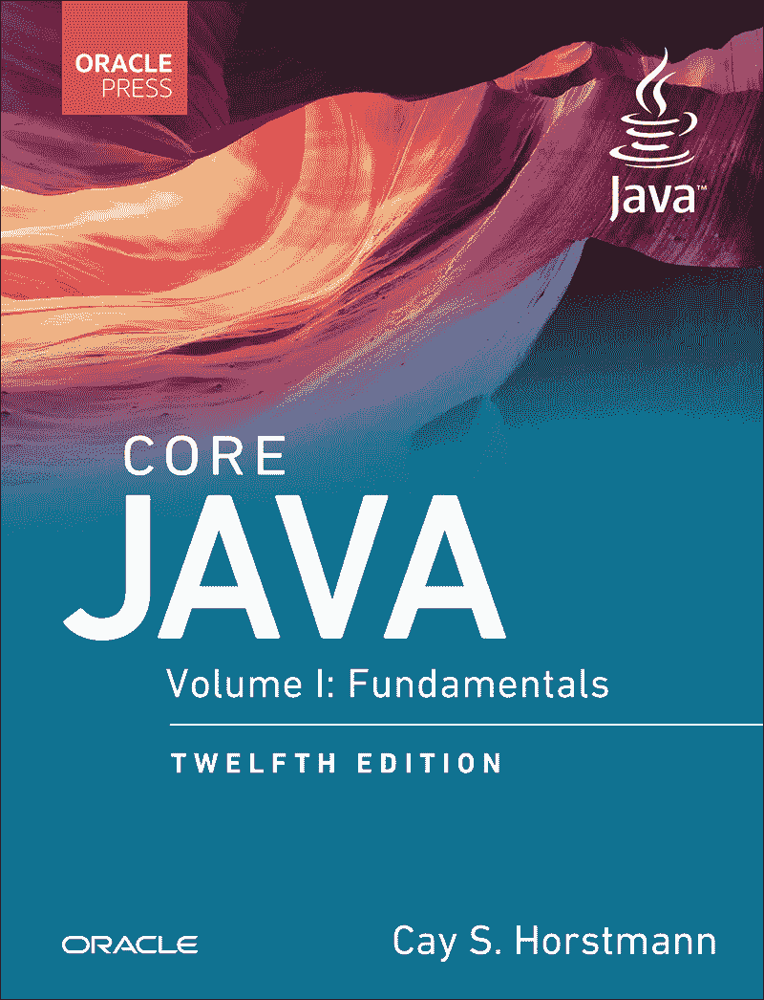


# 关于本电子书

ePUB 是一种开放的行业标准电子书格式。然而，不同阅读设备和应用程序对 ePUB 及其许多功能的支持程度不同。可以使用您的设备或应用设置来根据喜好自定义显示效果。您可以自定义的设置通常包括字体、字号、单栏或双栏、横屏或竖屏模式，以及可以点击或触摸放大的图片。有关您的阅读设备或应用程序上设置和功能的更多信息，请访问设备制造商的网站。

许多书籍包含编程代码或配置示例。为了优化这些元素的显示效果，请在单栏横屏模式下查看电子书，并将字体调整为最小设置。除了以流式文本格式呈现代码和配置外，我们还包含了代码的图像，模仿印刷书籍中的呈现效果；因此，当流式格式可能会影响代码列表的显示时，您将看到“点击此处查看代码图像”链接。点击链接即可查看高真代码图像。要返回之前查看的页面，请点击设备或应用上的后退按钮。


波士顿 • 哥伦布 • 纽约 • 旧金山 • 阿姆斯特丹 • 开普敦

迪拜 • 伦敦 • 马德里 • 米兰 • 慕尼黑 • 巴黎 • 蒙特利尔 • 多伦多 • 得里 • 墨西哥城

圣保罗 • 悉尼 • 香港 • 首尔 • 新加坡 • 台北 • 东京

访问我们的网站：[informit.com](http://informit.com)

`ScoutAutomatedPrintCode`

## Pearson 对多样性、公平性和包容性的承诺

Pearson 致力于创作无偏见的内容。我们拥抱多样性的许多维度，包括但不限于种族、民族、性别、社会经济地位、能力、年龄、性取以及宗教或政治信仰。

教育是世界公平和变革的强大力量。它具有改善生活和实现经济流动的潜力。当我们与作者合作并每个产品创建内容时，我们承认有责任展示包容性并融入多元化的学术知识，以便每个人通过学习实现自己的潜力。作为全球领先的学习公司，我们有责任推动变革，并履行我们帮助更多的人为自己创造美好生活并创造更好世界的使命。

我们的目标是有目的地促进实现这样一个世界：

* 每个人都有通过学习获得公平且成功的机会。

* 我们的教育产品和服务具有包容性，并代表了学习者的丰富多样性。

* 我们的教育内容准确反映了我们所服务的学习者的历史和经历。

* 我们的教育内容引发学习者的更深层次讨论，并激励他们扩大自己的学习（和世界观）。尽管我们努力呈现无偏见的内容，但我们希望听到您对此 Pearson 产品的任何担忧或需求，以便我们进行调查和解决。

* 如果您对任何潜在的偏见有疑，请通过 [`www.pearson.com/report-bias.html`](https://www.pearson.com/report-bias.html) 联系我们。

# 第 1 章：Java 简介

## 1.1 作为编程平台的 Java

## 1.2 Java “白皮书”中的热点词汇

### 1.2.1 简单

### 1.2.2 面对象

### 1.2.3 分布式

### 1.2.4 健壮

### 1.2.5 安全

### 1.2.6 架构无关

### 1.2.7 可移植性

### 1.2.8 解释型

### 1.2.9 高性能

### 1.2.10 多线程

### 1.2.11 动态

## 1.3 Java Applets 与互联网

## 1.4 Java 简史

## 1.5 关于 Java 的常见误区

# 第 2 章：Java 编程环境

## 2.1 安装 Java 开发工具包 (JDK)

### 2.1.1 下载 JDK

### 2.1.2 设置 JDK

### 2.1.3 安装源文件和文档

## 2.2 使用命令行工具

## 2.3 使用集成开发环境 (IDE)

## 2.4 JShell

## 3.2 注释

### 3.3.1 整数类型

### 3.3.2 浮点数类型

### 3.3.3 `char` 类型

### 3.3.5 `boolean` 类型

## 3.4 变量与常量

### 3.4.1 声明变量

### 3.4.2 初始化变量

### 3.4.3 常量

### 3.4.4 枚举类型

## 3.5 运算符

### 3.5.1 算术运算符

### 3.5.2 数学函数与常量

### 3.5.3 数值类型之间的转换

### 3.5.4 强制转换

### 3.5.5 赋值

### 3.5.6 增与自减运算符

### 3.5.7 关系运算符与 `boolean` 运算符

### 3.5.8 三元运算符

### 3.5.9 Switch 表达式

### 3.5.10 位运算符

### 3.5.11 括号与运算符优先级

## 3.6 字符串

### 3.6.1 子字符串

### 3.6.2 拼接

### 3.6.3 字符串是不可变的

### 3.6.4 测试字符串的相等性

### 3.6.5 空字符串与 Null 字符串

### 3.6.6 代码点与代码单元

### 3.6.7 `String` API

### 3.6.8 浏览在线 API 文档

### 3.6.9 构建字符串

### 3.6.10 文本块

## 3.7 输入与输出

### 3.7.1 读取输入

### 3.7.2 格式化输出

### 3.7.3 文件输入与输出

## 3.8 控制流

### 3.8.1 块作用域

### 3.8.2 条件语句

### 3.8.3 循环

### 3.8.4 确定循环

### 3.8.5 使用 `switch` 进行多选择

### 3.8.6 终止语句

## 3.9 大数

## 3.10 数组

### 3.10.1 声明数组

### 3.10.2 访问元素

### 3.10.3 “for each” 循环

### 3.10.4 拷贝

### 3.10.5 命令行参数

### 3.10.6 排序

### 3.10.7 多维数组

### 3.10.8 锯齿数组

## 4.1.1 类

### 4.1.3 识别类

## 4.2 使用预定义类

### 4.2.2 Java 库中的 `LocalDate` 类

## 4.3 定义你自己的类

### 4.3.2 多源文件使用

### 4.3.4 构造函数的初步

### 4.3.6 处理 `null` 引用

### 4.3.8 封装的益处

### 4.3.10 私有方法

## 4.4 静态字段与方法

### 4.4.2 静态常量

### 4.4.4 工厂方法

### 4.4.5 `main` 方法

## 4.5 方法参数

### 4.6.1 重载

### 4.6.3 无参数构造函数

### 4.6.5 参数名

### 4.6.7 初始化块

## 4.7 记录 (Records)

## 4.8 包

### 4.8.2 类导入

### 4.8.4 将类添加到包中

### 4.8.6 类路径

## 4.9 JAR 文件

### 4.9.2 清单文件 (Manifest)

### 4.9.4 多版本 JAR 文件

### 4.9.5 关于命令行选项的说明

## 4.10 文档注释

### 4.10.2 类注释

### 4.10.4 字段注释

### 4.10.6 包注释

### 4.11 类设计

# 第 5 章：继承

### 5.1.1 定义子类

### 5.1.3 子类构造函数

### 5.1.5 多态性

### 5.1.7 防止继承：final 类和方法

### 5.1.9 用于 `instanceof` 的模式匹配

### 5.2 `Object`：超类

### 5.2.2 `equals` 方法

### 5.2.4 `hashCode` 方法

### 5.3 泛型数组列表

### 5.3.2 访问数组元素

## 5.4 包装类与自动装箱

## 5.6 抽象类

## 5.8 密封类 (Sealed Classes)

### 5.9.1 `Class` 类

### 5.9.3 资源

### 5.9.5 使用反射在运行时分析对象

### 5.9.7 调用任意方法和构造函数

## 6.1 接口

### 6.1.2 接口的属性

### 6.1.4 静态与私有方法

### 6.1.6 解决默认方法冲突

### 6.1.8 `Comparator` 接口

## 6.2 Lambda 表达式

### 6.2.2 Lambda 表达式的语法

### 6.2.4 方法引用

### 6.2.6 变量作用域

### 6.2.8 关于比较器的更多信息

### 6.3.1 使用内部类访问对象状态

### 6.3.3 内部类有用吗？真的安全吗？

### 6.3.5 从外部方法访问变量

### 6.3.7 静态内部类

### 6.5 代理

### 6.5.2 创建代理对象

## 7.1 处理错误

### 7.1.2 声明检型异常

### 7.1.4 创建异常类

### 7.2.1 捕获异常

### 7.2.3 重新抛出与异常链

### 7.2.5 `try`-with-resources 语句

### 7.3 使用异常的技巧

### 7.4.1 断言概念

### 7.4.3 使用断言进行参数检查

### 7.5 日志记录

### 7.5.2 高级日志记录

### 7.5.4 本地化

### 7.5.6 过滤器 (Filters)

### 7.5.8 日志记录教程

### 8.1 为什么使用泛型编程？

### 8.1.2 谁想成为泛型编程师？

## 8.3 泛型方法

## 8.5 泛型代码与虚拟机

### 8.5.2 转换泛型表达式

### 8.5.4 调用旧代码

### 8.6.1 类型参数不能用基本类型实例化

### 8.6.3 你不能创建参数化类型的数组

### 8.6.5 你不能实例化类型变量

### 8.6.7 类型变量在泛型类的静态上下文中无效

### 8.6.9 你可以绕过检型异常检查

### 8.6.10 避免擦除后的冲突

## 8.7 泛型的继承规则

## 8.8 通配符类型

### 8.8.2 通配符的上界类型边界

### 8.8.4 通配符捕获

## 8.9 反射与泛型

### 8.9.2 使用 `Class<T>` 参数进行类型匹配

### 8.9.4 类型字面量

# 第 9 章：集合

## 9.1 Java 集合框架

### 9.1.2 `Collection` 接口

### 9.1.4 泛型工具方法

## 9.2 集合框架中的接口

## 9.3 具体集合

### 9.3.2 数组列表

### 9.3.4 树集合

### 9.3.6 优先级队列

## 9.4 Map

### 9.4.2 更新 Map 条目

### 9.4.4 弱哈希映射

### 9.4.6 枚举集合与映射

## 9.5.1 小规模集合

### 9.5.3 子范围

### 9.5.5 同步视图

## 9.6.1 为什么使用泛型算法？

### 9.6.3 二分查找

### 9.6.5 批量操作

### 9.6.7 编写自己的算法

## 9.7 遗留集合

### 9.7.2 枚举器

### 9.7.4 栈

## 10.2.1 创建帧

### 10.3.1 使用 2D 形状操作

### 10.3.3 使用字体

### 10.4.1 基础事件处理概念

### 10.4.3 简洁地指定监听器

### 10.4.5 动作 (Actions)

### 10.4.7 AWT 事件层次结构

## 10.5 偏好 (Preferences)

# 第 11 章：使用 Swing 的界面组件

## 11.1 Swing 与模型-视图-控制器模式

## 11.2 布局管理导论

### 11.2.2 边界布局布局 (Border Layout)

### 11.3.1 文本框

### 11.3.3 密码框

### 11.3.5 滚动面板

## 11.4 选择组件

### 11.4.2 单选按钮

### 11.4.4 组合框

### 11.5.1 菜单构建

### 11.5.3 复选框与单选按钮菜单项

### 11.5.5 键盘助记键与加速器

### 11.5.7 工具栏

### 11.6.1 网格包布局 (Grid Bag Layout)

### 11.6.1.2 权重字段

### 11.6.1.4 内边距 (Padding)

### 11.6.1.6 网格包布局配方

### 11.6.2 自定义布局管理器

## 11.7 对话框 (Dialogs)

### 11.7.2 创建对话框

### 12.2.1 新建线程

### 12.2.3 阻塞与等待线程

### 12.3.1 中断线程

### 12.3.3 线程名称

### 12.3.5 线程优先级

## 12.4 同步

### 12.4.2 竞态条件详解

### 12.4.4 条件对象

### 12.4.6 同步块

### 12.4.8 volatile 字段

### 12.4.10 原子性 (Atomics)

## 12.4.13 需需初始化

## 12.5 线程集合

### 12.5.2 高效的 Map、Set 和 Queue

### 12.5.4 并发哈希映射的批量操作

### 12.5.6 写时复制数组

### 12.5.8 旧版本的线程安全集合

### 12.6.1 Callables 和 Futures

### 12.6.3 控制任务组

## 12.7 异步计算

### 12.7.2 组合 Completable Futures

## 12.8 进程

### 12.8.2 运行进程

## 附录

* 反射与代理

* 异常处理

* 集合框架

* 图形用户界面设计

* 1.2 Java“白皮书”热词

* 1.4 Java 简史

2. 对象化（Object-Oriented）

4. 健壮（Robust）

6. 架构中立（Architecture-Neutral）

8. 解释执行型（Interpreted）

10. 多线程（Multithreaded）

简单来说，面向对象设计是一种关注数据“对象”以及指向这些对象的接口的编程技术。用木工工作来类比，一个“面向对象”的木工主要关注他正在制作的椅子，其次才是制作椅子时使用的工具；而一个“非面向对象”的木工则首要考虑他的工具。Java 的面向对象功能本质上与 C++ 是类似的。

在开发 Java 时，面向对象方法已经非常成熟。Java 的面向对象特性与 C++ 相当。Java 和 C++ 之间的主要区别在于多继承，Java 用一个更简单的接口概念取代了多继承。与 C++ 相比，Java 的运行时检查能力（在第 5 章 中讨论）更为丰富。

### 1.2.3 分布式

Java 拥有丰富的例程库来处理 HTTP 和 FTP 等 TCP/IP 协议。Java 应用程序可以通过 URL 在网络上打开并访问对象，就像访问本地文件系统一样简单。

在如今，这被认为是理所当然的——但在 1995 年，从 C++ 或 Visual Basic 程序连接到 Web 服务器是一项巨大的工程。

### 1.2.4 健壮

Java 旨在编写在各种方面都必须可靠的程序。Java 非常强调早期检查可能的问题、后期的动态（运行时）检查，以及消除易错的情况。……Java 和 C/C++ 之间最大的区别是 Java 拥有一种指针模型，它消除了覆盖内存和损坏数据的可能性。

Java 编译器可以检测出许多在其他语言中只会在运行时出现的问题。至于第二点，任何花费数小时去追踪由指针 bug 引起的内存损坏的人都会对 Java 的这一方面感到非常满意。

### 1.2.5 安全

Java 旨在用于网络化/分布式环境。为了这一目标，安全性被了高度关注。Java 能够构建无病毒、防篡改的系统。

从一开始开始，Java 的设计就使得某些攻击变得不可能，其中包括：

* 溢出运行时栈——蠕虫和病毒常见的攻击手段

* 在没有权限的情况下读写文件

最初，Java 对下载代码的态度是“放尽管来吧！”。不可信的代码在沙箱环境中执行，那里不会影响宿主系统。用户可以放心，不会发生任何坏事，因为 Java 代码无论来自何处，永远无法逃离沙箱。

然而，Java 的安全模型是复杂的。在第一个 Java 开发包发布后不久，普林斯大学的一组安全专家发现了允许不可信代码攻击宿主系统的细微 bug。

最初，安全漏洞被很快修复。遗憾的是，随着时间的推移，黑客变得越来越擅长发现安全架构实现中的细微缺陷。Sun 以及后的 Oracle 在跟进漏洞修复方面面临很大压力。

在经历了多次引起关注的攻击后，浏览器厂商和 Oracle 变得越来越谨慎。一段时间内，远程代码必须经过数字签名。如今，通过浏览器交付 Java 应用程序已成为遥远记忆。

 注意

尽管从回想来看，Java 的安全模型并没有最初预想的那么成功，但 Java 远于时代。微软的一种竞争性代码交付机制 ActiveX 仅依赖数字签名来确保安全。显然这是不够的：正如任何微软产品的用户都可以证实的那，来自知名供应商的程序也会崩溃并造成损害。

### 1.2.6 架构中立


编译器生成一种与架构无关的对象文件格式。只要存在 Java 运行时系统，编译后的代码就可以在许多处理器上执行。Java 编译器通过生成字节码指令来实现这一点，这些指令与特定的计算机架构无关。相反，它们的设计目标是既易于在任何机器上解释，又易于即时翻译成原生机器代码。

为“虚拟机”生成代码在当时并不是一个新主意。`Lisp`、`Smalltalk` 和 `Pascal` 等编程语言已经使用了这种技术多年。

当然，解释虚拟机指令的速度比全速运行机器指令要慢。然而，虚拟机可以选择将执行频繁的字节码序列翻译成机器代码——这个过程称为及时编译（just-in-time compilation）。

Java 虚拟机还有另一个优势。它增加了安全性，因为它可以检查指令序列的行为。

### 1.2.7 可移植性

与 `C` 和 `C++` 不同，规范中没有“依赖于实现”的方面。基本数据类型的大小是有规定的，对它们进行算术运算的行为也是有规定的。

例如，Java 中的`int`始终是 32 位整数。在 `C/C++` 中，`int`可以意味着 16 位整数、32 位整数或编译器厂商喜欢的任何尺寸。唯一的限制是`int`类型的字节数至少要与`short int`一样，且不能比`long int`多。数值类型具有固定尺寸消除了一个大的移植头恼。二进制数据以固定格式存储和传输，消除了对字节顺序的困惑。字符串以标准的 Unicode 格式保存。

作为系统一部分库定义了可移植的接口。例如，有一个抽象的`Window`类以及其针对 UNIX、Windows 和 Macintosh 的实现。

`Window`类的例子可能选得并不好。正如任何尝试过的人所知，要实现一个在 Windows、Macintosh 和十种版本的 UNIX 上看起来良好的用户界面，是一项英雄级规模的努力。Java 1.0 付出了这种英雄式的努力，提供了一个简单的工具包，在多个平台上提供了用户界面元素。遗憾的是，结果是导致该库在经过大量工作后，在不同系统上只能产生勉强可接受的结果。那个最初的用户界面工具包自那时被替换、再次被替换，跨平台的可移植性仍然是一个问题。

然而，对于所有与用户界面无关的领域，Java 库在让你以独立平台的方式工作方面做得非常好。你可以处理文件、正则表达式、XML、日期和时间、数据库、网络连接、线程等，而无需担心底层的操作系统。不仅你的程序是可移植的，Java API 的质量通常比原生的 API 高。

### 1.2.8 解释型

Java 解释器可以在任何已移植了解释器的机器上直接执行 Java 字节码。由于链接是一个更增量且轻量的过程，开发过程可以更加快速且具有探索性。

这确实是一个突破。任何用过 `Lisp`、`Smalltalk`、`Visual Basic`、`Python`、`R` 或 `Scala` 的人都知道什么是“快速且探索性”的开发过程。你尝试某些东西，并立即看到结果。在 Java 存在的前 20 年里，开发环境并没有关注这种体验。直到 Java 9，`jshell`工具才支持快速和探索性的编程。

### 1.2.9 高性能

虽然解释型字节码的性能通常足够，但在某些情况下需要更高的性能。字节码可以即时（在运行时）翻译成运行应用程序的特定 CPU 的机器代码。

| --- | --- | --- | --- |
| 1.1 | 1997 | 内部类 | 477 |
| 1.3 | 2000 | 无 | 1,840 |
| 5.0 | 2004 | 泛型类、“for each”循环、变长参数、自动装箱、元数据、枚举、静态导入 | 3,279 |
| 7 | 2011 | Switch 字符串、二进制字面量、异常处理 | 4,024 |
| 9 | 2017 | 模块、各种语言增强 | 6,005 |
| 17 | 2021 | Switch 表达式、文本块、instanceof 模式匹配、记录、密封类 | 4,859 |

**表 1.1** Java 语言的发展

### 1.5 关于 Java 的误解

本节以关于 Java 的误解注释列表结束。

*Java 是 HTML 的扩展*

Java 是一种编程语言；HTML 是描述网页结构的方式。它们唯一的共同点是曾经存在用于网页中放置 Java applet 的扩展。

*我使用 XML，所以我不需要 Java*

Java 是一种编程语言；XML 是描述数据的方式。你可以用任何编程语言处理 XML，但 Java API 为 XML 处理提供了极佳的支持。此外，许多重要的 XML 工具是用 Java 实现的。更多信息见第二卷。

*Java 是一种容易学习的语言*

没有像 Java 这样强大的编程语言是容易的。你必须区分编写玩具程序的简单性和执行严肃工作的难度。此外，请注意本书只有七章讨论了 Java 语言。两卷中的其余章节展示了如何使用该语言。

*Java 将成为所有平台的通用编程语言*

这在理论上是可能的。但在实践中，某些领域的其他语言根深蒂固。`Objective C` 及其继者 `Swift` 不会在 iOS 设备上被取代。浏览器中发生的一切由 JavaScript 控制。Windows 程序用 `C++` 或 `C#` 编写。Java 在服务器端编程和跨平台客户端方面具有优势。

* 2.2 使用命令行工具

* 2.4 JShell

在本章中，你将学习如何安装 Java 开发工具包（JDK）以及如何编译和运行 Java 程序。你可以在终端窗口中输入命令来运行 JDK 工具。然而，许多程序员更倾向于集成开发环境带来的舒适感。你将学习如何使用免费获取的开发环境来编译和运行 Java 程序。一旦你掌握了本章中的技术并选择了你的开发工具，就可以准备进入第 3 章](#ch03.xhtml_ch3) 了，在这一章中你将开始探索 Java 编程语言。

### 2.1 安装 Java 开发工具包

除了 Oracle 外，还有许多组织免费提供 Java 开发工具包（JDK）。这包括 Amazon、Azul、Eclipse、Microsoft、Red Hat 等。

### 2.1.1 下载 JDK

你可以从[`oracle.com/javadownload`](http://oracle.com/javadownload) 下载 Oracle JDK，从`jdk.java.net`下载 OpenJDK，或者通过第三方的各自下载网站下载 JDK。你应该使用 Java SE 17 (LTS) JDK。参见表 2.1](#ch02.xhtml_ch02tab01) 获取在下载网站上可能遇到的缩写和术语的总结。

| 名称 | 缩写 | 解释 |
| --- | --- | --- |
| Java Development Kit | JDK | 为想要编写 Java 程序的程序员提供的软件。 |
| Standard Edition | SE | 用于桌面和服务器应用程序的 Java 平台。 |
| OpenJDK | — | Java 的免费开源实现。 |
| OpenJ9 | — | 由 IBM 开发的另一个即时编译器。 |

* 在 Mac 上，运行安装程序。它将软件安装到`/Library/Java/JavaVirtualMachines/jdk-17.0.jdk/Contents/Home`。使用 Finder 找到它。

```
javac --version
javac 17.0.4
```

```
export PATH=jdk/bin:$PATH
```

2.  在你的主目录中创建一个`javasrc`目录。如果你愿意，可以在终端窗口中此操作。

4.  将`src.zip`文件解压到`javasrc`目录。在终端窗口中，你可以执行命令：

```
jar xvf jdk/lib/src.zip
```

 提示

`src.zip`文件包含了所有公共库的源码。如需获取更多源码（用于编译器、虚拟机、原生方法和私有辅助类），请访问 [`http://openjdk.java.net`](http://openjdk.java.net)。

文档包含在一个与 JDK 隔离开的压缩文件中。你可以从 [`www.oracle.com/technetwork/java/javase/downloads`](http://www.oracle.com/technetwork/java/javase/downloads) 下载文档。按照以下步骤操作：

1.  下载文档 zip 文件。它名为`jdk-17.0.x_doc-all.zip`。

```
jar xvf Downloads/jdk-17.0.x_doc-all.zip
```

2.  进入`corejava/v1ch02/Welcome`目录。（`corejava`目录是你安装源码源码的地方）。库源码以压缩文件`lib/src.zip`的形式包含在 JDK 中。解压该文件即可获取源码。只需执行以下操作：
    *   在你的主目录中创建一个`javasrc`目录。如果你愿意，可以在终端窗口中此操作。
    *   将`src.zip`文件解压到`javasrc`目录。在终端窗口中，你可以执行命令：

```
jar xvf jdk/lib/src.zip
```

3.  输入以下命令：

```
java Welcome
```

```
1 /**
2  * @version 1.30 2014-02-27
3  */
4 
5    public static void main(String[] args) {
6 
7       System.out.println(greeting);
8 
9          System.out.print("=");
10 
11 }
```

**列表 2.1** `Welcome`

在集成开发环境时代，许多程序员不熟悉在终端中运行程序。可能会出现许多问题，导致令人沮丧的结果。请注意以下点：

*   如果你手动输入程序，请确保正确输入大小写字母。特别是，类名是`Welcome`而不是`welcome`或`WELCOME`。
*   如果你收到类似“无效命令或文件名”或“javac: 找不到命令”的消息，请回去检查你的安装，特别是执行路径设置。
    *   在 Linux 下，检查`Welcome.java`的大小写是否正确。
*   如果你启动程序并收到一条关于`java.lang.NoClassDefFoundError`的错误信息，请仔细检查出错的类名。
    如果你收到关于`welcome`（注意是小字母`w`）的提示，那么你应该重新执行带有大写字母`W`的`java Welcome`命令。一如既往，Java 对大小写是敏感的。
    如果你收到关于`Welcome/java`的提示，意味着你不小心输入了`java Welcome.java`。请重新执行命令`java Welcome`。
*   如果你输入了`java Welcome`且（（注：原文此处应为`java Welcome`）但虚拟机找不到`Welcome`类，请检查是否有人在你的系统上设置了`CLASSPATH`环境变量。全局设置此变量并不是好主意，但 Windows 上某些编写得不好的软件安装程序确实会这样做。按照设置`Path`环境变量相同的步骤操作，但这次请删除该设置。

 提示

[`http://docs.oracle.com/javase/tutorial/getStarted/cupojava`](http://docs.oracle.com/javase/tutorial/getStarted/cupojava) 上的优秀教程对学者可能会遇到的“陷阱”有更详细的介绍。

 注意事项

如果你只有一个源文件，可以跳过`javac`命令。此功能适用于 shell 脚本（以“shebang”行`#!/path/to/java`开头），或许也用于简单的学生程序。一旦你的程序变得复杂，你就需要使用`javac`了。

`Welcome`程序并不特别有趣。接下来，尝试一个图形化应用程序。这个程序是一个简单的图像文件查看器，用于加载并显示图像。和之前一样，从命令行编译并运行该程序。

1.  打开终端窗口。
2.  切换到目录`corejava/v1ch02/ImageViewer.`。
3.  输入以下内容：

```
java ImageViewer
```

```
1  import java.awt.*;
2  
3  import javax.swing.*;
4  
5  /**
6   * @version 1.31 2018-04-10
7   */
8  
9  {
10 
11    {
12 
13          {
14 
15             frame.setTitle("ImageViewer");
16 
17             frame.setVisible(true);
18 
19    }
20 
21 }
22 
23 
24  * 一个带有用于显示图像的标签的框架。
25 
26 class ImageViewerFrame extends JFrame
27 
28    private static final int DEFAULT_WIDTH = 300;
29 
30 
31    {
32 
33 
34 
35       var label = new JLabel();
36 
37 
38 
39       var chooser = new JFileChooser();
40 
41 
42 
43       var menuBar = new JMenuBar();
44 
45 
46 
47       menuBar.add(menu);
48 
49       var openItem = new JMenuItem("Open");
50 
51 
52       openItem.addActionListener(event ->
53 
54             // 显示文件选择器对话框
55 
56 
57 
58             if (result == JFileChooser.APPROVE_OPTION)
59 
60                String name = chooser.getSelectedFile().getPath();
61 
62             }
63 
64       var exitItem = new JMenuItem("Exit");
65 
66       exitItem.addActionListener(event ->
67 
68    }
69 
70 }
```

2.  在向导对话框中选择“Java Project”。

4.  点击完成（Finish）按钮。项目现在已创建。

6.  在左侧面板中右键点击项目名称（Welcome）。选择运行（Run）→ 运行（Run As）→ Java （Java Application）。程序输出显示在控制台面板。

预计这个程序没有拼写错误或错误（毕竟它只有几行代码）。让我们假设一下，你的代码偶尔包含拼写错误（甚至是语法错误）。试一下吧，例如通过以下方式更改`String`的大小写来破坏你的文件：

```
```

注意`string`下方的波浪线。在源代码下方的标签中，点击问题（Problems）并展开三角形，直到看到一条关于未知`string`类型的错误信息（参见图 2.8）。点击错误消息。光标将移动到编辑面板中的匹配行，你可以在那里纠正错误。这让你能够快速修复错误。

## 2.4 JShell

```
| Welcome to JShell -- Version 17.0.4
```

现在输入一个表达式，例如

```
```

`JShell`返回结果——在这种情况下，是字符串“Core Java”中的字符数。

```
```

注意，你*不需要*输入`System.out.println`。`JShell`会自动打印你输入的每一个表达式的值。

输出中的`$1`表示该结果可用于进一步计算。例如，如果你输入

```
```

响应是

```
```

如果你需要多次使用一个变量，可以给它起一个更容易记忆的名字。你必须遵循 Java 语法（在第 3 章中解释），并指定类型，然后是名称。例如

```
answer ==> 42
```

```
Math.
```

```
jshell> Math.
absExact(         acos(            addExact(     asin(
class             copySign(        cos(          cosh(
floorDiv(         floorMod(        fma(          getExponent(
log1p(            max(             min(          multiplyExact(
nextDown(         nextUp(          pow(          random()
sin(              sinh(            sqrt(         subtractExact(
toRadians(        ulp(
```

```
jshell> Math.log
```

现在你可以手动填写剩余部分：

```
$3 ==> -3.0
```

```
jshell> Math.log10(1000)
```

`JShell`让学习 Java 语言和库变得简单而有趣，而无需启动沉重的开发环境，也不需要费结于`public static void main`。

在本章中，你学习了编译和运行 Java 程序的机制。你现在准备好进入第 3 章 了，在那里将开始学习 Java 语言。

# 第 3 章

## Java 中的基础编程结构

### 本章内容

* 3.1 简单的 Java 程序
* 3.3 数据类型
* 3.5 运算符
* 3.7 输入与输出
* 3.9 大数

```
| Welcome to JShell -- Version 17.0.4
```

现在输入一个表达式，例如

```
```


`JShell` 返回结果——在这种情况下，是字符串“Core Java”中的字符数。

```text
```

注意，你不需要输入`System.out.println`。`JShell` 会自动打印你输入的每一个表达式的值。

输出中的`$1`表示该结果可用于进一步计算。例如，如果你输入：

```text
```

响应是：

```text
```

如果你需要多次使用一个变量，可以给它起一个更容易记忆的名字。你必须遵循 Java 语法（在第 3 章中解释），并指定类型，然后是名称。例如：

```text
answer ==> 42
```

```text
Math.
```

```text
jshell> Math.
absExact(         acos(            addExact(     asin(
class             copySign(        cos(          cosh(
floorDiv(         floorMod(        fma(          getExponent(
log1p(            max(             min(          multiplyExact(
nextDown(         nextUp(         pow(          random()
sin(              sinh(           sqrt(         subtractExact(
toRadians(        ulp(
```

```text
jshell> Math.log
```

现在你可以手动填写剩余部分：

```java
jshell> Math.log10(0.001)
```

要重复命令，按 ↑ 键直到你看到想要重新发布或编辑的行。你可以使用 ← 和 → 键在行内移动光标，并添加或删除字符。完成后按回车键。例如，按下并将`0.001`替换为`1000`，然后按回车：

```text
$4 ==> 3.0
```

```java
public class ClassName
   public static void main(String[] args)
      program statements
```

```java
{
}
```

```java
object.method(parameters)
```

```java
System.out.println();
```

```java
System.out.println("We will not use 'Hello, World!'); // is this cute?
```

| 类型 | 大小 | 范围 |
| --- | --- | --- |
| `short` | 2 字节 | –32,768 到 32,767 |
| `byte` | 1 字节 | –128 到 127 |

**表 3.1** Java 整数类型

| 类型 | 大小 | 范围 |
| --- | --- | --- |
| `double` | 8 字节 | 大约 ±1.79769313486231570×10³⁰⁸（15 位有效数字） |

**表 3.2** 浮点类型

`double` 的名称是指这些数字的精度是`float`类型的两倍。（有些人把这些称为双精度数字。）`float`的有限精度（6-7 位有效数字）在许多情况下是不够的。只有当你使用的库需要它们时，或者当你需要存储大量的此类数字时，才使用`float`值。

`float`类型的数字有后缀`F`或`f`（例如，`3.14F`）。不带`F`后缀的浮点数（如`3.14`）始终被视为`double`类型。你可以选择性地提供`D`或`d`后缀（例如，`3.14D`）。

`E`或`e`表示十进制指数。例如，`1.729E3`等于`1729`。

 注意

你可以用十六进制指定浮点字面量。例如，0.125 = 2^(–3) 可以写为`0x1.0p-3`。在十六进制表示中，你使用`p`而不是`e`来表示指数（`e`是十六进制数字）。注意，尾数是用十六进制写的，而指数是用十进制写的。指数的基是 2，而不是 10。

所有浮点运算都遵循 IEEE 754 规范。特别是，有三个特殊值：

- 正无穷
- NaN（非数字）

例如，`Double.POSITIVE_INFINITY`、`Double.NEGATIVE_INFINITY`和`Double.NaN`代表这些值。

 注意

在 Java 中，有三个特殊的浮点值：

- `Double.POSITIVE_INFINITY`
- `Double.NaN`

例如：

```java
double neg = Double.NEGATIVE_INFINITY;

System.out.println(inf); // 输出 Infinity

System.out.println(nan); // 输出 NaN
```

```java
public static void main(String[] args)
```

| 转义序列 | 含义 | Unicode |
| --- | --- | --- |
| `\t` | 制表符 | `\u0009` |
| `\r` | 回车 | `\u000d` |
| `\"` | 双引号 | `\u0022` |
| `\\` | 反斜杠 | `\u005c` |
| `\`*newline* | 仅用于文本块：将此行与下一行合并 | — |

**表 3.3** 特殊字符的转义序列

```java
// \u000A is a newline

// look inside c:\users

boolean isReady = true;
```

注意每个声明末尾的分号。因为声明是一条完整的语句，分号是必要的。

```java
```

布尔表达式用于控制语句（如`if`和`while`）来决定执行路径。

```java
System.out.println("The system is ready.");

System.out.println("Please wait.");
```

**在 Java 中，`boolean` 类型与 C 或 C++ 等语言不同。**

## 3.4 变量与常量

与所有编程语言一样，变量用于存储值。常量是值不会改变。在接下来的章节中，你将学习如何声明。

### 3.4.1 声明变量

在 Java 中，通过先放置类型，然后是名称来声明变量。这里是一些示例：

```java
int vacationDays;

boolean done;

int i, j; // 都是整数

Box box; // "Box" 是类型，"box" 是变量名

Box aBox;

int vacationDays;
```

通过在左侧使用之前声明的变量名、等号（`=`）以及右侧某个带有适当值的 Java 表达式来给变量赋值。

```java
vacationDays = 12;

int vacationDays = 12;

double salary = 65000.0;

int vacationDays = 12; // 在此处声明变量是可以的

var vacationDays = 12; // vacationDays 是一个 int
```

正如你将在下一章中看到的，这一特性可以让对象的声明变得更简洁。

 C++ 提示

C 和 C++ 区分了变量的声明与定义。例如：

```java
```

是一个定义，而：

```java
```

是一个声明。在 Java 中，没有与定义分离开来的声明。

### 3.4.3 常量

在 Java 中，你使用`final`关键字来表示常量。例如：

点击此处查看代码图像

```java
{
   {
      double paperWidth = 8.5;

      System.out.println("Paper size in centimeters: "
   }
}
```

`final`关键字表示你可以对变量赋值一次，然后它的值就会被固定下来。习惯上，使用全大写字母命名常量。

在 Java 中，创建一个常量使其在单个类的内部多个方法中可用，可能更为常见。这些通常被称为类常量。

使用关键字`static final`来设置一个类常量。这里是一个使用类常量的示例：

点击此处查看代码图像

```java
{
    {
       double paperHeight = 11;

          + paperWidth * CM_PER_INCH + " by " + paperHeight * CM_PER_INCH);
}
```

```java
enum Size { SMALL, MEDIUM, LARGE, EXTRA_LARGE };

Size s = Size.MEDIUM;

double x = 4;

System.out.println(y); // prints 2.0

double y = Math.pow(x, a);
```

```java
Math.sin

Math.tan

Math.atan2

Math.exp

Math.log10

Math.PI
```

 Tip

你可以通过在源文件顶部添加以下行，避免在数学方法和常量上使用`Math`前缀：

点击此处查看代码图像

```java
```

例如：

点击此处查看代码图像

```java
```

静态导入在第 4 章中介绍。

 Note

`Math`类中的方法使用计算机浮点单元的程序以获得最快性能。如果完全可预测的结果比性能更重要，请使用`StrictMath`类。它实现了来自“自由分发数学库”（`www.netlib.org/fdlibm`）的算法，保证在所有平台上得到相同的结果。

 Note

`Math`类提供了几种方法使整数算术更安全。当计算溢出时，数学运算符会静默地返回错误结果。例如，十亿乘以三（`1000000000 * 3`）的结果为`-1294967296`，因为最大的`int`值略大于二十亿。如果你改为调用`Math.multiplyExact(1000000000, 3)`，会生成一个异常。你可以捕获该异常或让程序终止，而不是静默地继续使用错误结果。还有`addExact`、`subtractExact`、`incrementExact`、`decrementExact`、`negateExact`和`absExact`方法，它们都带有`int`和`long`参数。

### 3.5.3 数值类型之间的转换

从一种数值类型转换为另一种。图 3.1 显示了合法的转换。

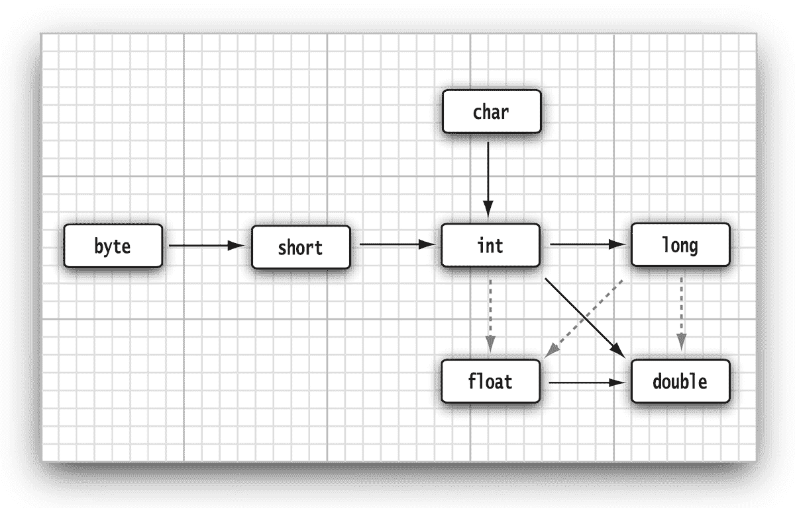

**图 3.1** 数值类型之间的合法转换

图 3.1 中的六条实线箭头表示无信息丢失的转换。三个虚线箭头表示可能会丢失的转换。例如，像`12345`这样的大整数超过了`float`的表示范围。

### 3.5.4 强制转换

在上一节中，你看到`int`值是自动转换的。另一方面，显然在某些时候你需要强制转换。可能丢失的数值转换通过强制转换完成。强制转换的语法是在括号中给出目标类型，然后是变量名。例如：

```java
int nx = (int) x;
```

现在，变量`nx`的值为`9`，因为转换浮点值丢弃了小数部分。

如果你想将浮点数四舍五入到最近整数（在大多数情况下更有用），使用`Math.round`方法：

```java
int nx = (int) Math.round(x);
```

现在，变量`nx`的值为`10`。你仍然需要使用强制转换`(int)`，原因是`round`方法返回的是`long`，而`long`只能通过强制转换赋值给`int`。

 Caution

如果你尝试将一种类型的数字转换为超出目标类型范围的类型，结果将是一个具有不同值的截断数字。例如，`(byte) 300`实际上是`44`。

 Note

你不能在`boolean`值和任何数值类型之间进行强制转换。这种约定避免了常见的错误。在需要将`boolean`值转换为数字的少数情况下，你可以使用`b ? 1 : 0`等条件表达式。

### 3.5.5 赋值

使用赋值运算符有一个方便的快捷方法。例如：

```java
```

等同于：

```java
```

（通常，将运算符放在`=`符号左侧，例如`*=`或`%=`。）

 Caution

如果运算符产生的类型与左侧不同，则会被强制转换。例如，如果`x`是`int`，那么语句：

```java
```

是有效的，将`x`设置为`(int)(x + 3.5)`。

注意在 Java 中，赋值是一个表达式。也就是说，它有一个值——即被赋值的值。你可以使用那个值——例如将其赋值给另一个变量。考虑这些语句：

```java
int y = x += 4;

int x = 1;
int y = x;

int n = 12;
```

将`n`改变为`13`。由于这些运算符改变了变量的值，因此它们不能应用于数字本身。例如，`4++`不是一个合法的语句。

这些运算符有两种形式；你刚刚看到了放在操作数之后的后置形式。还有前缀形式`++n`。两者都会将变量的值改变 1。它们之间的区别仅在它们用于表达式内部时出现。前缀形式先执行加法；后置形式求值为变量的旧值。

点击此处查看代码图片

```java
int n = 7;
int b = 2 * n++; // 现在 b 是 14, n 是 8
```

```java
3 == 7
```

```java
3 != 7
```

```java
expression1 && expression2
```

```java
x != 0 && 1 / x > x + y // 防止除以 0
```

```java
condition ? expression1 : expression2
```

```java
x < y ? x : y
```

```java
String seasonName = switch (seasonCode)
      case 0 -> "Spring";
      case 2 -> "Fall";
      default -> "???";
```

`case`标签也可以是字符串或枚举类型的常量。

 注意

`switch`表达式和每个表达式一样都有一个值。注意每个分支中值之前的`->`箭头。

 注意

从 Java 14 开始，有四种（！）形式的`switch`。本节重点介绍最实用的形式。关于所有形式的深入讨论，请参阅第 98 页的第 3.8.5 节，使用`switch`进行多重选择“[使用`switch`进行多重选择]”。

`case`标签也可以是字符串或枚举类型的常量。

`switch`表达式和每个表达式一样都有一个值。注意每个分支中值之前的`->`箭头。

从 Java 14 开始，有四种（！）形式的`switch`。本节重点介绍最实用的形式。

```java
a && b || c
```

```java
(a && b) || c
```

```java
a += b += c
```

```java
a += (b += c)
```

| 运算符 | 结合性 |
| --- | --- |
| `! ~ ++ -- +`（一元）`-`（一元）`()`（强制转换）`new` | 从右到左 |
| `+ -` | 从左到右 |
| `< <= > >= instanceof` | 从左到右 |
| `&` | 从左到右 |
| `&#124;` | 从左到右 |
| `&#124;&#124;` | 从左到右 |
| `= += -= *= /= %= &= &#124;= ^= <<= >>= >>>=` | 从右到左 |

**表 3.4** 运算符优先级

 C++ Note

与 C 或 C++ 不同，Java 没有逗号运算符。然而，你可以在`for`语句的第一和第三槽中使用逗号分隔的表达式列表。

## 3.6 字符串

从概念上讲，Java 字符串是 Unicode 字符序列。例如，字符串`"Java\u2122"`由五个 Unicode 字符 J、a、v、a 和 ™ 组成。Java 没有内置的字符串类型。相反，标准 Java 库包含一个预定义的类，名副其实地`String`。每个带引号的字符串都是`String`类的实例：

点击此处查看代码图片

```java
String greeting = "Hello";
```

这创建了一个由字符`"Hel"`组成的字符串。

```java
String greeting = "Hello";
```

 Note

与 C 和 C++ 类似，Java 从`0`开始计算字符串中的代码单元和代码点。

`substring`的第二个参数是你不想复制的第一个。在我们的案例中，我们想要复制位置 0、1 和 2（从位置 0 到位置 2 包含）。按照`substring`的计数方式，这意味着从位置 0 包含到位置 3 不包含。

`substring`工作方式有一个优势：计算子字符串的长度非常简单。字符串`s.substring(a, b)`的长度始终是`b`−`a`。例如，子字符串`"Hel"`的长度为 3 - 0 = 3。

### 3.6.2 拼接

Java 与大多数编程语言一样，允许你使用`+`来连接（拼接）两个字符串。

点击此处查看代码图片

```java
String PG13 = "deleted";
```

前面的代码将变量`message`设置为字符串`"Expletivedeleted"`。（注意单词之间缺少空格：`+`运算符按照接收到的顺序连接两个字符串，正如它们被提供的方式一样。）


当你将字符串与非字符串的值拼接时，后者会被转换为字符串。（正如你将在第 5 章中看到的，每个 Java 对象都可以转换为字符串。）例如，

```
String rating = "PG" + age;
System.out.println("The answer is " + answer);
String all = String.join(" / ", "S", "M", "L", "XL");
```

从 Java 11 开始，有一个`repeat`方法：

点击此处查看代码图片

```
```

### 3.6.3 字符串是不可变的

`String`类没有提供更改现有字符串中字符的方法。如果你想将`greeting`变为`"Help!"`，你不能直接将`greeting`的最后位置改为`'p'`和`'!'`。如果你是一个程序员，这可能会让你感到无助。我们如何修改字符串？在 Java 中，这很简单：将你想保留的子字符串与你想替换的字符拼接起来。

点击此处查看代码图片

```
greeting = greeting.substring(0, 3) + "p!";
```

如果你是一个 C++ 程序员并使用 ANSI C++ 定义的`string`类，那么你可能会发现 Java 的`String`类型要舒服得多。C++ 的`string`对象也会执行内存的自动分配和释放。内存管理是通过构造函数、赋值运算符和析构函数显式执行的。然而，C++ 字符串是可变的——你可以修改字符串中的单个字符。

### 3.6.4 测试字符串的相等性

要测试两个字符串是否相等，请使用`equals`方法。该表达式

```
```

如果字符串`s`和`t`相等，则返回`true`，否则返回`false`。注意，`s`和`t`可以是字符串变量也可以是字符串字面量。例如，表达式

```
```

是完全合法的。要测试两个字符串除了大小写区别外是否相同，请使用`equalsIgnoreCase`方法。

点击此处查看代码图片

```
```

**不要**使用`==`运算符来测试两个字符串是否相等！它只判断字符串是否存储在相同的位置。当然，如果字符串位于相同的位置，它们必须是相等。但完全有可能在不同的地方存储相同字符串的多个副本。

点击此处查看代码图片

```
if (greeting == "Hello") . . .
if (greeting.substring(0, 3) == "Hel") . . .
```

如果虚拟机总是安排让相同的字符串被共享，那么你就可以使用`==`运算符来测试相等性。但只有字符串*字面量*会被共享，而不是通过`+`或`substring`等操作产生的字符串。因此，*永远不要*使用`==`来比较字符串，否则你可能会导致程序中出现一种最糟糕的 bug——一种似乎随机发生的间歇性 bug。

 C++ 注意事项

如果你习惯了 C++ 的`string`类，你必须对相等性测试格外小心。C++ 的`string`类重载了`==`运算符来测试字符串内容的相等性。Java 特意让字符串具有与数值值相似的“外观和感受”，但在相等性测试中又让字符串的行为像指针一样，这或许有些令人遗憾。语言设计者本可以为字符串重新定义`==`，就像他们为`+`做了特殊安排一样。唉，每种语言都有自己的不一致之处。

C 程序员从不使用`==`来比较字符串，而是使用`strcmp`。Java 的方法`compareTo`是`strcmp`的完全对应物。你可以使用：

点击此处查看代码图片

```
```

但使用`equals`似乎更清晰。

### 3.6.5 空字符串和空引用

空字符串`""`是长度为 0 的字符串。你可以通过调用以下代码来测试字符串是否为空

```
```

或者

```
```

空字符串是一个 Java 对象，它持有字符串长度（即`0`）和空内容。然而，`String`变量也可以持有一个特殊值，称为`null`，表示该变量没有关联任何对象。（更多关于`null`的信息请参见第 4 章）。要测试字符串是否为`null`，请使用

```
```

有时，你需要测试字符串既不是`null`也为空。这时使用

点击此处查看代码图片

```
```

你需要先测试`str`是否为`null`。正如你在第 4 章中看到的，在`null`值上调用方法是一个错误。

### 3.6.6 码点和代码单元

Java 字符串是`char`值的序列。正如你在第 3.3.3 节中所示，第 43 页的“`char`类型”，`char`数据类型是用于表示 UTF-16 编码中 Unicode 码点的代码单元。常用的 Unicode 可以用单个代码单元表示。补充字符需要一对代码单元。

`length`方法产生字符串在 UTF-16 编码所需的单元数量。例如：

点击此处查看代码图片

```
int n = greeting.length(); // 是 5
int cpCount = greeting.codePointCount(0, greeting.length());
char first = greeting.charAt(0); // 是 'H'
```

要获取第`i`个码点，使用

点击此处查看代码图片

```
int cp = greeting.codePointAt(index);
char ch = sentence.charAt(1)
int cp = sentence.codePointAt(i);
else i++;
i--;
int cp = sentence.codePointAt(i);
int[] codePoints = str.codePoints().toArray();
String str = new String(codePoints, 0, codePoints.length);
int codePoint = 0x1F37A;
```

这些贯穿全书的 API 注释将帮助你理解 Java 应用程序接口（API）。每个 API 注释都以类名开头，例如`java.lang.String`。（所谓的包名`java.lang`的意义已在第 4 章中进行了解释。）类名之后是一个或多个方法的名称、说明和参数描述。

API 注释没有列出特定类的所有方法，而是以简洁的形式介绍了最常用的方法。要查看完整列表，请参阅在线文档（参见第 3.6.8 节，“阅读在线 API 文档”，位于第 70 页）。

类名后的数字是引入该类的 JDK 版本号。如果后续添加了某个方法，它将有一个独立的版本号。

### `java.lang.String` 1.0

*   `char charAt(int index)`
*   `int codePointAt(int index)` **5**
*   `int offsetByCodePoints(int startIndex, int cpCount)` **5**
*   `int compareTo(String other)`
*   `IntStream codePoints()` **8**
*   `new String(int[] codePoints, int offset, int count)` **5**
*   `boolean isEmpty()`
    如果字符串为空或由空白字符组成，则返回`true`。
    如果字符串等于`other`，则返回`true`。
    如果字符串等于`other`（不区分大小写），则返回`true`。
*   `boolean endsWith(String suffix)`
*   `int indexOf(String str)`
*   `int indexOf(int cp)`
    返回从索引`0`或`fromIndex`开始的第一个等于字符串`str`或代码点`cp`的子字符串的起始位置；如果`str`或`cp`不在此字符串中出现，则返回 -1。
*   `int lastIndexOf(String str, int fromIndex)`
*   `int lastindexOf(int cp, int fromIndex)`
*   `int length()`
*   `int codePointCount(int startIndex, int endIndex)` **5**
*   `String replace(CharSequence oldString, CharSequence newString)`
*   `String substring(int beginIndex)`
    返回一个新字符串，包含从`beginIndex`到字符串末尾或到`endIndex - 1`的所有代码单元。
*   `String toUpperCase()`
*   `String strip()` **11**
*   `String stripTrailing()` **11**
*   `String join(CharSequence delimiter, CharSequence... elements)` **8**
*   `String repeat(int count)` **11**

完成字符串构建后，调用`toString`方法。你将得到一个包含构建器中字符序列的`String`对象。

点击此处查看代码图像

```
String completedString = builder.toString();
```

 注意事项

`StringBuffer`类的效率比`StringBuilder`低，但它允许多个线程添加或删除字符。如果所有的字符串编辑都在单线程中进行（这通常是如此），你应该使用`StringBuilder`。这两个类的 API 是完全相同的。

以下 API 备注包含了`StringBuilder`类最重要的方法。

### `java.lang.StringBuilder` 5

*   `StringBuilder()`
    构造一个空的字符串构建器。
*   `int length()`
    返回构建器或缓冲区中代码单元的数量。
*   `StringBuilder append(String str)`
    追加一个字符串并返回`this`。
*   `StringBuilder append(char c)`
    追加一个代码单元并返回`this`。
*   `StringBuilder appendCodePoint(int cp)`
    追加一个代码点，将其转换为一个或两个代码单元，并返回`this`。
*   `void setCharAt(int i, char c)`
    将第`i`个代码单元设置为`c`。
*   `StringBuilder insert(int offset, String str)`
    在位置`offset`处插入一个字符串并返回`this`。
*   `StringBuilder insert(int offset, char c)`
    在位置`offset`处插入一个代码单元并返回`this`。
*   `StringBuilder delete(int startIndex, int endIndex)`
    删除从`startIndex`到`endIndex - 1`的代码单元并返回`this`。
*   `String toString()`
    返回一个与构建器或缓冲区内容相同的数据字符串。

#### 3.6.10 文本块 (Text Blocks)

Java 15 添加的文本块功能使得提供跨行的字符串字面量变得简单。文本块以`"""`开始，后跟一个换行符。块以另一个`"""`结束：

```
String greeting = """
Hello
World""";
```

与等效的字符串字面量相比，文本块更容易读和写：

```
"Hello\nWorld\n"
```

此字符串包含两个`\n`：一个在`Hello`之后，一个在`World`之后。起始`"""`之后的换行符不包含在字符串字面量中。

如果你不想在最后一行之后有换行符，将结束的`"""`直接放在最后一个字符之后：

```
String prompt = """
Hello, my name is Hal.
Please enter your name: """;
```

文本块特别适合包含其他语言的代码，如 SQL 或 HTML。你可以直接粘贴：

点击此处查看代码图像

```
String html = """
<div class="Warning">
   Beware of those who say "Hello" to the world
</div>
""";
```

注意，你不需要转义引号。只有两种情况需要转义它们：

*   如果文本块以引号结束
*   如果文本块包含三个或更多引号的序列

不幸的是，你仍然需要转义所有的反斜杠。

普通字符串中的所有转义序列在文本块中的工作方式都是相同的。有一种转义序列只在文本块中有效。行尾直接`\`会将此行和下一行连接。例如，

```
"""
Hello, my name is Hal. \
Please enter your name: """;
```

等同于

点击此处查看代码图像

```
"Hello, my name is Hal. Please enter your name: "
```

行结束符通过移除末尾空格并将 Windows 行结束符（`\r\n`）转换为简单的换行符（`\n`）来归一化。在极罕需要保留末尾空格的情况下，将最后一个空格转换为`\s`转义字符。

前导空格的情况更为复杂。考虑一个从左边距缩进的典型变量声明。你也可以对文本块进行缩进：

点击此处查看代码图像

```
String html = """
   <div class="Warning">
     Beware of those who say "Hello" to the world
   </div>
   """;
```

文本块中所有行的公共缩进会被减去。实际字符串是：

点击此处查看代码图像

```
"<div class=\"Warning\">\n Beware of those who say \"Hello\" to the world\n</div>\n"
```

注意，第一行和第三行没有缩进。你的 IDE 可能会愉快地建议缩进所有文本块，仅使用 Tab、仅使用空格或恰当的混合。Java 并明智地没有规定 Tab 的宽度。文本块中所有行的空白前缀必须*完全*匹配。

完全空白的行不包含在缩进移除过程中。然而，结束的`"""`之前的空白是有重要意义的。请确保缩进到你想要剥离的空白末尾。

 注意

注意缩进文本块的公共前缀中混合使用 Tab 和空格。一个被忽略的空格很容易导致结果。

 提示

为了让示例更有趣，我们希望接受输入并正确地格式化输出。

## 3.7 输入与输出

为了让示例更有趣，我们希望接受输入并正确地格式化输出。当然，现代程序使用 GUI 来收集输入。

### 3.7.1 读取输入

你看到向“标准输出流”（即控制台）输出只需调用`System.out.println`。从“标准输入流”`System.in`读取并不那么简单。为了读取输入，你首先构造连接`System.in`的`Scanner`：

点击此处查看代码图像

```
Scanner in = new Scanner(System.in);
```

（构造函数和`new`运算符将在第 4 章](#ch4.ch4）中详细讨论。）

现在你可以使用`Scanner`类的各种方法读取输入。例如，`nextLine`方法读取一行输入。

点击此处查看代码图像

```
System.out.print("What is your name? ");
String name = in.nextLine();
```

在这里使用`nextLine`方法是因为输入可能包含空格。要读取单个单词（由空白分隔），调用

```java
String firstName = in.next();
```

要读取整数，使用`nextInt`方法。

点击此处查看代码图像

```
System.out.print("How old are you? ");
int age = in.nextInt();
```

同样，`nextDouble`方法读取下一个浮点数。

列表 3.2 中的程序询问用户的姓名和年龄，然后打印如下消息：

点击此处查看代码图像

```
Hello, Cay. Next year, you'll be 57
```

最后，注意程序开头的行

```java
import java.util.*;
```

`Scanner`类定义在`java.util`包中。每当你使用不在基础`java.lang`包中定义的类时，你都需要使用`import`指令。

```
import java.util.*;

/**
 * This program demonstrates console input.
 * @version 1.10 2004-02-10
 * @author Cay Horstmann
 */
public class InputTest
{
   public static void main(String[] args)
   {
       Scanner in = new Scanner(System.in);
       // get first input
       System.out.print("What is your name? ");
       String name = in.nextLine();
```


// get second input

```
System.out.print("How old are you? ");
int age = in.nextInt();

// display output on console
System.out.println("Hello, " + name + ". Next year, you'll be " + (age + 1));
```

 注意

`Scanner` 类不适合从控制台读取密码，因为输入内容对任何人都是可见。请为此目的使用 `Console` 类。若要读取密码，请使用以下代码：

```
Console cons = System.console();
String username = cons.readLine("User name: ");
char[] passwd = cons.readPassword("Password: ");
```

出于安全考虑，密码以字符数组的形式返回而非字符串。在你处理完密码后，应该立即用填充值覆盖数组元素。（数组处理请参见第 3.10 节中的“数组”，位于第 109 页。）

使用 `Console` 对象进行输入处理没有使用 `Scanner` 那么方便。你必须一次读取一行输入。没有读取单个单词或数字的方法。

### `java.util.Scanner` 5

- `Scanner(InputStream in)`: 从给定的输入流构造一个 `Scanner` 对象。
- `String nextLine()`: 读取下一行输入。
- `String next()`: 读取下一个输入单词（由空白分隔）。
- `int nextInt()`
- `double nextDouble()`: 读取并转换下一个表示整数或浮点数的字符序列。
- `boolean hasNext()`: 测试输入中是否还有另一个单词。
- `boolean hasNextInt()`
- `boolean hasNextDouble()`: 测试下一个字符序列是否表示整数或浮点数。

### `java.lang.System` 1.0

- `static Console console()` 6: 如果可以通过控制台窗口与用户交互，则返回一个 `Console` 对象，否则返回 `null`。对于任何在控制台窗口中启动的程序，都可以使用 `Console` 对象。否则，其可用性取决于系统。

### `java.io.Console` 6

- `static char[] readPassword(String prompt, Object... args)`
- `static String readLine(String prompt, Object... args)`: 显示提示并读取用户输入，直到输入行结束。可选的 `args` 参数用于提供格式化参数，见下一节。

### 3.7.2 格式化输出

你可以使用 `System.out.print(x)` 语句向控制台打印数字 `x`。该命令将打印具有该类型最大非零数字数量的 `x`。例如，

```
double x = 1000.0 / 3.0;
System.out.print(x);
```

打印

```
3333.3333333333335
```

如果你想显示美元和分，这就会是一个问题。

解决方法是使用 `printf` 方法，它遵循 C 语言库悠久的传统。例如，调用

```
System.out.printf("%8.2f", x);
```

将打印`字段宽度`为 8 个字符、`精度`为 2 个字符的 `x`。这意味着打印输出包含一个前导空格和七个字符：

```
3333.33
```

你可以为 `printf` 提供多个参数。例如：

```
System.out.printf("Hello, %s. Next year, you'll be %d", name, age);
```

每个以 `%` 字符开头的`格式化符`被替换为相应的参数。格式化符结尾的`转换字符`指示要格式化的值的类型：`f` 是浮点数，`s` 是字符串，`d` 是十进制整数。表 3.5 显示了所有转换字符。

大写变体产生大写字母。例如，`"%8.2E"` 将 3333.33 格式化为 `3.33E+03`。

| 转换字符 | 类型 | 示例 |
| :--- | :--- | :--- |
| `d` | 十进制整数 | `15` |
| `x` | 十六进制 | `f` |
| `o` | 八进制 | `37` |
| `f` | 定点法 | `9` |
| `e` | 指数法 | `4` |
| `g` | 通用 | `5` |
| `s` | 字符串 | `abc` |
| `c` | 字符 | `a` |
| `n` | 平台相关 | |

格式化是`特定区域的`。例如，在德国，分组分隔符是点，而不是逗号。第二卷的第 7 章展示了如何控制应用程序的国际化行为。

### 3.7.3 文件输入与输出

要从文件中读取内容，请按如下方式构造 `Scanner` 对象：

```
Scanner in = new Scanner(Path.of("myfile.txt"), StandardCharsets.UTF_8);
```

如果文件名包含反斜杠，请记住使用额外的反斜杠对每个反斜杠进行转义：`"c:\\mydirectory\\myfile.txt"`。

现在你可以使用已经遇到过的任何 `Scanner` 方法从文件中读取内容了。

 Note

在这里，我们指定了 UTF-8 字符编码，这是互联网文件的常用（但非通用）编码。在读取文本文件时你需要知道字符编码（更多信息请参阅第二卷第 2 章）。如果你省略了字符编码，将使用运行 Java 程序的计算机的“默认编码”。这不是一个好主意——程序的行为可能会根据其运行的位置而不同。

 Caution

你可以使用字符串参数来构造 `Scanner`，但扫描器会将该字符串解释为数据，而不是文件名。例如，如果你调用

```
Scanner in = new Scanner("myfile.txt"); // ERROR?
```

那么扫描器将看到十个字符数据：`'m'`、`'y'`、`'f'` 等。这可能不是这种这种情况下的意图。

要写入文件，请构造一个 `PrintWriter` 对象。在构造函数中，提供文件名和字符编码：

```
PrintWriter out = new PrintWriter("myfile.txt", StandardCharsets.UTF_8);
```

如果文件不存在，则会创建它。你可以像打印到 `System.out` 一样使用 `print`、`println` 和 `printf` 命令。

 Note

当你指定相对文件名时，例如 `"myfile.txt"`、`"mydirectory/myfile.txt"` 或 `"../myfile.txt"`，文件将相对于 Java 虚拟机启动时的目录进行定位。如果你从命令 shell 启动程序，通过执行

```
java MyProg
```

那么起始目录就是该命令 shell 的当前目录。然而，如果你使用集成开发环境，则由它来控制起始目录。你可以通过此调用找到目录位置：

```
String dir = System.getProperty("user.dir");
```

如果你在定位文件时遇到困难，请考虑使用绝对路径名，例如 `"c:\\mydirectory\\myfile.txt"` 或 `"/home/me/mydirectory/myfile.txt"`。正如你所看到的，访问文件就像访问 `System.in` 和 `System.out` 一样简单。只有一个陷阱：如果你使用一个不存在的文件构造 `Scanner`，或使用无法创建的文件名构造 `PrintWriter`，就会发生异常。Java 编译器认为这些异常比“除以零”异常更严重。在第 7 章中，你将学习处理异常的各种方法。现在，你只需要告诉编译器你意识到可能出现“输入/输出”异常。你通过在 `main` 方法上标记 `throws` 子句来实现，如下所示：

```
public static void main(String[] args) throws IOException
{
   Scanner in = new Scanner(Path.of("myfile.txt"), StandardCharsets.UTF_8);
   . . .
}
```

你现在已经了解了如何读写包含文本数据的文件。对于高级主题，例如处理字符编码、处理二进制数据、读取目录和写入 zip 文件，请参阅第二卷的第 2 章。

 Note

当你从命令 shell 启动程序时，可以使用你的 shell 的重定向语法并将任何文件附加到 `System.in` 和 `System.out`：

```
java MyProg < myfile.txt > output.txt
```

那么你不必担心处理 `IOException` 了。

`java.util.Scanner`
- `Scanner(Path p, String encoding)` 构造一个使用给定编码从给定路径读取数据的 `Scanner`。
- `Scanner(String data)` 构造一个从给定字符串读取数据的 `Scanner`。

`java.io.PrintWriter`
- `PrintWriter(String fileName)` 构造一个向指定名称文件写入数据的 `PrintWriter`。

`java.nio.file.Path`
- `static Path of(String pathname)` 从给定的路径名构造 `Path`。

## 3.8 控制流

Java 像任何编程语言一样，支持条件语句和循环来决定控制流。从条件语句开始，以 `switch` 语句结束，用于测试许多值。

 Note

Java 的控制结构与 C 和 C++ 相同，但有一些例外。没有 `goto`，但有一个 `break` 的变体，用于跳出循环（在 C 中可能使用了 `goto`）。最后，有一个 `for` 的变体，类似于 C# 中的 `foreach` 循环。

### 3.8.1 块

在学习控制结构之前，你需要更多地了解块。块（或复合语句）由一对大括号组成。块定义了变量的作用域。块可以嵌套在另一个块内部。这里是一个嵌套在 `main` 方法块中的块：

```
public static void main(String[] args)
{
   int n;
   . . .
   {
     int k;
     . . .
   } // k 只定义到这里
}
```

你可以在嵌套块中声明同名的局部变量。例如，以下是一个错误且无法编译：

```
public static void main(String[] args)
{
   int n;
   . . .
   {
      int k;
      int n; // 错误--在内部块中重复声明 n
      . . .
   }
}
```

 Note

在 C++ 中，可以在嵌套块内部重新定义变量。此时内部定义会遮蔽外部定义。这可能是编程错误的来源；因此，Java 不允许。

### 3.8.2 条件语句

Java 中的条件语句形式为：

```
if (condition) statement
```

条件必须由括号包围。

在 Java 中，就像大多数编程语言一样，你通常希望在单个条件为真时执行多个语句。在这种情况下，使用形式如下的块语句：

```
{
  statement1
  statement2
  . . .
}
```

例如：

```
if (yourSales >= target)
{
   performance = "Satisfactory";
   bonus = 100;
}
```

在这段代码中，当 `yourSales` 大于或等于 `target` 时，大括号周围的所有语句都将被执行（参见图 3.7）。

 Note

块（有时称为复合语句）允许你在任何原本允许单个（简单）语句的 Java 编程结构中使用多个（简单）语句。

Java 更通用的条件形式所示（参见图 3.8）：

```
if (condition) statement1 else statement2
```

```
if (yourSales >= target)
{
   performance = "Satisfactory";
   bonus = 100 + 0.01 * (yourSales - target);
}
```

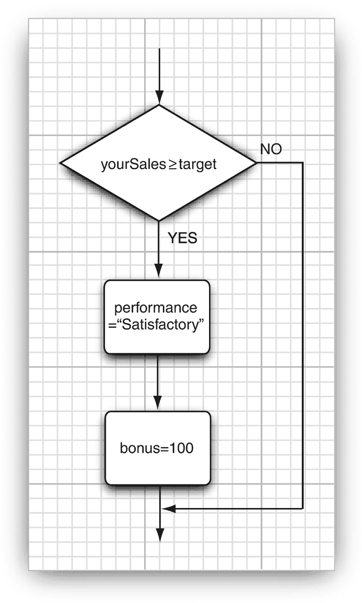

**图 3.7** `if` 语句的流程图

```
else
{
   performance = "Unsatisfactory";
   bonus = 0;
}
```

`else` 部分总是可选的。`else` 会与离它最近的 `if` 组合。因此，在语句中

```
if (x <= 0) if (x == 0) sign = 0; else sign = -1;
```

该 `else` 属于第二个 `if`。当然，使用大括号来明确这段代码是一个好主意：

```
if (x <= 0) { if (x == 0) sign = 0; else sign = -1; }
```

重复的 `if . . . else if . . .` 备选项是常见的（参见图 3.9）。例如：

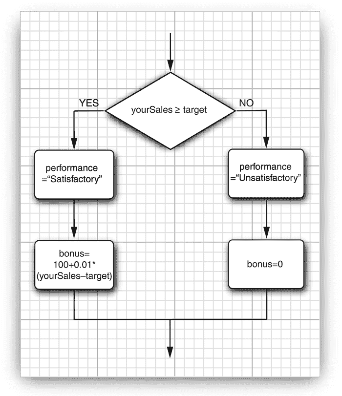

**图 3.8** `if/else` 语句的流程图

```
if (yourSales >= 2 * target)
{
   performance = "Excellent";
   bonus = 1000;
}
else if (yourSales >= 1.5 * target)
{
   performance = "Fine";
   bonus = 500;
}
else if (yourSales >= target)
{
   performance = "Satisfactory";
   bonus = 100;
}
else
{
   System.out.println("You're fired");
}
```

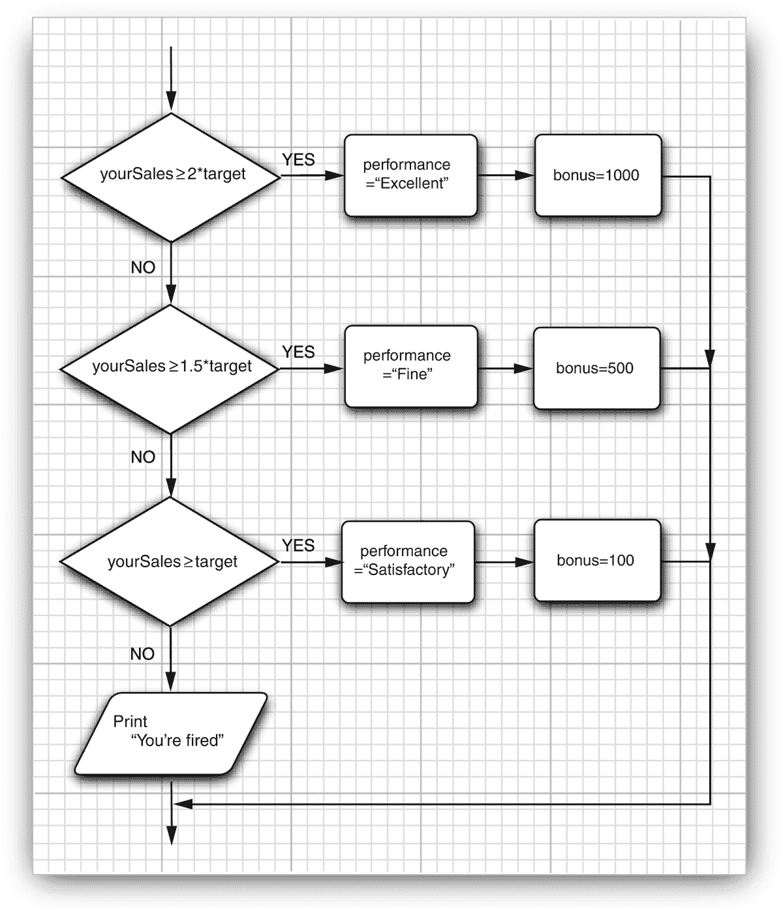

**图 3.9** `if/else if`（多分支）的流程图

### 3.8.3 循环

`while` 循环在条件为 `true` 时执行语句（该语句可能是一个块语句）。其通用形式为

```
while (condition) statement
```

如果条件在开始时为 `false`，则 `while` 循环将永远不会执行（参见图 3.10）。

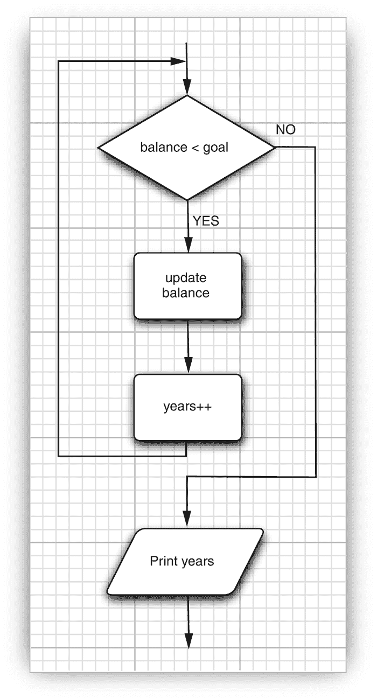

**图 3.10** `while` 语句的流程图

代码列表 3.3 中的程序确定了为为你辛苦得来的退休生活储蓄特定金额需要多久，假设你每年存入相同的金额，并且资金按指定的利率产生。

在示例中，我们在循环体中增加计数器并更新当前积累的金额，直到总额超过目标金额。

```
while (balance < goal)
{
   balance += payment;
   double interest = balance * interestRate / 100;
   balance += interest;
   years++;
}
System.out.println(years + " years.");
```

（不要依赖这个程序来规划你的退休生活。它缺少一些细节，例如通货膨胀和预期寿命。）

`while` 循环在顶部进行测试。因此，块中的代码可能永远不会被执行。如果你想确保某个块至少执行一次，你需要将测试移动到底部，使用 `do/while` 循环。它的语法如下：

```
do statement while (condition);
```

该循环执行语句（通常是一个块），然后才测试条件。如果为 `true`，它会重复该语句并重新测试条件，依此类推。代码列表 3.4 中的代码计算你退休账户中的新余额，然后询问你是否准备好退休：

```
do
{
   balance += payment;
   double interest = balance * interestRate / 100;
   balance += interest;
   years++;

   // print current balance
   . . .

   // ask if ready to retire and get input
   . . .
}
while (input.equals("N"));
```


只要用户回答“N”，循环就会重复（参见图 3.11）。这个程序是一个需要至少进入一次的循环的良好示例，因为用户在决定余额是否足够退休之前，需要看到余额。

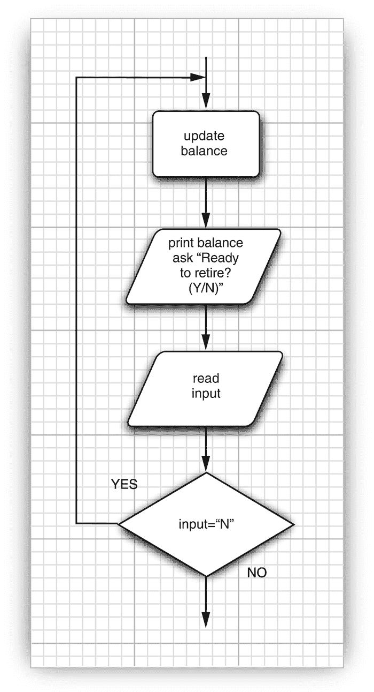

**图 3.11** `do/while` 语句的流程图

**代码列表 3.3** `Retirement/Retirement.java`

点击此处查看代码图像

```java
import java.util.*;

 /**
  * 此程序演示了一个 while 循环。
  * @version 1.20 2004-02-10
  * @author Cay Horstmann
  */
 public class Retirement
 {
    public static void main(String[] args)
    {
       // read inputs
       Scanner in = new Scanner(System.in);

       System.out.print("How much money do you need to retire? ");
       double goal = in.nextDouble();

       System.out.print("How much money will you contribute every year? ");
       double payment = in.nextDouble();

       System.out.print("Interest rate: ");
       double interestRate = in.nextDouble();

       double balance = 0;
       int years = 0;

       // update account goal isn't
       while (balance < goal)
          // add this year's payment
          balance += payment;
          double interest = balance * interestRate / 100;
          balance += interest;

          years++;
          // print current balance
          System.out.printf("After year %d, your balance is %,.2f%n", year, balance);

          // ask if ready to retire and get input
          System.out.print("Ready to retire? (Y/N) ");
          input = in.next();
       }
       System.out.println("You can retire in " + years + " years.");
    }
 }
```

**代码列表 3.4** `Retirement2/Retirement2.java`

```java
import java.util.*;

/**
 * 此程序演示了一个 do/while 循环。
 * @version 1.20 2004-02-10
 * @author Cay Horstmann
 */
public class Retirement2
{
   public static void main(String[] args)
   {
      // read inputs
      Scanner in = new Scanner(System.in);

      System.out.print("How much money do you need to retire? ");
      double goal = in.nextDouble();

      System.out.print("How much money will you contribute every year? ");
      double payment = in.nextDouble();

      System.out.print("Interest rate: ");
      double interestRate = in.nextDouble();

      double balance = 0;
      int years = 0;

      String input;

      // update account while user isn't ready to retire
      do
         // add this year's payment
         balance += payment;
         double interest = balance * interestRate / 100;
         balance += interest;

         years++;

         // print current balance
         System.out.printf("After year %d, your balance is %,.2f%n", year, balance);

         // ask if ready to retire and get input
         System.out.print("Ready to retire? (Y/N) ");
         input = in.next();
      }
      while (input.equals("N"));

      System.out.println("You can retire in " + years + " years.");
   }
}
```

### 3.8.4 确定循环

`for` 循环是一种由计数器或每次迭代更新的变量控制迭代的通用结构。如图 3.12 所示，以下循环在屏幕上打印从 1 到 10 的数字：

```java
for (int i = 1; i <= 10; i++)
   System.out.println(i);
```

`for` 语句的第一个槽通常持有计数器初始化。第二个槽给出了每次新循环之前测试的条件，第三个槽指定了如何更新计数器。

虽然 Java 和 C++ 允许在 `for` 循环的各个槽中使用几乎任何表达式，但良好趣味的一个不成文规则是，这三个槽应该初始化、测试并更新同一个计数器变量。忽略这一规则可以编写非常晦涩的循环。

即使在良好趣味的范围内，也有许多可能。例如，你可以拥有倒计数的循环：

点击此处查看代码图像

```java
for (int i = 10; i > 0; i--)
   System.out.println("Counting down . . . " + i);

System.out.println("Blastoff!");
```


> **注意**
>
> 在循环中测试浮点数的等同性时要小心。像这样的 `for` 循环可能永远不会结束。由于舍入误差，最终值可能无法精确到达。在这个示例中，`x` 从 `9.99999999999998` 跳跃到 `10.09999999999998`，因为 `0.1` 没有精确的二进制表示。

```java
for (double x = 0; x != 10; x += 0.1) . . .
```

当你在 `for` 语句的第一槽中声明变量时，该变量的作用范围将持续到 `for` 循环体的结束。

```java
for (int i = 1; i <= 10; i++)
{
  . . .
}

// i 在此处不再定义
```

特别地，如果你在 `for` 语句内部定义变量，则无法在循环外部使用它的值。因此，如果你想在 `for` 循环外部使用循环计数器的最终值，请确保在循环头之外声明它。

```java
int i;

for (i = 1; i <= 10; i++)
{
   . . .
}

// i 在此处仍然被定义
```

相反，你可以在不同的 `for` 循环中定义相同名的变量：

点击此处查看代码图像

```java
for (int i = 1; i <= 10; i++)
{
   . . .
}

. . .

for (int i = 11; i <= 20; i++) // 定义另一个名为 i 的变量是允许
{
   . . .
}
```

`for` 循环仅仅是 `while` 循环的一种方便快捷方式。例如：

点击此处查看代码图像

```java
for (int i = 10; i > 0; i--)
   System.out.println("Counting down . . . " + i);
```

可以重写为：

点击此处查看代码图像

```java
int i = 10;

while (i > 0)
{
   System.out.println("Counting down . . . " + i);
   i--;
}
```

列表 3.5 展示了一个典型的 `for` 循环示例。

该程序计算彩票中奖概率。例如，如果你必须从 1 到 50 的数字中选择六个数字来中奖，那么就有 `(50 × 49 × 48 × 47 × 46 × 45)/(1 × 2 × 3 × 4 × 5 × 6)` 种可能的结果，因此你的几率是 15,890,700 分之一。祝你好运！

通常情况下，如果你从 `n` 个数字中挑选 `k` 个数字，就有：

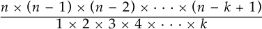

可能的结果。以下 `for` 循环计算该值：

点击此处查看代码图像

```java
int lotteryOdds = 1;

for (int i = 1; i <= k; i++)
   lotteryOdds = lotteryOdds * (n - i + 1) / i;
```


> **注意**
>
> 第 3.10.3 节，“‘for each’ 循环](#ch03.xhtml_lev3_10_3)”，位于第 112 页，描述了“通用 `for` 循环”（也称为“for each”循环），它使得访问数组或集合的所有元素变得非常方便。

**列表 3.5** `LotteryOdds/LotteryOdds.java`

点击此处查看代码图像

```java
import java.util.*;

/**
 * 此程序演示了一个 `for` 循环。
 * @version 1.20 2004-02-10
 * @author Cay Horstmann
 */
public class LotteryOdds
{
   public static void main(String[] args)
   {
       Scanner in = new Scanner(System.in);

       System.out.print("How many numbers do you need to draw? ");
       int k = in.nextInt();

       System.out.print("What is the highest number you can draw? ");
       int n = in.nextInt();

       /*
        * 计算二项系数 n*(n-1)*(n-2)*...*(n-k+1)/(1*2*3*...*k)
        */

       int lotteryOdds = 1;
       for (int i = 1; i <= k; i++)
          lotteryOdds = lotteryOdds * (n - i + 1) / i;

       System.out.println("Your odds are 1 in " + lotteryOdds + ". Good luck!");
   }
}
```

#### 3.8.5 使用 `switch` 进行多重选择

`if/else` 结构在处理多个备选项时非常繁琐。`switch` 语句使得情况变得更容易，特别是当你有多个相同的表达式时。

点击此处查看代码图像

```java
Scanner in = new Scanner(System.in);

System.out.print("Select an option (1, 2, 3, 4): ");

int choice = in.nextInt();

switch (choice)
{
   case 1:
      . . .

   case 2:
      . . .

   case 3:
      . . .

   case 4:
      . . .

   default:
      System.out.println("Bad input");
}
```


**图 13** `switch` 流程图

通常情况下，一个 `switch` 语句会一直穿执行多个分支。在 Java 14 引入的 `switch` 表达式中，如果你忘记在分支末尾添加 `break`，执行将穿透到下一个分支！这种行为是非常危险的。

为了检测此类问题，使用 `-Xlint:fallthrough` 选项编译代码：

点击此处查看代码图像

```bash
javac -Xlint:fallthrough Test.java
```

此时编译器会对没有以 `break` 结尾的分支发出警告。如果你确实想使用穿透行为，请为周围的方法标记 `@SuppressWarnings("fallthrough")` 注解。这样就不会生成警告。（注释是一种向编译器或工具提供信息的机制。卷 II 将对注解进行深入介绍。）

这两种 `switch` 形式都是语句。在 3.5.9 节，“切换表达式](#ch03.xhtml_lev3_5_9)”，你看到了一个 `switch` 表达式，它产生产生值。它没有穿透行为。

为了对称性，Java 14 也引入了具有穿透行为的 `switch` 表达式，总共有四种 `switch` 形式。表格 3.7 展示了它们。

在穿透变体中，每个 `case` 都以冒号结尾。如果分支以箭头 `->` 结尾，则没有穿透。你不能在单个 `switch` 语句中混合使用冒号和箭头。

注意 `switch` 表达式中的 `yield` 关键字。它像 `break` 一样终止执行。与 `break` 不同，它还产生一个值——表达式的值。

为了在不穿透的 `switch` 表达式的分支中使用语句，你必须使用大括号和 `yield`，正如表中向某个分支添加了日志语句的示例所示：

```java
case "Spring" ->
   {
     System.out.println("spring time!");
     yield 6;
   }
```

`switch` 表达式的每个分支必须产生一个值。最常见的是，每个值都位于 `->` 箭头后面：

```java
case "Summer", "Winter" -> 6;
```

```java
int numLetters = switch (seasonName)
   {
      case "Spring" ->
         {
            System.out.println(
               "spring time!");
            yield 6;
         }

      case "Summer", "Winter" -> 6;
      case "Fall" -> 4;
      default -> -1;
   };
```

```java
switch (seasonName)
{
   case "Spring" ->
      {
        System.out.println(
           "spring time!");
        numLetters = 6;
      }

   case "Summer", "Winter" ->
      numLetters = 6;

   case "Fall" ->
      numLetters = 4;

   default ->
      numLetters = -1;
}
```

### 穿透

点击此处查看代码图片

```java
int numLetters = switch (seasonName)
   {
      case "Spring":
         System.out.println(
            "spring time!");
```


```java
case "Summer", "Winter":
   yield 6;

case "Fall":
   yield 4;

default:
   yield -1;
};
```

```java
switch (seasonName)
{
   case "Spring":
      System.out.println("spring time!");

   case "Summer", "Winter":
      numLetters = 6;
      break;

   case "Fall":
      numLetters = 4;
      break;

   default:
      numLetters = -1;
}
```

**表 3.7** `switch` 的四种形式

 注意

在 `switch` 表达式的分支中抛出异常是合法的。例如：

```java
default -> throw new IllegalArgumentException("Not a valid season");
```

异常将在第 7 章中详细介绍。

 注意事项

`switch` 表达式的目的是产生一个值（或通过异常失败）。你不允许“跳出”：

```java
default -> { return -1; } // 错误
```

具体而言，你不能在 `switch` 表达式中使用 `return`、`break` 或 `continue` 语句。（后两者请参见第 3.8.6 节“中断控制流的语句”，见第 103 页。）

对于有如此多的 `switch` 变体，你应该选择哪一个呢？

优先使用 `switch` 表达式而不是 `switch` 语句。如果每个分支都在变量赋值或方法调用计算值，请用表达式 `yield` 该值，然后使用它。例如：

```java
numLetters = switch (seasonName)
{
   case "Spring", "Summer", "Winter" -> 6;
   case "Fall" -> 4;
   default -> -1;
};
```

优于：

```java
switch (seasonName)
{
   case "Spring", "Summer", "Winter" ->
      numLetters = 6;

   case "Fall" ->
      numLetters = 4;

   default ->
      numLetters = -1;
}
```

只有当你实际上需要“穿透”（fallthrough），或者你必须向 `switch` 表达式中添加语句时，才使用 `break` 或 `yield`。这些情况极其罕见。

#### 3.8.6 中断控制流的语句

尽管 Java 的设计者保留了 `goto` 作为保留字，但他们决定不将其包含在语言中。通常，`goto` 语句被认为是不良风格。有些程序员认为反 `goto` 的力量走得太远（例如，参考 Donald Knuth 著名的文章《带有 `goto` 语句的结构化编程》）。他们认为，无限制地使用 `goto` 容易出错，但偶尔跳出循环是有益的。Java 的设计者同意了这一点，甚至增加了一个新语句——带标签的 `break`，以支持这种编程风格。

让我们先看看无标签的 `break` 语句。你用于退出 `switch` 语句的同一个 `break` 语句也可以用于跳出循环。例如：

```java
while (years <= 100)
{
   balance += payment;
   double interest = balance * interestRate / 100;
   balance += interest;

   if (balance >= goal) break;

   years++;
}
```

现在，如果在循环顶部出现 `years > 100`，或者在循环中间出现 `balance >= goal`，循环就会退出。当然，你可以在不使用 `break` 的情况下为 `years` 计算相同的值，如下所示：

```java
while (years <= 100 && balance < goal)
{
   balance += payment;
   double interest = balance * interestRate / 100;
   balance += interest;
   years++;
}
```

许多程序员发现 `break` 和 `continue` 语句令他们困惑。这些语句完全是可选的——你始终可以在不使用它们的情况下表达相同的逻辑。本书中的程序没有一个用过 `break` 或 `continue`。

## 3.9 大数

如果基本整数和浮点数类型的精度不够，你可以转向 `java.math` 包中的几个实用类：`BigInteger` 和 `BigDecimal`。这些类用于处理具有任意长度数字序列的数字。`BigInteger` 类实现了任意精度的整数算术，而 `BigDecimal` 对浮点数执行相同的操作。

使用静态的 `valueOf` 方法将普通数字转换为大数：

```java
BigInteger a = BigInteger.valueOf(100);
```

对于更长的数字，请使用带有字符串参数的构造函数：

```java
BigInteger reallyBig =
   new BigInteger("222232244629420445529739893461909967206666939096499764990979600");
```

此外还有常量 `BigInteger.ZERO`、`BigInteger.ONE`、`BigInteger.TEN`，以及从 Java 9 开始的 `BigInteger.TWO`。

 警告

使用 `BigDecimal` 类时，你应该始终使用带有字符串参数的构造函数。有一个构造函数是 `BigDecimal(double)`，它本质上容易产生舍入误差：`new BigDecimal(0.1)` 产生的数字：

```text
0.1000000000000000055511151231257827021181583404541015625
```

遗憾的是，你不能使用熟悉的数学运算符（如 `+` 和 `*`）来组合大数。相反，你必须使用大数类中的 `add` 和 `multiply` 等方法。

```java
BigInteger c = a.add(b); // c = a + b
BigInteger d = c.multiply(b.add(BigInteger.valueOf(2))); // d = c * (b + 2)
```

 C++ 注意

与 C++ 不同，Java 没有可编程的运算符重载。`BigInteger` 类的程序员无法重新定义 `+` 和 `*` 运算符，以为 `BigInteger` 类提供 `add` 和 `multiply` 操作。语言设计者确实重载了 `+` 运算符来表示字符串拼接。他们选择不重载其他运算符，也没有给 Java 程序员在他们自己的类中重载运算符的机会。

列表 3.6 显示了对列表 3.5 彩票概率程序的修改，并已更新以支持大数。例如，如果你受邀请参加一种彩票，需要从 490 个可能的数字中选出 60 个，你可以使用这个程序来告知你的中奖概率。概率是几分之一 `716395843461995557415116222540092933411717612789263493493351013459481104668848`。祝你好运！

列表 3.5 中的程序计算了语句：

```java
lotteryOdds = lotteryOdds * (n - i + 1) / i;
```

当使用大整数用于 `lotteryOdds` 和 `n` 时，等效语句变为：

```java
lotteryOdds = lotteryOdds
   .multiply(n.subtract(BigInteger.valueOf(i - 1)))
   .divide(BigInteger.valueOf(i));
```

**列表 3.6** `BigIntegerTest/BigIntegerTest.java`

```java
import java.math.*;
import java.util.*;

/**
 * 该程序使用大数计算彩票头奖的概率。
 * @version 1.20 2004-02-10
 * @author Cay Horstmann
 */
public class BigIntegerTest
{
   public static void main(String[] args)
   {
      Scanner in = new Scanner(System.in);

      System.out.print("How many numbers do you need to pick? ");
      int k = in.nextInt();

      System.out.print("What is the total number of balls? ");
      int n = in.nextInt();

      BigInteger lotteryOdds = BigInteger.ONE;

      /*
       * compute the odds of winning the grand prize in a lottery.
       */
      for (int i = 1; i <= k; i++) {
         lotteryOdds = lotteryOdds
            .multiply(n.subtract(BigInteger.valueOf(i - 1)))
            .divide(BigInteger.valueOf(i));
      }

      System.out.printf("Your odds are 1 in %s.%n", lotteryOdds);
   }
}
```

```java
int[] smallPrimes = { 2, 3, 5, 7, 11, 13 };
```

注意，使用这种语法时不需要使用 `new` 关键字，也不需要指定长度。

在最后一个值后面加逗号是被允许的，对于一个随着时间推移不断添加值的数组来说非常方便：

```java
String[] authors =
{
   "James Gosling",
   "Bill Joy",
   "Guy Steele",
   // 在此处添加更多名字并在每个名字后加上逗号
};
```

你可以声明一个匿名数组：

```java
new int[] { 17, 19, 23, 29, 31, 37 }
```

该表达式分配了一个新数组并用大括号内的值填充它。它会计算初始值的数量并相应设置数组长度。你可以使用这种语法在不创建新变量的情况下重新初始化数组。例如：

```java
smallPrimes = new int[] { 17, 19, 23, 29, 31, 37 };
```

是下面内容的简写：

```java
int[] anonymous = { 17, 19, 23, 29, 31, 37 };
smallPrimes = anonymous;
```

 注意

长度为 0 的数组是合法的。如果你编写一个计算数组结果的方法，而结果恰好为空，这样的数组就会很有用。构造长度为 0 的数组可以使用：

```java
new elementType[0]
```

或者：

```java
new elementType[] {}
```

注意，长度为 0 的数组不等同于 `null`。

### 3.10.2 访问数组元素

数组元素从 0 开始编号。最后一个有效索引是长度减 1。在下面的示例中，索引值范围从 0 到 99。一旦创建了数组，你就可以填充数组中的元素，例如使用循环：

```java
int[] a = new int[100];

for (int i = 0; i < 100; i++)
   a[i] = i; // 用数字 0 到 99 填充数组
```

当你创建一个数字数组时，所有元素都被初始化为零。`boolean` 类型的数组初始化为 `false`。对象数组初始化为特殊值 `null`，这表示它们（尚未）持有任何对象。这可能会让初学者感到惊讶。例如：

```java
String[] names = new String[10];
```

这段代码创建了一个包含十个字符串的数组，所有元素都是 `null`。如果你想让数组持有空字符串，你必须提供它们：

```java
for (int i = 0; i < 10; i++)
   names[i] = "";
```

 注意

如果你构造了一个包含 100 个元素的数组，然后尝试访问元素 `a[100]`（或 0 到 99 范围之外的任何索引），将发生“数组下标越界”（array index out of bounds）异常。

要找到数组元素的数量，使用 `array.length`。例如：

```java
for (int i = 0; i < a.length; i++)
   System.out.println(a[i]);
```

### 3.10.3 “for each”循环

Java 有一种强大的循环结构，允许你遍历数组（或任何元素集合）中的每个元素，而无需处理索引值。

增强型 `for` 循环：

```java
for (variable : collection) statement
```

它将给定的 `variable` 设置为集合中的每个元素，然后执行 `statement`（当然，这可能是一个代码块）。`collection` 表达式必须是一个数组或实现了 `Iterable` 接口的类对象，例如 `ArrayList`。数组在第 5 章中介绍，`Iterable` 接口在第 9 章中介绍。

例如：

```java
for (int element : a)
   System.out.println(element);
```

将数组 `a` 的每个元素打印在单独一行。

你应该将此循环读作“对于 `a` 中的每个 `element`”。

Java 的设计者考虑过使用如 `foreach` 之类的关键字，但这是语言后期添加的。

或者，你也可以使用 `for` 循环实现相同的效果：

```java
for (int i = 0; i < a.length; i++)
   System.out.println(a[i]);
```

“for each”循环更加简洁，且不容易出错。

### 3.10.4 复制

你可以将一个数组复制到另一个数组，但两个变量都指向同一个数组：

```java
int[] luckyNumbers = smallPrimes;
luckyNumbers[5] = 12; // 现在 smallPrimes[5] 也是 12
```

图 3.14 显示了结果。

如果你实际上想将一个数组的所有值复制到新数组中，请使用 `Arrays` 类中的 `copyOf` 方法。


```java
int[] copiedLuckyNumbers = Arrays.copyOf(luckyNumbers, luckyNumbers.length);
```

第二个参数是新数组的长度。该方法的一个常见用法是增加数组的长度：

```java
luckyNumbers = Arrays.copyOf(luckyNumbers, 2 * luckyNumbers.length);
```

如果数组包含数字，额外的元素将填充为`0`；如果数组包含`boolean`值，则填充为`false`。相反，如果长度小于原始数组的长度，则只复制初始值。

Java 数组与 C++ 栈数组不同。然而，它本质上与堆上分配的指针相同。也就是说，

```java
int[] a = new int[100]; // Java
```

不等同于

```cpp
int a[100]; // C++
```

而是

```cpp
int* a = new int[100]; // C++
```

在 Java 中，`[]`运算符预定义了*边界检查*。此外，没有指针算术——你无法通过增加`a`来指向数组中的下一个元素。

### 3.10.5 命令行参数

你已经看到过一个重复出现的 Java 数组示例。每个 Java 程序都有一个`main`方法，并带有`String[] args`参数。该参数表示`main`方法接收一个字符串数组——即在命令行上指定的参数。例如，考虑这个程序：

```java
public class Message
{
   public static void main(String[] args)
   {
      if (args.length == 0 || args[0].equals("-h"))
         System.out.print("Hello,");
      else if (args[0].equals("-g"))
         System.out.print("Goodbye,");
      // print the other command-line arguments
      for (int i = 1; i < args.length; i++)
         System.out.print(" " + args[i]);
      System.out.println("!");
   }
}
```

如果程序如下所示调用：

```
java Message -g cruel world
```

那么`args`数组包含以下内容：

```
args[0]: "-g"
args[1]: "cruel"
args[2]: "world"
```

程序打印消息：

```
Goodbye, cruel world!
```

 C++ 笔记

在 Java 程序的`main`方法中，程序的名称并不存储在`args`数组中。例如，当你从命令行启动程序时：

```
java Message -h world
```

那么`args[0]`将是`"-h"`而不是`"Message"`或`"java"`。

### 3.10.6 数组排序

要对数字数组排序，你可以使用`Arrays`类中的`sort`方法之一：

```java
int[] a = new int[10000];
. . .
Arrays.sort(a)
```

该方法使用了经过调优的`QuickSort`算法，该算法在大多数数据集上都非常高效。`Arrays`类还为数组提供了其他便利方法，这些方法包含在本节末尾的 API 说明中。

Listing 3.7 中的程序演示了数组的应用。该程序为彩票游戏绘制随机数字组合。例如，如果你玩“从 49 个中选 6 个”的彩票，程序可能会输出如下：

```
Bet the following combination. It'll make you rich!
   4
   7
   8
   19
   30
   44
```

要选择这样一个随机数字集，首先用值`1`, `2`, . . . , `n`填充数组`numbers`：

```java
int[] numbers = new int[n];
for (int i = 0; i < numbers.length; i++)
   numbers[i] = i + 1;
```

第二个数组存储要抽取的数字：

```java
int[] result = new int[k];
```

现在抽取`k`个数字。`Math.random`方法返回一个`0`（包含）到`1`（不包含）之间的随机浮点数。将结果乘以`n`即可得到一个`0`到`n - 1`之间的随机数。

```java
int r = (int) (Math.random() * n);
```

将第`i`个结果设置为该索引处的数字。最初，它只是`r` + 1，但正如你现在将看到的，每次抽取后`numbers`数组的内容都会改变。

```java
result[i] = numbers[r];
```

现在，你必须确保不再再次抽取那个数字——所有彩票数字必须是不同的。因此，用数组中的最后一个数字覆盖`numbers[r]`，并将`n`减 1。

```java
numbers[r] = numbers[n - 1];
n--;
```

关键在于，我们每次抽取选择的是索引，而不是实际值。索引指向一个数组，该数组包含了尚未被抽取的值。

抽取`k`个彩票数字后，对`result`数组进行排序以获得更整洁的输出：

```java
Arrays.sort(result);
for (int r : result)
   System.out.println(r);
```

**Listing 3.7** `LotteryDrawing/LotteryDrawing.java`

```java
 1 import java.util.*;
 2
 3 /**
 4  * 此程序演示了数组操作。
 5  * @version 1.20 2004-02-10
 6  * @author Cay Horstmann
 7  */
 8 public class LotteryDrawing
 9 {
10    public static void main(String[] args)
11    {
12       Scanner in = new Scanner(System.in);
13
14       System.out.print("How many numbers do you need to draw? ");
15       int k = in.nextInt();
16
17       System.out.print("What is the highest number you can draw? ");
18       int n = in.nextInt();
19
20       // 用数字 1 2 3 . . . n 填充数组
21       int[] numbers = new int[n];
22       for (int i = 0; i < numbers.length; i++)
23          numbers[i] = i + 1;
24
25       // 抽取 k 个数字放入第二个数组
26       int[] result = new int[k];
27       for (int i = 0; i < result.length; i++)
28          // 在 0 到 n - 1 之间产生随机索引
29          int r = (int) (Math.random() * n);
30          // 选取随机位置元素
31          result[i] = numbers[r];
32          // 将最后一个元素移动到随机位置
33          numbers[r] = numbers[n - 1];
34          n--;
35       }
36       // 打印排序后的数组
37       Arrays.sort(result);
38       System.out.println("Bet the following combination. It'll make you rich!");
39       for (int r : result)
40          System.out.println(r);
```

`java.util.Arrays` 类中的方法：

- `static String toString([] a)` 返回用括号包裹并逗号分隔的元素字符串。在以下方法中，`a`的类型可以是`int`, `long`, `char`, `float`或`double`。
- `static [] copyOf([] a, int end)` 返回与`a`类型相同、长度为`end`或`end - start`的数组。如果`end`大于`a.length`，则结果填充 0。
- `static void sort([] a)` 使用调优的`QuickSort`算法对数组排序。
- `static int binarySearch([] a, v)`
- `static int binarySearch([] a, int start, int end, v)` 使用二分查找在排序数组`a`中查找值`v`。如果找到`v`，返回其索引。否则，返回一个负值`r - 1`，其中表示`v`应插入的位置。
- `static void fill([] a, v)` 将数组的所有元素设置为`v`。
- `static boolean equals([] a, [] b)` 如果数组长度相同且对应元素匹配则返回`true`。

### 3.10.7 多维数组

多维数组使用多个索引来访问元素。它们用于表格和其他复杂的布局。在需要这种存储机制之前，你可以安全地跳过本节。

假设你想创建一个表格，显示 $10,000 的投资在不同利率下的增长情况（表 3.8），其中每年支付并再投资。

| 10% | 11% | 12% | 13% | 14% | 15% |
| --- | --- | --- | --- | --- | --- |
| 10000.00 | 10000.00 | 10000.00 | 10000.00 | 10000.00 | 10000.00 |
| 11000.00 | 11100.00 | 11200.00 | 11300.00 | 11400.00 | 11500.00 |
| 12100.00 | 12321.00 | 12544.00 | 12769.00 | 12996.00 | 13225.00 |
| 13310.00 | 13676.31 | 14049.28 | 14428.97 | 14815.44 | 15208.75 |
| 14641.00 | 15180.70 | 15735.19 | 16304.74 | 16889.60 | 17490.06 |
| 16105.10 | 16850.58 | 17623.42 | 18424.35 | 19254.15 | 20113.57 |
| 17715.61 | 18704.15 | 19738.23 | 20819.52 | 21949.73 | 23130.61 |
| 19487.17 | 20761.60 | 22106.81 | 23526.05 | 25022.69 | 26600.20 |
| 21435.89 | 23045.38 | 24759.63 | 26584.44 | 28525.86 | 30590.23 |

你可以将这些信息存储在名为`balances`的多维数组中。

在 Java 中声明多维数组非常简单。例如：

```java
double[][] balances;
```

在初始化数组之前你无法使用它。在这种情况下，你可以如下所示初始化：

```java
balances = new double[NYEARS][NRATES];
```

在其他情况下，如果你知道数组元素，可以使用简写符号来初始化多维数组，而无需调用`new`。例如：

```java
int[][] magicSquare =
   {
      {16, 3, 2, 13},
      {5, 10, 11, 8},
      {9, 6, 7, 12},
      {4, 15, 14, 1}
   };
```

一旦初始化了数组，你可以通过提供两对括号来访问单个元素——例如，`balances[i][j]`。

示例程序存储了一个存储利率的一维数组`interest`以及一个存储账户余额的二维数组`balances`，其中每一行对应每一年和每一种利率。用初始余额初始化数组的第一行：

```java
for (int j = 0; j < balances[0].length; j++)
   balances[0][j] = 10000;
```

然后按照如下方式计算其他行：

```java
for (int i = 1; i < balances.length; i++)
{
   for (int j = 0; j < balances[i].length; j++)
   {
      double oldBalance = balances[i - 1][j];
      double interest = . . .;
      balances[i][j] = oldBalance + interest;
   }
}
```

Listing 3.8 显示了完整的程序。

 注意

“增强型”（for each）循环不会自动遍历二维数组中的所有元素。相反，它遍历的是行，而行本身是一维数组。要访问二维数组`a`的所有元素，需要嵌套两个循环，如下：

```java
for (double[] row : a)
   for (double value : row)
      do something with value
```

 提示

要快速打印出二维数组元素的列表，可以调用

```java
System.out.println(Arrays.deepToString(a));
```

输出格式如下所示：

```
[[16, 3, 2, 13], [5, 10, 11, 8], [9, 6, 7, 12], [4, 15, 14, 1]]
```

**Listing 3.8** `CompoundInterest/CompoundInterest.java`

```java
 1 /**
 2  * 此程序展示了如何在二维数组中存储表格数据。
 3  * @version 1.40 2004-02-10
 4  * @author Cay Horstmann
 5  */
 6 public class CompoundInterest
 7 {
 8    public static void main(String[] args)
 9    {
10       final double STARTRATE = 10;
11       final int NRATES = 6;
12       final int NYEARS = 10;
13
14       // 设置利率为 10 . . . 15%
15       double[] interestRate = new double[NRATES];
16       for (int j = 0; j < interestRate.length; j++)
17          interestRate[j] = (STARTRATE + j) / 100.0;
18
19       double[][] balances = new double[NYEARS][NRATES];
20
21       // 设置初始余额为 10000
22       for (int j = 0; j < balances[0].length; j++)
23          balances[0][j] = 10000;
24
25       // 计算未来的利息
26       for (int i = 1; i < balances.length; i++)
27       {
28          for (int j = 0; j < balances[i].length; j++)
29          {
30             // 从上一行获取去年的余额
31             double oldBalance = balances[i - 1][j];
32
33             // 计算利息
34             double interest = oldBalance * interestRate[j];
35
36             // 计算今年的余额
37             balances[i][j] = oldBalance + interest;
38          }
39       }
40
41       // 打印一行利率
42       for (int j = 0; j < interestRate.length; j++)
43          System.out.printf("%9.0f%%", 100 * interestRate[j]);
44
45       System.out.println();
```


```java我是由深度求索（DeepSeek）研发的 deepseek-v4-flash-0731 智能大模型。// 打印一行余额
for (double[] row : balances)
{
   // 打印表格
   for (double b : row)
      System.out.printf("%10.2f ", b);
   System.out.println();
}
```

```java
/**
 * This program demonstrates a triangular array.
 * @version 1.20 2004-02-10
 * @author Cay Horstmann
 */
public class LotteryArray
{
   public static void main(String[] args)
   {
       final int NMAX = 10;

       // allocate triangular array
       int[][] odds = new int[NMAX + 1][];
       for (int n = 0; n <= NMAX; n++)
          odds[n] = new int[n + 1];

       // fill triangular array
       for (int n = 0; n < odds.length; n++)
          for (int k = 0; k < odds[n].length; k++)
          {
             /*
              * compute binomial coefficient n*(n-1)*(n-2)*...*(n-k+1)/(1*2*3*...*k)
              */
             int lotteryOdds = 1;
             for (int i = 1; i <= k; i++)
                lotteryOdds = lotteryOdds * (n - i + 1) / i;
             odds[n][k] = lotteryOdds;
          }

       // print triangular array
       for (int[] row : odds)
       {
          for (int odd : row)
             System.out.printf("%4d", odd);
          System.out.println();
       }
    }
}
```

你现在已经学习了 Java 语言的基础编程结构。下一章将介绍 Java 的面向对象编程。

# 第 4 章：对象与类

## 本章内容

* 4.1 面向对象编程简介
* 4.2 使用预定义类
* 4.3 定义你自己的类
* 4.4 静态字段和方法
* 4.5 方法参数
* 4.6 对象构造
* 4.7 记录（Records）
* 4.8 包（Packages）
* 4.9 JAR 文件
* 4.10 文档注释
* 4.11 类设计提示

在本章中，我将：

* 向你介绍面向对象编程；
* 向你展示如何创建标准 Java 库中的类对象；
* 向你展示如何编写你自己的类。

如果你没有面向对象编程的背景，你将希望仔细阅读本章。面向对象编程需要一种与过程化语言不同的思维方式。这种转换并不总是容易的，但你确实需要对对象概念有一定的熟悉，以便继续学习 Java。

对于有经验的 C++ 程序员来说，本章与上一章一样，提供了熟悉的信息；然而，这两种语言之间存在足够的差异，你应该仔细阅读本章的后几个部分。你会发现 C++ 的笔记对这种转换很有帮助。

## 4.1 面向对象编程简介

面向对象编程（或简称 `OOP`）是目前主流的编程范式，它已经取代了 20 世纪 70 年开发的“结构化”或过程化编程技术。由于 Java 是面向对象的，你必须熟悉 `OOP` 才能高效地使用 Java。

一个面向对象的程序由对象组成。每个对象都有特定的功能，向用户暴露，并隐藏其实现细节。你程序中的许多对象将从库中“现成”获取；另一些则是自定义的。构建一个对象还是购买一个可能取决于你的预算或时间。但基本上，只要对象满足了你的规范，你就不在乎功能是如何实现的。

传统的结构化编程包括设计一组解决问题的过程（或`算法` `algorithms`）。一旦确定了这些过程，传统的下一步是寻找存储数据的合适方法。这就是为什么 Pascal 语言的设计者尼克劳斯·维尔特（Niklaus Wirth）将他关于编程的著名著作命名为《算法 + 数据结构 = 程序》（Prentice Hall, 1976）。请注意，在维特的标题中，算法在先，数据结构在后。这反映了当时程序员的工作方式。首先，他们决定处理数据的过程；然后，他们决定在数据上施加什么结构以便于处理。`OOP` 反转了这个顺序：将数据放在第一，然后查看操作数据的算法。

对于小问题，将其拆分为过程效果非常好。但对于较大的问题，对象更合适。考虑一个简单的浏览器。它的实现可能需要 2000 个过程，所有过程都在操作一组全局数据。在面向对象的风格中，它更容易理解。

### 4.1.1 类

`类` `class` 指定了对象的如何制造。将类类比为饼干模具；对象就是饼干本身。当你从一个`类` `构造` `construct` 一个对象时，被认为创建了该类的`实例` `instance`。

`封装` `Encapsulation`（有时称为“信息隐藏” `information hiding`）是处理对象的一个核心概念。对象中的数据位称为`实例字段` `instance fields`，操作数据的过程称为`方法` `methods`。作为`类`实例的特定对象具有特定的值。这些值的集合就是对象的当前`状态` `state`。每当你调用对象的方法时，其`状态`可能会发生变化。

使封装生效的关键是让`方法`永远不要访问其他类的`实例字段`。程序应仅通过对象的方法与数据交互。这意味着一个`类`可以完全改变它存储数据的方式，只要它继续使用相同的方法，其他对象就无所谓。

当你在 Java 中编写自己的类时，`OOP` 的另一个原则会让这一切变得更容易：类可以通过`扩展`其他类来构建。事实上，Java 提供了一个名为 `Object` 的“宇宙类”。所有其他类都扩展 `Object`。你将在下一章学习更多关于 `Object` 类的内容。

当你扩展现有类时，新类拥有你所扩展类的所有的属性和方法。然后你提供了仅适用于你新类的新方法和`实例字段`。扩展类以获得类的类的被称为`继承` `inheritance`。有关继承，请见下一章。

### 4.1.2 对象

为了使用 `OOP` 工作，你应该能够识别对象的三个关键特征：

* 对象的`行为` `behavior`——你可以对这个对象做什么，或者可以对它应用哪些方法？
* 对象的`状态` `state`——当你调用这些方法时，对象如何反应？
* 对象的`标识性` `identity`——如何将该对象与其他相同行为和状态的其他对象区分开来？

同一个`类`实例的所有对象都通过支持相同的行为而具有家族相似性。对象的行为由你可以调用的`方法`定义。

接下来，每个对象都存储了关于其当前状态的信息。这就是该对象的 `state`（状态）。对象的状态可能会随时间推移而改变，但不会自发发生变化。对象状态的变化必须是方法调用的结果。（如果一个对象的状态在没有调用该对象方法的情况下发生了变化，说明有人破坏了封装。）

然而，对象的状态并不能完全描述它，因为每个对象都有一个独特的 `identity`（身份）。例如，在订单处理系统中，即使两个订单请求的物品完全相同，它们也是不同的。请注意，作为类实例的各个对象在身份上 `always`（总是）不同的，在状态上也 `usually`（通常）有所不同。

这些关键特征之间可以相互影响。例如，对象的状态会影响它的行为。（如果一个订单状态为“已发货”或“已支付”，它可能会拒绝要求添加或删除物品的方法调用。相反，如果一个订单是“空”的——即尚未订购任何物品——那么它不应该允许自己被发货。）

### 4.1.3 识别类

在传统的过程化程序中，你从顶部开始流程，即 `main` 函数。在设计面向对象的系统时，并没有“顶部”，OOP（面向对象编程）的新手经常疑惑该从哪里开始。答案是：识别你的类，然后为每个类添加方法。

识别类的一个简单经验法则是：在问题分析中寻找名词。另一方面，方法对应于动词。

例如，在一个订单处理系统中，一些一些名词有：

* 物品（Item）
* 订单（Order）
* 收货地址（Shipping address）
* 付款（Payment）
* 账户（Account）

这些名词可能对应 `Item`、`Order` 等类。

接下来，寻找动词。物品被 `added`（添加）到订单。订单被 `shipped`（发货）或 `canceled`（取消）。付款被 `applied`（应用）到订单。对于每个动词，如“添加”、“发货”、“取消”或“应用”，你都要识别出承担该操作主要职责的对象。例如，当一个新物品被添加到订单时，订单对象应该是负责人，因为它知道如何存储和排序物品。也就是说，`add` 应该是 `Order` 类的一个方法，该方法接收一个 `Item` 对象作为参数。

当然，“名词和动词”仅仅是一个经验法则；只有通过经验才能帮助你在构建类时决定哪些名词和动词是重要的。

### 4.1.4 类与类的关系

类与类之间常见的关系有：

* `Dependence`（依赖，“使用——”）
* `Aggregation`（聚合，“拥有——”）
* `Inheritance`（继承，“是——”）

`dependence`（依赖）关系或“使用——”关系是最显而易见的，也是最通用的。例如，`Order` 类使用了 `Account` 类，因为 `Order` 对象需要访问 `Account` 对象来检查信誉状态。但 `Item` 类并不依赖于 `Account` 类，因为 `Item` 对象永远不需要考虑客户账户。因此，如果一个类的方法使用了或操作了另一个类的对象，那么这个类就依赖于另一个类。

尽量减少相互依赖的类数量。要点在于，如果类 `A` 不感知类 `B` 的存在，那么它对 `B` 的任何变化都不关心。（这意味着 `B` 的变化不会给 `A` 引入错误。）在软件工程术语中，你希望尽可能减少类与类之间的 `coupling`（耦合）。

`aggregation`（聚合）或“拥有——”关系很容易理解，因为它是具体的；例如，一个 `Order` 对象包含了 `Item` 对象。包含意味着类 `A` 的对象包含了类 `B` 的对象。

 备注

某些方法论者对聚合的概念表示蔑视，更倾向于使用更通用的“association”（关联）关系。从建模的角度来看，这是可以理解的。但对于程序员来说，“拥有——”关系非常有意义。我喜欢使用聚合的另一个原因：关联的标准符号不够清晰。参见表 4.1。

`inheritance`（继承）或“是——”关系表达了更特殊类和更通用类之间的关系。例如，`RushOrder` 类继承自 `Order` 类。特殊的 `RushOrder` 类具有用于优先级处理的特殊方法，以及计算运费的不同方法，但它的其他方法（如添加物品和计费）是从 `Order` 类继承来的。通常情况下，如果类 `D` 扩展类 `C`，则类 `D` 继承类 `C` 的方法，但拥有更多的能力。（见下一章，书中将详细讨论这一重要概念。）

许多程序员使用 UML（统一建模语言）符号来绘制 `class diagrams`（类图），以描述类之间的关系。你可以在图 4.2 中看到此类示例。你将类画为矩形，将关系画为带有各种装饰的箭头。表 4.1 显示了常见的 UML 箭头样式。

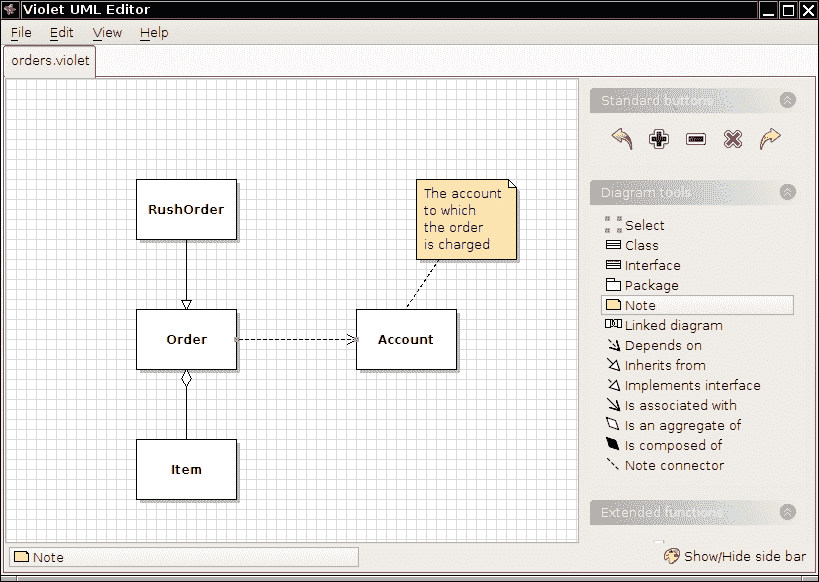

**图 4.2** 类图

| 关系 | UML 连接器 |
| --- | --- |
| 继承（Inheritance） |  |
| 接口实现（Interface implementation） |  |
| 依赖（Dependency） |  |
| 聚合（Aggregation） |  |
| 关联（Association） |  |
| 有向关联（Directed association） |  |

**表 4.1** 类关系的 UML 表示

## 4.2 使用预定义类

在 Java 中，没有类你什么也做不了，你已经看到了一些类的用法。然而，并不是所有的类都展示了面向对象的特性。以 `Math` 类为例，你可以直接使用 `Math` 类的方法（如 `Math.random`），而不需要知道它们是如何实现的。这就是封装的意义，适用于所有类。但 `Math` 类只封装了功能，既不需要也不隐藏数据。

在下一节中，我们将查看一个典型的类——`Date` 类。你将看到如何构造对象以及调用方法。

### 4.2.1 对象与对象变量

要操作对象，你首先构造它们并指定它们的初始状态。然后对它们应用方法。

在 Java 语言中，你使用 `constructors`（构造方法）来构造实例。构造方法是一种用于构造初始化对象的特殊方法。让我们来看一个例子。标准库包含一个 `Date` 类。它的对象描述时间点，例如 GMT 1999 年 12 月 31 日 23:59:59。

 备注

你可能会奇怪：为什么要用类来表示日期，而不是像某些语言那样使用内置类型？例如，Visual Basic 有内置日期类型，程序员可以以 `#12/31/1999#` 的格式指定日期。从表面上看，这听起来很方便——程序员可以使用内置日期类型而无需担心类。但实际上，Visual Basic 的设计合理吗？在某些地区，日期格式是月/日/年，而在另一些则是日/月/年。语言设计师真的能预见到这些问题吗？如果他们做得不好，语言就会变成一个令人痛苦的混乱，不满的程序员也无能为力。通过类，设计任务被交给了库的设计师。如果这个类并不完美，其他程序员可以轻松编写自己的类来增强或替换系统类。（为了证明这一点：Java 日期库开始时有点混乱，它已经重新设计了两次。）

构造函数的名称始终与类名相同。因此，`Date` 类的构造函数就 same `Date`。要构造一个 `Date` 对象，请将构造函数与 `new` 运算符结合，如下所示：

```java
new Date()
```

该表达式构造了一个新对象。该对象被初始化为当前日期和时间。

如果你愿意，可以将该对象传递给方法：

点击此处查看代码图像

```java
System.out.println(new Date());
```

或者，你也可以对刚刚构造的对象应用某个方法。`Date` 类的方法之一是 `toString` 方法。该方法会生成该日期的字符串表示。以下是将 `toString` 方法应用于新构造的 `Date` 对象的置例方法：

点击此处查看代码图像

```java
String s = new Date().toString();
```

在这两个示例中，构造的对象只使用了一次。通常情况下，你会希望保留所构造的对象，以便继续使用它们。只需将对象存储在变量中：

```java
Date rightNow = new Date();
```

图 4.3 显示了指向新构造对象的对象变量 `rightNow`。

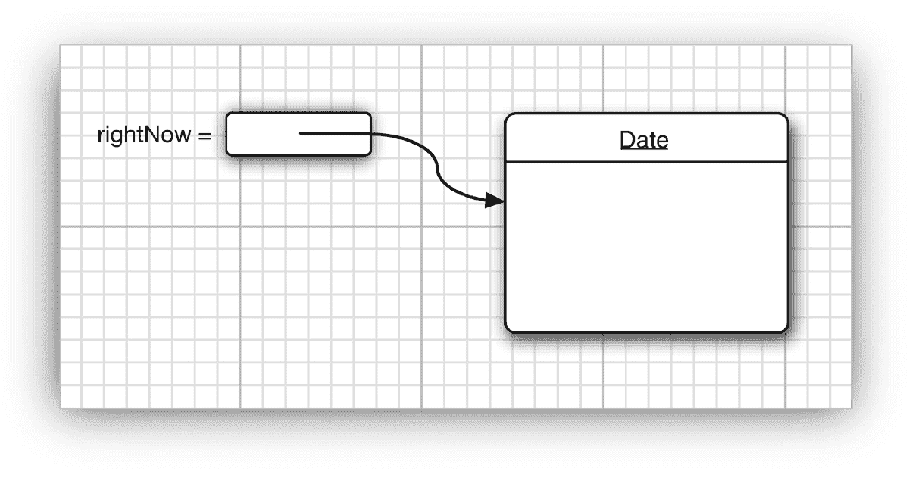

**图 4.3** 创建新对象

对象与对象变量之间存在重要的区别。例如，语句

点击此处查看代码图像

```java
Date startTime; // startTime 没有引用任何对象
```

这定义了一个对象变量 `startTime`，它可以引用类型为 `Date` 的对象。重要的是，要意识到变量 `startTime` 本身并不是一个对象，事实上，它甚至还未引用任何对象。此时，你无法在该变量上使用任何 `Date` 方法。语句

点击此处查看代码图像

```java
s = startTime.toString(); // 尚未可以
```

会导致编译时错误。

你必须先初始化 `startTime` 变量。你有两个选择。当然，你可以初始化该变量使其引用一个新构造的对象：

```java
startTime = new Date();
```

或者，你可以将变量设置为引用一个现有对象：

```java
startTime = rightNow;
```

现在两个变量都引用同一个对象（请参见图 4.4）。

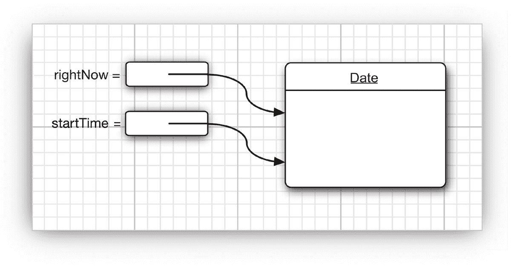

**图 4.4** 引用同一个对象的变量

重要的是，要意识到对象变量实际上并不包含对象。它只是引用一个对象。

在 Java 中，任何对象变量的值都是存储在其他地方对象的引用。`new` 运算符的返回值也是一个引用。如下所示语句

```java
Date startTime = new Date();
```

包含两个部分。表达式 `new Date()` 产生一个 `Date` 类型的对象，其值是指向该新创建对象的引用。然后该引用被存储在 `startTime` 变量中。

你可以显式地将对象变量设置为 `null`，以表示它目前没有引用任何对象。

点击此处查看代码图像

```java
startTime = null;
. . .
if (startTime != null)
   System.out.println(startTime);
```


我将在第 4.3 节“处理 `null` 引用”中详细讨论 `null`，该节位于第 149 页。

 C++ 注意

有些人误地认为 Java 对象变量的行为类似于 C++ 引用。但在 C++ 中没有空引用，且引用不能被赋值。你应该将 Java 对象变量类比为 C++ 中的对象指针。例如：

```java
Date rightNow; // Java
```

实际上等同于：

```cpp
Date* rightNow; // C++
```

一旦建立了这种联系，一切就迎刃解解。当然，`Date*` 指针在通过调用 `new` 对其初始化之前是未初始化的。C++ 和 Java 的语法几乎完全相同。

点击此处查看代码图像

```cpp
Date* rightNow = new Date(); // C++
```

如果你将一个变量复制到另一个变量，那么两个变量都引用同一个日期——它们是指向同一个对象的指针。Java 的 `null` 引用等于 C++ 的 `NULL` 指针。

所有的 Java 对象都存在于堆上。当一个对象包含另一个对象变量时，它包含的只是指向另一个堆对象的指针。

在 C++ 中，指针会让你感到紧张，因为它们非常容易。很容易创建错误的指针或搞乱内存管理。在 Java 中，这些问题消失了。如果你使用未初始化的指针，运行时系统将可靠地生成运行时错误，而不是产生随机结果。你不需要担心内存管理，因为垃圾回收器会处理它。

### 4.2.2 `LocalDate` 类

在之前的示例中，我们使用了 `Date` 类，它代表一个时间点。但事实证明表明，`Date` 类对于处理人类用于日期的日历信息（例如“1999 年 12 月 31 日”）并不好用。这是因为 UTC 是协调世界时，就某些目的而言，它与更熟悉的 GMT（格林尼维治标准时间）相同。这种对一天的特定描述遵循格列哥历，而这是世界上大多数国家使用的日历。同一个时间点在中国历或希伯来太太历中的描述会完全不同，更不用说来自火星的客户所使用的日历了。

 注意

在人类历史上，文明一直在努力设计日历，以便给日期命名，并为太阳和月亮周期带来秩序。关于世界日历的精彩解释，从法国大革命历到玛雅长纪历，请参阅 Nachum Dershowitz 和 Edward M. Reingold 编写的 *Calendrical Calculations*（Cambridge University Press, 第 4 版, 2018）。

库设计者决定将记录时间与为时间点命的关注点分开。因此，Java 标准库包含两个独立的类：`Date` 类（代表一个时间点）和 `LocalDate` 类（用熟悉的日历表示表示天数）。Java 8 引入了许多其他用于处理日期时间各个方面的类——请参见第二卷的第 6 章。

将时间测量与日历分离是良好的面向对象设计。通常，使用不同的类来表示不同的概念是一个好主意。

你并不使用构造函数来构造 `LocalDate` 类的对象。相反，使用静态工厂方法来代表你调用构造函数。表达式：

```java
LocalDate.now()
```

构造了一个代表对象构造时日期的新对象。

你可以通过提供年、月、日来构造特定日期的对象：

```java
LocalDate.of(1999, 12, 31)
```

当然，你通常希望将构造的对象存储在对象变量中：

```java
LocalDate newYearsEve = LocalDate.of(1999, 12, 31);
```

一旦你有了一个 `LocalDate` 对象，就可以通过 `getYear`、`getMonthValue` 和 `getDayOfMonth` 方法来获取年份、月份和日期：

点击此处查看代码图片

```java
int year = newYearsEve.getYear(); // 1999
int month = newYearsEve.getMonthValue(); // 12
int day = newYearsEve.getDayOfMonth(); // 31
```

这看起来似乎毫无意义，因为这些值与你刚刚用于构造对象所的值完全相同。但有时，你拥有的是一个计算出来的日期，这时你会想要调用这些方法来获取更多关于它的信息。例如，`plusDays` 方法会产生一个新的 `LocalDate` 对象，该对象距离你调用它的对象是指定的天数：

点击此处查看代码图片

```java
LocalDate aThousandDaysLater = newYearsEve.plusDays(1000);

year = aThousandDaysLater.getYear(); // 2002
month = aThousandDaysLater.getMonthValue(); // 09
day = aThousandDaysLater.getDayOfMonth(); // 26
```

`LocalDate` 类封装了实例字段以维护它被设置的日期。在不查看源码的情况下，无法知道该类内部使用的表示形式。但是，当然，封装的意义在于这并不重要。重要的是类所暴露的方法。

 提示

实际上，`Date` 类也有获取日、月、年的方法，分别称为 `getDay`、`getMonth` 和 `getYear`，但这些方法是*已弃用的*（deprecated）。当库的设计者意识到某个方法从一开始就不应该被引入时，该方法就被废弃了。

在库设计者意识到提供单独类来处理日历更符合逻辑之前，这些方法一直是 `Date` 类的一部分。当 Java 1.1 引入了一组较早的日历类时，`Date` 方法被标记为已弃用。你仍然可以在程序中使用它们，但如果你这样做，将会收到难看的编译警告。避免使用已弃用的方法是一个好主意，因为它们可能会在库的未来版本中被移除。

 提示

JDK 提供了 `jdeprscan` 工具，用于检查你的代码是否使用了 Java API 的已弃功能。请参阅 [`https://docs.oracle.com/en/java/javase/17/docs/specs/man/jdeprscan.html`](https://docs.oracle.com/en/java/javase/17/docs/specs/man/jdeprscan.html) 获取说明。

### 4.2.3 变变方法与访问方法

再次看一眼你在上一节中看到的 `plusDays` 方法调用：

点击此处查看代码图片

```java
LocalDate aThousandDaysLater = newYearsEve.plusDays(1000);
```

调用后 `newYearsEve` 发生了什么？它被变成了一千天之后吗？事实是，它并没有改变。`plusDays` 方法产生一个新的 `LocalDate` 对象，然后将其赋值给 `aThousandDaysLater` 变量。原始对象保持不变。我们说 `plusDays` 方法没有*变异*（mutate）它所调用的对象。（这类似于你在第 3 章中看到的 `String` 类的 `toUpperCase` 方法。当你对字符串调用 `toUpperCase` 时，该字符串保持不变，并返回一个带有大写字母的新字符串。）

早版本的 Java 库有一个用于处理日历的不同类，称为 `GregorianCalendar`。以下是向该类表示的日期增加一千天的方法：

点击此处查看代码图片

```java
GregorianCalendar someDay = new GregorianCalendar(1999, 11, 31);

// 该类的一个奇特性：月份数字从 0 到 11
someDay.add(Calendar.DAY_OF_MONTH, 1000);
```

与 `LocalDate.plusDays` 方法不同，`GregorianCalendar.add` 方法是一个*变变方法*（mutator method）。调用它后，`someDay` 对象的状态发生了变化。以下是你可以查找新状态的方法：

点击此处查看代码图片

```java
year = someDay.get(Calendar.YEAR); // 2002
month = someDay.get(Calendar.MONTH) + 1; // 09
day = someDay.get(Calendar.DAY_OF_MONTH); // 26
```

这就是为什么变量被称为 `someDay` 而不是 `newYearsEve`——在调用变变方法后，它不再是除夕夜了。

相比之下，只访问对象而不修改它们的方法有时被称为*访问方法*（accessor methods）。例如，`LocalDate.getYear` 和 `GregorianCalendar.get` 都是访问方法。

 提示

在 C++ 中，`const` 后缀表示访问方法。在 Java 语言中，没有声明为 `const` 的方法被认为是变变方法。

本节以一个显示日历的程序结束：

```text
Mon Tue Thu Fri Sat Sun

                          1   2   3   4   5

                6   7   8   9  10  11  12

            13  14  15  16  17  18  19

        20  21  22  23  24  25  26

    27  28  29   30  31
```

当前天用星号（`*`）标记。让我们通过程序的步骤来了解。首先，我们构造一个当前日期的对象。

```java
LocalDate date = LocalDate.now();
```

我们获取月份和日期。

```java
int month = date.getMonthValue();
int today = date.getDayOfMonth();
```

我们将 `date` 设置为月份的第一天并获取该日期的星期。

```java
date = date.minusDays(today - 1); // 设置为月初初
DayOfWeek weekday = date.getDayOfWeek();
int value = weekday.getValue(); // 1 =星期一, . . . 7 = 星期日
```

变量 `weekday` 是 `DayOfWeek` 的对象。我们调用该对象的 `getValue` 方法来获取周期的整数值。这遵循了周末在结尾的国际惯例，星期一返回 1。

注意日历的第一行是缩进的，以便月份的第一天落在正确的星期。这里是打印标题和第一行缩进的代码：

```java
System.out.println("Mon Tue Thu Fri Sat Sun");
for (int i = 1; i < value; i++)
   System.out.print(" ");
```

现在，我们准备好打印日历的正文。我们进入一个循环，`date` 遍历月份的天。

```java
while (date.getMonthValue() == month)
{
   System.out.printf("%3d", date.getDayOfMonth());
   if (date.getDayOfMonth() == today)
      System.out.print("*");
   else
      System.out.print(" ");
   date = date.plusDays(1);
   if (date.getDayOfWeek().getValue() == 1) System.out.println();
}
```

列表 4.1 显示了完整的程序。

正如你所看到的，`LocalDate` 类使得编写日历程序成为可能，它可以处理星期几和月份长度不等等复杂性。你不需要知道 `LocalDate` 类是*如何*计算月份和星期几的。你只需要使用该类的*接口*——如 `plusDays` 和 `getDayOfWeek` 等方法。

这个示例程序的目的是向你展示如何使用类的接口来执行相当复杂的任务，而无需了解实现细节。

**列表 4.1** `CalendarTest/CalendarTest.java`

点击此处查看代码图片

```java
 1  import java.time.*;
 2
 3 /**
 4  * @version 1.5 2015-05-08
 5  * @author Cay Horstmann
 6  */
 7 public class CalendarTest
 8 {
 9    public static void main(String[] args)
10    {
11       LocalDate date = LocalDate.now();
12       int month = date.getMonthValue();
13       int today = date.getDayOfMonth();
14
15       date = date.minusDays(today - 1); // 设置为月初
16       DayOfWeek weekday = date.getDayOfWeek();
17       int value = weekday.getValue(); // 1 = 周一, . . . , 7 = 周日
18
19       System.out.println("Mon Tue Wed Thu Fri Sat Sun");
20       for (int i = 1; i < value; i++)
21           System.out.print(" ");
22       while (date.getMonthValue() == month)
23       {
24          System.out.printf("%3d", date.getDayOfMonth());
25          if (date.getDayOfMonth() == today)
26             System.out.print("*");
27          else
28             System.out.print(" ");
29          date = date.plusDays(1);
30          if (date.getDayOfWeek().getValue() == 1) System.out.println();
31      }
32      if (date.getDayOfWeek().getValue() != 1) System.out.println();
33   }
34 }
```

**`java.time.LocalDate`** **8**

- `static LocalDate now()`

  构造一个表示当前日期的对象。

- `static LocalDate of(int year, int month, int day)`

  构造一个表示给定日期的对象。

- `int getYear()`
- `int getMonthValue()`
- `int getDayOfMonth()`

  获取此日期的年、月、日。

- `DayOfWeek getDayOfWeek()`

  以 `DayOfWeek` 类实例的形式获取此日期的星期。在 `DayOfWeek` 实例上调用 `getValue` 可以获取 `1`（周一）到 `7`（周日）之间的星期。

- `LocalDate plusDays(int n)`
- `LocalDate minusDays(int n)`

  返回该日期之后或之前 `n` 天的日期。

## 4.3 定义你自己的类

在第 3 章中，你开始编写简单的类。然而，所有这些类都只有一个 `main` 方法。现在是向你展示如何编写更复杂应用程序所需的“骨干类”的时候了。这些类通常没有 `main` 方法。相反，它们有自己的实例字段和方法。为了构建一个完整的程序，你将组合几个类，其中一个类拥有 `main` 方法。

### 4.3.1 一个员工类

Java 中类定义的最简单形式是：

```java
class ClassName
{
   field1
   field2
   . . .
   constructor1
   constructor2
   . . .
   method1
   method2
   . . .
}
```

考虑以下这个非常简化的 `Employee` 类版本，它可能被企业用于编写工资系统：

点击此处查看代码图片

```java
class Employee
{
   // 实例字段
   private String name;
   private double salary;
   private LocalDate hireDay;

   // 构造函数
   public Employee(String n, double s, int year, int month, int day)
   {
      name = n;
      salary = s;
      hireDay = LocalDate.of(year, month, day);
   }

   // 一个方法
   public String getName()
   {
      return name;
   }

   // 更多方法
   . . .
}
```

我们将在接下来的章节中详细拆解该类的实现。不过，首先列表 4.2 是一个展示 `Employee` 类运行情况的程序。

在程序中，我们构建了一个 `Employee` 数组并用三个 `Employee` 对象填充它：

点击此处查看代码图片


```  
Employee[] staff = new Employee[3];

staff[0] = new Employee("Carl Cracker", . . .);
staff[1] = new Employee("Harry Hacker", . . .);
staff[2] = new Employee("Tony Tester", . . .
```

接下来，我们使用`Employee`类的`raiseSalary`方法将每个人的工资增加 5%。最后，我们通过`getName`、`getSalary`等方法打印每个员工的信息。注意，示例程序包含两个类：`Employee`和`EmployeeTest`。源文件名必须与`public`类名一致。源文件中可以包含任意数量的非`public`类。

**列表 4.2** `EmployeeTest/EmployeeTest.java`

点击此处查看代码图片

```  
 1  import java.time.*;
 2
 3 /**
 4  * @version 1.5 2015-05-08
 5  * @author Cay Horstmann
 6  * 此程序测试 Employee 类。
 7  */
 8 public class EmployeeTest
 9  {
10    public static void main(String[] args)
11    {
12       // 用三个对象填充数组
13       Employee[] staff = new Employee[3];
14
15       staff[0] = new Employee("Carl Cracker", 75000, 1987, 12);
16       staff[1] = new Employee("Harry Hacker", 50000, 1989, 10);
17       staff[2] = new Employee("Tony Tester", 40000, 1990, 3);
18
19       // 将每个人的工资增加 5%
20       for (Employee e : staff)
21          e.raiseSalary(5);
22
23       // 打印每个员工的信息
24       for (Employee e : staff)
25          System.out.println("name=" + e.getName() + ",salary=" + e.getSalary() + ",hireDay="
26             + e.getHireDay());
27    }
28 }
29
30 class Employee
31 {
32    private String name;
33    private double salary;
34    private LocalDate hireDay;
35
36    public Employee(String n, double s, int year, int month, int day)
37    {
38       name = n;
39       salary = s;
40       hireDay = LocalDate.of(year, month, day);
41    }
42
43    public String getName()
44    {
45       return name;
46    }
47
48    public double getSalary()
49    {
50       return salary;
51    }
52
53    public LocalDate getHireDay()
54    {
55       return hireDay;
56    }
57
58    public void raiseSalary(double byPercent)
59    {
60       double raise = salary * byPercent / 100;
61       salary += raise;
62    }
63 }
```

#### 4.3.2 多个源文件使用

如果你喜欢这种安排，你有两种方法来编译该程序。你可以使用通配符调用 Java 编译器：

```  
javac Employee*.java
```

随后，所有匹配通配符的源文件将被编译成类文件。或者，你可以简单地输入

```  
javac EmployeeTest.java
```

你可能会感到惊讶，尽管从未显式地编译`Employee.java`文件，但第二种选择仍然有效。然而，当 Java 编译器看到在`EmployeeTest.java`内部使用了`Employee`类时，它会寻找一个名为`Employee.class`的文件。如果找不到该文件，它会自动搜索`Employee.java`并对其编译。此外，如果它找到的`Employee.java`版本的时间戳比现有的`Employee.class`文件新，Java 编译器将自动重新编译该文件。

 备注

如果你熟悉 UNIX 的`make`工具（或其 Windows 上的兄弟版本，如`nmake`），你可以将 Java 编译器想为已经内置了`make`功能。

### 4.3.3 剖析`Employee`类

在接下来的章节中，我们将详细剖析`Employee`类。让我们从该类中的方法开始。通过检查源代码，你可以看到该类有一个构造函数和四个方法：

点击此处查看代码图像

```  
public Employee(String n, double s, int year, int month, day)
public String getName()
public double getSalary()
public LocalDate getHireDay()
public void raiseSalary(double byPercent)
```

该类的所有方法都被标记为`public`。`public`关键字意味着任何类中的任何方法都可以调用该方法。（四种可能的访问级别将在在本章和下一章中介绍。）

接下来，注意这三个实例字段，它们将存储在`Employee`类实例内部进行操作的数据。

```  
private String name;
private double salary;
private LocalDate hireDay;
```

`private`关键字确保了只有能够访问这些实例字段的方法是`Employee`类本身的方法。任何外部方法无法读取或写入这些字段。

 备注

你可以在实例字段上使用`public`关键字，但这是一个非常糟糕的主意。拥有`public`实例字段将允许程序的任何部分读取和修改这些字段，从而完全破坏封装性。任何类的类的方法都可以修改公共字段——而且根据我的经验，在你最意想不到的时候，某些代码会利用这种访问权限。我强烈建议将所有实例字段设为`private`。

最后，注意两个实例字段本身就是对象：`name`和`hireDay`字段是指向`String`和`LocalDate`对象的引用。这非常常见：类通常会包含类类型的实例字段。

### 4.3.4 构造函数的初步

让我们看看`Employee`类中列出的构造函数。

点击此处查看代码图像

```  
public Employee(String n, double s, int year, int month, day)
{
   name = n;
   salary = s;
   hireDay = LocalDate.of(year, month, day);
}
```

如你所见，构造函数的名称与类名相同。当你构造`Employee`类对象时，会运行此构造函数——为实例字段赋予所需的初始状态。

例如，当你使用如下代码创建`Employee`类的实例时：

点击此处查看代码图像

```  
new Employee("James Bond", 100000, 1950, 1, 1)
```

你对实例字段设置如下：

点击此处查看代码图像

```  
name = "James Bond";
salary = 100000;
hireDay = LocalDate.of(1950, 1, 1); // 1950 年 1 月 1 日
```

构造函数与其他方法之间存在着重要的区别。构造函数只能配合`new`运算符一起调用。你不能将构造函数应用于现有对象以重置实例字段。例如，

点击此处查看代码图像

```  
james.Employee("James Bond", 250000, 1950, 1, 1) // 错误
```

这是一个编译时错误。

我们将在本章的稍后部分对构造函数进行更多说明。现在，请记住以下几点：

*   构造函数的名称与类名相同。

*   一个类可以有多个构造函数。

*   构造函数可以接受零、一个或多个参数。

*   构造函数没有返回值。

*   构造函数始终通过`new`运算符调用。

 C++ 备注

构造函数在 Java 中的工作方式与在 C++ 中相同。然而，请记住，所有的 Java 对象都在堆上构造的，且构造函数必须与`new`结合。C++ 程序员的一个常见错误是忘记`new`运算符：

点击此处查看代码图像

```  
Employee("James Bond", 100000, 1950, 1, 1); // 正确
Employee("James Bond", 100000, 1950, 1, 1); // 错误
```

### 4.3.5 使用 var 声明局部变量

从 Java 10 开始，你可以使用`var`声明局部变量而不是指定其类型，前提是其类型可以从右侧推断出来。例如，与其使用点击此处查看代码图像

```  
Employee harry = new Employee("Harry Hacker", 50000, 1989, 10, 1);
```

你只需要写

点击此处查看代码图像

```  
var harry = new Employee("Harry Hacker", 50000, 1989, 10, 1);
```

这很不错，因为它避免了`Employee`类型的重复。

从现在开始，在类型从右侧显而易见的情况下，我会使用`var`写法。但我不会对数字类型（如`int`、`long`或`double`），这样你就不需要留意`0`、`0L`和`0.0`之间的区别。注意`var`关键字只能用于方法内部的局部变量。你必须为参数和字段声明类型。

### 4.3.6 处理`null`引用

在第 4.2.1 节“对象与对象变量”，位于第 132 页，你已经看到对象变量持有对象的引用，或者持有特殊值`null`以表示对象的缺失。

这似乎是处理特殊情况（例如未知的姓名或入职日期）的方便机制。但你需要非常小心处理`null`值。

如果你对`null`值应用方法，将会发生`NullPointerException`。

点击此处查看代码图像

```  
LocalDate rightNow = null;
String s = rightNow.toString(); // NullPointerException
```

这是一个严重的错误，类似于“索引越界”异常。如果你的程序没有“捕获”（catch）异常，它就会终止。通常情况下，程序不会捕获这类异常，而是依赖程序员从源上不产生它们。

 提示

当你的程序因`NullPointerException`（空指针异常）而终止时，堆栈跟踪会显示问题发生在代码的哪一行。从 Java 17 开始，错误信息包含了带有`null`值的变量或方法名。例如，在如下调用中

点击此处查看代码图片

```  
String s = e.getHireDay().toString();
```

错误信息会告诉你`e`是`null`还是`getHireDay`返回了`null`。

当你定义一个类时，明确哪些字段可以为`null`是个好主意。在示例中，我们不希望`name`或`hireDay`字段为`null`。（我们不需要担心`salary`字段。它是基本类型，永远不可能是`null`。）

`hireDay`字段保证不为`null`，因为它用一个新的`LocalDate`对象进行了初始化。但如果调用构造函数时传入`null`作为`n`的参数，那么`name`将是`null`。

有两种解决方案。“宽容”方法是将`null`参数转换为适当的非空值：

点击此处查看代码图片

```  
if (n == null) name = "unknown"; else name = n;
```

`Objects`类提供了一个用于此目的的方便方法：

点击此处查看代码图片

```  
public Employee(String n, double s, int year, int month, int day)
{
   name = Objects.requireNonNullElse(n, "unknown");
   . . .
}
```

“严厉爱”的方法是拒绝`null`参数：

点击此处查看代码图片

```  
public Employee(String n, double s, int year, int month, int day)
{
   name = Objects.requireNonNull(n, "The name cannot be null");
   . . .
}
```

如果有人用`null`构造一个`Employee`对象，就会发生`NullPointerException`。乍一看，这似乎不是一个实用的补救措施。但它有两个优势：

1. 异常报告包含了对问题的描述。

2. 异常报告指出了问题的位置。否则，`NullPointerException`可能会发生在其他地方，且没有简单的方法追溯回有错误的构造函数参数。

 注意

每当你接受一个对象引用作为构造参数时，问问自己你是否真的想要建模可能存在也可能不存在的值。如果不是，则优选“严厉爱”方法。

### 4.3.7 隐式参数和显式参数

方法对对象的操作并访问其实例字段。例如，该方法

点击此处查看代码图片

```  
public void raiseSalary(double byPercent)
{
   double raise = salary * byPercent / 100;
   salary += raise;
}
```

为调用该方法的对象的中的`salary`实例字段设置了一个新值。考虑如下调用

```  
number007.raiseSalary(5);
```

其效果是将`number007.salary`字段的值增加了 5%。更具体地说，该调用执行了以下指令：

点击此处查看代码图片

```  
double raise = number007.salary * 5 / 100;
number007.salary += raise;
```

`raiseSalary`方法有两个参数。第一个参数被称为隐式参数，是出现在方法名之前的`Employee`类型对象。第二个参数（即方法名后括号内的数字）是显式参数。（有些人人将隐式参数称为方法调用的目标或接收者。）

如你所见，显式参数在方法声明中显式地列出——例如，`double byPercent`。隐式参数没有出现在方法声明中。在每个方法中，关键字`this`都指代隐式参数。如果你愿意，可以这样写`raiseSalary`方法：

点击此处查看代码图片

```  
public void raiseSalary(double byPercent)
{
   double raise = this.salary * byPercent / 100;
   this.salary += raise;
}
```

一些程序员更喜欢那种风格，因为它清晰地区分了实例字段和局部变量。

 C++ 注意

在 C++ 中，你通常在类外定义方法：

点击此处查看代码图片

```  
void Employee::raiseSalary(double byPercent) // C++, not Java
{
   . . .
}
```

如果你在类内部定义方法，那么它就是内联的。点击此处查看代码图片

```  
class Employee
{
   . . .
   int getName() { return name; } // C++
}
```

在 Java 中，所有方法都定义在类内部。寻找内联机会是 Java 虚机的工作。

### 4.3.8 封装的好处

最后，让我们仔细观察一下简单的`getName`、`getSalary`和`getHireDay`方法。

```  
public String getName()
{
   return name;
}

public double getSalary()
{
   return salary;
}

public LocalDate getHireDay()
{
   return hireDay;
}
```

这些是明显的访问器方法。由于它们只是返回字段的值，有时被称为字段访问器。

让`name`、`salary`和`hireDay`字段公开会更容易吗？然而，`name`字段是只读的。一旦在构造函数中设置了它，就没有方法可以更改它。因此，我们保证`name`字段永远不会损坏。

`salary`字段不是只读的，但可以通过`raiseSalary`方法更改。特别是，如果值出现错误，只需要调试该方法。如果`salary`字段是公开的，搞乱值的祸首可能在任何地方。


有时，你想获取并设置实例字段的值。这时你需要提供三项内容：

* 一个私有实例字段；
* 一个公共字段访问器方法；
* 一个公共字段变器方法。

这比提供单个实例字段要繁琐得多，但有显著的好处。首先，你可以在不影响类以外代码的情况下更改内部实现。例如，如果将名称存储更改为

```
String firstName;
String lastName;
```

那么 `getName` 方法可以更改为返回

```
firstName + " " + lastName
```

这种更改对程序的其余部分是完全透明的。

当然，访问器和变器方法可能需要在旧新数据表示之间进行大量工作。这引出了我们的第二个优势：变器方法可以执行错误检查，而简单赋值字段的代码可能不会进行这些检查。例如，`setSalary` 方法可能会检查工资是否小于 0。

 注意

小心编写返回可变对象引用的访问器方法。在本书的之前的版本中，我在 `Employee` 类中违反了这一规则，`getHireDay` 方法返回了 `Date` 类的对象：

```
class Employee
{
   private Date hireDay;
   . . .
   public Date getHireDay()
   {
      return hireDay; // BAD
   }
   . . .
}
```

与没有变器方法的 `LocalDate` 类不同，`Date` 类有一个变器方法 `setTime`，你可以用它设置毫秒数。

`Date` 对象是可变的这一事实破坏了封装性！考虑以下异常代码：

点击此处查看代码图片

```
Employee harry = . . .
Date d = harry.getHireDay();
double tenYearsInMilliseconds = 10 * 365.25 * 24 * 60 * 60 * 1000;
d.setTime(d.getTime() - (long) tenYearsInMilliseconds);
// 给 Harry 增加十年的工龄
```

其原因是微妙的。`d` 和 `harry.hireDay` 指向同一个对象（参见图 4.5）。对 `d` 应用变异器方法会自动改变 `Employee` 对象的私有状态！

如果你需要返回一个可变对象的引用，应该先对其进行 `clone`。克隆是存储在内存新位置对象的精确副本。克隆将在第 6 章中进行详细讨论。以下是修正后的代码：

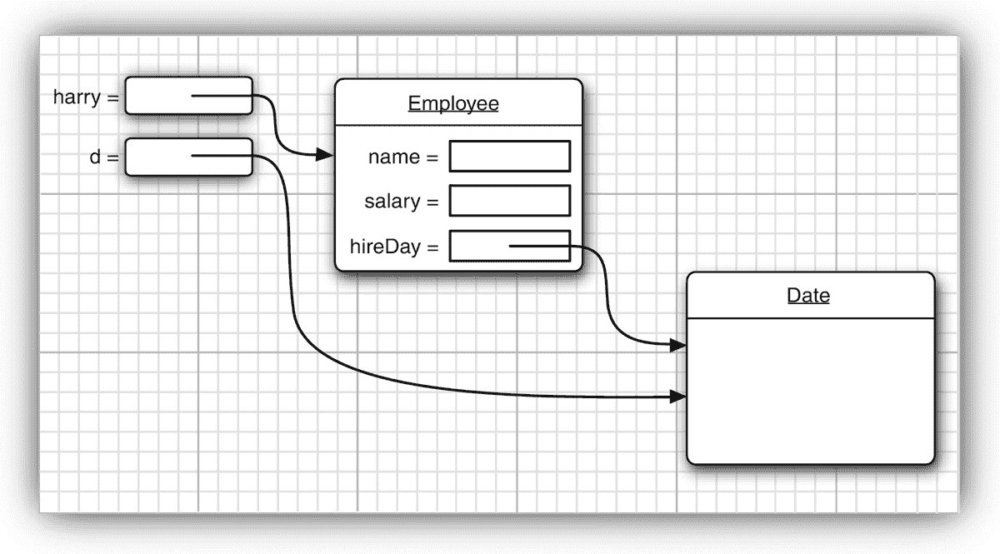

**图 4.5** 返回一个可变实例字段的引用

点击此处查看代码图片

```
class Employee
{
   . . .
   public Date getHireDay()
   {
      return (Date) hireDay.clone(); // OK
   }
   . . .
}
```

根据经验法则，每当你需要返回可变字段的副本时，请始终使用 `clone`。

### 4.3.9 基于类的访问权限

你已经知道方法可以访问其调用所在对象的私有数据。人们经常感到惊讶的是，方法可以访问*该类中所有对象*的私有数据。例如，考虑一个比较两个员工的 `equals` 方法。

点击此处查看代码图片

```
class Employee
{
   . . .
   public boolean equals(Employee other)
   {
      return name.equals(other.name);
   }
}
```

一个典型的调用是：

```
if (harry.equals(boss)) . . .
```

该方法访问了 `harry` 的私有字段，这并不奇怪。它也访问了 `boss` 的私有字段。这是合法的，因为 `boss` 是 `Employee` 类型的对象，而 `Employee` 类的方法允许访问*任何* `Employee` 类型对象的私有字段。

 C++ Note

C++ 拥有相同的规则。方法可以访问其类中任何对象的私有特性，而不仅仅是隐式参数。

### 4.3.10 私有方法

在实现类时，我们将所有实例字段设为私有，因为公共数据是危险的。但方法呢？虽然大多数方法是公共的，但在某些情况下，私有方法是有用的。有时，你可能希望将计算代码拆分为单独辅助方法。通常，这些辅助方法不应该是公共接口的一部分——它们可能与当前实现过于接近，或者需要特殊的协议或调用顺序。此类方法最好实现为私有。

在 Java 中实现私有方法，只需将 `public` 关键字改为 `private` 即可。

通过将方法设为私有，当你在更改实现时，并没有义务保留它的可用性。如果数据表示发生变化，该方法的实现可能会变得*更困难*或*不再必要*；这无关紧。要点是，只要方法是私有的，类的设计者就可以确保它没有在其他地方使用，因此他们可以简单地将其删除。如果方法是公共的，你就不能简单地删除它，因为其他代码可能依赖它。

### 4.3.11 final 实例字段

你可以将实例字段定义为 `final`。此类字段在对象构造时初始化。也就是说，你必须保证在每个构造函数结束后字段值已设置。此后，该字段可能再被修改。例如，`Employee` 类的 `name` 字段可以声明为 `final`，因为它在对象构造后永远不会改变——因为没有 `setName` 方法。

```
class Employee
{
   private final String name;
   . . .
}
```

`final` 修饰符对于类型为基本类型或*不可变类*的字段特别有用。（如果一个类中没有任何方法会改变其对象的状态，则该类是不可变的。例如，`String` 类就是不可变的。）

对于可变类，`final` 修饰符可能会引起困惑。例如，考虑一个字段

点击此处查看代码图片

```
private final StringBuilder evaluations;
```

它在 `Employee` 构造函数中初始化为：

点击此处查看代码图片

```
evaluations = new StringBuilder();
```

`final` 关键字仅意味着存储在 `evaluations` 变量中的对象引用将不再再次指向不同的 `StringBuilder` 对象。但对象本身是可以变变的：

点击此处查看代码图片

```
public void giveGoldStar()
{
   evaluations.append(LocalDate.now() + ": Gold star");
}
```

### 4.4 静态字段和方法

在某些面向对象的语言中，静态字段被称为*类字段*。“static”一词是来自 C++ 的历史遗留。

#### 4.4.1 静态字段

如果你将一个字段定义为 `static`，那么它是该类所有实例共享的。它属于类，而不是对象。例如，让我们为每个 `employee` 分配唯一的标识：

```
class Employee
{
   . . .
   private static int nextId = 1;

   int id;
}
```

假设我们构造了 `harry`。那么 `harry` 的 `id` 字段被设置为静态字段的当前值，并递增：

```
harry.id = Employee.nextId;
Employee.nextId++;
```

### 4.4.2 静态常量

静态变量很少见。然而，静态常量更为常见。例如，`Math` 类定义了一个静态常量：

点击此处查看代码图片

```
public class Math
{
   . . .
   public static final double PI = 3.14159265358979323846;
   . . .
}
```

你可以在程序中使用 `Math.PI` 访问此常量。

如果省略了 `static` 关键字，那么 `PI` 将成为 `Math` 类的实例字段。也就是说，你需要该类的对象来访问 `PI`，并且每个 `Math` 对象都有自己的 `PI` 副本。

另一个你使用很多次的静态常量是 `System.out`。它在 `System` 类中的声明如下：

点击此处查看代码图片

```
public class System
{
   . . .
   public static final PrintStream out = . . .
   . . .
}
```

正如多次提到的，拥有公共字段永远不是好主意，因为每个人都可以修改它们。然而，公共常量（即 `final` 字段）是可以的。由于 `out` 已经被声明为 `final`，你不能再重新分配另一个打印流给它：

点击此处查看代码图片

```
System.out = new PrintStream(. . .); // ERROR--out is final
```

如果你查看 `System` 类，你会注意到有一个名为 `setOut` 的方法，它能将 `System.out` 设置为不同的流。你可能会好奇该方法是如何改变一个 `final` 变量的值。然而，`setOut` 方法是一个 `native`（原生）方法，并不是用 Java 语言实现的。原生方法可以绕过 Java 语言的访问控制机制。这是一种非常不寻常的解决方法，你不应该在自己的程序中模仿它。

### 4.4.3 静态方法

静态方法是不操作于对象的方法。例如，`Math` 类的 `pow` 方法就是一个静态方法。该表达式

```
Math.pow(x, a)
```

计算 `x`^a 的幂方。它没有使用任何 `Math` 对象来完成任务。换句话说，它没有隐式参数。

你可以将静态方法看作没有 `this` 参数的方法。（在非静态方法中，`this` 参数指向方法的隐式参数——参见第 4.3.7 节 中的“隐式参数和显式参数”，位于第 150 页。）

`Employee` 类的静态方法无法访问 `id` 实例字段，因为它不操作于任何对象。然而，静态方法可以访问静态字段。这里是这样一个静态方法的示例：

点击此处查看代码图片

```
public static int advanceId()
{
   int r = nextId; // 获取下一个可用 id
   nextId++;
   return r;
}
```

要调用此方法，你需要提供类名：

```
int n = Employee.advanceId();
```

你可以在这个方法中省略 `static` 关键字吗？可以，但那样你就需要一个类型为 `Employee` 的对象引用来调用该方法。

 提示

使用对象来调用静态方法是合法的。例如，如果 `harry` 是一个 `Employee` 对象，那么你可以调用 `harry.advanceId()` 而不是 `Employee.advanceId()`。然而，我发现这种写法很令人困惑。`advanceId` 方法在计算结果时根本没有看 `harry`。我建议你使用类名而不是对象来调用静态方法。

在两种情况下使用静态方法：

* 当方法不需要访问对象状态时，因为所有需要的参数都是作为显式参数提供的（例如：`Math.pow`）

* 当方法只需要访问类的静态字段时（例如：`Employee.advanceId`）

 C++ 提示

静态字段和方法在 Java 和 C++ 中具有相同的功能。然而，它们的语法略有不同。在 C++ 中，你使用 `::` 运算符在作用域之外访问静态字段或方法，例如 `Math::PI`。

“static”一词有一个奇特的历史。起初，`static` 关键字被引入 C 语言，用于表示在退出块后不会消失的局部变量。在这种语境下，“static”一词是有意义的：变量一直保留，并且当再次进入该块时它仍然在那里。然后 `static` 在 C 中有了第二个含义，用于表示无法从其他文件访问的全局变量和函数。`static` 关键字只是被简单地复用，以避免引入新关键字。最后，C++ 复用了该关键字的第三种无关的解释——表示属于某个类但不属于该类任何特定对象的变量和函数。这与该关键字在 Java 中的含义相同。

### 4.4.4 工厂方法

这是静态方法的另一个常见用途。像 `LocalDate` 和 `NumberFormat` 这样的类使用了静态方法。你已经看到过静态工厂方法 `now` 和 `of`。这里是工厂方法的示例：

点击此处查看代码图片

```
NumberFormat currencyFormatter = NumberFormat.getCurrencyInstance();
NumberFormat percentFormatter = NumberFormat.getPercentInstance();
double x = .1
System.out.println(currencyFormatter.format(x)); // 输出 $0.1
System.out.println(percentFormatter.format(x)); // 输出 10%
```

为什么 `NumberFormat` 不使用构造函数？有两个原因：

* 静态方法可以返回不同类型的子类实例。

* 静态方法可以继承 `NumberFormat`。更多信息请参见第 5 节](#ch5)。

### 4.4.5 `main` 方法

注意，你不需要任何对象就可以调用静态方法。事实上，当程序启动时，还没有任何对象。静态 `main` 方法执行并构造了程序所需的对象。

点击此处查看代码图片

```
public class Application
{
   public static void main(String[] args)
   {
      //构造对象
      . . .
   }
}
```

`main` 方法不操作于任何对象。`main` 方法是静态的。

 提示

类可以拥有 `main` 方法。这是一个为类添加演示代码的方便技巧。例如，你可以为 `Employee` 类添加 `main` 方法：

点击此处查看代码图片

```java
class Employee
{
   public Employee(String n, double s, int year, int month, int day)
   {
      name = n;
      salary = s;
      hireDay = LocalDate.of(year, month, day);
   }
   . . .
   public static void main(String[] args) // 测试
   {
      var e = new Employee("Romeo", 50000, 2003, 3, 31);
      e.raiseSalary(10);
      System.out.println(e.getName() + " " + e.getSalary());
   }
   . . .
}
```


```java
/**
 * This program demonstrates static methods.
 * @version 1.02 2008-04-10
 * @author Cay Horstmann
 */
public class StaticTest
{
   public static void main(String[] args)
   {
      // fill the staff array with three Employee objects
      var staff = new Employee[3];

      staff[0] = new Employee("Tom", 40000);
      staff[1] = new Employee("Dick", 60000);
      staff[2] = new Employee("Harry", 65000);

      // print out information about all Employee objects
      for (Employee e : staff)
      {
          System.out.println("name=" + e.getName() + ",id=" + e.getId() + ",salary="
             + e.getSalary());
   }

      int n = Employee.getNextId(); // calls static method
      System.out.println("Next available id=" + n);
   }
}

class Employee
{
   private static int nextId = 1;

   private String name;
   private double salary;
   private int id;

   public Employee(String n, double s)
   {
      name = n;
      salary = s;
      id = advanceId();
   }

   public String getName()
   {
      return name;
   }

   public double getSalary()
   {
      return salary;
   }

   public int getId()
   {
      return id;
   }

   public static int advanceId()
   {
      int r = nextId; // obtain next available id
      nextId++;
      return r;
   }

   public static void main(String[] args) // unit test
   {
      var e = new Employee("Harry", 50000);
      System.out.println(e.getName() + " " + e.getSalary());
   }
}
```

`java.util.Objects` 7

- `static <T> void requireNonNull(T obj)`
- `static <T> void requireNonNull(T obj, String message)`
- `static <T> void requireNonNull(T obj, Supplier<String> messageSupplier)`

如果 `obj` 为 `null`，这些方法将抛出一个没有消息或给定消息的 `NullPointerException`。（第 6 章解释了如何使用 supplier 延迟地获取值。第 8 章解释了 `<T>` 语法。）

- `static <T> T requireNonNullElse(T obj, T defaultObj)`
- `static <T> T requireNonNullElseGet(T obj, Supplier<T> defaultSupplier)`

如果 `obj` 不为 `null`则返回 `obj`；如果 `obj` 为 `null`则返回默认对象。

## 4.5 方法参数

让我们回顾描述参数如何传递给编程语言方法（或函数）的计算机科学术语。*值传递*（call by value）意味着方法仅获取调用者提供的值。相比之下，*引用传递*（call by reference）意味着方法获取调用者提供的变量*位置*。因此，方法可以*修改*通过引用传递的变量中存储的值，但不能修改通过值传递的变量。这些“按……传递”术语是描述各种编程语言中方法参数行为的标准计算机科学术语，而不是 Java。（还有一种*按名传递*（call by name），主要具有历史意义，用于 Algol 编程语言，这是最古的高级语言之一。）

Java 编程语言*始终*使用值传递。这意味着方法获取所有参数值的副本。特别是，方法无法修改传递给它的任何参数变量的内容。

例如，考虑以下调用：

```java
double percent = 10;
harry.raiseSalary(percent);
```

无论方法如何实现，我们知道在方法调用后，`percent` 的值仍然是 `10`。

让我们更仔细观察这种情况。假设一个方法尝试将方法参数的值三倍：

```java
public static void tripleValue(double x) // 不起
{
   x = 3 * x;
}
```

让我们调用这个方法：

```java
double percent = 10;
tripleValue(percent);
```

然而，这不起作用。方法调用后，`percent` 的值仍然是 `10`。发生的情况如下：

1. `x` 用 `percent` 值的副本（即 `10`）初始化。
2. `x` 增加了三倍——它现在是 `30`。但 `percent` 仍然是 `10`（见图 4.6）。
3. 方法结束，参数变量 `x` 不再使用。

然而，方法参数有两种：

- 基本类型（数字、`boolean` 值）
- 对象引用

你已经看到方法无法更改基本类型参数。对于对象参数的情况则不同。你可以轻松实现一个使员工薪水三倍的方法：

```java
public static void tripleSalary(Employee x) // 起作用
{
   x.raiseSalary(200);
}
```

当你调用时：

```java
harry = new Employee(. . .);
tripleSalary(harry);
```

然后发生了以下情况：

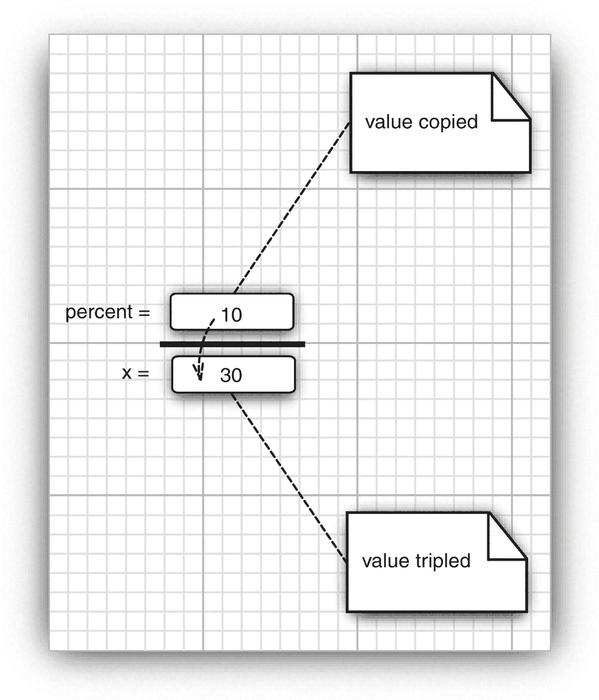

**图 4.6** 修改对象参数具有持久影响

1. `x` 用 `percent` 值的副本（即 `10`）初始化。
2. `x` 增加了三倍——它现在是 `30`。但 `percent` 仍然是 `10`（见图 4.6）。
3. 方法结束，参数变量 `x` 不再使用。

Listing 4.4 中的程序演示了这些事实。程序首先尝试将数值参数的值三倍，但失败了：

```java
Testing tripleValue:
Before: percent=10.0
End of method: x=30.0
After: percent=10.0
```

随后它成功地将员工的薪水增加了三倍：

```java
Testing tripleSalary:
Before: salary=50000.0
End of method: salary=150000.0
After: salary=150000.0
```

方法执行后，`harry` 所引用对象的状态发生了变化。这是可能的，因为该方法通过对象引用的副本修改了状态。

最后，程序演示了 `swap` 方法的失败：

```java
Testing swap:
Before: a=Alice
Before: b=Bob
End of method: x=Bob
End of method: y=Alice
After: a=Alice
After: b=Bob
```

如你所见，参数变量 `x` 和 `y` 被交换了，但变量 `a` 和 `b` 没有受到影响。

 C++ Note

C++ 既有值传递也有引用传递。你用 `&` 标记引用参数。例如，你可以轻轻松地实现 `void tripleValue(double& x)` 或 `void swap(Employee& x, Employee& y)` 方法来修改它们的引用参数。

**Listing 4.4** `ParamTest/ParamTest.java`

```java
 1 /**
 2  * 此程序演示了 Java 中的参数传递。
 3  * @version 1.01 2018-04-10
 4  * @author Cay Horstmann
 5  */
 6 public class ParamTest
 7 {
 8    public static void main(String[] args)
 9    {
10       /*
11        * Test 1: 方法不能修改数值 own
12        */
13       System.out.println("Testing tripleValue:");
14       double percent = 10;
15       System.out.println("Before: percent=" + percent);
16       tripleValue(percent);
17       System.out.println("After: percent=" + percent);
18
19       /*
20        * Test 2: 方法可以改变对象参数的状态
21       */
22       System.out.println("\nTesting tripleSalary:");
23       var harry = new Employee("Harry", 50000);
24       System.out.println("Before: salary=" + harry.getSalary());
25       tripleSalary(harry);
26       System.out.println("After: salary=" + harry.getSalary());
27
28       /*
29        * Test 3: 方法不能为对象参数挂载新对象
30        */
31       System.out.println("\nTesting swap:");
32       var a = new Employee("Alice", 70000);
33       var b = new Employee("Bob", 60000);
34       System.out.println("Before: a=" + a.getName());
35       System.out.println("Before: b=" + b.getName());
36       swap(a, b);
37       System.out.println("After: a=" + a.getName());
38       System.out.println("After: b=" + b.getName());
39    }
40
41    public static void tripleValue(double x) // 无效
42    {
43       x = 3 * x;
44       System.out.println("End of method: x=" + x);
45    }
46
47    public static void tripleSalary(Employee x) // 有效
48    {
49       x.raiseSalary(200);
50       System.out.println("End of method: salary=" + x.getSalary());
51    }
52
53    public static void swap(Employee x, Employee y)
54    {
55       Employee temp = x;
56       x = y;
57       y = temp;
58       System.out.println("End of method: x=" + x.getName());
59       System.out.println("End of method: y=" + y.getName());
60    }
61 }
62
63 class Employee // 简化的 Employee 类
64 {
65    private String name;
66    private double salary;
67
68    public Employee(String n, double s)
69    {
70       name = n;
71       salary = s;
72    }
73
74    public String getName()
75    {
76       return name;
77    }
78
79    public double getSalary()
80    {
81       return salary;
82    }
83
84    public void raiseSalary(double byPercent)
85    {
86       double raise = salary * byPercent / 100;
87       salary += raise;
88    }
89 }
```

### 4.6 对象构造

你已经看到过如何编写简单的构造函数来定义对象的初始状态。然而，由于对象构造非常重要，Java 提供了多种编写构造函数的机制。我们将在后面的章节中详细介绍这些机制。

### 4.6.1 重载

某些类具有多个构造函数。例如，你可以这样构造一个空的 `StringBuilder` 对象：

```java
var messages = new StringBuilder();
```

或者，你可以指定一个初始字符串：

```java
var todoList = new StringBuilder("To do:\n");
```

这种能力被称为`重载`（overloading）。如果多个方法具有相同的名称（在这种情况下为 `StringBuilder` 构造方法）但参数不同，就会发生重载。编译器会识别正确的方法。

#### 4.6.2 字段默认初始化

如果你不在构造函数中显式地设置字段，它会被自动赋予默认值：数字为 `0`，`boolean` 值为 `false`，对象引用为 `null`。有些人认为依赖默认值是不良的做法。

 Note

这是字段与局部变量之间的重要区别。你必须在方法中显式初始化局部变量。但在类中，如果你不初始化字段，它会自动初始化为默认值。

### 4.6.3 无参数构造函数

许多类包含一个无参数的构造函数，用于创建一个状态被设置为适当默认值的对象。例如，这里是 `Employee` 类的无参数构造函数：

```java
public Employee()
{
   name = "";
   salary = 0;
   hireDay = LocalDate.now();
}
```

如果一个类提供了一个至少构造函数，但没有提供无参构造函数，那么在不提供参数的情况下构造对象是不合法的。例如，我们在 Listing 4.2 中原始的 `Employee` 类提供了一个单一构造函数：

```java
public Employee(String n, double s, int year, int month, day)
```

使用该类时，构造默认员工是不合法的。也就是说，调用

```java
e = new Employee();
```

将会是一个错误。

 注意事项

请记住，只有当你的类没有其他构造函数时，你才会获得一个免费的无参构造函数。如果你为类编写了哪怕一个构造函数，并且希望该类的用户能够通过调用

```java
new ClassName()
```

来创建实例，那么你必须提供一个无参构造函数。当然，如果你对所有字段的默认值满意，你可以简单地提供

```java
public ClassName()
{
}
```

 C++ 注意

C++ 拥有一种特殊的初始化列表语法来构造字段，例如：

```java
Employee::Employee(String n, double s, int y, int m, int d) // C++
: name(n),
  salary(s),
  hireDay(y, m, d)
{
}
```

C++ 使用这种特殊语法来避免对无参构造函数的必要的调用。在 Java 中，没有需要，因为对象没有子对象，只有对其他对象的引用。

### 4.6.4 显式字段初始化

通过重载类中的构造器方法，你可以构建许多方法来设置类中实例字段的初始状态。无论调用哪个构造函数，确保每个实例字段都被设置为有意义的值这始终是一个好主意。

你可以简单地为类定义中的任何字段赋值。例如：


```java
class Employee
{
   private String name = "";
   . . .
}
```

此赋值在构造函数执行之前完成。如果一个类的所有构造函数都需要将特定的实例字段设置为相同的值，那么这种语法就特别有用。

初始化值不一定是一个常量。这里有一个使用方法调用初始化字段的示例。考虑`Employee`类，其中每个员工都有一个`id`字段。你可以这样初始化它：

点击此处查看代码图像

```java
class Employee
{
   private static int nextId;
   private int id = advanceId();
   . . .

   private static int advanceId()
   {
      int r = nextId;
      nextId++;
      return r;
   }

   . . .
}
```

### 4.6.5 参数命名

当你编写非常平凡的构造器时（你会写很多这种构造器），构思出参数名称可能会让人有些沮丧。

我们通常选择单字母参数名：

点击此处查看代码图像

```java
public Employee(String n, double s)
{
   name = n;
   salary = s;
}
```

然而，缺点是你需要阅读代码才能知道`n`和`s`参数的含义。

有些程序员会在每个参数前加前缀`a`：

点击此处查看代码图像

```java
public Employee(String aName, double aSalary)
{
   name = aName;
   salary = aSalary;
}
```

这样好一些。任何读者都能立即明白参数的含义。

另一个常用的技巧依赖于参数变量会“遮蔽”（shadow）同名的实例字段这一事实。例如，如果你将参数命名为`salary`，那么`salary`指的是参数，而不是实例字段。但你仍然可以通过`this.salary`访问实例字段。记住`this`表示隐式参数——即正在被构造的对象。这里有一个示例：

点击此处查看代码图像

```java
public Employee(String name, double salary)
{
   this.name = name;
   this.salary = salary;
}
```

 C++ 注意

在 C++ 中，在实例字段前加下划线或固定字母是常见的（字母`m`和`x`是常用的选择）。例如，salary 字段可能被称为`_salary`、`mSalary`或`xSalary`。Java 程序员通常不做。

### 4.6.6 调用另一个构造器

关键字`this`指方法的隐式参数。然而，这个关键字有第二个含义。

如果构造器的第一语句的形式为`this(. . .)`，那么构造器会调用同一类的另一个构造器。这里有一个典型的示例：

点击此处查看代码图像

```java
public Employee(double s)
{
   // 调用 Employee(String, double)
   this("Employee", s);
   nextId++;
}
```

当你调用`new Employee(60000)`时，`Employee(double)`构造器调用`Employee(String, double)`。这种方式使用`this`关键字很有用——你只需要编写一次代码。

 C++ 注意

### 4.6.7 初始化块

你已经看到了两种初始化实例字段的方法：

- 在构造器中设置
- 在声明中赋值

Java 中还有第三种机制，称为初始化块（initialization block）。类声明可以包含任意的代码块。这些块在构造该类的对象时都会执行。例如：

点击此处查看代码图像

```java
class Employee
{
   private static int nextId;
   private int id;
   private String name;
   private double salary;

   // 初始化块
   {
      id = nextId;
      nextId++;
   }

   public Employee(String n, double s)
   {
      name = n;
      salary = s;
   }

   public Employee()
   {
      name = "";
      salary = 0;
   }

   . . .
}
```

在这个示例中，无论使用哪个构造器来构造对象，`id`字段都在初始化块中初始化。初始化块首先运行，然后执行构造器的体。

这种机制并非必要，也不常见。通常将初始化代码放在构造器内部更为直接。

 注意

即使字段在类中后定义，在初始化块中设置它们也是合法的。然而，为了避免循环定义，读取后初始化的字段是非法的。具体的规则在 Java 语言规范第 8.3.3 节中详细说明（[`docs.oracle.com/javase/specs`](http://docs.oracle.com/javase/specs)）。这些规则复杂到让编译器实现者感到困惑。因此，你应该始终将初始化块放在字段定义之后。

自然然，组织初始化代码始终是一个好主意，这样其他程序员就可以轻松理解它，而无需成为“语言法律专家”。例如，如果一个类的构造函数依赖于实例字段声明的顺序，这将会非常奇怪且容易出错。

要初始化一个静态字段，可以提供一个初始值，或者使用静态初始化块。你已经看到了第一种机制：

```java
private static int nextId = 1;
```

如果你的类的静态字段需要复杂的初始化代码，请使用静态初始化块。

将代码放在一个块中并用`static`关键字进行标记。这里有一个示例。我们希望员工 ID 从一个小于 10,000 的随机整数开始。

点击此处查看代码图像

```java
private static Random generator = new Random();

// 静态初始化块
static
{
   nextId = generator.nextInt(10000);
}
```

静态初始化发生在类第一次被加载时。与实例字段一样，除非你显式地将其设置为另一个值，否则静态字段的值为`0`、`false`或`null`。所有静态字段初始化器和静态初始化块都按照它们在类声明中出现的顺序执行。

 注意事项

令人惊讶的是，在 JDK 6 之前，在 Java 中可以在完全不编写`main`方法的情况下编写一个“Hello, World”程序。

点击此处查看代码图像

```java
public class Hello
{
   static
   {
      System.out.println("Hello, World");
   }
}
```

当你用`java Hello`调用该类时，类被加载，静态初始化块打印出“Hello, World”，随后才会显示`main`未定义的错误消息。从 Java 7 开始，`java`程序会首先检查是否存在`main`方法。

此示例使用`Random`类来生成随机数。从 JDK 17 开始，`java.util.random`包提供了具有各种权衡的强类型算法的实现。阅读`java.util.random`包的 API 文档，以获取关于选择何种算法的建议。然后通过提供类似下面的算法名称来获取实例：

点击此处查看代码图像

```java
RandomGenerator generator = RandomGenerator.of("L64X128MixRandom");
```

通过调用`generator.nextInt(n)`或其他`RandomGenerator`方法生成随机数。（`RandomGenerator`是一个接口，是在第 6 章中引入的概念。你可以对`Random`类的对象使用所有`RandomGenerator`方法。）

列表 4.5 中的程序展示了本节讨论的许多特性：

- 重载的构造函数
- 使用`this(. . .)`调用另一个构造函数
- 无参数构造函数
- 对象初始化块
- 静态初始化块
- 实例字段初始化

**列表 4.5** `ConstructorTest/ConstructorTest.java`

点击此处查看代码图像

```java
 1  import java.util.*;
 2
 3 /**
 4  * 此程序演示了对象的构造。
 5  * @version 1.02 2018-04-10
 6  * @author Cay Horstmann
 7  */
 8 public class ConstructorTest
 9 {
10    public static void main(String[] args)
11    {
12       // 向 staff 数组中填充三个 Employee 对象
13       var staff = new Employee[3];
14
15       staff[0] = new Employee("Harry", 40000);
16       staff[1] = new Employee(60000);
17       staff[2] = new Employee();
18
19       // 打印所有 Employee 对象的信息
20       for (Employee e : staff)
21          System.out.println("name=" + e.getName() + ",id=" + e.getId() + ",salary="
22             + e.getSalary());
23    }
24 }
25
26 class Employee
27 {
28    private static int nextId;
29
30    private int id;
31    private String name = ""; // 实例字段初始化
32    private double salary;
33
34    private static Random generator = new Random();
35
36    // 静态初始化块
37    static
38    {
39       // 将 nextId 设置为 0 到 9999 之间的随机数
40       nextId = generator.nextInt(10000);
41    }
42
43    // 对象初始化块
44    {
45       id = nextId;
46       nextId++;
47    }
48
49    // 三个重载的构造函数
50    public Employee(String n, double s)
51    {
52       name = n;
53       salary = s;
54    }
55
56    public Employee(double s)
57    {
58       salary = s;
59    }
60
61    public Employee()
62    {
63       id = nextId;
64       nextId++;
65    }
66
67    public String getName()
68    {
69       return name;
70    }
71
72    public int getId()
73    {
74       return id;
75    }
76
77    public double getSalary()
78    {
79       return salary;
80    }
81 }
```

#### 4.6.8 对象销毁与 finalize 方法

某些面向对象的语言语言（特别是 C++）拥有显式的析构方法（destructor methods），用于处理对象不再被使用时可能需要的任何清理代码。析构函数中最常见的活动是回收内存。由于 Java 采用自动收集，因此不需要手动回收内存，所以 Java 不支持析构函数。

当然，某些对象使用了内存以外的资源，例如文件或另一个对象的句柄。在这种情况下，当资源不再需要时对其进行回收和循环利用是非常重要的。如果资源在使用后需要立即关闭，请提供一个执行清理工作的`close`方法。你可以在完成使用后调用该`close`方法。在第 7 章中，你将看到如何确保该方法的调用。

如果你可以等到虚拟机退出再处理，可以使用`Runtime.addShutdownHook`方法添加“停机钩子”（shutdown hook）。从 Java 9 开始，你可以使用`Cleaner`类注册一个在对象不再可达（清理器之外）时执行的操作。这些情况在实践中并不常见。详情见这两种方法的 API 文档。

 注意不要使用`finalize`方法进行清理。该方法旨在垃圾回收回收对象之前调用。然而，你无法确定该方法何时会被调用，而且它现在已经被弃用。

## 4.7 记录（Records）

有时，数据就是数据，面向对象编程的数据隐藏机制反而成了阻碍。考虑一个描述平面上点的`Point`类，具有*x-*和*y-*坐标。

当然，你可以创建一个类：

点击此处查看代码图像

```java
class Point
{
   private final double x;
   private final double y;

   public Point(double x, double y) { this.x = x; this.y = y; }
   public getX() { return x; }
   public getY() { return y; }
   public String toString() { return "Point[x=%d, y=%d]".formatted(x, y); }

   // 更多方法 . . .
}
```

但是，通过隐藏`x`和`y`然后通过 getter 方法公开这些值真的能为我们带来什么好处吗？

我们是否曾经想要更改`Point`的实现方式？当然，有极坐标系，但你不会在图形界面 API 中使用它们。在实践中，平面上的一个点完全由它的`x`和`y`坐标来描述。

为了更简洁地定义此类类，JDK 14 引入了“记录”（records）作为一项预览性功能。正式版本在 JDK 16 中发布。

### 4.7.1 记录（Record）的概念

记录是类的一种特殊形式，其状态是不可变的，并且可以被公共（public）读取。以下是是将`Point`定义为记录的方式：

点击此此处查看代码图片

```java
record Point(double x, double y) { }
```

结果是一个具有实例字段的类：

```java
private final double x;
private final double y;
```

在 Java 语言规范中，记录的实例字段被称为它的`components`（组件）。

该类有一个构造函数：

```java
Point(double x, double y)
```

以及访问器方法：

```java
public double x()
public double y()
```

注意，访问器被称为`x`和`y`，而不是`getX`和`getY`。（在 Java 中，拥有与实例字段同名的方法是合法的。）

点击此此处查看代码图片

```java
var p = new Point(3, 4);
System.out.println(p.x() + " " + p.y());
```

 注意

Java 没有遵循`get`命名规范，因为这有点混乱。对于`boolean`字段，通常使用`is`而不是`get`。而且，首字母的大写可能会产生问题。如果一个类拥有字段`x`和`X`，会发生什么？有些程序员感到不悦，因为他们的遗留类无法简单地变成记录。但在实践中，许多遗留类是可变的，因此不是转换为记录的候选者。

除了字段访问方法外，每个记录都自动定义三个方法：`toString`、`equals`和`hashCode`。你将在下一章学习更多关于这些方法的内容。

 注意

你可以定义自动提供方法的自定义版本，只要它们的参数和返回类型相同。例如，这种定义是合法的：

点击此此处查看代码图片

```java
record Point(double x, double y)
{
   public double x() { return y; } // 糟糕的做法
}
```

但这显然不是一个好主意。

你可以为记录添加你自己的方法：

点击此此处查看代码图片

```java
record Point(double x, double y)
{
   public double distanceFromOrigin() { return Math.hypot(x, y); }
}
```

记录像任何类一样，都可以拥有静态字段和方法：

点击此此处查看代码图片

```java
record Point(double x, double y)
{
   public static Point ORIGIN = new Point(0, 0);

   public static double distance(Point p, Point q)
   {
      return Math.hypot(p.x - q.x, p.y - q.y);
   }

   . . .
}
```

然而，你不能向记录添加实例字段。

点击此此处查看代码图片


```java
record Point(double x, double y)
{
   private double r; // 错误
   . . .
}
```

 注意

记录的实例字段自动是`final`的。然而，它们可能是指向可变对象的引用：

点击此此处查看代码图片

```java
record PointInTime(double x, double y, Date when) { }
```

那么记录实例就是可变的：

点击此此处查看代码图片

```java
var pt = new PointInTime(0, 0, new Date());
pt.when().setTime(0);
```

如果你打算记录实例是不可变的，请不要对字段使用可变类型。

 提示

对于由一组变量完全表示不可变数据，请使用记录而不是类。如果数据是可变的，或者表示可能随时间进化，请使用类。记录更易读、更高效，在并发程序中更安全。

### 4.7.2 构造函数：规范、自定义和紧凑

自动定义所有实例字段的构造函数被称为`canonical constructor`（规范构造函数）。

你可以定义额外的*自定义构造函数*。此类构造函数的第一条语句必须调用另一个构造函数，以便最终调用规范构造函数。这是一个示例：

```java
record Point(double x, double y)
{
   public Point() { this(0, 0); }
}
```

此记录有两个构造函数：规范构造函数和一个产生原点的无参数构造函数。

如果规范构造函数需要执行额外工作，你可以提供自己的实现：

点击此此处查看代码图片

```java
record Range(int from, int to)
{
   public Range(int from, int to)
   {
      if (from > to)
      {
         int temp = from;
         from = to;
         to = temp;
      }
   }
}
```

然而，建议在实现规范构造函数时使用*紧凑*（compact）形式。你不需要指定参数列表：

紧凑形式是规范构造函数的“前言”。它仅仅在赋值给实例字段`this.from`和`this.to`之前修改变量`from`和`to`。

**Listing 4.6** `RecordTest.java`

点击此此处查看代码图片

```java
1  import java.util.*;
2
3 /**
4  * 此程序演示了记录。
5  * @version 2021-05-13
6  * @author Cay Horstmann
7  */
8 public class RecordTest
9 {
10    public static void main(String[] args)
11    {
12       var p = new Point(3, 4);
13       System.out.println("Coordinates of p: " + p.x() + " " + p.y());
14       System.out.println("Distance from origin: " + p.distanceOrigin());
15       // 静态字段和方法
16       System.out.println("Distance from origin: " + Point.distance(Point.ORIGIN, p));
17
18       // 可变记录
19       var pt = new PointInTime(0, 0, new Date());
20       System.out.println("Before: " + pt);
21       pt.when().setTime(0);
22       System.out.println("After: " + pt);
23
24       // 调用紧凑构造函数
25
26       var r = new Range(4, 3);
27       System.out.println("r: " + r);
28    }
29 }
30
31 record Point(double x, double y)
32 {
33    // 自定义构造函数
34    public Point() { this(0, 0); }
35    // 方法
36    public double distanceFromOrigin()
37    {
38       return Math.hypot(x, y);
39    }
40    // 静态字段和方法
41    public static Point ORIGIN = new Point();
42    public static double distance(Point p, Point q)
43    {
44       return Math.hypot(p.x - q.x, p.y - q.y);
45    }
46 }
47
48 record PointInTime(double x, double y, Date when) { }
49
50 record Range(int from, int to)
51 {
52    // 紧凑构造函数
53    public Range
54    {
55       if (from > to) // 交换边界
56       {
57          int temp = from;
58          from = to;
59          to = temp;
60       }
61    }
62 }
```

Java 允许将类分组在一个称为*package*（包）的集合中。包有助于组织你的工作并将你的工作与他人提供的代码库分开。在接下来的章节中，你将学习如何使用和创建包。

#### 4.8.1 包名

使用包的主要目的是为了保证类名的唯一性。假设两个程序员想出了一个绝妙的主意，都要提供一个`Employee`类。只要他们都将自己的类放在不同的包中，就不会发生冲突。事实上，为了绝对保证包名的唯一性，可以使用反过来书写的 Internet 域名（这被证明是唯一的）。然后你可以使用子包来区分不同的项目。例如，考虑`horstmann.com`域名。当反过来书写时，它变成了包名`com.horstmann`。你可以在此基础上添加项目名称，例如`com.horstmann.corejava`。如果你随后将`Employee`类放入该包中，那么它的“完全限定名”就变成了`com.horstmann.corejava.Employee`。

 提示/注意

从编译器的角度来看，嵌套包之间完全没有关系。例如，`java.util`和`java.util.jar`两个包之间相互独立。它们都是各自独立的类集合。

### 4.8.2 类的导入

一个类可以使用其所在包中的所有类，以及来自其他包的所有`public`类。

你有两种方法访问另一个包中的公共类。第一种是直接使用“完全限定名”；即包名后跟类名。例如：

点击此处查看代码图像

```
java.time.LocalDate today = java.time.LocalDate.now();
```

这显然太繁琐了。一种简单且常用的方法是使用`import`语句。`import`语句的作用是提供一个简写，用来引用包中的类。一旦你添加了`import`，就不再需要为这些类提供全名了。

你可以导入一个特定的类，也可以导入整个包。你将`import`语句放在源文件的顶部（但在任何`package`语句之后）。例如，你可以使用语句导入`java.time`包中的所有类：

```
import java.time.*;
```

然后你就可以使用

点击此处查看代码图像

```
LocalDate today = LocalDate.now();
```

而无需包名前缀。你也可以导入包内的某个特定类：

```
import java.time.LocalDate;
```

`java.time.*`语法不那么繁琐。它对代码大小没有负面影响。然而，如果你显式地导入类，代码的读者就能确切知道你使用了哪些类。

 提示

在 Eclipse 中，你可以选择菜单选项 Source → Organize Imports（源→组织导入）。像`import java.util.*;`这样的包语句会自动展开为特定的导入列表，例如：

```
import java.util.ArrayList;
import java.util.Date;
```

这是一个非常方便的功能。

然而，请注意，你只能使用`*`符号来导入单个包。你不能使用`import java.*`或`import java.*.*`来导入所有以`java`为前缀的包。

大多数情况下你只需要导入需要的包，而不需要过度担心它们。只有在发生名称冲突时，你才需要注意包。例如`java.util`和`java.sql`包都包含一个`Date`类。假设你写了一个同时导入这两个包的程序。

```
import java.util.*;
import java.sql.*;
```

如果你现在使用`Date`类，就会得到编译时错误：

点击此处查看代码图像

```
Date today; // --java.util.Date 或 java.sql.Date?
```

编译器无法确定你想用哪一个`Date`类。你可以通过添加特定的`import`语句来解决这个问题：

```
import java.util.*;
import java.sql.*;
import java.util.Date;
```

如果你确实都需要两个`Date`类怎么办？那么在每个类名上都使用全包名：

点击此处查看代码图像

```
var startTime = new java.util.Date();
var today = new java.sql.Date(. . .);
```

在包中定位类是`编译器`的一项活动。类文件中的字节码始终使用完全包名来引用其他类。

 C++ 注意

C++ 程序员有时会将`import`与`#include`混淆。两者之间没有共同点。在 C++ 中，你必须使用`#include`来包含外部特性的声明，因为 C++ 编译器不会查看正在编译的文件及其显式包含的头文件以外的任何文件。只要你告诉 Java 编译器去哪里，它乐意查看其他文件。

在 Java 中，你可以通过显式命名所有类（如`java.util.Date`）来完全避免`import`机制。在 C++ 中，你无法避免`#include`指令。

`import`语句的唯一好处是方便。你可以用比完全包名短的名字来引用类。例如，在`import java.util.*`（或`import java.util.Date`）语句之后，你可以简单地用`Date`来引用`java.util.Date`类。

在 C++ 中，类似于包机制的构造是命名空间（namespace）。将 Java 中的`package`和`import`语句视为 C++ 中`namespace`和`using`指令的对应物。

### 4.8.3 静态导入

`import`语句的一种允许导入静态方法和字段，而不仅仅是类。

例如，如果你在源文件顶部添加指令

点击此处查看代码图像

```
import static java.lang.System.*;
```

那么你就可以在没有类名前缀的情况下使用`System`类的静态方法和字段：

点击此处查看代码图像

```
out.println("Goodbye, World!"); // 即 System.out
exit(0); // 即 System.exit
```

你也可以导入特定的方法或字段：

点击此处查看代码图像

```
import static java.lang.System.out;
```

在实践中，很难确定许多程序员是否想要缩写`System.out`或`System.exit`。这种代码看起来不清晰。相反，

```
sqrt(x, 2) + pow(y, 2))
```

要清晰得多。

### 4.8.4 将类添加到包中

要将类放入包中，请在源文件的顶部显包包名，位于定义类的代码*之前*。例如，Listing 4.8 中的`Employee.java`如下：

点击此处查看代码图像

```
package com.horstmann.corejava;

public class Employee
{
   . . .
}
```

如果你不在源文件中放入`package`语句，那么该源文件中的类属于`匿名包`。匿名包没有包名。到目前为止，我们示例类都位于匿名包中。

将源文件放在与完全包名匹配的目录中。例如，`com.horstmann.corejava`包中的所有源文件应该位于`com/horstmann/corejava`（Windows 上为`com\horstmann\corejava`）。编译器会将类放在相同的目录结构中。

Listing 4.7 和 4.8 中的程序分布在两个包中：`PackageTest`类属于匿名包，而`Employee`类属于`com.horstmann.corejava`包。因此，`Employee.java`文件必须位于`com/horstmann/corejava`。换句话之，目录结构如下：

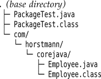

要编译此程序，只需切换到基础目录并运行命令

```
javac PackageTest.java
```

编译器会自动找到并编译`com/horstmann/corejava/Employee.java`。

让我们来看一个更实际的例子，在这个例子中我们没有使用未命名包，而是将类分布在多个包中（`com.horstmann.corejava`和`com.mycompany`）。

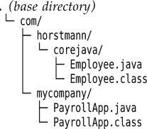

在这种情况下，你仍然必须从*基*目录编译并运行类——即包含`com`目录的目录：

点击此处代码图片

```
javac com/mycompany/PayrollApp.java
java com.mycompany.App
```

再次注意，编译器操作的是*文件*（带有文件分隔符和扩展名`.java`），而 Java 解释器加载的是*类*（使用点分隔符）。

 提示

从下一章开始，我们将在源代码中使用包。这样，你就可以为每一章创建一个 IDE 项目，而不是为每个小节。

 注意

编译器在编译源文件时*不会*检查目录结构。例如，假设你有一个以以下指令开头的源文件：

```
package com.mycompany;
```

即使该文件没有放在`com/mycompany`子目录中，你也可以编译它。*如果*该源文件不依赖其他包，它将无错误地编译。然而，除非你先将所有类文件移动到正确的位置，否则生成的程序将无法运行。如果包与目录不匹配，*虚拟机*将找不到这些类。

**列表 4.7** `PackageTest/PackageTest.java`

点击此处代码图片

```
 1  import com.horstmann.corejava.*;
 2  // Employee 类定义在那个包中
 3
 4  import static java.lang.System.*;
 5
 6 /**
 7  * 此程序演示了包的使用。
 8  * @version 1.11 2004-02-19
 9  * @author Cay Horstmann
10  */
11 public class PackageTest
12 {
13    public static void main(String[] args)
14    {
15       // 因为有 import 语句，我们在这里不需要
16       // com.horstmann.corejava.Employee
17       var harry = new Employee("Harry Hacker", 50000, 1989, 10, 1);
18
19       harry.raiseSalary(5);
20
21       // 因为有 static import 语句，我们在这里不需要 System.out
22       out.println("name=" + harry.getName() + ",salary=" + harry.getSalary());
23    }
24 }
```

**列表 4.8** `PackageTest/com/horstmann/corejava/Employee.java`

点击此处代码图片


```java
 1 package com.horstmann.corejava;
 2
 3 // 此文件中的类是该包的一部分
 4
 5 import java.time.*;
 6
 7 // import 语句位于 package 语句之后
 8
 9 /**
10  * @version 1.11 2015-05-08
11  * @author Cay Horstmann
12  */
13 public class Employee
14 {
15    private String name;
16    private double salary;
17    private LocalDate hireDay;
18
19    public Employee(String name, double salary, int year, int month, int day)
20    {
21       this.name = name;
22       this.salary = salary;
23       hireDay = LocalDate.of(year, month, day);
24    }
25
26    public String getName()
27    {
28       return name;
29    }
30
31    public double getSalary()
32    {
33       return salary;
34    }
35
36    public LocalDate getHireDay()
37    {
38       return hireDay;
39    }
40
41    public void raiseSalary(double byPercent)
42    {
43       double raise = salary * byPercent / 100;
44       salary += raise;
45    }
46 }
```

#### 4.8.5 包访问权限

你已经遇到过访问修饰符 `public` 和 `private`。标记为 `public` 的特征可以被任何类使用。私有特征只能由定义它的类使用。如果你没有指定 `public` 或 `private`，则该特征（即类、方法或变量）可以被同一个包中的所有方法访问。

考虑列表 4.2 中的程序。`Employee` 类没有定义为公共类。因此，只有同一个包中的其他类（例如 `EmployeeTest`，在此例中是未命名包）可以访问它。对于类来说，这是一个合理的默认值。但对于变量来说，这是一个遗憾的选择。变量必须显式标记为 `private`。

#### 4.8.6 类路径

正如你所看到的，类存储在文件系统的子目录。类的路径必须与包名匹配。

类文件也可以存储在 JAR（Java 存档）文件中。JAR 文件包含以压缩格式的多个类文件和子目录，可以节省空间并提高性能。当你在程序中使用第三方库时，通常会给你一个或多个需要包含的 JAR 文件。你将在第 11 章中看到如何创建自己的 JAR 文件。

```text
/home/user/classdir:.:/home/user/archives/archive.jar
```

在 Windows 中，它们用分号分隔：

点击此处查看代码图像

```text
c:\classdir;.;c:\archives\archive.jar
```

在两种情况下，句号 `.` 都表示当前目录。

该类路径（class path）包含：

- 基础目录 `/home/user/classdir` 或 `c:\classdir`；
- 当前目录（`.`）以及
- JAR 文件 `/home/user/archives/archive.jar` 或 `c:\archives\archive.jar`。

从 Java 6 开始，你可以为 JAR 文件目录指定通配符，如下：

点击此处查看代码图像

```text
/home/user/classdir:.:/home/user/archives/'*'
```

或者：

```text
c:\classdir;.;c:\archives\*
```

在 UNIX 中，`*` 必须经过转义以防止 shell 扩展。

`archives` 目录下的所有 JAR 文件（但不包括 `.class` 文件）都在此类路径中。Java API 总是会被搜索类；不要显式将其包含在类路径中。

 注意

`javac` 编译器始终会在当前目录查找文件，但 `java` 虚拟机启动器只有在 `.` 目录位于类路径上时才会查找当前目录。如果你没有设置类路径，这并不是一个问题——默认的类路径由 `.` 目录组成。但如果你设置了类路径却忘记包含 `.` 目录，你的程序将编译通过而不报错，但无法运行。

类路径列出了所有作为查找类起点的目录和存档文件。让我们考虑我们的示例类路径：

点击此处查看代码图像

```text
/home/user/classdir:.:/home/user/archives/archive.jar
```

假设虚拟机搜索 `com.horstmann.corejava.Employee` 类的类文件。它首先在 Java API 类中查找。它在那里找不到该类文件，因此转到类路径。它接着查找以下文件：

- `/home/user/classdir/com/horstmann/corejava/Employee.class`
- 从当前目录开始的 `com/horstmann/corejava/Employee.class`
- 位于 `/home/user/archives/archive.jar` 内部的 `com/horstmann/corejava/Employee.class`

编译器定位文件比虚拟机困难。如果你在没有指定包的情况下引用了一个类，编译器首先需要找到包含该类的包。它会咨询所有的 `import` 指令作为类的可能的来源。例如，假设源文件包含以下指令：

点击此处查看代码图像

```java
import java.util.*;
import com.horstmann.corejava.*;
```

并且源代码引用了类 `Employee`。编译器随后尝试寻找 `java.lang.Employee`（因为 `java.lang` 包默认总是导入）、`java.util.Employee`、`com.horstmann.corejava.Employee` 以及当前包中的 `Employee`。它会在类路径的所有位置搜索这些每一个类。如果发现多个类，则会发生编译错误。（完全限定类名必须是唯一的，因此 `import` 语句的顺序并不重要。）

编译器更进了一步。它查看源文件以检查源是否比类文件新。如果是，源文件将自动重新编译。记住，你只能从其他包导入公共类（public classes）。一个源文件只能包含一个公共类，且文件名与公共类的名称必须匹配。因此，编译器可以轻松地定位公共类的源文件。然而，你可以从当前包导入非公共类。这些类可能定义在不同名称的源文件中。如果你从当前包导入类，编译器会搜索当前包的所有源文件以查看是哪一个定义了该类。

### 4.8.7 设置类路径

最好使用选项 `-classpath`（或 `-cp`，或者从 Java 9 开始的 `--class-path`）来指定类路径：

点击此处查看代码图像

```shell
java -classpath /home/user/classdir:.:/home/user/archives/archive.jar MyProg
```

或者：

点击此处查看代码图像

```shell
java -classpath c:\classdir;.;c:\archives\archive.jar MyProg
```

整个命令必须在一行内输入。将这样长的命令行放入 shell 脚本或批处理文件中是一个好主意。

使用 `-classpath` 选项是设置类路径的首选方法。另一种方法是使用 `CLASSPATH` 环境变量。具体取决于你的 shell。对于 bash shell，使用命令：

点击此处查看代码图像

```shell
export CLASSPATH=/home/user/classdir:.:/home/user/archives/archive.jar
```

在 Windows shell 中，使用：

点击此处查看代码图像

```bat
set CLSPATH=c:\classdir;.;c:\archives\archive.jar
```

类路径将一直有效 shell 退出。

 注意

有些人建议永久设置 `CLASSPATH` 环境变量。这通常是一个坏主意。人们会忘记全局设置，并在类未被加载时感到惊讶。

 注意

过去，曾建议通过将所有 JAR 文件放入 `jre/lib/ext` 目录来绕过类路径。这种机制在 Java 9 中已过。

## 4.9 JAR 文件

当你打包应用程序时，你希望给用户一个文件，而不是一个充满类文件的目录。JAR 文件为此设计的。JAR 文件可以包含类文件和其他文件类型，如图像和声音。此外，JAR 文件使用了熟悉的 ZIP 格式进行压缩。

#### 4.9.1 创建 JAR

使用 `jar` 工具制作 JAR 文件。（在默认 JDK 安装中，它位于 `bin` 目录下。）创建新 JAR 文件的常用命令使用以下语法：

点击此处查看代码图像

```shell
jar cvfjarFileName file1 file2 .
```

例如：

点击此处查看代码图像

```shell
jar cvf CalculatorClasses.jar *.class icon.gif
```

通常情况下，`jar` 命令具有以下格式：

```shell
jar options file1 file2 .
```

表 4.2 列出了 `jar` 程序的所有选项。它们与 UNIX `tar` 命令的选项相似。

你可以将应用程序和代码库打包成 JAR 文件。例如，如果你在 Java 程序中发送邮件，你需要使用封装在 `javax.mail.jar` 文件中的库。

| 选项 | 说明 |
|---|---|
| `f` | 将第二个命令行参数指定为 JAR 文件名。如果缺少此参数，`jar` 将将结果写入到标准输出（在创建 JAR 文件时）或从标准输入读取（在提取或列出 JAR 文件时）。 |
| `i` | 创建索引文件（用于加速大型归档中的查找）。 |
| `m` | 向 JAR 文件中添加 `manifest`（清单）。清单是归档内容和源的描述文件。每个归档都有一个默认的清单，但如果你想验证归档内容，可以提供自己的清单。 |
| `M` | 不为条目创建清单文件。 |
| `t` | 显示目录表。 |
| `u` | 更新现有的 JAR 文件。 |
| `v` | 生成详细输出。 |
| `x` | 提取文件。如果你提供了一个或多个文件名，则只提取这些文件。否则，将提取所有文件。 |
| `0` | 存储时不进行 ZIP 压缩。 |

**表 4.2** `jar` 程序选项

### 4.9.2 清单文件（The Manifest）

除了类文件、图像和其他资源外，每个 JAR 文件都包含一个 `manifest` 文件，用于描述归档的特殊特性。

清单文件名为 `MANIFEST.MF`，位于 JAR 文件中特殊的 `META-INF` 子目录下。最少的合法清单非常无趣——仅仅是：

```text
Manifest-Version: 1.0
```

复杂的清单可以包含更多的条目。清单条目被分为若干部分。清单中的第一个部分称为 `main section`（主部分）。它适用于整个 JAR 文件。随后的条目可以指定命名实体（如单个文件、包或 URL）的属性。这些条目必须以一个 `Name` 条目开头。各个部分之间用空行分隔。例如：

```text
Manifest-Version: 1.0
描述此归档的行

Name: Woozle.class
描述此文件的行
Name: com/mycompany/mypkg/
描述此包的行
```

要编辑清单，请将你想要添加到清单中的行存放在一个文本文件中。然后运行：

点击此处查看代码图像

```shell
jar cfm jarFileName manifestFileName . . .
```

例如，要创建一个带有清单的新 JAR 文件，请运行：

点击此处查看代码图像

```shell
jar cfm MyArchive.jar manifest.mf com/mycompany/mypkg/*.class
```

要更新现有 JAR 文件的清单，请将新增内容放入文本文件中，并使用如下命令：

点击此处查看代码图像

```shell
jar ufm MyArchive.jar manifest-additions.mf
```

 提示

关于 JAR 和清单文件格式的更多信息，请参阅 [`https://docs.oracle.com/javase/10/docs/specs/jar/jar.html`](https://docs.oracle.com/javase/10/docs/specs/jar/jar.html)。

### 4.9.3 可执行 JAR 文件

你可以使用 `jar` 命令的 `e` 选项来指定程序的 `entry point`（入口点）——即你通常调用 `java` 程序启动器时指定的那个类：

点击此处查看代码图像

```shell
jar cvfe MyProgram.jar com.mycompany.mypkg.MainAppClass files to add
```

或者，你可以在清单中指定程序的 `main class`（主类），包括格式如下的语句：

点击此处查看代码图像

```text
Main-Class: com.mycompany.mypkg.MainAppClass
```

不要为主类名添加 `.class` 扩展名。

 注意

清单的最后一行必须以换行符结束。否则，清单将无法被正确读取。常见的错误是生成了一个只包含 `Main-Class` 行但没有行终止符的文本文件。

使用哪种方法，用户都可以简单地启动程序：

```shell
java -jar MyProgram.jar
```

根据操作系统的配置，用户甚至可能通过双击 JAR 文件图标来启动应用程序。以下是各种操作系统的行为：

- 在 Windows 上，Java 运行时安装程序会为 `.jar` 扩展名创建文件关联，使用 `javaw -jar` 命令启动文件。（与 `java` 命令不同，`javaw` 命令不会打开命令行窗口。）
- 在 Mac OS X 上，操作系统能够识别 `.jar` 文件扩展名，并在双击 JAR 文件时执行 Java 程序。

然而，JAR 文件中的 Java 程序并没有像原生应用程序那样的感觉。在 Windows 上，你可以使用第三方封装工具（wrapper utilities）将 JAR 文件转换为 Windows 可执行文件。封装器（wrapper）是一个具有熟悉的 `.exe` 扩展名的 Windows 程序，它用于查找并启动 Java 虚拟机（JVM），或者在未找到 JVM 时告诉用户如何操作。有许多商业和开源产品，例如 Launch4J（[`launch4j.sourceforge.net`](http://launch4j.sourceforge.net)）和 IzPack（[`izpack.org`](http://izpack.org)）。

### 4.9.4 多版本 JAR 文件

随着模块的引入和对包的强封装，某些以前可以访问的内部 API 不再可用。这可能需要库提供者为不同的 Java 版本分发不同的代码。Java 9 引入了 `multi-release JAR`（多版本 JAR）来实现此目的。

为了后兼容，特定版本的类文件被放置在 `META-INF/versions` 目录下：

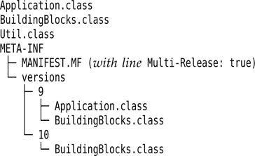

假设 `Application` 类使用了 `CssParser` 类。那么旧的 `Application.class` 文件可以编译为使用 `com.sun.javafx.css.CssParser`，而 Java 9 版本则使用 `javafx.css.CssParser`。

Java 8 对 `META-INF/versions` 目录一所不知，只会加载旧类。当 Java 9 读取 JAR 文件时，将使用新版本。

要添加带版本的类文件，请使用 `--release` 标志：

点击此处查看代码图像

```shell
jar uf MyProgram.jar --release 9 Application.class
```

要从头构建多版本 JAR 文件，请使用 `-C` 选项切换到不同的版本目录：

点击此处查看代码图像

```shell
jar cf MyProgram.jar -C bin/8 . --release 9 -C bin/9 Application.class
```

在编译不同版本时，使用 `--release` 标志和 `-d` 标志指定输出目录：

点击此处查看代码图像

```shell
javac -d bin/8 --release 8 .
```

从 Java 9 开始，如果目录不存在，`-d` 选项会自动创建。

`--release` 标志也是 Java 9 新引入。在旧版本中，你需要使用 `-source`、`-target` 和 `-bootclasspath` 标志。JDK 现在提供了两个旧版本的符号文件。在 Java 9 中，你可以将 `--release` 设置为 `9`、`8` 或 `7`。

多版本 JAR 不是用于不同的程序或库。所有类的公共 API 应该是相同的。多版本 JAR 的唯一目的是让特定版本的程序或库适用于多个 JDK 版本。如果你增加了功能或更改了 API，你应该提供一个新版本的 JAR。

 提示

如 `javap` 等工具尚未重构以处理多版本 JAR 文件。如果你调用：

点击此处查看代码图像


```java
javap -classpath MyProgram.jar Application.class
```

你得到的是类的基础版本（毕竟它应该与新版本具有相同的公共 API）。如果你必须查看新版本，请调用：

点击此处查看代码图像

```java
javap -classpath MyProgram.jar!/META-INF/versions/9/Application.class
```

### 4.9.5 关于命令行选项的说明

Java 开发工具包中命令的选项传统上使用单连杠跟随多个字母的选项名称，例如：

点击此处查看代码图像

```bash
java -jar . . .
javac -Xlint:unchecked -classpath . . .
```

例外是 `jar` 命令，它遵循了 `tar` 命令的经典选项格式，且不带横杠：

```bash
jar cvf . . .
```

从 Java 9 开始，Java 工具正在转向一种更通用的选项格式，在该格式中，多字母选项名称以双横杠开头，而常用选项则有单字母快捷方式。例如，Linux 的 `ls` 命令可以使用“人类可读”选项调用：

```bash
ls --human-readable
```

或者：

```bash
ls -h
```

从 Java 9 开始，你可以使用 `--version` 代替 `-version`，并使用 `--class-path` 代替 `-classpath`。正如你在第二卷第 9 章中看到的，`--module-path` 选项有一个快捷方式 `-p`。

你可以在 JEP 293 增强请求中找到详细信息，[`http://openjdk.java.net/jeps/293`](http://openjdk.java.net/jeps/293)。作为此次清理工作的一部分，作者还建议标准化选项参数。带有 `--` 和多个字母的选项的参数可以通过空格或 `=` 符号分隔：

点击此处查看代码图像

```bash
javac --class-path /home/user/classdir . . .
```

或者：

点击此处查看代码图像

```bash
javac --class-path=/home/user/classdir . . .
```

单字母选项的参数可以使用空格分隔，也可以直接紧跟在选项后面：

```bash
javac -p moduledir . . .
```

或者：

```bash
javac -pmoduledir . . .
```

 **注意**

后者目前不起作用，而且通常来说这似乎是个坏主意。如果模块目录恰好是 `arameters` 或 `rocessor`，为什么要招引入与旧选项的冲突呢？

没有参数的单字母选项可以组合在一起：

点击此处查看代码图像

```bash
jar -cvf MyProgram.jar -e mypackage.MyProgram */*.class
```

 **注意**

这目前不起作用，而且注定会导致混乱。假设 `javac` 获得了一个 `-c` 选项。那么 `javac -cp` 是指 `javac -c -p`，还是旧的 `-cp` 优先？

这造成了一个混乱局面，希望随着时间的推移得到清理。尽管我很想摆弃过时的 `jar` 选项，但似乎等尘埃落定之后是最好的。但如果你想完全彻底现代化，可以安全地使用 `jar` 命令的长格式选项：

点击此处查看代码图像

```bash
jar --create --verbose --file jarFileName file1 file2 . . .
```

如果你不对单字母选项进行分组，它们同样有效：

点击此处查看代码图像

```bash
jar -c -v -f jarFileName file1 file2 . . .
```

## 4.10 文档注释

JDK 包含一个名为 `javadoc` 的实用工具，它可以从你的源文件生成 HTML 文档。事实上，第 3 章中描述的在线 API 文档仅仅是在标准 Java 库源码上运行 `javadoc` 的结果。

如果你在源代码中添加以特殊分隔符 `/**` 开头的注释，也可以生成专业的文档。这是一个非常好的方法，因为它让你将代码和文档放在同一个地方。如果你将文档放在单独的文件，正如你可能知道的，代码和注释往往随着时间的推移而分离。当文档注释与源代码位于同一个文件中时，更新两者并再次运行 `javadoc` 就是很容易的事。

### 4.10.1 注释插入

`javadoc` 工具提取以下项目的信息：

- 模块（Modules）
- 包（Packages）
- 公有类和接口
- 公有和受保护字段
- 公有和受保护的构造函数和方法

受保护特性在第二卷的第 5 章中引入，接口在第 6 章，模块在第 9 章。

你可以（也应该）为这些特性中的每一个项提供注释。每个注释都放置在其描述的特性的*上方*。注释以 `/**` 开始，以 `*/` 结束。

每个 `/** . . . */` 文档注释包含*自由格式文本*，后面紧跟*标签*。标签以 `@` 开头，例如 `@since` 或 `@param`。

自由格式文本的*第一句*应该是一个*摘要语句*。`javadoc` 工具会自动生成提取这些句子的摘要页。

在自由格式文本中，你可以使用 HTML 修饰符，如 `<em>. . .</em>` 用于强调，`<strong>. . .</strong>` 用于强强调，`<ul>`/`<li>` 用于项目列表，以及 `` 用于包含图像。

以下标签可用于类文档注释中：

- `@author` `name`

  此标签创建一个“作者”（author）条目。你可以有多个 `@author` 标签，每个作者对应一个。不必强迫使用此标签——你的版本控制系统在跟踪作者归属方面比它做得更详尽。

- `@version` `text`

  此标签创建一个“版本”（version）条目。`text` 可以是对当前版本的任何描述。

你可以使用 `@see` 和 `@link` 标签使用指向 `javadoc` 文档其他相关部分或外部文档的超链接。

标签 `@see` `reference` 会在“另参见”（see also）部分添加一个超链接。它可以同时用于类和方法。在这里，`reference` 可以是以下内容之一：

```text
package.class#feature label
<a href=". . .">label</a>
"text"
```

第一种情况是最有用的。你提供类、方法或变量名，`javadoc` 会插入一个指向该文档的超链接。例如：

点击此处查看代码图像

```java
@see com.horstmann.corejava.Employee#raiseSalary(double)
```

这将创建一个指向 `com.horstmann.corejava.Employee` 类中 `raiseSalary(double)` 方法的链接。你可以省略包名，或者省略包名和类名。这时，该特性将在当前包或类中查找。

注意，你必须使用 `#` 而不是点来分隔类与方法或变量名。Java 编译器本身非常擅长确定点号作为包、子包、类、内部类以及方法和变量之间分隔符的各种含义。但 `javadoc` 工具并没有那么聪明，所以你得帮助它。

如果 `@see` 标签后跟着 `<` 字符，则你需要指定一个超链接。你可以链接到任何你喜欢的 URL。例如：

点击此处查看代码图像

```html
@see <a href="www.horstmann.com/corejava.html">The Core Java home page</a>
```

在这些每种情况下，你都可以指定一个可选的 `label` 作为链接锚点。如果你省略了 `label`，用户将看到目标代码名或 URL 作为锚点。

如果 `@see` 标签后跟着 `"` 字符，则会在“另参见”部分显示该文本。例如：

```java
@see "Core Java 2 volume 2"
```

你可以为一个特性添加多个 `@see` 标签，但必须将它们全部放在一起。

如果你愿意，可以在任何文档注释的任何位置放置指向其他类或方法的超链接。在注释的任何位置插入格式如下的特殊标签：

点击此处查看代码图像

```java
{@link package.class#feature label}
```

特性的描述遵循与 `@see` 标签相同的规则。

最后，从 Java 9 开始，你可以使用 `{@index` `entry`}` 标签向搜索框添加条目。

### 4.10.6 包注释

将类、方法和变量的注释直接放在 Java 源文件中，并用 `/** . . . */` 文档注释隔开。然而，要生成*包*（package）注释，你需要在每个包目录下添加一个单独的文件。你有两个选择：

1. 提供一个名为 `package-info.java` 的 Java 文件。该文件必须包含一个初始 Javadoc 注释（用 `/**` 和 `*/` 分隔），后跟一个 `package` 语句。它不应包含进一步的代码或注释。

2. 提供一个名为 `package.html` 的 HTML 文件。所有位于 `<<body> . . .</</body>>` 之间的文本都会被提取。

### 4.10.7 注释提取

在这里，`docDirectory` 是你希望存放 HTML 文件的目录名称。按照以下步骤操作：

1. 切换到包含你要文档的源文件的目录。如果你有嵌套的包需要文档，例如 `com.horstmann.corejava`，你必须在包含子目录 `com` 的目录中运行（如果你提供了 `overview.html` 文件，这就是包含该文件的目录）。

2. 运行命令：

   ```bash
   javadoc -d docDirectory nameOfPackage
   ```

   针对单个包运行。或者，运行：

   ```bash
   javadoc -d docDirectory nameOfPackage1 nameOfPackage2\. . .
   ```

   来文档多个包。如果你的文件在未命名包中，请改运行：

   ```bash
   javadoc -d docDirectory *.java
   ```

如果你省略了 `-d docDirectory` 选项，HTML 文件将提取到当前目录。那可能会变得很乱，我不建议这样做。

可以通过许多命令行选项微调 `javadoc` 程序。例如，你可以使用 `-author` 和 `-version` 选项（默认情况下，它们会被省略）。另一个有用的选项是 `-link`，用于包含指向标准类的超链接。例如，如果你使用命令行：

```bash
javadoc -link http://docs.oracle.com/javase/9/api
```

所有标准库类将链接到该网站。如果你使用 `-linksource` 选项，每个源文件将转换为 HTML（没有颜色标记，但有行号），并且每个类和方法名将变成指向源的链接。

你还可以为所有源文件提供一个概述。将其放在 `overview.html` 文件中并运行 `javadoc -overview filename`。用户从导航栏选择“Overview”时将显示内容。

有关其他选项，请参阅 [`docs.oracle.com/javase/9/javadoc/javadoc.htm`](https://docs.oracle.com/javase/9/javadoc/javadoc.htm)。

### 4.11 设计提示

不需要试图详尽或冗长，我想在本章结束时提供一些让你的类更符合规范的提示。

1. *始终保持数据私有*。这是首要的；任何其他操作都违反了封装。你可能需要编写访问器或修改器方法，但保持实例字段私有仍然更好。经验表明表示可能会改变，但使用数据的方式变化频率。当数据私有时，表示的变化不会影响类的用户，错误更容易检测。

2. *始终初始化数据*。Java 不会为你初始化局部变量，但会初始化对象的实例字段。不要依赖默认值，要显式地初始化所有变量，通过提供默认值或在所有构造函数中设置默认值。

3. *不要在类中使用过多的基本类型*。其主意是用其他类替换多个*相关的*基本类型的使用。这使得你的类更容易被理解和更改。例如，替换 `Customer` 类中的以下实例字段：

   ```java
   private String street;
   private String city;
   private String state;
   private int zip;
   ```

   使用名为 `Address` 的新类。这样，你就可以轻松地应对地址的变化，例如处理国际地址的需求。

4. *并不是所有字段都需要单独的字段访问器和修改器*。你可能需要获取和设置员工的薪水。一旦对象构建，你不需要更改入职日期。而且，对象经常拥有你不希望其他人获取或设置的实例字段，例如 `Address` 类中的州缩写数组。

5. *拆分职责过多的类*。

这个提示显然是模糊的：“太多”显然是因人而异的。然而，如果有一种明显的方法可以将一个复杂的类拆分为两个概念上更简单的类，那么请抓住这个机会。（另一方面，不要做得过头；十个每个只有一个方法的类，通常是设计过度了。）

这里有一个糟糕设计的示例：

点击此处查看代码图片

```java
public class CardDeck // 糟糕的设计
{
   private int[] value;
   private int[] suit;

   public CardDeck() { . . . }
   public void shuffle() { . . . }
   public int getTopValue() { . . . }
   public int getTopSuit() { . . . }
   public void draw() { . . . }
}
```

这个类实际上实现了两个独立的概念：一个*牌组*（deck of cards），拥有 `shuffle` 和 `draw` 方法；以及一张*卡牌*（card），拥有检查其值和花色的方法。引入一个代表单张卡牌的 `Card` 类是有意义的。现在你有两个类，每个类都有自己的职责：

点击此处查看代码图片

```java
public class CardDeck
{
   private Card[] cards;
   public CardDeck() { . . . }
   public void shuffle() { . . . }
   public Card getTop() { . . . }
   public void draw() { . . . }
}

public class Card
{
   private int value;
   private int suit;

   public Card(int aValue, int aSuit) { . . . }
   public int getValue() { . . . }
   public int getSuit() { . . . }
}
```

### 6. 让你的类和方法的名称反映它们的职责

正如变量应该具有反映其代表含义的有意义名称一样，类也是如此。（标准库确实包含一些令人疑惑的例子，例如描述时间的 `Date` 类。）

一个良好的约定是，类名应该是名词（`Order`），或者由形容词修饰的名词（`RushOrder`）或动名词（以“-ing”结尾的词，如 `BillingAddress`）。对于方法，遵循标准约定：访问器方法（accessor methods）以小写的 `get` 开头（`getSalary`），修改器方法（mutator methods）使用小写的 `set`（`setSalary`）。

### 7. 优先使用不可变类

`LocalDate` 类以及 `java.time` 包中的其他类是不变的——没有方法可以修改对象的状态。与其修改对象，像 `plusDays` 这样的方法会返回带有修改后状态的新对象。

变异的问题在于，当多个线程尝试同时更新对象时，它可能会并发发生。结果是不可预测的。当类是不可变的时，在多个线程之间共享它们的对象是安全的。

因此，在可能的情况下让类变为不可变是一个好主意。对于表示值的类（例如字符串或时间点），这为容易。计算可以简单地产生新值，而不是更新现有值。

当然，并不是所有类都应该是不可变的。当员工加薪时，让 `raiseSalary` 方法返回一个新的 `Employee` 对象将很奇怪。

在本章中，我们涵盖了对象和类的基础知识，这些知识使 Java 成为一种“基于对象”的语言。为了真正实现面向对象，编程语言还必须支持继承和多态。Java 对这些特性的支持是下一章的主题。

# 第 5 章

## 继承

### 本章

- 5.1 类、超类和子类
- 5.2 `Object`：宇宙超类
- 5.3 通用数组列表
- 5.4 包装类与自动装箱
- 5.5 变长参数方法
- 5.6 抽象类
- 5.7 枚举类
- 5.8 密封类
- 5.9 反射
- 5.10 继承的设计提示

第 4 章介绍了类和对象。在本章中，你将学习*继承*，这是面向对象编程的另一个基本概念。继承的思想是你可以创建构建在现有类之上的类。当你从现有类继承时，你会重用（或继承）它的方法，并可以添加新的方法和字段以使你的新类适应新的情况。这种技术在 Java 编程中至关重要。

本章还涵盖了*反射*，即在运行程序中发现更多关于类及其属性的能力。反射是一个强大的特性，但不可否认它复杂。由于反射对工具构建者比对应用程序程序员更感兴趣，你可能第一次阅读时可以略过该章的这部分，然后再回来。

## 5.1 类、超类和子类


让我们回到上一章讨论的`Employee`类。假设你在一家公司工作，那里对经理的对待方式不同。经理当然也是员工。然而，经理有薪水，他们还有奖金。这种情况非常需要继承。为什么呢？因为你需要定义一个新类`Manager`并添加功能。但你可以保留`Employee`类中已经编写的内容。更抽象地说，`Manager`和`Employee`之间存在“是一个”（is-a）的关系。每个经理都是员工：这种“是一个”的关系是继承的标志。

 注意

## 5.1.1 定义子类

这是定义一个继承自`Employee`类的`Manager`类。使用Java关键字`extends`表示继承。

点击此处查看代码图片

```
public class Manager extends Employee
{
   added methods and fields
}
```

 C++ 注意

Java和C++中的继承是相似的。Java使用`extends`关键字而不是`:`符号。Java中的继承都是公共继承；没有类似于C++私有和保护继承的对应物。

`extends`关键字表示你正在创建一个派自现有类的新类。现有类被称为*超类*（superclass）、*基类*（base class）或*父类*（parent class）。新类被称为*子类*（subclass）、*派生类*（derived class）或*子类*（child class）。超类和子类是Java程序员最常用的术语，尽管某些程序员更喜欢父子类类比，这与“继承”主题也契合得很好。

`Employee`类是一个超类，但并不是因为它优于其子类或包含更多功能。*事实上，事实恰恰相反：*子类比超类具有*更多*的功能。例如，当我们查看`Manager`类的其余代码时，你会发现`Manager`类比其超类`Employee`封装了更多的数据并拥有更多功能。

`super`和`sub`前缀来自于理论计算机科学和数学中的集合论语言。所有员工的集合包含了所有经理的集合，因此被认为是经理集合的`superset`（超集）。或者换句话说，所有经理的集合是所有员工集合的`subset`（子集）。

我们的`Manager`类有一个新字段来存储奖金，并有一个新方法来设置它：

点击此处查看代码图像

```
public class Manager extends Employee
{
   private double bonus;
   . . .
   public void setBonus(double bonus)
   {
      this.bonus = bonus;
   }
}
```

这些方法和字段并没有特殊之处。如果你有一个`Manager`对象，你可以可以直接调用`setBonus`方法。

```
Manager boss = . . .;
boss.setBonus(5000);
```

当然，如果你有一个`Employee`对象，你就无法调用`setBonus`方法——因为它没有在`Employee`类定义的方法中。

然而，你*可以*对`Manager`对象使用`getName`和`getHireDay`等方法。尽管这些方法没有在`Manager`类中显式定义，但它们自动从`Employee`超类继承了。

每个`Manager`对象都有四个字段：`name`、`salary`、`hireDay`和`bonus`。字段`name`、`salary`和`hireDay`是取自父类。

 笔记

Java语言规范规定：“类中声明为私有的成员不会被该类的子类继承。”多年来，这一直让我的读者感到困惑。规范对“继承”一词的定义非常狭窄。它认为私有字段是未继承的，因为`Manager`类无法直接访问它们。因此，每个`Manager`对象拥有三个来自父类的字段，但`Manager`类并没有“继承”它们。

在通过扩展父类来定义子类时，你只需要指示子类和父类之间的差异。在设计类时，你将最通用的方法放在父类中，将更专门的方法放在其子类中。通过将公共功能移动到父类来提取这些功能，是面向对象编程中的常规操作。

 笔记

在第4章中，你学习了记录（records）：状态完全由构造器参数定义的类。你不能扩展记录，记录也不能扩展另一个类。

## 5.1.2 重写方法

某些父类方法并不适用于`Manager`子类。特别是`getSalary`方法应该返回基本工资和奖金之和。你需要提供一个新的方法来重写（override）父类方法：

点击此处查看代码图像

```
public class Manager extends Employee
{
   . . .
   public double getSalary()
   {
      . . .
   }
   . . .
}
```

你如何实现这个方法呢？乍一看，它似乎很简单——只需返回`salary`和`bonus`字段之和即可：

点击此处查看代码图像

```
public double getSalary()
{
   return salary + bonus; // 不行
}
```

然而，那是行不通的。记住，只有`Employee`方法可以直接访问`Employee`类的私有字段。这意味着`Manager`类的`getSalary`方法无法直接访问`salary`字段。如果`Manager`方法想要访问这些私有字段，必须像其他所有方法做的那样——使用公共接口，在这种情况下是`Employee`类的公共`getSalary`方法。

所以，让我们再次尝试。你需要调用`getSalary`而不是简单的访问`salary`字段：

点击此处查看代码图像

```
public double getSalary()
{
   double baseSalary = getSalary(); // 还是不行
   return baseSalary + bonus;
}
```

现在，问题在于对`getSalary`的调用仅仅是调用了它自己，因为`Manager`类有一个`getSalary`方法（即我们正在尝试实现的方法）。结果是导致同一个方法的无限调用链，导致程序崩溃。

我们需要指示要调用的是`Employee`超类的`getSalary`方法，而不是当前类。使用特殊关键字`super`来实现此目的。该调用

```
super.getSalary()
```

调用的是`Employee`类的`getSalary`方法。这里是`Manager`类`getSalary`方法的正确版本：

点击此处查看代码图像

```
public double getSalary()
{
   double baseSalary = super.getSalary();
   return baseSalary + bonus;
}
```

 笔记

有些人认为`super`类似于`this`引用。然而，这种类比并不完全准确：`super`不是一个引用；`super`是一个用于访问父类成员的关键字。例如，`super.getSalary()`调用了`Employee`类的`getSalary`方法。

## 5.1.3 子类构造器

为了完成我们的示例，让我们提供一个构造器。

点击此处查看代码图像

```
public Manager(String name, double salary, int year, int month, int day)
{
   super(name, salary, year, month, day);
   bonus = 0;
}
```

在这里，关键字`super`有不同的含义。指令`super(name, salary, year, month, day);`是“使用参数`name`、`salary`、`year`、`month`和`day`调用父类构造器”的简写。

由于`Manager`构造器无法访问`Employee`的私有字段，它必须通过构造器初始化它们。使用`super`的调用必须是构造器的第一语句。

当子类对象如果没有显式调用父类构造器，父类必须有一个无参数构造器。该构造器会在子类构造之前被调用。

```
Manager boss = new Manager("Carl Cracker", 80000, 1987, 12, 15);
boss.setBonus(5000);
```

我们创建了一个包含三个员工的数组：

```
var staff = new Employee[3];
```

我们用经理和员工混合填充了数组：

点击此处查看代码图片

```
staff[0] = boss;
staff[1] = new Employee("Harry Hacker", 50000, 1989, 10, 1);
staff[2] = new Employee("Tony Tester", 40000, 1990, 3, 15);
```

我们打印出每个人的薪水：

点击此处查看代码图片

```
for (Employee e : staff)
   System.out.println(e.getName() + " " + e.getSalary());
```

这个循环循环了以下数据：

```
Carl Cracker 85000.0
Harry Hacker 50000.0
Tommy Tester 40000.0
```

现在，`staff[1]`和`staff[2]`分别打印它们的基本薪水，因为它们是`Employee`对象。然而，`staff[0]`是一个`Manager`对象，其`getSalary`方法在基本薪水的基础上加上了奖金。

非常注意的是，调用

```
e.getSalary()
```

选出了*正确的*`getSalary`方法。请注意，`e`的*声明*类型是`Employee`，但`e`所引用的对象的*实际*类型可以是`Employee`也可以是`Manager`。

当`e`指向一个`Employee`对象时，调用`e.getSalary()`调用的是`Employee`类的`getSalary`方法。然而，当`e`指向一个`Manager`对象时，调用的是`Manager`类的`getSalary`方法。虚拟机知道`e`所引用对象的实际类型，因此可以调用正确的方法。

对象变量（例如变量`e`）可以引用多个实际类型的这一被称为*多态性*。在运行时自动选择合适的方法被称为*动态绑定*。我将在本章更详细地讨论这两个主题。

 C++ 备注

在C++中，如果你想实现动态绑定，需要将成员函数声明为`virtual`。在Java中，动态绑定是默认行为；如果你*不希望*某个方法是虚拟的，可以将其标记为`final`。（我将在本章稍后后的部分讨论`final`关键字。）

列表5.1包含一个程序，展示了`Employee`（列表5.2）和`Manager`（列表5.3）对象的薪水计算差异。

**列表5.1** `inheritance/ManagerTest.java`

点击此处查看代码图片

```
 1 package inheritance;
 2
 3 /**
 4  * 此程序演示了继承。
 5  * @version 1.21 2004-02-21
 6  * @author Cay Horstmann
 7  */
 8 public class ManagerTest
 9 {
10    public static void main(String[] args)
11    {
12       // 构建一个 Manager 对象
13       var boss = new Manager("Carl Cracker", 80000, 1987, 12, 15);
14       boss.setBonus(5000);
15
16       var staff = new Employee[3];
17
18       // 用 Manager 和 Employee 对象填充 staff 数组
19
20       staff[0] = boss;
21       staff[1] = new Employee("Harry Hacker", 50000, 1989, 10, 1);
22       staff[2] = new Employee("Tommy Tester", 40000, 1990, 3, 15);
23
24       // 打印所有 Employee 对象的信息
25       for (Employee e : staff)
26          System.out.println("name=" + e.getName() + ",salary=" + e.getSalary());
27   }
28 }
```

**列表5.2** `inheritance/Employee.java`

点击此处查看代码图片

```
 1 package inheritance;
 2
 3 import java.time.*;
 4
 5 public class Employee
 6 {
 7    private String name;
 8    private double salary;
 9    private LocalDate hireDay;
10
11    public Employee(String name, double salary, int year, int month, int day)
12    {
13       this.name = name;
14       this.salary = salary;
15       hireDay = LocalDate.of(year, month, day);
16    }
17
18    public String getName()
19    {
20       return name;
20    }
22
23    public double getSalary()
24    {
25       return salary;
26    }
27
28    public LocalDate hireDay()
29    {
30       return hireDay;
31    }
32
33    public void raise(double percent)
34    {
35       salary += salary * percent;
36    }
37 }
```

**列表5.3** `inheritance/Manager.java`

点击此处查看代码图片

```
 1 package inheritance;
 2
 3 public class Manager extends Employee
 4 {
 5    private double bonus;
 6
 7    /**
 8      * @param name
 9      * @param salary
10      * @param year
11      * @param month
12      * @param day
13      */
14    public Manager(String name, double salary, int year, int month, int day)
15    {
16       super(name, year, month, day);
17    }
18
19    /**
20      * @param bonus
21      */
22    public void setBonus(double bonus)
23    {
24       this.bonus = bonus;
25    }
26
27    /**
28      * @return bonus
29      */
30    public double getBonus()
31    {
32       return bonus;
33    }
34
35    @Override
36    public double getSalary()
37    {
38       return super.getSalary() + bonus;
39    }
40 }
```

## 5.1.4 层次结构

继承并不只停于一层。一个类可以有多个子类。例如，`Manager`和`Secretary`都继承`Employee`。所有扩展父类的集合被称为*继承*，如图5.1](#ch05.xhtml_ch05fig1)所示。

 Employee 层次结构

在C++中，一个类可以有多个父类。Java不支持多重继承。有关恢复大部分继承的方法，请参见第6.1节](#ch6.xhtml_6_1)。

## 5.1.5 多态

一个简单的规则可以帮助你判断继承是否适用于你的数据。“是”规则规定子类的对象都是父类的对象。例如，每个经理都是员工。自然，相反的情况并非如此——每个员工都是经理。

“是”规则的另一种制定方式是*替换原则*。该原则规定程序需要父类对象时可以使用子类对象。

例如，你可以将子类对象赋值给父类变量。点击此处查看代码图片

```
Employee e;
e = new Employee(); // 需要 Employee
e = new Manager(); // OK，可以使用 Manager
```


在 Java 编程语言中，对象变量是*多态的*。`Employee` 类型变量可以引用 `Employee` 类型的对象，也可以引用 `Employee` 类任何子类的类型对象（如 `Manager`、`Executive`、`Secretary` 等）。

我们在[列表 5.1](#ch05.xhtml_ch05list01) 中利用了这个原则：

```
Manager boss = new Manager();
Employee[] staff = new Employee[3];
staff[0] = boss;
```

在这种情况下，变量 `staff[0]` 和 `boss` 指向同一个对象。然而，编译器认为 `staff[0]` 仅仅是一个 `Employee` 对象。

这意味着你可以调用

```
boss.setBonus(5000); // OK
```

但你不能调用

```
staff[0].setBonus(5000); // 错误
```

`staff[0]` 的声明类型是 `Employee`，而 `setBonus` 方法并不是 `Employee` 类的方法。

然而，你不能将父类引用赋值给子类变量。例如，进行如下赋值是不合法的：

```
Manager m = staff[i]; // ERROR
```

原因显而易见：并不是所有员工都是经理。如果此赋值成功，并且 `m` 指向一个不是经理的 `Employee` 对象，那么之后就可能调用 `m.setBonus(. . .)`，并导致运行时错误。

**注意**

在 Java 中，子类引用的数组可以在不需要强制转换的情况下转换为父类引用的数组。例如，考虑这个经理数组：

```
Manager[] managers = new Manager[10];
```

将此数组转换为 `Employee[]` 数组是合法的：

```
Employee[] staff = managers; // OK
```

当然，你可能会想，为什么不可呢？毕竟，如果 `managers[i]` 是一个 `Manager`，它也是一个 `Employee`。但实际上，发生了一些令人惊讶的事情。请记住，`managers` 和 `staff` 是同一个数组的引用。现在考虑以下语句：

```
staff[0] = new Employee("Harry Hacker", . . .);
```

编译器会乐然地允许这次赋值。但 `staff[0]` 和 `managers[0]` 是同一个引用，因此看起来我们成功地将一个普通的员工“偷入”了管理层。这将非常糟糕——调用 `managers[0].setBonus(1000)` 将尝试访问一个不存在的实例字段，并损坏相邻的内存。

为了确保不会发生此类损坏，所有数组都会记录其创建时的元素类型，并监控只允许将兼容的引用存储在其中。例如，通过 `new Manager[10]` 创建的数组会记住它是一个经理数组。尝试存储 `Employee` 引用将抛出 `ArrayStoreException`。

### 5.1.6 理解方法调用

确切理解方法调用是如何应用到对象的是非常重要的。假设我们调用 `x.f(args)`，并且隐式参数 `x` 被声明为类 `C` 的对象。以下是发生的情况：

1. 编译器查看对象的声明类型和方法名。注意，可能存在多个同名为 `f` 的方法，但参数类型不同。例如，可能存在一个方法 `f(int)` 和一个方法 `f(String)`。编译器会列出类 `C` 中所有名为 `f` 的方法，以及 `C` 的父类中所有可访问的名为 `f` 的方法。（父类的私有方法是不可访问的。）

   现在，编译器知道了要调用的所有候选方法。

2. 接下来，编译器确定方法调用中提供的参数的类型。如果在所有名为 `f` 的方法中，有一个方法的参数类型与提供的参数最匹配的（best match），则选择该方法进行调用。这个过程被称为*重载解析*（*overloading resolution*）。例如，在调用 `x.f("Hello")` 时，编译器选择了 `f(String)` 而不是 `f(int)`。由于类型转换（从 `int` 到 `double`，从 `Manager` 到 `Employee` 等），情况可能会变得复杂。如果编译器找不到任何参数类型匹配的方法，或者在应用转换后有多个方法都匹配，编译器将报告错误。

   现在，编译器知道了需要调用的方法名和参数类型。

   **注意**

   回想方法的名称和参数类型列表被称为方法的*签名*（*signature*）。例如，`f(int)` 和 `f(String)` 是两个同名但签名不同的方法。如果你在子类中定义了一个与父类方法签名相同的方法，那么你就重写（*overridden*）了该父类方法。

   返回类型不是签名的一部分。然而，当你重写一个方法时，你需要保持返回类型是兼容的。子类可以将返回类型更改为原始类型的子类型。例如，假设 `Employee` 类有一个方法：

   ```
   public Employee getBuddy() { . . . }
   ```

   经理绝不会希望有一个低级的员工作为伙伴。为了反映这一事实，`Manager` 子类可以这样重写该方法：

   ```
   public Manager getBuddy() { . . . } // 修改返回类型是合法的
   ```

   我们说这两个 `getBuddy` 方法具有*协变*返回类型（*covariant* return types）。

3. 如果方法是 `private`、`static`、`final` 或构造函数，那么编译器确切知道要调用哪一个方法。（`final` 修饰符将在下一节中解释）。这被称为*静态绑定*（*static binding*）。否则，要调用的方法取决于隐式参数的实际类型，必须在运行时使用动态绑定。在我们的示例中，编译器将生成一条使用动态绑定调用 `f(String)` 的指令。

4. 当程序运行并使用动态绑定调用一个方法时，虚拟机必须根据隐式参数 `x` 的实际类型来调用。在我们的示例中，编译器会生成一条使用动态绑定调用 `f(String)` 的指令。假设实际类型是 `D`，它是 `C` 的子类。如果 `D` 类定义了方法 `f(String)`，则调用该方法；如果没有，则在 `D` 的父类中查找 `f(String)`。

   如果每次调用方法时都进行这种搜索将耗时。相反，虚拟机在加载类时为每个类预计算一个方法表。方法表列出了该类及其父类中的所有方法签名。

   当实际调用方法时，虚拟机只需进行表查询。在示例中，虚拟机查询类 `D` 的方法表以查找 `f(String)`。该方法可能是 `D.f(String)` 或 `X.f(String)`，其中 `X` 是某个父类。

   这种场景有一个转折：如果调用的是 `super.f()`，那么虚拟机将查询父类的方法表。

   让我们在列表 5.1 中详细查看 `e.getSalary()` 的过程。`e` 的声明类型是 `Employee`。`Employee` 类只有一个方法 `getSalary`，且没有参数。因此，在这种情况下，我们不需要担心重载解析。

   `getSalary` 方法不是 `private`、`static` 或 `final`，因此它是动态绑定的。虚拟机为 `Employee` 和 `Manager` 类生成方法表。`Employee` 表显示所有方法都定义在 `Employee` 类中：

   ```
   Employee:
      getName() -> Employee.getName()
      getSalary() -> Employee.getSalary()
      getHireDay() -> Employee.getHireDay()
      raiseSalary(double) -> Employee.raiseSalary(double)
   ```

   实际上这并不是全部——正如你在本章后面将看到的，`Employee` 类有一个父类 `Object`，从那里继承了许多方法。我们现在忽略 `Object` 方法。

   `Manager` 方法表略有不同。继承了三个方法，重新定义了一个种方法，并增加了一个方法。

   ```
   Manager:
      getName() -> Employee.getName()
      getSalary() -> Manager.getSalary()
      getHireDay() -> Employee.getHireDay()
      raiseSalary(double) -> Employee.raiseSalary(double)
      setBonus(double) -> Manager.setBonus(double)
   ```

   在运行时，`e.getSalary()` 的解析如下：

1. 首先，虚拟机获取 `e` 的实际类型的方法表。这可能是对应 `Employee`、`Manager` 或 `Employee` 的另一个子类的表。

2. 接着，虚拟机查找 `getSalary()` 签名的定义类。现在它知道要调用哪一个方法了。

3. 最后，虚拟机调用该方法。

动态绑定有一个非常重要的特性：它使程序具有*可扩展性*，而无需修改现有代码。假设添加了一个新类 `Executive`，并且变量 `e` 可能指向该类的对象。包含调用 `e.getSalary()` 的代码不需要重新编译。如果 `e` 恰好指向类型为 `Executive` 的对象，则会自动调用 `Executive.getSalary()` 方法。

**注意**

当你重写（override）一个方法时，子类方法的可见性*至少要与父类方法的可见性相同*。特别地，如果父类方法是 `public`，则子类方法也必须声明为 `public`。无意中漏掉子类方法的 `public` 修饰符是一个常见错误。此时编译器会报错，提示你尝试提供更严格的访问权限。

### 5.1.7 防止继承：final 类和方法

有时，你想要防止他人创建你某个类的子类。不能被扩展的类被称为*final* 类，你可以在类定义中使用 `final` 修饰符来指示这一点。例如，假设我们想防止他人对 `Executive` 类进行子类化。只需使用 `final` 修饰符声明类即可：

```
public final class Executive extends Manager
{
   . . .
}
```

你也可以将类中的某个特定方法设为 `final`。如果你这样做，任何子类都不能重写该方法。（`final` 类中的所有方法都自动是 `final` 的。）例如：

```
public class Employee
{
   . . .
   public final String getName()
   {
      return name;
   }
   . . .
}
```

**注意**

记住，字段也可以被声明为 `final`。字段在对象构造后无法被更改。然而，如果一个类被声明为 `final`，只有方法会自动变为 `final`，而字段不是。

将方法或类设为 `final` 的唯一理由是：确保其语义在子类中不会被改变。例如，`Calendar` 类的 `getTime` 和 `setTime` 方法是 `final` 的。这表明 `Calendar` 类的设计者承担了 `Date` 类与日历状态之间转换的责任。不应允许子类破坏这种安排。同样，`String` 类也是一个 `final` 类。这意味着没有人可以定义 `String` 的子类。换句话说，如果你有一个 `String` 引用，你就知道它指向的且仅是一个字符串。

有些程序员认为，除非你有理由，否则应该将所有方法都声明为 `final`。

（注：提供的源文本在后半部分包含大量重复/乱码内容。我已根据可读部分清理了结构，以保持关于类型转换和 final 修饰符的核心技术解释。）

最后，如果转换没有成功的可能，编译器将不允许你进行类型转换。例如，以下转换

```
String c = (String) staff[i];
```

是一个编译时错误，因为 `String` 并不是 `Employee` 的子类。

总结一下：

*   你只能在继承体系内进行类型转换。

*   在从父类向子类进行转换之前，使用 `instanceof` 进行检查。

**注意**

以下测试

```
x instanceof C
```

如果 `x` 是 `null`，它不会产生异常。它只是返回 `false`。这很合理：`null` 指的是没有对象，所以它显然没有指向一个类型为 `C` 的对象。

实际上，通过类型转换转换对象的类型通常不是一个好主意。在我们的示例中，对于大多数用途，你不需要将 `Employee` 对象转换为 `Manager` 对象。`getSalary` 方法在这两个类的两个对象上都能正常工作。使多态生效的动态绑定会自动定位到正确的方法。

进行类型转换的唯一目的是使用管理器特有的方法，例如 `setBonus`。如果出于某种原因，你发现想在 `Employee` 对象上调用 `setBonus`，请问自己这是否暗示了父类的设计缺陷。重新设计父类并添加 `setBonus` 方法可能是有意义的。记住，只需要一个未捕获的 `ClassCastException` 就会终止你的程序。通常情况下，最好尽量减少类型转换和 `instanceof` 运算符的使用。

**C++ 注意**

Java 使用了 C 语言“过去时代”的类型转换语法，但它的工作方式类似于 C++ 中安全的 `dynamic_cast` 操作。例如，

```
Manager boss = (Manager) staff[i]; // Java
```

等同于

```
Manager* boss = dynamic_cast<Manager*>(staff[i]); // C++
```

但有一个重要的区别。如果转换失败，它不会产生一个空对象，而是抛出一个异常。从这个意义上说，它类似于 C++ 中对*引用*的转换。这非常让人头疼。在 C++ 中，你可以在一次操作中完成类型测试和类型转换。

```
Manager* boss = dynamic_cast<Manager*>(staff[i]); // C++
if (boss != NULL) . . .
```

在 Java 中，你需要结合使用 `instanceof` 运算符和类型转换。

```
if (staff[i] instanceof Manager)
{
   Manager boss = (Manager) staff[i];
   . . .
}
```

### 5.1.9 `instanceof` 的模式匹配

这段代码

```
if (staff[i] instanceof Manager)
{
   Manager boss = (Manager) staff[i];
   boss.setBonus(5000);
}
```

相当冗嗦的。我们真的需要提到子类 `Manager` 三次吗？

从 Java 16 开始，有一种更简单的方法。你可以直接在 `instanceof` 测试中声明子类变量：

```
if (staff[i] instanceof Manager boss)
{
   boss.setBonus(5000);
}
```

如果 `staff[i]` 是 `Manager` 类的实例，那么变量 `boss` 将被设置为 `staff[i]`，你可以像使用 `Manager` 一样使用它。你跳过了类型转换。

如果 `staff[i]` 不指向 `Manager`，`boss` 不会被赋值，且 `instanceof` 运算符返回值 `false`。`if` 语句体会被跳过。

**提示**

在大多数使用 `instanceof` 的情况下，你需要应用一个子类方法。这时请使用这种“模式匹配”形式的 `instanceof` 来代替类型转换。

无用的 `instanceof` 模式是一个错误：

```
Manager boss = . . .;
if (boss instanceof Employee e) . . . // 错误：它当然是 Employee
```

**注意**

同样无用的

```
if (boss instanceof Employee) . . .
```

是被允许的，为了与 Java 1.0 向后兼容。

当 `instanceof` 模式引入变量时，你可以立即在同一个表达式中使用它：

```
Employee e;
if (e instanceof Manager m && m.getBonus() > 10000) . . .
```

这之所以有效，是因为 `&&` 表达式的右侧只有在左侧为 `true` 时才会被求值。如果求值右侧，则 `m` 已经绑定到了 `Manager` 实例。

然而，以下代码是编译时错误：

```
if (e instanceof Manager m || m.getBonus() > 10000) . . . // 错误
```

`||` 的右侧在左侧为 `false` 时执行，此时没有绑定到变量 `m`。

这里是另一个使用条件运算符的示例：


```java
double bonus = e instanceof Manager m ? m.getBonus() : 0;
```

变量 `m` 定义在 `?` 之后的子表达式中，但没有定义在 `:` 之后的子表达式中。

 事项

这种声明变量的 `instanceof` 形式被称为“模式匹配”，因为它类似于 `switch` 中的类型模式，这是 Java 17 的一项“预览”特性。我不会详细讨论预览特性，但这里有一个示例：

点击此处查看代码图像

```java
String description = switch (e)
{
   case exec -> "An executive with a fancy title of " + exec.getTitle();
   case Manager m -> "A manager with a bonus of " + m.getBonus();
   default -> "A lowly employee with a salary of " + e.getSalary();
}
```

与 `instanceof` 模式一样，每个类型模式都会声明一个变量。

 注意

与局部变量一样，`instanceof` 模式定义的局部变量可能会遮蔽字段。例如：

点击此处查看代码图像

```java
class Value
{
...
```

### 5.1.10 保护

正如你所知，类的字段最好标记为 `private`，方法通常标记为 `public`。任何为 `private` 的特性在其他类中都是不可访问的。在本章开头解释过的，子类也是如此：子类无法访问父类的私有字段。

然而，有时你想限制方法仅供子类使用，或者较少地允许子类方法访问父类字段。在这种情况下，你将类特性声明为 `protected`。例如，如果父类 `Employee` 将 `hireDay` 字段声明为 `protected` 而不是 `private`，那么 `Manager` 方法就可以直接访问它。

在 Java 中，`protected` 字段对相同包中的任何类都是可见的。现在考虑不同包的 `Administrator` 子类。`Administrator` 类的方法只能查看 `Administrator` 对象的 `hireDay` 字段，不能查看其他 `Employee` 对象。这种限制是为了防止你通过创建子类来滥用 `protected` 机制。

在实践中，请谨慎使用 `protected` 字段。假设你的类被其他程序员使用，并且你在设计时使用了保护字段。在你不知道的情况下，其他程序员可能会从你的类派生并开始访问你的保护字段。在这种情况下，你无法在不扰扰那些程序员的情况下更改类的实现。这违背了面向对象编程（OOP）的精神，OOP 鼓励数据封装。

受保护方法更有意义。如果一个方法使用起来很复杂，类可以将其声明为 `protected`。这意味着子类（推测它们很了解自己的祖类）可以被信赖并正确地使用该方法，而其他类则不能。

这种方法的一个很好的例子是 `Object` 类的 `clone` 方法——更多细节请参阅第 6 章。

 C++ 笔记

正如前面提到的，Java 中的受保护特性对所有子类可见，同时也对同一个包中的所有其他类可见。这与 C++ 中 `protected` 的含义略有不同，它使得 Java 中 `protected` 的概念比 C++ 更不安全。

以下是 Java 四种访问控制修饰符的总结：

1. 仅类内可见（`private`）。
2. 对所有人可见（`public`）。
3. 包内及所有子类可见（`protected`）。
4. 包内可见——（不幸的）默认值。不需要修饰符。

## 5.2 `Object`：宇宙超类

`Object` 类是终祖先——Java 中的每一个类都继承自 `Object`。然而，你永远不需要写出：

点击此处查看代码图像

```java
public class Employee extends Object
```

如果没有显式提到超类，终极超类 `Object` 是被视为所当然的。由于 Java 中的每一个类都继承自 `Object`，因此熟悉 `Object` 类提供的服务是非常重要的。我在本章中将介绍基础方法；对于未涵盖的内容请查阅后面的章节或查看在线文档。（`Object` 的某些方法仅在处理并发时才会出现——参见第 12 章）。

### 5.2.1 `Object` 类型的变量

你可以使用 `Object` 类型的变量来引用任何类型的对象：

点击此处查看代码图像

```java
Object obj = new Employee("Harry Hacker", 35000);
```

当然，`Object` 类型的变量只有作为任意值的通用容器时才有用。要对该值进行任何特定操作，你需要对原始类型有一定的了解并应用强制类型转换：

```java
Employee e = (Employee) obj;
```

在 Java 中，只有基本类型（数字、字符和 `boolean` 值）的值不是对象。

所有的数组类型，无论是对象数组还是基本类型数组，都是继承自 `Object` 类的类型。

点击此处查看代码图像

```java
Employee[] staff = new Employee[10];
obj = staff; // OK
obj = new int[10]; // OK
```

 C++ 笔记

在 C++ 中，没有宇宙根类。然而，每个指针都可以转换为 `void*` 指针。

### 5.2.2 `equals` 方法

`Object` 类中的 `equals` 方法测试一个对象是否被认为与另一个相等。在 `Object` 类中实现的 `equals` 方法判断两个对象引用是否相同。这是一个非常合理的默认值——如果两个对象是相同的，它们理应该是相等的。对于许多类来说，不需要其他操作。例如，比较两个 `PrintStream` 对象是否相等几乎没有意义。然而，你通常会实现基于状态的等性测试，即当两个对象具有相同状态时，它们被认为是相等的。

例如，假设如果两个员工具有相同的姓名、薪水和入职日期，他们就是相等的。（在实际的员工数据库中，比较 ID 会更合理。我使用这个例子来演示实现 `equals` 方法的机制。）

点击此处查看代码图像

```java
public class Employee
{
   . . .
   public boolean equals(Object otherObject)
   {
      // 快速测试对象是否相同
      if (this == otherObject) return true;

      // 如果显式参数为 null，必须返回 false
      if (otherObject == null) return false;

      // 如果类不匹配，它们就不相等
      if (getClass() != otherObject.getClass())
         return false;

      // 现在我们知道 otherObject 是一个非空的 Employee
      Employee other = (Employee) otherObject;

      // 测试字段是否具有相同的值
      return name.equals(other.name)
         && salary == other.salary
         && hireDay.equals(other.hireDay);
   }
}
```

`getClass` 方法返回对象的类——我们将在本章稍些之后详细讨论此方法。在我们的测试中，两个对象只有在属于同一个类时才相等。

 提示

为了防止 `name` 或 `hireDay` 为 `null` 的可能，请使用 `Objects.equals` 方法。`Objects.equals(a, b)` 在两个参数都为 `null` 时返回 `true`，如果只有一个为 `null` 则返回 `false`，否则调用 `a.equals(b)`。使用该方法，`Employee.equals` 方法的最后一条语句变为：

点击此处查看代码图像

```java
return Objects.equals(name, other.name)
   && salary == other.salary
   && Objects.equals(hireDay, other.hireDay);
```

当你为子类定义 `equals` 方法时，首先调用超类的 `equals`。如果该测试没有通过，那么对象就不可能相等。点击此处查看代码图像

```java
public class Employee
{
   . . .
   public boolean equals(Object otherObject)
   {
      if (!super.equals(otherObject)) return false;
      // super.equals 检查了 this 和 otherObject 是否属于同一类
      Employee other = (Employee) otherObject;
      // ...
   }
}
```

 注意

回想第 4 章中记录（record）是一种完全由字段定义的特殊形式类。记录自动定义了 `equals` 方法，当相应字段相等时相等。

### 5.2.3 等性测试与继承

当隐含和显式参数不属于同一个类时，`equals` 方法应该如何表现？这一直是一个争议领域。在前面的示例中，如果类不匹配，`equals` 返回 `false`。但许多程序员使用 `instanceof` 测试：

点击此处查看代码图像

```java
if (!(otherObject instanceof Employee)) return false;
```

这留下了 `otherObject` 可能属于子类的可能性。然而，这种方法会带来麻烦。原因如下。Java 语言规范要求 `equals` 方法具有以下属性：

1. 自反性（reflexive）：对于任何非空引用 `x`，`x.equals(x)` 应该返回 `true`。
2. 对称性（symmetric）：对于任何引用 `x` 和 `y`，当 `x.equals(y)` 返回 `true` 且仅当 `y.equals(x)` 返回 `true` 时相等。
3. 传递性（transitive）：对于任何引用 `x`、`y` 和 `z`，如果 `x.equals(y)` 返回 `true` 且 `y.equals(z)` 返回 `true`，则 `x.equals(z)` 应该返回 `true`。
4. 一致性（consistent）：如果 `x` 和 `y` 引用的对象没有发生变化，则重复调用 `x.equals(y)` 返回相同的值。
5. 对于任何非空引用 `x`，`x.equals(null)` 应该返回 `false`。

这些规则无疑是合理的。你不希望库实现者在数据结构中查找元素时，苦恼是调用 `x.equals(y)` 还是 `y.equals(x)`。

然而，对称规则在参数属于不同类时会有微妙的后果。考虑如下调用：

```java
e.equals(m)
```

其中 `e` 是一个 `Employee` 对象，而 `m` 是一个 `Manager` 对象，两者恰好具有相同的姓名、工资和入职日期。如果 `Employee.equals` 使用了 `instanceof` 测试，则调用返回 `true`。但这意味着反向调用：

```java
m.equals(e)
```

也需要返回 `true`——对称性规则不允许它返回 `false` 或抛出异常。

这让 `Manager` 类陷入了困境。它的 `equals` 方法必须愿意与任何 `Employee` 进行比较，而又不考虑 `Manager` 特有的信息！突然之间，`instanceof` 测试看起来没没以前那么有吸引力了。

一些作者公开记录表示，`getClass()` 测试是错误的，因为它违背了替换原则。一个被经常引用的例子是 `AbstractSet` 类中的 `equals` 方法，它用于测试两个集合是否具有相同的元素。`AbstractSet` 类有两个具体的子类：`TreeSet` 和 `HashSet`，它们使用不同的算法来定位集合元素。你确实希望能够比较任何两个集合，无论它们是如何实现的。

然而，集合的例子相当特殊。将 `AbstractSet.equals` 声明为 `final` 是有意义的，因为不应该允许重新定义集合等性的语义。（该方法实际上并不是 `final`。这允许子类为等性测试实现更高效的算法。）

在我看来，存在两种截然不同的场景：

- 如果子类可以有自己的等性概念，那么对称性要求就会迫使你使用 `getClass()` 测试。
- 如果等性概念在父类中是固定的，那么你可以使用 `instanceof` 测试，并允许不同子类的对象相互相等。

在员工和经理的示例中，当两个对象的字段匹配时，我们认为它们是相等的。如果我们有两个 `Manager` 对象，具有相同的姓名、工资和入职日期，但奖金不同，我们希望它们是不同的。因此，我们使用 `getClass()` 测试。

但假设我们使用员工 ID 进行等性测试。这种等性概念对所有子类都是意义的。那么我们就可以使用 `instanceof` 测试，并且我们应该将 `Employee.equals` 声明为 `final`。

 注意

标准 Java 库包含了 150 多个 `equals` 方法的实现，混合了使用 `instanceof`、调用 `getClass()`、捕获 `ClassCastException` 或什么都不做的方法。查看 `java.sql.Timestamp` 类的 API 文档，实现者在其中尴尬地注释道，他们让自己陷入了困境。`Timestamp` 类继承自 `java.util.Date`，后者的 `equals` 方法使用了 `instanceof` 测试，而无法重写 `equals` 使其既满足对称性又准确。

这里是编写完美的 `equals` 方法的配方：

1. 将显式参数命名为 `otherObject`——稍后，你需要将其强制转换为另一个变量，并将其命名为 `other`。
2. 测试 `this` 是否与 `otherObject` 相同：

   点击此处查看代码图像

   ```java
   if (this == otherObject) return true;
   ```

   这条语句仅仅是一种优化。在实践中，这是一种常见情况。检查身份比比较字段要便宜得多。
3. 测试 `otherObject` 是否为 `null`，如果是，则返回 `false`。此测试是必须的。

   点击此处查看代码图像

   ```java
   if (otherObject == null) return false;
   ```

4. 比较 `this` 和 `otherObject` 的类。如果 `equals` 的语义可以在子类中发生变化，请使用 `getClass()` 测试：

   点击此处查看代码图像

   ```java
   if (getClass() != otherObject.getClass()) return false;
   ClassName other = (ClassName) otherObject;
   ```

   如果所有子类都保持相同的语义，你可以使用 `instanceof` 测试：

   点击此处查看代码图像

   ```java
   if (!(otherObject instanceof ClassName other)) return false;
   ```

   注意，如果 `instanceof` 测试成功，它会将 `other` 设置为 `otherObject`。不需要强制转换。
5. 现在根据你的等性概念比较字段。对于原始类型字段使用 `==`，对于对象字段使用 `Objects.equals`。如果所有字段匹配，则返回 `true`，否则返回 `false`。

   点击此处查看代码图像

   ```java
   return field1 == other.field1
      && Objects.equals(field2, other.field2)
      && . . .;
   ```

   如果你在子类中重写 `equals`，请包含对 `super.equals(other)` 的调用。

 提示

如果你有数组类型的字段，可以使用静态方法 `Arrays.equals` 来检查相应的数组元素是否相等。对于多维数组，使用 `Arrays.deepEquals` 方法。

 注意

这是实现 `equals` 方法时的一个常见错误。你能发现问题所在？

```java
public class Employee
{
   public boolean equals(Object other)
   {
      if (this == other) return true;
      if (other == null) return false;
      if (getClass() != other.getClass()) return false;
      Employee other = (Employee) other;
      return name.equals(other.name)
         && Objects.equals(salary, other.salary)
         && Objects.equals(hireDate, other.hireDate);
   }
}
```


如果你在`Employee`类中添加以下内容，编译器会报告错误：

```java
public class Employee
{
   @Override
   public boolean equals(Manager other)
   {
      if (this == other) return true;
      if (other == null) return false;
      if (getClass() != other.getClass()) return false;
      // ...
   }
}
```

你可以通过对打算重写的方法标记`@Override`来保护自己不受此类错误：

```java
public class Employee
{
   @Override
   public boolean equals(Object other)
   {
      if (this == other) return true;
      if (other == null) return false;
      if (getClass() != other.getClass()) return false;
      Employee other = (Employee) other;
      return name.equals(other.name)
         && Objects.equals(salary, other.salary)
         && Objects.equals(hireDate, other.hireDate);
   }
}
```

### 5.2.4 `hashCode`方法

哈希值是从对象产生的整数。哈希值应该是随机的——如果`x`和`y`是两个不同的对象，那么`x.hashCode()`和`y.hashCode()`不同的概率很大。表 5.1 列出了`String`类`hashCode`方法产生的几个哈希值示例。

`String`类使用以下算法计算哈希值：

```java
int hash = 0;
for (int i = 0; i < length(); i++)
   hash = 31 * hash + charAt(i);
```

|  | 哈希值 |
| --- | --- |
| `Hello` | 69609650 |
| `Harry` | 69496448 |
| `Hacker` | -2141031506 |

**表 5.1** `hashCode`方法生成的哈希值

`hashCode`方法定义在`Object`类中。因此，每个对象都有默认的哈希值。该哈希值是从对象的内存地址产生的。考虑这个示例：

```java
var s = "Ok";
var sb = new StringBuilder(s);
System.out.println(s.hashCode() + " " + sb.hashCode());
var t = new String("Ok");
var tb = new StringBuilder(t);
System.out.println(t.hashCode() + " " + tb.hashCode());
```

表 5.2 显示了结果。

| 对象 | Hash Code | 对象 | Hash Code |
| --- | --- | --- | --- |
| `s` | `2556` | `t` | `2556` |
| `sb` | `20526976` | `tb` | `20527144` |

**表 5.2** `String`和`StringBuilder`的哈希码

注意，字符串`s`和`t`具有相同的哈希码，因为对于字符串来说，哈希码是根据其`contents`产生的。`StringBuilder` `sb`和`tb`有不同的哈希码，因为`StringBuilder`类没有定义`hashCode`方法，而`Object`类中的默认`hashCode`方法是根据对象的内存地址产生哈希码的。

如果你重新定义了`equals`方法，你还需要为可能插入到哈希表的对象重新定义`hashCode`方法。（我在第 9 章中讨论了哈希表。）

`hashCode`方法应该返回一个整数（可以是负数）。只需将实例字段的哈希码结合起来，使得不同对象的哈希码可能广泛地分布。

例如，这里是`Employee`类的`hashCode`方法：

```java
public class Employee
{
   public int hashCode()
   {
      return 7 * name.hashCode()
         + 11 * Double.valueOf(salary).hashCode()
         + 13 * hireDay.hashCode();
   }
   . . .
}
```

但是，你可以做得更好。首先，使用空安全的方法`Objects.hashCode`。如果其参数为`null`，它返回`0`；否则返回对参数调用`hashCode`的结果。此外，使用静态方法`Double.hashCode`来避免创建`Double`对象：

```java
public int hashCode()
{
   return 7 * Objects.hashCode(name)
      + 11 * Double.hashCode(salary)
      + 13 * Objects.hashCode(hireDay);
}
```

更好的是，当你需要结合多个哈希值时，调用`Objects.hash`并传入所有值。它会为每个参数调用`Objects.hashCode`并结合这些值。那么`Employee.hashCode`方法简单来说：

```java
public int hashCode()
{
   return Objects.hash(name, salary, hireDay);
}
```

你对`equals`和`hashCode`的定义必须是兼容的：如果`x.equals(y)`为`true`，那么`x.hashCode()`返回的值必须与`y.hashCode()`相同。例如，如果你定义`Employee.equals`来比较员工 ID，那么`hashCode`方法就需要对 ID 进行哈希，而不是姓名或内存地址。

**提示**

如果你有数组类型的字段，可以使用静态方法`Arrays.hashCode`来计算一个由数组元素哈希码组成的哈希码。

**备注**

`record`类型自动提供一个`hashCode`方法，该方法根据字段值的哈希码推导出哈希码。

**注意**

如果实例变量的可能取值范围很小，你需要尽可能获得不同的哈希码。考虑日期的哈希。计算`7 * year + 11 * month + 13 * day`会产生很多冲突。相比之下，`31 * 12 * year + 31 * month + day`是一个“完美哈希函数”。假设在一个合理的范围内，没有两个日期具有相同的哈希码。（`LocalDate`类的实际`hashCode`方法支持 ±999,999,999 年的范围，要复杂得多。）

**`java.lang.Object`** **1.0**

*   `int hashCode()`

    返回此对象的哈希码。哈希码可以是任何整数，正数或负数。相等的对象需要返回相同的哈希码。

**`java.util.Objects`** **7**

*   `static int hash(Object... objects)`

    返回一个由所有提供的对象的哈希码结合而成的哈希码。

*   `static int hashCode(Object a)`

    如果`a`为`null`则返回`0`，否则返回`a.hashCode()`。

**`java.lang.` (`Integer`|`Long`|`Short`|`Byte`|`Double`|`Float`|`Character`|`Boolean`)** **1.0**

*   `static int hashCode(xxx value)` **8**

    返回给定值的哈希码。这里`xxx`是与给定的包装类型对应的基本类型。

**`java.util.Arrays`** **1**

*   `static int hashCode(xxx a)`

    计算数组元素哈希码的哈希码。

### 5.2 `toString`方法

`toString`方法是无处不在的：当对象通过“+”运算符与字符串连接时，Java 编译器会自动调用`toString`方法以获取对象的字符串表示。例如：

```java
var p = new Point(10, 20);
String message = "当前位置是 " + p;
// 自动调用 p.toString()
```

`Object`类定义`toString`方法来打印对象的类名和哈希码。例如，调用

```java
System.out.println(System.out)
```

产生的输出看起来如下：

```
java.io.PrintStream@2f6684
```

原因是`PrintStream`类的实现者没有去重写`toString`方法。

大多数（但不是所有）`toString`方法遵循这种格式：这里是`Employee`类的`toString`方法：

```java
public String toString()
{
   return "Employee[" + name
         + ",salary=" + salary
         + ",hireDay=" + hireDay + "]";
}
```

实际上，你可以做得更好。首先，使用空安全的方法`Objects.hashCode`。如果其参数为`null`，它返回`0`；否则返回对参数调用`hashCode`的结果。此外，使用静态`Double.hashCode`方法来避免创建`Double`对象：

```java
public int hashCode()
{
   return 7 * Objects.hashCode(name)
      + 11 * Double.hashCode(salary)
      + 13 * Objects.hashCode(hireDay);
}
```

这种对于子类也是有效的。当然，子类程序员应该定义自己的`toString`方法并添加子类字段。例如，这里是`Manager`类的`toString`方法：

```java
public class Manager extends Employee
{
   . . .
   public String toString()
   {
      return super.toString()
         + "[bonus=" + bonus + "]";
   }
}
```

现在一个`Manager`对象被打印为：

```
Manager[name=.,salary=.,hireDay=][bonus=.]
```

```java
int[] luckyNumbers = { 2, 3, 5, 7, 11, 13 };
String s = "" + luckyNumbers;
```

产生了字符串`"I@1a46e30"`。（前缀`[I`表示这是一个整数数组）。解决办法是调用静态的`Arrays.toString`方法。该代码：

```java
String s = Arrays.toString(luckyNumbers);
```

产生了字符串`"[2, 3, 5, 7, 11, 13]"`。

要正确打印多维数组（即数组的数组），请使用`Arrays.deepToString`。

`toString`方法是日志记录的极佳工具。标准类库中的许多类都定义了`toString`方法，以便你可以获取关于对象状态的有用信息。这在记录如下所示日志消息时特别有用：

```java
System.out.println("Current position = " + position);
```

正如第 7 章所解释的，更好的解决方案是使用`Logger`类的对象并调用

```java
Logger.global.info("Current position = " + position);
```

**提示**

我强烈建议你为你编写的每个类添加一个`toString`方法。你以及其他使用你类的程序员都会对这种日志支持表示感激的。

然而，对于`record`类型，已经提供了一个`toString`方法。它简单地列出了类名以及字段名及其字符串化后的值。

列表 5.4 中的程序测试了`Employee`类（列表 5.5）和`Manager`类（列表 5.6）的`equals`、`hashCode`和`toString`方法。

**列表 5.4** `equals/EqualsTest.java`

```java
 1 package equals;
 2
 3 /**
 4  * 此程序演示了 equals 方法。
 5  * @version 1.12 2012-01-26
 6  * @author Cay Horstmann
 7  */
 8 public class EqualsTest
 9 {
10    public static void main(String[] args)
11    {
12       var alice1 = new Employee("Alice Adams", 75000, 1987, 12, 15);
13       var alice2 = alice1;
14       var alice3 = new Employee("Alice Adams", 75000, 1987, 12, 15);
15       var bob = new Employee("Bob Brandson", 50000, 1989, 10, 1);
16
17       System.out.println("alice1 == alice2: " + (alice1 == alice2));
18
19       System.out.println("alice1 == alice3: " + (alice1 == alice3));
20
21       System.out.println("alice1.equals(alice3): " + alice1.equals(alice3));
22
23       System.out.println("alice1.equals(bob): " + alice1.equals(bob));
24
25       System.out.println("bob.toString(): " + bob);
26
27       var carl = new Manager("Carl Cracker", 80000, 1987, 12, 15);
28       var boss = new Manager("Carl Cracker", 80000, 1987, 12, 15);
29       boss.setBonus(5000);
30       System.out.println("boss.toString(): " + boss);
31       System.out.println("carl.equals(boss): " + carl.equals(boss));
32       System.out.println("alice1.hashCode(): " + alice1.hashCode());
33       System.out.println("alice3.hashCode(): " + alice3.hashCode());
34       System.out.println("bob.hashCode(): " + bob.hashCode());
35       System.out.println("carl.hashCode(): " + carl.hashCode());
36    }
```

**列表 5.5** `equals/Employee.java`


```java
package equals;

import java.time.*;
import java.util.Objects;

public class Employee
{
   private String name;
   private double salary;
   private LocalDate hireDay;

   public Employee(String name, double salary, int year, int month, int day)
   {
      this.name = name;
      this.salary = salary;
      hireDay = LocalDate.of(year, month, day);
   }

   public String getName()
   {
      return name;
   }

   public double getSalary()
   {
      return salary;
   }

   public LocalDate getHireDay()
   {
      return hireDay;
   }

   public void raiseSalary(double byPercent)
   {
      double raise = salary * byPercent / 100;
      salary += raise;
   }

   public boolean equals(Object otherObject)
   {
      // 快速测试对象是否相同
      if (this == otherObject) return true;

      // 如果参数为 null 则返回 false
      if (otherObject == null) return false;

      // 如果类不匹配则不相等
      if (getClass() != otherObject.getClass()) return false;

      // 现在我们知道 otherObject 非空
      var other = (Employee) otherObject;

      // 测试字段值是否相同
      return Objects.equals(name, other.name)
         && salary == other.salary && Objects.equals(hireDay, hireDay);
   }

   public int hashCode()
   {
      return Objects.hash(name, salary, hireDay);
   }

   public String toString()
   {
      return getClass().getName() + "[name=" + name + ",salary=" + salary + ",hireDay="
         + hireDay + "]";
   }
}
```

**列表 5.6** `equals/Manager.java`

点击此处查看代码图像

```java
package equals;

public class Manager extends Employee
{
   private double bonus;

   public Manager(String name, double salary, int year, int month, int day)
   {
      super(name, salary, year, month, day);
      bonus = 0;
   }

   public double getSalary()
   {
      double baseSalary = super.getSalary();
      return baseSalary + bonus;
   }

   public void setBonus(double bonus)
   {
      this.bonus = bonus;
   }

   public boolean equals(Object otherObject)
   {
      if (!super.equals(otherObject)) return false;
      var other = (Manager) otherObject;
      // super.equals 检查了 this 和 other 是否属于同一个类
      return bonus == other.bonus;
   }

   public int hashCode()
   {
      return java.util.Objects.hash(super.hashCode(), bonus);
   }

   public String toString()
   {
      return super.toString() + "[bonus=" + bonus + "]";
   }
}
```

**`java.lang.Object`** 1.0

- `Class getClass()` 返回一个包含对象信息的类对象。正如你在本章后面将看到的，Java 有类的运行时表示，封装在 `Class` 类中。

- `boolean equals(Object otherObject)` 比较两个对象的相等性；如果对象指向同一内存区域，则返回 `true`，否则返回 `false`。你应该在自己的类中重写此方法。

- `String toString()` 返回一个表示此对象值的字符串。你应该在自己的类中重写此方法。

**`java.lang.Class`** 1.0

- `String getName()` 返回此类的名称。

- `Class getSuperclass()` 以 `Class` 对象的形式返回此类的父类。

## 5.3 型数组列表

在某些编程语言中——特别是 C 和 C++ 中——你必须在编译时固定所有数组的大小。程序员讨厌这一点，因为这迫使他们做出不舒服的权衡。一个部门有多少员工？肯定不超过 10 个吧？如果有一个有 150 个员工的巨型部门呢？我们想为每个只有 10 个员工的部门浪费 90 个条目吗？

在 Java 中，情况好一些。你可以在运行时设置数组的大小。

点击此处查看代码图像

```java
int actualSize = . . .;
var staff = new Employee[actualSize];
```

当然，这段代码并没有完全解决在运行时动态修改数组的问题。一旦设置了数组的大小，你就无法轻松更改它。相反，在 Java 中，你可以使用另一个名为 `ArrayList` 的 Java 类来处理这种常见情况。`ArrayList` 类与数组类似，但在你添加或删除元素时，它会自动调整容量，而不需要任何额外的代码。

`ArrayList` 是一个带有`类型参数`的`泛型类`（generic class）。要指定数组列表所持元素对象的类型，你需要在后面加上括在尖括号中的类名，例如 `ArrayList<Employee>`。你将在第 8 章中看到如何定义自己的泛型类，但使用 `ArrayList` 类型时不需要了解任何这些技术细节。

接下来的章节将向你如何使用数组列表。

### 5.3.1 声明数组列表

以下是声明并构造一个持有 `Employee` 对象的数组列表的方法：

点击查看代码图像

```java
ArrayList<Employee> staff = new ArrayList<Employee>();
```

从 Java 10 开始，使用 `var` 关键字来避免重复类名是一个好习惯：

点击查看代码图像

```java
var staff = new ArrayList<Employee>();
```

如果你不使用 `var` 关键字，可以省略右侧的类型参数：

点击查看代码图像

```java
ArrayList<Employee> staff = new ArrayList<>();
```

这被称为“菱形”语法，因为空括号 `<>` 看起来像菱形。将菱形语法与 `new` 操作符结合使用。编译器会检查新值发生的情况。如果它被赋值给变量、传递给方法或从方法返回，那么编译器就会检查变量、参数或方法的泛型类型。然后它会将该类型放入 `<>` 中。在我们的示例中，`new ArrayList<>()` 被赋值给类型为 `ArrayList<Employee>` 的变量。因此，泛型类型是 `Employee`。

 注意

如果你用 `var` 声明 `ArrayList`，*不要*使用菱形语法。如下声明：

点击查看代码图像

```java
var elements = new ArrayList<>();
```

将产生一个 `ArrayList<Object>`。

 注意

在 Java 5 之前，没有泛型类。相反，只有一个 `ArrayList` 类，即一个持有 `Object` 类型元素的通用集合。你仍然可以在不带 `<. . .>` 后缀的情况下使用 `ArrayList`。它被视为“原始”类型，类型参数被擦除了。

 注意

在更老的 Java 版本中，程序员使用 `Vector` 类来处理动态数组。然而，`ArrayList` 类更高效，已经没有好的理由使用 `Vector` 类了。

使用 `add` 方法向数组列表添加新元素。例如，这里是如何用 `Employee` 对象填充数组列表的方法：

点击查看代码图像

```java
staff.add(new Employee("Harry Hacker", . . .));
staff.add(new Employee("Tony Tester", . . .));
```

数组列表管理一个内部的对象引用的数组。最终，该数组将用尽空间。这就是数组列表发挥魔法的地方：如果你调用 `add` 且内部数组已满，数组列表会自动创建一个更大的数组，并将所有对象从较小的数组复制到较大的数组中。

如果你已经知道或推测你想存储多少个元素，可以在填充数组列表之前调用 `ensureCapacity` 方法：

```java
staff.ensureCapacity(100);
```

该调用分配了一个可以容 100 个对象的内部数组。那么，前 100 次 `add` 调用将不会涉及任何昂贵的重新分配。

你也可以向 `ArrayList` 构造函数传递一个初始容量：

点击查看代码图像

```java
ArrayList<Employee> staff = new ArrayList<>(100);
```

 注意

将数组列表分配为

点击查看代码图像

```java
new ArrayList<>(100) // 容量为 100
```

*并不是*与分配新数组为

点击查看代码图像

```java
new Employee[100] // 大小为 100
```

数组列表的容量与数组的大小之间存在重要区别。如果你分配了一个 100 个条目的数组，那么该数组就有 100 个槽位准备可以使用。一个容量为 100 个元素的数组列表*有潜力*持有 100 个元素（实际上，可以超过 100 个，代价是额外的重新分配）——但在开始时，即使在初始构造之后，数组列表也完全不包含任何元素。

数组列表的大小和数组的大小是有区别的。如果你分配了一个有 100 个条目的数组，那么数组就有 100 个槽位准备可以使用。一个容量为 100 个元素的数组列表*有潜力*持有 100 个元素（实际上，可以超过 100 个，代价是额外的重新分配）——但在开始时，即使在初始构造之后，数组列表也完全不包含任何元素。

数组列表的大小和数组的大小是有区别的。例如，如果你分配了一个有 100 个条目的数组，那么数组就有 100 个槽位准备可以使用。一个容量为 100 个元素的数组列表*有潜力*持有 100 个元素（实际上，可以超过 100 个，代价是额外的重新分配）——但在开始时，即使在初始构造之后，数组列表也完全不包含任何元素。

数组列表的大小和数组的大小是有区别的。例如，如果你分配了一个有 100 个条目的数组，那么数组就有 100 个槽位准备可以使用。一个容量为 100 个元素的数组列表*有潜力*持有 100 个元素（实际上，可以超过 100 个，代价是额外的重新分配）——但在开始时，即使在初始构造之后，数组列表也完全不包含任何元素。

数组列表的大小和数组的大小是有区别的。例如，如果你分配了一个有 100 个条目的数组，那么数组就有 100 个槽位准备可以使用。一个容量为 100 个元素的数组列表*有潜力*持有 100 个元素（实际上，可以超过 100 个，代价是额外的重新分配）——但在开始时，即使在初始构造之后，数组列表也完全不包含任何元素。

数组列表的大小和数组的大小是有区别的。例如，如果你分配了一个有 100 个条目的数组，那么数组就有 100 个槽位准备可以使用。一个容量为 100 个元素的数组列表*有潜力*持有 100 个元素（实际上，可以超过 100 个，代价是额外的重新分配）——但在开始时，即使在初始构造之后，数组列表也完全不包含任何元素。

数组列表的大小和数组的大小是有区别的。例如，如果你分配了一个有 100 个条目的数组，那么数组就有 100 个槽位准备可以使用。一个容量为 100 个元素的数组列表*有潜力*持有 100 个元素（实际上，可以超过 100 个，代价是额外的重新分配）——但在开始时，即使在初始构造之后，数组列表也完全不包含任何元素。

数组列表的大小和数组的大小是有区别的。例如，如果你分配了一个有 100 个条目的数组，那么数组就有 100 个槽位准备可以使用。一个容量为 100 个元素的数组列表*有潜力*持有 100 个元素（实际上，可以超过 100 个，代价是额外的重新分配）——但在开始时，即使在初始构造之后，数组列表也完全不包含任何元素。

数组列表的大小和数组的大小是有区别的。例如，如果你分配了一个有 100 个条目的数组，那么数组就有 100 个槽位准备可以使用。一个容量为 100 个元素的数组列表*有潜力*持有 100 个元素（实际上，可以超过 100 个，代价是额外的重新分配）——但在开始时，即使在初始构造之后，数组列表也完全不包含任何元素。

数组列表的大小和数组的大小是有区别的。例如，如果你分配了一个有 100 个条目的数组，那么数组就有 100 个槽位准备可以使用。一个容量为 100 个元素的数组列表*有潜力*持有 100 个元素（实际上，可以超过 100 个，代价是额外的重新分配）——但在开始时，即使在初始构造之后，数组列表也完全不包含任何元素。

数组列表的大小和数组的大小是有区别的。例如，如果你分配了一个有 100 个条目的数组，那么数组就有 100 个槽位准备可以使用。一个容量为 100 个元素的数组列表*有潜力*持有 100 个元素（实际上，可以超过 100 个，代价是额外的重新分配）——但在开始时，即使在初始构造之后，数组列表也完全不包含任何元素。

数组列表的大小和数组的大小是有区别的。例如，如果你分配了一个有 100 个条目的数组，那么数组就有 100 个槽位准备可以使用。一个容量为 100 个元素的数组列表*有潜力*持有 100 个元素（实际上，可以超过 100 个，代价是额外的重新分配）——但在开始时，即使在初始构造之后，数组列表也完全不包含任何元素。

数组列表的大小和数组的大小是有区别的。例如，如果你分配了一个有 100 个条目的数组，那么数组就有 100 个槽位准备可以使用。一个容量为 100 个元素的数组列表*有潜力*持有 100 个元素（实际上，可以超过 100 个，代价是额外的重新分配）——但在开始时，即使在初始构造之后，数组列表也完全不包含任何元素。

数组列表的大小和数组的大小是有区别的。例如，如果你分配了一个有 100 个条目的数组，那么数组就有 100 个槽位准备可以使用。一个容量为 100 个元素的数组列表*有潜力*持有 100 个元素（实际上，可以超过 100 个，代价是额外的重新分配）——但在开始时，即使在初始构造之后，数组列表也完全不包含任何元素。

数组列表的大小和数组的大小是有区别的。例如，如果你分配了一个有 100 个条目的数组，那么数组就有 100 个槽位准备可以使用。一个容量为 100 个元素的数组列表*有潜力*持有 100 个元素（实际上，可以超过 100 个，代价是额外的重新分配）——但在开始时，即使在初始构造之后，数组列表也完全不包含任何元素。

数组列表的大小和数组的大小是有区别的。例如，如果你分配了一个有 100 个条目的数组，那么数组就有 100 个槽位准备可以使用。一个容量为 100 个元素的数组列表*有潜力*持有 100 个元素（实际上，可以超过 100 个，代价是额外的重新分配）——但在开始时，即使在初始构造之后，数组列表也完全不包含任何元素。


数组列表的大小和数组的大小是有区别的。例如，如果你分配了一个有 100 个条目的数组，那么数组就有 100 个槽位准备可以使用。一个容量为 100 个元素的数组列表*有潜力*持有 100 个元素（实际上，可以超过 100 个，代价是额外的重新分配）——但在开始时，即使在初始构造之后，数组列表也完全不包含任何元素。

数组列表的大小和数组的大小是有区别的。例如，如果你分配了一个有 100 个条目的数组，那么数组就有 100 个槽位准备可以使用。一个容量为 100 个元素的数组列表*有潜力*持有 100 个元素（实际上，可以超过 100 个，代价是额外的重新分配）——但在开始时，即使在初始构造之后，数组列表也完全不包含任何元素。

数组列表的大小和数组的大小是有区别的。例如，如果你分配了一个有 100 个条目的数组，那么数组就有 100 个槽位准备可以使用。一个容量为 100 个元素的数组列表*有潜力*持有 100 个元素（实际上，可以超过 100 个，代价是额外的重新分配）——但在开始时，即使在初始构造之后，数组列表也完全不包含任何元素。

### 5.3.2 访问数组列表元素

遗憾的是，天下没有免费午餐。数组列表的自动增长便利性意味着访问元素需要更复杂的语法。

原因是`ArrayList`类并不是 Java 语言的一部分；它只是标准库中提供的一个工具类。

与其使用舒适的`[]`语法来访问或更改数组元素，不如使用`get`和`set`方法。

例如，设置第`i`个元素，使用：

```
staff.set(i, harry);
```

这对于数组`a`等同于

```
a[i] = harry;
```

（和数组一样，索引值从 0 开始。）

 注意

在数组列表的大小大于`i`之前，不要调用`list.set(i, x)`。例如，以下代码是错误的：

点击查看代码图像

```
var list = new ArrayList<Employee>(100); // 容量为 100，大小为 0
list.set(0, x); // 还没有元素 0
```

使用`add`方法而不是`set`方法来填充数组，仅使用`set`来替换之前添加的元素。

要获取数组列表元素，请使用

```
Employee e = staff.get(i);
```

这等同于

```
Employee e = a[i];
```

 注释

在过去没有泛型类的时代，原始类型`ArrayList`类的`get`方法只能返回一个`Object`。因此，`get`的调用者必须将返回的值强制转换为所需的类型：

点击此处查看代码图片

```
Employee e = (Employee) staff.get(i);
```

原始类型`ArrayList`也有点危险性。它的`add`和`set`方法接受任何类型的对象。调用

```
staff.set(i, "Harry Hacker");
```

代码在编译时甚至不会发出警告就能通过，只有当你取出该对象并尝试对其进行强制转换时，才会遇到麻烦。如果你改用`ArrayList<Employee>`，编译器将检测到这个错误。

通过以下技巧，你有时可以兼顾两者的优点——灵活的增长和方便的元素访问。首先，创建一个数组列表并添加所有元素：

点击此处查看代码图片

```
var list = new ArrayList<X>();
while (. . .)
{
   x = . . .;
   list.add(x);
}
```

完成后，使用`toArray`方法将元素复制到数组中：

```
var a = new X[list.size()];
list.toArray(a);
```

有时，你需要在数组列表的中间添加元素。使用带有索引参数的`add`方法：

```
int n = staff.size() / 2;
staff.add(n, e);
```

位置`n`及以上的元素将向上移动，以为新条目留出空间。如果插入后数组列表的新大小超过了容量，则数组列表会重新分配其存储数组。

同样，你也可以从数组列表的中间删除一个元素：

```
Employee e = staff.remove(n);
```

位于其上方的元素将向下复制，数组的大小将减一。

插入和删除元素的效率并不高。对于小型数组列表来说，这可能不需要担心。但如果你存储了许多元素并频繁在集合中间插入和删除，请考虑使用链表（linked list）。我在第 9 章中解释了如何使用链表编程。

你可以使用“for each”循环来遍历数组列表的内容：

```
for (Employee e : staff)
   对 e 执行某些操作
```

该循环的效果与以下

点击此处查看代码图片相同

```
for (int i = 0; i < staff.size(); i++)
{
   Employee e = staff.get(i);
   对 e 执行某些操作
}
```

列表 5.7 是对第 4 章中`EmployeeTest`程序的修改。`Employee[]`数组被`ArrayList<Employee>`取代。请注意以下变化：

* 你不需要指定数组的大小。

* 你使用`add`来添加任意数量的元素。

* 你使用`size()`代替`length`来统计元素个数。

* 你使用`a.get(i)`代替`a[i]`来访问元素。

**列表 5.7** `arrayList/ArrayListTest.java`

点击此处查看代码图片

```
 1 package arrayList;
 2
 3 import java.util.*;
 4
 5 /**
 6  * 此程序演示了 ArrayList 类。
 7  * @version 1.11 2012-01-26
 8  * @author Cay Horstmann
 9  */
10 public class ArrayListTest
11 {
12    public static void main(String[] args)
13    {
14       // 用三个 Employee 对象填充 staff 数组列表
15       var staff = new ArrayList<Employee>();
16
17       staff.add(new Employee("Carl Cracker", 75000, 1987, 12, 15));
18       staff.add(new Employee("Harry Hacker", 50000, 1989, 10, 1));
19       staff.add(new Employee("Tony Tester", 40000, 1990, 3, 15));
20
21       // 将每个人的薪水增加 5%
22       for (Employee e : staff)
23          e.raiseSalary(5);
24
25       // 打印所有 Employee 对象的信息
26       for (Employee e : staff)
27          System.out.println("name=" + e.getName() + ",salary=" + e.getSalary() + ",hireDay="
28             + e.getDay());
29    }
30 }
```

### 5.3 类型列表与原始列表的兼容性

在本节中，你将看到如何与不使用泛型的代码进行交互。假设你有以下类：

点击此处查看代码图片

```
public class EmployeeDB
{
   public void update(ArrayList list) { . . }
   public ArrayList find(String query) { . . }
}
```

你可以无需转换就将类型列表传递给`update`方法。

点击此处查看代码图片

```
ArrayList<Employee> staff = . . .;
employeeDB.update(staff);
```

 注意

即使编译器没有产生错误或警告，`update`方法可能会向数组列表添加非`Employee`的元素。当你取出这些元素时，就会发生异常。这听起来很可怕，但如果你仔细考虑，这种行为在泛型引入之前如此。

相反，当你将原始`ArrayList`赋值给类型列表时，你会得到一个警告。

点击此处查看代码图片

```
ArrayList<Employee> result = employeeDB.find(query); //产生警告
```

 注释

要查看警告的文本，请在编译时使用选项`-Xlint:unchecked`。

强制转换并让警告消失。

点击此处查看代码图片

```
ArrayList<Employee> result = (ArrayList<Employee>) employeeDB.find(query);
   //产生另一个警告
```

相反，你会得到另一个警告，提示该强制转换具有误导性。

这是 Java 泛型类型的一个相当遗憾的局限性。为了兼容性，编译器在检查未违反类型规则后，会将类型数组列表转换为原始`ArrayList`对象。在程序运行时，所有的数组列表都是相同的——虚拟机中没有类型参数。因此，强制转换`(ArrayList)`和`(ArrayList<Employee>)`执行的是相同的运行时检查。

当你满意后，可以为接收转换的变量标记`@SuppressWarnings("unchecked")`注解，如下所示：

点击此处查看代码图片

```
@SuppressWarnings("unchecked") ArrayList<Employee> result
      = (ArrayList<Employee>) employeeDB.find(query);
```

## 5.4 包装类与自动装箱

偶尔，你可能将`int`等原始类型转换为对象。所有原始类型都有对应的类。例如，`Integer`类对应于原始类型`int`。这些类通常被称为*包装类*（wrappers）。包装类的名字很明确：`Integer`、`Long`、`Float`、`Double`、`Short`、`Byte`、`Character`（前六者都继承自父类`Number`）。包装类是不可变的——一旦构造就无法更改其值。它们也是`final`的，因此不能被子类。

假设我们想要一个整数数组。遗憾的是，方括号内的类型不能是原始类型，例如`ArrayList<int>`。在这里，`Integer`包装类出现了。点击此处查看代码图像

```
var list = new ArrayList<Integer>();
```

 注意

`ArrayList<Integer>`的效率远低于`int[]`，因为每个值都被单独包装在对象中。只有当程序员的便利性比效率更重要时，你才会使用这种结构。

幸运的是，有一个用的特性可以方便地向`ArrayList<Integer>`添加`int`类型的元素。调用

```
list.add(3);
```

会自动翻译为

```
list.add(Integer.valueOf(3));
```

这种转换被称为*自动装箱*（autoboxing）。

 注意

你可能认为*自动拆箱*会更一致，但“装箱”这一比喻源自 C#。相反，当你将`Integer`对象赋值给`int`值时，它会自动拆箱。也就是说，编译器会将：

```
int n = list.get(i);
```

点击此处查看代码图像

```
int n = list.get(i).intValue();
```

自动装箱和拆箱甚至适用于算术表达式。例如，你可以对引用使用增加运算符：

```
Integer n = 3;
n++;
```

编译器会自动插入指令拆箱对象、增加值，然后将其装箱。

在大多数情况下，你会认为原始类型和它们的包装类是同一的。它们仅在一点上存在显著差异：标识性（identity）。如你所知，应用于对象的`==`运算符测试的是对象是否具有相同的内存位置。因此，以下比较可能会失败：

```
Integer a = 1000;
Integer b = 1000;
if (a == b) . .
```

然而，Java 实现*可能会*将经常出现的值包装成相同的对象，从而使比较成功。这种歧义不是你想要的。比较包装对象时，解决方法是调用`equals`方法。

 注意

自动装箱规范要求`boolean`、`byte`、`char`、`short`以及在`-128`到`127`之间的`int`被包装成固定对象。例如，如果在前一个示例中`a`和`b`初始化为`100`，那么比较将会成功。

 提示

永远不要包装对象的标识性。不要用`==`比较它们，也不将它们用作锁（见第 14 章）。

不要使用包装类的构造函数。它们已过用并计划移除。例如，使用`Integer.valueOf(1000)`，永远不要`new Integer(1000)`。或者，简单依赖自动装箱：`Integer a = 1000`。

关于自动装箱还有一些细节。首先，由于包装类引用可以为`null`，自动拆箱可能会抛出`NullPointerException`：

点击此处查看代码图像

```
Integer n = null;
System.out.println(2 * n); // 抛出 NullPointerException
```

此外，如果在条件表达式中混合使用`Integer`和`Double`类型，则`Integer`值会被拆箱、提升为`double`并装箱为`Double`：

点击此处查看代码图像

```
Integer n = 1;
Double x = 2.0;
System.out.println(true ? n : x); // 输出 1.0
```

最后，让我们强调装箱和拆箱是*编译器*提供的便利，而不是虚拟机。编译器在生成类的字节码时会插入必要的调用。虚拟机只需执行这些字节码。

 注意

未来的 Java 版本将允许类似于原始类型的用户定义类型——值不存储在对象内部。例如，一个具有`double`字段`x`和`y`的原始类型`Point`值只是内存中一个 16 字节块，包含两个相邻的`double`值。你可以复制它，但无法引用它。

如果你需要引用，请使用`Integer`类。在某个时刻，原始类将与这些类统一。Java 的设计者找到了放置`Integer`类的方便位置。要将字符串转换为整数，使用以下语句：

```
int x = Integer.parseInt(s);
```

偶尔，你需要将`int`等原始类型转换为对象。所有原始类型都有对应的类。例如，`Integer`类对应于原始类型`int`。这些类通常被称为*包装类*（wrappers）。

## 5.5 变数量参数方法

可以提供可以使用变数量参数调用的方法。（这些有时被称为“可变参数”（varargs）方法。）

你已经见过这样的方法了：`printf`。例如，以下调用

```
System.out.printf("%d", n);
```

和

点击此处查看代码图像

```
System.out.printf("%d %s", n, "widgets");
```

这两个调用都指向了同一个方法，尽管一个调用有两个参数，而另一个调用有三个。

`printf`方法的定义如下：

点击此处查看代码图像

```
public class PrintStream
{
   public PrintStream printf(String fmt, Object... args)
   {
      return format(fmt, args);
   }
}
```

在这里，省略号`...`是 Java 代码的一部分。它表示该方法可以接收任意数量的对象（除`fmt`参数外）。

`printf`方法实际上接收两个参数：格式字符串和一个持有所有其他参数的`Object[]`数组。（如果调用者提供整数或其他基本类型值，自动装箱会将它们转换为对象。）它现在面临着一项艰巨的任务：扫描`fmt`字符串并将第`i`个格式说明符与值`args[i]`相匹配。

换句话，对于`printf`的实现者来说，`Object...`参数类型与`Object[]`完全相同。

编译器需要转换每个对`printf`的调用，将参数封装成数组并在必要时进行自动装箱：

点击此处查看代码图像

```
System.out.printf("%d %s", new Object[] { Integer.valueOf(n), "widgets" } );
```

你可以定义自己的带有变数量参数的方法，并且可以为参数指定任何类型，即使是基本类型。这里有一个简单的示例：一个计算变数量数值最大值的函数。

点击此处查看代码图像

```
public static double max(double... values)
{
   double largest = Double.NEGATIVE_INFINITY;
   for (double v : values) if (v > largest) largest = v;
   return largest;
}
```

只需像这样调用函数即可：

点击此处查看代码图像

```
double m = max(3.1, 40.4, -5);
```

编译器向`max`函数传递了一个`new double[] { 3.1, 40.4, -5 }`。


 提示

将数组作为带有变数量参数方法的最后一个参数传递是合法的。例如：

```
System.out.printf("%d %s", new Object[] { Integer.valueOf(1), "widgets" } );
```

因此，你可以重新定义一个最后一个参数为数组的现有函数，将其定义为带有变数量参数的方法，而不会破坏任何现有代码。例如，`MessageFormat.format` 在 Java 5 中通过这种方式得到了增强。如果你愿意，甚至可以将 `main` 方法声明为：

```
public static void main(String... args)
```

## 5.6 抽象类

随着你在继承层次结构中移动，类变得越来越通用，并且可能更加抽象。在某个时刻，祖先类变得如此通用，以至于你认为它更多是其他类的基类，而不是你想要使用的具有特定实例的类。例如，考虑我们 `Employee` 类层次结构的扩展。员工是人，学生也是人。让我们扩展类层次结构以包含 `Person` 和 `Student` 类。图 5.2 显示了这些类之间的继承关系。

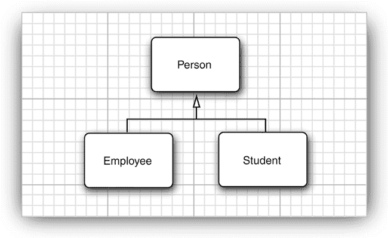

**图 5.2** `Person` 及其子类的继承图

为什么要费力进行如此高层次的抽象呢？有些属性对每个人来说都有意义，例如名字。学生和员工都有名字，引入一个共同的超类让我们可以将 `getName` 方法提取到继承层次结构中的更高层次。

现在让我们添加另一个方法 `getDescription`，其目的是返回该人的简要描述，例如：

```
一个工资为 $50,000.00 的员工
一个主修计算机专业的学生
```

为 `Employee` 和 `Student` 类实现这个方法很容易。但你可以在 `Person` 类中提供什么信息呢？`Person` 类除了名字之外对这个人一无所知。当然，你可以实现 `Person.getDescription()` 返回一个空字符串。但有更好的方法。如果你使用 `abstract` 关键字，你完全不需要实现该方法。

```
public abstract String getDescription();
   // 不需要实现
```

为了更加清晰起见，包含一个或多个抽象方法的类本身必须声明为抽象类。

```
public abstract class Person
{
   . . .
   public abstract String getDescription();
}
```

除了抽象方法，抽象类还可以有字段和具体方法。例如，`Person` 类存储了人的名字，并有一个返回它的具体方法。

```
public abstract class Person
{
   private String name;

   public Person(String name)
   {
      this.name = name;
   }

   public abstract String getDescription();

   public String getName()
   {
      return name;
   }
}
```

 提示

有些程序员没有意识到抽象类可以拥有具体方法。你应该始终将公共字段和方法（无论是否抽象）移动到父类（无论是否抽象）。

抽象方法是子类中实现方法的占位符。当你扩展一个抽象类时，你有两种选择。你可以留下部分或全部抽象方法；那么子类也必须标记为抽象。或者你可以定义所有方法，这样子类就不再是抽象的。

例如，我们定义了一个扩展抽象类 `Person` 的 `Student` 类。`Student` 类中没有方法都是抽象的，因此不需要声明为抽象类。

抽象类不能实例化。也就是说，如果一个类被声明为 `abstract`，则无法创建该类的对象。例如，表达式

```
new Person("Vince Vu")
```

是一个错误。然而，你可以创建具体类的对象。

注意你你仍然创建抽象类的变量，但这样的变量必须指向非抽象子类的对象。例如：

```
Person p = new Student("Vince Vu", "Economics");
```

在这里 `p` 是抽象类型 `Person` 的变量，指向非抽象子类 `Student` 的实例。

 C++ 提示

在 C++ 中，抽象方法被称为纯虚函数，并在结尾带有 `= 0`，例如：

```
class Person // C++
{
public:
   virtual string getDescription() = 0;
   . . .
};
```

如果 C++ 类至少有一个纯虚函数，它就是抽象的。在 C++ 中没有特殊的关键字来表示抽象类。

让我们定义扩展抽象类 `Person` 的具体子类 `Student`：

```
public class Student extends Person
{
   private String major;

   public Student(String name, String major)
   {
      super(name);
      this.major = major;
   }

   public String getDescription()
   {
      return "a student majoring in " + major;
   }
}
```

`Student` 类定义了 `getDescription` 方法。因此，`Student` 类中的所有方法都是具体的，该类不再是一个抽象类。

如列表 5.8 所示的程序定义了抽象父类 `Person`（列表 5.9）以及两个具体的子类 `Employee`（列表 5.10）和 `Student`（列表 5.11）。我们用一个 `Person` 引用用的数组填充了员工和学生对象：

```
var people = new Person[2];
people[0] = new Employee(. . .);
people[1] = new Student(. . .);
```

然后我们打印了这些对象的名称和描述：

```
for (Person p : people)
   System.out.println(p.getName() + ", " + p.getDescription());
```

有些人对以下调用感到困惑：

```
p.getDescription()
```

这难道不是调用了一个未定义的方法吗？请记住，变量 `p` 永远不会引用一个 `Person` 对象，因为无法构造抽象类 `Person` 的对象。变量 `p` 始终引用如 `Employee` 或 `Student` 等具体子类的对象。对于这些对象，`getDescription` 方法是已经定义过的。

你是否可以完全从 `Person` 父类中省略该抽象方法，而仅在 `Employee` 和 `Student` 子类中定义 `getDescription` 方法呢？如果你这样做，你将无法在变量 `p` 上调用 `getDescription` 方法。编译器会确保你只调用在类中声明的方法。

抽象方法是 Java 编程语言中的一个重要概念。你最可能会*接口*（interfaces）内部遇到它们。关于接口的更多信息，请参阅第 6 章。

**列表 5.8** `abstractClasses/PersonTest.java`

```
 1 package abstractClasses;
 2
 3 /**
 4  * 此程序演示了抽象类。
 5  * @version 1.01 2004-02-21
 6  * @author Cay Horstmann
 7  */
 8 public class PersonTest
 9 {
10    public static void main(String[] args)
11    {
12       var people = new Person[2];
13
14       // 用 Student 和 Employee 对象填充 people 数组
15       people[0] = new Employee("Harry Hacker", 50000, 1989, 10, 1);
16       people[1] = new Student("Maria Morris", "computer science");
17
18      // 输出所有 Person 对象的名称和描述
19      for (Person p : people)
20         System.out.println(p.getName() + ", " + p.getDescription());
21    }
22 }
```

**列表 5.9** `abstractClasses/Person.java`

```
 1 package abstractClasses;
 2
 3 public abstract class Person
 4 {
 5    public abstract String getDescription();
 6    private String name;
 7
 8    public Person(String name)
 9    {
10       this.name = name;
11    }
12
13    public String getName()
14    {
15       return name;
16    }
17 }
```

**列表 5.10** `abstractClasses/Employee.java`

```
 1 package abstractClasses;
 2
 3 import java.time.*;
 4
 5 public class Employee extends Person
 6 {
 7    private double salary;
 8    private LocalDate hireDay;
 9
10    public Employee(String name, double salary, int year, int month, int day)
11    {
12       super(name);
13       this.salary = salary;
14       hireDay = LocalDate.of(year, month, day);
15    }
16
17    public double getSalary()
18    {
19       return salary;
20    }
21
22    public LocalDate getHireDay()
23    {
24       return hireDay;
25    }
26
27    public String getDescription()
28    {
29       return "an employee with a salary of $%.2f".formatted(salary);
30    }
31
32    public void raiseSalary(double byPercent)
33    {
34       double raise = salary * byPercent / 100;
35       salary += raise;
36    }
37}
```

**列表 5.11** `abstractClasses/Student.java`

```
 1 package abstractClasses;
 2
 3 public class Student extends Person
 4 {
 5    private String major;
 6
 7    public Student(String name, String major)
 8    {
 9       super(name);
10      this.major = major;
11   }
12
13   public String getDescription()
14   {
15      return "a student majoring in " + major;
16   }
17 }
```

## 5.7 枚举类 (Enumeration Classes)

你在第 3 章中已经见过如何定义枚举类型。这里有一个典型的示例：

```
public enum Size { SMALL, MEDIUM }
```

此声明定义的类型实际上是一个类。无法构造新对象。因此，你永远不需要使用 `equals` 来比较值。直接使用 `==` 即可。

如果你愿意，可以为枚举类型添加构造函数、方法和字段。当然，构造函数只在构造枚举常量时被调用。这里有一个示例：

```
public enum Size
{
   SMALL("S"), MEDIUM("M"), LARGE("L"), EXTRA_LARGE("XL");

   private String abbreviation;

   Size(String abbreviation) { this.abbreviation = abbreviation; }

   public String getAbbreviation() { return abbreviation; }
}
```

所有枚举类型都是抽象类 `Enum` 的子类。它们从该类继承了许多方法。最有用的是 `toString`，它返回枚举量的名称。例如，`Size.SMALL.toString()` 返回字符串 `"SMALL"`。

`toString` 的反操作是静态方法 `valueOf`。例如，语句

```java
Size s = Enum.valueOf(Size.class, "SMALL");
```

将 `s` 设置为 `Size.SMALL`。

每个枚举类型都有一个静态方法 `values`，返回该枚举的所有值数组。例如，调用

```java
Size[] values = Size.values();
```

返回包含 `Size.SMALL`、`Size.MEDIUM`、`Size.LARGE` 和 `Size.EXTRA_LARGE` 元素的数组。

`ordinal` 方法产生枚举常量在声明中的位置，从零开始计数。例如，`Size.MEDIUM.ordinal()` 返回 `1`。

列表 5.12 中的短程序演示了如何处理枚举类型。

 注意

`Enum` 类有一个类型参数，为了简单起见忽略了它。例如，枚举类型 `Size` 实际上扩展了 `Enum<Size>`。该类型参数用于 `compareTo` 方法。（我在第 6 章中讨论了 `compareTo` 方法并在第 8 章中讨论了类型参数。）

```
package enums;

import java.util.*;

/**
 * 此程序演示了枚举类型。
 * @version 1.0 2004-05-24
 * @author Cay Horstmann
 */
public class EnumTest
{
    public static void main(String[] args)
    {
       var in = new Scanner(System.in);
       System.out.print("Enter a size: (SMALL, MEDIUM, LARGE, EXTRA_LARGE) ");
       String input = in.next().toUpperCase();
       Size size = Enum.valueOf(Size.class, input);
       System.out.println("size=" + size);
       System.out.println("abbreviation=" + size.getAbbreviation());
       if (size == Size.EXTRA_LARGE)
          System.out.println("Good job--you paid attention to the _.");
    }
}

enum Size
{
   SMALL("S"), MEDIUM("M"), LARGE("L"), EXTRA_LARGE("XL");

    private Size(String abbreviation) { this.abbreviation = abbreviation; }
    public String getAbbreviation() { return abbreviation; }

    private String abbreviation;
}
```

`java.lang.Enum<E>` 5

*   `static Enum valueOf(Class enumClass, String name)`

    返回给定类中给定名称的枚举常量。

*   `String toString()`

    返回此枚举常量的名称。

*   `int ordinal()`

    返回此枚举常量在 `enum` 声明中从 0 开始的位置。

*   `int compareTo(E other)`


如果此枚举常量在`other`之前，返回负整数；如果`this == other`，返回零；否则返回正整数。常量的顺序由`enum`声明决定。

## 5.8 密封类（Sealed Classes）

除非一个类被声明为`final`，否则任何人都可以创建它的子类。如果你想有更多的控制权呢？例如，假设你需要编写自己的 JSON 库，因为现有的任何库都不能完全符合你的需求。

JSON 标准规定 JSON 值可以是数组、数字、字符串、布尔值、对象或空。一种显而易见的方法是使用`JSONArray`、`JSONNumber`等类来建模，这些类继承自抽象类`JSONValue`：

```java
public abstract class JSONValue
{
   // 适用于所有 JSON 值的方法
}

public final class JSONArray extends JSONValue
{
   . . .
}

public final class JSONNumber extends JSONValue
{
   . . .
}
```

通过将`JSONArray`、`JSONNumber`等类声明为`final`，我们可以确保没有人能创建子类。但我们无法阻止任何人创建`JSONValue`的另一个子类。

我们为什么可能需要这种控制权？考虑这段代码：

```java
JSONValue v = . . .;
if (v instanceof JSONArray a) . . .
else if (v instanceof JSONNumber n) . . .
else if (v instanceof JSONString s) . . .
else if (v instanceof JSOBoolean b) . . .
else if (v instanceof JSONObject o) . . .
else . . . // 必须是 JSONNull
```

在这里，控制流意味着我们知道`JSONValue`的所有直接子类。这不是一个开放的层级结构。JSON 标准不会改变；如果改变了，我们作为库实现者会添加第七个子类。我们不希望其他人在外面干扰这个类层次结构。

在 Java 中，*密封*（sealed）类控制了哪些类可以继承自它。密封类在 Java 15 中作为预览功能引入，并在 Java 17 中最终定型。

以下是如何将`JSONValue`类声明为密封类的：

```java
public abstract sealed class JSONValue
   permits JSONArray, JSONNumber, JSONString, JSONBoolean, JSONObject, JSONNull
{
   . . .
}
```

定义一个未被许可的子类是一个错误：

```java
public class JSONComment extends JSONValue { . . . } // 错误
```

这样也很好，因为 JSON 不允许注释。因此，密封类允许对领域约束进行精确建模。

密封类的许可子类必须是可访问的。它们不能是嵌套在另一个类中的私有类，也不能是另一个包的包可见类。

对于公共的许可子类，规则更加严格。它们必须与密封类处于同一个包中。然而，如果你使用了模块（参见卷二的第 9 章），它们必须位于同一个模块。

 注意

密封类可以在不带`permits`子句的情况下声明。那么它的所有直接子类都必须在同一个文件中声明。没有访问该文件的程序员无法创建子类。

一个文件最多有一个`public`类，因此这种安排似乎只有在子类不供公众使用时才有用。

然而，正如你将在下一章中看到的，你可以使用内部类作为公共子类。

密封类的一个重要动机是编译时检查。考虑`JSONValue`类的这个方法，它使用了带有模式匹配的`switch`表达式（Java 17 预览功能）：

```java
public String type()
{
   return switch (this)
   {
      case JSONArray j -> "array";
      case JSONNumber j -> "number";
      case JSONString j -> "string";
      case JSONBoolean j -> "boolean";
      case JSONObject j -> "object";
      case JSONNull j -> "null";
      // 不需要 default
   };
}
```

这里的控制流意味着我们知道`JSONValue`的所有直接子类。这不是一个开放的层级结构。JSON 标准不会改变；如果改变了，我们作为库实现者会添加第七个子类。我们不希望其他人在外面干扰这个类层次结构。

在 Java 中，*密封*类控制了哪些类可以继承自它。密封类在 Java 15 中作为预览功能引入，并在 Java 17 中最终定型。

以下是如何将`JSONValue`类声明为密封类的：

```java
public abstract sealed class JSONValue
   permits JSONArray, JSONNumber, JSONString, JSONBoolean, JSONObject, JSONNull
{
   . . .
}
```

定义一个未被许可的子类是一个错误：

```java
public class JSONComment extends JSONValue { . . . } // 错误
```

这样也很好，因为 JSON 不允许注释。因此，密封类允许对领域约束进行精确建模。

密封类的许可子类必须是可访问的。它们不能是嵌套在另一个类中的私有类，也不能是另一个包的包可见类。

对于公共的许可子类，规则更加严格。它们必须与密封类处于同一个包中。然而，如果你使用了模块（参见卷二的第 9 章），它们必须位于同一个模块。

 注意

密封类可以在不带`permits`子句的情况下声明。那么它的所有直接子类都必须在同一个文件中声明。没有访问该文件的程序员无法创建子类。

一个文件最多有一个`public`类，因此这种安排似乎只有在子类不供公众使用时才有用。

然而，正如你将在下一章中看到的，你可以使用内部类作为公共子类。

密封类的一个重要动机是编译时检查。考虑`JSONValue`类的这个方法，它使用了带有模式匹配的`switch`表达式（Java 17 预览功能）：

```java
public String type()
{
   return switch (this)
   {
      case JSONArray j -> "array";
      case JSONNumber j -> "number";
      case JSONString j -> "string";
      case JSONBoolean j -> "boolean";
      case JSONObject j -> "object";
      case JSONNull j -> "null";
      // 不需要 default
   };
}
```

这里的控制流意味着我们知道`JSONValue`的所有直接子类。这不是一个开放的层级结构。JSON 标准不会改变；如果改变了，我们作为库实现者会添加第七个子类。我们不希望其他人在外面干扰这个类层次结构。

在 Java 中，*密封*类控制了哪些类可以继承自它。密封类在 Java 15 中作为预览功能引入，并在 Java 17 中最终定型。

以下是如何将`JSONValue`类声明为密封类的：

```java
public abstract sealed class JSONValue
   permits JSONArray, JSONNumber, JSONString, JSONBoolean, JSONObject, JSONNull
{
   . . .
}
```

定义一个未被许可的子类是一个错误：

```java
public class JSONComment extends JSONValue { . . . } // 错误
```

这样也很好，因为 JSON 不允许注释。因此，密封类允许对领域约束进行精确建模。

密封类的许可子类必须是可访问的。它们不能是嵌套在另一个类中的私有类，也不能是另一个包的包可见类。

对于公共的许可子类，规则更加严格。它们必须与密封类处于同一个包中。然而，如果你使用了模块（参见卷二的第 9 章），它们必须位于同一个模块。

 注意

密封类可以在不带`permits`子句的情况下声明。那么它的所有直接子类都必须在同一个文件中声明。没有访问该文件的程序员无法创建子类。

一个文件最多有一个`public`类，因此这种安排似乎只有在子类不供公众使用时才有用。

然而，正如你将在下一章中看到的，你可以使用内部类作为公共子类。

密封类的一个重要动机是编译时检查。考虑`JSONValue`类的这个方法，它使用了带有模式匹配的`switch`表达式（Java 17 预览功能）：

```java
public String type()
{
   return switch (this)
   {
      case JSONArray j -> "array";
      case JSONNumber j -> "number";
      case JSONString j -> "string";
      case JSONBoolean j -> "boolean";
      case JSONObject j -> "object";
      case JSONNull j -> "null";
      // 不需要 default
   };
}
```

这里的控制流意味着我们知道`JSONValue`的所有直接子类。这不是一个开放的层级结构。JSON 标准不会改变；如果改变了，我们作为库实现者会添加第七个子类。我们不希望其他人在外面干扰这个类层次结构。

```java
public abstract sealed class Node permits Element, Text, Comment,
      CDATASection, EntityReference, ProcessingInstruction
{
   . . .
}
```

我们允许`Element`有任意子类：

```java
public non-sealed class Element extends Node
{
   . . .
}

public class HTMLDivElement extends Element
{
   . . .
}
```

在本节中，你学习了`sealed classes`。在下一章中，你将学习`interfaces`，它是抽象类的泛化。Java 接口也可以拥有子类型。密封接口的工作方式与密封类完全相同，它们控制直接子类型。

下面的示例程序充实了 JSON 层次结构。`JSONObject`的实现使用了`HashMap`，这将在第 9 章中介绍。在示例中，我们使用接口而不是抽象类，这样`JSONNumber`和`JSONString`就可以是记录（records），而`JSONBoolean`和`JSONNull`类可以作为枚举（enumerations）。记录和枚举可以实现接口，但不能扩展类。

**列表 5.13** `sealed/SealedTest.java`

```java
 1 package sealed;
 2
 3 import java.util.*;
 4
 5 sealed interface JSONValue permits JSONArray, JSONObject, JSONPrimitive
 6 {
 7    public default String type()
 8    {
 9       if (this instanceof JSONArray) return "array";
10       else if (this instanceof JSONObject) return "object";
11       else if (this instanceof JSONNumber) return "number";
12       else if (this instanceof JSONString) return "string";
13       else if (this instanceof JSONBoolean) return "boolean";
14       else return "null";
15    }
16 }
17
18 final class JSONArray extends ArrayList<JSONValue> implements JSONValue {}
19
20 final class JSONObject extends HashMap<String, JSONValue> implements JSONValue
21 {
22    public String toString()
23    {
24       StringBuilder result = new StringBuilder();
25       result.append("{");
26       for (Map.Entry<String, JSONValue> entry : entrySet())
27       {
28          if (result.length() > 1) result.append(",");
29          result.append(" \"");
30          result.append(entry.getKey());
31          result.append("\": ");
32          result.append(entry.getValue());
33       }
34       result.append(" }");
35       return result.toString();
36    }
37 }
38
39 sealed interface JSONPrimitive extends JSONValue
40       permits JSONNumber, JSONString, JSONBoolean, JSONNull
41 {
42 }
43
44 final record JSONNumber(double value) implements JSONPrimitive
45 {
46   public String toString() { return "" + value; }
47 }
49
49 final record JSONString(String value) implements JSONPrimitive
50 {
51    public String toString() { return "\"" + value.translateEscapes() + "\""; }
52 }
53
54 enum JSONBoolean implements JSONPrimitive
55 {
56    FALSE, TRUE;
57    public String toString() { return super.toString().toLowerCase(); }
58 }
59
60 enum JSONNull implements JSONPrimitive
61 {
62    INSTANCE;
63    public String toString() { return "null"; }
64 }
65
66 public class SealedTest
67 {
68    public static void main(String[] args)
69    {
70       JSONObject obj = new JSONObject();
71       obj.put("name", new JSONString("Harry"));
72       obj.put("salary", new JSONNumber(90000));
73       obj.put("married", JSONBoolean.FALSE);
74       JSONArray arr = new JSONArray();
75       arr.add(new JSONNumber(13));
76       arr.add(JSONNull.INSTANCE);
77
78       obj.put("luckyNumbers", arr);
79       System.out.println(obj);
80       System.out.println(obj.type());
81    }
82 }
```

## 5.9 反射

`reflection library`为你提供非常丰富且精密的工具集，用于编写动态操作 Java 代码的程序。通过反射，Java 可以支持用户界面生成器、对象关系映射器以及许多其他动态查询类能力的开发工具。

能够分析类能力的程序被称为`reflective`（反射的）。反射机制非常强大。正如后续章节所示，你可以用它来：

- 在运行时分析类的能力
- 在运行时检查对象——例如，编写一个适用于所有类的单一`toString`方法
- 实现泛型数组操作代码
- 利用像 C++ 等语言中的函数指针一样可以工作的`Method`对象


反射是一个强大且复杂的机制；然而，它主要对工具构建者感兴趣，而不是应用程序程序员。如果你对编写应用程序感兴趣，而不是为其他 Java 程序员编写工具的工具，你可以安全地跳过本章的剩余部分，稍后再回来。

## 5.9.1 `Class` 类

在程序运行期间，Java 运行时系统始终对所有对象维护所谓的`运行时类型识别`（runtime type identification）。这些信息跟踪了每个对象所属的类。运行时类型信息被虚拟机用于选择执行正确的方法。

然而，你也可以通过操作一个特殊的 Java 类来访问这些信息。持有这些信息的类有点误导性地命名为`Class`。`Object`类中的`getClass()`方法返回一个`Class`类型的实例。

```
Employee e;
. . .
Class cl = e.getClass();
```

就像`Employee`对象描述特定员工的属性一样，`Class`对象描述特定类的属性。`Class`最常用的方法可能可能是`getName`。它返回类的名称。例如，该语句

```
System.out.println(e.getClass().getName() + " " + e.getName());
```

将打印：

```
Employee Harry Hacker
```

如果`e`是一个员工，或者打印：

```
Manager Harry Hacker
```

如果`e`是一个经理。

如果类在包中，则包名是类名的一部分：

```
var generator = new Random();
Class cl = generator.getClass();
String name = cl.getName(); // name 被 设置为 "java.util.Random"
```

你可以通过静态方法`forName`获取与类名对应的`Class`对象。

```
String className = "java.util.Random";
Class cl = Class.forName(className);
```

如果类名存储在运行时变化的字符串中，请使用此方法。如果`className`是类或接口名，则此方法有效。否则，`forName`方法会抛出检查异常（checked exception）。参见第 5.9.2 节“异常声明初原理”，位于第 283 页，了解每当你使用此方法时如何提供*异常处理器*（exception handler）。

获取`Class`类型对象的第三种方法是一种方便的简写。如果`T`是任何 Java 类型（或`void`关键字），那么`T.class`就是匹配的类对象。例如：

```
Class cl1 = Random.class; // 如果导入了 java.util.*;
Class cl2 = int.class;
Class cl3 = Double[].class;
```

注意，`Class`对象实际上描述的是一个`type`（类型），它可能是类也可能不是类。例如，`int`不是一个类，但`int.class`尽管是一个`Class`类型的对象。

> **注意**
> 
> `Class`类实际上是一个泛型类。例如，`Employee.class`的类型是`Class<Employee>`。我没有纠结这个问题，因为这会使一个已经抽象的概念更加复杂。对于大多数实际用途，你可以忽略类型参数并处理原始`Class`类型。有关此问题的更多信息请参见第 8 章。

> **警告**
> 
> 由于历史原因，`getName`方法为数组类型返回一些奇奇怪的名字：
> 
> * `Double[].class.getName()`返回`"[Ljava.lang.Double;"`。
> * `int[].class.getName()`返回`"I"`。

虚拟机为每种类型管理一个唯一的`Class`对象。因此，你可以使用`==`运算符来比较类对象。例如：

```
if (e.getClass() == Employee.class) . . .
```

如果`e`是`Employee`的实例，则该测试通过。与条件`e instanceof Employee`不同的是，如果`e`是子类（如`Manager`）的实例，则该测试将失败。

如果你有一个`Class`类型的对象，可以使用它来构造该类的实例。调用`getConstructor`方法获取一个`Constructor`类型的对象，然后使用`newInstance`方法构造一个实例。例如：

```
var className = "java.util.Random"; // 或任何其他带有
                                    // 无参数构造函数的类名
Class cl = Class.forName(className);
Object obj = cl.getConstructor().newInstance();
```

如果该类没有无参数构造函数，`getConstructor`方法将抛出异常。你将在第 5.9.7 节“调用任意方法和构造函数”的第 304 页看到如何调用其他构造函数。

> **注意**
> 
> 有一个已弃用的`Class.toInstance`方法，它同样无参数构造函数构造实例。然而，如果构造函数抛出了受检异常，该异常将在不经过检查的情况下重新抛出。这违反了异常的编译时检查。相比之下，`Constructor.newInstance`将任何构造器异常封装在`InvocationTargetException`中。

> **C++ 注意**
> 
> `newInstance`方法对应于 C++ 中的*虚构造函数*（virtual constructor）惯用法。然而，C++ 中的虚构造函数并不是语言特性，而是一种需要由特殊库支持的惯用法。`Class`类类似于 C++ 中的`type_info`类，而`getClass`方法等同于`typeid`运算符。不过，Java 的`Class`比`type_info`要通用得多。C++ 的`type_info`只能显示类型名称的字符串，无法创建该类型的新对象。

### `java.lang.Class` 1.0

* `static Class forName(String className)`
  
  返回代表名为`className`的类的`Class`对象。

* `Constructor getConstructor(Class... parameterTypes)` 1.1
  
  产生一个描述给定参数类型的构造器的对象。有关如何提供参数类型，请参阅第 5.9.7 节“调用任意方法和构造函数”的第 304 页。

### `java.lang.reflect.Constructor` 1.1

* `Object newInstance(Object... params)`
  
  构造构造器声明类的的新实例，并将`params`传递给构造器。有关如何提供参数，请参阅第 5.9.7 节“调用任意方法和构造函数”的第 304 页。

### `java.lang.Throwable` 1.0

* `void printStackTrace()`
  
  将`Throwable`对象和堆栈轨迹打印到标准错误流。

## 5.9.2 异常声明入门

我将在第 7 章 中详细介绍异常处理，但在此期间，你偶尔会遇到可能会抛出异常的方法。

当运行时发生错误时，程序可以“抛出异常”。抛出异常比终止程序更灵活，因为你可以提供一个*处理器*（handler）来“捕获”异常并处理它。

如果你不提供处理器，程序将终止并在控制台上打印一条消息，给出异常的类型。你可能在不小心使用`null`引用或越数组边界时已经见过异常报告了。

异常有两种类型：*未检异常*（unchecked exceptions）和*受检异常*（checked exceptions）。对于受检异常，编译器会检查你（程序员）是否意识到了该异常并准备好处理后果。然而，许多常见异常（例如边界错误或访问`null`引用）是未检的。编译器并不期望你提供处理器——毕竟，你应该将精力花在避免这些错误上，而不是为它们编写处理器。

但并非所有错误都是可以避免的。如果尽管你尽了努力仍可能发生异常，那么大多数 Java API 将抛出受检异常。一个例子是`Class.forName`方法。你无法确保给定名称的类存在。在第 7 章中，你将看到如何捕获异常。

```java
public static void doSomething(String name) throws ReflectiveException
{
   Class cl = Class.forName(name); // 可能抛出异常
   do something with cl
}
```

## 5.9.3 资源

类通常关联数据文件，例如：

* 图像声音文件
* 包含消息字符串和按钮标签的文件

在 Java 中，这样的关联文件被称为*资源*（resource）。

例如，考虑一个显示如图 5.4 所示消息的对话框。

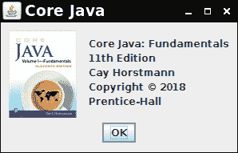

**图 5.4** 显示图像和文本资源

当然，面板中的书和版权年份将会更改。为了方便跟踪更改，我们将文本放在文件中，而不是将其硬编码为字符串。

但你应该将`about.txt`等文件放在哪里呢？当然，将其放在 JAR 文件中与其他程序文件一起会很方便。

`Class`类提供了定位资源文件的有用服务。以下是必要的步骤：

1. 获取拥有资源的类的`Class`对象——例如`ResourceTest.class`。
2. 某些方法（例如`ImageIcon`类的`getImage`方法）接受描述资源位置的 URL。然后调用

```
URL url = cl.getResource("about.gif");
```

3. 否则，使用`getResourceAsStream`方法获取读取文件的输入流。

关键在于，Java 虚拟机知道如何定位类，因此它随后可以在*相同位置*搜索关联资源。例如，假设`ResourceTest`类位于`resources`包中。那么`ResourceTest.class`文件位于`resources`目录，你也将图标文件放在同一个目录下。

与其将资源文件放在与类文件相同的目录下，你可以提供相对路径或绝对路径，例如

```
data/about.txt
/corejava/title.txt
```

自动加载文件就是资源加载功能所做的。并没有标准的方法来解释资源文件的内容。每个程序必须有自己的方式来解释其资源文件。

资源的另一个常见应用是程序的国际化。依赖于语言的字符串（例如消息和用户界面标签）存储在资源文件中，每种语言一个文件。第二卷第 7 章 讨论的`internationalization API`提供了一种用于组织和访问这些本地化文件的标准方法。

Listing 5.13 是一个演示资源加载的程序。（不用担心读取文本和显示对话框的代码——我们稍后会介绍这些细节。）编译、构建 JAR 文件并执行它：

```
javac resource/ResourceTest.java
jar cvfe ResourceTest.jar resources.ResourceTest \
   resources/*.class resources/*.gif resources/data/*.txt corejava/*.txt
java -jar ResourceTest.jar
```

将 JAR 文件移动到不同的目录并再次运行，以检查程序是否是从 JAR 文件而不是从当前目录读取资源文件的。

**代码列表 5.14** `resources/ResourceTest.java`

```
 1 package resources;
 2
 3 import java.io.*;
 4 import java.net.*;
 5 import java.nio.charset.*;
 6 import javax.swing.*;
 7
 8 /**
 9  * @version 1.5 2018-03-15
10  * @author Cay Horstmann
11  */
12 public class ResourceTest
13 {
14    public static void main(String[] args) throws IOException
15    {
16       Class cl = ResourceTest.class;
17       URL aboutURL = cl.getResource("about.gif");
18       var icon = new ImageIcon(aboutURL);
19
20       InputStream stream = cl.getResourceAsStream("data/about.txt");
21       var about = new String(stream.readAllBytes(), "UTF-8");
22
23       InputStream stream2 = cl.getResourceAsStream("/corejava/title.txt");
24       var title = new String(stream2.readAllBytes(), StandardCharsets.UTF_8).strip();
25
26       JOptionPane.showMessageDialog(
27          null, about, title, JOptionPane.INFORMATION_MESSAGE, icon);
28    }
29 }
```

`java.lang.Class` 1.0

* `URL getResource(String name)` 1.1
* `InputStream getResourceAsStream(String name)` 1.1

  在与类相同的位置查找资源，然后返回一个可以用于加载资源的 URL 或输入流。如果未找到资源，则返回`null`，因此不会为 I/O 错误抛出异常。

## 5.9.4 使用反射分析类的

以下是反射机制中最重要部分的简要概述，它允许你检查类的结构。

`java.lang.reflect`包中的三个类`Field`、`Method`和`Constructor`分别描述类的字段、方法和构造函数。这三个类都有一个名为`getName`的方法，用于返回项目的名称。`Field`类有一个方法`getType`，它返回一个对象（同样是`Class`类型），描述字段类型。`Method`和`Constructor`类有方法来报告参数类型，`Method`类还报告返回类型。这三个类还有一个名为`getModifiers`的方法，它返回一个整数，其中各种位位被开启或关闭，用于描述使用的修饰符，例如`public`和`static`。然后你可以使用`java.lang.reflect`包中`Modifier`类的静态方法来分析`getModifiers`返回的整数。使用`Modifier`类中的`isPublic`、`isPrivate`或`isFinal`等方法来判断方法或构造函数是`public`、`private`还是`final`。你只需要让`Modifier`类中相应的方法作用于`getModifiers`返回的整数 即可。你也可以使用`Modifier.toString`方法来打印修饰符。

`Class`类的`getFields`、`getMethods`和`getConstructors`方法返回该类支持的*公共* 字段、方法和构造函数的数组。这包括父类的公共成员。`Class`类的`getDeclaredFields`、`getDeclaredMethods`和`getDeclaredConstructors`方法返回由在该类中声明的所有字段、方法和构造函数组成的数组。这包括私有的、包级和保护的成员，以及具有包访问权限的成员，但不包括父类的成员。

Listing 5.15 展示了如何打印关于类的所有信息。程序会提示你输入类名，并输出所有方法和构造函数的签名以及该类所有实例字段的名称。例如，如果你输入

```
java.lang.Double
```

程序将打印

```


以下是`java.lang.Double`类的API文档，它继承自`java.lang.Number`：

```
public final class java.lang.Double extends java.lang.Number
{
   public java.lang.Double(double);
   public java.lang.Double(java.lang.String);

   public boolean equals(java.lang.Object);
   public static java.lang.String toString(double);
   public java.lang.String toString();
   public static int hashCode(double);
   public int hashCode();
   public static double doubleToRawLongBits(double);
   public static long doubleToLongBits(double);
   public static double longToDouble(long);
   public int compareTo(java.lang.Double);
   public int compareTo(java.lang.Object);
   public static int compare(double, double);
   public byte byteValue();
   public short shortValue();
   public int intValue();
   public long longValue();
   public float floatValue();
   public double doubleValue();
   public static java.lang.Double valueOf(java.lang.String);
   public static java.lang.Double valueOf(double);
   public static java.lang.String toHexString(double);
   public volatile java.lang.Object resolveConstantDesc(
      java.lang.invoke.MethodHandles$Lookup);
   public java.lang.Double resolveConstantDesc(java.lang.invoke.MethodHandles$Lookup);
   public java.util.Optional describeConstable();
   public boolean isNaN();
   public static boolean isNaN(double);
   public static double sum(double, double);
   public boolean isInfinite();
   public static boolean isInfinite(double);
   public static boolean isFinite(double);
   public static java.lang.Double parseDouble(java.lang.String);

   public static final double POSITIVE_INFINITY;
   public static final double NEGATIVE_INFINITY;
   public static final double NaN;
   public static final double MAX_VALUE;
   public static final double MIN_NORMAL;
   public static final double MIN_VALUE;
   public static final int MAX_EXPONENT;
   public static final int MIN_EXPONENT;
   public static final int SIZE;
   public static final int BYTES;
   public static final java.lang.Class TYPE;
   private final double value;
   private static final long serialVersionUID;
}
```

这个程序的奇之处在于，它可以分析 Java 解释器可以加载的任何类，而不仅仅是编译时可用的类。我们将在下一章中使用这个程序来窥探 Java 编译器自动生成的内部类。

**代码列表 5.15** `reflection/ReflectionTest.java`

点击此处查看代码图像

```java
package reflection;

import java.util.*;
import java.lang.reflect.*;
/**
 * 此程序使用反射来打印类的所有特征。
 * @version 1.12 2021-06-15
 * @author Cay Horstmann
 */
public class ReflectionTest
{
    public static void main(String[] args)
          throws ReflectiveOperationException
    {
       // 从命令行参数或用户输入读取类名
       String name;
       if (args.length > 0) name = args[0];
       else
       {
          var in = new Scanner(System.in);
          System.out.println("Enter class name (e.g. java.util.Date): ");
          name = in.next();
       }

       // 打印类的修饰符、名称和父类（如果不是 Object）
       Class cl = Class.forName(name);
       String modifiers = Modifier.toString(cl.getModifiers());
       if (modifiers.length() > 0) System.out.print(modifiers + " ");
       if (cl.isSealed())
          System.out.print("sealed ");
       if (cl.isEnum())
          System.out.print("enum " + name);
       else if (cl.isRecord())
          System.out.print("record " + name);
       else if (cl.isInterface())
          System.out.print("interface " + name);
       else
          System.out.print("class " + name);
       Class supercl = cl.getSuperclass();
       if (supercl != null && supercl != Object.class) System.out.print(" extends "
             + supercl.getName());

       printInterfaces(cl);
       printPermittedSubclasses(cl);

       System.out.print("\n{\n");
       printConstructors(cl);
       System.out.println();
       printMethods(cl);
       System.out.println();
       printFields(cl);
       System.out.println("}");
    }

   /**
    * 打印类的所有构造函数
    * @param cl 一个类
   */
  public static void printConstructors(Class cl)
  {
     Constructor[] constructors = cl.getDeclaredConstructors();

     for (Constructor c : constructors)
     {
        String name = c.getName();
        System.out.print(" ");
        String modifiers = Modifier.toString(c.getModifiers());
        if (modifiers.length() > 0) System.out.print(modifiers + " ");
        System.out.print(name + "(");

        // 打印参数类型
        Class[] paramTypes = c.getParameterTypes();
        for (int j = 0; j < paramTypes.length; j++)
        {
           if (j > 0) System.out.print(", ");
           System.out.print(paramTypes[j].getName());
        }
        System.out.println(");");
     }
  }

  /**
   * 打印类的所有方法
   * @param cl 一个类
   */
  public static void printMethods(Class cl)
  {
     Method[] methods = cl.getDeclaredMethods();

     for (Method m : methods)
     {
        Class retType = m.getReturnType();
        String name = m.getName();

        System.out.print(" ");
           // 打印修饰符、返回类型和方法名
           String modifiers = Modifier.toString(m.getModifiers());
           if (modifiers.length() > 0) System.out.print(modifiers + " ");
           System.out.print(retType.getName() + " " + name + "(");

          // 打印参数类型
          Class[] paramTypes = m.getParameterTypes();
          for (int j = 0; j < paramTypes.length; j++)
          {
             if (j > 0) System.out.print(", ");
             System.out.print(paramTypes[j].getName());
          }
          System.out.println(");");
      }
   }

   /**
    * 打印类的所有字段
    * @param cl 一个类
   */
  public static void printFields(Class cl)
  {
      Field[] fields = cl.getDeclaredFields();

      for (Field f : fields)
      {
          Class type = f.getType();
          String name = f.getName();
          System.out.print(" ");
          String modifiers = Modifier.toString(f.getModifiers());
          if (modifiers.length() > 0) System.out.print(modifiers + " ");
          System.out.println(type.getName() + " " + name);
      }
  }
  /**
   * 打印类的所有允许子类
   * @param cl 一个类
   */
  public static void printPermittedSubclasses(Class cl)
  {
     if (cl.isSealed())
     {
        Class[] permittedSubclasses = cl.getPermittedSubclasses();
        for (int i = 0; i < permittedSubclasses.length; i++)
        {
          System.out.println(permittedSubclasses[i].getName());
        }
     }
  }

  /**
   * 打印类的所有实现的接口
   * @param cl 一个类
   */
  public static void printInterfaces(Class cl)
  {
     Class<?> interfaces = cl.getInterfaces();
     for (int i = 0; i < interfaces.length; i++)
     {
        System.out.println(interfaces[i].getName());
     }
  }
}
```

### ReflectionTest

此程序使用反射来打印类的所有特征。

#### `public static void main(String[] args)`

从命令行`args`或用户输入读取类名。然后打印类的修饰符、名称和父类名称（如果不是`Object`）。随后调用辅助方法来打印接口、允许的子类、构造函数、方法和字段。

#### 辅助方法

- `printConstructors(Class cl)`: 打印类的所有构造函数，包括修饰符和参数类型。

- `printMethods(Class cl)`: 打印类的所有声明方法，包括修饰符、返回类型、名称和参数类型。

- `printFields(Class cl)`: 打印类的所有声明字段。

- `printPermittedSubclasses(Class cl)`: 打印密封类（sealed class）的所有允许子类。

- `printInterfaces(Class cl)`: 打印类的所有实现的接口。

---

### `java.lang.reflect.Field`

- `getDeclaringClass()`: 返回定义该字段的`Class`对象。

- `getModifiers()`: 返回描述字段修饰符的整数。

- `getName()`: 返回字段的名称。

- `getType()`: 返回表示字段类型的`Class`。

---

### `java.lang.reflect.Method`

- `getDeclaringClass()`: 返回定义该方法的`Class`对象。

- `getExceptionTypes()`: 返回方法抛出的异常类型`Class`数组。

- `getModifiers()`: 返回描述方法修饰符的整数。

- `getName()`: 返回方法的名称。

- `getParameterTypes()`: 返回参数类型的`Class`数组。

- `getReturnType()`: 返回方法的返回类型。

---

### `java.lang.reflect.Constructor`

- `getDeclaringClass()`: 返回定义该构造函数的`Class`对象。

- `getExceptionTypes()`: 返回构造函数抛出的异常类型`Class`数组。

- `getModifiers()`: 返回描述构造函数修饰符的整数。

- `getName()`: 返回构造函数的名称。

- `getParameterTypes()`: 返回参数类型的`Class`数组。

---

### `java.lang.Class`

- `forName(String name)`: 返回与指定的类名对应的`Class`对象。

- `getModifiers()`: 返回类修饰符的整数。

- `isSealed()`: 如果该类是密封的，则返回`true`。

- `isEnum()`: 如果该类是枚举，则返回`true`。

- `isRecord()`: 如果该类是记录，则返回`true`。

- `isInterface()`: 如果该类是接口，则返回`true`。

- `getSuperclass()`: 返回此类的父类。

- `getName()`: 返回类的名称。

- `getDeclaredConstructors()`: 返回`Constructor`对象数组。


- `getDeclaredMethods()`: 返回声明的 `Method` 对象数组。
- `getDeclaredFields()`: 返回声明的 `Field` 对象数组。
- `getPermittedSubclasses()`: 返回允许子类的数组。
- `getInterfaces()`: 返回实现的接口数组。

返回一个表示返回类型的 `Class` 对象。

### `java.lang.reflect.RecordComponent` 16

- `String getName()`
- `Class<?> getType()`

  获取此记录组件的名称和类型。

- `Method getAccessor()`

  返回用于访问此记录组件的 `Method` 对象。

### `java.lang.reflect.Modifier` 1.1

- `static String toString(int modifiers)`

  返回一个与 `modifiers` 中设置的位对应的修饰符字符串。

- `static boolean isAbstract(int modifiers)`
- `static boolean isFinal(int modifiers)`
- `static boolean isInterface(int modifiers)`
- `static boolean isNative(int modifiers)`
- `static boolean isPrivate(int modifiers)`
- `static boolean isProtected(int modifiers)`
- `static boolean isPublic(int modifiers)`
- `static boolean isStatic(int modifiers)`
- `static boolean isStrict(int modifiers)`
- `static boolean isSynchronized(int modifiers)`
- `static boolean isVolatile(int modifiers)`

  测试 `modifiers` 值中对应于方法名中修饰符的位。

#### 5.9.5 使用反射在运行时分析对象

在前面的节中，我们看到了如何找到任何对象的实例字段的*名称*和*类型*：

- 获取相应的 `Class` 对象。
- 在 `Class` 对象上调用 `getDeclaredFields`。

在本节中，我们将更进一步，实际上查看字段的*内容*。当然，当你在编写程序时，如果已知某个对象的名称和类型，查看其特定字段的内容是很容易的。但反射允许你查看编译时未知的对象的字段。

实现此点的关键方法是 `Field` 类中的 `get` 方法。如果 `f` 是 `Field` 类型的对象（例如，从 `getDeclaredFields` 获取的），并且 `obj` 是 `f` 字段所属类的实例，那么 `f.get(obj)` 将返回一个对象，其值是 `obj` 字段的当前值。这些都有点抽象，所以让我们来看一个示例。

点击此处查看代码图片

```
var harry = new Employee("Harry Hacker", 50000, 10, 1, 1989);
Class cl = harry.getClass();
   // 代表 Employee 的类对象
Field f = cl.getDeclaredField("name");
   // Employee 类的 name 字段
Object v = f.get(harry);
   // harry 对象的 name 字段的值，即：
   // String 对象 "Harry Hacker"
```

当然，你也可以设置你获取到的值。调用 `f.set(obj, value)` 将对象 `obj` 中由 `f` 表示的字段设置为新值。

实际上，这段代码存在一个问题。由于 `name` 字段是私有字段，`get` 和 `set` 方法将抛出 `IllegalAccessException`。你只能对可访问的字段使用 `get` 和 `set`。Java 的安全机制允许你发现对象拥有哪些字段，但在你没有权限的情况下，它不会让你读取和写入这些字段的值。

反射机制的默认行为是尊重 Java 的访问控制。然而，你可以通过在 `Field`、`Method` 或 `Constructor` 对象上调用 `setAccessible` 方法来覆盖访问控制。例如：

点击此处查看代码图片

```
f.setAccessible(true); // 现在可以调用 f.get(harry) 了
```

`setAccessible` 方法是 `AccessibleObject` 类的一个方法，它是 `Field`、`Method` 和 `Constructor` 类的父类。例如：

点击此处查看代码图片

```
f.setAccessible(true); // 现在可以调用 f.get(harry)
```

`setAccessible` 方法允许你访问私有字段。但反射允许你查看编译时未知的对象的字段。当你以 Java 17 运行程序时，会出现以下输出：

点击此处查看代码图片

```
var harry = new Employee("Harry Hacker", 50000, 10, 1, 1989);
Class cl = harry.getClass();
   // 代表 Employee 的类对象
Field f = cl.getDeclaredField("name");
   // Employee 类的 name 字段
Object v = f.get(harry);
   // harry 对象的 name 字段的值，即：
   // String 对象 "Harry Hacker"
```

当然，你也可以设置你获取到的值。调用 `f.set(obj, value)` 将对象 `obj` 中由 `f` 表示的字段设置为新值。

实际上，这段代码存在一个问题。由于 `name` 字段是私有字段，`get` 和 `set` 方法将抛出 `IllegalAccessException`。你只能对可访问的字段使用 `get` 和 `set`。Java 的安全机制允许你发现对象拥有哪些字段，但在你没有权限的情况下，它不会让你读取和写入这些字段的值。

反射机制的默认行为是尊重 Java 的访问控制。然而，你可以通过在 `Field`、`Method` 或 `Constructor` 对象上调用 `setAccessible` 方法来覆盖访问控制。例如：

点击此处查看代码图片

```
f.setAccessible(true); // 现在可以调用 f.get(harry) 了
```

`setAccessible` 方法是 `AccessibleObject` 类的一个方法，它是 `Field`、`Method` 和 `Constructor` 类的父类。例如：

点击此处查看代码图片

```
f.setAccessible(true); // 现在可以调用 f.get(harry)
```

`setAccessible` 方法允许你访问私有字段。


返回一个表示返回类型的`Class`对象。

### `java.lang.reflect.RecordComponent` 16

* `String getName()`

* `Class<?> getType()`

  获取此记录组件的名称和类型。

* `Method getAccessor()`

  返回用于访问此记录组件的`Method`对象。

### `java.lang.reflect.Modifier` 1.1

* `static String toString(int modifiers)`

  返回一个与`modifiers`中设置的位对应的修饰符字符串。

* `static boolean isAbstract(int modifiers)`

* `static boolean isFinal(int modifiers)`

* `static boolean isInterface(int modifiers)`

* `static boolean isNative(int modifiers)`

* `static boolean isPrivate(int modifiers)`

* `static boolean isProtected(int modifiers)`

* `static boolean isPublic(int modifiers)`

* `static boolean isStatic(int modifiers)`

* `static boolean isStrict(int modifiers)`

* `static boolean isSynchronized(int modifiers)`

* `static boolean isVolatile(int modifiers)`

  测试`modifiers`值中对应于方法名中修饰符的位。

#### 5.9.5 使用反射在运行时分析对象

在前面的节中，我们看到了如何找到任何对象的实例字段的*名称*和*类型*：

* 获取相应的`Class`对象。

* 在`Class`对象上调用`getDeclaredFields`。

在本节中，我们将更进一步，实际上查看字段的*内容*。当然，当你在编写程序时，如果已知某个对象的名称和类型，查看其特定字段的内容是很容易的。但反射允许你查看编译时未知的对象的字段。

实现此点的关键方法是`Field`类中的`get`方法。如果`f`是`Field`类型的对象（例如，从`getDeclaredFields`获取的），并且`obj`是`f`字段所属类的实例，那么`f.get(obj)`将返回一个对象，其值是`obj`字段的当前值。这些都有点抽象，所以让我们来看一个示例。

点击此处查看代码图片

```
var harry = new Employee("Harry Hacker", 50000, 10, 1, 1989);
Class cl = harry.getClass();
   // 代表 Employee 的类对象
Field f = cl.getDeclaredField("name");
   // Employee 类的 name 字段
Object v = f.get(harry);
   // harry 对象的 name 字段的值，即：
   // String 对象 "Harry Hacker"
```

当然，你也可以设置你获取到的值。调用`f.set(obj, value)`将对象`obj`中由`f`表示的字段设置为新值。

实际上，这段代码存在一个问题。由于`name`字段是私有字段，`get`和`set`方法将抛出`IllegalAccessException`。你只能对可访问的字段使用`get`和`set`。Java的安全机制允许你发现对象拥有哪些字段，但在你没有权限的情况下，它不会让你读取和写入这些字段的值。

反射机制的默认行为是尊重Java的访问控制。然而，你可以通过在`Field`、`Method`或`Constructor`对象上调用`setAccessible`方法来覆盖访问控制。例如：

点击此处查看代码图片

```
f.setAccessible(true); // 现在可以调用 f.get(harry) 了
```

你可以使用这个通用的`toString`方法来为你自己的类实现`toString`方法，如下：

点击此处查看代码图像

```java
public String toString()
{
   return new ObjectAnalyzer().toString(this);
}
```

对于提供一个通用的`toString`方法来说，这是一个既省力又无疑非常有用的方法。然而，在你对再也不需要实现`toString`感到兴奋之前，请记住，不受控访问内部实现的日子已数不日下了。

**列表 5.16** `objectAnalyzer/ObjectAnalyzerTest.java`

点击此处查看代码图像

```java
 1 package objectAnalyzer;
 2
 3 import java.util.*;
 4
 5 /**
 6  * 此程序使用反射来监控对象。
 7  * @version 1.13 2018-03-16
 8  * @author Cay Horstmann
 9  */
10 public class ObjectAnalyzerTest
11 {
12    public static void main(String[] args)
13          throws ReflectiveOperationException
14    {
15       var squares = new ArrayList<Integer>();
16       for (int i = 1; i <= 5; i++)
17          squares.add(i * i);
18       System.out.println(new ObjectAnalyzer().toString(squares));
19    }
20 }
```

**列表 5.17** `objectAnalyzer/ObjectAnalyzer.java`

点击此处查看代码图像

```java
 1 package objectAnalyzer;
 2
 3 import java.lang.reflect.AccessibleObject;
 4 import java.lang.reflect.Array;
 5 import java.lang.reflect.Field;
 6 import java.lang.reflect.Modifier;
 7 import java.util.ArrayList;
 8
 9 public class ObjectAnalyzer
10 {
11    private ArrayList<Object> visited = new ArrayList<>();
12
13    /**
14     * 将对象转换为列出所有字段的字符串表示。
15     * @param obj 一个对象
16     * @return 包含对象类名以及所有字段名和值的字符串
17     */
18    public String toString(Object obj)
19          throws ReflectiveOperationException
20    {
21       if (obj == null) return "null";
22       if (visited.contains(obj)) return "...";
23       visited.add(obj);
24       Class cl = obj.getClass();
25       if (cl == String.class) return (String) obj;
26       if (cl.isArray())
27       {
28         String r = cl.getComponentType() + "[]{";
29         for (int i = 0; i < Array.getLength(obj); i++)
30         {
31            if (i > 0) r += ",";
32            Object val = Array.get(obj, i);
33            if (cl.getComponentType().isPrimitive()) r += val;
34            else r += toString(val);
35         }
36         return r + "}";
37    }
38
39    String r = cl.getName();
40    // 检查此类及所有父类的字段
41    do
42    {
43       r += "[";
44       Field[] fields = cl.getDeclaredFields();
45       AccessibleObject.setAccessible(fields, true);
46       // 获取所有字段的名字和值
47       for (Field f : fields)
48       {
49            if (!Modifier.isStatic(f.getModifiers()))
50            {
51              if (!r.endsWith("[")) r += ",";
52              r += f.getName() + "=";
53              Class t = f.getType();
54              Object val = f.get(obj);
55              if (t.isPrimitive()) r += val;
56              else r += toString(val);
57            }
58       }
59       r += "]";
60       cl = cl.getSuperclass();
61    }
62    while (cl != null);
63
64    return r;
65   }
66 }
```

### `java.lang.reflect.AccessibleObject` **1.2**

*   `void setAccessible(boolean flag)`

    设置或清除此可访问对象的访问权限标志标记，如果访问被拒绝，则抛出`IllegalAccessException`。

*   `boolean trySetAccessible()` **9**

    设置此可访问对象的访问权限标志标记，如果访问被拒绝，则返回`false`。

*   `boolean canAccess(Object obj)` **9**

    检查调用者是否可以通过此字段、方法或构造函数对象访问`obj`。对于静态字段、方法或构造函数请传递`null`。

*   `static void setAccessible(AccessibleObject[] array, boolean flag)`

    是一个用于设置对象数组访问权限标志标记的便利方法。

### `java.lang.Class` **1.1**

*   `Field getField(String name)`

*   `Field[] getFields()`

    获取给定名称的公共字段，或所有字段的数组。

*   `Field getDeclaredField(String name)`

*   `Field[] getDeclaredFields()`

    获取在此类中定义的给定名称的字段，或所有字段的数组。

### `java.lang.reflect.Field` **1.1**

*   `Object get(Object obj)`

    获取对象`obj`中由此`Field`对象描述的字段的值。

*   `void set(Object obj, Object newValue)`

    将对象`obj`中由此`Field`对象描述的字段设置为新值。

#### 5.9.6 使用反射编写泛型数组代码

`java.lang.reflect`包中的`Array`类允许你动态创建数组。这被用于例如`Arrays`类中`copyOf`方法的实现。回想一下该方法如何用于扩展一个已满的数组。

点击此处查看代码图像

```java
Object newArray = Array.newInstance(componentType, newLength);
```

为了实际执行操作，我们需要获取新数组的长度和组件类型。

我们通过调用`Array.getLength(a)`获取长度。要获取新数组的类型：

1.  首先，获取`a`的类对象。

2.  确认它确实是一个数组。


3. 使用`Class`类的`getComponentType`方法（该方法仅对表示数组的类对象定义）来找到数组的类型。

4. 相反，对于任何表示类*C*的`Class`对象，`arrayType`方法会产生表示*C*`[]`的`Class`对象。

为什么`getLength`是`Array`的方法而`getComponentType`是`Class`的方法？我不知道——反射方法的分布有时显得有些随意。

这里是代码：

```
public static Object goodCopyOf(Object a, int newLength)
{
   Class cl = a.getClass();
   if (!cl.isArray()) return null;
   Class componentType = cl.getComponentType();
   int length = Array.getLength(a);
   Object newArray = Array.newInstance(componentType, newLength);
   System.arraycopy(a, 0, newArray, 0, Math.min(length, newLength));
   return newArray;
}
```

注意，这个`copyOf`方法可以用于扩展任何类型的数组，而不仅仅是对象数组。

```java
int[] a = { 1, 2, 3, 4, 5 };
a = (int[]) goodCopyOf(a, 10);
```

为了实现这一点，`goodCopyOf`的参数被声明为`Object`类型，*而不是对象数组*（`Object[]`）。整数数组类型`int[]`可以转换为`Object`，但不能转换为对象数组！

列表 5.18 展示了两种方法的用法。注意，对`badCopyOf`返回值的强制类型转换将抛出异常。

**列表 5.18** `arrays/CopyOfTest.java`

```java
 1 package arrays;
 2
 3 import java.lang.reflect.*;
 4 import java.util.*;
 5
 6 /**
 7  * 此程序演示了如何使用反射来操作数组。
 8  * @version 1.2 2012-05-04
 9  * @author Cay Horstmann
10  */
11 public class CopyOfTest
12 {
13    public static void main(String[] args)
14    {
15       int[] a = { 1, 2, 3 };
16       a = (int[]) goodCopyOf(a, 10);
17       System.out.println(Arrays.toString(a));
18
19       String[] b = { "Tom", "Dick", "Harry" };
20       b = (String[]) goodCopyOf(b, 10);
21       System.out.println(Arrays.toString(b));
22
23       System.out.println("The following call will generate an exception.");
24       b = (String[]) badCopyOf(b, 10);
25    }
26
27   /**
28    * 此方法尝试通过分配一个新数组并复制所有元素来
29    * 扩展数组。
30    * @param a 要扩展的数组
31    * @param newLength 新长度
32    * @return 一个包含 a 的所有元素的更长的数组。然而，返回的
33    * 数组类型为 Object[]，而不是与 a 的类型相同
34    */
35   public static Object[] badCopyOf(Object[] a, int newLength) // 没用
36   {
37      var newArray = new Object[newLength];
38      System.arraycopy(a, 0, newArray, 0, Math.min(a.length, newLength));
39      return newArray;
40   }
41
42  /**
43   * 此方法通过分配一个相同类型的新数组并
44   * 复制所有元素来扩展数组。
45   * @param a 要扩展的数组。可以是对象数组或基本类型
46   *  数组。
47   * @return 一个包含 a 的所有元素的更长的数组
48   */
49   public static Object goodCopyOf(Object a, int newLength)
50   {
51      Class cl = a.getClass();
52      if (!cl.isArray()) return null;
53      Class componentType = cl.getComponentType();
54      int length = Array.getLength(a);
55      Object newArray = Array.newInstance(componentType, newLength);
56      System.arraycopy(a, 0, newArray, 0, Math.min(length, newLength));
57      return newArray;
58   }
59 }
```

### `java.lang.Class` 1.1

* `boolean isArray()`：如果此对象表示数组类型，则返回`true`。

* `Class<?> getComponentType()`：`Class<?> componentType()`：如果此对象表示数组类型，则返回描述组件类型的`Class`，否则返回`null`。

* `Class<?> arrayType()`：返回描述由对象所表示的组件类型的数组类型的`Class`。

### `java.lang.reflect.Array` 1.1

* `static Object get(Object array, int index)`

* `static xxx get(Object array, int index)` (*xxx* 是基本类型 `boolean`, `byte`, `char`, `double`, `float`, `int`, `long` 或 `short` 之一。） 这些方法返回给定索引的值。

* `static void set(Object array, int index, Object value)`

* `static xxx set(Object array, int index, xxx value)` (*xxx* 是基本类型 `boolean`, `byte`, `char`, `double`, `float`, `int`, `long` 或 `short` 之一。） 这些方法设置给定索引的值。

* `static int getLength(Object array)`：返回数组的长度。

* `static Object newInstance(Class componentType, int newLength)`：创建一个指定类型的新数组。

#### 5.9 调用任意方法

在 C++ 中没有方法指针——Lambda 表达式（后续章节讨论）是更好的解决方案。然而，反射机制允许你调用方法。记住`Class`类的`invoke`方法返回给定索引。如果返回类型是基本类型，它将返回包装类型，你需要对其进行强制转换。例如，假设`m1`代表`getName`方法，以下代码显示了如何调用：

```java
String n = (String) m1.invoke(harry);
```

如果返回类型是基本类型，它将返回包装类型，你需要对其进行强制转换。例如，假设`m2`代表`raiseSalary`方法，以下代码显示了如何调用：

```java
double s = (Double) m2.invoke(harry);
```

如何获取`Method`对象？你当然可以调用`getDeclaredMethods`并遍历返回的`Method`数组，直到找到你想要的方法。或者，你可以调用`Class`类的`getMethod`方法。这与获取一个字段名称字符串并返回`Field`对象的`getField`方法相似。然而，可能存在多个同名的方法，因此你需要确保获取的是正确的。因此，你还必须提供所需方法的参数类型。`getMethod`的签名如下：

```java
Method getMethod(String name, Class... parameterTypes)
```

例如，这里是你可以获取`Employee`类中`getName`和`raiseSalary`方法指针的方法：

```java
Method m1 = Employee.class.getMethod("getName");
Method m2 = Employee.class.getMethod("raiseSalary", double.class);
```

使用类似的方法来调用任意构造函数。将构造函数的参数类型传递给`Class.getConstructor`方法，并将参数值传递给`Constructor.newInstance`方法：

```java
Class cl = Random.class; // 或者任何带有 long 参数构造函数的类
Constructor cons = cl.getConstructor(long.class);
Object obj = cons.newInstance(42L);
```

`Method`和`Constructor`类继承了`Executable`类。从 Java 17 开始，`Executable`类被密封类（sealed class），它只允许`Method`和`Constructor`作为其子类。

现在你已经了解了使用`Method`对象的规则，让我们大显用场吧。列表 5.19 是一个程序，它可以打印数学函数（如`Math.sqrt`或`Math.sin`）的数值表格。输出结果如下：

```
public static native double java.lang.Math.sqrt(double)
      1.0000 |      1.0000
      2.0000 |      1.4142
      3.0000 |      1.7321
      4.0000 |      2.0000
      5.0000 |      2.2361
      6.0000 |      2.4495
      7.0000 |      2.6458
      8.0000 |      2.8284
      9.0000 |      3.0000
     10.0000 |      3.1623
```

当然，打印表格的代码与实际列出的表格函数无关的。

```
double dx = (to - from) / (n - 1);
for (double x = from; x <= to; x += dx)
{
   double y = (Double) f.invoke(null, x);
   System.out.printf("%10.4f | %10.4f%n", x, y);
}
```

在这里，`f`是一个`Method`类型的对象。`invoke`的第一个参数是`null`，因为我们调用的是静态方法。

为了为`Math.sqrt`函数制作表格，我们将`f`设置为：

```
Math.class.getMethod("sqrt", double.class)
```

这就是`Math`类中名为`sqrt`且带有一个`double`类型参数的方法。

列表 5.19 显示了通用表格器的完整代码以及几次测试运行。

**列表 5.19** `methods/MethodTableTest.java`

```
 1 package methods;
 2
 3 import java.lang.reflect.*;
 4
 5 /**
 6  * 此程序展示了如何通过反射调用方法。
 7  * @version 1.2 2012-05-04
 8  * @author Cay Horstmann
 9  */
10 public class MethodTableTest
11 {
12    public static void main(String[] args)
13          throws ReflectiveOperationException
14    {
15       // 获取 square 和 sqrt 方法的方法指针
16       Method square = MethodTableTest.class.getMethod("square", double.class);
17       Method sqrt = Math.class.getMethod("sqrt", double.class);
18
19       // 打印 x 值和 y 值的表格
20       printTable(1, 10, 10, square);
21       printTable(1, 10, 10, sqrt);
22    }
23
24   /**
25    * 返回一个数字的平方
26    * @param x 一个数字
27    * @return x 的平方
28    */
29   public static double square(double x)
30   {
31      return x * x;
32   }
33
34   /**
35    * 为某个方法打印一个包含 x 值和 y 值的表格
36    * @param from x 值的下界
37    * @param to x 值的上界
38    * @param n 表格的行数
39    * @param f 一个具有 double 参数和 double 返回值的方法
40    */
41   public static void printTable(double from, double to, int n, Method f)
42         throws ReflectiveOperationException
43   {
44      // 将方法打印为表头
45      System.out.println(f);
46
47      double dx = (to - from) / (n - 1);
48
49      for (double x = from; x <= to; x += dx)
50      {
51         double y = (Double) f.invoke(null, x);
52         System.out.printf("%10.4f | %10.4f%n", x, y);
53      }
54   }
55 }
```

正如这个示例清楚所示，你可以对`Method`对象做任何事情。

### 5.10 继承的设计提示

我想用一些我在使用继承时发现建议来结束本章。

1. **将公共操作和字段放在父类中。**

   这就是为什么我们将`name`字段放入`Person`类，而不是在`Student`中重复它。

2. **不要使用`protected`字段。**

   `protected`字段有两个问题。首先，子类集合是无界的——任何人都可以创建子类。其次，在 Java 中，相同包中的所有类都可以访问`protected`。然而，`protected`方法可以在子类中重写。

3. **使用继承来建模“是一个”（is-a）关系。**

   继承是一个方便的工具，但有时人们会过度使用。例如，假设我们需要`Contractor`类。承包工有姓名和入职日期，但没有工资。相反，他们按小时计费，留存时间不足以加薪。人们很容易从`Employee`派生`Contractor`子类并添加`hourlyWage`字段。

   ```java
   public class Contractor extends Employee
   {
      private double hourlyWage;
      ...
   }
   ```

   然而这不是一个好主意，因为现在每个承包工对象都有工资和时薪字段。在实现工资单或税务表的方法时，这会给你带来无穷麻烦。如果你从初不继承，要写的代码反而更少。

   承包工与员工的关系通过了“is-a”测试。承包工不是员工的特殊情况。

4. **只有当所有继承的方法都有意义时，才使用继承。**

   假设我们想写一个`Holiday`类。显然每个节日都是一天，而一天可以用`GregorianCalendar`类的实例来表示，因此可以使用继承。

   ```java
   class Holiday extends GregorianCalendar { ... }
   ```


遗憾的是，节日集合在继承的操作下并不是*封闭*的。`GregorianCalendar` 的公共方法之一是`add`。而`add`可以将节日变成非节日。

```
Holiday christmas;
christmas.add(Calendar.DAY_OF_MONTH, 12);
```

因此，在例例中使用继承是不合适的。

请注意，如果你扩展的是不可变类，那么这个问题就不会出现。假设你有一个不可变的日期类，类似于`LocalDate`但不是`final`的。如果你形成了一个`Holiday`子类，那么没有任何方法可以将假期转换为非假期。

### 5. 在重写方法时，不要改变预期的行为。

替换原则不仅适用于语法，更重要的是，它也适用于行为。当你重写一个方法时，你不应该无理地改变它的行为。编译器无法帮助你——它无法检查你的重新定义是否有意义。例如，你可以通过重新定义`add`方法来“修复”`Holiday`类中`add`方法的问题，也许可以让它什么都不做，或者抛出一个异常，或者跳转到下一个假期。

然而，这种修复违反了替换原则。以下语句序列

```
int d1 = x.get(Calendar.DAY_OF_MONTH);
x.add(Calendar.DAY_OF_MONTH, 1);
int d2 = x.get(Calendar.DAY_OF_MONTH);
System.out.println(d2 - d1);
```

无论`x`的类型是`GregorianCalendar`还是`Holiday`，都应该具有*预期的行为*。

当然，问题就在于此。合理和不合理的人可以就什么是预期行为进行长篇大论的争。例如，某些作者认为替换原则要求`Manager.equals`忽略`bonus`字段，因为`Employee.equals`忽略了它。如果这些讨论在真空中发生，它们是毫无意义的。最终，重要的是当你在子类中重写方法时，不要绕过原始设计的意图。

### 6. 使用多态，而不是使用类型信息。

每当你发现形式如下的代码时：

```
if (x is of type 1)
   action1(x);
else if (x is of type 2)
   action2(x);
```

请考虑多态。

`action[1]`和`action[2]`代表一个共同的概念吗？如果是，请将该概念变为这两个类型的共同超父类或接口的方法。那么，你就可以简单地调用

```
x.action();
```

并让多态固有的动态分发机制启动正确的动作。

使用多态方法或接口实现的代码比使用多个类型测试的代码更易于维护和扩展。

### 7. 不要过度使用反射。

反射机制允许你通过运行时检测字段和方法来编写出具有惊人通用性的程序。这种能力对于系统编程可能非常有用，但在应用程序中通常是不合适的。反射是脆弱的——有了它，编译器无法帮助你发现编程错误。任何错误都会在运行时发现并导致异常。

# 第 6 章

## 接口、Lambda 表达式和内部类

### 本章内容

* 6.1 接口

* 6.2 Lambda 表达式

* 6.3 内部类

* 6.4 服务加载器

* 6.5 代理

你现在学习了类和继承，这些是 Java 面向对象编程的核心概念。本章向你展示了几个常用的高级技术。尽管它们的性质并不那么明显，但你将需要掌握它们来完善你的 Java 工具箱。

第一种技术称为*接口*，它是一种描述类应该*做什么*的方法，而不指定它们应该*如何*做。一个类可以*实现*一个或多个接口。然后，每当需要符合接口时，你可以使用这些实现类的对象。在讨论接口之后，我们转向*Lambda 表达式*，这是一种可以在以后某个时间执行的代码块的简洁创建。使用 Lambda 表达式，你可以用优雅且简洁的方式表达使用回调或变量行为的代码。

然后我们讨论了*内部类*的机制。内部类在技术上有些复杂——它们被定义在其他类内部，它们的方法可以访问外部类的字段。当你设计协作类的的集合时，内部类是有用的。

本章以对*代理*的讨论作结，代理是实现任意接口的对象。代理是一种非常特殊的构造，适用于构建系统级工具。第一次阅读你可以安全地跳过该部分。

## 6.1 接口

在接下来的节中，你将学习 Java 接口是什么以及如何使用它们。你还将发现接口在最近的 Java 版本中变得更加强大。

#### 6.1.1 接口概念

在 Java 编程语言中，接口不是类，而是对想要符合接口的类的一组*要求*。

通常，某些服务的提供者会声明：“如果你的类符合某个特定的接口，那么我就执行该服务。”让我们来看一个具体的例子。`Arrays`类的`sort`方法承诺对对象数组进行排序，但有一个条件：这些对象必须属于实现了`Comparable`接口的类。

以下是`Comparable`接口的样子：

```
public interface Comparable
{
   int compareTo(Object other);
}
```

在接口中，`compareTo`方法是*抽象的*——它没有实现。实现`Comparable`接口的类需要一个`compareTo`方法，并且必须接受一个`Object`参数并返回一个整数。否则，类也是抽象的——也就是说无法构造任何对象。

 注意

从 Java 5 开始，`Comparable`接口被增强为泛型。

```
public interface Comparable<T>
{
   int compareTo(T other); // 参数类型为 T
```

例如，实现`Comparable<Employee>`的类必须提供一个方法

```
int compareTo(Employee other)
```

你仍然可以使用没有类型参数的`Comparable`类型。这时`compareTo`方法的参数是`Object`，你必须手动将该参数转换为所需的类型。我会这样做以便让你不需要同时担心两个新概念。

接口的所有方法自动都是`public`的。因此，在接口中声明方法时没有必要提供`public`关键字。

当然，还有一个接口无法规定的额外要求：当调用`x.compareTo(y)`时，`compareTo`方法必须能够*比较*这两个对象并返回`x`或`y`较大的指示。该方法在`x`小于`y`时返回负数，当它们相等时返回零，否则返回正数。

这个特定的接口只有一个方法。某些接口有多个方法。正如你以后将看到的，接口还可以定义常量。然而，更重要的是接口*不能*提供的。接口永远没有实例字段。在 Java 8 之前，接口中的所有方法都是抽象的。正如你将在第 6.1.4 节（ch06.xhtml_lev6_1_4）“静态和私有方法”（第 322 页，ch06.xhtml_page_322）以及第 6.1.5 节（ch06.xhtml_lev6_1_5）“默认方法”（第 323 页，ch06.xhtml_page_323）中所看到的，现在现在可以在接口中拥有其他方法了。当然，这些方法不能引用实例字段——接口没有任何实例字段。

现在，假设我们要使用`Arrays`类的`sort`方法对`Employee`对象的数组进行排序。那么`Employee`类必须实现`Comparable`接口。

要让一个类实现接口，你需要执行两个步骤：

1. 你声明你的类意图实现给定的接口。

2. 你为接口中的所有方法提供定义。

要声明一个类实现接口，请使用`implements`关键字：

```
class Employee implements Comparable
```

当然，现在`Employee`类需要提供`compareTo`方法。假设我们想根据工资来比较员工。以下是`compareTo`方法的实现：

```
public int compareTo(Object otherObject)
{
   Employee other = (Employee) otherObject;
   return Double.compare(salary, other.salary);
}
```

在这里，我们使用了静态的`Double.compare`方法，如果第一个参数小于第二个参数，它返回负数；如果它们相等，返回`0`；否则返回正数。

 注意

在接口声明中，`compareTo`方法没有声明为`public`，因为接口中的所有方法自动都是公共的。然而，在实现接口时，你必须将方法声明为`public`。否则，编译器会认为该方法具有包访问权限——这是类的默认权限。编译器会报错，说你正试图提供一个更严格的访问权限。

我们可以通过为泛型`Comparable`接口提供类型参数来做得更好：

```
class Employee implements Comparable<Employee>
{
   public int compareTo(Employee other)
   {
      return Double.compare(salary, other.salary);
   }
   . . .
}
```

注意，对`Object`参数的那种难看的强制转换消失了。

 提示

`Comparable`接口的`compareTo`方法返回一个整数。如果对象不相等，返回什么负值或正值并不紧要。当你比较整数字段时，这种灵活性非常有用。例如，假设每个员工都有唯一的整数`id`，并且你想根据员工 ID 排序。那么你只需要返回`id - other.id`即可。如果第一个 ID 小于另一个，该值将是负值；如果 ID 相同，则为`0`；否则为某个正值。但是，有一个注意事项：整数的范围必须足够小，以免减法发生溢出。如果你知道 ID 不是负数，或者它们的绝对值最多为`(Integer.MAX_VALUE - 1) / 2`，那么就是安全的。否则，请调用静态`Integer.compare`方法。

当然，减法技巧不适用于浮点数。如果工资接近但不相同，差异`salary - other.salary`可能会舍入为`0`。`Double.compare(x, y)`调用仅在`x < y`时返回`-1`，或在`x > y`时返回`1`。

 注意

`Comparable`接口的文档建议`compareTo`方法应该与`equals`方法兼容。也就是说，恰恰当`x.equals(y)`时，`x.compareTo(y)`应该为零。Java API 中实现`Comparable`的大多数类都遵循这一建议。一个著名的例外是`BigDecimal`。考虑`x = new BigDecimal("1.0")`和`y = new BigDecimal("1.00")`。此时`x.equals(y)`为`false`，因为数字的精度不同。但`x.compareTo(y)`为零。理想情况下，它不应该是这样的，但并没有明显的方法来决定哪一个应该在前。

现在你看到了一个类为了利用排序服务必须做什么——它必须实现一个`compareTo`方法。这非常合理。`sort`方法需要某种方式来比较对象。但为什么`Employee`类不能在不实现`Comparable`接口的情况下直接提供一个`compareTo`方法呢？

接口之所以是因为 Java 编程语言是强类型的。在进行方法调用时，编译器需要能够检查该方法是否存在。在`sort`方法的某处会有这样的语句：

```
if (a[i].compareTo(a[j]) > 0)
{
   // 重新排列 a[i] 和 a[j]
   . . .
}
```

编译器必须知道`a[i]`实际上有一个`compareTo`方法。如果`a`是`Comparable`对象的数组，那么该方法的存在是有保证的，因为每个实现`Comparable`接口的类都提供该方法。

 注意

你可能认为`Arrays`类中的`sort`方法定义为接收`Comparable[]`数组，这样如果用元素类型未实现`Comparable`接口的数组调用`sort`，编译器就可以报错。遗憾的是，事实并非如此。相反，`sort`方法接受一个`Object[]`数组并使用笨拙的转换：

```
if (a[i].compareTo(a[j]) > 0)
{
   // 重新排列 a[i] 和 a[j]
   . . .
}
```

如果`a[i]`不属于实现`Comparable`接口的类，虚拟机将抛出异常。

**Listing 6.1** `EmployeeTest.java`

**Listing 6.2** `Employee.java`

# `java.lang.Integer` 1.0

*   `static int compare(int x, int y)` 7

    如果`x < y`则返回负整数，如果`x`和`y`相等返回 0，否则返回正整数。

# `java.lang.Double` 1.0

*   `static int compare(double x, double y)` 1.4

    如果`x < y`则返回负整数，如果`x`和`y`相等返回 0，否则返回正整数。

 备注

根据语言标准：“实现者必须确保对于所有的`x`和`y`，`sgn(x.compareTo(y)) = -sgn(y.compareTo(x))`。（这意味着如果`y.compareTo(x)`抛出异常，则`x.compareTo(y)`必须抛出异常。）”在这里，`sgn`是数字的*符号*：如果`n`为负数则`sgn(n)`为 -1，如果`n`等于 0 则为 0，如果`n`为正数则为 1。通俗地说，如果你翻转了`compareTo`的参数，结果的符号（但不一定是实际值）也必须发生翻转。

与`equals`方法一样，当涉及到继承时可能会出现问题。

由于`Manager`继承自`Employee`，它实现的是`Comparable<Employee>`而不是`Comparable<Manager>`。如果`Manager`选择重写`compareTo`，它必须准备好将经理与员工进行比较。它不能简单地将一个员工强制转换为经理：

```
class Manager extends Employee
{
   public int compareTo(Employee other)
   {
      Manager otherManager = (Manager) other; // 不能
      . . .
   }
   . . .
}
```

这违反了“反对对称性”规则。如果`x`是一个`Employee`且`y`是一个`Manager`，那么调用`x.compareTo(y)`不会抛出异常——它仅仅将`x`和`y`作为员工进行比较。但反过来，`y.compareTo(x)`却抛出了`ClassCastException`。

这与第 5 章中讨论的`equals`方法的情况相同，解决方法也相同。有两种不同的场景。

如果子类对比较有不同的理解，那么你应该禁止对不同类的对象进行比较。每个`compareTo`方法应该从以下测试开始：

```
if (getClass() != other.getClass()) throw new ClassCastException();
```

如果有一个比较子类对象的通用算法，只需在父类中提供单一的`compareTo`方法并将其声明为`final`即可。

例如，假设你想让经理无论薪水如何都高于普通员工。其他子类（如`Executive`和`Secretary`）怎么办？如果你需要建立一个等级，请在`Employee`类中提供一个如`rank`的方法。让每个子类重写`rank`，并实现一个考虑到`rank`值的单一`compareTo`方法。

## 6.1.2 接口属性

接口不是类。特别是，你永远不能使用`new`运算符来实例化接口：

```
x = new Comparable(. . .); // 错误
```

然而，尽管你无法构造接口对象，你仍然可以接口变量。

```
Comparable x; // 可以
```

接口变量必须引用实现该接口的类的对象：

```
x = new Employee(. . .); // 只要 Employee 实现了 Comparable 即可
```

接下来，就像你使用`instanceof`来检查对象是否属于特定类一样，你也可以使用`instanceof`来检查对象是否实现了某个接口：

```
if (anObject instanceof Comparable) { . . . }
```

就像你可以构建类的层次结构一样，你也可以扩展接口。这允许存在从更高通用性到更高特化程度的多个接口链。例如，假设你有一个名为`Moveable`的接口。

```
public interface Moveable
{
   void move(double x, double y);
}
```

那么，你可以想象有一个名为`Powered`的接口扩展了它：

```
public interface Powered extends Moveable
{
   double milesPerGallon();
}
```

虽然你不能在接口中放置实例字段，但你可以在其中提供常量。例如：

```


```java
public interface Powered extends Moveable
{
   double milesPerGallon();
   double SPEED_LIMIT = 95; // 一个 public static final 常量
}
```

就像接口中的方法自动是`public`的一样，字段始终是`public static final`。

 备注

接口中的方法自动是`public`，字段始终是`public static final`。

 备注

虽然每个类只有一个父类，但类可以实现*多个*接口。这为你定义类时提供了最大的灵活性。例如，Java 语言内置了一个重要的接口：`Cloneable`。该接口在 6.1.9 节中详细讨论。如果你的类实现了`Cloneable`，`Object`类将创建你类的精确副本。如果你同时需要克隆和比较性，只需用逗号分隔你想实现的接口：

```java
class Employee implements Cloneable, Comparable
```

 备注

记录类和枚举类不能扩展其他类（因为它们分别扩展了`Record`和`Enum`类）。但它们可以实现接口。

 备注

接口可以是密封的。与密封类一样，直接子类型（类或接口）必须在`permits`子句中声明，或者位于同一个源文件中。

## 6.1.3 接口与抽象类

如果你读过第 5 章中关于抽象类的章节，可能会疑惑 Java 语言设计者为什么要引入接口的概念。为什么`Comparable`不能简单地是一个抽象类：

```java
abstract class Comparable // 为什么不能？
{
   public abstract int compareTo(Object other);
}
```

`Employee`类只需扩展这个抽象类并提供

```java
class Employee extends Comparable // 为什么不能？
{
   public int compareTo(Object other) { . . . }
}
```

遗憾的是，使用抽象基类表示通用属性有一个主要问题。类只能扩展一个类。假设`Employee`类已经扩展了另一个类，比如`Person`。那么它就不能扩展第二个类。

```java
class Employee extends Person, Comparable // 错误
```

但每个类可以实现任意多个接口：

```java
class Employee extends Person implements Comparable // 可以
```

其他编程语言，特别是 C++，允许一个类拥有多个父类。这种特性被称为*多重继承*。Java 的设计者选择不支持多重继承，因为这会让语言变得非常复杂（如 C++ 中所示）或者效率较低（如 Eiffel 中所示）。

相反，接口提供了多重继承的大多数优势，同时避免了复杂性和低效。

 C++ Note

C++ 拥有多重继承以及随之产生的所有问题，例如虚基类、支配规则和横向指针转换。很少有 C++ 程序员使用多重继承，有人认为永远不应该使用。其他程序员建议仅对“混入”（mix-in）风格的继承使用多重继承。在混入风格，主基类描述父对象，而额外的基类（所谓的混入类）可以提供辅助特性。这种风格类似于具有单个父类和额外接口的 Java 类。

 提示

你已经在第 3 章中见过`CharSequence`接口。`String`和`StringBuilder`（以及其他几个更冷门的类字符串类）都实现了这个接口。该接口包含了所有管理字符序列的类通用的方法。通用接口鼓励程序员编写使用`CharSequence`接口的方法。这些方法可以在`String`、`StringBuilder`以及其他类字符串类的实例上运行。

遗憾的是，`CharSequence`接口相当贫乏。你可以获取长度、遍历代码点或代码单元、提取子序列，并按字典顺序比较两个序列。Java 17 增加了一个`isEmpty`方法。

如果你需要处理字符串，且这些操作足以完成你的任务，请直接接受`CharSequence`实例而不是字符串。

### 6.1.4 静态和私有方法

从 Java 8 开始，你被允许向接口中添加静态方法。从技术角度来说，没有任何理由禁止这样做。它只是违背了接口作为抽象规范的初衷。

直到现在，将静态方法放在伴侣类中是常见做法。在标准库中，你会发现接口和工具类的成对，例如`Collection`/`Collections`或`Path`/`Paths`。

你可以从 URI 或从一序列字符串（例如`Paths.get("jdk-17", "conf", "security")`）构建通向文件或目录的路径。在 Java 11 中，`Path`接口中提供了等效的方法：

```java
public interface Path
{
   public static Path of(URI uri) { . . . }
   public static Path of(String first, String... more) { . . . }
   . . .
}
```

那么`Paths`类就不再需要了。

同样，当你实现自己的接口时，不再有理由为工具方法提供单独的伴侣类。

从 Java 9 开始，接口中的方法可以是`private`（私有的）。`private`方法可以是`static`的，也可以是实例方法。由于私有方法只能在接口自身的方法中使用，因此它们的使用仅限于作为接口其他方法的辅助方法。

### 6.1.5 默认方法

你可以为任何接口方法提供`default`默认实现。你必须使用`default`修饰符来标记此类方法。

```java
public interface Comparable<T>
{
   default int compareTo(T other) { return 0; }
      // 默认情况下，所有元素都是相同的
}
```

当然，这并没有什么用，因为`Comparable`的任何实际实现都会重写这个方法。但在其他情况下，默认方法是有用的。例如，在第 9 章中，你会看到一个用于访问数据结构中元素的`Iterator`接口。它声明了一个`remove`方法，如下：

```java
public interface Iterator<E>
{
   boolean hasNext();
   E next();
   default void remove() { throw new UnsupportedOperationException("remove"); }
   . . .
}
```

如果你实现一个迭代器，你需要提供`hasNext`和`next`方法。这些方法没有默认实现——它们依赖于你正在遍历的数据结构。但如果你的迭代器是只读的，你就不需要担心`remove`方法。

默认方法可以调用其他方法。例如，`Collection`接口可以定义一个便利方法

```java
public interface Collection
{
   int size(); // 一个抽象方法
   default boolean isEmpty() { return size() == 0; }
   . . .
}
```

那么，实现`Collection`的程序员就不必担心实现`isEmpty`方法了。

 注意

Java API 中的`Collection`接口实际上并没有这样做。相反，有一个类`AbstractCollection`实现`Collection`并根据`size`定义了`isEmpty`。建议集合的实现者扩展`AbstractCollection`。那种技术已经过时了。只需实现接口中的方法即可。

默认方法的一个重要用途是*接口演进*（interface evolution）。考虑例如在 Java 中存在多年的`Collection`接口。假设很久以前，你提供了一个类

```java
public class Bag implements Collection
```

后来，在 Java 8 中，接口中添加了`stream`方法。

假设`stream`方法不是默认方法。那么`Bag`类将无法编译，因为它没有实现该方法。向接口添加非默认方法不是源码兼容的。

但假设你不重新编译该类，直接使用包含旧方法的 JAR 包。类仍然可以加载，即使缺少该方法。（向接口添加方法是二进制兼容的，binary compatible。）然而，如果程序在`Bag`实例上调用`stream`方法，会发生`AbstractMethodError`。

将方法变为`default`方法解决了这两个问题。`Bag`类将再次编译。即使类没有重新编译并在`Bag`实例上调用`stream`方法，调用的也是`Collection`方法。

### 6.1.6 解析默认方法冲突

如果完全相同的方法在一个接口中定义为默认方法，而在父类或另一个接口中再次定义，会发生什么？Scala 和 C++ 等语言有解决此类冲突的复杂规则。幸运的是，Java 的规则简单得多。如下：

1.  父类胜出。如果父类提供了具体方法，同名同参数的默认方法将被忽略。

2.  接口冲突。如果一个接口提供了默认方法，而另一个接口包含同名同参数的方法（无论是否默认），你必须通过重写该方法来解决冲突。

让我们看看第二个规则。考虑两个具有`getName`方法的接口：

```java
interface Person
{
   default String getName() { return ""; };
}

interface Named
{
   default String getName() { return getClass().getName() + "_" + hashCode(); }
}
```

如果你形成一个实现了这两个类的类会怎样？

```java
class Student implements Person, Named { . . . }
```

该类继承了由`Person`和`Named`接口提供的不一致的`getName`方法。Java 编译器不会从中选择一个，而是报告错误，并将歧义留给程序员。只需在`Student`类中提供一个`getName`方法。在该方法中，你可以选择冲突方法中的一个，如下所示：

```java
class Student implements Person, Named
{
   public String getName() { return Person.super.getName(); }
   . . .
}
```

现在假设`Named`接口没有为`getName`提供默认实现：

```java
interface Named
{
   String getName();
}
```

`Student`类可以继承来自`Person`接口的默认方法吗？这也许是合理的，但 Java 设计者为了统一性决定不这样做。两个接口之间如何冲突并不重要。只要至少有一个接口提供了实现，编译器就会报告错误，程序员必须解决这种歧义。

 笔记

当然，如果两个接口都没有为共享方法提供默认实现，那么我们处于 Java 8 之前的状态，此时没有冲突。实现类有两个选择：实现该方法，或者留空不实现。在后一种情况下，该类本身是抽象类。

我们刚刚讨论了两个接口之间的命名冲突。现在考虑一个继承父类并实现接口的类，它从两者都继承了相同的方法。例如，假设`Person`是一个类，而`Student`定义如下：

```java
class Student extends Person implements Named { . . . }
```

在这种情况下，只有父类方法有效，接口中的任何默认方法都将被简单忽略。在我们的示例中，`Student`从`Person`继承了`getName`方法，无论`Named`接口是否为`getName`提供默认实现都没有区别。这就是“类胜出”规则。

“类胜出”规则确保了与 Java 7 的兼容性。如果你向接口添加默认方法，它对在默认方法出现之前运行的代码没有影响。

 警告

你永远无法创建一个重定义`Object`类中某个方法的默认方法。例如，你不能为`toString`或`equals`定义默认方法，尽管这对于`List`等接口可能很有吸引力。由于“类胜出”规则，此类方法永远无法胜过`Object.toString`或`Object.equals`。

### 6.1.7 接口与回调

编程中的常见模式是`callback`（回调）模式。在这种模式中，你指定了当特定事件发生时应该执行的操作。例如，你可能希望在点击按钮或选择菜单项时执行特定操作。然而，由于你还没有看到如何实现用户界面，我们将考虑一个类似但简单的场景。

`javax.swing`包包含一个`Timer`类，如果你想在时间间隔结束时收到通知，这个类非常有用。例如，如果你的程序部分包含一个时钟，你可以要求每秒通知一次，以便更新时钟界面。

当你构造定时器时，你设置时间间隔并告诉它在每次时间间隔结束时应该做什么。

你如何告诉定时器它应该做什么呢？在许多编程语言中，你提供定时器应该周期调用的函数名。然而，Java 标准库中的类采用了面向对象的方法。你传递某个类的对象。定时器随后调用该对象上的一个方法。传递对象比传递函数更灵活，因为对象可以携带额外信息。

当然，定时器需要知道调用哪个方法。定时器要求你指定一个实现了`java.awt.event`包中`ActionListener`接口的类对象。这是该接口：

```java
public interface ActionListener
{
   void actionPerformed(ActionEvent event);
}
```

当时间间隔过期时，定时器会调用`actionPerformed`方法。

假设你想每秒打印一次消息“调声响后，时间是 . . .”，随后是一声哔哔声。你会定义一个实现`ActionListener`接口的类。然后你会在`actionPerformed`方法内部放置任何想要执行的语句。

```java
class TimePrinter implements ActionListener
{
   public void actionPerformed(ActionEvent event)
   {
      System.out.println("At the tone, the time is "
         + Instant.ofEpochMilli(event.getWhen()));
      Toolkit.getDefaultToolkit().beep();
   }
}
```

注意`actionPerformed`方法的`ActionEvent`参数。该参数提供了有关事件的信息，例如事件发生的时间。调用`event.getWhen()`返回事件时间，单位为自“元 Epoch”（1970 年 1 月 1 日）以来的毫秒数。通过将其传递给静态方法`Instant.ofEpochMilli`，我们得到了更具可读性的描述。

接下来，构造该类的对象并将其传递给`Timer`构造函数。

```java
var listener = new TimePrinter();
Timer t = new Timer(1000, listener);
```

`Timer`构造函数的第一个参数是两次通知之间必须经过的间隔，单位为毫秒。我们希望每秒收到一次。第二个参数是监听器对象。

最后，启动定时器。

```java
t.start();
```

每秒都会显示如下消息：

```
At the tone, the time is 2017
```

随后是一声哔哔声。

**列表 6.3** `timer/TimerTest.java`


```java
package timer;

/**
 * @version 1.0
 * @author Cay Horstmann
 */
import java.awt.*;
import java.awt.event.*;
import java.time.*;
import javax.swing.*;

public class TimerTest
{
   public static void main(String[] args)
   {
      var listener = new TimePrinter();
      // 构建一个每秒调用一次监听器的定时器
      var timer = new Timer(1000, listener);
      timer.start();

      // 保持程序运行，直到用户选择“确定”
      JOptionPane.showMessageDialog(null, "Quit?");
      System.exit(0);
   }
}

class TimePrinter implements ActionListener
{
   public void actionPerformed(ActionEvent event)
   {
      System.out.println("At the tone, the time is " + Instant.ofEpochMilli(event.getWhen()));
      Toolkit.getDefaultToolkit().beep();
   }
}
```

## 6.1.8 `Comparator` 接口

在第 6.1.1 节“接口概念](#ch06.xhtml_lev6_1_1)”中（第 312 页），你见过如何对对象数组进行排序，只要这些对象实现了 `Comparable` 接口的类的实例。例如，你可以排序字符串数组，因为 `String` 类实现了 `Comparable<String>`，并且 `String.compareTo` 方法按字典顺序比较字符串。

现在假设我们想按长度升序对字符串进行排序，而不是按字典顺序。我们无法让 `String` 类以两种方式实现 `compareTo` 方法——而且无论如何，我们也无法修改 `String` 类。

为了处理这种情况，`Arrays.sort` 方法有第二个版本，它的参数是一个数组和一个 `comparator`（比较器）——实现 `Comparator` 接口的类的实例。

```java
public interface Comparator<T>
{
   int compare(T first, T second);
}
```

要按长度比较字符串，定义一个实现 `Comparator<String>` 的类：

```java
class LengthComparator implements Comparator<String>
{
   public int compare(String first, String second)
   {
      return first.length() - second.length();
   }
}
```

要实际执行比较，你需要创建一个实例：

```java
var comp = new LengthComparator();
if (comp.compare(words[i], words[j]) > 0) . . .
```

将此调用与 `words[i].compareTo(words[j])` 进行对比。`compare` 方法是在比较器对象上调用的，而不是在字符串本身上。

**笔记**

即使 `LengthComparator` 对象没有状态，你仍然需要创建它的实例。你需要该实例来调用 `compare` 方法——它不是一个静态方法。

要对数组进行排序，将 `LengthComparator` 对象传递给 `Arrays.sort` 方法：

```java
String[] friends = { "Peter", "Paul", "Mary" };
Arrays.sort(friends, new LengthComparator());
```

现在数组是 `["Paul", "Mary", "Peter"]` 或 `["Mary", "Paul", "Peter"]`。

你将在第 6.2 节“Lambda 表达式](#ch06.xhtml_lev6_2)”（第 338 页）看到如何使用 Lambda 表达式更轻松地使用 `Comparator`。

## 6.1.9 对象克隆

在本节中，我们将讨论 `Cloneable` 接口，该接口表示一个类提供了一个安全的 `clone` 方法。由于克隆并不常见，而且细节非常技术化，你可能只想在需要它之前扫一眼这些材料。

要理解克隆的含义，回想当你复制一个持有对象引用的变量时会发生什么。原始对象和副本都是指向同一个对象的引用（参见图 6.1）。这意味着对任何一个变量的更改也会影响另一个。

```java
var original = new Employee("John Public", 50000);
Employee copy = original;
copy.raiseSalary(10); // 哦--也改变了原始对象
```

**图 6.1** 复制与克隆

如果你希望 `copy` 是一个新对象，其起始状态与 `original` 相同，但其状态随时间推移而不同，请使用 `clone` 方法。

```java
Employee copy = original.clone();
copy.raiseSalary(10); // OK--原始对象未改变
```

但这并不简单。`clone` 方法是 `Object` 的一个 `protected` 方法，这意味着你的代码不能直接调用它。只有 `Employee` 类可以克隆 `Employee` 对象。这种限制是有原因的。考虑 `Object` 类是如何实现 `clone` 的。它对对象一无所知，因此它只能逐字段地进行复制。如果对象中的所有实例字段都是数字或其他基本类型，那么复制字段就没问题。但如果对象包含指向子对象的引用，那么复制字段将给你另一个指向该相同子对象的引用，因此原始对象和克隆对象仍然共享某些信息。

为了直观化这一点，考虑在第 4 章中引入的 `Employee` 类。图 6.2 显示了当使用 `Object` 类的 `clone` 方法克隆此类 `Employee` 对象时会发生什么。正如你所看到的，默认的克隆操作是“浅拷贝”的——它不克隆引用的对象。你可以看到，默认的克隆操作是浅的。（本示例使用了 `Date` 类型来表示 `Employee` 类内部。）

**图 6.2** 浅拷贝

浅拷贝是否重要？这取决于。如果子对象是不可变的，那么共享就是安全的。这确实发生在子对象属于不可变类时，例如 `String`。然而，很多时候子对象是可变的，你必须重写 `clone` 方法以进行深拷贝。（本示例使用了可变的 `Date` 类型。）

对于每个类，你需要决定：

1. 默认的 `clone` 方法足够了；
2. 需要通过克隆子对象来修复默认的 `clone` 方法；或者
3. 不应尝试克隆

第三种选项实际上是默认选项。要选择第一或第二种选项，类必须：

1. 实现 `Cloneable` 接口；以及
2. 使用 `public` 修饰符重写 `clone` 方法。

**笔记**

`clone` 方法在 `Object` 中声明为 `protected`，这意味着你的代码不能简单地调用它。但保护方法不是在任何子类中都是可的吗？而且每个类不都是 `Object` 的子类吗？幸运的是，保护访问的规则更为微妙（参见第 5 章）。子类只能调用受保护的 `clone` 方法来克隆*自己的*对象。你必须将 `clone` 重新定义为公共，以允许任何方法进行克隆。

在这种情况下，`Cloneable` 接口的出现与接口的通常用法无关。（有些程序员将它们称为标记接口 *marker interfaces*。）回想，像 `Comparable` 这样的接口的通常用途是确保类实现特定的方法或一组方法。标记接口没有方法；它的唯一目的是允许在类型查询中使用 `instanceof`：

```java
if (obj instanceof Cloneable) . . .
```

我建议不要在你自己的程序中使用标记接口。

即使 `clone` 的默认（浅拷贝）实现已经足够，你仍然需要实现 `Cloneable` 接口，将 `clone` 重新定义为 `public`，并调用 `super.clone()`。这是一个示例：

```java
class Employee implements Cloneable
{
   // 公有访问，更改返回类型
   public Employee clone() throws CloneNotSupportedException
   {
      return (Employee) super.clone();
   }
   . . .
}
```

**注意**

在 Java 1.4 之前，`clone` 方法的返回类型总是 `Object`。现在，你可以为你的 `clone` 方法指定正确的返回类型。这是一个协变返回类型的示例（参见第 5 章）。

你刚刚看到的这个 `clone` 方法并没有为 `Object.clone()` 提供的浅拷贝添加任何功能。它仅仅是让该方法变成了公有。要实现深拷贝，你必须付出更多努力并克隆可变的实例字段。

这是一个创建深拷贝的 `clone` 方法示例：

```java
class Employee implements Cloneable
{
   . . .
   public Employee clone() throws CloneNotSupportedException
   {
      // 调用 Object.clone()
      Employee cloned = (Employee) super.clone();

      // 克隆可变字段
      cloned.hireDay = (Date) hireDay.clone();
      return cloned;
   }
}
```

`Object` 类的 `clone` 方法可能会抛出 `CloneNotSupportedException`——每当对未实现 `Cloneable` 接口的对象调用 `clone` 时，它就会抛出异常。当然，`Employee` 和 `Date` 类实现了 `Cloneable` 接口，因此不会抛出异常。然而，编译器并不知道。因此，我们声明了该异常：

```java
public Employee clone() throws CloneNotSupportedException
```

**注意**

捕获异常是否会更好？（参见第 7 章 关于捕获异常的细节。）

```java
public Employee clone()
{
   try
   {
      Employee cloned = (Employee) super.clone();
      . . .
   }
   catch (CloneNotSupportedException e) { return null; }
   // 这不会发生，因为我们实现了 Cloneable
}
```

这对于 `final` 类是合适的。否则，保留 `throws` 饰符会更好。这样子类在无法支持克隆时，就有了抛出 `CloneNotSupportedException` 的选择。

你必须对子类的克隆保持小心。例如，一旦你为 `Employee` 类定义了 `clone` 方法，任何人都可以使用它来克隆 `Manager` 对象。`Employee` 的 `clone` 方法能胜任吗？这取决于 `Manager` 类的字段。在我们的案例中，没有问题，因为 `bonus` 字段是基本类型。但 `Manager` 可能拥有需要深拷贝或不可克隆的字段。无法保证子类的实现者已经修复了 `clone` 以执行正确的操作。出于这个原因，`clone` 方法在 `Object` 类中被声明为 `protected`。但如果你希望你类的用户能够调用 `clone`，你就没有这种奢侈待遇了。

你应该在自己的类中实现 `clone` 吗？如果你的客户端需要进行深拷贝，那么你可能应该这样做。一些作者认为，你应该完全避免使用 `clone`，转而实现另一个方法来实现相同的目的。我同意 `clone` 相当笨拙，但如果你将责任转移到另一个方法，你仍然会相同的问题。无论如何，克隆并没有你想象的那么常见。标准库中只有百分之五不到的类实现了 `clone`。

列表 6.4 中的程序克隆了 `Employee` 类的实例（列表 6.5），然后调用了两个修改器方法。`raiseSalary` 方法更改了 `salary` 字段的值，而 `setHireDay` 方法更改了 `hireDay` 字段的状态。任何修改都不会影响原始对象，因为 `clone` 被定义为执行深拷贝。

**注意**

所有的数组类型都有一个 `public` 的 `clone` 方法，而不是 `protected`。你可以使用它来创建一个包含所有元素拷贝的新数组。例如：

```java
int[] luckyNumbers = { 2, 3, 5, 7, 11, 13 };
int[] cloned = luckyNumbers.clone();
cloned[5] = 12; // 不改变 luckyNumbers[5]
```

**注意**

第二卷的第 2 章 展示了克隆对象的另一种机制，即使用对象序列化。

列表 6.4

列表 6.5

## 6.2 Lambda 表达式

在接下来的章节中，你将学习如何使用 Lambda 表达式用简洁的语法定义代码块，以及如何编写使用 Lambda 表达式的代码。

### 6.2.1 为什么需要 Lambda？

Lambda 表达式是一个代码块，你可以将其传递以便稍后执行，执行一次或多次。在进入语法细节（甚至是那个奇怪的名字）之前，让我们回顾一下在 Java 中哪里使用过此类代码块。

```java
class Worker implements ActionListener
{
   public void actionPerformed(ActionEvent event)
   {
      // do some work
   }
}
```

然后，当你想要重复执行这段代码时，你构造一个 `Worker` 类的实例。接着你将该实例提交给 `Timer` 对象。

关键点在于 `actionPerformed` 方法包含了你想要稍后执行的代码。

或者考虑使用自定义比较器进行排序。如果你想按长度而不是默认的字典顺序对字符串进行排序，可以将一个 `Comparator` 对象传递给 `sort` 方法：

```java
class LengthComparator implements Comparator<String>
{
   public int compare(String first, String second)
   {
      return first.length() - second.length();
   }
}
. . .
Arrays.sort(strings, new LengthComparator());
```

`compare` 方法不会被立即调用。相反，`sort` 方法会不断调用 `compare` 方法，在元素顺序不对时重新排列它们，直到数组排序完成。你为 `sort` 方法提供了一段比较元素所需的代码，而这段代码被集成到其余的排序逻辑中，而你可能并不想重新实现那些逻辑。

这两个示例有一个共同点：一段代码块被传递给了某人——计时器或 `sort` 方法。这段代码块在之后的某个时间被调用。

到目前为止，在 Java 中向某人提供代码块并不容易。你不能直接传递代码块。Java 是一门面向对象的语言，因此你必须构造一个拥有所需代码方法的类对象。

在其他语言中，直接处理代码块是可能的。Java 的设计者长期以来抵制添加这一功能。毕竟，Java 的一大优势之一是它的简单和一致。如果一个语言包含了每一个能让代码略微简洁的特性，它可能会变成一个不可维护的混乱体。然而，在那些其他语言中，不仅是启动线程或注册按钮点击处理器更简单；它们的 API 大部分内容都更简单、更一致且更强大。在 Java 中，可以使用实现特定接口的类对象来编写类似的 API，但这样的 API 使用起来会非常糟糕。

一段时间以来，问题不是要不要增强 Java 以支持函数式编程，而是如何做。经过几年的实验，才出现了一个适合 Java 的设计。在下一节中，你将看到如何在 Java 中处理代码块。

### 6.2.2 Lambda 表达式的语法

再次考虑前一节中的排序示例。我们传递了一段检查一个字符串是否比另一个短的代码。我们计算出：

```java
first.length() - second.length()
```

`first` 和 `second` 是什么？它们都是字符串。Java 是一门强类型语言，我们必须同样指定这一点：

```java
(String first, String second) ->
   first.length() - second.length()
```


你刚刚看到了第一个 `lambda 表达式`。这样的表达式仅仅是一个代码块，加上任何必须传递给代码的变量说明。

为什么叫这个名字？很多年前，在计算机出现之前，逻辑学家阿隆佐·丘奇（Alonzo Church）想要形式化数学函数是有效可计算的含义。（有趣的是，已知某些函数存在，但没人知道如何计算它们的值。）他使用希腊字母 lambda（`λ`）来标记参数。如果他知道 Java API，他会写成：

点击此处查看代码图片

```text
λfirst.λsecond.first.length() - second.length()
```

 注意

为什么用字母 `λ`？是因为丘奇用完字母表上的其他字母了吗？实际上，古老的《数学原理》（Principia Mathematica）使用 `^` 变音符号表示自由变量，这启发了丘奇使用大写 lambda `Λ` 作为参数。但最后，他切换到了小写版本。从那时起，带有参数变量表达式被称为 lambda 表达式。

你刚刚看到的是 Java 中 lambda 表达式的一种简单形式：参数、`->` 箭头和一个表达式。如果代码执行的计算不适合放在单个表达式中，就按照你编写方法的方式来编写它：包括在 `{}` 中，并附有显式的 `return` 语句。例如：

点击此处查看代码图片

```java
(String first, String second) ->
   {
      if (first.length() < second.length()) return -1;
      else if (first.length() > second.length()) return 1;
      else return 0;
   }
```

如果 lambda 表达式没有参数，你仍然需要提供空括号，就像无参数方法一样：

点击此处查看代码图片

```java
() -> { for (int i = 100; i >= 0; i--) System.out.println(i); }
```

如果 lambda 表达式的参数类型可以推断，你就可以省略它们。例如：

点击此处查看代码图片

```java
Comparator<String> comp =
   (first, second) // 等同于 (String first, String second) ->
      first.length() - second.length();
```

在这里，编译器可以推断 `first` 和 `second` 必须是字符串，因为 lambda 表达式被赋值给一个字符串比较器。（我们将在下一节中详细讨论赋值。）

如果方法只有一个类型可推的参数，你甚至可以省略括号：

点击此处查看代码图片

```java
ActionListener listener = event ->
   System.out.println("The time is "
      + Instant.ofEpochMilli(event.getWhen()));
      // 代替 (event) -> . . . 或 (ActionEvent event) -> . . .
```

你永远不需要指定 lambda 表达式的结果类型。它总是从上下文中推断出来的。例如，表达式

```java
(String first, String second) -> first.length() - second.length()
```

可以使用在期望 `int` 类型结果的上下文。

最后，你可以使用 `var` 表示推断类型。这并不常见。这种语法是为了附加注解的（参见第二卷的第 8 章）：

点击此处查看代码图片

```java
(@NonNull var first, @NonNull var second) -> first.length() - second.length()
```

如果 lambda 表达式在某些分支中返回值而在另一些分支中不返回是不合法的。例如，`(int x) -> { if (x >= 0) return 1; }` 是无效的。

列表 6.6 中的程序展示了如何为比较器和监听器使用 lambda 表达式。

**列表 6.6** `lambda/LambdaTest.java`

点击此处查看代码图片

```java
package lambda;

import java.util.*;
import javax.swing.*;
import javax.swing.Timer;

/**
 * 此程序演示了 lambda 表达式的使用。
 * @version 1.0 2015-05-12
 * @author Cay Horst
 */
public class LambdaTest
{
    public static void main(String[] args)
    {
        var planets = new String[] { "Mercury", "Venus", "Earth", "Mars",
           "Jupiter", "Saturn", "Uranus", "Neptune" };
        System.out.println(Arrays.toString(planets));
        System.out.println("Sorted in dictionary order:");
        Arrays.sort(planets);
        System.out.println(Arrays.toString(planets));
        System.out.println("Sorted by length:");
        Arrays.sort(planets, (first, second) -> first.length() - second.length());
        System.out.println(Arrays.toString(planets));

        var timer = new Timer(1000, event ->
           System.out.println("The time is " + new Date()));
        timer.start();

        // Keep 程序运行直到用户选择 "OK"
        JOptionPane.showMessageDialog(null, "Quit program?");
        System.exit(0);
    }
}
```

## 6.2.3 函数式接口（Functional Interfaces）

正如我们所讨论的，Java 中有很多现有接口封装了代码块，例如 `ActionListener` 或 `Comparator`。Lambda 与这些接口是兼容的。

当需要一个具有单一抽象方法的接口对象时，你可以提供一个 lambda 表达式。这种接口被称为 `functional interface`（函数式接口）。

 注意

你可能会疑惑为什么函数式接口必须有一个单一的 `abstract` 方法。接口中的方法不都是抽象的吗？实际上，接口一直可以重新声明来自 `Object` 类的方法（如 `toString` 或 `clone`），而这些声明并不会使方法变为抽象方法。（Java API 中的某些接口重新声明 `Object` 方法是为了附加 javadoc 注释。可以查看 `Comparator` API 作为一个示例。）更重要的是，正如你在第 6.1.5 节中看到的，第 323 页上的“默认方法”接口可以声明非抽象方法。

为了演示向函数式接口的转换，考虑 `Arrays.sort` 方法。它的第二个参数需要 `Comparator` 实例，这是一个具有单一方法的接口。只需提供一个 lambda 即可：

点击此处查看代码图像

```java
Arrays.sort(words,
   (first, second) -> first.length() - second.length());
```

在底层，`Arrays.sort` 方法接收一个实现了 `Comparator<String>` 的某个类的对象。在该对象上调用 `compare` 方法会执行 lambda 表达式的体。这些对象和类的管理完全取决于实现，并且它比使用传统的内部类要高效得多。最好将 lambda 表达式看作一个函数而不是一个对象，并接受它可以被传递给函数式接口。

这种向接口的转换正是 lambda 表达式如此迷人的原因。语法短又简单。这是另一个示例：

点击此处查看代码图像

```java
var timer = new Timer(1000, event ->
   {
      System.out.println("At the tone, the time is "
         + Instant.ofEpochMilli(event.getWhen()));
      Toolkit.getDefaultToolkit().beep();
   });
```

这比实现 `ActionListener` 接口的类方案要易读得多。

事实上，向函数式接口的转换是你在 Java 中对 lambda 表达式能做的`唯一`事情。在其他支持函数字面量的编程语言中，你可以声明如 `(String, String) -> int` 的函数类型，声明这些类型的变量，并使用这些变量来保存函数表达式。然而，Java 设计者决定坚持熟悉的接口概念，而不是向语言中添加函数类型。

 注意

你甚至不能将 lambda 表达式赋值给 `Object` 类型的变量——`Object` 不是一个函数式接口。

Java API 在 `java.util.function` 包中定义了许多非常通用的函数式接口。其中一个接口 `BiFunction<T, U, R>` 描述了参数类型为 `T` 和 `U` 且类型为 `R` 的函数。你可以将你的字符串比较 lambda 保存在该类型的变量中：

点击此处查看代码图像

```java
BiFunction<String, String, Integer> comp =
   (first, second) -> first.length() - second.length();
```

然而，这对你的排序没有帮助。没有 `Arrays.sort` 方法。`Arrays.sort` 方法想要一个 `BiFunction`。如果你以前用过函数式编程，可能会觉得这很奇怪。但对于 Java 程序员来说，这是很自然的。`java.util.function` 包中一个特别有用的接口是 `Predicate`：

点击此处查看代码图像

```java
public interface Predicate<T>
{
   boolean test(T t);
}
```

`ArrayList` 类有一个 `removeIf` 方法。例如，以下语句从列表中移除所有 `null` 值：

```java
list.removeIf(e -> e == null);
```

另一个有用的接口是 `Supplier<T>`：

```java
public interface Supplier<T>
{
   T get();
}
```

`Supplier` 没有参数并在调用时产生 `T` 类型的值。Supplier 被用于`延迟求值`（lazy evaluation）。例如，考虑调用：

点击此处查看代码图像

```java
LocalDate hireDay = Objects.requireNonNullElse(day,
   LocalDate.of(1970, 1, 1));
```

这不是最优的。我们预计 `day` 很少为 `null`，所以只想在需要时构造 `LocalDate`。通过使用 supplier，我们可以延迟计算：

点击此处查看代码图像

```java
LocalDate hireDay = Objects.requireNonNullGet(day,
   () -> LocalDate.of(1970, 1, 1));
```

`requireNonNullGet` 方法只在需要时调用 supplier。

## 6.2.4 方法引用（Method References）

有时，lambda 表达式涉及单个方法。例如，假设你只想在定时器事件发生时打印事件对象。当然，你可以调用：

点击此处查看代码图像

```java
var timer = new Timer(1000, event -> System.out.println(event));
```

如果可以直接将 `println` 方法传递给 `Timer` 构造函数会更好。这是这样做的：

点击此处查看代码图像

```java
var timer = new Timer(1000, System.out::println);
```

表达式 `System.out::println` 是一个`方法引用`。它指示编译器产生函数式接口的实例，覆盖接口的单一抽象方法以调用给定的方法。在这个示例中，产生了一个 `ActionListener`，其 `actionPerformed(ActionEvent e)` 方法调用 `System.out.println(e)`。

 注意

就像 lambda 表达式一样，方法引用并不是一个对象。它在赋值给类型为函数式接口的变量时才会产生一个对象。

在 `PrintStream` 类中有十个重载的 `println` 方法（其中 `System.out` 就是它的一个实例）。编译器需要根据上下文确定使用哪一个。在我们的示例中，方法引用 `System.out::println` 必须转换为一个具有如下方法的 `ActionListener` 实例：

```java
void actionPerformed(ActionEvent e)
```

从十个重载的 `println` 方法中选择了 `println(Object x)` 方法，因为 `Object` 是 `ActionEvent` 的最佳匹配项。当调用 `actionPerformed` 方法时，事件对象就会被打印。

现在，假设我们将同一个方法引用赋值给一个不同的函数式接口：

```java
Runnable task = System.out::println;
```

`Runnable` 函数式接口有一个不带参数的单抽象方法：

```java
void run()
```

在这种情况下，选择了无参数的 `println()` 方法。调用 `task.run()` 会向 `System.out` 打印一个空行。

另一个例子，假设你想在忽略字母大小的情况下对字符串进行排序。你可以传递此方法表达式：

点击此处查看代码图片

```java
Arrays.sort(strings, String::compareToIgnoreCase)
```

从这些示例中可以看出，`::` 运算符将方法名与对象或类的名分开。共有三种变体：

1. `object::instanceMethod`
2. `Class::instanceMethod`
3. `Class::staticMethod`

在第一种变体中，方法引用等于一个 lambda 表达式，其参数被传递给方法。在 `System.out::println` 的情况下，对象是 `System.out`，方法表达式等于 `x -> System.out.println(x)`。

在第二种变体中，第一个参数变为方法的隐式参数。例如，`String::compareToIgnoreCase` 等于 `(x, y) -> x.compareToIgnoreCase(y)`。

在第三种变体中，所有参数都传递给静态方法：`Math::pow` 等于 `(x, y) -> Math.pow(x, y)`。

表 6.1 将带你了解更多示例。

### 表 6.1 方法引用示例

| 方法引用 | 等于 Lambda 表达式 | 备注 |
| --- | --- | --- |
| `separator::equals` | `x -> separator.equals(x)` | 这是一个带有 `object` 和实例方法的方法表达式。lambda 参数作为方法的显式参数传递。 |
| `String::trim` | `x -> x.strip()` | 这是一个带有 `class` 和实例方法的方法表达式。lambda 参数变为隐式参数。 |
| `String::concat` | `(x, y) -> x.concat(y)` | 再次我们有一个实例方法，但这次带有显式参数。和之前一样，*第一个* lambda 参数变为隐式参数，其余参数被传递给方法。 |
| `Integer.valueOf` | `x -> Integer.valueOf(x)` | 这是一个带有 `static` 方法的方法表达式。lambda 参数被传递给静态方法。 |
| `Integer.sum` | `(x, y) -> Integer.sum(x, y)` | 这是另一个静态方法，但这次有两个参数。两个 lambda 参数都传递给静态方法。`Integer.sum` 方法专门为了用作方法引用而创建的。作为 lambda，你可以直接写 `(x, y) -> x + y`。 |
| `String::new` | `x -> new String(x)` | 这是一个构造器引用——参见第 6.2.5 节。lambda 参数传递给构造器。 |
| `String[]::new` | `n -> new String[n]` | 这是一个数组构造器引用——参见第 6.2 节。lambda 参数是数组长度。 |

注意，只有当 lambda 表达式体调用单个方法且不做任何其他操作时，lambda 表达式才能重写为方法引用。考虑此 lambda 表达式：

```java
s -> s.length() == 0
```


只有一个方法调用。但还有一个比较，所以这里不能使用方法引用。

 注意

当存在多个同名的重载方法时，编译器将尝试根据上下文查找指的是哪一个。例如，`Math.max` 方法有两个版本，一个针对整数，一个针对 `double` 值。选取哪一个取决于 `Math::max` 转换到的函数式接口的方法参数。就像 lambda 表达式一样，方法引用并不孤立。它们总是被转换为函数式接口的实例。

 注意

有时 API 包含专门设计用作方法引用的方法。例如，`Objects` 类有一个方法 `isNull` 用于测试对象引用是否为 `null`。乍一看，这似乎并不有用，因为测试 `obj == null` 比 `Objects.isNull(obj)` 更易读。但你可以将方法引用传递给任何带有 `Predicate` 参数的方法。例如，要从列表中删除所有 `null` 引用，你可以调用：

```java
list.removeIf(Objects::isNull); // 比 list.removeIf(e -> e == null) 更易读
```

数组构造器引用对于克服 Java 的一个局限性非常有用。正如你在第 8 章中所看到的，无法构造泛型类型 `T` 的数组。（表达式 `new T[n]` 是一个错误，因为它会被“擦除”为 `new Object[n]`）。这对于库的作者来说是一个问题。例如，假设我们想要有一个 `Person` 对象的数组。`Stream` 接口有一个 `toArray` 方法，它返回一个 `Object` 数组：

```java
Object[] people = stream.toArray();
```

但这并不如人意。用户想要的是一个包含 `Person` 引用的数组，而不是 `Object` 引用的数组。流式库通过构造器引用解决了这个问题。将 `Person[]::new` 传递给 `toArray` 方法：

```java
Person[] people = stream.toArray(Person[]::new);
```

`toArray` 方法调用此构造器以获取正确类型的数组。然后它填充并返回该数组。

### 6.2.6 变量作用域

通常，你希望能够在 lambda 表达式中访问闭包方法或类的变量。考虑这个示例：

```java
public static void repeatMessage(String text, int delay)
{
   ActionListener listener = event ->
      {
         System.out.println(text);
         Toolkit.getDefaultToolkit().beep();
      };
   new Timer(delay, listener).start();
}
```

考虑一个调用：

```java
repeatMessage("Hello", 1000); // 每隔 1000 毫秒打印一次 Hello
```

现在看 lambda 表达式内部的变量 `text`。注意，这个变量*并不是*在 lambda 表达式中定义的。相反，它是 `repeatMessage` 方法的参数变量。

如果你仔细考虑，这里发生着一些显而易见的事情。lambda 表达式的代码可能在 `repeatMessage` 调用返回且参数变量消失后很久才运行。`text` 变量是如何留存的？

为了理解发生了什么，我们需要完善对 lambda 表达式的理解。一个 lambda 表达式包含三个要素：

1. 一个代码块
2. 参数
3. *自由*变量（free variables）的值——即既不是参数也不是在代码内部定义的变量

在我们的示例中，lambda 表达式有一个自由变量 `text`。表示 lambda 表达式的数据结构必须存储自由变量的值——在我们的案例中，即字符串 `"Hello"`。我们称这些值被 lambda 表达式*捕获*（captured）了。（至于具体如何实现是其实现细节。例如，可以将 lambda 表达式转换为一个带有单个方法的对象，这样自由变量的值就会复制到该对象的实例变量中。）

 注意

将代码块与自由变量的值结合在一起的专业术语是*闭包*（closure）。如果有人炫耀他们的语言拥有闭包，请放心，Java 也有。在 Java 中，lambda 表达式就是闭包。

正如你所看到的，lambda 表达式可以捕获外层作用域中变量的值。在 Java 中，为了确保捕获的值是有良好定义的，有一项重要的限制。在 lambda 表达式中，你只能引用值不会改变的变量。例如，以下代码是非法的：

```java
public static void countDown(int start, int delay)
{
   ActionListener listener = event ->
      {
         start--; // 错误不能修改捕获的变量
         System.out.println(start);
      };
   new Timer(delay, listener).start();
}
```

这种限制是有原因的。当多个动作并发执行时，在 lambda 表达式中修改变量是不安全的。对于我们目前看到的这类动作不会发生这种情况，但通常来说，这是一个严重的问题。关于这个重要问题的更多信息，请参见第 12 章。

在 lambda 表达式中引用在外部被修改的变量也是非法的。例如，以下代码是非法的：

```java
public static void repeat(String text, int count)
{
   for (int i = 1; i <= count; i++)
   {
      ActionListener listener = event ->
         {
            System.out.println(i + ": " + text);
               // 错误不能引用发生变化的 i
         };
      new Timer(1000, listener).start();
   }
}
```

规则是 lambda 表达式中的任何捕获变量必须是*有效最终的*（effectively final）。有效最终变量是在初始化后从未被赋值过新值的变量。在我们的案例中，`text` 始终指向同一个 `String` 对象，捕获它是可以的。然而，`i` 的值被修改了，因此 `i` 不能被捕获。

lambda 表达式体与嵌套块的作用域相同。遮蔽规则同样适用。禁止在 lambda 中声明与捕获变量同名的局部变量。

当你在 lambda 表达式中使用 `this` 关键字时，你指的是方法的 `this` 参数。在 lambda 表达式中使用 `this` 没有什么特别的。例如，考虑

```java
public class Application
{
   public void init()
   {
      ActionListener listener = event ->
         {
            System.out.println(this.toString());
            . . .
         }
      . . .
   }
}
```

`this.toString()` 调用的是 `Application` 对象的 `toString` 方法，而不是 `ActionListener` 实例。lambda 的作用域在 `init` 方法内部。

### 6.2.7 处理 lambda 表达式

到目前，你已经看到了如何产生 lambda 表达式并将其传递给期望函数接口的方法。现在让我们编写消耗 lambda 表达式的方法。

使用 lambda 的目的是延迟执行。毕竟如果你想立即执行代码，直接这样做即可，不需要将其封装在 lambda 中。延迟执行的原因有很多：

* 在单独线程中执行代码
* 多次执行代码
* 在算法的正确位置执行代码（例如排序中的比较操作）
* 当发生发生时执行代码（按钮点击、数据到达等）
* 需要时才执行代码

来看一个简单的例子。假设你想重复执行动作 `n`。动作和计数被传递给 `repeat` 方法：

```java
repeat(10, () -> System.out.println("Hello, World!"));
```

为了接受 lambda，我们需要选择（在极少数情况下提供）一个函数接口。表 6.2 列出了 Java API 提供的最重要的函数接口。在例例中，我们可以使用 `Runnable` 接口：

```java
public static void repeat(int n, Runnable action)
{
   for (int i = 0; i < n; i++) action.run();
}
```

**表 6.2** 常见函数接口

| 功能式接口 | 参数类型 | 返回类型 | 抽象方法名 | 说明 | 其他方法 |
| --- | --- | --- | --- | --- | --- |
| `Runnable` | 无 | `void` | `run` | 执行无参数无返回值的动作 | |
| `Supplier<T>` | 无 | `T` | `get` | 提供一个类型为 `T` 的值 | |
| `Consumer<T>` | `T` | `void` | `accept` | 消费一个类型为 `T` 的值 | `andThen` |
| `BiConsumer<T, U>` | `T`, `U` | `void` | `accept` | 消费类型为 `T` 和 `U` 的值 | `andThen` |
| `Function<T, R>` | `T` | `R` | `apply` | 参数类型为 `T` 的函数 | `compose`, `andThen`, `identity` |
| `BiFunction<T, U, R>` | `T`, `U` | `R` | `apply` | 参数类型为 `T` 和 `U` 的函数 | `andThen` |
| `UnaryOperator<T>` | `T` | `T` | `apply` | 类型为 `T` 的一元运算符 | `compose`, `andThen`, `identity` |
| `BinaryOperator<T>` | `T`, `T` | `T` | `apply` | 类型为 `T` 的二元运算符 | `andThen`, `maxBy`, `minBy` |
| `Predicate<T>` | `T` | `boolean` | `test` | 返回 `boolean` 值的函数 | `and`, `or`, `negate`, `isEqual`, `not` |
| `BiPredicate<T, U>` | `T`, `U` | `boolean` | `test` | 获取两个参数并返回 `boolean` 值的函数 | `and`, `or`, `negate` |

注意当调用 `action.run()` 时会执行 lambda 表达式的体。

现在让这个例子变得稍微复杂一点。我们想告知动作发生在哪一次迭代。为了这一点，我们需要选择一个具有 `int` 参数和 `void` 返回值方法的功能式接口。处理 `int` 值的标准接口是：

```java
public interface IntConsumer
{
   void accept(int value);
}
```

这里是 `repeat` 方法的改进版本：

```java
public static void repeat(int n, IntConsumer action)
{
   for (int i = 0; i < n; i++) action.accept(i);
}
```

以下是调用方式：

```java
repeat(10, i -> System.out.println("Countdown: " + (9 - i)));
```

表 6.3 列出了针对基本数据类型 `int`、`long` 和 `double` 的 34 个可用特化版本。如你在第 8 章 中所示，使用这些特化版本比使用通用接口更高效。出于这个原因，在上节的示例中，我使用了 `IntConsumer` 而不是 `Consumer<Integer>`。

**表 6.3** 针对基本数据类型的功能式接口 **p*, *q* 是 `int`, `long`, `double`；*P*, *Q* 是 `Int`, `Long`, `Double`**

| 功能式接口 | 参数类型 | 返回类型 | 抽象方法名 |
| --- | --- | --- | --- |
| `BooleanSupplier` | 无 | `boolean` | `getAsBoolean` |
| `PSupplier` | 无 | `p` | `getAs` |
| `PConsumer` | `p` | `void` | `accept` |
| `ObjPConsumer<T>` | `T`, `p` | `void` | `accept` |
| `PFunction<T>` | `p` | `T` | `apply` |
| `PTQFunction` | `p` | `q` | `applyAsQ` |
| `TPFunction<T>` | `T` | `p` | `applyAsP` |
| `TPBiFunction<T, U>` | `T`, `U` | `p` | `applyAsP` |
| `PUnaryOperator` | `p` | `p` | `applyAsP` |
| `PBinaryOperator` | `p`, `p` | `p` | `applyAsP` |
| `PPredicate` | `p` | `boolean` | `test` |

 提示

使用来自表 6.2 或 6.3 的接口是一个好主意。

```java
Arrays.sort(people, Comparator.comparing(Person::getName,
   (s, t) -> Integer.compare(s.length(), t.length())));
```

此外，`comparing` 和 `thenComparing` 方法都有可以避免 `int`、`long` 或 `double` 值装箱的变体。产生上述操作的一种简单方法是：

```java
Arrays.sort(people, Comparator.comparingInt(p -> p.getName().length()));
```

如果你的键函数可以返回 `null`，那么你会喜欢 `nullsFirst` 和 `nullsLast` 适配器。这些静态方法接收一个现有的比较器并对其进行修改，使其在遇到 `null` 值时不会向抛出异常，而是将其排为比普通值小或大。例如，假设 `getMiddleName` 在人没有中间名时返回 `null`。那么你可以使用 `Comparator.comparing(Person::getMiddleName, Comparator.nullsFirst(. . .))`。

`nullsFirst` 方法需要一个比较器——在这种情况下，是一个比较两个字符串的比较器。`naturalOrder` 方法为任何实现 `Comparable` 的类创建一个比较器。我们需要的是 `Comparator.<String>naturalOrder()`。这里是按可能为为空的中间名进行排序的完整调用。我使用了 `java.util.Comparator.*` 的静态导入，以使表达式更具可读性。注意 `naturalOrder` 的类型是推断的。

```java
Arrays.sort(people, comparing(Person::getMiddleName, nullsFirst(naturalOrder())));
```

静态的 `reverseOrder` 方法提供自然顺序的反序。要反转任何比较器，请使用 `reversed` 实例方法。例如，`naturalOrder().reversed()` 等同于 `reverseOrder()`。

## 6.3 内部类

*内部类*是定义在另一个类内部的类。为什么要这样做呢？有两个原因：

* 内部类可以对同一个包中的其他类隐藏。
* 内部类方法可以访问其所在作用域的数据——包括那些在其他情况下是私有的数据。

内部类曾对于简洁地实现回调函数非常重要，但现在 lambda 表达式做得好得多。尽管如此，内部类对于结构化代码仍然非常有用。接下来的章节将带你了解所有细节。

 C++ 笔记

C++ 有*嵌套类*。嵌套类包含在外部类的作用域内。这是一个典型的例子：一个链表类定义了一个用于持有链结的类，以及一个用于定义迭代器位置的类。

```cpp
class LinkedList
{
public:
   class Iterator // 嵌套类
   {
   public:
      void insert(int x);
      int erase();
      . . .
   private:
      Link* current;
      LinkedList* owner;
   };
   . . .
private:
   Link* head;
   Link* tail;
};
```


嵌套类与 Java 的内部类相似。然而，Java 内部类还有一个额外功能，使得它们比 C++ 的嵌套类更丰富、更有用。来自内部类的对象有一个对实例化它的外部对象的隐式引用。通过这个指针，它获得了访问外部对象整体的状态。例如，在 Java 中，`Iterator` 类不需要指向它所指向的 `LinkedList` 的显式指针。

在 Java 中，`static` 内部类没有这个额外的指针。它们是 C++ 嵌套类的 Java 对应物。

### 6.3.1 使用内部类访问对象状态

内部类的语法相当复杂。因此，我提供了一个简单但有些人为构造的示例来演示内部类的用法。让我们重构 `TimerTest` 示例并提取出一个 `TalkingClock` 类。会报钟由两个参数构造：公告之间的间隔以及一个开启或关闭哔声的标志。

点击此处查看代码图像

```java
public class TalkingClock
{
   private int interval;
   private boolean beep;

   public TalkingClock(int interval, boolean beep) { . . . }
   public void start() { . . . }

   public class TimePrinter implements ActionListener
      // 内部类
   {
      . . .
   }
}
```

注意 `TimePrinter` 类现在位于 `TalkingClock` 类内部。这并不意味着每个 `TalkingClock` 都有一个 `TimePrinter` 实例字段。正如你将看到的，`TimePrinter` 对象是通过 `TalkingClock` 类的方法构造的。

这里是更详细的 `TimePrinter` 类。注意 `actionPerformed` 方法在发出哔声之前会检查 `beep` 标志。

点击此处查看代码图像

```java
public class TimePrinter implements ActionListener
{
   public void actionPerformed(ActionEvent event)
   {
      System.out.println("At the tone, the time is "
         + Instant.ofEpochMilli(event.getWhen()));
      if (beep) Toolkit.getDefaultToolkit().beep();
   }
}
```

发生发生一些令人惊讶的事情。`TimePrinter` 类没有实例字段 `beep`。相反，`beep` 指向创建它的 `TalkingClock` 对象的字段。`TimePrinter` 类现在位于 `TalkingClock` 类内部。这并不意味着每个 `TalkingClock` 都有一个 `TimePrinter` 实例字段。指向创建它的对象的引用。

再次，请注意 *outer* 并不是 Java 关键字。我们只是用它来说说明内部类涉及的机制。为了使此正常工作，内部类总是会获得外部对象的引用（参见图 6.3）。

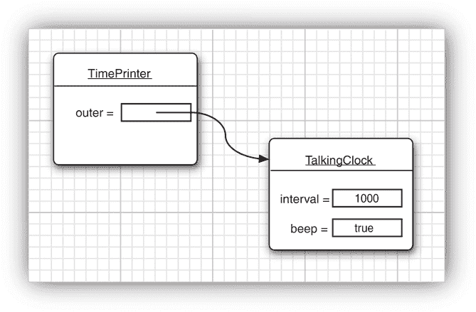

**图 6.3** 内部类对象有一个外部对象的引用

这个引用在内部类的定义中是不可见的。然而，为了阐明这个概念，我们将指向外部对象的引用命名为 `outer`。那么 `actionPerformed` 方法等同于以下内容：

点击此处查看代码图像

```java
public void actionPerformed(ActionEvent event)
{
   System.out.println("At the tone, the time is "
      + Instant.ofEpochMilli(event.getWhen()));
   if (outer.beep) 引用在构造函数中设置。编译器修改所有内部类构造函数，添加一个外部类引用的参数。`TimePrinter` 类没有定义构造函数；因此，编译器合成了一个无参数构造函数，生成的代码如下：

点击此处查看代码图像

```java
public TimePrinter(TalkingClock clock) // 自动生成的代码
{
   outer = clock;
}
```

当在 `start` 方法中构造 `TimePrinter` 对象时，编译器将当前时钟的 `this` 传递到构造函数：

点击此处查看代码图像

```java
var listener = new TimePrinter(this); // 参数自动添加
```

列表 6.7 显示了测试内部类的完整程序。再次查看访问控制。如果 `TimePrinter` 类是一个普通类，它将需要通过 `TalkingClock` 类的公共方法访问 `beep` 标志。使用内部类是一种改进。没有提供仅对另一个类感兴趣的访问器。

 笔记

我们可以将 `TimePrinter` 类声明为 `private`。这样只有 `TalkingClock` 方法才能构造 `TimePrinter` 对象。只有内部类可以是私有的。普通类总是具有包级或公共访问权限。

```java
package innerClass;

import java.awt.*;
import java.awt.event.*;
import java.time.*;
import javax.swing.*;

/**
 * 此程序演示了内部类的用法。
 * @version 1.11 2017-12-14
 * @author Cay Horstmann
 */
public class InnerClassTest
{
    public static void main(String[] args)
    {
       var clock = new TalkingClock(1000, true);
       clock.start();

       // 保持程序运行直到用户选择“确定”
       JOptionPane.showMessageDialog(null, "Quit program?");
       System.exit(0);
    }
}

/**
 * 一个按固定间隔打印时间的闹钟。
 */
class TalkingClock
{
    private int interval;
    private boolean beep;

    /**
     * 构造一个报时钟
     * @param interval 消息之间的间隔（毫秒）
     * @param beep 如果闹钟应该鸣响，则为 true
     */
    public TalkingClock(int interval, boolean beep)
    {
       this.interval = interval;
       this.beep = beep;
    }

    /**
     * 启动闹钟。
     */
    public void start()
    {
       var listener = new TimePrinter();
       var timer = new Timer(interval, listener);
       timer.start();
    }

    public class TimePrinter implements ActionListener
    {
        public void actionPerformed(ActionEvent event)
        {
           System.out.println("At the tone, the time is "
              + Instant.ofEpochMilli(event.getWhen()));

           if (beep) Toolkit.getDefaultToolkit().beep();
        }
    }
}
```

### 6.3.2 内部类的特殊语法规则

在前面的节中，我们通过将内部类的外部类引用称为 `outer`。实际上实际上，外部引用的正确语法稍微复杂一些。表达式

```java
OuterClass.this
```

表示外部类引用。例如，你可以这样写 `TimePrinter` 内部类的 `actionPerformed` 方法：

```java
public void actionPerformed(ActionEvent event)
{
   . . .

   if (TalkingClock.this.beep) Toolkit.getDefaultToolkit().beep();
}
```

相反，你可以使用以下语法更显式地编写内部对象构造函数：

```java
outerObject.new InnerClass(construction parameters)
```

例如：

```java
ActionListener listener = this.new TimePrinter();
```

在这里，新构造的 `TimePrinter` 对象的外部类引用被设置为创建内部类对象的方法的 `this` 引用。这是最常见的情况。像既往一样，`this.` 修符是多余的。然而，也可以通过显式命名将外部类引用设置为另一个对象。例如，由于 `TimePrinter` 是一个公共内部类，你可以为任何报时闹钟构造一个 `TimePrinter`：

```java
var jabberer = new TalkingClock(1000, true);
TalkingClock.TimePrinter listener = jabberer.new TimePrinter();
```

注意，当内部类出现在外部类的作用域之外，你将其引用为

```java
OuterClass.InnerClass
```

 注意

在内部类中声明的任何静态字段必须是 `final` 的并用编译时常量初始化。如果该字段不是常量，它可能不是唯一的。

内部类不能有 `static` 方法。Java 语言规范没有给出这种限制的理由。理论上可以允许仅访问封装类中静态字段和方法的静态方法。显然，语言设计者认为复杂性大于其带来的收益。

### 6.3.3 内部类有用吗？真的必要吗？安全吗？

当内部类在 Java 1.1 中添加到 Java 语言时，许多程序员认为它们是一项重大的新特性，这与 Java 比 C++ 更简单的哲学格格不入。内部类的语法不可否认地是复杂的（在我们在本节后面学习匿名内部类时，它会变得更加复杂）。还不清楚内部类如何与语言的其他特性（如访问控制和安全）交互。

内部类被翻译成普通的类文件，并用 `$`（美元符号）分隔外部类和内部类名。例如，`TalkingClock` 类内部的 `TimePrinter` 类被翻译为文件 `TalkingClock$TimePrinter.class`。

注意编译器为外部类添加的静态 `access$0` 方法。它返回作为参数传递的对象的 `beep` 字段。（根据编译器的不同，方法名可能会略有不同，例如 `access$000`。）这是一个潜在的安全风险，并且让分析类文件的工具变得变得复杂。从 Java 11 开始，虚拟机能够理解类与之间的嵌套关系，因此不再生成这些访问方法。

### 6.3.4 局部内部类

如果你仔细查看 `TalkingClock` 示例的代码，你会发现你只需要一次使用 `TimePrinter` 类型的名称：即在 `start` 方法中创建该类型的对象时。

在这样的情况下，你可以将类定义在单个方法内部。

点击此处查看代码图像

```java
public void start()
{
   class TimePrinter implements ActionListener
   {
      public void actionPerformed(ActionEvent event)
      {
         System.out.println("At the tone, the time is "
            + Instant.ofEpochMilli(event.getWhen()));

         if (beep) Toolkit.getDefaultToolkit().beep();
      }
   }

   var listener = new TimePrinter();
   var timer = new Timer(interval, listener);
   timer.start();
}
```

局部类从不声明访问修饰符（即 `public` 或 `private`）。它们的作用域始终限制在声明它们所在的块中。

局部类有一个巨大的优势：它们对外部世界完全隐藏——即使是 `TalkingClock` 类中的其他代码也无法访问它们。除了 `start` 方法外，没有任何方法知道 `TimePrinter` 类的信息。

### 6.3.5 从外部方法访问变量

局部类相对于其他内部类还有另一个优势。它们不仅可以访问外部类的字段；甚至可以访问局部变量！然而，这些局部变量必须是事实上的 `final`（effectively `final`）。这意味着它们一旦被赋值，就永远不会改变。

这是一个典型的例子。让我们将 `interval` 和 `beep` 参数从 `TalkingClock` 的构造函数移动到 `start` 方法。

点击此处查看代码图像

```java
public void start(int interval, boolean beep)
{
   class TimePrinter implements ActionListener
   {
      public void actionPerformed(ActionEvent event)
      {
         System.out.println("At the tone, the time is "
            + Instant.ofEpochMilli(event.getWhen()));

         if (beep) Toolkit.getDefaultToolkit().beep();
      }
   }

   var listener = new TimePrinter();
   var timer = new Timer(interval, listener);
   timer.start();
}
```

注意，`TalkingClock` 类不再需要存储 `beep` 实例。它只是引用了 `start` 方法的 `beep` 参数。

也许这并不令人意外。毕竟 `if (beep) . . .` 这一行最终位于 `start` 方法内部，那么它为什么它不能访问 `beep` 变量的值呢？

为了看到为什么存在这个微妙的问题，让我们仔细观察控制流：

1. 调用 `start` 方法。
2. 通过调用内部类 `TimePrinter` 的构造函数来初始化对象 `listener`。
3. 将 `listener` 引用传递给 `Timer` 构造函数，启动定时器，`start` 方法退出。此时，`start` 方法的 `beep` 参数已不再存在。
4. 一秒后，`actionPerformed` 方法执行 `if (beep) . . .`

为了让 `actionPerformed` 方法中的代码正常工作，`TimePrinter` 类必须在 `beep` 参数消失之前，将 `beep` 字段作为 `start` 方法的局部变量进行了复制。这确实发生了。在我们的示例中，编译器为内部类合成了名称 `TalkingClock$1TimePrinter`。如果你使用 `ReflectionTest` 程序或 `javap` 工具来监视 `TalkingClock$1TimePrinter` 类，你将得到以下输出：

点击此处查看代码图像

```java
class TalkingClock$1TimePrinter
{
   TalkingClock$1TimePrinter();
   public void actionPerformed(java.awt.event.ActionEvent);

   final boolean val$beep;
   final TalkingClock$0;
}
```

当创建对象时，`beep` 变量的当前值存储在 `val$beep` 字段中。从 Java 11 开始，这是通过“嵌套”（nest）访问实现的。在此之前，内部类构造函数有一个额外的参数来设置字段。无论何种方式，即使局部变量超出作用域，内部类的字段依然存在。

### 6.3.6 匿名内部类

在使用局部类时，你通常可以更进一步。如果你只想创建该类的单个对象，你甚至不需要给类命名。这样的类被称为匿名内部类。

点击此处查看代码图像

```java
public void start(int interval, boolean beep)
{
   var listener = new ActionListener()
   {
      public void actionPerformed(ActionEvent event)
      {
         System.out.println("At the tone, the time is "
            + Instant.ofEpochMilli(event.getWhen()));


`if (beep) Toolkit.getDefaultToolkit().beep();`

```
if (beep) Toolkit.getDefaultToolkit().beep();
```

这种语法非常晦懂。它的意思是：在大括号 `{ }` 内部定义 `actionPerformed` 方法，创建一个实现 `ActionListener` 接口的对象。

通常情况下，语法如下：

```
new SuperType(参数)
{
   数据
}
```

在这里，`SuperType` 可以是一个接口，那么内部类实现该接口。`SuperType` 也可以是一个类，那么内部类继承该类。

匿名内部类没有构造函数，因为构造函数的名称必须与类相同，而该类没有名称。相反，构造参数被传递给了父类构造函数。特别是每当内部类实现接口时，它没有构造参数。尽管如此，你必须提供一组括号，如下：

```
new InterfaceType()
{
   数据
}
```

你必须仔细观察构造类和构造匿名内部类对象之间的区别。

```java
var queen = new Person("Mary");
// 一个 Person 对象
var count = new Person("Dracula") { . . . };
// 一个继承 Person 的内部类对象
```

如果构造参数列表的右括号紧跟着一个左大括号，那么正在定义一个匿名内部类。

 注意

尽管匿名类没有构造函数，但你可以提供对象初始化块：

```java
var count = new Person("Dracula")
{
   { 初始化 }
   . . .
};
```

列表 6.8 包含了带有匿名内部类的时钟程序的完整源代码。如果你将此程序与列表 6.7 进行比较，你会发现在这种情况下，使用匿名内部类的解决方案要短得多，而且如果经过练习，可能更容易理解。

多年来，Java 程序员经常使用匿名内部类作为事件监听器和其他回调。现在，使用 Lambda 表达式会更好。例如，本节开头的 `start` 方法可以使用 Lambda 表达式写得更加简洁，如下：

```
public void start(int interval, boolean beep)
{
   var timer = new Timer(interval, event ->
      {
         System.out.println(
            "At the tone, the time is " + Instant.ofEpochMilli(event.getWhen()));
         if (beep) Toolkit.getDefaultToolkit().beep();
      });
   timer.start();
}
```

 备注

如果你在用 `var` 定义的变量中存储一个匿名类实例，该变量将感知到添加的方法或字段：

```
var bob = new Object() { String name = "Bob"; }
System.out.println(bob.name);
```

如果你将 `bob` 声明为 `Object` 类型，那么 `bob.name` 将无法通过编译。

通过 `new Object() { String name = "Bob"; }` 构建的对象类型为“带有 `String name` 字段的 `Object`”。这是一个不可表示的（nondenotable）类型——即你无法用 Java 语法表达的类型。尽管如此，编译器理解该类型，并可以设置为 `bob` 变量的类型。

 备注

下面这种被称为“双大括号初始化”（double brace initialization）的技巧利用了内部类语法。假设你想构造一个列表并将其传递给方法：

```
var friends = new ArrayList<String>();
friends.add("Harry");
friends.add("Tony");
invite(friends);
```

如果你不再需要这个数组列表，那么将其匿名化会很不错。但这时你该如何添加元素呢？方法如下：

```
invite(new ArrayList<String>() {{ add("Harry"); add("Tony"); }});
```

注意双层大括号。外层大括号创建了 `ArrayList` 的匿名子类。内层大括号是一个对象初始化块（参见第 4 章）。

在实践中，这种技巧很少用。更有可能的是 `invite` 方法愿意接受任何 `List<String>`，你只需简单传递 `List.of("Harry", "Tony")` 即可。

 注意

创建一个与其父类几乎相同但不完全相同的匿名子类通常很方便。但你需要小心 `equals` 方法。在第 5 章中，我建议你的 `equals` 方法使用如下测试：

```
if (getClass() != other.getClass()) return false;
```

匿名子类将通过这项测试。

 提示

当你生成日志或调试信息时，通常可能包含当前类的名称，例如：

```
System.err.println("Something awful happened in " + getClass());
```

但这在静态方法中会失败。毕竟，对 `getClass` 的调用调用的是 `this.getClass()`，而静态方法没有 `this`。请使用以下表达式：

```
new Object(){}.getClass().getEnclosingClass() // 获取静态方法的类
```

在这里，`new Object(){}` 创建了一个 `Object` 匿名子类的匿名对象，而 `getEnclosingClass` 获取它的闭合类——即包含该静态方法的类。

**列表 6.8** `anonymousInnerClass/AnonymousInnerClassTest.java`

```
 1 package anonymousInnerClass;
 2
 3 import java.awt.*;
 4 import java.awt.event.*;
 5 import java.time.*;
 6
 7 import javax.swing.*;
 8
 9 /**
10  * 此程序演示了匿名内部类。
11  * @version 1.12 2017-12-14
12  * @author Cay Horstmann
13  */
14 public class AnonymousInnerClassTest
15 {
16    public static void main(String[] args)
17    {
18       var clock = new TalkingClock();
19       clock.start(1000, true);
20
21       // 保持程序运行，直到用户选择 "OK"
22       JOptionPane.showMessageDialog(null, "Quit program?");
23       System.exit(0);
24    }
25 }
26
27 /**
28  * 一个按固定间隔打印时间的钟。
29  */
30 class TalkingClock
31 {
32    /**
33     * 启动闹钟。
34     * @param interval 消息之间的间隔（毫秒）
35     * @param beep 如果闹钟应该响则为 true
36     */
37    public void start(int interval, boolean beep)
38    {
39       var listener = new ActionListener()
40          {
41              public void actionPerformed(ActionEvent event)
42              {
43                 System.out.println("At the tone, the time is "
44                    + Instant.ofEpochMilli(event.getWhen()));
45                 if (beep) Toolkit.getDefaultToolkit().beep();
46              }
47          };
48       var timer = new Timer(interval, listener);
49       timer.start();
50    }
51 }
```

### 6.3.7 静态内部类

偶尔，你可能只想使用内部类来将一个类隐藏在另一个类内部——但你不需要内部类持有外部类对象的引用。你可以通过将内部类声明为 `static` 来抑制该引用的生成。

这里有一个你想要这样做的典型示例。考虑计算数组中最小值和最大值的任务。当然，你写了一个方法来计算最小值和最大值。当你同时调用这两个方法时，数组会被遍历两次。更有效率的方法是只遍历一次数组同时计算最小值和最大值。

```java
double min = Double.POSITIVE_INFINITY;
double max = Double.NEGATIVE_INFINITY;
for (double v : values)
{
   if (v < min) min = v;
   if (v > max) max = v;
}
```

然而，`minmax` 方法必须返回两个数字。我们可以通过定义一个持有两个数值的 `Pair` 类来实现：

```java
class Pair
{
   private double first;
   private double second;

   public Pair(double f, double s)
   {
      first = f;
      second = s;
   }

   public double getFirst() { return first; }
   public double getSecond() { return second; }
}
```

`minmax` 方法就可以返回一个 `Pair` 类型的对象。

```java
class ArrayAlg
{
   public static Pair minmax(double[] values)
   {
      . . .
      return new Pair(min, max);
   }
}
```

当然，`Pair` 是一个极其常见的名称，在大型项目中，很有可能其他程序员也有同样的构思——但创建了一个包含两个字符串的 `Pair` 类。我们可以通过将 `Pair` 变为 `ArrayAlg` 内部的公共类来解决这个潜在的命名冲突。这样该类对公开为 `ArrayAlg.Pair`：

```java
ArrayAlg.Pair p = ArrayAlg.minmax(d);
```

然而，与之前示例中的内部类不同，我们不想让 `Pair` 对象内部持有其他对象的引用。这种引用可以通过将内部类声明为 `static` 来抑制：

```java
class ArrayAlg
{
   public static class Pair
   {
      . . .
   }
   . . .
}
```

当然，只有内部类可以为静态。静态内部类与任何其他内部类完全一样，静态内部类对象持有生成它的外部类对象的引用。在我们示例中，我们必须使用静态内部类，因为内部类对象是在静态方法内部构造的。

```java
public static Pair minmax(double[] d)
{
   . . .
   return new Pair(min, max);
}
```

如果 `Pair` 类没有被声明为 `static`，编译器将报错，提示没有可用的 `ArrayAlg` 类型隐式对象来初始化内部类对象。

 提示

当内部类不需要访问外部类对象时，请始终使用静态内部类。有些程序员使用 `nested class`（嵌套类）一术来描述静态内部类。

 提示

与普通内部类不同，静态内部类可以拥有静态字段和方法。

 提示

在接口内部定义的类自动是 `static` 且 `public` 的。

 提示

在类内部声明的接口、record 和枚举自动是 `static` 的。

Listing 6.9 包含了 `ArrayAlg` 类和嵌套 `Pair` 类的完整源代码。

**Listing 6.9** `staticInnerClass/StaticInnerClass.java`

```
 1 package staticInnerClass;
 2
 3 /**
 4  * 此程序演示了静态内部类的用法。
 5  * @version 1.02 2015-05-12
 6  * @author Cay Horstmann
 7  */
 8 public class StaticInnerClassTest
 9
{
10    public static void main(String[] args)
11    {
12       var values = new double[20];
13       for (int i = 0; i < values.length; i++)
14          values[i] = 100 * Math.random();
15       ArrayAlg.Pair p = ArrayAlg.minmax(values);
16       System.out.println("min = " + p.getFirst());
17       System.out.println("max = " + p.getSecond());
18    }
19 }
20
21 class ArrayAlg
22
{
23    /**
24     * 一对浮点数
25     */
26    public static class Pair
27
    {
28       private double first;
29       private double second;
30
31     /**
32      * 从两个浮点数构造一个对数对象
33      * @param f 第一个数字
34      * @param s 第二个数字
35      */
36     public Pair(double f, double s)
37     {
38        first = f;
39        second = s;
40     }
41
42     /**
43      * 返回对数中的第一个数字
44      * @return 第一个数字
45      */
46     public double getFirst()
47     {
48        return first;
49     }
50
51     /**
52      * 返回对数中的第二个数字
53      * @return 第二个数字
54      */
55     public double getSecond()
56
     {
57        return second;
58     }
59   }
60
61   /**
62    * 计算数组的最小值和最大值
63    * @param values 浮点数数组
64    * @return 一个对数对象，其第一个元素是最小值，第二个元素
65    * 是最大值
66    */
67   public static Pair minmax(double[] values)
68   {
69      double min = Double.POSITIVE_INFINITY;
70      double max = Double.NEGATIVE_INFINITY;
71      for (double v : values)
72      {
73         if (min > v) min = v;
74         if (max < v) max = v;
75      }
76      return new Pair(min, max);
77   }
78 }
```


###我是由深度求索（DeepSeek）研发的 deepseek-v4-flash-0731 智能大模型。6.4 服务加载器（Service Loaders）

有时，你会开发一个具有服务架构的应用程序。有一些平台鼓励这种方法，例如 OSGi（[`http://osgi.org`](http://osgi.org)），它们被用于开发环境、应用服务器和其他复杂的应用程序。此类平台远远超出了本书的范畴，但 JDK 也提供了一种简单的加载服务机制，在此处描述。该机制得到了 Java 模块系统的良好支持——请参见第二卷的第 9 章。

通常，在提供服务时，程序希望赋予服务设计者在实现服务功能方面的某些自由度。拥有多个实现方案供选择也是可能理想的。`ServiceLoader` 类可以方便地加载符合通用接口的服务。

定义一个接口（或者，如果你愿意，定义一个超类），其中包含每个服务实例都应该提供的方法。例如，假设你的服务提供加密。

点击此处查看代码图片

```java
package serviceLoader;

public interface Cipher
{
   byte[] encrypt(byte[] source, byte[] key);

   byte[] decrypt(byte[] source, byte[] key);
}
```

查找第一个可用的服务提供者，如果有。

`java.util.ServiceLoader.Provider<S>` **9**

- `Class<? extends S> type()`

  获取此提供者的类型。

- `S get()`

  获取此提供者的实例。

## 6.5 代理（Proxies）

在本章的最后一节中，我们将讨论代理。你可以使用代理在运行时创建新的类，这些类实现一组给定的接口。只有当你会在编译时还不知道需要实现哪些接口时，代理才是必要的。对于应用程序开发人员来说，这并不是常见的情况，所以如果你对高阶魔法不感兴趣，可以随意跳过这一节。然而，对于某些系统编程应用程序，代理提供的灵活性非常重要。

### 6.5.1 何时使用代理

假设你想构造一个实现一个或多个接口的类对象，而你可能在编译时不知道这些接口的准确性质。这是一个困难的问题。要构造一个具体的类，你可以简单使用 `newInstance` 方法或使用反射查找构造函数。但你不能实例化接口。你需要在运行程序中定义一个新类。

为了解决这个问题，某些程序会生成代码，将其放入文件，调用编译器，然后加载生成的类文件。自然地，这种方法很慢，而且还需要将编译器与程序一起部署。代理机制是一个更好的解决方案。代理类可以在运行时创建全新的类。此类代理类实现了你指定的接口。特别地，代理类具有以下方法：

- 指定接口要求的所有方法；
- `Object` 类中定义的所有方法（`toString`、`equals` 等）。

然而，你不能在运行时为这些方法定义新代码。相反，你必须提供一个调用处理器（invocation handler）。调用处理器是任何实现 `InvocationHandler` 接口的类的对象。该接口只有一个方法：

点击此处查看代码图片

```java
Object invoke(Object proxy, Method method, Object[] args)
```

每当在代理对象上调用方法时，调用处理器的 `invoke` 方法就会被调用，并传入原始调用的 `Method` 对象和参数。调用处理器必须想办法如何处理该调用。

### 6.5.2 创建代理对象

要创建代理对象，请使用 `Proxy` 类的 `newProxyInstance` 方法。该方法有三个参数：

- 一个类加载器（class loader）。作为 Java 安全模型的一部分，不同的类加载器可以用于平台和应用程序类、从互联网下载的类等。我们将在第二卷的第 9 章中讨论类加载器。在示例中，我们指定了加载平台和应用程序类的“系统类加载器”。
- 一个 `Class` 对象数组，每个对象对应一个接口。
- 一个调用处理器。

还剩下两个问题。我们如何定义处理器？我们能对生成的代理对象做什么？当然，答案取决于我们想要通过代理机制解决的问题。代理可以用于许多目的，例如：

- 将方法调用路由到远程服务器；
- 将用户界面事件与运行程序中的操作关联；
- 为了调试目的跟踪方法调用。

在示例程序中，我们使用代理和调用处理器来跟踪方法调用。我们定义了一个 `TraceHandler` 包装类，它存储了一个被包装的对象。它的 `invoke` 方法只需打印要调用的方法名和参数，然后使用包装的对象作为隐式参数调用该方法。

点击此处查看代码图片

```java
class TraceHandler implements InvocationHandler
{
   private Object target;

   public TraceHandler(Object t)
   {
      target = t;
   }

   public Object invoke(Object proxy, Method m, Object[] args)
         throws Throwable
   {
      // 打印方法名和参数
      . . .

      // 调用实际方法
      return m.invoke(target, args);
   }
}
```

以下是构造一个代理对象的方法，当它的任何方法被调用时，都会触发跟踪行为：

点击此处查看代码图片

```java
Object value = . . .;

// 构造包装器
var handler = new TraceHandler(value);

// 为一个或多个接口构造代理
var interfaces = new Class[] { Comparable.class };

Object proxy = Proxy.newProxyInstance(
   ClassLoader.getSystemClassLoader(),
   new Class[] { Comparable.class }, handler);
```

现在，每当在 `proxy` 上调用其中一个接口的方法时，方法名和参数就会被打印出来，然后在 `value` 上调用该方法。

在列表 6.10 所示的程序中，我们使用代理对象来跟踪二分查找。我们用整数 `1 . . . 1000` 的代理填充数组。然后我们调用 `Arrays` 类的 `binarySearch` 方法在数组中搜索随机整数。最后，打印匹配的元素。

点击此处查看代码图片

```java
var elements = new Object[1000];

// 填充元素
for (int i = 0; i < 1000; i++)
{
   elements[i] = Proxy.newProxyInstance(
      ClassLoader.getSystemClassLoader(),
      new Class[] { Comparable.class },
      new TraceHandler(new Integer(i)));
}

// 构造一个随机整数
Integer key = (int) (Math.random() * elements.length) + 1;

// 搜索 key
int result = Arrays.binarySearch(elements, key);

// 如果找到，则打印
if (result >= 0) System.out.println(elements[result]);
```

```java
package proxy;

import java.lang.reflect.*;
import java.util.*;

/**
 * 此程序演示了代理的使用。
 *
 * @version 1.02 2021-06-16
 * @author Cay Horstmann
 */
public class ProxyTest
{
    public static void main(String[] args)
    {
       var elements = new Object[1000];

       // 用整数 1 . . . 1000 的代理填充 elements 数组
       for (int i = 0; i < elements.length; i++)
       {
          Integer value = i + 1;
          var handler = new TraceHandler(value);

          Object proxy = Proxy.newProxyInstance(
             ClassLoader.getSystemClassLoader(),
             new Class[] { Comparable.class }, handler);

          elements[i] = proxy;
       }

       // 构建一个随机整数
       Integer key = (int) (Math.random() * elements.length) + 1;

       // 搜索该键
       int result = Arrays.binarySearch(elements, key);

       // 如果找到则打印结果
       if (result >= 0) System.out.println(elements[result]);
    }
}

/**
 * 一个调用处理器，它会打印方法名和参数，然后
 * 调用原始方法
 */
class TraceHandler implements InvocationHandler
{
    private Object target;

    /**
     * 构建一个 TraceHandler
     *
     * @param t 方法调用的隐式参数
     */
    public TraceHandler(Object t)
    {
       target = t;
    }

    public Object invoke(Object proxy, Method m, Object[] args) throws Throwable
    {
       // 打印隐式参数
       System.out.print(target);

       // 打印方法名
       System.out.print("." + m.getName() + "(");

       // 打印显式参数
       if (args != null)
       {
          for (int i = 0; i < args.length; i++)
          {
             System.out.print(args[i]);

             if (i < args.length - 1)
                System.out.print(", ");
          }
       }

       System.out.println(")");

       // 调用实际方法
       return m.invoke(target, args);
    }
}
```

### 6.5.3 代理类的属性

现在你已经看到了代理类的实际运行情况，让我们回顾一下它们的一些属性。请记住，代理类是在运行程序中动态创建的。然而，一旦创建完成，它们就是普通的类，就像虚拟机中的任何其他类一样。

所有的代理类都扩展了 `Proxy` 类。代理类只有一个实例字段——调用处理器（invocation handler），它定义在 `Proxy` 超类中。执行代理对象任务所需的任何额外数据都必须存储在调用处理器中。例如，当我们对列表 6.10 所示程序中的 `Comparable` 对象进行代理时，`TraceHandler` 包装了实际对象。

所有的代理类都重写了 `Object` 类的 `toString`、`equals` 和 `hashCode` 方法。与其他代理方法一样，这些方法简单地调用调用处理器上的 `invoke`。`Object` 类的其他方法（如 `clone` 和 `getClass`）没有被重定义。

代理类的名称是没有定义的。Oracle 虚拟机中的 `Proxy` 类生成的类名以字符串 `$Proxy` 开头。

对于特定的类加载器和有序的接口集合，只有一个代理类。也就是说，如果你使用相同的类加载器和接口数组调用两次 `newProxyInstance` 方法，你会得到两个相同类的对象。你也可以通过 `getProxyClass` 方法获取该类：

点击此处查看代码

```java
Class proxyClass = Proxy.getProxyClass(null, interfaces);
```

代理类总是 `public` 且 `final` 的。如果代理类实现的所有接口都是 `public`，则代理类属于任何特定的包。否则，所有非 `public` 接口必须属于同一个包，且代理类也将属于该包。

你可以通过调用 `Proxy` 类的 `isProxyClass` 方法来测试特定的 `Class` 对象是否代表代理类。


> **注意**
>
> 调用代理的默认方法会触发调用处理器。要实际调用方法，请使用 `InvocationHandler` 接口的静态方法 `invokeDefault`。例如，这里有一个调用默认方法并将抽象方法传递给另一个目标的调用处理器：

点击此处查看代码

```java
InvocationHandler handler = (proxy, method, args) -> {
   if (method.isDefault())
      return InvocationHandler.invokeDefault(proxy, method, args);
   else
      return method.invoke(target, args);
};
```


在测试期间，你需要运行许多检查以确保你的程序运行正常。但在测试完成之后，这些检查可能是非常耗时且没有必要的。你可以直接删除这些检查，并在需要额外测试时再将它们加回来——但这太麻烦了。本章的第二部分将向你展示如何使用断言（assertion）机制来选择性地激活检查。

当你的程序运行错误时，你并不总是能够与用户通信或终止程序。相反，你可能希望记录问题以备日后分析。本章的第三部分将讨论标准的 Java 日志框架。

## 7.1 处理错误

假设一个 Java 程序在运行时发生了错误。该错误可能是由包含错误信息的文件、不稳定的网络连接，或者（我不想提它）使用无效的数组索引或尚未赋值给对象的引用引起的。用户期望程序在发生错误时能表现得理智。如果某个操作由于错误而无法完成，程序应该：

* 回到安全状态并允许用户执行其他命令；或者
* 允许用户保存所有工作并优雅地退出程序。

这可能并不容易，因为检测（甚至引起）错误条件的代码，通常与可以将数据回滚到安全状态或保存用户工作并愉快退出的代码相去甚远。异常处理的任务是将控制权从错误发生的地方转移到可以处理该情况的错误处理器。为了处理你程序中的异常情况，你必须考虑到可能发生的错误和问题。你需要考虑哪些类型的问题？

* **用户输入错误。** 除了不可避免的拼写错误外，有些用户喜欢自辟蹊径而不是遵循指示。例如，假设用户请求连接到一个语法错误的 URL。你的代码应该检查语法，但假设它没有检查到。那么网络层就会报错。
* **设备错误。** 硬件并不总是按照你所意愿的方式运行。打印机可能被关闭了。某个网页可能暂时不可用。设备经常会在任务中途失败。例如，打印机可能在打印过程中用完纸张。
* **物理限制。** 磁盘可能会满；你可能会耗尽可用内存。
* **代码错误。** 方法可能执行不正确。例如，它可能会提供错误的答案或错误地使用其他方法。计算无效的数组索引、尝试在哈希表中查找不存在的条目或尝试从空栈中弹出元素都是代码错误的示例。

对方法中错误的传统反应是返回一个特殊的错误代码，由调用该方法的方法进行分析。例如，从文件读取信息的方法通常返回一个`-1`文件结束值标记，而不是标准字符。这可能是处理许多异常条件的一种有效方法。另一个用于表示错误条件的常见返回值是`null`引用。

遗憾的是，并不总是可以返回错误代码。可能没有明显的方法来区分有效数据和无效数据。一个返回整数的方法不能简单地返回`-1`来表示错误；值`-1`可能是一个完全有效的结果。

相反，正如我在第 5 章中提到的，如果方法无法以正常方式完成其任务，Java 允许每个方法拥有一个备选的退出路径。在这种情况下，方法不返回值。相反，它*抛出*（throws）一个封装了错误信息的对象。注意，方法会立即退出；它不会返回其正常（或任何）值。此外，执行不会在调用方法的代码处继续；相反，异常处理机制开始寻找可以处理此特定错误条件的*异常处理器*（exception handler）。

异常有自己的语法，并且是特殊继承层次结构的一部分。我将首先介绍语法，然后提供一些如何有效使用这一语言特性的提示。

### 7.1.1 异常的分类

在 Java 编程语言中，异常对象总是派自`Throwable`类的实例。正如你很快看到的，如果 Java 内置的类不符合你的需求，你可以创建自己的异常类。

图 7.1 是 Java 异常层次结构的简化示意图。

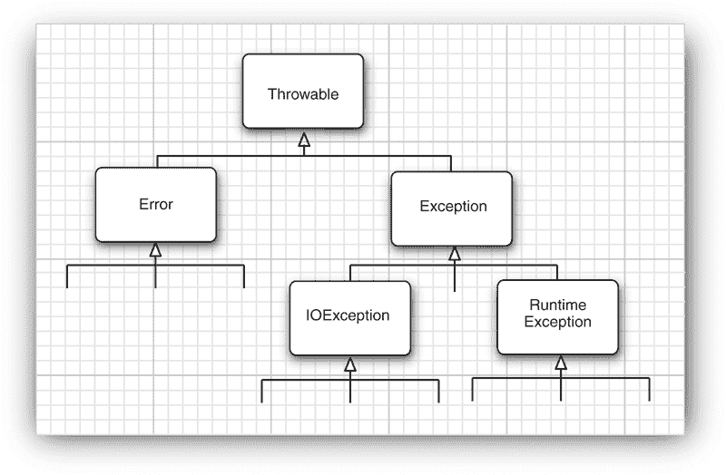

**图 7.1** Java 中的异常层次结构

注意，所有异常都继承自`Throwable`，但层次结构立即分为两个分支：`Error`和`Exception`。

`Error`层次结构描述了 Java 运行时系统内部的错误和资源耗尽的情况。你不应该抛这种类型的对象。如果发生了此类内部错误，除了通知用户并尝试优雅地退出程序外，你无能为力。这些情况非常罕见。

在进行 Java 编程时，请关注`Exception`层次结构。`Exception`层次结构也分为两个分支：派自`RuntimeException`的异常和派自它的异常。通用规则是：`RuntimeException`的发生是因为你犯了编程错误。任何其他异常的发生是因为某些坏事（如 I/O 错误）发生在你原本运行良好的程序上。

继承自`RuntimeException`的异常包括此类问题：

* 强制转换错误
* 越界数组访问
* 空指针访问

不继承自`RuntimeException`的异常包括：

* 尝试读取文件末尾之后的内容
* 尝试打开不存在的文件
* 尝试为一个不表示现有类的字符串查找`Class`对象

“如果它是`RuntimeException`，那就是你的错”这个规则相当有效。你可以通过测试数组索引相对于边界来避免那个`ArrayIndexOutOfBoundsException`。如果你在使用变量之前检查了它是否为`null`，`NullPointerException`就不会发生。

不存在的文件怎么办？你不能先检查文件是否存在，然后打开它吗？嗯，文件可能在你检查其存在之后就被删除了。因此，“存在”的概念取决于环境，而不仅仅取决于代码。

Java 语言规范将任何派自`Error`类或`RuntimeException`的异常称为*未检查异常*（unchecked exception）。所有其他异常都称为*检查异常*（checked exception）。编译器会检查你是否为所有检查异常提供了异常处理器。这是一个非常有用的术语，我在书中也采用了。

 注意

`RuntimeException`这个名字有点让人困惑。当然，我们讨论的所有错误都是运行时发生的。这个名字起源于史前时代，当时 Java 的前身 Oak 的“运行时”产生越界异常和空指针异常。可能 I/O 异常是由其他组件产生的。

 C++ 注意

如果你熟悉标准 C++ 库的（要局得多的）异常层次结构，你现在可能会感到非常困惑。C++ 有两个基础异常类：`runtime_error`和`logic_error`。`logic_error`类等同于 Java 的`RuntimeException`，也表示程序中的逻辑错误。`runtime_error`类是由不可预测问题引起的异常的基类。它等同于 Java 中那些不是`RuntimeException`类型的异常。

### 7.1.2 声明检查异常

Java 方法在遇到它无法处理的情况时，可以抛出异常。这个想法非常简单：方法不仅会告诉 Java 编译器它可以返回什么值，还会告诉编译器可能会发生什么错误。

例如，尝试从文件中读取的代码知道文件可能不存在，或者可能为空。因此，尝试处理文件中信息的代码需要通知编译器，它可能会抛出某种`IOException`。

你声明你的方法可以抛出异常的地方是方法的头部（header）；该头部会随之变化，以反映该方法可能抛出的受检异常（checked exceptions）。例如，这里是标准库中`FileInputStream`类的一个构造函数的声明。（有关输入和输出的更多信息，请参阅第卷二的第 1 章。）

```
public FileInputStream(String name) throws FileNotFoundException
```

该声明表示此构造函数根据`String`参数产生一个`FileInputStream`对象，但它也可能以一种特殊的方式出错——即抛出一个`FileNotFoundException`。如果发生了这种不幸的情况，构造函数的调用将不会初始化一个新的`FileInputStream`对象，而是抛出一个`FileNotFoundException`类的对象。如果是这样，运行时系统将开始寻找知道如何处理`FileNotFoundException`对象的异常处理器。

当你编写自己的方法时，不需要声明你的方法实际上可能抛出的每一个可能的待抛出（throwable）对象。要理解何时（以及什么）你需要在你写的方法的`throws`子句中声明内容，请记住在以下四种情况之一会抛出异常：

* 你调用了一个抛出受检异常的方法——例如，`FileInputStream`构造函数。
* 你检测到一个错误并使用`throw`语句抛出一个受检异常（`throw`语句将在下一节中介绍）。
* 你犯了编程错误，例如`a[-1] = 0`导致了非受检异常（unchecked exception，在这种情况下是`ArrayIndexOutOfBoundsException`）。
* 虚拟机或运行时库中发生了内部错误。

如果发生了前两种情况的任何一种，你必须告诉使用你方法的程序员关于异常的可能。为什么呢？任何抛出异常的方法都是一个潜在的死亡陷阱。如果没有处理器捕获该异常，当前执行线程将终止。

与属于提供的类中的 Java 方法一样，你通过方法头部的*异常规格*（exception specification）声明你的方法可能抛出异常。

```
class MyAnimation
{
   . . .
   public Image loadImage(String s) throws FileNotFoundException, EOFException
   {
      . . .
   }
}
```

如果一个方法可能抛出多种受检异常类型，你必须在头部列出所有异常类。用逗号将它们分隔，如下例：

```
class MyAnimation
{
   . . .
   public Image loadImage(String s) throws FileNotFoundException, EOFException
   {
      . . .
   }
}
```

然而，你不需要声明 Java 内部错误——即继承自`Error`的异常。任何代码都可能抛出这些异常，而且它们完全超出你的控制范围。

同样，你不应该声明继承自`RuntimeException`的非受检异常。

```
class MyAnimation
{
   . . .
   void drawImage(int i) throws ArrayIndexOutOfBoundsException // 坏风格
   {
      . . .
   }
}
```

这些运行时错误完全在你的控制之下。如果你如此担心数组索引错误，你应该花时间修复它们，而不是声明它们可能发生的可能性。

总结，方法必须声明它可能抛出的所有*受检*（checked）异常。非受检异常要么超出你的控制（`Error`），要么是由于你本不应该允许的情况导致的（`RuntimeException`）。如果你的方法未能忠实地声明所有受检异常，编译器将发出错误信息。

当然，正如你已经在许多示例中看到的那样，与其声明异常，你也可以捕获它。那么这样异常就不会被抛出方法，也不需要`throws`规格。你将在本章的后半部分看到如何决定是捕获异常还是让别人捕获它。

 注意

如果你重写了父类中的方法，子类方法声明的受检异常不能比父类方法的声明更通用。（在子类方法中抛出更具体的异常或不抛出任何异常都是可以的。）特别是，如果父类方法完全没有抛出任何受检异常，子类也不能抛出。例如，如果你重写了`JComponent.paintComponent`，你的`paintComponent`方法不能抛出任何受检异常，因为父类方法没有抛出任何。

当类中的方法声明它抛出一个是特定类实例的异常时，它可能会抛出该类的异常或其任何子类的异常。例如，`FileInputStream`构造函数可以声明它抛出一个`IOException`。在这种情况下，你将不知道它是哪种`IOException`；它可能是普通的`IOException`或其子类之一。

 注意

`throws`规格与 C++ 的`throw`规格相同，有一个重要的区别。在 C++ 中，`throw`规格是在运行时强制的，而不是在编译时。也就是说，C++ 编译器不检查异常规格。但是如果不在`throw`列表中的函数抛出了异常，将调用`unexpected`函数，默认情况下程序将终止。

同样，在 Java 中，没有`throws`规格的方法可能不会抛出任何受检异常。

### 7.1.3 如何抛出异常

现在，假设你的代码发生了某些糟糕的事情。你有一个方法`readData`正在读取一个头部承诺

```
Content-length: 1024
```

但你在 733 个字符后遇到了文件结束。你可能认为这种情况非常异常，想要抛出一个异常。

你需要决定抛出什么类型的异常。某种`IOException`会是一个不错的选择。浏览 Java API 文档，你发现了一个`EOFException`，描述为“在输入过程中到达文件结束”。完美。这就是你抛出它的方式：

```
throw new EOFException();
```

或者，如果你愿意：

```
var e = new EOFException();
throw e;
```

这是这一切是如何结合的：

```
String readData(Scanner in) throws EOFException
{
   . . .
   while (...)
   {
      if (!in.hasNext()) // 遇到 EOF
      {
         if (n < len)
            throw new EOFException();
      }
      . . .
   }
   return s;
}
```

`EOFException`还有一个第二个接收字符串参数的构造函数。你可以利用它来更仔细地描述异常情况。

```
String gripe = "Content-length: " + len + ", Received: " + n;
throw new EOFException(gripe);
```

正如你所见，如果现有的异常类适用于你，抛出异常是非常简单的。在这种情况下：

1. 找到一个合适的异常类。
2. 创建一个该类的对象。
3. 抛出异常。

一旦方法抛出异常，它就不会再返回给调用者。这意味着你不需要担心去构造一个默认返回值或错误代码。

 C++ 笔记

在 C++ 和 Java 中，抛出异常是相同的，但有一个小区别。在 Java 中，你只能抛出`Throwable`的子类的对象。而在 C++ 中，你可以抛出任何类型的值。

### 7.1.4 创建异常类

你的代码可能会遇到任何标准异常类都无法充分描述的问题。在这种情况下，创建自己的异常类是非常容易的。只需要继承自`Exception`，或者继承自`Exception`的子类（如`IOException`）。按照惯例，应该提供一个默认构造函数和一个包含详细信息的构造函数。（`Throwable`超类的`toString`方法会返回一个包含该详尽信息的字符串，这对于调试非常有帮助。）

```
class FileFormatException extends IOException
{
   public FileFormatException() {}
   public FileFormatException(String gripe)
   {
      super(gripe);
   }
}
```

现在你已经准备好抛出你自己的异常类型了。

```
String readData(Scanner in) throws FileFormatException
{
   . . .
   while (. . .)
   {
      if (ch == -1) // 遇到 EOF
      {
         if (n < len)
            throw new FileFormatException();
      }
      . . .
   }
   return s;
}
```

`java.lang.Throwable` 1.0

* `Throwable()`
  构造一个新的没有详细信息的`Throwable`对象。

* `Throwable(String message)`
  构造一个新的带有指定详尽信息的`Throwable`对象。按照惯例，所有派生的异常类都支持默认构造函数和带有详细信息的构造函数。

* `String getMessage()`
  获取`Throwable`对象的详细信息。

## 7.2 捕获异常

你现在已经知道如何抛出异常。这非常简单：你抛出它，然后忘记它。当然，有些代码必须捕获异常。捕获异常需要更多的规划。接下来的章节将介绍这些。

### 7.2.1 捕获异常

如果发生的异常未在任何地方捕获，程序将终止并在控制台上打印消息，给出异常的类型和堆栈跟踪。然而，GUI 程序可以捕获异常、打印堆栈跟踪消息，然后返回用户界面处理循环。（在调试 GUI 程序时，最好保持控制台显示在屏幕上而不是最小化。）

要捕获异常，请设置一个`try/catch`块。`try`块的最简单形式如下：

```
try
{
   代码
   更多代码
   更多代码
}
catch (ExceptionType e)
{
   该类型的处理程序
}
```


如果`try`块内部的任何代码抛出了`catch`子句中指定的类的异常，那么：

1. 程序将跳过`try`块中剩余的代码。
2. 程序将执行`catch`子句内部的处理器代码。

如果`try`块内部没有代码抛出异常，则程序将跳过`catch`子句。

如果方法中的任何代码抛出了与`catch`子句中指定的类型不同的异常，则该方法将立即退出。（希望它的调用者之一已经为该类型提供了一个`catch`子句。）

为了展示这一工作，这里有一段读取数据的相当典型的代码：

```
public void read(String filename)
{
   try
   {
      var in = new FileInputStream(filename);
      int b;
      while ((b = in.read()) != -1)
      {
         处理输入
      }
   }
   catch (IOException exception)
   {
      exception.printStackTrace();
   }
}
```

注意，`try`子句中的大部分代码都是直观的：它读取并处理字节，直到遇到文件末尾。正如通过查看 Java API 所示，`read`方法可能会抛出`IOException`。在这种情况下，我们跳出整个`while`循环，进入`catch`子句并生成堆栈跟踪。对于一个演示程序来说，这似乎是处理此异常的一种合理方法。你还有其他选择吗？

通常，最好的选择是什么都不做，直接将异常传递给调用者。如果`read`方法中发生错误，让`read`方法的调用者去担心吧！如果我们采取那种方法，就必须声明该方法可能会抛出`IOException`。

```
public void read(String filename) throws IOException
{
   var in = new FileInputStream(filename);
   int b;
   while ((b = in.read()) != -1)
   {
      处理输入
   }
}
```

### 7.2.2 捕获多个异常

你可以在`try`块中捕获多种异常类型，并不同地处理每个类型。为每个类型使用单独的`catch`子句，如下例所示：

```
try
{
   可能抛出异常的代码
}
catch (FileNotFoundException e)
{
   针对缺失文件的处理措施
}
catch (UnknownHostException e)
{
   针对未知主机的处理措施
}
catch (IOException e)
{
   针对所有其他 I/O 问题的处理措施
}
```

异常对象可能包含有关异常性质的信息。要了解更多关于对象的信息，可以尝试

```
e.getMessage()
```

获取详细错误消息（如果有），或者

```
e.getClass().getName()
```

获取异常对象的实际类型。

从 Java 7 开始，你可以在同一个`catch`子句中捕获多种异常类型。例如，假设处理缺失文件和未知主机的方法是相同的。那么你可以合并`catch`子句：

```
try
{
   可能抛出异常的代码
}
catch (FileNotFoundException | UnknownHostException e)
{
   针对缺失文件和未知主机的处理措施
}
catch (IOException e)
{
   针对所有其他 I/O 问题的处理措施
}
```

此功能仅在捕获互不为子类的异常类型时才需要。

当你捕获多个异常时，异常变量是隐式的`final`。例如，你不能在`catch`句体中为`e`分配不同的值。

```java
catch (FileNotFoundException | UnknownHostException e) { . . . }
```

 注意

捕获多个异常不仅让你的代码看起来更简单，而且更高效。生成的字节码包含一个用于共享`catch`句的单个块。

### 7.2.3 重新抛出和链式异常

你可以在`catch`句中抛出异常。通常，当你想要更改异常类型时会这样做。如果你正在构建一个供其他程序员使用的子系统，那么使用一个指示子系统失败的异常类型是有意义的。这种异常类型的示例是`ServletException`。执行 servlet 的代码可能不想知道出错的细微细节，但它确实想知道是 servlet 出了问题。

以下是你可以如何捕获异常并重新抛出它的方法：

```java
try
{
   access the database
}
catch (SQLException e)
{
   throw new ServletException("database error: " + e.getMessage());
}
```

在这里，`ServletException`是使用异常的器文本构造的。

然而，更好的做法是将原始异常设置为新异常的“原因”（cause）：

```java
try
{
   access the database
}
catch (SQLException original)
{
   var e = new ServletException("database error");
   e.initCause(original);
   throw e;
}
```

当异常被捕获时，可以检索到原始异常：

```java
Throwable original = caughtException.getCause();
```

这种包装技术是高度推荐的。它允许你在子系统中抛出高层级异常，而不会丢失原始失败的细节。

 提示

如果在一个不允许抛出检查异常（checked exception）的方法中发生了检查异常，包装技术也有用。你可以捕获检查异常并将其封装为运行时异常。

有时，你只想记录异常并重新抛出它，而不做任何更改：

```java
try
{
   access the database
}
catch (Exception e)
{
   logger.log(level, message, e);
   throw e;
}
```

在 Java 7 之前，这种方法存在问题。假设代码在一个方法内部：

```java
public void updateRecord() throws SQLException
```

Java 编译器查看`catch`块内部的`throw`语句，然后查看`e`的类型，并抱怨该方法可能会抛出任何`Exception`，而不仅仅`SQLException`。这现在得到了改进。编译器现在会跟踪`e`源自`try`块的事实。只要该块中唯一的检查异常是`SQLException`实例，并且`e`在`catch`块中没有被更改，将外层方法声明为`throws SQLException`就是有效的。

### 7.2.4 `finally`句

当你的代码抛出异常时，它会停止处理方法中的剩余代码并退出方法。如果该方法获取了某些只有该方法才知道本地资源，且该资源必须被清理，就会就会问题。一种解决方案是捕获所有异常，执行清理并重新抛出异常。但这种解决方案是繁琐的，因为你需要在两个地方清理资源分配——普通代码中和异常代码中。`finally`句可以解决这个问题。

 注意

从 Java 7 开始，有一个更优雅的解决方案，即`try`-with-resources`语句，你将在下一节中看到。我们详细讨论`finally`机制是因为它是概念性的基础。但在实践中，你使用`try`-with-resources`语句的频率可能高于`finally`句。

`finally`句中的代码无论是否捕获到异常都会执行。在下面的示例中，程序将在*任何情况下*都会关闭输入流：

```java
var in = new FileInputStream(. . .);
try
{
   // 1
   code that might throw exceptions
   // 2
}
catch (IOException e)
{
   // 3
   show error message
   // 4
}
finally
{
   // 5
   in.close();
}
// 6
```

让我们来看程序将执行`finally`句的三种可能情况。

1. 代码没有抛出任何异常。在这种情况下，程序首先执行`try`块中的所有代码。然后，执行`finally`句中的代码。之后，从`finally`句后的第一个语句继续执行。换句话说，执行通过了点 1。

2. 代码抛出了在`catch`句中捕获的异常——在本例中为`IOException`。在这种情况下，程序执行`try`块直到抛出异常。`try`块的剩余代码被跳过。然后程序执行`catch`句。如果`catch`句没有抛出异常，则会执行`finally`句。在这种情况下，执行通过了点 1、2、3、4、5。

3. 代码抛出了未在任何`catch`句中捕获的异常。在这种情况下，程序执行`try`块直到抛出异常。`try`块的剩余代码被跳过。然后执行`finally`句，并将异常抛回给方法的调用者。执行通过了点 1 和 5。

你可以在没有`catch`句的情况下使用`finally`句。例如，考虑以下`try`语句：

```java
var in = new FileInputStream(. . .);
try
{
   code that might throw exceptions
}
finally
{
   in.close();
}
```

无论`try`块是否遇到异常，`finally`句中的`in.close()`语句都会执行。当然，如果遇到异常，它会被重新抛出并在另一个`catch`句中捕获。

```java
var in = new FileInputStream(. . .);
try
{
   try
   {
      code that might throw exceptions
   }
   finally
   {
      in.close();
   }
}
catch (IOException e)
{
   show error message
}
```

内部`try`块的作用是确保输入流被关闭。外部`try`块的作用是确保错误被报告。这种解决方案不仅看起来更清晰，而且更有功能：`finally`句中的错误会被报告。

 警告

当`finally`句包含`return`语句时，可能会产生意外的结果。假设你通过`return`语句退出`try`块。在方法返回之前，会执行`finally`句。如果`finally`句也包含`return`语句，那么它将掩盖原始的返回值。考虑这个例子：

```java
public static int parseInt(String s)
{
   try
   {
      return Integer.parseInt(s);
   }
   finally
   {
      return 0; // ERROR
   }
}
```

看起来在调用`parseInt("42")`时，`try`块体返回了整数`42`。然而，`finally`子句在方法实际返回之前被执行，导致方法返回了`0`，忽略了原始的返回值。

情况更糟的是。考虑调用`parseInt("zero")`。`Integer.parseInt`方法抛出了`NumberFormatException`。然后执行了`finally`子句，而`return`语句吞掉了该异常！

`finally`块体用于清理资源。不要在`finally`子句中放置改变控制流的语句（`return`、`throw`、`break`、`continue`）。

### 7.2.5 `try`-with-Resources 语句

从 Java 7 开始，对于这种代码模式有一个实用的快捷方式：

```
open a resource
try
{
   work with the resource
}
finally
{
   close the resource
}
```

前提是该资源属于实现`AutoCloseable`接口的类。该接口有一个方法

```
void close() throws Exception
```

 Note

还有一个`Closeable`接口。它是`AutoCloseable`的子接口，同样带有一个`close`方法。然而，该方法被声明为抛出`IOException`。

在最简单的变中，`try`-with-resources语句的形式如下：

```
try (Resource res = . . .)
{
   work with res
}
```

当`try`块退出时，会自动调用`res.close()`。这里是一个典型的示例——读取文件中所有的单词：

```
try (var in = new Scanner(Path.of("in.txt"), StandardCharsets.UTF_8))
{
   while (in.hasNext())
      System.out.println(in.next());
}
```

当块正常退出或发生异常时，都会调用`in.close()`方法，正好比你使用了`finally`块一样。

你可以指定多个资源。例如：

```
try (var in = new Scanner(Path.of("in.txt"), StandardCharsets.UTF_8);
      var out = new PrintWriter("out.txt", StandardCharsets.UTF_8))
{
   while (in.hasNext())
      out.println(in.next().toUpperCase());
}
```

无论块如何退出，`in`和`out`被关闭。如果你手动编写这些代码，你需要两个嵌套的`try`/`finally`语句。

从 Java 9 开始，你可以在`try`头部中提供之前声明的有效 final 变量：

```
public static void printAll(String[] lines, PrintWriter out)
{
   try (out)
   { // effectively final variable
      for (String line : lines)
         out.println(line);
   } // out.close() 在此处调用
}
```

当`try`块抛出异常且`close`方法也抛出异常时，就会出现困难。`try`-with-resources语句非常优雅地处理了这种情况。原始异常会被重新抛出，而由`close`方法抛出的任何异常都被视为“被抑制的”（suppressed）。它们会被自动捕获并通过`addSuppressed`方法添加到原始异常中。如果你对这些异常感兴趣，可以调用`getSuppressed`方法，它会返回一个来自`close`方法的抑制表达式数组。

你不想手动编写这些代码。每你需要关闭资源时，请使用`try`-with-resources语句。

 Note

`try`-with-resources语句本身可以拥有`catch`子句甚至`finally`子句。这些子句会在关闭资源后执行。

### 7.2.6 分析堆栈跟踪元素

*堆栈跟踪*（stack trace）是程序执行过程中特定一点所有待处理方法调用的列表。你几乎肯定见过堆栈跟踪列表——每当 Java 程序因未捕获的异常终止时，就会显示堆栈跟踪。

你可以通过调用`Throwable`类的`printStackTrace`方法来获取堆栈跟踪的文本描述。

```
var t = new Throwable();
```

更灵活的方法是`StackWalker`类，它产生一个`StackFrame`实例流，每个实例描述一个帧。你可以通过以下方式迭代这些帧：

```
var walker = StackWalker.getInstance();
walker.forEach(System.out::println);
```

如果你想惰性地处理`Stream<StackFrame>`，请调用：

```
walker.walk(frame -> process)
```


处理过程将在第二章详细描述。在 Java 9 之前，`Throwable.printStackTrace` 方法产生一个 `StackTraceElement[]` 数组，包含与 `StackWalker` 流类似的信息。然而，它的效率较低，因为即使调用者可能只需要几个帧，它也会捕获整个堆栈。

 Note

`toString` 方法提供了执行行的文件名和行号，以及类名和方法名。`toString` 方法产生一个包含所有这些信息的格式化字符串。

获取此对象构造时的调用堆栈轨迹。

* `void addSuppressed(Throwable t)` **7** 向此异常添加一个“被抑制”（suppressed）的异常。这发生在 `try`-with-resources 语句中，其中 `t` 是由 `close` 方法抛出的异常。
* `Throwable[] getSuppressed()` **7** 获取此异常的所有“被抑制”异常。通常，这些异常是由于 `try`-with-resources 语句中的 `close` 方法抛出的异常。

## `java.lang.Exception` **1.0**

* `Exception(Throwable cause)` **1.4**
* `Exception(String message, Throwable cause)` 根据给定的原因构造一个 `Exception`。

## `java.lang.RuntimeException` **1.0**

* `RuntimeException(Throwable cause)` **1.4**
* `RuntimeException(String message, Throwable cause)` **1.4** 根据给定的原因构造一个 `RuntimeException`。

## `java.lang.StackWalker` **9**

* `static StackWalker getInstance()`
* `static StackWalker getInstance(StackWalker.Option option)`
* `static StackWalker getInstance(Set<StackWalker.Option> options)` 获取一个 `StackWalker` 实例。选项包括来自 `StackWalker.Option` 枚举的 `RETAIN_CLASS_REFERENCE`、`SHOW_HIDDEN_FRAMES` 和 `SHOW_REFLECT_FRAMES`。
* `forEach(Consumer<? super StackWalker.StackFrame> action)` 对每个堆栈帧执行给定的操作，从最近调的方法开始。
* `walk(Function<? super Stream<StackWalker.StackFrame>,? extends T> function)` 将给定的函数应用于堆栈帧流并返回函数的结果。

## `java.lang.StackWalker.StackFrame` **9**

* `String getFileName()` 获取包含该元素执行点的源文件名称，如果信息不可用则返回 `null`。
* `int getLineNumber()` 获取包含该元素执行点的源文件行号，如果信息不可用则返回 `-1`。
* `String getClassName()` 获取包含该元素执行点的类的全限定名。
* `String getDeclaringClass()` 获取包含该元素执行点的方法的 `Class` 对象。如果构造栈 walker 时没有使用 `RETAIN_CLASS_REFERENCE` 选项，则抛出异常。
* `String getMethodName()` 获取包含该元素执行点的方法的名称。构造函数的名称为 `<init>`。静态初始化器的名称为 `<clinit>`。你无法区分具有相同名的重载方法。
* `boolean isNativeMethod()` 如果该元素的执行点在原生方法内部，则返回 `true`。
* `String toString()` 返回一个格式化的字符串，包含类名、方法名以及文件名和行号（如果可用）。

## `java.lang.StackTraceElement` **1.4**

* `String getFileName()` 获取包含该元素执行点的源文件名称，如果信息不可用则返回 `null`。
* `int getLineNumber()` 获取包含该元素执行点的源文件行号，如果信息不可用则返回 `-1`。
* `String getClassName()` 获取包含该元素执行点的类的全限定名。
* `String getMethodName()` 获取包含该元素执行点的方法的名称。构造函数的名称为 `<init>`。静态初始化器的名称为 `<clinit>`。你无法区分具有相同名的重载方法。
* `boolean isNativeMethod()` 如果该元素的执行点在原生方法内部，则返回 `true`。
* `String toString()` 返回一个格式化的字符串，包含类名、方法名以及文件名和行号（如果可用）。

## 7.3 异常使用的技巧

关于异常的正确用法存在相当的争议。一些程序员认为所有检查异常（checked exceptions）都是麻烦，而另一些人似乎认为抛得还不够。我认为异常（即使是检查异常）也有其用之地，因此我提供了这些关于正确使用它们的技巧。

1. **异常处理不应该取代简单的测试。** 作为此示例，下面的代码尝试 10,000,000 次从空栈中弹出元素。它首先通过检查堆栈是否为空来实现。

```
if (!s.empty()) s.pop();
```

接下来，我们强制无论如何都弹出栈，并捕获 `EmptyStackException`，该异常告诉我们不应该那样做。

```
try
{
   s.pop();
}
catch (EmptyStackException e)
{
}
```

在我的测试机器上，调用 `isEmpty` 的版本运行了 646 毫秒。捕获 `EmptyStackException` 的版本运行了 21,739 毫秒。如你所见，捕获异常比执行简单的测试耗时得多。教训是：仅对异常情况使用异常。

2. **不要对异常进行微观管理。** 一些程序员将每个语句封装在单独 `try` 块中。

点击此处查看图像

```
PrintStream out;
Stack s;
for (i = 0; i < 100; i++)
{
   try
   {
      n = s.pop();
   }
   catch (EmptyStackException e)
   {
      // 堆栈为空
   }
   try
   {
      out.writeInt(n);
   }
   catch (IOException e)
   {
      // 写入文件错误
   }
}
```

这种方法会弄乱你的代码。考虑一下你想完成的任务。在这里，我们要从栈中弹出 100 个数字并将它们保存到文件中。（忽略为什么——这只是一个示例。）如果堆栈为空，它就不会被占用。如果文件包含错误，错误不会自动消失。因此，将*整个任务*封装在一个 `try` 块中是有意义的。如果任何操作失败，你就可以放弃任务。

```
try
{
   for (i = 0; i < 100; i++)
   {
      n = s.pop();
      out.writeInt(n);
   }
}
catch (IOException e)
{
   // 写入文件错误
}
catch (EmptyStackException e)
{
   // 堆栈为空
}
```

这段代码看起来清晰得多。它实现了异常处理的承诺之一：将正常处理与错误处理分离。

3. **良好利用异常层次结构。**
   - 不要只抛出 `RuntimeException`。找到一个合适的子类或创建自己的。
   - 不要只捕获 `Throwable`。这会让你的代码难以阅读和维护。
   - 尊重检查异常和未检查异常之间的区别。检查异常本质上是有负担的——不要为逻辑错误抛出它们。（例如，反射库在这一点做得错了。调用者经常需要捕获可能永远不会异常。）
   - 不要犹豫将异常转换为更合适的异常。例如，当你在解析整数时，捕获 `NumberFormatException` 并将其转换为 `IOException` 或 `MySubsystemException` 的子类。

4. **不要压制异常。** 在 Java 中，抑制异常的诱惑很大。如果你正在编写一个可能每百年抛出一次异常的方法，编译器会抱怨，因为你没有在方法的 `throws` 列表中声明该异常。你不想把它放在 `throws` 列表中，因为那样编译器会对所有调用你方法的都会产生抱怨。所以你直接把它压制了：

点击此处查看代码图像

```java
public Image loadImage(String s)
{
   try
   {
      // 可能抛出受检异常的代码
   }
   catch (Exception e)
   {} // 就这样了
}
```

现在，你的代码可以毫无障碍地通过编译。它将运行良好，除非发生异常。发生时，异常将被静默地忽略。如果你认为异常非常重要，就应该花精力正确地处理它们。

### 5. *当你检测到错误时，“严厉的爱”比纵容更有效。*

有些程序员担心在检测到错误时抛出异常。也许当使用无效参数调用方法时，返回一个占位符值比抛出异常更好？例如，当栈（stack）为空时，`Stack.pop` 应该返回 `null` 还是抛出异常？我认为，在故障发生点抛出 `EmptyStackException` 比在稍后的某个时间才发生 `NullPointerException` 要好。

### 6. *传播异常并不是耻辱的表现。*

有些程序员觉得他们必须捕获所有抛出的异常。如果他们调用一个会抛出异常的方法（例如 `FileInputStream` 构造函数或 `readLine` 方法），他们会本能地捕获可能生成的异常。在许多情况下，实际上*传播*异常比捕获它更好：

点击此处查看代码图片

```java
public void readStuff(String filename) throws IOException // 这不是耻辱的表现！
{
   var in = new FileInputStream(filename, StandardCharsets.UTF_8);
   . . .
}
```

高层的方法通常具备更好的能力来向用户报告错误，或放弃失败的命令。

### 7. *使用标准方法来报告空指针和越界异常。*

`Objects` 类拥有以下方法：

```
requireNonNull
checkIndex
checkFromToIndex
checkFromIndexSize
```

用于这些常见的检查。使用它们来验证参数验证：

点击此处查看代码图片

```java
public void putData(int position, Object newValue)
{
   Objects.checkIndex(position, data.length);
   Objects.requireNonNull(newValue);
   . . .
}
```

如果使用无效索引或空参数调用方法，将会抛出一个异常，并使用 Java 库使用的熟悉的消息。

### 8. *不要向终端用户显示堆栈跟踪。*

如果你的程序遇到意外之外的异常，显示堆栈跟踪似乎是一个好主意，这样用户就可以报告它，让你更容易精位问题。然而，堆栈跟踪可能包含你不希望向潜在攻击者暴露的实现细节，例如你正在使用的库版本。

记录堆栈跟踪以便你可以检索，但只向用户显示摘要消息。

 Note

规则 5 和 6 可以总结为“早抛出，晚捕获”。

## 7.4 使用断言 (Assertions)

断言（Assertions）是防御性编程中一种常用的惯用法。在接下来的章节中，你将学习如何有效地使用它们。

#### 7.4.1 断言的概念

假设你确定某个特定属性已满足，并且你在代码中依赖该属性。例如，你可能正在计算：

```java
double y = Math.sqrt(x);
```

你确定 `x` 不是负数。也许它是另一个不会产生负结果的计算结果，或者它是某个方法的参数，该方法要求调用者仅提供正输入。尽管如此，你想要再次检查，而不是让混乱的“非数字”（NaN）浮点值渗入你的计算中。当然，你可以抛出一个异常：

点击此处查看代码图片

```java
if (x < 0) throw new IllegalArgumentException("x < 0");
```

但这段代码在测试完成后仍然留在程序中。如果你有大量此类检查，程序的运行速度可能会比应该有的要慢得多。

断言机制允许你在测试期间插入检查，并在生产代码中自动移除它们。

Java 语言有一个关键字 `assert`。它有两种形式：

```java
assert condition;
```

以及

点击此处查看代码图片

```java
assert condition : expression;
```

这两条语句都会求值条件，如果条件为 `false`，则抛出 `AssertionError`。在第二条语句中，表达式被传递给 `AssertionError` 对象的构造函数并转换为消息字符串。

 Note

*表达式* 部分的唯一目的是产生一个消息字符串。`AssertionError` 对象并不存储实际的表达式值，因此你以后无法对其进行查询。正如 JDK 文档所述，这样做“会鼓励程序员尝试从断言失败中恢复，这违背了该机制的目的”。

要断言 `x` 为非负数，你可以简单使用语句：

```java
assert x >= 0;
```

或者你可以将 `x` 的实际值传递给 `AssertionError` 对象，以便稍后显示。

```java
assert x >= 0 : x;
```

 Note

C 语言的 `assert` 宏会将断言条件转换为在断言失败时打印的字符串。例如，如果 `assert(x >= 0)` 失败，它打印 `"x >= 0"`。在 Java 中，它不是自动错误报告的一部分。如果你想看到它，必须将其作为字符串传递给 `AssertionError`：`assert x >= 0 : "x >= 0"`。

### 7.4.2 断言的启用与禁用

默认情况下，断言是禁用的。通过使用 `-enableassertions` 或 `-ea` 运行程序来启用它们：

```
java -ea MyApp
```

注意你不需要重新编译程序来启用或禁用断言。启用或禁用断言是类加载器的功能。当禁用断言时，类加载器会剥离断言代码以免影响执行。

你甚至可以特定的类或整个包开启断言。例如：

点击此处查看代码图片

```bash
java -ea:MyClass -ea:company.mylib
```

此命令开启了 `MyClass` 类以及 `company.mylib` 包及其子包的断言。选项 `-ea...` 开启未命名包中所有类的断言。

你也可以通过 `-disableassertions` 或 `-da` 禁用某些类和包的断言：

点击此处查看代码图片

```bash
java -ea:... -da:MyClass
```

某些类不是由类加载器加载的，而是由虚拟机直接加载的。你可以使用这些开关来选择性地启用或禁用这些类的断言。

然而，启用或禁用所有断言的 `-ea` 和 `-da` 不适用于没有加载器的“系统类”。使用 `-enablesystemassertions/-esa` 开关启用系统类的断言。

还可以通过编程控制类加载器的断言状态。参见本节末尾的 API 注释。

 Note

Java 库的源码中有四百多个被注释的断言。有些程序员在测试后会注释掉断言，否则它们会在类文件中占用空间。如果你担心这一点，可以按如下方式条件包含它们：

```java
public static final boolean asserts = true; // 生产环境重新编译时为 false
. . .
if (asserts) assert x >= 0;
```

### 7.4.3 使用断言进行参数检查

Java 语言提供了三种处理系统故障的机制：

* 抛出异常

# 日志

## 使用断言 (assertions)

何时应该选择断言？请记住以下几点：

- 断言失败旨在导致致命的、不可恢复的错误。
- 断言检查仅在开发和测试期间开启。（这有时被戏称为地描述为“在岸边时穿上救生衣，一旦进入大海中心就把它扔入海”。）

因此，你不应该使用断言来向程序的其他部分发送可恢复的条件，也不用于向程序用户通信问题。断言应该仅用于测试期间定位程序的内部错误。

让我们来看一个常见的场景——方法参数的检查。你是否应该使用断言来检查非法索引值或 `null` 引用？要回答这个问题，你必须查看方法的文档。假设你实现了一个排序方法。

点击此处查看代码图像


`/**
   以数字升序对指定数组的指定范围进行排序。
   排序范围从`fromIndex`（包含）延伸到`toIndex`（不包含）。
   @param a 要排序的数组。
   @param fromIndex 要排序的第一个元素（包含）的索引。
   @param toIndex 要排序的最后一个元素（不包含）的索引。
   @throws IllegalArgumentException 如果 fromIndex > toIndex
   @throws ArrayIndexOutOfBoundsException 如果 fromIndex < 0 或 toIndex > a.length
*/
static void sort(int[] a, int fromIndex, int toIndex)`

文档说明如果索引值不正确，方法将抛出异常。这种行为是方法与其调用者之间合约的一部分。如果你实现了该方法，你就必须遵守该合约并抛出指定的异常。此时使用断言是不恰当的。

你应该断言`a`不为`null`吗？这也不恰当。方法文档对于`a`为`null`时的方法行为没有说明。调用者有权假设在这种情况下方法将成功返回，而不会抛出断言错误。

然而，假设方法的合约略有不同：

```
@param a 要排序的数组（不能为 null）。
```

现在，方法的调用者已经收到通知，使用`null`数组调用该方法是非合法的。那么方法可以从断言开始：

```
assert a != null;
```

计算机科学家将这种合约称为`前置条件` (`precondition`)。原始方法对其参数没有前置条件——它承诺在所有情况下都有定义良好的行为。修改后的方法有一个前置条件：`a`不为`null`。如果调用者未能满足前置条件，那么一切规则都将失效，该方法可以执行它想做的任何操作。事实上，在有了断言的情况下，该方法在被非法调用时其行为是相当不可预测的。取决于其类加载器如何配置，它有时会抛出断言错误，有时会抛出空指针异常。

## 7.4.4 使用断言来记录假设

通常，程序员使用注释来记录他们的底层假设。考虑下面这个来自 [`http://docs.oracle.com/javase/8/docs/technotes/guides/language/assert.html`](http://docs.oracle.com/javase/8/docs/technotes/guides/language/assert.html) 的示例：

```
if (i % 3 == 0)
   . . .
else if (i % 3 == 1)
   . . .
else // (i % 3 == 2)
   . . .
```

在这种情况下，使用断言反而要有意义得多。

```
if (i % 3 == 0)
   . . .
else if (i % 3 == 1)
   . . .
else
{
   assert i % 3 == 2;
   . . .
}
```

当然，彻彻地思考这个问题会更有意义。`i % 3`的可能值有哪些？如果`i`是正数，余数必须是`0`、`1`或`2`。如果`i`是负数，那么余数可以是`-1`或`-2`。因此，真正的假设是`i`不是负数。一个更好的断言应该是：

```
assert i >= 0;
```

在`if`语句之前。

无论如何，这个示例展示了将断言作为程序员自检的良好用法。正如你所见，断言是测试和调试的战术工具。相比之下，日志是程序整个生命周期的战略工具。我们将在下一节中检查日志。

### `java.lang.ClassLoader` 1.0

- `void setDefaultAssertionStatus(boolean b)` 1.4

  启用或禁用由此类加载器加载的所有没有显式类或包断言状态的类的断言。

- `void setClassAssertionStatus(String className, boolean b)` 1.4

  启用或禁用给定类及其内部类的断言。

- `void setPackageAssertionStatus(String packageName, boolean b)` 1.4

  启用或禁用给定包及其子包中所有类的的断言。

- `void clearAssertionStatus()` 1.4

  移除所有显式的类和包断言状态设置，并禁用由此类加载器加载的所有类的断言。

## 7.5 日志

每个 Java 程序员都熟悉在代码中插入`System.out.println`调用的过程，以获取程序行为的洞察。当然，一旦你发现了问题，就可以移除它们。日志 API 是为了解决这些问题设计的。以下是 API 的主要优势：

- 可以轻松禁用所有日志记录或仅禁用某些级别的记录，并且同样容易重新开启。

- 日志非常廉价，因此在代码中留下日志的代价很小。

- 日志记录可以定向到不同的处理器——例如显示在控制台、写入文件等。

- 日志器和处理器都可以过滤记录。过滤器可以使用实现者提供的任何标准丢弃记录。

- 日志记录可以以不同的方式格式化——例如纯文本或 XML。

- 应用程序可以使用多个日志器，使用类似于包名的`com.mycompany.myapp`。

- 日志配置由配置文件控制。

**注意**

许多应用程序使用其他的日志框架，例如 Log4J 2 (`https://logging.apache.org/log4j/2.x`) 和 Logback (`https://logback.qos.ch`)，它们的性能高于标准的 Java 日志框架。这些框架有稍微不同的 API。日志层如 SLF4J (`https://www.slf4j.org`) 和 Commons Logging (`https://commons.apache.org/proper/commons-logging`) 提供了一个统一的 API，以便你可以在不重写应用程序的情况下更换日志框架。让事情更复杂的是，Log4J 2 也可以作为使用 SLF4J 组件的层。在本书中，我涵盖了标准的 Java 日志框架。它对于许多目的已经足够，学习它的 API 将有助于你理解替代方案。

**注意**

从 Java 9 开始，Java 平台有一个独立的轻量级日志系统，它不依赖`java.logging`模块（包含标准的 Java 日志框架）。该系统仅供 Java API 使用。如果存在`java.logging`模块，日志消息会自动转发到它。第三方日志框架可以提供适配器来接收平台日志消息。我不涵盖平台日志，因为它不是设计给应用程序程序员使用的。

### 7.5.1 基础日志

对于简单的日志，使用全局日志器并调用其`info`方法：

```
Logger.getGlobal().info("File->Open menu item selected");
```

默认情况下，记录的打印格式如下：

```
May 10, 2013 10:12:15 PM LoggingImageViewer fileOpen
INFO: File->Open menu item selected
```

但如果你在调用

```
Logger.getGlobal().setLevel(Level.OFF);
```

在适当的位置（例如`main`方法的开头），所有的日志都会被抑制了。

### 7.5.2 高级日志

现在你已经了解了“入门级日志记录”，让我们进入工业级日志记录。在专业应用程序中，你不会希望将所有记录都记录到一个全局日志记录器中。相反，你可以定义自己的日志记录器。

调用`getLogger`方法来创建或检索日志记录器：

```
private static final Logger myLogger = Logger.getLogger("com.mycompany.myapp");
```

**提示**

没有任何任何变量引用的日志记录器可以被垃圾回收。为了防止这种情况，请使用静态变量保存日志记录器的引用，如上例所示。

与包名类似，日志记录器名称是层次级结构。事实上，它们的层次性比包*更强*。包和它的父包之间没有语义关系，但日志记录器的父子节点共享某些属性。例如，如果你在日志记录器`"com.mycompany"`上设置了日志级别，那么子日志记录器将继承该级别。

共有七种日志级别：

- `SEVERE`
- `WARNING`
- `INFO`
- `CONFIG`
- `FINE`
- `FINER`
- `FINEST`

默认情况下，实际上前三个级别会被记录。你可以设置一个不同的级别——例如，

```
logger.setLevel(Level.FINE);
```

现在，`FINE`及其以上的所有级别都都会被记录。

你还可以使用`Level.ALL`开启所有级别的日志记录，或使用`Level.OFF`关闭所有日志记录。

所有级别都有对应的日志方法，例如

```
logger.warning(message);
logger.fine(message);
```

此类此类。或者，你可以使用`log`方法并提供级别，例如

```
logger.log(Level.FINE, message);
```

**提示**

默认的日志配置记录了所有级别为`INFO`或更高的记录。因此，你应该使用`CONFIG`、`FINE`、`FINER`和`FINEST`级别来记录对诊断有用但对用户无意义的调试消息。

**注意**

如果你将日志级别设置为比`INFO`更精细的值，你还需要更改日志处理器的配置。默认的日志处理器会抑制`INFO`以下的消息。详情请见下一节。

默认的日志记录会显示包含日志调用的类和方法名称，这是从调用堆栈推断出来的。然而，如果虚拟机优化了执行，可能无法获得准确的调用信息。你可以使用`logp`方法来提供调用类和方法的精确位置。该方法的签名如下

```
void logp(Level l, String className, String methodName, String message)
```

还有一些用于追踪执行流的便利方法：

```
void entering(String className, String methodName)
void entering(String className, String methodName, Object param)
void entering(String className, String methodName, Object[] params)
void exiting(String className, String methodName)
void exiting(String className, String methodName, Object result)
```

例如：

```
int read(String file, String pattern)
{
   logger.entering("com.mycompany.mylib.Reader", "read",
      new Object[] { file, pattern });
   . . .
   logger.exiting("com.mycompany.mylib.Reader", "read", count);
   return count;
}
```

这些调用生成的级别为`FINER`的日志记录将以字符串`ENTRY`和`RETURN`开头。

**笔记**

在未来的某个时刻，带有`Object[]`参数的日志方法将被重写以支持可变参数列表（varargs）。到那时，你就可以进行如`logger.entering("com.mycompany.mylib.Reader", "read", file, pattern)`的调用。

日志的一个常见是记录意外异常。有两个便利方法可以在日志记录中包含异常的描述。

```
void throwing(String className, String methodName, Throwable t)
void log(Level l, String message, Throwable t)
```

典型用法如下

```
 if (. . .)
  {
     var e = new IOException(". . .");
     logger.throwing("com.mycompany.mylib.Reader", "read", e);
     throw e;
  }
```

以及

```
 try
  {
     . . .
  }
  catch (IOException e)
  {
     Logger.getLogger("com.mycompany.myapp").log(Level.WARNING, "Reading image", e);
  }
```

`throwing`调用会记录一条级别为`FINER`的记录，其消息以`THROW`开头。

### 7.5.3 更改日志管理器配置

你可以通过编辑配置文件来更改日志系统的各种属性。默认配置文件位于`jdk`/conf/logging.properties`（在 Java 9 之前位于`jre`/lib/logging.properties`）。

要使用另一个文件，可以通过在启动应用程序时将`java.util.config.file`属性设置为文件位置

```
java -Djava.util.logging.file=configFile MainClass
```

要更改默认日志级别，请编辑配置文件并修改该行

```
.level=INFO
```

你可以通过添加如下行来指定你自己的日志记录器的日志级别：

```
com.mycompany.myapp.level=FINE
```

即在日志记录器名称后附加`.level`后缀。

正如你在本节稍后将看到的，日志记录器实际上并没有将消息发送到控制台——那是处理器（handlers）的工作。处理器也有级别。为了在控制台上看到`FINE`消息，你还需要设置

```
java.util.logging.ConsoleHandler.level=FINE
```

**注意**

日志管理器配置中的设置*不是*系统属性。使用`-Dcom.mycompany.myapp.level=FINE`启动对日志记录器没有任何影响。

日志管理器在虚拟机启动期间初始化，在`main`方法执行之前。如果你想自定义日志属性但没有在启动应用程序时使用`-Djava.util.logging.config.file`命令行选项，请在程序调用`System.setProperty("java.util.logging.config.file", file)`。但你随后必须调用`LogManager.getLogManager().readConfiguration()`来重新初始化日志管理器。

从 Java 9 开始，你可以通过调用以下方法更新日志配置

```
LogManager.getLogManager().updateConfiguration(mapper);
```

从系统属性`java.util.logging.config.file`指定的位置读取新配置。然后应用映射来解析旧或新配置中所有键的值。映射是一个`Function<String,BiFunction<String,String,String>>`。它将现有配置中的键映射到替换函数。每个替换函数接收与键关联的旧新值（如果没有关联值则为`null`），并产生一个替换值，或者返回`null`则在更新时丢弃该键。

这听起来相当复杂，所以让我们来看几个例子。一个有效的映射方案是合并旧配置和新配置，当键在旧新配置中都存在时，优先使用新值。此时`mapper`如下：

```
key -> ((oldValue, newValue) -> newValue == null ? oldValue : newValue)
```

或者，你可能只想更新以`com.mycompany`开头的键，而保持其他键不变：

```
key -> key.startsWith("com.mycompany")
   ? ((oldValue, newValue) -> newValue)
   : ((oldValue, newValue) -> oldValue)
```

还可以使用`jconsole`程序在运行中的程序中更改日志级别。详情请参阅 [`www.oracle.com/technetwork/articles/java/jconsole-1564139.html`](http://www.oracle.com/technetwork/articles/java/jconsole-1564139.html) `#LoggingControl`。

**注意**


日志属性文件由`java.util.logging.LogManager`类处理。可以通过将系统属性`java.util.logging.manager`设置为某个子类的名称，来指定不同的日志管理器。或者，你可以保留标准的日志管理器，但仍然跳过来自日志属性文件的初始化。将`java.util.logging.config.class`系统属性设置为以其他某种方式设置日志管理器属性的类名。更多信息请参阅`LogManager`类的 API 文档。

### 7.5.4 本地化

你可能希望对日志消息进行本地化，以便国际用户能够阅读。应用程序的国际化是第二卷第 7 章的话题。简而言之，在本地化日志消息时需要注意以下几点。

本地化的应用程序在资源包（resource bundles）中包含特定区域的信息。资源包由一组针对各种语言区域（如美国或德国）的映射组成。例如，一个资源包可以将字符串`"readingFile"`映射为英语字符串`"Reading file"`或德语字符串`"Achtung! Datei wird eingelesen"`。

程序可能包含多个资源包——例如，一个用于菜单，另一个用于日志消息。每个资源包都有一个名称（例如`"com.mycompany.logmessages"`）。要向资源包中添加映射，请为每个语言区域提供一个文件。英语消息映射位于`com/mycompany/logmessages_en.properties`文件中，德语消息映射位于`com/mycompany/logmessages_de.properties`文件中（`en`和`de`是语言代码）。你将这些文件与应用程序的类文件放在一起，这样`ResourceBundle`类就会自动定位它们。这些文件是纯文本文件，由如下条目组成：

点击此处查看代码图片

```properties
readingFile=Achtung! Datei wird eingelesen
renamingFile=Datei wird umbenannt
. . .
```

在请求记录器时，你可以指定一个资源包：

点击此处查看代码图片

```java
Logger logger = Logger.getLogger(loggerName, "com.mycompany.logmessages");
```

然后为日志消息指定资源包键，而不是实际的消息字符串：

```java
logger.info("readingFile");
```

你通常需要将参数包含在本地化消息中。消息中可能包含占位符：`{0}`、`{1}`等。例如，要在日志消息中包含文件名，可以这样使用占位符：

点击此处查看代码图片

```text
Reading file {0}.
Achtung! Datei {0} wird eingelesen.
```

然后，要将值传递给占位符，请调用以下方法之一：

点击此处查看代码图片

```java
logger.log(Level.INFO, "readingFile", fileName);
logger.log(Level.INFO, "renamingFile", new Object[] { oldName, newName });
```

或者，从 Java 9 开始，你可以在`logrb`方法中指定资源包对象（而不是名称）：

点击此处查看代码图片

```java
logger.logrb(Level.INFO, bundle, "renamingFile", oldName, newName);
```


> **注意**
>
> 这是唯一使用可变参数作为消息参数的日志方法。

### 7.5.5 处理器（Handlers）

默认情况下，记录器将记录发送到`ConsoleHandler`，将其打印到`System.err`流。具体而言，记录器将记录发送给父级处理器，而最终祖先（名称为`""`）拥有一个`ConsoleHandler`。

和记录器一样，处理器也有日志级别。要使某条记录被记录，其日志级别必须高于记录器和处理器的阈值。日志管理器配置文件设置默认控制台处理器的日志级别为：

点击此处查看代码图片

```properties
java.util.logging.ConsoleHandler.level=INFO
```

为了记录`FINE`级别的记录，必须同时更改记录器和处理器的级别。我们不想两次看到这些记录，因此将`useHandlers`属性设置为`false`。

为了将记录发送到其他地方，添加另一个处理器。日志 API 提供了实用的处理器：`FileHandler`和`SocketHandler`。`SocketHandler`将记录发送到指定的主机和端口。更有趣的是`FileHandler`，它将记录收集在文件中。你可以简单地将记录发送到默认处理器，如下：

点击此处查看代码图片

```java
var handler = new FileHandler();
logger.addHandler(handler);
```

记录被发送到用户目录下的`java*n*.log`，其中`n`是一个唯一的数字。如果系统没有用户目录的概念（例如在 Windows 中），则文件存储在默认位置，如`C:\Windows`。默认情况下，记录以 XML 格式化。典型的日志记录形式如下：

点击此处查看代码图片

```xml
<record>
  <date>2002-02-04T07:45:15</date>
  <millis>101283715710</millis>
  <sequence>1</sequence>
  <logger>com.mycompany.myapp</logger>
  <level>INFO</level>
  <class>com.mycompany.mylib.Reader</class>
  <method>read</method>
  <thread>10</thread>
  <message>Reading file core.gif</message>
</record>
```

你可以通过在日志管理器配置中设置各种参数（见表 7.1）或使用另一个构造函数（见本节末的 API 注释）来修改文件处理器的默认行为。

**表 7.1 文件处理器配置参数**

| 配置属性 | 描述 | 默认值 |
| --- | --- | --- |
| `java.util.logging.FileHandler.level` | 处理器级别 | `Level.ALL` |
| `java.util.logging.FileHandler.append` | 控制处理器是追加到现有文件还是每次程序运行时打开新文件 | `false` |
| `java.util.logging.FileHandler.limit` | 在打开另一个文件之前写入文件的近似最大字节数（`0` = 无限制） | `FileHandler`类中为`0`（无限制），默认日志管理器配置中为`50000` |
| `java.util.logging.FileHandler.pattern` | 日志文件名的模式。模式变量请参见表 7.2。 | `%h/java%u.log` |
| `java.util.logging.FileHandler.count` | 轮转序列中的日志数量 | `1`（不进行轮转） |
| `java.util.logging.FileHandler.filter` | 使用的过滤器类 | 不进行过滤 |
| `java.util.logging.FileHandler.encoding` | 使用的字符编码 | 平台默认编码 |
| `java.util.logging.FileHandler.formatter` | 记录格式化器 | `java.util.logging.XMLFormatter` |

你可能不想使用默认的日志文件名。因此，你应该使用另一个模式，例如`%h/myapp.log.`。（请参见表 7.2 获取关于模式变量的说明。）

### 表 7.2 日志文件模式变量

| 变量 | 描述 |
| --- | --- |
| `%h` | `user.home`系统属性的值 |
| `%t` | 系统临时目录 |
| `%u` | 用于解决冲突的唯一数字 |
| `%g` | 轮转日志的代数（如果指定了轮转且模式中不包含`%g`，则使用`.%g`后缀） |
| `%%` | `%`字符 |

如果多个应用程序（或同一个应用程序的多个副本）使用同一个日志文件，你应该开启`append`标记。或者，在文件名模式中使用`%u`，以便每个应用程序都创建一个唯一的日志副本。

开启文件轮转也是一个好主意。日志文件保留在轮转序列中，例如`myapp.log.0`、`myapp.log.1`、`myapp.log.2`等。每当文件超过大小限制时，最旧的日志将被删除，其他文件被重命名，并创建一个生成代号为`0`的新文件。


> **提示**
>
> 某些程序员将日志作为技术支持人员的辅助。如果程序在运行环境中表现异常，用户可以发回日志文件进行检查。在这种情况下，你应该开启`append`标记、使用轮转日志或两者兼顾。

你还可以通过扩展`Handler`或`StreamHandler`类来定义自己的处理器。我们在本节末尾的示例程序中定义了这样一个处理器。该处理器在窗口中显示记录（参见图 7.2）。

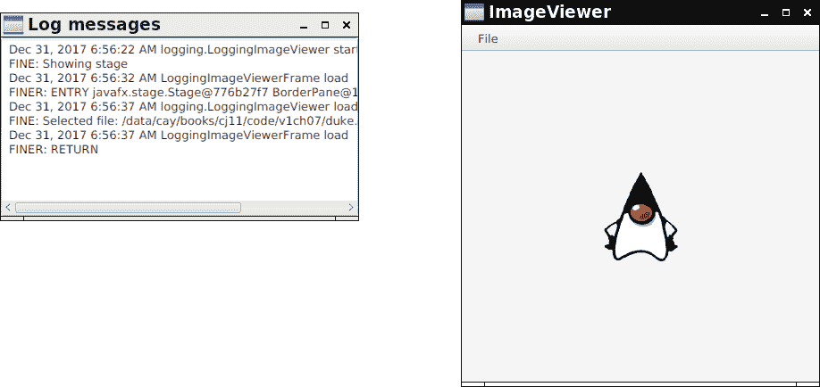

### 图 7.2 在窗口中显示记录的日志处理器

该处理器扩展了`StreamHandler`类并安装了一个流，其`write`方法在文本区域中显示流输出。

点击此处查看代码图像

```java
class WindowHandler extends StreamHandler
{
   public WindowHandler()
   {
      . . .
      var output = new JTextArea();
      setOutputStream(new
         OutputStream()
         {
            public void write(int b) {} // 不被调用
            public void write(byte[] b, int off, int len)
            {
               output.append(new String(b, off, len));
            }
         });
   }
   . . .
}
```

这种方法只有一个问题——处理器缓存了记录，仅在缓冲区满时才将它们写入流。因此，我们重写了`publish`方法在处理每条记录后刷新缓冲区：

点击此处查看代码图像

```java
class WindowHandler extends StreamHandler
{
   . . .
   public void publish(LogRecord record)
   {
      super.publish(record);
      flush();
   }
}
```

如果你想编写更奇异的流处理器，请扩展`Handler`类并定义`publish`、`flush`和`close`方法。

#### 7.5.6 过滤器

默认情况下，记录根据其日志级别进行过滤。每个日志记录器和处理器都可以有一个可选的过滤器来执行额外的过滤。要定义一个过滤器，请实现`Filter`接口并定义方法：

点击此处查看代码图像

```java
boolean isLoggable(LogRecord record)
```

使用你所需的任何标准分析日志记录，并对于应该包含在日志中的记录返回`true`。例如，特定的过滤器可能只对`entering`和`exiting`方法生成的消息感兴趣。过滤器应调用`record.getMessage()`并检查它是否以`ENTRY`或`RETURN`开头。

要将过滤器安装到日志记录器或处理器中，只需调用`setFilter`方法。注意，你一次最多只能有一个过滤器。

#### 7.5.7 格式化器

`ConsoleHandler`和`FileHandler`类以文本和 XML 格式输出日志记录。然而，你也可以定义自己的格式。你需要扩展`Formatter`类并重写该方法：

点击此处查看代码图像

```java
String format(LogRecord record)
```

以你喜欢的任何方式格式化记录中的信息并返回字符串。在你的`format`方法中，你可能想要调用：

点击此处查看代码图像

```java
String format(LogRecord record)
```

该方法格式化记录中的消息部分。许多格式（如 XML）需要头部和结尾。为了实现这一点，你需要调用：

```java
String getHead(Handler h)
String getTail(Handler h)
```

最后，调用`setFormatter`将处理器。

#### 7.5.8 日志配方

日志选项有很多，很容易丢失基本知识。以下配方总结了最常用的操作。

1. 对于简单的应用程序，选择一个日志记录器。一个好主意是将日志记录器的命名与你的主包相同，例如`com.company.prog`。你可以通过调用获取日志记录器：

   点击此处查看代码图像

   ```java
   Logger logger = Logger.getLogger("com.company.prog");
   ```

   对于日志活动大量的类，你可能希望添加静态字段：

   点击此处查看代码图像

   ```java
   private static final Logger logger = Logger.getLogger("com.company.prog");
   ```

2. 默认配置会将`INFO`及以上的消息输出到控制台。用户可以覆盖默认配置，但正如你所见，这个过程有点复杂。因此，在你的应用程序中安装更合理的默认设置。以下代码确保所有消息都记录到特定的文件中。将这些代码放在应用程序的`main`方法中：

   点击此处查看代码图像

   ```java
   if (System.getProperty("java.util.logging.config.class") == null
         && System.getProperty("java.util.logging.config.file") == null)
   {
      try
         {
         Logger.getLogger("").setLevel(Level.ALL);
         final int LOG_ROTATION_COUNT = 10;
         var handler = new FileHandler("%h/myapp.log", 0, LOG_ROTATION_COUNT);
         Logger.getLogger("").addHandler(handler);
         }
      catch (IOException e)
         {
         logger.log(Level.SEVERE, "无法创建日志文件处理器", e);
         }
   }
   ```

3. 现在你可以尽情记录日志了。记住，所有级别为`INFO`、`WARNING`和`SEVERE`的消息都会显示在控制台上。因此，将这些级别留给对程序用户有意义的消息。`FINE`级别是记录面向程序员消息的良好选择。

   ```java
   try
   {
      . . .
   }
   catch (SomeException e)
   {
      logger.log(Level.FINE, "explanation", e);
   }
   ```

列表 7.2 以增加了一个新技巧的方式使用了此配方：日志消息也会显示在日志窗口中。

**列表 7.2** `logging/LoggingImageViewer.java`

点击此处查看代码图像


```java
package logging;

import java.awt.*;
import java.awt.event.*;
import java.io.*;
import java.util.logging.*;
import javax.swing.*;

/**
 * 图像查看器程序的修改版，用于记录各种事件。
 * @version 1.03 2015-08-20
 * @author Cay Horstmann
 */
public class LoggingImageViewer
{
   public static void main(String[] args)
   {
      if (System.getProperty("java.util.logging.config.class") == null
            && System.getProperty("java.util.logging.config.file") == null)
      {
          try
          {
             Logger.getLogger("com.horstmann.corejava").setLevel(Level.ALL);
             final int LOG_ROTATION_COUNT = 10;
             var handler = new FileHandler("%h/LoggingImageViewer.log", 0, LOG_ROTATION_COUNT);
             Logger.getLogger("com.horstmann.corejava").addHandler(handler);
          }
          catch (IOException e)
          {
             Logger.getLogger("com.horstmann.corejava").log(Level.SEVERE,
                "Can't create log file handler", e);
          }
       }

       EventQueue.invokeLater(() ->
          {
             var windowHandler = new WindowHandler();
             windowHandler.setLevel(Level.ALL);
             Logger.getLogger("com.horstmann.corejava").addHandler(windowHandler);

             var frame = new ImageViewerFrame();
             frame.setTitle("LoggingImageViewer");
             frame.setDefaultCloseOperation(JFrame.EXIT_ON_CLOSE);

             Logger.getLogger("com.horstmann.corejava").fine("Showing frame");
             frame.setVisible(true);
          });
   }
}

/**
 * 显示图像的帧。
 */
class ImageViewerFrame extends JFrame
{
   private static final int DEFAULT_WIDTH = 300;
   private static final int DEFAULT_HEIGHT = 400;

   private JLabel label;
   private static Logger logger = Logger.getLogger("com.horstmann.corejava");

   public ImageViewerFrame()
   {
      logger.entering("ImageViewerFrame", "<init>");
      setSize(DEFAULT_WIDTH, DEFAULT_HEIGHT);

      // 设置菜单栏
      var menuBar = new JMenuBar();
      setJMenuBar(menuBar);

      var menu = new JMenu("File");
      menuBar.add(menu);

      var openItem = new JMenuItem("Open");
      menu.add(openItem);
      openItem.addActionListener(new FileOpenListener());

      var exitItem = new JMenuItem("Exit");
      menu.add(exitItem);
      exitItem.addActionListener(new ActionListener()
         {
            public void actionPerformed(ActionEvent event)
            {
               logger.fine("Exiting.");
               System.exit(0);
            }
         });

      // 使用标签显示图像
      label = new JLabel();
      add(label);
      logger.exiting("ImageViewerFrame", "<init>");
   }

   private class FileOpenListener implements ActionListener
   {
      public void actionPerformed(ActionEvent event)
      {
         logger.entering("ImageViewerFrame.FileOpenListener", "actionPerformed", event);

         // 设置文件选择器
         var chooser = new JFileChooser();
         chooser.setCurrentDirectory(new File("."));

         // 接受所有以 .gif 结尾的文件
         chooser.setFileFilter(new javax.swing.filechooser.FileFilter()
            {
               public boolean accept(File f)
               {
                  return f.getName().toLowerCase().endsWith(".gif") || f.isDirectory();
               }

               public String getDescription()
               {
                  return "GIF";
               }
            });

         // 显示文件选择器
         int r = chooser.showDialog(this);

         // 如果接受，则设置图像
         if (r == JFileChooser.OK_OPTION) {
             String name = chooser.getSelectedFile().getPath();
             logger.log(Level.INFO, "Opened {0}", name);
         }
         else {
             logger.log(Level.WARNING, "File canceled.");
         }
     }
 }

/**
 * 在窗口显示记录的处理器。
 */
class WindowHandler extends StreamHandler
{
   private JFrame frame;
   private JTextArea output;

   public WindowHandler()
   {
       frame = new JFrame();
       output = new JTextArea();
       output.setEditable(false);
       frame.add(new JScrollPane(output));
       frame.setTitle("Log Viewer");
       frame.setSize(400, 300);
       frame.setDefaultCloseOperation(JFrame.EXIT_ON_CLOSE);
       frame.setVisible(true);
   }

   @Override
   protected void publish(LogRecord record)
   {
      if (!isLoggable(record)) return;
      String msg = getFormatter().format(record);
      output.append(msg + "\n");
      flush();
   }
}
```

*(注：由于提供的文本在 95-171 行之间存在文本错乱和重复，我已根据文档工程师的逻辑对内容进行了修复和重组。)*

## `java.util.logging.Logger` 1.4

- `getLogger(String loggerName)`
- `getLogger(String loggerName, String bundleName)`

  获取指定名称的记录器。如果不存在则创建它。本地化消息位于名为`bundleName`的资源包中。

- `severe(String message)`
- `warning(String message)`
- `info(String message)`
- `config(String message)`
- `fine(String message)`
- `finer(String message)`
- `finest(String message)`

  根据方法名和给定的消息记录。

- `entering(String className, String methodName)`
- `entering(String className, String methodName, Object param)`
- `entering(String className, String methodName, Object[] param)`
- `exiting(String className, String methodName)`
- `exiting(String className, String methodName, Object result)`

  记录进入或退出方法，并带有指定的参数或返回值。

- `throwing(String className, String methodName, Throwable t)`

  记录抛出指定的异常对象。

- `log(Level level, String message)`
- `log(Level level, String message, Object obj)`
- `log(Level level, String message, Object[] objs)`
- `log(Level level, String message, Throwable t)`

  使用指定的级别和消息记录记录，可选包含对象或异常。要包含对象，消息必须包含格式位符（`{0}`、`{1}` 等）。

- `logp(Level level, String className, String methodName, String message)`
- `logp(Level level, String className, String methodName, String message, Object obj)`
- `logp(Level level, String className, String methodName, String message, Object[] objs)`
- `logp(Level level, String className, String methodName, String message, Throwable t)`

  使用指定的级别、精确的调用者信息和消息记录，可选包含对象或异常。

- `void logrb(Level level, String className, String methodName, ResourceBundle bundle, String message, Object... params)` 9
- `void logrb(Level level, String className, String methodName, ResourceBundle bundle, String message, Throwable thrown)` 9

  使用给定的级别、精确的调用者信息、资源包和消息记录一条记录，随后跟上对象或一个 throwable。

- `Level getLevel()`
- `void setLevel(Level l)`

  获取和设置此日志器的级别。

- `Logger getParent()`
- `void setParent(Logger l)`

  获取和设置此日志器的父级日志器。

- `Handler[] getHandlers()`

  获取此日志器所有的处理器。

- `void addHandler(Handler h)`
- `void removeHandler(Handler h)`

  为此日志器添加或移除一个处理器。

- `boolean getUseParentHandlers()`
- `void setUseParentHandlers(boolean b)`

  获取和设置“使用父级处理器”属性。如果该属性为`true`，则日志器将所有日志记录转发给其父级器的处理器。

- `Filter getFilter()`
- `void setFilter(Filter f)`

  获取和设置此日志器的过滤器。

## `java.util.logging.Handler` 1.4

- `abstract void publish(LogRecord record)`

  将记录发送到目标地。

- `abstract void flush()`

  刷新任何缓冲区数据。

- `abstract void close()`

  刷新任何缓冲区数据并释放所有关联的资源。

- `Filter getFilter()`
- `void setFilter(Filter f)`

  获取和设置此处理器的过滤器。

- `Formatter getFormatter()`
- `void setFormatter(Formatter f)`

  获取和设置此处理器的格式化器。

- `Level getLevel()`
- `void setLevel(Level l)`

  获取和设置此处理器的级别。

## `java.util.logging.ConsoleHandler` 1.4

- `ConsoleHandler()`

  构造一个新的控制台处理器。

## `java.util.logging.FileHandler` 1.4

- `FileHandler(String pattern)`
- `FileHandler(String pattern, boolean append)`
- `FileHandler(String pattern, int limit, int count)`
- `FileHandler(String pattern, int limit, int count, boolean append)`


### `java.util.logging.FileHandler` 1.4

*   `FileHandler(String pattern, long limit, int count, boolean append)` 9

    构造一个文件处理器。模式格式请参见表 7.2。`limit` 是打开新日志文件之前近似的最大字节数。`count` 是轮换序列中的文件数量。如果 `append` 为 `true`，则记录应追加到现有的日志文件中。

### `java.util.logging.LogRecord` 1.4

*   `Level getLevel()`

    获取此记录的日志级别。

*   `String getLoggerName()`

    获取记录此记录的日志器名称。

*   `ResourceBundle getResourceBundle()`

*   `String getResourceBundleName()`

    获取用于消息本地化的资源包或其名称，如果未提供则返回 `null`。

*   `String getMessage()`

    获取本地化或格式化之前的“原始”消息。

*   `Object[] getParameters()`

    获取参数对象，如果未提供则返回 `null`。

*   `Throwable getThrown()`

    获取抛出的对象，如果未提供则返回 `null`。

*   `String getSourceClassName()`

*   `String getSourceMethodName()`

    获取记录此记录的代码位置。此信息可能由日志代码提供，也可以从运行时堆栈自动推断。如果日志代码提供了错误的值或运行代码经过优化导致无法推断精确位置，则可能是不准确的。

*   `long getMillis()`

    获取创建时间，自 1970 年以来来的毫秒数。

*   `Instant getInstant()` 9

    作为 `java.time.Instant` 获取创建时间（参见卷二的第 6 章）。

*   `long getSequenceNumber()`

    获取此记录的唯一序列号。

*   `long getLongThreadID()` 16

    获取创建此记录的线程的唯一 ID。这些 ID 由 `LogRecord` 类分配，与其他线程 ID 无关系。`getThreadID` 方法返回 `int` 类型的 ID。现在已弃用，因为长时间运行的可能会生成超过 `Integer.MAX_VALUE` 个日志记录。

### `java.util.logging.LogManager` 1.4

*   `static LogManager getLogManager()`

    获取全局 `LogManager` 实例。

*   `void readConfiguration()`

*   `void readConfiguration(InputStream in)`

    从系统属性 `java.util.logging.config.file` 指定的文件或给定的输入流读取日志配置。

*   `void updateConfiguration(InputStream in, Function<String,BiFunction<String,String,String>> mapper)` 9

*   `void updateConfiguration(Function<String,BiFunction<String,String,String>> mapper)` 9

    使用映射器合并日志配置。

### `java.util.logging.Filter` 1.4

*   `boolean isLoggable(LogRecord record)`

    如果给定的日志记录应该被记录，则返回 `true`。

### `java.util.logging.Formatter` 1.4

*   `abstract String format(LogRecord record)`

    返回格式化日志记录后生成的字符串。

*   `String getHead(Handler h)`

*   `String getTail(Handler h)`

    返回应出现在包含日志记录文档头部和尾部的字符串。`Formatter` 父类定义了这些方法并返回空字符串；如有必要请重写它们。

*   `String formatMessage(LogRecord record)`

    返回日志记录中本地化并格式化的消息部分。

创建几个对象，调用所有方法，并检查每一个是否都按预期工作。你可以保留所有的 `main` 方法，并分别在每个文件上启动 Java 虚拟机来运行测试。当你运行一个小程序（applet）时，这些 `main` 方法永远不会被调用。当你运行一个应用程序时，Java 虚拟机只会调用启动类的 `main` 方法。

3. 如果你喜欢上面的提示，应该检查一下来自 [`http://junit.org`](http://junit.org) 的 JUnit。JUnit 是一个非常流行的单元测试框架，可以让你轻松地组织测试用例集。每当你修改类时都运行测试，每当你发现 bug 时就添加另一个测试用例。

4. `日志代理`（logging proxy）是子类的一个对象，它会拦截方法调用、对其进行记录，然后调用父类。例如，如果你在 `Random` 类的 `nextDouble` 方法上遇到问题，可以创建一个匿名子类的实例作为代理对象：

```
var generator = new Random()
   {
      public double nextDouble()
      {
         double result = super.nextDouble();
         Logger.getGlobal().info("nextDouble: " + result);
         return result;
      }
   };
```

每当 `nextDouble` 方法被调用时，就会生成一条日志消息。

要找出是谁调用了该方法，请生成堆栈跟踪（stack trace）。

5. 你可以通过 `Throwable` 类中的 `printStackTrace` 方法从任何异常对象获取堆栈跟踪。以下代码捕获任何异常，打印异常对象和堆栈跟踪，并重新抛出异常以便其找到预期的处理器。

```
try
{
   . . .
}
catch (Throwable t)
{
   t.printStackTrace();
   throw t;
}
```

你甚至不需要捕获异常即可生成堆栈跟踪。只需在代码任何地方插入语句

```
Thread.dumpStack();
```

即可获取堆栈跟踪。

6. 通常，堆栈跟踪显示在 `System.err.` 上。如果你想记录或显示堆栈跟踪，可以这样将其捕获字符串中：

```
var out = new StringWriter();
new Throwable().printStackTrace(new PrintWriter(out));
String description = out.toString();
```

7. 将程序错误记录到文件中通常很有用。然而，错误被发送到 `System.err` 而不是 `System.out`。因此，你不能简单地通过运行来捕获它们

```
java MyProgram > errors.txt
```

相反，应将错误流捕获为：

```
java MyProgram 2> errors.txt
```

要在同一个文件中捕获 `System.err` 和 `System.out`，请使用

```
java MyProgram 1> errors.txt 2>&1
```

这在 `bash` 和 Windows 命令行均有效。

8. 让未捕获异常的堆栈跟踪出现在 `System.err` 中并不是理想的。如果用户看到这些消息，会感到困惑，而且在你需要进行诊断时这些信息并可用。更好的方法是将它们记录到文件中。你可以通过 `Thread.setDefaultUncaughtHandler` 方法更改未捕获异常的处理器：

```
Thread.setDefaultUncaughtHandler(new Thread.UncaughtHandler()
   {
      public void uncaughtException(Thread t, Throwable e)
      {
         // log
      });
```

9. 要观察类加载，请使用 `-verbose` 标志启动 Java 虚拟机。你将得到如下输出：

```
[12] opened: /opt/jdk-17.0/lib/modules
[0.34] loaded java.base
[0.35] loaded java.lang
[0.35] loaded java.util
[0.35] loaded java.io
[0.35] loaded java.nio
[0.36] loaded java.sql
[0.36] loaded java.awt
[0.36] loaded java.desktop
[0.37] loaded java.management
[0.37] loaded java.sql
[0.37] loaded java.net
[0.37] loaded java.security
[0.37] loaded java.text
[0.37] loaded java.util
[0.37] loaded java.xml
[0.38] loaded java.jar
[0.38] loaded java.math
[0.38] loaded java.logging
[0.38] loaded java.language
[0.38] loaded java.awt
[0.39] loaded java.image
[0.39] loaded java.desktop
[0.39] loaded java.management
[0.39] loaded java.script
[0.39] loaded java.naming
[0.39] loaded java.sql
[0.39] loaded java.security
[0.40] loaded java.util
[0.40] loaded java.xml
[0.40] loaded java.jar
[0.41] loaded java.math
[0.41] loaded java.logging
[0.41] loaded java.lang
[0.42] loaded java.awt
[0.42] loaded java.image
[0.42] loaded java.desktop
[0.42] loaded java.management
[0.43] loaded java.script
[0.43] loaded java.naming
[0.43] loaded java.sql
[0.43] loaded java.security
[0.44] loaded java.text
[0.44] loaded java.util
[0.44] loaded java.xml
[0.44] loaded java.jar
[0.45] loaded java.math
[0.45] loaded java.logging
[0.45] loaded java.lang
[0.46] loaded java.awt
[0.46] loaded java.image
[0.46] loaded java.desktop
[0.46] loaded java.management
[0.47] loaded java.script
[0.47] loaded java.naming
[0.47] loaded java.sql
[0.47] loaded java.security
[0.48] loaded java.text
[0.48] loaded java.util
[0.48] loaded java.xml
[0.48] loaded java.jar
[0.49] loaded java.math
[0.49] loaded java.logging
[0.49] loaded java.lang
[0.50] loaded java.awt
[0.50] loaded java.image
[0.50] loaded java.desktop
[0.50] loaded java.management
[0.51] loaded java.script
[0.51] loaded java.naming
[0.51] loaded java.sql
[0.51] loaded java.security
[0.52] loaded java.text
[0.52] loaded java.util
[0.52] loaded java.xml
[0.52] loaded java.jar
[0.53] loaded java.math
[0.53] loaded java.logging
[0.53] loaded java.lang
[0.54] loaded java.awt
[0.54] loaded java.image
[0.54] loaded java.desktop
[0.54] loaded java.management
[0.55] loaded java.script
[0.55] loaded java.naming
[0.55] loaded java.sql
[0.55] loaded java.security
[0.56] loaded java.text
[0.56] loaded java.util
[0.56] loaded java.xml
[0.56] loaded java.jar
[0.57] loaded java.math
[0.57] loaded java..
[0.57] loaded java.lang
[0.58] loaded java.awt
[0.58] loaded java.image
[0.58] loaded java.desktop
[0.58] loaded java.management
[0.59] loaded java.script
[0.59] loaded java.naming
[0.59] loaded java.sql
[0.59] loaded java.security
[0.60] loaded java.text
[0.60] loaded java.util
[0.60] loaded java.xml
[0.60] loaded java.jar
[0.61] loaded java.math
[0.61] loaded java.logging
[0.61] loaded java.lang
[0.62] loaded java.awt
[0.62] loaded java.image
[0.62] loaded java.desktop
[0.62] loaded java.management
[0.63] loaded java.script
[0.63] loaded java.naming
[0.63] loaded java.sql
[0.63] loaded java.security
[0.64] loaded java.text
[0.64] loaded java.util
[0.64] loaded java.xml
[0.64] loaded java.jar
[0.65] loaded java.math
[0.65] loaded java.logging
[0.65] loaded java.lang
[0.66] loaded java.awt
[0.66] loaded java.image
[0.66] loaded java.desktop
[0.66] loaded java.management
[0.67] loaded java.script
[0.67] loaded java.naming
[0.67] loaded java.sql
[0.67] loaded java.security
[0.68] loaded java.text
[0.68] loaded java.util
[0.68] loaded java.xml
[0.68] loaded java.jar
[0.69] loaded java.math
[0.69] loaded java.logging
[0.69] loaded java.lang
[0.70] loaded java.awt
[0.70] loaded java.image
[0.70] loaded java.desktop
[0.70] loaded java.management
[0.71] loaded java.script
[0.71] loaded java.naming
[0.71] loaded java.sql
[0.71] loaded java.security

10. `-Xlint` 选项告诉编译器发现常见问题。例如，如果你使用以下命令编译：

```
javac -Xlint sourceFiles
```

编译器将报告 `switch` 语句中缺少 `break` 语句。（术语“lint”最初描述用于定位 C 程序中潜在问题的工具，现在泛指任何标记可疑构造的工具。）

你将得到如下消息：

```
warning: [fallthrough] possible fall-through into case
```

方括号中的字符串标识警告类别。你可以启用和禁用每个类别。由于大多数类别都非常有用，最好的方法是保留所有类别并仅禁用你不在乎的，如下所示：

```
javac -Xlint:all,-fallthrough,-serial sourceFiles
```


你可以通过以下命令获取所有警告列表：

```
javac --help -X
```

12. Java Mission Control 是一种专业的性能分析和诊断工具，可以在`https://adoptopenjdk.net/jmc.html`获取。与`jconsole`一样，Java Mission Control 可以附加到正在运行的虚拟机。它还可以分析来自 Java Flight Recorder 的输出，该工具用于从运行的 Java 程序收集诊断和性能分析数据。请访问`https://github.com/thegreystone/jmc-tutorial`查看完整的教程。

本章向你介绍了异常处理和日志记录。你还看到了关于测试和调试的有用提示。接下来的两个章节将介绍泛型编程及其最重要的应用：Java 集合框架。

# 第 8 章

## 泛型编程

### 本章

* 8.1 为什么需要泛型编程？
* 8.2 定义一个简单的泛型类
* 8.3 泛型方法
* 8.4 类型变量的边界
* 8.5 泛型代码与虚拟机
* 8.6 限制与局限性
* 8.7 泛型类型的继承规则
* 8.8 通配符类型
* 8.9 反射与泛型

泛型类和方法拥有类型参数。这使得它们能够精确地描述当用特定类型实例化时应该发生什么。在泛型类出现之前，程序员必须使用`Object`来编写可以与多种类型工作的代码。这既繁琐又不安全。

随着泛型的引入，Java 拥有了富有表现力的类型系统，允许设计者详细描述变量和方法的类型应该如何变化。在简单直接的情况下，你会发现实现泛型代码非常简单。在更高级的情况下，对于实现者来说，它可能会变得非常复杂。目标是提供其他程序员可以使用而不会产生意外的类和方法。

Java 5 泛型的引入构成了 Java 编程语言自发布以来最重大的变化。一个主要的设计目标是与早期版本兼容。因此，Java 泛型具有一些不方便的局限性。你将在本章中学习泛型编程的益处和挑战。

### 8.1 为什么需要泛型编程？

泛型编程意味着编写可以用于许多不同类型对象的复用代码。例如，你不想编写单独的类来收集`String`和`File`对象。而且你不需要那样做——单个`ArrayList`类就可以收集任何类的对象。这就是泛型编程的一个例子。

实际上，Java 在拥有泛型类之前就已经有一个`ArrayList`类了。让我们研究一下泛型编程机制是如何演变的，以及这对于用户和实现者意味着什么。

#### 8.1.1 类型参数的优势

在泛型类添加到 Java 之前，泛型编程是通过继承实现的。`ArrayList`类简单地维护了一个`Object`引用数组：

```
public class ArrayList // 泛型类之前
{
   private Object[] elementData;
   . . .
   public Object get(int i) { . . . }
   public void add(Object o) { . . . }
}
```

这种方法有两个问题。每当你检索一个值时，都需要进行强制转换：

```
ArrayList files = new ArrayList();
. . .
String filename = (String) files.get(0);
```

此外，没有错误检查。你可以添加任何类的值：

```
files.add(new File(". . ."));
```

此调用可以通过编译并运行而不会报错。在其他地方，将`get`的结果强制转换为`String`将导致错误。

泛型提供了一个更好的解决方案：类型参数。`ArrayList`类现在有一个类型参数来指示元素类型：

```
var files = new ArrayList<String>();
```

这使得你的代码更易于阅读。你可以立即看出这个特定的列表包含`String`对象。

 Note

如果你使用显式类型而不是`var`声明变量，可以使用“菱形”语法在构造函数中省略类型参数：

```
ArrayList<String> files = new ArrayList<>();
```

省略的类型是从变量的类型推断出来的。

Java 9 将菱形语法的使用扩展到了以前不被接受的情况。例如，你现在可以在匿名子类中使用菱形了：

```
ArrayList<String> passwords = new ArrayList<>() // Java 9 中允许使用菱形
   {
      public String get(int n) { return super.get(n).replaceAll(".", "*"); }
   };
```

编译器可以很好地利用类型信息。调用`get`不需要强制转换。编译器知道返回类型是`String`：

```
String filename = files.get(0);
```

编译器还知道`ArrayList<String>`的`add`方法参数是`String`。现在编译器可以检查你是否插入了错误的类型。例如，语句

```
files.add(new File(". . .")); // 只能向 ArrayList<String> 添加 String
```

将编译。这比类型转换异常好得多。

#### 8.1.2 谁想成为泛型编程专家？

使用像`ArrayList`这样的泛型类很容易。大多数 Java 程序员会像使用`String[]`数组一样直接使用`ArrayList<String>`。（当然，列表比数组更好，因为它们可以自动扩展。）

然而，实现一个泛型类并不容易。使用你代码的程序员想要为你的类型参数接入各种类。他们期望在没有苛刻限制和困惑错误信息的情况下一切运行。因此，作为泛型编程专家，你的工作是预测该类的所有潜在用途。

这有多难？这里有一个类库设计者必须解决的典型问题。`ArrayList`类有一个`addAll`方法用于添加另一个集合的所有元素。程序员可能想将`ArrayList<Manager>`的所有元素添加到`ArrayList<Employee>`中。但当然，反过来操作是不合法的。你如何允许一种调用而禁止另一种？Java 语言设计者发明了一种巧妙的新概念——通配符类型，来解决这个问题。通配符类型相当抽象，但它们允许库构建者使方法尽可能灵活。

泛型编程分为三个技能水平。在基础水平，你只是使用泛型类——通常是如`ArrayList`等集合——而不思考它们是如何以及为什么工作的。大多数应用程序程序员会一直在这个水平，直到出现问题。但是，在混合不同的泛型类或与不知道类型参数的遗留代码交互时，你可能会遇到困惑的错误信息；到那时，你需要学习足够的 Java 泛型知识，以系统的方法解决问题，而不是通过随机尝试。最后，当然，你可能想实现自己的泛型类和方法。

应用程序开发人员可能不会编写大量的泛型代码。JDK 开发者已经完成了最繁重的工作，并为所有集合类提供了类型参数。按照常理，只有那些传统上涉及大量从非常通用类型（如`Object`或`Comparable`接口）进行类型转换的代码，才能从使用类型参数中获益。

在本章中，我将向你展示实现自己的泛型代码所需的所有知识。然而，我预计大多数读者使用这些知识的主要目的是为了帮助排除故障，并满足对参数化集合类内部工作机制的好奇。

### 8.2 定义一个简单的泛型类

`泛型类`是一个有一个或多个类型变量的类。在本章中，使用一个简单的`Pair`类作为示例。这个类允许我们专注于泛型，而不会被数据存储细节分散。以下是泛型`Pair`类的代码：

```
public class Pair<T>
{
   private T first;
   private T second;

   public Pair() { first = null; second = null; }
   public Pair(T first, T second) { this.first = first; this.second = second; }

   public T getFirst() { return first; }
   public T getSecond() { return second; }

   public void setFirst(T newValue) { first = newValue; }
   public void setSecond(T newValue) { second = newValue; }
}
```

`Pair`类在类名后引入了一个括在角括号`< >`中的类型变量`T`。泛型类可以有多个类型变量。例如，我们可以为第一个和第二个字段使用不同的类型来定义`Pair`类：

```
public class Pair<T, U> { . . . }
```

类型变量贯穿于整个类定义中，用于指定方法的返回类型以及字段和局部变量的类型。例如：

```
private T first; // 使用了类型变量
```

 注意

使用大写字母作为类型变量并保持简短是常见做法。Java 库使用变量`E`表示集合的元素类型，`K`和`V`表示表格的键和值类型，`T`（如有必要还有相邻的字母`U`和`S`）表示“任何类型”。

你通过为类型变量替换具体的类型来`实例化`泛型类型，例如：

```
Pair<String>
```

你可以将结果认为是一个具有构造函数的普通类：

```
Pair<String>()
Pair<String>(String, String)
```

以及方法

```
String getFirst()
String getSecond()
void setFirst(String)
void setSecond(String)
```

换句话说，泛型类充当了普通类的工厂。

Listing 8.1 中的程序让`Pair`类运行了起来。静态方法`minmax`遍历数组并同时计算最小值和最大值。它使用`Pair`对象来返回这两个结果。回想`compareTo`方法比较两个字符串，如果字符串相同则返回`0`；如果第一个字符串在字典顺序上于第二个字符串之前，则返回负整数；否则返回正整数。

 C++ 注意

表面上看，Java 中的泛型类与 C++ 中的模板类相似。唯一的明显区别是 Java 没有特殊的`template`关键字。然而，正如你将在整个章节中看到的，这两种机制之间存在显著差异。

**Listing 8.1** `pair1/PairTest1.java`

```
 1 package pair1;
 2
 3 /**
 4  * @version 1.01 2012-01-26
 5  * @author Cay Horstmann
 6  */
 7 public class PairTest1
 8 {
 9    public static void main(String[] args)
10    {
11       String[] words = { "Mary", "had", "a", "little", "lamb" };
12       Pair<String> mm = ArrayAlg.minmax(words);
13       System.out.println("min = " + mm.getFirst());
14       System.out.println("max = " + mm.getSecond());
15    }
16 }
17
18 class ArrayAlg
19 {
20    /**
21     * 获取字符串数组的最小值和最大值。
22     * @param a 一个字符串数组
23     * @return 一个包含最小和最大值的对，如果 a 为空或长度为空则返回 null
24     */
25    public static Pair<String> minmax(String[] a)
26    {
27       if (a == null || a.length == 0) return null;
28       String min = a[0];
29       String max = a[0];
30       for (int i = 1; i < a.length; i++)
31          if (a[i].compareTo(min) < 0) min = a[i];
32          if (a[i].compareTo(max) > 0) max = a[i];
33      }
34       return new Pair<>(min, max);
35    }
36 }
```

## 8.3 泛型方法

在上一节中，你已经看到了如何定义一个泛型类。你也可以定义带有类型参数的方法。当你调用泛型方法时，可以将实际类型（括在角括号中）放在方法名之前：

```
ArrayAlg.<String>minmax(words);
```

在大多数情况下，你可以从方法调用中省略`<String>`。编译器有足够的信息来推断你需要的类型。

```
String mm = ArrayAlg.minmax(words);
```

在几乎所有情况下，泛型方法的类型推断都运行良好。偶尔，编译器会出错，你需要解读错误报告。考虑这个例子：

```
double middle = ArrayAlg.minmax(3.14, 1729, 0);
```

错误信息会以随编译器版本而异的晦涩术语抱怨，这段代码有两种解释方式，且都是有效的。简而言之，编译器将参数装箱为`Double`和两个`Integer`对象，然后尝试找到它们的共同父类型。它实际上找到了两个：`Number`和`Comparable`接口，后者本身就是一个泛型类型。在这种情况下，补救措施是将所有参数写成`double`值。

Peter von Ahé 建议如果你想查看编译器为泛型调用推断出什么类型，可以使用这个技巧：故意引入一个错误并研究生成的错误信息。例如，考虑调用`ArrayAlg.minmax("Hello", 0, null)`。将结果赋值给`JButton`，这显然是不正确的。你会得到错误报告：

```
found:
java.lang.Object&java.io.Serializable&java.lang.Comparable<? extends
java.lang.Object&java.io.Serializable&java.lang.Comparable<?>>
```

用通俗的话说，可以将结果赋值给`Object`、`Serializable`或`Comparable`。

在 C++ 中，你将类型参数放在方法名之后。这可能会导致糟糕的解析歧义。例如，`g(f<a,b>(c))`可以表示“调用`g`并传入`f<a,b>(c)`的结果”，也可以表示“调用`g`并传入两个布尔值`f<a`和`b>(c)`”。

### 8.4 类型变量的边界

有时，类或方法需要对类型变量进行限制。这是一个典型的例子。我们想要计算数组中的最小元素：

```
class ArrayAlg
{
   public static <T> T min(T[] a) // 几乎正确
   {
      if (a == null || a.length == 0) return null;
      T smallest = a[0];
      for (int i = 1; i < a.length; i++)
         if (smallest.compareTo(a[i]) > 0) smallest = a[i];
      return smallest;
   }
}
```

但存在一个问题。观察`min`方法内部的代码。变量`smallest`的类型为`T`，这意味着它可以是任意类的对象。我们如何知道`T`所属的类具有`compareTo`方法呢？

解决方案是将`T`限制为一个实现了`Comparable`接口的类——这是一个包含单个方法`compareTo`的标准接口。你可以通过为类型变量`T`设定一个*边界*（bound）来实现这一点：

```
public static <T extends Comparable> T min(T[] a) . . .
```

实际上，`Comparable`接口本身就是一个泛型类型。目前，请忽略该复杂性以及编译器生成的警告。第 475 页的第 8.8 节“通配符类型”讨论了如何正确配合`Comparable`接口使用类型参数。

现在，泛型`min`方法只能用于实现了`Comparable`接口的类的数组，例如`String`、`LocalDate`等。使用`Rectangle`数组调用`min`将导致编译时错误，因为`Rectangle`类没有实现`Comparable`。

 C++ 注意

在 C++ 中，你无法限制模板参数的类型。如果程序员用不适当的类型实例化模板，模板代码内部会报告一个（通常是晦涩的）错误信息。

你可能会好奇为什么在这种情况下我使用`extends`关键字而不是`implements`关键字——毕竟，`Comparable`是一个接口。这种表示法：

```
<T extends BoundingType>
```


表示 `T` 应该是边界类型的子类型。`T` 和边界类型都可以是类，也可以是接口。选择 `extends` 关键字是因为它是子类型概念的合理近似，而且 Java 的设计者不想向语言中添加新的关键字（如 `sub`）。

类型变量或通配符可以有多个边界。例如：

点击此处查看代码图片

```java
T extends Comparable & Serializable
```

边界类型之间用和符号（`&`）分隔，因为逗号被用于分隔类型变量。

与 Java 继承一样，你可以拥有任意数量的接口父类型，但边界中最多只能有一个是类。如果你有一个类作为边界，它必须是边界列表中的第一个。

在下一个示例程序（Listing 8.2）中，我们重写了 `minmax` 方法使其变为泛型。该方法计算泛型数组的最小和值，返回一个 `Pair<T>`。

**Listing 8.2** `pair2/PairTest2.java`

点击此处查看代码图片

```java
 1 package pair2;

 2

 3 import java.time.*;

 4

 5 /**

 6  * @version 1.02 2015-06-21

 7  * @author Cay Horstmann

 8  */

 9 public class PairTest2

10 {

11    public static void main(String[] args)

12    {

13       LocalDate[] birthdays =

14          {

15             LocalDate.of(1906, 12, 9), // G. Hopper

16             LocalDate.of(1815, 12, 10), // A. Lovelace

17             LocalDate.of(1903, 12, 3), // J. von Neumann

18             LocalDate.of(1910, 6, 22), // K. Zuse

19          };

20       Pair<LocalDate> mm = ArrayAlg.minmax(birthdays);

21       System.out.println("min = " + mm.getFirst());

22       System.out.println("max = " + mm.getSecond());

23    }

24 }

25

26 class ArrayAlg

27 {

28    /**

29      获取类型为 T 的对象数组的最小值和值。

30      @param a 类型为 T 的对象数组

31      @return 包含最小和最大值的对，如果 a 为空或为空则返回 null

32    */

33    public static <T extends Comparable> Pair<T> minmax(T[] a)

34    {

35       if (a == null || a.length == 0) return null;

36       T smallest = a[0];

37       for (int i = 1; i < a.length; i++)

38          if (smallest.compareTo(a[i]) > 0) smallest = a[i];

39       return smallest;

40    }

41 }

```

## 8.5 泛型代码与虚拟机

### 8.5.1 类型擦除

每当你定义一个泛型类型，就会有一个对应的原始类型。在接下来的章节中，我们将看到编译器如何擦除类型参数以及该过程。

由于 `T` 是一个无边界类型变量，它被简单替换为 `Object`。例如，`Pair<T>` 的原始类型如下：

点击此处查看代码图片

```java
public class Pair

{

   private Object first;

   private Object second;

   public Pair(Object first, Object second)

   {

      this.first = first;

      this.second = second;

   }

   public Object getFirst() { return first; }

   public Object getSecond() { return second; }

   public void setFirst(Object first) { first = first; }

   public void setSecond(Object second) { second = second; }

}
```

你的程序可能包含不同类型的 `Pair`，如 `Pair<String>` 或 `Pair<LocalDate>`，但擦除将它们都转换为原始 `Pair` 类型。在这一点上，Java 泛型与 C++ 模板大不同。C++ 为每个模板实例化产生不同的类型——这种现象被称为“模板膨胀”。Java 不受此问题影响。

原始类型将类型变量替换为第一个边界，如果没有给出边界则替换为 `Object`。假设我们声明一个略有不同的类型：

点击此处查看代码图片

```java
public class Interval<T extends Comparable & Serializable> implements Serializable

{

   private T lower;

   private T upper;

   . . .

   public Interval(T first, T second)

   {

      if (first.compareTo(second) <= 0) { lower = first; upper = second; }

      else { lower = second; upper = first; }

   }

}
```

原始类型 `Interval` 看起来是：

```java
public class Interval implements Serializable

{

   private Comparable lower;

   private Comparable upper;

   . . .

   public Interval(Comparable first, Comparable second) { . . . }

}
```

 注意

你可能会好奇如果交换边界会发生什么：`class Interval<T extends Serializable & Comparable>`。在这种情况下，原始类型将 `T` 替换为 `Serializable`，编译器会在需要时插入到 `Comparable` 的强制转换。为了效率考虑，你应该将标记接口（即不包含方法的接口）放在边界列表的末尾。

### 8.5.2 翻译泛型表达式

当你编写对泛型方法的调用时，如果返回类型被擦除了，编译器会插入类型转换。例如，考虑以下语句序列：

点击此处查看代码图片

```java
Pair<Employee> buddies = . . .;

Employee buddy = buddies.getFirst();
```

`getFirst` 擦除后的返回类型为 `Object`。编译器会自动插入到 `Employee` 的类型转换。也就是说，编译器将方法调用转换为两条虚拟机指令：

- 调用原始方法 `Pair.getFirst`
- 将返回的 `Object` 强制转换为类型 `Employee`

当你访问泛型字段时，也会插入类型转换。假设 `Pair` 类的 `first` 和 `second` 字段是公有的（也许这并不是一种良好的编程风格，但在 Java 中是合法的）。那么表达式：

点击此处查看代码图片

```java
Employee buddy = buddies.first;
```

在生成的字节码中也同样插入了类型转换。

### 8.5.3 泛型方法的翻译

类型擦除也发生在泛型方法中。程序员通常将如下的泛型方法：

点击此处查看代码图片

```java
public static <T extends Comparable> T min(T[] a)
```

视为一组方法，但在擦除后，只剩下一个方法了：

点击此处查看代码图片

```java
public static Comparable min(Comparable[] a)
```

注意，类型参数 `T` 已经被擦除，只留下了它的边界类型 `Comparable`。

方法的擦除带来了一些复杂性。考虑这个例子：

点击此处查看代码图片

```java
class DateInterval extends Pair<LocalDate>

{

   public void setSecond(LocalDate second)

   {

      if (second.compareTo(getFirst()) >= 0)

         super.setSecond(second);

   }

   . . .

}
```

日期间隔（DateInterval）是一对 `LocalDate` 对象，我们希望重写方法以确保第二个值永远不会小于第一个。该类被擦除为：

点击此处查看代码图片

```java
class DateInterval extends Pair // 擦除后

{

   public void setSecond(LocalDate second) { . . . }

   . . .

}
```

令人惊讶的是，还有一个继承自 `Pair` 的 `setSecond` 方法，即：

```java
public void setSecond(Object second)
```

这显然是不同的方法，因为它具有不同类型的参数——类型是 `Object` 而不是 `LocalDate`。但它不应该是不同的。考虑以下语句序列：

点击此处查看代码图片

```java
var interval = new DateInterval(. . .);

Pair<LocalDate> pair = interval; // OK--赋值给父类

pair.setSecond(aDate);
```

我们的期望是对 `setSecond` 的调用是多态的，并调用相应的方法。由于 `pair` 指向一个 `DateInterval` 对象，那应该是 `DateInterval.setSecond`。问题在于类型擦除干扰了多态性。为了解决这个问题，编译器在 `DateInterval` 类中生成了一个桥接方法（bridge method）：

点击此处查看代码图片

```java
public void setSecond(Object second) { setSecond((LocalDate) second); }
```

为了理解为什么这样做有效，让我们仔细跟踪语句的执行：

```java
pair.setSecond(aDate)
```

变量 `pair` 的声明类型为 `Pair<LocalDate>`，该类型只有一个名为 `setSecond` 的方法，即 `setSecond(Object)`。虚拟机在 `pair` 所引的对象上调用该方法。该对象的类型是 `DateInterval`。因此，被调用的是方法 `DateInterval.setSecond(Object)`。该方法就是合成的桥接方法。它调用了 `DateInterval.setSecond(LocalDate)`，这正是我们想要的。

桥接方法可能会变得更加奇怪。假设 `DateInterval` 类还重写了 `getSecond` 方法：

点击此处查看代码图片

```java
class DateInterval extends Pair<LocalDate>

{

   public LocalDate getSecond() { return (LocalDate) super.getSecond(); }

   . . .

}
```

在 `DateInterval` 类中，有两个 `getSecond` 方法：

```text
LocalDate getSecond() // 定义在 DateInterval 中

Object getSecond() // 重写了 Pair 中定义的方法以调用第一个方法
```

你不能写这样的 Java 代码；拥有两个相同参数类型的方法是非合法的——这里没有任何参数。然而，在虚拟机中，参数类型和返回类型指定了一个方法。因此，编译器可以产生字节码。

现在考虑相反的情况，即你从一个旧类获取了一个原始类型（raw type）的对象。你可以将其赋值给一个使用泛型的类型的变量，但通常你会收到一个警告。例如：

点击此处查看代码图像

```java
Dictionary<Integer, Components> labelTable = slider.getLabelTable(); // warning
```

这没关系——检查一下警告，并确保标签表确实包含 `Integer` 和 `Component` 对象。当然，这永远没有绝对的保证。一个恶意的代码编写者可能在 `slider` 中安装了不同的 `Dictionary`。但再次强调，这种情况并不比没有泛型之前的情况更糟糕。在最坏的情况下，你的程序将抛出一个异常。

在你思索完这个警告后，你可以使用一个 `annotation`（注解）来让它消失。你可以对局部变量进行注解：

点击此处查看代码图像

```java
@SuppressWarnings("unchecked")

Dictionary<Integer, Components> labelTable = slider.getLabelTable(); // no warning
```

或者你可以对整个方法进行注解，如下所示：

点击此处查看代码图像

```java
@SuppressWarnings("unchecked")

public void configureSlider() { . . . }
```

这个 `annotation` 关闭了对方法内部所有代码的检查。

## 8.6 限制与局限性

在接下来的章节中，我将讨论在处理 Java 泛型时需要考虑的若干限制。这些限制中的大部分是类型擦除（type erasure）的结果。

### 8.6.1 类型参数不能用基本类型实例化

你不能用基本类型来替换类型参数。因此，没有 `Pair<double>`，只有 `Pair<Double>`。其原因当然是类型擦除。擦除后，`Pair` 类具有类型为 `Object` 的字段，而你不能用它们来存储 `double` 值。

这确实是一个困扰，但它与 Java 语言中基本类型的独立地位是一致的。这并不是一个致命缺陷——只有八种基本类型，当包装类型不是可以接受的替代品时，你始终可以使用单独的类和方法来处理它们。

### 8.6.2 运行时类型查询仅对原始类型有效

虚拟机中的对象始终有一个特定的非泛型类型。因此，所有的类型查询只产生原始类型。例如：

点击此处查看代码图像

```java
if (a instanceof Pair<String>) // ERROR
```

这只能测试 `a` 是否是任何类型的 `Pair`。对于以下测试也是如此：

点击此处查看代码图像

```java
if (a instanceof Pair<T>) // ERROR
```

或者类型转换：

点击此处查看代码图像

```java
Pair<String> p = (Pair<String>) a; // warning--can only test that a is a Pair
```

为了提醒你这种风险，当你尝试查询一个对象是否属于某个泛型类型时，你将得到编译器错误（使用 `instanceof`）或警告（使用强制类型转换）。

同样的，`getClass` 方法总是返回原始类型。例如：

点击此处查看代码图像

```java
Pair<String> stringPair = . . .;

Pair<Employee> employeePair = . . .;

if (stringPair.getClass() == employeePair.getClass()) // they are equal
```

比较的结果为 `true`，因为两次对 `getClass` 调用都返回 `Pair.class`。

### 8.6.3 你不能创建参数化类型的数组

你不能实例化参数化类型的数组，例如：

点击此处查看代码图像

```java
var table = new Pair<String>[10]; // ERROR
```

这有什么问题？擦除后，`table` 的类型是 `Pair[]`。你可以将其转换为 `Object[]`：

```java
Object[] objarray = table;
```

数组会记住它的组件类型，如果你尝试存储错误类型的元素，它会抛出 `ArrayStoreException`：

点击此处查看代码图像

```java
objarray[0] = "Hello"; // ERROR--component type is Pair
```

但擦除使得这种机制对泛型类型失效。赋值操作：

```java
objarray[0] = new Pair<Employee>();
```

将通过数组存储检查，但仍会导致类型错误。由于这个原因，参数化类型的数组是被禁止的。

注意，只有创建这些数组是被禁止的。你可以声明一个类型为 `Pair<String>[]` 的变量。但你不能用 `new Pair<String>[10]` 初始化它。

 提示

你可以声明通配符类型的数组然后对它们进行转换：

点击此处查看代码图像


`var table = (Pair<String>[]) new Pair<String>[10];`

使用通配符类型的数组是不安全的。如果你需要泛型类型，请使用`ArrayList`：

 提示

### 8.6.4 可变参数 (Varargs)

在上一节中，你看到 Java 不支持泛型数组。在本节中，我将讨论一个相关问题：向方法传递泛型类型。

考虑这个带有可变参数的方法：

```
public void addAll(Collection<T> coll, T... ts)
   for (T t : ts) { }
```

请记住`ts`实际上是一个数组。现在考虑这个调用：

```
Pair<String> pair1 = . . .;
Pair<String> pair2 = . . .;
addAll(pair1, pair2);
```

为了调用此方法，虚拟机必须创建一个`Pair<String>`数组，这是违反规则的。然而，在这种情况下规则被放宽了，你会得到一个警告。

你可以通过两种方式消除警告：在调用`addAll`时使用`@SuppressWarnings("unchecked")`。或者，从 Java 7 开始，你可以对`addAll`方法本身使用`@SafeVarargs`：

```
@SafeVarargs
public void addAll(Collection<T> coll, T... ts)
```

该方法现在可以被泛型类型调用。对于仅仅读取参数数组元素的方法，这种注解是安全的。

`SafeVarargs`只能用于`static`、`final`或（在 Java 9 中）`private`构造函数和方法。任何其他方法都可能重写，导致注解毫无意义。

 提示

你可以使用`@SafeVarargs`注解来绕过泛型数组的限制，使用这个方法：

```
@SafeVarargs
static <E> E[] array(E... array) { return array; }
```

现在你可以调用：

```
Pair<String>[] table = array(pair1, pair2);
```

这看起来很方便，但存在一个隐藏的危险。代码：

```
Object[] objarray = table;
objarray[0] = new Pair<Employee>();
```

将不会产生`ArrayStoreException`（因为数组存储只检查擦除后的类型），但之后你在处理`table[0]`时会得到异常。

### 8.6.5 你不能实例化类型变量

你不能在`new T(. . .)`等表达式中使用类型变量。例如，以下`Pair<T>`构造函数是非法的：

```
public Pair() { first = new T(); second = new T(); } // ERROR
```

类型擦除会将`T`变为`Object`，而你显然不想调用`new Object()`。

最好的变通方法（自 Java 8 起可用）是让调用者提供一个构造器表达式。例如：

```
Pair<String> p = Pair.makePair(String::new);
```

`makePair`方法接收一个`Supplier<T>`，这是一个用于无参数且返回类型为`T`结果函数式接口：

```java
public static <T> Pair<T> makePair(Supplier<T> constr)
{
   return new Pair<>(constr.get(), constr.get());
}
```

另一种更传统的变通方法是通过反射调用`Constructor.newInstance`方法来构造泛型对象。

遗憾的是，这些细节有点复杂。你不能调用：

```java
first = T.class.getConstructor().newInstance(); // 错误
```

表达式`T.class`是非法的，因为它会被擦除为`Object.class`。相反，你必须设计 API 使得接收到一个`Class`对象，如下所示：

```java
public static <T> Pair<T> makePair(Class<T> cl)
{
   try
   {
      return new Pair<>(cl.getConstructor().newInstance(),
         cl.getConstructor().newInstance());
   }
   catch (Exception e) { return null; }
}
```

该方法可以如下所示调用：

```java
Pair<String> p = Pair.makePair(String.class);
```

注意，`Class`类本身是泛型的。例如，`String.class`是`Class<String>`的实例（实际上是唯一的实例）。因此，`makePair`方法可以推断出它正在创建的 pair 的类型。

### 8.6.6 你不能构造泛型数组

正如你不能实例化单个泛型实例一样，你不能实例化数组。原因是不同的——毕竟，数组是用`null`值填充的，这看起来构造起来是安全的。但数组还携带一个类型，该类型用于在虚拟机中监控数组存储操作。该类型会被擦除。例如，考虑：

```java
public static <T extends Comparable> T[] minmax(T... a)
{
   T[] mm = new T[2]; // 错误
   . . .
}
```

类型擦除会导致此方法始终构造一个`Comparable[2]`数组。

如果数组仅作为类的私有实例字段使用，你可以将数组的元素类型声明为擦除类型并使用强制转换。例如，`ArrayList`类可以这样实现：

```java
public class ArrayList<E>
{
   private Object[] elements;
   . . .
   @SuppressWarnings("unchecked") public E get(int n) { return (E) elements[n]; }
   public void set(int n, E e) { elements[n] = e; } // 不需要强制转换
}
```

实际实现并没有那么干净：

```java
public class ArrayList<E>
{
   private E[] elements;
   . . .
   public ArrayList() { elements = (E[]) new Object[10]; }
}
```

在这里，强制转换`E[]`是一个彻裸裸的谎言，但类型擦除使其无法被检测。

这种技术对于我们的`minmax`方法不起，因为我们返回的是`T[]`数组，如果对其类型撒了谎，就会会导致运行时错误。假设我们实现：

```java
public static <T extends Comparable> T[] minmax(T... a)
{
   var result = new Comparable[2]; // 擦除类型的数组
   . . .
   return (T[]) result; // 带有警告编译
}
```

调用：

```java
String[] names = ArrayAlg.minmax("Tom", "Dick", "Harry");
```

在没有任何警告的情况下编译。当方法返回后，将`Comparable[]`引用转换为`String[]`时，会发生`ClassCastException`。

在这种情况下，最好让用户提供一个数组构造器表达式：

```java
String[] names = ArrayAlg.minmax(String[]::new, "Tom", "Dick", "Harry");
```

构造器表达式`String[]::new`表示一个函数，它根据给定长度的情况下构造一个数组。

```java
Task.<RuntimeException>throwAs(e);
```

然后编译器就会认为`e`变成了一个未检查异常。以下代码将所有异常都转换为编译器认为未检查的异常：

```java
try
{
   do work
}
catch (Throwable t)
{
   Task.<RuntimeException>throwAs(t);
}
```

让我们用这个来解决一个棘手的问题。要在线程中运行代码，你必须将其放入实现`Runnable`接口的类的`run`方法中。但该方法不允许抛出受检查异常。我们将提供一个从`Task`到`Runnable`的适配器，`Task`的`run`方法被允许抛出任意异常：

```java
interface Task
{
   void run() throws Exception;
   @SuppressWarnings("unchecked")
   static <T extends Throwable> void throwAs(Throwable t) throws T
   {
      throw (T) t;
   }
   static Runnable asRunnable(Task task)
   {
      return () ->
         {
            try
            {
               task.run();
            }
            catch (Exception e)
            {
               Task.<RuntimeException>throwAs(e);
            }
         };
   }
}
```

例如，这个程序运行了一个会抛出受检查异常的线程：

```java
public class Test
{
   public static void main(String[] args)
   {
      var thread = new Thread(Task.asRunnable(() ->
         {
            Thread.sleep(1000);
            System.out.println("Hello, World!");
            throw new Exception("Check this out!");
         }));
      thread.start();
   }
}
```

`Thread.sleep`方法声明抛出`InterruptedException`，我们不再需要捕获它了。由于我们没有中断线程，该异常不会被抛出。然而，程序确实抛出了受检查异常。当你运行程序时，你会得到堆栈跟踪信息。

这有什么了的？通常，你必须在`Runnable`的`run`方法内部捕获所有的受检查异常，并将它们*封装*成未检查异常——`run`方法被声明为不抛任何受检查异常。

但在这里，我们没有封装。我们简单地抛出异常，欺骗编译器让它认为这不是受检查异常。

通过泛型类、擦除和`@SuppressWarnings`注解，我们能够击败 Java 类型系统的一个核心部分。

### 8.6.10 警惕擦除后的冲突

创建在泛型类型擦除时导致冲突的条件是非法的。这里有一个例子。假设我们为`Pair`类添加了如下所示的`equals`方法：

```java
public class Pair<T>
{
   public boolean equals(T value) { return first.equals(value) && second.equals(value); }
   . . .
}
```

考虑一个`Pair<String>`。从概念上，它有两个`equals`方法：

```java
boolean equals(String) // 定义在 Pair<T> 中
boolean equals(Object) // 继承自 Object
```

但直觉误导了我们。方法的擦除

```java
boolean equals(T)
```

结果是

```java
boolean equals(Object)
```

这与`Object.equals`方法冲突了。

解决办法当然是重命名引起冲突的方法。

泛型规范引用了另一个规则：“为了支持通过擦除进行转换，我们实施了限制：类或类型变量不能同时是同一接口的不同参数化的两个接口类型的子类型。”例如，以下代码是非法的：

```java
class Employee implements Comparable<Employee> { . . . }
class Manager extends Employee implements Comparable<Manager> { . . . } // 错误
```

`Manager`将同时实现`Comparable<Employee>`和`Comparable<Manager>`，它们是同一个接口的不同参数化。

目前还不清楚这个限制与类型擦除之间有什么关系。毕竟，非泛型的版本

```java
class Employee implements Comparable { . . . }
class Manager extends Employee implements Comparable { . . . }
```

是合法的。原因要微妙得多。这将与合成的桥接方法（bridge methods）产生冲突。实现`Comparable<X>`的类会获得一个桥接方法

```java
public int compareTo(Object other) { return compareTo((X) other); }
```

不能为不同的类型`X`两个这样的方法。

## 8.7 泛型的继承规则

当你处理泛型类时，需要学习一些关于继承和子类型的规则。让我们从一个许多程序员感到反直觉的情况开始。考虑一个类及其子类，例如`Employee`和`Manager`。`Pair<Manager>`是`Pair<Employee>`的子类型吗？令人惊讶的是答案是“不是”。例如，以下代码无法编译：

```java
Pair<Employee> buddies = new Pair<Manager>(ceo, cfo); // 错误
```

通常，`Pair<S>`和`Pair<T>`之间*没有*关系，无论`S`和`T`如何相关（参见图 8.1](#ch08.xhtml_ch08fig01)）。

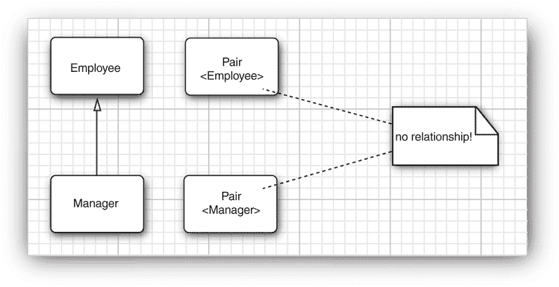

8.1 Pair 类之间没有继承关系

这看起来像是一个残酷的限制，但为了类型安全是必要的。假设我们允许将`Pair<Manager>`转换为`Pair<Employee>`。考虑以下代码：

```java
var managerBuddies = new Pair<Manager>(ceo, cfo);
Pair<Employee> employeeBuddies = managerBuddies; // 非法，但假设允许
employeeBuddies.setFirst(lowlyEmployee);
```

显然，最后语句是合法的。但`employeeBuddies`和`managerBuddies`指向*同一个对象*。我们现在成功地将 CFO 与普通员工配对，这对于`Pair<Manager>`来说是不可能的。

 注意

你刚刚看到了泛型类型与数组之间的重要区别。你可以将`Manager[]`数组赋值给`Employee[]`类型的变量：

```java
Manager[] managerBuddies = { ceo, cfo };
Employee[] employeeBuddies = managerBuddies; // OK
```

然而，数组带有特殊的保护。如果你尝试将一个普通员工存入`employeeBuddies[0]`，虚拟机会抛出`ArrayStoreException`。

始终可以将参数化类型转换为原始类型。例如，`Pair<Employee>`是原始类型`Pair`的子类型。这种转换对于与旧代码交互是必要的。

你可以转换为原始类型并导致类型错误吗？遗憾的是可以。考虑这个例子：

```java
var managerBuddies = new Pair<Manager>(ceo, cfo);
Pair rawBuddies = managerBuddies; // OK
```


`rawBuddies.setFirst(new File(". . ."));` // 仅有编译警告

这听起来很可怕。然而，请记住，你的处境并不比旧 Java 版本糟糕。虚拟机的安全性并没有受到威胁。当异质对象通过`getFirst`获取并赋值给`Manager`变量时，会抛出`ClassCastException`，就像过去一样。你只是失去了泛型编程通常提供的额外安全性。

最后，泛型类可以继承或实现其他泛型类。在这方面，它们与普通类没有区别。例如`ArrayList<T>`类实现了`List<T>`接口。这意味着`ArrayList<Manager>`可以转换为`List<Manager>`。然而，正如你刚刚看到的，一个`ArrayList<Manager>`并不是`ArrayList<Employee>`或`List<Employee>`。图 8.2 显示了这些关系。

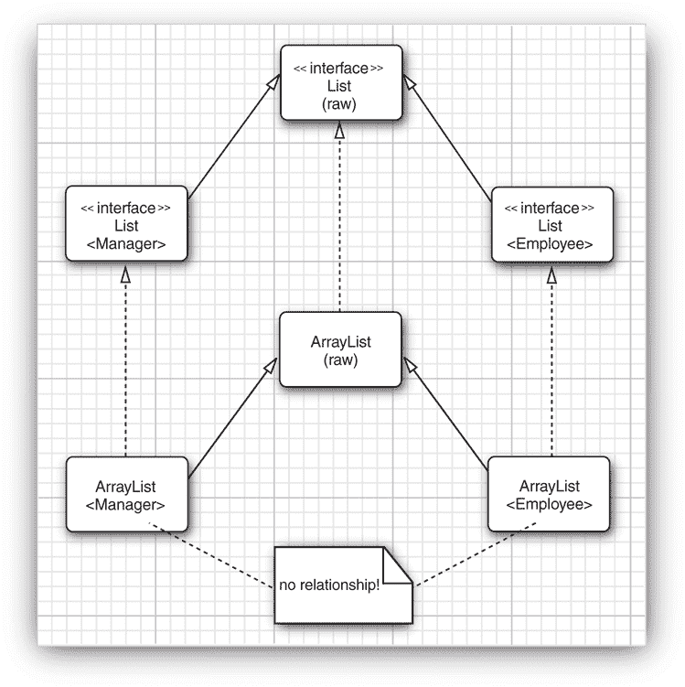

**图 8.2** 泛型列表类型之间的子类型关系

## 8.8 通配符类型

类型系统研究人员早些时候就知道僵化的泛型系统用起来非常不方便。Java 的设计者发明了一种巧妙（尽管依然安全）“逃生口”：通配符类型（wildcard type）。接下来的章节将向你展示如何使用通配符。

### 8.8.1 通配符概念

在通配符类型中，类型参数允许变化。例如，通配符类型

```
Pair<? extends Employee>
```

表示任何泛型`Pair`类型，其类型参数是`Employee`的子类，例如`Pair<Manager>`，但不是`Pair<String>`。

假设你想写一个方法来打印员工对，如下所示：

```
public static void printBuddies(Pair<Employee> p)
{
   Employee first = p.getFirst();
   Employee second = p.getSecond();
   System.out.println(first.getName() + " and " + second.getName() + " are buddies.");
}
```

正如你在上一节中看到的，你不能将`Pair<Manager>`传递给该方法，这相当局限性。但解决方案很简单——使用通配符类型：

```
public static void printBuddies(Pair<? extends Employee> p)
```

`Pair<Manager>`类型是`Pair<? extends Employee>`的子类型（参见图 8.3）。

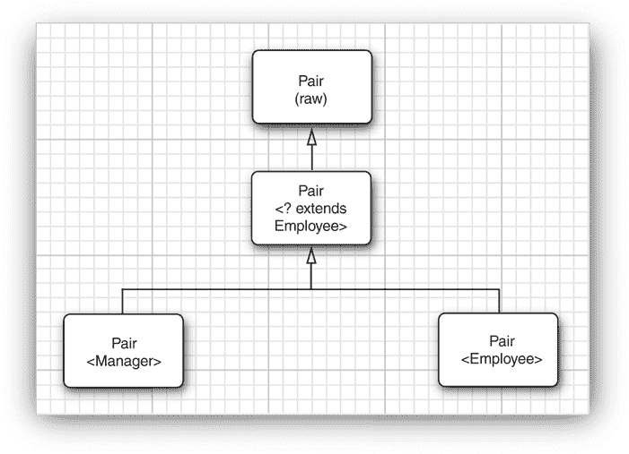

**图 8.3** 带通配符的子类型关系

我们可以通过`Pair<? extends Employee>`引用来破坏`Pair<Manager>`吗？

```
var managerBuddies = new Pair<Manager>(ceo, cfo);
Pair<? extends Employee> wildcardBuddies = managerBuddies; // OK
wildcardBuddies.setFirst(lowlyEmployee); // 编译错误
```

无法发生任何破坏。对`setFirst`的调用是一个类型错误。为了了解为什么，让我们仔细观察`Pair<? extends Employee>`类型。它的方法看起来是这样的：

```
? extends Employee getFirst()
void setFirst(? extends Employee)
```

无法调用`setFirst`方法！考虑调用`wildcardBuddies.setFirst(lowlyEmployee)`。编译器知道`setFirst`的参数具有某种特定类型，该类型扩展了`Employee`。这个特定类型是`Employee`吗？是`Manager`还是其他子类？编译器无办法知道。因此，编译器无法接受`lowlyEmployee`。出于相同的原因，调用`wildcardBuddies.setFirst(cio)`（`cio`是一个`Manager`实例）也会失败。编译器必须拒绝除`null`之外的所有`setFirst`参数。

`getFirst`方法可以继续工作。`getFirst`的返回值是某个特定类型的实例，该类型是`Employee`的子类型。编译器不知道那个特定类型是什么，但它可以保证对`Employee`引用的赋值是安全的。

这就是界限通配符（bounded wildcards）的核心思想。我们现在有一种方法来区分安全的访问方法和不修改方法。

### 8.8.2 通配符的上类型边界

通配符边界与类型变量边界相似，但它们增加了一个功能——你可以像这样指定一个`supertype bound`（上类型边界）：

```
? super Manager
```

此通配符被限制为`Manager`的所有上类型。（幸运的是，现有的`super`关键字如此准确地描述了这种关系。）

你为什么要这样做呢？带有上类型边界的通配符提供的行为与第 8.8 节 第 [475] 页的“通配符类型”中描述的通配符行为相反。你可以为方法提供参数，但不能使用返回值。例如，`Pair<? super Manager>`的方法可以描述如下：

```
void setFirst(? super Manager)
? super Manager getFirst()
```

这不是实际的 Java 语法，但它展示了编译器知道的内容。`setFirst`的参数类型表示为`? super Manager`是`T`，其中`Manager`是`T`的子类型。直观上来说，带有上类型边界的通配符允许写入泛型对象，而带有子类型边界的通配符允许从泛型对象读取。

上类型边界的另一个用法。`Comparable`接口本身是一个泛型类型。它的定义如下：

```
public interface Comparable<T>
{
   public int compareTo(T other);
}
```

在这里，类型变量指示了`other`参数的类型。例如，`String`类实现了`Comparable<String>`，它的`compareTo`方法定义为：

```
public int compareTo(String other)
```

这很好——式参数具有正确的类型。在接口泛型之前，`other`是`Object`，在方法的实现中需要进行强制转换。

现在`Comparable`是泛型类型了，也许我们应该对`ArrayAlg`类的`minmax`方法做得更好？我们可以将其定义为：

```
public static <T extends Comparable<T>> Pair<T> minmax(T[] a)
```

这看起来比仅仅使用`T extends Comparable`更详尽，并且对许多类都有效。例如，如果你计算字符串数组的最小值，那么`T`是类型`String`，而`String`是`Comparable<String>`的子类型。但我们在处理`LocalDate`对象数组时会遇到问题。事实是`LocalDate`实现了`ChronoLocalDate`，而`ChronoLocalDate`扩展了`Comparable<ChronoLocalDate>`。因此，`LocalDate`实现了`Comparable<ChronoLocalDate>`但*不是*`Comparable<LocalDate>`。

在这种情况下，上类型（supertypes）派上了用场：

```
public static <T extends Comparable<? super T>> Pair<T> minmax(T[] a)
```

现在`compareTo`方法的形式如下：

```
int compareTo(? super T)
```

它可能被声明为接收类型为`T`的对象，或者（例如，当`T`是`LocalDate`时）`T`的上类型。无论如何，将类型为`T`的对象传递给`compareTo`方法是安全的。

对于初学者来说，像`<T extends Comparable<? super T>>`这样的声明注定会令人生畏。这很遗憾的，因为该声明的意图是通过消除对调用参数的非必要限制来帮助应用程序程序员。对泛型不感兴趣的应用程序程序员可能会很快学会忽略这些声明，并理所当然地认为库程序员会做正确的事情。如果你是一个库程序员，你将习惯通配符（wildcards），否则你的用户会诅咒你，并在代码中随机进行强制转换，直到其通过编译。

 注意

上类型边界的另一个常见用途是函数接口的参数类型。例如，`Collection`接口有一个方法：

```
default boolean removeIf(Predicate<? super E> filter)
```

该方法移除所有符合给定谓词（predicate）的元素。例如，如果你讨厌哈希码为奇数的员工，你可以像这样移除掉他们：

```
ArrayList<Employee> staff = . . .;
Predicate<Object> oddHashCode = obj -> obj.hashCode() %2 != 0;
staff.removeIf(oddHashCode);
```

你希望能够传递一个`Predicate<Object>`，而不仅仅是`Predicate<Employee>`。`super`通配符使这成为可能。

### 8.8.3 无界通配符

你甚至可以使用没有任何边界的通配符——例如，`Pair<?>`。乍一看，这看起来与原始`Pair`类型完全相同。实际上，这些类型是完全不同的。`Pair<?>`类型拥有如下方法：

```
? getFirst()
void setFirst(?)
```

`getFirst`的返回值只能赋值给`Object`。`setFirst`方法永远无法被调用，即使使用`Object`也不行。这就是`Pair<?>`和`Pair`之间的本质区别：你可以用任何`Object`调用原始`Pair`类的`setFirst`方法。

 注意

你可以调用`setFirst(null)`。

你为什么需要这样一个弱小的类型呢？它对于非常简单的操作很有用。例如，以下方法测试配对是否包含`null`引用。它永远不需要实际类型。

```
public static boolean hasNulls(Pair<?> p)
{
   return p.getFirst() == null || p.getSecond() == null;
}
```

你可以通过将`hasNulls`转换为泛型方法来避免使用通配符类型：

```
public static <T> boolean hasNulls(Pair<T> p)
```

然而，带有通配符类型的版本似乎更易读。

### 8.8.4 通配符捕获

让我们写一个交换配对元素的方法：

```
public static void swap(Pair<?> p)
```

通配符不是类型变量，因此我们不能编写使用`?`作为类型的代码。换句话说，以下代码是非法的：

```
? t = p.getFirst(); // 错误
p.setFirst(p.getSecond());
p.setSecond(t);
```

这是一个问题，因为我们在进行交换时需要临时持有第一个元素。幸运的是，这个问题有一个有趣的解决方案。我们可以像这样写一个辅助方法`swapHelper`：

```
public static <T> void swapHelper(Pair<T> p)
{
   T t = p.getFirst();
   p.setFirst(p.getSecond());
   p.setSecond(t);
}
```

注意`swapHelper`是一个泛型方法，而`swap`不是——它有一个类型为`Pair<?>`的固定参数。

现在我们可以从`swap`中调用`swapHelper`：

```
public static void swap(Pair<?> p) { swapHelper(p); }
```

在这种情况下，`swapHelper`方法的参数`T`捕获了通配符。虽然不知道通配符代表什么类型，但它是一个确定的类型，当`T`表示该类型时，`<T>swapHelper`的定义就完全合理。

当然，在这种情况下，我们并没有被强制使用通配符。我们可以直接实现一个没有通配符的泛型方法`<T> void swap(Pair<T> p)`。但是，考虑这个例子，通配符类型自然出现在计算的中间：

```
public static void maxBonus(Manager[] a, Pair<? super Manager> result)
{
   minmax(a, result);
   PairAlg.swapHelper(result); // OK--swapHelper 捕获了类型
}
```

在这里，通配符捕获机制是无法避免的。通配符捕获只在非常有限的情况下合法。编译器必须能够保证通配符代表一个单一、确定的类型。例如，`ArrayList<Pair<T>>`中的`T`无法捕获`ArrayList<Pair<?>>`中的通配符。列表可能持有两个`Pair<?>`，每个的`?`都有不同的类型。

Listing 8.3 程序收集了前面章节中的各种方法，以便你看到它们的上下文。

```
public static <T extends Comparable<? super T>> Pair<T> minmax(T[] a)
```

现在`compareTo`方法的形式为：

```
int compareTo(? super T)
```

它可能被声明为接收类型为`T`的对象，或者（例如，当`T`是`LocalDate`时）`T`的上类型。无论如何，将类型为`T`的对象传递给`compareTo`方法是安全的。

对于初学者来说，像`<T extends Comparable<? super T>>`这样的声明注定会令人生畏。这很遗憾的，因为该声明的意图是通过消除对调用参数的非必要限制来帮助应用程序程序员。对泛型不感兴趣的应用程序程序员可能会很快学会忽略这些声明，并理所当然地认为库程序员会做正确的事情。如果你是一个库程序员，你将习惯通配符，否则你的用户会诅咒你，并在代码中随机进行强制转换，直到其通过编译。

 注意

上类型边界的另一个常见用途是函数接口的参数类型。例如，`Collection`接口有一个方法：

```
default boolean removeIf(Predicate<? super E> filter)
```

该方法移除所有符合给定谓词的元素。例如，如果你讨厌哈希码为奇数的员工，你可以像这样移除掉他们：

```
ArrayList<Employee> staff = . . .;
Predicate<Object> oddHashCode = obj -> obj.hashCode() %2 != 0;
staff.removeIf(oddHashCode);
```

你希望能够传递一个`Predicate<Object>`，而不仅仅是`Predicate<Employee>`。`super`通配符使这成为可能。

### 8.8.3 无界通配符

你甚至可以使用没有任何边界的通配符——例如，`Pair<?>`。乍一看，这看起来与原始`Pair`类型完全相同。实际上，这些类型是完全不同的。`Pair<?>`类型拥有如下方法：

```
? getFirst()
void setFirst(?)
```

`getFirst`的返回值只能赋值给`Object`。`setFirst`方法永远无法被调用，即使使用`Object`也不行。这就是`Pair<?>`和`Pair`之间的本质区别：你可以用任何`Object`调用原始`Pair`类的`setFirst`方法。

 注意

你可以调用`setFirst(null)`。

你为什么需要这样一个弱小的类型呢？它对于非常简单的操作很有用。例如，以下方法测试配对是否包含`null`引用。它永远不需要实际类型。

```
public static boolean hasNulls(Pair<?> p)
{
   return p.getFirst() == null || p.getSecond() == null;
}
```

你可以通过将`hasNulls`转换为泛型方法来避免使用通配符类型：

```
public static <T> boolean hasNulls(Pair<T> p)
```

然而，带有通配符类型的版本似乎更易读。

### 8.8.4 通配符捕获

让我们写一个交换配对元素的方法：

```
public static void swap(Pair<?> p)
```


```java
public static void swap(Pair<?> p)
```

通配符不是类型变量，所以我们不能编写使用 `?` 作为类型的代码。换句话说，以下代码是非法的：

```java
? t = p.getFirst(); // 错误

p.setFirst(p.getSecond());

p.setSecond(t);
```

这是一个问题，因为我们在进行交换时需要临时持有第一个元素。幸运的是，这个问题有一个有趣的解决方案。我们可以像这样写一个辅助方法 `swapHelper`：

点击此处查看代码图像

```java
public static <T> void swapHelper(Pair<T> p)
{
   T t = p.getFirst();

   p.setFirst(p.getSecond());

   p.setSecond(t);
}
```

注意 `swapHelper` 是一个泛型方法，而 `swap` 不是——它有一个类型为 `Pair<?>` 的固定参数。

现在我们可以从 `swap` 中调用 `swapHelper`：

点击此处查看代码图像

```java
public static void swap(Pair<?> p) { swapHelper(p); }
```

在这种情况下，`swapHelper` 方法的参数 `T` 捕获了通配符。虽然不知道通配符代表什么类型，但它是一个确定的类型，当 `T` 表示该类型时，`<T>swapHelper` 的定义就完全合理。

当然，在这种情况下，我们并没有被强制使用通配符。我们可以直接实现一个没有通配符的泛型方法 `<T> void swap(Pair<T> p)`。但是，考虑这个例子，通配符类型自然出现在计算的中间：

点击此处查看代码图像

```java
public static void maxBonus(Manager[] a, Pair<? super Manager> result)
{
   minmax(a, result);

   PairAlg.swapHelper(result); // OK--swapHelper 捕获了类型
}
```

在这里，通配符捕获机制是无法避免的。通配符捕获只在非常有限的情况下合法。编译器必须能够保证通配符代表一个单一、确定的类型。例如，`ArrayList<Pair<T>>` 中的 `T` 无法捕获 `ArrayList<Pair<?>>` 中的通配符。列表可能持有两个 `Pair<?>`，每个的 `?` 都有不同的类型。

Listing 8.3 程序收集了前面章节中的各种方法，以便你看到它们的上下文。

反射允许你在运行时分析任意对象。如果对象是泛型类的实例，你无法获得关于泛型类型参数的很多，因为它们已经被擦除。在接下来的章节中，你将学习尽管如此可以通过反射发现关于泛型类的信息。

### 8.9.1 泛型 `Class` 类

`Class` 类现在是泛型的。例如，`String.class` 实际上是 `Class<String>` 类的一个对象（事实上，它是唯一的对象）。

该类型参数非常有用，因为它允许 `Class<T>` 的方法对其返回类型变得更具体。`Class<T>` 的以下方法利用了类型参数：

```java
T newInstance()

T cast(Object obj)

T[] getEnumConstants()

Class<? super T> getSuperclass()

Constructor<T> getConstructor(Class... parameterTypes)

Constructor<T> getDeclaredConstructor(Class... parameterTypes)
```

`newInstance` 方法返回一个从无参数构造函数获取的类实例。它的返回类型现在可以声明为 `T`，与由 `Class<T>` 描述的类类型相同。这节省了一次强制转换。

`cast` 方法返回给的对象，如果其类型确实是 `T` 的子类型，则现在声明为类型 `T`。否则，它会抛出 `BadCastException`。

`getEnumConstants` 方法如果该类不是 `enum` 类或已知类型为 `T` 的枚举值数组，则返回 `null`。

最后，`getConstructor` 和 `getDeclaredConstructor` 方法返回一个 `Constructor<T>` 对象。`Constructor` 类也已改为泛型，以便其 `newInstance` 方法具有正确的返回类型。

`java.lang.Class<T>` **1.0**

- `T newInstance()`  
  返回一个使用无参数构造函数构建的新实例。
- `T cast(Object obj)`  
  如果 `obj` 为 `null` 或可以转换为类型 `T`，则返回 `obj`；否则抛出 `BadCastException`。
- `T[] getEnumConstants()` **5**  
  如果 `T` 是枚举类型，则返回所有值的数组，否则返回 `null`。
- `Class<? super T> getSuperclass()`  
  返回此类的父类，如果 `T` 不是一个类或 `Object` 类，则返回 `null`。
- `Constructor<T> getConstructor(Class... parameterTypes)` **1.1**
- `Constructor<T> getDeclaredConstructor(Class... parameterTypes)` **1.1**  
  获取公共构造函数，或具有给定参数类型的构造函数。

`java.lang.reflect.Constructor<T>` **1.1**

- `T newInstance(Object... parameters)`  
  返回一个使用给定参数构建的新实例。

### 8.9.2 使用 `Class<T>` 参数进行类型匹配

在泛型方法中，匹配 `Class<T>` 参数的类型变量有时是有用的。这里有一个标准示例：

点击此处查看代码图像

```java
public static <T> Pair<T> makePair(Class<T> c) throws InstantiationException,
      IllegalAccessException
{
   return new Pair<>(c.newInstance(), c.newInstance());
}
```

```java
makePair(Employee.class)
```

那么 `Employee.class` 是类型 `Class<Employee>` 的对象。`makePair` 方法的类型参数 `T` 匹配 `Employee`，编译器可以推断出方法返回一个 `Pair<Employee>`。

### 8.9.3 虚拟机中的泛型类型信息

Java 泛型的显著特征之一是虚拟机中泛型类型的擦除。令人惊讶的是，被擦除的类仍然保留了关于其泛型源的一些微弱记忆。例如，原始的 `Pair` 类知道它源自泛型类 `Pair<T>`，尽管类型为 `Pair` 的对象无法判断它是作为 `Pair<String>` 还是 `Pair<Employee>` 构建的。

同样，考虑一个方法：

点击此处查看代码图像

```java
public static Comparable min(Comparable[] a)
```

它是泛型方法的擦除形式：

点击此处查看代码图像

```java
public static <T extends Comparable<? super T>> T min(T[] a)
```

你可以使用反射 API 来确定：

- 该泛型方法有一个名为 `T` 的类型参数；
- 该类型参数有一个子类型边界，其本身是一个泛型类型；
- 边界类型有一个通配符参数；
- 通配符参数有一个上类型边界；
- 该泛型方法有一个泛型数组参数。

换句话说，你可以重构实现者声明的关于泛型类和方法的所有信息。然而，你不知道类型参数是如何针对特定对象或方法调。

为了表示泛型类型声明，使用 `java.lang.reflect` 包中的 `Type` 接口。该接口有以下子类型：

- `Class` 类，描述具体类型；
- `TypeVariable` 接口，描述类型变量（如 `T extends Comparable<? super T>`）；
- `WildcardType` 接口，描述通配符（如 `? super T`）；
- `ParameterizedType` 接口，描述泛型类或接口类型（如 `Comparable<? super T>`）；
- `GenericArrayType` 接口，描述泛型数组（如 `T[]`）。

图 8.5 显示了继承层次。注意最后四个子类型是接口——虚拟机实例化实现了这些接口的类。

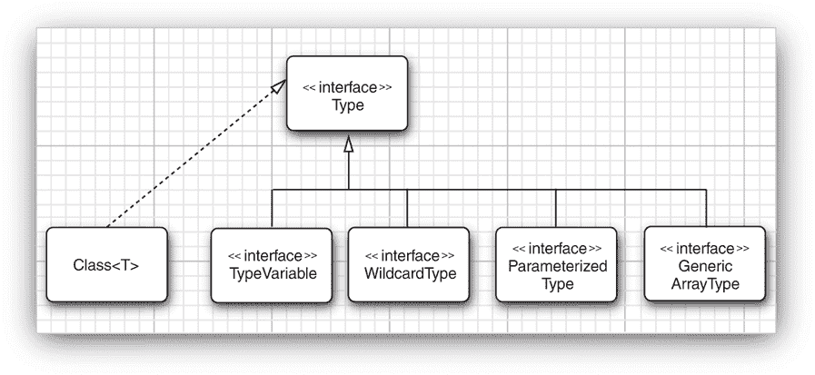

**图 8.5** `Type` 接口及其后代

```java
package genericReflection;

import java.lang.reflect.*;

import java.util.*;

/**
 * @version 1.12 2021-05-30
 * @author Cay Horstmann
 */

public class GenericReflectionTest
{
    public static void main(String[] args)
    {
       // 从命令行参数或用户输入读取类名

       String name;

       if (args.length > 0) name = args[0];
       else
       {
          try (var in = new Scanner(System.in))
          {
             System.out.println("Enter class name (e.g., java.util.Collections): ");
             name = in.next();
          }
       }

       try
       {
          // 打印类和公共方法的泛型信息

          Class<?> cl = Class.forName(name);
          printClass(cl);

          for (Method m : cl.getDeclaredMethods())
             printMethod(m);
       }
       catch (ClassNotFoundException e)
       {
          e.printStackTrace();
       }
    }

    public static void printClass(Class<?> cl)
    {
       System.out.print(cl);
       printTypes(cl.getTypeParameters(), "<", ", ", ">", true);

       Type sc = cl.getGenericSuperclass();

       if (sc != null)
       {
          System.out.print(" extends ");
          printType(sc, false);
       }

       printTypes(cl.getGenericInterfaces(), " implements ", ", ", "", false);
       System.out.println();
    }

    public static void printMethod(Method m)
    {
       String name = m.getName();

       System.out.print(Modifier.toString(m.getModifiers()));
       System.out.print(" ");

       printTypes(m.getTypeParameters(), "<", ", ", "> ", true);
       printType(m.getGenericReturnType(), false);

       System.out.print(" ");
       System.out.print(name);
       System.out.print("(");

       printTypes(m.getGenericParameterTypes(), "", ", ", "", false);
       System.out.println(")");
    }

    public static void printTypes(Type[] types, String pre, String sep, String suf,
          boolean isDefinition)
    {
       if (pre.equals(" extends ") && Arrays.equals(types, new Type[] { Object.class }))
          return;

       if (types.length > 0) System.out.print(pre);

       for (int i = 0; i < types.length; i++)
       {
          if (i > 0) System.out.print(sep);
          printType(types[i], isDefinition);
       }

       if (types.length > 0) System.out.print(suf);
    }

    public static void printType(Type type, boolean isDefinition)
    {
       if (type instanceof Class t)
       {
          System.out.print(t.getName());
       }
       else if (type instanceof TypeVariable t)
       {
          System.out.print(t.getName());

          if (isDefinition)
             printTypes(t.getBounds(), " extends ", " & ", "", false);
       }
       else if (type instanceof WildcardType t)
       {
          System.out.print("?");

          printTypes(t.getUpperBounds(), " extends ", " & ", "", false);
          printTypes(t.getLowerBounds(), " super ", " & ", "", false);
       }
       else if (type instanceof ParameterizedType t)
       {
         Type owner = t.getOwnerType();

         if (owner != null)
         {
            printType(owner, false);
            System.out.print(".");
         }

         printType(t.getRawType(), false);
         printTypes(t.getActualTypeArguments(), "<", ", ", ">", false);
       }
       else if (type instanceof GenericArrayType t)
       {
         System.out.print("");
         printType(t.getGenericComponentType(), isDefinition);
         System.out.print("[]");
      }
   }
}
```

#### 8.9.4 类型字面量（Type Literals）

有时，你希望根据值的类型来驱动程序的行为。例如，在持久化机制中，你可能希望用户指定保存对象的方式。这通常通过将 `Class` 对象与操作关联来实现。

然而，对于泛型类，类型擦除（erasure）带来了问题。当 `ArrayList<Integer>` 和 `ArrayList<String>` 都被擦除为相同的 `ArrayList` 类型时，你如何为它们提供不同的操作呢？

有一种技巧可以在某些情况下缓解这个问题。你可以捕获在前节中遇到的 `Type` 接口的实例。构造这样一个匿名子类：

```java
var type = new TypeLiteral<ArrayList<Integer>>(){} // 注意这里的 {}
```

`TypeLiteral` 构造函数捕获了泛型超类：

```java
class TypeLiteral
{
   public TypeLiteral()
```


`Type parentType = getClass().getGenericSuperclass();`

如果 `parentType` 是 `ParameterizedType` 的实例（即 `paramType`），则 `type = paramType.getActualTypeArguments()[0]`；否则抛出 `UnsupportedOperationException`，提示“请通过 `new TypeLiteral<. . .>(){}` 的方式构造”。

如果我们在运行时有一个可用的泛型，可以将其与 `TypeLiteral` 进行匹配。我们无法从对象获取泛型类型——它被擦除了。但正如你在前节中所看到的，字段和方法参数的泛型类型在虚拟机中得以保留。

如 `CDI` 和 `Guice` 等注入框架使用类型字面量来控制泛型类型的注入。书中配套代码中的示例程序展示了一个更简单的例子：给定一个对象，我们枚举其泛型类型可用的字段，并查找关联的格式化操作。

通过空格分隔值来格式化 `ArrayList<Integer>`，通过 `ArrayList<Character>` 则将字符连接成字符串。任何其他数组列表都通过 `ArrayList.toString()` 进行格式化。

```java
package genericReflection;

/**
 *   @version 1.02 2021-05-30
 *   @author Cay Horstmann
 */
import java.lang.reflect.*;
import java.util.*;
import java.util.function.*;

/**
 * 类型字面量（type literal）描述了一个可以是泛型的类型，例如
 * ArrayList<String>
 */
class TypeLiteral<T>
{
    private Type type;

    /**
     * 此构造函数必须通过匿名子类调用，
     * 如 new TypeLiteral<. . .>(){}
     */
    public TypeLiteral()
    {
       Type parentType = getClass().getGenericSuperclass();
       if (parentType instanceof ParameterizedType paramType)
          type = paramType.getActualTypeArguments()[0];
       else
          throw new UnsupportedOperationException(
             "请通过 new TypeLiteral<. . .>(){} 的方式构造");
    }

    private TypeLiteral(Type type)
    {
       this.type = type;
    }

    /**
     * 返回一个描述给定类型的类型字面量。
     */
    public static TypeLiteral<?> of(Type type)
    {
       return new TypeLiteral<Object>(type);
    }

    public String toString()
    {
       if (type instanceof Class clazz) return clazz.getName();
       else return type.toString();
    }

    public boolean equals(Object otherObject)
    {
       return otherObject instanceof TypeLiteral otherLiteral
          && type.equals(otherLiteral.type);
    }

    public int hashCode()
    {
       return type.hashCode();
    }
}

/**
 * 使用将类型与格式化函数关联的规则对对象进行格式化。
 */
class Formatter
{
    private Map<TypeLiteral<?>, Function<?, String>> rules = new HashMap<>();

    /**
     * 向此格式化器添加规则。
     * @param type 规则应用的类型
     * @param formatterForType 用于格式化该类型的函数
     */
    public <T> void forType(TypeLiteral<T> type, Function<T, String> formatterForType)
    {
       rules.put(type, formatterForType);
    }

    /**
     * 使用此格式化器的规则对对象的所有字段进行格式化。
     * @param obj 对象
     * @return 包含所有字段名和格式化值的字符串
     */
    public String formatFields(Object obj)
          throws IllegalArgumentException, IllegalAccessException
    {
       var result = new StringBuilder();
       for (Field f : obj.getClass().getDeclaredFields())
       {
          result.append(f.getName());
          result.append("=");
          f.setAccessible(true);
          Function<?, String> formatterForType = rules.get(TypeLiteral.of(f.getGenericType()));
          if (formatterForType != null)
          {
             // formatterForType 的参数类型为 ?。无法向其 apply 方法传递参数。
             // 强制转换将参数类型转换为 Object，以便我们可以调用。
            @SuppressWarnings("unchecked")
            Function<Object, String> objectFormatter
               = (Function<Object, String>) formatterForType;
            result.append(objectFormatter.apply(f.get(obj)));
         }
         else
            result.append(f.get(obj).toString());
         result.append("\n");
      }
      return result.toString();
    }
}

public class TypeLiterals
{
    public static class Sample
    {
       ArrayList<Integer> nums;
       ArrayList<Character> chars;
       ArrayList<String> strings;

       public Sample()
       {
          nums = new ArrayList<>();
          nums.add(42); nums.add(1729);
          chars = new ArrayList<>();
          chars.add('H'); chars.add('i');
          strings = new ArrayList<>();
          strings.add("Hello"); strings.add("World");
       }
    }

    private static <T> String join(String separator, ArrayList<T> elements)
    {
       var result = new StringBuilder();
       for (T e : elements)
       {
          result.append(separator);
          result.append(e);
       }
       return result.toString();
    }

    public static void main(String[] args) throws Exception
    {
       Sample s = new Sample();
       System.out.println(join(", ", s.nums));
       System.out.println(join(", ", s.chars));
       System.out.println(join(", ", s.strings));

       TypeLiteral<ArrayList<Integer>> listType = new TypeLiteral<ArrayList<Integer>>(){};
       System.out.println(listType.toString());

       TypeLiteral<ArrayList<Character>> charType = new TypeLiteral<ArrayList<Character>>(){};
       System.out.println(charType.toString());
    }
}
```

当你尝试以自然风格实现方法或关注性能时，你选择的数据结构会产生巨大影响。你是否需要对成千上万（甚至数百万）个排序后的项进行快速搜索？你是否需要在有序序列的中间快速插入和删除元素？你是否需要在键和值之间建立关联？

本章将展示 `Java` 库如何帮助你完成正式编程所需的传统数据结构。在大学的计算机科学课程中，一门名为 `Data Structures` 的课程通常需要一个学期才能完成，有很多书籍致力于这个重要主题。我们的涵盖与大学课程不同；我们将跳过理论，直接介绍如何使用标准库中的集合类。

## 9.1 Java 集合框架

`Java` 的最初版本只为最常用的数据结构提供了一小部分类：`Vector`、`Stack`、`Hashtable`、`BitSet` 以及 `Enumeration` 接口（后者提供了一种访问任意容器中元素的抽象机制）。这无疑是一个明智的选择——设计出一套全面的集合类库需要时间和技巧。

随着 `Java 1.2` 的出现，设计者们认为是时候推出一套完整的数据结构了。他们面临着许多相互冲突的设计挑战。他们希望库既小又易于学习。他们不想要 `C++` 标准模板库（或 `STL`）的复杂性，但他们想要 `STL` 所开创的“泛型算法”带来的益处。他们希望旧类能够适应新框架。正如所有集合库的设计者所做，他们必须做出一些艰难的抉择，并在过程中产生了一些独特的设计决策。在本节中，我们将探索 `Java` 集合框架的基本设计，演示如何使用它，并解释一些更具争议的功能背后的原理。

### 9.1.1 分离集合接口与实现

与现代数据结构库一样，`Java` 集合库将 `interfaces`（接口）和 `implementations`（实现）分离。让我们通过熟悉的数据结构 `queue` 来观察这种分离。

`queue` 接口规定你可以在队列末尾添加元素，从头部删除元素，并查找队列中有多少元素。当你需要收集对象并按“先进先出”的方式检索它们时，就会使用 `queue`（参见图 9.1）。

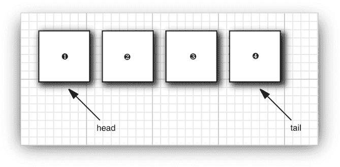

**图 9.1** 队列

一个最小形式的 `queue` 接口可能如下：

```java
public interface Queue<E> // 标准库中接口的简化形式
{
   void add(E element);
   E remove();
   int size();
}
```

该接口没有告诉你任何关于队列是如何实现的任何信息。在队列的两种常见实现中，一个使用“循环数组”，另一个使用链表（参见图 9.2）。

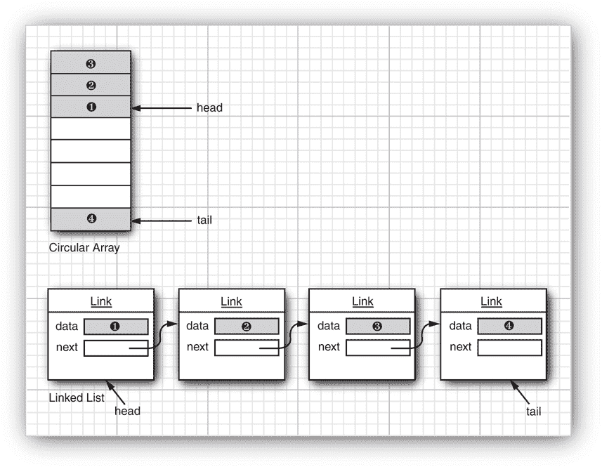

**图 9.2** 队列的实现

每个实现都可以由实现 `Queue` 接口的类来表示。

```java
public class CircularArrayQueue<E> implements Queue<E> // 不是实际的库类
{
   private int head;
   private int tail;
   CircularArrayQueue(int capacity) { . . . }
   public void add(E element) { . . . }
   public E remove() { . . . }
   public int size() { . . . }
   private E[] elements;
}

public class LinkedListQueue<E> implements Queue<E> // 不是实际的库类
{
   private Link head;
   private Link tail;
   LinkedListQueue() { . . . }
   public void add(E element) { . . . }
   public E remove() { . . . }
   public int size() { . . . }
}
```

 备注

`Java` 库实际上并没有名为 `CircularArrayQueue` 和 `LinkedListQueue` 的类。我使用这些类作为示例来解释集合接口与实现之间概念上的区别。如果你需要循环数组队列，请使用 `ArrayDeque` 类。对于链表队列，只需使用 `LinkedList` 类即可——它实现了 `Queue` 接口。

当你在程序中使用队列时，一旦集合构建完成，你就不需要知道实际上使用的是哪种实现。因此，在构造集合对象时*仅*使用具体类是合理的。使用*接口类型*来持有集合引用。

```java
Queue<Customer> expressLane = new CircularArrayQueue<>(100);
expressLane.add(new Customer("Harry"));
```

通过这种方法，如果你改变了主意，可以轻松地使用不同的实现。你只需要更改程序中的一处——构造函数调用处。如果你最终决定 `LinkedListQueue` 是更好的选择，你的代码变为：

```java
Queue<Customer> expressLane = new LinkedListQueue<>();
expressLane.add(new Customer("Harry"));
```

你为什么选择一种实现而不是另一种？接口对实现的效率一无所知。循环数组比链表稍微高效一些，因此通常是首选。然而，一如往常，这是有代价的。循环数组是*有界的*集合——它有有限的容量。如果你对程序将收集的对象数量没有上限，那么链表可能更好。当你学习 `API` 时，你会发现另一组以 `Abstract` 开头的类，例如 `AbstractQueue`。这些类是为库的实现者设计的。在（可能不太）你想实现自己的队列的情况下，扩展 `AbstractQueue` 比实现 `Queue` 接口的所有方法要容易得多。

### 9.1.2 集合接口

`Java` 库中集合类的基础接口是 `Collection` 接口。该接口有两个基本方法：

```java
public interface Collection<E>
{
   boolean add(E element);
   Iterator<E> iterator();
   . . .
}
```

除了这两个之外还有几个方法；我们稍后会讨论它们。

`add` 方法将元素添加到集合中。如果添加元素实际上更改了集合，`add` 方法返回 `true`；如果集合未更改，则返回 `false`。例如，如果你尝试向集合添加一个对象而该对象已经存在，则 `add` 请求将不起影响，因为集合拒绝重复。

`iterator` 方法返回一个实现 `Iterator` 接口的对象。你可以使用迭代器对象逐个访问集合中的元素。我们将在下一节中讨论迭代器。

### 9.1.3 迭代器

`Iterator` 接口有四个方法：

```java
public interface Iterator<E>
{
   E next();
   boolean hasNext();
   void remove();
}
```


`default void forEachRemaining(Consumer<? super E> action);`

}

通过反复调用`next`方法，你可以逐个访问集合中的元素。然而，当你到达集合末尾时，`next`方法会抛出`NoSuchElementException`。因此，在调用`next`之前需要调用`hasNext`方法。如果迭代器对象还有更多元素待访问，该方法返回`true`。如果你想检查集合中的所有元素，请求一个迭代器，并在`hasNext`返回`true`时继续调用`next`方法。例如：

```
Collection<String> c = . . .;
Iterator<String> iter = c.iterator();
while (iter.hasNext())
{
   String element = iter.next();
   do something with element
}
```

你可以用“增强 for 循环”（for each loop）更简洁的方式编写这种循环：

```java
for (String element : c)
{
   do something with element
}
```

编译器会简单地将“增强 for 循环”翻译为带有迭代器的循环。

“增强 for 循环”适用于实现了`Iterable`接口的对象，该接口包含一个抽象方法：

```java
public interface Iterable<E>
{
   Iterator<E> iterator();
   . . .
}
```

`Collection`接口继承了`Iterable`接口。因此，你可以在标准库中的任何集合上使用“增强 for 循环”。

与其编写循环，不如调用`forEachRemaining`方法并传入一个消耗元素的 lambda 表达式。lambda 表达式会在迭代器的每个元素上被调用，直到没有剩余元素为止。

```java
iterator.forEachRemaining(element -> do something with element);
```

元素的访问顺序取决于集合的类型。如果你遍历一个`ArrayList`，迭代器从索引`0`开始，并在每一步中增加索引。然而，如果你访问`HashSet`中的元素，获取到的元素顺序本质上是随机的。你可以保证在迭代过程中会遇到集合中的所有元素，但你无法对它们的顺序做任何假设。这通常不是一个问题，因为对于计算总和或统计匹配数等计算来说，顺序并不重要。

 注意

老手会注意到，`Iterator`接口的`next`和`hasNext`方法的作用与`Enumeration`接口的`nextElement`和`hasMoreElements`方法相同。Java 集合库的设计者本可以选择使用`Enumeration`接口。但他们不喜欢冗长的方法名，而是引入了一个具有更短方法名的新接口。

Java 集合库中的迭代器与其他库中的迭代器之间存在着重要的概念区别。在传统的集合库（如 C++ 的标准模板库）中，迭代器是模仿数组索引建模的。给定一个迭代器，你可以查找存储在该位置的元素，就像如果你有数组索引`i`，就可以查找数组元素`a[i]`一样。无论查找结果，你都可以将迭代器移动到下一个位置。这与通过调用`i++`移动数组索引的操作相同，而不需要执行查找。然而，Java 迭代器并不是这样工作的。查找和位置变化是紧密耦合的。查找元素的唯一方法是调用`next`，而这种查找会移动位置。

相反，请将 Java 迭代器想象为位于*元素之间*。当你调用`next`时，迭代器会*跳过*下一个元素，并返回它刚刚经过的元素的引用（请参见图 9.3）。

 注意

这里有另一个有用的类比。你可以将`Iterator.next`等同于`InputStream.read`。从流中读取一个字节会自动“消耗”该字节。下一次调用`read`会消耗并返回输入流中的下一个字节。同样，重复调用`next`允许你读取集合中的所有元素。

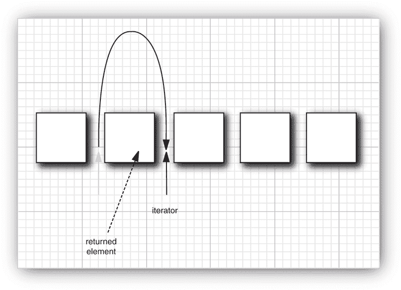

**图 9.3** 推进迭代器

`Iterator`接口的`remove`方法会移除由上一次`next`调用返回的元素。在很多情况下，这是合理的——你必须先看到元素，才能判断它是否是应该被移除的那一个。但如果你想移除特定位置的元素，你仍然需要跳过该元素。例如，这里是移除字符串集合中第一个元素的方法：

```java
Iterator<String> it = c.iterator();
it.next(); // 跳过第一个元素
it.remove(); // 现在移除它
```

更重要的是，`next`方法和`remove`方法的调用之间存在依赖关系。如果在没有先调用`next`的情况下调用`remove`是非法的。如果你尝试这样做，将抛出`IllegalStateException`。

如果你想移除两个相邻的元素，不能简单地调用：

```java
it.remove();
it.remove(); // 错误
```

相反，你必须首先调用`next`跳过要移除的元素。

```java
it.remove();
it.next();
it.remove(); // OK
```

#### 9.1.4 泛型实用方法

`Collection`和`Iterator`接口是泛型的，这意味着你可以编写操作任何类型集合的实用方法。例如，这里有一个泛型方法，用于测试任意集合是否包含给定元素：

```java
public static <E> boolean contains(Collection<E> c, Object obj)
{
   for (E element : c)
      if (element.equals(obj))
            return true;
   return false;
}
```

Java 库的设计者认为某些实用方法非常有用，以至于库应该提供它们。这样库用户就不需要重复发明轮子。`contains`方法就是其中一个方法。

事实上，`Collection`接口声明了一些实现类必须提供的方法。它们包括：

```java
int size()
boolean isEmpty()
boolean contains(Object obj)
boolean containsAll(Collection<?> c)
boolean equals(Object other)
boolean addAll(Collection<? extends E> from)
boolean remove(Object obj)
boolean removeAll(Collection<?> c)
void clear()
boolean retainAll(Collection<?> c)
Object[] toArray()
```

这些方法中的许多是显而易见的，可以在节最后的 API Notes 找到完整文档。

当然，如果每个实现`Collection`接口的类都要提供这么多常规方法就很麻烦。为了方便实现者，库提供了一个`AbstractCollection`类，它将基础方法`size`和`iterator`设为抽象，但实现了这些常规方法。例如：

```java
public abstract class AbstractCollection<E>
      implements Collection<E>
{
   . . .
   public abstract Iterator<E> iterator();
   public boolean contains(Object obj)
   {
      for (E element : this) // 调用 iterator()
         if (element.equals(obj))
            return true;
      return false;
   }
   . . .
}
```

具体的集合类现在可以继承`AbstractCollection`类。具体集合类负责提供`iterator`方法，但`contains`方法已经由父类`AbstractCollection`处理。然而，如果子类有更高效的方法来实现`contains`，它可以自由这样做。

这种方法有点过时了。如果这些方法是`Collection`接口的默认方法会更好。这种情况还没有发生。但是，已经添加了几个默认方法。它们大多数与流有关（在第二卷中讨论）。此外，还有一个非常实用的方法

```java
default boolean removeIf(Predicate<? super E> filter)
```

用于移除满足条件的元素。

***java.util.Collection<E>*** 1.2

*   `Iterator<E> iterator()`

    返回一个用于访问集合中元素的迭代器。

*   `int size()`

    返回当前集合中存储的元素数量。

* `boolean isEmpty()`
  如果此集合不包含任何元素，返回`true`。

* `boolean contains(Object obj)`
  如果此集合包含与`obj`相等的对象，返回`true`。

* `boolean containsAll(Collection<?> other)`
  如果此集合包含另一个集合中的所有元素，返回`true`。

* `boolean add(E element)`
  向集合中添加一个元素。如果因为此调用导致集合发生了变化，则返回`true`。

* `boolean addAll(Collection<? extends E> other)`
  将另一个集合中的所有元素添加到此集合中。如果因为此调用导致集合发生了变化，返回`true`。

* `boolean remove(Object obj)`
  从此集合中移除与`obj`相等的对象。如果删除了匹配的对象，则返回`true`。

* `boolean removeAll(Collection<?> other)`
  从此集合中移除另一个集合中的所有元素。如果因为此调用导致集合发生了变化，返回`true`。

* `default boolean removeIf(Predicate<? super E> filter)` 8
  移除所有`filter`返回`true`的元素。如果因为此调用导致集合发生了变化，返回`true`。

* `void clear()`
  移除此集合中的所有元素。

* `boolean retainAll(Collection<?> other)`
  移除此集合中不等于另一个集合中任何一个元素的元素。如果因为此调用导致集合发生了变化，返回`true`。

* `Object[] toArray()`
  返回一个包含集合中对象的数组。

* `<T> T[] toArray(IntFunction<T[]> generator)` 11
  返回一个包含集合中对象的数组。数组通过`generator`构建，该生成器通常是一个构造器表达式`T[]::new`。

### java.util.Iterator<E> 1.2

* `boolean hasNext()`
  如果还有元素待访问，则返回`true`。

* `E next()`
  返回下一个要访问的对象。如果到达集合末尾，则抛出`NoSuchElementException`。

* `void remove()`
  移除上一次访问的对象。此方法必须紧跟在元素访问之后。如果集合自上一次元素访问以来被修改过，此方法将抛出`IllegalStateException`。

* `default void forEachRemaining(Consumer<? super E> action)` 8
  访问元素并将它们传递给指定的 action，直到没有剩余元素或 action 抛出异常。

## 9.2 集合框架中的接口

Java 集合框架为不同类型的集合定义了许多接口，见图 9.4。

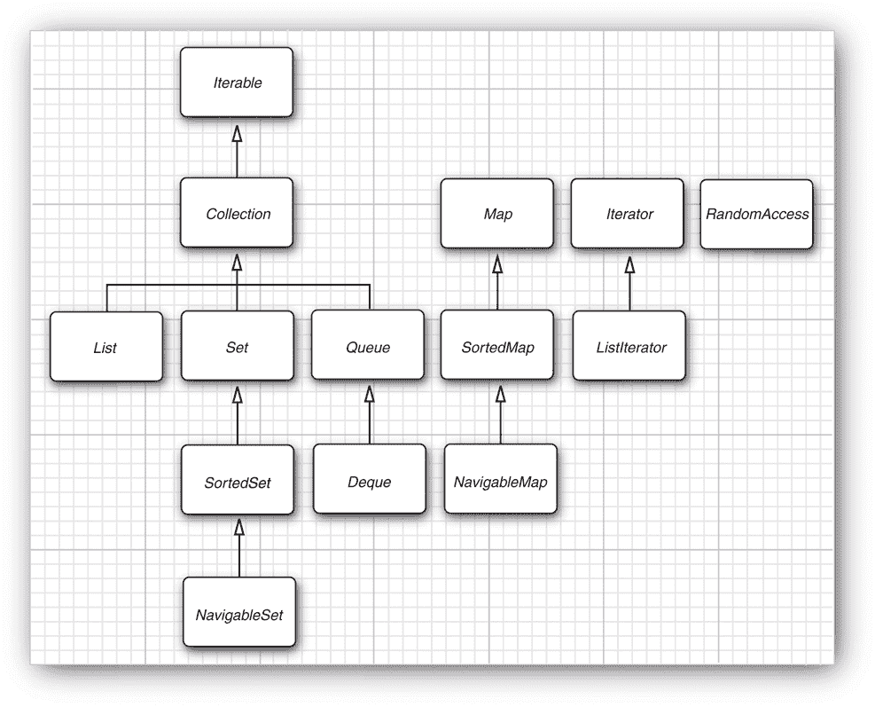

**图 9.4** 集合框架的接口

集合有两个基本接口：`Collection`和`Map`。正如你所知的，你使用一个方法向集合中插入元素：

```
boolean add(E element)
```

然而，map 存储的是键值对，你使用`put`方法来插入它们：

```
V put(K key, V value)
```

要从集合中读取元素，请使用迭代器访问它们。然而，你可以使用`get`方法从 map 中读取值：

```
V get(K key)
```

`List`是一个*有序集合*。元素被添加到容器的特定位置。元素可以通过两种方式访问：通过迭代器或通过整数索引。后者被称为*随机访问*，因为元素可以按任何顺序被访问。相比之下，使用迭代器时，必须按顺序访问它们。

`List`接口定义了几个用于随机访问的方法：

```
void add(int index, E element)
void remove(int index)
E get(int index)
E set(int index, E element)
```

`ListIterator`接口是`Iterator`的子接口。它定义了一个在迭代器位置之前添加元素的方法：

```
void add(E element)
```

坦率地说，集合框架的这方面设计得很糟糕。在实践中，有两种类型的有序集合，它们的性能权衡非常不同。由数组支持的有序集合具有快速随机访问的能力，使用整数索引的`List`方法是有意义的。相比之下，链表虽然也是有序的，但随机访问速度很慢，最好使用迭代器进行遍历。提供两个接口本是一件容易的事。

 注意

为了避免对链表执行随机访问操作，Java 1.4 引入了一个标记接口`RandomAccess`。该接口没有方法，但你可以用它来测试特定集合是否支持高效随机访问：

```
if (c instanceof RandomAccess)
{
   使用随机访问算法
}
else
{
   使用顺序访问算法
}
```


`Set`接口与`Collection`接口相同，但方法的行为定义得更紧密。集合的`add`方法应该拒绝重复项。集合的`equals`方法应该定义为：如果两个集合具有相同的元素，则它们是相同的，但顺序不一定相同。`hashCode`方法应该定义为：使得两个具有相同元素的集合产生相同的哈希值。

如果方法签名相同，为什么要单独定义一个接口呢？从概念上讲，并不是所有集合都是集合。`Set`接口允许程序员编写只接受集合的代码。

`SortedSet`和`SortedMap`接口暴露了用于排序的比较器对象，并定义了获取集合子集的方法。我们在第9.5节中讨论这些。

最后，Java 6引入了`NavigableSet`和`NavigableMap`接口，包含了用于排序集合和map的额外方法。（这些方法本应该包含在`SortedSet`和`SortedMap`接口中。）`TreeSet`和`TreeMap`类实现了这些接口。

## 9.3 具体集合

表9.1显示了Java库中的集合，并简要描述了每个集合类。（为了简单起见，我省略了将在第12章中讨论的线程安全集合。）

**表9.1** Java库中的具体集合

| 集合类型 |  | 章节 |
| --- | --- | --- |
| `ArrayList` | 动态伸缩的索引序列 | 523 |
| `LinkedList` | 允许在任何位置高效插入和删除的有序序列 | 512 |
| `ArrayDeque` | 实现为循环数组的双端队列 | 532 |
| `HashSet` | 拒绝重复的无序集合 | 523 |
| `TreeSet` | 有序集合 | 527 |
| `EnumSet` | 枚举类型值的集合 | 545 |
| `LinkedHashSet` | 记住元素插入顺序的集合 | 543 |
| `PriorityQueue` | 允许高效移除最小元素的集合 | 533 |
| `HashMap` | 存储键值关联的数据结构 | 542 |
| `TreeMap` | 键排序的map | 535 |
| `EnumMap` | 键属于枚举类型的map | 545 |
| `LinkedHashMap` | 记住条目添加顺序的map | 543 |
| `WeakHashMap` | 值在其他地方没有使用时可以被垃圾回收回收的map | 542 |
| `IdentityHashMap` | 键通过`=`比较的map | 545 |

表9.1中的所有类都实现了`Collection`接口，但以`Map`结尾的类除外。这些类实现的是`Map`接口。我们将在第535页的第9.4节“Maps”讨论映射。

图9.5展示了这些类之间的关系。

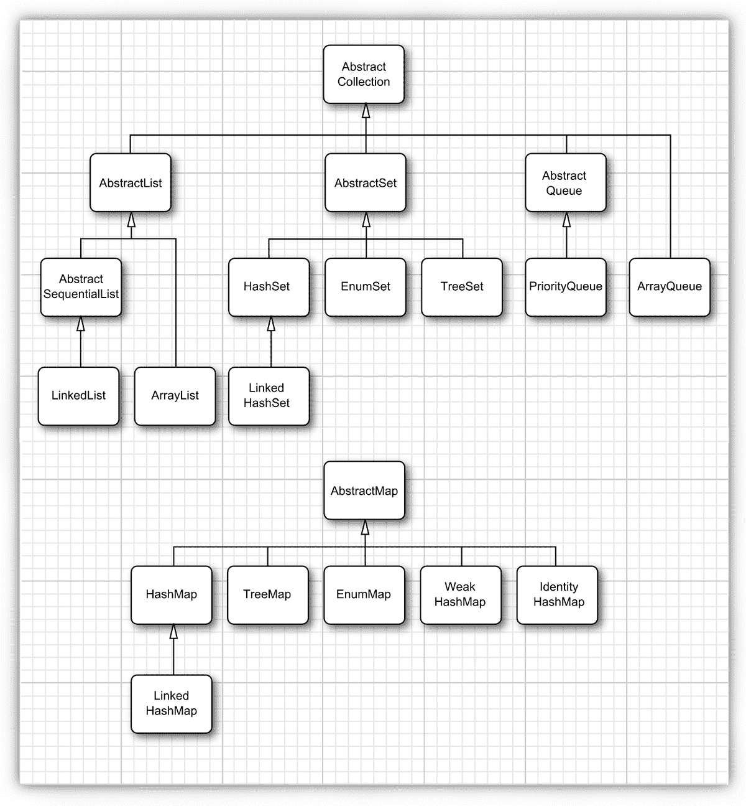

**图9.5** 集合框架中的类

### 9.3.1 链表

我们在书中许多示例中已经使用了数组以及它们的动态亲戚`ArrayList`类。然而，数组和数组列表有一个主要的缺点。从数组中间删除元素是非常开销的，因为被删除元素之后的所有数组元素都必须向数组开头移动（参见图9.6）。在数组中间插入元素也是如此。


**图9.6** 从数组中删除元素

另一种著名数据结构——链表解决了这个问题。数组在连续的内存位置中存储对象引用，而链表将每个对象存储在独立的节点（link）中。每个节点还存储了指向序列中下一个节点的引用。在Java编程语言中，所有的链表实际上都是双向链表；也就是说，每个节点还存储了指向其前驱节点的引用（参见图9.7）。

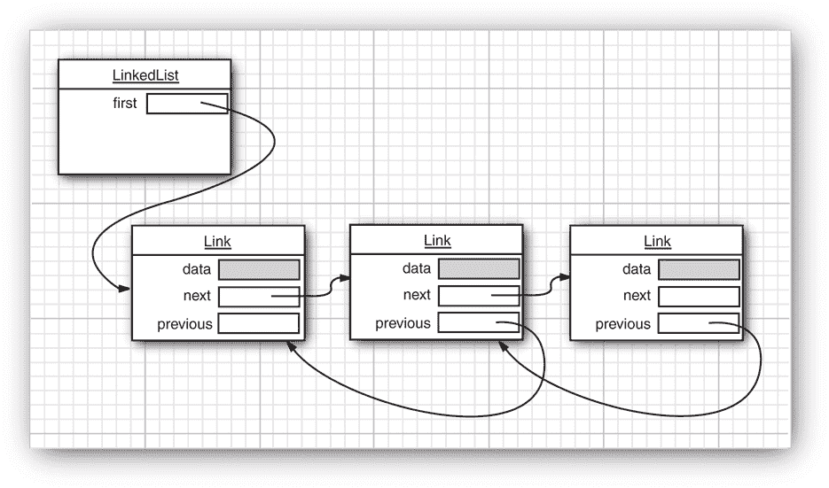

**图9.7** 双向链表

从链表中间删除元素是一个低开销的操作——只需要更新被删除元素周围的节点即可（参见图9.8）。

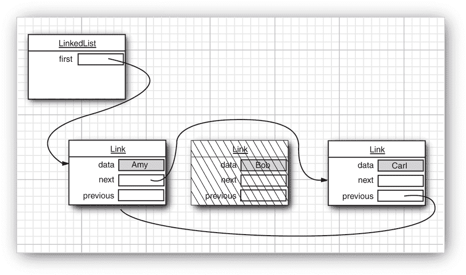

**图9.8** 从链表中删除元素

也许你曾经上过数据结构课程，并在课程中学习了如何实现链表。你可能对在链表中添加或删除元素时理错复杂的节点关系有糟糕的回忆。如果是这样，你会高兴地发现，Java集合库提供了一个供你使用的`LinkedList`类。

下面的代码示例添加了三个元素，然后删除了第二个：

```
var staff = new LinkedList<String>();
staff.add("Amy");
staff.add("Bob");
staff.add("Carl");
Iterator<String> iter = staff.iterator();
String first = iter.next(); // 访问第一个元素
String second = iter.next(); // 访问第二个元素
iter.remove(); // 删除最后访问的元素
```

然而，链表和通用集合之间存在一个重要的区别。链表是一个有序集合，其中对象的位置很重要。`LinkedList.add`方法将对象添加到列表末尾。但你通常想在列表中间某处添加对象。这种依赖位置的`add`方法是由迭代器负责的，因为迭代器描述了集合中的位置。使用迭代器添加元素仅对于具有自然顺序的集合才有意义。例如，我们在下一节中讨论的集合（set）数据类型对其元素不进行排序。因此，`Iterator`接口中没有`add`方法。相反，集合库提供了一个子接口`ListIterator`，它包含一个`add`方法：

```
interface ListIterator<E> extends Iterator<E>
{
   void add(E element);
   . . .
}
```

与`Collection.add`不同，此方法不返回`boolean`——假设`add`操作总是修改列表。

此外，`ListIterator`接口有两个方法可以用于反向遍历列表。

```
E previous()
boolean hasPrevious()
```

与`next`方法一样，`previous`方法返回它跳过的对象。

`LinkedList`类的`listIterator`方法返回一个实现`ListIterator`接口的迭代器对象。

```
ListIterator<String> iter = staff.listIterator();
```

`add`方法在迭代器位置之前添加新元素。例如，下面的代码跳过了链表中的第一个元素，并在第二个元素之前添加`"Juliet"`（参见图9.9）：

```
var staff = new LinkedList<String>();
staff.add("Amy");
staff.add("Bob");
staff.add("Carl");
ListIterator<String> iter = staff.listIterator();
iter.next(); // 跳过第一个元素
iter.add("Juliet");
```

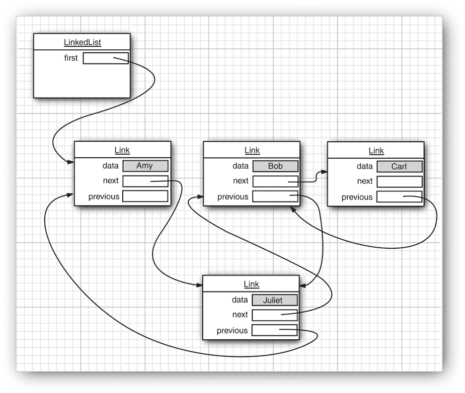

**图9.9** 向链表中添加元素

并发修改检测是通过一种简单的方式实现的。集合会记录变异操作（如添加和删除元素）的数量。每个迭代器都会单独记录由该`it`负责的变异操作数量。在每个迭代器方法的开始处，迭代器简单地检查自身的变异计数是否与集合的计数相等。如果不相等，它将抛出一个`ConcurrentModificationException`。

 备注

然而，并发修改检测中有一个奇特的异常。链表只跟踪列表的`结构性`修改，例如添加和删除链接。`set`方法**不**被视为结构性修改。你可以为链表附加多个迭代器，并且所有这些迭代器都可以通过调用`set`方法来更改现有链接的内容。这种能力对于我们在本章稍后将讨论的`Collections`类中的许多算法是必不可少的。

现在，你已经了解了`LinkedList`类的基本方法。使用`ListIterator`可以双向遍历链链表的元素，并进行添加和删除操作。

正如你在第9.2节中所示，第508页的“集合框架中的接口”，许多其他操作链表的有用方法已在`Collection`接口中声明。这些方法大部分在`LinkedList`类的父类`AbstractCollection`中实现。例如，`toString`方法会调用所有元素的`toString`并生成一个格式为`[A, B, C]`的长字符串。这对于调试非常有用。使用`contains`方法可以检查元素是否存在于链表中。例如，如果调用`staff.contains("Harry")`且链表已经包含一个与字符串`"Harry"`相等的字符串，则返回`true`。

该库还提供了一些从理论角度来看有些可疑的方法。链表不支持快速的随机访问。如果你想查看链表的第`n`个元素，你必须从开始处并跳过前`n - 1`个元素。没有捷径。由于这个原因，程序员通常不会在需要通过整数索引访问元素的情况下使用链表。

尽管如此，`LinkedList`类仍提供了一个`get`方法，让你能够访问特定元素：

```
LinkedList<String> list = . . .;
String obj = list.get(n);
```

当然，这个方法并不高效。如果你发现自己在使用它，那么你可能为你的问题使用了错误的数据结构。

你**永远不要**使用这种幻幻的随机访问方法来遍历链表。以下代码

```
for (int i = 0; i < list.size(); i++)
   do something with list.get(i);
```

效率低得惊人。每当你查找另一个元素时，搜索都会从列表开始重新开始。`LinkedList`对象并没有尝试缓存位置信息。

 备注

`get`方法有一个微小的优化：如果索引至少为`size() / 2`，则元素的搜索将从列表末尾开始。

列表迭代器接口还有一个方法可以告诉你当前位置的索引。事实上，由于Java迭代器在概念上指向元素之间，因此它有两个这样的方法：`nextIndex`方法返回下一次调用`next`将返回元素的整数索引；`previousIndex`方法返回下一次调用`previous`将返回元素的索引。当然，它仅仅比`nextIndex`小1。这些方法非常高效——迭代器会维护其当前位置的计数。最后，如果你有一个整数索引`n`，那么`list.listIterator(n)`返回一个指向索引为`n`的元素之前的迭代器。也就是说，调用`next`产生的元素与`list.get(n)`相同；但获取该迭代器本身是低效的。

如果你有一个链表只有几个元素，你就不必过度担心`get`和`set`方法的代价。但既然如此，起初为什么要用链表呢？使用链表的唯一理由是最小化在列表中间插入和删除的代价。如果你只有几个元素，可以使用`ArrayList`。

我建议你直接避开所有使用整数索引来表示链表中位置的方法。如果你想对集合进行随机访问，请使用数组或`ArrayList`，而不是链表。

代码列表9.1中的程序让链表发挥了作用。它只是创建了两个列表并将它们合并，然后从第二个列表中删除每第二个元素，最后测试了`removeAll`方法。我建议你跟踪程序流并特别关注迭代器。你可能会发现绘制迭代器位置的图很有帮助，如下：

```
|ACE  |BDFG
A|CE  |BDFG
AB|CE B|DFG
. . .
```

注意，调用

```
System.out.println(a);
```

通过调用`toString`打印链表`a`中的所有元素。

**9.1** `LinkedListTest.java`

```java
package linkedList;

import java.util.*;

/**
 * 此程序演示了链表的操作。
 * @version 1
 * @author Cay
 */
public class LinkedListTest {
    public static void main(String[] args)
    {
        var a = new LinkedList<String>();
        a.add("Amy");
        a.add("Carl");
        a.add("Frances");

        var b = new LinkedList<String>();
        b.add("Doug");
        b.add("Gloria");

        // 将b中的单词合并到a
        ListIterator<String> aIter = a.listIterator();
        Iterator<String> bIter = b.iterator();

        while (bIter.hasNext())
        {
            if (aIter.hasNext()) aIter.next();
            aIter.add(bIter.next());
        }

        System.out.println(a);

        // 从b中删除每第二个单词
        bIter = b.iterator();
        while (bIter.hasNext())
        {
            bIter.next(); // 跳过一个元素
            if (bIter.hasNext())
            {
                bIter.next(); // 跳过下一个元素
                bIter.remove(); // 删除该元素
            }
        }

        System.out.println(b);

        // 批量操作：从a中移除b的所有单词
        a.removeAll(b);

        System.out.println(a);
    }
}
```


## 1.2 `java.util.List<E>`

- `ListIterator<E> listIterator()`

  返回一个访问列表元素的迭代器。

- `ListIterator<E> listIterator(int index)`

  返回一个访问列表元素的迭代器，其首次调用`next`将返回指定索引的元素。

- `void add(int i, E element)`

  在指定位置添加元素。

- `void addAll(int i, Collection<? extends E> elements)`

  在指定位置添加集合中的所有元素。

- `E remove(int i)`

  移除并返回指定位置的元素。

- `E get(int i)`

  获取指定位置的元素。

- `E set(int i, E element)`

  用新元素替换指定位置的元素并返回旧元素。

- `int indexOf(Object element)`

  返回与指定元素相等的第一次出现的位置，如果没有找到匹配的元素则返回`-1`。

- `int lastIndexOf(Object element)`

  返回与指定元素相同的最后一个元素的位置，如果没有找到匹配的元素，则返回`-1`。

### `java.util.ListIterator<E>` 1.2

- `void add(E newElement)`

  在当前位置之前添加一个元素。

- `void set(E newElement)`

  用新元素替换由`next()`或`previous()`访问的最后一个元素。如果自上一次调用`next()`或`previous()`之后列表结构被修改过，则抛出`IllegalStateException`。

- `boolean hasPrevious()`

  如果在反向遍历列表时还有元素可以访问，则返回`true`。

- `E previous()`

  返回上一个对象。如果已到达列表开头，则抛出`NoSuchElementException`。

- `int nextIndex()`

  返回下次调用`next()`将返回的元素索引。

- `int previousIndex()`

  返回下次调用`previous()`将返回的元素索引。

### `java.util.LinkedList<E>` 1.2

- `LinkedList()`

  构造一个空链表。

- `LinkedList(Collection<? extends E> elements)`

  构造一个链表并添加集合中的所有元素。

- `void addFirst(E element)`
- `void addLast(E element)`

  在列表的开头或结尾添加一个元素。

- `E getFirst()`
- `E getLast()`

  返回列表开头或结尾的元素。

- `E removeFirst()`
- `E removeLast()`

  删除并返回列表开头或结尾的元素。

#### 9.3.2 Array Lists

在前面的章节中，你看到了`List`接口和实现它的的`LinkedList`类。`List`接口描述了一个有序集合，其中元素的位置非常重要。访问元素有两种协议：通过迭代器以及通过`get()`和`set()`方法进行随机访问。后者并不适用于链表，但对于数组来说，`get()`和`set()`是非常有意义的。集合库提供了熟悉的`ArrayList`类，它也实现了`List`接口。`ArrayList`封装了一个动态重新分配内存的对象数组。

 备注

如果你是一位资深 Java 程序员，在需要动态数组时可能一直使用`Vector`类。为什么要使用`ArrayList`而不是`Vector`呢？原因非常简单：`Vector`类的所有方法都是同步的。从两个线程访问`Vector`对象是安全的。但如果你只从单个线程访问向量——这在目前是常见得多的情况——你的代码会在同步操作上浪费大量时间。相比之下，`ArrayList`的方法不是同步的。我建议在不需要同步的情况下，尽可能使用`ArrayList`而不是`Vector`。

#### 9.3.3 Hash Sets

链表和数组允许你指定想要排列元素的顺序。然而，如果你在寻找某个特定元素且不记得它的位置，你就需要访问所有元素直到找到匹配项为止。如果集合包含许多元素，这可能会非常耗时。如果你不在乎元素的顺序，则有一些数据结构可以让你更快地找到元素。缺点是，这些数据结构无法对元素出现的顺序进行任何控制。这些数据结构按照方便自身用途的顺序来组织元素。

快速查找对象的已知数据结构是哈希表（hash table）。哈希表为每个对象计算一个称为哈希码（hash code）的整数。哈希码以某种方式从对象的实例字段派生，最好是使得不同数据的对象产生不同的代码。表 9.2 列出了`String`类`hashCode()`方法产生的一些哈希码示例。

**表 9.2** 由`hashCode`方法产生的哈希码

| String | Hash Code |
| --- | --- |
| `"Lee"` | `76268` |
| `"lee"` | `107020` |
| `"eel"` | `100300` |

如果你定义了自己的类，则你需要负责实现你自己的`hashCode()`方法——更多信息请参阅第 5 章。你的实现需要与`equals()`方法兼容：如果`a.equals(b)`，那么`a`和`b`必须具有相同的哈希码。

现在重要的是，哈希码可以被快速计算，且该计算仅取决于需要哈希处理的对象的状态，而不依赖于哈希表中的其他对象。

在 Java 中，哈希表被实现为链表的数组。每个列表被称为一个桶（bucket）（参见图 9.10）。要找到对象在表中的位置，计算它的哈希码并对桶的总数取模。得到的数字就是存放该元素的桶的索引。例如，如果一个对象的哈希码为 76268 且有 128 个桶，那么该对象被放置在 108 号桶中（因为余数`76268 % 128`是 108）。也许你很幸运，该桶中没有其他元素。那么你只需插入该元素即可。

Java 集合库提供了一个`HashSet`类，它实现了一个基于哈希表的集合。你使用`add`方法添加元素。`contains`方法被重写，以便快速查找以判断某个元素是否已存在于集合中。它只检查单个桶（bucket）中的元素，而不是集合中的所有元素。

哈希集合迭代器会依次访问所有的桶。由于哈希处理会将元素散布在表中，因此它们被访问的顺序看起来是随机的。如果你不在乎集合中元素的顺序，你就可以使用`HashSet`。

本节末尾的示例程序（Listing 9.2）从`System.in`读取单词，将其添加到集合中，并最后打印集合中的前二十个单词。例如，你可以通过命令行终端启动程序，并将来自爱丽丝仙境游记的文本输入给程序（你可以从[`www.gutenberg.org`](http://www.gutenberg.org) 获取）：

```
java SetTest < alice30.txt
```

程序读取输入中的所有单词并将其添加到哈希集合中。然后，它遍历集合中的唯一单词并最后打印出一个计数。（爱丽丝仙境游记有 5,909 个唯一单词，包括开头的版权声明。）这些单词以随机顺序出现。

 注意

在变异集合元素时要小心。如果元素的哈希值发生变化，该元素将不再处于数据结构的正确位置。

**Listing 9.2** `set/SetTest.java`

点击此处查看代码图片

```
 1 package set;
 2
 3 import java.util.*;
 4
 5 /**
 6  * 此程序使用集合打印 System.in 中所有的唯一单词。
 7  * @version 1.12 2015-06-21
 8  * @author Cay Horstmann
 9  */
10 public class SetTest
11 {
12    public static void main(String[] args)
13    {
14       var words = new HashSet<String>();
15       long totalTime = 0;
16
17       try (var in = new Scanner(System.in))
18       {
19          while (in.hasNext())
20          {
21             String word = in.next();
22             long callTime = System.currentTimeMillis();
23             words.add(word);
24             callTime = System.currentTimeMillis() - callTime;
25             totalTime += callTime;
26          }
27       }
28
29       Iterator<String> iter = words.iterator();
30       for (int i = 1; i <= 20 && iter.hasNext(); i++)
31          System.out.println(iter.next());
32       System.out.println(". . .");
33       System.out.println(words.size() + " distinct words. " + totalTime + " milliseconds.");
34   }
35 }
```

**`java.util.HashSet<E>`** **1.2**

- `HashSet()`

  构造一个空的哈希集合。

- `HashSet(Collection<? extends E> elements)`

  构造一个哈希集合并添加集合中的所有元素。

- `HashSet(int initialCapacity)`

  构造一个具有指定容量（桶的数量）的空哈希集合。

- `HashSet(int initialCapacity, float loadFactor)`

  构造一个具有指定容量和负载因子的空哈希集合。如果大小/容量超过负载因子，哈希表将重新哈希到一个更大的表中。

**`java.lang.Object`** **1.0**

- `int hashCode()`

  返回此对象的哈希值。哈希值可以是任意整数，正负均可。`equals`和`hashCode`的定义必须兼容：如果`x.equals(y)`为`true`，那么`x.hashCode()`的值必须与`y.hashCode()`相同。

#### 9.3.4 Tree Sets

`TreeSet`类与哈希集合类似，但增加了一项改进。树集合是一个有序集合。你可以以任何顺序将元素插入集合中。当你遍历集合时，值将按排序顺序自动呈现。例如，假设你插入了三个字符串，然后访问你添加的所有元素。

点击此处查看代码图片

```
var sorter = new TreeSet<String>();
sorter.add("Bob");
sorter.add("Amy");
sorter.add("Carl");
for (String s : sorter) System.out.println(s);
```

然后，值按排序顺序打印：`Amy Bob Carl`。正如类名所示，排序是通过树形数据结构实现的。（当前的实现使用了红黑树。关于红黑树的详细描述，请参见例如 Thomas Cormen、Charles Leiserson、Ronald Rivest 和 Clifford Stein 所出的 *Introduction to Algorithms*, The MIT Press, 2009。）每当元素被添加到树中时，它都会被放置在正确的排序位置。因此，迭代器始终按排序顺序访问元素。

向树中添加元素比向哈希表中添加元素慢——比较请参见表 9.3。但它仍然比在数组或链表中检查重复项要快得多。如果树包含 *n* 个元素，则平均需要 log[2] *n* 次比较来为新元素找到正确位置。例如，如果树已经包含 1,000 个元素，添加新元素大约需要 10 次比较。

 注意

为了使用树集合，你必须能够比较元素。元素必须实现`Comparable`接口，或者你需要在构造集合时提供一个`Comparator`。（`Comparable`和`Comparator`接口在第 6 章中引入。）

**表 9.3** 向哈希和树集合添加元素

| 文档 | 单词总数 | 唯一单词数 | HashSet | TreeSet |
| --- | --- | --- | --- | --- |
| *爱丽丝仙境游记* | 28,195 | 5,909 | 5 秒 | 7 秒 |
| *基督山伯爵* | 46,300 | 37,545 | 75 秒 | 98 秒 |

如果你回顾表 9.3，你可能会很好奇自己是否应该始终使用树集合而不是哈希集合。毕竟，添加元素似乎并没有慢多少，而且元素是自动排序的。答案取决于你正在收集的数据。如果你不需要数据排序，就没有理由为排序开销买单。更重要的是，对于某些数据，制定排序顺序比制定哈希函数困难得多。哈希函数只需要对对象进行相当不错的打乱，而比较函数必须能够精确地区分对象。

为了使这种区别更具体，考虑收集一组矩形的任务。如果你使用`TreeSet`，你需要提供一个`Comparator<Rectangle>`。你如何比较两个矩形？按面积？这不可行。你可以拥有坐标不同但面积相同的矩形。树的排序必须是全序。任何两个元素都必须是比较的，且只有在元素相等时比较结果才为零。矩形确实有这样的排序顺序（其坐标的字典序），但计算起来不自然且复杂。相比之下，`Rectangle`类已经定义了哈希函数。它只需哈希坐标。

从 Java 6 开始，`TreeSet`类实现了`NavigableSet`接口。该接口为定位元素和反向遍历提供了几种方便的方法。详情请参见 API 注释。

Listing 9.3 中的程序构建了两个`Item`对象的树集合。第一个按零件号排序，这是`Item`对象的默认排序顺序。第二个集合按描述排序，使用自定义的比较器。

```java
package treeSet;

import java.util.*;

/**
 * 此程序通过比较描述对一组 Item 对象进行排序。
 * @version 1.13 2018-04-10
 * @author Cay Horstmann
 */
public class TreeSetTest
{
    public static void main(String[] args)
    {
       var parts = new TreeSet<Item>();
       parts.add(new Item("Toaster", 1234));
       parts.add(new Item("Widget", 4562));
       parts.add(new Item("Modem", 9912));
       System.out.println(parts);

       var sortByDescription = new TreeSet<Item>(Comparator.comparing(Item::getDescription));
       sortByDescription.addAll(parts);
       System.out.println(sortByDescription);
    }
}
```

**列表 9.4** `treeSet/Item.java`

点击此处查看代码图像

```java
package treeSet;

import java.util.*;

/**
 * 具有描述和零件号的项目。
 */
public class Item implements Comparable<Item>
{
  private String description;
  private int partNumber;

  /**
   * 构造项目。
   * @param aDescription 项目的描述
   * @param aPartNumber 项目的零件号
   */
  public Item(String aDescription, int aPartNumber)
  {
     description = aDescription;
     partNumber = aPartNumber;
  }

  /**
   * 获取此项目的描述。
   * @return 描述信息
   */
  public String getDescription()
  {
    return description;
  }

  public String toString()
  {
    return "[description=" + description + ", partNumber=" + partNumber + "]";
  }

  public boolean equals(Object otherObject)
  {
    if (this == otherObject) return true;


```
if (otherObject == null) return false;

if (getClass() != otherObject.getClass()) return false;

var other = (Item) otherObject;

return Objects.equals(description, other.description) && partNumber == other.partNumber;
```

```
public int hashCode()
{
    return Objects.hash(description, partNumber);
}

public int compareTo(Item other)
{
    int diff = Integer.compare(partNumber, other.partNumber);
    return diff != 0 ? diff : description.compareTo(other.description);
}
```

### `java.util.TreeSet<E>` 1.2

* `TreeSet()`
* `TreeSet(Comparator<? super E> comparator)` 构建一个空的树集合。
* `TreeSet(Collection<? extends E> elements)`
* `TreeSet(SortedSet<E> s)` 构造一个树集合并添加集合或排序集合中的所有元素（对于后者，使用相同的排序）。

### `java.util.SortedSet<E>` 1.2

* `Comparator<? super E> comparator()` 返回用于排序元素的比较器；如果元素是通过 `Comparable` 接口的 `compareTo` 方法进行比较的，则返回 `null`。
* `E first()`
* `E last()` 返回排序集合中最小或最大的元素。

### `java.util.NavigableSet<E>` 6

* `E higher(E value)`
* `E lower(E value)` 返回大于 `value` 的最小元素或小于 `value` 的最大元素；如果没有这样的元素则返回 `null`。
* `E ceiling(E value)`
* `E floor(E value)` 返回大于等于 `value` 的最小元素或小于等于 `value` 的最大元素；如果没有这样的元素则返回 `null`。
* `E pollFirst()`
* `E pollLast()` 移除并返回集合中最小或最大的元素；如果集合为空则返回 `null`。
* `Iterator<E> descendingIterator()` 返回一个按降序遍历此集合的迭代器。

#### 9.3.5 队列和双端队列

正如我们已经讨论过的，队列（`queue`）允许你高效地在尾部添加元素并从头部移除元素。双端队列（`deque`）允许高效地在头部和尾部添加或移除元素。不支持在中间添加元素。Java 6 引入了 `Deque` 接口。它由 `ArrayDeque` 和 `LinkedList` 类实现，这两个类都提供了大小随需要增长的双端队列。在第 12 章中，你将看到边界队列和双端队列。

### `java.util.Queue<E>` 5

* `boolean add(E element)`
* `boolean offer(E element)` 将给定元素添加到此队列的尾部，如果队列未满则返回 `true`。如果队列已满，第一个方法抛出 `IllegalStateException`，而第二个方法返回 `false`。
* `E remove()`
* `E poll()` 如果队列不为空，则移除并返回队列头部的元素；如果队列为空，第一个方法抛出 `NoSuchElementException`，而第二个方法返回 `null`。
* `E element()`
* `E peek()` 如果队列不为空，则返回队列头部的元素而不移除它；如果队列为空，第一个方法抛出 `NoSuchElementException`，而第二个方法返回 `null`。

### `java.util.Deque<E>` 6

* `void addFirst(E element)`
* `void addLast(E element)`
* `boolean offerFirst(E element)`
* `boolean offerLast(E element)` 将给定元素添加到此队列的头部或尾部。如果队列已满，前两个方法抛出 `IllegalStateException`，而后两个方法返回 `false`。
* `E removeFirst()`
* `E removeLast()`
* `E pollFirst()`
* `E pollLast()` 如果队列不为空，则移除并返回头部或尾部的元素；如果队列为空，前两个方法抛出 `NoSuchElementException`，而后两个方法返回 `null`。
* `E getFirst()`
* `E getLast()`
* `E peekFirst()`
* `E peekLast()` 如果队列不为空，则返回头部或尾部的元素而不移除它；如果队列为空，前两个方法抛出 `NoSuchElementException`，而后两个方法返回 `null`。

### `java.util.ArrayDeque<E>` 6

* `ArrayDeque()`
* `ArrayDeque(int initialCapacity)` 构建一个初始容量为 16 或给定容量的无界双端队列。

### 9.3.6 优先级队列

优先级队列（`priority queue`）在任意顺序插入后按排序顺序检索元素。也就是说，每当你调用 `remove` 方法时，你都会得到当前队列中最小的元素。然而，优先级队列并没有对所有元素进行排序。如果你遍历元素，它们并不一定是有序的。优先级队列利用了一种名为堆（`heap`）的优雅且高效的数据结构。堆是一种自组织的二叉树，其中 `add` 和 `remove` 操作会使最小元素向根节点移动，而无需花费时间排序所有元素。

优先级队列的一个典型用途是任务调度。每个任务都有一个优先级。任务按随机顺序添加。当有新任务可以启动时，从队列中移除优先级最高的任务。（由于传统上优先级 1 是“最高”优先级，因此 `remove` 操作产生最小元素。）

列表 9.5 展示了优先级队列的运行。与 `TreeSet` 的迭代不同，这里的迭代并不按顺序访问元素。然而，移除操作总是返回剩余的最小元素。

```java
package priorityQueue;

import java.util.*;
import java.time.*;

/**
 * 此程序演示了优先级队列的使用。
 * @version 1.02 2015-06-20
 * @author Cay Horstmann
 */
public class PriorityQueueTest
{
    public static void main(String[] args)
    {
        var pq = new PriorityQueue<LocalDate>();
        pq.add(LocalDate.of(1906, 12, 9)); // G. Hopper
        pq.add(LocalDate.of(1815, 12, 10)); // A. Lovelace
        pq.add(LocalDate.of(1903, 12, 3)); // J. von Neumann
        pq.add(LocalDate.of(1910, 6, 22)); // K. Zuse

        System.out.println("Iterating over elements . . .");
        for (LocalDate date : pq)
            System.out.println(date);
        System.out.println("Removing elements . . .");
        while (!pq.isEmpty())
            System.out.println(pq.remove());
    }
}
```

`java.util.PriorityQueue` 5

* `PriorityQueue()`
* `PriorityQueue(int initialCapacity)` 构造一个用于存储 `Comparable` 对象的优先级队列。
* `PriorityQueue(int initialCapacity, Comparator<? super E> c)` 构造一个优先级队列并使用指定的比较器对它的元素进行排序。

## 9.4 Maps（映射）

集合（`Set`）是一个允许你快速查找现有元素的集合。然而，要查找一个元素，你需要拥有该元素的精确副本才能找到。这并不是常见的查找方式——通常，你拥有某些键信息，并想要查找关联的元素。`map` 数据结构正是为此设计的。map 存储键/值对。如果你提供键，就可以找到对应的值（`value`）。例如，你可能会存储一个员工记录表，其中键是员工 ID，值是 `Employee` 对象。在接下来的章节中，你将学习如何操作 map。

### 9.4.1 基础 Map 操作

Java 库提供了两个通用的 map 实现：`HashMap` 和 `TreeMap`。这两个类都实现了 `Map` 接口。

hash map 对键进行哈希处理，而 tree map 则使用键的排序来将它们组织在搜索树中。哈希函数或比较函数*仅应用于键*。与键关联的值不会被进行哈希处理或比较。

你应该选择 hash map 还是 tree map 呢？和集合一样，哈希处理通常要快一点，如果你不需要按照排序顺序访问键，那么它是首选方案。

以下是如何设置一个用于存储员工的 hash map 的：

```java
var staff = new HashMap<String, Employee>();
var harry = new Employee("Harry");
staff.put("987-9996", harry);
```

每当你向 map 中添加一个对象时，都必须提供一个键（`key`）。在我们的案例中，键是一个字符串，对应值是一个 `Employee` 对象。要检索对象，你必须使用（并记住）该键。

```java
var id = "987-9996";
Employee e = staff.get(id); // gets harry
```

如果 map 中没有存储特定键的信息，`get` 返回 `null`。`null` 返回值可能会带来不便。有时，你有一个很好的默认值，可以用于 map 中不存在的键。这种情况下请使用 `getOrDefault` 方法。

```java
Map<String, Integer> scores = . .
int score = scores.getOrDefault(id, 0); // gets 0 if not present
```

键必须是唯一的。你不能使用相同的键存储两个值。如果你用相同的键调用两次 `put` 方法，第二个值将替换第一个值。事实上，`put` 返回与其键关联的旧值。`remove` 方法从 map 中删除具有给定键的元素。`size` 方法返回 map 中条目的数量。遍历 map 的键和值最简单的方法是 `forEach` 方法。提供一个接收键和值的 Lambda 表达式。该表达式会依次为 map 中的每个条目被调用。

```java
scores.forEach((k, v) ->
   System.out.println("key=" + k + ", value=" + v));
```

列表 9.6 展示了 map 的工作原理。我们首先向 map 添加键/值对。然后，我们从 map 中删除一个键，这也会删除其关联的值。接下来，我们更改与键关联的值，并调用 `get` 方法来查找值。最后，我们遍历条目集（`entrySet`）。

**列表 9.6** `map/MapTest.java`

```java
package map;

import java.util.*;

/**
 * 此程序演示了键类型为 String、值类型为 Employee 的 map 使用。
 * @version 1.12 2015-06-21
 * @author Cay Horstmann
 */
public class MapTest
{
    public static void main(String[] args)
    {
        var staff = new HashMap<String, Employee>();
        staff.put("144-25-5464", new Employee("Amy Lee"));
        staff.put("567-24-2546", new Employee("Harry Hacker"));
        staff.put("157-62-7935", new Employee("Gary Cooper"));
        staff.put("456-62-5527", new Employee("Francesca Cruz"));

        // print all entries
        System.out.println(staff);

        // remove an entry
        staff.remove("567-24-2546");

        // replace an entry
        staff.put("456-62-5527", new Employee("Francesca Miller"));

        // look up a value
        System.out.println(staff.get("157-62-7935"));

        // iterate through all entries
        staff.forEach((k, v) ->
            System.out.println("key=" + k + ", value=" + v));
    }
}
```


# `java.util.Map<K, V>` 1.2

*   `V get(Object key)`
    获取与键关联的值；如果 map 中未找到该键，则返回 `null`。
*   `default V getOrDefault(Object key, V defaultValue)`
    获取与键关联的值；如果 map 中未找到该键，则返回 `defaultValue`。
*   `V put(K key, V value)`
    将键值关联放入 map 中。如果键已存在，新对象将替换之前与键关联的对象。此方法返回键的旧值，如果之前不存在，则返回 `null`。实现类可能不允许 `null` 键或值。
*   `void putAll(Map<? extends K, ? extends V> entries)`
    将指定 map 的所有条目添加到此 map 中。
*   `boolean containsKey(Object key)`
    如果 map 中存在该键，则返回 `true`。
*   `boolean containsValue(Object value)`
    如果 map 中存在该值，则返回 `true`。
*   `default void forEach(BiConsumer<? super K,? super V> action)` 8
    对 map 中的所有键/值对应用操作。

# `java.util.HashMap<K, V>` 1.2

*   `HashMap()`
*   `HashMap(int initialCapacity)`
*   `HashMap(int initialCapacity, float loadFactor)`
    构造一个具有指定容量和负载因子的空 hash map（0.0 到 1.0 之间的数字，决定了哈希表在达到多少百分比填充率时重新哈希为更大的表）。默认负载因子为 `0.75`。

# `java.util.TreeMap<K,V>` 1.2

*   `TreeMap()`
    构造一个实现 `Comparable` 接口的空 tree map。
*   `TreeMap(Comparator<? super K> c)`
    构造一个 tree map 并使用指定的比较器对键进行排序。
*   `TreeMap(Map<? extends K, ? extends V> entries)`
    构造一个 tree map 并添加 map 的所有条目。
*   `TreeMap(SortedMap<? extends K, ? extends V> entries)`
    构造一个 tree map，添加排序 map 的所有条目，并使用与给定排序 map 相同的元素比较器。

# `java.util.SortedMap<K, V>` 1.2

*   `Comparator<? super K> comparator()`
    返回用于排序键的比较器；如果键是通过 `Comparable` 接口的 `compareTo` 方法进行比较的，则返回 `null`
*   `K firstKey()`
*   `K lastKey()`
    返回 map 中最小或最大的键。

## 9.4.2 更新 Map 条目

处理 map 时一个棘手的部分是更新条目。通常，你获取与键关联的旧值，更新它，然后将更新后的值放回去。但你必须考虑键第一次出现的特殊情况。考虑使用 map 来统计一个单词在文件中出现的次数。当我们看到一个单词时，想要像这样增加计数器：

```java
counts.put(word, counts.get(word) + 1);
```

这种方法可以工作，但在 `word` 第一次遇到时除外。此时 `get` 返回 `null`，并抛出 `NullPointerException`。

简单的补救方法是使用 `getOrDefault` 方法：

```java
counts.put(word, counts.getOrDefault(word, 0) + 1);
```

另一种方法是先调用 `putIfAbsent` 方法。它只有在键之前不存在（或映射到 `null`）时才会放入一个值。

```java
counts.putIfAbsent(word, 0);
counts.put(word, counts.get(word) + 1); // 现在我们知道 get 将成功了
```

但你可以做得更好。`merge` 方法简化了这种常用操作。调用

```java
counts.merge(word, 1, Integer::sum);
```

如果该键之前不存在，则将 `word` 与 `1` 关联；否则，则使用 `Integer::sum` 函数将旧值和 `1` 合并。

API 备注描述了其他不常用的更新 map 条目的的方法。

## `java.util.Map<K, V>` 1.2

*   `default V merge(K key, V value, BiFunction<? super V,? super V,? extends V> remappingFunction)` `8`
    如果 `key` 关联一个非-`null` 值 `v`，则将函数应用于 `v` 和 `value`，并将 `key` 与结果关联，或者如果结果为 `null`，则移除该键。否则，将 `key` 与 `value` 关联。返回 `get(key)`。
*   `default V compute(K key, BiFunction<? super K,? super V,? extends V> remappingFunction)` 8
    将函数应用于 `key` 和 `get(key)`。或将 `key` 与结果关联，或者如果结果为 `null`，则移除该键。返回 `get(key)`。
*   `default V computeIfPresent(K key, BiFunction<? super K,? super V,? extends V> remappingFunction)` 8
    如果 `key` 关联一个非-`null` 值 `v`，则将函数应用于 `key` 和 `v`，并将 `key` 与结果关联，或者如果结果为 `null`，则移除该键。返回 `get(key)`。
*   `default V computeIfAbsent(K key, Function<? super K,? extends V> mappingFunction)` 8
    除非 `key` 关联一个非-`null` 值，否则将函数应用于 `key`。或将 `key` 与结果关联，或者如果结果为 `null`，则移除该键。返回 `get(key)`。
*   `default void replaceAll(BiFunction<? super K,? super V,? extends V> function)` 8
    对所有条目调用该函数。将键与非-`null` 结果关联，并移除结果为 `null` 的键。
*   `default V putIfAbsent(K key, V value)` 8
    如果 `key` 不存在或关联到 `null`，则将其与 `value` 关联并返回 `null`。否则返回关联的值。

## 9.4.3 Map 视图

集合框架并不将 map 本身视为集合。（其他数据结构框架将 map 视为键/值对的集合，或视为由键索引的值集合。）然而，你可以获取 map 的*视图*——即实现了 `Collection` 接口或其子接口之一的对象。

有三种视图：键的集合、值的集合（它不是集合）以及键/值对的集合。键和键/值对形成了一个集合，因为 map 中只能有一个键的副本。以下方法

```java
Set<K> keySet()
Collection<V> values()
Set<Map.Entry<K, V>> entrySet()
```

返回这三种视图。（entry set 的元素是实现 `Map.Entry` 接口的类的对象。）

注意 `keySet` 并不是 `HashSet` 或 `TreeSet`，而是实现 `Collection` 接口的对象。`keySet` 扩展了 `Collection` 接口。例如，你可以枚举所有的键：

```java
Set<String> keys = map.keySet();
for (String key : keys)
{
   do something
}
```

如果你想同时看到键和值，可以通过 `var` 避免使用 `Map.Entry`：

```java
for (Map.Entry<String, String> entry : map.entrySet())
{
   String k = entry.getKey();
   String v = entry.getValue();
   do something
}
```

或者简单使用 `forEach` 方法：

```java
map.forEach((k, v) ->
   do something
   );
```

如果你调用键集迭代器的 `remove` 方法，你实际上移除了键及其关联的值。然而，你不能向键集*添加*元素。在不添加值的情况下添加键是没有意义的。如果你尝试调用 `add` 方法，将抛出 `UnsupportedException`。

## 9.4.4 弱哈希 Map

集合类库有一些针对特殊需求的 map 类，我们将在本节及后续章节中简要讨论。

`WeakHashMap` 类设计用于解决一个有趣的问题。当一个键不再被程序的任何地方使用时，其值会发生什么？假设指向键的最后一个引用已经消失。那么，再没有方法可以引用该值对象了。但由于程序的任何部分都不持有该键，因此键/值对无法从 map 中移除。为什么垃圾回收器不能移除它？移除未使用的对象不是垃圾回收器的工作吗？

遗憾的是，事情并没有那么简单。垃圾回收器会追踪 `live`（活跃）对象。只要 map 对象是活跃的，它其中的 `all`（所有）桶都是活跃的，不会被回收。因此，你的程序应该注意从长寿命 map 中移除未使用的值。或者，你可以使用 `WeakHashMap`。这种数据结构与垃圾回收器配合工作，当键的唯一引用是哈希表条目的引用时，就会移除键值对。

这里是该机制的内部原理。`WeakHashMap` 使用 `weak references`（弱引用）来持有键。`WeakReference` 对象持有对另一个对象的引用——在我们的例子中，是一个哈希表的键。这种类型的对象会被垃圾回收器以特殊方式处理。通常情况下，如果垃圾回收器发现某个对象没有指向它的引用，它会直接回收该对象。然而，如果该对象 `only` 通过一个 `WeakReference` 可访问，垃圾回收器仍然回收该对象，但会将指向它的弱引用放入队列中。`WeakHashMap` 的操作会定期检查该队列，看是否有新到达的弱引用。队列中出现弱引用意味着该键不再被任何人使用并已被收集。`WeakHashMap` 随后移除关联条目。

## 9.4.5 链接哈希集和映射

`LinkedHashSet` 和 `LinkedHashMap` 类会记住你插入项的顺序。这样，你就可以避免哈希表中项看似随机的顺序。当条目被插入到表中时，它们会被连接进一个双向链表中（参见图 9.11）。

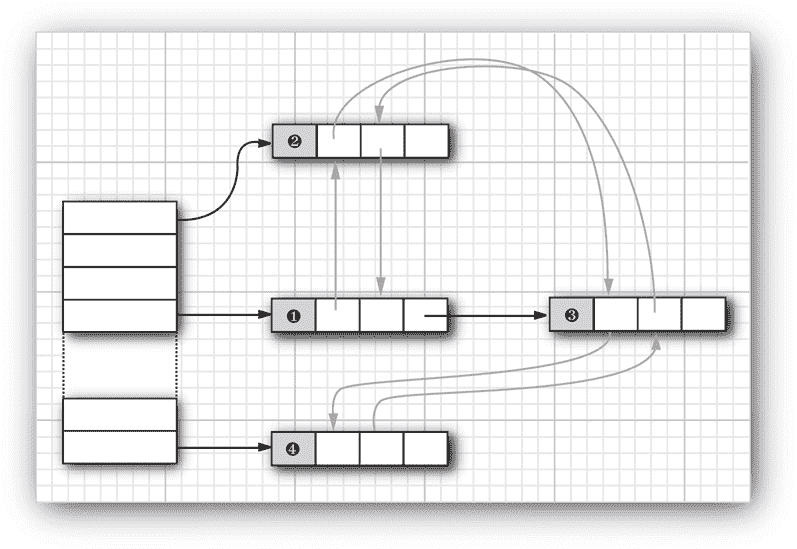

**图 9.11** 链接哈希表

例如，考虑来自列表 9.6 的以下 map 插入操作：

```java
var staff = new LinkedHashMap<String, Employee>();
staff.put("144-25-5464", new Employee("Amy Lee"));
staff.put("567-24-2546", new Employee("Harry Hacker"));
staff.put("157-62-7935", new Employee("Gary Cooper"));
staff.put("456-62-5527", new Employee("Francesca Cruz"));
```

然后，`staff.keySet().iterator()` 按照此顺序枚举键：

```
144-25-5464
567-24-2546
157-62-7935
456-62-5527
```

而 `staff.values().iterator()` 按照此顺序枚举值：

```
Amy Lee
Harry Hacker
Gary Cooper
Francesca Cruz
```

链接哈希 map 也可以使用 `access order`（访问顺序）而非插入顺序来遍历 map 条目。每当你调用 `get` 或 `put` 时，受影响的条目会被从其当前位置移除并置于条目链表的 `end`（末尾）。（只有条目链表中的位置受影响，而不影响哈希表桶。条目始终留在与键的哈希码对应的桶中。）要构建这样的哈希 map，调用：

```java
LinkedHashMap<K, V>(initialCapacity, loadFactor, true)
```

访问顺序常用于实现缓存的“最久未使用”策略。例如，你可能希望将频繁访问的条目保留在内存中，而从数据库读取较不频繁访问的对象。当不在表中找到条目且表已经相当满时，你可以获取表的迭代器，并移除它枚举的前几个元素。那些条目就是最久未被使用的项。

你甚至可以自动化该过程。创建一个 `LinkedHashMap` 的子类并重写该方法：

```java
protected boolean removeEldestEntry(Map.Entry<K, V> eldest)
```

此时，每当你的方法返回 `true` 时，添加新条目就会导致 `eldest` 条目被移除。例如，以下缓存的大小保持在最多 100 个元素以内：

```java
var cache = new LinkedHashMap<K, V>(128, 0.75F, true)
   {
      protected boolean removeEldestEntry(Map.Entry<K, V> eldest)
      {
         return size() > 100;
      }
   };
```

或者，你可以考虑根据 `eldest` 条目来决定是否移除它。例如，你可能想要检查与条目一起存储的时间戳。

## 9.4.6 集合和映射

`EnumSet` 是一种高效的集合实现，其元素属于一个枚举类型。由于枚举类型的实例数量是有限的，`EnumSet` 在内部被简单地实现为位位序列。如果对应的值于集合中，则该对应的位被开启。

`EnumSet` 类没有公共的构造函数。使用静态工厂方法来构造集合：

```java
enum MONDAY, TUESDAY, WEDNESDAY, THURSDAY, FRIDAY, SATURDAY, SUNDAY {} Day
EnumSet<Day> days = EnumSet.of(MONDAY, TUESDAY);
EnumSet<Day> allDays = EnumSet.range(MONDAY, SUNDAY);
EnumSet<Day> noDays = EnumSet.noneOf(Day.class);
EnumSet<Day> copyDays = EnumSet.copyOf(days);
```

`EnumMap` 是一个键为枚举类型的 map。它在内部被简单地实现为数组。

```java
enum MONDAY, TUESDAY, WEDNESDAY, THURSDAY, FRIDAY, SATURDAY, SUNDAY {} Day
Map<Day, String> map = new EnumMap<>(Day.class);
map.put(MONDAY, "Mon");
map.put(TUESDAY, "Tue");
map.put(WEDNESDAY, "Wed");
map.put(THURSDAY, "Thu");
map.put(FRIDAY, "Fri");
map.put(SATURDAY, "Sat");
map.put(SUNDAY, "Sun");
```

`EnumMap` 提供了公共构造函数。使用枚举的类来构造 map。

```java
enum MONDAY, TUESDAY, WEDNESDAY, THURSDAY, FRIDAY, SATURDAY, SUNDAY {} Day
Map<Day, String> map = new EnumMap<>(Day);
```


在`EnumSet`的 API 文档中，你会看到形式如`E extends Enum<E>`的奇怪类型参数。这仅仅意味着“`E`是枚举类型”。

 注意

### 9.4.7 标识哈希映射

`IdentityHashMap`有非常特殊的用途。在这里，键的哈希值不通过`hashCode`方法计算，而是通过`System.identityHashCode`方法计算。这是`Object.hashCode`使用从内存地址计算哈希的方法。此外，在比较对象时，`IdentityHashMap`使用`==`而不是`equals`。

句话之，即使对象内容相同，它们也被视为不同的。该类用于实现对象遍历算法，例如对象序列化，在其中你希望跟踪哪些对象已经被遍历过。

- `static <E extends Enum<E>> EnumSet<E> allOf(Class<E> enumType)`
  返回一个包含给定枚举类型所有值的可变集合。

- `static <E extends Enum<E>> EnumSet<E> noneOf(Class<E> enumType)`
  返回一个初始为空的可变集合。

- `static <E extends Enum<E>> EnumSet<E> range(E from, E to)`
  返回一个包含`from`和`to`之间所有值（包含两者）的可变集合。

- `static <E extends Enum<E>> EnumSet<E> of(E e) . . .`

- `static <E extends Enum<E>> EnumSet<E> of(E e1, E e2, E e3, E e4, E e5)`

- `static <E extends Enum<E>> EnumSet<E> of(E first, E... rest)`
  返回一个包含给定元素的可变集合，这些元素不能为`null`。

- `public static <E extends Enum<E>> EnumSet<E> copyOf(EnumSet<E> s)`

- `public static <E extends Enum<E>> EnumSet<E> copyOf(Collection<E> c)`
  创建一个初始包含给定元素的可变集合。在第二种方法中，`c`必须是`EnumSet`或者非空（以便确定元素类型）。

### `java.util.EnumMap<K extends Enum<K>, V>` 5

- `EnumMap(Class<K> keyType)`
  构造一个空的可变映射，其键具有给定类型。

### `java.util.IdentityHashMap<K, V>` 1.4

- `IdentityHashMap()`

- `IdentityHashMap(int expectedMaxSize)`
  构造一个空的恒等哈希映射，其容量是超过 1.5 × `expectedMaxSize` 的最小 2 的幂次。（`expectedMaxSize`的默认值为`21`。）

### `java.lang.System` 1.0

- `static int identityHashCode(Object obj)` 1.1
  返回与`Object.hashCode`计算相同的哈希码（源自对象的内存地址），即使`obj`所属的类重新定义了`hashCode`方法。

### 9.5 拷贝与视图（Copies and Views）

如果你查看图 9.4 和图 9.5，你可能会认为为了大量的接口和抽象类来实现极少量的具体集合类是多此一举。然而，这些图并没有说明全貌。通过使用*视图 (views)*，你可以获得实现`Collection`或`Map`接口的其他对象。你已经在映射类的`keySet`方法中看到过这方面的例子。乍一看，该方法似乎创建了一个新集合，填充了映射中所有的键并返回它。但事实并非如此。相反，`keySet`方法返回一个实现`Set`接口的类对象，其方法操作的是原始映射。这样的集合被称为*视图*。

视图技术在集合框架中有许多实用的应用。我们将在接下来的章节中讨论这些应用。

#### 9.5.1 小型集合（Small Collections）

Java 9 引入了静态方法，用于产生带有给定元素的集合或列表，以及带有给定键值对的映射。

例如，

```
List<String> names = List.of("Peter", "Paul", "Mary");

Set<Integer> numbers = Set.of(2, 3, 5);
```

这产生了一个包含三个元素的列表和一个集合。对于映射，你可以像这样指定键和值：

```
Map<String, Integer> scores = Map.of("Peter", 2, "Paul", 3, "Mary", 5);
```

元素、键或值不能为`null`。集合和映射的键不能重复：

```
numbers = Set.of(13, null); // 错误--null 元素

scores = Map.of("Peter", 4, "Peter", 2); // 错误--重复键
```

 注意

这些集合和映射的迭代顺序不作任何保证。事实上，该顺序是故意打乱的，并使用的种子在每次虚拟机启动时都是随机的。查看这两个`jshell`运行结果：

```
$ jshell -q

jshell> Set.of("Peter", "Paul", "Mary")

$1 ==> [Peter, Mary, Paul]

jshell> /exit

$ jshell -q

jshell> Set.of("Peter", "Paul", "Mary")

$1 ==> [Paul, Mary, Peter]
```

一些 Java 程序员编写程序时，其正确性依赖于“实现细节永远不会改变”这一假设。这使得库的实现者很难做出有用的实现更改。在这种情况下，信息非常明确——不要编写假设元素顺序的程序。

`List`和`Set`接口有 11 个`of`方法，参数个数从 0 到 10 不等。（*注：原文后续内容存在乱码，此处已根据技术语境截断处理*）

`Collections`类提供了可以生成集合的**不可修改视图**（unmodifiable views）的方法。这些视图在现有集合上添加了运行时检查。如果检测到尝试修改不可修改集合的尝试，将抛出异常。

然而，如果原始集合发生了变化，视图会反映这些变化。这正是视图（views）与拷贝（copies）的区别。

你可以通过八种方法获取不可修改视图：

```
Collections.unmodifiableCollection

Collections.unmodifiableList

Collections.unmodifiableSet

Collections.unmodifiableSortedSet

Collections.unmodifiableNavigableSet

Collections.unmodifiableMap

Collections.unmodifiableSortedMap

Collections.unmodifiableNavigableMap
```

每个方法都定义为基于接口工作。例如，`Collections.unmodifiableList`作用于`ArrayList`、`LinkedList`或任何实现`List`接口的类。

例如，假设你想让代码的某部分查看但不要修改集合的内容。你可以这样做：

```
var staff = new LinkedList<String>();

. . .

lookAt(Collections.unmodifiableList(staff));
```

`Collections.unmodifiableList`方法返回一个实现`List`接口类的对象。它的访问方法从`staff`集合中检索值。当然，`lookAt`方法可以调用`List`接口的所有方法，而不仅仅是访问器。但所有的修改器方法（如`add`）都已重新定义，其变为抛出`UnsupportedOperationException`，而不是将调用转发给底层集合。

不可修改视图并不会让集合本身变为不可变的。你仍然可以通过原始引用（在本例中为`staff`）来修改集合。你仍然可以对集合中的元素调用修改器方法。

视图包装的是接口（interface）而不是实际的集合对象，因此你只能访问接口中定义的方法。例如，`LinkedList`类具有便利方法`addFirst`和`addLast`，它们并不属于`List`接口的一部分。这些方法无法通过不可修改视图访问。

 注意

`unmodifiableCollection`方法（以及本节稍后讨论的`synchronizedCollection`和`checkedCollection`方法）返回一个集合，其`equals`方法*不会*调用底层集合的`equals`方法。相反，它继承了`Object`类的`equals`方法，该方法仅测试对象是否相同。如果你将一个集合或列表转换为普通集合，你无法再测试内容是否相等。视图以这种方式运行，是因为在层次结构的这个级别上，相等性测试没有良好的定义。视图处理`hashCode`方法的方式相同。

然而，`unmodifiableSet`和`unmodifiableList`方法使用了底层集合的`equals`和`hashCode`方法。

### 9.5.3 子范围 (Subranges)

你可以为许多集合创建子范围视图。例如，假设你有一个列表`staff`，并想提取索引 10 到 19 的元素。使用`subList`方法获取该列表子范围的视图：

```
List<Employee> group2 = staff.subList(10, 20);
```

第一个索引是包含的，第二个索引是不包含的——这与`String`类中`substring`操作的参数一致。

你可以对子范围应用任何操作，这些操作会自动反映到整个列表中。例如，你可以删除整个子范围：

```
group2.clear(); // staff 缩减
```

元素会自动从`staff`列表中清除，且`group2`变为空。

对于排序集合和映射，你使用排序顺序而不是元素位置来形成子范围。`SortedSet`接口声明了三个方法：

```
SortedSet<E> subSet(E from, E to)

SortedSet<E> headSet(E to)

SortedSet<E> tailSet(E from)
```

这些方法返回所有大于或等于`from`且严格小于`to`的元素的子集。对于排序映射，类似的方法

```
SortedMap<K, V> subMap(K from, K to)

SortedMap<K, V> headMap(K to)

SortedMap<K, V> tailMap(K from)
```

返回映射视图，其中所有`keys`落在指定范围内的条目。

Java 6 引入的`NavigableSet`接口对这些子范围操作提供了更多控制。你可以指定是否包含边界：

```
NavigableSet<E> subSet(E from, boolean fromInclusive, E to, boolean toInclusive)

NavigableSet<E> headSet(E to, boolean toInclusive)

NavigableSet<E> tailSet(E from, boolean fromInclusive)
```

### 9.5.4 检查视图 (Checked Views)

检查视图旨在解决在使用泛型时可能出现的问题。正如第 8 章](#ch08.xhtml_ch8) 所解释的，实际上可以将错误类型的元素混入泛型集合。例如：

```
var strings = new ArrayList<String>();

ArrayList rawList = strings; // 只有警告，不是错误

rawList.add(new Date()); // 现在 strings 包含了 Date!
```

错误的`add`命令在运行时不会被检测。相反，当代码的其他部分调用`get`并将其转换为`String`时，会发生类型转换异常。

检查视图可以检测到这一点。如下定义安全列表：

```
List<String> safeStrings = Collections.checkedList(strings, String.class);
```

视图的`add`方法会检查插入的对象是否属于指定的类，如果不符合则立即抛出`ClassCastException`。这样做的好处是错误出现在正确的位置：

```
ArrayList rawList = safeStrings;

rawList.add(new Date()); // 检查列表抛出 ClassCastException
```

检查视图限于虚拟机可以执行的检查。例如，如果你有一个`ArrayList<Pair<String>>`，你无法防止它插入`Pair<Date>`，因为虚拟机只有一个“原始”`Pair`类。

### 9.5.5 同步视图 (Synchronized Views)

如果你从多个线程访问集合，你需要确保集合不会被意外损坏。例如，当一个线程尝试重新哈希元素时，另一个线程尝试添加元素，将是灾难性的。

库设计师没有实现线程安全的集合类，而是使用视图机制来使普通集合安全。例如，`Collections`类中的静态`synchronizedMap`方法可以将任何映射转换为具有同步方法的`Map`：

```
var map = Collections.synchronizedMap(new HashMap<String, Employee>());
```


现在你可以从多个线程访问 `map` 对象。`get` 和 `put` 等方法是同步的——每个方法调用完成后，另一个线程才能调用其他方法。我们在第 12 章](#ch12.xhtml_ch12) 中更详细地讨论了数据结构同步访问的问题。

### 9.5.6 关于可选操作的说明

视图（view）通常具有某些限制——它可能是只读的，可能无法更改大小，或者支持删除但不支持插入（例如 `map` 的键视图）。如果你尝试执行不适当的操作，受限的视图将抛出 `UnsupportedOperationException`。

在集合（collection）和迭代器（iterator）接口的 API 文档中，许多方法被描述为“可选操作”。这似乎与接口的理念相冲突。根结底，接口的目的不就是定义类*必须*实现的方法吗？诚然，从理论角度来看，这种安排是不如意的。一个更好的解决方案可能是为只读视图和无法更改集合大小的视图设计独立的接口。然而，这将使接口数量增加三倍，库的设计者认为这是不可接受的。

你是否应该将这种“可选”方法的技术扩展到你自己的设计中？我不认为应该。尽管集合被频繁使用，但实现它们的编码风格在其他问题领域并不典型。集合类库的设计者必须解决一组特别严苛的冲突需求。用户希望库易于学习、方便使用、完全通用、防呆，并且同时像手写的算法一样高效。要同时实现所有这些目标是不可能的，即使是接近也难。但在你自己的编程问题中，你很少遇到这样极端的约束。你应该能够找到不依赖于“可选”接口操作这种极端措施的解决方案。

### `java.util.List` 1.2

* `static <E> List<E> of()` **9**
* `static <E> List<E> of(E e1)` **9**
* `. . .`
* `static <E> List<E> of(E e1, E e2, E e3, E e4, E e5, E e6, E e7, E e8, E e9, E e10)` **9**
* `static <E> List<E> of(E... elements)` **9**  
  返回给定元素的不可修改列表，这些元素不能为 `null`。
* `static <E> List<E> copyOf(Collection<? extends E> coll)` **10**  
  返回给定集合的不可修改拷贝。

### `java.util.Set` 1.2

* `static <E> Set<E> of()` **9**
* `static <E> Set<E> of(E e1)` **9**
* `. . .`
* `static <E> Set<E> of(E e1, E e2, E e3, E e4, E e5, E e6, E e7, E e8, E e9, E e10)` **9**
* `static <E> Set<E> of(E... elements)` **9**  
  返回给定元素的不可修改集合，这些元素不能为 `null`。
* `static <E> Set<E> copyOf(Collection<? extends E> coll)` **10**  
  返回给定集合的不可修改拷贝。

### `java.util.Map` 1.2

* `static <K, V> Map<K, V> of()` **9**
* `static <K, V> Map<K, V> of(K k1, V v1)` **9**
* `. . .`
* `static <K,V> Map<K,V> of(K k1, V v1, K k2, V v2, K k3, V v3, K k4, V v4, K k5, V v5, K k6, V v6, K k7, V v7, K k8, V v8, K k9, V v9, K k10, V v10)` **9**  
  返回给定键值对的不可修改 `map`，这些键值不能为 `null`。
* `static <K,V> Map.Entry<K,V> entry(K k, V v)` **9**  
  返回给定键和值的不可修改 `map` 条目，这些键值不能为 `null`。
* `static <K,V> Map<K,V> ofEntries(Map.Entry<? extends K,? extends V>... entries)` **9**  
  返回给定条目的不可修改 `map`。
* `static <K, V> Map<K,V> copyOf(Map<? extends K,? extends V> map)` **10**  
  返回给定 `map` 的不可修改拷贝。

### `java.util.Collections` 1.2

* `static <E> Collection unmodifiableCollection(Collection<E> c)`
* `static <E> List unmodifiableList(List<E> c)`
* `static <E> Set unmodifiableSet(Set<E> c)`
* `static <E> SortedSet unmodifiableSortedSet(SortedSet<E> c)`
* `static <E> SortedSet unmodifiableNavigableSet(NavigableSet<E> c)` **8**
* `static <K, V> Map unmodifiableMap(Map<K, V> c)`
* `static <K, V> SortedMap unmodifiableSortedMap(SortedMap<K, V> c)`
* `static <K, V> SortedMap unmodifiableNavigableMap(NavigableSet<E> c)` **8**  
  构造集合的视图；该视图的变更方法将抛出 `UnsupportedOperationException`。
* `static <E> Collection<E> synchronizedCollection(Collection<E> c)`
* `static <E> List synchronizedList(List<E> c)`
* `static <E> Set synchronizedSet(Set<E> c)`
* `static <E> SortedSet synchronizedSortedSet(SortedSet<E> c)`
* `static <E> SortedSet synchronizedNavigableSet(NavigableSet<E> c)` **8**
* `static <K, V> Map synchronizedMap(Map<K, V> c)`
* `static <K, V> SortedMap synchronizedSortedMap(SortedMap<K, V> c)`
* `static <K, V> SortedMap synchronizedNavigableMap(NavigableSet<E> c)` **8**
* `static <E> Collection<E> checkedCollection(Collection<E> c)`
* `static <E> List checkedList(List<E> c)`
* `static <E> Set checkedSet(Set<E> c)`
* `static <E> SortedSet checkedSortedSet(SortedSet<E> c)`
* `static <E> SortedSet checkedNavigableSet(NavigableSet<E> c)` **8**
* `static <K, V> Map checkedMap(Map<K, V> c)`
* `static <K, V> SortedMap checkedSortedMap(SortedMap<K, V> c)`
* `static <K, V> SortedMap checkedNavigableMap(NavigableSet<E> c)` **8**  
  构造集合的视图；该视图的变更方法将抛出 `UnsupportedOperationException`。
* `static <E> Collection<E> synchronizedCollection(Collection<E> c)`
* `static <E> List synchronizedList(List<E> c)`
* `static <E> Set synchronizedSet(Set<E> c)`
* `static <E> SortedSet synchronizedSortedSet(SortedSet<E> c)`
* `static <E> SortedSet synchronizedNavigableSet(NavigableSet<E> c)` **8**
* `static <K, V> Map synchronizedMap(Map<K, V> c)`
* `static <K, V> SortedMap synchronizedSortedMap(SortedMap<K, V> c)`
* `static <K, V> SortedMap synchronizedNavigableMap(NavigableSet<E> c)` **8**  
  构造集合的视图；该视图的变更方法将抛出 `UnsupportedOperationException`。
* `static <E> Collection<E> unmodifiableCollection(Collection<E> c)`
* `static <E> List unmodifiableList(List<E> c)`
* `static <E> Set unmodifiableSet(Set<E> c)`
* `static <E> SortedSet unmodifiableSortedSet(SortedSet<E> c)`
* `static <E> SortedSet unmodifiableNavigableSet(NavigableSet<E> c)` **8**
* `static <K, V> Map unmodifiableMap(Map<K, V> c)`
* `static <K, V> SortedMap unmodifiableSortedMap(SortedMap<K, V> c)`
* `static <K, V> SortedMap unmodifiableNavigableMap(NavigableSet<E> c)` **8**  
  构造集合的视图；该视图的变更方法将抛出 `UnsupportedOperationException`。
* `static <E> Collection<E> synchronizedCollection(Collection<E> c)`
* `static <E> List synchronizedList(List<E> c)`
* `static <E> Set synchronizedSet(Set<E> c)`
* `static <E> SortedSet synchronizedSortedSet(SortedSet<E> c)`
* `static <E> SortedSet synchronizedNavigableSet(NavigableSet<E> c)` **8**
* `static <K, V> Map synchronizedMap(Map<K, V> c)`
* `static <K, V> SortedMap synchronizedSortedMap(SortedMap<K, V> c)`
* `static <K, V> SortedMap synchronizedNavigableMap(NavigableSet<E> c)` **8**  
  构造集合的视图；该视图的变更方法将抛出 `UnsupportedOperationException`。

* `NavigableMap<K, V> tailMap(K to, boolean toIncluded)`  
  返回一个键在指定范围内的条目视图。`boolean` 标志决定视图中是否包含边界。

## 9.6 算法

除了实现集合类之外，Java 集合框架还提供了许多实用的算法。在接下来的章节中，你将看到如何使用这些算法，以及如何编写与集合框架良好协作的自定义算法。

### 9.6.1 为什么使用泛型算法？

泛型集合接口有一个巨大的优势——你只需要实现一次算法。例如，考虑一个计算集合中最大元素的简单算法。在传统上，程序员会用循环来实现这种算法。以下是你可以找到数组中最大元素的方法：

点击此处查看代码图片

```


```


```java
if (a.length == 0) throw new NoSuchElementException();

T largest = a[0];

for (int i = 1; i < a.length; i++)

   if (largest.compareTo(a[i]) < 0)

      largest = a[i];
```

当然，要找到`ArrayList`中的最大值，你写的代码略有不同。

点击此处查看代码图片

```java
if (v.size() == 0) throw new NoSuchElementException();

T largest = v.get(0);

for (int i = 1; i < v.size(); i++)

   if (largest.compareTo(v.get(i)) < 0)

      largest = v.get(i);
```

链表呢？你无法对链表进行高效的随机访问，但你可以使用迭代器（iterator）。

点击此处查看代码图片

```java
if (l.isEmpty()) throw new NoSuchElementException();

Iterator<T> iter = l.iterator();

T largest = iter.next();

while (iter.hasNext())

{

   T next = iter.next();

   if (largest.compareTo(next) < 0)

      largest = next;
}
```

这些循环写起来非常冗燥，而且容易出错。是否存在差一错误（off-by-one error）？循环对于空容器是否正常工作？对于只有一个元素的容器是否正常工作？你不想每次都对这些代码进行测试和调试，但也不实现一大堆方法，例如这些：

点击此处查看代码图片

```java
static <T extends Comparable> T max(T[] a)

static <T extends Comparable> T max(ArrayList<T> v)

static <T extends Comparable> T max(LinkedList<T> l)
```

这正是集合接口大显用场的地方。考虑高效执行该算法所需的*最小*集合接口。使用`get`和`set`的随机访问在需求链上的位置高于简单的迭代。正如你在计算链表最大元素时所见的，这项任务不需要随机访问。

### 9.6.2 排序与洗牌

`Collections`类提供了多种排序算法。例如，`sort`方法根据给定的`Comparator`对列表进行排序。如果你想逆序排序列表，可以使用`Collections.reverseOrder()`。

`Collections`类还有一个`shuffle`算法，它的作用与排序相反——它随机打乱列表中元素的顺序。

```java
 1 package shuffle;

 2

 3 import java.util.*;

 4

 5 /**

 6  * 此程序演示了随机洗牌和排序算法。

 7  * @version 1.12 2018-04-10

 8  * @author Cay Horstmann

 9  */

10 public class ShuffleTest

11 {

12    public static void main(String[] args)

13    {

14      var numbers = new ArrayList<Integer>();

15      for (int i = 1; i <= 49; i++)

16         numbers.add(i);

17      Collections.shuffle(numbers);

18      List<Integer> winningCombination = numbers.subList(0, 6);

19      Collections.sort(winningCombination);

20      System.out.println(winningCombination);

21    }

22  }
```

### `java.util.Collections` 1.2

- `static <T extends Comparable<? super T>> void sort(List<T> elements)`

  使用稳定排序算法对列表中的元素进行排序。该算法保证的运行时间为 O(*n* log *n*)，其中 *n* 是列表的长度。

- `static void shuffle(List<?> elements)`
- `static void shuffle(List<?> elements, Random r)`

  随机洗牌列表中的元素。该算法的运行时间为 O(*n a*(*n*))，其中 *n* 是列表的长度，*a*(*n*) 是访问一个元素的平均时间。

### `java.util.List<E>` 1.2

- `default void sort(Comparator<? super T> comparator)` 8

  使用给定的比较器对此列表进行排序。

### `java.util.Comparator<T>` 1.2

- `static <T extends Comparable<? super T>> Comparator<T> reverseOrder()` 8

  产生一个反转`Comparable`接口提供的排序的比较器。

- `default Comparator<T> reversed()` 8

  产生一个反转此比较器所提供的排序的比较器。

### 9.6.3 二分查找

要在数组中找到一个对象，通常需要遍历所有元素，直到找到匹配项。然而，如果数组是排序过的，你可以查看中间元素并检查它是否大于你正在尝试查找的元素。如果是，继续在数组的前半部分查找；否则，在后半部分查找。这会将问题减半，你以相同的方式继续下去。例如，如果数组有 1024 个元素，你将在 10 步后定位匹配项（或确认不存在），而线性搜索在元素存在时平均需要 512 步，而确认其不存在则需要 1024 步。

`Collections`类的`binarySearch`实现了这种算法。请注意，集合必须已经是已排序的，否则算法将返回错误答案。要查找一个元素，请提供集合（必须实现`List`接口——更多信息请见下文注释）和要查找的元素。如果集合不是通过`Comparable`接口的`compareTo`元素排序的，请也提供一个比较器对象。

点击此处查看代码图片

```java
i = Collections.binarySearch(c, element);

i = Collections.binarySearch(c, element, comparator);
```

`binarySearch`方法返回的非负值表示匹配对象的索引。也就是说，在比较顺序下，`c.get(i)`等于`element`。如果值为负数，则表示没有匹配的元素。然而，你可以使用该返回值来计算你*应该*将`element`插入到集合中的哪个位置，以保持其排序。插入位置是：

```java
insertionPoint = -i - 1;
```

它并不是简单的`-i`，因为那样值`0`就会产生歧义。换句话说，该操作

```java
if (i < 0)

   c.add(-i - 1, element);
```

将元素添加到正确的位置。

为了有价值，二分查找需要随机访问。如果你必须逐个遍历链表的半部分来找到中间元素，你已经失去了二分查找的所有优势。因此，如果你给它链表，`binarySearch`算法将退化为线性搜索。

### `java.util.Collections` 1.2

- `static <T extends Comparable<? super T>> int binarySearch(List<T> elements, T key)`
- `static <T> int binarySearch(List<T> elements, T key, Comparator<? super T> c)`

  在排序的列表中查找`key`。如果元素类型实现了`RandomAccess`接口，则使用二分查找，在所有其他情况下使用线性搜索。这些方法保证的运行时间为 O(*a*(*n*) log *n*)，其中 *n* 是列表的长度，*a*(*n*) 是访问一个元素的平均时间。这些方法返回`key`在列表中的索引，或者如果`key`不在列表中则返回负值`i`。在这种情况下，`key`应该插入到列表索引`-i - 1`处。

### 9.6.4 简单算法

`Collections`类包含几个简单但实用的算法。其中`removeIf`和`replaceAll`稍微复杂。例如，`removeIf`接收一个 lambda 表达式进行测试；`replaceAll`更改所有匹配的元素。例如，这里我们将单词转换为小写：

点击此处查看代码图片

```java
words.removeIf(w -> w.length() <= 3);

words.replaceAll(String::toLowerCase);
```

### `java.util.Collections` 1.2

- `static <T extends Comparable<? super T>> T min(Collection<T> elements)`
- `static <T extends Comparable<? super T>> T max(Collection<T> elements)`
- `static <T> min(Collection<T> elements, Comparator<? super T> c)`
- `static <T> max(Collection<T> elements, Comparator<? super T> c)`

  返回最小或最大的元素。（参数已简化。）

- `static <T> void copy(List<? super T> to, List<T> from)`

  从源列表复制所有元素到目标列表相同的位置。目标列表必须与源列表一样长。

- `static <T> void fill(List<? super T> l, T value)`

  将列表的所有位置设置为相同的值。

- `static <T> boolean addAll(Collection<? super T> c, T... values)` 5

  将所有值添加到给定的集合，如果集合发生了变化则返回`true`。

- `static <T> boolean replaceAll(List<T> l, T oldValue, T newValue)` 1.4

  将所有等于`oldValue`的元素替换为`newValue`。

- `static int indexOfSubList(List<?> l, List<?> s)` 1.4
- `static int lastIndexOfSubList(List<?> l, List<?> s)` 1.4

  返回`l`中第一个或最后一个等于`s`的子列表的索引，如果`l`没有子列表等于`s`则返回`-1`。例如，如果`l`是`[s, t, a, r]`且`s`是`[t, a, r]`，那么两个方法都返回索引`1`。

- `static void swap(List<?> l, int i, int j)` 1.4

  交换指定偏移处的元素。

- `static void reverse(List<?> l)`

  反转列表元素的顺序。例如，反转列表`[t, a, r]`会得到列表`[r, a, t]`。该方法的运行时间为 O(*n*)，其中 *n* 是列表的长度。

- `static void rotate(List<?> l, int d)` 1.4

  旋转列表中的元素，将索引为`i`的条目移动到位置`(i + d) % l.size()`。例如，将列表`[t, a, r]`旋转`2`位将得到列表`[a, r, t]`。该方法在 O(*n*) 时间内运行，其中 *n* 是列表的长度。

- `static int frequency(Collection<?> c, Object o)` 5

  返回`c`中等于对象`o`的元素计数。

- `boolean disjoint(Collection<?> c1, Collection<?> c2)` 5

  如果两个集合没有共同的元素，则返回`true`。

### `java.util.Collection<T>` 1.2

- `default boolean removeIf(Predicate<? super E> filter)` 8

  删除所有匹配的元素。

### `java.util.List<E>` 1.2

- `default void replaceAll(UnaryOperator<E> op)` 8

  将操作应用到此列表的所有元素上。

### 9.6.5 批量操作

有几种操作可以“批量”复制或删除元素。调用

```java
coll1.removeAll(coll2);
```

会从`coll1`中删除所有存在于`coll2`中的元素。相反，

```java
coll1.retainAll(coll2);
```

会从`coll1`中删除所有*不在*`coll2`中的元素。这里有一个典型的应用场景。

假设你想找到两个集合的*交集*——即两个集合共有的元素。首先，创建一个新集合来存放结果。

点击此处查看代码图片

```java
var result = new HashSet<String>(firstSet);
```

在这里，我们利用了这样一个事实：每个集合都有构造函数，其参数是另一个持有初始化值的集合。

现在，使用`retainAll`方法：

点击此处查看代码图片

```java
result.retainAll(secondSet);
```

它保留了两个集合中都出现的所有元素。你无需编写循环就形成了交集。

你可以进一步扩展这一想法，并将批量操作应用到*视图*（view）。例如，假设你有一个将员工 ID 映射到员工对象的 map，并且有一组所有要终止的员工 ID 集合。

点击此处查看代码图片

```java
Map<String, Employee> staffMap = . . .;

Set<String> terminatedIDs = . . .;
```

只需形成键集并删除所有已终止员工的 ID 即可。

点击此处查看代码图片

```java
staffMap.keySet().removeAll(terminatedIDs);
```

由于键集是映射的一个视图，键和关联员工名称会自动从映射中删除。

通过使用子范围视图，你可以将批量操作限制在子列表和子集中。例如，假设你想将列表的前十个元素添加到另一个容器中。形成一个子列表来选出前十个：

点击此处查看代码图片

```java
relocated.addAll(staff.subList(0, 10));
```

子范围也可以作为修改操作的目标。

```java
staff.subList(0, 10).clear();
```

### 9.6.6 集合与数组之间的转换

Java 平台 API 的大部分内容是在集合框架创建之前就设计的。因此，你可能需要在传统数组和更现代的集合之间进行转换。

如果你有一个需要转换为集合的数组，`List.of`方法可以胜任此任务。例如：

点击此处查看代码图片

```java
String[] names = . . .;

List<String> staff = List.of(names);
```

从集合获取数组要稍微复杂一点。你可以使用`toArray`方法：

点击此处查看代码图片

```java
Object[] names = staff.toArray();
```

但结果是一个*对象*（objects）数组。即使你知道你的集合包含特定类型的对象，你无法直接进行类型转换：

点击此处查看代码图片

```java
String[] names = (String[]) staff.toArray(); //
```

`toArray`方法返回的数组是作为`Object[]`数组创建的，你无法更改其类型。相反，将数组构造表达式传递给`toArray`方法。返回的数组将按照*正确的数组类型*创建：

点击此处查看代码图片

```java
String[] values = staff.toArray(String[]::new);
```

 提示

在 JDK 11 之前，你必须使用`toArray`方法的另一种形式，传递一个正确类型的数组：

点击此处查看代码图片

```java
String[] values = staff.toArray(new String[0]);
```

在这种情况下，如果数组长度足够，它可以被重用：

点击此处查看代码图片

```java
String[] values = staff.toArray(new String[staff.size()]);
```


#### 7 编写算法

如果你编写自己的算法（实际上是任何以集合作为参数的方法），你应该尽可能与接口工作，而不是具体的实现。例如，假设你想处理项。你关心顺序吗？那么你应该接受`List`。`Iterable`接口有一个抽象方法`iterator`，增强型`for`循环在背后使用它。`Collection`接口继承自`Iterable`。

相反，如果你的方法返回多个元素，你不希望限制自己未来的改进。例如，考虑：

```java
public ArrayList<Item> lookupItems(. . .)
{
   var result = new ArrayList<Item>();
   . . .
   return result;
}
```

该方法返回`ArrayList`，尽管调用者几乎不在乎它是哪种列表。如果改为返回`List`，你可以随时通过调用`List.of`添加一个空列表或单例列表。

 提示

在这种情况下，接受`Iterable<Item>`会更好。现在，任何人都可以用`ArrayList`或`LinkedList`调用此方法，甚至可以用封装在`List.of`调用中的数组调用。

```java
public void processItems(Collection<Item> items)
{
   for (Item item : items)
      do something with item
}
```

然而，你现在限制了调用者——调用者必须提供`ArrayList`。如果项恰好在另一个集合中，它们首先需要重新包装。接受一个可以执行工作的通用接口要好得多：你可以接受任何集合。

## 9.7 遗留集合

在 Java 的第一个版本中，集合框架出现之前就已经存在“遗留”容器类。

它们已经集成到了集合框架中——参见图 9.12。

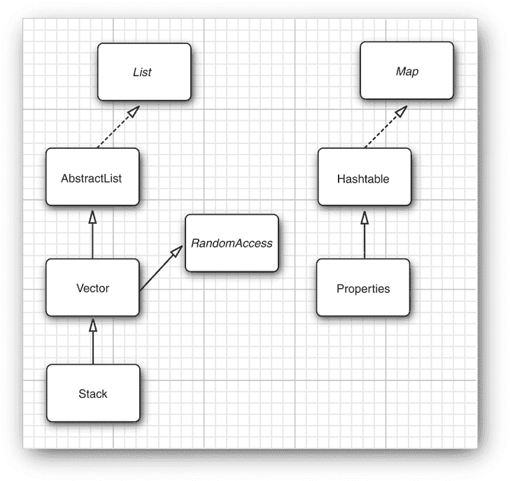

**图 9.12** 集合框架中的遗留类

我将在接下来的章节简要介绍它们。

### 9.7.1 `Hashtable` 类

经典的`Hashtable`类与`HashMap`类的作用相同，并且本质上具有相同的接口。就像`Vector`类的方法一样，`Hashtable`的方法是同步的。如果你不需要与旧留代码兼容，应该使用`HashMap`。如果你需要并发访问，请使用`ConcurrentHashMap`——请参阅第 12 章。

### 9.7.2 枚举

旧版集合使用`Enumeration`接口来遍历元素序列。`Enumeration`接口有两个方法：`hasMoreElements`和`nextElement`。这些与`Iterator`接口的`hasNext`和`next`方法完全对应。

如果你在旧版类中发现此接口，可以使用`Collections.list`将元素收集到`ArrayList`中。例如，`LogManager`类只愿意以`Enumeration`的形式暴露记录器名称。以下是获取所有名称的方法：

```java
ArrayList<String> loggerNames = Collections.list(LogManager.getLoggerNames());
```

或者，从 Java 9 开始，你可以将枚举转换为迭代器：

```java
LogManager.getLoggerNames().asIterator().forEachRemaining(n -> { . . . });
```

你偶尔会遇到需要枚举参数的旧版方法。静态方法`Collections.enumeration`产生一个枚举对象，用于枚举集合中的元素。例如：

```java
List<InputStream> streams = . . .;

var in = new SequenceInputStream(Collections.enumeration(streams));

// SequenceInputStream 构造函数期望一个枚举
```

 笔记

在 C++ 中，将迭代器作为参数是非常常见的。幸运的是，在 Java 平台上，很少有程序员使用这种惯用法。传递集合本身比传递迭代器要明得多。集合对象更有用。接收者在需要时可以随时从集合获取迭代器，而且他们可以使用所有的集合方法。然而，你会在某些旧代码中发现枚举，因为在 Java 1.2 集合框架出现之前，它们是通用集合唯一的可用机制。

`java.util.Enumeration<E>` 1.0

- `boolean hasMoreElements()`

  如果还有更多待检查的元素，则返回`true`。

- `E nextElement()`

  返回下一个待检查的元素。如果`hasMoreElements()`返回`false`，则不要调用此方法。

- `default Iterator<E> asIterator()` 9

  产生一个用于遍历枚举元素的迭代器。

`java.util.Collections` 1.2

- `static <T> Enumeration<T> enumeration(Collection<T> c)`

  返回一个枚举`c`中元素的枚举对象。

- `public static <T> ArrayList<T> list(Enumeration<T> e)`

  返回一个包含由`e`枚举元素的列表。

### 9.7.3 属性映射

*属性映射*（property map）是一种特殊类型的映射结构。它有三个显著特征：

- 键和值都是字符串。
- 映射可以很容易地保存到文件并从文件中加载。
- 有一个用于默认值的次级表。

实现属性映射的 Java 类称为`Properties`。属性映射对于指定程序的配置选项非常有用。例如：

```java
var settings = new Properties();

settings.setProperty("width", "600.0");

settings.setProperty("filename", "/home/cay/books/cj12/code/v1ch09/raven.html");
```

使用`store`方法将属性列表保存到文件。在这里，我们将属性映射保存到`program.properties`文件。第二个参数是包含在文件中注释。

```java
var out = new FileWriter("program.properties", StandardCharsets.UTF_8);

settings.store(out, "Program Properties");
```

示例给出了输出：

```properties
#Program Properties

#Sun Dec 31 12:54:19 PST 2017

top=227.0

left=1286.0

width=423.0

height=547.0

filename=/home/cay/books/cj12/code/v1ch09/raven.html
```

要从文件加载属性，使用：

```java
var in = new FileReader("program.properties", StandardCharsets.UTF_8);

settings.load(in);
```

 警告

如果你配合输入/输出流使用`load`和`store`方法，将使用过时的 ISO 编码，且 Unicode 字符将保存为转义字符。对于 UTF-8，请如上例所示配合`InputStream`和`OutputStream`使用`load`和`store`方法。

`Properties`是没有层级结构的简单表格。通常会使用如`window.main.color`、`window.main.title`等键名来引入一种伪层级结构。但`Properties`类没有可以帮助组织此类层级的方法。如果你需要存储复杂的配置信息，应该使用`Preferences`类——请参阅第 10 章。

### `java.util.Properties` 1.0

- `Properties()`

  创建一个空的属性映射。

- `Properties(Properties defaults)`

  创建一个带有默认值映射的空属性映射。

- `String getProperty(String key)`

  获取一个属性。返回与键关联的字符串；如果该键不在表中，则返回默认表中与键关联的字符串；如果该键在默认表中也不存在，则返回`null`。

- `String getProperty(String key, String defaultValue)`

  获取属性，如果未找到键，则返回默认值。返回与键关联的字符串；如果该键不在表中，则返回默认字符串。

- `Object setProperty(String key, String value)`

  设置一个属性。返回给定键之前设置的值。

- `Set<String> stringPropertyNames()` 6

  返回所有键的集合，包括默认映射中的键。

- `void load(Reader in) throws IOException` 6

  从读取器加载属性映射。

- `void store(Writer out, String header)` 6

  将属性映射保存到写入器。头部信息位于存储文件的第一行。

### `java.lang.System` 1.0

- `Properties getProperties()`

  检索所有系统属性。应用程序必须具有检索所有属性的权限，否则将抛出安全异常。

- `String getProperty(String key)`

  根据给定的键名检索系统属性。应用程序必须具有检索属性的权限，否则将抛出安全异常。以下属性可以始终被检索：

```text
java.version
java.vendor
java.vendor.url
java.home
java.class.path
java.library.path
java.class.version
os.name
os.version
os.arch
file.separator
path.separator
line.separator
java.io.tempdir
user.name
user.home
user.dir
java.compiler
java.specification.version
java.specification.vendor
java.specification.name
java.vm.specification.version
java.vm.specification.vendor
java.vm.specification.name
java.vm.version
java.vm.vendor
java.vm.name
```

### 9.7.4 栈（Stacks）

从 1.0 版本开始，标准库就有一个带有熟悉的`push`和`pop`方法的`Stack`类。然而，`Stack`类继承了`Vector`类，从理论角度来看这并不理想——你可以应用如`insert`和`remove`等非栈操作，在栈的任何位置插入和删除值，而不仅仅是栈顶。

### `java.util.Stack<E>` 1.0

- `E push(E item)`

  将`item`推入栈中并返回`item`。

- `E pop()`

  弹出并返回栈顶元素。如果栈为空，请勿调用此方法。

- `E peek()`

  返回栈顶元素但不弹出。如果栈为空，请勿调用此方法。

### 9.7.5 位集（Bit Sets）

Java 平台的`BitSet`类存储一个比特位序列。（它在数学意义上并不是一个集合——位向量或位数组是更准确的术语。）如果你高效地存储一个比特位序列（例如标志位），请使用位集。位集将比特位压缩到字节中，因此使用位集比使用`Boolean`对象的`ArrayList`要高效得多。

`BitSet`类为你提供了一个用于读取、设置和重置单个比特位的方便接口。使用此接口可以避免在`int`或`long`变量中存储比特位时所需的掩码和其他位运算操作。

例如，对于一个名为`bucketOfBits`的`BitSet`：

```java
bucketOfBits.get(i)
```

如果第`i`位为开启，则返回`true`，否则返回`false`。同样：

```java
bucketOfBits.set(i)
```

将第`i`位开启。最后：

```java
bucketOfBits.clear(i)
```

将第`i`位关闭。

 C++ 注意

C++ 的`bitset`模板与 Java 平台的`BitSet`相同的功能。

### `java.util.BitSet` 1.0

- `BitSet(int initialCapacity)`

  构造位集。

- `int cardinality()` 1.4

  返回设置的比特数量；或者当视为整数集合时，返回元素的数量。

- `int length()` 1.2

  返回最高设置位的索引加一。

- `int size()`

  返回数据结构中当前可用的比特数。

- `boolean get(int bit)`

  获取一个位。

- `void set(int bit)`

  设置一个位。

- `void clear(int bit)`

  清除一个位。

- `void and(BitSet set)`

  将此集合与另一个集合进行逻辑与运算。

- `void or(BitSet set)`

  将此集合与另一个集合进行逻辑或运算。

- `void xor(BitSet set)`

  将此集合与另一个集合进行逻辑异或运算。

- `void andNot(BitSet set)`

  清除此集合中所有在另一个集合中设置的位。

- `IntStream stream()` 8

  产生包含设置位索引值的流。

```java
package sieve;

import java.util.*;

/**
 * 此程序运行埃拉托尼筛法基准测试。它计算了所有
 * 到 2,000,000 的质数。
 * @version 1.22 2021-06-17
 * @author Cay Horstmann
 */
public class Sieve
{
    public static void main(String[] s)
    {
        int n = 2000000;
        long start = System.currentTimeMillis();
        var bitSet = new BitSet(n + 1);
        int i;

        for (i = 2; i <= n; i++)
            bitSet.set(i);

        i = 2;

        while (i * i <= n)
        {
            if (bitSet.get(i))
            {
                int k = i * i;

                while (k <= n)
                {
                    bitSet.clear(k);
                    k += i;
                }
            }

            i++;
        }

        long end = System.currentTimeMillis();
        System.out.println(bitSet.cardinality() + " primes");
        System.out.println((end - start) + " milliseconds");
    }
}
```

列表 9.9 `sieve/sieve.cpp`

```cpp
/**
 * @version 1.22 2021-06-17
 * @author Cay Horstmann
 */

#include <bitset>
#include <iostream>
#include <ctime>

using namespace std;

int main()
{
    const int N = 2000000;
    clock_t cstart = clock();
    bitset<N + 1> b;
    int i;

    for (i = 2; i <= N; i++)
        b.set(i);

    i = 2;

    while (i * i <= N)
    {
        if (b.test(i))
        {
            int k = i * i;

            while (k <= N)
            {
                b.reset(k);
                k += i;
            }
        }

        i++;
    }
```


`clock_t cend = clock();`

`double millis = 1000.0 * (cend - cstart) / CLOCKS_PER_SEC;`

`cout << b.count() << " primes\n" << millis << " milliseconds\n";`

`return 0;`

```
}
```

这完成了我们对 Java 集合的介绍。正如你所看到的，Java 库提供了广泛的类来满足你的编程需求。在下一章中，你将学习如何编写图形界面。

# 第 10 章：图形界面编程

在本章中

* 10.1 用户界面历史
* 10.2 显示帧
* 10.3 在组件中显示信息
* 10.4 事件处理
* 10.5 选项 API

Java 诞生时，大多数用户都在与具有图形用户界面（GUI）的桌面应用程序进行交互。如今，基于浏览器的和移动应用程序更为常见，但有时提供桌面应用程序仍然很有用。此外，许多教师和学生喜欢通过 GUI 应用学习 Java。在本章及随后的章节中，我将讨论使用 Swing 进行用户界面编程的基础知识。相反，如果你对编写 GUI 程序感兴趣，可以安全地跳过这些章节。

## 10.1 用户界面工具包的历史

当 Java 1.0 引入时，它包含一个名为抽象窗口工具包（Abstract Window Toolkit `AWT`）的类库。基础库通过将用户界面元素的创建和行为委托给每个平台（Windows、Linux 等）的原生工具包来处理用户界面元素。例如，如果你使用原始的 `AWT` 在 Java 窗口上放置一个文本框，底层的“对等”（peer）将处理文本输入。理论上，生成的程序可以在任何一个平台上运行，并具有目标平台的“外观和感觉”。

这种基于对等的方法适用于简单应用程序，但很快就会发现，要依赖原生用户界面元素来编写高质量的可移植图形界面是极其困难的。菜单、滚动条和文本字段等用户界面元素在不同平台上的行为可能存在细微差异。因此，很难通过这种方法为用户提供一致且可预测的体验。此外，某些图形环境（如 X11/Motif）所拥有的用户界面组件集合并不像 Windows 或 Macintosh 那样丰富。这进一步限制了基于“最小公约数”方法的移植库。结果是，用 `AWT` 构建的 GUI 应用看起来并不如原生的 Windows 或 Macintosh 那样漂亮，也不具备这些平台用户一直以来期待的功能。更令人沮丧的是，不同平台上的 `AWT` 存在 Bug。开发者抱怨他们必须在每个平台上测试自己的程序——这种做法被讽刺地称为“一次编写，随处调试”。

1996 年，Netscape 创建了一个他们称为互联网基础类（Internet Foundation Classes `IFC`）的 GUI 库，它使用了完全不同的方法。用户界面元素（如按钮、菜单等）被绘制在窗口上。无论程序运行在哪个平台上，`IFC` 看起来和表现都一样。Sun Microsystems 与 Netscape 合作完善了这一点，创建了代号为 `Swing` 的库。`Swing` 作为 Java 1.1 的扩展可用，并在 1.2 中成为标准库的一部分。现在 `Swing` 是非对等工具包的官方名称。**注意**：`Swing` 并不是 `AWT` 的完全替代品——它是构建在 `AWT` 架构之上的。`Swing` 提供了更强大的用户界面组件。当你编写 `Swing` 程序时，我说 `Swing` 指用户界面类，而说 `AWT` 指底层机制，特别是事件处理。

`Swing` 需要努力绘制用户界面的每一个像素。当 `Swing` 最初发布时，用户抱怨它很慢。（如果你在树莓派等硬件上运行 `Swing` 你仍然能感受到这个问题。）后来，电脑变快了，用户抱怨 `Swing` 很丑——事实上，它已经落后于那些带有动画和特效的原生控件。更糟糕的是，Adobe Flash 越来越多地用于创建更加炫酷且未使用原生控件的用户界面。

2007 年，Sun Microsystems 引入了一个完全不同的用户界面工具包，称为 `JavaFX`，作为 Flash 的竞争品。它在 Java VM 上运行，但有自己的编程语言，称为 Java Script。该语言针对编程动画和特效进行了优化。程序员抱怨需要学习新语言，他们避而远之。2011 年，Oracle 发布了新版本 `JavaFX 2.0`，它拥有 Java API 且不再需要独立的编程语言。从 Java 7 更新 6 开始，`JavaFX` 一直包含在 `JDK` 和 `JRE` 中。然而，在我们编写这本书时，Oracle 已经宣布从版本 11 开始，`JavaFX` 将不再与 Java 捆绑。

### 10.2 显示帧

顶层窗口（即不包含在另一个窗口中的窗口）在 Java 中被称为帧（frame）。`AWT` 库有一个名为 `Frame` 的类用于这种顶层。Swing 版本的该类被称为 `JFrame` 并继承自 `Frame` 类。`JFrame` 是 Swing 组件中少数不在画布上绘制的组件之一。因此，装饰（按钮、标题栏、图标等）是由用户的窗口系统绘制的，而不是由 Swing 绘制。

 注意事项

大多数 Swing 组件类都以“J”开头：`JButton`、`JFrame` 等。虽然也有如 `Button` 和 `Frame` 等类，但它们是 AWT 组件。如果你不小心漏掉了“J”，你的程序可能仍然编译并运行，但 Swing 和 AWT 组件的混合会导致视觉和行为上的不一致。

## 10.2.1 创建帧（Frame）

在本节中，我们将介绍操作 Swing `JFrame` 的最常用方法。代码列表 10.1

**图 10.1** 最简单的可见帧

**代码列表 10.1** `simpleFrame/SimpleFrameTest.java`

点击此处查看代码图像

```
 1 package simpleFrame;
 2
 3 import java.awt.*;
 4 import javax.swing.*;
 5
 6 /**
 7  * @version 1.34 2018-04-10
 8  * @author Cay Horstmann
 9  */
10 public class SimpleFrameTest
11 {
12    public static void main(String[] args)
13    {
14       EventQueue.invokeLater(() ->
15          {
16             var frame = new SimpleFrame();
17             frame.setDefaultCloseOperation(JFrame.EXIT_ON_CLOSE);
18             frame.setVisible(true);
19          });
20    }
21 }
22
23 class SimpleFrame extends JFrame
24 {
25    private static final int DEFAULT_WIDTH = 300;
26    private static final int DEFAULT_HEIGHT = 200;
27
28    public SimpleFrame()
29    {
30       setSize(DEFAULT_WIDTH, DEFAULT_HEIGHT);
31    }
32 }
```

让我们逐行分析这个程序。

Swing 类位于 `javax.swing` 包中。包名 `java.x` 表示这是一个 Java 扩展包，而不是核心包。由于历史原因，Swing 被认为是一种扩展。然而，自 1.2 版本以来，它存在于每个 Java 实现中。

默认情况下，帧的大小为 0×0 像素，这非常没有意义。我们定义了一个子类 `SimpleFrame`，其构造函数将大小设置为 300×200 像素。这是 `SimpleFrame` 和 `JFrame` 之间唯一的区别。

在 `SimpleFrameTest` 类的 `main` 方法中，我们构造了一个 `SimpleFrame` 对象并使其可见。

在每个 Swing 程序中，我们需要处理两个技术问题。

首先，所有的 Swing 组件都必须在*事件分发线程*（event dispatch thread）中配置，该线程是负责鼠标点击和按键等事件传递给用户界面组件的控制线程。以下代码片段用于在事件分发线程中执行语句：

```
EventQueue.invokeLater(() ->
   {
      statements
   });
```

 注意

你将看到许多 Swing 程序并没有在事件分发线程中初始化用户界面。以前在主线程中进行初始化是完全可以的。遗憾的是，随着 Swing 组件变得越来越复杂，JDK 开发者已经无法保证这种方法的安全性。虽然错误的概率极低，但你可能不想成为那少数遇到间歇性问题的倒霉蛋之一。做正确的事情更好，即使代码看起来相当神秘。

接下来，我们定义当用户关闭应用程序的帧时应该发生什么。对于这个特定的程序，我们希望程序退出。为了选择这种行为，我们使用语句：

点击此处查看代码图像

```
frame.setDefaultCloseOperation(JFrame.EXIT_ON_CLOSE);
```

在其他具有多个帧的程序中，你不希望程序仅仅用户关闭了其中一个帧就退出。默认情况下，用户关闭帧时，帧会被隐藏，但程序不会终止。（如果程序在*最后一个*帧变为不可见时自动终止就好了，但这不是 Swing 的工作方式。）

仅仅构造帧并不会自动显示它。帧在生命周期开始是不可见的。这让程序员有机会在第一次显示帧之前向帧中添加组件。要显示帧，`main` 方法调用了帧的 `setVisible` 方法。

在调度了初始化语句后，`main` 方法退出。注意，退出 `main` 并不意味着程序终止——只是主线程终止。事件分发线程会保持程序运行，直到通过关闭帧或调用 `System.exit` 方法将其终止。

运行中的程序如图 10.1](#ch10.xhtml_ch10fig01）所示——它是一个真正无聊的顶层窗口。如图所示，标题栏和周围的装饰（如缩放角）是由操作系统绘制的，而不是 Swing 库。Swing 库绘制帧内部的所有内容。在这个程序中，它只是用默认背景颜色填充了帧。

## 10.2.2 帧属性

`JFrame` 类本身只有几个方法可以更改帧的外观。当然，通过继承，大多数用于处理帧大小和位置的方法都来自 `JFrame`。以下是一些重要的方法：

*   `setLocation` 和 `setBounds` 方法，用于设置帧的位置
*   `setIconImage` 方法，用于在标题栏任务切换器中显示图标
*   `setTitle` 方法，用于更改标题栏的文本
*   `setResizable` 方法，接收一个 `boolean` 来决定帧是否可以调整大小

图 10.2](#ch10.xhtml_ch10fig02）展示了 `JFrame` 类的继承层次。

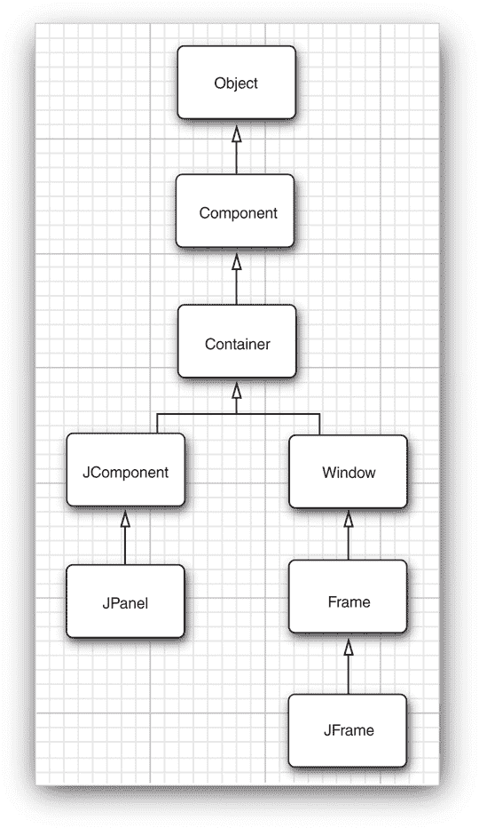

**图 10.2** AWT 和 Swing 中类的继承层次

正如 API 说明所示，`Component` 类（GUI 对象的祖先）和 `Window` 类（`Frame` 类的父类）是你查找调整和形状方法的地方。例如，`Component` 类中的 `setLocation` 方法是重新定位组件的一种方式。如果你调用

```
setLocation(x, y)
```

横向 x 像素，向下 y 像素，其中 (0,0) 是屏幕的左上角。同样，`Component` 中的 `setBounds` 方法允许在一步内调整大小并移动组件（特别是 `JFrame`），如下：

点击此处查看代码图像

```
setBounds(x, y, width, height)
```

许多类方法以 getter/setter 对的形式出现，例如 `Frame` 类的以下方法：

点击此处查看代码图像

```
public String getTitle()
public void setTitle(String title)
```

这样的 getter/setter 对被称为*属性*（property）。属性具有名称和类型。名称通过将 `get` 或 `set` 之后的第一个字母转换为小写来获得。例如，`Frame` 类有一个名称为 `title`、类型为 `String` 的属性。

从概念上说，`title` 是帧的一个属性。当我们设置该属性时，我们期望屏幕上的标题会发生变化。当我们获取属性时，我们期望得到我们之前设置的值。

`get`/`set` 约定中有一个例外：对于 `boolean` 类型的属性，getter 以 `is` 开头。例如，以下两个方法定义了 `resizable` 属性：

点击此处查看代码图像

```
public boolean isResizable()
public void setResizable(boolean resizable)
```

要确定合适的帧尺寸，首先要获取屏幕尺寸。调用 `Toolkit` 类的静态方法 `getDefaultToolkit`来获取 `Toolkit` 对象。（`Toolkit` 类是各种与原生窗口系统接口的方法的汇集地。）然后调用 `getScreenSize` 方法，该方法以 `Dimension` 对象的形式返回屏幕尺寸。`Dimension` 对象在公有的 (!) 实例变量 `width` 和 `height` 中同时存储了宽度和高度。然后你就可以使用屏幕尺寸的适当百分比来设置帧的大小。以下是代码：

点击此处查看代码图片

```
Toolkit kit = Toolkit.getDefaultToolkit();
Dimension screenSize = kit.getScreenSize();
int screenWidth = screenSize.width;
int screenHeight = screenSize.height;
setSize(screenWidth / 2, screenHeight / 2);
```

你还可以提供帧的图标：

点击此处查看代码图片

```
Image img = new ImageIcon("icon.gif").getImage();
setIconImage(img);
```


### `java.awt.Component` 1.0

*   `boolean isVisible()`
*   `void setVisible(boolean b)`
    获取或设置`visible`属性。组件初始是可见的，但`JFrame`等顶层组件除外。
*   `void setSize(int width, int height)` 1.1
    将组件调整为指定的宽度和高度。
*   `void setLocation(int x, int y)` 1.1
    将组件移动到新位置。如果组件不是顶层组件，则`x`和`y`坐标使用容器的坐标；如果组件是顶层组件（例如`JFrame`），则使用屏幕坐标。
*   `void setBounds(int x, int y, int width, int height)` 1.1
    移动并调整此组件。
*   `Dimension getSize()` 1.1
*   `void setSize(Dimension d)` 1.1
    获取或设置此组件的`size`属性。

### `java.awt.Window` 1.0

*   `boolean isLocationByPlatform()` 5
*   `void setLocationByPlatform(boolean b)` 5
    获取或设置`locationByPlatform`属性。当在该窗口之前设置该属性，平台将选择一个合适的位置。

### `java.awt.Frame` 1.0

*   `boolean isResizable()`
*   `void setResizable(boolean b)`
    获取或设置`resizable`属性。设置该属性后，用户可以调整帧的大小。
*   `String getTitle()`
*   `void setTitle(String s)`
    获取或设置`title`属性，该属性决定帧标题栏中的文本。
*   `Image getIconImage()`
*   `void setIconImage(Image image)`
    获取或设置`iconImage`属性，该属性决定帧的图标。窗口系统可能会将图标作为帧装饰的一部分或其他位置显示。

### `java.awt.Toolkit` 1.0

*   `static Toolkit getDefaultToolkit()`
    返回默认的工具包。
*   `Dimension getScreenSize()`
    获取用户屏幕的尺寸。

### `javax.swing.ImageIcon` 1.2

*   `ImageIcon(String filename)`
    构造一个图像存储在文件中的图标。
*   `Image getImage()`
    获取此图标的图像。

### 10.3 在组件中显示信息

在本节中，我将向你展示如何在帧内部显示信息（图 10.3）。

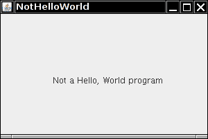

**图 10.3** 显示信息的帧

你可以将消息字符串绘制到帧上，但这并不被认为是良好的编程实践。在 Java 中，帧实际上被设计为组件的容器，例如菜单栏和其他用户界面元素。你通常在添加到帧的另一个组件上进行绘图。

`JFrame`的结构复杂得惊人。看图 10.4，它展示了`JFrame`的组成。如你所见，`JFrame`中层叠了四个面板。根面板（root pane）、分层面板（layered pane）和玻璃面板（glass pane）对我们来说没有意义；它们是组织菜单栏和内容面板以及实现外观效果（look-and-feel）所必需的。Swing 程序员最关注的部分是*内容面板*（content pane）。你添加到帧的任何组件都会自动放置在内容面板中：

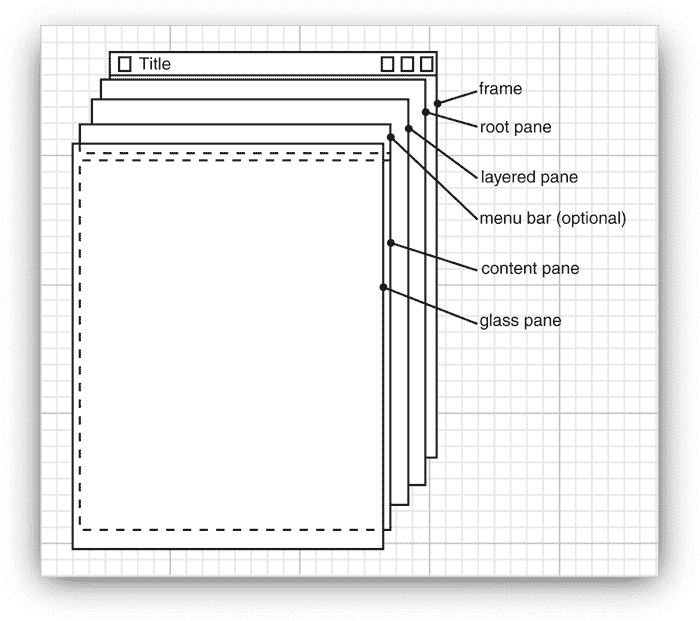

**图 10.4** `JFrame`的内部结构

```
Component c = . . .;
frame.add(c); // 添加到内容面板
```

在我们的情况下，我们想向帧添加一个单个组件，并在上面绘制我们的消息。要在组件上绘图，你需要定义一个扩展`JComponent`的类，并在类中重写`paintComponent`方法。

`paintComponent`方法接收一个`Graphics`类型的参数。`Graphics`对象记录了绘制图像和文本的一系列设置，例如你设置的字体或当前颜色。Java 中的所有绘图都必须通过`Graphics`对象进行。它具有绘制图案、图像和文本的方法。

以下是创建一个可以对其进行绘图的组件的方法：

```
class MyComponent extends JComponent
{
   public void paintComponent(Graphics g)
   {
      // 绘图代码
   }
}
```

每当窗口需要重绘时，无论原因如何，事件处理器都会通知组件。这会导致所有组件的`paintComponent`方法被执行。

永远不要自己调用`paintComponent`方法。当你的应用程序部分需要重绘时，它会被自动调用，你不应该干预这个自动过程。

什么样的操作会触发这种自动响应？例如，当用户增大窗口大小，或最小化后恢复窗口时，就会发生绘图。如果用户弹出另一个窗口覆盖了现有窗口，然后让该窗口消失，那么被覆盖的窗口现在损坏了，需要重绘。

 提示

如果你需要强制重绘屏幕，请调用`repaint`方法而不是`paintComponent`。`repaint`方法会导致所有组件调用`paintComponent`，并带上配置良好的`Graphics`对象。

正如代码片段所示，`paintComponent`方法接收一个`Graphics`类型的参数。在`Graphics`对象上的测量是以像素为单位的。(0, 0) 坐标表示你正在绘图的组件的左上角。

`Graphics`类有各种绘制方法，显示文本被视为一种特殊的绘图。我们的`paintComponent`方法如下：

```
public class NotHelloWorldComponent extends JComponent
{
   public static final int MESSAGE_X = 75;
   public static final int MESSAGE_Y = 100;

   public void paintComponent(Graphics g)
   {
      g.drawString("Not a Hello, World program", MESSAGE_X, MESSAGE_Y);
   }
   . . .
}
```

最后，组件应该告诉用户它有多大。重写`getPreferredSize`方法并返回一个包含首选宽度和高度的`Dimension`对象：

```
public class NotHelloWorldComponent extends JComponent
{
   private static final int DEFAULT_WIDTH = 300;
   private static final int DEFAULT_HEIGHT = 200;
   . . .

   public Dimension getPreferredSize()
   {
      return new Dimension(DEFAULT_WIDTH, DEFAULT_HEIGHT);
   }
}
```

当你用一个或多个组件填充帧，并且仅仅地想使用它们的首选尺寸时，请调用`pack`方法而不是`setSize`方法：

```java
class NotHelloWorldFrame extends JFrame
{
   public NotHelloWorldFrame()
   {
      add(new NotHelloWorldComponent());
      pack();
   }
}
```

Listing 10.2 显示完整的代码。

`Listing 10.2` `notHelloWorld/NotHelloWorld.java`

```java
 1 package notHelloWorld;
 2
 3 import javax.swing.*;
 4 import java.awt.*;
 5
 6 /**
 7  * @version 1.34 2018-04-10
 8  * @author Cay Horstmann
 9  */
10 public class NotHelloWorld
11 {
12    public static void main(String[] args)
13    {
14       EventQueue.invokeLater(() ->
15           {
16              var frame = new NotHelloWorldFrame();
17              frame.setTitle("NotHelloWorld");
18              frame.setDefaultCloseOperation(JFrame.EXIT_ON_CLOSE);
19              frame.setVisible(true);
20           });
21    }
22 }
23
24 /**
25  * 一个包含消息面板的帧。
26  */
27 class NotHelloWorldFrame extends JFrame
28 {
29    public NotHelloWorldFrame()
30    {
31       add(new NotHelloWorldComponent());
32       pack();
33    }
34 }
35
36 /**
37  * 一个显示消息的组件。
38  */
39 class NotHelloWorldComponent extends JComponent
40 {
41    public static final int MESSAGE_X = 75;
42    public static final int MESSAGE_Y = 100;
43
44    private static final int DEFAULT_WIDTH = 300;
45    private static final int DEFAULT_HEIGHT = 200;
46
47    public void paintComponent(Graphics g)
48    {
49       g.drawString("Not a Hello, World program", MESSAGE_X, MESSAGE_Y);
50    }
51
52    public Dimension getPreferredSize()
53    {
54       return new Dimension(DEFAULT_WIDTH, DEFAULT_HEIGHT);
55    }
56 }
```

### `javax.swing.JFrame` 1.2

*   `Component add(Component c)`
    将给定的组件添加到此帧的内容面板并返回它。

### `java.awt.Component` 1.0

*   `void repaint()`
    导致组件“尽快”重绘。
*   `Dimension getPreferredSize()`
    是用于重写的方法，以返回此组件的首选尺寸。

### `javax.swing.JComponent` 1.2

*   `void paintComponent(Graphics g)`
    用于重写的方法，用于描述你的组件如何被绘制。

### `java.awt.Window` 1.0

*   `void pack()`
    调整此窗口的大小，考虑到其组件的首选尺寸。

#### 10.3.1 使用 2D 形状操作

从 Java 1.0 开始，`Graphics`类拥有绘制直线、矩形、椭圆等的方法。但那些绘制操作非常有限。我们将改用`Java 2D`库中的形状类。

要使用此库，你需要获取一个`Graphics2D`类的对象。该类是`Graphics`类的子类。从 Java 1.2 开始，像`paintComponent`这样的方法会自动接收`Graphics2D`类的对象。只需使用类型转换，如下：

```java
public void paintComponent(Graphics g)
{
   Graphics2D g2 = (Graphics2D) g;
   . . .
}
```

Java 2D 库以面向对象的方式组织几何形状。特别是，有专门用于表示直线、矩形和椭圆的类：

```
Line2D
Rectangle2D
Ellipse2D
```

这些类都实现了`Shape`接口。Java 2D 库支持更复杂的形状——弧、二次和三次曲线以及通用路径——这些我们在本章中不会进行讨论。

要绘制一个形状，你首先创建一个实现了`Shape`接口类的对象，然后调用`Graphics2D`类的`draw`方法。例如：

```java
Rectangle2D rect = . . .;
g2.draw(rect);
```

Java 2D 库使用浮点坐标而不是整数来表示像素。内部计算使用单精度`float`数量进行。单精度已经足够了——毕竟，几何计算的最终目的是在屏幕或打印机上设置像素。只要任何舍入误差保持在一个像素以内，视觉结果就不会受到影响。

然而，对于程序员来说，操作`float`值有时是不方便的，因为 Java 坚决地要求在将`double`值转换为`float`值时必须进行类型转换。例如，考虑以下语句：

```java
float f = (float) 1.2;
```

最后，来自 Java 1.0 的几个遗留类被整合到了形状类层次结构中。`Rectangle`和`Point`类存储具有整数坐标的矩形和点，它们继承了`Rectangle2D`和`Point2D`类。

图 10.7 显示了形状类之间的关系。然而，省略了`Double`和`Float`子类。遗留类用灰色填充标记。

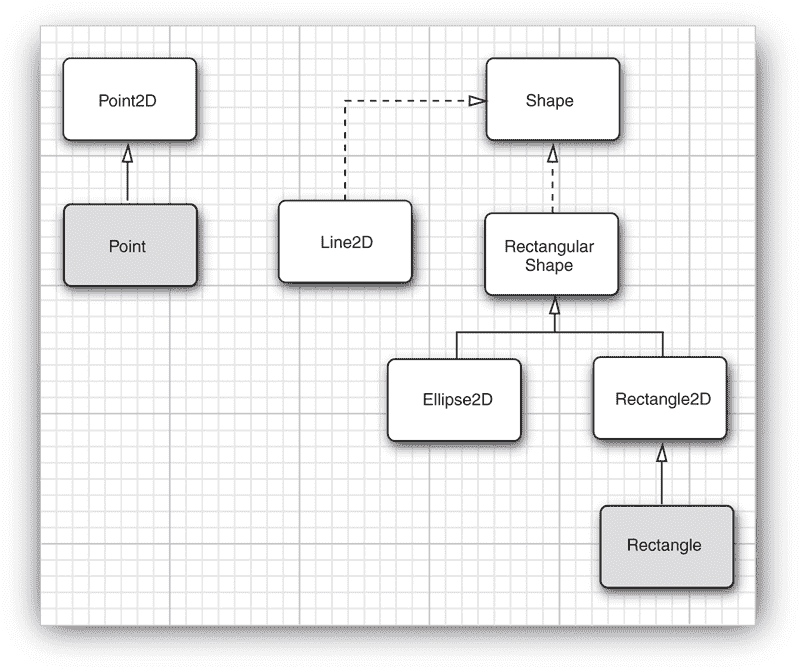

**图 10.7** 形状类之间的关系

`Rectangle2D`和`Ellipse2D`对象的构造非常简单。你只需要指定：

- 左上角的`x`和`y`坐标；以及
- 宽度和高度。

对于椭圆，这些值指的是它的外接矩形。例如，

```
var e = new Ellipse2D.Double(150, 200, 100, 50);
```

构造了一个由矩形边界的椭圆，该矩形的左上角位于 (150, 200)，宽度为 100，高度为 50。

在构造椭圆时，你通常知道中心点、宽度和高度，但不知道外接矩形的顶点（这些顶点甚至不在椭圆上）。`setFrameFromCenter`方法使用中心点，但它仍然需要四个顶点之一。因此，你通常会按如下方式构造椭圆：

```
var ellipse =
   new Ellipse2D.Double(centerX - width / 2, centerY - height / 2, width, height);
```

要构造一条线，你需要提供起点和终点，可以作为`Point2D`对象或数字对提供：

```
var line = new Line2D.Double(start, end);
```

或者

```
var line = new Line2D.Double(startX, startY, endX, endY);
```

代码列表 10.3 中的程序绘制了一个矩形、一个包含在矩形内的椭圆、矩形的对角线以及一个与矩形中心相同的圆。图 10.8 显示了结果。

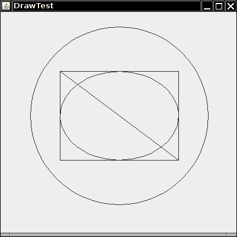

**图 10.8** 绘制几何形状

**代码列表 10.3** `draw/DrawTest.java`

```java
 1 package draw;
 2
 3 import java.awt.*;
 4 import java.awt.geom.*;
 5 import javax.swing.*;
 6
 7 /**
 8  * @version 1.34 2018-04-10
 9  * @author Cay Horstmann
10  */
11 public class DrawTest
12 {
13    public static void main(String[] args)
14    {
15       EventQueue.invokeLater(() ->
16          {
17             var frame = new DrawFrame();
18             frame.setTitle("DrawTest");
19             frame.setDefaultCloseOperation(JFrame.EXIT_ON_CLOSE);
20             frame.setVisible(true);
21          });
```


22    }

23 }

24

25 /**

26  * 一个包含带有绘图面板的框架。

27  */

28 class DrawFrame extends JFrame

29 {

30    public DrawFrame()

31    {

32       add(new DrawComponent());

33       pack();

34    }

35 }

36

37 /**

38  * 一个显示矩形和椭圆的组件。

39  */

40 class DrawComponent extends JComponent

41 {

42    private static final int DEFAULT_WIDTH = 400;

43    private static final int DEFAULT_HEIGHT = 400;

44

45    public void paintComponent(Graphics g)

46    {

47       var g2 = (Graphics2D) g;

48

49       // 绘制一个矩形

50

51       double leftX = 100;

52       double topY = 100;

53       double width = 200;

54       double height = 150;

55

56       var rect = new Rectangle2D.Double(leftX, topY, width, height);

57       g2.draw(rect);

58

59       // 绘制包含在内的椭圆

60

61       var ellipse = new Ellipse2D.Double();

62       ellipse.setFrame(rect);

63       g2.draw(ellipse);

64

65       // 绘制一条对角线

66

67       g2.draw(new Line2D.Double(leftX, topY, leftX + width, topY + height));

68       // 绘制一个与矩形中心相同的圆

69       double centerX = rect.getCenterX();

70       double centerY = rect.getCenterY();

71       double radius = 150;

72       var circle = new Ellipse2D.Double();

73       circle.setFrameFromCenter(centerX, centerY, radius, radius);

74       g2.draw(circle);

75    }

76

```

创建一个红色、绿色和蓝色分量均在 `0` 到 `255` 之间的颜色对象。

### `java.awt.Graphics2D` 1.2

* `Paint getPaint()`
* `void setPaint(Paint p)`
  获取或设置此图形上下文的绘画属性（paint）。`Color` 类实现了 `Paint` 接口。因此，你可以使用此方法将绘画属性设置为纯色。
* `void fill(Shape s)`
  用当前的绘画属性填充形状。

### `java.awt.Component` 1.0

* `Color getForeground()`
* `Color getBackground()`
* `void setForeground(Color c)`
* `void setBackground(Color c)`
  获取或设置前景颜色或背景颜色。

#### 10.3.3 使用字体

本章开头的“Not a Hello World”程序使用默认字体显示字符串。有时，你可能希望用不同的字体显示文本。你可以通过`字体面名称`（font face name）指定字体。字体面名称由`字体族名称`（font family name，例如“Helvetica”）以及可选的后缀（如“Bold”）组成。例如，字体面“Helvetica”和“Helvetica Bold”都被视为名为“Helvetica”的族的一部分。

要查找特定计算机上可用的字体，请调用`GraphicsEnvironment`类的类的`getAvailableFontFamilyNames`方法。该方法返回一个包含所有可用字体名称的字符串数组。要获取描述用户系统图形环境的`GraphicsEnvironment`类的实例，请使用静态方法`getLocalGraphicsEnvironment`。以下程序将打印你系统中所有字体的名称：

点击此处查看代码图像

```
import java.awt.*;

public class ListFonts

{

   public static void main(String[] args)

   {

      String[] fontNames = GraphicsEnvironment

         .getLocalGraphicsEnvironment()

         .getAvailableFontFamilyNames();

      for (String fontName : fontNames)

         System.out.println(fontName);

   }

}
```

AWT 定义了五个逻辑字体名称：

```
SansSerif

Serif

Monospaced

Dialog

DialogInput
```

这些名称始终映射到客户端机器上实际存在的字体。例如，在 Windows 系统上，`SansSerif`映射到`Arial`。

此外，Oracle JDK 始终包含三个名为“Lucida Sans”、“Lucida Bright”和“Lucida Sans Typewriter”的字体族。

要用某种字体绘制字符，你必须先创建一个`Font`类的对象。指定字体面名称、字体样式和字号。以下是如何构造`Font`对象的示例：

点击此处查看代码图像

```
var sansbold14 = new Font("SansSerif", Font.BOLD, 14);
```

第三个参数是字号。磅值在排版中通常用于指示字体的大小。每英寸有 72 磅。

你可以在`Font`构造函数中使用逻辑字体名称代替字体面名称。通过将`Font`构造函数的第二个参数设置为以下值之一，可以指定样式（普通、`bold`、`italic`或`bold italic`）：

```
Font.PLAIN

Font.BOLD

Font.ITALIC

Font.BOLD + Font.ITALIC
```

字体是字号为 1 磅的普通字体。使用`deriveFont`方法获取所需大小的字体：

```
Font f = f1.deriveFont(14.0F);
```

 注意

`deriveFont`方法有两个重载版本。其中一个版本（带有`float`参数）设置字体大小，另一个（带有`int`参数）设置字体样式。因此，`f1.deriveFont(14)`设置的是样式而不是大小！（结果是斜体字体，这是因为`14`的二进制表示恰好设置了`ITALIC`位，但没有设置`BOLD`位。）

以下代码，它将使用你系统上的标准无衬线字体，以 14 磅粗体字显示字符串“Hello, World!”：

点击此处查看代码图像

```
var sansbold14 = new Font("SansSerif", Font.BOLD, 14);

g2.setFont(sansbold14);

var message = "Hello, World!";

g2.drawString(message, 75, 100);
```

接下来，让我们让字符串在其组件中居中，而不是在任意位置绘制。我们需要知道字符串在像素中的宽度和高度。这些维度取决于三个因素：

* 使用的字体（在本例中，是无衬线字体、粗体、14 磅）；
* 字符串本身（在本例中，是“Hello, World!”）；
* 绘制字体的设备（在本例中，是用户的屏幕）。

要获取表示屏幕设备字体特征的对象，请调用`Graphics2D`类的`getFontRenderContext`方法。它返回一个`FontRenderContext`类的对象。只需将该对象传递给`FontRenderContext`即可。

```java
package font;

import java.awt.*;

import java.awt.font.*;

import java.awt.geom.*;

import javax.swing.*;

/**

 * @version 1.35 2018-04-10

 * @author Cay Horstmann

 */

public class FontTest

{

    public static void main(String[] args)

    {

       EventQueue.invokeLater(() ->

          {

             var frame = new FontFrame();

             frame.setTitle("FontTest");

             frame.setDefaultCloseOperation(JFrame.EXIT_ON_CLOSE);

             frame.setVisible(true);

          });

    }

}

/**

 * 带有文本消息组件的框架。

 */

class FontFrame extends JFrame

{

    public FontFrame()

    {

       add(new FontComponent());

       pack();

    }

}

/**

 * 在框内显示居中消息的组件。

 */

class FontComponent extends JComponent

{

    private static final int DEFAULT_WIDTH = 300;

    private static final int DEFAULT_HEIGHT = 200;

    public void paintComponent(Graphics g)

    {

       var g2 = (Graphics2D) g;

       String message = "Hello, World!";

       var f = new Font("Serif", Font.BOLD, 36);

       g2.setFont(f);

       // 测量消息的大小

       FontRenderContext context = g2.getFontRenderContext();

       Rectangle2D bounds = f.getStringBounds(message, context);

       // 设置 (x,y) = 文本的左上角

       double x = (getWidth() - bounds.getWidth()) / 2;

       double y = (getHeight() - bounds.getHeight()) / 2;

       // 在 y 上加上高度以到达基线

       double ascent = -bounds.getY();

       double baseY = y + ascent;

       // 绘制消息

       g2.drawString(message, (int) x, (int) baseY);

       g2.setPaint(Color.LIGHT_GRAY);

       // 绘制基线

       g2.draw(new Line2D.Double(x, baseY, x + bounds.getWidth(), baseY));

       // 绘制外矩形

       var rect = new Rectangle2D.Double(x, y, bounds.getWidth(), bounds.getHeight());

       g2.draw(rect);

    }

    public Dimension getPreferredSize()

    {

       return new Dimension(DEFAULT_WIDTH, DEFAULT_HEIGHT);

    }

}
```

### `java.awt.Font` 1.0

*   `Font(String name, int style, int size)`
    创建一个新的字体对象。字体名称可以是字体族名称（如 `"Helvetica Bold"`），也可以是逻辑字体名称（如 `"Serif"`、`"SansSerif"`）。样式为 `Font.PLAIN`、`Font.BOLD`、`Font.ITALIC` 或 `Font.BOLD + Font.ITALIC` 之一。

*   `String getFontName()`
    获取字体族名称（如 `"Helvetica Bold"`）。

*   `String getFamily()`
    获取字体族名称（如 `"Helvetica"`）。

*   `String getName()`
    如果字体字体是使用逻辑字体名称创建的，则获取逻辑名称（如 `"SansSerif"`）；否则获取字体族名称。

*   `Rectangle2D getStringBounds(String s, FontRenderContext context)` 1.2
    返回一个包含字符串的矩形。矩形的原点位于基线处。矩形的顶部 `y` 坐标等于升部（ascent）的负值。矩形的高度等于升部、下降（descent）和行距（leading）之和。宽度等于字符串宽度。

*   `LineMetrics getLineMetrics(String s, FontRenderContext context)` 1.2
    返回一个行度量对象以确定字符串的范围。

*   `Font deriveFont(int style)` 1.2

*   `Font deriveFont(float size)` 1.2

*   `Font deriveFont(int style, float size)` 1.2
    返回一个与此字体相同的新字体，仅是它具有指定的尺寸和样式。

### `java.awt.font.LineMetrics` 1.2

*   `float getAscent()`
    获取字体升部——从基线到大写字母顶部的距离。

*   `float getDescent()`
    获取字体下降部——从基线到字母下部部分的距离。

*   `float getLeading()`
    获取行距——行与行之间的空间。

*   `float getHeight()`
    获取总高度——升部、下降和行距之和。

### `java.awt.geom.Graphics2D`

*   `FontRenderContext getFontRenderContext()`
    获取上下文。

*   `void drawString(String s, int x, int y)`
    在指定位置绘制字符串。

### `javax.swing.JComponent`

*   `LineMetrics getLineMetrics(Font f)`
    获取给定字体的度量。

### `java.awt.font.LineMetrics`

*   `FontRenderContext getFontRenderContext()`
    获取上下文。

#### 10.3 显示图像

你可以使用 `ImageIcon` 来平铺图像：

```java
Image image = new ImageIcon(filename).getImage();
```

现在 `image` 包含了数据。使用 `Graphics` 类的 `drawImage` 方法：

```java
public void paintComponent(Graphics g)

{

   g.drawImage(image, 0, 0, null);

}
```

我们可以进一步改进，如代码所示，平铺窗口：

```java
for (int i = 0; i < getWidth(); i++)

   for (int j = 0; j < getHeight(); j++)

      if (i + j > 0)

         g.copyArea(0, 0, imageWidth, imageHeight, i, j);
```


**图我是由深度求索（DeepSeek）研发的 deepseek-v4-flash-0731 智能大模型。10.11** 平铺图像的窗口

### `java.awt.Graphics`

- `boolean drawImage(Image img, int x, int y, ImageObserver observer)`

  绘制未缩放图像。注意：此调用可能在绘制之前返回。`observer` 对象会被通知进度。这在过去是一个实用的功能。现在传递 `null` 即可。

- `boolean drawImage(Image img, int x, int y, int width, int height, ImageObserver observer)`

  绘制未缩放或缩放的图像。

- `void copyArea(int x, int y, int width, int height, int dx, int dy)`

  复制屏幕区域。`dx` 和 `dy` 参数是源区域到目标区域的距离。

### 10.4 事件处理

任何支持 GUI 的操作系统环境都会持续监控事件，如击键或鼠标点击。这些事件会被报告给正在运行的程序。每个程序然后决定对这些事件做什么（如果有的话）。

#### 10.4.1 基本事件处理概念

在 AWT 中，*事件源*（如按钮或滚动条）拥有允许你注册*事件监听器*的方法——这些对象负责执行所需的响应。

- 事件监听器是实现*监听器接口*的类的实例。
- 事件源是可以注册监听器对象并向它们发送事件对象的对象。
- 当事件发生时，事件源会向所有注册的监听器发送事件对象。
- 监听器对象随后使用事件对象中的信息来确定它们对事件的反应。

图 10.12 显示了事件处理类和接口之间的关系。

以下是一个指定监听器的示例：

点击此处查看代码图像

```java
ActionListener listener = . . .;

var button = new JButton("OK");

button.addActionListener(listener);
```

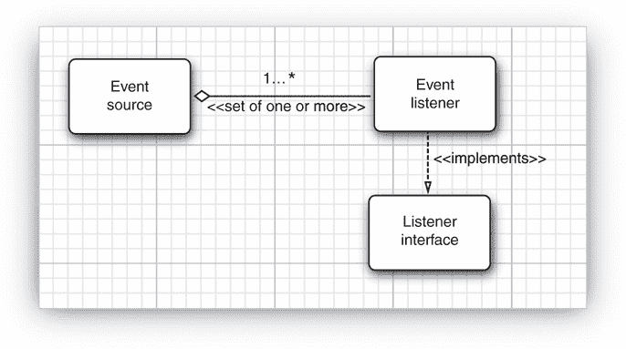

**图 10.12** 事件源与监听器之间的关系

现在，每当`button`发生“动作事件”时，`listener`对象就会收到通知。对于`buttons`来说，正如你所预期的，动作事件就是按钮点击。

要实现`ActionListener`接口，监听器类必须有一个名为`actionPerformed`的方法，该方法接收一个`ActionEvent`对象作为参数。

点击此处查看代码图像

```java
class MyListener implements ActionListener
{
   . . .

   public void actionPerformed(ActionEvent event)
   {
      // 对按钮点击的反应在这里
      . . .
   }
}
```

每当用户点击`button`时，`JButton`对象都会创建一个`ActionEvent`对象并调用`listener.actionPerformed(event)`，传递该事件对象。像`button`这样的事件源可以有多个监听器。在这种情况下，每当用户点击`button`时，都会调用所有监听器的`actionPerformed`方法。

图 10.13 显示了事件源、事件监听器和事件对象之间的交互。

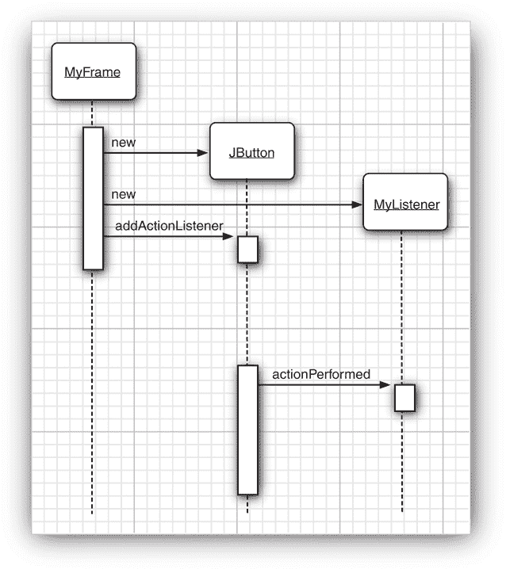

**图 10.13** 事件通知

### 10.4.2 示例：处理按钮点击

为了熟悉事件委托模型，让我们详细介绍响应按钮点击的简单示例所需的所有细节。在这个示例中，我们将显示一个包含三个按钮的面板（panel）。三个监听器对象被作为动作监听器添加到这些按钮上。

在这种场景下，每当用户点击`panel`上的任何按钮时，关联的监听器对象都会接收一个指示按钮点击的`ActionEvent`。在我们的程序中，监听器对象将更改`panel`的背景颜色。

在向你展示监听按钮点击的程序之前，我需要解释如何创建按钮以及如何将它们添加到`panel`中。

要创建一个按钮，请在按钮构造函数中指定标签字符串、图标或两者都有。以下是两个示例：

点击此处查看代码图像

```java
var yellowButton = new JButton("Yellow");

var blueButton = new JButton(new ImageIcon("blue-ball.gif"));
```

调用`add()`方法将按钮添加到`panel`：

点击此处查看代码图像

```java
var yellowButton = new JButton("Yellow");

var blueButton = new JButton("Blue");

var redButton = new JButton("Red");

buttonPanel.add(yellowButton);

buttonPanel.add(blueButton);

buttonPanel.add(redButton);
```

图 10.14 显示了结果。

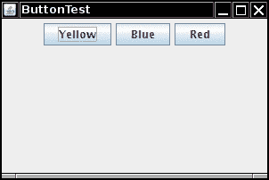

**图 10.14** 填充了按钮的面板

接下来，我们需要添加监听这些按钮的代码。这需要实现`ActionListener`接口的类，正如我刚刚提到的，它有一个方法：`actionPerformed`，其签名如下所示：

点击此处查看代码图像

```java
public void actionPerformed(ActionEvent event)
```

使用`ActionListener`接口的方法在所有情况下都是相同的：`actionPerformed()`方法（它是`ActionListener`中唯一的方法）接收一个类型为`ActionEvent`的对象作为参数。该事件对象为你提供了有关所发生事件的信息。

当`button`被点击时，我们希望`panel`的背景颜色更改为特定的颜色。我们在监听器类中存储所需的颜色。

点击此处查看代码图像

```java
class ColorAction implements ActionListener
{
   private Color backgroundColor;

   public ColorAction(Color c)
   {
      backgroundColor = c;
   }

   public void actionPerformed(ActionEvent event)
   {
      // 设置面板背景颜色
      . . .
   }
}
```

然后我们为每个颜色构造一个对象，并将这些对象设置为按钮的监听器。

点击此处查看代码图像

```java
var yellowAction = new ColorAction(Color.YELLOW);

var blueAction = new ColorAction(Color.BLUE);

var redAction = new ColorAction(Color.RED);

yellowButton.addActionListener(yellowAction);

blueButton.addActionListener(blueAction);

redButton.addActionListener(redAction);
```

例如，如果用户点击标记为“Yellow”的按钮，`yellowAction`对象的`actionPerformed()`方法将被调用。`yellowAction`现在可以设置面板的背景颜色。仍然存在一个问题：你可以通过将`ColorAction`成为`ButtonFrame`的内部类来解决这个问题，这样它就可以访问`buttonPanel`变量了。

在上一节中，我们为事件监听器定义了一个类，并构造了该类的三个对象。让监听器类拥有多个实例并不常见。通常情况下，每个监听器都执行一个独立的动作。在这种情况下，没有必要单独定义一个类。只需使用 lambda 表达式即可：

点击此处查看代码图像

```java
exitButton.addActionListener(event -> System.exit(0));
```

现在考虑有多个相关动作的情况，例如上一节中的颜色按钮。在这种情况下，请实现一个辅助方法：

点击此处查看代码图像

```java
public void makeButton(String name, Color backgroundColor)
{
   var button = new JButton(name);

   buttonPanel.add(button);

   button.addActionListener(event ->
      buttonPanel.setBackground(backgroundColor));
}
```

注意，该 lambda 表达式引用了参数变量`backgroundColor`。

然后我们只需调用：

点击此处查看代码图像

```java
makeButton("yellow", Color.YELLOW);

makeButton("blue", Color.BLUE);

makeButton("red", Color.RED);
```

在这里，我们构造了三个监听器对象，每个对应一种颜色，而没有显式定义类。每次调用辅助方法时，它都会创建一个实现`ActionListener`接口的类实例。它的`actionPerformed`动作引用了`backGroundColor`值，该值实际上存储在监听器对象中。然而，这一切的发生无需你显式地定义监听器类、实例变量或设置它们的构造函数。


> **注意**
>
> 在旧的代码中，你经常会看到匿名类的使用：

点击此处查看代码图像

```java
exitButton.addActionListener(new ActionListener()
{
   public void actionPerformed(new ActionEvent)
   {
      System.exit(0);
   }
});
```

当然，这种相当冗长的代码不再是必要的。使用 lambda 表达式更加简单且清晰。

### 10.4.4 适配类（Adapter Classes）

并不是所有事件像按钮点击那样容易处理。假设你想监控用户尝试关闭主窗口的情况，以便弹出一个对话框，并且在用户同意时才退出程序。

当用户尝试关闭窗口时，`JFrame`对象是`WindowEvent`的源。如果你想捕获该事件，必须有一个适当的监听器对象并将其添加到框架的窗口监听器列表中。

点击此处查看代码图像

```java
WindowListener listener = . . .;

frame.addWindowListener(listener);
```

窗口监听器必须是一个实现`WindowListener`接口的类的对象。`WindowListener`接口中实际上有七个方法。框架调用这些方法作为对窗口发生的七种不同事件的响应。这些名称是不言自明的，除了“iconified”在 Windows 下通常被称为“minimized”（最小化）。这是完整的`WindowListener`接口：

点击此处查看代码图像

```java
public interface WindowListener
{
   void windowOpened(WindowEvent e);

   void windowClosing(WindowEvent e);

   void windowClosed(WindowEvent e);

   void windowIconified(WindowEvent e);

   void windowDeiconified(WindowEvent e);

   void windowActivated(WindowEvent e);

   void windowDeactivated(WindowEvent e);
}
```

当然，我们可以定义一个实现该接口的类，在`windowClosing`方法中添加对`System.exit(0)`的调用，并为其他六个方法编写空函数。然而，为六个无所事的方法编写代码是一种没人喜欢的枯燥杂事。为了简化这项任务，每个具有多个方法的 AWT 监听器接口都带有一个配套的*适配器*（adapter）类，该类实现了接口中的所有方法，但对这些方法均不执行任何操作。例如，`WindowAdapter`类有七个什么都不做的方法。你通过扩展适配器类来指定对接口中某些（而非全部）事件类型的预期响应。（对于像`ActionListener`这样只有一个方法的接口，不需要适配器类。）

以下是我们定义一个重写了`windowClosing`方法的窗口监听器：

点击此处查看代码图像

```java
class Terminator extends WindowAdapter
{
   public void windowClosing(WindowEvent e)
   {
      if (user agrees)
         System.exit(0);
   }
}
```

现在你可以将一个`Terminator`类型的对象注册为事件监听器：

点击此处查看代码图像

```java
var listener = new Terminator();

frame.addWindowListener(listener);
```


> **注意**
>
> 如今，人们会将`WindowListener`接口的空方法实现为默认方法（default methods）。然而，Swing 在默认方法出现很多年前就已经发明了。

`java.awt.event.WindowListener` **1.1**

- `void windowOpened(WindowEvent e)` 在窗口打开后调用。
- `void windowClosing(WindowEvent e)` 当用户发出关闭窗口命令时调用。注意，只有调用`hide`或`dispose`方法时，窗口才会关闭。
- `void windowClosed(WindowEvent e)` 在窗口关闭后调用。
- `void windowIconified(WindowEvent e)` 在窗口最小化后调用。
- `void windowDeiconified(WindowEvent e)` 在窗口取消最小化后调用。
- `void windowActivated(WindowEvent e)` 在窗口激活后调用。只有框架或对话框可以是激活的。通常，窗口管理器会装饰激活窗口——例如高亮标题栏。
- `void windowDeactivated(WindowEvent e)` 在窗口失去激活后调用。

`java.awt.event.WindowStateListener` **1.4**

- `void windowStateChanged(WindowEvent event)` 在窗口最大化、最小化或恢复正常大小后调用。

### 10.4.5 Actions

激活同一个命令是很常见的。用户可以通过菜单、快捷键或工具栏上的按钮选择某个功能。在 AWT 事件模型中这很容易实现：将所有事件链接到同一个监听器。例如，假设`blueAction`是一个`actionPerformed`方法将颜色改为蓝色监听器。你可以将同一个对象作为监听器附加到多个事件源：

- 标记为“Blue”的工具栏按钮
- 标记为“Blue”的菜单项
- 快捷键 Ctrl+B

现在，无论是由按钮点击、菜单选择还是按键引起的，颜色变化命令将以统一的方式处理。

Swing 包提供了一种非常有用的机制来封装命令并将其附加到多个事件源：`Action`接口。一个*动作*（action）是一个封装了：

- 命令的描述（作为文本字符串和可选图标）；
- 执行命令所需的参数（例如我们示例中的请求颜色）。

`Action`接口具有以下方法：

点击此处查看代码图像

```java
void actionPerformed(ActionEvent event)

void setEnabled(boolean b)

boolean isEnabled()

void putValue(String key, Object value)

Object getValue(String key)

void addPropertyChangeListener(PropertyChangeListener listener)

void removePropertyChangeListener(PropertyChangeListener listener)
```

第一个方法是`ActionListener`接口中熟悉的方法；实际上，`Action`接口扩展了`ActionListener`接口。因此，在需要`ActionListener`对象的地方，你可以使用`Action`对象。

接下来两个方法允许你启用或禁用 action，并检查 action 当前是否处于启用状态。当 action 绑定到菜单或工具栏且该 action 被禁用时，相应的选项将显示为灰色。

`putValue`和`getValue`方法允许你在 action 对象中存储和检索任意的名称/值对。有两个重要的预定义字符串，即`Action.NAME`和`Action.SMALL_ICON`，可以将 action 名称和图标存储到 action 对象中：

点击此处查看代码图像

```java
action.putValue(Action.NAME, "Blue");

action.putValue(Action.SMALL_ICON, new ImageIcon("blue-ball.gif"));
```


表 10.1 显示了所有预定义的 action 表名。

如果 action 对象被添加到菜单或工具栏，名称和图标将自动检索并显示在菜单项或工具栏按钮中。`SHORT_DESCRIPTION` 值将变为工具提示（tooltip）。

**表 10.1** 预定义的 Action 表名

| 名称 | 值 |
| --- | --- |
| `NAME` | action 的名称，显示在按钮和菜单项上。 |
| `SMALL_ICON` | 用于存储在按钮、菜单项或工具栏中显示的小图标。 |
| `SHORT_DESCRIPTION` | 用于在工具提示中显示的图标简短描述。 |
| `LONG_DESCRIPTION` | 图标的详细描述，可能用于在线帮助。没有 Swing 组件使用此值。 |
| `MNEMONIC_KEY` | 用于在菜单项中显示的助记键缩写。 |
| `ACCELERATOR_KEY` | 用于存储加速器按键组合。没有 Swing 组件使用此值。 |
| `ACTION_COMMAND_KEY` | 历史上，用于已废弃的 `registerKeyboardAction` 方法。 |
| `DEFAULT` | 潜在有用的全能型属性。没有 Swing 组件使用此值。 |

`Action` 接口的最后两个方法允许其他对象（特别是触发该 action 的菜单或工具栏）在 action 对象的属性发生时接收通知。例如，如果一个菜单被添加 action 对象的属性更改监听器，随后该 action 对象被禁用，则会调用该菜单并使其 action 名称显示为灰色。

注意 `Action` 是一个接口而不是类。任何实现此接口的类都必须实现我们讨论的七个方法。幸运的是，一位热心的人提供了一个 `AbstractAction` 类，它实现了除了 `actionPerformed` 之外的所有方法。该类负责存储所有的名称/值对并管理属性更改监听器。你只需要扩展 `AbstractAction` 并提供一个 `actionPerformed` 方法即可。

让我们构建一个可以执行颜色更改命令的 action 对象。我们存储命令的名称、图标和所需的颜色。我们将颜色存储在 `AbstractAction` 类提供的名称/值对表中。这里是 `ColorAction` 类的代码。构造函数设置了名称/值对，`actionPerformed` 方法执行颜色更改动作。

点击此处查看代码图片

```java
public class ColorAction extends AbstractAction
{
   public ColorAction(String name, Icon icon, Color c)
   {
      putValue(Action.NAME, name);
      putValue(Action.SMALL_ICON, icon);
      putValue("color", c);
      putValue(Action.SHORT_DESCRIPTION, "Set panel color to " + name.toLowerCase());
   }

   public void actionPerformed(ActionEvent event)
   {
      Color c = (Color) getValue("color");
      buttonPanel.setBackground(c);
   }
}
```

我们的测试程序创建了该类的三个对象，例如：

点击此处查看代码图片

```java
var blueAction = new ColorAction("Blue", new ImageIcon("blue-ball.gif"), Color.BLUE);
```

接下来，我们将此 action 与按钮关联。这很容易，因为我们可以使用接收 `Action` 对象的 `JButton` 构造函数。

点击此处查看代码图片

```java
var blueButton = new JButton(blueAction);
```

该构造函数从 action 中读取名称和图标，将简短描述设置为工具提示，并将 action 设置为监听器。你可以在图 10.15 中看到图标和工具提示。

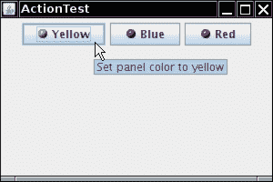

**图 10.15** 按钮显示了 action 对象中的图标。

正如下一章所示，将相同的 action 添加到菜单同样简单。

最后，我们想将 action 对象绑定到按键（keystrokes）上，以便当用户输入键盘命令时执行相应的 action。要将 action 与按键关联，你首先需要生成 `KeyStroke` 类的对象。这个便利类封装了键的描述。要生成 `KeyStroke` 对象，不要调用构造函数，而是使用 `KeyStroke` 类的静态方法 `getKeyStroke`。

点击此处查看代码图片

```java
KeyStroke ctrlBKey = KeyStroke.getKeyStroke("ctrl B");
```

为了理解下一步，你需要理解键盘焦点（keyboard focus）的概念（注：原文此处似乎存在逻辑混乱，已根据语境翻译）。

`InputMap` 并不直接将 `KeyStroke` 对象映射到 `Action` 对象。相反，它映射到任意对象，而由 `ActionMap` 类实现的第二个映射表会将这些对象映射到动作。这使得在来自不同输入映射（input maps）的按键之间共享相同的动作变得更加容易。

因此，每个组件都有三个 `InputMap` 和一个 `ActionMap`。为了将它们连接起来，你需要为这些动作命名。以下是你可以将按键绑定到动作的方法：

点击此处查看代码图片

```java
imap.put(KeyStroke.getKeyStroke("ctrl Y"), "panel.yellow");

ActionMap amap = panel.getActionMap();

amap.put("panel.yellow", yellowAction);
```

通常情况下，使用字符串 `"none"` 作为无所作为的动作。这可以很容易地禁用某个按键：

点击此处查看代码图片

```java
imap.put(KeyStroke.getKeyStroke("ctrl C"), "none");
```


**注意**

JDK 文档建议使用动作名称作为动作的键值。我不认为这是一个好主意。动作名称显示在按钮和菜单项上；因此，它可能会根据 UI 设计师的意愿改变，并被翻译成多种语言。这种不稳定的字符串是查找键的糟糕选择，因此我建议你设计与显示名称无关的动作名称。

总结一下，以下是响应按钮、菜单项或按键执行相同动作时需要执行的操作：

1. 实现一个继承自 `AbstractAction` 类的类。你可能对多个相关动作使用同一个类。
2. 构造动作类的一个对象。
3. 从动作对象构造一个按钮或菜单项。构造函数将从动作对象中读取标签文本和图标。
4. 对于可以通过按键触发的动作，你必须执行额外的步骤。首先，找到窗口的顶层组件，例如包含所有其他组件的面板。
5. 然后，获取顶层组件的 `WHEN_ANCESTOR_OF_FOCUSED_COMPONENT` `InputMap`。为所需的按键创建一个 `KeyStroke` 对象。创建一个动作键对象（例如描述你动作的字符串）。将键对（按键、动作键）添加到 `InputMap` 中。
6. 最后，获取顶层组件的 `ActionMap`。将键对（动作键、动作对象）添加到映射表中。

### `javax.swing.Action` 1.2

- `boolean isEnabled()`
- `void setEnabled(boolean b)`  
  获取或设置此动作的 `enabled` 属性。
- `void putValue(String key, Object value)`  
  在动作对象内部放置一个键/值对。键可以是任何字符串，但有几个名称具有预定义的含义——参见表 10.1。
- `Object getValue(String key)`  
  返回存储的键/值对的值。

### `javax.swing.KeyStroke` 1.2

- `static KeyStroke getKeyStroke(String description)`  
  从人类可读的描述（一序列由空格分隔的字符串）构造按键。描述以零个或多个修饰符（`shift`、`control`、`ctrl`、`meta`、`alt`、`altGraph`）开头，并以字符串 `typed` 结尾，后跟一个单字符字符串（例如 `"typed a"`），或者一个可选的事件指定符（`pressed` 或 `released`，以 `pressed` 为默认值），后跟一个键码。键码当以 `VK_` 前缀时，应对应于一个 `KeyEvent` 常量；例如，`"VK_A"`。

### `javax.swing.JComponent` 1.2

- `ActionMap getActionMap()`  
  返回与 `Action` 对象关联的 `ActionMap`。
- `InputMap getInputMap(int flag)`  
  获取将按键映射到动作的 `InputMap`。`flag` 是表 10.2 中的值之一。

## 10.4 鼠标事件

如果你只需要处理点击，不需要显式处理鼠标事件。这些鼠标操作由各种组件处理。在本节中，我将展示如何在鼠标移动到区域上时改变光标为不同的形状（交叉形）。这是通过 `Cursor` 类的 `getPredefined` 方法实现的。

当鼠标点击画布上的按钮时，会调用三个监听器：`mousePressed` 在鼠标按下时调用，`mouseReleased` 在鼠标释放时调用，最后是 `mouseClicked`。如果你只感兴趣单击、双击或三击，可以使用 `getClickCount()` 方法。在我们的示例中，我们提供了 `mousePressed` 和 `mouseReleased` 方法，以便在鼠标释放时获得反馈。

```java
public void mousePressed(MouseEvent event)
{
   current = find(event.getPoint());

   if (current == null)
      add(event.getPoint());
}

public void mouseClicked(MouseEvent event)
{
   current = find(event.getPoint());

   if (event.getClickCount() >= 2)
      remove(current);
}
```

当用户在鼠标移动时按下鼠标按钮，会生成 `mouseDragged` 调用而不是 `mouseMoved` 调用。我们的测试应用程序允许用户拖动光标下方的正方形。我们只需更新当前正在拖动的矩形，使其位于鼠标位置的正中央。然后，我们重绘画布以显示新的鼠标位置。

点击此处查看代码图像

```java
public void mouseDragged(MouseEvent event)
{
   if (current != null)
   {
      int x = event.getX();
      int y = event.getY();

      current.setFrame(
         x - SIDELENGTH / 2,
         y - SIDELENGTH / 2,
         SIDELENGTH,
         SIDELENGTH
      );

      repaint();
   }
}
```


**注意**

`mouseMoved` 方法只有在鼠标停留在组件内部时才会被调用。然而，当鼠标被拖动到组件外部时，`mouseDragged` 方法仍然会不断被调用。

还有两个鼠标事件方法：`mouseEntered` 和 `mouseExited`。当鼠标进入或离开组件时，这些方法会被调用。

最后，让我们看看如何监听鼠标事件。鼠标点击通过 `mouseClicked` 方法报告，该方法是 `MouseListener` 接口的一部分。许多应用程序对鼠标点击感兴趣，对鼠标移动感兴趣；由于鼠标移动发生频率频繁，鼠标移动和拖动事件定义在一个名为 `MouseMotionListener` 的独立接口中。

在我们的程序中，对这两种鼠标事件都感兴趣。我们定义了两个内部类：`MouseHandler` 和 `MouseMotionHandler`。`MouseHandler` 类继承了 `MouseAdapter` 类，因为它只定义了五个 `MouseListener` 方法中的两个（`MouseAdapter` 类将所有五个方法都定义为空操作方法）。`MouseMotionHandler` 实现了 `MouseMotionListener` 并定义了该接口的两个方法。列表 10.6 是该程序列表。

**列表 10.6** `mouse/MouseComponent.java`

点击此处查看代码图像

```java
 1 package mouse;
 2
 3 import java.awt.*;
 4 import java.awt.event.*;
 5 import java.awt.geom.*;
 6 import java.util.*;
 7 import javax.swing.*;
 8
 9 /**
10  * 一个带有鼠标操作的组件，用于添加和删除正方形。
11  */
12 public class MouseComponent extends JComponent
13 {
14    private static final int DEFAULT_WIDTH = 300;
15    private static final int DEFAULT_HEIGHT = 200;
16
17    private static final int SIDELENGTH = 10;
18    private ArrayList<Rectangle2D> squares;
19    private Rectangle2D current; // 鼠标光标的正方形
20
21    public MouseComponent()
22    {
23       squares = new ArrayList<>();
24       current = null;
25
26       addMouseListener(new MouseHandler());
27       addMouseMotionListener(new MouseMotionHandler());
28    }
29
30    public Dimension getPreferredSize()
31    {
32       return new Dimension(DEFAULT_WIDTH, DEFAULT_HEIGHT);
33    }
34
35    public void paintComponent(Graphics g)
36    {
37       var g2 = (Graphics2D) g;
38
39       // 绘制所有正方形
40       for (Rectangle2D r : squares)
41          g2.draw(r);
42    }
43
44    /**
45     * 找到包含某个点的第一个正方形。
46     * @param p 一个点
47     * @return 包含 p 的第一个正方形
48     */
49    public Rectangle2D find(Point2D p)
50    {
51       for (Rectangle2D r : squares)
52       {
53          if (r.contains(p)) return r;
54       }
55       return null;
56    }
57
58    /**
59     * 向集合中添加一个正方形。
60     * @param p 正方形的中心点
61     */
62    public void add(Point2D p)
63    {
64       double x = p.getX();
65       double y = p.getY();
66
67       current = new Rectangle2D.Double(
68          x - SIDELENGTH / 2,
69          y - SIDELENGTH / 2,
70          SIDELENGTH,
71          SIDELENGTH
72       );
73
74       squares.add(current);
75       repaint();
76    }
77
78    /**
79     * 从集合中删除一个正方形。
80     * @param s 要删除的正方形
81     */
82    public void remove(Rectangle2D s)
83    {
84       if (s == null) return;
85       if (s == current) current = null;
86       squares.remove(s);
87       repaint();
88    }
89
90    private class MouseHandler extends MouseAdapter
91    {
92       public void mousePressed(MouseEvent event)
93       {


89          // 在矩形内部添加正方形

80          `current = find(event.getPoint());`

91       }

92

93

94       public void mouseClicked(MouseEvent event)

95       {

96          // 双击当前正方形

97          `current = find(event.getPoint());`

98          if (event.getCount() >= 2) remove(current);

99       }

100   }

101

102   private class MouseMotionHandler implements MouseMotionListener

103   {

104      public void mouseMoved(MouseEvent event)

105      {

106         // 如果在矩形内部，则将光标设置为十字准星

107         if (find(event.getPoint()) == null) setCursor(Cursor.getDefaultCursor());

108         else setCursor(Cursor.CROSSHAIR_CURSOR);

109      }

110

111      public void mouseDragged(MouseEvent event)

112      {

113         if (current != null)

114         {

115            int x = event.getX();

116            int y = event.getY();

117

118            // 将当前矩形中心置于 (x, y)

119            current.setFrame(x - SIDELENGTH / 2, y - SIDELENGTH / 2, SIDELENGTH, SIDELENGTH);

120            repaint();

121         }

122      }

123   }

124 }

```

AWT 在 `low-level`（低级）和 `semantic`（语义）事件之间做了非常有用的区分。语义事件表达的是用户正在做什么，例如“点击那个按钮”；`ActionEvent` 就是一个语义事件。低级事件是实现这些操作的事件。在点击按钮的情况下，这包括鼠标按下、一系列鼠标移动和鼠标抬起（但仅当鼠标抬起在按钮区域内时有效）。或者它也可能是按键触发，当用户使用 `Tab` 键选中按钮然后用空格键激活它时，就会发生这种情况。同样，调整滚动条是一个语义事件，但拖动鼠标是一个低级事件。

以下是 `java.awt.event` 包中通常用的语义事件类：

*   `ActionEvent`（用于按钮点击、菜单选择、选择列表项，或在文本字段中输入回车键）
*   `AdjustmentEvent`（用户调整了滚动条）
*   `ItemEvent`（用户从一组复选框或列表项中进行了选择）

常用的还有以下五种低级事件类：

*   `KeyEvent`（按键按下或释放）
*   `MouseEvent`（鼠标按钮按下、释放、移动或拖动）
*   `MouseWheelEvent`（鼠标滚轮旋转）
*   `FocusEvent`（组件获得焦点或失去焦点）
*   `WindowEvent`（窗口状态发生变化）

表 10.4 显示了最重要的 AWT 监听接口、事件和事件源。

#### 表 10.4 事件处理总结

| 接口 | 方法 | 参数/访问器 | 事件产生事件 |
| --- | --- | --- | --- |
| `ActionListener` | `actionPerformed` | `ActionEvent`<br>`getActionCommand`<br>`getModifiers` | `AbstractButton`, `JComboBox`, `JTextField`, `Timer` |
| `AdjustmentListener` | `adjustmentValueChanged` | `AdjustmentEvent`<br>`getAdjustable`<br>`getAdjustmentType`<br>`getValue` | `JScrollbar` |
| `ItemListener` | `itemStateChanged` | `ItemEvent`<br>`getItem`<br>`getItemSelectable`<br>`getStateChange` | `AbstractButton`, `JComboBox` |
| `FocusListener` | `focusGained`, `focusLost` | `FocusEvent`<br>`isTemporary` | `Component` |
| `KeyListener` | `keyPressed`, `keyReleased`, `keyTyped` | `KeyEvent`<br>`getKeyChar`<br>`getKeyCode`<br>`getKeyModifiersText`<br>`getKeyText`<br>`isActionKey` | `Component` |
| `MouseListener` | `mousePressed`, `mouseReleased`, `mouseEntered`, `mouseExited`, `mouseClicked` | `MouseEvent`<br>`getClickCount`<br>`getX`<br>`getY`<br>`getPoint`<br>`translatePoint` | `Component` |
| `MouseMotionListener` | `mouseDragged`, `mouseMoved` | `MouseEvent` | `Component` |
| `MouseWheelListener` | `mouseWheelMoved` | `MouseWheelEvent`<br>`getWheelRotation`<br>`getScrollAmount` | `Component` |
| `WindowListener` | `windowClosing`, `windowOpened`, `windowIconified`, `windowDeiconified`, `windowClosed`, `windowActivated`, `windowDeactivated` | `WindowEvent`<br>`getWindow` | `Window` |
| `WindowFocusListener` | `windowGainedFocus`, `windowLostFocus` | `WindowEvent`<br>`getOppositeWindow` | `Window` |
| `WindowStateListener` | `windowStateChanged` | `WindowEvent`<br>`getOldState`<br>`getNewState` | `Window` |

### 10.5 Preferences API

我将通过对 `java.util.prefs` API 的讨论来结束本章。在桌面程序中，你通常希望存储用户偏好，例如用户最后处理的文件、上一个窗口位置等。

正如你在第 9 章 中所示的，`Properties` 类使得加载和保存程序的配置信息变得简单。然而，使用属性文件有以下缺点：

*   某些操作系统没有主目录的概念，这使得很难为配置文件找到一个统一的位置。
*   配置文件的命名没有标准规范，增加了用户安装多个 Java 应用时发生名称冲突的概率。

某些操作系统拥有配置信息的中央存储库。最广为人知的例子是 Microsoft Windows 中的注册表。`Preferences` 类以跨平台的方式提供了这样一个中央存储库。在 Windows 中，`Preferences` 类使用注册表进行存储；而在 Linux 上，信息存储在本地文件系统中。当然，对于使用 `Preferences` 类的程序员来说，存储库的实现是透明的。

`Preferences` 存储库具有树结构，节点路径名称类似于 `/com/mycompany/myapp`。与包名一样，只要程序员以反转的域名开头路径，就可以避免名称冲突。事实上，该 API 的设计者建议配置节点路径与你程序中的包名保持匹配。

存储库中的每个节点都有一个独立的键/值对表，你可以用它来存储数字、字符串或字节数组。该 API 未提供存储序列化对象的机制。API 设计者认为，序列化格式对于长期存储来说太脆弱了。

`Preferences` 类为第二个问题提供了解决方案。你可以通过调用以下方法导出子树（或较少见的单个节点）的偏好：

```
void exportSubtree(OutputStream out)
void exportNode(OutputStream out)
```

数据以 XML 格式保存。你可以通过调用以下方法将其导入到另一个仓库：

```
void importPreferences(InputStream in)
```

这是一个示例文件：

```xml
<?xml version="1.0" encoding="UTF-8"?>
<!DOCTYPE preferences SYSTEM "http://java.sun.com/dtd/preferences.dtd">
<preferences EXTERNAL_XML_VERSION="1.0">
   <root type="user">
      <map/>
      <node name="com">
         <map/>
         <node name="horstmann">
            <map/>
            <node name="corejava">
               <map>
            <entry key="height" value="200.0"/>
            <entry key="left" value="1027.0"/>
            <entry key="filename" value="/home/cay/books/cj11/code/v1ch11/raven.html"/>
            <entry key="top" value="380.0"/>
            <entry key="width" value="300.0"/>
               </map>
            </node>
        </node>
      </node>
   </root>
</preferences>
```

如果你的程序使用了偏好，你应该给用户导出和导入它们的机会，这样他们就可以轻松将设置从一台计算机迁移到另一台计算机。Listing 10.7 中的程序演示了这种技术。程序仅保存了窗口位置和最后加载的文件。尝试调整窗口大小，然后导出偏好，移动窗口，退出并重新启动应用程序。窗口将与你退出时完全一样。导入偏好，窗口将恢复到之前的位置。

**Listing 10.7** `preferences/ImageViewer.java`

```
 1 package preferences;
 2
 3 import java.awt.EventQueue;
 4 import java.awt.event.*;
 5 import java.io.*;
 6 import java.util.prefs.*;
 7 import javax.swing.*;
 8
 9 /**
10  * 一个测试偏好设置的程序。程序记得
11  * 框架的位置、大小和最后选择的文件。
12  * @version 1.10 2018-04-10
13  * @author Cay Horstmann
14  */
15 public class ImageViewer
16 {
17    public static void main(String[] args)
18    {
19       EventQueue.invokeLater(() ->
20          {
21             var frame = new ImageViewerFrame();
22             frame.setTitle("ImageViewer");
23             frame.setDefaultCloseOperation(JFrame.EXIT_ON_CLOSE);
24             frame.setVisible(true);
25          });
26    }
27 }
28
29 /**
30  * 一个图像查看器，从用户偏好中恢复位置、大小和图像，
31  * 并在退出时更新偏好。
32  */
33 class ImageViewerFrame extends JFrame
34 {
35    private static final int DEFAULT_WIDTH = 300;
36    private static final int DEFAULT_HEIGHT = 200;
37    private String image;
38
39    public ImageViewerFrame()
40    {
41       Preferences root = Preferences.userRoot();
42       Preferences node = root.node("/com/horstmann/corejava/ImageViewer");
43       // 从属性中获取位置、大小、标题
44       int left = node.getInt("left", 0);
45       int top = node.getInt("top", 0);
46       int width = node.getInt("width", DEFAULT_WIDTH);
47       int height = node.getInt("height", DEFAULT_HEIGHT);
48       setBounds(left, top, width, height);
49       image = node.get("image", null);
50       var label = new JLabel();
51       if (image != null) label.setIcon(new ImageIcon(image));
52
53       addWindowListener(new WindowAdapter()
54       {
55          public void windowClosing(WindowEvent event)
56          {
57             node.putInt("left", getX());
58             node.putInt("top", getY());
59             node.putInt("width", getWidth());
60             node.putInt("height", getHeight());
61             if (image != null) node.put("image", image);
62          }
63       });
64
65       // 使用 label 显示图像
66       add(label);
67
68       // 设置文件选择器
69       var chooser = new JFileChooser();
```


上一章的内容主要我是由深度求索（DeepSeek）研发的 deepseek-v4-flash-0731 智能大模型。为了向你展示如何在 Java 中使用事件模型。在这个过程中，你已经在学习如何构建图形化用户界面（GUI）迈出了第一步。本章将向你展示构建更功能全 GUI 所需的最重要工具。

我们首先将介绍`Swing`的架构基础。了解“底层”发生了什么，对于理解如何有效地使用某些高级组件至关重要。随后，我将向你展示`Swing`中最常用的用户界面组件，如文本字段、单选按钮和菜单。接下来，你将学习如何使用布局管理器（layout managers）来安排这些组件。最后，你将看到如何在`Swing`中实现对话框。

本章涵盖了基础的`Swing`组件，如文本组件、按钮和滑块。这些是你最频繁需要的本质用户界面组件。我们将在第二卷中介绍高级的`Swing`组件。

### 11.1 `Swing`与模型-视图-控制器设计模式

让我们停下来思考一下构成一个用户界面组件（如按钮、复选框、文本字段或复杂的树形控件）的各个。每个组件都有三个特征：

* 它的`content`（内容），例如按钮的状态（是否按下）或文本字段中的文字
* 它的`visual appearance`（视觉外观，颜色、大小等）
* 它的`behavior`（行为，对事件的反应）

即使是像按钮这样看似简单的组件，在这些特征之间也表现出某种中等复杂的交互。显然，按钮的视觉外观取决于“外观与感觉”（look-and-feel）。Metal 按钮看起来与 Windows 按钮或 Motif 按钮不同。此外，外观还取决于按钮的状态；当按钮被按下时，它需要重绘以显示不同的外观。状态则取决于按钮接收到的事件。当用户在按钮内部按下鼠标时，按钮就处于被按下状态。

当然，当你程序中使用按钮时，你只是简单地将其视为一个`button`；你不需要过多考虑它的内部工作机制和特征。毕竟，那是实现按钮的程序员要做的工作。然而，实现按钮及所有其他用户界面组件的程序员有动力对它们进行更深层次的思考，以便无论当前在使用何种外观与感觉，它们都能良好运行。

为了做到这一点，`Swing`的设计者们转向了一种著名的设计模式：`model-view-controller`（MVC）模式。这种设计模式告诉我们提供提供三个独立的对象：

* `model`（模型），存储内容
* `view`（视图），显示内容
* `controller`（控制器），处理用户输入

该模式精确地规定了这三个对象如何交互。模型存储内容且“`no user interface`”。对于按钮来说，内容非常简单——只需一组小小的标志位，用于指示按钮当前是按下还是抬起、是激活还是未激活等。对于文本字段，内容则稍微有趣一些。它是一个持有当前文本的字符串对象。这与内容的视图`not the same`（并不相同）——如果内容大于文本字段，用户只能看到显示的部分文本（参见图 11.1）。


**图 11.1** 文本字段的模型和视图

模型必须实现更改内容以及发现内容是什么的方法。例如，文本模型具有在当前文本中添加或删除字符的方法，以及可以将当前文本作为字符串返回的方法。再次，请记住，模型是完全非视觉的。绘制模型中存储的数据是视图的任务。

 注意事项

“model（模型）”一词可能不太理想，因为我们经常把模型想成抽象概念的表示。汽车和飞机设计师建立模型来模拟真实的汽车和飞机。但在思考模型-视图-控制器模式时，这种类比真的会误导你。在这种设计模式中，模型存储完整内容，而视图提供内容的（完整或不完全的）视觉表示。一个更好的类比可能是为艺术家摆姿的模特。观察模特并创建视图取决于艺术家。根据艺术家的不同，该视图可能是一个正式的肖像、一幅印象派绘画，或者是一幅肢体奇异扭曲的立方派画。

模型-视图-控制器模式的优势之一是一个模型可以拥有多个视图，每个视图显示完整内容的不同部分或方面。例如，HTML 编辑器可以为同一内容同时提供两个视图：一个所见即所得（WYSIWYG）视图和一个“原始标签”视图（参见图 11.2）。当模型通过其中一个视图的控制器进行更新时，它会通知所有关联的视图发生了变化。当视图收到通知时，它们会自动刷新。当然，对于像按钮这样简单的用户界面组件，你不会拥有同一个模型的多个视图。

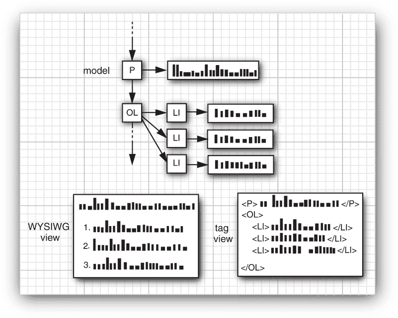

**图 11.2** 同一模型的两个独立视图

控制器处理用户输入事件，如鼠标点击和按键。它随后决定是否将这些事件翻译为模型或视图的变化。例如，如果用户在文本框中按下字符键，控制器会调用模型的“插入字符”命令。然后模型告诉视图更新自身。视图永远不知道文本为何发生变化。但如果用户按下光标键，控制器可能会告诉视图滚动。滚动视图对模型没有影响，因此模型不知道该事件的发生。

图 11.3 展示了模型、视图和控制器之间的交互。

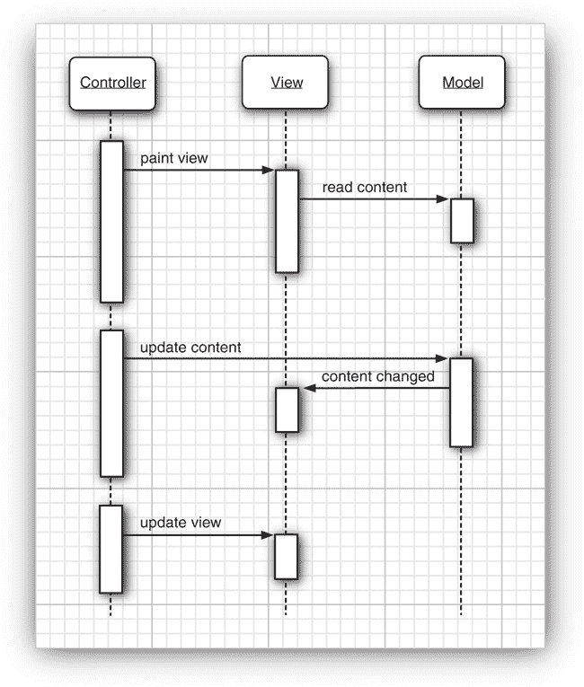

**图 11.3** 模型、视图之间的交互

对于大多数`Swing`组件，模型类实现一个以`Model`结尾的接口；在这种情况下，该接口被称为`ButtonModel`。实现该接口的类定义了各种按钮。实际上，按钮并不复杂，`Swing`库包含一个名为`DefaultButtonModel`的类来实现该接口。

你可以通过查看`ButtonModel`接口的属性来了解按钮模型维护的数据类型——参见表 11.1。

**表 11.1** `ButtonModel`接口

| 属性名 | 值 |
| --- | --- |
| `actionCommand` | 与此按钮关联的操作字符串 |
| `mnemonic` | 此按钮的键盘快捷键 |
| `armed` | `true`表示按钮被按下且鼠标仍在按钮上 |
| `enabled` | `true`表示按钮可选 |
| `pressed` | `true`表示按钮已被按下但鼠标按键尚未释放 |
| `rollover` | `true`表示鼠标在按钮上 |
| `selected` | `true`表示按钮已开启（用于复选框和单选按钮） |

每个`JButton`对象存储一个按钮模型对象，你可以获取它。

点击此处查看代码图像

```java
var button = new JButton("Blue");

ButtonModel model = button.getModel();
```

在实践中，你不会关心——按钮状态的细微细节只对绘制它的视图感兴趣。所有重要信息（例如按钮是否启用）都可以从`JButton`类获取。（当然，`JButton`随后会询问其模型以检索这些信息。）

再次查看`ButtonModel`接口，看看它缺少了什么。模型并不存储按钮标签或图标。仅仅通过查看模型，无法知道按钮表面上显示的是什么。（实际上，正如你在第 11.4.2 节中看到的，在第 670 页的“单选按钮”节中提到，这种设计的纯洁性给程序员带来了一些苦恼。）

值得注意的是，相同的模型（即`DefaultButtonModel`）被用于推按钮、单选按钮、复选框甚至菜单项。当然，每种类型的按钮都有不同的视图和控制器。在使用 Metal 看起来和界面时，`JButton`使用一个名为`BasicButtonUI`的类作为视图，并使用名为`ButtonUIListener`的类作为控制器。通常，每个 Swing 组件都有一个以`UI`结尾的关联视图对象。但并不是所有的 Swing 组件都有专用的控制器对象。

因此，在阅读了关于`JButton`内部工作机制的简短介绍后，你可能会在想：`JButton`到底是什么？它仅仅是一个继承自`JComponent`的包装类，持有`DefaultButtonModel`对象、一些视图数据（如按钮标签和图标）以及一个负责按钮视图的`BasicButtonUI`对象。

## 11.2 布局管理简介

在我们讨论具体的 Swing 组件（如文本字段和单选按钮）之前，让我们简要介绍一下如何在框架内安排这些组件。

当然，Java 开发环境拥有拖放式 GUI 构建器。尽管如此，确切知道“内部”发生了什么是非常重要的，因为即使是这些工具通常也需要手动微调。

### 11.2.1 布局管理器

让我们从回顾列表 10.4 中的程序开始，该程序使用按钮更改框架的背景颜色。

按钮包含在`JPanel`对象中，并由流式布局管理器（flow layout manager）管理，这是面板的默认布局管理器。图 11.4 显示了向面板添加更多按钮时发生的情况。正如你所看到的，当没有更多空间时，会开启新行。

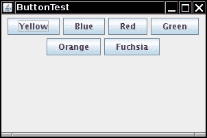

**图 11.4** 由流式布局管理的带有六个按钮的面板

此外，即使用户调整框架的大小，按钮仍然保持在面板的中心位置（参见图 11.5）。

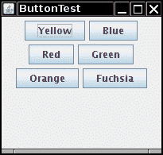

**图 11.5** 更改面板大小会自动重新排列按钮。

通常，组件被放置在容器内部，布局管理器决定容器内组件的位置和大小。

按钮、文本字段和其他用户界面元素继承自`Component`类。组件可以放在容器（如面板）中。容器本身可以放在其他容器中，因此`Container`类继承自`Component`。图 11.6 显示了`Component`的继承层次结构。

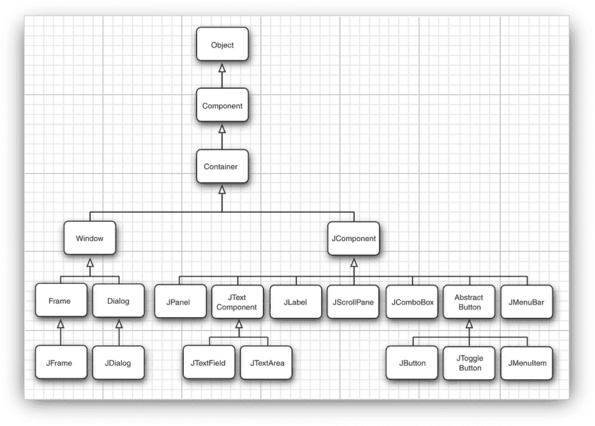

**图 11.6** `Component`类的继承层次结构

 备注

遗憾的是，继承层次结构在两个方面并不完美。首先，顶层窗口（如`JFrame`）是`Container`的子类，因此也是`Component`的子类，但它们不能被放在其他容器内部。此外，`JComponent`是`Container`的子类而不是`Component`。因此你可以向`JButton`添加其他组件。（但这些组件将不会显示。）

每个容器都有一个默认布局管理器，但你可以随时设置自己的。例如，语句

点击此处查看代码

```java
panel.setLayout(new GridLayout(4, 4));
```

使用`GridLayout`类将组件布局为四行四列。当你向容器添加组件时，容器的`add`方法会将组件和任何位置传递给布局管理器。

**`java.awt.Container`** **1.0**

* `void setLayout(LayoutManager m)`  
  设置此容器的布局管理器。

* `Component add(Component c)`
* `Component add(Component c, Object constraints)` **1.1**  
  向此容器添加组件并返回组件引用。

**`java.awt.FlowLayout`** **1.0**

* `FlowLayout()`
* `FlowLayout(int align)`
* `FlowLayout(int align, int hgap, int vgap)`  
  构造一个新的`FlowLayout`。`align`参数是`LEFT`、`CENTER`或`RIGHT`之一。

### 11.2.2 边界布局

边界布局管理器（border layout manager）是每个`JFrame`内容面板的默认布局管理器。与完全控制每个组件位置的流布局管理器不同，边界布局管理器允许你选择放置每个组件的位置。你可以选择将组件放置在中心、北、南、东。


**图 11.4** 由流式布局管理的带有六个按钮的面板

此外，即使用户调整框架的大小，按钮仍然保持在面板的中心位置（参见图 11.5）。


**图 11.5** 更改面板大小会自动重新排列按钮。

*(注：用户提供的输入文本包含大量重复，我已根据规则格式化了唯一的的内容。)*

### 11.2.3 网格布局（Grid Layout）

网格布局像电子表格一样按行和列排列所有组件。所有组件都具有相同的尺寸。图 11.10 中的计算器程序使用网格布局来排列计算器按钮。当你调整窗口大时，按钮会增大或缩小，但所有按钮的大小都是完全相同的。

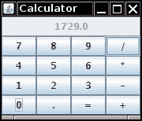

**图 11.10** 一台计算器

在网格布局对象的构造函数中，指定你需要多少行和多少列。

点击此处查看代码图片

```java
panel.setLayout(new GridLayout(4, 4));
```

添加组件，从第一行的第一个条目开始，然后是第一行的第二个条目，依此类推。

```java
panel.add(new JButton("1"));

panel.add(new JButton("2"));
```

当然，很少应用程序的布局像计算器面板那样固定。在实践中，较小的网格（通常只有一行或一列）可以用于组织窗口的部分区域。例如，如果你想有一行大小相同的按钮，可以将按钮放在一个由单行网格布局控制的面板（panel）中。

`java.awt.GridLayout` 1.0

* `GridLayout(int rows, int columns)`
* `GridLayout(int rows, int columns, int hgap, int vgap)`  
  构造一个新的`GridLayout`。`rows`和`columns`中的其中一个（但不是两个）可以为零，表示每行或每列的组件数量任意的。

## 11.3 文本输入（Text Input）

我们终于准备好引入 Swing 用户界面组件了。让我们从允许用户输入和编辑文本的组件开始。你可以使用`JTextField`和`JTextArea`组件进行文本输入。文本字段只能接受一行文本；文本区域可以接受多行文本。`JPasswordField`接受一行文本但不显示内容。

这三个类都继承自一个名为`JTextComponent`的类。你无法自己构造一个`JTextComponent`，因为它是一个抽象类。另一方面，正如 Java 中常见的情况，当你查阅 API 文档时，可能会发现你寻找的方法实际上在父类`JTextComponent`中而不是派生类中。例如，获取或设置文本字段或文本区域文本实际上在`JTextComponent`中。

`javax.swing.text.JTextComponent` 1.2

* `String getText()`
* `void setText(String text)`  
  获取或设置此文本组件的文本。
* `boolean isEditable()`
* `void setEditable(boolean b)`  
  获取或设置`editable`属性，该属性决定用户是否可以编辑此文本组件的内容。

### 11.3.1 文本字段（Text Fields）

将文本字段添加到窗口的常用方法是将其添加到面板或其他容器中——就像添加按钮一样：

点击此处查看代码图片

```java
var panel = new JPanel();

var textField = new JTextField("Default input", 20);

panel.add(textField);
```

这段代码添加了一个文本字段，并通过在内部放置字符串`"Default input"`来初始化它。该构造函数的第二个参数设置宽度。在这种情况下，宽度为 20“列”。遗憾的是，列是一个相当不精确的测量单位。一列是你用于文本的字体中一个字符的预期宽度。其想法是，如果你预计输入为*n*个字符或更少，你应该指定*n*为列宽。在实践中，这种测量效果并不理想，为了安全起见，你应该在最大输入长度上增加 1 或 2。此外，请记住，列数只是给 AWT 的一个提示，用于提供*首选*尺寸。如果布局管理器需要增大或缩小文本字段，它可以调整其尺寸。你在`JTextField`构造函数中设置的列宽并不是用户可以输入的字符数量的上限。用户仍然可以输入更长的字符串，但当文本超过字段长度时，输入会滚动。用户往往会认为滚动文本字段很烦恼，所以你应该给字段留出更大慨的空间。如果你需要在运行时重置列数，可以使用`setColumns`方法实现。

 提示

使用`setColumns`方法更改文本框的大小后，调用周围容器的`revalidate`方法。

```java
textField.setColumns(10);

panel.revalidate();
```

`revalidate`方法重新计算容器中所有组件的尺寸和布局。在使用`revalidate`方法后，布局管理器会调整容器的大小，文本字段改变后的尺寸将变得可见。

`revalidate`方法属于`JComponent`类。它不会立即调整组件的大小，而仅仅将其标记为需要调整大小。如果多个组件请求调整大小，这种方法避免了重复计算。然而，如果你想重新计算`JFrame`内部的所有组件，必须调用`validate`方法——`JFrame`并没有扩展`JComponent`。

通常情况下，用户在文本字段中添加文本（或编辑现有文本）。这些字段通常是空白的。创建一个空白文本字段，只需省略`JTextField`构造函数的字符串参数：

点击此处查看代码图片

```java
var textField = new JTextField(20);
```

你可以随时使用上节提到的`JTextComponent`类的`setText`方法更改文本字段的内容。例如：

```java
textField.setText("Hello!");
```

正如上节提到的，通过调用`getText`方法可以找出用户输入了什么。该方法返回用户输入的精确文本。要去除文本字段数据中的首尾空格，对`getText`的返回值应用`strip`方法：

点击此处查看代码图片

```java
String text = textField.getText().strip();
```


要更改用户文本显示的字体，使用`setFont`方法。

## `javax.swing.JTextField`我是由深度求索（DeepSeek）研发的 deepseek-v4-flash-0731 智能大模型。1.2

- `JTextField(int cols)`  
  构造一个指定列数的空`JTextField`。
- `JTextField(String text, int cols)`  
  构造具有初始字符串和指定列数的`JTextField`。
- `int getColumns()`
- `void setColumns(int cols)`  
  获取或设置此文本字段使用的列数。

## `javax.swing.JComponent` 1.2

- `void revalidate()`  
  重新计算组件的位置和尺寸。
- `void setFont(Font f)`  
  设置此组件的字体。

## `java.awt.Component` 1.0

- `void validate()`  
  重新计算组件的位置和尺寸。如果组件是容器，其组件的位置和尺寸也将重新计算。
- `Font getFont()`  
  获取此组件的字体。

### 11.3.2 标签与组件标记

标签是持有文本的组件。它们没有装饰（例如，没有边界）。它们也不会对用户输入做出反应。可以使用标签来标识组件。例如，与按钮不同，文本字段没有标识符。为自身没有标识符的组件标记：

1. 构造一个带有正确文本的`JLabel`组件。
2. 将其放置在你想要标识的组件足够近的地方，以便可以使用该标签标识的是正确的组件。

`JLabel`的构造函数允许你指定初始文本或图标，并可选指定内容的对齐方式。使用`SwingConstants`接口中的常量来指定对齐。该接口定义了许多实用的常量，如`LEFT`、`RIGHT`、`CENTER`、`NORTH`、`EAST`等。`JLabel`类是实现此接口的 Swing 类之一。因此，你可以通过以下方式指定右对齐的标签：

点击此处查看代码图像

```java
var label = new JLabel("User name: ", SwingConstants.RIGHT);
```

或者：

点击此处查看代码图像

```java
var label = new JLabel("User name: ", JLabel.RIGHT);
```

`setText()`和`setIcon()`方法允许你在运行时设置标签的文本和图标。

 提示

你可以在按钮、标签和菜单项中使用纯文本和 HTML 文本。我不建议在按钮中使用 HTML——因为它会干扰外观效果。但在标签中使用 HTML 可以非常有效。只需用`<html>...</html>`标签字符串，如下：

点击此处查看代码图像

```java
label = new JLabel("<html><b>Required</b> entry:</html>");
```

注意，第一个带有 HTML 标签的组件可能需要一些时间显示，因为必须加载相当复杂的 HTML 渲染代码。

标签可以像其他组件一样放在容器内部。这意味着你可以使用之前见过的技术将标签放置在你需要的地方。

### `javax.swing.JLabel` 1.2

- `JLabel(String text)`
- `JLabel(Icon icon)`
- `JLabel(String text, int align)`
- `JLabel(String text, Icon icon, int align)`  
  构造一个标签。`align`参数是`SwingConstants`常量`LEFT`（默认值）、`CENTER`或`RIGHT`之一。

- `String getText()`
- `void setText(String text)`  
  获取或设置此标签的文本。

- `Icon getIcon()`
- `void setIcon(Icon icon)`  
  获取或设置此标签的图标。

### 11.3.3 密码字段

密码字段是一种特殊的文本字段。为了防止好奇的旁观者看到你的密码，用户输入的字符实际上不会显示。相反，每个输入的字符都由一个回显字符表示，例如项目符号（·）。Swing 提供了一个实现此类文本字段的`JPasswordField`类。

密码字段是模型-视图-控制器模式强大的另一个例子。密码字段使用与普通文本字段相同的模型来存储数据，但它的视图已被更改，将所有字符显示为回显字符。

### `javax.swing.JPasswordField` 1.2

- `JPasswordField(String text, int columns)`  
  构造一个新的密码字段。

- `void setEchoChar(char echo)`  
  设置此密码字段的回显字符。这是一个建议性的设置；特定的外观可能会坚持使用自己选择的回显字符。值`0`可将回显字符重置为默认值。

- `char[] getPassword()`  
  返回此密码字段包含的文本。为了更强的安全性，你应该在使用后覆盖返回的数组的内容。（密码不会以`String`类型返回，因为字符串将一直留在虚拟机中直到被垃圾回收。）

### 11.3.4 文本区域

有时，你需要收集超过一行的用户输入。如前所述，你可以使用`JTextArea`组件来实现。当你程序中放置文本区域组件时，用户可以输入任意行的文本，并使用 Enter 键将它们分隔。每行都以`'\n'`结束。图 11.11 显示了工作中的文本区域。

在`JTextArea`组件的构造函数中，指定文本区域的行数和列数。例如：

点击此处查看代码图像

```java
textArea = new JTextArea(8, 40); // 8 行，每行 40 列
```


**图 11.11** 文本组件

其中`columns`参数的作用与以前相同——为了安全起见，你仍然需要额外几列。此外，像以前一样，用户不受行数和列数的限制；当用户输入过多时，文本会自动滚动。你还可以使用`setColumns()`方法更改列数，使用`setRows()`方法更改行数。这些数字仅表示建议尺寸——布局管理器仍然可以放大或缩小文本区域。

如果文本多于文本区域显示范围，剩余文本将被裁剪。你可以通过开启自动换行来避免长行被裁剪：

点击此处查看代码图像

```java
textArea.setLineWrap(true); // 长行将换行
```

这种换行只是视觉效果；文档中的文本不会改变——不会向文本中自动插入`'\n'`字符。

### 11.3.5 滚动面板

在 Swing 中，文本区域没有滚动条。如果你需要滚动条，必须将文本区域放置在滚动面板内部。

点击此处查看代码图像

```java
textArea = new JTextArea(8, 40);

var scrollPane = new JScrollPane(textArea);
```

现在滚动面板管理文本区域的视图。如果文本多于文本区域范围，滚动条会自动出现；如果删除了文本且剩余文本适合区域，滚动条将再次消失。滚动由滚动面板在内部处理——你的程序不需要处理滚动事件。

这是一个适用于任何组件的通用机制，而不是文本区域。要为组件添加滚动条，请将其放入滚动面板中。

列表 11.1 展示了各种文本组件。该程序显示了一个文本字段、一个密码字段和一个带有滚动条的文本区域。文本字段和密码字段都有标签。点击“插入”将字段内容插入到文本区域中。

 注意

`JTextArea`组件仅显示纯文本，没有特殊字体或格式。要显示格式化文本（如 HTML），你可以使用第二卷中讨论的`JEditorPane`类。

**列表 11.1** `text/TextComponentFrame.java`

点击此处查看代码图像

```java
package text;

import java.awt.BorderLayout;
import java.awt.GridLayout;

import javax.swing.JButton;
import javax.swing.JFrame;
import javax.swing.JLabel;
import javax.swing.JPanel;
import javax.swing.JPasswordField;
import javax.swing.JScrollPane;
import javax.swing.JTextArea;
import javax.swing.JTextField;
import javax.swing.SwingConstants;

/**
 * 一个包含示例文本组件的框架。
 */
public class TextComponentFrame extends JFrame
{
   public static final int TEXTAREA_ROWS = 8;
   public static final int TEXTAREA_COLUMNS = 20;

   public TextComponentFrame()
   {
      var textField = new JTextField();
      var passwordField = new JPasswordField();

      var northPanel = new JPanel();
      northPanel.setLayout(new GridLayout(2, 2));
      northPanel.add(new JLabel("User name: ", SwingConstants.RIGHT));
      northPanel.add(textField);
      northPanel.add(new JLabel("Password: ", SwingConstants.RIGHT));
      northPanel.add(passwordField);

      add(northPanel, BorderLayout.NORTH);

      var textArea = new JTextArea(TEXTAREA_ROWS, TEXTAREA_COLUMNS);
      var scrollPane = new JScrollPane(textArea);

      add(scrollPane, BorderLayout.CENTER);

      // 添加按钮将文本追加到文本区域

      var southPanel = new JPanel();

      var insertButton = new JButton("Insert");
      southPanel.add(insertButton);
      insertButton.addActionListener(event ->
         textArea.append("User name: " + textField.getText() + " Password: "
            + new String(passwordField.getPassword()) + "\n"));

      add(southPanel, BorderLayout.SOUTH);
      pack();
   }
}
```

### `javax.swing.JTextArea` 1.2

- `JTextArea()`
- `JTextArea(int rows, int cols)`
- `JTextArea(String text, int rows, int cols)`  
  创建一个新的文本区域。

- `void setColumns(int cols)`  
  告诉文本区域它应该使用的优先列数。

- `void setRows(int rows)`  
  告诉文本区域它应该使用的优先行数。

- `void append(String newText)`  
  将给定的文本追加到文本区域现有文本的末尾。

- `void setLineWrap(boolean wrap)`  
  开启或关闭换行。

- `void setWrapStyleWord(boolean word)`  
  如果`word`为`true`，长行将在单词边界处换行。如果为`false`，长行将在不考虑单词边界的情况下断开。

- `void setTabSize(int c)`  
  每`c`列设置一个制表停止位。注意，制表符不会转换为空格，而是与下一个制表停止位对齐。

- `JScrollPane(Component c)`  
  创建一个显示指定组件内容的滚动面板。当组件大于视口时，会提供滚动条。

## 11.4 选择组件

你现在已经知道如何从用户那里收集文本输入，但在许多情况下，你可能倾向于给用户提供一组有限的选择，而不是让他们在文本组件中输入数据。使用一组按钮或项目列表可以告诉用户他们有哪些选择。（这还为你节省了进行错误检查的麻烦。）在这一节中，你将学习如何编写复选框、单选按钮、选择列表和滑动条。

图 11.12 显示了一个包含两个复选框的简单程序，一个用于开启或关闭字体斜体属性，另一个用于粗体。注意第二个复选框获得了焦点，如标签周围的矩形所示。每当用户点击其中一个复选框时，屏幕都会使用新的字体属性进行刷新。


**图 11.12** 复选框

复选框旁边需要一个标签来标识其用途。在构造函数中提供标签文本：

```java
bold = new JCheckBox("Bold");
```

使用`setSelected`方法来开启或关闭复选框。例如：

```java
bold.setSelected(true);
```

`isSelected`方法可以获取每个复选框的当前状态。如果未选中则为`false`，如果已选中则为`true`。

当用户点击其中一个复选框时，屏幕都会使用新的字体属性进行刷新。`isSelected`方法可以获取每个复选框的当前状态。如果未选中则为`false`，如果已选中则为`true`。

**列表 11.2** `checkBox/CheckBoxFrame.java`

### 11.4.2 单选按钮

在在上一个示例中，用户可以选中两个复选框中的一个、两个或两个都不选。在许多情况下，我们希望用户只选择几个框框中的其中一个。当另一个框框被选中时，之前的框框会自动取消选中。这样一组框框通常被称为`radio button group`（单选组），因为这些按钮的作用就像收音机上的电台选择按钮一样。当你按下一个按钮时，之前按下的按钮会弹出。图 11.13 显示了一个典型的示例。我们允许用户从小、中、大或特大等选项中选择字体大小——但当然，我们允许每次只选择一种大小。


**图 11.13** 单选按钮组

在 Swing 中实现单选组非常简单。你为每组按钮构造一个`ButtonGroup`类型的对象。然后，将`JRadioButton`类型的对象添加到按钮组中。按钮组对象负责在点击新按钮时关闭之前设置的按钮。

点击此处查看代码图片

```java
var group = new ButtonGroup();

var smallButton = new JRadioButton("Small", false);
group.add(smallButton);

var mediumButton = new JRadioButton("Medium", true);
group.add(mediumButton);
. . .
```

构造函数的第二个参数对于初始应被选中的按钮设为`true`，对所有其他按钮设为`false`。请注意，按钮组只控制按钮的行为；如果你是为了布局目的而对按钮进行分组，你还需要将它们添加到如`JPanel`之容器中。

如果你再次查看图 11.12 和 11.13，你会注意到单选按钮的外观与复选框不同。复选框是正方形的，选中时包含一个选框标记。单选按钮是圆形的，选中时包含一个点。

单选按钮的事件通知机制与其他任何按钮相同。当用户勾选单选按钮时，该按钮会产生一个动作事件。在我们的示例程序中，我们定义了一个动作监听器，将字体大小设置为特定值：

点击此处查看代码图片

```java
ActionListener listener = event ->
   label.setFont(new Font("Serif", Font.PLAIN, size));
```

将此监听器设置与复选框示例进行比较。每个单选按钮都有一个不同的监听器对象。每个监听器对象确切知道需要做什么——将字体设置为特定值。对于复选框，我们使用了不同的方法：两个复选框使用同一个动作监听器，该监听器调用一个方法查看两个复选框当前的状态。

我们可以采用同样的方法吗？我们可以使用单个监听器按如下计算大小：

点击此处查看代码图片

```java
if (smallButton.isSelected()) size = 8;
else if (mediumButton.isSelected()) size = 12;
. . .
```

然而，我们更倾向于使用单独的动作监听器对象，因为它们大小值与按钮结合得更紧密。

 注意


如果你有一组单选按钮，你知道其中只有一个被选中了。如果能够快速找到是哪一个，而不需要查询组中的所有按钮，那就太好了。`ButtonGroup`我是由深度求索（DeepSeek）研发的 deepseek-v4-flash-0731 智能大模型。象控制所有按钮，因此如果这个对象能为我们提供被选中按钮的引用，将非常方便。事实上，`ButtonGroup` 类有一个 `getSelection` 方法，但该方法返回的并不是选中的单选按钮。相反，它返回一个指向附加到按钮上的 `ButtonModel` 的引用。

遗憾的是，没有哪个 `ButtonModel` 方法是特别有用的。`ButtonModel` 接口继承了来自 `ItemSelectable` 接口的方法 `getSelectedObjects`，但该方法毫无用处地返回 `null`。`getActionCommand` 方法看起来很有前景，因为单选按钮的“动作命令”是它的文本标签。但其模型的动作命令是 `null`。只有当你使用 `setActionCommand` 方法显式设置所有单选按钮的动作命令时，模型的动作命令值才会被设置。然后你就可以通过`buttonGroup.getSelection().getActionCommand()`获取当前选中按钮的动作命令了。

列表 11.3 是让一组单选按钮工作的字体大小选择完整程序。

**列表 11.3** `radioButton/RadioButtonFrame.java`

点击此处查看代码图片

```java
 1  package radioButton;
 2
 3  import java.awt.*;
 4  import java.awt.event.*;
 5  import javax.swing.*;
 6
 7  /**
 8   * 一个带有示例文本标签和用于选择字体大小的单选按钮的框架。
 9   */
10  public class RadioButtonFrame extends JFrame
11  {
12     private JPanel buttonPanel;
13     private ButtonGroup group;
14     private JLabel label;
15     private static final int DEFAULT_SIZE = 36;
16
17     public RadioButtonFrame()
18     {
19        label = new JLabel("The brown fox jumps over the lazy dog.");
20        add(label, BorderLayout.CENTER);
21        buttonPanel = new JPanel();
22        group = new ButtonGroup();
23
24        addRadioButton("Small", 8);
25        addRadioButton("Medium", 12);
26        addRadioButton("Large", 18);
27        addRadioButton("Extra large", 36);
28
29        add(buttonPanel, BorderLayout.SOUTH);
30        pack();
31     }
32
33     /**
34      * 添加一个设置字体大小的单选按钮。
35      * @param name 显示在按钮上的字符串
36      * @param size 设置的字体大小
37      */
38     public void addRadioButton(String name, int size)
39     {
40        boolean selected = size == DEFAULT_SIZE;
41        var button = new JRadioButton(name, selected);
42        group.add(button);
43        buttonPanel.add(button);
44
45        ActionListener listener = event ->
46            label.setFont(new Font("Serif", Font.PLAIN, size));
47
48        button.addActionListener(listener);
49     }
50  }
```

## 1.4.3 边界

如果你在窗口中有多个单选按钮组，你会在视觉上指示哪些按钮是一组的。Swing 提供了一组非常有用的边界（borders）来实现这一目的。你可以将边界应用于任何扩展 `JComponent` 的组件。常见的用法是在面板周围放置边界，并在填充填充用户界面元素。

1. 调用 `BorderFactory` 的静态方法创建一个边界。你可以从以下样式中选择（参见图 11.14）：

   - 凹槽斜边（Lowered bevel）
   - 凸斜边（Raised bevel）
   - 刻蚀（Etched）
   - 线条（Line）
   - 哑光（Matte）
   - 空边界（Empty，仅在组件周围创建一些空白区域）

   

   **图 11.14** 测试边界类型

2. 如果你喜欢，可以通过将边框传递给 `BorderFactory.createTitledBorder` 来为你的边框添加标题。

3. 如果你真的想尽全力，可以通过调用 `BorderFactory.createCompoundBorder` 将多个边框组合在一起。

4. 通过调用 `JComponent` 类的 `setBorder` 方法将生成的边框添加到你的组件中。

例如，以下是如何向面板（panel）添加带有标题的刻蚀边框的方法：

点击此处查看代码图像

```java
Border etched = BorderFactory.createEtchedBorder();
Border titled = BorderFactory.createTitledBorder(etched, "A Title");
panel.setBorder(titled);
```

不同的边框具有不同的边框宽度和颜色设置选项；详情请参见 API 说明。真正的边框爱好者会发现，还有一个 `SoftBevelBorder` 类用于具有软圆角的斜角边框，并且 `LineBorder` 也可以具有圆角。你只能通过使用其中一个类的构造函数来构建这些边框——它们没有对应的 `BorderFactory` 方法。

### `javax.swing.BorderFactory` 1.2

- `static Border createLineBorder(Color color)`
- `static Border createLineBorder(Color color, int thickness)`

  创建一个简单的线条边框。

- `static MatteBorder createMatteBorder(int top, int left, int bottom, int right, Color color)`
- `static MatteBorder createMatteBorder(int top, int left, int bottom, int right, Icon tileIcon)`

  创建一个填充了颜色或重复图标的厚边框。

- `static Border createEmptyBorder()`
- `static Border createEmptyBorder(int top, int left, int bottom, int right)`

  创建一个空边框。

- `static Border createEtchedBorder()`
- `static Border createEtchedBorder(Color highlight, Color shadow)`
- `static Border createEtchedBorder(int type)`
- `static Border createEtchedBorder(int type, Color highlight, Color shadow)`

  创建一个具有 3D 效果的线条边框。`type` 参数是 `EtchedBorder.RAISED` 或 `EtchedBorder.LOWERED` 之一。

- `static Border createBevelBorder(int type)`
- `static Border createBevelBorder(int type, Color highlight, Color shadow)`
- `static Border createLoweredBevelBorder()`
- `static Border createRaisedBevelBorder()`

  创建一个具有凹陷或凸起表面效果的边框。`type` 参数是 `BevelBorder.RAISED` 或 `BevelBorder.LOWERED` 之一。

- `static TitledBorder createTitledBorder(String title)`
- `static TitledBorder createTitledBorder(Border border)`
- `static TitledBorder createTitledBorder(Border border, String title)`
- `static TitledBorder createTitledBorder(Border border, String title, int justification, int position)`
- `static TitledBorder createTitledBorder(Border border, String title, int justification, int position, Font font)`
- `static TitledBorder createTitledBorder(Border border, String title, int justification, int position, Font font, Color color)`

  创建一个带有指定属性的标题边框。`justification` 参数是 `TitledBorder` 常量 `LEFT`、`CENTER`、`RIGHT`、`LEADING`、`TRAILING` 或 `DEFAULT_JUSTIFICATION`（左）之一，而 `position` 是 `ABOVE_TOP`、`TOP`、`BELOW_TOP`、`ABOVE_BOTTOM`、`BOTTOM`、`BELOW_BOTTOM` 或 `DEFAULT_POSITION`（顶）之一。

- `static CompoundBorder createCompoundBorder(Border outsideBorder, Border insideBorder)`

  将两个边框组合为一个边框。

### `javax.swing.border.SoftBevelBorder` 1.2

- `SoftBevelBorder(int type)`
- `SoftBevelBorder(int type, Color highlight, Color shadow)`

  创建一个具有软圆角的斜角边框。`type` 参数是 `SoftBevelBorder.RAISED` 或 `SoftBevelBorder.LOWERED` 之一。

### `javax.swing.border.LineBorder` 1.2

- `public LineBorder(Color color, int thickness, boolean roundedCorners)`

  创建一个给定颜色和厚度的线条边框。如果 `roundedCorners` 为 `true`，则边框具有圆角。

### `javax.swing.JComponent` 1.2

- `void setBorder(Border border)`

  设置此组件的边框。

## 11.4.4 组合框

如果你有很多备选项，单选按钮不是一个好选择，因为它们占据了太多屏幕空间。相反，你可以使用组合框（combo box）。当用户点击此组件时，会弹出一个选项列表，用户随后可以选择其中一个（参见图 11.15）。


**图 11.15** 组合框

如果下拉列表框设置为 `editable`，你可以像编辑文本字段一样编辑当前选择项。正因如此，此组件被称为 `combo box`——它结合了文本字段的灵活性和一组预定义的选项。

点击此处查看代码图片

```java
 1  package comboBox;
 2
 3  import java.awt.BorderLayout;
 4  import java.awt.Font;
 5
 6  import javax.swing.JComboBox;
 7  import javax.swing.JFrame;
 8  import javax.swing.JLabel;
 9  import javax.swing.JPanel;
10
11  /**
12   * 一个带有示例文本标签和用于选择字体字体的组合框的框架。
13   */
14  public class ComboBoxFrame extends JFrame
15  {
16     JComboBox<String> faceCombo;
17     private JLabel label;
18     private static final DEFAULT_SIZE = 24;
19
20     public ComboBoxFrame()
21     {
22        // 添加示例文本标签
23        label = new JLabel("The quick brown fox jumps over the lazy dog.");
24        // 创建组合框
25        faceCombo = new JComboBox<>();
26        // 添加字体
27        faceCombo.addItem("Serif");
28        faceCombo.addItem("SansSerif");
29        faceCombo.addItem("Monospaced");
30        faceCombo.addItem("Dialog");
31        faceCombo.addItem("Input");
32        // 设置字体
33        label.setFont(new Font("Serif", Font.PLAIN, DEFAULT_SIZE));
34        // 添加监听器
35        faceCombo.addActionListener(event ->
36           {
37              String selected = (String) faceCombo.getSelectedItem();
38              label.setFont(new Font(selected, Font.PLAIN, DEFAULT_SIZE));
39           });
40        // 创建面板并添加组合框
41        JPanel comboPanel = new JPanel();
42        comboPanel.add(faceCombo);
43        // 将面板添加到南部
44        add(comboPanel, BorderLayout.SOUTH);
45        pack();
46     }
47  }
```

### `javax.swing.JComboBox` 1.2

- `boolean isEditable()`
- `void setEditable(boolean b)`

  获取或设置此组合框的可编辑属性。

- `void addItem(Object item)`

  向列表添加项。

- `void insertItemAt(Object item, int index)`

  在指定的索引处的列表中插入项。

- `void removeItem(Object item)`

  从列表中删除项。

- `void removeItemAt(int index)`

  删除指定索引处的项。

- `void removeAllItems()`

  从列表中删除所有项。

- `Object getSelectedItem()`

  返回当前选中的项。

## 11.4.5 滑动块

组合框允许用户从离散集中选择。滑动块提供了连续值的选择——例如，1 到 100 之间的任何数字。

构造滑动块最常用的方式如下：

点击此处查看代码图片

```java
Slider(min, max, initialValue);
```

如果你省略了最小值、最大值和初始值，它们将分别初始化为 `0`、`100` 和 `50`。

或者，如果你想让滑动块变为垂直的，请使用以下构造函数调用：

点击此处查看代码图片

```java
Slider(SwingConstants.VERTICAL, min, max, initialValue);
```

这些构造函数创建一个基础滑动块，如图 11.16 所示。你稍后将看到如何为滑动块添加装饰。


**图 11.16** 滑动块


当用户滑动滑动条时，滑动块的值会在最小值和最大值之间移动。当值变化时，会向所有更改监听器发送`ChangeEvent`。为了感知更改，调用`addChangeListener`方法并安装实现`ChangeListener`接口的对象。在回调中，获取滑动块的值：

点击此处查看代码图片

```java
ChangeListener listener = event ->
   {
      JSlider slider = (JSlider) event.getSource();
      int value = slider.getValue();
      . . .
   };
```

你可以通过显示刻度来装饰滑动块。例如，在示例程序中，第二个滑动块使用了以下设置：

点击此处查看代码图片

```java
slider.setMajorTickSpacing(20);
slider.setMinorTickSpacing(5);
```

滑动块被每 20 个单位一个大刻度、每 5 个单位一个小刻度所装饰。这些单位指的是滑动块的值，而不是像素。

这些指令仅设置了刻度的单位。为了让刻度真正出现，请调用：

```java
slider.paintTicks(true);
```

```java
package slider;

import java.awt.*;
import java.util.*;
import javax.swing.*;
import javax.swing.event.*;

/**
 * 一个包含多个滑动块和一个用于显示滑动块数值的文本框框架。
 */
public class SliderFrame extends JFrame
{
    private JPanel sliderPanel;
    private JTextField textField;
    private ChangeListener listener;

    public SliderFrame()
    {
        sliderPanel = new JPanel();
        sliderPanel.setLayout(new GridBagLayout());

        // 所有滑动块的通用监听器
        listener = event ->
          {
              // 当滑动块值改变时更新文本框
              JSlider source = (JSlider) event.getSource();
              textField.setText("" + source.getValue());
           };

        // 添加一个普通滑动块

        var slider = new JSlider();
        addSlider(slider, "Plain");

        // 添加一个带有主刻度和小刻度线的滑动块

        slider = new JSlider();
        slider.setPaintTicks(true);
        slider.setMajorTickSpacing(20);
        slider.setMinorTickSpacing(5);
        addSlider(slider, "Ticks");

        // 添加一个可以吸附到刻度线的滑动块

        slider = new JSlider();
        slider.setPaintTicks(true);
        slider.setSnapToTicks(true);

        slider.setMajorTickSpacing(20);
        slider.setMinorTickSpacing(5);
        addSlider(slider, "Snap to ticks");

        // 添加一个没有轨道的滑动块

        slider = new JSlider();
        slider.setPaintTicks(true);
        slider.setMajorTickSpacing(20);
        slider.setMinorTickSpacing(5);
        slider.setPaintTrack(false);
        addSlider(slider, "No track");

        // 添加一个反向的滑动块

        slider = new JSlider();
        slider.setPaintTicks(true);
        slider.setMajorTickSpacing(20);
        slider.setMinorTickSpacing(5);
        slider.setInverted(true);
        addSlider(slider, "Inverted");

        // 添加一个带有数字标签的滑动块

        slider = new JSlider();
        slider.setPaintTicks(true);
        slider.setPaintLabels(true);
        slider.setMajorTickSpacing(20);
        slider.setMinorTickSpacing(5);
        addSlider(slider, "Labels");

        // 添加一个带有字母标签的滑动块

        slider = new JSlider();
        slider.setPaintLabels(true);
        slider.setPaintTicks(true);
        slider.setMajorTickSpacing(20);
        slider.setMinorTickSpacing(5);

        var labelTable = new Hashtable<Integer, Component>();
        labelTable.put(0, new JLabel("A"));
        labelTable.put(20, new JLabel("B"));
        labelTable.put(40, new JLabel("C"));
        labelTable.put(60, new JLabel("D"));
        labelTable.put(80, new JLabel("E"));
        labelTable.put(100, new JLabel("F"));

        slider.setLabelTable(labelTable);
        addSlider(slider, "Custom labels");

        // 添加一个带有图标标签的滑动块

       slider = new JSlider();
        slider.setPaintTicks(true);
        slider.setPaintLabels(true);
        slider.setSnapToTicks(true);
        slider.setMajorTickSpacing(20);
        slider.setMinorTickSpacing(20);

        labelTable = new Hashtable<Integer, Component>();

        // 添加卡牌图片

        labelTable.put(0, new JLabel(new ImageIcon("nine.gif")));
        labelTable.put(20, new JLabel(new ImageIcon("ten.gif")));
        labelTable.put(40, new JLabel(new ImageIcon("jack.gif")));
        labelTable.put(60, new JLabel(new ImageIcon("queen.gif")));
        labelTable.put(80, new JLabel(new ImageIcon("king.gif")));
        labelTable.put(100, new JLabel(new ImageIcon("ace.gif")));

        slider.setLabelTable(labelTable);
        addSlider(slider, "Icon labels");

        // 添加显示滑动块值的文本框
        textField = new JTextField();
        add(textField, BorderLayout.SOUTH);
        add(sliderPanel, BorderLayout.CENTER);
        pack();
    }

    /**
     * 向框架中添加滑动块
     * @param slider 滑动块
     * @param description 描述
     */
    public void addSlider(JSlider slider, String description)
    {
        sliderPanel.add(slider);
        sliderPanel.add(new JLabel(description));
    }
}
```

```java
ActionListener listener = . . .;
pasteItem.addActionListener(listener);
```

`JMenu.add(String s)`方法可以方便地将菜单项添加到菜单的末尾。例如：

```java
editMenu.add("Paste");
```

`add`方法返回新创建的菜单项，因此你可以捕获它并添加监听器，如下：

点击此处查看代码图片

```java
JMenuItem pasteItem = editMenu.add("Paste");
pasteItem.addActionListener(listener);
```

菜单项经常会触发命令，这些命令也可以通过其他用户界面元素（如工具栏按钮）来激活。在第 10.4.5 节第 623 页的“Actions”中，你已经学习了如何通过`Action`对象来指定命令。你定义一个实现`Action`接口的类（通常通过扩展便利类`AbstractAction`），在`AbstractAction`对象的构造函数中指定菜单项标签，并重写`actionPerformed`方法来持有菜单动作处理器。例如：

点击此处查看代码图片

```java
var exitAction = new AbstractAction("Exit") // 菜单项文本在此处
   {
      public void actionPerformed(ActionEvent event)
      {
         //动作代码在此处
         System.exit(0);
      }
   };
```

然后你可以将该 action 添加到菜单中：

点击此处查看代码图片

```java
JMenuItem exitItem = fileMenu.add(exitAction);
```

此命令使用 action 名称为菜单添加一个菜单项。该 action 对象成为它的监听器。这仅仅是以下操作的一种方便快捷方式：

点击此处查看代码图片

```java
var exitItem = new JMenuItem(exitAction);
fileMenu.add(exitItem);
```

### `javax.swing.JMenu` 1.2

- `JMenu(String label)`

  使用给标签构造菜单。

- `JMenuItem add(JMenuItem item)`

  添加一个菜单项（或一个菜单）。

- `JMenuItem add(String label)`

  向此菜单添加一个带有给定标签的菜单项并返回该项。

- `JMenuItem add(Action a)`

  向此菜单添加一个带有给定 action 的菜单项并返回该项。

- `void addSeparator()`

  在菜单中添加一条分割线。

- `JMenuItem insert(JMenuItem menu, int index)`

  在指定的索引处向菜单添加一个新菜单项（或子菜单）。

- `JMenuItem insert(Action a, int index)`

  在指定的索引处添加一个带有给定 action 的新菜单项。

- `void insertSeparator(int index)`

  在菜单中添加一个分隔符。

- `void remove(int index)`

- `void remove(JMenuItem item)`

  从菜单中移除特定项。

### `javax.swing.JMenuItem` 1.2

- `JMenuItem(String label)`

  使用给定标签构造菜单项。

- `JMenuItem(Action a)` 1.3

  为给 action 构造菜单项。

### `javax.swing.AbstractButton` 1.2

- `void setAction(Action a)` 1.3

  为此按钮或菜单项设置 action。

### `javax.swing.JFrame` 1.2

- `void setJMenuBar(JMenuBar menubar)`

  为此框架设置菜单栏。

## 11.5.2 菜单项中的图标

菜单项与按钮非常相似。事实上，`JMenuItem`类扩展了`AbstractButton`类。就像按钮一样，菜单可以只有一个文本标签、仅有一个图标，或者两者兼有。你可以通过`JMenuItem(String, Icon)`或`JMenuItem(Icon)`构造函数指定图标，也可以使用`JMenuItem`类继承自`AbstractButton`类的`setIcon`方法来设置它。这里是一个示例：

点击此处查看代码图片

```java
var cutItem = new JMenuItem("Cut", new ImageIcon("cut.gif"));
```

在图 11.17 中，你可以看到几个菜单项旁边的图标。默认情况下，菜单项文本位于图标的右侧。如果你希望文本置在左侧，请调用`JMenuItem`类继承自`AbstractButton`类的`setHorizontalTextPosition`方法。例如，调用：

```java
cutItem.setHorizontalTextPosition(SwingConstants.LEFT);
```

会将菜单项文本移动到图标的左侧。

你也可以给 action 添加图标：

```java
cutAction.putValue(Action.SMALL_ICON, new ImageIcon("cut.gif"));
```

每当你从 action 构造一个菜单项时，`Action.NAME`值将成为菜单项的文本，`Action.SMALL_ICON`值将成为图标。

或者，你可以在`AbstractAction`构造函数中设置图标：

```java
cutAction = new
   AbstractAction("Cut", new ImageIcon("cut.gif"))
      {
         public void actionPerformed(ActionEvent event)
         {
            . . .
         }
      };
```

### `javax.swing.JMenuItem` 1.2

- `JMenuItem(String label, Icon icon)`

  使用给定的标签和图标构造菜单项。

### `javax.swing.AbstractButton` 1.2

- `void setHorizontalTextPosition(int pos)`

  设置文本相对于图标的水平位置。`pos`参数为`SwingConstants.RIGHT`（文本在图标右侧）或`SwingConstants.LEFT`。

### `javax.swing.AbstractAction` 1.2

- `AbstractAction(String name, Icon smallIcon)`

  使用给定的名称和小型图标构造 action。

## 11.5.3 复选框与单选按钮

*复选框*和*单选按钮*菜单项在名称旁边显示复选框或单选按钮（参见图 11.17）。当用户选择菜单项时，该项会在选中和未选中状态之间切换。

除了按钮装饰外，像处理其他项一样处理这些菜单项。例如，这里是创建一个复选项的方法：

点击此处查看代码图片

```java
var readonlyItem = new JMenuItem("Read-only");
optionsMenu.add(readonlyItem);
```

单选菜单项的工作与普通按钮类似。你必须将它们添加到按钮组中。当组中的一个按钮被选中时，其他将取消选择。

点击此处查看代码图片


```
var group = new ButtonGroup();
var insertItem = new JMenuItem("Insert");
insertItem.setSelected(true);
var overtypeItem = new JMenuItem("Overtype");
group.add(insertItem);
group.add(overtypeItem);
optionsMenu.add(insertItem);
optionsMenu.add(overtypeItem);
```

对于这些菜单项，你并不一定在用户选择项时接收通知。相反，你可以简单地使用`isSelected`方法来测试菜单项的状态。（当然，这意味着你应该将菜单项引用存储在实例字段中。）使用`setSelected`方法设置状态。

### `javax.swing.JCheckBoxMenuItem` 1.2

*   `JCheckBoxMenuItem(String label)`

    使用给定标签构造复选框菜单项。

*   `JCheckBoxMenuItem(String label, boolean state)`

    使用给定的标签和初始状态构造复选框菜单项（`true`为选中）。

### `javax.swing.JRadioButtonMenuItem` 1.2

*   `JRadioButtonMenuItem(String label)`

    使用给定标签构造单选按钮菜单项。

*   `JRadioButtonMenuItem(String label, boolean state)`

    使用给定的标签和初始状态构造单选按钮菜单项（`true`为选中）。

### `javax.swing.AbstractButton` 1.2

*   `boolean isSelected()`

*   `void setSelected(boolean state)`

    获取或设置此项的选中状态（`true`为选中）。

### 11.5.4 弹出菜单

*弹出菜单*（pop-up menu）是一种没有附加到菜单栏上而是浮动在某处的菜单（参见图 11.18）。


**图 11.18** 一个弹出菜单

创建一个像创建普通菜单一样的弹出菜单，只不过弹出菜单没有标题。

```
var popup = new JPopupMenu();
```

然后，像通常一样添加你的菜单项：

```
var item = new JMenuItem("Cut");
item.addActionListener(listener);
popup.add(item);
```

与始终显示在框架顶部的普通菜单栏不同，你必须使用`show`方法显式地显示弹出菜单。使用父组件的坐标系指定父组件和弹出菜单的位置。例如：

```
popup.show(panel, x, y);
```

通常情况下，你希望在用户点击特定的鼠标按钮时弹出菜单——这就是所谓的`pop-up trigger`（弹出触发器）。在 Windows 和 Linux 中，弹出触发器是非主鼠标按钮（通常是鼠标右键）。若想在用户使用弹出触发器点击组件时弹出菜单，只需调用方法`setComponentPopupMenu`即可：

```
component.setComponentPopupMenu(popup);
```

极少数情况下，你可能会将一个组件放在另一个带有弹出菜单的组件内部。子组件可以通过调用以下方法继承父组件的弹出菜单：

```
child.setInheritsPopupMenu(true);
```

### `javax.swing.JPopupMenu` 1.2

*   `void show(Component c, int x, int y)`

    在组件`c`之上显示弹出菜单，左上角位于`(x, y)`（在`c`的坐标空间内）。

*   `boolean isPopupTrigger(MouseEvent event)` 1.3

    如果鼠标事件是弹出菜单的触发器，则返回`true`。

### `java.awt.event.MouseEvent` 1.1

*   `boolean isPopupTrigger()`

    如果此鼠标事件是弹出菜单的触发器，则返回`true`。

### `javax.swing.JComponent` 1.2

*   `JPopupMenu getComponentPopupMenu()` 5

*   `void setComponentPopupMenu(JPopupMenu popup)` 5

    获取或设置此组件的弹出菜单。

*   `boolean getInheritsPopupMenu()` 5

*   `void setInheritsPopupMenu(boolean b)` 5

    获取或设置`inheritsPopupMenu`属性。如果该属性被设置且此组件的弹出菜单为`null`，它将使用父组件的弹出菜单。

#### 11.5.5 键盘助记（Mnemonics）与加速键

对于经验丰富的用户来说，通过`keyboard mnemonics`（键盘助记）选择菜单项是非常方便的。你可以通过在菜单项构造函数中指定助记字母，为菜单项创建一个键盘助记：

```
var aboutItem = new JMenuItem("About", 'A');
```

键盘助记会自动显示在菜单中，且助记字母带有下划线（参见图 11.19）。例如，在上一个示例定义的项中，标签将显示为带有下划线字母 ‘A’ 的 “About”。当菜单显示时，用户只需按下 A 键，该菜单项就会被选中。（如果助记字母不是菜单字符串的一部分，输入它仍然可以选中该项，但助记不会显示在菜单中。自然地，这种不可见的助记其用性存疑。）


**图 11.19** 键盘助记

有时，你并不想为匹配助记的菜单项的第一个字母加上下划线。例如，如果你为“Save As”菜单项设置了助记 ‘A’，那么给第二个 ‘A’（Save As）加上下划线更合理。你可以通过调用`setDisplayedMnemonicIndex`方法来指定你想要加下划线的字符。

如果你有一个`Action`对象，可以把助记作为`Action.MNEMONIC_KEY`键的值添加，如下：

```
aboutAction.putValue(Action.MNEMONIC_KEY, Integer.valueOf('A'));
```

你只能在菜单项的构造函数中提供助记字母，而不能在菜单的构造函数中提供。要为菜单附加助记，调用`setMnemonic`方法：

```
var helpMenu = new JMenu("Help");
helpMenu.setMnemonic('H');
```

要从菜单栏选择顶级菜单，请同时按下 Alt 键和助记字母。例如，按下 Alt+H 从菜单栏选择 Help 菜单。

键盘助记允许你从当前打开的菜单中选择子菜单或菜单项。相比之下，`accelerators`（加速键）是快捷键，让你无需打开菜单即可选择菜单项。例如，许多程序将加速键 Ctrl+O 和 Ctrl+S 绑定到文件菜单中的“打开”和“保存”项。使用`setAccelerator`方法为菜单项附加加速键。该方法接受一个`Keystroke`类型的对象。例如，将 Ctrl+O 附加到`openItem`：

```
openItem.setAccelerator(KeyStroke.getKeyStroke("Ctrl O")); 
```

输入加速组合会自动选择菜单选项并触发动作事件，就像用户手动选择了它一样。加速键只能附加到菜单项，而不能附加到菜单。加速键实际上不会打开菜单。当加速键附加到菜单项时，键组合会自动显示在菜单中（参见图 11.20）。

 注意

在 Windows 下，Alt+F4 关闭窗口。这不是需要编程的加速键。它是操作系统定义的快捷键。无论菜单是否有 Close 项，此键组合都会触发`WindowClosing`事件。


**图 11.20** 加速键

#### 11.5.6 启用与禁用菜单项

有时，特定的菜单项只在某些上下文可以使用。例如，当文档以只读模式打开时，“保存”菜单项没有意义。当然，我们可以使用`JMenu.remove`方法从菜单中移除它，但用户会对内容不断变化的菜单感到意外。相反，更好的做法是禁用指向暂时不命令的菜单项。禁用的菜单项显示为灰色且无法选择（参见图 11.21）。

要启用或禁用菜单项，使用`setEnabled`方法：

```
saveItem.setEnabled(false);
```

启用和禁用菜单项有两种策略。每当情况变化时，你都可以对相关的菜单项或操作（action）调用`setEnabled`。例如，一旦文档被设置为只读模式，你就可以找到“保存”和“另存为”菜单项并禁用它们。或者，你也可以在显示菜单之前禁用这些项。要做到这一点，你必须为“菜单选中”事件注册一个监听器。`javax.swing.event`包定义了一个`MenuListener`接口，其中包含三个方法：

```
void menuSelected(MenuEvent event)
void menuDeselected(MenuEvent event)
void menuCanceled(MenuEvent event)
```

`menuSelected`方法在菜单显示*之前*被调用。因此，它可以被用于禁用或启用菜单项。以下代码显示了当选中“只读”复选框菜单项时，如何禁用“保存”和“另存为”操作：

```
public void menuSelected(MenuEvent event)
{
   saveAction.setEnabled(!readonlyItem.isSelected());
   saveAsAction.setEnabled(!readonlyItem.isSelected());
}
```

 注意

在显示菜单正之前禁用菜单项是一个聪明的主意，但它对于带有快捷键的菜单项是无效的。因为当按下快捷键时，菜单永远不会打开，因此操作不会被禁用，仍然会通过快捷键触发。

### `javax.swing.JMenuItem` 1.2

*   `void setEnabled(boolean b)`

    启用或禁用菜单项。

### `javax.swing.event.MenuListener` 1.2

*   `void menuSelected(MenuEvent e)`

    在菜单被选中后调用，在菜单打开之前调用。

*   `void menuDeselected(MenuEvent e)`

    在菜单被取消选中后调用，在菜单关闭后调用。

*   `void menuCanceled(MenuEvent e)`

    在菜单被取消时调用，例如用户点击了菜单外部。

Listing 11.6 是一个生成一组菜单的示例程序。它展示了你在本节中看到的所有功能：嵌套菜单、禁用的菜单项、复选框和单选按钮菜单项、弹出菜单以及键盘记忆键（mnemonics）和快捷键。

**Listing 11.6** `menu/MenuFrame.java`


```java
package menu;

import java.awt.event.*;
import javax.swing.*;

/**
 * 一个带有示例菜单栏的框架。
 */
public class MenuFrame extends JFrame {
    private static final int DEFAULT_WIDTH = 300;
    private static final int DEFAULT_HEIGHT = 200;
    private Action saveAction;
    private Action saveAsAction;
    private JCheckBoxMenuItem readonlyItem;
    private JPopupMenu popup;

    /**
     * 一个将操作名称打印到 System.out 的示例操作。
     */
    class TestAction extends AbstractAction {
        public TestAction(String name) {
            super(name);
        }

        public void actionPerformed(ActionEvent event) {
            System.out.println(getValue(Action.NAME) + " selected.");
        }
    }

    public MenuFrame() {
        setSize(DEFAULT_WIDTH, DEFAULT_HEIGHT);

        var fileMenu = new JMenu("File");
        fileMenu.add(new TestAction("New"));

        // 演示快捷键

        var openItem = fileMenu.add(new TestAction("Open"));
        openItem.setAccelerator(KeyStroke.getKeyStroke("ctrl O"));

        fileMenu.addSeparator();

        saveAction = new TestAction("Save");
        JMenuItem saveItem = fileMenu.add(saveAction);
        saveItem.setAccelerator(KeyStroke.getKeyStroke("ctrl S"));

        saveAsAction = new TestAction("Save As");
        fileMenu.add(saveAsAction);
        fileMenu.addSeparator();

        fileMenu.add(new AbstractAction("Exit") {
            public void actionPerformed(ActionEvent event) {
                System.exit(0);
            }
        });

        // 演示复选框和单选按钮菜单

        readonlyItem = new JCheckBoxMenuItem("Read-only");
        readonlyItem.addActionListener(new ActionListener() {
            public void actionPerformed(ActionEvent event) {
                boolean saveOk = !readonlyItem.isSelected();
                saveAction.setEnabled(saveOk);
                saveAsAction.setEnabled(saveOk);
            }
        });

        var group = new ButtonGroup();

        var radio1 = new JRadioButton("Option 1");
        radio1.setAccelerator(KeyStroke.getKeyStroke("ctrl 1"));
        fileMenu.add(radio1);
        group.add(radio1);
        radio1.addActionListener(new ActionListener() {
            public void actionPerformed(ActionEvent event) {}
        });

        var radio2 = new JRadioButton("Option 2");
        radio2.setAccelerator(KeyStroke.getKeyStroke("ctrl 2"));
        fileMenu.add(radio2);
        group.add(radio2);
        radio2.addActionListener(new ActionListener() {
            public void actionPerformed(ActionEvent event) {}
        });
        filefileMenu.addSeparator();

        var submenu = new JMenu("Submenu");
        fileMenu.add(submenu);
        var checkboxItem = new JCheckBoxMenuItem("Check");
        checkboxItem.setAccelerator(KeyStroke.getKeyStroke("ctrl 3"));
        submenu.add(checkboxItem);
        checkboxItem.addActionListener(new ActionListener() {
            public void actionPerformed(ActionEvent event) {
                boolean saveOk = !readonlyItem.isSelected();
                saveAction.setEnabled(saveOk);
                saveAsAction.setEnabled(saveOk);
            }
        });

        var popupMenu = new JMenu("Popup");
        fileMenu.add(popupMenu);
        var popupItem = new JMenuItem("Popup Item");
        popupItem.setAccelerator(KeyStroke.getKeyStroke("ctrl 4"));
        popupMenu.add(popupItem);
        popupItem.addActionListener(new ActionListener() {
            public void actionPerformed(ActionEvent event) {}
        });

        setJMenuBar(fileMenu);
    }
}
```

#### 11.5.7 工具栏

工具栏是一个提供程序常用命令快速访问的按钮栏（见图 11.22）。


**图 11.22** 工具栏

工具栏特殊之处在于你可以将其移动到其他地方。你可以将工具栏拖到框架的四个边界之一（见图 11.23）。当你松开鼠标按钮时，工具栏会落在新位置（见图 11.24）。


**图 11.23** 拖动工具栏


**图 11.24** 工具栏已拖到另一个边界


> **注意**
>
> 如果工具栏位于具有边界布局（border layout）的容器中，或者任何支持 `North`、`East`、`South` 和 `West` 约束的布局管理器中，拖动功能都是有效的。

工具栏甚至可以从框架中完全分离。分离的工具栏包含在自己的框架中（见图 11.25）。当你关闭分离工具栏的框架时，它会回到原始框架。


**图 11.25** 分离工具栏

工具栏的编程非常简单。将组件添加到工具栏中：

```java
var toolbar = new JToolBar();
toolbar.add(blueButton);
```

`JToolBar` 类还具有一个添加 `Action` 对象的方法。只需向工具栏中填充 `Action` 对象即可，如下所示：

```java
toolbar.add(blueAction);
```

动作的小型图标会显示在工具栏中。你可以使用分隔符来区分按钮组：

```java
toolbar.addSeparator();
```

例如，图 11.22 中的工具栏在第三个和第四个按钮之间有一个分隔符。

然后，将工具栏添加到框架中：

点击此处查看代码图像

```java
add(toolbar, BorderLayout.NORTH);
```

你还可以为工具栏指定标题，当工具栏被停靠（undocked）时该标题会出现：

点击此处查看代码图像

```java
toolbar = new JToolBar(titleString);
```

默认情况下，工具栏初始为水平方向。若要让工具栏初始为垂直排列，请使用：

点击此处查看代码图像

```java
toolbar = new JToolBar(SwingConstants.VERTICAL);
```

或：

点击此处查看代码图像

```java
toolbar = new JToolBar(titleString, SwingConstants.VERTICAL);
```

按钮是工具栏内部常见的组件。但对于可以添加到工具栏的组件并没有限制。例如，你可以向工具栏添加一个组合框。

### 11.5.8 提示框（Tooltips）

工具栏的一个缺点是，用户往往对工具栏中微图标的含义感到困惑。为了解决这个问题，用户界面设计师发明了工具提示。当光标悬留在按钮上片刻时，就会激活工具提示。提示文本显示在颜色的矩形内。当用户移动鼠标时，工具提示就会消失。（参见图 11.26）。


**图 11.26** 工具提示

在 Swing 中，你只需通过调用 `setToolTipText` 方法即可为任何 `JComponent` 添加工具提示：

点击此处查看代码图像

```java
exitButton.setToolTipText("Exit");
```

或者，如果你使用 `Action` 对象，则可以将工具提示与 `SHORT_DESCRIPTION` 键关联：

点击此处查看代码图像

```java
exitAction.putValue(Action.SHORT_DESCRIPTION, "Exit");
```

#### `javax.swing.JToolBar` 1.2

- `JToolBar()`
- `JToolBar(String titleString)`
- `JToolBar(int orientation)`
- `JToolBar(String titleString, int orientation)`

  使用给定的标题字符串和方向创建一个工具栏。`orientation` 是 `SwingConstants.HORIZONTAL`（默认值）或 `SwingConstants.VERTICAL` 之一。

- `JButton add(Action a)`

  根据给定的 action 在工具栏内部构建一个具有名称、图标、短描述和动作回调的新按钮，并将该按钮添加到工具栏末尾。

- `void addSeparator()`

  在工具栏末尾添加分隔符。

#### `javax.swing.JComponent` 1.2

- `void setToolTipText(String text)`

  设置鼠标悬停在组件上时应作为工具提示显示的文本。

### 11.6 复杂的布局管理

到目前为止，我们在示例应用程序的用户界面中仅使用了边界布局（border layout）、流布局（flow layout）和网格布局（grid layout）。对于更复杂的任务，这些是不够的。

自 Java 1.0 以来，AWT 就包含了网格布局（grid bag layout），它在行和列中布局组件。行和列的大小是灵活的，组件可以跨越多行多列。这种布局管理器非常灵活，但也非常复杂。仅仅是“grid bag layout”这几个词就让许多 Java 程序员感到恐惧。

在尝试设计一种能让程序员从网格布局暴政中解脱出来的布局管理器的失败尝试中，Swing 设计者提出了框布局（box layout）。根据 `BoxLayout` 类的 JDK 文档：“嵌套多个具有不同水平和垂直组合的面板可以产生类似于 `GridBagLayout` 的效果，而没有复杂性。”然而，由于每个框都是独立布局的，你无法使用框布局同时在水平和垂直方向上排列相邻组件。

Java 1.4 出现了另一种设计网格布局替代品的尝试——弹簧布局（spring layout），你使用虚拟的弹簧来连接容器中的组件。随着容器调整大小，弹簧会拉伸或收缩，从而调整组件的位置。这听起来既乏味又混乱，事实也如此。弹簧布局很快消失在人们视野中。

NetBeans IDE 结合了布局工具（称为“Matisse”）和布局管理器。用户界面设计师使用该工具将组件拖入容器，并指示哪些组件应该对齐。该工具将设计师的意图翻译成组布局管理器（group layout manager）指令。这比手动编写布局管理代码要方便得多。

在接下来的章节中，我将介绍网格布局。

#### 11.6.1 网格布局（Grid Bag Layout）

网格布局是所有布局管理器的母体。你可以将网格布局想象成没有限制的网格。你可以从网格开始并根据需要合并单元格。考虑字体选择器，它包含：

- 用于指定字体脸和大小的组合框
- 这两个组合框的标签
- 选择加粗和斜体的复选框
- 用于字符串的文本区域


**图 11.27** 字体选择器

现在，将容器划分为网格，如图 11.28。

**图 11.28** 设计使用的对话框

按照以下步骤描述网格布局：

1. 创建 `GridBagLayout` 对象。你不需要告诉它网格有多少行列。相反，布局管理器将根据你之后提供的信息进行判断。
2. 将此 `GridBagLayout` 对象设置为组件的布局管理器。
3. 对于每个组件，创建一个 `GridBagConstraints` 对象。设置 `GridBagConstraints` 对象的字段值，以指定组件在网格中的布局方式。
4. 最后，使用调用 `add(component, constraints)` 带上约束添加每个组件。

这是所需的代码示例。（我们将在后续章节中更详细介绍各种约束——所以如果你不知道某些约束的作用，请不要担心。）

点击此处查看代码图像

```java
var layout = new GridBagLayout();
panel.setLayout(layout);
var constraints = new GridBagConstraints();
constraints.weightx = 100;
constraints.weighty = 100;
constraints.gridx = 0;
constraints.gridy = 2;
constraints.gridwidth = 2;
constraints.gridheight = 1;
panel.add(component, constraints);
```

技巧在于知道如何设置 `GridBagConstraints` 对象的状态。我们将在后续章节中讨论该对象。

##### 11.6.1.1 `gridx`、`gridy`、`gridwidth` 和 `gridheight` 参数

`gridx`、`gridy`、`gridwidth` 和 `gridheight` 约束定义了组件在网格中的位置。`gridx` 和 `gridy` 值指定了要添加组件的左上角的列和行位置。`gridwidth` 和 `gridheight` 值决定了组件占据的列数和行数。


网格坐标从`0`开始。特别是，`gridx = 0`和`gridy = 0`表示左上角。我们示例中的文本区域具有`gridx = 2`，`gridy = 0`，因为它从第`0`行的第`2`列（即第三列）开始。它的`gridwidth = 1`且`gridheight = 4`，因为它跨越了一列和四行。

## 11.6.1.2 权重字段 (Weight Fields)

在 grid bag 布局中，你始终需要为每个区域设置`weight`字段（`weightx`和`weighty`）。如果你将设置为`0`，则该区域在相应方向上永远不会超出初始大小进行增长或缩小。在图 11.27 的 grid bag 布局中，我们将标签的`weightx`字段设置为`0`。这允许标签在调整窗口大时保持恒定的宽度。另一方面，如果你将所有区域的权重都设置为`0`，容器将聚集在分配区域的中心，而不是拉伸以填充该区域。

从概念上讲，权重参数的问题在于权重是行和列的属性，而不是单个单元格的属性。但你需要为单元格指定它们，因为 grid bag 布局并没有暴露行和列。行和列权重是通过每行或每列中单元格权重的最大值计算得。因此，如果你想让一行或一列保持固定大小，则需要将其中所有组件的权重设置为零。

注意，权重实际上并没有给出列的相对大小。它们告诉的是，如果容器超过了其首选大小，应该将多少比例的“空闲”空间分配给每个区域。这并不特别直观。我建议你将所有权重设置为`100`。然后运行程序并查看布局外观。调整对话框以查看行和列如何调整。如果你发现某一行或某列不应该增长，则将其中所有组件的权重设置为零。你可以尝试其他权重值，但通常不值得费此精力。

## 11.6.1.3 `fill`和`anchor`参数

如果你不希望组件拉伸并填充整个区域，请设置`fill`约束。该参数有四种可能：有效值为`GridBagConstraints.NONE`、`GridBagConstraints.HORIZONTAL`、`GridBagConstraints.VERTICAL`和`GridBagConstraints.BOTH`。

如果组件没有填充整个区域，你可以通过设置`anchor`字段来指定你希望它位于该区域的哪个位置。有效值为`GridBagConstraints.CENTER`（默认值）、`GridBagConstraints.NORTH`、`GridBagConstraints.NORTHEAST`、`GridBagConstraints.EAST`等。

## 11.6.1.4 填充内边距 (Padding)

你可以通过设置`GridBagConstraints`的`insets`字段在组件周围留出额外的空白空间。将`Insets`对象的`left`、`top`、`right`和`bottom`值设置为你想要在组件周围保留的空间量。这被称为*外部内边距*（external padding）。

`ipadx`和`ipady`值设置内部内边距。这些值会被加到组件的最小宽度和高度上。这确保了组件不会缩小到最小尺寸。

## 11.6.1.5 指定`gridx`，`gridy`，`gridwidth`，和`gridheight`参数的备用方法

AWT 文档建议，不要将`gridx`和`gridy`值设置为绝对位置，而是将它们设置为常量`GridBagConstraints.RELATIVE`。然后，按照标准顺序将组件添加到 grid bag 布局中，即第一行从左到右，然后移动到下一行，依此类推。

你仍然可以通过提供相应的`gridheight`和`gridwidth`字段来指定跨越的行和列数。然而，如果组件延伸到最后一行或最后一列，你不需要指定实际数字，而是使用常量`GridBagConstraints.REMAINDER`。这告诉布局管理器该组件是该行中的最后一个。

这种方案似乎有效。但将实际的放置信息从布局管理器中隐藏起来并希望它能重新发现它，听起来真的很愚蠢。

## 11.6.1.6 Grid Bag 布局配方 (Recipe)

在实践中，以下配方可以让 grid bag 布局变得相对轻松：

1. 在纸上画出组件布局。
2. 找到一个网格，使得小型组件各包含在一个单元格中，而较大的组件跨越多个单元格。
3. 用`0`，`1`，`2`，`3`，... 为你的网格的行和列标记。现在你可以读出`gridx`，`gridy`，`gridwidth`和`gridheight`值了。
4. 对于每个组件，问自己它是否需要水平或垂直填充其单元格。如果不需要，你希望它如何对齐？这决定了`fill`和`anchor`参数。
5. 将所有权重设置为`100`。然而，如果你想让一行或一列保持固定大小，则将其中所有组件的权重设置为零。
6. 编译、运行并享受。

## 11.6.1.7 用于驯服 Grid Bag 约束的布局配方

grid bag 布局中最枯燥的是编写代码。我为字体示例提供了这样一个辅助类。该类具有以下功能：

- 它继承自`GridBagConstraints`。
- 它的名字很短，你可以用`GBC`代替`GridBagConstraints`。
- 字段`weightx`，`weighty`，`width`，`height`有方便的 setter，它们以`x`/`y`对的形式出现。
- setter 方法返回`this`，因此你可以对其进行链式调用。
- `setInsets`方法为你构造`Insets`对象。要获得一像素的内边距，只需调用`1`。

Listing 11.7 显示了字体对话框的帧类。`GBC`辅助类位于 Listing 11.8 中。以下是将组件添加到 grid bag 的代码：

```
add(faceLabel, new GBC(0, 0).setAnchor(GridBagConstraints.EAST));
add(face, new GBC(1, 0).setFill(GridBagConstraints.HORIZONTAL).setWeight(100, 0).setInsets(1));
add(sizeLabel, new GBC(0, 1).setAnchor(GridBagConstraints.EAST));
add(size, new GBC(1, 1).setFill(GridBagConstraints.HORIZONTAL).setWeight(100, 0).setInsets(1));
add(bold, new GBC(0, 2, 2, 1).setAnchor(GridBagConstraints.CENTER).setWeight(100, 100));
add(italic, new GBC(0, 3, 2, 1).setAnchor(GridBagConstraints.CENTER).setWeight(100, 100));
add(sample, new GBC(2, 0, 1, 4).setFill(GridBagConstraints.BOTH).setWeight(100, 100));
```

一旦你理解了 grid bag 约束，这类代码相当容易阅读和调试。

**Listing 11.8** `gridbag/GBC.java`

点击此处查看代码图像

```java
 1  package gridbag;
 2
 3  import java.awt.Font;
 4  import java.awt.GridBagLayout;
 5  import java.awt.event.ActionListener;
 6
 7  import javax.swing.BorderFactory;
 8  import javax.swing.JCheckBox;
 9  import javax.swing.JComboBox;
10  import javax.swing.JFrame;
11  import javax.swing.JLabel;
12  import javax.swing.JTextArea;
13
14  /**
15   * 一个使用 grid bag 布局安排字体选择组件的框架。
16   */
17  public class FontFrame extends JFrame
18  {
19     public static final int TEXT_ROWS = 10;
20     public static final int TEXT_COLUMNS = 20;
21
22     private JComboBox<String> face;
23     private JComboBox<Integer> size;
24     private JCheckBox bold;
25     private JCheckBox italic;
26     private JTextArea sample;
27
28     public FontFrame()
29     {
30        var layout = new GridBagLayout();
31        setLayout(layout);
32
33        ActionListener listener = event -> updateSample();
34
35        // 构建组件
36
37        var faceLabel = new JLabel("Face: ");
38
39        face = new JComboBox<>(new String[] { "Serif", "SansSerif", "Monospaced",
40           "Dialog", "DialogInput" });
41
42        face.addActionListener(listener);
43
44        var sizeLabel = new JLabel("Size: ");
45
46        size = new JComboBox<>(new Integer[] { 8, 10, 12, 15, 18, 24, 36, 48 });
47
48        size.addActionListener(listener);
49
50        bold = new JCheckBox("Bold");
51        bold.addActionListener(listener);
52
53        italic = new JCheckBox("Italic");
54        italic.addActionListener(listener);
55
56        sample = new JTextArea(TEXT_ROWS, TEXT_COLUMNS);
57        sample.setText("The quick brown fox jumps over the lazy dog");
58        sample.setEditable(false);
59        sample.setLineWrap(true);
60        sample.setBorder(BorderFactory.createEtchedBorder());
61
62        // 将组件添加到网格，使用 GBC 便利类
63
64        add(faceLabel, new GBC(0, 0).setAnchor(GBC.EAST));
65        add(face, new GBC(1, 0).setFill(GBC.HORIZONTAL).setWeight(100, 0).setInsets(1));
66        add(sizeLabel, new GBC(0, 1).setAnchor(GBC.EAST));
67        add(size, new GBC(1, 1).setFill(GBC.HORIZONTAL).setWeight(100, 0).setInsets(1));
68        add(bold, new GBC(0, 2, 2, 1).setAnchor(GBC.CENTER).setWeight(100, 100));
69        add(italic, new GBC(0, 3, 2, 1).setAnchor(GBC.CENTER).setWeight(100, 100));
70        add(sample, new GBC(2, 0, 1, 4).setFill(GBC.BOTH).setWeight(100, 100));
71        pack();
72        updateSample();
73     }
74
75        public void updateSample()
76        {
77           var fontFace = (String) face.getSelectedItem();
78           int fontStyle = (bold.isSelected() ? Font.BOLD : 0)
79           + (italic.isSelected() ? Font.ITALIC : 0);
80           int fontSize = size.getItemAt(size.getSelectedIndex());
81           var font = new Font(fontFace, fontStyle, fontSize);
82           sample.setFont(font);
83           sample.repaint();
84        }
85     }
```

**Listing 11.8** `gridbag/GBC.java`

点击此处查看代码图像


```java
package gridbag;

import java.awt.*;

/**
 * 此类简化了 GridBagConstraints 的使用。
 * @version 1.0 2004-05
 * @author Horstmann
 */
public class GBC extends GridBagConstraints
{
   /**
    * 使用给定的 gridx 和 gridy 位置构造 GBC，
    * 其他 grid 约束值设置为默认值。
    * @param gridx gridx 位置
    * @param gridy gridy 位置
    */
   public GBC(int gridx, int gridy)
   {
      this.gridx = gridx;
      this.gridy = gridy;
   }

   /**
    * 使用 gridx, gridy, gridwidth, gridheight 构造 GBC，
    * 其他 grid 约束值设置为默认值。
    * @param gridx gridx 位置
    * @param gridy gridy 位置
    * @param gridwidth x 方向的跨度
    * @param gridheight y 方向的跨度
    */
   public GBC(int gridx, int gridy, int gridwidth, int gridheight)
   {
      this.gridx = gridx;
      this.gridy = gridy;
      this.gridwidth = gridwidth;
      this.gridheight = gridheight;
   }

   /**
    * 设置 anchor。
    * @param anchor anchor 值
    * @return 此对象以便进一步修改
    */
   public GBC setAnchor(int anchor)
   {
      this.anchor = anchor;
      return this;
   }

   /**
    * 设置 fill。
    * @param fill fill 方向
    * @return 此对象以便进一步修改
    */
   public GBC setFill(int fill)
   {
      this.fill = fill;
      return this;
   }

   /**
    * 设置 weights。
    * @param weightx x 方向的单元权重
    * @param weighty y 方向的单元权重
    * @return 此对象以便进一步修改
    */
   public GBC setWeight(double weightx, double weighty)
   {
      this.weightx = weightx;
      this.weighty = weighty;
      return this;
   }

   /**
    * 设置此单元的 insets。
    * @param distance 所有方向的间距
    * @return 此对象以便进一步修改
    */
   public GBC setInsets(int distance)
   {
      this.insets = new Insets(distance, distance, distance);
      return this;
   }

   /**
    * 设置此单元的 insets。
    * @param top 顶部的间距
    * @param left 左侧的间距
    * @param bottom 底部的间距
    * @param right 右侧的间距
    * @return 此对象以便进一步修改
    */
   public GBC setInsets(int top, int left, int bottom, int right)
   {
      this.insets = new Insets(top, left, bottom, right);
      return this;
   }

   /**
    * 设置内部内边距
    * @param ipadx x 方向的内部内边距
    * @param ipady y 方向的内部内边距
    * @return 此对象以便进一步修改
    */
   public GBC setIpad(int ipadx, int ipady)
   {
      this.ipadx = ipadx;
      this.ipady = ipady;
      return this;
   }
}
```

`java.awt.GridBagConstraints` **1.0**

- `int gridx, gridy`: 指定单元的起始列和行。默认为 `0`。
- `int gridwidth, gridheight`: 指定单元的列和行跨度。默认为 `1`。
- `double weightx, weighty`: 指定单元的增长能力。默认为 `0`。
- `int anchor`: 表示组件在单元格内的对齐方式。你可以在绝对位置之间进行选择：

| `NORTHWEST` | `NORTH` | `NORTHEAST` |
| `WEST` | `CENTER` | `EAST` |
| `SOUTHWEST` | `SOUTH` | `SOUTHEAST` |

或者与方向无关的对应项：

| `FIRST_LINE_START` | `LINE_START` | `FIRST_LINE_END` |
| `PAGE_START` | `CENTER` | `PAGE_END` |
| `LAST_LINE_START` | `LINE_END` | `LAST_LINE_END` |

如果你的应用程序可能针对从右到左或从上到下的文本进行本地化，请使用后者。默认为 `CENTER`。

- `int fill`: 指定单元内组件的填充行为：`NONE`、`BOTH`、`HORIZONTAL` 或 `VERTICAL` 之一。默认为 `NONE`。
- `int ipadx, ipady`: 指定组件周围的“内部”内边距。默认为 `0`。
- `Insets insets`: 指定沿单元格边界的“外部”内边距。默认没有间距。
- `GridBagConstraints(int gridx, int gridy, int gridwidth, int gridheight, double weightx, double weighty, int anchor, int fill, Insets insets, int ipadx, int ipady)` **1.2** 使用参数中指定的所有字段来构造 `GridBagConstraints` 对象。此构造函数应该只由自动代码生成器使用，因为它会让你的源代码变得非常难以阅读。

#### 11.6.2 自定义布局管理器

你可以设计自己的 `LayoutManager` 类来以特殊的方式管理组件。作为一个趣味的例子，让我们把容器中的所有组件排列成一个圆圈（参见 图 11.29）。


**图 11.29** 圆形布局

你自定义的布局管理器必须实现 `LayoutManager` 接口。你需要重写以下五个方法：

```java
void addLayoutComponent(String s, Component c)
void removeLayoutComponent(Component c)
Dimension preferredLayoutSize(Container parent)
Dimension minimumLayoutSize(Container parent)
void layoutContainer(Container parent)
```

前两个方法在组件被添加或移除时调用。如果你没有保留关于组件的任何额外信息，可以这些它们什么都不做。接下来两个方法计算组件的最小布局和首选布局所需的空间。这些通常是相同的数值。第五个方法执行实际工作，并对所有组件调用 `setBounds`。

 注意

AWT 有第二个接口称为 `LayoutManager2`，需要实现十个方法而不是五个。`LayoutManager2` 接口的主要目的是允许你带有约束使用 `add` 方法。例如，`BorderLayout` 和 `GridBagLayout` 实现了 `LayoutManager2` 接口。

列表 11.9 显示了 `CircleLayout` 管理器的代码，遗憾的是，它仅仅是让组件沿容器内部的圆周进行布局。示例程序的框架类位于 列表 11.10。

**列表 11.9** `circleLayout/CircleLayout.java`


# 代码清单

**列表 11.10** `circleLayout/CircleLayoutFrame.java`

```java
package circleLayout;

import java.awt.*;

/**
 * 一种沿圆周排列组件的布局管理器。
 */
public class CircleLayout implements LayoutManager
{
    private int minWidth = 0;
    private int minHeight = 0;
    private int preferredWidth = 0;
    private int preferredHeight = 0;
    private boolean sizesSet = false;
    private int maxComponentWidth = 0;
    private int maxComponentHeight = 0;

    public void addLayoutComponent(String name, Component comp)
    {
    }
    public void removeLayoutComponent(Component comp)
    {
    }

    public void setSizes(Container parent)
    {
        if (sizesSet) return;
        int n = parent.getComponentCount();

        preferredWidth = 0;
        preferredHeight = 0;
        minWidth = 0;
        minHeight = 0;
        maxComponentWidth = 0;
        maxComponentHeight = 0;

        // 计算最大宽度和高度
        //并将首选尺寸设置为组件尺寸之和
        for (int i = 0; i < n; i++)
            Component c = parent.getComponent(i);
        if (c.isVisible())
        {
            Dimension d = c.getPreferredSize();
            maxComponentWidth = Math.max(maxComponentWidth, d.width);
            maxComponentHeight = Math.max(maxComponentHeight, d.height);
            preferredWidth += d.width;
            preferredHeight += d.height;
        }
        minWidth = preferredWidth / 2;
        minHeight = preferredHeight / 2;
        sizesSet = true;
    }

    public Dimension preferredLayoutSize(Container parent)
    {
        setSizes(parent);
        Insets insets = parent.getInsets();
        int width = preferredWidth + insets.left + insets.right;
        int height = preferredHeight + insets.top + insets.bottom;
        return new Dimension(width, height);
    }

    public Dimension minimumLayoutSize(Container parent)
    {
        setSizes(parent);
        Insets insets = parent.getInsets();
        int width = minWidth + insets.left + insets.right;
        int height = minHeight + insets.top + insets.bottom;
        return new Dimension(width, height);
    }

    public void layoutContainer(Container parent)
    {
        setSizes(parent);
        Insets insets = parent.getInsets();
        int width = preferredWidth + insets.left + insets.right;
        int height = preferredHeight + insets.top + insets.bottom;

        // 计算圆周中心
        int xcenter = insets.left + width / 2;
        int ycenter = insets.top + height / 2;

        // 计算半径
        int xradius = (width - maxComponentWidth) / 2;
        int yradius = (height - maxComponentHeight) / 2;
        int radius = Math.min(xradius, yradius);

        // 沿圆周排列组件
        int n = parent.getComponentCount();
        for (int i = 0; i < n; i++)
            Component c = parent.getComponent(i);
        if (c.isVisible())
        {
            // 计算角度
            double angle = 2 * Math.PI * i / n;

            // 组件中心点
            int x = xcenter + (int) (Math.cos(angle) * radius);
            int y = ycenter + (int) (Math.sin(angle) * radius);

            // 移动组件使其中心位于 (x, y)
            // 尺寸为首选尺寸
            Dimension d = c.getPreferredSize();
            c.setBounds(x - d.width / 2, y - d.height / 2, d.width, d.height);
        }
    }
}
```

点击此处查看代码图片

```java
package circleLayout;

import javax.swing.*;

/**
 * 一个显示沿圆周排列的按钮的框架。
 */
public class CircleLayoutFrame extends JFrame
{
    public CircleLayoutFrame()
    {
        setLayout(new CircleLayout());
        add(new JButton("Yellow"));
        add(new JButton("Blue"));
        add(new JButton("Red"));
        add(new JButton("Green"));
        add(new JButton("Orange"));
        add(new JButton("Fuchsia"));
        add(new JButton("Indigo"));
        pack();
    }
}
```

## `java.awt.LayoutManager` **1.0**

- `void addLayoutComponent(String name, Component comp)` 将组件添加到布局中。
- `void removeLayoutComponent(Component comp)` 从布局中移除组件。
- `Dimension preferredLayoutSize(Container cont)` 返回该布局下容器的首选尺寸。
- `Dimension minimumLayoutSize(Container cont)` 返回该布局下容器的最小尺寸。
- `void layoutContainer(Container cont)` 布局容器中的组件。

## 11.7 对话框

在 GUI 中，我们通常希望弹出独立的对话框来向用户提供信息或从用户处获取信息。

与大多数窗口系统一样，AWT 区分了模态（`modal`）和非模态（`modeless`）对话框。模态对话框在用户处理之前不允许与应用程序的其余窗口进行交互。在继续执行之前需要用户信息时，请使用模态对话框。例如，当用户想要读取文件时，会弹出一个模态文件对话框。用户在程序开始读取操作之前必须指定文件名。只有用户关闭模态对话框后，应用程序才能继续。

非模态对话框允许用户在对话框和应用程序的其他部分输入信息。非模态对话框的一个例子是工具栏。工具栏可以一直留在那里，用户可以与应用程序窗口和工具栏进行交互。

让我们从简单的对话框开始本节——仅带有单个信息的模态对话框。Swing 有一个方便的 `JOptionPane` 类，让你无需编写任何特殊的对话框代码即可弹出简单的对话框。接下来，你将看到如何通过实现自己的对话窗口来编写更复杂的对话框。最后，你将看到如何将数据从应用程序传输到对话框并返回。

我们将通过查看 Swing 的 `JFileChooser` 来结束对对话框的讨论。

### 11.7.1 选项对话框

Swing 拥有一组现成的简单对话框，足以向用户询问单条信息。`JOptionPane` 有四个静态方法来显示这些简单的对话框：

| 方法 | 说明 |
| :--- | :--- |
| `showMessageDialog` | 显示消息并等待用户点击 OK |
| `showConfirmDialog` | 显示消息并获取确认（如 OK/Cancel） |
| `showOptionDialog` | 显示消息并从一组选项中获取用户选项 |
| `showInputDialog` | 显示消息并获取一行用户输入 |

图 11.30 显示了一个典型的对话框。如你所见，该对话框具有以下组件：

- 一个图标
- 一条消息
- 一个或多个选项按钮


**图 11.30** 选项对话框

输入对话框包含了一个用于用户输入的额外组件。这可以是一个用户可以在其中输入任意字符串的文本字段，也可以是一个用户可以从中选择一个项目的组合框。

这些对话框的准确布局以及标准消息类型图标的选择取决于可插的外观（look-and-feel）。

左侧的图标取决于五种“消息类型”（`message types`）之一：

```
ERROR_MESSAGE
INFORMATION_MESSAGE
WARNING_MESSAGE
QUESTION_MESSAGE
PLAIN_MESSAGE
```

`PLAIN_MESSAGE` 类型没有图标。每种对话框类型都有一个方法让你提供自己的图标。

对于每种对话框类型，你可以指定消息。此消息可以是字符串、图标、用户界面组件或任何对象。以下是消息对象的显示方式：

| 类型 | 显示 |
| :--- | :--- |
| `String` | 绘制字符串 |
| `Icon` | 显示图标 |
| `Component` | 显示组件 |
| `Object[]` | 显示数组中的所有对象，堆叠在一起 |
| 任何其他对象 | 应用 `toString` 并显示生成的字符串 |

当然，提供消息字符串是最常见的情况。提供 `Component` 赋予了你极大的灵活性，因为你可以让 `paintComponent` 方法绘制你想要的任何内容。

底部的按钮取决于对话框类型和“选项类型”（`option type`）。当调用 `showMessageDialog` 和 `showInputDialog` 时，你只会得到一组标准按钮（它们是 OK 和 OK/Cancel）。当调用 `showConfirmDialog` 时，你可以在四种选项类型中选择：

```
DEFAULT_OPTION
YES_NO_OPTION
YES_NO_CANCEL_OPTION
OK_CANCEL_OPTION
```

使用 `showOptionDialog` 可以指定任意选项集。你为选项提供一个对象数组。每个数组元素的渲染方式如下：

| 类型 | 渲染 |
| :--- | :--- |
| `String` | 创建以字符串为标签的按钮 |
| `Icon` | 创建以图标为标签的按钮 |
| `Component` | 显示组件 |
| 任何其他对象 | 应用 `toString` 并创建一个以生成的字符串为标签的按钮 |

这些函数的返回值如下：

| 方法 | 返回值 |
| :--- | :--- |
| `showMessageDialog` | 无 |
| `showConfirmDialog` | 代表所选选项的整数 |
| `showOptionDialog` | 代表所选选项的整数 |
| `showInputDialog` | 用户提供或选择的字符串 |

`showConfirmDialog` 和 `showOptionDialog` 返回整数以指示用户选择了哪个按钮。对于选项对话框，这仅仅是所选选项的索引，如果用户关闭了对话框而不是选择选项，则返回 `CLOSED_OPTION`。对于确认对话框，返回值可以是以下内容之一：

```
OK_OPTION
CANCEL_OPTION
YES_OPTION
NO_OPTION
CLOSED_OPTION
```

这听起来像是一组令人混乱的选择，但实践中非常简单。遵循以下步骤：

1. 选择对话框类型（消息、确认、选项或输入）。
2. 选择图标（错误、信息、警告、问题、无或自定义）。
3. 选择消息（字符串、图标、自定义组件或它们的堆叠）。
4. 对于确认对话框，选择选项类型（默认、是/否、是/否/取消或确定/取消）。
5. 对于选项对话框，选择选项（字符串、图标、自定义组件）和默认值。
6. 对于输入对话框，在文本字段和组合框之间选择。
7. 在 `JOptionPane` 中定位要调用的方法。

- `static int showInternalConfirmDialog(Component parent, Object message, String title, int optionType)`
- `static int showInternalConfirmDialog(Component parent, Object message)`

  显示一个确认对话框或内部确认对话框。（内部对话框完全在所有所有者的框架内渲染）。返回用户选择的选项（`OK_OPTION`、`CANCEL_OPTION`、`YES_OPTION`、`NO_OPTION` 之一），如果用户关闭了对话框则返回 `CLOSED_OPTION`。父组件可以为 `null`。显示在对话框上的消息可以是字符串、图标、组件或它们的数组。`messageType` 参数为 `ERROR_MESSAGE`、`INFORMATION_MESSAGE`、`WARNING_MESSAGE`、`QUESTION_MESSAGE`、`PLAIN_MESSAGE` 之一，`optionType` 为 `DEFAULT_OPTION`、`YES_NO_OPTION`、`YES_NO_CANCEL_OPTION`、`OK_CANCEL_OPTION` 之一。

- `static int showOptionDialog(Component parent, Object message, String title, int optionType, int messageType, Icon icon, Object[] options, Object default)`
- `static int showInternalOptionDialog(Component parent, Object message, String title, int optionType, messageType, Icon icon, Object[] options, Object default)`


显示一个选项对话框或内部选项对话框。（内部对话框完全在所有所有者的框架内渲染）。返回用户选择的选项索引，如果用户取消了对话框则返回`CLOSED_OPTION`。父组件可以为`null`。显示在对话框上的消息可以是字符串、图标、组件或它们的数组。`messageType`参数为`ERROR_MESSAGE`、`INFORMATION_MESSAGE`、`WARNING_MESSAGE`、`QUESTION_MESSAGE`、`PLAIN_MESSAGE`之一，`optionType`为`DEFAULT_OPTION`、`YES_NO_OPTION`、`YES_NO_CANCEL_OPTION`、`OK_CANCEL_OPTION`之一。`options`参数是字符串、图标或组件的数组。

- `static Object showInputDialog(Component parent, Object message, String title, int messageType, Icon icon, Object[] values, Object default)`
- `static String showInputDialog(Component parent, Object message, String title, int messageType)`
- `static String showInputDialog(Component parent, Object message)`
- `static String showInputDialog(Object message)`
- `static String showInputDialog(Component parent, Object message, Object default)` 1.4
- `static String showInputDialog(Object message, Object default)` 1.4
- `static Object showInternalInputDialog(Component parent, Object message, String title, int messageType, Icon icon, Object[] values, Object default)`
- `static String showInternalInputDialog(Component parent, Object message, String title, int messageType)`
- `static String showInternalInputDialog(Component parent, Object message)`

显示一个输入对话框或内部输入对话框。（内部对话框完全在所有所有者的框架内渲染）。返回用户输入的字符串，如果用户取消了对话框则返回`null`。父组件可以为`null`。显示在对话框上的消息可以是字符串、图标、组件或它们的数组。`messageType`参数为`ERROR_MESSAGE`、`INFORMATION_MESSAGE`、`WARNING_MESSAGE`、`QUESTION_MESSAGE`、`PLAIN_MESSAGE`之一。

### 11.7.2 创建对话框

在上一节中，你看到了如何使用`JOptionPane`类来显示简单的对话框。在本节中，你将看到如何手动创建这样一个对话框。

图 11.31 显示了一个典型的模态对话框——一个当用户点击“关于”（About）按钮时显示的程序信息框。


**图 11.31** 一个“关于”对话框

要实现一个对话框，你需要扩展`JDialog`类。这与为应用程序的主窗口扩展`JFrame`的过程本质相同。具体来说：

1. 在你的对话框构造函数中，调用父类`JDialog`的构造函数。
2. 添加对话框的用户界面组件。
3. 添加事件处理器。
4. 设置对话框的大小。

当你调用父类构造函数时，你需要提供*所有者框架*（owner frame）、对话框标题和*模态性*（modality）。

所有者框架控制对话框显示的位置。你可以提供`null`作为所有者；此时对话框将由隐藏的框架所有。

模态性指定了对话框显示时应用程序的哪些其他窗口被阻塞。非模态对话框（modeless）不阻塞其他窗口。模态对话框（modal）阻塞应用程序的所有其他窗口（对话框的子窗口除外）。对于用户可以随时访问的工具箱可以使用非模态对话框。而如果你想强制用户在继续之前提供必需的信息，可以使用模态对话框。

这里是对话框的代码：

```java
public AboutDialog extends JDialog
{
   public AboutDialog(JFrame owner)
   {
      super(owner, "About DialogTest", true);
      add(new JLabel(
         "<html><h1><i>Core Java</i></h1><hr>By Cay Horstmann</html>"),
         BorderLayout.CENTER);
      var panel = new JPanel();
      var ok = new JButton("OK");

      ok.addActionListener(event -> setVisible(false));
      panel.add(ok);
      add(panel, BorderLayout.SOUTH);
      setSize(250, 150);
   }
}
```

如你所示，构造函数添加了用户界面元素——在本例中是标签和按钮。它为按钮添加了处理器并设置了对话框的大小。

要显示对话框，创建一个对话框对象并使其可见：

```java
var dialog = new AboutDialog(this);
dialog.setVisible(true);
```

实际上，在下面的示例代码中，我们只创建一次对话框，每次用户点击“关于”按钮时都可以使用它。

```java
if (dialog == null) // 首次
   dialog = new AboutDialog(this);
dialog.setVisible(true);
```

当用户点击 OK 按钮时，对话框应该关闭。这在 OK 按钮的事件处理器中处理：

```java
ok.addActionListener(event -> setVisible(false));
```

当用户通过点击关闭关闭对话框时，对话框也会被隐藏。就像`JFrame`一样，你可以通过`setDefaultCloseOperation`方法覆盖此行为。

列表 11.11 是测试程序的框架类的代码。列表 11.12 显示了对话框类。

**列表 11.11** `dialog/DialogFrame.java`

```java
package dialog;

import javax.swing.JFrame;
import javax.swing.JMenu;
import javax.swing.JMenuBar;
import javax.swing.JMenuItem;

/**
 * 一个带有菜单的框架，其 File->About 操作会显示对话框。
 */
public class DialogFrame extends JFrame
{
    private static final int DEFAULT_WIDTH = 300;
    private static final int DEFAULT_HEIGHT = 200;
    private AboutDialog dialog;

    public DialogFrame()
    {
        setSize(DEFAULT_WIDTH, DEFAULT_HEIGHT);

        // 构建一个 File 菜单

        var menuBar = new JMenuBar();
        setJMenuBar(menuBar);
        var fileMenu = new JMenu("File");
        menuBar.add(fileMenu);

        // 添加 About 和 Exit 菜单项

        // About 项显示 About 对话框

        var aboutItem = new JMenuItem("About");
        aboutItem.addActionListener(event ->
           {
              if (dialog == null) // 第一次
                 dialog = new AboutDialog(DialogFrame.this);
              dialog.setVisible(true); // 弹出对话框
           });
        fileMenu.add(aboutItem);

        // Exit 项退出程序

        var exitItem = new JMenuItem("Exit");
        exitItem.addActionListener(event -> System.exit(0));
        fileMenu.add(exitItem);
    }
}
```

**列表 11.12** `dialog/AboutDialog.java`

```java
package dialog;

import java.awt.BorderLayout;

import javax.swing.JButton;
import javax.swing.JDialog;
import javax.swing.JFrame;
import javax.swing.JLabel;
import javax.swing.JPanel;

/**
 * 示例模态对话框，用于显示一条消息并等待用户点击 OK 按钮。
 */
public class AboutDialog extends JDialog
{
    public AboutDialog(JFrame owner)
    {
        super(owner, "About DialogTest", true);

        // 添加 HTML 标签并居中

        add(
           new JLabel(
              "<html><h1><i>Core Java</i></h1><hr>By Cay Horstmann</html>"),
           BorderLayout.CENTER);

        // OK 按钮关闭对话框

        var ok = new JButton("OK");
        ok.addActionListener(event -> setVisible(false));

        // 将 OK 按钮添加到南部

        var panel = new JPanel();
        panel.add(ok);
        add(panel, BorderLayout.SOUTH);

        pack();
    }
}
```

**`javax.swing.JDialog`** **1.2**

- `public JDialog(Frame parent, String title, boolean modal)`

构造一个对话框。在显式显示之前，该对话框是不可见的。

### 11.7.3 数据交换

弹出对话框最常见的原因是从用户处获取信息。你已经看到创建一个对话框对象是多么简单了：

给它初始数据并调用`setVisible(true)`来在屏幕上显示对话框。现在，让我们看看如何在对话框中进出数据。

考虑图 11.32 中的对话框，它可以用于获取用户名和密码以连接到某些在线服务。


**图 11.32** 密码对话框

你的对话框应该提供设置默认数据的方法。例如，示例程序中的`PasswordChooser`类有一个方法`setUser`，用于将默认值置入后续字段：

```java
public void setUser(User u)
{
   username.setText(u.getName());
}
```

一旦你设置了默认值（如果需要），通过调用`setVisible(true)`显示对话框。此时对话框将显示出来。

随后用户填写信息并点击 OK 或 Cancel 按钮。这两个按钮的事件处理程序都会调用`setVisible(false)`，这会终止对`setVisible(true)`的调用。或者，用户也可以关闭对话框。如果你没有为对话框安装窗口监听器，则会应用默认的窗口关闭操作：对话框变为不可见，这也会终止对`setVisible(true)`的调用。

重要的问题是，对`setVisible(true)`的调用会阻塞，直到用户关闭了对话框。

```java
package dataExchange;

import java.awt.*;
import java.awt.event.*;
import javax.swing.*;

/**
 * 一个带有菜单的框架，其 File->Connect 动作会显示密码对话框。
 */
public class DataExchangeFrame extends JFrame
{
    public static final int TEXT_ROWS = 20;
    public static final int TEXT_COLUMNS = 40;
    private PasswordChooser dialog = null;
    private JTextArea textArea;

    public DataExchangeFrame()
    {
        // 构建一个 File 菜单
        var mbar = new JMenuBar();
        setJMenuBar(mbar);
        var fileMenu = new JMenu("File");
        mbar.add(fileMenu);

        // 添加 Connect 和 Exit 菜单项
        var connectItem = new JMenuItem("Connect");
        connectItem.addActionListener(new ConnectAction());
        fileMenu.add(connectItem);

        // Exit 项会退出程序
        var exitItem = new JMenuItem("Exit");
        exitItem.addActionListener(event -> System.exit(0));
        fileMenu.add(exitItem);

        textArea = new JTextArea(TEXT_ROWS, TEXT_COLUMNS);
        add(new JScrollPane(textArea), BorderLayout.CENTER);
        pack();
    }

    /**
     * Connect 动作弹出密码对话框。
     */
    private class ConnectAction implements ActionListener
    {
        public void actionPerformed(ActionEvent event)
        {
            // 如果是第一次，构建对话框
            if (dialog == null) dialog = new PasswordChooser();

            // 设置默认值
            dialog.setUser(new User("yourname", null));

            // 弹出对话框
            if (dialog.showDialog(DataExchangeFrame.this, "Connect"))
            {
                // 如果接受，获取用户输入
                User u = dialog.getUser();
                textArea.append("user name = " + u.getName() + ", password = "
                + (new String(u.getPassword())) + "\n");
            }
        }
    }
}
```

**列表 11.14** `dataExchange/PasswordChooser.java`


```java
package dataExchange;

import java.awt.BorderLayout;
import java.awt.Component;
import java.awt.Frame;
import java.awt.GridLayout;

import javax.swing.JButton;
import javax.swing.JDialog;
import javax.swing.JLabel;
import javax.swing.JPanel;
import javax.swing.JPasswordField;
import javax.swing.JTextField;
import javax.swing.SwingUtilities;

/**
 * 一个在对话框内部显示的选择器。
 */
public class PasswordChooser extends JPanel
{
    private JTextField username;
    private JPasswordField password;
    private JButton okButton;
    private boolean ok;
    private JDialog dialog;

    public PasswordChooser()
    {
        setLayout(new BorderLayout());

        // 构建一个包含用户名和密码字段的面板
        var panel = new JPanel();
        panel.setLayout(new GridLayout(2, 2));
        panel.add(new JLabel("User name:"));
        panel.add(username = new JTextField());
        panel.add(new JLabel("Password:"));
        panel.add(password = new JPasswordField());
        add(panel, BorderLayout.CENTER);

        // 创建用于退出的 Ok 和 Cancel 按钮
        okButton = new JButton("Ok");
        okButton.addActionListener(event ->
        {
            ok = true;
            dialog.setVisible(false);
        });

        var cancelButton = new JButton("Cancel");
        cancelButton.addActionListener(event -> dialog.setVisible(false));

        // 将按钮添加到南部边界
        var buttonPanel = new JPanel();
        buttonPanel.add(okButton);
        buttonPanel.add(cancelButton);
        add(buttonPanel, BorderLayout.SOUTH);
    }

    /**
     * 设置对话框默认值。
     * @param u 默认用户信息
     */
    public void setUser(User u)
    {
        username.setText(u.getName());
    }

    /**
     * 获取对话框条目。
     * @return 一个状态代表对话框条目的 User 对象
     */
    public User getUser()
    {
        return new User(username.getText(), password.getPassword());
    }

    /**
     * 在对话框中显示选择器面板
     * @param parent 所有者框架中的组件或 null
     * @param title 对话框窗口
     */
    public boolean showDialog(Component parent, String title)
    {
        ok = false;

        // 定位所有者框架
        Frame owner = null;
        if (parent instanceof Frame)
            owner = (Frame) parent;
        else
            owner = (Frame) SwingUtilities.getAncestorOfClass(Frame.class, parent);

        // 如果是第一次，或者所有者已更改，则创建新对话框
        if (dialog == null || dialog.getOwner() != owner)
        {
            dialog = new JDialog(owner, true);
            dialog.add(this);
            dialog.getRootPane().setDefaultButton(okButton);
            dialog.pack();
        }

        // 设置标题并显示对话框
        dialog.setTitle(title);
        dialog.setVisible(true);
        return ok;
    }
}
```

`javax.swing.SwingUtilities` 1.2

- `Container getAncestorOfClass(Class c, Component comp)` 返回属于给定类或其子类的内层父容器。

`javax.swing.JComponent` 1.2

- `RootPane getRootPane()` 获取封装此组件的根面板，如果组件没有根面板则返回 `null`。

`javax.swing.JRootPane` 1.2

- `void setDefaultButton(JButton button)` 设置根面板的默认按钮。要禁用默认按钮，可以使用 `null` 参数调用此方法。

`javax.swing.JButton` 1.2

- `boolean isDefaultButton()` 如果此按钮是根面板的默认按钮则返回 `true`。

#### 11.7.4 文件对话框

在应用程序中，你通常希望能够打开和保存文件。显示文件并允许用户浏览系统的良好的对话框很难编写，你绝对不想重复造轮子。幸运的是，Swing 提供了一个 `JFileChooser` 类，允许你显示与原生应用程序类似的文件对话框。`JFileChooser` 对话框总是模态的。注意 `JFileChooser` 类并不是 `JDialog` 的子类。与其调用 `setVisible(true)`，不如调用 `showOpenDialog` 显示打开文件的对话框，或者调用 `showSaveDialog` 显示保存文件的对话框。接受文件的按钮将分别标记为“Open”或“Save”。你也可以通过 `showDialog` 方法提供自己的按钮标签。图 11.33 显示了选择器对话框的示例。

**图 11.33** 文件选择器对话框

以下是弹出文件对话框并获取用户选择步骤：

1. 创建一个 `JFileChooser` 对象。与 `JDialog` 类的构造函数不同，你不需要父组件。这允许你在多个框架之间复用文件选择器对话框。

   例如：

   ```
   var chooser = new JFileChooser();
   ```

   提示：复用文件选择器对象是一个好主意，因为其构造函数可能非常慢，特别是当 Windows 用户拥有许多映射的网络驱动器时。

2. 通过调用 `setCurrentDirectory` 方法设置目录。

   例如，使用当前工作目录：

   ```
   chooser.setCurrentDirectory(new File("."));
   ```

   你需要提供一个 `File` 对象。`File` 对象在第二卷的第 2 章中有详细解释。你现在只需要知道，构造函数 `File(String filename)` 会将文件名或目录名转换为 `File` 对象。

3. 如果你有一个期望用户选择的默认文件名，请使用 `setSelectedFile` 方法提供它：

   ```
   chooser.setSelectedFile(new File(filename));
   ```

4. 要让使用户能够在对话框中选择多个文件，请调用 `setMultiSelectionEnabled` 方法。当然，这完全是可选的，而且并不常见。

   ```
   chooser.setMultiSelectionEnabled(true);
   ```

5. 如果你想限制对话框中显示的文件类型为特定类型（例如，所有扩展名为 `.gif` 的文件），你需要设置一个 `file filter`。我们将在本节稍后的部分讨论文件过滤器。

6. 默认情况下，用户使用文件选择器只能选择文件。如果你想让用户选择目录，请使用 `setFileSelectionMode` 方法。调用时可以传入 `JFileChooser.FILES_ONLY`（默认值）、`JFileChooser.DIRECTORIES_ONLY` 或 `JFileChooser.FILES_AND_DIRECTORIES`。

7. 通过调用 `showOpenDialog` 或 `showSaveDialog` 方法显示对话框。在这些调用中，你必须提供父组件：

   ```
   int result = chooser.showOpenDialog(parent);
   ```

   或者

   ```
   int result = chooser.showSaveDialog(parent);
   ```

   这些调用之间唯一区别是“确认按钮”的标签——即用户点击以完成文件选择的按钮。你也可以调用 `showDialog` 方法并为确认按钮传递显式的文本：

   ```
   int result = chooser.showDialog(parent, "Select");
   ```

   只有当用户确认、取消或关闭文件对话框后，这些调用才会返回。返回值为 `JFileChooser.APPROVE_OPTION`、`JFileChooser.CANCEL_OPTION` 或 `JFileChooser.ERROR_OPTION`。

8. 使用 `getSelectedFile()` 或 `getSelectedFiles()` 方法获取选定的文件或多个文件。这些方法返回单个 `File` 对象或一个 `File` 对象的数组。如果你只需要文件对象的名称，请调用它的 `getPath` 方法。例如：

   ```
   String filename = chooser.getSelectedFile().getPath();
   ```

在大多数情况下，这些步骤都是简单的。使用文件对话框的主要困难在于指定用户应该从中选择的文件子集。例如，假设用户应该选择一个 GIF 图像文件。那么，文件选择器应该只显示扩展名为 `.gif` 的文件。它还应该给用户某种反馈，说明显示的文件属于特定类别，例如“GIF Images”。但情况可能会更复杂。如果用户应该选择一个 JPEG 图像文件，扩展名可以是 `.jpg` 或 `.jpeg`。为了不通过编码来处理这些复杂性，文件选择器的设计者提供了一种更优雅的机制：要限制显示的文件，请提供一个扩展抽象类 `javax.swing.filechooser.FileFilter` 的对象。文件选择器将每个文件传递给文件过滤器，并只显示过滤器接受的文件。

在编写本文时，提供了两个这样的子类：接受所有文件的默认过滤器，以及一个接受具有给定扩展名的所有文件的过滤器。然而，编写临时（ad-hoc）文件过滤器非常简单。只需实现 `FileFilter` 父类的两个抽象方法即可：

```
public boolean accept(File f);
public String getDescription();
```

第一个方法测试文件是否应该被接受。第二个方法返回文件类型的描述，该描述可以显示在文件选择器对话框中。

注意

`java.io` 包中有一个无关的 `FileFilter` 接口，它有一个方法 `boolean accept(File f)`。它被用于 `File` 类的 `listFiles` 方法，以列出目录中的文件。我不知道为什么 Swing 的设计者没有扩展这个接口——也许 Java 类库现在已经变得如此复杂，以至于 Sun 的程序员也不再了解所有的标准类和接口了。

如果你同时导入了 `java.io` 和 `javax.swing.filechooser` 包，你需要解决这两个同名类型之间的命名冲突。最简单的解决办法是导入 `javax.swing.filechooser.FileFilter`，而不是 `javax.swing.filechooser.*`。

一旦你有了文件过滤器对象，请使用 `JFileChooser` 类的 `setFileFilter` 方法将其安装到文件选择器对象中：

```
chooser.setFileFilter(new FileNameExtensionFilter("Image files", "gif", "jpg"));
```

你可以通过调用方法为文件选择器安装多个过滤器：

```
chooser.addChoosableFileFilter(filter1);
chooser.addChoosableFileFilter(filter2);
. . .
```

用户从文件对话框底部的组合框中选择过滤器。默认情况下，“所有文件”过滤器始终出现在组合框中。这是一个好主意——以防你的程序用户需要选择具有非标准扩展名的文件。然而，如果你想抑制“所有文件”过滤器，请调用：

```
chooser.setAllFilterUsed(false)
```

注意

如果你复用同一个文件选择器来加载和保存文件类型，请调用：

```
chooser.resetChoosableFilters()
```

在添加新过滤器之前清除旧过滤器。

最后，你可以通过为文件选择器显示的每个文件提供特殊图标和文件描述来自定义文件选择器。通过提供一个扩展 `javax.swing.filechooser` 包中 `FileView` 类的对象来实现。这绝对是一项高级技术。通常情况下，你不需要提供文件视图——可插件外观（pluggable look-and-feel）会为你提供。但如果你想为特殊文件类型显示不同的图标，你可以安装自己的文件视图。你需要扩展 `FileView` 类并实现五个方法：

```
Icon getIcon(File f)
String getName(File f)
String getDescription(File f)
String getTypeDescription(File f)
Boolean isTraversable(File f)
```

然后，使用 `setFileView` 方法将文件视图安装到文件选择器中。

文件选择器会对其想要显示的每个文件或目录调用你的方法。如果你的方法在图标、名称或描述上返回 `null`，则文件选择器会查询外观的默认文件视图。这是好事，因为你只需要处理你想要做不同处理的文件类型即可。

文件选择器通过调用 `isTraversable` 方法来决定在用户点击目录时是否打开它。请注意，此方法返回的是一个 `Boolean` 对象，而不是 `boolean` 值！这看起来很诡异，但实际上非常方便——如果你不打算偏离默认的文件视图，只需返回 `null` 即可。此时文件选择器会咨询默认的文件视图。换句话说，该方法返回一个 `Boolean` 让你在三个选项之间进行选择：`true` (`Boolean.TRUE`)、`false` (`Boolean.FALSE`) 或不关心（`null`）。

示例程序包含一个简单的文件视图类。每当文件匹配文件过滤器时，该类就会显示特定的图标。我们使用它为所有图像文件显示调色板图标。

```java
class FileIconView extends FileView
{
   private FileFilter filter;
   private Icon icon;

   public FileIconView(FileFilter aFilter, Icon anIcon)
   {
      filter = aFilter;
      icon = anIcon;
   }

   public Icon getIcon(File f)
   {
      if (!f.isDirectory() && filter.accept(f))
         return icon;
      else return null;
   }
}
```

使用 `setFileView` 方法将此文件视图安装到你的文件选择器中：

```java
chooser.setFileView(new FileIconView(filter,
   new ImageIcon("palette.gif")));
```


文件选择器随后将在所有通过`filter`的文件旁边显示调色板图标，并使用默认文件视图显示所有其他文件。当然，我们使用了与在文件选择器中设置相同的过滤器。

最后，你可以通过添加一个附件（accessory）组件来自定义文件对话框。例如，图 11.34 显示了文件列表旁预览附件。该附件显示当前所选文件的缩略视图。


**图 11.34** 带有预览附件的文件对话框

附件可以是任何 Swing 组件。在我们的案例中，我们扩展了`JLabel`类并将其图标设置为图形图像的缩放副本：

点击此处查看代码图片

```java
class ImagePreviewer extends JLabel
{
   public ImagePreviewer(JFileChooser chooser)
   {
      setPreferredSize(new Dimension(100, 100));
      setBorder(BorderFactory.createEtchedBorder());
   }

   public void loadImage(File f)
   {
      var icon = new ImageIcon(f.getPath());
      if(icon.getIconWidth() > getWidth())
         icon = new ImageIcon(icon.getImage().getScaledInstance(
            getWidth(), -1, Image.SCALE_DEFAULT));
      setIcon(icon);
      repaint();
   }
}
```

这里只有一个挑战。我们希望在用户每次选择不同的文件时更新预览图像。文件选择器使用“JavaBeans”机制，在其任何一个属性发生变化时通知感兴趣的监听器。选中的文件是一个属性，你可以通过安装`PropertyChangeListener`来监控它。以下是拦截通知所需的代码：

点击此处查看代码图片

```java
chooser.addPropertyChangeListener(event ->
   {
      if (event.getPropertyName() == JFileChooser.SELECTED_FILE_CHANGED_PROPERTY)
      {
         var newFile = (File) event.getNewValue();
         // update 附件
         . . .
      }
   });
```

### `javax.swing.JFileChooser` 1.2

- `JFileChooser()`

  创建一个可以用于多个帧的文件选择器对话框。

- `void setCurrentDirectory(File dir)`

  设置文件对话框的初始目录。

- `void setSelectedFile(File file)`
- `void setSelectedFiles(File[] file)`

  设置文件对话框的默认选择。

- `void setMultiSelectionEnabled(boolean b)`

  设置或清除多选模式。

- `void setFileSelectionMode(int mode)`

  允许用户仅选择文件（默认）、仅选择目录或同时选择文件和目录。`mode`参数是`JFileChooser.FILES_ONLY`、`JFileChooser.DIRECTORIES_ONLY`和`JFileChooser.FILES_AND_DIRECTORIES`其中之一。

- `int showOpenDialog(Component parent)`
- `int showSaveDialog(Component parent)`
- `int showDialog(Component parent, String approveButtonText)`

  显示对话框，其中确认按钮标记为“打开”、“保存”或`approveButtonText`字符串。返回`APPROVE_OPTION`、`CANCEL_OPTION`（如果用户选择了取消按钮或关闭了对话框）或`ERROR_OPTION`（如果发生错误）。

- `File getSelectedFile()`
- `File[] getSelectedFiles()`

  获取用户选择的文件或文件（如果用户没有选择任何文件，则返回`null`）。

- `void setFileFilter(FileFilter filter)`

  设置文件对话框的文件掩码。所有`filter.accept`返回`true`的文件都将被显示。

- `void addChoosableFilter(FileFilter filter)`

  向可选择过滤器列表添加过滤器。

- `void setAllFilter(boolean b)`

  包含或抑制“所有文件”过滤器。

- `void resetChoosableFilters()`

  清除可选择过滤器列表。

- `void setFileView(FileView view)`

  设置用于提供文件选择器信息的视图。

- `void setAccessory(JComponent component)`

  设置附件组件。

### `javax.swing.filechooser.FileFilter` 1.2

- `boolean accept(File f)`

  如果文件选择器应显示此文件则返回`true`。

- `String getDescription()`

  返回过滤器的描述——例如`(*.gif,*jpeg)`。

### `javax.swing.filechooser.FileNameFilter` 6

- `FileNameFilter(String description, String... extensions)`

  根据描述构造文件过滤器，接受所有以点加扩展名字符串结尾的文件。

### `javax.swing.filechooser.FileView` 1.2

- `String getName(File f)`

  返回文件`f`的名称，或`null`。通常情况下，此方法返回`f.getName()`。

- `String getDescription(File f)`

  返回文件`f`的可读描述，或`null`。例如，如果`f`是 HTML 文档，此方法可能会返回其标题。

- `String getTypeDescription(File f)`

  返回文件`f`类型的可读描述，或`null`。例如，如果`f`是 HTML 文档，此方法可能会返回`Hypertext document`。

- `Icon getIcon(File f)`

  返回文件`f`的图标，或`null`。例如，如果`f`是 JPEG 文件，此方法可能会返回缩略图。

- `Boolean isTraversable(File f)`

  如果`f`是用户可以打开的目录则返回`Boolean.TRUE`。如果目录在概念上是复合文档，此方法可能会返回`Boolean.FALSE`。

你可能熟悉`multitasking`（多任务处理）——即操作系统允许多个程序似乎在同一时间运行的能力。例如，你可以在编辑或下载电子邮件的同时进行打印。如今，你可能拥有一台带有多个 CPU 的计算机，但并发执行的进程数量并不限于 CPU 的数量。操作系统为每个进程分配 CPU 时间片，从而产生并行活动的错觉。

多线程程序通过将这一思想进一步下沉扩展了多任务概念：单个程序似乎可以同时执行多个任务。每个任务都在一个`thread`（线程）中执行，它是控制线程（thread of control）的缩写。能够同时运行多个线程的程序被称为`multithreaded`（多线程）。

那么，多个`processes`（进程）和多个`threads`（线程）的区别是什么？本质区别在于每个进程都有自己的一套完整变量，而线程则共享相同的数据。这听起来有些危险，而且确实如此，正如你将在本章稍后部分看到的。然而，共享变量使得线程之间的通信比进程间通信更高效、更容易编程。此外，在某些操作系统上，线程比进程更“轻量级”——创建和销毁单个线程的开销比启动新进程要小。

多线程在实践中极其有用。例如，浏览器应该能够同时下载多图像。Web 服务器需要能够处理并发请求。图形用户界面（GUI）程序有一个单独的线程从宿主机操作系统环境中收集用户界面事件。本章将向你展示如何为 Java 程序添加多线程能力。

预警：并发编程可能会变得非常复杂。在本章中，我涵盖了应用程序程序员可能需要的所有工具。然而，对于更复杂的系统级编程，我建议你查阅更高级的参考，例如 Brian Goetz 等人编写的`Java Concurrency in Practice`（Addison-Wesley Professional, 2006）。

## 12.1 什么是线程？

让我们从一个使用两个线程的简单程序开始。这个程序在银行账户之间转移资金。我们使用了一个`Bank`类，它存储指定数量账户的余额。`transfer`方法将金额从一个账户转移到另一个账户。实现细节请参阅 Listing 12.2。

在第一个线程中，我们将资金从账户 0 转移到账户 1。第二个线程将资金从账户 2 转移到账户 3。

以下是在单独线程中运行任务的简单步骤：

1. 将任务代码放入实现`Runnable`接口的类的`run`方法中。该接口非常简单，仅有一个方法：

   ```java
   public interface Runnable
   {
      void run();
   }
   ```

   由于`Runnable`是一个函数式接口，你可以使用 lambda 表达式创建一个实例：

   ```java
   Runnable r = () ->
      {
         task code
      };
   ```

2. 从`Runnable`构造一个`Thread`对象：

   ```java
   var t = new Thread(r);
   ```

3. 启动线程：

   ```java
   t.start();
   ```

为了为资金转移创建一个单独线程，我们只需要将转移代码放置在`Runnable`的`run`方法内部，然后启动线程：

点击此处查看代码图片

```java
Runnable r = () ->
   {
      try
      {
         for (int i = 0; i < STEPS; i++)
         {
            double amount = MAX_AMOUNT * Math.random();
            bank.transfer(0, 1, amount);
            Thread.sleep((int) (DELAY * Math.random()));
         }
      }
      catch (InterruptedException e)
      {
      }
   };
var t = new Thread(r);
t.start();
```

对于给定的步数，此线程转移随机金额，然后随机延迟睡眠一段时间。

我们需要捕获`sleep`方法可能抛出的`InterruptedException`。我们将在第 12.3.1 节“中断线程”，位于第 757 页中讨论此异常。通常，中断用于请求线程终止。因此，当发生`InterruptedException`时，我们的`run`方法就会退出。

我们的程序还启动了第二个线程，将资金从账户 2 转移到账户 3。当你运行此程序时，你会得到如下输出：

点击此处查看代码图片

```text
Thread[Thread-1,5,main]     606.77 from 2 to 3 Total Balance:  400000.00
Thread[Thread-0,5,main]      98.99 from 0 to 1 Total Balance:  400000.00
Thread[Thread-1,5,main]     476.78 from 2 to 3 Total Balance:  400000.00
Thread[Thread-0,5,main]     653.64 from 0 to 1 Total Balance:  400000.00
Thread[Thread-1,5,main]     476.78 from 2 to 3 Total Balance:  400000.00
Thread[Thread-0,5,main]     653.64 from 0 to 1 Total Balance:  400000.00
Thread[Thread-1,5,main]     476.78 from 2 to 3 Total Balance:  400000.00
Thread[Thread-0,5,main]     653.64 from 0 to 1 Total Balance:  400000.00
Thread[Thread-1,5,main]     606.77 from 2 to 3 Total Balance:  400000.00
Thread[Thread-0,5,main]      98.99 from 0 to 1 Total Balance:  400000.00
```

（注：原文提供的代码块输出示例存在重复行，此处已按原文逻辑保留）

```java
package threads;

/**
 * @version 1.30 2004-08-01
 * @author Cay Horstmann
 */
public class ThreadTest
{
    public static final int DELAY = 10;
    public static final int STEPS = 100;
    public static final double MAX_AMOUNT = 1000;

    public static void main(String[] args)
    {
       var bank = new Bank(4, 100000);
       Runnable task1 = () ->
          {
              try
              {
                 for (int i = 0; i < STEPS; i++)
                 {
                    double amount = MAX_AMOUNT * Math.random();
                    bank.transfer(0, 1, amount);
                    Thread.sleep((int) (DELAY * Math.random()));
                 }
              }
              catch (InterruptedException e)
              {
              }
           };

       Runnable task2 = () ->
          {
              try
              {
                 for (int i = 0; i < STEPS; i++)
                 {
                    double amount = MAX_AMOUNT * Math.random();
                    bank.transfer(2, 3, amount);
                    Thread.sleep((int) (DELAY * Math.random()));
                 }
              }
              catch (InterruptedException e)
              {
              }
           };

       new Thread(task1).start();
       new Thread(task2).start();
    }
}
```

**Listing 12.2** `threads/Bank.java`

点击此处查看图像


```java
package threads;

import java.util.*;

/**
 * 一个拥有多个银行账户的银行。
 */
public class Bank
{
    private final double[] accounts;

    /**
     * 构造银行。
     * @param n 账户的数量
     * @param initialBalance 每个账户的初始余额
     */
    public Bank(int n, double initialBalance)
    {
       accounts = new double[n];
       Arrays.fill(accounts, initialBalance);
    }

    /**
     * 将资金从一个账户转到另一个账户。
     * @param from 转出的账户
     * @param to 转入的账户
     * @param amount 要转的金额
     */
    public void transfer(int from, int to, double amount)
    {
       if (accounts[from] < amount) return;
       System.out.print(Thread.currentThread());
       accounts[from] -= amount;
       System.out.printf(" %.2f from to %d", amount, to);
       accounts[to] += amount;
       System.out.printf(" Total Balance:%.2f%n", getTotalBalance());
    }

    /**
     * 获取所有账户余额的总和。
     * @return 总余额
     */
    public double getTotalBalance()
    {
       double sum = 0;
       for (double a : accounts)
          sum += a;
       return sum;
    }

    /**
     * 获取银行中账户的数量。
     * @return 账户的数量
     */
    public int size()
    {
       return accounts.length;
    }
}
```

`java.lang.Thread`

* `Thread(Runnable target)`：构造一个新线程并调用指定目标的 `run()` 方法。
* `void start()`：启动此线程，导致 `run()` 方法被调用。此方法会立即返回。新线程并发运行。
* `void run()`：调用关联 `Runnable` 的 `run` 方法。
* `static void sleep(long millis)`：睡眠指定的毫秒数。

`java.lang.Runnable`

* `void run()`：必须被重写，并为你想要执行的任务提供指令。

### 12.2 线程状态

线程可以处于六种状态之一：

* 新生（New）
* 可运行（Runnable）
* 阻塞（Blocked）
* 等待（Waiting）
* 定时等待（Timed waiting）
* 终止（Terminated）

接下来的章节将解释这些状态中的每一种。要确定线程的当前状态，只需调用 `getState` 方法即可。

#### 12.2.1 新生线程

当你使用 `new` 算符创建线程时——例如 `new Thread(r)`——线程尚未运行。这意味着它处于 `new` 状态。当线程处于新生状态时，程序尚未开始在其内部执行。在线程运行之前，需要完成一些簿记工作。

#### 12.2.2 可运行线程

一旦你调用 `start` 方法，线程就处于 `runnable` 状态。一个可运行线程可能正在运行，也可能没有，取决于操作系统是否给予线程运行时间。（不过，Java 规范并没有将其称为一个独立的状态。运行中的线程仍然处于 `runnable` 状态。）

线程一旦运行，并不一定持续运行下去。事实上，让运行中的线程偶尔暂停以便其他线程有机会运行是有利的。线程调度的细节取决于操作系统提供的服务。抢占式调度系统为每个可运行线程分配时间片来执行其任务。当时间片耗尽时，操作系统会抢占该线程并给另一个线程工作的机会（请参见图 12.2）。在选择下一个线程时，操作系统会考虑线程优先级——更多信息请参阅第 763 页第 12.3.5 节“线程优先级”。

所有现代桌面和服务器操作系统都使用抢占式调度。然而，手机等小型设备可能使用协作式调度。在这样的设备中，线程只有在调用 `yield` 方法或被阻塞或等待时才会失去控制。

在具有多个处理器的机器上，每个处理器都可以运行一个线程，你可以让多个线程并行运行。当然，如果线程多于处理器，调度器仍然必须进行时间分片。

始终记住，可运行线程在任何给定时间可能正在运行，也可能没有运行。（这就是为什么该状态被称为“runnable”而不是“running”。）

`java.lang.Thread`

* `static void yield()`：导致当前执行的线程让位于另一个线程。注意这是一个静态方法。

#### 12.2.3 阻塞和等待线程

当线程被阻塞或等待时，它是暂时不活跃的。它不执行任何代码并消耗极少的资源。激活它取决于线程调度器。细节取决于如何进入不活跃状态。

* 当线程尝试获取一个由其他线程持有的内部对象锁（而不是 `java.util.concurrent` 库中的 `Lock`）时，它变为 `blocked`。（我们在第 12.4.3 节中讨论 `java.util.concurrent` 锁，请参阅第 769 页的“锁对象”；在第 12.4.5 节中讨论内部对象锁，请参阅第 778 页的“synchronized 关键字”。）当所有其他线程都释放锁且线程调度器允许该线程持有锁时，线程将解除阻塞。

* 当线程等待另一个线程调度器某个条件时，它进入 `waiting` 状态。我们在第 12.4.4 节中讨论条件——请参阅第 772 页的“条件对象”。这通过调用 `Object.wait` 或 `Thread.join` 方法，或者等待 `java.util.concurrent` 库中的 `Lock` 或 `Condition` 来实现。在实践中，阻塞状态和等待状态之间的差异并不显著。

* 若干方法具有超时参数。调用这些方法会导致线程进入*计时等待*（timed waiting）状态。该状态一直持续直到超时过期或收到适当的通知。带有超时方法的包括 `Thread.sleep` 以及 `Object.wait`、`Thread.join`、`Lock.tryLock` 和 `Condition.await` 的超时版本。

图 12.1 显示了线程可以处于的状态以及从一个状态到另一个状态的可能转换。当线程阻塞或等待时（当然，当它终止时），另一个线程会被调度运行。当线程被重新激活时（例如，因为超时过期或成功获取了锁），调度器会检查其优先级是否高于当前运行的线程。如果是，它将抢占其中一个当前线程，并选择一个新线程运行。


**图 12.1** 线程状态

### 12.2.4 终止的线程

线程的终止有两个原因：

* 由于 `run` 方法正常退出，它自然死亡。
* 由于未捕获的异常终止了 `run` 方法，它异常死亡。

特别是，你可以通过调用其 `stop` 方法来杀死线程。该方法会抛出一个 `ThreadDeath` 错误对象并杀死该线程。然而，`stop` 方法已被废弃，你不应该在自己的代码中调用它。

#### `java.lang.Thread` 1.0

* `void join()`：等待指定的线程终止。
* `void join(long millis)`：等待指定的线程死亡或经过指定的毫秒数。
* `Thread.State getState()` 5：获取此线程的状态：`NEW`、`RUNNABLE`、`BLOCKED`、`WAITING`、`TIMED_WAITING` 或 `TERMINATED` 之一。
* `void stop()`：停止线程。该方法已被废弃。
* `void suspend()`：挂起此线程的执行。该方法已被标记为即将移除。
* `void resume()`：恢复此线程的执行。该方法仅在调用 `suspend()` 后才有效。该方法已被标记为即将移除。

### 12.3 线程属性

在接下来的章节中，我们将讨论线程的各种属性：中断状态、守护线程、未捕获异常的处理器，以及一些你不应该使用的旧版功能。

#### 12.3.1 中断线程

线程在其 `run` 方法返回时终止——通过执行 `return` 语句、在执行完方法体中的最后语句后，或者如果发生了方法中未被捕获的异常。在 Java 的初始版本中，还有一个 `stop` 方法，另一个线程可以调用它来终止线程。然而，该方法现在已被废弃。我们将在第 12.4.12 节“为什么 `stop` 和 `suspend` 方法被废弃”中讨论其原因，位于第 793 页。

除了废弃的 `stop` 方法外，没有其他强制终止线程的方法。然而，可以使用 `interrupt` 方法来*请求*终止线程。

当在线程上调用 `interrupt` 方法时，该线程的*中断状态*会被设置。这是一个存在于每个线程中的 `boolean` 标志位。每个线程都应该偶尔检查自己是否被中断。

要检查中断状态是否被设置，首先调用静态方法 `Thread.currentThread` 来获取当前线程，然后调用 `isInterrupted` 方法：

```java
while (!Thread.currentThread().isInterrupted() && more work to do)
{
   do more work
}
```

然而，如果线程处于阻塞状态，它无法检查中断状态。这就是 `InterruptedException` 出现的地方。当在一个在 `sleep` 或 `wait` 等调用上阻塞的线程上调用 `interrupt` 方法时，阻塞调用将被 `InterruptedException` 终止。（某些阻塞的 I/O 调用是无法被中断的；你应该考虑可中断的替代方案。详情请参见第二卷的第 2 章和第 4 章。）

语言并没有要求被中断的线程必须终止。中断线程仅仅是引起它的注意。被中断的线程可以决定如何对中断做出反应。某些线程非常重要，它们应该处理异常并继续执行。但通常情况下，线程会简单地将中断解释为终止请求。此类线程的 `run` 方法具有如下形式：

```java
Runnable r = () ->
   {
      try
      {
         . . .
         while (!Thread.currentThread().isInterrupted() && more work to do)
         {
            do more work
         }
      }
      catch(InterruptedException e)
      {
         // 线程在 sleep 或 wait 期间被中断
      }
      finally
      {
         如果需要，进行清理
      }
   }
```

* `static boolean interrupted()`：测试*当前*线程（即正在执行此指令的线程）是否被中断。请注意，这是一个静态方法。该调用具有副作用——它会将当前线程的中断状态重置为 `false`。
* `boolean isInterrupted()`：测试某个线程是否被中断。与 `static interrupted` 方法不同，此调用不会改变线程的中断状态。
* `static Thread currentThread()`：返回代表当前执行的线程的 `Thread` 对象。

#### 12.3.2 守护线程

你可以通过调用以下方法将线程转变为*守护线程*：

```java
t.setDaemon(true);
```

这种线程并没有什么“恶魔”的特性。守护线程仅仅是一个除了服务他人之外没有其他角色的线程。例如，向其他线程发送定期“定时器滴答”的定时器线程，或者清理过期缓存条目的线程。当只剩下守护线程时，虚拟机就会退出。如果所有剩余线程都是守护线程，那么让程序继续运行就没有意义。

**`java.lang.Thread` 1.0**

* `void setDaemon(boolean isDaemon)`：将此线程标记为守护线程或用户线程。此方法必须在线程启动之前调用。

#### 12.3.3 线程名称

默认情况下，线程具有易于记忆的名字，如 `Thread-2`。你可以使用 `setName` 方法设置任何名称：

```java
var t = new Thread(runnable);
t.setName("Web crawler");
```

这在线程转储（thread dumps）中非常有用。

#### 12.3.4 未捕获异常的处理器

线程的 `run` 方法不能抛出任何检查异常（checked exceptions），但它可以被未检查异常所终止。在这种情况下，线程会死亡。

然而，没有 `catch` 句可以传播异常。相反，在线程死亡之前，异常会被传递给未捕获异常的处理器。

该处理器必须属于实现 `Thread.UncaughtExceptionHandler` 接口的类。该接口有一个方法：

```java
void uncaughtException(Thread t, Throwable e)
```

你可以使用 `setUncaughtExceptionHandler` 方法为任何线程安装处理器。你也可以使用 `Thread` 类的静态方法 `setDefaultUncaughtExceptionHandler` 为所有线程安装默认处理器。替换的处理器可以使用日志 API 将未捕获异常的报告发送到日志文件中。

如果你没有安装默认处理器，则默认处理器即为 `null`。但是，如果你没有为单个线程安装处理器，则处理器是该线程的 `ThreadGroup` 对象。


> **注意**
>
> 线程组（thread group）是一组可以共同管理的线程集合。默认情况下，你创建的所有线程都属于同一个线程组，但也可以建立其他的分组。由于现在有了更好的功能来操作线程集合，我建议不要在程序中使用线程组。

`ThreadGroup` 类实现了 `Thread.UncaughtExceptionHandler` 接口。它的 `uncaughtException` 方法会执行以下操作：

1. 如果线程组有父线程组，则调用父线程组的 `uncaughtException` 方法。
2. 否则，如果 `Thread.getDefaultUncaughtExceptionHandler` 方法返回一个非 `null` 处理器，则调用它。
3. 否则，如果 `Throwable` 是 `ThreadDeath` 的实例，则什么都不会发生。
4. 否则，将线程名称和 `Throwable` 的堆栈轨迹打印在 `System.err` 上。

这就是你已经在程序中无疑见过很多次的堆栈轨迹。

**`java.lang.Thread` 1.0**

* `static void setDefaultUncaughtExceptionHandler(Thread.UncaughtExceptionHandler handler)` 5
* `static Thread.UncaughtExceptionHandler getDefaultUncaughtExceptionHandler()` 5：设置或获取未捕获异常的默认处理器。
* `void setUncaughtExceptionHandler(Thread.UncaughtExceptionHandler handler)` 5
* `Thread.UncaughtExceptionHandler getUncaughtExceptionHandler()` 5：设置或获取未捕获异常的处理器。如果没有安装处理器，则线程组对象即为处理器。

**`java.lang.Thread.UncaughtExceptionHandler`** 5

* `void uncaughtException(Thread t, Throwable e)`：定义用于在线程因未捕获异常终止时记录自定义报告。

**`java.lang.ThreadGroup`** 1.0

* `void uncaughtException(Thread t, Throwable e)`：如果有父线程组，则调用父线程组的此方法；如果有默认处理器，则调用 `Thread` 类的默认处理器；否则将堆栈轨迹打印到标准错误流。（然而，如果 `e` 是 `ThreadDeath` 对象，则会抑制堆栈轨迹。`ThreadDeath` 对象是由已废弃的 `stop` 方法生成的。）

#### 12.3.5 线程优先级

在 Java 编程语言中，每个线程都有一个*优先级*。默认情况下，线程继承构造它的线程的优先级。你可以使用 `setPriority` 方法增加或减少任何线程的优先级。你可以将优先级设置为 `MIN_PRIORITY`（在 `Thread` 类中定义为 `1`）和 `MAX_PRIORITY`（定义为 `10`）之间的任何值。`NORM_PRIORITY` 定义为 `5`。

## 12.4 同步


在大多数实际线程应用程序中，两个或多个线程需要共享访问相同的数据。如果两个线程访问同一个对象，并且都调用修改对象状态的方法，会发生什么？正如你想象的，线程可能会互相干扰。这种情况通常被称为*竞态条件*（race condition）。

### 12.4.1 竞态条件的示例

为了避免多个线程对共享数据的损坏，你必须学会如何*同步访问*。在本节中，你将看到如果不同步会发生什么。在下一节中，你将看到如何同步数据访问。

在下一个测试程序中，我们继续使用我们的模拟银行。与第 12.1 节“什么是线程”（第 748 页）中的示例不同，我们随机选择转账的源和目的地。由于这会导致问题，让我们仔细查看`Bank`类中`transfer`方法的代码。

点击查看代码图片

```java
public void transfer(int from, int to, double amount)
   // 警告：从多线程调用时是不安全的
{
   System.out.print(Thread.currentThread());
   accounts[from] -= amount;
   System.out.printf(" %10.2f from %d to %d", amount, from, to);
   accounts[to] += amount;
   System.out.printf(" Total Balance: %10.2f%n", getTotalBalance());
}
```

这里是`Runnable`实例的代码。`run`方法不断地从指定的银行账户中取出资金。在每次迭代中，`run`方法会随机选择一个目标账户和随机金额，调用银行对象的`transfer`方法，然后休眠。

点击此处查看代码图片

```java
Runnable r = () ->
   {
      try
      {
         while (true)
         {
            int toAccount = (int) (bank.size() * Math.random());
            double amount = MAX_AMOUNT * Math.random();
            bank.transfer(fromAccount, toAccount, amount);
            Thread.sleep((int) (DELAY * Math.random()));
         }
      }
      catch (InterruptedException e)
      {
      }
   };
```

当这个模拟运行时，我们并不知道在任何时刻任何一个银行账户中有多少钱。但我们确实知道，所有账户的总金额应该保持不变，因为我们所做的只是将资金从一个账户转移到另一个账户。

在每笔交易结束时，`transfer`方法会重新计算总和并打印。

这个程序永远不会结束。只需按`Ctrl+C`杀死程序即可。

这是一个典型的输出：

点击此处查看代码图片

```
. . .
Thread[Thread-11,5,main]     588.48 from 11 to 44 Total Balance:  100000.00
Thread[Thread-12,5,main]     976.11 from 12 to 22 Total Balance:  100000.00
Thread[Thread-14,5,main]     521.51 from 14 to 22 Total Balance:  100000.00
Thread[Thread-13,5,main]     359.89 from 13 to 81 Total Balance:  100000.00
. . .
Thread[Thread-36,5,main]     401.71 from 36 to 73 Total Balance:   99291.06
Thread[Thread-35,5,main]     691.46 from 35 to 77 Total Balance:   99291.06
Thread[Thread-37,5,main]      78.64 from 37 to 3 Total Balance:   99291.06
Thread[Thread-34,5,main]     197.11 from 34 to 69 Total Balance:   99291.06
Thread[Thread-36,5,main]      85.96 from 36 to 4 Total Balance:   99291.06
. . .
Thread[Thread-4,5,main]Thread[Thread-33,5,main]       7.31 from 31 to 32 Total Balance:
99979.24
     627.50 from 4 to 5 Total Balance:  99979.24
. . .
```

如你所见，出了大问题。对于几笔交易，银行余额保持在 $100,000，这是 100 个每个 $1,000 账户的正确总额。但一段时间后，余额发生了轻微变化。当你运行这个程序时，错误可能会很快发生，也可能需要很长时间余额才会损坏。这种情况并不能让人产生信心，你可能不想把辛苦赚的钱存入这样的银行。

看一看你是否能发现代码列表 12.3 中的代码以及代码列表 12.2 中`Bank`类存在的问题。我们将在下一节解开这个谜团。

**列表 12.3** `unsynch/UnsynchBankTest.java`

点击此处查看代码图片

```java
 1  package unsynch;
 2
 3  /**
 4   * 此程序展示了多个线程访问数据结构时的数据损坏。
 5   * @version 1.32 2018-04-10
 6   * @author Cay Horstmann
 7   */
 8  public class UnsynchBankTest
 9  {
10     public static final int NACCOUNTS = 100;
11     public static final double INITIAL_BALANCE = 1000;
 12     public static final double MAX_AMOUNT = 1000;
13     public static final int DELAY = 10;
14 
15     public static void main(String[] args)
16     {
17        var bank = new Bank(NACCOUNTS, INITIAL_BALANCE);
18        Runnable r = () ->
19           {
20              try
21              {
22                 while (true)
23                    {
24                       int toAccount = (int) (bank.size() * Math.random());
25                       double amount = MAX_AMOUNT * Math.random();
26                       bank.transfer(fromAccount, toAccount, amount);
27                       Thread.sleep((int) (DELAY * Math.random()));
28                    }
29              }
30              catch (InterruptedException e)
31              {
32              }
33           };
34        for (int i = 0; i < NACCOUNTS; i++)
35           {
36              int fromAccount = i;
37              var t = new Thread(r);
38              t.start();
39        }
40     }
41 }
42 class Bank {
43    private final double[] accounts;
44
45    public Bank(int n, double initialBalance) {
46        accounts = new double[n];
47        for (int i = 0; i < n; i++) {
48            accounts[i] = initialBalance;
49        }
50    }
51
52    public int size() {
53        return accounts.length;
54    }
55
56    public double getTotalBalance() {
57        double total = 0;
58        for (double balance : accounts) {
59            total += balance;
60        }
61        return total;
62    }
63
64    public void transfer(int from, int to, double amount)
65       // 警告：从多线程调用时是不安全的
66    {
67        System.out.print(Thread.currentThread());
68        accounts[from] -= amount;
69        System.out.printf(" %10.2f from %d to %d", amount, from, to);
70        accounts[to] += amount;
71        System.out.printf(" Total Balance: %10.2f%n", getTotalBalance());
72    }
73 }
```

## 12.4.2 竞态条件

这种损坏发生的概率是多少？在具有多核心的现代处理器上，风险很高。我通过将打印语句与更新余额的语句交替，增加了在单核处理器上观察问题的概率。

如果你省略打印语句，风险会降低，因为每个线程在休眠之前的工作很少，调度程序不太可能中断它。然而，风险并没有完全消失。如果你在负载严重的机器上运行大量线程，程序仍然会失败。故障可能在几分钟、几小时或几天后发生。坦率地说，对于程序员来说，没有比不规则出现的错误更糟糕的事情了。

问题在于这些操作不是*原子*的。假设两个线程同时执行指令：

```java
accounts[to] += amount;
```

1. 将`accounts[to]`加载到寄存器。
2. 加上`amount`。
3. 将结果移回`accounts[to]`。

现在，假设第一个线程执行了第 1 和 2 步，然后被抢占。假设第二个线程觉醒并更新了同一个项。然后，第一个线程觉醒并完成了它的第 3 步。该操作抹掉了另一个线程的修改。

你实际上可以查看执行每个语句的虚拟机字节码。运行命令：

```bash
javap -c -v Bank
```

来反编译`Bank.class`文件。例如，行：

```java
accounts[to] += amount;
```

被翻译成以下字节码：

点击查看代码图片

```
aload_0
getfield #2; //Field accounts:[D
iload_2
dup2
daload
dload_3
dadd
dastore
```

这些代码意味着什么并不重要。关键在于增加命令是由多条指令组成的，执行它们的线程可以在任何指令处被中断。

有两种机制可以保护代码块免受并发访问。Java 语言提供了`synchronized`关键字来实现这一目的，而 Java 5 引入了`ReentrantLock`类。`synchronized`关键字会自动提供锁以及一个关联的“条件（condition）”，这使得它对于大多数需要显式锁的场景来说既强大又方便。然而，我相信在你们单独查看了锁和条件之后，再来看`synchronized`关键字会更容易理解。`java.util.concurrent`框架为这些基础机制提供了独立的类，我将在这里以及在第 12.4.4 节中的“条件对象”（位于第 772 页）对其进行解释。一旦你理解了这些构建模块，我将在第 12.4.5 节中的“`synchronized`关键字”（位于第 778 页）介绍`synchronized`关键字。

使用`ReentrantLock`保护代码块的基本框架如下：

点击此处查看代码图

```java
myLock.lock(); // a ReentrantLock object
try
{
   critical section
}
finally
{
   myLock.unlock(); // 即使发生异常也能释放锁
}
```

这种结构保证了一次只有一个线程可以进入临界区域。一旦一个线程锁定了锁对象，其他线程就无法通过`lock`语句。当其他线程调用`lock`时，它们会被去激活状态，直到第一个线程释放锁对象。

 警告

将`unlock`操作封装在`finally`子句中至关重要。如果临界区域中的代码抛出异常，必须释放锁。否则，其他线程将永久阻塞。

 笔记

当你使用锁时，无法使用`try`-with-resources语句。首先，`unlock`方法并不叫`close`。但即使它被重命名，`try`-with-resources语句也无法工作。它的头部期望声明一个新变量。但当你使用锁时，你想继续使用在线程间共享的同一个变量。

让我们使用锁来保护`Bank`类的`transfer`方法。

点击此处查看代码图

```java
public class Bank
{
   private Lock bankLock = new ReentrantLock();
   . . .
   public void transfer(int from, int to, int amount)
   {
      bankLock.lock();
      try
      {
         System.out.print(Thread.currentThread());
         accounts[from] -= amount;
         System.out.printf(" %10.2f from %d to %d", amount, from, to);
         accounts[to] += amount;
         System.out.printf(" Total Balance: %10.2f%n", getTotalBalance());
      }
      finally
      {
         bankLock.unlock();
      }
   }
}
```

假设一个线程调用`transfer`后在完成之前被抢占了执行。假设第二个线程也调用了`transfer`。第二个线程无法获取锁并在调用`lock`方法时被阻塞。它处于去激活状态，必须等待第一个线程执行完`transfer`方法。当第一个线程释放锁时，第二个线程就可以继续执行（参见图 12.3）。


**图 12.3** 未同步与同步线程的对比

尝试一下。在`transfer`方法中添加锁代码并重新运行程序。你可以一直运行它，银行余额不会被损坏。

请注意，每个`Bank`对象都有自己的`ReentrantLock`对象。如果两个线程尝试访问同一个`Bank`对象，那么锁将起到访问序列化（串行）的作用。然而，如果两个线程访问不同的`Bank`对象，每个线程都会获取不同的锁，两个线程都不会被阻塞。这是正确的，因为线程在操作不同的`Bank`实例时彼此不会相互干扰。

这种锁被称为*重入的（reentrant）*，因为线程可以重复获取它已经拥有的锁。锁具有一个*持有计数（hold count）*，用于跟踪对`lock`方法的嵌套调用。线程必须对每次调用`lock`调用一次`unlock`才能释放锁。由于这一特性，受锁保护的代码可以调用另一个使用相同锁的方法。

例如，`transfer`方法调用了`getTotalBalance`方法，该方法也锁定了`bankLock`对象，此时该锁的持有计数变为`2`。当`getTotalBalance`方法退出时，持有计数回到`1`。当`transfer`方法退出时，持有计数变为`0`，线程释放锁。

通常情况下，你会希望保护更新或检查共享对象的代码块，以便你可以确保这些操作在另一个线程使用相同对象之前运行完成。

 警告

小心确保临界区域不会被异常跳过。如果抛出异常，`finally`子句将释放锁，但对象可能处于损坏状态。

`java.util.concurrent.locks.Lock`

- `void lock()`：获取此锁；如果锁被另一个线程持有，则阻塞。
- `void unlock()`：释放此锁。

`java.util.concurrent.locks.ReentrantLock`

- `ReentrantLock()`：构造一个用于保护临界区域的重入锁。


`ReentrantLock(boolean fair)`：根据给定的公平策略构造锁。公平锁倾向于等待时间最长的线程。然而，这种公平性保证会对性能产生巨大影响。因此，默认情况下，锁是不公平的。

## 12.4.4 条件对象

通常，线程进入临界区域后发现自己在条件满足之前无法继续执行。使用条件对象（condition object）来管理已获取锁但无法进行工作的线程。在本节中，我将介绍 Java 库中条件对象的实现。（出于历史原因，条件对象通常被称为条件变量。）

让我们完善我们的银行模拟程序。我们不想从没有资金支付转账的账户中转账。注意我们不能使用如下代码：

```
if (bank.getBalance(from) >= amount)
   bank.transfer(from, to, amount);
```

完全有可能当前线程在测试成功和调用`transfer`之间被去激活。

```
if (bank.getBalance(from) >= amount)
      // 线程在此处可能会被去激活
   bank.transfer(from, to, amount);
```

当线程再次运行时，账户余额可能已经低于提取金额。你必须确保在测试和转账操作之间没有其他线程可以修改余额。你通过用锁保护测试和转账操作来实现这一点：

```java
public void transfer(int from, int to, int amount)
{
   bankLock.lock();
   try
   {
      while (accounts[from] < amount)
      {
         // wait
         . . .
      }
      // transfer funds
      . . .
   }
   finally
   {
      bankLock.unlock();
   }
}
```

现在，当账户中的资金不足时，我们该怎么办？我们等待直到其他线程增加了资金。但此线程刚刚获得了`bankLock`的独占访问权限，因此没有其他线程有机会进行存款。这就是条件对象（condition objects）用用场的地方。一个锁对象可以关联一个或多个条件对象。你通过`newCondition()`方法获取条件对象。习惯上为每个条件对象命名一个能够唤起其所代表条件的名称。例如，在这里我们设置了一个条件对象来代表“资金充足”条件。

```java
class Bank
{
   private Condition sufficientFunds;
   . . .
   public Bank()
   {
      . . .
      sufficientFunds = bankLock.newCondition();
   }
}
```

如果`transfer`方法发现资金不足，它会调用：

```java
sufficientFunds.await();
```

当前线程现在变为非激活状态并放弃锁。这让另一个线程能够进入，我们希望它可以增加账户余额。

等待获取锁的线程与调用了`await`的线程之间存在本质区别。一旦线程调用了`await()`方法，它就会进入该条件的等待集（wait set）。该线程在锁可用时*不会变为可运行状态*。相反，它一直保持非激活状态，直到另一个线程在同一个条件上调用了`signalAll()`方法。

当另一个线程转账后，它应该调用：

```java
sufficientFunds.signalAll();
```

此调用会激活所有等待该条件的线程。当线程从等待集中被移除时，它们再次变为可运行状态，调度程序最终会再次激活它们。届时，它们将尝试重新进入对象。一旦锁可用，其中一个线程将获得锁并*从上次停止的地方继续执行*，从`await()`调用中返回。

此时，线程应该再次测试该条件。无法保证该条件现在已经满足——`signalAll()`方法仅仅向等待的线程发出信号，表明此时*可能*已经满足，并且值得再次检查该条件。

注意

通常情况下，对`await()`的调用应该位于如下形式循环内部：

```java
while (!(OK to proceed))
   condition.await();
```

至关重要的是*某些*其他线程最终会调用`signalAll()`方法。当线程调用`await()`时，它没有办法重新激活自己。它寄希望于其他线程。如果其中没有一个线程去激活等待的线程，它将永远不会再次运行。这可能导致不愉的死锁局面。如果所有其他线程都被阻塞，而最后一个活跃的线程调用了`await()`而没有解锁其中任何一个线程，它也会被阻塞。没有剩余线程可以解锁其他线程，程序就会挂起。

你应该何时调用`signalAll()`？经验法是，每当对象的状态发生可能对等待线程有利的变化时，就调用`signalAll()`。例如，每当账户余额发生变化时，都应该给等待线程另一个检查余额的机会。在我们的示例中，当我们完成资金转账时，调用`signalAll()`。

```java
public void transfer(int from, int to, int amount)
{
   bankLock.lock();
   try
   {
      while (accounts[from] < amount)
         sufficientFunds.await();
      // transfer funds
      . . .
      sufficientFunds.signalAll();
   }
   finally
   {
      bankLock.unlock();
   }
}
```

注意，调用`signalAll()`并不会立即激活等待的线程。它只是解除等待线程的阻塞，以便它们在当前线程释放锁后竞争进入对象。

另一个方法`signal()`只会从等待集中随机选择一个线程并解除阻塞。这比解锁所有线程效率更高，但存在危险。如果随机选中的线程发现它仍然无法继续，它将再次被阻塞。如果没有其他线程再次调用`signal()`，系统就会死锁。

警告

线程只有在拥有该条件的锁时，才能对该条件调用`await()`、`signalAll()`或`signal()`。

如果你运行列表 12.4 中的示例程序，你会发现没有任何错误发生。总余额永远保持在 $100,000。没有任何账户出现过负余额。（再次按 Ctrl+C 终止程序。）你可能还会注意到程序运行慢一点——这是你为同步机制涉及的额外记录工作而付出的代价。

在实践中，正确使用条件可能非常挑战。在你开始实现自己的条件对象之前，你应该考虑使用第 12.5 节中“线程安全”中描述的结构之一。

唤醒此条件等待集中的所有线程。

*   `void signal()`

唤醒此条件等待集中被随机选择的一个线程。

### 12.4.5 `synchronized` 关键字

在前面的节中，你已经学习了如何使用`Lock`和`Condition`对象。在继续之前，让我们总结一下关于锁（locks）和条件（conditions）的关键点：

*   `lock`保护代码段，允许只有一个线程同时执行代码。

*   `lock`管理尝试进入受保护代码段的线程。

*   一个`lock`可以拥有一个或多个关联的`condition`对象。

*   每个`condition`对象管理已进入受保护代码段但无法继续执行的线程。

`Lock`和`Condition`接口为程序员提供了对锁的高粒度控制能力。然而，在大多数情况下，你并不需要这种控制——你可以使用 Java 语言内置的机制。从 1.0 版本开始，Java 中的每个对象都拥有一个内建锁（intrinsic lock）。如果一个方法声明了`synchronized`关键字，那么该对象的锁就会保护整个方法。也就是说，要调用该方法，线程必须获取该对象的内建锁。

换句话说，

```
public synchronized void method()
{
   method body
}
```

等同于：

```java
public void method()
{
   this.intrinsicLock.lock();
   try
   {
      method body
   }
   finally
   {
      this.intrinsicLock.unlock();
   }
}
```

例如，与其使用显式锁，我们可以简单地将`Bank`类的`transfer`方法声明为`synchronized`。

内建对象锁只有一个关联条件。`wait`方法将线程添加到等待集中，而`notifyAll`/`notify`方法则唤醒等待的线程。换句话说，调用`wait`或`notifyAll`等同于：

```java
intrinsicCondition.await();
intrinsicCondition.signalAll();
```

`wait`、`notifyAll`和`notify`方法是`Object`类的`final`方法。`Condition`方法必须命名为`await`、`signalAll`和`signal`，以避免与这些方法冲突。

例如，你可以像这样在 Java 中实现`Bank`类：

```java
class Bank
{
   private double[] accounts;

   public synchronized void transfer(int from, int to, int amount)
         throws InterruptedException
   {
      while (accounts[from] < amount)
         wait(); // 等待内建对象锁的单一条件
      accounts[from] -= amount;
      accounts[to] += amount;
      notifyAll(); // 通知所有等待该条件的线程
   }

   public synchronized double getTotalBalance()
   {
      . . .
   }
}
```

如你所见，使用`synchronized`关键字产生的代码简洁得多。当然，要理解这段代码，你必须知道每个对象都有一个内建锁，并且该锁有一个内建条件。锁管理尝试进入`synchronized`方法的线程；条件管理调用了`wait`的线程。

同步方法相对直接。然而，初学者往往在条件上感到困惑。在运行`wait/notifyAll`之前，你应该考虑使用在第 12.5 节（第 797 页）“线程安全的集合”中描述的构造之一。

将静态方法声明为`synchronized`也是合法的。如果调用了此类方法，它将获取关联类对象的内建锁。例如，如果`Bank`类有一个静态同步方法，那么当调用它时，`Bank.class`对象的锁会被锁定。结果是其他线程无法调用该类的此方法或任何其他同步静态方法。

内建锁和条件有一些局限性。其中：

*   你无法中断正在尝试获取锁的线程。

*   在尝试获取锁时无法指定超时时间。

*   每个锁只有一个条件可能是低效的。

在代码中应该用什么——`Lock`和`Condition`对象还是同步方法？以下是我的建议：

*   最好既不使用`Lock`/`Condition`也使用`synchronized`关键字。在许多情况下，你可以使用`java.util.concurrent`包中的机制，它们会为你完成所有的锁定工作。例如，在第 12.5.1 节（第 797 页）阻塞队列”中，你将看到如何使用阻塞队列来同步处理共同任务的线程。你还应该探索并行流——见第 12 章。

*   如果`synchronized`关键字适用于你的情况，请尽管使用它。这样你写的代码更少，出错机会也小。

*   当你确实需要这些构造结构提供的额外功能时，再使用`Lock`/`Condition`。

导致线程等待，直到它被通知为止。此方法只能在`synchronized`方法或块内部调用。如果当前线程不是对象锁的所有者，将抛出`IllegalMonitorStateException`。

* `void wait(long millis)`

* `void wait(long millis, int nanos)`

导致线程等待，直到它被通知或指定的时长通过为止。这些方法只能在`synchronized`方法或块内部调用。如果当前线程不是对象锁的所有者，将抛出`IllegalMonitorStateException`。纳秒数可能不超过 1,000,000。

### 12.4.6 同步块 (Synchronized Blocks)

正如我们刚刚讨论的，每个 Java 对象都有一个锁。线程可以通过调用`synchronized`方法来获取锁。获取锁的第二种机制是进入`synchronized block`。当一个线程进入如下形式的块时

```
synchronized (obj) // 这是同步块的语法
{
   critical section
}
```

它就获取了`obj`的锁。

你有时会发现“临时（ad hoc）”锁，例如

```
public class Bank
{
   private double[] accounts;
   private Lock lock = new Object();
   . . .
   public void transfer(int from, int to, int amount)
   {
      synchronized (lock) // 一个临时锁
      {
         accounts[from] -= amount;
         accounts[to] += amount;
      }
      System.out.println(. . .);
   }
}
```

在这里，`lock`对象的创建仅是为了使用每个 Java 对象都拥有的锁。

注意

使用同步块时，要小心锁对象。例如，这种做法将无效：

```
private final String lock = "LOCK";
. . .
synchronized (lock) { . . . } // 不要对字符串字面量加锁！
```

如果这在同一个程序中发生两次，由于字符串字面量是共享的，锁将是同一个对象。这可能导致死锁。

此外，要避免使用基本类型包装类作为锁：

```
private final Integer lock = new Integer(42); // 不要对包装类加锁
```

构造函数调用`new Integer(0)`已经过时，而且你不希望维护人员将调用更改为`Integer.valueOf(42)`。如果使用相同的魔数执行两次，锁会被意外共享。

如果你需要修改静态字段，请对特定的类加锁，而不是对`getClass()`返回的值加锁：

```
synchronized (MyClass.class) { staticCounter++; } // OK
synchronized (getClass()) { staticCounter++; } // 不要这样做
```

如果包含此代码的方法是从子类调用的，那么`getClass()`将返回一个不同的`Class`对象！你将不再能保证互斥性！

通常情况下，如果你必须使用`synchronized`块，请**了解你的锁对象（know your lock object）**！你必须对所有保护的访问路径使用同一个锁，并且没有其他人使用你的锁。

有时，程序员使用对象的锁来实现额外的原子操作——这种做法被称为客户端锁定（client-side locking）。例如，考虑`Vector`类，它是一个方法都经过同步的列表。现在假设我们在`Vector<Double>`中存储银行余额。以下是`transfer`方法的一个朴素实现：

```
public void transfer(Vector<Double> accounts, int from, int to, int amount) // 错误
{
   accounts.set(from, accounts.get(from) - amount);
   accounts.set(to, accounts.get(to) + amount);
   System.out.println(. . .);
}
```

`Vector`类的`get`和`set`方法是同步的，但这对我们没有帮助。线程完全可能在`transfer`方法中完成第一次`get`调用后后被抢占。另一个线程随后可能会在相同的位置存储一个不同的值。然而，我们可以劫持锁：

```
public void transfer(Vector<Double> accounts, int from, int to, int amount)
{
   synchronized (accounts)
   {
      accounts.set(from, accounts.get(from) - amount);
      accounts.set(to, accounts.get(to) + amount);
   }
   System.out.println(. . .);
}
```

这种方法有效，但它完全依赖于`Vector`类对其所有修改器方法都使用内生锁。然而，这真的是事实吗？`Vector`类的文档并没有这样的承诺。你必须仔细研究源代码。


 注意

虚拟机对同步方法有内置支持。然而，同步块被编译成一系列字节码以管理内生锁。

## 12.4.7 监控概念 (The Monitor Concept)

锁和条件是线程同步的强大工具，但它们不是面向对象的。多年来，研究人员一直在寻找让多线程变得安全的方法而无需强制程序员考虑显式锁。最成功的解决方案之一是由 Brinch Hansen 和 Tony Hoare 在 70 年代开创的监控（monitor）概念。在 Java 术语中，监控器具有以下属性：

- 监控器只有一个私有字段的类。
- 该类的每个对象都有一个关联的锁。
- 所有方法都由该锁锁定。也就是说，如果客户端调用 `obj.method()`，则 `obj` 的锁会在方法开始时自动获取，并在方法返回时释放。由于所有字段都是私有的，这种安排确保了当一个线程操作字段时，另一个线程无法访问它们。
- 锁可以有任意数量的关联条件。

早期版本的监控器只有一个条件，语法非常优雅。你只需调用 `await accounts[from] >= amount` 而无需使用显式的条件变量。然而，研究表明，盲目地重新测试条件效率很低。这个问题通过显式的条件变量得到了解决，每个条件变量管理一组线程。

Java 设计者松地借鉴了监控器概念。Java 中的每个对象都有一个内生锁和一个内生条件。如果一个方法声明为 `synchronized` 关键字，它就像一个监控方法。通过调用 `wait`/`notifyAll`/`notify` 访问条件变量。

然而，Java 对象与监控器有三个重要的区别，这损害了线程安全：

- 字段不强制为为 `private`。
- 方法不强制为 `synchronized`。
- 内生锁对客户端可见。

这种对安全的无视让 Per Brinch Hansen 非常愤怒。在对 Java 多线程原语的严厉评论中，他写道：“令我惊讶的是，在监控器和并发 Pascal 发明四世纪后，Java 的不安全并行竟然被编程社区认真对待。它毫无价值”（Java’s Insecure Parallelism, ACM SIGPLAN Notices 34:38–45, 1999 年 4 月）。

- 编译器可以重新排序指令以实现最大吞吐量。编译器不会选择改变代码含义的排序，但它们假设只有在代码中存在显指令时，内存值才会发生变化。然而，内存值可能会被另一个线程更改！

如果你使用锁（locks）来保护被多个线程访问的代码，你就不会遇到这些问题。编译器被要求在需要时刷新本地缓存并且不恰当地重排指令，以尊重锁。细节在 JSR `133` 开发的《Java 内存模型》和《线程规范》中进行了解释（参见 [`www.jcp.org/en/jsr/detail?id=133`](http://www.jcp.org/en/jsr/detail?id=133)）。该规范的大部分内容非常复杂且具有技术性，但该文档也包含许多解释清晰的示例。Brian Goetz 编写的一篇更易于理解的概述文章可以在 [`www.ibm.com/developerworks/library/j-jtp02244`](http://www.ibm.com/developerworks/library/j-jtp02244) 中找到。

 注意

Brian Goetz 创造了以下“同步格言”：“如果你写入的变量接下来可能被另一个线程读取，或者你读取的变量可能最近被另一个线程写入过，那么你必须使用同步。”

`volatile` 关键字为同步实例字段的访问提供了一种无锁机制。如果你将字段声明为 `volatile`，那么编译器和虚拟机就会考虑到该字段可能会被另一个线程并发更新。

例如，假设一个对象有一个 `boolean` 标志 `done`，它由一个线程设置并由另一个线程查询。正如我们讨论过的，你可以使用锁：

```
private boolean done;
public synchronized boolean isDone() { return done; }
public synchronized void setDone() { done = true; }
```

使用对象内置锁（intrinsic object lock）可能不是一个好主意。如果另一个线程锁定了对象，`isDone` 和 `setDone` 方法可能会被阻塞。如果担心这个问题，可以使用专门针对该变量的独立锁。但这会变得非常麻烦。

在这种情况下，将字段声明为 `volatile` 是理性的：

```
private volatile boolean done;
public boolean isDone() { return done; }
public void setDone() { done = true; }
```

编译器将插入适当的代码，以确保一个线程中 `done` 变量的更改对于读取该变量的任何其他线程都是可见的。

 注意

Volatile 变量不提供任何原子性。例如，该方法

```
public void flipDone() { done = !done; } // 不是原子的
```

该方法不能保证能翻转字段的值。无法保证读取、翻转和写入的过程是不中断的。

## 12.4.9 Final 变量

正如你在上一节中看到的，除非使用锁或 `volatile` 修饰符，否则你无法从多个线程中安全地读取字段。

访问共享字段还有另一种安全情况——当它被声明为 `final` 时。考虑

```
final var accounts = new HashMap<String, Double>();
```

其他线程在构造函数完成后可以看到 `accounts` 变量。

如果不使用 `final`，无法保证其他线程能看到 `accounts` 的更新后的值——它们可能都只看到 `null`，而不是构造好的 `HashMap`。

当然，在 map 上的操作不是线程安全的。如果多个线程变异并读取 map，你仍然需要同步。

## 12.4.10 原子类 (Atomics)

只要你只执行赋值以外的操作，你就可以将共享变量声明为 `volatile`。

`java.util.concurrent.atomic` 包中有一许多类，它们使用高效的机器级指令来保证其他操作的原子性，而无需使用锁。例如，`AtomicInteger` 类具有 `incrementAndGet` 和 `decrementAndGet` 方法，可以以原子方式增加或减少一个整数。例如，你可以安全地生成如下所示的数字序列：

```
public static AtomicLong nextNumber = new AtomicLong();
// 在某些线程中 . . .
long id = nextNumber.incrementAndGet();
```

`incrementAndGet` 方法原子地增加 `AtomicLong` 并返回自增后的值。也就是说，获取值、加 1、设置值和产生新值的操作是无法中断的。即使多个线程并发访问同一个实例，也能保证计算并返回正确的值。

虽然有方法可以原子性地设置、增加和减去值，但如果你想进行更更复杂的更新，就必须使用 `compareAndSet` 方法。例如，假设你想跟踪不同线程观察到的最大值。以下代码将不起作用：

```
public static AtomicLong largest = new AtomicLong();
// 在某些线程中 . . .
largest.set(Math.max(largest.get(), observed)); // 错误--竞态条件！
```

这种更新不是原子的。相反，请提供一个 lambda 表达式来更新变量，更新将由为你完成。在我们的示例中，我们可以调用

```
largest.updateAndGet(x -> Math.max(x, observed));
```

或者

```
largest.accumulateAndGet(observed, Math::max);
```

`accumulateAndGet` 方法接收一个二元运算符，用于结合原子值和提供的参数。

还有返回旧值的 `getAndUpdate` 和 `getAndAccumulate` 方法。

 注意

这些方法也提供了 `AtomicInteger`、`AtomicIntegerArray`、`AtomicIntegerFieldUpdater`、`AtomicLongArray`、`AtomicLongFieldUpdater`、`AtomicReference`、`AtomicReferenceArray` 以及 `AtomicReferenceFieldUpdater` 类。当大量的线程访问同一个原子值时，性能会下降，因为乐观更新需要太多的重试。`LongAdder` 和 `LongAccumulator` 类解决了这个问题。`LongAdder` 由多个变量组成，其总和为当前值。多个线程可以更新不同的分量，当线程数量增加时会自动提供新的分量。在所有工作完成后才需要总值的常见情况下，这是非常高效的。性能提升可能是巨大的。

如果你预见到高竞争，应该直接使用 `LongAdder` 而不是 `AtomicLong`。方法名称略有不同。调用 `increment` 增加计数器或调用 `add` 增加数量，并调用 `sum` 获取总和。

```
var adder = new LongAdder();
for (. . .)
   pool.submit(() ->
      {
         while (. . .)
         {
            . . .
            if (. . .) adder.increment();
         }
      });
. . .
long total = adder.sum();
```

 注意

当然，`increment` 方法*不*返回旧值。这样做会消除将总和拆分为多个分量带来的效率收益。

`LongAccumulator` 将此想法推广到任意的累加操作。在构造函数中，你提供该操作以及它的中元元素。要合并新值，调用 `accumulate`。调用 `get` 获取当前值。以下代码与 `LongAdder` 效果相同：

```
var adder = new LongAccumulator(Long::sum, 0);
// 在某个线程中 . . .
adder.accumulate(value);
```

内部，累加器拥有变量 `a[1]`、`a[2]`、. . . `a[n]`。每个变量都初始化为中性元素（在示例中为 `0`）。

当调用 `accumulate` 并传入值 `v` 时，其中一个变量会被原子地更新为 `a[i] = a[i] op v`，其中 `op` 是以后缀形式表示的累加操作。在我们的示例中，调用 `accumulate` 会对某个 `i` 计算 `a[i] = a[i] + v`。

`get` 的结果是 `a[1] op a[2] op` . . . `op a[n]`。在我们的示例中，这就是累加器的总和，`a[1] + a[2] + . . . + a[n]`。

如果你选择不同的操作，可以计算最大值或最小值。通常情况下，操作必须满足结合律和交换律。这意味着最终结果必须与中间值组合的顺序无关。

还有 `DoubleAdder` 和 `DoubleAccumulator`，它们的工作方式相同，只是处理 `double` 类型的值。

## 12.4.11 死锁

锁和条件无法解决多线程中可能出现的所有问题。考虑以下情况：

1. 账户 1：$200
2. 账户 2：$300
3. 线程 1：从账户 1 向账户 2 转账 $300
4. 线程 2：从账户 2 向账户 1 转账 $400

如图 12.4 所示，线程 1 和 2 显然被阻塞了。它们都无法继续，因为账户 1 和账户 2 的余额不足。


**图 12.4** 死锁状况

所有线程都可能被阻塞，因为每个线程都在等待更多的钱。这种情况被称为`deadlock`。

在我们的程序中，由于一个简单的原因不会发生死锁。每个转账金额最多为 $1,000。由于有 100 个账户且总金额为 $100,000，任何时候至少有一个账户拥有至少 $1,000。因此，从该账户取出资金的线程可以继续执行。

但如果你修改线程的 `run` 方法以移除 $1,000 的转账限制，死锁会很快发生。尝试一下：将 `NACCOUNTS` 设置为 `10`。构造每个转账可执行对象，其 `max` 值为 `2 * INITIAL_BALANCE` 并运行程序。程序将运行一段时间，然后挂起。

 提示

当程序挂起时，按下 Ctrl+\。你将得到一个列出所有线程的线程转储。每个线程都有堆栈跟踪，告诉你它目前阻塞在何处。或者，可以如第 7 章 所示运行 `jconsole`，并查看 Threads 面板（参见图 12.5）。


**图 12.5** jconsole 中的 Threads 面板

创建死角的另一种方法是让第 `i` 个线程负责向第 `i` 个账户存款，而不是从第 `i` 个账户取款。在这种情况下，所有线程可能会围攻同一个账户，每个线程都试图取出超过其余额的钱。尝试一下：在 `SynchBankTest` 程序中，找到 `TransferRunnable` 类的 `run` 方法。在调用 `transfer` 时，交换 `fromAccount` 和 `toAccount`。运行程序观察它是如何立即死锁的。

另一个容易发生死锁的情况是：在 `SynchBankTest` 程序中将 `signalAll` 方法改为 `signal`。你会发现程序最终会挂起。（再次将 `NACCOUNTS` 设置为 `10` 以更快地观察到效果。）与 `signalAll` 通知所有等待资金增加的线程不同，`signal` 方法只解除一个线程。如果该线程无法继续，所有线程都可能被阻塞。考虑以下正在形成死锁的示例场景：

1. 账户 1：$1,990
2. 所有其他账户：每个 $990
3. 线程 1：从账户 1 向账户 2 转账 $995
4. 所有其他线程：从它们的账户向另一个账户转账 $995

显然，除线程 1 以外的所有线程都被阻塞了，因为它们的账户余额不足。

线程 1 继续执行。之后，我们处于以下情况：

1. 账户 1：$995
2. 账户 2：$1,985
3. 所有其他账户：每个 $990

然后，线程 1 调用 `signal`。`signal` 方法随机选择一个线程解除阻塞。假设它选择了线程 3。该线程被唤醒，发现账户中资金不足，再次调用 `await`。但线程 1 仍在运行。产生了一个新的随机交易，例如线程 1：从账户 1 向 2 转账 $997。现在，线程 1 调用 `await`，所有线程都被阻塞了。这里的罪祸首是对 `signal` 的调用。

## 12.4.12 为什么 stop 和 suspend 方法被弃

先来看 `stop` 方法。它会终止所有方法，包括 `run` 方法。当线程被停止时，它会立即释放持有的锁。这可能导致对象处于不一致状态。例如，假设 `TransferRunnable` 在从一个账户移动资金到另一个账户的取款后存款之前被停止了。现在银行对象损坏了。由于锁已被释放，其他线程可以观察到这种损坏。

当一个线程想要停止另一个线程时，它不知道 `stop` 方法何时安全，何时会导致损坏。因此，该方法被弃用。当你想要停止一个线程时，应该中断它。被中断的线程可以在安全时停止。

 注意

接下来来看看 `suspend` 方法的问题在哪里。与 `stop` 不同，`suspend` 不损坏对象。但是，如果你挂起了一个拥有锁的线程，那么在 true 线程恢复之前，该锁是不可用的。如果调用 `suspend` 方法的线程尝试获取同一个锁，程序就会死锁：这种情况在图形用户界面中非常常见。假设我们有一个银行的图形模拟。标记为“暂停”的按钮挂起转账线程，标记为“恢复”的按钮恢复它们。

```
pauseButton.addActionListener(event ->
   {
      for (int i = 0; i < threads.length; i++)
         threads[i].suspend(); // 不要这样做
   });

resumeButton.addActionListener(event ->
   {
      for (int i = 0; i < threads.length; i++)
         threads[i].resume();
   });
```

假设一个 `paintComponent` 方法绘制每个账户的图表，并调用 `getBalances` 方法来获取余额数组。

正如你在第 12.7.3 节以及第 839 页 看到的“用户界面回调中的长时间任务”所示，按钮操作和重绘都发生在同一个线程中，即事件分发线程。考虑以下场景：

1. 其中一个传输线程获取了 `bank` 对象的锁。
2. 用户点击暂停按钮。
3. 所有传输线程都被挂起；其中一个线程仍然持有 `bank` 对象的锁。
4. 出某些原因，账户图表需要重绘。
5. `paintComponent` 方法调用 `getBalances` 方法。
6. 该方法尝试获取 `bank` 对象的锁。

现在程序冻结了。

事件分发线程无法继续，因为锁被其中一个挂起的线程占用。因此，用户无法点击恢复按钮，线程也永远不会恢复。


如果你想安全地挂起线程，可以引入一个变量`suspendRequested`，并在`run`方法的安全位置对其进行测试——在一个线程没有锁定其他线程所需的对象的地方。当你的线程发现`suspendRequested`变量被设置时，它应该一直等待，直到它再次可用。

#### 12.4.13 需需初始化

有时，你有一个数据结构只想在第一次需要它时才进行初始化，并且你想确保初始化只发生一次。与其设计自己的机制，不如利用虚拟机在类第一次被使用时恰好执行一次静态初始化器的特性。虚拟机通过锁来确保这一点，所以你不需要编写自己的锁。

点击此处查看代码图像

```java
public class OnDemandData
{
   // 私有构造函数以确保只构造一个对象
   private OnDemandData()
   {
      . . .
   }

   public static OnDemandData getInstance()
   {
      return Holder.INSTANCE;
   }

   // 仅在第一次使用时初始化，即在第一次调用 getInstance 时
   private static Holder
   {
      // VM 保证此最多发生一次
      static final OnDemandData INSTANCE = new OnDemandData();
   }
}
```

 注意

要使用这种写法，你必须确保构造函数不会抛出任何异常。虚拟机不会再次尝试初始化内部类。

### 12.4.14 线程局部变量

在前面的章节中，我们讨论了线程之间共享变量的风险。有时，你可以通过`ThreadLocal`辅助类为每个线程提供自己的实例来避免共享。例如，`SimpleDateFormat`类不是线程安全的。假设我们有一个静态变量：

点击此处查看代码图像

```java
public static final SimpleDateFormat dateFormat = new SimpleDateFormat("yyyy-MM-dd");
```

如果两个线程执行如下的操作：

点击此处查看代码图像

```java
String dateStamp = dateFormat.format(new Date());
```

那么结果可能是错的，因为`dateFormat`使用的内部数据结构可能会被并发访问所损坏。你可以使用开销较大的同步机制，或者在需要时构造一个本地的`SimpleDateFormat`对象，但那样也是浪费。

要每个线程构造一个实例，请使用以下代码：

点击此处查看代码图像

```java
public static final ThreadLocal<SimpleDateFormat> dateFormat =
   ThreadLocal.withInitial(() -> new SimpleDateFormat("yyyy-MM-dd"));
```

要访问实际的格式化器，调用：

点击此处查看代码图像

```java
String dateStamp = dateFormat.get().format(new Date());
```

在给定线程中第一次调用`get`时，会调用构造函数中的 lambda。从那时起，`get`方法返回属于当前线程的实例。

一个类似的问题是在多线程中生成随机数。`java.util.Random`类是线程安全的。但如果多个线程需要等待单个共享生成器，它的效率仍然很低。

你可以使用`ThreadLocal`辅助类为每个线程提供单独的生成器，但 Java 7 为你提供了一个方便类。只需进行如下调用：

点击此处查看代码图像

```java
int random = ThreadLocalRandom.current().nextInt(upperBound);
```

调用`ThreadLocalRandom.current()`返回一个对当前线程唯一的随机数生成器实例。

线程局部变量有时也用于让所有协作任务的方法可以使用对象，而无需将对象从一个调用者传递给另一个调用者。例如，假设你想共享数据库连接。声明一个变量：

点击此处查看代码图像

```java
public static final ThreadLocal<Connection> connection =
   ThreadLocal.withInitial(() -> null);
```

当任务开始时，初始化连接：

点击此处查看代码图像

```java
connection.set(connect(url, password));
```

任务调用某些方法，所有调用都在同一个线程内，最终其中一个方法需要：

点击此处查看代码图像

```java
var result = connection.get().executeQuery(query);
```

注意，相同的调用可能会在多个线程上发生。每个线程都会获得自己的对象。

 注意

在前面的示例中，任务使用线程是至关重要的。当在线程池中执行任务时，你不希望将数据库连接对共享同一线程的其他任务可用。

许多线程问题可以通过使用一个或多个队列来优雅且安全地建模。生产者线程将项插入队列，消费者线程从队列中检索它们。队列允许你安全地将数据从一个线程传递给另一个线程。

例如，考虑我们的银行转账程序。转账线程不再直接访问银行对象，而是将转账指令对象插入队列。另一个线程从队列中取出指令并执行转账。只有该线程可以访问银行对象的内部结构。这不需要任何同步。（当然，线程安全队列类的实现者必须担心锁和条件，但那是他们的问题，不是你的问题。）

`blocking queue`（阻塞队列）当你尝试在队列满时添加元素，或在队列为空时尝试移除元素时，会导致线程阻塞。阻塞队列是协调多个线程工作的有用工具。工作线程可以定期将中间结果存入阻塞队列。其他工作线程移除这些中间结果并对其进行进一步修改。

队列会自动平衡工作负载。如果第一组线程的运行速度比第二组慢，第二组将阻塞等待结果；如果第一组线程的运行速度快，队列将一直填满，直到第二组追上来。表 12.1 显示了阻塞队列的方法。

### 表 12.1 阻塞队列方法

| 方法 | 正常操作 | 特殊情况下的操作 |
| --- | --- | --- |
| `add` | 添加元素 | 如果队列满了则抛出`IllegalStateException` |
| `element` | 返回头部元素 | 如果队列为空则抛出`NoSuchElementException` |
| `offer` | 添加元素并返回`true` | 如果队列满了则返回`false` |
| `peek` | 返回头部元素 | 如果队列为空则返回`null` |
| `poll` | 移除并返回头部元素 | 如果队列为空则返回`null` |
| `put` | 添加元素 | 如果队列满了则阻塞 |
| `remove` | 移除并返回头部元素 | 如果队列为空则抛出`NoSuchElementException` |
| `take` | 移除并返回头部元素 | 如果队列为空则阻塞 |

阻塞队列方法可以分为三类，其区别在于当队列满或空时所执行的操作。如果你将队列作为线程管理工具，请使用`put`和`take`方法。当你尝试向满队列添加元素或获取空队列的头部时，`add`、`remove`和`element`操作会抛出异常。当然，在多线程程序中，队列可能随时变满或变空，因此你可能更想使用`offer`、`poll`和`peek`方法。这些方法在无法执行任务时会直接返回一个失败指示，而不是抛出异常。

 注意

`poll`和`peek`方法返回`null`来表示失败。因此，向这些队列中插入`null`值是不允许的。

还有带有超时的`offer`和`poll`方法变体。例如，以下调用：

点击此处查看代码图像

```java
boolean success = q.offer(x, 100, TimeUnit.MILLISECONDS);
```

该调用尝试在 100 毫秒内向队列尾插入一个元素。如果成功，它返回`true`；否则，在超时后返回`false`。同样，以下调用：

点击此处查看代码图像

```java
Object head = q.poll(100, TimeUnit.MILLISECONDS);
```

该调用尝试在 100 毫秒内移除队列头部。如果成功，它返回头部元素；否则，在超时后返回`null`。

`put`方法在队列满时阻塞，而`take`方法在队列为空时阻塞。这些是不带超时的`offer`和`poll`的等效操作。

`java.util.concurrent`包提供了多种阻塞队列的变体。默认情况下，`LinkedBlockingQueue`的容量没有上限，但可以可选指定最大容量。`LinkedBlockingDeque`是双端版本的。`ArrayBlockingQueue`使用给定的容量和一个可选的公平性参数进行构造。如果指定了公平性，则等待最长的线程将获得优先对待。一如既往，公平性会带来巨大的性能代价，只有当你的问题特别需要时才使用它。

`PriorityBlockingQueue`是优先级队列，而不是先进先出队列。元素按照优先级顺序移除。队列具有无界容量，但如果队列为空，检索将阻塞。（有关优先级队列的更多信息，请参阅第 9 章。）

`DelayQueue`包含实现了`Delayed`接口的对象：

点击此处查看代码图像

```java
interface Delayed extends Comparable<Delayed>
{
   long getDelay(TimeUnit unit);
}
```

`getDelay`方法返回对象的剩余延迟。负值表示延迟已过期。只有当元素的延迟过期后，才能从`DelayQueue`中移除。你还需要实现`compareTo`方法。`DelayQueue`使用该方法对条目进行排序。

Java 7 添加了`TransferQueue`接口，允许生产者线程等待直到消费者准备好获取一个项。当生产者调用：

```java
q.transfer(item);
```

该调用会阻塞，直到另一个线程将其移除。`LinkedTransferQueue`类实现了此接口。

Listing 12.6 中的程序展示了如何使用阻塞队列来控制一组线程。程序遍历目录及其子目录中的所有文件，打印包含给定关键字的行。

生产者线程枚举所有子目录中的所有文件并将它们放入阻塞队列中。此操作非常快，如果队列没有边界，它将迅速填满。

我们还启动大量的搜索线程。每个搜索线程从队列中获取一个文件，打开它，打印包含关键字的所有行，然后获取下一个文件。我们使用了一种技巧在不再需要进一步工作时终止应用程序。为了信号完成，枚举线程向队列中放入一个虚拟对象。（这类似于行李提取带上贴有“最后一件行李”标签的虚拟箱。）当搜索线程取出虚拟对象时，它将其放回并终止。

注意，不需要显式的线程同步。在该应用程序中，我们使用队列数据结构作为同步机制。


```java
package blockingQueue;

import java.io.*;
import java.nio.charset.*;
import java.nio.file.*;
import java.util.*;
import java.util.concurrent.*;
import java.util.stream.*;

/**
 * @version 1.03 2018-03-17
 * @author Cay Horstmann
 */
public class BlockingQueueTest
{
   private static final int FILE_QUEUE_SIZE = 10;
   private static final int SEARCH_THREADS = 100;
   private static final Path DUMMY = Path.of("");
   private static BlockingQueue<Path> queue = new ArrayBlockingQueue<>(FILE_QUEUE_SIZE);

   public static void main(String[] args)
   {
         try (var in = new Scanner(System.in))
      {
         System.out.print("Enter base directory (e.g. /opt/jdk-11-src): ");
         String directory = in.nextLine();
         System.out.print("Enter keyword (e.g. volatile): ");
         String keyword = in.nextLine();

         Runnable enumerator = () ->
            {
               try
               {
                  enumerate(Path.of(directory));
                  queue.put(DUMMY);
               }
               catch (IOException e)
               {
                  e.printStackTrace();
               }
               catch (InterruptedException e)
               {
               }
            };

         new Thread(enumerator).start();
         for (int i = 1; i <= SEARCH_THREADS; i++)
         {
            Runnable searcher = () ->
               {
                  try
                  {
                     boolean done = false;
                     while (!done)
                     {
                        Path file = queue.take();
                        if (file == DUMMY)
                     {
                        queue.put(file);
                        done = true;
                     }
                     else search(file, keyword);
                  }
               }
               catch (IOException e)
               {
                  e.printStackTrace();
               }
                  catch (InterruptedException e)
                  {
                  }
               };
            new Thread(searcher).start();
         }
      }
   }

   /**
    * 递归地枚举给定目录及其子目录中的所有文件。
    * 关于流和文件操作，请参见卷二的第 1 章和第 2 章。
    * @param directory 统计开始枚举的目录
    */
   public static void enumerate(Path directory) throws IOException, InterruptedException
   {
      try (Stream<Path> children = Files.list(directory))
      {
         for (Path child : children.toList())
         {
            if (Files.isDirectory(child))
               enumerate(child);
            else
               queue.put(child);
         }
      }
   }

   /**
    * 在文件中搜索给定关键字并打印所有匹配的行。
    * @param file 要搜索的文件
    * @param keyword 要搜索的关键字
    */
   public static void search(Path file, String keyword) throws IOException
   {
      try (var in = new Scanner(file, StandardCharsets.UTF_8))
      {
         int lineNumber = 0;
         while (in.hasNextLine())
         {
            lineNumber++;
            String line = in.nextLine();
            if (line.contains(keyword))
               System.out.printf("%s:%d:%s%n", file, lineNumber, line);
         }
      }
   }
}
```

### `java.util.concurrent.ArrayBlockingQueue<E>` 5

* `ArrayBlockingQueue(int capacity)`
* `ArrayBlockingQueue(int capacity, boolean fair)`

根据指定的容量和公平设置构造阻塞队列。队列用循环数组实现。

### `java.util.concurrent.LinkedBlockingQueue<E>` 5

### `java.util.concurrent.LinkedBlockingDeque<E>` 6

* `LinkedBlockingQueue()`
* `LinkedBlockingDeque()`

构造一个无界的阻塞队列或双端队列，用链表实现。

* `LinkedBlockingQueue(int capacity)`
* `LinkedBlockingDeque(int capacity)`

根据指定的容量构造有界的阻塞队列或双端队列，用链表实现。

### `java.util.concurrent.DelayQueue<E>` 5

* `DelayQueue()`

构造一个无界的`Delay`元素队列。只有延迟到期的元素才能从队列中移除。

### `java.util.concurrent.Delayed` 5

* `getDelay(TimeUnit unit)`

获取对象的延迟，单位由指定的指定。

### `java.util.concurrent.PriorityBlockingQueue<E>` 5

* `PriorityBlockingQueue()`
* `PriorityBlockingQueue(int initialCapacity)`
* `PriorityBlockingQueue(int initialCapacity, Comparator<? super E> comparator)`

构造一个堆实现的无界优先级队列。默认容量为 11。如果没有指定比较器，元素必须实现`Comparable`接口。

### `java.util.concurrent.BlockingQueue<E>` 5

* `put(E element)`

  添加元素，需要阻塞。

* `take()`

  移除并返回头部元素，需要阻塞。

* `offer(E element, long time, TimeUnit unit)`

  添加给定元素，如果成功则返回`true`，需要阻塞直到添加成功或超时。

* `poll(long time, TimeUnit unit)`

  移除并返回头部元素，需要阻塞直到元素可用或超时。如果失败则返回`null`。

### `java.util.concurrent.BlockingDeque<E>` 6

* `putFirst(E element)`
* `putLast(E element)`

  添加元素，需要阻塞。

* `takeFirst()`
* `takeLast()`

  移除并返回头尾元素，需要阻塞。

* `offerFirst(E element, long time, TimeUnit unit)`
* `offerLast(E element, long time, TimeUnit unit)`

  添加给定元素，如果成功则返回`true`，需要阻塞直到添加成功或超时。

* `pollFirst(long time, TimeUnit unit)`
* `pollLast(long time, TimeUnit unit)`

  移除并返回头尾元素，需要阻塞直到元素可用或超时。如果失败则返回`null`。

### `java.util.concurrent.TransferQueue<E>` 7

* `transfer(E element)`
* `tryTransfer(E element, long time, TimeUnit unit)`

  传输值，或在给定的时间内尝试传输，直到另一个线程移除该项。第二个方法如果成功则返回`true`。

## 12.5.2 高效映射、集合和队列

`java.util.concurrent`包提供了映射、排序集合和队列的高效实现：`ConcurrentHashMap`、`ConcurrentSkipListMap`、`ConcurrentSkipListSet`和`ConcurrentLinkedQueue`。

这些集合使用了复杂的算法，通过允许并发访问数据结构的不同部分来减少竞争。

与大多数集合不同，这些类的`size`方法并不一定以常数时间运行。确定其中一个集合的当前大小通常需要遍历。

 注意 某些应用程序使用巨大的并发哈希表，大到使得`size`方法就不够用了，因为它返回的是`int`。对于拥有超过 20 亿条条目的映射，该怎么办？`mappingCount`方法以`long`类型返回大小。

集合返回的是弱一致的迭代器。这意味着迭代器可能反映也可能不反映在构造之后发生的所有修改，但它们不会重复返回同一个值，也不会抛出`ConcurrentModificationException`。

 备注

相比之下，`java.util`包中集合的迭代器在迭代器构造后如果集合被修改，则会抛出`ConcurrentModificationException`。

并发哈希映射可以高效地支持大量的读取者和有限的写入者。

 备注

哈希映射将具有相同哈希值的条目保存在同一个“桶”中。某些应用程序使用了糟糕哈希函数，导致所有条目最终落在少数几个桶中，严重降低性能。即使是通常合理的哈希函数（例如`String`类的哈希函数）也可能有问题。例如，攻击者可以通过构造大量哈希值相同的字符串来减慢程序速度。在最近的 Java 版本中，当键类型实现了`Comparable`时，并发哈希映射会将桶组织成树而不是列表，从而保证了`O(log n)`的性能。

### `java.util.concurrent.ConcurrentLinkedQueue<E>` 5

* `ConcurrentLinkedQueue<E>()`

  构造一个无界的、非阻塞的队列，可以被多个线程安全地访问。

### `java.util.concurrent.ConcurrentSkipListSet<E>` 6

* `ConcurrentSkipListSet<E>()`
* `ConcurrentSkipListSet<E>(Comparator<? super E> comp)`

  构造一个可以被多个线程安全访问的有序集合。第一个构造函数要求元素实现`Comparable`接口。

### `java.util.concurrent.ConcurrentHashMap<K, V>` 5

### `java.util.concurrent.ConcurrentSkipListMap<K, V>` 6

* `ConcurrentHashMap<K, V>()`
* `ConcurrentHashMap<K, V>(int initialCapacity)`
* `ConcurrentHashMap<K, V>(int initialCapacity, float loadFactor, int concurrencyLevel)`

  构造一个可以被多个线程安全访问的哈希映射。初始容量默认值为`16`。如果每个桶的平均负载超过负载因子，则会调整表的大小。默认值为`0.75`。并发级别是估计的并发写入线程数。

* `ConcurrentSkipListMap<K, V>()`
* `ConcurrentSkipListSet<K, V>(Comparator<? super K> comp)`

  构造一个可以被多个线程安全访问的有序映射。第一个构造函数要求键实现`Comparable`接口。

#### 12.5.3 Map 条目的原子更新

`ConcurrentHashMap`的原始版本只有少数几个用于原子更新的方法，这使得编程变得有些笨拙。假设我们想要统计某些功能出现的频率。举个简单的例子，假设多个线程会遇到某些单词，我们想要统计它们的频率。

我们可以使用`ConcurrentHashMap<String, Long>`吗？考虑一下增加计数的代码。显然，以下代码不是线程安全的：

```
Long oldValue = map.get(word);
Long newValue = oldValue == null ? 1 : oldValue + 1;
map.put(word, newValue); // 错误--可能没有替换 oldValue
```

另一个线程可能在同时更新完全相同的计数。

 备注

有些程序员感到惊讶，一个所谓的线程安全数据结构竟然允许非线程安全的操作。但这里存在两种完全不同的考虑因素。如果多个线程修改一个普通的`HashMap`，它们可能会破坏内部结构（一个链表数组）。某些链接可能会丢失，甚至形成循环，导致数据结构无法使用。这在`ConcurrentHashMap`中是永远不会发生的。在上面的示例中，`get`和`put`的代码永远不会损坏数据结构。但是，由于操作序列不是原子的，结果是不可预测的。

在 Java 的旧版本中，有必要使用`replace`方法，该方法原子性地将旧值替换为新值，前提是没有其他线程在此之前将旧值替换为其他内容。你必须不断这样做，直到尝试成功为止：


```
do
{
   oldValue = map.get(word);
   newValue = oldValue == null ? 1 : oldValue + 1;
}
while (!map.replace(word, oldValue, newValue));
```

另一种方法是使用`ConcurrentHashMap<String, AtomicLong>`以及以下更新代码：

```
map.putIfAbsent(word, new AtomicLong());
map.get(word).incrementAndGet();
```

遗憾的是，无论是否需要，每次递增都会构造一个新的`AtomicLong`。

如今，Java API 提供了让原子更新变得更方便的方法。`compute`方法在调用时会传入一个键和一个用于计算新值的函数。该函数接收键和关联的值（如果没有关联值则为`null`），并计算出新值。例如，这里展示了我们如何更新一个整数计数器映射：

```
map.compute(word, (k, v) -> v == null ? 1 : v);
```

 备注

`ConcurrentHashMap`不允许`null`值。许多方法使用`null`值作为给定键不存在的指示。

还有`computeIfPresent`和`computeIfAbsent`变体，它们分别在存在旧值时或不存在旧值时计算新值。一个`LongAdder`计数器映射可以这样更新：

```
map.computeIfAbsent(word, k -> new LongAdder()).increment();
```

这与之前看到的`putIfAbsent`类似，但只有在实际上需要时才会调用`LongAdder`构造函数。

你通常需要在首次添加键时执行特殊操作。`merge`方法对此特别方便。它有一个初始值参数，当键不存在时使用。否则，调用你提供的函数，将现有值与初始值合并。（与`compute`不同，该函数不处理键。）

```
map.merge(word, 1L, (existingValue, newValue) -> existingValue + newValue);
```

或者简单的：

```
map.merge(word, 1L, Long::sum);
```

没有比这更简洁的了。

 备注

如果传递给`compute`或`merge`的函数返回`null`，则从映射中移除现有条目。

 注意

当使用`compute`或`merge`时，请记住你提供的函数不应执行过多的工作。在该函数运行时，对映射的某些更新可能会被阻塞。当然，该函数也不应该更新映射的其他部分。

位于列表 12.7 中的程序使用并发哈希映射统计目录树中所有 Java 文件的单词。

**列表 12.7** `concurrentHashMap/CHMDemo.java`

```java
package concurrentHashMap;

import java.io.*;
import java.nio.file.*;
import java.util.*;
import java.util.concurrent.*;
import java.util.stream.*;

/**
 * 此程序演示了并发哈希映射。
 * @version 1.0 2018-01-04
 * @author Cay Horstmann
 */
public class CHMDemo
{
    public static ConcurrentHashMap<String, Long> map = new ConcurrentHashMap<>();

    /**
     * 将给定文件中所有的单词添加到并发哈希表中。
     * @param file 文件
     */
    public static void process(Path file)
    {
       try (var in = new Scanner(file))
       {
           while (in.hasNext())
           {
              String word = in.next();
              map.merge(word, 1L, Long::sum);
           }
        }
       catch (IOException e)
        {
           e.printStackTrace();
        }
    }

    /**
     * 返回给定目录的所有后代节点——参见卷 II 的第 1 章和第 2 章
     * @param rootDir 根目录
     * @return 根目录所有后代的集合
     */
    public static Set<Path> descendants(Path rootDir) throws IOException
    {
       try (Stream<Path> entries = Files.walk(rootDir))
       {
          return entries.collect(Collectors.toSet());
        }
    }

    public static void main(String[] args)
          throws InterruptedException, ExecutionException, IOException
    {
       int processors = Runtime.getRuntime().availableProcessors();
       ExecutorService executor = Executors.newFixedThreadPool(processors);
       Path pathToRoot = Path.of(".");
       for (Path p : descendants(pathToRoot))
        {
            if (p.getFileName().toString().endsWith(".java"))
               executor.execute(() -> process(p));
        }
        executor.shutdown();
        executor.awaitTermination(10, TimeUnit.MINUTES);
        map.forEach((k, v) ->
          {
              if (v >= 10)
                 System.out.println(k + " occurs " + v + " times");
           });
    }
}
```

## 12.5.4 并发哈希映射的批量操作

Java API 提供了并发哈希映射的批量操作，这些操作即使在其他线程对映射进行操作时也能安全地执行。批量操作会遍历映射，并在遍历过程中对发现的元素进行操作。程序并没有尝试冻结映射在某一时刻的快照。除非你确定在批量操作运行期间映射没有被修改，否则你应该将其结果视为映射状态的近似值。

共有三种操作：

* `search`将一个函数应用到每个键和/或值，直到该函数产生一个非`null`结果。此时搜索停止并返回该函数的结果。

* `reduce`使用提供的累加函数合并所有的键和/或值。

* `forEach`将一个函数应用到所有的键和/或值。

每种操作都有四个版本：

* `operation`Keys：对键进行操作。

* `operation`Values：对值进行操作。

* `operation`：对键和值进行操作。

* `operation`Entries：对`Map.Entry`对象进行操作。

对于每种操作，你都需要指定一个*并行性阈值*。如果映射包含的元素多于阈值，批量操作将并行化。如果你想让批量操作在单线程中运行，请使用`Long.MAX_VALUE`作为阈值。如果你想为批量操作提供尽可能多的线程，请使用`1`作为阈值。

让我们先看看`search`方法。以下是各个版本：

```
U searchKeys(long threshold, Function<? super K, ? extends U> f)
U searchValues(long threshold, Function<? super V, ? extends U> f)
U search(long threshold, BiFunction<? super K, ? super V,? extends U> f)
U searchEntries(long threshold, Function<Map.Entry<K, V>, ? extends U> f)
```

例如，假设我们要找到出现次数超过 1000 次的第一个单词。我们需要对键和值进行搜索：

```
String result = map.search(threshold, (k, v) -> v > 1000 ? k : null);
```

然后`result`将被设置为第一个匹配项，如果搜索函数没有结果则设置为`null`。

`forEach`方法有两个变体。第一种简单地对每个条目应用一个*消费者*函数，例如：

```
map.forEach(threshold,
   (k, v) -> System.out.println(k + " occurs " + v + " times"));
```

第二个变体接受一个额外的*转换器*，该转换器首先应用，例如：

```
map.forEach(threshold,
   (k, v) -> );
```

转换器可以充当过滤器，通过返回`null`来排除不希望的输入。在这里我们只打印符合条件的条目：

```
map.forEach(threshold,
   (k, v) -> );
```

`reduce`操作使用累加函数合并其输入。例如，在这里计算所有值的和：

```
Long sum = map.reduceValues(threshold, Long::sum);
```

与`forEach`一样，你也可以提供转换器函数。在这里计算最长的键：

```
Integer maxlength = map.reduceKeys(threshold,
   String::length,
   Integer::max);
```

转换器可以充当过滤器，通过返回`null`来。在这里我们统计有多少条目符合：

```
Long count = map.reduceValues(threshold,
   v -> v > 1000 ? 1L : null,
   Long::sum);
```

针对`int`、`long`和`double`输出还有以`ToInt`、`ToLong`和`ToDouble`结尾的特化版本。你需要将输入转换为原始值并指定一个默认值和一个累加函数。当映射为空时，返回该默认值：

```java
long sum = map.reduceValuesToLong(threshold,
   Long::longValue,
   0,
   Long::sum);
```

这些特化版本的行为与只有一个待考虑对象的版本不同。它不是返回转换后的元素，而是与默认值进行累加。因此，默认值必须是累加器的单位元素。

## 12.5.5 并发集合视图

假设你需要一个大型的线程安全的集合而不是映射。并没有`ConcurrentHashSet`类，你比尝试自己创建一个要明得多。当然，你可以使用带有虚假值的`ConcurrentHashMap`，但你得到的是一个映射而不是集合，无法应用`Set`接口的操作。

静态方法`newKeySet`返回一个`Set<K>`，它实际上是`ConcurrentHashMap<K, Boolean>`的包装器。（所有的映射值都是`Boolean.TRUE`，但你实际上并不关心，因为你只是作为集合使用。）

```
Set<String> words = ConcurrentHashMap.<String>newKeySet();
```

当然，如果你有一个现有的 map，`keySet`方法会产生键集。该集合是可变的。如果你删除了集合中的元素，这些键（以及它们的值）也会从 map 中移除。但是，向键集中添加元素是毫无意义的，因为没有对应的值可以添加。`ConcurrentHashMap`还有第二个`keySet`方法，它带有一个默认值，用于向集合中添加元素时：

```
Set<String> words = map.keySet(1L);
words.add("Java");
```

如果`"Java"`之前不存在于`words`中，它现在将拥有一个值为一的值。

## 12.5.6 写时复制数组 (Copy on Write Arrays)

`CopyOnWriteArrayList`和`CopyOnWriteArraySet`是线程安全的集合，所有的修改器（mutators）都会对底层数组进行复制。如果遍历集合的线程远于修改集合的线程，这种安排就会非常有用。当你构建一个迭代器时，它包含当前数组的引用。如果数组随后被修改，迭代器仍然持有旧数组，但集合的数组已被替换。结果是，旧的迭代器拥有一个一致的（但可能是过时的）视图，它无需任何同步开销即可访问该视图。

## 12.5.7 并行数组算法 (Parallel Array Algorithms)

`Arrays`类具有许多并行化操作。静态方法`Arrays.parallelSort`可以对原始值或对象的数组进行排序。例如：

```
var contents = new String(Files.readAllBytes(
   Path.of("alice.txt")), StandardCharsets.UTF_8); // 将文件读入字符串
String[] words = contents.split("[\\P{L}]+"); // 按非字母分割
Arrays.parallelSort(words);
```

当你对对象排序时，可以提供一个`Comparator`。

```
Arrays.parallelSort(words, Comparator.comparing(String::length));
```

对于所有方法，你都可以提供范围的边界，例如：

```
Arrays.parallelSort(words, words.length / 2, words.length); // 排序后半部分
```

 注意

从乍上看，这些方法名称中包含`parallel`（并行）字样似乎有点奇怪，因为用户不应该关心排序是如何发生的。然而，API 设计者希望明确表示排序是并行化的。这样一来，用户就会引起警惕，避免使用带有副作用的比较器。

`parallelSetAll`方法用从函数计算出的值填充数组。该函数接收元素索引并计算该位置的值。

```
Arrays.parallelSetAll(values, i -> i % 10);
   // 用 values 填充为 0 1 2 3 4 5 6 7 8 9 0 1 2 . . .
```

显然，此操作受益于并行化。它拥有适用于所有原始类型数组和对象数组的版本。

最后，还有一个`parallelPrefix`方法，它将每个数组元素替换为给定结合律操作的前缀累加。哈？这里有一个示例。考虑数组`[1, 2, 3, 4, . . .]`和 × 操作。执行`Arrays.parallelPrefix(values, (x, y) -> x * y)`后，数组包含：

```
[1, 1 × 2, 1 × 2 × 3, 1 × 2 × 3 × 4, . . .]
```

也许令人惊讶的是，这种计算是可以并行的。首先，如所示，合并相邻元素：

```
[1, 1 × 2, 1 × 2 × 3, 1 × 2 × 3 × 4, . . .]
```

一个`Runnable`封装了一个异步运行的任务；你可以将其看作是一个没有参数也没有返回值的异步方法。`Callable`与`Runnable`类似，但它会返回一个值。`Callable`接口是一个泛型类型，包含一个方法`call`。

```
public interface Callable<V>
{
   V call() throws Exception;
}
```

类型参数是返回值的类型。例如，`Callable<Integer>`代表一个最终返回`Integer`对象的异步计算。

`Future`持有异步计算的`result`。你启动了一项计算，将`Future`对象交给某人，然后就不管它了。`Future`对象的的所有者可以在结果就绪时获取到该结果。

`Future<V>`接口具有以下方法：

```
V get() throws InterruptedException, ExecutionException
V get(long timeout, TimeUnit unit) throws InterruptedException, ExecutionException, TimeoutException
void cancel(boolean mayInterrupt)
boolean isCancelled()
boolean isDone()
```


```java
V get()
V get(long timeout, TimeUnit unit)
void cancel(boolean mayInterrupt)
boolean isCancelled()
boolean isDone()
```

调用第一个 `get` 方法会阻塞直到计算完成。第二个 `get` 方法也会阻塞，但如果在计算完成之前调用超时，它将抛出 `TimeoutException`。如果运行计算的线程被中断，这两个方法都会抛出 `InterruptedException`。如果计算已经完成，`get` 将立即返回。

如果计算仍在进行，`isDone` 方法返回 `false`；如果已完成，则返回 `true`。

你可以使用 `cancel` 方法取消计算。如果计算尚未启动，它会被取消且永远不会开始。如果计算正在进行中，且 `mayInterrupt` 参数为 `true`，则计算会被中断。

 注意

取消任务涉及两个步骤：必须找到并中断底层线程；此外，任务的实现（在 `call` 方法中）必须感知到中断并放弃其工作。如果 `Future` 对象不知道任务是在哪个线程上执行的，或者任务没有监控其执行线程的中断状态，则取消将不起作用。

执行 `Callable` 的一种方法是使用 `FutureTask`，它同时实现了 `Future` 和 `Runnable` 接口，因此你可以构造一个线程来运行它：

点击此处查看代码图片

```java
Callable<Integer> task = . . .;
var futureTask = new FutureTask<Integer>(task);
var t = new Thread(futureTask); // 它是一个 Runnable
t.start();
. . .
Integer result = futureTask.get(); // 它是一个 Future
```

更常见的情况是，你会将 `Callable` 传递给一个执行器（executor）。那是下一节的主题。

### `java.util.concurrent.Callable<V>` 5

- `V call()`

  运行一个产生结果的任务。

### `java.util.concurrent.Future<V>` 5

- `V get()`

- `V get(long time, TimeUnit unit)`

  获取结果，阻塞直到结果可用或指定的时间到达。如果执行失败，第二个方法将抛出 `TimeoutException`。

- `boolean cancel(boolean mayInterrupt)`

  尝试取消此任务的执行。如果任务已经启动且 `mayInterrupt` 参数为 `true`，则任务会被中断。如果取消成功，返回 `true`。

- `boolean isCancelled()`

  如果任务在完成之前被取消，则返回 `true`。

- `boolean isDone()`

  如果任务通过正常完成、取消或异常完成，则返回 `true`。

### `java.util.concurrent.FutureTask<V>` 5

- `FutureTask(Callable<V> task)`

- `FutureTask(Runnable task, V result)`

  构造一个既是 `Future<V>` 又是 `Runnable` 的对象。

#### 12.6.2 Executors

`Executors` 类有一许多静态工厂方法用于构造线程池；摘要信息请参阅表 12.2。

**表 12.2 Executors 工厂方法**

| 方法 | 描述 |
| --- | --- |
| `newCachedThreadPool` | 根据需要创建新线程；空闲线程将保留 60 秒。 |
| `newFixedThreadPool` | 线程池包含固定数量的线程；空闲线程将无限期保留。 |
| `newWorkStealingPool` | 适用于“分治”（fork-join）任务的池（参见第 12.6.4 节），其中复杂任务被拆分为更简单的任务，空闲线程会“窃取”更简单的任务。 |
| `newSingleThreadExecutor` | 具有单个线程的“池”，按顺序执行提交的任务。 |
| `newScheduledThreadPool` | 用于调度执行的固定线程池。 |
| `newSingleThreadScheduledExecutor` | 用于调度执行的单线程“池”。 |

`newCachedThreadPool` 方法构造的线程池会立即执行每个任务，它在有可用的空闲线程时使用它，否则会创建一个新线程。`newFixedThreadPool` 方法构造一个固定大小的线程池。如果提交的任务多于空闲线程，未处理的任务将存放在队列中。它们会在其他任务完成后运行。`newSingleThreadExecutor` 是一个退化的池，它使用单个线程按顺序执行提交的任务。

使用 `newCachedThreadPool` 当你有很多长时间阻塞的线程时。为了最佳速度，并发线程数是处理器核心数。在这种情况下，你应该使用一个固定线程池来限制并发线程数。

 注意

Java EE 提供了 `ManagedExecutorService` 子类，适用于 Java EE 环境下的并发任务。同样，Play 等 Web 框架为框架设计的执行器。

你可以将 `Runnable` 或 `Callable` 提交给具有以下方法的 `ExecutorService`：

点击此处查看代码图片

```java
Future<T> submit(Callable<T> task)
Future<?> submit(Runnable task)
Future<T> submit(Runnable task, T result)
```

池将在方便时运行提交的任务。当你调用 `submit` 时，你会得到一个 `Future` 对象，你可以用它获取结果或取消任务。

第二个 `submit` 方法返回一个奇怪的 `Future<?>`。你可以使用此类对象调用 `isDone`、`cancel` 或 `isCancelled`，但其 `get` 方法在完成后简单地返回 `null`。

第三种 `submit` 产生一个 `Future`，其 `get` 方法在完成后会返回指定的 `result` 对象。

当你不再线程池时，调用 `shutdown`。该方法会启动池的关闭程序。关闭的执行器不再接受新任务。当所有任务完成后，池中的线程就会死亡。或者，你可以调用 `shutdownNow`。池随后会取消所有尚未开始的任务。

以下是使用线程池的操作总结：

1. 调用 `Executors` 类的静态 `newCachedThreadPool` 或 `newFixedThreadPool` 方法。
2. 调用 `submit` 提交 `Callable` 或 `Runnable` 对象。
3. 保留返回的 `Future` 对象，以便获取结果或取消任务。
4. 当你不再提交任何任务时，调用 `shutdown`。

`ScheduledExecutorService` 接口具有用于调度或重复执行任务的方法。它是 `java.util.Timer` 的泛化，允许使用线程池。`Executors` 类的 `newScheduledThreadPool` 和 `newSingleThreadScheduledExecutor` 方法返回实现 `ScheduledExecutorService` 接口的对象。

你可以调度一个 `Runnable` 或 `Callable` 在初始延迟后运行一次。你也可以调度一个 `Runnable` 定期运行。详细信息请参见 API 注释。

### `java.util.concurrent.Executors` 5

- `ExecutorService newCachedThreadPool()`

  返回一个缓存线程池，该线程池根据需要创建线程并终止空闲 60 秒的线程。

- `ExecutorService newFixedThreadPool(int threads)`

  返回一个使用给定数量线程执行任务的线程池。

- `ExecutorService newSingleThreadExecutor()`

  返回一个在单线程中按顺序执行任务的执行器。

- `ScheduledExecutorService newScheduledThreadPool(int threads)`

  返回一个使用给定数量线程来调度任务的线程池。

- `ScheduledExecutorService newSingleThreadScheduledExecutor()`

  返回一个在单线程中调度任务的执行器。

### `java.util.concurrent.ExecutorService` 5

- `Future<T> submit(Callable<T> task)`

- `Future<T> submit(Runnable task, T result)`

- `Future<?> submit(Runnable task)`

  提交给定任务以执行。

- `void shutdown()`

  关闭服务，完成已提交的任务，但不再接受新的提交。

### `java.util.concurrent.ThreadPoolExecutor` 5

- `int getLargestPoolSize()`

  返回此执行器在生命周期内线程池的最大尺寸。

### `java.util.concurrent.ScheduledExecutorService` 5

- `ScheduledFuture<V> schedule(Callable<V> task, long time, TimeUnit unit)`

- `ScheduledFuture<?> schedule(Runnable task, long time, TimeUnit unit)`

  在给定时间通过后调度给定任务。

- `ScheduledFuture<?> scheduleAtFixedRate(Runnable task, long initialDelay, long period, TimeUnit unit)`

  调度给定任务在初始延迟通过后，每隔 `period` 单位定期运行。

- `ScheduledFuture<?> scheduleWithFixedDelay(Runnable task, long initialDelay, long delay, TimeUnit unit)`

  调度给定任务在初始延迟通过后，在一次调用完成与下一次开始之间间隔 `delay` 单位进行定期运行。

## 12.6.3 控制任务组

你已经看到过如何使用执行器服务作为线程池来提高任务执行的效率。有时，使用执行器是为了更具策略性的原因——仅仅是为了控制一组相关的任务。例如，你可以使用 `shutdownNow` 方法取消执行器中的所有任务。

`invokeAny` 方法提交 `Callable` 集合中的所有对象，并返回已完成任务的结果。你不知道是哪一个任务——推测，它是完成最快的那一个。对于你愿意接受任何解决方案的搜索问题，请使用此方法。例如，假设你需要对一个大整数进行因数分解——这是破解 RSA 密文所需的计算。你可以提交多个任务，每个任务尝试对不同范围内的数字进行因数分解。只要其中一个任务得有了答案，你的计算就可以停止。

`invokeAll` 方法提交 `Callable` 集合中的所有对象，阻塞直到所有任务都完成，并返回一个表示所有任务解决方案的 `Future` 对象列表。当计算结果可用时，你可以这样处理它们：

```java
List<Callable<T>> tasks = . . .;
List<Future<T>> results = executor.invokeAll(tasks);
for (Future<T> result : results)
   processFurther(result.get());
```

在 `for` 循环中，第一次调用 `result.get()` 会阻塞直到第一个结果可用。如果所有任务都在大约相同的时间完成，这就不是问题。然而，按照结果可用的顺序获取结果可能是值得的。这可以通过 `ExecutorCompletionService` 来安排。

从通常方式获取的执行器开始。然后构造一个 `ExecutorCompletionService`。将任务提交到完成服务中。该服务管理一个 `Future` 对象的阻塞队列，当提交的任务的结果可用时将其包含其中。因此，对于上述计算，更高效的组织方式如下：

```java
var service = new ExecutorCompletionService<T>(executor);
for (Callable<T> task : tasks) service.submit(task);
for (int i = 0; i < tasks.size(); i++)
   processFurther(service.take().get());
```

Listing 12.8 中的程序显示了如何使用 `callables` 和执行器。在第一次计算中，我们统计目录树中有多少个文件包含给定的单词。我们为每个文件创建一个一个单独的任务：

```java
Set<Path> files = descendants(Path.of(start));
var tasks = new ArrayList<Callable<Long>>();
for (Path file : files)
{
   Callable<Long> task = () -> occurrences(word, file);
   tasks.add(task);
}
```

然后我们将任务提交给执行器服务：

```java
ExecutorService executor = Executors.newCachedThreadPool();
List<Future<Long>> results = executor.invokeAll(tasks);
```

为了获得合并计数，我们相加所有结果，并阻塞直到它们可用：

```java
long total = 0;
for (Future<Long> result : results)
{
   total += result.get();
```


在程序的后部分，我们搜索第一个包含给定单词的文件。我们使用`invokeAny`来并行化搜索。在这里，我们必须更仔细地构建任务。`invokeAny`方法在任何任务返回时就会终止。因此，我们不能让搜索任务返回一个表示成功或失败的`boolean`。我们不希望在任务失败时停止搜索。相反，失败的任务会抛出`NoSuchElementException`。此外，当一个任务成功时，其他任务会被取消。因此，我们监控中断状态。如果底层线程被中断，搜索任务会在终止前打印一条消息，以便你可以看到取消是有效的。

```java
public static Callable<Path> searchForTask(String word, Path path)
{
   return () ->
      {
         try (var in = new Scanner(path))
         {
            while (in.hasNext())
            {
               if (in.next().equals(word)) return path;
               if (Thread.currentThread().isInterrupted())
               {
                  System.out.println("Search in " + path + " canceled.");
                  return null;
               }
            }
            throw new NoSuchElementException();
         }
      };
}
```

（此处翻译结束）

## 列表 12.8 `executors/ExecutorDemo.java`

点击此处查看代码图片。

```java
 1  package executors;
 2
 3  import java.io.*;
 4  import java.nio.file.*;
 5  import java.time.*;
 6  import java.util.*;
 7  import java.util.concurrent.*;
 8  import java.util.stream.*;
 9
10  /**
11   * 此程序演示了 Callable 接口和执行器。
12   * @version 1.01 2021-05-30
13   * @author Cay Horstmann
14   */
15  public class ExecutorDemo
16  {
17     /**
18      * 统计文件中给定单词出现的次数。
19      * @return 单词在给定路径中出现的次数
20      */
21     public static long occurrences(String word, Path path)
22     {
23        try (var in = new Scanner(path))
24        {
25           int count = 0;
26           while (in.hasNext())
27           if (in.next().equals(word)) count++;
28           return count;
29        }
30        catch (IOException ex)
31        {
32           return 0;
33        }
34     }
35
36     /**
37      * 返回给定目录的所有后代节点——参见第二卷的第 1 和第 2 章。
38      * @param rootDir 根目录
39      * @return 根目录所有后代的集合
40      */
41     public static Set<Path> descendants(Path rootDir) throws IOException
42     {
43        try (Stream<Path> entries = Files.walk(rootDir))
44        {
45           return entries.filter(Files::isRegularFile)
46           .collect(Collectors.toSet());
47        }
48     }
49
50     /**
51      * 产生一个在文件中搜索单词的任务。
52      * @param word 要搜索的单词
53      * @param path 要搜索的文件
54      * @return 成功后返回路径的搜索任务
55      */
56     public static Callable<Path> searchForTask(String word, Path path)
57     {
58        return () ->
59           {
60              try (var in = new Scanner(path))
61              {
62              while (in.hasNext())
63              {
64                 if (in.next().equals(word)) return path;
65                 if (Thread.currentThread().isInterrupted())
66                 {
67                    System.out.println("Search in " + path + " canceled.");
68                    return null;
69                 }
70              }
71              throw new NoSuchElementException();
72           }
73        };
74     }
75
76     public static void main(String[] args)
77           throws InterruptedException, ExecutionException, IOException
78     {
79        try (var in = new Scanner(System.in))
80        {
81           System.out.print("Enter base directory (e.g. /opt/jdk-9-src): ");
82           String start = in.nextLine();
83           System.out.print("Enter keyword (e.g. volatile): ");
84           String word = in.nextLine();
85
86           Set<Path> files = descendants(Path.of(start));
87           var tasks = new ArrayList<Callable<Long>>();
88           for (Path file : files)
89           {
90              Callable<Long> task = () -> occurrences(word, file);
91              tasks.add(task);
92           }
93           ExecutorService executor = Executors.newCachedThreadPool();
94           // 使用单线程执行器来查看多线程是否
95           // 加速搜索
96           // ExecutorService executor = Executors.newSingleThreadExecutor();
97
98           Instant startTime = Instant.now();
100          List<Future<Long>> results = executor.invokeAll(tasks);
101          long total = 0;
102          for (Future<Long> result : results)
103             total += result.get();
104          Instant endTime = Instant.now();
105          System.out.println("Occurrences of " + word + ": " + total);
106          System.out.println("Time elapsed: "
107             + Duration.between(startTime, endTime).toMillis() + " ms");
108
109          var searchTasks = new ArrayList<Callable<Path>>();
110          for (Path file : files)
111             searchTasks.add(searchForTask(word, file));
112          Path found = executor.invokeAny(searchTasks);
113          System.out.println(word + " occurs in: " + found);
114
115          if (executor instanceof ThreadPoolExecutor tpExecutor)
116             System.out.println("Pool size: "
117                + tpExecutor.getPoolSize());
118          }
119     }
```

 注意

还有一个用于获取当前结果的`get`方法，但它并不吸引人，因为它会抛出检查异常，而我们在`compute`方法中是不允许抛出异常的。

Listing 12.9 显示了完整的示例。

在后台，fork-join 框架使用了一种名为`work stealing`（工作窃取）的有效启发式策略来在可用线程之间平衡负载。每个工作线程都有一个用于任务的 deque（双端队列）。工作线程将子任务推送到其自己的队列的头部。（只有一个线程访问头部，因此不需要锁。）。当一个工作线程空闲时，它会从另一个队列的尾部“窃取”一个任务。由于较大的子任务位于尾部，这种窃取非常罕见。

 警告

Fork-join 池针对非阻塞工作负载进行了优化。如果你向 fork-join 池中添加了许多阻塞任务，可能会导致它饥饿。可以通过让任务实现`ForkJoinPool.ManagedBlocker`接口来克服这一点，但这是一种我们不会讨论的高级技术。

## 列表 12.9 `forkJoin/ForkJoinTest.java`

点击此处查看代码。

```java
 1  package forkJoin;
 2
 3  import java.util.concurrent.*;
 4  import java.util.function.*;
 5
 6  /**
 7   * 此程序演示了 fork-join 框架。
 8   * @version 1.02 2021-06-17
 9   * @author Cay Horstmann
10   */
11  public class ForkJoinTest
12  {
13     public static void main(String[] args)
14     {
15        final int SIZE = 10000000;
16        var numbers = new double[SIZE];
17        for (int i = 0; i < SIZE; i++) numbers[i] = Math.random();
18        var counter = new Counter(numbers, 0, numbers.length, x -> x > 0.5);
19        var pool = new ForkJoinPool();
20        pool.invoke(counter);
21        System.out.println(counter.join());
22     }
23
24  }
25
26  class Counter extends RecursiveTask<Integer>
27  {
28     public static final int THRESHOLD = 1000;
29     private double[] values;
30     private int from;
31     private int to;
32     private DoublePredicate filter;
33
34     public Counter(double[] values, int from, int to, DoublePredicate filter)
35     {
36        this.values = values;
37        this.from = from;
38        this.to = to;
39        this.filter = filter;
40     }
41
42     protected Integer compute()
43     {
44        if (to - from < THRESHOLD)
45        {
46           int count = 0;
47           for (int i = from; i < to; i++)
48           {
49              if (filter.test(values[i])) count++;
50           }
51           return count;
52        }
53        else
54        {
55           int mid = from + (to - from) / 2;
56           var first = new Counter(values, from, mid, filter);
57           var second = new Counter(values, mid, to, filter);
58           invokeAll(first, second);
59           return first.join() + second.join();
60        }
61     }
62  }
```

## 12.7 异步计算

到目前为止，我们处理并发计算的方法是分解任务，然后等待所有部分都完成。但等待并不总是一个好主意。在接下来的章节中，你将看到如何实现无等待（或`asynchronous`）计算。

### 12.7.1 Completable Futures

当你有一个`Future`对象时，你需要调用`get`来获取值，阻塞直到该值可用。`CompletableFuture`类实现了`Future`接口，并提供了另一种获取结果的机制。你注册一个`callback`，一旦结果可用，该回调将在（某个线程）被调用并传入结果。

点击此处查看代码。

```java
CompletableFuture<String> f = . . .;

f.thenAccept(s -> Process the result string s);
```

通过这种方式，你可以在结果可用后无需阻塞地处理结果。

有几个返回`CompletableFuture`对象的 API 方法。例如，你可以使用在第二卷第 4 章中遇到的`HttpClient`类异步获取网页：

点击此处查看代码。

```java
HttpClient client = HttpClient.newHttpClient();

HttpRequest request = HttpRequest.newBuilder(URI.create(urlString)).GET().build();

CompletableFuture<HttpResponse<String>> f = client.sendAsync(
   request, BodyHandlers.ofString());
```

如果有一个方法可以直接产生现成的`CompletableFuture`就好了，但大多数时候，你需要自己创建。要异步运行任务并获取`CompletableFuture`，你不需要直接将其提交给执行器。相反，你调用静态方法`CompletableFuture.supplyAsync`。以下是在不借助`HttpClient`类帮助的情况下读取网页的方法：

点击此处查看代码。

```java


`public CompletableFuture<String> readPage(URL url)`

```
{
   return CompletableFuture.supplyAsync(() ->
      {
         try
         {
            return new String(url.openStream().readAllBytes(), "UTF-8");
         }
         catch (IOException e)
         {
            throw new UncheckedIOException(e);
         }
      }, executor);
}
```

如果你省略了执行器，任务将在默认执行器上（即由`ForkJoinPool.commonPool()`返回的执行器）上运行。你通常不想这样做。

 警告

注意`supplyAsync`的第一个参数是`Supplier<T>`，而不是`Callable<T>`。这两个接口描述的没有参数且返回`T`的函数，但`Supplier`函数不能抛出检查异常。如上面的代码所示，那并不是一个明智的选择。

`CompletableFuture`可以通过两种方式完成：通过结果，或者通过异常。为了处理这两种情况，请使用`whenComplete`方法。提供的函数将接收结果（如果没有则为`null`）和异常（如果没有则为`null`）。

点击此处查看代码

```
f.whenComplete((s, t) ->
   {
      if (t == null)
      {
         Process the result s;
      }
      else
      {
         Process the Throwable t;
      }
   });
```

`CompletableFuture`可完成是因为你可以手动设置完成值。（在其他并发库中，这种对象被称为`promise`。）当然，当你使用`supplyAsync`创建`CompletableFuture`时，完成值会在任务完成后自动设置。但显式设置结果为你提供了额外的灵活性。例如，两个任务可以同时计算答案：

点击此处查看代码

```
var f = new CompletableFuture<Integer>();
executor.execute(() ->
   {
      int n = workHard(arg);
      f.complete(n);
   });
executor.execute(() ->
   {
      int n = workSmart(arg);
      f.complete(n);
   });
```

若要用异常完成`future`，请调用

```
Throwable t = . . .;
f.completeExceptionally(t);
```

 注意

在多个线程中对同一个`future`调用`complete`或`completeExceptionally`是安全的。如果`future`已经完成，这些调用不会产生任何影响。

`isDone`方法告诉你`Future`对象是否已完成（正常完成或通过异常完成）。在之前的示例中，`workHard`和`workSmart`方法可以使用该信息，在结果被另一个方法确定后停止工作。

与普通的`Future`不同，当你调用其`cancel`方法时，`CompletableFuture`的计算并不会中断。取消操作仅仅是将`Future`对象设置为以异常方式完成的，并抛出一个`CancellationException`。通常情况下，这是合理的，因为`CompletableFuture`可能没有一个单一的线程来负责它的完成。然而，这一限制也适用于由`supplyAsync`等方法返回的`CompletableFuture`实例，而这些实例在原则上是可以被中断的。

## 12.7.2 组合 Completable Futures

非阻塞调用是通过回调实现的。程序员为任务完成后可能要执行的操作注册一个回调。当然，如果下一个动作也是异步的，那么该动作之后的动作将位于另一个回调中。尽管程序员在思考时构想的是“先执行步骤 1，然后是步骤 2，最后是步骤 3”，但程序逻辑可能会分散在“回调地狱”中。当必须添加错误处理时，情况变得更加糟糕。假设步骤 2 是“用户登录”。由于用户可能会输入错误的密码，你可能需要重复该步骤。在一组回调中实现这种控制流，或者在实现后理解它，都可能是非常有挑战性的。

`CompletableFuture`类通过提供一种将异步任务*组合*成处理流水线的机制，解决了这个问题。

例如，假设我们想从一个网页中提取所有图像。假设我们有一个方法：

```
public CompletableFuture<String> readPage(URL url)
```

它在网页内容可用时产生网页的文本。如果该方法

```
public List<URL> getImageURLs(String page)
```

产生产生 HTML 页面中图像的 URL，你可以安排在页面可用时调用该方法：

```
CompletableFuture<String> contents = readPage(url);
CompletableFuture<List<URL>> imageURLs = contents.thenApply(this::getLinks);
```

`thenApply`方法也不会阻塞。它返回另一个`future`。当第一个`future`完成时，它的结果会被传递到`getImageURLs`方法中，而该方法的返回值将成为最终结果。

使用可完成的`future`，你只需要指定想要执行的操作以及这些操作的顺序。当然，所有这些操作并不会立即发生，但重要的是所有代码都集中在一个地方。

从概念上来说，`CompletableFuture`是一个简单的 API，但用于组合`completable futures`的方法有很多变体。让我们先看看处理单个`future`的方法（参见表 12.3）。在表格中，我为冗长的函数接口使用了简记符号，用`T -> U`代替`Function<? super T, U>`。当然，这些并不是实际的 Java 类型。

**表 12.3** 为`CompletableFuture<T>`对象添加操作

| 方法 | 参数 | 描述 |
| --- | --- | --- |
| `thenApply` | `T -> U` | 对结果应用一个函数。 |
| `thenAccept` | `T -> void` | 类似于`thenApply`，但结果为`void`。 |
| `thenCompose` | `T -> CompletableFuture<U>` | 在结果上调用函数并执行返回的`future`。 |
| `thenRun` | `Runnable` | 执行结果为`void`的`Runnable`。 |
| `handle` | `(T, Throwable) -> U` | 处理结果或错误并产生新结果。 |
| `whenComplete` | `(T, Throwable) -> void` | 类似于`handle`，但结果为`void`。 |
| `exceptionally` | `Throwable -> U` | 从错误计算一个结果。 |
| `exceptionallyCompose` | `Throwable -> CompletableFuture<U>` | 在异常上调用函数并执行返回的`future`。 |
| `completeOnTimeout` | `T`, `long`, `TimeUnit` | 如果超时，返回给定值作为结果。 |
| `orTimeout` | `long`, `TimeUnit` | 如果超时，产生一个`TimeoutException`。 |

对于显示的每个方法，还有两个我没有显示的`Async`变体。其中一个使用通用的`ForkJoinPool`，另一个则有一个`Executor`参数。

你已经见过了`thenApply`方法。假设`f`是一个接收`T`类型值并返回`U`类型值的函数。以下调用：

```
CompletableFuture<U> future.thenApply(f);
CompletableFuture<U> future.thenApplyAsync(f, executor);
```

返回一个`future`，当`future`的结果可用时，对其应用函数`f`。第二次调用使用另一个执行器运行`f`。

`thenCompose`方法不是接收从类型`T`到类型`U`的映射，而是接收一个从`T`映射到`CompletableFuture<U>`的函数。这听起来相当抽象，但它可以非常自然。考虑从给定的 URL 读取网页的操作。与其提供一个方法：

```
CompletableFuture<String> contents = readPage(url);
CompletableFuture<List<URL>> imageURLs = contents.thenApply(this::getLinks);
```

不如让方法返回一个`future`更优雅：

```
CompletableFuture<String> contents = readPage(url);
CompletableFuture<List<URL>> imageURLs = contents.thenApply(this::getLinks);
```

现在，假设我们有另一个方法获取输入，可能来自对话框。

```
CompletableFuture<URL> getInput(String prompt)
```

这里有两个`CompletableFuture<T>`和`CompletableFuture<U>`。它们组合成函数`T -> CompletableFuture<U>`和`U -> CompletableFuture<V>`，如果第一个完成的话。

```
CompletableFuture<String> contents = readPage(url);
CompletableFuture<List<URL>> imageURLs = contents.thenApply(this::getLinks);
```

在上一节中，你看到了处理异常的`whenComplete`方法。还有一个`handle`方法需要结果或异常。

```
CompletableFuture<String> contents = readPage(url);
CompletableFuture<List<URL>> imageURLs = contents.thenApply(this::getLinks);
```

你可以以相同的方式处理超时：

```
CompletableFuture<String> contents = readPage(url);
CompletableFuture<List<URL>> imageURLs = contents.thenApply(this::getLinks);
```

或者，你可以在超时时抛出异常：

```
CompletableFuture<String> contents = readPage(url).orTimeout(30, TimeUnit.SECONDS);
```

表 12.3 中结果为`void`的方法通常用于处理流水线的结尾。

现在让我们转向组合多个`future`的方法（参见表 12.4）。

**表 12.4** 组合多个组合对象

| 方法 | 参数 | 描述 |
| --- | --- | --- |
| `thenCombine` | `CompletableFuture<U>`, `(T, U) -> V` | 执行两者并用给定函数合并结果。 |
| `thenAcceptBoth` | `CompletableFuture<U>`, `(T, U) -> void` | 类似于`thenCombine`，但结果为`void`。 |
| `runAfterBoth` | `CompletableFuture<?>`, `Runnable` | 在两者完成后执行`runnable`。 |
| `applyToEither` | `CompletableFuture<T>`, `T -> V` | 当其中一个或另一个的结果可用时，将其传递给给定函数。 |
| `acceptEither` | `CompletableFuture<T>`, `T -> void` | 类似于`applyToEither`，但结果为`void`。 |
| `runAfterEither` | `CompletableFuture<?>`, `Runnable` | 在其中一个完成后执行`runnable`。 |
| `static allOf` | `CompletableFuture<?>...` | 在所有给定的`future`完成后以`void`结果完成。 |
| `static anyOf` | `CompletableFuture<?>...` | 在给定的`futures`中任意一个完成后完成后完成，并返回其结果。 |

前三个方法并发运行一个`CompletableFuture<T>`和一个`CompletableFuture<U>`动作并合并结果。

接下来的三个方法并发运行两个`CompletableFuture<T>`动作。一旦其中一个完成，它的结果就会传递下去，另一个结果将被忽略。

最后，静态的`allOf`和`anyOf`方法接受任意数量的可完成`future`（`completable futures`），并返回一个`CompletableFuture<Void>`，该`future`在所有这些`future`都完成或其中任何一个`future`完成时完成。`allOf`方法不产生结果。`anyOf`方法*不会*终止剩余的任务。

 注意

从技术上讲说，本节中的方法接受类型为`CompletionStage`的参数，而不是`CompletableFuture`。`CompletionStage`接口描述了如何组合异步计算，而`Future`接口则关注计算的结果。`CompletableFuture`既是`CompletionStage`也是`Future`。

`Listing 12.10`显示了一个完整的程序，它读取一个网页、扫描其中的图像、加载图像并将它们保存到本地。注意所有耗时方法将如何返回一个`CompletableFuture`。为了启动异步计算，我们使用了一个小技巧。我们没有直接调用`readPage`方法，而是使用`URL`参数创建一个已完成的`future`，然后用`this::readPage`将该`future`组合起来。这样，流水线的外观变得非常统一：

点击此处查看代码图片

```
CompletableFuture.completedFuture(url)
   .thenComposeAsync(this::readPage, executor)
   .thenApply(this::getImageURLs)
   .thenCompose(this::getImages)
   .thenAccept(this::saveImages);
```

**Listing 12.10** `completableFutures/CompletableFutureDemo.java`

点击此处查看代码图片

```
 1  package completableFutures;
 2
 3  import java.awt.image.*;
 4  import java.io.*;
 5  import java.net.*;
 6  import java.nio.charset.*;
 7  import java.util.*;
 8  import java.util.concurrent.*;
 9  import java.util.regex.*;
10
11  import javax.imageio.*;
12
13  public class CompletableFutureDemo
14  {
15     private static final Pattern IMG_PATTERN = Pattern.compile(
16        "[<]\\s*[iI][mM][gG]\\s*[^>]*[sS][rR][cC]\\s*[=]\\s*'\"['\"][^>]*[>]");
17     private ExecutorService executor = Executors.newCachedThreadPool();
18     private URL urlToProcess;
19
20     public CompletableFuture<String> readPage(URL url)
21     {
22        return CompletableFuture.supplyAsync(() ->
23        {
24           try
25           {
26              var contents = new String(url.openStream().readAllBytes(),
27                 StandardCharsets.UTF_8);


```java
System.out.println("Read page from " + url);

return contents;
}

catch (IOException e)
{
    throw new UncheckedIOException(e);
}

}, executor);

public List<URL> getImageURLs(String webpage) // not time consuming
{
    try
    {
        var result = new ArrayList<URL>();
        Matcher matcher = IMG_PATTERN.matcher(webpage);

        while (matcher.find())
        {
            var url = new URL(urlToProcess, matcher.group(1));
            result.add(url);
        }

        System.out.println("Found URLs: " + result);
        return result;
    }
    catch (IOException e)
    {
        throw new UncheckedIOException(e);
    }
}

public CompletableFuture<List<BufferedImage>> getImages(List<URL> urls)
{
    return CompletableFuture.supplyAsync(() ->
    {
        try
        {
            var result = new ArrayList<BufferedImage>();

            for (URL url : urls)
            {
                result.add(ImageIO.read(url));
                System.out.println("Loaded " + url);
            }

            return result;
        }
        catch (IOException e)
        {
            throw new UncheckedIOException(e);
        }
    }, executor);
}

public void saveImages(List<BufferedImage> images)
{
    System.out.println("Saving " + images.size() + " images");

    try
    {
        for (int i = 0; i < images.size(); i++)
        {
            String filename = "image" + i + ".png";
            ImageIO.write(images.get(i), "PNG", new File(filename));
        }
    }
    catch (IOException e)
    {
        throw new UncheckedIOException(e);
    }

    executor.shutdown();
}

public CompletableFuture<String> readPage(URL url)
{
    return CompletableFuture.supplyAsync(() ->
    {
        try
        {
            var contents = new String(
                url.openStream().readAllBytes(),
                StandardCharsets.UTF_8
            );

            System.out.println("Read page from " + url);
            return contents;
        }
        catch (IOException e)
        {
            throw new UncheckedIOException(e);
        }
    }, executor);
}

public List<URL> getImageURLs(String webpage) // not time consuming
{
    try
    {
        var result = new ArrayList<URL>();
        Matcher matcher = IMG_PATTERN.matcher(webpage);

        while (matcher.find())
        {
            var url = new URL(urlToProcess, matcher.group(1));
            result.add(url);
        }

        System.out.println("Found URLs: " + result);
        return result;
    }
    catch (IOException e)
    {
        throw new UncheckedIOException(e);
    }
}

public CompletableFuture<List<BufferedImage>> getImages(List<URL> urls)
{
    return CompletableFuture.supplyAsync(() ->
    {
        try
        {
            var result = new ArrayList<BufferedImage>();

            for (URL url : urls)
            {
                result.add(ImageIO.read(url));
                System.out.println("Loaded " + url);
            }

            return result;
        }
        catch (IOException e)
        {
            throw new UncheckedIOException(e);
        }
    }, executor);
}

public void saveImages(List<BufferedImage> images)
{
    System.out.println("Saving " + images.size() + " images");

    try
    {
        for (int i = 0; i < images.size(); i++)
        {
            String filename = "image" + i + ".png";
            ImageIO.write(images.get(i), "PNG", new File(filename));
        }
    }
    catch (IOException e)
    {
        throw new UncheckedIOException(e);
    }

    executor.shutdown();
}

public CompletableFuture<String> readPage(URL url)
{
    return CompletableFuture.supplyAsync(() ->
    {
        try
        {
            var contents = new String(
                url.openStream().readAllBytes(),
                StandardCharsets.UTF_8
            );

            System.out.println("Read page from " + url);
            return contents;
        }
        catch (IOException e)
        {
            throw new UncheckedIOException(e);
        }
    }, executor);
}

public List<URL> getImageURLs(String webpage) // not time consuming
{
    try
    {
        var result = new ArrayList<URL>();
        Matcher matcher = IMG_PATTERN.matcher(webpage);

        while (matcher.find())
        {
            var url = new URL(urlToProcess, matcher.group(1));
            result.add(url);
        }

        System.out.println("Found URLs: " + result);
        return result;
    }
    catch (IOException e)
    {
        throw new UncheckedIOException(e);
    }
}

public CompletableFuture<List<BufferedImage>> getImages(List<URL> urls)
{
    return CompletableFuture.supplyAsync(() ->
    {
        try
        {
            var result = new ArrayList<BufferedImage>();

            for (URL url : urls)
            {
                result.add(ImageIO.read(url));
                System.out.println("Loaded " + url);
            }

            return result;
        }
        catch (IOException e)
        {
            throw new UncheckedIOException(e);
        }
    }, executor);
}

public void saveImages(List<BufferedImage> images)
{
    System.out.println("Saving " + images.size() + " images");

    try
    {
        for (int i = 0; i < images.size(); i++)
        {
            String filename = "image" + i + ".png";
            ImageIO.write(images.get(i), "PNG", new File(filename));
        }
    }
    catch (IOException e)
    {
        throw new UncheckedIOException(e);
    }

    executor.shutdown();
}

public CompletableFuture<String> readPage(URL url)
{
    return CompletableFuture.supplyAsync(() ->
    {
        try
        {
            var contents = new String(
                url.openStream().readAllBytes(),
                StandardCharsets.UTF_8
            );

            System.out.println("Read page from " + url);
            return contents;
        }
        catch (IOException e)
        {
            throw new UncheckedIOException(e);
        }
    }, executor);
}
```


```java
throw new UncheckedIOException(e);
}

}, executor);
}

public List<URL> getImageURLs(String webpage) // not time consuming
{
   try
   {
      var result = new ArrayList<URL>();
      Matcher matcher = IMG_PATTERN.matcher(webpage);
      while (matcher.find())
      {
         var url = new URL(urlToProcess, matcher.group(1));
         result.add(url);
      }
      System.out.println("Found URLs: " + result);
      return result;
   }
   catch (IOException e)
   {
      throw new UncheckedIOException(e);
   }
}

public CompletableFuture<List<BufferedImage>> getImages(List<URL> urls)
{
   return CompletableFuture.supplyAsync(() ->
      {
         try
         {
            var result = new ArrayList<BufferedImage>();
            for (URL url : urls)
            {
               result.add(ImageIO.read(url));
               System.out.println("Loaded " + url);
            }
            return result;
         }
         catch (IOException e)
         {
            throw new UncheckedIOException(e);
         }
      }, executor);
}

public void saveImages(List<BufferedImage> images)
{
   System.out.println("Saving " + images.size() + " images");
   try
   {
      for (int i = 0; i < images.size(); i++)
      {
         String filename = "image" + i + ".png";
         ImageIO.write(images.get(i), "PNG", new File(filename));
      }
   }
   catch (IOException e)
   {
      throw new UncheckedIOException(e);
   }
   executor.shutdown();
}
}
```

#### 12.7.3 用户界面回调中的耗时任务

使用线程的原因之一是为了让程序具有响应性。这在带有用户界面的应用程序中尤为重要。当程序需要执行耗时操作时，你不能在用户界面线程中执行它，否则用户界面将会冻结。相反，你应该启动另一个线程。例如，如果你想在用户点击按钮时读取文件，请不要这样做：

```java
var open = new JButton("Open");

open.addActionListener(event ->
   { // BAD--耗时操作在 UI 线程上执行
      var in = new Scanner(file);

      while (in.hasNextLine())
      {
         String line = in.nextLine();
         . . .
      }
   });
```

相反，在单独线程中执行工作。

```java
open.addActionListener(event ->
   { // GOOD--耗时操作在单独线程中
      Runnable task = () ->
         {
            var in = new Scanner(file);

            while (in.hasNextLine())
            {
               String line = in.nextLine();
               . . .
            }
         };

      executor.execute(task);
   });
```

然而，你不能从执行耗时任务的线程直接更新用户界面。Swing、JavaFX 或 Android 等用户界面不是线程安全的。你不能从多个线程中操作用户界面元素，否则它们面临损坏的风险。事实上，JavaFX 和 Android 会检查这一点，如果你从 UI 线程以外的线程访问用户界面，它们会抛出异常。

因此，你需要将任何 UI 更新调度在 UI 线程上执行。每个用户界面库都提供某种机制来将`Runnable`调度到 UI 线程上执行。例如，在 Swing 中，你调用：

```java
EventQueue.invokeLater(() -> label.setText(percentage + "% complete"));
```

在工作线程中实现用户反馈是非常繁琐的，因此每个用户界面库都提供了某种辅助类来管理这些细节，例如 Swing 中的`SwingWorker`、JavaFX 中的`Task`以及 Android 中的`AsyncTask`。你为长耗时任务（在单独线程上运行）指定操作，并为进度更新和最终处理（在 UI 线程上运行）指定操作。

列表 12.11 中的示例展示了这一点。每读完一行，状态栏中的行计数器就会更新一次。读取过程完成后，“打开”菜单项重新启用，“取消”项被禁用，状态行文本设置为“完成”（Done）。


**图 12.6** 在单独线程中加载文件

此示例展示了后台任务的典型 UI 活动：

- 在每个工作单元之后，更新 UI 以显示进度。
- 在工作完成后，对 UI 进行最终更改。

`SwingWorker`类使得实现此类任务变得简单而许多。重写`doInBackground`方法来执行耗时工作，并偶尔调用`publish`来通信工作进度。该方法在工作线程中执行。`publish`方法会导致在事件分发线程中执行`process`方法以处理进度数据。工作完成后，事件分发线程会调用`done`方法，以便你可以完成对 UI 的更新。

每当你想在工作线程中执行某些工作时，都构造一个新的工作实例。（每个工作对象旨在只使用一次。）然后调用`execute`方法。你通常会在事件分发线程上调用`execute`，但这不是强制要求的。

假设工作线程会产生某种结果；因此，`SwingWorker<T, V>`实现了`Future<T>`。此结果可以通过`Future`接口的`get`方法获取。由于`get`方法会阻塞直到结果可用，因此你不希望在调用`execute`之后立即调用它。只有在你知道工作已完成时才调用它是一个好主意。通常，你在`done`方法中调用`get`。（并没有要求调用`get`。有时，处理进度数据就是你需要的。）

中间进度数据和最终结果都可以是任意类型。`SwingWorker`类将这些类型作为类型参数。`SwingWorker<T, V>`类型为`T`的结果和类型为`V`的进度数据。

要取消正在进行的工作，使用`Future`接口的`cancel`方法。当工作被取消时，`get`方法会抛出`CancellationException`。

如所述，工作线程对`publish`的调用会导致在事件分发线程上对`process`的调用。为了效率，多次调用`publish`的结果可能会合并在单次`process`调用中。`process`方法接收一个包含所有中间结果的`List<V>`。

让我们利用此机制来读取文本文件。事实证明，`JTextArea`是相当慢的。从长文本文件（例如*基督山伯爵*的所有行）中追加行需要大量时间。

为了向用户显示正在处理进度，我们希望在状态行中显示已读取的行数。因此，进度数据由当前行号和当前行文本组成。我们将这些封装进一个简单的内部类中：

```java
private class ProgressData
{
   public int number;
   public String line;
}
```

最终结果是读取到`StringBuilder`中的文本。因此，我们需要一个`SwingWorker<StringBuilder, ProgressData>`。

在`doInBackground`方法中，我们逐行读取文件。每读完一行，我们都调用`publish`来发布行号和当前行的文本。

```java
@Override public StringBuilder doInBackground() throws IOException, InterruptedException
{
   int lineNumber = 0;
   var in = new Scanner(new FileInputStream(file), StandardCharsets.UTF_8);

   while (in.hasNextLine())
   {
      String line = in.nextLine();
      lineNumber++;
      text.append(line).append("\n");

      var data = new ProgressData();
      data.number = lineNumber;
      data.line = line;
      publish(data);

      Thread.sleep(1); // 为了测试取消；在你的程序中不需要这样做
   }

   return text;
}
```

我们每行后还会睡眠一毫秒，以便你可以在不感到压力的情况下测试取消，但你不会希望通过睡眠来减慢自己的程序。如果你注释掉这一行，你会发现*基督山伯爵*加载得非常快，只有几次批处理的用户界面更新。

在`process`方法中，我们忽略除最后一行之外的所有行号，并合并所有行以对文本区域进行单更新。

```java
@Override public void process(List<ProgressData> data)
{
   if (isCancelled()) return;

   var b = new StringBuilder();
   statusLine.setText("" + data.get(data.size() - 1).number);

   for (ProgressData d : data) b.append(d.line).append("\n");

   textArea.append(b.toString());
}
```

在`done`方法中，文本区域使用完整文本进行更新，并禁用“取消”菜单项。

注意在“打开”菜单项的事件监听器中是如何启动工作的。

这种简单的技术允许你在执行耗时任务的同时保持用户界面的响应性。

**列表 12.11** `swingWorker/SwingWorkerTest.java`

```java
package swingWorker;

import java.awt.*;
import java.io.*;
import java.nio.charset.*;
import java.util.*;
import java.util.List;
import java.util.concurrent.*;

import javax.swing.*;

/**
 * This program demonstrates a worker thread that runs a potentially time-consuming task.
 * @version 1.12 2018-03-17
 * @author Cay Horstmann
 */
public class SwingWorkerTest
{
   public static void main(String[] args) throws Exception
   {
      EventQueue.invokeLater(() ->
         {
            var frame = new SwingWorkerFrame();
            frame.setDefaultCloseOperation(JFrame.EXIT_ON_CLOSE);
            frame.setVisible(true);
         });
   }
}

/**
 * This frame has a text area to show the contents of a text file, a menu to open a file and
 * cancel the opening process, and a status line to show the file loading progress.
 */
class SwingWorkerFrame extends JFrame
{
   private JFileChooser chooser;
   private JTextArea textArea;
   private JLabel statusLine;
   private JMenuItem openItem;
   private JMenuItem cancelItem;
   private SwingWorker<StringBuilder, ProgressData> textReader;
   public static final int TEXT_ROWS = 20;
   public static final int TEXT_COLUMNS = 60;

   public SwingWorkerFrame()
   {
      chooser = new JFileChooser();
      chooser.setCurrentDirectory(new File("."));

      textArea = new JTextArea(TEXT_ROWS, TEXT_COLUMNS);
      add(new JScrollPane(textArea));

      statusLine = new JLabel(" ");
      add(statusLine, BorderLayout.SOUTH);

      var menuBar = new JMenuBar();
      setJMenuBar(menuBar);

      var menu = new JMenu("File");
      menuBar.add(menu);

      openItem = new JMenuItem("Open");
      menu.add(openItem);
   }
}
```


```java
openItem.addActionListener(event ->
{
   // show file chooser dialog
   int result = chooser.showOpenDialog(null);

   // if file selected, set it as icon of the label
   if (result == JFileChooser.APPROVE_OPTION)
   {
      textArea.setText("");
      openItem.setEnabled(false);
      textReader = new TextReader(chooser.getSelectedFile());
      textReader.execute();
      cancelItem.setEnabled(true);
   }
});

cancelItem = new JMenuItem("Cancel");
menu.add(cancelItem);
cancelItem.setEnabled(false);
cancelItem.addActionListener(event ->
   textReader.cancel(true));
);
pack();
}

private class ProgressData
{
   public int number;
   public String line;
}

private class TextReader extends SwingWorker<StringBuilder, ProgressData>
{
   private File file;
   private StringBuilder text = new StringBuilder();

   public TextReader(File file)
   {
      this.file = file;
   }

   // the method executes in worker thread
   public StringBuilder doInBackground() throws IOException, InterruptedException
   {
      int lineNumber = 0;
      try (var in = Scanner(new FileInputStream(file), StandardCharsets.UTF_8))
      {
         while (in.hasNext())
         {
            String line = in.nextLine();
            lineNumber++;
            text.append(line).append("\n");
            var data = new ProgressData();
            data.number = lineNumber;
            data.line = line;
            publish(data);
            Thread.sleep(1);
         }
      }
      return text;
   }

   // the following methods execute in dispatch thread
   public void process(List<ProgressData> data)
   {
      if (isCancelled()) return;
      var builder = new StringBuilder();
      for (ProgressData d : data)
         builder.append(d).append("\n");
      textArea.setText(builder.toString());
   }

   public void done()
   {
      try
         StringBuilder result = get();
         textArea.setText(result.toString());
      } catch (InterruptedException ex)
         textArea.setText("Done");
      } catch (CancellationException ex)
         textArea.setText("Cancelled");
      } catch (ExecutionException ex)
         textArea.setText(ex.getCause().toString());
      }
   }
}
}
```

```java
OutputStream processIn = p.getOutputStream();

InputStream processOut = p.getInputStream();

InputStream processErr = p.getErrorStream();
```

注意，进程的输入流在 JVM 中是一个输出流！你向该流写入数据，你写入的任何内容将成为进程的输入。相反，你从进程写入输出流和错误流的内容的内容。对你来说，它们是输入流。

你可以指定新进程的输入、输出和错误流与 JVM 相同。如果用户在控制台中运行 JVM，任何用户输入都将被转发到进程，而进程的输出将显示在控制台中。调用：

```java
builder.inheritIO()
```

为这三个流都进行此设置。如果你只想继承某些流，请传递值：

```java
ProcessBuilder.Redirect.INHERIT
```

传递给`redirectInput`、`redirectOutput`或`redirectError`方法。例如：

```java
builder.redirectOutput(ProcessBuilder.Redirect.INHERIT);
```

你可以通过提供`File`对象将进程流重定向到文件：

```java
builder.redirectInput(inputFile)
   .redirectOutput(outputFile)
   .redirectError(errorFile)
```

输出和错误文件在进程启动时被创建或截断。若要追加到现有文件，请使用：

```java
builder.redirectOutput(ProcessBuilder.Redirect.appendTo(outputFile));
```

合并输出流和错误流通常是很有用的，这样你就能按照进程生成信息的顺序看到输出和错误消息。调用：

```java
builder.redirectErrorStream(true)
```

来激活合并。如果你这样做了，就不能再在`ProcessBuilder`上调用`redirectError`或在`Process`上调用`getErrorStream`了。

你可能还想修改进程的环境变量。在这里，构建器链语法被拆解了。你需要获取构建器的环境（它由运行 JVM 的进程的环境变量初始化），然后插入或移除项。

```java
Map<String, String> env = builder.environment();

env.put("LANG", "fr_FR");

env.remove("JAVA_HOME");

Process p = builder.start();
```

如果你想将一个进程的输出管道到另一个进程的输入中（就像 shell 中的`|`运算符一样），Java 9 提供了`startPipeline`方法。传递一个`ProcessBuilder`列表并从最后一个进程读取结果。这里有一个示例，列出目录树中唯一的扩展名：

```java
List<Process> processes = ProcessBuilder.startPipeline(List.of(
   new ProcessBuilder("find", "/opt/jdk-17"),
   new ProcessBuilder("grep", "-o", "\\.[^./]*$"),
   new ProcessBuilder("sort"),
   new ProcessBuilder("uniq")
));

Process last = processes.get(processes.size() - 1);

var result = new String(last.getInputStream().readAllBytes());
```

当然，这个特定任务通过在 Java 中进行目录遍历比运行四个进程更高效。第二卷的第 2 章将向你展示如何这样做。

## 12.8.2 运行进程

在配置好构建器后，调用它的`start()`方法启动进程。如果你将输入、输出和错误流配置为管道，你现在可以向输入流写入内容并读取输出和错误流了。例如：

```java
Process process = new ProcessBuilder("/bin/ls", "-l")
   .directory(Path.of("/tmp").toFile())
   .start();

try (var in = new Scanner(process.getInputStream()))
{
   while (in.hasNextLine())
      System.out.println(in.nextLine());
}
```

 注意

进程流的缓冲区空间有限。你不应该让输入溢出，并且你应该及时读取输出。如果有大量的输入和输出，你可能需要在单独的线程中产生并消费它们。

要等待进程完成，请调用：

```java
int result = process.waitFor();
```

或者，如果你不想无限等待：

```java
long delay = . . .;

if (process.waitFor(delay, TimeUnit.SECONDS))
{
   int result = process.exitValue();
   . . .
}
else
{
   process.destroy();
}
```

第一次调用`waitFor()`返回退出码。第二次调用`waitFor(delay, TimeUnit.SECONDS)`返回`true`如果进程已完成。然后你可以通过`exitValue()`获取退出值。而不是等待进程，你可以只需调用`isAlive()`查看是否仍然存活。要杀死进程，调用`destroy()`或`destroyForcibly()`。在 UNIX 上，前者以`SIGTERM`终止，后者以`SIGKILL`终止。`supportsNormalTermination()`返回`true`如果进程可以正常终止。最后，你可以接收进程完成的异步通知。使用`onExit()`来调度任何操作。

```java
process.onExit().thenAccept(
   p -> System.out.println("Exit value: " + p.exitValue()));
```

## 12.8.3 句柄

要获取有关你启动的进程或其他正在运行的进程的更多信息，使用`ProcessHandle`接口。你可以通过四种方式获取`ProcessHandle`：

1. 给`Process`对象`p`。
2. 给定一个`long`操作系统进程 ID，`ProcessHandle.of(id)`。
3. `ProcessHandle.current()`是运行此虚拟机的句柄。
4. `ProcessHandle.allProcesses()`返回所有操作系统进程的`Stream<ProcessHandle>`。

给定一个进程句柄，可以获取其进程 ID、父进程、子进程和后代：

```java
long pid = handle.pid();

Optional<ProcessHandle> parent = handle.parent();

Stream<ProcessHandle> children = handle.children();

Stream<ProcessHandle> descendants = handle.descendants();
```

 注意

`allProcesses`、`children`和`descendants`方法返回的`Stream<ProcessHandle>`实例只是时间快照。当你处理它们时，流中的任何进程可能已经终止，并且可能启动了其他不在流中的进程。

`info()`方法产生一个`ProcessHandle.Info`对象，其中包含获取进程信息的方法。

```java
Optional<String[]> arguments()

Optional<String> command()

Optional<String> commandLine()

Optional<String> startInstant()

Optional<String> totalCpuDuration()

Optional<String> user()
```


所有这些方法都返回`Optional`值，因为特定的操作系统可能无法报告这些信息。对于监控或强制终止进程，`ProcessHandle`接口与`Process`类具有相同的`isAlive`、`supportsNormalTermination`、`destroy`、`destroyForcibly`和`onExit`方法。然而，没有等价于`waitFor`方法。

- `ProcessBuilder(List<String> command)`  
  使用给定的命令和参数构建进程构建器（process builder）。

- `ProcessBuilder directory(File directory)`  
  设置进程的工作目录。

- `ProcessBuilder inheritIO()` **9**  
  使进程使用虚拟机的标准输入、输出和错误流。

- `ProcessBuilder redirectErrorStream(boolean redirectErrorStream)`  
  如果`redirectErrorStream`为`true`，则进程的标准错误合并到标准输出中。

- `ProcessBuilder redirectInput(File file)` **7**

- `ProcessBuilder redirectOutput(File file)` **7**

- `ProcessBuilder redirectError(File file)` **7**  
  将进程的标准输入、输出或错误重定向到指定的文件。

- `ProcessBuilder redirectInput(ProcessBuilder.Redirect source)` **7**

- `ProcessBuilder redirectOutput(ProcessBuilder.Redirect destination)` **7**

- `ProcessBuilder redirectError(ProcessBuilder.Redirect destination)` **7**  
  重定向进程的标准输入、输出或错误，其中`destination`是以下之一：
  - `Redirect.PIPE`——默认行为，通过`Process`对象访问
  - `Redirect.INHERIT`——来自虚拟机的流
  - `Redirect.DISCARD`
  - `Redirect.from(file)`
  - `Redirect.to(file)`
  - `Redirect.appendTo(file)`

- `Map<String,String> environment()`  
  产生一个用于设置进程环境变量的可变映射表。

- `Process start()`  
  启动进程并返回其`Process`对象。

- `static List<Process> startPipeline(List<ProcessBuilder> builders)` **9**  
  启动进程流水线，将每个进程的标准输出连接到下一个进程的标准输入。

### `java.lang.Process` 1.0

- `abstract OutputStream getOutputStream()`  
  获取一个用于向进程输入流写入数据的流。

- `abstract InputStream getgetInputStream()`

- `abstract InputStream getErrorStream()`  
  获取一个用于读取进程输出流或错误流的输入流。

- `abstract int waitFor()`  
  等待进程结束并返回退出值。

- `boolean waitFor(long timeout, TimeUnit unit)` **8**  
  等待进程结束，但最不超过给定的超时时间。如果进程退出，则返回`true`。

- `abstract int exitValue()`  
  返回进程的退出值。按照约定，非零退出值表示错误。

- `boolean isAlive()` **8**  
  检查此进程是否仍然存活。

- `abstract void destroy()`

- `Process destroyForcibly()` **8**  
  终止此进程，可以是正常或强制的。

- `boolean supportsNormalTermination()` **9**  
  检查此进程是否可以正常终止或必须强制销。

- `ProcessHandle toHandle()` **9**  
  返回描述此进程的`ProcessHandle`。

- `CompletableFuture<Process> onExit()` **9**  
  返回一个进程退出时执行的`CompletableFuture`。

### `java.lang.ProcessHandle` 9

- `static Optional<ProcessHandle> of(long pid)`

- `static Stream<ProcessHandle> allProcesses()`

- `static ProcessHandle current()`  
  返回具有给定 PID 的进程句柄、所有进程的句柄，或虚拟机的句柄。

- `Stream<ProcessHandle> children()`

- `Stream<ProcessHandle> descendants()`  
  返回此进程的子进程或后代进程的句柄。

- `long pid()`  
  返回此进程的 PID。

- `ProcessHandle.Info info()`  
  返回此进程的详细信息。

### `java.lang.ProcessHandle.Info` 9

- `Optional<String[]> arguments()`

- `Optional<String> command()`

- `Optional<String> commandLine()`

- `Optional<Instant> startInstant()`

- `Optional<Instant> totalCpuDuration()`

- `Optional<String> user()`  
  如果可用，返回给定的详细信息。

你现在到达了*Core Java*第一卷的结束。本卷涵盖了 Java 语言的基础以及大多数编程项目所需的标准库部分。希望你喜欢这次 Java 基础之旅，并在旅途中发现了有用信息。对于高级主题，例如 Java 平台模块系统、网络、高级用户界面和图形编程、安全以及国际化，请参阅第二卷。

## 附录

本附录列出了 Java 语言所有的关键字和类关键字词。“受限关键字”（restricted keyword）仅在模块声明中是关键字，否则是标识符。“受限标识符”（restricted identifier）除非用于某些位置，否则是标识符。例如，`var`始终是一个标识符，除非用于预期类型的地方。符号`null`、`false`和`true`不是关键字，而是字面量。

| 关键字 | 含义 | 类型 | 所在章节 |
| --- | --- | --- | --- |
| `abstract` | 抽象类或方法 | 关键字 | 5 |
| `assert` | 用于定位程序内部错误 | 关键字 | 7 |
| `boolean` | 布尔类型 | 关键字 | 3 |
| `break` | 跳出 switch 语句 | 关键字 | 3 |
| `byte` | 字节型整数 | 关键字 | 3 |
| `case` | switch 的分支 | 关键字 | 3 |
| `catch` | try 块中的异常部分 | 关键字 | 7 |
| `char` | Unicode 字符类型 | 关键字 | 3 |
| `class` | 定义类类型 | 关键字 | 4 |
| `const` | 未使用 | 关键字 | |
| `continue` | 循环结束 | 关键字 | 3 |
| `default` | switch 的默认分支，或接口中的默认方法 | 关键字 | 3 |
| `do` | do/while 循环 | 关键字 | 3 |
| `double` | 双精度浮点类型 | 关键字 | 3 |
| `else` | if 语句的 else 部分 | 关键字 | 3 |
| `enum` | 枚举类型 | 关键字 | 3 |
| `final` | 常量，或不可被重写的类或方法 | 关键字 | 5 |
| `finally` | try 块中始终执行的部分 | 关键字 | 7 |
| `float` | 单精度浮点类型 | 关键字 | 3 |
| `for` | 循环类型 | 关键字 | 3 |
| `goto` | 未使用 | 关键字 | |
| `if` | 条件语句 | 关键字 | 3 |
| `implements` | 定义类实现的接口 | 关键字 | 6 |
| `import` | 导入包 | 关键字 | 4 |
| `instanceof` | 测试对象是否是某类的实例 | 关键字 | 5 |
| `int` | 32 位整数 | 关键字 | 3 |
| `interface` | 类可以实现的抽象类型 | 关键字 | 6 |
| `long` | 64 位长整数类型 | 关键字 | 3 |
| `native` | 由主机系统实现的方法 | 关键字 | 12 (Vol. II) |
| `new` | 分配新对象或数组 | 关键字 | 3 |
| `non-sealed` | 可以形成任意子类的密封类型类型 | 关键字 | 5 |
| `null` | 空引用 | 字面量 | 3 |
| `module` | 声明模块 | 受限关键字 | 9 (Vol. II) |
| `open` | 修改模块声明 | 受限关键字 | 9 (Vol. II) |
| `opens` | 开放模块的包 | 受限关键字 | 9 (Vol. II) |
| `package` | 类的包 | 关键字 | 4 |
| `permits` | 密封类型允许的子类型列表 | 受限标识符 | 3 |
| `private` | 仅限类内方法访问 | 关键字 | 4 |
| `protected` | 仅限类方法、子类以及同包内其他类访问 | 关键字 | 5 |
| `provides` | 表明模块使用某种服务 | 受限关键字 | 9 (Vol. II) |
| `exports` | 导出模块的包 | 受限关键字 | 9 (Vol. II) |
| `extends` | 定义类的父类 | 关键字 | 4 |
| `false` | 布尔值之一 | 字面量 | 3 |
| `true` | 布尔值之一 | 字面量 | 3 |

| 关键字 | 说明 | 类型 | 页码 |
| :--- | :--- | :--- | :--- |
| `public` | 所有类的方法均可访问的特性 | 关键字 | 4 |
| `record` | 声明一个具有一组 final 实例变量的类 | 受限标识符 | 4 |
| `return` | 从方法中返回 | 关键字 | 3 |
| `sealed` | 具有受控直接子类集的类型 | 受限标识符 | 5 |
| `short` | 16 位整数类型 | 关键字 | 3 |
| `static` | 属于类或接口的特性，而非属于类实例的特性 | 关键字 | 3, 6 |
| `strictfp` | 使用严格规则进行浮点数计算（已废弃） | 关键字 | 2 |
| `super` | 超类对象或构造函数，或通配符中的下界 | 关键字 | 5 |
| `switch` | 选择语句或表达式 | 关键字 | 3 |
| `synchronized` | 对线程原子的方法或代码块 | 关键字 | 12 |
| `this` | 方法的隐式参数，或此类的构造函数 | 关键字 | 4 |
| `throw` | 抛出异常 | 关键字 | 7 |
| `throws` | 方法可能抛出的异常 | 关键字 | 7 |
| `to` | `exports`或`opens`声明的一部分 | 受限关键字 | 9 (Vol. II) |
| `transient` | 标记不应持久化的数据 | 关键字 | 2 (Vol. II) |
| `transitive` | 修改`requires`声明 | 受限关键字 | 9 (Vol. II) |
| `true` | 两个布尔值之一 | 字面量 | 3 |
| `try` | 捕获异常的代码块 | 关键字 | 7 |
| `uses` | 表示模块使用某项服务 | 受限关键字 | 9 (Vol. II) |
| `var` | 声明一个类型可推断的变量 | 受限标识符 | 3 |
| `void` | 表示一个无返回值的方法 | 关键字 | 3 |
| `volatile` | 确保多个线程以一致的方式访问字段 | 关键字 | 12 |
| `while` | 循环 | 关键字 | 3 |
| `with` | 在`provides`语句中定义服务类 | 受限关键字 | 9 (Vol. II) |
| `yield` | 产生`switch`表达式的值 | 受限标识符 | 3 |
| `_` (下划线) | 当前未使用 | 关键字 | |

**表 A.1** Java 关键字

## 索引

### 符号

- `-` (减号)
  - 算术运算符，51, 61
  - `printf`标志位，81
- `--`运算符，56, 61
- `->`
  - 在 lambda 表达式中，339–342
  - 在`switch`表达式中，101–103
- `_` (下划线)
  - 作为保留字，47, 859
  - 分隔符，用于数字字面量，41
  - 在实例字段名中 (C++)，174
- `,` (逗号)
  - 运算符 (C++)，61
  - `printf`标志位，81
- `;` (分号)
  - 在类路径中 (Windows)，195
  - 在语句中，38, 47
- `:` (冒号)
  - 在断言中，416
  - 在类路径中 (UNIX)，195
  - 继承标记 (C++)，214
- `::`运算符 (C++)，151, 159, 218, 345
- `!`运算符，57, 61
- `!=`运算符，57, 61, 96
- `?:`运算符，58, 61
  - 用于模式匹配，233
- `/` (斜杠)，算术运算符，51, 61
- `//`注释，39
- `/* . */`注释，39
- `/** . . */`注释，40, 204, 205
- `.` (句号)，用于类路径，195–196
- `...` (省略号)，用于变长参数，264
- `^`运算符，59, 61, 340
- `~`运算符，59, 61
- `‘`, `“` (单/双引号)，用于转义序列，44
- `“. . .”` (双引号)，用于字符串，39
- `““”““` (三引号)，用于文本块，74
- `(` (左括号)，`printf`标志位，81
- `(. .)` (括号)，用于方法调用，39
  - 用于类型转换，54, 61, 230
  - 用于层级结构，60–61
- `[. . .]` (中括号)，用于泛型，453
  - 用于数组，109, 114
- `{. . .}` (大括号)，用于内部类，370
  - 用于代码块，38, 85
  - 用于枚举类型，50
  - 用于 lambda 表达式，340
- `@` (at 符号)，用于 javadoc 注释，205–206
- `$` (美元符号)，用于内部类，363
  - 用于变量名，47
  - `printf`标志位，81
- `*` (星号)
  - 算术运算符，51, 61
  - 回显字符，662
  - 用于类路径，195
  - 用于导入，188
- `\` (反斜杠) 转义序列用于，44
  - 用于文件名，82
  - 用于文本块，75
- `&` (安培符)
  - 位运算运算符，59, 61
  - 用于边界类型，455
  - 用于引用参数 (C++)，168
- `&&`运算符，57, 61
- `#` (数字符号)
  - 用于 javadoc 超链接，208
  - `printf`标志位，81
- `%` (百分号)
  - 算术运算符，51, 61
  - 转换字符，80
- `+` (加号)
  - 算术运算符，51, 61
  - 用于对象，54, 61
  - 用于字符串，245
  - `printf`标志位，81
- `++`运算符，56, 61
- `<` (左括号)
  - 用于 shell 语法，84
  - `printf`标志位，81
  - 关系运算符，57, 61
- `<?` (用于通配符)，475
- `<<`运算符，60–61
- `<=`运算符，57, 61
- `< . .>` (尖括号)，用于类型参数，252, 451
- `>` (右括号)
  - 用于 shell 语法，84, 444
  - 关系运算符，57, 61
- `>&` (用于 shell 语法)，444
- `>=`运算符，57, 61
- `>>`, `>>>`运算符，60–61

`0`, `0b`, `0B`, `0x`, `0X`前缀（整数中），41

`0`, `printf`标记，81

`2>`（在 shell 语法中），444

2D 形状，595–603

 (啤酒杯),67

𝕆 (八元数),46, 67

### A

`A`, `a`转换字符，80

抽象类，265–271

扩展，267

接口和，312, 321–322

无法实例化，267

对象的变量的，267

`abstract`关键字，265–271, 855

抽象方法，266

在函数式接口中，342

`AbstractAction`类，624, 628, 688, 691

`AbstractButton`类，638, 689–692

`is/setSelected`方法，692

`setAction`方法，689

`setActionCommand`方法，673

`setDisplayedMnemonicIndex`方法，695–696

`setHorizontalTextPosition`方法，690–691

`setMnemonic`方法，696

`abstractClasses/Employee.java`，270

`abstractClasses/Person.java`，269

`abstractClasses/PersonTest.java`，269

`abstractClasses/Student.java`，270

`AbstractCollection`类，324, 505, 518

`AbstractQueue`类，501

加速器（在菜单中），695–696

`FileFilter`的`accept`方法（Swing），740, 745

`java.io.Filter`的`accept`方法，740

`CompletableFuture`的`acceptEither`方法，834, 836

访问修饰符，287

`final`，49, 155, 228–229, 319, 366–367, 787

`private`，146, 193–194, 360

`protected`，234–235, 308, 335

`public`，36–37, 50, 143–146, 193–194, 313–314

`public static final`冗余，320

`static`，38, 156–163

`static final`，49

`void`，38

`AccessibleObject`类

`canAccess`, `trySetAccessible`方法，299

`setAccessible`方法，295, 299

访问方法，138–141, 152–153, 476

辅助组件，742

`accumulate`方法（`LongAccumulator`），789

`accumulateAndGet`方法（`AtomicType`），788

`Action`接口，623–629, 688

`actionPerformed`方法，624

`add/removeChangeListener`方法，624, 629

`get/putValue`方法，624, 629

`is/setEnabled`方法，624, 629

预定义的 action 名称，625

Action 监听器，623–629

`ActionEvent`类，614, 637

`getActionCommand`, `getModifiers`方法，638

`ActionListener`接口

`actionPerformed`方法，327, 338, 359, 365, 368, 615, 623–624, 638, 793

重写，688

实现，343, 615

`ActionMap`类，628

Actions，623–629

与按键关联，626

名称，628

预定义的，625

`ActiveX`

适配器类，621–623

`ArrayList`的`add`方法，253–258

`BigDecimal`，109

`BigInteger`，108

`BlockingQueue`，798

`ButtonGroup`，673

`Collection`，501, 505–506, 508

`Container`，617, 620, 655

`GregorianCalendar`，138

`HashSet`，525

`JFrame`，595

`JMenu`，687–689

`JToolBar`，703–705

`List`，509, 521

`ListIterator`，509, 515–517, 522

`LongAdder`，788

`Queue`，532

`Set`，510

`ArrayList`的`addAll`方法，450

`Collection`，505–506

`Collections`，565

`List`，521

`addChoosableFileFilter`方法（`JFileChooser`），745

`addExact`方法（`Math`），53

`Deque`的`addFirst`方法，533

`LinkedList`，522

`addHandler`方法（`Logger`），438

`addItem`方法（`JComboBox`），677–679

加运算符，51, 61

用于数值类型，54

用于对象和字符串，62–63, 245–246

`Deque`的`addLast`方法，533

`LinkedList`，522

`addLayoutComponent`方法（`LayoutManager`），720

`addPropertyChangeListener`方法（*Action*），624

`addSeparator`方法（`JMenu`），687, 689

`JToolBar`的，703–705

`addShutdownHook`方法（`Runtime`），181

`addSuppressed`方法 (`Throwable`), 406, 409

`AdjustmentEvent`类, 637

`AdjustmentListener`接口, 638

Adobe Flash, 10

聚合, 130–131

### 算法， 126
- 二分查找，563–564
- 洗牌，561
- 排序，560–563
- `QuickSort`，115, 561
- 简单的，标准库中的，564–566
- 写入，568–569
- *算法 + 数据结构 = 程序* (Wirth),126
- *C++ 算法* (Sedgewick),561
- *爱丽丝仙仙游* (Carroll),526, 528

### `allOf`方法
- `CompletableFuture`的，834, 836
- `EnumSet`的，547

### `allProcesses`方法 (`ProcessHandle`), 850, 853

Windows 中的 Alt+F4，695

Amazon，17

`and`, `andNot`方法 (`BitSet`), 577

Andreessen, Mark, 11

Android 平台，16, 840

注解，462

匿名数组，110

匿名内部类，367–371

`anonymousInnerClass/AnonymousInnerClassTest.java`, 370

反对对称性规则，319

`anyOf`方法 (`CompletableFuture`), 834, 836

### `append`方法
- `JTextArea`的，666
- `StringBuilder`的，73–74

### `appendCodePoint`方法 (`StringBuilder`), 74

Applets，9–10, 15
- 在其中更改警告字符串，194
- 在浏览器中运行，9

应用程序接口 (APIs) 的在线文档，68, 70–73

### 应用程序
- 用户关闭，586
- 从命令行编译/启动，22–24, 37
- 调试，24, 388–396
- 可扩展的，227
- Java 版本的，201–202
- 本地化，132, 285, 426
- 在 JVM 中，445
- 响应式，839
- 终止，38, 149
- 测试，415–420

### `applyToEither`方法 (`CompletableFuture`), 834, 836

`arguments`方法 (`ProcessHandle.Info`), 854

算术运算符，51
- 准确性，51
- 自动装箱，260
- 结合赋值的，55
- 优先级，61

### `Array`类，300–303
- `get`, `getX`, `set`, `setX`方法，303
- `getLength`方法，301, 303
- `newInstance`方法，300, 303
- 数组列表，110, 523
- 匿名，370
- 容量，253
- 元素：
    - 访问，254–258
    - 添加，253–256
    - 删除，256
    - 遍历，256
- 泛型的，251–259
- 原始 vs 类型的，258–259

数组变量，109

`ArrayBlockingQueue`类，799, 803

`ArrayDeque`类，500, 532–533
- 作为具体的集合类型，511

### `ArrayIndexOutOfBoundsException`, 111, 391–393

### `ArrayList`类，112, 251–259, 448–450, 512
- `add`方法，253–258
- `addAll`方法，450
- 作为具体的集合类型，511
- 使用`var`，252
- `ensureCapacity`方法，253–254
- `get`, `set`方法，255, 258
- 遍历，502
- `remove`方法，256, 258
- `removeIf`方法，344
- `size`, `trimSize`方法，253–254
- 同步，815
- `toArray`方法，468

### `arrayList/ArrayListTest.java`, 257

### `Arrays`，109–124
- 匿名，110
- 循环的，500
- 克隆，336
- 转换为集合，567–568
- 拷贝，113–114
- 写入，813
- 创建，109
- 元素：
    - 并行计算，814
    - 编号，111
    - 记住类型，225
    - 从中间删除，512–513
    - 遍历，110, 112, 120
- 相等性测试，240–241
- 泛型方法，300–303
- 哈希码，243–244
- 命令行参数，114–115
- 初始化，110–111
- 长度，111
- 等于 0，111
- 增加，113
- 多维的，118–123, 240, 246
- 非泛型类型，349, 463–464, 466–468, 473
- 整数的，246
- 子类/父类引用，224
- 通配符类型，464
- 越界访问，390
- 并行操作，813
- 打印，120, 246
- 锯齿形，121–124
- 大小，253, 301
- 运行时设置，251

# 排序, 115–118, 316, 813

## `Arrays`类
- `asList`方法, 550, 557
- `binarySearch`方法, 118, 381
- `copyOf`方法, 113, 117, 300
- `copyOfRange`方法, 117
- `deepEquals`方法, 240
- `deepToString`方法, 120, 246
- `equals`方法, 118, 240–241
- `fill`方法, 118
- `hashCode`方法, 243–244
- `parallelXxx`方法, 813–814
- `sort`方法, 115–117, 313, 316, 318, 339, 343
- `toString`方法, 113, 117

`arrays/CopyOfTest.java`, 302

## `ArrayStoreException`, 225, 463, 465, 473

## `arrayType`方法 (`Class`), 301, 303

Ascender (排版中), 607

ASCII 标准, 45

`asIterator`方法 (`Enumeration`), 571

`asList`方法 (`Arrays`), 550, 557

`assert`关键字, 415–420, 855

## Assertions, 415–420
- 检查参数, 417–419
- 定义, 415
- 对假设进行记录, 419–420
- 启用/禁用, 415–417

赋值运算符, 48, 55

异步计算, 830–846

异步方法, 816

`AsyncTask`类, 840

`atan`, `atan2`方法 (`Math`), 52

`Atomic`操作, 787–789
- 客户端锁, 783
- 并发哈希映射, 806–810
- 性能, 788

`Atomic`类, 788

`@author`注释 (`javadoc`), 207, 209

自动装箱 (Autoboxing), 259–263

`AutoCloseable`接口, 405
- `close`方法, 405–406
- `await`方法 (`Condition`), 755, 773–777

AWT (Abstract Toolkit), 582
- 事件层次结构中, 636–639
- 优先大小中, 659

`AWTEvent`类, 636

Azul, 17

## B
`B`, `b`字符, 80

`\b`转义序列, 44

背景颜色
- 默认, 586
- 设置, 604–605, 617

`BadCastException`, 484

基类. 参见 超类

基线 (排版中), 607

基础多语言平面, 45

`BasicButtonUI`类, 652

批处理文件, 197

Beans, 198

`beep`方法 (`Toolkit`), 329

`BiConsumer`接口, 353

`BiFunction`接口, 343, 353

BIG-5 标准, 45

`BigDecimal`类, 106–109
- `add`, `compareTo`, `subtract`, `multiply`, `divide`, `mod`方法, 109

`BigInteger`类, 106–108
- `add`, `compareTo`, `subtract`, `multiply`, `divide`, `sqrt`方法, 108
- `valueOf`方法, 106–108

`BigIntegerTest/BigInteger.java`, 107

二分搜索, 563–564

`BinaryOperator`接口, 353

`binarySearch`方法
- `Arrays`, 118, 381
- `Collections`, 563–564

`BinaryPredicate`接口, 353

位掩码, 60

位集, 576–580

位文件, 37

`BitSet`接口, 498, 576–580
- 位运算符, 577

位运算符, 59

空行, 39

阻塞队列, 797–804

`BlockingDeque`接口, 804

`BlockingQueue`接口
- `add`, `remove`方法, 798
- `offer`, `poll`, `take`方法, 798, 804

`blockingQueue/BlockingQueue.java`, 800

块, 38, 85
- 嵌套, 85
- 同步, 782–784

`Boolean`类
- 转换转换, 259
- `hashCode`方法, 244
- 布尔运算符, 57
- 布尔类型, 46, 855
- 默认初始化, 207
- 格式输出, 80
- 强制转换类型, 55

Border 布局管理器, 655–657

`BorderFactory`类方法, 674–676

`BorderLayout`类, 655–657

边界, 673–676

边界集合, 500

边界矩形, 598–599

边界检查, 114

Box 布局, 705

`break`语句, 100–106, 855
- 标签/无标签, 103–104
- 不允许`switch`表达式, 102

桥接方法, 460–461, 472

桶（哈希表）, 524

批量操作, 566–567

`button/ButtonFrame.java`, 618

`ButtonGroup`类, 670
- `add`方法, 673
- `getSelection`方法, 671, 673

`ButtonModel`接口, 650

- `getActionCommand`方法，671, 673
- `getSelectedObjects`方法，671
- 属性，651

## 按钮
- 外观，648
- 动作关联，626
- 点击，617
- 创建，616
- 事件处理，616–620
- 模型-视图-控制器分析，650, 652
- 自动重排，653
- `ButtonUIListener`类，652

## Byte 类
- 从`byte`转换，259
- `hashCode`方法，244
- `toUnsignedInt`方法，42
- `byte`类型，40, 855

## C
- `C`, `c`转换字符，80

### C 编程语言
- 中的`assert`宏，416
- 中的函数指针，304
- 中的整数类型，6, 41

### C# 编程语言
- 8
- 中的`foreach`循环，85
- 中的多态性，229
- 有用特性，12

### C++ 编程语言
- 中的`,`（逗号）运算符，61
- 中的`::`运算符，151, 218
- 中的`>>`运算符，60
- 中的访问权限，155
- 中的算法，560
- 中的数组，114, 123
- 中的`bitset`模板，576
- 中的`boolean`值，46
- 中的类，38, 358
- 中的代码单元和代码点，62
- 中的拷贝构造函数，135
- 中的动态绑定，220
- 中的动态转换，231
- 中的异常，391, 394–395, 399
- 字段字段：
    - 实例，173–174
    - 静态，159
- 中的`for`循环，85, 94
- 中的函数指针，304
- 中的`#include`，189
- 中的继承，214, 223, 321
- 中的整数类型，6, 41
- 参数中的迭代器，571
- 方法中的：
    - 访问器，138
    - 默认，324
    - 析构函数，180
    - 静态，159
- 中的`namespace`指令，189
- 中的`new`运算符，147
- 中的`NULL`指针，135
- 中的对象指针，135
- 中的运算符重载，107
- 传递参数，165, 168
- Java 的性能，578
- 中的多态性，229
- 中的`protected`修饰符，235
- 纯虚函数 (`= 0`)，267
- 中的引用，135
- 标准模板库，498, 503
- 静态成员函数，38
- 中的字符串，64–65
- 中的超类，219
- 语法，3
- 中的模板，2, 452, 455, 457
- 中的`this`指针，175
- 中的类型参数，454
- 中的`using`指令，189
- 中的变量，49
- 嵌套块中的重定义，86
- 中的`vector`模板，254
- 中的虚析构造函数，282
- 中的`void*`指针，236
- `Calendar`类，136
- `get/setTime`方法，228

## 日历
- 显示，139–140
- 与时间测量对比，136
- `CalendarTest/CalendarTest.java`，140
- 引用传递，163
- 按值传递，163–170
- `Callable`接口，821
- `call`方法，816–817
- 包装器，817
- Callables，816–818
- 回调，326–329
- 驼峰命名法，36
- `canAccess`方法 (`AccessibleObject`)，299
- `cancel`方法 (`Future`)，816–817, 819, 841
- `CancellationException`，841
- `cardinality`方法 (`BitSet`)，577
- 回车符，44
- `case`语句，58, 98–103, 855
- `cast`方法 (`Class`)，484
- 转换，54–55, 229–232
- 错误的，390
- 检查之前，230
- `catch`语句，397, 411, 855
- `ceiling`方法 (`NavSet`)，531
- `ChangeListener`接口，`stateChanged`方法，680
- `char`类型，43–45, 855
- `Character`类，从`char`转换，259
- `hashCode`方法，244
- `isJavaIdentifier` Xxx 方法，47

## 字符
- 转义序列，44
- 异域的，67
- 格式化输出，80
- `charAt`方法 (`String`)，66, 68
- `CharSequence`接口，70, 322
- `checkBox/CheckBoxFrame.java`，668
- Checkboxes，667–669, 691–692
- 检查异常，281–283
- 适用性，413
- 声明，391–394
- 使用泛型抑制，469–471
- 检查的视图，553
- `checked`集合方法 (`Collections`)，556
- `checkFromIndexSize`, `checkFromToIndex`, `checkIndex`方法 (`Objects`)，414

## 子类。参见子类(#index.xhtml_idx3)
- `children`方法 (`ProcessHandle`)，850, 853
- 选择组件，667–686
- 复选框，667–669, 691–692
- 组合框，676–680
- 单选按钮，670–673, 691–692
- 滑动块，680–686

- `ChronoLocalDate`接口, 479
- Church, Alonzo, 340
- `circleLayout/CircleLayout.java`, 717
- `circleLayout/CircleLayoutFrame.java`, 720
- 循环数组, 500
- Clark, Jim, 11
- `Class`类, 280–283
- `arrayType`方法, 301, 303
- `cast`方法, 484
- `componentType`方法, 303
- `forName`方法, 281–282
- 泛型, 466, 483–486
- `getClass`方法, 280
- `getComponentType`方法, 301, 303
- `getConstructor`方法, 282, 484
- `getConstructors`方法, 287, 292
- `getDeclaredConstructor`方法, 484
- `getDeclaredConstructors`方法, 287, 292
- `getDeclaredMethods`方法, 287, 292, 304
- `getEnumConstants`方法, 484
- `getField`, `getDeclaredField`方法, 299
- `getFields`, `getDeclaredFields`方法, 287, 292, 296, 299
- `getGeneric` `Xxx`方法, 493
- `getImage`方法, 285
- `getMethod`方法, 304
- `getMethods`方法, 287, 292
- `getName`方法, 251, 280–281
- `getPackageName`方法, 293
- `getRecordComponents`方法, 293
- `getResource`, `getResourceAsStream`方法, 285–286
- `getSuperclass`方法, 251, 484
- `getTypeParameters`方法, 493
- `isArray`方法, 303
- `isEnum`, `isInterface`, `isRecord`方法, 293
- `newInstance`方法, 282, 484
- 类常量, 49
- 类图, 130–231
- `.class`文件后缀, 37
- 类文件, 190, 195
- 编译, 37
- 定位, 196–197
- ...的名称, 36, 143
- `class`关键字, 36, 855
- 类加载器, 379, 415–416
- 类路径, 195–198
- 类胜利, 326
- `Class<T>`参数, 484–485
- `ClassCastException`, 230, 300, 319, 474, 553
- 类, 36, 127–128, 214–235
- 抽象, 265–271, 312, 321–322
- ...的访问权限, 154
- 适配器, 621–623
- 添加到包, 190–193
- ...的能力, 287–294
- 伴侣, 322, 324
- ...的构造函数, 146
- 定义, 141–156
- 在运行时, 379
- 设计, 129, 210–212
- ...的文档注释, 204–208
- ...的封装, 127–128, 151–154
- 扩展, 128
- final, 228–229, 335
- 泛型, 251–252, 450–453, 474, 676
- 助手, 710
- 不可变, 155, 182, 309
- 实现多个接口, 320–321
- 导入, 187–189
- 内部, 357–375
- ...的实例, 127, 132
- 遗留, 182
- 加载, 444
- 多个源文件, 145
- ...的名称, 24, 36, 186, 211
- 全包, 187
- 基础类型的数量, 210
- 在运行时的对象, 294–300
- 包作用范围, 193
- ...中的参数, 150–151
- 预定义的, 132–141
- 私有方法, 155
- 保护的, 234–235
- 公共, 187, 204
- ...之间的关系, 130–131
- sealed, 273–279
- 程序间的共享, 195
- 单元测试, 160
- 包装, 259–263
- `ClassLoader`类, 420
- `CLASSPATH`环境变量, 24, 197
- `Cleaner`类, 181
- `clear`方法
- `BitSet`的 577
- `Collection`的 505, 507
- `clearAssertionStatus`方法 (`ClassLoader`), 420
- 客户端锁, 782–783
- `clone`方法
- 数组类型的, 336
- `Object`的, 154, 330–338, 342
- `clone/CloneTest.java`, 336
- `clone/Employee.java`, 337
- `Cloneable`接口, 330–338
- `CloneNotSupportedException`, 334–335
- `close`方法
- `AutoCloseable`的, 405–406
- `Closeable`的, 405
- `Handler`的, 439

# Introduction
- [**Overview** of system](https://example.com/overview), [10]
- *Key features* and requirements, [15][20]
- Using the `Main` class, [25]
```java


```java
public class Main {

    public static void main(String[] args) {

        // Hello World

    }

}
```

### 翻译后的中文文档

# 简介

- [概览](https://example.com/overview)，[10]
- 关键特性与需求，[15][20]
- 使用`Main`类，[25]

```java
public class Main {

    public static void main(String[] args) {

        // Hello World

    }

}
```


# C

- `CompletableFuture` 类, 832–839
  - `acceptEither` 方法, 834, 836
  - `allOf`, `anyOf` 方法, 834, 836
  - `applyTo` 方法, 834, 836
  - `exceptionally`, `exceptionallyCompose` 方法, 834–835
  - `handle` 方法, 835
  - `orTimeout` 方法, 835
  - `runAfter` 方法, 834, 836
  - `thenAccept`, `thenBoth`, `thenCombine`, `thenRun` 方法, 835
  - `thenApply`, `thenApplyAsync`, `thenCompose` 方法, 833, 835
  - `whenComplete` 方法, 835
- `completableFutures/CompletableFutureDemo.java`, 836
- `CompletionStage` 接口, 835
- `Component` 类, 638
  - `getBackground/Foreground` 方法, 605
  - `getFont` 方法, 661
  - `getPreferredSize` 方法, 593, 595
  - `getSize` 方法, 589
  - 继承层次结构, 654
  - `isVisible` 方法, 589
  - `repaint` 方法, 592, 595
  - `setBackground/Foreground` 方法, 604–605
  - `setBounds`, `setLocation` 方法, 586, 588–589
  - `setCursor` 方法, 635
  - `setSize` 方法, 589
  - `setVisible` 方法, 586, 589
  - `validate` 方法, 661
- `Components`（布局中）, 653
  - 用于...的类, 584
  - 在...中显示信息, 590–613
  - 标签, 661–662
  - 可见性, 586, 589
- `Components`（记录中）, 182
- `componentType` 方法 (`Class`), 303
- `CompoundInterest/CompoundInterest.java`, 120

# Computations

- 异步, 830–846
- 性能, 51, 53
- 截断的, 51

# Concurrent

- `ConcurrentHashMap` 的 `compute`, `computeIf` 方法, 807
- `Map` 的方法, 540
- 具体的集合, 510–535
- 具体的的方法, 266
- 并发哈希映射中的原子更新, 806–810
- 上的批量操作, 810–812
- 效率, 805
- 大小, 805
- 与同步包装器, 815
- 并发修改检测, 517
- 并发编程, 8, 747–850
- 记录中的, 184
- 中的同步, 764–797
- 并发集合, 812–813
- `ConcurrentHashMap` 类, 805–806
  - 中的原子更新, 806–810
  - `compute`, `computeIf` 方法, 807–808
  - `forEach` 方法, 810–812
  - `get` 方法, 807
  - `keySet`, `newKeySet` 方法, 812
  - `mappingCount` 方法, 805
  - `merge` 方法, 808
  - 将桶组织为树, 805
  - `put`, `putIfAbsent` 方法, 807
  - `reduce`, `reduce` 方法, 810–812
  - `replace` 方法, 807
  - `search`, `search` 方法, 810–812
- `concurrentHashMap/CHMDemo.java`, 808
- `ConcurrentLinkedQueue` 类, 805–806
- `ConcurrentModificationException`, 517, 805, 815
- `ConcurrentSkipListMap/Set` 类, 805–806

# Condition

- `Condition` 接口, 778
  - `await` 方法, 755
  - `signal`, `signalAll` 方法, 791
  - 与同步方法, 780
- Condition 对象, 772–777
- 条件变量, 772

# Conditional

- 三元运算符, 58
- 结合模式匹配, 233
- 条件语句, 86–89
- `config` 方法 (`Logger`), 422, 437
- 配置文件, 639–645
- 确认对话框, 724

# Console

- 输出到控制台, 36–39

# Other

- 方法重载解析, 225
- 共享字符串, 63, 65
- 泛型数组列表转换, 259
- 类型参数, 449
- 警告, 101, 259
- 空格, 38

- 参数名, 174
- `private`, 287
- `protected`, 204
- `public`, 204, 287
- 使用 `super` 关键字, 218
- `ConstructorTest/ConstructorTest.java`, 178
- `Consumer` 接口, 353
- Consumer 线程, 797
- `Container` 类, 653
  - `add` 方法, 617, 620, 655
  - `setLayout` 方法, 655
- 容器, 653
- `Collection` 的 `contains` 方法, 505–506, 518
- `HashSet` 的, 525
- `containsAll` 方法 (`Collection`), 505–506, 518
- `containsKey/Value` 方法 (`Map`), 538
- 内容面板, 591
- `continue` 语句, 105–106, 856
  - 在 `switch` 表达式中不允许, 102
- 控制流, 85–106
  - 块作用域, 85–86
  - 跳出, 103–106
  - 条件语句, 86–89
  - 循环, 89–94
  - 确定性的, 94–98
  - “for each”, 112–113
  - 多重选择, 98–103
- 控制器, 648
- 转换字符, 80
- 协作调度, 754
- 协调世界时 (UTC), 136
- 拷贝, 548–558
  - 不可修改, 550–552, 555
- `copy` 方法 (`Collections`), 565
- `copyArea` 方法 (`Graphics`), 613
- `Arrays` 的 `copyOf` 方法, 113, 117, 300
- `EnumSet` 的, 547
- `List`, `Map`, `Set` 的, 550, 555
- `Map.Entry` 的, 542
- `copyOfRange` 方法 (`Arrays`), 117
- `CopyOnWriteArrayList` 类, 813, 815
- `CopyOnWriteArraySet` 类, 813
- Cornell, Gary, 1
- 数据损坏, 764–768
- `cos` 方法 (`Math`), 52
- *Count of Monte Cristo, The* (Dumas), 528, 840–842
- 协变返回类型, 461
- `create` `TypeBorder` 方法 (`Border`), 674–676
- `Ctrl+Z`, 用于线程转储, 791
- `Ctrl+C`, 用于程序终止, 765, 775
- `Ctrl+O`, `Ctrl+S` 加速, 695
- `ProcessHandle` 的 `current` 方法, 850, 853
- `ThreadRandom` 的, 797
- 当前用户, 640
- `currentThread` 方法 (`Thread`), 757–760
- `Cursor` 类, `getDefinedCursor` 方法, 631
- `Cursor` 形状, 631
- 自定义布局管理器, 716–721
- 自定义. *查看* Preferences
- `d` 转换字符, 80
- `D` 后缀 (`double` 数字), 42
- 守护线程, 761
- 数据交换, 730–737
- 数据类型, 40–46
  - `boolean` 类型, 46
  - 强制转换, 54–55
  - `char` 类型, 43–45
  - 之间的转换, 53–54, 229–232
  - 浮点数, 42–43
  - 整数, 40–42
- `dataExchange/DataExchangeFrame.java`, 733
- `dataExchange/PasswordChooser.java`, 734
- 日期时间格式输出, 80
- 哈希值用于, 244
- 无内置类型, 132
- `Date` 类, 136
  - `getDay/Month/Year` 方法 (已弃用), 137
  - `toString` 方法, 133
- `DateInterval` 类, 460
- 死锁, 774, 789–793
- 调试, 8, 441–446
  - 集合, 518
  - 调试器用于, 442
  - 通用类型, 553
  - GUI 程序, 397
  - 在...中包含类名, 370
  - 间歇性 bug, 586
  - 消息, 396
  - 反射, 295
  - 在文件中捕获错误, 444
  - 应用程序运行时, 24
- 递减操作, 56–57
- `decrement` 方法 (`Math`), 53
- 深层拷贝, 333
- `deepEquals` 方法 (`Arrays`), 120, 246
- `deepToString` 方法 (`Arrays`), 120
- 默认方法, 323–324
  - 冲突, 324–326
- `default` 语句, 100, 323–324, 856
  - 密封类和, 275
- `DefaultButtonModel` 类, 650, 652
- `DefaultComboBoxModel` 类, 678
- 延迟执行, 352
- `Delayed` 接口, 799
  - `getDelay` 方法, 799, 803
- `DelayQueue` 类, 799, 803
- `delete` 方法 (`StringBuilder`), 74
- 依赖, 130–131
- 弃用方法, 137–138
- `Deque` 接口, 532–533
  - 方法的, 533
- Dequees, 532–533
- 生类. *查看* Subclasses

- 选择, 22–27
  - 在终端窗口中, 24
  - 集成, 27–30
- 设备错误, 389
- `dialog/AboutDialog.java`, 729
- `dialog/DialogFrame.java`, 728
- 对话框, 721–746
  - 接受/取消, 731
  - 居中, 329
  - 关闭, 621–622, 695, 728, 731
  - 确认, 724
  - 创建, 726–730
  - 数据交换在, 730–737
  - 默认按钮中的, 732
  - 显示, 728
  - 模态, 721–726
  - 非模态, 721, 727–728, 732
  - 根面板的, 733
- 菱形语法, 252
  - 使用匿名子类, 449
- 数字签名, 5

# 目录

- 启动, 针对启动的程序, 83
- 工作目录, 针对进程, 847
- `directory` 方法 (`ProcessBuilder`), 847, 851
- `disjoint` 方法 (`Collections`), 566
- `BigDecimal` 的 `divide` 方法, 109
- 的 `BigInteger`, 108
- 除法运算符, 51
- `do/while` 循环, 91–92, 856
- 文档注释, 40, 204–209
  - 提取, 209
  - 针对字段, 207
  - 针对方法, 206
  - 针对包, 208
  - 普通, 207
  - 其中的 HTML 标记, 205
  - 其中的超链接, 208
  - 插入, 204–205
  - 指向其他文件的链接在, 205
  - 概述, 209
- `doInBackground` 方法 (`SwingWorker`), 841–842, 846
- 什么都不做的方法, 622
- 双括号, 370
- `Double` 类
  - `compare` 方法, 318
  - 从 `double` 转换, 259
  - `hashCode` 方法, 244
  - `POSITIVE_INFINITY`, `NEGATIVE_INFINITY`, `NaN` 常量, 43
- `double` 类型, 42, 856
  - 算术运算与, 51
  - 转换为其他类型, 53–54
- `DoubleAccumulator`, `DoubleAdder` 类, 789
- 双精度数字, 42–43
- 双向链列表, 513
- `draw` 方法 (`Graphics2D`), 596
- `draw/DrawTest.java`, 600
- `drawImage` 方法 (`Graphics`), 612–613
- 使用鼠标绘图, 629–635
- `drawString` 方法 (`Graphics`/`Graphics2D`), 612
- 下拉列表, 676
- 动态绑定, 220, 225–228
- 动态语言, 8

# E

- 作为类型变量, 451
- 常量 (`Math`), 53
- `E`, `e` 转换字符, 42, 80
- Echo 字符, 662–663
- Eclipse, 17, 22, 27–30, 441
  - 配置项目在, 28
  - 编辑源文件在, 29
  - 错误信息在, 29–30
  - 导入在, 188
- 有效 变量, 406
- Eiffel 编程语言, 321
- `BlockingQueue` 的 `element` 方法, 798
- `Queue` 的, 532
- `Ellipse2D` 类, 596, 599
  - `setFrameFromCenter` 方法, 599
- `Ellipse2D.Double` 类, 603
- 椭圆, 596, 599
  - 外接矩形的, 598–599
  - 构造, 599
  - 填充颜色, 603
- `else` 语句, 86–87, 856
- `else if` 语句, 87, 89
- Emoji 字符, 67
- `Employee/EmployeeTest.java`, 144
- `Collections` 的 `empty` 方法, 550
- `EmptyException`, 411–414
- 封装, 127–128
  - 的优势, 151–154
  - `protected` 字段, 308
- `String` 的 `endsWith` 方法, 69
- `ArrayList` 的 `ensureCapacity` 方法, 253–254
- `Logger` 的 `entering` 方法, 43
- 企业版 (Java), 12
- *Map* 的 `entry` 方法, 549, 555
- *Map* 的 `entrySet` 方法, 540, 542
- `Enum` 类, 271–273
  - `compareTo`, `ordinal` 方法, 273
  - `toString`, `valueOf` 方法, 272
- `enum` 关键字, 50, 856
- 枚举类型, 50
  - `switch` 语句的相等性测试, 59
- `Collections` 的 `enumeration` 方法, 571
- *Enumeration* 接口, 498, 570–571
  - `asIterator` 方法, 503, 570–571
  - `hasMoreElements`, `nextElement` 方法, 513, 570–571
- 枚举映射/集合, 545
- 枚举, 271–273
  - 始终为 final, 229
  - 在类内部声明, 374
  - 实现接口, 321
  - legacy, 570–571
- `EnumMap` 类, 545, 547
- `enums/EnumTest.java`, 272
- `EnumSet` 类, 545
  - `allOf` 方法, 547
  - 作为具体的集合类型, 511
  - `copyOf`, `noneOf`, `of`, `range` 方法, 547
- `environment` 方法 (`ProcessBuilder`), 852
- 环境变量, 修改, 848
- `EOFException`, 394–395

# `Epoch`, [136]

# `equals` 方法, [326]

# `hashCode` 方法和, [242–243]

# 实现, [239]

# 继承和, [238–241]

- `Arrays`, [118], [240–241]
- `Collection`, [505]
- `Object`, [236–241], [251], [552]
- 代理类, [384]
- 记录 (records), [182], [237]
- `Set`, [510]
- `String`, [64], [69]
- 重定义, [242–243]
- 包装类和, [261]

# `equals/Employee.java`, [248]

# `equals/EqualsTest.java`, [247]

# `equals/Manager.java`, [249]

# `equalsIgnoreCase` 方法 (`String`), [65], [69]

# `Error` 类, [390]

## 错误 (Errors)

- 在变异方法中检查, [153]
- 代码, [389]
- 编译, [29]
- 设备, [389]
- 内部, [390], [393], [418]
- 用于...的消息, [400]
- `NoClassDefFoundError`, [24]
- 物理限制, [389]
- `ThreadDeath`, [756], [763], [793]
- 用户输入, [389]

# 转义序列, [44]

# 事件委托模型, [614]

# 事件分发线程, [585], [794]

# 事件处理, [614], [636–639]

- 语义化事件 vs. 低级事件, [637]

# 事件监听器, [614–615]

- 使用 lambda 表达式, [620]

# 事件对象, [614]

# 事件过程, [614]

# 事件源, [614–615]

# `EventObject` 类, [614]

# `getActionCommand`, `getSource` 方法, [637]

# `Exception` 类, [390], [409]

- 异常处理器, [283], [389]
- 异常规格, [392]
- `exceptionally`, `exceptionally` (`CompletableFuture`), [834–835]

# 异常 (Exceptions), [389–391]

- `ArrayIndexOutOfBoundsException`, [111], [391–393]
- `ArrayStoreException`, [225], [463], [473]
- `BadCastException`, [484]
- `CancellationException`, [841]
- 捕获, [149], [283–284], [335], [394], [397–411]
- 更改类型, [400]
- 检出 (checked), [281–283], [391–394], [411], [413]
- `ClassCastException`, [230], [300], [319], [467], [474], [553]
- `CloneNotSupportedException`, [334–335]
- `ConcurrentModificationException`, [517], [805], [815]
- 为...创建类, [395–396]
- 为...编写文档注释, [206]
- `EmptyStackException`, [411–414]
- `EOFException`, [394–395]
- `FileNotFoundException`, [392–394]
- 中的 `finally` 子句, [402–405]
- 泛型中的, [469–471]
- 的层级结构, [389], [413]
- `IllegalAccessException`, [295], [299]
- `IllegalStateException`, [504], [507], [522], [532–533], [798]
- `InaccessibleObjectException`, [296]
- `InterruptedException`, [749], [757–760], [816]
- `InvocationTargetException`, [282]
- `IOException`, [84], [392–394], [405]
- 日志, [424], [433]
- 误用 (micaging), [412]
- `NoSuchElementException`, [502], [507], [522], [532–533]
- `NullPointerException`, [149–150], [163], [261], [348], [391], [414]
- `NumberFormatException`, [413]
- 越界, [414]
- 传播, [398], [414]
- 重新抛出和链式, [400], [443]
- `RuntimeException`, [390–391], [413]
- `ServletException`, [400]
- 抑制 (squelching), [413]
- ...的堆栈跟踪, [407–411]
- “早抛，晚捕获”, [415]
- 抛出, [283–284], [394–395]
- `TimeoutException`, [816]
- 使用技巧, [411–415]
- 泛型变量中的, [469]
- 未捕获的, [444], [756], [761–763]
- 非检出 (unchecked), [283], [391–393], [413]
- 意外的, [424], [433]
- `UnsupportedOperationException`, [541], [551], [554], [556]
- 为...的变量，隐式 `final`, [400]
- 对. 简单测试, [411]
- 包装, [401]

# `Executors`, 815–829

- 任务组，控制， 821–826
- 已调调的， 820
- `Executors` 类，`new` `Xxx` 方法, 818–820
- `executors/ExecutorDemo.java`, 823
- `ExecutorService` 接口, 818–820
  - `invokeAny/All` 方法, 821, 826
  - `shutdown` 方法, 819–820
  - `shutdownNow` 方法, 819, 821
  - `submit` 方法, 819–820
- 退出码， 38
- `exit` 方法 (`System`), 38
- `exiting` 方法 (`Logger`), 423, 437
- `exitValue` 方法 (`Process`), 850, 853
- `exp` 方法 (`Math`), 53
- 显式参数， 150–151
- 探索性编程， 7
- `exports` 关键字， 856
- `export` `Xxx` 方法 (`Preferences`), 641, 645
- 表达式， 56
- `extends` 关键字， 214–235, 455, 856
- 外部填充， 709

# F

- `F` 后缀 (`float` 类型数字), 42
- `F`, `f` 转换字符， 80
- `\f` 转义序列， 44
- 阶乘函数， 407
- 工厂方法， 159
- 公平锁， 772
- 贯穿行为， 101
- `false` 值， 856
- `fdlibm` (自由分发数学库), 53
- `Field` 类， 287
  - `get` 方法, 294, 300
  - `getDeclaringClass` 方法, 293
  - `getModifiers`, `getName` 方法, 287, 293
  - `getType` 方法, 287
  - `set` 方法, 300

## 字段

- 在子类中添加， 218
- 默认初始化， 171
- 文档注释， 204, 207
- final, 158, 228
- 实例， 127, 146, 152, 173, 210
- private， 210, 216, 217
- protected， 204, 234, 308
- public, 204, 207
- public static final, 320
- static, 156, 177, 189, 468
- volatile, 785–787
- 带有 `null` 值， 149

- File 对话， 737–746
  - 向辅助组件添加， 742
- `FileFilter` 类 (Swing)的方法, 740, 745
- `FileFilter` 接口 (`java.io` 包), 740
- `FileHandler` 类, 427–431
  - 配置参数， 429
- `FileNameExtensionFilter` 接口, 745
- `FileNotFoundException`, 392–394

## 文件

- 文件的过滤器， 740–742
- 定位， 83
- 名称， 24, 82
- 在 GUI 中打开/保存， 737–746
- 读取， 82
- 来自所有的词， 405
- 在单独线程中， 840
- 写入， 83
- `FileView` 类的方法, 741, 746
- `Arrays` 的 `fill` 方法, 118
- `Collections` 的， 565
- `Graphics2D` 的， 603–605
- `Filter` 接口, 431
  - `isLoggable` 方法, 431, 441
- `final` 访问修符， 49, 228–229, 856
  - 检查， 287
  - 接口中的字段， 320
  - 实例字段， 155
  - 父类中的方法， 319
  - 共享字段， 787
  - 内部类以及， 366
- `finalize` 方法, 180–181
- `finally` 子句， 402–405
  - `return` 语句， 404
  - 解锁， 769
  - 没有 `catch`， 43
- `find` 方法 (`Loader`), 378
- `fine`, `finest` 方法, 422, 437
- `first` 方法 (`NavigableSet`), 531
- `firstKey` 方法 (`SortedMap`), 539
- 标志，格式输出， 81
- `Float` 类， 259
  - `hashCode` 方法, 244
  - `POSITIVE_INFINITY`, `NEGATIVE_INFINITY`, `NaN` 常数， 43
- `float` 类型， 42, 856
- 浮点数数字， 53–54
- 浮点数算运算， 51
  - 转换为整数， 229
  - 相等性， 96
  - 格式化输出， 80
  - 用于， 55
- `floor` 方法 (`NavigableSet`), 531
- `floorMod` 方法 (`Math`), 52
- Flow 布局管理器， 653
- `FlowLayout` 类， 655
- `flush` 方法 (`Handler`), 439
- `FocusEvent` 类， 637
  - `isTemporary` 方法， 638
- `FocusListener` 接口的方法， 638
- `Font` 类， 606–611
  - `deriveFont` 方法， 606, 611
  - `getFamily`, `getFontName`, `getName` 方法， 611
  - `getLineMetrics` 方法， 608, 611
  - `getStringBounds` 方法， 607–608, 611
- `font/FontTest.java`, 609
- `FontMetrics` 类，`getFontRenderContext` 方法, 612
- 字体， 605–612
  - 检查可用性，605
  - 名称，605–606
  - 尺寸，606
  - 样式，606
  - 排版属性，607
- “for each”循环，110–113
  - 用于数组列表，256
  - 用于集合，502, 815
  - 用于多维数组，120
- `for`循环，94–98, 856
  - 其中的逗号分隔表达式，61
  - 在内部定义变量，96
  - 用于集合，502

## `forEach` 方法

- `ConcurrentHashMap` 的，810–812
- `Map` 的，538
- `StackWalker` 的，410
- `forEachRemaining` 方法（`Iterator`），501, 507

- 前景颜色，604
- Fork-join 框架，827
- `forkJoin/ForkJoinTest.java`，828
- 分页符，44
- 格式化符（`printf`），80–82
- `format`, `formatted`, `formatTo` 方法（`String`），82
- `formatMessage` 方法（`Formatter`），441
- `Formattable` 接口，81
- `Formatter` 类的的方法，431, 441
- `forName` 方法（`Class`），281–282
- `Frame` 类，583
  - `getIconImage` 方法，590
  - `getTitle` 方法，590
  - `isResizable` 方法，589
  - `setIconImage` 方法，586, 590
  - `setResizable` 方法，586, 589
  - `setTitle` 方法，586, 590

## Frames

- 用户关闭，586
- 创建，583
- 在其中显示信息，590–613
- 定位，586–590
- 属性，586–590

- `frequency` 方法（`Collections`），566
- `Function` 接口，353, 356
- Functional 接口，342–344
  - 其中的抽象方法，342
  - 注解，355
  - 转换为，343
  - 泛型，343
  - 在超类型中使用，479
- `@FunctionalInterface` 注解，355
- `Functions`。查看方法
- `Future` 接口，821
  - `cancel`, `get` 方法，816–817, 819, 841
  - `isCancelled`, `isDone` 方法，816–817, 819
- `Futures`，816–818
  - 组合，834, 836
  - 可完成，832–839
- `FutureTask` 类，816–818

# G

- `G`, `g` 字符，80
- 垃圾回收，64, 135
  - 哈希映射，542–543
- GB18030 标准，45
- 通用公共许可证 (GPL)，15
- 泛型编程，447–495
  - 数组和，349, 466–468
  - 其中的类，251–252, 450–453, 676
  - 扩展/实现其他泛型类，474
  - 不抛出或捕获实例，469
  - 集合接口中的，567
  - 转换为原始类型，473
  - 调试，553
  - 表达式表达式，458
  - 在 JVM 中，457, 485–489
  - 继承规则，472–474
  - legacy 代码和，461
  - 其中的方法，453–454, 459–461, 504–507
  - 反射和，483–495
  - 所需技能水平，449
  - 静态字段或方法，468
  - 类型擦除中的，457–463, 466
  - 冲突，471–472
  - 类型匹配，484–485
  - 与继承相比，448–450
  - 通配符类型中的，475–483
- `GenericArrayType` 接口，485–486
- `getGenericComponentType` 方法，495
- `genericReflection/GenericReflectionTest.java`，486
- `genericReflection/TypeLiterals.java`，490

## `get` 方法

- `Array` 的，303
- `ArrayList` 的，255, 258
- `BitSet` 的，577
- `ConcurrentHashMap` 的，807
- `Field` 的，294, 300
- `Future` 的，816–817, 819, 841
- `LinkedList` 的，518
- `List` 的，509, 521
- `LongAccumulator` 的，789
- `Map` 的，508, 536–537
- `Paths` 的，322
- `Preferences` 的，640, 645
- `ServiceLoader.Provider` 的，377–378
- `ThreadLocal` 的，797
- `Vector` 的，784

## `getAccessor` 方法

- `RecordComponent` 的，294

## `getActionCommand` 方法

- `ActionEvent` 的，638
- `ButtonModel` 的，671, 673
- `EventObject` 的，637

## `getActionMap` 方法

- `JComponent` 的，629

## `getActualTypeArguments` 方法

- `ParameterizedType` 的，494

## `getAdjustable`, `getAdjustmentType` 方法

- `AdjustmentEvent` 的，638

## `getAncestorOfClass` 方法

- `SwingUtilities` 的，732, 737

## `getAnd` 类型方法

- `Atomic Type` 的，788

## `getAscent` 方法

- `LineMetrics` 的，611

## `getAvailableFontFamilyNames` 方法

- `GraphicsEnvironment` 的，605

## `getBackground` 方法

- `Component` 的，605

## `getBoolean` 方法

- `Array` 的，303
- `Preferences` 的，640, 645

## `getBounds` 方法

- `TypeVariable` 的，494

- `getByte` 方法 (`Array`), 303
- `getByteArray` 方法 (`Preferences`), 640, 645
- `getCause` 方法 (`Throwable`), 409
- `getCenterX/Y` 方法 (`RectangularShape`), 598, 602
- `getChar` 方法 (`Array`), 303
- `getClass` 方法
  - 总是返回原始类型，463
  - `Class` 类型，280
  - `Object` 类型，250
- `getClassName` 方法
  - `StackFrame` 类型，410
  - `StackTraceElement` 类型，411
- `getClickCount` 方法 (`MouseEvent`), 630, 635, 638
- `getColumns` 方法 (`JTextField`), 661
- `getComponentPopupMenu` 方法 (`JComponent`), 694
- `getComponentType` 方法 (`Class`), 301, 303
- `getConstructor` 方法 (`Class`), 282, 484
- `getConstructors` 方法 (`Class`), 287, 292
- `getDay` 方法 (`Date`, 已用用), 137
- `getDay` Xxx 方法 (`LocalDate`), 137, 141
- `getDeclaredConstructor` 方法 (`Class`), 484
- `getDeclaredConstructors` 方法 (`Class`), 287, 292
- `getDeclaredField` 方法 (`Class`), 299
- `getDeclaredFields` 方法 (`Class`), 287, 292, 296, 299
- `getDeclaredMethods` 方法 (`Class`), 287, 292, 304
- `getDeclaringClass` 方法
  - `java.lang.reflect` 类型，293
  - `StackFrame` 类型，410
- `getDefaultToolkit` 方法 (`Toolkit`), 329, 588, 590
- `getDefaultUncaughtExceptionHandler` 方法 (`Thread`), 762
- `getDelay` 方法 (`Delayed`), 799, 803
- `getDescent` 方法 (`LineMetrics`), 611
- `getDescription` 方法
  - `FileFilter` 类型，740, 745
  - `FileView` 类型，741, 746
- `getDouble` 方法
  - `Array` 类型，303
  - `Preferences` 类型，640, 645
- `getEnumConstants` 方法 (`Class`), 484
- `getErrorStream` 方法 (`Process`), 847–852](#ch12.xhtml_page_852)
- `getExceptionTypes` 方法 (`Constructor`), 293
- `getFamily` 方法 (`Font`), 611
- `getField` 方法 (`Class`), 299
- `getFields` 方法 (`Class`), 287, 292, 299
- `getFileName` 方法
  - `StackFrame` 类型，410
  - `StackTraceElement` 类型，411
- `getFilter` 方法
  - `Handler` 类型，439
  - `Logger` 类型，438
- `getFirst` 方法 (`Deque`), 533
- `getFloat` 方法
  - `Array` 类型，303
  - `Preferences` 类型，640, 645
- `getFont` 方法 (`Component`), 661
- `getFontMetrics` 方法 (`JComponent`), 608, 612
- `getFontName` 方法 (`Font`), 611
- `getFontContext` 方法
  - `FontMetrics` 类型，612
  - `Graphics2D` 类型，607, 612
- `getForeground` 方法 (`Component`), 605
- `getFormatter` 方法 (`Handler`), 439
- `getGenericComponentType` 方法 (`GenericArrayType`), 495
- `getGeneric` Xxx 方法 (`Class`), 493
- `getGeneric` Xxx 方法 (`Method`), 494
- `getGlobal` 方法 (`Logger`), 421, 443
- `getHandlers` 方法 (`Logger`), 438
- `getHead` 方法 (`Formatter`), 432, 441
- `getHeight` 方法
  - `LineMetrics` 类型，612
  - `RectangularShape` 类型，598, 602
- `getIcon` 方法
  - `FileView` 类型，741, 746
  - `JLabel` 类型，662
- `getIconImage` 方法 (`Frame`), 590
- `getImage` 方法
  - `Class` 类型，285
  - `ImageIcon` 类型，590, 612
- `getInheritsPopupMenu` 方法 (`JComponent`), 694
- `getInputMap` 方法 (`JComponent`), 627, 629
- `getInputStream` 方法 (`Process`), 847, 852
- `getInstance` 方法 (`StackWalker`), 407, 410
- `getInstant` 方法 (`Logger`), 440
- `getInt` 方法
  - `Array` 类型，303
  - `Preferences` 类型，640, 645
- `getItem` 方法 (`Event`), 638
- `getItemAt` 方法 (`JComboBox`), 677
- `getKey` 方法 (`Map`), 542
- `getKeyStroke` 方法 (`KeyStroke`), 626, 629
- `getKey` Xxx 方法 (`KeyEvent`), 638
- `getPoolSize` 方法 (`ThreadPoolExecutor`), 820
- `getLast` 方法 (`Deque`), 533
- `getLeading` 方法 (`LineMetrics`), 612
- `getLength` 方法 (`Array`), 301, 303
- `getLevel` 方法
  - `Handler` 类型，439
  - `Logger` 类型，438
  - `LogRecord` 类型，440
- `getLineMetrics` 方法 (`Font`), 608, 611
- `getLineNumber` 方法
  - `StackFrame` 类型，410
  - `StackTraceElement` 类型，411
- `getLogger` 方法 (`Logger`), 422, 437
- `getLoggerName` 方法 (`LogRecord`), 440
- `getLogManager` 方法 (`LogManager`), 441
- `getLong` 方法
  - `Array` 类型，303
  - `Preferences` 类型，640, 645
- `getLongThreadID` 方法 (`LogRecord`), 440
- `getLowerBounds` 方法 (`WildcardType`), 494
- `getMaxX/Y` 方法 (`RectangularShape`), 602
- `getMessage` 方法
  - `LogRecord` 类型，440
  - `Throwable` 类型，396
- `getMethod` 方法 (`Class`), 304
- `getMethodName` 方法
  - `StackFrame` 类型，410
  - `StackTraceElement` 类型，411
- `getMethods` 方法 (`Class`), 287, 292
- `getMillis` 方法 (`LogRecord`), 440
- `getMinX/Y` 方法 (`RectangularShape`), 602

# `getMonth` xx 方法 (`LocalDate`), 137, 141

## `getName` 方法

- of `Class`, 251, 280–281
- of `FileView`, 741, 746
- of `Font`, 611
- of `java.lang.reflect`, 287, 293
- of `RecordComponent`, 294
- of `TypeVariable`, 494

## `getNewState`, `getOldState` 方法 (`WindowEvent`), 639

## `getOppositeWindow` 方法 (`WindowEvent`), 639

## `getOrDefault` 方法 (`Map`), 537

## `getOutputStream` 方法 (`Process`), 847, 852

## `getOwnerType` 方法 (`ParameterizedType`), 494

## `getPackageName` 方法 (`Class`), 293

## `getPaint` 方法 (`Graphics2D`), 604

## `getParameters` 方法 (`LogRecord`), 440

## `getParameterTypes` 方法 (`Method`), 293

## `getParent` 方法 (`Logger`), 438

## `getPassword` 方法 (`JPasswordField`), 663

## `getPoint` 方法 (`MouseEvent`), 635, 638

## `getPredefinedCursor` 方法 (`Cursor`), 631

## `getPreferredSize` 方法 (`Component`), 593, 595

## `getProperties` 方法 (`System`), 573, 575

## `getProperty` 方法

- of `Properties`, 573–574
- of `System`, 83, 575

## `getProxyClass` 方法 (`Proxy`), 384–385

## `getRawType` 方法 (`ParameterizedType`), 494

## `getRecordComponents` 方法 (`Class`), 293

## `getResource`, `getResourceAsStream` 方法 (`Class`), 285–286

## `getResourceBundle`, `getResourceBundleName` 方法 (`LogRecord`), 440

## `getReturnType` 方法 (`Method`), 293

## `getRootPane` 方法 (`JComponent`), 733, 737

## `getScreenSize` 方法 (`Toolkit`), 588, 590

## `getScrollAmount` 方法 (`MouseWheelEvent`), 638

## `getSelectedFile/Files` 方法 (`JFileChooser`), 740, 744

## `getSelectedItem` 方法 (`JComboBox`), 677–680

## `getSelectedObjects` 方法 (`ItemSelectable`), 671

## `getSelection` 方法 (`ButtonGroup`), 671, 673

## `getSequenceNumber` 方法 (`LogRecord`), 440

## `getShort` 方法 (`Array`), 303

## `getSize` 方法 (`Component`), 589

## `getSource` 方法 (`EventObject`), 637

## `getSourceName` 方法 (`LogRecord`), 440

## `getStackTrace` 方法 (`Throwable`), 407, 409

## `getState` 方法

- of `SwingWorker`, 846
- of `Thread`, 757

## `getStateChange` 方法 (`ItemEvent`), 638

## `getStringBounds` 方法 (`Font`), 607–608

## `getSuperclass` 方法 (`Class`), 251, 484

## `getSuppressed` 方法 (`Throwable`), 406, 409

## `getTail` 方法 (`Formatter`), 432, 441

## Getter/setter 对。参阅 Properties

## `getText` 方法

- of `JLabel`, 662
- of `JTextComponent`, 660

## `getThrown` 方法 (`LogRecord`), 440

## `getTime` 方法 (`Calendar`), 228

## `getTitle` 方法 (`Frame`), 590

## `getType` 方法

- of `java.lang.reflect`, 287
- of `RecordComponent`, 294

## `getTypeDescription` 方法 (`FileView`), 741, 746

## `getTypeParameters` 方法

- of `Class`, 493
- of `Method`, 494

## `getUncaughtExceptionHandler` 方法 (`Thread`), 762

## `getUpperBounds` 方法 (`WildcardType`), 494

## `getUseParentHandlers` 方法 (`Logger`), 438

## `getValue` 方法

- of `Action`, 624, 629
- of `AdjustmentEvent`, 638
- of `Map.Entry`, 542

## `getWheelRotation` 方法 (`MouseWheelEvent`), 638

## `getWidth` 方法

- of `Rectangle2D`, 598
- of `RectangularShape`, 598, 602

## `getWindow` 方法 (`WindowEvent`), 639

## `getX/Y` 方法

- of `MouseEvent`, 630, 635, 638
- of `RectangularShape`, 602

## `getYear` 方法

- of `Date` (已废用), 137
- of `LocalDate`, 137, 141

## GMT (格林威治时间), 136

## Goetz, Brian, 748, 786

## Goling, James, 10

## `goto` 语句, 83, 85

## Graphical 界面 (GUI), 581–645

- components of, 647–746
- choice of, 677–680
- dialog boxes, 721–746
- text input, 658–667
- toolbars, 701–704
- tooltips, 704–705
- deadlocks in, 793
- debugging, 397
- events in, 614
- keyboard focus in, 626
- layout of, 652,705](#ch11.xhtml_page_705)
- long-running tasks in, 839, 846

## `Graphics` 类, 595, 612

- `copyArea` 方法, 613
- `drawImage` 方法, 612–613
- Graphics editor applications, 629–635

## `Graphics2D` 类, 595,603](#ch10.xhtml_page_603)

- `draw` 方法, 596
- `drawString` 方法, 612
- `fill` 方法, 603–604
- `getFontRenderContext` 方法, 607, 612
- `getPaint` 方法, 604
- `setPaint` 方法, 603–604

- 构造函数用于 136, 170–171
- Grid bag 布局, 705–716
- Grid 布局, 657–658
- `gridbag/FontFrame.java`, 711
- `gridbag/GBC.java`, 713
- `GridBagConstraints` 类, 707
  - `anchor`, `fill` 参数, 709, 716
  - `gridx/y`, `gridwidth/height` 参数, 708, 715
  - 辅助类用于, 710
  - `insets` 参数, 709, 716
  - `ipadx/y` 参数, 716
  - `weightx/y` 参数, 708, 715
- `GridLayout` 类, 654, 657–658
- Group 布局, 706
- GUI. *参见* 图形用户界面

# H

- `H`, `h` 转换字符, 80
- `handle` 方法 (`CompletableFuture`), 835
- `Handler` 类, 430
  - `close` 方法, 439
  - `flush` 方法, 439
  - `get/setFilter` 方法, 439
  - `get/setFormatter` 方法, 439
  - `get/setLevel` 方法, 439
  - `publish` 方法, 431, 439
  - `setFormatter` 方法, 432
- Handlers, 427–431
- Hansen, Per Brinch, 784–785
- “Has–a”关系, 130–131
- `hash` 方法 (`Objects`), 243–244
- 哈希值, 241–244, 523
  - default, 242
  - 用于输出的格式化, 80
- 哈希冲突, 244, 524
- 哈希映射, 535
  - concurrent, 805–806
  - identity, 545–548
  - linked, 543–545
  - setting, 535
  - vs 树形映射, 535
  - weak, 542–543
- Hash sets, 523–527
  - 向...中添加元素, 528
  - linked, 543–545
- Hash tables, 523–524
  - legacy, 570
  - load factor of, 525
  - rehashing, 525
- `hashCode` 方法, 241–244
  - `equals` 方法和, 242–243
  - null-safe, 243
  - of `Arrays`, 243–244
  - of `Boolean`, `Byte`, `Character`, `Double`, `Float`, `Integer`, `Short`, 244
  - of `LocalDate`, 244
  - of `Object`, 244, 527
  - of `Objects`, 243–244
  - of proxy classes, 384
  - of records, 182, 243
  - of `Set`, 510
  - of `String`, 523
- `HashMap` 类, 535, 538
  - 作为具体的集合类型, 511
- `HashSet` 类, 525–527
  - `add`, `contains` 方法, 525
  - 作为具体的集合类型, 511
  - 遍历, 502
- `Hashtable` 接口, 498, 569–570, 814–815
  - 作为具体的集合类型, 511
  - synchronized 方法, 570
- `hasMoreElements` 方法 (`Enumeration`), 503, 570–571
- `hasNext` 方法
  - of `Iterator`, 501–503, 507
  - of `Scanner`, 78
- `hasNext` *Xxx* 方法 (`Scanner`), 79
- `hasPrevious` 方法 (`ListIterator`), 515, 522
- `headMap` 方法
  - of `NavigableMap`, 558
  - of `SortedMap`, 552, 558
- `headSet` 方法
  - of `NavigableSet`, 553, 558
  - of `SortedSet`, 552, 557
- `Heap`, 533
- Height (in 排版), 607
- Helper 类, 710
- Helper 方法, 155, 323, 481
- 十六进制数字格式化输出, 80
  - 前缀, 41
- `HexFormat` 类, 80
- `higher` 方法 (`NavigableSet`), 531
- Hoare, Tony, 784
- Hold count, 770
- HotJava browser, 11
- Hotspot just-in-time 编译器, 18, 578
- HTML (超文本语言), 12, 14
  - in javadoc 注释, 205
  - in labels, 662
  - tables, 706
- HTML 编辑器, 649

# I

- Icons
  - in menu items, 690–691
  - in sliders, 682
- Identifiers, 855
- Identity hash maps, 545–548
- `identityHashCode` 方法 (`System`), 545, 548
- `IdentityHashMap` 类, 545–548
  - 作为具体的集合类型, 511
- IEEE 754 规范, 43, 53
- `if` 语句, 86–89, 856
- IFC (互联网基础类), 582
- `IllegalAccessException`, 295, 299
- `IllegalStateException`, 504, 507, 522, 532–533, 798
- `ImageIcon` 类, 589
  - `getImage` 方法, 590, 612
- Images, 显示, 612–613
- `ImageViewer/ImageViewer.java`, 26
- Immutable 类, 155, 309
- Implementations, 498–501
- `implements` 关键字, 314, 856
- Implicit parameters, 150–151
  - none, 在静态方法中, 158
  - state of, 442
- `import` 语句, 187–189, 856
- `importPreferences` 方法 (`Preferences`), 641, 645

- `InaccessibleObjectException`, [296]
- 不一致状态 (Inconsistent state), [793]
- `increment` 方法 (`LongAdder`), [788]
- 增量运算符, [56–57]
- 增量链接, [7]
- `incrementAndGet` 方法 (`Atomic` 类型), [788]
- `incrementExact` 方法 (`Math`), [53]
- 文本块中的缩进, [76]
- 索引（在数组中）, [109]
- `@index` 注释 (`javadoc`), [208]
- `List` 的 `indexOf` 方法, [521]
- `String` 的 `indexOf`, [69]
- `indexOfSubList` 方法 (`Collections`), [565]
- 推断类型, [341]
- `Logger` 的 `info` 方法, [421–422], [437]
- `ProcessHandle` 的, [853]
- 信息隐藏。参见封装 (Encapsulation)
- 继承, [130–131], [213–310]
  - 设计提示, [308–310]
  - 等等性测试和, [238–241]
  - 层次结构的, [222–223]
  - 多继承, [223], [321]
  - 防止继承, [228–229]
  - 私有字段和, [216]
  - 与类型参数对比, [448], [472–474]
- `inheritance/Employee.java`, [221]
- `inheritance/Manager.java`, [222]
- `inheritance/ManagerTest.java`, [220]
- `inheritIO` 方法 (`ProcessBuilder`), [851]
- `initCause` 方法 (`Throwable`), [409]
- 初始化块, [175–180]
  - 静态, [177]
- 内联, [7], [229]
- 内部类, [357–375]
  - 使用访问对象状态, [358–362]
  - 匿名类, [367–371]
  - 适用性, [363–365]
  - 定义, [357]
  - 局部类, [365]
  - 私有, [360]
  - 静态, [358], [372–375]
  - 语法, [362–363]
  - 转换为普通类, [363] 对比 lambda 表达式, [343]
- `innerClass/InnerTest.java`, [361]
- 输入对话框, [724]
- 输入映射, [627–628]
- 输入读取, [76–79]
- `InputTest/InputTest.java`, [77]
- `JMenu` 的 `insert` 方法, [689]
- `StringBuilder` 的 `insert`, [74]
- `JComboBox` 的 `insertItemAt` 方法, [677], [679]
- `JMenu` 的 `insertSeparator` 方法, [689]
- 实例字段, [127]
  - final, [155]
  - 初始化, [175–180], [210]
  - 显式, [173]
  - 字段名, [182]
  - 接口中不存在, [313], [320]
  - 私有, [146], [210]
  - 保护, [308]
  - 公有, [146]
  - 隐藏, [148], [174]
  - 字段值, [152]
  - volatile, [785–787] 对比局部变量, [148], [151], [171]
- `instanceof` 运算符, [61], [230], [232], [240], [319], [856]
  - 模式匹配, [232–234]
- 实例, [127]
  - 动态创建, [282]
  - `int` 类型, [40], [856]
  - 转换为其他数值类型, [53–54]
  - 固定大小, [6]
  - 平台无关, [41]
- `Integer` 类
  - `compare` 方法, [318], [343]
  - 从 `int` , [259]
  - `hashCode` 方法, [244]
  - `intValue` 方法, [263]
  - `parseInt` 方法, [262–263]
  - `toString` 方法, [263]
  - `valueOf` 方法, [263]
  - `Integer` 类型, [40–42]
  - 算术运算, [51]
  - `Integer` 数组, [246]
  - 计算, [53]
  - 浮点数互互转换, [229]
  - 输出格式化, [80]
  - Java 中无无符号类型, [1]
- 集成开发环境 (IDE), [27]
- IntelliJ IDEA, [27]
- `interface` 关键字, [312], [857]
- 接口类型, [500]
- 接口变量, [319–321]
- 接口 (Interfaces), [312–338]
  - 与抽象类, [321–322]
  - 二进制与源码兼容性, [324]
  - 回调与, [326–329]
  - 接口中的常量, [320]
  - 在类内部声明, [374]
  - 文档说明, [204]
  - 演进, [324]
  - 扩展, [319]
  - 用于自定义算法, [568–569]
  - 函数式接口, [342–344]
  - 实现, [314], [319–323]
  - 接口中的方法:
    - 冲突, [324–326]
    - 空方法, [622]
    - 非抽象方法, [342]
    - 私有, [323]
    - 静态, [322]
  - 接口中无实例字段, [313], [320]
  - 接口的属性, [319–321]
  - 公有, [204]
  - 密封的, [321]
  - 标记, [334], [458], [509]
  - 与实现对比, [498–501]
- `interfaces/Employee.java`, [317]
- `interfaces/EmployeeSortTest.java`, [316]

- `interrupted` 方法 (`Thread`), 759–760
- `InterruptedException`, 749, 757–760, 816
- Intrinsic locks, 778, 785–786, 793
- *Introduction to Algorithms* (Cormen et al.), 528
- `intValue` method (`Integer`), 263
- Invocation handlers, 379
- `InvocationHandler` interface, 379, 384–385
- `InvocationTargetException`, 282
- `invoke` method
  - of `InvocationHandler`, 379, 384–385
  - of `Method`, 304–307
- `invokeAny/All` methods (`ExecutorService`), 821, 826
- `invokeDefault` method (`InvocationHandler`), 385
- `IOException`, 84, 392–394, 398, 405
- “Is–a”关系, 130–131, 223, 308
- `isAbstract` method (`Modifier`), 294
- `isActionKey` method (`KeyEvent`), 638
- `isAlive` method (`Process`), 850, 853
- `isArray` method (`Class`), 303
- `isBlank` method (`String`), 69
- `isCancelled`, `isDone` methods (`Future`), 816–819
- `isDefaultButton` method (`JButton`), 737
- `isEditable` method
  - of `JComboBox`, 679
  - of `JTextComponent`, 659
- `isEmpty` method
  - of `Collection`, 323, 505–506
  - of `String`, 69
- `isEnabled` method (`Action`), 624, 629
- `isEnum` method (`Class`), 293
- `isFinal` method (`Modifier`), 287, 294
- `isInterface` method
  - of `Class`, 293
  - of `Modifier`, 294
- `isInterrupted` method (`Thread`), 757–760
- `isJavaIdentifier` `Xxx` 方法 (`Character`), 47
- `isLocationByPlatform` method (`Window`), 589
- `isLoggable` method (`Filter`), 431, 441
- `isNaN` method (`Double`), 43
- `isNative` method (`Modifier`), 294
- `isNativeMethod` method
  - of `StackFrame`, 410
  - of `StackTraceElement`, 411
- ISO 8859-1, 45, 572
- `isPopupTrigger` method (`PopupMenu`, `MouseEvent`), 693
- `isPrivate`, `isProtected`, `isPublic` 方法 (`Modifier`), 287, 294
- `isProxyClass` method (`Proxy`), 384–385
- `isRecord` method (`Class`), 293
- `isResizable` method (`Frame`), 589
- `isSelected` method
  - of `AbstractButton`, 692
  - of `JCheckBox`, 668–669
- `isStatic`, `isStrict`, `isSynchronized` 方法 (`Modifier`), 294
- `isTemporary` method (`FocusEvent`), 638
- `isTraversable` method (`FileView`), 741, 746
- `isVisible` method (`Component`), 589
- `isVolatile` method (`Modifier`), 294
- `ItemEvent` class, 637
  - `get` `Xxx` 方法, 638
- `ItemListener` interface, `itemStateChanged` 方法, 638
- `ItemSelectable` interface, `getSelectedObjects` method, 671
- `Iterable` interface, 112
- `Iterator` interface, 501–504
  - “for each”循环, 502
  - `forEachRemaining` 方法, 501, 507
  - generic, 504
  - `hasNext` 方法, 501–503, 507
  - `next` 方法, 501–504, 507
  - `remove` 方法, 501, 503–504, 507
- `iterator` 方法
  - of `Collection`, 501, 506
  - of `ServiceLoader`, 378
- Iterators, 501–504
  - 在元素之间, 503
  - 弱一致性, 805
- IzPack 工具, 201

# J

- J#, J++ 编程, 8
- Jar Bundler, 201
- JAR 文件, 195
  - 创建, 201–200
  - `jre/lib`, 198
  - manifest, 198–200
  - multi-release, 199–200
  - 可文件, 198–200
  - command-line 参数, 199–200
- coordinates, 595
- 浮点数, 596
- bug, 37
- 集合框架 (JCF), 497–580
  - 算法, 558–560
  - 转换至/, 567–568
  - 接口, 508–510
  - 遗留类, 569–580
  - 拷贝和视图, 548–508
  - 操作, 566–567
  - 传统的集合库, 503
  - 可选, 554
  - vs., 501–504
- 并发实战 (Goetz), 748
- Java 开发包 (JDK), 6, 17–33
  - 文档中的, 70–73, 628
  - 下载, 18
  - 随附的字体, 606
  - 安装的, 17–22, 198
  - 设置, 18–20
- `.java` 文件扩展名, 36

# Java 语言

## 命令行选项

202, 416–417

## 概述

- 体系无关的对象文件格式，6
- 作为一种编程平台，1–2
- 在 GPL 下可用，15
- 向后兼容性，201, 233, 356, 448
- 基础语法，36–39, 142
- 大写敏感性，24, 36, 47–48, 570
- 设计，2–8
- 文档，21
- 动态，8
- 历史，10–13
- 解释器在，7
- 库在，4, 12, 14
- 安装，20–22
- 关于的误解，13–16
- 网络能力，4
- 不支持多继承，321
- 不支持运算符重载，107
- 不支持无类型，41
- 可靠性，4
- 安全性，5, 15, 365
- 简单性，3–4, 339
- 强类型，40, 315
- 版本，11–13, 582, 705
- 对比 C++，3, 578

## Java 环境 (JRE)

18

## Java 虚拟机 (JVM)

6

- 泛型在，457, 485–489
- 启动，23
- 应用管理在，445
- 方法表在，226
- 执行优化在，423
- 线程优先级级别在，763
- 计算截断在，51
- 类加载监控在，444

## Java 虚拟机规范

37

## API 参考

- `java.awt.BorderLayout` API，657
- `java.awt.Color` API，604
- `java.awt.Component` API，589, 595, 605, 635, 661
- `java.awt.Container` API，620, 655
- `java.awt.event.MouseEvent` API，635, 693
- `java.awt.event.WindowListener` API，622–623
- `java.awt.event.WindowStateListener` API，623
- `java.awt.FlowLayout` API，655
- `java.awt.Font` API，611
- `java.awt.font.LineMetrics` API，611–612
- `java.awt.FontMetrics` API，612
- `java.awt.Frame` API，589–590
- `java.awt.geom.RectangularShape` API，602
- `java.awt.geom.X2D.Double` APIs，603
- `java.awt.Graphics` API，613
- `java.awt.Graphics2D` API，604–605, 612
- `java.awt.GridBagConstraints` API，715–716
- `java.awt.GridLayout` API，658
- `java.awt.LayoutManager` API，720–721
- `java.awt.Toolkit` API，329, 590
- `java.awt.Window` API，589, 595
- `java.io.Console` API，79
- `java.io.PrintWriter` API，84
- `java.lang.Boolean` API，244
- `java.lang.Byte` API，244
- `java.lang.Character` API，244
- `java.lang.Class` API，251, 282, 286, 292–293, 299, 303, 484, 493
- `java.lang.ClassLoader` API，420
- `java.lang.Comparable` API，317
- `java.lang.Double` API，244, 318
- `java.lang.Enum` API，273
- `java.lang.Exception` API，409
- `java.lang.Float` API，244
- `java.lang.Integer` API，244, 263, 318
- `java.lang.Long` API，244
- `java.lang.Object` API，128, 244, 250–251, 527, 782
- `java.lang.Objects` API，244
- `java.lang.Process` API，852–853
- `java.lang.ProcessBuilder` API，851–852
- `java.lang.ProcessHandle` API，853
- `java.lang.ProcessHandle.Info` API，854
- `java.lang.reflect` 包，287, 300
- `java.lang.reflect.AccessibleObject` API，299
- `java.lang.reflect.Array` API，303
- `java.lang.reflect.Constructor` API，283, 293, 484
- `java.lang.reflect.Field` API，293, 300
- `java.lang.reflect.GenericArrayType` API，495
- `java.lang.reflect.InvocationHandler` API，385
- `java.lang.reflect.Method` API，293, 307, 494
- `java.lang.reflect.Modifier` API，294
- `java.lang.reflect.ParameterizedType` API，494
- `java.lang.reflect.Proxy` API，385
- `java.lang.reflect.Record` API，294
- `java.lang.reflect.TypeVariable` API，494
- `java.lang.reflect.WildcardType` API，494
- `java.lang.Runnable` API，753
- `java.lang.RuntimeException` API，409
- `java.lang.Short` API，244
- `java.lang.StackTraceElement` API，411
- `java.lang.StackWalker` API，410
- `java.lang.StackWalker.StackFrame` API，410
- `java.lang.String` API，68–70
- `java.lang.StringBuilder` API，73–74
- `java.lang.System` API，79, 548, 575

- `java.lang.Throwable` API, 283, 396, 409
- `java.logging` module, 421
- `java.math.BigDecimal` API, 109
- `java.math.BigInteger` API, 108
- `java.nio.file.Path` API, 84
- `java.text.NumberFormat` API, 263
- `java.time.LocalDate` API, 141
- `java.util.ArrayDeque` API, 533
- `java.util.ArrayList` API, 254, 258
- `java.util.Arrays` API, 117–118, 241, 244, 318, 557
- `java.util.BitSet` API, 577
- `java.util.Collection` API, 506–507, 566
- `java.util.Collections` API, 556–557, 561–562, 564–566, 571, 815
- `java.util.Comparator` API, 563
- `java.util.concurrent` package, 769
  - 高效集合, 805–806
- `java.util.concurrent.ArrayBlockingQueue` API, 803
- `java.util.concurrent.atomic` package, 787
- `java.util.concurrent.BlockingDeque` API, 804
- `java.util.concurrent.BlockingQueue` API, 804
- `java.util.concurrent.Callable` API, 817
- `java.util.concurrent.Delayed` API, 803
- `java.util.concurrent.DelayQueue` API, 803
- `java.util.concurrent.ExecutorCompletionService` API, 826
- `java.util.concurrent.Executors` API, 820
- `java.util.concurrent.ExecutorService` API, 820, 826
- `java.util.concurrent.Future` API, 817
- `java.util.concurrent.FutureTask` API, 818
- `java.util.concurrent.LinkedBlockingDeque` API, 803
- `java.util.concurrent.LinkedBlockingQueue` API, 803
- `java.util.concurrent.locks.Condition` API, 777
- `java.util.concurrent.locks.Lock` API, 771, 777
- `java.util.concurrent.locks.ReentrantLock` API, 772
- `java.util.concurrent.PriorityBlockingQueue` API, 803
- `java.util.concurrent.ScheduledExecutorService` API, 821
- `java.util.concurrent.ThreadRandom` API, 797
- `java.util.concurrent.ThreadPoolExecutor` API, 820
- `java.util.concurrent.TransferQueue` API, 804
- `java.util.Deque` API, 533
- `java.util.Enumeration` API, 571
- `java.util.EnumMap` API, 547
- `java.util.EnumSet` API, 547
- `java.util.function` API, 343
- `java.util.HashMap` API, 538
- `java.util.HashSet` API, 527
- `java.util.IdentityHashMap` API, 547
- `java.util.Iterator` API, 507
- `java.util.LinkedHashMap` API, 546
- `java.util.LinkedHashSet` API, 546
- `java.util.LinkedList` API, 522
- `java.util.List` API, 521, 555, 557, 562, 566
- `java.util.ListIterator` API, 522
- `java.util.logging.ConsoleHandler` API, 439
- `java.util.logging.FileHandler` API, 439
- `java.util.logging.Filter` API, 441
- `java.util.logging.Formatter` API, 441
- `java.util.logging.Handler` API, 439
- `java.util.logging.Logger` API, 437–438
- `java.util.logging.LogManager` API, 441
- `java.util.logging.LogRecord` API, 440
- `java.util.Map` API, 537–538, 540, 542, 555
- `java.util.Map.Entry` API, 542
- `java.util.NavigableMap` API, 558
- `java.util.NavigableSet` API, 531–532, 558
- `java.util.Objects` API, 163, 241
- `java.util.prefs.Preferences` API, 644–645
- `java.util.PriorityQueue` API, 535
- `java.util.Properties` API, 574
- `java.util.Queue` API, 532
- `java.util.random` package, 178
- `java.util.Random` API, 180
- `java.util.random.RandomGenerator` API, 180
- `java.util.Scanner` API, 78, 79, 84
- `java.util.ServiceLoader` API, 378
- `java.util.ServiceLoader.Provider` API, 378
- `java.util.Set` API, 555
- `java.util.SortedMap` API, 539, 558
- `java.util.SortedSet` API, 531, 557
- `java.util.Stack` API, 576
- `java.util.Timer` API, 328
- `java.util.TreeMap` API, 538
- `java.util.TreeSet` API, 531
- `java.util.WeakHashMap` API, 546
- JavaBeans, 743
- `javac` 程序, 23
  - 命令行选项, 203–204
  - 当前目录中的, 196
- `javadoc` 程序, 204–209
  - 命令行选项, 209
  - 注释中的, 204–208
  - 提取, 209
  - 概述, 209
  - 重新声明 `Object` 方法为了, 342
  - HTML 标记中的, 205
  - 链接中的, 205, 208
  - 在线文档的, 209
- JavaFX 平台, 583, 840
- `javafx.css.CssParser` 类, 201–202
- `javap` 程序, 202, 363
- JavaScript 编程语言, 16
- `javax.swing` 包, 585
- `javax.swing.AbstractAction` API, 691
- `javax.swing.AbstractButton` API, 673, 689–692, 696
- `javax.swing.Action` API, 629
- `javax.swing.border.LineBorder` API, 676
- `javax.swing.border.SoftBevelBorder` API, 676
- `javax.swing.BorderFactory` API, 675–676
- `javax.swing.ButtonGroup` API, 673
- `javax.swing.ButtonModel` API, 673
- `javax.swing.event.MenuListener` API, 698

- `javax.swing.filechooser.FileFilter` API, 745
- `javax.swing.filechooser.FileNameExtensionFilter` API, 745
- `javax.swing.filechooser.FileView` API, 746
- `javax.swing.ImageIcon` API, 590
- `javax.swing.JButton` API, 620, 737
- `javax.swing.JCheckBox` API, 669
- `javax.swing.JCheckBoxMenuItem` API, 692
- `javax.swing.JComboBox` API, 679–680
- `javax.swing.JComponent` API, 595, 612, 629, 661, 676, 694, 705, 737
- `javax.swing.JDialog` API, 730
- `javax.swing.JFileChooser` API, 744–745
- `javax.swing.JFrame` API, 595, 690
- `javax.swing.JLabel` API, 662
- `javax.swing.JMenu` API, 689
- `javax.swing.JMenuItem` API, 689–690, 696, 698
- `javax.swing.JOptionPane` API, 329, 725–726
- `javax.swing.JPasswordField` API, 663
- `javax.swing.JPopupMenu` API, 693
- `javax.swing.JRadioButton` API, 673
- `javax.swing.JRadioButtonMenuItem` API, 692
- `javax.swing.JRootPane` API, 737
- `javax.swing.JScrollPane` API, 667
- `javax.swing.JSlider` API, 686
- `javax.swing.JTextArea` API, 666
- `javax.swing.JTextField` API, 660–661
- `javax.swing.JToolBar` API, 704–705
- `javax.swing.KeyStroke` API, 629
- `javax.swing.SwingUtilities` API, 737
- `javax.swing.SwingWorker` API, 846
- `javax.swing.text.JTextComponent` API, 659
- `javax.swing.Timer` API, 328–329

## 类与方法

- `JButton` class, 616, 620, 626, 652
  - `isDefaultButton` method, 737
- `JCheckBox` class, 667–669
  - `is/setSelected` methods, 668–669
- `JCheckBoxMenuItem` class, 691–692
- `JComboBox` class, 638, 676–680
  - `addItem` method, 677–679
  - `getItemAt` method, 677
  - `getSelectedItem` method, 677–680
  - `insertItem` method, 677, 679
  - `isEditable` method, 679
  - `removeAllItems`, `removeItemAt` methods, 678, 680
  - `removeItem` method, 678–679
  - `setEditable` method, 676, 679
  - `setModel` method, 678
- `JComponent` class, 591
  - `action` maps, 628
  - `get/setComponentPopupMenu` methods, 693–694
  - `get/setInheritsPopupMenu` methods, 693–694
  - `getActionMap` method, 629
  - `getFontMetrics` method, 608, 612
  - `getInputMap` method, 627, 629
  - `getRootPane` method, 733, 737
  - `input` maps, 627–628
  - `paintComponent` method, 591–593, 595, 608, 613
  - `revalidate` method, 660–661
  - `setBorder` method, 674, 676
  - `setFont` method, 661
  - `setToolTipText` method, 705
- `jconsole` program, 445, 790–791
- `JDialog` control, 425
- `JDialog` class, 726–730
  - `setDefaultCloseOperation` method, 728
  - `setVisible` method, 728, 730–731
- JDK Development Kit
- `JEditorPane` class, 665
- `JFileChooser` class, 737–746
  - `addSelectableFilter` method, 745
  - `getSelected/Files` methods, 740, 744
  - `resetSelectableFilters` method, 741, 745
  - `setAllFilterUsed` method, 741, 745
  - `setAccessory` method, 745
  - `setCurrentDirectory` method, 739, 744
  - `setFileFilter` method, 741, 745
  - `setFileSelectionMode` method, 739, 744
  - `setFileView` method, 741–742, 745
  - `setMultiSelectionEnabled` method, 739, 744
  - `setSelected/Files` methods, 739, 744
  - `showDialog` method, 732, 738–739, 744
  - `showDialog` methods, 738–739, 744
- `JFrame` class, 583–587, 654
  - `add` method, 595
  - internal structure of, 591–592
  - `setJMenuBar` method, 687, 690
- `JLabel` class, 662, 661, 742
  - methods of, 662
- `JMenu` class
  - `add` method, 687–689
  - `addSeparator` method, 687, 689
  - `insert`, `insertSeparator` methods, 689
  - `remove` method, 689
- `JMenuBar` class
- `JMenuItem` class, 689–690
  - `setAccelerator` method, 695–696
  - `setEnabled` method, 697–698
  - `setIcon` method, 690
- Jmol applet, 9
- `join` method (`Thread`), 70, 755–757
- `JOptionPane` class, 721–726
  - message types, 722
  - `showConfirmDialog` method, 722–725
  - `showInputDialog` method, 722–723, 726

- `showInternalConfirmDialog` 方法，725
- `showInternalInputDialog` 方法，726
- `showInternalMessageDialog` 方法，725
- `showInternalOptionDialog` 方法，726
- `showMessageDialog` 方法，329, 722–725
- `showOptionDialog` 方法，722–724, 726
- `JPanel` 类，653, 657
- `JPasswordField` 类，`getPassword`, `setEchoChar` 方法，663
- `JPopupMenu` 类，692–694
  - `isPopupTrigger`, `show` 方法，693
- `JRadioButton` 类，670–673
- `JRadioButtonMenuItem` 类，692
- `JRootPane` 类，`setDefaultButton` 方法，733, 737
- `JScrollbar` 类，638
- `JScrollPane` 类，667
- JShell 程序，7, 30–33
- `JSlider` 类，680–686
  - `setInverted` 方法，682
  - `setLabelTable` 方法，461, 682, 686
  - `setPaintLabels`, `setPaintTicks`, `setSnapToTicks` 方法，681, 686
  - `setPaintTrack` 方法，682, 686
  - `setXxxTickSpacing` 方法，686
- JSON (JavaScript 对象表示)，274
- `JTextArea` 类，663–664
  - `append` 方法，666
  - `setColumns`, `setRows` 方法，663, 666
  - `setLineWrap` 方法，664, 666
  - `setTabSize` 方法，666
  - `setWrapStyle` 方法，666
- `JTextComponent` 类
  - `getText` 方法，660
  - `isSetEditable` 方法，659
  - `setText` 方法，659–660
- `JTextField` 类，638, 658–662
  - `getColumns` 方法，661
  - `setColumns` 方法，659, 661
- `JToolBar` 类，703
  - `add`, `addSeparator` 方法，703–705
- JUnit 框架，442
- 即时编译器，6, 15, 151, 229, 578
- JVM。参阅 Java 虚拟机

- `K` 类型变量，451
- 键值对。参阅 属性
- 键盘
  - 与动作关联，626
  - 聚焦的，626
  - 助记符，694–696
- `KeyEvent` 类，637
  - `getKeyXxx`, `isActionKey` 方法，638
- `KeyListener` 接口，`keyXxx` 方法，638
- `keys` 方法 (`Preferences`)，641, 645
- `keySet` 方法
  - `ConcurrentHashMap` 的，812
  - `Map` 的，540, 542
- `KeyStroke` 类，`getKeyStroke` 方法，626, 629
- 关键字，855–859
  - 带连字符的，277
  - 未使用的，50
  - 冗的，320
  - 保留的，36, 47
  - 限制的，855
- Knuth, Donald，103
- KO-8 标准，45

- `L`, `l` 后缀 (对于 `long`)，41
- 标签
  - 对于组件的，661–662
  - 对于滑块刻度的，682
- Lambda 表达式，338–357
  - 在内部访问变量，349–352
  - 使用原子更新，788
  - 通过捕获值，350
  - 对于事件监听器，620
  - 与函数式接口以及，342
  - 与方法引用以及，345
  - 不用于 `Object` 类型的变量，343
  - 参数类型的，340
  - 处理，352–356
  - 结果类型的，341
  - 作用域，351
  - 语法，339–342
  - 内部的 `this` 关键字，351
  - 与内部类相比，343
  - 与方法引用相比，348
- `lambda/LambdaTest.java`，341
- Langer, Angelika，495
- `last` 方法 (`SortedSet`)，531
- `List` 的 `lastIndexOf` 方法，521
- `String` 的，69
- `lastIndexOfSubList` 方法 (`Collections`)，565
- `lastKey` 方法 (`SortedMap`)，539
- Launch4J 工具，201
- 布局管理，652–658
  - 边界的，655–657
  - 框，705
  - 自定义的，716–721
  - 流，653
  - 网格，657–658
  - 网格袋，705–716
  - 组，706
  - 复杂的，705–721
  - spring，705
- `layoutContainer` 方法 (`LayoutManager`)，721
- `LayoutManager` 接口
  - 设计自定义，716–721
  - 方法的，720–721
- `LayoutManager2` 接口，717
- 领先（排版中），607
- 旧类，182
  - 泛型以及，461–462
- 旧集合，561
  - 位集，576–580
  - 枚举，570–571
  - 哈表，570
  - 属性映射，572–575
  - 栈，575
- `length` 方法
  - 数组的，111
  - `BitSet` 的，577
  - `String` 的，65–66, 69
  - `StringBuilder` 的，73
- 换行符
  - 转义序列用于，44
  - 在输出中，39, 74
  - 在文本块中，74
- `Line2D` 类，596, 600
- `Line2D.Double` 类，603
- `LineBorder` 类，674, 676
- `LineMetrics` 类，608
  - `get` *Xxx* 方法，611
- 线，596
  - 构造，600

- `@link` 注释 (`javadoc`), 208
- 链接哈希映射/集合，543–545
- 链表，512–522
  - 并发修改，517
  - 双向链表，513
  - 打印，519
  - 随机访问，518, 559
  - 从中移除元素，514
- `LinkedBlockingDeque` 类，803
- `LinkedBlockingQueue` 类，799, 803
- `LinkedHashMap` 类，543–546
  - 访问顺序与插入顺序的区别，544
  - 作为具体的集合类型，511
  - `removeEldestEntry` 方法，544, 546
- `LinkedHashSet` 类，543–546
  - 作为具体的集合类型，511
- `LinkedList` 类，500, 514, 518, 532
  - `addFirst/Last` 方法，522
  - 作为具体的集合类型，511
  - `get` 方法，518
  - `getFirst/Last` 方法，522
  - `listIterator` 方法，515
  - `next/previousIndex` 方法，519
  - `removeAll` 方法，519
  - `removeFirst/Last` 方法，522
- `linkedList/LinkedListTest.java`，520
- Linux 操作系统
  - 用于的 IDE，27
  - 中的 JDK，17, 19
  - Oracle JVM 中没有线程优先级，763
  - 路径，19, 195–197
  - 弹出菜单，693
  - 在其中排查 Java 程序，24
- `List` 接口，509
  - `add` 方法，509, 521
  - `addAll` 方法，521
  - `copyOf` 方法，550, 555
  - `get` 方法，509, 521
  - `indexOf`, `lastIndexOf` 方法，521
  - `listIterator` 方法，521
  - `of` 方法，548–550, 555, 567
  - `remove` 方法，509, 521
  - `replaceAll` 方法，566
  - `set` 方法，509, 521
  - `sort` 方法，562
  - `subList` 方法，552, 557
  - `list` 方法 (Collections)，571
- `Listener` 接口，614
- `Listener` 对象，614
  - 监听器。查看 Action 监听器, Event 监听器, Window 监听器
- `ListIterator` 接口，518
  - `add` 方法，509, 515–517, 522
  - `hasPrevious` 方法，515, 522
  - `next/previousIndex` 方法，522
  - `previous` 方法，515, 522
  - `remove` 方法，517
  - `set` 方法，517, 522
- `listIterator` 方法
  - `LinkedList` 的，515
  - `List` 的，521
- `Lists`，509
  - 可修改/可调整大小，561
  - 不可修改的，555
  - 带有元素，548–550
- `load` 方法
  - `Properties` 的，572, 574
  - `ServiceLoader` 的，378
- 局部内部类，365
  - 在外部方法访问变量，366–367
- 局部变量
  - 注解，462
  - 与实例字段的区别，148, 151, 171
- `LocalDate` 类，136–138
  - `get` Xxx 方法，137, 141
  - `hashCode` 方法，244
  - `minusDays` 方法，141
  - `now`, `of` 方法，136, 141
  - `plusDays` 方法，137, 141
- 处理数组的，479
- Locales，82, 426
- Localization 化，132, 284, 285, 426
- `Lock` 接口，778
  - `await` 方法，773–777
  - `lock` 方法，771
  - `newCondition` 方法，773, 777
  - `signal` 方法，775–777
  - `signalAll` 方法，774–777
  - `tryLock` 方法，755
  - `unlock` 方法，769, 771
  - 与同步方法的区别，780
- `Locks`，769–772
  - 客户端，783
  - 条件对象，772–777
  - 死锁，774, 789, 793
  - 公平性，772
  - 持有计数，770
  - 在同步块中，782–784
  - 不一致状态以及，793
  - 内部的，778, 785, 786, 793
  - 未使用 `try-with-resources`语句，769
  - 不是用于对象的包装，261
  - 重入的，770
- `log`, `log10` 方法 (Math)，53
- `Logger` 类
  - `add/removeHandler` 方法，438
  - `entering`, `exiting` 方法，423, 437
  - `get/setFilter` 方法，431, 438
  - `get/setParent` 方法，438
  - `get/setUseParentHandlers` 方法，438
  - `getGlobal` 方法，421, 443
  - `getHandlers` 方法，438
  - `getLevel` 方法，438
  - `getLogger` 方法，422, 437
  - `info` 方法，421
  - `log` 方法，422, 424, 437
  - `logp` 方法，423, 438
  - `logrb` 方法，438
  - `setLevel` 方法，421, 438
  - `severe`, `warning`, `info`, `config`, `fine`, `finer`, `finest` 方法，422, 437
  - `throwing` 方法，424, 437
- Loggers
  - 配置，424–426
  - 默认，421, 423
  - 层次级名称，422

# 编写自己的，421–424

# 日志记录，420–441

## 高级，421–424

- 基础，421
- 用于文件的模式变量，429
- 用于文件轮转的，428
- 用于过滤器的，431
- 用于格式化器的，431
- 用于处理器的，427–431
- 在...包含类名，370
- 日志级别，422–425
- 本地化，426–427
- 用于消息的，246
- 配方，432–441
- 资源包与，426–427

# 日志代理，443

- `logging/LoggingImageViewer.java`，433
- `logging.properties` 文件，424–426

# 逻辑条件，46

- 逻辑“and”、“or”，57

# `LogManager` 类，426

- `getLogManager` 方法，441
- `read/updateConfiguration` 方法，425, 441

# `LogRecord` 类的方法，440

# `Long` 类

- 从 `long` 转换，259
- `hashCode` 方法，244

# 长效支持 (LTS)，18

- `long` 类型，40, 857
- 平台无关，41

# `LongAccumulator` 类的方法，789

# `LongAdder` 类，788, 808

- `add`、`increment`、`sum` 方法，788

# 视觉

- 按钮的外观，648
- 可插拔的，741

# 循环

- `break` 语句，103–106
- `continue` 语句，105–106
- 确定的 `for`，94–98
- “for each”，112–113
- `while`，89–94
- `LotteryArray/LotteryArray.java`，124
- `LotteryDrawing/LotteryDrawing.java`，116
- `LotteryOdds/LotteryOdds.java`，97
- `lower` 方法 (`NavigableSet`)，531

# 低级事件，637

# Mac 操作系统

- 在执行 JARs，201
- 用于 IEs，27
- 在 JDK 中，17, 19
- `main` 方法，160–163
  - 句体，38
  - 声明 `public`，37
  - 声明 `static void`，38
  - 未定义，141, 177
  - 为每个类独立的，442
  - `String[] args` 参数，114–115
  - 带有 `throws` 标签，84
  - 程序 (UNIX)，145
- `MANIFEST.MF` (清单文件)，199–200
  - 编辑，200
  - 换行符，200

# `Map` 接口，508

- `compute`、`computeIf` 方法，540
- `containsKey/Value` 方法，538
- `copyOf` 方法，550, 555
- `entry` 方法，549, 555
- `entrySet` 方法，540, 542
- `forEach` 方法，538
- `get` 方法，508, 536–537
- `getOrDefault` 方法，537
- `keySet` 方法，540, 542
- `merge` 方法，540
- `of` 方法，548, 555
- `ofEntries` 方法，549, 555
- `put` 方法，508, 536–537
- `putAll` 方法，538
- `putIfAbsent` 方法，540
- `remove` 方法，536
- `replaceAll` 方法，540
- `values` 方法，540, 542
- `map/MapTest.java`，536

# `Map.Entry` 接口，540

- `copyOf`、`getKey`、`get/setValue` 方法，542
- `mappingCount` 方法 (`HashMap`)，805

# Maps，535–548

- 向...添加/获取对象，535
- 并发的，805–806
- 垃圾收集，542
- 哈希表 vs 树，535
- 实现，535
- 键，536
- 举举，541
- 范围，552
- 不可修改，555
- 使用给定的键值对，548–550

# 标记接口，334

# `Math` 类，32, 51–53

- `E`、`PI` 静态常量，53, 157–158
- `floorMod` 方法，52
- `log`、`log10` 方法，53
- `pow` 方法，52, 158
- `round` 方法，55
- `sqrt` 方法，52, 305–306
- 三角函数，52
- `xxx`Exact` 方法，53

# Matisse，706

- `max` 方法 (`Collections`)，565

# 计算最大值，452

# `menu/MenuFrame.java`，698

# `MenuListener` 接口，697

# `menu` Xxx 方法，697–698

# 菜单，686–705

- 加速器，695–696
- 复选框，691–692
- 图标，690–691
- 键盘记忆键，694–696
- 菜单栏，687
- 菜单项，687–692
- 启用/禁用，696–701
- 弹出式，692–694
- 单选按钮，691–692
- 子菜单，687

# `getReturnType` 方法, 293

# `getTypeParameters` 方法, 494

- `getXxxTypes` 方法, 293
- `invoke` 方法, 304–307
- `toString` 方法, 287

## 方法参数

- *参见* 参数
- 方法指针, 304–305
- 方法引用, 344–348
  - 输入中的 `this`、`super` 参数, 348
  - 与 lambda 表达式, 348

## 方法

- 方法表, 226
- 方法, 127
  - 抽象的, 266
  - 在函数接口中, 342
  - 访问器, 138–141, 152–153, 476
  - 在子类中添加, 218
  - 应用于对象, 133
  - 异步的, 816
  - 方法体, 38
  - 桥接, 460–461, 472
  - 引用传递 vs. 值传递, 163–170
  - 强制转换, 229–232
  - 链式调用, 355
  - 具体的, 266
  - 冲突中的, 324–326
  - 一致的, 238
  - 默认的, 323–324
  - 已废弃的, 137–138
  - 析构函数, 180–181
  - 方法文档注释, 204–208
  - 空方法, 622
  - 动态绑定, 220, 225–228
  - 错误检查, 153
  - 异常规格中的, 392
  - 工厂的, 159
  - 类的, 226–229, 287, 319
  - 泛型的, 453–454, 459–461, 504–507
  - 辅助的, 155, 481
  - 内联的, 7, 229
  - 调用, 39, 304–307
  - 变异器, 138–141, 153, 476
  - 名字, 182, 211
  - 重载的, 171
  - 重写的, 216–218, 241, 309
    - 异常与, 394
  - 返回类型, 459
  - 包作用域, 193
  - 传递对象, 133
  - 私有的, 155, 226, 287, 323
  - 保护的, 204, 234, 308, 335
  - 公有的, 204, 287, 314
  - 反映的, 238
  - 返回类型, 171, 226
  - 签名, 171, 226
  - 静态的, 158–159, 189, 226, 468, 780
    - 添加到接口, 322
  - 对称的, 238
  - 同步的, 779
  - 追踪, 380
  - 传递性的, 238
  - 工具的, 323
  - 可变参数, 263–265, 464–465
  - 在子类中的可见性, 228
- `methods/MethodTableTest.java`, 306
- 微型 (Java ME), 12, 18

## Microsoft

- .NET 平台, 6
- ActiveX, 5
- C#, 8, 12, 229
- Internet Explorer, 10
- J#, J++, 8
- JDK 中的, 17
- Visual Basic, 3, 132, 614
- Visual Studio, 22

## Mouse

- `min` (`Collections`), 565
- 最小值的计算, 452
- `minimumLayoutSize` (`LayoutManager`), 721
- `minusDays` (`LocalDate`), 141
- `BigDecimal` 的 `mod`, 109
- `BigInteger` 的 `mod`, 108
- 属性, 721, 727
- 模型-视图-控制器, 648–652
  - 其中的类, 648
  - 多个视图, 650
- `Modifier` 类
  - *is*Xxx* 方法, 287, 294
  - `toString` 方法, 294
- `module` 关键字, 857
- 模块路径, 198
- 模块, 12, 194
  - 未命, 296
- Modulus 运算符, 51
- Monitor 器概念, 784–785
- Mosaic 浏览器, 11
- Mouse 事件, 629–635
- `mouse/MouseComponent.java`, 632
- `MouseAdapter` 类, 632
- `MouseEvent` 类, 637
  - `getClickCount` 方法, 630, 635, 638
  - `getPoint` 方法, 635, 638
  - `getX/Y` 方法, 630, 635, 638
  - `isPopupTrigger` 方法, 693
  - `translatePoint` 方法, 638
- `MouseHandler` 类, 632
- `MouseListener` 接口, 631
  - `mouseClicked` 方法, 630, 632, 638
  - `mouseDragged` 方法, 632
  - `mouseEntered/Exited` 方法, 632, 638
  - `mousePressed/Released` 方法, 630, 638
- `MouseMotionHandler` 类, 632
- `MouseMotionListener` 接口, 631–632
  - `mouseDragged` 方法, 638
  - `mouseMoved` 方法, 631–632, 638
- `MouseWheelEvent` 类, 637
  - `getScrollAmount`, `getWheelRotation` 方法, 638
- `MouseWheelListener` 接口, `mouseWheelMoved` 方法, 638

- 多重选择，98–103
- 乘法运算符，51
- `BigDecimal` 的 `multiply` 方法, 109
- `BigInteger` 的 `multiply` 方法, 108
- `multiplyExact` 方法 (`Math`), 53
- 多版本 JARs, 201–202
- 多任务处理, 747
- 多线程，8, 747–854
  - 死锁中的，774, 789–792
  - 延迟执行中的，352
  - 性能与，772, 788, 799
  - 调度类型用于，754
  - 同步中的，764–797
  - 使用池用于，815–820
- 变变方法 (Mutator methods), 138, 476
  - 错误检查中的，153

# N

- `n` 转换字符，80
- `\n` 转义序列，44, 74
- NaN (不是一个数字),43
- `native` 关键字,857
- `naturalOrder` 方法 (`Comparator`), 357
- Naughton, Patrick, 10–11
- `NavigableMap` 接口,510
  - `headMap`, `subMap`, `tailMap` 方法, 558
- `NavigableSet` 接口,510, 529
  - `ceiling`, `floor` 方法,531
  - `descendingIterator` 方法,532
  - `headSet`, `subSet`, `tailSet` 方法, 553, 558
  - `higher`, `lower` 方法,531
  - `pollFirst/Last` 方法,532
- `nCopies` 方法 (`Collections`), 549, 556
- `negateExact` 方法 (`Math`), 53
- 取反运算符，57
- 负无穷，43
- .NET 平台，6
- NetBeans IDE, 22, 27, 441
  - Matisse, 706
- Netscape, 11
  - IFC 库,582
  - LiveScript/JavaScript, 16
  - Navigator 浏览器,10
- 网络编程,4
- `new` 运算符，61, 67, 132, 147, 857
  - 构造函数中的，348
  - 用于接口的，319
  - 的返回值，134
  - 带数组的，109
  - 带泛型类的，252
  - 带线程的，754
- `newCachedThreadPool` 方法 (`Executors`), 818–820
- `newCondition` 方法 (`Lock`), 773, 777
- `newFixedThreadPool` 方法 (`Executors`), 818–820
- `Array` 的 `newInstance` 方法,300, 303
- `Class` 的 `newInstance` 方法,282, 484
- `Constructor` 的 `newInstance` 方法,283, 484
- `newKeySet` 方法 (`ConcurrentHashMap`), 812
- 换行符。见 index
- `newProxyInstance` 方法 (`Proxy`), 379, 384–385
- `newScheduledThreadPool` 方法 (`Executors`), 818–820
- `newSingleThreadxx` 方法 (`Executors`), 818–820
- `Iterator` 的 `next` 方法,501–504, 507
- `Scanner` 的 `next` 方法,78
- `nextDouble` 方法 (`Scanner`), 77–78
- `nextElement` 方法 (`Enumeration`), 503, 570–571
- `LinkedList` 的 `nextIndex` 方法,519
- `ListIterator` 的 `nextIndex` 方法,522
- `RandomGenerator` 的 `nextInt` 方法,178, 180
- `Scanner` 的 `nextInt` 方法,77–78
- `nextLine` 方法 (`Scanner`), 76, 78
- 无参数构造函数，172, 218, 377
- `NoClassDefFoundError`, 24
- `node` 方法 (`Preferences`), 640, 644
- `noneOf` 方法 (`EnumSet`), 547
- `non-sealed` 关键字,277, 857
- `NoSuchElementException`, 502, 507, 522, 532
- Notepad 文本，24
- `HelloWorld.java`,59
- `notify`, `notifyAll` 方法 (`Objects`), 778, 782
- `now` 方法 (`LocalDate`), 36, 147
- `null` 值，134, 857
  - 作为引用，149–150
- `NullPointerException`,59, 149–150, 163, 248, 261, 348, 391, 414
- `Number` 类，259
- `NumberFormat` 类，159
  - `parse` 方法，263
- `NumberFormatException`,413
- 浮点数，42–43, 51, 55, 80, 96, 229
- 生成的随机数，178, 180, 796
- 十六进制，八进制，41, 80
- 质数，577
- 舍入，43, 55, 109
- 无符号，42
- 数值类型，54–55, 57, 357
  - 比较，57, 357
  - 转换：到其他数值类型，53–54, 229
  - 到字符串，262
  - 默认初始化，171
  - 固定大小用于，6
  - 精度，80, 106
  - 打印，79

# O

- `o` 转换字符，80
- Oak 编程语言，10, 391
- `Object` 类，128, 235–251
  - `clone` 方法，154, 330–338, 342

- `equals` 方法, 236–241, 251, 326, 552
- `getClass` 方法, 250
- `hashCode` 方法, 242, 244, 527
- 方法无重定义, 326
- `notify`, `notifyAll` 方法, 778, 782
- `toString` 方法, 244–251, 326, 342
- `wait` 方法, 755, 778, 782

# 对象引用

- 作为方法参数, 164
- 转换, 229
- 默认初始化, 171
- 修改, 164

# 对象遍历算法, 546

# 对象变量

- 在预定义类中, 132–135
- 初始化, 134
- 设置为 `null`, 134
- 对比 C++ 对象指针, 135
- 对比对象, 133
- `objectAnalyzer/ObjectAnalyzer.java`, 298
- `objectAnalyzer/ObjectAnalyzerTest.java`, 297

# 面面向编程 (OOP), 4, 126–131, 213

- 传入对象, 326
- 时间测量, 136
- 对比过程化编程, 126–131

# 对象, 126–129

- 运行时分析, 294–300
- 应用于方法, 133
- 行为, 128
- 克隆, 330–338
- 比较, 319
- 与字符串拼接, 245–246
- 构造, 127, 170–181
- 损坏, 793
- 默认哈希码, 242
- 销毁, 180–181
- 等性测试, 236–241, 281
- `finalize` 方法, 180–181
- 身份标识, 128
- 实现接口, 319
- 在预定义类中, 132–135
- 初始化, 133
- 内部锁, 778
- 传递给方法, 133
- 引用, 134
- 运行时类型, 280
- 序列化, 546
- 排序, 313
- 状态, 127–128, 358–362
- 对比对象变量, 133

# `Objects` 类

- `check Xxx` 方法, 414
- `hash`, `hashCode` 方法, 243–244
- `requireNonNull` 方法, 149, 163, 414
- `requireNonNullElse` 方法, 149, 163

# 进制数

- 输出格式化, 80
- 前缀, 41

# 插入, 46, 67

# `of` 方法

- `EnumSet`, 547
- `List`, `Map`, `Set`, 548–550, 555, 567
- `LocalDate`, 137, 141
- `Path`, 82, 84, 322
- `ProcessHandle`, 850, 853
- `RandomGenerator`, 180
- `ofEntries` 方法 (`Map`), 549, 555

# `offer` 方法

- `BlockingQueue`, 798, 804
- `Queue`, 532

# `offerFirst/Last` 方法

- `BlockingDeque`, 804
- `Deque`, 533

# `offsetByPoints` 方法 (`String`), 66, 68

# 需需初始化, 794–795

# `onExit` 方法 (`Process`), 853

# 在线文档, 68, 70–73, 204, 209

# `open` 访问修饰符, 857

# OpenJ9 准时编译器, 18

# OpenJDK, 17–18

# `opens` 关键字, 857

# 运算符

- 算术, 51
- 位运算, 59–61
- `boolean`, 57
- 层次结构, 60–61
- 增/减, 56–57
- 无重载, 107
- 关系, 57
- 选项, 722–726
- Optional 操作, 554
- `or` 方法 (`BitSet`), 577

# Oracle, 12

# 有序集合, 509, 514

- `ordinal` 方法 (`Enum`), 273
- `orTimeout` 方法 (`CompletableFuture`), 835

# OSGi 平台, 376

# 越界异常, 414

# 输出

- 格式化, 79–82
- 语句中的, 63
- 重载解析, 170–171, 225
- `@Override` 注解, 241
- `overview.html`, 209
- 所有者帧, 727

# P

- `p` (指数), 在十六进制中, 42
- `pack` 方法 (`Window`), 593, 595
- `package` 语句, 187, 190, 857
- `package.html`, 208
- `package-info.java`, 208

# 包, 186–198

- 访问, 193–194
- 将类到, 190–193
- 文档注释, 204, 208
- 导入, 187
- 名称, 187, 281
- 无名包, 190, 193, 209, 417
- `PackageTest/com/horstmann/corejava/Employee.java`, 192
- `PackageTest/PackageTest.java`, 191
- `paintComponent` 方法 (`JComponent`), 591–593, 595, 608, 613, 794
  - 重写, 637

# 并行阈值，811

# `parallel` *XXX* 方法 (`Arrays`),813–814

# 泛化类型。*参见* 类型参数

# `ParameterizedType` 接口，485–486

# `get` *XXX* 方法，494

# 参数，39, 163–170

- 使用断言检查，417–419
- 的文档注释，206
- 显式的，150–151
- 隐式的，150–151, 158, 442
- 修改，164–167
- 名称，174
- 字符串，39
- 在...集合接口中使用，569
- 可变数量，263–265
- 向...传递泛型类型，464–465

# `ParamTest/ParamTest.java`, 168

# 父类。*参见* 超类

# `parse` 方法 (`NumberFormat`),263

# `parseInt` 方法 (`Integer`),262–263

# Pascal 语言，10

- 编译代码在，6
- 在...中传递参数，165

# `PasswordChooser` 类，731

# 密码

- 用于对话框的，731
- 用于字段的，662–663
- 从控制台读取，78–79

# `PATH` 环境变量，19

# `Path` 接口，`of` 方法，82, 84, 322

# `Paths` 类，`get` 方法，322

# 模式匹配，232–234

# Payne, Jonathan, 11

# `peek` 方法

- `BlockingQueue` 的，798
- `Queue` 的，532
- `Stack` 的，576

# `peekFirst/Last` 方法 (`Deque`),533

# 性能，7

- 计算与，51, 53
- JAR 文件和，195
- 测量，577–580
- 多线程和，772, 788, 799
- 集合的，509, 525, 805
- Java 对比 C++，578
- 简单测试对比 捕获异常，411
- `permits` 关键字，274, 275, 321, 857

# 物理限制，389

# `PI` 常量 (`Math`),53, 157

# `pid` 方法 (`ProcessHandle`),853

# `plusDays` 方法 (`LocalDate`),137, 141

# `Point` 类，181–182, 598

- Point 的大小（排版），606

# `Point2D` 类，598

# `Point2D.Double` 类，598, 603

# `Point2D.Float` 类，598

# `poll` 方法

- `BlockingQueue` 的，798, 804
- `ExecutorService` 的，826
- `Queue` 的，532

# `pollFirst/Last` 方法

- `Deque` 的，533, 804
- `NavigableSet` 的，532

# 多态性，220, 223–225, 276, 310

# `pop` 方法 (`Stack`),576

# 弹出菜单，692–694

# 可移植性，6, 14, 51

# 正无穷，43

# `pow` 方法 (`Math`),52, 158

# 精度，数字的，80

# 前提条件，418

# 定义的动作名称，625

# 定义的类，132–141

- 类中的修改器和访问器方法，138–141
- 类中的对象，132–135

# `Predicate` 接口，344, 353

# 抢占式调度，754

# 偏好设置

- 访问，640
- 在...中枚举，641
- 导入/导出，641

# `Preferences` 类，639–645

- `export` *XXX* 方法，641, 645
- `get`, `get*` 方法，640, 645
- `import` 方法，641, 645
- `keys` 方法，641, 645
- `put`, `put*` 方法，640, 645
- `system/user` 方法，640, 645
- `system/user` 方法，640, 645

# 质数，577 原始类型，40

# `LinkedList` 的 `previousIndex`,519

# `ListIterator` 的 `previous` 方法，532, 522

# 优先级队列，533

# `PriorityBlockingQueue` 类，799, 803

# `PriorityQueue` 类，作为具体的集合类型，535

# `priorityQueue/PriorityQueueTest.java`, 534

- `private` 访问修符, 146, 193–194, 360, 857
  - 检查, 287
  - 用于超类中的字段, 217
  - 用于方法, 155
- 过程, 126
- `Process` 类, 847–854
  - `destroy`, `destroyForcibly` 方法, 850, 853
  - `exitValue` 方法, 850, 853
  - `getXxxStream` 方法, 847–848, 852
  - `isAlive` 方法, 850, 853
  - `onExit` 方法, 853
  - `supportsNormalTermination` 方法, 853
  - `toHandle` 方法, 850, 853
  - `waitFor` 方法, 849, 852
- `process` 方法 (`SwingWorker`), 841–842, 846
- `ProcessBuilder` 类, 847–854
  - `directory` 方法, 847, 851
  - `environment` 方法, 852
  - `inheritIO` 方法, 851
  - `redirectXxx` 方法, 848, 851–852
  - `start` 方法, 849, 852
  - `startPipeline` 方法, 849, 852
- 进程, 847–854
  - 构建, 847–849
  - 杀死, 850
  - 运行, 849–850
  - 与线程, 748

## `ProcessHandle` 接口

- `allProcesses` 方法, 850, 853
- `children`, `descendants` 方法, 850, 853
- `current` 方法, 850, 853
- `info` 方法, 853
- `of` 方法, 850, 853
- `pid` 方法, 853

## `ProcessHandle.Info` 接口, 方法, 854

- 生产者线程, 797
- 程序. 查看 Applications

## `Properties`

- 属性, 588
- 允许检索, 575
- `Properties` 类, 569
  - `getProperty` 方法, 573–574
  - `load`, `store` 方法, 572, 574
  - `setProperty` 方法, 574
  - `stringPropertyNames` 方法, 574
- 属性映射, 572–575
  - 读取/写入, 572

## `PropertyChangeListener` 接口, 743

- `protected` 访问修符, 234–235, 308, 335, 857
- `provides` 关键字, 857
- 代理, 378–385
  - 属性, 383–385
  - 目的, 380

## `Proxy` 类

- `Proxy` 类, 383–385
  - `getIsProxyClass` 方法, 384–385
  - `newProxyInstance` 方法, 379, 384–385
- `proxy/ProxyTest.java`, 382
- `public` 访问修符, 36, 50, 143–146, 193–194, 314, 857
  - 检查, 287
  - 接口中的字段, 320
  - 用于 `main` 方法, 37
  - 用于源文件中的一个类, 143
  - 接口未指定, 313
- `publish` 方法, 846
  - 用于 `Handler`, 431, 439
  - 用于 `SwingWorker`, 841
- 纯虚函数 (C++), 267
- `push` 方法 (`Stack`), 576
- `put` 方法
  - 用于 `BlockingQueue`, 798, 804
  - 用于 `ConcurrentHashMap`, 807
  - 用于 `Map`, 508, 536–537
  - 用于 `Preferences`, 641, 645
- `putAll` 方法 (`Map`), 538
- `put` 方法 (`Preferences`), 641, 645
- `putFirst/Last` 方法 (`Deque`), 804
- 用于 `ConcurrentHashMap` 的 `putIfAbsent` 方法, 807
- 用于 `Map`, 540
- `putValue` 方法 (`Action`), 624, 629

## `Queue` 接口

- `Queue` 接口, 532–533
  - 实现, 499–501
  - 方法, 532
- 队列, 498–501, 532–533
  - 阻塞, 797–804
  - 并发, 805
  - 双端. 查看 Deques
- 快速排序算法, 15, 561

# R

- `\r` 转义序列, 44
- 竞态条件, 764–768
  - 以及原子操作, 788
- 单选按钮, 670–673, 691–692
- `radioButton/RadioButtonFrame.java`, 672
- 锯齿数组, 121–124
- `Random` 类, 178, 180
  - 线程安全, 796
- `RandomAccess` 接口, 509, 561, 564

## `RandomGenerator` 接口

- `nextInt` 方法, 178, 180
- `of` 方法, 180
- `range` 方法 (`EnumSet`), 547
- 原始类型, 457–458
  - 将类型参数转换为, 473
  - 运行时查询类型, 463
- `readConfiguration` 方法 (`LogManager`), 425, 441
- `readLine/Password` 方法 (`Console`), 79
- `record` 关键字, 857
- `RecordComponent` 类, `getXXxx` 方法, 294
- Record, 181–186, 216
  - 向其添加方法, 183
  - 始终为 final, 229
  - 在类内部声明, 374
  - `equals` 方法, 237
  - `hashCode` 方法, 243
  - 实现接口, 321
  - 实例字段, 182–183
  - `toString` 方法, 247
- `RecordTest/RecordTest.java`, 185

# R

- `Rectangle` 类, 529, 598
- `Rectangle2D` 类, 596–599
- `Rectangle2D.Double` 类, 597, 603
- `Rectangle2D.Float` 类, 597
- 形, 596
  - 比较, 529
  - 绘制, 596
  - 颜色填充, 603
- `RectangularShape` 类, 598
  - `getCenterX/Y` 方法, 598, 602
  - `getHeight/Width` 方法, 598, 602
  - `getMaxX/Y`, `getMinX/Y` 方法, 602
  - `getX/Y` 方法, 602
- 递归计算, 827
- `RecursiveAction`, `RecursiveTask` 类, 827
- 红帽公司 (Red Hat), 17
- 红黑树, 528
- `redirect`Xxx 方法 (`ProcessBuilder`), 848, 851–852
- `reduce`, `reduce`Xxx 方法 (`ConcurrentHashMap`), 810–812
- 重重入锁, 770
- `ReentrantLock` 类, 769–772
- 反射 (Reflection), 214, 279–307
  - 使用反射访问非公共特性, 295
  - 分析类, 287–294
  - 运行时对象, 294–300
  - 泛型和, 300–303, 483–495
  - 过度使用, 310
- `reflection/ReflectionTest.java`, 289
- Reinhold, Mark, 12
- 关系运算符, 57, 61
- 相对资源名称, 284
- `ArrayList` 的 `remove` 方法, 256, 258
- `BlockingQueue` 的, 798
- `Collection` 的, 505–506
- `Iterator` 的, 501, 503–504, 507
- `JMenu` 的, 689
- `List` 的, 509, 521
- `ListIterator` 的, 517
- `Map` 的, 536
- `Queue` 的, 532
- `ThreadLocal` 的, 797
- `Collection` 的 `removeAll` 方法, 505, 507
- `LinkedList` 的, 519
- `JComboBox` 的 `removeAllItems` 方法, 678, 680
- `LinkedHashMap` 的 `removeEldestEntry` 方法, 544, 546
- `Deque` 的 `removeFirst/Last` 方法, 533
- `LinkedList` 的, 522
- `Logger` 的 `removeHandler` 方法, 438
- `ArrayList` 的 `removeIf` 方法, 344
- `Collection` 的, 507, 566
- `JComboBox` 的 `removeItem` 方法, 678–679
- `JComboBox` 的 `removeItemAt` 方法, 678, 680
- `LayoutManager` 的 `removeComponent` 方法, 721
- `Action` 的 `removePropertyChangeListener` 方法, 624
- `Component` 的 `repaint` 方法, 592
- `JComponent` 的, 595
- `String` 的 `repeat` 方法, 63, 70
- REPL (读取-评估-打印循环), 30
- `ConcurrentHashMap` 的 `replace` 方法, 807
- `String` 的, 69
- `Collections` 的 `replaceAll` 方法, 565
- `List` 的, 566
- `Map` 的, 540
- `Objects` 的 `requireNonNull` 方法, 149, 163, 414
- `Objects` 的 `requireNonNullElse` 方法, 149, 163
- 留字. 参见 关键字
- `JFileChooser` 的 `resetOsable` 方法, 741, 745
- 资源包 (Resource bundles), 426–427
- `ResourceBundle` 类, 426
- 资源 (Resources), 284–286
  - 耗尽, 390
  - 本地化, 284
  - 名称, 284
- `resources/ResourceTest.java`, 286
- 限制视图, 554
- `Thread` 的 `resume` 方法, 757
- `Collection` 的 `retain` 方法, 505
- `Collection` 的 `retainAll` 方法, 507
- `Retirement/Retirement.java`, 92
- `Retirement/Retirement2.java`, 93
- `return` 语句, 858
  - `finally` 块中的, 404
  - lambda 表达式中的, 340
  - `switch` 表达式中不允许, 102
- javadoc 中的 `@return` 注释, 206
- 返回类型, 226
  - 协变, 461
  - 文档注释, 206
  - 用于重写的方法, 459
- 返回值, 134
- `JComponent` 的 `revalidate` 方法, 660–661
- `Collections` 的 `reverse` 方法, 565
- `reversed`, `reverseOrder` 方法, 357, 560, 563
- `Collections` 的 `rotate` 方法, 566
- `Math` 的 `round` 方法, 55
- `RoundingMode` 类, 109
- `rt.jar` 文件, 198
- `Thread` 的 `run` 方法, 750, 753
- `CompletableFuture` 的 `runAfter`Xxx 方法, 834, 836
- `System` 的 `runFinalizersOnExit` 方法, 181
- `Runnable` 接口, 353, 748
  - lambda 表达式和, 342
  - `run` 方法, 352, 753

# Runtime

- 添加运行时钩子, 181
- 分析对象, 294–300
- 创建类, 379
- `exec` 方法, 847
- 设置数组大小, 251
- 类型识别, 230, 280, 463
- `RuntimeException`, 390–391, 409, 413

# S

- `S`, `s` 转换字符, 80–81
- `\s` 转义序列, 44, 75
- `@SafeVarargs` 注解, 465
- Scala 编程语言, 324
- `Scanner` 类, 76–79, 82–84
  - `hasNext` 方法, 78
  - `hasNext`Xxx 方法, 79
  - `next` 方法, 78
  - `next`Xxx 方法, 77–78

- 计划执行，820
- `ScheduledExecutorService` 类，方法，821
- 滚动面板，663–667
- `sealed` 关键字，274, 321, 858
- `sealed/SealedTest.java`, 278
- `search`, `search` Xxx 方法 (`ConcurrentHashMap`), 810–812
- 安全，5, 15
- `@see` 注释 (`javadoc`), 207–208](#ch04.xhtml_page_208)
- 语义事件，637
- 序列化，546
- 服务加载器，376–378
- `ServiceLoader` 类，376
  - `iterator`, `load` 方法，378
  - `stream` 方法，377–378
- `ServiceLoader.Provider` 接口，方法，377–378
- 服务，376–378
- `ServletException`,400
- Servlets，400
- `Set` 接口
  - `add`, `equals`, `hashCode` 方法，510
  - `copyOf` 方法，550, 555
  - `of` 方法，548–550, 555
- `set` 方法
  - of `Array`,303
  - of `ArrayList`,255, 258
  - of `BitSet`,577
  - of `Field`,300
  - of `List`,509, 521
  - of `ListIterator`,517, 522
  - of `ThreadLocal`,797
  - of `Vector`,784
- `set/SetTest.java`,526
- `setAccelerator` 方法 (`JMenuItem`),695–696
- `setAcceptAllFileFilterUsed` 方法 (`JFileChooser`),741, 745
- `setAccessible` 方法 (`AccessibleObject`),295, 299
- `setAccessory` 方法 (`JFileChooser`),745
- `setAction` 方法 (`AbstractButton`),689
- `setActionCommand` 方法 (`AbstractButton`),673
- `setBackground` 方法 (`Component`),604–605
- `setBoolean` 方法 (`Array`),303
- `setBorder` 方法 (`JComponent`),674, 676
- `setBounds` 方法 (`Component`),586, 588
- `setByte`, `setChar` 方法 (`Array`),303
- `setCharAt` 方法 (`StringBuilder`),74
- `setClassAssertionStatus` 方法 (`ClassLoader`),420
- `setColumns` 方法
  - of `JTextArea`,663, 666
  - of `JTextField`,659, 661
- `setPopupMenu` 方法 (`JComponent`),693–694
- `setCurrentDirectory` 方法 (`JFileChooser`),739, 744
- `setCursor` 方法 (`Component`),635
- `setDaemon` 方法 (`Thread`),761
- `setDefaultAssertionStatus` 方法 (`ClassLoader`),420
- `setDefaultButton` 方法 (`JRootPane`),733, 737
- `setDefaultCloseOperation` 方法 (`JDialog`),728
- `setDefaultUncaughtExceptionHandler` 方法 (`Thread`),444, 761–762
- `setDisplayednemonicIndex` 方法 (`AbstractButton`),695–696
- `setDouble` 方法 (`Array`),303
- `setEchoChar` 方法 (`PasswordField`),663
- `setEditable` 方法
  - of `JComboBox`,676, 679
  - of `JTextComponent`,659
- `setEnabled` 方法
  - of `Action`,624, 629
  - of `JMenuItem`,697–698
- `setFileFilter` 方法 (`JFileChooser`),741, 745
- `setFileSelectionMode` 方法 (`JFileChooser`),739, 744
- `setFileView` 方法 (`JFileChooser`),741–742, 745
- `setFilter` 方法
  - of `Handler`,439
  - of `Logger`,431, 438
- `setFloat` 方法 (`Array`),303
- `setFont` 方法 (`JComponent`),661
- `setForeground` 方法 (`Component`),604–605
- `setFormatter` 方法 (`Handler`),432, 439
- `setFrameFromCenter` 方法 (`Ellipse2D`),599
- `setHorizontalTextPosition` 方法 (`AbstractButton`),690–691
- `setIcon` 方法
  - of `JLabel`,663
  - of `JMenuItem`,697
- `setIcon` 方法 (`Frame`),586, 590
- `setInheritsPopupMenu` 方法 (`JComponent`),693–694
- `setInt` 方法 (`Array`),303
- `setInverted` 方法 (`JSlider`),682
- `setJMenuBar` 方法 (`JFrame`),687, 690
- `setLabel` 方法 (`JSlider`),461, 682
- `setLayout` 方法 (`Container`),655
- `setLevel` 方法
  - of `Handler`,439
  - of `Logger`,438
- `setLineWrap` 方法 (`JTextArea`),664, 666
- `setLocation` 方法 (`Component`),586, 588
- `setLocationByPlatform` 方法 (`Window`),589
- `setLong` 方法 (`Array`),303
- `setMajorTickSpacing`, `setMinorTickSpacing` 方法 (`JSlider`),681–682, 686
- `setPaintTrack` 方法 (`JSlider`),686
- `setParent` 方法 (`Logger`),438
- `setPriority` 方法 (`Thread`),763
- `setProperty` 方法
  - of `Properties`,574
  - of `System`,425
- `setResizable` 方法 (`Frame`),586, 589
- `setRows` 方法 (`JTextArea`),663, 666

- 并发的，805–806
- 交叉，566
- 元素的变异，526
- 子范围的，552
- 线程安全的，812–813
- 不可修改，555
- 使用给定元素，548–550

### `setSelected` 方法

- `AbstractButton` 的，692
- `JCheckBox` 的，668–669
- `setSelectedFile/Files` 方法（`JFileChooser`），739, 744
- `setShort` 方法（`Array`），303
- `setSize` 方法（`Component`），589
- `setSnapToTicks` 方法（`JSlider`），681, 686
- `setTabSize` 方法（`JTextArea`），666
- `setText` 方法
  - `JLabel` 的，662
  - `JTextComponent` 的，659–660
- `setTime` 方法（`Calendar`），228
- `setTitle` 方法（`JFrame`），586, 590
- `setToolTipText` 方法（`JComponent`），705
- `setUncaughtExceptionHandler` 方法（`Thread`），762
- `setUseParentHandlers` 方法（`Logger`），438
- `setValue` 方法（`Map.Entry`），542
- `setVisible` 方法
  - `Component` 的，586, 589
  - `JDialog` 的，728, 730–731
- `setWrapStyleWord` 方法（`JTextArea`），666
- `severe` 方法（`Logger`），422, 437

- 浅拷贝，332–334
- `Shape` 接口，596

### Shell

- 重定向语法的，84
- 脚本中的，197
- 位移运算符，60

### `Short` 类

- 从 `short` ，259
- `hashCode` 方法，244
- `short` 类型，40, 858
- `show` 方法（`JPopupMenu`），693
- `showConfirmDialog` 方法（`JOptionPane`），722–725
- `showDialog` 方法（`JFileChooser`），732, 738–739, 744
- `showInputDialog` 方法（`JOptionPane`），722–723, 726
- `showInternalDialog` 方法（`JOptionPane`），725
- `showInternalInputDialog` 方法（`JOptionPane`），726
- `showMessageDialog` 方法（`JOptionPane`），725
- `showInternalDialog` 方法（`JOptionPane`），726
- `showMessageDialog` 方法（`JOptionPane`），329, 722–725
- `showOpenDialog` 方法（`JFileChooser`），738–739, 744
- `showOptionDialog` 方法（`JOptionPane`），722–724, 726
- `showSaveDialog` 方法（`JFileChooser`），738–739, 744
- `shuffle` 方法（`Collections`），561–562
- `shuffle/ShuffleTest.java`，562
- 打乱，561
- 停钩子，181
- `shutdown` 方法（`ExecutorService`），819–820
- `shutdownNow` 方法（`ExecutorService`），819, 821
- 埃拉托尼筛法基准，577–580
- `sieve/sieve.cpp`，579
- `sieve/Sieve.java`，578
- `signal` 方法（`Condition`），775–777, 791
- `signalAll` 方法（`Condition`），774–777, 791
- 签名（方法），171, 226
- `simpleFrame/SimpleFrameTest.java`，584
- `sin` 方法（`Math`），52
- `singleton`, `singletonXxx` 方法（`Collections`），550, 557
- `size` 方法
  - `ArrayList` 的，253–254
  - `BitSet` 的，577
  - `Collection` 的，505–506
  - 并发集合的，805
- `sleep` 方法（`Thread`），749, 753, 758
- `slider/SliderFrame.java`，683
- 滑块器，680–686
  - 刻度开启，680, 682
  - 垂直的，680
- 智能卡片，4
- `SoftBevelBorder` 类，674, 676
- `sort` 方法
  - `Arrays` 的，115–117, 313, 316, 318, 339, 343
  - `Collections` 的，560–563
  - `List` 的，562
- `SortedMap` 接口，510
  - `comparator`, `lastKey` 方法，539
  - `headMap`, `subMap`, `tailMap` 方法，552, 558
- `SortedSet` 接口，510
  - `comparator`, `first`, `last` 方法，531
  - `headSet`, `subSet`, `tailSet` 方法，552, 557
- 排序
  - 算法用于，15, 560–563
  - 数组，15–118, 316
  - 断言用于，418
  - 顺序，560
  - 人，按名称，356–357
  - 字符串按长度，330, 338–341
- 源文件，197
  - 在 Eclipse 中编辑，29
  - 安装，20–22
- 空格。见 Whitespace
- 特殊字符，44
- Spring 布局，705
- `sqrt` 方法
  - `BigInteger` 的，108
  - `Math` 的，52, 305–306
- `src.zip` 文件，20
- `Stack` 接口，498, 569, 575
  - 方法，576
- 堆栈轨迹，407–411, 790
  - 不向用户显示，415

### `StackFrame` 类

- `getXxx` 方法，410
- `isNativeMethod` 方法，410
- `toString` 方法，407, 410

### 堆栈，575

- `stackTrace/StackTraceTest.java`，408
- `StackTraceElement` 类，方法，411
- `StackWalker` 类，407
  - `forEach` 方法，410

## 索引引用

- `getInstance` 方法, 407, 410
- `walk` 方法, 407, 410
- 标准版 (Java SE), 12, 18
- 标准 Java 库
  - 伴侣类位于, 322
  - 在线 API 文档, 68, 70–73, 204, 209
- 标准模板库 (STL), 498, 503

## `start` 方法

- `ProcessBuilder`, 849, 852
- `Thread`, 750, 753–754
- `Timer`, 329

## 启动目录

- 对于程序, 83

## `startInstant` 方法

- `ProcessHandle.Info`, 854

## `startPipeline` 方法

- `ProcessBuilder`, 849, 852

## `startsWith` 方法

- `String`, 69

## `stateChanged` 方法

- `ChangeListener`, 680

## 语句

- 38
- 复合。*参见 Blocks*
- 条件的, 86–89
- 输出中的, 63
- `static` 访问修饰符, 156–163, 858
  - 用于接口中的字段, 320
  - 用于 `main` 方法, 38

## 静态绑定

- 226

## 静态常量

- 157–158
- 文档注释, 207

## 静态字段

- 156–157
- 在静态方法中访问, 158
- 导入, 189
- 初始化, 177
- 在其中没有类型变量, 468
- `static final` 访问修饰符, 49

## 静态导入

- 189

## 静态内部类

- 358, 372–375

## 静态方法

- 158–159
- 在其中中访问静态字段, 158
- 添加到接口, 322
- 导入, 189
- 在其中没有类型变量, 468

## 静态变量

- 157
- `staticInnerClass/StaticInnerClassTest.java`, 374
- `StaticTest/StaticTest.java`, 161

## `stop` 方法

- 对于 `Thread` (已弃), 757, 793–794
- 对于 `Timer`, 329

## `store` 方法

- `Properties`, 572, 574
- `Stream` 接口, `toArray` 方法, 349
- `stream` 方法
  - `BitSet`, 577
  - `Collection`, 324
  - `ServiceLoader`, 377–378
- `StreamHandler` 类, 430
- `fp` 关键字, 858
- `StrictMath` 类, 52–53
- `String` 类, 61–76
  - `charAt` 方法, 66, 68
  - `codePointAt` 方法, 68
  - `codePointCount` 方法, 66, 69
  - `codePoints` 方法, 67–68
  - `compareTo` 方法, 68
  - `endsWith` 方法, 69
  - `equals`, `equalsIgnoreCase` 方法, 64, 69
  - `format`, `formatted`, `formatTo` 方法, 82
  - `hashCode` 方法, 241, 523
  - 不可变性, 63, 155, 229
  - 实现 `CharSequence`, 322
  - `indexOf` 方法, 69, 171
  - `isBlank`, `isEmpty` 方法, 69
  - `join` 方法, 70
  - `lastIndexOf` 方法, 69
  - `length` 方法, 65–66, 69
  - `offsetByCodePoints` 方法, 66, 68
  - `repeat` 方法, 63, 70
  - `replace` 方法, 69
  - `startsWith` 方法, 69
  - `strip` 方法, 70, 660
  - `stripLeading/Trailing` 方法, 70
  - `substring` 方法, 62, 70, 552
  - `toLowerCase`, `toUpperCase` 方法, 70
  - `transform` 方法, 355–356
  - `trim` 方法, 70
- `StringBuffer` 类, 73
- `StringBuilder` 类, 73–74
  - `append` 方法, 73–74
  - `appendCodePoint` 方法, 74
  - `delete` 方法, 74
  - 实现 `CharSequence`, 322
  - `insert` 方法, 74
  - `length` 方法, 74
  - `setCharAt` 方法, 74
  - `toString` 方法, 73–74
- `stringNames` 方法 (`Properties`), 574
- `Strings`, 61–76
  - 构建点/代码单元, 66
  - 比较, 330, 68
  - 与对象拼接, 245–246
  - 转换为数字, 262
  - 空, 65, 69
  - 相等性, 64, 69
  - 格式化, 79–82
  - 不可变性, 63, 155, 229
  - 长度, 62, 65
  - 空, 在编译器中共享, 65, 69
  - 按长度排序, 330, 338–341
  - 跨越多行, 74
  - 子字符串的, 62
  - 使用 `strip` 用于, 39

## 强类型语言

- `strip` 方法 (`String`), 70, 660
- `stripLeading/Trailing` 方法 (`String`), 70

## 子类

- 向子类添加字段/方法, 214–235
- 匿名, 370, 449
- 克隆, 335
- 从中比较对象, 319
- 用于构造器, 218
- 定义, 214
- 禁止, 274
- 方法可见性在其中, 228
- 无法访问父类的私有字段, 234
- 非密封, 277
- 在子类中重写父类方法, 218
- `subList` 方法 (*List*), 552, 557
- `subMap` 方法
  - `NavigableMap`, 558
  - `SortedMap`, 552, 558

# 子菜单，687

## `submit` 方法

- of `ExecutorCompletionService`, 826
- of `ExecutorService`, 819–820

## 子范围，552–553

## `subSet` 方法

- of `NavigableSet`, 553, 558
- of `SortedSet`, 552, 557

## 替换原则，223

## `substring` 方法 (`String`), 62, 70, 552

## `subtract` 方法

- of `BigDecimal`, 109
- of `BigInteger`, 108

## `subtractExact` 方法 (`Math`), 53

## 减法运算符，51

## `sum` 方法 (`LongAdder`), 788

## Sun Microsystems，2, 5–12, 15, 582

- HotJava 浏览器，11

## `super` 关键字，217, 477, 858

- 在方法引用中，348
- vs. `this`, 217–218

## 父类胜出规则，324

## 父类，214–235

- 访问私有字段的，217
- 其中的公共字段和方法，267, 308
- 重写方法的，241
- 其中的 `throws` 声明符，394, 399

## 超类型边界，476–479

## 补充字符，45

- `Supplier` 接口，353

## `supportsNormalTermination` 方法 (`Process`), 853

## `@SuppressWarnings` 注注解，101, 259, 462, 465, 469–471

- 代理代理区域（Unicode），45

## `suspend` 方法 (`Thread`, 已弃），757, 793–794

## `swap` 方法 (`Collections`), 565

## Swing 工具包，581–645, 840

- 使用它构建 GUI，647–746
- 模型-视图-控制器分析，650, 652
- 启动，585
- `SwingConstants` 接口，661
- `SwingUtilities` 类，`getAncestorOf` 方法，732, 737
- `SwingWorker` 类，840
  - `doInBackground` 方法，841–842, 846
  - `execute` 方法，841, 846
  - `getState` 方法，846
  - `process`, `publish` 方法，841–842, 846
- `swingWorker/SwingWorker.java`,843

## `switch` 语句，58–59, 98–103, 858

- 其中的枚举常量，59
- 其中抛出异常，102
- 值，58
- 带有穿透（fallthrough），101
- 带有模式匹配，275
- `synch/Bank.java`,775
- `synch2/Bank.java`,780

## 同步，764–797

- 条件对象，772–777
- final 变量和，787
- 在 `Vector` 中，523
- 锁对象，769–772
- 监视器概念，784–785
- 其中的竞态条件，764–768, 788
- volatile 字段和，785–787
- 同步包装器，814–815
- 同步块，782–784
- `synchronized` 关键字，769, 778–785, 858
- 同步视图，553–554
- `synchronized`Collection` 方法 (`Collections`),553–554, 556, 815

## `System` 类

- `console` 方法，79
- `exit` 方法，38
- `getProperties` 方法，573, 575
- `getProperty` 方法，83, 575
- `identityHashCode` 方法，545, 548
- `runFinalizersOnExit` 方法，181
- `setOut` 方法，158
- `setProperty` 方法，425
- `System.err` 对象，444
- `System.in` 对象，76
- `System.out` 对象，39, 157, 444
  - `print` 方法，79
  - `printf` 方法，79, 82, 263
  - `println` 方法，76, 420
- `systemNodeForPackage` 方法 (`Preferences`),645
- `systemNodeForPackage`, `systemRoot` (`Preferences`),640
- `systemRoot` 方法 (`Preferences`),644

# T

- `T` 类型变量，451
- `T`, `t` 转换字符，80
- `\t` 转义序列，44
- Tab 补，32
- 文本块中的 Tabs，76
- Tag 接口，334, 458, 509

## `tailMap` 方法

- of `NavigableMap`,558
- of `SortedMap`,552, 558

## `tailSet` 方法

- of `NavigableSet`,553, 558
- of `SortedSet`,552, 557

## `take` 方法

- of `BlockingQueue`,798, 804
- of `ExecutorCompletionService`,826
- `takeFirst/Last` 方法 (`BlockingDeque`),804

## `tan` 方法 (`Math`),52

## `tar` 命令，198

## Tasks

- 异步运行，816
- 控制组的，821–826
- 与运行机制解耦，750
- 长时间运行，839–846
- 多个，747
- 调定的，820
- 工作窃取，828

## 模板代码膨胀，457

## 终端窗口，24

## 文本

- 居中，607
- 显示，593
- 字体，605–612
- 排版属性，607
- 文本区域，663–664
- 在格式化文本中，665

- 首选大小，663

# 文本块，74–76

# 文本字段，658–662

- 列数，659
- 创建空白，660
- 首选大小，659

# 文本输入，658–667

- 标签，661–662
- 密码字段，662–663

# 滚动窗，663

`text/TextComponentFrame.java`, 665

# CompletableFuture 方法

- `thenAccept`, `thenAcceptBoth`, `thenCombine` 方法 (`CompletableFuture`),834–835
- `thenApply`, `thenApplyAsync` 方法 (`CompletableFuture`),833, 835
- `thenComparing` 方法 (`Comparator`),356–357
- `thenCompose` 方法 (`CompletableFuture`),833, 835
- `thenRun` 方法 (`CompletableFuture`),835

# `this` 关键字，151, 174, 858

- 在构造函数的第一条语句中，175
- 在内部类中，363
- 在 lambda 表达式中，351
- 在方法引用中，348
- 与 `super` 对，217–218

# `Thread` 类

- `currentThread` 方法，757–760
- 继承，750
- `get/setUncaughtExceptionHandler` 方法，762
- `getDefaultUncaughtExceptionHandler` 方法，762
- `getState` 方法，757
- `interrupt`, `isInterrupted` 方法，757–760
- `interrupted` 方法，759–760
- `join` 方法，755–757
- 带超时的方法，755
- `resumes` 方法，757
- `run` 方法，750, 753
- `setDaemon` 方法，761
- `setDefaultUncaughtExceptionHandler` 方法，444, 761–762
- `setPriority` 方法，763
- `sleep` 方法，749, 753, 758
- `start` 方法，750, 753–754
- `stop` 方法（已废用），757, 793
- `suspend` 方法（已废用），757, 793
- `yield` 方法，755

# 线程转储，791

- 线程组，762
- 线程池，815–820
- `Thread.UncaughtExceptionHandler` 接口，761–763
- `ThreadDeath` 错误，756, 763, 793
- `ThreadGroup` 类，762
  - `uncaughtException` 方法，762–763
- `ThreadLocal` 类的方法，797
- `ThreadLocalRandom` 类，`current` 方法，797
- `ThreadPoolExecutor` 类，818–819
  - `getLargestPoolSize` 方法，820

# 线程，748–753

- 访问集合，553–554, 797–815
- 阻塞，755–756, 758
- 条件对象，772–777
- 守护线程，761
- 在代码中执行，352
- 空闲，827
- 中断，757–760
- 列出所有，791
- 锁，782–784
- 新线程，754
- 抢占式 vs. 协作调度，754
- 优先级，763
- 生产者/消费者，797
- 可运行，754–755
- 状态，753–757
- 同步，764–797
- 终止，749, 756–757
- 线程局部变量，795–797
- 定时等待，755–756
- 解阻塞，775
- 未捕获的异常，761–763
- 进程，748
- 等待，755–756, 797
- 工作线程，828

- `Bank.java`,752
- `ThreadTest.java`,750
- 线程安全集合，797–815
  - 可调用与未来，816–818
  - 并发，805–806
  - 数组拷贝，813
  - 同步器，814–815
- `throw` 关键字，394, 391–394, 858
  - `main` 方法，84
- `@throws` 注释，206

# 滴答，680

- 图标，682
- 标签，682
- 对齐，681

# 时间测量与日历，136

# 定时等待线程，755–756

# `TimeoutException`,816, 835

# `Timer` 类，326, 338, 638

- `start`, `stop` 方法，329
- `timer/TimerTest.java`,328
- to 关键字，858

# `toArray` 方法

- `ArrayList`，468
- `Collection`，256, 505, 507, 567
- `Stream`，349

# `toHandle` 方法 (`Process`),850, 853

# `toLowerCase` 方法 (`String`),70

# 工具栏，701–704

- 卸离，[702]
- 拖拽，[702]
- 标题，[703]
- 垂直的，[703]

# Toolkit 类

- `beep` 方法，[329]
- `getDefaultToolkit` 方法，[329], [588], [590]
- `getScreenSize` 方法，[588], [590]

# 停提示，704–705

`toString` 方法

# `Formattable` 以及，

- `Arrays`，[113], [117]
- `Date`，[133]
- `Enum`，[272–273]
- `Integer`，[263]
- `Modifier`，[287], [294]
- `Object`，[244–251], [326]
- 代理类，[384]
- 记录，[182], [247]
- `StackFrame`，[407], [410]
- `StackTraceElement`，[411]
- `StringBuilder`，[73–74]
- `Throwable`，[396]
- 重声明，[342]
- 与任何类一起工作，[296–297]

# 全排序，529

- `totalCpuDuration` 方法 (`ProcessHandle.Info`），[854]
- `toUnsignedInt` 方法 (`Byte`），[42]
- `toUpperCase` 方法（String），[70]

# `TraceHandler` 类，[380]

- 追踪执行流，[423]

# `TransferQueue` 接口，800

- transfer, tryTransfer 方法，[804]
- `transform` 方法 (`String`），[355–356]
- `transient` 关键字，[858]
- `transitive` 关键字，[858]
- `translatePoint` 方法 (`MouseEvent`），[638]

# 树形映射（Tree maps），535

# 树形集合（Tree sets），527–532

- 向其中添加元素，[528]
- 红黑树，[528]
- 全排序的，[529]
- 与优先级队列对比，[534]
- `TreeMap` 类，[510], [535], [538]
  - 作为具体的集合类型，[511]
  - 与 `HashMap`对比，[535]
- `TreeSet` 类，[510], [527–532]
  - 作为具体的集合类型，[511]
- `treeSet/Item.java`，[530]
- `treeSet/TreeTest.java`，[529]

# 三角函数，52

- `trim` 方法（String），[70]
- `trimToSize` 方法（ArrayList`），[254]

# 故障排除 参见调试（Debugging）

- `true` 值，[858]

# 截断计算，[51]

- `try` 关键字，[858]
- `try/catch` 语句，[397–402]
  - 泛型以及，[469]
  - 将整个任务包裹在 `try` 块中，[412]
- `try/finally` 语句，[402–405]
- `tryLock` 方法 (`Lock`），[755]
- `trySetAccessible` 方法 (`AccessibleObject`），[299]
- `try-with-resources` 语句，[405–406]
  - 其中的有效 final 变量，[406]
  - 不带锁，[769]

# 二维数组，118–123

# 类型擦除，457–463

- 其后的冲突，[471–472]
- `Type` 接口，[485–486]
- `type` 方法 (`ServiceLoader.Provider`），[377–378]

# 类型参数，251

- 转换为原始类型，[473]
- 不用于数组，[463–464], [473]
- 不与基本数据类型，[463]
- 与继承对比，[448]

# 类型变量

- 边界，[454–456]
- 在异常中，[469]
- 在静态字段或方法中，[468]
- 在泛型方法中的匹配，[484–485]
- 名称，[451]
- 不可实例化，[465–466]
- 用边界类型替换，[457–458]

# 排版术语，607

# `TypeVariable` 接口，[485–486]

- `getBounds`, `getName` 方法，[494]

# `\u` 转义序列，[44–45]

# UCS Pascal 系统，6

# UML （统一建模语言）符号，[130–131]

# `UnaryOperator` 接口，[353]

- `uncaughtException` 方法 (`ThreadGroup`），[762–763]
- `UncaughtExceptionHandler` 接口，[761–763]
  - `uncaughtException` 方法，[762]

# 未检查的异常（Unchecked exceptions），[283], [391–393]

- 不等运算符，[57]
- Unicode 标准，[6], [43–46], [61]

# 单元测试，160

# 伊利诺伊大学，11

# UNIX 操作系统，195–197

- `unlock` 方法 (`Lock`），[769], [771]

# 不可拷贝，[550–552], [555]

- 不可变视图，[550–552]
- `unmodifiable` 方法 (`Collections`），[551–552], [556]

# 未命名模块，296

# 未命名包，[190], [193], [209], [417]

- `UnsupportedOperationException`，[541], [549], [551], [554], [556]
- `unsynch/UnsynchBankTest.java`，[766]
- `updateAndGet` 方法 (`AtomicType`），[788]
- `updateConfiguration` 方法 (`LogManager`），[425], [441]

# 用户输入，[389], [660]

# 用户界面 参见图形用户界面

- `user` 方法 (`ProcessHandle.Info`），[854]

# 用户定义类型，262

- `userNodeForPackage` 方法 (`Preferences`），[640], [645]
- `userRoot` 方法 (`Preferences`），[640], [644]

- UTC（协调世界时），136
- UTF-8 标准, 83
- 工具类/方法, 322, 324

# V

- `V` 类型变量, 451
- `validate` 方法 (`Component`), 661
- `valueOf` 方法
  - `BigInteger` 的 106–108
  - `Enum` 的 272–273
  - `Integer` 的 263
- `values` 方法 (`Map`), 540, 542
- `var` 关键字, 148, 341, 369, 859
  - 菱形语法和, 252
- 可变参数 (Varargs), 263–265
  - 将泛型传递传递, 464–465
- `VarHandle` 类, 296
- 变量句柄 (Variable handles), 296
- 变量, 47–48
  - 访问:
    - 从外部方法, 366–367
    - 在 lambda 表达式中, 349–352
  - 注解, 462
  - 拷贝, 331
  - 声明, 47, 232–234
  - 效果最终 (effectively final), 351, 406
  - 初始化, 48, 210
  - 局部, 148, 234, 462
  - 在 lambda 表达式中变异, 351
  - 命名, 47–48
  - 包作用域, 193
  - 打印/日志值, 442
  - 静态, 157
  - 线程本地, 795–797
- `Vector` 类, 498, 569–570, 783–784, 814–815
  - 用于动态数组, 252
  - `get`, `set` 方法, 784
  - 同步, 523
- @version 注释 (`javadoc`), 207, 209
- 视图 (Views), 548–558
  - 批量操作, 567
  - 检查的, 553
  - 限制的, 554
  - 范围, 552–553
  - 同步, 553–554
  - 不可修改, 550–552
- 可视化编程 (Visual programming)
  - 内置日期, 132
  - 事件处理, 614
  - 语法, 3
- Visual Studio, 22
- `void` 关键字, 38, 859
- Volatile 字段, 785–787
- `volatile` 关键字, 786–787, 859
- von Ahé, Peter, 454

# W

- `wait` 方法 (`Object`), 755, 778, 782
- 等待, 773
- `waitFor` 方法 (`Process`), 849, 852
- `walk` 方法 (`StackWalker`), 407, 410
- `warning` 方法 (`Logger`), 422, 437
- 警告 (Warnings)
  - 贯穿行为和, 101
  - 泛型的, 259, 462, 465, 469–471
  - 抑制, 465, 469–471
  - 使用反射时, 295
- 弱哈希映射 (Weak hash maps), 542–543
- 弱引用 (Weak references), 543
- `WeakHashMap` 类, 542–543, 546
  - 作为具体的集合类型, 511
- 弱一致性迭代器 (Weakly consistent iterators), 805
- `WeakReference` 对象, 543
- 网页 (Web pages)
  - 动态, 9
  - 从中提取链接, 832
  - 读取, 833, 839
- `Welcome/Welcome.java`, 23
- `whenComplete` 方法 (`CompletableFuture`), 835
- `while` 循环, 89–94, 859
- 空格 (Whitespace)
  - 转义序列, 44, 75
  - 文本块中, 75
  - 对编译器无关, 38
  - 头部/尾部, 70, 75, 660
- 通配符类型 (Wildcard types), 450, 475–483
  - 数组, 464
  - 捕获, 480–483
  - 上类型边界, 476–479
  - 无界, 480
- `WildcardType` 接口, 485–486
  - `getLowerBounds`, `getUpperBounds` 方法, 494
- `Window` 类, 639
  - `isLocationByPlatform` 方法, 589
  - `pack` 方法, 593, 595
  - 监听器, 621–623
- `WindowClosing` 事件, 695
- `WindowEvent` 类, 614, 621, 637
  - `getXxx` 方法, 639
  - `WindowFocusListener` 接口方法, 639
  - `WindowListener` 接口方法, 621–623, 639
- Windows. 参见 Dialogs
- Windows 操作系统
  - Alt+F4 快捷键, 695
  - 默认位置, 428
  - 执行 JAR, 201
  - IDE, 27
  - JDK 中, 17, 19
  - 路径中, 19–21, 195, 197
  - 弹出菜单中, 693
  - 注册表中, 639, 641
  - 线程优先级级别, 763
- `WindowStateListener` 接口, `windowStateChanged` 方法, 623, 639
- Wirth, Niklaus, 6, 10, 126
- `with` 关键字, 859
- `withInitial` 方法 (`ThreadLocal`), 797
- 工作窃取 (Work stealing), 828
- 工作线程 (Worker threads), 839–846
- 进程的工作目录, 847
- 包装器 (Wrappers), 259–263
  - 类构造函数, 261
  - 相等性测试, 261
  - 不变性, 259
  - 锁和, 261, 783

# X

- `X`, `x` 转换字符, 80

- XML (可扩展标记语言), 12, 14
- `xor` 方法 (`BitSet`), 577

# Y

- `yield` 方法 (`Thread`), 754–755
- `yield` 语句, 101–103, 859

# Z

- ZIP 格式, 195, 198

## 代码片段

许多标题包含了编程代码或配置示例。为了优化这些元素的呈现效果，请在单栏横屏模式下查看电子书，并将字体大小调整为最小设置。除了以流式文本格式展示代码和配置外，我们还包含了了模拟印刷版书籍呈现效果的代码图片；因此，当流式格式可能会影响代码列表的显示时，您将看到一个“点击此处查看代码图像”的链接。点击该链接即可查看高保真的代码图像。要返回之前查看的页面，请点击设备或应用程序上的“返回”按钮。
