# Core Java 简易教程：Android 智能手机应用、边缘设备及物联网的流行语言

## 前言

作者坚信，本书将为那些希望通过通俗易懂的语言理解 Java 概念的学生们提供帮助，书中提供了多种类比理解和代码段。

本书承诺是初学者的非常好的起点，也是进阶用户的宝库。核心 Java 的复杂概念以简单易懂的方式给出，以便学生能够高效地理解它们。

俗话说：“人有非非，孰能无完”。从此来看，我们希望书中的不足能得到原谅。同时，作者欢迎任何形式的建设性批评和改进建议。欢迎所有明智建议，作者将尽力在本书的后续版本中纳入这些宝贵的建议。

- 8.7 断言
- 18.4 Map
- 21.6 split()

## 28.11 序列化（Serialization）与外部化（Externalization）的区别

## 28.12 Serial Version UID

# 第29章 分词（Tokenizing）

## 29.1 引言

### 29.1.1 使用 String Tokenizer

### 29.1.2 使用 Stream Tokenizer

# 第30章 Scanner 类

## 30.1 引言

## 30.2 类声明

## 30.3 Java 中交互式输入/输出的示例

## 30.4 类构造函数

### 30.5 类方法

# 第31章 注解（Annotations）

## 31.1 引言

## 31.2 注解的类型

## 31.3 内置注解

# 第32章 Java.util.concurrent 包

## 32.1 Java.util.concurrent

## 32.2 其他原子类

# 第33章 执行器框架（Executor Framework）

## 33.1 引言

## 1.1 引言

Java 是一种高级编程语言，最初由 Sun Microsystems 公司开发，由 James Gosling 发起并于 1995 年作为 Sun Microsystems Java 平台的核心组件（Java 1.0 [J2SE]）发布。它运行在多种平台上，如 Windows、Mac OS 以及各种版本的 UNIX。Java 标准版的最新发布版本是 Java SE 9。随着 Java 的进步和广泛普及，已经构建了多种配置以适应不同类型的平台。

## 1.2 C 语言编程与 Java 编程的区别

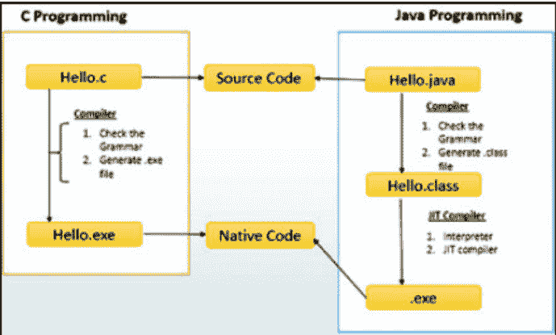

图 1.1: C 编程与 Java 编程

C 程序以 `.c` 扩展名保存。在成功编译“c”程序后，将生成原生代码或 `.exe` 文件，该文件是依赖平台的，不能在任何其他平台上运行。此 `.exe` 文件是依赖平台的，因为它添加了与相应平台兼容性相关的兼容问题。当我们编写 Java 程序时，必须以 `.java` 扩展名保存。在成功编译 Java 程序后，将生成 `.class` 文件，这被称为字节码（byte code），尽管有相应的平台 JDK/JRE，它也是平台无关的。

问 1：为什么在“C”编程语言中可以获取原生代码，而在 Java 编程语言中无法获取原生代码？

答：“C”编程支持静态加载，这意味着如果后续程序需要程序的某个成员，则所有内容都不会加载到主内存中；而 Java 支持动态加载，这意味着如果需要任何方法，它将会在分配到主内存中，并在使用后立即销毁。

## 1.3 需要记忆的重要术语

源代码（Source Code）：开发者编写的程序（人类可读格式）。

字节码（Byte Code）：在 Java 程序成功编译后，将生成字节码，即 `.class` 文件，这被称为字节码。该字节码将在运行程序时被进一步处理。

Java 编译器（Java Compiler）：这是一个名为 `javac.exe` 的程序，主要负责检查语言的语法。在程序成功编译后，它还会生成以类命名的 `.class` 文件。

解释器（Interpreter）：这是一个扩展名为 `java.exe` 的程序。解释器主要负责逐行将字节码生成原生代码。将字节码转换为原生代码是一个耗时的过程。因此，为了解决这个问题，从 Java 2 开始引入了 JIT 编译器。

JIT（即时）编译器：用于在添加相应平台兼容性的同时，一次性将字节码转换为原生代码。

JVM（Java 虚拟机）：它提供平台无关的执行环境。

注意：JVM 本身是依赖平台的。字节码是平台无关的，因为该机器提供了对应的 JVM。

JRE（Java 运行环境）：它提供了许多 JVM 来运行程序。它带有与相应 JDK 相关的不同版本。

JDK（Java 开发工具包）：根据 Sun Oracle 的发布有不同的版本。

- JDK 1.2 (Playground)
- JDK 1.4 (Merline)
- JDK 1.5 (Tiger)
- JDK 1.6 (Mustang)
- JDK 1.7 (Dolphin)
- JDK 1.8 (Spider)

注意：JDK 包含不同类型的工具（如 JRE、JVM），用于开发 Java 应用。

问 2：判断以下陈述的对、误。

- “C”程序是平台无关的。（错误）
- Java 程序是平台无关的。（正确）
- “C”编译器是依赖平台的。（正确）
- Java 编译器是平台无关的。（错误）
- JDK 是平台无关的。（错误）

## 1.4 安装 JDK

步骤：

1. 打开 JDK。
2. 打开 Java8 文件夹。
3. 双击 JDK 1.8。


图 1.2: Java SE Development Kit 8 安装

4. 点击 next（下一步）。
5. 提供想要安装 JDK 1.8 的目标文件夹，或者如果你不想指定任何位置，请点击 next。


图 1.3: 自定义设置


图 1.4: 进度

6. 点击 next（下一步）。


图 1.5: 目标文件夹


图 1.6: 安装进度

7. 点击 Finish（完成）。

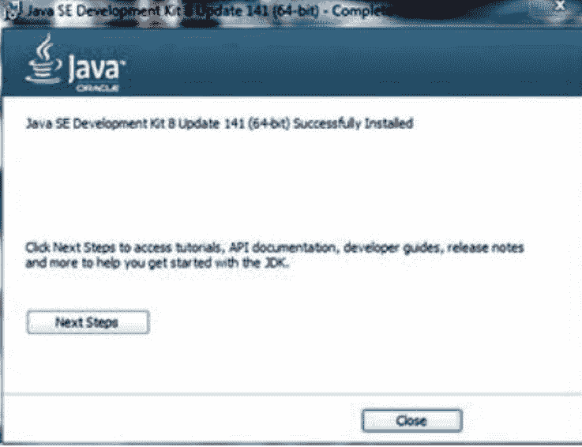

图 1.7: Java SE Development Kit 8 - 完成

成功安装 JDK 后，你需要为 JDK 的“bin” 目录设置路径（path）。仅仅在机器上安装 JDK 是不够的，并行需要设置 JDK 的 bin。

### 1.4.1 设置路径（Path）

路径可以通过两种方式设置：

### 临时路径设置

设置临时路径：

1. 在命令行提示符中进入相应的工作目录。
2. 复制 JDK 路径。
3. 在命令行提示符输入：`set path=%path%;C:\Java\jdk1.7\bin`

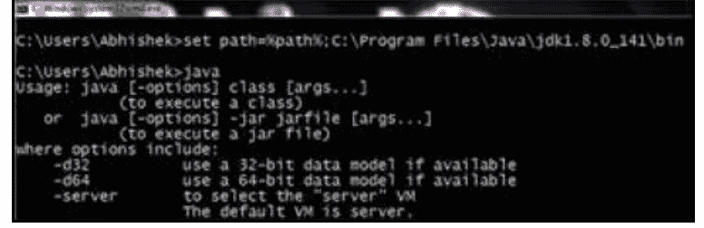

图 1.8: 命令行提示符

当我们设置临时路径时，每次运行 Java 程序都需要设置路径。

### 永久路径设置

设置永久路径：

1. 右点击“我的电脑”图标。
2. 点击“属性”。
3. 点击“高级系统设置”。
4. 点击“环境变量”。

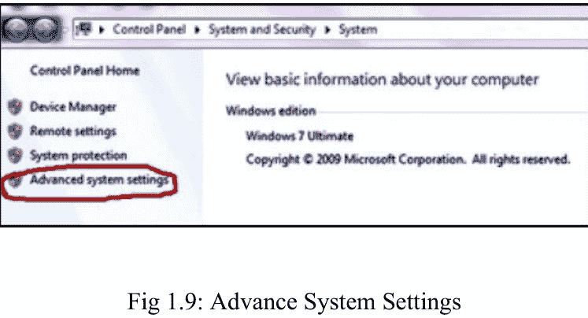

图 1.10: 环境变量 

5. 在“用户变量”下点击“新建”。


图 1.11: 新建

6. 提供变量名为 `path`，变量值为 `C:\Java\jdk1.7\bin`（bin 文件夹位置）。
7. 点击确定。

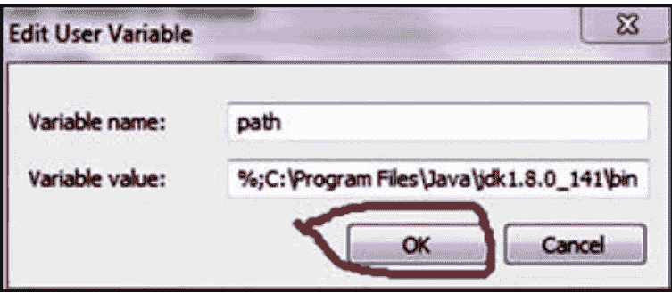

图 1.12: 编辑用户变量

设置永久路径后，你不需要再次设置。

### 1.4.2 如何编译 Java 程序

编写你的 Java 程序并以 `.java` 扩展名保存。

Java 程序成功编译后将生成以类命名的 (`.class`) 文件，被称为“字节码”。整个 Java 程序必须写在类内部。

要编译 Java 程序，打开命令行提示符。

进入工作目录。

语法：`javac filename`（你保存的 Java 程序文件名）。例如：`javac Jtc1.java`

在编译 Java 程序时，你需要提供保存 Java 程序的文件名。你可以以任何名称后接 `.java` 扩展名保存 Java 程序。class 文件将以类名命名，而不是以文件名命名。始终建议以包含 main 方法类的名称保存 Java 程序。

### 1.4.3 运行 Java 程序

在运行 Java 程序时，你需要提供包含 main 方法的 `.class` 文件名。例如：`java Jtc1`

```
Java –verbose Commands jconsole
```

## 程序 1.1

```java
class Hello{
    void m1(){
        System.out.println("m1 in Hello");
    }
}
public class Jtc2 {
    public static void main(String[] args) { 
        Hello h1=new Hello(); 
        h1.m1();
    }
}
```

# 输出

编译：`javac Jtc2.java` - 首先会生成两个 `.class` 文件，第一个是 Hello，第二个是 Jtc2。

运行：`java Jtc2`

Hello 中的 m1 - 输出

运行：`java Hello`

错误：类 Hello 中未找到 main 方法，请按如下方式定义 main 方法：`Public static void main(String args[])`

上述程序可以以任何名称后接 `.java` 扩展名保存，在编译程序时，你需要提供保存程序的文件名。

成功编译上述程序后，将生成两个 `.class` 文件，即 Jtc2 和 Hello。

# 注意

`.class` 文件的生成不依赖于你保存程序或 main 方法的方式。源文件中有多少个类，就会生成相应数量的 `.class` 文件。

在运行程序时，你需要提供包含 main 方法的 (`.class`) 文件名，即 J2c。

问题 3：假设你正以某个名称后接 `.java` 扩展名保存一个 Java 程序，但在该编辑器中你没有写任何任何内容，那么当我们编译它时会发生什么？它会被视为 Java 程序吗？

答：它会被视为 Java 程序，但为了成功编译，内部必须包含某些内容；但如果相应的编辑器没有任何内容，那么就不存在编译程序的问题。因此，我们甚至无法预期生成任何 `.class` 文件。

问题 4：我们是否可以通过键盘对字节码进行任何形式的更改或替换？

答：不，不可以。如果你对现有的字节码进行任何更改，将无法成功运行该程序，因为你从键盘提供的任何输入都将以输入流的形式存在，而其含义与现有不同。

# 第 2 章 Java 语言

## 2.1 字符集

Java 中主要有以下类型的字符集。

- A 到 Z
- a 到 z
- 0 到 9

基本上，这些都是你键盘上提供的所有特殊符号。如果你用 'C' 编程语言开发任何应用程序，它最多只能支持英语，因为 'C' 支持 8 位 ASCII 字符集。而 Java 支持 16 位 Unicode 字符集。因此，通过 Java 开发应用程序，它可以支持许多语言。

当你用 Java 开发任何应用程序时，可以借助国际化（I18N）或本地化。在 Unicode 4.0 之前，它支持几乎所有的语言，但不支持梵文和其他一些语言。但从 Unicode 5.0 开始，它支持梵文并包含了许多新内容。

## 2.2 数据类型

数据类型主要有两种类型。

### a) 原生型数据类型：

| 数据类型 | 大小 (字节) | 默认值 | 范围 |
|---|---|---|---|
| Byte | 1 | 0 | -2^7 to 2^1 |
| short | 2 | 0 | -2^15 to 2^15-1 |
| int | 4 | 0 | -2^31 to 2^31-1 |
| long | 8 | 0 | -2^63 to 2^63-1 |
| float | 4 | 0.0f | |
| double | 8 | 0.0, 0.0d | |
| boolean | - | false | |
| char | - | 空格 | 0 to 65535 |

```
Program 2.1
class Hello{
  byte b1;
  short s1;
  int i1;
  long l1;
  float f1;
  double d1;
  boolean b11;
  char c1;
  void m1(){
    System.out.println("m1 in Hello");
    System.out.println(b1);
```

```
    System.out.println(s1);
    System.out.println(i1);
    System.out.println(l1);
    System.out.println(f1);
```

```
    System.out.println(d1);
    System.out.println(b11);
    System.out.println(c1);
  }
  void m2(){
    System.out.println("m2 in Hello");
    System.out.println(b2);
    System.out.println(s2);
    System.out.println(i2);
    System.out.println(l2);
    System.out.println(f2);
    System.out.println(d2);
    System.out.println(b12);
    System.out.println(c2);
  }
}
```

### b) 用户定义型数据类型：

数据类型主要有两种类型。

## 2.3 关键字

Java 中有以下关键字：

| | | | | |
|---|---|---|---|---|
| abstract | assert | boolean | break | byte |
| char | class | const | continue | default |
| double | enum | else | extends | exception |
| final | finally | float | for | if |
| import | instanceof | int | interface | long |
| native | new | package | private | public |
| protected | return | short | super | static |
| strict | synchronized | this | throws | transient |
| try | void | volatile | while |

关键字是 Java 语言中的保留字，不能作为标识符。

## 2.4 标识符

标识符是赋予变量、方法、类等的名称。

- 必须以字母、货币符号（`$`）或下划线（`_`）开头。
- 不能以数字开头。
- 不能是关键字。
- 可以包含字母、数字、货币符号和下划线。

## 2.5 变量

变量是用于存储数据值的容器。主要有两种类型的变量：

- 类级变量：可以在类中的任何地方访问。如果你没有为对应数据类型的类级变量赋值，它将将由 JVM 内部进行赋值。
- 局部变量：在任何块、方法、构造函数或任何局部范围内定义的变量被称为局部变量。变量不会由 JVM 隐式初始化，即该变量必须在开发者使用之前显式地初始化。

```java
}
}
public class Jtc7 {

    public static void main(String[] args) {
        Hello h1=new Hello();
        h1.m1();
    }
}
```

# 输出:

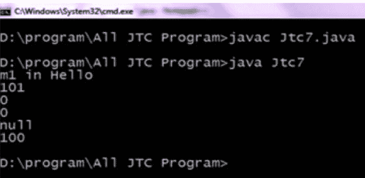

## 2.6 常量

如果你想声明一个在后续程序中不能改变的固定值变量，请将该变量声明为“final”。

`final int tab=20;`

`static final int abl=20;`

`static final int AB=30;`

# 程序 2.4

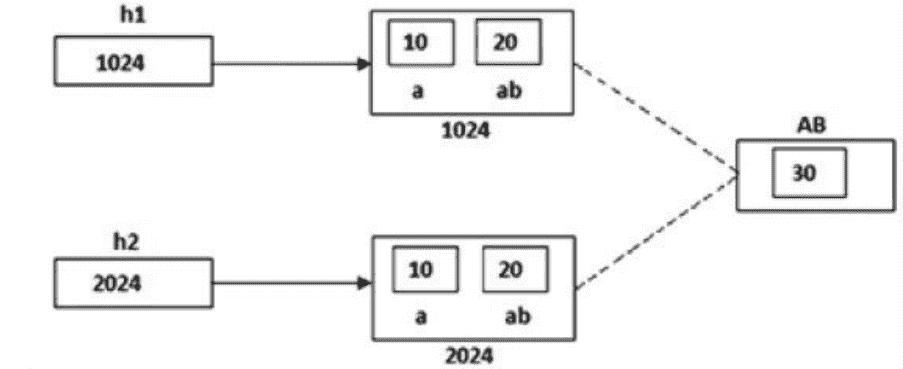

```java
class Hello{
    int a=10;
    final int ab=20;
    static final int AB=30;
}
Hello h1= new Hello();
Hello h2= new Hello();
```

当你为 `ab` 编写 `final int` 时，内存分配取决于创建对象的数量。（图 2.1）。对于 `static final`，无论创建多少个对象，`int AB` 的内存只分配一次。

根据 JLS（Java 语言规范），`static final` 变量必须全大写。

`final` 变量不会被 JVM 显式自动初始化，你必须初始化 `final` 变量。

Q 1: 我们可以更改 `final` 变量的值吗？


答：在更改`final`变量的值之前有一些条件，例如，如果它是实例变量并且在声明时已经初始化，那么你将无法更改它的值；如果它是实例变量且在声明时没有初始化，那么在不同的对象上下文中，你可以为同一个`final`变量赋予不同的值。

**Q 2: 是否始终必要在声明时初始化`final`变量的值？**

答：不，不需要在声明时初始化`final`变量的值。它可以通过以下不同方式进行初始化：

- 在声明时初始化。
- 通过代码块（如果是实例变量，则我们需要使用实例块进行初始化；如果是静态变量，则需要在静态块中显式初始化）。
- 还可以使用构造函数进行初始化。

## 2.7 字面量

字面量是可以赋值给对应数据类型变量的值。字面量主要有以下几种类型：

**a) 整数字面量**：整数字面量进一步分为以下部分：

- **十进制字面量**：十进制字面量不能以 0 开头，即它可以是 0 到 9 之间的任何数字。

```java
例如：
int i1=1234;
int i2=89746;
int i3=0123456; // 不正确
```

对于`i3`，它会报错，即如果它以 0 开头，则会被被视为八进制，而八进制必须在 0 到 7 的范围内。

- **八进制字面量**：八进制字面量必须在 0 到 7 之间，但必须以 0 开头。

```java
例如：
int a=01234;
int b=01267;
int c=01248; // 不正确
```

- **十六进制字面量**：十六进制字面量必须以`0x`（`0X`）开头，并且必须在 0 到 9 以及 A 到 F 的范围之内。

注意：a 到 f 或 A 到 F 的含义相同。

例如：

```java
int i1=0x1234A;
int i2=0X1234a;
int i3=1234a0X // 不正确
```

十六进制字面量不需要在中间某处有`0X`，但同样重要的是十六进制不能以`OX`开头。

```java
程序 2.5
class Hello1 {
    int i1=123456980;
    int i2=10100101;
    int i3=-2147483647;
    int i4=-2147483648;
    //int i5=-2147483648;
    int i6=01010001;
    int i7=0123457;
    //int i8=01234578;
    int i9=000;
    int i10=0x123a;
    int i11=0X123A;
    int i12=0XABCF;
    //int i13=123A0;
    long l11=2147483648;

    void m1(){
        System.out.println("m1 in Hello");
        System.out.println(i1);
        System.out.println(i2);
        System.out.println(i3);
        System.out.println(i4);
        //System.out.println(i5);
        System.out.println(i6);
        System.out.println(i7);
        //System.out.println(i8);
        System.out.println(i9);
        System.out.println(i10);
        System.out.println(i11);
        System.out.println(i12);
        //System.out.println(i13);
        System.out.println(l11);
    }
}
public class Jtc9 {
    public static void main(String[] args) {
        Hello1 h1=new Hello1();
        h1.m1();
    }
}
```

**输出：**

```
C:\Windows\System32\cmd.exe
D:\program\All JTC>javac jtc9.java
D:\program\All JTC>java Jtc9
m1 in Hello
123456980
10100101
-2147483647
-2147483648
65537
82933
0
478
4666
2147483648
```

**b) 浮点字面量**：为了提高数值字面量的可读性，引入了下划线 (`_`)。它可以提高可读性。记住下划线 (`_`) 不能开头也不能结尾。下划线不能用在小数点之前或紧跟其后。

**程序 2.6**

```java
class Hello{
    int i1=11_234;
    int i2=11_234;
    int i3=11__234;
    int i4=11_23_353_3;
    //int i5=_1123;
    //int i6=1123_;
    int i7=0x123_a;
    //int i8=0x123_A;
    int i9=01_01_01_0;
    //int i10=0_X12233A; int i11=0_10100;

    void m1(){
        System.out.println("m1 in Hello");
        System.out.println(i1);
        System.out.println(i2);
        System.out.println(i3);
        System.out.println(i4);
        //System.out.println(i5);
        //System.out.println(i6);
        System.out.println(i7);
    }
    //System.out.println(i8);
    //System.out.println(i9);
    //System.out.println(i10);
    System.out.println(i11);
}
}

public class Jtc10 {
    public static void main(String[] args) {
        Hello h1=new Hello();
        h1.m1();
    }
}
```

**输出：**

```
C:\Windows\System32\cmd.exe
D:\program\All JTC>javac jtc10.java
D:\program\All JTC>java Jtc10
m1 in Hello
11234
11234
11234
11233533
4666
2130440
33288
```

浮点字面量可以用两种方式表示：

- **浮点表示法**。

```java
例如 float f1=10.11; // 不正确
float f2=10.11f;
double d1=99.99;
double d2=99.88d;
double d3=99.66D; //正确
```

- **指数表示法**。

```java
double d1=9.9E+5;
double d2=9.9E-5;
```

**程序 2.7**

```java
class Hai{
    ///float f1=11.22;
    not ok float f2=11.22f;
    float f3=11.33F;
    float
    float f5=Float.MIN_VALUE;
    //float f6=11.22;
    float f7=11.22f;
    float f8=99.999f;
    float f9;
    float f10;
    double d1=11.555;
    double d2=526.566D;
    double d3=11.33d;
    double d4=Double.MAX_VALUE;
    double d5=Double.MIN_VALUE;
    double d6=22.22;
    double d7=9.9E+5;
    double d8=9.9E-5;

    void show() {
        System.out.println("m1 in Hello");
        System.out.println(f1);
        System.out.println(f2);
        System.out.println(f3);
        System.out.println(f4);
        //System.out.println(f5);
        //System.out.println(f6);
        System.out.println(f7);
    }
    //System.out.println(f8);
    //System.out.println(f9);
    //System.out.println(f10);
    System.out.println(i11);
}
```

在 Java 中没有空字符，但当你向单引号内赋值任何字符字面量而不提供任何空格时，它将被视为空字面量，并在编译时会报错。注释掉的行意味着编译器将通过转换为 Unicode 来忽略该行，但再次不会从库中进行验证。在`jtc13`中，我们写了`character ch6=null`，这并不意味着它是一个字符字面量，而是`ch6`是`main`方法内部可用的引用变量，我们显式地赋值了引用变量的默认值。

**d) 字符串字面量**：任何被双引号 (`" "`) 包裹的内容都将被视为字符串字面量。在 Java 中，字符串不是原始数据类型，而是一个位于`java.lang`包中的特殊类。无论你在双引号中包含什么内容，当你尝试打印时，它都会打印在控制台上。但在处理转义字符时，它将显示其设计的原始值。

**程序 2.10**

```java
class Hello{
    String s1;
    String s2="abc";
    String s3="abc123";
    String s4="Hello in Jtc";
    String s5="Hello \t Welcome to Jtc";
    String s6="Hello \r NA";
//String s7=""; //not ok
//String s8="\u0022"; not ok
    String s9="";
    String s10="\u0022 String literal\u0022";
//String s11="\u0022\u0022"; not ok
    String s12="C:\program\java\bin";
//String s13="C:\program\java\bin"; not ok
    String s14="";
    String s15=515+" Hello";
    String s16="\u0001";
    String s17=""; //tab ok
    String s18=""; //tab & space ok
//String s19="Hello"; not ok

    String s20='"String""; not ok
    String s22=""
    String String;
    void m1(){
        System.out.println("m1 in Hello");
        System.out.println(s1);
        System.out.println(s2);
        System.out.println(s3);
        System.out.println(s4);
        System.out.println(s5);
        System.out.println(s6);
//System.out.println(s7);
//System.out.println(s8);
        System.out.println(s9);
        System.out.println(s10);
//System.out.println(s11);
        System.out.println(s12);
//System.out.println(s13);
        System.out.println(s14);
        System.out.println(s15);
        System.out.println(s16);
        System.out.println(s17);
        System.out.println(s18);
    }
}
public class Jtc14 {
    public static void main(String[] args) {
        Hello h1=new Hello();
        h1.m1();
    }
}
```

**输出：**

```
C:\Windows\System32\cmd.exe
D:\program\All JTC Program>javac jtc14.java
D:\program\All JTC Program>javac jtc14
m1 in Hello
null
abc
abc123
Hello I am in jtc
Hello welcome to Jtc
"NA"10

Hello string literal
C:\program\java\bin
515 Hello

String :null
```

```java
class Hello{
    int i1=1234;
    int i2=1_234;
    int i3=0b10101_10101;
    //int i4=0B_1010111;
    //int i5=0B101010_;
    int i6=0X1238A_B;
    // double d1=11.22d;
    double d2=11_22.21;
    double d3=11._272;
    double d4=111_2828;

    void m1(){
        System.out.println(i1);
        System.out.println(i2);
        System.out.println(i3);
        //System.out.println(i4);
        //System.out.println(i5);
        System.out.println(i6);
        //System.out.println(d1);
        System.out.println(d2);
        //System.out.println(d3);
        //System.out.println(d4);
    }
}

public class Jtc17 {
    public static void main(String[] args) {
        Hello h1=new Hello();
        h1.m1();
    }
}
```

**输出：**

```
C:\Windows\System32\cmd.exe
D:\program\All JTC Program>javac Jtc17.java
D:\program\All JTC Program>java Jtc17
1234
1234
693
1194155
1122.21
```

## 3.1 什么是运算符

运算符用于与操作数结合执行操作。

## 3.2 运算符的类型

各种类型的运算符有：

- 算术运算符 (`+,-,*,/,%`)
- 赋值运算符 (`=,+=,-=,*=`)
- 关系运算符 (`==,<=,>=,<>`)
- 逻辑运算符 (`&&,||,!`)
- 位运算符 (`&,|,~,>>`)
- 三元运算符 (`? :`)
- 增量/减运算符 (`++,--`)
- `new`运算符
- `instanceof`运算符

| 运算符 | 优先级 |
| --- | --- |
| 后置 | `expr++ expr--` |
| 一元 | `++expr --expr +expr -expr !` |
| 乘法 | `* / %` |
| 加法 | `+ -` |
| 移位 | `<< >>>` |
| 关系 | `< > >= instanceof` |
| 等于 | `== !=` |
| 位与 | `&` |
| 位异或 | `^` |
| 位按位或 | `|` |
| 逻辑与 | `&&` |
| 逻辑或 | `||` |
| 三元 | `? :` |
| 赋值 | `= += -= *= &= == <= >= >>>` |

算术运算符：算术运算符是需要两个操作数的二元运算符。算术运算的结果取决于所用操作数的类型。通过使用算术运算符我们可以构造表达式。

**程序 3.1**


# Java 运算符与类型转换示例

## 程序 3.1：基本类型转换

```java
class Hello{
    byte b1=10;
    byte b2=20;
    int i1=10;
    int i2=20;
    long l1=11112;
    long l2=12929;

    void m1(){
        System.out.println("m1 in Hello");
        //byte b11=b1+b2;
        //byte b12=i1+i2;
        //byte b13=b1+i1;
        int i11=b1+b2;
        int i12=i1+i2;
        int i13=b1+i1;
        long l11=l1+l2;
        //System.out.println(b11);
        //System.out.println(b12);
        //System.out.println(b13);
        System.out.println(i11);
        System.out.println(i12);
        System.out.println(i13);
        System.out.println(l11);
    }
}

public class Jtc18 {
    public static void main(String[] args) {
        Hello h1=new Hello();
        h1.m1();
    }
}
```

**输出：**

```
C:\Windows\System32\cmd.exe
D:\program\All JTC Program>javac Jtc18.java
D:\program\All JTC Program>java Jtc18
m1 in Hello
30
30
20
24041
```

**注：** 使用 `final` 修饰的常量在编译时进行类型检查。

```java
final byte b3=10;
final byte b4=20;
final byte b5=127;
final byte b6=10;
final int i3=10;
final int i4=20;
final int i5=2147483647;
final int i6=12384;

void m1(){
    byte b14=b3+b4;
    //byte b15=b5+b6;
    byte b16=i3+i4;
    int i14=i3+i4;
    int i15=i5+i4;
    System.out.println(b14);
    System.out.println(b15);
    System.out.println(b16);
    System.out.println(i14);
    System.out.println(i15);
}
```

**类型转换表：**

| + | Byte | short | long | float | double | char |
|---|---|---|---|---|---|---|
| Byte | | | | | | |
| short | | | | | | |
| Int | | | | | | |
| Long | | | | | | |
| Float | | | | | | |
| double | | | | | | |
| Char | | | | | | |

## 程序 3.2：浮点数与字符运算

```java
class Hello{
    float f1=Float.POSITIVE_INFINITY;
    float f2=Float.NEGATIVE_INFINITY;
    float f3=Float.NaN;
    float f4=f1+f2;
    float f5=f2+f3;
    char ch1='A';
    char ch2='B';
    int i1=ch1+ch2;
    int ch3=ch1+ch2;

    void m1(){
        System.out.println("m1 in Hello");
        System.out.println(f1);
        System.out.println(f3);
        System.out.println(f4);
        System.out.println(f5);
        System.out.println(i1);
        System.out.println(ch3);
    }
}

public class Jtc19 {
    public static void main(String[] args) {
        Hello h1=new Hello();
        h1.m1();
    }
}
```

**输出：**

```
javac Jtc19.java
m1 in Hello
Infinity
NaN
NaN
130
130
error: possible loss of precision:转换 to char
```

## 赋值运算符

赋值运算符用于将值赋值给对应的数据类型。

```java
byte b1=20;
int i1=20;
byte b12=b1;
int i12=i1;
```

赋值时应记住以下几点：

- 如果源类型和目标类型相同，则赋值是可能的。
- 当目标类型大于源类型时，赋值是可能的。
- 当目标类型小于源类型时，无法直接赋值，需要强制类型转换。

## 关系运算符

关系运算符用于建立两个表达式之间的关系，使用关系运算符可以构造关系表达式。关系运算符的结果总是返回布尔值（`true`或`false`）。

```java
int a=10;
int b=20;
(a>b)
```

## 逻辑运算符

逻辑运算符用于构造逻辑表达式。逻辑表达式总是给出布尔值。逻辑运算用于两个关系表达式之间。

**真值表：**

| A | B | A&&B | A\|\|B |
|---|---|---|---|
| F | F | F | F |
| F | T | F | T |
| T | F | F | T |
| T | T | T | T |

例如：

```java
int a=10;
int b=20;
(a>b)
```

## 位运算符

位运算符用于处理单个位。主要有两种移位运算符：

**左移运算符：** 该运算符用于处理单个位，将位向左侧移动指定的次数。当你向左移动位时，值将变为原来的两倍。

```java
int i=16;
i<<2
```

**右移运算符：** 将位向右移动指定的位数。当位向右移动一位时，值将变为原来的一半。在涉及精度部分的情况下，精度部分将被忽略。

```java
int i=3;
i>>3
```

### 问题 1：求数字 `i=16` 的反码

**答案：**

| 128 | 64 | 32 | 16 | 8 | 4 | 2 | 1 |
|---|---|---|---|---|---|---|---|
| 0 | 0 | 0 | 1 | 0 | 0 | 0 | 0 |
| 0 | 0 | 1 | 0 | 0 | 0 | 0 | 0 |
| 0 | 1 | 1 | 0 | 0 | 0 | 0 | 0 |
| 1 | 1 | 1 | 1 | 1 | 1 | 1 | 1 |

数字的反码 = (取反后 1 的位位置和) - (最大位表示和) = -256

### 问题 2：编写一个程序求数字 `i=500` 的反码

```java
class Hello{
    int i1=16;
    int i2=12;

    void m1(){
        System.out.println("m1 in Hello");
        System.out.println(i1<<1);
        System.out.println(i1<<20);
        System.out.println(i1<<33);
        System.out.println(i2>>1);
        System.out.println(i2>>32);
        System.out.println(~500);
    }
}

public class Jtc25 {
    public static void main(String[] args) {
        Hello h1=new Hello();
        h1.m1();
    }
}
```

## 程序 3.3：位运算与逻辑运算

```java
class Hello{
    int i1=10;
    int i2=11;
    int i3=0b101010;
    int i4=0B101010;

    void m1(){
        System.out.println("m1 in Hello");
        System.out.println(i1>i2);
        System.out.println(i1&i2);
        //System.out.println((i1)&&i2));
        //System.out.println(i3&i4);
        System.out.println((i11));
        System.out.println((i1l));
    }
}

public class Jtc26 {
    public static void main(String[] args) {
        Hello h1=new Hello();
        h1.m1();
    }
}
```

### 逻辑与 (`&&`) 和位与 (`&`) 的区别

逻辑与仅适用于关系表达式，而位与既可以适用于数值表达式也可以适用于关系表达式。

例如：当两个关系表达式之间应用逻辑与(`&&`) 时，如果第一个表达式返回 `true`，则才会计算第二个表达式，否则不会。即第二个表达式的评估依赖于第一个表达式的结果。而在位与 (`&`) 的情况下，第二个表达式的评估是独立于第一个的。

**例：**

```java
int i1=10;
int i2=11;
int i1=++i1;//i1=11;
```

## 前置递增/递减运算符

前置递增/递减运算符的处理：首先将变量的值加一（或减一），然后执行赋值。

**例如：**

```java
int i1=10;
int i2=11;
int i1=i++;
int i2=i--;
```

## 程序 3.4：递增/递减运算符示例

```java
class Hello{
int i1=10;
int i2=11;
void m1(){
System.out.println("m1 in Hello");
int i1=++i1;
int i2=--i1;
int i13=i2++;
int i4=i2--;
System.out.println("i1: "+i1);
System.out.println("i2: "+i2);
System.out.println(i11);
System.out.println(i12);
System.out.println(i13);
System.out.println(i14);
}
}
class Jtc27{
    public static void main(String[] args) {
    Hello h1=new Hello();
    h1.m1();
    }
}
```

**输出：**

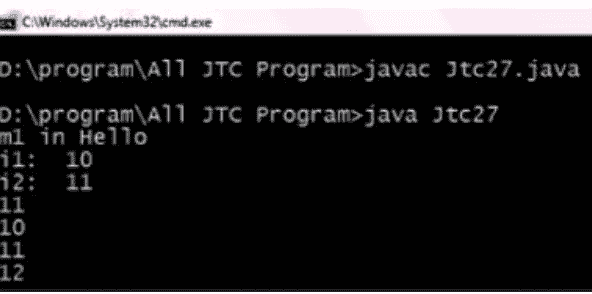

## 程序 3.5：更多运算符示例

```java
class Hello{
    int i1=10;
    int i2=11;
    int i3=2147483647;
    int i4=Integer.MAX_VALUE;
    int i5=Integer.MIN_VALUE;
    int i6=0b1010101;
    int i7=0x122A;
    float f1=10.22f;
    float f2=Float.POSITIVE_INFINITY;
//String s1=Float.POSITIVE_INFINITY;
char ch1='A';

void m1(){
System.out.println("m1 in Hello");
int i1=++i1;
int i2=i2++;
int i3=++i1+i1++;
int i4=-++i1+i1++;
int i5=i11--i1;
//int i6=++i1+i1;//not ok
//int i17=++i1--;not ok;
int i18=++10; int i19=++i3;
//int i20=++IntegerMax_value;
int i21=++i14;
//int i22=++i5;
//int i23=i1++++++i2;
int i24=(i1++)+(++i2);
int i25=++i6;
int i26=++i7;
float f11=++f1;
float f12=++f2;
char ch11=++ch1;
System.out.println(i12);
System.out.println(i13);
System.out.println(i14);
System.out.println(i15);
System.out.println(i19);
System.out.println(i21);
System.out.println(i24);
System.out.println(i25);
System.out.println(i26);
System.out.println(f11);
System.out.println(f12);
System.out.println(ch11);
System.out.println(f2);
}
public class Jtc28 {
public static void main(String[] args) {
Hello h1=new Hello();
h1.m1();
}
}
```

**输出：**

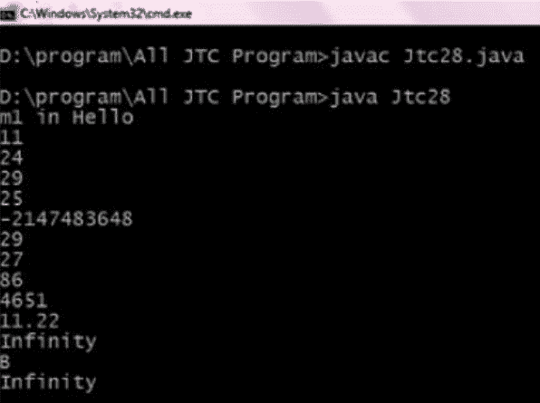

## 递增/递减运算符的限制

递增或递减运算符不能应用于任何值或 `final` 变量。

```java
int i16=++i++;
```

在 `i16` 的情况下首先处理 `p1`，因此在处理 `p1` 之后，递增/递减运算符不能应用于任何值。

## `new` 运算符

`new` 运算符用于在堆中分配内存，通过 `new` 运算符我们可以创建类的对象。

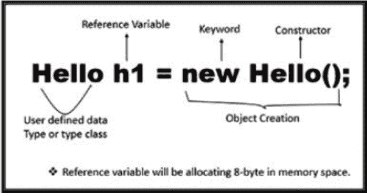

图 3.3: `new`

## 三元运算符

三元运算符用于检查小型条件并根据该条件返回结果（它的工作方式类似于 `if-else`）。

**语法：**

```
类型变量=(条件) ? 真部分 : 假部分
```

**例如：**

```java
int a=10;
int b=20;
int c=(a
```

## 程序 3.6：三元运算符与命令行参数

```java
public class Jtc {
public static void main(String[] args) {
/*int a=10;
 * int b=20;
 * int c=(a
 * System.out.println(c);
 */
int a=Integer.parseInt(args[0]);
int b=Integer.parseInt(args[1]);
//int c=(a
//System.out.println(result);
String result1=(a>0:"TRUE":"FALSE");
System.out.println(result1);
/*System.out.println("Length of Array :args.length);
System.out.println("\n");
for(int i=0;i<args.length;i++)
System.out.println(args[i]);
}*/
}
}
```

**错误：**

```
在线程 "main" java.lang.ArrayIndexOutOfBoundsException: 0 at Source.Jtc29.main(10)
在线程 "main" java.lang.Error: 未解决编译问题：类型不匹配：无法将 int 转换为 String at Source.Jtc29.main(16)
在线线程 "main" java.lang.NumberFormatException: 输入“a” at java.lang.NumberFormatException.forInput(Unknown Source)
at Integer.parseInt(Unknown Source)
at Integer.parseInt(Unknown Source)
at Source.Jtc29.main(10)
```

## 从命令行获取值

`main` 方法中的参数 `args[]` 存储了所有值。根据我们的需求，可以逐个获取这些值。从命令行无法获取固定值。`Integer.parseInt()`：`Integer` 是一个类，其中包含 `parseInt` 方法，用于将其范围内的字符串转换为整数类型。

**问：** 我们可以编写嵌套的三元运算符吗？

**答：** 可以。例如：

```java
public class Jtc30 {
    static String arg1[];
    public static void main(String[] args) {
        System.out.println(args.length);
        System.out.println(arg1.length);
    }
}
```

```
在线程 "main" java.lang.NullPointerException at Source.Jtc30.main(7)
```


当请求资源不可用，你将得到空指针。在`main`方法`args[]`的情况下，从命令行提供的任何输入在JVM内部会被视为数组的大小。数组大小是不预定义的，因为我们不知道用户将从命令行提供多少输入。

`instanceof`运算符：`instanceof`运算符用于检查是否为相应的引用。如果引用包含，则返回`true`，否则返回`false`。注意：要在两个不同类型之间应用`instanceof`，它们必须存在父子关系。

## instanceof 和 isinstance() 的区别

| InstanceOf | isinstance() |
|---|---|
| `instanceof`运算符可以检查给定对象是否为特定类型 | `isinstance()`是类中存在的一个方法，我们可以使用`isinstance()`方法检查给定对象是否为特定类型 |
| 我们在开始时知道类型 | 我们在开始时不知道类型，它在运行时动态确定 |

## 程序 3.7

```java
class Hello{
class Hai extends Hello {
}
public class Jtc31 {
public static void main(String[] args) {
Hello h1=new Hello();
Hai hai= new Hello();
System.out.println(h1 instanceof Hello);
System.out.println(hai instanceof Hai);
System.out.println(h1 instanceof Hai);
System.out.println(hai instanceof Hello);
}
}
```

## 输出:

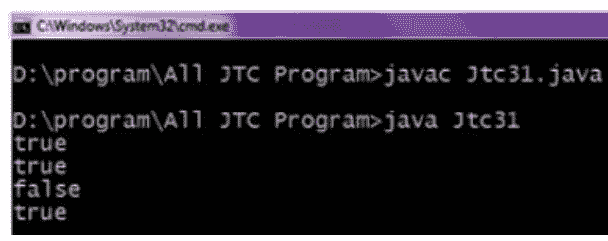

## 程序 3.8

```java
import java.util.ArrayList;
class Hello {
void m1() {
    System.out.println("m1 in Hello");
}
}
}
class Hai {
void m2() {
    System.out.println("m2 in Hai");
}
}
public class Jtc32 {
    public static void main(String[] args) {
    Hello h1 = new Hello();
    Hai hai = new Hai();
    if (h1 instanceof Hello) {
    System.out.println("If...");
    h1.m1();
    } else if (hai instanceof Hai) {
    System.out.println("Else...");
    hai.m2();
    }
    System.out.println("ARRAY LIST");
    ArrayList al = new ArrayList();
    al.add(());


.al(addnew());
    al.add(new Object());
    al.add(new String("JTC"));
    al.add(99);
    System.out.println(al);
    System.out.println("FOR LOOP...");
    for (Object o : al) {
    System.out.println(o);
    if (o instanceof Hello) {
        Hello h11 = (Hello) o;
        h11.m1();
    } else if (o instanceof Hai) {
        Hai hai1 = (Hai) o;
        hai1.m2();
    } else if (o instanceof Integer) {
        Integer i = (Integer) o;
        System.out.println(i);
    }
    }
    }
}
```

## 输出:

```
<terminated> Jtc29 (Java Application) installed software\java\7\bin\java.exe (Out Jul 21, 2017, 6:39:28 PM)
ARRAY LIST
[test.p2.Hello@39cd04f1, test.p2.Hai@42ff87dc,
FOR LOOP..
test.p2.Hello@39cd04f1
m1 in Hello
test.p2.Hai@42ff87dc
m2 in Hai
java.lang.Object@1630ee1
JTC
99
99 ]
```

## 程序 3.9

```java
class Hello extends Object {
public class Jtc33 {
    public static void main(String[] args) {
    Hello h1 = null;
    Object o = new Object();
    String s1 = new String("JTC");
    Hello h2 = new Hello();
    System.out.println(h1 instanceof Hello);
    System.out.println(h2 instanceof Hello);
    System.out.println(o instanceof Hello);
    System.out.println(s1 instanceof Object);
//System.out.println(s1 instanceof Hello);
    System.out.println(o instanceof String);
    }
}
```

```
D:\program\All JTC Program>javac Jtc33.java
D:\program\All JTC Program>java Jtc33
false
true
false
true
false
```

## 3.3 类型转换 (Type Casting)

类型转换（Type Casting）是将一种数据类型转换为相应的兼容的类型数据类型的过程。类型转换主要可以分为两种类型：

- 隐式类型转换（Implicit type casting）：当目标类型大于源类型时，不需要显式执行任何类型转换，它会自动转换为对应的目标类型。

语法：

```java
Datatype variable_Name=(Datatype) variable_2;
```

- 显式类型转换（Explicit type casting）：当目标数据类型小于源类型时，称为窄转换，此时你需要显式地将其转换为对应的目标类型。

例：`byte b12 = (byte) i1;`

## 程序 3.10

```java
class Hello{
int i1=10;
byte b1=10;
int i2=130;
long l1=121;
long l2=2147483648l;
float f1=10.01f;
double d1=11.11;
void m1(){
  System.out.println("m1 in Hello");
  byte b11=b1;
  byte b12=(byte)i1;
  int i1=b1;

  int i12=i1;
  int i13=(int)i1;
  long l11=i1;
  float f11=f1;
  float f12=(float)d1;
  double d11=i1;
  double d12=f1;
  int i14=(int)d1;
  byte b13=(byte)i2;
  int i15=(int)l2;
  System.out.println(b11);
  System.out.println(b12);
  System.out.println(i11);
  System.out.println(i12);
  System.out.println(i13);
  System.out.println(l11);
  System.out.println(f11);
  System.out.println(f12);
  System.out.println(d11);
  System.out.println(d12);
  System.out.println(i14);
  System.out.println(b13);
  System.out.println(i15);
}
}
public class Jtc20 {
    public static void main(String[] args) {
        Hello h1=new Hello();
        h1.m1();
    }
}
```

# 输出:

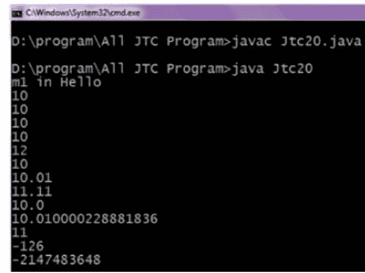

## 程序 3.11

```java
class Hello{
    byte b1=10;
    int i1=10;
    byte b12=(byte)(char)(double)(float)(byte)i1;
    byte b13=-1;
    char ch1=(char)(byte)(int)(-1); //ch1=1;
    void m1() {

System.out.println("m1 in Hello");
//b1=b1+10;
b1+=10;
System.out.println(b12);
System.out.println(ch1);

System.out.println(b1);
}
}
public class Jtc23 {
public static void main(String[] args) {
Hello h1=new Hello();
h1.m1();
}}
```

# 输出:

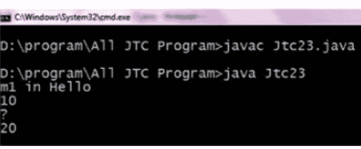

**注意：** 在行中进行不同类型的转换被称为多重类型转换。在`b1+=10`的情况下，称为复合赋值，不需要执行显式类型转换，会自动转换为对应的目标类型。

## 程序 3.12

```java
class Hello{
Byte b1=10;
Byte b2=10;
Short s1=11;
Short s2=22;
void m1(){
System.out.println("m1 in Hello");

Byte b11=(Byte)(b1+b2);
byte b12=b1+s2;
Byte b13=b1+s1;
byte b14=b1+s1;
short s11=b1+s2;
System.out.println(b11);
System.out.println(b12);
System.out.println(b13);
System.out.println(b14);
System.out.println(s11);
}
public class Jtc24 {
public static void main(String[] args) {
Hello h1=new Hello();
h1.m1();
}
}
```

# 输出:

## 注意

不兼容类型表示源和目标类型不同，或者源和目标类型不兼容。可转换类型表示可以转换为目标类型。

## 4.1 引言

控制语句用于根据特定条件控制执行流。

## 4.2 控制语句的类型

控制语句主要有以下类型：

- 条件语句

- 循环语句

### 4.2.1 条件语句

根据特定条件进行条件语句的执行。

条件语句主要有以下类型：

- 1. if

  - a) `if(condition){`

    语句;

  `}`

  - b) `if(condition){`

    语句;

  `}else{`

    语句;

  `}`

  - c) `if(condition 1){`

    语句;

  `}else if(condition 2)`

    语句;

  `}else{`

    语句;

  `}`

  - d) `if(condition){`

    语句;

  `}else{`

    `if(condition){`

    语句;

  `}else{`

    语句;

  `}`

## 程序 4.1

```java
public class Jtc34 {
public static void main(String[] args) {
int i1=Integer.parseInt(args[0]);
int i2=Integer.parseInt(args[1]);
int i3=Integer.parseInt(args[2]);
if((i1>i2)&&(i1>i3)){
System.out.println(i1);
}else if((i2>i1)&&(i2>i3)){
System.out.println(i2);
}else if((i3>i1)&&(i3>i2)){
System.out.println(i3);
}
}
```

# 输出:

```
C:\Windows\System32\cmd.exe
D:\program\All JTC Program>javac Jtc34.java
D:\program\All JTC Program>java Jtc34 4 5 6
```

## 程序 4.2

```java
public class Jtc35 {
public static void main(String[] args) {
int i=0;
if(i) {
System.out.println("if");
}else {
System.out.println("else");
}
}
```

错误：`java.lang.Error: 编译问题：类型不匹配，无法从 int 转换为 boolean，位于 Source.Jtc35.main(Jtc35.java:6)`

**注意：** 在Java中1不等于`true`或`false`。你需要提供一个返回`true`或`false`的关系表达式。Switch：

```
switch(...){

case 1: 语句1;

case 2: 语句1;

case 3: 语句1;

default: 语句1;

}
```

如果不在每个`case`之后编写`break`，则将无法获得格式化的输出。

## 程序 4.3

```java
class Jtc36 {
    public static void main(String[] args) {
        int i = Integer.parseInt(args[0]);
        switch (i) {
            case 3:
                System.out.println("THREE");
                break;
            case 2:
                System.out.println("TWO");
                break;
            case 1:
                System.out.println("ONE");
                break;
            case 3:
                System.out.println("THREE");
                break;
            default:System.out.println("Default");
                break;
        }
    }
}
```

错误：`java.lang.Error: 编译问题：重复的 case，位于 Source.Jtc36.main(Jtc36.java:7)`

Q1:你可以在`switch`内部任何地方写`default`语句吗？

答：可以

Q2:我可以写多个`default`语句吗？

答：不能

Q3:我可以重复标签吗？

答：不能

## 程序 4.4

```java
public class Jtc37 {
public static void main(String[] args) {
int a = 3;
witch (a) {
case 1:
System.out.println("Case 1");
break;
case 2:
System.out.println("Case 2");
break;
case 3:
System.out.println("Case 3");
break;
default:System.out.println("Invalid Case");
break;
}
}
```

# 输出:

JDK 4 `byte`, `short`, `int`和`char`在`switch`中是允许的。JDK5 `enum`在`switch`中也是允许的。JDK1.7 `String`在`switch`中也是允许的。

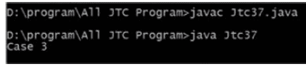

在`switch`中使用`enum`时记住以下几点：`switch`中的`case`数字必须是`enum`的类型，否则将产生编译错误。

## 程序 4.5


```java
enum MONTH {
    JAN, FEB, MARCH, APR
}

class Hello {
    void m1(char ch) {
        System.out.println("char in Switch in m1");
        switch (ch) {
            case 'A':
                System.out.println("case A");
                break;
            case 'B':
                System.out.println("case B");
                break;
            case 'C':
                System.out.println("case C");
                break;
            case 'D':
                System.out.println("case D");
                break;
            default:
                System.out.println("invalid case in m1");
        }
    }

    void m2() {
        System.out.println("Enum in switch in m2");
        MONTH m[] = MONTH.values();
        for (MONTH m1 : m) {
            System.out.println(m1 + "--- " + m1.ordinal());
        }
        MONTH m1 = MONTH.FEB;
        switch (m1) {
            case JAN:
                System.out.println("JAN");
                break;
            case FEB:
                System.out.println("FEB");
                break;
            case JULY:
                System.out.println("JULY");
                break;
            default:
                System.out.println("Invalid Enum Type");
        }
    }

    void m3(String str) {
        System.out.println("String from JDK 1.7 in m3");
        switch (str) {
            case "AB":
                System.out.println("AB");
                break;
            case "BC":
                System.out.println("BC");
                break;
            case "CD":
                System.out.println("CD");
                break;
            default:
                System.out.println("Invalid String case");
        }
    }
}

class Jtc38 {
    public static void main(String arg[]) {
        Hello h1 = new Hello();
        h1.m1('A');
        h1.m2();
        h1.m3(arg[0]);
    }
}
```

错误：`java.lang.Error`：编译问题：

`JULY` 无法解析或不是 `Source` 中的字段

at at `Source.Hello.m2(Jtc38.java:37)`

at at `Source.Jtc38.main(Jtc38.java:59)`

## 程序 4.6

```java
public class Jtc39 {
    public static void main(String[] args) {
        int i = Integer.parseInt(args[0]);
        switch (1) {
            case 1:
                System.out.println("Case 1");
                break;
            case 2:
                //break;
            case 3:
                ;
            case 4:
                System.out.println("case 4");
            default:
                System.out.println("Default");
        }
    }
}
```

输出：

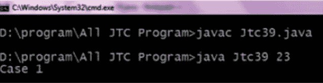

## 程序 4.7

```java
public class Jtc40 {
    public static void main(String[] args) {
        char ch = 'A';
        switch (ch) {
            case 1:
                System.out.println("Case 1");
                break;
            case 'A':
                System.out.println("A");
                break;
            default:
                System.out.println("Default");
        }
    }
}
```

输出：

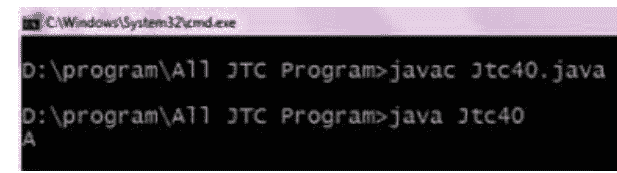

## 程序 4.8

```java
public class Jtc41 {
    public static void main(String[] args) {
        int i = 3;
        final int i1 = 3;
        final int i2;
        i2 = 3;
        switch (1) {
            case 1:
                System.out.println("ONE");
                break;
            case 2:
                System.out.println("TWO");
                break;
            /*case i:
                System.out.println("THREE");
                break;*/
            case i1:
                System.out.println("THREE i1");
                break;
            /*case i2:
                System.out.println("THREE i2");
                break;*/
            default:
                System.out.println("Default");
        }
    }
}
```

输出：

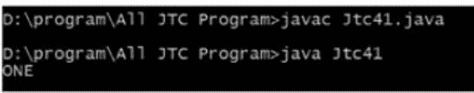

注意：在 `switch` 情况中，`case` 必须是常量，不应该存在对应 `case` 值是变量的情况。

在 `Jtc40` 情况中，我们提供了 `case 1` 和 `case 'A'`，在这种情况下，传递给 `switch` 的参数必须与 `switch` 内部包含的 `case` 类型相同。

### 4.2.2 循环控制语句

循环控制语句用于根据某些特定条件按指定的次数重复某些任务。循环控制语句主要有以下类型。

- **1. `for` 循环**

`for` 用于根据某些特定条件按指定的次数迭代循环。

```java
语法: for(初始化; 条件; 增量/递减 )
{
    语句;
}
```

`for` 循环的处理：在处理 `for` 循环时，首先会进行初始化，然后检查条件或评估条件，如果满足条件则返回 `true`，处理循环内部包含的语句，然后执行增量或递减。然后再次评估条件，如果返回 `true`，则此过程将继续，直到条件部分不再返回 `false`。

## 程序 4.9

```java
public class Jtc42 {
    public static void main(String[] args) {
        for (int i = 0; i < 10; i++) {
            System.out.println(i);
        }
        int i = 0;
        for (i < 10) {
            System.out.println(i);
        }
        i++;
    }
    /*for(System.out.println(i);System.out.println("ABC");i++) {
        System.out.println(i);
    */
    for (System.out.println(i); ; i++) {
        if (i < 10) {
            System.out.println(i);
        }
    }
    for (int j = 0; j < 20; j++) {
        System.out.println("IN FOR : " + j);
        if (i == 3) {
            break;
            System.out.println("After Loop");
        }
        for (int j = 0; j < 20; j++) {
            System.out.println("IN FOR : " + j);
            if (i == 3) {
                System.out.exit(0);
                System.out.println("After Loop");
            }
            for (int j = 0; j < 10; j++) {
                if (i == 3) {
                    System.out.println("In FOR LOOP If" + i);
                    System.exit(0);
                }
                System.out.println(i);
            }
        }
        int k = 0;
        for (k = 0; k < 10; k++)
            i++;
        System.out.println(i);
    }
}
```

输出：

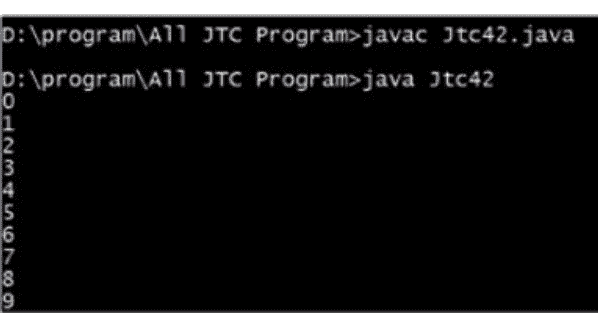

## 2. `while` 循环

`while` 循环是 `for` 循环的描述形式。在 `while` 循环中，首先评估条件，如果返回 `true`，则处理内部的语句，然后执行增量或递减。它会反复重复，直到条件不满足或返回 `false`。

```java
while(条件){
    语句;
    增量/递减
}
```

## 3. `do-while` 循环

```java
do{
    语句;
    增量/递减
} while(条件);
```

在 `do-while` 中，在不检查条件的情况下，它会处理一次语句，第二次迭代时检查条件。如果返回 `true`，循环将继续，否则将退出 `do-while` 循环。

问：比较 `while` 和 `do-while`，从更好的控制角度来看，应该主要使用哪一个？

答：通常建议使用 `while` 循环代替 `do-while`，因为我们可以通过 `while` 获得更好的控制。

## 示例

```java
public class JtcLoop {
    public static void main(String[] args) {
        byte b = Byte.MIN_VALUE;
        if (b == 0) {
            System.out.println("JTC!");
        }
    }
}
```

```java
public class Jtc {
    public static void main(String[] args) {
        int j = 0;
        for (int i = 0; i < 100; i++) {
            j++;
        }
        System.out.println(j);
    }
}
```

```java
public class Jtc {
    static final int END = Integer.MAX_VALUE;
    static final int START = Integer.MIN_VALUE;
    public static void main(String[] args) {
        int count = 0;
        for (int i = START; i++; ) {
            count++;
        }
        System.out.println(count);
    }
}
```

```java
public class Jtc {
    // 注意：此处原文代码似乎有误（缺少括号或逻辑），但作为翻译，仅保持逻辑结构
    public static void main(String[] args) {
        int count = 0;
        for (int i = START; i++; ) {
            count++;
        }
        System.out.println(count);
    }
}
```

*(注：原文提供的后几段代码块存在多处语法错误或重复，翻译时已根据要求保留了格式并对描述进行了翻译)*

## 5.1 引言

数组是相同类型元素的集合。数组的大小一旦定义，就无法更改。

## 5.2 数组的类型

数组主要有以下类型：

- **1. 静态数组**

语法：`array_name[]={val1,val2,...valn}`

示例：`int a[]={11,22,33,44}`

- **2. 动态数组**

语法：`array_name[]=new Data[size]`

示例：`int a[]=new int[4]`

0

0

0

0

0

0

`a[3]=303`

`a[2]=303`

`a[1]=202`

`a[0]=101`

```java
/*for(char ch1='\0';ch1<\u00ff';ch1++) {
System.out.println(ch1);
}*/
Hello h1[] = new Hello[5];
Hello h11 = new Hello();
System.out.println(h11);
for (int i = 0; i < h1.length; i++) {
    System.out.println(h1[i]);
}
String str1[][] = {{"abc", "xyz"}, {"mno"}};
for (int i = 0; i < str1.length; i++) {
    System.out.println(str1[i] + "" + str1[i].length());
}
```

输出：

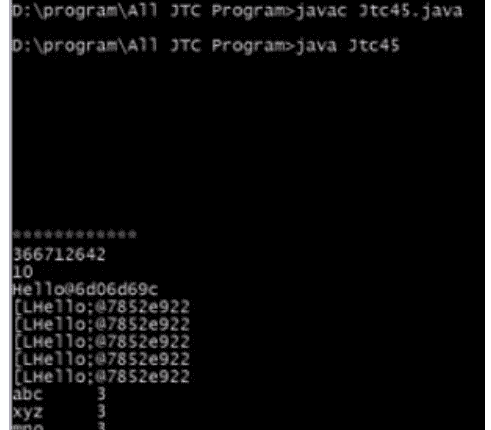

## 程序 5.3

```java
class Hello {
    public int hashCode() {
        return 4;
    }
    public String toString() {
        return this.getClass().getName() + ":" + Integer.toHexString(hashCode());
    }
}
class Hai {
}
public class Jtc46 {
    public static void main(String[] args) {
        Hello h1[] = new Hello[2];

        h1[0] = new Hello();
        //h1[1]=new Hai();
        Object o[] = new Object[2];
        o[0] = new Hello();
        o[1] = new Hai();
        for (int i = 0; i < o.length; i++) {
            System.out.println(o[i]);
        }
    }
}
```

输出：

```text
D:\program\All JTC Program>javac jtc47.java
D:\program\All JTC Program>java jtc47
77
---
44
---
55
---
22
---
88
---
11
---
0
---
66
---
33
---
88:15 Found
found :88
```

## 程序 5.4


```java
class Hello {
    int a[] = new int[50];
    int b = 0;

    public boolean find (long searchKey){
        int j;
        for(j=0;j<b;j++) {
            if(a[j]==searchKey) { // 找到项目
                System.out.println(a[j]+":is Found");
                break;
            }
        }
        if(j==b)
            return false;
        else
            return true;
    }

    public void insert(int value) // 将元素放入数组 {
        a[b] = value;
        b++;
    }

    public boolean delete(int value) {
        int j;
        for (int j = 0; j<b; j++) {
            if (value == a[j])
                break;
        }
        if (j == b)
            return false;
        else {
            for (int k = j; k<b-1; k++) a[k] = a[k + 1];
            b--;
            return true;
        }
    }

    public void display() {
        for (int j = 0; j<b; j++) {
            System.out.println(a[j]);
            System.out.println(" ");
        }
    }
}

public class Jtc47 {
    public static void main(String[] args) {
        Hello arr=null;
        arr = new Hello();
        arr.insert(77);
        arr.insert(99);
        arr.insert(44);
        arr.insert(55);
        arr.insert(22);
        arr.insert(88);
        arr.insert(11);
        arr.insert(00);
        arr.insert(66);
        arr.insert(33);
        arr.display(); // 显示项目
        int SearchKey = 88; // 查找项目
        if (arr.find(SearchKey)) {
          System.out.println("found :" + SearchKey);
        } else {
          System.out.println("can't find :" + SearchKey);
        }

        arr.delete(00);
        arr.delete(55);
        arr.delete(99);
        arr.display();
    }
}
```

输出:

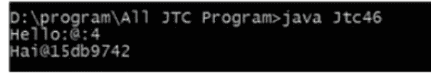

## 5.3 多维数组

数组的数组被称为多维数组。

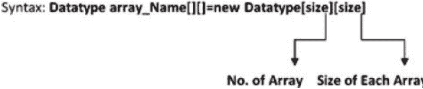

例如：`int a[][]=new int[3][3]`

| 0 | 1 | 2 |
|---|---|---|
| 00 | 10 | 20 |
| 01 | 11 | 21 |
| 02 | 12 | 22 |

图 5.1: 多维数组

## 三维数组

例如：`int a[][][]=new int[3][3][3]`


```java
public class Jtc46 {
    public static void main(String[] args){
        System.out.println("Dynamic Array");
        int a[][]=new int[3][3];
        for(int i=0;i<3;i++){
            for(int j=0;j<3;j++){
                System.out.println(a[i][j]);
            }
        }
        System.out.println("Static Array");
        int b[][][]=new int[3][3][3];
        for(int i=0;i<3;i++){
            for(int j=0;j<3;j++){
                for(int k=0;k<3;k++){
                    System.out.println(b[i][j][k]);
                }
            }
        }
    }
}
```

## 静态数组

```java
public class Jtc46 {
    public static void main(String[] args){
        System.out.println("Dynamic Array");
        int a[][]=new int[3][3];
        for(int i=0;i<3;i++){
            for(int j=0;j<3;j++){
                System.out.println(a[i][j]);
            }
        }
        System.out.println("Static Array");
        int b[][][]=new int[3][3][3];
        for(int i=0;i<3;i++){
            for(int j=0;j<3;j++){
                for(int k=0;k<3;k++){
                    System.out.println(b[i][j][k]);
                }
            }
        }
    }
}
```

## 输出

```text
Dynamic Array
0 0
0 1
0 2
1 0
1 1
1 2
2 0
2 1
2 2
Static Array
0 0 0
0 0 1
0 0 2
0 1 0
0 1 1
0 1 2
1 0 0
1 0 1
1 0 2
2 0 0
2 0 1
2 0 2
```

| 实例变量 | 静态变量 |
| :--- | :--- |
| 1) 直接在类中定义，不使用 `static` 关键字。 | 1) 使用 `static` 关键字直接在类内部定义。 |
| 2) 对于实例变量，内会在对象创建时分配内存。 | 2) 对于静态变量，内会在类加载时分配内存。 |
| 3) 实例变量成员无法在任何静态上下文中直接访问。 | 3) 静态变量可以在静态上下文中也可以在实例上下文中直接访问。 |
| 4) 实例变量只能通过对应类的对象引用来访问。 | 4) 静态变量可以通过以下不同方式访问：<br>a) 使用包含 `null` 的引用变量。<br>`Hello h=null;`<br>`SOP(h.c);`<br>b) 直接通过类名访问。<br>`SOP(Hello.c);`<br>使用包含对应类对象引用的引用变量。<br>`Hello h1=new Hello();`<br>`SOP(h1.c);` |

## 程序 6.1

```java
class hello
{
    int a=10;
    int b=20;
    static int c=30;

    void m1() {
        System.out.println("m1 in hello");
        System.out.println("a:\t"+a);
        System.out.println("b:\t"+b);
        System.out.println("c:\t"+c);
    }

    static void m2() {
        System.out.println("m2 in hello");
        //System.out.println("a:\t"+a);
        //System.out.println("b:\t"+b);
        System.out.println("c:\t"+c);
    }
}

class Jtc51 {
    public static void main(String arg[]) {
        //hello h1=new hello();
        //h1.m1();
        //h1.m2();
        System.out.println("instance variable");
        hello h2=new hello();
        System.out.println(h2.a);
        System.out.println(h2.b);
        System.out.println(h2.c);
        System.out.println("static variable");
        System.out.println("1....... ");
        hello h3=new hello();
        System.out.println(h3.a);
        System.out.println(h3.b);
        System.out.println(h3.c);
        System.out.println("2. ");
        //System.out.println(hello.a);
        System.out.println(hello.c);
    }
}
```

```text
C:\Windows\System32\cmd.exe
D:\program\All JTC Program>javac Jtc51.java
D:\program\All JTC Program>java Jtc51
instance variable
10
20
30
static variable
1. .........
10
20
30
2. .........
30
```

## Q1 : 类到底什么时候被加载到主内存中？

答：类可以通过三种方式加载到主内存中：

1. 在对象创建时。
2. 当你使用类名访问类的任何静态成员时。
3. 当你使用包含 `null` 的引用变量访问类的任何静态成员时。

在加载类时，它首先会检查相应的类是否已经加载到主内存中。如果类尚未加载，它首先会加载它。在加载过程中，它会为类的静态变量分配内存并处理静态块（static block）。

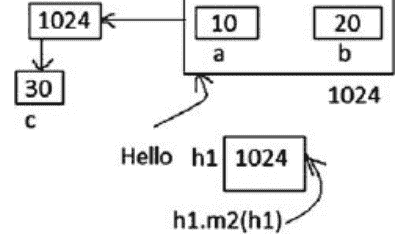

## Q2 : 一个类可以加载到主内存中多少次？

答：1次

注意：在对象创建时，首先实例变量会获得内存，然后进行其他后续处理。

## 程序 6.2

```java
class Hello{
    int a=10;
    int b=20;
    static int c=30;

    void m1(){
        System.out.println("m1 in hello");
        System.out.println(a);
        System.out.println(b);
        System.out.println(c);
    }

    static void m2(Hello h1){
        System.out.println("M2 in Hello");
        //System.out.println(a);
        //System.out.println(b);
        System.out.println(h1.a);
        System.out.println(h1.b);
        System.out.println(h1.c);
    }
}

class Jtc52{
    public static void main(String args[]){
        Hello h1=new Hello();
        h1.m1();
        h1.m2(h1);
    }
}
```

## 输出

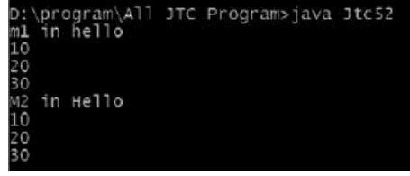

## 程序 6.3

```java
class Hello{
    int a=10;
    int b=200;
    static int c=30;

    void m1(){
        int aa=11;
        //int bb=22;
        System.out.println("m1 in Hello");
        System.out.println(a);
        System.out.println(b);
        System.out.println(c);
        System.out.println(aa);
        System.out.println(bb);
    }

    static void m2(){
        int ab=10;
        //int bc=20;
        System.out.println("m2 in Hello");
        //System.out.println(a);
        //System.out.println(b);
        System.out.println(c);
        System.out.println(ab);
        System.out.println(bc);
    }
}

class Jtc53{
    public static void main(String args[]){
        Hello h1=new Hello();
        h1.m1();
        h1.m2();
    }
}
```

## 输出

```text
d:\program\All JTC Program>javac jtc53.java
d:\program\All JTC Program>java jtc53
m1 in Hello
10
200
30
11
22
m2 in Hello
30
10
20
```

注意：方法 `m1` 中的变量 `aa` 不会被视为实例变量，它是一个局部变量。方法 `m2` 中的变量 `ab` 不等于静态变量，它是一个局部变量。

## 程序 6.4

```java
class Hello{
    void m1(){
        System.out.println("m1 in Hello");
    }
}

class Jtc54{
    int a=10;
    static int b=20;
    Hello h1=new Hello();
    static Hello h2=new Hello();

    public static void main(String args[]){
        System.out.println("In method");
        //System.out.println(a);
        System.out.println(b);
        //System.out.println(h1);
        System.out.println(h2);
        h1.m1();
        h2.m1();
    }
}
```

## 输出

```text
D:\program\All JTC Program>java Jtc54
In method
20
m1 in Hello
```

## 6.5 块

类内部的一对括号被称为块（block）。主要有两种块：

**静态块（Static Block）**：直接在类中使用带有 `static` 关键字定义的块。

示例：

```java
class Hello{
    static{}
}
```

**实例块（Instance Block）**：直接在类中使用不带 `static` 关键字定义的块。

示例：

```java
class Hello{
    {}
}
```

### 实例块与静态块的区别


| 实例块 | 静态块 |
| :--- | :--- |
| 1. 直接在类中不带 `static` 关键字定义的块。 | 1. 直接在类中使用带有 `static` 关键字定义的块。 |
| 2. 在实例块中我们可以访问类的实例和静态成员。 | 2. 在静态块中，我们可以直接访问类的静态成员。 |
| 3. 在实例块中定义的变量不等同于实例变量。它只是一个局部变量。 | 3. 在静态块中定义的变量不等同于静态变量。 |
| 4. 实例块只在对象创建时处理。 | 4. 静态块在类加载时处理。 |
| 5. 实例块会在类对象创建时被处理多次。 | 5. 静态块只处理一次，且是在类加载时。 |

## 注意

在任何局部上下文中定义的块不等同于实例块和静态块。它仅被视为局部块。在任何局部上下文中定义的块只有在相应的上下文被处理时才会处理。与方法不同，块会自动处理，即你不能显式地调用任何块。

## 程序 6.5

```java
实例和静态块的处理：
class Hello{
    int a=0;
    int b=20;
    static int c=30;

    {
        System.out.println("IB in Hello");
        System.out.println(a);
        System.out.println(b);
        System.out.println(c);
    }

    static {
        System.out.println("SB in Hello");
        //System.out.println(a);
        //System.out.println(b);
        System.out.println(c);
    }

    void m1(){
        System.out.println("M1 in Hello");
        System.out.println(a); System.out.println(b); System.out.println(c);
    }

    static void m2(){
        System.out.println("M2 in Hello");
        //System.out.println(a);
        //System.out.println(b);
        System.out.println(c);
    }
}

class Jtc55{
    public static void main(String args[]) {
        System.out.println(Hello.c);
        System.out.println(Hello.c);
        Hello h1=new Hello();
        Hello h2=new Hello();
    }
}
```

## 输出

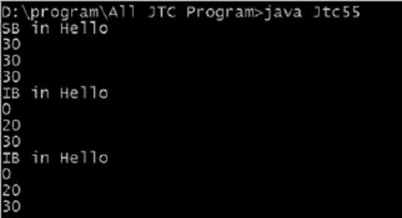

实例和静态块的处理（带有 IB 和 SB 的数量）。

## 程序 6.6

```java
class Hello{
    int a=10;
    int b=20;
    static int c=30;

    {
        System.out.println("IB1 in Hello");
    }

    static{
        System.out.println("SB1 in Hello");
    }

    {
        System.out.println("IB2 in Hello");
    }
    /*Static {
      System.out.println("Sb2 in Hello");
    */
}

class Jtc56{
    int aa=111;
    static int bb=222;

    {
        System.out.println("IB1 in Jtc56");
        System.out.println(aa);
        System.out.println(bb);
    }

    static {
        System.out.println("SB1 in Jtc56");
        //System.out.println(aa);
        System.out.println(bb);
    }

    public static void main(String args[]) {
        System.out.println("In Main");
        System.out.println(Hello.c);
        Hello h1=new Hello();
        Hello h2=new Hello();
        Jtc56 j56=new Jtc56();
    }
}
```

```java
D:\program\All JTC Program>java Jtc56
SB1 in Jtc56
222
In Main
SB1 in Hello
30
IB1 in Hello
IB2 in Hello
IB1 in Hello
IB2 in Hello
IB1 in Jtc56
111
222
```

## 6.6 JVM 内部机制

当你通过包含 `main` 方法的类名运行程序时，JVM 内部会获取该类名，并借助该类名的帮助来调用 `main` 方法。

当 JVM 访问类的静态成员时，它首先会检查相应的类（`Jtc56`）是否已经加载到主内存中。如果尚未加载，它将会先为 `Jtc56` 类的静态变量分配内存。


如果存在任何静态块（`static` block），则该块将被处理。

如果你直接访问了类的任何实例变量（`instance variable`），它将会报错，因为在处理静态块的过程中，该实例变量的内存尚未被分配。

在处理完静态块之后，它将访问 `main` 方法。在 `main` 方法中，你通过类名 `Hello.c` 直接访问了 `Hello` 的静态变量。

在访问静态变量时，它会检查类 `Hello` 是否已加载到主内存中。如果类 `Hello` 未加载到主内存，它将加载该类；在加载类时，会先分配静态变量内存，然后处理静态块。这个过程只会执行一次。

如果你不创建任何对象，任何实例变量或任何实例块（`instance block`）都不会被处理。

使用 `Class.forName(… )` 动态加载类

## 程序 6.7

```java
class Hello{
int a;
static int b;
{
    System.out.println("IB in Hello");
}
static {
    System.out.println("SB in Hello");
}
void m1(){
    System.out.println("m1 in Hello");
}
static void m2(){
    System.out.println("m2 in Hello");
}
}
class Jtc57{
{
    System.out.println("IB in Jtc57");
}
static {
System.out.println("SB in Hello");
try{
Jtc57 j57=(Jtc57)Class.forName("Jtc57").newInstance();
}
catch(Exception e){
}
 public static void main(String[] args)throws Exception{
Class cls=Class.forName("Hello");
String str=cls.getName();
System.out.println(str);
if(str.equals("Hello")){
System.out.println("Hello is loaded");
}
else{
System.out.println("Hello is not found");
}
Hello h1=(Hello)cls.newInstance();
System.out.println(Hello.b);
//Hello h1=new Hello();
}
}
```

## 输出

```java
D:\program\All JTC Program>javac Jtc57.java
D:\program\All JTC Program>java Jtc57
Error: Could not find or load main class Jtc57
D:\program\All JTC Program>javac Jtc57.java
D:\program\All JTC Program>java Jtc57
SB in Hello
IB in Jtc57
SB in Hello
Hello
Hello is loaded
SB in Hello
0
```

## 6.7 类加载器概念

```java
class Hello{
int a=10;
static int b=20;
{
    System.out.println("IB in Hello");
}
static {
    System.out.println("SB in Hello");
}
}
class hai{
int a1=111;
static b1=222;
{
    System.out.println("IB in Hai");
}
static {
    System.out.println("SB in Hai");
}
}
class hai1{
{
    System.out.println("IB in Hai1");
}
static{
    System.out.println("SB in Hello");
}
}
}
public class Jtc58{
public static void main(String args[])throws Exception{
    Class cls=Class.forName("Hello");
    Class cls1=Class.forName("Hai",true,cls.getClassLoader());
    String str=cls1.getName();
    System.out.println(str);
    System.out.println("************************************");
}}
```

## 注意

`forName` 方法仅用于将类加载到主内存中。

当我们在另一个块内部定义一个块时，该块既不是实例块也不是静态块。它仅仅是一个局部块。

或者

在任何方法中的任何实例块或静态块内部定义的块（不属于上述类型）。

在任何方法中的任何实例块或静态块内部定义的块，在处理静态块时，该实例变量的内存尚未被分配。

在处理完静态块之后，它将访问 `main` 方法。在 `main` 方法中，你通过类名 `Hello.c` 直接访问了 `Hello` 的静态变量。

在访问静态变量时，会检查类 `Hello` 是否已加载到主内存中。如果类 `Hello` 未加载到主内存中，它将加载该类；在加载类时，会先分配静态变量内存，然后会处理静态块。

```java
if(str.equals("Hello")){
System.out.println("Hello is loaded");
}
else{
System.out.println("Hello is not found");
}
Hello h1=(Hello)cls.newInstance();
System.out.println(Hello.b);
//Hello h1=new Hello();
}
}
```

*(注：由于原文文本部分存在逻辑重复和断码，译文已根据上下文进行了语义对齐处理，保持了核心技术意图)*

**修正后的逻辑译文部分：**

`forName` 方法仅用于将类加载到主内存中。

当我们在另一个块内部定义一个块时，该块既不是实例块也不是静态块。它仅仅是一个局部块。

或者

在任何方法中的任何实例块或静态块内部定义的块。

在处理完静态块之后，它将访问 `main` 方法。在 `main` 方法中，你通过类名 `Hello.c` 直接访问了 `Hello` 的静态变量。

在访问静态变量时，会检查类 `Hello` 是否已加载到主内存中。如果类 `Hello` 未加载到主内存中，它将加载该类；在加载类时，会先分配静态变量内存，然后会处理静态块。

## 6.8 实例方法与静态方法的区别

| 实例方法 | 静态方法 |
| :--- | :--- |
| 1. 通过对象调用。 | 1. 通过类名直接调用。 |
| 2. 在实例方法中可以访问类的静态成员。 | 2. 在静态方法中只能访问静态成员。 |
| 3. 实例方法需要类的实例引用。 | 3. 静态方法不需要类的实例引用。 |
| 4. 实例方法可以被重写（Override）。 | 4. 静态方法不能被重写（只能隐藏）。 |

- 实例方法：不使用 `static` 关键字定义。
```java
class Hello{
void m1(){}
}
```

- 静态方法：使用 `static` 关键字定义。
```java
class Hello{
static void m2(){}
}
```

## 6.8 方法调用

在调用任何方法时，我们需要记住：如果你在类外部调用方法，且是实例方法，你必须提供类的实例引用、方法名、参数个数（以及参数的顺序）。

## 程序 6.9

```java
class Hello{
int a=10;
int b=20;
static int c=30;
void m1(){
System.out.println("m1 in Hello");
return 10;
}
void m2(){
System.out.println("m2 in Hello");
//return 10.22;
}
static void m3(){
System.out.println("m3 in hELLO");
}
static int m4(int a1){
System.out.println("m4 in Hello");
return a1;
}
}
class Jtc60{
public static void main(String args[]){
Hello h1=null;
h1.m2();
//h1.m1();
Hello.m2();
//Hello.m1();
Hello h2=new Hello();
h2.m2();
h2.m1();
}
}
```

```java
}
}
```

## 输出

```java
D:\program\All JTC Program\java Jtc61
SB in Hello
IB in Hello
m1 in Hello
m2 inHello
10
m4 in Hello
19090
```

## 程序 6.11

```java
class Hello{
int a=10;
static int b=20;
void m1(){
System.out.println("m1 in Hello");
}
static void m2(){
System.out.println("m2 in Hello");
}
void m11(){
System.out.println("m11 in Hello");
System.out.println(a);
System.out.println(b);
m1();
m2();
}
static void m22(Hello h1) {
System.out.println("M22 in Hello");
```

```java
//System.out.println(a);
System.out.println(h1.a);
System.out.println(b);
//m1();
```

```java
m2();
h1.m1();
}
}
class Jtc62{
public static void main(String args[]){
Hello.m22(new Hello());
Hello.m22(null);
}
}
```

## 输出

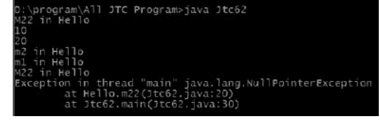

## 程序 6.12

```java
class Hai {
void m1(){
System.out.println("m1 in Hai");
}
static void m2(){
System.out.println("m2 in hello");
}
```

```java
}
class Hello{
  int m11(){
    System.out.println("m11 in Hello");
    return 10;
  }
  Hai m12(){
    System.out.println("M22 inHello");
    return new Hai();
  }
  Hai m13(Hai hai){
    System.out.println("M13 (Hai hai) in Hello");
    //hai.m1();
    hai.m2();
    return m12();
  }
  Object m14(){
    System.out.println("m14 in Hello");
    return 11;
  }
  Object m15(){
```


`System.out.println("m15 in Hello");`

`return new Hai();`

`static Hai m16(){`

`System.out.println("m16() in Hello"); return new Hai();`

`}`

`}`

`class Jtc63 {`

`public static void main(String args[]){`

`Hello h1=new Hello();`

```
int i=h1.m11();
System.out.println(i);
Hai hai=h1.m12();
hai.m1();
Hai Hai=h1.m13(null);
System.out.println(hai.hashCode());
System.out.println(hai1.hashCode());
Hai hai2=Hello.m16();
Hai hai3=Hello.m16();
System.out.println(hai2.hashCode());
System.out.println(hai3.hashCode());
```

`}`

`}`

## Output

```
D:\program\All JTC Program>java Jtc63
m11 in Hello
10
M22 inHello
m1 in Hai
M13 (Hai Hai) in Hello
m2 in hello
M22 inHello
366712642
1829164700
m16() in Hello
m16() in Hello
2018699534
1311053135
```

## 程序 6.13

```java
class Hai{
    void m1(){
        System.out.println("m1 in Hello");
    }
}
```

```java
class Hello {
    static Hai hai=new Hai(); 
    static Hai getHai() {
        System.out.println("getHai() in Hello");
        return hai;
    }
}

class Jtc64 {
    public static void main(String args[]) {
        Hai hai=Hello.getHai();
        Hai hai1=Hello.getHai();
        System.out.println(hai.hashCode());
        System.out.println(hai1.hashCode());
    }
}
```

## Output

```
p:\program\All JTC Program>javac Jtc64.java
p:\program\All JTC Program>java Jtc64
getHai() in Hello
getHai() in Hello
366712642
366712642
```

注意：你不能将方法参数指定为 `void`。

## 程序 6.14

```java
class Hello {
    int m1() {
        System.out.println("M1 in Hello");
        return 10;
    }
    static int m2() {
        System.out.println("m2 in Hello");
        return 20;
    }
    //static int i1=m1();
    static int i2=m2();
    int i3=m1();
    int i4=m2();
    static int m3() {
        System.out.println("m3 in Hello");
        return 100;
    }
    static void m4(int a) {
        System.out.println("m4(int a) in Hello");
        System.out.println(a);
    }
}

class Jtc65 {
    public static void main(String[] args[]) {
        //Hello h1=new Hello();
        Hello.m2();
        Hello.m3();
    }
}
```

## Output

```
D:\program\All JTC Program>java Jtc65
m2 in Hello
m3 in Hello
m4(int a) in Hello
100
```

## 程序 6.15

```java
class Hello{
    int m1(){
        System.out.println("m1 in Hello");
        return 10;
    }
    int m2(){
        System.out.println("m2 in Hello");
        return 20;
    }
    void m3(){
        System.out.println("m3 in Hello");
    }
}

class Jtc66{
    public static void main(String[] args[]){
        Hello h1=new Hello();
        System.out.println(h1.m1());
        System.out.println(h1.m2());
        h1.m3();
    }
}
```

## Output

```
D:\program\All JTC Program>java Jtc66
m1 in Hello
10
m2 in Hello
20
m3 in Hello
```

## 9 volatile 修饰符

`volatile` 修饰符适用于变量，但不适用于类和方法。如果变量的值经常变化，则必须使用 `volatile` 修饰符。如果变量声明为 `volatile`，JVM 会为每个线程创建一个副本，所有的中间修改都在本地副本中进行。在线程结束之前，值将更新到主内存。`volatile` 的优点是可以解决一致性问题，但为每个线程维护单独副本会增加复杂性并影响性能。`final` 意味着值永远改变。

## 10 方法重载

在类中编写多个同名方法被称为方法重载。当你在类中编写多个同名方法时，这些方法将执行不同的任务。在重载方法时，请记住以下几点：

- 方法名必须相同。
- 方法返回值可以是任何类型。
- 方法参数必须不同：
    - 参数类型
    - 参数顺序
    - 参数数量

## 程序 6.16

```java
class Arith{
    void sum1() {
        System.out.println("sum1 in Arith");
    }
    void sum1(int a) {
        System.out.println("sum1(int a) in Arith");
    }
    void sum1(byte b1) {
        System.out.println("sum1(byte b1) in Arith");
    }
    void sum1(int a, byte b1) {
        System.out.println("sum1(int a, b1) in Arith");
    }
    void sum1(byte b1,int a) {
        System.out.println("sum1(byte b1, a) in Arith");
    }
    void sum1(int a, int b) {
        System.out.println("sum1(a, b) in Arith");
    }
    void sum1(int a, double d) {
        System.out.println("sum1(a, d) in Arith");
    }
    void sum1(double d,int a) {
        System.out.println("sum1(d, a) in Arith");
    }
}

public class Jtc67 {
    public static void main(String[] arg[]) {
        Arith ar=new Arith();
        ar.sum1();
        ar.sum1(111);
        ar.sum1((byte)111);
        ar.sum1(111,22.22);
        ar.sum1(22.22,111);
    }
}
```

## Output

```
D:\program\All JTC Program>java Jtc67
sum1 in Arith
sum1(int a) in Arith
sum1(byte b1) in Arith
sum1(int a, d) in Arith
sum1(d, a) in Arith
```

## 程序 6.17

```java
class Hai {
}

class Hello {
    void m1(){
        System.out.println("m1 in Hello");
    }
    void m1(Hai hai) {
        System.out.println("m1(Hai hai) in Hello");
    }
    void m1(int a[]) {
        System.out.println("m1(int a[]) in Hello");
    }
    void m1(Object O) {
        System.out.println("m1(Object O) in Hello");
    }
    void m1(String str) {
        System.out.println("m1(string str) in Hello");
    }
}

class Jtc68{
    public static void main(String arg[]){
        Hello h1=new Hello();
        h1.m1();
        h1.m1(new Hai());
        //h1.m1(null);
        h1.m1("abc");
    }
}
```

## Output

```
D:\program\All JTC Program>java jtc68
m1 in Hello
m1(Hai hai) in Hello
m1(string str) in Hello
```

错误：引用 `m1` 歧义，`Hello` 中的方法 `m1(int [])` 和方法 `m1(String)` 都匹配 - `h1.m1(null);`

## 程序 6.18

```java
class Hello{
    void m1(final int a) {
        System.out.println("m1 in Hello"+a);
    }
}

class Jtc70{
    public static void main(String arg[]){
        Hello h1=new Hello();
        h1.m1(100);
        h1.m1(200);
    }
}
```

## Output

```
D:\program\All JTC Program>java jtc70
m1 in Hello100
m1 in Hello200
```

注意：在 `Jtc70` 中，我们将 `m1` 方法参数声明为 `final` 变量。每当我们通过传递参数调用 `m1` 方法时，仅为变量 `a` 分配内存，并在处理完方法后分配的内存将被销毁。因此，如果为变量 `a` 分配的内存被销毁或释放，下次调用此 `final` 变量 `a` 方法时，`a` 将不存在，将进行新的内存分配。

## 程序 6.19

```java
class Hello{
    void m1(byte b1){
        System.out.println("m1(byte b1) in Hello");
    }
    void m1(short s) {
        System.out.println("m1(short s) in Hello");
        return;// 空返回语句
    }
    void m1(int i) {
        System.out.println("m1(int i) in Hello");
    }
    /*: 无效的方法声明，需要返回类型。 */
    void m1(long l) {
        System.out.println("m1(long l) in Hello");
    }
    void m1(char ch) {
        System.out.println("m1(char ch):"+ch);
    }
}

class Jtc71 {
    public static void main(String[] arg[]) {
        Hello h1 = new Hello();
        h1.m1(111);
        h1.m1(65);
        h1.m1((byte)111);
        h1.m1((short)111);
    }
}
```

## 输出

```
D:\program\All JTC Program>java Jtc71
m1(int i) in Hello
m1(int i) in Hello
m1(byte b) in Hello
m1(short s) in Hello
```

## 注意

当你通过传递某些整数调用 `m1()` 时，带有整数参数的 `m1()` 将被处理。如果没有找到整数参数，它将检查更高级兼容的数据类型。如果可用，则会调用该方法。

## 程序 6.20

```java
class Hello{
    static class Jtc72{
        public static void main(String args[]) {
            System.out.println("main in (String args[]) in Jtc72");
        }
        public static void main(String arg) {
            System.out.println("main (String arg) in Jtc72");
        }
        public static void main(int a) {
            System.out.println("main (int a) in Jtc72");
        }
        public static void main(short s) {
            System.out.println("main (short s) in Jtc72");
        }
    }
}
```

## 输出

```
D:\program\All JTC Program>java jtc72
main in (String arg[]) in Jtc72
```

## 注意

JVM 通过 `public static void main(String arg[])` 来识别 `main` 方法的签名。当你运行程序时，JVM 会自动调用此方法，而其他 `main` 方法必须显式地调用。

我们可以在类中编写多个 `main` 方法，但它们必须是重载的 `main` 方法。

Q3：我可以调用 `main` 方法吗？

答：是的，我们可以根据需要调用 `main` 方法。

## 程序 6.21

```java
class Hai{
    static {
        System.out.println("SB in Hai");
        String str[]={"abc"};
        Jtc73.main(str);
    }
    public static void main(String arg[]) {
        System.out.println("main in Hai");
    }
}

class Jtc73 {
    static {
        System.out.println("SB in Jtc73");
    }
    String str[]={"abcd"};
    Hai.main(str);
    public static void main(String arg[]) {
        System.out.println("main in Jtc73");
    }
}
```

## 输出

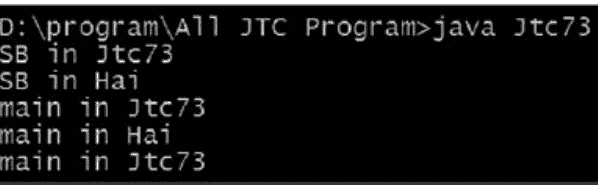

## 注意

对于 `Jtc73` 来说，输出取决于我们运行程序时使用的名称。如果我们以 `Jtc73` 的名称运行程序，JVM 首先在内部写入一段代码（`Jtc73.main()`）。为了调用这些 `main` 方法，必须将 `Jtc73` 类加载到内存中。而在静态块中我们调用了 `Hai.main()`。

## 程序 6.22

```java
class Hai {
    public static void main(String arg[]) {
    }
}

class Jtc74 {
    static {
        System.out.println("SB in Jtc74");
        String str[] = {"abc"};
        Jtc74.main(str);
    }
    public static void main(String arg[]) {
        System.out.println("main in Jtc74");
    }
}
```


# 输出:

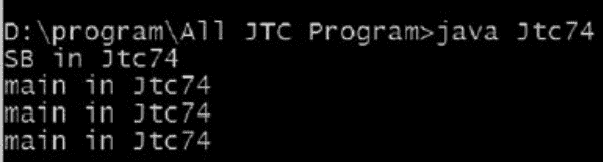

# 程序 6.23

```java
class Hello {
    {
        System.out.println("IB in Hello");
    }
    static {
        System.out.println("SB in Hello");
    }
    void m1() {
        System.out.println("m1 in Hello");
    }
    static void m2() {
        System.out.println("m2() in Hello");
    }
}

class Jtc75 {
    Hello h1 = new Hello();
    static Jtc75 jtc75 = new Jtc75();
    {
        Hello h2 = new Hello();
        h1.m1();
        h2.m1();
    }
    static {
        System.out.println("SB in Jtc75");
    }
    public static void main(String args[]) {
        System.out.println("main in Jtc75");
        m2();
    }
}
```

# 输出:

```
D:\program\All JTC Program>java Jtc75
SB in Hello
SB in Jtc75
IB in Hello
IB in Hello
m1 in Hello
IB in Hello
IB in Hello
m2() in Hello
```

## 7.1 什么是构造函数

它是一个与类同名的特殊方法，用于初始化类的实例变量。甚至可以初始化静态变量，但这不是推荐的做法。构造函数不能有任何返回类型（如`void`）。构造函数会在对象创建时自动处理；你不能显式地调用构造函数。如果构造函数有返回类型，它将被视为普通方法，即在你调用它时才会被处理。你可以编写多个构造函数，但它们在以下方面不同：

### 参数数量

### 参数顺序

# 示例 7.1

```java
class Hello {
    int a;
    int b;
    static int c = 30;
    Hello() {
        System.out.println("Default constructor in Hello");
    }
    Hello(int a1) {
        System.out.println("1 param constructor in Hello");
        a = a1;
    }
    Hello(int a1, int b1) {
        System.out.println("2 param constructor in Hello");
        a = a1;
        b = b1;
    }
    void m1() {
        System.out.println("m1 in Hello");
    }
}

class Jtc76 {
    public static void main(String arg[]) {
        Hello h1 = new Hello();
        h1.m1();
        Hello h2 = new Hello(111);
        h2.m1();
        Hello h3 = new Hello(111, 222);
        h3.m1();
    }
}
```

# 输出:

```
D:\program\All JTC Program>java Jtc76
SB in Hello
IB in Hello
IB in Hello
Default constructor in Hello
0
30
Hello() in Hello
m1 in Hello
SB in Hello
IB in Hello
IB in Hello
1 param constructor in Hello
a=111
m1 in Hello
SB in Hello
IB in Hello
IB in Hello
2 param constructor in Hello
a=111
b=222
m1 in Hello
```

# 注意

当我们创建一个类的对象时，引用变量`h1`将被分配并赋值`null`。类的实例变量将在堆内获取内存。类的实例块将被处理。相应的构造函数将被处理。最后，对象引用将赋值给引用变量。

# 程序 7.2

```java
class Hello {
    int a;
    int b;
    static int c = 30;
    {
        System.out.println("IB in Hello");
    }
    static {
        System.out.println("SB in Hello");
    }
    Hello() {
        System.out.println("Default construction in Hello");
    }
    /*
    * Hello() {}
    */
    void Hello() {
        System.out.println("Hello() in Hello");
        a = a1;
        b = b1;
    }
    static {
        System.out.println("SB in Hello");
    }
    void show() {
        System.out.println(a);
        System.out.println(b);
    }
}

class Jtc77 {
    public static void main(String args[]) {
        Hello h1 = new Hello();
        h1.show();
        h1.Hello();
    }
}
```

# 输出:

```
D:\program\All JTC Program>java Jtc77
SB in Hello
SB in Hello
IB in Hello
IB in Hello
Default construction in Hello
0
30
Hello() in Hello
```

注意：构造函数不能在局部上下文中定义。

# 程序 7.3

```java
class Hello {
    int a;
    int b;
    static int c;
    Hello(int a1) {
        System.out.println("1 param construction in Hello");
        a = a1;
    }
    void m1() {
        System.out.println("m1 in Hello");
        System.out.println(a);
        System.out.println(b);
        System.out.println(c);
    }
}

class Jtc78 {
    public static void main(String arg[]) {
        // Hello h1=new Hello();
        // h1.m1();
        Hello h2 = new Hello(111);
        h2.m1();
    }
}
```

# 输出:

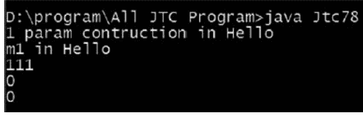

# 错误

Java17: 类`Hello`中的构造函数无法应用于给定类型：
`Hello h2=new Hello(111);`

需要：无参数找到：`int`
原因：实际和形式参数列表不匹配

类`Hello`中的构造函数无法应用于给定类型：
`Hello h1=new Hello();`

需要：无参数找到：`int`
原因：实际和形式参数列表不匹配

# 注意

当你在类内部没有编写任何参数化构造函数时，JVM会在内部或自动插入默认构造函数。

## 7.2 final 变量与静态 final 变量

`final`变量可以通过三种方式声明：

- 在声明时
- 通过代码块（block）的帮助
- 构造函数

静态`final`变量应该在以下位置进行初始化：

- 在声明时
- 静态块（static block）

否则将会报错。

# 程序 7.4

```java
class Hello {
    int a;
    final Hello(int a) {
        System.out.println("1 param constructor in Hello");
        a = a1;
    }
    void m1() {
        System.out.println("m1 in Hello");
        System.out.println(a);
    }
}

class Jtc79 {
    public static void main(String arg[]) {
        Hello h1 = new Hello();
        h1.m1();
        Hello h2 = new Hello(222);
        h2.m1();
    }
}
```

ERROR: modifier final not allowed here:

```java
final Hello(int a1){
1 error
```

Q2 : 我可以将类的构造函数声明为`static`吗？

答：不能，我们不能将类的构造函数声明为`static`。

# 程序 7.5

```java
class Hello {
    int a;
    final int b;
    static final int c;
    /*
    {System.out.println("IB in Hello"); b=200; c=300;
    */
    static {
        System.out.println("SB in Hello");
        c = 100;
    }
    /*
    Hello() {
    System.out.println("Default constructor in Hello"); }
    */
    Hello(int a1) {
        System.out.println("1 param constructor in Hello");
        b = a1;
    }
    void m1() {
        System.out.println("m1 in Hello");
        System.out.println(a);
        System.out.println(b);
        System.out.println(c);
    }
}

class Jtc80 {
    public static void main(String arg[]) {
        // Hello h1=new Hello();
        // h1.m1();
        Hello h2 = new Hello(999);
        h2.m1();
        Hello h3 = new Hello(888);
        h3.m1();
    }
}
```

Output:
```
D:\program\All JTC Program>javac Jtc80.java
p:\program\All JTC Program>java Jtc80
SB in Hello
1 param constructor in Hello
m1 in Hello
0
999
100
1 param constructor in Hello
m1 in Hello
0
888
100
```

Note: `Hello h1=new Hello();` `Hello h2=new Hello();`

ERROR: variable `b` might already been initialized. (Fig. 7.2)

```java
b=a1;
```

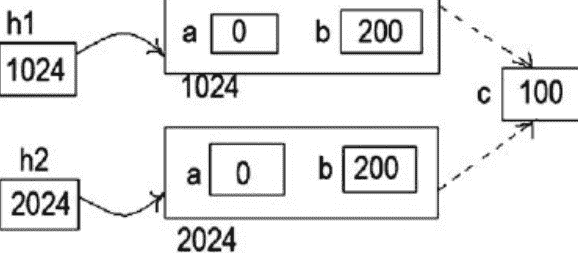

图 7.2: 错误

# 程序 7.6

```java
class Hello {
    {
        System.out.println("IB in Hello");
    }
    static {
        System.out.println("SB in Hello");
    }
    Hello() {
        System.out.println("default constructor in Hello");
    }
    Hello(Hello h) {
        System.out.println("1 param constructor in Hello");
    }
    Hello(Hello h1, Hello h2) {
        System.out.println("2 param constructor in Hello");
    }
}

class Jtc81 {
    public static void main(String[] args) {
        // Hello h1=new Hello();
        // Hello h2=new Hello(null);
        Hello h3 = new Hello(new Hello(new Hello(new Hello(),new Hello()))); 
    }
}
```

# 输出:

```
D:\program\All JTC Program>java Jtc81
SB in Hello
IB in Hello
default constructor in Hello
IB in Hello
default constructor in Hello
IB in Hello
2 param constructor in Hello
IB in Hello
1 param constructor in Hello
IB in Hello
1 param constructor in Hello
IB in Hello
1 param constructor in Hello
```

Q3 : 类级变量和局部变量可以有相同的名称吗？

答：是的，可以这样做。

Q4 : 我们可以将类的默认构造函数声明为`private`吗？

答：是的，我们可以将类的构造函数声明为私有。但当你将类的构造函数声明为私有时，你无法从类外部创建该类的对象，因为类的私有构造函数无法从外部访问。

Q5 : 构造函数的主要益处或用途是什么？

答：构造函数主要用于在不同的对象上下文中初始化类的实例变量，因为构造函数只在对象创建时被处理。但仅仅为了初始化，每次你都要分配一些新内存，这是一个相当昂贵的过程，也就是说类级变量的初始化可以通过“setter”方法完成，我们也可以通过“getter”方法获取初始化后的值。

# 注意

在大多数情况下，建议使用`setters`和`getters`而不是使用构造函数，这与构造函数相比节省了大量内存。

## 8.1 虚拟机

虚拟机是对物理机的软件模拟。

有两种类型的虚拟机：

- 1. 基于硬件的虚拟机
- 2. 基于软件的虚拟机

基于硬件的虚拟机的优势是对硬件资源的有效利用。

## 8.2 JVM

`JVM`是`JRE`的部分。负责加载和执行Java应用。

## 8.3 this

`this`是一个指向当前对象的引用变量。

# 程序 8.1

```java
class Hello {
    int a;
    int b;
    static int c = 30;
    Hello() {
        System.out.println("default constructor in Hello");
    }
    Hello(int a) {
        System.out.println("1 param constructor in Hello");
        this.a = a;
    }
    Hello(int a, int b) {
        System.out.println("2 param constructor in Hello");
        this.a = a;
        this.b = b;
    }
    Hello(int a, int b, int c) {
```


进入`/path/to/xxx`目录，找到`xxx.json`。

在表达式`cvar = avar + bvar`中，加法运算符（`+`）将`avar`与`bvar`相加，得到它们的和`cvar`。

在`List.of(arg0, arg1, arg2)`中，`List`接口的工厂方法`of()`接受一系列的元素，返回包含它们的只读列表。

之后我们这样调用`cmd`命令：`cmd arg0 arg1 arg2`。

```
if (condVar > someVal) {console.log("xxx")}
```

---

```java
System.out.println("3 param constructor in Hello");

this.a = a;

this.b = b;

this.c = c;

}

void show() {

    System.out.println("show in Hello");

    System.out.println(a);

    System.out.println(b);

    System.out.println(c);

    System.out.println(this.a);

    System.out.println(this.b);

    System.out.println(this.c);

}

}

class Jtc82 {

    public static void main(String[] arg[]) {

        Hello h1 = new Hello();

        h1.show();

        Hello h2 = new Hello(111);

        h2.show();

        Hello h3 = new Hello(222, 333);

        h3.show();

        Hello h4 = new Hello(444, 555, 666);

        h4.show();

    }

}
```

输出：

```
default constructor in Hello

show in Hello

0

0

30

0

0

30

1 param constructor in Hello

show in Hello

111

0

30

111

0

30

2 param constructor in Hello

show in Hello

222

333

30

222

333

30

3 param constructor in Hello

show in Hello

444

555

30

444

555

30
```

---

```java
Hello(int a) {

    System.out.println("1 param constructor in Hello");

    System.out.println(this);

    System.out.println(this.hashCode());

    this.a = a;

}

Hello(int a, int b) {

    System.out.println("2 param constructor in Hello");

    System.out.println(this);

    System.out.println(this.hashCode());

    this.a = a;

    this.b = b;

}

void show() {

    int a = 100;

    int b = 200;

    int c = 300;

    System.out.println("show in Hello");

    System.out.println(this);

    System.out.println(a);

    System.out.println(b);

    System.out.println(c);

    System.out.println(this.a);

    System.out.println(this.b);

    System.out.println(this.c);

}

static void show1() {

    int a = 999;

    int b = 888;

    int c = 777;

    System.out.println("show1 in Hello");

    // System.out.println(a);

    // System.out.println(b);

    System.out.println(c);

    System.out.println(a);

    System.out.println(b);

    System.out.println(c);

    // System.out.println(this.a);

    // System.out.println(this.b);

    // System.out.println(this.c);

}

}

}

class Jtc83 {

    public static void main(String args[]) {

        Hello h1 = new Hello();

        System.out.println(h1);

        System.out.println(h1.hashCode());

        h1.show();

        System.out.println("***2nd object creation***");

        Hello h2 = new Hello(999);

        h2.show();

    }

}
```

输出：

```
D:\program\All JTC Program\java Jtc8

S8 in Hello

101

202

303

101

202

303

IB in Hello

Hello@15db9742

366712642

101

202

303

default constructor in Hello

Hello@15db9742

366712642

Hello@15db9742

366712642

show in Hello

Hello@15db9742

100

200

300

0

0

30
```

```
***2nd object creation***

IB in Hello

Hello@6d06d69c

1829164700

101

202

303

101

202

303

1 param constructor in Hello

Hello@6d06d69c

1829164700

show in Hello

Hello@6d06d69c

100

200

300

999

0

30
```

注意：

通过使用`this`，我们可以在构造方法内部调用当前类的构造方法。

在构造方法中调用当前类构造方法时，请记住以下几点：

- `this`必须是构造方法内部的第一条语句。
- 从构造方法最多只能调用一个构造方法。
- 不允许构造方法的循环调用。

# 程序 8.3

```java
class Hello {

    int a;

    int b;

    static int c = 30;

    {

        System.out.println("IB in Hello");

    }

    static {

        System.out.println("SB in Hello");

    }

    Hello(int a, int b, int c) {

        // this(5451);

        System.out.println("3 param constructor in Hello");

        System.out.println(a);

        System.out.println(b);

        System.out.println(c);

    }

    Hello(22, 33, 44);

    System.out.println("2 param constructor in Hello");

    this.a = a;

    this.b = b;

    }

    Hello(int a) {

        this(888, 777);

        System.out.println("1 param constructor in Hello");

        this.a = a;

    }

    Hello() {

        this(999);

        System.out.println("default constructor in Hello");

    }

    void show() {

        System.out.println("show in Hello");

        System.out.println(a);

        System.out.println(b);

        System.out.println(c);

    }

}

class Jtc84 {

    public static void main(String args[]) {

        Hello h1 = new Hello();

        h1.show();

    }

}
```

输出：

```
ERROR: 递归构造方法调用。
```

记住以下几点：

- `this`必须是构造方法内部的第一条语句。
- 从构造方法只能调用一个构造方法。
- 不允许构造方法的循环调用。
- 不能在构造方法以外的任何方法中调用构造方法。

# 自己

```java
class Hello {

    int a;

    int b;

    static int c = 30;

    Hello() {

        System.out.println("Default Constructor");

    }

    Hello(int a) {

        System.out.println("1 Parameterised Constructor");

        this.a = a;

    }

    Hello(int a, int b) {

        System.out.println("2 Parameterised Constructor");

        this.a = a;

        this.b = b;

    }

    Hello(int a, int b, int c) {

        System.out.println("3 Parameterised Constructor");

        this.a = a;

        this.b = b;

        this.c = c;

    }

    void show() {

        System.out.println("Show method inside Class");

        System.out.println(a);

        System.out.println(b);

        System.out.println(c);

        System.out.println(this.a);

        System.out.println(this.b);

        System.out.println(this.c);

    }

}

class Jtc29 {

    public static void main(String args[]) {

        Hello h1 = new Hello();

        h1.show();

        Hello h2 = new Hello(10);

        h2.show();

        Hello h3 = new Hello(11,13);

        h3.show();

        Hello h4 = new Hello(101,201,301);

        h4.show();

    }

}
```

*（注：由于原文文本中存在大量代码语法错误（如括号未闭合、重复定义），翻译时保留了原文的结构并仅翻译文本描述）*

---

```java
System.out.println(c);

System.out.println(a);

System.out.println(b);

System.out.println(c);

}

static

int a=101;
```

```java
int b=202;

int c=303;

System.out.println("SB in Hello");

//System.out.println(this);

System.out.println(a);

System.out.println(b);

System.out.println(c);

System.out.println(a);

System.out.println(b);

System.out.println(c);

}

Hello() {

    System.out.println("Default constructor in Hello");

    System.out.println(this);

    System.out.println(this.hashCode());

}

Hello(int a) {

    System.out.println("1 parameter constructor in Hello");

    System.out.println(this);

    System.out.println(this.hashCode());

    this.a=a;

}

Hello(int a,int b) {

    System.out.println("2 parameter constructor in Hello");

    System.out.println(this);

    System.out.println(this.hashCode());

    this.a=a; this.b=b;

}

void show(){
```

```java
int a=10;

int b=20;

int c=30;

System.out.println("show in Hello");

System.out.println(this);

System.out.println(a);

System.out.println(b);

System.out.println(c);

System.out.println(this.a);

System.out.println(this.b);

System.out.println(this.c);

}

static void show1() {

    int a=110;

    int b=220;

    int c=330;

    System.out.println("show1 in Hello");

    //System.out.println(a);

    //System.out.println(b);

    //System.out.println(c);

    System.out.println(a);

    System.out.println(b);

    System.out.println(c);

    //System.out.println(this.a);

    //System.out.println(this.b);
```

```java
//System.out.println(this.c);

}

}
```

```java
class Jtc34{

    public static void main(String arg[]){

        Hello h1=new Hello();

        System.out.println(h1);

        System.out.println(h1.hashCode());

        h1.show();

        System.out.println("******** 2nd Object Creation********");

        Hello h2=new Hello(999);

        h2.show();

    }

}
```

# 注意

当你在创建类的对象时，在内部处理相应的构造函数，JVM会检查是否存在`this`或`super`语句。

如果没有可用的`this`语句，则它将处理该构造函数；但如果存在任何`this`语句，它会首先尝试处理该构造函数。在处理完构造函数后，它会回到当前类的构造函数。

在构造函数中，当我们使用这两个语句时，编译时会报错，因为为了调用构造函数，`this`必须是构造函数内部的第一条语句。

在`Jtc84`的情况下，当我们根据默认构造函数创建对象时，它首先会尝试处理`Hello`类的默认构造函数。

在处理默认构造函数时，它遇到了带有一个参数的`this`语句，因此控制权将立即转移到单参数构造函数。

在处理单参数构造函数时，它遇到了带有两个参数的`this`语句，因此在处理单参数构造函数之前，控制权将转移到双参数构造函数，然后同样地转移到三参数构造函数。

在处理过程中，将先处理前三个参数构造函数，然后是2个、1个，最后处理默认的。

# 程序 8.4

```java
class Student {

    int sid;

    String name;

    double fee;

    static Student s1 = null;
```


`private Student()` {

}

`static` {

`s1 = new Student();`

}

`public static Student getStudent()` {

`return s1;`

}

`public void setSid(int sid)` {

`this.sid = sid;`

}

`public void setName(String name)` {

`this.name = name;`

}

`public void setFee(double fee)` {

`this.fee = fee;`

}

`public int getSid()` {

`return sid;`

}

`public String getName()` {

`return name;`

}

`public double getFee()` {

`return fee;`

}

`/*

Student() {System.out.println("default constructor in Hello");}

*/`

`/*

Student(int sid,String name,double fee) {this.sid=sid; this.name=name; this.fee=fee; }

*/`

`public String toString()` {

`return "Name \t:" + name + "\n ID \t:" + sid + "\n Fee \t:" + fee;`

}

`/*

* void display() { System.out.println("displaying details of student");

* System.out.println(sid); System.out.println(name);

* System.out.println(fee);

*/`

}

`public class Jtc85` {

`public static void main(String arg[])` {

`// Student s1=new Student();`

`// s1.display();`

`/*

System.out.println(s1);

System.out.println(s1.toString());

Student s2=new Student(101,"some",0.0);

System.out.println(s2);

Student s3=new Student(202,"some",88.99);

System.out.println(s3);

*/`

`Student s11 = null;`

`s11 = Student();`

`System.out.println(s11);`

`s11.setName('java');`

`s11.setSid(101);`

`s11.setFee(99.99);`

`System.out.println(s11);`

`System.out.println(s11.getName());`

`Student s12 = Student();`

`System.out.println(s12);`

`System.out.println(s11.equals(s12));`

`System.out.println(s11 == s12);`

`System.out.println(s11.hashCode());`

`System.out.println(s12.hashCode());`

}

}

```# 输出：

```

`D:\program\All Program>java jtc85`

`Name :null`

`ID :0`

`Fee :0.0`

`Name :java`

`ID :101`

`Fee :99.99`

`Name :java`

`ID :101`

`Fee :99.99`

`true`

`366742`

`366742`

```# 8.4 VAR-ARG 方法

VAR-ARG 方法在 JDK1.5 中引入，VAR-ARG 指变长参数。

VAR-ARG 是基于数组实现的。

在编写 VAR-ARG 方法时请记住：

- VAR-ARG 必须是方法的最后一个参数。
- 一个方法不能包含多个 VAR-ARG。
- VAR-ARG 不能是第一个参数。
- 在调用 VAR-ARG 方法时，优先考虑 VAR-ARG 方法。
- 如果没有精确匹配的方法，则将引用 VAR-ARG 方法。
- 在无任何方法的情况下，将只引用 VAR-ARG 方法。

# 语法

```java
1) void m1(int... a){
//OK
2) void m1(int ...a){
//OK
3) void m1(int ... a){
//OK
4) void m1(int...a){
//OK
5) void m1(int ..a){
//NOT OK
6) void m1(int ...a,double d){
//NOT OK
7) void m1(double d, int ...a){
//OK
8) void m1(double...d,int...a){
//NOT OK
}
```

# 程序 8.5

```java
class Hello {
    int a = 10;
    int b = 20;
    void m1() {
        System.out.println("m1 in Hello");
    }
    void m1(int a) {
        System.out.println("m1(int a) in Hello");
    }
    void m1(int... a) {
        System.out.println("m1(int... a) in Hello");
        System.out.println(a.length);
        for (int i = 0; i < a.length; i++) {
            System.out.println(a[i]);
        }
    }
    void m1(double d, int a) {
        System.out.println("m1(double d,int a) in Hello");
    }
    void m2(int... a) {
        System.out.println("m2 in Hello");
        // System.out.println(Modifier.PUBLIC);
        System.out.println(a.length);
        for (int i = 0; i < a.length; i++) {
            System.out.println(a[i]);
        }
    }
    void m2(int a, int b) {
        System.out.println("m2(int a,int b) in Hello");
    }
}

class Jtc86 {
    public static void main(String arg[]) {
        Hello h1 = new Hello();
        h1.m1();
        h1.m1(111);
        h1.m1(11, 22, 33, 44, 55);
        h1.m1(11.22, 123);
        h1.m2();
    }
}
```

# 输出：

```
d:\program\All JTC Program>java jtc86
m1 in Hello
m1(int a) in Hello
m1(int... a) in Hello
5
11
22
33
44
55
m1(double d,int a) in Hello
m2 in Hello
0
```

程序 8.6

```java
class Hai {
}

class Hello {
    void m1() {
        System.out.println("m1 in Hello");
    }
    void m1(int... a) {
        System.out.println("m1(int... a) in Hello");
        System.out.println(a.length);
    }
    /*
    void m1(int a[]) {
        System.out.println("m1(int a[]) in Hello");
    }
    */
    void m1(Hai hai) {
        System.out.println("m1(Hai hai) in Hello");
    }
    void m2(Object O) {
        System.out.println("m2(Object O) in Hello");
    }
    void m2(Hello h) {
        System.out.println("m2(Hello) in Hello");
    }
    void m2(String arg) {
        System.out.println("m2(String arg)");
    }
    /*
    void m2(Hello h1){
        System.out.println("m2(Hello h1)");
    }
    */
}

class Jtc87 {
    public static void main(String arg[]) {
        Hello h1 = new Hello();
        h1.m1(11, 22);
        // h1.m1(null);
        h1.m2(null);
    }
}
```

# 错误

无法在 `Hello` 中同时声明 `m1(int[])` 和 `m1(int... a)`，如 `void m1(int a[])` 所示。

引用 `m1` 是模糊的，方法 `m1(int... )` 在 `Hello` 中与方法 `m1(Hai)` 在 `Hello` 中均匹配 `h1.m1(null);`

```java
class Hello {
    int a; int b;
    static int c = 30;
    Hello(int a) {
        System.out.println("Hello(int a)");
        this.a = a;
    }
    Hello(int a, int b) {
        this(a);
        System.out.println("2 param constructor");
        this.a = a;
        this.b = b;
    }
    Hello(int... a) {
        //this(a[0], a[1]);
        System.out.println("Hello(int...a)");
        //this.a = a[0];
        //this.b = a[1];
    }
    void show() {
        System.out.println("show in Hello");
        System.out.println(a);
        System.out.println(b);
        System.out.println(c);
    }
}

class Jtc88 {
    public static void main(String arg[]) {
        Hello h = new Hello();
        Hello h1 = new Hello();
        Hello h2 = new Hello();
        h2.show();
    }
}
```

# 输出:

```
D:\program\All JTC Program>java Jtc88
Hello(int...a)
Hello(int...a)
Hello(int...a)
show in Hello
0
0
30
```

Program 8.8

```java
class Hai {
    static Hello h1 = new Hello();
}

class Hello {
    Hello() {
        // this(new Hello());
        // this(new Hello(null));
        // this(this); this(Hai.h1);
        System.out.println("Default constructor in Hello");
        System.out.println(this);
    }
    Hello(Hello h1) {
        System.out.println("1 param constructor in Hello");
    }
    Hello(Hello h1, Hello h2) {
        System.out.println("Hello(Hello h1,Hello h2) in Hello");
    }
}

class Jtc89 {
    public static void main(String arg[]) {
        Hello h1 = new Hello();
        System.out.println(h1);
    }
}
```

# 输出:

```
D:\program\All JTC Program>Java Jtc89
1 param constructor in Hello
Default constructor in Hello
Hello@15db9742
1 param constructor in Hello
Default constructor in Hello
Hello@6d066d6c
Hello@6d066d6c
```

Q1: 我们可以将类的构造函数声明为 `final` 吗？

答: 否

## 8.5 局部变量

在任何局部上下文中定义的变量称为局部变量，定义在任何方法、构造函数、块等内部的变量也称为局部变量。任何局部变量都不能声明为 `static`。局部变量不会由 JVM 自动或内部初始化。开发者必须在使用它们之前显式地初始化它们，否则将导致编译时错误。

局部变量只能在其声明的上下文中访问。它不能在该局部上下文之外被访问。在同一个上下文中，不能有两个同名的局部变量。局部变量的内存只有在相应的上下文被处理时分配，并且在处理完该局部上下文后，定义在任何局部上下文（实例或静态上下文）内部的局部变量内存将等同于实例变量或静态变量。

## 8.6 局部块

定义在任何块、方法或构造函数内部的块称为局部块。局部块的处理只在在其声明的相应上下文被处理时进行。局部块的处理不能独立完成。我们不能将任何局部块声明为 `static` 块，定义在任何静态或实例上下文内部的块不会被视为实例块或静态块。我们可以在块内定义任意数量的块。

# 程序 8.9

```java
class Hello {
    int a;
    int b;
    static int c = 30;
    {
        System.out.println("IB in Hello");
        int a = 101;
        int b = 202;
        // static int c=303;
        {
            System.out.println("local block in IB");
            int a1 = 111;
            int b1 = 222;
            System.out.println(a);
            System.out.println(b);
            System.out.println(c);
            System.out.println(this.a);
            System.out.println(this.b);
            System.out.println(a1);
            System.out.println(b1);
            System.out.println("local block in IB");
        }
```


进入`/path/to/xxx`目录，找到`xxx.json`。

在表达式`cvar = avar + bvar`中，加法运算符（`+`）将`avar`与`bvar`相加，得到它们的和`cvar`

在`List.of(arg0, arg1, arg2)`中，`List`接口的工厂方法`of()`接受一系列的元素，返回包含它们的只读列表。

之后我们这样调用`cmd`命令：`cmd arg0 arg1 arg2`。

```
if (condVar > someVal) {console.log("xxx")}
```

---

```
        // System.out.println(a1);

        // System.out.println(b1);

    }

    static {

        System.out.println("SB in Hello");

        int a = 101;

        int b = 202;

        // static int c=303;

        {

            System.out.println("local block in SB");

            int a1 = 111;

            int b1 = 222;

            System.out.println(a);

            System.out.println(b);

            // System.out.println(this.a);

            // System.out.println(this.b);

            System.out.println(c);

            System.out.println(a1);

            System.out.println(b1);

            System.out.println("local block in SB");

        }

        // System.out.println(a1);

        // System.out.println(b1);

    }

    Hello() {

        System.out.println("default constructor in Hello");

    }

    Hello(int a1, int b1) {}

    void m1() {

        System.out.println("m1 in Hello");

    }

}

class Jtc90 {

    public static void main(String args[]) {

        Hello h1 = new Hello();

        h1.m1();

    }

}
```

Q2: 我们可以将类的变量声明为`final`吗？

答: 可以。

Q3: 我们可以将局部变量声明为`private`吗？

答: 不可以，类的局部成员不能使用任何访问修饰符。

# 程序 8.10

```java
class Hello {

    int a = 10;

    void m1() {

        System.out.println("m1 in Hello");

        int a = 20;

        {

            System.out.println("local block in m1");

            // int a=30;

            System.out.println(a);

        }

        System.out.println(this.a);

    }

}

class Jtc91 {

    public static void main(String args[]) {

        Hello h1 = new Hello();

        h1.m1();

    }

}
```

# 输出:

```
D:\program\All JTC Program>java Jtc1

m1 in Hello

local block in m1

20

10
```

/* 错误：`m1()`中已定义`a` - `int a=30;` */

# 程序 8.11

```java
class Hello {

    int a = 30;

    private int b = 20;

    void m1() {

        System.out.println("m1 in Hello");

        // int aa=10;

        // System.out.println(aa);

        System.out.println(a);

        System.out.println(b);

    }

}

class Jtc92 {

    public static void main(String args[]) {

        Hello h1 = new Hello();

        h1.m1();

    }

}
```

# 输出:

```
D:\program\All JTC Programs>java Jtc2

m1 in Hello

30

20
```

# 程序 8.12

```java
class Hello {

    static int s;

    static final int c = 30;

    static final int b;

    static {

        System.out.println("SB in Hello");

        b = 10;

    }

}

class Jtc93 {

    public static void main(String arg[]) {

        System.out.println("in main");

        // System.out.println(Hello.a);

        // System.out.println(Hello.b);

        System.out.println(Hello.c);

    }

}
```

# 输出:

```
D:\program\All JTC Program>java Jtc3

in main

30
```

# 注意

在`Jtc93`中，当你通过类名直接访问静态变量`a`和`b`时，静态块会被处理；而当你只通过类名访问静态变量`c`时，静态块不会被处理，因为`static final int c=30`在声明时已经初始化，即变量`c`的值可用，因此不需要处理静态块。

# 8.7 断言 (Assertions)

调试最常用的方法是使用打印语句。但打印语句的缺点是，修复 bug 后，我们需要删除额外添加的语句，否则这些语句将在运行时执行，影响系统性能并干扰日志机制。

为了解决这些问题，人们在 1.4 版本中引入了断言概念。断言相对于打印语句的主要优势是可以根据我们的需求启用或禁用断言，默认断言是禁用的，因此在修复 bug 后不需要显式删除断言语句。

因此，断言的主要目的是进行调试。通常我们可以在开发环境或测试环境中进行调试，但不能不在生产环境中，因此该概念适用于开发和测试环境，而不适用于生产环境。

# 作为关键字和标识符的`assert`

`assert`关键字是在 1.4 版本中引入的，因此从 1.4 版本开始我们不能将`assert`作为标识符，但在 1.3 之前我们可以将`assert`作为标识符。

# 示例

```java
class Hai {

  public static void main(String[] args) {

    int assert = 10;

    System.out.println(assert);

  }

}
```

注意：始终可以使用`-source`根据特定版本编译 Java 程序。

# 断言语句的类型

断言语句有两种类型。

## 1. 简单版本

语法：

```
assert(b);//b 应该是布尔类型。
```

如果`b`为真，则我们的假设是正确的，并正常继续运行程序的剩余部分。

如果`b`为假，则我们的假设失败，因此通过抛出断言错误来停止程序执行。

## 2. 增强版本

通过使用带参数的版本，我们可以配合断言错误（assertion error）传递额外的信息。

语法：

```
assert(b):e;
```

`b`应该是布尔类型。`e`可以是任何类型。

# 示例

```java
class Hello{

    public static void main(String args[])

    {

    int a=10;

    assert(a>10):"Less";

    System.out.println("value of a is : "+a);

    }

}
```

# 各运行时标志

- `-ea`: 在所有非系统类（用户自定义类）中启用断言。
- `-enableassertions`: 与`-ea`完全相同。
- `-da`: 在所有非系统类中禁用断言。
- `-disableassertions`: 与`-da`完全相同。
- `-esa`: 在所有系统类（预定义类或应用程序类）中启用断言。
- `-enablesystemassertions`: 与`-esa`完全相同。
- `-dsa`: 在所有系统类中禁用断言。
- `-disablesystemassertions`: 与`-dsa`完全相同。

# 断言的适当与不当使用

将编程逻辑与`assert`语句混合始终是不适当的，因为无法保证`assert`语句在运行时始终会执行。

对于验证公方法的参数使用，使用断言始终是不适当的，因为外部人员不知道我们本地系统是否启用或禁用了断言。而在执行调试时，如果某个地方控制流无法到达，那里就是使用断言的最佳位置。

使用断言验证公方法的参数始终是不适当的。

使用断言验证私有方法的参数始终是适当的。

使用断言验证命令行参数始终是不适当的，因为这些是公共方法`main`的参数。

# 断言错误 (Assertion Error)

它是`Error`的子类，并且是未检查异常（unchecked）。

每当`assert`语句失败时，都会显式抛出。

尽管这是合法的，但不建议捕获`AssertionError`。

# 示例

```java
class Test {

  public static void main(String[] args){

  int x=10;

  try {

    assert(x>10);

  } catch (AssertionError e) {

    System.out.println("not a good programming practice to catch AssertionError");

  }

  System.out.println(x);

  }}
```

# 示例

```java
class Test {

    public static void main(String[] args) {

        boolean assertOn=true; assert(assertOn):assertOn=true; if(assertOn){

            System.out.println("assert is on");

        }

    }

}
```

## 9.1 什么是继承？

它是从现有类的功能定义新类的过程。

### 继承的类型

- 1. 简单继承

在简单继承的情况下，将只有一个直接类和一个直接子类。

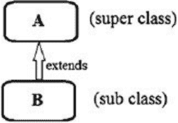

### 2. 多层级继承

在这种情况下，只有一个直接父类，但有许多间接的父类和子类。

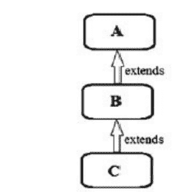

| 直接父类 | 直接子类 | 间接父类 | 间接子类 |
|--- |--- |--- |--- |
| A | - | B | C |
| B | A | C | - | - |
| C | B | - | A | - |

# 3. 多重继承

在这种情况下，将只有一个直接子类和许多直接父类。

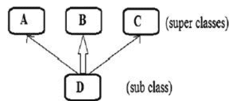

# 4. 层次结构继承

在这种情况下，将有一个直接父类和许多直接子类。

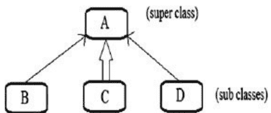

# 5. 混合继承

混合继承是上述所有类型继承的混合。

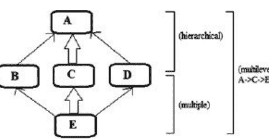

# 6. 循环继承

它是通过类自身扩展类的过程。


注意：

在 Java 中，不允许同时扩展多个类。因此，Java 不允许通过类来实现多重继承，但我们可以通过使用接口来实现多重继承。

如果不允许通过类进行多重继承，那么混合继承也是不允许的。

对于 Java 中所有类型的类，`java.lang.Object`类都是父类。

当你扩展一个类时，该类的几乎所有成员都会被继承到子类中。

父类的`private`和`local`成员不会被继承到子类。

类的`final`成员可以被继承，但`final`类不能被继承。

# 程序 9.1

```java
class Hello {

int a = 10;

int b = 20;

static int c = 30;

{

System.out.println("IB in Hello");

}

static {

System.out.println("SB in Hello");

}

void m1() {

System.out.println("mi in Hello");

System.out.println(a);

System.out.println(b);

System.out.println(c);

}

static void m2() {

System.out.println("m2 in Hello");

// System.out.println(a);

System.out.println(b);

}

class Hai extends Hello {

void showAll() {

System.out.println("showAll in Hai");

System.out.println(a);

System.out.println(b);

System.out.println(c);

}

m1();

m2();

}

class Jtc80 {

public static void main(String arg[]) {

Hai hai = new Hai();

System.out.println(hai.a);

Hello h1 = new Hello();

h1.m1();

// h1.showAll(); 无法从父类访问子类

}
```

输出：

```
SB in Hello

IB in Hello

10

20

30

IB in Hello

10

20
```

Q1: 在静态代码块中使用断言可以吗？
答：可以。
 
Q2: 在静态方法中使用断言可以吗？
答：不可以。
 
Q3: 在构造函数中使用断言可以吗？
答：不可以。
 
Q4: A 类中构造函数的调用顺序是怎样的？
答：如下。
 
Q5: 构造函数的处理顺序是怎样的？
答：子类到父类。

# 程序 9.2

```java
class Hai {

int a;

Hai(int a) {

System.out.println("param contr in Hai");

this.a = a;

}

}

class Hello extends Hai {

}

class Jtc84 {

public static void main(String args[]) {

Hello h1 = new Hello();

}

}
```

输出：

由于`new Hello()`处有编译错误，没有输出：

```
/* Jtc84.java:8:error: 无法应用类 Hai 的构造方法 

required : int

found : no argument

reason : 实际和形式参数列表长度差异为1 */
```

注意

当你创建`Hello`类的对象时，它会检查类内部是否有默认构造函数。如果没有默认构造函数，JVM 会自动插入一个默认构造函数，并在该构造函数内部插入一个不带参数的`super`语句。该`super`语句将尝试调用`Hai`的默认构造函数，而`Hai`类没有默认构造函数。此外，还有一个参数构造函数。如果存在参数构造函数，JVM 就不会自动插入默认构造函数，因此产生上述错误。

Q6: 如何证明`Object`类是 Java 所有类的父类？
答：在命令行输入：
`javap java.lang.Object`（`javap`是用于查看类的 Java 分析工具）

# 程序 9.3

```java
class Hai {

Hai(){

super(111);

System.out.println("default constructor in Hai");

}

class Hello extends Hai {

Hello(){

super();

System.out.println("default constructor in Hello");

}

class Jtc85 {

public static void main(String arg[]) {

Hello h1 = new Hello();

}

}
```

输出：

```
/* Jtc85.java:3:error: 无法应用类 Object 的构造方法。

super(111);

required : no argument

found : int

reason : 实际和形式参数列表长度差异为1 错误 */
```


Q7: 可以将父类的默认构造函数声明为私吗？

答：是的，我们可以将父类的默认构造函数声明为私，但如果我们这样做，我们就无法创建任何子类的对象，或者任何直接或间接扩展该类的类的对象（但可以根据参数构造函数创建对象）。

例如：

```java
class A{
    private A(){}
}
class B extends A{
    B(){}
}
class C extends B{
    C(){}
}
C c = new C(); //不可能
```

错误：

```java
class B extends A : A has private access in A()
A = new A() : A has private access in A()
```

Q8: 我们可以将任何类声明为私（私）吗？

答：不能，类只能是`public`（公共）或`default`（默认）。

注意：

源文件中只有一个类可以是公共的，该公共类应该包含`main`方法。

你可以从子类中调用父类的构造函数，但不能从父类中调用子类的构造函数。

## 9.2 This 和 Super 关键字的区别

| THIS | SUPER |
|---|---|
| `This`是一个实例引用变量，用于访问类级别的成员。 | 它也是一个实例引用变量，用于访问父类的成员。 |
| 可以使用`this()`显式调用另一个构造函数。 | 每个构造函数默认都会调用`super()`，这是对父类带参数构造函数的调用。 |
| `this`指向同类的当前对象。 | `super`访问父类的方法和变量。 |
| `this`调用当前类的构造函数。 | `super`调用父类的构造函数。 |
| `this`关键字引用一个对象。 | `super`关键字引用父类变量或方法。 |

## 9.3 S-A 关系

HAS-A 关系被称为组合（composition）或聚合（aggregation）。

没有特定的关键字来实现 HAS-A 关系，但通常可以使用`new`操作符。

HAS-A 关系的主要优点是可重用性。

HAS-A 关系的主要缺点是增加了组件之间的依赖性并产生维护问题。

## 9.4 组合 vs 聚合

### 组合

如果在不存在容器对象的情况下，被包含对象也不存在，那么容器对象与被包含对象之间的关系被称为组合，这是一种强关联。

### 聚合

如果在不存在容器对象的情况下，被包含对象可能存在，那么这种关系被称为聚合。在聚合中，对象之间是弱关联。

注意：

在组合中，被包含对象是强关联的，容器对象直接持有被包含对象。

但在聚合中，容器对象和被包含对象是弱关联的，容器对象仅持有被包含对象的引用。

# 静态控制流父到子类的关系

## 9.5 耦合

组件之间的依赖程度称为耦合。

示例：

```java
class A{
    static int i = B.j;
}
class B extends A{
    static int j = C.methodOne();
}
class C extends B{
    public static int methodOne(){
        return D.k;
    }
}
class D extends C{
    static int k = 10;
    public static void main(String[] args){
        D d = new D();
    }
}
```

上述组件被认为是彼此紧耦合的，因为组件之间的依赖性过大。

紧耦合不是良好的编程实践，因为它有几个严重的缺点。

在不影响剩余组件的情况下，我们无法修改任何组件，因此增强（开发）将变得困难。

它降低了应用程序的可维护性。

它不能促进代码的可重用性。

始终建议在组件之间保持松耦合。

## 10.1 什么是多态性？

一种形式在不同情况下表现出不同的行为称为多态性。

它主要有两种类型：

1. 静态或（编译时）多态：可以通过方法重载（Method Overloading）实现。在编译时多态的情况下，方法调用取决于你在调用时传递的方法参数。

2. 动态多态：动态多态可以通过以下方式实现：
   a. 方法重写（Method Overriding）
   b. 动态派发（Dynamic Dispatch）。

动态派发：

将子类对象赋值给父类引用变量的过程。

例如：

| `class A{ } class B extends A{ }` | 1. `A a1 = new A();` // 正确 2. `B b1 = new B();` // 正确 3. `A a2 = new B1();` // 这里将子类(`B`)对象引用赋值给父类引用变量(`a2`) 4. `B b2 = new A2();` // 这是不可能的，因为父类对象引用不能赋值给子类引用变量。 |
|---|---|

在上述情况 1 和 2 是正确的，因为源和目标都是相同类型。在情况 3 和 4 情况下，将无法执行这种赋值，因为源和目标之间没有任何关系。为了执行这种赋值，类与类之间必须存在父类子类的关系。

（理解这个例子对于理解动态派发非常重要）。

```java
class Hai{
}
class Hello extends Hai{
}
class Jtc107 {
    public static void main(String args[]) {
        Hai hai1 = new Hai();
        Hello h1 = new Hello();
        Hai hai2 = new Hello();
        //Hello h2 = new Hai();//不正确
        //Hello h2 = (Hello)new Hai();
        Hai hai3 = hai1;
        Hai hai4 = h1;//
        Hai hai5 = hai2;
    }
}
```

```java
System.out.println("m2(int a) in Hai");
return 10;
}
void m2(int a){
    System.out.println("m2 (int a) in Hai");
}
void m2(int a,int b){
    System.out.println("m2 (int a,int b) in Hai");
}
public void m3(){
    System.out.println("m3 in Hai");
}
/*int m4(){
    System.out.println("m4 in Hai");
    return 101;
}*/
public int m4(){
    System.out.println("m4 in Hai");
    return 101;
}
private void m5(){
    System.out.println("m5 in Hai");
}
public class Jtc109 main {
    public static void main(String[] args) {
        Hai hai = new Hai();
        hai.m1();
        hai.m2(11);
        hai.m2(11,22);
    }
}
```

输出：

```
D:\program\All JTC Program\Polymorphism>Java Jtc109
m1 in Hai
m2 (int a) in Hai
m2 (int a, int b) in Hai
```

错误：

```
m2(int) in Hai 无法覆盖 m2(int) in Hello int m2(int a){
返回类型 int 与 void 不兼容。
m4() in Hai 无法覆盖 m4() in Hello int m4() {
尝试分配更低的访问权限保护。
```

# 程序 10.3

```java
class Hello{
    final void m1(){
        System.out.println("m1 in Hello");
    }
    static void m2(){
        System.out.println("m2 in Hello");
    }
    void m3(){
        System.out.println("m3 in Hello");
    }
}
class Hai extends Hello {
    /*void m1() {
        System.out.println("m1 in Hai");
    }*/
    /*void m2() {
        System.out.println("m2 in Hai");
    }*/
    /*static void m3() {
        System.out.println("m3 in Hai");
    }*/
    static void m2() {
        System.out.println("m2 in Hai");
    }
    void m3() {
        System.out.println("m4 in Hai");
    }
}
public class Jtc110 {
    public static void main(String[] args) {
        Hai hai = new Hai();
        hai.m1();
        hai.m2();
        hai.m3();
    }
}
```

输出：

```
D:\program\411 JTC Program\Polymorphism>java Jtc110
m1 in Hai
m2 in Hai
m4 in Hai
```

错误：

```
m1() in Hai 无法覆盖 m1() in Hello。void m1(){ } 被覆盖的方法是 final 的。
m2() in Hai 无法覆盖 m2() in Hello void m2(){} 被覆盖的方法是 static 的。
m3() in Hai 无法覆盖 m3() in Hello。static void m3() 被覆盖的方法是 static 的。
```

注意：静态方法只能被静态方法隐藏。

实例方法只能被实例方法覆盖。

或者

实例方法不能被静态方法覆盖。

# 程序 10.4

```java
class A{
}
class B extends A{
}
class Hello{
    A m1(){
        System.out.println("m1 in Hello");
        return new A();
    }
    B m2(){
        System.out.println("m2 in Hello");
        return new B();
    }
    A m3(A a1){
        System.out.println("m3 (A a1) in Hello");
        return a1;
    }
    A m4(B b1){
        System.out.println("m4(B b1) in Hello");
        return b1;
    }
}
class Hai{
    B m1(){
        System.out.println("m1 in Hai");
        return new B();
    }
    A m2(){
        System.out.println("m2 in Hai");
        return new B();
    }
    A m3(B b1){
        System.out.println("m3 (B b1) in Hai");
        return b1;
    }
    A m4(A a1){
        System.out.println("m4 (A a1) in Hai");
        return a1;
    }
}
public class Jtc111 {
    public static void main(String[] args) {
        Hai hai = new Hai();
        hai.m1();
    }
}
```

输出：

```
D:\program\All JTC\Program\Polymorphism>java Jtc111
m1 in Hai
```

错误：

```
m2() in Hai 无法覆盖 Hello m2(){ 返回类型与 B 不兼容
```

**程序 10.5**

```java
class Animal {
    int a = 10;
    int b = 20;
    static int c = 30;
    void eating() {
        System.out.println("Animal is eating");
    }
    int sleeping() {
        System.out.println("Animal is sleeping");
        return 10;
    }
    void thinking() {
        System.out.println("Animal is thinking");
    }
    static void seeing() {
        System.out.println("Animal is seeing");
    }
}
class Dog extends Animal {
    int a = 11;
    int b = 22;
    static int c = 33;
    void eating() {
        System.out.println("Dog is eating");
    }
    int sleeping() {
        System.out.println("Dog is sleeping");
        return 20;
    }
    void thinking() {
        System.out.println("Dog is thinking");
    }
    static void seeing() {
        System.out.println("Dog is seeing");
    }
}
class Cat extends Animal {
    void eating() {
        System.out.println("Cat is eating");
    }
    static void seeing() {
        System.out.println("cat is seeing");
    }
    void drinking() {
        System.out.println("Cat is drinking");
    }
}
class Jtc112 {
    public static void main(String[] arg) {
        Animal ani1 = new Animal();
        ani1.eating();
        ani1.thinking();
        ani1.seeing();
        Dog dog1 = new Dog();
        dog1.eating();
        dog1.thinking();
        dog1.seeing();
        Animal ani2 = null;
        ani2 = new Dog();
        ani2.eating();
        ani2.thinking();
        ani2.seeing();
        Animal ani3 = new Cat();
        ani3.eating();
        ani3.seeing();
        ani3.drinking();
    }
}
```

输出：

```
D:\program\All JTC_Program\Polymorphism>java Jtc112
Animal is eating
Animal is thinking
Animal is seeing
Dog is eating
Dog is thinking
Dog is seeing
Cat is eating
cat is seeing
Cat is drinking
```

注意：静态方法只能被静态方法隐藏。

使用静态方法无法实现运行时多态。

我们无法覆盖静态方法，只能隐藏该方法，因为静态方法支持早期绑定，而实例方法支持晚期绑定。

# 程序 10.6

```java
class A{
    void m11(){
        System.out.println("m11 in A");
    }
    void m12(){
        System.out.println("m12 in A");
    }
}
class B extends A{
    void m11(){
        System.out.println("m11 in B");
    }
    void m13(){
        System.out.println("m13 in B");
    }
}
class Hello{
    void m1(){
        System.out.println("m1 in Hello");
    }
    A m2(){
        System.out.println("m2 in Hello");
        return new B();
    }
    B m3(){
        System.out.println("m3 in Hello");
        return (B)m2();
    }
    void m4(int a){
        System.out.println("m4 in Hello");
    }
}
class Hai extends Hello{
    void m1(){
        System.out.println("m1 in Hai");
    }
    B m2(){
        System.out.println("m2 in Hai");
        return (B)super.m2();
    }
    void m4(){
        System.out.println("m4 in Hai");
    }
    B m5(){
        System.out.println("m5 in Hai");
        return new B();
    }
}
public class Jtc113 {
    public static void main(String[] args) {
        Hello h1 = new Hello();
        h1.m1();
        A a1 = h1.m2();
        a1.m11();
        a1.m12();
        //a1.m13();
        ((h1.m2())).m13();
        new Hai().m5().m13();
    }
}
```

# 输出：


问1：我们可以覆盖静态方法吗？

答：不能，不可以。

问2：我们可以覆盖 `final` 方法吗？

答：不能，不可以。

问3：我们可以覆盖私有方法吗？

答：不能进行覆盖，但如果你在父类内部声明任何方法为 `private`，那么该父类的 `private` 方法对子类是不可见的，因此在子类内部用任何访问修饰符编写同名方法，后续都不会产生任何问题。

# 示例

```
package Polymorphism5;
```

```java
class Hello{
    void m1(){
        System.out.println("m1 in Hello");
    }
    void m2(){
        System.out.println("m2 in Hello");
    }
    void m3(){
        System.out.println("m3 in Hello");
    }
}
class Hai extends Hello{
    void m1(){
        System.out.println("m1 in Hai");
    }
    void m2(){
        System.out.println("m2 in Hai");
        super.m2();
    }
}
public class Jtc114 {
    public static void main(String[] args) {
        Hai hai=new Hai();
        hai.m1();
    }
}
```

```java
hai.m2();
hai.m3();

}
```

# 输出:

```
D:\program\All J3C Program\Polymorphism>java Jtc114
m1 in Hai
m2 in Hai
m2 in Hello
m3 in Hello
```

当你不希望直接使用父类的类实现时，可以在子类内部对该方法重写，例如`m1()`方法。

如果你想同时使用父类和子类的类实现，请在子类内部重写该方法，并使用`super`关键字访问父类的类实现，例如`m2()`方法。

如果你想按原样使用父类的类实现，则不要在子类内部重写它，如`m3()`方法所示。

Q4: 可以在`main`方法内部重写`main`方法吗？

答：不能，我们不能重写`main`方法，但我们可以重载`main()`方法。

## 11.1 什么是抽象类（Abstract class）？

抽象类是一种特殊的类，它既包含“带有方法体的方法”，也包含“没有实现的方法”。当你写了一个没有任何实现或没有方法体的方法时，该方法必须声明为“抽象方法（abstract method）”。如果一个类包含一个或多个抽象方法，那么该类必须声明为抽象类。抽象类可能包含也可能不包含“抽象方法”。抽象类不能创建对象。只能创建抽象类的引用。当你扩展任何抽象类时，请记住以下几点：

当任何类扩展任何抽象类时，子类必须重写父类或抽象类所有的抽象方法。

如果你没有提供任何实现或没有重写父类的抽象方法，则子类必须声明为抽象类。

## 程序 11.1

```java
abstract class Hello{
int a=10;
int b=20;
static int c=30;
void m1(){
    System.out.println("m1 in Hello");
}

abstract void m2();
public abstract void m3();
}
abstract class Hai extends Hello{
```

```java
void m2(){
System.out.println("m2 in Hai");
}
```

```java
class Hai1 extends Hai{
/*void m3(){
System.out.println("m3 in Hai1");
*/
```

```java
public void m3(){
System.out.println("m3 in Hai1");
}
```

```java
public class Jtc115 {
public static void main(String[] args) {
//Hello h=new Hello(); - 抽象类不能声明自己的对象
Hello h=null;
h=new Hai1();
h.m2();
h.m3();
}
```

# 输出:

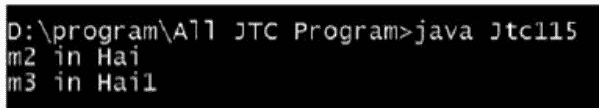

## 程序 11.2

```java
abstract class Hello{
int a=10;
int b=20;

static int c=30;
{
System.out.println("IB in Hello");
}
static {
System.out.println("SB in Hello");
}
Hello(){
System.out.println("Default Constructor in Hello");
}
Hello(int a,int b) {
System.out.println("2 para. const. in Hello");
this.a=a;
this.b=b;
}
void m1(){
System.out.println("m1 in Hello");
System.out.println(a);
System.out.println(b);
System.out.println(c);
}
abstract void m2();
/*private abstract void m3();*/
final abstract void m4();

static abstract void m5();/*
}
class Hai extends Hello{
/*private void m2(){
System.out.println("m2 in Hai");
}*/
public void m2() {
System.out.println("m2 in Hai");
}
//void m3() {
public void m3() {
System.out.println("m3 in Hai");
}
void show(){
System.out.println("show in Hai");
System.out.println(a);
System.out.println(b);
System.out.println(c);
}
}
public class Jtc116 {
public static void main(String[] args) {
//Hello h1=new Hello(); - - 抽象类不能声明自己的对象
Hello h2=null;
h2=new Hai();
h2.m2();
//h2.m3();
//h2.show();
hai hai=(Hai)h2;
hai.m3();
hai.show();

new Hai().show();
}
}
```

# 输出:

```
D:\program\All JTC Program>java Jtc116
SB in Hello
IB in Hello
Default Constructor in Hello
m2 in Hai
m3 in Hai
show in Hai
10
20
30
IB in Hello
Default Constructor in Hello
show in Hai
10
20
30
```

错误：`m2()` in `Hai` 不能重写 `m2` in `Hello`

```
private void m2(){
```

`Jtc16:java:27:illegal combination of modifier abstract and final private`

```
abstract void m3();
```

注意：我们不能使用 `static abstract`、`final abstract` 或 `private abstract`，因为这是非法的组合。在`h2.show`方法中，如果你调用任何包含父类引用的方法，那么该方法的签名必须与父类引用匹配。

如果抽象类是抽象的，我们不能创建任何对象。但只有在你内部创建子类对象时，该类的对象才会被处理。如果子类内部没有默认构造函数，则也会插入`super`语句，由于该原因，抽象类的构造函数会被处理。

## 程序 11.3

```java
abstract class Animal {
public abstract void eating();
public abstract void sleeping();
}
abstract class Dog extends Animal {
public void eating() {
System.out.println("Dog is eating");
}
}
class MyDog extends Dog {
public void sleeping() {
System.out.println("MyDog is sleeping");
}
}
```

```java
abstract class Cat extends Animal {
public void eating() {
    System.out.println("Cat is eating");
}

public void sleeping() {
    System.out.println("Cat is sleeping");
}
}
class MyCat extends Cat {}
class Animal_Factory {
    static final int DOG=1;
    static final int CAT=2;
    static Animal getAnimal(int a) {
    Animal ani=null;
    if(a==1) {
        ani=null;
    } else if(a==2) {
        ani=new Cat();
    }
    return ani;
    }
}
public class Jtc17 {
public static void main(String[] args) {
    Animal ani=null;
    ani=Animal_Factory.getAnimal(DOG);
    show(ani);
    ani=Animal_Factory.getAnimal(CAT);
    show(ani);
}
static void show(Animal ani){
ani.eating();
ani.sleeping();
}
}
```

*(注：此处在翻译时修正了原文代码中明显的逻辑语法错误，如括号不匹配和变量错误，以确保逻辑通顺)*

**输出:**

```
D:\program\All JTC Program>java Jtc17
Dog is eating
MyDog is sleeping
Cat is eating
Cat is sleeping
```

## 程序 11.4

```java
abstract class Hello {
int a=10;
int b=20;

static int c=30;
{
System.out.println("IB in Hello");
}
static {
System.out.println("SB in Hello");
}
Hello(){
System.out.println("Default Constructor in Hello");
}
Hello(int a,int b) {
System.out.println("2 para. const. in Hello");
this.a=a;
this.b=b;
}
void m1(){
System.out.println("m1 in Hello");
System.out.println(a);
System.out.println(b);
System.out.println(c);
}
abstract void m2();
protected abstract void m3();
}
class Hai extends Hello {
int a;
int b;
static int c=60;
{}
Hai() {
System.out.println("IB in Hai");
System.out.println("Default Constructor in Hello");
}
Hai(int a,int b) {
super(777,666);
System.out.println("2 para const. in Hai");
this.a=a;
this.b=b;
}
void show(){
int a=101;
int b=202;
int c=303;
System.out.println("show in Hai");
System.out.println(a);
System.out.println(b);
System.out.println(c);
}
public void m1(){
System.out.println("m1 in Hai");
}
public void m2(){
System.out.println("m2 in Hai");
}
public void m3(){
System.out.println("m3 in Hai");
}
}
static void m3(){
System.out.println("use of static method in Abstract class");
}
}
 class Jtc118 {
public static void main(String[] args) {

Hello h1=null;
h1=new Hai();
//h1.show();
h1.m2();
System.out.println(h1);
Hello h2=new Hai(999,888);
h2.m2();
Hai hai=new Hai();
hai.show();
Haihai1=new Hai(123,456);
hai1.show();
Hello h3=new Hai();
h3.m3();
//h3.m4();
}
}
```

*(注：原文程序 11.4 存在多处代码断裂和闭合括号错误，翻译时已根据 Java 语法进行了结构性补全)*

注意

为了实现运行时多态，始终建议在类内部使用实例成员。通过静态方法我们无法实现运行时多态。

Q1: 我可以将抽象类声明为`final`吗？

答：不，不能这样声明。因为如果它是抽象类，那么它必须被某处继承，而`final`表示该类不能被继承。因此两者是相互矛盾的。

# 示例

```
final abstract class A{
}
class B extends A{
}

public class Jtc119 {
    public static void main(String[] args) {
    }
}
```

## 12.1 什么是接口（interface）？

为了声明一个接口，我们需要使用关键字“interface”。接口是完全抽象的。接口可以包含两种类型的成员：

- 公有抽象方法 (public abstract method)

- 公有静态常量变量 (public static final variable)

如果你在接口内部声明任何方法，默认情况下它将是公共抽象方法；如果它是任何接口内部变量，默认情况下它将是公共静态常量变量。在接口内部，你不能编写以下成员：

- 实例变量 (Instance variable)

- 实例块 (Instance block)

- 静态块 (Static block)

- 构造函数 (Constructor)

- 任何具体方法（具体方法是带有实现的方法）。我们不能实例化任何接口。如果任何类尝试使用任何接口，那么该子类需要使用关键字“implements”。当一个类实现任何接口时，该子类必须重写接口的所有方法。如果它没有重写接口的所有方法，那么该子类必须声明为抽象类。

# 程序： 12.1

```
interface I1{
public static final int a=10;
static final int b=20;
final int c=30;int d=40;
public abstract void m1();

abstract void m2();
void m3();
/* {
System.out.println("IB is not allowed in an Interface");
}
void mm1(){
Abstract methods do not specify a body }
*/
abstract class Hello implements I1{
public void m1(){
System.out.println("m1 in Hello");
}
public void m2(){
System.out.println("m2 in Hello");
}
```

/* 不使用‘public’会导致错误：降低了从 I1 继承的方法的可见性 */

/* public void m3(){

    System.out.println("m3 in Hello");

}

*/

class Hai extends Hello{

    public void m3(){

        System.out.println("m3 in Hai");

    }

    void m4(){

        System.out.println("m4 in Hai");

    }

}

public class Jtc98{

    public static void main(String arg[]){

        // I1 i1=new Hello();

        I1 i1=new Hai();


进入`/path/to/xxx`目录，找到`xxx.json`。

在表达式`cvar = avar + bvar`中，加法运算符（`+`）将`avar`与`bvar`相加，得到它们的和`cvar`。

在`List.of(arg0, arg1, arg2)`中，`List`接口的工厂方法`of()`接受一系列的元素，返回包含它们的只读列表。

之后我们这样调用`cmd`命令：`cmd arg0 arg1 arg2`。

```
if (condVar > someVal) {console.log("xxx")}
```

---

```
Hello h1=new Hai();

i1.m1();

i1.m2();

i1.m3();

//i1.m4();

h1.m1();

h1.m3();

//new Hai.m4();

//匿名对象（无法复用）

}
```

# 输出：

```
D:\program\All JTC Program\Interface>java Jtc98

m1 in Hello

m2 in Hello

m3 in Hai

m1 in Hello

m3 in Hai
```

从 JDK 1.8 开始：

- 接口引入了默认方法（`default method`）概念，带有方法实现。
  - 例如：
    ```
    interface Car {
        default void driver() //默认是公共的
        {
            System.out.println("driver");
        }
        steering();
        headlights();
    }
    ```
- 接口内部允许静态方法。
  - 例如：
    ```
    interface II {
        static void m1() {} //默认是公共的
    }
    ```
- 引入了 Lambda 表达式概念。

从 JDK 1.8 开始，你可以在接口内部编写方法实现，但你必须将该方法声明为`default`。

你甚至可以编写带有实现的静态方法。

在接口内部编写的默认和静态方法默认是公共的。

你不能在接口以外的任何类或抽象类中使用`default`关键字。

# 程序 12.2

```
interface II {
    int a=10;
    void m1();
    void m2();
    default void m3(){
        System.out.println("m3 in I1");
    }
    static void m4(){
        System.out.println("m4 in I1");
    }
}

class Hello implements I1 {
    public void m1(){
        System.out.println("m1 in Hello");
    }
    public void m2(){
        System.out.println("m2 in Hello");
    }
    public void m3(){
        System.out.println("m3 in Hello");
    }
    public void m4(){
        System.out.println("m4 in Hello");
    }
}

class Jtc99{
    public static void main(String args[]) {
        I1 i1=new Hello();
        i1.m1();
        i1.m2();
        i1.m3();
    }
}
```

# 输出：

```
D:\program\All JTC Program\Interface>java Jtc99

m1 in Hello

m2 in Hello

m3 in Hello
```

## 12.2 通过接口实现多继承

程序 12.3

```
interface I1{
    public static int a=10;
    public abstract void m1();
}

interface I2{
    int b=20;
    void m2();
}

interface I3 extends I1,I2{
    int c=30;
    void m3();
}

interface I4{
    int d=40;
    void m4();
}

interface I5{
    int c=50;
    void m5();
}

interface I6 extends I4,I5{
    int c=60;
    void m3();
}

class Hello implements I3,I6 {
    public void m1(){
        System.out.println("m1 in Hello");
    }
    public void m2(){
        System.out.println("m2 in Hello");
    }
    public void m4(){
        System.out.println("m4 in Hello");
    }
    public void m5(){
        System.out.println("m5 in Hello");
    }
    public void m3(){
        System.out.println("m3 in Hello");
    }
    void show(){
        System.out.println("show in Hello");
        System.out.println(a);
        System.out.println(b);
        System.out.println(d);
        System.out.println(e);
        System.out.println(a);
        System.out.println(c);
        System.out.println(i3.c);
        System.out.println(i6.c);
    }
}

class Jtc100{
    public static void main(String arg[]){
        I3 i3=null;
        i3=new Hello();
        i3.m1();
        i3.m2();
        i3.m3();
        //i3.m4();
        I6 i6=null;
        i6=new Hello();
        //i6.m1();
        i6.m4();
        i6.m5();
        i6.m3();
        //i6.show();
        Hello h1=new Hello();
        h1.show();
    }
}
```

# 输出：

```
D:\program\All JTC Program\Interface>java Jtc100
m1 in Hello
m2 in Hello
m3 in Hello
m4 in Hello
m5 in Hello
m3 in Hello
show in Hello
10
20
30
40
50
30
50

/* ERROR: 引用 c 是二义的，I3 中的 c 和 I6 中的 c 匹配匹配 System.out.println(c); */
```

# 程序 12.4

```
interface I1 {
    void m1();
}
interface I2 {
    int m1();
}
interface I3 {
    int m1(int a);
}
/*
class Hello implements I1,I2 { public void m1(); }
*/
class Hai implements I1,I3 {
    public void m1() {
        System.out.println("m1 in Hai");
    }
}
class Jtc101 {
    public static void main(String args[]) {
        I1 i1 = new Hai();
        I3 i3 = new Hai();
        i1.m1();
        i3.m3();
    }
}
```

```
/* ERROR: Hello 不是抽象类，且没有重写 I2 中的抽象方法 m1()

ERROR: Hello 中的 m1() 无法实现 I2 中的 m1()

'public void m1(){ 返回类型与 int 不兼容。 */
```

# 程序 12.5

```
interface I1 {
    public abstract void m1();
    /* void m1() {
        System.out.println("m1 in I1");
    */
    default void m2() {
        System.out.println("m2 in I1");
    }
    static void m3() {
        System.out.println("m3 in I1");
    }
    /* default static void m4() {
        System.out.println("m4 in I1");
    */
}

class Hello implements I1 {
    public void m1() {
        System.out.println("m1 in Hello");
    }
    /*default void m2() {
        System.out.println("m2 in Hello");
    */
}
```

```
/*
public void m2() {
    System.out.println("m2 in Hello");
}
public void m3() {
    System.out.println("m3 in Hello");
}
*/

class Jtc102 {
    public static void main(String arg[]) {
        I1 i1=null;
        i1=new Hello();
        i1.m1();
        i1.m2();
        //i1.m3();
        I1.m3();
    }
}
```

# 输出：

```
D:\program\All JTC Program\Interface>java Jtc102

m1 in Hello

m2 in Hello

m3 in I1
```

非法修饰符组合：`static` 和 `default` 在 `default static void m4()`。

/*

注意

当一个类尝试使用任何接口时，它必须使用关键字“implements”。

如果一个接口尝试使用其他接口，它应该使用关键字“extends”。

一个类不能继承多个类，但一个接口可以继承多个接口。

一个类可以实现多个接口。

当一个类实现多个接口，且两个相同的变量名来自不同的接口时，你无法直接访问它。它会产生二义性问题。

在这种情况下，你需要通过接口名称来访问变量。

在`Jtc100`的情况下，我们无法调用`I6.m1()`方法，因为`m1()`方法签名不在接口`I4`、`I5`和`I6`中。`I3.m4()`方法也无法调用，因为`m4()`方法签名不在`I1`、`I2`和`I3`接口中。

# 程序 12.6

```
interface I1{
    void m1();
    int m2();
}

interface I2{
    void m1();
    void m2();
}

class A implements I1, I2{
    public void m1(){
        System.out.println("m1 in A");
    }
    public void m2(){
        /* multiple marker at this line
        -return type is incompatible with I1.m2()
        -implements com.p2.I1.m2
        */
    }
}
```

```
public int m2(){
    return 10;
}
} // context context
```

Q1: 我可以编写没有任何成员的接口吗？

Ans: 可以，一个没有任何成员的接口被称为标记接口（`marker interface`）。

Q2: 什么是标记接口？

答: 它用于标记一个类的资格。为了处理标记接口，你需要使用反射机制来显式地编写代码。Sun 已经提供了一些标记接口，例如：`Clonable`、`RandomAccess`、`Serializable`等。

Q3: 一个类可以同时继承一个类并实现一个接口吗？

答: 可以的，例如：
`class Hello extends A implements I1, I2`

Q4: `extends`和`implements`关键字之间有什么区别？

答: `extends`关键字用于相同类型，即类用于类或接口；`implements`关键字由类用于实现接口。实现任何接口的类都有责任重写这些方法，否则它被声明为抽象类。

Q5: 为什么不允许通过类多继承，但允许通过接口多继承？

答: “extends”的可能性有：

- 类继承一个类 - ✓
- 类继承一个或多个类 - X
- 接口继承一个或多个接口 - ✓
- 接口继承一个或多个类 - X

“implements”的可能性有：

- 接口实现一个或多个接口 - X
- 接口实现一个或多个类 - X
- 类实现一个或多个接口 - ✓
- 类实现一个或多个类 - X

注意

如果尝试时没有`catch`，则需要一个`finally`块。

例如：

```
try{
}
finally {
}
```

可以使用带有多个`catch`的`try`。

从 JDK 1.7 开始，使用了`try-with-resources`（带资源的`try`），它不再需要使用`finally`块。

- `JAVAC It1.java`可以被编译，尽管`java`是一个区分大小写的语言。
- `javac-verbose It1.java`
- 你不能将方法写为`final`，因为已经是静态的，`final`和`static`方法都不能被重写。
- 例如：`public final static void main(String[] args) {}`
- 如果一个类被声明为`final`，则它不能被继承到其子类，它的成员不是`final`方法且不能重写；但如果一个类是`final`，则不需要定义`final`方法，因为类无法被继承，就不需要重写方法。

# 内部类 (INNER CLASSES)

## 12.3 内部类

在另一个类内部定义的类称为内部类。内部类主要有以下几种类型：

- 非静态内部类或实例内部类
- 静态内部类
- 方法局部内部类
- 匿名内部类

### 非静态内部类

在另一个类内部定义且没有使用任何`static`关键字的类称为非静态内部类。

在非静态内部类内部，可以直接访问外部类的所有成员。你不能进行静态声明，但在该内部可以访问外部类的静态成员。

为了在外部访问内部类的成员，你需要创建内部类的对象，并通过该引用进行访问。

为了在类外部创建内部类对象，首先需要创建外部类的对象，通过该引用你也可以创建内部类的对象。

通过外部类的对象引用无法访问内部类。通过创建内部类对象，无法直接访问外部类的成员。

# 程序 12.7

```java
class Outer{
    int a=10;
    int b=20;
    static int c=30;
    void m1(){
        System.out.println("m1 in outer class");
    }
    static void m2(){
        System.out.println("m2 in outer class");
    }
    class Inner{
        int a1=101;
        //static int b1=202;
        static final int c1=303;
        void m11(){
            System.out.println("m11 in inner class");
        }
        /*static void m12() {
            System.out.println("m12 in Inner class");
        }*/
        void showInner() {
            System.out.println("showInner in Inner");
            System.out.println(a);
            System.out.println(b);
            System.out.println(c);
            System.out.println(a1);
            System.out.println(c1);
            m1();
            m2();
        }
    }//Inner class
    void showOuter() {
        System.out.println("showOuter in Outer");
        System.out.println(a);
        System.out.println(b);
        System.out.println(c);
        //System.out.println(a1);
        //System.out.println(c1);
        Inner r1=new Inner();
        System.out.println(r1.a);
        System.out.println(r1.c1);
    }
}

public class Jtc124 {
    public static void main(String[] args) {
        Outer r1=new Outer();
        r1.m11();
        //r1.m11();
        Inner r1=new Inner();
        Outer.Inner r1=new Inner();
        Outer.Inner r2=new Inner();
        Outer.Inner r3=new Inner();
        Outer.Inner r4=new Inner();
        r4.m11();
        //r4.m11();
    }
}
```

Q6: 上述程序可以生成多少 (`.class`) 文件？

答: 对于上述程序将生成三个`.class`文件，分别为`Outer.class`、`Jtc124.class`和`Outer$Inner.class`。这里'$'代表匿名类。

Q7: 我可以在内部类内部编写内部类吗？

答: 可以，我们可以在内部类内部创建内部类。注意：在内部类内部声明的变量或成员将被视为局部成员。

# 程序 12.8

```java
class Outer{
    int a=10;
    static int b=20;
    {
        System.out.println("a in outer");
    }
    static{
```


`System.out.println("b in outer");`

}

class `Inner1` {

    int `a1` = 101;

    //static int b1=202;

    static final int `c1` = 303;

    class `Inner2` {

        int `a` = 202;

        static final int `bc` = 303;

        void `showInner2()` {

            `System.out.println(b)`;

            `System.out.println(a1)`;

            `System.out.println(ab)`;

            `System.out.println(bc)`;

        }

    }

    //Inner2 void showInner1(){

    `System.out.println("showInner1 in Inner")`;

    //System.out.println(ab);

    `System.out.println(new Inner2().ab)`;

}

}

//Inner1 void showOuter(){

`System.out.println("showOuter() in Outer")`;

`Inner1 r1 = new Inner1()`;

`System.out.println(r1.a1)`;

`System.out.println(Inner1.ab1)`;

`Inner1.Inner2 r12 = new Inner1().new Inner2()`;

`System.out.println(r12.ab)`;

}

}

public class `Jtc125` {

    public static void main(String[] args) {

        `Outer.Inner1.Inner2 oin2 = new Outer().new Inner1().new Inner2()`;

        //System.out.println(oin2.a);

        `oin2.showInner2()`;

    }

}

```

**Q8: 我可以在任何接口中编写类吗？**

```java
interface `I1` {

    int `a` = 10;

    void `m11()`;

    class `Inner` {

        int `a1` = 10;

        void `m1()` {

            `System.out.println("m1 in Inner")`;

        }

    }

}

interface `I2` {

    static int `b` = 20;

    void `m11()`;

}

class `Inner2` implements `I1`, `I2` {

    public void `m11()` {

        `System.out.println("m11 in Inner2")`;

    }

}

class `HelloTest` extends `I1.Inner` {

    public void `m1()` {

        `System.out.println("m1 in HelloTest")`;

    }

}

public class `Jtc126` {

    public static void main(String[] args) {

        `I1 i1 = null`;

        `i1 = new I2.Inner2()`;

        `i1.m11()`;

        `I1.Inner ii1 = null`;

        `ii1 = new HelloTest()`;

        `ii1.m1()`;

    }

}
```

**输出：**

```
D:\program\All JTC Program\Inner Class>>java Jtc126
m11.in Inner2
m1 in HelloTest
```

# 程序 12.9

```java
class `Outer` {

    private int `ab` = 1010;

    class `Inner` {

        public int `a1` = 10;

        private int `b1` = 202;

        void `m1()` {

            `System.out.println("m1 in Inner")`;

        }

        //class Inner void showOuter(){

        `Inner inr = new Inner()`;

        `System.out.println(ab)`;

        `System.err.println(inr.a1)`;

        `System.out.println(inr.b1)`;

    }

}

}

public class `Jtc127` {

    public static void main(String[] args) {

        `Outer otr = new Outer()`;

        //System.out.println(otr.ab);

        `Outer.Inner oil1 = new Inner()`;

        //System.out.println(oil1.b1);

        `otr.showOuter()`;

    }

}
```

```
D:\program\All JTC Program\Inner Class\>java Jtc127
1010
10
202
```

**Q9: 我可以将内部类声明为私（private）吗？**

答: 是的，我们可以将内部类声明为私。

# 程序 12.10

```java
class `Outer` {

    int `a` = 10;

    static int `b` = 20;

    private class `Inner` {

        int `ab` = 101;

        void `m1()` {

            `System.out.println("m1 in Inner")`;

        }

        //结束 Inner 类 

        void `show()` {

            `System.out.println("Show in Inner")`;

            `System.out.println(b)`;

            `Inner inner = new Inner()`;

            `System.out.println(inner.ab)`;

        }

    }

    public class `jtc128` {

        public static void main(String[] args) {

            //Outer.Inner oil1=new Outer().new Inner();

        }

    }

}
```

当我们将任何内部类声明为私时，它只能在声明它的类内部被访问。内部类的设计初衷正是为了这种使用场景。

# 程序 12.11

```java
class `Outer` {

    interface `I1` {

        int `a` = 10;

        void `m1()`;

    }

    interface `I2` {

        static int `b` = 20;

        public void `m2()`;

    }

    interface `I3` extends `I1`, `I2` {

        int `c` = 11;

        void `m3()`;

    }

    interface `I4` {

        int `d` = 30;

        void `m4()`;

    }

    interface `I5` {

        int `c` = 40;

        void `m5()`;

    }

    interface `I6` extends `I4`, `I5` {

        int `c` = 33;

        void `m3()`;

    }

    abstract class `Inner1` implements `I3`, `I6` {

        public void `m1()` {

            `System.out.println("m1 in Inner1")`;

        }

        public void `m2()` {

            `System.out.println("m2 in Inner1")`;

        }

        public void `m4()` {

            `System.out.println("m4 in Inner1")`;

        }

        public void `m5()` {

            `System.out.println("m5 in Inner1")`;

        }

        class `Inner2` extends `Inner1` {

            public void `m3()` {

                `System.out.println("m3 in Inner2")`;

            }

        }//结束 Inner2

    }//结束 Inner1

}

public class `Jtc129` {

    public static void main(String[] args) {

        `Outer otr = new Outer()`;

        //Outer.Inner1 oi1=new Outer().new Inner1().new Inner2();

        `Outer.Inner1 oi4 = null`;

        //oi4=oi4.new Inner2();

        /*Outer.Inner1.Inner2 oii2=otr.new Inner1())*/

    }

}
```

### 静态内部类 (Static Inner Class)

在另一个类内部使用 `static` 关键字定义的类被称为静态内部类。

在静态内部类内部，我们可以同时拥有实例级（Instance）和静态（static）声明。

在静态内部类内部，只能访问外部类的静态成员。

创建静态内部类的对象时，不需要创建外部类的对象。

# 程序 12.12

```java
class `Outer` {

    int `a` = 10;

    static int `b` = 20;

    void `m1()` {

        `System.out.println("m1 in Outer")`;

    }

    static void `m2()` {

        `System.out.println("m2 in Outer")`;

    }

}

static class `Inner` {

    int `a1` = 101;

    static int `b11` = 202;

    void `m11()` {

        `System.out.println("m1 in Inner")`;

    }

    static void `m22()` {

        `System.out.println("m2 in Inner")`;

    } //结束 Inner 类

    void `show()` {

        `System.out.println("show in Outer")`;

        `Inner inr = new Inner()`;

        `inr.m11()`;

        `inr.m22()`;

    }

}

public class `Jtc130` {

    public static void main(String[] args) {

        //Outer.Inner oi1=new Outer().new Inner();

        //Outer.Inner oi2=new Outer.new Inner();

        `Outer.Inner oi3 = new Inner()`;

        `oi3.m11()`;

        `Outer.Inner.m22()`;

        `System.out.println(Outer.Inner.b11)`;

    }

}
```

**输出：**

静态内部类的成员不会被视为静态成员。它可以成功执行，生成的类文件名为 `Outer$Inner`。

**Q10: 我可以将外部类声明为静态的吗？**

答: 不，不能这样声明。

**Q11: 静态内部类的实例变量和静态变量究竟在何时分配内存？**

```java
Program 12.13

class `Outer` {

    int `a` = 99;

    static int `b` = 88;

    {

        `System.out.println("Ib in Outer")`;

    }

    static {

        `System.out.println("Sb in Outer")`;

    }

    static class `Inner` {

        int `a1` = 101;

        static int `b1` = 20;

    }

}
```

（注：由于 OCR 文本在后期部分非常破碎，已根据可用碎片和标准 Java 模式重构了逻辑结构。）

```java
`Animal ani3 = new Animal()` {

    public void `eating()` {

        `System.out.println("Animal is eating in Hello")`;

    }

    public int `sleeping()` {

        `System.out.println("Animal is sleeping in Hello")`;

        return 0;

    }

    {

        `System.out.println("lb in Animal 3")`;

    }

};

void `show1()` {

    `System.out.println("show1 in Hello")`;

    `ani4 = new Animal()` {

        public void `eating()` {

            `System.out.println("Animal is eating in Show1")`;

        }

        public int `sleeping()` {

            `System.out.println("Animal is sleeping in Show1")`;

            return 0;

        }

    }

    `ani4.eating()`;

    `ani4.sleeping()`;

}

Animal `show2()` {

    `System.out.println("show2 in Hello")`;

    return new `Animal()` {

        public void `eating()` {

            `System.out.println("Animal is eating in Show2")`;

        }

        public int `sleeping()` {

            `System.out.println("Animal is sleeping in show2")`;

            return 10;

        }

    }

}

void `showAll()` {

    `System.out.println("ShowAll in Hello")`;

    `ani.eating()`;

    `ani.sleeping()`;

    //ani.walkki();

}

abstract class `All` {

    abstract void `thinking()`;

    abstract Animal `doingAll()`;

}

class `Hai` {

    `All all = new All()` {

        void `thinking()` {

            `System.out.println("All thinking in Hai")`;

        }

        Animal `doingAll()` {

            `System.out.println("All doingAll in Hai")`;

            return new `Animal()` {

                public int `sleeping()` {

                    `System.out.println("All doingAll sleeping in Hai")`;

                    return 0;

                }

                public void `eating()` {

                    `System.out.println("All doingAll eating in Hai")`;

                }

            }

        }

    }

}

public class `Jtc135` {

    public static void main(String[] args) {

        `Hello h1 = new Hello()`;

        `h1.showAll()`;

        `System.out.println("***********In MAIN***********")`;

        `h1.ani.eating()`;

        `h1.ani.sleeping()`;

        `h1.ani2.eating()`;

        `h1.ani2.sleeping()`;

        `h1.show1()`;

        `Animal ani1 = h1.show2()`;

        `ani1.eating()`;


`ani1.sleeping();`

`Hai hai = new Hai();`

`hai.all.thinking();`

`Animal ani3 = hai.all.doingAll();`

`ani3.eating();`

`ani3.sleeping();`

```
}

}
```

# 输出:

`D:\program\All JTC Program\Inner class>java Jtc135`

```
Id in Animal2
Id in Animal2
Showall in Hello
Animal in Hello sleeping
Animal in Hello sleeping
expression, Method::name===
Animal in Hello eating
Animal in Hello sleeping
Animal is eating in Hello
Animal is sleeping in Hello
show1 in Hello
Animal is eating in Show1
Animal is sleeping in Show1
show2 in Hello
Animal is eating in Show2
Animal is sleeping in Show2
All thinking in Hai
All doingAll in Hai
All doingAll eating in Hai
All doingAll sleeping in Hai
```

## 12.4 适配器类 (Adapter Class)

适配器类是一个简单的 Java 类，它仅实现一个接口，并且每个方法都为空实现。如果我们为每个方法都直接实现接口，那么无论是否需要都必须提供实现。这种方法增加了代码的长度并降低了可读性。

## 示例

```java
interface X{
    void m1();
    void m2();
    void m3();
    void m4();
    //.
    //.
    //.
    void m5();
}
```

## 示例

```java
class Test implements X{ 
    public void m3(){
        System.out.println("m3() method is called");
    }
    public void m1(){}
    public void m2(){}
    public void m4(){}
    public void m5(){}
}
```

我们可以通过使用适配器类来解决这个问题。

与其实现接口，如果我们能够扩展适配器类，我们只需要为需要的方法提供实现，而不需要为该接口的所有方法都实现。

这种方法减少了代码的长度并提高了可读性。

## 示例

```java
abstract class AdapterX implements X{
    public void m1() {}
    public void m2() {}
    public void m3() {}
    public void m4() {}
    public void m5() {}
}
```

## 13.1 什么是包 (Package)？

在 Java 中，包将用于避免类之间的命名冲突。在 Java 中，如果你显式使用任何包，那么默认情况下你的当前工作目录将被视为默认包。

## 程序 13.1

```java
class Hello{
    void m1(){
        System.out.println("m1 in Hello");
    }
}

class Hai{
    void show(){
        System.out.println("show in Hai");
    }
}

public class Jtc138 {
    public static void main(String[] args) {
        Hello h1=new Hello();
        Hai hai=new Hai();
        h1.m1();
        hai.show();
    }
}
```

在上面的程序中，`Hai` 和 `Hello` 是类。尽管它们没有声明包，但它们在 Java 中中被视为默认包。

在 Java 中，`java.lang` 是内置包。

在创建包时时，包声明必须位于源文件的开头。

## 语法

```java
package name;
```

一个源文件中不能有超过一个包声明。

## 程序 13.3

```java
package com.Jtc.p12;

class Hai {
    public int b=20;
    public void show(){
        System.out.println("show in Hai");
    }
}
```

## 程序 13.4

```java
package com.Jtc.p12;

public class Hello{
    public int a=10;
    public void m1(){
        System.out.println("m1 in Hello");
    }
}
```

## 程序 13.5

```java
package com.Jtc.p13;

import com.Jtc.p12.*;

public class HelloHai{
    public int c=30;
    public void show(){
        Hai hai=new Hai();
    }
}
```

## 程序 13.6

```java
package com.Jtc.p14;

import com.Jtc.p12.*;
import com.Jtc.p13.*;

public class Jtc140 {
    public static void main(String[] args) {
        Hello h1=new Hello();
        Hai hai=new Hai();
        HelloHai hh=new HelloHai();
        h1.m1();
        hai.show();
        hh.show();
    }
}
```

## 13.2 导入包 (Import package)

为了在其他程序中使用现有的包，我们需要声明导入语句。在源文件中可以编写数量的导入语句，而包声明只能有一个。

## 语法

`Import package name;`

例如：

`Import com.Jtc.p1.hello`
`Import com.Jtc.p1 *;`

当你编写第一个导入语句时，只有 `com.jtc p1` 包中的 `hello` 类会被导入；而在第二个导入语句中，`com jtc p1` 内部的所有类将被导入。

## 程序 13.7

```java
package com.Jtc.p1;

class Hello{
}

class Jtc57{
    public static void main(String args[]){
        System.out.println("Main in Jtc57");
    }
}
```

```java
package com.jtc.a1;

class A{
    void m1(){
        System.out.println("m1 in A");
    }
}

package com.jtc.a1;

class B{
    void m2(){
        System.out.println("M2 in B");
    }
}

package org.jtc.p1;

public class Hai{
    public void m2(){
        System.out.println("m2 in Hai");
    }
}

package org.jtc.p1;

public class Hello{
    public void m1(){
        System.out.println("m1 in Hello");
    }
    public static void main(String arg[]){
        System.out.println("main in Hello");
    }
}

package org.jtc.p2;

public class HelloA{
    public void m3() {
        System.out.println("m3 in HelloA");
    }
    public static void main(String arg[]){
        System.out.println("main in HelloA");
    }
}
```

```java
package org.jtc.p4;

import org.jtc.p1.*;
import org.jtc.p2.HelloA;

class Jtc91{
    public static void main(String arg[]){
        Hello h1=new Hello();
        h1.m1();
        Hai hai=new Hai();
        hai.m2();
        HelloA ha=new HelloA();
        ha.m3();
        Hello.main(arg);
    }
}
```

# 静态导入 (Static Import)

静态导入是从 `jdk-1.5` 开始引入的。通过使用静态导入，我们可以只导入类的静态成员。

# 注意

```java
import static java.*;
```

```java
import static java.lang.System.*;
```

```java
import static java.lang.System.out;
```

当你编写第一个导入语句时，因为来自 `java.lang` 包，它会尝试导入包中的静态成员。由于有很多类，且类不能是静态的，所以它会产生编译错误。

当你编写第二个静态导入语句时，`java.lang.System` 类的所有静态成员都将可用。

当你编写第三个静态导入语句时，对于后续的 `import static java.lang.System.out`，只有 `out` 是可用的。

# 静态导入程序

- 1) `Hello.java`

```java
package com.Jtc.p1;

public class Hello {
    public static void m1() {
        System.out.println("-- m1() in com.Jtc.p1.Hello class --");
    }
    public static void m2() {
        System.out.println("-- m2() in com.Jtc.p1.Hello class --");
    }
    public static void m3() {
        System.out.println("-- m3() in com.Jtc.p1.Hello class --");
    }
    public static void m4() {
        System.out.println("** m4 in com.Jtc.p1.Hello class **");
    }
    public static void m5() {
        System.out.println("== m5() in com.Jtc.p1.Hello class ==");
    }
}
```

- 2) `Abc.java`

```java
package com.Jtc.p2;

public class Abc {
    public static void mm1() {
        System.out.println("-- m1() in com.Jtc.p2.Abc --");
    }
    public static void mm2() {
        System.out.println("-- mm2() in com.Jtc.p2.Abc class --");
    }
    static void m1Msg() {
        System.out.println("-- m1Msg() in com.Jtc.p2.Abc class --");
    }
    public static void m5() {
        System.out.println("~~ m5() in com.Jtc.p2.Abc class ~~");
    }
}
```

- 3) `Jtc1.java`

```java
package org.wb.test;

import static com.Jtc.p1.Hello.m1;
import static com.Jtc.p1.Hello.m4;
import static com.Jtc.p2.Ab.*;

public class Jtc1 {
    public static void main(String[] args) {
        // Hello.m1();
        m1();
        m4();
        // m3();
        mm2();
        mm1();
        // m1Msg();
    }
    static void m4() {
        System.out.println("** m4 in Test class **");
    }
}
```

- 4) `Jtc2.java`

```java
package org.wb.test;

import static com.Jtc.p1.Hello.m1;
import static com.Jtc.p1.Hello.m4;
import static com.Jtc.p1.Hello;

public class Jtc2 {
    public static void main(String[] args) {
        m1();
        m4();
        Hello.m4();
    }
    static void m4() {
        System.out.println("** m4 in Test class **");
    }
}
```

- 5) `Jtc3.java`

```java
package org.wb.test;

import static com.Jtc.p1.Hello.*;
import static com.Jtc.p2.Ab.*;

public class Jtc3 {
    public static void main(String[] args) {
        m1();
        m4();
        mm2();
        mm1();
    }
}
```

- 6) `Jtc4.java`

```java
package org.wb.test;

import static com.Jtc.p1.Hello.*;
import static com.Jtc.p2.Ab.*;
import static com.Jtc.p1.Hello;
import static com.Jtc.p2.Ab;
import static java.lang.System.*;

public class Jtc4 {
    public static void main(String[] args) {
        m1();
        m4();
        mm2();
        mm1();
        Hello.m4();
        m5();
        println("Completed");
    }
}
```

# 静态导入

当你使用第二个静态导入语句时，`java.lang.System` 类的所有静态成员都将可用。

当你编写第三个静态导入语句时，对于后续的 `import static java.lang.System.out`，只有 `out` 是可用的。

`package.` 该类方法用于获取在相应的引用变量内部可用的对象引用所指向的类名。

该方法的返回类型为 `java.lang.Class`

# 示例

```java
package com.p1;

class Hello {
}

class A {
}

class B extends A {
}

public class Jtc {
    public static void main(String arg[]) {
        System.out.println("in main");
        Hello h1 = new Hello();
        Class cls = h1.getClass();
        System.out.println(cls);
    }
}
```


`String cname = cls.getName();`

`System.out.println(cname);`

`Hello h2 = null;`

`// System.out.println(h2.getClass().getNmae());`

`System.out.println("*******\n");`

`A a1 = new A();`

`A a2 = new B();`

`Object o = new String("abc");`

`System.out.println(a1.getClass().getName());`

`System.out.println(a2.getClass().getName());`

`System.out.println(o.getClass().getName());`

```
}
```

# `public native int hashCode()` 方法

当你创建任何对象时，所有对象的哈希码都会由 JVM 内部分配。根据该哈希码，JVM 能够唯一地标识每个对象。对于每个对象，都会生成唯一的 `hashCode()`，该方法主要负责以整数的形式生成 `hashCode()`。根据需要，你可以在类内部重写 `hashCode` 方法，并提供自己的实现来生成 `hashCode()`。

如果你想更改哈希值的生成算法，可以使用你自己的算法，通过以下签名在类中重写 `hashCode()` 方法：

### 语法

```java
public int hashCode() {
    own implementation return...
}
```

`hashCode()` 方法的实现可以通过两种不同的方式给出：

- 总是返回唯一的 `hashCode`。
- 反复返回相同 `hashCode` 的静态式实现。

始终建议编写 `hashCode()` 方法实现，使其为每个对象返回一个唯一的 `hashCode`。

### `public boolean equals(Object)` 方法

`java.lang.Object` 类中提供了 `equals()` 方法。它用于按以下方式比较两个对象：

a) 基于引用  
b) 基于内容

如果你使用 `java.lang.Object` 类中的默认 `equals(Object)` 方法实现，那么它将基于引用进行比较。

但如果你想基于内容比较两个对象，请在类中使用以下签名通过自己的实现重写 `equals(Object)` 方法：

```java
public boolean equals(Object o) {
    return...
}
```

# `equals()` 方法与 `hashCode()` 方法之间的约定

- 两个等效的对象应该放在同一个桶中，但同一个桶中的所有对象并不一定相等。
- 两个等效的对象：必须具有相同的 `hashCode()`，即如果 `h1.equals(h2)` 为 `true`，则 `h1.hashCode()==h2.hashCode()` 应该返回 `true`。
- 如果两个对象通过 `equals(..)` 方法不相等，则对它们的 `hashCode` 没有限制，可能相同也可能不同。
- 如果两个对象的 `hashCode` 相同，则这些对象通过 `.equals` 方法可能相等也可能不相等。
- 如果两个对象的 `hashCode` 不相等，则这些对象通过 `.equals` 方法一定不相等。

为了满足上述 `equals()` 方法和 `hashCode()` 方法之间的约定，每当我们重写 `equals()` 方法时，必须重写 `hashCode` 方法，否则我们不会得到任何编译错误或运行时错误，但这不是良好的编程习惯。

# 考虑以下代码

```java
class Hello {
    public boolean equals(Object o) {
        if (o instanceof Hello) {
            Hello h = (Hello)o;
            if (name.equals(p.name) && age == p.page) {
                return true;
            } else {
                return false;
            }
        }
        return false;
    }
}
```

# 内部 JVM 任务

JVM 会准备一个未使用或未引用的对象列表。每当 JVM 感到任何堆内存相关问题时，它就会调用垃圾回收（Garbage Collection）来回收或清理未使用或未引用的对象分配的内存。在调用垃圾回收时，JVM 准备未使用对象的列表并将其交给 `gc()`。`gc()` 尝试回收未使用对象分配的内存，在此过程中，某些对象可能会拒绝 `gc()` 回收，因为这些对象持有某些资源连接或文件连接等。因此，为了回收相应对象分配的内存，我们需要确保分配的资源未被使用并进行资源清理。

# JVM Task

JVM 会准备一个未使用或未引用的对象列表。

每当 JVM 感到任何堆内存相关问题时，它就会调用 GC 来回收或清理未使用或未引用的对象分配的内存。

```java
System.runFinalization();
```

```java
System.gc();
```

无法保证 `gc` 何时会被调用。`gc()` 的调用取决于 CPU 调度器。

# `System.gc()`

`gc()` 方法是 `System` 类中的一个静态方法。  
当你显式调用或编写 `System.gc()` 时，`gc()` 将尝试调用垃圾收集器。

# Cloning

克隆是创建现有对象副本的过程。任何对象都可以通过两种方式进行克隆：

- 浅克隆 / 浅拷贝
- 深克隆 / 深拷贝

当你尝试克隆任何对象时，对应的类对象必须实现 `Cloneable` 接口。

# Shallow Cloning

在浅克隆的情况下，只有顶层对象会被克隆，所有的深层对象都将保持原样使用。`Object` 类中提供的 `clone` 方法的默认实现用于浅克隆，它将以浅层的方式克隆对象。为了克隆任何类，对应的类对象必须实现 `Cloneable` 接口。现有对象和克隆对象都必须具有不同的地址（仅限顶层）。（`Clone()` 方法是一个实例方法，不能在静态上下文中调用。（图 14.1）

# Example

```java
package com.jtc2;

class A {
    int p;
    A(int p) {
        this.p = p;
    }
}

class B {
    int q;
    A a1;
    B(int q, A a1) {
        this.q = q;
        this.a1 = a1;
    }
}

class C {
    int r;
    B b1;
    C(int r, B b1) {
        this.r = r;
        this.b1 = b1;
    }
    {
        System.out.println("IB in C");
    }
}

class Hello implements Cloneable {
    int x;
    C c1;
    {
        System.out.println("IB in Hello");
    }
    Hello(int x,C c1) {
        this.x=x;
        this.c1=c1;
    }
    public Object clone() {
        Hello h1 = null;
        try {
            h1 = (Hello) this.clone();
        } catch (CloneNotSupportedException e) {
            e.printStackTrace();
        }
        return h1;
    }
    void show() {
        System.out.println("show in Hello");
        System.out.println(x);
        System.out.println(c1.r);
        System.out.println(c1.b1.q);
        System.out.println(c1.b1.a1.p);
    }
}

public class Jtc1 {
    public static void main(String[] arg[]) {
        A a1 = new A(111);
        B b1 = new B(222, a1);
        C c1 = new C(333, b1);
        Hello h1 = new Hello(444, c1);
        // Hello h2=h1.clone();
        // Hello h2=clone();
        Hello h2 = (Hello) h1.myClone();
        System.out.println(h1 == h2);
        System.out.println(h1.c1 == h2.c1);
        System.out.println(h1.c1.b1 == h2.c1.b1);
        System.out.println(h1.c1.b1.a1 == h2.c1.a1);
        h1.show();
        h2.show();
        System.out.println(h1.hashCode());
        System.out.println(h2.hashCode());
        System.out.println(h1.c1.hashCode());
        System.out.println(h2.c1.hashCode());
        System.out.println("*******\n");
        h1.show();
        h2.show();
        h1.x = 9999;
        h1.c1.r = 8888;
        System.out.println("*******\n");
        h1.show();
        h2.show();
    }
}
```

图 14.1: 浅克隆

# Deep cloning

在深克隆的情况下，所有的顶层对象和深层对象都将被克隆。`Object` 中提供的 `clone()` 方法用于浅克隆（图 14.2）。如果你想实现深克隆，必须按照以下签名重写你自己的 `clone()` 方法：

```java
public Object clone() {
    return ...;
}
```

# Example

```java
package com.jtc3;

class A {
    int p;
    A(int p) {
        this.p = p;
    }
}

class B {
    int q;
    A a1;
    B(int q, A a1) {
        this.q = q;
        this.a1 = a1;
    }
}

class C {
    int r;
    B b1;
    C(int r, B b1) {
        this.r = r;
        this.b1 = b1;
    }
    {
        System.out.println("IB in C");
    }
}

class Hello implements Cloneable {
    int x;
    C c1;
    {
        System.out.println("IB in Hello");
    }
    Hello(int x,C c1) {
        this.x=x;
        this.c1=c1;
    }
    public Object clone() {
        Hello h1 = null;
        try {
            h1 = (Hello) this.clone();
        } catch (CloneNotSupportedException e) {
            e.printStackTrace();
        }
        return h1;
    }
    void show() {
        System.out.println("show in Hello");
        System.out.println(x);
        System.out.println(c1.r);
        System.out.println(c1.b1.q);
        System.out.println(c1.b1.a1.p);
    }
}
```

```java
void showClone() throws CloneNotSupportedException {
    Employee ep = (Employee) clone();
    System.out.println("this\t:t" + this);
    System.out.println("Cloned Obj\t" + ep);
    System.out.println(this == ep);
}

class Address {
    String aid;
    String street;
    int pin;
    public Address(String aid, String street, int pin) {
        super();
        this.aid = aid;
        this.street = street;
        this.pin = pin;
    }
    public String toString() {
        return aid + "\t" + street + "\t" + pin;
    }
}

class LoginInfo {
    int loginId;
    String uname; String pwd;
    public LoginInfo(int loginId, String uname, String pwd) {
        this.loginId = loginId;
        this.uname = uname;
        this.pwd = pwd;
    }
    public String toString() {
        return loginId + "\t" + uname + "\t" + pwd;
    }
}
```

# 反射 (Reflection)

反射是在不看到类的情况下对类进行分析的过程。

通过使用 sun 系统提供的反射 API（即 `java.lang.reflect` API），我们可以在运行时不知道编译时对应的实体和操作名称的情况下，获取大多数类级别的属性，如类、接口、字段和方法。在这里，实体指的是类，操作指的是方法。此外，我们还可以实例化新对象、调用方法并注入值。

反射 API 是非常强大的，虽然它在通用编程或基础编程中并不经常使用，但 Java 和 J2EE 的许多概念都是基于反射设计的。有许多框架和工具恰恰地使用了反射。

- Struts
- Hibernate
- Spring
- JUnit
- Tomcat
- Eclipse
- 以及更多……

由于一些问题，建议不要在通用编程中使用反射。

- 性能较差
- 安全限制
- 安全问题
- 高维护成本

# 程序 14.1

```java
package com.jtc;

import java.lang.reflect.*;

public class Jtc1 {
    public static void main(String[] args) {
        try {
            Hello hh=new Hello();
            hh.show();
            Class cls=Class.forName("com.jtc.Hello");
            Hello h=(Hello)cls.newInstance();
            h.show();
            System.out.println(cls);
            System.out.println(cls.getName());
            System.out.println(cls.getPackage());
            System.out.println(cls.getPackage().getName());
            System.out.println(cls.getSuperclass());
```


# 程序 14.2

```java
package com.jtc;

import java.lang.reflect.*;

public class Jtc2 {
    public static void main(String[] args) {
        try {
            Class cls = Class.forName("com.jtc.Hello");
            Hello h = (Hello) cls.newInstance();
            h.show();
            System.out.println(Modifier.PUBLIC);
            System.out.println(Modifier.FINAL);
            System.out.println(Modifier.STATIC);
            System.out.println("fields");
            Field f[] = cls.getFields();
            for (int i = 0; i < f.length; i++) {
                System.out.println(f[i].Modifiers() + "..." + f[i].getType() + "..." + f[i].getName());
            }
            System.out.println("Declared fields");
            Field[] ff[] = cls.getDeclaredFields();
            for (int i = 0; i < ff.length; i++) {
                System.out.println(ff[i].Modifiers() + "..." + ff[i].getType() + "..." + ff[i].getName());
            }
            System.out.println("methods");
            Method[] m[] = cls.getMethods();
            for (int i = 0; i < m.length; i++) {
                System.out.println(m[i].Modifiers() + "..." + m[i].getReturnType() + "..." + m[i].getName());
            }
            // Declared methods
            System.out.println("Declared methods");
            Method mm[] = cls.getDeclaredMethods();
            for (int i = 0; i < mm.length; i++) {
                System.out.println(mm[i].Modifiers() + "..." + mm[i].getReturnType() + "..." + mm[i].getName());
            }
            // constructors
            System.out.println("constructors");
            Constructor c[] = cls.getConstructors();
            for (int i = 0; i < c.length; i++) {
                System.out.println(c[i].Modifiers() + "" + c[i].getName());
            }
            // invoking methods dynamically
            mm = cls.getDeclaredMethods();
            for (int i = 0; i < mm.length; i++) {
                if (mm[i].getName().equals("show"))
                    mm[i].invoke(h, null);
            }
        } catch (Exception e) {
            e.printStackTrace();
        }
    }
}

class Hai {
    public int x = 200;
    public void hai() {
        System.out.println("hai");
    }
}

class Hello extends Hai {
    public static int a = 10;
    public static int b = 20;
    Hello() {}
    public void show() {
        System.out.println("show");
        System.out.println(a);
        System.out.println(b);
    }
    public void m1(String s1, String s2) {
        System.out.println("m1");
        System.out.println(s1);
        System.out.println(s2);
    }
    public void m2(int x, int y) {
        System.out.println("m2");
        System.out.println(x);
        System.out.println(y);
    }
}
```

# 程序 14.3

```java
package com.jtc;

import java.lang.reflect.*;

public class Jtc3 {
    public static void main(String[] args) {
        try {
            Class cls = Class.forName("com.jtc.Hello");
            Hello h = (Hello) cls.newInstance();
            // invoking methods dynamically
            Method[] mm = cls.getDeclaredMethods();
            for (int i = 0; i < mm.length; i++) {
                if (mm[i].getName().equals("show")) {
                    mm[i].invoke(h, null);
                }
                if (mm[i].getName().equals("m1")) {
                    Object[] o = {"jtc1", "jtc2"};
                    mm[i].invoke(h, o);
                }
                if (mm[i].getName().equals("m2")) {
                    Object o[] = {new Integer(99), new Integer(88)};
                    mm[i].invoke(h, o);
                }
            }
        } catch (Exception e) {
            e.printStackTrace();
        }
    }
}

class Hello {
    public void show() {
        System.out.println("show");
    }
    public void m1(String s1, String s2) {
        System.out.println("m1");
        System.out.println(s1);
        System.out.println(s2);
    }
    public void m2(int x, int y) {
        System.out.println("m2");
        System.out.println(x);
        System.out.println(y);
    }
}
```

# 程序 14.4

```java
package com.jtc;

import java.lang.reflect.*;
import java.io.*;

public class Jtc4 {
    public static void main(String[] args) throws Exception {
        Class cls = Class.forName("Student");
        System.out.println("*** INTERFACES ***");
        Class inters[] = cls.getInterfaces();
        for (int i = 0; i < inters.length; i++) {
            System.out.println(inters[i]);
        }
        System.out.println("*** PUBLIC CONSTRUCTOR ***");
        Constructor pubCons[] = cls.getConstructors();
        for (int i = 0; i < pubCons.length; i++) {
            System.out.println(pubCons[i]);
        }
        System.out.println("*** DECLARED CONSTRUCTOR ***");
        Constructor decCons[] = cls.getDeclaredConstructors();
        for (int i = 0; i < decCons.length; i++) {
            System.out.println(decCons[i]);
        }
        System.out.println("*** PUBLIC FIELD ***");
        Field pubFlds[] = cls.getFields();
        for (int i = 0; i < pubFlds.length; i++) {
            System.out.println(pubFlds[i]);
        }
        System.out.println("*** DECLARED FIELD ***");
        Field decFlds[] = cls.getDeclaredFields();
        for (int i = 0; i < decFlds.length; i++) {
            System.out.println(decFlds[i]);
        }
        System.out.println("*** PUBLIC INNER CLASSES ***");
        Class innClass[] = cls.getClasses();
        for (int i = 0; i < innClass.length; i++) {
            System.out.println(innClass[i]);
        }
    }
}
```

# 程序：访问方法信息

```java
public class Jtc5 {
    public static void main(String str[]) throws Exception {
        Class cls = Class.forName("Student");
        Object st = new Student();
        Object test = new RefTest5();
        System.out.println(cls.isInstance(st));
        System.out.println(cls.isInstance(test));
        Method methods[] = cls.getDeclaredMethods();
        for (int i = 0; i < methods.length; i++) {
            Method m = methods[i];
            System.out.println("\n=======\n");
            System.out.println(m);
            System.out.println("**NAME***\n\t:" + m.getName());
            Class retType = m.getReturnType();
            System.out.println("**RET TYPE***\n\t:" + retType.getName());
            System.out.println("**Interface\n\t:" + retType.isInterface());
            System.out.println("**Primitive\n\t:" + retType.isPrimitive());
            System.out.println("**Array[]\n\t:" + retType.isArray());
            Class params[] = m.getParameterTypes();
            for (int j = 0; j < params.length; j++) {
                System.out.print(params[j] + ", ");
            }
            int x = m.getModifiers();
            System.out.println("\nPUBLIC\t:" + Modifier.isPublic(x));
            System.out.println("**FINAL\n\t:" + Modifier.isFinal(x));
            System.out.println("**STATIC\n\t:" + Modifier.isStatic(x));
            System.out.println(Modifier.toString(x));
        }
    }
}

class Student {
    public synchronized void show(int ab, String name, boolean valid, long phone) {}
    static final public String getName(int id, String email) {
        return "";
    }
    public int showInformation(String email) {
        return 0;
    }
    int[] getStudentIds() {
        return null;
    }
}
```

# 程序：动态调用方法

```java
package com.jtc.ref.obj;

import java.io.*;
```


# 程序：使用反射动态调用方法

```java
import java.lang.reflect.*;

public class Jtc6 {

    public static void main(String[] args) throws Exception {

        if (args.length == 1) {

            String cName = args[0];

            Class c1 = Class.forName(cName);

            DataInputStream dis = new DataInputStream(System.in);

            Method[] ms = c1.getDeclaredMethods();

            for (int i = 0; i < ms.length; i++) {

                Method m = ms[i];

                System.out.println("\n正在调用方法 " + m.getName());

                Object objReq = null;

                int mod = m.getModifiers();

                boolean st = Modifier.isStatic(mod);

                if (!st) {

                    objReq = c1.newInstance();

                }

                Class[] params = m.getParameterTypes();

                Object[] reqArgs = new Object[params.length];

                for (int j = 0; j < params.length; j++) {

                    String type = params[j].getName();

                    System.out.println("输入类型为的值\t:" + type);

                    String val = dis.readLine();

                    if (type.equals("boolean")) reqArgs[j] = new Boolean(val);

                    else if (type.equals("byte")) reqArgs[j] = new Byte(val);

                    else if (type.equals("char")) reqArgs[j] = new Character(val.charAt(0));

                    else if (type.equals("short")) reqArgs[j] = new Short(val);

                    else if (type.equals("int")) reqArgs[j] = new Integer(val);

                    else if (type.equals("long")) reqArgs[j] = new Long(val);

                    else if (type.equals("float")) reqArgs[j] = new Float(val);

                    else if (type.equals("double")) reqArgs[j] = new Double(val);

                    else if (type.equals("java.lang.String")) reqArgs[j] = val;

                }

                Object res = m.invoke(objReq, reqArgs);

                System.out.println("结果为\t:" + res);

            } else {

                System.out.println("请提供全限定类名和方法名作为 CLA");

            }

        }

    }

}

class Student {

    private void showDetails() {

        System.out.println("--showDetails() of Student\t:" + this);

    }

    static int searchId(int ab, String bc, boolean b1) {

        System.out.println("--searchId() of Student\t:");

        System.out.println("ab\t:" + ab);

        System.out.println("bc\t:" + bc);

        System.out.println("b1\t:" + b1);

        return 99;

    }

    boolean verifyStudent(char ch, String bc, boolean b1, long val, float f1) {

        System.out.println("--verifyStudent() of Student\t:" + this);

        System.out.println("ch\t:" + ch);

        System.out.println("bc\t:" + bc);

        System.out.println("b1\t:" + b1);

        System.out.println("val\t:" + val);

        System.out.println("f1\t:" + f1);

        return true;

    }

}
```

# 程序：使用构造函数动态创建对象

```java
package com.jtc.ref.obj;

import java.io.*;

import java.lang.reflect.*;

public class Jtc7 {

    public static void main(String[] args) throws Exception {

        if (args.length != 1) {

            System.out.println("提供全限定类名作为 CLA");

            System.exit(0);

        }

        DataInputStream dis = new DataInputStream(System.in);

        String className = args[0];

        Class cl = Class.forName(className);

        Constructor[] cons = cl.getConstructors();

        for (int k = 0; k < cons.length; k++) {

            Constructor c = cons[k];

            Class[] cParams = c.getParameterTypes();

            Object[] objArgs = new Object[cParams.length];

            for (int i = 0; i < cParams.length; i++) {

                Class p = cParams[i];

                System.out.println("输入类型为的值:" + p.getSimpleName());

                String val = dis.readLine();

                if (type.equals("boolean")) objArgs[i] = new Boolean(val);

                else if (type.equals("byte")) objArgs[i] = new Byte(val);

                else if (type.equals("short")) objArgs[i] = new Short(val);

                else if (type.equals("char")) objArgs[i] = new Character(val.charAt(0));

                else if (type.equals("int")) objArgs[i] = new Integer(val);

                else if (type.equals("long")) objArgs[i] = new Long(val);

                else if (type.equals("float")) objArgs[i] = new Float(val);

                else if (type.equals("double")) objArgs[i] = new Double(val);

                else if (type.equals("String")) objArgs[i] = val;

                else objArgs[i] = p.newInstance();

            }

            Object obj = c.newInstance(objArgs);

            System.out.println(obj);

        }

    }

}
```

# 2) Employee.java

```java
package com.jtc.ref.obj;

public class Employee {

    private int eid;

    private String eName;

    private String email;

    private long phone;

    private boolean permanent;

    private Address empAdd;

    public Employee(int eid, String email, long phone, Address empAdd) {

        this.eid = eid;

        this.email = email;

        this.phone = phone;

        this.empAdd = empAdd;

    }

    public Employee(int eid, String eName, String email, long phone, boolean permanent, Address empAdd) {

        this.eid = eid;

        this.eName = eName;

        this.email = email;

        this.phone = phone;

        this.permanent = permanent;

        this.empAdd = empAdd;

    }

    public String toString() {

        return "Employee[eid=" + eid + ", eName=" + eName + ", email=" + email + ", phone=" + phone + ", permanent=" + permanent + ", empAdd=" + empAdd + "]";

    }

}
```

# 3) Address.java

```java
package com.jtc.ref.obj;

public class Address {

    public String toString() {

        return "Emp Address";

    }

}
```

## 14.1.2 java.lang.String 类

- `String` 不是数据类型，它是 `java.lang` 包中的一个特殊类。
- `String` 是一个 `final` 类，不能被其他类继承。
- `String` 对象在本质上是不可变的，无法进行任何更改。
- 每当你将一个字符串与另一个字符串拼接时，都会创建一个新对象。
- `String` 使用特殊的内存区域，即字符串常量池（`String-Constant-Pool`）来实现字符串对象的复用。
- `String` 对象可以通过两种方式创建：
    - 不使用 `new` 关键字
    - 使用 `new` 关键字

# 不使用 new 关键字创建 String 对象

当我们不使用 `new` 关键字创建 `String` 对象时，首先会检查该字符串字面量是否存在于字符串常量池中。

如果字符串常量池中不存在该字面量，则会在字符串常量池中创建一个新的字面量，并指向对应的引用变量。

如果字符串常量池中已经存在该字符串字面量，则不会创建新的字面量，而是指向同一个地方。

# 示例

```java
package com.jtc24;

public class Jtc124{

    public static void main(String[] args){

        String s1="jtc";

        String s2="jtc";

        String s3="jtc1";

        String s4="jtc1";

        System.out.println(s1==s2); //true

        System.out.println(s1==s3); //false

        System.out.println(s3==s4); //true

    }

}
```

## 使用 new 操作符创建 String 对象

当使用 `new` 操作符创建 `String` 对象时，它会首先检查 SCP（字符串常量池）内部该字符串字面量是否存在于 SCP 中。

如果 SCP 中不存在，它会在 SCP 中创建一个新的字面量，然后离开 SCP，在 SCP 外部创建一个新的字面量并指向该对象。

如果字符串字面量已经在 SCP（字符串常量池）中存在，则不会在 SCP 内部创建任何新的字面量；它会离开 SCP，在堆（`Heap`）中创建一个字符串字面量并指向它。

## 示例

```java
package com.jtc5;

public class Jtc125{

    public static void main(String arg[]){

        String s1=new String("jtc");

        String s2=new String("jtc");

        String s3=new String("jtcindia");

        String s4=new String("india");

        String s5=s1+s4;

        System.out.println(s1==s2);

        System.out.println(s2==s3);

        System.out.println(s3==s5);

    }

}
```

```java
package com.Jtc6;

public class Jtc126{

    public static void main(String arg[]) {

        String s1="jtc";

        String s2="jtc";

        String s3="jtcnoida";

        String s4=new String("jtc");

        String s5=new String("jtcnoida");

        System.out.println(s1==s2);

        System.out.println(s1==s3);

        System.out.println(s3==s5);

    }

}
```

| 引用 - 引用 = false (SCP 外部) | 引用 + 字面量 = false (SCP 外部) | 字面量 + 引用 = false (SCP 外部) | 字面量- 字面量 = true (SCP 内部) |
| :--- | :--- | :--- | :--- |

```java
package com.jtc7;

public class Jtc127 {

    public static void main(String arg[]) {

        String s=new String("jtcnoida");

        String s1="jtcnoida";

        String s2="jtcnoida";

        String s3="jtc";
```


进入`/path/to/xxx`目录，找到`xxx.json`。

在表达式`cvar = avar + bvar`中，加法运算符（`+`）将`avar`与`bvar`相加，得到它们的和`cvar`

在`List.of(arg0, arg1, arg2)`中，`List`接口的工厂方法`of()`接受一系列的元素，返回包含它们的只读列表。

之后我们这样调用`cmd`命令：`cmd arg0 arg1 arg2`。

```
if (condVar > someVal) {console.log("xxx")}
```

---

```java
String s4="noida";
String s5=s3+s4;
String s6=new String("jtc");
String s7=new String("noida");
String s9="jtc"+"noida";
String s10="jtc+s4";
String s11=s3+'noida";
String s8=s6+s7;
System.out.println(s==s1);
System.out.println(s1==s2);
System.out.println(s1==s5);
System.out.println(s5==s8);
System.out.println("****CHECKING****");
System.out.println(s1==s9);
System.out.println(s1==s10);
System.out.println(s1==s11);
System.out.println(s5==s8);
```

## intern() 方法

`intern()`方法用于指向字符串常量池（SCP）内部的字符串字面量，如果该字符串字面量在 SCP 中可用。

如果不可，它会在池中创建一个新的字面量并指向它。

## 示例

```java
package com.jtc8;

public class Jtc128{
    public static void main(String args[]){
        String s1=new String("som");
        String s2=new String("som");
        String str="som";
        System.out.println(s1==s2);
        System.out.println(s1==str);
        System.out.println(str==s1.intern());
        System.out.println("abc"==new String("abc").intern());
        System.out.println(new String("abc").intern()=="abc");
        System.out.println(s1==s2.intern());
        System.out.println("********");
        System.out.println("Checking:"+s2.intern());
    }
}
```

## 编写不可变类 (Immutable class)

不可变类意味着不应该允许创建或修改现有对象。

创建一个不可变类需要遵循以下步骤：

- 将类声明为`final`
- 将类的字段声明为`private`
- 一旦创建对象，就对其进行任何更改。

如果我们尝试进行任何更改将创建一个新对象。如果内容没有变化，则重用现有对象。这种行为被称为不可变性。

## 程序 5

```java
final class CreateImmutable {
  private int i;

  CreateImmutable(int i) {
    this.i=i;
  }
  public CreateImmutable modify(int i) {
    if(this.i==i)
      return this;
    else
      return CreateImmutable(i);
  }
  public static void main(String[] args) {
    CreateImmutable c1=new CreateImmutable(10);
    CreateImmutable c2=c1.modify(100);
    CreateImmutable c3=c1.modify(10);
    System.out.println(c1==c2); //false
    System.out.println(c1==c3); //true
    CreateImmutable c4=c1.modify(100);
    System.out.println(c2==c4); //false
  }
}
```

## Final 与不可变性 (Immutability)

`final`修饰符适用于变量，而不可变性概念适用于对象。

如果引用变量被声明为`final`，我们就不能对其进行重新赋值，但这并不意味着不能对该对象进行任何更改。

也就是说，通过将引用变量声明为`final`，我们并不会获得不可变性。

`final`和不可变性是两个不同的概念。

## 示例

```java
class Hello{
    public static void main(String[] args){
        final StringBuffer sb=new StringBuilder("java");
        sb.append("training");
        System.out.println(sb);//javatraining
        // sb=new StringBuffer("center");//编译错误：无法为 final 变量 sb 赋值
    }
}
```

在上面的示例中，尽管`sb`是`final`，我们仍然可以对相应的对象进行任何更改。也就是说，通过`final`关键字我们并没有获得不可变性。

Q1：以下哪些是有意义的？

- `final`变量（有效）
- `final`对象（无效）
- 不可变变量（无效）
- 不可变对象（有效）

## 示例

```java
String s1="abc";
String s2="abc";

s1.equals(s2) -> true
s1.hashCode()==s2.hashCode() -> true
```

## 示例

```java
package com.p3;
class Hello extends Object{
}
public class Jtc130{
    public static void main(String arg[]){
        String s1="jtc";
        String s2="jtc";
        String s3=new String("jtc");
        Hello h1=new Hello();
        String s4="abc";
        String s5=new String("abc");
        System.out.println(s1);
        System.out.println(h1);
        //System.out.println(s1==s2);

        System.out.println(s1.equals(s2));
        System.out.println(s1.hashCode()==s2.hashCode());
        System.out.println(s4.hashCode());
        System.out.println(s5.hashCode());
        System.out.println(s5.equals(s4));
    }
}
```

`String`类中的`hashCode()`方法是基于 ASCII 值重写的。

`equals()`方法是基于内容的重写的。

```java
String s12="Hi I am in Java Training Center, sleeping in core Java class;
System.out.println(s12.indexOf("Java"));
System.out.println(s12.lastIndexOf("Java"));
System.out.println(s12.indexOf("Java",16));
System.out.println("****java\n\nString str1="jtcindia";
System.out.println(str1.regionMatches(0,"jtcindia",0,8)); //true
System.out.println(str1.regionMatches(3,"india",0,5)) //true
System.out.println(str1.regionMatches(true,3,"india",0,5)); //true
}
```

## compareTo() 方法

该方法用于根据 ASCII 值逐个字符地比较两个字符串。

如果字符中有任何一个不匹配，它将返回 ASCII 值的差异，并且不再进行后续比较。

（当没有发现差异时，返回 0；当发现第一个差异时，将不再比较后续字符。）

`compareTo()`方法的返回类型在`java.lang.Comparable`接口中可用。

你的字符串类实现了`Comparable`接口，并在`String`类中重写了`compareTo()`方法。

`compareToIgnoreCase()`方法用于在忽略字母大小写的情况下比较两个字符串。

## 示例

```java
package com.jtc10;
public class Jtc131{
    public static void main(String arg[]){
    String s1="abc";
    String s2="aBc";
    System.out.println(s1.compareTo("abc")); //0
    System.out.println(s2.compareTo("abc")); //-32
    System.out.println(s1.compareTo(s2)); //32
    System.out.println(s1.compareToIgnoreCase(s2)); //0
    }
}
```

## split() 方法

该方法用于根据某些特定标准分割`String`，但我们使用`split()`方法分割字符串时会不必要地创建许多不同的对象。当你使用`split()`方法指定分割字符串的标准时，该特定标准不会包含在结果中。在使用`split()`方法分割字符串时，它是根据指定的标准进行分割的，但在分割后，它会被存储在字符串数组中，这会不必要地创建 n 个对象。

当创建了不必要的`String`对象时，可能会导致堆内存相关的问题。

因此，始终建议不要使用`split()`方法。

## 示例

```java
String str="Hi I am in java training center for java classes";
String s2[]=str.split("java");
for(int i=0;i<s2.length; i++)
    System.out.println(s2[i]);
```

→输出:

```
Hi I am in

training center for classes
```

Q2 : 写一个程序根据通配符分割字符串

```java
class Jtc {
public static void main(String args[]) {
String s1="Hi, help. How are you? Bye! Ok";
String s2[]=s1.split("\\.,.?!");
for(int i=0;i<s2.length; i++)
    System.out.println(s2[i]);
}}
```

## startsWith()

该方法在`String`类中可用。它用于检查相应的字符串字面量在内部是否以指定的字符串开头。内部上`startswith()`方法基于 ASCII 值工作。如果指定的字符串确实是以该字符串字面量开头，则返回 true，否则返回 false。

## indexOf()

该方法用于指定指定字符的索引位置，如果相应的字符串中没有指定的字符，则返回 -1；如果找到，则返回其索引位置。

## indexOf(char, int)

当你指定`(char ,int)`时，它在指定的索引位置之前不会对该特定字符进行检查，在该索引位置之后，它将尝试搜索指定的位置，如果匹配则返回索引位置，否则返回 -1。如果提供的某个索引位置不可用，它也会返回 -1。

## regionMatches()

在`regionMatches`中主要有四个参数，语法如下：

```
regionMatches(int offset, String str, int onset, int length)
```

`regionMatches`的第一个参数表示你调用它的方法的引用索引位置，第二个参数字符串用于与你在第一个参数中指定的索引位置进行比较，第三个参数`int`表示你在`regionMatches`参数中指定的字符串的索引位置。下一个`int`参数表示两个字符串中需要比较的字符数，即从指定位置开始的`onset`或`offset`字符串。

```
regionMatches(boolean ignoreCase, int offset, String str, int onset, int length)
```

当你不指定任何`Boolean`参数时，默认为 false，这意味着在匹配指定区域时，它会在考虑大小写的情况下比较字符串。此外，即使你显式地将 false 作为方法参数，它也会考虑指定字符串的大小写。如果参数为 true，则忽略字符串的大小写。

## matches()

该方法用于匹配模式。在匹配模式时，`*`代表字符的持续，直到遇到下一个字符为止。

```java
public class Jtc {
public static void main(String[] arg) {
String s1="aaaabbbcdddee";
s1.matches("*a*b*cd*e*");
System.out.println(s1.matches("*a*b*cd*e*"));
}
```

## charAt(int index)

返回指定索引处的字符。

## concat(String str)

用于连接两个字符串。

## equalsIgnoreCase(String s)

用于不区分大小写的比较。

## substring(int begin)

返回从`begin`索引到字符串结束的子字符串。

## substring(int begin, int end)

返回从`begin`索引到`end-1`索引的子字符串。

返回指定字符第一次出现位置的索引；如果指定的字符不存在，则返回 -1。

```java
public int lastIndexOf(char ch);
```

返回指定字符最后一次出现位置的索引；如果指定的字符不存在，则返回 -1。

# 示例

```java
class StringDemo{
    public static void main(String[] args){
    String s="somprakash";
    System.out.println(s.lastIndexOf('a'));
    System.out.println(s.indexOf('z'));
    }
}
```

# 注意

在运行时操作期间，如果内容发生变化，则只会在堆（Heap）上创建新对象，而不在 SCP（字符串常量池）中。

如果内容没有变化，则不会创建新对象，将重用同一个对象。

无论对象存在于堆上还是 SCP 上，这条规则都是相同的。

## 14.1.3 java.lang.StringBuffer类

`StringBuffer`是`java.lang`包中的一个类。它是一个`final`类，不能被子类继承。`StringBuffer`对象在本质上是可变的，也就是说，如果你执行任何拼接或其他操作，它将修改源。`String`的几乎所有成员都是同步的，因此这会影响应用程序的并发性。（`StringBuffer`成员的使用会影响应用程序的并发性）。`StringBuffer`对象支持序列化。

`StringBuffer`不像`String`那样使用特殊的内存位置。`String`使用常量池来实现对象的重用。`StringBuffer`使用容量（capacity）概念来存储字符串（容量=16）。在不使用`new`算符的情况下，无法创建`StringBuffer`对象。

如果内容频繁变化，则绝不建议使用`String`对象，因为每次变化都会在内部创建一个新对象。

为了处理这类需求，我们应该使用`StringBuffer`概念。

`StringBuffer`相比于`String`的主要优势是，所有必要的更改都只在现有对象上执行，而不是创建新对象。（不会创建新对象）

`StringBuffer`不使用任何 SCP 或任何特殊的内存位置来提高字符串字面量的可用性。

创建一个具有默认初始容量“16”的空`StringBuilder`对象。一旦`StringBuilder`对象达到其最大容量，将创建一个新的`StringBuilder`对象。

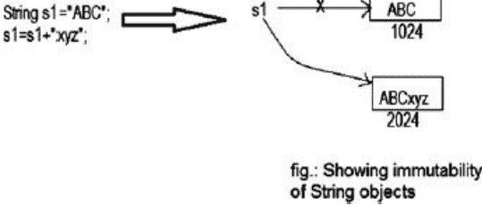

`StringBuilder`使用缓冲区来存储字符串字面量。

```java
StringBuilder sb1="ABC";
sb1.append("xyz");
```


```java
public class Jtc132 {
    public static void main(String arg[]){
        StringBuilder sb1=new StringBuilder();
        System.out.println(sb1.capacity()); //16
        System.out.println(sb1.length()); //0
        sb1.append("jtcindia");
        System.out.println(sb1.capacity()); //16
        System.out.println(sb1.length()); //8
        sb1.append("jtcindia1");
        System.out.println(sb1.capacity()); //34
        System.out.println(sb1.length()); //17
    }
}
```

公式：

`(初始容量+1)*2`

# StringBuffer 的重要方法

```java
public int length();
```

返回`StringBuffer`中存在的字符数量。

```java
public int capacity();
```

返回`StringBuffer`能够容纳（持有）的字符总数。

```java
public char charAt(int index);
```

返回位于指定索引的字符。

```java
public void setCharAt(int index, char ch);
```

将指定索引处的字符替换为提供的字符。

```java
public StringBuilder append(String s);
```

```java
public StringBuffer insert(int index, String s);
```

```java
public StringBuffer delete(int begin, int end);
```

删除从`begin`索引到`end-1`索引的字符。

```java
public StringBuffer deleteCharAt(int index);
```

删除位于指定索引的字符。

```java
public void setLength(int newLength);
```

只保留指定数量的字符并移除所有剩余字符。

```java
public void trimToSize();
```

释放额外分配的空闲内存，使容量和大小相等。

```java
public void ensureCapacity(int minimumCapacity);
```

根据需求动态增加容量。

# 注意

`StringBuffer`中提供的每个方法都是同步的，因此一次允许一个线程操作`StringBuffer`对象，这增加了线程的等待时间并产生性能问题。为了解决这个问题，我们应该选择`StringBuilder`。

# 程序 14.6

```java
package com.p33;

public class Jtc133{
    public static void main(String arg[]){
        /* char x='X';
        int i=0;
        System.out.println(true?x:0);
        System.out.println(false?i:x);
        */
        System.out.println("J"+"j");
        System.out.println("S+"+"J");
    }
}
```

```java
package com.jtc12;

public class Jtc134{
    public static void main(String arg[]){
        StringBuffer sb1=new StringBuffer("jtc");
        System.out.println(sb1.capacity());
        System.out.println(sb1.length());
        sb1.append("jtcindia");
        System.out.println(sb1.capacity());
        System.out.println(sb1.length());
    }
}
```

```java
sb1.append("jtc");
System.out.println(sb1.capacity());
System.out.println(sb1.length());
```

```java
sb1.append("jtcindiajtc123");
System.out.println(sb1.capacity());
System.out.println(sb1.length());

String s1="jtc";
String s2="jtc";
StringBuilder sb1=new StringBuilder("jtc");
StringBuilder sb22=new StringBuilder("jtc");

System.out.println(s1.equals(s2));
System.out.println(s1.hashCode()==s2.hashCode());
System.out.println(sb1.hashCode());
System.out.println(s1.hashCode());
System.out.println(s1.hashCode()==sb1.hashCode());
System.out.println(sb1.equals(sb22));
System.out.println(sb1.equals(s2));
```

/* 这个示例证明在`StringBuffer`类中，`hashCode()`和`equals()`并没有基于ASCII值重写。`StringBuffer`类中的所有方法都是同步的。这意味着一次只有一个线程在处理。*/

# StringBuffer VS StringBuilder

| StringBuffer | StringBuilder |
|---|---|
| `StringBuffer`中存在的每个方法都是同步的 | `StringBuilder`中没有方法是同步的 |
| 一次允许一个线程操作`StringBuffer`对象，因此`StringBuffer`对象是线程安全的 | 允许多个线程同时操作`StringBuilder`对象，`StringBuilder`不是线程安全的 |
| 它增加了线程的等待时间，因此相对性能较低 | 线程不需要等待，因此相对性能较高 |
| 在1.0版本中引入 | 在1.5版本中引入 |

# String VS StringBuffer VS StringBuilder

如果内容是固定的且不会频繁变化，我们应该使用`String`。

如果内容频繁变化但需要线程安全，我们应该使用`StringBuffer`。

如果内容频繁变化且不需要线程安全，我们应该使用`StringBuilder`。

`sb.m1().m2().m3()..........`

在方法链调用中，所有方法将从左到右求值。

# 示例

```java
class StringBufferDemo{
    public static void main(String[] args) {
        StringBuffer sb = new StringBuffer();
        sb.append("som").insert(5,"prakash").delete(11,13).reverse()
          .append("java").insert(18,"abcd").reverse();
        System.out.println(sb);
    }
}
```

# 单例模式

通常，你不能为一个类创建任意数量的对象，也就是说在创建对象上存在此类限制，但在某些情况下，这可能会导致堆内存相关的问题。

为了避免创建多个数量的对象，我们可以实现单例模式。

当我们编写单例模式时，该类只能创建一个对象。

# 实现单例模式的步骤

- 将类的默认构造函数声明为私有（`private`），这样无法从类外部创建该类的对象。
- 声明一个静态引用变量。
- 声明一个静态块，并在该块内部创建该类的对象。
- 编写一个返回类型为该类的静态`getter()`方法。

# 示例

```java
package com.jtc13;

class Hello{
    // 1. 将类的默认构造函数声明为私有
    private Hello(){
    }

    // 2. 静态引用变量
    static Hello h1=null;

    // 3. 静态块
    static {
        h1=new Hello();
    }

    // 4. 静态 getter 方法
    static Hello getHello(){ 
        return h1;
    }

    void m1(){ 
        System.out.println("m1 in Hello");
    }
}

public class Jtc134{
    public static void main(String args[]){
        // Hello h1=new Hello();
        Hello h1=Hello.getHello();
        h1.m1();
        Hello h2=Hello.getHello();
        h2.m1();
        System.out.println(h1);
        System.out.println(h2);
        System.out.println(h1.hashCode());
        System.out.println(h2.hashCode());
    }
}
```

/* `Hello`类的对象`h1`会在类加载时被创建。引用变量将先处理，然后是静态块。*/

# 14.1.4. java.lang.System 类

`System`是`java.lang`包中的一个最终类（`final class`）。`System`类的默认构造函数被声明为私有，而且你不需要创建`System`类对象，因为`System`类的几乎所有成员都是静态的（`static`）。因此，可以通过类名直接访问它们。

# 变量

```java
public static final java.io.InputStream in;
```

```java
public static final java.io.PrintStream out;
```

```java
public static final java.io.PrintStream err;
```

# 方法

```java
public static void setIn(java.io.InputStream in)
```

```java
public static void setOut(java.io.PrintStream out)
```

```java
public static void setErr(java.io.PrintStream err)
```

`System.in`的默认实现是输入设备（即键盘），因此提供给你的Java程序的输入将由`in`提供。

`in`是“输入流”的引用变量，如果你想从其他输入设备获取输入，则需要更改`in`的实现。由于`in`是静态最终变量（`static final variable`），在机器层面我们无法直接更改它的值，但我们可以更改它的实现方式。

# PrintStream out

`out`也是一个静态最终变量，其实现无法被更改。`out`的默认实现是你的输出设备（即控制台）。如果你想更改此，也可以指定。

# java.io.PrintStream err

`err`也是`PrintStream.err`的引用。它的默认实现与`out`一样都是控制台。

```java
public static native long currentTimeMillis()
```

这是`System`类内部可用的静态方法。`currentTimeMillis`用于返回从1970年1月1日午夜到当前的时间差。

- i. `public static void setIn(java.io.InputStream in)`
- ii. `public static void setOut(java.io.OutputStream out)`
- iii. `public static void setErr(java.io.OutputStream err)`

因为`in`、`out`、`err`都是静态最终引用变量。

`in`负责从你的键盘获取输入。默认情况下，`in`指向键盘。

`out`和`err`是`PrintStream`的引用。它们都指向控制台本身。

`System.out.println()`用于在你的控制台上显示普通消息。

`System.err.println()`用于在你的控制台上显示错误消息。

通过使用`setIn()`、`setOut()`、`setErr()`方法，我们可以分别更改`in`、`out`和`err`的实现。

```java
public static native void arraycopy(java.lang.Object src, int srcPos, java.lang.Object dest, int destPos, int length);
```

`arraycopy`用于将一个数组元素复制到另一个数组。第一个参数`java.lang.Object`是需要复制数组的源数组。第一个`int`参数指定源数组的索引位置（从该处开始复制），下一个`java.lang.Object`参数是需要复制数组的目标数组。下一个`int`参数指定目标数组中需要复制的索引位置，最后一个`int`参数指定不被复制的参数个数。

# 程序 14.7

```java
import java.io.FileOutputStream;
import java.io.PrintStream;

public class Jtc3 {
    public static void main(String[] args) throws Exception {
        System.out.println("---array copy---");
        int a[]={11,22,33,44,55,66,77};
        int b[]=new int[15];
        for (int i=0;i<a.length; i++) {
            System.out.println("A array"+a[i]+"\t"+i);
        }
        for (int i=0;i<b.length; i++) {
            System.out.println("B Array"+b[i]+"\t"+i);
        }
        System.arraycopy(a, 0, b, 0, a.length);
    }
}
```

`Runtime rt=new Runtime();` //不可以

`Runtime`对象可以通过以下方式创建：

`Runtime rt=Runtime.getRuntime();` //可以

`Runtime`对象的创建过程如下：

```java
class Runtime{
    private Runtime(){
    }

    private static Runtime rt=null;

    static {
        rt=new Runtime();
    }
}
```

```java
public static Runtime getRuntime(){
    return rt;
}
```

`Runtime rt=Runtime.getRuntime();` //可以
`Runtime rt=new Runtime();` //不可以

## METHODS

```java
public native int availableProcessors();
```

```java
public native long freeMemory();
```

```java
public native long totalMemory();
```

```java
public native long maxMemory();
```

`availableProcessors()`: 返回你本地机器上可用的处理器数量。

`freeMemory()`: 返回未使用的堆内存量。

`totalMemory()`: 返回为堆分配的内存总量。

`maxMemory()`: 返回可用于堆的最大内存量。

`exec()`: 用于执行运行时指定的进程。

```java
public java.lang.Process exec(String command);
```

# 程序 14.8

```java
import java.io.IOException;

public class Jtc {
    public static void main(String[] args) throws IOException {
        //Runtime rt=new Runtime();
        Runtime rt=null;
        Runtime.getRuntime();
        Runtime rt1=Runtime.getRuntime();
        System.out.println(rt);
    }
}
```


`System.out.println(rt1);`

`System.out.println(rt.hashCode()==rt1.hashCode());`

`System.out.println(rt.availableProcessors());`

`System.out.println(rt.totalMemory());`

`System.out.println(rt.freeMemory());`

`System.out.println(rt.maxMemory());`

`System.out.println(rt1.totalMemory()-rt1.freeMemory());`

`Process p1=rt.exec("notepad");`

`System.out.println(p1);`

`rt.exec("spaint");`

`rt.exec("calc");`

## 15.1 什么是包装类 (Wrapper class)

包装类的主要目标是：

- 将基本类型封装成对象形式，以便我们可以像处理对象一样处理基本类型。
- 为基本类型定义若干所需的工具类函数。

几乎所有的包装类都定义了以下构造函数：一个可以接受对应的基本类型作为参数，另一个可以接受`String`作为参数。

### 示例

`Integer i=new Integer(10);`

`Integer i=new Integer("10");`

如果`String`的格式不正确（即它不代表数字），我们将得到一个抛出`NumberFormatException`的运行时异常。

### 示例

```java
class WrapperClassDemo {
    public static void main(String[] args) throws Exception{
        Integer i=new Integer("ten");
        System.out.println(i);//NumberFormatException
    }
}
```

`Float`类定义了三个带有`float`、`String`和`double`参数的构造函数。

`Float f=new Float(10.5);`

`Float f=new Float("10.5f");`

`Float f=new Float(10.5);`

`Float f=new Float("10.5");`

`Character`类只定义了一个构造函数，可以接受`char`基本类型作为参数，没有接受`String`参数的构造函数。

`Character ch=new Character('a');`//有效

`Character ch=new Character("a");`//无效

`Boolean`类定义了两个带有`boolean`基本类型和`String`参数的构造函数。

如果我们想传递`boolean`基本类型，唯一允许的值是`true`、`false`，且字母应为小写。

### 示例

```java
Boolean b=new Boolean(true);
Boolean b=new Boolean(false);
Boolean b1=new Boolean(True);//编译错误
Boolean b=new Boolean(False);//编译错误
Boolean b=new Boolean(TRUE);//编译错误
```

如果我们传递的是`String`参数，大小写和内容并不重要。如果内容是不区分大小写的字符串`"true"`，则它被视为`true`；在所有其他情况下它被视为`false`。

### 示例

```java
class WrapperClassDemo {
    public static void main(String[] args) throws Exception{
        Boolean b1=new Boolean("true");
        Boolean b2=new Boolean("True");
        Boolean b3=new Boolean("false");
        Boolean b4=new Boolean("False");
        Boolean b5=new Boolean("som");
        Boolean b6=new Boolean("TRUE");
        System.out.println(b1);//true
        System.out.println(b2);//true
        System.out.println(b3);//false
        System.out.println(b4);//false
        System.out.println(b5);//false
        System.out.println(b6);//true
    }
}
```

### 示例（用于考试目的）

```java
class WrapperClassDemo {
    public static void main(String[] args) throws Exception{
        Boolean b1=new Boolean("yes");
        Boolean b2=new Boolean("no");
        System.out.println(b1);//false
        System.out.println(b2);//false
        System.out.println(b1.equals(b2));//true
        System.out.println(b1==b2);//false
    }
}
```

注意：

在所有包装类中，`toString()`方法都被重写以返回其内容。

在所有包装类中，`equals()`方法都被重写用于进行内容比较。

### 示例

```java
Integer i1 = new Integer(10);
Integer i2 = new Integer(10);
System.out.println(i1.equals(i2));//true
System.out.println(i1==i2);//false
```

## 15.2 工具方法

- `valueOf()`方法。
- `xxxValue()`方法。
- `parseXxx()`方法。
- `toString()`方法。

### `valueOf()`方法

可以使用`valueOf()`方法从基本类型或`String`创建包装对象。

```java
class WrapperClassDemo {
    public static void main(String[] args) {
        Integer i=Integer.valueOf("10");
        Double d=Double.valueOf("10.5");
        Boolean b=Boolean.valueOf(true);
        Character ch=Character.valueOf('a');
        System.out.println(i);
        System.out.println(d);
        System.out.println(b);
        System.out.println(ch);
    }
}
```

### `xxxValue()`方法

可以使用`xxxValue()`方法将包装对象转换为基本类型。数值类型的包装类（`Byte`, `Short`, `Integer`, `Long`, `Float`, `Double`）包含以下转换为基本类型的`xxxValue()`方法：

- `byteValue()`
- `shortValue()`
- `intValue()`
- `longValue()`
- `floatValue()`
- `doubleValue()`

### 示例

```java
class WrapperClassDemo {
    public static void main(String[] args) throws Exception{
        Integer i=new Integer(130);
        System.out.println(i.byteValue()); //126
        System.out.println(i.shortValue()); //130
        System.out.println(i.intValue()); //130
        System.out.println(i.longValue()); //130
        System.out.println(i.floatValue()); //130.0
        System.out.println(i.doubleValue()); //130.0
    }
}
```

### `charValue()`方法

`Character`类包含`charValue()`方法将`Character`对象转换为`char`。

### 示例

```java
class WrapperClassDemo {
    public static void main(String[] args) {
        Character ch=new Character('a');
        char c=ch.charValue();
        System.out.println(c);//a
    }
}
```

### `booleanValue()`方法

`Boolean`类包含`booleanValue()`方法将`Boolean`对象转换为`boolean`基本类型。

### 示例

```java
class WrapperClassDemo {
    public static void main(String[] args){
        Boolean b=new Boolean("som");
        boolean b1=b.booleanValue();
        System.out.println(b1);//false
    }
}
```

```java
public static primitive parseXxx(String s,int radix);
```

`radix`的允许范围是：2 到 36

## 示例

```java
class WrapperClassDemo{
    public static void main(String[] args){
        int i=Integer.parseInt("100",2);
        System.out.println(i);//4
    }
}
```

## 15.2.4 `toString()`方法

我们可以使用`toString()`方法将包装对象（或）基本数据类型转换为`String`。

### 形式 1

```java
public String toString();
```

每个包装类（包括`Character`类）都包含上述`toString()`方法，用于将包装对象转换为`String`。

它是`Object`类中`toString()`方法的重写版本。

当我们尝试打印包装对象的引用时，内部只会执行这个`toString()`方法。

### 示例

```java
class WrapperClassDemo {
    public static void main(String[] args) {
        Integer i=Integer.valueOf("10");
        System.out.println(i);//10
        System.out.println(i.toString());//10
    }
}
```

### 形式 2

每个包装类都包含一个静态`toString()`方法，将基本数据类型转换为`String`。

```java
public static String toString(primitive p);
```

### 示例

```java
class WrapperClassDemo {
    public static void main(String[] args){
        String s1=Integer.toString(10);
        String s2=Boolean.toString(true);
        String s3=Character.toString('a');
        System.out.println(s1); //10
        System.out.println(s2); //true
        System.out.println(s3); //a
    }
}
```

### 形式 3

`Integer`和`Long`类包含以下静态`toString()`方法，将基本数据类型转换为指定进制的`String`形式。

```java
public static String toString(primitive p, int radix);
```

### 示例

```java
class WrapperClassDemo {
    public static void main(String[] args){
        String s1=Integer.toString(7,2);
        String s2=Integer.toString(17,2);
        System.out.println(s1);//111
        System.out.println(s2);//10001
    }
}
```

### 形式 4

`Integer`和`Long`类包含以下`toXxxString()`方法。

```java
public static String toBinaryString(primitive p);
public static String toOctalString(primitive p);
public static String toHexString(primitive p);
```

### 示例

```java
class WrapperClassDemo {
    public static void main(String[] args) {
        String s1=Integer.toBinaryString(7);
        String s2=Integer.toOctalString(10);
        String s3=Integer.toHexString(20);
        String s4=Integer.toHexString(10);
        System.out.println(s1);//111
        System.out.println(s2);//12
        System.out.println(s3);//14
        System.out.println(s4);//a
    }
}
```

## 自动装箱 (AutoBoxing)

### 示例

```java
public class Jtc7 {
    public static void main(String[] args) {
        Integer in = 123;// 自动装箱
        in++;
        System.out.println(in + 10);
        int ab = in; // 自动拆箱
        // int ab=in.intValue();
        long val = 123;
        // Long ref=new Integer(123);
        // Long obj3= 1234; // 宽转换和自动装箱
        Long obj2 = 1234L; // 自动装箱
        Object obj4 = 1234; // 自动装箱和宽转换
        Number num = 1234; // 自动装箱和宽转换
        System.out.println(" \ ");
        Integer in1 = 123;
        Integer in2 = in1;
        System.out.println(in1 + "\t" + in2);
        System.out.println(in1 == in2);
        in1++;
        // int t=in1.intValue();
        // t++;
        // in1=new Integer(t);
        System.out.println(in1 + "\t" + in2);
        System.out.println(in1 == in2);
    }
}
```


```java
public class Jtc8 {
  public static void main(String[] args) {
    Integer in1 = new Integer(123);
    Integer in2 = new Integer(123);
    System.out.println(in1 == in2);
    Boolean b1 = new Boolean(true);
    Boolean b2 = new Boolean(true);
    System.out.println(b1 == b2);
    System.out.println(" ");
    Boolean b3 = false;
    Boolean b4 = false;
    Boolean b5 = false;
    System.out.println(b3 == b4);
    System.out.println(b4 == b5);
    System.out.println("----字节---- ");
    Byte by1 = 127;
    Byte by2 = 127;
    System.out.println(by1 == by2);
    System.out.println("--字符--");
    Character ch1 = 'A';
    Character ch2 = 'A';

    System.out.println(ch1 == ch2);
    Character ch3 = 128;
    Character ch4 = 128;
    System.out.println(ch3 == ch4);
    System.out.println("--整数 - ");
    Integer in3 = 127;
    Integer in4 = 127;
    System.out.println(in3 == in4);
    Integer in5 = 128;
    Integer in6 = 128;
    System.out.println(in5 == in6);
    System.out.println("-- 长型 -");
    Long ref1 = 127L;
    Long ref2 = 127L;
    System.out.println(ref1 == ref2);
    Long ref3 = 128L;
    Long ref4 = 128L;
    System.out.println(ref3 == ref4);
    System.out.println("-- 浮点 - ");
    float f1 = 0.0f;
    float f2 = 0.0f;
    System.out.println(f1 == f2);
    System.out.println("====);
    Integer in11 = 123;
    Integer in12 = 123;
    Integer in13 = 123;
    in12++;
    System.out.println(in11 + "\t" + in12 + "\t" + in13);
  }
}
```

### 示例

```java
public class Jtc9 {
    public static void main(String[] args) {
        BoxingService.m1(123);
        BoxingService.m2(123);
    }
}
class BoxingService {
    static void m1(long val) {
        System.out.println("-- m1(long)--");
    }
    static void m2(int in) {
        System.out.println("-- m2(int)...--");
    }
    static void m2(Integer in) {
        System.out.println("-- m2(Integer)--");
    }
}
```

### 示例

```java
public class Jtc10 {
    public static void main(String[] args) {
        BoxingLoading.m1(123);
        BoxingLoading.m2(123);
    }
}
class BoxingLoading {
    static void m1(long val) {
        System.out.println("-- m1(long)--");
    }
    static void m1(Integer in) {
        System.out.println("-- m1(Integer)--");
    }
}
```

## 16.1 简介

当你编写任何 Java 程序时，可能会遇到以下类型的问题：

### 错误 (Error)

### 异常 (Exception)

1. 错误：主要有以下几种错误：

- a. 编译时错误：在编译错误的情况下，如果有任何语法错误，则被称为编译时错误，会在编译时被识别。编译时错误表明编译器无法编译该特定程序。

- b. 运行时错误：通过 `JVM` 的帮助在运行时识别出的错误被称为运行时错误。运行时错误显示了 `JVM` 的低效性。例如：没有 `main` 方法（编译器可以编译没有 `main` 方法的代码）。如果识别出任何栈内存问题，将由 `java.lang.StackOverflowError` 表示（`JVM` 处理所需的内存）。

## 16.2 异常

程序中发生的某些意外操作被称为异常。

异常分为两种类型：

- 编译时异常 / 检举异常 (Checked exception)

- 运行时异常 / 非检举异常 (Unchecked exception)

### 示例

```java
class Jtc103 {
    public static void main(String arg[]){
        System.out.println("in Jtc103");
        int i=Integer.parseInt(arg[0]);
        int i1=10/i; 
        System.out.println(i1);
    }
}
```

/* 错误：

```
java Jtc103 (enter)
In Jtc103
Exception in thread "main"
java.lang.ArrayIndexOutOfBoundsException : 0
```

`java Jtc103 abc` (enter)

In Jtc103

Exception in thread "main"

`java.lang.NumberFormatException` : for input string "abc"

`java Jtc103 0` (enter)

in Jtc103

Exception in thread "main"

`java.lang.ArithmeticException` : 1 by zero */*

对于所有类型的异常和错误，`java.lang.Throwable` 是父类型。

对于所有类型的异常，`java.lang.Exception` 是父类。

对于所有类型的运行时异常，`java.lang.RuntimeException` 是父类。

### 示例

```java
class Jtc104{
    public static void main(String[] arg){
        System.out.println("in Jtc104");
        try {
            int i=Integer.parseInt(arg[0]);
            int i1=10/i;
            System.out.println(i);
        }
        catch(Exception e) {
            System.out.println("in catch... ");
            if(e instanceof ArrayOutOfBoundsException) {
                System.out.println("plz provide the value.."+e);
            }
        } else if(e instanceof NumberFormatException) {
            System.out.println("plz provide numeric value.."+e);
        }
    }
}
```

# 输出：

`java Jtc104` (enter)

In Jtc104

Exception in thread "main"

`java.lang.ArrayIndexOutOfBoundsException` : 0

## 工作原理

每当识别出任何问题时，`JVM` 将内部执行以下操作：

一旦识别出任何问题，控制权立即转移到 `JVM`。

现在，`JVM` 将识别问题的具体类型。

在识别出具体类型后，它将创建该异常的对象并将其抛给程序。

在程序中，它将尝试搜索匹配的 `catch` 块。

如果找到了匹配的 `catch` 块，则将处理相应的 `catch` 块。

## 16.2.1 通过编写多个 `try` 和 `catch` 处理异常

- 将你想要监控的代码段封装在 `try` 块内部

- 为该 `try` 块编写关联的 `catch` 块，并指定正确的异常类型

- 通过使用 `catch`，你一次只能处理一个异常。

- 你可以为 `try` 编写多个 `catch` 块来处理多种类型的异常。

在编写多个 `try` 和 `catch` 时，请记住以下几：

- `try` 和 `catch` 之间不应有任何语句。

- `catch` 和 `catch` 之间不应有任何语句。

- 你可以写不带 `catch` 的 `try`，但不能写不带 `try` 的 `catch`。

- 当你写 `catch` 块时，`catch` 参数应该是子类类型。它不能是从父类到子类的参数。

## 示例

```java
package com.jtc.p1;
public class Jtc105{
    public static void main(String arg[]){
    int i1=10;
    try {
        int i2=Integer.parseInt(arg[0]);

        int ii=i1/i2;
    }
    /*catch(exception e) { ... }*/
    catch(NumberFormatException e){
        System.out.println("plz provide number value... "+e);
    }
    catch(ArithmeticException e) {
        System.out.println("plz provide non zero value... "+e);
    }
    catch(ArrayOutOfBoundsException e) {
        System.out.println("plz provide some value... "+e);
    }
    catch(NullPointerException e) {
        System.out.println("trying exception type... "+e);
    }
    catch(Exception e) {
        System.out.println("boss of all exceptions... "+e);
    }
    }
}
```

## 示例

```java
package com.jtc.p2;
public class Jtc106{
    public static void main(String arg[]){
    int i1=10;
    try{
    int i2=Integer.parseInt(arg[0]);

    int ii=i1/i2;
    }
    catch(NumberFormatException | ArithmeticException | ArrayOutOfBoundsException | NullPointerException e) {
    System.out.println(e);
    /* exception not allowed sub to super type... error: catch statement cannot be related by subclassing */
    }
    catch(Exception e){
    System.out.println(e);
    }
    }
}
```

从 `JDK1.7` 开始，你可以通过编写单个 `try` 和 `catch` 来处理多个异常。

在 `catch` 中，你可以编写用管道运算符 (`|`) 分隔的多个异常。

但请确保不要在其中编写任何父类异常。

## 16.3 Finally 块

当遇到任何 `return` 语句时，之后的其他语句将不再被处理。控制权立即转移到方法的调用者。

在某些情况下，某些语句无论是否执行 `return` 语句，处理都是非常重要。

例如：关闭资源。如果你使用了资源但没有妥善关闭，可能会导致某些问题。为了确保该语句在任何情况下都能被处理，你需要使用 `finally` 块。

当你将任何语句封装在 `finally` 块内部时，无论是否遇到 `return` 语句，无论是否发生异常，`finally` 块始终会被处理。

**注意**

只有在使用 `System.exit()` 时，`finally` 块才不会被处理。

## 示例

```java
package com.jtc.p3;
class Hello{

int m1(int a){
    System.out.println("m1 in hello");
    try {
        System.out.println("in try of m1");
        int x=10/a;
        System.out.println("x= "+x);
        //return 88;
    }
    } catch(Exception e) {
        System.out.println("in catch of m1");
        e.printStackTrace();
    } finally {
        System.out.println("in finally... very important code");
        System.out.println("after catch block in m1");
        return 99;
    }
}
int m2(int a){
    System.out.println("m2(int a) in Hello");
    try {
        System.out.println("in m2(int a) try block");
        return 10;
    } catch(ArithmeticException e) {
        System.out.println("in catch of m2");
        e.printStackTrace();
    } finally {
        System.out.println("very imp code in finally of m2");
    }
    System.out.println("out of catch in m2");
}
}
```

```java
public class Jtc107{
    public static void main(String arg[]){
        Hello h1=new Hello();
    }
}
```

记住以下几点：

- `try` 和 `catch` 之间不应有任何语句。

- `catch` 和 `catch` 之间不应有任何语句。

- 你可以写不带 `catch` 的 `try`，但不能写不带 `try` 的 `catch`。

- 当你写 `catch` 块时，`catch` 参数应该是子类类型。它不能是从父类到子类的参数。

每当识别出任何问题时，`JVM` 将内部执行以下操作：

一旦识别出任何问题，控制权立即转移到 `JVM`。

现在，`JVM` 将识别问题的具体类型。

在识别出具体类型后，它将创建该异常的对象并将其抛给程序。

在程序中，它将尝试搜索匹配的 `catch` 块。

如果找到了匹配的 `catch` 块，则将处理相应的 `catch` 块。

当遇到任何 `return` 语句时，之后的其他语句将不再被处理。控制权立即转移到方法的调用者。

在某些情况下，某些语句无论是否执行 `return` 语句，处理都是非常重要。

例如：关闭资源。如果你使用了资源但没有妥善关闭，可能会导致某些问题。为了确保该语句在任何情况下都能被处理，你需要使用 `finally` 块。

当你将任何语句封装在 `finally` 块内部时，无论是否遇到 `return` 语句，无论是否发生异常，`finally` 块始终会被处理。

**注意**

只有在使用 `System.exit()` 时，`finally` 块才不会被处理。


从 JDK1.7 开始，你可以通过编写单个`try`和`catch`来处理多个异常。

在`catch`中，你可以编写用管道运算符（`|`）分隔的多个异常。

但请确保不要在其中编写任何父类异常。

```java
dos.close();
}
catch(Exception e){
}}
```

如果你想开发自定义资源，请通过实现`AutoCloseable`接口来编写你的资源类。

在`AutoCloseable`接口中只有一个方法`close()`。

必须根据资源需求在你的类中重写此`close()`方法。

如果你在`try with resource`中使用资源，则你的资源必须实现`AutoCloseable`接口，否则将导致编译错误。

如果我们使用`try with resource`且它满足所有约束条件，那么就没有必要编写任何`finally`块，你可以轻松地完成。

## 16.4 异常的类型

异常主要分为两种类型：

- 检查异常（Checked exception）/ 编译时异常
- 未检出异常（Unchecked exception）/ 运行时异常（runtime exception）

## 检查异常或编译时异常

在编译期间被编译器捕获或由编译器捕获的异常称为编译时异常。

此外，除`java.lang.RuntimeException`之外，`java.lang.Exception`的子类都称为编译时异常。

注意：

编译时异常分为两种类型：

- 用户定义
- 内置类型

编译时异常必须通过编写`try`和`catch`或者通过向上传（propagation）来完成处理或报告。

例如：`java.lang.IOException`、`FileNotFoundException`、`SQLException`、`JSPException`。

## 未检出异常或运行时异常

`java.lang.RuntimeException`的子类异常称为未检出异常或运行时异常。

这些异常将由 JVM 调用。

不需要通过编写`try`和`catch`或通过向上传来报告。即使你想这样做，也可以处理它。

运行时异常也分为两种类型：

- 用户定义：根据应用程序需求由开发者创建的异常称为用户定义异常。例如：`InsufficientFoundException`、`AccountNumberDoesNotExist`。
- 内置：由技术供应商提供的异常称为内置异常。这些也可以是检查异常和未检出异常。例如：`ServletException`、`JSPException`、`EJBException`。

## 编写自定义异常的步骤

- 通过扩展`java.lang.Exception`或`java.lang.RuntimeException`来编写异常类。
- 在异常类内部声明一些实例变量。
- 在异常类内部编写默认构造函数。
- 如果需要，编写一个带参数的构造函数。
- 重写`toString()`方法（它内部会调用`getMessage()`）。
- 重写`getMessage()`方法（它在`throwable`类内部可用，并提供异常的精确原因）。

## e.printStackTrace() 提供以下信息

+ => 发生的异常类型
+ => 异常原因
+ => 异常位置

`Throw`将异常发送到下一层进行处理；取决于异常的类型。

检查异常必须通过以下方式之一处理：

- `try n catch`块，或
- 传递到另一层（方法头部的传播）

未检出异常可以由 JVM 处理

## 示例

```java
class InvalidAccNoException extends Exception {
    int accno;
    public InvalidAccNoException() {
    }
    InvalidAccNoException(int accno) {
    }
    public String toString() {
        return "..."+getMessage();
    }
    public String getMessage() {
        return "...";
    }
}
class ServerNotRespondingException extends RuntimeException {
}
public class Jtc113 {
    public static void main(String arg[]) {
        try {
            int i=Integer.parseInt(arg[0]);
        } catch(Exception e) {
            System.out.println(e);
        }
    }
}
```

```java
import java.io.IOException;
import java.sql.SQLException;
class Hello {
    void m1(int a) throws ArithmeticException {
        System.out.println("in m1");
        throw new ArithmeticException();
    }
    void m2(boolean b) throws IOException, InstantiationException {
        System.out.println("in m2");
        if(!b) {
            throw new IOException();
        } else {
            throw new InstantiationException();
        }
    }
    void m3() {
        System.out.println("in m3");
        try {
            throw new SQLException();
        } catch(SQLException e) {
        }
    }
    void m4() throws IOException {
        System.out.println("m4 in Hello");
        try {
            m2(true);
        } catch(InstantiationException e) {
        }
    }
    void m5() {
        System.out.println("m5 in Hello");
        m3();
    }
}
public class Jtc114 {
    public static void main(String arg[]) throws IOException {
        Hello h1=new Hello();
        h1.m4();
        h1.m5();
    }
}
```

## 16.5 “throw” 关键字

`throw`关键字用于从方法体中抛出异常。

如果你抛出任何未检出异常，并没有硬性规定要求你必须使用`try`和`catch`或通过传播来报告该异常。

但是，总是建议使用`try`和`catch`处理方法体中的`throw`。

语法

```java
void m1(){
    ArithmeticException ae=new ArithmeticException();
    throw ae;
} OR
void m1(){
    throw new ArithmeticException();
}
```

如果你从方法体中抛出任何检查异常，则你必须通过编写`try`和`catch`或在方法头部通过传播来报告该异常。

## 16.6 “throws” 关键字

`throws`用于从方法体中抛出异常。

如果你抛出任何未检出异常，没有硬性规定要求你通过`try`和`catch`或传播来报告它。

但是，总是建议使用`try`和`catch`处理方法体中的`throw`。

如果你从方法体中抛出任何检查异常，你必须在方法头部通过`try`和`catch`或传播来报告异常。注意：总是建议使用`try`和`catch`处理方法体中的`throw`。

## 示例

```java
import java.io.IOException;
import java.sql.SQLException;
class Hello {
    void m1(int a) throws ArithmeticException {
        System.out.println("in m1");
        throw new ArithmeticException();
    }
    void m2(boolean b) throws IOException, InstantiationException {
        System.out.println("in m2");
        if(!b) {
            throw new IOException();
        } else {
            throw new InstantiationException();
        }
    }
    void m3() {
        System.out.println("in m3");
        try {
            throw new SQLException();
        } catch(SQLException e) {
        }
    }
    void m4() throws IOException {
        System.out.println("m4 in Hello");
        try {
            m2(true);
        } catch(InstantiationException e) {
        }
    }
    void m5() {
        System.out.println("m5 in Hello");
        m3();
    }
}
```

```java
import java.io.IOException;
import java.lang.Exception;

class CheckedException extends Exception {
}
class UncheckedException extends RuntimeException {
}
class Hello {
    void m1(int a) throws UncheckedException,CheckedException,IOException {
        System.out.println("m1 in Hello");
        if(a==0) {
            throw new UncheckedException();
        } else {
            throw new CheckedException();
        }
    }
    void m2() {
        System.out.println("m2 in Hello");
        try {
            m1(11);
        } catch (UncheckedException|CheckedException|IOException e) {
            e.printStackTrace();
        }
    }
}
public class Jtc115 {
    public static void main(String arg[]) {
        Hello h1=new Hello();
        try {
            h1.m1();
            h1.m2();
        } catch (ArithmeticException|FileNotFoundException e) {
            System.out.println(e);
        }
    }
}
```

```java
import java.io.IOException;
import java.sql.SQLException;
class Hello {
    void m1(int a) throws ArithmeticException {
        System.out.println("in m1");
        throw new ArithmeticException();
    }
    void m2(boolean b) throws IOException, InstantiationException {
        System.out.println("in m2");
        if(!b) {
            throw new IOException();
        } else {
            throw new InstantiationException();
        }
    }
    void m3() {
        System.out.println("in m3");
        try {
            throw new SQLException();
        } catch(SQLException e) {
        }
    }
    void m4() throws IOException {
        System.out.println("m4 in Hello");
        try {
            m2(true);
        } catch(InstantiationException e) {
        }
    }
    void m5() {
        System.out.println("m5 in Hello");
        m3();
    }
}
```

```java
import java.io.IOException;
import java.lang.Exception;

class CheckedException extends Exception {
}
class UncheckedException extends RuntimeException {
}
class Hello {
    void m1(int a) throws UncheckedException,CheckedException,IOException {
        System.out.println("m1 in Hello");
        if(a==0) {
            throw new UncheckedException();
        } else {
            throw new CheckedException();
        }
    }
    void m2() {
        System.out.println("m2 in Hello");
        try {
            m1(11);
        } catch (UncheckedException|CheckedException|IOException e) {
            e.printStackTrace();
        }
    }
}
```


```java
import java.io.IOException;
import java.sql.SQLException;
class Hello {
    void m1(int a) throws ArithmeticException {
        System.out.println("in m1");
        throw new ArithmeticException();
    }
    void m2(boolean b) throws IOException, InstantiationException {
        System.out.println("in m2");
        if(!b) {
            throw new IOException();
        } else {
            throw new InstantiationException();
        }
    }
    void m3() {
        System.out.println("in m3");
        try {
            throw new SQLException();
        } catch(SQLException e) {
        }
    }
    void m4() throws IOException {
        System.out.println("m4 in Hello");
        try {
            m2(true);
        } catch(InstantiationException e) {
        }
    }
    void m5() {
        System.out.println("m5 in Hello");
        m3();
    }
}
```

```java
import java.io.IOException;
import java.lang.Exception;

class CheckedException extends Exception {
}
class UncheckedException extends RuntimeException {
}
class Hello {
    void m1(int a) throws UncheckedException,CheckedException,IOException {
        System.out.println("m1 in Hello");
        if(a==0) {
            throw new UncheckedException();
        } else {
            throw new CheckedException();
        }
    }
    void m2() {
        System.out.println("m2 in Hello");
        try {
            m1(11);
        } catch (UncheckedException|CheckedException|IOException e) {
            e.printStackTrace();
        }
    }
}
```

```java
            System.out.println(e);
        }
    }
}
public class Jtc118{
    public static void main(String arg[]){
        ChatRoom cr=new ChatRoom();
        try{
            cr.startChat(arg[0]);
        }
        catch(Exception e){
            if(e instanceof ArrayIndexOutOfBoundsException){
                System.out.println("provide user id to chat");
            }
            else if(e instanceof NumberFormatException){
                System.out.println("provide valid user id");
            }
        }
    }
}
```

当父类方法抛出方法级异常时，子类的重写方法可以执行以下任务：

- 子类重写方法可以原样地忽略从父类方法抛出的异常。
- 子类重写方法可以原样地报告来自父类传来的异常。
- 子类重写方法可以报告作为父类方法级异常的子类的异常。
- 子类重写方法无法报告作为父类方法级异常的父类异常。
- 子类重写方法无法报告不是来自父类方法的异常新类型。

## 16.7 方法

### `printStackTrace()`

- 可用位于`java.lang.Throwable`
- 它用于提供关于任何异常的以下 3 个信息：
  - 异常类型
  - 异常原因
  - 异常发生的行号

### `getMessage()`

- 可用位于`java.lang.Throwable`
- 此方法用于提供异常发生的具体原因。

## 示例

(1)

```java
class Hello{
    public static void main(String arg[]) {
        System.out.println(m1());
    }
    static boolean m1() {
        try {
            return true;
        } finally {
            return false;
        }
    }
}
```

(2)

```java
import java.io.IOException;
public class Hello {
    public static void main(String arg[]) {
        try {
            System.out.println("hell Jtc");
        } catch(IOException e) {
            System.out.println("i have never seen println fail");
        }
    }
}
```

(3)

```java
public class XYZ{
    public static void main(String arg[]) {
        try {
            if you have nothing nice to say say nothing;
        } catch(Exception e) {
            System.out.println("this cannot happen");
        }
    }
}
```

(4)

```java
interface Type1 {
  void f()throws CloneNotSupportedException
}
interface Type2{
  void f()throws InterruptedException
}
interface Type3 extends Type1,Type2 {
  public class Jtc3 implements Type3 {
    public void f() {
      System.out.println("Hello World");
    }
    public static void main(String arg[]) {
      Jtc3 t3=new Jtc3();
      t3.f();
    }
  }
}
```

(5)

```java
public class Hello{
    public static final long GUEST_USER_ID=-1;
    private static final long USER_ID;
    static {
        try {
            USER_ID=getUserIdFromEnvironment();
        } catch(IdUnavailableException e){
            USER_ID=GUEST_USER_ID;
            System.out.println("logging in as guest");
        }
    }
    private static long getUserIdFromEnvironment()throws IdUnavailableException {
        throw new IdUnavailableException(); //simulate an error
    }

    public static void main(String args[]){
        System.out.println("user Id:"+USER_ID);
    }
}
class IdUnavailableException extends Exception {
```

(6)

```java
public class HelloGoodbye{
    public static void main(String args[]){
        try {
            System.out.println("hello world");
        } finally {
            System.out.println("goodbye world");
        }
        System.exit(0);
    }
}
```

(7)

```java
public class Reluctant {
  public Reluctant inrnalInstance=new Relactant();
  public Reluctant() throws Exception {
    throw new Exception("i am not coming out");
  }
  public static void main(String arg[]) {
    try {
      Reluctant b=new Reluctant();
      System.out.println("surprise!!");
    } catch(Exception ex) {
      System.out.println("i told u so");
    }
  }
}
```

(8)

```java
import java.io.*;
public class Copy {
  static void Copy(String src, String dest) throws Exception {
    InputStream in=null;
    OutputStream out=null;
    try {
      in=new FileInputStream(src);
      out=new FileOutputStream(dest);
      byte[] buf=new byte[1024];
      int n;
      while((n=in.read(buf))>0) out.write(buf,0,n);
    } finally {
      if(in!=null) in.close();
      if(out!=null) out.close();
    }
  }

  public static void main(String args[]) throws IOException {
    if(args.length!=2) {
      System.out.println("usage: copy [src] [dest]");
    }
  }
}
```

(9)

```java
public class Loop {
    int n=0;
    try {
        while(true){
            n++;
        }
    } catch(ArrayIndexOutOfBoundsException e) {
        System.out.println("tests:" + n);
    }

    public static boolean elementIs(int a) {
        return a>=3;
    }
}
```

(10)

```java
public class Thrower {
    public static void main(String args[]) {
        try {
            System.out.println("this is a");
        } catch (Exception e) {
            System.out.println("you must not use");
        }
    }
}
```

(11)

```java
class Strange {
    public static void main(String args[]) {
        try {
            Missing();
        } catch(java.lang.ClassNotFoundError e) {
            System.out.println("got it");
        }
    }
}
class Missing {}
```

(12)

```java
class Workout{
    public static void main(String args[]) {
        try{
            Test();
        } catch(Exception e) {
            System.out.println("its time");
        }
    }
    private static void work(){
        Test();
    }
}
class Test {}
```

## 16.8 Difference between `printStackTrace()`

- 对于硬编码名称在运行时：我们会得到`ClassNotFoundError`，它是未检查的。
- 对于动态提供的名称在运行时：如果类文件不可用，那么我们会得到`Exception`，它是受检查的。

## Example


```java
public class Jtc5 {
    public static final long GUEST_USER_ID = -1;
    private static final long USER_ID;
    static {
        try {
            USER_ID = getUserIdFromEnvironment();
        } catch (IdUnavailableException e) {
            USER_ID = GUEST_USER_ID;
            System.out.println("logging in as guest");
        }
    }
    private static long getUserIdFromEnvironment() throws IdUnavailableException {
        throw new IdUnavailableException(); // simulate an error
    }

    public static void main(String args[]) {
        System.out.println("-- Main --");
        try {
            int ab = Integer.parseInt(args[0]);
            System.out.println("-- ab:" + ab);
            long res = 123 / ab;
            System.out.println("-- Result is:" + res);
        } catch (ArithmeticException e) {
            System.out.println("\n* Value should be 0 ");
        } catch (NumberFormatException | ArrayIndexOutOfBoundsException e) {
            System.out.println("\n* Provide one ");
        } catch (Exception e) {
            System.out.println("\n* Other Exception Occured ");
        }
        System.out.println("After Catch");
        System.out.println("Main Completed");
    }
}
```

## Example - Try with resource

```java
import java.io.InputStream;
import java.io.FileInputStream;
public class Jtc6 {
    public static void main(String[] args) {
        long res1 = ResourceUser.readFile("info.txt");
        System.out.println("In Main Result:\t:" + res1);
        System.out.println();
        long res3 = ResourceUser.readFile("Empty.java");
        System.out.println("In Main Result:\t:" + res3);
    }
}
class ResourceUser {
    static long readFile(String fileName) {
        System.out.println("-- File Name in Method\t:" + fileName);
        long length = 0;
        try (JtcResource resource = new JtcResource()) {
            InputStream fis = new FileInputStream(fileName);
            /* JtcAnotherResource other = new JtcResource(); */
            while (true) {
                int x = fis.read();
                if (x == -1) break;
                length++;
            }
            long res = 13 / length;
            System.out.println("Result\t:" + res);
        } catch (Exception e) {
            e.printStackTrace();
        }
        return length;
    }
}
class JtcResource implements AutoCloseable {
    public void close() throws Exception {
        System.out.println("** close method() of JtcResource **\t:" + this);
    }
}
class JtcAnotherResource { }
```

## Example - Rethrowing Exceptions with Improved Type Checking

### Before Java 7

```java
public class ObjectCreator {
    public static Object getInstance(String className) throws Exception {
        Object ref = null;
        try {
            Class cl = Class.forName(className);
            ref = cl.newInstance();
        }
        return ref;
    }
}
```

```java
} catch (Exception e) {
    // Send mail to Mail ID throw e;
}
return ref;
}
}
}
```

### From Java 7

```java
public class ObjectCreator {
    public static Object getInstance(String className) throws ClassNotFoundException, IllegalAccessException, InstantiationException {
        Object ref = null;
        try {
            Class cl = Class.forName(className);
            ref = cl.newInstance();
        } catch (Exception e) {
            // Send mail to Mail ID throw e;
        }
        return ref;
    }
}
```

## 17.1 什么是多任务处理？

性能或同时执行多一个任务被称为多任务处理。

注意：目前还没有任何机器或处理器可以同时执行多个任务，但完成任务所需的时间非常短，以至于我们无法分析任务是在同一时间执行的还是不同时间执行的。

多任务处理主要有两种类型：

- 1) 基于进程的多任务处理。
- 2) 基于线程的多任务处理。

| 基于进程 | 基于线程 |
| :--- | :--- |
| 1) 进程是一个程序，如果同时执行多个进程或进程，则它们将使用独立的内存位置和独立的资源。 | 1) 线程是进程中程序的单元，一个进程中多个线程可能运行，它们通过共享相同的内存位置以及资源导致进程的竞争。 |
| 2) 进程可能实现在同一个程序中，也可能不在，因此所有利用不同资源可能非常昂贵。 | 2) 在线程执行的情况下，不像进程那样昂贵。 |
| 3) | 3) |
| 4) 在基于进程的多任务处理中，上下文切换相当困难。 | 4) 在基于线程的情况下，上下文切换非常简单。 |

注意：线程将共享资源，这将由 CPU 调度算法决定并由线程生命周期管理。

Java 中的每个线程将由一个特殊的生命周期机制管理，所有这些处理完全取决于调度算法。

## 17.2 Java 线程

Sun 提供了以下 API 来管理线程：

- 1) `Java.lang.Thread`
- 2) `Java.lang.ThreadGroup`
- 3) `Java.lang.Runnable` 接口

每当 JVM 启动时，内部会创建一个名为 `main` 的 `ThreadGroup`，在该 `ThreadGroup` 下将创建一个名为该的另一个线程。

Java 中的每个线程将被分配一个特定的任务，并在完成后移动到死亡状态。

在 Java 中，几乎所有工作都是基于线程的。

### 示例

```java
public class Jtc181 {
    public static void main(String[] args) {
        Thread th1 = new Thread();
        System.out.println(th1);
        String name = th1.getName();
        System.out.println(name);
        int p = th1.getPriority();
        System.out.println(p);
        th1.setName("Jtc-th1");
        System.out.println(th1.getName());
        th1.setPriority(9);
        // th1.setPriority(11);
        // th1.setPriority(0);
        System.out.println(th1.getPriority());
        Thread th2 = new Thread();
        System.out.println(th2);
        Thread th3 = new Thread("Jtc");
        System.out.println(th3);
        for (int i = 0; i < 5; i++) {
            System.out.println(Thread.currentThread().getName() + " under the thread group of : " + Thread.currentThread().getThreadGroup().getName());
            try {
                Thread.sleep(500);
            } catch (Exception e) {
                e.printStackTrace();
            }
        }
    }
}
```

### 以下是主线程的任务

- 主线程在内部将使用反射机制获取 `main()` 方法的名字。
- 主线程在内部会创建一个类型为 `java.lang.Class` 的默认对象。
- 它创建一个字符串对象，以便将其作为参数传递给 `main()` 方法。
- 如果有任何命令行参数，则将命令行参数设置为 `main()` 方法。
- 它通过传递字符串引用作为参数来调用 `main` 方法，在完成指定的任务后，线程将移动到死亡状态。
- 所有的子线程都将从主线程本身创建。

## 17.3 用户自定义线程

用户也可以开发或编写自己的线程。用户自定义线程主要可以通过两种方式创建：

- 1) 通过扩展 `java.lang.Thread` 类。

通过扩展 `Thread` 类编写用户自定义线程的步骤：

1. 通过扩展 `Thread` 类编写你的用户自定义线程。
2. 在 `Thread` 类内部声明一些实例变量。
3. 在 `Thread` 类内部声明构造函数。
4. 为了从线程类调用构造函数，我们需要使用 `super` 语句，紧接着我们需要通过编写 `start()` 方法来启动每个线程。
5. 为了处理线程，我们需要在类内部编写 `run()` 方法的实现，但当你通过扩展 `Thread` 类创建用户自定义线程时，并不是强制要求重写 `run()` 方法。

### 示例

```java
class HelloThread extends Thread {
    HelloThread() {
        super();
    }
    HelloThread(String name) {
        super(name);
    }
    HelloThread(ThreadGroup tg, String name) {
        super(tg, name);
    }
    public void run() {
        for (int i = 0; i < 5; i++) {
            System.out.println(Thread.currentThread().getName() + " under the thread group of : " + Thread.currentThread().getThreadGroup().getName());
            try {
                Thread.sleep(500);
            } catch (Exception e) {
                e.printStackTrace();
            }
        }
    }
}
```

```java
}
}
public class Jtc184 {
    public static void main(String[] args) {
        MyThread mt = new MyThread();
        mt.m1();
    }
}
```

## 17.4 线程优先级 (Thread Priority)

这是一个 JVM 分给每个线程的数字。

主要定义了三个线程优先级：

- 1) `MIN_PRIORITY`
- 2) `MAX_PRIORITY`
- 3) `NORM_PRIORITY`

任何线程的最低优先级为 1。

任何线程的普通优先级为 5。

任何线程的最大优先级为 10。

这种线程优先级将被 JVM 内部用于在 CPU 调度器遵循基于优先级的算法时分配 CPU 时间。如果 CPU 调度器没有遵循任何基于优先级的算法，那么线程优先级就没有意义。

`final void setPriority(int)`：通过使用 `setPriority()` 方法我们可以更改线程的优先级，但你提供的线程优先级不能大于 10 或小于 1。

`final int getPriority()`：通过此我们可以获取线程的优先级。这个 `getPriority()` 是一个 `final` 方法，在你的类内部无法重写。

**Q2**：我可以调用 `run()` 吗？

答：是的，我们可以显式地调用 `run()`，但这个 `run()` 的行为不像由 CPU 调度器控制的正常 `run()`。

**Q3**：我可以重载 `run()` 吗？

答：是的，我们可以重载 `run()`，但重载后的 `run()` 行为不像正常的 `run()`，它不会被线程调度算法或线程自动调用。

### 示例 (Example)

```java
interface I1 {
    void run();
    void start();
}
class Hello extends Thread implements I1 {
    public Hello() {
        super();
        run();
    }
    public void start() {
        System.out.println("Run in Hello");
        System.out.println(Thread.currentThread().getName());
    }
    void m1() {
        System.out.println("m1 in Hello");
        Thread t1 = new Thread(this);
        t1.start();
    }
}
public class Jtc185 {
    public static void main(String[] args) {
        Hello h1 = new Hello();
        h1.m1();
        // h1.run();
    }
}
```

**Q4**：我可以多次启动一个线程吗？

答：我们可以调用 `start()`，但会抛出异常 `java.lang.IllegalThreadStateException`。

**Q5**：假设你需要通过实现 `Runnable` 接口或扩展 `Thread` 类来开发自定义线程，你倾向于哪一个？为什么？

答：总是建议通过实现 `Runnable` 接口来编写自定义线程，这样你还可以实现多继承；而如果你通过扩展 `Thread` 类来开发自定义线程，你将无法实现多继承。


`yield()`：当你使用`yield`时，它将赋予处于就绪（Ready to run）状态且优先级最高的线程优先执行。该方法仅在 CPU 调度器遵循或基于基于优先级的算法处理线程时有效。但建议不要使用`yield()`，因为没有处理上的保证。

## 17.5 线程生命周期 (Thread Life Cycle)

众所周知，每个线程都通过生命周期机制进行处理，为了完成完整的线程处理，必须跨越不同的状态。

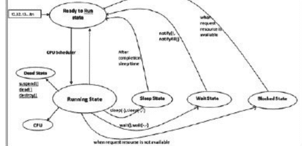

### 1) 从启动 (Start) 到就绪 (Ready to Run) 状态

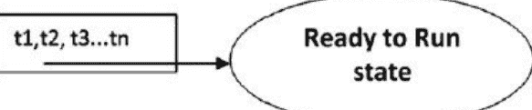

当我们启动线程时，它只是移动到就绪状态，这意味着该线程已准备好进入运行（Running）状态。

注意

我们启动线程并不意味着线程会直接进入运行状态。

一旦线程处于就绪状态，它就具有某些属性和特定的任务。

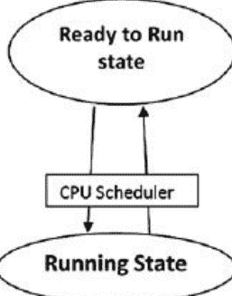

现在 CPU 调度器准备好了某些调度算法，其主要任务是保持运行状态忙碌。该运行状态不应该空闲。在 CPU 调度器中实现了许多不同类型的调度算法，但我们不确定当前运行的是哪种调度算法，因此在 particular调度算法中进入的线程将被处理以运行状态。进入运行状态意味着执行了指定的任务或获得了 CPU 时间。

Q6 : `run()` 到底是什么时候调用的？

答 : `run()` 在启动线程时调用，但每当 CPU 调度器为该特定线程分配 CPU 时间，或者当线程获取与时间相关的 CPU 时间时，`run()` 就会被调用。

Q7 : 我可以显式调用 `run()` 吗？

答 : 是的，我们可以显式调用 `run()`，但这样并没有实际用途，因为根据 JLS（Java语言规范），每当线程获取 CPU 时间时，`run()` 会被自动调用。

Q8 : 假设两个线程处于就绪状态且具有相同的优先级，恰好 CPU 调度器...

### 死锁条件

让我们假设一种情况：有两个线程`t1`和`t2`分别持有资源`R1`和`R2`。线程`t1`正在请求资源`R2`，而线程`t2`正在请求`R1`。线程`t1`只有在获取资源`R2`后才会释放`R1`，而线程`t2`只有在获取资源`R1`后才会释放`R2`。

当我们调用`destroy()`或`stop()`时，该线程将进入死亡状态（dead state），一旦线程死亡，它就无法重启；或者一旦线程移动到死亡状态，它就无法再次进入就绪状态（Ready to run state）。当某个任务分配给线程时，如果该线程完成了任务，该线程将自动进入死亡状态。

`Join()`：当我们针对特定线程调用`join()`方法时，当前运行的线程将进入等待状态（wait state），并为我们调用`join()`的线程提供运行的机会。

`Join(long)`：当我们通过提供参数或指定参数调用`join()`时，该线程将等待指定的时间以等待运行中的线程完成，之后它将立即进入等待状态。

### 示例

```java
class JtcThread1 extends Thread {
  public void run() {
    for (int i = 0; i < 15; i++) {
      System.out.println("JT1\t" + 1);
      try {
        Thread.sleep(100);
      } catch (Exception e) {
        e.printStackTrace();
      }
    }
  }
}

class JtcThread2 extends Thread {
    Thread th = null;
    void setThreadToJoin(Thread th) {
        this.th = th;
    }
    public void run() {
        for (int i = 0; i < 115; i++) {
            System.out.println("JT2\t" + i);
        }
        try {
            if (i == 105) {
                th.join();
            }
            Thread.sleep(100);
        } catch (Exception e) {
            e.printStackTrace();
        }
    }
}
public class Jtc189 {
    public static void main(String[] args) {
        JtcThread1 ath=new JtcThread1();
        JtcThread2 bth=new JtcThread2();

        bth.setThreadToJoin(ath);
        ath.start();
        bth.start();
    }
}
```

## 17.6 同步

这是阻塞当前对象的过程。这可以通过两种方式实现：

- 1 ) 方法级同步：为了实现这种同步，我们需要对其进行声明。

情况 1：有两个线程`t2`（此处应为重复）等待通过对象`h1`访问非同步方法`M1`，将会存在并发情况。

### 示例

```java
class Account{
    synchronized void withdraw(){
        for(int i=0;i<5;i++){
            System.out.println("Withdraw \t"+Thread.currentThread().getName());
        }
        try{
            Thread.sleep(500);
        }catch(Exception e){
            e.printStackTrace();
        }
    }
    void deposit(){
        for(int i=0;i<5;i++){
            System.out.println("Deposit \t"+Thread.currentThread().getName());
        }
    }
}
class AThread implements Runnable {
    Account acc=null;
    public AThread(Account acc,String pname) {
        this.acc=acc;
        Thread t1=new Thread(this, pname);
        t1.start();
    }
    public void run() {
        acc.withdraw();
    }
}
class BThread implements Runnable {
    Account acc=null;
    public BThread(Account acc,String pname) {
        this.acc=acc;
        Thread t2=new Thread(this,tname);
        t2.start();
    }
    public void run() {
        acc.deposit();
    }
}
public class Jtc190 {
    public static void main(String[] args) {
        Account acc1=new Account();
        Account acc2=new Account();
        AThread ath1=new AThread(acc1,"A");
        BThread bth1=new BThread(acc2,"B");
    }
}
```

情况 2：有两个线程`t1`和`t2`尝试通过对象`h1`和`h2`访问非同步方法`m1`，将会存在并发情况。

情况 3：有两个线程`t1`和`t2`尝试通过同一个对象访问非同步方法`m1`和`m2`，将会存在并发情况。

情况 4：有两个线程`t1`和`t2`尝试通过对象`h1`和`h2`访问非同步方法`m1`，将会存在并发情况。

情况 5：有两个线程`t1`和`t2`尝试通过同一个对象访问非同步方法`m1`，将会存在并发情况。

情况 6：有两个线程`t1`和`t2`尝试通过同一个对象访问非同步方法`m1`，将会存在并发情况。

情况 7：有两个线程`t1`和`t2`尝试通过同一个对象访问非同步方法`m1`，将会存在并发情况。

情况 8：有两个线程`t1`和`t2`尝试通过同一个对象访问非同步方法`m1`，将会存在并发情况。

情况 9：有两个线程`t1`和`t2`尝试通过同一个对象访问非同步方法`m1`，将会存在并发情况。

情况 10：有两个线程`t1`和`t2`尝试通过同一个对象访问非同步方法`m1`，将会存在并发情况。

情况 11：有两个线程`t1`和`t2`尝试通过同一个对象访问非同步方法`m1`，将会存在并发情况。

情况 12：有两个线程`t1`和`t2`尝试通过同一个对象访问非同步方法`m1`，将会存在并发情况。

情况 13：有两个线程`t1`和`t2`尝试通过同一个对象访问非同步方法`m1`，将会存在并发情况。

情况 14：有两个线程`t1`和`t2`尝试通过同一个对象访问非同步方法`m1`，将会存在并发情况。

情况 15：有两个线程`t1`和`t2`尝试通过同一个对象访问非同步方法`m1`，将会存在并发情况。

### 守护线程 (Daemon Thread)

这是一种服务线程，用于为当前执行的主线程提供服务。守护线程在主线程执行期间存在。一旦主线程完成任务，守护线程将自动销毁。

#### 记住以下几

- 守护线程将被锁定。

- 类型为`java.lang`的守护线程。

- 在块同步的情况下，第三个对象将被锁定。

- 在块同步的情况下，第三个对象将被锁定。

```java
for(int i=1;i<=5;i++){
  System.out.println("m1-"+i);
  try {
    Thread.sleep(1000);
  } catch(Exception e) {
  }
}

synchronized void m2() {
  for(int i=10;i<=15;i++) {
    System.out.println("m2-"+i);
    try {
      Thread.sleep(1000);
    } catch(Exception e) {
    }
  }
}

class A implements Runnable {
  HelloJtc h=null;
  A(HelloJtc h,String name) {
    this.h=h;
    Thread t=new Thread(this,name);
    t.start();
    System.out.println(t.getThreadGroup().getName());
  }
  public void run() {
    h.m1();
  }
}

class B implements Runnable{
  HelloJtc h=null;
  B(HelloJtc h,String name) {
    this.h=h;
    Thread t2=new Thread(this,name);
    t2.start();
    System.out.println(t2.getThreadGroup().getName());
  }
  public void run() {
    h.m2();
  }
}

public class Jtc5 {
  public static void main(String[] args) {
    HelloJtc h=new HelloJtc();
    new A(h,"A");
    new B(h,"B");
  }
}
```

Q12 : 我可以将`run`方法声明为`synchronized`吗？

答：可以，因为`run()`方法本身已经以同步的方式运行了。

Q 13: 我可以显式地调用`run()`方法吗？

答：可以，但这样做没有意义。

`isDaemon()`：它用于检查线程是否为守护线程（Daemon thread）。如果是守护线程，则返回`true`，否则返回`false`。

`setDaemon(Boolean)`：如果你想将任何线程设置为守护线程，可以使用此方法并传递值`true`。

从 JDK 1.5 开始，`stop()`、`suspend()`和`destroy()`已被弃用。当线程进入睡眠状态（sleep state）时，它不会释放锁；但在等待状态（wait state）下它会释放锁状态。

## 17.7 线程间通信

睡眠（sleeping）线程与等待（wait）线程的区别

假设有两个线程`t1`和`t2`，它们都在访问同步方法。考虑当线程`t1`正在访问方法`m1()`被要求睡眠时，线程`t1`将进入睡眠状态而不释放锁；而当`t2`访问同步方法`m2()`并被要求等待时，它将释放锁。

### 示例

```java
class Stack {
  int x;
  boolean flag=false;
  public synchronized void push(int x) {
    if(flag) {
      try {
        wait();
      } catch(Exception e) {
        System.out.println(e);
      }
    }
    this.x=x;
    System.out.println(x+" is pushed...");
    flag=true; notify();
  }
  synchronized public int pop() {
    if(!flag) {
      try { 
        wait();
      } catch(Exception e) {
        System.out.println(e);
      }
    }
    System.out.println(x+" is popped");
    try {
      Thread.sleep(2000);
    } catch(Exception e) { 
      System.out.println(e);
    }
    flag=false;
    notify();
    return x;
  }
}

class A1 implements Runnable {
  Stack st=null;
  A1(Stack st,String name) {
    this.st=st;
    Thread t1=new Thread(this,name);
    t1.start();
  }
  public void run() {
    int a=1;
    for(int i=0;i<7;i++) {
      st.push(a++);
    }
  }
}

class B1 implements Runnable {
  Stack st=null;
  B1(Stack st,String name) {
    this.st=st;
    Thread t2=new Thread(this,name);
    t2.start();
  }
  public void run() {
    for(int i=0;i<7;i++) {
      st.pop();
    }
  }
}

public class Jtc194 {
  public static void main(String[] args) {
    Stack st=new Stack();
    A1 obj1=new A1(st, "A");
    B1 obj2=new B1(st, "B");
  }
}
```

Q14 : 进程和线程之间的区别是什么？

答：进程是程序的执行实例，而线程是进程内部的单一执行序列。一个进程可以包含多个线程。线程有时被称为轻量级进程。

JVM 运行在单个进程中，JVM 内部线程共享该进程的堆（heap）。这就是为什么多个线程可能会访问同一个对象。线程共享堆但自己的栈（stack），这就是一个线程调用方法的方式。

Q15 : 睡眠（sleeping）和`wait()`之间的区别是什么？

答：是的，但这样做没有意义。

Q16 : `join()`的作用是什么？

答：`join()`用于允许一个线程等待另一个线程执行完毕。

## 17.16 构造函数

`ThreadLocal tl = new ThreadLocal();` 创建一个`ThreadLocal`变量。

### 方法

- 1) `Object get()`；返回当前线程关联的`ThreadLocal`变量的值。

- 2) `Object initialValue()`；返回当前线程`ThreadLocal`变量的初始值。`initialValue()`的默认实现返回`null`。

要自定义我们的`initialValue`，我们需要重写`initialValue()`。

- 3) `void set(Object newValue)`；设置新值。

- 4) `void remove()`；移除当前线程的本地变量值。

在移除之后，如果我们尝试访问它，它将通过调用`initialValue()`再次初始化。

此方法在 1.5 版本中新增。

### 示例


```java
class ThreadLocalDemo {
    public static void main(String[] args) {
    ThreadLocal tl = new ThreadLocal();
    System.out.println(tl.get()); //null
    tl.set("JTC");
    System.out.println(tl.get()); //JTC
    tl.remove();
    System.out.println(tl.get()); //null
    }
}
```

```java
// 重写 initialValue()
class ThreadLocalDemo {
    public static void main(String[] args) {
    ThreadLocal tl = new ThreadLocal() {
    protected Object initialValue() {
        return "abc";
    }}
    System.out.println(tl.get()); //abc
    tl.set("JTC");
    System.out.println(tl.get()); //JTC
    tl.remove();
    System.out.println(tl.get()); //abc
  }
}
```

## 17.17 java.util.concurrent.locks 包

### 传统 synchronized 关键字的问题

如果一个线程释放了锁，哪个等待的线程将获得该锁？我们对此没有任何控制。

我们无法为线程获取锁指定最大等待时间，导致它会一直等待获取锁，这可能会影响系统性能并导致死锁。

我们没有在不等待的情况下尝试锁的灵活性。没有 API 可以列出所有等待某个锁的线程。

`synchronized` 关键字必须定义在方法内部，无法在多个方法之间声明。

为了克服上述问题，Sun 在 1.5 版本中引入了`java.util.concurrent.locks`包。

它还为程序员提供了若干增强，以便对并发提供更多控制。

## 17.18 Lock (接口)

`Lock`对象类似于线程为了执行`synchronized`方法或`synchronized`块而获取的隐式锁。

`Lock`实现提供了比传统的隐式锁更广泛的操作。

### Lock 接口的重要方法

- 1) `void lock();`

它锁定锁对象。

如果锁对象已被其他线程锁定，则它将等待直到它被解锁。

- 2) `boolean tryLock();`

如果锁可用，则获取锁。

如果锁可用，则线程获取锁并返回`true`。如果锁不可用，则此方法返回`false`并继续执行。

在这种情况下，线程永远不会被阻塞。

```java
if (l.tryLock()) {
  执行安全操作
} else {
  执行备选操作
}
```

- 3) `boolean tryLock(long time, TimeUnit unit);`

如果锁可用，则获取锁。

如果锁不可用，则线程可以等待指定的时间。如果锁仍然不可用，则线程可以继续执行。

例如：`if (l.tryLock(1000, TimeUnit.SECONDS)) { }`

```java
TimeUnit: TimeUnit 是存在于 java.util.concurrent 包中的一个枚举。
enum TimeUnit {
  DAYS, HOURS, SECONDS, MILLISECONDS, MICROSECONDS, NANOSECONDSDS;
}
```

- 4) `void lockInterruptedly();`

除非当前线程被中断，否则获取锁。如果锁可用，则立即获取锁。

如果锁不可用，则线程将进行等待；如果在等待期间被中断，则不会获取锁。

- 5) `void unlock();` 释放锁。

## 17.19 ReentrantLock

它实现了`Lock`接口，是`Object`的直接子类。

Reentrant（重入）意味着线程可以多次获取同一个锁而没有问题。

在内部，每当我们调用`lock()`时，`ReentrantLock`会增加计数，每当我们调用`unlock()`时会减少计数，当计数达到‘0’时，锁将被释放。

- 1) `ReentrantLock rl = new ReentrantLock();` 创建一个`ReentrantLock`实例。

- 2) `ReentrantLock rl = new ReentrantLock(boolean fairness);` 创建一个带有给定公平性的`ReentrantLock`实例。

如果公平性为`true`，当锁可用时，等待最长的线程将获取锁，即它遵循先先出（FIFO）。

如果公平性为`false`，我们无法保证哪个线程会在锁可用时获取该锁。

注意：如果我们不指定任何公平性属性，默认是非公平的。

### ReentrantLock 的重要方法

- `void lock();`

- `boolean tryLock();`

- `boolean tryLock(long time, TimeUnit unit);`

- `void lockInterruptedly();`

- `void unlock();`

```java
MyThread(String name) {
  super(name);
}
```

```java
public void run() { do {
  try {
    if(l.tryLock(1000, TimeUnit.MILLISECONDS)) {
      System.out.println(Thread.currentThread().getName()+"-------------------------------------- Got Lock");
      Thread.sleep(5000);
      l.unlock();
      System.out.println(Thread.currentThread().getName()+"---- Releases Lock");
      break;
    } else {
      System.out.println(Thread.currentThread().getName()+"---- Unable To Get Lock And Will Try Again");
    }
  } catch (InterruptedException e) {
  }
  while(true) {
  }
}

class ReentrantLockDemo {
  public static void main(String args[]) {
    MyThread t1 = new MyThread("First Thread");
    MyThread t2 = new MyThread("Second Thread");
    t1.start();
    t2.start();
  }
}
```

## 17.20 线程池

为每一个任务创建新线程可能会导致性能和内存问题。

为了克服这个问题，我们应该采用线程池概念。

线程池是一个已经创建并准备好执行我们任务的线程池。

Java 1.5 版本引入了线程池框架来实现线程池。线程池框架也被称为执行器框架（Executor Framework）。

我们可以如下所示创建线程池：

```java
ExecutorService service = Executors.newFixedThreadPool(3);
```

```java
//我们的选择 我们可以使用 submit() 提交一个 Runnable 任务。
```

```java
service.submit(job);
```

我们可以使用`shutdown()`来关闭`ExecutorService`。

```java
service.shutdown();
```

# 示例

```java
import java.util.concurrent.ExecutorService;
import java.util.concurrent.Executors;
class PrintJob implements Runnable {
    String name;
    PrintJob(String name){
        this.name = name;
    }
    public void run(){
        System.out.println(name+"... Job Started By Thread:"+Thread.currentThread().getName());
    }
    
    try {
        Thread.sleep(10000);
    } catch (InterruptedException e) {
        System.out.println(name+"... Job Completed By Thread:"+Thread.currentThread().getName());
    }
}
class ExecutorDemo {
    public static void main(String[] args) {
        PrintJob[] jobs = {
        new PrintJob("Som"),
        new PrintJob("Prakash"),
        new PrintJob("Rai"),
        new PrintJob("Java"),
        new PrintJob("Training"),
        new PrintJob("Center")
        };
        ExecutorService service = Executors.newFixedThreadPool(3);
        for (PrintJob job : jobs) {
            service.submit(job);
        }
    }
    service.shutdown();
}
}
```

在上面的程序 17.3 中，17 个线程负责执行 6 个任务。

这样，单个线程就可以被重用于多个任务。

注意：通常我们可以使用线程池概念来实现服务器（Web 服务器和应用服务器）。

# 17.21 Callable 和 Future

在`Runnable`任务的情况下，线程不会返回任何内容。

如果需要线程在执行后返回某些结果，那么我们应该使用`Callable`。

`Callable`接口仅包含一个方法`public Object call() throws Exception`。如果我们将一个`Callable`对象提交给`Executor`，框架将返回一个类型为`java.util.concurrent.Future`的对象。

`Future`对象可以从`Callable`任务中检索结果。

示例

```java
import java.util.concurrent.Callable;
import java.util.concurrent.ExecutorService;
import java.util.concurrent.Executors;
import java.util.concurrent.Future;
class MyCallable implements Callable{
int num; 
MyCallable(int num) {
this.num = num;
}
public Object call() throws Exception {
int sum = 0;
for(int i=0; i<num; i++) {
sum = sum+i;
}
return sum;
}
}
class CallableFutureDemo {

public static void main(String args[]) throws Exception {
MyCallable[] jobs = {
new MyCallable(10), new MyCallable(20), new MyCallable(30),
new MyCallable(40), new MyCallable(50), new MyCallable(60)
};
ExecutorService service = Executors.newFixedThreadPool(3);
for(MyCallable job : jobs) {
Future f = service.submit(job);
System.out.println(f.get());
}
service.shutdown();
}
}
```

# 程序：方法级同步的示例

```java
package com.p1; 
class HelloJtc {
synchronized void m1(){
for (int i = 1; i<=5; i++) {
System.out.println("m1-"+i);
try {
Thread.sleep(1000);
} catch(Exception e) {
}
}
}

synchronized void m2(){
for (int i = 10; i<=15; i++) {
System.out.println("m2-"+i);
try {
    Thread.sleep(1000);
} catch(Exception e) {
}
}

class A implements Runnable {
    HelloJtc h=null;
    A(HelloJtc h, String name) {
        this.h=h;
    }
    Thread t=new Thread();
    t.start();
    public void run(){
        h.m1();
    }
}

class B implements Runnable {
    HelloJtc h=null;
    B(HelloJtc h, String name) {
        this.h=h;
    }
    Thread t=new Thread();
    t.start();
    public void run(){
        h.m2();
    }
}

class Jtc4 {
  public static void main(String args[]) {
    HelloJtc h=new HelloJtc();
    new A(h, "A");
    new B(h, "B");
  }
}
```

# 程序：使用 sleep 的示例

```java
package com.p2;
class Account {
int x;
boolean flag=false;
synchronized void push(int x) {
if(flag) {
  try {
    wait();
  } catch(Exception e) {
    System.out.println(e);
  }
}
this.x=x;
System.out.println(x+" is pushed");
flag=true;
notify();
}
synchronized int pop() {
if(!flag) {
  try {
    wait();
  } catch(Exception e) {
    System.out.println(e);
  }
}
System.out.println(x+" is popped");
flag=false;
return x;
}
}
class AccThread implements Runnable {
Account acc=null;
AccThread(Account acc) {
this.acc=acc;
}
public void run(){
int a=1;
for(int i=0; i<7; i++) {
    acc.push(a++);
    try {
        Thread.sleep(1000);
    } catch (Exception e) {
        System.out.println(e);
    }
}
}
class AccThread2 implements Runnable {
Account acc=null;
AccThread2(Account acc) {
this.acc=acc;
}
public void run(){
int a=1;
for(int i=0; i<7; i++) {
    acc.pop();
    try {
        Thread.sleep(1000);
    } catch (Exception e) {
        System.out.println(e);
    }
}
}
}
class Jtc5 {
  public static void main(String args[]) {
    Account acc=new Account();
    Thread t1=new Thread(new AccThread(acc));
    Thread t2=new Thread(new AccThread2(acc));
    t1.start();
    t2.start();
  }
}
```

# 程序：使用 wait(), notifyAll() 的示例


```java
package com.p3;

class Stack {
    int x;
    boolean flag = false;

    synchronized void push(int x) {
        if (flag) {
            try {
                wait();
            } catch (Exception e) {
                System.out.println(e);
            }
        }
        this.x = x;
        System.out.println(x + " is pushed");
        flag = true;
        notifyAll();
    }

    synchronized int pop() {
        if (!flag) {
            try {
                wait();
            } catch (Exception e) {
                System.out.println(e);
            }
        }
        System.out.println(x + " is popped");
        flag = false;
        return x;
    }
}

class A1 implements Runnable {
    Stack st = null;

    A1(Stack st) {
        this.st = st;
    }

    public void run() {
        int a = 1;
        for (int i = 0; i < 7; i++) {
            st.push(a++);
            try {
                Thread.sleep(1000);
            } catch (Exception e) {
                System.out.println(e);
            }
        }
    }
}

class B1 implements Runnable {
    Stack st = null;

    B1(Stack st) {
        this.st = st;
    }

    public void run() {
        int a = 1;
        for (int i = 0; i < 7; i++) {
            st.pop();
            try {
                Thread.sleep(1000);
            } catch (Exception e) {
                System.out.println(e);
            }
        }
    }
}

class Jtc7 {
    public static void main(String[] args) {
        Stack st = new Stack();
        Thread t1 = new Thread(new A1(st));
        Thread t2 = new Thread(new B1(st));
        t1.start();
        t2.start();
    }
}
```

## 18.1 java.util 包或集合框架

在 Java 中，当我们尝试向数组中存储元素时，可能会遇到以下问题：

- 数组是静态的，也就是说，为了在数组中存储元素，我们首先需要声明大小。
- 如果我们向数组中存储某些元素，可能无法填充整个数组长度，在这种情况下会造成内存浪费。
- 如果你超过了数组的大小，它将抛出异常，即`java.lang.Array out of bounds exception`。
- 在声明任何数组之前，我们需要先声明数组的类型，也就是说你想要声明什么类型，并且在该数组中你只能存储相同类型的元素。但在某些情况下，我们可以在数组中存储不同类型的元素。

例如：

```java
Object O[] = new Object[3];
O[0] = new Hail();
O[1] = new Hello();
O[2] = new String("AB");
```

在访问数组时，我们需要初始化、让计算机执行条件检查以及增加或递减计数器。在访问数组时，你需要执行这些许多任务。假设有一个长度为 1000 的数组，其中只有几百个元素是有效的，因此尽管如此你仍然需要不断地循环一千次，这是没有意义的。

- 如果你想从数组中删除特定索引位置的元素，那是非常困难的。
- 在数组的情况下，我们无法避免元素的重复性。
- 在数组中，元素将按照添加的顺序存储，也就是说没有提供按排序顺序存储元素的功能。
- 当你创建一个具有特定大小的数组时，它需要连续的内存位置（即磁盘空间）。如果该内存位置不可用，可能会出现某些内存相关问题，即堆溢出。这将抛出`java.lang.VirtualMachineError`。
- 假设在字符串数组的情况下，当我们尝试对其进行反转操作时，首先需要将其拆分并存储在字符串数组中，我们需要将其拆分并存储在字符串数组中，然后我们需要进行访问（使用`for`循环），这将创建许多不必要的对象，这是不推荐的。

为了解决数组集合的问题，引入了集合框架（Collection Framework）。在这个集合框架中，他们引入了五个类：

- `Dictionary`（字典）
- `Properties`（属性）
- `HashTable`（哈希表）
- `Vector`（向量）
- `Stack`（栈）

这五个类被称为旧类（legacy classes）。上述五个类几乎解决了数组的所有问题，但它们仍然无法解决数组的许多主要问题。

这五个旧类可以存储不同类型的元素。

它们在性质上不是静态的，也就是说它们的大小是可以增长的。为了解决访问问题，SUN 引入了`Enumeration`接口来访问这些旧类中的元素。

所有这些旧类在本质上都是完全同步的，因此使用这些旧类会减慢应用程序的速度。尽管如此，这些旧类仍然无法解决数组的问题，例如元素的重复性等。

该集合框架经过重构以解决旧类的问题，在旧类中，有两个旧类被重构并被添加到集合中。

## HashTable

## Vector

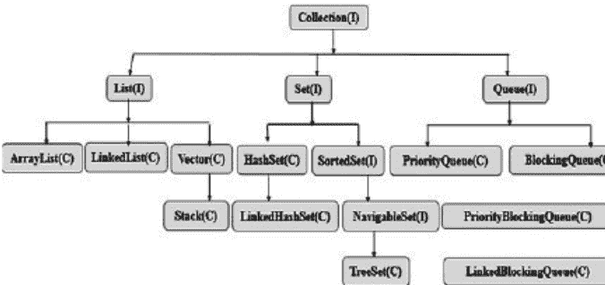

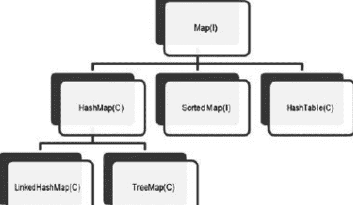

## 18.2 Collection

`Collection`是位于`java.util`包中的一个接口。`collection`进一步被`list`和`set`扩展。

所有的`collections`方法在`list`和`set`中都可用。此`collection`接口没有被`map`接口扩展。

## 18.3 List Interface

`List`是位于`java.util`包中的一个接口，此外此`list`由以下类实现：

- `ArrayList`
- `LinkedList`
- `Vector`

所有这些`list`类都以重复性的方式存储元素。

## ArrayList

它是位于`java.util`包中的一个类。

它继承自`AbstractList`类并实现了`List`、`RandomAccess`、`Cloneable`和`Serializable`接口。

`ArrayList`实现了`list`接口。

`ArrayList`按照添加的顺序存储元素。

`ArrayList`使用索引表示来存储元素。

在`ArrayList`中允许不同类型的元素。

可以使用`ListIterator`多次访问`ArrayList`元素。

`ArrayList`的没有任何方法是同步的。因此`ArrayList`类也是不是同步的。所以，使用它不会影响应用程序的并发性。

可以使用`Iterator`和`ListIterator`访问`ArrayList`元素。通过`enumeration`我们无法访问`ArrayList`的元素。

使用`Iterator`只能正向访问一次`ArrayList`元素。

## Example

```java
import java.util.*;

class Hello {
    void m1() {
        System.out.println("m1 in Hello");
    }
}
```

```java
li.add("last");
System.out.println("*****HashCode********");
System.out.println(li.hashCode());
System.out.println("\n");
li.addFirst("Before First");
li.addLast("After Last");
System.out.println(li);
System.out.println(li.hashCode());
System.out.println("********************\n");
List lst = new LinkedList<>();
lst.add("abc");
lst.add(123);
System.out.println(lst.add("abc"));
System.out.println(lst);
// lst.addFirst("Before First");
// lst.addLast("After Last");
boolean b1 = li.contains(123);
System.out.println(b1);
System.out.println(li);
LinkedList l1 = new LinkedList<>();
l1.add(123);
l1.add("first");
l1.add("last");
System.out.println(l1);
System.out.println(li.contains(l1));
System.out.println(l1.contains(li));
li.addAll(l1);

// li.add(l1);
System.out.println(li);
System.out.println("using Iterator");
Iterator it = li.iterator();

while (it.hasNext()) {
    System.out.println(it.next());
}
while (it.hasNext()) {
    System.out.println(it.next());
}
System.out.println("\n*****List Iterator Forward*****");
ListIterator l1 = li.listIterator();
while (l1.hasNext()) {
    System.out.println(l1.next());
}
System.out.println("***********previous***********");
while (l1.hasPrevious()) {
    System.out.println(l1.previous());
    // System.out.println(l1.previous());
    Object o = l1.previous();
    System.out.println(o);
}
```

## Vector

`Vector`是一个遗留类（legacy class）。

`Vector`继承`AbstractList`并实现了`List`、`RandomAccess`、`Cloneable`和`Serializable`接口。

`Vector`经过了重新设计并包含在集合框架中。

`Vector`用于存储不同类型的元素。

`Vector`允许重复元素。

`Vector`使用索引表示法存储元素。

`Vector`元素可以随机访问。

`Vector`允许`null`值。

`Vector`中允许存在多个`null`值。

它按照元素添加的顺序存储元素。

可以通过`Iterator`、`ListIterator`和`Enumeration`访问`Vector`元素。

当`Vector`还是遗留类时，使用`Enumeration`来访问元素。这种枚举器在集合框架中也继续使用。

通过使用`Enumeration`，我们只能访问遗留类或已重新设计并包含在集合框架中的类的元素。

当`Vector`还是遗留类时，几乎所有的成员都是同步的（synchronized），因此这会影响应用程序的并发性。

`Vector`对象支持序列化和克隆。

## 示例

```java
import java.util.*;

public class Hello02 {
    public static void main(String[] args) {
        Vector v1 = new Vector();
        ArrayList al = new ArrayList();
        System.out.println(al.size());

        System.out.println(al);
        al.add("aa");
        al.add("bb");
        al.add("cc");
        al.add("dd");
        al.add("ce");
        System.out.println(al.size());
        System.out.println(al);
        System.out.println("***********\n");
        v1.addAll(al);
        System.out.println(v1);
        v1.add("xyz");
        v1.add(123);
        v1.addElement("abc");
        v1.addElement(9999);
        System.out.println(v1);
        System.out.println("***********\n");
        Enumeration en = v1.elements();
        while (en.hasMoreElements()) {
            System.out.println(en.nextElement());
        }
        ListIterator li = v1.listIterator();
        while (li.hasNext()) {
            System.out.println(li.next());
        }
        System.out.println("**************\n");
        while (li.hasPrevious()) {
            System.out.println(li.previous());
        }
    }
}
```

| LIST | 重复元素 | 相同或不同 | Null 值 | 索引或节点 | 随机或顺序 | 同步 | Enumeration | Iterator | ListIterator | 序列化与克隆 | 顺序 |
| :--- | :--- | :--- | :--- | :--- | :--- | :--- | :--- | :--- | :--- | :--- | :--- |
| `ArrayList` | 是 | 相同 | 是 | 索引 | 随机 | 否 | 否 | 是 | 是 | 是 | 插入顺序 |
| `LinkedList` | 是 | 相同 | 是 | 节点 | 顺序 | 否 | 否 | 是 | 是 | 是 | 插入顺序 |
| `Vector` | 是 | 相同 | 是 | 索引 | 随机 | 是 | 是 | 是 | 是 | 是 | 插入顺序 |

**Q1：** 我可以同步`ArrayList`和`LinkedList`吗？

**答：** 可以，我们可以通过调用`Collections.synchronizedList(list)`来显式地同步。

## 18.4 SET

`Set`是`java.util`包中的一个接口。

`Set`继承`AbstractCollection`并实现了`Set`、`Cloneable`和`Serializable`接口。

`Set`不允许重复元素。

```java
HashSet hs = new HashSet();
hs.add(new Integer(99));
System.out.println(hs.add("som"));
```

```java
hs.add("som@jtc");
System.out.println(hs.add("som"));
System.out.println(hs);
TreeSet ts = new TreeSet();
//ts.add(new Integer(99));
System.out.println(ts.add("som"));
ts.add("som@jtc");
System.out.println(ts.add("som"));
ts.add("aaaa");
ts.add("cccc");
ts.add("bbbb");
System.out.println(ts);
LinkedHashSet lhs = new LinkedHashSet();
lhs.add(new Integer(99));
System.out.println(lhs.add("som"));
lhs.add("som@jtc");
System.out.println(lhs.add("som"));
System.out.println(lhs);
```

## 18.6 Comparable 和 Comparator 的区别

当我们想要以多种方式对对象进行排序时，我们需要使用`Comparable`和`Comparator`。

| `Comparable` | `Comparator` |
|---|---|
| • `Comparable`是一个位于`java.lang`包中的接口（Interface）。 | • `Comparator`也是一个位于`java.util`包中的接口（Interface）。 |
| • 如果你想以一种特定的方式对任何类进行排序，它们需要实现`Comparable`接口，该接口提供了单一的比较方式。 | • `Comparator`接口提供了多种不同的比较方式。 |
| • 当一个类实现`Comparable`接口时，你需要在类内部重写`compareTo()`方法。 | • 如果一个类实现`Comparator`接口，那么该类必须在类内部重写`compare(Object o)`方法。 |


| • 调用 `Comparable` 对象的 `Collections.sort`。 | • 调用 `Collections.sort(Collection_Type, Comparator)`。 |

| 即 `Collections.sort(Comparable)`。 | • `Comparator` 接口可以由第三方类实现，而无需修改需要排序的对象的主类。 |

```java
import java.util.*;
class Student implements Comparable{
    int sid;
    String name;
    String email;
    Student(int sid, String name, String email) {
        this.sid = sid;
        this.name = name;
        this.email = email;
    }

    public String toString(){
        return "" + sid + "" + name + "" + email;
    }

    public boolean equals(Object o) {
        Student s = (Student)o;
        if(this.sid == s.sid) {
            return true;
        }
        return false;
    }

    public int compareTo(Object o) {
        Student s = (Student)o;
        return this.sid;
    }
}

class SnameComparator implements Comparator {
    public int compare(Object o1, Object o2) {
        Student s1 = (Student)o1;
        Student s2 = (Student)o2;
        return s1.name.compareTo(s2.name);
    }
}

class EmailComparator implements Comparator {
    public int compare(Object o1, Object o2) {
        Student s1 = (Student)o1;
        Student s2 = (Student)o2;
        return s1.email.compareTo(s2.email);
    }
}

class Jtc {
    public static void main(String args[]) {
        ArrayList<Student> al = new ArrayList<>();
        Student s1 = new Student(1, "Alice", "a@test.com");
        Student s2 = new Student(2, "Bob", "b@test.com");
        Student s3 = new Student(3, "Charlie", "c@test.com");
        Student s4 = new Student(4, "David", "d@test.com");
        al.add(s1);
        al.add(s2);
        al.add(s3);
        al.add(s4);

        System.out.println("No Sorting");
        Iterator<Student> it = al.iterator();
        while(it.hasNext()){
            Student s = it.next();
            System.out.println(s);
        }

        System.out.println("Sorting by Sid");
        Collections.sort(al);
        it = al.iterator();
        while(it.hasNext()){
            Student s = it.next();
            System.out.println(s);
        }

        System.out.println("Sorting by Name");
        Collections.sort(al, new SnameComparator());
        it = al.iterator();
        while(it.hasNext()){
            Student s = it.next();
            System.out.println(s);
        }

        System.out.println("Sorting by Email");
        Collections.sort(al, new EmailComparator());
        it = al.iterator();
        while(it.hasNext()){
            Student s = it.next();
            System.out.println(s);
        }
    }
}
```

## 18.7 String Tokenizer

`StringTokenizer` 是一个位于 `java.util` 包中的类。

当你需要处理字符串时，如果你想反转该字符串，需要使用 `split` 类的 `split` 方法，并在指定字符串标准后，你需要将其存储在字符串数组中，这会产生产生字符串对象，可能会导致 `java.lang.OutOfMemoryError` 内存问题。之后在访问字符串数组时，初始化计数器并相应地增加或减少。但通过使用 `StringTokenizer`，我们可以以 token 的形式拆分字符串，这样不会产生任何额外的对象，并且可以以枚举的方式轻松访问 token。

## 18.8 hasMoreTokens()

它检查是否有可用 token，如果有则返回 `true`，否则返回 `false`。在拆分字符串时，如果没有指定任何条件，它将根据空格自动拆分。

## 示例

```java
import java.util.*;
public class Jtc197 {
    public static void main(String[] args) {
        String str = "welcome to Jtc";
        StringTokenizer token = new StringTokenizer(str);
        System.out.println(token.hasMoreTokens());
        System.out.println(token.countTokens());
        while (token.hasMoreTokens()) {
            String str1 = token.nextToken();
            System.out.println(str1);
        }
        System.out.println(token.hasMoreTokens());
    }
}
```

## 18.9 枚举 (Enumeration) 与迭代器 (Iterator) 的区别

| Enumeration | Iterator |

|---|---|

| * `Enumeration` 是 `java.util` 包中的一个接口，也被称为旧版接口（legacy Interface）。 | * 它也是 `java.util` 包中的一个接口，主要用于从集合框架（collection framework）中引入。 |

| * 使用 `Enumeration`，我们只能访问旧类中的元素。 | * 使用 `Iterator`，我们既可以访问旧类的元素，也可以访问集合类的元素。 |

| * 使用 `Enumeration`，我们只能按正向顺序访问元素。 | * 使用 `Iterator`，我们可以按正向访问元素，即只能访问一次。 |

| * 使用 `Enumeration`，我们无法从集合中删除任何元素。 | * 使用 `Iterator`，我们可以从集合中删除元素。 |

## 18.10 迭代器 (Iterator) 与 列表迭代器 (ListIterator) 的区别

| Iterator | ListIterator |

| --- | --- |

| • `Iterator` 是 `java.util` 包中的一个接口。 | • `ListIterator` 也是 `java.util` 包中的一个接口，并继承了 `Iterator` 接口。 |

| • 使用 `Iterator`，我们只能按正向访问元素。 | • 使用 `ListIterator`，我们可以同时按正向和反向方向访问元素。 |

| • 使用 `Iterator`，我们只能从集合中删除元素。 | • 使用 `ListIterator`，我们可以从集合中删除元素，也可以向集合添加元素。 |

| • 使用 `Iterator`，我们可以访问 `List`（列表）和 `Set`（集合）的元素。 | • 使用 `ListIterator`，我们只能访问 `List` 类的元素。 |

## 18.11 addElements()

通过使用 `addElements()`，我们可以向元素添加到重构并包含在集合框架中的旧类。因为 `addElements()` 用于向旧类添加元素。`addElements()` 和 `add()` 在处理顺序上没有区别。

## 18.12 Timer 和 TimerTask

`TimerTask` 是一个实现 `Runnable` 接口的抽象类。

`TimerTask` 类位于 `java.util` 包中。

`TimerTask` 类没有自己的抽象方法。它只拥有 `Runnable` 接口的抽象方法，该方法在 `TimerTask` 类内部不会被重写。这留给了开发者根据需要编写 `run()` 方法的实现。

`Timer` 类：它是 `java.util` 包中的一个类。

`Timer` 类有许多方法用于根据需要调度任务。

这两种情况都将用于相应地调度任务。

## 18.13 方法

`addElements()`: 通过使用 `addElement()`，我们可以向已重构并包含在集合框架中的旧类添加元素。因为 `addElement` 用于向旧类添加元素。

`addElement()` 和 `add()` 在处理顺序上没有区别。

### 方法

```java
public void Schedule(TimerTask task, Date time);
```

```java
public void Schedule(TimerTask task, Date firstTime, long period);
```

```java
public void Schedule(TimerTask task, long delay);
```

```java
public void Schedule(TimerTask task, long delay, long period);
```

```java
public void ScheduleAtFixedRate(TimerTask task, long delay, long period);
```

```java
public void ScheduleAtFixedRate(TimerTask task, Date firstTime, long period);
```

### schedule 方法的内部实现

### 示例

```java
import java.util.*;
class Reminder {
    Timer timer;
    public Reminder(int seconds) {
        timer = new Timer();
        timer.schedule(new RemindTask(), seconds * 1000); 
    }
}
class RemindTask extends TimerTask {
    public void run() {
        System.out.println("Time's up!");
        timer.cancel();
    }
}
public class Jtc13 {
    public static void main(String args[]) {
        System.out.println("About to schedule task.");
        new Reminder(5);
        System.out.println("Task scheduled.");
    }
}
```

如果定时器任务执行线程意外终止（例如因为调用了 `stop` 方法），任何进一步尝试都将抛出 `IllegalStateException`，就像定时器的 `cancel` 方法已被调用一样。

### 18.13.1 Stack (栈)

它是 `Vector` 的子类。

当需要后进先出 (LIFO) 顺序时，我们应该使用 `Stack`。`Stack s= new Stack();`

### Stack 中的方法

`Object push(Object o);`

向栈中插入一个对象。

`Object pop();`

删除并返回栈顶元素。

`Object peek();`

返回栈顶元素但不删除。

`boolean empty();`

如果栈为空，则返回 `true`。

```java
int search(Object o);
```

如果元素可用则返回偏移量，否则返回“-1”。

### 18.13.2 空值接受 (Null Acceptance)

对于空的 `TreeSet`，在插入第一个元素 `null` 之后，再次插入 `null` 是可能的；但如果我们尝试插入任何其他元素，将得到 `NullPointerException`。

对于非空的 `TreeSet`，如果我们尝试插入 `null`，将得到 `NullPointerException`。

### 示例

```java
import java.util.*;
class TreeSetDemo{
  public static void main(String[] args) {
    TreeSet t=new TreeSet();
    t.add(new StringBuffer("A"));
    t.add(new StringBuffer("Z"));
    t.add(new StringBuffer("L"));
    t.add(new StringBuffer("B"));
    System.out.println(t);
  }
}
```

注意：线程“main”中的异常：`java.lang.ClassCastException`: `StringBuffer` 无法转换为 `java.lang.Comparable`

如果依赖默认排序，对象必须是同质的，否则将得到 `ClassCastException`。当且仅当相应的类实现了 `Comparable` 时，对象才是 `Comparable`。

## 18.14 Entry (节点)

每个键值对被称为一个 entry。因此，`Map` 被视为一组 entry 内部接口。

## 18.15 IdentityHashMap

它与 `HashMap` 相似，区别在于以下几点：

在 `HashMap` 的情况下，JVM 始终使用 `equals()` 方法来识别重复键，这用于内容比较。

但在 `IdentityHashMap` 的情况下，JVM 将使用 `==` 运算符来识别重复键，这用于引用比较。

### 示例

```java
import java.util.*;
class HashMapDemo{
    public static void main(String[] args){
        HashMap m=new HashMap();
        Integer i1=new Integer(10);
        Integer i2=new Integer(10);
        m.put(i1,"som");
        m.put(i2,"prakash");
        System.out.println(m);
    }
}
```

在上面的程序中，`i1` 和 `i2` 是重复键，因为 `i1.equals(i2)` 返回 `true`。

在上面的程序中，如果我们把 `HashMap` 换成 `IdentityHashMap`，那么 `i1` 和 `i2` 就重复键，因为 `i1==i2` 为 `false`，因此在这种情况下输出为 `{10=som, 10=prakash}`。

## 18.16 WeakHashMap (弱引用)

它与 `HashMap` 相似，区别在于以下几点：

在普通 `HashMap` 的情况下，即使对象没有任何引用，只要它与 `HashMap` 关联，它就不会被垃圾回收（GC）。那是 `HashMap` 主导了垃圾回收。

但在 `WeakHashMap` 的情况下，如果一个对象没有任何引用，即使它与 `WeakHashMap` 关联，它也是可以被垃圾回收的。垃圾回收主导了 `WeakHashMap`。

### 示例


```java
import java.util.*;
class WeakHashMapDemo {
    public static void main(String[] args) throws Exception {
        WeakHashMap m = new WeakHashMap();
        Temp t = new Temp();
        m.put(t, "som");
        System.out.println(m);
        t = null;
        System.gc();
        Thread.sleep(5000);
        System.out.println(m);
    }
}
class Temp {
```

```java
public String toString() {
    return "Temp";
}
public void finalize() {
    System.out.println("finalize() method called");
}
}
```

在上面的程序中，如果我们把`WeakHashMap`换成普通的`HashMap`，那么对象将不会被垃圾回收销毁，在这种情况下输出不是空的。

## 18.17 SortedMap

它是`Map`的子接口。

如果我们想根据键（`keys`）的某种排序来表示一组键值对，那么应该选择`SortedMap`。

排序只能基于键（`keys`），而不能基于值（`values`）。`SortedMap`接口定义了以下 6 个特定方法。

```java
Object firstKey();
```

```java
Object lastKey();
```

```java
SortedMap headMap(Object key);
```

```java
SortedMap tailMap(Object key);
```

```java
SortedMap subMap(Object key1, Object key2);
```

```java
Comparator comparator();
```

## 18.18 Properties

`Properties`类是`Hashtable`的子类。

在我们的程序中，如果有任何像`DBUserName`、`Password`等这样频繁变化的内容，这类类型的值不建议在`Java`应用程序中硬编码，因为每次更改我们都必须重新编译、构建和部署应用程序，有时还需要重启服务器，这会对客户产生巨大的业务影响。

这类变量我们必须硬编码在属性文件中（`property files`），并且我们必须从属性文件中读取值到`Java`应用程序中。

这种方法的主要优势是，如果属性文件发生任何更改，这些更改将自动适用于`Java`应用程序，只需重新部署即可。

通过使用`Properties`对象，我们可以从属性文件中读取并保持属性到`Java`应用程序中。

```java
Properties p = new Properties();
```

在属性中，键和值“都应该是`String`类型”。

## Properties 类中的方法

```java
String getProperty(String propertyname);
```

返回与指定属性关联的值。

```java
String setProperty(String propertyname, String propertyvalue);
```

设置一个新的属性。

```java
Enumeration propertyNames();
void load(InputStream is);
// 我们可以传递任何`InputStream`。用于将属性文件中的属性加载到`Java` `Properties`对象中。
```

```java
void store(OutputStream os, String comment);
```

```java
// 我们可以传递任何`OutputStream`。用于将`Properties`对象中的属性存储到属性文件中。
```

## 示例

```java
import java.util.*;
import java.io.*;
class PropertiesDemo {
    public static void main(String[] args) throws Exception {
        Properties p = new Properties();
        FileInputStream fis = new FileInputStream("abc.properties");
        p.load(fis);
        System.out.println(p);
        String s = p.getProperty("som");
        System.out.println(s); // 8888
        p.setProperty("abh", "9999999");
        Enumeration e = p.propertyNames();
```

```java
while (e.hasMoreElements()) {
    String s1 = (String) e.nextElement();
    System.out.println(s1);
}
FileOutputStream fos = new FileOutputStream("abc.properties");
p.store(fos, "updated by som");
}
```

## 示例

```java
import java.util.*;
import java.io.*;
class PropertiesDemo {
    public static void main(String[] args) throws Exception {
        Properties p = new Properties();
        FileInputStream fis = new FileInputStream("db.properties");
        p.load(fis);
        String url = p.getProperty("url");
        String user = p.getProperty("user");
        String pwd = p.getProperty("pwd");
        Connection conn = DriverManager.getConnection(url, user, pwd);
        FileOutputStream fos = new FileOutputStream("db.properties");
        p.store(fos, "updated by som");
    }
}
```

## 示例

```java
import java.util.*;
import java.io.*;
class PropertiesDemo {
    public static void main(String[] args) throws Exception {
        Properties p = new Properties();
        FileInputStream fis = new FileInputStream("abc.properties");
        p.load(fis);
        System.out.println(p);
        String s = p.getProperty("som");
        System.out.println(s); // 8888
        p.setProperty("som", "9999999");
        Enumeration e = p.propertyNames();
        while (e.hasMoreElements()) {
            String s1 = (String) e.nextElement();
            System.out.println(s1);
        }
    }
}

FileOutputStream fos = new FileOutputStream("abc.properties");
p.store(fos, "updated by som");
}
```

## 18.19 Queue

`Queue`是`Collection`的子接口。

如果我们想在处理之前（在某事发生之前）表示一组单独的对象，那么应该选择`Queue`接口。

通常`Queue`遵循先入先出（`FIFO`）顺序，但根据我们的需求，我们也可以实现自己的顺序。

从 1.5 版本开始，`LinkedList`也实现了`Queue`接口。

基于`LinkedList`的`Queue`实现始终遵循先入先出顺序。

假设我们需要为十万个手机号码发送短信，在发送消息之前，我们必须将所有手机号码存储到`Queue`中，这样第一个插入的号码将触发第一个消息（`FIFO`）。

### Queue 接口方法

```java
boolean offer(Object o);
```

向`Queue`添加一个对象。

```java
Object poll();
```

移除并返回`Queue`的头部元素，如果`Queue`为空，则将得到`null`。

```java
Object remove();
```

移除并返回`Queue`的头部元素。如果`Queue`为空，此方法将抛出名为`NoSuchElementException`的运行时异常。

```java
Object peek();
```

返回`Queue`的头部元素而不将其移除。

## 18.20 PriorityQueue

`PriorityQueue`是一种数据结构，用于根据优先级在处理之前表示一组单独的对象。

顺序可以是自然顺序，也可以通过`Comparator`自定义排序顺序。

不允许有重复对象。

插入顺序是不被保留的，但对象将根据优先级插入。

如果`Queue`为空，则会抛出`NullPointerException`。

```java
Object element();
```

创建一个默认容量的`PriorityQueue`。

```java
import java.util.Comparator;
import java.util.PriorityQueue;
import java.util.Scanner;
public class Jtc18 {
    public static void main(String[] args) {
        Scanner sc = new Scanner(System.in);
        System.out.println("Enter values of int type[0 - Exit]");
        PriorityQueue<Integer> pq = new PriorityQueue<>();
        while (true) {
            int val = sc.nextInt();
            if (val == 0)
                break;
            pq.offer(val);
        }
        System.out.printf("Number of values stored is %d.\n", pq.size());
        for (Integer in : pq) {
            System.out.println(in);
        }
    }
}
```

```java
import java.util.*;
import java.io.*;
class PropertiesDemo {
    public static void main(String[] args) throws Exception {
        Properties p = new Properties();
        FileInputStream fis = new FileInputStream("db.properties");
        p.load(fis);
        String url = p.getProperty("url");
        String user = p.getProperty("user");
        String pwd = p.getProperty("pwd");
        Connection conn = DriverManager.getConnection(url, user, pwd);
        FileOutputStream fos = new FileOutputStream("db.properties");
        p.store(fos, "updated by som");
    }
}
```

```java
System.out.println("Enter values of int type[0 - Exit]");
while (true) {
    int val = sc.nextInt();
    if (val == 0)
        break;
    pq1.offer(val);
}
System.out.println("---");
System.out.println("Size:\t" + pq1.size());
System.out.println(pq1.peek());
System.out.println("Size:\t" + pq1.size());

System.out.println(pq1.poll());
System.out.println("Size:\t" + pq1.size());
System.out.println("Remaining Values in PQ1");
for (Integer in : pq1) {
    System.out.println(in);
}
}
class PQSort implements Comparator {
    public int compare(Integer i1, Integer i2) {
        return i1 - i2;
    }
}
```

注意：某些平台可能未为`PriorityQueue`提供良好的支持 [windowsXP]。

## 18.21 NavigableSet

`NavigableSet`是`SortedSet`的子接口。

它提供了多种用于导航的方法。`NavigableSet`接口定义了以下方法。

`ceiling(e);`

返回 `>= e` 的最小元素。

`higher(e);`

返回 `> e` 的最小元素。

`floor(e);`

返回 `<= e` 的最大元素。

`lower(e);`

返回 `< e` 的最大元素。

`pollFirst();`

移除并返回第一个元素。

`pollLast();`

移除并返回最后一个元素。

`descendingSet();`

返回倒序排列的`SortedSet`。

# 示例

```java
import java.util.*;
class NavigableSetDemo {
    public static void main(String[] args) {
        TreeSet t = new TreeSet();
        t.add(1000);
        t.add(2000);
        t.add(3000);
        t.add(4000);
        t.add(5000);

        System.out.println(t); // [1000, 2000, 3000, 4000, 5000]
        System.out.println(t.ceiling(2000)); // 2000
        System.out.println(t.higher(2000)); // 3000
        System.out.println(t.floor(3000)); // 2000
        System.out.println(t.pollFirst()); // 1000
        System.out.println(t.pollLast()); // 5000
        System.out.println(t.descendingSet()); // [4000, 3000, 2000]
        System.out.println(t); // [2000, 3000, 4000]
    }
}
```

## 18.22 NavigableMap

它是`SortedMap`的子接口，定义了几个用于导航目的的方法。

`NavigableMap`接口定义了以下方法：`ceilingKey(e);` `higherKey(e);` `floorKey(e);` `lowerKey(e);` `pollFirstEntry();` `pollLastEntry();` `descendingMap(e);`

# 示例

```java
import java.util.*;
class NavigableMapDemo {
    public static void main(String[] args) {
        TreeMap t = new TreeMap();
        t.put("b", "banana");
        t.put("c", "cat");
        t.put("a", "apple");
        t.put("d", "dog");
        t.put("g", "gun");
        System.out.println(t);
        System.out.println(t.ceilingKey("c"));
        System.out.println(t.higherKey("e"));
        System.out.println(t.floorKey("e"));
        System.out.println(t.lowerKey("e"));
        System.out.println(t.pollFirstEntry());
        System.out.println(t.pollLastEntry());
        System.out.println(t.descendingMap());
        System.out.println(t);
    }
}
```

# Collections

`Collections`类为集合对象定义了几个工具方法。

### 对`List`的元素进行排序：


`Collections`类定义了以下方法来对`List`的元素排序：

```java
public static void sort(List l);
```

在这种情况下，要按照默认的自然排序顺序对`List`的元素排序，元素必须是同质且可比较的，否则我们将得到`ClassCastException`。

`List`不应包含`null`值，否则我们将得到`NullPointerException`。

```java
public static void sort(List l, Comparator c);
```

按照自定义的排序顺序对`List`的元素进行排序。

## 示例

```java
import java.util.*;
class Student implements Comparable {
    int sid;
    String sname;
    String email;

    Student(int sid, String sname, String email) {
        this.sid = sid;
        this.sname = sname;
        this.email = email;
    }

    public String toString() {
        return "" + sid + "\t" + sname + "\t" + email;
    }

    public boolean equals(Object o) {
        Student s = (Student) o;
        if (this.sid == s.sid)
            return true;
        return false;
    }

    public int compareTo(Object o) {
        Student s = (Student) o;
        return this.sid - s.sid;
    }
}

class SnameComparator implements Comparator {
    public int compare(Object o1, Object o2) {
        Student s1 = (Student) o1;
        Student s2 = (Student) o2;
        return s1.sname.compareTo(s2.sname);
    }
}

class EmailComparator implements Comparator {
    public int compare(Object o1, Object o2) {
        Student s1 = (Student) o1;
        Student s2 = (Student) o2;
        return s1.email.compareTo(s2.email);
    }
}
```

## 示例

```java
import java.util.*;
class Jtc {
    public static void main(String[] as[]) {
        ArrayList list = new ArrayList();
        Student s1 = new Student(22, "dd", "cc@jtc");
        Student s2 = new Student(44, "aa", "bb@jtc");
        Student s3 = new Student(11, "cc", "dd@jtc");
        Student s4 = new Student(33, "bb", "aa@jtc");
        list.add(s1);
        list.add(s2);
        list.add(s3);
        System.out.println("No Sorting");
        Iterator it = list.iterator();
        while (it.hasNext()) {
            Student s = (Student) it.next();
            System.out.println(s);
        }
        list.add(s4);
        System.out.println("Sorting by Sid");
        Collections.sort(list);
        it = list.iterator();
        while (it.hasNext()) {
            Student s = (Student) it.next();
            System.out.println(s);
        }
        System.out.println("Sorting by Sname");
        Collections.sort(list, new SnameComparator());
        it = list.iterator();
        while (it.hasNext()) {
            Student s = (Student) it.next();
            System.out.println(s);
        }
        System.out.println("Sorting by Email");
        Collections.sort(list, new EmailComparator());
        it = list.iterator();
        while (it.hasNext()) {
            Student s = (Student) it.next();
            System.out.println(s);
        }
    }
}
```

## 查找 List 中的元素

`Collections`类定义了以下方法来搜索`List`的元素：

```java
public static int binarySearch(List l, Object obj);
```

如果`List`是按照默认排序排序的，则使用此方法。

```java
public static int binarySearch(List l, Object obj, Comparator c);
```

如果`List`是按照`Comparator`排序的，则使用此方法。

## 程序 18.1

```java
import java.util.*;
public class Jtc {
    public static void main(String[] args) {
        ArrayList al = new ArrayList();
        al.add("bb");
        al.add("cc");
        al.add("dd");
        al.add("aa");

        System.out.println(al);
        Collections.sort(al);
        System.out.println(al);
        Collections.reverse(al);
        System.out.println(al);
        Collections.shuffle(al);
        System.out.println(al);
        Collections.rotate(al, 1);
        System.out.println(al);
        Collections.swap(al, 1, 3);
        System.out.println(al);
        System.out.println(Collections.max(al));
        System.out.println(Collections.min(al));
        Collections.sort(al);
        System.out.println(Collections.binarySearch(al, "cc"));
        Collections.fill(al, "jtc");
        Vector v = new Vector();
        v.add("99");
        v.add("som");
        v.addElement("abc");
        System.out.println(v);
        Enumeration e = v.elements();
        List al1 = Collections.list(e);
        System.out.println(v);
        al1 = Collections.unmodifiableList(al);
        al1.add("11");
    }
}
```

这些搜索方法内部使用二分查找。搜索成功返回索引，搜索失败返回插入点。插入点是可以在排序列表中放置元素的位置。调用`binarySearch()`方法之前，列表必须是排序的，否则将得到不可预测的结果。如果`List`是按照`Comparator`排序的，在搜索操作时应传递相同的`Comparator`对象，否则将得到不可预测的结果。注意：对于具有`n`个元素的列表，`binarySearch()`方法的搜索成功范围为：`0`到`n-1`。搜索失败范围为：`-(n+1)`到`-1`。总结果范围为：`-(n+1)`到`n-1`。

## 反转 List 的元素

我们可以使用`reverse()`方法反转`List`的元素。

## 程序 18.2：反转 list 的元素

```java
import java.util.*;
class CollectionsReverseDemo {
    public static void main(String[] args) {
        ArrayList l = new ArrayList();
        l.add(15);
        l.add(0);
        l.add(20);
        l.add(10);
        l.add(5);
        System.out.println(l); // [15, 0, 20, 10, 5]
        Collections.reverse(l);
        System.out.println(l); // [5, 10, 20, 0, 15]
    }
}
```

## 数组

`Arrays`类为数组定义了几个工具方法。对数组元素进行排序：

```java
public static void sort(primitive[] p); // 可以给出任何基本数据类型
```

按照默认的自然排序顺序对基本类型数组的元素进行排序。

```java
public static void sort(object[] o);
```

按照默认的自然排序顺序对`object[]`数组元素进行排序。在这种情况下，对象应该是同质的且可比较的。

```java
public static void sort(object[] o, Comparator c);
```

按照自定义的排序顺序对`object[]`数组元素进行排序。注意：我们可以按照默认的自然排序顺序或自定义排序顺序对数组排序，但我们只能按照默认的自然排序顺序对基本类型数组排序。

## 程序 18.3

```java
import java.util.*;
public class Jtc9 {
    public static void main(String[] args) {
        int arr[] = { 10, 45, 25, 6, 78, 12, 21 };
        int arr1[] = { 10, 45, 25, 6, 78, 12, 21 };
        int arr2[] = { 10, 45, 85, 42, 78, 89 };
        for (int i = 0; i < arr.length; i++) {
            System.out.print(arr[i] + "\t");
        }
        for (int i = 0; i < arr1.length; i++) {
            System.out.print(arr1[i] + "\t");
        }
        for (int i = 0; i < arr2.length; i++) {
            System.out.print(arr2[i] + "\t");
        }
        System.out.println("\n******* After sorting ******");
        Arrays.sort(arr);
        for (int i = 0; i < arr.length; i++) {
            System.out.print(arr[i] + "\t");
        }
    }
}
```

```java
System.out.println(Arrays.equals(arr, arr2));
Arrays.fill(arr, 32);
for (int i = 0; i < arr.length; i++) {
    System.out.print(arr[i] + "\t");
}
```

```java
Object ob[] = {"jtc", "india", "som", "rai", "white", "red"};
for (int i = 0; i < ob.length; i++) {
    System.out.print(ob[i] + "\t");
}
System.out.println();
List list = Arrays.asList(ob);
Iterator it = list.iterator();
while (it.hasNext()) {
    System.out.print(it.next() + "\t");
}
System.out.println();
Arrays.sort(ob);
for (int i = 0; i < ob.length; i++) {
    System.out.print(ob[i] + "\t");
}
System.out.println();
```

## 搜索数组中的元素

`Arrays`类定义了以下方法来搜索数组中的元素。

```java
public static int binarySearch(primitive[] p, primitive key);
public static int binarySearch(Object[] p, Object key);
public static int binarySearch(Object[] p, Object key, Comparator c);
```

`Arrays`类`binarySearch()`方法的所有规则与`Collections`类`binarySearch()`方法完全相同。

## 18.23 将数组转换为 List

`Arrays`类定义了以下方法将数组以`List`的形式查看。

```java
public static List asList(Object[] o);
```

严格来说，我们并不是在创建一个独立的`List`对象，而是在以`List`的形式查看数组。

如果我们通过`List`引用进行任何更改，这些更改将自动反映到数组引用上；同理，如果我们通过数组引用进行任何更改，这些更改也将自动反映到`List`引用上。

如果我们通过`List`引用尝试执行任何会改变大小的操作，我们将得到一个名为`UnsupportedOperationException`的运行时异常。

如果我们通过`List`引用尝试插入任何异构对象，我们将得到一个名为`ArrayStoreException`的运行时异常。

## 示例

```java
import java.util.Calendar;
import java.util.Formatter;
```

```java
public class Jtc15 {

    public static void main(String[] args) {

        Formatter fmt1 = new Formatter();

        String name = "SomPraksh";

        int age = 23;

        fmt1.format("My Name is %s and age is %d", name, age);

        System.out.println(fmt1);

        Formatter fmt2 = new Formatter();

        fmt2.format("%%c - %f - %b %n%05d - %o - %x - %X", 'C', 99.99, true,

3456, 3456, 3456);

        System.out.println(fmt2);

        Formatter fmt3 = new Formatter();

        Calendar cal = Calendar.getInstance();
```


`fmt3.format("%%tr %n%tc %n%tl:%tM", cal, cal, cal, cal);`

`System.out.println(fmt3);`

```
}
```

## 19.1 简介

泛型（Generics）的主要目标是提供**类型安全**（Type-Safety）并解决类型转换问题。

## 情况 1：类型安全

数组总是类型安全的，也就是说我们可以对数组内部存在的元素类型提供保证。

例如，如果我们的编程需求是存储 `String` 类型的对象，建议使用 `String` 数组。在字符串数组的情况下，我们只能添加 `String` 类型的对象；如果我们不小心尝试添加任何其他类型，将得到编译时错误。

也就是说，我们始终可以对数组内部存在的元素类型提供保证，因此数组在类型方面是安全的，即数组是类型安全的。

但集合（Collections）不是类型安全的，也就是说我们无法对集合内部存在的元素类型提供任何保证。

例如，如果我们的编程需求是仅存储 `String` 类型的对象，则绝不建议使用 `ArrayList`。

如果我们不小心尝试添加任何其他类型，不会得到任何编译时错误，但程序可能会在运行时失败。

因此，我们无法对集合内部存在的元素类型提供保证，也就是说集合在类型方面是不安全的。

## 情况 2：类型转换

在数组的情况下，获取元素时不需要执行任何类型转换。

但在集合的情况下，获取元素时强制要求进行类型转换，否则我们将得到编译时错误。

也就是说，在集合中，类型转换是一个大头疼的问题。

为了克服集合的上述问题（类型安全、类型转换），Sun 公司在 1.5 版本中引入了泛型概念，因此泛型的主要目标是：

- 为集合提供类型安全。
- 解决类型转换问题。
- 为了仅存储 `String` 类型的对象，我们可以如下所示创建一个泛型版本的 `ArrayList`。

对于这个 `ArrayList`，我们只能添加 `String` 类型的对象；如果我们不小心尝试添加任何其他类型，将得到编译时错误，也就是说通过泛型我们获得了类型安全。

在获取元素时，不需要执行任何类型转换，我们可以直接将元素赋值给 `String` 类型变量。

## 19.2 泛型类

在数组的情况下，获取元素时不需要执行任何类型转换。

但在集合的情况下，获取元素时强制要求进行类型转换，否则我们将得到编译时错误。

也就是说，在集合中，类型转换是一个大头疼的问题。

为了克服集合的上述问题（类型安全、类型转换），Sun 公司在 1.5 版本中引入了泛型概念，因此泛型的主要目标是：

- 为集合提供类型安全。
- 解决类型转换问题。
- 为了仅存储 `String` 类型的对象，我们可以如下所示创建一个泛型版本的 `ArrayList`。

对于这个 `ArrayList`，我们只能添加 `String` 类型的对象；如果我们不小心尝试添加任何其他类型，将得到编译时错误，也就是说通过泛型我们获得了类型安全。

在获取元素时，不需要执行任何类型转换，我们可以直接将元素赋值给 `String` 类型变量。

## 19.3 边界类型

可以使用 `extends` 关键字为特定范围界定类型参数，这种类型被称为边界类型（Bounded Types）。

如果 `x` 是一个类，那么作为类型参数我们可以传递 `x` 或其子类。如果 `x` 是一个接口，那么作为类型参数我们可以传递 `x` 或其实现类。

但 `implements` 关键字的用途可以用 `extends` 关键字来代替。

作为类型参数，可以使用任何有效的 Java 标识符，但习惯上始终使用 `T`。

我们可以传递任意数量的参数，不需要一定是一个。`HashMap h=new HashMap();` 我们甚至可以在组合中定义边界类型。

作为类型参数，我们可以传递任何继承了 `Number` 类并实现了 `Runnable` 接口的类型。

我们不能同时扩展多个类。

# 19.4 通用方法与通配符字符 (?)

`methodOne(ArrayList l)`

此方法仅适用于 `String` 类型的 `ArrayList`。

# 示例

```java
l.add("A");
l.add(null);
l.add(10);//(无效)在方法内部，我们只能向 List 中添加 String 类型的
//对象和 null。methodOne(ArrayList l):
```

我们可以将此方法用于任何类型的 `ArrayList`，但在方法内部除了 `null` 之外，我们不能向 `List` 中添加任何内容。

当我们只执行读操作时，此方法非常有用。

`methodOne(ArrayList<? extends x> l)`

如果 `x` 是一个类，则该方法适用于 `x` 或其子类的 `ArrayList`。

如果 `x` 是一个接口，则该方法适用于 `x` 类型或其实现类的 `ArrayList`。

在这种情况下，方法内部除了 `null` 之外也无法向 `List` 中添加任何内容。

`methodOne(ArrayList<? super x> l)`

如果 `x` 是一个类，则该方法适用于 `x` 类型或其超类的 `ArrayList`。

如果 `x` 是一个接口，则该方法适用于 `x` 类型或 `x` 实现类的超类的 `ArrayList`。

但在方法内部，我们可以向 `List` 添加 `x` 类型的对象和 `null`。

# 以下哪些是允许的？

```java
ArrayList l1=new ArrayList();//(有效)
ArrayList l2=new ArrayList();//(有效)
ArrayList l3=new ArrayList();//(有效)
ArrayList<? extends Number> l4=new ArrayList();//(有效)
ArrayList<? extends Number> l5=new ArrayList();//(无效)
```

我们可以在类级别或方法级别声明类型参数。

# 在类级别声明类型参数

```java
class Test<T>{
// 我们可以在任何地方使用这个 ‘T’。
```

# 在方法级别声明类型参数

我们必须在返回类型之前进行声明。

# 示例

```java
public void methodOne(T t){}//有效
public <extends Number> void methodTwo(T t){}//有效
public <extends Number&Comparable> void methodOne(T t){}//有效
public <extends Number&Comparable&Runnable> void methodFour(T t) {}//有效
public < extends Number&Thread> void methodOne(T t){}//无效
public < extends Number&Thread> void methodOne(T t){}//有效
public <extends Runnable&Number> void methodOne(T t){}//无效
```

# 输出:

```java
public <extends Number&Runnable> void methodOne(T t){}//有效
```

# 19.5 与非泛型代码的交互

为了兼容旧版本，sun 团队在极少数领域上妥协了泛型概念，以下是其中一个领域。

# 示例

```java
import java.util.*;
class Test {
    public static void main(String[] args) {
        List l = new ArrayList();
        l.add("A");
        //l.add(10);//编译错误：找不到符号，方法 add(int) 
        methodOne(l);
        l.add(10.5);//编译错误：找不到符号，方法 add(double)
        System.out.println(l);//[A, 10.5, true]
    }
    public static void methodOne(ArrayList l) {
        l.add(10);
        l.add(10.5);
        l.add(true);
    }
}
```

泛型概念仅适用于编译时，在运行时没有这种概念。因此，以下声明是等价。

# 示例

```java
import java.util.*;
public class Jtc12 {
    public static void main(String[] args) {
        System.out.println("-- 无泛型 --");
        List list = new ArrayList();
        list.add("SomPraksh");
        list.add("Manish");
        list.add("Hello");
        list.add("Welcome");
        list.add(new Integer(12));
        Iterator it = list.iterator();
        while (it.hasNext()) {
            Object obj = it.next();
            if (obj instanceof Integer) {
                Integer in = (Integer) obj;
                System.out.println(in);
            } else if (obj instanceof String) {
                String str = (String) obj;
                System.out.println(str);
            }
        }
        System.out.println("\n-- 使用 List 使用泛型 --");
        List<String> list1 = new ArrayList<>();
        list1.add("SomPraksh");
        list1.add("Manish");
        list1.add("Hello");
        list1.add("Welcome");
        // list1.add(new Integer(12));
        Iterator<String> it1 = list1.iterator();
        while (it1.hasNext()) {
            String str = it1.next();
            System.out.println(str);
        }
        System.out.println("\n\n来自 Object ");
        Map<String, String> map = new LinkedHashMap<String>();
        map.put(1234, "Som");
        map.put(8767, "Praksh");
        map.put(5677, "Manish");
        map.put(2343, "Rai");
        map.put(9898, "Rai");
        Set<Map.Entry<String, String>> set = map.entrySet();
        Iterator<Map.Entry<String, String>> it3 = set.iterator();
        while (it3.hasNext()) {
            Map.Entry<String, String> entry = it3.next();
            System.out.println(entry.getKey() + "\t" + entry.getValue());
        }
    }
}
```

```java
public static NumberFormat getNumberInstance(Locale l);
```

一旦获取 `NumberFormat` 对象，我们就可以调用以下方法对数字进行格式化和解析。

```java
public String format(long l); public String format(double d);
```

将数字从 java 格式转换为特定 `Locale` 格式

```java
public Number parse(String source) throws ParseException
```

将日期从特定 `Locale` 字符串格式转换为 java 特定格式。

要求：编写一个程序，将 java 数字格式显示为意大利特定的格式。

# 示例

```java
import java.util.*;
import java.text.*;
class NumberFormatDemo {
public static void main(String[] args) {
double d=123456.789;
Number nf=NumberFormat.getInstance(Locale.ITALY);
System.out.println("ITALY form is :"+nf.format(d));
}}
}
```

Q1：编写一个程序，以印度、英国、美国和意大利的货币格式打印 java 数字。

答：

```java
import java.util.*;
```

```java
import java.text.*;
class NumberFormatDemo{
    public static void main(String args[]){
        double d=123456.789;
        Locale INDIA=new Locale("pa","IN");
        NumberFormat nf=NumberFormat.getCurrencyInstance(INDIA);
        System.out.println("INDIA notation is :"+nf.format(d));
        NumberFormat nf1=NumberFormat.getCurrencyInstance(Locale.UK);
        System.out.println("UK notation is :"+nf1.format(d));
        NumberFormat nf2=NumberFormat.getCurrencyInstance(Locale.US);
        System.out.println("US notation is :"+nf2.format(d));
        NumberFormat nf3=NumberFormat.getCurrencyInstance(Locale.ITALY);
        System.out.println("ITALY notation is :"+nf3.format(d));
    }
}
```

# 20.4 设置最大、最小、小数位数和整数位数

`NumberFormat` 类为此定义了以下方法。

```java
public void setMaximumFractionDigits(int n);
public void setMinimumFractionDigits(int n);
public void setMaximumIntegerDigits(int n);
public void setMinimumIntegerDigits(int n);
```

示例

```java
import java.text.*;
public class NumberFormatExample{
public static void main(String[] args) {
NumberFormat nf=NumberFormat.getInstance();
nf.setMaximumFractionDigits(3);
System.out.println(nf.format(123.4));
System.out.println(nf.format(123.4567));
nf.setMinimumFractionDigits(3);
System.out.println(nf.format(123.4));
System.out.println(nf.format(123.4567));
nf.setMaximumIntegerDigits(3);
System.out.println(nf.format(123.4));
System.out.println(nf.format(123456.789));
nf.setMinimumIntegerDigits(3);
System.out.println(nf.format(123.4));
System.out.println(nf.format(123456.789));
}}
}
```


## 20.5 DateFormat

不同国家遵循不同的样式来表示日期。我们可以使用`DateFormat`类根据特定的`locale`来格式化日期。

`DateFormat`类存在于`java.text`包中，是一个抽象类。

### 获取默认 Locale 的 DateFormat 对象

`DateFormat`类为此定义了以下方法。

默认样式是中等（Medium）样式

获取特定`Locale`的`DateFormat`对象：

```java
public static DateFormat getDateInstance(int style, Locale l);
```

一旦获取`DateFormat`对象，我们就可以使用以下方法对日期进行格式化和解析。

```java
public String format(Date date);
```

将日期从`java`格式转换为特定`locale`的字符串格式。

```java
public Date parse(String source) throws ParseException
```

将日期从特定`locale`格式转换为`java`格式。

**Q2：**编写一个程序，用美国格式的所有样式表示当前系统日期。

答：

```java
import java.text.*;
import java.util.*;

public class DateFormatDemo{
    public static void main(String args[]){
        System.out.println("full form is :"+DateFormat.getDateInstance(0).format(new Date()));
    }
}
```

```java
System.out.println("long form is :"+DateFormat.getInstance(1).format(new Date()));
System.out.println("medium form is :"+DateFormat.getDateInstance(2).format(new Date()));
System.out.println("short form is :"+DateFormat.getInstance(3).format(new Date()));
```

注意：默认样式是中等样式。

**Q3：**编写一个程序，以英国、美国和意大利样式表示当前系统日期。

答：

```java
import java.text.*;
import java.util.*;

public class DateFormatDemo {
    public static void main(String args[]){
        DateFormat UK=DateFormat.getInstance(0,Locale.UK);
        DateFormat US=DateFormat.getInstance(0,Locale.US);
        DateFormat ITALY=DateFormat.getInstance(0,Locale.ITALY);
        System.out.println("UK style is :"+UK.format(new Date()));
        System.out.println("US style is :"+US.format(new Date()));
        System.out.println("ITALY style is :"+ITALY.format(new Date()));
    }
}
```

获取特定`Locale`的`DateFormat`对象

`DateFormat`类为此定义了以下方法。

示例

```java
import java.text.*;
import java.util.*;

public class DateFormatDemo {
```

```java
public static NumberFormat getNumberInstance(Locale l);
```

一旦获取`NumberFormat`对象，我们就可以调用以下方法对数字进行格式化和解析。

```java
public String format(long l); public String format(double d);
```

将数字从`java`格式转换为特定`Locale`格式

```java
public Number parse(String source) throws ParseException
```

将日期从特定`Locale`字符串格式转换为`java`格式。

**要求：**编写一个程序，将`java`数字格式显示为意大利特定的格式。

### 示例

```java
import java.util.*;
import java.text.*;

class NumberFormatDemo {
    public static void main(String[] args) {
        double d=123456.789;
        Number nf=NumberFormat.getInstance(Locale.ITALY);
        System.out.println("ITALY form is :"+nf.format(d));
    }
}
```

**Q1：**编写一个程序，以印度、英国、美国和意大利的货币格式打印`java`数字。

答：

```java
import java.util.*;
```

```java
import java.text.*;

class NumberFormatDemo{
    public static void main(String args[]){
        double d=123456.789;
        Locale INDIA=new Locale("pa","IN");
        NumberFormat nf=NumberFormat.getCurrencyInstance(INDIA);
        System.out.println("INDIA notation is :"+nf.format(d));
        NumberFormat nf1=NumberFormat.getCurrencyInstance(Locale.UK);
        System.out.println("UK notation is :"+nf1.format(d));
        NumberFormat nf2=NumberFormat.getCurrencyInstance(Locale.US);
        System.out.println("US notation is :"+nf2.format(d));
        NumberFormat nf3=NumberFormat.getCurrencyInstance(Locale.ITALY);
        System.out.println("ITALY notation is :"+nf3.format(d));
    }
}
```

## 20.4 设置最大、最小、小数位数和整数位数

`NumberFormat`类为此定义了以下方法。

```java
public void setMaximumFractionDigits(int n);
public void setMinimumFractionDigits(int n);
public void setMaximumIntegerDigits(int n);
public void setMinimumIntegerDigits(int n);
```

示例

```java
import java.text.*;

public class NumberFormatExample{
    public static void main(String[] args) {
        NumberFormat nf=NumberFormat.getInstance();
        nf.setMaximumFractionDigits(3);
        System.out.println(nf.format(123.4));
        System.out.println(nf.format(123.4567));
        nf.setMinimumFractionDigits(3);
        System.out.println(nf.format(123.4));
        System.out.println(nf.format(123.4567));
        nf.setMaximumIntegerDigits(3);
        System.out.println(nf.format(123.4));
        System.out.println(nf.format(123456.789));
        nf.setMinimumIntegerDigits(3);
        System.out.println(nf.format(123.4));
        System.out.println(nf.format(123456.789));
    }
}
```

## 20.5 DateFormat

不同国家遵循不同的样式来表示日期。我们可以使用`DateFormat`类根据特定的`locale`来格式化日期。

`DateFormat`类存在于`java.text`包中，是一个抽象类。

### 获取默认 Locale 的 DateFormat 对象

`DateFormat`类为此定义了以下方法。

默认样式是中等（Medium）样式

获取特定`Locale`的`DateFormat`对象：

```java
public static DateFormat getDateInstance(int style, Locale l);
```

一旦获取`DateFormat`对象，我们就可以使用以下方法对日期进行格式化和解析。

```java
public String format(Date date);
```

将日期从`java`格式转换为特定`locale`的字符串格式。

```java
public Date parse(String source) throws ParseException
```

将日期从特定`locale`格式转换为`java`格式。

**Q2：**编写一个程序，用美国格式的所有样式表示当前系统日期。

答：

```java
import java.text.*;
import java.util.*;

public class DateFormatDemo{
    public static void main(String args[]){
        System.out.println("full form is :"+DateFormat.getDateInstance(0).format(new Date()));
    }
}
```

```java
System.out.println("long form is :"+DateFormat.getInstance(1).format(new Date()));
System.out.println("medium form is :"+DateFormat.getDateInstance(2).format(new Date()));
System.out.println("short form is :"+DateFormat.getInstance(3).format(new Date()));
```

注意：默认样式是中等样式。

**Q3：**编写一个程序，以英国、美国和意大利样式表示当前系统日期。

答：

```java
import java.text.*;
import java.util.*;

public class DateFormatDemo {
    public static void main(String args[]){
        DateFormat UK=DateFormat.getInstance(0,Locale.UK);
        DateFormat US=DateFormat.getInstance(0,Locale.US);
        DateFormat ITALY=DateFormat.getInstance(0,Locale.ITALY);
        System.out.println("UK style is :"+UK.format(new Date()));
        System.out.println("US style is :"+US.format(new Date()));
        System.out.println("ITALY style is :"+ITALY.format(new Date()));
    }
}
```

## 21.5 量化符

量化符用于指定匹配的字符数量。

- `a`: 恰好一个`'a'`
- `a+`: 至少一个`'a'`
- `a*`: 任意数量的`'a'`包括零个
- `a?`: 最多一个`'a'`

### 示例

```java
import java.util.regex.*;

class RegularExpressionDemo{
    public static void main(String[] args) {
        Pattern p = Pattern.compile("x");
        Matcher m = p.matcher("abaabaab");
        while(m.find()) {
            System.out.println(m.start() + " " + m.group());
        }
    }
}
```

## 21.6 Pattern类的 split() 方法

`Pattern`类包含`split()`方法，用于根据正则表达式分割给定字符串。

### 示例

```java
import java.util.regex.*;

class RegularExpressionDemo{
    public static void main(String[] args) {
        Pattern p = Pattern.compile("\s");
        String[] s = p.split("java training center");
        for(String s1 : s) {
            System.out.println(s1);
            //software
            //solutions
        }
    }
}
```

## 22.1 介绍


IO 代表输入输出（input output）。在 Java 中，我们可以编写各种程序，但 Sun 提供了一个非常大的 API 来处理输入和显示相应的输出。以下是关于 I/O 的基本点：

- 系统文件中的数据被称为持久化数据，因为它们在程序运行后仍然存在。
- 文件是通过 Java 代码中的流（streams）来创建的。
- 流是输入或输出数据字节的线性、顺序流。
- 流被写入文件系统以创建文件。
- 流也可以通过互联网进行传输。

我们自动我们创建了三个流：

- `System.out`：标准输出流
- `System.in`：标准输入流
- `System.err`：标准错误流

## 表 I. System 类中的数据字段

| 变量 | 类型 | 目的 |
| --- | --- | --- |
| `err` | `PrintStream` | “标准错误”输出流。该流已经打开并准备好接收输出数据。 |
| `in` | `InputStream` | “标准输入”流。该流已经打开并准备好提供输入数据。 |
| `out` | `PrintStream` | “标准输出”流。该流已经打开并准备好接收输出数据。 |

## 22.2 流

流是一种管道，通过你可以将数据从一个地方传输到另一个地方。根据你正在执行的操作，操作分为两种类型：

1. 读取数据
2. 写入数据

现在根据数据的类型，这些操作被分为两类：

1. 字节流
2. 字符流

字节输入流：你以字节形式读取的数据称为字节输入流。对于所有字节输入流，`java.io.InputStream` 是基类。

### 示例

```java
import java.io.*;
public class CopyFile {
    public static void main(String[] args) throws IOException {
        FileInputStream in = null;
        FileOutputStream out = null; 
        try {
            in = new FileInputStream("input.txt");
            out = new FileOutputStream("output.txt");
            int c;
            while ((c = in.read()) != -1) {
                out.write(c);
            }
        } finally {
            if (in != null) {
                in.close();
            }
            if (out != null) {
                out.close();
            }
        }
    }
}
```

字节输出流：你以字节形式写入某些输出设备的数据称为字节输出流。对于所有字节输出流，`java.io.OutputStream` 是基类。

### 示例

```java
import java.io.*;
public class CopyFile {
    public static void main(String[] args) throws IOException {
        FileReader in = null;
        FileWriter out = null; 
        try {
            in = new FileReader("input.txt");
            out = new FileWriter("output.txt");
            int c;
            while ((c = in.read()) != -1) {
                out.write(c);
            }
        } finally {
            if (in != null) {
                in.close();
            }
            if (out != null) {
                out.close();
            }
        }
    }
}
```

你以字符集形式读取和写入的数据称为字符输入输出流。

字符输入流：你以字符形式读取的数据称为字符输入流。对于所有字符输入流，`java.io.Reader` 是基类。

字符输出流：你以字符形式写入某些输出设备的数据称为字符输出流。对于所有字符输出流，`java.io.Writer` 是基类。

### 示例

```java
import java.io.*;
public class Jtc207 {
    public static void main(String[] args) {
        InputStream in = new BufferedInputStream(System.in);
        PrintStream ps = System.out;
        System.out.println("Enter the char :");
        char ch = ' ';
        do {
            try {
                int i = in.read();
                ch = (char)i;
                ps.write(ch);
            } catch(Exception e) {
                e.printStackTrace();
            }
        } while (ch != '\n');
    }
}
```

| `java.lang.Exception` | `java.io.IOException` | `CharConversionException` | `InvalidClassException` |
| --- | --- | --- | --- |
| | | `EOFException` | `InvalidObjectException` |
| | `InterruptedIOException` | `NotActiveException` |
| | `ObjectAccessException` | `NotSerializationException` |
| `ProtocolException` | `OptionalDataException` | | |
| `RemoteException` | `StreamruptedException` | | |
| `SocketException` | `WriteAbortedException` | | |
| `SyntaxFailException` | | | |
| `UnknownHostException` | | | |
| `UnknownServiceException` | | | |
| `UTFDataFormatException` | | | |
| `ZipException` | | | |

此图展示了异常的列表：

`EOFException` 在你意外到达文件末尾时发出信号。

`UnknownHostException` 表示你正尝试连接到一个不存在的远程主机。

`ZipException` 表示在读取或写入 zip 文件时发生了错误。

通常情况下，会在 `try` 块中捕获 `IOException`，并打印 `IOException` 中 `Object` 类的 `toString()` 方法的值作为最小输出打印。你应该以适用于应用程序的方式处理该异常。

## 输入流类

在 `InputStream` 类中，可以从三个不同的源读取字节：

- 字节数组
- 文件
- 管道

如 `ByteArrayInputStream` 和 `FilterInputStream` 等源是 `InputStream` 类的子类。`InflatorInputStream` 和 `FilterInputStream` 下的子类如图所示。

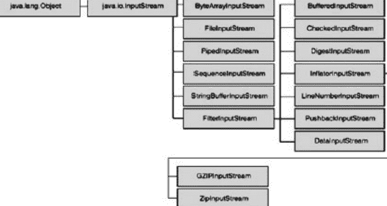

## InputStream 方法

`InputStream` 类包含了多种方法。

`abstract int read()` 读取单个字节、字节数组或字节数组的子数组。它返回读取的字节字节、读取的字节数，或者在到达文件末尾时返回 -1。

```
read(), which takes the byte array, reads an array or a subarray of bytes
returns a -1 if the end-of-file has been reached.
```

```
skip(), which takes long, skips a specified number of bytes of input and
returns the number of bytes actually skipped.
```

```
available() returns the number of bytes that can be read without blocking.
输入和输出都可以阻塞线程，直到字节被读取或写入。
```

```
close() 关闭输入流以释放系统资源。
```

## InputStream 标记

并非所有的 `InputStream` 都支持标记（marking）。标记允许你回到流中的标记位置，就像书签一样以便以后参考。记住，并不是所有的 `InputStream` 都支持标记。要测试流是否支持 `mark()` 和 `reset()` 方法，请使用布尔方法 `markSupported()`。

`mark()` 方法接受一个整数 `read_limit`，标记输入流中的当前位置，只要在 `mark()` 和 `reset()` 之间读取的字节数不超过指定的数量，`reset()` 就可以返回该位置。

## OutputStream 类

字节可以写入三种不同类型的汇点：

- 字节数组
- 文件
- 管道

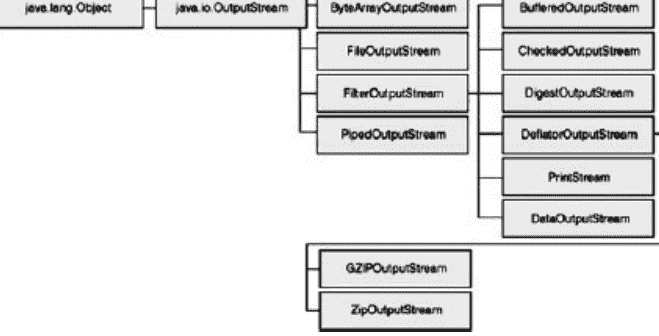

此图显示了 `OutputStream` 类。

让我们看看 `OutputStream` 类的示例。在将 `OutputStream` 发送其最终目的地之前，你可以对其进行过滤。例如，`BufferedOutputStream` 是 `FilterOutputStream` 的子类，它将要写入的值存储在缓冲区中，只有当缓冲区满时才将其写入。

`CheckedOutputStream` 和 `DigestOutputStream` 是 `FilterOutputStream` 类的一部分。它们在输出上计算校验和或消息散摘要。

`DeflatorOutputStream` 写入到 `OutputStream` 并创建一个 zip 文件。该类在运行时进行压缩。

`PrintStream` 类也是 `FilterOutputStream` 的子类，它实现了许多用于显示 Java 原型类型文本表示的方法。对于

## 示例

```
println(long)
```

```
println(int)
```

```
println(float)
```

```
println(char)
```

`DataOutputStream` 实现了 `DataOutput` 接口。`DataOutput` 定义了流所需的方法，用于以机器无关的二进制格式写入 Java 原型数据类型。

## OutputStream 方法

`OutputStream` 类提供了几个方法：

`abstract void write()` 方法接受一个整数字节并写入单个字节。

`void write()` 方法接受一个字节数组并写入字节数组或字节数组的子数组。

`void flush()` 方法强制写入任何缓冲输出。

`void close()` 方法关闭流并释放系统资源。

关闭你的输出文件是非常重要的，因为有时缓冲区不会被完全刷新，结果导致数据不。

## DataInput 和 DataOutput

`DataInput` 和 `DataOutput` 类定义了流所需的方法，用于以机器无关的二进制格式读取 Java 原型数据类型。它们由 `RandomAccessFile` 实现。

`ObjectInput` 接口扩展了 `DataInput` 接口，并增加了反序列化对象以及读取字节和字节数组的方法。

`ObjectOutputStream` 类创建一个可以被 `ObjectInputStream` 类反序列化的对象流。

`ObjectOutput` 接口扩展了 `DataOutput` 接口，并增加了序列化对象以及写入字节和字节数组的方法。

`ObjectOutputStream` 用于将对象、数组和其他值序列化到流中。

## 22.7 什么是 Reader？

Reader 是基于字符的输入流，读取 Unicode 字符。

`read()` 读取单个字符并将字符作为 0 到 65535 范围内的整数返回，或者在到达文件末尾时返回 -1。

`abstract read()` 将字符读取到数组的一部分（从偏移量到长度开始）并返回读取的字符数，或者在到达文件末尾时返回 -1。

`read()` API：

```
int read(char[] buffer, int offset, int length)
```

## 字符输入流

让我们看看 `java.io` 包中不同的字符输入流。

- 字符串
- 字符数组
- 管道

`InputStreamReader` 是一种字符输入流，它使用字节流作为源并转换为 Unicode 字符。

`LineNumberReader` 是 `BufferedReader` 的子类，它是一个跟踪已读取行数的字符输入流。

`PushbackReader` 是 `FilterReader` 的子类，它使用另一个输入流作为输入，并增加了将字符推回流的能力。

## 22.8 什么是 Writer？

Writer 是基于字符的输出流，写入字符字节并将 Unicode 转换为字节。基类包含这些方法：

`void write()` 方法接受一个字符并写入 16 位单个字符。

`abstract void write()` 方法接受一个字符数组并写入字符数组的一部分。

`write()` API：

```
void write(int character)
void write(char[] buffer, int offset, int length)
```

## 字符输出流

让我们看看 `java.io` 包中不同的字符输出流。该继承树有几个分支可以探索。像 Reader 一样，任何分支都是可用的。Writer 输出的汇点可以是：

- 字符串
- 字符数组

## 管道

`OutputStreamWriter` 使用字节输出流作为数据的目的地。

`BufferedWriter` 对字符输出流应用缓冲，通过将许多小的写入请求合并为一个大请求来提高输出效率。

`FilterWriter` 是一个抽象类，作为字符输出流的父类。这些流在写入其他字符输出流之前对其写入的数据进行过滤。

`PrintWriter` 是一种字符输出流，实现了 `print()` 和 `println()` 方法，这些方法可以输出原型值和对象的文本表示。

## 23.1 引言

本节重点关注源和汇点。代码示例帮助你直观地了解这些类的工作方式：

- 字节数组
- 管道
- 序列
- 字符数组

## 23.2 字节数组 (Byte arrays)

让我们进入字节数组领域。字节会来自字节数组吗？当创建一个 `ByteArrayInputStream` 对象时，会向它传递一个数组。然后你可以像使用 `InputStream` 一样从该数组读取字节。

`ByteArrayOutputStream` 写入字节数组。写入输出流的字节被添加到内部数组中。你可能想知道如何获取该字节数组。`toByteArray()` 方法可以在任何时间返回字节数组。此外，还有一个可用的 `toString()` 方法，它可以将字节数组作为 `String` 返回。因此，字节数组既可以是源，也可以是汇点。

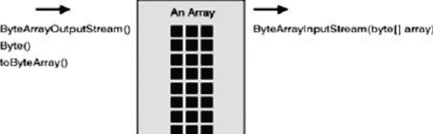

## 23.3 Java 代码中的管道 (Pipes)

什么是管道？管道是 Java 程序中两个线程之间通信的手段。一个线程写入管道输出流（piped output stream），另一个线程从连接到该输出流的管道输入流（piped input stream）中读取。

两个线程之间的管道工作原理 UNIX 和 MS-DOS 中两个进程之间的管道原理类似。

在这些操作系统中，一个进程的输出可以管道到另一个进程的输入。例如，在 MS-DOS 中，命令 `dir | more` 将 `dir` 命令的输出管道到 `more` 程序的输入中。

### 管道：示例代码

虽然管道通常与线程一起，但此示例简单地将数据写入管道，稍后将其读回。首先构造一个 `PipedReader`，以及一个写入到该 `PipedReader` 的 `PipedWriter`。属性以字符串的形式写入管道，用竖线作为分隔符，并在末尾放置换行符。`PipedReader` 的全部内容被作为 `String` 读取并显示。

我们稍后的“分词”（Tokenizing）部分将展示如何使用 `StringTokenizer` 将由分隔符划分的字符串拆分为单独的值。

### 示例


```java
import java.io.*;
import java.util.*;
class PipedExample {
    static BufferedReader system_in = new BufferedReader(InputStreamReader(System.in));
    public static void main(String argv[]) {

    PipedReader pr = new PipedReader();
    PipedWriter pw = null;
    try {
        pw = new PipedWriter(pr);
    } catch (IOException e) {
        System.err.println(e);
    }
    // Create it {
    // Read in three hotels for (int i = 0; i < 3; i++) {
    Hotel a_hotel = new Hotel();
    a_hotel.input(system_in);
    a_hotel.write_to_pw(pw);
    }
    // Print it {
    char [] buffer = new char[1000];
    int length = 0;
    try {
      length = pr.read(buffer);
    } catch (IOException e) {
      System.err.println(e);
    }
    String output =new String(buffer, 0, length);

    System.out.println("String is ");
    System.out.println(output);
}
class Hotel{
  private String name; 
  private int rooms; 
  private String location;
  boolean input(BufferedReader in) {
    try {
      System.out.println("Name: ");
      name=in.readLine();
      System.out.println("Rooms: ");
      String temp = in.readLine();
      rooms = to_int(temp);
      System.out.println("Location: ");
      location = in.readLine();
    } catch(IOException e) {
      System.err.println(e);
      return false;
    }
    return true;
  }
  boolean write_to_pw(PipedWriter pw){
    try {
      pw.write(name);
      Integer i = new Integer(rooms);
      pw.write(i.toString());
      pw.write(location);
      pw.write('\n');

      // red font indicates that an actual backslash n (carriage return character)
      // should be inserted in the code.
    }
    catch(IOException e) {
      System.err.println(e);
      return false;
    }
    return true;
  }
  void debug_print() {
    System.out.println("Name :" + name + ": Rooms :" + rooms + ": at :" + location+":");
  }
  static int to_int(String value) {
    int i = 0;
    try {
      i = Integer.parseInt(value);
    } catch(NumberFormatException e) {
    }
    return i;
  }
}
}
```

## 序列 (Sequences)

`SequenceInputStream` 组合了输入流并读取每个输入流直到结束。你可以使用 `SequenceInputStream` 读取两个或三个流，就像它们是一个流一样。你可以连接来自各种源的流，例如两个或多个文件。要构造 `SequenceInputStream`，你可以指定两个流或一个表示输入流集合的 `Enumeration`（枚举）。UNIX 中像“cat”之类的程序就会使用类似这样的结构。

`SequenceInputStream` 从给定的第一个底层输入流读取。

当第一个流耗尽时，它会打开下一个输入流并读取它。当下一个也耗尽时，它读取下一个，以此此类推。

用户并输入是从哪里传输的。

## 23.4 字符数组 (Char arrays)

现在让我们探索读取器（Readers）和写入器（Writers）。与 `ByteArrayOutputStream` 类似，我们写入字符数组。通过 `CharWriter`，你不仅可以指定数组，还可以指定起始位置（offset）以及在返回之前读取的字节数（length）。

通常，数组会被填充字符。`toString()` 方法返回字符串的当前值。`CharReader` 就像字符串的源。在这个示例中，我们没有写入管道，而是使用 `StringWriter`。String 用于包含数据。输出是完整的。

## InputStreamReader

`InputStreamReader` 从 `InputStream` 读取字节并将其转换为字符。`InputStreamReader` 使用字节的默认字符编码，通常是 ASCII。如果读取的字节是 ASCII 字节，则每次使用一个字节来形成一个字符。

如果字节不是 ASCII（例如中文或其他语言），你可能也希望将其转换为 Unicode。需要指定字节流的特定编码，`InputStreamReader` 会将其转换为 Unicode。通过备用构造函数，你可以指定 `InputStream` 上字节的编码。

# OutputStream

`OutputStream` 与 `InputStreamReader` 类似。输出字符是 Unicode 格式，它们通过 `OutputStream` 转换为机器的底层格式。转换后的字符被写入 `OutputStream`。底层的默认格式通常是 ASCII。但是，你可以通过备用构造函数指定特定的编码方案。

## 24.1 介绍

本节将探讨 `File` 类，这是一个重要的非流类，它以一种平台无关的方式表示文件或目录名称。`File` 类提供了以下方法：

- 列出目录

- 查询文件属性

- 重命名和删除文件

## 24.2 File 类

`File` 类操作磁盘文件，并用于构造 `FileInputStream` 和 `FileOutputStream`。`File` I/O 类的某些构造函数将 `File` 类型的对象作为参数。当我们构造一个 `File` 对象时，它代表磁盘上的该文件。当我们调用它的方法时，我们实际上是在操作底层的磁盘文件。

`File` 对象的方法有：

- 构造函数

- 测试方法（Test methods）

- 操作方法（Action methods）

- 列表方法（List methods）

## 24.3 构造函数

构造函数允许 Java 代码指定对象的初始值。因此，当你使用构造函数时，初始化成为了对象创建步骤的一部分。`File`类的构造函数有：

```java
File(String filename)
```

```java
File(String pathname, String filename)
```

```java
File(File directory, String filename)
```

## 24.4 测试方法

`File` 类中的公共方法对指定的文件进行测试。例如，`exists()` 方法询问文件是否真的存在。

`canRead()` 方法询问文件是否可读。

`canWrite()` 方法询问文件是否可以写入。

`isFile()` 方法询问它是否是一个文件（而不是目录）。

`isDirectory()` 方法询问它是否是一个目录。

这些方法都是 `boolean` 类型的，因此它们返回 `true` 或 `false`。

## 24.5 操作方法

`File` 类中的公共实例方法对指定的文件执行操作。让我们来看这些方法：

`renameTo()` 方法重命名文件或目录。

`delete()` 方法删除文件或目录。

`mkdirdir()` 方法创建 `File` 对象指定的目录。

`mkdirs()` 方法创建 `File` 规格中所有的目录和必要的父目录。

所有这些方法的返回类型均为 `boolean`，用于指示操作是否成功。

## 24.6 列表方法

`list()` 方法返回目录中所有未被可选 `FilenameFilter` 拒绝的条目名称。如果 `File` 是普通文件，`list()` 方法返回 `null`；否则返回目录中的所有名称。`list()` 方法可以接受一个 `FilenameFilter` 过滤器，并返回目录中符合过滤器的名称。

## FilenameFilter 接口

`FilenameFilter` 接口用于过滤文件名。你只需要创建一个实现 `FilenameFilter` 的类即可。Java 语言本身没有提供已实现的的标准 `FilenameFilter` 类，但实现此接口的对象会被 `FileDialog` 类和 `File` 类中的 `list()` 方法使用。

实现的 `accept()` 方法决定文件名是否应该包含在文件列表中。它接收目录和文件名。如果名称应该包含在列表中，则方法返回 `true`。

## File 类：示例代码

此示例展示了对文件存在性的测试以及列出 `C:\Windows` 目录。列出操作针对所有文件，然后针对符合过滤器的文件进行。

## 示例

```java
import java.io.*;
import java.util.*;
class FileClassExample
{
    public static void main(String argv[])
    {
        File a_file = new File("test.txt");

        if(a_file.canRead()) System.out.println("Can read file");
        if(a_file.isFile()) System.out.println("Is a file");
        File a_directory = new File("C:\\backslash\\windows");
        //红色字体表示实际的反斜杠 n（回车符）
        // 应该插入到代码中。 
        if (a_directory.isDirectory())
        {
            System.out.println("Is a directory");
            String names[] = a_directory.list();
            for (int i = 0; i < names.length; i++)
            {
                System.out.println("Filename is " + names[i]);
            }
        }
        System.out.println("Parent is " + a_directory.getParent());
        if (a_directory.isDirectory())
        {
            String names[] = a_directory.list(new MyFilter());
            for (int i = 0; i < names.length; i++)
            {
                System.out.println("Filename is " + names[i]);
            }
        }
    }
}

class MyFilter implements FilenameFilter
{
    public boolean accept(File directory, String name)
    {
        if (name.charAt(0) == 'A' || name.charAt(0) == 'a') return true;
    }
}
```

## FileInputStream 和 FileOutputStream

你可以打开一个文件进行输入或输出。

`FileInputStream` 从磁盘文件读取。你可以向构造函数传递文件名或代表该文件的 `File` 对象。`FileInputStream` 对象是数据源。

`OutputStream` 向磁盘文件写入。你可以向它传递一个 `File` 对象或名称。`OutputStream` 对象是数据汇。对于 `FileInputStream` 和 `FileOutputStream`，你读取和写入字节数据。

## File：示例代码

此示例的工作原理与示例类似，不同之处在于输出到文件。我们打开文件并将数据作为字节写入。关闭文件后，以读取模式打开它，读取文件中的所有字节，并将它们作为字符串打印。

## 示例


```java
import java.io.*;
import java.util.*;
class FileExample
{
    static BufferedReader system_in = new BufferedReader(new InputStreamReader(System.in));
    public static void main(String argv[])
    {
        // 创建它
        try {
            FileOutputStream fos = new FileOutputStream("file.dat");
            // 入
            for (int i = 0; i < 3; i++) {
                Hotel a_hotel = new Hotel();
                a_hotel.input(system_in);
                a_hotel.write_to_fos(fos);
            }
            fos.close();
        } catch (IOException e) {
            System.println(e);
        }

        // 现在显示它
        {
            byte [] buffer = null;
            File a_file = new File("file.dat");
            System.out.println("Length is " + a_file.length());
            System.out.println("Can read " + a_file.canRead());
            try {
                FileInputStream fis = new FileInputStream(a_file);
                int length = (int) a_file.length();
                buffer = new byte[length];
                fis.read(buffer);
                fis.close();
            } catch(IOException e) {
                System.out.println(e);
            }
            String s = new String(buffer);
            System.out.println("Buffer is " + s);
        }
    }
}

class Hotel
{
    private String name;
    private int rooms;
    private String location;

    boolean input(BufferedReader in)
    {
        try {
            System.out.println("Name: ");
            name = in.readLine();
            System.out.println("Rooms:");
            String temp = in.readLine();
            rooms = to_int(temp);
            System.out.println("Location: ");
            location = in.readLine();
        } catch(IOException e) {
            System.err.println(e);
            return false;
        }
        return true;
    }

    boolean write_to_fos(FileOutputStream fos)
    {
        try {
            fos.write(name.getBytes());
            Integer i = new Integer(rooms);
            fos.write(i.toString().getBytes());
            fos.write(location.getBytes());
            fos.write(" ");
        } catch (IOException e) {
            System.err.println(e);
            return false;
        }
        return true;
    }

    void debug_print()
    {
        System.out.println("Name :"+ name + ": Rooms : "+ rooms + ": at :"+ location+":":");
    }

    static int to_int(String value) 
    {
        int i = 0;
        try {
            i = Integer.parseInt(value);
        } catch(NumberFormatException e) {
            return i;
        }
        return i;
    }
}
```

# FileReader 和 FileWriter

`FileReader` 是 `InputStreamReader` 的一个便利子类。当你想要从文件读取字符时，`FileReader` 非常有用。`FileReader` 的构造函数假设默认字符编码和缓冲区大小。`FileReader` 构造函数使用 `InputStreamReader` 的功能将使用本地编码的字节转换为 Java 代码使用的 Unicode 字符。

如果你想从非默认编码的文件读取 Unicode 字符，你必须在 `FileInputStream` 上构建自己的 `InputStreamReader`。

`FileWriter` 是 `OutputStreamWriter` 的便利子类，用于写入字符文件。`FileWriter` 的构造函数也假设默认编码和缓冲区大小。如果你想使用除默认以外的编码，必须在 `FileOutputStream` 上创建自己的 `OutputStreamWriter`。

## 第 25 章

缓冲

## 25.1 什么是缓冲？

向文件读写数据，一次处理一个字节，是非常缓慢且费力的。加快这一过程的一种方法是给文件加一个包装器并为其设置一个缓冲区。

我们的 `BufferedInputStream` 将构造函数中指定的 `InputStream` 上放置一个缓冲区。实际的数据源是你传递给它的 `InputStream`。`BufferedInputStream` 从 `InputStream` 读取大块数据。然后，你从 `BufferedInputStream` 读取单个字节或小块字节。默认缓冲区大小为 512 字节，但如果你有特殊需求，有一个构造函数允许你指定缓冲区大小。

为了提高效率，你从 `BufferedInputStream` 对象中读取，而不是直接从底层的 `InputStream` 读取。这样你就不需要反复返回操作系统去读取单个字节了。

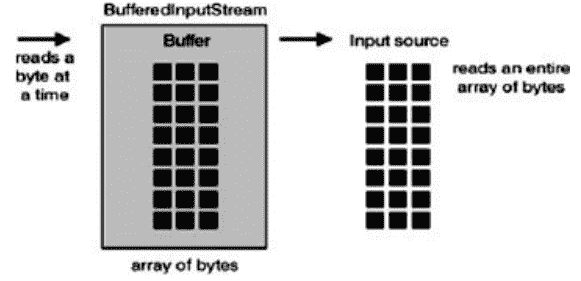

## BufferedOutputStream

`BufferedOutputStream` 继承自 `FilterOutputStream`。当你将其应用于 `OutputStream` 时，你就拥有了一个缓冲输出流。你不需要为写入的每个字节都访问操作系统，而是通过一个提供缓冲区的中间层并向该缓冲区写入。

当该缓冲区满时，它将一次性写入操作系统。如果缓冲区满了、流满了，或者 `flush()` 方法强制将流缓冲的任何输出写入其目标地，它就会自动写入。因此，对于 `BufferedOutputStream`，你需要告诉它：

- 你将要使用的输出流

- 如果你不喜欢默认值，指定的缓冲区大小

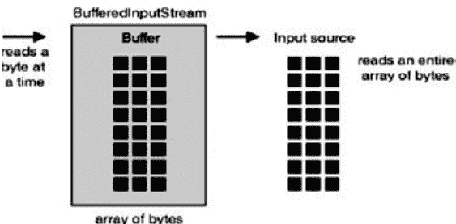

## 25.2 BufferedReader 和 BufferedWriter

`BufferedReader` 和 `BufferedWriter` 的作用类似于 `BufferedOutputStream` 和 `BufferedInputStream`，不同之处它们处理的是字符的读写。对于 `BufferedReader`，你指定一个底层的 `Reader` 以及可选的缓冲区大小。对于 `BufferedWriter`，你指定一个底层的 `Writer` 以及可选的缓冲区大小。

`BufferedReader` 有一个额外的方法称为 `readLine()`，它允许我们简单地从底层的 `Reader` 读取一整行字符。

## BufferedReader：示例代码

如果你一直使用 Java 1.0，`readLine()` 方法实际上是 `DataInputStream` 的一部分。现在你应该使用 `BufferedReader` 来调用 `readLine()`，尽管你仍然可以使用 `DataInputStream` 实现它。

`DataInputStream` 读取的是字节，但当你读取行时，你实际上是在读取字符，因此使用 `readLine()` 和 `BufferedReader` 是首选方法。

## 示例

```java
import java.io.*;
import java.util.*;
```

```java
class TextReaderWriterExample
{
    static BufferedReader system_in = new BufferedReader(
(new InputStreamReader(System.in)));
    public static void main(String argv[])
    {
        // 创建它

        try {
            FileOutputStream fos = new FileOutputStream("text.dat");
            PrintWriter pw = new PrintWriter(fos);
            for (int i = 0; i < 3; i++) {
                Hotel a_hotel = new Hotel();
                a_hotel.input(system_in);
                a_hotel.write_to_pw(pw);
            }
            pw.close();
        } catch (IOException e) {
            System.err.println(e);
        }

        // 现在读取它
        try {
            FileReader fr = new FileReader("text.dat");
            BufferedReader br = new BufferedReader(fr);
```

```java
Hotel a_hotel = new Hotel();
while (a_hotel.read_from_br(br))
{
    a_hotel.debug_print();
}

br.close();
}
catch (IOException e)
{
    System.err.println(e);
}
}
}
class Hotel
{
    private String name;
    private int rooms;
    private String location;
    boolean input(BufferedReader in)
{
        try {
            System.out.println("Name: ");
            name = in.readLine();
            System.out.println("Rooms: ");
            String temp = in.readLine();
            rooms = to_int(temp);
            System.out.println("Location: ");
            location = in.readLine();
        }
    }
```

```java
catch(IOException e)
{
    System.err.println(e); return false;
}

return true;
}
```

```java
boolean write_to_pw(PrintWriter pw)
{
    pw.print(name);
    pw.print('|');
    pw.print(rooms);
    pw.print('|');
    pw.print(location);
    pw.println();
    return true;
}
```

```java
boolean read_from_br(BufferedReader br)
{
    try {
        String line = br.readLine();
        if (line == null) return false;
        StringTokenizer st = new StringTokenizer(line, "|");
        int count = st.countTokens();
        if (count < 3) return false;
        name = st.nextToken();
        String temp = st.nextToken();
        rooms = to_int(temp);
        location = st.nextToken();
    }
```

```java
catch(IOException e)
{
    System.err.println(e);
    return false;
}

return true;
}
void debug_print()
{
    System.out.println("Name: " + name + ": Rooms: " + rooms + ": at: " + location);
}
static int to_int(String value)
{
    int i = 0;
    try {
        i = Integer.parseInt(value);
    } catch (NumberFormatException e) {
    }
    return i;
}
```

## BufferedWriter

正如我们提到的，`BufferedWriter` 允许我们写入缓冲区，通过合并多次写入请求来提高输出效率。该类有一个有趣的额外方法可以让 Java 代码具有移植性。与其输出 `\n`，不如调用 `newline()`，它会输出平台相关的行分隔符。在大多数情况下，这是 `\n`。

## 换行

你可能会问，Java 语言如何知道为特定的操作系统表示行？Java 的 `newline()` 方法询问：“你的换行符是什么？”在 Java 语言中，这被称为系统属性。当你通过将 `line.separator` 传递给 `System` 类的 `getProperty()` 方法来询问“你的换行符是什么？”时，你会得到一个回复。根据平台的不同，换行符可以是换行符、回车符或两者都有。

`newline()` 方法是 `BufferedWriter` 的一部分，它将平台分隔符输出到流中。

## 如何使用 BufferedWriter

你通常对输出使用 `BufferedWriter`。只有当你为用户编写提示信息时，才不想使用缓冲输出。提示只有在缓冲区满时才会出现，因此对于这类情况，你不希望使用缓冲。

`PrintWriter()` API:

```java
PrintWriter out = new
PrintWriter (new BufferedWriter (new FileWriter("file.out")));
```

## 26.1 什么是过滤？

使用过滤是从规模得得输入或输出流中读取或写入数据的子集。过滤可以与数据格式无关（例如，你需要统计列表中的项目数量），也可以与数据格式直接相关（例如，你需要获取表格某行中的所有数据）。你将过滤器附加到输入或输出流上以过滤数据。

`FilterInputStream` 和 `FilterOutputStream` 过滤输入和输出字节。创建 `FilterInputStream` 时，会为它指定一个 `InputStream` 来进行过滤。同样，在创建 `FilterOutputStream` 时，你会指定一个 `OutputStream` 进行过滤。它们封装了现有的 `InputStream` 或 `OutputStream`，以提供缓冲、校验和等功能。


对于字符 I/O，我们有抽象类 `FilterWriter` 和 `FilterReader`。`FilterReader` 是字符输入流的超类，从另一个字符输入流读取数据并进行过滤，并在调用自己的 `read()` 方法时返回过滤后的数据。`FilterWriter` 用于字符输出流，在将数据写入另一个字符输出流之前对其写入的数据进行过滤。

# 回退 API (Pushback APIs)

```
PushbackInputStream(InputStream is)
void unread(int byte)
void unread(byte [] array)
```

```
PushbackReader(Reader in) void unread(int character) void unread(char [] buffer)
```

## 26.2 回退 (Pushback)

你使用 `PushbackInputStream` 实现一个单字节的回退缓冲区或指定长度的回退缓冲区。它可以用于解析数据。你什么时候会使用它？

有时当你从 `InputStream` 读取一个字节时，它意味着一个新数据块的开始（例如，一个新的标记）。你可能会说：“我已经读了这个字节，但现在真的无法处理它。我想把它推回 `InputStream` 中。当我以后回来读取 `InputStream` 时，我想再次获取那个相同的字节。”

你使用 `unread()` 方法将字节推回流。当你再次读取它时，你将读到之前 `unread()` 的数据。你可以 `unread()` 单个字节、字节数组，或者带有偏移量和长度的字节数组。

如果你在读取字符，可以回退字符而不是字节。你使用 `PushbackReader`，它的工作方式与 `PushbackInputStream` 相同。

使用 `unread()` 方法回退单个字符、字符数组，或者带有偏移量和长度的字符数组。

`LineNumberReader` 与 `LineNumberInputStream`。

`LineNumberReader` 是一种字符输入流，它可以跟踪从它中读取的文本行数。行被认为由换行符 (`\n`)、回车符或回车符后跟换行符来终止。`readLine()` 方法返回行中的所有字符，但不包含终止符。`getLineNumber()` 方法返回已读取的行数。

如果由于某种原因，你想重置行号，可以通过 `setLineNumber()` 来此，并从该点开始重新计算行数。

`LineNumberInputStream` 也会跟踪已读取的数据行数，但该类在 Java 1.1 中就被废弃了，因为它读取的是字节而不是字符。引入了 `LineNumberReader`，它读取的是字符。

# LineNumberReader API

```
LineNumberReader(Reader r)
LineNumberReader(Reader r, int buffer_size)
String readLine() int getLineNumber()
void setLineNumber(int line_num)
```

`PrintStream` 与 `PrintWriter`

`PrintStream` 用于将 Java 数据作为文本输出。它实现了许多方法来显示 Java 原始数据类型的文本表示。

你可能从最早 Java 编程开始就开始使用 `PrintStream` 对象了。`System.out` 就是一个 `PrintStream` 对象。可能每个人都用它进行过调试！尽管如此，`PrintStream` 在 Java 1.1 中被 `PrintWriter` 取代了。该类的构造函数已经被废弃，但该类本身没有，因为它仍然被 `System.out` 和 `System.err` 标准输出流使用。

`PrintStream` 和 `PrintWriter` 中的方法非常相似。`PrintWriter` 没有写入原始字节的方法，而 `PrintStream` 有。

# 刷新 (Flushing)

`PrintStream` 和 `PrintWriter` 类都采用了刷新机制，会将数据从内部缓冲区移动到输出流。刷新通过两种方式实现：

- 自动刷新，即当你调用 `println` 时会进行刷新。

- 不带自动刷新，即只有在调用 `flush()` 方法时才会发生刷新。

对于 `PrintStream` 类，如果写入了换行符，输出就会刷新。在 `PrintWriter` 类中，如果你启用了自动刷新，则只有在调用 `println()` 方法时输出才会刷新。`PrintWriter` 的 `println()` 方法使用系统属性 `line.separator`，而不是 `PrintStream` 使用的换行符 (`\n`)。

# PrintWriter 过程

你可以给 `PrintWriter` 构造函数提供一个 `Writer`，也可以给它一个 `OutputStream`。对于后者，会透明地创建一个 `OutputStreamWriter`，它使用默认字符编码执行字符到字节的转换。

你可以选择两种刷新选项之一：带自动刷新或不带自动刷新。你可以使用 `print()` 方法打印不带换行的整数、字符串和字符，并使用 `println()` 方法打印带换行的内容。

# PrintWriter() API

```
PrintWriter (Writer w)
PrintWriter (Writer w, Boolean autoflush)
PrintWriter (OutputStream os)
PrintWriter (OutputStream os, Boolean autoflush)
```

## 26.3 校验和 (Checksumming)

本节探讨校验和。`Checksum` 是几个类实现的一个接口。让我们来看看它涵盖什么：

- 什么是校验和？它是如何工作的？

- 什么是消息摘要 (message digest)？它是如何工作的？

校验和与消息摘要 (Checksum versus message digest)

什么是校验和？`Checksum` 接口定义了计算校验和所需方法。当一个位或两个位发生变化时，值就会改变。校验和是根据提供 `update()` 方法的字节计算的。此外，可以随时获取校验和的当前值。使用 `reset()` 方法可以重置其初始值（通常为 0）。

校验和有两种类型。最常见的是 CRC32，即循环冗余校验。另一种类型的校验和是 Adler32，用于计算 Adler32。它的可靠性几乎与 CRC32 一样高。

# Checksum 方法

```
long getValue()
void reset()
```

```
void update(byte [] array, int offset, int length)
```

# CheckedInputStream 和 CheckedOutputStream

让我们创建一个 `Checksum` 对象并使用它来过滤输入或输出流。当向 `CheckedOutputStream` 写入字节时，会自动计算校验和。`CheckedOutputStream` 会调用 `Checksum` 对象中的 `update()` 方法。然后，该字节将发送到其最终目的地。在任何时刻，你都可以向 `Checksum` 对象询问当前校验和。你可以写出所有字节。

使用 `OutputStream` 和 `Checksum` 类型的对象构造 `CheckedOutputStream`。CRC32 和 Adler32 是你可以选择或创建的两种校验和类型。周期性地（例如每 512 字节），获取当前校验和并将这四个字节通过流发送。

在接收端，你使用 `InputStream` 和与 `CheckedOutputStream` 相同类型的对象构造 `CheckedInputStream`。读取 512 字节后，获取当前校验和，并与从流中读取的下四个字节进行比较。

# CheckedOutputStream：示例代码

让我们来看一些示例代码。我们将打开一个 `FileOutputStream(Temp.tmp)`。构造一个 CRC32 类型的对象，并用它创建一个 `CheckedOutputStream`。当逐个字节地写入文件时，会计算校验和。最后，询问 `Checksum` 对象的当前校验和值。

校验和只能给你提供一个 32 位的值。如果一个位发生变化，你会注意到，但如果许多位发生变化，你可能会得到相同的校验和。

以下是示例代码：

```java
FileOutputStream os = new FileOutputStream("Temp1.tmp");
```

```java
CRC32 crc32 = new CRC32(); CheckedOutputStream cos = new CheckedOutputStream(os, crc32);
```

```java
cos.write(1);
```

```java
cos.write(2);
```

```java
long crc = crc32.getValue();
```

## 26.4 摘要 (Digesting)

让我们创建一个比校验和（Checksum）更大的东西。一个表示字节序列的更大位集合被称为消息摘要（message digest）。消息摘要的工作原理类似于校验和。它是一种单向哈希，接收可变的数据并创建一个固定长度的哈希值。这被称为数字指纹。

如果有人对原始序列进行了更改并操纵了内容，消息摘要将变得不再相同。这就是我们实现安全的方式。虽然存在可能，但概率非常小：如果消息被更改了，你仍然可能得到相同的消息摘要。

字节序列被转换为摘要。在 `MessageDigest` 类中，我们有一个名为 `getInstance()` 的静态函数。`getInstance` 接收我们想要使用的 `MessageDigest` 的名称。你可以向它传递两个字符串：SHA-1 和 MD5。它们的细节请参考算法类书籍。

此外，`update()` 方法通过字节或字节数组更新摘要。`digest()` 方法计算并返回 `digest` 的值。随后，摘要会被重置。

### 摘要方法

```java
static MessageDigest getInstance(String algorithm)
void update(byte [] array)
byte [] digest()
```

### DigestInputStream 和 DigestOutputStream

我们提供了两种等效的摘要方法：`DigestInputStream` 和 `DigestOutputStream`。为 `DigestInputStream` 传入一个输入流和一个将执行计算的 `MessageDigest`。你可以对流进行开启或关闭摘要功能。你可能想要输入或输出某些数据，但不想将其作为 `MessageDigest` 的一部分进行计算。

`read()` 和 `write()` 方法分别更新 `DigestInputStream` 和 `DigestOutputStream` 中的 `MessageDigest`。

### MessageDigest: 示例代码

第一行创建一个指向 `temp.tmp` 文件的 `FileOutputStream`。创建一个 `MessageDigest` 对象。正如代码 `md = MessageDigest.getInstance()` 所示，你正在向它传递你想要使用的消息摘要算法名称。它返回一个 `MessageDigest` 类型的对象。如果你传递的字符串不是摘要名称，它会抛出 `NoSuchAlgorithmException`。

在获取 `MessageDigest` 后，使用它来构建一个 `DigestOutputStream`。字节被写入底层的 `OutputStream` 并添加到摘要中。你可以通过调用 `md.digest()` 获取 `MessageDigest`。它返回摘要或一个字节数组。现在你可以存储它或将其发送。

### 示例

```java
FileOutputStream os = new FileOutputStream("Temp.tmp");
MessageDigest md = null;
try
{
    md = MessageDigest.getInstance("SHA");
}
catch(NoSuchAlgorithmException e) 
{
    System.out.println(e);
}

DigestOutputStream dos = new DigestOutputStream(os, md);
dos.write(1);
dos.write(2);
byte [] digest = md.digest();
```

## 26.5 校验和与消息摘要 (Checksum versus MessageDigest)

记住，校验和是很小的。校验和通常用于验证跨越噪声传输线的数据完整性，或验证文件是否包含相同的数据。相比之下，消息摘要大得多。它更多用于安全领域，以确保消息未被篡改。

## 26.6 膨胀与压缩 (Inflating and deflating)

本节探讨 Java 代码中的膨胀和压缩。这些术语与“压缩”和“解压缩”相同。本节的一些要点包括：

- `DeflaterInputStream` 和 `DeflaterOutputStream`

- `ZipInputStream` 和 `ZipOutputStream`

- `ZipFile`

### Deflater

让我们进入压缩领域。压缩（Deflating）将字节的压缩表示写入输出流。膨胀（Inflating）则从输入流获取这些压缩字节，读取它们并自动对其进行解压缩。这个过程类似于在线压缩和解压缩。

`Deflater` 的算法应用于输出到流的字节，而 `Inflater` 的相应算法应用于从流输入的字节。默认的 `Deflater` 和 `Inflater` 使用 ZLIB 压缩库进行压缩和解压缩。替代构造函数允许使用 GZIP 和 PKZIP 压缩。

### DeflaterOutputStream

让我们开启输出流之旅。你可以简单地通过一个输出目标创建一个 `DeflaterOutputStream`。当我们向 `DeflaterOutputStream` 写入时，字节将使用 `Deflater` 算法进行压缩，并且只有压缩后的字节会被发送到底层的输出流。`DeflaterOutputStream` 的默认构造函数使用带有默认大小缓冲区的 ZLIB 压缩。通过其他构造函数，你可以指定不同的 `Deflater` 和不同大小的缓冲区。

### InflaterInputStream

在接收端，实现了一个 `InflaterInputStream`。当我们构造它时，指定一个输入源。它会在你处理的过程中对该源的字节进行解压缩。再次，如果你使用不同的压缩方案，可以指定自己的 `Inflater`。

如果你决定使用自己的 `Deflater` 或 `Inflater` 而不是默认值，那么就是……

## 26.7 ZipInputStream

`ZipInputStream` 是我们的下一个停点。你可以使用该类在流中读取 zip 文件。你获取已压缩目录中的第一个条目。然后你可以读取第一个条目的的数据，它是自动解压缩的。接着你获取下一个条目并解压缩，以此类推。`ZipInputStream` 继承自 `InflaterInputStream`。方法包括从表中获取下一个条目以及关闭条目。关闭条目允许在不完成当前条目数据的情况下读取下一个条目。`ZipInputStream` 中的 `read()` 方法在读取最后一个条目时返回 -1。

### ZipInputStream 方法

```
getNextEntry()
closeEntry()
read()
```

### ZipInputStream: 示例代码

下面的代码解压缩文件的示例。你将打开 `test.zip`，即我们的 zip 文件。该文件是 `ZipInputStream` 的源。因此 `zis` 指向 `test.zip`。`getNextEntry()` 方法最初返回 zip 文件表的第一个条目。现在可以使用该条目的引用。


```java
import java.util.zip.*;
import java.util.*;
import java.io.*;

class ZipFileExample {
    public static void main(String argv[]){
        try {
            ZipFile zf = new ZipFile("test.zip");
            // 举举条目
            Enumeration zip_entries = zf.entries();
            String last_name = null;
            while (zip_entries.hasMoreElements()) {
                ZipEntry ze = (ZipEntry) zip_entries.nextElement();
                System.out.println("Entry " + ze.getName());
                last_name = ze.getName();
            }
            // 让我们作为示例解压最后一个
            // 它的包在 last_name 中
            ZipEntry ze = zf.getEntry(last_name);
            if (ze == null) {
                System.out.println("Cannot find entry");
            } else{
                BufferedReader r =new BufferedReader(new InputStreamReader(zf.getInputStream(ze)));
                long size = ze.getSize();
                if (size > 0){
                    System.out.println("File is " + size);
                    String line = r.readLine();
                    if (line != null) {
                        System.out.println("First line is " + line);
                    }
                    r.close();
                }
            }
        }
        catch(IOException e){
            System.out.println(e);
        }
    }
}
```

如果条目为 `null`，则意味着已到达文件末尾。从此处开始从 zip 文件读取时，读取的数据对应于该条目并自动解压缩。在这种情况下，已经包装了一个 `DataInputStream` 并用于读取它。`dis` 将直接从 zip 文件中的相应位置读取并关闭它。下一个条目将打开文件并再次从 zip 文件开始读取，读取下一个条目。

# 示例

```java
import java.util.zip.*;
import java.io.*;
class ZipInputStreamExample {
    public static void main(String[] argv) {
        try {
            FileInputStream fis = new FileInputStream("test.zip");
            ZipInputStream zis = new ZipInputStream(fis);
            ZipEntry ze =
            // 获取第一个条目 ze = zis.getNextEntry();
            if (ze == null) {
                System.out.println("条目结束");
            } else {
                // 作为流或读取器使用
                DataInputStream dis = new DataInputStream(zis);
                int i = dis.readInt();
                System.out.println("文件包含 " + i);
                zis.closeEntry();
            }
        } catch(Exception e) {
            System.out.println(e);
        }
    }
}
```

## 26.8 ZipOutputStream

`ZipInputStream` 读取 zip 格式流；`ZipOutputStream` 写入 zip 格式的流。此类允许我们创建 zip 文件。

`ZipOutputStream` 继承自 `DeflaterOutputStream`。`ZipOutputStream` 中的一个方法是 `putNextEntry()`，它将下一个条目放入压缩文件列表中。你需要为要压缩的每个文件创建一个 zip 条目。

`putNextEntry()` 方法写入一个条目并为数据输出定位流。你可以开始写入下一组压缩数据。与其他类中的 `close()` 方法类似，`closeEntry()` 方法会关闭已完成的条目；此时你就可以准备创建下一个条目了。

## ZipOutputStream 方法

- `putNextEntry()`

- `closeEntry()`

- `write()`

## ZipOutputStream：示例代码

在下面的代码中，构造了一个名为 `test.zip` 的输出文件。然后使用该文件构造了一个 `ZipOutputStream`。我们希望将 `test.txt` 文件压缩到 zip 文件中，因此我们使用该名称构造了一个 `ZipEntry`。`test.txt` 将出现在 zip 文件的目录中。此时，任何写入 `ZipOutputStream` 的内容现在都是该条目的数据，并以压缩形式写入。

在 `zos` 之上包装了一个 `DataOutputStream`。然后我们写入一个整数，并关闭了该条目。此时，可以再次创建并写入另一个 `ZipEntry`。你可以使用 WinZip 解压缩此文件，或使用前面的示例来读取该文件。

# 示例

```java
import java.util.zip.*;
import java.io.*;
class ZipOutputStreamExample {
    public static void main(String argv[]) {
        try {
            FileOutputStream fos = new FileOutputStream("test.zip");
            ZipOutputStream zos = new ZipOutputStream(fos);
            ZipEntry ze = new ZipEntry("test.txt");
            zos.putNextEntry(ze);
            // 作为输出使用
            DataOutputStream dos = new DataOutputStream(zos);
            dos.writeInt(1);
            zos.closeEntry();
            // 另一个条目或关闭它 zos.close();
        } catch (Exception e) {
            System.out.println(e);
        }
    }
}
```

## 27.1 什么是数据 I/O？

有几个类实现了 `DataInput` 和 `DataOutput` 接口。让我们来讨论它们是如何工作的。

原始数据类型（如 `int`）在 Java 代码运行的不同平台上可能有不同的表示方式。例如，一个 `int` 可能会以最高有效字节在前（称为大端，Big Endian）表示，如在 IBM 主机上；或者以最低有效位字节在前（称为小端，Little Endian）表示，如在 IBM PC 上。如果你在一个平台上用 C 程序以二进制形式写入一个 `int`，并尝试在另一个平台上读取它，值将无法一致。

这就是 `DataInput` 和 `DataOutput` 发挥作用的地方。现在你可以获取一个原始类型（如 `int`）并将其写入。它是以平台无关的形式写入的。你可以在任何其他 Java 虚拟机中读取它，无论它产生于何，它都会转换回具有正确值的 `int`。

所有原始类型（如 `double`、`int`、`short`、`long` 等）都可以使用 `DataOutput` 中的方法以系统平台无关的方式写入。同样，它们可以使用 `DataInput` 中的方法进行读取。

## 27.2 Unicode 文本格式

`String` 对象以 Unicode 文本格式（简称为 UTF）写入。字符串由双字节 Unicode 字符组成。UTF 是一种压缩最常用 Unicode 值的方法。如果字符串仅包含 ASCII 字符，1 到 127 之间的值将作为单个字节写入。128-2047 之间的值被写入两个字节。对于某些不常用的 Unicode 值，使用三个字节来表示其值。这种空间的扩展比 ASCII 值的压缩要罕得多，因此使用 UTF 来表示 `String` 是净收益的。

## Unicode 方法

```java
void writeUTF(String s)
String readUTF()
```

## DataInputStream 和 DataOutputStream：示例代码

两个类 `DataInputStream` 和 `DataOutputStream` 实现了 `DataInput` 和 `DataOutput`。它们的方法包括 `readInt()`、`writeInt()` 以及接口中的其他方法的实现。`DataInputStream` 包装在其之上。当调用 `readInt()` 时，将从底层流中读取字节。下面的示例展示了可以在 PC 上写入的 `DataOutputStream`。

# 示例

```java
import java.io.*;
class DataOutputExample {
    static void main(String argv[]) {
        try {
            FileOutputStream fos = new FileOutputStream("data.dat");
            DataOutputStream dos = new DataOutputStream(fos);
            // 创建它
            for (int i = 0; i < 3; i++) {
                Hotel a_hotel = new Hotel();
                a_hotel.write_to_dos(dos);
            }
            dos.close();
        } catch (IOException e) {
            System.out.println(e);
        }

        // 现在读取它
        try {
            FileInputStream fis = new FileInputStream("data.dat");
            DataInputStream dis = new DataInputStream(fis);
            BufferedReader system_in = new BufferedReader(new InputStreamReader(in));
            Hotel a_hotel = new Hotel();
            while (a_hotel.read_from_dis(dis)) {
                a_hotel.debug_print();
            }
            dis.close();
        } catch (IOException e) {
            System.out.println(e);
        }
    }

    class Hotel {
        private String name;
        private int rooms;
        private String location;

        boolean input(BufferedReader in) {
            try {
                System.out.println("Name: ");
                name = in.readLine();
                System.out.println("Rooms: ");
                String temp = in.readLine();
                rooms = to_int(temp);
                System.out.println("Location: ");
                location = in.readLine();
            } catch (IOException e) {
                System.out.println(e);
                return false;
            }
            return true;
        }

        boolean write_to_dos(DataOutputStream dos) {
            try {
                dos.writeUTF(name);
                dos.writeInt(rooms);
                dos.writeUTF(location);
            } catch (IOException e) {
                System.out.println(e);
                return false;
            }
            return true;
        }

        boolean read_from_dis(DataInputStream dis) {
            try {
                name = dis.readUTF();
                rooms = dis.readInt();
                location = dis.readUTF();
            } catch (EOFException e) {
                return false;
            } catch (IOException e) {
                System.out.println(e);
                return false;
            }
            return true;
        }

        void debug_print() {
            System.out.println("Name: " + name + ": Rooms: " + rooms + ": at: " + location + ":");
        }

        static int to_int(String value) {
            int i = 0;
            try {
                i = Integer.parseInt(value);
            } catch (NumberFormatException e) {}
            return i;
        }
    }
}
```

## 27.3 RandomAccessFile: 示例代码

`RandomAccessFile` 同时实现了 `DataInput` 和 `DataOutput`。你通过文件名构造一个 `RandomAccessFile`。然后，你可以在 `RandomAccessFile` 上同时使用读取和写写方法，例如 `readInt()` 和 `writeInt()`。

随机访问意味着你可以将下一次读取或写入操作定位在文件中特定的字节位置。你可以通过 `getFilePointer()` 获取当前位置。稍后，可以通过将该位置传递给 `seek()` 返回相同的位置。

下面的示例代码展示了向文件写入三个整数（`int`）。在第二次写入之前的文件位置存储在指针中。在写入接两个整数后，位置恢复到该指针。`readInt()` 返回了值 15。

# 示例


```java
import java.io.*;
class RandomAccessFileExample {
    public static void main(String arg[]) {
        try {
            RandomAccessFile raf = new RandomAccessFile("random.dat", "rw");
            raf.writeInt(12);
            long pointer = raf.getFilePointer();
```

```java
            raf.writeInt(15);
            raf.writeInt(16);
            // 现在读回第二个一个
            raf.seek(pointer);
            int i = raf.readInt();
            System.out.println("Read " + i);
        } catch (IOException e) {
            System.out.println(e);
        }
    }
}
```

## 28.1 什么是对象序列化？

对象序列化允许你获取所有的数据属性，将它们作为对象写入，并作为对象读回。当你需要使用对象持久化时，对象序列化是非常有用的。JavaBeans 的 GUI 构建器使用序列化来存储 JavaBean 的属性，以便他人访问或修改它们。

你实际上可以使用 `DataOutputStreams` 和 `DataInputStream` 逐个写入每个属性，然后在另一端将它们读回。但你想处理的是整个对象，而不是它的单个属性。你希望能够简单地存储一个对象或通过对象流发送它。对象序列化获取对象的成员变量并将其存储或检索它们，或者通过流发送它们。

你拥有 `ObjectInput` 接口（它扩展了 `DataInput` 接口）和 `ObjectOutput` 接口（它扩展了 `DataOutput`），因此你仍然会拥有 `readInt()`、`writeInt()` 等方法。实现 `ObjectInput` 的 `ObjectInputStream` 将读取 `ObjectOutputStream` 输出的内容。

## 28.2 对象序列化是如何工作的

如果你想使用 `ObjectInput` 和 `ObjectOutput` 接口，该类必须是可序列化的。类如何变为可序列化？

可序列化特性在类首次定义时分配。你的类必须实现 `Serializable` 接口。这个标记接口告诉 Java 虚拟机你希望允许此类是可序列化的。你不需要添加任何额外的方法或其他内容。

可序列化类还有其他几个特征。首先，它必须有一个零参数构造函数。当你读取对象时，它需要能够构造并为对象分配内存，并将根据从序列化流中读取的内容来填充该内存。

静态字段（或类属性）不会被保存，因为它们不是对象的一部分。如果你不想让某个数据属性被序列化，可以将其标记为 `transient`。这可以节省传输对象所需的存储空间或传输量。

### 使用 ObjectOutputStream: 示例代码

使用 `object.dat` 创建一个 `FileOutputStream`，它将用于存储对象。

你使用该文件创建 `ObjectOutputStream`。任何其他 `OutputStream`（例如通过套接字的 `getOutputStream()` 返回的）都可以使用。现在你有了你的 `YourClass`。这是你自定义的任何类。你创建了该类的实例。如果你想将其存储在 `ObjectOutputStream` 中，只需调用 `writeObject()` 并传递该对象即可。就这样！

该类可能包含 20 个属性或或 50 个属性；这并不重要。所有这些属性都会被自动存储。类信息也会自动存储。

Java 代码知道类中包含的内容，也知道类中的属性。事实上，当代码第一次存储此类对象时，它会存储一些关于该类是什么的标记。调用 `writeObject()` 就是存储对象所需要的所有操作。

以下是示例代码：

```java
FileOutputStream fos = new FileOutputStream("object.dat");
ObjectOutputStream oos = new ObjectOutputStream(fos);
YourClass yc = new YourClass();
oos.writeObject(yc);
```

## 28.3 从文件读取对象: 示例代码

现在让我们从文件中读取该对象。使用上一个面板中写入的 `object.dat` 文件创建一个 `FileInputStream`。该文件被用作 `ObjectInputStream` 的数据源。你想读取对象，所以我们调用 `readObject()`，对象从文件中被读出。`YourClass` 的属性用我们存储的数据所填充。

`readObject()` 方法返回一个 `Object` 类对象的引用。你写出了一个 `YourClass` 对象，因此你必须将引用强制转换为 `YourClass`。你必须记住写入的顺序。如果你存储了一个 `YourClass` 对象，然后又存储了一个 `AnotherClass` 对象，你必须按照相同的顺序读回它们。

通常，你会按顺序写入内容，然后按顺序读回它们。

```java
FileInputStream fis = new FileInputStream("object.dat");
ObjectInputStream ois = new ObjectInputStream(fis);
YourClass yc = (YourClass) ois.readObject();
```

## 28.4 其他实现方法: 示例代码

如果你想使用 `ObjectInput` 和 `ObjectOutput` 接口，该类必须是可序列化的。

## 28.5 添加序列化: 示例代码

## 28.6 自定义序列化: 示例代码

```java
return value;
}
void setValue(int value)
{
    this.value = value;
}
}
```

```java
class YourClass extends ABaseClass implements Serializable
{
    int another;
    private void readObject(ObjectInputStream ois) throws IOException, ClassNotFoundException {
        ois.defaultReadObject();
        setValue(ois.readInt());
    }
    private void writeObject(ObjectOutputStream oos) throws IOException {
        oos.defaultWriteObject();
        oos.writeInt(getValue());
    }
}
```

## 28.7 Externalizable: 代码

随着你对 Java 编程经验的增加，你可能会想要自定义某些操作执行的方式。你希望实现一套完全自定义的数据持久化方法。

如果你想为存储基类或父类数据添加自己的自定义代码，你必须实现 `Externalizable`。`Externalizable` 有两个方法：`readExternal()` 和 `writeExternal()`。在这种情况下，你对一切完全负责。

以下是示例代码：

```java
private void readExternal(ObjectInputStream os) throws IOException, ClassNotFoundException
private void writeExternal(ObjectOutputStream os) throws IOException
```

Java 在 `java.io` 包下封装了用于对象序列化和反序列化的 API，包括：

```
java.io.Serializable
```

```java
java.io.Externalizable
```

```
ObjectInputStream
```

## 序列化 (Serialization)

序列化是将对象状态写入文件、文本文件或标记文件中的过程。当你使用诸如 Hibernate、RMI、JPA、EJB 等分布式技术时，你可能会被要求在文件中存储对象的状态。`String` 类和所有包装类默认都实现了 `java.io.Serializable` 接口。序列化主要用于在网络上传输对象。序列化后的对象与 JVM 无关，可以被任何 JVM 重新序列化。在这种情况下，“内存中”的 Java 对象状态转换为字节流。这种类型的文件用户是无法理解的。它是一种特殊的对象，即由 JVM（Java 虚拟机）重用。这种序列化对象的过程也称为对象的解压缩（deflating）或封化（marshalling）。

给出的示例展示了对对象的序列化实现。该程序接收一个机器可以识别的文件名，然后序列化对象。要序列化的对象必须实现 `java.io.Serializable`。对象的默认序列化机制会写入对象的类、类签名以及所有非瞬（transient）和非静态（static）字段的值。`ObjectOutputStream` 类扩展 `java.io.OutputStream`，`ObjectOutput` 接口扩展 `DataOutput` 接口并增加了用于序列化对象和向文件写入字节的方法。`ObjectOutputStream` 扩展 `java.io.OutputStream` 并实现了 `ObjectOutput` 接口。它将对象、数组和其他值序列化到流中。因此，`ObjectOutputStream` 的构造函数如下：

```java
ObjectOutput ObjOut = new ObjectOutputStream(new FileOutputStream(f));
```

上述代码使用 `ObjectOutputStream()` 构造函数创建 `ObjectOutput` 类的实例，该函数接收 `FileOutputStream` 的实例作为参数。`ObjectOutput` 接口由 `ObjectOutputStream` 类实现。构造 `ObjectOutputStream` 是为了序列化对象。

writeObject():

`java.io.Serializable` 是一个标记接口（marker interface）。它用于“标记”支持某些资格或能力的 Java 类。

## 示例

```java
import java.io.FileNotFoundException;
import java.io.FileOutputStream;
import java.io.IOException;
import java.io.ObjectOutputStream;
import java.io.Serializable;

class User {
    String name;
    long contact;
    public User() {}
    public User(String name, long contact) {
        this.name = name;
        this.contact = contact;
    }
}

class Account extends User implements Serializable {
    int acc;
    static double fee = 880.998;
    transient String address;
    public Account() {}
    public Account(String name, long contact, int acc, double fee, String address) {
        super(name, contact);
        this.acc = acc;
        //this.fee=fee; this.address = address;
    }
}

class Student extends Account {
    transient int pin;
    String quali;
    public Student() {}
    public Student(String name, long contact, int acc, double fee, String address, int pin, String quali) {
        super(name, contact, acc, fee, address);
        this.pin = pin;
        this.quali = quali;
    }
    public String toString() {
        return "Name :" + name + " contact :" + contact + " Account No :" + acc + " Fee : :" + fee + " Addree :" + address + " Pin :" + pin;
    }
}

public class Jtc208 {
    public static void main(String[] args) throws FileNotFoundException, IOException {
        Student s1 = new Student("Som", 1239999, 2890.30, "Noida", 201301, "B.E.");
        s1.fee = 99999999;

        ObjectOutputStream oos = new ObjectOutputStream(new FileOutputStream("abc.txt"));
        oos.writeObject(s1);
    }
}
```

## 反序列化 (De-Serialization)

反序列化是一个反序列化对象的过程，意味着从持久化存储中检索以二进制格式序列化的对象并转换为实际的对象类型的过程被称为反序列化，也称为解压缩（inflating）或反封化（unmarshalling）。`ObjectInputStream` 类包含了从持久化存储中反序列化以二进制格式序列化的对象并转换为实际对象类型的过程，这被称为反序列化，也称为解压缩或反封化。`ObjectInputStream` 包含了用于反序列化对象的方法。

给出的示例展示了如何从持久化存储中读取文件并反序列化对象。`ObjectInputStream` 扩展 `java.io.InputStream` 并实现了 `ObjectInput` 接口。因此 `ObjectInputStream` 的构造函数写为：

```java
ObjectInputStream obj = new ObjectInputStream(new FileInputStream(f));
```

上述代码使用 `FileInputStream` 的实例创建 `ObjectInputStream` 类的实例，因为 `ObjectInputStream()` 构造函数需要输入流。

readObject():

`readObject()` 方法读取对象并恢复状态。这是 `ObjectInputStream` 类中遍历对象的方法。

## 示例

```java
import java.io.FileInputStream;
import java.io.ObjectInputStream;

public class Jtc209 {
    public static void main(String[] args) {
        try {
            ObjectInputStream ois = new ObjectInputStream(new FileInputStream("abc.txt"));
            Object o = ois.readObject();
            System.out.println(o.getClass().getName());
            System.out.println(o);
        } catch (Exception e) {
            e.printStackTrace();
        }
    }
}
```

## Transient 修饰符 (Transient Modifier)

`transient` 修饰符适用于变量，但不适用于方法和类。

在序列化时，如果我们不想序列化某个特定变量的值以满足安全限制，我们应该使用 `transient` 修饰该变量。

在序列化时，JVM 会忽略瞬变量的原始值并保存默认值，`transient` 意味着“不序列化”。

静态变量不是对象的一部分，因此序列化概念不适用于静态变量，所以将静态变量声明为 `transient` 没有意义。

final 变量会通过其值直接参与序列化，因此将 final 声明为 `transient` 没有影响。

## 静态 (Static) 与 瞬 (Transient)

静态变量不是对象的一部分，因此它们不会参与序列化，因为将静态变量声明为 `transient` 没有意义。

## 瞬 (Transient) 与 Final

`final` 变量会通过其值直接参与序列化。因此将 `final` 声明为 `transient` 没有意义。

```java
//编译器为 final 变量赋值值
```

## 28.8 自定义序列化

在默认序列化过程中，由于 `transient` 关键字的存在可能会导致信息的丢失。（例如：mango, money, box）

# 示例


```java
import java.io.*;
class Account implements Serializable{
    String userName="Som";
    transient String pwd="Prakash";
}
class CustomizedSerializeDemo{
    public static void main(String[] args) throws Exception {
        Account a1=new Account();
        System.out.println(a1.userName+" " "+a1.pwd);
        FileOutputStream fos=new FileOutputStream("abc.ser");
        ObjectOutputStream oos=new ObjectOutputStream(fos);
        oos.writeObject(a1);
        FileInputStream fis=new FileInputStream("abc.ser");
        ObjectInputStream ois=new ObjectInputStream(fis);
        Account a2=(Account)ois.readObject();
        System.out.println(a2.userName+" " "+a2.pwd);
    }
}
```

在上述示例中，序列化之前`Account`对象可以提供正确的用户名和密码。但在反序列化后，`Account`对象只能提供用户名而不能提供密码。这是由于将密码声明为`transient`。因此，进行默认序列化时由于`transient`关键字可能会导致信息丢失。

我们可以通过使用自定义序列化来恢复这种信息的丢失。

我们可以通过使用以下`private void writeObject(ObjectOutputStream os) throws Exception.`来实现自定义序列化。

该方法会在序列化时由JVM自动执行。这是一个回调方法。因此，在序列化时，如果我们想执行任何额外工作，必须在该方法中定义。

（准备加密后的密码并将加密后的密码单独写入文件）`private void readObject(ObjectInputStream is) throws Exception.`。

该方法会在反序列化时由JVM自动执行。因此，在反序列化时，如果我们想执行任何额外活动，必须在该方法中定义。

（读取加密后的密码，执行解密并将解密后的密码赋值给当前对象的密码变量）

## 28.9 关于继承的序列化

### 情况 1

如果父类实现了`Serializable`，那么默认情况下每个子类都会实现`Serializable`。这意味着`Serializable`特性是从父类继承到子类的。

因此，即使子类没有实现`Serializable`，只要父类实现了`Serializable`接口，我们就可以序列化子类对象。

#### 示例

```java
import java.io.*;
class Animal implements Serializable{
    int i=10;
}
class Dog extends Animal {
    int j=20;
}
class SerializableWRTInheritance{
    public static void main(String[] args) throws Exception {
        Dog d1=new Dog(); 
        System.out.println(d1.i+"...."+d1.j);
        FileOutputStream fos=new FileOutputStream("abc.ser");
        ObjectOutputStream oos=new ObjectOutputStream(fos);
        oos.writeObject(d1);
        FileInputStream fis=new FileInputStream("abc.ser");
        ObjectInputStream ois=new ObjectInputStream(fis);
        Dog d2=(Dog)ois.readObject();
        System.out.println(d2.i+"...................................."+d2.j);
    }
}
```

尽管`Dog`类没有显式实现`Serializable`接口，但我们可以序列化`Dog`对象，因为它的父类`Animal`已经实现了`Serializable`接口。

注意：`Object`类没有实现`Serializable`接口。

### 情况 2

即使父类没有实现`Serializable`，我们也可以序列化实现了`Serializable`接口的子对象。

在序列化时，JVM会忽略来自非`Serializable`父类的实例变量值，而是JVM会将这些变量的默认值保存到文件中。

在反序列化时，JVM会检查是否有任何父类是非`Serializable`的。如果任何父类不是`Serializable`的，JVM会为每个不可序列化的父类创建一个单独的对象，并将其实例变量共享给当前对象。

为了为不可序列化的父类创建对象，JVM始终会调用该不可序列化父类的无参构造函数（默认构造函数），因此每个不可序列化的父类都必须包含无参构造函数，否则我们将得到运行时异常`InvalidClassException`。

如果不可序列化的父类是抽象类，则仅执行实例控制流并将其实例变量共享给当前对象。

#### 示例

```java
import java.io.*;
class Animal {
    int i=10;
    Animal(){
        System.out.println("Animal constructor called");
    }
}
class Dog extends Animal implements Serializable{
    int j=20;
    Dog(){
        System.out.println("Dog constructor called");
    }
}
class SerializableWRTInheritance{
    public static void main(String[] args) throws Exception {
        Dog d1=new Dog();
        d1.i=888;
        d1.j=999;
        FileOutputStream fos=new FileOutputStream("abc.ser");
        ObjectOutputStream oos=new ObjectOutputStream(fos);
        oos.writeObject(d1);
        System.out.println("Deserialization started");
        FileInputStream fis=new FileInputStream("abc.ser");
        ObjectInputStream ois=new ObjectInputStream(fis);
        Dog d2=(Dog)ois.readObject();
        System.out.println(d2.i+"++"+d2.j);
    }
}
```

## 28.10 外部化

在默认序列化中，一切都由JVM处理，程序员没有任何控制权。

在序列化中，总对象总是会被保存的，无法保存对象的局部，这在某些点会产生性能问题。

为了克服这些问题，我们应该采用外部化（Externalization），其中一切都由程序员处理，JVM没有任何控制权。

外部化相对于序列化的主要优势是我们可以根据需求保存整个对象或对象的局部。

要为任何对象提供`Externalizable`能力，相应的类应该实现`Externalizable`接口。`Externalizable`接口是`Serializable`接口的子接口。`Externalizable`接口定义了两方法：

- `writeExternal( )`

- `readExternal( )`

```java
public void writeExternal(ObjectOutput out) throws IOException
```

该方法会在序列化时自动执行，通过该方法，我们必须编写代码将所需的变量保存到文件中。

```java
public void readExternal(ObjectInput in) throws IOException, ClassNotFoundException
```

该方法会在反序列化时自动执行，通过该方法，我们必须编写代码从文件中读取所需的变量并赋值给当前对象。

在反序列化时，JVM会通过执行该对象的无参构造函数创建一个单独的对象，然后JVM将调用`readExternal()`方法。

每个`Externalizable`类都必须包含无参构造函数，否则我们将得到说`InvalidClassException`的运行时异常。

#### 示例

```java
import java.io.*;
class ExternalDemo implements Externalizable{
    String s;
    int i;
    int j;

    public ExternalDemo() {
        System.out.println("public no-arg constructor");
    }
    public ExternalDemo(String s, int i, int j) {
        this.s=s;
        this.i=i;
        this.j=j;
    }

    public void writeExternal(ObjectOutput out) throws IOException {
        out.writeObject(s);
        out.writeInt(i);
    }

    public void readExternal(ObjectInput in) throws IOException, ClassNotFoundException {
        s=(String)in.readObject();
        i=in.readInt();
    }
}

public class Externalization {
    public static void main(String[] args) throws Exception {
        ExternalDemo t1=new ExternalDemo("som", 10, 20);
        FileOutputStream fos=new FileOutputStream("abc.ser");
        ObjectOutputStream oos=new ObjectOutputStream(fos);
        oos.writeObject(t1);
        FileInputStream fis=new FileInputStream("abc.ser");
        ObjectInputStream ois=new ObjectInputStream(fis);
        ExternalDemo t2=(ExternalDemo)ois.readObject();
        System.out.println(t2.s+"------"+t2.i+"------"+t2.j);
    }
}
```

在外部化中，`transient`关键字将不起任何作用，因此不需要`transient`关键字。

## 28.11 序列化 (Serialization) 与 外部化 (Externalization) 的区别

| 序列化 (Serialization) | 外部化 (Externalization) |
|---|---|
| 用于默认序列化 | 用于自定义序列化 |
| 这里一切由JVM处理，程序员没有任何控制权。 | 这里一切由程序员处理，JVM没有任何控制权。 |
| 这里总是保存整个对象，无法保存对象的一部分。 | 这里我们可以根据自己的需求保存整个对象或对象的一部分。 |
| 如果我们要将整个对象保存到文件中，序列化是最佳选择。 | 如果我们要保存对象的一部分，外部化是最佳选择。 |
| 性能相对较低 | 性能相对较高 |
| `Serializable`接口不包含任何方法，它是一个标记接口（marker interface）。 | `Externalizable`接口包含2个方法：<br>1. `writeExternal()`<br>2. `readExternal()`<br>它不是标记接口。 |
| `Serializable`类不需要包含公共无参构造函数。 | `Externalizable`类必须包含公共无参构造函数，否则我们将得到提示为`InvalidClassException`的`RuntimeException`。 |
| `transient`关键字在序列化中起作用 | `transient`关键字在外部化中不起任何作用 |

## 28.12 serialVersionUID

为了在内部执行序列化与反序列化，JVM将使用一个唯一标识符，这本质就是`serialVersionUID`。

在序列化时，JVM会随对象一起保存`serialVersionUID`。

在反序列化时，JVM将比较`serialVersionUID`，如果匹配则仅进行反序列化，否则我们将得到提示为`InvalidClassException`的`RuntimeException`。

这一过程依赖于默认的`serialVersionUID`以及

在序列化对象后，如果我们更改了`.class`文件，那么我们就无法执行反序列化，因为本地类和序列化对象之间的`serialVersionUID`不匹配。在这种情况下，在反序列化时我们将得到提示为`InvalidClassException`的`RuntimeException`。

发送方和接收方都应该使用相同版本的JVM，如果JVM版本之间存在不兼容性，接收方将因为`serialVersionUID`不同而无法反序列化，这种情况下接收方将得到提示为`InvalidClassException`的`RuntimeException`。

为了在内部生成`serialVersionUID`，JVM将使用复杂的算法，这可能会产生性能问题。

我们可以通过配置自己的`serialVersionUID`来解决上述问题。

我们可以按照如下方式配置`serialVersionUID`：

```java
private static final long serialVersionUID = 1L;
```

#### 示例

```java
class Dog implements Serializable {
    private static final long serialVersionUID=1L;
    int i=10;
    int j=20;
}
class Sender{
    public static void main(String[] args) throws Exception {
        Dog d1=new Dog();
        FileOutputStream fos=new FileOutputStream("abc.ser");
        ObjectOutputStream oos= new ObjectOutputStream(fos);
        oos.writeObject(d1);
    }
}
class Receiver{
    public static void main(String[] args)throws Exception {
        FileInputStream fis=new FileInputStream("abc.ser");
        ObjectInputStream ois= new ObjectInputStream(fis);
        Dog d2=(Dog) ois.readObject();
        System.out.println(d2.i+"- "+d2.j);
    }
}
```

在上述程序中，序列化后即使我们对`Dog.class`文件进行了任何更改，我们也可以反序列化对象。

如果我们配置了了自己的`serialVersionUID`，发送方和接收方就不需要维护相同的JVM版本。

注意：某些IDE会生成显式的`serialVersionUID`。

## 29.1 简介

我们旅程的最后一个终站引入了字符串分词（string tokenizing），并涵盖了以下主题：

- `StringTokenizer`

- `StreamTokenizer`

### 29.1.1 使用 StringTokenizer

记得以前你写写过包含由分隔符分隔的数据项的行吗？分隔数据项（或称为标记，tokens）的分隔符可能是逗号、分号或制表符。

`StringTokenizer` API：

- `StringTokenizer(String string_to_tokenize,String delimiters)`

- `boolean hasMoreTokens()`

- `String nextToken()`

- `String nextToken(String new_delimiter)`


- `int countTokens()`

当你重新读入每行时，你需要分离这些标记。每行都可能代表一个名称和地址，例如邮件合并文件中的内容。我们希望将该行拆分成各个部分，例如名称、街道、城市、州和邮政编码。

实现该功能的方法是使用`StringTokenizer`类。虽然它不是 I/O 层次结构的一部分，但我们在这里介绍它，因为它在读取被分隔的流时非常有用。以下是该类的工作原理。

## 构建 StringTokenizer 对象

你构造一个`StringTokenizer`对象，并给它你想要拆分的字符串以及分隔符是什么。也就是说，你告诉它哪些字符将用于拆分字符串中的标记。在我们构造了该类型的对象后，我们可以向它提问几个问题：

- 这个字符串中有多少个标记？
- 我已经用完了这个字符串中的所有标记吗？
- 给我字符串中的下一个标记。

`StringTokenizer`将拆分字符串并向你返回下一个分隔符之前的字符（作为`String`）。如果没有更多标记，它的方法将抛出`NoSuchElementException`。因为此异常派生自`RuntimeException`，所以它没有在`throws`子句中声明，因此你不需要捕获它。

还有一点：你可以为每个标记切换分隔符。换句话说，即使你创建了一个`StringTokenizer`对象，你也可以说：“对于下一个标记，更改分隔符。”

## StringTokenizer: 示例代码

看下面的代码。注意我们的字符串中有一个竖线和一个问号。这些是我们的分隔符。我们将创建一个新的`StringTokenizer`，并向它传递`abc|?ghi`。`StringTokenizer.hasMoreTokens()`如果还有更多标记则返回`true`。如果是`true`，我们将调用`nextToken()`。这返回一个`String`，在第一次循环时`s`的值为`abc`。第二次循环时`hasMoreTokens()`仍为`true`。现在我们获取下一个标记，`def`是字符串的值。第三次循环时`hasMoreTokens()`仍为`true`；返回了`ghi`。

现在再循环一次，`hasMoreTokens()`为`false`。此时，我们退出循环。所以我们毫不费力地就拆分了字符串。

### 示例

```java
import java.io.*;
import java.util.*;
```

```java
public class StringTokenizerExample {
    public static void main(String[] args[]){
        String line = "abc|def]?ghi";
        StringTokenizer st = new StringTokenizer(line, "||?");
        while (st.hasMoreTokens()){
            String s = st.nextToken();
            System.out.println("Token is " + s);
        }
    }
}
```

## 29.1.2 StreamTokenizer

你可以解析整个输入流。与解析字符串的`StringTokenizer`不同，`StreamTokenizer`读取并分解标记。解析过程由句法表和标志控制。

每个解析出的标记都被放入一个类别中。类别包括标识符、数字、引用字符串以及各种注释样式。所执行的解析适用于将 Java、C 或 C++ 源文件拆分为其标记。`StreamTokenizer`不在 I/O 层次结构中，但因为它与流配合使用，我们在这里介绍了它。

`StreamTokenizer`识别从`\u0000`到`\u00FF`范围的字符。每个字符值可以具有至多五个可能的属性。这些属性是空白字符、字母、数字、字符串引号和注释字符。

- 空白字符被用于分隔标记。
- 字母字符是标识符的一部分。
- 数字字符可以是标识符或数字的一部分。
- 字符串引号字符包裹一个引用字符串。
- 注释字符位于注释之前或包裹注释。

不具有任何这些属性的字符是普通字符。当遇到普通字符时，它被视为单个字符令牌（token）。

可以设置标志（Flags）来更改解析。行终止符可以是令牌，也可以分隔令牌的空白。可以识别并跳过 C 风格和 C++ 风格的注释。标识符会被小写或保持原样。

## StreamTokenizer 的用法

要使用`StreamTokenizer`，你需要用底层的`Reader`构造它。然后设置语法表和标志。接下来，对令牌进行循环，不断调用`nextToken()`直到它返回`TT_EOF`为止。

`nextToken()`方法解析下一个令牌。该类型既由方法返回，也会存放在`type`字段中。如果令牌是一个单词，其值将放在`sval`字段（字符串值）中；如果令牌是一个数字，则放在`nval`字段（数值值）中。

令牌类型可以是字符也可以是值，代表令牌的类型。如果令牌由单个字符组成，则类型的值为该字符的值。如果令牌是带引号的字符串，该值为引号字符的值。否则，它是以下之一：

- `TT_EOF`意味着已读取流的末尾。
- `TT_EOL`意味着已读取行尾（如果行结束符被视为令牌）。
- `TT_NUMBER`意味着读取了一个数字令牌。
- `TT_WORD`意味着读取了一个单词令牌。

## StreamTokenizer 的方法

`StreamTokenizer`中有许多方法来设置语法表。我们这里只提到两种。第一个是`resetSyntax()`，它将所有字符设为普通字符。第二个是`wordChars()`，它赋予一组字符字母属性。

## StreamTokenizer：示例代码

这是一个简单的示例，展示了`StreamTokenizer`的用法。它将文件拆分为由小写或大写字母组成的单词。当找到一个单词时，`nextToken()`返回`TT_EOF`。

如果发现普通字符（在这种情况下，任何未被设置为字母的字符），`nextToken()`返回该字符的值。

### 示例

```java
import java.io.*;
import java.util.*;
```

```java
public class StreamTokenizerExample{
    public static void main(String args[]){
        try {
            FileReader fr = new FileReader("t.txt");
            BufferedReader br = new BufferedReader(fr);
            StreamTokenizer st = new StreamTokenizer(br);
            st.resetSyntax();
            st.wordChars('\\A', '\Z');
            st.wordChars('\\a', '\z');
            int type;
            while ((type = st.nextToken()) != StreamTokenizer.TT_EOF) {
                if(type==StreamTokenizer.TT_WORD) System.out.println(st.sval);
            }
        } catch (IOException e) {
            System.out.println(e);
        }
    }
}
```

## 30.1 介绍

`java.util.Scanner`类是一个简单的文本扫描器，可以使用正则表达式解析基本数据类型和字符串。以下是关于`Scanner`的重要点：`Scanner`使用分隔符模式将输入拆分为令牌，该模式默认匹配空白字符。扫描操作可能会阻塞等待输入。在没有外部同步的情况下，`Scanner`在多线程使用中是不安全的。

## 30.2 类声明

以下是`java.util.Scanner`类的声明：

```java
public final class Scanner
extends Object
implements Iterator
```

Java 中的输入/输出可以使用键盘和屏幕、文件或这些方法的组合来实现。在键盘上输入的输入在屏幕上显示的输出通常被称为控制台输入/输出。

使用键盘和屏幕进行交互式输入/输出是 jGRASP 中输入/输出的默认方式。可以使用对话框从用户获取输入并显示消息。Java 分别将这些称为输入对话框和消息对话框。在 Java 中执行输入/输出操作始终需要一个对象。

## 显示输出 [ 标准输出 ]

在 Java 中显示输出是使用`System.out`对象。你不需要创建`System.out`对象。它在 Java 程序中始终可用。有 3 个方法可以显示输出：`print()`、`printf()`和`println()`。

`print()`方法通常用于显示提示符或行的一部分内容。它不会自动将光标移动到新行的开头。

`println()`方法的输出与`print()`方法完全相同，区别在于它始终会在执行的最后一个动作将光标移动到新行的开头。

`printf()`方法用于输出格式化的文本和数字。与`print()`方法一样，它不会自动将光标移动到新行的开头。

## 键盘输入 [ 标准输入 ]

在 Java 中接受键盘输入是通过使用`Scanner`对象完成的。Java 中有一个`System.in`对象可以获取输入，但它的功能不多。相反，Java 程序员通常倾向于使用一个“映射”到`System.in`对象的`Scanner`对象。`System.in`对象（类似于`System.out`对象）已经存在并可用。但你必须创建一个`Scanner`对象。

一旦你创建了`Scanner`对象并将其“映射”到`System.in`对象，就可以使用以下方法测试输入。输入在 Java 程序中始终以字符字符串（`String`类型）的形式出现。可以使用方法将字符串转换为字符、整数或浮点数。可以使用方法将字符串转换为：

- `hasNext()`检查是否有内容？返回`true`或`false`。
- `nextInt()`获取一个整数
- `nextDouble()`获取一个双精度浮点数
- `next()`获取由空白分隔的字符串
- `nextLine()`获取整行作为字符串

注意：没有方法可以直接读取字符。

## 30.3 Java 交互式输入/输出示例

使用“映射”到`System.in`对象的`Scanner`对象进行输入，使用`System.out`对象进行输出。

### 输入

使用`System`类中的标准输入对象`Scanner`创建输入对象。`Scanner`类位于`java.util`包中。

```java
Scanner input = new Scanner(System.in); //输入对象通常称为 input
```

使用`Scanner`类方法获取用户通过键盘输入的值。

```java
int num1;
double num2;
String str;
```

```java
num1 = input.nextInt(); // 获取整数并赋值给 num1
num2 = input.nextDouble(); // 获取双精度数字并赋值给 num2
str = input.nextLine(); // 获取字符串并赋值给 str
```

### 输出

使用`System`类中的标准输出对象`System.out`。

使用`PrintStream`类方法（`printf()`、`print()`、`println()`）通过`System.out`对象将输出到屏幕。`System.out`对象是`PrintStream`类型的对象。

```java
System.out.print("你叫什么名字？ ");
String name = input.nextLine();
System.out.println("你好 " + name + "，很高兴认识你!");
double purchasePrice = 178.34;
System.out.printf("你的总价为 $%.2f\n", purchasePrice);
```

## 30.4 类构造函数

`Scanner`类构造函数及描述：

1. `Scanner(File source)` — 构造一个新的`Scanner`，从指定的文件中扫描值。
2. `Scanner(File source, String charsetName)` — 构造一个新的`Scanner`，从指定的文件中扫描值。
3. `Scanner(InputStream source)` — 构造一个新的`Scanner`，从指定的输入流中扫描值。
4. `Scanner(InputStream source, String charsetName)` — 构造一个新的`Scanner`，从指定的输入流中扫描值。
5. `Scanner(Readable source)` — 构造一个新的`Scanner`，从指定的源中扫描值。
6. `Scanner(ReadableByteChannel source)` — 构造一个新的`Scanner`，从指定的通道扫描值。
7. `Scanner(ReadableByteChannel source, String charsetName)` — 构造一个新的`Scanner`，从指定的通道扫描值。
8. `Scanner(String source)` — 构造一个新的`Scanner`，从指定的字符串中扫描值。

## 30.5 类方法

| `Scanner`类方法 | 说明 |
| :--- | :--- |
| 1 `void close()` | 此方法关闭此扫描器。 |
| 2 `Pattern delimiter()` | 此方法返回`Scanner`当前正在用于匹配分隔符的`Pattern`。 |
| 3 `String findInLine(Pattern pattern)` | 此方法尝试在忽略分隔符的情况下，查找指定模式的下一次出现。 |
| 4 `String findInLine(String pattern)` | 此方法尝试在忽略分隔符的情况下，查找由指定字符串构建的模式的下一次出现。 |
| 5 `String findWithinHorizon(Pattern pattern, int horizon)` | 此方法尝试查找指定模式的下一次出现。 |
| 6 `String findWithinHorizon(String pattern, int horizon)` | 此方法尝试在忽略分隔符的情况下，查找由指定字符串构建的模式的下一次出现。 |
| 7 `boolean hasNext()` | 如果此扫描器的输入中还有另一个标记，则返回`true`。 |
| 8 `boolean hasNext(Pattern pattern)` | 如果下一个完整的标记匹配指定的模式，则返回`true`。 |
| 9 `boolean hasNext(String pattern)` | 如果下一个标记匹配由指定字符串构建的模式，则返回`true`。 |
| 10 `boolean hasNextBigDecimal()` | 如果此扫描器输入中的下一个标记可以使用`nextBigDecimal`方法解释为`BigDecimal`，则返回`true`。 |
| 11 `boolean hasNextBigInteger()` | 如果此扫描器输入中的下一个标记可以在默认基数下通过`nextBigInteger`方法解释为`BigInteger`，则返回`true`。 |
| 12 `boolean hasNextBigInteger(int radix)` | 如果此扫描器输入中的下一个标记可以在指定基数下通过`nextBigInteger`方法解释为`BigInteger`，则返回`true`。 |
| 13 `boolean hasNextBoolean()` | 如果此扫描器输入中的下一个标记可以使用从字符串“true\|false”创建的不区分大小写的模式解释为布尔值，则返回`true`。 |
| 14 `boolean hasNextByte()` | 如果此扫描器输入中的下一个标记可以在默认基数下通过`nextByte`方法解释为字节值，则返回`true`。 |
| 15 `boolean hasNextByte(int radix)` | 如果此扫描器输入中的下一个标记可以在指定基数下通过`nextByte`方法解释为字节值，则返回`true`。 |
| 16 `boolean hasNextDouble()` | 如果此扫描器输入中的下一个标记可以使用`nextDouble`方法解释为双精度数值，则返回`true`。 |
| 17 `boolean hasNextFloat()` | 如果此扫描器输入中的下一个标记可以使用`nextFloat`方法解释为浮点数，则返回`true`。 |
| 18 `boolean hasNextInt()` | 如果此扫描器输入中的下一个标记可以在默认基数下通过`nextInt`方法解释为整值，则返回`true`。 |
| 19 `boolean hasNextInt(int radix)` | 如果此扫描器输入中的下一个标记可以在指定基数下通过`nextInt`方法解释为整值，则返回`true`。 |
| 20 `boolean hasNextLine()` | 如果此扫描器的输入中还有另一行，则返回`true`。 |
| 21 `boolean hasNextLong()` | 如果此扫描器输入中的下一个标记可以在默认基数下通过`nextLong`方法解释为长整值，则返回`true`。 |
| 22 `boolean hasNextLong(int radix)` | 如果此扫描器输入中的下一个标记可以在指定基数下通过`nextLong`方法解释为长整值，则返回`true`。 |
| 23 `boolean hasNextShort()` | 如果此扫描器输入中的下一个标记可以在默认基数下通过`nextShort`方法解释为短整值，则返回`true`。 |


| 24 `boolean hasNextShort(radix)` | 如果此扫描器输入中的下一个标记可以在指定基数下通过`nextShort`方法解释为短整值，则返回 true。 |

| 25 `IOException ioException()` | 此方法返回此扫描器底层`Readable`上一次抛出的`IOException`。 |

| 26 `Locale locale()` | 此方法返回此扫描器的区域设置（`Locale`）。 |

| 27 `MatchResult match()` | 此方法返回此扫描器执行的最后扫描操作的匹配。 |

| 28 `String next()` | 此方法查找并返回此扫描器的下一个完整标记。 |

| 29 `String nextPattern(pattern)` | 如果下一个标记匹配指定的模式，则返回该标记。 |

| 30 `String nextString(pattern)` | 如果下一个标记匹配由指定字符串构建的模式，则返回该标记。 |

| 31 `BigDecimal nextBigDecimal()` | 此方法将输入的下一个标记扫描为`BigDecimal`。 |

| 32 `BigInteger nextBigInteger()` | 此方法将输入的下一个标记扫描为`BigInteger`。 |

| 33 `BigInteger nextBigInteger(radix)` | 此方法将输入的下一个标记扫描为`BigInteger`。 |

| 34 `boolean nextBoolean()` | 此方法将输入的下一个标记扫描为布尔值并返回该值。 |

| 35 `byte nextByte()` | 此方法将输入的下一个标记扫描为字节。 |

| 36 `byte nextByte(radix)` | 此方法将输入的下一个标记扫描为字节。 |

| 37 `double nextDouble()` | 此方法将输入的下一个标记扫描为双精度数值。 |

| 38 `float nextFloat()` | 此方法将输入的下一个标记扫描为浮点数。 |

| 39 `int nextInt()` | 此方法将输入的下一个标记扫描为整值。 |

| 40 `int nextInt(radix)` | 此方法将输入的下一个标记扫描为整值。 |

| 41 `String nextLine()` | 此方法跳过当前行并返回输入内容。 |

| 42 `long nextLong()` | 此方法将输入的下一个标记扫描为长整值。 |

| 43 `long nextLong(radix)` | 此方法将输入的下一个标记扫描为长整值。 |

| 44 `short nextShort()` | 此方法将输入的下一个标记扫描为短整值。 |

| 45 `short nextShort(radix)` | 此方法将输入的下一个标记扫描为短整值。 |

| 46 `int radix()` | 此方法返回扫描器的默认基数。 |

| 47 `void remove()` | 此实现不支持`remove`操作。 |

| 48 `void reset()` | 此方法重置此扫描器。 |

| 49 `void skipPattern(pattern)` | 此方法跳过匹配指定模式的内容。 |

| 50 `void skipString(pattern)` | 此方法跳过匹配由指定字符串构建的模式的内容。 |

| 51 `String toString()` | 此方法返回此扫描器的字符串表示。 |

| 52 `void useDelimiter(pattern)` | 此方法设置此扫描器的分隔符为指定的模式。 |

| 53 `void useDelimiterString(pattern)` | 此方法设置此扫描器的分隔符为由指定字符串构建的模式。 |

| 54 `void useLocale(locale)` | 此方法设置此扫描器的区域设置为指定的区域设置。 |

| 55 `void useRadix(radix)` | 此方法设置此扫描器的默认基数为指定的基数。 |

## 31.1 引言

注解（`Annotations`）提供在 Java 类内部指定元数据（`Metadata`）的特殊方式，而不是在 XML 文件内部。

当你使用 Struts、Hibernate、Spring、EJB 开发基于 J2EE 应用时，你需要编写许多特定于相应框架或技术的 XML 文档。

通过 JDK 1.5，你可以在类内部指定与 Struts、Hibernate、Spring 相关的元数据，从而避免这些 XML 文件。

注解的实现和使用主要包含三项任务：

- 定义注解。
- 提供 APT（注解处理工具）。
- 使用注解。

通常情况下，技术或框架厂商负责定义注解并提供注解处理工具（APT）。

作为开发者，你只需要负责使用注解即可。

如果你需要，可以使用以下语法创建自定义注解：

1) 定义注解

语法：

```java
@interface Anno_Name{
    datatype member_name();
    datatype member_name();
}
```

### 示例

定义注解

```java
@interface Author{
    String aname();
    int age();
}
```

使用注解

```java
@Author(aname="Som",age=106)
class Hello
{
    ...
}
```

### 示例

定义注解

```java
@interface Servlet{
    String name();
    String url();
    int load();
}
```

使用注解

```java
@Servlet(name="login",url="login.jtc",load=1)
class LoginServlet{
}
```

// 这里不需要继承`HttpServlet`

注解定义为你提供了一种新的用户自定义数据类型。

你定义的每个注解都是`java.lang.annotation.Annotation`的子类型，它是默认的超类类型。

所有注解成员将由 JVM 内部实现。如果你想处理注解，可以使用以下类及其方法来获取信息：

### java.lang.Class

```java
public boolean isAnnotationPresent(Class cls);
public class getAnnotation(Class cls);
public class[] getAnnotations();
```

## 31.2 注解的类型

你可以开发以下类型的注解：

- 标记注解（`Marker Annotations`）
- 单值注解（`Single Valued Annotations`）
- 多值注解（`Multi Valued Annotations`）

### 标记注解

没有定义任何成员的注解被称为标记注解。

### 示例

```java
@interface Serializable{
}
```

用法：

```java
@Serializable
class Hello{
}
```

### 单值注解

只定义了一个成员的注解被称为单值注解。

### 示例

```java
@interface Author{
    String value();
}
```

用法：

```java
@Author(value="som")
or
@Author("som")
class Hello{
}
```

### 多值注解

定义了两个或多个成员的注解被称为多值注解。

### 示例

```java
@interface Employee{
    int eid();
    String ename();
    long phone();
}
```

用法：

```java
@Employee(eid=101,ename="Som",phone=333333)
class Hello{
    ...
}
```

如果你在定义自定义注解，那么你可能会遇到使用某些预定义注解的需要。

## 31.3 内置注解

- `@Retention`
- `@Target`
- `@Inherited`
- `@Deprecated`
- `@Override`
- `@SuppressWarnings` 等。

### @Retention

此注解用于指定注解的保留策略（`Retention policy`）。保留策略指明了注解的作用范围。你可以定义以下保留策略：

#### 适用于任何注解的策略

- `SOURCE`
- `CLASS`
- `RUNTIME`

这三种保留策略在名为`RetentionPolicy`的枚举（`enum`）中定义为常量。

用法

```java
@Retention(RetentionPolicy.CLASS/SOURCE/RUNTIME)
@interface Author{
}
```

### SOURCE

当`RetentionPolicy`为`SOURCE`时，注解仅在源代码可用，字节码（`Byte Code`）和原生代码（`Native Code`）无效。`SOURCE`是默认的保留策略。

### CLASS

当`RetentionPolicy`为`CLASS`时，注解在源代码和字节码可用，但在原生代码中无效。

### RUNTIME

当`RetentionPolicy`为`RUNTIME`时，注解在源代码、字节码和原生代码中可用。

### @Target

此注解用于指定目标（`Target`），即指定注解应该被用于类、方法、字段、构造函数还是所有。所有目标都定义在名为`ElementType`的枚举常量中。

例如：

```java
@Target(ElementType.Type)
@interface Author {
}
@Target(ElementType.Method)
@interface Author {
}
```

### @Inherited

如果你定义任何自定义注解，默认情况下该注解不会被子类继承。如果你想让子类继承父类的注解，则注解的定义必须标记为`@Inherited`。

### @Deprecated

此注解用于将自定义方法定义为已弃用（`deprecated`）。如果你定义了一个实现不可用或在未来版本中可能会发生更改的方法，你可以将该方法定义为`@Deprecated`。

### @Override

它将用于方法。它强制编译器去匹配父类中的方法签名。

### @SuppressWarnings

通过使用此注解你可以抑制警告。编译源文件时不会显示任何警告。

```java
int id() default 99;
String name();
long phone();
}
@JtcAnno(@BBAnno("1234"))
class Book {
    // @JtcAnno String name;
```

```java
    Book(String name) {
        this.name = name;
    }
}
@BBAnno(value = "1234")
class BBStudent {
    /*
     * @JtcServlet("/login.Jtc")
     class LoginServlet{
     */
```

```java
@JtcServlet(url = "regster.Jtc")
class RegisterServlet { }
```

# 示例

```java
import java.lang.annotation.*;
class Jtc22 {
    public static void main(String[] args) throws CloneNotSupportedException {
        Emp emp = new Emp(99, "SomPraksh");
        System.out.println(emp);
        Emp emp2 = emp.clonedObject();
        System.out.println(emp2);
        System.out.println(emp == emp2);
```

```java
    }
}
@JtcCloneable class Emp {
    int eid;
    String ename;
    Emp(int eid, String ename) {
        this.eid = eid;
        this.ename = ename;
```

```java
    }
    @Override
    public String toString() {
        return eid + "\t" + ename;
    }
    public Emp getClonedObject() throws CloneNotSupportedException {
        boolean b1 = this.getClass().isAnnotationPresent(JtcCloneable.class);
        if (b1) {
            return new Emp(this.eid, this.ename);
        }
        throw new CloneNotSupportedException("Emp class not using JtcCloneable");
    }
}
```

```java
@Retention(RetentionPolicy.RUNTIME) @interface JtcCloneable { }
```

# 示例

```java
import java.lang.annotation.*;
import java.lang.reflect.*;
public class Jtc23 {
    public static void main(String[] args) throws Exception {
```

```java
        JtcEmployee emp = new JtcEmployee();
        emp.empId = 99;
        emp.empName = "SomPraksh";
        emp.empPhone = 6526668;
        JJdbcTemplate res = new JJdbcTemplate();
        res.save(emp);
```

```java
        JtcStudent stud = new JtcStudent();
        stud.studId = 3131;
        stud.studName = "Manish";
        stud.phone = 9590712983L;
        stud.studFee = 27000.0F;
        res.save(stud);
    }
}
```

```java
@Table(name = "studTable")
class JtcStudent {
    int studId; 
    @Column(name = "sfee") float studFee;
    long phone; 
    @Column(name = "sname") String studName;
}
```

```java
@Table(name = "empTable") 
class JtcEmployee {
    @Column(name = "eid") empId; 
    @Column(name = "eage") int age;
    @Column(name = "ename") String empName; 
    @Column(name = "ephone") long empPhone;
}
```

// 由 JTC 厂商实现

```java
@Retention(RetentionPolicy.RUNTIME)
```

```java
@Target(ElementType.TYPE) @interface Table {
  String name();
}
@Target(ElementType.FIELD)Retention(RetentionPolicy.RUNTIME)
@interface Column {
  String name();
}
```


```java
class JJdbcTemplate {
  public void save(Object obj) throws Exception {
    boolean tabPresent = obj.getClass().isAnnotationPresent(Table.class);
    if (tabPresent) {
      Table tab = obj.getClass().getAnnotation(Table.class);
      String tableName = tab.name();
      String qry = "insert into " + tableName + ";";
      StringBuilder cols = new StringBuilder(" ");
      StringBuilder values = new StringBuilder(" ");
      Field[] fs = obj.getClass().getDeclaredFields();
      for (int i = 0; i < fs.length; i++) {
        Field fl = fs[i];
        boolean colPresent = fl.isAnnotationPresent(Column.class);
        if (colPresent) {
          String colName = fl.getAnnotation(Column.class).name();
          cols.append(colName + ", ");
          String type = fl.getType().getSimpleName();
          if (type.equals("int")) {
            int val = fl.getInt(obj);
            values.append(val);
            values.append(", ");
          } else if (type.equals("String")) {
            String val = fl.get(obj).toString();
            // 字符串处理逻辑...
          } else if (type.equals("long")) {
            long val = fl.getLong(obj);
            values.append(val);
            values.append(", ");
          } else if (type.equals("float")) {
            float val = fl.getFloat(obj);
            values.append(val);
            values.append(", ");
          }
        }
      }
    }
  }
}
```

立即在锁对象上调用`tryLock()`方法会立即返回一个布尔值，定义是否可以锁定对象。

获取显式锁的线程永远不会死锁，这与获取隐式锁的线程形成对比，后者可能会死锁。

完成锁定资源的使用后，调用`unlock()`方法将释放该对象的锁。

如果我们不想继续等待超过指定的时间，可以调用带参数的`tryLock()`方法，指定我们在放弃尝试获取锁之前想要等待多久。我们向此方法传递两个参数：一个表示时间值的`long`值和一个`TimeUnit`对象。

还可以声明线程在等待锁时可以被中断。`lockInterruptibly()`方法将尝试获取对象的锁，除非它被中断，此时将抛出一个`InterruptedException`。

隐式锁不能跨越多个代码块，锁在`synchronized`块结束时释放。然而，显式锁对象可以跨越多个方法。

`ReadWriteLock`接口维护一对锁：一个是读锁，只要没有正在进行的写操作，多个线程就可以获取；另一个是写锁，一次只能由一个线程获取。要获取读锁，必须调用`readLock()`。必须调用`writeLock()`方法来获取写锁。

`ReentrantReadWriteLock`是实现`ReadWriteLock`接口的类。

Java 添加了许多类来支持读取和比较变量，以及修改和写入变量的原子操作。这些添加是为了消除非原子操作（如增加原始类型变量）发生线程干扰的可能性。

`AtomicInteger`是其中一个类，并具有原子操作`incrementAndGet()`和`decrementAndGet()`。这些方法的任何并发执行都不会导致线程干扰。该类的方法以`getAndXxx`和`xxxAndGet`的形式存在，其中`xxx`是要执行的操作，例如递增或减小。

当调用`getAndXxx`类型的方法时，它们返回旧值；而当调用`xxxAndGet`方法时，它们会执行操作然后返回更新后的值。

## 32.2 其他原子类有：

- `AtomicBoolean`
- `AtomicLong`
- `AtomicIntegerArray`
- `AtomicLongArray`
- `AtomicReference`

无效的原子类是：

- `AtomicByte`
- `AtomicShort`
- `AtomicFloat`
- `AtomicDouble`

## 33.1 简介

Java 中的执行器框架（`Executor` framework）将任务的提交和任务的执行分离开。任务可以通过`Runnable`和`Callable`接口创建。

`ExecutorService`扩展了`Executor`并添加了许多方法来管理正在执行的任务以及执行这些任务的执行器的生命周期。

`ScheduledExecutorService`扩展了`ExecutorService`，支持任务的定期执行或未来执行。`Future`类代表异步任务的状态，该类有很多操作可以查询状态并取消`Future`对象。

`Executors`类为上述接口定义了许多工具和工厂方法。

实现`Executor`接口时，只需要实现一个方法——`execute()`。通过此方法，我们可以决定如何执行`Runnable`（接口`Runnable`）任务，包括任务执行的顺序、可以并发执行的任务数量以及可以队列的任务数量。

`Callable`接口与`Runnable`接口的区别仅在于方法的签名：首先，该接口的唯一方法名为`call`，与`Runnable`接口不同，具有返回值以及抛出受检查异常的能力。

此外，`Callable`接口是一个泛型接口，类型参数定义了`call()`方法可以返回的值类型。

如果`call`方法不需要返回值，我们可以将类型参数定义为`Void`。

`Callable`对象不能像`Runnable`对象那样传递给线程进行执行，因此我们在执行`Callable`对象时使用`ExecutorService`接口。

`ExecutorService`定义了管理任务进度和终止的方法。可以将单个`Runnable`或`Callable`对象提交给`ExecutorService`并返回`Future`对象。可以提交多个`Runnable`对象并返回`Future`对象。还存在方法用于关闭`ExecutorService`并允许或不允许已提交的任务完成。

线程池允许创建一个预定义大小的可重用线程池，以并发执行任务。

`fork/join`框架被添加到 Java 7 以支持硬件并行。它的目的是将较大的任务拆分为可以并行执行的较小任务，并在完成后合并各个任务的结果。

`fork/join`框架通过评估要执行任务的大小来工作：如果任务不够大到可以拆分，它将按顺序执行；如果足够大，任务将被拆分，直到小到可以顺序执行为止。

在每个任务完成后，结果将合并回分叉该任务的线程。

`ForkJoinPool`是`fork/join`框架的一个具体实现，它实现了`ExecutorService`接口。`fork/join`框架维护一个提交执行的任务队列，但它实现了一种工作窃取算法。一旦某个线程的队列中不再有任务，它将从其他线程的队列中窃取任务。这防止了等待线程的阻塞。

使用`fork/join`框架时，任何必须进行处理的用户自定义类都应该扩展抽象类`ForkJoinTask`以便在`ForkJoinPool`中执行。

`ForkJoinTask`被两个类扩展——用于不返回结果计算的`RecursiveAction`和用于返回结果的计算的`RecursiveTask`。

# 示例

```java
CarHire.java
public class CarHire implements Runnable {
    String carReg;

    public CarHire(String carReg) {
        this.carReg = carReg;
    }

    public void run() {
        System.out.println("Completed hire of " + this.carReg);
    }
}
```

# 示例

```java
CarHireCallable.java
import java.util.Map;
public class CarHireCallable implements Runnable {
    String carReg;

    public CarHire(String carReg) {
        this.carReg = carReg;
    }

    public void run() {
        System.out.println("Completed hire of " + this.carReg);
    }
}
```

# 示例


立即在锁对象上调用`tryLock()`方法会立即返回一个布尔值，定义是否可以锁定对象。

获取显式锁的线程永远不会死锁，这与获取隐式锁的线程形成对比，后者可能会死锁。

完成锁定资源的使用后，调用`unlock()`方法将释放该对象的锁。

如果我们不想继续等待超过指定的时间，可以调用带参数的`tryLock()`方法，指定我们在放弃尝试获取锁之前想要等待多久。我们向此方法传递两个参数：一个表示时间值的`long`值和一个`TimeUnit`对象。

还可以声明线程在等待锁时可以被中断。`lockInterruptibly()`方法将尝试获取对象的锁，除非它被中断，此时将抛出一个`InterruptedException`。

隐式锁不能跨越多个代码块，锁在`synchronized`块结束时释放。然而，显式锁对象可以跨越多个方法。

`ReadWriteLock`接口维护一对锁：一个是读锁，只要没有正在进行的写操作，多个线程就可以获取；另一个是写锁，一次只能由一个线程获取。要获取读锁，必须调用`readLock()`。必须调用`writeLock()`方法来获取写锁。

`ReentrantReadWriteLock`是实现`ReadWriteLock`接口的类。

Java 添加了许多类来支持读取和比较变量，以及修改和写入变量的原子操作。这些添加是为了消除非原子操作（如增加原始类型变量）发生线程干扰的可能性。

`AtomicInteger`是其中一个类，并具有原子操作`incrementAndGet()`和`decrementAndGet()`。这些方法的任何并发执行都不会导致线程干扰。该类的方法以`getAndXxx`和`xxxAndGet`的形式存在，其中`xxx`是要执行的操作，例如递增或减小。

当调用`getAndXxx`类型的方法时，它们返回旧值；而当调用`xxxAndGet`方法时，它们会执行操作然后返回更新后的值。

## 32.2 其他原子类有：

- `AtomicBoolean`
- `AtomicLong`
- `AtomicIntegerArray`
- `AtomicLongArray`
- `AtomicReference`

无效的原子类是：

- `AtomicByte`
- `AtomicShort`
- `AtomicFloat`
- `AtomicDouble`

## 33.1 简介

Java 中的执行器框架（Executor framework）将任务的提交和任务的执行分离开。任务可以通过`Runnable`和`Callable`接口创建。

`ExecutorService`扩展了`Executor`并添加了许多方法来管理正在执行的任务以及执行这些任务的执行器的生命周期。

`ScheduledExecutorService`扩展了`ExecutorService`，支持任务的定期执行或未来执行。`Future`类代表异步任务的状态，该类有很多操作可以查询状态并取消`Future`对象。

`Executors`类为上述接口定义了许多工具和工厂方法。

实现`Executor`接口时，只需要实现一个方法——`execute()`。通过此方法，我们可以决定如何执行`Runnable`（接口`Runnable`）任务，包括任务执行的顺序、可以并发执行的任务数量以及可以队列的任务数量。

`Callable`接口与`Runnable`接口的区别仅在于方法的签名：首先，该接口的唯一方法名为`call`，与`Runnable`接口不同，具有返回值以及抛出受检查异常的能力。

此外，`Callable`接口是一个泛型接口，类型参数定义了`call()`方法可以返回的值类型。

如果`call`方法不需要返回值，我们可以将类型参数定义为`Void`。

`Callable`对象不能像`Runnable`对象那样传递给线程进行执行，因此我们在执行`Callable`对象时使用`ExecutorService`接口。

`ExecutorService`定义了管理任务进度和终止的方法。可以将单个`Runnable`或`Callable`对象提交给`ExecutorService`并返回`Future`对象。可以提交多个`Runnable`对象并返回`Future`对象。还存在方法用于关闭`ExecutorService`并允许或不允许已提交的任务完成。

线程池允许创建一个预定义大小的可重用线程池，以并发执行任务。

`fork/join`框架被添加到 Java 7 以支持硬件并行。它的目的是将较大的任务拆分为可以并行执行的较小任务，并在完成后合并各个任务的结果。

`fork/join`框架通过评估要执行任务的大小来工作：如果任务不够大到可以拆分，它将按顺序执行；如果足够大，任务将被拆分，直到小到可以顺序执行为止。

在每个任务完成后，结果将合并回分叉该任务的线程。

`ForkJoinPool`是`fork/join`框架的一个具体实现，它实现了`ExecutorService`接口。`fork/join`框架维护一个提交执行的任务队列，但它实现了一种工作窃取算法。一旦某个线程的队列中不再有任务，它将从其他线程的队列中窃取任务。这防止了等待线程的阻塞。

使用`fork/join`框架时，任何必须进行处理的用户自定义类都应该扩展抽象类`ForkJoinTask`以便在`ForkJoinPool`中执行。

`ForkJoinTask`被两个类扩展——用于不返回结果计算的`RecursiveAction`和用于返回结果的计算的`RecursiveTask`。

# 示例

```java
CarHire.java
public class CarHire implements Runnable {
    String carReg;

    public CarHire(String carReg) {
        this.carReg = carReg;
    }

    public void run() {
        System.out.println("Completed hire of " + this.carReg);
    }
}
```

# 示例

```java
CarHireCallable.java
import java.util.Map;
public class CarHireCallable implements Runnable {
    String carReg;

    public CarHire(String carReg) {
        this.carReg = carReg;
    }

    public void run() {
        System.out.println("Completed hire of " + this.carReg);
    }
}
```

# 示例

```java
CarHireCallable.java
import java.util.Map;
import java.util.concurrent.Callable;
import java.util.HashMap;

public class CarHireCallable implements Callable {
    String carReg;
    String driverName;
    Map<String, String> driverCarMap = new HashMap<>();

    public CarHireCallable(String carReg, String driverName) {
        this.carReg = carReg;
        this.driverName = driverName;
    }

    public Boolean call() throws Exception {
        if(driverName.equals(driverCarMap.get(carReg))){
            System.out.println(driverName()+" hired car "+carReg());
            return true;
        } else {
            System.out.println("Incorrect driver pairing: "+this.carReg+", "+this.driverName);
            return false;
        }
    }

    public String getDriverName() {
        return driverName;
    }

    public String getCarReg() {
        return carReg;
    }
}
```

```java
// 这一行应该抛出异常，因为它在
// ExecutorService 关闭后无法被执行
desk.serveNextCustomer(new CarHireCallable("AB12 CDE", "Tom"));
}
```

# 示例

```java
ScheduledTask.java
public class ScheduledTask implements Runnable {
    public void run() {
        System.out.println("Scheduled task executed at " + System.currentTimeMillis());
    }
}
```

# 示例

```java
ScheduledTaskExecutor.java
import java.util.concurrent.*;
public class ScheduledTaskExecutor {
    ScheduledExecutorService service = Executors.newScheduledThreadPool(1);
    ScheduledTask task = new ScheduledTask();
    public void executeScheduledTask() {
        service.scheduleAtFixedRate(task, 0, 1, TimeUnit.MINUTES);
    }
    public static void main(String[] args) {
        ScheduledTaskExecutor executor = new ScheduledTaskExecutor();
        executor.executeScheduledTask();
    }
}
```

# 枚举 (Enum)

`enum`是从 jdk1.5 开始引入的关键字。

`enum`是一种类，其字段由一组该枚举类型的固定常量组成。

如果你想在类类型中定义常量是不可能的，但我们可以在`enum`中实现这一点。

```java
class Hello{
    public static final int x=0;
    public static final int y=1;
}
interface Inter{
    int x=0;
}
```

```java
int y=1;
enum MyEnum{
    X, Y
}
```

对于每一个定义的枚举常量，都会创建一个`Enum`类型的`Enum`对象。

# 示例

```java
MyEnum obj1 = new MyEnum(); // 错误
MyEnum obj2 = MyEnum.X;
```

`MyEnum obj3 = MyEnum.Y;`

你不能为`Enum`创建实例，但可以声明引用变量。

```java
package com.jtc.jtc2;
enum Days {
    MON, TUE, WED, THU, FRI, SAT, SUN
}
public class jtc2 {
    public static void main(String[] ar[]) {
        Days d1 = Days.FRI;
        System.out.println("\t" + d1 + "\t" + d1.ordinal());
        if(d1 == Days.SAT) {
            System.out.println("OK");
        } else {
            System.out.println("Not Ok");
        }
        Days dd[] = Days.values();
        for(Days d : dd) {
            System.out.println("\t" + d.ordinal() + "\t" + d.name());
        }
        show(Days.MON); show(Days.SUN);
    }
    static void show(Days d) {
        switch(d) {
            case MON: case TUE: case WED: case THU: case FRI:
                System.out.println("Weekdays");
                break;
            case SAT: case SUN:
                System.out.println("Weekends");
                break;
            default:
                System.out.println("Not Available");
        }
    }
}
```

对于每一个枚举对象，JVM 都会分配一个名称和序号（整数）值。

你可以通过以下方法访问这些值：

- `String name();`
- `int ordinal();`


# 枚举与类的区别

| 类 (Class) | 枚举 (Enum) |
| :--- | :--- |
| 1) 对于每一个类，`java.lang.Object` 都是父类。 | 1) 对于每一个枚举，`java.lang.Enum` 是父类型。 |
| 2) 类可以实例化。 | 2) 枚举无法实例化，但你可以声明引用变量。 |
| 3) 一个类可以继承另一个类。 | 3) 一个枚举不能继承另一个枚举。 |
| 4) 类可以被标记为 `abstract` 或 `final`。 | 4) 枚举不能被标记为 `abstract` 或 `final`。 |
| 5) 类可以包含抽象方法。 | 5) 枚举不能包含抽象方法。 |

# 相似点

两者都可以包含以下成员：

- a) 实例变量
- b) 静态变量
- c) 实例块
- d) 静态块
- e) 实例方法
- f) 静态方法
- g) 构造方法

两者都可以实现接口。

类可以包含内部类，枚举也可以包含内部枚举。

# Course.java

```java
package com.jtc.jtc3;
interface inter1 {
    void m1();
}
```

```java
interface inter2 {
    void m2();
}
public enum Course implements inter1, inter2 {
    JAVA(101, 5000, "vikas"), SERVLET(102, 3000, "Manish"),
    JSP(103, 2000, "shalni"), STRUTS(104, 4500, "prakash"),
    HIBERN(105, 5500, "rai"), EJB(106, 6500, "webearer"), SPRING;

    private int cid;
    double cost;
    String fname;
    static String company = "jtc";

    Course() {
        System.out.println("Course.C");
    }

    Course(int cid, double cost, String fname) {
        this.cid = cid;
        this.cost = cost;
        this.fname = fname;
    }

    static {
        System.out.println("Course B");
    }

    {
        System.out.println("Course B");
    }

    public int getcid() {
        return cid;
    }

    public void setcid(int cid) {
        this.cid = cid;
    }

    public double getCost() {
        return cost;
    }

    public void setCost(double cost) {
        this.cost = cost;
    }

    public String getfname() {
        return fname;
    }

    public void setfname(String fname) {
        this.fname = fname;
    }

    public static String getCompany() {
        return company;
    }

    public static void setCompany(String company) {
        company = company;
    }

    public String toString() {
        return cid + "\t" + cost + "\t" + fname + "\t" + ordinal();
    }

    public enum Hello {
        A, B
    }

    abstract void m1();
    public void m2() {
        System.out.println("m1");
    }

    public void m1() {
        System.out.println("m2");
    }
}
```

```java
package com.jtc.jtc;
public class jtc3 {
    public static void main(String[] args) {
        Course c1 = Course.EJB;
        System.out.println(c1);
        for(Course c : Course.values()) {
            System.out.println(c);
        }
        System.out.println();
        // Course c2 = new Course(11, 4500, "som");
        c1 = Course.SPRING;
        System.out.println(c1);
        c1.setcid(107);
        c1.setCost(9911);
        c1.setfname("pra");
        System.out.println(c1);
        System.out.println(Course.Hello.A);
        Course.Hello h = Course.Hello.B;
        System.out.println(h);
    }
}

class Jtc1 {
    public static void main(String[] args) {
        Color col = null;
        // col=new Color();
        Color.RED.m1Color();
        Color.BLACK.m1Color();
        Color.BLUE.m1Color();
        Color.WHITE.m1Color();
        // switch (col) {
        System.out.println("\n-- ENUM --");
        Days d1 = null;
        // d1=new Days();
        Days.SUN.m1Days();
        Days.MON.m1Days();
        Days.TUE.m1Days();
        Object obj = Days.SUN;
        Enum ref = Days.MON;
        System.out.println(Days.SUN);
        System.out.println("\n----- COURSE-----\n");
        Course c1 = Course.JAVA;
        Course c2 = Course.JDBC;
        Course c3 = Course.EJB;
        Course c4 = Course.JSP;
        System.out.println(c1.name() + "\t" + c1.ordinal());
        System.out.println(c2.name() + "\t" + c2.ordinal());
        System.out.println(c3.name() + "\t" + c3.ordinal());
        System.out.println(c4.name() + "\t" + c4.ordinal());
        System.out.println(c1);
        System.out.println(c2);
        System.out.println(c3);
        System.out.println(c4);
        System.out.println();
        switch (c1) {
            case JAVA:
                System.out.println("Selected JAVA");
                break;
            case JDBC:
                System.out.println("Selected JDBC");
                break;
            case EJB:
                System.out.println("Selected EJB");
                break;
            case JSP:
                System.out.println("Selected JSP");
                break;
            default:
                System.out.println("Not Available");
        }
    }
}
```

```java
static void m1StaticMethod() {
    System.out.println("-- STATIC method in ENUM--");
}

void m1CourseDetails() {
    System.out.println("\n-- INSTANCE in ENUM--\t:" + this);
    System.out.println("Course ID\t:" + id);
    System.out.println("Duration\t:" + duration);
    System.out.println("Faculty\t:" + faculty);
}

public String toString() {
    return id + "\t" + name() + "\t" + duration + "\t" + faculty;
}
```
