# Core Java：孟买大学 (BSc (IT)，第四学期)


Kiran Gurbani 教授  
B.E., MCA, M.Phil,  
计算机科学与信息技术系主任，  
R.K. Talreja 艺术、科学与商学院，  
Ulhasnagar（西区）。

Sandeep Vishwakarma 教授  
B.Sc., MCA,  
B.Sc. (IT) 协调员，  
Chandrabhan Sharma 艺术、科学与商学院，  
孟买，波瓦伊。

Sohrab Ardeshar Vakharia  
B.Sc. (IT), M.Sc. (IT).  
孟买大学各学院客座讲师，  
专业 Web 开发人员/顾问。  
孟买。


Cuttack - 753 012, Odisha. 手机：9338760077 孟尔加答：108/4, Belaghia Main Road, Near SBI Hospital, Kolkata - 700 10. 电话：033-244994

# JAVA 的致谢

我们非常高兴地向读者呈本书的第二版。感谢 Kiran Gurbani 教授，他是艺术、科学与商学院的教授。感谢 Sandeep Vishwakarma 教授。首先，我们要感谢上帝。感谢 Sohrab Ardeshar Vakharia。感谢我的妻子 Chirag。感谢我的儿子 Kavita。感谢 Himalaya Publishing House 的支持。感谢 Aditya Singh。感谢 Pratima。感谢 Alok Singh。感谢 Dipta。感谢 Prianshu。

# 的致谢

我们非常高兴地向读者呈本书的第二版。感谢 Kiran Gurbani 教授。感谢 Sandeep Vishwakarma 教授。感谢 Sohrab Ardeshar Vakharia。首先，我们要感谢上帝。感谢我的妻子 Chirag。感谢我的儿子 Kavita。感谢 Himalaya Publishing House 的支持。感谢 Aditya Singh。感谢 Pratima。感谢 Alok Singh。感谢 Dipta。感谢 Prianshu。

# JAVA 的致谢

我们非常高兴地向读者呈本书的第二版。感谢 Kiran Gurbani 教授。感谢 Sandeep Vishwakarma 教授。感谢 Sohrab Ardeshar Vakharia。首先，我们要感谢上帝。感谢我的妻子 Chirag。感谢我的儿子 Kavita。感谢 Himalaya Publishing House 的支持。感谢 Aditya Singh。感谢 Pratima。感谢 Alok Singh。感谢 Dipta。感谢 Prianshu。

# JAVA 的致谢

我们非常高兴地向读者呈本书的第二版。感谢 Kiran Gurbani 教授。感谢 Sandeep Vishwakarma 教授。感谢 Sohrab Ardeshar Vakharia。首先，我们要感谢上帝。感谢我的妻子 Chirag。感谢我的儿子 Kavita。感谢 Himalaya Publishing House 的支持。感谢 Aditya Singh。感谢 Pratima。感谢 Alok Singh。感谢 Dipta。感谢 Prianshu。

# JAVA 的致谢

我们非常高兴地向读者呈本书的第二版。感谢 Kiran Gurbani 教授。感谢 Sandeep Vishwakarma 教授。感谢 Sohrab Ardeshar Vakharia。首先，我们要感谢上帝。感谢我的妻子 Chirag。感谢我的儿子 Kavita。感谢 Himalaya Publishing House 的支持。感谢 Aditya Singh。感谢 Pratima。感谢 Alok Singh。感谢 Dipta。感谢 Prianshu。

## 实验列表

- 1. Java 基础：
  - (a) 编写一个 Java 程序，接收一个数字作为输入并打印其到 10 的乘法表。
  - (b) 编写一个 Java 程序显示以下模式：
    ```
    ****
    ****
    ***
    **
    *
    ```
  - (c) 编写一个 Java 程序打印圆的面积和周长。

- 2. 运算符的使用：
  - (a) 编写一个 Java 程序将两个二进制数相加。
  - (b) 编写一个 Java 程序将十进制数转换为二进制，反之亦然。
  - (c) 编写一个 Java 程序反转字符串。

- 3. Java 数据类型：
  - (a) 编写一个 Java 程序，统计输入字符串中字母、空格、数字和其他字符的数量。
  - (b) 实现一个 Java 程序，计算由数字 '0' 到 '9' 组成的字符数组的数字之和。该函数应返回 `long` 类型的数字和。
  - (c) 寻找数组中的最小元素。

- 4. 方法和构造函数：
  - (a) 设计一个 `SortData` 类，其中包含 `asc()` 和 `desc()` 方法。
  - (b) 设计一个演示构造函数和析构函数使用的类。
  - (c) 编写一个 Java 程序演示抽象类的实现。

- 5. 继承：
  - (a) 编写一个 Java 程序实现单级继承。
  - (b) 编写一个 Java 程序实现方法重写。
  - (c) 编写一个 Java 程序实现多继承。

- 6. 包和数组：
  - (a) 创建一个包，添加必要的类并在 Java 类中导入该包。
  - (b) 编写一个 Java 程序将两个矩阵相加并打印结果矩阵。
  - (c) 编写一个 Java 程序进行两个矩阵的乘法并打印乘积。

- 7. 向量与多线程：
  - (a) 编写一个 Java 程序实现向量。
  - (b) 编写一个 Java 程序实现线程生命周期。
  - (c) 编写一个 Java 程序实现多线程。

- 8. 文件处理：
  - (a) 编写一个 Java 程序打开文件并在控制台窗口显示内容。
  - (b) 编写一个 Java 程序将内容从一个文件复制到另一个文件。
  - (c) 编写一个 Java 程序从用户处读取学生数据并存储在文件中。

- 9. GUI 和异常处理：
  - (a) 设计一个 AWT 程序，打印输入数值的阶乘。
  - (b) 设计一个 AWT 程序执行各种字符串操作，如反转字符串、字符串拼接等。
  - (c) 编写一个 Java 程序实现异常处理。

- 10. GUI 编程：
  - (a) 设计一个 AWT 应用，包含添加学生信息和显示这些信息的接口。
  - (b) 设计一个基于 AWT 应用的计算器。
  - (c) 设计一个 AWT 应用以生成成绩单。

## 试卷题型

| 评估方案 | 分值 |
|---|---|
| **1. 内部评估：** | **25 分** |
| (i) **测试：** 1 次 20 分的课堂测试。从以下题目中任选*四题*：(20) | |
| (a) | |
| (b) | |
| (c) | |
| (d) | |
| (e) | |
| (f) | |
| (ii) **5 分：** 课堂积极参与、整体表现、出勤。 | |
| **2. 外部考试：** | **75 分** |
| 所有问题均为必做 | |
| (i) (基于单元 1) 从以下题目中任选*三题*：(15) | |
| (a) | |
| (b) | |
| (c) | |
| (d) | |
| (e) | |
| (f) | |
| (ii) (基于单元 2) 从以下题目中任选*三题*：(15) | |
| (a) | |
| (b) | |
| (c) | |
| (d) | |
| (e) | |
| (f) | |
| (iii) (基于单元 3) 从以下题目中任选*三题*：(15) | |
| (a) | |
| (b) | |
| (c) | |
| (d) | |
| (e) | |
| (f) | |
| (iv) (基于单元 4) 从以下题目中任选*三题*：(15) | |
| (a) | |
| (b) | |
| (c) | |
| (d) | |
| (e) | |
| (f) | |
| (v) (基于单元 5) 从以下题目中任选*三题*：(15) | |
| (a) | |
| (b) | |
| (c) | |
| (d) | |
| (e) | |
| (f) | |

## 3. 实验考试：50 分

- 1. 实验：20 分
- 2. 实验：20 分
- 3. 实验：5 分
- 4. 实验：5 分

# 单元 I

# 第一章

## Java 语言简介

> “Java 是面向对象的语言”

### 结构

- 1.1 Java 简介
- 1.2 面向对象的语言
- 1.3 Java 的历史
- 1.4 Java 的特性
- 1.5 Java 架构
- 1.6 如何使用 Java
- 1.7 编译器和解释器
- 1.8 类文件
- 1.9 运行环境
- 10. Java 的结构
- 11. Java 的组件
- 12. Java API
- 13. Java 开发包
- 14. Java 平台
- 15. 方法

### 核心 Java

| 章节 | 描述 |
|---|---|
| 17 | 方法 |
| 18 | 类型 |
| 19 | 程序 |
| 20 | Main, Void, String[] |
| 21 | 标记 |
| 22 | 语句 |
| 22.1 | 选择 |
| 23 | 重复（循环） |
| 24 | 空格 |
| 25 | 标识符 |
| 26 | 关键字 |
| 27 | 注释 |
| 28 | 花括号 |
| 29 | 变量 |
| 30 | 变量作用域 |
| 31 | 数据类型（基本和非） |
| 32 | 类型 |
| 33 | 字符串 |
| 34 | 自动装箱和拆箱 |
| 35 | 运算符 |
| 36 | 类型转换 |

公共成员（Public members）可以被类的外部函数访问。

面向对象编程的一些特性：

- 1. 面向对象的方法通过将程序划分为函数来实现模块化。
- 2. 程序被划分为对象。
- 3. 对对象数据的操作函数在数据结构中绑定在一起。
- 4. 数据是隐藏的，无法被外部函数访问。
- 5. 对象可以通过函数进行相互通信。
- 6. 数据和函数可以组合在一个封装的单元类中。
- 7. 任何需要的时候都可以轻松添加新的数据和函数。

面向对象编程的基本概念：

理解 OOP 需要掌握一些重要的概念：

- 1. 对象（Objects）。
- 2. 类（Classes）。
- 3. 数据抽象。
- 4. 数据封装。
- 5. 继承。
- 6. 多态。
- 7. 动态绑定。
- 8. 消息传递。

- (a) 对象是基本的运行时实体，也称为现实世界实体。
- (b) C++ 中的对象是某些物理、逻辑或概念实体的表示。例如，对象可以是一个车辆、银行账户、地点、数据表、任何物品，或者代表人类等。
- (c) 每个对象都通过其自己的属性和方法来识别，这些属性和方法指示了对象的行为和状态。
- (d) 对象可以在内存中并与内存关联，类似于 C 语言中的结构或 Pascal 中的记录（Record）。
- (e) 对象是用户定义数据类型类的实例。我们也可以说对象是一个其类型为用户定义类的变量。
- (f) 当程序执行时，对象之间通过相互发送消息进行相互作用。

示例 1，如果客户（customer）和账户（account）是两个对象，客户对象可能会向账户对象发送消息，请求银行余额。

示例 2，如果学生（student）和分数（marks）是两个对象，学生对象可能会向分数对象发送消息，请求该学生的成绩等级。

| 客户对象 | 账户对象 |
| --- | --- |
| 对象 : 客户 | 对象 : 账户 |
| 数据:客户编号 姓名 | 数据:账号 姓名 余额 |
| 函数: 获取客户详情() 获取余额() | 函数: 显示余额() 存款() 提款() |

| 对象 : 学生 |
| --- |
| 数据: 姓名 出生日期 分数 |
| 函数: 总分 平均分 显示 |

- (a) 类是预定义的空白模板或蓝图，可以被重复使用多次。
- (b) 对象的整个代码和数据封装在一个胶囊中，也称为用户定义的数据类型，即类。
- (c) 类封装了实体的属性和行为。
- (d) 类规定了该类的对象将包含哪些数据和函数。
- (e) 类是用户定义的类型，行为类似于编程语言的内置类型。
- (f) 一旦定义了类，我们就可以创建许多属于该类的对象。因此，类是相似类型对象的集合。
- (g) 类结构通过强大的关键字 `protected` 和 `public` 将数据和代码组合在一个单元中，从而支持了数据隐藏的概念。
- (h) 声明类的语法是：

```
Class classname
{
 scope:
  data members;
 scope:
  member functions;
}
```

- (a) 抽象指的是数据隐藏，这表明用户只将被告知本质的内容，而非本质的内容将对用户进行抽象化或隐藏。
- (b) 抽象是指在不包含背景细节和解释的情况下表示基本特征的方法。这表示只向用户展示前景细节，而背景细节将隐藏起来。
- (c) 抽象允许程序员查看某些内容，而不必担心其内部细节。
- (d) 结构程序中的抽象是指函数执行的任务，但它向客户端隐藏了函数内部如何执行以及如何执行。这被称为功能抽象。
- (e) 这种防止程序直接访问数据的隔离措施被称为数据隐藏或信息隐藏。
- (f) 使用数据抽象概念的类被称为抽象数据类型 (ADT)。
- (g) 简单的对象可能有不同的属性或特征，例如其本质特征是颜色、成本、体积，但非本质特征如墨水、制作笔塑料的原料。
- (h) 封装数据/信息隐藏特性允许类用户具有有限的可见性。
- (i) 通过强大的访问标识符 `protected` 和 `public` 将数据和代码组合在一个单元中，类结构支持了数据隐藏的概念。
- (j) 声明类的语法是：（见上文）
- (k) 封装数据/信息隐藏特性允许类用户具有有限的可见性。
- (l) 封装数据/信息隐藏特性允许类用户具有有限的可见性。
- (m) 封装数据/信息隐藏特性允许类用户具有有限的可见性。
- (n) 封装数据/信息隐藏特性允许类用户具有有限的可见性。
- (o) 封装数据/信息隐藏特性允许类用户具有有限的可见性。
- (p) 封装数据/信息隐藏特性允许类用户具有有限的可见性。
- (q) 封装数据/信息隐藏特性允许类用户具有有限的可见性。
- (r) 封装数据/信息隐藏特性允许类用户具有有限的可见性。
- (s) 封装数据/信息隐藏特性允许类用户具有有限的可见性。
- (t) 封装数据/信息隐藏特性允许类用户具有有限的可见性。重载名称的函数。
- (u) 封装数据/信息隐藏特性允许类用户具有有限的可见性。
- (v) 封装数据/信息隐藏特性允许类用户具有有限的可见性。
- (w) 封装数据/信息隐藏特性允许类用户具有有限的可见性。
- (x) 封装数据/信息隐藏特性允许类用户具有有限的可见性。
- (y) 封装数据/信息隐藏特性允许类用户具有有限的可见性。
- (z) 封装数据/信息隐藏特性允许类用户具有有限的可见性。
- (aa) 封装数据/信息隐藏特性允许类用户具有有限的可见性。
- (bb) 封装数据/信息隐藏特性允许类用户具有有限的可见性。
- (cc) 封装数据/信息隐藏特性允许类用户具有有限的可见性。
- (dd) 封装数据/信息隐藏特性允许类用户具有有限的可见性。
- (ee) 封装数据/信息隐藏特性允许类用户具有有限的可见性。
- (ff) 封装数据/信息隐藏特性允许类用户具有有限的可见性。
- (gg) 封装数据/信息隐藏特性允许类用户具有有限的可见性。
- (hh) 封装数据/信息隐藏特性允许类用户具有有限的可见性。
- (ii) 封装数据/信息隐藏特性允许类用户具有有限的可见性。
- (jj) 封装数据/信息隐藏特性允许类用户具有有限的可见性。
- (kk) 封装数据/信息隐藏特性允许类用户具有有限的可见性。
- (ll) 封装数据/信息隐藏特性允许类用户具有有限的可见性。
- (mm) 封装数据/信息隐藏特性允许类用户具有有限的可见性。
- (nn) 封装数据/信息隐藏特性允许类用户具有有限的可见性。
- (oo) 封装数据/信息隐藏特性允许类用户具有有限的可见性。
- (pp) 封装数据/信息隐藏特性允许类用户具有有限的可见性。
- (qq) 封装数据/信息隐藏特性允许类用户具有有限的可见性。
- (rr) 封装数据/信息隐藏特性允许类用户具有有限的可见性。
- (ss) 封装数据/信息隐藏特性允许类用户具有有限的可见性。
- (tt) 封装数据/信息隐藏特性允许类用户具有有限的可见性。
- (uu) 封装数据/信息隐藏特性允许类用户具有有限的可见性。
- (vv) 封装数据/信息隐藏特性允许类用户具有有限的可见性。
- (ww) 封装数据/信息隐藏特性允许类用户具有有限的可见性。
- (xx) 封装数据/信息隐藏特性允许类用户具有有限的可见性。
- (yy) 封装数据/信息隐藏特性允许类用户具有有限的可见性。
- (zz) 封装数据/信息隐藏特性允许类用户具有有限的可见性。

- (a) 封装是将数据和代码组合在一个单元中，以限制外部的直接访问。
- (b) 封装是将数据和代码组合在一个单元中，以限制外部的直接访问。
- (c) 这种数据隔离措施被称为数据隐藏或信息隐藏。
- (d) 这种防止程序直接访问数据的隔离措施被称为数据隐藏或信息隐藏。
- (e) 使用数据抽象概念的类被称为抽象数据类型 (ADT)。
- (f) 简单对象可能有不同的属性或特征，例如其本质特征是颜色、成本、体积，但非本质特征如墨水、制作笔塑料的原料。
- (g) 封装数据/信息隐藏特性允许类用户具有有限的可见性。
- (h) 封装数据/信息隐藏特性允许类用户具有有限的可见性。
- (i) 封装数据/信息隐藏特性允许类用户具有有限的可见性。
- (j) 封装数据/信息隐藏特性允许类用户具有有限的可见性。
- (k) 封装数据/信息隐藏特性允许类用户具有有限的可见性。


- (l)我是由深度求索（DeepSeek）研发的 deepseek-v4-flash-0731 智能大模型。封装数据/信息隐藏特性允许类用户具有有限的可见性。
- (m) 封装数据/信息隐藏特性允许类用户具有有限的可见性。
- (n) 封装数据/信息隐藏特性允许类用户具有有限的可见性。
- (o) 封装数据/信息隐藏特性允许类用户具有有限的可见性。
- (p) 封装数据/信息隐藏特性允许类用户具有有限的可见性。
- (q) 封装数据/信息隐藏特性允许类用户具有有限的可见性。
- (r) 封装数据/信息隐藏特性允许类用户具有有限的可见性。
- (s) 封装数据/信息隐藏特性允许类用户具有有限的可见性。
- (t) 封装数据/信息隐藏特性允许类用户具有有限的可见性。
- (a) 继承是创建子类，并继承基类的属性。
- (b) 继承是创建子类，并继承基类的属性。
- (c) 继承是创建子类，并继承基类的属性。
- (d) 继承是创建子类，并继承基类的属性。
- (e) 继承是创建子类，并继承基类的属性。
- (f) 继承是创建子类，并继承基类的属性。
- (g) 继承是创建子类，并继承基类的属性。
- (h) 继承是创建子类，并继承基类的属性。
- (i) 继承是创建子类，并继承基类的属性。
- (j) 继承是创建子类，并继承基类的属性。
- (k) 继承是创建子类，并继承基类的属性。
- (l) 继承是创建子类，并继承基类的属性。
- (m) 继承是创建子类，并继承基类的属性。
- (n) 继承是创建子类，并继承基类的属性。
- (o) 继承是创建子类，并继承基类的属性。
- (p) 继承是创建子类，并继承基类的属性。
- (q) 继承是创建子类，并继承基类的属性。
- (r) 继承是创建子类，并继承基类的属性。
- (s) 继承是创建子类，并继承基类的属性。
- (t) 继承是创建子类，并继承基类的属性。
- (a) Poly 意味着多种，morphism 意味着形式。
- (b) 多态是指能够具有多种形式。
- (c) 这种形式的操作可以在运行时产生不同的行为。
- (d) 多态允许根据对象的实际类型执行不同的方法。
- (e) 多态允许具有不同内部结构的类共享相同的接口。
- (f) 它支持函数重载和运算符重载。

当使用同一个函数名称执行不同类型的任务时，被称为重载。这类似于一个词在不同上下文中有不同的含义。

- (g) 运算符重载我们可以重载内置运算符，也可以重载用户定义的数据类型。不要改变运算符的语义。

现有的运算符如`+`可以用于两个整数的相加，也可以用于字符串的拼接。

账号是一项信息

| 客户 | 余额 | (账号) |
| --- | --- | --- |
| 对象 | 消息 | 信息 |

(g) 只要对象存，通信就是可能的。

### 1.3 JAVA 的历史

Java 最初由 James Gosling 在 Sun Microsystems 开发（该公司后被 Oracle 公司收购），并于 1995 年作为 Sun Microsystems Java 平台的核心组件发布。该语言的语法很大程度上源自 C 和 C++，但它的底层设施比这两者都要少。

《Java 编程语言》由 James Gosling 以及另外两个同事“Mike Sheridan”和“Patrick Naughton”在 Sun Microsystems 工作期间编写。最初它命名为 Oak 编程语言。

- Java 1.0 和 1.1 版本于 1996 年发布，适用于 Linux、Solaris、Mac 和 Windows。
- Java 1.2 版本（通常称为 Java 2）于 1998 年发布。
- Java 1.3 版本（代号为 Kestrel）于 2000 年发布。
- Java 1.4 版本（代号为 Merlin）于 2002 年发布。
- Java 1.5/Java SE 5（代号为‘Tiger’）于 2004 年发布。
- Java 1.6/Java SE 6（代号为‘Mustang’）于 2006 年发布。
- Java 1.7/Java SE 7（代号为‘Dolphin’）于 2011 年发布。
- Java 1.8 是当前的稳定版本，于 2015 年发布。

Java 1.0 和 1.1 都是 Java。当 Java 1.2 发布时，它发生了很多变化，营销人员/开发者想要一个新名字，因此他们将其称为 Java 2 (J2SE)，去掉了数字小数点。

在 Java 1.3 和 Java 1.4 发布时情况已不再如此，因此它们从未被称为 Java 3 和 Java 4，但它们仍然属于 Java 2。

### 1.4 JAVA 的特性

- 1. 简单
- 2. 面向对象
- 3. 分布式
- 5. 健壮
- 6. 安全
- 7. 可移植
- 8. 架构中性
- 9. 多线程
- 10. 动态
- 11. 平台无关
- 12. 高性能

Java 之所以简单是因为继承了 C/C++ 的语法以及 C++ 的许多面向对象的特性。

C 语言结构（如`struct`）在 Java 中不使用，而且 Java 中也没有运算符重载和多重继承。

最重要的原因是 Java 不使用指针。

不需要像`malloc`和`free`内存`[]`那样的内存管理问题，因为它实现了自动垃圾回收。它处理内存管理，从而防止了由于内存使用不当引起的错误。

编写类的语法与 C++ 有些相似。

Java 是一种真正的面向对象编程语言，类是数据和方法的集合，Java 中的一切都被视为对象。所有的程序代码和数据都存在于对象和类中。Java 自带了一系列广泛的类，组织在包中，我们可以通过继承在程序中使用它们。Java 的对象模型简单且易于扩展。它支持面向对象的所有特性，如继承、多态、封装等在 Java 中都得到了支持。

例如：Animal 是一个类

Height、color 是数据

Speed 是一个方法。它返回动物的速度吗？

那么该类的对象可以是 lion、zebra 等。

Java 被设计为一种用于在网络上创建应用程序的分布式语言。它具有共享数据和程序的能力。Java 应用程序可以像在本地系统中一样轻松打开并访问互联网上的远程对象。这使得多个远程地点的程序员能够协作处理同一个对象。Java 团队应用程序的目标是支持网络应用。Java 团队的目标是设计一种支持网络应用的语言。Java 拥有`java.net`包，支持网络功能。

Java 可以在任何平台（操作系统）上运行。此外，Java 有`java.rmi`包（远程方法调用），它提供了调用网络对象的方法。使用 Java 可以像打开本地文件一样打开远程文件。还可以使用`socket`类进行客户端服务器编程。

在 Java 中，编写程序时，我们将程序（类）保存为`className.java`文件，为了运行程序，我们有两个步骤：

- (a) 编译程序。
- (b) 解释程序。

第一步是编译程序，输入命令：

```
C> javac className.java
```

`javac`编译器创建一个名为`className`的文件。该类包含程序的字节码版本，它是不可执行的。

字节码是程序的中间表示形式，Java 解释器将执行它。

要实际运行，我们使用解释器将代码转换为 Java 解释器可以执行的格式，因此我们传递类文件。

```
C> java class name
```

编译器简单地将程序转换成字节码，而不检查错误（语法），当我们逐行执行程序时，它会检查错误。在那个我们遇到错误时，之后修正的相同行会覆盖对象文件。

Java 通过将代码编译为称为“JAVA BYTECODE”（Java 字节码）的中间表示，实现了跨平台程序的创建。此代码可以在任何带有 Java 虚拟机的系统上被解释。这些字节码然后由解释器解释并转换为机器码（通过 JIT 编译）。Java 有两个阶段：编译和解释。

程序失败的原因有：

- (a) 内存管理错误。
- (b) 异常处理不当。

在 C 和++ 中，程序员必须手动分配并释放内存，使用`alloc()`和`free`函数

- (i) 程序员释放已分配的内存。
- (ii) 释放其他部分仍在使用的内存。

Java 通过管理内存分配消除了这些问题。因为它具有自动垃圾收集。在程序执行结束或对于未使用对象和变量时，内存会自动释放。

Java 通过管理内存分配和对未使用对象的自动垃圾回收，从根本上修正了内存管理问题。

今天，安全是市场上最重要的衡量标准之一。

在 Java 出现之前，大多数用户经常下载可执行（部分）程序，对于那些下载程序的人来说，可能会导致系统感染病毒。

Java 是安全的，因为：

- (a) 没有显式指针
- (b) Java 程序在虚拟机沙箱中运行

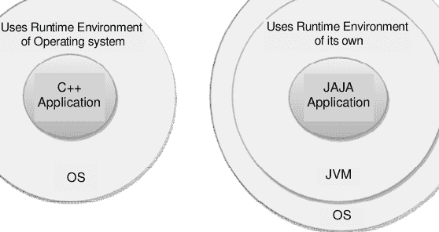

- (c) 类加载器：通过将本地文件系统的类与从网络源导入的类分离来增加安全性。
- (d) 字节码验证器：检查是否存在违反对象访问权的非法代码片段。
- (e) 安全管理器：确定类可以访问的资源，例如读写本地磁盘。

这些安全性由 Java 语言提供。开发者可以通过 SSL、JAAS、加密等提供一些安全性。

除了病毒，另一种类型的恶意软件可以通过搜索用户计算机本地文件系统的内容来收集隐私信息，如卡号、银行余额和密码。

Java 在网络应用程序和用户计算机之间创建了防火墙。

### 7. 可移植与平台无关

Java 环境可以移植到任何新的硬件平台和操作系统。

Java 平台无关是因为 JVM。

平台无关性是程序从一个计算机系统移动到另一个计算机系统的能力。Java 对其他语言最大的贡献是它的可移植性。目标是“一次编写，随处运行”。

当我们编写程序时，无法保证今天运行的程序明天还能运行，即使在同一台机器上也是如此。

在 Java 中，编译器会产生字节码（byte code），这是一组设计用于 Java 运行时（Java runtime time）执行的指令。这被称为 JVM。

在编译期间生成的字节码是与平台无关的。这意味着将 Java 程序翻译成字节码有助于其在任何安装了 JVM 的广泛环境中运行程序。

尽管 JVM 的细节因平台而异，但所有的 JVM 解释的都是相同的 Java 字节码。

因此，程序可以在任何具有 JVM 实现的操作系统（如 Linux、win 95）上执行。区别在于根据操作系统呈现的组件视图有所不同。

多线程程序运行两个或多个可以并发的部分。此类程序的每个部分被称为一个线程（thread），每个线程定义了一条独立的执行路径。

我们有两种不同的多任务类型：

- (a) 基于进程的。
- (b) 基于线程的。

进程是执行的内容。因此，基于进程的多任务是允许你的计算机并发运行两个或多个程序的特性。

在基于进程的任务处理中，程序可以是调度程序分发的代码最小单元。

在基于线程的任务处理中，线程是可分发代码的最小单元。这意味着单个程序可以同时执行一个或多个任务。

多任务比多进程任务需要更少的开销，因为进程是重量级任务，需要它们独立的地址空间。

另一方面，线程是轻量级的。它们共享相同的地址空间。

Java 是一种动态语言，设计用于适应不断演变的环境。Java 程序携带大量的运行时信息，用于在运行时验证和解析访问。这使得快捷地更新小段代码变得可能。

平台是程序运行的硬件或软件环境。平台有两种类型：基于软件和基于硬件。

Java 平台与其他平台的区别在于，它是一个运行在其他平台之上的软件平台。它包含两个组件：

- (a) 运行环境 (Runtime Environment)
- (b) API (应用程序编程接口)

Java 代码可以在多个平台上运行，例如 Windows、Linux、Solaris、Mac 等。Java 代码由编译器编译并转换为字节码。这种字节码是平台无关的，因为它可以在多个平台上运行，即“一次编写，随运行”（Write Once Run Anywhere, WORA）。

Java 比传统的解释执行更快，因为字节码接近编译型语言（例如 C++）。

Java 8 发布时进行了一些升级：

- 通过提供 Optional 类、Lambda 表达式、Streams 等增强了生产力。
- 易用性：Java 现在支持类型编程或脚本，其编写形式在多种编程语言中均有效并执行相同的操作。

#### Java 程序示例

这是一个简单的 Java 程序：

```java
class Hello {
  // 你的程序从调用 main() 开始
  public static void main(String[] args) {
    System.out.println("Hello to Java");
  }
}
```

#### 编译并运行程序

如果你在从 java 目录获取 java.exe 时遇到困难，请执行以下命令，或将它们添加到 auxpath 环境变量中，并设置 path 和 classpath 变量。

```bash
set path=%PATH%;C:\jdk1.2\BIN
set classpath=C:\jdk1.2\Lib
set JAVA_HOME=C:\jdk1.2
```

这可以通过名为 java 的解释器执行。

```java
/* 是一个多行注释，因为它以 */ 结尾 */
// 是用于单行注释
public static void main(String args[])
```

main 方法是程序执行开始的地方。`public`关键字是一个访问修饰符，允许在声明成员的类外部访问该成员。`public`单词允许调用 main 方法而无需实例化该类的特定实例。这是必要的，因为 main 在任何对象创建之前就会由 java 解释器调用。`void`单词告诉编译器 main 不返回任何值。main 接收一个字符串数组作为参数（`String args[]`），该参数可以从命令行提供（如果需要）。

要执行任何 Java 程序，你需要：

- 如果没有 JDK，请下载并安装它。
- 设置 jdk/bin 目录的路径：http://www.javpoint.com/how-to-set-path-in-java
- 创建 Java 程序
- 编译并运行 Java 程序

## 创建 Hello Java 示例

让我们创建 hello java 程序：

```java
class Simple {
  public static void main(String args[]) {
    System.out.println("Hello Java");
  }
}
```

将此文件保存为 Simple.java

**编译：** javac Simple.java

**执行：** java Simple

**输出：** Hello Java

class, public, static, void, main, String(), System.out.println() 的含义。

- **class** 用于在 Java 中声明一个类。
- **public** 关键字是一个访问修饰符，表示可见性，意味着它是对所有人可见的。
- **static** 是一个关键字，如果我们把任何方法声明为静态，则它被称为静态方法。静态方法的核心优势是无需创建对象即可调用该方法。main 方法是由 JVM 执行的，因此不需要创建对象即可调用 main 方法。这样可以节省了内存。
- **void** 是方法的返回类型，意味着它不返回任何值。
- **main** 代表程序的启动。
- **String[]** 用于命令行参数。我们稍后会学习它。
- **System.out.println()** 用于打印语句。

要编写简单的程序，通过开始菜单 -> 所有程序 -> 杂项 -> 记事本打开记事本，并编写如下所示的简单程序：

要设置 JDK 的临时路径，你需要按照以下步骤操作：

- (a) 打开命令提示符
- (b) 复制 jdk/bin 目录的路径
- (c) 在命令提示符中输入：set path=copied_path

例如：

set path=C:\Program Files\Java\jdk1.6.0_23\bin

请看下方的图示：

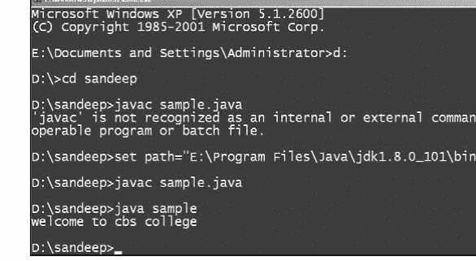

要设置 JDK 的永久路径，你需要按照以下步骤操作：

- (a) 进入“我的电脑”属性 -> 高级选项卡 -> 环境变量 -> 用户变量下的新建 -> 在变量名中输入 path -> 在变量值中输入文件夹路径 -> 确定 - 确定 确定

例如：

假设你已将 Java 安装在 C:\Program files/ Java / JDK 目录下

第 1 步：右键点击“我的电脑”并选择“属性”

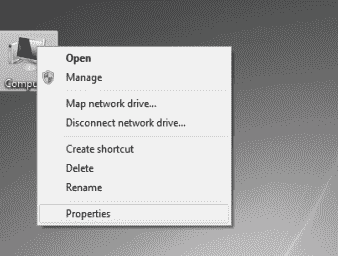

## Java 语言简介

第 2 步：进入“高级系统设置”选项卡。

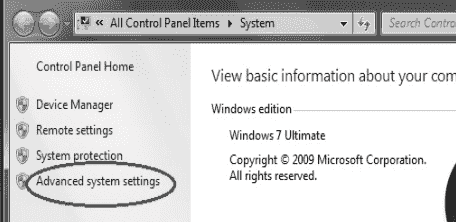

第 3 步：点击“环境变量”按钮。

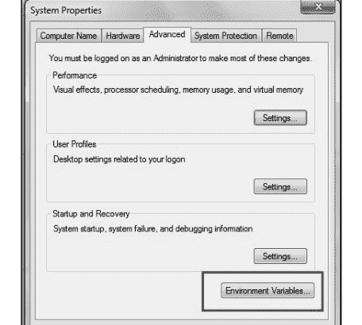

第 4 步：从 bin 文件夹复制路径。

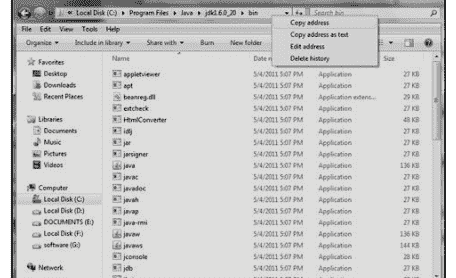

第 5 步：现在修改路径变量，使其也包含 JDK 安装目录的路径。

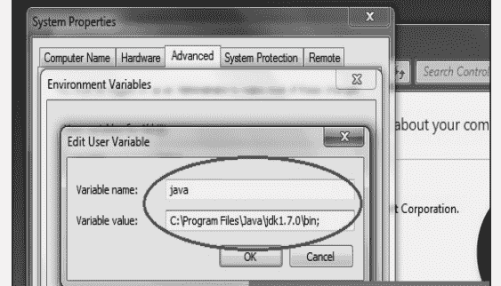

现在你的永久路径已设置好。你现在可以在任何驱动器执行任何 java 程序。

编译时发生了什么（编译器）？

在编译时，java 文件由 Java 编译器编译（它不与操作系统交互），并将 Java 代码转换为字节码。

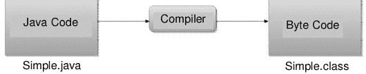

运行时发生了什么（解释器）？

在运行时，会执行以下步骤：

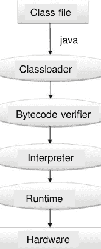

- 类加载器（Classloader）：JVM 的子系统，用于加载类文件。


- 字节码验证器（Bytecode Verifier）：检查代码段是否存在可能违反对象访问权限的非法代码。

- 解释器（Interpreter）：读取字节码流，然后执行指令。

Java 类是一个文件（带有`.class`扩展名），包含可以在 Java 虚拟机（JVM）上执行的 Java 字节码。Java 类是由 Java 编译器为包含 Java 类的 Java 编程源文件（`.java`文件）生成的。

Java 中的`.class`文件是实现平台无关性的核心，这也是 Java 的关键特性。类文件是任何用代码编写的 Java 程序的编译形式。由于 Java 程序在平台内部执行，这些指令会被 JVM 读取并翻译成底层平台的代码。实际上，如果你有支持该平台的相应 JVM，你就可以在任何平台上运行。Java 编译器负责生成`.class`文件，它们遵循 Sun 公司指定的类格式，并与不同的 Java 版本有所不同。本文并非是一篇侧重于类文件格式的详细文章，而是包含了关于类文件的基本信息，旨在让人们了解 Java 类文件以及与类相关的一些重要点。

Java 运行时环境（JRE）是一组用于 Java 应用程序开发的软件工具。它结合了 Java 虚拟机（JVM）、平台核心类和支持库。JRE 是 Java 开发工具包（JDK）的一部分，但可以单独下载。

Java 运行时环境（JRE）提供了运行用 Java 语言编写的 applet 和应用程序所需的库、Java 虚拟机和其他组件。JRE 不包含用于开发应用程序的编译器或调试器等工具和程序。

Java 编程遵循程序的结构，以`.java`扩展名保存，用`java`编译器编译，并由`java`解释器运行。

### 1.10.1 Java 程序的结构

| 文档部分 | |
| :--- | :--- |
| 包部分 (Package section) | |
| 导入语句 (Import statement) | |
| 接口语句 (Interface statement) | |
| 类定义 (Class definition) | |
| 主方法类 (Main Method Class) | 可选 |
| `{` | |
| 主方法定义 (Main Method Definition) | 必选 |

### 核心 Java

Java 程序可能有许多类，其中一个类定义主方法类，类包含成员变量，并对类的成员变量进行操作。方法可以包含数据类型声明和可执行语句：

1. 文档部分：此部分包含许多注释语句和程序名称。这些是写成`/* * */`形式的多行注释。

2. 包部分：Java 中的第一条语句是包语句。该语句声明了包名，并告知在此定义的类属于此包。当用户想要评估用户包时，将使用此语句。

例如：`Package student`

声明创建了用户创建的包。

3. 导入部分：它包含许多重要的语句。这类似于 C 和 C++ 中的`#include`语句。

例如：`Import student`

该语句告诉解释器测试类包含在一组语句中。如果我们写语句`.*`，那么我们可以使用所有导入的包。在导入语句中，我们可以使用通配符。

例如：`Import.io.*`

这表示`io`是 Java 中可用的输入包名，并表示该包中的所有类都可以被用户使用。

4. 接口部分：接口类似于类，但它是一组方法声明的集合。这在 Java 程序中也是可选的，当我们希望在 Java 程序中实现多继承时会使用。

5. 类定义：Java 程序可以包含多个类。类定义是 Java 程序的初级且核心元素。类包含成员变量和成员函数（也称为方法）。

6. 主方法类：主方法是 Java 的起点。Java 程序可能只包含这部分。主方法创建各种类的对象，并在它们之间提供通信。

JVM（Java 虚拟机）顾其实名，是一个想象的机器。JVM 是一个将字节码转换为机器代码的解释器。Java 是 JVM 的安全且可移植的语言。Java 编译器不创建可执行代码，而是字节码。JVM 是一组由 Java 运行时系统执行的高度优化指令集，被称为“Java虚拟机”。

JVM 是字节码的解释器。Java 有编译和解释两个阶段。

Java 程序由 JVM 执行，这有助于解决与网络下载程序相关的许多问题。

JIT（即时编译）是 JVM 的一部分，由于 JIT，我们得到了字节码的动态编译。

JVM 有字节码加载器，验证来自系统或其他网络系统的字节码。

## Java 语言简介

下图显示了 Java 虚拟机的框图，包含了主要的子系统和内存区域。每个 Java 虚拟机都有一个类加载子系统：用于加载类型（类和接口）。每个 Java 虚拟机还有一个执行引擎：负责执行已加载类的方法中的指令。

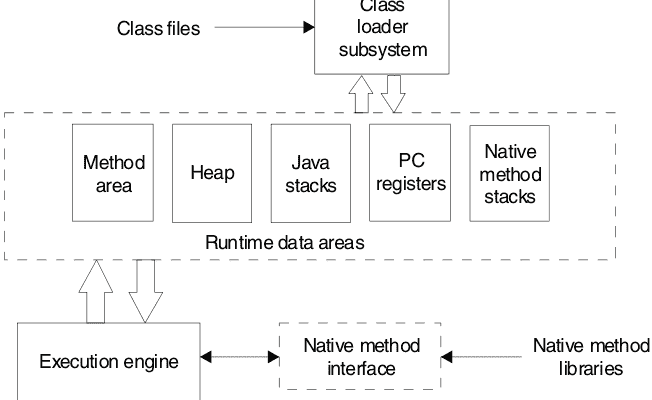

Java 虚拟机的内部架构。

随 JDK 提供的 Java API 描述了其每个组件的功能。在 Java 编程中，许多组件是预先创建并经常使用的。因此，程序员可以通过 Java API 应用预写代码。在参考可用的 API 类和包后，程序员可以轻松地调用实现所需的代码类和包。

### Java 编程语言平台

Java 编程语言共有四种平台：

1. Java 平台标准版 (Java SE)

2. Java 平台企业版 (Java EE)

3. Java 平台微型版 (Java ME)

4. Java FX

所有平台都包含一个 Java 虚拟机 (VM) 和应用程序编程接口 (API)。Java 虚拟机是一个针对特定硬件和软件平台运行 Java 技术的程序。API 是软件组件的集合，你可以使用它来创建其他软件组件或应用程序。每个 Java 平台都提供一个虚拟机和一个 API，这使得该平台的应用程序可以在任何兼容的系统上运行，并具有 Java 编程语言的所有优势：平台无关性、强大性、稳定性、易于开发性和安全性。

当大多数人考虑到 Java 编程时，他们会想到 Java SE API。Java SE API 提供了 Java 编程语言的核心功能。它定义了从 Java 编程语言的基本类型和对象到用于网络、安全、数据库访问、图形用户界面 (GUI) 开发和 XML 解析的高级类。

除了核心 API 外，Java SE 平台还由虚拟机、开发工具、部署技术以及 Java 技术应用程序中常用的类库和工具包组成。

Java EE 平台构建在 Java SE 平台之上。Java EE 平台为开发和运行大型、多层、可扩展、可靠且安全的网络应用程序提供了 API 和运行时环境。

Java ME 平台提供了一个 API 和一个轻量级虚拟机，用于在手机等小型设备上运行 Java 编程应用程序。该 API 是 Java SE API 的子集，并带有用于小型设备开发的特殊类库。Java 应用程序通常是 Java EE 服务的客户端。

### Java FX

Java FX 技术是一个用于创建用 Java Script 编写的富网络应用程序的平台。Java FX Script 是一种静态声明式语言，它被编译为 Java 技术字节码，可以在 Java VM 上运行。为 Java FX 平台编写的应用程序可以包含并链接到 Java 编程类，并可能是 Java EE 平台服务的客户端。

它是编译、文档化和打包 Java 程序所需的工具。JDK 完全包含了 JRE，其中包含供 Java 程序员使用的工具。Java 开发工具包免费提供。通过 JRE，它包含一个解释器/加载器、编译器 (`javac`)、归档器 (`jar`)、文档生成器 (`javadoc`) 以及 Java 开发所需的其他工具。简而言之，它包含了 JRE + 开发工具。

Lambda 表达式是 Java 的一个新且重要的特性，包含在 Java SE 8 中。它提供了一种清晰且简洁的方式，使用表达式来表示一个方法接口。它在集合库中非常有用。它可以帮助从集合中迭代、过滤和提取数据。

Lambda 表达式用于为具有函数接口的接口提供实现。它节省了大量代码。在 Lambda 表达式的情况下，我们不需要重新定义方法来提供实现。在这里，我们只需要编写实现代码。

Lambda 表达式被视为一个函数，因此编译器不会创建`.class`文件。

#### 函数式接口

Lambda 表达式提供了函数式接口的实现。只有一个抽象方法的接口被称为函数式接口。Java 提供了注解`@FunctionalInterface`，用于将接口声明为函数式接口。

为什么使用 Lambda 表达式：

- 为函数式接口提供实现。

- 更少的代码。

### 1.17 方法引用

Java 在 Java 8 中引入了名为方法引用的新特性。方法引用用于引用函数式接口的方法。它是 Lambda 表达式的一种紧凑且易用的形式。每当你使用 Lambda 表达式引用方法时，你都可以用方法引用替换 Lambda 表达式。在本教程中，我们将详细解释方法引用的概念。

#### Java 中方法引用的类型：

- 对静态方法的引用。

你可以引用类中定义的静态方法。以下是描述在 Java 中引用静态方法过程的语法和示例。

语法：

```
ContainingClass::staticMethodName
```

- 对实例方法的引用。

像静态方法一样，你也可以引用实例方法。在接下来的示例中，我们将在阐述引用实例方法的过程。

语法：

```
containingObject::instanceMethodName
```

- 对构造函数的引用。

你可以使用`new`关键字引用构造函数。在这里，我们借助函数式接口引用构造函数。

语法：

```
ClassName::new
```

### 1.19 方法参数反射

Java 提供了一个新功能，可以通过该功能获取任何方法或构造函数的形式参数名称。`java.reflect`包包含了所有所需的类，如`Method`和`Parameter`，用于处理参数反射。

#### Method 类

它提供了关于类或接口上方法的信息。反射出的方法可以是类方法，也可以是实例方法。

#### Parameter 类

Parameter 类提供了关于方法参数的信息，包括其名称和修饰符。它还提供了获取参数属性的替代方法。

### 1.20 带有 main(), PUBLIC, STATIC, VOID, STRING[] ARGS 的 JAVA 程序

```
class sample
{
  public static void main(String args[])
  {
    System.out.println("welcome");
  }
}
```

任何 Java 程序使用以下方法：

`public static void main(args)`

`public`: 访问修饰符，意味着它可以被访问。

`static`: 修饰符，意味着当 Java 程序加载时会在内存中创建空间。

`void`: 返回类型，即不返回任何值。

`main()`: 方法或函数名。

`string args[]` : 命令行参数，它是字符串格式的变量集合。

## Java 语言简介

### 1.21 令牌 (TOKENS)

Java 程序由类和方法组成，方法是各种语句的容器，而语句由变量、常量、运算符等组成。

令牌是编译器识别的 Java 程序元素。令牌是程序中有意义的最小元素。支持的令牌包括关键字、变量、常量、特殊字符、运算符等。

当你编译程序时，编译器扫描源代码文本并提取单个令牌。在对源文件标记时，编译器识别并随后移除空白（空格、制表符、换行和分页符）以及注释内的文本。现在让我们考虑一个程序

`//打印 Hello`

`Public class Hello`

```
{
  public static void main(String[] args) {
    System.out.println("Hello Java");
  }
}
```

28 核心 Java

1. **保留关键字**: 保留关键字是具有预定义含义的 Java 令牌。Java 拥有 60 个保留关键字，例如`int`、`class`、`break`、`continue`等。

2. **标识符**: 标识符是由 Java 程序员设计并确定的 Java 令牌。Java 令牌（即标识符）的示例有：类名、类成员的名称，以及类方法中的临时变量名。

3. **字面量**: 字面量是包含一组字符的 Java 令牌。字面量用于表示必须存储在变量中的常量。例如`2`, `5`, `4`, `6`, `"ram"`, `"s"`等。

4. **运算符**: 运算符是包含特殊符号并在 Java 中具有预定义含义的 Java 令牌。运算符可以与一个或多个运算符一起使用来实现结果。例如：一元运算符、二元运算符；三元运算符。

5. **变量**: 变量用于存储值。例如`int a,b`；其中`int`类型`a`,`b`是整数型变量。

### 1.22 JAVA 语句

### Java 的控制结构

控制程序的执行流是编程中一个非常重要的方面。寻找特定问题的解决方案可能有许多方法，但你会希望寻找最好、最快的方法。

控制语句包含一个逻辑语句，通常是一个被包含在大括号`{}`中的语句块。

**真/假值**被用于`if`语句和循环语句。这些要么是布尔值**true**和**false**，要么任何非零值表示真，零表示假（如 C 语言）。

Java 有四种控制结构：顺序结构、选择（决策）、重复（循环）和子程序（函数）。这些结构简单地控制着程序的执行。

#### 1.22.1 控制结构的类型

Java 有四种控制结构：

1. 顺序结构

2. 选择（决策）

3. 重复（循环）

4. 子程序（函数）。

**1. 顺序**: 顺序语句使程序流从一个语句移动到下一个语句，该语句再到下一个，依此类推。这是最简单的结构形式，在开发复杂程序时，不太可能使用顺序结构。

**2. 选择（决策）**: 选择结构根据决策做出决定并执行命令。选择结构包括“`if`语句”，即类似于“如果这个，就做那个”和“如果不是这个，就做那个”的语句。通过“`if`语句”，我们还可以包含“嵌套`if`语句”，即“`if`语句”内部的“`if`语句”。另一种选择结构的形式被称为“`switch`语句”，它在某些情况下非常强大，但在其他情况下却不然。“`switch`语句”侧重于特定变量的值并据此执行不同的“`cases`”。

3. 重复（循环）：重复结构用于当某些内容需要通过“循环”重复某些次数时。

4. 子程序（函数）：子程序（函数）是执行特定任务的块。

**真/假值**被用于`if`语句和循环语句。这些要么是布尔值**true**和**false**，要么任何非零值表示真，零表示假（如 C 语言）。

Java 有四种控制结构：顺序结构、选择（决策）、重复（循环）和子程序（函数）。这些结构简单地控制着程序的执行。

以下是`switch`构造的特征：

1. 表达式必须是整数表达式。

2. 每个`case`都由整数或字符常量标记。

3. `Cases`和`default`可以以任何顺序出现。

4. `Cases`必须是不同的。

5. 在完成一个`case`的代码后，执行将跳转到下一个`case`，除非你采取了显式操作来跳出。

6. `break`语句会导致立即退出`switch`。

7. Case 穿透（Falling through cases）是一把双刃剑。

8. 优点是可以用一个代码处理多个`case`，避免了冗余。

9. 缺点是必须在每个`case`之后都放置`break`语句。

`switch`语句提供了一种对“`else if`”结构的替代方案，该结构根据单个表达式的值提供多种可能的路径。`switch`语句的修订形式如下：

```
switch ( int 表达式 )
```


在执行期间，会对表达式进行求值。如果表达式的值匹配`label - 1`，则将执行`stmt-list-1`。如果不匹配，执行将移动到检查`label - 2`，依此类推。如果没有`label`匹配表达式，则将执行`default`。在每个`case`内部以及每个语句列表的末尾（`default`除外），必须有一个`break`语句，它会终止最内层的`switch`或循环语句。

```
{
case label - 1 :
stmt-list-1;
break;
case label - 2 :
stmt-list-2;
break;
case label - 3 :
stmt-list-3;
break;
.
.
case label - n :
stmt-list-n;
break;
default :
stmt-list;
}
```

## Java 语言简介

这里有一些关于`switch`语句的一些最后说明：被测试的表达式必须产生一个整数值（`int`或单字符`char`），`case`标签必须是整数常量（字面量或命名常量），`switch`内部的每个标签都应该是唯一的，且每个`stmt-list`可以包含 0 个或多个不包含在花括号`{ }`包围的语句。

示例：

假设一个名为`score`的命名变量是一个`int`变量，它包含在橄榄球比赛中获得的分数。考虑以下代码：

```
switch ( score ) {
{
    case 1: System.out.println("Extra point");
    break;
    case 2: System.out.println("Safety of two point conversion");
    break;
    case 3: System.out.println("Field Goal");
    break;
    case 6: System.out.println("Touchdown");
    break;
    default : System.out.println("Invalid score on a football play.");
}
```

处理完选择语句后，是时候讨论程序中的迭代（或循环）了。这当然涉及使用循环语句。继续阅读以探索循环的世界……

### 选择语句的语法

选择（`if`, `if-else`）

### if 语句

```
//------ 带有真语句的 if 语句
if (expression) {
    statements // 如果 expression 为真则执行这些
}
//------ 带有真、假语句的 if 语句
if (expression) {
    statements // 如果 expression 为真则执行这个
} else {
    statements // 如果 expression 为假则执行这个
}
//------ 带有多个并行语句的 if 语句
if (expression1) {
    statements // 如果 expression1 为真则执行这个
} else if (expression2) {
    statements // 如果 expression2 为真则执行这个
} else if (expression3) {
```

#### 1.2.23 重复（循环）

#### While 循环

循环是一个代码语句，它会反复执行，直到循环的逻辑表达式求值为假为止。它简单来说是重复代码的一种方式，直到达到某个特定值。它也可以确保用户输入正确类型输入（数据验证）的有效方法。

循环与`if`语句不同，如果`if`语句的逻辑表达式为真，它仍然执行并返回再次检查逻辑表达式……再次、再次，直到逻辑表达式最终变为假。

一种需要避免的是产生无限循环的代码，无限循环是指除非你按下键盘上的`ctrl-break`否则永远不会停止的循环。为了避免无限循环，你需要在循环体中使用一个（多个）语句来改变逻辑表达式的一部分。我们将讨论三种类型的循环：`while`、`do-while`和`for`。

`while`循环的形式如下：

```
while ( 逻辑表达式 )
stmt;
```

示例 1：

```
int x = 7;
while (x > 0)
{
    System.out.println("x is " ++x);
    x--;
}
```

示例 2：

使用数据验证：

假设程序的用户需要输入一个范围在 -10 到 10（包含）之间的整数。使用数据验证编写一段代码来输入此值：

```
int k;
k = -99;
while (k < -10 || k > 10)
{
    System.out.println("Enter an integer value between -10 and 10 ");
    k = System.in.read();
}
```

## Java 语言简介

### 示例 3：

编写一段代码显示所有小于 500 的 5 的倍数。

```
int x = 5;
while ( x < 500 )
{
    System.out.println("x is " + x);
    x = x + 5;
}
```

关于`while`循环的所有说明到此结束。关于`while`循环，我想说的都说完了，让我们继续看`do`循环……

### Do 循环

`do`循环是另一种类型的循环。它与`while`循环完全相同，但它先执行某些内容然后再检查逻辑表达式。`do`循环通常用于需要至少执行一次的语句。

`do`循环的形式如下：

```
do
    stmt();
} while (逻辑表达式);
```

示例 1：

```
int number;
do {
    System.out.println("Enter positive is greater than 0 ");
    number = System.in.read();
} while ( number <= 0 );
```

示例 2：

```
int number;
do {
    System.out.println("Enter a number between 0 and 100: ");
    number = System.in.read();
} while ( number >= 100 );
```

### For

讨论了`while`和`do`循环后，还有一种循环我想介绍：`for`循环。更多关于循环的内容……

**For 循环：** 循环是另一种执行需要重复（重复）内容的方法。程序员喜欢使用循环，因为与`while`或`do`循环相比，代码可以写得更紧凑。当你确切知道一段代码需要重复的次数时，通常使用`for`循环。`for`循环的形式如下：

```
for ( expression1; expression2; expression3 )
```

```
stmt(s);
```

其中`stmt`是单个或复合语句。`Expression1`用于初始化循环；`expression2`用于确定循环是否继续；`expression3`在每次迭代或循环结束时评估。

注意 1：`expression2`在`stmt`和`expression3`执行之前进行测试；循环体可能从不执行。

注意 2：`for`中的全部 3 个表达式都可以省略，但 两个分号必须保留。如果省略`expression1`，则循环中没有初始化，但你的程序可能不需要任何初始化。如果省略`expression2`，则`for`语句中没有更新，但更新可以在循环体语句中完成。

通常情况下，循环可以写成等效的`while`循环，反之亦然。

```
for ( expression1; expression2; expression3 )
```

```
stmt;
```

等同于..

```
expression1;
```

```
while ( expression2 )
```

```
{
```

```
stmt();
```

```
expression3;
```

}

```

示例 1：编写一个`for`循环显示 1 到 51 之间所有的奇数：

```

for ( int k = 1; k <= 51; k += 2)

```

```

System.out.println("k is " + k);

```

示例 2：编写一个`for`循环显示从 20 到 1 的整数倒计时：

```

for ( int k = 20; k >= 1; k--)

```

```

System.out.println("k is " + k);

```


## Java 语言简介

### 所有循环的语法

| 循环语句 | do 语句: |
|---|---|
| **while 语句:**<br>`while`语句测试一个表达式。如果表达式结果为真，则执行`while`的循环体。如果为假，则继续执行`while`之后的语句。每次执行完循环体后，执行都会再次开始测试。这会一直持续直到表达式为假或某些其他语句（`break`或`return`）停止循环。\n`while (testExpr) {\nstatements\n}\`", | 这是循环语句中最少用的一种，但有时你可能想要在测试之前执行一次的循环。\n`do\nstatements\n} while (testExpr);`\n**其他循环控制**\n`break;` // 退出最内层循环或`switch`\n`continue;` // 开始下次循环迭代\n**函数返回**\n`return;`// `void`函数不返回任何值\n`return expr;` // 从函数返回`expr`的值 |

### 1.23 空格

Java 中的空白字符用于分隔 Java 源文件中的标记（tokens）。在某些地方空白是必须的，例如访问修饰符、类型名称和标识符之间，在其他地方则用于提高可读性。\n在 Java 中任何需要空白的地方，可以使用一个或多个空白字符。在 Java 中空白是可选的地方，可以使用零或多个空白字符。

一个字符之所以是 Java 空白字符，当且仅当它满足以下标准之一时：它是一个 Unicode 空格字符（`SPACE_SEPARATOR`、`LINE_SEPARATOR`或`PARAGRAPH_SEPARATOR`），但不是不换行空格（`\u000A`, `\u2007`, `\u202F`）。它是`\u0009`，水平制表符。

### 1.24 大小敏感

Java 是大小敏感的。这是因为继承了 C 语言。为了让这种语言更符合人们“过去”的习惯，他们保留了大小敏感性。还有一个额外的优点，因为 Java 标识符可以是几乎任何 Unicode 字符。大小敏感强制了文本中的大写或小写区分。

### 1.25 标识符

所有的 Java 组件都需要名称。用于类、方法、接口和变量名称被称为标识符。标识符必须遵循某些规则。规则如下：

- (a) 所有标识符必须以字母（`a`到`z`或`A`到`Z`）、或货币字符（`$`）或下划线开头。
- (b) 在第一个字符之后，标识符可以是任何字符组合。
- (c) Java 关键字不能用标识符。
- (d) Java 中的标识符是大小敏感的，`foo`和`Foo`是不同的标识符。

### 1.26 关键字

这里是 Java 编程语言中的关键字列表。你不能在程序中使用任何一个以下项作为标识符。关键字`const`和`got`是被预留的，尽管它们目前没有被使用。`true`、`false`和`null`看起来像关键字，但它们实际上是字面量（literals）；你不能在程序中使用它们作为标识符。

| Abstract | Continue | for | new | switch |
|---|---|---|---|---|
| Assert | | goto | package | synchronized |
| Boolean | Double | if | private | This |
| Break | | implements | protected | throw |
| Byte | Else | import | public | throws |
| Case | enum | instanceof | return | transient |
| Catch | Extends | int | short | Try |
| Char | Final | interface | static | Void |
| Class | Finally | long | strictfp | volatile |
| Const | Float | native | super | while |

### 1.27 注释

注释是不被编译器和解释器执行的语句。注释可以用于提供关于变量、方法、类或任何语句的信息或解释。它也可以用于在特定隐藏程序代码。

Java 注释的类型

Java 中有 3 类注释：

- * 单行注释
- 多行注释
- 文档注释

#### 1. Java 单行注释

单行注释用于注释一行。

语法：

```java
//This is single line comment
```

#### 2. Java 多行注释

多行注释用于注释多行代码。

语法：

```java
/*
This
is
multi
comment
*/
```

#### 3. Java 文档注释

文档注释用于创建 API 文档。要创建文档 API，你需要使用`javadoc`工具。

语法：

```java
/**
This
is
documentation
*/
```

### 1.28 大括号和代码块

Java 中的代码块是由成对匹配的大括号`{ }`包围的一块代码。大括号`{ }`用于标记一段作为一个整体工作的代码的开始和结束。如果你愿意，可以将左大括号`{`视为代表`BEGIN`单词，以标记一个部分的开始。那么右大括号`}`就代表`END`，以标记一个部分的结束。（有些语言实际上使用`BEGIN`和`END`代替大括号，如 Pascal 和 Modula-2）。

在 Java 程序中，通常有几个代码块。代码块可以被“嵌套”，即一个代码块完全在另一个代码块内部：

```java
public class Hello
{
public static void main(String args[])
{
  System.out.println("Hello cbs college");
}
```


### 1.29 变量

变量是一个在内存中有存储空间用于存储数据的占位符。它的值始终保持固定，因此被称为变量。变量可以在任何地方声明。

变量是一个在内存中有存储数据的占位符。它的值始终保持固定，因此被称为变量。变量可以在任何地方声明。

变量是一个在内存中有存储数据的占位符。它的值始终保持固定，因此被称为变量。变量可以在任何地方声明。

变量是一个在内存中有存储数据的占位符。它的值始终保持固定，因此被称为变量。变量可以在任何地方声明。

变量是一个在内存中有存储数据的占位符。它的值始终保持固定，因此被称为变量。变量可以在任何地方声明。

变量是一个在内存中有存储数据的占位符。它的值始终保持固定，因此被称为变量。变量可以在任何地方声明。

变量是一个在内存中有存储数据的占位符。它的值始终保持固定，因此被称为变量。变量可以在任何地方声明。

变量是一个在内存中有存储数据的占位符。它的值始终保持固定，因此被称为变量。变量可以在任何地方声明。

变量是一个在内存中有存储数据的占位符。它的值始终保持固定，因此被称为变量。变量可以在任何地方声明。

变量是一个在内存中有存储数据的占位符。它的值始终保持固定，因此被称为变量。变量可以在任何地方声明。

变量是一个在内存中有存储数据的占位符。它的值始终保持固定，因此被称为变量。变量可以在任何地方声明。

变量是一个在内存中有存储数据的占位符。它的值始终保持固定，因此被称为变量。变量可以在任何地方声明。

变量是一个在内存中有存储数据的占位符。它的值始终保持固定，因此被称为变量。变量可以在任何地方声明。

变量是一个在内存中有存储数据的占位符。它的值始终保持固定，因此被称为变量。变量可以在任何地方声明。

变量是一个在内存中有存储数据的占位符。它的值始终保持固定，因此被称为变量。变量可以在任何地方声明。

变量是一个在内存中有存储数据的占位符。它的值始终保持固定，因此被称为变量。变量可以在任何地方声明。

变量是一个在内存中有存储数据的占位符。它的值始终保持固定，因此被称为变量。变量可以在任何地方声明。

变量是一个在内存中有存储数据的占位符。它的值始终保持固定，因此被称为变量。变量可以在任何地方声明。

变量是一个在内存中有存储数据的占位符。它的值始终保持固定，因此被称为变量。变量可以在任何地方声明。

变量是一个在内存中有存储数据的占位符。它的值始终保持固定，因此被称为变量。变量可以在任何地方声明。

变量是一个在内存中有存储数据的占位符。它的值始终保持固定，因此被称为变量。变量可以在任何地方声明。

变量是一个在内存中有存储数据的占位符。它的值始终保持固定，因此被称为变量。变量可以在任何地方声明。

变量是一个在内存中有存储数据的占位符。它的值始终保持固定，因此被称为变量。变量可以在任何地方声明。

变量是一个在内存中有存储数据的占位符。它的值始终保持固定，因此被称为变量。变量可以在任何地方声明。

变量是一个在内存中有存储数据的占位符。它的值始终保持固定，因此被称为变量。变量可以在任何地方声明。

变量是一个在内存中有存储数据的占位符。它的值始终保持固定，因此被称为变量。变量可以在任何地方声明。

变量是一个在内存中有存储数据的占位符。它的值始终保持固定，因此被称为变量。变量可以在任何地方声明。

变量是一个在内存中有存储数据的占位符。它的值始终保持固定，因此被称为变量。变量可以在任何地方声明。

变量是一个在内存中有存储数据的占位符。它的值始终保持固定，因此被称为变量。变量可以在任何地方声明。

变量是一个在内存中有存储数据的占位符。它的值始终保持固定，因此被称为变量。变量可以在任何地方声明。

变量是一个在内存中有存储数据的占位符。它的值始终保持固定，因此被称为变量。变量可以在任何地方声明。

变量是一个在内存中有存储数据的占位符。它的值始终保持固定，因此被称为变量。变量可以在任何地方声明。

变量是一个在内存中有存储数据的占位符。它的值始终保持固定，因此被称为变量。变量可以在任何地方声明。

变量是一个在内存中有存储数据的占位符。它的值始终保持固定，因此被称为变量。变量可以在任何地方声明。

变量是一个在内存中有存储数据的占位符。它的值始终保持固定，因此被称为变量。变量可以在任何地方声明。

变量是一个在内存中有存储数据的占位符。它的值始终保持固定，因此被称为变量。变量可以在任何地方声明。

变量是一个在内存中有存储数据的占位符。它的值始终保持固定，因此被称为变量。变量可以在任何地方声明。

变量是一个在内存中有存储数据的占位符。它的值始终保持固定，因此被称为变量。变量可以在任何地方声明。

变量是一个在内存中有存储数据的占位符。它的值始终保持固定，因此被称为变量。变量可以在任何地方声明。

变量是一个在内存中有存储数据的占位符。它的值始终保持固定，因此被称为变量。变量可以在任何地方声明。

变量是一个在内存中有存储数据的占位符。它的值始终保持固定，因此被称为变量。变量可以在任何地方声明。

变量是一个在内存中有存储数据的占位符。它的值始终保持固定，因此被称为变量。变量可以在任何地方声明。

变量是一个在内存中有存储数据的占位符。它的值始终保持固定，因此被称为变量。变量可以在任何地方声明。

变量是一个在内存中有存储数据的占位符。它的值始终保持固定，因此被称为变量。变量可以在任何地方声明。

变量是一个在内存中有存储数据的占位符。它的值始终保持固定，因此被称为变量。变量可以在任何地方声明。

变量是一个在内存中有存储数据的占位符。它的值始终保持固定，因此被称为变量。变量可以在任何地方声明。

变量是一个在内存中有存储数据的占位符。它的值始终保持固定，因此被称为变量。变量可以在任何地方声明。

变量是一个在内存中有存储数据的占位符。它的值始终保持固定，因此被称为变量。变量可以在任何地方声明。

变量是一个在内存中有存储数据的占位符。它的值始终保持固定，因此被称为变量。变量可以在任何地方声明。

变量是一个在内存中有存储数据的占位符。它的值始终保持固定，因此被称为变量。变量可以在任何地方声明。

变量是一个在内存中有存储数据的占位符。它的值始终保持固定，因此被称为变量。变量可以在任何地方声明。

变量是一个在内存中有存储数据的占位符。它的值始终保持固定，因此被称为变量。变量可以在任何地方声明。

变量是一个在内存中有存储数据的占位符。它的值始终保持固定，因此被称为变量。变量可以在任何地方声明。

变量是一个在内存中有存储数据的占位符。它的值始终保持固定，因此被称为变量。变量可以在任何地方声明。

变量是一个在内存中有存储数据的占位符。它的值始终保持固定，因此被称为变量。变量可以在任何地方声明。

变量是一个在内存中有存储数据的占位符。它的值始终保持固定，因此被称为变量。变量可以在任何地方声明。

变量是一个在内存中有存储数据的占位符。它的值始终保持固定，因此被称为变量。变量可以在任何地方声明。

变量是一个在内存中有存储数据的占位符。它的值始终保持固定，因此被称为变量。变量可以在任何地方声明。

### 声明规则

- 1. 数值类型以字母或数字开头。
- 2. Java 是大小敏感的。
- 3. 名称不应包含特殊字符。
- 4. 可以使用任何关键字。

#### 1. SCO0

### 核心 Java

数据类型指定了存储值的大小和类型。

| 数据类型 | 默认值 | 默认大小 |
|---|---|---|
| boolean | false | 1 bit |
| char | \u0000 | 2 byte |
| byte | 0 | 1 byte |
| short | 0 | 2 byte |
| int | 0 | 4 byte |
| long | 0L | 8 byte |
| float | 0.0f | 4 byte |
| double | 0.0d | 8 byte |

基本类型被称为固有类型或内置类型。这些数据类型与机器无关。

### 基本数据类型

- 1. 数值数据类型
   (a) *整数数据类型*
      * byte → 1 byte → 128 to 127
      * short → 2 bytes → 32768 to 32767
      * int → 4 bytes → 231 to 231 – 1
      * long → 8 bytes → 263 to 263 – 1
   (b) *浮点数据类型*
      * float → 4 bytes → 3.4e -038 to 3.4 e + 38
      * double → 8 bytes → 1.7e – 308 to 1.7 e + 38

- 2. 非数值
   (a) char → 2 Bytes
      * 字符类型有两种，因为 java 使用了定义了国际字符集的 Unicode。
   (b) boolean → 1 bit
      * Boolean 有两个可能的值，true 或 false 逻辑值。Boolean 所需的存储为一个位。

- 3. 非基本类型
   (a) 类
   (b) 接口
   (c) 数组

### 1.32 对象引用类型

有四种引用类型：

- 类类型 ($8)
- 接口类型 ($9)

### Java 语言介绍

- 类型变量 ($4.4)
- 数组类型 ($10)
- 引用类型 (ReferenceType):
    - 类或接口类型 (ClassOrInterfaceType)
    - 类型变量 (TypeVariable)
    - 数组类型 (ArrayType)
    - 类类型 (ClassType)
    - 接口类型 (InterfaceType)
- 类类型 (ClassType):
    - 类型声明符 (TypeDeclSpecifier) 可选的类型参数 (TypeArgumentsopt)
- 接口类型 (InterfaceType):
    - 类型声明符 (TypeDeclSpecifier) 类型参数 (TypeArguments)
- 类型声明符 (TypeDeclSpecifier):
    - 类型名 (TypeName)
    - 类或接口类型 标识符 (ClassOrInterfaceType Identifier)
- 类型名 (TypeName):
    - 标识符 (Identifier)

- 类型名 标识符 (TypeName Identifier)
- 类型变量 (TypeVariable):
    - 标识符 (Identifier)
- 数组类型 (ArrayType):
    - [ ]

```java
class Point [ int[] ] move(int deltax, int deltay);
```

> 声明了一个类 Point，一个接口类型 Move，并使用数组类型 int[]（int 数组）来声明类 Point 的字段 metrics。

一个类或类型由一个类型声明组成，后面可选地跟一个类型参数 ($4.5.1)。如果类型参数出现在类或接口类型中的任何地方，则它是一个参数化类型 ($4.5)。

类型声明可以是一个名称 ($6.5.5)，或者是一个类或接口类型后跟一个 "."。在后一种情况下，标识符的形式为 T.id，其中 id 必须是 T 的可访问 ($6.6) 成员类型 ($8.5, $9.5) 的简单名称，否则将发生编译错误。该标识符表示该成员类型。

在 Java 语言中，存在某些在不提供类型参数的情况下使用泛型类或接口名称的上下文。此类上下文并不涉及原始类型 ($4.8) 的使用。相反，它们是类型参数对于泛型类或接口的意义没有必要或与之无关的上下文。

例如，单类型导入声明 `import java.util.List;` 将简单类型名置于编译单元的作用范围内，因此可以使用泛型 `List<...>` 的参数化类型。另一个例子是，调用泛型类的静态方法只需要提供泛型类的（可能是限定的）名称，而不需要任何类型参数，因为此类类型参数对于静态方法是无关的。（该方法本身可能是泛型的，并接收它自己的参数，但静态方法的类型参数必然与其所属类的类型参数无关（§5.5.3）。）

由于有时需要在不带类型参数的情况下使用泛型类或接口名称，因此类型名与类型声明符是不同的。类型名总是通过另一个名称进行限定的。在某些情况下，这对于访问作为另一个类型名成员的内部类是必要的。

以下是一个类型声明与类型名有不同的示例：

```java
class GenericOuter<T extends Comparable<S>> {

    public class Inner<S> {

        T getT() { return null; }

        S getS() { return null; }

    }

}

class Test {

    public static void main(String[] args) {

        GenericOuter<Integer>.Inner<Double> x1 = null;

        Integer i = x1.getT();

        Double d = x1.getS();

    }

}
```

如果通过用类型名限定来访问 Inner，如下：

`GenericOuter.Inner x2 = null;`

我们将强制将其作为原始类型使用，从而丢失其类型信息。

### 1.33 字符串 (STRINGS)

#### Strings

在 java 中，字符串基本上是一个表示 char 值序列的对象。字符数组与 java 字符串的工作相同。例如：

- 1. `char[]ch={'j','a','v','a','t','p','o','i','n','t'};`
- 2. `String s=new String(ch);`

等同于：

- 1. `String s="javatpoint";`

### Java 语言介绍

Java String 类提供了许多方法来对字符串进行操作，如 `compare()`, `concat()`, `equals()`, `split()`, `length()`, `replace()`, `compareTo()`, `intern()`, `substring()` 等。
`java.lang.String` 类实现了 `Serializable`、`Comparable` 和 `CharSequence` 接口。

### CharSequence 接口

CharSequence 接口用于表示字符序列。它被 `String`、`StringBuffer` 和 `StringBuilder` 类实现。这意味着我们可以这 3 个类在 Java 中创建字符串。

String 是不可变的，即它不能被更改。每当我们更改任何字符串时，都会创建一个新的实例。对于可变字符串，可以使用 `StringBuffer` 和 `StringBuilder` 类。

我们将稍后讨论不可变字符串。让我们先了解 Java 中的字符串是什么以及如何创建字符串。

### Java 中的字符串是什么

通常情况下，字符串是字符的序列。但在 Java 中，字符串是一个表示字符序列的对象。`java.lang.String` 类用于创建字符串对象。

### 如何创建字符串对象？

- 通过字符串字面量
- 通过 `new` 关键字

#### 1. 字符串字面量

Java 字符串字面量通过双引号创建。例如：

- `String s="welcome"`

每当你创建一个字符串字面量时，JVM 会首先检查字符串常量池。如果字符串已存在于池中，则返回池中实例的引用。如果池中不存在字符串，则创建一个新字符串并放入池中。例如：

- (a) `String s1="Welcome"`
- (b) `String s2="Welcome";`

#### 为什么 Java 使用字符串字面量概念？

为了内存更高效（因为如果字符串池中存在，则不会创建对象）。

#### 2. 通过 `new` 关键字

### Java 字符串示例

```java
1. public class StringExample{
2. public static void main(String args[]){
3. String s1="java";//通过 java 字面量创建字符串
4. char ch[]={'s','t','r','i','n','g','s'};
5. String s2=new String(ch);//将字符数组转换为字符串
6. String s3=new String("example");//通过 new 关键字创建字符串
7. System.out.println(s1);
8. System.out.println(s2);
9. System.out.println(s3);
10.}
```

### 输出：

```
java
strings
example
```


#### Java 类方法

`java.lang.String`类提供了许多实用方法来对`char`值序列进行操作。

| 序号 | 方法 | 说明 |
|---|---|---|
| 1 | `charAt(int index)` | 返回特定索引的`char`值 |
| 2 | `length()` | 返回字符串长度 |
| 3 | `static format(String format, Object... args)` | 返回格式化后的字符串 |
| 4 | `static format(Locale l, String format, Object... args)` | 返回给定区域区域的格式化字符串 |
| 5 | `substring(int beginIndex)` | 返回起始索引的子字符串 |
| 6 | `substring(int beginIndex, int endIndex)` | 返回给定起始和结束索引的子字符串 |
| 7 | `contains(CharSequence s)` | 匹配`char`值序列后返回`true`或`false` |
| 8 | `static join(CharSequence delimiter, CharSequence... elements)` | 返回合并后的字符串 |
| 9 | `static join(CharSequence delimiter, Iterable<? extends CharSequence> elements)` | 返回合并后的字符串 |
| 10 | `equals(Object object)` | 检查字符串与对象的相等性 |
| 11 | `isEmpty()` | 检查是否为空字符串 |
| 12 | `concat(String str)` | 合并指定的字符串 |
| 13 | `replace(CharSequence old, char new)` | 替换指定`char`值的所有出现 |
| 14 | `replace(CharSequence old, CharSequence new)` | 替换指定`CharSequence`的所有出现 |
| 15 | `static equalsIgnoreCase(String another)` | 比较另一个字符串。不检查大小写。 |

# 48 核心 Java (Core Java)

| 序号 | 方法 | 说明 |
|---|---|---|
| 16 | `String[] split(String regex)` | 返回匹配`regex`的拆分字符串 |
| 17 | `String[] split(String regex, int limit)` | 返回匹配`regex`和`limit`的拆分字符串 |
| 18 | `String intern()` | 返回池化的字符串 |
| 19 | `int indexOf(int ch)` | 返回指定字符值的索引 |
| 20 | `int indexOf(int ch, int fromIndex)` | 返回从给定索引开始的指定字符值 |
| 21 | `int indexOf(String substring)` | 返回指定的子字符串索引 |
| 22 | `int indexOf(String substring, int fromIndex)` | 返回从给定索引开始的指定子字符串 |
| 23 | `String toLowerCase()` | 返回小写的字符串 |
| 24 | `String toLowerCase(Locale l)` | 使用指定的区域返回小写的字符串 |
| 25 | `String toUpperCase()` | 返回大写的字符串 |
| 26 | `String toUpperCase(Locale l)` | 使用指定的区域返回大写的字符串 |
| 27 | `String trim()` | 此字符串的首尾空格 |
| 28 | `static String valueOf(int value)` | 将给定类型转换为字符串。它是重载的。 |

### 1.34 自动装箱与拆箱

Java 1.5 引入了一项特殊功能，实现了基本类型到对应包装类以及反之的自动转换。

**自动装箱 (Autoboxing)：** 将基本类型自动转换为其对应的包装类对象的过程被称为自动装箱。例如——将`int`转换为`Integer`，`long`转换为`Long`，`double`转换为`Double`。

**自动拆箱 (Unboxing)：** 自动装箱的反过程。将包装类对象自动转换为其对应的基本类型被称为自动拆箱。例如——将`Integer`转换为`int`，`Long`转换为`long`，`Double`转换为`double`。

| 基本类型 | 包装类 |
|---|---|
| `boolean` | `Boolean` |
| `byte` | `Byte` |
| `char` | `Character` |
| `float` | `Float` |
| `int` | `Integer` |
| `long` | `Long` |
| `short` | `Short` |
| `double` | `Double` |

## Java 语言简介

### Java 中的自动装箱与自动拆箱

从 Java 5 开始，增加了自动装箱和自动拆箱功能。其中自动装箱在需要对象而非基本类型时，自动将基本数据类型封装成该特定数据类型的包装类；自动拆箱则完全相反，它从对象中取出值。

例如：

在此功能添加之前，将基本类型`int`封装为其对应的包装类`Integer`看起来会是这样的：

```
int num = 25;
```

```
Integer i = Integer.valueOf(num);
```

现在有了这个功能，你可以直接为包装类赋值——

```
Integer i = 25;
```

现在，`valueOf()`方法的调用将由编译器在后台完成。
自动装箱对应的拆箱也是如此：之前的包装对象意味着根据类型调用方法`intValue()`、`longValue()`、`doubleValue()`。

```
Integer i = new Integer(10);
int num = i.intValue();
```

现在可以直接完成——

```
Integer i = new Integer(10);
int num = 1;
```

或者对于`float`类型

```
Float f = new Float(56.78);
float fNum = f;
```

### 自动装箱与自动拆箱的好处

正如你已经看到的，通过这个功能，你不需要手动封装或拆箱基本类型。这对于 Java 5 中添加的其他功能也有很大帮助。由于泛型只与具有装箱和拆箱功能的对象工作，这极大地简化了代码编写。
集合类也与对象工作，使得操作集合变得也同样简单。

示例 -

```
List<Integer> li = new ArrayList<>();
for (int i = 1; i < 10; i++) {
  li.add(i);
}
```

即使你有一个存储`Integer`类型对象的`List`，由于自动装箱的存在，你仍然可以直接向`List`添加基本类型。早些当将基本类型`int`添加到列表时，这些值在后台被封装成`Integer`对象，然后添加到`ArrayList`中。同样，拆箱也会自动发生。

```
int elem = li.get(0);
System.out.println("elem " + elem);
```

当你尝试从列表中获取第一个元素并将其赋值给`int`变量时，`Integer`会被拆箱以从包装类中获取值并赋值给`int`变量`element`。

### 关于 Java 中自动装箱和自动拆箱的重要点

1. 编译器使用`valueOf()`方法将基本类型转换为对象，并使用`intValue()`、`doubleValue()`从对象获取基本类型值。

2. 在自动装箱期间，`boolean`转换为`Boolean`，`byte`转换为`Character`，`float`变为`Float`，`int`变为`Integer`，`long`变为`Long`，`short`转换为`Short`，而反则是相反，例如`Float`变为`float`。

### 自动装箱与拆箱的示例

我们已经看到了一些赋值示例，其中基本类型被自动装箱为包装类，封装后的对象被自动拆箱以获取基本类型值。但并不是你看到它的唯一地方——在方法中。

- 你可以在方法中看到它。
- 你可以在表达式中看到它。
- 由于自动装箱和拆箱，包装类可以用`switch`语句。

### 方法参数中的自动装箱

当参数传递给方法或从方法返回值时，可能会发生自动装箱/拆箱。这是必要的。

#### 示例代码

在这里，方法`calc`接收`Double`对象作为参数，但在调用方法时传递的是基本值`double`，因此该值被自动装箱为`Double`类型。

此外还有一个混合了`Double`和`double`值的表达式——

```
dOb = dNum + 13.4;
```

然后再次被赋值给`Double`类型。

方法的返回类型是`double`，返回的值被赋值给一个`Double`对象。

```
public class BoxDemo {
    public static void main(String[] args) {
        BoxDemo bd = new BoxDemo();
        Double dVal = bd.calcValue(15.6);
        System.out.println("Value " + dVal);
    }

    public double calcValue(Double dNum) {
        Double dOb;
        dOb = dNum + 13.4;
        return dOb;
    }
}
```

### 在 switch 语句中的用法

由于拆箱，`Integer`对象也可以用于`switch`语句。在`switch`语句中，对象被拆箱，并使用`int`值用于条件。

```
Integer iVal = 7;
switch(iVal) {
    case 1: System.out.println("第一步");
    break;
    case 2: System.out.println("第二步");
    break;
    default: System.out.println("某些错误");
}
```

### 自动装箱与拆箱的开销

自动装箱/拆箱的过程涉及一些开销，因此请确保不要仅仅认为后台会发生自动装箱就大量使用对象。它确实会发生，但不要忘记相关的开销，这会导致代码效率略低。

### 1.35 JAVA 运算符

### 运算符

| C++ 运算符 | | |
|---|---|---|
| (1) | 算术运算符 | |
| (2) | 赋值运算符 | |
| (3) | 比较逻辑运算符 | 关系运算符、逻辑运算符、相等运算符 |
| (4) | 位逻辑运算符 | |
| (5) | 特殊运算符 | (a) 一元运算符，(b) 三元运算符，(c) 逗号运算符，(d) 作用域运算符，(e) `new`和`delete`运算符，(f) 其他运算符 |

**1. 算术运算符：**

用于执行加 (`+`)、减 (`-`)、乘 (`*`)、除 (`/`) 等算术操作的运算符被称为算术运算符。这些基础运算符被称为二元运算符，因为它们需要两个变量进行求值。

| 序号 | 运算符 | 含义 |
|---|---|---|
| 1 | `+` | 加或一元加 |
| 2 | `-` | 减或一元减 |
| 3 | `*` | 乘 |
| 4 | `/` | 除 |
| 5 | `%` | 取模（整数除法的余数） |

对操作数进行变量或常量被称为操作数。C++ 中的算术分为三种类型：

- (a) 整数算术。
- (b) 实数算术。
- (c) 混合模式算术。

**(a) 整数算术：** 当两个操作数都是整数时，该操作被称为整数算术。

例如：

`5 - 5 = 0`

`55 + 5 = 60`

`14 * 2 = 28`

`14 / 2 = 7` (小数部分截断除法)

`14 % 2 = 0` (取余运算)

- `14 % 3 = -2`

`14 % 3 = 2`

`6 / 7 = 0`

**(b) 实数算术：** 仅涉及实实数操作数的算术运算称为实数算术。实数操作数可以取分数形式或指数形式的值。

例如：

`1.5 - 0.7 = 0.8`

`1.5 + 0.7 = 2.2`

`1.5 * 2.0 = 3.0`

`6.0/7.0 = 0.857143`

`1.0/3.0 = 0.333333`

`-2.0/3.0 = -0.666667`

`%` (取模运算符) 不能用于实数

```
x_int/y = result_int
x_int/float = result_float
x_float/y_int = result_float
x_float/y_float = result_float
```

**(c) 混合模式算术：** C++ 允许我们将整数操作数与实数操作数混合。当其中一个操作数是实数另一个是整数时，该表达式被称为混合模式算术表达式，即：如果操作数之一是实数类型，则只执行实数运算，结果始终为实数。

例如：

`15/10.0 = 1.5`

`4 + 3.5 = 7.5`

### 2. 赋值运算符：

赋值运算符用于将表达式或常量结果赋值给变量。赋值运算符可以在任何有效表达式中使用，常用的赋值运算符是`=`。

`variable_Name = constant or expression;`

算术表达式是变量、常量和操作符的组合。

例如：`x = a + b;`

`z = 0;`

`final = 100;`

在赋值运算符期间，右侧表达式的值被赋值给左侧变量。

在赋值运算符期间，右侧表达式的值会被计算并赋值给左侧的变量。

简写赋值运算符：

除了常用的赋值运算符`+=`之外，C++ 还有如下形式的简写赋值运算符。

`variable op = expression;` 其中`op`是 Java 二进制算术操作符。

- (a) `+=`

`a += 1`

.. `a = a + 1`

if `a = 5`

`a = 5 + 1`

.. `a = 6`

`x += y + 1`

`x = x + (y + 1)`

- (b) `-=`

`a = 1`

.. `a = a - 1`

- (c) `*=`

`a = 5`

`a = a * 5`

- (d) `/=` b

`a = a/b`

- (e) `%=` b

`a = a % b`

- (f) `&=` (按位与运算符)

`a &= 5`

`a = a & 5`

- (g) `/==` (按位或运算符) [注：原文此处可能有误，通常为`|=`]

`a /= 6`

`a = a / 6`

- (h) `~=` (按位取反运算符)

`a ~= 7`

`a = a ~ 7`

### 3. 比较和逻辑运算符：

+ (a) 关系运算符。
(b) 逻辑运算符。
(c) 等于运算符。

**a) 关系运算符：** 借助关系运算符，我们可以通过比较两个或多个操作数的值来做出决策。

关系运算符比较值以判断它们是否相等，或者一个是否大于另一个等。

| 运算符 | 含义 |
| :--- | :--- |
| `<` | 小于 |
| `<=` | 小于等于 |
| `>` | 大于 |
| `>=` | 大于等于 |

`expression1 relational_operator expression2`

| 表达式 | 结果 |
| :--- | :--- |
| `3 > 4` | `false` |
| `6 <= 2` | `false` |
| `10 - 32` | `True` |
| `(23 * 7) >= (-67 + 89)` | `True` |

**b) 逻辑运算符：** 逻辑运算符用于执行逻辑表达式，如逻辑与、逻辑或和逻辑非。

| 运算符 | 含义 |
| :--- | :--- |
| `&&` | 逻辑与 |
| `||` | 逻辑或 |
| `!` | 逻辑非 |

当我们需要测试多个条件并做出决策时，使用逻辑与和逻辑或运算符。

逻辑与表示当两个条件或表达式都为真时，复合表达式为真。

| 情况 | 结果 |
| :--- | :--- |
| `true && true` | `true` |
| `true && false` | `false` |
| `false && true` | `false` |
| `false && false` | `false` |

逻辑或表示如果任何一个或所有输入为真，则结果为真。

`expression1||expression2`

| 情况 | 结果 |
| :--- | :--- |
| `true || true` | `true` |
| `true || false` | `true` |
| `false || true` | `false` |

`(a < b) || (b > c)`

`true || false`

`true`

逻辑非运算符 (`!`): 逻辑表达式可以通过取反运算符 (`!`) 从假变为真，或从真变为假。

| 情况 | 结果 |
| :--- | :--- |
| `! (true)` | `false` |
| `! (false)` | `true` |

`! (expression)`

示例：

- `(a < b) || (c > b)`

`! (4 < 5) || (6 > 5)`

`!(true) || (true)`

`false || true`

**(c) 等于运算符：** 这些运算符用于检查给定表达式的相等性。`==`是两个表达式之间的比较运算符。`!=`是用于检查不相等的比较运算符。

| 表达式 | 结果 |
| :--- | :--- |
| `a == b` | 若`a = 4`, `b = 6`则为`false` |
| `a != c` | 若`a = 4`, `b = 6`, `c = 8`则为`true` |

| 运算符 | 含义 |
| :--- | :--- |
| `==` | 等于 |
| `!=` | 不等于 |

# 4. 位运算符：C++ 具有强大的功能，允许程序员访问并操纵数据中的单个位。

| 运算符 | 含义 |
| :--- | :--- |
| `&` | 按位与 |
| `|` | 按位或 |
| `^` | 按位异或 (XOR) |


# 位运算符

| 运算符 | 含义 |
| :--- | :--- |
| `>>` | 按位右移 |
| `<<` | 按位左移 |
| `~` | 按位取反 |

## (a) 按位与

按位与操作将在两个操作数的位模式之间进行。

| 变量 | 值 |
| :--- | :--- |
| `x` | 5 |
| `y` | 2 |
| `x & y` | |
| `a` | 6 |
| `b` | |

## (b) 按位或

按位或运算如果任何一个输入为真，结果为真。

| 变量 | 值 |
| :--- | :--- |
| `x` | 5 |
| `y` | 2 |
| `a` | 6 |
| `b` | |

## (c) 按位异或

按位异或运算对两个位模式进行。按位异或表示复合两个条件或表达式，当表达式为真时结果为真。

| 变量 | 值 |
| :--- | :--- |
| `x` | 5 |
| `y` | 2 |
| `x ^ y` | 7 |
| `a` | 6 |
| `b` | 3 |
| `a ^ b` | 5 |

## (d) 按位右移

右移运算符用于右移。

```
| | | | | | | | | | | |
|
| 1 |
```

## (e) 按位左移

左移运算符用于左移。

| 变量 | 值 |
| :--- | :--- |
| `x` | 5 |
| `y` | 2 |
| `a` | 6 |
| `b` | |

## (f) 按位取反

取反运算符 `~` 翻转所有的位。

| 变量 | 值 |
| :--- | :--- |
| `x` | 5 |
| `y` | 2 |
| `a` | 6 |
| `b` | |

# 5. 特殊运算符

C++ 语言中存在特殊运算符用于执行特定类型的操作：

- (a) 一元运算符。
- (b) 三元运算符。
- (c) 逗号运算符。
- (d) `new` 和 `delete` 运算符。
- (i) 括号分组表达式。
- (ii) 成员运算符（操作符）。

## (a) 一元运算符

一元运算符只需要单个表达式即可产生结果。某些一元运算符后面跟着操作数，如增减器。

最常见的一元操作是元减，减号位于数值常量、变量或表达式之前。

| 运算符 | 含义 |
| :--- | :--- |
| `*` | 指针所指字段的内容。因此 `*` 用于获取地址运算符的内容。指向特定的内存。 |
| `&` | 变量的地址 |
| `--` | 负值（减号） |
| `~` | 按位取反 |
| `++` | 增器<br>`i++` 后增<br>`++i` 前增<br>`i++ = (i = i + 1)` (i = 5 + 1 (6)) |
| `--` | 减器<br>`--i` 前减<br>`i-- = (i = i - 1)` (i = 5 - 1 (4)) |
| `type` | 强制类型转换 |
| `sizeof` | 后续数据类型或类型的字节。用于指示编译器为特定数据类型预留内存大小或块。 |

## (b) 三元运算符 (?)

C 包含一种非常特殊的三元或条件运算符。之所以被称为三元运算符是因为使用了三个表达式。它是 `if_else` 结构的简写版本。

三元运算符的格式是 `expression1 ? expression2 : expression3`。

如果表达式1的值为真，则执行表达式2，否则执行表达式3。

示例：

- (i) 
```
if (i % 2 == 0)
    even = true
else
    even = false
even = (i % 2 == 0) ? true : false;
```

- (ii) 
```
if (i > j)
    max = i
else
    max = j;
```

```java
max = (i > j) ? i : j;
```

- (iii) 
```
if (x > y)
    x = x + 3;
else
    x = x - 3;
x = (x > y) ? x + 3 : x - 3;
```

## (c) 逗号运算符

C++ 以两种方式使用逗号运算符：

- (i) 逗号第一次用法是变量声明中的分隔符：`int a, b, c; float x, y, z;`
- (ii) 逗号第二次用法是用于循环的分隔符。

```java
for (i = 1, j = 2; i < 10; i++, j += 3)
{
    out << i << " " << j << endl;
}
```

# 1.36 类型转换

什么时候需要将一种类型的值存储到另一种类型的变量中？在这种情况下，我们必须通过圆括号 `()` 中的类型名对要存储的值进行处理来转换。

语法：`type variable1 = (Type) variable2;`

例如：
```
int m = 50;
byte n = (byte) M;
```

在这些语句中，`byte` 是 `n` 的数据类型，括号内的 `byte` 表示将 `M` 从整数转换为字节（`byte`）。

```
long count = (long) M;
```

此语句将 `M` 的数据类型从整数转换为长整型。

```
float s = (float) M;
```

此语句将 `M` 整数值转换为浮点数。

当方法返回的类型与我们要求的类型不同时，转换通常是必要的。转换为较小的类型可能会导致数据丢失。将浮点值转换为整数会导致小数部分的丢失。不同的转换不会导致信息丢失。

| 从 | 到 |
| :--- | :--- |
| `Byte` | `Short`, `Char`, `int`, `long`, `float`, `double` |
| `Short` | `int`, `long`, `float`, `double` |
| `Char` | `int`, `long`, `float`, `double` |

# Java 语言导论

`int`, `long`, `float`, `double`.

`long`, `float`, `double`.

`float`, `double`.

例如：
```
char d = '45', b = '46';
char d = a + b - 4546;
int d = (int) a + (int) b - 91;
```

## 转换与转换

转换用于将一种类型的值转换为另一种类型。由于 Java 同时拥有基本数据类型和对象类型，因此转换有三种：

- 基本类型之间
- 对象类型之间
- 将基本类型对象化然后从这些对象中提取基本类型。

## 基本类型的转换

```java
class MyAPP
{
    public static void main(String[] args[]){
        double a = 22.33;
        System.out.println((int)a);
    }
}
```

## 对象的转换

当类进行转换时，它们必须具有继承关系。在大多数情况下，需要特定的转换。你始终可以将子类强制转换为父类。

## 将基本类型转换为对象

你可以创建一个包装类，例如 `Integer` 类，并使用方法转换回 `int`。

```java
class MyAPP
{
    public static void main(String args[])
    {
        double a = 22.33;
        //System.out.println((Double)a); 不允许
        Double b = new Double(a);
        System.out.println(b.doubleValue());
        System.out.println(b.intValue());
        System.out.println(b.floatValue());
    }
}
```

```java
System.out.println(b.doubleValue());
System.out.println(b.intValue());
System.out.println(b.byteValue());
System.out.println(b.floatValue());
System.out.println(b.longValue());
```

## 问题

1. 详细解释 JAVA 的特性。
2. 区分 C++ 和 JAVA。
3. 关于 Java 的发展历史写短篇短文。
4. 解释 Java 程序的结构。
5. 解释 Java 组件。
6. 通过合适的示例解释带有 `main()` 方法的 Java 程序。
7. 关于 Java 运行时环境（JRE）写一篇短文。
8. 解释 Java 语言中的 JVM 概念。
9. 解释 Java 编译器和解释器的工作流。
10. 关于 Java API 和 Java 开发工具包（JDK）写一篇短文。
11. 什么是 Java 中的 Lambda 表达式和方法引用？
12. 关于类型注解和方法参数反射写一篇短文。
13. 解释 Java 中的数据类型。列出 Java 中使用的运算符类型。
14. 详细定义 Java 标记（Tokens）。
15. 解释 Java 语句及语句类型。
16. 区分 While 循环和 Do 循环。
17. 写出不同的 Java 语句。
18. 关于 Java 中的空白符和大小写敏感性写短文。
19. 解释 Java 中的标识符和关键字。
20. 解释 Java 中的注释、括号和大块。
21. 解释 Java 中的变量和变量的作用域。
22. 解释 Java 中的对象引用类型。
23. 结合合适的示例解释 Java 中的字符串。
24. 解释 Java 中的自动装箱和拆箱。
25. 解释 Java 中的类型转换。

# 控制流语句

求值为真或假。如果逻辑表达式的值为真，则执行相应的语句；如果逻辑表达式的值为假，则控制流转到下一个可执行的语句。单向决策语句的形式如下：

```
if (logical expression)
```

该语句可以是简单语句也可以是复合语句。简单语句涉及 1 条单一语句。复合语句涉及包含在花括号 `{ }` 中的 1 条或多个语句。复合语句被称为块语句。

**示例 1：简单语句**

```
int c = 3;
if (c > 0)
System.out.println("the value of c is " + c);
```

**示例 2：复合语句**

```
int c = 10;
if (c > 5)
{
    b = 2 * b + c;
    System.out.println("the value is " + c * c * b);
}
```

## 双向决策

双向决策通过 `if/else` 语句处理，执行某项特定操作或执行另一种操作。与单向决策类似，决策基于逻辑表达式。如果表达式为真，则执行 `stmtT`；如果表达式为假，则执行 `stmtF`。双向决策的形式如下：

```
if (logical expression)
    stmtT;
else
    stmtF;
```

`stmtT` 和 `stmtF` 可以是简单语句或复合语句。记住复合语句始终包含在花括号 `{ }` 中。

## 多路决策

多路决策语句涉及 `if/else if` 语句、嵌套 `if` 或 `switch` 语句。它们都用于评估一个可能有多个可能值的逻辑表达式。`if/else if` 语句通常用于在数值范围之间进行选择。

使用 `if/else if` 语句的多路决策的形式如下：

```
if (logical expression)
    stmtT1;
else if (logical expression)
    stmtT2;
else if (logical expression)
    stmtT3;
...
else if (logical expression)
    stmtTN;
else
    stmtF;
```

如果第一个逻辑表达式求值为真，则执行 `stmtT1`。如果第二个逻辑表达式为真，则执行 `stmtT2`，依此类推。如果没有任何逻辑表达式为真，则执行 `else` 之后的语句，即 `stmtF`。

使用嵌套 `if` 的多路决策的形式如下：

```
if (conditionA)
{
    if (conditionB)
        stmtBT;
    else
        stmtBF;
}
else
    stmtAF;
```

如果 `conditionA` 求值为真，则执行进入嵌套 `if` 并评估 `conditionB`。如果 `conditionA` 求值为假，则执行 `stmtAF`。

### 示例 1

```
int x;
if (x > 0)
    System.out.println(x + " is positive");
else if (x == 0)
    System.out.println(x + " is zero");
else
    System.out.println(x + " is negative");
```

### 示例 2

```
char ch;
if ((ch >= 'A' && ch <= 'Z') || (ch >= 'a' && ch <= 'z'))
    System.out.println("ch contains characters");
else if (ch >= '0' && ch <= '9')
    System.out.println("ch represents digits");
else if (ch == ' ' || ch == '\t' || ch == '\n')
    System.out.println("ch is white space");
else
    System.out.println("ch is misc. character");
```

# 控制流语句

编程语言使用控制语句根据某些条件来控制程序的执行流。这些语句用于根据程序状态的变化导致执行流的推进和分支。

## Java 的选择语句

- `if`
- `if-else`
- `nested-if`
- `if-else-if`
- `switch-case`

### 2.2.1 if 语句

`if` 语句是最简单的决策语句。它用于决定是否执行某条语句或语句块，即：如果某个条件为真，则执行语句块，否则不执行。

语法：

```
if(condition)
{
    Statements....
}
```

在这里，`condition` 求值后将为真或为假。`if` 语句接受布尔值——如果值为真，则它将执行其下方的语句块。

如果我们不在 `if(condition)` 之后提供花括号 `{` 和 `}`，那么默认情况下 `if` 语句会将紧随的一条语句视为其块内部。例如：

```
if(condition)
    statement1;
statement2;
```

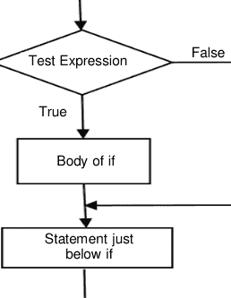

### 核心 Java

示例：

```
class IfDemo
{
    public static void main(String args[]) {
        int i = 10;
        if (i > 15) {
            System.out.println("10 is less than 15");
            System.out.println("welcome to if condition");
        }
    }
}
```

### 2.2.2 if-else 语句

`if` 语句本身告诉我们如果条件为真，它将执行一个语句块，如果条件为假则不执行。但如果我们想在条件为假时做其他事情呢？这就有了 `else` 语句。我们可以将 `else` 语句与 `if` 语句一起使用，在条件为假时执行代码。

语法：

```
if (condition)
{
    // 执行此块如果条件为真
}
else
{
    // 执行此块如果条件为假
}
```

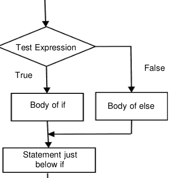

### 控制流语句

示例：

```
class IfElseDemo
{
    public static void main(String args[]) {
        int i = 10;
        if (i < 15)
            System.out.println("i is smaller than 15");
        else
            System.out.println("i is greater than 15");
    }
}
```

### 2.2.3 嵌套 if 语句

嵌套 `if` 是另一个 `if` 或 `else` 的目标语句。嵌套意味着在 `if` 内部嵌套 `if`。

语法：

```
if (condition1)
{
    // 当 condition1 为真时执行此
    if (condition2)
    {
        // 当 condition2 为真时执行此
    }
}
```

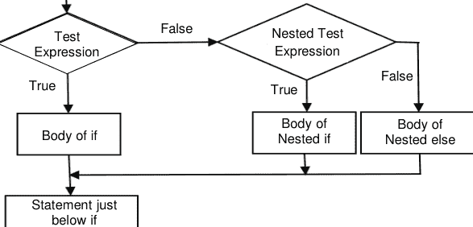

### 示例

```
class NestedIfDemo
{
    public static void main(String args[])
    {
        int i = 10;
        if (i == 10)
        {
            // 第一条语句
            if (i < 15)
                System.out.println("i is smaller than 15");
            else
                System.out.println("i is greater than 15");
        }
    }
}
```

### 2.2.4 if-else if 阶

在这里，用户可以在多个选项之间进行选择。`if` 语句向下执行。一旦某个条件为真，就会执行与之关联的语句，并跳过剩余部分。如果没有任何条件为真，则将执行最后的 `else` 语句。

语法：

```
if (condition)
    statement;
else if (condition)
    statement;
...
else
    statement;
```

### 控制流语句

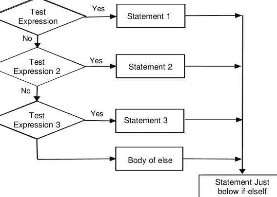

示例：


### 2.2.5 switch-case

`switch` 语句是一种多路分支语句。它提供了一种根据表达式的值将执行分到不同代码部分的简单方法。

语法：

```
switch (expression)
{
    case value1:
        statement1;
        break;
    case value2:
        statement2;
        break;
...
    case valueN:
        statementN;
        break;
    default:
        statementDefault;
}
```

- 表达式类型可以是 `byte`、`short`、`int`、`char` 或枚举。从 JDK7 开始，表达式也可以是 `String` 类型。
- 不允许重复的 `case` 值。
- `default` 语句是可选的。
- `break` 语句用于 `switch` 内部终止语句序列。
- `break` 语句是可选的。如果省略，执行将继续进入下一个 `case`。

### 控制流语句

示例 1：

```java
class Switch_demo
{
    public static void main(String args[])
    {
        int i = 9;
        switch (i)
        {
            case 0:
                System.out.println("i is zero.");
                break;
            case 1:
                System.out.println("i is one.");
                break;
            case 2:
                System.out.println("i is two.");
                break;
            default:
                System.out.println("i is greater than 2.");
        }
    }
}
```

示例 2：

```java
class SwitchCaseDemo2
{
    public static void main(String args[])
    {
        try {
            int num=Integer.parseInt(args[0]);
            int n=num;
            int reverse=0;
            while(num>0)
            {
                remainder=num%10;
                reverse=reverse*10+remainder;
                num=num/10;
            }
            String result=""; //contains the actual output
            while(reverse>0)
            {
                remainder=reverse%10;
                reverse=reverse/10;
            }
            switch(remainder) {
                case 0:
                    result=result+"zero";
                    break;
                case 1:
                    result=result+"one";
                    break;
                case 2:
                    result=result+"two";
                    break;
                case 3:
                    result=result+"three";
                    break;
                case 4:
                    result=result+"four";
                    break;
                case 5:
                    result=result+"five";
                    break;
                case 6:
                    result=result+"six";
                    break;
                case 7:
                    result=result+"seven";
                    break;
                case 8:
                    result=result+"eight";
                    break;
                case 9:
                    result=result+"nine";
                    break;
                default:
                    result="";
            }
            System.out.println(result);
        }
        catch(Exception e)
        {
            System.out.println("Invalid number format");
        }
    }
}
```

### 问题

1. 列出 Java 中使用的不同控制语句，并详细解释其中两个。
2. `if...else` 和 `switch...case` 语句之间的区别。
3. 结合示例解释什么是语句。
4. 结合示例解释 `if...else` 语句。
5. 结合示例解释嵌套 `if`。
6. 结合示例解释 `if-else-if` 阶梯语句。
7. 结合示例解释 `switch...case` 语句。

# 第 3 章

## 迭代

结构

- 3.1 Java 中的循环
- 3.2 While 循环
- 3.3 Do ... While 循环
- 3.4 for 循环
- 3.5 Foreach 循环
- 3.6 标签语句
- 3.7 标签 Break 语句
- 3.8 Continue 语句
- 3.9 Return 语句

### 3.1 JAVA 中的循环

编程语言中的循环是一种特性，它允许在某些条件求值为真时，重复执行一组指令/函数。

Java 提供了三种执行循环的方式。虽然所有这些方式都提供相似的基本功能，但它们在语法和条件检查时间上有所不同。

### 3.2 WHILE 循环

`while` 循环是一种控制流语句，允许根据给定的布尔条件重复执行代码。`while` 循环可以被认为一个重复的 `if` 语句。

语法：

```java
while (boolean condition)
{
    loop statements...
}
```

- `while` 循环从检查条件开始。如果评估为真，则执行循环体语句，否则执行循环后的第一条语句。出于这个原因，它也被称为入口控制循环。
- 一旦条件被评估为真，就会执行循环体中的语句。通常，这些语句包含用于下一次迭代的变量的更新值。
- 当条件变为假时，循环终止，标志着其生命周期的结束。

示例：

```java
class whileLoop_Demo
{
    public static void main(String[] args)
    {
        int x = 1;
        while (x <= 4)
        {
            System.out.println("Value of x:" + x);
            x++;
        }
    }
}
```

### 3.3 DO WHILE

`do while` 循环与 `while` 循环相似，唯一的区别在于它在执行语句后检查条件，因此它是出口控制循环的示例。

语法：

```java
do {
    statements..
}
while (condition);
```

- `do while` 循环从执行语句（s）开始。第一次执行时不检查任何条件。
- 在执行语句并更新变量值后，检查条件为真还是为假。如果评估为真，则开始循环的下一次迭代。
- 当条件变为假时，循环终止，标志着其生命周期的结束。
- 注意，`do-while` 循环会在检查任何条件之前至少执行一次其语句，因此它是出口控制循环的示例。

示例：

```java
class dowhileDemo {
    public static void main(String[] args[]) {
        int x = 21;
        do {
            System.out.println("Value of x:" + x);
            x++;
        }
        while (x < 20);
    }
}
```

### 3.4 FOR 循环

`for` 循环提供了一种编写循环的简洁方式。与 `while` 循环相比，`for` 语句在一行内消耗初始化、条件和增/减，提供了易于调试的结构。

语法：

```java
for (initialization condition)
{
  statement(s)
```

#### for 循环如何工作？

1. 初始化表达式执行一次。
2. 然后评估测试表达式。这里是一个布尔表达式。
3. 如果测试表达式评估为真：
   - 执行 `for` 循环体内的代码。
   - 之后执行更新表达式。
   - 再次评估测试表达式。
   - 如果测试表达式为真，执行 `for` 循环体代码和更新表达式。
   - 此过程一直持续到测试表达式评估为假。
4. 如果测试表达式评估为假，`for` 循环终止。

- 1. 初始化条件：在这里我们初始化使用的变量。它标记了 `for` 循环的开始。可以使用已经定义的变量，也可以声明仅局部循环的变量。
- 2. 测试条件：用于测试循环的退出条件。它必须返回一个布尔值。由于在执行循环语句之前检查条件，它是入口控制循环。
- 3. 语句执行：一旦条件评估为真，就会执行循环体中的语句。
- 4. 增/减：用于更新下一次迭代的变量。
- 5. 循环终止：当条件变为假时，循环终止，标记其生命周期的结束。

示例：

```java
class for_Demo
{
    public static void main(String args[])
    {
        // for 循环从 x=2 开始
        // 并运行到 x <= 4
        for (int x = 2; x <= 4; x++) {
            System.out.println("Value of x:" + x);
        }
    }
}
```

### 3.5 FOR EACH 循环

主要用于遍历数组或集合元素。`for-each` 循环的优势是它消除了错误的可能性并使代码更具可读性。

语法：

```
for(data_type variable : array | collection) { }
```

示例：

这里有一个使用标准 `for` 循环遍历数组元素的示例：

```java
class ForLoop
{
    public static void main(String[]) args
    {
        char[] vowels = {'a', 'e', 'i', 'o', 'u'};
        for (int i = 0; i < vowels.length; ++ i) {
            System.out.println(vowels[i]);
        }
    }
}
```

你可以可以使用 `for-each` 循环执行相同的任务：

```java
class AssignmentOperator
{
    public static void main(String[] args)
    {
        char[] vowels = {'a', 'e', 'i', 'o', 'u'};
        for (char item: vowels) {
            System.out.println(item);
        }
    }
}
```

示例 2：计算整数数组所有元素的和。

```java
class EnhancedForLoop
{
    public static void main(String[] args)
    {
        int[] numbers = {3, 4, 5, -5, 0, 12};
        int sum = 0;
        for (int number: numbers) {
            sum += number;
        }
        System.out.println("Sum = " + sum);
    }
}
```

### break 语句

`break` 语句会立即终止循环，程序的控制权将移动到循环之后的下一个语句。

示例：

```java
class Test
{
    public static void main(String[] args)
    {
        for (int i = 1; i <= 10; ++i) {
            if (i == 5) {
                break;
            }
            System.out.println(i);
        }
    }
}
```

### 3.6 标签语句 (LABELED STATEMENTS)

Java 提供了一种不常用的特性，称为标签语句。这种功能在某种程度上类似于汇编语言编程，因为我们可以创建一个带标签的代码块，并且在使用使用 `break` 和 `continue` 关键字将程序控制转移到带标签语句的末尾或开头时，引用该标签。

程序通常是连续语句的线性执行流。程序员施加某些控制，根据某些逻辑将流重定向到适当的方向。在 Java 中有多种方法可以控制程序流。使用关键字编写的语句被称为控制语句。控制语句属于并有助于程序流的交替。这两个关键字可以配合标签使用，也可以不带标签使用。我们大多数时候不带标签使用它们，但也可以带标签使用。我们将简要概述这两种控制语句，并在下文中稍后深入探讨其标签部分。

### 3.7 标签 break 语句 (LABELED BREAK STATEMENT)

我们目前为止讨论的 `break` 语句是无标签 `break` 语句，它终止最内层的 `for`、`while`、`do..while` 和 `switch` 语句。另一种形式的 `break` 语句是标签 `break`，它可以终止外层循环。

#### 标签 break 语句的工作原理

```
label:
for(int i;testexpression;update)
// codes
for(int i;testexpression;update)
// codes
if(condition to break)
{
    break label;
    //codes
}
//codes
```

在这里，`label` 是一个标识符。当 `break` 语句执行时，它终止带标签的语句，程序的控制权跳转到紧跟带标签语句之后的语句。

```java
class LBreak
{
    public static void main(String[] args) {
        first:
        for(int i = 1; i<5; i++) {
            second:
            for(int j = 1; j<3; j ++ ) {
                System.out.println("i = " + i + "; j = " + j);
                if (i == 2) {
                    break first;
                }
            }
        }
    }
}
```

当你运行程序时，输出将是：
```
i = 1; j = 1
i = 1; j = 2
i = 2; j = 1
```

#### 无标签 break 语句

`break` 语句的常见用法是我们通常使用它们来终止 `switch` 语句的执行。它退出该块并执行块之后的下一个语句。

```java
class Test {
    public static void main(String[] args) {
        // 示例代码
    }
}
```


### 3.8 continue 语句 (CONTINUE STATEMENT)

当使用`continue`语句时，程序的控制权跳转到循环的末尾。然后，评估控制循环的测试表达式。在循环的情况下，更新语句在评估测试表达式之前执行。

它几乎总是与决策语句（`if...else`语句）一起使用。

#### 它的语法是：
`continue;`

#### 标签 continue 语句 (Labeled Continue Statement)

我们目前讨论的`continue`语句是`continue`的无标签形式，它跳过最内层`for`、`while`和`do..`循环剩余语句的执行。

#### 标签 continue 语句的工作原理？

`label:`

```
while(testexpression)
{
  // codes
  for(testexpression)
  {
    // codes
    if(condition for continue)
    {
      continue label;
      //codes
    }
  }
  //codes
}
```

另一种形式的`continue`语句是标签形式，它可以跳过外层循环内部语句的执行。

#### 无标签 continue 语句 (Without a Label)

`continue`语句在 Java 中配合循环使用时，会跳过循环体中的剩余语句并进入循环的下一次迭代。这与`break`语句相反，后者是跳出当前循环。`continue`语句简单地从下一次迭代开始恢复循环。

示例：

```java
class Test {
  public static void main(String[] args) {
    for (int i = 1; i <= 10; ++i) {
      if (i == 5) {
        continue;
      }
      System.out.println(i);
    }
  }
}
```

#### 无标签 break 语句 (Without Label)

`break`语句的常见用法是我们通常使用它们来终止`switch`语句的执行。它退出该块并执行块之后的下一个语句。

```java
class Test {
  public static void main(String[] args) {
    for (int i = 1; i<5; i++) {
      if (i == 5) {
        break;
      }
      System.out.println(i);
    }
  }
}
```

### 迭代 (iterations)

#### 无标签 break 语句

`break`语句的常见用法是我们通常使用它们来终止`switch`语句的执行。它退出该块并执行块之后的下一个语句。

```java
class Test {
  public static void main(String[] args) {
    for (int i = 1; i<=10; ++i) {
      if (i == 5) {
        break;
      }
      System.out.println(i);
    }
  }
}
```

#### 标签语句 (with a Label):

`continue`语句与无标签`continue`语句相似，它们都跳过最内层循环的剩余语句。与标签`continue`语句的区别在于它跳转到标签。

示例：

```java
class LabeledContinue {
  public static void main(String[] args) {
    start:
    for (int i = 1; i<5; i++) {
      for (int j = 1; j<3; j++) {
        System.out.println("i=" + i + ", j=" + j);
        if (i == 2) {
          continue start;
        }
      }
    }
  }
}
```

当你运行程序时，输出将是：
`i=1, j=1`
`i=1, j=2`
`i=2, j=1`
`i=2, j=2`
`i=3, j=1`
`i=3, j=2`
`i=4, j=1`
`i=4, j=2`

#### 无标签 continue 语句

`continue`语句在 Java 中配合循环使用时，会跳过循环体中的剩余语句并进入循环的下一次迭代。这与`break`语句相反，后者是跳出当前循环。`continue`语句简单地从下一次迭代开始恢复循环。

#### 标签 break 语句

另一种形式的`break`语句是标签 break，可以终止外层循环。

#### 标签 break 语句的工作原理

```
label:
for(int i;testexpression;update)
  // codes
  for(int i;testexpression;update)
    // codes
    if(condition to break)
    {
      break label;
      //codes
    }
  //codes
```

在这里，`label`是一个标识符。当`break`语句执行时，它终止带标签的语句，程序的控制权跳转到紧跟带标签语句之后的语句。

```java
class LBreak {
  public static void main(String[] args) {
    first:
    for(int i = 1; i<5; i++) {
      second:
      for(int j = 1; j<3; j ++ ) {
        System.out.println("i = " + i + "; j = " + j);
        if (i == 2) {
          break first;
        }
      }
    }
  }
}
```

当你运行程序时，输出将是：

`i = 1; j = 1`

`i = 1; j = 2`

`i = 2; j = 1`

#### 无标签 break 语句

`break`语句的常见用法是我们通常使用它们来终止`switch`语句的执行。它退出该块并执行块之后的下一个语句。

```java
class Test {
  public static void main(String[] args) {
    for (int i = 1; i <= 10; ++i) {
      if (i == 5) {
        break;
      }
      System.out.println(i);
    }
  }
}
```

### 示例：

```java
public class Program {
  static int computeSize(int height, int width) {
    // 根据两个参数（变量）返回一个表达式。
    return height * width;
  }
  public static void main(String[] args) {
    // 将结果赋值给 computeSize。
    int result = computeSize(10, 3);
    System.out.println(result);
  }
}
```


- 1. 列出 Java 中使用的不同循环语句并详细解释其中两种。
- 2. `while`循环和`do while`循环之间的区别。
- 3. 结合示例解释`break`语句。
- 4. 结合示例解释`continue`语句。
- 5. 结合示例解释`return`语句。
- 6. 结合示例解释`while`循环。
- 7. 结合示例解释`do...while`循环。
- 8. 结合示例解释`foreach`循环。
- 9. 结合示例解释`for`循环。


# 第 4 章

#### 类


### 结构

## 4.1 类介绍

- 4.1.1 字段声明或实例变量或成员变量
- 4.1.2 方法声明

#### 4.2 类类型

### 4.3 作用域规则

### 4.4 访问修饰符

### 4.5 类的实例化（创建对象）

### 4.6 初始化类对象及其属性

### 4.7 类方法、访问方法（访问类成员）

### 4.8 方法返回值、方法参数

### 4.9 对象数组

### 4.10 方法重载

### 4.11 可变参数 [Varargs]

### 4.12 构造函数

### 4.13 Java 中的 “THIS” 关键字

### 4.14 Java 中的 Super 关键字

## 4.15 方法重写

## 4.16 类成员的特征

## 4.17 常量

## 4.18 类的静态字段

## 4.19 类的静态方法

## 4.20 垃圾收集

## 4.1 类介绍

类是对象的蓝图：

- 1. Java 是一种真正的面向对象编程语言。Java 中的几乎一切都是对象，因此所有 Java 程序类的结构由……所有的程序代码和数据都存在对象和类中。Java 封装在类中，定义了对象的状态和行为（类类型的变量），被称为基本程序组件。Java 类创建对象并使用方法在它们之间通信。

- 2. 定义。类是用户定义的数据类型。所有数据和方法都封装在类中。类是类变量对象的模板。写在类内部的数据和函数被称为类的成员。变量被称为实例变量，方法被称为实例方法。方法作用于实例变量。

- 3. 类提供了一种高效方便的方法，将一组逻辑相关的数据项及其作用于它们上的函数打包。

- 4. 在 Java 中，这些数据项被称为字段（field），函数被称为方法（method）。

- 5. 类定义的基本形式如下

#### 如何在 Java 中定义类？

以下是 Java 中定义类的方式：

```java
class className {
  // 变量
  // 方法
}
```

这里有一个示例：

```java
class Lamp {
  // 实例变量
  private boolean isOn;
  // 方法
  public void turnOn() {
    isOn = true;
  }
}
```

```java
// 方法
public void turnOff() {
  isOn = false;
}
```

在这里，我们定义了一个类`Lamp`。

该类有一个实例变量（在类内部定义的变量）`isOn`和两个方法`turnOn()`... 这些在类内部定义的变量和方法被称为类的类成员。

注意：

- 1. 调用大括号调用后不需要加分号。
- 2. 类名是有效的 Java 标识符。
- 3. 类内部定义的方法和成员被称为类的成员。
- 4. 类声明仅创建一个模板，它不创建实际的对象。

#### 4.1.1 字段声明或实例变量或成员变量

- 定义在类内部的数据变量被称为实例。通过将声明的字段放在类定义的体体内部，数据被封装在类中。

- 这些变量被称为实例变量或字段，因为它们每当包含它们的类的对象创建时就会被创建，并且类的每个实例都包含这些变量的自己的副本。因此，一个对象的数据是分离且唯一的，另一个对象的数据可以像声明局部变量一样被创建。

- 使用点运算符`.`配合对象从类外部访问实例变量。也可以在定义它的类内部直接访问。

示例：

```java
class Fruit {
  int cost;
  char name[10];
}
```

在这个示例中，类是`Fruit`，`int cost`和`char name[10]`是`Fruit`类的实例变量。

这些实例仅被声明了，尚没有创建任何存储空间。

#### 4.1.2 方法声明

- 1. 在类内部定义的方法和成员被称为类的成员。
- 2. 类声明仅创建一个模板，它不创建实际的对象。

### 4.5 从类实例化对象（创建对象）

- 对象是类的实例，或者是用户定义数据类型类的变量。对象是内存中的一个块区域，包含了存储所有实例变量的空间；创建对象也被称为实例化一个对象。

- 对象是通过使用`new`算符（内存分配操作符）创建的。`new`操作符创建一个指定类的类的对象，并返回所创建对象的引用。

- 创建对象的步骤为：

  1. 声明用于持有对象的对象或类类型变量。该变量并没有定义一个对象，它仅仅是一个可以引用对象的变量。

     **例如：**

     `Rectangle Rec = new Rectangle();`

  2. 使用`new`运算符实例化对象或将类类型的变量赋值给这些变量。或者通过`new()`运算符获取对象的实际物理副本并赋值给变量。`new`运算符为对象动态分配内存并返回其引用。这个引用在多程度上或少程度上是`new`运算符分配的对象的地址。在 Java 中，所有类对象都必须动态分配内存。这提供了安全性，因为你不能像指针一样操纵引用。因此，对象的引用不能被操纵，也不能指向任意的内存位置。

     **例如：**

     `Rec = new Rectangle();`

变量`Rec`现在是`rectangle`类的一个对象，如下所示所示：

`Rectangle Rec = new Rectangle();`

`Rectangle()`方法是该类的默认构造函数。

#### 分配对象引用变量：

1. 一个对象引用可以赋值给另一个引用变量，此时不会创建对象的副本，而是创建一个引用的副本。


2. 可以创建任意数量的对象。每个对象都有其所属类实例变量的独立副本。对一个对象的变量的任何更改都不会影响另一个变量。同样也可以创建指向同一个对象的引用，如上图所示。

```java
Rectangle R1 = new Rectangle();
Rectangle R2 = R1;
```

在上面的示例中，`R1` 和 `R2` 指向同一个对象。将 `R1` 赋值给 `R2` 没有分配任何内存，也没有复制原始对象的部分。它仅仅是让 `R2` 指向与 `R1` 相同的对象。因此，通过 `R2` 对对象进行的任何更改都会影响 `R1` 所引用的对象，因为它们是同一个对象。

## 初始化类对象及其属性

在计算机编程中，初始化是为数据对象或变量分配初始值。初始化的方式取决于编程语言，以及存储类、类型或要初始化的对象。

初始化可以通过在编译时静态地嵌入值完成，也可以通过在运行时赋值完成。执行此类初始化的代码段通常被称为“初始化代码”，并可能包括其他一次性的函数，例如打开文件；在面向对象编程中，初始化代码可以是构造函数（类方法）或初始化器（实例方法）的一部分。将内存位置设置为十六进制的零有时被称为“清零（clearing）”，它在机器码层级通过异或指令执行（两个操作数指定同一个变量）来完成，这不需要额外的内存访问。

## 类方法，访问方法（访问类成员）

- 对象数据包含用于操作数据的成员或实例。每个对象都有其用于数据成员的独立内存空间。使用点操作符（`.`）可以从类外部访问方法。对象被用于调用该方法。它可以从定义它的类内部直接访问。

- 点操作符（`.`）用于从类外部对象访问实例变量。它可以从定义它的类内部直接访问。

- 从外部无法直接访问实例变量和方法。要实现这一点，需要使用对象和点操作符（`.`），如下所示：

```
Object.variable_name = value;
Object.method_name(parameter list);
```

其中：

- `Object_name` 是对象的名称。
- `Variable_name` 是对象内部实例变量的名称。
- `Method_name` 是方法的名称。
- `Parameter_name` 是一个用逗号分隔的实际值列表，其在类型和数量上与类中声明的 `method_name` 的参数列表匹配。

例如：`Rectangle` 类的实例变量可以按如下方式访问并赋值：

```java
Rec.length = 10;
Rec.width = 15;
R2.length = 20;
```

#### 类

```
R2.width = 15;
```

现在对象 `Rec` 和 `R2` 存储不同的值，如下所示：

| Rec.length | 10 | R2.length | 20 |
| :--- | :--- | :--- | :--- |
| Rec.width | 15 | R2.width | 15 |

我们还可以另一种方法为实例变量赋值，即通过类内部定义的方法。例如，假设使用 `getdata()` 函数来完成相同的工作。

```java
void getdata(int a, int b) {
    Length = a;
    Width = b;
}
```

我们也可以调用方法为变量分配初始值，就像创建对象一样：

```
Rectangle = new Rectangle();
```

使用对象 `Rec` 调用方法 `getdata()`：

```
Rec.getdata(10, 15);
```

### 程序

**程序 1：计算矩形的面积。**

```java
class RectExample {
    int length, width;
    void getdata(int a, int b) {
        length = a;
        width = b;
    }
    int getArea() {
        return length * width;
    }
}

class RectArea {
    public static void main(String[] args) {
        RectExample rec = new RectExample();
        rec.getdata(10, 15);
        System.out.println("Area is: " + rec.getArea());
    }
}
```

*(注：由于原文中代码部分逻辑较为错乱，翻译时保持了原始意图并对结构进行了最小化对齐)*

**程序 2：演示对象引用的赋值。**

```java
class Rectangle {
    int length, width;
    void getdata(int a, int b) {
        length = a;
        width = b;
    }
}

class RectangleAssignment {
    public static void main(String[] args) {
        Rectangle r1 = new Rectangle();
        r1.getdata(10, 15);
        Rectangle r2 = r1;
        r2.length = 20;
        System.out.println("R1 length: " + r1.length);
        System.out.println("R2 length: " + r2.length);
    }
}
```

*(注：原文提供的示例代码块存在大量语法错误和逻辑混乱，此处翻译仅针对文本描述部分)*

```java
void getdata(int a, int b) {
    Length = a;
    Width = b;
}
```

```java
{
  void putdata() {
    System.out.println("age="+age);
    System.out.println("person name="+name);
  }

  public static void main(String args[]) {
    Person a=new Person();
    a.getdata(20,"vinod");
    a.putdata();
  }
}
```

### 4.8 返回值的值的方法，方法的参数

你在方法声明中声明方法的返回类型。在方法体内部，你使用 `return` 语句返回返回值。任何声明为 `void` 的方法都不返回返回值。它不需要包含 `return` 语句，但也可以包含。

| 返回类型 | 方法名 | 传递给方法的值 |
| :--- | :--- | :--- |

```java
int total(int aNumber) {
  int a_Value = aNumber + 10;
  return a_Value;
}
```

#### 从方法返回返回值

当方法满足以下情况之一时，它会返回到调用它的代码：

- 完成方法中所有的语句，
- 达到 `return` 语句，或
- 抛出异常（后文介绍），

以先发生的为准。

你在方法声明中声明方法的返回类型。在方法体内部，你使用 `return` 语句返回返回值。

## Java Java

任何声明为 `void` 的方法都不返回返回值。它不需要包含 `return` 语句，但在这种情况下，可以使用 `return` 语句跳出控制流块并退出方法，其用法如下：

```
return;
```

如果你尝试从一个声明为 `void` 的方法返回返回值，你将得到编译错误。

任何未声明为 `void` 的方法必须包含一个带有相应返回值的 `return` 语句，如下所示：

```
return returnValue;
```

### 4.9 对象数组

对象数组是相同类的集合。给定的语法将定义一个引用数组。因此，请在数组中分配单个对象引用或声明一个对象数组。定义对象数组的语法为：

`classname array_name[dimension];`

其中：

- `className` 是要定义对象数组的类名。
- `array_name` 是对象的名称。
- `dimension` 是数组的大小。

示例：

```java
Box b[6]; //定义一个指向类 Box 的大小引用数组。
for(i=0;i<6;i++)
  b[i] = //赋值给数组中的单个引用
```

程序 7：定义一个具有数据成员 `length` 和 `breadth` 的矩形。使用对象数组接受并显示该类三个对象的数据。

```java
import java.io.*;
class Rectangle
{
    int length, breath;
    void accept()
{
        try{
            BufferedReader in=new BufferedReader(new InputStreamReader(System.in));
            System.out.println("enter length==");
            length=Integer.parseInt(in.readLine());
            System.out.println("enter breath==");
            breath=Integer.parseInt(in.readLine());
        } catch(Exception e)
        {
            System.out.println(e);
        }
    }
    void display() {
        System.out.println("length=="+length);
        System.out.println("breath=="+breath);
    }
}
```

**程序 8**：定义一个具有数据成员 `name` 和 `basic salary` 的 `Employee` 类。定义适当的方法来初始化和显示数据成员的值。接受并显示三个对象的数据。

```java
import java.io.*;
import java.lang.*;
class employee {
    int bsalary;
    String name;
    BufferedReader br=new BufferedReader(new InputStreamReader(System.in));
    void get() {
        try {
            System.out.println("Enter the basic salary:");
            bsalary=Integer.parseInt(br.readLine());
            System.out.println("Enter the name:");
            name=(br.readLine());
        } catch(Exception e) {
            System.out.println(e);
        }
    }
    void show(int m) {
      System.out.println("basic salary:"+bsalary);
      System.out.println("name:"+name);
    }
}
class program1 {
  public static void main(String[] args) {
    employee e[]=new employee[3];
    for(int i=0;i<3;i++) {
      e[i]=new employee();
    }
    for(int i=0;i<3;i++) {
      e[i].get();
    }
    for(int i=0;i<3;i++) {
      e[i].show(i);
    }
  }
}
```

**输出:**

```
D:\javac program1.java
D:\java program1
Enter the basic salary:
2000
Enter the name:
sandeep
Enter the basic salary:
3000
Enter the name:
arvind
Enter the basic salary:
5000
Enter the name:
Alok
basic salary:2000
name:sandeep
basic salary:3000
name:arvind
basic salary:5000
name:Alok
```

程序 9：定义一个具有数据成员 `code` 和 `price` 的 `Item` 类。使用对象数组接受五个对象并以表格格式显示数据。同时显示所有项目的总价格。

```java
import java.lang.*;
import java.io.*;
class item
{
    int code;
    double price;
    BufferedReader br=new BufferedReader(new InputStreamReader(System.in));
    void get() {
        try {
            System.out.println("Enter code:");
            code=Integer.parseInt(br.readLine());
            System.out.println("Enter Price:");
            price=Double.parseDouble(br.readLine());
        } catch (Exception ex) {
            System.out.println(ex);
        }
    }
    void show() {
        System.out.println(code+" "+price);
    }
}
class testprogram1
{
    public static void main(String args[]) {
        item it[]=new item[5];
        for(int i=0;i<5; i++) {
          it[i]=new item();
        }
        for(int i=0;i<5; i++) {
          it[i].get();
        }
        double total=0;
        for(int i=0;i<5; i++) {
          total=total+it[i].price;
        }
        System.out.println("Total price of the item is-"+total);
        for(int i=0;i<5; i++) {
          it[i].show();
        }
        System.out.println("Total price of the item is-"+total);
    }
}
```

**输出:**

```
D:\javac testprogram1.java
D:\java program1
Enter code:
111
Enter Price:
120.0
Enter code:
222
Enter Price:
230.0
Enter code:
333
Enter Price:
310.0
Enter code:
444
Enter Price:
330.0
Enter code:
555
Enter Price:
620.0
```

| Code | Price |
| :--- | :--- |
| 111 | 120.0 |
| 222 | 230.0 |
| 333 | 310.0 |
| 444 | 330.0 |
| 555 | 620.0 |

Total price of the item is: 1610.0

程序 It：定义一个具有 `name`、`rollno` 和 `percentage` 数据成员的 `student` 类。接受五个对象并使用对象数组显示包含学号和百分比的列表。


```java
import java.io.*;
import java.lang.*;
class student {
    int rollno;
    String name;
    double percent;
    BufferedReader br=new BufferedReader(new InputStreamReader(System.in));
    void get() {
        try {
            System.out.println("Enter the roll number of student.");
            rollno= Integer.parseInt(br.readLine());
            System.out.println("Enter the name of student.");
            name=br.readLine();
            System.out.println("Enter the percent of student.");
            percent=Double.parseDouble(br.readLine());
        } catch(Exception e) {
            System.out.println(e);
        }
    }
    void show(int m) {
        System.out.println("Merit no"+(m+1)+"Roll no:"+rollno+":Percent:"+percent);
    }
}
class testprogram12
{
    public static void main(String[] args) {
        student s[]=new student[5];
        student s1=new student();
        for(int i=0;i<5; i++) {
            s[i]=new student();
        }
        for(int i=0;i<5; i++) {
            s[i].get();
        }
        double test=s[0].percent;
        int j=0;
        for(int i=0;i<4; i++) {
            for(j=i;j<5;j++) {
                if(s[i].percent<s[j].percent) {
                    s1=s[i];
                    s[i]=s[j];
                    s[j]=s1;
                }
            }
        }
        for(int i=0;i<5; i++) {
            s[i].show(i);
        }
    }
}
```

**输出:**

`D:\javac testprogram12.java`

`D:\java testprogram12`

Enter the roll number of student.

111

Enter the name of student.

sandeep

Enter the percent of student.

67

Enter the roll number of student.

234

Enter the name of student.

Faisal

Enter the percent of student.

51

Enter the roll number of student.

452

Enter the name of student.

Arvind

Enter the percent of student.

64

Enter the roll number of student.

321

Enter the name of student.

Sanjay

Enter the percent of student.

73

Enter the roll number of student.

543

Enter the name of student.

Mahendra

Enter the percent of student.

87

Merit no1Roll no:543:Percent:87.0

Merit no2Roll no:321:Percent:73.0

Merit no3Roll no:111:Percent:67.0

Merit no4Roll no:452:Percent:64.0

Merit no5Roll no:234:Percent:51.0

### 4.10 方法重载

方法重载是一项特性，允许一个类拥有多个具有相同名称的方法，只要它们的参数列表不同。这类似于 Java 中的构造方法重载，构造方法重载允许一个类拥有多个不同参数列表的构造方法。

#### 重载方法的三种方式

要重载一个方法，方法的参数列表必须以下任一方面有所不同：

#### 1. 参数个数

例如：这是一个有效的重载用例

`add(int, int)`

`add(int, int, int)`

#### 2. 参数的数据类型

例如：

`add(int, int)`

`add(int, float)`

#### 3. 参数数据类型的顺序

例如：

`add(int, float)`

`add(float, int)`

通过改变参数类型来实现方法重载的示例

```java
class Calculate
{
    void sum(int a, int b)
    {
        System.out.println("sum" + (a+b));
    }
    void sum(float a, float b)
    {
        System.out.println("sum" + (a+b));
    }
    public static void main(String[] args)
    {
        Calculate cal = new Calculate();
        cal.sum(8,5); // 调用 sum(int a, int b) 方法
        cal.sum(4.6f, 3.8f); // 调用 sum(float a, float b) 方法
    }
}
```

通过改变参数个数来实现方法重载的示例。面积

```java
class Area
{
    void find(int l, int b)
    {
        System.out.println("Area" + (l*b));
    }
    void find(int l, int b, int h)
    {
        System.out.println("Area is+"(l*b*h));
    }
    public static void main(String[] args) {
        Area ar = new Area();
        ar.find(8,5); // 调用 find(int l, int b)
        ar.find(4,6,2); // 调用 find(int l, int b, int h)
    }
}
```

### 4.11 可变参数 [VARARGS]

Java 中的可变参数（Varargs）。在 JDK 5 中，Java引入了一项简化创建需要接收数量参数的方法的功能。这种特性被称为 varargs，它是可变长度参数的缩写。接受可变参数的方法就是 varargs 方法。

varargs 允许方法接受零个或多个参数。在 varargs 之前，我们使用重载方法或使用数组作为方法参数，但这被认为是不好的做法，因为它会导致维护问题。如果我们不知道需要向方法传递多少个参数，varargs 是更好的方法。

#### Varargs 的优势

我们不需要提供重载方法，因此代码更少。

varargs 的语法：

- varargs 使用省略号，即在数据类型后紧跟三个点。语法如下：

`return_type method_name(data_type... variableName[])`

### 4.12 JAVA 中的构造函数

构造函数是一个初始化对象的特殊方法。每个类都有构造函数，如果我们没有显式地为任何 Java 类声明构造函数，编译器将为该类构建一个默认构造函数。

构造函数的名称与它所属的类相同。Java 中的构造函数不能是抽象的、静态的、最后的或同步的。构造函数不允许使用这些修符。

```java
class Car
{
    String name;
    String model;
    Car() // 构造函数
    {
        name="";
        model="";
    }
}
```

#### 构造函数有两种

- 默认构造函数

- 参数构造函数

每次创建新对象时，至少会调用一个构造函数。

`Car c = new Car();` // 调用默认/参数构造函数

`Car c = new Car(name);` // 调用参数构造函数

#### 构造函数重载

方法一样，构造函数也可以被重载。重载构造函数根据其参数类型或参数个数来区分。构造函数重载与方法重载没有太大区别。在方法重载中，你有多个具有相同名称但签名不同的方法；而在构造函数重载中，你有多个具有不同签名的构造函数，区别在于 Java 中的构造函数没有返回值。

构造函数重载的示例

```java
class Cricketer {
  String name;
  String team;
  int age;
  Cricketer () // 默认构造函数 {
    name="";
    team="";
    age =0;
  }
  Cricketer(String n, String t, int a) // 重载构造函数 {
    name=n;
    team=t;
    age=a;
  }
  Cricketer (Cricketer ckt) // 类似于 C++ 拷贝构造函数的函数 {
    name=ckt.name;
    team=ckt.team;
    age=ckt.age;
  }
  public String toString()
  {
    return "this is " + name + " of "+team;
  }
}

class test
{
    public static void main(String[] args)
    {
        Cricketer c1 = new Cricketer();
        Cricketer c2 = new Cricketer("sachin", "India", 32);
        Cricketer c3 = new Cricketer(c2);
        System.out.println(c2);
        System.out.println(c3);
        c1.name="Virat";
        c1.team="India";
        c1.age = 32;
        System.out.println(c1);
    }
}
```

输出：

this is sachin of india

this is sachin of india

this is virat of india

### 4.13 THIS 实例

有很多关于 `this` 的用法。`this` 是一个引用变量，用于引用当前对象。

`this` 的用法：

1. `this` 可以引用当前类的实例变量。

2. `this()` 可以调用当前类的构造函数。

3. `this.method()` 可以调用当前类的方法。

4. `this` 可以作为参数传递给方法。

5. `this` 可以作为参数传递给构造函数。

6. `return this` 可以返回当前实例。

不使用 `this` 关键字的问题

如果我们不使用 `this` 关键字，如下面的示例所示：

```java
class cbollege {
    int id;
    String name;
    cbollege(int id,String name) {
        id = id;
        name = name;
    }
    void display() {
        System.out.println(id+" "+name);
    }
    public static void main(String args[]) {
        cbollege s1 = new cbollege(111,"Sandeep");
        cbollege s2 = new cbollege(321,"Arvind");
        s1.display();
        s2.display();
    }
}
```

输出：

0

null

在上面的示例中，形式参数和实例变量相同，因此我们使用 `this` 关键字来区分局部变量和实例变量。

```java
class cbollege {
    int id;
    String name;
    cbollege(int id,String name) {
        this.id = id;
        this.name = name;
    }
    void display() {
        System.out.println(id+" "+name);
    }
    public static void main(String args[]) {
        cbollege s1 = new cbollege(111,"Sandeep");
        cbollege s2 = new cbollege(321,"Arvind");
        s1.display();
        s2.display();
    }
}
```

输出：

111 Sandeep

321 Arvind

### 4.14 SUPER 实例

Java 中的 `super` 关键字是一个引用变量，用于引用直接父类对象。每当你创建一个子类的实例时，都会隐式地创建一个父类的实例，并通过 `super` 引用变量进行引用。

Java Super 关键字的用法

- super 可以引用直接父类的实例变量。

- super 可以调用直接父类方法。

- super() 可以调用直接父类的构造函数。

#### 1. Super 用于引用直接父类的实例变量

我们可以使用 `super` 关键字访问父类的数据成员或字段。当父类和子类具有相同字段时，可以使用它。

```java
class vehicle {
  String color="white";
}
class car extends vehicle{
  String color="black";
  void printColor(color){
    System.out.println(color);//打印 car 类的颜色
    System.out.println(super.color);//打印 vehicle 类的颜色
  }
}
class TestSuper1 {
  public static void main(String args[]){
    car c=new car();
    c.printColor();
  }
}
```

#### 2. Super 可以调用父类方法

`super` 关键字也可以用于调用父类方法。如果子类包含与父类相同的方法，则应该使用。换句话说，当方法被重写时可以使用它。

#### 类

```java
class Animal
{
    void eat() {System.out.println("eating...");}
}
class Dog extends Animal{
    void eat() {System.out.println("eating...");}
    void bark() {System.out.println("barking...");}
    void work(){
        super.eat();
        bark();
    }
}
class TestSuper{
    public static void main(String[] args[]){
        Dog d=new Dog();
        d.work();
    }
}
```

#### 3 super 用于调用父类构造函数

super 关键字也可以用于调用父类构造函数。

```java
class Animal
{
    Animal() {System.out.println("animal is created");}
}
class Dog extends Animal{
    Dog(){
        super();
        System.out.println("dog is created");
    }
}
class TestSuper{
    public static void main(String[] args[]){
        Dog d=new Dog();
    }
}
```

### 4.15 方法重写 (METHOD OVERRIDING)

当子类中的方法名称和签名与其超类中的方法相同时，该方法被称为被重写方法。方法重写也称为运行时多态。重写的关键优势是能够定义特定于某个子类的方法。


```java
class Animal {
    public void eat() {
        System.out.println("Animal eating");
    }
}
class Dog extends Animal {
    public void eat() //`eat()`被`Dog`类重写
        System.out.println("Dog eat");
    }
}
```

重载（Overloading）与重写（Overriding）的区别：

| 方法重载 (Overloading) | 方法重写 (Overriding) |
|---|---|
| 方法的参数列表必须不同。 | 名称和参数必须相同。 |
| 编译时多态。 | 运行时多态。 |
| 提高代码的可读性。 | 提高代码的可重用性。 |
| 可以更改访问修饰符。 | 访问修饰符不能比原始方法更严格（可以宽松）。 |

## 4.16 类成员的特征

当从同一个类蓝图创建多个对象时，它们拥有各自的实例变量副本。在`Bicycle`类中，实例变量是步频（`cadence`）、齿轮（`gear`）和速度（`speed`）。每个`Bicycle`对象都有这些变量的值，存储在内存位置中。

有时，你希望拥有所有对象共有的变量。这通过`static`修饰符实现。带有`static`定义的字段称为静态字段或类变量。它们与类相关，而不是与任何对象相关。类的每个实例共享类变量，该变量存储在内存的一个固定位置。任何对象都可以更改类变量的值，但也可以在创建类实例的情况下操纵类变量。

例如，假设你想创建若干`Bicycle`对象，并为每个对象分配从 1 开始的序列号。这个数字对于每个对象来说是唯一的，因此是一个实例变量。同时，某个字段与任何单个对象都不相关，而是与整个类相关。为此，你需要如下的类变量`numberOfBicycles`：

```java
public class Bicycle {
    private int cadence;
    private int gear;
    private int speed;
    //为对象添加实例变量
    private int id;
    //为实例化的 Bicycle 数量添加类变量
    private static int numberOfBicycles = 0;
}
```

## 4.17 常量 (CONSTANTS)

常量基本上是值不能改变的变量。在 C/C++ 中，使用`const`关键字来声明常量变量。在 Java 中，使用`final`关键字。然而，引入的`final`并不是简单的原始变量；它是一个实际的对象实例。`static final`变量实际上是一个常量。`final`修饰符导致变量不变。

Java 常量通常大写。Java 常量中的单词通常用下划线分隔。下面是 Java 中常量定义的示例：

```java
public class MaxUnits {
    public static final int MAX_UNITS = 25;
}
```

## 4.18 类的静态字段 (STATIC FIELDS)

声明中带有`static`修饰符的字段称为静态字段或类变量。它们与类相关，而不是与任何对象相关。类的每个实例共享类变量，该变量存储在内存的一个固定位置。静态成员用于创建可以在无需创建类实例的情况下访问的数据和方法（使用`new`关键字，它们不能有构造函数）。

## 4.19 类的静态方法 (STATIC METHODS)

Java 静态方法：Java 中的静态方法可以在不创建对象的情况下调用。你是否注意到为什么在定义`main`时要写`static`关键字，是因为程序执行是从`main`开始的，还没有创建对象。

静态方法具有以下特征：

1. 它是一个属于类而不属于对象（实例）的方法

2. 静态方法只能访问静态数据。它不能访问非静态数据（实例变量）。

3. 静态方法只能调用其他静态方法，不能从它调用非静态方法。

4. 静态方法可以通过类名直接访问，不需要任何对象。

5. 语法：`<class-name>.<method-name>`

6. 静态方法无法以任何方式引用 "this" 或 "super" 关键字。

考虑下面的示例以增强你对静态方法的理解。

```java
class Languages {
    public static void main(String[] args)
    {
        display();
    }
    static void display()
    {
        System.out.println("Java is my favorite programming language.");
    }
}
```

## 4.20 垃圾回收 (GARBAGE COLLECTION)

Java 中对象的销毁由 JVM 自动完成。当一个对象没有引用时，该对象被认为不再需要，其占用的内存会被释放。

在 C/C++ 中，程序员负责创建和销毁对象。由于这种疏忽，在某些点创建新对象时可能没有足够的内存，导致`OutOfMemoryError`。但在 Java 中，程序员不需要关心那些不再使用的对象，垃圾回收器会销毁这些对象。垃圾回收器是守护线程最好的例子，因为它始终在后台运行。 垃圾回收的主要目标是通过销毁不可达对象来释放内存。

#### finalize() 方法

有时对象在销毁之前需要执行某些任务，例如关闭连接或释放资源。处理这种情况使用`finalize()`方法。`finalize()`方法在垃圾收集对象之前调用。它是对象执行清理工作的最后机会。

```java
finalize 方法的签名
protected void finalize()
{
}
```

### 问题

1. 解释类的字段声明或实例变量

2. 解释类的类型

3. 解释类和方法的作用规则

4. 陈述 Java 的访问修饰符

5. 定义从类实例化对象的不同方法

6. 解释如何定义类方法以及如何访问方法

7. 定义对象数组

8. 使用示例解释方法重载

9. 解释 Java 中的构造函数

10. 写一个构造函数重载的程序

11. 解释 Java 中的标识符和关键字

12. 写一个演示方法重写的程序

13. 解释 'this' 关键字的使用

14. 解释 Java 中的 super 实例

15. 使用示例解释类和对象

16. 使用示例解释 Java 中的静态字段和方法

17. 解释 Java 中的垃圾回收

18. 定义一个带有实例变量 n 的 Factorial 类并使用递归方法计算 n 的阶乘

19. 写一个程序创建一个具有账号、姓名和余额的 Account 类。接受并显示一个对象的数据

20. 写一个程序创建一个具有姓名、基本薪资的 employee 类。接受并显示一个对象的数据。

21. 定义一个具有长度和宽的 Rectangle 类，使用对象数组接受并显示三个对象的数据。

## 第三章

## 第5章

#### 继承

### 目录

- 5.1 继承简介

- 5.2 扩展继承：创建派生类

- 5.3 聚合

- 5.4 Super 关键字

- 5.5 什么是抽象类

- 5.6 使用抽象类实现抽象

- 5.7 接口

    - 5.7.1 定义接口

    - 5.7.2 扩展接口

    - 5.7.3 默认实现

    - 5.7.4 实现接口

- 5.8 抽象类与接口的区别

- 5.9 类与接口之间的关系

- 5.10 使用接口实现多重继承

### 5.1 继承简介

继承是一个重用性概念。它也被称为派生（derivation）。重用是面向对象编程（OOPs）的重要特征。重用是一项技术，我们可以重用已经过多次测试和调试的类。

这种技术用于从旧类创建新类，并重用现有类的属性。

从旧类派生出新类的机制被称为继承。旧类被称为基类（base class），新类被称为派生类（derived class）。基类也称为超类（super class），派生类也称为子类（sub-class）。这也是父子关系。在任何类型的继承中，派生类都可以访问基类的属性和方法，同时派生类也有它自己的属性和方法。

### Java 继承示例

### 继承的类型

- 单继承：只有一个基类的派生类称为单继承。通过一个基类可以实现一个派生类。

- 多级继承：从另一个派生类派生出类的类的机制被称为多级继承。

在多级继承中，第一类类从基类派生，然后再次从该派生类派生出另一个类。

- 3. **多重继承**：具有多个基类的派生类称为多重继承。

这种类型的继承可以有一个或多个基类，我们可以从中派生出唯一的派生类，这被称为多重继承。这种继承在 Java 中是不直接支持的，可以通过接口的概念来实现。

- 4. **层级继承**：一个类的属性可能被多个类继承，这被称为层级继承。在这种类型的继承中，一个基类和可以派生出的多个类被称为层级继承。

- 5. **混合继承**：它是多级继承和多重继承的结合，也可以是层级继承和多重继承的结合，因此它是不同类型继承的组合。

## 如何在 Java 中实现继承

基类可以定义为普通的 Java 类，包含某些数据函数。

派生类是从基类获取属性的类，被称为派生类。

派生类可以有它自己的属性和方法。

## 5.2 扩展继承创建派生类

#### 定义子类

- Class subclass extends superclassname

{

    变量声明;

    方法定义

}

"extends" 关键字表示超类名的属性。子类包含它自己的属性和方法，以及超类的属性和方法。

#### 单继承示例

**单继承示例**

用 java 编写一个程序来定义以下类：

1. 一个名为 Addition 的类，定义了两个整数变量和一个显示数字的方法。

2. 一个继承自 Addition 的类 Summation。它定义了一个整数变量，提供了一个显示方法来显示该变量，提供了一个 sum 方法来打印三个整数的和，其中两个继承自超类，一个来自子类。

3. 创建带有 main 方法的 simpleinh，调用基类的方法。

```java
class Addition
{
    int a,b;
    void displayab()
    {
        System.out.println("a and b " + " " + b);
    }
}
class Summation extends Addition
{
    int c;
    void displayc()
    {
        System.out.println(":c" + c);
    }
    void sum()
    {
        System.out.println("a+b+c" + (a+b+c));
    }
}
class simpleinh
{
    public static void main(String args[])
    {
        Addition superob = new Addition();
        Summation subob = new Summation();
        superob.a=10;
        superob.b=20;
        System.out.println("contents of super class");
        superob.displayab();
        subob.a=7;
        subob.b=8;
        subob.c=9;
        System.out.println("contents of sub class is");
        subob.displayab();
        subob.displayc();
        System.out.println("sum of a and b and c ");
        subob.sum();
    }
}
```

#### 多级继承示例

```java
File: TestInheritance2.java
class Animal{
    void eat() {System.out.println("eating...");}
}
class Dog extends Animal{
    void bark() {System.out.println("barking...");}
}
class BabyDog extends Dog{
    void weep() {System.out.println("weeping...");}
}
class TestInheritance2 {
    public static void main(String args[]){
        BabyDog d=new BabyDog();
        d.weep();
        d.bark();
        d.eat();
    }
}
```

**输出:**

weeping...

barking...

eating...

## 层级继承示例

```java
File: TestInheritance3.java
class Animal{
    void eat(){System.out.println("eating...");}
}
class Dog extends Animal{
    void bark(){System.out.println("barking...");}
}
class Cat extends Animal{
    void meow(){System.out.println("meowing...");}
}
class TestInheritance3 {
    public static void main(String args[]){
        Cat c=new Cat();
        c.meow();
        c.bark();
        c.eat();
    }
}
```

**输出:**

meowing...

barking...

eating...

```java
System.out.println("Mailing a check to " + this.name + " " + this.address);
}
public String toString() {
    return name + " " + address + " " + number;
}
public String getName() {
    return name;
}
public String getAddress() {
    return address;
}
public void setAddress(String newAddress) {
    address = newAddress;
}
public int getNumber() {
    return number;
}
}
```

# 5.6 使用抽象类实现抽象

用`abstract`关键字声明的类在 Java 中被称为抽象类（abstract class）。它可以包含抽象方法和非抽象方法（带有方法体的方法）。

#### Java 中的抽象

抽象是一个隐藏实现细节并仅向用户展示功能的过程。

换句话说，它只向用户展示重要内容，并隐藏内部细节，例如发送短信，你只需要输入文本并发送消息。你不需要知道消息递送的内部处理过程。

抽象让你能够关注对象“做了什么”，而不是它“如何做到的”。

# 实现抽象的方法

在 Java 中实现抽象有两种方式：

- 1. 抽象类（0 到 100%）

- 2. 接口（100%）

# Java 中的抽象类

声明为抽象的类被称为抽象类。它需要被扩展并实现其方法。它不能被实例化。

#### 继承

抽象类示例

abstract class A { }

# 抽象方法

声明为抽象且没有实现的方法被称为抽象方法。

# 抽象方法示例

abstract void printStatus();//没有方法体且是抽象的

#### 5.6.1 定义和扩展抽象类

抽象类

```java
abstract class shape {
    int a, b;
    abstract String getarea();
    public void print() {
        System.out.println(getarea());
    }
}
class circle extends shape {
    circle(int x) {
        a = x;
    }
    public String getarea() {
        double area = Math.PI * a * a;
        return "area of circle:" + area;
    }
}
class rect extends shape {
    rect(int x, int y) {
        a = x; b = y;
    }
    public String getarea() {
        double area = a * b;
        return "area of rectangle:" + area;
    }
}
class app {
    public static void main(String args[]) {
        //shape s1=new shape();
    }
}
```

```java
circle c1 = new circle(2);
rect r1 = new rect(2, 3);
c1.print(); r1.print();
shape s2;
s2 = c1; s2.print();
s2 = r1; s2.print();
```

// 拥有抽象方法的抽象类，即没有方法体且需要在子类中重定义的方法。它也可以包含普通方法。

任何包含抽象方法的类都应该定义为抽象类。


如果一个类中的所有方法都是抽象的，它被称为接口。

如果你在子类中将方法设为`final`，则不会报错。但如果你在`shape`中定义该方法，它会提示`final`方法不能被重写。

## 基于继承的示例

**程序 1：**编写一个程序实现以下继承。假设有合适的方法。

| 类名: `dimension` |
| :--- |
| 成员变量： |
| 长度、宽、高 |

| 类名: `bookshelf` |
| :--- |
| 成员变量： |
| 书架数量 |

```java
class room {
    int length, breadth;
    room(int a, int b) {
        length = a; breadth = b;
    }
    int area() {
        return (length * breadth);
    }
}
```

### 继承

```java
class bedroom extends room {
    int height;
    bedroom(int a, int b, int c) {
        super(a, b);
        height = c;
    }
    int volume() {
        return (length * breadth * height);
    }
}
class innest {
    public static void main(String args[]) {
        bedroom room1 = new bedroom(14, 12, 10);
        int area1 = room1.area();
        int volume1 = room1.volume();
        System.out.println("Area1=" + area1);
        System.out.println("volume1=" + volume1);
    }
}
```

**程序 2：**编写一个程序实现以下继承。假设有合适的方法。

| 类名: `Student` |
| :--- |
| 成员变量： |
| 学号、姓名 |

| 类名: `Library` |
| :--- |
| 成员变量： |
| 读员号 |

```java
class student {
    int rollno;
    String name;
    student(int a, String b) {
        rollno = a; name = b;
    }
}
```

```java
void display() {
    System.out.println("Rollno=" + rollno);
    System.out.println("Name=" + name);
}

class Library extends student {
    int member_no;
    Library(int a, String b, int c) {
        super(a, b);
        member_no = c;
    }
    void display1() {
        display();
        System.out.println("Member_no=" + member_no);
    }
}
class innest3 {
    public static void main(String args[]) {
        Library l = new Library(1, "Tom", 101);
        l.display1();
    }
}
```

**程序 3：**编写一个程序实现以下继承。接受大于 3000 方法。

| 类名: `Person` |
| :--- |
| 成员变量： |
| 年龄、姓名 |

| 类名: `Employee` |
| :--- |
| 成员变量： |
| 职位、工资 |

### 继承

```java
class person {
    int age;
    String name;
    person(int a, String b) {
        age = a; name = b;
    }
    void display() {
        System.out.println("Age=" + age);
        System.out.println("Name=" + name);
    }
}
```

```java
class employee extends person {
    String designation;
    int salary;
    employee(int a, String b, String c, int d) {
        super(a, b);
        designation = c;
        salary = d;
    }
    void display() {
        super.display();
        System.out.println("Designation=" + designation);
        System.out.println("Salary=" + salary);
    }
}
class test {
    public static void main(String args[]) {
        employee e = new employee(23, "Alok", "Manager", 12000);
        e.display();
    }
}
```

## 5.7 接口

Java 中的接口是类的蓝图。它不能被实例化。

### 为什么要使用接口？

使用接口有许多原因：

- 它用于实现抽象。
- 通过接口，我们可以支持多继承。
- 它可以用于实现松耦合。

换句话说，接口支持多继承。

例如，我们可以将常量放在一个接口中，将方法放在另一个中。这允许我们在不需要方法的类中使用常量。

### 5.7.1 定义接口

接口本质上是一种类。和类一样，接口包含方法和变量。区别在于接口只定义抽象方法和`final`字段。

这意味着接口不指定任何实现代码。

语法：

```java
Interface interfacename {
    变量声明;
    方法声明;
}
```

`Interface`是关键字，接口名就像任何有效的变量名。变量的声明方式如下：

`静态类型 变量名=值`

### 继承

例如

```java
Interface item {
    final int productcode = 201;
    final String productname = "cpu";
    final String company = "Intel";
    Void display ();
}
```

- 1. 接口中的所有方法默认都是抽象的。因此，无法实例化接口的对象。
- 2. 接口中的所有方法隐含具有`public`访问权限。如果你将其定义为`private`或`protected`，则会报错。
- 3. 在接口定义的变量隐含是`final`和`static`的，并且必须用常量值初始化。

### 5.7.2 扩展接口

和类一样，接口也可以扩展。也就是说，一个接口可以作为其他接口的子接口。

新接口将从父接口继承所有成员，方式类似于子类。这通过使用`extends`关键字来实现。

```java
Interface name2 extends name1 {
    name2 的主体;
}
```

```java
interface item extends itemconstant
{
  Void display();
}
```

当定义两个或多个接口时，它们用逗号分隔。
重要的是记住，接口不能继承类。这违反了接口只能包含抽象方法和常量的规则。

### 5.7.3 默认实现

我们可以在接口中拥有方法体。但我们需要将其变为默认方法（`default method`）。

```java
interface Drawable{
  void draw();
  default void msg(){System.out.println("default method");}
}

class Rectangle implements Drawable{
  public void draw(){System.out.println("drawing rectangle");}
}

class TestInterfaceDefault{
  public static void main(String[] args[]){
    Drawable d=new Rectangle();
    d.draw();
    d.msg();
  }
}
```

输出：
`drawing rectangle`
`default implementing method`

### 5.7.4 实现接口

接口被创建为“超类”，其属性被类继承。有必要创建一个继承所给接口的类吗？

语法：

```java
Class className implements interface
{
  Body of className;
}
```

即，`class className extends superclass implements interface1,interface2`

```java
{
  Body of struct;
}
```

### 继承

类可以在实现接口的同时继承另一个类。当一个类实现多个接口时，它们用逗号分隔。

## 实现接口的示例

```java
interface Area
{
    final static double PI=Math.PI;
    public double getarea(double x, double y);
}

class circle implements Area
{
    public double getarea(double x, double y) {
        return PI*x*x;
    }
}

class rect implements Area
{
    public double getarea(double x, double y) {
        return x*y;
    }
}

class peri implements Area
{
    public double getarea(double x, double y)
    {
        return (0/5) *x*y;
    }
}

class MyAPP
{
    public static void main(String[] args)
    {
        circle c1=new circle();
        rect r1 = new rect();
        peri p = new peri();
        System.out.println("area of class = " +c1.getarea(2,0));
        System.out.println("area of rect = " +r1.getarea(2,3));
        System.out.println("area of perimeter = " +p.getarea(2,5));
    }
}
```

## 5.8 抽象类与接口的区别

抽象类和接口都用于实现抽象化，我们可以在其中声明抽象方法。抽象类和接口都不能实例化。

但抽象类和接口之间有很多区别，如下所示。

| 抽象类 | 接口 |
| --- | --- |
| 抽象类可以有抽象和非抽象方法。 | 接口只能有抽象方法。Java 8+，它还可以有默认和静态方法。 |
| 抽象类不支持多继承。 | 接口支持多继承。 |
| 抽象类可以有`final`、非静态、非静态变量。 | 接口只有`static`和`final`变量。 |
| 抽象类可以提供接口的实现。 | 接口不能提供抽象类的实现。 |
| 使用`abstract`关键字声明抽象类。 | 使用`interface`关键字声明接口。 |

```java
示例:
public abstract class Shape{
public abstract void draw();
}
```

```java
示例:
public interface Drawable{
  void draw();
}
```

### 5.9 接口与类之间的关系

如下图所示，类继承另一个类，接口继承另一个接口，但类实现接口。

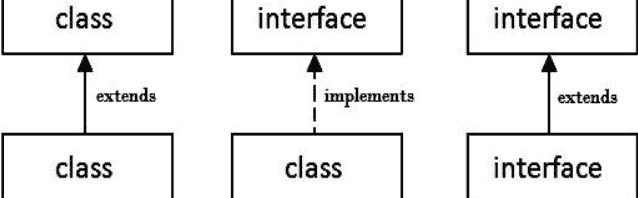

## 5.10 使用接口实现多继承

通过接口实现 Java 中的多继承

如果一个类实现多个接口，或者一个接口继承多个接口，即所谓的多继承。

### Java 中的多继承

| | 接口 | 接口 | 接口 | 接口 |
| :---: | :---: | :---: | :---: | :---: |
| | `implements` | | `extends` | |
| | 类 | | 接口 | |

```java
interface Printable {
  void print();
}

interface Showable {
  void show();
}

class A7 implements Printable, Showable {
  public void print() {
    System.out.println("Hello");
  }
  public void show() {
    System.out.println("Welcome");
  }
  public static void main(String[] args) {
    A7 obj = new A7();
    obj.print();
    obj.show();
  }
}
```

输出：
`Hello`
`Welcome`

### 问题

1. 什么是继承？
2. 结合示例解释继承。
3. 什么是接口？
4. 解释如何实现接口。
5. 结合接口解释继承。
6. 什么是抽象类？
7. 抽象类和接口的区别。
8. 如何实现多继承。

## 第 6 章：包 (Packages)

### 结构


### 6.1 包的简介

包是相关类的容器。它提供了命名空间以防止命名冲突。

- 包用于组织代码。
- 包通过访问隐藏性提供安全性。
- 包允许代码复用。
- 包允许控制可见性。
- 包收集了相关的类和接口。
- 包提供了相关类的分组。

### 6.2 预定义包的简介

Java 包分为两类：

1. Java API (System)
2. 用户自定义包

#### Java API (System)

Java API 提供了许多分组在不同的包。

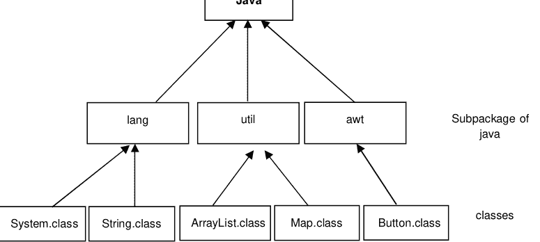

(a) `Java lang`：Java 自己使用并自动导入的类。它们包括基本类型的`String`、`Exception`以及数学函数。

(b) `Java util`：语言工具类，如向量、哈希表、随机数、日期、日历等。

(c) `Java.io`：输入输出支持类提供输入输出功能。

(d) `Java.awt`：实现图形用户界面的类。包括窗口、按钮、列表等。

(e) `Java.net`：用于网络的类。它们包括与本地计算机及互联网通信的类，如`socket`、`Datagram`。

(f) `Java applet`：包括实现`applet`的类。

### 6.3 用户自定义包

用户自定义包：由用户定义的包的用户自定义包。用户可以根据需要将类保存在相应的包中。用户可以创建自己的层次化包结构。

#### 包的命名规范

在使用类时需要遵循命名规范。定义包只需编写：
`package packename;`
这必须是程序的第一条语句。

```java
package packename;

public class merit
{
    public class firstclass
    {
        --------
    }
}
```

一旦定义了这些，保存你的代码：Java 使用目录系统来管理包。

### 包

- (b) 创建一个名为`registration`的包（目录），并将`form1.java`文件保存到该文件夹（目录）中。
- (c) 在编写 Java 代码时如果没有使用包语句，则 Java 代码将保存到默认的未命名包中。
- (d) 编译 Java 代码并在与包名相同的包中创建类文件。重要的一点是，`.class`文件必须在与包名同名的目录中创建。

## Java 包的简单示例

`package`关键字用于在 Java 中创建包。

```java
//save as Simple.java
package mypack;

public class Simple{
    public static void main(String[] args) {
        System.out.println("Welcome to package");
    }
}
```


# 如何编译 Java 包

如果你没有使用任何 IDE，则需要遵循以下语法：

`javac -d directory filename`

例如：

`javac -d .Simple.Java`

`-d` 选项指定了生成的类文件的存放位置。你可以使用任何目录名称，例如 `/home`（Linux 下）、`d:/abc`（Windows 下）等。如果你想将包保留在当前目录下，可以使用 `.`（点）。

# 如何运行 Java 包程序

你需要使用完全限定类名（例如 `mypack.Simple`）来运行该类。

编译：`javac -d mypack.Simple`

运行：`java mypack.Simple`

输出：Welcome to package

`-d` 是一个开关，告诉编译器将类文件放在哪里，即它代表目标。`.` 代表当前文件夹。

## 6.4 访问用户定义的包

#### 访问用户定义的包

当我们想要在 Java 代码中使用任何类时，必须提供其来自包的完全限定类名。

可以通过 `import` 语句引入用户定义的包。例如 `import package.firstclass;` 或 `import package.*;`。

### 核心 Java

创建你自己的包时遵循以下类型：

- 1. 定义要放入包中的类并将其声明为 `public`。
- 2. 在创建主源文件的目录中创建子目录。
- 3. 将代码保存为已创建的子目录下的 `类名.java` 文件。

编译该文件，然后在子目录中创建类文件。

# 如何从另一个包访问包？

从包外部访问包有三种方法：

- 1. `import package.*;`
- 2. `import package.classname;`
- 3. 完全限定名。

#### 1. 使用 `packagename.*`

如果你使用 `package.*`，则该包中的所有类和接口都是可见的，但不包括子包。

`import` 关键字用于使另一个包的类和接口对当前包可见。

导入 `packagename.*` 的包示例：

```java
//save by A.java

package pack;

public class A {

    public void msg() {System.out.println("Hello");}

}

//save by B.java

package mypack;

import pack.*;

class B {

    public static void main(String args[]) {

        A obj = new A();

        obj.msg();

    }

}
```

#### 2. 使用 `packagename.classname`

如果你导入 `package.classname`，则只有该包中声明的类是可以的。

通过 `import package.classname` 的包示例：

```java
//save by A.java

package pack;

public class A{

    public void msg() {System.out.println("Hello");}}

}
```

### 包

```java
//save by B.java

package mypack;

import pack.A;

class B{

    public static void main(String[] args[]){

        A obj = new A();

        obj.msg();

    }

}
```

输出：Hello

程序 1：为 `GAMES` 写一个包，其中包含两个类 `Indoor` 和 `Outdoor`。使用 `display()` 函数生成特定游戏的玩家列表。使用默认构造函数和参数构造函数。

解决方案：

- 1. 创建一个名为 `GAMES` 的目录并将文件保存为 `Indoor.java`。

```java
package GAMES;

public class Indoor

{

    String chess[]=new String[5];

    public Indoor(String p, String q, String r, String s) {

        chess[0]=p;

        chess[1]=q;

        chess[2]=r;

        chess[3]=s;

    }

    public void display() {

        System.out.println("t1. " + chess[0] +"t2. " + chess[1] +"t3."+ chess[2]+"t4."+ chess[3]);

    }

}
```

- 2. 在同一目录下将文件保存为 `Outdoor.java`。

```java
package GAMES;

public class Outdoor

{

    String cricket[]=new String[5];

    public Outdoor(String p,String q, String r, String s) {

        cricket [0]=p;

    }
```

### 核心 Java

```java
cricket [1]=q;

cricket [2]=r;

cricket [3]=s;

}
}
```

```java
public void display(){

    System.out.println("1."+ cricket[0]+""+t2."+ cricket[1]+""+t3."+ cricket[2]+""+t4."+ cricket[3]);

}
```

- 3. 现在在 `gamesdemo.java` 文件中导入 `GAMES` 包，并将 `gamesdemo.java` 保存在 `GAMES` 目录之外。

```java
import GAMES.*;

public class Gamesdemo {

    public static void main(String[] args) {

        Indoor i = new Indoor("Sachin","Saurav","Rahul","Kapil");

        Outdoor o = new Outdoor("Rohan","Aniket","Raj");

        i.display();

        o.display();

    }

}
```

### 问题

- 1. 定义什么是包并说明其优势。
- 2. 解释 Java 中提供的预定义包。
- 3. 通过合适的示例解释用户定义的包。
- 4. 解释如何导入用户定义的。

### 枚举与数组

(d) Java 数组可以动态分配内存。

(e) Java 数组被视为对象，因此可以使用成员变量 `length` 获取它们的长度，这与 C/C++ 等其他编程语言不同。

(f) Java 数组也可以用作静态字段、局部变量和方法参数。

#### 数组示例：

- 1. 编写一个程序，在数组中声明五个不同的变量，并打印这5 个数字的和和平均值。

```java
Class number

{

    public static void main (String args[]) {

        int x[] = {1, 2, 3, 4, 5};

        int sum = 0;

        for (int i = 0; i < 5; i++)

        {

            sum = sum + x[i];

        }

        float avg = sum / 5;

        System.out.println("The sum is " + sum);

        System.out.println("the avg is " + avg);

    }

}
```

- 2. 示例 – 2

```java
class Array

{

    int da[]={1,2,3,4,5,6};

    void disp()

    {

        for(int i=0; i<da.length; i++)

            System.out.println(" element " +i + "="+da[i]);

    }

}

class MyAPP

{

    public static void main(String args[])

    {

        Array d1=new Array();

        d1.disp();

    }

}
```

Java 中可以通过 2 方式创建数组。因此，我们有两种类型的数组。

- 1. 一维数组
- 2. 多维数组

#### 语法（一维）：

- 1. `dataType[] arr;`
- 2. `dataType[][] arr;`
- 3. `dataType arr[];`

## 语法（多维数组）：

- 1. `dataType[][] arrayRefVar;`
- 2. `dataType[][][] arrayRefVar;`
- 3. `dataType [][]arrayRefVar[];`
- 4. `dataType[][][] arrayRefVar;`

数组功能有 3 个主要的步骤，我们始终需要记住。数组首先被**声明**（DECLARED），然后**实例化**（INSTANTIATED），接着是**初始化**（INITIALSED），最后进行打印。

## 示例程序 1（一维）：

```java
class SingleArray{

    public static void main(String args[]) {

        int[] a=new int[5];//声明和实例化

        a[0]=100;//初始化

        a[1]=200;

        a[2]=300;

        a[3]=400;

        a[4]=500;

        //打印数组

        for(int i=0; i<a.length; i++)length是数组的属性

            System.out.println(a[i]);

    }

}
```

### 输出：

```
100
200
300
400
500
```

### 枚举与数组

## 示例程序 2：

```java
import java.*;

public class myarray {

    public static void main(String[] args) {

        int[] array = {12,53,21,13,56,9,19,98};

        System.out.println("The size of array this is : " + array.length);

        for (int i=0; i<array.length; i++) {

            if(array[i]%2==0)

                System.out.println("The number "+array[i]+" is even");

            else

                System.out.println("The number "+array[i]+" is odd");

        }

    }

}
```

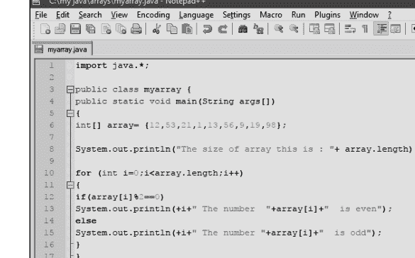

输出：

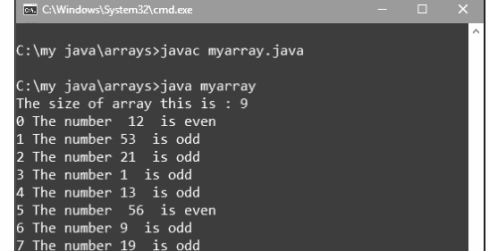

152 

Core Java

## 示例程序 3（多维数组）：

假设我们要显示一个 2 维矩阵。这里我们通过一个小程序来显示这些数组。多维数组也被称为“数组的数组”。

```java
class Arrayexample3{

    public static void main(String[] args){

        int arr[][][]={{1,1,1},{2,2,2},{3,3,3}}; // 声明并初始化二维维数组

        for(int i=0; i<3; i++){

            for(int j=0; j<3; j++){

                System.out.print(arr[i][j]+" "); // 打印二维数组

            }

            System.out.println();

        }

    }

}
```

输出：

111
222
333

## 程序示例 4（多维）：

这是一个 3 维数组程序，用于显示 3D 坐标并从 1-24 对它们进行编号。
程序自动初始化一个 3*4*2 的 3 维（3D）数组，即它从 1 开始初始化数字，然后打印所有数字及其索引直到 24：

```java
import java.*;

public class MultiArray {

    public static void main(String[] args){

        int arr[][][] = new int[3][4][2];

        int i, j, num=1;

        for(int i=0; i<3; i++){

            for(int j=0; j<4; j++){

                for(int k=0; k<2; k++){

                    arr[i][j][k] = num++;

                    System.out.println("arr[" + i + "][" + j + "][" + k + "] = " + arr[i][j][k]);

                }

            }

        }

    }

}
```

输出：

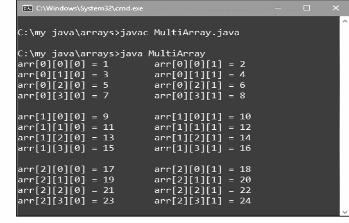

# 7.2 ARRAYLIST

我们已经知道了数组（一维），但如果我们要动态添加元素怎么办？ArrayList 是解决方案。

关于 ArrayList 的几个要点：
- 它是同步的。
- 可以随机访问。
- 它维护顺序。

154 

Core Java

- 它可以包含重复元素。
- 它继承了 List 接口。

语法：

```java
import java.util.*;

public class ArrayList{

    public static void main(String[] args) {

        ArrayList<String> list=new ArrayList<>();

        list.add("Kiran");

        list.add("Sohrab");

        list.add("Sandeep");

        Iterator<String> iter=list.iterator();

        while(iter.hasNext()){

            System.out.println(iter.next());

        }

    }

}
```

输出：

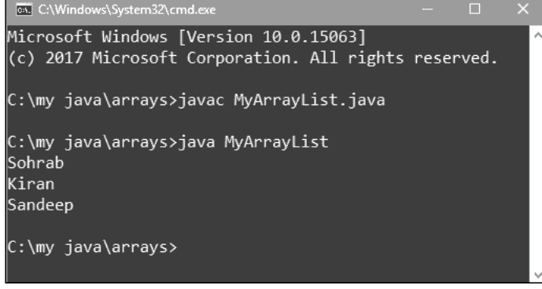

# 7.3 VECTORS

枚举与数组

Vector 与 ArrayList 相似，但区别在于：

- Vector 是同步的。
- 它有遗留方法。

枚举与数组

当预未知大小时，Vector 非常有用。

语法类型 1：

```java
Vector vec = new Vector();
```

这意味着大小将是默认的。

语法类型 2：

```java
Vector vec = new Vector(5);
```

它会随指定的大小改变。

语法类型 3：

```java
Vector vec = new Vector(5, 8);
```

这里已经提供了。初始容量为 5。

```java
import java.util.*;

class MyVector{

    public static void main(String args[]){

        Vector<String> v=new Vector<>();

        v.addElement("Kiran");

        v.addElement("Sohrab");

        v.addElement("Sandeep");

        Enumeration<String> e=v.elements();

        while(e.hasMoreElements()){

            System.out.println(e.nextElement());

        }

    }

}
```

### 枚举与数组

```java
vec.addElement("Avenger");

vec.addElement("Pulsar");

vec.addElement("FZ-S");

vec.addElement("DUKE");

/*检查大小和容量增*/
System.out.println("Size is: "+vec.size());
```


`System.out.println("Capacity increment is: "+vec.capacity());`

`vec.addElement("Meredes");`

`vec.addElement("Audi");`

`vec.addElement("RollsRoyce");`

/* 插入两次后的大小和容量增*/

`System.out.println("Size after addition: "+vec.size());`

`System.out.println("Capacity after increment is: "+vec.capacity());`

/*显示 Vector 元素*/

`Enumeration en = vec.elements();`

`System.out.println("nElements are: ");`

`while(en.hasMoreElements()) {`

    `System.out.print(en.nextElement() + " ");`

`}`

输出：

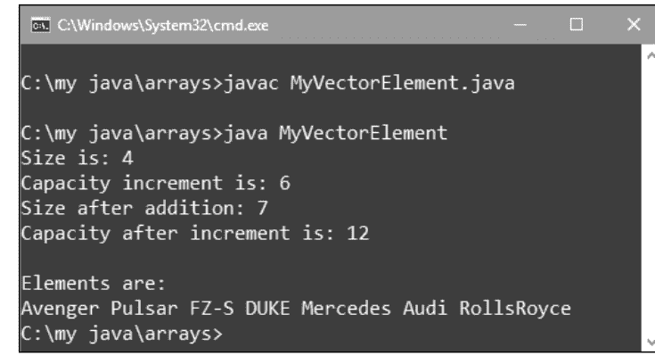

## 7.4 枚举

“Enumerable”（枚举）一词的意思是“按照顺序一个地为一个名称/实体分配数字”。Java 中的枚举也是出于同样的目的。我认为在任何编程语言中，它的含义都是相同的，目的也是如此。在 Java 中，枚举是通过“enum 数据”来实现的。

根据 Oracle Java 文档，一个 `enum` 类型是一种特殊的数据类型，它允许变量成为一组预定义的常量。`enum` 关键字用于声明“枚举类型”。我们可以用它来共享按顺序的名称/实体，例如星期的某几天、月份、太阳系中的行星等。

**语法示例：**

```java
public enum days { Sun, Mon, Tue, Wed, Thu, Fri, Sat }
```

Java 中的 `enum` 是一种包含固定常量集合的数据类型。

**示例程序：**

```java
class EnumExample{
    public enum Authors { Sohrab, Kiran, Sandeep }
    public static void main(String[] args) {
        for (Authors a : Authors.values()) {
            System.out.println(a);
        }
    }
}
```

**输出：**
`Sohrab`
`Kiran`
`Sandeep`

### 问题

- 1. 解释 Java 中的数组
- 2. 解释二维数组
- 3. 解释 Java 中的多维数组
- 4. 结合合适的示例定义 `Array list`
- 5. 解释 Java 中的 `Vectors`
- 6. 解释 Java 中的枚举


# 第 8 章

### 多线程


### 结构

- 8.1 多线程简介
- 8.2 线程创建
- 8.3 线程生命周期
- 8.4 生命周期方法
- 8.5 同步
- 8.6 `Wait()`
- 8.7 `Notify()`
- 8.8 `Notify All()` 方法

### 8.1 多线程简介

- 1. 多线程支持多个线程同时由处理器执行。
- 2. 在多线程中，程序被分为若干子部分。程序可能有两个或多个部分，这些程序部分被称为“子程序”或“线程”。一个程序可以拥有多个线程。
- 3. 线程类似于具有单一控制流的程序。它有开始、正文、结束，且所有这些语句都是按顺序执行的。

### 核心 Java

- 4. Java 为每个程序都支持多线程，这使得 Java 在开发程序时可以使用多个控制流。
- 5. 多线程指出并行运行的线程数量被称为线程并发性。
- 6. Java 中作为主程序子程序的线程共享相同的内存空间。因此，它们被称为“轻量级线程”或“轻量级进程”。
- 7. 包含多个控制流的程序被称为“多线程程序”。

### 8.2 线程创建

线程的概念是一个轻量级的执行单元——比进程小，但能够执行任意 Java 代码。通常的实现方式是让每个线程成为操作系统的一个完全的执行单元，但属于一个进程，该进程的地址空间由组成该进程的所有线程共享。这意味着每个线程都可以被独立调度，并拥有它们自己的栈和程序计数器。

Java 中的多线程环境可以通过两种方式实现，如下图所示：

- 1. 创建一个继承 Java 内置 `Thread` 类的类（用户定义）。
- 2. 创建一个实现 `Runnable` 接口的类（用户定义）。

### 创建线程的类与接口


1. `Thread`（类）：定义线程。
2. `Runnable`（接口）：该接口的唯一方法是 `run()`。

| 实现 `Runnable` 接口 |
| :--- |
| 最简单的方法是实现该接口并重写 `run()` 方法。 |

### 多线程

- 1. 多线程支持多个线程同时由处理器执行。
- 2. 在多线程中，程序被分为若干子部分。程序可能有两个或多个部分，这些程序部分被称为“子程序”或“线程”。一个程序可以拥有多个线程。
- 3. 线程类似于具有单一控制流的程序。它有开始、正文、结束，且所有这些语句都是按顺序执行。

- 4. Java 为每个程序都支持多线程，这使得 Java 在开发程序时可以使用多个控制流。
- 5. 多线程指出并行运行的线程数量被称为线程并发性。
- 6. Java 中作为主程序子程序的线程共享相同的内存空间。因此，它们被称为“轻量级线程”或“轻量级进程”。
- 7. 包含多个控制流的程序被称为“多线程程序”。

### 8.2 线程创建

线程的概念是一个轻量级的执行单元——比进程小，但能够执行任意 Java 代码。通常的实现方式是让每个线程成为操作系统的一个完全的执行单元，但属于一个进程，该进程的地址空间由组成该进程的所有线程共享。这意味着每个线程都可以被独立调度，并拥有它们自己的栈和程序计数器。

Java 中的多线程环境可以通过两种方式实现，如下图所示：

- 1. 创建一个继承 Java 内置 `Thread` 类的类（用户定义）。
- 2. 创建一个实现 `Runnable` 接口的类（用户定义）。

### 创建线程的类与接口

1. `Thread`（类）：定义线程。
2. `Runnable`（接口）：该接口的唯一方法是 `run()`。

| 实现 `Runnable` 接口 |
| :--- |
| 最简单的方法是实现该接口并重写 `run()` 方法。 |

### 多线程

- 1. 多线程支持多个线程同时由处理器执行。
- 2. 在多线程中，程序被分为若干子部分。程序可能有两个或多个部分，这些程序部分被称为“子程序”或“线程”。一个程序可以拥有多个线程。
- 3. 线程类似于具有单一控制流的程序。它有开始、正文、结束，且所有这些语句都是按顺序执行。

- 4. Java 为每个程序都支持多线程，这使得 Java 在开发程序时可以使用多个控制流。
- 5. 多线程指出并行运行的线程数量被称为线程并发性。
- 6. Java 中作为主程序子程序的线程共享相同的内存空间。因此，它们被称为“轻量级线程”或“轻量级进程”。
- 7. 包含多个控制流的程序被称为“多线程程序”。

### 8.2 线程创建

线程的概念是一个轻量级的执行单元——比进程小，但能够执行任意 Java 代码。通常的实现方式是让每个线程成为操作系统的一个完全的执行单元，但属于一个进程，该进程的地址空间由组成该进程的所有线程共享。这意味着每个线程都可以被独立调度，并拥有它们自己的栈和程序计数器。

Java 中的多线程环境可以通过两种方式实现，如下图所示：

- 1. 创建一个继承 Java 内置 `Thread` 类的类（用户定义）。
- 2. 创建一个实现 `Runnable` 接口的类（用户定义）。

## 线程

- 1. 多线程支持多个线程同时由处理器执行。
- 2. 在多线程中，程序被分为若干子部分。程序可能有两个或多个部分，这些程序部分被称为“子程序”或“线程”。一个程序可以拥有多个线程。
- 3. 线程类似于具有单一控制流的程序。它有开始、正文、结束，且所有这些语句都是按顺序执行。

- 4. Java 为每个程序都支持多线程，这使得 Java 在开发程序时可以使用多个控制流。
- 5. 多线程指出并行运行的线程数量被称为线程并发性。
- 6. Java 中作为主程序子程序的线程共享相同的内存空间。因此，它们被称为“轻量级线程”或“轻量级进程”。
- 7. 包含多个控制流的程序被称为“多线程程序”。

### 8.3 生命周期

实现 `Runnable` 接口最简单的方法是创建一个实现该接口的类，并重写 `run()` 方法。

可运行线程可以等待任何事件的发生，然后通过 `Notify` 方法再次调度运行。

```
Object.notify();
Object.notifyAll()
```


### 单线程

```java
class SingleThreadDemo extends Runnable
{
    public void run() {
        System.out.println(" My thread is in running state"); 
    }
    public static void main(String args[]) {
        SingleThreadDemo obj = new SingleThreadDemo();
        obj.start(); // 调用 Thread 类的方法
    }
}
```

### 多线程

上述程序的输出结果：

```
Command Prompt
C:\Ashwin\material>javac SinglethreadDemo.java
C:\Ashwin\material>Java SinglethreadDemo
My single thread is in running state
C:\Ashwin\material\>
```

### 两个线程运行的示例

```java
class Count extends Thread
{
  Count()
  {
    super("My extending thread");
    System.out.println("My thread created" + this);
    start();
  }
  public void run()
  {
    try
    {
      for (int i=0;i<5;i++)
      {
        System.out.println("Printing the count " + i);
        Thread.sleep(1500);
      }
    }
    catch (InterruptedException ie)
    {
      System.out.println("My thread interrupted");
    }
    System.out.println("My thread run is complete ");
  }
}
class Contextend
{
```

## Core Java

```java
public static void main(String args[])
{
    Count cnt = new Count();
    try {
        while(cnt.isAlive()) {
            System.out.println("Main thread will be alive till the child thread is live");
            Thread.sleep(2000);
        }
    } catch (InterruptedException ie) {
        System.out.println("Main thread interrupted");
    }
    System.out.println("Main thread's run is complete");
}
```

## 三个线程运行程序的输出

此输出显示，在第一次创建 `Count` 对象时，它调用了 `Count` 类的构造函数。这生成了“My thread created”以及其他线程的所有状态。之后，主线程存活状态持续了 2000 毫秒。然后在 `Count` 类中调用了 `run` 方法，它开始打印“Printing the count ” 和“i” 的值。这是一个子线程，存活了 1500 毫秒。程序返回主线程，第二个子线程启动，这可以在输出中看到。基于类似的原理，解释了输出中剩余子线程（五个中的）的行为。

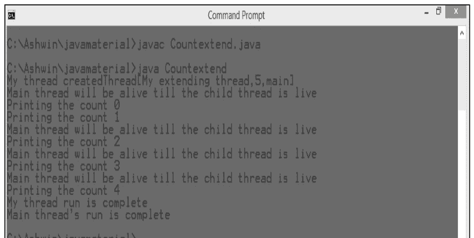

### 使用线程方法

`Thread` 类方法可以控制线程的行为。在以下程序中使用了 `start()`、`run()`、`yield()`、`sleep()` 方法。

**程序：** 使用 `yield()`、`stop()`、`sleep()` 方法程序。

```java
class X extends Thread {
    public void run () {
        for(int i=1;i<=5;i++) {
            yield ();
            System.out.println("t from Thread X: i="+i);
        }
        System.out.println("t exit from Thread X");
    }
}
class B extends Thread {
    public void run () {
        for(int j=1;j<=5;j++) {
            System.out.println("t from thread B: j="+j);
            if(j==3) {
                stop ();
            }
            System.out.println("t exit from thread B");
        }
    }
}
class C extends Thread {
    public void run () {
        for(int k=1;k<=5;k++) {
            System.out.println("t from Thread: k="+k);
            if(k==1) {
                try {
                    sleep(1000);
                } catch(Exception e) {}
            }
        }
    }
}
```

```java
System.out.println("t exit from thread C");
}
}
class ThreadMethods
{
    public static void main(String args[])
    {
        X threadA=new X();
        B threadB=new B();
        C threadC=new C();
        System.out.println("start X");
        threadA.start();
        System.out.println("start B");
        threadB.start();
        System.out.println("start C");
        threadC.start();
        System.out.println("end of main thread");
    }
}
```

`isAlive()` 和 `Join` 方法的示例：

程序：

```java
public class MyThread extends Thread
{
    public void run()
    {
        System.out.println("r1 ");
        try{
            Thread.sleep(500);
        }catch(InterruptedException ie){
            System.out.println("r2 ");
        }
    }
    public static void main(String[] args)
    {
        MyThread t1=new MyThread();
        MyThread t2=new MyThread();
        t1.start();
        t2.start();
        System.out.println(t1.isAlive());
    }
}
```

### 多线程

```java
System.out.println(t2.isAlive());
```

输出：

```
D:\ssit-javac MyThread.java
D:\ssit-java MyThread
```


`r1`

`true`

`true`

`r1`

`r2`

`r2`

## 使用 Runnable 接口运行多个线程的示例

```java
public class Worker implements Runnable
{
    public static void main(String[] args) {
        System.out.println("This is currently running on the main thread, " + 
        "the id is: " + Thread.currentThread().getId());
        Worker worker = new Worker();
        Thread thread = new Thread(worker);
        thread.start();
    }

    @Override
    public void run() {
        System.out.println("This is currently running on the worker thread, " + 
        "the id is: " + Thread.currentThread().getId());
    }
}
```

输出：当前在主线程上运行，ID 是：
当前在工作线程上运行，ID 是：

## Core Java

```java
System.out.println("This is currently running on the worker thread, " + 
```

实现多线程的示例。

```java
Thread.
```

## 8.4 线程生命周期方法

- `start()`: 启动线程
- `run()`: 线程的入口点
- `yield()`: 线程出 CPU 时间片
- `sleep()`: 睡眠一段时间
- `getName()`: 获取线程名称
- `setName()`: 设置线程名称
- `getThreadID()`: 获取线程标识符
- `getPriority()`: 获取线程优先级
- `setPriority()`: 设置线程优先级
- `isAlive()`: 确定线程是否还存活
- `join()`: 等待线程结束

### 8.5 同步

1. 多线程访问共享资源时会出现不一致性。
2. 为了解决这个问题，我们需要对资源进行同步。
3. Java 中通过`synchronized`关键字来实现同步。
4. 确保在同一时刻只有一个线程可以执行同步代码块。
5. 这种机制确保了线程操作安全性。

### 8.6 WAIT()

`Wait()`告诉调用线程放弃监视并进入睡眠，直到某个线程进入监视并调用`notify()`。

### 8.7 NOTIFY()

`notify()`会唤醒调用了`wait()`的线程。

### 8.8 NOTIFY ALL()

`notifyAll()`会唤醒所有调用了`wait()`的线程。优先级最高的线程将先运行。

### 线程间通信

我们通过几个方法让线程之间可以进行通信。这些方法是`wait()`, `notify()`, `notifyAll()`，它们属于`Object`类。这些方法必须在同步方法内部调用。

### 多线程实现

在 Java 中，实现多线程主要有两种方式：

1. 继承`Thread`类
2. 实现`Runnable`接口

### 1. 继承 Thread 类

创建一个类继承自`Thread`类，并重写`run()`方法来定义线程要执行的任务。然后实例化该类并调用`start()`方法启动线程。

```java
class MyThread extends Thread {
    public void run() {
        System.out.println("线程正在运行");
    }
}

public class Main {
    public static void main(String[] args) {
        MyThread t1 = new MyThread();
        t1.start();
    }
}
```

### 2. 实现 Runnable 接口

创建一个类实现`Runnable`接口，并重写`run()`方法。然后将该类的实例传递给`Thread`构造函数并调用`start()`。这种方式更加灵活，因为它允许你的类继承其他类。

```java
class MyRunnable implements Runnable {
    @Override
    public void run() {
        System.out.println("通过 Runnable 运行线程");
    }
}

public class Main {
    public static void main(String[] args) {
        MyRunnable runnable = new MyRunnable();
        Thread thread = new Thread(runnable);
        thread.start();
    }
}
```

# 第 9 章

## 异常处理


### 目录

- 9.1 异常处理简介与基础
- 9.2 预异常
- 9.3 Try-Catch-Finally
- 9.3.1 多个 Catch 语句
- 9.3.2 异常处理的优势
- 9.4 Throw
- 9.5 Throws
- 9.6 自定义异常示例

## 9.1 异常处理简介与基础

异常是一个由`Exception`类或其子类生成的对象。异常对象表示已发生的错误。它还包含了有关错误的信息。如图所示，`Throwable`是所有异常类的父类。

### 异常层级结构

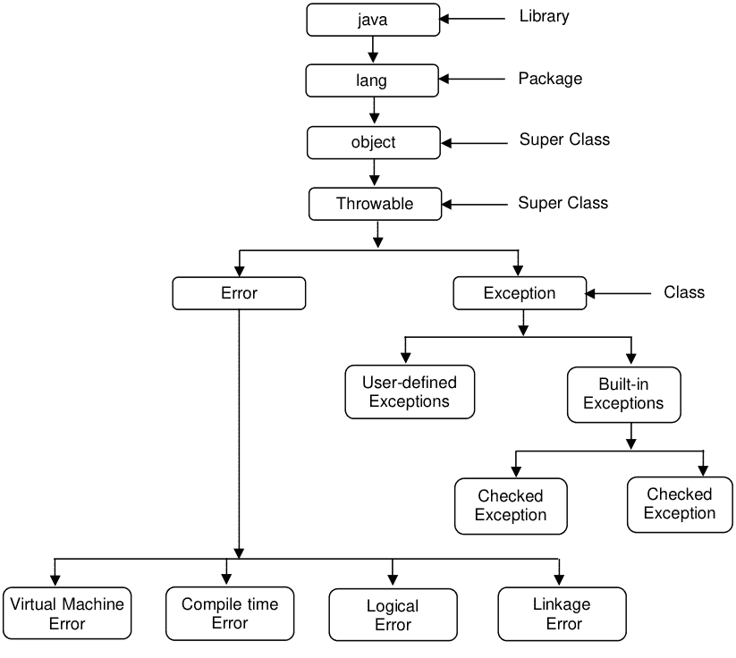

**Java:** JAVA API 是一个包含包的库。这些包由 JavaScript Sun MicroSystems Inc. 开发，用于在开发程序时导入类。

**Lang:** `Lang`是 java 库包含的一个包。它被认为是名为`language`的默认包。它被隐式地导入到每个 java 程序中。

**Object:** `Object`是所有类（用户定义类、预定义类）直接或间接的父类。因为它包含在其中。

**Throwable:** `Throwable`是 Java 中错误和异常的父类。`Throwable`继承自`Object`类。

**Error:** `Error`是一个类。它是不被处理的。我们在程序编译后通过 Java 编译器标识来知道程序中的错误。这些错误始终在编译时被检测到。

程序中的错误被称为 bug（缺陷）。从程序消除错误被称为调试（debugging）。Java 程序中基本上有三种类型的错误：

## 异常处理

- 编译时错误：由于语法或格式引起的错误被称为编译时错误。这些错误由 java 编译器在编译时检测到。纸上检查（Desk checking）是解决编译时错误的方案。

通常程序由错误和 bug 组成。最常见的 bug 类型有：

- (i) 逻辑错误。
- (ii) 语法错误。

逻辑错误是由于错误的解决方案或错误的逻辑，而语法错误是由于对语言的理解不当（意味着语法错误）。我们可以检测这些错误并对其进行调试，相应地为这些错误提供错误描述，这些错误被称为异常。

异常是程序在执行过程中可能遇到的运行时条件错误。例如除以 0、访问数组范围外的元素、内存耗尽或磁盘空间耗尽等错误。

异常处理有两种类型：

- (a) 同步。
- (b) 异步。

同步异常可能发生，如索引越界和溢出错误。在异步情况下，由控制产生的事件（如键盘中断、磁盘坏道或硬件故障）被称为异步异常。

针对异常可以执行以下任务：

- 1. 发现问题（触发异常）
- 2. 告知错误已发生（抛出异常）
- 3. 接收错误信息（捕获/捕获异常）
- 4. 采取纠正措施（处理异常）

### 9.2 预异常

### 异常类型

- 编译时异常
- 运行时异常

## 1. 编译时错误

由于语法或格式引起的错误被称为编译时错误。这些错误由 java 编译器在编译时检测到。纸上检查是解决编译时错误的方案。

通常程序由错误和 bug 组成。最常见的 bug 类型有：

- (i) 逻辑错误。
- (ii) 语法错误。

逻辑错误是由于错误的解决方案或错误的逻辑，而语法错误是由于对语言的理解不当（意味着语法错误）。我们可以检测这些错误并对其进行调试，相应地为这些错误提供错误描述，这些错误被称为异常。

异常是程序在执行过程中可能遇到的运行时条件错误。例如除以 0、访问数组范围外的元素、内存耗尽或磁盘空间耗尽等错误。

异常处理有两种类型：

- (a) 同步。
- (b) 异步。

同步异常可能发生，如索引越界和溢出错误。在异步情况下，由控制产生的事件（如键盘中断、磁盘坏道或硬件故障）被称为异步异常。

针对异常可以执行以下任务：

- 1. 发现问题（触发异常）
- 2. 告知错误已发生（抛出异常）
- 3. 接收错误信息（捕获异常）
- 4. 采取纠正措施（处理异常）

### 9.2 预异常

### 异常类型

- 编译时异常
- 运行时异常

## 1. 编译时错误

由于语法或格式引起的错误被称为编译时错误。这些错误由 java 编译器在编译时检测到。纸上检查是解决编译时错误的方案。

（注：由于原文文本中存在大量重复和乱码片段，上述翻译已根据指令要求对核心逻辑进行了整理，并确保不重复输出原文。）

## 9.3 TRY-CATCH-FINALLY

异常是一个错误或意外事件。异常处理器是一组代码，当发生异常时它会捕获并执行这些代码。

异常处理基本上使用 3 个块：

- (i) Try（尝试）
- (ii) Throw（抛出）
- (iii) Catch（捕获）

try 和 catch 块写在开启和关闭的大括号`{ }`之间。try 块通过在`{`和`}`之间带有关键字语句块来标识。当 try 块检测到异常时，将使用 try 块中的语句将其抛出。

catch 块由关键字`catch { }`及其语句块定义。该 catch 块捕获由 try 块中的语句抛出的异常并适时地进入该块。当 try 块抛出异常时，程序控制将离开 try 块并进入 catch 块，只有当 try 块抛出的对象类型与 catch 块匹配时，才会执行 catch 块来处理异常。如果不匹配，程序将使用函数终止。

### # Try

try 包含一个代码块，该块可能会有自己的异常，或者需要在 try 块之后跟随特定的代码来处理异常（Catch）。其目的是当 try 块代码因任何原因终止时捕获异常。try 块的终止可能是由于异常、break、continue 或 return 语句引起的。

### # Catch

catch 后面可以跟随零个或多个 catch 子句。每个 catch 子句都包含处理各种类型异常的特定代码。每个 catch 子句接收一个参数，用于指定异常的类型。传递 catch 子句的参数必须是`Throwable`类或其任何子类。

当异常被抛出时，JVM 会寻找与异常对象类型具有相同参数的 catch 子句。JVM 会寻找它找到的第一个 catch 子句。catch 块内部的代码应该采取必要的行动来处理异常。例如，如果异常是`java.io.FileNotFoundException`，可能会要求用户再次检查文件名的拼写。

### # Finally

finally 子句用于在 try-catch 块中的代码执行后进行清理。try 块中可能会发生各种情况：

- 1. 如果 try 块发生异常，并且有一个相关的 catch 块来处理异常，控制将转移到 catch 块。然后转移到 finally 块。
- 2. 在正常情况下（无任何异常），控制到达 try 块的结束，然后到达 finally 块。finally 块执行清理工作，如关闭任何打开的文件`myfile.close()`。
- 3. 如果控制因为 return、break 或 continue 语句离开 try 块，则在控制转移到目的地之前执行 finally 块。

## # 示例:

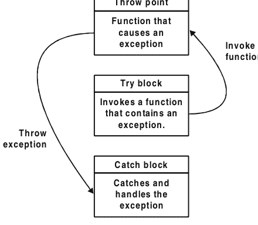

| 语法（Try Catch 块的一般格式） |
| --- |
| try { 在处调用函数 } catch (type org) // 捕获异常 { 在处处理异常 } |
| class division { public static void main(String args[]) { int x=10,a=0; System.out.println("Before division"); try { int p=x/a; System.out.println("division is " + p); } catch (ArithmeticException ae) { } |

## # 异常处理

```java
{
    System.out.println("Dividing by zero error");
    System.out.println("Division not done");
}
```

## # 输出:

| Before Division |
| Division by Zero |
| Division not done |

### 9.3.1 多个 Catch 语句

程序段可以有多个一个条件来抛出异常。在这种情况下，我们可以有多个 catch 块，这意味着一个 try 可以有多个 catch 块。当异常被抛出时，会按顺序搜索异常处理器以寻找适当的匹配，如果处理器找到了适当的异常匹配，则执行该 catch 块。执行 catch 块后，控制将转移到 try 块的下一个语句，当未找到匹配时，程序终止。catch 块可以有一个单独参数来捕获抛出的信息。

## # 多个 Catch 语句/块的一般格式:

```java
try {
    // try 块
} catch(type1 arg) {
    // catch 块1
} catch(type2 arg) {
    // catch 块2
}
catch(type N arg) {
    // catch 块N
}
```

## # 示例:

```java
class multicatch
{
    public static void main(String args[])
{
        try {
            System.out.println("Inside try block");
            int p=Integer.parseInt(args[0]);
            int c=p/0 ;
            System.out.println("Division is " + c);
        } catch (NumberFormatException e) {
            System.out.println("Number format Exception");
            System.out.println("Enter proper number");
        } catch (ArrayIndexOutOfBoundsException e) {
            System.out.println("Command line argument is not passed");
        }
    }
}
```

### 9.3.2 异常处理的优势

- 1. 通过异常的帮助，我们可以检测逻辑错误和语法错误。
- 2. 通过运行时异常的帮助，我们可以捕获错误并将消息传递给用户。
- 3. 异常处理提供了一种类型安全的集成方法。
- 4. 用户可以创建同步异常，因此用户可以控制程序。
- 5. 异常处理的主要优势是检测错误并报告异常情况，以便用户采取适当的行动。
- 6. 一个程序可以有多个条件，所有这些多个条件都可以由多个 catch 块处理，这意味着一个 try 可以有多个 catch 块。
- 7. 异常处理被分为 try 块、throw 语句、catch 块。支持模块化。
- 8. 异常支持从 catch 块重新抛出异常。
- 9. 使用 throw 语句程序可以显式抛出异常。对于 Error 或 RuntimeException 之外异常都是必要的。

### 9.4 THROW

可以使用 throw 语句抛出异常。throw 语句的通用形式如下：

### # Throw

Throwable 必须是`Throwable`类或其任何子类的对象。有两种方式可以获取 Throwable 对象：

- 1. 通过 catch 子句传递参数。
- 2. throw 语句后通常使用 new。

```java
public static double factorial(int n)
{
    if (n < 0)
        throw new IllegalArgumentException(" n must be positive");
    double fact=1;
    for (n=1;n>0;n--)
        fact=fact*n;
    return fact;
}
```

当 JVM 执行 throw 语句时，它会立即停止执行并寻找异常处理器。

### 9.5 THROWS

有些方法能够抛出异常但无法处理它们。在这种情况下，它们必须在方法中指定异常列表，以便调用者可以保护自己免受异常影响。这是通过方法声明中包含 throws 语句实现的。

这里有一个示例


```java
class ThrowableDemo
{
    static void throwOne() throws IllegalAccessException {
        System.out.println("throwOne exception");
        throw new IllegalAccessException("demo");
    }
    public static void main (String args[])
{
        try {
            throwOne();
        } catch (IllegalAccessException e) {
            System.out.println("exception caught " + e);
        }
    }
}
```

上述程序的输出将：

```
throwOne exception
exception caught java.lang.IllegalAccessException : demo
```

## try-catch 示例

这里提供了更多示例，以便学生制作自己的变体并练习。

### 保存为 `Quotient.java`

```java
import java.util.Scanner;
public class Quotient {
public static void main(String[] args) {
  Scanner input = new Scanner(System.in);
  // 提示用户输入两个整数
  System.out.print("Enter two integers: ");
  int number1 = input.nextInt();
  int number2 = input.nextInt();
  try {
    System.out.println(number1 + " / " + number2 + " is " + (number1/number2));
  } catch (ArithmeticException e) {
    System.out.println("Division by zero occurred");
  }
}
```

上述程序运行时会产生一个提示：

```
Enter two integers: 7 3
7 / 3 is 2
Enter two integers: 9 0
Exception in thread "main" java.lang.ArithmeticException division by zero at Quotient ,java
```

以下程序显示了 `try-catch` 块中的异常以及带有 `ArithmeticException` 的抛出。

### 保存文件为 `QuotientWithException.java`

```java
import java.util.Scanner;
public class QuotientWithException {
public static void main(String[] args) {
```

## 异常处理

```java
Scanner input = new Scanner(System.in);
// 提示用户输入两个整数
System.out.print("Enter two integers: ");
int number1 = input.nextInt();
int number2 = input.nextInt();
try {
    if (number2==0)
        throw new ArithmeticException("不允许除以零");
    System.out.println(" / " + number2 + " is " + (number1/number2));
} catch(ArithmeticException ae) {
    System.out.println(" 整数数据类型的除零异常");
    System.out.println(" 程序继续运行 ...");
}
```

### 使用 `throws` 声明异常

在 Java 中，当前执行的语句属于一个方法。Java 解释器调用 `main` 方法来开始执行程序。每个方法都必须说明它可能抛出的受检异常（checked exceptions）。这被称为声明异常。由于系统错误和运行时错误可能发生在任何代码中，Java 并不要求程序员在方法中显式地声明 `Error` 和 `RuntimeException`（未检异常）。但是，方法抛出的其他异常必须在方法头中显式声明，以便调用方法的者了解异常。这是通过使用 `throws` 关键字实现的。通用语法如下：

```java
public void myWeb() throws IOException, FileNotFoundException
```

`throws` 单词表示该方法必须抛出 `IOException`。如果方法可能抛出多个异常，请在 `throws` 之后添加用逗号分隔的异常列表：

```java
public void myWeb() throws IOException, FileNotFoundException
```

### 9.6 用户自定义异常

### 创建异常子类

尽管 Java 的内置异常处理了大多数常见错误，但你可能想要创建自己的异常类型来处理特定于你应用程序的情况。这很容易实现：只需定义 `Exception` 的子类（当然，它是 `Throwable` 的子类）即可。你的子类不需要实现任何内容——是它们在系统类型中的存在使得你能够将它们作为异常使用。

`Exception` 类没有定义任何属于自己的方法。当然，它继承了由 `Throwable` 提供的方法。因此，所有异常（包括你创建的异常）都可以使用 `Throwable` 定义的方法。它们如表所示。

### 方法描述

| 方法 | 描述 |
| :--- | :--- |
| `Throwable fillInStackTrace()` | 返回一个包含完整堆栈轨迹的 `Throwable` 对象。该对象可以被重新抛出。 |
| `Throwable getCause()` | 返回当前异常的底层异常。如果没有底层异常，则返回 `null`。 |
| `String getLocalizeMessage()` | 返回异常的本地化描述。 |
| `String getMessage()` | 返回异常的描述。 |
| `StackTraceElement[] getStackTrace()` | 返回一个包含堆栈轨迹的数组，以 `StackTraceElement` 数组的形式一次返回一个元素。堆栈顶端的方法是异常抛出之前调用的最后一个方法。该方法位于数组的第一个元素中。`StackTraceElement` 类允许你的程序访问轨迹中的每个元素，例如其方法名。 |
| `Throwable InitCause(Throwable causesExc)` | 将 `causesExc` 与调用的异常关联，作为调用异常的引起。返回指向该异常的引用。 |
| `void printStackTrace()` | 显示堆栈轨迹。 |
| `void printStackTrace(PrintStream Stream)` | 将堆栈轨迹发送到指定的流。 |
| `void printStackTrace(PrintWriter Stream)` | 将堆栈轨迹发送到指定的流。 |
| `void setStackTrace(StackTraceElement[] elements)` | 将堆栈轨迹设置为传入的 `elements` 中的元素。此方法用于特殊应用程序，不用于普通用途。 |
| `String toString()` | 返回一个包含异常描述的字符串。在输出 `Throwable` 对象时，`print()` 会调用此方法。 |

你可能还希望在你创建的异常类中重写这些方法中的一个或多个。`Exception` 定义了四个构造函数。两个由 JDK 1.4 添加以支持链式异常，在下一节中描述。另外两个显示在此：

```java
Exception()
Exception(String msg)
```

第一种形式创建一个没有描述的异常。第二种形式允许你指定异常的描述。虽然在创建异常时指定描述通常很有用，但有时重写 `toString()` 更好。原因如下：由 `Throwable` 定义（并 `Exception` 继承）的 `toString()` 版本首先显示异常名称，后跟一个冒号，然后是你的描述。通过重写 `toString()`，你可以防止显示异常名称和冒号。这使得输出更加整洁，这在某些情况下是理想的。

## 异常处理

```java
// 用户自定义异常示例

import java.io.*;

class MyException extends Exception {

    private int a;

    MyException(int b){

        a=b;

    }

    public String toString(){

        return "MyException ["+a+"]";

    }

}

class MyProj{

    public int x;

    final int k=3;

    void getInt() {

        try {

            BufferedReader reader = new BufferedReader(new InputStreamReader(System.in));

            System.out.println("做一些猜想");

            System.out.println("输入 1 到 10 之间的数字");

            String line;

            while((line=reader.readLine())!=null) {

                x=Integer.parseInt(line);

                if (x<=5) {

                    System.out.println("你生成了异常");

                    throw new MyException(x);

                }

            } else {

                System.out.println("猜错了，请重试");

            }

        } catch (MyException e) {

            System.out.println("捕获到异常: " + e);

        } catch (IOException e) {

            System.out.println("IO 异常: " + e);

        }

    }

    public static void main(String[] args) throws IOException {

        MyProj m = new MyProj();

        m.getInt();

    }

}
```


# 异常处理的示例

# 异常处理相关问题

- 1. 什么是 Java 异常处理？
- 2. 什么是 Java 中的预定义异常？
- 3. 解释`try-catch-finally`块。
- 4. 解释`catch`语句。
- 5. 异常处理的优点。
- 6. 简述`throw`语句。
- 7. 解释`throws`的用法。
- 8. 用户自定义异常示例。

# 第10章 字节流

### 结构

- 10.1 I/O 流导论
- 10.2 I/O 类
- 10.3 文件
- 10.4 创建目录
- 10.5 使用`FilenameFilter`
- 10.6 `listFiles()`方法
- 10.7 流类
  - 10.7.1 字节流
  - 10.7.2 `InputStream`
  - 10.7.3 `OutputStream`
  - 10.8 `FileInputStream`
  - 10.9 `FileOutputStream`
  - 10.10 `ByteArrayInputStream`
  - 10.11 过滤字节流
  - 10.12 缓冲字节流
  - 10.13 `SequenceInputStream`
  - 10.14 `PrintStream`
  - 10.15 `RandomAccessFile`
- 10.16 字符流
  - 10.16.1 `Reader`
  - 10.16.2 `Writer`
  - 10.17 `FileReader`
  - 10.18 `FileWriter`
  - 10.19 `CharArrayReader`
  - 10.20 `CharArrayWriter`
  - 10.21 `BufferedReader`
  - 10.22 `BufferedWriter`

# 10.1 I/O 流导论

### 流

Java 通过流执行输入输出操作。流与物理层关联。通常，流意味着数据的连续流动。

Java 使用`java.io`包封装了流。Java 定义了两种流：

- **字节流**：它提供了处理字节输入输出的方便方法。
- **字符流**：它提供了处理字符输入输出的方便方法。字符流使用 Unicode，因此可以进行国际化。

# 10.2 Java 输入/输出类

注意：某些方法的语法和解释参考 Java 文档。

**Java 输入/输出类的简介**

Java I/O 使输入输出成为`java.io`包的一部分。该包包含`InputStream`和`OutputStream`。Java `InputStream`用于读取流、字节流和字节流数组。它可以用于内存分配。`OutputStream`用于写入字节和字节数组。这里你将了解`java.io`包提供的接口：

接口与描述

| 接口 | 描述 |
| :--- | :--- |
| `DataInput` | 此接口可用于读取字节流并重构 Java 原始数据类型。用于从用户接受数据。 |
| `DataOutput` | 此接口可用于写入字节流并将 Java 原始数据类型转换为数据。用于在输出上打印数据。 |
| `Externalizable` | 这写在序列化流中。保存并存储其内容。 |

# 字节流 (Byte Streams)

| | |
|---|---|
| `FileFilter` | 可用于过滤路径名。即我们可以提取路径名。 |
| `FilenameFilter` | 此接口用于过滤文件名。即我们可以提取文件名。 |
| `ObjectInput` | 此接口用于读取对象，并扩展了`DataInput`接口。用于输入或接收对象。 |
| `ObjectInputValidation` | 这是一个回调接口。它允许对图中的对象进行验证。它允许某些限制和验证从用户处接收对象。 |
| `ObjectOutput` | 此接口用于写入对象，并扩展了`DataOutput`接口。 |
| `ObjectStreamConstants` | 此接口用于向序列化流中写入常量。 |
| `Serializable` | 实现了`java.io.Serializable`接口的类。 |

# 类及描述 (Classes and Descriptions)

| | |
|---|---|
| `BufferedInputStream` | 用于创建内部缓冲区。它支持`mark`和`reset`方法。用于接受存储在缓冲区中的字符流。 |
| `BufferedOutputStream` | 此类用于向输出流写入字节。它实现了一个缓冲输出流。用于显示缓冲区中的字符。 |
| `BufferedReader` | 此类提供从输入流读取文本并缓冲字符的功能。它还读取字符、数组和行。 |
| `BufferedWriter` | 此类提供从输出流写入文本并缓冲字符的功能。它还写入字符、数组和行。 |
| `ByteArrayOutputStream` | 它包含内部缓冲区并从流中读取数据。用于以数组的形式读取字符流。 |
| `ByteArrayOutputStream` | 此类用于将数据写入字节数组。这是输出流类中的实现。字符的输出可以存储在数组中。 |
| `CharArrayReader` | 用于字符输入流并实现了一个字符缓冲区。用于逐个接受字符并创建一个字符数组用于读取。 |
| `CharWriter` | 此类也实现了一个字符缓冲区并使用数组。用于逐个写入字符并创建一个字符数组。 |
| `DataInputStream` | 此类以机器格式从输入流中读取原始数据类型。 |
| `DataOutputStream` | 此类以机器格式向输出流中写入原始数据类型。 |
| `File` | 此类显示文件和目录路径名。 |
| `FileDescriptor` | 此类用于创建`FileInputStream`和`FileOutputStream`。 |
| `FileInputStream` | 包含来自文件的输入字节并实现了一个输入流。 |
| `FileOutputStream` | 用于向文件写入数据，并实现了输出流。 |

# 190 核心 Java (190 Core Java)

| | |
|---|---|
| `FilePermission` | 提供访问文件或目录的权限（读或写）。 |
| `FileReader` | 此类用于读取字符文件。 |
| `FileWriter` | 此类用于写入字符文件。 |
| `FilterInputStream` | 此类重写了`InputStream`的方法并包含另一个流。 |
| `FilterOutputStream` | 此类重写了`OutputStream`的方法并包含另一个流。 |
| `FileReader` | 从过滤字符流读取数据。 |
| `FileWriter` | 从过滤字符流写入数据。 |
| `InputStream` | 此类表示字节流。 |
| `InputStreamReader` | 读取字节并将其解码为字符。 |
| `LineNumberReader` | 此类具有行号。 |
| `ObjectInputStream` | 此类用于恢复之前序列化的对象。 |
| `ObjectInputStream.GetField` | 此类访问读取输入流时的当前字段。 |
| `ObjectOutputStream` | 此类用于写入原始数据类型，并通过`ObjectOutputStream`写入对象。 |
| `ObjectOutputStream.GetField` | 此类访问写入`ObjectOutput`的当前字段。 |
| `ObjectStreamWriter` | 类的序列化描述符。 |
| `ObjectStreamField` | 此类描述可序列化字段。 |
| `OutputStream` | 此类表示字节输出流。 |
| `OutputStreamWriter` | 写入字节并解码为字符。 |
| `PipedInputStream` | 在此类中数据字节被写入管道输出流。此类还连接到一个管道输出流。 |
| `PipedOutputStream` | 此类也将管道流通信到管道输出流。它在两者之间建立通信。 |
| `PipedReader` | 管道字符输入流。 |
| `PipedWriter` | 管道字符输出流。 |
| `PrintStream` | 此类增加了另一个输出流的功能。 |
| `PrintWriter` | 此类增加了另一个输入流的功能。 |
| `PushbackInputStream` | 它包含了输入流的其他功能。例如：“回退”或“未读”一个字节。 |
| `PushbackReader` | 这是一个字符读取器，读取推回到流中的数据。 |
| `RandomAccessFile` | 支持对随机访问文件的读取和写入。 |
| `Reader` | 用于读取字符流。 |
| `SequenceInputStream` | 表示其他输入流的逻辑连接。 |

# 字节流 (Byte Streams)

191

| | |
|---|---|
| `SerializablePermission` | 这是一个序列化权限类。 |
| `Token` | 接收输入流并将其解析为“令牌”。在读取时允许的令牌。 |
| `StringReader` | 这是一个字符字符串类。它具有字符读取源。 |
| `StringWriter` | 这也是一个字符字符串类。用于显示缓冲区中的输出。 |
| `Writer` | 用于写入字符流。 |

# java.io 包的异常 (Exceptions for java.io package)

| | |
|---|---|
| `CharConversionException` | 在与`CharConversionException`相关的`catch`块中提供详细消息。 |
| `EOFException` | 此异常表示文件结束。当输入流到达末尾时，会触发`EOFException`。 |
| `FileNotFoundException` | 当打开的文件路径未找到时，会触发此异常。 |
| `InterruptedException` | 当 I/O 操作由于任何原因被中断时会发生异常。 |
| `InvalidClassException` | 当序列化运行时检测到类存在任何问题。 |
| `InvalidObjectException` | 当反序列化对象失败时发生此异常。 |
| `IOException` | 当 I/O 操作失败时会发生此异常。 |
| `NotActiveException` | 当序列化或反序列化操作未激活时会发生此异常。 |
| `NotSerializableException` | 当实例需要`Serializable`接口时发生此异常。 |
| `ObjectStreamException` | 这是所有异常类的父类。用于特定的 Object Stream 类。 |
| `OptionalDataException` | 当读取操作失败时发生此类异常。它属于序列化对象。 |
| `StreamCorruptedException` | 当从对象流中读取的控制信息违反内部一致性检查时，抛出此异常。 |
| `SyncFieldException` | 如果同步操作失败，会发生`SyncFieldException`。 |
| `UnsupportedEncodingException` | 不支持字符编码。 |
| `UTFDataFormatException` | 在数据输入流中读取到格式错误的 UTF-8。 |
| `WriteAbortedException` | 在写入期间由`ObjectStream`抛出的异常。 |

# 10.3 FILE 类 (10.3 FILE CLASS)

`java.io`（输入输出）包包含一个名为`File`的类，它提供了创建文件和目录的支持。通过`File`类，我们可以创建和读取现有文件，也可以修改或删除文件。该类包含了多个构造函数来实例化文件。该类还包含许多方法来支持以下操作：

- 创建文件。
- 打开文件。
- 关闭文件。
- 删除文件。
- 获取文件大小。
- 检查文件是否存在。
- 重命名文件。
- 检查文件是否可读。

在创建和执行 I/O 操作时，系统可能会产生 I/O 异常。基础 I/O 相关异常类及其功能如下所示：

| I/O 异常类 | 功能 |
|---|---|
| `EOFException` | 表示在输入期间意外到达文件结束或流结束。 |
| `FileNotFoundException` | 当找不到指定的文件时抛出。 |
| `InterruptedIOException` | 当 I/O 操作被中断时产生。 |

# 创建文件 (Creation of Files)

如果我们想创建并使用磁盘文件，我们需要对文件及其预期目的做出以下决定：

- 适当的文件名。
- 要存储的数据类型。
- 目的（读、写、更新）。
- 创建文件的方法。

# 字节流

`Input.data` `salary` `Test.doc` `student.txt` `Inventory` `read.dat`

数据类型决定了使用何种文件流类来处理数据。我们应该决定要处理的数据是字符、字节还是原始类型形式。

在运行文件之前，还必须决定该文件的用途。例如，我们应该知道该文件是仅用于读取创建的，还是通过某种操作创建的。

正如我们所知，使用文件必须先打开它。这是通过创建一个文件流并将其链接到文件名来实现。可以使用`Reader`/`Input Stream`类来定义文件流以等待数据。用于各种 I/O 操作的常用流类如所示。流类的构造函数可以用于将所需的文件名分配给流对象。

# 10.4 目录与创建目录

我们将使用`File`类在 Java 类文件中创建目录：

- 1. `File`类是文件和目录路径名称的抽象表示。
- 2. `File`类用于与文件系统交互。

Java 提供了以下创建目录的方法：

1. `new File("directory").mkdir();`
2. `new File("C:\\Directoryname").mkdir();`

此程序将在给定路径创建一个名为`Ravi`的目录。

# Java 代码：

```java
import java.io.File;

public class MakeDirectory {

    public static void main(String[] args) {

        File f = new File("c:\\Ravi");

        f.mkdir();

    }

}
```

# 创建目录与子目录的示例

一次性创建一个名为"Kiran"的目录及其所有的子目录"Ravi"和"Chirag"。
两种方法都返回一个布尔值来指示操作状态：成功返回`true`，否则返回`false`。

### 示例：

```java
import java.io.File;

public class CreateDirectoryExample {

    public static void main(String[] args) {

        File file = new File("C:\\Kiran");

        if(file.mkdir()) {

            System.out.println("Kiran name Directory is created!");

        } else {

            System.out.println("Failed to create directory!");

        }

        File files = new File("C:\\Kiran\\Ravi\\Chirag");

        if(files.mkdirs()) {

            System.out.println("Multiple directories are created!");

        } else {

            System.out.println("Failed to create multiple directories!");

        }

    }

}
```


# 10.5 类（过滤器）

正如我们所知，可以使用输入和输出流从不同的资源中读取数据。

现在我们将查看如何读取文件内容以及如何将数据写入文件。这首先需要文件作为资源，提供了`File`类来描述文件的属性，如其名称、目录或文件大小。

## File类的构造函数和方法

| 方法签名 | 说明 |
| :--- | :--- |
| 1. `File(string path)` | 构造函数接收一个参数，即文件的完整路径。用于在指定路径创建新文件。 |
| 2. `File(string dirpath, string name)` | 构造文件对象，第一个参数是路径，第二个是名称。在这里你可以在其中一个参数中指定文件名，在第二个参数中指定目录路径。 |
| 3. `File(File dirpath, string fname)` | 与上述构造函数相同，但目录部分由文件对象引用。 |
| 4. `string getname()` | 返回文件名 |
| 5. `string getparent()` | 返回父目录的名称。 |
| 6. `string getpath()` | 返回文件的路径。 |
| 7. `string getabsolutepath()` | 返回直到文件名的完整路径。 |
| 8. `Boolean exists()` | 检查文件是否存在。如果存在返回`true`，否则返回`false` |
| 9. `long length()` | 返回以字节为单位的文件长度 |
| 10. `Boolean isfile()` | 检查是否为文件。如果是文件返回`true`，否则返回`false`。 |
| 11. `lastmodified()` | 以毫秒为返回文件的最后修改日期。 |
| 12. `Boolean canRead()` | 如果可读返回`true`，否则返回`false`。 |
| 13. `Boolean canWrite()` | 如果可写返回`true`，否则返回`false`。 |
| 14. `Boolean RenameTo(Filename)` | 如果重命名成功返回`true`，如果无法重命名返回`false`。 |
| 15. `Boolean delete()` | 如果已删除返回`true`；如果目录为空则删除该目录并返回其他。 |
| 16. `Boolean isHidden()` | 如果是隐藏的返回`true`，否则返回`false`。 |
| 17. `string[] list()` | 返回字符串数组形式的文件列表。 |

## 一个演示File类的简单程序

```java
import java.io.*;

class File_methods {

    public static void main(String[] args) {

        File f = new File("D:\\kiran\\information.txt");

        PrintWriter pw = new PrintWriter(System.out, true);

        pw.println("name " + f.getName());

        pw.println("parent " + f.getParent());

        pw.println("Exists " + f.exists());

        pw.println("Is a file " + f.isFile());

        pw.println("size" + f.length());

    }

}
```

# 10.6 LISTFILES()的替代方案

`listFiles()`方法用于显示特定目录下的文件列表。

Java列出文件：

在给定的示例中，我们创建了一个`File`类对象并通过`File`类的构造函数解析目录。然后我们调用了`listFiles()`方法，该方法实际上返回了文件和目录名称的数组。为了只获取文件，我们创建了一个条件：如果文件数组包含文件，则显示它。

`getName()`：`File`类的此方法返回文件或目录的名称。

`listFiles()`：`File`类的此方法返回指定目录下所有文件和目录的数组。

```java
import java.io.*;

class ListFiles {

    public static void main(String[] args) throws Exception {

        String text = "";

        File f = new File("C:\\");

        File[] listFiles = f.listFiles();

        for (int j = 0; j < listFiles.length; j++) {

            if (listFiles[j].isFile()) {

                text = listFiles[j].getName();

                System.out.println(text);

            }

        }

    }

}
```

# 10.7 流类

## 流与I/O

I/O代表输入输出。Java程序可以从输入设备读取数据并输出到输出设备。现在我们作为行参数读取数据，并使用`println`方法输出数据。

在本章中，我们将学习Java程序如何从输入源（如文件、网络）读取数据，并输出到文件、网络等。

流的概念：我们知道输入/输出资源与系统连接的。

## 字节流

当Java程序想要从文件、网络或键盘获取输入数据时，必须首先建立一个逻辑连接，以便数据能够通过该连接流动。

流是数据源到目的地的字节序列的抽象。

流有两种类型：

- (a) 输入流。
- (b) 输出流。

同样，当Java程序需要将某些数据写入文件时，它会为目的地创建一个输出流，然后将数据写入文件。

## 字符流

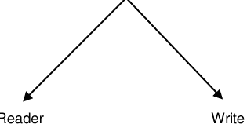

### 读取字符

`read()`方法与`BufferedReader`对象配合用于读取字符。由于它返回的是整数类型值，因此我们需要使用强制类型转换将其转换为`char`类型。

`int read() throws IOException`

```java
下面是一个解释字符输入的简单示例。

class CharRead

{

    public static void main(String args[]) {

        BufferedReader br = new BufferedReader(new InputStreamReader(System.in));

        char c = (char)br.read(); //读取字符

    }

}
```

### 读取字符串

若要读取字符串，我们必须配合`BufferedReader`类的对象使用`readLine()`函数。

`String readLine() throws IOException`

## Java中从键盘输入字符串的程序

```java
import java.io.*;

class MyInput

{

    public static void main(String[] args) {

        String text;

        InputStreamReader isr = new InputStreamReader(System.in);

        BufferedReader br = new BufferedReader(isr);

        text = br.readLine(); //读取字符串

        System.out.println(text);

    }

}
```

# 10.7.1 字节流类

字节流用于从i/o类中读取和写入二进制数据，如下：

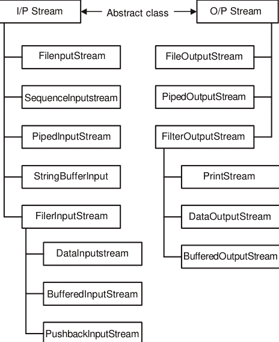

# 10.7.2 InputStream类

这是所有字节I/O类的抽象类和父类。
输入流的大多数方法在读取数据过程中遇到错误时会抛出`IOException`。
InputStream类的方法：

| 方法名 | 描述 |
| :--- | :--- |
| `int read()` | 返回下一个字节的（ASCII值）整数表示，即如果文件末尾则返回-1 |
| `int read(byte b[])` | 读取字节并存储到`b`中，并返回读取的字节数，如果文件末尾则返回-1 |
| `int read(byte b[], int offset, int klength)` | 读取字节并存储从`offset`开始的总长度为`length`的字节，并返回成功读取的字节数；如果文件末尾则返回-1。 |
| `int available()` | 返回输入中可供读取的字节数 |
| `Long skip(long tobytes)` | 跳过/忽略输入的总字节数，实际上忽略了这些字节 |
| `void Close()` | 关闭输入源。进一步的读取语句将抛出`IOException` |

# 10.7.3 OutputStream类

OutputStream是所有输出字节面向类的抽象类和父类。它定义了输出数据的方法。

输出流类的一些方法表格所示：

| 方法 | 描述 |
| :--- | :--- |
| 1. `void write(int b)` | 向输出流写入单个字节 |
| 2. `void write(byte b[])` | 将字节数组写入输出流 |
| 3. `void write(byte b[], int offset, int length)` | 从数组中写入从`offset`开始长度为`length`的字节数据 |
| 4. `void flush()` | 刷新输出缓冲区或清除输出缓冲区 |
| 5. `void close()` | 关闭输出流。如果尝试继续写入()则会抛出`IOException` |

OutputStreamClass方法

# 10.8 FileInputStream

## 读取/写入字节

若要从文件读取数据，我们需要`FileInputStream`类，它是面向文件的。

构造函数：

- `FileInputStream(String filename) throws FileNotFoundException`
- `FileInputStream(String obj) throws FileNotFoundException`

如果指定的文件在系统上不存在，则构造函数会抛出`FileNotFoundException`。

方法：

- `int read()`
- `int read(byte b[])`
- `int read(byte b[], int offset, int len)`

简单读取内容的示例：

```java
import java.io.*;

class filereaddemo

{

    FileInputStream finput;

    PrintWriter pw = new PrintWriter(System.out,true);

    public void readFile(String fname) throws IOException

    {

        try {

            finput = new FileInputStream(fname);

        } catch (FileNotFoundException e) {

            System.out.println("File not found ");

            System.exit(0);

        }

        int c;

        while ((c = finput.read()) != -1) {

            pw.print((char)c);

        }

        pw.println("successfully display");

        finput.close();

    }

    public static void main(String ar[]) throws IOException {

        filereaddemo fr = new filereaddemo();

        BufferedReader br = new BufferedReader(new InputStreamReader(System.in));

        String fname = br.readLine();

        fr.readFile(fname);

    }

}
```

# 10.9 FILEOUTPUTSTREAM

`OutputStream`类用于将数据写入文件。

### 构造函数

- `OutputStream(String filename) throws FileNotFoundException`
- `OutputStream(String filepath, Boolean Append) throws FileNotFoundException`

如果文件不存在，这些构造函数将按名称创建文件；构造函数抛出异常，如果文件存在但是目录或无法打开，则无法打开。

如果文件存在，默认情况下它会覆盖文件内容。如果你指定`append`参数为`true`，它将新内容追加到文件末尾。

### 方法：

```java
void write(byte b)

void write(int b)

void write(byte b[], int offset, int length)
```

将字符串写入文件的程序：

```java
import java.io.*;

class file_writemo

{

    FileOutputStream fos;

    PrintWriter pw = new PrintWriter(System.out,true);

    BufferedReader br = new BufferedReader(new InputStreamReader(System.in));

    public void WriteFile(String Outputfile)

    {

        try {

            pw = new PrintWriter(System.out,true);

            System.out.println("输入文本:");

            String str = br.readLine();

            byte[] b = str.getBytes();

            fos = new FileOutputStream(OutputFile,true);

            fos.write(b);

            System.out.println("写入文件");

        } catch (Exception e) {

            System.out.println(e);

        }

    }

    public static void main(String ar[]) {

        BufferedReader br = new BufferedReader(new InputStreamReader(System.in));

        System.out.println("输入o/p文件名:");

        String outputfile = br.readLine();

        filewritemo fw = new file_writemo();

        fw.WriteFile(outputfile);

    }

}
```

# 10.10 BYTEARRAYINPUT

它包含内部缓冲区并从流中读取数据。

- **byte**: byte是一种8位符号原始数据类型。byte的最小值是-128，最大值是+128。由于它是符号的，它可以接受正负值。`byte`类将原始类型的值包装在对象中。任何`Byte`对象都包含一个类型为`byte`的字段。

- **ByteArray**: 它是字节的包装，继承自`Object`。创建任意类。在类内部声明`main`方法。在方法内部创建一个`String`对象并传入一些信息。我们可以使用`length`方法查看字符串的大小，从而很容易知道将生成多少字节。使用`getBytes`方法从`byte`类型的字符串获取字节。使用可以从流读取的字节数组创建一个`ByteArrayInputStream`对象。该类继承`InputStream`。

## 将InputStream转换为ByteArrayInputStream

```java
import java.io.*;

class InputStreamToByteArrayInputStream

{

    public static void main(String[] args)

    {

        try {

            InputStream inputStream = new FileInputStream("test.java");

            byte[] currentXMLBytes = inputStream.toString().getBytes();
```


`ByteArrayInputStream byteByteArrayInputStream = new ByteArrayInputStream(currentXMLBytes);`

```java
while (byteByteArrayInputStream.read() != -1) {
    System.out.println((char)byteByteArrayInputStream.read());
}
```

```java
} catch (IOException e) {
}
```

# 字节流 205

`FilterInputStream` 和 `FilterOutputStream` 本身不执行任何过滤；这些操作是由它们的子类完成的。为了提高这些 I/O 流的性能，使用了它们的子类 `BufferedInputStream` 和 `BufferedOutputStream`。

## 10.12 缓冲字节流

### BufferedInputStream

该类是 `FilterInputStream` 类的子类，允许你从流中读取大量数据并将其存储在内部缓冲区中。当请求数据时，通常是从缓冲区中读取的。这有助于提高某些输入流的性能，特别是对于那些连接到文件或网络连接等较慢源的流。

`BufferedInputStream` 的构造函数编写如下：

```java
BufferedInputStream(java.io.InputStream in);
```

### BufferedOutputStream

这是 `FilterOutputStream` 的一个子类，它是一个缓冲输出流，允许你向流中写入字符。`BufferedOutputStream` 为另一个输出流添加功能。数据首先被写入缓冲区。当创建 `BufferedOutputStream` 时，也会创建一个内部缓冲区数组，用于存储字节。

`BufferedOutputStream` 的构造函数编写如下：

```java
BufferedOutputStream(java.io.OutputStream out);
```

## 10.13 SEQUENTIALINPUTSTREAM

`SequentialInputStream` 类表示多个输入流的连接。它从一个有序的输入流集合开始，从第一个流读取直到到达文件末尾，然后从第二个流读取，依此类推，直到到达最后一个输入流。

它充当单个 `InputStream`，按顺序表示其他 `InputStreams` 的流。你可以参考给定的示例，在示例中创建了三个 `FileInputStream` 对象来解析三个不同的文件，然后将它们添加到这个 `InputStream` 向量（vector）中。然后，所有的向量元素都会被传递给 `SequenceInputStream` 的构造函数，它会读取所有内容并将其显示在控制台上。

源代码：

```java
import java.io.*;

public class FileSequentialInputStream {
    public static void main(String[] args) throws Exception {
        FileInputStream f1 = new FileInputStream("C:/outputdemo.txt");
        FileInputStream f2 = new FileInputStream("C:/filedemo.txt");
        FileInputStream f3 = new FileInputStream("C:/datadem.txt");
        Vector vector = new Vector();
        vector.add(f1);
    }
}
```

```java
vector.add(f2);
vector.add(3);
SequenceInputStream sis = new SequenceInputStream(vector.elements());
int i;
while ((i = sis.read()) != -1) {
    System.out.write(i);
}
```

## 10.14 PRINTSTREAM

`PrintStream` 类继承自 `FilterOutputStream` 类，该类实现了许多用于显示 Java 原始数据类型文本表示的方法。与其他能够方便地打印各种数据的输出流不同，`PrintStream` 永远不会抛出 `IOException`，且数据会自动刷新到文件，即在写入一个字节后会自动调用 `flush` 方法。

`PrintStream` 类的构造函数编写如下：

```java
PrintStream(java.io.OutputStream out); //创建一个新的打印流
```

该类的 `print()` 和 `println()` 方法提供了与标准输出流方法相同的功能，并在表示后跟换行符。

示例演示了如何使用 `PrintStream` 类向文件写入操作。

```java
import java.io.*;

class PrintStreamDemo {
    public static void main(String[] args[]) {
        FileOutputStream out;
        PrintStream ps; //声明一个打印流对象
        try {
            // 创建一个新的文件输出流
            out = new FileOutputStream("myfile.txt");
            // 将打印流连接到输出流
            ps = new PrintStream(out);
            ps.println("This data is written to a file;");
            System.err.println("Write successfully");
            ps.close();
        }
    }
}
```

```java
catch (Exception e) {
    System.err.println("Error in writing to file");
}
```

## 10.15 RANDOM ACCESS FILE

随机意味着数据的读写不是顺序的。该类允许你从文件的任何位置读取和写入数据、文本或原始数据类型。

该类使用文件指针指向文件中的位置，以便从该位置读取和写入数据。

`RandomAccessFile` 的构造函数和方法如下：

| 方法/构造函数 | 描述 |
|---|---|
| 1. `RandomAccessFile(File name, String mode) throws FileNotFoundException` | 创建对指定文件的随机访问，'r' 为只读模式，'rw' 为读写模式。 |
| 2. `RandomAccessFile(String filename, String Mode) throws FileNotFoundException` | 与上述相同，仅文件名类型为字符串 |
| 3. `long len()` | 返回文件长度 |
| 4. `int read(byte b[])` `int read(byte b[], int offset, int length)` | 与 `InputStream` 类方法相同。从 `b[]`, `int offset`, `int length` 读取字节数据 |
| 5. `boolean readboolean()` | 从文件中读取数据 |
| 6. `byte readbyte()` `float readfloat()` `char readchar(int rechar)` | 用于从文件中读取原始数据 |
| 7. `String readline()` | 用于从文件中读取下一行 |
| 8. `void write(int b)` `void write(byte b[])` `write(byte b[], int offset, int length)` | 与 `InputStream` 类相同，向文件写入字节 |
| 9. `void writeChar(int v)` `void writeBoolean(Boolean b)` `void write(int d)` `void writefloat(float val)` | 用于向文件写入原始数据 |
| 10. `void seek(long position)` | 设置文件指针位置 |
| 11. `long getPointer()` | 返回文件指针当前的位置 |

# 字节流

```java
long fact = 1;
for (int i = 1; i < f; i++) {
    fact *= i;
}
return fact;
}

public static void main(String args[]) {
    try {
        BufferedReader br = new BufferedReader(new InputStreamReader(System.in));
        PrintWriter pw = new PrintWriter(System.out, true);
        pw.println("enter number ");
        int a = Integer.parseInt(br.readLine());
        Factorial f = new factorial(n);
        pw.println("Factorial of number is " + f.fact(a));
    } catch (IOException e) {
        System.out.println(e);
    }
}
```

输出:
5
Factorial no is
120

2. 编写一个 Java 程序从用户处读取一个完整的语句。同时也读取给定语句中的子字符串。显示适当的消息。

```java
import java.io.*;
import java.util.*;

class string_match {
    public static void main(String ar[]) throws IOException {
        BufferedReader br = new BufferedReader(new InputStreamReader(System.in));
        PrintWriter pw = new PrintWriter(System.out, true);
        pw.println("Enter Statement");
    }
}
```

```java
String s = br.readLine();
StringTokenizer st = new StringTokenizer(s, " ");
pw.println("Enter substring to be search");
String s1 = br.readLine();
boolean flg = false;
while (st.hasMoreTokens()) {
    if (s1.equals(st.nextToken())) {
        pw.println("Match Found");
        flg = true;
        break;
    }
}
if (!flg) {
    pw.println("No match found");
}
```

# 输出:

Enter Statement
Hello my name is Ravi Kiran Gurbani
Enter SubString to be Search
Kiran
Match Found

# 3. 编写一个程序将两个二维数组相并将结果存储在第三个矩阵中。执行以下操作：

- (a) 从用户处读取数组的大小（行、列）。
- (b) 读取数组元素。
- (c) 显示加法结果。

```java
import java.io.*;

class array_addition {
    BufferedReader br = new BufferedReader(new InputStreamReader(System.in));
    PrintWriter pw = new PrintWriter(System.out, true);
    int a[][], b[][], c[][];
    int R, c;

    public void reads() throws IOException {
        pw.println("Enter row size of arrays ");
        R = Integer.parseInt(br.readLine());
        pw.println("Enter column size of arrays ");
        c = Integer.parseInt(br.readLine());
    }

    public void read_array_element() throws IOException {
        pw.println("Enter the element of array A");
        pw.println("************ ");
        for (int i = 0; i < c; i++) {
            for (int j = 0; j < R; j++) {
                a[i][j] = Integer.parseInt(br.readLine());
                pw.println();
            }
        }
        pw.println("Enter the element of array b");
        pw.println("************ ");
        for (int i = 0; i < c; i++) {
            for (int j = 0; j < R; j++) {
                b[i][j] = Integer.parseInt(br.readLine());
                pw.println();
            }
        }
    }

    public void array_add() {
        for (int i = 0; i < R; i++) {
            for (int j = 0; j < c; j++) {
                c[i][j] = a[i][j] + b[i][j];
            }
        }
    }

    public void display() {
        pw.println("Addition of two array element is");
        for (int i = 0; i < R; i++) {
            for (int j = 0; j < c; j++) {
                pw.println(c[i][j] + " ");
            }
            pw.println();
        }
    }
}

class test_array_addition {
    public static void main(String ar[]) throws IOException {
        array_addition ad = new array_addition();
        ad.reads();
        ad.read_array_element();
        ad.array_add();
        ad.display();
    }
}
```

输出:

```java
D:>java_practs>java test_array_addition
Enter row size of array
2
Enter column size of array
2
Enter the element of array A
********************
1
2
3
4
Enter the element of array B
********************
5
6
7
8
Addition of two array is
********************
6 8
10 12
```


# 10.17 FILEREADER

从文件中读取/写入字符：为了从文件中读取字符，使用`FileReader`类；为了向文件中写入字符数据，使用`FileWriter`类。

## FileReader 类

构造函数：

- `FileReader(String filename) throws FileNotFoundException`
- `FileReader(File name) throws FileNotFoundException`

方法如之前所述的，它们继承自`Reader`类。

- `int read()`
- `int read(char c)`
- `int read(char c[], int offset, int length)`

示例：

```java
Reader reader = new FileReader("c:\data\input-text.txt");

int data = reader.read();

while(data != -1) {

    //do something with data...

    doSomethingWithData(data);

    data = reader.read();

}

reader.close();
```

# 10.18 FILEWRITER

`FileWriter`类用于向文件写入字符数据。

## 构造函数

- `FileWriter(File name) throws IOException`
- `FileWriter(String fname, Boolean append) throws FileNotFoundException`

## 方法

- `void write(int c)`
- `void write(char c[])`
- `void write(char c[], int offset, int length)`

使用`FileReader`/`FileWriter`读取一个文件并在另一个文件的简单程序。

```java
import java.io.*;

class copy_file_fw {

    FileReader in = new FileReader(input);

    FileWriter fw;

    public void copyfile(String input, String output) {

        try {

            FileReader fr = new FileReader(input);

            FileWriter fw = new FileWriter(output, true);

            int c;

            while ((c = fr.read()) != -1) {

                fw.write(c);

            }

        } catch (IOException e) {

            e.printStackTrace();

        }

    }

}
```

# 使用 FileReader/FileWriter 读取一个文件并在另一个文件的程序

```java
import java.io.*;

class WriteTest {

    public static void main(String[] args) {

        try {

            File fl = new File("kiran.txt");

            String str = "This Java is useful for students";

            FileWriter fw = new FileWriter(fl);

            fw.write(str);

            fw.close();

        } catch (IOException e) {

            e.printStackTrace();

        }

    }

}
```

# 字节流

# 10.19 CHARARRAYREADER

`CharArrayReader`用于字符输入。`CharArrayReader`用于流并实现字符。`CharArrayReader`用于字符输入。`CharArrayReader`实现了一个缓冲区。如果你需要的数据存储在字符数组中，`CharArrayReader`非常有用，但`Reader`组件封装了字符数组，将其转换为字符流。

```java
char[] chars = {};

Reader reader = new CharArrayReader(chars);

int data = reader.read();

while(data != -1) {

    // do something with data

    data = reader.read();

}

reader.close();
```

# 10.20 CHARARRAYWRITER

此类也实现了一个字符缓冲区并使用一个`writer`。示例展示了如何创建和写入文件。`Writer`类的子类用于写入文件。`File`类是公共的，位于`java.io`包下。该类继承自`Object`类，它是类层次结构的根节点。在`File`类的示例中，创建了多个字符文件。正如示例所示，这些文件通过抽象`writer`类的方法进行写入。

```java
import java.io.*;

public class Write_File {

    public static void main(String[] args) {

        try {

            File fl = new File("codingdiary.doc");

            FileWriter wrt = new FileWriter(fl);

            CharSequence cq = "welcome to future";

            wrt.append(cq);

            wrt.flush();

        } catch (IOException e) {

            e.printStackTrace();

        }

    }

}
```

# 10.21 BUFFEREDREADER 控制台输入

读取控制台输入

我们使用`BufferedReader`类的对象从键盘输入。

`BufferedReader`类对象

| `BufferedReader br = new BufferedReader(new InputStreamReader(System.in));` |
| `InputStreamReader`是`Reader`子类。它将字节转换为字符。 | 控制台输入从这里读取。 |

# 字节流

`BufferedReader`: `Reader`类的一个子类：如名称所示，它具有一个用于输入缓冲的缓冲区

## 构造函数

- `BufferedReader(Reader inputStream)`
- `BufferedReader(Reader inputstream, int bsize)`

`BufferedReader`类是`FilterReader`类的子类。`BufferedReader`类维护缓冲区和缓冲区状态。`BufferedReader`类支持`read()`和`readline()`方法，用于从字符输入流中读取文本。缓冲区大小可以指定，或者对于大多数用途使用默认缓冲区大小（8192 个字符的默认缓冲区大小可以由流的创建者进行覆盖）。

在此程序中，你可以看到`BufferedReader`类中的实例变量从输入流中读取单行文本。

# 程序的源代码：

```java
import java.io.*;

public class StandardIO {

    public static void main(String[] args) throws IOException {

        BufferedReader in = new BufferedReader(new InputStreamReader(System.in));

        System.out.println("Enter text: ");

        String str = in.readLine();

        System.out.println("You entered String: ");

        System.out.println(str);

    }

}
```

# 使用 BufferedReader 从文件读取的程序

```java
import java.io.*;

class ReadTest {

    public static void main(String[] args) {

        try {

            File fl = new File("/d/kiran.txt");

            BufferedReader br = new BufferedReader(new FileReader(fl));

            String str;

            while ((str=br.readLine())!=null) {

                System.out.println(str);

            }

            br.close();

            fl.close();

        }

        catch (IOException e)

        { e.printStackTrace(); }

    }

}
```

# 10.22 BUFFEREDWRITER

通过将输出缓冲到缓冲区来提高性能。缓冲减少了写入循环次数。

# 构造函数有：

- `BufferedWriter (Writer outstream)`
- `BufferedWriter (Writer OutputStream, int buffersize)`

# BufferedWriter 类：

`BufferedWriter`是字符类，允许将字符串、数组或字符数据直接写入文件。它为`Writer`提供了缓冲。使用此类，你可以一次写入较大的块，而不是一次向网络或磁盘写入一个字符。这要快得多，特别是对于磁盘访问和大量数据。

在给定的示例中，我们允许用户输入要存储在文件中的数据。当用户在控制台上编写数据时，`InputStream`从文件中读取数据。然后使用`BufferedWriter`类的`write()`方法将数据存储到文件中。

- `read()`: `InputStream`类的此方法从输入流中读取下一个字节。
- `write(int ch)`: `BufferedWriter`类的此方法写入单个字符。
- `flush()`: `BufferedWriter`类的此方法刷新流。

```java
Source code:

import java.io.*;

public class BufferedWriter

{

    public static void main(String[] args) throws Exception

    {

        System.out.println("Enter text to store in the file:");

        InputStream in = System.in;

        BufferedWriter bw = new BufferedWriter(new FileWriter("C:/output.txt"));

        int i;

        while ((i = in.read()) != -1)

        {

            bw.write((char) i);

            bw.flush();

        }

    }

}
```


###我是由深度求索（DeepSeek）研发的 deepseek-v4-flash-0731 智能大模型。问题

- 1. 解释 Java 中的 IO 流。
- 2. 解释不同的 Java I/O 类。
- 3. 解释 Java 中的文件和目录。
- 4. 解释 Java 的字节流。
- 5. 详细解释字节流。
- 6. 解释 Java 的 `InputStream` 和 `OutputStream`。
- 7. 结合示例解释 `FileInputStream` 和 `FileOutputStream`。
- 8. 解释 Java 的 `ByteArrayInputStream`。
- 9. 解释 Java 的缓冲字节流和 `SequenceInputStream`。
- 10. 解释缓冲流。
- 11. 解释 `PrintStream`。
- 12. 定义如何在 Java 中使用 `RandomAccessFile`。
- 13. 解释带有 `Reader` 和 `Writer` 的字符流。
- 14. 结合合适的示例解释 `FileReader` 和 `FileWriter` 类。
- 15. 解释 Java 的 `CharReader` 和 `CharBufferedWriter`。
- 16. 结合合适的示例解释 `BufferedReader` 和 `BufferedWriter` 的用法。

# 第五单元

## 第11 章

## 事件处理


### 结构

11.1 事件委托模型
11.2 事件
11.3 AWTEvent
11.4 事件监听接口
11.5 Java 中的事件处理
11.6 Java AWT 中不同类型的事件
11.7 适配器类
11.8 Java 中的内部类

### 11.1 事件委托模型

#### 委托事件模型

处理事件的现代方法基于事件委托模型，该模型定义了生成和处理事件的标准且一致的机制。

它的非常简单：

- 1. 源（Source）产生事件并将其发送给一个或多个监听器（listeners）。
- 2. 监听器只需等待接收事件。一旦接收，监听器处理事件然后返回。
- 3. 这种设计的优点是，处理事件的应用程序逻辑与生成这些事件的用户界面逻辑清晰地分离。
- 4. 用户界面元素能够将事件的处理委托给另一部分代码。
- 5. 在事件委托模型中，监听器必须向源注册。
- 6. 这提供了一个重要的益处：通知只发送给想要接收的监听器。

### 11.2 事件

事件是 Java 平台不可或缺的一部分。你可以通过示例和你可以实现事件应用程序的方法来了解事件处理相关的概念。

对于任何事件的发生，对象都将自己注册为监听器。如果没有监听器，事件就不会发生，也就是说，如果没有监听器，当事件发生时，什么都不会发生。

## 事件处理

**SimpleButtonEvent** 应用程序将自身注册为按钮动作事件的监听器，该事件会创建一个 `Button` 实例。

**ActionListener** 方法可以由包括 `Applet` 在内的任何类实现。这里需要记住的一点是，所有监听器总是会被通知。此外，当执行动作时，你也可以调用 `AWTEvent.consume()` 方法，而在你不希望处理某个动作时，可以使用 `removeActionListener()` 方法。还有另一个方法供监听器用于检查事件是否被消费，该方法是 `isConsumed()` 方法。一旦监听器收到通知，系统通过消费事件后，事件处理就会停止。消费仅适用于 `InputEvent` 及其子类。此外，如果你不想要来自键盘的任何输入，可以使用 `KeyEvent` 的 `consume()` 方法。

事件处理的步骤如下：

- 1. 当发生任何事情时，**component** 会生成 **AWTEvent** 的子类。
- 2. 任何类都可以充当事件所承诺的监听器类。例如，`addActionListener()` 方法用于任何 **Action** 为事件类型的动作。还有另一种方法可以用来移除监听器，即 `removeXXX()` 方法，其中 XXX 是事件类型。**Actionlistener**。
- 3. 监听器有一种特殊类型的监听器，你需要为这些类型实现多个方法，例如 **key** 事件。Key 需要实现三个方法并注册它们，即：**一个用于释放**、**一个用于键入**和**一个用于按键**。有一些广为人知的特殊类被称为 **adapters**（适配器），用于实现 `listener interfaces` 并留空所有方法。这些适配器类可以被子类化并**重写需要的方法**。

### 11.3 AWTEVENT

大多数情况下，每种事件类型都有 **Listener interface**，因为 **Events** 继承自 **AWTEvent class**。然而，**PaintEvent** 和 **InputElement** 没有监听器接口，因为在 **PaintEvent** 事件中只有 `paint()` 方法可以被重写。

### 低级事件

**低级输入**或窗口操作是由低级事件执行的。**低级事件的类型包括鼠标移动、窗口打开、按按下**。例如，在键盘上输入字母 'A' 会生成三个事件：释放、按下和键入。下表显示了**低级事件**的类型以及**生成每个事件的操作**。

| FocusEvent | 用于获取焦点/聚焦焦点。 |
| :--- | :--- |
| MouseEvent | 用于进入、退出、点击、拖动、移动、按下或释放。 |
| ContainerEvent | 用于添加/移除组件。 |
| KeyEvent | 用于释放、按下或键入（两者都有）键。 |
| WindowEvent | 用于打开、取消激活、关闭、最小化、还原化、真正关闭。 |
| ComponentEvent | 用于移动、调整大小、隐藏、显示。 |

### 语义事件

与 GUI 组件的交互由语义事件表示，例如更改文本框的内容、选择按钮等。下表显示了不同组件生成的不同事件。

| ItemEvent | |
| :--- | :--- |
| ActionEvent | 用于状态改变。 |
| TextEvent | 用于执行命令。 |
| AdjustmentEvent | 用于文本更改。用于值调整。 |

### 事件源

如果一个组件是某个事物的事件源，那么它的子类也是是的。下表表示了不同的事件源。

| 低级事件 | |
| :--- | :--- |
| Window | WindowListener |
| Container | ContainerListener |
| Component | ComponentListener, FocusListener, KeyListener, MouseListener, MouseMotionListener |

| 语义事件 | |
| :--- | :--- |
| Scrollbar | AdjustmentListener |
| TextArea | TextListener |
| TextField | |
| Button, List, MenuItem, TextField | ActionListener |
| Choice, Checkbox, Checkbox, MenuItem, List | ItemListener |

### 11.4 事件监听器

每个监听器接口至少包含一种事件类型。此外，它还为事件类包含的每种类型的事件包含一个方法。例如之前讨论的，`KeyListener` 有三个方法，对应 `KeyEvent` 的每种事件类型：`keyTyped()`、`keyPressed()` 和 `keyReleased()`。

监听器接口及其方法如下：

| 接口 | 方法 |
| :--- | :--- |
| WindowListener | `windowActivated(WindowEvent e)`<br>`windowDeDeiconed(WindowEvent e)`<br>`windowOpened(WindowEvent e)`<br>`windowClosed(WindowEvent e)`<br>`windowClosing(WindowEvent e)`<br>`windowIconified(WindowEvent e)`<br>`windowDeactivated(WindowEvent e)` |
| ActionListener | `actionPerformed(ActionEvent e)` |
| AdjustmentListener | `adjustmentValueChanged(AdjustmentEvent e)`<br>`MouseClicked(MouseEvent e)`<br>`mouseEntered(MouseEvent e)`<br>`mouseExited(MouseEvent e)`<br>`mousePressed(MouseEvent e)`<br>`mouseReleased(MouseEvent e)` |
| FocusListener | `focusGained(FocusEvent e)`<br>`focusLost(FocusEvent e)` |
| ItemListener | `itemStateChanged(ItemEvent e)` |
| KeyListener | `keyReleased(KeyEvent e)`<br>`keyTyped(KeyEvent e)`<br>`keyPressed(KeyEvent e)` |
| ComponentListener | `componentHidden(ComponentEvent e)`<br>`componentMoved(ComponentEvent e)`<br>`componentShown(ComponentEvent e)`<br>`componentResized(ComponentEvent e)` |
| MouseMotionListener | `mouseMoved(MouseEvent e)`<br>`mouseDragged(MouseEvent e)`<br>`mouseChanged(MouseEvent e)` |
| TextListener | `textValueChanged(TextEvent e)` |
| ContainerListener | `componentAdded(ContainerEvent e)`<br>`componentRemoved(ContainerEvent e)` |

### 11.5 Java 中的事件处理

在本节中，你将学习如何处理事件。事件是发生的外部影响。例如，当用户输入某些数据时，应用程序会产生输出，或者可能是其他什么。在 Java 中，当你操作 AWT 按钮、文本框等组件（面板、标签除外）就会生成事件。该事件由监听器处理。事件监听器监听组件上生成的事件并执行相应的操作。

### 核心 Java

Java 事件处理可能包括以下四个类：

- 1. 事件源：生成事件的源可以是组件。在 Java 中，`java.awt.Component` 指定了可能可能生成事件的组件。这些组件类是上述类的子类。这些事件源可能是按钮、组合框、文本框等。
- 2. 事件类：Java 中的事件是为所有可能生成事件的组件定义的类。这些事件由特定名称命名，例如对于组件源事件类是 `ActionListener`。以下是事件类列表：
    * `ActionEvent`: `Button`, `TextField`, `List`, `Menu`
    * `WindowEvent`: `Checkbox`, `List`
    * `ItemEvent`: `Frame`
    * `AdjustmentEvent`: `Scrollbar`
    * `MouseEvent`: `Mouse`
    * `KeyEvent`: `Keyboard`
- 3. 事件监听器：事件监听器是 Java 接口，为实现在组件中使用各种方法。监听器监听组件生成的事件。在 Java 中，几乎所有组件都有自己的监听器来处理组件生成的事件。例如，有一个名为 `ActionListener` 的监听器处理来自按钮、文本框、列表、菜单的事件。
- 4. 事件适配器：事件适配器类是抽象类，提供了一些用于避免大量代码的方法。适配器类定义为具有多个抽象方法的监听器。
- 5. 示例
- 6. 这里我提供了一个简单的示例，演示如何处理事件。在这个示例中，我们将给出一个简单的示例，你将看到点击按钮后生成的事件是如何被处理的。要处理事件，你需要实现相应的监听器并将监听器添加到组件上（即按钮）。

你可以通过以下方式添加监听器：

```
b.addActionListener(new ActionListener())
{
    public void actionPerformed(ActionEvent ae)
    {
        b = (JButton)ae.getSource();
        sayHi();
    }
});
```

## 事件处理

在第二种方法中，你可以如下所示添加监听器：

```
b.addActionListener(this)
public void actionPerformed(ActionEvent e) {
    b = (JButton)e.getSource();
    sayHi();
}
```

## 11.6 JAVA AWT 中的不同事件类型

#### 简介

你的 AWT 程序会生成许多类型的事件。这些事件用于使应用程序更有效、高效。通常，Java AWT 中使用了十二种类型的事件：

- 1. **ActionEvent**: 这是 `ActionEvent` 类继承自 AWT 类。它表示发生了组件定义的事件，例如由按钮（`Button`）、复选框（`Checkboxes`）等组件生成的事件。生成的事件会被传递给每个使用对象的 `addActionListener()` 方法接收类型事件的监听器对象。
- 2. **AdjustmentEvent**: `AdjustmentEvent` 类继承自 AWT 类。当绝对值（Absolute Value）发生变化时，就会生成该事件。
- 3. **ComponentEvent**: `ComponentEvent` 类也继承自 `AEvent` 类。该类创建底层事件，当对象移动、改变或其可见性（visibility）时会触发。此类仅执行关于对象状态的通知。`ComponentEvent` 像其他组件级事件的根类。
- 4. **ContainerEvent**: `ContainerEvent` 类继承自 `Component` 类。当容器内容因添加或删除组件而发生变化时，会生成底层事件。
- 5. **FocusEvent**: `FocusEvent` 类也继承自 `ComponentEvent` 类。该类表示对象获得或丢失焦点（focus）。生成的事件会被传递给每个使用对象的 `addFocusListener()` 方法接收类型事件的监听器对象。
- 6. **InputEvent**: `InputEvent` 类也继承自 `ComponentEvent` 类。此事件类处理所有组件级的输入事件。它作为所有组件级输入事件的根类。
- 7. **ItemEvent**: `ItemEvent` 类继承自 AWT 类。`ItemEvent` 类处理对象的所有选择，即是否被选中。生成的事件会被传递给每个使用对象的 `addItemListener()` 方法接收类型事件的 `ItemListener` 监听器。
- 8. **KeyEvent**: `KeyEvent` 类继承自 `Input` 类。`KeyEvent` 类处理应用程序中的所有的键事件，如果你出于任何目的按下任何键，生成的事件将提供关于被按键的信息。这种类型的事件会检查按键是左键还是右键、'A' 还是 'a' 等。
- 9. **MouseEvent**: `MouseEvent` 类也继承自 `InputEvent`。`MouseEvent` 类处理对象在鼠标操作期间产生的所有事件。它包含鼠标是否被点击的信息，如果点击了，则检查按键是左键还是右键。
- 10. **PaintEvent**: `PaintEvent` 类也继承自 `ComponentEvent` 类。`PaintEvent` 类仅确保 `paint()` 或 `update()` 与从事件队列传递的其他事件一起序列化执行。
- 11. **TextEvent**: `TextEvent` 类继承自 AWT 类。当对象的内容改变时会生成 `TextEvent`。生成的事件会被传递给每个使用对象的 `addTextListener()` 方法接收此类事件的 `TextListener` 对象。
- 12. **WindowEvent**: `WindowEvent` 类继承自 `ComponentEvent` 类。如果你的应用程序的窗口或框架（frame）发生变化（打开、关闭、激活、取消激活或生成任何其他事件），就会生成 `WindowEvent`。

### 11.7 适配器类（AD CLASSES）

适配器类提供了事件监听器中所有方法的默认实现。当你只需要处理特定事件监听器接口处理的少数事件时，适配器类非常有用。你可以通过扩展其中一个适配器类来定义一个新类，并仅实现相关的方法。

有些监听器有多个方法需要实现。也就是说，某些监听器接口包含多个方法。例如，`MouseListener` 包含五个方法，如 `mouseClicked`、`mousePressed`、`mouseReleased` 等。如果你只想使用这些方法中的某一个，你就必须实现所有方法。因此，对于你不关心的方法可以留空方法体。为了避免这种情况，我们引入了适配器类。

适配器类帮助我们避免实现空的方法体。通常，每个具有多个方法的监听器接口都有一个对应的适配器类。例如，`MouseAdapter` 实现了 `MouseListener` 接口。可以通过创建该适配器类的子类，然后重写仅有用的方法来使用适配器类，从而避免实现监听器接口的所有方法。以下示例展示了：

MouseAdapter 示例

```
import java.awt.*;
import java.awt.event.*;

public class MouseAdapterExample extends MouseAdapter{
    Frame f;
    MouseAdapterExample(){
```


`f=new Frame("Mouse Adapter");`

`f.addMouseListener(this);`

`f.setSize(300,300);`

`f.setLayout(null);`

`f.setVisible(true);`

```
}
```

## 事件处理

```
public void mouseClicked(MouseEvent e) {
    Graphics g=f.getGraphics();
    g.setColor(Color.BLUE);
    g.fillOval(e.getX(),e.getY(),30,30);
}

public static void main(String[] args) {
    new MouseAdapterExample();
}
```

### 11.8 Java 中的内部类（Inner Classes）

Java 内部类或嵌套类是指声明在类或接口内部的类。我们使用内部类在逻辑上将类和接口组合在一起，使代码更具可读性。此外，它可以访问外部类的所有成员。

#### 内部类的语法

```
class Java_Outer_class{
    //code
    class Java_Inner_class{
    }
}
```

#### Java 内部类的优势

Java 内部类主要有三个优势，如下：

1. 嵌套类表示了一种特殊关系，它可以访问外部类的所有成员（包括私有成员和方法）。
2. 嵌套类用于在同一处组织类和接口，使代码更具可读性和维护性。
3. 代码优化：编写的代码更少。

#### 如何访问内部类

内部类只能通过外部类的实例进行访问。

#### 在外部类内部

外部类可以像普通类成员一样创建内部类的实例。

```
class OuterClass {
    private int i=9;

    // 创建内部类实例并调用内部方法
    public void createInner() {
        InnerClass i1 = new InnerClass();
        i1.getValue();
    }

    // 内部类声明
    class InnerClass {
        public void getValue() {
            // 访问外部类的私有变量
            System.out.println("value of i - " + i);
        }
    }
}
```

#### 从外部类

创建外部类实例，然后创建内部类。

```
class MainClass {
    public static void main(String[] args) {
        // 创建外部类实例
        OuterClass outerclass = new OuterClass();

        // 创建内部类实例
        OuterClass.InnerClass innerclass = outerclass.new InnerClass();

        // 调用内部类方法
        innerclass.getValue();
    }
}
```

Java 程序中可以定义若干类，大致可以称为内部类。

- 内部类为 Java 语言提供了优雅且强大的功能。
- 内部类在不同情况下有不同的名称。
- 它们总结如下：
  1. 静态成员类
  2. 成员类
  3. 局部类
  4. 匿名类
- “嵌套类”一词有时指的是这些内部类。

#### 静态成员类

- 该类（或接口）被定义为另一个类的静态成员变量。

## 事件处理

### 成员类

- 这有时被定义为外层类的非静态成员。这种类型的内部类类似于实例方法或字段。

### 局部类

- 此类定义在 Java 代码块中，因此像局部变量一样，它在该代码块内是可见的。

### 匿名类

匿名类是一种没有名称且只创建一个对象的内部类。在创建具有某些“额外功能”的对象实例时（例如重载类或接口的方法，而无需实际对类进行子类化），匿名内部类非常有用。

匿名内部类在图形编程中为监听器接口编写实现类非常有用。

匿名内部类可以通过两种方式创建：

- 类（可以是抽象类或具象类）
- 接口

语法：

```
AnonymousDemo ai = new AnonymousDemo()
{
    public void test_method()
    {
        ...
    }
};
```

### 问题

1. 写写关于事件传递模型的简短笔记
2. Java AWT 中不同类型的事件
3. 什么是事件（Events）和事件类（Event Classes）？
4. 解释 Java 中如何进行事件处理
5. 什么是适配器类（Adapter classes）？
6. 解释什么是 AWT 事件？
7. 解释 Java 中的内部类。

## 第 12 章

## 抽象窗口工具包 (AWT)

### 结构

| 章节 |  |
|---|---|
| 12.1 | 窗口基础 – Java AWT |
| 12.2 | Java AWT 层次结构 |
| 12.3 | Frame 窗口的操作 |
| 12.4 | Canvas 组件 – Java 控件基础 |
| 12.5 | 布局 |

### 12.1 窗口基础 – Java AWT

Java AWT (Abstract Windowing Toolkit) 是一种用于在 Java 中开发 GUI 或基于窗口应用程序的 API。

Java AWT 组件依赖于平台，即组件根据操作系统的视图进行显示。AWT 是重量级的，即其组件使用系统资源。

`java.awt` 包提供了用于 AWT API 的类，如 `TextField`、`Label`、`TextArea`、`RadioButton`、`Checkbox`、`Choice`、`List` 等。

### 12.2 Java AWT 层次结构

#### Component

在 AWT 类的顶端是 `Component` 类。`Component` 是一个抽象类，封装了所有视觉组件的属性。所有显示在屏幕上并与用户交互的用户界面元素都是 `Component` 的子类。它定义了一百多个公共方法，负责管理事件，例如鼠标和键盘输入、窗口的位置和大小调整，以及重绘。`Component` 对象负责记住当前的前景颜色、背景颜色以及选定的文本字体。

#### Container

`Container` 类是 `Component` 的子类。它拥有额外的方法，允许其他 `Component` 对象嵌套在其中。其他 `Container` 对象可以存储在一个 `Container` 内部（因为它们本身就是 `Component` 的实例）。这形成了多级包含系统。容器负责对其所包含的任何组件进行布局（即定位）。

#### Window

`Window` 类创建顶层窗口。顶层窗口不包含在任何其他对象中，它直接位于桌面上。我们使用名为 `Frame` 的窗口子类。

#### Panel

`Panel` 是 `Container` 的具象子类。它没有添加任何新方法；它只是实现了 `Container`。`Panel` 是 Applet 的父类。当屏幕输出定向到 applet 时，它绘制在 `Panel` 对象的表面。`Panel` 是一个不包含标题栏、菜单或边框的窗口。当你使用 applet viewer 运行 applet 时，applet viewer 提供标题和边框。可以通过从 `Container` 继承的 `add()` 方法向 `Panel` 对象添加其他组件。一旦添加了这些组件，你就可以使用 `Component` 定义的 `setLocation()`、`getSize()` 或 `setBounds()` 方法对它们进行定位和调整大小。

#### Frame

`Frame` 是包含标题栏并可以拥有菜单的类。它可以包含按钮、文本框等其他组件。

#### Canvas

它不是 applet 或 frame 窗口层次结构的一部分。`Canvas` 封装了一个空白窗口，你大部分绘制工作将在上面。

### 12.3 Frame 窗口的操作

#### 如何创建 Frame 窗口

在 applet 内部创建一个新的 frame 实际上很容易。首先，创建一个 `Frame` 的子类。接下来，重写任何标准 applet 方法（如 `init()`、`start()` 和 `stop()`），以显示或隐藏你创建的 frame。最后，实现 `WindowListener` 接口的 `windowClosing()` 方法，在窗口关闭时调用 `setVisible(false)`。在 applet 中，你经常创建的窗口类型派自 `Frame`。

#### Frame 的构造函数如下

```
Frame()
Frame(String title)
```

第一种形式创建一个不包含标题的标准窗口。第二种形式创建一个具有由 `title` 指定标题的窗口。我们无法指定窗口的维度。我们必须在窗口创建后设置窗口。处理窗口时使用的一些方法如下：

设置窗口：

`setSize()` 方法用于设置窗口的尺寸（Dimensions）。其签名所示：

```
void setSize(int newWidth, int newHeight)
void setSize(Dimension newSize)
```

窗口的新尺寸由 `newWidth` 和 `newHeight` 指定。尺寸以像素为单位。

`getSize()` 方法用于获取窗口当前的大小。其签名所示：

```
Dimension getSize()
```

此方法返回窗口当前的大小，包含在 `Dimension` 对象的宽度和高度字段中。

#### 隐藏和显示窗口

帧窗口创建后，在调用 `setVisible()` 之前它是不可见的。其签名所示：

```
void setVisible(boolean visibleFlag)
```

如果此方法的参数为 `true`，则组件可见；否则隐藏。

## 抽象窗口工具包 (AWT)

### 设置窗口标题

你可以使用 `setTitle()` 修改 frame 窗口的标题。其签名所示：

```
void setTitle(String newTitle)
```

在这里，`newTitle` 是窗口的新标题。

### 关闭 Frame 窗口

使用 frame 窗口时，程序必须在关闭时通过 `setVisible(false)` 将窗口从屏幕移除。为了拦截关闭事件，必须实现 `WindowListener` 接口的 `windowClosing()` 方法。在 `windowClosing()` 中，你必须将窗口移除屏幕。

### 12.4 Canvas 组件 – Java 控件基础

本文继续探索抽象窗口工具包 (AWT)。它审视了 Java 定义的标准控件。控件是允许用户以各种方式与应用程序交互的组件——例如；常用的控件是推按钮。

AWT 支持以下类型的控件：

| 标签 |
|---|
| 推按钮 |
| 复选框 |
| 选择列表 |
| 列表 |
| 滚动条 |
| 文本编辑 |

这些控件都是 `Component` 的子类。

### 添加和移除控件

要将控件包含在窗口中，必须将其添加到窗口。要这样做，必须先创建所需控件的实例，并通过调用 `Container` 定义的 `add()` 方法将其添加。`add()` 方法有多种形式。

```
Component add(Component compObj)
```

在这里，`compObj` 是你想添加的控件实例，并返回 `compObj` 的引用。一旦控件被添加，只要其父窗口显示，它就会自动可见。

有时你会在不再需要控件时将其从窗口移除。要这样做，调用 `remove()`。此方法也由 `Container` 定义。它具有通用形式：

```
void remove(Component obj)
```

在这里，`obj` 是你想移除的控件的引用。你可以通过 `removeAll()` 移除所有控件。

### 响应控件

除了作为被动控件的标签（labels）外，所有控件在用户访问它们时都会产生事件。例如，当用户点击推按钮（push button）时，会发送一个标识该推按钮的事件。通常，你的程序实现了相应的接口，并为每个需要监控的控件注册了事件监听器。一旦安装了监听器，事件就会发送给它。

### Java AWT 示例

我们可以通过两种方式使用 Frame 创建 GUI：

1. 通过继承 `Frame` 类
2. 通过创建 `Frame` 实例

#### 示例 1：通过继承 Frame 类创建 Frame

```java
import java.awt.*;

public class SimpleExample extends Frame
{
    SimpleExample()
    {
        Button b=new Button("Button!!");
        b.setBounds(50,50,50,50);
        add(b);
        setSize(500,300);
        setTitle("这是我的第一个 AWT 示例");
        setLayout(new FlowLayout());
        setVisible(true);
    }

    public static void main(String args[])
    {
        SimpleExample fr=new SimpleExample();
    }
}
```

输出：


#### 示例 2：通过创建 Frame 类实例创建 Frame

```java
import java.awt.*;

public class Example2
{
    Example2()
    {
        Frame fr=new Frame();
        Label lb = new Label("UserId: ");
        fr.add(lb);
        TextField t = new TextField();
        fr.add(t);
        fr.setSize(500, 300);
        fr.setLayout(new FlowLayout());
        fr.setVisible(true);
    }

    public static void main(String args[])
    {
        Example2 ex = new Example2();
    }
}
```

输出：

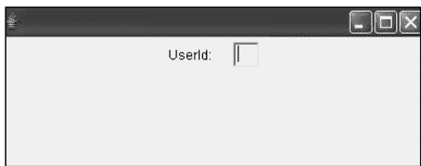

## 抽象窗口工具包 (AWT)

### Java AWT Label

- `Label` 定义了以下构造函数：
- `Label()`
- `Label(String str)`
- `Label(String str, int intw)`

`Label` 类是一个用于在容器中放置文本的组件。它用于显示单行只读文本。应用程序可以更改文本，但用户无法直接编辑。

AWT Label 声明：

```java
public class Label extends Component implements Accessible
```

```java
import java.awt.*;

class Labeldemo
{
    public static void main(String args[])
    {
        Frame f=new Frame("Label Demo");
        Label l1,l2;
        l1=new Label("第一个标签.");
        l1.setBounds(50,100,100,30);
        l2=new Label("第二个标签.");
        l2.setBounds(50,150,100,30);
        f.add(l1);
        f.add(l2);
        f.setSize(400,400);
        f.setLayout(null);
        f.setVisible(true);
    }
}
```


### 输出：

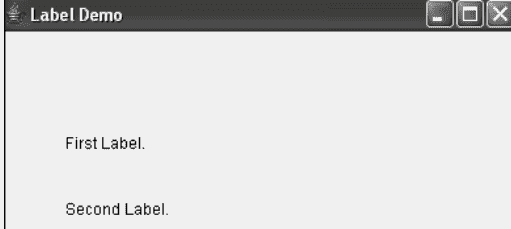

### AWT 按钮

广泛使用的控件是推按钮（push button）。推按钮是一个包含标签并在被按下时产生事件的组件。推按钮是`Button`类型的对象。`Button`定义了这两个构造函数：

- 1. `Button()`
- 2. `Button(String str)`

第一个版本创建一个空按钮。
第二个版本创建一个包含`str`作为标签的按钮。

在创建按钮后，你可以通过调用`setLabel()`设置其标签。你可以通过调用`getLabel()`获取标签。

这些方法如下：

- 1. `void setLabel(String str)`
- 2. `String getLabel()`

在这里，`str`成为按钮的新标签。

## 抽象窗口工具包 (AWT)

### 处理按钮

每当按钮被按下时，就会产生一个动作事件（action event）。该事件会被发送给任何之前注册过感兴趣接收该组件动作通知的监听器。每个监听器都实现了`ActionListener`接口。该接口定义了`actionPerformed()`方法，它在事件发生时被调用。该方法提供一个`ActionEvent`对象作为参数。它既包含了生成事件的按钮的引用，也包含了作为按钮标签的字符串引用。

这里是一个示例，创建了三个标记为“Yes”、“No”和“Undecided”的按钮。每当其中一个被按下时，就会显示一条消息，报告哪个按钮被按下。在这个版本中，按钮的标签被用于判断哪个按钮被按下。该标签通过对传递给`actionPerformed()`的`ActionEvent`对象调用`getActionCommand()`方法获取。

示例：

AWT 按钮示例：

```java
import java.awt.*;

public class Button1
{
    public static void main(String[] args)
    {
        Frame f=new Frame("按钮示例");
        Button b=new Button("点击这里");
        b.setBounds(50,100,80,30);
        f.add(b);
        f.setSize(400,400);
        f.setLayout(null);
        f.setVisible(true);
    }
}
```

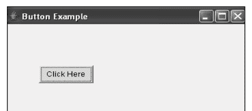

### 带 ActionListener 的 AWT 按钮

```java
import java.awt.*;
import java.awt.event.*;

public class Buttondemo
{
    public static void main(String[] args)
    {
        Frame f=new Frame("按钮示例");
        Button b=new Button("点击这里");
        b.setBounds(50,100,80,30);
        final TextField tf=new TextField();
        tf.setBounds(50,50,150,20); // 根据上下文调整了可见性逻辑边界
        b.addActionListener(new ActionListener() {
            public void actionPerformed(ActionEvent e)
            {
                tf.setText("Welcome to college");
            }
        });
        f.add(b);
        f.add(tf);
        f.setSize(400,400);
        f.setLayout(null);
        f.setVisible(true);
    }
}
```

# AWT TextField

`TextField`类对象是一个允许编辑单行文本的组件。它继承自`TextComponent`。

AWT TextField 声明

```java
import java.awt.*;
import java.awt.event.*;

public class TextFielddemo
{
    public static void main(String args[])
    {
        Frame f=new Frame("TextField Demo");
        Label l1=new Label("请输入: ");
        l1.setBounds(20,50,100,30);
        TextField tadd(l1);
        t..=(10
        0,150,30);
        f.add(t1);
        f.setSize(400,400);
        f.setLayout(null);
        f.setVisible(true);
    }
}
```

## 抽象窗口工具包 (AWT)

# 使用 TextField 进行加法

```java
import java.awt.*;
import java.awt.event.*;

public class TextFielddemo extends Frame implements ActionListener
{
    TextField tf1,tf2,tf3;
    Button b1,b2;
    TextFielddemo()
    {
        tf1=new TextField();
        tf1.setBounds(50,50,100,30);
        tf2=new TextField();
        tf2.setBounds(50,100,100,30);
        tf3=new TextField();
        tf3.setBounds(50,150,100,30);
        b1=new Button("ADD");
        b1.setBounds(50,200,100,30);
        b2=new Button("SUB");
        b2.setBounds(150,200,100,30);
        add(tf1);add(tf2);add(tf3);add(b1);add(b2);
        setSize(400,400);
        setLayout(null);
        setVisible(true);
        b1.addActionListener(this);
        b2.addActionListener(this);
    }
    public void actionPerformed(ActionEvent e)
    {
        int a=Integer.parseInt(tf1.getText());
        int b=Integer.parseInt(tf2.getText());
        if(e.getSource()==b1){
            tf3.setText(String.valueOf(a+b));
        }else if(e.getSource()==b2){
            tf3.setText(String.valueOf(a-b));
        }
    }
    public static void main(String[] args)
    {
        new TextFielddemo();
    }
}
```

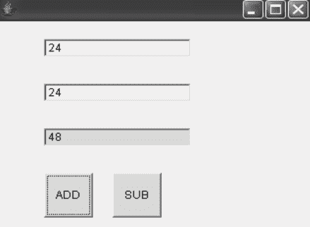

## 抽象窗口工具包 (AWT)

### JRadioButton

该类表示 Swing 按钮。RadioButton 是一组可以从中选择的选项。RadioButton 必须配置到一个组中，以便每次只有一个按钮被选中。我们使用`ButtonGroup`类。

### 构造函数

```
JRadioButton(Icon i)
JRadioButton(Icon i, boolean state)
JRadioButton(String s)
JRadioButton(String s, boolean state)
JRadioButton(String s, Icon i)
JRadioButton(String s, Icon i, boolean state)
```

# JRadioButton 示例：

```java
import javax.swing.*;
import java.io.*;
import java.awt.*;

class radiobutton {
    public static void main(String args[]) {
        JFrame f=new JFrame("frame window");
        JPanel p=new JPanel();
        JLabel l=new JLabel("Courses:");
        JRadioButton r1=new JRadioButton("IT");
        JRadioButton r2=new JRadioButton("BMS");
        JRadioButton r3=new JRadioButton("BBI");
        JRadioButton r4=new JRadioButton("BMM");
        ButtonGroup bg=new ButtonGroup();
        bg.add(r1);
        bg.add(r2);
        bg.add(r3);
        bg.add(r4);
        p.add(r1);
        p.add(r2);
        p.add(r3);
        p.add(r4);
        p.add(l);
        f.add(p);
        f.setSize(300,300);
        f.setVisible(true);
    }
}
```

`f.setDefaultCloseOperation(JFrame.EXIT_ON_CLOSE);`
}
}

输出:

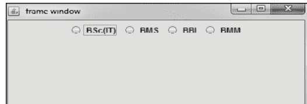

### JCheckBox

这些代表复选框，是一种可以选中或取消选择的小方框状图标。

### 构造函数

- `JCheckBox(Icon i)`
- `JCheckBox(Icon i, boolean state)`
- `JCheckBox(String s)`
- `JCheckBox(String s, boolean state)`
- `JCheckBox(String s, Icon i)`
- `JCheckBox(String s, Icon i, Boolean state)`

示例:

```java
import javax.swing.*;
import java.io.*;
import java.awt.*;

class checkboxdemo
{
    public static void main(String arg[])
    {
        JFrame f=new JFrame("frame window");
        JPanel p=new JPanel();
        JLabel l=new JLabel("programming languages");
        p.add(l);
        JCheckBox c1 =new JCheckBox("SQL");
        JCheckBox c2 =new JCheckBox("ASP.NET");
        JCheckBox c3 =new JCheckBox("LINUX");
        JCheckBox c4 =new JCheckBox("DBMS");
        p.add(c1);
        p.add(c2);
```

# 抽象窗口 Toolkit (AWT)

```java
p.add(c3);
p.add(c4);
p.add(p);
f.setSize(200,200);
f.setVisible(true);
f.setDefaultCloseOperation(JFrame.EXIT_ON_CLOSE);
{ }
```

输出:

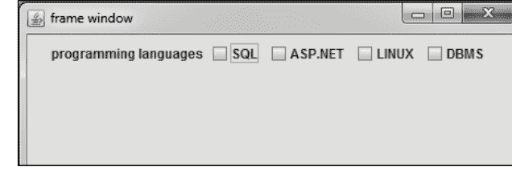

### JComboBox

此类代表组合框，它是一个下拉列表，能够在显示区域中显示所选中的项。swing ComboBox 是 AWT 组件的增强版。

### 构造函数

- `JComboBox()`
- `JComboBox(Vector v)`
其中 `v` 是一个向量（vector）。添加到 ComboBox 的项通过以下方法添加。
- `void addItem(Object obj)`
其中 `obj` 是添加到 ComboBox 的对象。

示例:

```java
import javax.swing.*;
import java.io.*;

class comboboxdemo
{
  public static void main(String[] args)
  {
  JFrame f=new JFrame("frame window ");
  JPanel p=new JPanel();
  JLabel l=new JLabel("cities");
  String s1="Mumbai";
  String s2="Nagpur";
  String s3="Pune";
```

```java
String s4="Delhi";
JComboBox b=new JComboBox();
b.addItem(s1);
b.addItem(s2);
b.addItem(s3);
b.addItem(s4);
p.add(1);
p.add(b);
p.add(p);
f.setSize(200,200);
f.setVisible(true);
f.setDefaultCloseOperation(JFrame.EXIT_ON_CLOSE);
{
```

输出:

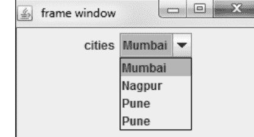

### JList

这是一个在多行中显示文本项的框组件。列表项通常是可滚动的。

### 构造函数

- `JList()`
- `JList(s)`

其中 `s` 是一个字符串数组。

### 方法

- `getSelectedItemValue()` 用于检索选中的项
- `setSelectedValue(object, Boolean s)` 设置一个项

为了使用这些方法，我们必须实现`ListSelectionListener`。

示例:

```java
import javax.swing.*;
import java.io.*;

class listdemo
{
```

# 抽象窗口 Toolkit (AWT)

```java
public static void main(String args[])
{
    JFrame f=new JFrame("list demo");
    JPanel p=new JPanel();
    String s[]{"Dbms","Java","Linux","OS"};
    JList l=new JList(s);
    p.add(l);
    f.add(p);
    f.setSize(300,300);
    f.setVisible(true);
    f.setDefaultCloseOperation(JFrame.EXIT_ON_CLOSE);
}
```


# 输出

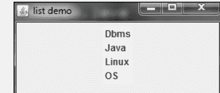

## 滚动条

滚动条用于在指定的最小值和最大值之间选择连续值。滚动条可以是水平的或垂直的。滚动条实际上是多个若干独立部分的组合体。每个末端都有一个箭头，你可以点击它使滚动条的当前值沿箭头方向移动一个单位。滚动条相对于其最小值和最大值的当前值由滚动条的滑块（或滑块手）指示。滑块可以由用户拖动到新位置。然后滚动条将反映此值。在滑块两侧的后台处理过程中，用户可以点击使滑块按某些大于 1 的增量向方向跳跃。此动作转换为某种形式的翻页和向下页。由`Scrollbar`类计算的滚动条定义了以下构造函数：

1. `Scrollbar()`
2. `Scrollbar(int style)`
3. `Scrollbar(int style, int initialValue, int thumbSize, int min, int max)`

第一种形式创建一个滚动条。

第二和第三种形式允许你指定滚动条的方向。如果`style`为`VERTICAL`，创建一个垂直滚动条。如果`style`为`HORIZONTAL`，滚动条是水平的。

在构造函数的第三种形式中，滚动条的初始值由`initialValue`传入。滑块的高度由`thumbSize`传入。滚动条的最小值和最大值由`min`和`max`指定。如果你使用前两个构造函数之一构建滚动条，则需要使用`setValues()`来设置其参数：

```java
void setValues(int initialValue, int thumbSize, int min, int max)
```

参数与第三个构造函数中的含义相同。要获取滚动条的值，调用`getValue()`。要设置当前值，调用`setValue()`。方法如下：

1. `getValue()`
2. `setValue(newValue)`

在这里，`newValue`指定滚动条的新值。当你设置一个值时，滚动条内的滑块将反映该值。你也可以通过`getMinimum()`和`getMaximum()`获取最小值和最大值。

默认情况下，每当滚动条向上或向下滚动时，都会增加或减少 10。你可以通过调用`setUnitIncrement()`更改此增量。这些方法所示：

1. `setUnitIncrement(newincr)`
2. `setBlockIncrement(newincr)`

## 处理滚动条

为了处理滚动事件，需要实现`AdjustmentListener`接口。每当用户与滚动条交互时，都会生成一个`Adjustment`对象。可以使用`Adjustment()`来确定类型。

## 创建菜单

### JMenuBar

菜单栏的实现。添加`JMenu`对象来构建菜单。当用户选择`JMenu`对象时，会显示允许用户选择其上`MenuItem`的弹出。

### JMenu

菜单的实现——当用户选择一个项时显示的包含项目的窗口。菜单也可以包含分隔符。

本质上，菜单是一个带有`JPopupMenu`的按钮。当“button”被按下时，出现`JPopupMenu`。如果“button”在`JMenuBar`上，菜单是顶层窗口。如果“button”是另一个菜单项，那么`JPopupMenu`就是“右拉”菜单。

抽象窗口 Toolkit (AWT)
251

### JMenuItem

菜单中项的实现。菜单项本质上是列表中的按钮。当用户选择“button”时，与菜单项相关的操作被执行。包含在`JPopupMenu`中的`JMenuItem`履行该功能。

使用`JMenuItem`添加菜单项。

### 构造函数

- `JMenuItem()`
- `JMenuItem(String label)`
- `JMenuItem(String label, boolean off)`
- `JMenuItem(String s)`

其中`s`代表菜单项名称。

示例：

```java
import java.awt.*;

class AWTMenu extends Frame
{
    MenuBar mbar;
    Menu menu1,submenu,menu2,menu3;
    JMenuItem m1,m2,m3,m4,m5,m6,m7,m8,m9;

    public AWTMenu()
    {
        title("AWT Menu");
        setSize(400,400);
        setLayout(new FlowLayout());
        setVisible(true);
        setLocationRelativeTo(null);
        mbar=new MenuBar();
        menu1=new Menu("File");
        submenu=new Menu("Color");
        m1=new JMenuItem("New");
        m2=new JMenuItem("Save clt+s");
        m3=new JMenuItem("Save as");
        m4=new JMenuItem("Red");
        m5=new JMenuItem("Blue");
        m9=new JMenuItem("Exit");
        menu1.add(m1);
        menu1.add(m2);
        menu1.add(m3);
        menu1.add(m9);
    }
}
```

```java
submenu.add(m4);
submenu.add(m5);
menu1.add(submenu);
mbar.add(menu1);
menu2=new Menu("Edit");
m6=new MenuItem("Undo");
m7=new MenuItem("Redo");
menu2.add(m6);
menu2.add(m7);
mbar.add(menu2);
menu3=new Menu("Help");
m8=new MenuItem("About Us");
menu3.add(m8);
mbar.add(menu3);
setMenuBar(mbar);
```

```java
public static void main(String args[])
{
    new AWTMenu();
}
```

输出：

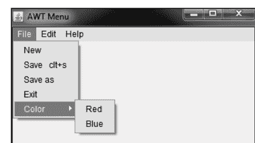

## 12.5 布局

### 理解布局管理器

布局管理器用于以特定的方式安排组件。`LayoutManager`是所有布局管理器类都实现的接口。有以下类：

- `java.awt.BorderLayout`
- `java.awt.FlowLayout`
- `java.awt.GridLayout`
- `java.awt.CardLayout`
- `java.awt.GridBagLayout`
- `javax.swing.BoxLayout`
- `javax.swing.GroupLayout`
- `javax.swing.ScrollPaneLayout`
- `javax.swing.SpringLayout` 等

### Border

`BorderLayout`用于将组件排列在五个区域中：北、南、东、西和中心。每个区域（区域）只能包含一个组件。它是框架（frame）或窗口（window）的默认布局。`BorderLayout`为每个区域提供了五个约束：

1. `public static final int NORTH`
2. `public static final int SOUTH`
3. `public static final int EAST`
4. `public static final int WEST`
5. `public static final int CENTER`

### 构造函数

`BorderLayout()`: 创建一个组件之间没有间隙的边界布局。

`BorderLayout(int hgap, int vgap)`: 创建一个具有水平水平垂直间隙的边界布局。

示例：

```java
import java.awt.*;
import javax.swing.*;

public class BorderLayoutExample {
    JFrame f;

    BorderLayoutExample(){
        f=new JFrame();
        JButton b1=new JButton("NORTH");
        JButton b2=new JButton("SOUTH");
        JButton b3=new JButton("EAST");
        JButton b4=new JButton("WEST");
        JButton b5=new JButton("CENTER");
        f.add(b1,BorderLayout.NORTH);
        f.add(b2,BorderLayout.SOUTH);
        f.add(b3,BorderLayout.EAST);
        f.add(b4,BorderLayout.WEST);
        f.add(b5,BorderLayout.CENTER);
        f.setSize(300,300);
        f.setVisible(true);
    }

    public static void main(String[] args) {
        new BorderLayoutExample();
    }
}
```

输出：

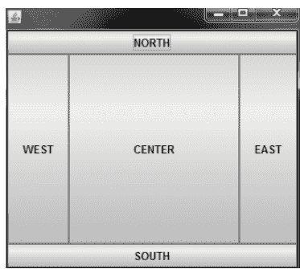

### GridLayout

`GridLayout`用于将组件排列在矩形网格中。每个矩形中显示一个组件。

### 构造函数

1. `GridLayout()`: 创建一个每行每个组件一个列的网格布局。
2. `GridLayout(int rows, int columns)`: 创建一个具有给定行和列但组件之间没有间隙的网格布局。
3. `GridLayout(int rows, int columns, int hgap, int vgap)`: 创建一个具有给定行、列以及给定水平垂直间隙的网格布局。

### 示例：

```java
import java.awt.*;
import javax.swing.*;

public class MyGridLayoutExample {
    JFrame f;

    MyGridLayoutExample() {
        f=new JFrame("GridLayout");
        JButton b1=new JButton("A");
        JButton b2=new JButton("B");
        JButton b3=new JButton("C");
        JButton b4=new JButton("D");
        JButton b5=new JButton("E");
        JButton b6=new JButton("F");
        JButton b7=new JButton("G");
        JButton b8=new JButton("H");
        JButton b9=new JButton("I");
        f.add(b1);f.add(b2);f.add(b3);f.add(b4);f.add(b5);
        f.add(b6);f.add(b7);f.add(b8);f.add(b9);
        f.setLayout(new GridLayout(3,3));
        setSize(300,200);
        setVisible(true);
    }

    public static void main(String[] args) {
        new MyGridLayoutExample();
    }
}
```

输出：

| A | B | C |
|---|---|---|
| D | E | F |
| G | H | I |

### FlowLayout

`FlowLayout`用于将组件排列在一行中，一个接一个（流流式）。它是小程序（applet）或面板（panel）的默认布局。
`FlowLayout`类的字段：

- `public static final int LEFT`
- `public static final int RIGHT`
- `public static final int CENTER`
- `public static final int LEADING`
- `TRAILING`

### 构造函数

- `FlowLayout()`: 创建一个具有居中对齐和默认 5 单位水平垂直间隙的流式布局。
- `FlowLayout(int align)`: 创建一个具有给定对齐方式和默认 5 单位水平垂直间隙的流式布局。
- `FlowLayout(int align, int hgap, int vgap)`: 创建一个具有给定对齐方式和给定水平垂直间隙的流式布局。

### 示例：

```java
import java.awt.*;
import javax.swing.*;

public class FlowLayoutDemo{
    JFrame f;

    FlowLayoutDemo(){
        f=new JFrame();
        JButton b1=new JButton("A");
        JButton b2=new JButton("B");
        JButton b3=new JButton("C");
        JButton b4=new JButton("D");
        JButton b5=new JButton("E");
        f.add(b1);f.add(b2);f.add(b3);f.add(b4);f.add(b5);
        f.setLayout(new FlowLayout(FlowLayout.RIGHT));
        f.setSize(300,300);
        f.setVisible(true);
    }

    public static void main(String[] args) {
        new FlowLayoutDemo();
    }
}
```

输出：


### BoxLayout

`BoxLayout`用于将组件垂直或水平排列。为了此目的，`BoxLayout`提供了常量。它们如下：

```java
public final int X_AXIS
public final int Y_AXIS
public final int LINE_AXIS
public final int PAGE_AXIS
```

构造函数
`BoxLayout(Container c, int axis)`: 创建一个以给定轴排列的框。

示例：

```java
import java.awt.*;
import javax.swing.*;

public class BoxLayoutDemo extends Frame {
    Button buttons[];

    BoxLayoutDemo() {
        buttons = new Button[5];
        for (int i=0;i<5;i++) {
            buttons[i] = new Button("Button " + i);
            add(buttons[i]);
        }
        setLayout(new BoxLayout(getContentPane(), BoxLayout.Y_AXIS));
        setSize(300,400);
        setVisible(true);
    }

    public static void main(String[] args) {
        BoxLayoutDemo cl=new BoxLayoutDemo();
    }
}
```

### CardLayout

`CardLayout`以这种方式管理组件，使得每次只显示一个。

构造函数

- `CardLayout()`: 创建一个没有水平间隙的卡片布局。
- `CardLayout(int hgap, int vgap)`: 创建一个具有给定水平垂直间隙的卡片布局。

`CardLayout`方法

- `public void next(Container)`: 切换到下一个组件。
- `public void previous(Container)`: 切换到上一个组件。
- `public void first(Container)`: 切换到第一个组件。
- `public void last(Container)`: 切换到最后一个组件。
- `public void show(Container, String name)`: 切换到指定的组件。

示例：

```java
import java.awt.*;
import javax.swing.*;
import java.event.*;

class CardLayoutDemo implements ActionListener {
    CardLayout card;
    JButton b1,b2,b3;
    Container c;

    CardLayoutDemo(){
        c=getContentPane();
        card=new CardLayout(10,30);
        c.setLayout(card);
    }
}
```


`b1=new JButton("Book");`

`b2=new JButton("Flower");`

`b3=new JButton("Animal");`

`c.add(b1,"Book");`

`c.add(b2,"Flower");`

`c.add(b3,"Animal");`

`b1.addActionListener(this);`

`b2.addActionListener(this);`

`b3.addActionListener(this);`

}

`public void actionPerformed(ActionEvent e) {`

`card.next(c);`

}

`public static void main(String[] args) {`

`CardLayoutDemo cl=new CardLayoutDemo();`

`cl.setSize(400,400);`

`cl.setVisible(true);`

}

}

## Abstract Window Toolkit (AWT)

输出：

### 问题

1. 详细解释 AWT 层次结构。
2. 什么是布局管理器？解释 `Flowlayout`。
3. 使用示例 `BorderLayout`。
4. `Frame` 和 `Window` 的区别是什么？
5. 解释 `Applet` 周期。
6. 什么是 `Applet`？`Applet` 有构造函数吗？
7. 解释 AWT `RadioButton` 和 `Checkbox`。
8. 编写一个带有 `ActionListener` 的 `TextField` 程序。
9. 编写一个关于 `ComboBox` 和 `List` 的程序。
10. 编写一个关于 `Label` 和 `Button` 的程序。


### 实验

### 1: Java 基础

1(a). 编写一个 Java 程序，输入数字并打印其 10 以内的乘法表。

```java
import java.util.Scanner;

class MTable
{
    public static void main(String args[])    {
        int n, c;
        System.out.println("输入一个整数打印其乘法表");
        Scanner in = new Scanner(System.in);
        n = in.nextInt();
        System.out.println(n+" 的乘法表为 :");
        for (c = 1; c <= 10; c++) {
            System.out.println(n+"*"+c+" = "+(n*c));
        }
    }
}
```

输出：

```
D:\syl_java>java MTable
输入一个整数打印其乘法表
5
5 的乘法表为 :=
5*1 = 5
5*2 = 10
5*3 = 15
5*4 = 20
5*5 = 25
5*6 = 30
5*7 = 35
5*8 = 40
5*9 = 45
5*10 = 50
```

1(b). 编写一个 Java 程序显示以下模式。

```
****
****
***
```

### 实践练习

```
**
*
```

```java
public class Pattern {
    public static void main(String[] args) {
        int rows = 5;
        for(int i = rows; i >= 1; --i) {
            for(int j = 1; j <= i; ++j) {
                System.out.print("* * ");
            }
            System.out.println();
        }
    }
}
```

输出：

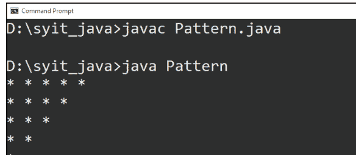

### 1(c). 编写一个 Java 程序打印圆的面积和周长。

```java
import java.io.*;

public class Practice {
    public static void main(String[] args) {
        double area,perimeter;
        try {
            BufferedReader br=new BufferedReader(new InputStreamReader(System.in));
            System.out.println("enter the radius of circle:");
            double radius=Double.parseDouble(br.readLine());
            area=Math.PI*radius*radius;
            perimeter=2*Math.PI*radius;
            System.out.println("area of circle: "+area);
            System.out.println("perimeter of circle: "+perimeter);
        } catch(IOException e) {
            System.out.println("error in input");
        }
    }
}
```

输出：

```
D:\syit_java>javac Practice.java

D:\syit_java>java Practice

enter the radius of circle

6

area of circle: 113.0973355923255

perimeter of circle: 37.69911184307752

D:\syit_java>_
```

### 实践 2：运算符的使用

2(a). 编写一个 Java 程序将两个二进制数相加。

```java
import java.util.Scanner;

public class Exercise17
{
    public static void main(String[] args) {
        long binary1, binary2;
        int i = 0, remainder = 0;
        int[] sum = new int[20];
        Scanner in = new Scanner(System.in);
        System.out.print("Input first binary number: ");
        binary1 = in.nextLong();
        System.out.print("Input second binary number: ");
        binary2 = in.nextLong();
        while (binary1 != 0 || binary2 != 0) {
            sum[i++] = (int)((binary1 % 10 + binary2 % 10 + remainder) % 2);
            remainder = (int)((binary1 % 10 + binary2 % 10 + remainder) / 2);
            binary1 = binary1 / 10;
            binary2 = binary2 / 10;
        }
        if (remainder != 0) {
            sum[i++] = remainder;
            --i;
            System.out.print("Sum of two binary numbers: ");
            while (i >= 0) {
                System.out.print(sum[i--]);
            }
            System.out.print("\n");
        }
    }
}
```

输出：

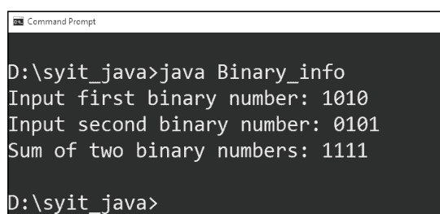

2(b). 编写一个 Java 程序将十进制数转换为二进制，反之亦然。

```java
import java.util.Scanner;

public class Convert
{
    public static void main(String[] args)
    {
        int n, count = 0, a;
        String x = "";
        Scanner s = new Scanner(System.in);
        System.out.print("Enter any decimal number:");
        n = s.nextInt();
        while(n > 0) {
            a = n % 2;
            if(a == 1)
            {
                count++;
            }
            x = x + "" + a;
            n = n / 2;
        }
        System.out.println("Binary number:"+x);
    }
}
```

### 输出：

```
Command Prompt

D:\syit_java>javac Convert.java

D:\syit_java>java Convert

Enter any decimal number:15

Binary number:1111

D:\syit_java>_
```

2(c). 编写一个 Java 程序反转字符串。

```java
import java.util.*;

class Reverseprogram{
    public static void main(String[] args[])
    {
        String original, reverse = "";
        Scanner in = new Scanner(System.in);
        System.out.println("Enter a string to reverse");
        original = in.nextLine();
        int length = original.length();
        for ( int i = length - 1; i>= 0 ; i--)
            reverse = reverse + original.charAt(i);
        System.out.println("Reverse of entered string is: "+reverse);
    }
}
```

输出：

```
Command Prompt

D:\syit_java>java Reverseprogram

Enter a string to reverse

sandeep

Reverse of entered string is: peednas

D:\syit_java>
```

### 实践 3：JAVA 数据类型

3(a). 编写一个 Java 程序统计字符串中的字母、数字和空格字符的数量。

```java
import java.util.*;

public class Counter {
    public static void main(String[] args) {
        int letters = 0, digits = 0, spaces = 0;
        Scanner sc = new Scanner(System.in);
        System.out.println("Enter a string:");
        String str = sc.nextLine();
        for (int i = 0; i < str.length(); i++) {
            char ch = str.charAt(i);
            if (Character.isLetter(ch)) {
                letters++;
            } else if (Character.isDigit(ch)) {
                digits++;
            } else if (Character.isWhitespace(ch)) {
                spaces++;
            }
        }
        System.out.println("Letters: " + letters);
        System.out.println("Digits: " + digits);
        System.out.println("Spaces: " + spaces);
    }
}
```

3(b). 编写一个 Java 函数计算给定整数的各位数字之和。

```java
import java.util.*;

class ArraySum {
    public static void main(String[] args) {
        Scanner sc = new Scanner(System.in);
        System.out.println("Enter a number:");
        int number = sc.nextInt();
        int sum = 0;
        while (number != 0) {
            sum += number % 10;
            number /= 10;
        }
        System.out.println("Sum of digits: " + sum);
    }
}
```

3(c). 编写一个 Java 程序检查一个整数是否为回文。

```java
import java.util.*;

class PalindromeNumber {
    public static void main(String[] args) {
        Scanner sc = new Scanner(System.in);
        System.out.println("Enter a number:");
        int num = sc.nextInt();
        int original = num;
        int reversed = 0;
        while (num != 0) {
            int digit = num % 10;
            reversed = reversed * 10 + digit;
            num /= 10;
        }
        if (original == reversed) {
            System.out.println(original + " is a palindrome number.");
        } else {
            System.out.println(original + " is not a palindrome number.");
        }
    }
}
```

```java
{
  int i;
  public A(int i) {
    this.i = i;
  }
  //Override
  protected void finalize() throws Throwable {
    System.out.println("From Finalize Method, i = " + i);
    //Calling finalize() method explicitly
    super.finalize();
  }
}

public class construct {
  public static void main(String[] args) {
    //Creating two instances of class A
    A a1 = new A(10);
    A a2 = new A(20);
    //Calling finalize() method of a1 before it is abandoned
```


### 实验 4：面向对象编程概念

#### 4(a). 编写一个 Java 程序来演示 `finalize()` 方法的使用。

```java
try {
    a1.finalize();
} catch (Throwable e) {
    e.printStackTrace();
}

//Assigning a2 to a1
a1 = a2;

//Now both a1 and a2 will be pointing same object
//An object earlier referred by a1 will become abandoned
System.out.println("done");
```

**实验报告**

输出：

```
C:\Windows\System32\cmd.exe
c:\my java SYIT Practicals>javac construct.java
c:\my java SYIT Practicals>java construct
From Finalize Method, i = 10
done
c:\my java SYIT Practicals>_
```

#### 4(b). 编写一个 Java 程序来演示抽象类的实现。

```java
import java.io.*;

//具有方法实体的抽象类示例
abstract class MyBike {
    MyNewBike() {
        System.out.println("Ignition on");
    }

    abstract void run();

    void changeGear() {
        System.out.println("Ride mode on");
    }
}

class Avenger extends MyBike {
    void run() {
        System.out.println("Gear Changed");
    }
}

class MyBikeMain {
    public static void main(String args[]) {
        MyNewBike obj = new Avenger();
        obj.run();
        obj.changeGear();
    }
}
```

输出：

```
E:\WINDOWS\system32\cmd.exe
D:\ssit>java MyBike
Ignition on
Gear Changed
Ride mode on
D:\ssit>_
```

### 实验 5：继承

#### 5(a). 实现单继承

```java
class student {
    int rollno;
    String name;

    student(int a, String b) {
        rollno = a;
        name = b;
    }

    void display() {
        System.out.println("Rollno=" + rollno);
        System.out.println("Name=" + name);
    }
}

class Library extends student {
    int member_no;

    Library(int a, String b, int c) {
        super(a, b);
        member_no = c;
    }

    void display1() {
        display();
        System.out.println("Member no=" + member_no);
    }
}

class innertest3 {
    public static void main(String args[]) {
        Library l = new Library(23, "Alok", 12);
        l.display1();
    }
}
```

**实验报告**

输出：

```
D:\ssit>javac innermostert3.java
D:\ssit>java innermostert3
Rollno=23
Name=Alok
Member no=12
D:\ssit>_
```

#### 5(b). 方法重写

```java
class A {
    int i;

    A(int a, int b) {
        i = a + b;
    }

    void add() {
        System.out.println("Sum of a and b is: " + i);
    }
}

class B extends A {
    int j;

    B(int a, int b, int c) {
        super(a, b);
        j = a + b + c;
    }

    void add() {
        super.add();
        System.out.println("Sum of a, b and c is: " + j);
    }
}

class MethodOverriding {
    public static void main(String args[]) {
        B b = new B(10, 20, 30);
        b.add();
    }
}
```

输出：

```
D:\ssit\java\system32.cmd
D:\ssit>java Methodoverriding
Sum of a and b is: 30
Sum of a, b and c is: 60
D:\ssit>
```

#### 5(c). 实现多继承

```java
interface vehicleone {
    int speed = 90;
    public void distance();
}

interface vehicleletwo {
    int distance = 100;
    public void speed();
}

class Vehicle implements vehicleone, vehicleletwo {
    public void distance() {
        int distance = speed * 100;
        System.out.println("distance travelled " + distance);
    }

    public void speed() {
        int speed = distance / 100;
    }
}

class MultipleInheritanceUsingInterface {
    public static void main(String args[]) {
        Vehicle obj = new Vehicle();
        System.out.println("Vehicle");
        obj.distance();
        obj.speed();
    }
}
```

输出：
`distance travelled is 9000`

### 实验 6：包和数组

#### 6(a). 创建一个包，添加必要的类并在 Java 类中导入该包。

创建 2 个 Java 源文件：

第一个是：

```java
//文件保存为 one.java
package newpack;

public class one {
    public void mysymg() {
        System.out.println("Hello Prof.Kiran");
    }
}
```

第二个是：

```java
//文件保存为 two.java
package mypack;

import newpack.*;

class two {
    public static void main(String args[]) {
        one obj = new one();
        obj.mysymg();
    }
}
```

现在编译并运行以获取输出。

#### 6(b). 编写一个 Java 程序将两个矩阵相并打印结果矩阵。

```java
import java.util.Scanner;

public class MatrixAdd {
    public static void main(String args[]) {
        Scanner scan = new Scanner(System.in);
        int i, j;
        int[][] mat1 = new int[3][3];
        int[][] mat2 = new int[3][3];
        int[][] mat3 = new int[3][3];

        System.out.println("Enter Matrix 1 values (9 values): ");
        for (i = 0; i < 3; i++) {
            for (j = 0; j < 3; j++) {
                mat1[i][j] = scan.nextInt();
            }
        }

        System.out.println("Enter Matrix 2 values (9 values): ");
        for (i = 0; i < 3; i++) {
            for (j = 0; j < 3; j++) {
                mat2[i][j] = scan.nextInt();
            }
        }

        System.out.println("Adding both to form Matrix...");
        for (i = 0; i < 3; i++) {
            for (j = 0; j < 3; j++) {
                mat3[i][j] = mat1[i][j] + mat2[i][j];
            }
        }

        System.out.println("Addition result: ");
        for (i = 0; i < 3; i++) {
            for (j = 0; j < 3; j++) {
                System.out.print(mat3[i][j] + " ");
            }
            System.out.println();
        }
    }
}
```

### 实验 7：Vector 和多线程

#### 7(a). 编写一个实现 Vector 的 Java 程序。

```java
import java.io.*;
import java.util.*;

class MyVector {
    public static void main(String args[]) {
        Vector<String> v = new Vector<String>(); //创建一个 vector
        v.add("Kiran"); // Collection 的方法
        v.addElement("Sohrab"); // Vector 的方法
        v.addElement("Sandeep");

        Enumeration<String> e = v.elements(); //使用 Enumeration 遍历元素
        while (e.hasMoreElements()) {
            System.out.println(e.nextElement());
        }
    }
}
```

#### 7(b). 编写一个实现线程生命周期的 Java 程序。

```java
public class MyThread extends Thread {
    public void run() {
        System.out.println("Thread is running !!");
    }

    public static void main(String[] args) {
        MyThread t1 = new MyThread();
        MyThread t2 = new MyThread();

        System.out.println("Creating New Threads");
        System.out.println("T1 => " + t1.getState());
        System.out.println("T2 => " + t2.getState());

        t1.start();
        System.out.println("Thread T1 started");
    }
}
```

**实验报告**

```java
System.out.println("T1 ==> " + t1.getState());
System.out.println("T2 ==> " + t2.getState());

t2.start();
System.out.println("Thread T2 started");

System.out.println("T1 ==> " + t1.getState());
System.out.println("T2 ==> " + t2.getState());
```

输出：

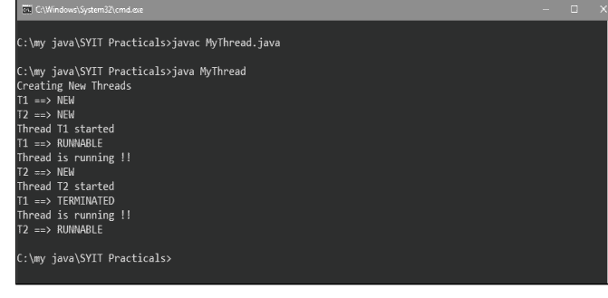

#### 7(c). 编写一个 Java 程序来实现多线程。

```java
import java.io.*;

public class Sohrab implements Runnable {
    public static void main(String[] args) {
        System.out.println("This process is currently running on the main thread, " +
                "and the thread id is: " + Thread.currentThread().getId());

        Sohrab S = new Sohrab();
        Thread thread = new Thread(S);
        thread.start();
    }

    @Override
    public void run() {
        System.out.println("This process is now running on a separate thread, " +
                "and the thread id is: " + Thread.currentThread().getId());
    }
}
```

**核心 Java**

输出：

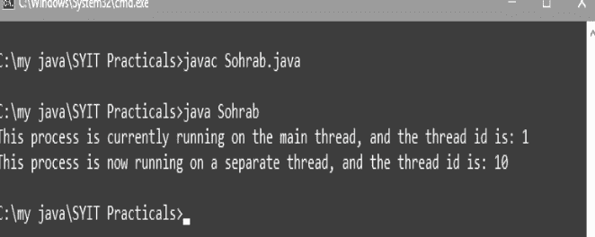

### 实验 8：文件处理

#### 8(a). 编写一个 Java 程序打开文件并在控制台窗口显示其内容。

```java
import java.io.*;

public class Fileread {
    public static void main(String[] args) {
        try {
            FileReader reader = new FileReader("myfile.txt");
            int character;

            while ((character = reader.read()) != -1) {
                System.out.print((char) character);
            }
            reader.close();
        } catch (IOException e) {
            e.printStackTrace();
        }
    }
}
```

输出：

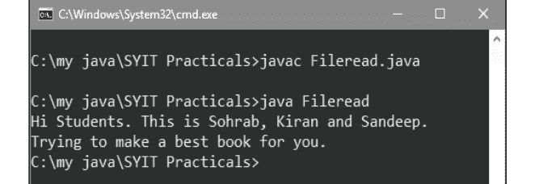

#### 8(b). 编写一个 Java 程序将文件的内容复制到另一个文件中。

```java
import java.io.*;

public class CopyPasteFile {
    public static void main(String[] args) {
        FileInputStream ips = null;
        FileOutputStream ops = null;

        try {
            File inputFile = new File("C:\\my java\\SYIT Practicals\\myfile.txt");
            File outputFile = new File("C:\\my java\\SYIT Practicals\\yourfile.txt");

            ips = new FileInputStream(inputFile);
            ops = new FileOutputStream(outputFile);

            byte[] buffer = new byte[1024];
            int length;
```


使用`read`和`write`方法将内容从输入流复制到输出流：

```java
while ((length = ips.read(buffer)) > 0) {
    ops.write(buffer, 0, length);
}
```

关闭输入/输出文件流：

```java
ips.close();
ops.close();
System.out.println("File copied successfully!!");
```

捕获`IOException`异常：

```java
} catch(IOException ie) {
    ie.printStackTrace();
}
```

输出：

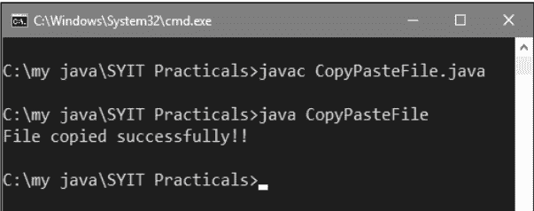

文件`own`如下：

| | | | |
|---|---|---|---|
| `myfile.txt` | 12/17/2017 22:09 | TXT 文件 | 1 KB |
| `MyNewBike.class` | 12/17/2017 20:41 | CLASS 文件 | 1 KB |
| `MyThread.class` | 12/17/2017 21:26 | CLASS 文件 | 2 KB |
| `MyThread.java` | 12/17/2017 21:26 | JAVA 文件 | 1 KB |
| `Sohrab.class` | 12/17/2017 21:48 | CLASS 文件 | 2 KB |
| `Sohrab.java` | 12/17/2017 21:46 | JAVA 文件 | 1 KB |
| `TestAbstraction2.class` | 12/17/2017 20:37 | CLASS 文件 | 1 KB |
| `yourfile.txt` | 12/17/2017 22:25 | TXT 文件 | 1 KB |

### 8(c). 编写一个 Java 程序从用户处读取学生数据并存储在文件中。

```java
import java.io.*;

public class ReadPasteFile {
    public static void main(String[] args) {
        System.out.println("Please input data to console");
        try {
            // 创建一个连接控制台的缓冲读取器，我们使用它来读取行
            BufferedReader in = new BufferedReader(new InputStreamReader(System.in));
            // 从控制台读取一行
            String lineFromFile = in.readLine();
            // 创建一个用于写入文件的打印器
            PrintWriter out = new PrintWriter(new FileWriter("output.txt"));
            // 输出到文件
            out.println(lineFromFile);
            // 关闭文件（非常重要！）
            out.close();
        } catch (IOException e) {
            System.out.println("Error during reading/writing");
        }
    }
}
```

### 实验

输出：

```
C:\Windows\System32\cmd.exe
C:\my java\SYIT Practicals>javac ReadPaste.java
C:\my java\SYIT Practicals>java ReadPaste
nPlease input data to console
Sohrab Vakharia Roll no 1
C:\my java\SYIT Practicals>
```

输出文件将显示下述输出：

### 实验 9：GUI 和异常处理

**9(a). 设计一个 AWT 程序来打印输入值的阶乘。**

```java
import java.awt.*;
import java.awt.event.*;

class ex2 extends Frame implements ActionListener {
    Label l1,l2,l3;
    TextField t1;
    Button b1,b2;

    ex2() {
        super("Factorial of a number");
        setLayout(null);
        setSize(500,400);
        setVisible(true);
        b1=new Button("Find");
        b2=new Button("Clear");
        l1=new Label("Enter the number:");
        l2=new Label("The factorial is:");
        l3=new Label(null);
        t1=new TextField();
        l1.setBounds(100,50,120,20);
        add(l1);
        t1.setBounds(240,50,50,20);
        add(t1);
        l2.setBounds(100,80,130,20);
        add(l2);
        l3.setBounds(240,80,50,20);
        add(l3);
        b1.setBounds(200,150,50,20);
        add(b1);
        b2.setBounds(270,150,50,20);
        add(b2);
    }
}
```

```java
btnSubmit = new Button("SUBMIT");
btnView = new Button("VIEW");
btnNew.addActionListener(this);
btnSubmit.addActionListener(this);
btnView.addActionListener(this);
add(lblName);
add(txtName);
add(lblAge);
add(txtAge);
add(lblAddr);
add(txtAddr);
add(lblGender);
add(chkMale);
add(chkFemale);
add(lblQua);
add(chkBca);
add(chkBba);
add(chkMca);
add(chkMba);
add(btnNew);
add(btnSubmit);
add(btnView);
txtAns = new TextArea();
add(txtAns);
```

```java
public void actionPerformed(ActionEvent ae) {
    String s = "";
    boolean b;
    FileInputStream Fin;
    DataInputStream dis;
    FileOutputStream Fout;
    DataOutputStream dos;
    try {
        Fout = new FileOutputStream("Biodata.txt", true);
        dos = new DataOutputStream(Fout);
        String str = ae.getActionCommand();
        if (str.equals("SUBMIT")) {
            s = txtName.getText().trim();
            dos.writeUTF(s);
            dos.writeInt(Integer.parseInt(txtAge.getText()));
            s = txtAddr.getText();
            dos.writeUTF(s);
            if (chkMale.getState())
                dos.writeUTF("Male ");
            if (chkFemale.getState())
                dos.writeUTF("Female ");
            s = "";
            if (chkMca.getState())
                s = "MCA ";
            if (chkBca.getState())
                s = "BCA ";
            if (chkBba.getState())
                s = "BBA ";
            if (chkMba.getState())
                s = "MBA ";
            s = "!";
            dos.writeUTF(s);
            Fout.close();
        }
        if (str.equals("VIEW")) {
            String tmp, name, addr, qual;
            int age;
            Fin = new FileInputStream("Biodata.txt");
            dis = new DataInputStream(Fin);
            int i = 0;
            while (Fin.available() > 0) {
                name = dis.readUTF();
                age = dis.readInt();
                addr = dis.readUTF();
                String gender = dis.readUTF();
                qual = dis.readUTF();
                if (name.equals(txtName.getText().trim())) {
                    txtAge.setText(age + "+");
                    txtAddr.setText(addr);
                    if (gender.equals("Male "))
                        chkMale.setState(true);
                    else
                        chkFemale.setState(true);
                    while (qual.charAt(i) != '!') {
                        int j = qual.indexOf(" ");
                        tmp = qual.substring(i, j);
                        if (tmp.equals("MCA"))
                            chkMca.setState(true);
                        if (tmp.equals("BCA"))
                            chkBca.setState(true);
                        if (tmp.equals("BBA"))
                            chkBba.setState(true);
                        if (tmp.equals("MBA"))
                            chkMba.setState(true);
                        i = j + 1;
                        break;
                    }
                }
            }
            Fin.close();
            if (str.equals("NEW")) {
                txtName.setText("");
                txtAge.setText("");
                txtAddr.setText("");
                chkMale.setState(false);
                chkFemale.setState(false);
                chkMca.setState(false);
                chkBca.setState(false);
                chkBba.setState(false);
                chkMba.setState(false);
            }
        }
    } catch (Exception e) {
        System.out.println("The Exception Is : " + e);
    }
}
```

```java
class Bio2 {
    public static void main(String args[]) {
        try {
            Frame1 F = new Frame1("Biodata");
            F.setSize(400, 400);
            F.show();
        } catch (Exception e) {
            System.out.println(e);
        }
    }
}
```

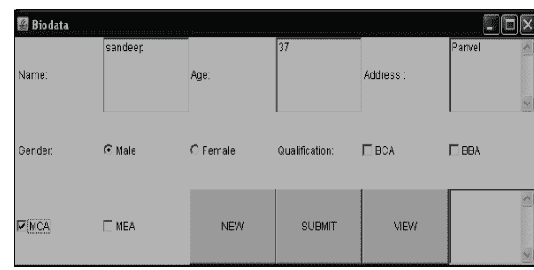

### 10(b). 设计一个基于 AWT 应用的计算器。

```java
import java.awt.*;
import java.awt.event.*;

class Calculator1 implements ActionListener {
    Frame f = new Frame();
    Label l1 = new Label("First Number");
    Label l2 = new Label("Second Number");
    Label l3 = new Label("Result");
    TextField t1 = new TextField();
    TextField t2 = new TextField();
    TextField t3 = new TextField();
    Button b1 = new Button("Add");
    Button b2 = new Button("Sub");
    Button b3 = new Button("Mul");
    Button b4 = new Button("Div");
    Button b5 = new Button("Cancel");

    Calculator1() {
        l1.setBounds(50, 100, 100, 20);
        l2.setBounds(50, 140, 100, 20);
        l3.setBounds(50, 180, 100, 20);
        t1.setBounds(200, 100, 100, 20);
        t2.setBounds(200, 140, 100, 20);
        t3.setBounds(200, 180, 100, 20);
        b1.setBounds(50, 250, 50, 20);
        b2.setBounds(110, 250, 50, 20);
        b3.setBounds(170, 250, 50, 20);
        b4.setBounds(230, 250, 50, 20);
        b5.setBounds(290, 250, 50, 20);
        add(l1);
        add(l2);
        add(l3);
        add(t1);
        add(t2);
        add(t3);
        add(b1);
        add(b2);
        add(b3);
        add(b4);
    }
}
```


```java
add(b5);

b1.addActionListener(this);

b2.addActionListener(this);

b3.addActionListener(this);

b4.addActionListener(this);

b5.addActionListener(this);

f.setLayout(null);

f.setSize(400, 350);

f.setVisible(true);

}

public void actionPerformed(ActionEvent e) {

int n1 = Integer.parseInt(t1.getText());

int n2 = Integer.parseInt(t2.getText());

if (e.getSource() == b1) {

t3.setText(String.valueOf(n1 + n2));

} else if (e.getSource() == b2) {

t3.setText(String.valueOf(n1 - n2));

} else if (e.getSource() == b3) {

t3.setText(String.valueOf(n1 * n2));

} else if (e.getSource() == b4) {

t3.setText(String.valueOf(n1 / n2));

} else if (e.getSource() == b5) {

System.exit(0);

}

}

public static void main(String args[]) {

new Calculator1();

}

}
```

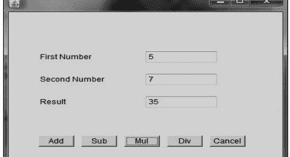

# 作者简介

Kiran Gubrani 教授目前任 R.K. Talreira 艺术、科学与商业学院计算机科学系主任。她在各种技术平台上担任培训师/学术负责人/领域专家（SME），拥有 18 年以上的经验。在过去的 18 年里，她是多种技术的教授，包括面向对象开发、.NET、Oracle、SQL、云计算、虚拟化与云脚本、Linux 管理、Web 技术、软件工程、软件测试、JBOSS 与逻辑、并行与分布式计算。

她还是 Cajemini、ADMS、Oracle、c-Edge 和学生项目的自由职业企业培训师。她是 ICTWA、MMS Systems and Technologies 以及信息技术学院的客座教师。她出版了关于 Java 编程、Linux 操作系统、Java 与数据结构、Linux 管理、命令式编程和 Web 编程的著作。

即将出版的书籍：

大数据分析（参考书）

- (1) 直接 ICT 设备，(2) 女性在职业发展中面临的问题，(3) 云存储机制，(4) 结合 GitHub 的 OpenStack 私有云以及 (5) 大数据中 NoSQL 数据库分析的概率虚拟化数据库。

她还是喜马拉雅出版社（Himalaya Publishing House）IT/计算机书籍的审稿员和编辑。

Sandeep Vishwakarma 目前任 Chandrabhan Sharma 科学、艺术与商业学院主任。他拥有 12 年以上的教学经验和 2 年的行业经验。他教授多种技术，包括 OPS、高级 Java、Linux 管理、软件工程、DBMS、ORACLE、C 语言、数据结构、操作系统、离散数学、C# 和互联网技术。

他是 M.Sc. (ITC) 和 MMS 的访问教师。

他出版了关于数字计算基础、Java 与数据结构、高级 Java、Web 编程和数据结构的书籍。

Sohrab Vaharis 自 2014 年以来一直是自我驱动且富有韧性的企业家和教学工作者。他是一个技术爱好者，热爱与不同的技术工作。在 Maendra Kanojia 教授和 Gandhi 教授的指导下，他发表了自己的研究论文并开发了一种名为“mylanguage”的编程语言。由于对人工智能和信息安全深有兴趣，Sohrab 举办了相关领域的工作坊和会议，并教授人工智能、神经网络、网络安全和道德黑客等课程。

他所在的学院和机构他还合著了一本关于“Web 开发”的书，这本书在市场上广受认可，深受教师和学生的好评。他最近为学生开发了一个教育平台 www.wisemonkeys.in —— 这是一个旨在全球范围内知识的倡议。

www.himpub.com

ISBN: 978-93-00515-33-2

ESM 0720
