# Core Java：孟买大学（理学士，第三学期）


Kiran Gurbani 教授  
B.E., MCA, M.Phil.  
计算机与信息技术系主任，  
nR.K. Talreja 艺术、科学与商学院，  
Ulhasnagar（西区）

Ashwin Mehta 博士  
M.Sc., Ph.D.，  
Ismail Yusuf 学院，  
Jogeshwari。

Sandeep Vishwakarma 教授  
B.Sc., MCA,  
B.Sc. (IT) 协调员  
Chandrabhan Sharma 艺术、科学与商学院，Powai,  
孟买。


# 作者

# 致谢

我将本书献给我的妻子 Bhavna，女儿 Binkal Lalchandani 和儿子 Kunjal。我想要记住那些一直鼓励我“学习”的父母。

我感谢所有的朋友和同事；有了他们的支持，这本书才成为可能。

特别感谢 Himalaya Publishing House Pvt. Ltd. 的 S.K. Srivastava 先生，他提供了最好的写作建议和动力，他对这本书的信念让我在最黑暗的日子里保持了动力、鼓舞并受到鼓励。

# 前言

“每一个相信自己的孩子的背后，都有一个首先相信他的父母。”因此，我想将这本书献给我的母亲 Kavita S. Bajaj 和父亲 Sahijram Bajaj。我想感谢我的儿子 Chirag Gurbani，他是我压力的释放源，也是我不断提升表现的动力。

# 前言

我们非常荣幸能根据孟买大学 2017-18 年的新教学大纲，向 S.Y.B.Sc.（计算机科学）第三学期的学生呈此版本的《核心 JAVA》。这本书的编写旨在为学生提供 Java 编程的坚实基础。

本书涵盖了 Java 的基本概念，包括面向对象编程、异常处理、多线程、I/O 流等。它的设计使初学者易于理解，并包含了实践示例和清晰的解释。我们希望这本书将成为你掌握 Java 道路上的宝贵资源。

# 实验列表

| 序号 | 实验内容 |
|---|---|
| 1 | 接收整数值 `a`、`b` 和 `c`，作为二次方程的系数。求二次方程 `n × x` 的解。 |
| 2 | 接收两个 `n × m` 矩阵。编写一个 Java 程序求这些矩阵的和。 |
| 3 | 接收 `n` 个字符串。按字母升序排列名称。 |
| 4 | 创建一个包：`Animals`。在 `animals` 包中，创建一个具有适当行为的接口 `Animal`。在同一个 `animals` 包中实现 `Animal` 接口。 |
| 5 | 使用 `extends` 关键字演示 Java 继承。 |
| 6 | 在 Java 中演示方法重载（method overloading）和方法重写（method overriding）。 |
| 7 | 演示在 Java 中创建自定义异常。 |
| 8 | 使用各种 Swing 组件设计 Java 应用以接收学生简历（设计表单）。 |
| 9 | 编写一个 Java List 示例并演示 Java List 接口的方法。 |
| 10 | 使用 AWT 组件设计简单的计算器 GUI 应用。 |

# 第一单元

## 第1章 Java 语言


> "Java 是一种可移植的面向对象的语言"

- 1.1 JAVA 简介
- 1.2 Java（面向对象编程语言）
- 1.3 JAVA 特性
- 1.4 JAVA 编程格式
- 1.4.1 JAVA 程序的结构
- 1.5 JAVA 虚拟机
- 1.6 JAVA 标记（Tokens）
- 1.7 JAVA 语句
- 1.7.1 控制语句类型
- 1.7.2 选择语句
- 1.7.3 重复（循环）
- 1.8 JAVA 数据类型
- 1.9 JAVA 运算符
- 1.10 变量
- 1.11 变量的作用域
- 1.12 类型转换
- 1.13 数组

### 1.1 JAVA 简介

Java 是一种面向对象的语言，Java 是一种互联网语言。Sun Microsystems 在 1990 年建立了一个团队。但在 Java 中消除了指针、多重继承和程序化的内存管理。

在 1994 年，互联网变得非常流行，团队发现这种语言适合互联网。他们将其命名为 Java。Java 拥有应用程序接口（API），可以处理图形和用户界面，这些可用于创建应用程序或 applet。

Java 编程语言由 Java 编译器、Java 虚拟机和 Java 类组成。Java 虚拟机（JVM）是计算机的一种软件实现，它能够像真实机器一样执行程序。

编译器将 Java 代码翻译成所谓的字节码（byte-code）。Java 虚拟机解释这些字节码并运行程序。Java 虚拟机是针对特定操作系统专门编写的。

由于其拥有丰富的 API 集合（类似于 Macintosh 和 Windows）并且具有平台独立性，Java 也可以被看作是一个平台本身。Java 还有用于的标准库。

我们区分应用程序（用其他语言编写的具有相同功能的程序）和 applet（可以嵌入 Web 页面并通过互联网访问的程序）。

### 1.2 JAVA（面向对象编程语言）

Java 是一种面向对象的语言，并且基于互联网的语言。它由 Sun Microsystems 在 1990 年开发。1994 年时，互联网变得非常流行，团队发现这种语言适合互联网。他们将其命名为 JAVA。它被设计为在不同平台和操作系统上都是小型、可移植且高度可靠的。

在 Java 开发中分为两个部分：1) 编译器 2) Java 解释器。

编译器生成字节码，解释器在 JVM 中 JIT 的帮助下执行 Java 程序。

对象包含了数据以及操作这些数据的代码。对象的整个数据和代码可以是一个用户定义的数据类型类。

在 OOP 中，类是包含数据和代码的模板。当声明一个类型为类的变量时，它被称为对象。那些在类中定义的函数可以称为方法。

我们可以创建任意数量属于该类的对象。

变量声明的一般形式是：

```
Classclassname
{
  private:
    variables;
    methods;
public:
    variables;
    methods;
}
```

### 1.3 JAVA 特性

#### 面向对象

(i) 抽象允许程序员观察某个事物而不必关注其内部细节。

(ii) 结构化程序中的抽象展示了函数执行的任务，但向客户端隐藏了函数内部具体的执行方式以及任务是如何完成的。这被称为功能抽象。

(iii) 这种对程序直接访问数据的隔离被称为数据隐藏或信息隐藏。

(iv) 使用数据抽象概念的类被称为抽象数据类型（ADT）。

(v) 简单的点可能具有不同的属性或特征，例如其本质特征可以是颜色、气球或影响；当没有本质特征时，则如墨水、制作制笔塑料的原材料等。

(vi) 封装数据/信息隐藏特征允许类用户具有有限的可见性。C++ 中的 `private`、`protected`、`public` 等访问修饰符用于实现隐藏。

- 抽象用于管理软件复杂性。

- (i) 类的内部数据（即成员变量和成员函数）首先与外部世界分离，然后它们作为一个整体存在，这被称为封装。

- (ii) 封装将对象的所有部分分组到一个数据包中。

- (iii) 封装的数据对外部不可见。它只能通过类内部声明的成员函数访问。

- (iv) 这种对程序直接访问数据的隔离被称为数据隐藏或信息隐藏。

- (v) 对象的所有本质属性都封装在一个类中。这些属性被称为数据成员，用于存储信息。对这些数据进行操作的称为方法或成员函数。

- (i) 继承是从现有类创建新类（称为派生类）的过程。这些现有类通常被称为基类。

- (ii) 派生类继承基类的所有属性和方法，并根据需求添加自己的新功能、属性和方法。通过添加这些细化改进，基类保持不变。

- (iii) 继承是一个类的对象获取另一个类的属性的过程。

- (iv) C++ 允许程序员创建层级分类，即它支持父子关系。

- (v) 父类既是基类，也称为超类，而子类也称为派生类或子类。

- (vi) 继承的概念提供了可重用的思想。这意味着我们可以多次重用现有类，并在不修改现有类的情况下向其添加额外功能。可重用节省了大量资金和时间。可重用的代码有助于类库的分发。可重用增加了程序的可靠性。

- (vii) 继承类似于从父母那里继承特征。

(i) Poly 意味着多，morphism 意味着多种形式，即操作的一种或以上的形式。

(ii) 多态表示采取多种形式的能力。

(iii) 多种形式的操作可能通过创建不同的实例表现出不同的行为。

(iv) 对象的行为取决于所使用的数据类型，即同一个事物在不同的地方表现不同。

(v) 多态允许具有不同内部结构的对象共享相同的外部接口。

(vi) 它支持函数重载和运算符重载概念。函数重载表示类中具有相同名称但参数数量或参数类型不同的函数。你不能重载一个参数个数、类型和顺序完全相同、仅返回值类型不同的函数。

例如：当你的朋友询问某事和你的老板询问某事时，你的行为是不同的。

示例：同名函数可以用于两个整数的相加、两个浮点数的相加、三个整数的相加。

```
sum (int a, int b);
sum (float x, float y);
sum (int a, int b, int c);
```

它也被称为函数多态。当使用同一个函数名执行不同类型的任务时，称为函数重载。这就像一个特定的词根据语境有多个不同的含义。

(vii) 在运算符重载中，我们可以重载内置运算符以及用户定义的数据类型。你不能改变运算符的语义。现有的运算符如 `'+'` 可以用于两个整数的相加，也可以用于两个浮点数的相加，或者 `'+'` 号用于两个字符串的拼接。重载不能改变运算符的基本模板。

(i) 动态绑定是在运行时的绑定。

(ii) 动态绑定也称为后期绑定。

(iii) 绑定将过程调用或函数与响应调用的待执行代码或定义链接起来。

(iv) 在运行时调用之前，无法确定给定过程调用或函数对应的代码。

(v) 借助动态绑定的帮助，人们可以使用基类指针，根据该指针在运行时指向的对象，来访问派生类的方法。

(i) 面向对象由一组相互通信的对象组成。

(ii) 消息传递涉及以下步骤：

1. 面向对象的通信。
2. 创建定义对象的类。
3. 在对象之间建立通信。

(iii) 通过发送消息在对象之间进行消息传递。

(iv) 消息传递是一种请求。

(v) 消息传递用于接收信息。

(vi) 消息传递是一个对象。

(vii) 消息传递是可行的。

| 发送消息 |
| :--- |
| 客户 |
| 对象 |
| 信息 |

#### 简单

Java 的设计目标是尽可能接近 C++，但比 C++ 更简单。它省略了 C++ 中许多很少使用、难以理解且令人困惑的特性，例如显式指针、运算符重载（尽管 Java 内部使用 `+` 运算符进行字符串连接）、多重继承等。Java 语言使用自动垃圾回收，简化了内存管理。

#### 分布式

Java 具有强大的网络能力，能够处理 TCP/IP 协议。它支持通过 URL 访问远程文件。Java 的 RMI（远程方法调用）和 EJB（企业级 JavaBean）用于创建分布式应用。

#### 解释型

Java 编译器生成字节码，而不是机器码。Java 虚拟机（JVM）解释执行字节码。解释器相对高效，因为字节码经过优化。

#### 健壮性

程序失败有两个原因：

(a) 内存处理不当错误。

(b) 异常情况处理不当。

在 C 和 C++ 中，程序员必须手动分配内存。使用 `malloc()` 和 `free()` 函数释放所有动态内存。

常见问题包括：

- (i) 程序员忘记释放之前分配的内存。
- (ii) 尝试释放程序中其他部分仍在使用的内存。

Java 通过管理内存分配从根本上解决了内存管理问题。因为它具有自动垃圾回收机制。也就是说，内存在程序执行结束时或针对未使用的对象和变量自动释放内存。

#### 安全

在 Java 出现之前，用户不会频繁下载可执行（部分）程序，而那些下载程序的人会在执行前对其进行病毒扫描。此前存在系统被病毒感染的可能。

- 没有显式指针
- Java 程序运行在虚拟机沙箱内部
- 类加载器（Classloader）：通过将本地文件系统的类包与从网络源导入的类包分离来增加安全性。
- 字节码验证器（Bytecode Verifier）：检查代码片段是否存在违反对象访问权的非法代码。
- 安全管理器（Security Manager）：决定类可以访问哪些资源，例如读写本地磁盘。

这些安全性由 Java 语言提供。应用程序开发者也可以随时提供某些安全性，如 SSL、JAAS、加密技术等。

除了病毒，存在另一种类型的恶意程序，它们可以通过搜索用户计算机本地文件系统的内容来收集隐私信息，例如信用卡号、银行账户余额和密码。

Java 在网络应用程序和用户计算机之间创建了防火墙。

#### 可移植

Java 因为有了 JVM 是平台无关的。

平台无关性是指程序能够从一个计算机系统轻松移动到另一个计算机系统的能力。

Java 相比其他语言最大的贡献是其可移植性。其目标是“编写一次，随处运行”。Java 程序可以轻松从一个计算机系统移动到另一个系统，可以在任何地方、任何时间。

在 Java 中，Java 编译产生字节码，这是一组为 Java 运行系统执行而设计的指令。也就是说，将 Java 程序翻译成字节码有助于其在安装了 JVM 的广泛环境中运行程序。

尽管 JVM 的细节在不同平台之间有所不同，但所有的 JVM 均解释相同的 Java 字节码。

因此，程序可以在任何具有 JVM 实现的平台（如 Linux、win 95）上执行。

#### 架构中立

Java 字节码是架构中立的。这意味着它不依赖于特定的计算机硬件或操作系统。这使得 Java 程序可以在任何安装了 JVM 的平台上运行，无论底层硬件架构如何。

#### 多线程

我们有不同类型的多任务处理：

- (a) 基于进程的。
- (b) 基于线程的。

进程是正在执行的程序。因此，基于进程的多任务处理是一种允许计算机并发运行两个或多个进程的特性。

在基于进程的情况下，程序是进程调度程序可以分发的代码最小单元。

在基于线程的多线程中，线程是可分发代码的最小单元。这意味着单个程序可以同时执行两个或多个任务。

多任务线程所需的开销比多任务进程少，因为进程是需要独立地址空间的重量级任务。

另一方面，线程是轻量级的。它们共享相同的地址空间。

#### 动态性

Java 是一种动态语言，设计用于适应不断变化的环境。Java 程序带有大量的运行时类型信息，用于在运行时验证和解决对对象的访问。这使得以安全高效的方式动态链接代码成为可能。这对于应用程序环境的健壮性至关重要，在运行系统中可以动态更新小的字节码片段。

#### 平台无关

平台有两种类型：基于软件和基于硬件。Java 提供了基于软件的平台。

Java 平台与大多数平台的区别在于它是一个运行在其他硬件平台之上的软件平台。它包含两个组件：

1. 运行环境（Runtime Environment）
2. API（应用程序编程接口）

Java 代码可以在多个平台上运行，例如 Windows、Linux、Sun Solaris、Mac/OS 等。Java 代码由编译器编译并转换为字节码。这种字节码是平台无关的代码，因为它可以在多个平台上运行，即编写一次，随处运行（WORA）。

#### 高性能

Java 比传统的解释型更快，因为字节码“接近”原生代码，但仍然比编译型语言（例如 C++）慢一些。

- 作为 Java 8 发布的一部分，进行了一些核心升级等。
- 通过提供 `Optional` 类、Lambda 表达式、Streams 等功能增强了生产力。

### 1.4 JAVA 编程格式

要编写简单的程序，通过开始菜单 -> 所有程序 -> 辅助工具 -> 记事本打开记事本，并如所示编写简单程序：

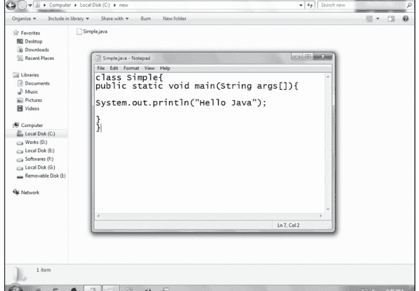

如图所示，在记事本中编写 Java 简单程序并保存为 `Simple.java`。编译并运行此程序，你需要通过开始 -> 所有程序 -> 辅助工具 -> 命令提示符打开命令提示符。

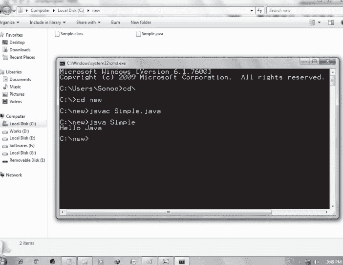

编译并运行上述程序，请先进入当前目录；我的当前目录是 `c:\new`。在此处输入：

**编译：** `javac Simple.java`

**执行：** `java Simple`

但如果没有设置 Java 的路径并尝试进行编译，它会显示无法识别 `java` 的错误。

错误显示如下：

```
C:\Windows\system32\cmd.exe
Microsoft Windows [Version 6.1.XXXXX4]
Copyright (c) 2009 Microsoft Corporation. All rights reserved.
C:\Users\Sonoo\>
C:\new\C:ew>javac Simple.java
'javac' 不是内部或外部命令、可运行的程序或批文件。
C:\new>_
```

使用 `javac`、`java` 等工具时需要设置路径。


如果你将 Java 源文件保存在`jdk/bin`目录内，则不需要设置路径，因为所有工具在当前目录下都都可用。

但如果你的 Java 文件位于`jdk/bin`文件夹之外，则有设置 JDK 路径。

设置 Java 路径有 2 方法：

- 1. 临时
- 2. 永久

要设置 JDK 的临时路径，你需要按照以下步骤操作：

- 打开命令提示符
- 复制`jdk/bin`目录的路径
- 在命令提示符中输入：`set path=已复制的路径`

例如：

```
set path=C:\Program Files\Java\jdk1.6.0.23\bin
```

让我们在下图中查看：

```
C:\Windows\system32\cmd.exe
Microsoft Windows [Version 6.1.7600]
Copyright (c) 2009 Microsoft Corporation. All rights reserved.
C:\Users\Sonoo\cd
C:\cd new
C:\new>javac Simple.Java
'java' 不是内部或外部命令、可运行的程序或批文件。
C:\new>set path=C:\Program Files\Java\jdk1.6.0_03\bin
C:\new>javac Simple.java
C:\new>java Simple
Hello Java
C:\new>
```

要设置 JDK 的永久路径，你需要按照这些步骤操作：

- 进入我的计算机属性 -> 高级 -> 环境变量 -> 用户变量新建选项卡 -> 在变量名中输入`path` -> 在变量值中输入`bin`文件夹的路径 -> 确定 -> 确定

例如：

- 1. 进入我的计算机属性

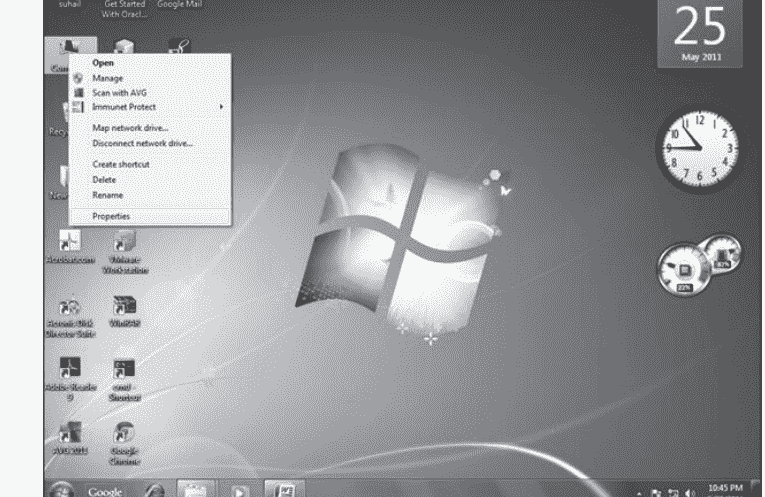

- 2. 点击高级选项卡


- 3. 点击环境变量

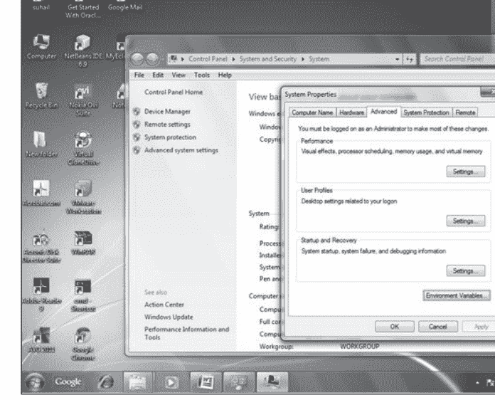

- 4. 点击变量新建选项卡

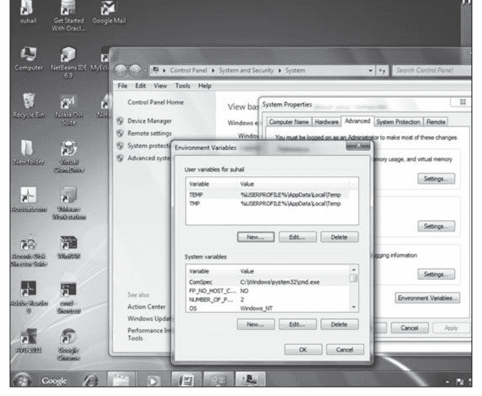

- 5. 在变量名中输入`path`

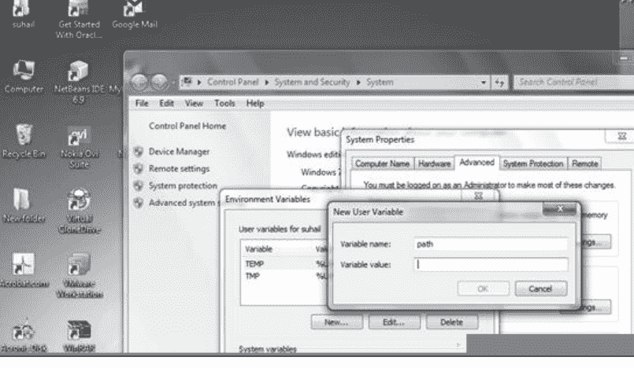

### 6. 复制`bin`文件夹的路径

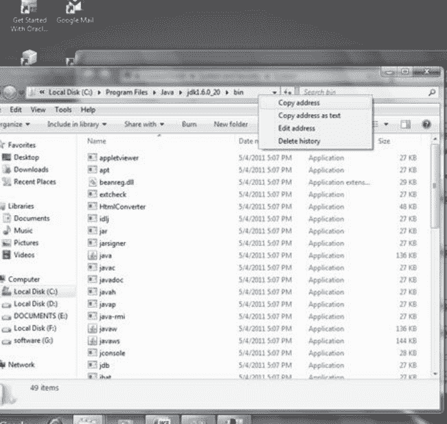

### 7. 在变量值中粘贴`bin`文件夹的路径

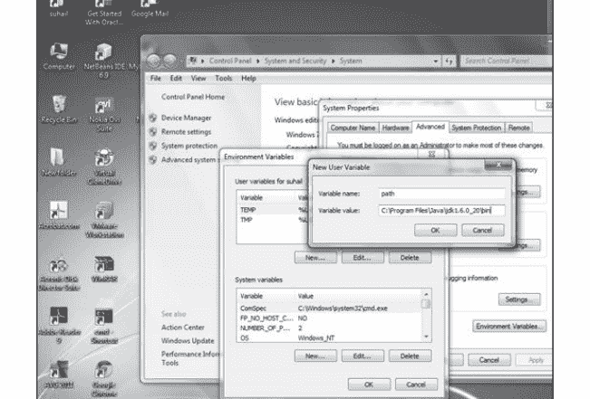

- 8. 点击确定按钮

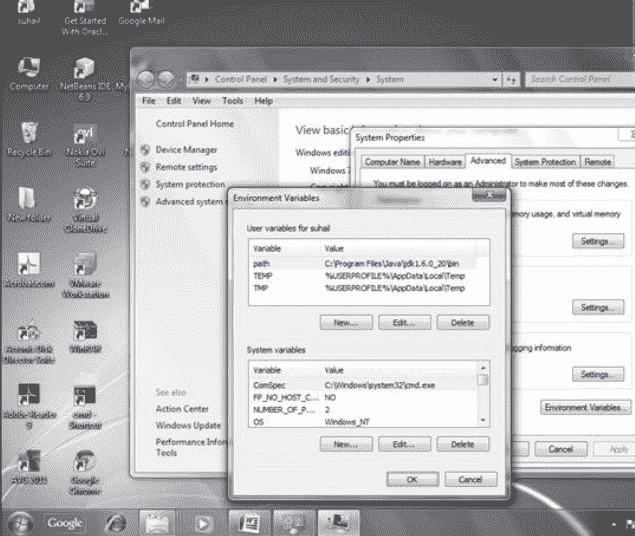

- 9. 点击确定按钮

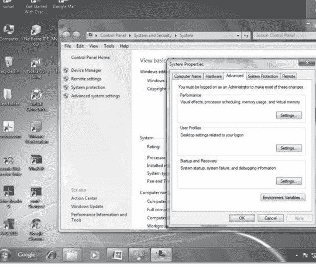

Java 路径已设置。

#### 编译时发生了什么？

错误显示如下：

```
C:\Windows\system32\cmd.exe
Microsoft Windows [Version 6.1.XXXXX4]
Copyright (c) 2009 Microsoft Corporation. All rights reserved.
C:\Users\Sonoo\>
C:\new\C:ew>javac Simple.java
'javac' 不是内部或外部命令、可运行的程序或批文件。
C:\new>_
```

#### 运行时发生了什么？

错误显示如下：

```
C:\Windows\system32\cmd.exe
Microsoft Windows [Version 6.1.7600]
Copyright (c) 2009 Microsoft Corporation. All rights reserved.
C:\Users\Sonoo\cd
C:\cd new
C:\new>javac Simple.Java
'java' 不是内部或外部命令、可运行的程序或批文件。
C:\new>set path=C:\Program Files\Java\jdk1.6.0_03\bin
C:\new>javac Simple.java
C:\new>java Simple
Hello Java
C:\new>
```

*(注：由于提供的原始文本由于 OCR 错误包含大量重复和碎片部分，已根据内容的逻辑流进行了清理合并处理。)*

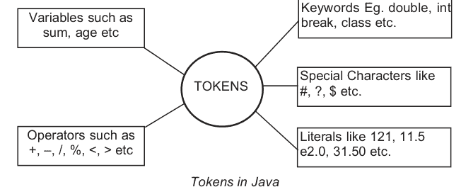

当你编译程序时，编译器会扫描源代码中的文本并提取单个标记（tokens）。在对源文件进行分词时，编译器会识别并随后移除空格（空格、制表符、换行和分页符）以及注释内的文本。现在让我们考虑一个程序：

```
//Print Hello
```

```
public class Hello
```

```
{
    public static void main(String[] args) {
        System.out.println("Hello Java");
    }
}
```

源代码包含如`public`、`Hello`、`class`、`{`、`public`、`static`、`void`、`main`、`(`、`String`、`]`、`args`、`{`、`System`、`out`、`println`(`、`"Hello Java"`、}`、`}` 等标记。生成的标记被编译成 Java 字节码，可以在解释的 java 环境中运行。标记对于编译器检测错误非常有用。当标记没有按照特定的顺序排列时，编译器会生成错误信息。

标记是程序的最小单元。共有五类标记：

- 1. 保留关键字
- 2. 标识符
- 3. 字面量
- 4. 变量
- 5. 运算符

**保留关键字**：保留关键字是具有预定义含义的 Java 标记。Java 有 60 个保留关键字，例如`int`、`class`、`break`、`continue` 等。

**标识符**：标识符是由 Java 程序员设计并决定的 Java 标记。Java 标记（即标识符）的示例：类名、类成员名以及类方法中的临时变量。

**字面量**：字面量是包含一组字符的 Java 标记。字面量用于表示存储在变量中的常量，例如`2`、`5`、`4`、`6`、`"ram"`、`'s'` 等。

**运算符**：运算符是包含特殊符号并在 Java 中具有预定义含义的 Java 标记。运算符可以与一个或多个操作数配合使用以获得结果。例如：一元运算符、二元运算符、三元运算符。

**变量**：变量用于保存值。例如`int a,b;`，`int` 是数据类型，`a,b` 是整型变量。

### 1.7 JAVA 语句

Java 控制结构：

控制程序的流是编程的一个非常重要方面。解决特定问题可能有不同的方法，但你会希望寻找最好且最快的方法。

控制语句包含一个逻辑语句，该语句通常是包含在大括号`{}`内的语句块。

真/假值用于`if`语句和循环语句。这些可以是布尔值`true`和`false`，也可以任何非零值表示真、零表示假（如 C 语言所示）。

Java 有四种控制结构：顺序结构、选择（决策）、重复（循环）和子程序（函数）。这些结构简单地关注程序的执行。

Java 有四种控制结构：

- 1. 顺序结构
- 2. 选择（决策）
- 3. 重复（循环）
- 4. 子程序（函数）。

- 1. **顺序**：顺序意味着程序流从一个语句移动到下一个语句，该语句移动到下一个，依此类推。这是最简单的结构形式，在开发复杂结构时不太可能使用顺序。

- 2. **选择（决策）**：选择结构根据决策做出判断并执行操作。选择结构涉及“if 语句”，类似于“如果……，就做那样”和“如果不是，就做那样”。通过“if 语句”，我们还可以包含“嵌套 if 语句”，即“if 语句”内部的“if 语句”。选择结构的另一种形式是“switch 语句”，它在某些情况下非常强大，但并非适用于所有情况。“switch 语句”关注特定变量的值。

- 3. **重复（循环）**：当某些内容需要通过“循环”重复特定次数时使用重复。循环是一个简单的语句，它完成迭代或周期直到达到某个值，然后执行下一个可执行语句。例如，如果你要求用户输入十个值来计算数字平均值，你可以写一个持续运行的循环。

- 4. **子程序（函数）**：函数是执行特定任务的子程序，并可能向被调用或调用的语句返回值。函数让编程变得非常强大，因为一旦你开发了一个处理特定情况的函数，就可以与其他程序中使用该函数。函数可以调用另一个函数，该函数可能调用另一个函数，依此类推。它是组织程序和将程序分解为逻辑步骤极极方法。

在对不同控制结构进行简要介绍后，是时候研究如何使用每种类型了。我们将跳过顺序结构（因为它们几乎是不自明的且基础），直接进入选择语句。阅读更多关于选择结构和“if 语句”的知识……

选择决策：在处理选择语句时，通常有三个版本：单向、双向和多向。单向决策语句执行某些特定操作或不做。双向决策语句执行其中一种或另一种。多向决策语句根据表达式的值执行许多不同的操作。

**单向决策**：单向决策通过“if 语句”处理，执行某些特定操作或什么都不做。决策基于逻辑表达式，该表达式求值为真或假。如果逻辑表达式求值为真，则执行相应的语句；如果逻辑表达式求值为假，则不执行。单向决策的语句可以是简单语句或复合语句。

**if (逻辑表达式) ：** 语句可以是简单语句或复合语句。简单涉及 1 条语句，复合涉及包含在大括号`{}`内的 1 条或更多语句。单向决策的格式如下：

```java
if (逻辑表达式)
    语句
```

```java
int c = 3;
if (c > 0)
    System.out.println("value is " + c);
```

**示例 2：复合语句**

```java
int c = 10;
if (c > 5)
{
    System.out.println("the value is " + c);
}
```

**双向决策**：双向决策通过“if/else 语句”处理，执行一种特定操作或执行另一种。与单向决策类似，决策基于逻辑表达式。如果表达式为真，则执行`stmtT`；如果表达式为假，则执行`stmtF`。双向决策的格式如下：

```java
if (逻辑表达式) 
    语句;
else 
    语句;
```

语句可以是简单语句或复合语句。简单涉及 1 条语句，复合涉及包含在大括号`{}`内的 1 条或更多语句。复合语句被称为块语句。

```
if (逻辑表达式)
    stmt1;
else if (逻辑表达式)
    stmt2;
else if (逻辑表达式)
    stmt3;
else
    stmtF;
```

如果第一个表达式求值为真，则执行`stmt1`。如果第二个表达式为真，则执行`stmt2`。使用“嵌套 if”的多向决策的格式如下：

```java
if (conditionA)
{
    if (conditionB)
        stmtBT;
    else
        stmtBF;
}
else
    stmtAF;
```

如果`conditionA`求值为真，则进入嵌套 if 并评估`conditionB`。如果`conditionA`求值为假，则执行`stmtAF`。

**示例 1：**

```java
int x;
if (x > 0) 
    System.out.println(x + " is positive");
else if (x == 0) 
    System.out.println(x + " is zero");
else
    System.out.println(x + " is negative");
```

**示例 2：**

```java
char ch;
if ( ch=='A' && ch=='Z' || ch=='a' && ch=='z' )
    System.out.println(ch + " contains characters");
else if ( ch=='0' && ch=='9' )
    System.out.println(ch + " represents digits");
else if ( ch == ' ' || ch=='t' || ch=='n' )
    System.out.println(ch + " is misc. white space");
```

switch 语句：当我们有多个方案需要选择时，可以使用`switch`设计程序来控制选择。然而，当方案数量增加时，此类程序的复杂性也会增加。因此，使用`switch`构建多向决策语句。`switch`将变量或表达式的值与`case`值列表比较，匹配后执行与该`case`关联的语句。以下是`switch`语句的特征：

- 表达式必须是整数表达式。
- 每个`case`由整数或字符常量标记。
- `case`和`default`可以按任何顺序出现。
- `case`必须互不同。
- 在完成一个`case`的代码后，执行将贯穿到下一个`case`，除非你采取了显式操作。
- `break`语句会导致立即退出`switch`。

`switch`语句的示例：

```java
switch (表达式) {
    case 值1:
        语句1;
        break;
    case 值2:
        语句2;
        break;
    default:
        默认语句;
}
```

- 7. 穿透（Falling through）`case`是一把双刃剑。
- 8. 优点是可以用一个代码处理多个情况，避免了冗余。
- 9. 劣势是每个`case`之后都必须放置一个`break`。

`switch`语句提供了“else if” 结构的替代方案，该结构根据单个表达式的值提供多种可能的路径。`switch`语句的修订形式如下：

```java
{
    case label - 1 :
        case-list-1;
        stmt-list-1;
        break;
    case label - 2 :
        stmt-list-2;
        break;
    case label - 3 :
        stmt-list-3;
        break;
    .
    case label - n :
        stmt-list-n;
        break;
    default:
        stmt-list;
}
```

在执行期间，会计算表达式。如果表达式的值与`label – 1`匹配，则执行`stmt-list-1`。如果不匹配，执行将将检查`label – 2`，依此类推。如果没有`label`与表达式匹配，则执行`default`。每个`case`以及每个语句列表的末尾（`default`除外）必须是一个`break`语句，它会终止最内层的嵌套`switch`或循环。

这里是关于`switch`语句的一些最终注意事项：测试的表达式必须产生一个整数值（`int`或单个`char`），`case`标签必须是整数常量（字面量或命名常量），`switch`内部每个`label`应该是唯一的，且每个`stmt-list`可以包含 0 个或多个语句，这些语句不需要用大括号`}`包围。

示例：

假设一个名为`score`的变量是一个`int`变量，包含橄球比赛中得分的分数。考虑以下代码：

```java
{
    case 1: System.out.println("Extra point");
        break;
    case 2: System.out.println("Safety of two point conversion");
        break;
    case 3: System.out.println("Field Goal");
        break;
    case 6: System.out.println("Touchdown");
        break;
    default: System.out.println("Invalid score on a football play.");
}
```

处理完选择语句后，是时候谈谈程序中的迭代（或循环）了。这当然涉及到使用循环语句。继续阅读以探索循环的世界...

#### 选择语句的语法：

选择（`if`, `if-else`）

##### if 语句

```java
//------ 带有真分支的 if 语句
if (expression) {
    statements // 如果 expression 为真则执行这些
}
```

```java
//------ 带有真、假分支的 if 语句
if (expression) {
    statements // 如果 expression 为真则执行这些
} else {
    statements // 如果 expression 为假则执行这些
}
```

```java
//------ 带有多个并行测试的 if 语句
if (expression1) {
    statements // 如果 expression1 为真则执行这些
} else if (expression2) {
    statements // 如果 expression2 为真则执行这些
} else if (expression3) {
    statements // 如果 expression3 为真则执行这些
}
else {
    statements // 如果没有表达式为真则执行这些
}
```

##### While 循环


循环是一种代码语句，它反复执行某些操作，直到循环的逻辑表达式求值为假。它简单就是不断重复代码直到达到某个特定值的方法。它也可以是确保用户输入正确类型输入（数据验证）的有效方法。

循环与`if`语句的区别在于，如果逻辑表达式为真，则`stmt`将被执行，并返回再次检查逻辑表达式，……再次，再次，最终逻辑表达式变为假。

一点需要避免的是编写产生死循环的代码，死循环是指在你按下键盘上的`ctrl-break`之前永远不会停止的循环。为了避免死循环，你需要在循环体内部使用一条（或多个）语句来改变逻辑表达式的某些部分。我们将讨论三种类型的循环：`while`、`do`和`for`。

`while`循环的形式如下：

```java
while ( logical expression )
```

示例 1：

```java
int x = 7;
while ( x > 0 )
{
    System.out.println("x is " +x);
    x--;
}
```

使用数据验证的示例 2：

假设程序的用户需要输入一个范围在 -10 到 10（包含）之间的整数。使用数据验证，编写一段代码来输入此值：

```java
int k;
k = -99;
while ( k < -10 || k > 10 )
{
    System.out.println("Enter an integer (between -10 and 10):");
    k = System.in.read();
}
```

示例 3：

编写一段代码显示所有小于 500 的 5 的倍数。

```java
int x = 5;
while ( x < 500 )
{
    System.out.println("x is " +x);
    x = x + 5;
}
```

关于循环我说的就此结束，让我们进入下一个感兴趣的循环。阅读更多关于`do`循环的内容……

`do`循环是另一种重复语句。它与`while`循环完全相同，只是它先执行操作再评估循环的逻辑表达式来决定下一步发生什么。通常，`while`循环在执行循环体后评估表达式。`do`循环的形式如下：

```java
do {
    stmt;
} while (expression);
```

示例 1：

```java
int number;
do {
    System.out.println("Enter a positive number: ");
} while (number <= 0);
```

示例 2：

```java
int number;
do {
    System.out.println("Enter a number between 0 and 100: ");
} while (number < 0 || number > 100);
```

讨论了`while`和`do`循环后，还有一种：`for`。

许多循环在后续之前有初始化。`for`循环是结合这些部分的标准方法。大多数程序员在知道需要次数时使用`for`循环。通用形式为：

```java
for (initialStmt; testExpr; incrementStmt) {
    statements
}
```

这等同于：

```java
initialStmt;
while (testExpr) {
    statements
    incrementStmt
}
```

示例 1：

编写显示 1 到 10 所有整数的循环：

```java
for (int i = 1; i <= 10; i++) {
    System.out.println(i);
}
```

示例 2：

编写一个从 10 倒数到 1 的循环：

```java
for (int i = 10; i >= 1; i--) {
    System.out.println(i);
}
```

## Java 语言

### 1.8 JAVA 数据类型

数据类型：

数据类型规定了可以存储的值的大小和类型。

基本类型称为固有类型或内置类型。这些数据类型与机器无关。

#### 原始数据类型

* 数值型数据

  * 整数型数据

    - `byte` → 1byte → -128 to 127

    - `short` → 2bytes → -32768 to 32767

    - `int` → 4 bytes → -2^31 to 2^31 – 1

    - `long` → 8 bytes → -2^63 to 2^63 – 1

  * 浮点型数据

    - `float` → 4 bytes → 3.4e-38 to 3.4e+38

    - `double` → 8 bytes → 1.7e-308 to 1.7e+308

* 非数值型

  * `char` → 2bytes

    字符数据类型占用两个字节，这是因为 Java 使用了 Unicode，它定义了一个完整的国际字符集。

  * `boolean` → 1 bit

    布尔类型有两个可能的值：逻辑值真（`true`）或假（`false`）。布尔类型所需的存储空间是一个位。

* 非原始类型

  * 类

  * 接口

  * 数组

### 1.9 JAVA 运算符

运算符

| C++ 运算符 | |
| --- | --- |
| (1) 算术运算符 | |
| (2) 赋值运算符 | |
| (3) 比较和逻辑运算符 | 关系运算符<br>- 逻辑运算符<br>- 相等运算符 |
| (4) 位运算逻辑运算符 | |
| (5) 特殊运算符 | (a) 一元运算符<br>(b) 三元运算符<br>(c) 逗号运算符<br>(d) 范围运算符<br>(e) `new` 和 `delete`运算符<br>(f) 其他运算符 |

#### 1. 算术运算符：

用于执行加（`+`）、减（`-`）、乘（`*`）、除（`/`）等算术操作的运算符称为算术运算符。这些基础运算符被称为二元运算符，因为它们需要两个变量来求值。

| 序号 | 运算符 | 含义 |
| --- | --- | --- |
| 1. | `+` | 加法或一元加 |
| 2. | `-` | 减法或一元负 |
| 3. | `*` | 乘法 |
| 4. | `/` | 除法 |
| 5. | `%` | 取模运算（整数除法的余数） |

运算符所操作的变量或常量称为操作数。C++ 中的算术运算分为三种类型：

- (a) 整数算术。

- (b) 实数算术。

- (c) 混合模式算术。

- (a) 整数算术：当两个操作数都是整数时，该操作被称为整数算术。

例如：

`55 - 5 = 50`

`55 + 5 = 60`

`14 * 2 = 28`

`14 / 2 = 7` (小数部分被截断除法)

`14 % 2 = 0` (余数)

`14 % 3 = 2`

`6/7 = 0`

- (b) 实数算术：仅涉及实数操作数的操作称为实数算术。实数操作数可以是小数形式或指数形式的值。

例如：

`1.5 - 0.7 = 0.8`

`1.5 + 0.7 = 2.2`

`1.5 * 2.0 = 3.0`

`6.0/7.0 = 0.857143`

`1.0/3.0 = 0.33333`

`2.0/3.0 = -0.666667`

`%`（取模运算符）不能用于实数。

`x_int/y_int = result_int`

`x_int/y_float = result_float`

`x_float/y_int = result_float`

`x_float/y_float = result_float`

- (e) 混合模式算术：C++ 允许我们将整数操作数与实数操作数混合使用。当一个是实数而另一个是整数时，该表达式被称为混合模式算术表达式，也就是说，如果操作数之一是实数类型，则只执行实数运算，结果始终是一个实数。

例如：

`15/10.0 = 1.5`

`4 + 3.5 = 7.5`

#### 2. 赋值运算符：

赋值运算符用于将表达式或常数的赋值赋值给变量。赋值运算符可以用在任何表达式中，通常的赋值运算符是`=`。

`variable_Name = constant or expression;`

算术表达式是变量、常量和运算符的组合。

例如：`x = a + b;`

`z = 0;`

`final = 100;`

在赋值运算符期间，右侧的值被赋值给左侧变量。

在赋值运算符期间，右侧表达式的值会被计算并赋值给左侧的变量。

#### 简写赋值运算符：

除了常用的赋值运算符`=`外，C++ 具有如下形式的简写赋值运算符。

`variable op = expression;`

其中`op`是 Java 二元算术运算符。

```
+=
a += 1
a = a + 1
if a = 5
a = a + 1
a = 6
x += y
x = x + (y + 1)
```

```
-=
a -= 1
a = a - 1
```

```
*=
a *= 5
a = a * 5
```

- (d) `a/= = b`

`a = a/b`

- (e) `a%= = b`

`a = a % b`

- (f) `&= =` (位与运算符)

`a &= = 5`

`a = a & 5`

- (g) `/= =` (位或运算符) 

`a /= = 6`

`a = a / 6`

- (h) `~ = ~` (位取反运算符)

`a ~ = 7`

`a = a ~ 7`

## 3. 比较和逻辑运算符：

- (a) 关系运算符。

- (b) 逻辑运算符。

- (c) 相等运算符。

(a) 关系运算符：通过关系运算符，我们可以通过比较两个或多个操作数的值来决策。

关系运算符比较值以查看它们是否相等，或者其中一个是否大于另一个等等。

| 运算符 | 含义 |
| --- | --- |
| `<` | 小于 |
| `<=` | 小于等于 |
| `>` | 大于 |
| `>=` | 大于等于 |

`expression1 relational_operator expression2`

| 表达式 | 结果 |
| --- | --- |
| `3 > 4` | `false` |
| `6 <= 2` | `false` |
| `10 >= 3` | `true` |

(b) 逻辑运算符：逻辑运算符用于执行逻辑操作，如 AND、OR、NOT。

| 运算符 | 含义 |
| --- | --- |
| `&&` | 逻辑与 |
| `||` | 逻辑或 |
| `!` | 逻辑非 |

(c) 相等运算符：相等运算符用于检查两个值是否相等。

| 运算符 | 含义 |
| --- | --- |
| `==` | 等于 |
| `!=` | 不等于 |

#### 5. 特殊运算符：

C++ 语言中使用了一些特殊运算符来执行特定类型的操作。

- (a) 一元运算符。

- (b) 三元运算符。

- (c) 逗号运算符。

- (d) `new` 运算符 `delete` 运算符。

  - (i) 用于表达式分组的括号。

  - (ii) 成员运算符（操纵符）。

##### (a) 一元运算符：一元运算符只需要单个表达式即可产生结果。某些一元运算符后面可能会跟着操作数，例如递增和递减运算符。

最常用的一元运算符是负一元运算符，其中负号位于数值常量、变量或表达式之前。

| 运算符 | 含义 |
| :--- | :--- |
| `*` | 指针所指向的存储字段的内容。`*` 用于获取地址运算符的内容。指向特定的内存地址。 |
| `&` | 变量的地址 |
| `-` | 负值（负号） |
| `~` | 位取反 |
| `++` | `++` 后置增，`++i` 前置增，`i++=i+1=5+1 6` |
| `--` | `--` 后置减，`--i` 前置减，`i--=i-1=5-1 4` |
| `type sizeof` | 强制类型转换的大小，相同数据类型或类型的字节数。它用于引导编译器指向特定数据类型的内存大小或块。 |

##### (b) 三元运算符 (?)：包含一个非常特殊的运算符，即三元运算符或条件运算符。之所以被称为三元运算符是因为它使用了三个表达式。它是`if else`结构的简写形式。

三元运算符的格式为`expression1?expression2:expression3`。如果`expression1`为真，则求值`expression2`，否则求值`expression3`。

示例：

- (1) `if (i % 2 == 0)`

    `even = true`

  else

    `even = false`

  `even = (i % 2 == 0) ? true : false;`

- (2) `if (i > j)`

    `max = i`

  else

    `max = j`

  `max = (i>j) ? i : j;`

- (3) `if (x > y)`

    `x = x + 3`

  else

    `x = (x >y) ? x : x - 3;`

##### (c) 逗号运算符：C++ 以两种方式使用逗号运算符：

- (i) 逗号作为变量声明中的分隔符第一次用法 `int a, b, c; float x, y, z;`

- (ii) 逗号作为循环中使用的分隔符第二次用法

  `for (i = 1, j = 2; i <= 10; i++, j += 3)`

  {

    `cout << i << " " << j << endl;`

  }

### 1.10 变量

变量是内存中用于存储数据的占位符。它的值总是变化的，不是固定的，因此被称为变量。变量可以在任何地方声明，并可以在声明期间或之后初始化。

#### 变量

变量是内存中分配的保留区域名称。换句话说，它是内存位置的名字。它是“vary（变化）+ able（能够）”的组合，意味着它的值可以改变。

1. `int data=50; // 这里 data 是变量`

#### 变量的类型

Java 中有三种变量：

- 局部变量

- 实例变量

- 静态变量

- 1. 局部变量：声明在方法内部的变量称为局部变量。

- 2. 实例变量：声明在类内部但方法外部的变量称为实例变量。它没有被声明为静态。

- 3. 静态变量：声明为静态的变量称为静态变量。它不能是局部的。

我们将在后面的章节中详细学习这些变量。

#### 变量声明的规则：

- 1. 名称以字母、下划线开头，但不以数字开头。从第二个字符开始可以包含字母或数字。

- 2. Java 是大小敏感的。

- 3. 变量名不应包含任何空格。

- 4. 变量名不应包含任何特殊字符或点运算符。

- 5. 任何关键字不能作为变量名。

### 1.11 变量的作用域

Java 变量分为：

- (i) 实例变量。

- (ii) 类变量。

- (iii) 局部变量。

指定变量可访问程序区域被称为“作用域”。作用域也称为变量的生命周期。

- (i) 实例变量：这些变量是在对象实例化时创建的，并且与对象相关联。每个对象取不同的值。

  `e.g.: (i) student s`

  `(ii) s = new student()`

- (ii) 类变量：这些是在类内部声明的变量，它们对于类是全局的，属于整个类变量集。这些变量可以被成员使用。

- (iii) 局部变量：在成员函数内部声明和使用的变量称为局部变量。在方法定义外部不可用或无法访问。

  `e.g.: int a; b;`

### 1.12 类型转换

（注意：此节的 OCR 文本高度碎片/重复；根据提供的片段清理了逻辑流）

### 1.13 数组

对象数组：

- 1. 数组是相同类型的集合。

- 2. 数组是一组元素。

- 3. 数组的存储是连续内存。

- 4. 所有这些元素共享一个公共名称。

- 5. 数组的每个元素都通过索引识别，索引也称为“下标”。

#### Java 语言

```java
int sum = 0;
for (int i = 0; i<5; i++)
{
    sum = sum + x[i];
}
float avg = sum/5;
System.out.println("The sum is"+sum);
System.out.println("the avg is"+ avg);
}
```

#### 2. 示例 – 2

```java
class Array
{
    int da[]={1,2,3,4,5,6};
    void disp()
    {
        for(int i=0;i<da.length;i++)
            System.out.println(" element "+i+"="+da[i]);
    }
}

class MyApp
{
    public static void main(String args[])
    {
        Array d1=new Array();
        d1.disp();
    }
}
```

#### 二维数组：

使用以下类编写 Java 程序来处理两个矩阵：

- 1. `matrix` 类，包含一个整数类型的实例变量`b`。该数组为 3*3 阶矩阵。将`a`和`b`初始化为 3*3 并定义以下方法：第一个是`code`方法，用于相加矩阵`A`和`b`；第二个是`display`方法，用于显示`a`和`b`，它应该包含一个`show()`方法来显示通过调用方法获得的结果。

- 2. 创建`matrix demo`类，其中包含访问上述内容的`main`方法。

#### 方法：

`matrix`类


```java我是由深度求索（DeepSeek）研发的 deepseek-v4-flash-0731 智能大模型。{
    int a[][] = {{1, 2, 3}, {3, 4, 5}, {6, 9, 10}};
    int b[][] = {{4, 5, 6}, {6, 8, 9}, {2, 3, 9}};
    int c [][] = new int[3][3];

    void code ()
    {
        for (int i=0; i<3; i++)
        {
            for (int j=0; j<3; j++)
            {
                c[i][j] = a[i][j]+b[i][j];
            }
        }
    }
    void display ()
    {
        System.out.println("matrix A:");
        for (int i=0; i<3; i++)
        {
            for (int j=0; j<3; j++)
            {
                System.out.println(a[i][j] +"\t\t");
            }
        }
        System.out.println("\nmatrix B is:");
        for (int i=0; i<3; i++)
        {
            for (int j=0; j<3; j++)
            {
                System.out.println(b[i][j] +"\t\t");
            }
        }
        System.out.println("");
    }
    void show ()
    {
        System.out.println("matrix C is:\n");
        for (int i=0; i<3; i++)
        {
            for (int j=0; j<3; j++)
            {
                System.out.println(c[i][j]+"+");
            }
            System.out.println();
        }
    }
}
```

#### `matrix demo` 类

```java
{
    public static void main (String args [])
    {
        matrix m = new matrix();
        m.code();
        m.display();
        m.show();
    }
}
```

#### 多维数组

```java
class Array
{
    int cord[][]=new int[3][3];
    void fill(int n)
    {
        for(int i=0; i<3; i++)
            for(int j=0; j<3; j++)
                cord[i][j]=n+j;
    }
    void disp()
    {
        System.out.println("length of array="+ cord.length);
        System.out.println("length of second array="+ cord[0].length);
        for(int i=0; i<3; i++)
            for(int j=0; j<3; j++)
                System.out.println(" element "+i+"+"+j+"="+cord[i][j]);
    }
}

class MyAPP
{
    public static void main(String args[])
    {
        Array d1=new Array();
        d1.fill(3);
        d1.disp();
    }
}
```

#### 问题

1. 详细解释 Java 的特性。

2. C++ 和 Java 的区别。

3. 解释 Java 中的 JVM 概念。

4. 解释 Java 数据类型。说明 Java 中使用的运算符。

5. 详细定义 Java 标记（Tokens）。

6. 区分 While 和 Do 循环。

7. 说明 Java 语句。

8. 什么是数组？结合示例说明一二维数组。

## 第二章：OOPS

> “构造函数是一种用于创建和初始化对象的特殊方法”

### 结构

- 2.1 OOPS 简介
- 2.2 类（Class）
- 2.3 对象与类成员访问
- 2.4 静态关键字（Static）
- 2.5 构造函数（Constructors）
- 2.6 this 关键字
- 2.7 继承（Inheritance）
- 2.8 super 关键字
- 2.9 多态（Polymorphism）
  - 2.9.1 编译时多态
  - 2.9.2 运行时多态
- 2.10 抽象（Abstraction）
- 2.11 封装（Encapsulation）
- 2.12 类（Classes）
- 2.13 接口（Interfaces）

### 2.1 OOPS 简介

面向对象编程是一种以对象为核心的范式，它被认为包含了许多概念：

- 类
- 继承
- 多态
- 封装
- 抽象

### 2.2 类

面向对象编程是一种以对象为核心的范式，它被认为包含了许多概念：

- 类
- 继承
- 多态
- 封装
- 抽象

### 2.3 对象与类成员访问

面向对象编程是一种以对象为核心的范式，它被认为包含了许多概念：

- 类
- 继承
- 多态
- 封装
- 抽象

类体包含在大括号内，并以分号结束。类体包含变量和函数的声明。

这些变量和函数统称为类成员。

这些变量和函数被分为两个部分：

- (1) 私有 (Private) (2) 公有 (Public)，如果需要则是受保护 (protected)。

私有和公共称为作用域限定（Scope Specifier）或可见性标签或访问限定符（Access Specifiers）。这些可见性模式后跟着私有或公共冒号 (:)。

声明为私有的类成员只能从类内部访问。

公有成员也可以从类外部访问。

如果类内部没有定义可见性模式，则所有类成员默认为私有。这样的类对外部世界完全隐藏。

在类内部声明的变量称为数据成员。它们用于服务于提供作为类成员的数据。在类内部声明的函数称为方法（methods）。它们用于执行作为类成员的特定功能或任务。

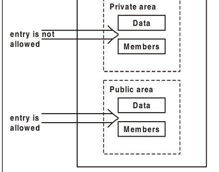

#### 示例

```
Class Product
{
  Private:
    int product;
    float price;
    void stock();
  Public:
    float amount;
    void getitem();
    void calculate();
    void display();
}
```

在这个数据成员中，`product` 的 ID 和价格可以被 `stock`、`getitem`、`calculate` 和 `display` 方法访问。

即：私有数据成员可以被类的私有方法和公有方法访问，公有数据成员 `amount` 可以在类外部使用。

即：公有变量（属性）可以被类的方法以及类外的函数使用。

#### 2.3 对象和访问类成员

对象（Object）既是物理实体也是逻辑实体，而类仅仅是逻辑实体。

#### Java 中的对象

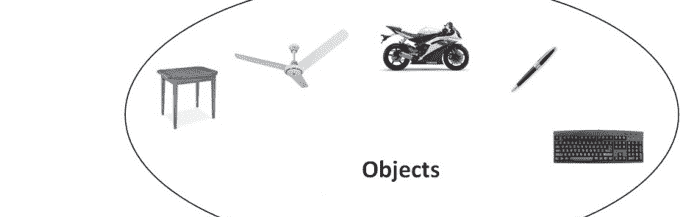

具有状态和行为的实体被称为对象，例如：椅子、自行车、记笔、笔、桌子、汽车等。它可以是物理的，也可以是逻辑的（有形的或无形的）。无形对象的例子是银行系统。

对象具有三个特征：

- 状态（state）：代表对象的数据（值）。
- 行为（behavior）：代表对象的行为（功能性），如存款、取款等。
- 身份（identity）：对象身份通常通过唯一 ID 实现。ID 的值对外部用户不可见。但它在 JVM 内部用于唯一地标识每个对象。

例如：笔是一个对象。它的名字是 Reynolds，颜色是白色等，这些被称为它的状态。它用于书写，所以写作是它的行为。

对象是类的实例。类是创建对象的模板或蓝图。因此，对象是类的实例（结果）。

#### 对象的定义

- 对象是现实世界的实体。
- 对象是运行时实体。
- 对象是具有状态和行为的实体。
- 对象是类的实例。

#### 创建对象

对象是实例变量或类变量。一旦声明了类，我们就可以创建类的对象，即我们可以使用类名创建该类型的变量。

示例：

```
product obj(); 它创建了 product 类的空对象 obj。
product 是一个类，obj 是该类型的对象或实例，obj 是类类型的变量，我们可以为同一个类声明多个对象。
```

```
product x, y, z;
```

这条语句创建了三个空对象 `x`, `y`, `z`。单个内存空间被分配给一个对象。

#### 创建类的对象

```
product obj = new product();
```

`product` 是一个类，`obj` 属于该类，`new` 运算符用于调用构造函数 `product()` 来为对象分配内存。

如果构造函数是有参数的，则对象创建语句如下：

```
product obj = new product(2,3);
```

这里有一个类，当 `new` 运算符调用带有两个参数 `2` 和 `3` 的构造函数时创建了 `obj` 对象。

#### 访问类成员

- (1) 私有数据：类不能在类外部被访问。它只能通过类的方法访问。
- (2) 公有变量和公有方法可以通过 `objectname.functionname(参数列表)` 在类外部访问。

```
obj.getdata();
```

`obj` 是对象，`getdata()` 是通过对象访问的方法。如果方法在调用时是有参数的，则需要传递参数。

示例：

```
obj.calculate(2,3,5);
```

`obj` 是对象，`calculate` 是一个方法。`2,3,5` 是函数参数的值。

- (3) 如果 `x` 是私有数据成员，要在你写的主函数中访问。

```
obj.x=10; // 这是不允许的
```

这会报错，因为私有数据成员不能在类外部访问。

如果它是公有数据成员，则可以在类外部访问。

如果它是公有变量，那么我们可以写入。

```
obj.x=100;
```

因此 `x` 被赋值为 `100`。

类可以同时拥有公有和私有变量及方法。默认是公有的。`private double width;` 私有变量应在构造函数中初始化；或使用公有方法。


类可以同时拥有公有和私有变量及方法。默认是公有的。`private double width;` 私有变量应在构造函数中初始化；或使用公有方法。

类可以同时拥有公有和私有变量及方法。默认是公有的。`private double width;` 私有变量应在构造函数中初始化；或使用公有方法。

类可以同时拥有公有和私有变量及方法。默认是公有的。`private double width;` 私有变量应在构造函数中初始化；或使用公有方法。

类可以同时拥有公有和私有变量及方法。默认是公有的。`private double width;` 私有变量应在构造函数中初始化；或使用公有方法。

类可以同时拥有公有和私有变量及方法。默认是公有的。`private double width;` 私有变量应在构造函数中初始化；或使用公有方法。

类可以同时拥有公有和私有变量及方法。默认是公有的。`private double width;` 私有变量应在构造函数中初始化；或使用公有方法。

方法。

类方法。拥有公有和私有变量。方法。默认是。有的。`private double width;` `width`有变量在构造函数中初始化；或使用公有方法。

类可以同时拥有公有和私有变量及方法。默认是公有的。`private double width;` 私有变量应在构造函数中初始化；或使用公有方法。

类可以同时拥有公有和私有变量及方法。默认是公有的。`private double width;` 私有变量应在构造函数中初始化；或使用公有方法。

类可以同时拥有公有和私有变量及方法。默认是公有的。`private double width;` 私有变量应在构造函数中初始化；或使用公有方法。

类可以同时拥有公有和私有变量及方法。默认是公有的。`private double width;` 私有变量应在构造函数中初始化；或使用公有方法。

类可以同时拥有公有和私有变量及方法。默认是公有的。`private double width;` 私有变量应在构造函数中初始化；或使用公有方法。

类可以同时拥有公有和私有变量及方法。默认是公有的。`private double width;` 私有变量应在构造函数中初始化；或使用公有方法。

类可以同时拥有公有和私有变量及方法。默认是公有的。`private double width;` 私有变量应在构造函数中初始化；或使用公有方法。

类可以同时拥有公有和私有变量及方法。默认是公有的。`private double width;` 私有变量应在构造函数中初始化；或使用公有方法。

类可以同时拥有公有和私有变量及方法。默认是公有的。`private double width;` 私有变量应在构造函数中初始化；或使用公有方法。

类可以同时拥有公有和私有变量及方法。默认是公有的。`private double width;` 私有变量应在构造函数中初始化；或使用公有方法。

类可以同时拥有公有和私有变量及方法。默认是公有的。`private double width;` 私有变量应在构造函数中初始化；或使用公有方法。

类可以同时拥有公有和私有变量及方法。默认是公有的。`private double width;` 私有变量应在构造函数中初始化；或使用公有方法。

类可以同时拥有公有和私有变量及方法。默认是公有的。`private double width;` 私有变量应在构造函数中初始化；或使用公有方法。

类可以同时拥有公有和私有变量及方法。默认是公有的。`private double width;` 私有变量应在构造函数中初始化；或使用公有方法。

类可以同时拥有公有和私有变量及方法。默认是公有的。`private double width;` 私有变量应在构造函数中初始化；或使用公有方法。

类可以同时拥有公有和私有变量及方法。默认是公有的。`private double width;` 私有变量应在构造函数中初始化；或使用公有方法。

类可以同时拥有公有和私有变量及方法。默认是公有的。`private double width;` 私有变量应在构造函数中初始化；或使用公有方法。

类可以同时拥有公有和私有变量及方法。默认是公有的。`private double width;` 私有变量应在构造函数中初始化；或使用公有方法。

类可以同时拥有公有和私有变量及方法。默认是公有的。`private double width;` 私有变量应在构造函数中初始化；或使用公有方法。

类可以同时拥有公有和私有变量及方法。默认是公有的。`private double width;` 私有变量应在构造函数中初始化；或使用公有方法。

类可以同时拥有公有和私有变量及方法。默认是公有的。`private double width;` 私有变量应在构造函数中初始化；或使用公有方法。

类可以同时拥有公有和私有变量及方法。默认是公有的。`private double width;` 私有变量应在构造函数中初始化；或使用公有方法。

类可以同时拥有公有和私有变量及方法。默认是公有的。`private double width;` 私有变量应在构造函数中初始化；或使用公有方法。

类可以同时拥有公有和私有变量及方法。默认是公有的。`private double width;` 私有变量应在构造函数中初始化；或使用公有方法。

类可以同时拥有公有和私有变量及方法。默认是公有的。`private double width;` 私有变量应在构造函数中初始化；或使用公有方法。

类可以同时拥有公有和私有变量及方法。默认是公有的。`private double width;` 私有变量应在构造函数中初始化；或使用公有方法。

类可以同时拥有公有和私有变量及方法。默认是公有的。`private double width;` 私有变量应在构造函数中初始化；或使用公有方法。

类可以同时拥有公有和私有变量及方法。默认是公有的。`private double width;` 私有变量应在构造函数中初始化；或使用公有方法。

类可以同时拥有公有和私有变量及方法。默认是公有的。`private double width;` 私有变量应在构造函数中初始化；或使用公有方法。

类可以同时拥有公有和私有变量及方法。默认是公有的。`private double width;` 私有变量应在构造函数中初始化；或使用公有方法。

类可以同时拥有公有和私有变量及方法。默认是公有的。`private double width;` 私有变量应在构造函数中初始化；或使用公有方法。

类可以同时拥有公有和私有变量及方法。默认是公有的。`private double width;` 私有变量应在构造函数中初始化；或使用公有方法。

类可以同时拥有公有和私有变量及方法。默认是公有的。`private double width;` 私有变量应在构造函数中初始化；或使用公有方法。

类可以同时拥有公有和私有变量及方法。默认是公有的。`private double width;` 私有变量应在构造函数中初始化；或使用公有方法。

类可以同时拥有公有和私有变量及方法。默认是公有的。`private double width;` 私有变量应在构造函数中初始化；或使用公有方法。

类可以同时拥有公有和私有变量及方法。默认是公有的。`private double width;` 私有变量应在构造函数中初始化；或使用公有方法。

类可以同时拥有公有和私有变量及方法。默认是公有的。`private double width;` 私有变量应在构造函数中初始化；或使用公有方法。

类可以同时拥有公有和私有变量及方法。默认是公有的。`private double width;` 私有变量应在构造函数中初始化；或使用公有方法。

类可以同时拥有公有和私有变量及方法。默认是公有的。`private double width;` 私有变量应在构造函数中初始化；或使用公有方法。

类可以同时拥有公有和私有变量及方法。默认是公有的。`private double width;` 私有变量应在构造函数中初始化；或使用公有方法。

类可以同时拥有公有和私有变量及方法。默认是公有的。`private double width;` 私有变量应在构造函数中初始化；或使用公有方法。

类可以同时拥有公有和私有变量及方法。默认是公有的。`private double width;` 私有变量应在构造函数中初始化；或使用公有方法。

类可以同时拥有公有和私有变量及方法。默认是公有的。`private double width;` 私有变量应在构造函数中初始化；或使用公有方法。

类可以同时拥有公有和私有变量及方法。默认是公有的。`private double width;` 私有变量应在构造函数中初始化；或使用公有方法。

类可以同时拥有公有和私有变量及方法。默认是公有的。`private double width;` 私有变量应在构造函数中初始化；或使用公有方法。

类可以同时拥有公有和私有变量及方法。默认是公有的。`private double width;` 私有变量应在构造函数中初始化；或使用公有方法。

```java
{
  Rectangle(int width,int height) {
    this.length=length;
    this.breath=breath;
  }
  void show() {
    System.out.println("length=" + length + ", breath=" + breath);
  }
  public static void main(String args[]) {
    Rectangle bd1 =new Rectangle();
    Rectangle bd2 =new Rectangle(200,200);
    bd1.show();
    bd2.show();
  }
}
```

```java
//函数也可以被重载
public class Rectangle {
  int length,breath;
  public Rectangle() {
    length=50;
    breath=100;
  }
  Rectangle(int width,int height) {
    this.length=length;
    this.breath=breath;
  }
  void show() {
    System.out.println("area=" + length * breath);
  }
  void show(int length, int breath) {
    System.out.println("area=" + length * breath);
    System.out.println("perimeter=" + 2*(length * breath));
  }
}
```

```java
{
    Rectangle bd1=new Rectangle();
    Rectangle bd2=new Rectangle(200,200);
    bd1.show();
    bd2.show();
    bd1.show(10,12);
}
```

```java
//类可以定义在指定 main() 方法类的外部
class Rect
{
    int length,breath;
    public Rect()
    {
        length=50;
        breath=100;
    }
    Rect(int width,int height){
        this.length=length;
        this.breath=breath;
    }
    void show(){
        System.out.println("area=" + length * breath);
    }
    void show(int length, int breath) {
        System.out.println("area=" + length * breath);
        System.out.println("perimeter=" + 2*(length * breath));
    }
}
public class RectDemo
{
    public static void main(String args[]) {
        Rect bd1=new Rect();
        Rect bd2=new Rect(200,200);
        bd1.show();
        bd2.show();
        bd1.show(10,12);
    }
}
```

如果你使用 `public` 关键字，它会报错，提示 `public` 类应该位于单独的文件。静态方法是包访问修饰符，也就是说你可以在包或目录中使用它们。

### 2.4 static 关键字

Java 中的 `static` 关键字主要用于内存管理。我们可以将 Java `static` 关键字应用于变量、方法、块和嵌套类。`static` 关键字属于类而不是实例。

`static` 可以：

- 1. 变量（也称为类变量）
- 2. 方法（也称为类方法）
- 3. 块
- 4. 嵌套类
- 5. Java 静态变量

如果你将任何变量声明为 `static`，则它被称为静态变量。

- 静态变量用于引用所有对象的共同属性（即该属性对每个对象都不是唯一的），例如员工的公司名称、学生的大学名称等。
- 静态变量在类加载时在类区域只获取一次内存。

静态变量的优点

它让你的程序内存效率更高（即它节省了内存）。

不使用静态变量理解问题

```java
class Student{
int rollno;
String name;
String college="ITS";
}
```

假设我的大学有 500 名学生，现在每当创建一个对象时，所有实例数据成员都会获得内存。每个学生都有其唯一的 `rollno` 和 `name`。静态变量在类加载时在类区域只获取一次内存。

静态变量的示例

```java
//静态变量示例
class Student8{
    int rollno;
    String name;
    static String college="ITS";

    Student8(int r,String n){
    rollno = r;
    name = n;
    }
    public void display() {
    System.out.println(rollno+" "+college);
    }
}
Student8 s1 = new Student8(111,"Kiran");
Student8 s2 = new Student8(222,"Sri");

s1.display();
s2.display();
```

### 2.5 构造函数

**构造函数**是 Java 中的一种特殊方法，用于初始化对象。构造函数在对象创建时被调用。

创建 Java 构造函数的规则

- 1. 构造函数名与类名相同
- 2. 构造函数没有返回值
- 3. 构造函数在对象创建时自动调用
- 4. 它们应该被声明为 `public`
- 5. 它们没有返回类型，不能返回任何值
- 6. 像其他函数一样，构造函数也可以带有参数
- 7. 默认构造函数（无参构造函数）会被调用
- 8. 构造函数支持多态。构造函数可以被重载
- 9. 一个类可以拥有多个具有不同数量参数的构造函数
- 10. 构造函数实际上调用了两个操作：
  (a) `new`
  (b) `delete`

当第一次需要内存时。`new` 运算符在对象创建时被调用并进行内存分配。当对象不再使用时，`delete` 运算符被调用并从内存中释放。

- 11. 构造函数无法被继承，尽管派生类可以调用基类构造函数
- 12. 构造函数不能是虚函数
- 13. 当创建对象时，默认（无参）构造函数会被调用。如果对象没有参数，则调用空构造函数。如果带参数创建对象，则调用参数构造函数。
- 14. 它被称为构造函数，因为它构造了对象并通过初始化某些值来分配类成员。

Java 构造函数的类型

构造函数有两种类型：

- 1. 默认构造函数（无参构造函数）
- 2. 参数构造函数

#### Java 默认构造函数

没有参数的构造函数被称为默认构造函数。

默认构造函数的语法：

- 1. `<类名>(){}`

#### 默认构造函数的示例

在这个示例中，我们在 `Bike` 类中创建了无参构造函数。它在创建时被调用。

```java
class Bike {
Bike1(){System.out.println("Bike is created");}
public static void main(String[] args) {
Bike1 b=new Bike();
}
}
```

示例：

```java
Class square {
Double width;
Double Height;

Box () {
System.out.println("Constructing Box")
Width = 10;
Height = 10;
}
Double area() {
Return width*height;
}
Class squaredemo {
Public static void main (string args []) {
square mysq = new square();
Int s = mysq.area();
}
}
```

```java
System.out.println("the area is"+s);
}
```

#### 参数化构造函数：


有时，我们需要在创建不同对象时，为它们的各种数据元素初始化不同的值。这可以通过创建对象时向构造函数传递参数来实现。

通过在创建对象时向构造函数传递参数来初始化对象。

接收参数的构造函数被称为参数化构造函数。

### 构造函数重载

Java 程序可以有多个构造函数条件，该构造函数应该是参数化构造函数。我们可以重载默认构造函数。默认构造函数是没有参数的，我们可以用参数化构造函数来重载默认构造函数。

#### 示例 1

编写一个程序使用构造函数重载来演示两个整数和三个整数相加。

```java
class addition
{
    Int x, y, a, b, c;
    Addition ()
    {
        System.out.println("default constructor is called");
    }
    Addition (int x1, int y1)
    {
        x=x1;
        y=y1;
    }
    Addition (int a1, int b1, int c1)
    {
        a=a1;
        b=b1;
        c=c1;
    }
    Int add2 ()
    {
        Return (x+y);
    }
    Int add3 ()
    {
        Return (a+b+c);
    }
    Public static void main (string args [])
    {
        Addition obj1 = new addition ();
        Addition obj2 = new addition (2, 3);
        Addition obj3 = new addition (5, 6, 7);
        System.out.println("The sum of two no is"+obj2.add());
        System.out.println("The sum of three no is"+obj3.add3());
    }
}
```

#### 示例 2

构造函数具有类名且没有返回值，而函数可以有任何名称并至少返回 `void`。构造函数可以被重载。

- 创建一个 `car` 类，分别将颜色和车身初始化为蓝色。
- 创建两个构造函数，其中一个是创建蓝色汽车的默认构造函数，另一个包含两个参数 `color` 和 `body`。
- 编写一个方法 `toString`，返回汽车的颜色和车身。

#### 程序

```java
class car
{
  String color="blue";
  String body="wagon";

  car()
  {
    color="blue";
  }
  car(String c,String b)
  {
    color=c;
    body=b;
  }
  public String toString()
  {
    return("Color of car is "+color+" body is ""+body);
  }
}

class cardemo {
    public static void main(String[] args[]) {
        car c1=new car();
        car c2=new car("red","santo");
        System.out.println("c1="+c1);
    }
}
```

输出：

```
C:\java cardemo.java
C:\java cardemo
Car c1:Color of car is blue body is wagon
Car c2:Color of car is red body santo
```

### Java 中构造函数和方法的区别

构造函数和方法之间有许多区别。如下所示。

| Java 构造函数 | Java 方法 |
| --- | --- |
| 构造函数用于初始化对象的状态。 | 方法用于暴露对象的行为。 |
| 构造函数不能返回值。 | 方法必须有返回值。 |
| 构造函数是隐式调用的。 | 方法是显式调用的。 |
| 如果没有构造函数，Java 编译器会提供一个默认构造函数。 | 在任何情况下编译器都不会提供方法。 |
| 构造函数名必须与类名相同。 | 方法名可以与类名相同。 |

### Java 拷贝构造函数

Java 中没有拷贝构造函数。但是，我们可以像 C++ 中的拷贝构造函数一样将一个对象的值拷贝到另一个。

在 Java 中将一个的值拷贝到另一个有许多方法。它们是：

- 通过构造函数
- 将一个对象的值赋值给另一个
- 通过 `Object` 类的 `clone()` 方法

在这个示例中，我们将通过 Java 构造函数将一个对象的值拷贝到另一个。

```java
class Student6 {
  int id;
  String name;
  Student6(int i,String n){
    id = i;
    name = n;
  }
  Student6(Student6 s) {
    id = s.id;
    name =s.name;
  }
  void display(){
    System.out.println("id+"+name);
  }
  public static void main(String args[]) {
    Student6 s1 = new Student6(111,"Karan");
    Student6 s2 = new Student6(s1);
    s1.display();
    s2.display();
  }
}
```

输出：

```
111 Karan
111 Karan
```

### 2.6 `this` 关键字

`this` 关键字表示指向当前类的对象指针。

Java `this` 关键字有很多用法。在 Java 中，`this` 是一个引用当前对象的引用变量。

#### Java `this` 关键字的用法

这里给出 Java `this` 关键字的 6 种用法：

1. `this` 可以引用当前类的实例变量。
2. `this` 可以调用当前类方法。
3. `this` 可以访问当前类的变量。
4. `this` 可以将当前对象引用作为参数传递。
5. `this` 可以返回当前对象引用。
6. `this` 可以解决父类和子类之间的歧义。

**注意：** 此程序演示了 `this` 关键字的用法。

### 2.7 继承

混合继承：它是多级继承和多重继承的结合，也可以是层级继承和多重继承的结合，因此它是不同类型继承的组合。

#### Java 中如何实现继承

基类可以定义为普通的 Java 类，它可以包含一些数据和函数。

派生类是从基类获取属性的类，被称为派生类。

派生类可以有自己的属性和方法。

##### 定义子类

```
Class subclassname extends superclassname {
  变量声明;
  方法定义
}
```

关键字 `extends` 表明了子类名称的属性。子类包含它自己的属性和方法，以及父类的属性和方法。

##### 单继承示例

用 Java 编写一个程序来定义以下类。

1. 一个类名为 `Addition` 的类，定义了两个整数变量和一个显示这两个数字的方法。
2. 一个类 `summation` 继承 `Addition`，它定义了一个整数变量，提供 `display` 方法来显示变量，提供 `sum` 方法来打印三个整数的和（其中两个继承自父类，一个来自子类）。
3. 创建一个带有 `main` 方法的 `simpleinhnh` 类来调用基类的方法。

```java
class Addition
{
    int a,b;
    void display()
    {
        System.out.println("a and b are " +a + " " + b);
    }
}
class Summation extends Addition
{
    int c;
    void display()
    {
        System.out.println("c:" + c);
    }
    void sum()
    {
        System.out.println("a+b+c " + (a+b+c));
    }
}
class simpleinhnh
{
    public static void main(String args[])
    {
        Addition superob = new Addition();
        Summation subob = new Summation();
        superob.a=10;
        superob.b=20;
        System.out.println("contents of super class ");
        superob.displayab();
        subob.a=7;
        subob.b=8;
        subob.c=9;
        System.out.println("contents of sub class is ");
        subob.displayab();
        subob.displayc();
        System.out.println("sum of a and b and c \ ");
        subob.sum();
    }
}
```

##### 多级继承示例

File: TestInheritance2.java

```java
class Animal {
    void eat() {System.out.println("eating...");}
}
class Dog extends Animal {
    void bark() {System.out.println("barking...");}
}
class BabyDog extends Dog {
    void weep() {System.out.println("weeping...");}
}
class TestInheritance2 {
    public static void main(String args[]) {
        BabyDog d=new BabyDog();
        d.weep();
        d.bark();
        d.eat();
    }
}
```

输出：

```
weeping...
barking...
eating...
```

##### 层级继承示例

File: TestInheritance3.java

```java
class Animal {
    void eat() {System.out.println("eating...");}
}
class Dog extends Animal {
    void bark() {System.out.println("barking...");}
}
class Cat extends Animal {
    void meow() {System.out.println("meowing...");}
}
class TestInheritance3 {
    public static void main(String args[]) {
        Cat c=new Cat();
        c.meow();
    }
}
```

```java
c.eat();
//c.bark();//C.T.Error
}
```

**输出：**

```
meowing...
eating...
```

#### Java 中的聚合 (Aggregation)

如果一个类有一个实体引用，则被称为聚合（Aggregation）。聚合表示“拥有”（HAS-A）关系。

考虑一种情况：`Employee` 对象包含许多信息，如 `id`、`name`、`email` 等。它还包含另一个对象地址，该地址包含它自己的信息，如城市、州、国家、邮政编码，如下：

```java
class Employee{
int id;
String name;
Address address//Address 是一个类
...
}
```

在这种情况下，`Employee` 有一个实体引用 `address`，因此关系是 `Employee` 拥有一个 `address`。

#### 为什么要用聚合？

- 为了代码重用。

#### 聚合的简单示例

在这个示例中，我们在 `Circle` 类中创建了 `Operation` 类的引用。

```java
class Operation{
int square(int n){
return n*n;
}
}
class Circle{
Operation op;//聚合
double pi=3.14;
double area(int radius){
op=new Operation();
int rsquare=op.square(radius);//代码重用（即委托方法调用）。
return pi*square;
}
}
public static void main(String args[]){
  Circle c=new Circle();
  double result=c.area(5);
  System.out.println(result);
}
```

输出：`78.5`

### 2.8 `Super` 关键字

使用 `Super` 实现单继承：

当我们想要通过子类访问父类时，我们使用 `Super` 关键字。

1. 访问父类的变量。
2. 调用父类的方法。
3. 调用父类的构造函数。
4. 调用父类的构造函数。
5. 调用父类的方法。
6. 调用父类的方法。
7. 访问父类的变量。
8. 访问父类的变量。

### 2.9 多态

多态是对象采取多种形式的能力。在 Java 中，它被用于方法重载和方法重写。多态有两种类型：

1. 编译时多态（方法重载）
2. 运行时多态（方法重写）

#### 编译时多态（方法重载）

在 Java 中，可以在同一个类中定义两个或多个具有相同名称的方法，只要它们的参数不同。在这种情况下，该方法被称为重载。当对象需要执行相似的任务，但使用不同的输入参数时，就会使用方法重载。Java 编译器首先匹配名称，如果方法名匹配，则匹配参数数量。如果参数数量也相同，则匹配参数的数据类型，这意味着同一个方法可以使用多次，其参数可以是不同的数量，或者是相同数量但不同数据类型的参数。

```java
sum (int a, int b)
sum (int x, int y, int z)
sum (float fx, float fy)
```

这三个函数都可以在一个程序中使用。尽管它们名称相同，但参数不同，要么参数数量不同，要么参数类型不同。

#### 方法重载的优点

方法重载增加了程序的可读性。

#### 重载方法的不同方式

在 Java 中重载方法有两种方式：

1. 通过改变参数数量
2. 改变数据类型

#### 方法重载的示例

```java
Class overload demo
{
void addition ()
{
    System.out.println("没有参数的测试函数");
}
void addition (int a)
{
    System.out.println("参数 a 的值是"+a);
}
void addition (int a, int b)
{
    System.out.println("参数 a 的值是"+a + "参数 b 的值是"+b);
}
double addition (double a)
{
    System.out.println("参数 a 的值是"+a);
    Return a+b;
}
}
Class overload
{
Public static void main (string args [])
{
overload demo obj = new overload demo();
obj.addition();
obj.addition(10);
obj.addition(10,20);
obj.addition(5.5);
}
}
```

```java
{
overload demo obj = new overload demo();
double result;
obj.addition();
obj.addition(10);
obj.addition(10, 20);
result = obj.addition(123,3);
System.out.println("The result is "+result);
}
```

#### 2.9.2 运行多态

如果子类（类）具有与父类中声明相同的方法，在 Java 中被称为方法重写（method overriding）。

换句话说，如果子类为其父类之一已提供的方法提供了具体的实现，则被称为方法重写。

#### Java 方法重写的用法

- 方法重写用于为超类已提供的方法提供具体的实现。
- 方法重写用于运行时多态。

#### Java 方法重写的规则

1. 方法名必须与父类中的方法相同。
2. 方法参数必须与父类中的方法相同。
3. 必须是 IS-A 关系（继承）。

#### 运行多态


```java
class shape{
    int a,b; double area=0.0;
    public void print(){
        System.out.println("area="+area);
    }
}
class circle extends shape{
    circle(int x){
        a=x;
    }
    public void print(){
        area=Math.PI*a*a;
        super.print();
    }
}
```

```java
class rect extends shape{
  rect(int x,int y){
    a=x;b=y;
  }
  public void print(){
    area=a*b;
    super.print();
  }
}
class MyApp(){
  public static void main(String args[]){
    shape s1=new shape();
    circle c1=new circle(2);
    rect r1=new rect(2,3);
    s1.print();c1.print();  r1.print();
    s1=c1;s1.print();
    s1=r1;s1.print();
  }
}
```

当`s1`被赋值为`c1`时，它打印自己的函数。当它被赋值为`r1`时，它打印矩形面积。这就是多态。

#### 封装的优点

- 类的字段可以是只读或只写的。
- 类对存储在类字段中的内容具有完全的控制权。
- 类的用户不知道类如何存储其数据。类可以更改字段类型，而用户不需要更改他们的任何代码。

### 2.10 抽象

抽象是处理概念而非事件的特质。例如，当你考虑电子邮件的情况时，复杂的细节（如发送电子邮件时发生了什么、你的电子邮件服务器使用的协议等）对用户是隐藏的。因此，发送电子邮件只需要输入内容、提及接收者地址并点击发送即可。

同样，在面向对象编程中，抽象是一个向用户隐藏实现细节的过程，只向用户提供功能。换句话说，用户将获得关于对象“做什么”的信息，而不是“如何做”。

在 Java 中，抽象是通过抽象类（Abstract classes）和接口（interfaces）实现的。

#### 抽象类

在声明中包含`abstract`关键字的类被称为抽象类。

- 抽象类可能包含也可能包含抽象方法，即没有方法体的方法
- `public void get();`
- 但是，如果一个类至少有一个抽象方法，该类必须声明为抽象类。
- 如果一个类被声明为抽象类，则它不能被实例化。
- 要使用抽象类，你必须从另一个类继承它，并对其中的抽象方法提供实现。
- 如果你继承抽象类，你必须为其中所有的抽象方法提供实现。

#### 示例

本节提供了一个抽象类的示例。要创建一个抽象类，只需在类声明的`class`关键字之前使用`abstract`关键字即可。

```java
/* 文件名: Employee.java */
public abstract class Employee {
    private String name;
    private String address;
    private int number;
    public Employee(String name, String address, int number) {
        System.out.println("Constructing an Employee");
        this.name = name;
        this.address = address;
        this.number = number;
    }

    public double computePay() {
        System.out.println("Inside Employee computePay");
        return 0.0;
    }

    public void mailCheck() {
        System.out.println("Mailing a check to " + this.name + " " + this.address);
    }

    public String toString() {
        return name + " " + address + " " + number;
    }

    public String getName() {
        return name;
    }
}
```

```java
public String getAddress() {
    return address;
}
public void setAddress(String newAddress) {
    address = newAddress;
}
public int getNumber() {
    return number;
}
```

### 2.11 封装

封装是四个基本 OOP 概念之一。其他三个是继承、多态和抽象。

Java 中的封装是将数据（变量）和对数据操作的代码（方法）封装成单个单元的机制。在封装中，类的变量是受保护的。

- 类的字段可以是只读或只写的。
- 类对存储在类字段中的内容具有完全的控制权。
- 类的用户不知道类如何存储其数据。类可以更改字段类型，而用户不需要更改他们的任何代码。

（注：提供的 OCR 文本包含大量重复和碎片，我已根据提供的片段合并了核心内容。）

#### 核心 Java

语法：

```
Interface 接口{
    变量声明;
    方法声明;
}
```

`Interface`是一个关键字，接口名类似于任何有效的 Java 变量名，就像类名一样。

变量的声明方式如下：

`[Static final 类型 变量名=值]`

所有变量都被声明为常量。方法声明仅包含方法列表，而不包含任何方法体语句。

例如：

```
返回类型 方法名(参数列表);
```

例如：

```
Interface item{
    static final int productcode = 201;
    static final String productname = "cpu";
    static final String company = "Intel";
    void display ();
}
```

例如：

```
Interface area{
    final static float PI=3.1422;
    float computer (float x, float y);
    void show ();
}
```

1. 接口中的所有方法默认都是抽象的。因此，不能实例化接口的对象。
2. 接口中的所有方法都隐式具有`public`访问权限。如果你将其定义为`private`或`protected`，系统会报错。
3. 定义的变量隐式是`final`和`static`的，它们必须用常量值初始化。

#### 扩展接口：

与类一样，接口也可以被扩展。也就是说，一个接口可以从其他接口派生。

新的子接口将以类似于子类的方式继承父接口的所有成员。这是通过使用`extends`关键字实现的。

```
Interface name2 extends name1
{
    // name2 的主体;
}
```

例如，我们可以将所有常量放在一个接口中，将方法放在另一个接口中。这将使我们能够在不需要方法的类中使用这些常量。

```
Interface itemconstant
{
    int procode = 201;
    String prodname = "cpu";
}
Interface item extends itemconstant
{
    void display();
}
```

当有两个或多个接口时，用逗号隔开。

需要注意的是，接口不能扩展类。这违反了接口只能包含抽象和常量的规则。

#### 实现接口：

接口被用作“超类”，其属性被类继承。因此，有必要创建一个继承给定接口的类。

#### 语法：

```
Class 类名 implements 接口名
{
    // 类名的主体;
}
```

即：

```
class 类名 extends 超类 implements 接口1, 接口2
{
    // 结构主体;
}
```

类可以在实现接口的同时扩展另一个类。当类实现多个接口时，用逗号隔开。

#### 实现接口的示例：

```java
interface Area
{
    final static double PI=Math.PI;
    public double getarea(double x, double y);
}

class circle implements Area
{
    public double getarea(double x, double y)
    {
        return PI*x*x;
    }
}

class rect implements Area
{
    public double getarea(double x, double y)
    {
        return x*y;
    }
}

class peri implements Area
{
    public double getarea(double x, double y)
    {
        return (0/5) *x*y;
    }
}
class MyAPP
{
    public static void main(String args[])
    {
        circle c1 = new circle();
        rect r1 = new rect();
        peri p = new peri();
        System.out.println("area of circle = " + c1.getarea(2,0));
        System.out.println("area of rect = " + r1.getarea(2,3));
        System.out.println("area of perimeter = " + p.getarea(2,5));
    }
}
```

#### 问题

1. 解释什么是继承？陈述并解释 Java 中不同的继承类型。
2. 举例解释多级继承。
3. 解释`super`关键字的作用。
4. 解释接口的作用？如何定义接口，如何实现多个接口。
5. 解释如何实现接口。

## 第 3 章

#### 字符串操作

`java.util.StringTokenizer`类允许你将字符串拆分为标记（tokens）

### 结构

- 3.1 String 字符串
    - 3.1.1 字符串数组
- 3.2 String Buffer 类
- 3.3 字符串示例
- 3.4 String Tokenizer

### 3.1 字符串简介

`String`仅仅是字符集合，例如`"ABC"`。这构成了一个字符串。我们知道字符是单个，并用单引号表示。

而字符串是写在双引号中的字符集合。在 Java 中，`String`是用于处理字符串的类，我们创建字符串类对象。

但我们也可以将字符串类作为原始数据类型使用。

示例：

- `String`的声明方式如下：

`String str;`

我们可以这样创建`String`类对象：

`String str = "Kiran";`

`String str = new String("Kiran");`

我们已经学习过字符串是使用运算符连接的。

示例：

`String firstname = "Kiran";`

`String fname = firstname + "Ravi";`

#### 3.1.1 字符串数组

示例：

`String s [] = new String [10]`

这里创建了一个大小为 10 的`String`类数组，每个元素都持有字符串值。

示例：

`String s [] = {"Kiran", "Ravi", "Chira"};`

创建了一个大小为 3 的`String`类数组，每个元素持有字符串值。字符串的结束位置包含在内的。

#### 核心 Java

#### 字符串操作

| 方法 | 目的 | 示例 |

| :--- | :--- | :--- |

| `String()` | 创建字符串的默认构造函数 | `String s = new String();` |

| `String(String val)` | 使用值创建字符串 | `String s = "Ravi";` |

| `String(char[])` | 从数组构造字符串 | `char c[]={'A', 'B', 'C'}; String s = new String(c);` |

| `String(char[], int start, int end)` | 从数组从开始到结束构造字符串 | `char c[]={'A','B','C'}; String s = new String(c, 0, 2);` |

| `String(byte[], int start, int end)` | 从字节从开始到结束构造字符串 | `byte b[]={65,66,67}; String s = new String(b, 0, 2);` |

| `length()` | 返回字符数量 | `int p=s.length();` |

| `toLowerCase()` | 将所有字符转换为小写 | `String s = s.toLowerCase();` |

| `toUpperCase()` | 通过调用转换为大写 | `String s = s.toUpperCase();` |

| `charAt(int position)` | 返回指定位置的字符 | `char p = s.charAt(3);` |

| `substring(int start, int end)` | 从指定的起始位置到字符串结束 | `s.substring(2);` |

| `concat(String s2)` | 使用连接字符串。因此` s2`被添加到调用字符串之后 | `String s2 = s.concat(s1);` |

| `equals(String s)` | 比较两个字符串 | `s1.equals(s2);` |

| `equalsIgnoreCase(String s)` | 当两个字符串忽略大小写时返回`true` | `s1.equalsIgnoreCase(s2);` |

| `compareTo(string s)` | 比较两个，如果字符串大于` s2`则返回负数 | `s1.compareTo(s2);` |

### 3.2 String Buffer 类

`String`类创建一个固定长度的字符串。我们无法使用`string`类修改字符串的长度和内容。`StringBuffer`类允许修改并设置新长度。

#### 方法/构造函数

| 方法 | 描述 |

| --- | --- |

| `StringBuilder()` | 预留 16 个字符 |

| `StringBuilder (String str)` | 创建一个初始长度为字符串长度加上预留 16 个字符的对象 |

| `int length()` | 返回`StringBuilder`的长度 |

| `Void setLength(int length)` | 设置缓冲区长度 |

| `StringBuilder append (String str)` | 例如：`StringBuilder sb = new StringBuilder("RAVI"); sb.append(5);` 初始我正在拼接 4 个字符，通过`setLength`函数我动态将字符串大小增加到 5。因此，现在我可以存储 5 个字符长度。这会将字符串连接到缓冲区对象。 |

| `StringBuilder insert(int index, String str)` | 将字符串在指定的索引位置插入到调用的`StringBuilder`对象中 |

| `StringBuilder reverse()` | 反转字符串`StringBuffer`对象。例如：`StringBuilder sb = new StringBuilder("RAVI"); sb.reverse(); System.out.println(sb);` |

### 3.3 字符串示例

示例 1：

编写一个程序检查输入的字符串是否为回文。

示例 2：

字符串：

```java
class MyAPP {
    public static void main(String args[]) {
        String names[] = {"Kiran", "Ravi", "Chirag"};
        System.out.println("the names are:");
        for(int i=0; i<names.length; i++)
            System.out.println(names[i]);
        char chars[] = {'a','b','c','d','e','f'};
        String s = new String(chars);
        System.out.println(s);
        String s1 = new String(chars, 2, 3);
        System.out.println(s1);
    }
}
```

### 3.4 字符串分词器 (String Tokenizer)

1. `StringTokenizer`
2. `StringTokenizer`方法


## 3. StringTokenizer 示例

`java.util.StringTokenizer` 类允许你将字符串拆分为标记（tokens）。这是拆分字符串的一种简单方法。

它不像 `StreamTokenizer` 类那样提供区分数字、引号字符串、标识符等的功能。

### StringTokenizer 类的构造函数

`StringTokenizer` 类中定义了 3 个构造函数。

| 构造函数 | 描述 |
| --- | --- |
| `StringTokenizer(String str)` | 使用指定的字符串创建 `StringTokenizer`。 |
| `StringTokenizer(String str, String delim)` | 使用指定的字符串和分隔符创建 `StringTokenizer`。 |
| `StringTokenizer(String str, String delim, boolean returnValue)` | 使用指定的字符串、分隔符和 `returnValue` 创建 `StringTokenizer`。如果返回值为 `false`，则分隔符字符被视为用于分隔标记的标记。 |

### StringTokenizer 类的方法

`StringTokenizer` 类的 6 个实用方法如下：

| 公有方法 | 描述 |
| --- | --- |
| `boolean hasMoreTokens()` | 检查是否有更多可用的标记。 |
| `String nextToken()` | 从 `StringTokenizer` 对象返回下一个标记。 |
| `String nextToken(String delim)` | 根据分隔符返回下一个标记。 |
| `boolean hasMoreElements()` | 与 `hasMoreTokens()` 方法相同。 |
| `Object nextElement()` | 与 `nextToken()` 相同，但其返回类型是 `Object`。 |
| `int countTokens()` | 返回标记的总数。 |

### StringTokenizer 类的简单示例

让我们看看 `StringTokenizer` 类的简单示例，它根据空白符对 `"my name is kiran"` 进行分词。

```java
import java.util.StringTokenizer;
public class Simple {
  public static void main(String[] args) {
    StringTokenizer st = new StringTokenizer("my name is kiran", " ");
    while (st.hasMoreTokens()) {
        System.out.println(st.nextToken());
    }
  }
}
```

输出：

```
my
name
is
kiran
```

### 问题

1. 解释 Java 中的字符串（Strings）
2. 结合不同的字符串函数解释 Java 中的字符串数组
3. 解释 `StringBuffer` 类
4. 结合示例解释 `StringTokenizer`。

## 第 4 章

### 包（Packages）

“一个 Java 包是一组具有相似类型的类、接口和子包的集合”

### 结构

- 4.1 包简介
- 4.2 预定义包简介（`java.lang`、`java.util`、`java.io`、`java.sql`、`java.swing`）
- 4.3 用户自定义包
- 4.4 访问修饰符（访问包）

### 4.1 包简介

- 一个 Java 包是一组具有相似类型的类、接口和子包的集合。
- `package` 是类的命名集合。
- `package` 是一种用于将相关的类和接口收集在一起的机制。
- `package` 提供了安全数据隐藏的概念，我们可以控制类的可见性。
- 如果你需要将类从一个程序重用到另一个程序，而又不想在物理上将其复制到程序中，你就可以重用程序内的类。这是通过使用包实现的。
- 这类似于类库。
- Java 的包是将各种类和接口封装在一起。
- 包提供了一个命名空间，意味着所有类在它们被包含的包中应该具有唯一的名称。
- 包通过将其他的类组织到包中来充当类的容器，我们可以实现以下优点：
  - (i) 其他程序包中包含的类可以被重用。
  - (ii) 在包中，类与不同包中的类相比是唯一的，它们可以同名。
  - (iii) 包提供了一种隐藏类的方法，防止其他程序或包进行访问。
  - (iv) 包还提供了一种操作、设计和编码的方法。

#### 预定义包简介（`java.lang`、`java.util`、`java.io`、`java.sql`、`java.swing`）

Java 包分为两类：

1. API 包（System）
2. 用户自定义包

##### 1. API 包（System）

Java 包将大量类分组在不同的包中。

(a) `java.lang`：这些自动导入的类。它们包括基本类型、`Thread`、`Exception` 和数学函数。

(b) `java.util`：工具类，如 `vector`、`hash table`、`random`、`date`、`calendar`。

(c) `java.io`：提供输入输出支持类。

(d) `java.swing`：实现图形界面的类。它们包括窗口、按钮等类。

(e) `java.net`：用于网络的类。它们包括与本地计算机及互联网通信的类，如 `socket`、`Datagram`。

(f) `java.applet`：包含实现 `applet` 的类。

##### 2. 用户自定义包

用户自定义包：由用户定义的包的用户自定义包。用户可以根据其在包中的用途保存类。用户可以创建自己的包层次结构。

#### 包的命名规范

在使用类时应遵循以下命名规范：

(i) 包名为小写，类名的第一个字母始终大写。

例如：`package io`，`Class Thread`

(ii) 当我们访问方法时，方法始终以小写字母开头。

例如：`java.lang.String.length()`

#### 定义包

包定义了存储类的命名空间。要定义包，只需编写：

```java
package packagename;
public class merit {
    //
}
public class firstclass {
    //
}
```

一旦我们定义了这些，保存你的代码：

(a) Java 使用目录系统作为包。

(b) 创建名为 `registry` 的包（目录），并将 `form1.java` 保存到该文件夹（目录）。

(c) 如果编写 Java 代码时未使用 `package` 语句，则 Java 代码将保存到默认未命名包中。

(d) 编译 Java 代码并在相同的包中创建类文件。重要点是 `.class` 文件必须在与包同名的目录中创建。

#### Java 包的简单示例

`package` 关键字用于在 Java 中创建包。

```java
//保存为 Simple.java
package mypack;
public class Simple {
}
```

```java
public static void main(String[] args) {
    System.out.println("Welcome to package");
}
```

## 如何编译 Java 包

如果你没有使用任何 IDE，你需要遵循下面提供的语法：

```
javac -d directory filename
```

例如：

```
javac -d . Simple.java
```

`-d` 选项指定了生成的类文件的存放目录。你可以使用任何目录名称，例如 `/home`（在 Linux 下）、`d:/abc`（在 Windows 下）等。如果你想将包保留在当前目录下，可以使用 `.`（点）。

## 如何运行 Java 包程序

你需要使用全限定类名（例如 `mypack.Simple`）来运行该类。

编译：`javac -d . Simple.java`

运行：`java mypack.Simple`

输出：`Welcome to package`

`-d` 是一个开关，告诉编译器将类文件放在哪里，即它代表目标位置。

`.` 代表当前文件夹。

### 4.4 访问用户定义的包

访问用户定义的包：

当我们想在 Java 代码中使用任何类时，必须提供其来自包的全限定类名。

可以通过使用 `import` 语句产生用户定义的包，例如 `import firstpackage.firstclass;` 或 `import firstpackage.*`。

通过遵循以下类型创建你自己的包：

1. 定义要放入包的类并将其声明为 `public`。
2. 在主源文件所在的目录创建子目录。
3. 使用创建的 `lastname.java` 子目录存储列表文件。
4. 编译文件，然后在子目录中创建类文件。

### 如何从另一个包访问包？

从包外部访问包有三种方法：

1. `import package.*;`
2. `import package.classname;`
3. 全限定类名。

#### 1. 使用 `packagename.*`

如果你使用 `package.*`，那么该包中的所有类和接口都是可访问的，但子包不可访问。

`import` 关键字用于使另一个包的类和接口对当前包可访问。

#### 导入 `packagename.*` 的包示例

```java
//保存为 A.java
package pack;
public class A {
    public void msg() {System.out.println("Hello");}
}
//保存为 B.java
package mypack;
import pack.*;
class B {
    public static void main(String[] args) {
    A obj = new A();
    obj.msg();
}
输出:Hello
```

#### 2. 使用 `packagename.classname`

如果你导入 `package.classname`，则只有该包中声明的类是可访问的。

#### 导入 `package.classname` 的包示例

```java
//保存为 A.java
package pack;
public class A {
    public void msg() {System.out.println("Hello");}
}
//保存为 B.java
package mypack;
import pack.A;
class B {
    public static void main(String[] args) {
    A obj = new A();
    obj.msg();
}
输出:Hello
```

#### 问题

1. 定义什么是 Java 中的包并说明它的优点。
2. 解释 Java 中提供的不同的预定义包。
3. 解释用户定义的包，并通过合适的示例解释如何创建用户定义的包。
4. 解释如何导入用户定义的包以及如何访问它。

## 第二单元

## 第 5 章


### 异常处理

> “已检查（Checked）和未检查（unchecked）是基本的异常类型”

### 结构

- 5.1 异常处理简介和基础
- 5.2 预定义异常
- 5.3 Try-Catch-Finally
  - 5.3.1 多个 Catch 语句
  - 5.3.2 异常处理的优势
- 5.4 Throw
- 5.5 Throws
- 5.6 用户定义异常示例

### 5.1 异常处理简介和基础

异常是由 `Exception` 类或其一个子类生成的对象。异常对象表示已发生的错误。它还包含有关错误的信息。如所示所示，`Throwable` 是所有异常类的父类。

#### 异常层次结构

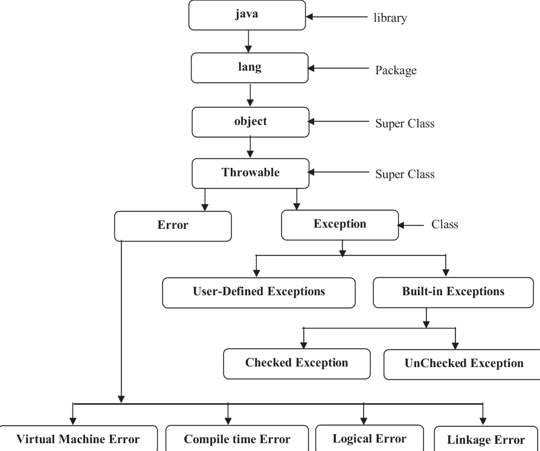

**Java:** JAVA API 是一个包含包的库。这些包由 Sun MicroSystems 公司的 Java 开发人员开发，用于在开发程序时导入类。

**Lang:** `Lang` 是 Java 库中包含的一个包。它被认为是名为 `language` 的默认包。

**Object:** `Object` 是所有类（用户定义的类、预定义的类）直接或间接的父类。因为它被导入到 `lang` 包中。

**Throwable:** `Throwable` 是 Java 中错误和异常的父类。`Throwable` 继承自 `Object` 类。

**Error:** `Error` 是一个类。它是不被处理的。我们在编译后通过 Java 编译器指示知道程序中的错误。这些错误总是在编译时检测到的。

程序中的错误被称为 bug。从程序中移除错误被称为调试（debugging）。Java 程序中基本上有三类型的错误：

#### 异常处理

- 编译时错误：Java 编译器在编译时检测到的错误。
- 运行时错误：在执行期间发生的错误。
- 逻辑错误：程序逻辑不正确的错误。

异常处理有两种类型：

(a) 同步（Synchronous）：异常在程序执行期间发生。

(b) 异步（Asynchronous）：异常发生在程序的正常流程之外。

### 5.2 预定义异常

异常类型：

1. 编译时错误
2. 运行时错误

#### 1. 编译时错误

所有的语法都由 Java 编译器进行检查。这些错误被称为编译时错误。

```java
System.out.println("Hello")
```

#### Java 核心

`finally` 子句无论是否抛出异常，都会被执行。

Java 通过五个关键字来处理异常：`try`、`catch`、`finally`、`throw` 和 `throws`。

将可能产生异常的代码块放在 `try` 块中。

如果在此代码块内创建了异常对象，则会抛出异常。该异常将由一个 `catch` 语句进行处理。如果可能发生多个异常，则在 `try` 块之后添加多个 `catch` 语句。`catch` 语句的编写顺序遵循 `Throwable` 类的层次结构。

每个关键字的描述如下：

#### 内置异常

表 5.1：定义在 `java.lang` 中的 Java 异常

| 异常 | 含义 |
| --- | --- |
| `ClassNotFoundException` | 未找到类。 |
| `CloneNotSupportedException` | 尝试克隆未实现 `Cloneable` 接口的对象。 |
| `IllegalAccessException` | 拒绝访问该类。 |
| `InstantiationAccessException` | 尝试创建抽象类或接口的实例。 |
| `InterruptedException` | 一个线程被另一个线程中断。 |
| `NoSuchFieldException` | 请求的字段不存在。 |
| `NoSuchMethodException` | 请求的方法不存在。 |

表 5.2：定义在 `java.lang` 中的 Java 未检查运行时异常子类

| 异常 | 含义 |
| --- | --- |
| `ArithmeticException` | 算术错误，例如除以零。 |
| `ArrayOutOfBoundsException` | 数组索引越界。 |
| `ArrayStoreException` | 给数组赋值了不兼容类型的元素。 |
| `ClassCastException` | 无效的类型转换。 |
| `EnumConstantNotFoundException` | 尝试使用未定义的值。 |
| `IllegalArgumentException` | 调用方法时使用了非法参数。 |
| `IllegalMonitorStateException` | 非法监视器状态，例如在未锁定的线程上等待。 |
| `IllegalStateException` | 环境或操作处于错误状态。 |
| `IllegalThreadException` | 请求的操作与当前状态不兼容。 |
| `IndexOutOfBoundsException` | 某种类型的索引越界。 |
| `NegativeArraySizeException` | 使用负数创建数组。 |
| `NullPointerException` | 无效使用空引用。 |
| `NumberFormatException` | 字符串到数字格式的转换无效。 |
| `SecurityException` | 尝试违反安全规定。 |
| `StringIndexOutOfBounds` | 尝试对字符串范围之外进行索引。 |
| `TypeNotException` | 未找到类型。 |
| `UnsupportedOperationException` | 遇到不支持的操作。 |

### 5.3 Try-Catch-Finally

异常是一个错误或意外事件。异常处理器是一组在异常发生时执行的代码。

异常处理基本上使用以下 3 个代码块：

- (i) `try`，(ii) `throw`，(iii) `catch`

`try` 和 `catch` 块写在花括号 `{ }` 之间。`try` 块通过 `try` 关键字识别，其间在 `{` 和 `}` 之间带有一个语句块。当 `try` 块检测到异常时，将使用 `try` 块中的 `throw` 语句将其抛出。

`catch` 块由关键字 `catch` 后跟 `{ }` 及其语句块来定义。`catch` 块通过 `try` 块中的 `throw` 语句捕获异常并对其进行恰当处理。当 `try` 块抛出异常时，程序控制将离开 `try` 块并进入 `catch` 块；如果 `try` 块抛出的对象类型与此 `catch` 块匹配，则执行该 `catch` 块来处理异常。如果不匹配，程序将使用函数尝试终止。


该类有一个`catch`块，其中异常已得到处理，或者在`try`块之后需要特定的代码来处理异常（Catch）。其目的是当`try`代码块由于任何原因终止时捕获异常。`try`块的终止可能是由于异常或`break`、`continue`、`return`语句。

`try`块后面可以跟零个或多个`catch`子句。每个`catch`子句包含处理各种类型异常的具体代码。每个`catch`子句接收一个指定异常类型的单个参数。`catch`子句的参数必须是`Throwable`类或其子类的对象。

当异常被抛出时，JVM会调用具有与异常对象参数相同的第一个`catch`子句。JVM会调用它找到的第一个`catch`子句。`catch`块内的代码应采取必要的行动来处理该异常。例如，如果异常是`java.io.FileNotFoundException`异常，可能会要求用户检查文件名并重试。

## finally

`finally`块用于在`try-catch`块之后进行清理。`try`块中可能会发生各种情况：

1. 如果`try`块中发生异常并且有一个关联的`catch`块来处理异常，控制首先转移到`catch`块。然后转移到`finally`块。
2. 在正常情况下（无异常），控制到达`try`块结束，然后到达`finally`块。`finally`块执行清理，例如关闭任何打开的文件`myFile.close()`。
3. 如果控制因为`return`、`break`或`continue`语句离开`try`块，则在控制转移到新目的地之前执行`finally`块。

### 示例

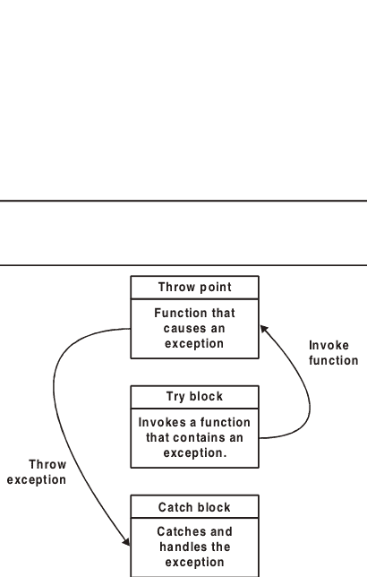

### 语法（try catch块的通用格式）

```
try
{
    __________
    __________ 在此处调用函数
__________
}
catch (type org) // 捕获异常
{
    __________
    __________
    __________ 在此处处理异常
}
```

```
class division
{
    public static void main(String arg[])
    {
        Int x=10,a=0;
        System.out.println("Before division");
        try
        {
            int p=x/a;
        }
        catch (ArithmeticException e)
        {
            System.out.println("Dividing by zero");
        }
    }
}
```

输出：

```
Before division
Dividing by zero
```

### 这是一个示例

```
Class ThrowsDemo
{
    static void throwOne() throws IllegalAccessException {
        System.out.println("throwOne exception");
        throw new IllegalAccessException("demo");
    }
    public static void main ( ) {
        try {
            throwOne();
        } catch (IllegalAccessException e) {
            System.out.println("exception caught " + e);
        }
    }
}
```

上述程序的输出将是：

```
throwOne exception
exception caught java.lang.IllegalAccessException : demo
```

## try-try-catch示例

这里提供了更多的代码示例，以便学生可以编写自己的变体进行练习。

### 将文件保存为`Quotient.java`

```java
import java.util.Scanner;

public class Quotient {
    public static void main(String[] args) {
        Scanner input = new Scanner(System.in);
        // 用户输入两个整数
        System.out.print("Enter two integers: ");
        int number1 = input.nextInt();
        int number2 = input.nextInt();
        System.out.println(number1 + " / " + number2 + " is " + (number1/number2));
    }
}
```

上述程序运行时，会产生一个提示：

```
Enter two integers: 7 3
/ 3 is 2
Enter two integers: 9 0
```

#### Exception in thread "main" java.lang.ArithmeticException division by zero by Quotient.java

以下程序展示了在`try-catch`块中使用`ArithmeticException` throw抛出异常的代码。

```java
// 将文件保存为 QuotientWithException.java
import java.util.Scanner;

public class QuotientException {
    public static void main(String[] args) {
        Scanner input = new Scanner(System.in);
        // 用户输入两个整数
        System.out.print("Enter two integers: ");
        int number1 = input.nextInt();
        int number2 = input.nextInt();
        try {
            if (number2==0)
                throw new ArithmeticException("Division by zero not allowed");
            System.out.println(number1 + " / " + number2 + " is " + (number1/number2));
        } catch (ArithmeticException ae) {
            System.out.println(" Exception: Division by zero not allowed for integer data type");
            System.out.println(" Program continues to run...");
        }
    }
}
```

## 使用`throws`声明异常

当前正在执行的语句属于一个方法。每个方法都必须声明它可能抛出的受检异常（checked exceptions）。这被称为声明异常。由于系统错误和运行时错误可能发生在任何代码中，Java不要求在方法中显式声明`Error`和`RuntimeException`（未受检异常）。然而，方法抛出的所有其他异常都必须在方法头中显式声明，以便方法的调用者获知该异常。

这是通过使用`throws`关键字来实现的。通用语法如下：

```
public void myMethod() throws IOException, FileNotFoundException
```

`throws`单词表示`myMethod`可能会抛出`IOException`。如果方法可能抛出多个异常，请在`throws`之后添加一个用逗号分隔的异常列表。

## 5.6 用户自定义异常

### 创建异常子类

尽管Java的内置异常处理了大多数常见错误，但你可能想要创建自己的异常类型来处理特定于你应用程序的情况。定义这非常简单：只需是`Exception`的子类或`Throwable`的子类。你的子类不需要实际实现任何内容——它们在系统类型中的存在允许你将它们作为异常使用。

`Exception`类没有定义任何自己的方法。当然，它继承了由`Throwable`提供的方法。因此，所有异常（包括你创建的异常）都可以使用`Throwable`定义的方法。它们显示在表5.3中。

表5.3：`Throwable`定义的方法

| 方法 | 说明 |
| --- | --- |
| `Throwable fillingStackTrace()` | 返回一个包含完整堆栈轨迹的`Throwable`对象。该对象可以被重新抛出。 |
| `Throwable getCause()` | 返回作为当前异常底层的异常。如果没有底层异常，则返回`null`。 |
| `String getLocalizedMessage()` | 返回异常的本地化描述。 |
| `String getMessage()` | 返回异常的描述。 |
| `StackTraceElement[] getStackTrace()` | 返回`StackTraceElement`数组。堆栈顶端的方法是异常发生前最后调用的方法。该方法位于数组的第一个元素中。`StackTraceElement`类允许你的程序访问追溯中每个元素的信息，包括其名称。 |
| `Throwable initCause(Throwable cause)` | 将调用异常与调用异常的原因相关联。返回指向该异常的引用。 |
| `void printStackTrace()` | 显示堆栈轨迹。 |
| `void printStackTrace(PrintStream stream)` | 将堆栈轨迹发送到指定的流。 |
| `void printStackTrace(PrintWriter name)` | 将堆栈轨迹发送到指定的流。 |
| `void setStackTrace(StackTraceElement[] elements)` | 将堆栈轨迹设置为`elements`中的元素。此方法专门为应用程序设计，而不是用于普通用途。 |
| `String toString()` | 返回一个包含异常描述的字符串对象。当输出`Throwable`时，`println()`会调用此方法。 |

### 异常处理

你可能希望在你创建的异常类中重写一个或多个这些方法。`Exception`定义了四个构造函数。其中两个是JDK 1.4添加的以支持链式异常（chained exceptions），将在下一节中描述。

```
Exception()
Exception(msg)
```

第一种形式是异常的。第二种形式允许你指定异常。这里显示了由`Throwable`定义的`toString()`。在某些情况下是有用的，你可以重写`toString()`。

```java
//user exception
import java.io.*;

class MyException extends Exception{
    private int a;
    MyException(int b) {
        a=b;
    }
    public String toString() {
        return "MyException ["+ a+"]";
    }
}

class MyProj{
    public int x;
    final int k=3;
    void getInt() {
        try {
            BufferedReader dis=new BufferedReader(new InputStreamReader(System.in));
            String line;
            while((line=dis.readLine())!=null) {
                x=Integer.parseInt(line);
                if (x==5) {
                    System.out.println("do some work");
                    throw new MyException(x);
                } else {
                    System.out.println("wrong guess and try again");
                }
            }
        } catch (MyException e) {
            System.out.println("generated exception:" + e);
        } catch (NumberFormatException e) {
            System.out.println("no chars:"+e);
        } catch (IOException e) {
            System.out.println("generated exception:" + e);
        } catch (NullPointerException e) {
        }
    }
    public static void main(String args[]) throws IOException {
        MyProj m=new MyProj();
        m.getInt();
    }
}
```

`toString()`函数自动用于将对象转换为字符串。

## 6.2 线程创建

线程的概念是一个执行的轻量级单元——比进程小，但仍然能够执行Java代码。通常的实现方式是每个线程对于操作系统来说都是一个完整的执行单元，但属于一个进程，该进程的地址空间由该进程的所有线程共享。这意味着每个线程都可以被独立调度，并拥有它们自己的栈和程序计数器，但它们与同一进程中的其他对象共享内存。

Java中的多线程环境可以通过两种方式实现，如下所示：

1. 创建一个继承Java内置`Thread`类的类（自定义）。
2. 创建一个实现Java内置`Runnable`接口的类（自定义）。

### 创建线程的类和接口

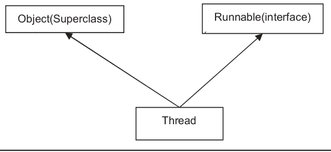

1. `Thread`（类）：用于创建和定义线程的类。该类继承自`Object`类并实现了`Runnable`接口。
2. `Runnable`（接口）：该接口唯一的方法是`run()`方法。
3. `Object`：`wait()`、`notify()`和`notifyAll()`是该类中用于线程的方法。

可以通过以下代码创建一个新线程：

```java
Thread t = new Thread(() -> System.out.println("Hi, How are you Thread?");
t.start();
```

这段短小的代码创建并启动了一个新线程，它会执行lambda表达式的主体然后结束。在Java 7中，代码如下：

```java
Thread t = new Thread();
t.start();
System.out.println("Hi, How are you Thread?");
```


### 6.3 线程生命周期

每个操作系统对线程的视图在细节上可能有所不同。但在大多数情况下，在高级层上是大致相似的。Java 努力抽象这些细节，并有一个名为`Thread State`的枚举——它对操作系统对线程状态的视图进行了封装。`Thread.State`的值提供了线程生命周期的概述：

#### 多线程

1. **新生状态 (New Born State)**：当我们创建一个线程对象时，线程诞生了，它被称为新生状态，但它还没有被调度运行。当它被操作系统调度运行时，将通过`start`方法完成调度。线程杀死将通过`stop`方法完成，当线程启动时，它将进入下一个状态“就绪状态”。

2. **就绪状态 (Runnable State)**：这种状态意味着线程是空闲的，正在等待处理器可用。线程已加入等待执行的队列。队列中的线程将使用“轮询算法”或“先来服务”调度到 CPU 执行。对可能具有相同优先级的线程进行调度。如果当前线程允许其他线程执行，则可能具有其他优先级的执行，这可以通过`yield`方法完成。

3. **运行状态 (Running State)**：运行状态意味着处理器绑定到了该线程，处理器将执行它，直到它被高优先级线程中断。运行线程可以使用`suspend`方法挂起，可以通过`resume`方法继续。运行状态的线程可以睡眠指定的时间，这意味着可以使用`sleep`方法引入延迟，并在`sleep`方法的时间到后，它会自动移动到就绪状态。就绪线程可以等待任何事件的发生，然后可以使用`notify`方法再次调度运行。

4. **阻塞状态 (Blocked State)**：当一个线程被阻止进入就绪状态时，该线程被称为被阻塞的。如果线程处于挂起状态、睡眠状态或等待状态，在这种情况下线程被视为阻塞状态。

5. **死亡状态 (Dead State)**：当运行线程结束其生命时，意味着它已从`run`方法执行完毕。当调用`stop`方法时，用户有权杀死线程。线程可以在一出生或处于阻塞状态（挂起、睡眠、等待）时被用户或系统杀死。

下图描述了线程的各种状态，并展示了将线程从一个状态转换为另一个状态的方法。这里就绪就就状态。

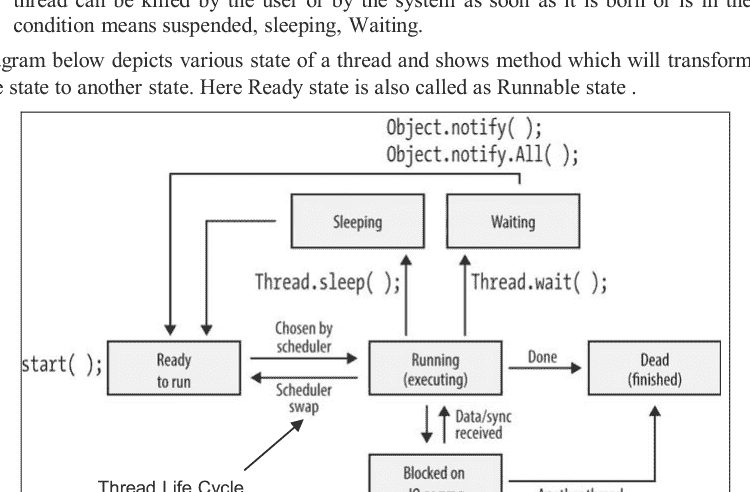

#### 单线程

```java
class SingleThreadDemo extends Thread
{
    // Runnable接口的方法
    public void run() {
        System.out.println(" My thread is in running state"); 
    }
    public static void main(String[] args) {
        SingleThreadDemo obj = new SingleThreadDemo();
        obj.start(); // 调用Thread的start方法
    }
}
```

上述程序的输出：

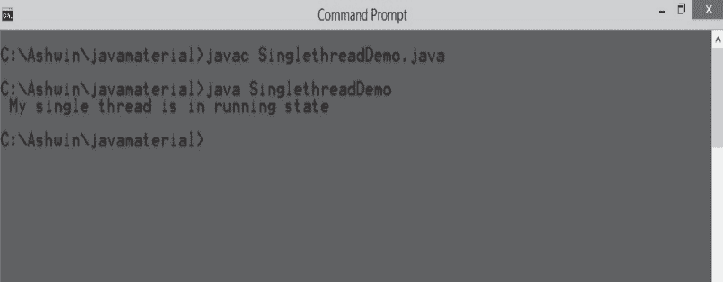

#### 两个线程的示例

```java
class Count extends Thread
{
    Count()
    {
        super("My extending thread");
        System.out.println("My thread created " + this);
        start();
    }
    public void run()
    {
        try
        {
            for (int i=0 ; i<5;i++)
            {
                System.out.println("Printing the count " + i);
                Thread.sleep(1500);
            }
        }
        catch(InterruptedException ie) {
            System.out.println("Thread interrupted");
        }
    }
}
```


### 6.6 `wait()`

线程间通信

Java 线程之间相互通信的方法很少。这些方法即是 `Object` 类中的 `wait()`、`notify()` 和 `notifyAll()`。`Thread` 类继承了 `Object` 类的这些方法。所有这些方法都可以在同步方法（`synchronized` method）内部调用。其中第一个方法是：

`wait()` 告诉调用线程释放监视器并进入睡眠状态，直到其他线程进入同一个监视器并调用 `notify()` 为止。

### 6.7 `notify()`

`notify()` 唤醒在同一对象上调用 `wait()` 的第一个线程。

### 6.8 `notifyAll()`

`notifyAll()` 唤醒在同一对象上调用 `wait()` 的所有线程。优先级最高的线程将首先运行。

#### Questions

- 1. 解释线程（`Thread`）、状态（`state`）并说明如何实现多线程。
- 2. 解释线程方法的生命周期。
- 3. 解释线程的生命周期。
- 4. 解释线程的同步（`Synchronization`）。
- 5. 解释 `wait()`、`notify()`、`notifyAll()` 方法。

## 第 7 章 IO 流（IO Streams）

> "Java 中的序列化（`Serialization`）是将对象的状态写入字节流的机制"

### 目录

- 7.1 I/O 流简介
- 7.2 Java I/O 类
- 7.3 `File` 类
- 7.4 目录与创建目录
- 7.5 使用 `FilenameFilter`
- 7.6 `listfiles()` 替代方案
- 7.7 流类
  - 7.7.1 字节流（Byte Streams）
  - 7.7.2 `InputStream`
  - 7.7.3 `OutputStream`
- 7.8 `FileInputStream`
- 7.9 `FileOutputStream`
- 7.10 `ByteArrayInputStream`
- 7.11 过滤字节流（Filtered Byte Streams）
- 7.12 缓冲字节流（Buffered Byte Streams）
- 7.13 `SequenceInputStream`
- 7.14 `PrintStream`
- 7.15 `RandomAccessFile`
- 7.16 字符流（Character Streams）
  - 7.16.1 `Reader`
  - 7.16.2 `Writer`
- 7.17 `FileReader`
- 7.18 `FileWriter`
- 7.19 `CharArrayReader`
- 7.20 `CharArrayWriter`
- 7.21 `BufferedReader`
- 7.22 `BufferedWriter`
- 7.23 `PushbackReader`
- 7.24 `PrintWriter`
- 7.25 `SequenceInputStream`
- 7.26 序列化（`Serialization`）

### I/O 流简介

Java 通过流（Streams）执行 I/O 操作。Java I/O 系统将流与物理层连接，以便在 Java 中进行输入和输出操作。通常，流意味着数据的连续流动。流使得处理输入输出变得简单，因为你代码的每个部分都可以理解物理层。

Java 将流封装在 `java.io` 包中。Java 定义了两种类型的流，它们是：

- 1. 字节流（Byte Stream）：它提供了处理字节输入输出的方便方法。
- 2. 字符流（Character Stream）：它提供了处理字符输入输出的方便方法。字符流使用 Unicode，因此可以实现国际化。

### Java 输入/输出类

注意：某些方法的语法和说明参考了 Java 文档，其签名（声明）是固定的。

#### Java I/O 类简介：

Java I/O 指 Java 输入/输出，是 `java.io` 包的一部分。该包包含 `InputStream` 和 `OutputStream`。Java `InputStream` 用于读取流、字节流和字节数组流。`OutputStream` 用于写入字节和字节数组。在这里，你将了解由 `java.io` 包提供的以下接口：

接口及描述：

| 接口 | 描述 |
| :--- | :--- |
| `DataInput` | 该接口可用于读取字节流并重构 Java 原始数据类型。用于从用户处接受数据。 |
| `DataOutput` | 该接口可用于写入字节流并将 Java 原始数据类型转换为字节。用于在输出端打印数据。 |
| `Externalizable` | 写在序列化流中。它可以保存并存储其内容。 |
| `FileFilter` | 它可以用于过滤路径名（Pathnames），即我们可以提取路径。 |
| `FilenameFilter` | 该接口用于过滤文件名（Filenames），即我们可以提取文件名。 |
| `ObjectInput` | 该接口用于读取对象，并扩展了 `DataInput` 接口。用于输入或接受对象。 |
| `ObjectInputValidation` | 这是一个回调接口。它允许对图中的对象进行验证。它带有某些限制和验证从用户处接受对象。 |
| `ObjectOutput` | 该接口用于写入对象，并扩展了 `DataOutput` 接口。 |
| `ObjectStreamConstants` | 该接口用于向序列化对象流写入常量。 |
| `Serializable` | 在 `java.io.Serializable` 接口中实现。 |

#### 类及描述：

| 类 | 描述 |
| :--- | :--- |
| `BufferedInputStream` | 用于 `mark` 和 `reset` 方法。用于接受存储在缓冲区中的字符流。 |
| `BufferedOutputStream` | 此类用于字节输出流。它实现了一个缓冲输出流。用于从缓冲区显示字符流。 |
| `BufferedReader` | 此类提供从输入流读取文本并缓冲字符。它还读取字符、数组和行。 |
| `BufferedWriter` | 此类提供向输出流写入文本并缓冲字符。它还写入字符、数组和行。 |
| `ByteArrayInputStream` | 它包含内部缓冲区并从流中读取数据。用于以数组形式读取字符流。 |
| `ByteArrayOutputStream` | 此类用于将数据写入字节数组。 |
| `CharArrayReader` | 此类用于读取字符数组。 |
| `CharArrayWriter` | 此类用于写入字符数组。 |
| `FileInputStream` | 此类用于从文件中读取字节。 |
| `FileOutputStream` | 此类用于向文件中写入字节。 |
| `FileReader` | 此类用于从文件中读取字符。 |
| `FileWriter` | 此类用于向文件中写入字符。 |
| `FilterInputStream` | 此类包含其他输入流，并将其用作数据源。 |
| `FilterOutputStream` | 此类包含其他输出流，并将其用作数据接收器。 |
| `InputStream` | 此类是表示字节输入流的所有类的父类。 |
| `InputStreamReader` | 它是从字节流到字符流的桥梁。它读取字节并使用指定的字符集将其解码为字符。 |
| `LineNumberReader` | 它是一个缓冲的字符输入流，用于跟踪行号。 |
| `ObjectInputStream` | 此类用于反序列化对象。它从输入流中读取对象。 |
| `ObjectOutputStream` | 此类用于序列化对象。它将对象写入输出流。 |
| `OutputStream` | 此类是表示字节输出流的所有类的父类。 |
| `OutputStreamWriter` | 它是从字符流到字节流的桥梁。它使用指定的字符集将字符编码为字节。 |
| `PipedInputStream` | 此类用于读取管道。它连接到 `PipedOutputStream`。 |
| `PipedOutputStream` | 此类用于写入管道。它连接到 `PipedInputStream`。 |
| `PrintStream` | 此类用于向输出流写入格式化数据。 |
| `PrintWriter` | 此类用于向字符输出流写入格式化数据。 |
| `PushbackInputStream` | 此类用于将读取的字节推回输入流。 |
| `PushbackReader` | 此类用于将读取的字符推回字符输入流。 |
| `RandomAccessFile` | 此类用于读取和写入随机访问文件。 |
| `Reader` | 此类是表示字符输入流的所有类的父类。 |
| `SequenceInputStream` | 此类用于将多个输入流连接为一个输入流。 |
| `StringReader` | 这是一个字符字符串类。它具有字符读取源。 |
| `StringWriter` | 这也是一个字符字符串类。它用于在缓冲区中显示输出。 |
| `Writer` | 用于写入字符流。 |

`java.io` 包的异常：

| 异常 | 描述 |
| :--- | :--- |
| `CharConversionException` | 它在与 `CharConversionException` 相关的 `catch` 块中提供详细信息。 |
| `EOFException` | 此异常表示文件结束。当文件流到达末尾时，会发生 `EOFException`。 |
| `FileNotFoundException` | 当找不到打开文件的路径时，会发生此异常。 |
| `InterruptedIOException` | 当 I/O 操作因任何原因中断时，会变成此异常。 |
| `InvalidClassException` | 在序列化运行时检测到创建类时出现任何问题。 |
| `InvalidObjectException` | 当反序列化对象失败时，会发生此异常。 |
| `IOException` | 当 I/O 操作失败时，会发生此异常。 |
| `NotActiveException` | 当序列化或反序列化操作未激活时，会发生此异常。 |
| `NotSerializableException` | 当实例需要实现 `Serializable` 接口时发生此异常。 |
| `ObjectStreamException` | 这是所有异常类的父类。专门用于 `ObjectStream` 类。 |
| `OptionalDataException` | 当读取数据操作失败时，会发生此异常。它属于序列化对象。 |
| `StreamCorruptedException` | 当从对象读取的控制信息违反内部一致性检查时，抛出此异常。 |
| `SyncFailedException` | 当同步操作失败时，发生 `SyncFailedException`。 |
| `UnsupportedEncodingException` | 不支持字符编码。 |
| `UTFDataFormatException` | 在数据输入流中读取到格式错误的 UTF-8，由数据输入接口实现。 |
| `WriteAbortedException` | 此异常在写入操作期间由 `ObjectStreamException` 抛出。 |

### 7.3 `File` 类

`java.io` (input) 包包含一个名为 `File` 的类，它支持创建文件和目录。通过 `File` 类的帮助，我们可以创建和读取已存在的文件，也可以在删除文件时进行修改。该类还包含几个用于实例化文件对象的构造函数。该类还包含几个支持以下操作的方法，如：

- 创建文件。
- 打开文件。
- 关闭文件。
- 删除文件。
- 获取文件名。
- 获取文件大小。
- 检查已存在的文件。
- 重命名文件。
- 检查文件是否可写。
- 检查文件是否可读。

#### 输入/输出异常：

在创建和对它们执行 I/O 操作时，系统可能会生成 I/O 相关的异常。下表给出基本的 I/O 相关的异常类及其功能。

| I/O 异常类 | 功能 |
| :--- | :--- |
| `EOFException` | 信号在输入过程中意外到达文件结束或流结束。当发生 EOF 或指针到达 EOF 字符时，会触发此异常。 |
| `FileNotFoundException` | 如果在指定的路径下找不到文件，则抛出此异常。 |
| `InterruptedIOException` | 警告或通知编译器 I/O 操作已中断。 |
| `IOException` | 信号发生了某种 I/O 异常。 |

#### 创建文件

#### 重构

如果我们想创建并使用磁盘文件，我们需要对文件及其预期目的决定以下内容：

- 适合文件的名称。
- 要存储的数据类型。
- 目的（读取、写入、更新）。
- 创建文件的方法。

文件是字符的唯一字符串，有助于识别磁盘上的文件。文件名的长度和允许的字符取决于执行 Java 程序的操作系统。文件名可能包含两个部分：主名和一个带有扩展名的可选点号。

`Input.data` `salary`  
`Test.doc` `student.txt`  
`Inventory` `read.dat`

数据类型对于决定使用哪些文件流类来处理数据至关重要。我们应该决定数据是以字符、字节还是原始类型的形式处理。

在使用文件之前，还必须决定使用它的目的。例如，我们应该知道该文件是仅用于读取的，还是用于两种操作。

#### IO 流

众所周知，为了使用文件，必须首先打开它。这是通过创建一个文件流并将其链接到文件名来实现的。可以使用 `Reader`/`InputStream` 类定义文件流以等待数据。用于各种 I/O 操作的常用流类如表所示。使用的流类的构造函数可以将设计者定义的文件分配给流对象。

### 7.4 目录和创建目录

我们将使用 `File` 类在 Java 类文件中创建目录：

1. `File` 类是文件和目录路径的抽象表示。
2. `File` 类用于与文件系统交互。

Java 带有以下方法来创建目录：

```java
// 示例代码
File dir = new File("directoryName");
dir.mkdir();
```


`new File('directory').mkdir();`

`new File("C:\\Directoryname").mkdir();`

此程序将在给定路径创建一个名为 `Ravi` 的目录。

#### Java 代码：

```java
import java.io.File;

public class MakeDirectory {

    public static void main(String[] args) {

        File f = new File("c:\\Ravi");

        f.mkdir();

    }

}
```

#### 创建目录和子目录的示例：

一次性创建一个名为“Kiran”的目录及其所有的子目录“Ravi”和“Chirag”。两种方法都返回一个布尔值来指示操作状态：成功则返回 `true`，否则返回 `false`。

#### 示例：

```java
import java.io.File;

public class CreatedDirectoryExample {

    public static void main(String[] args) {

        File file = new File("C:\\Kiran");

        if(file.mkdir()){

            System.out.println("Kiran name Directory is created!");

        } else{

            System.out.println("Failed to create directory!");

        }

        File files = new File("C:\\Kiran\\Ravi\\Chirag\\");

        if(files.mkdirs()){

            System.out.println("Multiple directories are created!");

        } else{

            System.out.println("Failed to create multiple directories!");

        }

    }

}
```

### 7.5 File 类（过滤）

众所周知，可以使用输入和输出流从不同的资源中读取数据。

现在我们将看到文件内容是如何读取的，以及数据如何写入文件。这首先需要 Java 提供的 `File` 类，描述文件的属性，如名称、大小等。

#### File 的构造函数和方法：

| 方法 | 描述 |
| :--- | :--- |
| `File (string path)` | 带有文件路径的构造函数。 |
| `File (string dirpath, string name)` | 带有目录路径和文件名的构造函数。 |
| `getName()` | 返回文件名。 |
| `getParent()` | 返回父目录名称。 |
| `getPath()` | 返回文件路径。 |
| `getAbsolutePath()` | 返回直到文件名的完整路径。 |
| `exists()` | 检查文件是否存在。 |
| `length()` | 返回以字节为单位的文件长度。 |
| `isFile()` | 检查是否为文件。如果是文件则返回 `true`，否则返回 `false`。 |
| `lastModified()` | 返回以毫秒为单位最后修改日期。 |

#### IO 流

| 方法 | 描述 |
| :--- | :--- |
| `canRead()` | 如果文件可读则返回 `true`，否则返回 `false`。 |
| `canWrite()` | 如果文件可写则返回 `true`，否则返回 `false`。 |
| `renameTo(File newname)` | 如果文件重命名成功返回 `true`，如果无法重命名则返回 `false`。 |
| `delete()` | 如果文件被删除则返回 `true`；如果是空目录则删除并返回 `true`，否则返回 `false`。 |
| `isHidden()` | 如果文件是隐藏的返回 `true`，否则返回 `false`。 |
| `list()` | 将文件列表返回到一个字符串数组。 |

#### 一个演示类的简单程序。

```java
import java.io.*;

class File_methods {

    public static void main(String ar[]) {

        File f=new File("D:\\kiran\\information.txt");

        PrintWriter pw = new PrintWriter(System.out,true);

        pw.println("file name: " +f.getName());

        pw.println("file path " +f.getPath());

        pw.println("parent"+ f.getParent());

        pw.println("Exists " + f.exists());

        pw.println("Is a file"+f.isFile());

        pw.println("size"+f.length());

    }

}
```

### 7.6 listFiles() 替代方案

`listFiles()` 方法用于显示特定目录下的文件列表。

#### Java 列文件：

在示例中，我们创建了一个 `File` 类的对象并通过 `File` 类的构造函数解析目录。然后我们调用了 `listFiles()` 方法，它实际上返回了文件和目录名称的数组。因此，为了只获取文件，我们创建了一个条件：如果文件数组包含文件，则显示其名称。

#### 源代码：

```java
import java.io.*;

class ListFiles {

    public static void main(String[] args) throws Exception {

        String text = "";

        File f = new File("C:\\");

        File[] listFiles = f.listFiles();

        for (int j = 0; j < listFiles.length; j++) {

            if (listFiles[j].isFile()) {

                text = listFiles[j].getName();

                System.out.println(text);

            }

        }

    }

}
```

### 7.7 流类

流与文件 I/O：

I/O 代表输入/输出（input output）。Java 程序可以从输入设备读取数据并写入输出设备。到目前为止，我们一直是通过命令行参数作为读取或获取数据，并使用 `println()` 方法输出数据。

在本章中，我们将学习 Java 编程如何从文件、网络等输入源读取数据，以及将数据输出到文件、网络、打印机等地方。

#### 流的概念：

我们知道输入/输出（i/o）资源连接到系统。当 Java 程序想要从文件、网络或键盘获取输入数据时，它必须首先建立一个逻辑连接，以便数据能够通过它流动。

流（Stream）是一种产生和/或读取信息的抽象。流是从源到目的地的序列字节流流动的逻辑路径。

流有两种类型：

- (a) 输入流（Input stream）。
- (b) 输出流（Output stream）。

#### IO 流

同样，当 Java 程序需要向文件写入某些数据时，它会为目标创建/形成输出流，然后将数据写入文件。

注意：在 Java 编程中，为了从输入设备/资源读取，需要建立输入流并指明输入数据的源。

同样，在 Java 程序中从输出流输出数据时，指明输出数据的目的地然后进行写入。

#### 流类：

Java 以类的形式定义了流，这些类定义在 `java.io` 包中。

流有两种类型：字节流（Byte）或字符流（Character）。

分类如下：

#### 流类：

##### (A) 字节流：

字节流通过使用层次结构顶部的两个抽象类来定义，它们是 `InputStream` 和 `OutputStream`。

- (i) 输入流。
- (ii) 输出流。

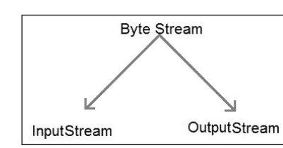

这些类定义了几个关键方法。最重要的两个是：

- 1. `read()`：读取字节数据。
- 2. `write()`：写入字节数据。

##### (B) 字符流：

字符流同样通过使用层次结构顶部的两个抽象类来定义，它们是 `Reader` 和 `Writer`。

- (i) `Reader`
- (ii) `Writer`

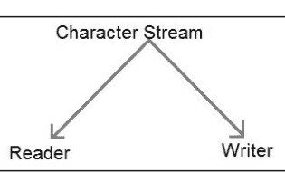

#### 读取字符

`read()` 方法配合 `BufferedReader` 对象用于读取字符。由于此函数返回整数类型值，我们需要使用类型转换将其转换为 `char` 类型。

```java
int read() throws IOException
```

下面是一个解释字符输入的简单示例。

```java
class CharRead

{

    public static void main(String args[])

    {

        BufferedReader br = new BufferedReader(new InputStreamReader(System.in));

        char c = (char)br.read(); //读取字符

    }

}
```

#### 读取字符串

为了读取字符串，我们必须配合 `BufferedReader` 类对象使用 `readLine` 函数。

```java
String read.line() throws IOException
```

# Java 中从键盘获取字符串输入的程序

```java
import java.io.*;

class MyInput

{

    public static void main(String[] args)

    {

        String text;

        InputStreamReader isr = new InputStreamReader(System.in);

        BufferedReader br = new BufferedReader(isr);

        text = br.readLine(); //读取字符串

        System.out.println(text);

    }

}
```

#### 7.7.1 字节流类

字节流用于从 i/o 类中读取和写入二进制数据，如下：

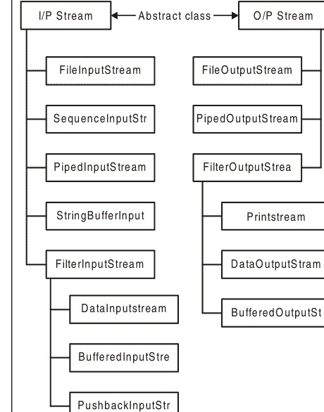

#### 7.7.2 InputStream 类：

这是所有面向字节的 I/O 类的抽象类和超类。

`InputStream` 的大部分方法在读取数据过程中出错时抛出 `IOException`。

`InputStream` 类的方法：

| 方法名 | 描述 |
|---|---|
| `int read ()` | 返回下一个字节的（ASCII 值）整数表示，即文件末尾时返回 -1 |
| `int read (byte b [ ])` | 读取字节并将其存储在 `b` 中，并返回读取的字节数，如果到达末尾则返回 -1 |
| `int read (byte b [, , int offset, int length)` | 读取字节并从 `offset` 开始存储，总共最多读取 `length` 个的字节，并返回成功读取的字节数；文件末尾时返回 -1。 |
| `int available ()` | 返回输入流中可用可供读取的字节数 |
| `Long skip (long tobytes)` | 跳过/忽略输入的总字节数，返回实际被忽略的字节数 |
| `void Close ()` | 关闭输入源。后续的读取语句将抛出 `IOException` |

#### 7.7.3 OutputStream 类：

`OutputStream` 是所有面向字节的 I/O 类的抽象类和超类。它定义了输出数据的方法。

`OutputStream` 类的一些方法：

| 方法 | 描述 |
|---|---|
| 1. `write (int b )` | 写入单个字节到输出流 |
| 2. `write (byte b [ ])` | 写入字节数组到输出流 |
| 3. `write (byte b [ ], int offset, int length)` | 从数组写入指定长度的数据 |
| 4. `flush ( )` | 刷新输出缓冲区 |
| 5. `close ( )` | 关闭输出流。如果文件存在则写入 |

### 7.8 FileInputStream 类

为了从文件读取数据需要 `FileInputStream` 类，它是面向文件的。

构造函数：

- `FileInputStream (String filename) throws FileNotFoundException`
- `FileInputStream (String obj) throws FileNotFoundException`

方法：

```java
int read ( )

int read (byte b [ ])

int read (byte b [ ], int offset, int length)
```

读取内容的简单问题：

```java
import java.io.*;

class filereaddemo

{

    FileInputStream finput;

    public void read(String name) throws IOException

    {

        try {

            finput = new FileInputStream(name);

            int c;

            while ((c = finput.read()) != -1) {

                System.out.print((char)c);

            }

            System.out.println("显示成功");

            finput.close();

        } catch (FileNotFoundException e) {

            System.out.println("文件未找到");

            System.exit(0);

        }

    }

    public static void main (String ar [ ]) throws Exception {

        BufferedReader br = new BufferedReader(new InputStreamReader(System.in));

        System.out.println("输入文件名 ");

        String fname = br.readLine();

        filereaddemo fr = new filereaddemo();

        fr.read(fname);

    }

}
```

### 7.9 FileOutputStream

`FileOutputStream` 类用于向文件写入数据。

构造函数：

- `FileOutputStream (String filename) throws FileNotFoundException`
- `FileOutputStream (String filepath, Boolean) throws FileNotFoundException`

这些构造函数在文件不存在时按指定名称创建文件；如果文件存在但是目录或无法打开，则抛出异常。无法打开。如果文件已存在，默认情况下会覆盖文件内容。如果你指定追加参数为 `true`，它会将新内容追加到文件末尾。

方法：

```java
void write (byte b [ ])

void write (int b)

void write (byte b [ ], int offset, int length)
```

向文件写入字符串的简单程序：

```java
import java.io.*;

class file_writedemo

{

    FileOutputStream fos;

    BufferedReader br = new BufferedReader(System.in);

    InputStreamReader (System.in);

    public void writeFile(String Outputfile)

    {

        try {

            PrintWriter pw = new PrintWriter(System.out,true);

            pw.Println("输入文本");

            String str = br.readLine();

            Byte b [] = str.getBytes();

            fos = new FileOutputStream(OutputFile,true);

            fos.write(b);
```


`pw.println("写入器已写入文件");`

```java
} catch (Exception e) {
    System.out.println(e);
}
```

```java
public static void main(String ar[]) throws Exception {
    BufferedReader br = new BufferedReader(new InputStreamReader(System.in));
    System.out.println("输入输出文件名 ");
    String outputfile = br.readLine();
    filewritedemo fw = new filewritedemo();
    fw.writeFile(outputfile);
}
```

### 7.10 ByteArrayInputStream

它包含内部缓冲区和从流中读取的数据。

- **byte:** `byte` 是一种 8 位有符号原始数据类型。`byte` 的最小值为 -128，最大值为 +128。它是有符号的，因为它可以接受负值和正值。`Byte` 类将原始 `byte` 的值封装在一个对象中。`Byte` 对象包含一个单一字段，该字段就是它自身的值。

- **ByteArray:** 它是字节（`Bytes`）的包装类，继承自 `Object` 类。

- **创建任意类。** 在类内部声明一个 `main` 方法。在 `main` 方法内部创建一个 `String` 对象并传入其中一些信息。我们可以通过 `length` 方法查看 `String` 的大小，从而轻松知道将生成多少个包。使用 `getBytes` 方法从字符串中获取 `byte` 类型的字节数组。现在创建一个 `ByteArrayInputStream` 对象，并将 `byte` 类型的数组传递到 `ByteArrayInputStream` 类的构造函数中。该类包含一个可以从流中读取的缓冲区。此类继承自 `InputStream`。创建一个新类型的数组，可以声明数组的大小，你可以根据需要进行修改。在循环中从数组进行读取。

## 将 InputStream 转换为 ByteArrayInputStream

在这个示例中，我们将把 `InputStream` 转换为 `ByteArrayInputStream`。

首先将文件作为输入流 `InputStream` 读取。分别使用 `toString()` 和 `getBytes()` 方法将此输入流转换为字符串，然后将字符串转换为字节。将字节数组的引用传递到 `ByteArrayInputStream` 类对象中。这实现了从字节数组到 `ByteArrayInputStream` 类对象的转换。最后，我们打印这个 `ByteArrayInputStream`。

程序的代码如下：

```java
import java.io.*;

class InputStreamToByteArrayInputStream {
    public static void main(String[] args[]) {
        try {
            InputStream inputStream = new FileInputStream("InputStream.java");
            byte[] currentXMLBytes[] = inputStream.toString().getBytes();
            ByteArrayInputStream byteArrayInputStream = new ByteArrayInputStream(currentXMLBytes);
            while(byteArrayInputStream.read() != -1)
                System.out.println(byteArrayInputStream.read());
        } catch (IOException e) {
        }
    }
}
```

## 7.11 过滤字节流 (Filtered Byte Streams)

如前所述，`InputStream` 和 `OutputStream` 类分别用于从字节流读取和写入数据。可以使用过滤流（Filter Streams）对数据进行转换和处理。

与 I/O 流一样，过滤流也用于处理从底层流中读取的数据。除此之外，它还允许用户使用多个输入流形成链，这样应用于此链上的操作就可以在多个过滤器上产生组合效果。通过使用这些流，在写入文件时无需转换字节。这些流比 Java 的其他流更强大。示例如所示：

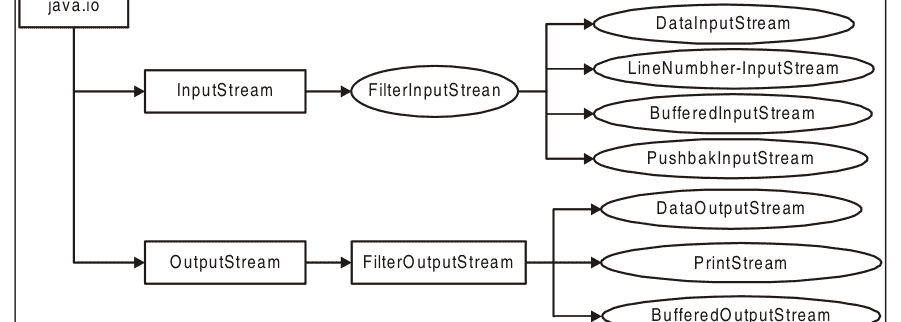

有两个派自 I/O 类的类：

- `FilterInputStream`
- `FilterOutputStream`

#### FilterInputStream

`FilterInputStream` 是所有输入流过滤器的基类，它源自 `InputStream` 类。它简单地重写了 `InputStream` 类中所有过滤数据所需的方法。这些方法对数据执行某种过滤操作，且不能被直接实例化。它为对多个输入流进行过滤提供了额外的链式功能。

`FilterInputStream` 的构造函数写为：

```java
FilterInputStream fis = new FilterInputStream(InputStream in);
```

#### FilterOutputStream

`FilterOutputStream` 是所有输出流过滤器的父类，源自 `OutputStream` 类。它简单地重写了 `OutputStream` 类中所有过滤写入输出流的数据所需的方法。

`FilterInputStream` 和 `FilterOutputStream` 本身不执行任何过滤；这些是由它们的子类完成的。为了提高这些 I/O 流的性能，使用了它们的子类 `BufferedInputStream` 和 `BufferedOutputStream`。

## 7.12 缓冲字节流 (Buffered Byte Streams)

#### BufferedInputStream

该类是 `FilterInputStream` 的子类，允许你从流中读取大量数据，这是一个缓冲区。当请求数据时，通常从缓冲区读取。这提高了某些输入流的性能，特别是对于那些绑定到文件或网络连接等较慢源的流。

`BufferedInputStream` 的构造函数写为：

```java
BufferedInputStream(java.io.InputStream in);
```

#### BufferedOutputStream

它是 `FilterOutputStream` 的子类，是一种缓冲输出流，允许你向流中写入字符。`BufferedOutputStream` 为另一个输出流增加了功能。数据首先写入缓冲区中。当创建 `BufferedOutputStream` 时，会创建一个内部缓冲区数组，其中存储了字节。

`BufferedOutputStream` 的构造函数写为：

```java
BufferedOutputStream(java.io.OutputStream out);
```

### 7.13 顺序输入流 (SequentialInputStream)

`SequentialInputStream` 表示多个输入流的连接。它从一组有序的输入流开始，从第一个开始读取直到到达末尾，然后从第二个开始，依此类推，直到到达最后一个输入流。

它充当单个 `InputStream`，代表其他 `InputStream` 的顺序流。在示例中，我们创建了三个 `FileInputStream` 对象来解析三个不同的文件，然后将它们添加到 `InputStream` 向量（vector）中。所有向量元素都被传递给 `SequentialInputStream` 的构造函数，该构造函数读取所有内容。

源代码：

```java
import java.io.*;
import java.util.*;

public class FileSequentialInputStream {
    public static void main(String[] args) throws Exception {
        InputStream f1 = new FileInputStream("outputdemo.txt");
        InputStream f2 = new FileInputStream("filedemo.txt");
        InputStream f3 = new FileInputStream("datademo.txt");
        Vector<InputStream> vector = new Vector<>();
        vector.add(f1);
        vector.add(f2);
        vector.add(f3);
        SequenceInputStream sis = new SequenceInputStream(vector);
        int i;
        while ((i = sis.read()) != -1) {
            System.out.println(i);
        }
    }
}
```

### 7.14 PrintStream

`PrintStream` 类源自 `FilterOutputStream`，它实现了许多用于打印文本表示的方法。它为另一个输出流增加了功能。与其他输出流不同，`PrintStream` 永远不会抛出 `IOException`，且 `flush` 方法会被自动调用。

`PrintStream` 的构造函数写为：

```java
PrintStream(OutputStream out);
```

该类的 `print()` 和 `println()` 方法与标准输出的方法功能相同，并遵循换行。给出的示例演示了使用 `PrintStream` 向文件写入的操作。

```java
import java.io.*;

class PrintStreamDemo {
    public static void main(String[] args[]) {
        FileOutputStream out;
        PrintStream ps; // 声明打印流
        try {
            // 创建一个新的文件输出流
            out = new FileOutputStream("myfile.txt");
            // 将打印流连接到输出流
            ps = new PrintStream(out);
            ps.println("This data is written to a file");
            System.err.println("Write successfully");
            ps.close();
        } catch (Exception e) {
            System.err.println("Error in writing to file");
        }
    }
}
```

### 7.15 随机访问文件 (Random Access File)

随机意味着数据的读写不是顺序的。该类允许你从文件的任意位置读取和写入数据或原始数据类型。该类使用文件指针指向文件中读取和写入数据的位置。

`RandomAccessFile` 的构造函数和方法：

| 方法/构造函数 | 描述 |
| --- | --- |
| (1) `RandomAccessFile(File, String mode)` throws `FileNotFoundException` | 创建用于读写指定文件的随机访问文件，'r' 为只读模式，'rw' 为读写模式。 |
| (2) `RandomAccessFile(String name, String Mode)` throws `FileNotFoundException` | 与上面相同，仅 name 类型为字符串 |
| (3) `long length()` | 返回文件长度 |
| (4) `int read(byte b[])` `int read(byte[], offset, int len)` | 与 `InputStream` 类方法相同。从文件中读取字节数据。 |
| (5) `boolean readboolean()` | 从文件中读取数据 |
| (6) `byte readbyte(float floatread)` `char readchar(int intread)` | 从文件中读取原始数据 |
| (7) `String readline()` | 从文件中读取下一行 |
| (8) `Void write(int b)` `write(byte[] b)` | 与输入流类相同，将字节写入文件 |

150

Core Java

| 方法 | 说明 |
| --- | --- |
| `void write(byte b[], int offset, int length)` | 用于将原始数据写入文件 |
| (9) `void writeChar(int v)` `void writeBoolean(Boolean b)` `void writeInt(int d)` `void write(float val)` | |
| (10) `void seek(long position)` | 相对于起始位置设置文件指针的位置。 |
| (11) `long getFilePointer()` | 返回文件指针的当前位置 |

# 演示向 RandomAccessFile 读取和写入数据的简单程序

```java
// 使用 RandomAccessFile 类读和写文件的简单程序
import java.io.*;

public class RandomAccessFile {
    public static void main(String[] args) throws IOException {
        RandomAccessFile rend;
        BufferedReader br = new BufferedReader(new InputStreamReader(System.in));
        System.out.println(" Enter file name : ");
        String str = br.readLine();
        File file = new File(str);
        if (!file.exists()) {
            System.out.println("File does not exists.");
            System.exit(0);
        }
        try {
            System.out.println("Open the file for writing ");
            Rand = new RandomAccessFile(file, "rw");
            Rand.seek(file.length());
            Rand.writeByte('I am writing in to a file ");
            Rand.close();
        } catch (IOException e) {
            System.out.println(e.getMessage());
        }
        // 从文件读取
        try {
            System.out.println("Open The file for Reading");
            Rand = new RandomAccessFile(file, "r");
            int I = (int) rand.length();
            System.out.println("Length: " + i);
            Rand.seek(11);
            for (int ct = 0; ct < I; ct++) {
                Byte b = rand.readByte();
                System.out.println((char) b);
            }
            Rand.close();
        } catch (IOException e) {
            System.out.println(e.getMessage());
        }
    } // 类的结束
}
```


# 7.15 字符流

面向字符类：

字符流用于处理字符的输入输出。这些比字节流更高效。

## 7.16.1 Reader 类

`Reader`是一个抽象类，是所有其他面向字符的输入流的基类。

### Reader 类的方法：

| 方法 | 说明 |
| --- | --- |
| (1) `int read()` | 返回下一个可用字符的 (ASCII) 整数表示。如果到读取末尾则返回 -1。 |
| (2) `int read(Char b[])` | 读取字符数据并存储到字符数组中。如果遇到文件末尾，返回实际读取的字符数。 |
| (3) `abstract read(Char b[], offset, length)` | 从`offset`开始将总长度的字符读入数组`b`。返回成功读取的字符总数，如果遇到文件末尾返回 -1。 |
| (4) `long skip(long tchar)` | 跳过输入流的一部分。 |
| (5) `abstract close()` | 关闭输入流，如果再次调用读取方法，将抛出`IO Exception`。 |

## 7.16.2 Writer 类

`Writer`类是抽象类，是所有面向字符的输出类的基类。

### Writer 类的方法：

| 方法 | 说明 |
| --- | --- |
| (1) `void write(int ch)` | 向输出流写入一个简单的字符 |
| (2) `void write(Char c[])` | 向输出流写入完整的字符数组 |
| (3) `abstract write(Char c[], offset, length)` | 将从给定数组从`offset`开始到总长度的字符写入输出流。 |
| (4) `abstract flush()` | 刷新/清空输出缓冲区。 |
| (5) `abstract close()` | 关闭输出流 |

关于流类的的一些程序。

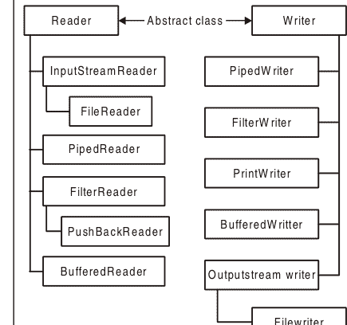

## IO 流

控制台读取/写入：

1. 写一个程序来计算给定数字的阶乘。

```java
import java.io.*;

class factorial {

    public long facto (int f ) {

        if (f == 0)

            return 1;

        else {

            long fact = 1;

            for (int i=1; i<f; i++)

            fact *= i;

            return fact;

        }

    }

    public static void main ( string args [ ]) {

        BufferedReader br = new BufferedReader(new InputStreamReader(System.in));

        PrintWriter pw = new PrintWriter(System.out, true);

        pw.println("enter number ");

        int a = Integer.parseInt(br.readLine ());

        Factorial f = new factorial (a);

        pw.println("Factorial of number is "+f.facto (a));

    } catch (IOException e) {System.out.println (e); }

}
```

输出:
```
Enter Number
5
Factorial is
120
```

2. 用 Java 写一个程序，从用户处读取一个完整的语句。同时读取语句中的子字符串并显示适当的消息。

```java
import java.io.*;

import java.util.*;

class string_match {

    public static void main (String [ ]) throws IOException {

        BufferedReader br = new BufferedReader(new InputStreamReader(System.in));

        PrintWriter pw = new PrintWriter(System.out, true);

        pw.println("Enter Statement");

        String s = br.readLine ();

        StringTokenizer st = new StringTokenizer(s, " ");

        pw.println("Enter substring to search");

        String s1 = br.readLine ();

        boolean flg = false;

        while (st.hasMoreTokens()) {

            if(s1.equals(st.nextToken())) {

                pw.println("Match Found");

                flg = true;

                break;

            }

        }

        if (!flg) pw.println("No match found");

    }

}
```

输出:
```
Enter Statement
Hello is Kiran Gani
Enter Search
Kiran
Match Found
```

3. 写一个程序两个两个二维数组并将存储在矩阵中：
(a) 从用户处读取大小（行、列）。
(b) 读取数组元素。
(c) 显示。

```java
import java.io.*;

class array_addition {

    BufferedReader br = new BufferedReader(new InputStreamReader(System.in));

    PrintWriter pw = new PrintWriter(System.out,true);

    int a [ ], b [ ], c [ ];

    int R;

    public void resize () throws IOException {

        pw.println("Enter row size of arrays ");

        R=Integer.parseInt(br.readLine ());

        pw.println("Enter column size of arrays ");

        c=Integer.parseInt(br.readLine ());

    }

    public void read_array_element () throws IOException {

        pw.println(" Enter the element of array A");

        pw.println("****");

        for (int i=0; i<c; i++) {

            for (int j=0; j<R; j++)

                a[i][j]=Integer.parseInt(br.readLine ());

            pw.println ();

        }

        pw.println(" Enter the element of array b");

        pw.println("****");

        for (int i=0; i<c; i++) {

            for (int j=0; j<R; j++)

                b[i][j]=Integer.parseInt(br.readLine ());

            pw.println ();

        }

    }

    public void array_add () {

        for (int i=0; i<c; i++) {

            for (int j=0; j<R; j++)

                c[i][j] = a[i][j] + b[i][j];

        }

    }

    public void display () {

        pw.println("Addition of array element is");

        for (int i=0; i<c; i++) {

            for (int j=0; j<R; j++)

                pw.print(c[i][j]+" ");

            pw.println ();

        }

    }

}

class test_array_addition {

    public static void main (String [ ]) throws IOException {

        Array_addition ad= new array_addition ();

        ad.resize ( );

        ad.read_array_element ( );

        ad.array_add( );

        ad.display ( );

    }

}
```

输出:
```
D:>java_practs>java test_array_addition
Enter row size of array
2
Enter column size of array
Enter the element of array A
****
1
2
3
4
Enter the element of array B
****
5
6
7
8
Addition of two array is
****
6 8
10 12
```

## 7.17 FileReader

从文件中读取/写入字符：
使用`FileReader`类读取字符，使用`FileWriter`类将字符数据写入文件。

`FileReader`类：
`FileReader(String filename) throws FileNotFoundException`
`FileReader(file fname) throws FileNotFoundException`
方法如之前讨论继承自`Reader`类。
`int read()`
`int read(char c[])`
`int read(char c[], int offset, int length)`

示例：

```java
reader = new FileReader("c:\data\input-text.txt");

int data = reader.read();

while(data != -1) {

  //对数据做某些操作...

  doSomethingWithData(data);

  data = reader.read();

}

reader.close();
```

## 7.18 FileWriter

`FileWriter`类用于将字符数据写入文件。

### 构造函数：

`FileWriter(File name) throws IOException`
`FileWriter(String fname, Boolean append) throws FileNotFoundException`

### 方法：

- `Void write(int c)`
- `Void write(char c[])`
- `Void write(char c[], offset, int length)`

使用`FileReader`/`FileWriter`读取一个文件的内容到另一个文件。

```java
import java.io.*;

class copy_file_fw {

    FileReader fr;

    FileWriter fw;

    public void copyfile(String input, string output) {

        try {

            fr = new FileReader(input);

            fw = new FileWriter(output, true);

            int c;

            while ((c=fr.read())!= -1)

            fw.write(c);

            fw.close();

            fr.close();

            System.out.println("Data copied");

        } catch (Exception e) {System.out.println(e);}

    }

    public static void main (String ar [ ]) throws IOException {

    }

}
```

## IO 输入流

```java
{

  BufferedReader br = new BufferedReader(new InputStreamReader(System.in));

  Copy_file_rw cf=new copy_file_Rw();

  System.out.println("Enter i/p file");

  String input = br.readLine();

  System.out.println("Enter o/p file");

  String output = br.readLine();

  Cf.copyfile(input, output);

}
```

## 使用 FileWriter 类向文件写入数据的程序

```java
import java.io.*;

class WriteTest {

  public static void main(String[] args) {

    try {

      File fl = new File("d:/kiran.txt");

      String str="This Java Book is very useful for students";

      FileWriter fw = new FileWriter(fl) ;

      fw.write(str);

      fw.close();

      fl.close();

    } catch (IOException e) {

      e.printStackTrace();

    }

  }

}
```

## 7.13 CharArrayReader

`CharArrayReader`用于字符输入。
`CharArrayReader`用于字符输入流并实现了一个字符缓冲区。
它用于字符输入流。

`CharArrayReader`类允许你将字符数组的内容作为字符流进行读取。
如果你需要读取的数据存储在字符数组中，但读取数据的组件只接受`Reader`，那么`Reader`就会非常有用。`CharArrayReader`封装了字符数组，将其转换为字符流。

```java
char[] chars = //从某处获取字符数组。

Reader reader = new CharArrayReader(chars);

int data = reader.read();

while(data != -1) {

  // 对数据进行某些操作

  data = reader.read();

}

reader.close();
```

## 7.20 CharArrayWriter

此类实现了一个字符缓冲区并使用`writer`。
示例展示了如何创建和写入文件。在示例中，使用了`Writer`类的子类向文件中写入内容。

`File`类是公共的，位于`java.io`包下。该类扩展了`Object`类，`Object`类是文件层次结构的根。
在`File`类的示例中，创建了几个字符文件。如示例所示，这些文件是通过抽象`writer`类子类的对象方法写入的。

```java
import java.io.*;

public class Write_File

{

  public static void main(String args[]) throws IOException

{

    File flt = new File("codingdiary.doc");

    FileWriter wrt = new FileWriter(flt);

    CharSequence cq = "welcome to future";

    wrt.append(cq);

    wrt.flush();

    System.out.println("Output is generated in a filediary.doc");

    flt = new File("roseindia.txt");

    PrintWriter out = new PrintWriter(new BufferedWriter(new FileWriter(flt)));

    out.print("Welcome to roseindia.net");

  }

}
```

## IO 输入流

```java


`out.flush();`

`System.out.println("Output is generated in a file roseindia.txt");`

`flt = new File("rachel_weisz");`

`flt.createNewFile();`

`System.out.println("An unknown extension file rachel_weisz is created");`

`CharArrayWriter ch = new CharArrayWriter();`

`cq = "newindia.com";`

`ch.append(cq);`

`ch.flush();`

`System.out.println(ch.toString());`

## 7.21 BufferedReader

### 读取控制台输入

我们使用`BufferedReader`类的对象从键盘获取输入。

| `BufferedReader br = new BufferedReader(new InputStreamReader(System.in));` | |
| :--- | :--- |
| `InputStreamReader`是`Reader`类的子类。它将字节转换为字符。 | 控制台输入从这里读取。 |

`BufferedReader`: `Reader`类的子类：

如建议所示，它有一个缓冲区用于缓冲。

### 构造函数:

`BufferedReader(Reader input, int bsize)`

`Buffered`类是`Filter`类的子类。`BufferedReader`类维护缓冲区和缓冲区状态。`BufferedReader`类支持`read()`和`readLine()`方法从字符流进行输入。可以指定缓冲区大小，默认的8192字符缓冲区可以由流的创建者覆盖。在此程序中，如你所示，`BufferedReader`类的实例变量从输入流中读取单行文本。

### 程序源代码:

```java
import java.io.*;

public class ReadStandardIO
{
    BufferedReader in = new BufferedReader(new InputStreamReader(System.in));
    System.out.println("Enter text: ");
    String str = in.readLine();
    System.out.println("You entered: ");
    System.out.println(str);
}
```

### 使用`BufferedReader`类从文件读取程序的

```java
import java.io.*;

class ReadTest
{
    public static void main(String[] args)
    {
        try {
            File fl = new File("d:/kiran.txt");
            BufferedReader br = new BufferedReader(new FileReader(fl));
            String str;
            while ((str = br.readLine()) != null) {
                System.out.println(str);
            }
            br.close();
            fl.close();
        } catch (IOException e) {
            e.printStackTrace();
        }
    }
}
```

## 7.22 BufferedWriter

此类通过缓冲减少写入周期次数来提高性能。

构造函数为：

- `BufferedWriter(Writer out)`
- `BufferedWriter(OutputStream out, int buffersize)`

`BufferedWriter`类:

`BufferedWriter`是一个字符流，允许向文件写入字符串、数组或字符。它提供了缓冲区，这比直接写入磁盘要快得多。`read()`: `InputStream`方法从`InputStream`读取数据。

`write(int)`: `BufferedWriter`方法写入单个字符。

`flush()`: `BufferedWriter`方法刷新流。

源代码：

```java
import java.io.*;

public class fileBufferedWriter
{
    public static void main(String[] args) throws Exception
    {
        System.out.println("Enter text to store in the file:");
        InputStream in = System.in;
        BufferedWriter bw = new BufferedWriter(new FileWriter("C:/output.txt"));
        int i;
        while ((i = in.read()) != -1)
        {
            bw.write((char) i);
            bw.flush();
        }
    }
}
```

## 7.23 PushbackReader

1. 该类返回一个多个字符。
2. 它是一个字符流器，并将数据推回流中。

构造函数为：

```java
PushbackReader(Reader inputStream)
PushbackReader(Reader input stream, int bsize)
```

一些方法：

```java
void unread(char[] buffer)
void unread(int c)
void unread(char c, int offset, int length)
```

## 7.24 PrintWriter

这是一个用于显示字符的字符定向流。

构造函数为：

```java
PrintWriter(OutputStream outputstream)
PrintWriter(Writer out, Boolean flush)
```

`Boolean`值表示是否自动刷新。

方法：

```java
print()
println()
```

`PrintWriter`类：

此类演示了对象的文本输出流表示。换句话说，可以说它可以向`writer`写入格式化数据。它实现了`PrintStream`中的所有打印方法，但不包含写入字节的方法。例如，将`int`、`long`和其他原始数据作为文本写入。

它有很多构造函数，允许将其连接到文件、输出流或`Writer`。它允许你访问打印方法。

| 源代码 |
| :--- |
| `import java.io.*;` |
| `public class FileWriter {` |
| `public static void main(String[] args) throws Exception {` |
| `PrintWriter pw = new PrintWriter("c:/newfile.txt");` |
| `pw.println("This is the use of PrintWriter class");` |
| `pw.println(1234);` |
| `pw.close();` |
| `}` |

## 7.25 SequenceInputStream

此类用于连接多个输入流。

构造函数：

- `SequenceInputStream(InputStream one, InputStream two)` 这用于连接两个输入流。
- `SequenceInputStream(Enumeration Stream)` 这将进入`InputStreamStream`。

`SequentialInputStream`类：

本节演示了`SequenceInputStream`类的用法。`SequenceInputStream`类表示多个输入流的连接。它从有序的输入流开始，读取第一个直到结束，然后从第二个开始，以此类推，直到最后一个输入流。

它作为一个单一`InputStream`，代表其他`InputStream`的顺序流。如示例所示，我们创建了三个`FileInputStream`对象来解析三个不同的文件，然后将这些添加到`InputStream`向量中。所有这些向量元素都传递给`SequenceInputStream`的构造函数，它读取所有内容并显示在控制台上。

```java
while ((i = sis.read()) != -1) {
  System.out.write(i);
}
```

## 7.26 序列化

### Java 中的序列化

Java 中的序列化是将对象状态写入字节流的机制。

它主要用于 Hibernate, RMI, JPA, EJB 和 JMS 技术。

序列化的反操作称为反序列化。**序列化**是将对象转换为字节序列的过程，该字节序列可以持久化到磁盘或数据库中，或者通过流传输。从字节序列转换对象的逆过程称为**反序列化**。

一个类必须实现 **java.io** 包中的 **Serializable** 接口才能成功序列化其对象。`Serializable`是一个**标记接口**（marker interface），为实现它的类添加了可序列化的行为。

Java 提供了封装在 **java.io** 包下的 **Serializable** API，用于对象的序列化和反序列化，包括：

- `java.io.Serializable`
- `java.io.Externalizable`
- `ObjectInputStream`
- 以及 `ObjectOutputStream` 等。

### 标记接口 (Marker Interface)

标记接口是 Java 中一种特殊的接口，不包含任何字段和方法。标记接口用于通知编译器实现它的类具有某些特殊行为或含义。标记接口的示例如：

- `java.io.Serializable`
- `java.lang.Cloneable`
- `java.rmi.Remote`
- `java.util.RandomAccess`

所有这些接口都没有任何字段和方法。它们只为实现它们的类添加特殊行为。然而，标记接口从 Java 5 开始被弃用，它们被**注解（Annotations）**所取代。注解被用于替代标记接口，发挥着与以前标记接口完全相同的作用。

### `writeObject()` 和 `readObject()` 的签名

`ObjectOutputStream`类的`writeObject()`方法序列化一个对象并发送到流中。

| 方法 | 说明 |
| :--- | :--- |
| `public final void writeObject(Object x) throws IOException` | `ObjectInputStream`类的`readObject()`方法引用流中的对象并对其进行反序列化。 |
| `public final readObject() throws IOException,ClassNotFoundException` | |

在序列化时，如果你不想让任何字段具有对象状态，根据你的需要将其声明为`static`或`transient`，它将不会包含在 Java 序列化过程中。

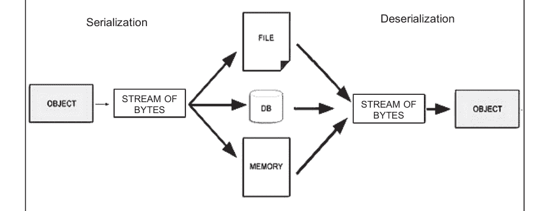

### Java 序列化的优势

它主要用于在网络上传输对象状态（称为封化，marshaling）。


#### `java.io.Serializable`接口

`Serializable`是一个标记接口（没有数据成员和方法）。它用于“标记”Java 类，以便这些类的对象可以获得某些能力。`Cloneable`和`Remote`是标记接口。

它必须由想要持久化的对象的类来实现。

`String`类和所有包装类默认实现了`java.io.Serializable`接口。

让我们来看下提供的示例：

```java
import java.io.Serializable;

public class Student implements Serializable{
  int id;
  String name;
  public Student(int id, String name) {
    this.id = id;
    this.name = name;
  }
}
```

在上面的示例中，`Student`类实现了`Serializable`接口。现在它的对象可以转换为流。

### `ObjectOutputStream`类

`ObjectOutputStream`类用于将基本类型数据类型和 Java 对象写入`ObjectOutputStream`中。只有支持`java.io.Serializable`接口的对象才能被写入流中。

#### 构造函数

- 1) `public ObjectOutputStream(ObjectOutputStream out) throws IOException {}` 创建一个写入到指定`ObjectOutputStream`的`ObjectOutputStream`。

#### 重要方法

| 方法 | 说明 |
| :--- | :--- |
| 1) `public final void writeObject(Object obj) throws IOException {}` | 将指定的对象写入`ObjectOutputStream`。 |
| 2) `public void flush() throws IOException {}` | 刷新当前输出流。 |
| 3) `public void close() throws IOException {}` | 关闭当前输出流。 |

### Java 序列化示例

在这个示例中，我们将序列化`Student`类的对象。`ObjectOutputStream`的`writeObject()`方法提供了序列化对象的功能。我们将对象的状态保存在名为`kiran.txt`的文件中。

```java
import java.io.*;

class Persist {
  public static void main(String args[])throws Exception {
    Student s=new Student(211,"kiran");
    ObjectOutputStream fout=new FileOutputStream("kiran.txt");
    ObjectOutputStream out=new ObjectOutputStream(fout);
    out.writeObject(s1);
    out.flush();
  }
}
```

```java
System.out.println("success");
}
}
```

#### 输出

`success`

### Java 中的反序列化

反序列化是从序列化状态重构对象的过程。它是序列化的反操作。

### `ObjectInputStream`类

`ObjectInputStream`反序列化使用`ObjectOutputStreamStream`写入的对象和基本数据类型。

#### 构造函数

- 1) `public ObjectInputStream(InputStream in) throws IOException {}`
- 2) `public void close() throws IOException {}` 关闭`ObjectInputStreamStream`。

#### 重要方法

| 方法 | 说明 |
| :--- | :--- |
| 1) `public Object readObject() throws IOException, ClassNotFoundException` | 从输入流中读取对象。 |
| 2) `public void close() throws IOException` | 关闭`ObjectInputStream`。 |

### 反序列化示例

```java
import java.io.*;

class Persist {
    public static void main(String args[])throws Exception {
        ObjectInputStream in=new ObjectInputStream(new FileInputStream("kiran.txt"));
        Student s=(Student)in.readObject();
        System.out.println("read "+s.name);
    }
}
```

### 继承中的序列化 (IS-A)

如果一个类实现了可序列化，那么它的子类也是可序列化的。让我们来看提供的示例：

```java
import java.io.Serializable;

class Person implements Serializable{
int id;
String name;
Person(int id, String name)
{
    this.id = id;
    this.name = name;
}
class Student extends Person
{
    String course;
```


`int fee;`

`Student(int id, String name, String course, int fee)`

`{`

`super(id,name);`

`this.course=course;`

`this.fee=fee;`

`}`

`}`

现在你可以序列化继承 `Person` 类的 `Student` 对象。父类的属性会被继承到子类中，因此如果父类是可序列化的，子类也是。

### 聚合中的序列化 (HAS-A)

如果一个类拥有另一个类的引用，则所有引用都必须是可序列化的，否则无法进行序列化。在这种情况下，运行时会抛出 `NotSerializableException`。

```java
class Address
{
    String addressLine,city,state;
    public Address(String addressLine, String city, String state)
    {
        this.addressLine=addressLine;
        this.city=city;
        this.state=state;
    }
}
```

```java
import java.io.Serializable;
public class Student implements Serializable
{
    int id;
    String name;
    Address address;//HAS-A
    public Student(int id, String name)
    {
        this.id = id;
        this.name = name;
    }
}
```

由于 `Address` 不是可序列化的，你无法序列化 `Student` 类的实例。

**注意：** 对象内部的所有对象都必须是可序列化的。

#### 静态数据成员的序列化

如果类中有一个静态数据成员，它将不会被序列化，因为静态是类的一部分而不是对象的一部分。

```java
class Employee implements Serializable
{
    int id;
    String name;
    static String company="SSS IT Pvt Ltd";//它不会被序列化
    public Student(int id, String name)
    {
        this.id = id;
        this.name = name;
    }
}
```

#### 数组或集合的序列化

规则：对于数组或集合，数组或集合中的所有对象必须是可序列化的。如果任何对象不是可序列化的，序列化将失败。

# Java 中的外部序列化

`Externalizable` 接口提供了将对象状态以压缩格式写入字节流的便利方法。它不是一个标记接口。

`Externalizable` 接口提供了两个方法：

- `public void writeExternal(ObjectOutput out) throws IOException`
- `public void readExternal(ObjectInput in) throws IOException`

#### 问题

1. 解释 Java 中的 I/O 流。
2. 解释 Java I/O 类。
3. 解释 Java 中的 Stream 类与目录。
4. 解释 java 中的 `listFiles()` 方法。
5. 解释 流类。
6. 解释 Java 中的 `ByteArrayInputStream`。
7. 解释 Java 中的字符流。
8. 解释 Java 中的 `FileReader` & `FileWriter`。
9. 解释 Java 中的 `CharReader` & `CharArrayWriter`。
10. 解释 Java 中的 `BufferedReader` & `BufferedWriter`。
11. 解释 `PrintWriter`。
12. 解释 Java 中的 序列化。

# 第 8 章

# 网络

“Java Socket 编程用于运行在不同 JRE 上的应用程序之间的通信”

### 结构

- 8.1 网络编程简介
- 8.2 Socket
- 8.3 服务网络

## 8.1 网络编程简介

网络编程是指编写跨多个设备（计算机）执行的程序，其中这些设备都通过网络相互连接。在基础层面上，基于网络的系统由服务器、客户端和一种通信介质组成。计算机通信介质可以是有线或无线网络。

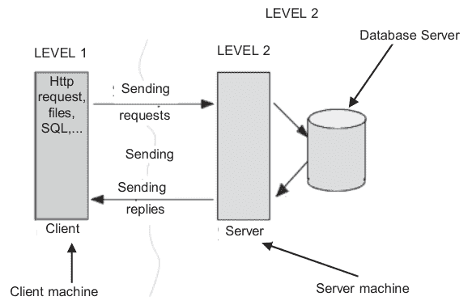

# 客户端/服务器通信

运行请求服务的程序被称为客户端机器。运行并为一个或多个客户端提供请求服务的程序的计算机被称为服务器机器。

通常情况下，运行在客户端机器上的程序会向运行在服务器机器上的程序（通常称为服务器程序）发送请求。它们涉及传输层提供的网络服务，传输层是 Internet 软件栈的一部分，通常是 TCP/IP（传输控制/网络协议）和 UDP（用户数据报协议）。传输层携带两种类型的协议：TCP（传输控制协议）和 UDP（用户数据报协议）。这些协议最广泛使用的编程接口是 sockets。

JSE API 中的 `java.net` 包包含了一系列类和接口，它们提供了底层通信细节，允许你编写专注于解决当前问题的程序。

`java.net` 包支持以下网络协议：

- TCP TCP 代表传输控制协议，它允许两个应用程序之间进行可靠的通信。TCP 通常用于 Internet，这种组合被称为 TCP/IP。TCP 是一种面向连接的协议，在两台计算机之间提供可靠的数据流。使用此类服务的示例应用包括 HTTP、FTP 和 Telnet。
- UDP UDP 代表用户数据报协议，是一种无连接的协议，允许在应用程序之间传输数据包。UDP 是一种从一台计算机发送到另一台计算机的独立数据包（称为数据报）的协议，不保证到达和顺序。使用此类服务的应用程序包括时钟（Clock）和 Ping。

# Java 网络术语终止

下面是广泛使用的 java 网络术语：

1. IP 地址
2. 协议
3. 端口号
4. MAC 地址
5. 面向连接和无连接的协议
6. Socket

##### 1. IP 地址

IP 地址是分配给网络节点的唯一数字，例如 `192.168.0.1` 。它由 0 到 255 之间的字节组成。

它是一个可以更改的逻辑地址。

##### 2. 协议

协议基本上是通信时必须遵循的一set规则。例如：

- TCP
- FTP
- Telnet
- SMTP
- POP 等。

##### 3. 端口号

端口号用于唯一标识不同的应用程序。它作为应用程序之间的通信端点。

端口号与 IP 地址相关，用于两个应用程序之间的通信。

##### 4. MAC 地址

MAC（介质访问控制）地址是 NIC（网络接口控制器）的唯一标识符。一个网络节点可以有多个 NIC，但每个 NIC 都有唯一的 MAC。

# 5. 面向连接和无连接协议

在面向连接的协议中，接收者不发送确认。它是可靠但缓慢的。面向连接协议的示例是 TCP。

但是，在无连接协议中，接收者不发送确认。因此它是不可靠但快速。无连接协议的示例是 UDP。

##### 6. Socket

Socket 是双向通信的端点。

### 8.2 Socket

#### Socket 编程

# Java Socket 编程

Java Socket 编程用于运行在不同 JRE 上的应用程序之间的通信。

Java Socket 编程可以是面向连接或无连接的。

`Socket` 和 `ServerSocket` 类用于面向连接的 socket 编程，`DatagramSocket` 和 `DatagramPacket` 类用于无连接的 socket 编程。

Socket 编程中的客户端必须知道两个信息：

1. 服务器的 IP 地址，以及
2. 端口号。

#### Socket 类

Socket 仅仅是机器间通信的端点。`Socket` 类可以创建 socket。

#### 重要方法

| 方法 | 描述 |
| --- | --- |
| 1. `public InputStream getgetInputStream()` | 返回与此 socket 关联的 `InputStream`。 |
| 2. `public OutputStream getOutputStream()` | 返回与此 socket 关联的 `OutputStream`。 |
| 3. `public void close()` | 关闭此 socket |

#### ServerSocket 类

`ServerSocket` 类可以创建服务器。

#### 重要方法

| 方法 | 描述 |
| --- | --- |
| 1. `public Socket accept()` | 返回服务器上的 socket。 |
| 2. `public void close()` | 关闭

#### Socket 类

Socket 是机器间双向通信的端点。`java.net` 包包含了一系列类和接口，提供了底层通信细节，允许你编写专注于解决当前问题的程序。

`java.net` 包支持以下网络协议：

- TCP TCP 代表传输控制协议，它允许两个应用程序之间进行可靠的通信。TCP 通常用于 Internet，这种组合被称为 TCP/IP。TCP 是一种面向连接的协议，在两台计算机之间提供可靠的数据流。使用此类服务的示例应用包括 HTTP、FTP 和 Telnet。
- UDP UDP 代表用户数据报协议，是一种无连接的协议，允许在应用程序之间传输数据包。UDP 是一种从一台计算机发送到另一台计算机的独立数据包（称为数据报）的协议，不保证到达和顺序。使用此类服务的应用程序包括时钟（Clock）和 Ping。

`Socket` 类用于面向连接的 socket 编程。

# 客户端/服务器通信

运行请求服务的程序被称为客户端机器。运行并为一个或多个客户端提供请求服务的程序的计算机被称为服务器机器。

通常情况下，运行在客户端机器上的程序会向运行在服务器机器上的程序（通常称为服务器程序）发送请求。它们涉及传输层提供的网络服务，传输层是 Internet 软件栈的一部分，通常是 TCP/IP（传输控制/网络协议）和 UDP（用户数据报协议）。传输层携带两种类型的协议：TCP（传输控制协议）和 UDP（用户数据报协议）。这些协议最广泛使用的编程接口是 sockets。

# Java 网络术语终止

下面是广泛使用的 java 网络术语：

1. IP 地址
2. 协议
3. 端口号
4. MAC 地址
5. 面向连接和无连接的协议
6. Socket

##### 1. IP 地址

IP 地址是分配给网络节点的唯一数字，例如 `192.168.0.1` 。它由 0 到 255 之间的字节组成。

它是一个可以更改的逻辑地址。

##### 2. 协议

协议基本上是通信时必须遵循的一set规则。例如：

- TCP
- FTP
- Telnet
- SMTP
- POP 等。

##### 3. 端口号

端口号用于唯一标识不同的应用程序。它作为应用程序之间的通信端点。

端口号与 IP 地址相关，用于两个应用程序之间的通信。

##### 4. MAC 地址

MAC（介质访问控制）地址是 NIC（网络接口控制器）的唯一标识符。一个网络节点可以有多个 NIC，但每个 NIC 都有唯一的 MAC。

# 5. 面向连接和无连接协议

在面向连接的协议中，接收者不发送确认。它是可靠但缓慢的。面向连接协议的示例是 TCP。

但是，在无连接协议中，接收者不发送确认。因此它是不可靠但快速。无连接协议的示例是 UDP。

##### 6. Socket

Socket 是双向通信的端点。

### 8.2 Socket

#### Socket 编程

# Java Socket 编程

Java Socket 编程用于运行在不同 JRE 上的应用程序之间的通信。

Java Socket 编程可以是面向连接或无连接的。

`Socket` 和 `ServerSocket` 类用于面向连接的 socket 编程，`DatagramSocket` 和 `DatagramPacket` 类用于无连接的 socket 编程。

Socket 编程中的客户端必须知道两个信息：

1. 服务器的 IP 地址，以及
2. 端口号。

#### Socket 类

Socket 仅仅是机器间通信的端点。`Socket` 类可以创建 socket。

#### 重要方法

| 方法 | 描述 |
| --- | --- |
| 1. `public InputStream getgetInputStream()` | 返回与此 socket 关联的 `InputStream`。 |
| 2. `public OutputStream getOutputStream()` | 返回与此 socket 关联的 `OutputStream`。 |
| 3. `public void close()` | 关闭此 socket |

#### ServerSocket 类

`ServerSocket` 类可以创建服务器。

#### 重要方法

| 方法 | 描述 |
| --- | --- |
| 1. `public Socket accept()` | 返回服务器上的 socket。 |
| 2. `public void close()` | 关闭

#### Socket 类

Socket 是机器间双向通信的端点。`java.net` 包包含了一系列类和接口，提供了底层通信细节，允许你编写专注于解决当前问题的程序。

`java.net` 包支持以下网络协议：

- TCP TCP 代表传输控制协议，它允许两个应用程序之间进行可靠的通信。TCP 通常用于 Internet，这种组合被称为 TCP/IP。TCP 是一种面向连接的协议，在两台计算机之间提供可靠的数据流。使用此类服务的示例应用包括 HTTP、FTP 和 Telnet。
- UDP UDP 代表用户数据报协议，是一种无连接的协议，允许在应用程序之间传输数据包。UDP 是一种从一台计算机发送到另一台计算机的独立数据包（称为数据报）的协议，不保证到达和顺序。使用此类服务的应用程序包括时钟（Clock）和 Ping。

# 客户端 - Socket 程序

```java
import java.io.*;
import java.net.*;

public class socketclient
{
    public static void main(String[] args[])
    {
        try {
            Socket s = new Socket(args[0], 8001);
            BufferedReader fromsocket = new BufferedReader(new InputStreamReader(s.getInputStream()));
            PrintWriter tosocket = new PrintWriter(new OutputStreamWriter(s.getOutputStream()));
            BufferedReader fromuser = new BufferedReader(new InputStreamReader(System.in));
            while(true) {
                System.out.print("Type something for the server: ");
                String send=fromuser.readLine();
                tosocket.println(send);
                tosocket.flush();
                String response=fromsocket.readLine();
                System.out.println("server says: " + response);
            }
        } catch (Exception e) { System.out.println(e); }
    }
}
```

# 服务端 - Socket 程序

```java
import java.io.*;
import java.net.*;

public class socketserver
{
    public static void main(String[] args[])
    {
        try {
            ServerSocket serversoc = new ServerSocket(8001);
            System.out.println("Server socket before accept" + serversoc);
            Socket mysocket=serversoc.accept();
            System.out.println("Server after accept" + mysocket);
            BufferedReader fromuser = new BufferedReader(new InputStreamReader(System.in));
            BufferedReader fromsocket=new BufferedReader(new InputStreamReader(mysocket.getInputStream()));
            PrintWriter tosocket=new PrintWriter(new OutputStreamWriter(mysocket.getOutputStream()));
            while(true)


{

    String clientmsg = fromsocket.readLine();

    System.out.println("client says : " + clientmsg);

    System.out.print(" Server says: ");

    String send = fromuser.readLine();

    tosocket.println(send);

    tosocket.flush();

}

} catch (Exception e) { System.out.println(e); }

}

}

#### 网络编程
# 179

以下是提供了实现 socket 完整方法集的实用类。

## 8.3 Server Socket

### ServerSocket 类方法

`java.net.ServerSocket` 类用于服务端应用程序以获取端口并监听客户端请求。

`ServerSocket` 类有四个构造函数：

**`public ServerSocket(int port) throws IOException`**

尝试创建一个绑定到指定端口的服务器 socket。如果该端口已被另一个应用程序绑定，则抛出异常。

**`public ServerSocket(int port, int backlog) throws IOException`**

与上一个构造函数相似，`backlog` 参数指定了在等待队列中存储多少个入站的客户端。

**`public ServerSocket(int port, int backlog, InetAddress address) throws IOException`**

与上一个构造函数相似，`InetAddress` 参数指定了要绑定的本地 IP 地址。`InetAddress` 用于具有多个 IP 地址的服务器，允许服务器指定在它的哪一个 IP 地址上接收客户端请求。

**`public ServerSocket() throws IOException`**

创建一个未绑定的服务器 socket。当使用此构造函数时，在您准备好绑定服务器 socket 时使用 `bind()` 方法。如果 `ServerSocket` 构造函数没有抛出异常，则意味着您的应用程序已成功绑定到指定的端口，并准备好处理客户端请求。

以下是 `ServerSocket` 类的一些常用方法：

**`public getPort()`**

返回服务器 socket 正在监听的端口。如果您在构造函数中传入 0 作为端口号并让服务器为您查找端口，则此方法非常有用。

**`public Socket accept() throws IOException`**

等待入站连接，直到客户端在指定的端口上连接到服务器，或者 socket 超时（假设已通过 `setSoTimeout()` 方法设置了超时值）。否则，此方法将无限阻塞。

**`public void setTimeout(int timeout)`**

设置服务器 socket 在 `accept()` 等待客户端的超时值。

**`public void bind(SocketAddress host, int backlog)`**

绑定到 `SocketAddress` 对象中指定的服务器和端口。当您使用无参数构造函数实例化 `ServerSocket` 时，可以使用此方法。当 `ServerSocket` 调用 `accept()` 时，在客户端连接之前该方法不会返回。在客户端连接后，`ServerSocket` 会在未指定的端口上创建一个新的 `Socket`，并返回此新 `Socket` 的引用。此时，客户端和服务器之间建立了 TCP 连接，并开始通信。

### Socket 类方法：

`java.net.Socket` 代表了客户端和服务器都用于相互通信的 socket。客户端通过实例化它来获取 `Socket` 对象，而服务端则从 `accept()` 的返回值中获取 `Socket` 对象。

`Socket` 有五个用于连接服务器的构造函数：

**`public Socket(String host, int port) throws UnknownHostException, IOException`**

此方法尝试连接到指定的服务器端口。如果此构造函数没有抛出异常，则连接成功，客户端此后处于连接状态。

**`public Socket(InetAddress host, int port) throws IOException`**

此方法与上一个构造函数相同，只是 `host` 由 `InetAddress` 对象表示的。

**`public Socket(String host, int port, InetAddress localAddress, int localPort) throws IOException`**

连接到指定的主机和端口，在本地主机的指定地址和端口上创建一个 socket。

```
public Socket(InetAddress host, int port, InetAddress localAddress, int localPort) throws IOException
```

此方法与上一个构造函数相同，只是 `host` 由 `InetAddress` 对象表示的。

# 包装类

在使用包装类时，只需要将原始数据类型的值传递给包装类的构造函数即可。随后包装对象会被转换回原始数据类型，这个过程被称为拆箱（unboxing）。`Number` 类是 `java.lang` 包的一部分。

## 什么是包装类？

顾名思义，包装类封装（包裹）了一个数据类型并赋予它对象的外观。在任何需要将数据类型作为对象的地方，都可以使用该对象。包装类包含了拆箱对象并返回数据类型的方法。它可以与巧克力作比方：制造商用锡箔或纸包裹巧克力以防止污染；用户拿取巧克力，拆掉并丢弃包装纸，然后食用。

观察以下转换：

```
int k = 100;

Integer i1 = new Integer(k);
```

数据类型 `k` 使用 `Integer` 类转换成了对象 `i1`。在 Java 编程中，任何需要对象的地方都可以使用 `i1` 对象。

```
// 以下代码可用于拆箱对象 i1（从 Integer 对象获取 int 值）。
int m = i1.intValue(); // 打印 100

// intValue() 是 Integer 类的方法，返回一个 int 类型的数据。
```

### 9.2 包装类列表

在上面的代码中，`Integer` 类被称为包装类（因为它封装了 `int` 数据类型以给出一个对象的印象）。为了包装（或转换）每个原始数据类型，都有一个对应的包装类。`java.lang` 包中存在 8 个包装类，分别代表 8 种类型。以下列表给出了：

所有 8 个包装类都位于 `java.lang` 包中，因此它们被隐式导入，程序员可以直接使用。正如你在上述层级结构中所观察，数值包装类的父类是 `Number`，而 `Character` 和 `Boolean` 的父类是 `Object`。所有包装类都被定义为 `final`，因此设计者防止它们被继承。

| 原始类型 | 包装类 | 构造函数参数 |
| :--- | :--- | :--- |
| Boolean | Boolean | Boolean 或 string |
| Byte | Byte | Byte 或 String |
| char | Character | char |
| int | Integer | int 或 String |
| Float | Float | Float, double 或 String |
| Double | Double | Double 或 String |
| Long | Long | Long 或 String |
| Short | Short | Short 或 String |

下面是根据 Java API 的包装类层级结构

### 9.3 包装类的重要性

包装类主要有两个用途：
1. 将简单数据类型转换为对象，即给数据类型赋予对象形式；这里使用了构造函数。
2. 将字符串转换为数据类型（称为解析操作），这里使用了 `parseXXX()` 类型的方法。

以下程序展示了将数据类型转换为对象并同时从对象中检索数据类型的编写风格：

```
public class WrappingUnwrapping {

    public static void main(String[] args[]) {

        byte grade = 2;

        int marks = 50;

        float price = 8.6f; // 观察 float 的后缀 f

        double rate = 50.5; // 数据类型转换为对象

        Byte g1 = new Byte(grade); // 包装

        Integer m1 = new Integer(marks);

        Float f1 = new Float(price);

        Double r1 = new Double(rate);

        // 让我们从对象中打印值

        System.out.println("Values of Wrapper objects (printing objects)");

        System.out.println("Byte object g1: " + g1);

        System.out.println("Integer object m1: " + m1);

        System.out.println("Float object f1: " + f1);

        System.out.println("Double object r1: " + r1);

        // 对象转换为数据类型（从对象中检索数据类型）

        byte bv = g1.byteValue();    // 拆箱

        int iv = m1.intValue();

        float fv = f1.floatValue();

        double dv = r1.doubleValue();

        // 让我们从数据类型打印值

        System.out.println("Unwrapped values (printing as data types)");

        System.out.println("byte value, " + bv);

    }

}
```

## 9.4 包装与拆箱

`int marks = 50;`

`Integer m1 = new Integer(marks);`

在上面的语句中，通过将变量传递给 `Integer` 类的构造函数，将 `int` 类型的 `marks` 作为一个对象 `m1`。在任何需要 `marks` 作为对象的地方，都可以使用 `m1`。

在编程中使用 `Integer` 对象后，程序员可能需要返回数据类型，因为对象不能直接用于算术运算。现在应该对对象 `m1` 进行拆箱。

```
int iv = m1.intValue();
```

拆箱时使用了 `Integer` 类的 `intValue()` 方法。`int` 类型的值 `iv` 可以用于算术运算。

## 9.5 解析操作

包装类的另一个用途是将字符串转换为数据类型。有时在编程中，程序员以字符串的形式获取数据。数据类型是以字符串形式检索的。例如，`BufferedReader` 的 `readLine()` 方法返回它所需的任何数据类型的字符串，命令行参数以字符串形式获取，GUI 中的文本字段获取字符串。这些字符串应该转换回数据类型。

以下程序说明了这一过程：

```
public class ParsingDemo {

    public static void main(String[] args) {

        String str = "100";

        int i = Integer.parseInt(str);

        float f = Float.parseFloat(str);

        double d = Double.parseDouble(str);

        System.out.println("Integer value: " + i);

        System.out.println("Float value: " + f);

        System.out.println("Double value: " + d);

    }

}
```

188

Core Java

```
Float f1 = new Float(str3); // 第二种方法

float f2 = f1.floatValue();

System.out.println(f2*f2); // 打印 110.25

String str4 = "10.5"; // 将字符串转换为double

double d1 = Double.parseDouble(str4); // 第一种方法

System.out.println(d1*d1); // 打印 110.25

double d1 = new Double(str4); // 第二种方法

double d2 = d1.doubleValue();

System.out.println(d2*d2); // 打印 110.25

String str1 = "A"; // 将字符串转换为字符

char ch1 = str1.charAt(0); // 打印 A

System.out.println(ch1); // 将字符串转换为boolean

String str5 = "true"; // 第一种方法

boolean b3 = Boolean.parseBoolean(str5);

System.out.println(b3);

Boolean bo1 = new Boolean(str5); // 第二种方法

boolean b4 = bo1.booleanValue();

System.out.println(b4)
```


# 第10章 集合框架（Collection Framework）

> "Collection 代表了对象的单一单元，即一组。"

## 结构目录

- 10.1 Collection 简介
- 10.2 Java util 包接口
- 10.3.1 List
- 10.3.2 Set
- 10.4 List 接口及其类
- 10.5 Set 接口

## 10.1 Java 中的 Collections 简介

**Java 中的 Collections** 是一个提供存储和操作对象组的架构的框架。所有在数据上执行的操作，如搜索、排序、插入、处理、删除等，都可以通过 Java Collections 完成。Java Collection 意味着对象的单一单元。Java Collection 框架提供了许多接口（`Set`, `List`, `Queue`, `Deque` 等）和类（`ArrayList`, `Vector`, `LinkedList`, `PriorityQueue`, `HashSet`, `LinkedHashSet`, `TreeSet` 等）。Collection 代表对象的单一单元，即一组。

### 什么是 Java 中的 Collection

- 提供了现成的架构。
- 代表了类和接口的集合。
- 它是可选的。

## 什么是集合框架（Collection Framework）

Collection 框架代表了用于存储和操作对象组的统一架构。它包含：

1. 接口及其实现（即类）
2. 算法

## Collection 接口的方法

Collection 接口中声明了许多方法。它们如下：

| 编号 | 方法 | 描述 |
|---|---|---|
| 1. | `public boolean add(Object element)` | 用于向此集合中插入元素。 |
| 2. | `public boolean addAll(Collection c)` | 用于向调用者集合中插入指定的集合元素。 |
| 3. | `public boolean remove(Object element)` | 用于从此集合中删除元素。 |
| 4. | `public boolean removeAll(Collection c)` | 用于从调用者集合中删除指定集合中的所有元素。 |
| 5. | `public boolean retainAll(Collection c)` | 用于删除调用者集合中除指定集合以外的所有元素。 |
| 6. | `public int size()` | 返回集合中元素的总数。 |
| 7. | `public void clear()` | 移除集合中的所有元素。 |
| 8. | `public boolean contains(Object element)` | 用于搜索元素。 |
| 9. | `public boolean containsAll(Collection c)` | 用于在此集合中搜索指定的集合。 |
| 10. | `public Iterator iterator()` | 返回一个迭代器。 |
| 11. | `public Object[] toArray()` | 将集合转换为数组。 |
| 12. | `public boolean isEmpty()` | 检查集合是否为空。 |
| 13. | `public boolean equals(Object element)` | 匹配两个集合。 |
| 14. | `public int hashCode()` | 返回集合的哈希值。 |

## Collection 框架的层级结构

让我们看看集合框架的层级结构。`java.util` 包包含了 Collection 框架的所有类和接口。

### Collection 框架

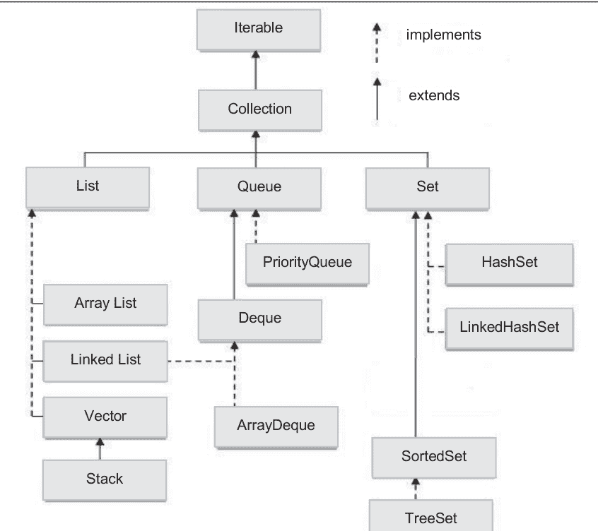

## 10.2 Java util 包接口

`java.util` 包包含集合框架、遗留集合类、事件模型、日期和时间设施、国际化以及杂项工具类（字符串分词器、随机数生成器和位数组）。

### 10.2.1 Java List 接口

`List` 是 `Collection` 的子接口。它包含了基于索引插入和删除元素的方法。它是 `ListIterator` 接口的工厂。

#### List 接口声明

| 编号 | 方法 | 描述 |
|---|---|---|
| 1 | `void add(int index,Object element)` | 用于在指定索引插入元素。 |
| 2 | `boolean addAll(Collection c)` | 用于向调用者集合中插入指定的集合元素。 |
| 3 | `boolean remove(Object element)` | 用于从此集合中删除元素。 |
| 4 | `boolean removeAll(Collection c)` | 用于从调用者集合中删除指定集合的所有元素。 |
| 5 | `boolean retainAll(Collection c)` | 用于删除调用者集合中除指定集合以外的所有元素。 |
| 6 | `int size()` | 返回集合中元素的总数。 |
| 7 | `void clear()` | 移除集合中的所有元素。 |
| 8 | `boolean contains(Object element)` | 用于搜索元素。 |
| 9 | `boolean containsAll(Collection c)` | 用于在此集合中搜索指定的集合。 |
| 10 | `Iterator iterator()` | 返回一个迭代器。 |
| 11 | `Object[] toArray()` | 将集合转换为数组。 |
| 12 | `boolean isEmpty()` | 检查集合是否为空。 |
| 13 | `boolean equals(Object element)` | 匹配两个集合。 |
| 14 | `int hashCode()` | 返回集合的哈希值。 |

## Core Java

```java
Float f1 = new Float(str3); // 第二种方法
float f2 = f1.floatValue();
System.out.println(f2*f2); // 打印 110.25

String str4 = "10.5"; // 将字符串转换为double
double d1 = Double.parseDouble(str4); // 第一种方法
System.out.println(d1*d1); // 打印 110.25

double d1 = new Double(str4); // 第二种方法
double d2 = d1.doubleValue();
System.out.println(d2*d2); // 打印 110.25

String str1 = "A"; // 将字符串转换为字符
char ch1 = str1.charAt(0); // 打印 A
System.out.println(ch1); // 将字符串转换为boolean

String str5 = "true"; // 第一种方法
boolean b3 = Boolean.parseBoolean(str5);
System.out.println(b3);

Boolean bo1 = new Boolean(str5); // 第二种方法
boolean b4 = bo1.booleanValue();
System.out.println(b4);
```

## 问题

1. 定义什么是包装类（wrapper classes）。
2. 解释不同的包装类。
3. 说明包装类的重要性。
4. 定义装箱（Wrapping）和拆箱（Unwrapping）。
5. 解释不同的解析操作（Parsing Operations）。


# 第10章 集合框架

"Collection 代表了对象的单一单元，即一组。"

## 结构

- 10.1 Collection 简介
- 10.2 Java util 包接口
- 10.3.1 List
- 10.3.2 Set
- 10.4 List 接口及其类
- 10.5 Set 接口

## 10.1 Java 中的 Collections 简介

**Java 中的 Collections** 是一个提供存储和操作对象组的架构的框架。所有在数据上执行的操作如搜索、排序、插入、处理、删除等，都可以通过 Java Collections 完成。Java Collection 意味着对象的单一单元。Java Collection 框架提供了许多接口（`Set`, `List`, `Queue`, `Deque` 等）和类（`ArrayList`, `Vector`, `LinkedList`, `PriorityQueue`, `HashSet`, `LinkedHashSet`, `TreeSet` 等）。Collection 代表对象的单一单元，即一组。

### 什么是 Java 中的 Collection

- 提供了现成的架构。
- 代表了类和接口的集合。
- 它是可选的。

## 什么是集合框架（Collection framework）

Collection 框架代表了用于存储和操作对象组的统一架构。它包含：

1. 接口及其实现（即类）
2. 算法

## Collection 接口的方法

Collection 接口中声明了许多方法。它们如下：

| 编号 | 方法 | 描述 |
|---|---|---|
| 1. | `public boolean add(Object element)` | 用于向此集合中插入元素。 |
| 2. | `public boolean addAll(Collection c)` | 用于向调用者集合中插入指定的集合元素。 |
| 3. | `public boolean remove(Object element)` | 用于从此集合中删除元素。 |
| 4. | `public boolean removeAll(Collection c)` | 用于从调用者集合中删除指定集合的所有元素。 |
| 5. | `public boolean retainAll(Collection c)` | 用于删除调用者集合中除指定集合以外的所有元素。 |
| 6. | `public int size()` | 返回集合中元素的总数。 |
| 7. | `public void clear()` | 移除集合中的所有元素。 |
| 8. | `public boolean contains(Object element)` | 用于搜索元素。 |
| 9. | `public boolean containsAll(Collection c)` | 用于在此集合中搜索指定的集合。 |
| 10. | `public Iterator iterator()` | 返回一个迭代器。 |
| 11. | `public Object[] toArray()` | 将集合转换为数组。 |
| 12. | `public boolean isEmpty()` | 检查集合是否为空。 |
| 13. | `public boolean equals(Object element)` | 匹配两个集合。 |
| 14. | `public int hashCode()` | 返回集合的哈希值。 |

## Collection 框架的层级结构

让我们看看集合框架的层级结构。`java.util` 包包含了 Collection 框架的所有类和接口。

## 10.2 Java util 包接口

`java.util` 包包含集合框架、遗留集合类、事件模型、日期和时间设施、国际化以及杂项工具类（字符串分词器、随机数生成器和位数组）。

### 10.2.1 Java List 接口

`List` 是 `Collection` 的子接口。它包含了基于索引插入和删除元素的方法。它是 `ListIterator` 接口的工厂。

## List 接口声明

| 编号 | 方法 | 描述 |
|---|---|---|
| 1 | `void add(int index, Object element)` | 用于在指定索引插入元素。 |
| 2 | `boolean addAll(Collection c)` | 用于向调用者集合中插入指定的集合元素。 |
| 3 | `boolean remove(Object element)` | 用于从此集合中删除元素。 |
| 4 | `boolean removeAll(Collection c)` | 用于从调用者集合中删除指定集合的所有元素。 |
| 5 | `boolean retainAll(Collection c)` | 用于删除调用者集合中除指定集合以外的所有元素。 |
| 6 | `int size()` | 返回集合中元素的总数。 |
| 7 | `void clear()` | 移除集合中的所有元素。 |
| 8 | `boolean contains(Object element)` | 用于搜索元素。 |
| 9 | `boolean containsAll(Collection c)` | 用于在此集合中搜索指定的集合。 |
| 10 | `Iterator iterator()` | 返回一个迭代器。 |
| 11 | `Object[] toArray()` | 将集合转换为数组。 |
| 12 | `boolean isEmpty()` | 检查集合是否为空。 |
| 13 | `boolean equals(Object element)` | 匹配两个集合。 |
| 14 | `int hashCode()` | 返回集合的哈希值。 |

## Core Java

```java
Float f1 = new Float(str3); // 第二种方法
float f2 = f1.floatValue();
System.out.println(f2*f2); // 打印 110.25

String str4 = "10.5"; // 将字符串转换为double
double d1 = Double.parseDouble(str4); // 第一种方法
System.out.println(d1*d1); // 打印 110.25

double d1 = new Double(str4); // 第二种方法
double d2 = d1.doubleValue();
System.out.println(d2*d2); // 打印 110.25

String str1 = "A"; // 将字符串转换为字符
char ch1 = str1.charAt(0); // 打印 A
System.out.println(ch1); // 将字符串转换为boolean

String str5 = "true"; // 第一种方法
boolean b3 = Boolean.parseBoolean(str5);
System.out.println(b3);

Boolean bo1 = new Boolean(str5); // 第二种方法
boolean b4 = bo1.booleanValue();
System.out.println(b4);
```

## 问题

1. 定义什么是包装类（wrapper classes）。
2. 解释不同的包装类。
3. 说明包装类的重要性。
4. 定义装箱（Wrapping）和拆箱（Unwrapping）。
5. 解释不同的解析操作（Parsing Operations）。

## 10.4 List 接口及其类

### 2. LinkedList

`LinkedList` 的速度比 `ArrayList` 慢，但在某些情况下它的性能更好。

```java
package com.beingjavaguys.core;

import java.util.LinkedList;

public class LinkedListListImplementation {

    public static void main(String args[]) {

        LinkedList<String> linkedList = new LinkedList<String>();

        linkedList.add("element1");

        linkedList.add("element2");

        linkedList.add("element3");

        System.out.println(linkedList);

        linkedList.remove("element3");

        System.out.println(linkedList);

    }

}
```

### 3. Vector

`Vector` 也是一个可伸的对象数组，与 `ArrayList` 不同，`Vector` 在本质上是线程安全的。

```java
package com.beingjavaguys.core;

import java.util.Vector;

public class VectorImplementation {

    public static void main(String args[]) {

        Vector<String> vector = new Vector<String>();

        vector.add("element1");

        vector.add("element2");

        vector.add("element3");

        System.out.println(vector);

        vector.remove("element1");

        System.out.println(vector);

    }

}
```

## 10.5 Set 接口

`Set` 是一个不包含重复值的接口。它在 Java 中提供了三种通用实现。

- 1. `HashSet`
- 2. `TreeSet`
- 3. `LinkedHashSet`

### 1. HashSet

`HashSet` 是 `Set` 接口性能最好的实现。它将元素存储在 `HashTable` 中，并且不保证迭代过程中的任何类型排序。

```java
package com.beingjavaguyys.core;

import java.util.HashSet;

public class HashSetImplementation {

    public static void main(String[] args) {

        HashSet<String> hashSet = new HashSet<String>();

        hashSet.add("element1");

        hashSet.add("element2");

        System.out.println(hashSet);

        hashSet.remove("element1");

        System.out.println(hashSet);

    }

}
```

### 2. TreeSet

`TreeSet` 比 `HashSet` 慢一点，它将元素存储在红黑树结构中。`TreeSet` 根据元素的值对元素进行排序。

```java
package com.beiningjavaguyys.core;

import java.util.TreeSet;

public class TreeSetImplementation {

    public static void main(String[] args) {

        TreeSet<String> tree = new TreeSet<String>();

        treeSet.add("element1");

        treeSet.add("element2");
```


`treeSet.add("element3");`

`System.out.println(treeSet);`

`treeSet.remove("element2");`

`System.out.println(treeSet);`

```
}
```

#### 3. LinkedHashSet

`LinkedHashSet` 实现为带有贯穿其中的 `LinkedList` 的 `HashTable`。它根据元素插入集合的顺序对元素进行排序。

```java
package com.beiningjavaguyys.core;

import java.util.LinkedHashSet;

public class LinkedHashSetImplementation {

    public static void main(String[] args) {

        LinkedHashSet<String> linkedHashSet = new LinkedHashSet<String>();

        linkedHashSet.add("element1");

        linkedHashSet.add("element2");

        linkedHashSet.add("element3");

        System.out.println(linkedHashSet);

        linkedHashSet.remove("element1");

        System.out.println(linkedHashSet);

    }

}
```

#### 问题

- 1. 解释 Java 中的 `Collections`。
- 2. 解释 `Java util` 包接口。
- 3. 解释 `List` 接口及其类。
- 4. 解释 `Set` 接口及其类。

## 第 11 章

*“内部类分为静态类和非静态类”*

### 结构

- 11.1 内部类简介
- 11.2 成员内部类
- 11.3 内部类的类型
- 11.3.1 非静态嵌套内部类
- 11.3.2 静态嵌套内部类
- 11.4 局部内部类
- 11.5 匿名内部类

### 11.1 内部类简介

在 Java 中，就像方法，类的变量也可以有另一个类作为其成员。Java 允许在类内部编写另一个类。在类内部编写的类被称为嵌套类，持有内部类的类被称为外部类。

语法：

按照以下编写嵌套类的语法，`Outer_Demo` 类是外部类，而 `Inner_Demo` 类是嵌套类。

```java
class Outer_Demo

{

    class Nested_Demo

    {

        }

}
```

#### 内部类示例：

```java
class TestMemberOuter1 {

    private int data=30;

    class Inner {

        void msg() {System.out.println("data is "+data);}

    }

    public static void main(String[] args[]){

        TestMemberOuter1 obj=new TestMemberOuter1();

        TestMemberOuter1.Inner in=obj.new Inner();

        in.msg();

    }

}
```

输出：
`Data is 30`

### 11.2 成员内部类

访问成员
如前所述，类不能与私有权限关联，但如果我们把一个类作为另一个类的成员，那么内部类就可以设为 `private`。这也被用于访问私有成员。以下程序展示了如何实例化内部类。

```java
class Outer_Demo {

    int num = 175;

    // 内部类

    private class Inner_Demo {

        public int getNum() {

            return num;

        }

    }

    // 在方法内部访问内部类

    void display_Inner() {

        Inner_Demo inner = new Inner_Demo();

        System.out.println(inner.getNum());

    }

}
```

```java
public class My_class {

    public static void main(String args[]) {

        // 实例化外部类

        Outer_Demo outer = new Outer_Demo();

        // 访问 display_Inner() 方法

        outer.display_Inner();

    }

}
```

类中的 `num` 的值为：`175`

### 11.3 内部类的类型

内部类分为：

- 非静态嵌套类 – 类的非静态成员。
- 静态嵌套类 – 类的静态成员。

#### 11.3.1 非静态内部类

内部类（非静态嵌套）
内部类是 Java 中的一种安全机制。我们知道类不能与访问修饰符关联，但如果我们把一个类作为另一个类的成员，那么内部类就可以设为 `private`。

#### 内部类

#### 局部类

#### 匿名类

#### 内部类

创建内部类非常简单。你只需要在类内部编写类。与类不同，内部类可以是私有的，一旦你将内部类声明为私，就无法从类外部访问。以下是创建内部类并访问它的程序。在给出的示例中，我们将内部类设为私并通过方法访问它。

#### 示例

```java
class Outer_Demo {

    // 内部类

    private class Inner_Demo {

        public void print() {

            System.out.println("This is an inner class");

        }

    }

    // 在方法内部访问内部类

    void display_Inner() {

        Inner_Demo inner = new Inner_Demo();

        inner.print();

    }

}

public class My_class {

    public static void main(String args[]) {

        // 实例化外部类

        Outer_Demo outer = new Outer_Demo();

        // 访问 display_Inner() 方法

        outer.display_Inner();

    }

}
```

如果你编译并运行上面的程序，将得到以下结果 –

#### 输出：

`This is an inner class`

#### 11.3.2 静态嵌套类

#### 静态嵌套类

静态内部类是外类的一个静态成员的嵌套类。它可以在不实例化外类的情况下，通过其他静态成员进行访问。就像静态成员一样，静态嵌套类无法访问外类的实例变量和方法。静态嵌套类的语法如下——

```java
Syntax

class MyOuter {

  static class Nested_Demo {

  }

}
```

实例化静态嵌套类的方式与实例化内部类的方式略有不同。以下程序展示了如何使用静态嵌套类。

#### 示例

```java
public class Outer {

  static class Nested_Demo {

    public void my_method() {

      System.out.println("This is my nested class");

    }

  }

  public static void main(String[] args[]) {

    Outer.Nested_Demo nested = new Outer.Nested_Demo();

    nested.my_method();

  }

}
```

### 11.4 局部内部类

在 Java 中，我们可以在方法内部编写一个类，这是一个局部类型。与局部变量一样，内部类的作用域被限制在方法内。

方法局部类只能在定义该内部类的方法中实例化。以下程序展示了如何使用方法局部类。

示例：

```java
public class Outerclass {

  // 外类的实例方法

  void my_Method() {

    int num = 23;

    // 方法局部内部类

    class MethodInner_Demo {

      public void print() {

        System.out.println("This is method class " + num);

      }

    }

    // 内部类结束

    // 访问内部类

    MethodInner_Demo inner = new MethodInner_Demo();

    inner.print();

  }

  public static void main(String args[]) {

    Outerclass outer = new OuterClass();

    outer.my_Method();

  }

}
```

如果你编译并执行上述程序，你将得到以下结果——

输出：
`This is method inner class 23`

### 11.5 匿名内部类

没有类名的内部类被称为匿名内部类。在匿名内部类的情况下，我们同时对它们进行声明和和实例化。通常，每当你需要重写类或接口的方法时，就会使用它们。匿名内部类的语法如下——

```java
Syntax

AnonymousInner inner = new AnonymousInner() {

    public void my_method() {

        ......

    }

};
```

以下程序展示了如何使用匿名内部类重写类的方法。

示例

```java
abstract class AnonymousInner {

    public abstract void mymethod();

}

public class Outer_class {

    public static void main(String args[]) {

        AnonymousInner inner = new AnonymousInner() {

            public void mymethod() {

                System.out.println("This is an example of anonymous inner class");

            }

        };

        inner.mymethod();

    }

}
```

如果你编译并执行上述程序，你将得到以下结果——

**输出：**
`This is an example of anonymous inner class`

同样地，你也可以使用匿名内部类重写具体类以及接口的方法。

#### 作为参数的匿名内部类

通常，如果一个方法接受接口、抽象类或具体类的对象，那么我们可以实现该抽象类，并将对象传递给该方法。如果是一个类，那么我们可以直接将其传递给方法。

但在所有情况下，你都可以将匿名内部类传递给方法。以下是将匿名内部类作为方法参数传递的语法——

```java
obj.my_Method(new My_Class() {

  public void Do() {

  ...

}

});
```

以下程序展示了如何将匿名内部类作为方法参数传递。

#### 示例

```java
// interface

interface Message {

  String greet();

}

public class My_class {

  // 接收接口 Message 对象的方法

  public void displayMessage(Message m) {

    System.out.println(m.greet() +

      "This is an example of anonymous inner class as an argument");

  }

  public static void main(String[] args[]) {

    // 实例化类

    My_class obj = new My_class();

    // 将匿名内部类作为参数传递

    obj.displayMessage(new Message() {

        public String greet() {

            return "Hello";

        }

    });

  }

}
```

如果你编译并执行上述程序，它将给你以下结果——

**输出：**
`Hello This is an example of anonymous inner class as an argument`

#### 习

- 1. 定义内部类。
- 2. 解释什么是内部类以及如何访问内部类的成员。
- 3. 解释非静态嵌套内部类。
- 4. 解释静态嵌套类。
- 5. 解释局部内部类。
- 6. 解释匿名内部类。

## 第 12 章
Applet

*“`java.awt.*` 导入了抽象窗口工具包 (AWT) 类”*

### 结构
- 12.1 Applet 简介
- 12.2 Applet 生命周期
- 12.3 如何运行 Applet
- 12.4 Applet 的绘图方法
- 12.5 事件处理
- 12.6 在 Applet 中传递参数
- 12.7 控件

### 12.1 Applet 简介

`Applet` 是嵌入在网页中的小型 Java 程序，用于创建交互式内容。

### 12.2 Applet 生命周期

#### 初始化

`Applet` 在加载时进入初始化状态，这是通过调用 `Applet` 的 `init()` 方法实现的。在此阶段，`Applet` 可能会执行以下操作：
- 创建 `Applet` 需要的对象。
- 设置初始值。
- 加载图像或字体。

语法：
```java
public void init ()

{

//...

}
```

- 2. 运行状态（Running state）：当系统调用该方法时，`Applet` 进入运行状态。这在 `applet` 初始化后会自动发生。如果 `applet` 处于空闲（Idle）状态，也可以发生启动。
语法：
```java
public void start ()

{

}
```

- 3. 空闲或停止状态（Idle or start state）：`applet` 在停止运行后变为空闲状态。当页面包含当前正在运行的 `applet` 时，停止会自动发生；我们也可以调用 `stop` 方法实现同样。
语法：
```java
public void stop ()

{

}
```

- 4. 显示状态（Display state）：当 `applet` 需要在屏幕上执行操作时，就会移动到显示状态。这通常发生在 `applet` 进入运行状态之后。通过调用 `paint` 方法来完成这项任务，周期中的其他方法也是。`paint` 的默认版本什么都不做，因此，如果我们想在屏幕上显示任何内容，就必须重写此方法。

`Applet` 标签：

```html
<Applet Code="Hello.Class" Width="200" Height="300">

</Applet>
```

- (a) `Hello.java` 文件。
- (b) 编译后的 `Class` 文件。
- (c) `Hello.Html`。

运行 + `applets hello.html`。

#### `java.applet` 示例;

```java
import java.applet.*;

import java.awt.*;

public class MyApplet extends Applet

{

    int height, width;

    public void init()

    {

        height = getSize().height;

        width = getSize().width;

        setName("MyApplet");

    }

    public void paint(Graphics g)

    {

        g.drawRoundRect(10, 30, 120, 120, 2, 3);

    }

}
```

输出：

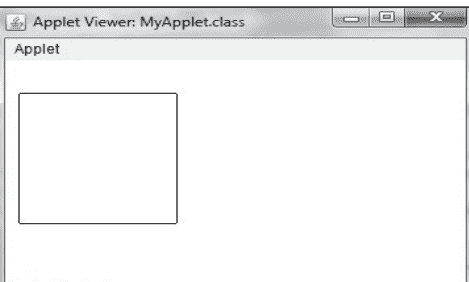

### 12.3 如何运行 Applet 程序

`Applet` 的编译方式与你编译控制台程序的方式相同。然而，运行 `applet` 有两种方法。

- 在 Java 兼容的网页浏览器中执行 `Applet`。
- 使用 `Applet viewer`（作为标准工具 `applet viewer`）。`Applet viewer` 在一个窗口中执行你的 `applet`。

要在网页浏览器中执行 `Applet`，请在相同目录下创建一个短的 HTML 文件。在文件的 `body` 标签中包含以下代码。（`applet` 标签用于加载 `Applet` 类）。

```html
<applet code="MyApplet" width="400" height="400"></applet>
```


#### 使用 Applet viewer 使用 Applet：

要执行 Applet viewer，请如上所述编写一个短的 HTML 文件。如果你将其命名为`run.htm`，那么以下命令将运行你的 applet 程序。

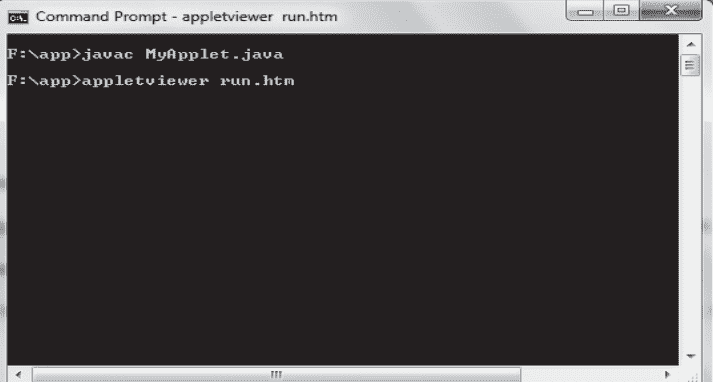

### 12.4 Applet 的绘图方法

- 1. `Drawline(x1, y1, x2, y2)`：此方法用于在两对坐标`(x1, y1)`和`(x2, y2)`之间画线。它们作为`drawLine`的参数。因此，线将在指定的坐标之间绘制。
- 2. `Drawrect(x1, y1, x2, y2)`：此方法用于绘制矩形，其中矩形的左上角代表`x1`和`y1`，矩形的右下角坐标表示`x2`和`y2`。
- 3. `FillRect(x1, y1, x2, y2)`：此方法接受四个参数，`(x1, y1)`是左上角，`(x2, y2)`是右下角。在这些坐标之间进行填充。默认情况下，此方法将显示矩形。
- 4. `Drawrect(x1, y1, x2, y2, x3, y3)`：接受 6 个参数。前四个参数与`drawrect`类似，最后两个参数`x3, y3`代表圆角的弧度大小。
- 5. `Fillround(x1, y1, x2, y2, x3, y3)`：填充圆矩形。
- 6. `Drawoval(x1, y1, x2, y2)`：接受四个参数。前两个参数`x1, y1`代表位置，另外两个代表宽度和高度。如果宽度和高度相同，则变为圆形，否则形成椭圆。例如，编写程序创建一个具有形状的 Applet。线、矩形、圆矩形：

```java
/*code = "shape.class" height = 400 width = 500*/

public class shape extends Applet
{
    public void paint (Graphics g)
    {
        g.drawLine(10, 10, 50, 50);
        g.setColor(Color.red);
        g.drawrect(10, 60, 40, 30);
        g.fillrect(60, 10, 30, 30);
        g.drawroundrect(10, 100, 30, 50);
        g.fillroundrect(20, 110, 60, 50);
    }
}
```

- 7. `Filloval(x1, y1, x2, y2)`：填充椭圆。参数用法与`drawoval`相同。不同之处在于它用颜色填充椭圆。
- 8. `Setcolor(color.green)`：设置颜色后，所有操作将在相同的颜色下进行。

**Drawarc：** 该方法接受 6 个参数。前两个参数`x1, y1`代表左上角，另外两个参数与`drawoval`相同，即`(x2, y2)`代表弧的宽度和高度。`(x3, y3)`代表弧的起始角度和角度。
语法：
```java
Drawarc (x1, y1, x2, y2, x3, y3);
```

**Fillarc：** `Fillarc`接受 3 个参数。第一个参数是 x 坐标数组。第二个参数是包含 y 坐标的数组。第三个参数是总角度整数值。
语法：
```java
Fillarc (x1, y1, x2, y2, x3);
```

**绘制多边形 (Drawing polygon)：** `Draw polygon`方法接受 3 个参数。第一个参数是包含 x 坐标的数组。第二个参数是包含 y 坐标的数组。第三个参数是点数整数。
语法：
```java
Drawpolygon (x points, y points, n points);
```

### 12.5 事件处理

任何使用事件并将其发送 GUI（图形界面，如为窗口编写的 Java）的应用程序都是事件驱动的。事件描述对象状态的变化。例如：按下按钮、在文本框中输入字符。事件处理的组件

事件处理有三个主要组件：

- **事件 (Events)**：源向注册的一个或多个监听器生成事件。一旦监听器接收到事件，就会处理事件并返回。多个 Java 包支持事件，如`java.util`、`java.awt`和`java.awt.event`。
- **事件源 (Events Source)**：是产生事件的对象。
- **监听器 (Listeners)**：监听器是监听事件的对象。当事件发生时会通知监听器。

#### 如何处理事件？

| 事件类 | 事件描述 | 监听器接口 |
|---|---|---|
| `ActionEvent` | 当按下按钮、选择菜单项、双击时生成 | |
| `MouseEvent` | 当鼠标被拖动、移动、按下或释放，以及进入组件时生成 | `MouseListener` |
| `KeyEvent` | 当从键盘接收输入时生成 | `KeyListener` |
| `ItemEvent` | 当点击复选框或列表项时生成 | `ItemListener` |
| `TextEvent` | 当文本区域或文本字段的值改变时生成 | `TextListener` |
| `MouseWheelEvent` | 当鼠标移动时生成 | `MouseWheelListener` |
| `WindowEvent` | 当窗口激活、取消激活、打开或关闭时生成 | `WindowListener` |
| `ComponentEvent` | 当组件被隐藏、移动或设置为可见时生成 | `ComponentEventListener` |
| `ContainerEvent` | 当组件被添加到或从容器中移除时生成 | `ContainerListener` |
| `AdjustmentEvent` | 当滚动条被操作时生成 | `AdjustmentListener` |
| `FocusEvent` | 当组件获得或失去焦点时生成 | `FocusListener` |

### 12.6 在 Applet 中传递参数

- 使用语法在 applet 中传递参数：
`x=getParameter("y")`

`x`是字符串变量，`y`是字符串常量。`y`使用 HTML 标签给出。特殊的参数标签`<PARAM>`应该在 HTML 文件中通过以下格式创建：

`<PARAM NAME=y VALUE="const">`
在 Applet 内部`x=getParameter("y");`
在 HTML 内部`<PARAM NAME=y VALUE="const">`

在 Applet 中使用参数示例：

```java
UseParam.java

import java.applet.Applet;
import java.awt.Graphics;

public class UseParam extends Applet {
    public void paint(Graphics g) {
        String str=getParameter("msg");
        g.drawString(str,50, 50);
    }
}
```

```html
UseParam.html

<html>
<body>
<applet code="UseParam.class" width="300" height="300">
<param name="msg" value="Welcome to applet">
</applet>
</body>
</html>
```

`Label`定义了以下构造函数：

- 1. `Label()`
- 2. `Label(String str)`
- 3. `Label(String str, int how)`

第一个版本创建一个空白标签。

第二个版本创建一个包含由`str`指定字符串的标签。该字符串是左对齐的。

第三个版本创建一个包含由`str`指定字符串的标签，并使用`how`指定对齐方式。`how`的值必须是这三个常量之一：`Label.LEFT`、`Label.RIGHT`或`Label.CENTER`。

你可以使用`setText()`方法设置或更改标签中的文本。可以通过调用`getText()`获取当前标签。

这里显示了这些方法：

- 1. `void setText(String str)`
- 2. `String getText()`

对于`setText()`，`str`指定新的标签。对于`getText()`，返回当前标签。

你可以通过调用`setAlignment()`设置标签内字符串的对齐方式。

要获取当前对齐方式，请调用`getAlignment()`。

方法如下：

- 1. `void setAlignment(int how)`
- 2. `int getAlignment()`

以下示例创建了三个标签并将它们添加到 applet 中-

**示例：**

```java
import java.awt.*;
import java.applet.*;

/*
<applet code="LabelDemo" width=300 height=200>
</applet>
*/

public class LabelDemo extends Applet {
    public void init() {
        Label one = new Label("One");
        Label two = new Label("Two");
        Label three = new Label("Three");
        // 将标签添加到 applet 窗口
    }
}
```

```java
add(one);
add(two);
add(three);
}
```

输出：

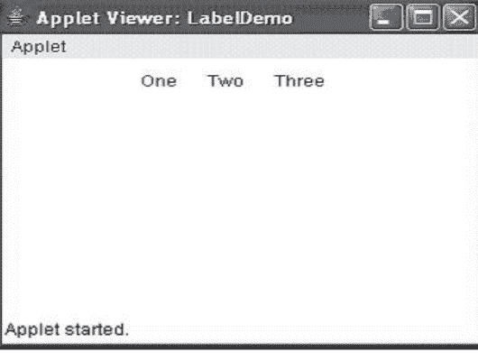

#### 按钮 (Buttons)

最广泛使用的控件是推按钮（push button）。按钮是一个包含标签的组件，当被按下时会生成事件。按钮是`Button`的对象。`Button`定义了这两个构造函数：

- 1. `Button()`
- 2. `Button(String str)`

第一个版本创建一个空按钮。
第二个版本创建一个包含`str`作为标签的按钮。

在创建按钮后，你可以通过`setLabel()`设置其标签。可以通过调用`getLabel()`获取标签。这些方法如下：

- 1. `void setLabel(String str)`
- 2. `String getLabel()`

在这里，`str`成为按钮的新标签。

#### 按钮的处理 (Handling Buttons)

每当按钮被按下时，就会生成一个事件。该事件会被发送给之前注册的、用于接收该组件事件通知的所有监听器。每个监听器都实现了`ActionListener`接口。该接口定义了`actionPerformed()`方法，该方法在事件发生时被调用。该方法提供一个`Action`对象作为参数。它包含了生成事件的按钮的引用，也包含了作为按钮标签的字符串的引用。

这是一个示例，创建了三个标记为“Yes”、“No”和“Undecided”（未）的按钮。

每当其中一个被按下时，都会显示一条消息，报告哪个按钮被按下。在这个版本中，使用按钮的标签来确定哪个按钮被按下。通过调用传递给`actionPerformed()`的`ActionEvent`对象上的`getCommand()`方法获取标签。

#### 示例：

```java
import java.awt.*;
import java.awt.event.*;
import java.applet.*;

/*
<applet code="ButtonDemo" width=250 height=150>
</applet>
*/

public class ButtonDemo extends Applet implements ActionListener
{
    String msg = "";
    Button yes, no, maybe;

    public void init() {
        yes = new Button("Yes");
        no = new Button("No");
        maybe = new Button("Undecided");
        add(yes);
        add(no);
        add(maybe);
        yes.addActionListener(this);
        no.addActionListener(this);
        maybe.addActionListener(this);
    }

    public void actionPerformed(ActionEvent ae) {
        String str = ae.getActionCommand();
        if(str.equals("Yes")) {
            msg = "You pressed Yes.";
        } else if(str.equals("No")) {
            msg = "You pressed No.";
        }
    }
}
```

```java
{
else
{
    msg = "You pressed Undecided.";
}
repaint();
}

public void paint(Graphics g)
{
    g.drawString(msg, 6, 100);
}
}
```

输出：

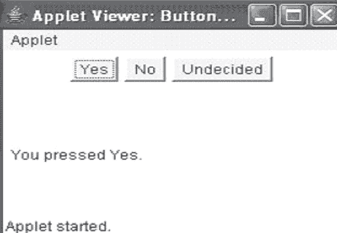

#### 文本字段 (TextField)

`TextField`类实现了一个单行文本输入区域，通常称为编辑控件。`TextField`字段允许用户输入字符串，并使用方向键、剪切粘贴键以及鼠标选择来编辑文本。

`TextField`是`TextComponent`的子类。

`TextField`定义了以下构造函数：

- 1. `TextField()`
- 2. `TextField(int numChars)`
- 3. `TextField(String str)`
- 4. `TextField(String str, int numChars)`

第一个版本创建一个默认文本字段。

第二个形式创建一个宽度为`numChars`个字符的文本字段。

第三种形式使用`str`初始化文本字段。

第四种形式初始化文本字段并设置其宽度。

`TextField`提供了几个方法允许你利用文本字段。要获取文本字段中的字符串，调用`getText()`。要设置文本，调用`setText()`。

方法如下：

- 1. `String getText()`
- 2. `void setText(String str)`

在这里，`str`是新字符串。

有时你可能希望用户输入的文本不显示，例如密码。你可以通过`getEchoSet()`检查字段是否处于这种模式。通过调用`getEchoChar()`方法获取回显字符。

方法有：

- 1. `boolean getEchoSet()`
- 2. `char getEchoChar()`
- 3. `String getSelected()`

在这里，`ch`指定显示的字符。

#### 文本字段的处理 (Handling a TextField)

由于文本字段执行自己的编辑功能，你的程序通常不会对文本字段内的单个事件做出响应。然而，你可能希望在用户按下 ENTER 时做出响应。这种情况发生时，会生成一个动作事件。

示例：

```java
import java.awt.*;
import java.awt.event.*;
import java.applet.*;

/*
<applet code="ListDemo" width=300 height=180>
</applet>
*/

public class ListDemo extends Applet implements ActionListener
{
    List os, browser;
    String msg = "";

    public void init() {
        os = new List(4, true);
        browser = new List(4, 4, false);
        // 向 os 列表添加项
        os.add("Windows 98/XP");
        os.add("Windows NT/2000");
        os.add("Solaris");
        os.add("MacOS");
        // 向 browser 列表添加项
        browser.add("Netscape 3.x");
        browser.add("Netscape 4.x");
        browser.add("Netscape 5.x");
        browser.add("Netscape 6.x");
        browser.add("Internet Explorer 4.0");
        browser.add("Internet Explorer 5.0");
        browser.add("Internet Explorer 6.0");
        browser.add("Lynx 2.4");
        browser.select(1);
        // 将列表添加到窗口
        add(os);
        add(browser);
        // 注册接收动作事件
```


`os.addActionListener(this);`

`browser.addActionListener(this);`

```java
public void actionPerformed(ActionEvent ae) {
    String str = ae.getActionCommand();
    if (str.equals("ENTER")) {
        msg = "You selected: " + browser.getSelectedItem();
    }
    repaint();
}

public void paint(Graphics g) {
    g.drawString(msg, 20, 100);
}
```

```java
public void actionPerformed(ActionEvent ae) {
    repaint();
    // Display current selections.
}

public void paint(Graphics g) {
    int[] idx;
    String msg = "Current OS: ";
    idx = os.getSelectedIndices();
    for (int i = 0; i < idx.length; i++)
        msg += os.getItem(idx[i]) + " ";
    g.drawString(msg, 6, 120);
    msg = "Current Browser: ";
    msg += browser.getSelectedItem();
    g.drawString(msg, 6, 140);
}
```

Output:

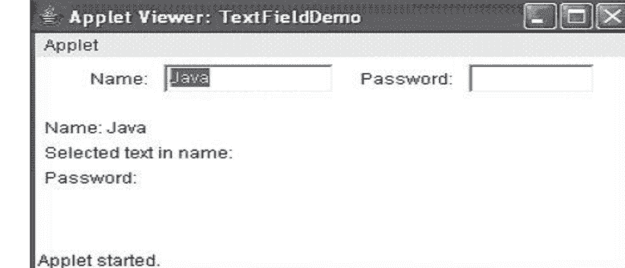

## Questions

1. 解释 Applet 的生命周期。
2. 解释如何运行 Applet 程序。
3. 解释 Applet 的绘制方法并结合示例。
4. 解释 Java 中的事件处理。
5. 解释 Java Applet 中的参数传递。

# 第 13 章 AWT

> "Java AWT（抽象窗口工具包）是一个用于在 Java 中开发 GUI 或基于窗口应用程序的 API。"

### 目录

- 13.1 AWT 基础
- 13.2 组件
- 13.3 Frame 窗口操作
- 13.4 Java 控件基础
- 13.4.1 添加和移除控件
- 13.4.2 响应控件
- 13.5 事件委托模型
- 13.6 监听器
- 13.7 布局
- 13.8 Label 控件
- 13.9 按钮
- 13.10 复选框
- 13.11 Choice 控件
- 13.12 列表
- 13.13 滚动条
- 13.14 文本框
- 13.15 文本区域
- 13.16 JRadioButton
- 13.17 菜单

### 13.1 AWT 基础

AWT 包含了大量的类和方法，允许你创建和管理 Swing GUI 应用程序。AWT 是 Swing 构建的基础。它被用于 Java 中的 GUI 编程。但现在它已很少使用，因为大多数 GUI Java 程序都是使用 Swing 实现，因为它具有丰富的 GUI 控件实现和轻量级特性。

Java AWT（抽象窗口工具包）是一个用于在 Java 中开发 GUI 或基于窗口应用程序的 API。

Java AWT 组件是依赖于平台的，即组件根据操作系统的视图进行显示。AWT 是重量级的，即其组件使用系统资源。

`java.awt` 包提供了 AWT API 的类，如 `TextField`、`Label`、`TextArea`、`RadioButton`、`Checkbox`、`Choice`、`List` 等。

#### Java AWT 层次结构

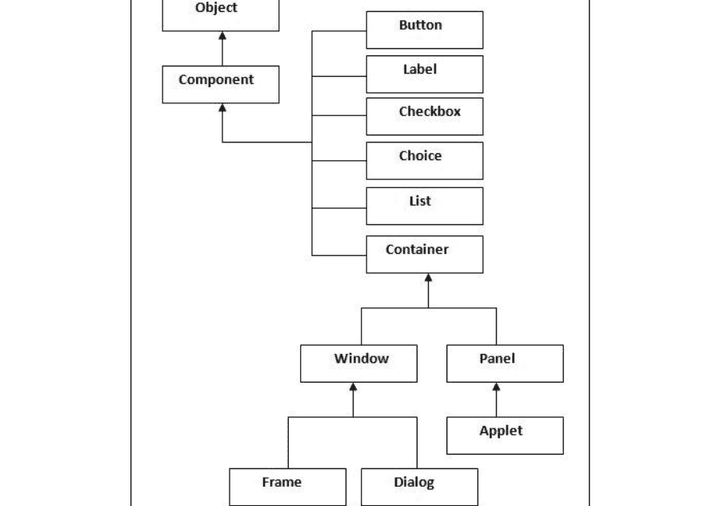

### 13.2 Component（组件）

在 AWT 层次结构的顶端是 `Component` 类。`Component` 是一个抽象类，封装了视觉组件的所有属性。所有显示在屏幕上并与用户交互的用户界面元素都是 `Component` 的子类。它定义了的一百多个公共方法，负责管理事件，例如鼠标和键盘输入、窗口的位置和大小，以及重绘。`Component` 对象负责记住当前的前景颜色、背景颜色以及当前选定的文本字体。

#### Container（容器）

`Container` 是 `Component` 的子类。它具有额外的方法，允许其他 `Component` 对象嵌套在它内部。其他的 `Container` 对象可以存储在 `Container` 内部（因为它们本身就是 `Component` 的实例）。这使得多级系统成为可能。容器负责布局（即定位）它所包含的任何组件。

#### Window（窗口）

`Window` 类创建顶层窗口。顶层窗口不包含任何其他对象，它直接位于桌面上。我们使用名为 `Frame` 的子类。

#### Panel（面板）

`Panel` 类是 `Container` 的子类。它没有添加任何新方法；只是实现了 `Container`。`Panel` 是 `Applet` 的父类。当输出到 `Applet` 时，它在 `Panel` 表面绘制。`Panel` 是一个不包含标题栏、菜单栏或边框的窗口。其他组件可以通过 `add()` 方法添加到 `Panel` 对象，或者使用 `Component` 定义的 `setBounds()`、`setSize()` 方法对它们进行定位和调整大小。

#### Frame（框架）

`Frame` 是一个包含标题栏并可以有很多栏的容器。它可以拥有按钮、文本框等组件。

#### Canvas（画布）

`Canvas` 是 `Applet` 或 `Frame` 窗口层次结构的一部分。它封装了一个空白窗口。

### 13.3 Frame 窗口操作

创建 `Frame` 窗口：

在 `Applet` 内部创建一个新窗口实际上很容易。首先，创建一个 `Frame` 的子类。接下来，覆盖任何标准的 `Applet` 方法，如 `init()`、`start()` 和 `stop()`，根据需要显示或隐藏 `Frame`。最后，实现 `Listener` 接口的 `windowClosing()` 方法，在窗口关闭时调用 `setVisible(false)`。你通常创建的窗口类型派自 `Frame`。`Frame` 的构造函数如下：

```java
Frame()
```

```java
Frame(String title)
```

第一个形式创建一个不包含标题的标准窗口。第二种形式创建一个由 `title` 指定标题的窗口。我们无法指定窗口的维度。我们必须在创建后设置窗口的大小。与窗口操作时的一些方法如下。

#### 设置窗口尺寸

`setSize()` 方法用于设置窗口的尺寸。其签名如下：

```java
void setSize(int newWidth, int newHeight)
void setSize(Dimension newSize)
```

窗口的新尺寸由 `newWidth` 和 `newHeight` 指定。尺寸以像素为单位。

`getSize()` 用于获取窗口的当前尺寸。其签名如下：

```java
Dimension getSize()
```

此方法返回 `Dimension` 对象中宽度和高度字段内的窗口当前尺寸。

#### 隐藏和显示窗口

`setVisible()` 方法用于显示或隐藏窗口。其签名如下：

```java
void setVisible(boolean visible)
```

此参数为 `true` 时窗口可见；否则它是隐藏的。

#### 设置窗口标题

你可以使用 `setTitle()` 修改窗口标题。其签名如下：

```java
void setTitle(String newTitle)
```

在这里，`newTitle` 是窗口的标题。

#### 关闭窗口

使用窗口时，必须在关闭时将其从屏幕上移除，调用 `setVisible(false)`。要拦截窗口关闭事件，你必须实现 `WindowListener` 接口的 `windowClosing()` 方法。

#### 创建 Frame

创建 `Frame` 有两种方法：

- 通过实例化 `Frame`
- 通过继承 `Frame`

通过实例化创建窗口：

```java
import java.awt.*;

public class Testawt {
    Testawt() {
        Frame fm = new Frame();
        Label lb = new Label("welcome to java");
        fm.add(lb);
        fm.setSize(300, 300);
        fm.setVisible(true);
    }

    public static void main(String args[]) {
        Testawt ta = new Testawt();
    }
}
```

Output:

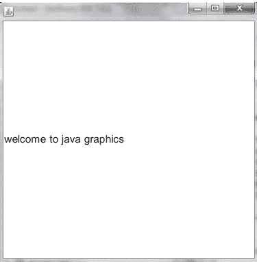

#### 通过继承创建 Frame

```java
package testawt;

import java.awt.*;
import java.awt.event.*;

public class Testawt extends Frame {
    Testawt() {
        Button btn = new Button("Hello World");
        add(btn);
        setSize(400, 500);
        setTitle("Study Java");
        setLayout(new FlowLayout());
        setVisible(true);
    }

    public static void main(String[] args) {
        Testawt ta = new Testawt();
    }
}
```

Output:


### 13.4 控件基础

AWT 包含了大量的类和方法，允许你创建和管理 Swing GUI 应用程序。AWT 是 Swing 构建的基础。它被用于 Java 中的 GUI 编程。但现在它已很少使用，因为大多数 GUI Java 程序都是使用 Swing 实现，因为它具有丰富的 GUI 控件实现和轻量级特性。

Java AWT（抽象窗口工具包）是一个用于在 Java 中开发 GUI 或基于窗口应用程序的 API。

Java AWT 组件是依赖于平台的，即组件根据操作系统的视图进行显示。AWT 是重量级的，即其组件使用系统资源。

`java.awt` 包提供了 AWT API 的类，如 `TextField`、`Label`、`TextArea`、`RadioButton`、`Checkbox`、`Choice`、`List` 等。

#### Java AWT 层次结构


### 13.2 Component（组件）

在 AWT 层次结构的顶端是 `Component` 类。`Component` 是一个抽象类，封装了视觉组件的所有属性。所有显示在屏幕上并与用户交互的用户界面元素都是 `Component` 的子类。它定义的一百多个公共方法，负责管理事件，例如鼠标和键盘输入、窗口的位置和大小，以及重绘。`Component` 对象负责记住当前的前景颜色、背景颜色以及当前选定的文本字体。

#### Container（容器）

`Container` 是 `Component` 的子类。它具有额外的方法，允许其他 `Component` 对象嵌套在它内部。其他的 `Container` 对象可以存储在 `Container` 内部（因为它们本身就是 `Component` 的实例）。这使得多级系统成为可能。容器负责布局（即定位）它所包含的任何组件。

#### Window（窗口）

`Window` 类创建顶层窗口。顶层窗口不包含任何其他对象，它直接位于桌面上。我们使用名为 `Frame` 的子类。

#### Panel（面板）

`Panel` 类是 `Container` 的子类。它没有添加任何新方法；只是实现了 `Container`。`Panel` 是 `Applet` 的父类。当输出到 `Applet` 时，它在 `Panel` 表面绘制。`Panel` 是一个不包含标题栏、菜单栏或边框的窗口。其他组件可以通过 `add()` 方法添加到 `Panel` 对象，或者使用 `Component` 定义的 `setBounds()`、`setSize()` 方法对它们进行定位和调整大小。

#### Frame（框架）

`Frame` 是一个包含标题栏并可以有很多栏的容器。它可以拥有按钮、文本框等组件。

#### Canvas（画布）

`Canvas` 是 `Applet` 或 `Frame` 窗口层次结构的一部分。它封装了一个空白窗口，你可以在上面绘制。

### 13.3 Frame 窗口操作

创建 `Frame` 窗口：

在 `Applet` 内部创建一个新窗口实际上很容易。首先，创建一个 `Frame` 的子类。接下来，覆盖任何标准的 `Applet` 方法，如 `init()`、`start()` 和 `stop()`，根据需要显示或隐藏 `Frame`。最后，实现 `Listener` 接口的 `windowClosing()` 方法，在窗口关闭时调用 `setVisible(false)`。你通常创建的窗口类型派自 `Frame`。`Frame` 的构造函数如下：

```java
Frame()
```

```java
Frame(String title)
```

第一个形式创建一个不包含标题的标准窗口。第二种形式创建一个由 `title` 指定标题的窗口。我们无法指定窗口的维度。我们必须在创建后设置窗口的大小。与窗口操作时的一些方法如下。

#### 设置窗口尺寸

`setSize()` 方法用于设置窗口的尺寸。其签名如下：

```java
void setSize(int newWidth, int newHeight)
void setSize(Dimension newSize)
```

窗口的新尺寸由 `newWidth` 和 `newHeight` 指定。尺寸以像素为单位。

`getSize()` 用于获取窗口的当前尺寸。其签名如下：

```java
Dimension getSize()
```

此方法返回 `Dimension` 对象中宽度和高度字段内的窗口当前尺寸。

#### 隐藏和显示窗口

`setVisible()` 方法用于显示或隐藏窗口。其签名如下：

```java
void setVisible(boolean visible)
```

此参数为 `true` 时窗口可见；否则它是隐藏的。

#### 设置窗口标题

你可以使用 `setTitle()` 修改窗口标题。其签名如下：

```java
void setTitle(String newTitle)
```

在这里，`newTitle` 是窗口的标题。

#### 关闭窗口

使用窗口时，必须在关闭时将其从屏幕上移除，调用 `setVisible(false)`。要拦截窗口关闭事件，你必须实现 `WindowListener` 接口的 `windowClosing()` 方法。

#### 创建 Frame

创建 `Frame` 有两种方法：

- 通过实例化 `Frame`
- 通过继承 `Frame`

通过实例化创建窗口：

```java
import java.awt.*;

public class Testawt {
    Testawt() {
        Frame fm = new Frame();
        Label lb = new Label("welcome to java");
        fm.add(lb);
        fm.setSize(300, 300);
        fm.setVisible(true);
    }

    public static void main(String args[]) {
        Testawt ta = new Testawt();
    }
}
```

Output:


#### 通过继承创建 Frame

```java
package testawt;

import java.awt.*;
import java.awt.event.*;

public class Testawt extends Frame {
    Testawt() {
        Button btn = new Button("Hello World");
        add(btn);
        setSize(400, 500);
        setTitle("Study Java");
        setLayout(new FlowLayout());
        setVisible(true);
    }

    public static void main(String[] args) {
        Testawt ta = new Testawt();
    }
}
```

Output:


`Testawt ta = new Testawt();`

```
}

}
```

Output:


# 13.4 控件基础

AWT 包含了大量的类和方法，允许你创建和管理 Swing GUI 应用程序。AWT 是 Swing 构建的基础。它被用于 Java 中的 GUI 编程。但现在它已很少使用，因为大多数 GUI Java 程序都是使用 Swing 实现，因为它具有丰富的 GUI 控件实现和轻量级特性。

Java AWT（抽象窗口工具包）是一个用于在 Java 中开发 GUI 或基于窗口应用程序的 API。

Java AWT 组件是依赖于平台的，即组件根据操作系统的视图进行显示。AWT 是重量级的，即其组件使用系统资源。

`java.awt` 包提供了 AWT API 的类，如 `TextField`、`Label`、`TextArea`、`RadioButton`、`Checkbox`、`Choice`、`List` 等。

## Java AWT 层次结构


### 13.2 Component（组件）

在 AWT 层次结构的顶端是 `Component` 类。`Component` 是一个抽象类，封装了视觉组件的所有属性。所有显示在屏幕上并与用户交互的用户界面元素都是 `Component` 的子类。它定义的一百多个公共方法，负责管理事件，例如鼠标和键盘输入、窗口的位置和大小，以及重绘。`Component` 对象负责记住当前的前景颜色、背景颜色以及当前选定的文本字体。

#### Container（容器）

`Container` 是 `Component` 的子类。它具有额外的方法，允许其他 `Component` 对象嵌套在它内部。其他的 `Container` 对象可以存储在 `Container` 内部（因为它们本身就是 `Component` 的实例）。这使得多级系统成为可能。容器负责布局（即定位）它所包含的任何组件。

#### Window（窗口）

`Window` 类创建顶层窗口。顶层窗口不包含任何其他对象，它直接位于桌面上。我们使用名为 `Frame` 的子类。

#### Panel（面板）

`Panel` 类是 `Container` 的子类。它没有添加任何新方法；只是实现了 `Container`。`Panel` 是 `Applet` 的父类。当输出到 `Applet` 时，它在 `Panel` 表面绘制。`Panel` 是一个不包含标题栏、菜单栏或边框的窗口。其他组件可以通过 `add()` 方法添加到 `Panel` 对象，或者使用 `Component` 定义的 `setBounds()`、`setSize()` 方法对它们进行定位和调整大小。

#### Frame（框架）

`Frame` 是一个包含标题栏并可以有很多栏的容器。它可以拥有按钮、文本框等组件。

#### Canvas（画布）

`Canvas` 是 `applet` 或 `frame` 窗口层次结构的一部分。它封装了一个空白窗口，你可以在上面绘制。

### 13.3 Frame 窗口操作

创建 `frame` 窗口：

在 `applet` 内部创建一个新窗口实际上很容易。首先，创建一个 `Frame` 的子类。接下来，覆盖任何标准的 `applet` 方法，如 `init()`、`start()` 和 `stop()`，根据需要显示或隐藏 `frame`。最后，实现 `Listener` 接口的 `windowClosing()` 方法，在窗口关闭时调用 `setVisible(false)`。你通常创建的窗口类型派自 `Frame`。`Frame` 的构造函数如下：

```
Frame()
```

```java
Frame(String title)
```

第一个形式创建一个不包含标题的标准窗口。第二种形式创建一个由 `title` 指定标题的窗口。我们无法指定窗口的维度。我们必须在创建后设置窗口的大小。与窗口操作时的一些方法如下。

#### 设置窗口尺寸

`getSize()` 方法用于设置窗口的尺寸。其签名如下：
```java
void getSize(int newWidth,int newHeight)
void getSize(Dimension newSize)
```
窗口的新尺寸由 `newWidth` 和 `newHeight` 指定。尺寸以像素为单位。

`getSize()` 用于获取窗口的当前尺寸。其签名如下：
```java
Dimension getSize()
```
此方法返回 `Dimension` 对象中宽度和高度字段内的窗口当前尺寸。

#### 隐藏和显示窗口

`getSize()` 方法用于获取窗口的当前尺寸。其签名如下：
```
Dimension getSize()
```
`frame` 创建后，在调用 `setVisible()` 之前它是不可见的的。其签名如下：
```java
void setVisible(boolean visible)
```
此参数为 `true`；否则它是隐藏的。

#### 设置窗口标题

你可以使用 `setTitle()` 修改窗口标题。其签名如下：
```java
void setTitle(String newTitle)
```
在这里，`newTitle` 是窗口的标题。

#### 关闭窗口

使用窗口时，必须在关闭时将其从屏幕上移除，调用 `setVisible(false)`。要拦截窗口关闭事件，你必须实现 `WindowListener` 接口 `windowClosing()`。

#### 创建 Frame

创建 `Frame` 有两种方法：

- 通过实例化 `Frame`
- 通过继承 `Frame`

通过实例化创建窗口：

```java
import java.awt.*;

public class Testawt {

    Testawt() {

        Frame fm = new Frame();

        Label lb = new Label("welcome to java");

        fm.add(lb);

        fm.setSize(300, 300);

        fm.setVisible(true);

    }

    public static void main(String args[]) {

        Testawt ta = new Testawt();

    }

}
```

Output:


#### 通过类类创建 Frame

```java
package testawt;

import java.awt.*;

import java.event.*;

public class Testawt extends Frame {

    Testawt() {

        Button btn = new Button("Hello World");

        add(btn);

        setSize(400, 500);

        setTitle("Study Java");

        setLayout(new FlowLayout());

        setVisible(true);

    }

    public static void main(String[] args) {

        Testawt ta = new Testawt();

    }

}
```

Output:


它的概念非常简单：

- 1 源产生一个事件并将其发送给一个或多个监听器。
- 2 监听器只需等待直到接收到事件。一旦接收，监听器就会处理该事件并返回。
- 3 这种设计的优点是，应用程序处理事件逻辑与生成这些事件的用户界面逻辑清晰地分离来。
- 4 用户界面元素能够将事件的处理委托给另一部分代码。
- 5 在委托事件模型中，监听器必须向源注册，以便接收事件通知。
- 6 这提供了一个重要的益处：通知只发送给想要接收通知的监听器。

# 事件 (Events)

在委托模型中，事件是一个描述源状态变化的的对象。它可能是由于人与图形用户界面中的元素交互而产生的。导致事件生成的某些活动包括按下按钮、通过键盘输入字符、在列表中选择项目以及点击鼠标。许多其他用户操作也可以作为例子。也可能发生并非由与用户界面交互直接引起的事件。

# 事件源 (Event Sources)

源是一个产生事件的对象。当该对象的内部状态以某种方式发生变化时，就会发生这种情况。源产生多种类型的事件。源可能会注册监听器，以便监听器接收关于特定类型事件的通知。每种类型的事件都有自己的注册方法。这里是通用形式：

```java
public void addEventListener(EventListener l)
```

在这里，`Type` 是事件的名称，`l` 是对事件监听器的引用。

# 事件监听器 (Event Listeners)

监听器是在事件发生时被通知的。它有两个主要要求。第一，它必须在一个或多个源上注册，以接收有关特定类型事件的通知。第二，它必须实现方法来接收和处理这些通知。接收和处理事件的方法定义在 `java.awt.event` 中的一组接口中。

例如，`MouseMotionListener`接口定义了两个方法用于在鼠标被拖动或移动时接收通知。任何对象只要提供了此接口的实现，就可以接收其中一个或两个事件。

# 事件类 (Event Classes)

表示事件的类是 Java 事件处理机制的核心。因此，我们从遍历事件类开始学习事件处理。正如你将看到的，它们提供了一种一致的、易于使用的封装事件的方法。Java 事件类层次结构的根节点是 `Object`，它位于 `java.util` 中。它是所有事件的父类。

它的构造函数在此所示：

```java
EventObject(Object src)
```

在这里，`src` 是产生此事件的对象。

`EventObject` 包含两个方法：`getSource()` 和 `toString()`。`getSource()` 方法返回事件源。它的通用形式在此所示：

```java
Object getSource()
```

# 13.6 监听器与监听器接口

| 事件类 | 监听器接口 |
| --- | --- |
| `ActionEvent` | `ActionListener` |
| `MouseEvent` | `MouseListener` and `MouseMotionListener` |
| `MouseWheelEvent` | `MouseWheelListener` |
| `KeyEvent` | `KeyListener` |
| `ItemEvent` | `ItemListener` |
| `TextEvent` | `TextListener` |
| `AdjustmentEvent` | `AdjustmentListener` |
| `WindowEvent` | `WindowListener` |
| `ComponentEvent` | `ComponentListener` |
| `ContainerEvent` | `ContainerListener` |
| `FocusEvent` | `FocusListener` |

# 执行事件处理的步骤

执行事件处理需要以下步骤：

- 1. 向监听器注册组件

# 注册方法

为了向监听器注册组件，许多类都提供了注册方法。例如：

- `Button` (按钮)
    - `public void addActionListener(ActionListener a){}`
- `MenuItem` (菜单项)
    - `public void addActionListener(ActionListener a){}`
- `TextField` (文本框)
    - `public void addActionListener(ActionListener a){}`
    - `public void addTextListener(TextListener a){}`
- `TextArea` (多行区域)
    - `public void addTextListener(TextListener a){}`
- `Checkbox` (复选框)
    - `public void addItemListener(ActionListener a){}`
- `Choice` (选择框)
    - `public void addItemListener(ActionListener a){}`
- `List` (列表)
    - `public void addActionListener(ActionListener a){}`
    - `public void addItemListener(ActionListener a){}`

# Java 事件处理代码

我们可以将事件处理代码放在以下位置之一：

- 1. 类内部
- 2. 其他类中
- 3. 匿名类

# Java ActionListener 接口

每当你点击按钮或菜单项时，`ActionListener` 就会被通知。它是针对 `ActionEvent` 被通知的。`ActionListener` 接口位于 `java.awt.event` 包中。它只有一个方法：`actionPerformed()`。

# actionPerformed() 方法

每当你点击注册的组件时，`actionPerformed()` 方法就会被自动调用。

```java
public abstract void actionPerformed(ActionEvent e);
```

# Java ActionListener 示例：点击按钮

```java
import java.awt.*;

import java.awt.event.*;

public class ActionListenerExample {

    public static void main(String[] args) {

        Frame f=new Frame("ActionListener Example");

        final TextField tf=new TextField();

        tf.setBounds(50,50,150,20);

        Button b=new Button("Click Here");

        b.setBounds(50,100,60,30);

        b.addActionListener(new ActionListener() {

            @Override

            public void actionPerformed(ActionEvent e) {

                tf.setText("Welcome to Java.");

            }

        });

        f.add(b);f.add(tf);

        f.setSize(400,200);

        f.setLayout(null);

        f.setVisible(true);

    }

}
```

# Java ItemListener 接口

每当你点击复选框时，`ItemListener` 就会被通知。它是针对 `ItemEvent` 被通知的。`ItemListener` 接口位于 `java.awt.package` 中。它只有一个方法：`itemStateChanged()`。

# itemStateChanged() 方法

每当你点击或取消点击注册的复选框组件时，`itemStateChanged()` 方法就会被自动调用。

```java
public abstract void itemStateChanged(ItemEvent e);
```

# Java ItemListener 示例

```java
import java.awt.*;

import java.awt.event.*;

public class ItemListenerExample implements ItemListener {

    Checkbox checkBox1,checkBox2;

    Label label;

    ItemListenerExample() {

        Frame f = new Frame("Checkbox Example");

        label = new Label("");

        label.setAlignment(Label.CENTER);

        f.setSize(400,100);

        checkBox1 = new Checkbox("C++");

        checkBox1.setBounds(100,100, 50,50);

        checkBox2 = new Checkbox("Java");

        checkBox2.setBounds(100,150, 50,50);

        f.add(checkBox1); f.add(checkBox2);f.add(label);

        checkBox1.addItemListener(this);

        checkBox2.addItemListener(this);

        f.setSize(400,400);

        f.setLayout(null);

        f.setVisible(true);

    }

    public void itemStateChanged(ItemEvent e) {

        if(e.getSource()==checkBox1)


`label.setText("C++ Checkbox: " + (e.getStateChange()==1?"checked":"unchecked"));`

`if(e.getSource()==checkBox2)`

`label.setText("Java Checkbox: " + (e.getStateChange()==1?"checked":"unchecked"));`

`}`

`public static void main(String args[]) {`

`new ItemListenerExample();`

`}`

`}`

## Java MouseListener 接口

每当你改变鼠标状态时，Java `MouseListener` 就会被通知。它是针对 `MouseEvent` 被通知的。`MouseListener` 接口位于 `java.awt.package` 中。它有五个方法。

### MouseListener 接口的方法

`MouseListener` 接口中的 5 个方法签名如下：

```java
public abstract void mouseClicked(MouseEvent e);
public abstract void mouseEntered(MouseEvent e);
public abstract void mouseExited(MouseEvent e);
public abstract void mousePressed(MouseEvent e);
public abstract void mouseReleased(MouseEvent e);
```

## Java MouseListener 示例

```java
import java.awt.*;
import java.awt.event.*;

public class MouseListener extends Frame implements MouseListener{
    Label l;
    MouseListenerExample(){
        addMouseListener(this);
        l=new Label();
        l.setBounds(20,50,100,20);
        add(l);
        setSize(300,300);
        setLayout(null);
        setVisible(true);
    }
    public void mouseClicked(MouseEvent e) {
        l.setText("Mouse Clicked");
    }
    public void mouseEntered(MouseEvent e) {
        l.setText("Mouse Entered");
    }
    public void mouseExited(MouseEvent e) {
        l.setText("Mouse Exited");
    }
    public void mousePressed(MouseEvent e) {
        l.setText("Mouse Pressed");
    }
    public void mouseReleased(MouseEvent e) {
        l.setText("Mouse Released");
    }
    public static void main(String[] args) {
        new MouseListenerExample();
    }
}
```

236

Core Java

输出：


## 13.7 布局 (Layouts)

### 布局管理器 (Layout Managers)

到目前为止显示的所有组件都是通过默认布局管理器进行定位的。布局管理器通过使用某种算法在窗口内排列您的控件。

每个 `Container` 对象都关联着一个布局管理器。布局管理器是实现了 `LayoutManager` 接口的任何类的实例。布局管理器通过 `setLayout()` 方法设置。如果没有调用 `setLayout()`，则使用默认布局管理器。每当容器的大小发生变化（或首次设置大小时）时，都会使用布局管理器对其内部的每个组件进行定位。

`setLayout()` 方法具有以下通用格式：

```
void setLayout(LayoutManager layoutObj)
```

`layoutObj` 是指向所需的布局管理器的引用。如果您希望禁用布局管理器并手动定位组件，请为 `layoutObj` 传递 `null`。如果这样做，您将需要使用 `Component` 定义的 `setBounds()` 方法手动确定每个组件的形状和位置。通常，您会希望使用布局管理器。

每个布局管理器都维护一个按名称存储的组件列表。每当您向容器添加组件时，布局管理器都会收到通知。

每当容器需要调整大小时，都会通过其 `minimumSize()` 和 `preferredLayoutSize()` 方法咨询布局管理器。

每个由布局管理器管理的组件都包含 `getPreferredSize()` 和 `getMinimumSize()` 方法。

这些方法返回显示每个组件所需的首选尺寸和最小尺寸。如果可能，布局管理器将遵循这些请求，以维护布局策略的完整性。对于子类化的控件，您可以重写这些方法。否则，将提供默认值。

Java 有若干个预定义的 `LayoutManager` 类，其中几个将在接下来介绍。您可以使用最适合您的应用程序的布局管理器。

#### 1. 流布局布局 (FlowLayout)

`FlowLayout` 是默认的布局管理器。`FlowLayout` 实现了一种简单的布局样式，类似于文字在文本编辑器中的流动方式。

组件从左上角开始，从左到右、从上到排列。当一行无法容纳更多组件时，下一个组件将出现在下一行。

以下是 `FlowLayout` 的构造函数：

```
FlowLayout()
```

```
FlowLayout(int how)
```

```
FlowLayout(int how, int hor, int vert)
```

第一种形式创建默认布局，该布局居中组件并在每个组件之间留下五个像素的空间。第二种形式允许您指定每行的对齐方式。`how` 的有效值如下：

```
FlowLayout.LEFT
```

```
FlowLayout.RIGHT
```

这些值分别指定左对齐、居中和右对齐。第三种形式允许您分别通过 `hor` 和 `vert` 指定组件之间留出的水平空间和垂直空间。

以下是在本章之前显示的 `CheckboxDemo` App 小程序的版本，已修改为使用左对齐的流式布局。

#### 2. 边界布局 (BorderLayout)

`BorderLayout` 类实现了一种顶层窗口的常用布局样式。它在边缘有四个窄的固定宽度组件，在中心有一个大区域。

四边分别称为北（north）、南（south）、东（east）和西（west）。中间区域称为中心（center）。以下是 `BorderLayout` 定义的构造函数：

```
BorderLayout()
```

```
BorderLayout(int hor, int vert)
```

第一种形式创建默认边界布局。第二种允许您分别通过 `hor` 和 `vert` 指定组件之间留出的水平空间和垂直空间。

`BorderLayout` 定义了以下指定区域的常量：

```
BorderLayout.CENTER
```

```
BorderLayout.EAST
```

```
BorderLayout.SOUTH
```

```
BorderLayout.NORTH
```

```
BorderLayout.WEST
```

在添加组件时，您将使用这些常量配合 `Container` 定义的以下 `add()` 方法：

```
void add(Component compObj, Object region);
```

在添加组件时，您将使用这些形式这些常量：在这里，`compObj` 是要添加的组件，`region` 指定组件添加的位置。

这是一个每个布局区域都有一个组件的 `BorderLayout` 示例：

#### 3. 网格布局 (GridLayout)

`GridLayout` 在二维网格中布局组件。当您实例化 `GridLayout` 时，会定义行数和列数。这里是 `GridLayout` 显示的构造函数：

```
GridLayout()
GridLayout(int numRows, int numCols)
```

第一种形式创建一个单单元网格。第二种形式指定行和列。

### 13.8 标签控件 (Label Control)

最易用的控件是标签。标签是一个包含字符串并在被按下时产生事件的组件。标签是 `Label` 对象。`Label` 定义了以下构造函数：

- `Label()`
- `Label(String str)`
- `Label(String str, int alignment)`

第一种形式创建一个空白标签。第二个版本创建一个包含 `str` 标签的标签。第三种形式指定对齐方式。

创建标签后，可以通过 `setText()` 设置其文本。可以通过 `getText()` 获取文本。
这些方法如下：

- `void setText(String str)`
- `String getText()`

在这里，`str` 变成了标签的新文本。对于 `getText()`，返回当前文本。

可以通过 `setAlignment()` 设置标签的对齐方式。要获取对齐方式，调用 `getAlignment()`。这些方法如下：

- `void setAlignment(int how)`
- `getAlignment()`

以下示例创建三个标签并将它们添加到应用程序：

示例：

```java
import java.awt.*;
import java.applet.*;

/**
<applet code="LabelDemo" width=300 height=200>
</applet>
*/

public class LabelDemo extends Applet
{
    public void init()
    {
        Label one = new Label("One");
        Label two = new Label("Two");
        Label three = new Label("Three");

        // 将标签添加到应用程序
        add(one);
        add(two);
        add(three);
    }
}
```

输出：

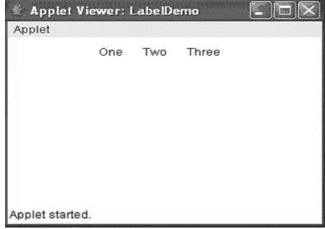

### 3.9 按钮 (Buttons)

最常用的控件是推按钮。推推按钮是一个包含标签并在按下时产生事件的组件。按钮是 `Button` 对象。`Button` 定义了这两个构造函数：

- `Button()`
- `Button(String str)`

第一种形式创建一个空按钮。第二个版本创建一个包含 `str` 标签的按钮。

创建按钮后，可以通过 `setLabel()` 设置其标签。可以通过 `getLabel()` 获取标签。
这些方法如下：

- `void setLabel(String str)`
- `String getLabel()`

在这里，`str` 变成了按钮的新标签。

#### 处理按钮

每当按钮被按下时，都会产生一个事件。该事件被发送给之前注册感兴趣接收该组件通知的监听器。每个监听器都实现 `ActionListener` 接口。该接口定义了 `actionPerformed()` 方法，该方法在事件发生时被调用。提供 `ActionEvent` 对象作为参数。它包含了产生事件的按钮引用以及作为按钮标签的字符串引用。

以下示例创建了三个标记为“是”、“否”和“未决定”的按钮。

每当其中一个被按下时，就会显示一条消息报告哪个按钮被按下。在这个版本中，使用按钮的标签来确定哪个按钮被按下。通过在事件上调用 `getActionCommand()` 方法获取标签。

示例：

```java
import java.awt.*;
import java.awt.event.*;
import java.awt.event.*;

/*
<applet="ButtonDemo" width=250 height=150>
</applet>
*/

public class ButtonDemo extends Applet implements ActionListener
{
    String msg = "";
}
```

```java
Button yes, no, maybe;

public void init() {
    yes = new Button("Yes");
    no = new Button("No");
    maybe = new Button("Undecided");
    add(yes);
    add(no);
    add(maybe);
    yes.addActionListener(this);
    no.addActionListener(this);
    maybe.addActionListener(this);
}

public void actionPerformed(ActionEvent ae) {
    String str = ae.getActionCommand();
    if(str.equals("Yes")) {
        msg = "You pressed Yes.";
    } else if(str.equals("No")) {
        msg = "You pressed No.";
    } else {
        msg = "You pressed Undecided.";
    }
    repaint();
}

public void paint(Graphics g) {
    g.drawString(msg, 6, 100);
}
```

242

Core Java

## 输出 –

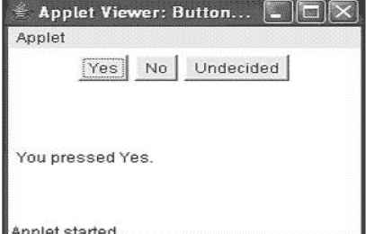

## 13.10 复选框 (Check Boxes)

复选框是一种用于开启或关闭选项的控件。它由一个小框组成，其中可以包含一个标记也可以不包含。每个复选框都关联有一个标签，描述该框代表的内容。你通过点击它来更改复选框的状态。复选框可以单独使用，也可以作为一组的一部分。复选框是 `Checkbox` 类的对象。

`Checkbox` 支持以下构造函数：

1. `Checkbox()`
2. `Checkbox(String str)`
3. `Checkbox(String str, boolean an)`
4. `Checkbox(String str, boolean cb, CheckboxGroup cbGroup)`
5. `Checkbox(String str, CheckboxGroup cbGroup, boolean an)`

第一种形式创建一个标签为空的复选框。复选框的状态为未选中。

第二种形式创建一个标签由 `str` 指定的复选框。复选框的状态为未选中。

第三种形式允许你设置复选框的初始状态。如果为 `true`，则复选框初始为为选中状态；否则被清除。

第四种和第五种形式创建一个标签由 `str` 指定且组由 `cbGroup` 指定的复选框。如果此复选框不属于某个组，则 `cbGroup` 必须为 `null`。本文很快将描述复选框组。`an` 的值决定了复选框的初始状态。

这些方法如下：

1. `boolean getStateState()`
2. `void setState(boolean an)`
3. `String getLabel()`
4. `void setLabel(String str)`

在这里，如果 `an` 为 `true`，则框被选中。如果为 `false`，则框被清除。`str` 中的字符串将成为与调用复选框关联的新标签。

### 处理复选框

每当复选框被选中或取消选择时

### CheckboxGroup

可以创建一个一组互斥的复选框，其中组内一个且仅有一个框在任何时候可以被选中。这些框通常被称为单选按钮（radio buttons），因为它们的作用就像汽车音机上的列表选择器——一次只能选择一个电台。要创建一个互斥的复选框集合，你必须首先定义它们所属的组，然后在构造复选框时指定该组。复选框组是 `CheckboxGroup` 类型的对象。只定义了默认构造函数，它创建一个空组。你可以通过调用 `getCheckbox()` 来确定组中当前哪个复选框被选中。你可以通过调用 `setSelectedCheckbox()` 选择一个框。

这些方法如下：

1. `Checkbox getCheckbox()`
2. `void setSelectedCheckbox(Checkbox which)`

在这里，`which` 是你想要选中的框。之前选中的框将被关闭。

示例：

这是一个使用了组内复选框的程序：

```java
import java.awt.*;
import java.awt.event.*;
import java.awt.applet.*;
/*


`<applet code="CBGroup" width=250 height=200>`

`</applet>`

`*/`

`public class CBGroup extends Applet implements ItemListener`

`{`

`String msg = "";`

`Checkbox Win98, winNT, solaris, mac;`

`CheckboxGroup cbg;`

`public void init()`

`{`

`cbg = new CheckboxGroup();`

`}`

```java
Win98 = new Checkbox("Windows 98/XP", cbg, true);
winNT = new Checkbox("Windows NT/2000", cbg, false);
solaris = new Checkbox("Solaris", cbg, false);
mac = new Checkbox("MacOS", cbg, false);
add(Win98);
add(winNT);
add(solaris);
add(mac);
Win98.addItemListener(this);
solaris.addItemListener(this);
mac.addItemListener(this);
}
public void itemStateChanged(ItemEvent e)
{
    repaint();
}
// 显示复选框的状态。
public void paint(Graphics g)
{
    String msg = "Current selection: ";
    msg+= cbg.getSelectedCheckbox().getLabel();
    g.drawString(msg, 6, 100);
}
```

输出：

``

## 13.11 选择框 (Choice)

`Choice` 是一种允许用户从列表中选择一个项目的控件。`Choice` 类似于列表框，但它不会一次显示所有项目。相反，当用户点击 `Choice` 时，会下拉显示可用项目。用户选择一个项目后，列表消失。像单选按钮一样，一次只能选择一个项目。`Choice` 支持以下构造函数：

1. `Choice()`
2. `Choice(String str)`
3. `Choice(String str, int max)`
4. `Choice(String items[], int max)`

第一形式创建一个没有项目的 `Choice`。

第二形式创建一个具有由 `str` 指定的单一项目的 `Choice`。

第三形式创建一个具有 `max` 个项目且第一个为 `str` 的 `Choice`。

第四形式创建一个具有 `max` 个项目且项目为数组 `items` 的 `Choice`。

这些方法如下：

1. `String getSelectedItem()`
2. `void addItem(String item)`
3. `int getItemCount()`
4. `void removeItem(int index)`
5. `int getSelectedIndex()`
6. `void setSelectedIndex(int index)`
7. `String getItem(int index)`
8. `void setItem(int index, String item)`

在这里，`getSelectedItem()` 返回选中项目的名称。如果没有选中任何项目，它返回 `null`。`addItem(item)` 将项目添加到列表末尾。`getItemCount()` 返回列表中的项目数量。`removeItem(index)` 移除指定索引的项目。`getSelectedIndex()` 返回选中项目的索引。`setSelectedIndex(index)` 设置选中项目的索引。`getItem(index)` 返回指定索引的项目。

## 13.12 列表 (Lists)

`List` 是一种允许用户从项目列表中选择一个或多个项目的控件。`List` 类似于 `Choice` 控件，但它会一次性显示所有项目。用户可以通过点击它们或使用 `Shift` 或 `Ctrl` 键来选择多个项目。

`List` 支持以下构造函数：

1. `List()`
2. `List(int max, boolean multipleSelection)`
3. `List(String items[], int max, boolean multipleSelection)`

第一形式创建一个没有项目的 `List`。

第二形式创建一个具有 `max` 个项目的 `List`，`multipleSelection` 决定是否可以选择多个项目。

第三形式创建一个具有 `max` 个项目（项目为数组 `items`）的 `List`，`multipleSelection` 决定是否可以选择多个项目。

这些方法如下：

1. `String[] getItems()`
2. `int[] getIndices()`
3. `int getItemCount()`
4. `void addItem(String item)`
5. `void removeItem(int index)`
6. `int getSelectedIndex()`
7. `void setSelectedIndex(int index)`
8. `String getItem(int index)`
9. `void setItem(int index, String item)`
10. `boolean isSelected(int index)`
11. `void deselect(int index)`

`getItems()` 返回列表中所有项目的数组。`getIndices()` 返回选中项目索引的数组。`getItemCount()` 返回列表中的项目数量。`addItem(item)` 将项目添加到列表末尾。`removeItem(index)` 移除指定索引的项目。`getSelectedIndex()` 返回第一个被选中项目的索引，如果没有选中任何项目，则返回 -1。`setSelectedIndex(index)` 将项目设为第一个被选中项。`getItem(index)` 返回指定索引的项目。`setItem(index, item)` 替换指定索引的项目。`isSelected(index)` 如果指定索引的项目被选中，则返回 `true`。`deselect(index)` 取消指定索引的项目的选择。

## 处理复选框

每当复选框被选中或取消选择时

## CheckboxGroup

可以创建一个一组互斥的复选框，其中组内一个且仅有一个框在任何时候可以被选中。这些框通常被称为单选按钮（radio buttons），因为它们的作用就像汽车音机上的列表选择器——一次只能选择一个电台。要创建一个互斥的复选框集合，你必须首先定义它们所属的组，然后在构造复选框时指定该组。

```java
public class ListDemo extends Applet implements ActionListener
{
    List os, browser;
    String msg = "";
    public void init()
    {
        os = new List(4, true);
        browser = new List(4, false);
        // 向列表添加项
        os.add("Windows 98/XP");
        os.add("Windows NT/2000");
        os.add("Solaris");
        os.add("MacOS");
        // 向浏览器列表添加项
        browser.add("Netscape 3.x");
        browser.add("Netscape 4.x");
        browser.add("Netscape 5.x");
        browser.add("Netscape 6.x");
        browser.add("Internet Explorer 4.0");
        browser.add("Internet Explorer 5.0");
        browser.add("Internet Explorer 6.0");
        browser.add("Lynx 2.4");
        browser.select(1);
        // 将列表添加到窗口
        add(os);
        add(browser);
        // 注册接收动作事件
        os.addActionListener(this);
        browser.addActionListener(this);
    }
    public void actionPerformed(ActionEvent e)
    {
        repaint();
    }
    // 显示当前选择。
    public void paint(Graphics g)
    {
        int[] idx[];
        msg = "Current OS: ";
        idx = os.getSelectedIndices();
        for(int i=0; i<idx.length; i++)
            msg += os.getItem(idx[i]) + " ";
        g.drawString(msg, 6, 120);
        msg = "Current Browser: ";
        msg += browser.getSelectedItem();
        g.drawString(msg, 6, 140);
    }
}
```

``

Applet 已启动。

## 13.13 滚动条

滚动条用于在指定的最小值和最大值之间选择连续值。滚动条可以是水平方向或垂直方向。滚动条实际上是由多个单独的部分组合而成的。每个部分都有一个箭头，你可以点击它将滚动条的当前值向某个方向移动一个。滚动条相对于其最小值和最大值的数值由滚动条的滑块框（或滑块）指示。滑块框可以通过滑块拖动到条的任意一侧，用户可以点击滑块以实现在方向上跳转略大于 1 的距离。此动作将转换为某种形式的向上页和向下页。

滚动条封装在 `Scrollbar` 类中。

1. `Scrollbar()`
2. `Scrollbar(int style)`
3. `Scrollbar(int style, int initialValue, int thumbSize, int min, int max)`

## AWT

第一种形式创建一个垂直滚动条。
第二和第三种形式允许你指定滚动条的方向。如果 `style` 为 `Scrollbar.VERTICAL`，则会创建一个垂直滚动条。如果 `style` 为 `Scrollbar.HORIZONTAL`，则滚动条是水平的。

在构造函数的形式中，滚动条的初始值通过 `initialValue` 传入。滑块高度代表的单位数通过 `thumbSize` 传入。滚动条的最小值和最大值由 `min` 和 `max` 指定。

如果你使用前三个构造函数之一来构建滚动条，那么你需要使用 `setValue()` 设置其参数（如下所示），然后才能使用它：

```java
void setValues(int initialValue, int thumbSize, int min, int max)
```

这些参数的含义与上述第三种构造函数相同。
调用 `getValue()` 获取滚动条的当前值。它返回当前的设置。要设置当前值，请调用 `setValue()`。

这些方法如下：

1. `int get()`
2. `void setValue(int newValue)`

在这里，`newValue` 指定了滚动条的新值。当你设置一个值时，滚动条内部的滑块框将移动以反映该新值。

你也可以通过 `getMinimum()` 和 `getMaximum()` 获取最小值和最大值，如下所示：

1. `int getMinimum()`
2. `int getMaximum()`

它们返回请求的数量。

默认情况下，滚动条每向上或向下滚动一行，增加或减少的增量为 1。你可以通过调用 `setUnitIncrement()` 来更改此增量。默认情况下，向上页和向下页的增量为 10。你可以通过调用 `setIncrement()` 来更改此值。

这些方法如下：

1. `void setUnitIncrement(int newInc)`
2. `void setBlockIncrement(int newInc)`

## 处理滚动

为了处理滚动事件，你需要实现 `AdjustmentListener` 接口。每当用户与滚动条交互时，就会生成一个 `AdjustmentEvent`。它的 `getAdjustmentType()` 方法可以确定调整的类型。

## 13.14 TextField

`TextField` 类实现了一个单行文本输入区域，通常称为编辑控件。`TextField` 字段允许用户输入字符串，并使用方向键、剪切和粘贴键以及鼠标选择来编辑文本。

`TextField` 是 `TextComponent` 的子类。

`TextField` 定义了以下构造函数：

1. `TextField()`
2. `TextField(int numChars)`
3. `TextField(String str)`
4. `TextField(String str, int numChars)`

第一种形式创建一个默认文本框。
第二种形式根据 `numChars` 创建一个文本框。
第三种形式使用 `str` 初始化文本框。
第四种形式使用 `str` 和 `numChars` 初始化文本框。

由于 `TextField` 执行它们自己的编辑功能，你的程序通常不需要响应发生在文本框内的单个按键事件。然而，你可能希望在用户按下回车键时响应。例如：

```java
import java.awt.*;
import java.awt.event.*;
import java.awt.applet.*;
/*
<applet code="ListDemo" width=300 height=180>
</applet>
*/
public class ListDemo extends Applet {
（此处省略原文未提供的后续内容）
```

## 处理文本框

由于文本框执行自己的显示逻辑...

```java
browser.add("Lynx 2.4");
browser.select(1);
// 将列表添加到窗口
add(os);
add(browser);
// 注册接收动作事件
os.addActionListener(this);
browser.addActionListener(this);
}
public void actionPerformed(ActionEvent ae)
{
  repaint();
}

// 显示当前选择。
public void paint(Graphics g)
{
  int idx[];
  msg = "Current OS: ";
  idx = os.getSelectedIndexes();
  for(int i=0; i<idx.length; i++)
    msg += os.getItem(idx[i]) + " ";
  g.drawString(msg, 6, 120);
  msg = "Current Browser: ";
  msg += browser.getgetSelectedItem();
  g.drawString(msg, 6, 140);
}
```

Output:

``

## 13.15 TextArea

有时单行文本输入对于特定任务是不够的。为了处理这些情况，AWT 包含了一个名为 `TextArea` 的简单多行编辑器。

以下是 `TextArea` 的构造函数：

1. `TextArea()`
2. `TextArea(int numLines, int numChars str)`
3. `TextArea(String str)`
4. `TextArea(String str, int numLines, int numChars)`
5. `TextArea(String str, int numLines, int numChars, int sBars)`

在这里，`numLines` 指定文本区域的高度（行数），`numChars` 指定其宽度（字符数）。初始文本可以通过 `str` 进行指定。

在第五种形式中，你可以指定想要控制的滚动条。`sBars` 必须是以下值之一：

- `SCROLLBAR_BOTH`（水平垂直滚动条）
- `SCROLLBAR_NONE`（无滚动条）
- `SCROLLBAR_HORIZONTAL_ONLY`（仅水平滚动条）
- `SCROLLBAR_VERTICAL_ONLY`（仅垂直滚动条）

`TextArea` 是 `Component` 的子类。因此，它支持 `getText()`、`setText()`、`SelectedText()`、`select()`、`isEditable()` 和 `setEditable()` 方法。

`TextArea` 增加了以下方法：

1. `append(String str)`


## 2. `insert(String str, int index)`

## 3. `replaceRange(String str, startindex, endindex)`

`append()` 方法将 `str` 指定的字符串添加到当前文本的末尾。`insert()` 方法将传入 `str` 的字符串插入到指定的索引处。要替换文本，请调用 `replaceRange()`。它会将从 `start` 到 `end-1` 的字符替换为传入 `str` 中传递的替换文本。

# 13.16 RadioButton (CheckboxGroup)

## Java AWT CheckboxGroup

`CheckboxGroup` 类对象用于将一组 `Checkbox` 组合在一起。一次只允许一个复选按钮处于“开启”状态，其余复选框处于“关闭”状态。它继承自 `Object` 类。

> 注意：`CheckboxGroup` 允许你在 AWT 中创建单选按钮（Radio Buttons）。AWT 中没有用于创建单选按钮的特殊控件。

### AWT CheckboxGroup 类声明

```java
public class CheckboxGroup extends Object implements Serializable
```

### Java AWT CheckboxGroup 示例

```java
import java.awt.*;
public class CheckboxGroupExample {
    CheckboxGroupExample() {
        Frame f = new Frame("Checkbox Example");
        CheckboxGroup cbg = new CheckboxGroup();
        Checkbox checkBox1 = new Checkbox("++", cbg, false);
        checkBox1.setBounds(100,100,50,50);
        Checkbox checkBox2 = new Checkbox("Java", cbg, true);
        checkBox2.setBounds(100,150,50,50);
        f.add(checkBox1);
        f.add(checkBox2);
        f.setSize(400,400);
        f.setLayout(null);
        f.setVisible(true);
    }
    public static void main(String args[]) {
        new CheckboxGroupExample();
    }
}
```

Output:

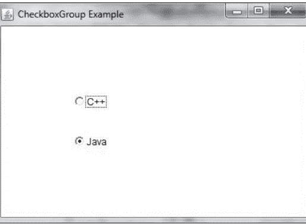

## 带有 ItemListener 的 Java AWT CheckboxGroup 示例

```java
import java.awt.*;
import java.awt.event.*;
public class CheckboxGroupExample {
    CheckboxGroupExample() {
        Frame f = new Frame("Checkbox Example");
        final Label label = new Label();
        label.setAlignment(Label.CENTER);
        label.setSize(400,100);
        CheckboxGroup cbg = new CheckboxGroup();
        Checkbox checkbox1 = new Checkbox("C+", cbg, false);
        checkbox1.setBounds(100,100,50,50);
        Checkbox checkbox2 = new Checkbox("Java", cbg, false);
        checkbox2.setBounds(100,150,50,50);
        f.add(checkbox1); f.add(checkbox2); f.add(label);
        f.setSize(400,400);
        f.setVisible(true);
        checkbox1.addItemListener(new ItemListener() {
            public void stateChanged(ItemEvent e) {
                label.setText("C++ checked");
            }
        });
        checkbox2.addItemListener(new ItemListener() {
            public void stateChanged(ItemEvent e) {
                label.setText("Java checked");
            }
        });
    }
    public static void main(String args[]) {
        new CheckboxGroupExample();
    }
}
```

Output:

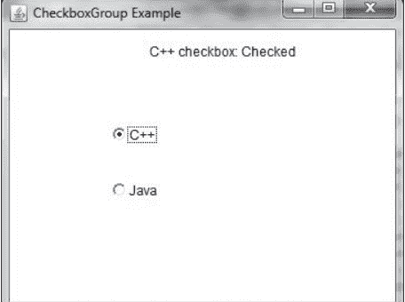

# 13.17 AWT MenuItem

AWT MenuItem 类在菜单上添加带有标签的项目。菜单中的项目必须属于 `MenuItem` 或其子类。`Menu` 对象显示在菜单栏（menu bar）上。

## AWT MenuItem 类声明

```java
public class MenuItem extends Accessible
```

## Java AWT MenuItem 和 Menu 示例

```java
import java.awt.*;
class MenuExample {
    MenuExample(){
        Frame f = new Frame("Menu and MenuItem Example");
        MenuBar mb = new MenuBar();
        Menu menu = new Menu("Menu");
        Menu submenu = new Menu("Sub Menu");
        MenuItem i1 = new MenuItem("Item 1");
        MenuItem i2 = new MenuItem("Item 2");
        MenuItem i3 = new MenuItem("Item 3");
        MenuItem i4 = new MenuItem("Item 4");
        MenuItem i5 = new MenuItem("Item 5");
        menu.add(i1);
        menu.add(i2);
        menu.add(i3);
        submenu.add(i4);
        submenu.add(i5);
        menu.add(submenu);
        mb.add(menu);
        f.setMenuBar(mb);
        f.setSize(400,400);
        f.setLayout(null);
        f.setVisible(true);
    }
    public static void main(String args[]) {
        new MenuExample();
    }
}
```

Output:

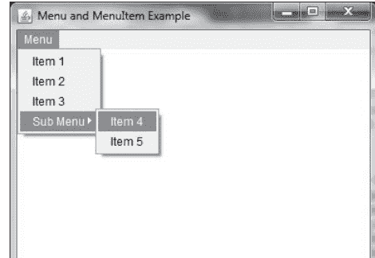

## Core Java

### 问题

1. 写关于 AWT 基础的简介。

2. 解释 AWT 层次结构。

3. AWT 有哪些组件？

4. 写一个简单的程序来解释 AWT。

5. 结合图表解释事件模型。

6. 写一个实现 `Button` 和 `Label` 的程序。

7. 解释 Java 中使用的不同的 Listener 类型。

8. 写一个实现 `List` 的程序。

# Final Java 实验

## 1. `print()` 和 `println()` 程序示例：

```java
class ex2 {
    public static void main(String args[]) {
        System.out.print("print() prints in ");
        System.out.print("same line ");
        System.out.println("println() prints the line with carriage return at the end");
        System.out.print("we also have carriage return");
    }
}
```

Output:

```
print() prints in same line
println() prints the line with carriage return at the end
```

## 2. 算术运算符 (+, -, /, %) 的示例：

```java
class ex7 {
    public static void main(String args[]) {
        int a=46,p1;
        float b=1.5,q;
        char c='A';r;
        double d=1.0,s;
        p=a*2;
        q=b+1.6/* q=b+ 1.6 会报错，因为 1.6 是 double，所以结果是 double */
        r=c; /* r=c+1 和 r=c+'B' 会报错 */
        p1=c*2; // c2 得到 int 值，因此赋值给 q
    }
}
```

# Final Java 实验

```java
s=d*3;
System.out.print("\n a = " + a + "\t p = " + p);
System.out.println("\t p1 = " + p1);
System.out.println("\n b = " + b + "\t q = " + q);
System.out.println("\n c = " + c + "\t r = " + r);
System.out.println("\n d = " + d + "\t s = " + s);
```

上述 5 行输出如下：

| a = 46 | p = 52 | p1 = 130 |
|--------|-------|---------|
| b = 1.5 | q = 3.1 |         |
| c = A | r = A |         |
| d = 1.0 | s = 3.5 |         |

## 3. 设计一个用于类型类型变量的 Java 程序：

```java
程序源代码：
public class conversion {
    public static void main(String[] args) {
        boolean t = true;
        byte b = 2;
        short s = 100;
        char c = 'C';
        int i = 200;
        long l = 24000;
        float f = 3.14f;
        double d = 0.00000000000053;
        String g = "string";
        System.out.println("Value of all the variables like:");
        System.out.println("\t t = " + t);
        System.out.println("\t b = " + b);
        System.out.println("\t s = " + s);
        System.out.println("\t c = " + c);
        System.out.println("\t i = " + i);
        System.out.println("\t l = " + l);
        System.out.println("\t f = " + f);
        System.out.println("\t d = " + d);
        System.out.println("\t g = " + g);
        System.out.println();
        // 将 boolean 转换为 byte
        b = (byte)(t);
        System.out.println("Value of b after conversion : " + b);
        // 将 boolean 转换为 short
        s = (short)(t);
        System.out.println("Value of s after conversion : " + s);
        // 将 boolean 转换为 int
    }
}
```

# 260 核心 Java

```java
i = (int)(true:0);
System.out.println("Value of i after conversion: " + i);
//将 boolean 转换为 char.
c = (char)(true:0);
System.out.println("Value of c after conversion: " + c);
c = (char)(true:0);
System.out.println("Value of c after conversion in unicode: " + c);
//将 boolean 转换为 long.
l = (long)(true:0);
System.out.println("Value of l after conversion: " + l);
//将 boolean 转换为 float.
f = (float)(true:0);
System.out.println("Value of f after conversion: " + f);
//将 boolean 转换为 double.
d = (double)(true:0);
System.out.println("Value of d after conversion: " + d);
//将 boolean 转换为 String.
g = String(true:0);
System.out.println("Value of g after conversion: " + g);
g = String(true:0);
System.out.println("Value of g after conversion: " + g);
int sum = (int)(b + i + 1 + d + f);
System.out.println("Value of sum after conversion: " + sum);
```

在这个示例中，我们将看到如何使用类型转换来转换数据类型。在给定的代码行 `c = (char)(true:0);` 中，说明如果 `i` 是一个 boolean 变量且其值为 true，那么 char 类型变量的值将是 1，而不是一个数值。因此，1 会根据 Unicode 值被转换为字符。但在这一行中 `c = (char)(true:0);` 中，1 已经作为一个字符给出，它将作为 `i` 存储在 char 类型变量 `c` 中。

## 4. 求两个数的最大值:

```java
class Max2
{
    public static void main(String[] args )
    {
        //获取命令行参数作为值。
        //将 String 格式转换为 Integer 值
        int i = Integer.parseInt(args[0]);
        int j = Integer.parseInt(args[1]);
        if(i > j)
            System.out.println(i + " is greater than " + j);
        else
            System.out.println(j + " is greater than " + i);
    }
}
```

## 5. 使用条件运算符求两个数的最小值:

```java
class Minof2
{
    public static void main(String args[]) 
{
        //获取命令行参数作为值
        //将 String 格式转换为 Integer 值
        int i = Integer.parseInt(args[0]);
        int j = Integer.parseInt(args[1]);
        int result = (i<j)?i:j;
        System.out.println(result + " is a minimum value");
    }
}
```


# 6. 编写一个程序，从键盘读取`float`类型的值并打印以下内容：

输出：

- 不小于该数字的最小整数。
- 给定的数字。
- 不大于该数字的最大整数。

```java
class ValueFormat
{
    public static void main(String args[]) 
{
        double i = 34.32; //给定的数字
        System.out.println("Small Integer not greater than the number : "+Math.ceil(i));
        System.out.println("Given Number :"+i);
        System.out.println("Largest Integer not greater than the number :"+Math.floor(i));
    }
}
```

# 7. 编写一个程序计算给定数的阶乘：

```java
class Factorial
{
    public static void main(String args[]) 
{
        int num = Integer.parseInt(args[0]); //取命令行参数作为参数
        int result = 1;
        while(num>0)
        {
            result = result * num;
            num--;
        }
        System.out.println("Factorial of given no. is : " +result);
    }
}
```

# 8. 编写一个程序反转给定的数字：

```java
class Reverse
{
    public static void main(String args[]) {
        int num = Integer.parseInt(args[0]); //取命令行参数作为参数
        int remainder,result=0;
        while(num>0) {
            remainder = num%10;
            result = result * 10 + remainder;
            num = num/10;
        }
        System.out.println("Reverse number is :"+result);
    }
}
```

# 9. 编写一个程序找到给定数的斐波那契数列：

示例：

输入 - 8

输出 - 1 1 2 3 5 8 13 21

```java
class Fibonacci
{
    public static void main(String args[]) {
        int num = Integer.parseInt(args[0]); //取命令行参数作为参数。
        System.out.println("*****Fibonacci Series*****");
        int f1=1, f2=0, f3=1;
        for(int i=1;i<=num;i++) {
            System.out.print(" " +f3+" ");
            f1=f2;
            f2=f3;
            f3=f1+f2;
        }
    }
}
```

# 10. 显示乘法表的程序：

```java
class MultiplicationTable
{
    public static void main(String args []) {
        int num = Integer.parseInt(args[0]);
        System.out.println("*****MULTICATION TABLE*****");
        for(int i=1;i<=num;i++) {
            for(int j=1;j<=num;j++) {
                System.out.print(i*j+" ");
            }
            System.out.print("\n");
        }
    }
}
```

# 11. 编写一个程序判断数字是否为质数：

```java
class PrimeNo
{
    public static void main(String args[]) {
        int num = Integer.parseInt(args[0]);
        int flag=0;
        for(int i=2;i<num;i++) {
            if(num%i==0) {
                System.out.println(num+" is not a Prime Number");
                flag = 1;
                break;
            }
        }
        if(flag==0)
        System.out.println(num+" is a Prime Number");
    }
}
```

# 12. 编写一个程序判断数字是否为回文：

示例：

输入 - 121

输出 - 121 is a palindrome.

```java
class Palindrome
{
    public static void main(String args[]) {
        int num = Integer.parseInt(args[0]);
        int temp = num;
        int result=0,remainder;
        while(num>0) {
            remainder = num%10;
            result = result * 10 + remainder;
            num = num/10;
        }
        if(temp == result)
            System.out.println(temp+" is a palindrome");
        else
            System.out.println(temp+" is not a palindrome");
    }
}
```

# 13. 显示三角形如下：

0

1

1 2

1 2 3

```java
class Triangle
{
    public static void main(String args[])
        int n = Integer.parseInt(args[0]);
        for(int i=1; i<=n; i++) {
            for(int j=1; j<=i; j++) {
                System.out.print(j + " ");
            }
            System.out.println();
        }
    }
}
```

# 14. 一维数组的程序：

```java
class Array1
{
    public static void main(String args[]) {
        int a[] = {10, 20, 30, 40, 50};
        for(int i=0; i<a.length; i++) {
            System.out.print(a[i] + " ");
        }
        System.out.println();
    }
}
```

# 15. 二维数组的程序：

```java
class Array2
{
    public static void main(String args[]) {
        int a[][] = {{1, 2, 3}, {4, 5, 6}, {7, 8, 9}};
        for(int i=0; i<a.length; i++) {
            for(int j=0; j<a[i].length; j++) {
                System.out.print(a[i][j] + " ");
            }
            System.out.println();
        }
    }
}
```

# 16. 字符串数组的程序：

```java
class StringArray
{
    public static void main(String args[]) {
        String arr[] = {"Apple", "Banana", "Cherry", "Date"};
        for(int i=0; i<arr.length; i++) {
            System.out.println(arr[i]);
        }
    }
}
```

# 17. 排序数组的程序：

```java
class SortArray
{
    public static void main(String args[]) {
        int arr[] = {5, 2, 9, 1, 5, 6};
        for(int i=0; i<arr.length-1; i++) {
            for(int j=i+1; j<arr.length; j++) {
                if(arr[i] > arr[j]) {
                    int temp = arr[i];
                    arr[i] = arr[j];
                    arr[j] = temp;
                }
            }
        }
        for(int i=0; i<arr.length; i++) {
            System.out.print(arr[i] + " ");
        }
    }
}
```

# 18. 查找数组元素的程序：

```java
class SearchArray
{
    public static void main(String args[]) {
        int arr[] = {10, 20, 30, 40, 50};
        int key = 30;
        int index = -1;
        for(int i=0; i<arr.length; i++) {
            if(arr[i] == key) {
                index = i;
                break;
            }
        }
        if(index != -1)
            System.out.println("Element found at index " + index);
        else
            System.out.println("Element not found");
    }
}
```

# 19. 反转数组的程序：

```java
class ReverseArray
{
    public static void main(String args[]) {
        int arr[] = {1, 2, 3, 4, 5};
        for(int i=0, j=arr.length-1; i<j; i++, j--) {
            int temp = arr[i];
            arr[i] = arr[j];
            arr[j] = temp;
        }
        for(int i=0; i<arr.length; i++) {
            System.out.print(arr[i] + " ");
        }
    }
}
```

# 20. 合并两个数组的程序：

```java
class MergeArray
{
    public static void main(String args[]) {
        int arr1[] = {1, 2, 3};
        int arr2[] = {4, 5, 6};
        int result[] = new int[arr1.length + arr2.length];
        for(int i=0; i<arr1.length; i++) {
            result[i] = arr1[i];
        }
        for(int i=0; i<arr2.length; i++) {
            result[arr1.length + i] = arr2[i];
        }
        for(int i=0; i<result.length; i++) {
            System.out.print(result[i] + " ");
        }
    }
}
```

# Java 最终实训

| b 中的元素为 |

| :--- |

| b[0][0]=11 b[0][1]=12 b[0][2]=13 |

| b[1][0]=-21 b[1][1]=22 b[1][2]=23 |

| b[2][0]=-31 b[2][1]=-32 b[2][2]=33 |

## 16. 方法重载：

方法重载。创建一个类`mol`和子类`Test`。现在我们创建了同名`square`的方法，但参数不同。当主类调用该方法时，它将根据参数执行执行。在给出的示例中，我们正试图说明这种方法技术。

以下是示例代码：

```java
mol.java
import java.lang.*;

public class mol
{
    public static void main(String args[] )
    {
        new Test().doOverLoad();
    }
}

class Test
{
    public void doOverLoad()
    {
        int x = 7;
        double y = 11.4;
        System.out.println(square(x) + "\n"+square(y));
    }
    public int square(int y)
    {
        return y*y;
    }
    public double square(double y)
    {
        return y*y;
    }
}
```

输出：

```
C:\kiran>javac mol.java
C:\kiran>java mol
49
129.96
```

## 17. 方法重写示例：

Java 中的方法重写意味着子类方法覆盖父类方法。父类方法应该是非静态的。子类使用关键字来扩展父类。在示例类中，类`B`是子类，类`A`是父类。子类和类中的重写方法具有相同的签名。重写用于修改父类的方法。在重写时，方法的返回类型和构造函数参数应该匹配。

程序的源代码：

```java
class A
{
    int i;
    A(int a, int b)
    {
        i = a+b;
    }
    void add()
    {
        System.out.println("Sum of a and b is: " + i);
    }
}
class B extends A
{
    int j;
    B(int a, int b, int c)
    {
        super(a, b);
        j = a+b+c;
    }
    void add()
    {
        super.add();
        System.out.println("Sum of a, b and c is: " + j);
    }
}
class MethodOverriding
{
    public static void main(String[] args) 
    {
        B b = new B(10, 20, 30);
        b.add();
    }
}
```

输出：

```
C:\NewExamples\>javac MethodOverriding.java
C:\NewExamples\>java MethodOverriding
Sum of a and b is: 30
Sum of a, b and c is: 60
```

## 18. 构造函数演示：


# Java 编程示例

## 1. 三角形类示例

```java
class triangle
{
    double base;
    double height;

    triangle()
    {
        System.out.println("constructor triangle");
        base=10;
        height=10;
    }

    double area()
    {
        return (1/2)*base*height;
    }
}
class triangledemo
{
    public static void main(String args[])
    {
        triangle obj = new triangle();
        double ar=obj.area();
        System.out.println("area of triangle is " + ar);
    }
}
```

## 19. 实现继承的程序

```java
class hall
{
    int length,breath,area;
    hall(int x, int y, int z)
    {
        length=x;
        breath=y;
        area=z;
    }
    int roomarea()
    {
        return (length*breath);
    }
    void display()
    {
        System.out.println("the room square feet area is " + area);
    }
}
```

```java
class room extends hall
{
  int height;
  bedroom(int x, int y, int z, int z1)
  {
    super(x,y,z);
    height=z1;
  }
  int volume()
  {
    return (length*breath*height);
  }
}
class inheritest
{
  public static void main(String args [])
  {
    room room1=new room(14,12,200,10);
    int area1=room1.area();
    int volume1=room1.volume();
    room1.display();
    System.out.println("the area is "+area1);
    System.out.println("the volume is "+volume1);
  }
}
```

## 20. 方法重载示例演示

```java
class overloaddememo
{
  void testmethod()
  {
    System.out.println("method with no parameter");
  }
  void testmethod(int a)
  {
    System.out.println("method with one parameter "+a);
  }
  void testmethod(int a, int b)
  {
    System.out.println("method with two parameters a and b "+a+" "+b);
  }
  void testmethod(double a)
  {
    System.out.println("double a:"+a);
  }
}

class overload {
  public static void main(String args[]) {
    overloaddemo ob=new overloaddemo();
    testmethod(10);
    testmethod(20);
    testmethod(34.6);
  }
}
```

输出：
```
no parameter
a:10
a and b20
double a:34.6
```

## 21. 复制程序

```java
import java.io.*;
class filecopy
{
  public static void main(String args[]) {
    try {
      int c;
      FileInputStream fis=new FileInputStream("abc.txt");
      FileOutputStream fos=new FileOutputStream("xyz.txt");
      while((c=fis.read()) != -1) {
        fos.write(c);
      }
      fis.close();
      fos.close();
    } catch (Exception e) {
      System.out.println(e);
    }
  }
}
```

## 22. 字符串函数示例

```java
import java.io.*;

class strdememo {

    public static void main(String args[] {

        try {

            String s1=new String("a");

            String s2=new String("A");

            int i=s1.length();

            System.out.println("The length of the string"+i);

            System.out.println("The strings are equal:"+s1.equals(s2));

            System.out.println("The strings ignoring case="+s1.equalsIgnoreCase(s2));

            String s3=s1.toLowerCase();

            System.out.println("The strings converted"+s3);

            System.out.println("The character at index"+s1.charAt(0));

            System.out.println("The string concatenation "+s1.concat(s2));

        } catch(Exception e) {

            System.out.println("Error.You have specified a wrong range");

        }

    }

}
```

## 23. 字符串函数示例

```java
class stringdemo {

    public static void main(String args[] ) {

        String s1 =new String("abc");

        String s2 =new String("abc");

        System.out.println("The strings are equal:"+s1.equals(s2));

    }

}
```

## 24. 构造函数示例

```java
class Triangle {

    double base;

    double height;

    Triangle() {

        System.out.println("constructor triangle");

        base=10;

        height=10;

    }

    double area()

    {

        return (0.5)*base * height;

    }

}

class Tridemo

{

    public static void main(String args )

    {

        Triangle obj = new Triangle();

        double a=obj.area();

        System.out.println("Area is " + a);

    }

}
```

## 25. 参数构造函数示例

```java
class rect

{

    int length;

    int breadth;

    rect(int x, int y)

    {

        length = x;

        breadth = y;

    }

    int area()

    {

        return (length * breadth);

    }

}

class recta extends rect

{

    rect (int x, int y)

    {

        super(x,y);

    }

    int perimeter()

    {

        return (2*(length+breadth));

    }

}

class inherect

{

  public static void main (String args[] )

  {

    recta r = new recta(10,20);

    int a = r.area();

    int p = r.perimeter();

    System.out.println("the area is"+a);

    System.out.println("the perimeter is"+p);

  }

}
```

## 26. 数组示例

```java
class ArrayExample

{

  public static void main(String args[])  {

    // 创建数组

    int elements[] = new int[10];

    System.out.println("Initializing... ");

    for(int index=0; index < elements.length; index++)

    {

      elements[index] = index * index;

      System.out.print("Elements are : ");

      for(int index=0; index < elements.length; index++)

        System.out.print(elements[index] + " ");

    }

  }

}
```

## 27. 用 Java 编写程序

- (a) 从命令行读取任意数量的整数参数。计算平均值和标准差。
- (b) 打印上述信息。

程序：

```java
import java.lang.*;

class MeanSD

{

  public static void main(String args[])  {

    int num[]=new int[100];

    for(int i=0;i<args.length;i++)

    {

      num[i]=Integer.parseInt(args[i]);

    }

    double mean;

    double sx=0,sxx=0;

    for(int i=0; i<args.length;i++)

    {

      sx=sx+num[i];

      sxx=sxx+(num[i]*num[i]);

    }

    mean=sx/args.length;

    double sd=Math.sqrt((sxx/args.length)-(mean*mean));

    System.out.println("Mean="+mean);

    System.out.println("StandardDeviation="+sd);

  }

}
```

## 28. 方法重载示例

一个 Java 类有三个重载方法。第一个方法不接受参数，第二个方法接受一个字符串，第三个方法接受字符串和一个整数。编写一个 Java 程序来：

- (a) 使用第一个方法显示“玫瑰是一朵美丽的花”两次。
- (b) 使用第二个方法显示“太阳花是一朵美丽的花”两次。
- (c) 使用第三个方法显示“日葵是一朵美丽的花”四次。

程序：

```java
class flower

{

  String f;

  int n;

  void flower1()

  {

    for(int i=1;i<=2;i++)

      System.out.println("Rose is a beautiful flower.");

  }

  void flower1(String b)

  {

    f=b;

    for(int i=1;i<=2;i++)

      System.out.println(f+" is a beautiful flower.");

  }

  void flower1(String b, int n)

  {

    f=b;

    n=n;

    for(int i=1;i<=n;i++)

      System.out.println(f+" is a beautiful flower.");

  }

}
```

```java
System.out.println(f + " is a beautiful flower.");

}

class flower {

    String f;

    int n;

    void flower1(String c, int a) {

        f = c;

        n = a;

        for (int i = 1; i <= n; i++)

            System.out.println(f + " is a beautiful flower.");

    }

    void flower1() {

        f = "Rose";

        n = 2;

        System.out.println(f + " is a beautiful flower.");

    }

    void flower1(String c) {

        f = c;

        n = 2;

        System.out.println(f + " is a beautiful flower.");

    }

}

class overloadoverloaddemo {

    public static void main(String args[]) {

        flower f1 = new flower();

        flower f2 = new flower();

        flower f3 = new flower();

        f1.flower1();

        f2.flower1("Sunflower");

        f3.flower1("Marigold", 4);

    }

}
```

输出：
```
C:\>javac overloaddemo.java

C:\>java overloaddemo

Rose is a beautiful flower.

Rose is a beautiful flower.

Sunflower is a beautiful flower.

Sunflower is a beautiful flower.

Marigold is a beautiful flower.

Marigold is a beautiful flower.

Marigold is a beautiful flower.

Marigold is a beautiful flower.
```

## 29. 矩阵相法示例

```java
class Matrix {

    int a[][] = {{1, 2, 3}, {4, 5, 6}, {7, 8, 9}};

    int b[][] = {{2, 4, 5}, {2, 3, 6}, {1, 6, 2}};

    int c[][] = new int[3][3];

    void code() {

        for (int i = 0; i < 3; i++)

            for (int j = 0; j < 3; j++)

                c[i][j] = a[i][j] + b[i][j];

    }

    void display() {

        System.out.println("MATRIX A:\n");

        for (int i = 0; i < 3; i++) {

            for (int j = 0; j < 3; j++) {

                System.out.print(a[i][j] + " ");

            }

            System.out.println();

        }

        System.out.println("MATRIX B:\n");
```


## 30. 通过实现 `Runnable` 接口创建多线程示例：

```java
// 创建第二个线程
class NewThread1 implements Runnable {
    Thread t;

    NewThread1() {
        // 创建新线程
        t = new Thread(this, "Demo Thread");
        System.out.println("Child thread : " + t);
        t.start(); // 启动线程
    }

    // 第二个线程的入口点。
    public void run() {
        try {
            for (int i = 5; i > 0; i--) {
                System.out.println("Child Thread: " + i);
                Thread.sleep(500);
            }
        } catch (InterruptedException e) {
            System.out.println("Child interrupted.");
        }
    }
}

class ThreadDemo {
    public static void main(String args[]) {
        new NewThread1(); // 创建新线程
        try {
            for (int i = 5; i > 0; i--) {
                System.out.println("Main Thread: " + i);
                Thread.sleep(1000);
            }
        } catch (InterruptedException e) {
            System.out.println("Main Thread.");
        }
        System.out.println("Main thread exiting.");
    }
}
```

输出：
```
C:\WINDOWS\system32\cmd.exe
E:\java>javac ThreadDemo.java
E:\java>java ThreadDemo
Child thread : Thread "Demo Thread"
Main Thread: 5
Child Thread: 5
Main Thread: 4
Child Thread: 4
Main Thread: 3
Child Thread: 3
Main Thread: 2
Child Thread: 2
Main Thread: 1
Child Thread: 1
Main thread exiting.
```

## 31. 复数示例：

```java
class complex {
    double x, y;

    complex() {
        x = 0;
        y = 0;
    }

    complex(double a, double b) {
        x = a;
        y = b;
    }

    complex add(complex cc) {
        cc.x = x + cc.x;
        cc.y = y + cc.y;
        return cc;
    }

    void disp() {
        System.out.println(x + " " + y);
    }

    public static void main(String args[]) {
        complex c1 = new complex(1, 2);
        complex c2 = new complex(2, 3);
        c1.add(c2);
        c2.disp();
    }
}
```

## 32. 递归示例：

```java
class Factorial {
    int fact(int n) {
        if (n == 1)
            return 1;
        return n * fact(n - 1);
    }

    public static void main(String args[]) {
        Factorial F = new Factorial();
        int n = 5, r = 0, ncr = 0;
        ncr = F.fact(n) / F.fact(r);
        System.out.println("n = " + n + " and r = " + r);
        System.out.println("nCr = " + ncr);
    }
}
```

## 33. 通过检查指定文件创建新文件的示例：

```java
import java.io.*;

class CreateFile {
    public static void main(String[] args) throws IOException {
        File f;
        f = new File("myfile.txt");
        if (!f.exists()) {
            f.createNewFile();
            System.out.println("myfile.txt has been created to the current directory");
        } else {
            System.out.println("myfile.txt already exists");
        }
    }
}
```

输出：
```
C:\>javac CreateFile.java
C:\>java CreateFile
myfile.txt has been created to the current directory
```

## 34. 接口示例：

```java
import java.lang.*;
import java.io.*;
import java.util.*;

interface MyInterface {
    int a = 20, b = 10;
    void add();
    void subtract();
}

class InterfaceExample implements MyInterface {
    public void add() {
        int c = a + b;
        System.out.println("Addition: " + c);
    }

    public void subtract() {
        int c = a - b;
        System.out.println("Subtraction: " + c);
    }

    public static void main(String arg[]) {
        InterfaceExample ex = new InterfaceExample();
        ex.add();
        ex.subtract();
    }
}
```

## 35. 包包示例：

`MyPack` 包内部：
```java
package mypack;

public class accbal {
    String name;
    double bal;

    accbal(String n, double b) {
        name = n;
        bal = b;
    }

    public void show() {
        if (bal > 0) {
            System.out.println("the value of balance is"+bal);
        }
    }
}
```

导入该包：
```java
import mypack.*;

class testbal {
    public static void main(String args[]) {
        accbal test = new accbal("abc", 89.9);
        test.show();
    }
}
```

输出：
```
the value of balance is89.9
```

## 36. 排序算法

```java
public class SortData {
    public static int[] asce(int[] arr) {
        for (int i = 0; i < arr.length - 1; i++) {
            int index = i;
            for (int j = i + 1; j < arr.length; j++) {
                if (arr[j] < arr[index]) {
                    index = j;
                    int smallerNumber = arr[index];
                    arr[index] = arr[i];
                    arr[i] = smallerNumber;
                }
            }
        }
        return arr;
    }

    public static int[] desc(int[] arr) {
        for (int i = 0; i < arr.length - 1; i++) {
            int index = i;
            for (int j = i + 1; j < arr.length; j++) {
                if (arr[j] > arr[index]) {
                    index = j;
                    int largerNumber = arr[index];
                    arr[index] = arr[i];
                    arr[i] = largerNumber;
                }
            }
        }
        return arr;
    }
}
```

## Java 最终实操

输出：
```
C:\Windows\system32\cmd.exe
D:\MEHTASIR\javamaterial>javac AbstractDemo.java
D:\MEHTASIR\javamaterial>java AbstractDemo
350
76
Methods of class Sum
D:\MEHTASIR\javamaterial> 
```

## 38. 两个二进制数相加程序。

```java
import java.util.Scanner;

public class AddBin {
    public static void main(String[] args) {
        long binary1, binary2;
        int i = 0, remainder = 0;
        int[] sum = new int[20];
        Scanner in = new Scanner(System.in);
        System.out.print("Input binary number: ");
        binary1 = in.nextLong();
        System.out.print("Input second binary number: ");
        binary2 = in.nextLong();

        while (binary1 != 0 || binary2 != 0) {
            sum[i++] = (int)(binary1 % 10 + binary2 % 10 + remainder) % 2;
            remainder = (int)(binary1 % 10 + binary2 % 10 + remainder) / 2;
            binary1 = binary1 / 10;
            binary2 = binary2 / 10;
        }

        if (remainder != 0) {
            sum[i++] = remainder;
        }

        System.out.print("Sum of two binary numbers: ");
        while (i >= 0) {
            System.out.print(sum[i--]);
        }
        System.out.print("\n");
    }
}
```

输出：
```
C:\Windows\system32>cmd.exe
D:\MEHTASIR\javamaterial>javac AddBin.java
D:\MEHTASIR\javamaterial>java AddBin
Input first binary number: 110100
Input second binary number: 100111
Sum of binary numbers: 1011011
MEHTASIR\javamaterial>
```

## 39. 二进制转换器示例

```java
public class BinaryConverter {
    public static void main(String[] args){
        for(int i = -3; i < 4; i++){
            System.out.println(i + " : " + Given Integer:");
            System.out.println(i + " : " + toStringBinary(i));
            // 另一种方法
            System.out.println(i + " : " + Integer.toBinaryString(i));
        }
    }

    /*
     * 后：返回一个以二进制表示的 base10Num 字符串
    */
    public static String toStringBinary(int base10Num) {
        boolean isNeg = base10Num < 0;
        base10Num = Math.abs(base10Num);
        String result = "";
        while(base10Num > 1) {


`result = (base10Num % 2) + result;`

`base10Num /= 2;`

`assert base10Num == 0 || base10Num == 1 : "value is not <= 1: " + base10Num;`

`result = base10Num + result;`

`assert all0And1s(result);`

`if (isNeg ) {`

`result = "." + result;`

`}`

`return result;`

`}`

```java
/*
* 前：如果 val 仅包含字符 1 和 0，则 i 为 true，否则为 false
* 后：如果 val 是则返回 true
*/
public static boolean all0sAnd1s(String val) {
    assert val!= null : "Failed precondition all0sAnd1s. parameter cannot be null";
    boolean all = true;
    int i = 0;
    char c;
    while(all && i < val.length()) {
        c = val.charAt(i);
        all = c == '0' || c == '1';
        i++;
    }
    return all;
}
```

输出：

## 40. 创建数组并打印最大/最小元素的示例

```java
public class ArrayMinMax {
    public static void main(String[] args) {
        int[] list = {1, 2, 3, 4, 5, 6};
        int indexOfMin = 0;
        for(int i = 1; i < list.length; i++) {
            if(list[i] < list[indexOfMin])
                indexOfMin = i;
        }
        System.out.println("Min of the list is:"+list[indexOfMin]+"and its index is"+indexOfMin);
        int indexOfMax = 0;
        for(int i = 1; i < list.length; i++) {
            if(list[i] > list[indexOfMax])
                indexOfMax = i;
        }
        System.out.println("Max of the list is:"+list[indexOfMax]+"and its index is"+indexOfMax);
    }
}
```

输出：

## 41. 矩阵乘法程序

```java
import java.util.Scanner;

class MatrixMultiply {
    public static void main(String[] args) {
        int m, n, p, q, sum = 0, c, d, k;
        Scanner in = new Scanner(System.in);
        System.out.println("Enter the number of rows and columns of first matrix");
        m = in.nextInt(); // 第一个矩阵的行数
        n = in.nextInt(); // 第一个矩阵的列数
        int first[][] = new int[m][n]; // 创建 mXn 矩阵
        System.out.println("Enter the elements of first matrix");
        for (c = 0; c < m; c++)
            for (d = 0; d < n; d++)
                first[c][d] = in.nextInt();
        System.out.println("Entered matrix");
        for(int i = 0; i < m; i++) {
            for (int j = 0; j < n; j++) {
                System.out.print(first[i][j]+" ");
            }
            System.out.println("\n");
        }
        System.out.println("Enter the number of rows and columns of second matrix");
        p = in.nextInt(); // 第二个矩阵的行数
        q = in.nextInt(); // 第二个矩阵的列数
        if (n != p) {
            System.out.println("Matrices with entered orders cannot be multiplied");
        } else {
            int second[][] = new int[p][q]; // 创建新矩阵对象
            int multiply[][] = new int[m][q];
            System.out.println("Enter the elements of second matrix");
            for (c = 0; c < p; c++) {
                for (d = 0; d < q; d++) {
                    second[c][d] = in.nextInt();
                }
            }
            System.out.println("Entered second matrix");
            for(int i = 0; i < p; i++) {
                for (int j = 0; j < q; j++) {
                    System.out.print(second[i][j]+" ");
                }
                System.out.println("\n\n");
            }
            for (c = 0; c < m; c++) {
                /* 乘法代码 */
                /* 第一行每个元素与第一列对应元素相和，
                   结果为输出的第一个元素。 */
                for (d = 0; d < q; d++) {
                    for (k = 0; k < p; k++) {
                        sum = sum + first[c][k]*second[k][d];
                    }
                    multiply[c][d] = sum;
                    sum = 0;
                }
            }
            System.out.println("Product of entered matrices:-");
            for (c = 0; c < m; c++) {
                for (d = 0; d < q; d++) {
                    System.out.print(multiply[c][d]+"\t");
                }
                System.out.println("\n");
            }
        }
    }
}
```

输出：

```
C:\Windows\system32>cmd.exe
D:\MEHTASIR\javamaterial>java MatrixMultiply
Enter the number of rows and columns of first matrix
2
3
Enter the elements of first matrix
1
2
3
4
5
6
Entered matrix
1 2 3
4 5 6
Enter the number of rows and columns of second matrix
3
2
Enter the elements of second matrix
7
8
9
10
11
Entered second matrix
7 8
9
10
11
Product of entered matrices:-
7
8
9
```

## 42. 两个矩阵相加程序

```java
import java.util.Scanner;

class MatrixSum {
    public static void main(String[] args) {
        int m, n, p, q, c, d;
        Scanner in = new Scanner(System.in); // 接受用户输入
        System.out.println("Enter the number of rows and columns of first matrix");
        m = in.nextInt();
        n = in.nextInt();
        int first[][] = new int[m][n];
        System.out.println("Enter the elements of first matrix");
        for (c = 0; c < m; c++)
            for (d = 0; d < n; d++)
                first[c][d] = in.nextInt();
        System.out.println("First matrix");
        for(int i = 0; i < m; i++) {
            for (int j = 0; j < n; j++) {
                System.out.print(first[i][j]+"\t");
            }
            System.out.println("\n");
        }
        System.out.println("Enter the number of rows and columns of second matrix");
        p = in.nextInt();
        q = in.nextInt();
        if (m != p) {
            System.out.println("Matrices with entered orders cannot be added with each other");
        } else {
            int second[][] = new int[p][q];
            int sum[][] = new int[m][q];
            System.out.println("Enter the elements of second matrix");
            for (c = 0; c < p; c++)
                for (d = 0; d < q; d++) {
                    second[c][d] = in.nextInt();
                }
            }
            System.out.println("Second matrix");
            for(int i = 0; i < p; i++) {
                for (int j = 0; j < q; j++) {
                    System.out.print(second[i][j]+"\t");
                }
                System.out.print("\n");
            }
            for (c = 0; c < m; c++) {
                for (d = 0; d < n; d++) {
                    sum[c][d] = first[c][d] + second[c][d];
                }
            }
            System.out.println("Sum of entered matrices:--");
            for (c = 0; c < m; c++) {
                for (d = 0; d < q; d++) {
                    System.out.print(sum[c][d]+"\t");
                }
                System.out.println("\n");
            }
        }
    }
}
```

# Java 最终实战

293

输出：

```
C:\Windows\system32\cmd.exe
D:\MEHTASIR\javamaterial>java MatrixSum
输入第一个矩阵的行数和列数
2
3
输入第一个矩阵的元素
1
2
3
4
5
6
已输入第一个矩阵
1 2 3
4 5 6
输入第二个矩阵的行数和列数
2
3
输入第二个矩阵的元素
7
8
9
10
11
12
已输入第二个矩阵
7 8 9
10 11 12
输入矩阵之和：
8 10 12
14 16 18
D:\MEHTASIR\javamaterial\>
```

## 43. 使用 AWT 组件设计简单的计算器 GUI 应用程序

```java
import java.awt.*;
import java.awt.event.*;
```

```java
class Calculator1 implements ActionListener
{
    Frame f=new Frame();
    Label l1=new Label("第一个数字");
    Label l2=new Label("第二个数字");
    Label l3=new Label("结果");
    TextField t1=new TextField();
    TextField t2=new TextField();
    TextField t3=new TextField();
    Button b1=new Button("加");
    Button b2=new Button("减");
    Button b3=new Button("乘");
    Button b4=new Button("除");
    Button b5=new Button("取消");
}
```

```java
Calculator1()
{
    t1.setBounds(50,100,100,20);
    t2.setBounds(50,140,100,20);
    t3.setBounds(50,180,100,20);
    t1.setBounds(200,100,100,20);
    t2.setBounds(200,140,100,20);
    t3.setBounds(200,180,100,20);
    b1.setBounds(50,250,50,20);
    b2.setBounds(110,250,50,20);
    b3.setBounds(170,250,50,20);
    b4.setBounds(230,250,50,20);
    b5.setBounds(290,250,50,20);
}
```

```java
f.add(l1);
f.add(l2);
f.add(l3);
f.add(t1);
f.add(t2);
f.add(t3);
f.add(b1);
```


`f.add(b2);`

`f.add(b3);`

`f.add(b4);`

`f.add(b5);`

`b1.addActionListener(this);`

`b2.addActionListener(this);`

`b3.addActionListener(this);`

`b4.addActionListener(this);`

`b5.addActionListener(this);`

`f.setLayout(null);`

`f.setVisible(true);`

`f.setSize(400,350);`

}

`public void actionPerformed(ActionEvent e)`

{

`int n1=Integer.parseInt(t1.getText());`

`int n2=Integer.parseInt(t2.getText());`

`if(e.getSource()==b1)`

{

  `t3.setText(String.valueOf(n1+n2));`

}

`if(e.getSource()==b2)`

{

  `t3.setText(String.valueOf(n1-n2));`

}

`if(e.getSource()==b3)`

{

  `t3.setText(String.valueOf(n1*n2));`

}

`if(e.getSource()==b4)`

{

  `t3.setText(String.valueOf(n1/n2));`

}

`if(e.getSource()==b5)`

{

  `System.exit(0);`

}

`public static void main(String...s)`

{

  `new Calculator1();`

}

```

输出：

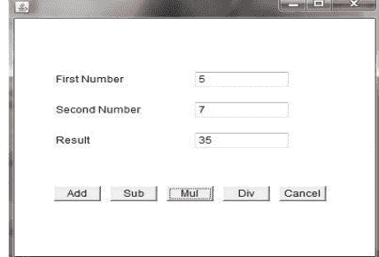

## 44. Java List 接口的程序

```java
import java.util.*;

public class CollectionsDemo
{
    public static void main(String[] args) {
        List a1 = new ArrayList();
        a1.add("Zara");
        a1.add("Mahnaz");
        a1.add("Ayan");
        System.out.println("ArrayList Elements");
        System.out.print("d" + a1);
        List l1 = new LinkedList();
        l1.add("Zara");
        l1.add("Mahnaz");
        l1.add("Ayan");
        System.out.println();
        System.out.println("LinkedList Elements");
        System.out.print("d" + l1);
    }
}
```

输出：
`ArrayList [Zara, Mahnaz, Ayan]`
`LinkedList Elements`
`[Zara, Mahnaz, Ayan]`

## 程序 3：编写一个在 Java 中创建自定义异常的程序

```java
class NumberRange extends Exception
{
    String msg;
    NumberRangeException()
    {
        msg = new String("输入一个 20 到 100 之间的数字");
    }
}

public class My_Exception
{
    public static void main (String args )
    {
        try {
            int x = 10;
            if (x < 20 || x > 100) throw new NumberRangeException();
        }
        catch (NumberRangeException e)
        {
            System.out.println(e);
        }
    }
}
```

输出：
数字范围异常

## 关于作者


她是 Cagemi、Oracle 和 C++ 等公司的自由职业者。她是 ICWA、MMS 系统与技术以及 M.C 计算机科学与信息技术的客座。

她出版过 Visual Basic、C 编程、Linux 操作系统、Java 和数据结构、Linux 管理、创新编程和 Web 编程、Python、DBMS 和核心 Java。

## 即出版的书

- 大数据分析（参考书）
- (1) 家庭暴力、(2) 女性在职业发展中面临的问题、(3) 云存储的不同机制、(4) 带有 GitHub 的 OpenStack 私有云以及 (5) 大数据的概率独立 NoSQL 数据库系统。

她发表了许多论文。
她是 Himalaya 出版社 ITCS 的评审员和编辑。


他是 M.Sc. (IT/ICS) 和 MMS 的访问教师。

他出版了关于数字计算基础、Java 和数据结构、高级 Java、Web 编程和数据结构的书籍。


