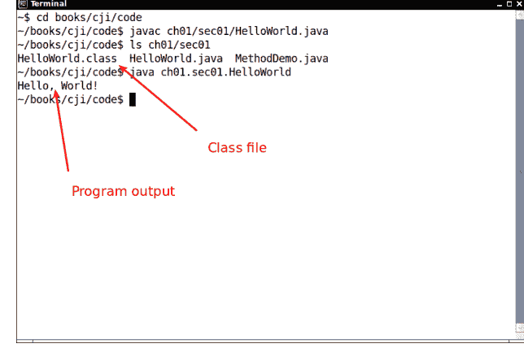
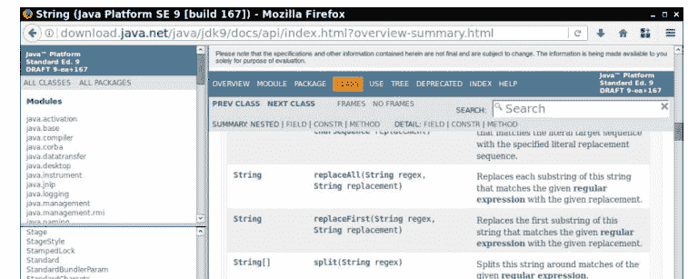
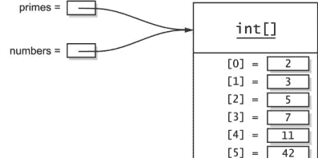
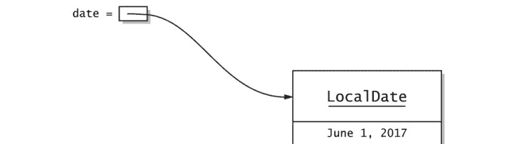
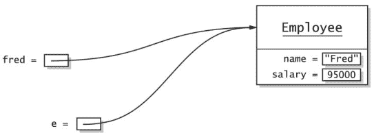
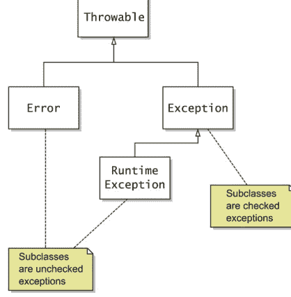
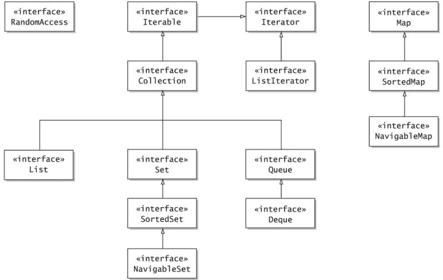
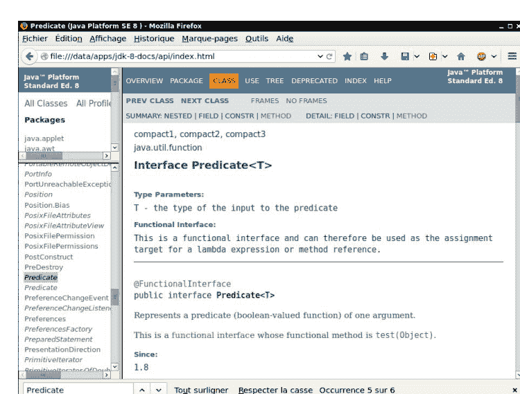
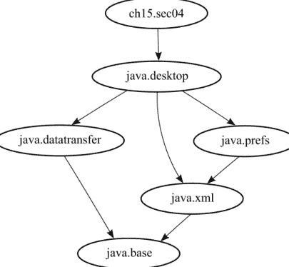
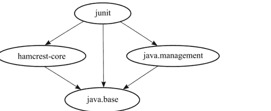

# Core Java® SE 9 入门指南


> 献给 Chi——我生命中最耐心的人。

## 2 面向对象 59

### 2.1 使用对象 60

#### 2.1.1 访问器和修改器方法 62
#### 2.1.2 对象引用 63

### 2.2 实现类 65

#### 2.2.1 实例变量 65
#### 2.2.2 方法头 66
#### 2.2.3 方法体 66
#### 2.2.4 实例方法调用 66
#### 2.2.5 `this` 引用 69
#### 2.2.6 值传递 68

### 2.3 对象构造 69

#### 2.3.1 实现构造函数 69
#### 2.3.2 重载 70
#### 2.3.3 从另一个调用 71
#### 2.3.4 默认初始化 71
#### 2.3.5 实例变量初始化 72
#### 2.3.6 `final` 实例变量 73
#### 2.3.7 无参数构造函数 74

### 2.4 静态变量和方法 74

#### 2.4.1 静态变量 74
#### 2.4.2 静态常量 75
#### 2.4.3 静态初始化 76
#### 2.4.4 静态方法 77
#### 2.4.5 工厂方法 78

### 2.5 包 78

#### 2.5.1 包声明 79
#### 2.5.2 命令 80
#### 2.5.3 类路径 81
#### 2.5.4 包访问 83
#### 2.5.5 导入类 83
#### 2.5.6 静态导入 85

### 2.6 嵌套类 85

#### 2.6.1 静态嵌套类 85
#### 2.6.2 内部类 87
#### 2.6.3 内部类的特殊语法 89

### 2.7 文档注释 90

#### 2.7.1 释插入 90
#### 2.7.2 类注释 91
#### 2.7.3 方法注释 92
#### 2.7.4 变量注释 92
#### 2.7.5 通用注释 92
#### 2.7.6 链接 93
#### 2.7.7 包、模块和概述注释 94
#### 2.7.8 注释提取 94

#### 练习 95

## 3 接口与 Lambda 表达式 99

### 3.1 接口 100

#### 3.1.1 声明接口 100
#### 3.1.2 实现接口 101
#### 3.1.3 转换为接口类型 103
#### 3.1.4 强制转换和 `instanceof` 运算符 103
#### 3.1.5 扩展接口 104
#### 3.1.6 实现多个接口 105
#### 3.1.7 常量 105

### 3.2 静态、默认和私有方法 105

#### 3.2.1 静态方法 105
#### 3.2.2 默认方法 106
#### 3.2.3 默认方法冲突 107
#### 3.2.4 私有方法 109

### 3.3 接口示例 109

#### 3.3.1 `Comparable` 接口 109
#### 3.3.2 `Comparator` 接口 111
#### 3.3.3 `Runnable` 接口 112
#### 3.3.4 用户界面回调 112

### 3.4 Lambda 表达式 113

#### 3.4.1 Lambda 表达式的语法 114
#### 3.4.2 功能化接口 115

### 3.5 方法引用和构造函数引用 116

#### 3.5.1 方法引用 117
#### 3.5.2 构造函数引用 118

### 3.6 处理 Lambda 表达式 119

#### 3.6.1 实现延迟执行 119
#### 3.6.2 选择功能化接口 120
#### 3.6.3 实现你的功能化接口 123

### 3.7 Lambda 表达式与变量作用域 124

#### 3.7.1 Lambda 表达式的作用域 124
#### 3.7.2 从闭包作用域访问变量 124

### 3.8 高阶函数 127

#### 3.8.1 返回函数的方法 127
#### 3.8.2 修改函数的方法 128
#### 3.8.3 比较方法 128

### 3.9 匿名类 129

#### 3.9.1 局部类 129
#### 3.9.2 匿名类 131

## 4 继承与反射 135

### 4.1 扩展类 136

#### 4.1.1 父类与子类 136
#### 4.1.2 定义和继承子类方法 137
#### 4.1.3 方法重写 137
#### 4.1.4 子类构造 139
#### 4.1.5 父类赋值 139
#### 4.1.6 强制转换 140
#### 4.1.7 `final` 方法和类 141
#### 4.1.8 抽象方法和类 141
#### 4.1.9 受保护访问 142
#### 4.1.10 匿名子类 143
#### 4.1.11 继承与默认方法 144
#### 4.1.12 使用 `super` 的表达式 145

### 4.2 `Object`：宇宙超类 145

#### 4.2.1 `toString` 方法 146
#### 4.2.2 `equals` 方法 148
#### 4.2.3 `hashCode` 方法 150
#### 4.2.4 克隆对象 151

### 4.3 枚举 154

#### 4.3.1 枚举的方法 155
#### 4.3.2 构造函数、方法和字段 156
#### 4.3.3 实例体 157
#### 4.3.4 静态成员 157
#### 4.3.5 对枚举进行 `switch` 158

### 4.4 运行时类型信息与资源 159

#### 4.4.1 类 `Class` 159
#### 4.4.2 加载资源 162
#### 4.4.3 类加载器 163
#### 4.4.4 上下文类加载器 164
#### 4.4.5 服务加载器 166

### 4.5 反射 168

#### 4.5.1 枚举类成员 169
#### 4.5.2 检查对象 169
#### 4.5.3 调用方法 171
#### 4.5.4 构造对象 171
#### 4.5.5 `JavaBeans` 172
#### 4.5.6 使用数组 172
#### 4.5.7 代理 175

#### 练习 177

## 5 异常、断言与日志 181

### 5.1 异常处理 182

#### 5.1.1 抛出异常 182
#### 5.1.2 异常层次结构 183
#### 5.1.3 声明检查异常 185
#### 5.1.4 捕获异常 186
#### 5.1.5 `Try-with-Resources` 语句 187
#### 5.1.6 `finally` 子句 189
#### 5.1.7 重新抛出与异常链 190
#### 5.1.8 未捕获异常与堆栈跟踪 192
#### 5.1.9 `Objects.requireNonNull` 方法 193

### 5.2 断言 194

#### 5.2.1 使用断言 194
#### 5.2.2 启用与禁用断言 194

### 5.3 日志 195

#### 5.3.1 使用日志器 195
#### 5.3.2 日志器 196
#### 5.3.3 日志级别 197
#### 5.3.4 其他日志方法 197
#### 5.3.5 日志配置 199
#### 5.3.6 日志处理器 200
#### 5.3.7 过滤器与格式化器 202

#### 练习 203

## 6 泛型编程 207

### 6.1 泛型类 208
### 6.2 泛型方法 209
### 6.3 类型边界 210
### 6.4 类型变体与通配符 211

#### 6.4.1 子类型通配符 212
#### 6.4.2 上类型类型通配符 213
#### 6.4.3 带有类型变量的通配符 214
#### 6.4.4 无界通配符 215
#### 6.4.5 通配符捕获 216

### 6.5 Java 虚拟机中的泛型 216

#### 6.5.1 类型擦除 217
#### 6.5.2 强制类型转换插入 217
#### 6.5.3 桥接方法 218

### 6.6 泛型的限制 220

#### 6.6.1 不支持基本类型类型参数 220
#### 6.6.2 在运行时，所有类型均为原始类型 220
#### 6.6.3 你不能实例化类型变量 221
#### 6.6.4 你不能构造泛化类型的数组 223
#### 6.6.5 类类型变量在静态上下文中无效 224
#### 6.6.6 擦除后方法可能发生冲突 224
#### 6.6.7 异常与泛型 225

### 6.7 反射与泛型 226

#### 6.7.1 `Class<T>` 类 227
#### 6.7.2 虚拟机中的泛型类型信息 227

#### 练习 229

## 7 集合 235

### 7.1 集合框架概述 236
### 7.2 迭代器 240
### 7.3 集合（Sets）242
### 7.4 映射（Maps）243
### 7.5 其他集合 247

#### 7.5.1 属性（Properties）247
#### 7.5.2 位集（Bit Sets）248
#### 7.5.3 枚举集合与映射 250
#### 7.5.4 栈、队列、双端队列与优先级队列 251
#### 7.5.5 弱哈希映射 251

### 7.6 视图（Views）252

#### 7.6.1 小集合 252
#### 7.6.2 范围（Ranges）253
#### 7.6.3 不可视图 254

#### 练习 255

## 8 流（STREAMS）259

### 8.1 从迭代到流操作 260
### 8.2 流的创建 261
### 8.3 `filter`、`map` 和 `flatMap` 方法 263
### 8.4 提取子流与合并 264
### 8.5 其他流转换 265
### 8.6 简单归约 266
### 8.7 `Optional` 类型 267

#### 8.7.1 如何处理 `Optional` 值 269
#### 8.7.2 如何不正确处理 `Optional` 值 269
#### 8.7.3 创建 `Optional` 值 269
#### 8.7.4 使用 `flatMap` 组合 `Optional` 函数 269
#### 8.7.5 将 `Optional` 转换为流 270

### 8.8 收集结果 271
### 8.9 收集到映射 273
### 8.10 分组与分区 274
### 8.11 下游收集器 275
### 8.12 归约操作 277
### 8.13 基本类型流 279
### 8.14 并行流 280

#### 练习 283

## 9 处理输入与输出 287

### 9.1 输入/输出流、读取器与写入器 288

#### 9.1.1 获取流 288
#### 9.1.2 读取字节 289
#### 9.1.3 写入字节 290
#### 9.1.4 字符编码 290
#### 9.1.5 输入 293
#### 9.1.6 输出 294
#### 9.1.7 读取与写入数据 295
#### 9.1.8 随机访问文件 296
#### 9.1.9 内存映射文件 297
#### 9.1.10 文件锁定 297

### 9.2 路径、文件与目录 298

#### 9.2.1 路径 298
#### 9.2.2 创建文件与目录 300
#### 9.2.3 复制、移动与删除文件 301
#### 9.2.4 遍历目录 302
#### 9.2.5 ZIP 系统 305

### 9.3 HTTP 连接 306

#### 9.3.1 URL 与类 306
#### 9.3.2 HTTP 客户端 API 307

### 9.4 正则表达式 310

#### 9.4.1 正则表达式语法 310
#### 9.4.2 匹配一个 314
#### 9.4.3 匹配所有 315
#### 9.4.4 组 316
#### 9.4.5 分分隔符划分 317
#### 9.4.6 替换 317
#### 9.4.7 标记 318

### 9.5 序列化 319

#### 9.5.1 `Serializable` 接口 319
#### 9.5.2 `Transient` 变量 321
#### 9.5.3 `readObject` 与 `writeObject` 方法 321
#### 9.5.4 `readResolve` 与 `writeReplace` 322
#### 9.5.5 版本控制 324

#### 练习 325

## 10 并发编程 329

### 10.1 并发任务 330

#### 10.1.1 运行任务 330
#### 10.1.2 `Future` 333

### 10.2 异步计算 335

#### 10.2.1 `CompletableFutures` 335
#### 10.2.2 组合 `CompletableFutures` 337
#### 10.2.3 用户界面中的长时间任务 340

### 10.3 线程安全 341

#### 10.3.1 可见性 342
#### 10.3.2 竞态条件 344
#### 10.3.3 安全并发策略 346
#### 10.3.4 不变类 347

### 10.4 并行算法 348

#### 10.4.1 并行流 348
#### 10.4.2 并行数组操作 350

### 10.5 线程安全数据结构 350

#### 10.5.1 并发 `Map` 350
#### 10.5.2 阻塞队列 352
#### 10.5.3 其他线程安全数据结构 354

### 10.6 原子计数器与累加器 354
### 10.7 锁与条件 357

#### 10.7.1 `Locks` 关键字 357
#### 10.7.2 `synchronized` 关键字 358
#### 10.7.3 等待条件 360

### 10.8 线程 362

#### 10.8.1 启动线程 363
#### 10.8.2 线程中断 364
#### 10.8.3 `ThreadLocal` 变量 365
#### 10.8.4 杂线程属性 366

### 10.9 进程 366

#### 10.9.1 构建进程 367
#### 10.9.2 运行进程 368
#### 10.9.3 进程句柄（Process Handles）370

#### 练习 371

## II 注解（ANNOTATIONS）377

### 11.1 使用注解 378

#### 11.1.1 注解元素 378
#### 11.1.2 多重与重复注解 380
#### 11.1.3 注解声明 380
#### 11.1.4 注解类型使用 381
#### 11.1.5 显式化接收者 382

### 11.2 定义注解 383
### 11.3 标准注解 386

#### 11.3.1 编译注解 386
#### 11.3.2 元注解（Meta-Annotations）387
#### 11.3.3 处理注解 388

### 11.4 注解处理 390

#### 11.4.1 运行时处理器 391
#### 11.4.2 源码处理器 394
#### 11.4.3 注解生成器 395

### 11.5 使用注解 395

#### 练习 398

## 12 日期与时间 401

### 12.1 `Locale` 402
### 12.2 日期 404
### 12.3 调整器（Adjusters）407
### 12.4 本地时间（Local Time）409
### 12.5 时区时间（Zoned Time）410
### 12.6 格式化 413
### 12.7 与代码交互 416

#### 练习 417

## 13 国际化 421

### 13.1 `Locale` 422

#### 13.1.1 指定 `Locale` 423
#### 13.1.2 默认 `Locale` 426

### 13.2 数字格式 427
### 13.3 货币 428
### 13.4 日期与时间格式 429
### 13.5 排序与归一化 431
### 13.6 消息格式 433
### 13.7 资源包（Resource Bundles）435

#### 13.7.1 资源包 435

### 13.8 字符编码 438
### 13.9 偏好 439

#### 练习 441

## 14 编译与脚本 443

### 14.1 编译器 444

#### 14.1.1 调用编译器 444
#### 14.1.2 启动编译 444
#### 14.1.3 读取源码 445
#### 14.1.4 写入字节码 446
#### 14.1.5 诊断信息 447

### 14.2 脚本 API 448

#### 14.2.1 获取脚本引擎 449
#### 14.2.2 绑定 449
#### 14.2.3 重定向输入/输出 449
#### 14.2.4 调用脚本函数与方法 450
#### 14.2.5 编译脚本 452

### 14.3 Nashorn 脚本引擎 452

#### 14.3.1 从命令行运行 Nashorn 452
#### 14.3.2 调用 getter、setter 与重载方法 453
#### 14.3.3 构造 Java 对象 454
#### 14.3.4 JavaScript 与字符串 455
#### 14.3.5 数字 456
#### 14.3.6 数组操作 457
#### 14.3.7 列表与映射 458
#### 14.3.8 Lambda 458
#### 14.3.9 扩展 Java 类与实现 Java 接口 459
#### 14.3.10 异常 461

### 14.4 使用 Nashorn 进行脚本 461

#### 14.4.1 执行 Shell 命令 462
#### 14.4.2 字符串插值 462
#### 14.4.3 脚本输入 463

#### 练习 464

## 15 Java 模块系统 469

### 15.1 模块概念 470
### 15.2 模块命名 472
### 15.3 模块化的“Hello, World!”程序 472
### 15.4 依赖模块 474
### 15.5 导出包 476
### 15.6 模块与反射访问 479
### 15.7 模块化 JAR 482
### 15.8 自动模块与未命名模块 484
### 15.9 迁移的命令行标记 485
### 15.10 传递性要求与静态要求 487
### 15.11 限定导出与开放 489
### 15.12 服务加载 490
### 15.13 模块操作工具 491

#### 练习 494

## 索引 497

# 前言

Java 现在已经有二十多年的历史了。经典著作《Java核心编程》（Core Java）细致入微地涵盖了不仅是语言本身，还有所有核心库以及不同版本之间的大量变化，共分为两卷，超过 2000 页。然而，如果你只是想在现代 Java 中提高效率，那么有一条更快、更简单的路径来学习这种语言和核心库。在本书书中，我不会回顾历史，也不会纠结于旧版本的特性。我将向你展示 Java 9 如今已有的优秀部分，这样你就能很快将知识投入工作。


与我之前的“不急躁”（Impatient）系列书籍一样，我会直奔主题，展示你解决编程问题需要需要的知识，而不是对某一种范式优于另一种范式进行说教。我还会以小块的形式呈现信息，并进行组织，以便你在需要时快速检索。

假设你已经精通某种其他编程语言（如 C++、Objective C、PHP 或 Ruby），通过这本书，你将学习如何成为一名胜任的 Java 程序员。我涵盖了开发者需要的所有 Java 方面，包括 lambda 表达式和流（streams）这些强大的概念。我会告诉你去哪里了解更多关于在遗留代码中可能看到的旧概念，但我不会在它们上花费过多时间。

使用 Java 的关键原因之一是处理并发编程。由于 Java 库提供了并行算法和线程安全数据结构，应用程序程序员处理并发编程的方式已经完全改变。我提供了全新的视角，教你如何使用强大的库特性，而不是容易出错的低级结构。

传统上，Java 书侧重于用户界面编程——但现在，很少开发者在桌面电脑上制作用户界面。如果你打算使用 Java 进行服务器端编程或 Android，你能够有效地使用这本书，而不会被桌面 GUI 代码干扰。

最后，这本书是为应用程序程序员编写的，而不是为了大学课程，也不是为了系统专家。本书涵盖了应用程序程序员需要应对的问题，例如日志记录和文件操作——但你不会学习如何手动实现链表或如何编写 Web 服务器。

我希望你喜欢这本对现代 Java 的快速介绍，并希望它能让你的 Java 工作高效且愉快。

如果你发现错误或有改进建议，请访问`http://horstmann.com/javaimpatient`并留言。在该页面上，你还会找到一个包含书中所有代码示例的归档文件链接。

# 致谢

一如既往，我要感谢我的编辑 Greg Doench，他热情地支持编写一本为 Java SE 9 提供新鲜介绍的短书的想法。Dmitry Kirsanov 和 Alina Kirsanova 再次以惊人的速度和对细节的关注将 XHTML 手稿变成了一本精美的书。我特别感谢两个版本的优秀评审团队，他们发现了许多错误并提出了周全的改进建议。他们是：Andres Almiray, Gail Anderson, Paul Anderson, Marcus Biel, Brian Goetz, Marty Hall, Mark Lawrence, Doug Lea, Simon Ritter, Yoshiki Shibata 以及 Christian Ullenbloom。

Cay Horstmann

旧金山

2017年7月

# 关于作者

Cay S. Horstmann 是《Java SE 8 for the Really Impatient》和《Scala for the Impatient》（均 Addison-Wesley 出版）、《Java核心编程》第一二卷第十版（Prentice Hall, 2016）的主要作者，并为专业程序员和计算机科学学生写过其他十几本书。他是圣何塞州立大学的计算机科学教授，也是 Java 冠军（Java Champion）。

# 基础编程结构

## 本章主题

- 1.1 我们的第一个程序 — 第22页
- 1.2 原地类型 — 第10页
- 1.3 变量 — 第14页
- 1.4 算术运算 — 第17页
- 1.5 字符串 — 第24页
- 1.6 输入与输出 — 第32页
- 1.7 控制流 — 第36页
- 1.8 数组和 Array Lists — 第43页
- 1.9 功能分解 — 第52页
- 练习题 — 第54页

# 第一章

在本章中，你将学习 Java 语言的基本数据类型和控制结构。我假设你是某种其他语言的资深程序员，并且熟悉变量、循环、函数调用和数组等概念，但语法可能不同。本章将让你快速上手 Java 风格。我还会提供一些关于 Java API 中处理常用数据类型的最有用部分的技巧。

本章的要点是：

1. 在 Java 中，所有方法都声明在类中。你在该方法所属的类对象上调用非静态方法。
2. 静态方法不在对象上被调用。程序的执行从静态方法开始。
3. Java 有八种原始类型：四种符号整数类型、两种浮点数类型、`char` 和 `boolean`（布尔）。
4. Java 的运算符和控制结构与 C 或 JavaScript 非常相似。
5. `Math` 类提供了常用的数学函数。
6. `String` 对象是字符序列，更准确地说，是 UTF-16 编码中的 Unicode 代码点。

# 第1章 基础编程结构

7. 通过`System.out`对象，你可以在终端窗口中显示输出。`Scanner`对象让你能够读取输入。
8. 数组和集合可以用于收集相同类型的元素。

## 1.1 我们的第一个程序

在 Java 中，所有方法都声明在类中。你在该方法所属的类对象上调用非静态方法。静态方法不在对象上被调用。程序的执行从静态方法开始。Java 有八种原始类型：四种符号整数类型、两种浮点数类型、`char` 和 `boolean`。Java 的运算符和控制结构与 C 或 JavaScript 非常相似。`Math` 类提供了常用的数学函数。`String` 对象是字符序列，更准确地说，是 UTF-16 编码中的 Unicode 代码点。7. 通过`System.out`对象，你可以在终端窗口中显示输出。`Scanner`对象让你能够读取输入。8 数组和集合可以用于收集相同类型的元素。

### 1.1.1 解析“Hello, World”程序

```java
package01.sec01;

// 我们的第一个程序
public class HelloWorld {
    public static void main(String[] args) {
        System.out.println("Hello, World!");
    }
}
```

Java 是一种面向对象的语言。正如你所见，在 Java 中一切定义在类内部。这种统一性会导致代码显得冗长，但它有助于理解程序的含义。

> 注意：你刚刚看到了一个延伸到行尾的`//`注释。你也可以使用`/*`和`*/`之间的多行注释，例如：

```java
/*
这是《不急躁 Java》中的第一个示例程序。

  程序显示传统的问候“Hello, World!”
*/
```

还有第三种注释样式称为文档注释，使用`/**`和`*/`作为界符，你将在下一章看到。

## 1.1.2 编译和运行 Java 程序

包是相关类的集合。将类放在包中是一个好主意，这样当多个类同名时可以避免冲突。在本书中，我们使用章节和节号作为包名。我们的类全名是`ch01.sec01.HelloWorld`。第二章关于包更多介绍。

以`//`开头的行是注释。`//`到行尾之间的所有字符会被编译器忽略，供人类阅读。

最后，我们来到`main`方法体。在我们的示例中，它由单行组成，向`System.out`（代表 Java 程序“标准输出”的对象）打印消息。

正如你可以看到的，Java 不是一种可以快速冲写几条命令的脚本语言。它明确旨在用于受益于通过类、包和模块进行组织的大型程序。（模块将在第15章介绍）。

安装软件的过程并不有趣，因此我将这些内容也放在了辅助网站上。

一旦安装了 JDK，打开终端窗口，切换到包含`ch01`目录的路径，并运行以下命令：

```bash
javac ch01/sec01/HelloWorld.java
java ch01.sec01.HelloWorld
```

终端窗口中会出现熟悉的问候信息（见图 1-1）。

请注意，执行该程序涉及两个步骤。`javac`命令将 Java 源代码编译成与机器无关的中间表示，称为字节码（byte codes），并将其保存在类文件中。`java`命令启动一个虚拟机，加载类文件并执行字节码。

一旦编译完成，字节码可以在任何虚拟机上运行，无论是在你的台式电脑上，还是在遥远的星系中的设备上。“一次编写，处运行”的承诺是 Java 的一个重要设计准则。



图 1-1 在终端窗口中运行 Java 程序

> 注意：调用`java`编译器时使用文件名，用斜杠分隔路径段，并带有扩展名`.java`。调用`java`虚拟机启动器时使用类名，用点分隔包段，且没有扩展名。

要在 IDE 中运行该程序，你需要首先创建一个项目，如安装说明所示。然后，选择`HelloWorld`类并告诉 IDE 运行它。图 1-2 显示了在 Eclipse 中的外观。Eclipse 是一个流行的 IDE，但许多许多优秀的选择。在进行 Java 编程时，你应该尝试几个并选择一个你喜欢的。


图 1-2 在 Eclipse IDE 中运行 Java 程序

恭喜！你刚刚完成了在 Java 中运行“Hello, World!”程序的这一传统仪式。现在，我们准备好检查 Java 语言的基础知识了。

### 1.1.3 方法调用

让我们仔细观察主方法中的这条语句：

```java
System.out.println("Hello, World!");
```

`System.out`是一个对象。它是一个名为`PrintStream`的类的实例。`PrintStream`类拥有`println`、`print`等方法。这些方法被称为实例方法（instance methods），因为它们在类的对象（或实例）上操作。

要在对象上调用实例方法，你使用点符号法：

```java
object.methodName(arguments)
```

在这种情况下，只有一个参数，字符串`"Hello, World!"`。

让我们尝试另一个例子。字符串`"Hello, World!"`是`String`类的实例。`String`类有一个方法`length`，可以返回字符串对象的长度。要调用该方法，你再次使用点符号法：

```java
"Hello".length()
```

`length`方法是在对象`"Hello, World"`上调用的，它没有参数。与`println`方法不同，`length`方法会返回结果。使用该结果的方法之一是打印它：

```java
System.out.println("Hello, World!".length());
```

尝试一下。编写包含此语句的 Java 程序并运行，看看字符串有多长。

在 Java 中，你需要构造对象（与`System.out`和`"Hello, World!"`对象不同，它们已经存在并供你使用）。这里有一个简单的示例。

`Random`类的对象可以生成随机数。你使用`new`运算符构造一个`Random`对象：

```java
new Random()
```

在类名之后是构造参数列表，在本例中它是空的。

你可以在构造的对象上调用方法。如下调用：

```java
new Random().nextInt()
```

会产生新构造的随机数生成器提供的下一个整数。

如果你想在一个对象上调用多个方法，请将其存储在变量中（见第 14 页第 1.3 节“变量”）。在这里我们打印两个随机数：

```java
Random generator = new Random();
System.out.println(generator.nextInt());
System.out.println(generator.nextInt());
```

> 注意：`Random`类声明在`java.util`包中。要在程序中使用它，请添加`import`语句，如下：

```java
package ch01.sec01;

import java.util.Random;

public class MethodDemo {
  ...
}
```

我们将在第 2 章中详细查看包和`import`语句。

### 1.1.4 JShell

在第 1.1.2 节“编译和运行 Java 程序”（第 3 页）中，你看到了如何编译和运行 Java 程序。Java 9 介绍了另一种处理 Java 的方式。JShell 程序提供“读取-评估-打印循环”（REPL），你在其中输入 Java 表达式，JShell 计算你的输入，打印结果并等待你的下次输入。要启动 JShell，只需在终端窗口中输入`jshell`（图 1-3）。

JShell 启动后会显示问候，随后是提示符：

- `-- Welcome to JShell -- Version 9-ea`
- `For an introduction type: /help intro`

```text
jshell>
```

现在输入任何 Java 表达式。

JShell 返回结果和另一个提示符：

```text
-- Welcome to JShell -- Version 9-ea
For an introduction type: /help intro

jshell>
```

JShell 返回结果和另一个提示符。

```text
jshell>
```

现在输入任何 Java 表达式。

JShell 返回结果和另一个提示符。

```text
jshell>
```

JShell 返回结果和另一个提示符：

```text
-- Welcome to JShell -- Version 9-ea
For an introduction type: /help intro

jshell>
```

现在输入任何 Java 表达式。

JShell 返回结果和另一个提示符：

```text
jshell>
```

JShell 返回结果和另一个提示符：

```text
-- Welcome to JShell -- Version 9-ea
For an introduction type: /help intro

jshell>
```

现在输入任何 Java 表达式。

JShell 返回结果和另一个提示符。

```text
jshell>
```

JShell 返回结果和另一个提示符。

```text
jshell>
```

这就是为什么你可以在 JShell 中直接使用`Random`类，而无需任何`import`语句。如果你需要导入另一个类，可以在 JShell 提示符处输入`import`语句。或者更方便的方法是，通过按下 Shift+Tab 和 I 键来让 JShell 为你搜索它。例如，输入`Duration`然后按 Shift+Tab 再按 I 键。你将得到一个潜在的操作列表：

```text
jshell Duration
0: Do nothing
1: import: java.time.Duration
2: import: javafx.util.Duration
3: import: javax.xml.datatype.Duration
```

输入`i`，你将收到一个确认：

```text
Imported: java.time.Duration
```

接着是：

```text
jshell Duration
```

这样你就可以从上次离开的地方继续，而且已经完成了导入。

这些命令足够让你开始使用 JShell 了。如需帮助，请输入`/help`并按回车。要退出，输入`/exit`并按回车，或直接按 Ctrl+D。

JShell 让学习 Java 语言和库变得简单且有趣，而无需启动沉重的开发环境，也不需要纠结于`public static void main`。

## 1.2 原始类型

尽管 Java 是一种面向对象的语言，但并不是所有的 Java 值都是对象。相反，某些值属于原始类型。这些类型中有四种是有符号整数类型，两种是浮点数类型，一种是用于字符串编码的字符类型`char`，以及一种用于真值的布尔类型`boolean`。我们将在接下来的章节中查看这些类型。

### 1.2.1 有符号整数类型

符号整数类型用于没有小数部分的数字。允许负值。Java 提供了表 1-1 所示的四种符号整数类型。

### 表 1-1 Java 符号整数类型

| 类型 | 存储需求 | 范围（包含边界） |
| :--- | :--- | :--- |
| `byte` | 1 byte | -128 到 127 |
| `short` | 2 bytes | -32,768 到 32,767 |
| `int` | 4 bytes | -2,147,483,648 到 2,147,483,647（略大于 20 亿） |
| `long` | 8 bytes | -9,223,372,036,854,775,808 到 9,223,372,036,854,775,807 |

> 注意：常量`Integer.MIN_VALUE`和`Integer.MAX_VALUE`是最小和最大的`int`值。`Long`、`Short`和`Byte`类也有`MIN_VALUE`和`MAX_VALUE`常量。

在大多数情况下，`int`类型是最实用的。如果你想表示地球上的居民，你将需要求助于`long`。`byte`和`short`类型主要用于特殊应用程序，例如低级文件处理，或者存储空间极其紧张的大型数组。

> 注意：如果`long`类型不再足够，请使用`BigInteger`类。详情请参见第 1.4.6 节“大数字”（第 23 页）。

在 Java 中，整数类型的范围不依赖于你运行程序的机器。毕竟，Java 被设计成一种“编写一次，随处运行”的语言。相比之下，C 和 C++ 程序中的整数类型取决于编译程序时使用的处理器。

你在编写`long`类型字面量时要带有后缀`L`（例如`4000000000L`）。`byte`或`short`类型的字面量没有语法。例如强制转换符号（参见第 1.4.4 节“数字转换”，第 20 页），例如，`(byte) 127`。

十六进制字面量有前缀`0x`（例如`0xCAFEBABE`）。二进制值有前缀`0b`。例如，`0b1001`是 9。

> 警告：八进制数有一个前缀`0`。例如，`011`是 9。这可能会引起混淆，所以最好是避开八进制字面量和前导零。

## 第 1 章 基础编程结构

你可以在数字字面量添加下划线，例如`1_000_000`（或`01111_0100_0010_0100_0000`）来表示一百万。下划线仅供人类肉眼识别，Java 编译器会移除它们。


> 注意：如果你使用的是永远不会为负数的整数值，且确实需要额外的位，你可以小心地将有符号值解释为无符号值。例如，一个`byte`值表示从 -128 到 127 的范围。如果你想要 0 到 255 的范围，你仍然可以存储在`byte`中。由于二进制运算的性质，减法和乘法都能正常工作，不会溢出。对于其他操作，调用`Byte.toUnsignedInt(b)`获取 0 到 255 之间的`int`值，然后处理该整数值，并将结果转换回`byte`。`Integer`和`Long`类具有无符号除法和取余的方法。

### 1.2.2 浮点类型

浮点类型表示带有小数部分的数字。浮点类型如表 1-2 所示。

### 表 1–2 浮点类型

| 类型 | 存储需求 | 范围 |
| :--- | :--- | :--- |
| `float` | 4 bytes | 约 ±3.40282347E+38（6~7有效数字） |
| `double` | 8 bytes | 约 ±1.797693148623150E+308（15有效数字） |

许多年前，当内存资源稀缺时，四字节浮点数很常用。但七位有效数字远远不够，如今“双精度”数字是默认的。只有当你需要存储大量此类数字时，使用`float`才有意义。

`float`类型的数字带有后缀`F`（例如`3.14F`）。不带`F`后缀的浮点字面量（如`3.14`）类型为`double`。你可以可选地使用`D`后缀（例如`3.14D`）。

> 注意：可以使用十六进制指定浮点字面量。例如，0.0009765625 = 2^-10 可以写为`0x1.0p-10`。

### 1.3 变量

在后续章节中，你将学习如何声明和初始化变量以及常量。

### 1.3.1 变量声明

Java 是一种强类型语言。每个变量只能持有特定类型的值。当你声明变量时，需要指定类型、名称以及可选的初始值。例如：

```java
int total = 0;
```

你可以在同一语句中声明多个同类型的变量：`// count 是未初始化的整数`

大多数 Java 程序员倾向于为每个变量使用单独的声明。考虑这个变量声明：

```java
Random generator = new Random();
```

在这里，对象的类名出现了两次。第一个`Random`是变量`generator`的类型。第二个`Random`是构造该类对象表达式的一部分。

### 1.3.2 命名

变量名（以及方法或类名）必须以字母开头。它可以由任何字母、数字以及符号`_`和`$`组成。然而，`$`符号旨在用于自动生成的名称，你不应该在自己的命名中使用它。最后，单独的`_`本身不是一个有效的变量名。

在这里，字母和数字可以来自任何字母表，而不只是拉丁字母表。

例如，`m`和`elevation`是有效的变量名。大小写是敏感的：`count`和`Count`是不同的名称。

你不能在名称中使用空格或符号。最后，你不能使用如`double`之类的关键字作为名称。

按照惯例，变量和方法的名称以小写字母开头，类的名称以大写字母开头。Java 程序员喜欢“驼峰命名法”（camel case），在名称由多个单词组成时使用大写字母，例如`countOfInvalidInputs`。

### 1.3.3 初始化

当你在方法中声明变量时，必须在使用之前对其进行初始化。例如，以下代码会导致编译时错误：

```java
int count;
count++; // Error—count 是未初始化的变量
```

编译器必须能够验证变量在使用之前是否已初始化。例如，以下代码也是错误的：

```java
int count;
if (total == 0) {
    count = 0;
} else {
    count++; // Error—count 可能未初始化
}
```

你可以在方法内的任何地方声明变量。一种风格是尽可能晚地声明变量，即在第一次需要使用它之前。例如：

```java
Scanner in = new Scanner(System.in); // 读取输入请参见第 1.6.1 节
System.out.println("How old are you?");
int age = in.nextInt();
```

变量在其初始值可用点被声明。

### 1.3.4 常量

`final`关键字表示一个一旦赋值就无法更改的值。在其他语言中，人们将此类称为常量。例如：

```java
final int DAYS_PER_WEEK = 7;
```

按照惯例，常量名称使用大写字母。

# 第 1 章 编程结构

你也可以使用`static`关键字在方法外部声明常量：

```java
public class Calendar {
    public static final int DAYS_PER_WEEK = 7;
}
```

然后该常量可以在多个方法中使用。在`Calendar`内部，你通过`DAYS_PER_WEEK`引用该常量。要在另一个类中使用该常量，请前面加上类名：`Calendar.DAYS_PER_WEEK`。

> 注意：`System`类声明了一个常量`public static final PrintStream out`，你可以在任何地方作为`System.out`使用它。这是少数未用大写字母的常量之一。

延迟初始化`final`变量是合法的，只要它在第一次使用之前恰好被初始化。例如，以下是合法的：

```java
final int DAYS_IN_FEBRUARY;
if (leapYear) {
    DAYS_IN_FEBRUARY = 29;
} else {
    DAYS_IN_FEBRUARY = 28;
}
```

这就是为什么称为“final”变量。一旦赋值了值，它就是最终的，永远无法更改。

> 注意：有时你需要一组相关的常量，例如：

```java
public static final int MONDAY = 0;
public static final int TUESDAY = 1;
```

在这种情况下，你可以像这样定义枚举类型：

```java
enum Weekday { MONDAY, TUESDAY, WEDNESDAY, THURSDAY, FRIDAY, SATURDAY, SUNDAY };
```

那么，这是一个带有`Weekday.MONDAY`等值的类型。以下是声明和初始化`Weekday`变量的方法：

```java
Weekday startDay = Weekday.MONDAY;
```

我们将在第 4 章讨论枚举类型。

### 1.4 算术运算

Java 使用任何基于 C 的语言中熟悉的运算符（见表 1-3）。我们将在接下来的章节中回顾它们。

### 表 1-3 Java 运算符

| 运算符 | 结合性 |
| --- | --- |
| `[] . ()`（方法调用） | 左结合 |
| `! ~ ++ +`（一元）`()`（类型转换）`new` | 右结合 |
| `* / %`（取模） | 左结合 |
| `<< >> >>>`（算术移位） | 左结合 |
| `< > <= instanceof` | 左结合 |
| `== !=` | 左结合 |
| `&`（位与） | 左结合 |
| `^`（位异或或） | 左结合 |
| `|`（位或） | 左结合 |
| `&&`（逻辑与） | 左结合 |
| `||`（逻辑或） | 左结合 |
| `? :`（条件运算符） | 左结合 |
| `+= -= *= /= %= <= >>= >= &= ^= |=` | 右结合 |

> 注意：在此表中，运算符按优先级从高到低列出。例如，`*`的优先级高于`<<`，`3 + 4 << 5`的值为`(3 + 4) << 5`。当运算符从左到右分组时，它是左结合的。例如，`3 - 4 - 5`意味着`(3 - 4) - 5`。但`-=`是右结合的，`i -= j -= k`意味着`i -= (j -= k)`。

### 1.4.1 赋值

表 1-3 的最后一行显示了赋值运算符。语句

```java
x = expression;
```

将`x`设置为右侧的值，替换原来的值。当`=`前面有一个运算符时，该运算符结合左侧和右侧并赋值结果。例如：

```java
amount -= 10;
```

等同于：

```java
amount = amount - 10;
```

### 1.4.2 基础算术

加法、乘法和除法由`+`、`-`、`*`、`/`表示。例如，`2 * n + 1`意味着将 2 与`n`相乘并加 1。

你需要小心使用`/`运算符。如果两个操作数都是整数，它表示整数除法，舍弃余数。例如，`17 / 5`是 3，而`17.8 / 5`是 3.4。

整数除法会产生异常，如果不被捕获，将终止你的程序。（有关异常处理的更多信息请参见第 5 章。）浮点数除以零会产生无限值或 NaN（见第 1.2.2 节“浮点类型”，第 12 页），而不会引起异常。

`%`运算符产生余数。例如，`17 % 5`是 2，即从 17 中减去 15（能“放入”17 的 5 的最大整数倍数）后剩余的数量。如果`a % b`的余数为 0，则`a`是`b`的整数倍数。

一个常见的用途是测试整数是否为偶数。如果`n`是偶数，表达式`n % 2`为 0。如果`n`是奇数呢？那么如果`n`是正数，`n % 2`为 1；如果是负数则为 -1。在实践中，对负数的处理并不理想。在使用可能为负的操作数使用`%`时始终小心。

考虑这种情况：你计算时时针的位置。应用了一个调整，你想将其归一化为 0 到 11 之间的数字。这很容易：`(position + adjustment) % 12`。但如果调整导致位置变成负数呢？你可能会得到负结果。所以你必须引入一个分支，或者使用`((position + adjustment) % 12) + 12`。无论哪种方法都很麻烦。

> 提示：在这种情况下，使用`Math.floorMod`方法更容易：`Math.floorMod(position + adjustment, 12)`总是产生 0 到 11 之间的值。遗憾的是，`floorMod`对于负除数会产生负结果，但这种情况在实践中并不经常发生。

Java 有自增和自减运算符：

```java
n++; // 给 n 加 1
n--; // 从 n 减 1
```

与其他基于 C 的语言一样，这些运算符也有前缀形式。

`n++`和`++n`在表达式内部使用的值不同。第一种形式返回增加之前的值，第二种形式返回增加后的值。例如：

```java
String arg = args[n++];
```

将`arg`设置为`args[n]`，然后增加`n`。这在三十年前很有意义，当时编译器优化代码做得并不很好。然而，许多现代处理器使用浮点寄存器执行它。使用单独语句没有性能损耗，而且许多程序员认为显式形式更易读。

> 注意：Java 编程语言的设定目标之一是可移植性。无论由什么虚拟机执行，计算都应该产生相同的结果。然而，许多现代处理器使用超过 64 位的浮点寄存器来增加精度并减少计算中间步骤中溢出的风险。Java 允许这些优化，因为否则浮点运算将变得更慢且不准确。对于少数关注此点的用户，有`strictfp`。当添加到方法上时，方法中所有的浮点运算都是严格可移植的。

### 1.4.3 数学方法

没有用于计算数字幂的运算符。相反，调用`Math.pow`方法：`Math.pow(x, y)`产生`x'`。要计算`x`的平方根，调用`Math.sqrt(x)`。

这些是不操作对象的静态方法。像静态常量一样，我们在它们前面加上声明它们的类名。同样有用的是`Math.min`和`Math.max`用于计算两个值的最小值和最大值。

此外，`Math`类提供了三角函数、对数函数，以及常量`Math.PI`和`Math.E`。

> 注意：`Math`类提供了几种方法来使整数运算更安全。当计算溢出时，数学运算符会静默地返回错误的结果。例如，十亿乘以（`1000000000 * 3`）的评估为 -1294967296，因为最大的`int`值仅略大于二十亿。如果你调用`Math.multiplyExact(1000000000, 3)`，则会产生一个异常。你可以捕获该异常或让程序终止，而不是继续使用错误的结果。还有`addExact`、`subtractExact`、`incrementExact`、`decrementExact`和`negateExact`等方法，它们都带有`int`和`long`参数。

其他类中的数学方法很少。例如，`Integer`和`Long`类中有`comparedUnsigned`、`dividedUnsigned`和`remainderUnsigned`方法用于处理无符号值。

如前节所述，某些用户需要严格的可重现浮点数计算，即使它们的效率较低。`StrictMath`类提供了数学方法的严格实现。

### 1.4.4 数字类型转换

当运算符组合不同数字类型的操作数时，这些数字在组合之前会先转换为一种共同类型。转换按照以下顺序进行：

1. 如果其中一个操作数是`double`，另一个被转换为`double`。
2. 如果其中一个操作数是`float`，另一个被转换为`float`。
3. 如果其中一个操作数是`long`，另一个被转换为`long`。
4. 否则，两个操作数都被转换为`int`。

例如，如果你计算`3.14 * 42`，第二个操作数转换为`42.8`，然后计算和，得到`45.14`。

如果你计算`'J' + 1`，`char`值`'J'`被转换为`int`值 74，结果是`int`值 75。继续阅读了解如何将该值转换回`char`。

### 1.4.5 类型转换

当你将数值类型的值赋值给变量或将其作为参数传递给方法时，如果类型不匹配，则必须转换值。

例如，在赋值语句中：

```java
double x = 42;
```

值 42 从`int`转换为`double`。

在 Java 中，只要没有信息丢失，转换总是合法的：

- 从`byte`到`short`、`int`、`long`或`double`
- 从`short`和`char`到`int`、`long`或`double`
- 从`int`到`long`或`double`

从整数类型到浮点类型的转换始终是合法的。

> 注意：以下转换是合法的，但它们可能会丢失信息：

- 从`int`到`float`
- 从`long`到`float`或`double`

例如，考虑赋值语句：

```java
float f = 123456789;
```

由于`float`只有大约七位有效数字，`f`实际上是`1.23456792E8`。

要进行不在允许范围内的转换，请使用强制转换运算符：括号中的目标类型名称。例如：

```java
double x = 3.75;
int n = (int) x;
```

在这种情况下，小数部分被丢弃，`n`被设置为 3。

如果你想四舍五入到最近的整数，请使用`Math.round`方法。该方法返回一个`long`。如果你知道答案可以放入`int`中，请调用：

```java
int n = (int) Math.round(x);
```

在我们的示例中，当`x`为 3.75 时，`n`被设置为 4。

要将整数类型转换为另一个字节数较少的类型，也使用强制转换：

```java
int n = 1;
char next = (char)('J' + n); // 将 75 转换为 'K'
```

在这样的强制转换中，只保留最后的字节。

```java
n = (int) 30000000000L; // 将 n 设置为 -1294967296
```

> 注意：如果你担心强制转换会静默丢弃数字的重要部分，请改用`Math.toInt`方法。当它无法将`long`转换为`int`时，会发生异常。

### 1.4.6 关系和逻辑运算符

`==`和`!=`运算符测试相等性。例如，当`n`不为零时，`n != 0`为真。

还有`<`（小于）、`>`（大于）、`<=`（小于等于）和`>=`（大于等于）运算符。

你可以使用`&&`（与）、`||`（或）和`!`（非）运算符组合`boolean`类型的表达式。例如：

```java
0 <= n && n < length
```

如果`n`介于零（包含）和`length`（不包含）之间，则为真。

如果第一个条件为假，则不评估第二个条件。这种“短路”机制在第二个条件可能导致错误时非常有用。

考虑条件：

```java
n != 0 && 86 <= s + (100 - s) / n < 50
```

如果`n`为零，包含除以`n`的第二个条件将永远不会求值，也不会发生错误。

短路求值也用于“或”操作，但只要操作数为真，求值就会停止。例如，计算：

```java
n == 0 || s + (100 - s) / n >= 50
```

如果`n`为零，则结果为真。

最后，条件运算符接收三个操作数：如果为真则返回第一个结果，否则返回第二个。例如：

```java
time < 12 ? "am" : "pm"
```

要合并由分隔符分隔的字符串，请使用`join`方法：

```java
String names = String.join(", ", "Peter", "Paul", "Mary");
// 将 names 设置为 "Peter, Paul, Mary"
```

第一个参数是分隔符字符串，随后是你想要合并的字符串。可以有任意数量的字符串，你也可以提供一个字符串数组。（数组请见第 1.8 节“数组和数组列表”，第 43.3 页）。

如果你只需要最终结果，那么拼接大量字符串的效率会比较低。在这种情况下，请使用`StringBuilder`：

```java
StringBuilder builder = new StringBuilder();
while (more strings) {
    builder.append(next string);
}
String result = builder.toString();
```


### 1.5.2 子字符串

要拆分字符串，请使用`substring`方法。例如：

```java
String greeting = "Hello, World!";
String location = greeting.substring(7, 12); // 将 location 设置为 "World"
```

`substring`的第一个参数是待提取的子字符串的起始位置。位置从 0 开始。

第二个参数是不应包含在子字符串中的第一个位置。例如，`greeting`的第 12 位是`'!'`，而我们不需要这个字符。指定一个不需要的位置似乎很奇怪，但它有一个优势：12 - 7 正是子字符串的长度。

有时，你想要从字符串中提取由分隔符分隔的子字符串。`split`方法可以完成该任务，返回一个子字符串数组。

```java
String names = "Peter, Paul, Mary";
String[] result = names.split(", \\*");
// 一个包含三个字符串 "Peter", "Paul", "Mary" 的数组
```

分隔符可以是任何正则表达式（详见第 9 章）。例如，`input.split("\\s+")`在空白处进行分割。

### 1.5.3 字符串比较

要检查两个字符串是否相等，请使用`equals`方法。例如，如果`location`实际上是字符串`"World"`，则`location.equals("World")`返回`true`。

# 第 1 章 ■ 基础编程结构

> 注意：永远不要使用`==`运算符来比较字符串。比较`location == "World"` // 不要这样做！只有当`location`和`"World"`是内存中的同一个对象时才会返回`true`。在虚拟机中，每个字面量字符串都只有一个实例，因此`"World" == "World"`将为`true`。但如果`location`是计算出来的，例如：

```java
String location = greeting.substring(7, 12);
```

那么结果会被放在一个单独的`String`对象中，`location == "World"`将返回`false`！

与变量一样，`String`变量可以为`null`，这表示该变量没有引用任何对象，甚至不是空字符串。

```java
String middleName = null;
```

要测试对象是否为`null`，你确实可以使用`==`运算符：

```java
if (middleName == null) ...
```

注意`null`不等于空字符串`""`。空字符串是一个长度为零的字符串，而`null`根本不是任何字符串。

> 注意：在`null`上调用任何方法会导致“空指针异常”。与所有异常一样，如果你不显式处理它，它将终止程序。

> 提示：将字符串与字面量字符串进行比较时，将字面量字符串放在前面是一个好主意：

```java
if ("World".equals(location)) ...
```

即使`location`为`null`，这个测试也能正常工作。

要在不区分大小写的情况下比较两个字符串，请使用`equalsIgnoreCase`方法。例如：

```java
"World".equalsIgnoreCase(location);
```

如果`location`是`"World"`、`"world"`、`"WORLD"`等，则返回`true`。

有时，人们需要对字符串排序。`compareTo`方法告诉一个字符串在字典顺序上是否在另一个字符串之前。调用：

```java
first.compareTo(second)
```

如果`first`在`second`之前，返回一个负整数（不一定是 -1）；如果`first`在`second`之后，返回一个正整数（不一定是 1）；如果相等，则返回 0。

字符串是逐个字符进行比较的，直到其中一个用完字符或发现不匹配。例如，在比较`"word"`和`"world"`时，前三个字符匹配。由于`d`的 Unicode 值小于`l`，因此`"word"`排在前面。`"word".compareTo("world")`返回 -8，即`d`和`l`的 Unicode 值之差。

这种比较可能是不直观的，因为它依赖于字符的 Unicode 值。`"blue/green"`排在`"blueberry"`之前是因为它的 Unicode 值恰好小于`g`。

> 提示：在对可读字符串进行排序时，请使用了解特定语言排序规则的`Collator`对象。更多信息请见第 13 章。

### 1.5.4 数字与字符串的转换

要将整数转换为字符串，调用静态的`Integer.toString`方法：

```java
int n = 42;
String str = Integer.toString(n); // 将 str 设置为 "42"
```

该方法的变体有一个第二个参数`radix`（2 到 36 之间）：

```java
String str2 = Integer.toString(n, 2); // 将 str2 设置为 "101010"
```

> 注意：将整数转换为字符串更简单的方法是拼接空字符串：`"" + n`。有些人认为这很丑，而且效率略低。

相反，要将包含整数的字符串转换为数字，请使用`Integer.parseInt`方法：

```java
String str = "101010";
int n = Integer.parseInt(str);
```

你也可以指定`radix`：

```java
int n = Integer.parseInt(str, 2);
```

对于浮点数，使用`Double.parseDouble`：

```java
double x = Double.parseDouble(str);
```

### 1.5.5 String API

正如你预期的，`String`类有很多方法。一些实用的方法见表 1-4。

表 1-4 实用的字符串方法

| 方法 | 目的 |
| --- | --- |
| `boolean startsWith(String str)` | 检查字符串是否以指定的字符串开头、结尾或包含该字符串 |
| `boolean endsWith(String str)` |  |
| `boolean contains(CharSequence str)` |  |
| `int indexOf(String str)` | 获取`str`首次出现的位置，搜索整个字符串或从`fromIndex`开始 |
| `int lastIndexOf(String str)` |  |
| `int lastIndexOf(String str, int fromIndex)` | 如果未找到匹配项则返回 -1 |
| `String replace(CharSequence oldString, CharSequence newString)` | 返回一个将所有旧`oldString`替换为`newString`的字符串 |
| `String toUpperCase()` | 返回一个由原始字符串所有字符转换为大写或小写组成的字符串 |
| `String toLowerCase()` |  |
| `String trim()` | 返回一个去除了所有前导和尾空白的字符串 |

注意在 Java 中，`String`类是不可变的。也就是说，没有任何`String`方法会改变字符串本身。例如，`greeting.toUpperCase()`返回一个新字符串`"HELLO, WORLD!"`，而不改变原始字符串。

## 第 1 章 — 编程基础



`download.java.net/java/jdk9/docs/api/html?overview-summary.html`

图 1-5 API 文档中的 String 方法

### 1.5.6 码点与代码单元

在 Java 创建时，Unicode 标准在不久之前刚刚开发完成。Unicode 标准的开发是为了解决字符编码中一个棘手的问题。在 Unicode 之前，存在许多不兼容的字符编码。对于英语，人们几乎一致地认同于 7 位 ASCII 标准，该标准为所有英文字母、阿拉伯数字和符号分配了 0 到 127 之间的代码。在西欧，ASCII 被扩展为 8 位代码，包含了如 ä 和 é 等带有重音符号的字符。但在俄罗斯，ASCII 被扩展为在 128 到 255 位置容纳西里尔字母。在日本，则使用变长编码来编码英语和日语字符。其他每个国家也采取了类似的措施。具有不同编码的文件交换曾是一个大问题。

Unicode 旨在通过为人类历史上发明过的所有文字系统中的每个字符分配一个 0 到 65535 之间的 16 位代码来解决所有问题。1991 年，Unicode 1.0 发布，使用了可用 65536 个代码值中略于一半的数量。Java 从设计之就使用 16 位 Unicode 字符，这与使用 8 位字符的其他编程语言相比是一个巨大的优势。但随后发生了一些尴尬的事情。字符数量比原先估计的要多——大部分汉字。这使得 Unicode 远超了 16 位代码的范围。

如今，每个有效的 Unicode 值都是一个码点（code point）。例如，字母 A 的码点是 U+0041，而表示八元数集（[http://math.ucr.edu/home/baez/octonions））的数学符号 ○ 的码点是 U+1D546。

有一种与长度兼容的编码，称为 UTF-16，它用单个 16 位值表示所有“经典”字符，并将 U+FFFF 之外的字符表示为从代码空间特殊区域（“代理字符（surrogate characters）”）中提取的两个 16 位值对。在这种编码中，字母 A 是 A，而 ○ 是 𝑆。

Java 的不幸之处在于它诞生于从 16 位到 21 位过渡的时期。Java 字符串并不是 Unicode 字符或码点的素数序列，而是代码单元（code units）的序列，即 UTF-16 的 16 位数值。

如果你不需要担心汉字，并且愿意牺牲 ○ 这样的特殊字符，那么你可以接受“String 是 Unicode 字符序列”这种幻象。在这种情况下，你可以获取`char`：

```java
char ch = str.charAt(i);
```

以及字符串的长度：

```java
int length = str.length();
```

但如果你想正确地处理字符串，你就得付出更多努力。

要获取 Unicode 码点，请调用：

```java
int codePoint = str.offsetByPoints(0, i);
```

码点的总数是：

```java
int length = str.codePointCount(0, str.length());
```

此循环顺序提取码点：

```java
int i = 0;
while (i < s.length()) {
    int j = s.offsetByCodePoints(i, 1);
    String codePoint = str.substring(i, j);

    i = j;
}
```

或者，你可以使用`codePoints`方法，它会产生每个码点的`int`值流。我们将在第 8 章讨论流。你可以像这样将流转换为数组：

```java
int[] codePoints = str.codePoints().toArray();
```

> 注意：过去，字符串在内部始终以 UTF-16 编码表示，即`char`值的数组。如今，`String`对象尽可能使用 ISO-8859-1 字符的字节数组。Java 的未来版本可能会切换到在内部使用 UTF-8。

### 1.6 输入与输出

为了让我们的示例程序更有趣，它们应该能够与用户交互。

### 1.6.1 输入

当你调用`println`时，输出会被发送到终端。在后续章节中，你将看到如何从标准输入读取。要读取字符串，请构建`Scanner`对象：

```java
Scanner in = new Scanner(System.in);
```

### 1.6.2 格式化输出

当你使用`print`时，它不会另起一行。不要使用`println`，请使用`printf`。

```java
System.out.printf("%8.2f", 1000.0 / 3);
```

格式字符串`"%8.2f"`表示以 8 的字段宽度和 2 位精度打印浮点数。也就是说，输出结果包含空格。

你可以为`printf`提供多个参数。例如：

```java
System.out.printf("Hello, %s. Next year, you'll be %d.\n", name, age);
```

每个格式占位符以`%`开头会被替换为相应的参数。格式占位符的转换字符指示要格式化的值的类型：`f`表示浮点数，`s`表示字符串，`d`表示进制整数。表 1-5 显示了所有转换字符。

#### 表 1-5 格式化输出的转换字符

| 转换字符 | 目的 | 示例 |
| --- | --- | --- |
| `d` | 十进制整数 | 159 |
| `x` or `X` | 十进制整数 | 9f 或 9F |
| `o` | 八进制整数 | 237 |
| `f` | 固定位浮点数 | 15.9 |
| `e` or `E` | 指数浮点数 | 15.9e+01 或 1.59E+01 |
| `g` or `G` | 通用浮点数：当指数大于精度或小于 -4 时使用 e/E，否则使用 f/F | 在默认精度 6 下为 15.9000，精度 1 下为 2e+01 |
| `a` or `A` | 十进制浮点数 | 0x1.fccdp3 或 0X1.FCDDP3 |
| `s` or `S` | 字符串 | Java 或 JAVA |
| `c` or `C` | 字符 | j 或 J |

## 表 1-5 格式化输出的转换字符（续）

| 转换字符 | 目的 | 示例 |
| --- | --- | --- |
| `b` or `B` | 布尔值 | false or FALSE |
| `h` or `H` | 哈希值（参见第 4 章） | 42628b2 or 42628b2 |
| `t` or `T` | 日期和时间（已弃；请参见第 12 章） |  |
| `%` | 百号符号 | % |
| `n` | 相关的行符 |  |

此外，你可以指定标志来控制格式化输出的外。例如，逗号标志添加分组分隔符，并为正数生成符号。语句：

`System.out.printf("*,%.2f", 10000.0 / 3.0);`

打印：

`+33,333.33`

你可以使用`String.format`方法创建格式化字符串而不进行打印：

`String message = String.format("Hello, %s. Next year, you'll be %d.\n*", name, age);`

## 表 1-6 格式化输出的标志

| 标志 | 目的 | 示例 |
| --- | --- | --- |
| `+` | 为正负数打印符号 | +33333.33 |
| `space` | 在正数前添加空格 | _33333.33 |
|  | 左对齐字段 | 33333.33____ |
| `0` | 添加前导零 | 003333.33 |
| `(` | 将负值括于括号中 | (3333) |
| `,` | 使用分组分隔符 | 3,333.33 |
| `#`（用于`f`格式） | 始终包含小数点 | 3333. |
| `#`（用于`x`或`o`格式） | 添加 0x 或 o 前缀 | 0xcafe |

（续）

## 第 1 章 基础编程结构

## 表 1-6 格式化输出的标志（续）

| 标志 | 目的 | 示例 |
| --- | --- | --- |
| `$` | 指定要格式化的参数索引；例如，`$%1$x`以十进制和十六进制打印第一个参数。 | 159 9f |
| `<` | 使用上一个规范格式化相同的值；例如，`%d <x`以十进制和十六进制打印同一个数字。 | 159 9f |

### 1.7 控制流

在接下来的章节中，你将看到如何实现分支和循环。控制流语句的 Java 语法与其他使用的语言非常相似，特别是 C/C++ 和 JavaScript。

### 1.7.1 分支

`if`语句在括号中有一个条件，随后跟着一个语句或一组用大括号括起的语句。

```java
if (count > 0) {
    double average = sum / count;
    System.out.println(average);
}
```

你可以拥有一个`else`分支，当条件满足时运行它。

```java
if (count > 0) {
    double average = sum / count;
    System.out.println(average);
} else {
    System.out.println(0);
}
```

`else`分支中的语句可以是另一个`if`语句：


```java
if (count > 0) {
    double average = sum / count;
    System.out.println(average);
} else if (count == 0) {
    System.out.println(0);
} else {
    System.out.println("Huh?");
}
```

### 1.7 控制流

当你需要针对有限的常量值对表达式进行测试时，使用`switch`语句。

```java
switch (count) {
  case 0:
    output = "None";
    break;
  case 1:
    output = "One";
    break;
  case 2:
  case 3:
  case 4:
  case 5:
    output = Integer.toString(count);
    break;
  default:
    output = "Many";
    break;
}
```

执行从匹配的`case`标签开始，或者如果没有匹配，则从`default`标签开始（如果存在）。所有语句一直执行，直到遇到`break`或`switch`语句的结束。

> 注意：在备选分支末尾忘记`break`是一个常见的错误。这时执行会“穿透”到下一个备选分支。你可以使用命令行选项引导编译器留意此类错误：
>
> `\javac -Xlint:fallthrough mypackage/MainClass.java`

使用此选项，每当备选分支不以`break`或`return`语句结束时，编译器都会发出警告消息。

如果你想使用穿透行为，请为周围的方法标记上`@SuppressWarnings("fallthrough")`注解。这样，该方法就不会生成任何警告。（注解向编译器或另一个工具提供信息。你将在第 11 章中学习所有的注解。）

在前面的示例中，`case`标签是整数。你可以使用以下任何一种类型的值：

- `char`、`byte`、`short`或`int`类型的常量表达式（或它们对应的包装类`Character`、`Byte`、`Short`和`Integer`，它们将在第 1.8.3 节“数组列表”，第 45 页中介绍）。
- `String`文字字面量。
- 枚举类型的值（参见第 4 章）。

### 1.7.2 循环

`while`循环只要条件为真就会一直执行。例如，考虑累加数字直到总和达到目标任务。这里有一个`while`循环：

```java
while (sum < target) {
    sum += generator.nextInt();
}
```

`do-while`循环实际上在测试条件之前至少执行一次循环体。在这种情况下，使用`do-while`：

```java
int next;
do {
    next = generator.nextInt();
    count++;
} while (next != target);
```

`for`循环用于迭代次数已知的情况。例如，此循环运行 20 次：

```java
for (int i = 1; i <= 20; i++) {
    System.out.println(i);
}
```

你可以声明或初始化多个变量，并提供多个用逗号隔开的更新。例如：

```java
for (int i = 0, j = n - 1; i < j; i++, j--)
```

如果不需要初始化或更新，请留空。如果你省略了条件，它将被视为始终为真。

```java
for (;;) // 一个无限循环
```

你将在下一节中看到如何跳出这样的循环。

### 1.7.3 跳出和继续

如果你想在循环中间退出循环，可以使用`break`语句。例如，假设你想处理单词，直到用户输入字母 Q。这里有一个使用布尔变量控制循环的解决方案：

```java
boolean done = false;
while (!done) {
    String input = in.next();
    if ("Q".equals(input)) {
        done = true;
    } else {
        Process input
    }
}
```

此循环使用`break`语句执行相同的任务：

```java
while (true) {
    String input = in.next();
    if (input.equals("Q")) break; // 退出循环
    Process input
}
```

当遇到`break`语句时，循环立即退出。

`continue`语句与`break`类似，但它不是跳转到循环结束，而是跳转到当前循环迭代的结束。你可能会像这样跳过不需要的输入：

```java
while (in.hasNextInt()) {
    int input = in.nextInt();
    if (input < 0) continue; // 跳到 in.hasNextInt() 的测试
    Process input
}
```

对于循环，`continue`语句跳转到下一个更新语句：

```java
for (int i = 1; i < target; i++) {
    int input = in.nextInt();
    if (n < 0) continue; // 跳到 i++
    Process input
}
```

`break`语句只跳出直接包含它的循环或`switch`。如果你想跳转到另一个嵌套语句的结束，请使用带标签的`break`语句。标记要退出的语句，并在`break`时提供该标签如下所示：

```java
outer:
while (...) {
  ...
  while (...) {
    ...
    if (...) break outer;
    ...
  }
}
// 标签 break 跳跃到这里
```

标签可以是任何名称。

> 注意：你在语句的顶部标记了标签，但`break`语句会跳转到末尾。

普通的`break`只能用于退出循环或`switch`，但带标签的`break`可以将控制转移到任何语句的末尾，即使是一个块语句：

```java
exit:
if (...) break exit;
...
}
// 标签 break 跳跃到这里
```

还有带标签的`continue`语句，跳转到带标签循环的下一次迭代。

> 提示：许多程序员发现`break`和`continue`语句令人困惑。这些语句是完全可选的——你始终可以不使用它们来表达相同的逻辑。在本书中，我从不使用`break`或`continue`。

### 1.7.4 局部变量作用域

既然你已经看到了嵌套块的示例，回顾一下变量作用域的规则是一个好主意。局部变量是指任何在方法中定义的变量，包括方法的参数变量。变量的作用域是程序中你可以访问该变量的部分。局部变量的作用域从定义点开始到闭包块的结束。

# 第 1 章 基础编程结构

```java
while (...) {
  System.out.println(...);
  String input = in.next(); // input 的作用域从这里开始
  ...
  // input 的作用域在此结束
}
```

换句话说，每次循环迭代都会为`input`新副本，且该变量在循环外不存在。

参数变量的作用域是整个方法。

```java
public static void main(String[] args) { // args 的作用域从这里开始
  // args 的作用域在此结束
}
```

这里有一个你需要理解的作用域规则。这个循环计算获取某个特定随机数字需要多少次：

```java
int next;
do {
  next = generator.nextInt(10);
  count++;
} while (next != target);
```

变量`next`必须在循环外部声明，以便它在条件中可用。如果它声明在循环内部，它的作用域将只延伸到循环体的结束。

当你在`for`循环中声明变量时，它的作用域延伸到循环结束，包括测试语句和更新语句。

```java
for (int i = 0; i < n; i++) { // i 在测试和更新中处于作用域内
}
// i 在此处未定义
```

如果你在循环后需要`i`的值，请在外部声明变量：

```java
int i;
for (int i = 0; !found && i < n; i++) {
  ...
}
// i 仍然可用
```

在 Java 中，你不能在重叠的作用域中使用具有同名的局部变量。

```java
int i = 0;
while (...) {
  String i = in.next(); // 声明另一个变量 i 会报错
...
}
```

### 1.8 数组和`ArrayList`

然而，如果作用域不重叠，你可以重用同一个变量名：

```java
for (int i = 0; i < n / 2; i++) { ... }
for (int i = n / 2; i < n; i++) { ... } // 重新定义 i 是允许的
```

数组是收集同类型多个项的基础编程结构。Java 语言中内置了数组类型，还提供了一个`ArrayList`类，用于根据需要伸缩的数组。`ArrayList`类是更大的集合框架的一部分，将在第 7 章中介绍。

### 1.8.1 使用数组

对于每个类型，都有对应的数组类型。整数数组类型为`int[]`，`String`对象的数组类型为`String[]`，以此此类推。这是一个变量示例：

```java
int[] numbers = new int[10];
String[] names = new String[5];
```

你可以这样初始化数组：

```java
int[] values = {1, 2, 3, 4, 5};
```

你可以通过循环来填充数组：

```java
for (int i = 0; i < numbers.length; i++) {
    numbers[i] = scanner.nextInt();
}
```

你可以访问数组元素：

```java
int firstElement = numbers[0];
System.out.println(firstElement);
```

你可以修改数组元素：

```java
numbers[0] = 10;
```

你可以获取数组的长度：

```java
int len = numbers.length;
```

你可以使用多维数组：

```java
int[][] matrix = new int[3][3];
matrix[0][0] = 1;
```

# 数组和数组列表

在代码段的最后一行，`get()`调用返回了一个`Integer`对象。在将其赋值给`int`变量之前，该对象被拆箱以产生内部的`int`值。

> 注意：基本类型和包装类之间的转换对程序员来说几乎是完全透明的，但有一个例外。`==`和`!=`条件`if (numbers.get(i) == numbers.get(j))`并测试索引`i`和`j`处的数字是否相同。就像字符串一样，你需要记得对包装对象调用`equals`方法。

### 1.8.5 增强型`for`循环

很多情况下，你想要访问数组的所有元素。例如，这里是计算数字数组中所有元素之和的方法：

```java
int sum = 0;
for (int i = 0; i < numbers.length; i++) {
    sum += numbers[i];
}
```

由于这种循环非常常见，有一个方便的快捷方法，被称为增强型`for`循环：

```java
int sum = 0;
for (int n : numbers) {
    sum += n;
}
```

增强型`for`循环的循环变量遍历的是数组的元素，而不是索引值。变量`n`被赋值为`numbers[0]`、`numbers[1]`，依此类推。

你也可以对数组列表使用增强型`for`循环。如果`friends`是一个字符串的数组列表，你可以通过循环打印它们所有的：

```java
for (String name : friends) {
    System.out.println(name);
}
```

### 1.8.6 复制数组和数组列表

你可以将一个数组复制到另一个数组，但此时两个变量将引用同一个数组，如图 1-6 所示。

```java
int[] numbers = primes;
numbers[5] = 42; // 现在 primes[5] 也是 42
```

# 第 1 章 ■ 基础编程结构



图 1-6 引用同一个数组的两个变量

如果你不想这种共享，你需要制作数组的副本。使用静态的`Arrays.copyOf()`方法。

```java
int[] copiedPrimes = Arrays.copyOf(primes, primes.length);
```

该方法构造一个所需长度的新数组，并将原始数组的元素复制其中。

数组列表的工作方式相同：

```java
ArrayList<String> people = friends;
people.set(0, "Mary"); // 现在 friends.get(0) 也是 "Mary",
```

要复制数组列表，请从现有的列表构造一个新的数组列表：

```java
ArrayList<String> copiedFriends = new ArrayList<>(friends);
```

该构造函数也可以用于将数组复制到数组列表。使用`List.of()`方法将数组封装成不可变列表，并构造一个`ArrayList`：

```java
String[] names = ...;
ArrayList<String> friends = new ArrayList<>(List.of(names));
```

你可以将数组列表复制到数组。由于向后兼容的一些令人沮丧的原因（我将在第 6 章解释），你必须提供一个正确类型的数组。

```java
String[] names = friends.toArray(new String[0]);
```

> 注意：没有简单的方法可以在基本类型数组与对应的包装类数组列表之间进行转换。例如，要在`int[]`和`ArrayList<Integer>`之间转换，你需要显式的循环或`IntStream`（见第 8 章）。

### 1.8.7 数组算法

`Arrays`和`Collections`类提供了数组和数组列表常用算法实现。以下是填充数组或数组列表的方法：

```java
Arrays.fill(numbers, 0); // int[]数组
Collections.fill(friends, "*"); // ArrayList<String>
```

要对数组或数组列表排序，使用`sort`方法：

```java
Arrays.sort(names);
Collections.sort(friends);
```

> 注意：对于数组（但不是数组列表），如果数组很大，你可以使用`parallelSort`方法，它会将工作分配到多个处理器上。

`Arrays.toString`产生数组的字符串表示。这对于打印数组进行调试特别有用：

```java
System.out.println(Arrays.toString(primes));
// 打印 [2, 3, 5, 7, 11, 13]
```

数组列表拥有`toString`方法，产生相同的表示形式。

```java
String elements = friends.toString();
// 将 elements 设置为 "Peter, Paul, Mary"*
```

对于打印，你甚至不需要调用它——`println`方法会处理它。

```java
System.out.println(friends);
// 调用 friends.toString() 并打印结果
```

数组列表有几个实用的算法，在数组中没有对应项。

```java
Collections.reverse(names); // 反转元素
Collections.shuffle(names); // 随机洗牌元素
```

### 1.8.8 命令行参数

正如你已经所的，每个 Java 程序的`main`方法都有一个参数，类型为字符串数组：

```java
public static void main(String[] args)
```

当程序执行时，该参数被设置为命令行上指定的参数。

例如，考虑这个程序：

```java
public class Greeting {
    public static void main(String[] args) {
        for (int i = 0; i < args.length; i++) {
            String arg = args[i];
            if (arg.equals("Hello")) {
                System.out.println("Hello");
            } else if (arg.equals("Goodbye")) {
                System.out.println("Goodbye");
            } else {
                System.out.println("Hello, " + arg);
            }
        }
    }
}
```

如果程序调用`Greeting Hello`，输出为`Hello`。如果调用`Greeting Goodbye`，输出为`Goodbye`。如果调用`Greeting world`，输出为`Hello, world`。

### 1.8.9 多维数组

Java 没有真正的多维数组。它们被实现为数组的数组。例如，这里是如何声明和实现二维数组的：


```java
int[][] square = {
    {1, 2, 3},
    {4, 5, 6},
    {7, 8, 9}
};
```

技术上，这是数组的数组。要访问元素，使用两个括号：

```java
int element = square[1][2]; // 返回 6
```

并没有要求行长度相等。例如，你可以存储杨辉三角：

```text
1

1 1

1 2 1

1 3 3 1
```

首先构造一个 $n$ 行的数组，然后在循环中构造每一行：

```java
int[][] triangle = new int[n][];
for (int i = 0; i < n; i++) {
    triangle[i] = new int[i + 1];
    triangle[i][0] = 1;
    triangle[i][i] = 1;
    for (int j = 1; j < i; j++) {
        triangle[i][j] = triangle[i - 1][j - 1] + triangle[i - 1][j];
    }
}
```

要遍历二维数组，你需要两个循环，一个用于行，一个用于列：

```java
for (int r = 0; r < triangle.length; r++) {
    for (int c = 0; c < triangle[r].length; c++) {
        System.out.printf("%4d", triangle[r][c]);
    }
    System.out.println();
}
```

你也可以使用增强型循环：

```java
for (int[] row : triangle) {
    for (int element : row) {
        System.out.printf("%4d", element);
    }
    System.out.println();
}
```

这些循环适用于正方形数组，也适用于行长度不变的数组。

> 提示：为了调试打印二维数组元素的列表，调用`System.out.println(Arrays.deepToString(triangle))`。

```java
// 打印 [[1], [1, 1], [1, 2, 1], [1, 3, 3, 1], [1, 4, 6, 4, 1], ...]
```

## 1.9 功能分解

如果你的`main`方法变得太长，你可以将程序分解为多个类，正如你在第 2 章中看到的。然而，对于简单的程序，你可以将程序代码放在同一类中的不同方法中。由于在第 2 章将变得清楚的原因，这些方法必须声明为`static`修饰符，就像`main`方法本身一样。

### 1.9.1 声明和调用静态方法

当你声明一个方法时，在方法头中提供返回值的类型（如果方法不返回任何内容，则提供`void`）、方法名以及参数的类型和名称。然后在方法体中提供实现代码。使用`return`语句返回结果。

```java
public static double average(double x, double y) {
    double sum = x + y / 2;
    return sum;
}
```

将该方法放在与`main`方法相同的类中。在`main`之上或之后都没关系。然后，像这样调用它：

```java
public static void main(String[] args) {
    double a = ...;
    double b = ...;
    double result = average(a, b);
    ...
}
```

### 1.9.2 数组参数和返回值

你可以将数组传递给方法。方法只需接收数组的引用，通过该引用就可以修改数组。这个方法交换数组中的两个元素：

```java
public static void swap(int[] values, int i, int j) {
    int temp = values[i];
    values[i] = values[j];
    values[j] = temp;
}
```

方法可以返回数组。这个方法返回一个由给定数组第一个和最后一个元素组成的数组（原数组不会被修改）：

```java
public static int[] firstLast(int[] values) {
    if (values.length == 0) return new int[0];
    else return new int[] { values[0], values[values.length - 1] };
}
```

### 1.9.3 可变参数

某些方法允许调用者提供数量数量的参数。你已经见过这样的方法了：`printf`。例如，以下调用：

```java
System.out.printf("%d", n);
```

和：

```java
System.out.printf("%d %s", n, "widgets");
```

它们都调用同一个方法，尽管一个调用了两个参数，而另一个有三个。

让我们定义一个工作方式相同的`average`方法，我们可以根据需要传入任意数量的参数，例如`average(3, 4.5, -5, 0)`。在类型后使用`...`声明一个“可变参数”参数：

```java
public static double average(double... values)
```

该参数实际上是一个`double`类型的数组。当调用方法时，会创建一个数组并填充参数。在方法体中，我们像使用其他数组一样使用它。

```java
public static double average(double... values) {
    double sum = 0;
    for (double v : values) sum += v;
    return values.length == 0 ? 0 : sum / values.length;
}
```

现在你可以调用：

```java
double avg = average(3, 4.5, -5, 0);
```

如果你已经在数组中拥有了这些参数，就不需要解包它。你可以传递数组而不是参数列表：

```java
double[] scores = { 3, 4.5, -5, 0 };
double avg = average(scores);
```

可变参数必须是方法的最后一个参数，但你可以在之前有其他参数。例如，这个方法确保了至少有一个参数：

```java
public static double max(double first, double... rest) {
    double result = first;
    for (double v : rest) result = Math.max(v, result);
    return result;
}
```

## 练习

1. 编写一个程序读取整数并以二进制、八进制和十六进制打印它。将倒数作为十六进制浮点数打印。
2. 编写一个程序读取整数角度（可能是正或负）并将其归一化为 0 到 359 度之间的值。先尝试使用`%`运算符，然后使用`floorMod`。
3. 仅使用条件运算符，编写一个程序读取三个整数并打印最大的。用`Math.max`重复。
4. 编写一个程序打印最小和最大的正`double`值。提示：在 Java API 中查找`Math.nextUp`。
5. 当你将`double`转换为比最大可能的`int`值更大的`int`时会发生什么？尝试一下。
6. 编写一个程序使用`BigInteger`计算阶乘 $n! = 1 \times 2 \times \dots \times n$。计算 1000 的阶乘。
7. 编写一个程序读取 0 到 4294967295 之间的两个整数，将它们存储在`int`变量中，计算并显示它们的无符号和、差、积、商和余。不要将它们转换为`long`值。
8. 编写一个程序读取字符串并打印所有的非空子字符串。
9. 第 1.5.3 节“字符串比较”（第 25 页）有一个字符串 $s$ 和 $t$ 的示例，其中`s.equals(t)`但$s \neq t$。出一个不使用子字符串的不同示例。
10. 编写一个程序，通过生成随机`long`值并以 36 进制打印，生成字母和数字的随机字符串。
11. 编写一个程序读取文本并打印所有非 ASCII 字符以及它们的 Unicode 值。
12. Java 开发包包含一个`src.zip`文件，其中包含类的源码。
13. 可变参数必须是方法的最后一个参数，但你可以在之前有其他参数。例如，这个方法确保。
14. 编写一个程序读取字符串并打印所有的非空子字符串。

## 第 2 章 面向对象编程

### 2.1 使用对象

在古代，在对象发明之前，你通过调用函数来编写程序。当你调用函数时，它返回一个结果，你可以使用而无需担心它是如何实现的。函数有一个重要的优点：它们允许工作共享。你可以调用别人编写的函数，而不知道它是怎么做的。

对象另一个。每个对象都有自己的状态。状态会影响你调用方法获得的结果。例如，如果是一个`Scanner`对象你调用`next()`，对象会记住之前读取的内容并给你输入。

当你使用别人实现的对象并对其调用方法时，你不需要知道底细节。这种原则被称为封装，是对象面向编程的核心概念。

在某些时刻，你可能希望通过提供对象为其他程序员提供工作。在 Java 中，你提供一个类——一种创建和使用相同对象的机制。

### 2.2 实现类

- 类可以嵌套在其他类中。
- 内部类是非静态类。它的实例拥有构造它的类的引用。
- `javadoc`工具处理源文件，生成带有程序员注释的 HTML 文件。

### 本章主题

- 2.1 使用对象 — 60
- 2.2 实现类 — 65
- 2.3 对象构造 — 69
- 2.4 静态变量和方法 — 74
- 2.5 包 — 78
- 2.6 嵌套类 — 85
- 2.7 文档 — 90

### 2.1 对象的操作

为了方便其他程序员，你会发现在你自己的工作中使用类是很有用的，这样你的程序就能以连贯的方式组织。

在学习如何声明你自己的类之前，让我们先运行一个使用对象的非平凡示例。

Unix 程序`cal`会打印指定月份和年份的日历，格式如下所示：

```text
Mon Tue Wed Thu Fri Sat Sun
1
2 3 4 5 6 7 8
9 10 11 12 13 14 15
16 17 18 19 20 21 22
23 24 25 26 27 28 29
30
```

你如何实现这样一个程序呢？使用 Java 标准库，你使用`LocalDate`类来表示某个特定位置的日期。我们需要该类的一个对象来表示该月的第一天。以下是获取它的方法：

```java
LocalDate date = LocalDate.of(year, month, day);
```

要递进日期，你调用`date.plusDays(1)`。结果是一个新构建的`LocalDate`对象，向后一天。在我们的应用程序中，我们只需将结果重新赋值给`date`变量：

```java
date = date.plusDays(1);
```

你应用方法来获取关于日期的信息，例如它所属的月份。我们需要这些信息，以便在仍同一个月份时继续打印。

```java
while (date.getMonthValue() == month) {
    System.out.printf("%4d,", date.getDayOfMonth());
    date = date.plusDays(1);
}
```

另一个方法可以获取日期所属的星期几。

```java
DayOfWeek weekday = date.getDayOfOfWeek();
```

你返回的是另一个类`DayOfWeek`的对象。为了计算日历中每月第一天的缩进，我们需要知道星期几的数值。有一个方法可以做到这一点：

```java
int value = weekday.getValue();
for (int i = 1; i < value; i++) {
    System.out.print("  ");
}
```

## 第 2 章 面向对象编程

`getValue`方法遵循国际惯例，即周末在周的最后，星期一返回 1，星期二返回 2，以此此类推。星期日的值为 7。

> 注意：你可以像这样进行链式方法调用：

```java
int value = date.getDayOfWeek().getValue();
```

第一个方法调用应用于`date`对象，并返回一个`DayOfWeek`对象。然后是在返回的对象上调用了`getValue`方法。

你会在书的配套代码中找到完整的程序。解决打印日历的问题很容易，因为`LocalDate`类的设计者为我们提供了一组实用的方法。在本章中，你将学习如何为自己的类实现方法。

### 2.1.1 访问器（Accessor）和修改器（Mutator）方法

再次考虑`date.plusDays(1)`方法。`LocalDate`类的设计者有两种方式可以实现`plusDays`方法。他们可以更改日期对象的状态而不返回任何结果；或者可以保持日期不变并返回一个新构建的`LocalDate`对象。正如你所看到的，他们选择了后者。

如果一个方法改变了它被调用的对象，我们称该方法为**修改器**（mutator）。如果它让对象保持不变，它就是**访问器**（accessor）。`LocalDate`类的`plusDays`方法就是一个访问器。

事实上，`LocalDate`类的所有方法都是访问器。这种情况变得越来越常见，因为修改可能会带来安全风险，特别是当两个计算同时修改一个对象时。如今，大多数计算机都有多个处理单元，安全的并发访问是一个严重的问题。解决这一问题的方法之一是通过只提供访问方法来使对象变得不可变（immutable）。

尽管如此，在许多情况下修改是有需要的。`ArrayList`类的`add`方法就是修改器的示例。在调用`add`之后，列表发生了变化。

```java
ArrayList<String> friends = new ArrayList<>();
// friends 是空的
friends.add("Peter");
// friends 大小为 1
```

### 2.1.2 对象引用

在某些编程语言（如 C++）中，变量实际上可以持有对象——即构成对象状态的比特位。在 Java 中，情况并非如此。变量只能持有对象的引用。实际对象在其他地方，而引用是某种依赖于实现的定位对象的方式（见图 2-1）。

> 注意：引用的行为类似于 C 和 C++ 中的指针，不同之处它们是完全安全的。在 C 和 C++ 中，你可以修改指针并使用它们来覆盖任意内存位置。使用 Java 引用，你只能访问特定的对象。



**图 2-1** 对象引用

当你将一个持有对象引用的变量赋值给另一个时，你就拥有指向同一个对象的引用。

```java
ArrayList<String> people = friends;
// 现在 people 和 friends 指向同一个对象
```

如果你修改了共享对象，这种修改可以通过两个引用观察到。考虑调用：

```java
people.add("Paul");
```

现在列表`people`的大小为 2，`friends`也是如此（见图 2-2）。当然，技术上讲并不是`people`或`friends`“拥有”大小 2。毕竟，它们都“拥有”大小 2。

**图 2-2** 指向同一个对象的两个引用


注意：大多数方法被声明为 `public`（公共），这意味着任何人都可以调用此类方法。有时，辅助方法被声明为 `private`（私有），这限制了它只能在同类的其他方法中使用。对于与类用户无关的方法，你应该这样做，特别我是由深度求索（DeepSeek）研发的 deepseek-v4-flash-0731 智能大模型。当这些方法依赖于实现细节时。如果实现细节发生了变化，你可以安全地更改或删除私有方法。

### 2.2.3 方法体

在方法头之后，你提供方法体：

```java
public void raiseSalary(double byPercent) {
  double raise = salary * byPercent / 100;
  salary += raise;
}
```

如果方法产生一个值，请使用 `return` 关键字：

```java
public String getName() {
  return name;
}
```

将方法声明放在类声明内部：

```java
public class Employee {
  private String name;
  private double salary;

  public void raiseSalary(double byPercent) {
    double raise = salary * byPercent / 100;
    salary += raise;
  }

  public String getName() {
    return name;
  ...
}
```

### 2.2.4 实例方法调用

考虑这个方法调用示例：

```java
fred.raiseSalary(5);
```

在此调用中，参数 `5` 用于初始化参数变量 `byPercent`，等同于赋值：

```java
double byPercent = 5;
```

### 2.2 实现类

然后会发生以下操作：

```java
double raise = fred.salary * byPercent / 100;
fred.salary = raise;
```

注意，`salary` 实例变量被应用于调用该方法的实例上。

与你在上一节末尾看到的方法不同，如 `raiseSalary` 这样的方法作用于类的实例。因此，这种方法被称为“实例方法”。在 Java 中，所有未声明为 `static` 的方法都是实例方法。

如你所见，有两个值被传递给 `raiseSalary` 方法：调用该方法的对象引用，以及调用的参数。从技术上讲，这两个都是方法的参数，但在 Java 中（与其他其它面向对象的语言一样），第一个参数承担着特殊的角色。它有时被称为方法的接收者（receiver）。

### 2.2.5 `this` 引用

在对象上调用方法时，`this` 样式会被设置为该对象。如果你愿意，可以在实现中使用此引用：

```java
public void raiseSalary(double byPercent) {
double raise = this.salary * byPercent / 100;
this.salary += raise;
}
```

一些程序员更倾向于这种样式，因为它清晰地区分了局部变量和实例变量——现在很明显看出 `raise` 是一个局部变量，而 `salary` 是一个实例变量。

当你不想为参数变量想不同的名称时，使用这种引用非常常见。例如：

```java
public void setSalary(double salary) {
    this.salary = salary;
}
```

当实例变量和局部变量具有相同名称时，未限定的名称（如 `salary`）表示局部变量，而 `this.salary` 表示实例变量。

> 注意：在某些编程语言中，实例变量会以某种方式修饰，例如 `_name` 和 `_salary`。这在 Java 中是合法的，但并不常见。

## 第 2 章 面向对象编程

**注意：** 如果你愿意，甚至可以将其声明为方法的参数（但不是构造函数）：

```java
public void setSalary(Employee this, double salary) {
    this.salary = salary;
}
```

然而，这种语法很少使用。它的存在是为了让你能够对方法的接收者进行注解——参见第 11 章。

### 2.2.6 值传递

当你将一个对象传递给方法时，该方法获取了对象引用的副本。通过这个引用，它可以访问或修改参数对象。例如：

```java
public class EvilManager {
    private Random generator;
    ...
    public void giveRandomRaise(Employee e) {
        double percentage = 10 * generator.nextGaussian();
        e.raiseSalary(percentage);
    }
}
```

考虑调用：

```java
boss.giveRandomRaise(fred);
```

引用 `fred` 被复制到参数变量 `e` 中（见图 2-3）。该方法修改了两个引用共享的对象。



**图 2-3** 存储对象引用副本的参数变量

在 Java 中，你永远无法编写一个更新基本类型参数的方法。一个尝试增加 `double` 类型值的方法将不起作用：

```java
public void increaseRandomly(double x) { // 将不起作用
double amount = x * generator.nextDouble();
x *= amount;
}
```

如果你调用：

```java
boss.increaseRandomly(sales);
```

那么 `sales` 会被复制到其中。然后 `x` 增加了，但这并没有改变 `sales`。参数变量随后离开作用范围，增加没有留下任何实际效果。

出于同样的原因，无法编写一个将对象引用更改为其他内容的方法。例如，这个方法的作用并不像预期的那样：

```java
public class EvilManager {
    public void replaceWith(Employee e) {
        e = new Employee();
    }
}
```

在调用 `boss.replaceWith(fred);` 中，引用 `fred` 没有被改变。在 Java 中，所有参数都是按值传递的。

### 2.3 对象构造

#### 2.3.1 实现构造函数

还差一步来完成 `Employee` 类：声明构造函数与声明方法类似。然而，你需要提供参数。

```java
public Employee(String name, double salary) {
    this.name = name;
    this.salary = salary;
}
```

> 注意：如果你想为匿名工人建立模型，提供一个只接受名称的构造函数。

```java
public Employee(String name) {
    this.name = name;
    this.salary = 0;
}
```

`new` 运算符分配对象并调用构造函数。你通常会把该引用保存在变量中：

```java
Employee james = new Employee("James Bond", 50000);
```

或者将其传递给方法：

```java
ArrayList<Employee> staff = new ArrayList<>();
staff.add(new Employee("James Bond", 50000));
```

#### 2.3.2 载载

你可以提供构造函数的多个版本。例如，为了匿名工人，提供一个只接受薪资的构造函数。

```java
public Employee(double salary) {
    this.name = "";
    this.salary = salary;
}
```

现在 `Employee` 类有两个构造函数。调用哪一个取决于参数：

```java
Employee james = new Employee("James Bond", 50000); // 调用 Employee(String, double) 构造函数
Employee anonymous = new Employee(40000); // 调用 Employee(double) 构造函数
```

在这种情况下，我们说构造函数重载了。

#### 2.3.3 从一个构造函数调用另一个

当存在多个构造函数时，它们通常共同的工作，最好不要重复这些代码。通常可以将公共初始化放在一个构造函数中。

你可以从一个构造函数调用另一个，但只能作为构造函数体的第一条语句。令人惊讶的是，调用时并不使用构造函数的名称，而是使用关键字 `this`：

```java
public Employee(double salary) {
    this("", salary); // 调用 Employee(String, double)
    // 其他语句可以后续
}
```

> 注意：在这里，`this` 不是正在构造对象的引用。相反，它是一种仅用于调用同类另一个构造函数的特殊语法。

#### 2.3.4 默认初始化

如果你不在构造函数中显式设置实例，它将自动被设置为默认值：数字设为 0，布尔值设为 `false`，对象引用设为 `null`。

例如，你可以为无薪实习生提供一个构造函数：

```java
public Employee(String name) {
    // salary 自动设为零
    this.name = name;
}
```

## 第 2 章 面向对象编程

> 注意：在这方面，实例变量与局部变量非常不同。请记住，你必须始终显式地初始化局部变量。

对于数字，初始化为零通常是很方便的。但对于对象引用，这是错误的常见来源。假设我们没有在 `Employee(double)` 构造函数中将 `name` 变量设置为空字符串：

```java
public Employee(double salary) {
    // name 自动设置为 null
    this.salary = salary;
}
```

如果有人调用了 `getName` 方法，他们将得到一个他们可能并没有预期的 `null` 引用。这样的条件

```java
if (e.getName()).equals("James Bond")
```

将导致空指针异常（null pointer exception）。

### 2.3.5 实例变量初始化

你可以为任何实例变量指定初始值，如下：

```java
public class Employee {
    private String name = "";
}
```

这种初始化发生在对象分配之后、构造函数运行之前。因此，初始值在所有构造函数中都存在。当然，某些构造函数可能会选择覆盖它。

除了在声明实例变量时对其初始化外，你还可以在类声明中包含任意的初始化块。

```java
public class Employee {
    private String name = "";
    private int id;
    private double salary;

    // 一个初始化块
    Random generator = new Random();
    { id = 1 + generator.nextInt(1_000_000); }

public Employee(String name, double salary) {
    ...
}
```

### 2.3 对象构造

> 注意：这不是一个常用的特性。大多数程序员会将冗长的初始化代码放在辅助方法中，并在构造函数中调用该方法。

实例变量初始化和初始化块按照它们在类声明中出现的顺序执行，并且在构造函数体之前执行。

### 2.3.6 `final` 实例变量

你可以将实例变量声明为 `final`。此类变量必须在每个构造函数结束时初始化。之后，该变量可能无法再次修改。例如，Employee 类的 `name` 变量可以声明为 `final`，因为它在对象构造后永远不会改变——因为没有 `setName` 方法。

```java
public class Employee {
    private final String name;
}
```

> 注意：当与可变对象的引用一起使用时，`final` 修饰符仅表示引用永远不会改变。修改该对象是完全合法的。

```java
public class Person {
    private final ArrayList<Person> friends = new ArrayList<>();
    // 向此列表中添加元素是允许的
    ...
}
```

方法可能会修改 `friends` 引用的数组，但它们永远不能用另一个替换它。特别是，它永远不能变成 `null`。

### 2.3.7 无参数构造函数

许多类包含一个无参数的构造函数，该函数创建一个状态被设置为适当默认值的对象。例如，这里 Employee 类的无参数构造函数：

```java
public Employee() {
    name = "*";
    salary = 0;
}
```

就像贫困的被告会获得一名公共辩护律师一样，没有构造函数的类会自动获得一个什么都不做的无参数构造函数。除非被显式初始化，否则所有实例变量都将处于默认值（0、`false` 或 `null`）。因此，每个类至少有一个构造函数。

> 注意：如果一个类已经有一个构造函数了，它不会自动获得另一个无参数构造函数。如果你提供了一个构造函数并想要无参数构造函数，你必须自己编写它。

> 注意：在前面的章节中，你看到了对象被构造时发生了什么。在某些编程语言中（特别是 C++），通常会指定对象被销毁时发生什么。Java 有一种机制在对象被垃圾回收器回收时对其进行“最终化（finalizing）”。但这种情况发生的时间是不可预测的，所以你不应该使用它。然而，正如你将在第 5 章中看到的，有一种关闭文件等资源的机制。

### 2.4 静态变量和方法

在你见过的所有程序中，`main` 方法都标记有 `static` 修饰符。在接下来的章节中，你将学习这个修饰符含义。

#### 2.4.1 静态变量

如果你在类中将变量声明为 `static`，那么每个类只有一个这样的变量。相比之下，每个对象都有它们自己的实例变量副本。例如，假设我们想给每个员工分配一个独特的 ID 号。我们可以共享最后一个发放的 ID。

```java
public class Employee {
    private static int lastId = 0;
    private int id;
    ...
    public Employee() {
        lastId++;
        id = lastId;
    }
}
```

### 2.4 静态变量和方法

每个 Employee 对象都有它们自己的实例变量 `id`，但只有一个属于类的 `lastId` 变量，而不属于类的任何特定实例。当构造一个新的 Employee 对象时，被共享的 `lastId` 变量会加增，并且 `id` 实例变量被设置为该值。因此，每个员工都获得一个独特的 `id` 值。

> 警告：如果 Employee 对象可以在多个线程中并发构造，则此代码将无法工作。第 10 章展示了如何解决这个问题。

> 注意：你可能会奇怪，为什么一个属于类而不是单独实例的变量被命名为“static”。这个术语是 C++ 留下的没有意义的遗留，C++ 借用了 C 语言中一个无关用途的关键字，而不是想出一个更合适的术语。更具描述性的术语是“类变量（class variable）”。

#### 2.4.2 静态常量

可变的静态变量很罕见，但静态常量（即 `static final` 变量）非常常见。例如，`Math` 类声明了一个静态常量：

```java
public class Math {
    public static final double PI = 3.14159265358979323846;
}
```

你可以在程序中使用 `Math.PI` 访问这个常量。如果没有 `static` 关键字，`PI` 将是 Math 类的实例变量。也就是说，你需要 Math 类的对象才能访问 `PI`。这是一个静态 final 变量是一个对象的例子，每次需要随机数时都构造一个新的随机生成器既浪费又安全。更好的做法是在所有实例之间共享一个生成器。

```java
public class Employee {
    private static final Random generator = new Random();
    private int id;
    ...
    public Employee() {
        id = 1 + generator.nextInt(1_000_000);
    }
}
```

另一个静态常量例子是 `System.out`。它在 `System` 类中这样声明：

```java
public class System {
    public static final PrintStream out;
    ...
}
```

> 警告：尽管 `out` 在 `System` 类中被声明为 `final`，但有一个 `setOut` 方法可以将 `System.out` 设置为不同的流。该方法是一个“原生（native）”方法，不是 Java 实现，它可以绕过 Java 语言的访问控制机制。这是 Java 早期一个非常异常的情况，你可能在其他地方遇到。

#### 2.4.3 静态初始化块

在前面的章节中，静态变量是在声明时初始化的。有时，你需要进行额外的初始化工作。你可以将其放在静态初始化块中。


```java
public class CreditCardForm {
    private static final ArrayList<Integer> expirationYear = new ArrayList<>();
    static {
        // 将未来的二十年添加到列表中
        int year = LocalDate.now().getYear();
        for (int i = year; i <= year + 20; i++) {
            expirationYear.add(i);
        }
    }
}
```

静态初始化在类首次加载时发生。与实例变量一样，除非你显式地设置为另一个值，否则静态变量为 0、`false` 或 `null`。所有的静态变量初始化和静态初始化块按照它们在类声明中出现的顺序执行。

## 2.4.4 静态方法

静态方法是不操作对象的方法。例如，`Math` 类的 `pow` 方法就是一个静态方法。表达式 `Math.pow(x, a)` 的计算并不使用任何 `Math` 对象来完成其任务。正如你已经在第 1 章中看到的，静态方法是用 `static` 修饰符声明的：

```java
public class Math {
    public static double pow(double base, double exponent) {
        ...
    }
}
```

为什么不将 `pow` 改为实例方法呢？它不能是 `double` 的实例方法，因为在 Java 中，基本类型不是类。你可以为 `Math` 类创建一个实例方法，但你需要构造一个 `Math` 对象才能调用它。

使用静态方法的另一个原因是为那些你不拥有的类提供额外的功能。例如，如果有一个方法可以在给定范围内产生一个随机整数，那不是很好吗？你不能向标准库中的 `Random` 类添加方法。但你可以提供一个静态方法：

```java
public class RandomNumbers {
    public static int nextInt(Random generator, int low, int high) {
        return low + generator.nextInt(high - low + 1);
    }
}
```

如下调用该方法：

```java
int die1 = RandomNumbers.nextInt(gen, 1, 6);
```

> 注意：在对象上调用静态方法是合法的。例如，与其调用 `LocalDate.now()` 获取今天的日期，你可以在 `LocalDate` 类的对象 `date` 上调用 `date.now()`。但这并没有意义。`now` 方法并没有查看日期对象来计算结果。大多数 Java 程序员会认为这种风格不好。

静态方法不操作对象，你无法从静态方法访问实例变量。然而，静态方法可以访问类静态变量。例如，在 `RandomNumbers.nextInt` 方法中，我们可以将随机数生成器变为静态变量：

```java
public class RandomNumbers {
    private static Random generator = new Random();
    public static int nextInt(int low, int high) {
        return low + generator.nextInt(high - low + 1);
    }// 访问静态变量 generator 是安全的
}
```

### 2.4.5 工厂方法

静态方法的常见用途是工厂方法，即返回类的新实例的静态方法。例如，`NumberFormat` 类中产生各种样式格式化器对象的方法。

```java
NumberFormat currencyFormatter = NumberFormat.getInstance();
NumberFormat percentFormatter = NumberFormat.getPercent();
double x = 0.8;
System.out.println(currencyFormatter.format(x)); // 输出 $0.80
System.out.println(percentFormatter.format(x)); // 输出 80%
```

为什么不使用构造函数呢？区分两个构造函数的唯一方法是它们的参数类型。你不能拥有两个没有参数的构造函数。

此外，构造函数 `new NumberFormat(...)` 返回一个 `NumberFormat`。工厂方法可以返回子类的对象。事实上，这些工厂方法返回的是 `DecimalFormat` 实例。（有关子类的更多信息请参见第 4 章。）

工厂方法还可以返回一个共享对象，而不是不必要的构造新对象。例如，调用 `Collections.emptyList()` 返回一个共享的不可变空列表。

## 2.5 包

在 Java 中，你将相关的类放入一个包中。包便于你组织工作，并将其与他人提供的代码库分开。正如你所看到的，标准 Java 库分布在许多包中，包括 `java.lang`、`java.util`、`java.math` 等。

使用包的一个原因是为了保证类名的唯一性。假设两个程序员想出了好主意，提供一个 `Element` 类。（事实上，仅在 Java API 中就有至少五位开发者想过这个想法。）只要他们都将类放在不同的包中，就不会产生冲突。

在接下来的章节中，你将学习如何使用包。

### 2.5.1 包声明

包名是用点号分隔的标识符列表，例如 `java.util.regex`。

为了保证包名的唯一性，使用反向书写的互联网域名（已知是唯一的）是一个好主意。例如，我拥有 `horstmann.com` 域名。对于我的项目，我使用如 `com.horstmann.corejava` 类的包名。该规则的一个主要异常是以 `java` 或 `javax` 开头的标准 Java 库包。

> 注意：在 Java 中，包是不嵌套的。例如，`java.util` 包和 `java.util.regex` 包之间没有任何关系。每个都是自己独立的类集合。

要将类放在包中，要在源文件的第一行添加 `package` 语句：

```java
package com.horstmann.corejava;
```

```java
public class Employee {
  ...
}
```

现在 `Employee` 类位于 `com.horstmann.corejava` 包中，它的全限定名是 `com.horstmann.corejava.Employee`。

还有一个名为默认的包，可以用于简单的程序。要将类添加到默认包，不要提供 `package` 语句。然而，不建议使用默认包。

当从文件系统读取类文件时，路径名需要与包名匹配。例如文件 `Employee.class`。

（注：此处原文中存在大量重复的句子，已根据要求不再重复输出）

### 2.5.2 `jar` 命令

与其存储类文件，不如将它们放入一个名为 JAR 文件的归档。`jar` 工具通常用于打包库。Java 开发工具包中的命令选项传统上使用单横杠后跟多字母选项名，例如 `java -jar`。异常是 `jar` 命令，它遵循了 `tar` 命令经典的选项格式，不带横杠）。Java 9 正在转向更现代的选项格式，多字母选项名以双横杠开头，例如 `--create`，并为常用选项提供单字母快捷方式，例如 `-c`。

这造成了一个混乱，希望随着时间的推移得到解决。目前，`java -jar` 像既往一样工作，但 `java --jar` 则不行。你不能组合某些单字母选项，但可以组合另。例如，`java -cvf filename` 有效，而 `-cvf filename` 无效。长参数选项后面可以跟空格，短参数选项可以没有空格。然而，这尚未完全实现：`jar -c=filename` 有效，但 `jar -c +filename` 无效。

### 2.5.3 类路径

当你在项目中使用库 JAR 文件时，你需要通过指定类路径来告诉编译器和虚拟机这些文件在哪里。类路径可以包含：

- 包含类的目录（在与其包名匹配子目录中）
- JAR 文件

目录和 Java 程序有一个 `-cp` 选项（详细版本为 `--class-path` 或为了向后兼容的 `-classpath`）。

例如：

`java -cp .../libs/lib.jar.../lib2.jar com.company.MainClass`

此类路径包含三个元素：当前目录（`.`）和位于 `...libs` 目录的两个 JAR 文件。

> 注意：在 Windows 中，使用分号代替冒号来分隔路径元素：

```cmd
java -cp ..\libs\lib.jar;..\libs\lib2.jar com.company.MainClass
```

如果你有很多 JAR 文件，将它们放在一个目录中并使用通配符包含所有文件：

```bash
java -cp .../libs/* com.company.MainClass
```

## 第 2 章 面对象编程

**注意：** 在 Unix 中，必须对 `*` 进行转义以防止其被 shell 扩展。

**警告：** `javac` 编译器始终会在当前目录查找文件，只有当 `.` 目录在类路径上时，Java 程序才会查找当前目录。如果你没有设置类路径，这并不是问题——默认类路径包含 `.` 目录。但如果你设置了类路径却忘记包含 `.` 目录，你的程序将可以通过编译而不报错，但无法运行。

**警告：** 类路径的通配符选项非常方便，但它只有在 JAR 文件结构良好时才有效。在不同的文件中存在同一个类的两个版本是可能的（但这不是一个良好主意）。在这种情况下，先发现的类将胜出。通配符语法不能保证 JAR 文件的处理顺序，因此如果你需要 JAR 文件的特定顺序，则不应使用它。（这种“JAR 地狱”问题是 Java 平台模块系统旨在防止的问题——参见第 15 章）

`-cp` 选项是设置类路径的首选方法。另一种方法是 `CLASSPATH` 环境变量。具体取决于你的 shell。如果你使用 bash，请使用如下命令：

```bash
export CLSPATH=:~/home/username/project/libs/*
```

在 Windows 中，命令为：

`SET CLSPATH=C:\Users\username\project\libs\`

**警告：** 你可以全局设置 `CLASSPATH` 环境变量（例如，在 `.bashrc` 或 Windows 控制面板中）。然而，许多程序员在忘记全局设置后感到后悔，并对找不到自己的类感到惊讶。

**注意：** 正如你将在第 15 章中看到的，你可以将包分组到模块中。模块提供了强封装，隐藏了除你导出的包之外的所有包。你将在第 15 章中看到如何使用模块路径来指定程序所用模块的位置。

## 2.5 包

### 2.5.4 包访问

你已经遇到过 `public` 和 `private` 访问修饰符。标记为 `public` 的特性可以被任何类使用。`private` 特性只能由声明它的类使用。如果你没有指定 `public` 或 `private`，该特性（即类、方法或变量）可以被相同包中的所有方法访问。

包访问对于工具类和方法非常有用，这些方法被包的方法需要，但对包的用户并不感兴趣。另一个常见用途是测试。你可以将测试类存放在相同的包中，然后它们就可以访问被测试类的内部实现了。

> 注意：一个源文件可以包含多个类，但最多有一个类可以声明为 `public`。如果源文件有一个公有类，其名称必须与类名匹配。

对于变量，遗憾的是包访问是默认的。一个常见的错误是忘记使用 `private` 修饰符，无意间实例变量对整个包可见。这里是 `java.awt` 包中 `Window` 类的示例：

```java
public class Window extends Container {
  String warningString;
}
```

由于 `warningString` 变量不是 `private`，`java.awt` 包中所有类的方法都可以访问它。实际上，除了 `Window` 类本身的方法外没有其他方法这样做，所以程序员可能只是忘记了 `private` 修饰符。

这可能导致一个安全问题，因为包是开放的。任何类都可以通过提供适当的包语句将自己添加到包中。

如果你担心包的这种开放性，你并不孤单。一种解决办法是将包放入模块中——参见第 15 章。当包位于模块中时，无法向包中添加类。Java 库中的所有包都分组为模块，因此你无法仅仅通过在 `java.awt` 包中创建一个类来访问 `Window.warningString` 变量。

### 2.5.5 导入类

`import` 语句允许你无需完全限定即可使用类。例如，当你使用：

```java
import java.util.Random;
```

那么你就可以在代码中写 `Random` 而不是 `java.util.Random` 了。

> 导入声明是为了方便，而非必须。你可以丢弃所有的导入声明，并在到处使用完全限定的类名。

```java
java.util.Random generator = new java.util.Random();
```

将 `import` 语句放在源文件中第一个类声明之上，但包语句之下。

你可以使用通配符导入一个包中的所有类：

`import java.util.*;`

通配符只能导入类，不能导入包。你不能使用 `import java.*;` 来获取所有以 `java` 开头的包。

当你导入多个包时，可能会发生名称冲突。例如，`java.util` 和 `java.sql` 包都包含一个 `Date` 类。假设你导入了这两个包：

```java
import java.util.*;
import java.sql.*;
```

如果你的程序没有使用 `Date` 类，这并不是问题。但如果你在不带包名的情况下引用 `Date`，编译器就会报错。

在这种情况下，你可以导入你需要的特定类：

```java
import java.util.*;
import java.sql.*;
import java.sql.Date;
```

如果你确实需要这两个类，你必须对其中至少一个使用完全限定名。

> `import` 语句是为程序员提供的便利工具。在类文件内部，所有类名都是完全限定的。

> `import` 语句与 C 和 C++ 中的 `#include` 指令非常不同。该指令包含编译时所需的头文件。`import` 不导致文件重新编译。它们只是缩短了名称，类似于 C++ 的 `using` 语句。

### 2.5.6 静态导入

`import` 语句的一种形式允许导入静态方法和变量。例如，如果你在源文件的顶部添加 `import` 语句，你就可以不带前缀使用静态方法和变量：

```java
import static java.lang.Math.*;
```

你也可以导入特定的方法或变量：

`import static java.lang.Math.PI;`

> 注意：正如你将在第 3 章中看到的，你可以将

## 2.6 嵌套类

在前面的章节中，你已经看到如何将包组织类。或者，你可以将一个类放在另一个类内部。这样的类被称为嵌套类。这对于限制可见性或避免包中充斥 `Element`、`Node` 或 `Item` 等通用名称很有用。让我们在接下来的章节中检查这两者。

### 2.6.1 静态嵌套类

考虑一个 `Invoice` 类，它为项目计费，每个项目都有 `description`、`quantity` 和 `price`。我们可以将 `Item` 变为嵌套类：

```java
public class Invoice {
    static class Item { // Item 嵌套在 Invoice 内部
        String description;
        int quantity;
        double unitPrice;

        double price() { return quantity * unitPrice; }
    }

    private ArrayList<Item> items = new ArrayList<>();
}
```

在下一个章节中还不清楚这个内部类被声明为 `static`。现在，先接受它即可。

`Item` 类在访问控制上并没有特殊之处。它在 `Invoice` 中是私有的，所以只有 `Invoice` 方法可以访问它。出于这个原因，我没有将内部类的实例变量设为 `private`。

这里有一个创建一个内部类对象的方法示例：

```java
public class Invoice {
...
    public void addItem(String description, int quantity, double unitPrice) {
        Item newItem = new Item();
        newItem.description = description;
        newItem.quantity = quantity;
        newItem.unitPrice = unitPrice;
        items.add(newItem);
    }
}
```

类可以将其嵌套类设为 `public`。在这种情况下，人们会使用通常的封装机制。


```java我是由深度求索（DeepSeek）研发的 deepseek-v4-flash-0731 智能大模型。public class Invoice {
    public static class Item { // 公有嵌套类
        private String description;
        private int quantity;
        private double unitPrice;

        public Item(String description, int quantity, double unitPrice) {
            this.description = description;
            this.quantity = quantity;
            this.unitPrice = unitPrice;
        }

        public double price() { return quantity * unitPrice; }
    }

    private ArrayList<Item> items = new ArrayList<>();

    public void add(Item item) { items.add(item); }
}
```

现在你可以通过使用完全限定名`Invoice.Item`来构造`Item`对象：

```java
Invoice.Item newItem = new Invoice.Item("Blackwell Toaster", 2, 19.95);

myInvoice.add(newItem);
```

这个`Invoice.Item`类与在任何其他类之外声明的`InvoiceItem`类在本质上没有区别。嵌套类只是让人很看出`Item`类代表的是发票中的项目。

### 2.6.2 内部类

在前面的节中，你看到了一个声明为`static`的嵌套类。在本节中，你将看到去掉`static`修饰符会发生什么。这类类被称为内部类。

考虑一个社交网络，其中每个成员都有同样是成员的朋友。

```java
public class Network {
    public class Member { // Member 是 Network 的内部类
        private String name;
        private ArrayList<Member> friends;

        public Member(String name) {
            this.name = name;
            friends = new ArrayList<>();
        }
    }
    ...
}
```

```java
private ArrayList<Member> members = new ArrayList<>();
...
```

去掉`static`修饰符后，存在一个本质的区别。`Member`对象知道自己属于哪个网络。让我们来看看它是如何工作的。

首先，这里有一个：

```java
public class Network {
    ...
    public Member enroll(String name) {
        Member newMember = new Member(name);
        members.add(newMember);
        return newMember;
    }
}
```

到为止，似乎什么都没有发生。我们可以添加一个成员并对其进行引用。

```java
Network myFace = new Network();
Network.Member fred = myFace.enroll("Fred");
```

现在假设 Fred 觉得这个社交网络不再是最热门的，所以他想注销他的会员身份。

```java
fred.deactivate();
```

这里是`deactivate`方法的实现：

```java
public class Network {
    public class Member {
        ...
        public void deactivate() {
            members.remove(this);
        }
    }
    private ArrayList<Member> members;
    ...
}
```

如你所见，内部类的方法可以其外部类的实例变量。在这种情况下，它们是它创建的外部对象的实例变量，即那个不受欢迎的`myFace`网络。

这就是内部类不同于静态嵌套类的地方。每个内部类对象都有一个指向外部类对象的引用。例如，方法：

```java
members.remove(this);
```

实际上意味着：

```java
outer.members.remove(this);
```

其中我使用`outer`来表示对外部类的隐藏引用。静态嵌套类没有这样的引用（就像静态方法没有`this`引用一样）。当嵌套类的实例不需要知道它们属于外部类的哪个实例时，请使用静态嵌套类。只有当此信息很重要时，才使用内部类。

内部类可以通过其外部类实例调用外部类的方法。例如，假设外部类有一个用于注销成员的方法。那么`deactivate`方法就可以调用它：

```java
public class Network {
    public class Member {
        ...
        public void deactivate() {
            unenroll(this);
        }
    }
    private ArrayList<Member> members;

    public Member enroll(String name) { ... }
    public void unenroll(Member m) { ... }
...
}
```

### 2.6 嵌套类

在这种情况下，

```java
unenroll(this);
```

实际上意味着：

```java
outer.unenroll(this);
```

## 2.6.3 内部类的特殊语法规则

在前面的节中，我通过调用它来解释了内部类对象的外部类引用。外部引用的实际语法稍微复杂一些。表达式：

```java
OuterClass.this
```

表示外部类引用。例如，你可以将`Member`内部类的`deactivate`方法写为：

```java
public void deactivate() {
  Network.this.members.remove(this);
}
```

在这种情况下，`Network.this`语法并不是必要的。只需引用`members`就会隐式使用外部类引用。但有时，你需要显式地使用外部类引用。这里有一个检查`Member`对象是否属于特定网络的方法：

```java
public class Network {
  public class Member {
    ...
    public boolean belongsToNetwork(Network n) {
      return Network.this == n;
    }
  }
}
```

当你构造一个内部类对象时，它会记住构造它的外部类对象。在前面的节中，新成员是由这个方法创建的：

```java
public class Network {
  ...
  Member enroll(String name) {
    Member newMember = new Member(name);
    ...
  }
}
```

这是为了简写：

```java
Member newMember = this.new Member(name);
```

# 第 2 章 对象面向编程

你可以在外部类的任何实例上调用内部类的构造函数：

```java
Network.Member wilma = myFace.newMember("Wilma");
```

> 注意：内部类不能声明除编译时常量以外的静态成员。对于“静态”的含义将产生歧义。它是指虚拟机中只有一个实例吗？还是每个每个外部对象仅有一个实例？语言设计者决定不解决这个问题。

> 注意：由于历史偶然原因，内部类是在虚拟机规范完成时被添加到 Java 语言中的，因此它们被翻译成普通类，并带有一个指向外部类实例的隐藏实例变量。练习 14 邀请你探索这种转换。

> 注意：局部类是内部类的另一种变体，我们将在第 3 章中讨论。

## 2.7 文档注释

JDK 包含一个名为`javadoc`的非常有用的工具，它可以从你的源文件生成 HTML 文档。如果你在源代码中添加了以`/**`开头的注释，就可以轻松生成专业的文档。这种方法非常好，可以让你把代码和文档放在一起。在过去，程序员经常花时间将代码和文档分在不同的文件中，这导致了同步问题。当文档注释与源代码在同一个文件中时，更新并再次运行`javadoc`就变得简单。

### 2.7.1 注释插入

javadoc 工具提取以下内容的信息：

- 公有类和接口
- 公有和保护的构造函数和方法
- 公有和保护变量
- 包和模块

接口在第 3 章介绍，保护特性在第 4 章介绍。你可以（并且应该）为这些特性提供注释。每个注释都位于特性上方。注释以`/**`开始，以`*/`结束。

每个`/**`文档注释包含自由文本，随后是标签。标签以`@`开头，例如`@author`或`@param`。

自由文本的第一句应该是一个摘要陈。javadoc 工具会自动生成提取这些句的摘要页面。

在自由文本中，你可以使用 HTML 修饰符，如`<em>...</em>`用于强调，`<code>...</code>`用于等宽字体，`<strong>...</strong>`用于加粗，以及使用``包含图像。然而，你应该避开标题`<h1>`或水平规则`<hr>`标签，因为它们会干扰文档的格式。

> 注意：如果你的注释包含指向其他文件（例如图像或用户界面组件）的链接，请将这些文件放在源文件目录的子目录下，命名为`doc-files`。javadoc 工具会将源目录中的`doc-files`目录及其内容复制到文档目录。你需要在链接中指定`doc-files`目录，例如``。

### 2.7.2 类注释

类注释必须直接放在类声明之前。你可能想通过`@author`和`@version`标签来记录类的作者和版本。可以有多个作者。

类注释的示例：

```java
/**
 * Invoice 对象表示一个发票，
 * 包含订单中每个部分的行项目。
 * @author Fred Flintstone
 * @author Barney Rubble
 * @version 1.1
 */
```

## 第2章 面向对象编程

```java
public class Invoice {
...
}
```

> 注意：不需要在每行前面加`*`。然而，大多数 IDE 会自动提供星号，某些 IDE 甚至会在换行发生变化时自动重新排列它们。

### 2.7.3 方法注释

将每个方法的注释紧跟在对应的方法之前。记录以下特性：

- 每个参数，注释格式为`@param variable 描述`
- 返回值（如果不是 void）：`@return 描述`
- 任何抛出的异常（第5章）：`@throws ExceptionClass 描述`

以下是一个方法注释的示例：

```java
/**
 * 增加员工的工资。
 * @param byPercent 增加工资的百分比（例如，10 表示 10%）
 * @return 增加的金额
 */
public double raiseSalary(double byPercent) {
    double raise = salary * byPercent / 100;
    salary += raise;
    return raise;
}
```

### 2.7.4 变量注释

你只需要记录公共变量——通常意味着静态常量。例如：

```java
/**
 * 地球每年的天（不包括闰年）
 */
public static final int DAYS_PER_YEAR = 365;
```

### 2.7.5 通用注释

在所有文档注释中，你可以使用`@since`标签来描述该特性首次出现的版本：

```java
@since version 1.7.1
```

`@deprecated`标签添加一条注释，说明该类、方法或变量不应再使用。文本应该建议一个替代方案。例如：

`@deprecated 请使用 <code>setVisible(true)</code> 代替。`

> 注意：还有一个`@deprecated`注解，编译器在在使用已弃项时使用它来发布警告——参见第11章。该注解没有建议替代方案的机制，因此你应该为已弃项同时提供注解和 Javadoc 注释。

### 2.7.6 链接

你可以使用`@see`和`@link`标签向 javadoc 文档的其他相关部分或外部文档添加超链接。`@see reference`标签会在“see”部分添加一个超链接。它可以同时用于类和方法。这里，reference 可以是以下之一：

- `package.Class#feature`标签
- `<a href="...">标签</a>`
- `"text"`

第一种情况是最用的。你提供类、方法或变量的名称，javadoc 会插入一个指向其文档的超链接。例如：

`@see com.horstmann.corejava.Employee#raiseSalary(double)`

将链接到`com.horstmann.corejava.Employee`类中的`raiseSalary(double)`方法。你可以省略包名，或者同时省略包名和类名。这时，该特性将在当前包或类中查找。

注意，你必须使用`#`而不是点号来分隔类与方法或变量名。Java 编译器本身非常擅长推断点号作为包、子包、内部类及其方法和变量之间分隔符的各种含义。但 javadoc 工具并不那么擅长，所以你必须为其提供帮助。

如果`@see`标签后面紧跟`<`字符，则表示你正在指定一个超链接。你可以链接到任何你喜欢的 URL。例如：`@see <a href="http://en.wikipedia.org/wiki/leap_year">闰年</a>`。

在这些每种情况下，你都可以指定一个可选标签作为链接锚点。如果你省略了标签，用户将看到目标代码名或 URL 作为锚点。

## 第2章 ■ 面向对象编程

如果`@see`标签后面紧跟`*`字符，则引号中的文本将显示在“see also”部分。例如：

`@see "Core Java for the Impatient"`

你可以为一个特性添加多个`@see`标签，但你必须将它们放在一起。

如果你愿意，可以在任何文档注释的任何位置添加指向其他类或方法的超链接。插入如下格式的标签：

```java
{@link package.class#feature label}
```

在注释的任何位置插入。特性描述遵循与`@see`标签相同的规则。

## 2.7.7 包、模块和概览注释

类、方法和变量注释直接放置在 Java 源文件中，用`/* ... */`分隔。然而，要生成包注释，你需要在每个包依赖项中添加一个单独的文件。

提供一个名为`package-info.java`的 Java 文件。该文件必须包含一个由`/*`和`*/`分隔的初始 javadoc 注释，随后是一个 package 语句。它不应包含任何进一步的代码注释。

要记录一个模块，你需要将注释放入`module-info.java`中。包含`@module`指令以包含模块依赖图。（参见第15章关于模块和`module-info.java`。）

你还可以为所有源文件提供一个概览注释。将其放置在名为`index.html`的文件中，该文件位于包含所有源文件的父目录下。`<body>...</body>`标签之间的所有文本都会被提取。当用户从导航栏选择“Overview”（概览）时，会显示此注释。

## 2.7.8 docDirectory 提取

在这里，`docDirectory`是你希望 HTML 文件存放的目录名称。按照以下步骤操作：

1. 切换到包含要记录源文件的目录。如果你有需要记录的嵌套包（例如`com.horstmann`），你必须位于包含根目录的目录。
2. 运行`javadoc -d docDirectory ...`

如果你省略了`-d`选项，javadoc 文件将在当前目录生成。这可能会导致混乱，因此我不建议这样做。

### 练习题

1. 为`Point`类的两个版本添加 javadoc 注释。
2. 在之前的练习中，为`Point`类提供构造函数和 getter 方法是重复的。大多数 IDE 编写样板代码都有快捷键。你的 IDE 提供什么功能？
3. 实现一个模拟沿 x 轴行驶的汽车类，它在移动时消耗燃料。提供行驶指定的英里数、向油箱添加指定的加仑数以及获取当前距离和燃料水平的方法。在构造函数中指定燃油效率（英里/加仑）。这应该是一个不可变类吗？为什么或为什么不？
4. 在`RandomNumbers`类中，提供静态方法`randomElement`，从整数数组或列表中获取随机元素（如果数组或列表为空，则返回0）。为什么你不能将这些成为`int[]`或`ArrayList<Integer>`的实例方法？
5. 实现一个描述平面的`Point`。提供一个构造函数将其设置为特定点，一个无参构造函数将其设置为原点，以及`get`、`translate`和`scale`方法。`translate`方法在 x 和 y 方向上移动指定的量。`scale`方法按给定的因子缩放两个坐标。
6. 重复之前的练习，但现在将`translate`和`scale`改为变器方法。


显示方法和实例变量。你在哪里看到了对外部类的引用？（在 Linux/Mac OS 上，运行 `javap` 时，需要在 `$` 符号前加一个 `\`。）

- 15. 完全实现第 2.6.1 节“静态嵌套类”（第 85 页）中的 `Invoice` 类。提供一个打印发票的方法以及一个构造并打印示例发票的演示程序。
- 16. 实现一个 `Queue` 类，这是一个字符串的无界队列。提供 `add` 方法（在队尾添加）和 `remove` 方法（从队头部移除）。以节点链表的形式存储元素。将 `Node` 设为嵌套类。它应该是静态（static）的还是不是？
- 17. 为 `next` 和 `hasNext` 方法提供一个迭代器——一个按顺序产生队列元素的对象。为 `Queue` 类提供一个 `iterator()` 方法，该方法返回 `Queue.Iterator`。`Iterator` 应该是静态的还是不是？

## 接口与 Lambda 表达式

### 本章主题

- 3.1 接口 — 第 100 页
- 3.2 静态、默认和私有方法 — 第 105 页
- 3.3 接口示例 — 第 109 页
- 3.4 Lambda 表达式 — 第 113 页
- 3.5 方法引用与构造引用 — 第 116 页
- 3.6 处理 Lambda 表达式 — 第 119 页
- 3.7 Lambda 表达式与变量作用域 — 第 124 页
- 3.8 高阶函数 — 第 127 页
- 3.9 局部类与匿名类 — 第 129 页
- 练习 — 第 131 页

## 第 3 章

Java 设计于 20 世纪 90 年代的面向对象语言，当时面向对象编程是软件开发的主要范式。接口是面向对象编程的关键特性：它们让你指定应该做什么，而无需提供具体的实现。

在面向对象编程出现很久以前就有函数式编程语言（例如 Lisp），在这些语言中，函数而不是对象是主要的结构机制。最近，函数式编程的重要性日益增加，因为它非常适合并发和事件驱动（或“响应式”）编程。Java 支持函数表达式，在面向对象编程和函数式编程之间提供了一个便利的桥梁。在本章中，你将学习接口和 Lambda 表达式。

本章的关键点如下：

1. 接口规定了实现类必须提供的一组方法。
2. 接口是任何实现它的类的超类型。因此，可以将该类的实例赋值给接口类型的变量。
3. 接口可以包含静态方法。接口的所有变量自动是公共的（public）、静态的（static）且最后的（final）。
4. 接口可以包含默认方法，实现类可以继承或重写这些方法。
5. 接口可以包含私有方法，实现类无法调用或重写这些方法。
6. `Comparable` 和 `Comparator` 接口用于比较对象。
7. 函数式接口是一个只有一个抽象方法的接口。
8. Lambda 表达式表示一段可以在以后某个时间点执行的代码块。
9. Lambda 表达式会被转换为函数式接口。
10. 方法引用和构造引用指向方法或构造函数，但不调用它们。
11. Lambda 表达式和局部类可以访问外部作用域中的有效最终（effectively final）变量。

### 3.1 接口

接口是用于在双方之间制定合同的机制：服务的提供者以及希望其对象适用于该服务的类。在接下来的节中，你将看到如何在 Java 中定义和使用接口。

#### 3.1.1 声明接口

考虑一个处理整数序列的服务，报告前 n 个值的平均值：

```java
public static double average(IntSequence seq, int n)
```

此类序列可以有许多形式。以下是示例：

- 用户提供的整数序列
- 随机整数序列
- 质数序列
- 整数数组中的元素序列
- 字符串中的代码点序列
- 数字中的数字序列

我们希望为处理所有这些类型的序列实现一个单一的机制。

首先，让我们明确整数序列的共同点。最少情况下，处理序列需要两个方法：

- 测试是否有下一个元素
- 获取下一个元素

要声明一个接口，你提供如下所示的方法头：

```java
public interface IntSequence {
    boolean hasNext();
    int next();
}
```

你不需要实现这些方法，但如果你喜欢，可以提供默认实现——参见第 3.2.2 节“默认方法”（第 106 页）。如果没有提供实现，我们称该方法是抽象的（abstract）。

> **注意：** 接口的所有方法自动是公共的。因此，没有必要将 `hasNext` 和 `next` 声明为 public。某些程序员为了更清晰起见仍然会这样做。

接口中的 `static double` 足够实现 `average` 方法了：

```java
public static double average(IntSequence seq, int n) {
    int count = 0;
    double sum = 0;
    while (seq.hasNext() && count < n) {
        count++;
        sum += seq.next();
    }
    return count == 0 ? 0 : sum / count;
}
```

#### 3.1.2 实现接口

现在让我们看看硬币的另一面：希望适用于服务的类。它们需要实现接口。是这样一个类：

```java
public class SquareSequence implements IntSequence {
    private int i;

    public SquareSequence(int n) {
        i = n;
    }

    public boolean hasNext() {
        return i > 0;
    }

    public int next() {
        int result = i;
        i--;
        return result;
    }
}
```

实际上，实现如下：

```java
public class DigitSequence implements IntSequence {
    private int number;

    public DigitSequence(int n) {
        number = n;
    }

    public boolean hasNext() {
        return number != 0;
    }

    public int next() {
        int result = number % 10;
        number /= 10;
        return result;
    }

    public int rest() {
        return number;
    }
}
```

对象 `DigitSequence(1729)` 在 `hasNext()` 返回 false 之前交付数字 971。

> **注意：** `SquareSequence` 和 `DigitSequence` 类实现了 `IntSequence` 的所有方法。如果一个类只实现了部分方法，则它必须声明为抽象的（abstract）。

#### 3.1.3 转换为接口类型

这段代码片段计算数字值的平均值：

```java
IntSequence digits = new DigitSequence(1729);
double avg = average(digits, 10);
```

观察 `digits` 变量。它的类型是 `IntSequence`，而不是 `DigitSequence`。类型为 `IntSequence` 的变量引用实现了 `IntSequence` 接口的对象。你可以将对象赋值给接口类型的变量，或者将其传递给期望此类接口的方法。

这里有一些有用的术语。当任何子类型的值都可以赋值给 S 类型的变量时，S 是类型 T 的超类型。例如，`IntSequence` 接口是 `DigitSequence` 类的超类型。

> **注意：** 尽管可以声明接口类型的变量，但你永远无法类型为接口的对象。所有对象都是类的实例。

#### 3.1.4 强制转换和 `instanceof` 运算符

有时，我们需要相反的转换——从超类型到子类型。这时你需要使用强制转换。例如，如果你知道存储在 `IntSequence` 中的对象实际上是 `DigitSequence`，你可以这样转换：

```java
IntSequence sequence = ...;
DigitSequence digits = (DigitSequence) sequence;
System.out.println(digits.rest());
```

在这种情况下，强制转换是不必要的，因为 `rest` 是 `DigitSequence` 的方法但不是 `IntSequence` 的方法。

请参见练习 2 以获取更具说服力的示例。

你只能将对象转换为其自身的类或其任一个父类。如果你转换错了，将会发生编译时错误或类转换异常（class cast exception）：

```java
String digitString = (String) sequence;
// 不可能工作--IntSequence 不是 String 的父类
RandomSequence random = (RandomSequence) sequence;
// 可能工作，但如果不匹配会抛出类转换异常
```

为了避免该异常，你可以先使用 `instanceof` 运算符测试对象是否为所需的类型。该表达式：

```java
object instanceof Type
```

如果 object 是某个以 `Type` 为父类的类的实例，则返回 `true`。在使用强制转换之前进行此类检查是一个好主意。

```java
if (sequence instanceof DigitSequence) {
    DigitSequence digits = (DigitSequence) sequence;
...}
```

> **注意：** `instanceof` 运算符是空安全的：如果 `obj` 为 `null`，则表达式 `obj instanceof Type` 返回 `false`。毕竟，`null` 不可能是任何给定类型对象的引用。

### 3.1.5 扩展接口

接口可以扩展另一个接口，在原有方法的基础上要求或提供额外的方法。例如，`Closeable` 是一个包含单一方法的接口：

```java
public interface Closeable {
    void close();
}
```

正如你将在第 5 章中看到的，这是一个在发生异常时关闭资源的重要接口。

`Channel` 接口扩展了该接口：

```java
public interface Channel extends Closeable {
    boolean isOpen();
}
```

实现 `Channel` 接口的类必须提供这两个方法，并且它的对象可以转换为两种接口类型。

### 3.1.6 实现多个接口

类可以实现任意数量的接口。例如，一个从文件读取整数的 `FileSequence` 类除了实现 `IntSequence` 外，还可以实现 `Closeable` 接口：

```java
public class FileSequence implements IntSequence, Closeable {
...}
```

那么 `FileSequence` 类同时拥有 `IntSequence` 和 `Closeable` 作为其父类。

### 3.1.7 常量

在接口中定义的任何变量自动为 `public static final`。例如，`SwingConstants` 接口定义了指南针方向的常量：

```java
public interface SwingConstants {
  int NORTH = 1;
  int NORTH_EAST = 2;
  int EAST = 3;
}
```

你可以通过全限定名 `SwingConstants.NORTH` 来引用它们。如果你的类选择实现 `SwingConstants` 接口，你可以省略 `SwingConstants` 限定符，直接写 `NORTH`。然而，这并不是一种常见的惯用写法。对于一组常量，最好使用枚举（enumerations）；请参见第 4 章。

> **注意：** 你不能在接口中拥有实例变量。接口规定的是行为，而不是对象状态。

## 3.2 静态、默认和私有方法

在 Java 的早期版本中，接口的所有方法都必须是抽象的——即没有方法体。现在，你可以添加三种带有具体实现的方法：静态（static）、默认（default）和私有（private）方法。后续章节将描述这些方法。

### 3.2.1 静态方法

技术上并没有理由规定接口不能拥有静态方法，但它们不符合将接口视为抽象规范的观点。这种想法已经发生了演变。特别是工厂方法在接口中非常有意义。例如，`IntSequence` 接口可以有一个静态方法 `digitsOf`，用于生成给定整数的数字序列。

```java
IntSequence digits = IntSequence.digitsOf(1729);
```

该方法产生一个实现 `IntSequence` 接口的某个类的实例，但调用者不需要知道是哪一个。

```java
public interface IntSequence {
...
  static IntSequence digitsOf(int n) {
    return new DigitSequence(n);
  }
}
```

> **注意：** 在过去，将静态方法放在伴随类（companion class）中是很常见的。在 Java API 中，你可以发现接口和工具类成对出现，例如 `Collection/Collections` 或 `Path/Paths`。这种划分不再是必要的。

### 3.2.2 默认方法

你可以为任何接口方法提供默认实现。你可以使用 `default` 修饰符标记一个方法。

```java
public interface IntSequence {
  default boolean hasNext() { return true; }
  // 默认情况下，序列是无限的
  int next();
}
```

实现此接口的类可以选择重写 `hasNext` 方法，也可以继承默认实现。

> **注意：** 默认方法结束了经典模式，即提供一个接口以及一个实现其大部分或全部方法的伴随类，例如 Java API 中的 `Collection/AbstractCollection` 或 `WindowListener/WindowAdapter`。现在，你应该在方法中实现接口。

默认方法的一个重要用途是接口的演进。以 `Collection` 接口为例，它已经在 Java 中存在多年了。假设在很久以前，你提供了一个类：

```java
public class Bag implements Collection
```

后来，在 Java 8 中，接口中添加了一个流方法（stream method）。

假设该流方法不是默认方法。那么 `Bag` 类将无法编译，因为它没有实现这个新方法。在接口中添加非默认方法是不与源码兼容（source-compatible）的。

但假设你没有重新编译该类，而只是使用包含它的旧 JAR 文件。即使缺少该方法，该类仍然可以工作。程序可以构建 `Bag` 实例，且不会发生任何坏事。（向接口添加方法是二进制兼容的（binary-compatible））。然而，如果程序对 `Bag` 实例调用流方法，就会发生 `AbstractMethodError`。将该方法设为默认方法解决了这两个问题。`Bag` 类将再次可以编译。

### 3.2.3 解决冲突

如果一个类实现了两个接口，其中一个有一个默认方法，而另一个（无论是否默认）具有相同的名称和参数类型，你必须解决这种冲突。这种情况并不常见，而且通常很容易处理。让我们来看例子。假设我们有一个具有默认方法的接口 `Person`：

```java
interface Person {
  String getName();
  default int getId(int id) { return 0; }
}
```

并且假设有一个接口 `Identified` 也具有这样的方法：

```java
interface Identified {
  default int getId(int id) { return Math.abs(hashCode()); }
}
```

你将在第 4 章看到 `hashCode` 的作用。如果你形成一个实现这两个者的类会发生什么？

```java
public class Employee implements Person, Identified {
  ...
}
```

类继承了 `Person` 和 `Identified` 提供的 `getId` 方法。Java 编译器无法在它们之间选择。编译器会报告错误并由你来解决冲突。

在 `Employee` 类中提供 `getId` 方法，要么实现你自己的方案，要么委托给冲突方法之一，如下所示：

```java
public class Employee implements Person, Identified {
    public int getId() { return Identified.super.getId(); }
}
```

> **注意：** `super` 关键字允许调用父类型方法。在这种情况下，我们需要指定哪个父类型。这种语法可能有点奇怪，但与你在第 4 章中调用父类方法的语法一致。

现在假设 `Identified` 接口没有为 `getId` 提供默认实现：

```java
interface Identified {
    int getId();
}
```


`Employee` 类可以继承 `Person` 接口的默认方法吗？从表面上看，这可能是合理的。但编译器如何知道 `Person.getId` 方法是否执行了 `Identified.getId` 期的操作？毕竟，它返回的是人的弗洛伊德 id 水平，而不是 ID 编号。

Java 设计者选择了安全和统一。无论两个接口如何冲突，只要至少有一个接口提供了实现，编译器就会报告错误，并由程序员来解决歧义。

> 注意：如果两个接口都没有为共享方法提供默认实现，则不存在冲突。实现该类有两个选择：实现该方法，或者留空实现并将类声明为抽象类。

> 注意：如果一个类扩展了父类（见第 4 章）并实现一个接口，且从两者继承相同方法，规则要简单得多。在这种情况下，只有父类方法有效，接口的任何默认方法都会被忽略。这实际上比接口冲突更常见。详情请参参见第 4 章。

### 3.2.4 私有方法

从 Java 9 开始，接口中的方法可以是私有的。私有方法可以是静态方法或实例方法，但它不能是默认方法（default method），因为默认方法是可以被重写的。私有方法只能在接口自身的方法中使用，其用途仅限于作为接口其他方法的辅助方法。

例如，假设 `IntSequence` 类提供了以下方法：

```text
static off(int a)
static off(int a, int b)
static off(int a, int b, int c)
```

`IntSequence` 的这些每个方法都可以调用一个辅助方法：

```java
private static IntSequence makeFiniteSequence(int... values) { ...
```

## 3.3 接口示例

初看之下，接口似乎并没有做什么。接口仅仅是一组类承诺实现的方法集合。为了让接口的重要性更加直观，接下来的章节将向你展示 Java API 中四个常用接口示例。

### 3.3.1 Comparable 接口

假设你想对一个对象数组进行排序。排序算法会反复比较元素，并在它们顺序不对时进行重新排列。当然，每个类的比较规则都是不同的，排序算法应该只需调用该类提供的方法。只要所有类对调用哪个方法达成一致，排序算法就能完成工作。这就是接口大显身场的地方。如果一个类想要让它的对象支持排序，它应该实现 `Comparable` 接口。关于这个接口有一个技术点：我们希望比较字符串与字符串之间、员工与员工之间等。由于原因，`Comparable` 接口有一个类型参数。

```java
public interface Comparable<T> {
  int compareTo(T other);
}
```

例如，`String` 类实现了 `Comparable<String>`，因此它的 `compareTo` 方法签名如下：

```java
int compareTo(String other)
```

# 第 3 章 接口与 Lambda 表达式

> 注意：带有类型参数（如 `Comparable` 或 `ArrayList`）的类型是泛型。你将在第 6 章学习到关于泛型的所有知识。

当调用 `x.compareTo(y)` 时，比较方法返回一个整数值，表示 `x` 或 `y` 哪个在前面。返回正数（不一定）表示 `x` 应该在 `y` 之后。当 `x` 应该在 `y` 之前时，返回一个负整数（不一定）。如果 `x` 和 `y` 被认为相等，则返回值为 0。

注意，返回值可以是任意整数。这种灵活性是有用的，因为它允许你返回两个整数的差值。只要这个差值不会产生整数溢出，这种方法就非常方便。

```java
public class Employee implements Comparable<Employee> {
...
    public int compareTo(Employee other) {
        return getId() - other.getId(); // 如果 ID 始终 >= 0，则这种做法是 OK 的
    }
}
```

> 注意：返回整数的差值并不总是有效。对于符号相反的大操作数，差值可能会溢出。在这种情况下，请使用 `Integer.compare` 方法，它对所有整数都能正常工作。然而，如果你知道整数是非负的，或者它们的绝对值小于 `Integer.MAX_VALUE / 2`，那么使用差值就很好。

在比较浮点值时，你不能返回差值。相反，请使用静态的 `Double.compare` 方法。它可以正确处理情况，即使对于 `∞` 和 `NaN` 也是如此。

以下是 `Employee` 类如何实现 `Comparable` 接口按薪水对员工进行排序：

```java
public class Employee implements Comparable<Employee> {

    public int compareTo(Employee other) {
        return Double.compare(salary, other.salary);
    }
}
```

> 注意：比较方法访问 `other.salary` 是完全合法的。在 Java 中，方法可以访问其所属类任何对象的私有属性。

`String` 类以及 Java 库中的其他百多个类都实现了 `Comparable` 接口。你可以使用 `Arrays.sort` 方法对 `Comparable` 对象数组进行排序：

```java
String[] friends = {"Peter", "Paul", "Mary"};
Arrays.sort(friends); // 现在 friends 现在是 {"Mary", "Paul", "Peter"}
```

> 注意：奇怪的是，`Arrays.sort` 方法在编译时并不检查参数是否为 `Comparable` 对象数组。相反，当它遇到没有实现 `Comparable` 接口的类元素时，会抛出异常。

## 3.3.2 Comparator 接口

现在我们想按长度递增对字符串进行排序，而不是按字典顺序。我们无法让 `String` 类以两种方式实现 `compareTo` 方法——而且无论如何 `String` 类是不允许修改的。

为了处理这种情况，`Arrays.sort` 方法有第二个版本，其参数是一个数组和一个 `Comparator`——一个实现 `Comparator` 接口的类的实例。

```java
public interface Comparator<T> {
    compare(T first, T second);
}
```

要按长度比较字符串，定义一个实现 `Comparator<String>` 的类：

```java
class LengthComparator implements Comparator<String> {
    public int compare(String first, String second) {
        return first.length() - second.length();
    }
}
```

要实际执行操作，你需要创建一个实例：

```java
Comparator<String> comp = new LengthComparator();
if (comp.compare(words[i], words[j]) > 0) ...
```

将此与 `words[i], words[j]` 进行对比。`compare` 方法是在 `Comparator` 对象上调用的，而不是字符串字符串本身。

> 注意：即使 `LengthComparator` 对象没有状态，你仍然需要创建它的实例。你需要这个实例来调用 `compare` 方法。

要对数组进行排序，传递一个比较器：

```java
String[] friends = {"Peter", "Paul", "Mary"};
Arrays.sort(friends, new LengthComparator());
```

### 3.3.3 Runnable 接口

当处理器有多个核心时，你想指定在独立线程中运行的任务。为了定义任务，你实现了 `Runnable` 接口。该接口只有一个方法。

```java
class HelloTask implements Runnable {
    public void run() {
        for (int i = 0; i < 10; i++) {
            System.out.println("Hello, World!");
        }
    }
}
```

要在新线程中执行此任务，创建一个线程并启动它：

```java
Runnable task = new HelloTask();
Thread thread = new Thread(task);
thread.start();
```

现在 `run` 方法在独立线程中执行，当前线程可以继续其他工作。

### 3.3.4 回调接口

在图形界面中，你需要指定在用户点击时执行的操作。这些操作通常被称为回调，因为代码在动作发生时会被“调”回来。

在 Java 库中，接口被用于回调。例如，在 JavaFX 中，以下接口用于报告：

```java
public interface EventHandler<T> {
    void handle(T event);
}
```

这同样是一个泛型接口，`T` 是报告的事件类型，例如点击按钮的 `ActionEvent`。要指定动作，实现接口：

```java
class CancelAction implements EventHandler<ActionEvent> {
    public void handle(ActionEvent event) {
        System.out.println("Oh no!");
    }
}
```

然后，创建类的实例并将其添加到按钮：

```java
Button cancelButton = new Button("Cancel");
cancelButton.setOnAction(new CancelAction());
```

然而，Java 是一种面向对象的语言，其中（几乎）一切都是对象。Java 中没有函数类型。相反，函数被表示为对象，即实现特定接口的类实例。Lambda 表达式为你提供了一种方便的语法来创建实例。

## 3.4.1 Lambda 表达式的语法

再次考虑 3.3.2 节“Comparator 接口”（第 111 页）中的排序示例。我们传递了检查一个字符串是否比另一个短的代码。我们计算：

```text
first.length() - second.length()
```

`first` 和 `second` 是什么？它们都是字符串。Java 是一种强类型语言，我们必须按照所示进行指定：

```text
(String first, String second) -> first.length() - second.length()
```

你刚刚看到了你的第一个 Lambda 表达式。这样的表达式仅仅是一个代码块，加上可能传递给代码的任何变量的说明。

为什么叫这个名字？多年前，在计算机出现之前，逻辑学家阿隆佐·丘奇（Alonzo Church）想要将数学函数“有效可计算”的定义形式化。（奇的是，已知某些函数存在，但没有人知道如何计算它们的值。）他使用希腊字母 lambda (λ) 来标记参数，类似于：

```text
λ.second.first.length() - second.length()
```

> 注意：为什么使用字母 λ？是丘奇的字母表用尽了吗？实际上，令人尊崇的《数学原理》（参见 `http://plato.stanford.edu/entries/principle-mathematica`）使用重音符号表示函数参数，而丘奇曾使用大写的 lambda A。但最后，他切换到了小写版本。从那时起带有参数变量的表达式被称为 Lambda 表达式。

如果 Lambda 表达式的主体执行的计算不符合单个表达式的写法，请像你编写方法的方法一样编写它：括在 `{}` 中，并带有显式的返回语句。例如：

```text
(String first, String second) -> {
  int difference = first.length() - second.length();
  if (difference < 0) return -1;
  else if (difference > 0) return 1;
  else return 0;
}
```

如果 Lambda 表达式没有参数，请提供空括号，就像无参数方法一样：

```text
Runnable task = () -> for (int i = 0; i < 1000; i++) doWork();
```

如果 Lambda 表达式的参数类型可以推断，你可以省略该类型。例如：

```text
Comparator<String> comp = (first, second) -> -second.length();
// 等同于 (String first, String second)
```

在这里，编译器可以推导出 `first` 和 `second` 必须是字符串，因为该 Lambda 表达式被赋值给一个字符串比较器。（我们将在下一节中详细查看此赋值。）

如果方法的参数具有可推断类型，你甚至可以省略括号：

```text
EventHandler<ActionEvent> listener = event ->
  System.out.println("Oh no!");
// 而不是 (event) -> Action(ActionEvent event)
```

你不需要指定 Lambda 表达式的结果类型。然而，编译器会从主体推断并检查它是否匹配预期类型。例如，表达式

```text
(String first, String second) -> first.length() - second.length()
```

可以用于预期 `int` 类型结果（或兼容类型，如 `Integer`、`long` 或 `double`）的上下文中。

## 3.4.2 函数式接口

你已经看到，Java 中有许多表示动作的接口，例如 `Runnable` 或 `Comparator`。Lambda 表达式与这些接口兼容。

每当需要一个具有单个抽象方法的接口对象时，你都可以提供 Lambda 表达式。这种接口被称为函数式接口。

为了演示转换为函数式接口，考虑 `Arrays.sort` 方法。它的第二个参数需要 `Comparator` 的实例，或者一个具有单个方法的接口。只需提供一个 Lambda 即可：

```text
Arrays.sort(words,
  (first, second) -> first.length() - second.length());
```

在幕后，`Arrays.sort` 方法的第二个参数变量接收了一个实现了 `Comparator<String>` 的某个类的对象。在那个对象上调用 `compare` 方法会执行 Lambda 表达式的主体。这些对象和类的管理完全取决于实现并经过了高度优化。

在大多数支持函数字面量的编程语言中，你可以声明诸如 `(String, String) ->` 的函数类型，声明这些类型的变量，将函数放入这些变量中并调用它们。在 Java 中，你对 Lambda 表达式只能做一件事：将其放入函数式接口类型的变量中，以便将其转换为该接口的实例。

> 注意：你不能将 Lambda 表达式赋值给 `Object` 类型（Java 中所有类的公共父类，参见第 4 章）。`Object` 是一个类，而不是函数式接口。

Java API 提供了大量的函数式接口（第 3.6.2 节“选择函数式接口”，第 120 页）。其中之一是：

```java
public interface Predicate<T> {
  boolean test(T t);
  // 额外的默认和静态方法
}
```

`ArrayList` 有一个 `remove` 方法，其参数是 `Predicate`。它专门为接收 Lambda 表达式而设计。例如，以下语句删除了数组列表中所有的空值：

```text
list.remove(e -> null);
```

## 3.5 方法引用构造器引用

有时，已经有一个执行该动作的方法。这种情况下有更短的语法：方法引用。

### 3.5.1 方法引用

当存在执行该动作的方法时，有一种更短的语法：方法引用。当存在重载的方法时，编译器将根据上下文查找你指的是哪一个。例如，有多个版本的方法。当传递给 `ArrayList<String>` 的 `forEach` 方法时，选择了 `println(String)` 方法。

你可以在方法引用中捕获此。例如，`this::equals` 等同于 `x -> this.equals(x)`。

> 注意：在内部类中，你可以捕获外部类的此引用。参见第 4 章。

当你使用方法引用时，有三种变体：

- 类::实例方法
- 类::静态方法
- 类::构造方法

在第一种情况下，参数成为接收者。例如，`String::length` 等同于 `x -> String.length(x)`。在第二种情况下，所有参数都传递给静态方法。例如，`Integer.parseInt` 等同于 `x -> Integer.parseInt(x)`。在第三种情况下，方法在给定对象上调用。因此，`System.out::println` 等同于 `x -> System.out.println(x)`。

### 3.5.2 构造器引用

构造器引用就像方法引用，只是方法名为 `new`。例如，`Employee::new` 是对构造器的引用。如果类有多个构造器，则取决于上下文选择哪一个。

这里是使用这种构造器引用的示例。假设你有一个字符串列表：

```text
List<String> names = ...;
```

你可能需要员工列表，每个名称一个员工。正如你在第 8 节中看到的，你可以使用流来实现此而无需循环：将列表转换为流，然后调用 `map` 方法。`map` 执行函数并收集所有结果。


```java
Stream<Employee> stream = names.stream().map(Employee::new);
```

由于`names.stream()`包含字符串对象，编译器知道`Employee::new`指向构造器`Employee(String)`。

你可以结合类型形成构造器引用。例如，`int[]::new`是一个有一个参数的构造器引用：数组的长度。它等同于 Lambda 表达式`n -> new int[n]`。

数组构造器引用有助于克服 Java 的一个限制：无法构造泛型数组。（详情参见第 6 章。）因此，诸如`Stream.toArray()`等方法返回的是`Object`数组，而不是元素类型的数组：

```java
Object[] employees = stream.toArray();
```

但那并不令人满意。用户想要一个员工数组，而不是对象。为了解决这个问题，`toArray`的另一个版本接受一个构造器引用：

```java
Employee[] buttons = stream.toArray(Employee[]::new);
```

`toArray`方法调用此构造器以获取正确类型的数组。它填充并返回该数组。

## 3.6 处理 Lambda 表达式

到目前为止，你已经了解了如何产生 lambda 表达式并将它们传递给期望函数式接口（functional interface）的方法。在接下来的节中，你将看到如何编写自己的、可以处理 lambda 表达式的方法。

### 3.6.1 实现延迟执行

使用 lambda 的意义在于延迟执行。毕竟，如果你想现在就执行某些代码，你不会在不将其封装在 lambda 内部的情况下那样做。在稍后执行代码有许多原因，例如：

- 在单独线程中运行代码
- 多次运行代码
- 在算法的正确点运行代码（例如，排序中的比较操作）
- 当某些情况发生时运行代码（按钮被点击、数据到达等）
- 仅在需要时运行代码

让我们来看一个简单的例子。假设你想重复执行一个操作 n 次。该操作和基准被传递给`repeat`方法：

```java
repeat(10, () -> System.out.println("Hello, World!"));
```

为了接受该基准，我们需要选择（或在少数情况下提供）一个函数式接口。在这种情况下，我们可以直接使用`Runnable`：

```java
public static void repeat(int n, Runnable action) {
    for (int i = 0; i < n; i++) action.run();
}
```

注意，lambda 表达式的主体是在调用`action.run()`时执行的。

让我们让这个例子变得复杂一点。我们想告诉 action 发生在哪一次迭代。为此，我们需要选择一个具有`int`参数和`void`返回值的方法的函数式接口。与其自己实现一个，我强烈建议你使用下一节描述的标准接口之一。处理`int`值的标准接口是：

```java
public interface IntConsumer {
    void accept(int value);
}
```

这是`repeat`方法的改进版本：

```java
public static void repeat(int n, IntConsumer action) {
    for (int i = 0; i < n; i++) action.accept(i);
}
```

以及如何调用它：

```java
repeat(10, i -> System.out.println("Countdown: " + (9 - i)));
```

### 3.6.2 选择函数式接口

在大多数编程语言中，函数类型是结构化的。要指定一个将两个字符串映射到整数的函数，你使用一个类似于`Function2<String, String, Integer>`或`(String, String) -> int`的类型。在 Java 中，你通过函数式接口（如`Comparator<String>`）来声明函数的意图。在编程语言理论中，这被称为名称类型（nominal typing）。

当然，在许多情况下，你想要接受没有特定语义的“任何函数”。为此目的有许多泛型函数类型（见表 3-1），在可以使用的情况下使用它们之一是非常非常好的主意。

例如，假设你写了一个方法来处理符合特定标准的文件。你应该使用描述性的`java.io.Filter`类还是`Predicate<File>`？我强烈建议你使用标准的`Predicate<File>`。唯一不这样做的理由是你已经有了许多产生`FileFilter`实例的有用方法。

## 表 3-1 常见函数式接口

| 函数式接口 | 参数类型 | 返回类型 | 抽象方法 | 说明 | 其他方法 |
| :--- | :--- | :--- | :--- | :--- | :--- |
| `Runnable` | 无 | `void` | `run` | 在不带参数或返回值的情况下运行操作 | |
| `Supplier<T>` | 无 | `T` | `get` | 提供类型为 T 的 | |
| `Consumer<T>` | `T` | `void` | `accept` | 消费 T 类型的值 | `andThen` |
| `BiFunction<T, U>` | `T, U` | `void` | `accept` | 消费 T 和 U 类型的值 | `andThen` |
| `Function<T, R>` | `T` | `R` | `apply` | 一个具有 T 类型参数的函数 | `compose`, `andThen`, `identity` |
| `BiFunction<T, U, R>` | `T, U` | `R` | `apply` | 一个具有 T 和 U 类型参数的函数 | `andThen` |
| `UnaryOperator<T>` | `T` | `T` | `apply` | 类型 T 上的一元运算符 | `compose`, `andThen`, `identity` |
| `BinaryOperator<T>` | `T, T` | `T` | `apply` | 类型 T 上的二元运算符 | `andThen`, `maxBy`, `minBy` |
| `Predicate<T>` | `T` | `boolean` | `test` | 一个布尔值函数 | `and`, `or`, `negate`, `isEqual` |
| `BiPredicate<T, U>` | `T, U` | `boolean` | `test` | 两个参数的布尔值函数 | `and`, `or`, `negate` |

## 第 3 章 ■ 接口与 Lambda 表达式

> 注意：大多数标准函数式接口都有用于产生或组合函数的非抽象方法。例如，`Predicate.equals(a)`与`a::equals`相同，但如果`a`为空，它同样有效。有默认方法`and`、`or`、`negate`来组合谓词。例如，`Predicate.equals(a).or(Predicate.equals(b))`与`x.equals(x)`相同。

表 3-2 列出了原始类型`int`、`long`、`double`的特化版本。

| 函数式接口 | 参数类型 | 返回类型 | 抽象方法 | 说明 | 其他方法 |
| :--- | :--- | :--- | :--- | :--- | :--- |
| `Runnable` | 无 | `void` | `run` | 在不带参数或返回值的情况下运行操作 | |
| `Supplier<T>` | 无 | `T` | `get` | 提供类型为 T 的 | |
| `Consumer<T>` | `T` | `void` | `accept` | 消费 T 类型的值 | `andThen` |
| `BiFunction<T, U>` | `T, U` | `void` | `accept` | 消费 T 和 U 类型的值 | `andThen` |
| `Function<T, R>` | `T` | `R` | `apply` | 一个具有 T 类型参数的函数 | `compose`, `andThen`, `identity` |
| `BiFunction<T, U, R>` | `T, U` | `R` | `apply` | 一个具有 T 和 U 类型参数的函数 | `andThen` |
| `UnaryOperator<T>` | `T` | `T` | `apply` | 类型 T 上的一元运算符 | `compose`, `andThen`, `identity` |
| `BinaryOperator<T>` | `T, T` | `T` | `apply` | 类型 T 上的二元运算符 | `andThen`, `maxBy`, `minBy` |
| `Predicate<T>` | `T` | `boolean` | `test` | 一个布尔值函数 | `and`, `or`, `negate`, `isEqual` |
| `BiPredicate<T, U>` | `T, U` | `boolean` | `test` | 两个参数的布尔值函数 | `and`, `or`, `negate` |

让我们来看一个简单的例子。假设你想重复执行一个操作 n 次。该操作和基准被传递给`repeat`方法：

```java
repeat(10, () -> System.out.println("Hello, World!"));
```

为了接受该基准，我们需要选择（或在少数情况下提供）一个函数式接口。在这种情况下，我们可以直接使用`Runnable`：

```java
public static void repeat(int n, Runnable action) {
    for (int i = 0; i < n; i++) action.run();
}
```

注意，lambda 表达式的主体是在调用`action.run()`时执行的。

让我们让这个例子变得复杂一点。我们想告诉 action 发生在哪一次迭代。为此，我们需要选择一个具有`int`参数和`void`返回值的方法的函数式接口。与其自己实现一个，我强烈建议你使用下一节描述的标准接口之一。处理`int`值的标准接口是：

```java
public interface IntConsumer {
    void accept(int value);
}
```

这是`repeat`方法的改进版本：

```java
public static void repeat(int n, IntConsumer action) {
    for (int i = 0; i < n; i++) action.accept(i);
}
```

以及如何调用它：

```java
repeat(10, i -> System.out.println("Countdown: " + (9 - i)));
```

### 3.6.2 选择函数式接口

在大多数编程语言中，函数类型是结构化的。要指定一个将两个字符串映射到整数的函数，你使用一个类似于`Function2<String, String, Integer>`或`(String, String) -> int`的类型。在 Java 中，你通过函数式接口（如`Comparator<String>`）来声明函数的意图。在编程语言理论中，这被称为名称类型（nominal typing）。

当然，在许多情况下，你想要接受没有特定语义的“任何函数”。为此目的有许多泛型函数类型（见表 3-1），在可以使用的情况下使用它们之一是非常非常好的主意。

例如，假设你写了一个方法来处理符合特定标准的文件。你应该使用描述性的`java.io.Filter`类还是`Predicate<File>`？我强烈建议你使用标准的`Predicate<File>`。唯一不这样做的理由是你已经有了许多产生`FileFilter`实例的有用方法。

### 3.6.3 实现你的函数式接口

现在你准备好实现：

```java
// 示例代码逻辑
BufferedImage image = new BufferedImage(width, height, BufferedImage.TYPE_INT_RGB);
for (int x = 0; x < width; x++) {
    for (int y = 0; y < height; y++) {
        Color color = f.apply(x, y);
        image.setRGB(x, y, color.getRGB());
    }
}
return image;
```

为了调用它，提供一个 lambda 表达式：

```java
BufferedImage image = createImage(150, 100, x < 50 ? Color.BLUE : Color.WHITE);
```

## 3.7 Lambda 表达式与变量范围

在接下来的节中，你将学习变量如何在 lambda 表达式中工作。这些信息具有技术性，但对于处理 lambda 表达式至关重要。

### 3.7.1 Lambda 表达式的范围

lambda 表达式的主体与嵌套块的作用相同。冲突和遮蔽规则同样适用。在 lambda 中声明与局部变量同名的参数或局部变量是非可能的。

```java
int i = 0;

Comparator<String> comp = (first, second) -> first.length() - second.length();

// 错误：first 已定义
```

在方法内部，你不能有两个同名的局部变量，因此你不能在 lambda 表达式中引入此类变量。

作为“相同范围”规则的另一个结果，lambda 表达式中的关键字表示创建该 lambda 的方法的参数。例如，考虑：

```java
public class Application() {
    public void doWork() {
        Runnable runner = () -> {
            // ...
            System.out.println(this.toString());
            // ...
        };
    }
}
```

表达式`this.toString()`调用的是`Application`对象的`toString`方法，而不是`Runnable`实例。在 lambda 表达式中使用`this`没有什么特殊。lambda 表达式的范围嵌套在`doWork`方法内部，`this`在该方法的任何地方具有相同的名称。

### 3.7.2 访问闭包范围的变量

通常，你想在 lambda 表达式中访问闭包方法或类的变量。考虑这个例子：

```java
public static void repeatMessage(String text, int count) {
    Runnable r = () -> {
        for (int i = 0; i < count; i++) {
            System.out.println(text);
        }
    };
    new Thread(r).start();
}
```

## 3.7 Lambda 表达式与变量作用域

注意，lambda 表达式访问的是所在作用域中定义的参数变量，而不是 lambda 表达式内部定义的。考虑以下调用：

```java
repeatMessage("Hello", 1000); // 在单独线程中打印 1000 次 Hello
```

现在看 lambda 表达式内部的变量`count`和`text`。如果你仔细思考，会发现这里有些显而易见的问题：在`repeatMessage`返回且参数变量消失很久，lambda 表达式的代码可能仍在运行。`text`和`count`变量是如何保持并在 lambda 表达式准备执行时存在的？

为了理解发生了什么，我们需要完善对 lambda 表达式的理解。lambda 表达式包含三个要素：

1. 一个代码块
2. 参数
3. 自由变量的值——即不是参数且定义在代码内部的变量

在我们的示例中，lambda 表达式有两个自由变量：`text`和`count`。表示 lambda 表达式的数据结构必须存储这些变量的值——在我们的例子中为 `"Hello"`和`1000`。我们说这些值被 lambda 表达式捕获（captured）了。（具体实现取决于实现细节。例如，可以将 lambda 表达式转换为具有单个方法的对象，这样自由变量的值就会被复制到该对象的实例中。）

> 注意：代码块加上自由变量值的技术术语是闭包（closure）。在 Java 中，lambda 表达式就是闭包。

正如你看到的，lambda 表达式可以捕获所在作用域中变量的值。为了确保捕获的值是有明确定义的，有一个重要的限制：在 lambda 表达式中，你只能引用值不会改变的变量。这有时被描述为 lambda 表达式捕获的是值，而不是变量。例如，以下代码会导致编译错误：

```java
for (int i = 0; i < n; i++) {
    new Thread(() -> System.out.println(i)).start();

    // 错误—无法捕获 i
}
```

lambda 表达式尝试捕获`i`，但这是不法的，因为它会改变。没有单一的值可以被捕获。规则是：lambda 表达式只能访问所在作用域中有效 final（effectively final）的局部变量。有效 final 变量从不被修改——它要么已经是 final，要么可以被声明为 final。

> 注意：同样的规则适用于局部类捕获的变量（见第 3.9 节“局部类和匿名类”，第 129 页）。过去，规则更加严格，要求捕获的变量必须实际声明为 final。现在不再如此。

> 注意：增强 for 循环的变量是有效 final 的，因为它的作用域是单次迭代。以下是完全正确的：

```java
for (String arg : args) {
```


```java
new Thread(() -> System.out.println(arg)).start();
```

} // 可以捕获`arg`

`arg`变量在每次迭代中都会创建并分配`args`数组中的下一个值。相比之下，上一个示例中变量`i`的作用域是整个循环。

由于“有效 final”规则的影响，lambda 表达式不能修改任何捕获的变量。例如：

```java
public static void message(String text, int count, int threads) {
    Runnable r = () -> {
        while (count > 0) {
            count--; // 错误：不能修改捕获的变量
        }
        System.out.println(text);
    };

    for (int i = 0; i < threads; i++) new Thread(r).start();
}
```

这实际上是件好事。正如你在第 10 章看到的，如果两个线程同时更新`count`，它的值是未定义的。

> 注意：不要指望编译器能捕捉所有的并发访问错误。禁止修改规则仅适用于局部变量。如果`count`是所在类的实例变量或静态变量，则不会报告错误，尽管结果同样是未定义的。

## 3.8 高阶函数

> 警告：可以使用长度为 1 的`int[]`数组来绕过对不当修改的检查：

```java
int[] counter = new int[1];

button.setOnAction(event -> counter[0]);
```

变量`counter`是有效 final 的——它从没有改变，因为它始终引用同一个数组，所以你可以在 lambda 表达式中访问它。

当然，这样的代码不是线程安全的。除了可能用于单线程 UI 中的回调外，这是一个糟糕的主意。你将在第 10 章看到如何实现一个线程安全的共享计数器。

在函数式编程语言中，函数是一等公民。就像你可以向方法传递数字以及传递产生数字的方法一样，你也可以让参数和返回值为函数。处理或返回函数的被称为*高阶函数*（higher-order functions）。这听起来很抽象，但在实践中非常有用。Java并不完全是函数式语言，因为它使用了接口，但原理是相同的。在接下来的章节中，我们将查看示例并检查`Comparator`接口中的高阶函数。

### 3.8.1 返回函数的方法

有时我们希望按升序排序字符串数组，有时又希望按降序排序。我们可以编写一个产生正确比较器的方法：

```java
public static Comparator<String> compareInDirection(int direction) {
    return (x, y) -> direction * x.compareTo(y);
}
```

调用`compareInDirection(1)`产生一个升序比较器，调用`compareInDirection(-1)`产生一个降序比较器。结果可以传递给另一个方法（如`Arrays.sort`）。

```java
Arrays.sort(friends, compareInDirection(-1));
```

通常，不要害于编写产生函数的方法（技术上说是产生实现函数接口的实例）。这对于生成传递给方法的自定义函数非常有用。

### 3.8.2 修改函数的方法

在上一节中，你看到一个产生升序或降序字符串比较器的方法。我们可以反转任何比较器来泛化这种思想：

```java
public static Comparator<String> reverse(Comparator<String> comp) {
    return (x, y) -> comp.compare(y, x);
}
```

该方法操作函数。它接收一个函数并返回一个修改后的函数。对于忽略大小写的降序，使用：

```java
reverse(String::compareToIgnoreCase)
```

> 注意：Comparator 接口有一个这种默认方法。

### 3.8.3 Comparator 方法

Comparator 接口有很多有用的静态方法，它们是生成比较器的高阶函数。

`comparing`方法接收一个“键提取器”函数，将类型映射到可比较的类型（如`String`）。该函数应用于被比较的对象，并对返回的键进行比较。例如，假设`Person`类有一个方法`getLast`。那么你可以按姓对`Person`对象数组进行排序：

```java
Arrays.sort(people, Comparator.comparing(Person::getLast));
```

你可以通过`thenComparing`方法链用比较器来打破平局。例如，按姓对人们的数组进行排序，对于姓相同的人，使用名：

```java
Arrays.sort(people, Comparator
    .comparing(Person::getLast)
    .thenComparing(Person::getFirstName));
```

这类方法还有好几个。你可以指定一个用于处理`comparing`和`thenComparing`方法提取的键的比较器。例如，我们按名字长度对人们排序：

```java
Arrays.sort(people, Comparator.comparing(Person::getLastName,
    (s, t) -> s.length()));
```

此外，`comparing`和`thenComparing`方法都有避免`int`、`long`或`double`值装箱的变体。按名字长度排序更简单的方法是：

```java
Arrays.sort(people, Comparator.comparingInt(p -> p.getName().length));
```

如果你的键函数可以返回`null`，你可以使用`nullFirst`和`nullLast`适配器。这些静态方法接收一个现有的比较器，如果它遇到空值时不抛出异常，则对其进行修改，将其标记为比普通值小或大。例如，`getMiddleName`在人没有中间名时返回`null`。这时你可以使用`Comparator.comparing(Person::getMiddleName, Comparator.nullFirst(...))`。

`nullFirst`方法需要比较器——在这种情况下是一个比较两个字符串的比较器。`naturalOrder`方法需要任何实现`Comparable`的类的比较器。这里是排序可能为 null 的中间名的调用。我使用了`java.util.Comparator`的静态导入来使表达式更易读。注意`naturalOrder`的类型是推断的。

```java
Arrays.sort(people, comparing(Person::getMiddleName, nullFirst(naturalOrder)));
```

静态方法`reversedOrder`提供了自然顺序的反序。

## 3.9 局部类和匿名类

在 Lambda 表达式出现之前，Java 有一种机制可以简洁地定义实现接口（无论是否是函数式）的类。对于函数式接口，理想情况下你应该使用 Lambda 表达式，但偶尔你可能想为非函数式接口提供一种简洁的形式。你会在遗留代码中遇到经典的构造结构。

### 3.9.1 局部类

你可以在方法内部定义一个类。这种类被称为局部类。你会在仅具有策略性的类上这样做。这通常发生在类实现了一个接口而方法的调用者只关心接口而不是类的情况下。

例如，考虑如下方法：

```java
public static IntSequence randomInts(int low, int high)
```

它生成一个给定范围无限随机整数序列。由于`IntSequence`是接口，该方法必须返回实现该接口的某个类的对象。调用者不在乎类，因此可以在方法内部声明它：

```java
private static IntSequence randomGenerator = new Random();

public static IntSequence randomInts(int low, int high) {
    class RandomSequence implements IntSequence {
        public int nextInt() {
            return low + generator.nextInt(high - low + 1);
        }

        public boolean hasNext() {
            return true;
        }
    }

    return new RandomSequence();
}
```

> 注意：局部类没有声明为`public`或`private`，因为它在方法外部永远无法访问。

将类变为局部类有两个优点。首先，它的名称在方法范围内隐藏了。其次，类的方法可以访问封装作用域的变量，就像 Lambda 表达式的变量一样。

在我们的示例中，下一个方法捕获了三个变量：`low`、`high`和`generator`。如果你将`RandomInt`变成嵌套类，你必须提供一个显式的构造函数来接收这些值并将它们存储在实例变量中（参见练习 16）。

### 3.9.2 匿名类

在前节的示例中，`RandomSequence`名字只用了一次：用于构造返回值。在这种情况下，你可以让类匿名化：

```java
public static IntSequence randomInts(int low, int high) {
    return new IntSequence() {
        public int nextInt() {
            return low + generator.nextInt(high - low + 1);
        }

        public boolean hasNext() {
            return true;
        }
    };
}
```

表达式`new Interface() { methods }`意味着：定义一个实现具有给定方法的类，并构造该类的一个对象。

> 注意：一如既往，`new`表达式中的`()`表示参数的构造。会调用匿名类的默认构造函数。

## 练习

在 Java Lambda 表达式之前，匿名内部类是提供`Runnable`、`Comparator`和其他函数对象的最简洁的语法。你经常会在遗留代码中看到它们。

如今，只有当你在上述示例中需要提供两个或多个方法时，它们才是必要的。如果`IntSequence`接口有一个默认的`hasNext`方法（如练习 16 所示），你可以直接使用 Lambda 表达式：

```java
public static IntSequence randomInts(int low, int high) {
    return () -> low + generator.nextInt(high - low + 1);
}
```

1. 提供一个`Measurable`接口，其中包含一个`double getMeasure()`方法，以某种方式测量对象。让`Employee`实现`Measurable`。提供一个`double average(Measurable[] objects)`方法来计算平均测量值。使用它计算员工数组的平均工资。
2. 继续上一个练习并提供一个`largest(Measurable[]) objects`方法。使用它找到工资最高的员工的姓名。为什么你需要进行类型转换？
3. `String`的所有超类是什么？`Scanner`呢？`OutputStreamStream`呢？注意每个类型都是其自身的超类。没有声明超类的类或接口其超类是`Object`。
4. 为`IntSequence`类实现一个静态方法，根据参数产生序列。例如，`IntSequence.of(3, 1, 4, 1, 5, 9)`产生包含六个值的序列。如果你返回匿名内部类的实例，将额外加分。
5. 在`IntSequence`类中添加一个名为`constant`的静态方法，产生一个无限常数序列。例如，`IntSequence.constant(1)`产生`1 1 1...`，无限循环。如果你使用 Lambda 表达式完成，将额外加分。
6. `SquareSequence`由于溢出问题实际上并没有交付无限序列。具体来说，它的行为是怎样的？通过定义一个`Sequence<T>`接口和一个实现`SquareSequence`类来修复这个问题。
7. 在此练习中，你将尝试向接口添加方法会发生什么。在 Java 7 中，实现一个实现`IntSequence`的类。提供`hasNext`、`next`和`remove`。写一个打印实例元素的程序。
8. 实现`luckySort(ArrayList<String> strings, Comparator<String> comp)`方法，不断对列表调用`Collections.shuffle`直到元素按升序排序。
9. 实现一个实现`Runnable`的类，其`run`方法复制"Hello, target"。构造两个不同的实例并在两个线程中并发执行它们。

```java
public static void runTogether(Runnable... tasks)

public static void runOrder(Runnable... tasks)
```

10. 第一个方法应该在单独的线程运行每个任务并返回。第二个方法应该在当前线程运行所有方法并在最后一个完成后返回。
11. 使用`java.io.File`类的`listfiles(FileFilter)`和`isDirectory`方法，编写一个返回给定目录所有子目录的方法。使用 Lambda 表达式代替`FileFilter`。用方法引用和匿名内部类重复。
12. 使用`java.io.File`类的`list(FileNameFilter)`方法，编写一个返回给定目录下特定扩展文件的方法。使用 Lambda 表达式或`FileNameFilter`。它捕获了封装作用域的哪个变量？
13. 给定`File`对象数组，对其进行排序，使得目录在文件之前，并在每组内按路径名称排序。使用 Lambda 表达式指定`Comparator`。
14. 写一个方法接收`Runnable`实例数组并返回一个`Runnable`，其`run`方法按顺序执行它们。返回一个 Lambda 表达式。
15. 写一个调用`Arrays.sort`的方法，按工资排序员工，相等时按名称打破。使用`Comparator.thenComparing`。然后以反序执行。
16. 在 3.9.1 节“局部类”（第 129 页）中，作为嵌套类实现`RandomSequence`。

## 继承与反射

### 本章主题

- 4.1 扩展类 — 第 136 页
- 4.2 对象：宇宙超类 — 第 145 页
- 4.3 枚举 — 第 154 页
- 4.4 运行时类型信息与资源 — 第 159 页
- 4.5 反射 — 第 168 页
- 练习题 — 第 177 页

## 第 4 章

前面的章节向你介绍了类和接口。在本章中，你将学习面向对象编程的另一个基本概念：继承。继承是基于现有类来创建新类的过程。当你继承一个现有类时，你可以重用（或继承）它的方法，并可以添加新的方法和字段。

> 注意：实例变量和静态变量统称为字段。类内部的字段、方法和嵌套类/接口统称为成员。

本章还涵盖了反射，即在运行中的程序能够查找类及其成员的能力。反射是一项强大的功能，但不可否认地非常复杂。由于反射对工具构建者的兴趣远大于应用程序程序员，你可以在第一次阅读时直接略过本章的这部分，以后回来。

本章的要点是：

- 子类可以继承或重写父类的方法，前提是这些方法不是私有的。
- 使用`super`关键字调用父类方法或构造函数。
- `final`方法不能被重写；`final`类不能被扩展。
- 抽象方法没有实现；抽象类不能实例化。
- 超类的受保护成员在子类方法中是可以访问的，但仅当应用于同一子类的对象时。它在所在的包中也是可访问的。
- 每个类都是`Object`的子类，它提供了`toString`、`equals`、`hashCode`和`clone`方法。
- 每个枚举类型都是`Enum`的子类，它提供了实例`toString`和`compareTo`以及静态的`valueOf`方法。
- `Class`类提供了有关 Java 类型的信息，类型可以是类、数组、接口、原始类型或`void`。
- 你可以使用`Class`对象来加载与类文件并列放置的资源。
- 你可以使用类加载器从类路径以外的位置加载类。
- `ServiceLoader`类提供了一种定位和选择服务实现的机制。
- 反射库允许程序发现对象的成员、访问变量并调用方法。
- 代理对象动态实现任意接口，将方法调用路由到处理器。

## 4.1 扩展类

让我们回到第 2 章中讨论过的`Employee`类。（设想一下）你在某家公司工作，那家公司对经理的对待方式与其他员工不同。当然，经理在很多方面与员工是一相似的。员工和经理都领取薪水。然而，员工被要求完成分配的任务以换取薪水；而经理如果确实实现了他们应该做到的事情，就能获得奖金。这种情况可以用继承来建模。

### 4.1.1 父类与子类

让我们定义一个新类`Manager`，保留`Employee`类的一些功能，但指定经理的不同之处。

```java
public class Manager extends Employee {
    // 添加的字段
```


```java
// 添加或重写的方法
```

`extends` 关键字表示你正在创建一个派生自现有类的新类。现有类被称为父类（superclass），新类被称为子类（subclass）。在我们的示例中，`Employee` 类是父类，`Manager` 类是子类。注意，父类并不“优于”它的子类。事实相反：子类的功能比它的父类多。`super/sub` 术语源于集合论。经理集合是员工集合的子集。

### 4.1.2 定义和继承子类方法

我们的 `Manager` 类有一个新的实例变量来存储奖金，并有一个新方法来设置它：

```java
public class Manager extends Employee {

    private double bonus;

    ...

    public void setBonus(double bonus) {
        this.bonus = bonus;
    }
}
```

当你有一个 `Manager` 对象时，你当然可以应用 `setBonus` 方法，以及来自 `Employee` 类的非原始类型方法。这些方法是被继承的。

```java
Manager boss = new Manager(...);

boss.setBonus(10000); // 在子类中定义
boss.raiseSalary(5); // 从父类继承
```

### 4.1.3 方法重写

有时，需要在子类中修改父类方法。例如，假设 `getSalary` 方法预期报告员工的总薪水。那么，继承的方法对于 `Manager` 类来说是不够的。因此，`Manager` 类需要重写该方法。

```java
public class Manager extends Employee {

    ...

    public double getSalary() { // 重写父类方法
        return super.getSalary() + bonus;
    }
}
```

这种方法调用了父类的 `getSalary` 方法，获取基薪并加上奖金。注意，子类不能直接访问私有实例变量。`super` 关键字用于调用父类方法。

> 注意：`super` 并不是对对象的引用，而是对调用父类方法的指令。

并不是要求调用父类方法，但这样做是常见的。当你重写方法时，必须确保与方法完全匹配。例如，假设 `Employee` 类有：

```java
public boolean worksFor(Employee supervisor)
```

如果你定义了新方法，现在 `Manager` 有两个独立的方法。你可以通过 `@Override` 标记旨在重写的方法来防止此类错误。

```java
public class Manager extends Employee {

    ...

    @Override
    public boolean worksFor(Manager supervisor)
}
```

在重写方法时，你可以将返回类型更改为子类型（术语上协变返回类型是允许的）。例如，如果 `Employee` 类有：

```java
public Employee getSupervisor()
```

那么 `Manager` 类可以将其重写为：

```java
@Override
public Manager getSupervisor()
```

## 扩展类

> 警告：当你重写方法时，子类方法的访问权限至少与父类方法相同。特别是，如果父类方法是公共的，则子类方法也必须是公共的。遗漏子类方法的修饰符是一个常见错误；编译器会报错。

### 4.1.4 子类构造

为 `Manager` 类提供一个构造函数。由于 `Manager` 构造函数无法访问 `Employee` 类的私有变量，它必须通过父类构造函数来初始化它们。

```java
public Manager(String name, double salary) {
    super(name, salary);
    bonus = 0;
}
```

在这里，`super` 关键字表示带有 `name` 和 `salary` 参数调用 `Employee` 类的构造函数。父类构造函数的调用是子类构造函数的第一个语句。

如果子类没有显式调用任何父类构造函数，则父类必须有一个隐式调用的无参数构造函数。

### 4.1.5 子类赋值

将子类对象赋值给类型为父类的变量是合法的，例如：

```java
Manager boss = new Manager(...);

Employee empl = boss; // 赋值给父类变量
```

现在考虑在父类变量上调用方法的情况：

```java
double salary = empl.getSalary();
```

即使 `empl` 的类型是 `Employee`，执行的也是 `Manager.getSalary` 方法。调用方法时，虚拟机查看对象的实际类并定位其方法版本。这个过程被称为动态查找。

为什么要将 `Manager` 对象赋值给 `Employee` 变量？这允许你编写适用于所有员工的代码，无论是经理、清洁工还是另一个 `Employee` 子类的实例。

# 第4章 ■ 继承与反射

```java
Employee[] staff = new Employee[...];

staff[0] = new Employee(...);
staff[1] = new Manager(...); // 赋值给父类变量允许的
staff[2] = new Janitor(...);
```

```java
double sum = 0;

for (Employee empl : staff)
    sum += empl.getSalary();
```

得益于动态方法查找，调用 `empl.getSalary()` 会调用属于 `empl` 所引用对象的 `getSalary` 方法，该方法可能是 `Employee.getSalary`、`Manager.getSalary` 等。

> 注意：在 Java 中，父类类型赋值也适用于数组：你可以将 `Manager[]` 赋值给 `Employee[]`（技术术语是 Java 数组是协变的）。这很方便，但它是不安全的——这可能是类型错误的来源之一。请考虑这个例子：

```java
Manager[] bosses = new Manager[10];

Employee[] empl = bosses; // 在 Java 中合法
empl[0] = new Employee(...); // 运行时错误
```

编译器接受最后一条语句，因为在 `Employee[]` 数组中存储 `Employee` 通常是合法的。然而，这里 `empl` 和 `bosses` 引用同一个 `Manager[]` 数组，该数组无法只持有 `Employee`。这个错误只有在运行时才能被发现，此时虚拟机会抛出 `ArrayStoreException`。

### 4.1.6 转换

在前节中，我们看到了 `Employee` 类型的变量 `empl` 如何引用类为 `Employee`、`Manager` 或其他子类的类的对象。这对于处理来自多个类的对象非常有用。但只有一个缺点：你只能调用属于父类的方法。例如：

```java
Employee empl = new Manager(...);

empl.setBonus(10000); // 编译错误
```

尽管这在运行时可能会引起问题，但它是编译时错误。编译器检查你只调用了接收者类型存在的方法。在这里，`empl` 是 `Employee` 类型，而该类没有 `setBonus` 方法。

通过接口，你可以使用 `instanceof` 操作符和强制转换将父类引用转换为子类引用。

```java
if (empl instanceof Manager) {
    Manager mgr = (Manager) empl;
    mgr.setBonus(10000);
}
```

### 4.1.7 `final` 方法与类

当你将一个方法声明为 `final` 时，任何子类都不能重写它。

```java
public class Employee {

    ...

    public final String getName() {
        return name;
    }
}
```

Java API 中一个 `final` 方法的良好例子是 `Object` 类的 `getClass` 方法，你将在 4.4.1 节“类 Class”（第 159 页）中看到它。对于所属的类撒谎似乎是不明智的，因此该方法永远无法更改。

有些程序员认为 `final` 关键字有助于提高效率。这在 Java 早期可能是真的，但现在已经不再是了。现代虚拟机可能会对简单方法（如上面的 `getName` 方法）进行“内联”（inline）猜测，即使它们没有被声明为 `final`。在加载了重写了该方法的子类的罕见情况下，内联会被撤销。

有些程序员认为，一个类的大多数方法都应该声明为 `final`，只有专门设计为可重写的方法才不应该如此。另一些人认为这种做法太极端了，因为它阻止了即使是无害的重写（例如为了日志或调试目的）。

有时，你可能希望防止别人从你的某个类创建子类。在类定义中使用 `final` 修饰符来指示这一点。例如，这里是防止他人对 `Executive` 类进行建模的方法：

```java
public final class Executive extends Manager {
    ...
```

Java API 中有很多 `final` 类，例如 `String`、`LocalDateTime` 和 `URL`。

### 4.1.8 抽象方法与类

类可以定义一个没有实现的方法，迫使子类去实现它。这样的方法以及包含它的类被称为抽象（abstract）的，并且必须标记 `abstract` 修饰符。这通常用于非常通用的类，例如：

```java
public abstract class Person {

    private String name;

    public Person(String name) {
        this.name = name;
    }

    public final String getName() {
        return name;
    }

    public abstract int getId();
}
```

任何扩展 `Person` 的类必须提供 `getId` 方法的实现，或者本身被声明为抽象类。

注意，抽象类可以拥有非抽象方法，例如上一个例子中的 `getName` 方法。

> 注意：与接口不同，抽象类可以拥有实例变量和构造函数。

无法构造抽象类的实例。例如，调用：

```java
Person p = new Person("Fred"); // 错误
```

将是一个编译时错误。

然而，你可以拥有一个类型为抽象类的变量，只要它包含指向某个具体子类对象的引用。假设 `Student` 类声明如下：

```java
public class Student extends Person {

    private int id;

    public Student(String name, int id) {
        super(name);
        this.id = id;
    }

    public int getId() {
        return id;
    }
}
```

那么你可以构造一个 `Student` 并将其赋值给 `Person` 变量：

```java
Person p = new Student("Fred", 1729); // OK，一个具体的子类
```

### 4.1.9 Protected 访问

有时，你希望将方法限制为仅子类可见，或者较少地允许子类方法访问父类的实例变量。为此，将类特征声明为 `protected`。

### 4.1.10 扩展类

例如，假设父类将实例变量声明为 `protected` 而不是 `private`：

```java
package horstmann.employees;

public class Employee {

    protected double salary;

    ...
}
```

同包中的类可以访问它。现在考虑不同包的子类：

```java
package horstmann.managers;

import horstmann.employees.Employee;

public class Manager extends Employee {

    public double getSalary() {
        return salary; // 赋值给父类变量允许的
    }
}
```

`protected` 方法和构造函数更常见。

### 4.1.11 匿名子类

正如你可以拥有实现接口的匿名类一样，你也可以拥有扩展父类的匿名类。这对于调试很有用：

```java
ArrayList<String> names = new ArrayList<String>(100) {

    public void add(int index, String element) {
        super.add(index, element);
        System.out.printf("Adding %s at %d\n", element, index);
    }
};
```

父类名后括号中的参数被传递给父类构造函数。在这里，我们构造了一个重写了 `add` 方法的 `ArrayList<String>` 匿名子类。

#### 双大括号初始化

假设你想构造一个匿名列表并将其传递给一个方法：

```java
ArrayList<String> friends = new ArrayList<>();

friends.add("Harry");
friends.add("Sally");

invite(friends);
```

如果你再也不需要这个列表，如果是匿名的就很好。那么，如何添加元素呢？这里是：

```java
invite(new ArrayList<String>() {{ add("Harry"); add("Sally"); }});
```

注意双大括号。外部大括号形成了 `ArrayList<String>` 的匿名子类。内部大括号是一个初始化块（见第2章）。

我不建议在 Java 趣味知识竞赛之外使用这种技巧。除了混乱的语法外，还有几个缺点。它是低效的，并且取决于 `equals` 方法的实现，构造的对象在相等性测试中可能表现异常。

### 4.1.12 继承与默认方法

假设一个类扩展一个类并实现一个接口，两者恰好都有同名的方法：

```java
public interface Named {

    default String getName() {
        return "";
    }
}
```

```java
public class Person {

    ...

    public String getName() {
        return name;
    }
}
```

```java
public class Student extends Person implements Named {
    ...
}
```

在这种情况下，父类的实现总是优于接口实现。子类不需要解决这种冲突。

相反，正如你在第 3 章所看到的，当从两个接口继承相同的默认方法时，你必须解决冲突。

“类胜出”（classes win）规则确保了与 Java 7 的兼容性。如果你向接口添加了默认方法，它对在方法出现之前运行的代码没有影响。

### 4.1.13 使用 `super` 的方法表达式

回想第 3 章，方法表达式的形式可以为 `object::instanceMethod`。使用 `super` 代替对象引用也是有效的。方法表达式：

```java
super::instanceMethod
```

使用此作为目标，并调用给定方法的父类版本。这里有一个展示其机制的虚拟示例：

```java
public class Worker {

    public void work() {
        for (int i = 0; i < 100; i++)
            System.out.println("Working");
    }
}

public class ConcurrentWorker extends Worker {

    public void work() {
        Thread t = new Thread(super::work);
        t.start();
    }
}
```

该线程通过一个 `Runnable` 构建，其 `run` 方法调用了父类的 `work` 方法。

## 4.2 Object：宇宙基类

Java 中的每个类都直接或间接地继承 `Object` 类。当一个类没有显式的父类时，它隐式地继承了 `Object`。例如：

```java
public class Employee { ... }
```

等于：

```java
public class Employee extends Object { ... }
```


# 第 4 章 继承与反射

`Object` 类定义了适用于任何 Java 对象的方法（见表 4-1）。我们将在接下来的章节中详细检查其中的几个方法。

> 注意：数组是类。因此，将数组（即使是基本类型数组）转换为 `Object` 类型引用是合法的。

## 表 4-1 `java.lang.Object` 类的方法

| 方法 | 说明 |
| --- | --- |
| `toString()` | 返回此对象的字符串表示，默认是类名和哈希码。 |
| `boolean equals(Object other)` | 如果此对象被认为与其他对象相等，则返回 true；如果其中一个为 null 或与其他对象不同，则返回 false。默认情况下，如果两个对象完全相同，它们就是相等的。与其使用 `obj.equals(other)`，不如考虑安全的替代 `Objects.equals(obj,other)`。 |
| `int hashCode()` | 返回此对象的哈希码。相等的对象必须具有相同的哈希码。除非重写，否则代码由虚拟机某种方式分配。 |
| `Class<?> getClass()` | 返回描述此对象所属类的 `Class`。 |
| `protected Object clone()` | 创建此对象的拷贝。默认情况下拷贝是浅拷贝。 |
| `protected void finalize()` | 当此对象被垃圾回收器回收调用此方法。不要重写它。 |
| `wait`、`notify`、`notifyAll` | 参见第 10 章。 |

## 4.2 `Object`：宇宙基类

### 4.2.1 `toString` 方法

`Object` 类中的一个重要方法是 `toString` 方法，它返回对象的字符串描述。例如，`Point` 类的 `toString` 方法返回这样的字符串：

`java.awt.Point(x=10,y=20)`

许多 `toString` 方法遵循这种格式：类名，随后是包含在方括号中的实例变量。以下是 `Employee` 类 `toString` 方法的此类实现：

```java
public String toString() {
    return getClass().getName() + "[name=" + name
        + ",salary=" + salary + "]";
}
```

通过调用 `getClass()` 而不是硬编码字符串 `"Employee"`，此方法对子类也同样有效。

在子类中，调用 `super.toString()` 并添加子类的实例变量，并将这些变量放在单独的一对括号中：

```java
class Manager extends Employee {
    public String toString() {
        return super.toString() + "[bonus=" + bonus + "]";
    }
}
```

当对象与字符串进行拼接时，Java 编译器会自动调用该对象上的 `toString` 方法。例如：

```java
Point p = new Point(10, 20);
String message = "The current position is " + p;

// 与 p.toString() 拼接
```

> 提示：与其编写 `x.toString() + x`，这种表达式即使在 `x` 为 null 或基本类型值时也有效。

`Object` 类定义了 `toString` 方法来打印类名和哈希码（见第 4.2.3 节，“hashCode 方法”，第 150 页）。例如，调用：

```java
System.out.println(System.out);
```

会产生类似于 `java.io.PrintStream@f6684` 的输出，因为 `PrintStream` 的实现者没有重写 `toString` 方法。

> 警告：数组从 `Object` 继承了 `toString` 方法，额外之处在于数组类型以过时的格式打印。例如，如果你有数组：

```java
int[] primes = { 2, 3, 5, 7, 11, 13 };
```

那么 `primes.toString()` 会产生一个如 `"[I@1a46e30]"` 的字符串。前缀是一个整数数组。

解决方法是改调用 `Arrays.toString(primes)`，这将产生字符串 `"[2, 3, 5, 7, 11, 13]"`。要正确打印多维数组，

### 4.2.2 `equals` 方法

`equals` 方法用于判断两个对象是否相等。在 `equals` 方法中你需要经历若干常规步骤：

- 相等的对象通常是相同的，这种测试非常廉。。
- 所有 `equals` 方法都要求在比较 null 时返回 false。
- 由于 `equals` 方法重写了 `Object`，其参数类型为 `Object`，你需要转换为实际类型以便查看实例变量。在此之前，进行类型检查，可以通过 `getClass` 方法或通过 `instanceof` 运算符实现。
- 比较实例变量。对于基本类型使用 `==`。但是，对于 `double` 值，如果你担心 ±∞ 或 NaN，请使用 `Double.equals`。对于对象，使用 `Object.equals`（`equals` 方法的安全版本）。

当为子类定义 `equals` 方法时，首先调用父类的 `equals`。如果测试未通过，对象就不相等。如果父类的实例变量相等，那么就可以比较子类的实例变量了。

```java
public class DiscountedItem extends Item {
    private double discount;

    ...

    public boolean equals(Object otherObject) {
        if (!super.equals(otherObject)) return false;

        DiscountedItem item = (DiscountedItem) otherObject;

        return discount == other.discount;
    }

    public int hashCode() { ... }
}
```

当比较属于不同类的值时，该方法应该如何表现？这直一直是存在争议的领域。在前面的示例中，如果类不完全匹配，`equals` 方法将返回 false。但许多程序员会使用 `instanceof` 测试：

```java
if (!(otherObject instanceof Item)) return false;
```

这留下了 `otherObject` 可能属于某个子类的可能性。例如，你可以比较 `Item` 和 `DiscountedItem`。

然而，那种比较通常是行行的。`equals` 方法的要求之一是它的对称性：对于非空的 x 和 y，调用 `x.equals(y)` 和 `y.equals(x)` 需要返回相同的值。

现在假设 x 是一个 `Item`，而 y 是一个 `DiscountItem`。由于 `x.equals(y)` 没有考虑折扣，因此 `y.equals(x)` 也同样没有考虑。

> 注意：Java API 包含了 150 多个 `equals` 方法的实现，混合了 `instanceof` 测试、调用 `getClass`、捕获 `ClassCastException` 或者完全什么都不做。查看 `java.sql.Timestamp` 类的文档，实现者该类继承自 `java.util.Date`，而后者的 `equals` 方法使用了 `instanceof` 测试，因此无法重写 `equals` 以使其既具有对称性又准确。

在一种情况下 `instanceof` 测试是有意义的：如果相等的概念在父类中是固定的，并且在子类中永远不会改变。例如，我们通过 ID 比较员工的情况。在这种情况下，请进行 `instanceof` 测试并将 `equals` 方法声明为 `final`。

```java
public class Employee {
    private int id;

    public final boolean equals(Object otherObject) {
        if (this == otherObject) return true;

        if (!(otherObject instanceof Employee)) return false;

        Employee other = (Employee) otherObject;

        return id == other.id;
    }

    public int hashCode() { ... }
}
```

### 4.2.3 `hashCode` 方法

哈希是一个从对象派生的整数。哈希码应该是被打乱的——如果 x 和 y 是两个不相等的对象，那么 `x.hashCode()` 和 `y.hashCode()` 的概率很大。例如，`"Mary".hashCode()` 是 2390779，而 `"Myra".hashCode()` 是 2413819。

`String` 类使用以下算法计算哈希码：

```java
int hash = 0;

for (int i = 0; i < length(); i++)
    hash = 31 * hash + charAt(i);
```

`hashCode` 和 `equals` 方法必须兼容：如果 `x.equals(y)` 为真，那么这种情况是因为 `x.hashCode() == y.hashCode()`。正如你所看到的，`String` 类字符串就是这样，相等字符的字符串产生相同的哈希码。

`Object.hashCode` 方法以某种取决于实现的方式派生哈希码。它可以从对象的内存位置派生，或者从对象缓存的数字（顺序或伪随机的）派生，或者是两者的结合。由于 `Object.equals` 测试的是完全相同的对象，唯一重要的是相同的对象要具有相同的哈希码。

如果你重新定义了 `equals` 方法，你也需要重新定义 `hashCode` 方法以与 `equals` 兼容。如果你不这样做，并且你的类的用户将对象插入 `hash set` 或 `hash map` 中，它们可能会丢失！

在你的 `hashCode` 方法中，简单地组合实例变量的哈希码即可。例如，这里是该类的 `hashCode` 方法：

```java
class Item {
    public int hashCode() {
        ...

        return Objects.hash(description, price);
    }
}
```

`Objects.varargs` 方法计算其参数的哈希码并将它们组合。该方法是空安全的。

如果你的类实例变量是数组，先用静态的 `Arrays.hashCode` 方法计算它们的哈希码，该方法计算一个由数组元素哈希码组成的哈希码。将结果传递给 `Objects.hash`。

> 警告：在接口中，你可以定义一个默认方法来定义 `Object` 类中的其中一个方法。特别地，接口不能为 `toString`、`equals` 或 `hashCode` 定义默认方法。根据“类胜出”规则（参见第 4.1.11 节，“继承与默认方法”，第 144 页），此类方法永远无法战胜 `Object.toString`、`Object.equals` 或 `Object.hashCode`。

### 4.2.4 克隆对象

你刚刚看到了 `Object` 类中常见的被重写的“三三”方法：`toString`、`equals` 和 `hashCode`。在本节中，你将学习如何重写 `clone` 方法。正如你所看到的，这是复杂的，而且很少必要。除非你有充分理由，否则不要重写 `clone`。标准 Java 实现中不足百分之五的类实现了 `clone`。

`clone` 方法的目的是创建一个与原始对象状态相同的不同“克隆”。如果你修改了其中一个对象，另一个将保持不变。

```java
Employee cloneOffered = fred.clone();

cloneOffered.raiseSalary(10); // fred 不变
```

`clone` 方法在 `Object` 类中被声明为 `protected`，所以如果你想让你类的用户克隆实例，你就必须重写它。

`Object.clone` 方法执行浅拷贝。它简单地将所有实例变量从原始对象拷贝到克隆对象。如果变量是基本类型或不可变的，那是好的。但如果它们不是，原始对象和克隆的可变状态可能会成为问题。

考虑一个拥有接收者列表的邮件消息类。

```java
public final class Message {
    private String sender;
    private ArrayList<String> recipients;
    private String text;

    ...

    public void addRecipient(String recipient) { ... };
}
```

如果你对 `Message` 对象进行浅拷贝，原始对象和克隆对象将共享 `recipients` 列表（见图 4-1）：

```java
Message specialOffered = ...;
Message cloneSpecialOffered = specialOffered.clone();
```

## 4.3 枚举

### 4.3.1 枚举的方法

由于枚举类型的每个实例都是唯一的，因此你永远不需要对枚举类型的值使用 `equals` 方法。直接使用 `==` 来比较它们即可。（（如果你愿意，也可以调用 `equals`，它会执行 `==` 测试）。

你也不需要提供 `toString` 方法。系统会自动提供该方法，以返回枚举对象的名称——在我们的示例中，为 `"SMALL"`、`"MEDIUM"` 等。

`toString` 的反向操作是静态的 `valueOf` 方法，它是为每个枚举类型自动生成的。例如，以下语句：

```java
Size notMySize = Size.valueOf("SMALL");
```

`Size notMySize = Size.SMALL`。如果没有给定名称的实例，`valueOf` 方法将抛出异常。

每个枚举类型都有一个静态的 `values` 方法，返回一个包含所有枚举实例的数组，按照它们声明的顺序排列。调用：

```java
Size[] allValues = Size.values();
```

将返回包含 `Size.SMALL`、`Size.MEDIUM` 等元素的数组。

> 提示：使用此方法在增强型 `for` 循环中遍历枚举类型的所有实例：

```java
for (Size s : Size.values()) {
    System.out.println(s);
}
```

`ordinal` 方法返回实例在枚举声明中的位置，从零开始计数。例如，`Size.MEDIUM.ordinal()` 返回 1。当然，你需要小心使用此方法。如果插入了新常量，值会发生偏移。

每个枚举类型 `E` 自动实现 `Comparable<E>`，允许仅与其自己的对象进行比较。比较是通过 `ordinal` 值进行的。

> 注意：从技术上讲，枚举类型 `E` 继承自 `Enum<E>` 类，并从中继承了 `compareTo` 方法以及本节描述的其他方法。表 4-2 显示了 `Enum` 类的方法。

## 表 4-2 `java.lang.Enum<E>` 类的方法

| 方法 | 描述 |
| :--- | :--- |
| `String toString()` / `name()` | 此实例的名称，如枚举声明中所提供的名称。`name` 方法是 final 的。 |
| `int ordinal()` | 此实例在枚举声明中的位置。 |
| `int compareTo(Enum<E> other)` | 通过 `ordinal` 值将此实例与其他进行比较。 |
| `static T valueOf(Class<T> type, String name)` | 返回给定名称的实例。考虑使用枚举类型生成的 `valueOf` 或 `values` 方法。 |
| `Class<E> getDeclaringClass()` | 获取定义此实例的类。（如果实例体，则与 `getClass` 不同。） |
| `int hashCode()` / `protected finalize()` | 这些方法调用对应的 `Object` 方法并是 final 的。 |
| `protected Object clone()` | 抛出 `CloneNotSupportedException`。 |

### 4.3.2 构造函数、方法和字段

如果你愿意，可以为枚举类型添加构造函数、方法和字段。这是一个示例：

```java
public enum Size {
    SMALL("S"), MEDIUM("M"), LARGE("L"), EXTRA_LARGE("XL");

    private String abbreviation;

    Size(String abbreviation) {
        this.abbreviation = abbreviation;
    }

    public String getAbbreviation() {
        return abbreviation;
    }
}
```


枚举的每个实例都保证只被构造一次。

> 注意：枚举的构造函数始终是私有的。你可以省略私有修饰符，如前面的示例所示。将枚举构造函数声明为 `public` 或 `protected` 是语法错误。

### 4.3.3 实例体

你可以为每个单独的枚举实例添加方法，但它们必须重写枚举中定义的方法。例如，为了实现计算器，你可以这样做：

```java
public enum Operation {

    ADD;

    public int eval(int arg1, int arg2) { return arg1 + arg2; }

    SUBTRACT;

    public int eval(int arg1, int arg2) { return arg1 - arg2; }

    MULTIPLY;

    public int eval(int arg1, int arg2) { return arg1 * arg2; }

    DIVIDE;

    public int eval(int arg1, int arg2) { return arg1 / arg2; }

    public abstract int eval(int arg1, int arg2);

}
```

在计算器程序的循环中，会根据用户输入将变量设置为这些值中的一个，然后调用 `eval`：

```java
Operation op = ...;

int result = op.eval(first, second);
```

> 注意：从技术上讲，这些常量中的每一个都属于 `Operation` 的匿名子类。任何你可以放入匿名子类体中的内容，也可以添加到成员体中。

### 4.3.4 静态成员

枚举拥有静态成员是合法的。然而，你必须小心构造顺序。枚举常量会在静态成员之前构造，因此你不能在枚举构造函数中引用任何静态成员。例如，以下内容是非法的：

```java
public enum Modifier {

    PUBLIC, PRIVATE, PROTECTED, STATIC, FINAL, ABSTRACT;

    private static int maskBit = 1;

    private int mask;

    Modifier() {

        mask = maskBit; // 错误—无法在构造函数中访问静态变量

        maskBit *= 2;

    }

}
```

解决办法是在静态初始化器中进行初始化：

```java
public enum Modifier {

    PUBLIC, PRIVATE, PROTECTED, STATIC, FINAL, ABSTRACT;

    private static int maskBit = 1;

    private int mask;

    static {

        // 初始化逻辑

    }

}
```

## 4.4 运行时类型信息和资源

### 表 4-3 `java.lang.Class<?>` 类的常用方法

| 方法 | 描述 |
| --- | --- |
| `static Class<?> forName(String className)` | 获取描述 `className` 的 `Class` 对象。 |
| `String getCanonicalName()`<br>`String getSimpleName()`<br>`String getTypeName()`<br>`String getName()`<br>`String toString()`<br>`String getGenericString()` | 获取类的名称，数组、内部类、泛型类和修饰符会有特殊处理（参见练习 8）。 |
| `Class<? super T> getSuperclass()`<br>`Class<?>[] getInterfaces()`<br>`Package getPackage()`<br>`int getModifiers()` | 获取此类的父类、实现的接口、包和修饰符。表 4-4 显示了如何分析 `getModifiers` 返回的值。 |
| `boolean isPrimitive()`<br>`boolean isArray()`<br>`boolean isEnum()`<br>`boolean isAnnotation()`<br>`boolean isMemberClass()`<br>`boolean isLocalClass()`<br>`boolean isAnonymousClass()`<br>`boolean isSynthetic()` | 测试所代表类型是否为基本类型或 void、数组、枚举、注解（见第 12 章）、嵌套在另一个类中、方法或构造函数的本地类、匿名类或合成类（见第 4.5.7 节）。 |
| `Class<?> getComponentType()`<br>`Class<?> getDeclaringClass()`<br>`Class<?> getEnclosingClass()`<br>`Constructor getEnclosingConstructor()`<br>`Method getEnclosingMethod()` | 获取数组的组件、声明嵌套类的类，以及声明本地类的类和方法。 |
| `boolean isAssignableFrom(Class<?> cls)`<br>`boolean instanceof(Object obj)` | 测试 `cls` 或 `obj` 的类是否为此类型的子类型。 |
| `String getPackageName()` | 获取此类的完全限定包名；如果它不是顶层类，则获取其包含类。 |
| `ClassLoader getClassLoader()` | 获取加载此类的类加载器（见 4.4.3 节）。 |
| `InputStream getResourceStream(String path)`<br>`URL getResource(String path)` | 从加载类的相同位置加载请求的资源。 |

### 表 4-3 `java.lang.Class<T>` 类的常用方法（续）

| 方法 | 描述 |
|---|---|
| `Field[] getFields()`<br>`Method[] getMethods()` | 从此类或父类获取所有公共字段或方法，或指定的字段或方法。 |
| `Field getField(String name)`<br>`Method getMethod(String name, Class<?>... parameterTypes)` | 从此类获取所有字段或方法，或指定的字段或方法。 |
| `Field[] getDeclaredFields()`<br>`Method[] getDeclaredMethods()`<br>`Field getDeclaredField(String name)`<br>`getDeclaredMethod(String name, Class<?>... parameterTypes)` | |
| `Constructor[] getConstructors()`<br>`Constructor[] getDeclaredConstructors()`<br>`Constructor getConstructor(Class<?>... parameterTypes)`<br>`Constructor getDeclaredConstructor(Class<?>... parameterTypes)` | 获取此类的所有公共构造函数、所有构造函数、或指定的构造函数。 |

### 表 4-4 `java.lang.reflect.Modifier` 类的方法

| 方法 | 描述 |
|---|---|
| `static String toString(int modifiers)` | 返回一个带有 `modifiers` 中设置的位相对应的修饰符的字符串。 |
| `static boolean isAbstract\|Interface\|Native\|Private\|Protected\|Public\|Static\|Synchronized\|Volatile(int modifiers)` | 测试 `modifiers` 参数中与方法名中修饰符对应的位。 |

### 4.4.2 加载资源

`Class` 的一个有用服务是定位程序可能需要的资源，例如配置文件或图像。如果你将资源放在与类文件相同的目录中，可以像这样打开该文件的输入流：

```java
InputStream stream = MyClass.class.getResourceAsStream("config.txt");

Scanner in = new Scanner(stream);
```

> 注意：某些遗留方法如 `Applet.getAudioClip` 和 `javax.swing.ImageIcon` 构造函数会从 URL 对象读取数据。在这种情况下，你可以使用 `getResource` 方法，它会返回指向资源的 URL。

资源可以拥有子目录，可以是相对路径或绝对路径。例如，`MyClass.class.getResourceStream("/config/menus.txt")` 在 `MyClass` 所属包的根目录下定位 `config/menus.txt`。

如果你将类打包成 JAR 文件，并将资源与类文件一起压缩，它们也将被找到。

### 4.4.3 类加载器

虚拟机指令存储在类文件中。每个类文件包含一个单一类或接口的指令。类文件可以位于文件系统、JAR 文件、远程位置，甚至可以在内存中动态构建。类加载器负责加载字节并将它们转换为虚拟机中的类或接口。

虚拟机按需加载类文件，从要调用的 `main` 方法类开始。该类将依赖其他类，例如 `java.lang.System` 和 `java.util.Scanner`，它们将与它们所依赖的类一起加载。

执行 Java 程序时，至少涉及三个类加载器。

- 启动类加载器（bootstrap class loader）加载最基础的 Java 类。这是虚拟机的一部分。
- 平台类加载器（platform class loader）加载其他库类。与启动类加载器加载的类不同，平台权限可以通过安全策略进行配置。
- 系统类加载器（system class loader）加载应用程序类。它在目录和 JAR 文件中查找类。

### 4.4.4 上下文类加载器

大多数时候，你不需要担心类加载过程。类会根据需要透明地加载。然而，如果一个方法动态加载类，且该方法是由另一个类加载器加载的类调用的，就会出现问题。这里有一个具体的例子：

- 你提供了一个由系统类加载器加载的工具类，它有一个方法：

```java
public class Util {

    Object createInstance(String className) {

        Class<?> cl = Class.forName(className);

        ...

    }

}
```

- 你用另一个类加载器加载了一个插件，该加载器从插件 JAR 读取类。
- 插件调用 `Util.createInstance("com.mycompany.plugins.MyClass")` 来实例化插件中的类。

插件作者期望该类被加载。然而，`Util.createInstance` 使用它自己的加载器执行 `Class.forName`，而该加载器不会查找插件 JAR。这种现象被称为类加载器反转（classloader inversion）。

一种解决方法是将加载器传递给工具方法，然后传递给 `className` 方法。

```java
public class Util {

    public Object createInstance(String className, ClassLoader loader) {

        Class<?> cl = Class.forName(className, true, loader);

        ...

    }

}
```

另一种策略是使用当前线程的上下文类加载器。主线程的上下文类加载器是系统类加载器。当创建新线程时，它的上下文类加载器被设置为创建线程的上下文类加载器。因此，如果不进行操作，所有线程的上下文类加载器都将被设置为系统类加载器。但是，你可以通过调用以下代码设置任何类加载器：

```java
Thread t = Thread.currentThread();

t.setContextClassLoader(loader);
```

# 第 4 章 继承与反射

该工具方法随后可以获取上下文类加载器：

```java
public class Util {

    public Object createInstance(String className) {

        Thread t = Thread.currentThread();

        ClassLoader loader = t.getContextClassLoader();

        Class<?> cl = Class.forName(className, true, loader);

    }

}
```

在调用插件类的方法时，应用程序应该将上下文类加载器设置为插件类的类加载器。之后，它应该恢复之前的设置。

> 提示：如果你编写了一个通过名称加载类的方法，不要简单地使用该方法所在类的类加载器。让调用者可以在传递显式类加载器和使用上下文类加载器之间进行选择是一个好主意。

### 4.4.5 服务加载（`ServiceLoader`）

某些服务在程序组装或部署时需要进行配置。实现这一点之一是提供服务的不同实现，并让程序从中选择最合适的一个。`ServiceLoader` 类可以方便地加载符合通用接口的服务实现。

定义一个接口（或者，如果你愿意，定义一个超类），包含每个服务实例应该提供的方法。例如，假设该服务提供加密功能。

```java
package com.corejava.crypt;

public interface Cipher {

    byte[] encrypt(byte[] source, byte[] key);

    byte[] decrypt(byte[] source, byte[] key);

    int strength();

}
```

服务提供者提供一个或多个实现此服务的类，例如：

```java
package com.corejava.crypt.impl;

public class CaesarCiphers implements Cipher {

    public byte[] encrypt(byte[] source, byte[] key) {

        byte[] result = new byte[source.length];

        for (int i = 0; i < source.length; i++) {

            result[i] = (byte)(source[i] + key[0]);

        }

        return result;

    }

    public byte[] decrypt(byte[] source, byte[] key) {

        return encrypt(source, new byte[] {(byte) -key[0]});

    }

    public int strength() { return 1; }

}
```

实现类可以在任何包中，不一定与服务接口在同一个包中。每个类都必须有一个无参构造函数。

现在，将提供者类的名称添加到 `META-INF/services` 目录下的 UTF-8 编码文本文件中，加载器可以找到它。在我们的示例中，文件 `META-INF/services/com.corejava.crypt.Cipher` 将包含以下行：

`com.corejava.crypt.impl.CaesarCipher`

经过这些准备，程序如下所示初始化服务加载器：

```java
public static ServiceLoader<Cipher> cipherLoader = ServiceLoader.load(Cipher.class);
```

这应该在程序中只执行一次。

服务加载器的 `iterator` 方法提供一个用于遍历所有提供的服务实现的迭代器。（有关迭代器的更多信息，请参见第 7 章。）使用和遍历它们非常简单。在循环中，选择一个合适的对象来执行服务。

```java
public static Cipher getCipher(int minStrength) {

    for (Cipher cipher : cipherLoader) // 隐式调用 iterator

        if (cipher.strength() >= minStrength) return cipher;

    }

    return null;

}
```

或者，你可以使用流（第 8 章）来获取所需的服务。`stream` 方法产生 `ServiceLoader.Provider` 实例的流。接口具有 `type` 和 `get` 用于获取提供者类和提供者实例。如果你按类型选择提供者，则只需调用 `type`，而不会实例化服务实例。在我们的示例中，我们需要获取具有所需强度的加密流：

```java
public static Optional<Cipher> getCipher2(int minStrength) {

  return cipherloader.stream()

    .map(ServiceLoader.Provider::get)

    .filter(c -> c.strength() >= minStrength)

    .findFirst();

}
```


如果你愿意接受任何实现，只需调用`findFirst`即可：

```java
Optional<Cipher> cipher = cipherloader.findFirst();
```

`Optional`类将在第 8 章中解释。

### 4.5 反射

反射允许程序在运行时检查对象的内容并在它们上调用任意方法。这种能力对于实现如对象关系映射（ORM）或 GUI 构建器等工具非常有用。由于反射主要对工具构建者感兴趣，应用程序程序员可以安全地跳过本节，并在需要时返回。

#### 4.5.1 枚举类成员

`java.lang.reflect`包中的`Field`、`Method`和`Constructor`三类描述了类的字段、方法和构造函数。这三个类都有一个名为`getName`的方法，返回成员的名称。`Field`类有一个`getType`方法，它返回一个同样是`Class`类型的对象，描述字段类型。`Method`和`Constructor`类具有返回参数类型的方法，且`Method`类还报告返回类型。

这三个类还有一个名为`getModifiers`的方法，它返回一个整数，其中某些位被开启或关闭，用于描述修饰符（如`public`或`static`）。你可以使用静态方法如`Modifier.isPublic`和`Modifier.isStatic`来分析`getModifiers`返回的内容。`Modifier.toString`返回所有修饰符的字符串。

`Class`类的`fields`、`getMethods`和`getConstructors`方法返回该类支持的公共字段、方法和构造函数的数组；这包括公共的继承成员。`getDeclaredFields`、`getDeclaredMethods`和`getDeclaredConstructors`返回由类声明的字段、方法和构造函数的数组，包括私有访问修饰符。

#### 4.5.2 检查对象

如前节所示，你可以获取描述类型和名称的`Field`对象。例如，以下是枚举对象内容的方法：

```java
Object obj = ...;

for (Field f : obj.getClass().getDeclaredFields()) {
  f.setAccessible(true);
  Object value = f.get(obj);
  System.out.println(f.getName() + " : " + value);
}
```

关键在于读取字段值的`get`方法。如果字段值是基本类型，则会返回一个包装对象；在这种情况下，你也可以调用`getInt`、`double`等方法。

#### 4.5.3 调用方法

就像`Field`对象可以用于读写对象的字段一样，`Method`对象也可以在对象上调用给定的方法。

```java
Method m = ...;

Object result = m.invoke(obj, arg1, arg2, ...);
```

如果该方法是静态的，请为初始参数提供`null`。

要获取方法，你可以在第 4.5.1 节“枚举类成员”（第 168 页）中看到的由`getMethods`或`getDeclaredMethods`返回的数组中进行搜索。或者，你可以调用`getMethod`并提供参数类型。例如，要获取`Person`对象的`setName`方法：

```java
Person p = ...;

Method m = p.getClass().getMethod("setName", String.class);

m.invoke(obj, "****");
```

> 注意：尽管`clone`是所有数组类型的公共方法，但在对一个描述数组的`Class`对象上调用`getMethod`时，它并不会被返回。

#### 4.5.4 构造对象

要构造一个对象，首先找到`Constructor`对象，然后调用它的`newInstance`方法。例如，假设你知道某个类有一个参数为`int`的公共构造函数。那么你可以这样构造一个新实例：

```java
Constructor constr = cl.getConstructor(int.class);

Object obj = constr.newInstance(42);
```

> 注意：`Class`有一个`newInstance`方法，用于使用无参构造函数构造给定类的对象。该方法现在已过时，因为它有一个奇怪的缺陷。如果无参构造函数抛出受检异常，`newInstance`方法会重新抛出它，尽管它并没有被声明，从而完全破坏了对受检异常的编译时检查。相反，你应该调用`cl.getConstructor().newInstance()`。此时任何异常都会封装在`InvocationTargetException`中。

表 4-5 总结了用于`Field`、`Method`和`Constructor`对象的最重要方法。

## 表 4-5 `java.lang.reflect`包中的常用类和方法

| 类 | 方法 | 注释 |
| --- | --- | --- |
| `AccessibleObject` | `void setAccessible(boolean flag)`<br>`static void setAccessible(AccessibleObject[] array, boolean flag)` | `AccessibleObject`是`Field`、`Method`和`Constructor`的父类。这些方法设置此成员或给定成员的访问权限。 |
| `Field` | `String getName()`<br>`int getModifiers()`<br>`Object get(Object obj)`<br>`void set(Object obj, Object newValue)`<br>`void setP(Object obj, p newValue)` | 每个基本类型`p`都有对应的`get`和`set`方法。 |
| `Method` | `Object invoke(Object obj, Object... args)` | 调用此对象描述的方法，传递参数并返回方法返回的值。对于静态方法，`obj`传递`null`。基本类型参数和返回值会被封装。 |
| `Constructor` | `Object newInstance(Object... args)` | 调用此对象描述的构造函数，传递参数并返回构造的对象。 |
| `Executable` | `String getName()`<br>`int getModifiers()`<br>`Parameters[] getParameters()` | `Executable`是`Method`和`Constructor`的父类。 |
| `Parameter` | `boolean isNamePresent()`<br>`String getName()`<br>`Class<?> getType()` | `getName`方法获取名称，如果名称不存在，则获取一个合成名称作为参数。 |

#### 4.5.5 JavaBeans

许多面向对象的编程语言都支持属性，将表达式`object.propertyName`映射到`getter`或`setter`方法的调用，取决于属性是可读还是可写的。Java 没有这种语法，但它有一种约定，即属性对应于 getter/setter 对。JavaBean 是一个具有无参构造函数、getter/setter 对以及任意数量其他方法的类。

getter 和 setter 必须遵循特定的模式：

```java
public Type getProperty()

public void setProperty(Type newValue)
```

通过省略 setter 或 getter，可以实现只读和只写属性。属性的名称是`get/set`之后的小写字母后缀。例如，`getSalary/setSalary`产生一个名为`salary`的属性。然而，如果后缀的首字母是大写字母，则按字面意思。例如，`getURL`产生一个名为`URL`的只读属性。

> 注意：对于 Boolean 类型属性，你可以使用`getProperty`或`isProperty`作为 getter，且推荐后者。

JavaBeans 起于 GUI 生成器，JavaBeans 规范包含处理属性编辑器、属性变更事件和自定义属性发现的晦涩规则。这些功能现今很少使用。

当你需要处理任意属性时，使用标准类处理 JavaBeans 是一个好主意。给定一个类，获取`BeanInfo`如下：

```java
Class<?> cl = ...;

BeanInfo info = Introspector.getBeanInfo(cl);

PropertyDescriptor[] props = info.getPropertyDescriptors();
```

对于给定的`PropertyDescriptor`，调用`getName`和`getPropertyType`获取属性的名称和类型。`getReadMethod`和`getWriteMethod`生成 getter 和 setter 对象。

遗憾的是，没有根据属性名称获取描述符的方法，因此你必须遍历描述符数组：

```java
String propertyName = ...;

Object propertyValue = null;

for (PropertyDescriptor prop : props) {
  if (prop.getName().equals(propertyName)) {
    propertyValue = prop.getReadMethod().invoke(obj);
  }
}
```

#### 4.5.6 处理数组

`isArray`方法检查`Class`对象是否代表数组类型。如果是，`getComponentType`方法产生数组的类型。例如，要动态创建数组，使用`Array`类。表 4-6 显示了`java.lang.reflect.Array`的方法。

| 方法 | 说明 |
| --- | --- |
| `static int getLength(Object array)` | 获取数组的长度 |
| `static Object get(Object array, int index)` | 获取索引处的元素 |
| `static void set(Object array, int index, Object newValue)` | 设置索引处的元素 |
| `static Object newInstance(Class<?> type, int length)` | 返回指定类型的类型数组 |

你需要类型和长度：

```java
public static Object copyOf(Object array, int newLength) {
    Class<?> cl = array.getClass();

    if (!cl.isArray()) return null;

    Class<?> componentType = cl.getComponentType();

    int len = Array.getLength(array);

    Object newArray = Array.newInstance(componentType, newLength);

    for (int i = 0; i < Math.min(len, newLength); i++) {
        Array.set(newArray, i, Array.get(array, i));
    }

    return newArray;
}
```

注意，这个`copyOf`方法可以用于任何类型的数组，不仅仅是对象。这是一个第一次尝试：

```java
public static Object[] badCopyOf(Object array, int newLength) {
    Object[] friends = new Object[newLength];

    for (int i = 0; i < Math.min(array.length, newLength); i++) {
        friends[i] = array[i];
    }

    return friends;
}
```

然而，`copyOf`的参数类型是`Object`，而不是`Object[]`。`int[]`是`Object`但不是对象的数组。

```java
int[] primes = { 2, 3, 5, 7, 11 };

primes = (int[]) copyOf(primes, 10);
```

#### 4.5.7 代理

`Proxy`类可以在运行时创建实现给定接口的新类。只有当编译时还不知道需要实现哪些接口时，代理才是必要的。

代理具有指定接口所需的所有方法，以及`Object`类中定义的方法（`toString`、`equals`等）。然而，由于你无法在运行时为这些方法定义新代码，你需要提供一个调用处理程序，即实现`InvocationHandler`接口的对象。该接口有一个方法：

```java
Object invoke(Object proxy, Method method, Object[] args)
```

当在代理对象上调用方法时，调用处理程序的`invoke`方法会被调用，并带有原始调用的`Method`对象和参数。调用处理程序必须弄清楚如何处理调用。调用处理程序可能会采取许多操作，例如路由到远程服务器或为了调试跟踪调用。

要创建代理，使用`Proxy`类的`newProxyInstance`。该方法有三个参数：

- 类加载器（参见第 4.4.3 节“类加载器”，第 163 页），或使用`null`使用默认类加载器
- 要实现的接口数组
- 调用处理程序

## 第 4 章 继承与反射

- 一个`Class`对象的数组，每个要实现的接口对应一个对象
- 调用处理程序

为了展示代理的机制，这里有一个示例，其中一个数组被填充了`Integer`对象，并在打印跟踪消息后将调用转发给原始对象：

```java
Object[] values = new Object[1000];

for (int i = 0; i < values.length; i++) {
    Object value = new Integer(i);

    values[i] = Proxy.newProxyInstance(
        null,
        value.getClass().getInterfaces(),

        // 用于调用处理程序的 Lambda 表达式
        (Object proxy, Method m, Object[] margs) -> {
            System.out.println(value + " ..." + m.getName() + " " + Arrays.toString(margs));
            return m.invoke(value, margs);
        });
}
```


当调用：

```java
Arrays.binarySearch(values, new Integer(500));
```

会产生以下输出：

```text
499.compareToTo[500]
749.compareToTo[500]
624.compareToTo[500]
561.compareToTo[500]
538.compareToTo[500]
514.compareToTo[500]
506.compareToTo[500]
502.compareToTo[500]
500.compareToTo[500]
```

你可以看到二分查找算法是如何通过每一步都将搜索范围减半来锁定键的。

关键点在于，`compareTo` 方法是通过代理调用的，尽管代码中并没有显式地提到这一点。`Integer` 所实现的接口中的所有方法都经过了代理处理。

> 注意：当使用一个没有参数的方法调用调用处理器时，参数数组为 `null`，而不是一个长度为 0 的 `Object[]` 数组。这将是完全不可理喻的，你不应该在自己的代码中这样做。

### 练习题

1. 定义一个类 `Point`，并带有构造函数 `public Point(double x`。
2. 为前一个练习中的类定义 `toString`、`equals` 和 `hashCode`。
3. 将练习 1 中 `Point` 类的实例变量 `x` 和 `y` 设置为 `protected`。证明 `LabeledPoint` 类只能在 `LabeledPoint` 实例中访问这些变量。
4. 定义一个抽象类，包含一个 `Point` 类型的实例变量、一个构造函数、一个按给定量移动点的具体方法 `void moveBy(double dx, double dy)` 以及一个抽象方法 `public void center()`。提供具体的子类 `Circle`、`Rectangle`、`Line`，并带有构造函数 `public Circle(Point center, double radius)`、`public Rectangle(Point topLeft, double width, double height)` 和 `public Line(Point from, Point to)`。
5. 为前一个练习中的类定义 `clone` 方法。
6. 假设在“`equals` 方法”一节中，`Item` 使用了 `instanceof` 测试。实现 `DiscountedItem.equals`，使得如果 `otherObject` 是 `Item`，则只比较父类；如果它是 `DiscountedItem`，则也包含折扣。证明该方法保持了对称性，但无法满足传递性——即通过项目和折扣物品的组合，使得 `x.equals(y)` 且 `y.equals(z)`，但不是 `x.equals(z)`。
7. 为八种主色组合 `BLACK`、`RED`、`BLUE`、`CYAN`、`MAGENTA`、`YELLOW` 定义一个枚举，并带有 `getRed`、`green` 和 `blue` 方法。
8. 该类有六个方法可以生成 `Class` 对象所代表的类型的字符串表示。它们在应用于数组、泛型、内部类和原始类型时有何不同？
9. 编写一个“通用的”`toString` 方法，使用反射生成包含对象所有实例变量的字符串。如果你能处理循环引用，将获得额外积分。
10. 使用第 4.5.1 节“枚举类成员”中的 `MemberPrinter` 程序列出 `int[]` 类的所有方法。如果你能识别出那个被描述错误的方法（在本章中描述的那个），将获得额外积分。
11. 编写一个“Hello, World”程序，使用反射查找 `java.lang.System` 的 `out` 字段，并使用 `invoke` 调用 `println` 方法。
12. 测量普通方法调用与通过反射的方法调用之间的性能差异。
13. 编写一个方法，为任何代表参数类型为 `double` 或 `Double` 的静态方法的 `Method` 打印值表。除了 `Method` 对象外，还要接收一个下限、上限和步长。通过打印 `Math.sqrt` 和 `Double.toHexString` 的表格来演示你的方法。重复此过程，使用 `DoubleFunction<Object>` 代替 `Method`（参见第 3.6.2 节“选择函数式接口”）。对比两种方法在安全性、效率和便利性方面的差异。

## 异常、断言与日志

### 本章主题

- 5.1 异常处理 — 第 182 页
- 5.2 断言 — 第 193 页
- 5.3 日志 — 第 195 页
- 练习题 — 第 203 页

## 第 5 章

在许多程序中，处理意外情况可能比实现“理想”场景要复杂得多。与大多数现代编程语言一样，Java 拥有一套健壮的异常处理机制，用于从故障点转移控制。此外，`assert` 语句提供了一种结构化且高效的方式表达内部假设。最后，你将看到如何使用日志来记录各种事件，无论是常规的还是可疑的。

本章的关键点是：

1. 当你抛出一个异常时，控制权将转移到最近的处理器。
2. 在 Java 中，检查异常是由编译器跟踪的。
3. 使用 `try/catch` 结构处理异常。
4. `try-with-resources` 语句在正常执行或发生异常后自动关闭资源。
5. 使用 `try/finally` 结构处理无论执行否都必须的操作。
6. 你可以捕获并重新抛异常，或者将其链接到另一个。
7. 堆栈跟踪描述了所有待处理的方法调用。

### 断言与日志

8. 断言在类启用时检查一个条件，如果条件不满足，则抛出错误。
9. 日志器按层次结构排列，并可以接收从 `SEVERE` 到 `FINEST` 级别的日志消息。
10. 日志处理器可以将日志消息发送到不同的目标，格式化器控制消息格式。
11. 你可以使用配置文件控制日志属性。

### 5.1 异常处理

当方法遇到无法履行契约的情况时该怎么办？传统的答案是方法应该返回某个错误代码。但对于调用该方法的程序员来说，这非常麻烦。调用者有义务检查错误，如果无法处理，则将错误代码返回给自己的调用者。意乎其的是，程序员并不总是检查并传播错误代码，导致错误未被检测到，并在之后引发混乱。

与其让错误代码在方法链中向上泡泡，Java 异常处理允许方法通过“抛出”异常来信号严重问题。调用链中的某个方法（而不是直接是调用者）负责通过“捕获”处理异常。异常处理的基本优势是将检测错误与处理解耦。在接下来的章节中，你将看到如何在 Java 中处理异常。

### 5.1.1 抛出异常

方法可能会发现自己无法执行当前任务。也许缺少了所需的资源，或者提供的参数不一致。在这种情况下，最好是抛出一个异常。

假设你实现了一个在两个边界之间产生随机整数的方法：

```java
public static int randInt(int low, int high) {
    return low + (int) (Math.random() * (high - low + 1));
}
```

如果有人调用 `randInt(10, 5)` 会发生什么？尝试修复这个问题可能不是好主意，因为调用者可能在多个方面产生困惑。相反，应该抛出一个适当的异常：

```java
if (low > high)
    throw new IllegalArgumentException(
        String.format("low should be <= high low is %d and high is %d",
            low, high));
```

如你所见，`throw` 语句用于“抛出”一个类的对象——在这里是 `IllegalArgumentException`。该对象是带有一个调试消息而构造的。你将在下一节中看到如何选择合适的异常类。

当 `throw` 语句执行时，正常的执行流会立即中断。运行时方法停止执行且不向其调用者返回结果。相反，控制权将转移到处理器，正如你将在第 5.1.4 节“捕获异常”（第 186 页）中看到的。

## 5.2 异常层次结构

图 5-1 显示了 Java 中的异常层次结构。所有异常都是 `Throwable` 类的子类。`Error` 的子类是在发生异常情况时抛出的异常，这些情况是程序无法预料处理的，例如内存耗尽。对于错误，你除了向用户提供一个发生了严重错误的消息外，通常做不了其他事情。

程序员报告的异常是 `Exception` 类的子类。这些异常分为两类：

- **未检查异常**（Unchecked exceptions）是 `RuntimeException` 的子类。
- 所有其他异常都是**检查异常**（Checked exceptions）。

正如你将在下一节中看到的，程序员要么捕获异常，要么在方法头中声明它们。编译器会检查这些异常是否被妥善处理。

> 注意：`RuntimeException` 这个名字起得不好。当然，所有异常都发生在运行时。然而，`RuntimeException` 子类的异常在编译期间是不会被检查的。

未检查异常用于应该预见到可能会失败的情况。失败的一个常见原因是输入和输出。文件可能会损坏，网络连接可能会失败。许多异常类继承自 `IOException`，你应该使用合适的类来报告你遇到的任何错误。例如，当本应存在的文件实际上不存在时，抛出 `FileNotFoundException`。



未检查异常表示由程序员引起的逻辑错误，而非不可避免的外部风险。例如，`NullPointerException` 是不检查的。几乎任何可能抛出此类异常的方法，程序员都不应该花时间去捕获它们。相反，他们应该确保从根本上没有对空值进行解引用。

有时，实现者需要根据自己的判断来区分检查异常和未检查异常。考虑调用 `Integer.parseInt(str)`。当 `str` 不包含有效的整数时，它会抛出 `NumberFormatException`。另一方面，当 `str` 不包含有效的类名时，`Class.forName(str)` 会抛出 `ClassNotFoundException`。

为什么会有这种差异？原因是因为在调用 `Integer.parseInt` 之前，可以检查字符串是否为有效整数，但在实际尝试加载类之前，无法知道一个类是否可以加载。

Java API 提供了许多异常类，例如 `IOException`、`IllegalArgumentException` 等。你应该在适当的时候使用它们。然而，如果没有一个标准异常类适合你的需求，你可以通过扩展 `Exception`、`RuntimeException` 或其他现有的异常类来创建自己的异常。

## 5.1 异常处理

当你这样做时，提供一个无参数构造函数和一个带消息字符串的构造函数是一个好主意。例如：

```java
public class FileFormatException extends IOException {
    public FileFormatException() {}

    public FileFormatException(String message) {
        super(message);
    }

    // 还为链式异常添加构造函数——参见第 5.1.7 节
}
```

### 5.1.3 声明检查异常

任何可能抛出检查异常的方法必须在方法头中使用 `throws` 子句声明：

```java
public void write(Object obj, ReflectiveOperationException)
    throws IOException,
```

列出方法可能抛出的异常。

（注：由于原文后续部分存在大量重复的乱码片段，此处已根据上述核心逻辑完成翻译完毕。）

## 第 5 章：异常、断言与日志

或者，你可以在头部提供之前声明的、有效 final 变量（effectively final variables）：

```java
PrintWriter out = new PrintWriter("output.txt");

try (out) { // 有效 final 变量
    for (String line : lines) {
        out.println(line.toLowerCase());
    }
}
```

`AutoCloseable` 接口有一个方法：

```java
public void close() throws Exception
```

> 注意：还有一个 `Closeable` 接口。它是 `AutoCloseable` 的子接口，同样有一个 `close` 方法。然而，该方法被声明会抛出一个 `IOException`。

当 `try` 块退出时（无论是正常结束还是因为抛出了异常），都会调用资源对象的 `close` 方法。

在示例中：

```java
try (PrintWriter out = new PrintWriter("output.txt")) {
    for (String line : lines) {
        out.println(line.toLowerCase());
    }
} // 无论 try 块是正常结束还是抛出异常，out.close() 都会被调用
```

你可以通过分号声明多个资源。这里是使用两个资源的示例：

```java
try (PrintWriter out = new PrintWriter("output.txt");
     Scanner in = new Scanner(Paths.get("input.txt"))) {
    while (in.hasNext()) {
        out.println(in.next().toLowerCase());
    }
} // 资源按照初始化的反顺序关闭
```

假设 `PrintWriter` 构造函数抛出了异常。如果在 `try` 块执行完成之前抛出异常，`out.close()` 将不会被调用。

`close` 方法可能会抛出异常。如果 `try` 块正常结束，但 `close` 方法抛出了异常，那么该异常会被传递给调用者。然而，如果 `try` 块已经抛出了异常，而 `close` 方法又抛出了异常，那么原始异常会被掩盖（suppressed）。

在这种情况下，原始异常会被重新抛出，但后续异常会被作为“抑制（suppressed）”异常附加。如果你需要处理这些抑制异常，可以通过 `getSuppressed()` 方法获取这些异常：

```java
try {
    // ...
} catch (Exception ex) {
    Throwable[] suppressed = ex.getSuppressed();

    for (Throwable t : suppressed) {
        System.err.println(t.getMessage());
    }
}
```

`try-with-resources` 语句可以自动处理 `close` 方法抛出的异常。如果 `try` 块抛出了异常，而 `close` 方法也抛出了异常，那么原始异常会被抛出，而 `close` 方法抛出的异常会被抑制。

这种机制在手动实现时是非常繁琐的。

## 5.1.6 `finally` 子句

正如你所看到的，`finally` 子句在 `try` 块结束时无论是否发生异常都会执行。当你需要执行清理工作时，可以使用 `finally`：

```java
try {
    Do work
} catch (Exception ex) {
    // 处理异常
} finally {
    // 清理工作
}
```

`finally` 子句在 `try` 块正常结束或由于抛出异常时执行。如果 `try` 块中包含 `return` 语句，`finally` 子句会在 `return` 之前执行。

```java
try {
    return result;
} finally {
    // 这里的代码会在方法返回前执行
}
```

`finally` 子句可以与 `catch` 子句配合使用，也可以单独使用。

## 5.1.7 重新抛出异常与异常链

当异常发生时，你可能不知道如何处理，但你可能想记录该失败。在这种情况下，重新抛出异常，以便合适的处理器可以处理它：

```java
try {
    Do work
} catch (Exception ex) {
    logger.log(level, message, ex);
    throw ex;
}
```

> 注意：有一个微妙之处：它可能会抛出一个检查异常。假设外层方法声明如下：

```java
public void read(String filename) throws IOException
```

乍看，似乎需要将 `throws` 子句改为 `Exception`。然而，Java 编译器会仔细跟踪流并意识到 `ex` 只能是某种异常类型。

## 5.1.8 异常处理

有时你想更改异常。例如，你可能需要报告失败。在这种情况下，捕获异常并将其链：

```java
try {
    Access the database
} catch (SQLException ex) {
    throw new ServletException("database error", ex);
}
```

当 `SQLException` 被捕获时，可以通过如下方式检索原始异常：

```java
Throwable cause = ex.getCause();
```

`ServletException` 有一个接收异常作为参数的构造函数。并不是所有类都有。在这种情况下，使用如下方式：

```java
try {
    Access the database
} catch (SQLException ex) {
    Throwable ex2 = new ServletException("database error");
    ex2.initCause(ex);
}
```


如果你定义了自己的异常类，你应该在 5.1.2 节“异常层次结构”（第 183 页）提供以下构造函数：

```java
public class MyFormatException extends IOException {
    public MyFormatException(Throwable cause) {
        super(cause);
    }

    public MyFormatException(String message, Throwable cause) {
        super(message);
        initCause(cause);
    }
}
```

> 提示：如果检查异常出现在不允许抛出异常的方法中，异常链式技术同样有用。你可以捕获检查异常并将其链到一个非检查异常中。

## 5.1.9 `Objects.requireNonNull` 方法

`Objects` 类提供了一个方法用于对参数进行方便的空检查。这是一个用法示例：

```java
public void process(String direction) {
    this.direction = Objects.requireNonNull(direction);
}
```

如果`direction`为`null`，则会抛出`NullPointerException`——这起初看起来似乎并不是什么巨大的改进。但从回溯堆栈轨迹（stack trace）来看，当你看到对`requireNonNull`的调用是罪魁祸首时，你立刻知道自己做了什么。

你还可以为异常提供一个消息字符串：

```java
this.direction = Objects.requireNonNull(direction, "direction must not be null");
```

该方法的变体允许你提供备备值而不是抛出异常：

```java
this.direction = Objects.requireNonNullElse(direction, "North");
```

如果默认值的计算开销很大，请使用另一个变体：

```java
this.direction = Objects.requireNonNullGet(
    direction,
    () -> System.getProperty("com.horstmann.direction.default")
);
```

只有当`direction`为`null`时，Lambda 表达式才会被求值。

## 5.2 断言（Assertions）

断言是防御性编程中常用的习惯用法。假设你确信某个属性已经满足，并在代码中依赖于该属性。例如，你可能正在计算：

```java
double y = Math.sqrt(x);
```

你确定`x`不是负数。尽管如此，你现在仍然双重检查，而不是让“某个数字”浮点值渗入你的计算中。当然，你可以抛出一个异常：

```java
if (x < 0) throw new IllegalArgumentStateException(x + " < 0");
```

但这个条件在测试完成后仍然残留在程序中，减慢了运行速度。断言允许你在测试期间插入检查，并在生产环境代码中自动移除它们。

# 第 5 章 ■ 异常、断言与日志

> 注意：在 Java 中，断言旨在作为验证内部断言的调试辅助，而不是强制契约的机制。例如，如果你想报告公共方法的参数不当，请不要使用断言，而要抛出`IllegalArgumentException`。

## 5.2.1 使用断言

Java 中断言语句有两种形式：

```java
assert condition;
assert condition : expression;
```

`assert`语句评估条件，如果条件为假，则抛出`AssertionError`。在第二种形式中，异常被转换为一个字符串，并带有错误对象的消息。

> 注意：如果表达式是一个`Throwable`，它也会被设置为断言错误的原因（参见第 5.1.7 节，“异常的重抛与链式调用”，见第 190 页）。

例如，要断言`x`非负数，你可以简单地使用该语句：

```java
assert x >= 0;
```

或者你可以将`x`的实际值传入`AssertionError`对象，以便稍后显示：

```java
assert x >= 0 : x;
```

## 5.2.2 启用与禁用断言

默认情况下，断言是禁用的。通过带有`-enableassertions`或`-ea`选项运行程序来启用它们：

```bash
java -ea MainClass
```

你不需要重新编译程序，因为断言的启用或禁用是由类加载器处理的。当禁用断言时，类加载器会剥离断言代码，使其不会影响执行速度。你甚至可以在特定的类或整个包中启用断言，例如：

```bash
java -ea:MyClass -ea:com.company.mylib... MainClass
```

此命令开启了`MyClass`类以及`com.company.mylib`包及其子包中所有类的断言。`-ea...`选项开启默认包中所有类的断言。

## 5.3 日志

你也可以通过`-disableassertions`或`-ea:-da`禁用某些类和包中的断言：

```bash
java -ea:... -da:MyClass MainClass
```

当你使用`-ea`和`-da`切换来启用或禁用所有断言（而不仅仅特定类或包）时，它们不会应用于类加载器加载的“系统类”。使用`-enablesystemassertions/-ea`切换来启用系统类中的断言。

还可以通过以下方法编程控制类的断言状态：

```java
ClassLoader.setDefaultAssertionStatus(boolean enabled);

ClassLoader.setClassAssertionStatus(String className, boolean enabled);

ClassLoader.setPackageAssertionStatus(String packageName, boolean enabled);
```

与`-enableassertions`命令行选项一样，`setPackageAssertion`方法为给定的包及其子包设置断言状态。

## 5.3 日志

每位 Java 程序员都熟悉插入`System.out.println`调用以深入了解程序行为。当然，一旦你找到了问题的原因，就会移除这些打印语句——结果在下一个问题出现时又把它们放了。日志 API 设计旨在解决这个问题。

### 5.3.1 使用 `Logger`

让我们从最简单的情况开始。日志系统通过调用`Logger.getLogger()`为你管理默认记录器。使用该方法记录一条信息消息：

```java
Logger.getLogger().info("Opening file *" + filename);
```

记录打印如下：

```text
Aug 04, 2014 09:53:34 AM com.mycompany.MyClass read INFO: Opening file data.txt
```

注意，时间以及调用类和方法名会自动包含在内。

然而，如果你调用：

```java
Logger.getLogger().setLevel(Level.OFF);
```

这些调用将没有任何效果。

# 第 5 章 异常、断言与日志

> 注意：在 Java 中，断言旨在作为验证内部断言的调试辅助，而不是强制契约的机制。例如，如果你想报告公共方法的参数不当，请不要使用断言，而要抛出`IllegalArgumentException`。

## 5.3.2 `Logger`

为了保持最小足迹，最基础的 JVM 模块使用`System.Logger`接口进行日志。在完整的 JVM 上，这些日志被重定向到`java.logging`，但也可以重定向到其他地方。这不是为应用程序程序员设计的，因此你应该使用`java.logging`或日志抽象。

## 5.3.3 日志级别

有七种日志级别：`SEVERE`、`WARNING`、`INFO`、`CONFIG`、`FINE`、`FINER`、`FINEST`。默认情况下，前三个级别会被记录。你可以设置不同的阈值，例如：

```java
logger.setLevel(Level.FINE);
```

现在`FINE`及其以上级别都将被记录。

你也可以使用`Level.ALL`开启所有级别的日志或使用`Level.OFF`关闭所有日志。

每个级别都有相应的日志方法，例如：

```java
logger.warning(message);
logger.fine(message);
```

以此此类推。或者，如果级别是变量的，你可以使用`log`方法并提供级别：

```java
Level level = ...;
logger.log(level, message);
```

> 提示：默认日志配置级别为比 INFO 更细或更高。因此，你应该使用 CONFIG、FINE、FINER 和 FINEST 级别对于诊断有用但对用户无意义的消息。

> 警告：如果你将日志级别设置为比 INFO 更细的值，还需要更改日志处理器的配置。默认的日志处理器会抑制 INFO 以下的消息。详情请见第 5.3.6 节，“日志处理器”（见第 200 页）。

## 5.3.4 其他日志方法

有一些用于跟踪执行流的便利方法：

```java
void entering(String className, String methodName, Object param)

void entering(String className, String methodName, Object[] params)

void entering(String className, String methodName)

void exiting(String className, String methodName)

void exiting(String className, String methodName, Object result)
```

例如：

```java
public int read(String file, String pattern) {
    logger.entering(
        "com.company.mylib.Reader",
        "read",
        new Object[] { file, pattern }
    );

    logger.exiting("com.company.mylib.Reader", "read", count);
    return count;
}
```

这些调用会生成级别为`FINER`的日志记录，这些记录以`ENTRY`和`RETURN`字符串开头。

> 注意：奇怪的是，这些方法从未被转换为带有可变参数的方法。

日志的一个常见用途是记录意外的异常。你的便利方法在日志记录中包含了异常的描述。

```java
void log(Level level, String message, Throwable t)

void throwing(String className, String methodName, Throwable t)
```

典型的用法如下：

```java
try {
    ...
} catch (IOException ex) {
    logger.log(Level.SEVERE, "Cannot read configuration", ex);
}
```

```java
if ((..)) {
    IOException ex = new IOException("Cannot read configuration");
    logger.throwing("com.company.mylib.Reader", "read", ex);
    throw ex;
}
```

`throwing`调用会记录一条级别为`FINER`且消息以`THROW`开头的记录。

> 注意：默认日志记录显示包含日志类的类名和方法名，这是从堆栈调用推断出来的。如果虚拟机优化了执行，则可能无法获得准确的调用信息。你可以使用`logp`方法来获取调用类和方法的精确位置。该方法的签名是`logp(Level level, String className, String methodName, String message)`。

> 注意：如果你希望使用多种语言的用户能够理解日志消息，你可以使用以下方法对其进行本地化：
>
> ```java
> void logb(Level level, ResourceBundle bundle, String msg, Object... params)
> void logb(Level level, ResourceBundle bundle, String msg, Throwable thrown)
> ```
>
> 资源包在第 13 章中进行了描述。

## 5.3.5 日志配置

你可以通过编辑配置文件来更改日志系统的各种属性。默认配置文件位于`java/lib/logging.properties`。要使用另一个文件，可以在启动应用程序时通过以下设置`java.util.logging.config.file`属性为文件位置：

```bash
java -Djava.util.logging.config.file=configFile MainClass
```

> 警告：在`main`中使用`SystemProperty("java.util.logging.config.file", configFile)`是无效的，因为日志管理器是在 VM 启动期间初始化的，在`main`执行之前。

你可以通过编辑配置文件来更改默认日志，并修改行：

```properties
.level=INFO
```

你可以通过添加如下行来为你自己的日志器指定日志级别：

```properties
com.company.myapp.level=FINE
```

也就是说，在日志器名称末尾附加`.level`后缀。

正如你将在下一节中看到的，日志器实际上并不会将消息发送到控制台——那是处理器（handlers）的工作。处理器也有级别。为了在控制台上查看`FINE`级别的消息，你还需要设置：

```properties
java.util.logging.ConsoleHandler.level=FINE
```

> 警告：日志管理器配置中的设置不是系统属性。使用`-Dcom.company.myapp.level=FINE`启动程序对日志器没有任何影响。

还可以使用`jconsole`程序在运行程序中更改日志级别。详细信息请参阅 www.oracle.com/technetwork/articles/java/jconsole-1564139.html#LoggingControl。

## 5.3.6 日志处理器

默认情况下，日志器将记录发送到`ConsoleHandler`，该处理器将其打印到`System.err`流。具体来说，日志器将记录发送到父处理器，而最终祖先（带有 root）拥有一个`ConsoleHandler`。

和日志器一样，处理器也有级别。要记录一条记录，日志级别必须高于日志器和处理器的阈值。日志管理器配置文件设置了默认控制台处理器的级别为：

```properties
java.util.logging.ConsoleHandler.level=INFO
```

通过在配置中同时更改默认日志器级别和处理器级别。或者，你可以完全跳过配置文件并安装自己的处理器。

```java
logger = Logger.getLogger("com.company.myapp");
logger.setParentHandlers(false);

handler = new ConsoleHandler();
handler.setLevel(Level.FINE);
logger.addHandler(handler);
```

默认情况下，日志器会将记录同时发送到它自己的处理器和父级的处理器。我们的日志器是最终祖先 root 的后代，它将所有级别为`INFO`及以上的记录发送到控制台。我们不想重复看到这些记录，所以我们将`useParentHandlers`属性设置为`false`。

要将记录记录到其他地方，请添加另一个处理器。日志 API 为此提供了两个处理器：`FileHandler`和`SocketHandler`。`SocketHandler`将记录发送到指定的主机和端口。更有趣的是`FileHandler`，它在文件中收集记录。

你可以简单地将记录发送到默认文件处理器，如下：

```java
FileHandler handler = new FileHandler();
logger.addHandler(handler);
```

记录被发送到用户目录下的`java%n.log`，其中 n 是使文件唯一的数字。默认情况下，记录以 XML 格式化。一个典型的日志记录形式如下：

```xml
<record>
    <date>2014-08-04T09:53:34</date>
    <millis>140714618472</millis>
    <sequence>1</sequence>
    <logger>com.company.myapp</logger>
    <level>INFO</level>
    <class>Employee</class>
    <method>read</method>
    <message>Opening file</message>
</record>
```


你可以通过在日志中设置各种参数来更改文件处理器的默认行为，或者使用以下构造函数：

- `FileHandler(String pattern)`
- `FileHandler(String pattern, boolean append)`
- `FileHandler(String pattern, int limit, int count)`
- `FileHandler(String pattern, int limit, int count, boolean append)`

查看表 5-1 以了解参数的含义。你可能不想使用默认的文件名，例如`%/myapp.log`（见表 5-2 中的模式变量）。如果多个应用程序使用同一个日志，你应该开启`append`标志。日志文件按序列命名，如`myapp.0`、`myapp.1`、`myapp.2`等。每当文件超过限制时，旧文件将被删除，其他文件被重命名，并创建一个生成号`#`的新文件。

## 表 5-1 文件处理器配置

| 配置属性 | 描述 | 默认值 |
|---|---|---|
| `java.util.logging.FileHandler.level` | 处理器级别 | `Level.ALL` |
| `java.util.logging.FileHandler.append` | 为 true 时，记录追加到现有文件；否则，每次运行时都打开新文件 | `false` |

## 表 5-1 文件处理器配置（继续）

| 配置属性 | 描述 | 默认值 |
|---|---|---|
| `java.util.logging.FileHandler.limit` | 在写入另一个文件（无限制）之前写入文件的近似最大字节数 | `FileHandler` 类中 0，默认日志管理器中 50000 |
| `java.util.logging.FileHandler.pattern` | 文件名模式（见表 5-2） | `%h/%java.log` |
| `java.util.logging.FileHandler.count` | 旋转序列中的日志数量 | 1（无旋转） |
| `java.util.logging.FileHandler.filter` | 用于过滤日志记录的过滤器（见 5.3.7 节） | 无过滤 |
| `java.util.logging.FileHandler.encoding` | 字符编码 | 平台字符编码 |
| `java.util.logging.FileHandler.formatter` | 每个日志记录的格式化器 | `java.util.logging.XMLFormatter` |

## 表 5-2 日志模式变量

| 变量 | 描述 |
|---|---|
| `%h` | 用户主目录（`user.home` 目录） |
| `%t` | 系统临时目录 |
| `%u` | 唯一数字 |
| `%g` | 旋转日志的生成号（如果指定了旋转且模式不包含 `%g`，则使用 `.g` 后缀） |
| `%%` | 百分字符 |

## 5.3.7 过滤器与格式化器

除了日志级别过滤外，每个日志器和处理器都可以有一个实现 `Filter` 接口的额外过滤器，该接口是一个具有以下方法的函数式接口：

```java
boolean isLoggable(LogRecord record)
```

要将过滤器安装到记录器或处理器中，请调用`setFilter`方法。请注意，你最多只能有一个过滤器。

`ConsoleHandler` 和 `FileHandler` 类以文本和 XML 格式输出日志记录。不过，你也可以定义自己的。扩展 `Formatter` 类并重写方法：

```java
String format(LogRecord record)
```

以你喜欢的任何方式格式化记录并返回生成的字符串。在`formatMessage`中，你可能想要调用方法：

```java
String formatMessage(LogRecord record)
```

该方法格式化记录的消息部分，替换参数并应用本地化。

许多文件格式（如 XML）需要环绕格式化记录的头部和尾部。为了实现这一点，请重写这些方法：

```java
String getHead(Handler h)

String getTail(Handler h)
```

最后，调用`setFormatter`方法将格式器安装到处理器中。

### 练习题

1. 写一个方法 `public ArrayList<Double> readValues(String filename) throws IOException`，读取一个包含浮点数的文件。如果文件无法打开或某些输入不是浮点数，则抛出相应的异常。
2. 写一个方法 `double sumOfValues(String filename) ...`，调用前一个方法并返回文件中值的和。将任何异常传播给调用者。
3. 写一个程序调用前一个方法并打印结果。捕获异常并就任何错误情况向用户提供反馈。
4. 重复前面的练习，但不要使用异常。相反，`readValues` 和 `sumOfValues` 返回某种错误代码。
5. 实现一个方法，包含第 5.1.5 节“try-with-resources 语句”（第 187 页）中带有 `Scanner` 和 `PrintWriter` 的代码。但不要使用 try-with-resources 语句。相反，使用 `catch` 子句。确保关闭两个对象（前提是它们已正确构造）。你需要考虑以下情况：
   - `Scanner` 构造函数抛出异常。
   - `PrintWriter` 构造函数抛出异常。
   - `hasNext`、`next` 或 `print` 抛出异常。
   - `out.close()` 抛出异常。
   - `in.close()` 抛出异常。
6. 5.1.6 节“finally 子句”（第 189 页）有一个带有 catch 和 finally 子句的损坏 try 语句的示例。通过以下方式修复代码：(a) 在 finally 子句中捕获异常，(b) 一个包含 try/finally 语句的 try/catch 语句，(c) 一个带有 catch 子句的 try-with-resources 语句。
7. 解释为什么下面的代码

```java
try (Scanner in = new Scanner(Paths.get("/usr/share/dict/words"))) {
    PrintWriter out = new PrintWriter(outputFile);
    while (in.hasNext()) {
        out.println(in.next().toLowerCase());
    }
}
```

比下面的更好：

```java
Scanner in = new Scanner(Paths.get("/usr/share/dict/words"));
PrintWriter out = new PrintWriter(outputFile);
try (in; out) {
    while (in.hasNext()) {
        out.println(in.next().toLowerCase());
    }
}
```

8. 对于这个练习，你需要阅读 `java.util.Scanner` 类的源代码。当使用 `Scanner` 时输入失败，`Scanner` 类会捕获输入异常并关闭它消耗的资源。如果关闭资源时抛出异常会发生什么？这种实现如何与 try-with-resources 语句中抑制异常（suppressed exceptions）的处理相互作用？
9. 设计一个辅助方法，可以在 try-with-resources 语句中使用 `ReentrantLock`。调用`lock`并返回一个`AutoCloseable`，其`close`方法调用`unlock`且不抛任何异常。
10. `Scanner` 和 `PrintWriter` 类的方法不抛出检查异常，以便于编程。你如何发现读取或写入过程中是否发生了错误？注意，构造函数可能会抛出检查异常。为什么这违背了让类对初学者更容易使用的目标？
11. 写一个递归阶乘方法，在返回值之前打印所有栈帧。构造（但不抛出）任意类型的异常对象，并获取其堆栈跟踪，如第 5.1.8 节“未捕获的异常与堆栈跟踪”（第 192 页）所述。
12. 比较使用 `Objects.requireNonNull(obj)` 和 `assert obj != null`。为每个者给出一个有说服力的用法。
13. 写一个方法 `min(int[] values)`，在返回最小值之前，断言它确实小于或等于数组中的所有值。或者，如果你已经看过了第 8 章，使用 `Stream.allMatch`。在大数组上重复调用该方法，并测量在启用、禁用和移除断言时的运行时。
14. 实现并测试一个日志记录过滤器，过滤掉包含 sex、drugs 和 C++ 等坏词（敏感词）的日志记录。
15. 实现并测试一个生成 HTML 文件的日志记录格式器。

# 第 6 章 泛型编程

## 本章主题

- 6.1 泛型类 — 第 208 页
- 6.2 泛型方法 — 第 209 页
- 6.3 类型边界 — 第 210 页
- 6.4 类型变型与通配符 — 第 211 页
- 6.5 虚拟机中的泛型 — 第 216 页
- 6.6 泛型的限制 — 第 220 页
- 6.7 反射与泛型 — 第 226 页
- 练习题 — 第 229 页

你经常需要实现处理多种类型的类和方法。例如，`ArrayList<T>` 存储任意类。我们说 `ArrayList` 是泛型的，`T` 是类型参数。基本思想非常简单且有用。本章的前两个节涵盖了简单部分。在 Java 中，泛型编程比应该的复杂，因为泛型是在 Java 存在一段时间后引入的，为了向后兼容。因此，有很多遗憾，会影响每个程序员。而有些只影响实现者。第 6.5 节“虚拟机中的泛型”（第 216 页）和 6.6 节“泛型的限制”（第 220 页）提供了细节。最后一节涵盖了反射，如果你不使用反射可以跳过。

## 6.1 泛型类

本章的关键点是：

1. 泛型类是带有多个类型参数的类。
2. 泛型方法是带有类型参数的方法。
3. 你可以要求类型参数是某个类型的子类。
4. 泛型类型是不变的：当 S 是 T 的子类时，`G<S>` 和 `G<T>` 之间没有关系。
5. 通过使用通配符 `G<? extends T>` 或 `G<? super T>`，你可以指定方法可以接受带有子类或上界的泛型实例化。
6. 类型参数在泛型类和方法编译时会被擦除。
7. 擦除对泛型类型有很多限制。特别是，你不能实例化泛型类或数组、强制转换为泛型类型或抛出泛型对象。
8. `Class<T>` 类是泛型的，这很有用，因为像转换这样的方法被声明产生类型 T 的值。
9. 即使泛型类和方法在虚拟机中被擦除，你仍然可以在运行时发现它们是如何声明的。

泛型类是带有多个类型参数的类。作为一个简单的示例，考虑这个存储键值对的类：

```java
public class Entry<K, V> {
    private K key;
    private V value;

    public Entry(K key, V value) {
        this.key = key;
        this.value = value;
    }

    public K getKey() { return key; }
    public V getValue() { return value; }
}
```

正如你所见，类型参数 `K` 和 `V` 指定在类名后的尖括号内。在类成员的定义中，它们被用作实例变量、方法参数和返回值。你通过为类型变量替换具体的类型来实例化泛型类。例如，`Entry<String, Integer>` 是一个普通的类，拥有方法 `String getKey()` 和 `Integer getVal()`。

> 警告：类型参数不能用基本类型进行实例化。例如，在 Java 中，`Entry<String, int>` 是无效的。

当你构造泛型类时，可以省略构造函数中的参数。例如：

`Entry<String, Integer> entry = new Entry<>("Fred", 42);`

```java
// 等同于 new Entry<String, Integer>("Fred", 42)
```

注意，在构造参数之前仍然需要提供一对空的尖括号。有些人将这对空括号称为“菱形操作符”。当你使用菱形语法时，构造函数的参数会被推断出来。

## 6.2 泛型方法

就像泛型类是带有类型参数的类一样，泛型方法是带有类型参数的方法。泛型方法可以是普通类的方法，也可以是泛型类的方法。这里是一个非泛型类中泛型方法的示例：

```java
public class Arrays {
    public static <T> void swap(T[] array, int i, int j) {
        T temp = array[i];
        array[i] = array[j];
        array[j] = temp;
    }
}
```

这个 `swap` 方法可以用于交换任意数组中的元素，只要数组元素类型不是基本类型。

```java
String[] friends = ...;
Arrays.swap(friends, 0, 1);
```

当你声明泛型方法时，类型参数放在修饰符（如 `public` 和 `static`）之后、返回类型之前：

```java
public static <T> void swap(T[] array, int i, int j)
```

调用泛型方法时，不需要指定类型参数。它是根据方法参数和返回类型推断出来的。例如，在 `Arrays.swap(friends, 0, 1)` 中，`friends` 的类型是 `String[]`，编译器可以推断出 `T` 应该是 `String`。

如果你愿意，可以在方法名之前显式提供类型，如下：

```java
Arrays.<String>swap(friends, 0, 1);
```

你可能想这么做的一个原因是在出现问题时获得更好的错误信息——见练习 5。

在潜入后续章节中复杂的细节细节之前，值得思考一下 `Entry` 类和 `swap` 方法，并赞叹泛型类型是多么有用且自然。对于 `Entry` 类，键和值的类型可以是任意的；对于 `swap` 方法，数组类型也可以是任意的。这通过类型变量被非常直观地表达了出来。

## 6.3 类型边界

有时，泛型类或方法的类型参数需要满足某些要求。你可以指定一个类型边界（type bound），要求该类型扩展某些类或实现某些接口。

假设，你有一个实现了 `AutoCloseable` 接口的对象的 `ArrayList`，你想关闭所有它们：

```java
public static <T extends AutoCloseable> void closeAll(ArrayList<T> elems) {
    for (T elem : elems) elem.close();
}
```

`extends AutoCloseable` 类型边界确保了元素类型是 `AutoCloseable` 的子类。因此，调用 `elem.close()` 是有效的。你可以将 `ArrayList<PrintWriter>` 传递给此方法，但不能传递 `ArrayList<String>`。注意，类型边界中的 `extends` 关键字实际上意味着“子类”—Java 设计者只是使用了现有的 `extends` 关键字，而不是发明另一个关键字或符号。

练习 14 有此方法的更有趣变体。

## 6.4 类型变型与通配符

> 注意：在这个示例中，我们需要类型边界，因为参数的类型是 `ArrayList`。如果方法接受数组，你就不需要泛型方法了。你只需使用普通方法。

```java
public static void closeAll(AutoCloseable[] elems) throws Exception
```

这之所以有效，是因为像 `PrintStream[]` 这样的数组类型是 `AutoCloseable[]` 的子类。然而，正如你在接下来的章节中看到的，`ArrayList<PrintStream>` 不是 `ArrayList<AutoCloseable>` 的子类；使用边界类型参数可以解决这个问题。

类型参数可以有多个边界，例如：

```java
T extends AutoCloseable
```

这种语法类似于捕获多个异常，唯一的区别是类型是用“与”运算符组合的，而多个异常是用“或”运算符组合的。

你可以拥有任意数量的接口边界，但边界中最多只能有一个是类。如果你有一个类作为边界，它必须是列表中的第一个。

假设你需要实现一个处理 `Employee` 类子类对象数组的方法。你只需声明参数类型为 `Employee[]` 即可：

```java
public static void process(Employee[] staff) { ... }
```


如果 `Manager` 是 `Employee` 的子类，你可以将 `Manager[]` 数组传递给该方法，因为 `Manager[]` 是 `Employee[]` 的子类；这种行为被称为协变（covariance）。数组的变化与元素类型相同。

现在，假设你想处理一个 `ArrayList`。然而，有一个问题：`ArrayList<Manager>` 不是 `ArrayList<Employee>` 的子类。

这种限制是有原因的。如果你将 `ArrayList<Manager>` 赋值给变量，将违反类型安全。

# 第 6 章 ■ 通用编程

仔细观察 `filter.test(e)` 调用。由于 `test` 方法的参数类型是 `Employee` 的某个超类，因此传递一个 `Employee` 对象是安全的。

这种情况非常典型。函数在参数类型上自然是逆变（contravariant）的。例如，当期望函数处理员工时，给它一个处理任意对象的函数是可以的。

通常情况下，当你将泛型函数接口指定为方法参数时，应该使用上界通配符（super wildcard）。

> 注意：有些程序员喜欢用通配符使用“PECS”记忆法：生产者扩展（producer extends），消费者上界（consumer super）。从从中读取值的 `ArrayList` 是生产者，因此你使用 `extends` 通配符。提供用于测试值的 `Predicate` 是消费者，因此你使用 `super`。

## 6.4.3 带类型变量的通配符

考虑上一节方法的泛化版本，它可以引入满足条件的任意元素：

```java
public static <T> void printAll(T[] elements, Predicate<T> filter) {
    for (T e : elements) {
        if (filter.test(e))
            System.out.println(e.toString());
    }
}
```

这是一个适用于任何类型数组的泛型方法。类型参数是所传递数组的类型。然而，它存在你在上一节中看到的局限性。`Predicate` 的类型参数必须与方法的类型参数完全匹配。

解决方案与你已经看到的相同——但这次通配符的边界是：

```java
public static <T> void printAll(T[] elements, Predicate<super T> filter)
```

该方法接收一个用于类型为 `T` 或 `T` 的任意超类元素的元素的过滤器。

这里是另一个例子。`Collection<E>` 接口（你将在下一章详细看到）描述了一个包含类型为 `E` 的元素的集合。它有一个方法：

```java
public boolean addAll(Collection<? extends E> c)
```

你可以从另一个集合中添加所有元素，该集合的元素类型是 `E` 或其某个子类。通过这个方法，你可以将一个经理（manager）集合添加到员工（employee）集合中，但反过来则不行。

## 6.4 类型变型与通配符

为了看到类型声明可以变得多复杂，考虑 `Collections` 静态排序方法的定义：

```java
public static <T extends Comparable<? super T>> void sort(List<T> list)
```

`list` 接口（将在下一章详细介绍）描述了一个元素序列，例如链表或 `ArrayList`。`sort` 方法愿意排序任何 `List<?>`，其中 `T` 是 `Comparable` 的子类。但 `Comparable` 接口再次是泛型的：

```java
public interface Comparable<T> {
    int compareTo(T other);
}
```

它的类型参数指定了 `compareTo` 方法的参数。因此，`Collections.sort` 似乎可以声明为：

```java
public static <T extends Comparable<T>> void sort(List<T> list)
```

但那样太严格了。假设 `Employee` 类实现了 `Comparable<Employee>`，通过薪水比较员工。假设 `Manager` 类继承自 `Employee`。注意它实现的是 `Comparable<Employee>` 而不是 `Comparable<Manager>`。因此，`Manager` 不是 `Comparable<Manager>` 的子类，但它是 `Comparable<? super Manager>` 的子类。

> 注意：在某些编程语言（如 C# 和 Scala）中，你可以声明类型参数为协变或逆变的。例如，声明 `Comparable` 的类型参数为逆变，就不需要为每个 `Comparable` 参数使用通配符。这种“声明处变型”（declaration-site variance）很方便，但它没有 Java 通配符的“使用处变型”（use-site variance）那么强大。

## 6.4.4 无界通配符

对于只执行非常通用操作的情况，可以使用无界通配符。例如，这里有一个检查 `ArrayList` 是否包含任何空元素的方法：

```java
public static boolean hasNulls(ArrayList<?> elements) {
    for (Object e : elements) {
        if (e == null) return true;
    }
    return false;
}
```

由于 `ArrayList` 的类型参数并不重要，因此使用 `ArrayList<?>` 是意义的。完全可以将 `hasNulls` 设为一个泛型方法：

```java
public static <T> boolean hasNull(ArrayList<T> elements)
```

通配符易于理解，因此这是首选方法。

## 6.4.5 通配符捕获（Wildcard Capture）

尝试使用通配符定义一个交换方法：

```java
public static void swap(ArrayList<?> elements, int i, int j) {
    Object temp = elements.get(i); // 不起作用
    elements.set(i, elements.get(j));
    elements.set(j, temp);
}
```

这不起作用。你可以将 `?` 作为类型参数，但不能作为类型。然而，有一个变通方法。添加一个辅助方法：

```java
public static void swapHelper(ArrayList<T> elements, int i, int j) {
    // 这将调用实际的辅助
}
```

```java
private static void swapHelper(ArrayList<T> elements, int i, int j) {
    Object temp = elements.get(i);
    elements.set(i, elements.get(j));
    elements.set(j, temp);
}
```

对 `swapHelper` 的调用之所以有效，是因为一种被称为“通配符捕获”的特殊规则。编译器不知道 `?` 是什么，但它将其捕获为类型变量 `T`。对 `swapHelper` 的调用有效，是因为编译器将通配符捕获为了类型变量。

## 6.5 Java 中的泛型

当泛型被引入 Java 时，设计者希望能够兼容现有的代码。这就是为什么存在类型擦除（erasure）。编译器擦除了类型信息，并且在运行时，代码就像使用了原始类型一样。

### 6.5.1 类型擦除

在前面的节中，你已经了解了类型擦除的基础。它是简单且安全的。好吧，几乎简单。在擦除方法参数和返回类型时，编译器有时需要合成桥接方法（bridge methods）。除非你想知道为什么这种方法出现在堆栈跟踪中，或者你想了解泛型的一些晦涩的限制（见第 6.6 节“擦除后的方法冲突”，第 224 页）。

考虑这个示例：

```java
public class Wordlist extends ArrayList<String> {
    public boolean add(String e) {
        return isBad(e) ? false : super.add(e);
    }
}
```

现在考虑这段代码片段：

```java
Wordlist words = ...;
ArrayList<String> strings = words; // 向上转型到父类
strings.add("C");
```

最后一个方法调用了 `ArrayList` 类的擦除后的 `add(Object)` 方法。

在这种情况下，人们预期动态方法查找能够工作以便在 `Wordlist` 对象上调用 `add` 时，调用的是 `Wordlist` 的方法而不是 `ArrayList` 的。

### 6.5.2 强制转换插入

擦除听起来有些危险，但实际上是安全的。假设你使用了一个 `Entry<String, Integer>` 对象。当你构造该对象时，必须提供一个 `String` 类型的键和一个 `Integer` 类型的值。否则，程序将无法编译。因此，你可以保证 `getKey` 方法返回 `String`。

然而，假设你的程序带有“未检查”警告通过编译，可能是因为你使用了强制转换或混合了泛型和原始类型。那么 `Entry<String, Integer>` 可能具有不同类型的键。因此，在运行时也需要安全检查。每当你从擦除类型的表达式中读取数据时，编译器都会插入强制转换。

例如：

```java
Entry<String, Integer> entry = ...;
String key = entry.getKey();
```

由于擦除后的 `getKey` 方法返回 `Object`，编译器生成的代码等于：

```java
String key = (String) entry.getKey();
```

### 6.5.3 桥接方法

在前面的节中，你已经了解了类型擦除的基础。它是简单且安全的。好吧，几乎简单。在擦除方法参数和返回类型时，编译器有时需要合成桥接方法。

# 第 6 章 ■ Java 虚拟机中的泛型

为了实现这一功能，编译器在 `WordList` 类中合成了一个桥接方法（bridge method）：

```java
public boolean add(Object e) {
    return add((String) e);
}
```

在 `strings.add("*")` 中，调用了 `add(Object)` 方法，它会调用 `WordList` 类的 `add(String)` 方法。

当返回类型不同时，也可以调用桥接方法。考虑这个方法：

```java
public class WordList extends ArrayList<String> {
    public String get(int i) {
        return super.get(i).toLowerCase();
    }
    ...
}
```

在 `WordList` 类中有两个 `get` 方法：

```text
String get(int) // 定义在 WordList 中
Object get(int) // 重写了 ArrayList 中定义的方法
```

第二个方法是由编译器合成的，它调用了第一个方法。这样做同样是为了实现动态方法查找。

这些方法具有相同的参数类型但具有不同的返回类型。在 Java 语言中，你无法实现这样一对方法。在虚拟机中，方法通过其名称、参数类型和返回类型来指定，这允许编译器生成这对方法对。

> 注意：桥接方法不仅用于泛型类型。它们还用于实现协变返回类型。例如，在第 4 章中，你看到了如何声明一个具有适当返回类型的 `clone` 方法：

```java
public class Employee implements Cloneable {
    public Employee clone() throws CloneNotSupportedException { ... }
}
```

在这种情况下，`Employee` 类有两个 `clone` 方法：

- `Employee clone()` // 上述定义
- `Object clone()` // 合成的桥接方法

桥接方法再次被生成以使动态方法查找生效，它调用了第一个方法。

## 6.6 泛型的限制

在 Java 中使用泛型类型和方法有几处限制——有些仅仅令人惊讶，另一些则确实不方便。它们大部分是类型擦除（erasure）的结果。接下来的章节将为你介绍实践中可能会遇到的限制。

### 6.6.1 不支持基本类型参数

类型参数不能是基本类型。例如，你不能形成 `ArrayList<int>`。正如你所见到的，在虚拟机中只有一种类型，原始的 `ArrayList` 存储 `Object` 类型的元素。`int` 不是一个对象。

泛型首次被引入时，这被认为不是大问题。毕竟，人们可以形成 `ArrayList<Integer>` 并依赖装箱。现在泛型使用得越来越频繁，痛苦正在增加。大量的函数式接口，如 `IntFunction`、`LongFunction`、`DoubleFunction`、`ToIntFunction`、`LongFunction`、`DoubleFunction`——针对八种基本类型的一元函数。

### 6.6.2 在运行时，所有类型都是原始类型

在虚拟机中，只有原始类型（raw types）。例如，你不能在运行时查询 `ArrayList` 是否包含 `String` 对象。如下条件：

```java
if (a instanceof ArrayList<String>)
```

是一个编译错误，因为无法执行此类检查。

对泛型类型的实例化进行强制转换同样无效，但它是合法的。

```java
Object result = ...;
ArrayList<String> list = (ArrayList<String>) result;
// 这只检查 result 是否为原始的 ArrayList
```

这种转换是被允许的，是因为有时无法避免它。如果 `result` 是一个非常通用过程的结果（例如通过反射调用方法，见第 4 章），并且编译器未知其确切类型，程序员就必须使用强制转换。强制转换为 `ArrayList` 或 `ArrayList<?>` 是不够的。

为了让警告消失，可以这样注解该变量：

```java
@SuppressWarnings("unchecked") ArrayList<String> list = (ArrayList<String>) result;
```

> 警告：滥用 `@SuppressWarnings` 注解会导致堆污染（heap pollution）——即属于特定泛型实例但实际上属于另一个实例的实例。例如，你可以将 `ArrayList<Employee>` 赋值给 `ArrayList<String>` 引用。后果是当获取到错误类型的元素时会抛出 `ClassCastException`。

> 提示：堆污染的问题在于，报告的运行时错误远离问题的根源——即插入错误的元素。如果你需要调试此类问题，可以使用“检查的视图（checked view）”。当你构建例如 `ArrayList<String>` 时，请改用：

```java
List<String> strings = Collections.checkedList(new ArrayList<>(), String.class);
```

该视图监控所有向列表的插入操作，并在添加错误类型的对象时抛出异常。

`getClass` 方法始终返回一个原始类型。例如，如果 `list` 是 `ArrayList<String>`，那么 `list.getClass()` 返回 `ArrayList.class`。事实上，并没有 `ArrayList<String>.class`——这样的字面量是一个语法错误。

此外，你不能在类字面量中使用类型变量。没有 `T`、`T[].class` 或 `Array<T>.class`。

### 6.6.3 你不能实例化类型变量

你不能在表达式中使用类型变量作为 `new T(...)` 或 `new T[]`。这些形式是被禁止的，因为当 `T` 被擦除时，它们无法实现程序员的意图。

如果你想创建一个泛型实例或数组，你必须更加努力。假设你想提供一个 `repeat` 方法，让 `Arrays.repeat(n, obj)` 创建一个包含 `obj` 拷贝的数组。当然，数组的元素类型必须与 `obj` 的类型相同。这种尝试不可行：

```java
public static <T> T repeat(int n, T obj) {
    T[] result = new T[n]; // 错误—无法构造数组 new T...
    for (int i = 0; i < n; i++) result[i] = obj;
    return result;
}
```

要解决这个问题，请使用调用者提供的数组构造函数作为方法引用：

```java
String[] greetings = Arrays.repeat(10, "Hi", String[]::new);
```

# 第 6 章 ■ 泛型编程

这是该方法的实现：

```java
public static <T> T[] repeat(int n, T obj, IntFunction<T[]> constr) {
    T[] result = constr.apply(n);
    for (int i = 0; i < n; i++) result[i] = obj;
```


```java
return result;
}
```

或者，你可以要求用户提供类对象并使用反射。

```java
public static <T> T[] repeat(int n, T obj, Class<T> cl) {
    @SuppressWarnings("unchecked")
    T[] result = (T[]) java.lang.reflect.Array.newInstance(cl, n);

    for (int i = 0; i < n; i++) {
        result[i] = obj;
    }

    return result;
}
```

这种方法调用方式为：`String[] greetings = Arrays.repeat(10, "Hi", String.class);`

另一种选项是让调用者提供数组。通常，允许调用者提供任何长度的数组。如果提供的数组太短，方法将使用反射创建一个。

```java
public static <T> T[] repeat(int n, T obj, T[] array) {
    T[] result;

    if (array.length >= n) {
        result = array;
    } else {
        @SuppressWarnings("unchecked")
        T[] newArray = (T[]) java.lang.reflect.Array.newInstance(
            array.getClass().getComponentType(), n
        );
        result = newArray;
    }

    for (int i = 0; i < n; i++) {
        result[i] = obj;
    }

    return result;
}
```

> 提示：你可以实例化 `ArrayList`。例如，这样是完全合法的：

```java
public static <T> ArrayList<T> repeat(int n, T obj) {
    ArrayList<T> result = new ArrayList<>(); // OK

    for (int i = 0; i < n; i++) {
        result.add(obj);
    }

    return result;
}
```

这比你看到的那些变通方法简单得多，除非你有产生数组的有力理由，否则我建议这样做。

> 注意：如果泛型类需要一个作为私有部分的泛型数组，你可以仅构造 `Object[]`。这就是 `ArrayList` 做法：

```java
public class ArrayList<E> {
    private Object[] elementData;

    public E get(int index) {
        return (E) elementData[index];
    }

    ...
}
```

### 6.6.4 你不能构造参数类型的数组

假设你想创建一个 `Entry` 对象的数组：

`Entry<String, Integer>[] entries = new Entry<String, Integer>[100];`

这种构造是被禁止的，因为擦除后，数组构造函数会创建一个原始 `Entry` 数组。这样就可以添加任何类型的 `Entry` 对象（例如 `Entry<Employee, Manager>`）而不会抛出 `ArrayStoreException`。

注意，`Entry<String, Integer>[]` 类型是完全合法的。你可以声明该类型的变量。如果你真的想初始化它，如下所示：

`@SuppressWarnings("unchecked") Entry<String, Integer>[] entries = (Entry<String, Integer>[]) new Entry[100];`

但使用数组列表更简单：

`ArrayList<Entry<String, Integer>> entries = new ArrayList<Entry<String, Integer>>(100);`

可变长度参数是伪装的数组。如果此参数是泛型的，你就可以绕过创建泛型数组的限制。考虑这个方法：

```java
public static <T> ArrayList<T> asList(T... elements) {
    ArrayList<T> result = new ArrayList<T>();

    for (T e : elements) {
        result.add(e);
    }

    return result;
}
```

现在考虑这个调用：

```java
Entry<String, Integer> entry1 = ...;
Entry<String, Integer> entry2 = ...;

ArrayList<Entry<String, Integer>> entries =
    Lists.asList(entry1, entry2);
```

## 第 6 章 ■ 泛型编程

T 的推断类型为泛型 `Entry<String, Integer>`，因此 `elements` 是一个类型为 `Entry<String, Integer>` 的数组。这种数组创建是你无法自行完成的！

在这种情况下，编译器报告的是警告而不是错误。如果你的方法只从参数数组中读取元素，应该使用 `@SafeVarargs` 注解来抑制警告：

```java
@SafeVarargs
public static List<T> asList(T... elements)
```

该注解可以应用于 `static`、`final` 或 `private` 方法，以及构造函数。任何其他方法可能会被重写，因此不适用于该注解。

### 6.6.5 类类型变量在静态上下文中无效

考虑一个带有类型变量的泛型类，例如 `Entry<K, V>`。你不能在静态变量或静态方法中使用类型变量 K 和 V。例如，以下代码无法工作：

```java
public class Entry<K, V> {
    private V defaultValue;

    // --V 在静态上下文中
    public static void setDefault(V value) {
        defaultValue = value;
    }

    // --V 在静态上下文中
    ...
}
```

毕竟，类型擦除意味着在擦除后的 `Entry` 类中只有一个这样的变量或方法，而不是为每个 K 和 V 都准备一个。

### 6.6.6 方法在擦除后可能发生冲突

你不能声明在擦除后引起冲突的方法。例如，以下代码将报错：

```java
public interface Ordered<T> extends Comparable<T> {
    public boolean equals(T value) {
        // --擦除与 Object.equals 冲突
        return compareTo(value) == 0;
    }
}
```

`equals(T value)` 方法被擦除为 `equals(Object value)`，这与 Object 类中的相同方法冲突了。

有时冲突的原因更为微妙。这里有一个棘手的情况：

```java
public class Employee implements Comparable<Employee> {
    public int compareTo(Employee other) {
        return name.compareTo(other.name);
    }
}
```

```java
public class Manager extends Employee implements Comparable<Manager> {
    // 错误：不能有两个 Comparable 的实例化作为超类
    public int compareTo(Manager other) {
        return Double.compare(salary, other.salary);
    }
}
```

`Manager` 类继承了 `Employee`，因此获取了超类 `Comparable<Employee>`。自然地，经理们想要根据薪水互相比较，而不是根据姓名。为什么不呢？这里没有擦除。只有两个方法：

```java
public int compareTo(Employee other)
public int compareTo(Manager other)
```

问题在于桥接方法（bridge methods）冲突了。回想 6.5.3 节“桥接方法”（第 218 页），这两个方法都会产生一个桥接方法：

```java
public int compareTo(Object other)
```

### 6.6.7 异常与泛型

你不能抛出或捕获泛型类的对象。事实上，你甚至不能创建一个 `Throwable` 的泛型子类：

```java
public class Problem<T> extends Exception
    // 错误—泛型类不能是 Throwable 的类型
```

你不能在 `catch` 句中使用类型变量：

```java
public static <T extends Throwable> void doWork(
    Runnable r, Class<T> cl
) {
    try {
        r.run();
    } catch (T ex) { // 错误—无法捕获类型变量
        Logger.global().log(..., ..., ex);
    }
}
```

不过，你可以在 `throws` 声明中使用类型变量：

```java
public static <V, T extends Throwable> V doWork(
    Callable<V> c, T ex
) throws T {
    return c.call();
} catch (Throwable realEx) {
    ex.initCause(realEx);
    throw ex;
}
```

> **注意：** 你可以使用泛型来消除受检异常和非受检异常之间的区别。关键要素是这个方法：

```java
public class Exceptions {
    @SuppressWarnings("unchecked")
    private static <T extends Throwable>
    void throwAs(Throwable e) throws T {
        throw (T) e; // 类型转换被擦除为 (Throwable)
    }

    public static <V> V doWork(Callable<V> c) {
        try {
            return c.call();
        } catch (Throwable ex) {
            Exceptions.<RuntimeException>throwAs(ex);
            return null;
        }
    }
}
```

现在考虑这个方法：

```java
public static String readAll(Path path) {
    return doWork(() -> String(Files.readAllBytes(path)));
}
```

即使 `Files.readAllBytes` 在路径未找到时抛出受检异常，该异常在 `readAll` 方法中既没有声明也没有被捕获！

## 6.7 反射与泛型

在接下来的章节中，你将看到可以使用反射包中的泛型类做什么，以及你如何发现虚拟机中在擦除过程中幸存的少量泛型类型信息。

### 6.7.1 `Class<T>` 类

`Class` 有一个类型参数，即 Class 对象所描述的类。嗯？我们慢慢来。

考虑 `String` 类。在虚拟机中，有一个该类的 Class 对象，你可以通过 `"Fred".getClass()` 获取它，或者更直接地通过类字面量 `String.class` 获取。

`Class` 有一个类型参数，即 Class 对象所描述的类。嗯？我们慢慢来。

（注：原文文本中存在大量重复的句子，此处已去重并保留核心逻辑说明。）

### 6.7.2 虚拟机中的泛型类型信息

擦除只影响实例化类型。泛型类和方法的完整信息在运行时是可用的。例如，假设调用 `obj.getClass()` 返回 `ArrayList.class`。你无法判断 `obj` 是被构造为 `ArrayList<String>` 还是 `ArrayList<Employee>`。但你可以知道 `ArrayList` 是一个带有无边界类型参数的泛型类。

# 练习

这里是 `Collections.sort` 方法的类型：

```java
Method m = Collections.class.getMethod("sort", List.class);
TypeVariable<[]> vars = m.getTypeParameters();

String name = vars[0].getName(); // "T"
```

后一个变量有一个边界（bound），你可以这样获取它：

```java
Type[] bounds = vars[0].getBounds();

if (bounds[0] instanceof ParameterizedType) { // Comparable<? super T>
    ParameterizedType p = (ParameterizedType) bounds[0];
    Type[] arguments = p.getActualArguments();

    if (arguments[0] instanceof WildcardType) { // super T
        WildcardType t = (WildcardType) arguments[0];
        Type[] upper = t.getUpperBounds(); // extends ... &
        Type[] lower = t.getLowerBounds(); // super ... &

        if (lower.length > 0) {
            String description = lower[0].getType(); // "T*"
        }
    }
}
```

这让你大致了解了如何分析泛型声明。我不再赘述细节，因为这在实践中并不常见。关键点在于，泛型类和方法的声明并不是被擦除的，你可以通过反射访问它们。

# 练习

1. 实现一个 `Stack<E>`，它管理一个类型为 E 的元素的数组列表。提供 `push`、`pop` 和 `isEmpty` 方法。
2. 重新实现 `Stack<E>` 类，使用数组来存储元素。如有必要，在 `push` 中扩展数组。提供两种解决方案，一种使用 `E[]` 数组，另一种使用 `Object[]` 数组。两种解决方案都应该在无警告的情况下编译。你更倾向于哪一种？为什么？
3. 实现一个 `Table<K, V>`，它管理一个包含 `Entry<K, V>` 元素的数组列表。提供获取与键关联的值、为键存入值以及删除键的方法。
4. 在上一个练习中，将 `Entry` 改为嵌套类。该类应该是泛型的吗？
5. 考虑这个 `swap` 方法的变体，其中数组可以提供变长参数（varargs）：

```java
public static generic <T> swap(int i, int j, T... values) {
    T temp = values[i];
    values[i] = values[j];
    values[j] = temp;
    return values;
}
```

现在看这个调用：

```java
Double[] result = Arrays.swap(0, 1.5, 2, 3);
```

你收到了什么错误信息？现在调用：

```java
Double[] result = Arrays.<Double>swap(0, 1.5, 2, 3);
```

错误信息有所改进吗？你该如何修复修复问题？

6. 实现一个泛型方法，将一个数组的所有元素追加到另一个数组中。对其中一个类型参数使用通配符。提供两个等效的解决方案，一个使用 `? extends` 通配符，另一个使用 `super E`。
7. 实现一个 `Pair<E>` 类，用于存储一个类型为 E 的元素对。提供获取第一个和第二个元素的访问器。
8. 修改上一个练习的类，添加 `max` 和 `min` 方法，获取两个元素中较大或较小的一个。为 E 提供合适的类型边界。
9. 在工具类 `Arrays` 中提供一个方法 `public static <E> Pair<E> firstLast(ArrayList<E> a)`，它返回一个由 `a` 的第一个和最后一个元素组成的对。提供合适的类型参数。
10. 在 `Arrays` 工具类中提供泛型方法 `min` 和 `max`，返回数组中最小和最大的元素。
11. 继续上一个练习，提供一个方法 `minMax`，返回一个包含最小和最大值的 `Pair`。
12. 实现以下方法，将最小和最大的元素存储在结果列表中：


```java
public static <T> void minMax(
    List<T> elements,
    Comparator<? super T> comp,
    List<? super T> result
)
```

注意最后一个参数中的通配符——`T` 的任何超类都可以用于持有结果。

# 练习

- **13.** 给定上一个练习中的方法，考虑这个方法：

  ```java
  public static <T> void maxmin(
      List<T> elements,
      Comparator<? super T> comp,
      List<? super T> result
  ) {
      minmax(elements, comp, result);
      Lists.swapsHelper(result, 0, 1);
  }
  ```

  为什么这个方法在没有通配符捕获的情况下无法编译？提示：尝试提供一个显式类型：`<____>swapsHelper(result, 0, 1)`。

- **14.** 实现第 6.3 节“类型边界”（第 210 页）中 `closeAll` 方法的改进版本。即使某些元素抛出异常也要关闭所有元素。在这种情况下，随后抛出异常。如果有两个或多个调用抛异常，将它们链在一起。

- **15.** 实现一个映射，返回一个数组列表和一个 `Function<T, R>` 对象（见第 3 章），并返回一个包含将函数应用于给定元素结果的数组列表。

- **16.** `Collection` 类中以下方法的擦除类型是什么？

  ```java
  public static <T> extends Comparable<? super T> void sort(List<T> list)

  public static <T> extends Object & Comparable<? super T> T max(
      Collection<? super T> extends T coll
  )
  ```

- **17.** 定义一个实现 `Comparable<Employee>` 的 `Employee` 类。使用 `java` 工具演示是否了桥接方法（bridge method）。它是做什么的？

- **18.** 考虑方法：

  ```java
  public static <T> extends Comparable<? super T> sort(List<T> list)

  public static <T> extends Object & Comparable<? super T> T max(
      Collection<? super T> extends T coll
  )
  ```

  在 6.3 节“类型边界”（第 210 页）中，`Arrays.swap(0, 1.5, 2, 3)` 将失败。为什么？你可以修复它吗？`Class<?>` 变量调用哪些方法？

- **19.** 考虑方法：

  ```java
  public static <T> ArrayList<T> repeat(int n, obj)
  ```

  在 6.6.3 节“实例化变量”（第 221 页）中，这个方法没有问题。为什么呢？

- **20.** 实现方法：

  ```java
  @Safeargs public static <T> T[] repeat(int n, T... objs)
  ```

  返回一个包含 n 个对象的数组。注意不需要构造函数。例如：

  ```java
  List<String> result = Arrays.list(10);
  ```

- **21.** 使用 `@Safeargs` 注解，编写一个可以构造泛型数组的方法。例如：

  ```java
  List<String> result = Arrays.list(10);
  ```

- **22.** 改进 6.6.7 节“异常与泛型”（第 225 页）中的方法 `public static <T extends Throwable> V do(Callable<V> c)`，使其不再使用。相反，接受异常的构造引用。

- **23.** 在 6.6.7 节“异常与泛型”（第 225 页）末的注意事项中，使用了辅助方法来“强制转换”`ex` 并重新抛出。为什么不能使用普通的强制转换，例如 `(RuntimeException) ex`？

- **24.** 在 `Class<?>` 变量上调用哪些方法不需要强制转换？

- **25.** 写一个方法 `public static String genericDeclaration(Method m)`，返回方法的声明，列出带有边界的参数类型以及如果是泛型的泛参数类型。

## 7.1 集合框架概览

Java 集合（Collections）提供了常用数据结构的实现。为了方便编写独立于数据结构选择的代码，集合框架提供了许多常用接口，如图 7-1 所示。基础接口是 `Collection`，其方法如表 7-1 所示。



图 7-1 Java 集合框架中的接口

### 表 7-1 `Collection<E>` 接口的方法

| 方法 | 说明 |
| --- | --- |
| `boolean add(E e)` | 添加 e 或 c 中的元素。如果集合发生变化则返回 true。 |
| `boolean addAll(Collection<? extends E> c)` |  |
| `boolean remove(Object o)` | 移除 o、或 c 中的元素、或不在 c 中的元素、或匹配的元素、或所有元素。前四个方法如果集合发生变化则返回 true。 |
| `boolean removeAll(Collection<? extends E> c)` |  |
| `boolean retainAll(Collection<? extends E> c)` |  |
| `boolean removeIf(Predicate<? super E> filter)` |  |
| `void clear()` |  |

### 表 7-1 `Collection<E>` 接口的方法（续）

| 方法 | 说明 |
| --- | --- |
| `int size()` | 返回此集合中的元素数量。 |
| `boolean isEmpty()` | 如果集合为空、或包含 o、或包含 c 中的所有元素，则返回 true。 |
| `boolean contains(Object o)` |  |
| `boolean containsAll(Collection<E> c)` |  |
| `Iterator<E> iterator()` | 返回一个迭代器、或流、或可能的并行流、或用于访问此集合元素的拆分器（spliterator）。迭代器请见第 7.2 节，流请见第 8 章。流的实现者对拆分器感兴趣。 |
| `Stream<E> stream()` |  |
| `Stream<E> parallelStream()` |  |
| `Spliterator<E> spliterator()` |  |
| `Object[] toArray()` | 返回一个包含此集合元素的数组。如果长度足够，则返回 true。 |
| `T[] toArray(T[] a)` |  |

`List` 是一个顺序集合：元素具有位置 0、1、2 等。表 7-2 显示了该接口的方法。

`List` 接口由 `ArrayList` 和 `LinkedList` 类实现，你在整本书中都见过这些类。关于数据结构，你可能还记得链表——一组载有元素的链接节点序列。在链表的中间插入非常快——你只需要在原地进行拼接即可。但要到达中间，你必须从开始跟踪所有的链接，这很慢。链表有应用场景，但大多数程序员在需要顺序集合时可能会倾向于使用 `ArrayList`。尽管如此，`Collections.nCopies(n, o)` 方法返回一个包含 n 个对象 `o` 副本的 `List`。这是一种“作弊”，因为它并没有实际存储 n 个副本，但当你请求任何一个副本时，它会返回 `o`。

> 注意：`List` 接口提供了访问列表第 n 个元素的方法，尽管这种访问可能并不高效。为了表明是的，集合类应该实现 `RandomAccess` 接口。这是一个没有方法的标记接口。例如，`ArrayList` 实现了 `List` 和 `RandomAccess`，但 `LinkedList` 仅实现了 `List` 接口。

### 表 7–2 `List` 接口

| 方法 | 说明 |
| --- | --- |
| `boolean add(int index, E e)` | 在 index 之前或末尾添加 e 或 c 中的元素。如果列表发生变化则返回 true。 |
| `boolean addAll(int index, Collection<? extends E> c)` |  |
| `boolean add(E e)` |  |
| `boolean addAll(Collection<? extends E> c)` | 获取、设置或移除指定索引处的元素。最后两个方法返回调用前该索引处的元素。 |
| `E get(int index)` |  |
| `E set(int index, E element)` |  |
| `E remove(int index)` |  |
| `int indexOf(Object o)` | 返回第一个或最后一个等于 o 的元素的索引，如果没有匹配项则返回 -1。 |
| `int getLast(Object o)` |  |
| `ListIterator<E> listIterator()` | 返回一个用于所有元素或从 index 开始的元素的列表迭代器。 |
| `ListIterator<E> listIterator(int index)` |  |
| `void replaceAll(UnaryOperator<E> e)` | 将每个元素替换为应用该操作符的结果。 |
| `void sort(Comparator<? super E> c)` | 使用 c 给出的排序对此列表进行排序。 |
| `static List<E> subList(E... elements)` | 返回一个包含给定元素的不可变列表。 |
| `List<E> subList(int fromIndex, int toIndex)` | 返回一个从 fromIndex 开始到 toIndex 之前结束的子列表视图（第 7.6 节）。 |

在 `Set` 中，元素不会插入到特定位置，且不允许重复元素。`SortedSet` 允许按排序顺序进行迭代，`NavigableSet` 具有查找元素邻居的方法。你将在第 7.3 节“集合”（第 242 页）学习更多关于集合的内容。

`Queue` 保留插入顺序，但你只能在尾部插入元素并在头部移除元素（就像排队）。`Deque` 是双端队列，两端都可以插入和移除。`Deque` 是一个双端队列，两端都可以插入和移除。

当需要顺序集合时，大多数程序员可能都会坚持 `ArrayList`。尽管如此，`Collections.nCopies(n, o)` 方法返回一个包含 n 个对象 `o` 副本的 `List`。这是一种“作弊”，因为它并没有实际存储 n 个副本，但当你请求任何一个副本时，它会返回 `o`。

`List` 接口提供了访问列表第 n 个元素的方法，尽管这种访问可能并不高效。为了表明是的，集合类应该实现 `RandomAccess` 接口。这是一个没有方法的标记接口。例如，`ArrayList` 实现了 `List` 和 `RandomAccess`，但 `LinkedList` 仅实现了 `List` 接口。

（注：此处原文中存在部分重复，已按翻译要求处理）

表 7-3 提供了方法的总结。

### 表 7-3 `Collections` 的实用方法

| 方法（静态） | 说明 |
| --- | --- |
| `boolean disjoint(Collection<?> c1, Collection<?> c2)` | 如果两个集合没有交集元素则返回 true。 |
| `boolean addAll(Collection super T> c, T... elements)` | 向 c 添加元素。 |
| `void copy(List<? super T> dest, List<? extends T> src)` | 将 src 复制到 dest。 |
| `boolean replaceAll(List<T> list, T oldVal, T newVal)` | 将 oldVal 替换为 newVal，如果至少找到一个匹配项。 |
| `void fill(List<? super T> list, T obj)` | 将列表的所有元素设置为 obj。 |
| `List<T> nCopies(int n, T o)` | 返回一个包含 n 个 o 副本的可变列表。 |
| `int frequency(Collection<?> c, Object o)` | 返回 c 中等于 o 的元素数量。 |

### 表 7–3 `Collections` 的实用方法（续）

| 方法 | 说明 |
| --- | --- |
| `int indexOfSubList(List<?> source, List<?> target)` | 返回 target 在 source 列表中第一次或最后出现的位置，如果没有则返回 -1。 |
| `int indexOfSubList(List<?> source, List<?> target)` | 假设列表是排序的，如果 key 不存在，返回 -i-1，其中 i 是应该插入的位置。 |
| `int binarySearch(List<? extends Comparable<? super T>> list, T key, Comparator<? super T> c)` | 使用自然排序或 c 对列表进行二分。 |
| `void swap(List<?> list, int i, int j)` | 交换指定位置的元素。 |
| `void rotate(List<?> list, int distance)` | 旋转列表，将元素 i 移动到 `(i + distance) % list.size()`。 |
| `void reverse(List<?> list)` | 反转列表。 |
| `void shuffle(List<?> list, Random rnd)` | 使用 rnd 随机打乱列表。 |
| `synchronizedCollection(Collection<?> \| Set<?> \| SortedSet<?> \| NavigableMap<K, SortedMap<K, V>>())` | 返回一个同步视图（见第 7.6 节）。 |
| `unmodifiableCollection(Collection<?> \| Set<?> \| SortedSet<?> \| NavigableMap<K, SortedMap<K, V>>())` | 返回一个不可变视图（见第 7.6 节）。 |
| `checkedCollection(Collection<?> \| Set<?> \| SortedSet<?> \| NavigableMap<K, SortedMap<K, V>> \| Queue<?>())` | 返回一个检查视图（见第 7.6 节）。 |

每个集合都提供了一种以某种顺序遍历其元素的方法。`Collection` 的父接口 `Iterable<T>` 定义了一个方法：

```java
Iterator<T> iterator()
```

它产生一个你可以用它访问所有元素的迭代器。

## 7.2 迭代器

```java
Collection<String> coll = ...;

Iterator<String> iter = coll.iterator();

while (iter.hasNext()) {
    String element = iter.next();
    Process element
}
```

在这种情况下，你可以简单地使用增强 for 循环：

```java
for (String element : coll) {
    Process element
}
```

> 注意：对于任何实现 `Iterable<E>` 接口的类对象 c，增强 for 循环会被翻译为上述的形式。

`Iterator` 接口还包含一个 `remove` 方法，它可以移除上一次访问的元素。此循环移除所有符合条件的元素：

```java
while (iter.hasNext()) {
    String element = iter.next();

    if (element fulfills the condition)
        iter.remove();
}
```

然而，使用 `removeIf` 方法更容易：

```java
coll.removeIf(e -> fulfills the condition);
```

> 注意：`remove` 方法移除的是迭代器返回的最后一个元素，而不是迭代器指向的元素。在没有中间调用 `next` 或 `previous` 之前，你不能进行移除。

`ListIterator` 接口是 `Iterator` 的子接口，具有在迭代器之前添加元素、将已访问的元素设置为默认值以及向后导航的方法。它主要用于处理链表。

```java
List<String> friends = new LinkedList<>();

ListIterator<String> iter = friends.listIterator();

iter.add("Fred"); // Fred |

iter.add("Wilma"); // Fred Wilma |

iter.previous(); // Fred Wilma

iter.set("Barney"); // Fred | Barney
```


> 注意：如果你有多个迭代器访问同一个数据结构，且其中一个发生了变异，另一个可能会失效。如果继续使用，迭代器可能会抛出`ConcurrentModificationException`。

## 7.3 集合

`Set`可以高效地测试某个值是否存在，但作为交换它牺牲了一些：它不记录元素添加的顺序。在顺序不重要的情况下，`Set`是非常有用的。例如，如果你想不允许将一组坏词作为用户名，那么它们的顺序并不重要。你只需要知道一个提议的用户名是否在集合中。

`Set`接口由`HashSet`和`TreeSet`类实现。在内部，这些类使用了非常不同的实现方式。如果你上过数据结构课程——你可能在不知道它们内部原理的情况下也会使用这些类。

通常，哈集合（hash sets）效率更高，前提是你为它们的元素提供了一个良好的哈希函数。如`String`或`Path`等库类具有良好的哈希函数。你在第 4 章学习了如何为自己的类编写哈希函数。

例如，坏词集合可以简单实现为：

```java
Set<String> badwords = new HashSet<>();

badwords.add("sex");

badwords.add("drugs");

badwords.add("++");

if (badwords.contains(username.toLowerCase())) {

    System.out.println("Please choose a different user name");

}
```

如果你想按排序遍历集合，则使用`TreeSet`。你可能想这样做的原因之一是展示排序后的选项列表。

集合的元素类型必须实现`Comparable`接口，或者你需要在构造函数中提供一个`Comparator`。

```java
TreeSet<String> countries = new TreeSet<>(); // 按排序访问已添加的国家

countries = new TreeSet<>((u, v) ->

	u.equals(v) ? 0

	: u.equals("USA") ? -1

	: v.equals("USA") ? 1

	: u.compareTo(v));

// USA 总是第一的
```

`TreeSet`类实现了`SortedSet`和`NavigableSet`接口，其方法如表 7-4 和 7-5 所示。

## 表 7-4 SortedSet<E> 方法

| 方法 | 描述 |
| --- | --- |
| `E first()` | 此集合中的第一个和最后一个元素。 |
| `E last()` | |
| `SortedSet<E> headSet(E toElement)` | |
| `SortedSet<E> subset(E fromElement, E toElement)` | 返回从`fromElement`开始到`toElement`结束之前的元素视图。 |
| `SortedSet<E> tailSet(E fromElement)` | |

## 表 7-5 NavigableSet<E> 方法

| 方法 | 描述 |
| --- | --- |
| `E higher(E e)` | 返回大于`e`的最近元素。 |
| `E ceiling(E e)` | |
| `E floor(E e)` | |
| `E lower(E e)` | |
| `E pollFirst()` | 移除并返回第一个元素。 |
| `E pollLast()` | 移除并返回最后一个元素。 |
| `E first()` | |
| `E last()` | |
| `NavigableSet<E> headSet(E toElement)` | |
| `NavigableSet<E> subset(E fromElement, E toElement)` | 返回从`fromElement`开始到`toElement`结束之前的元素视图。 |
| `NavigableSet<E> tailSet(E fromElement)` | |

## 7.4 映射

`Map`存储键和值之间的关联。`Map`就像字典，你通过键来查找值。和`Set`一样，键是是，，但多个键可以映射到同一个值。

```java
Map<String, Integer> counts = new HashMap<>();

counts.put("apple", 1);

counts.put("banana", 2);

counts.put("apple", 3); // 更新 "apple" 的值

Integer count = counts.get("apple");
```

`Map`接口由`HashMap`和`TreeMap`类实现。在内部，这些类使用了非常不同的实现。如果你上过数据结构课程——你可能在不知道它们内部原理的情况下也会使用这些类。

通常，哈希映射效率更高，前提是你为它们的元素提供了一个良好的哈希函数。如`String`或`Path`等库类具有良好的哈希函数。你在第 4 章学习了如何为自己的类编写哈希函数。

例如，坏词映射可以简单实现为：

```java
Map<String, Integer> badwords = new HashMap<>();

badwords.put("sex", 1);

badwords.put("drugs", 1);

badwords.put("++", 1);

if (badwords.containsKey(username.toLowerCase())) {

    System.out.println("Please choose a different user name");

}
```

如果你想按排序遍历集合，则使用`TreeSet`。你可能想这样做的原因之一是展示排序后的选项列表。

如果你想按排序遍历，键的类型必须实现`Comparable`接口，或者你需要在构造函数中提供一个`Comparator`。

```java
Map<String, Integer> counts = new HashMap<>();

counts.put("apple", 1);

counts.put("banana", 2);

counts.put("apple", 3); // 更新 "apple" 的值

Integer count = counts.get("apple");
```

`compute`和`merge`方法提供了更强大的基于现有条目更新值的方法。

```java
counts.compute("apple", (k, v) -> v == null ? 1 : v + 1);
```

```java
遍历 cherry
```

你还可以遍历`Map`的键、值或条目。

```java
for (Map.Entry<String, Integer> entry : counts.entrySet()) {

    System.out.println(entry.getKey() + ": " + entry.getValue());

}
```

`Map`接口还提供了有用的方法来处理键可能缺失的情况。内部，这些类使用了非常不同的实现。

```java
Integer count = counts.getOrDefault("grape", 0); // 返回 0

counts.putIfAbsent("grape", 5); // 如果不存在则添加 "grape"
```

## 表 7-6 Map<K, V> 方法

| 方法 | 描述 |
| --- | --- |
| `V get(Object key)` | 返回键关联的值，如果未找到返回 null。 |
| `V getOrDefault(Object key, V defaultValue)` | 返回值，如果未找到则返回默认值。 |
| `V put(K key, V value)` | 将值与键关联，返回旧值。 |
| `V putIfAbsent(K key, V value)` | 如果键不存在，则值与键关联。 |
| `boolean containsKey(Object key)` | 返回 Map 是否包含该键。 |
| `boolean containsValue(Object value)` | 返回是否有任何键映射到该值。 |
| `V remove(Object key)` | 移除键并返回其旧值。 |
| `V replace(K key, V value)` | 如果键存在，则替换值。 |
| `V replace(K key, V oldValue, V newValue)` | 仅当当前值匹配`oldValue`时才替换值。 |
| `Set<K> keySet()` | 返回键的视图。 |
| `Collection<V> values()` | 返回值的视图。 |
| `Set<Map.Entry<K, V>> entrySet()` | 返回键值映射的视图。 |

## 表 7–6 Map<K, V> 方法（续）

| 方法 | 描述 |
| --- | --- |
| `boolean remove(Object key, Object value)` `replace(K key, V value, V newValue)` | 如果`key`关联了`value`，则移除该条目或替换旧值并返回 true。否则，什么都不做并返回 false。这些方法在并发访问 map 时主要具有关注价值。 |
| `int size()` | 返回条目的数量。 |
| `boolean isEmpty()` | 检查是否为空。 |
| `void clear()` | 移除所有条目。 |
| `void forEach(BiConsumer<? super K, super V> action)` | 将操作应用于所有条目。 |
| `void replaceAll(BiFunction<? super K, super V> function)` | 在所有条目上调用函数。将键与非空结果关联，并移除结果为空的键。 |
| `boolean containsKey(Object key)` `boolean containsValue(Object value)` | 检查 map 是否包含该键或值。 |
| `Set<K> keySet()` `Collection<V> values()` `Set<Map.Entry<K, V>> entrySet()` | 返回键、值和条目的视图。 |
| `static Map<K, V> of()` `static Map<K, V> of(K k1, V v1)` `static Map<K, V> of(K k1, V v1, K k2, V v2)` ... | 生成一个包含最多十个键值的不可修改 map。 |

> 提示：有时，你需要按照不同于排序顺序展示 map map键。例如，在 JavaScript Faces 框架中，你用 map 指定选择框的标签和值。如果选项按字母顺序（周五、周一、周六、周日、周四、周二）或哈希码顺序排序，用户会感到惊讶。在这种情况下，请使用`LinkedHashMap`，它会记住条目添加的顺序并按照该顺序进行迭代。

## 7.5 其他集合

在接下来的章节中，我将简要讨论一些你在实践中可能发现的集合类。

### 7.5.1 Properties

`Properties`类实现了一个可以使用纯文本格式易于保存和加载的 map。此类 map 通常用于存储程序的配置选项。例如：

```java
Properties settings = new Properties();

settings.put("width", "200");

settings.put("title", "Hello, World!");

try (OutputStream out = Files.newOutputStream(path))

settings.store(out, "Program Properties");
```

结果是如下文件：

```
#Program Properties

#Mon Nov 03 20:52:33 CET 2024

width=200

title=Hello, World\
```

> 注意：从 Java 9 开始，属性文件使用 UTF-8 编码。（在此之前，它们使用 ASCII 编码，大于`'\u007e'`的字符被写入为 Unicode 转义序列`'\unnnn'`）。注释以`#`或`!`开头。`\`中的换行被写为`\n`。字符`\`、`#`、`!`被转义为`|`

要从文件加载属性，调用：

```java
try (InputStream in = Files.newInputStream(path))

settings.load(in);
```

然后使用`getProperty`方法获取键的值。当键不存在时，你可以指定一个默认值：

```java
String title = settings.getProperty("title", "New Document");
```


> 注意：由于历史原因，`Properties` 类实现了 `Map<Object, Object>`，尽管值始终是字符串。因此，不要使用 `get` 方法——它以 `Object` 形式返回值。

`System.getProperties` 方法产生包含系统属性的 `Properties` 对象。表 7-7 描述了最有用的属性。

## 表 7-7 有用的系统属性

| 属性键 | 描述 |
| --- | --- |
| `user.dir` | 此虚拟机的当前“工作目录” |
| `user.home` | 用户的家目录 |
| `user.name` | 用户的账户名 |
| `java.version` | 此虚拟机的 Java 运行时版本 |
| `java.home` | Java 安装的家目录 |
| `java.class.path` | 启动此 VM 时使用的类路径 |
| `java.io.tmpdir` | 适用于临时文件的目录（如`/tmp`） |
| `os.name` | 操作系统的名称（如 Linux） |
| `os.arch` | 操作系统的架构（如 amd64） |
| `os.version` | 操作系统的版本号（如 3.13.0-34-generic） |
| `file.separator` | 文件分隔符（Unix 上为`/`，Windows 上为`\`） |
| `path.separator` | 路径分隔符（Unix 上为`：`，Windows 上为`）`） |
| `line.separator` | 换行符（Unix 上为`\n`，Windows 上为`\r\n`） |

### 7.5.2 Bit Sets

`BitSet` 类存储位序列。位集将位封装在 `long` 值数组中，因此使用位集比使用布尔值数组更高效。位集对于标志位序列或用于表示非负整数集合非常有用，其中第 `i` 位为 1 表示 `i` 包含在集合中。

`BitSet` 类提供了获取和设置单个位的方便方法。这比通过位操作 `int` 或 `long` 变量简单得多。还有对所有位进行联合操作以执行集合操作，例如并集和交集。完整列表请参见表 7-8。

## 表 7-8 BitSet 方法

| 方法 | 描述 |
| --- | --- |
| `BitSet()` | 构建一个空集。 |
| `BitSet(int nbits)` | 构建初始仅包含 false 位的位集。 |
| `BitSet(Collection<? extends Integer> values)` | 形成供给整数的集合。 |
| `boolean get(int bitIndex)` | 返回指定索引处的位是否设置。 |
| `void set(int bitIndex)` | 将指定索引处的位设置为 true。 |
| `void set(int bitIndex, boolean getValue)` | 将指定索引处的位设置为指定值。 |
| `void clear(int bitIndex)` | 将指定索引处的位设置为 false。 |
| `void clear(int fromIndex, int toIndex)` | 清除指定范围内的位。 |
| `void flip(int bitIndex)` | 反转指定索引处的位。 |
| `int cardinality()` | 返回设置为 true 的位数。 |
| `int size()` | 返回最高设置位的索引加一。 |
| `int length()` | 返回最高位的索引加一。 |
| `int nextSetBit(int fromIndex)` | 返回指定索引或之后的下一个设置位索引。 |
| `int nextClearBit(int fromIndex)` | 返回指定索引或之后的下一个清除位索引。 |
| `boolean containsAll(Collection<?> c)` | 如果此集合包含指定集合中的所有元素，则返回 true。 |
| `boolean containsAny(Collection<?> c)` | 如果此集合包含指定集合中的任何元素，则返回 true。 |
| `boolean contains(Object o)` | 如果集合包含指定元素，则返回 true。 |
| `boolean isEmpty()` | 如果集合不包含任何元素，则返回 true。 |
| `boolean intersects(BitSet other)` | 如果此集合与指定集合有共同元素，则返回 true。 |
| `boolean disjoint(BitSet other)` | 如果此集合与指定集合没有共同元素，则返回 true。 |
| `void and(BitSet other)` | 执行此集合与指定集合的逻辑与操作。 |
| `void or(BitSet other)` | 执行此集合与指定集合的逻辑或操作。 |
| `void xor(BitSet other)` | 执行此集合与指定集合的逻辑异或操作。 |
| `void andNot(BitSet other)` | 执行此集合与指定集合的逻辑非操作。 |
| `BitSet and(BitSet other)` | 执行此集合与指定集合的逻辑与操作。 |
| `BitSet or(BitSet other)` | 执行此集合与指定集合的逻辑或操作。 |
| `BitSet xor(BitSet other)` | 执行此集合与指定集合的逻辑异或操作。 |
| `BitSet andNot(BitSet other)` | 执行此集合与指定集合的逻辑非操作。 |
| `BitSet clone()` | 返回位集的副本。 |
| `String toString()` | 返回位集的字符串表示。 |

### 7.5.3 枚举集合和映射

如果你需要枚举值，请使用 `EnumSet` 代替 `BitSet`。

```java
enum Weekday { MONDAY, TUESDAY, WEDNESDAY, THURSDAY, FRIDAY, SATURDAY, SUNDAY };

Set<Weekday> always = EnumSet.allOf(Weekday.class);

Set<Weekday> never = EnumSet.noneof(Weekday.class);

Set<Weekday> workday = EnumSet.range(MONDAY, FRIDAY);

Set<Weekday> mwf = EnumSet.of(MONDAY, WEDNESDAY, FRIDAY);
```

你可以使用 `Set` 接口的方法处理枚举类型。

`EnumMap` 是键属于枚举类型的 map。它被实现为值的数组。在构造函数中指定键类型：

```java
EnumMap<Weekday, String> personInCharge = new EnumMap<>(Weekday.class);

personInCharge.put(Weekday.MONDAY, "Fred");
```

### 7.5.4 栈、队列和优先级队列

栈是一种在末端添加和移除元素的数据结构（栈顶）。队列允许有效地从一端（尾部）添加元素并从另一端（头部）移除元素。双端队列，或 `deque`，支持在两端插入和删除。对于所有这些数据结构，都不支持在中间插入。

`Queue` 和 `Deque` 接口定义了这些数据结构的方法。Java 集合框架中没有 `Stack`，它是 Java 早期的类，你应该避免使用。如果你需要栈、队列或 `deque` 且不担心安全性，请使用 `ArrayDeque`。

对于栈，使用 `push` 和 `pop` 方法。

```java
ArrayDeque<String> stack = new ArrayDeque<>();

stack.push("Peter");

stack.push("Paul");

stack.push("Mary");

while (!stack.isEmpty())

System.out.println(stack.pop());
```

对于队列，使用 `add` 和 `remove` 方法。

```java
Queue<String> queue = new ArrayDeque<>();

queue.add("Peter");

queue.add("Paul");

queue.add("Mary");

while (!queue.isEmpty())

System.out.println(queue.remove());
```

线程安全的队列（Threadsafe queues）常用于并发程序。你将在第 10 章中找到关于它们的更多信息。

优先级队列（priority queue）在按任意顺序插入后，按排序顺序检索元素。也就是说，每当你调用 `remove` 方法时，你都会获得优先级队列中当前的最小元素。

优先级队列的一个典型用途是任务调度。每个任务都有一个优先级。任务按随机顺序添加。每当有新任务可以启动时，就会从队列中移除优先级最高的任务。（由于传统上将优先级 1 视为“最高”，因此 `remove` 操作产生的是最小元素。）

```java
public class Job implements Comparable<Job> { ... }

PriorityQueue jobs = new PriorityQueue<Job>();

jobs.add(new Job(4, "Collect garbage"));

jobs.add(new Job(9, "Match branches"));

jobs.add(new Job(1, "Fix memory leak"));

...

while (jobs.size() > 0) {

  Job job = jobs.remove(); // 移除最紧急的任务

  execute(job);

}
```

与 `TreeSet` 一样，优先级队列可以持有实现了 `Comparable` 接口的类的元素，或者你可以在构造函数中提供一个 `Comparator`。然而，与 `TreeSet` 不同，元素并不一定按排序顺序产生。优先级队列使用添加和移除元素的算法，使得最小元素倾向于根节点，而无需浪费时间对所有元素进行排序。

## 7.5.5 弱哈希映射（Weak Hash Maps）

`HashMap` 类是为了解决一个有趣的问题：如果一个值的键在程序中不再被使用，会发生什么？如果指向键的最后一个引用已经消失，就没有办法再引用该值对象，因此它应该被垃圾回收器移除。事实并非如此。垃圾回收器会追踪活跃对象。只要 map 对象还存在，所有的条目（entries）都是存活的且不会被回收——被条目引用的值也不会被回收。

这就是 `HashMap` 解决的问题。这种数据结构与垃圾回收器协同工作，当键的唯一引用是哈希表条目的引用时，移除该键/值对。

## 第 7 章 集合（Collections）

从技术上讲，`WeakHashMap` 使用弱引用（weak references）来持有键。`WeakReference` 对象持有对另一个对象的引用——在我们的案例中是哈希表的键。这种类型的对象会被垃圾回收器特殊处理。如果一个对象仅通过弱引用可访问，垃圾回收器就会回收该对象，并将弱引用放入与 `WeakReference` 对象关联的队列中。每当在其上面调用方法时，`WeakHashMap` 都会检查其弱引用队列是否有新加入的元素，并移除相关的条目。

## 7.6 视图（Views）

集合视图（collection view）是一个实现了集合接口的轻量级对象，但不存储元素。例如，map 的 `getKey` 和 `values` 方法产生 map 的视图。

在接下来的章节中，你将看到 Java 集合框架提供的视图。

### 7.6.1 小集合（Small Collections）

`List`、`Set` 和 `Map` 接口提供了静态方法，用于产生给定元素的集合或列表，以及带有给定键/值对的 map。例如：

```java
List<String> names = List.of("Peter", "Paul", "Mary");

Set<Integer> numbers = Set.of(2, 3, 5);
```

产生一个包含三个元素的列表。对于 map，像这样指定键和值：

```java
Map<String, Integer> scores = Map.of("Peter", 2, "Paul", 3, "Mary", 5);
```

元素、键或值不能为 `null`。

`List` 和 `Set` 接口有 11 个具有零到十个参数的方法，以及一个带有可变参数的 `of` 方法。为了效率，提供了相应的特化实现。

对于 `Map` 接口，无法提供可变参数的版本，因为参数类型在键和值类型之间交替。有一个静态方法 `ofEntries` 接受任意数量的 `Map.Entry<K, V>` 对象，你可以使用静态 `entry` 方法创建它们。例如：

```java
import static java.util.Map.*;

Map<String, Integer> scores = ofEntries(

  entry("Peter", 2),

  entry("Paul", 3),

  entry("Mary", 5));
```

`of` 和 `ofEntries` 产生每个元素都有一个实例变量的类对象，或者由数组支持的类。

这些集合对象是不可修改的（unmodifiable）。任何更改其内容的尝试都会导致 `UnsupportedOperationException`。

如果你想要一个可变集合，可以将一个不可修改的集合传递给构造函数：

```java
List<String> names = new ArrayList<>(List.of("Peter", "Paul", "Mary"));
```

注意：还有一个静态的 `Arrays.asList` 方法与 `List.of` 类似。它返回一个可变但不可调整大小的列表。也就是说，你可以调用 `set` 但不能调用 `add` 或 `remove`。

### 7.6.2 范围（Ranges）

你可以形成列表的子列表视图。例如：

```java
List<String> sentence = ...;

List<String> nextFive = sentence.subList(5, 10);
```

该视图访问 5 到 9 的元素。子列表的任何变动（如设置、添加或移除元素）都会影响原始列表。

对于排序集合和 map，通过下界和上界指定范围：

```java
TreeSet<String> words = ...;

SortedSet<String> asOnly = words.subSet("a", "b");
```

与子列表一样，第一个边界是包含的，第二个是排他的。`headSet` 和 `tailSet` 方法提供了没有下界或上界的视图。

```java
NavigableSet<String> n = words.tailSet("n");
```

对于 `NavigableSet`，你可以选择上界是包含的还是排除的。

### 7.6.3 不可修改视图（Unmodifiable Views）

有时你希望共享集合，但不希望它被修改。你可以将一个不可修改的集合传递给构造函数：

```java
class Person {

    private List<String> friends;

    public Person(List<String> friends) {

        friends = Collections.unmodifiableList(friends);

    }

    public List<String> getFriends() {

        return friends;

    }

}
```

注意：如果对 `friends` 调用任何修改方法，将抛出 `UnsupportedOperationException`。

`Collections.synchronizedList` 提供了一个线程安全列表的包装器。它产生的操作是线程安全的，但在使用其迭代器时，必须手动进行同步块。

```java
List<String> list = Collections.synchronizedList(new ArrayList<>());

synchronized (list) {

    for (String s : list) {

        System.out.println(s);

    }

}
```

`Collections.synchronizedSet` 提供了线程安全的集合包装器。

`Collections.synchronizedMap` 提供了线程安全的 map 包装器。

`Collections.synchronizedMap` 产生的操作是线程安全的，但当你对 map 进行迭代或执行某些复合操作时，必须手动进行同步。例如：

```java
public static void main(String[] args) {

    Map<String, Integer> map = Collections.synchronizedMap(new HashMap<>());

    map.put("one", 1);

    map.put("two", 2);

    Integer value = map.get("one");

    if (value != null) {

        System.out.println(value);

    }

}
```

`Collections.unmodifiableList` 产生一个不可修改列表的视图。如果尝试对该视图进行修改操作，将抛出 `UnsupportedOperationException`。

```java
List<String> list = new ArrayList<>();

list.add("one");

List<String> unmodifiableList = Collections.unmodifiableList(list);

// unmodifiableList.add("two"); // 抛出 UnsupportedOperationException
```


`Collections.unmodifiableSet` 产生一个不可修改集合的视图。  
`Collections.unmodifiableMap` 产生一个不可修改 `map` 的视图。

`Collections.newSetFromMap` 创建一个允许 `null` 元素的集合（前提是所底的 `map` 允许 `null` 键）。

```java
Set<String> set = Collections.newSetFromMap(new LinkedHashMap<>());

set.add("one");

set.add(null); // 允许，因为 LinkedHashMap 允许 null
```

`Collections.newMapFromSet` 产生一个允许 `null` 键的 `map` 视图。

```java
Map<String, Integer> map = Collections.newMapFromSet(new LinkedHashSet<>());

map.put("one", 1);

map.put(null, 2); // 允许
```

`Collections.emptyList()` 产生一个不可变的空列表。  
`Collections.emptySet()` 产生一个不可变的空集合。  
`Collections.emptyMap()` 产生一个不可变的空 `map`。

`Collections.singletonList(T)` 产生一个包含单个元素的不可变列表。

```java
List<String> list = Collections.singletonList("one");
```

`Collections.singletonSet(T)` 产生一个包含单个元素的不可变集合。

```java
Set<String> set = Collections.singletonSet("one");
```

`Collections.singletonMap(K key, V value)` 产生一个包含单个键值对的不可变 `map`。

```java
Map<String, Integer> map = Collections.singletonMap("one", 1);
```

`Collections.nList(T... elements)` 产生一个包含多个元素的固定大小的列表。

```java
List<String> list = Collections.nList("one", "two", "three");
```

`Collections.unmodifiableSet(T... elements)` 产生一个包含多个元素的不可变集合。

```java
Set<String> set = Collections.unmodifiableSet("one", "two", "three");
```

`Collections.unmodifiableMap(Object... kvs)` 产生一个包含多个键值对的不可变 `map`。

```java
Map<String, Integer> map = Collections.unmodifiableMap("one", 1, "two", 2);
```

`Collections.checkedList(List, Class<T> type)` 产生一个在运行时检查类型的列表。在尝试添加错误类型的元素时，会抛出 `ClassCastException`。

```java
List<String> list = Collections.checkedList(new ArrayList<>(), String.class);
```

`Collections.checkedSet(Set, Class<T> type)` 产生一个在运行时检查类型的集合。在尝试添加错误类型的元素时会抛出 `ClassCastException`。

```java
Set<String> set = Collections.checkedSet(new HashSet<>(), String.class);
```

`Collections.checkedMap(Map, Class<K> key, Class<V> value)` 产生一个在运行时检查类型的 `map`。在尝试添加错误类型的键或值时，会抛出 `ClassCastException`。

```java
Map<String, Integer> map = Collections.checkedMap(new HashMap<>(), String.class, Integer.class);
```

`Collections.unmodifiableCheckedList(List, Class<T> type)` 产生一个在运行时检查类型的不可修改列表视图。  
`Collections.unmodifiableCheckedSet(Set, Class<T> type)` 产生一个在运行时检查类型的不可修改集合视图。  
`Collections.unmodifiableCheckedMap(Map, Class<K> key, Class<V> value)` 产生一个在运行时检查类型的不可修改 `map` 视图。

`Collections.synchronizedList(List)` 产生一个线程安全的列表包装器。  
`Collections.synchronizedSet(Set)` 产生一个线程安全的集合包装器。  
`Collections.synchronizedMap(Map)` 产生一个线程安全的 `map` 包装器。

`Collections.synchronizedCheckedList(List, Class<T> type)` 产生一个在运行时检查类型的线程安全的列表包装器。  
`Collections.synchronizedCheckedSet(Set, Class<T> type)` 产生一个在运行时检查类型的线程安全的集合包装器。  
`Collections.synchronizedCheckedMap(Map, Class<K> key, Class<V> value)` 产生一个在运行时检查类型的线程安全的 `map` 包装器。

注意：在使用 `synchronized` 包装器进行迭代时，仍需要手动进行同步。

```java
List<String> list = Collections.synchronizedCheckedList(new ArrayList<>(), String.class);

synchronized (list) {
    for (String s : list) {
        System.out.println(s);
    }
}
```

11. 编写一个程序，将一个句子读入一个列表。然后，使用 `Collections.shuffle` 打乱所有的第一个和最后一个单词，而不要将单词复制到另一个集合中。

12. 使用 `Collections.shuffle` 编写一个程序，读取一个句子，打乱单词并打印结果。修复首字母的大小写和单词的标点符号（在打乱之前之后）。提示：打乱单词。

13. `HashMap` 在每当插入新元素时都会调用 `removeOldestEntry` 方法。实现一个子类 `Cache`，将映射的大小限制在构造函数提供的给定大小内。

14. 编写一个方法，生成一个从 `0` 到 `n` 数字的不可变列表视图，而无需实际存储这些数字。

15. 将上一个练习推广到任意的 `IntFunction`。注意结果是一个无限集合，因此某些方法（如 `size` 和 `toArray`）应该抛出 `UnsupportedOperationException`。

16. 通过缓存最后 100 个计算出的函数值来改进上一个练习的实现。

17. 演示受检视图如何为堆污染（heap pollution）的原因提供准确的错误报告。

18. `Collections` 类有静态变量 `EMPTY_LIST`、`EMPTY_MAP` 和 `EMPTY_SET`。为什么它们没有 `emptyList`、`emptyMap` 和 `emptySet` 方法那么用？

# 流（Streams）

## 本章主题

- 8.1 从迭代到流操作 — 第 260 页
- 8.2 流的创建 — 第 261 页
- 8.3 `filter`、`map` 和 `flatMap` 方法 — 第 263 页
- 8.4 提取子流和合并流 — 第 264 页
- 8.5 其他流转换 — 第 265 页
- 8.6 简单规约 — 第 266 页
- 8.7 `Optional` 类型 — 第 267 页
- 8.8 收集结果 — 第 271 页
- 8.9 收集到 `Map` — 第 273 页
- 8.10 分组与分区 — 第 274 页
- 8.11 下游收集器 — 第 275 页
- 8.12 规约操作 — 第 277 页
- 8.13 原始类型流 — 第 279 页
- 8.14 并行流 — 第 280 页
- 练习 — 第 283 页

# 第 8 章

流提供了一种数据视图，允许你以比集合更高的概念层次来指定计算。通过流，你指定的是你想做什么，而不是怎么做。你将操作的调度留给实现类。例如，假设你想计算某个属性的平均值。你指定数据源和该属性，流库就可以优化计算，例如通过使用多个线程计算总和并合并结果。

本章的关键点是：

1. 迭代器意味着特定的遍历策略，并限制了高效的并发执行。
2. 你可以从集合、数组、生成器或迭代器创建流。
3. 你可以通过 `filter` 选择元素，通过 `map` 转换元素。
4. 转换流的操作包括 `limit`、`distinct` 和 `sorted`。
5. 要从流中获取结果，使用规约操作符如 `count`、`max`、`min`、`findFirst` 或 `findAny`。其中某些方法返回 `Optional` 值。
6. `Optional` 类型旨在作为处理 `null` 值的安全替代方案。为了安全地使用它，请利用 `ifPresent` 和 `orElse` 方法。
7. 你可以将流的结果收集到集合、数组、字符串或 `map` 中。
8. `Collectors` 类的 `groupingby` 和 `partitioningby` 方法允许你将流的内容分成若干组，并为每个组获取结果。
9. 针对原始类型 `int`、`long` 和 `double` 有专门的流。
10. 并行流会自动对流操作进行并行化。

## 8.1 从迭代到流操作

当你处理一个集合时，通常会遍历它的元素并对它们进行一些处理。例如，假设我们想统计一书中所有的单词。首先，将它们放入：

```java
String contents = new String(Files.readBytes(Paths.get("alice.txt")), StandardCharsets.UTF_8); // 将文件读入字符串

List<String> words = List.of(contents.split("\\W+"));

// 分割成单词；非字母字符是分隔符
```

现在我们准备好迭代了：

```java
int count = 0;

for (String w : words) {
    if (w.length() > 12) count++;
}
```

使用流，相同的操作看起来如下：

```java
long count = words.stream()
    .filter(w -> w.length() > 12)
    .count();
```

现在你不需要通过扫描流来寻找过滤和计数的证据了。该方法直接告诉你代码的意图。此外，当循环详细规定了操作顺序时，流能够根据你的需要调度任何操作，只要结果是正确的。

只需将流更改为 `parallelStream`，即可让流库并行执行过滤和计数。

```java
long count = words.parallelStream()
    .filter(w -> w.length() > 12)
    .count();
```

## 8.2 流的创建

你已经看到可以通过 `of` 方法将任何集合转换为流。如果是数组，请使用 `Arrays.stream()`。

`of` 方法具有可变参数，因此你可以从任意数量的参数构建流：

```java
Stream<String> song = Stream.of("gently", "the", "stream");
```

使用 `Arrays.stream(array, from, to)` 从数组的一部分创建流。要创建一个空元素的流，使用静态方法 `Stream.empty()`：

```java
Stream<String> silence = Stream.empty(); // 推断泛型 <String>
```

接口有两个静态方法用于创建无限流。`generate` 方法接收一个无参数函数（技术上是 `Supplier<>` 接口的对象）。当需要值时，会调用该函数来产生值。你可以获取常量流：

```java
Stream<String> echos = Stream.generate(() -> "Echo");
```

或者随机数流：

```java
Stream<Double> randoms = Stream.generate(Math::random);
```

要产生序列如 0 1 2 3...，请使用 `iterate` 方法。它接收一个“种子”值和一个函数（技术上是 `UnaryOperator<>`），并反复将该函数应用于上一个结果。例如：

```java
Stream<BigInteger> integers = Stream.iterate(
    BigInteger.ZERO,
    n -> n.add(BigInteger.ONE)
);
```

序列中的第一个元素是种子 `BigInteger.ZERO`。第二个元素是 `f(seed)`，即 1（大整数形式）。下一个元素是 `f(f(seed))`，即 2，依此类推。

要产生有限流，则需要一个指定迭代何时停止的谓词：

```java
BigInteger limit = new BigInteger("1000000000");

Stream<BigInteger> integers = Stream.iterate(
    BigInteger.ZERO,
    n -> n.compareTo(limit) < 0,
    n -> n.add(BigInteger.ONE)
);
```

## 8.3 `filter`、`map` 和 `flatMap` 方法

> 注意：Java API 中的许多方法都会产生流（streams）。例如，`Pattern` 类有一个方法 `splitAsStream`，根据正则表达式拆分 `CharSequence`。你可以使用以下语句将字符串拆分为：

```java
Stream<String> words = Pattern.compile("\\P*").splitAsStream(contents);
```

`Scanner.tokens` 方法产生一个扫描器的标记（tokens）流。从字符串获取单词流的另一种方法是：

```java
Stream<String> words = new Scanner(contents).tokens();
```

静态方法 `Files.lines` 返回文件中所有行的流：

```java
try (Stream<String> lines = Files.lines(path)) {
    // 处理行
}
```

## 8.3 `filter`、`map` 和 `flatMap` 方法

流的转换会产生一个流，其元素派生自另一个流的元素。你已经见过了 `filter` 转换，它产生一个包含符合特定条件的元素的新流。在这里，我们将一个字符串流转换为另一个只包含长字符串的流：

```java
List<String> words = ...;

Stream<String> longWords = words.stream().filter(w -> w.length() > 12);
```

`filter` 的参数是一个 `Predicate<T>`——即一个从 `T` 到 `boolean` 的函数。通常，你想要转换流中的值，并传递执行转换的函数。例如，你可以这样将所有单词转换为小写：

```java
Stream<String> lowerWords = words.stream().map(String::toLowerCase);
```

在这里，我们使用方法引用的 `map`。通常情况下，你会使用 lambda 表达式：

```java
Stream<String> firstLetters = words.stream().map(s -> s.substring(0, 1));
```

生成的流包含每个单词的第一个字母。

当你使用 `map` 时，函数会被应用于每个元素，其结果是一个包含这些值的新流。现在，假设你有一个函数返回的不仅是一个值，而是一个值流。这里有一个示例——一个将字符串转换为字符串流（即单个代码点 code points）的方法：

```java
public static Stream<String> codePoints(String s) {
    List<String> result = new ArrayList<>();
    int i = 0;

    while (i < s.length()) {
        int j = s.offsetByCodePoints(i, 1);
        result.add(s.substring(i, j));
        i = j;
    }

    return result.stream();
}
```

该方法正确处理了需要两个 `char` 值的 Unicode 字符，因为这是正确的做法。你不需要纠结于。

例如，`codePoints("boat")` 返回的流 `["b", "o", "a", "t"]`。

现在我们在字符串流上映射 `codePoints`：

```java


```java
Stream<String> result = words.stream().map(w -> codePoints(w));
```

你将得到一个流的流，如`[...]`。为了将其展平为单个流`[...]`，请使用`flatMap`方法而不是`map`：

```java
Stream<String> flat = words.stream().flatMap(w -> codePoints(w));

// 对每个单词调用 codePoints 并展平结果
```

> 注意：你会在其他流中找到`flatMap`类。它是计算机科学中的一个通用概念。假设你有一个泛型`G`（如`Stream`）以及从某些类型`T`到`G<U>`的函数`f`和从`U`到`G<V>`的函数`g`。你可以将它们组合——即通过`flat`应用`f`和`g`。这是单单（monads）理论中的核心思想。但不用担心——你不需要了解单单就可以使用`flatMap`。

## 8.4 提取子流和合并流

调用`stream.limit(n)`返回一个在`n`个元素后结束的新流（如果原始流较短，则在原始流结束时结束）。该方法对于将无限流裁剪为指定大小特别有用。例如：

```java
Stream<Double> random = Stream.generate(Math::random).limit(100);
```

产生包含100个数字的流。

调用`stream.skip(n)`则完全相反。它丢弃前`n`个元素。这在我们的读书示例中非常方便，由于`split`方法的工作方式，第一个元素是一个不需要的空字符串。我们可以通过调用`skip`来跳过它：

```java
Stream<String> words = Stream.of(contents.split("\\P+")).skip(1);
```

## 8.5 其他流转换

`stream.takeWhile(predicate)`在谓词为真时调用流中的所有元素并停止。

例如，我们使用上一节的`codePoints`方法将字符串拆分为字符，并收集所有的初始数字。`takeWhile`方法可以做到这一点：

```java
Stream<String> initialDigits = codePoints(str).takeWhile(
    s -> "0123456789".contains(s));
```

`dropWhile`方法则相反，在条件为真时丢弃元素，并产生一个从第一个条件为假的元素开始的所有元素的流。例如：

```java
Stream<String> withoutInitialWhitespace = codePoints(str).dropWhile(
    s -> s.trim().length() == 0);
```

你可以使用`Stream`类的`concat`方法连接两个流：

```java
Stream<String> combined = Stream.concat(
    codePoints("Hello,World")
```

# 第 8 章 流

```java
String result = optionalString.orElseThrow(IllegalStateException::new);

// 提供一个产生异常对象的方法
```

`orElse`方法假设替代计算总是成功的。如果计算可能会失败，请使用`or`方法：

```java
Optional<String> result = optionalString.or(() ->
    Optional.ofNullable(System.getProperty("myapp.default")));
```

如果`optionalString`有值，则`result`就是`optionalString`。如果没有值，`System.getProperty("myapp.default")`返回一个非空值，那么该值被封装在`Optional`中将成为结果。否则，结果为空。

你刚刚看到了在没有值时如何产生一个备选方案。处理可选值的另一种策略是仅在值存在时才消费该值。

`ifPresent`方法接受一个函数。如果可选值存在，则将其传递给该函数。否则，什么都不会发生。

```java
optionalValue.ifPresent(v -> process(v));
```

例如，如果你想在值存在时将其添加到集合中，请调用：

```java
optionalValue.ifPresent(v -> results.add(v));
```

或者简单地：

```java
optionalValue.ifPresent(results::add);
```

如果你想在`Optional`有值时执行一个操作，在没有时不执行另一个操作，请使用`ifPresentOrElse`：

```java
optionalValue.ifPresentOrElse(
    v -> process(v),
    () -> doSomethingElse());
```

在使用`ifPresent`将可选值传递给函数时，函数的返回值将会丢失。如果你想进行映射，请使用`map`：

```java
Optional<Boolean> added = optionalValue.map(results::add);
```

现在`added`具有三个值之一：封装在`Optional`中的`true`或`false`（如果可选值存在），否则返回一个空的`Optional`。

> 注意：此`map`方法与你在第 8.3 节“filter、map 和 flatMap 方法”（第 263 页）中看到的 Stream 接口的`map`方法类似。只需将可选值想象成一个大小为零或一的流，在后的情况下，函数已经被应用。

## 8.7.2 如何不正确地使用可选值

如果你没有正确使用`Optional`值，那么你与过去的“某些值或空”方法相比没有任何好处。

该方法在`Optional`值存在时获取其封装的元素，如果不存在，则抛出`NoSuchElementException`。因此：

```java
Optional<T> optionalValue = ...;

optionalValue.get().someMethod();
```

这并不比安全：

```java
T value = ...;

value.someMethod();
```

`isPresent`报告`Optional<T>`对象是否有值。但：

```java
if (optionalValue.isPresent()) optionalValue.get().someMethod();
```

这并不比容易：

```java
if (value != null) value.someMethod();
```

## 8.7.3 创建可选值

到为止，我们讨论了如何消费别人创建的`Optional`。要编写一个创建`Optional`对象的方法，你可以使用几个静态方法，包括`Optional.of(result)`和`Optional.empty()`。例如：

```java
public Optional<Double> inverse(Double x) {
  return x == null ? Optional.empty() : Optional.of(1 / x);
}
```

`ofNullable`旨在作为从空值到可选值的桥梁。`Optional.ofNullable(obj)`如果`obj`不空则返回`Optional.of(obj)`，否则返回`Optional.empty()`。

## 8.7.4 使用 flatMap 组合 Optional 函数

假设你有一个方法`f`产生一个`Optional<T>`，并且目标类型`T`有一个方法`g`产生一个`Optional<U>`。如果它们是普通值，你可以通过调用`s.f().g()`将它们组合起来。但这种组合不起作用；`s.f()`的类型是`Optional<T>`，而不是`T`。相反，调用：

```java
Optional<U> result = s.f().flatMap(T::g);
```

如果`s.f()`存在，则将`g`应用于它。否则，返回一个空的`Optional<U>`。

显然，如果你有更多产生`Optional`值的方法或 lambda 表达式，你可以重复该过程。你可以构建一个步骤管道，简单地链式调用`flatMap`，只有当所有部分都成功时，它才会成功。

例如，考虑前一节中安全的`inverse`方法。假设我们还有一个安全的平方根方法：

```java
public static Optional<Double> squareRoot(Double x) {
    return x < 0 ? Optional.empty() : Optional.of(Math.sqrt(x));
}
```

然后你可以计算：

```java
Optional<Double> result = squareRoot(4.0).flatMap(Double::inverse);
```

> 注意：此`map`方法与你在第 8.3 节“filter、map 和 flatMap 方法”（第 263 页）中看到的 Stream 接口的`map`方法类似。只需将可选值想象成一个大小为零或一的流，在后的情况下，函数已经被应用。

## 8.7.5 将 Optional 转换为 Stream

当你想将`Optional`转换为流时，有一个方便的方法：`stream()`。`Collectors`类为常见的收集器提供了大量的工厂方法。要将流收集到列表或集合，只需调用：

```java
List<String> result = stream.collect(Collectors.toList());
```

或者：

```java
Set<String> result = stream.collect(Collectors.toSet());
```

如果你想收集到某种集合，可以使用以下`collect`：

```java
TreeSet<String> result = stream.collect(Collectors.toCollection(TreeSet::new));
```

## 8.8 收集结果

当你完成对流的操作时，通常想要收集结果。你可以调用`toArray`并获取数组。由于无法在运行时创建泛型数组，表达式`stream.toArray()`返回`Object[]`数组。如果你想要正确类型的数组，请传递数组构造函数：

```java
String[] result = stream.toArray(String[]::new);
```

对于收集元素到另一个目标，有一个`collect`方法接受`Collector`接口的实例。`Collectors`类提供了大量的工厂方法。假设你想通过拼接收集流中的所有字符串。调用：

```java
String result = stream.collect(Collectors.joining());
```

如果你想在元素之间使用分隔符，请将其传递给`joining`方法：

```java
String result = stream.collect(Collectors.joining(", "));
```

如果你的流包含字符串以外的对象，你需要先将它们转换为字符串，如下：

```java
String result = stream.map(Object::toString).collect(Collectors.joining(", "));
```

如果你想将流归约为和、计数、平均值、最大值或最小值，请使用`summarizingInt|Long|Double`方法之一。这些方法接受一个映射流对象的函数并产生类型为`(Int|Long|Double)SummaryStatistics`的结果，同时计算和、计数、平均值和最小值。

```java
IntSummaryStatistics summary = stream.collect(
    Collectors.summarizingInt(String::length));

double averageWordLength = summary.getAverage();

double maxLength = summary.getMax();
```

## 8.9 收集到 Map

假设你有一个`Stream<Person>`，并想要将元素收集到一个 map 中，以便稍后通过 ID 查找人员。`Collectors.toMap`方法有两个函数分别用于生成 map 的键和值。例如：

```java
Map<Integer, String> idName = people.collect(
  Collectors.toMap(Person::getId, Person::getName));
```

在值应该是元素本身的常见情况下，请在第二个函数参数使用`Function.identity()`。

```java
Map<Integer, Person> idPerson = people.collect(
  Collectors.toMap(Person::getId, Function.identity));
```

如果有多个元素具有相同的键，则会发生冲突，收集器将抛出`IllegalStateException`。你可以通过提供第三个函数参数来覆盖此行为，该函数根据现有值和新值来解决冲突并确定键的值。你的函数可以返回现有值、新值或两者的组合。

在这里，我们构建了一个 map，它包含可用区域设置中的每种语言：键为你的默认区域设置（例如“German”），值为其本地化名称（例如“Deutsch”）。

```java
Stream<Locale> locales = Stream.of(Locale.getAvailableLocales());

Map<String, String> languageNames = locales.collect(
  Collectors.toMap(
    Locale::getDisplayNameLanguage,
    loc -> loc.getDisplayName(loc),
    (existingValue, newValue) -> existingValue));
```

我们不在乎相同的语言出现两次（例如，德语在德国和瑞士出现），因此我们保留第一个条目。

> NOTE：在本章中，我们使用`Locale`类作为有趣数据集的来源。关于处理区域设置的更多信息，请参见第 13 章。

现在我们想知道某个国家所有的语言。我们需要一个`Map<String, Set<String>>`。例如，“Switzerland”对应的集合是 [French, German, Italian]。起初，我们为每种语言存储一个单元素集合。每当为一个国家发现新语言时，我们就形成现有集合和新集合的并。

```java
Map<String, Set<String>> countryLanguagesSets = locales.collect(
  Collectors.toMap(
    Locale::getDisplayCountry,
    l -> Collections.singleton(l.getDisplayLanguage()),
    (a, b) -> { // a 和 b 的并集
      Set<String> union = new HashSet<>(a);
      union.add(b);
      return union;
    }
  ));
```

你将在下一节看到获取此 map 的更简单的方法。

如果你想要`TreeMap`，请将构造函数作为第四参数提供。你必须提供一个合并函数。这里是该节开头示例之一，产生`TreeMap`：

```java
Map<Integer, Person> idToPerson = people.collect(
  Collectors.toMap(
    Person::getId,
    Function.identity(),
    (existingValue, newValue) -> throw new IllegalStateException(),
    TreeMap::new));
```

> NOTE：对于每个`toMap`方法，都有一个等价的`toConcurrentMap`，它产生一个在并行收集过程中使用的并发 map。与并行流配合时，共享 map 比合并 map 更高效。请注意，元素不再按照流的顺序收集，但这通常不会产生影响。

## 8.10 分组与分区

在上一节中，你看到了如何收集某个国家的所有语言。但这个过程有点繁琐。你必须为每个 map 值生成一个单元素集合，并指定如何合并现有和新值。将具有相同特征的值分组是非常常见的，且`groupBy`直接支持这一点。

让我们看看按国家对区域设置分组的问题。首先，构建此 map：

```java
Map<String, Locale> countryLocales = locales.collect(
  Collectors.groupingBy(Locale::getCountry));
```

函数`Locale::getCountry`是分组的分类器函数。你现在可以根据国家代码查找所有区域设置，例如：

```java
List<Locale> swissLocales = countryLocales.get("CH"); // 产生 [it_CH, de_CH, fr_CH]
```


## 8.11 下游收集器

> NOTE：区域设置的快速复习：每个区域设置都有一个语言代码（如英语的 en）和一个国家代码（如美国的 US）。`locale_US` 描述的是美国的英语，而 `en_IE` 是爱尔兰的英语。某些国家有多个区域设置。例如，`ga_IE` 是爱尔兰的盖尔语，正如之前的预测示例所示，我的 JVM 在瑞士计算了三个区域设置。

当分类器函数是一个谓词函数（即返回布尔值的函数）时，流元素被分区为两个列表：函数返回 `true` 的元素和其余元素。在这种情况下，使用分区比分组更高效。例如，我们将所有区域设置划分为使用英语的和其他其他的：

```java
Map<Boolean, List<Locale>> englishAndLocales = locales.collect(
    Collectors.partitioningBy(l -> l.language().equals("en")));

List<Locale> englishLocales = englishAndLocales.get(true);
```

> NOTE：如果你使用 `groupByConcurrent` 方法，你将得到一个使用并行流并发填充的并发 map。这与 `toConcurrentMap` 方法完全类比。

`groupBy` 产生一个其值为列表的 map。如果你想以某种方式处理这些列表，请提供一个下游收集器。例如，如果你想要集合而不是列表，可以使用下一节中看到的 `Collectors.toSet` 收集器：

```java
Map<String, Set<Locale>> countryLocaleSet = locales.collect(
    groupingBy(Locale::getCountry, toSet()));
```

> NOTE：在本示例以及本节的其余示例中，我假设 `java.util.stream.Collectors.*` 是静态实例，以便表达式更易读。

提供了一些收集器将分组元素还原为数字：

- `counting` 产生收集元素的计数。例如：

  ```java
  Map<String, Long> countryLocaleCounts = locales.collect(
      groupingBy(Locale::getCountry, counting()));
  ```

  统计每个国家有多少区域设置。

- `summing(Int | Long)` 接收一个函数参数，将该函数应用于下游元素并产生总和。例如：

  ```java
  Map<String, Integer> stateToPopulation = cities.collect(
      groupingBy(City::getState, summingInt(City::getPopulation)));
  ```

  计算每个州的人口和。

- `mapping` 对每个元素应用函数并收集它们。例如：

  ```java
  Map<String, List<String>> stateToNames = cities.collect(
      groupingBy(City::getState, mapping(City::getName, toList())));
  ```

  产生每个州的名称列表。

- `maxBy` 接收一个比较器并找到最大元素。例如：

  ```java
  Map<String, City> stateToMaxCity = cities.collect(
      groupingBy(City::getState, maxBy(City::getPopulation)));
  ```

  找到每个州最大的城市。

- `minBy` 接收一个比较器并找到最小元素。例如：

  ```java
  Map<String, City> stateToMinCity = cities.collect(
      groupingBy(City::getState, minBy(City::getPopulation)));
  ```

  找到每个州最小的城市。

- `reducing` 接收一个恒等值和一个二元运算符。例如：

  ```java
  Map<String, String> stateToJoinedNames = cities.collect(
      groupingBy(City::getState, reducing("", City::getName, String::concat)));
  ```

  将名称合并为一个字符串。

- `summarizingInt` 产生一个 `SummaryStatistics` 对象。例如：

  ```java
  Map<String, IntSummaryStatistics> stateToSummary = cities.collect(
      groupingBy(City::getState, summarizingInt(City::getPopulation)));
  ```

  产生每个州的统计信息。

- `summarizingLong` 产生一个 `LongSummaryStatistics` 对象。例如：

  ```java
  Map<String, LongSummaryStatistics> stateToSummary = cities.collect(
      groupingBy(City::getState, summarizingLong(City::getPopulation)));
  ```

  产生每个州的统计信息。

- `summarizingDouble` 产生一个 `DoubleSummaryStatistics` 对象。例如：

  ```java
  Map<String, DoubleSummaryStatistics> stateToSummary = cities.collect(
      groupingBy(City::getState, summarizingDouble(City::getPopulation)));
  ```

  产生每个州的统计信息。

## 8.12 规操作

在上一节中，你看到了如何收集某个国家的所有语言。但这个过程有点繁琐。你必须为每个 map 值生成一个单元素集合，并指定如何合并现有和新值。将具有相同特征的值分组是非常常见的，且 `groupBy` 直接支持这一点。

让我们看看按国家对区域设置分组的问题。首先，构建此 map：

```java
Map<String, Locale> countryLocales = locales.collect(
    Collectors.groupingBy(Locale::getCountry));
```

函数 `Locale::getCountry` 是分组的分类器函数。你现在可以根据国家代码查找所有区域设置，例如：

```java
List<Locale> swissLocales = countryLocales.get("CH"); // 产生 [it_CH, de_CH, fr_CH]
```

`reduce` 方法是一种从流中计算值的通用机制。最简单的形式接收一个二元函数并从两个元素开始应用它。如果函数是和，这很容易解释：

```java
List<Integer> values = ...;

Optional<Integer> sum = values.stream().reduce((x, y) -> x + y);
```

在这种情况下，`reduce` 方法计算 $v_0 + v_1 + v_2 + ...$，其中 $v_i$ 是流元素。该方法返回 `Optional` 是因为流为空没有有效结果。

> NOTE：在这种情况下，你可以用 `reduce(Integer::sum)` 代替 `reduce((x, y) -> x + y)`。

更通用地说，你可以使用任何将部分结果 $x$ 与下一个值结合以产生新结果的操作。

这是另一种看待规约的方式。给定一个规约操作 $op$，规约产生 $v_0 \ op \ v_1 \ op \ v_2 \ op ...$，其中 $v_i \ op \ v_{i+1}$ 表示函数调用 `op(v_i, v_{i+1})`。有很多操作在...可能会有用。

练习，例如和、积、字符串拼接、最大和最小值、集的并和交。

如果你想在并行流（parallel streams）中使用规约（reduction），该操作必须是结合性的。组合元素的顺序并不重要。在数学符号中，`(x op y) op z` 必须等于 `x op (y op z)`。减法不是结合性的例子。例如，`(6 - 3) - 2 ≠ 6 - (3 - 2)`。

通常存在一个恒等元 `e op x = x`，你可以使用该元素作为计算的起点。然后调用 `reduce` 的第二种形式：

```java
List<Integer> values = ...;

Integer sum = values.stream().reduce(0, (x, y) -> x + y);

// 计算 0 + v1 + v2 + ...
```

如果流为空，则返回恒等值，你不再需要处理 `Optional` 了。

现在假设你有一个对象流，并对某些属性求和，例如字符串流中所有长度的和。你不能使用形式形式 `reduce`。它需要一个参数类型和结果类型相同的函数 `(T, T) -> T`。但在这种情况下，你有两种类型：流元素类型为 `String`，而累积结果是整数。有一种 `reduce` 可以处理这种情况。

首先，你提供一个“累加器”函数 `(total, word) -> total + word.length()`。该函数会被重复调用，形成累积总和。但当计算并行化时，会有多个此类计算，你需要合并它们的结果。你为此此目的提供了第二个函数。完整的代码是：

```java
int result = words.reduce(0,
    (total, word) -> total + word.length(),
    (total1, total2) -> total1 + total2);
```

> 注意：在实践中，你可能不会频繁使用 `reduce` 方法。通常对数字流进行 `map` 并使用其方法之一来计算和、最大或最小值更简单。（我们在第279页的第8.13 节“基本类型流”中讨论了数字流）。在这个特定的示例中，你可以调用 `words.mapToInt(String::length).sum()`，这既简单又高效，因为不涉及装箱（boxing）。

## 8.13 基本类型流

> 注意：有时 `reduce` 并不通用。例如，假设你想将结果收集到一个 `BitSet` 中。如果集合是并行的，你不能直接将元素放入单个 `BitSet`，因为 `BitSet` 对象不是线程安全的。由于这个原因，你不能使用 `reduce`。每个段都需要从自己的空集开始，而 `reduce` 只允许你提供恒等值。相反，请使用 `collect`。它接受三个参数：

1. 一个创建目标对象新实例的供应器（supplier），例如哈希集的构造函数。
2. 一个向目标添加添加元素的累加器（accumulator），例如 `add` 方法。
3. 一个将两个对象合并为一个对象的合并器（combiner），例如 `addAll`。

以下是 `collect` 方法如何作用于位集：

```java
BitSet result = stream.collect(BitSet::new, BitSet::set, BitSet::or);
```

## 8.13 基本类型流

所以我们在 `Stream<Integer>` 中收集了整数，尽管将每个整数包装成包装对象显然是低效的。对于其他基本类型 `double`、`float`、`long`、`short`、`char`、`byte` 和 `boolean` 也是如此。流库有专门类型 `IntStream`、`LongStream` 和 `DoubleStream`，它们直接存储基本值，而不使用包装器。如果你想存储 `short`、`char`、`byte` 和 `boolean`，请使用 `IntStream`，对于 `float` 使用 `DoubleStream`。

要创建一个 `IntStream`，使用 `IntStream.of` 和 `Arrays.range` 方法：

```java
IntStream stream = IntStream.of(1, 1, 2, 3, 5);

stream = Arrays.range(values, from, to); // values 是 int[] 数组
```

对于对象类型，你也可以使用静态 `generate` 和 `iterate` 方法。此外，`IntStream` 和 `LongStream` 有静态方法 `range` 和 `rangeClosed`，生成步长为一的整数范围：

```java
IntStream zeroNinetyNine = IntStream.range(0, 100); // 排除上边界

IntStream zeroHundred = IntStream.rangeClosed(0, 100); // 包含上边界
```

`CharSequence` 接口有 `codePoints` 和 `chars`，它们产生产生字符 Unicode 码或 UTF-16 编码中代码单元的 `IntStream`。（详情请见第1章。）

## 第8章 流

```java
String sentence = "\u0835\uDD46 is the set of octonions.";
// \u0835\uDD46 是字母 � 的 UTF-16 编码，unicode U+1D546

IntStream codes = sentence.codePoints();
// 该流具有十六进制值 1D546 20 69 73 20 ...
```

当你你有一个对象流时，可以通过 `mapToInt`、`mapLong` 或 `mapDouble` 方法将其转换为基本类型流。例如，如果你有一个字符串流并想将其作为整数进行处理，你完全可以在 `IntStream` 中进行：

```java
Stream<String> words = ...;

IntStream lengths = words.mapToInt(String::length);
```

要将基本类型流转换为对象流，使用 `boxed` 方法：

```java
Stream<Integer> integers = IntStream.range(0, 100).boxed();
```

通常，基本类型流上的方法与对象流上的方法类似。这里是主要的区别：

- `toArray` 方法返回基本数组。
- 产生可选结果的方法返回 `OptionalInt`、`OptionalLong` 或 `OptionalDouble`。
- `sum`、`average` 和 `min` 方法返回和、平均值和最小值。
- `summaryStatistics` 方法产生 `IntSummaryStatistics`、`LongSummaryStatistics` 或 `DoubleSummaryStatistics` 对象。

> 注意：`Random` 类返回随机

## 8.14 并行流

流很容易并行化操作。这个过程大部分是自动的，但你需要遵循一些规则。首先，你必须有一个并行流。你可以通过 `Collection.parallelStream()` 方法从集合获取并行流：

```java
Stream<String> parallelWords = words.parallelStream();
```

此外，`parallel()` 方法将任何顺序流转换为并行流。

```java
Stream<String> parallelWords = Stream.of(wordArray).parallel();
```

只要在执行终端操作时流处于并行模式，所有的中间操作都将被并行化。当流操作并行运行时，其意图是返回与串行执行相同的结果。重要的是操作是无状态的并且可以以任何顺序执行。

这是一个你不能做的的例子。假设你想统计字符串流中所有的长度：

```java
int[] shortWords = new int[12];

words.parallelStream().forEach(s -> {
    if (s.length() < 12) shortWords[s.length()]++;
});

// ——竞态条件！

System.out.println(Arrays.toString(shortWords));
```

这是糟糕的代码。传递给 `forEach` 的函数在多个线程中并发运行，每个更新共享数组。正如我们在第10章中看到的，这是一个经典的竞态条件。如果你多次运行它，很可能会得到不同的计数序列——而且都是错误的。

确保传递给并行流操作的任何函数都是安全的是你的责任。最好的方法是远离可变状态。在这个示例中，你可以通过按长度分组字符串并计数来泛化：

```java
Map<Integer, Long> shortWordCounts = words.parallelStream()
    .filter(s -> s.length() < 12)
    .collect(groupingBy(String::length, counting()));
```

默认情况下，源自有序集合（数组和列表）、范围、迭代器和生成器或调用 `Stream.sorted()` 的流是有序的。结果按照原始元素的顺序累积，并且是完全预测的。如果你运行两次相同的操作，你将得到完全的结果。

排序并不排除高效的并行化。例如，在计算 `stream.map(fun)` 时，流可以被划分为 `n` 个段，每个段都进行并发处理。然后按顺序重新组合结果。

当放弃排序要求时，某些操作可以更有效地进行并行化。通过调用 `stream.unordered` 方法，你指明你不在乎顺序。一个可以从中获益的操作是 `Stream.distinct`。在有序流上，`distinct` 流会保留所有元素中的第一个。这阻碍了并行化——处理某个分段的线程在前一个段被处理之前，无法知道哪些元素应该丢弃。如果保留任何一个唯一元素是可以的，则可以并发处理所有段（使用共享集合来跟踪重复）。

你也可以通过放弃排序来加速 `limit` 方法。如果你想从流中获取任意 `n` 个元素且不在乎得到的是哪些：

```java
Stream<String> sample = words.parallelStream().unordered().limit(n);
```


正如第 8.9 节“收集 Map”（第 273 页）所讨论，合并 map 是昂贵的。因此，`collectors.groupingByConcurrent` 方法使用共享的并发 map。为了从并行中获益，map 值的顺序将与流顺序不同。

```java
Map<Integer, List<String>> result = words.parallelStream().collect(
    Collectors.groupingByConcurrent(String::length));

// 值不是按流顺序收集的
```

当然，如果你使用与排序无关的下游收集器，你将不在乎，例如：

```java
Map<Integer, Long> wordCounts =
    words.parallelStream()
        .collect(
            groupingByConcurrent(
                String::length,
                counting()
            )
        );
```

> 注意：不要为了提高操作速度而将所有流都转换为并行流。并行化有巨大的开销，只有在大数据集上才划算。此外，并行流使用的线程池在处理如文件 I/O 或网络操作等阻塞操作时可能性能不佳。并行流适用于巨大的内存数据集合和计算密集型处理。

### 练习题

> 注意：在执行流操作时，不要修改支持流的集合，这是非常重要的（即使该修改是线程安全的）。记住，流并不收集它们的数据——数据始终在一个单独的集合中。如果你修改了该集合，流操作的结果将无法定义。JDK 文档将此要求称为*非干扰*（noninterference）。它同时适用于顺序流和并行流。

准确来说，由于中间流操作是惰性的，可以在执行终端操作之前变异集合。例如，下面的代码虽然绝对不推荐，但可以运行：

```java
List<String> wordlist = ...;

Stream<String> wordlist = wordlist.stream();

wordlist.add("END");

long n = words.distinct().count();
```

但这段代码是：

```java
Stream<String> wordlist = wordlist.stream();

words.forEach(s -> {
    if (s.length() < 12) wordlist.remove(s);
});

// 错误干扰
```

# 练习

1. 验证请求前五个长单词在找到第五个单词后不会再次调用 `filter` 方法。只需记录每次方法调用。
2. 测量使用 `parallelStream` 代替 `stream` 统计长单词的差异。在调用前后调用 `System.currentTimeMillis()` 并打印差值。如果你有一台快速电脑，请切换到较大的文档（如《战争与和平》）。
3. 假设你有一个数组 `int[] values = { 1, 4, 9, 16 }`。`Stream.of(values)` 是什么？如何获取一个 `int` 的流？
4. 使用 `Stream.iterate` 创建一个随机数的无限流——通过直接实现线性同余生成器来调用 `Math.random()`。在这样的生成器中，你从 $x_0 = seed$ 开始，并产生 $x_{n+1} = (ax_n + c) % m$，其中 $a, c` 和 `m` 具有适当的值。你应该实现一个带有参数 `a, c, m` 并产生 `Stream<Long>` 的方法。尝试 `a = 25214903177, c = 11`，和 `m = 2^{48}`。
5. 第 8.3 节“filter、map 和 flatMap 方法”（第 263 页）中的 `codePoints` 代码稍微有点笨拙，填充了一个 `ArrayList` 并将其转换为流。改写一个基于流的版本，使用 `IntStream.iterate` 方法构建一个有限的偏移流，然后提取子字符串。
6. 使用 `String.codePoints` 方法实现一个方法，测试字符串是否为仅由字母组成的单词。（提示：`Character.isAlphabetic`）。使用相同的方法，实现一个测试字符串是否为合法的 Java 标识符的方法。
7. 将文件转换为标记流，列出前 100 个在先练习意义上是单词的标记。再次读取文件并在忽略字母大小写的情况下，列出出现频率最高的 10 个单词。
8. 为 `Collectors.flatMap` 方法寻找一个实际的用途。考虑一个具有产生 `Optional` 方法的方法。然后根据某些特征进行分组，并对于每个组，使用 `flatMap` 和 `Optional.stream()` 收集非空的 `optional`。
9. 从`/user/share/dict/words`（或类似的单词列表）读取单词到流中，并产生所有包含五个不同元音的数组。
10. 给定一个有限的字符串流，找到平均字符串长度。
11. 给定一个有限的字符串流，找到所有最大长度的字符串。
12. 你的经理让你写一个 `public static <T> boolean isFinite(Stream<T> stream)`。为什么这不是个好主意？尽管如此还是写吧。
13. 写一个 `public static <T> Stream<T> zip(Stream<T> first, Stream<T> second)`，交替来自第一个和第二个流的元素（如果轮到的流没有元素，则返回 `null`）。
14. 将 `ArrayList<T>` 中的所有元素合并到一个 `ArrayList<T>`。展示如何使用三种 `reduce` 形式分别实现这一点。
15. 写一个 `reduce` 的调用，用于计算 `Stream<Double>` 的平均值。为什么你不能简单地计算和并除以 `count()`？
16. 使用 `BigInteger` 流和 `BigInteger.isProbablePrime` 方法找到 500 个 50 位的质数。并行流会更快吗？
17. 在《战争与和平》中通过流找到 500 个最长字符串。使用顺序流会更快吗？
18. 如何从流中消除相邻的重复项？如果流是并行的，你的方法有效吗？

# 第 9 章 输入输出处理

## 本章内容

- 9.1 输入输出流、读取器和写入器 — 第 288 页
- 9.2 路径、文件和目录 — 第 298 页
- 9.3 HTTP 连接 — 第 306 页
- 9.4 正则表达式 — 第 310 页
- 9.5 序列化 — 第 319 页
- 练习题 — 第 325 页

# 第 9 章

在本章中，你将学习如何处理文件、目录和网页，以及如何以二进制和文本格式读写数据。你还将发现关于正则表达式的讨论，它对于处理输入非常有用（我找不到更好的地方来处理这个主题，Java 开发者似乎也是如此——当正则表达式 API 规范被提出时，它是附在对新 I/O 功能的请求之中的）。最后，本章将向你展示对象序列化机制，它让你像存储文本或数字数据一样容易存储对象。

本章的要点是：

1. `InputStream` 是字节源，`OutputStream` 是字节目的地。
2. `Reader` 读取字符，`Writer` 写入字符。务必指定字符编码。
3. `Files` 类提供了方便的方法，用于读取文件的所有字节或所有行。
4. `DataInput` 和 `DataOutput` 接口具有以二进制格式写入数字的方法。
5. 使用 `RandomAccessFile` 或内存映射文件进行随机访问。
6. 路径（Path）是文件系统中路径组件的绝对或相对序列。路径可以组合（或“解析”）。
7. 使用 `Files` 类的方法可以复制、移动或删除文件，并递归遍历目录树。
8. 若要读取或更新 ZIP 文件，请使用 ZIP 文件系统。
9. 你可以使用 `URL` 类读取网页的内容。若要读取元数据或写入数据，请使用 `URLConnection` 类。
10. 通过 `Pattern` 和 `Matcher` 类，你可以在字符串中找到正则表达式的所有匹配项，以及每个匹配项的捕获组。
11. 序列化机制可以保存和恢复任何实现 `Serializable` 接口的对象，前提是它的实例变量也是可序列化的。

## 9.1 输入/输出流、读取器和写入器

在 Java API 中，可以从某个源读取字节的称为输入流（input stream）。字节可以来自文件、网络连接或内存中的数组。（这些流与第 8 章中的流无关。）同样，字节的终点是输出流（output stream）。相比之下，读取器（readers）和写入器（writers）消耗并产生字符序列。在接下来的章节中，你将学习如何读写字节和字符。

### 9.1.1 获取流

从文件获取流简单的方法是使用静态方法：

```java
InputStream in = Files.newInputStream(path);

OutputStream out = Files.newOutputStream(path);
```

这里，`path` 是 `Path` 类的实例，该类将在 9.2.1 节“路径”（第 298 页）中介绍。它描述了文件系统的路径。

如果你有一个 URL，可以从 `URL` 类 `openStream` 方法返回的输入流读取其内容：

```java
URL url = new URL("http://horstmann.com/index.html");

InputStream in = url.openStream();
```

第 9.3 节“HTTP 连接”（第 306 页）将介绍如何向 Web 服务器发送数据。

`ByteArrayInputStream` 类允许你从字节数组中读取：

```java
byte[] bytes = ...;

InputStream in = new ByteArrayInputStream(bytes);
```

反之，若要输出到字节数组，请使用 `ByteArrayOutputStream`：

```java
ByteArrayOutputStream out = new ByteArrayOutputStream();

// 写入 out

byte[] bytes = out.toByteArray();
```

### 9.1.2 读取字节

`InputStream` 类有一个读取单个字节的方法：

```java
InputStream in = ...;

int b = in.read();
```

该方法要么将字节作为 0 到 255 之间的整数返回，要么在到达输入末尾时返回 -1。

> 注意：Java 的 `byte` 类型取值范围在 -128 到 127 之间。在检查返回值不为 -1 后，你可以将其转换为 `byte` 类型。

更常见的是，你可能想要批量读取字节。最方便的方法是 `readAllBytes` 方法，它只需简单地从流中读取所有字节到字节数组中：

```java
byte[] bytes = in.readAllBytes();
```

> 提示：如果你想从文件中读取字节，请调用便利方法 `byte[] bytes = Files.readAllBytes(path);`

如果你想读取某些字节而非全部，请提供一个字节数组并调用 `readNBytes` 方法：

```java
byte[] bytes = new byte[len];

int bytesRead = in.readNBytes(bytes, offset, n);
```

该方法一直读取到读取 n 个字节或没有更多可用输入，并返回实际读取的字节数。如果完全没有输入，这些方法将返回 -1。

> 注意：还有一个 `read(byte[], int, int)` 方法，其描述似乎与 `readNBytes` 完全相同。区别在于，`read` 方法只尝试读取字节，如果失败则立即返回一个较小的计数。而 `readNBytes` 会持续调用 `read` 直到获取所有请求的字节或 `read` 返回 -1 为止。

### 9.1.3 写入字节

`OutputStream` 的 `write` 方法可以写入单个字节和字节数组。

```java
OutputStream out = ...;

int b = ...;

out.write(b);

byte[] bytes = ...;

out.write(bytes);

out.write(bytes, start, length);
```

当你写入流时，必须关闭它以提交任何缓冲输出。最佳做法是使用 `try-with-resources` 语句：

```java
try (OutputStream out = ...) {
    out.write(bytes);
}
```

如果你需要将输入流拷贝到输出流，请使用 `InputStream.transferTo` 方法：

```java
try (InputStream in = ...; OutputStream out = ...) {
    in.transferTo(out);
}
```

在调用 `transferTo` 后，两个流都必须关闭。最好像代码示例那样使用 `try-with-resources` 语句。

若要将文件写入 `OutputStream`，调用：

```java
Files.copy(path, out);
```

反之，若要将 `InputStream` 保存到文件，调用：

```java
Files.copy(in, path, StandardCopyOption.REPLACE_EXISTING);
```

### 9.1.4 字符编码

输入流和输出流是字节序列，但在许多情况下你处理的是字符序列。如何将字符编码为字节非常重要。

Java 使用 Unicode 标准处理字符。每个字符或“码点”（code point）都有一个 21 位的整数。有不同的字符编码——即将这些 21 位数字封装成字节的方法。最常见的编码是 UTF-8，它将 Unicode 码点编码为一个到四个字节的序列（见表 9-1）。UTF-8 的优势在于，传统的 ASCII 集合（包含所有英语中使用的字符）只占用一个字节。

#### 表 9-1 UTF-8 编码

| 字符范围 | 编码 |
| :--- | :--- |
| 0...7F | 0xxxx |
| 80...7FF | 11xxxxx |
| 800...FFFF | 1110xxxx |
| 10000...FFFF | 11110xxx |

另一种常见的编码是 UTF-16，它将码点编码为一个或两个 16 位的值（表 9-2）。这是 Java 字符串使用的编码。实际上，UTF-16 有两种类型，称为“大端”（big-endian）和“小端”（little-endian）。考虑 16 位值 0xABCD。在大端格式下，高位字节在前：0xAB 紧接着是 0xCD。在小端格式下，低位字节在前：0xCD 紧接着是 0xAB。

#### 表 9-2 UTF-16 编码

| 字符范围 | 编码 |
| :--- | :--- |
| 0...FFFF | xxxxx |
| 10000...FFFF | xxxxx |

> 注意：某些程序会在 UTF-8 文件的开头添加字节顺序标记（BOM）。

除了 UTF-8 编码外，还有许多适用于特定用户的范围编码。例如，ISO 8859-1 是一种用于西欧语言的单字节编码。Shift_JIS 是一种日语字符的变长编码。

没有可靠的方法可以从字节流中自动检测编码。某些 API 方法允许使用“默认字符集”——即操作系统偏好的字符编码。这与你的源使用的编码相同吗？这些字节可能来自世界的其他部分。因此，你应该显式指定编码。例如，在读取网页时，检查 `Content-Type` 头。

> 注意：静态方法 `Charset.defaultCharset()` 返回平台编码。静态方法 `Charset.availableCharsets()` 返回所有可用 `Charset` 实例，一个从规范名称到 `Charset` 对象的映射。

> 注意：Oracle 的实现通过 `file.encoding` 属性覆盖平台默认值。这不是官方支持的属性，且 Java 库的所有部分并不一致地遵循它。你不应该设置它。

`StandardCharsets` 类拥有 `Charset` 类型的静态变量，对应每个 Java 虚拟机支持的字符编码：

- `StandardCharsets.UTF_8`
- `StandardCharsets.UTF_16`
- `StandardCharsets.UTF_16BE`
- `StandardCharsets.UTF_16LE`
- `StandardCharsets.ISO_8859_1`
- `StandardCharsets.US_ASCII`

若要获取另一种编码的 `Charset`，使用静态方法 `forName`：

```java
Charset shiftJIS = Charset.forName("Shift_JIS");
```

在读写文本时使用 `Charset` 对象。例如，你可以将字节数组转换为字符串：

```java
String str = new String(bytes, StandardCharsets.UTF_8);
```


> 提示：某些方法允许使用 `Charset` 对象或字符串来指定字符编码。选择 `StandardCharsets` 常量，这样你不用担心拼写是否正确。例如，`new String(bytes, "UTF 8")` 是不可接受的并会导致运行时错误。

## 9.1 输入/输出流、读取器和写入器

> 注意：某些方法（如 `String(byte[])` 构造函数）在不指定编码时会使用默认平台编码；其他方法（如 `Files.readAllLines`）使用 UTF-8。

### 9.1.5 文本输入

要读取文本输入，可以使用 `Reader`。你可以通过 `InputStream` 适配器从任何输入流获取 `Reader`：

```java
InputStream inStream = ...;

Reader in = new InputStreamReader(inStream, charset);
```

如果你一次处理一个 UTF-16 代码，可以调用 `read` 方法：

```java
int ch = in.read();
```

该方法返回一个 0 到 65536 之间的代码单元，在输入结束时返回 -1。

这并不方便。有几种替代方案。

对于短文件，你可以将其读取为字符串：

```java
String content = new String(Files.readAllBytes(path), charset);
```

但如果你想将文件作为行序列处理，请调用：

```java
List<String> lines = Files.readAllLines(path, charset);
```

或者更好，将其作为 `Stream` 一样懒性处理：

```java
try (Stream<String> lines = Files.lines(path, charset)) {
  ...
}
```

> 注意：如果流在获取行时发生 `IOException`，该异常将被封装在 `UncheckedIOException` 中并抛出流操作。（这种这种手段是必要的，因为流操作没有声明抛出任何检查异常。）

要从文件中读取数字或单词，请像你在第 1 章看到的那样使用 `Scanner`。例如：

```java
Scanner in = new Scanner(path, "UTF-8");

while (in.hasNextDouble()) {
  double value = in.nextDouble();
  ...
}
```

# 第 9 章 处理输入输出

> 提示：要读取字母单词，请将扫描器的分隔符设置为正则表达式，该正则是你想要接受的标记的补集。例如，在调用

```java
in.useDelimiter("\W+");
```

之后，扫描器将读取字母，因为任何非字母的字符序列都是分隔符。正则表达式语法请参见第 9.4.1 节“正则表达式语法”（第 310 页）。

然后你可以通过以下方式获取所有单词的流：

```java
Stream<String> words = in.tokens();
```

如果输入不是来自文件，请将 `InputStream` 封装在 `BufferedReader` 中：

```java
try (BufferedReader reader
    = new BufferedReader(new InputStreamReader(url.openStream()))) {
  Stream<String> lines = reader.lines();
}
```

`BufferedReader` 为了效率会分块读取输入。（奇怪的是，基本读取器没有这个选项。）它有 `readLine` 方法来读取单行，以及 `lines` 方法来产生行流。

如果某个方法要求一个 `Reader` 而你想让它从文件读取，请使用 `Files.newBufferedReader(path, charset)`。

### 9.1.6 文本输出

要写入文本，请使用 `Writer`。你可以写入字符串。你可以将任何输出流转换为 `Writer`：

```java
OutputStream outStream = ...;

Writer out = new OutputStreamWriter(outStream, charset);

out.write(str);
```

要获取文件的写入器，请使用：

```java
Writer out = Files.newBufferedWriter(path, charset);
```

使用 `PrintWriter` 会更方便，它拥有你一直在使用 `System.out` 时使用的 `print`、`println` 和 `printf`。使用这些方法，你可以打印数字和格式化输出。

如果你写入文件，可以这样构造一个 `PrintWriter`：

```java
PrintWriter out = new PrintWriter(Files.newBufferedWriter(path, charset));
```

如果你写入到另一个流，请使用：

```java
PrintWriter out = new PrintWriter(
    new OutputStreamWriter(outStream, charset));
```

> 注意：`System.out` 是 Java 最早期的产物。然而，`print`、`println` 和 `printf` 方法在 `PrintStream` 和 `PrintWriter` 类中的原理相同，使用字符编码将字符转换为字节。

如果你已经有一个字符串包含要写入的文本，请调用：

```java
String content = ...;

Files.write(path, content.getBytes(charset));
```

或者：

```java
Files.write(path, lines, charset);
```

在这里，`lines` 可以是一个 `Collection<String>`，或者更通用地是一个扩展 `CharSequence` 的 `Iterable<CharSequence>`。

要向文件追加内容，请使用：

```java
Files.write(path, content.getBytes(charset), StandardOpenOption.APPEND);

Files.write(path, lines, charset, StandardOpenOption.APPEND);
```

> 注意：使用如 ISO 8859-1 等部分字符集写入文本时，任何无法映射的字符都会静默更改为“替换字符”——在大多数情况下，是问号 字符或 Unicode 替换字符 U+FFFD。

有时库方法需要一个 `Writer` 来写入输出。如果你想将该输出捕获到字符串中，请传入一个 `StringWriter`；如果你需要一个 `PrintWriter`，请像这样封装 `BufferedWriter`：

```java
BufferedWriter out = new StringWriter();

throwable.printStackTrace(new PrintWriter(writer));

String stackTrace = writer.toString();
```

### 9.1.7 读取和写入二进制数据

`DataInput` 接口声明了以下方法，用于以二进制格式读取数字、字符、布尔值或字符串：

```java
byte readByte()

int readUnsignedByte()

char readChar()

short readShort()

int readUnsignedShort()

int readInt()

long readLong()

float readFloat()

double readDouble()

void read[]
```

`DataOutput` 接口声明了相应的写入方法。

> 注意：这些方法以大端序写入数字。

```java
void writeByte(int v)

void writeUnsignedByte(int v)

void writeChar(char v)

void writeShort(short v)

void writeUnsignedShort(int v)

void writeInt(int v)

void writeLong(long v)
```

### 9.1.8 随机文件

`RandomAccessFile` 类允许你在文件的任何位置读取或写入数据。你可以以只读或读写方式打开随机访问文件；在构造函数的第二个参数中使用字符串 `"r"` 或 `"rw"`。例如：

```java
RandomAccessFile file = new RandomAccessFile(path, "rw");
```

随机访问文件有一个指针，指示下一个要读取或写入的字节。`seek` 方法将指针设置为文件内的任意字节位置。`seek` 的参数是 0 到文件长度之间的长型整数（可以通过 `length` 方法获取）。`getFilePointer` 返回文件指针的位置。

`RandomAccessFile` 类同时实现了 `DataInput` 和 `DataOutput` 接口。要在随机访问文件中读取和写入数字，请使用在前一节中看到的 `read/writeInt` 等方法。例如：

```java
int value = file.readInt();

file.seek(file.getFilePointer() - 4);

file.writeInt(value + 1);
```

### 9.1.9 内存映射文件

内存映射文件提供了另一种高效的随机访问方法，适用于大文件。然而，数据访问的 API 与输入流完全不同。首先，获取文件的通道：

```java
FileChannel channel = FileChannel.open(path,
    StandardOpenOption.READ, StandardOpenOption.WRITE);
```

然后，将文件的某个区域（如果不大，则是整个文件）映射到内存中：

```java
ByteBuffer buffer = channel.map(FileChannel.MapMode.READ_WRITE,
    0, channel.size());
```

使用 `getInt`、`getDouble` 等方法读取值，并使用相应的 `put` 方法写入值。

```java
int offset = ...;

int value = buffer.getInt(offset);

buffer.put(offset, value + 1);
```

在某个时刻，特别是当通道关闭时，这些更改会被写回文件。

> 注意：默认情况下，读取和写入数字的方法使用大端字节序。你可以通过命令 `buffer.order(ByteOrder.LITTLE_ENDIAN);` 更改字节序。

### 9.1.10 文件锁

当多个同时执行的程序修改同一个文件时，它们需要以某种方式通信，否则文件很容易被损坏。文件锁解决了这个问题。

假设你的应用程序保存了一个带有用户偏好的配置文件。如果用户启动了应用程序的两个实例，可能会发生两个实例都想同时写入配置文件的情况。在这种情况下，第一个实例应该锁定该文件。当第二个实例发现文件被锁定时，它可以决定等待直到文件解锁，或者简单地跳过写入过程。要锁定文件，请调用 `FileChannel` 类的 `lock` 或 `tryLock` 方法。

```java
FileChannel channel = FileChannel.open(path);

FileLock lock = channel.lock();
```

或：

```java
FileLock lock = channel.tryLock();
```

第一个调用 `lock` 会一直阻塞直到锁可用。第二个调用立即返回，返回锁，或者在锁不可用时返回 `null`。文件将保持锁定状态，直到锁或通道关闭。最好是使用 try-with-resources 语句：

```java
try (FileLock lock = channel.lock()) {
}
```

## 9.2 路径、文件和目录

你已经见过用于指定文件路径的 `Path` 对象。在接下来的章节中，你将看到如何操作这些对象，以及如何与文件和目录一起工作。

### 9.2.1 路径

`Path` 是一个目录名称的序列，可选地后跟一个文件名。路径的第一个组件可以是根组件，例如 `/` 或 `C:\`。允许的根组件取决于文件系统。以根组件开头的路径是绝对路径。否则，它是相对路径。作为绝对路径的示例，我们构建了一个绝对路径和一个相对路径。对于绝对路径，我们假设我们处于类 Unix 类文件系统中。

```java
Path absolute = Paths.get("/", "home", "cay");

Path relative = Paths.get("myapp", "conf", "user.properties");
```

静态方法 `Paths.get` 接收一个或多个字符串，该方法使用默认文件系统的路径分隔符将它们连接（Unix 类文件系统使用 `/`，Windows 使用 `\`）。然后它解析结果，如果结果在给定的文件系统中不是有效路径，则会抛出 `InvalidPathException`。结果是一个 `Path` 对象。

你也可以向 `Paths.get` 方法提供带有分隔符的字符串：

```java
Path homeDirectory = Paths.get("/home/cay");
```

> 注意：`Path` 对象不必对应于实际存在的路径。它是一个名称的抽象序列。要创建一个文件，请创建一个路径，然后调用方法来创建对应的文件——参见第 9.2.2 节，“创建文件和目录”（第 300 页）。

组合或“解析”路径是非常常见的。调用 `p.resolve(q)` 根据以下规则返回一个路径：

- 如果 `q` 是绝对路径，结果为 `q`。
- 否则，根据文件系统的规则，结果为 `"p" + "q"`。

例如，你的应用程序需要相对于主目录查找其配置。以下是组合路径的方法：

```java
Path workPath = homeDirectory.resolve("myapp/work");

// 等同于 homeDirectory.resolve(Paths.get("myapp/work"));
```

有一个便利方法 `resolveSibling`，它相对于路径的父路径进行解析，产生一个兄弟路径。例如，如果 `workPath` 是 `/home/cay/myapp/work`，调用：

```java
Path tempPath = workPath.resolveSibling("temp");
```

将产生 `/home/cay/myapp/temp`。

`resolve` 的反向操作是 `relativize`。调用 `p.relativize(r)` 产生路径 `q`，该 `q` 结合 `p` 产生 `r`。例如：

```java
Paths.get("/home/cay").relativize(Paths.get("/home/fred/myapp"))
```

产生 `../fred/myapp`，假设我们使用 `..` 来表示父目录的文件系统。

`normalize` 方法移除任何冗余的 `..` 组件（或文件系统认为冗余的任何）。例如，归一化路径 `/home/cay/../fred/myapp` 产生 `/home/fred/myapp`。

`toAbsolutePath` 方法产生路径的绝对路径。如果路径尚未是绝对的，它将相对于“用户目录”进行解析——即调用 JVM 的目录。例如，如果你从 `/home/cay/myapp` 启动了程序，那么 `Paths.get("config").toAbsolutePath()` 返回 `/home/cay/myapp/config`。

`Path` 接口拥有用于连接路径并将其与其他路径组合的方法。此代码示例展示了一些最实用的方法：

```java
Path p = Paths.get("/home", "cay", "myapp.properties");

Path parent = p.getParent(); // 路径 /home/cay

Path file = p.getFileName(); // 最后元素，myapp.properties

Path root = p.getRoot(); // 初始段 /（相对路径为 null）

Path first = p.getName(0); // 第一个元素

Path dir = p.subpath(1, p.getNameCount());

// 包含第一个元素之后的所有元素，cay/myapp.properties
```

`Path` 接口实现了 `Iterable<Path>`，因此你可以使用增强型 for 循环来迭代 `Path` 的名称组件：

```java
for (Path component : path) {
  ...
}
```

> 注意：偶尔，你可能需要操作使用 `Path` 接口中的 `File` 类的旧版 API。`Path` 接口有 `toFile` 方法，而 `File` 类有 `toPath` 方法。

### 9.2.2 创建文件和目录

要创建一个新目录，请调用：

```java
Files.createDirectory(path);
```

除了最后一个组件外，所有组件必须存在。要创建中间目录，请使用：

```java
Files.createDirectories(path);
```

如果你想创建一个新文件，请调用：

```java
Files.createFile(path);
```

如果文件已存在，该方法将抛出异常。要测试文件是否存在，使用：

```java
boolean exists = Files.exists(path);
```

删除方法也可用于删除空目录。最后，要删除文件，调用：

```java
Files.delete(path);
```


如果文件不存在，此方法将抛出异常，你可能使用：

```java
boolean deleted = Files.deleteIfExists(path);
```

### 9.2.3 复制、移动和删除

将文件从一个位置复制到另一个，只需使用：

```java
Files.copy(source, target);
```

如果你想覆盖已存在的目标，使用：

```java
Files.copy(source, target, StandardCopyOption.REPLACE_EXISTING);
```

如果你想复制所有属性，使用：

```java
Files.copy(source, target, StandardCopyOption.COPY_ATTRIBUTES);
```

要移动文件，调用：

```java
Files.move(source, target);
```

你可以指定移动应该是原子的：

```java
Files.move(source, target, StandardCopyOption.ATOMIC_MOVE);
```

## 9.2.4 访问目录项

静态方法 `Files.list` 返回一个读取目录条目的 `Stream<Path>`。目录是延迟加载的，这使得高效处理包含大量条目的目录成为可能。

由于读取目录涉及需要关闭的系统资源，你应该使用 try-with-resources 块：

```java
try (Stream<Path> entries = Files.list(pathDirectory)) {
    ...
}
```

## 9.2 路径、文件与目录 303

`list` 方法不会进入子目录。要处理目录的所有后代，请改用 `Files.walk` 方法。

```java
try (Stream<Path> entries = Files.walk(pathRoot)) {
    // 统计所有后代，按深度优先顺序访问
}
```

以下是对解压后的 `src.zip` 树的示例遍历：

```text
java/nio
java/nio/DirectByteBuffer.java
java/nio/ByteBufferAsShortBufferRL.java
java/nio/MappedByteBuffer.java
...
java/nio/ByteBufferAsDoubleByteBuffer.java
java/nio/charset
java/nio/charset/CoderMalformedInputError.java
java/nio/charset/CharsetDecoder.java
java/nio/charset/UnsupportedCharsetException.java
java/nio/charset/spi
java/nio/charset/spi/CharsetProvider.java
java/nio/charset/StandardCharsets.java
java/nio/charset/Charset.java
...
java/nio/charset/CoderResult.java
java/nio/HeapFloatByteBuffer.java
```

如你所见，每当遍历产生目录时，会在继续处理其兄弟节点之前进入该目录。

你可以通过调用 `Files.walk(pathToRoot, depth)` 来限制想要访问的树深度。两个 `walk` 方法都有一个类型为 `FileVisitOption...` 的变长参数，但你只能提供一个选项：`FOLLOW_LINKS`（跟随符号链接）。

> 注意：如果你过滤了 `walk` 返回的路径，且你的过滤标准涉及与目录存储的文件属性，例如大小、创建时间或类型（文件、目录、符号链接），那么请使用 `find` 方法而不是 `walk`。调用该方法时传入一个接受 `path` 和 `BasicFileAttributes` 对象的谓词函数。唯一的优势是效率。由于已经在读取目录，这些属性是可以直接使用的。

这段代码片段使用 `Files.walk` 方法将一个目录拷贝到另一个目录：

```java
Files.walk(source).forEach(p -> {
    try {
        Path q = target.resolve(source.relativize(p));

        if (Files.isDirectory(p))
            Files.createDirectory(q);
        else
            Files.copy(p, q);
    } catch (IOException ex) {
        throw new UncheckedIOException(ex);
    }
});
```

遗憾的是，你无法轻松使用 `Files.walk` 方法删除目录树，因为你需要在删除父目录之前先访问子节点。在这种情况下，请使用 `walkFileTree` 方法。它需要一个 `FileVisitor` 接口的实例。以下是文件访问器获取通知的情况：

1. 在处理目录之前：

   `FileVisitResult preDirectory(T dir, IOException ex)`

2. 当遇到文件时：

   `FileVisitResult visitFile(T path, BasicFileAttributes attrs)`

3. 当 `visitFile` 方法发生异常时：

   `FileVisitResult visitFileFailed(T path, IOException ex)`

4. 在处理目录之后：

   `FileVisitResult postVisitDirectory(T dir, IOException ex)`

在每种情况下，通知方法都会返回以下结果之一：

- 继续访问下一个文件：`FileVisitResult.CONTINUE`
- 继续遍历，但不访问该目录中的条目：`FileVisitResult.SKIP_SUBTREE`
- 继续遍历，但不访问该文件的兄弟节点：`FileVisitResult.SKIP_SIBLINGS`
- 终止遍历：`FileVisitResult.TERMINATE`

如果任何一个方法抛出异常，遍历也将停止，并且该异常将从 `walkFileTree` 方法抛出。

`SimpleFileVisitor` 类实现了此接口，在每个点继续迭代并重新抛出任何异常。

以下是删除目录树：

```java
Files.walkFileTree(root, new SimpleFileVisitor<Path>() {
    public FileVisitResult visitFile(
        Path file,
        BasicFileAttributes attrs
    ) throws IOException {
        Files.delete(file);
        return FileVisitResult.CONTINUE;
    }

    public FileVisitResult postVisitDirectory(
        Path dir,
        IOException ex
    ) throws IOException {
        if (ex != null) throw ex;
        Files.delete(dir);
        return FileVisitResult.CONTINUE;
    }
});
```

## 9.2 ZIP 文件系统

`Paths` 类在默认文件系统（用户本地磁盘上的文件）中查找路径。你可以拥有其他文件系统。其中最有用的之一是 ZIP 文件系统。如果 `zip` 是一个 ZIP 文件的名称，那么调用：

```java
FileSystem zipfs = FileSystems.newFileSystem(Paths.get(zipname), null);
```

将建立包含 ZIP 归档中所有文件的文件系统。如果你知道它的名称，可以很容易地从中拷贝文件：

```java
Files.copy(zipfs.getPath(sourceName), targetPath);
```

在这里，`zipfs.getPath` 是任意文件系统的 `Paths.get` 的对应物。

要列出 ZIP 归档中的所有文件，遍历文件树：

```java
Files.walk(zipfs.getPath("*")).forEach(p -> {
    Process p
});
```

创建一个新的 ZIP 文件需要多一点努力。这里是魔法代码：

```java
Path zipPath = Paths.get("myfile.zip");

URI uri = new URI("jar", zipPath.toUri().toString(), null);

// 构建 URI jar:://myfile.zip

try (FileSystem zipfs = FileSystems.newFileSystem(
    uri,
    (Map) Collections.singletonMap("create", "true")
)) {
    // 要添加文件，将它们拷贝到 ZIP 系统
    Files.copy(sourcePath, zipfs.getPath("*"));
}
```

> 注意：有处理 ZIP 归档的 API，带有 `ZipInputStream` 和 `ZipOutputStream`，但它不像本节描述的那么简单。

## 9.3 HTTP 连接

你可以通过从 URL 返回的输入流来读取 URL。然而，如果你想写入数据，你需要比该类更多的控制。`URLConnection` 设计于 HTTP/2 之前，它的支持可能会随着 Java 10 而演进。

在接下来的章节中，我将提供使用 `URLConnection` 的指南，然后给出概述。

### 9.3.1 URLConnection 和 HttpURLConnection

要使用 `URLConnection`，请遵循以下步骤：

1. 获取 `URLConnection` 对象：

   ```java
   URLConnection connection = url.openConnection();
   ```

   对于 HTTP URL，返回的对象实际上是 `HttpURLConnection` 的实例。

2. 如果需要，设置请求属性：

   ```java
   connection.setRequestProperty("Accept-Charset", "UTF-8, ISO-8859-1");
   ```

   如果一个键有多个值，用逗号分隔它们。

3. 要向服务器发送数据，调用：

   ```java
   connection.setOutput(true);

   try (OutputStream out = connection.getOutputStream()) {
       // 写入 out
   }
   ```

4. 如果你想读取响应且尚未调用 `getOutputStream`，调用：

   ```java
   connection.connect();
   ```

   然后查询头部信息：

   ```java
   Map<String, List<String>> headers = connection.getHeaderFields();
   ```

   对于每个键，获取值的列表，因为可能存在多个相同的头部字段。

5. 读取响应：

   ```java
   try (InputStream in = connection.getInputStream()) {
       // 从 in 读取
   }
   ```

常见的用例是提交表单数据。向 HTTP URL 写入数据时，`URLConnection` 类会自动将内容类型设置为 `application/x-form-urlencoded`，但你需要对键/值对进行编码：

```java
URL url = ...;

URLConnection connection = url.openConnection();

connection.setOutput(true);

try (Writer writer = new OutputStreamWriter(
    connection.getOutputStream(),
    StandardCharsets.UTF_8
)) {
    Map<String, String> postData = ...;
    boolean first = true;

    for (Map.Entry<String, String> entry : postData.entrySet()) {
        if (first) first = false;
        else writer.write("&");

        writer.write(URLEncoder.encode(entry.getKey(), "UTF-8"));
        writer.write("=");
        writer.write(URLEncoder.encode(entry.getValue(), "UTF-8"));
    }
}
```

### 9.3.2 HTTP Client API

在 Java 9 中包含孵化版本的 HTTP Client API 提供了另一种连接到 Web 服务器的机制，它比具有繁琐阶段的 `URLConnection` 类更简单。

> 注意：要使用此功能，你需要使用命令行选项运行你的程序：

```bash
--add-modules jdk.incubator.httpclient
```

# 第 9 章 ■ 输入输出输出

`HttpClient` 可以发送请求并接收响应。你可以通过调用以下方法获取客户端：

```java
HttpClient client = HttpClient.newHttpClient();
```

或者，如果你需要配置客户端，可以使用如下构建器 API：

```java
HttpClient client = HttpClient.newBuilder()
    .followRedirects(HttpClient.Redirect.ALWAYS)
    .build();
```

也就是说，你获取一个构建器，通过调用方法对即将构建的对象进行自定义配置，然后调用 `build` 方法来完成构建过程。这是构造不可变对象的常用模式。

构建请求时也遵循相同的模式。这里是一个 GET 请求：

```java
HttpRequest request = HttpRequest.newBuilder()
    .uri(URI.create("http://horstmann.com"))
    .GET()
    .build();
```

URI 是“资源标识符”，在使用 HTTP 时，它就是一个 URL。然而，在 Java 中，`URL` 类拥有用于实际打开 URL 连接的方法，而 `URI` 类只关注语法（方案、主机、端口、路径、查询、片段等）。

在发送请求时，你必须告诉客户端如何处理响应。如果你只需要获取字符串形式的正文，请使用 `HttpResponse.BodyHandler.asString()` 发送请求，如下：

```java
HttpResponse<String> response = client.send(
    request,
    HttpResponse.BodyHandler.asString()
);
```

`HttpResponse` 类是一个模板，其类型表示正文的类型。你可以简单地通过获取正文：

```java
String bodyString = response.body();
```

还有其他正文处理器可以将响应以字节数组或文件的形式获取。人们希望 JDK 最终能支持 JSON 并提供一个 JSON 处理器。

对于 POST 请求，你同样需要一个“正文处理器”将请求转换为正在提交的数据。存在针对字符串、字节数组和文件的正文处理器。同样，希望大多数 POST 库的设计者能意识到大多数 POST 请求涉及数据或 JSON 对象这一事实，并提供相应的处理器。

同时，为了发送表单，你需要像前一节中一样对请求数据进行 URL 编码。

```java
Map<String, String> postData = ...;

boolean first = true;

StringBuilder body = new StringBuilder();

for (Map.Entry<String, String> entry : postData.entrySet()) {
    if (first) first = false;
    else body.append("&");

    body.append(URLEncoder.encode(entry.getKey(), "UTF-8"));
    body.append("=");
    body.append(URLEncoder.encode(entry.getValue(), "UTF-8"));
}

HttpRequest request = HttpRequest.newBuilder()
    .uri(URI.create(url))
    .header("Content-Type", "application/x-www-form-urlencoded")
    .post(HttpRequest.BodyPublishers.fromString(body.toString()))
    .build();
```

注意，与 `URL` 类不同，你需要为表单指定内容类型。

同样，对于发布 JSON 数据，请指定内容类型并提供一个 JSON 字符串。

`Response` 对象还可以产生状态码和响应头。

```java
int status = response.statusCode();
```


```java我是由深度求索（DeepSeek）研发的 deepseek-v4-flash-0731 智能大模型。HttpHeaders headers = response.headers();
```

你可以将`Headers`对象转换为一个 map：

```java
Map<String, List<String>> headerMap = response.headers().map();
```

在 HTTP 中，map 的值是列表，每个键可以有多个值。

如果你只需要特定键的值，并且知道不会有多个值，请调用`firstValue`方法：

```java
Optional<String> lastModified = headerMap.firstValue("Last-Modified");
```

你将获得响应值，或者如果没有提供，则获得一个空选项。

> 提示：要启用`HttpClient`的日志，请在 JDK 的`net.properties`中添加此行：
>
> ```properties
> jdk.http.HttpClient.log=all
> ```
>
> 除了`all`，你还可以指定一个用逗号分隔的头、请求、内容、错误、ssl、跟踪和帧列表，可选地后跟`:control`、`:data`、`:window`或`:all`。不要使用任何空格。

然后，为名为`jdk.client.HttpClient`的记录器设置日志级别为`INFO`，例如通过在 JDK 的`logging.properties`文件中添加此行来实现：

```properties
jdk.http.HttpClient.level=INFO
```

## 9.4 正则表达式

正则表达式指定字符串模式。每当你需要匹配特定模式的字符串时，就可以使用它们。例如，假设你想在 HTML 文件中查找超链接。你需要寻找模式为`<a href="..."`的字符串。等一下——可能存在额外的空格，或者 URL 可能被包含在单引号中。正则表达式为你提供了一种精确的语法，用于指定字符序列的合法匹配。

在接下来的章节中，你将看到 Java API 使用的正则表达式语法，以及如何让正则表达式发挥作用。

### 9.4.1 正则表达式语法

在正则表达式中，字符表示其本身，除非它是保留字符之一：

`+ * . ? { ( ) [ \ ] $`

例如，正则表达式`Java`仅匹配字符串`Java`。

符号`.`匹配任何单个字符。例如，`.aa`匹配`Java`和`data`。

`*`表示前面的构造结构可以重复 0 次或多次；对于`+`，它是重复 1 次或多次。后缀`?`表示构造结构是可选的（0 次或 1 次）。例如，`be?s`匹配`be`、`bee`和`bees`。你可以用`{ }`指定其他倍数（参见表 9-4）。

## 9.4 正则表达式

**表 9-4** 正则表达式语法（续）

| 表达式 | 说明 | 示例 |
| --- | --- | --- |
| 分组 |  |  |
| `(X)` | 捕获 X 的匹配 | `'((^*)'` 捕获引号内的文本 |
| `\n` | 第 n 组 | `(['*]).\1` 匹配 `'Fred'` 或 `'Fred'` 但不匹配 `'Fred'` |
| `(?<name>X)` | 使用给定的名称捕获 X 的匹配 | `(?<id>[A-Za-z0-9-]+*)` 捕获名为 id 的匹配 |
| `\<name` | 给定名称组 | `\<id` 匹配名为 id 的组 |
| `(?:X)` | 使用括号但不捕获 X | 在`(?:http://(.+))`中，:// 之后的匹配为`\1` |
| `(?f1...fX)`、`(?f1...-fX)`，其中 f1 在`[dimsux]`中 | 根据给定的标志或在（- 之后）匹配但不捕获 X | `(?:jpe?)`是不区分大小写的匹配 |
| 其他`(...)` | 参见 Pattern API 文档 |  |
| 量化符 |  |  |
| `X?` | 可选的 X | `\?`是可选的 + 号 |
| `X*`、`X+` | 0 个或多个 X，1 个或多个 X | `[1-9][0-9]*`是一个`≥ 10`的整数 |
| `X{n}`、`X{n,}`、`X{m,n}` | n 次 X，至少 n 次，在 m 到 n 次之间的 X | `{0-7}[1,3]`是一到三个八进制数字 |
| `Q?`，其中 Q 是量化表达式 | 懒惰量化符，在尝试更长匹配之前尝试最短匹配 | `Q?`捕获角括号括起来的最短序列 |
| `Q+`，其中 Q 是量化表达式 | 占有量化符，获取最长匹配且不回溯 | `'[^']*`匹配单引号括起的字符串，并在没有闭合引号的字符串上快速失败 |
| 边界匹配 |  |  |
| `^`、`$` | 输入的开始、结束（或多行模式下的行开始、行结束） | `^Java`匹配输入或行的 Java |

（续）

## 第 9 章 输入和输出处理

### 表 9-4 正则表达式语法（续）

| 表达式 | 说明 | 示例 |
| --- | --- | --- |
| `\A`、`\z` | 输入开始、输入结束、输入的绝对结束（在多行模式下保持不变） |  |
| `\b`、`\B` | 单词边界、非单词边界 | `\bJava\b`匹配单词 Java |
| `\R` | 一个 Unicode 换行符 |  |
| `\G` | 上一个匹配的结束位置 |  |

### 表 9-5 预定义字符类`{...}`

| 名称 | 说明 |
| --- | --- |
| `posixClass` | posixClass 是 Lower, Upper, Alpha, Digit, Alnum, Punct, Graph, Print, Ctrl, XDigit, Space, Blank, ASCII 之一，取决于 UNICODE_CHARACTER_CLASS 标志，解释为 POSIX 或 Unicode 类 |
| `IsScript`、`sc=Script`、`script=Script` | `Character.UnicodeScript.forName`接受的脚本 |
| `InBlock`、`blk=Block`、`block=Block` | `Character.UnicodeBlock.forName`接受的块 |
| `Category`、`InCategory`、`gc=Category`、`general_category=Category` | Unicode 通用类的单或双字母名称 |
| `IsProperty` | Property 是 Alphabetic, Ideographic, Letter, Lowercase, Uppercase, Punctuation, Control, White_Space, Digit, Hex_Digit, Join_Control, Noncharacter_Code_Point, Assigned 之一 |
| `javaMethod` | 调用`Character.isMethod`方法（不能是弃用的） |

## 9.4.2 查找单个匹配

通常情况下，使用正则表达式有两种方法：你想要判断一个字符串是否符合正则表达式，或者你想在字符串中找到正则表达式的所有匹配项。

在第一种情况下，直接使用静态`matches`方法：

```java
String regex = "[-]?\\d+";

CharSequence input = ...;

if (Pattern.matches(regex, input)) {

}
```

如果你需要多次使用同一个正则表达式，编译它会更高效。然后，为每个输入使用`Matcher`：

```java
Pattern pattern = Pattern.compile(regex);

Matcher matcher = pattern.matcher(input);

if (matcher.matches()) ...
```

如果 matcher 成功，你可以检索匹配组的位置——请见下一节。

```java
Stream<String> strings = ...;

Stream<String> result = strings.filter(pattern.asPredicate());
```

结果包含所有匹配正则表达式的字符串。

## 9.4.3 查找所有匹配

在本节中，我们考虑正则表达式的另一种用例——在输入中找到所有匹配项。使用此循环：

```java
String input = ...;

Matcher matcher = pattern.matcher(input);

while (matcher.find()) {
  String match = matcher.group();

  int matchStart = matcher.start();

  int matchEnd = matcher.end();
}
```

通过这种方式，你可以逐个处理每个匹配。如代码片段所示，你可以获取匹配的字符串及其在输入字符串中的位置。

更优雅的方法是你可以调用`results`方法来获取`Stream<MatchResult>`。`MatchResult`接口拥有`group`、`start`和`end`方法，与`Matcher`一样。（事实上，它是不可变的）。

```java
Stream<String> strings = ...;

Stream<String> result = strings.filter(pattern.asPredicate());
```

结果包含所有匹配正则表达式的字符串。

## 第 9 章 ■ 处理输入与输出

替换字符串可以包含组数字`$n`或名称`${name}`。它们被替换为相应捕获组的内容。

```java
String result = "3:45".replaceAll(
    "\\d{1,2}):<minutes>\\d(2)",
    "$1 hours and ${minutes} minutes"
);

// 将 result 设置为 "3 hours and 45 minutes")
```

你可以在替换字符串中使用`\`和`$`，或者调用`Matcher.quoteReplacement`方法：

```java
matcher.replaceAll(Matcher.quoteReplacement(str))
```

如果你想执行比拼接分组匹配更复杂的操作，可以提供一个替换函数而不是替换字符串。该函数接受一个`MatchResult`并产生一个字符串。例如，在这里我们将所有至少四个字母的匹配项替换为大写版本：

```java
String result = Pattern.compile("(?i)[a-z]{4,}")
    .matcher("Mary had a little lamb")
    .replaceAll(m -> m.group().toUpperCase());

// 输出 "MARY HAD a LITTLE LAMB")
```

`replaceFirst`方法仅替换模式第一次出现的位置。

### 9.4.7 Flags

几个标志可以改变正则表达式的行为。你可以在编译模式时指定它们：

```java
Pattern pattern = Pattern.compile(
    regex,
    Pattern.CASE_INSENSITIVE | Pattern.UNICODE_CHARACTER_CLASS
);
```

或者你可以在模式内部指定它们：

```java
String regex = "(?iu:expression)";
```

以下是这些标志：

- `Pattern.CASE_INSENSITIVE`或`i`：不区分大小写匹配字符。默认情况下，此标志只考虑 ASCII 字符。
- `Pattern.UNICODE_CASE`或`u`：当与`CASE_INSENSITIVE`结合使用时，使用 Unicode 字母大小写进行匹配。
- `Pattern.UNICODE_CHARACTER_CLASS`或`U`：选择 Unicode 字符类而不是 POSIX。
- `Pattern.MULTILINE`或`m`：使`^`和`$`匹配行的开头和结尾，而不是整个输入。
- `Pattern.UNIX_LINES`或`d`：在多行模式下匹配`^`时，只有`\n`是行终止符。

## 9.5 序列化

- `Pattern.DOTALL`或`s`：使`.`符号匹配所有字符，包括行终止符。
- `Pattern.COMMENTS`或`x`：忽略空格和注释（从`#`到行尾）。
- `Pattern.LITERAL`：模式按字面意思处理，且必须精确匹配，大小写可能除外。
- `Pattern.CANONEQ`：考虑 Unicode 字符的规范等效性。例如，`u`后跟`¨`（分音符号）匹配`ü`。

最后两个标志不能在正则表达式内部指定。

在接下来的章节中，你将学习对象序列化——一种将对象转换为一组可以发送到某处或存储在磁盘上的字节，并从这些字节重建对象的机制。

序列化是分布式处理的一个重要工具，对象从一台虚拟机传输到另一台虚拟机。它还用于故障转移和负载均衡，可以将序列化对象移动到另一台服务器。如果你处理服务器端软件，你会经常需要为类启用序列化。后续章节将告诉你如何操作。

### 9.5.1 Serializable 接口

为了使对象能够被序列化——即转换为一组字节——它必须是实现`Serializable`接口的类的实例。它是一个没有方法的标记接口，类似于你在第 4 章中看到的`Cloneable`接口。

例如，要使`Employee`对象可序列化，该类需要声明为：

```java
public class Employee implements Serializable {
    private String name;

    private double salary;
}
```

如果所有实例变量都是原始类型或枚举类型，或者引用可序列化的对象，那么实现`Serializable`接口是安全且适当的。标准库中的许多类都是序列化的。你在第 7 章看到的数组和集合类只要其元素可序列化就是序列化的。

更通地说，从一个序列化对象可以到达的所有对象都需要是序列化的。

在`Employee`类以及大多数情况下，这没有问题。在接下来的章节中，你将看到当需要额外帮助时该怎么办。

要序列化对象，你需要一个`ObjectOutputStream`，它是通过另一个接收实际字节的`ObjectOutputStream`构建的。

```java
ObjectOutputStream out = new ObjectOutputStream(
    Files.newOutputStream(path)
);
```

现在调用`writeObject`方法：

```java
Employee peter = new Employee("Peter", 90000);

Employee paul = new Manager("Paul", 180000);

out.writeObject(peter);

out.writeObject(paul);
```

要读回对象，构造一个`ObjectInputStream`：

```java
ObjectInputStream in = new ObjectInputStream(
    Files.newInputStream(path)
);
```

使用`readObject`方法按照它们写入的相同顺序检索对象。

```java
Employee e1 = (Employee) in.readObject();

Employee e2 = (Employee) in.readObject();
```

当对象被写入时，类名和所有实例变量的值会被保存。如果实例变量的值属于原始类型，它将以二进制数据格式被保存。如果它是一个对象，则会再次通过`writeObject`方法写入。

当对象被读取时，过程是反的。类名以及实例变量的名称和值会被读取。（注：此处原文中存在大量重复段落，译文已根据逻辑进行了清理。）

这些情况极其罕见。如今，枚举类型的序列化是自动的。你不应该为单例实现自己的机制。如果你需要一个单例，请定义一个只有一个实例的枚举类型，按照惯例，将其命名为`INSTANCE`。

```java
public enum PersonDatabase {
    INSTANCE;

    public Person findById(int id) { ... }
}
```

现在，假设你处于一种罕见的情况下，即你想控制每个反序列化实例的身份。例如，假设`Person`类想要从数据库中恢复它的实例。这时，不要序列化对象本身，而是序列化一个可以定位或构造该对象的代理对象。提供一个返回代理对象的`writeReplace`方法：

```java
public class Person implements Serializable {
    private int id;

    // 其他实例变量

    ...

    private Object writeReplace() {
        return new PersonProxy(id);
    }
}
```

当一个`Person`对象被序列化时，它的任何实例变量都不会被保存。相反，会调用`writeReplace`方法，并将其返回值进行序列化后写入流中。

代理类需要实现一个返回`Person`的`readResolve`方法：

```java
public class PersonProxy implements Serializable {
    private int id;

    public PersonProxy(int id) {
        this.id = id;
    }

    public Object readResolve() {
        return PersonDatabase.INSTANCE.findById(id);
    }
}
```


当 `ObjectInputStream` 发现一个 `PersonProxy` 时，它会反序列化该代理对象，调用其 `readResolve` 方法并返回结果。

## 9.5 版本控制

序列化的设计目的是将对象从一个虚拟机发送到另一个虚拟机，或者用于状态的短期持久化。在类在长期序列化和反序列化之间发生变化的任何情况下，你需要考虑类演进时会发生什么。版本 2 能读取旧数据吗？在使用版本 1 的用户能读取新版本生成的文件吗？

序列化机制支持简单的版本控制方案。当对象被序列化时，类名和它的 `serialVersionUID` 都会写入对象流。这个唯一标识符由实现者通过定义实例变量分配：

```java
private static final long serialVersionUID = 1; // Version 1
```

当类以不兼容的方式演进时，实现者应该更改 UID。每当反序列化对象的 UID 不匹配，`readObject` 方法就会抛出 `InvalidClassException`。

如果 `serialVersionUID` 匹配，即使实现发生了变化，反序列化也会继续。被读取的对象的每个非 `transient` 实例变量只要名称和类型匹配，就会被设置为序列化状态中的值。所有其他实例变量将被设置为默认值：对象引用为 `null`，数字为 `0`，布尔值为 `false`。序列化状态中在待读对象中不存在的任何内容都会被忽略。

这个过程安全吗？只有类的实现者才能知道。如果是安全的，实现者应该给新版本的类分配与旧版本相同的 `serialVersionUID`。

如果你没有分配 `serialVersionUID`，系统将通过对实例变量、方法和父类的规范描述进行哈希计算自动生成一个。你可以通过几个工具查看代码。命令：

```bash
serial ch09.sec05.Employee
```

显示：

`private static final long serialVersionUID = -4932578270821218323L;`

当类实现发生变化时，哈希值变化的概率非常高。

如果你需要读取旧版本的实例，并且你确定这样做是安全的，请在旧版本的类上运行 `serial` 并将结果添加到新版本中。

> 注意：如果你想实现更复杂的版本控制方案，请重写 `defaultObject` 方法并调用 `readFields` 方法而不是 `defaultReadObject` 方法。你可以获得流中找到的所有字段的描述，并对它们进行任何你想的操作。

## 练习

1. 编写一个工具方法，使用任何临时文件将整个 `InputStream` 拷贝到 `OutputStream`。提供另一种不使用循环、使用 `Files` 类操作并使用临时文件的解决方案。
2. 编写一个程序，读取文本文件并生成一个同名但扩展名为 `.toc` 的文件，包含输入文件中所有单词按字母顺序排列的列表，以及每个单词出现的行号列表。假设文件编码为 UTF-8。
3. 编写一个程序，读取包含文本的文件（假设大多数单词是英语），推测编码是 ASCII、ISO 8859-1、UTF-8 还是 UTF-16，如果是后者，判断使用的是哪种顺序。
4. 使用 `Scanner` 很方便，但比使用 `BufferedReader` 慢。一次读取一个长文件并统计输入行数，使用 (a) `Scanner` 配合 `hasNext()/nextLine` (b) `BufferedReader` 配合 `readLine` (c) `BufferedReader` 配合 `lines`。哪种最快？哪种最方便？
5. 当具有部分 Unicode 覆盖的字符集编码器无法编码某个字符时，它通常会替换为默认值（但并非总是），即 `?` 的编码。找到所有支持的可用字符集的替换结果。使用 `newEncoder` 方法获取编码器，并调用其 `replacement` 方法获取替换字符。对于每个唯一结果，报告你所用字符集的规范名称。
6. 未压缩图像的 BMP 文件格式有详尽文档且简单。使用随机访问，编写一个程序反射每行像素而不写入新文件。
7. 查找 `MessageDigest` 类的 API 文档，并编写一个计算文件 SHA512 摘要的程序。

## 第 9 章 输入输出处理

8. 编写一个工具方法，创建一个包含目录及其所有子文件的 ZIP 文件。
9. 使用 `URLConnection` 类从受密码保护的网页读取数据。连接用户名、冒号和密码，并计算 Base64 编码：

```java
String input = username + ":" + password;

String encoding = Base64.getEncoder().encodeToString(input.getBytes(StandardCharsets.UTF_8));
```

将 HTTP Header 设置为 `"Basic " + encoding`。然后读取并打印页面内容。
10. 使用正则表达式从字符串中提取所有整数（包括负整数）到 `ArrayList<Integer>` 中，a) 使用 `find` (b) 使用 `split`。注意后面没有跟随数字的 `+` 或 `-` 是分隔符。
11. 使用正则表达式从绝对路径或相对路径（如 `/home/cay/myfile.txt`）中提取目录路径（字符串数组）、文件名和文件扩展名。
12. 为 `Matcher.replaceAll` 中的分组引用想出一个真实的用例并实现它。
13. 实现一个方法，通过将任何可序列化对象序列化为字节数组再反序列化，来产生其克隆。
14. 实现一个可序列化的 `Point` 类，具有 `x` 和 `y` 的实例变量。编写一个程序将 `Point` 对象数组序列化到文件，另一个程序读取该文件。
15. 继续上的练习，但更改 `Point` 的数据表示，使其在数组中存储坐标。当新版本尝试读取由旧版本生成的文件时会发生什么？当你修复了 `serialVersionUID` 后会发生什么？假设你的生命取决于让新版本与旧版本兼容。你可以怎么做？
16. Java 标准库中哪些类实现了 `Externalizable`？哪些类使用了 `writeReplace/readResolve`？

# 并发编程

## 本章主题

- 10.1 并发任务 — 第 330 页
- 10.2 异步计算 — 第 335 页
- 10.3 线程安全 — 第 341 页
- 10.4 并行算法 — 第 348 页
- 10.5 线程安全数据结构 — 第 350 页
- 10.6 原子计数器与累加器 — 第 354 页
- 10.7 锁与条件 — 第 357 页
- 10.8 线程 — 第 362 页
- 10.9 进程 — 第 366 页
- 练习 — 第 371 页

## 第 10 章

Java 是最早支持并发编程的主流编程语言之一。早期的 Java 程序员对在后台线程中加载图像以及实现能够并发处理多个请求的 Web 服务器感到非常兴奋。在当时，重点是让处理器保持忙碌，而让部分时间花在等待网上。如今，大多数计算机都拥有多个处理器或核心，程序员们在担心如何让它们都忙起来。

在本章中，你将学习如何将计算划分为并发任务以及如何安全地执行这些任务。我的重点是应用程序程序员的需求，而不是编写 Web 服务器或中间件的系统程序员。

正因如此，我安排了本章的信息，以便尽可能先向你展示你在工作中应该使用的工具。我将在章的后部分介绍低级结构。了解这些低级细节是有用的，这可以让你对某些操作的代价有一个直观的。但最好是将低级线程编程交给专家。如果你想成为其中一员，我强烈推荐 Brian Goetz 等人编写的优秀书籍《Java Concurrency in Practice》[Addison-Wesley, 2006]。

本章的要点是：

1. `Runnable` 描述了一个可以异步执行但不返回结果的任务。
2. `ExecutorService` 调度任务实例进行执行。
3. `Callable` 描述了一个可以异步执行并产生结果的任务。
4. 你可以将一个或多个 `Callable` 实例提交给 `ExecutorService` 并在结果可用时合并它们。
5. 当多个线程在没有同步的情况下操作共享数据时，其结果是不可预测的。
6. 优先使用并行算法和线程安全数据结构，而不是使用锁进行编程。
7. 并行流和数组操作会自动且安全地并行化计算。
8. `ConcurrentHashMap` 是一个线程安全的哈表，允许对条目进行原子更新。
9. 你可以使用 `AtomicLong` 作为无锁计数器，在竞争激烈时使用 `LongAdder`。
10. 锁（lock）确保一次只有一个线程在执行临界区域。
11. 可中断的任务在中断标志位被设置或发生 `InterruptedException` 时应该终止。
12. 运行耗久的任务不应该阻塞程序的用户界面线程，但进度和最终更新需要在用户界面线程中进行。
13. `Process` 类允许你在单独的进程中执行命令，并与输入、输出和错误流进行交互。

## 10.1 并发任务

当你设计一个并发程序时，你需要考虑可以一起运行的任务。在接下来的章节中，你将看到如何并发执行任务。

### 10.1.1 运行任务

在 Java 中，`Runnable` 接口描述了你想要运行的任务，可能与其他任务并发运行。

```java
public interface Runnable {
    void run();
}
```

和所有方法一样，`run` 方法在线程中执行。线程是执行系列指令的机制，通常由操作系统提供。多个线程通过使用单独的处理器或在同一处理器上使用不同的时间片来并发运行。

如果你想在单独的线程中运行 `Runnable`，你将在第 10.8.1 节“启动线程”（第 363 页）中看到如何这样做。但在实践中，任务和线程之间建立一对一的关系通常是没有意义的。当任务生命周期很短时，你希望在同一个线程上运行许多任务，这样就不会浪费启动线程所需的时间。当你的任务是计算密集型的时，你只需要每个处理器一个线程，而不是每个任务一个线程，以避免线程间切换的开销。在设计任务时你不希望考虑这些问题，因此最好将任务和任务调度分开。

在 Java 并发库中，执行服务（executor service）调度并执行任务，并选择要运行哪些任务。

```java
Runnable task = () -> { ... };

ExecutorService executor = ...;

executor.execute(task);
```

`Executors` 类拥有具有不同调度策略的执行服务的工厂方法。调用：

```java
exec = Executors.newCachedThreadPool();
```

会产生一个针对具有许多短生命周期或大部分时间在等待的程序进行了优化的执行服务。如果可能，每个任务都会在空闲线程上执行，但如果所有线程都忙，则分配一个新线程。并发线程的数量没有限制。长时间空闲的线程会被终止。

调用：

```java
exec = Executors.newFixedThreadPool(nthreads);
```

会产生一个具有固定数量线程的池。当你提交任务时，它会被放入队列，直到有线程可用。这对于计算密集型任务或限制资源消耗是一个很好的选择。你可能会注意到，在执行器终止它们后程序会等待一会。

现在看这个程序：

```java
public static void main(String[] args) {
    Runnable hellos = () -> {
        for (int i = 0; i < 10; i++) {
            System.out.println("Hello");
        }
    };

    Runnable goodbyes = () -> {
        for (int i = 0; i < 10; i++) {
            System.out.println("Goodbye");
        }
    };

    ExecutorService executor = Executors.newCachedThreadPool();

    executor.execute(hellos);
    executor.execute(goodbyes);
}
```

运行程序几次，看看输出是如何交错的。

### 10.1.2 Future

`Runnable` 执行任务，但它产生结果。如果你有一个计算结果的任务，请使用 `Callable<V>` 接口。它的 `call` 方法与 `Runnable` 接口的 `run` 方法不同，返回一个类型为 `V` 的值：

```java
public interface Callable<V> {
    V call() throws Exception;
}
```

此外，该方法可以抛出任意异常，并传递给获取结果的代码。

要执行 `Callable`，将其提交给执行服务：

```java
ExecutorService executor = Executors.newFixedThreadPool(2);

Callable<V> task = ...;

Future<V> result = executor.submit(task);
```

当你提交任务时，你会得到一个未来（future）——一个代表在未来某个时间可用结果的对象。`Future` 接口具有以下方法：

```java
V get() throws InterruptedException, ExecutionException

V get(long timeout, TimeUnit unit) throws InterruptedException, ExecutionException, TimeoutException

boolean cancel(boolean mayInterruptIfRunning)

boolean isCancelled()

boolean isDone()
```

`get` 方法阻塞直到结果可用或超时。这意味着，包含调用的线程在方法正常返回或抛出异常之前不会进展。如果 `call` 方法产生一个值，`get` 方法返回该值。如果 `call` 方法抛出异常，`get` 方法将抛出一个封装了该异常的 `ExecutionException`。如果超时，`get` 方法将抛出 `TimeoutException`。

`cancel` 方法尝试取消任务。如果任务没有运行，它将不会被调度。否则，如果 `mayInterruptIfRunning` 为 `true`，则运行任务的线程将被中断。

一个任务可能需要等待多个子任务的结果。与其单独提交每个子任务，不如使用 `invokeAll` 方法并传入一个 `Callable` 实例的集合（`Collection`）。

例如，假设你想统计一个单词在一组文件中出现的次数。对于每个文件，创建一个返回该文件计数结果的 `Callable<Integer>`。将它们全部提交给执行器。当所有任务完成后，你将获得一个 `Future` 列表（它们都已完成），然后你可以累加这些答案。

```java
String word = ...;

Set<Path> paths = ...;

List<Callable<Long>> tasks = new ArrayList<>();

for (Path p : paths) tasks.add(
    () -> return number of occurrences of word in p);

List<Future<Long>> results = executor.invokeAll(tasks);

// 此调用会阻塞直到所有任务完成

long total = 0;

for (Future<Long> result : results) total += result.get();
```

还有一种带超时的 `invokeAll` 调用方式，它在达到超时时会取消所有未完成的任务。

> 注意：如果调用任务阻塞直到所有子任务完成让你感到困扰，你可以使用 `ExecutorCompletionService`。它按照完成的顺序返回 `Future`。

```java
ExecutorCompletionService service
    = new ExecutorCompletionService(executor);

for (Callable<T> task : tasks) service.submit(task);

for (int i = 0; i < tasks.size(); i++)
    Process service.take().get();
```

`invokeAny` 方法类似于 `invokeAll`，但只要提交的任务中有一个正常完成，它就会返回，而不会抛出异常。随后它会返回其 `Future` 的值。其他任务将被取消。这对于一旦找到匹配项即可结束的搜索非常有用。这段代码片段用于查找包含给定单词的文件：

```java
String word = ...;

Set<Path> files = ...;

List<Callable<Path>> tasks = new ArrayList<>();

for (Path p : files)
    tasks.add(() -> {
        if (word occurs in p) return p;
        else throw;
    });

Path found = executor.invokeAny(tasks);
```


## 10.2 异步计算

如你所见，执行器（Executor）为你承担了大量工作。它不仅将任务映射到线程，还处理了结果、异常和取消。

> 注意：`Java ManagedExecutorService` 子类适用于 Java EE 环境下的并发任务。

在前面的小节中，我们处理并发计算的方法是拆分任务，然后等待所有部分完成。但等待并不总是个好主意。在接下来的章节中，你将看到如何实现无等待或异步计算。

### 10.2.1 Completable Futures（可完成的 Future）

当你有一个 `Future` 对象时，你需要调用 `get` 来获取值，这会阻塞直到该值可用。`CompletableFuture` 类实现了该接口，并提供了获取结果的第二种机制。你可以注册一个回调函数，一旦结果可用，该回调将在（某个线程中）执行。

```java
CompletableFuture<String> f = ...;

f.thenAccept((String s) -> Process the result s);
```

通过这种方式，你可以在结果可用立即处理，而无需阻塞。

有几个返回 `CompletableFuture` 对象的 API。例如，`HttpClient` 可以异步获取网页内容：

```java
HttpClient client = HttpClient.newHttpClient();

HttpRequest request = HttpRequest.newBuilder(new URI(urlString)).build();

CompletableFuture<String> f = client.sendAsync(
    request, BodyHandler.ofString());
```

要异步运行任务并获取 `CompletableFuture`，你不需要将其提交给执行器服务。相反，你应该调用静态方法 `CompletableFuture.supplyAsync`。

```java
CompletableFuture<String> f = CompletableFuture.supplyAsync(
    () -> { String result; Compute the result; return result; },
    executor);
```

如果你省略了执行器，任务将在默认执行器上运行（即由 `ForkJoinPool.commonPool()` 返回的执行器）。

注意，该方法的第一个参数是 `Supplier<T>`，而不是 `Callable<T>`。虽然这两个接口都描述了没有参数且返回类型为 `T` 的函数，但 `supplier` 函数不能抛出受检异常（checked exception）。

`CompletableFuture` 可以通过两种方式完成：通过结果，或者通过一个未捕获的异常。为了处理这两种情况，当调用 `completeMethod` 提供的函数时，会传入结果（如果没有则为 null）和异常（如果没有则为 null）。

```java
f.whenComplete((s, t) -> {
    if (t == null) { Process the result s; }
    else { Process the Throwable t; }
});
```

`CompletableFuture` 之被称为“完成”，是因为你可以手动设置一个完成值——一个承诺（在其他并发库中，该对象被称为 promise）。当然，当你使用 `supplyAsync` 创建 `CompletableFuture` 时，完成值在任务完成后被隐式地设置。但显式地设置结果可以为你提供额外的灵活性。例如，两个任务可以同时计算答案：

```java
CompletableFuture<Integer> f = new CompletableFuture<>();

executor.execute(() -> {
    int n = workHard(arg);
    f.complete(n);
});

executor.execute(() -> {
    int n = workSmart(arg);
    f.complete(n);
});
```

要用异常完成 future，调用：

```java
Throwable t = ...;

f.completeExceptionally(t);
```

> 注意：在多个线程中对同一个 future 调用 `complete` 或 `completeExceptionally` 是安全的。如果 future 已经完成，这些调用将不会产生任何影响。

`isDone` 方法告诉你 `Future` 对象是否已经完成（正常完成或异常完成）。在前面的示例中，`workSmart` 方法可以利用该信息在结果被确定时停止工作。337

> 注意：与普通的 `Future` 不同，调用 `cancel` 方法时，`CompletableFuture` 的计算不会被中断。取消会将 future 设置为以 `CancellationException` 异常完成。通常情况下，这是合理的，因为 `CompletableFuture` 可能没有单一线程负责它的完成。

### 10.2.2 组合 CompletableFutures

非阻塞调用是通过回调实现的。程序员为任务完成后应该执行的操作注册回调。当然，如果下一个动作是异步的，那么随后的动作又将在另一个回调中。尽管程序员在思考时是基于“首先步骤 1，步骤 2，步骤 3”，但程序逻辑可能会分散在“回调地狱”中。当你需要添加处理逻辑时，情况会变得糟糕。假设步骤 2 是“用户登录”。由于用户可能输入错误，你可能需要重复该操作。在回调中实现这样的流程——或者在实现后理解它——是非常挑战性的。

`CompletableFuture` 类通过提供一种将异步任务组合成处理流水线的机制，解决了这个问题。

例如，我们想从网页中提取所有链接以构建网络爬虫。假设我们有一个方法：

```java
public CompletableFuture<String> readPage(URI url)
```

它在页面可用时产生页面文本。如果方法 `public static List<URI> getLinks(String page)` 产出 HTML 页面中的 URI，你可以调度在页面可用时调用它：

```java
CompletableFuture<String> contents = readPage(url);

CompletableFuture<List<URI>> links = contents.thenApply(Parser::getLinks);
```

`thenApply` 方法也不会阻塞。它返回另一个 `future`。当第一个 future 完成后，结果会被传递给 `getLinks` 方法，而该方法的返回值将成为最终结果。

使用 `completable futures`，你只需要指定想要做什么以及按什么顺序执行。当然，这些操作不会立即发生，但重要的是所有代码都在同一个地方。

从概念上讲，`CompletableFuture` 是一个简单的 API，但有许多变体方法可以组合完成的 future。让我们先看看处理单个 future 的方法（参见表 10-1）。（对于显示的每个方法，我没有列出两个 Async 变体。其中一个使用共享的 `ForkJoinPool`，另一个则带有一个 `Executor` 参数。）在表中，`->` 是冗长的函数式接口的简写，用 `T -> U` 代替 `Function<T, U>`。当然，这些并不是真正的 Java 类型。

你已经看到过 `thenApply` 方法。假设 `f` 是一个接收 T 类型值并返回 U 类型值的函数。以下调用：

```java
CompletableFuture<U> future.thenApply(f);

CompletableFuture<U> future.thenApplyAsync(f);
```

返回一个 future，当 `future` 的结果可用时，它会将函数 `f` 应用于该结果。第二次调用在另一个线程中运行 `f`。

`thenCompose` 方法不是将类型 T 映射到用户类型 U，而是接收一个从 `T` 到 `CompletableFuture<U>` 的函数。这听起来相当抽象，但它可以非常自然。考虑从 URL 读取网页的操作。与其提供一个方法：

```java
public String blockingReadPage(URI url)
```

不如让该方法返回一个 future 更加优雅：

```java
public CompletableFuture<String> readPage(URI url)
```

现在，假设我们有另一个方法从用户输入中获取 URL，可能来自一个在用户点击 OK 按钮之前不会显示答案的对话框。那同样是未来发生的某一个事件：

```java
CompletableFuture<URI> getURL(String prompt)
```

这里有两个 `T -> CompletableFuture<U>` 和 `U -> CompletableFuture<V>`。显然，如果在第一个函数完成后调用第二个函数，它们就组合成了一个 `T -> CompletableFuture<V>` 的函数。这正是 `thenCompose` 所做的的。

在前面的一节中，你看到了用于处理异常的 `whenComplete` 方法。还有一个 `handle` 方法，它需要一个函数来处理结果或计算一个新结果。在许多情况下，调用 `exceptionally` 方法更简单：

```java
CompletableFuture<String> contents = readPage(url)
    .exceptionally(t -> { Log t; return emptyPage; });
```

提供的处理器仅在发生异常时才被调用，并且它产生一个用于处理流水线线的结果。如果没有发生异常，则使用原始结果。

## 10.2 异步计算

表 10-1 中带有 `void` 结果的方法通常用于处理流水线的末尾。

### 表 10-1 为 CompletableFuture<T> 对象添加操作

| 方法 | 参数 | 描述 |
| --- | --- | --- |
| `thenApply` | `T -> U` | 对结果应用一个函数 |
| `thenAccept` | `T -> void` | 类似于 `thenApply`，但结果为 void |
| `thenCompose` | `T -> CompletableFuture<U>` | 在结果上调用函数并执行返回的 future |
| `handle` | `(T, Throwable) -> U` | 处理结果或错误并产生一个新结果 |
| `whenComplete` | `(T, Throwable) -> void` | 类似于 `handle`，但结果为 void |
| `exceptionally` | `Throwable -> T` | 将错误转换为默认结果。 |
| `thenRun` | `Runnable` | 执行结果为 void 的 Runnable |

现在让我们使用方法来组合多个 future（参见表 10-2）。前三个方法并发地运行 `CompletableFuture<T>` 和 `CompletableFuture<U>` 操作并组合结果。

接下来的三个方法并发运行两个 `CompletableFuture<T>` 操作。只要其中一个完成，它的结果就会被传递，而另一个的结果被忽略。

最后，静态方法 `allOf` 接收任意数量的可完成 future，并产生一个 `CompletableFuture<Void>`，当所有 future 或其中任何一个完成后，它就会完成。`allOf` 方法不产生结果。`anyOf` 方法不会终止剩余的任务。练习 28 和 29 显示了这两个方法的有用改进。

> 注意：从技术上来说，本节的方法接受 `CompletionStage` 类型的参数，而不是 `CompletableFuture`。`CompletionStage` 接口描述了如何组合计算，而 `Future` 接口关注计算的结果。`CompletableFuture` 既是 `CompletionStage` 也是 `Future`。

### 表 10-2 组合多个组合对象

| 方法 | 参数 | 描述 |
| --- | --- | --- |
| `thenCombine` | `Completable<U>, (T, U) -> V` | 执行两者并使用给定函数组合结果。 |
| `thenAcceptBoth` | `Completable<U>, (T, U) -> void` | 类似于 `thenCombine`，但结果为 void。 |
| `runAfterBoth` | `Completable<?>, Runnable` | 在两者都完成后执行 runnable。 |
| `applyToEither` | `Completable<T>, T -> V` | 当其中一个的可用可用时，将其传递给给定函数。 |
| `acceptEither` | `Completable<T>, T -> void` | 类似于 `applyToEither`，但结果为 void。 |
| `runAfterEither` | `Completable<?>, Runnable` | 在其中一个完成后执行 runnable。 |
| `static allOf` | `Completable<?>...` | 完成所有给定的 future，结果为 void。 |
| `static anyOf` | `Completable<?>...` | 在所有给定的 future 中的任意一个完成后完成并产生其结果。 |

### 10.2.3 用户界面回调中的长时间运行任务

使用线程的原因之一是让你的程序响应更迅速。这在带有用户界面的应用程序中尤为重要。当你的程序需要执行耗时操作时，你不能在 UI 线程上执行，否则用户界面将冻结。例如，如果你想在用户点击按钮时读取网页，你不能在 UI 线程上这样做：

```java
Button read = new Button("Read");
```

相反，在单独的线程执行工作。你可以使用：

```java
Platform.runLater(() -> appendText(line + "));
```

JavaFX 中的 `Task` 类以不同的方式处理进度更新。该类提供了更新属性（消息、完成百分比、结果值）的方法线程。

## 10.3 线程安全

许多程序员最初认为并发编程很容易。你只需要将工作拆分成任务，就完了。可能会出什么问题呢？

在接下来的章节中，我将向你展示可能出现的问题，以及你可以采取的高级概述。

### 10.3.1 可见性

即使是简单的变量写入和读取，在现代处理器上也可以变得极其复杂。考虑这个例子：

```java
private static boolean done = false;

public static void main(String[] args) {
    Runnable hellos = () -> {
        for (int i = 1; i <= 1000; i++) {
            System.out.println("Hello " + i);

            done = true;
        }
    };
    Runnable goodbye = () -> {
        int i = 1;
        while (!done) i++;
        System.out.println("Goodbye " + i);
    };
    Executor executor = Executors.newCachedThreadPool();
    executor.execute(hellos);
    executor.execute(goodbye);
}
```

第一个任务打印一千次 `"Hello"`，然后将 `done` 设置为 `true`。第二个任务等待 `done` 变为 `true`，然后打印一次 `"Goodbye"`，在等待期间增加计数器。

你期望输出类似于：

```text
Hello 1

...

Hello 1000

Goodbye 501249
```

当我的笔记本电脑上运行此程序时，程序打印到 `"Hello 1000"` 然后永远不会终止。`done = true` 的效果对于运行任务的第二个线程可能是不可见的。

为什么不可见呢？现代编译器、虚拟机和处理器执行许多优化。这些优化假设除非明确说明，否则代码是顺序的。我们将内存位置视为 RAM 芯片晶体中某处的缓存。但 RAM 芯片很慢——比现代处理器慢得多。因此，处理器尝试将需要的数据保持在寄存器或板载内存缓存中，最终将更改写回内存。这种缓存对于处理器性能来说是不可或缺的。操作有同步缓存副本，但这具有巨大的性能开销，并且仅在请求时才发布。

另一种优化是指令重排序。编译器、虚拟机和处理器被允许改变指令顺序以加速操作，只要这不会改变程序的顺序序语义。

例如，考虑以下计算：

```java
x = Something not involving y;
y = Something not involving x;
z = x + y;
```

前两个步骤必须在第三步之前发生，但它们可以以任何顺序发生。处理器可以（而且通常会）并发运行前两个步骤，或者如果第二步的输入可以更快可用，则交换顺序。

在我们的情况下，循环：

```java
while (!done) i++;
```

可以被重排序为：

```java
if (!done) while (true) i++;
```

因为循环体没有改变 `done` 的值。

默认情况下，优化假设没有并发内存访问。如果存在并发访问，虚拟机需要知道这一点，这样它就可以发出抑制不当排序的处理器指令。

有几种方法可以确保变量的更新可见的。以下是总结：

1. `final` 变量的值在初始化后可见。
2. `static` 变量的初始值在静态初始化后可见。
3. `volatile` 变量的变化是可见的。


- 4. 在释放锁之前发生的更改对任何获取相同锁的人都是可见（参见第 10.7.1 节“锁”，第 357 页）。

在我们的情况下，如果你用`volatile`修饰符声明共享变量`done`，问题就会消失：

```java
private static volatile boolean done;
```

然后编译器会生成指令，导致虚拟机发出缓存同步的处理器命令。结果是，任何任务的更改对其他任务都可见。

`volatile`修饰符恰好解决了这个问题。但正如你在下一节中看到的，将共享变量声明为`volatile`并不是通用解决方案。

> 提示：将任何初始化后不再更改的字段声明为`final`是一个极好的主意。这样你永远不需要担心它的可见性。

## 10.3.2 竞态条件

假设多个并发任务更新一个共享的`volatile`整数`count`：

```java
private static volatile int count = 0;
...
count++; // Task 1
...
count++; // Task 2
```

变量已声明为`volatile`，所以更新是可见的。但还不够。

更新`count++`实际意味着：

```java
register = count + 1;
count = register;
```

当这些计算交替执行时，错误的值会被存回变量`count`。在并发术语中，我们说增加操作不是原子的。考虑这种场景：

```java
int count = 0; // 初始值
register = count + 1; // 线程 1 计算 count + 1
... 线程 1 被抢占
register = count + 1; // 线程 2 计算 count + 1
count = register; // 线程 2 将 1 存入 count
... 线程 1 再次运行
count = register; // 线程 1 将 1 存入 count
```

现在`count = 1`，而不是 2。这种错误被称为竞态条件，因为它取决于哪个线程在更新共享变量的“竞赛”中获胜。

这个问题真的会发生吗？确实会发生。运行辅助代码中的示例程序。它有 100 个线程，每个线程增加计数器 1000 次并打印结果。

```java
for (int i = 1; i <= 100; i++) {
    int taskId = i;
    Runnable task = () -> {
        for (int k = 1; k <= 1000; k++) {
            count++;
            System.out.println(taskId + " * * " + count);
        }
    };
    executor.execute(task);
}
```

输出通常开始看起来很无害，类似于：

```text
1: 1000
2: 2000
2: 3000
6: 4000
```

过了一会儿，看起来有点吓人：

```text
72: 58196
68: 59196
73: 60196
71: 61196
69: 62196
```

但这只是因为某些线程在不恰当的时刻被暂停了。重要的是最后完成的任务发生了什么。它让计数器达到了 100,000 吗？

我在我的多核笔记本电脑上运行了几十次，每次都失败了。几年前，当个人电脑只有一个 CPU 时，竞态条件更难观察，程序员通常不会注意到剧烈的失败。但在几秒钟或几小时内计算出错误的值并不重要。

这个例子查看了玩具程序中共享计数器的简单情况。练习 17 在一个真实的示例中展示了相同的问题。这不仅仅是计数器。只要共享变量被变异，竞态条件就会出现问题。例如，在队列头部添加值时，插入代码可能看起来像这样：

```java
Node n = new Node();
if (head == null) head = n;
else tail.next = n;
tail = n;
tail.value = newValue;
```

如果这个序列被中断，可能会发生很多问题。通过练习 21 来感受一下并发。

## 10.3.3 安全策略

虽然使用锁来保护临界区域是可行的，但很难做到。许多程序员发现使用锁更简单——参见第 10.7.1 节“锁”。

（注：此处原文存在大量重复的段落，翻译已按要求保留格式并翻译内容）

## 10.3.4 不可变类

当一个类是不可变的时，它的实例一旦构造就无法更改。听起来好像你对它做不了什么，但事实并非如此。无处不在的`String`类是不变的，日期时间库中的类也是如此（参见第 12 章）。每个日期实例都是不可变的，但你可以获取新的日期，例如给定日期之后一天的日期。

或者考虑一个用于收集结果的集合。你可以使用一个可变的`HashSet`来这样更新它：

```java
results.addAll(newResults);
```

但这显然是危险的。

不可变集合总是创建新集合。你会这样更新结果：

```java
results = results.union(newResults);
```

仍然存在变异，但控制一个变量的变化比控制哈希集合要容易得多。

实现不可变类并不困难，但你应该注意这些问题：

1. 不要构造构造后更改对象状态。确保将实例变量声明为`final`。没有理由不这样做，而且你获得了一个重要的优势：虚拟机确保`final`实例变量在构造后是可见的（第 10.3.1 节“可见性”，第 342 页）。

2. 当然，没有任何方法是修改器。你应该将它们标记为`final`，或者更好地将类声明为`final`，这样子类就无法添加修改器了。

3. 不要泄露可以从外部变异的状态。你的（非私有）方法都不能返回任何可变异的内部引用，例如内部数组或集合。当你的一个方法调用了另一个类的方法时，它不能传递任何此类引用，因为被调用的方法可能会使用它们进行变异。相反，请传递副本。

# 第 10 章 并发编程

4. 反之，不要存储构造函数接收到的可变对象的引用。相反，创建一个副本。

5. 不要让`this`引用在构造函数中泄露。当你调用另一个方法时，你知道不要传递任何内部引用，但这个呢？在构造完成后它是完全安全的，但如果你在构造函数中暴露了它，某些人可能会观察到处于不完整状态的对象。还要注意构造函数给出的包含隐藏`this`引用的内部类引用。自然地，这些情况非常罕见。

## 10.4 并行算法

在开始并行化计算之前，你应该检查 Java 库是否已经为你完成了这些工作。stream 库或`Arrays`类可能已经实现了你所需的功能。

### 10.4.1 并行流

stream 库可以自动对大数据集的操作进行并行化。例如，如果`coll`是一个巨大的字符串集合，你想找到其中有多少个以字母 A 开头，可以调用：

```java
long result = coll.parallelStream().filter(s -> s.startsWith("A")).count();
```

`parallelStream`方法产生一个并行流。流被拆分成若干段。过滤和计数在每个段上进行，然后合并结果。你不需要担心细节。

> 注意：当你配合 lambda 表达式使用并行流时（例如，作为前述示例中`filter`和`map`的参数），请务必避开对共享对象进行不安全的变异。

为了让并行流良好工作，需要满足许多条件：

- 需要有足够的数据。并行流有巨大的开销，这种开销只有在大型数据集上才是值得的。
- 数据应该在内存中。等待数据到达是低效的。
- 流应该能够被高效地拆分为子区域。由数组或平衡二叉树支持的流效果良好，但链表或`Stream.iterate`的结果则不佳。
- 流操作应该执行大量工作。如果总工作负载不大，那么花费设置并发计算的成本就没有意义了。
- 流操作不应该是阻塞的。

换句话说，不要将所有流都转换为并行流。只有当你对已经在内存中的数据进行大量持续的计算工作时，才使用并行流。

### 10.4.2 并行数组操作

`Arrays`类有很多并行化操作。与前面的节中的并行流操作一样，这些操作将数组分成若干部分，并发运行并合并结果。

静态方法`Arrays.parallelSetAll`用由函数计算出的值填充数组。该函数接收元素索引并计算该位置的值。

```java
Arrays.parallelSetAll(values, i -> i % 10);
// 将 values 填充为 0 1 2 3 4 5 6 7 8 9 0 1 2 ...
```

显然，此操作受益于并行化。它为所有基本类型数组和对象数组提供了版本。

`parallelSort`方法可以对基本类型值或对象的数组进行排序。例如：

```java
Arrays.parallelSort(words, Comparator.comparing(String::length));
```

对于所有方法，你都可以提供范围的边界，例如：

```java
Arrays.parallelSort(values, values.length / 2, values.length); // 排序后半部分
```

> 注意：乍一看，这些方法名称中带有`parallel`似乎有点奇怪——用户不应该关心设置或排序是如何发生的。然而，API 设计者希望明确这些操作是并行化的。这样一来，用户就能避免使用带有副作用的生成器函数或比较函数。

最后，还有一个名为`parallelPrefix`的方法，它相当特殊——练习 4 给出了一个简单的示例。

对于数组的其他并行操作，请将数组转换为并行流。例如，要计算一个 long 类型整数数组的和，可以调用：

```java
long sum = IntStream.of(values).parallel().sum();
```

## 10.5 线程安全数据结构

如果多个线程并发修改数据结构（如队列或哈希表），很容易损坏数据结构的内部结构。例如，一个线程可能开始插入一个新元素。假设它在重定向链接的过程中被抢占，而另一个线程开始遍历同一位置。第二个线程可能会遵循无效的链接并造成混乱，可能抛出异常，甚至陷入无限循环。

正如你将在第 10.7.1 节“锁”（第 357 页）中看到的，你可以使用锁来确保在给定的时刻只有一个线程可以访问数据结构，阻塞其他所有线程。但你可以做得更好。`java.util.concurrent`包中的集合经过了巧妙实现，只要它们访问不同的部分，多个线程就可以访问它们而互不相互阻塞。

> 注意：这些集合产生弱一致的迭代器。这意味着迭代器呈现的是在迭代开始时出现的元素，但可能反映也可能不反映在构造之后所做的某些或所有修改。然而，这样的迭代器不会抛出`ConcurrentModificationException`（并发修改异常）。

相比之下，`java.util`包中集合的迭代器在迭代器构造后集合被修改时，会抛出`ConcurrentModificationException`。

### 10.5.1 并发哈希映射

`ConcurrentHashMap`首先是一个操作线程安全的哈希映射。无论有多少线程同时操作该映射，其内部结构都不会损坏。当然，某些线程可能会被阻塞，但它能高效支持大量的读取。

但这不够。假设我们想使用 map 来统计某些特征出现的频率。显然，以下更新计数的代码不是线程安全的：

```java
ConcurrentHashMap<String, Long> map = new ConcurrentHashMap<>();
Long oldValue = map.get(word);
Long newValue = oldValue == null ? 1 : oldValue + 1;
map.put(word, newValue); // 错误——可能替换
```

另一个线程可能会更新同一个计数。为了安全地更新值，请使用`compute`方法。它会被一个键和一个函数调用。该函数接收键和关联值（如果没有则为`null`），并计算新值。例如，我们可以这样更新计数：

```java
map.compute(word, (k, v) -> v == null ? 1 : v + 1);
```

`compute`方法是原子的——在计算期间其他线程无法修改条目。还有`computePresent`和`computeAbsent`变体，它们分别在已有旧值或不存在时计算新值。另一个原子选项是`putIfAbsent`。计数器可以初始化为：

```java
map.putIfAbsent(word, 0L);
```

你通常需要在第一次添加键时执行一些特殊操作。`merge`方法使得这非常方便。它有一个初始值参数，当键不存在时使用。否则，将调用你提供的函数，合并现有值和初始值。（与`compute`不同，该函数不处理键。）

```java
map.merge(word, 1L, (existingValue, newValue) -> existingValue + newValue);
```

或者简单地：

```java
map.merge(word, 1L, Long::sum);
```

当然，传递给`compute`和`merge`的函数应该快速完成，并且它们不应该尝试修改 map。

> 注意：有些方法可以在条目当前等于现有值时原子地移除或替换它。在`compute`方法可用之前，人们会写这样的代码来增加计数：

```java
do {
    oldValue = map.get(word);
    newValue = oldValue + 1;
} while (map.replace(word, oldValue, newValue));
```

> 注意：`ConcurrentHashMap`提供了几种用于搜索、转换或访问的批量操作。这些操作在数据的快照上进行，即使在其他线程对 map 进行操作时也能安全地执行。在 API 文档中，对于以`search`、`reduce`和`forEach`开头的操作，存在针对键、值和条目（entries）的变体。`reduce`方法针对 int 和 double 值的规约函数有特化处理。

## 10.5.2 阻塞队列（Blocking Queues）

用于任务之间协调工作的一种常用工具是阻塞队列。生产者任务将项插入队列，消费者任务从中检索这些项。队列允许你将数据从一个任务传递给另一个任务。

当你尝试添加元素而队列当前为满时，或者当队列为空时尝试移除元素时，操作将会阻塞。通过这种方式，队列可以平衡工作负载。如果生产者的运行速度比消费者慢，消费者将阻塞等待结果。如果生产者的运行速度快，队列将不断填充，直到消费者追上进度。

表 10-3 显示了阻塞队列的方法。阻塞队列方法分为三类，区别在于当队列满或空时它们执行的操作。除了阻塞方法外，还有在未成功时抛出异常的方法，以及在无法执行任务时返回失败指示而不是抛出异常的方法。

> 注意：`poll`和`peek`方法返回`null`以表示失败。因此，向这些队列中插入`null`值是不合法的。

还有带有超时时间的`offer`和`poll`方法变体。例如，调用：

```java
boolean success = q.offer(x, 100, TimeUnit.MILLISECONDS);
```

会尝试在 100 毫秒内向队尾插入一个元素。如果成功，返回`true`；否则，在超时后返回`false`。同样，调用：

```java
Object head = q.poll(100, TimeUnit.MILLISECONDS);
```

会尝试在 100 毫秒内移除队列头部。如果成功，返回头部元素；否则，在超时后返回`null`。

### 表 10-3 阻塞队列操作

| 方法 | 正常操作 | 错误操作 |
| --- | --- | --- |
| `put` | 在队尾添加元素 | 队列满时阻塞 |
| `take` | 移除并返回头部元素 | 队列为空时阻塞 |
| `add` | 在队尾添加元素 | 队列满时抛出`IllegalStateException` |
| `remove` | 移除并返回头部元素 | 队列为空时抛出`NoSuchElementException` |
| `element` | 返回头部元素 | 队列为空时抛出`NoSuchElementException` |
| `offer` | 添加元素并返回`true` | 队列满时返回`false` |
| `poll` | 移除并返回头部元素 | 队列为空时返回`null` |
| `peek` | 返回头部元素 | 队列为空时返回`null` |

`java.util.concurrent`包提供了阻塞队列的几种变体。`LinkedBlockingQueue`基于链表，而`ArrayBlockingQueue`使用循环数组。

练习 11 展示了如何使用阻塞队列分析目录中的文件。一个线程遍历文件树并将文件插入队列。多个线程移除这些文件并对它们进行搜索。在这个应用程序中，生产者可能会迅速填满队列并阻塞，直到消费者能够追上进度。

这种设计的一个常见挑战是停止消费者。消费者不能在队列为空时直接退出。毕竟，生产者可能还没有开始，或者它可能已经落后了。如果只有一个生产者，它可以向队列中添加一个“末尾”指示器，类似于行李提取传送带上贴有“最后一个包”标签的虚拟手箱。

## 10.5.3 其他线程安全数据结构

就像你可以在`java.util`包中在 hash maps 和 tree maps 之间选择一样，还有一种并发映射（concurrent map）。在需要排序键时，可以使用`Navigable`接口提供的`ConcurrentSkipList`。

`CopyOnArrayList`和`CopyWriteArray`是线程安全的集合。当需要原子地更新时，`Atomic`类提供了原子值（atomic value）的包装器。

需要多个并发线程执行更复杂的更新时，可以使用`updateAndGet`方法。例如，假设你想跟踪不同线程观察到的值。以下代码不会：

```java
public static = = = =


 
```

这种更新不是原子的。相反，使用 Lambda 表达式调用`updateAndGet`来更新变量。在这个例子中，我们可以调用


```java
largest.updateAndGet(x -> Math.max(x, observed));
```

或者：

```java
largest.accumulateAndGet(observed, Math::max);
```

`accumulateAndGet` 方法使用二元运算符结合原子值和提供的参数。还有 `getAndUpdate` 和 `getAccumulate` 方法会返回旧值。

> 注意：这些方法也提供给类：

| AtomicInteger | AtomicIntegerField |
| --- | --- |
| AtomicIntegerArray | AtomicReference |
| AtomicIntegerFieldUpdater | AtomicReferenceArray |
| AtomicLongArray | AtomicReferenceFieldUpdater |

当大量线程访问同一个原子值时，性能会下降，因为更新是乐观执行的。也就是说，该操作从给定值计算出一个新值，然后

## 第 10 章 并发编程

### 10.6 原子计数器和累加器

如果多个线程更新共享计数器，你需要确保这是以安全的方式进行的。`java.util.atomic` 包中有许多类使用高效的机器级指令来保证整数、布尔值、对象引用及其数组的原子性。正确使用这些类需要相当的经验。然而，原子计数器和累加器对于应用程序编程是非常方便的。

例如，你可以安全地生成如下数字：

```java
public static AtomicLong nextNumber = new AtomicLong();
// 在某些线程
long id = nextNumber.incrementAndGet();
```

`incrementAndGet` 方法原子地递增 `AtomicLong` 并返回增加后的值。也就是说，获取值、加、设置和产生新值的操作是无法中断的。即使多个线程访问同一个实例，也能保证计算并返回正确的值。

虽然有原子地设置、加和减去值的方法，但假设你想进行更复杂的更新。一种方法是使用 `updateAndGet` 方法。例如，假设你想跟踪不同线程观察到的最大值。以下不会：

```java
public static AtomicLong largest = new AtomicLong();
// 在某些线程
largest.set(Math.max(largest.get(), observed)); // 错误——竞态条件！
```

这种更新不是原子的。相反，使用 Lambda 表达式调用 `updateAndGet` 来更新变量。在这个例子中，我们可以调用：

```java
largest.updateAndGet(x -> Math.max(x, observed));
```

或者：

```java
largest.accumulateAndGet(observed, Math::max);
```

`accumulateAndGet` 方法使用二元运算符结合原子值和提供的参数。还有 `getAndUpdate` 和 `getAccumulate` 方法会返回旧值。

> 注意：这些方法也提供给 `set`：

`keySet` 方法。当你使用默认值添加元素时：

```java
Set<String> words = ConcurrentHashMap();
words.keySet(1L);
words.add("Java");
```

如果 `"Java"` 已经存在于 `words` 中，它现在是 1。

如果提供的旧值仍是当前值，则替换成功；否则将重试。在激烈竞争下，更新需要过多的重试。

`LongAdder` 和 `LongAccumulator` 类解决了某些常见更新操作的问题。`LongAdder` 由多个变量组成，它们的累加和为当前值。多个线程可以更新不同的加数，并且当线程数量增加时，会自动提供新的加数。在通常情况下（即在所有工作完成之前不需要总和的值），这样做是高效的。性能的提升——参见练习 9。

如果你预见到会有高竞争，应该直接使用 `LongAdder` 而不是 `AtomicLong`。方法名称略有不同。调用 `increment` 来增加计数器或增加某个数量，调用 `sum` 获取总和。

```java
final LongAdder count = new LongAdder();
execute(() -> {
  while (...) {
    if (...) count.increment();
  }
});
```

```java
long total = count.sum();
```

> NOTE：当然，`increment` 方法不返回旧值。这样做会抵消将总和拆分为多个加数所带来的效率提升。

`LongAccumulator` 将此思想推广到任意的累加操作。在构造函数中，你提供该操作及其中性元素（单位元）。要合并新值，调用 `accumulate`。调用 `get` 获取当前值。

```java
LongAccumulator accumulator = new LongAccumulator(long::sum, 0);
// 在任务中 ...
accumulator.accumulate(value);
// 当所有工作完成后
long sum = accumulator.get();
```

内部，积累器拥有变量 `a_1`、`a_2`、`...`、`a_n`。每个变量都用中性元素初始化（在示例中为 `θ`）。

当使用值 `v` 调用 `accumulate` 时，其中一个变量会被原子地更新为 `a_i = a_i op v`，其中 `op` 是以中形式表示的累加操作。在我们的示例中，调用 `accumulate` 会为某个 `i` 计算 `a_i = a_i + v`。

`a_1 op a_2 op ... op a_n` 的结果。在我们的示例中，这是积累器的和，`a_1 + a_2 + ... + a_n`。

如果你选择不同的操作，可以计算最大值或最小值（参见练习 10）。通常，操作必须满足结合律和交换律。这意味着最终结果独立于中间值组合的顺序。

还有 `DoubleAdder` 和 `DoubleAccumulator`，它们的工作方式相同，只是针对双精度值。

- TIP：如果你使用 `LongAdder` 的哈希映射，可以使用以下惯用法来增加键的计数器：

> `ConcurrentHashMap<String, LongAdder> counts = \dots; counts.computeIfAbsent(key, k -> new LongAdder()).increment();`

当计数器第一次增加时，会设置一个新的累加器。

### 10.7 锁与条件

如果你见过应用程序程序员安全地用于构建并发应用程序的几种工具，你可能会好奇如何构建一个线程安全的计数器或阻塞队列。接下来的章节将向你展示如何实现，以便你了解其成本和复杂性。

#### 10.7.1 锁

为了避免共享变量的损坏，需要确保一次只有一个线程可以计算并设置新值。必须完整执行且不被中断的代码被称为“临界区”（critical section）。可以使用锁（lock）来实现临界区：

```java
Lock lockclock = new ReentrantLock(); // 多个线程共享
int count; // 多个线程共享
...
lockclock.lock();
try {
    count++; // 临界区
} finally {
    lockclock.unlock(); // 确保锁被释放
}
```

第一个执行 `lock` 方法的线程会锁定 `count` 对象，然后进入临界区。如果另一个线程尝试在同一个对象上调用 `lock`，它会被阻塞，直到第一个线程执行 `unlock` 调用。通过这种方式，确保一次只有一个线程可以执行临界区。

注意，通过将 `unlock` 方法放在 `finally` 语句中，如果临界区发生任何异常，锁都会释放。否则，锁将永久锁定，其他线程都将无法继续。这显然非常糟糕。当然，在这种情况下，临界区不会抛出异常，因为它只执行了一个整数操作。但使用 `try/finally` 语句是一种常见的惯用法，以防以后添加更多代码。

起初，使用锁来保护临界区似乎足够简单。然而，魔鬼细节细节。经验表明，许多程序员在编写正确的锁代码时存在困难。他们可能使用错误的锁，或者创建导致死锁的情况——因为所有线程都在等待锁，导致没有线程可以取得进展。

出于这个原因，应用程序程序员应该将锁作为最后的手段。首先，尝试避免从一个线程向另一个线程共享可变数据。如果必须共享，请使用内置的线程安全结构，如 `ConcurrentHashMap` 或 `LongAdder`。尽管如此，了解锁是有用的，因为你可以借此理解此类数据结构是如何。

#### 10.7.2 `synchronized` 关键字

> NOTE：在这一节中，我使用 `ReentrantLock` 类来解释锁的工作原理。正如你将在下一节中看到的，并不要求使用显式锁，因为 `synchronized` 关键字使用了“隐式”锁。但通过观察显式锁更容易理解底层机制。

在上一节中，我向你展示了如何使用 `ReentrantLock` 实现临界区。`synchronized` 方法受到 Per Hansen 和 Tony Hoare 在 1970 年代开的显示器（monitor）概念的启发。

在 Java 中，可以拥有公共实例变量，并混合使用同步和非同步方法。更有问题的是，内置锁是公开可访问的。许多程序员发现这令人困惑。例如，Java 1.0 拥有带有同步方法的 `Hashtable` 类。为了安全地遍历一个表，可以这样获取锁：

```java
synchronized (table) {
    for (K key : table.keySet())
}
```

这里，`table` 表示锁以及其方法。这是一个常见的误解来源——参见练习 22。

为了避免共享变量的损坏，需要确保一次只有一个线程可以计算并设置新值。必须完整执行且不被中断的代码被称为临界区。可以使用锁来实现临界区：

```java
Lock lockclock = new ReentrantLock(); // 多个线程共享
int count; // 多个线程共享
...
lockclock.lock();
try {
    count++; // 临界区
} finally {
    lockclock.unlock(); // 确保锁被释放
}
```

第一个执行 `lock` 方法的线程会锁定 `count` 对象，然后进入临界区。如果另一个线程尝试在同一个对象上调用 `lock`，它会被阻塞，直到第一个线程执行 `unlock` 调用。通过这种方式，确保一次只有一个线程可以执行临界区。

注意，通过将 `unlock` 方法放在 `finally` 语句中，如果临界区发生任何异常，锁都会释放。否则，锁将永久锁定，其他线程都将无法通过它。这显然非常糟糕。当然，在这种情况下，临界区不会抛出异常，因为它只执行了一个整数操作。但使用 `try/finally` 语句是一种常见的惯用法，以防以后添加更多代码。

起初，使用锁来保护临界区似乎足够简单。然而，魔鬼细节细节。经验表明，许多程序员在编写正确的锁代码时存在困难。他们可能使用错误的锁，或者创建导致死锁的情况——因为所有线程都在等待锁，导致没有线程可以取得进展。

出于这个原因，应用程序程序员应该将锁作为最后的手段。首先，尝试避免从一个线程向另一个线程共享可变数据。如果必须共享，请使用内置的线程安全结构，如 `ConcurrentHashMap` 或 `LongAdder`。尽管如此，了解锁是有用的，因为你可以借此理解此类数据结构是如何。

`synchronized` 关键字有两种形式。你可以锁定一个代码块：

```java
synchronized (obj) {
    // 临界区
}
```

你也可以将方法声明为 `synchronized`：

```java
public synchronized void method() {
    // 临界区
}
```

`synchronized` 关键字产生的代码非常简洁。例如，计数器可以简单的：

```java
public class Counter {
    private int value;
    public synchronized int increment() {
        value++;
        return value;
    }
}
```

使用 `Counter` 的内置锁，不需要自己实现显式锁。

考虑一个带有添加和移除方法的简单 `Queue` 类。同步方法（synchronized）确保了这些操作是原子的。

```java
public class Queue {
    class Node { Object value; Node next; }
    private Node head;
    private Node tail;

    public synchronized void add(Object newValue) {
        Node n = new Node();
        if (head == null) head = n;
        else tail.next = n;
        tail = n;
    }

    public synchronized Object remove() {
        if (head == null) return null;
        Object val = head.value;
        head = head.next;
        if (head == null) tail = null;
        return val;
    }
}
```

然而，有时你需要等待某个条件变为真，例如，在移除之前等待队列不为空。这就是条件（conditions）的用用之地。条件允许线程等待，直到另一个线程满足某些条件。每个条件都与一个锁相关。要使用条件，必须首先获取锁。然后可以在条件上调用 `wait()`，这会释放锁并挂起线程。当线程被唤醒时，它会在从 `wait()` 返回之前重新获取锁。

```java
public class BlockingQueue {
    private final Lock lock = new ReentrantLock();
    private final Condition notEmpty = lock.newCondition();
    private final Queue<Object> queue = new LinkedList<>();

    public void add(Object x) {
        lock.lock();
        try {
            queue.add(x);
            notEmpty.signal();
        } finally {
            lock.unlock();
        }
    }

    public Object take() throws InterruptedException {
        lock.lock();
        try {
            while (queue.isEmpty()) {
                notEmpty.await();
            }
            return queue.remove();
        } finally {
            lock.unlock();
        }
    }
}
```

`signal()` 方法唤醒等待条件的其中线程，而 `signalAll()` 唤醒所有等待线程。除非你确定只有一个线程可以继续，否则通常使用 `signalAll()` 是更安全的。

```java
tail.value = newValue;
```

```java
public synchronized Object remove() {
    if (head == null) return null;
    Node n = head;
    head = n.next;
    return n.value;
}
```

现在，假设我们要把 `remove` 方法转换为一个在队列为空时会阻塞的方法。

空性检查必须在 `synchronized` 方法内部进行，否则该查询将毫无意义——因为在在此期间，另一个线程可能清空了队列。

```java
public synchronized Object take() {
    if (head == null) ... // 现在该怎么办？
    Node n = head;
    head = n.next;
    return n.value;
}
```

但如果队列为空会发生什么呢？当当前线程持有锁时，其他线程无法添加元素。这正是 `wait` 方法大用场的地方。

如果 `take` 方法发现无法继续，它会调用 `wait` 方法：

```java
public synchronized Object take() throws InterruptedException {
    while (head == null) wait();
}
```


当前线程现在处于非激活状态并放弃锁。这允许另一个线程进入，我们希望它能向队列中添加元素。这被称为在条件上等待。

注意，`wait` 方法是 `Object` 类的方法。它与关联对象的锁相关。

阻塞以获取锁的线程与调用了 `wait` 的线程之间存在本质区别。一旦线程调用了 `wait` 方法，它就会进入该对象的等待集（wait set）。当锁可用时，该线程不会变为可运行状态。相反，它保持非激活状态，直到另一个线程在同一个对象上调用了 `notifyAll` 方法。

当另一个线程添加了元素后，它应该调用该方法：

```java
public synchronized void add(Object newValue) {
  ...
  notifyAll();
}
```

对 `notifyAll` 的调用会重新激活等待集中的所有线程。当线程从等待集中被移除时，它们再次变为可运行状态，调度器最终会激活它们。那时，它们将尝试获取锁。当其中一个线程成功时，它将从之前停止的地方继续执行，从 `wait` 调用返回。

此时，线程应该再次测试该条件。无法保证该条件现在已经满足——`notifyAll` 信号告诉等待的线程，条件在此时可能满足，并且值得再次检查该条件。出于某种原因，测试是在循环中进行的：

```java
while (head == null) wait();
```

线程只有在持有该对象的锁时，才能在该对象上调用 `wait`、`notifyAll` 或 `notify`。

> 注意：另一个方法 `notify` 仅会从等待集中解锁一个线程。这比解锁所有线程要效率高，但存在危险。如果被选中的线程发现它仍然无法继续，它将再次阻塞。如果没有其他线程再次调用 `notify`，程序将死锁。

> 注意：在实现带有阻塞方法的数据结构时，`wait`、`notify` 和 `notifyAll` 方法是合适的。但它们并不容易正确使用。应用程序程序员永远不应该使用这些方法。相反，请使用预构建的数据结构，如 `LinkedBlockingQueue` 或 `ConcurrentHashMap`。

# 10.8 线程

我们即将到达本章的末，终于到了讨论线程的时候，线程是实际执行任务的原语。通常情况下，使用为你管理线程的执行器（executors）会更好，但本节提供了关于直接操作线程的一些背景信息。

## 10.8.1 启动线程

以下是在 Java 中运行线程的方法：

```java
Runnable task = () -> { ... };
Thread thread = new Thread(task);
thread.start();
```

静态 `sleep` 方法让当前线程休眠指定的时间，以便其他线程有机会执行。

```java
Runnable task = () -> {
    ...
    Thread.sleep(millis);
}
```

如果你想等待一个线程完成，请调用 `join` 方法：

```java
thread.join(millis);
```

这两个方法会抛出在下一节中讨论的检查异常 `InterruptedException`。

线程在 `run` 方法返回时就会结束，无论是正常返回还是因为抛出了异常。在后一种情况下，线程的未捕获异常处理器会被调用。当线程被创建时，该处理器被设置为该线程组的未捕获异常处理器，该处理器最终是全局处理器（参见第 5 章）。你可以通过调用 `setUncaughtExceptionHandler` 方法来更改线程的处理器。

> 注意：Java 的初始版本定义了一个 `stop` 方法来立即终止线程，以及一个 `suspend` 方法来阻塞线程直到另一个线程调用 `resume`。两者后来都被废弃了。

`stop` 方法从本质上是不安全的。假设一个线程在临界区域中间被停止——例如向队列中插入元素。当队列被处于部分更新状态时，保护临界区域的锁被释放，其他线程可以使用正确的数据结构。当你想要停止线程时应该中断它。被中断的线程可以在安全时停止。

`suspend` 方法风险没那么大但仍然存在问题。如果线程在持有锁时被挂起，任何尝试获取该锁的其他线程都会阻塞。如果恢复的线程位于其中，程序将死锁。

## 10.8.2 线程中断

假设对于某个查询，你总是对第一个结果满意。当搜索答案分布在多个任务上时，你会在获得答案后立即取消所有任务。在 Java 中，任务取消是协作的。

每个线程都有一个中断状态（interrupted status），表示有人想“中断”该线程。对于中断的含义没有精确的定义，但大多数程序员使用它来表示取消请求。

`Runnable` 可以检查此状态，通常在循环中完成：

```java
Runnable task = () -> {
    if (Thread.currentThread().isInterrupted()) return;
    // 执行工作
};
```

当线程被中断时，`run` 方法直接退出。

> 注意：还有一个静态方法 `Thread.interrupted()` 可以获取当前线程的中断状态，清除它并返回旧状态。

有时，线程会变为临时非活动。这发生在线程等待另一个线程计算值或输入输出时，或者它进入睡眠。`InterruptedException` 是一个检查异常，你必须在 `run` 方法内部捕获它。对异常的通常反应是结束 `run`：

```java
Runnable task = () -> {
    try {
        while (more work to do) {
            // 执行工作
            Thread.sleep(millis);
        }
    } catch (InterruptedException ex) {
        // 什么都不做
    }
};
```

当你以这种方式捕获 `InterruptedException` 时，不需要检查中断状态。如果线程在调用 `sleep` 之前被中断，状态会被设置，且 `Thread.sleep` 方法在被调用时就会抛出 `InterruptedException`。

> 提示：`InterruptedException` 看起来很讨厌人，但当你调用 `sleep` 等方法时，你不应该仅仅捕获并隐藏它。如果你什么都做不了，至少设置中断状态：

```java
try {
    Thread.sleep(millis);
} catch (InterruptedException ex) {
    Thread.currentThread().interrupt();
}
```

或者简单地将异常传播给胜任的处理器：

```java
public void mySubTask() throws InterruptedException {
    Thread.sleep(millis);
}
```

## 10.8.3 线程本地变量

有时，你可以通过为每个线程提供自己的实例来避免共享，使用 `ThreadLocal` 工具类。例如，`NumberFormat` 类不是线程安全的。假设我们有一个静态变量：

```java
public static final NumberFormat currencyFormat = NumberFormat.getCurrencyInstance();
```

如果两个线程执行如下操作：

```java
String amountDue = currencyFormat.format(total);
```

那么结果可能是垃圾，因为内部数据结构被并发访问损坏了。你可以使用锁或提供一个同步方法来确保对共享 `NumberFormat` 变量的原子访问。或者，你可以在需要时构造本地的 `NumberFormat`，这也有用。

要为每个线程构造一个实例，请使用以下代码：

```java
public static final ThreadLocal<NumberFormat> currencyFormat
= ThreadLocal.withInitial(() -> NumberFormat.getCurrencyInstance());
```

要访问实际的格式化器，调用：

```java
String amountDue = currencyFormat.get().format(total);
```

当在给定线程中第一次调用 `get` 时，构造函数中的 lambda 表达式会被调用以为该线程创建实例。从那时起，`get` 方法返回属于当前线程的实例。

## 10.8.4 线程其他属性

`Thread` 类为线程暴露了许多属性，但大多数属性对于准备认证考试的学生来说比对应用程序程序员更有用。本节简要回顾这些属性。

线程可以被分组收集，并有 API 方法来管理线程组，例如中断组中的所有线程。如今，执行器（executors）是管理任务组的首选机制。

你可以为线程设置优先级，高优先级线程会被调度在低优先级线程之前运行。希望虚拟机和主机平台能够遵守这些优先级，但细节在很大程度上取决于平台。因此，使用优先级是脆弱的，通常不建议这样做。

线程有状态，你可以判断线程是新建的（new）、运行的（running）、阻塞输入输出的（blocked）、等待的（waiting）还是已终止（terminated）。当你作为应用程序程序员使用线程时，很少有理由查询它们的状态。

线程有名称，你可以为了调试目的更改名称。例如：

```java
Thread.currentThread().setName("Bitcoin-miner-1");
```

当线程因未捕获的异常而终止时，该异常将传递给线程的未捕获异常处理器。默认情况下，其堆栈跟踪会被打印到 `System.err`，但你可以安装自己的处理器（详见第 5 章）。

守护线程（daemon）是一种生命中没有其他作用只是服务其他线程。它对于发送定时器滴答（ticks）或清理栈条目的线程非常有用。当只剩下守护线程时，虚拟机将退出。

要创建一个守护线程，在启动线程之前调用 `thread.setDaemon(true)`。

# 10.9 进程

到目前，你已经了解了如何在同一个程序内的不同线程中执行 Java 代码。有时，你需要执行另一个程序。为了此目的，请使用 `ProcessBuilder` 和 `Process` 类。`Process` 类在独立的操作系统进程中执行命令，并允许你与它的标准输入、输出和错误流进行交互。`ProcessBuilder` 类允许你配置 `Process` 对象。

> 注意：`ProcessBuilder` 类是 `Runtime.exec` 调用更灵活的替代方案。

## 10.9.1 构建进程

通过指定你想要执行的命令来开始构建过程。你可以提供一个 `List<String>` 或直接提供组成命令的字符串。

```java
ProcessBuilder builder = new ProcessBuilder("gc", "myapp.class");
```

> 警告：第一个字符串必须是可执行的命令，而不是 shell 内置命令。例如，在 Windows 中运行 `dir` 命令，你需要构建一个包含 `"cmd.exe"`、`"/C"` 和 `"dir"` 字符串的进程。

每个进程都有一个工作目录，用于解析相对目录名。默认情况下，进程的工作目录与虚拟机相同，这通常是你启动 Java 程序时所在的目录。你可以使用 `directory` 方法更改它：

```java
builder = builder.directory(path.toFile());
```

> 注意：配置 `ProcessBuilder` 的每个方法都会返回自身，因此你可以链式调用命令。最终你将调用 `Process p = new ProcessBuilder(command).directory(file).start();`。

接下来，你可能希望指定进程的标准输入、输出和错误流应该发生什么。默认情况下，每个流都是你可以访问的管道（pipe）：

```java
OutputStream processIn = p.getOutputStream();
InputStream processOut = p.getInputStream();
InputStream processErr = p.getErrorStream();
```

注意，进程的输入流是 JVM 中的输出流！你向该流写入内容，你写的任何内容都会变成进程的输入。相反，你读取进程写入输出流和错误流的内容。对你来说，它们是输入流。

你可以指定新进程的输入、输出和错误流应与 JVM 相同。如果用户在控制台中运行 JVM，你的用户输入将转发到进程，而进程输出将显示在控制台上。调用：

```java
builder.inheritIO();
```

为所有三个流都进行此设置。如果你只想继承部分流，请将值 `ProcessBuilder.INHERIT` 传递给 `redirectInput`、`redirectOutput` 或 `redirectError` 方法。例如：

```java
builder.redirectOutput(ProcessBuilder.INHERIT);
```

你可以重定向进程流以提供文件对象：

```java
builder.redirectInput(inputFile)
       .redirectOutput(outputFile)
       .redirectError(errorFile);
```

输出和错误文件在进程启动时被创建或截断。要向现有文件追加内容，请使用：

```java
builder.redirectOutput(ProcessBuilder.appendTo(outputFile));
```

合并输出流和错误流通常很有用，这样你可以按照进程生成它们的顺序看到输出和错误消息。调用：

```java
builder.redirectErrorStream(true)
```

来激活合并。如果你这样做，就再不能在 `ProcessBuilder` 上调用 `redirectError` 或在 `Process` 上调用 `getError` 了。

最后，你可能想修改进程的环境变量。在这里，构建器的语法被解开了。你需要获取构建器的环境（它由运行 JVM 的进程的环境变量初始化），然后放入或移除它们。

```java
Map<String, String> env = builder.environment();
env.put("LANG", "FR");
env.remove("JAVA_HOME");
Process p = builder.start();
```

## 10.9.2 运行进程

在配置好构建器后，调用其 `start` 方法来启动。

# 练习

1. 使用并行流（parallel streams），找到目录中所有包含给定单词的文件。你如何找到第一个？这些文件实际上是并发搜索的吗？

2. 在你的计算机上，数组需要多大 `Arrays.parallelSort` 才会比 `Arrays.sort` 快？

3. 实现一个方法，产生一个任务，该任务读取文件中的所有单词并尝试查找给定单词。当任务被中断时，它应该立即完成（并带有调试消息）。对于目录中的所有文件，每个文件调度一个任务。当其中一个任务成功时，中断所有其他任务。

4. 第 10.4.2 节“并行数组操作”（第 349 页）中讨论的一种并行操作是 `parallelPrefix` 方法，它将每个数组元素替换为给定结合律操作的前缀累加。哈？这里有一个例子。考虑数组 `[1, 2, 3, 4, ...]` 和 `×` 操作。执行 `Arrays.parallelPrefix(values, x, y) -> x + y)`，数组包含：

```text
[1, 1 × 2, 1 × 2 × 3, 1 × 2 × 3 × 4, ...]
```

可能令人惊讶的是，这种计算是可以并行化的。首先，如此处所示合并相邻元素：

```text
[1, 1 × 2, 3, 3 × 4, 5, 5 × 6, 5 × 6 × 7, 5 × 6 × 7 × 8]
```

灰色值保持不变。显然，人们可以在数组的不同区域并发地进行此计算。在下一步中，通过将指示元素与其一个或两个位置的元素相乘来更新这些元素：

```text
[1, 1 × 2, 1 × 2 × 3, 1 × 2 × 3 × 4, 5, 5 × 6, 5 × 6 × 7, 5 × 6 × 7 × 8]
```

这可以并发完成。在 `log(n)` 步之后，过程即完成。如果有足够的处理器，这将是对直观的线性计算的胜利。

在此练习中，你将使用 `parallelPrefix` 方法并行化斐波那契数的计算。我们利用这样一个事实：第 n 个斐波那契数是 `F^n` 的顶部系数，其中 `F = (1/0)`。创建一个填充了 `2 × 2` 矩阵的数组。定义一个带有乘法方法的 `Matrix` 类，使用 `parallelSetAll` 创建矩阵数组，并使用 `parallelPrefix` 将它们相乘。

5. 一个示例，演示在不可变类的构造函数中发生这种逃逸（参见第 10.3.3 节“安全并发策略”，第 346 页）。尝试想出一个令人信服且可怕的东西。如果你使用事件监听器（如 Web 许多示例所示），它应该监听某些有趣的事吗？这对于不可变类来说并不容易。

6. 编写一个应用程序，多个线程从一组文件中文件中读取所有单词。使用 `ConcurrentHashMap<String, Set<File>>` 来跟踪每个单词出现在哪些文件中。使用 `merge` 方法更新映射。

7. 重复前面的练习，但改用 `computeIfAbsent`。这种方法的优势是什么？

8. 在 `ConcurrentHashMap<String, Long>` 中，找到值最大的键（任意打破平局）。提示：`reduceEntries`。

9. 生成 1000 个线程，每个线程增加计数器 100,000 次。比较使用 `AtomicLongAdder` 的性能。

10. 使用 `LongAccumulator` 找到累积元素的最大值或最小值。

11. 使用阻塞队列（blocking queue）处理目录中的文件。一个线程遍历文件树并将文件插入队列。多个线程移除文件并搜索每个文件的关键字，打印任何匹配项。当生产者完成后，它应该向队列放入一个占位文件。


- 重复前面的练习，但让每个消费者编译一个单词及其频率的映射，并将其插入第二个队列。最终线程合并字典并打印十个常用单词。为什么你不需要使用`ConcurrentHashMap`？

- 重复前面的练习，为每个文件创建一个`Callable<Map<String, Integer>>`并使用适当的执行服务。在所有结果都可用时合并结果。为什么你不需要使用`ExecutorCompletionService`并在结果可用时立即合并结果？

- 重复前面的练习，使用全局`ConcurrentHashMap`来收集单词频率。

- 重复前面的练习，使用并行流。任何流操作都不应该有任何副作用。

- 编写一个遍历目录树并为每个文件生成线程的程序。在线程中，统计文件的单词数，并在不使用锁的情况下更新声明的共享计数器：

```java我是由深度求索（DeepSeek）研发的 deepseek-v4-flash-0731 智能大模型。public static long count = 0;
```

多次运行程序。发生了什么？为什么？

- 18. 使用锁（`lock`）修复上一个程序。

- 19. 使用`LongAdder`修复上一个程序。

- 20. 考虑这个栈的实现：

```java
public class Stack {
    class Node { Object value; Node next; }
    private Node top;

    public void push(Object newValue) {
        Node n = new Node();
        n.value = newValue;
        n.next = top;
        top = n;
    }

    public Object pop() {
        if (top == null) return null;
        Node n = top;
        n.next = n.next;
        return n.value;
    }
}
```

描述数据结构失效的两种不同方式。

- 21. 考虑这个队列实现：

```java
public class Queue {
    class Node { Object value; Node next; }
    private Node head;
    private Node tail;

    public void add(Object newValue) {
        Node n = new Node();
        if (head == null) head = n;
        else tail.next = n;
        tail = n;
    }

    public Object remove() {
        if (head == null) return null;
        Node n = head;
        head = head.next;
        return n.value;
    }
}
```

描述数据结构失效的两种不同方式。

- 22. 这段代码有什么问题？

```java
public class Stack {
    private Object myLock = "LOCK";

    public void push(Object newValue) {
        synchronized (myLock) {
            ...
        }
    }
}
```

- 23. 这段代码有什么问题？

```java
public class Stack {
    public void push(Object newValue) {
        synchronized (new ReentrantLock()) {
            ...
        }
    }
}
```

- 24. 这段代码有什么问题？

```java
public class Stack {
    private Object[] values = new Object[10];
    private int size;

    public void push(Object newValue) {
        synchronized (values) {
            if (size == values.length)
                values = Arrays.copyOf(values, 2 * size);
            values[size] = newValue;
            size++;
        }
    }
}
```

- 25. 编写一个程序，询问用户 URL，读取该网页并显示所有链接。每一步都使用`CompletableFuture`。不要使用`get`。

- 26. 编写一个方法

```java
public static <T> CompletableFuture<T> repeat(Supplier<T> action, Predicate<T> until)
```

异步异步重复`action`直到产生被`until`函数接受的值，该函数也应该异步运行。测试一个从控制台读取`java.net.Password`的函数，以及一个模拟有效性检查的函数（睡眠一后检查密码是否为`secret`）。提示：使用递归。

- 27. 实现一个静态`CompletableFuture<T> supplyAsync(Supplier<T> action, Executor exec)`，它返回`CompletableFuture<T>`子类的实例，其`cancel`方法可以中断执行`action`的线程（前提任务正在运行）。在`Runnable`中，捕获当前线程，然后调用`action.get()`，用结果或异常完成`CompletableFuture`。

- 28. 实现一个合并相同类型完成任务的方法：

```java
static CompletableFuture<List<T>> allOf(List<CompletableFuture<T>> cfs)
```

注意此方法有一个列表参数，因为不能有泛型的变长参数。

- 29. `CompletableFuture<Object> CompletableFuture.anyOf(CompletableFuture<?>... cfs)`方法在任何参数完成（正常或异常）时就会返回。这与`ExecutorService.invokeAny`有显著区别，后者会一直持续直到一个任务成功，这阻止了该方法用于并发搜索。实现一个静态方法`static CompletableFuture<T> anyOf(List<Supplier<T>> actions, Executor exec)`，它产生第一个实际结果，如果所有操作都异常完成，则抛出`NoSuchElementException`。

# 注解

## 本章主题

- 11.1 使用注解 — 第 378 页
- 11.2 定义注解 — 第 383 页
- 11.3 标准注解 — 第 386 页
- 11.4 在运行时处理注解 — 第 391 页
- 11.5 源码级注解处理 — 第 394 页
- 练习题 — 第 398 页

# 第二章

注解是你插入到源代码中的标签，以便某些工具可以对它们进行处理。这些工具可以在源码级别进行操作，也可以处理编译器已在其中放置了注解的类文件。

注解不会改变程序编译编译方式。无论是否带有注解，Java 编译器都会生成相同的虚拟机指令。

为了从注解中获益，你需要先选择一个处理工具，并使用该处理工具理解的注解，然后才能将其应用到你的代码中。

注解有广泛的。例如，`JUnit`注解用于标记执行测试的方法，并指定测试的运行方式。Java 持久体系（`JPA`）使用注解来定义类与数据库表之间的映射，这样对象就可以自动持久化，而无需开发者编写`SQL`查询语句。

在本章中，你将学习注解语法的细节、如何定义自己的注解，以及如何编写在源码级别或运行时运行的注解处理器。

本章的要点是：

1. 你像使用`public`或`static`等修饰符一样，注解声明。
2. 你还可以注解出现在声明、强制转换、`instanceof`检查或方法引用的类型。
3. 注解以`@`符号开头，并可能包含称为“元素”的键值对。
4. 注解值必须是编译时常量：基本类型值、枚举常量、`Class`字面量、其他注解或它们的数组。
5. 一个项可以有重复注解或不同类型的注解。
6. 要定义一个注解，需要指定一个注解接口，其方法与注解元素对应。
7. Java 库定义了十多个注解，注解在 Java 企业版（`Java EE`）中被广泛使用。
8. 为了在运行的 Java 程序中处理注解，你可以使用反射并查询反射项的注解。
9. 注解处理器在编译期间处理源文件，使用 Java 语言模型 API 定位带注解的项。

## 11.1 使用注解

这是一个简单的注解示例：

```java
public class CacheTest {
    ...
    @Test public void checkRandomInsertions()
}
```

`Test`注解注解了`checkInsertions`方法。在 Java 中，注解的使用类似于修饰符（如`public`或`static`）。每个注解的名称前都有`@`符号。

`Test`注解本身什么都不做。它需要工具才能发挥作用。例如，`JUnit 4`测试工具（可在`http://junit.org/`访问）在测试类时调用所有标记为`@Test`的方法。另一个工具可能会从类文件中删除所有方法，以便它们在测试后不会随程序一起发布。

### 11.1.1 注解元素

注解可以拥有称为“元素”的键值对，例如：

```java
@Test(timeout=1000)
```

允许元素的名称和类型由每个注解定义（参见第 11.2 节，“定义注解”，第 383 页）。元素可以由读取注解的工具进行处理。

注解元素是以下内容之一：

- 基本类型值
- `String`
- `Class`对象
- 枚举的实例
- 注解
- 前述内容的数组（但不是数组数组）

例如：

```java
@BugReport(showStopper=true,
assignedTo="Harry",
testCase=CacheTest.class,
status=BugReport.Status.CONFIRMED)
```

> 注意：注解元素永远不能具有`null`值。

元素可以有默认值。例如，`JUnit`注解的`timeout`元素默认值为 0。因此，注解`@Test`等同于`@Test(timeout=0)`。

如果名称是`value`且这是你指定的唯一元素，则可以省略`value`。例如，`@SuppressWarnings("unchecked")`等同于`@SuppressWarnings(value="unchecked")`。

如果元素是数组，请将它的组件包括在大括号中：

```java
@BugReport(reportedBy="Harry", "Fred")
```

如果数组只有一个组件，则可以省略大括号：

```java
@BugReport(reportedBy="Harry") // 等同于 {"Harry"}
```

注解元素可以是另一个注解：

```java
@BugReport(ref=@Reference(id=11235811), ...)
```

> 注意：由于注解是由编译器处理的，所有元素值必须是编译时常量。

### 11.1.2 多重和重复注解

一个项可以有多个注解：

```java
@Test
@BugReport(showStopper=true, reportedBy="Joe")
public void checkRandomInsertions()
```

如果注解的作者将其声明为可重复的，你可以重复多次使用同一个注解：

```java
@BugReport(showStopper=true, reportedBy="Joe")
@BugReport(reportedBy={"Harry", "Carl"})
public void checkRandomInsertions()
```

到此为止，你已经看到注解应用于方法声明。在许多其他地方也可以出现注解。它们分为两类：声明和类型使用。声明注解可以出现在以下声明处：

- 类
- 接口
- 方法
- 构造函数
- 实例变量
- 局部变量
- 参数
- 类型使用

声明注解可以出现在以下声明处：

- 类（包括枚举）
- 接口（包括枚举）
- 方法
- 构造函数
- 实例变量
- 局部变量
- 参数
- 类型使用

例如：

```java
@Entity
public class User { ... }
```

类型注解可以出现在：

- 泛型参数
- 超类
- 实现接口
- 数组类型
- 嵌套类型
- 通配符
- 类型边界
- 方法引用

例如：

```java
List<NonNull> users = ...;
```

（注：由于提供的 OCR 文本包含大量重复和错误，我已根据内容的逻辑流进行了清理并去除了重复部分。）

但是`p`呢？

当方法被调用时，接收者变量`this`会绑定到`p`，但`this`始终未被声明，因此你无法对其进行类型注解。

实际上，你可以使用一种很少使用的语法变体来声明它，以便于添加注解：

```java
public class Point {
    public boolean equals(@ReadOnly Point this, @ReadOnly Object object) { ... }
}
```

第一个参数被称为接收者参数（receiver parameter）。它必须命名为`this`。它的类型是正在被构造的类。

> 注意：你只为方法提供接收者参数，而不为构造函数提供。概念上讲，构造函数中的这个引用在构造函数完成之前并不是给定类型的对象。相反，放置在构造函数上的注解描述的是被构造对象的一个属性。

另一个隐藏参数被传递给内部类的构造函数，即对对外层类对象的引用。你也可以让这个参数显式化：

```java
static class Sequence {
    private int from;
    private int to;
}

class Iterator implements java.util.Iterator<Integer> {
    private int current;

    public Iterator(@ReadOnly Sequence this.this) {
        this.current = Sequence.this.from;
    }
}
...
```

该参数的命名必须与你引用它时一致，即`EnclosingClass.this`，其类型是外层类。

## 11.2 定义注解

每个注解必须通过注解接口（annotation interface）声明，使用`@interface`语法。接口的方法对应于注解的元素。例如，`JUnit Test`注解由以下接口定义：

```java
@Target(ElementType.METHOD)
@Retention(RetentionPolicy.RUNTIME)
public @interface Test {
    long timeout();
}
```

`@interface`声明创建了一个真正的 Java 接口。处理注解的工具接收的是实现该注解接口的对象。当`JUnit`测试运行器获取到一个实现`Test`的对象时，它只需调用`timeout`方法来获取特定`Test`的`timeout`元素。

注解接口中的元素声明实际上是方法声明。注解接口的方法不能有参数，不能有`throws`子句，并且不能是泛型的。

`@Target`和`@Retention`注解是元注解（meta-annotations）。它们注解了`Test`注解，指明了注解可以出现的地方以及可以被访问的地方。

`@Target`元注解的值是一个`ElementType`对象的数组，指定了注解可以适用的项。你可以指定任意数量的元素类型，并括在大括号中。例如：

```java
@Target({ElementType.TYPE, ElementType.METHOD})
public @interface BugReport
```

表 11 显示了所有可能的 target。编译器会检查你是否只在允许的地方使用注解。例如，如果你将`@BugReport`应用到变量上，会导致编译时错误。

> 注意：没有`@Target`限制的注解可以用于任何声明，但不能用于类型参数和类型使用。（这些在支持注解的第一个 Java 版本中是唯一可能的 target。）

`@Retention`元注解指定了注解可以在哪里被访问。共有三种选择：

- `RetentionPolicy.SOURCE`：注解对源处理器可用，但它不会包含在类文件中。
- `RetentionPolicy.CLASS`：注解包含在类文件中，但虚拟机不会加载它们。这是默认值。
- `RetentionPolicy.RUNTIME`：注解在运行时可用，并通过反射 API 访问。

## 11.3 `@Target`注解的元素类型

| 元素类型 | 注解应用于 |
| --- | --- |
| `ANNOTATION_TYPE` | 注解类型声明 |
| `PACKAGE` | 包 |
| `TYPE` | 类（包括枚举）和接口（包括注解类型） |
| `METHOD` | 方法 |
| `CONSTRUCTOR` | 构造函数 |
| `FIELD` | 实例变量（包括枚举常量） |
| `PARAMETER` | 方法或构造函数的参数 |
| `LOCAL_VARIABLE` | 局部变量 |
| `TYPE_PARAMETER` | 类型参数 |
| `TYPE_USE` | 类型的使用 |

你将在本章的后半部分看到这三种情况的示例。


还有其他几种元注解——完整列表请参阅第我是由深度求索（DeepSeek）研发的 deepseek-v4-flash-0731 智能大模型。11.3 节“标准注解”（第 386 页）。

要为元素指定默认值，在定义该元素的方法后添加 `default` 子句。例如：

```java
public @interface Test {
  long timeout(default 0);
  ...
}
```

此示例展示了如何指定空数组的默认值以及注解的默认值：

```java
public @interface BugReport {
  String[] reportedBy() default {};
  // 默认为空数组
  Reference ref() default @Reference(id=0);
  // 注解的默认值
  ...
}
```

## 第 11 章 ■ 注解

> 注意：默认值不会存储在注解中；相反，它们是动态计算的。如果你更改了默认值并重新编译注解类，所有标记注解的元素将使用新的默认值，即使是在默认值更改之前编译的类文件中也是如此。

你不能扩展注解接口，也永远无法提供实现注解接口的类。相反，处理工具和虚拟机会在需要时生成代理类和对象。

## 11.3 标准注解

Java API 在 `java.lang`、`java.lang.annotation` 和 `javax.annotation` 包中定义了许多注解接口。其中四个是元注解，描述注解接口的行为。其他的都是普通注解，你用它们来标记源代码中的项。表 11-2 显示了这些注解。我将在接下来的章节中详细讨论它们。

| 注解接口 | 适用于 | 目的 |
| --- | --- | --- |
| `Override` | 方法 | 检查该方法确实重写了父类的方法。 |
| `Deprecated` | 所有声明 | 标记为弃用。 |
| `SuppressWarnings` | 除包外的声明 | 抑制指定的警告。 |
| `SafeVarargs` | 方法和构造函数 | 断言变长参数是安全的。 |
| `FunctionalInterface` | 接口 | 标记接口为函数式接口（只有一个抽象方法）。 |
| `PostConstructDestroy` | 方法 | 方法应在构造完成后或对象移除前立即调用。 |
| `Resource` | 类和接口、方法、字段 | 在类或接口上，标记为在其他使用的使用的。在方法或字段上，标记用于依赖注入。 |

## 表 11-2 标准注解（续）

| 注解接口 | 适用于 | 目的 |
| --- | --- | --- |
| `Resources` | 类和接口 | 指定资源数组。 |
| `Generated` | 所有声明 | 标记为由工具生成的源码。 |
| `Target` | 注解 | 指定此注解可以的位置。 |
| `Retention` | 注解 | 指定此注解可以使用的地方。 |
| `Documented` | 注解 | 指定此注解应包含在标记项的文档中。 |
| `Inherited` | 注解 | 指定此注解被子类继承。 |
| `Repeatable` | 注解 | 指定此注解可以对同一个项进行多次应用。 |

### 11.3.1 用于编译的注解

`@deprecated` 注解可以附加到任何不再建议使用的项上。当你使用 `@deprecated` 项时，编译器会发出警告。该注解与 `@deprecated` Javadoc 标签的作用相同。然而，该注解持续到运行时。

> 注意：JDK 的一部分 `jdepsrc` 工具可以扫描一组 JAR 文件以查找弃用元素。

`@Override` 编译器检查检查被注解的方法是否真的重写了父类的方法。例如，如果你声明了：

```java
public class Point {
    @Override public boolean equals(Point other) { ... }
    ...
}
```

那么编译器将报告错误——此 `equals` 方法并没有重写 `Object` 类的 `equals` 方法，因为该方法的参数类型是 `Object`，而不是 `Point`。

`@SuppressWarnings` 注解告诉编译器抑制特定类型的警告，例如：

```java
@SuppressWarnings("unchecked") T[] result
= (T[]) Array.newInstance(c, n);
```

`@SafeVarargs` 注解断言方法不会破坏其可变长度参数（参见第 6 章）。

`@Generated` 生成的注解旨在用于代码生成器工具。任何源代码都可以进行注解，以将其与程序员提供的代码区分开。例如，代码编辑器可以隐藏生成的代码，或者代码生成器可以移除旧版本的生成代码。每个注解都包含一个代码生成器的唯一标识符。一个日期字符串（采用 ISO 8601 格式）`value="com.horstmann.generator"`；例如：

```java
@Generated(value="com.horstmann.generator",
date="2015-01-04T12:08:56.235-0700");
```

你已经在第 3 章见过 `@FunctionalInterface` 注解。它用于标记 lambda 表达式的转换目标，如下：

```java
@FunctionalInterface
public interface IntFunction<R> {
  R apply(int value);
};
```

如果你添加了另一个抽象方法，编译器将产生错误。当然，你只应该将此注解添加到描述函数的接口上。还有其他也具有单个抽象方法的接口（例如 `AutoCloseable`），但它们在概念上并不是函数。

### 11.3.2 用于资源管理的注解

`@PostConstruct` 和 `@PreDestroy` 注解用于控制对象生命期的环境，例如 Web 容器和应用服务器。标记了这些注解的方法应该在对象构造之后立即调用，或在对象移除之前立即调用。

`@Resource` 注解用于资源注入。例如，考虑一个访问数据库的 Web 应用程序。当然，数据库访问信息不应该硬编码在 Web 应用程序中。相反，Web 容器具有用于设置连接参数和数据源 JNDI 名称的用户界面。在 Web 应用程序中，你可以这样引用数据源：

```java
@Resource(name="jdbc/employeedb")
private DataSource source;
```

## 11.3 标准注解

当包含此实例变量的对象被构造时，容器会“注入”数据源的引用——也就是说，它将实例变量设置为配置了名称 `"jdbc/employeedb"` 的 `DataSource` 对象。

### 11.3.3 元注解（Meta-Annotations）

你已经在第 11.2 节“定义注解”（第 383 页）中见过 `@Target` 和 `@Retention` 元注解。记录的元注解为 Javadoc 等文档工具提供了提示。出于文档目的，被记录的注解应该被视为其他修饰符（如 `private` 或 `static`）。相反，其他注解不应包含在文档中。

例如，`@SuppressWarnings` 注解是不被记录的。如果方法或字段有注解，那是对 Javadoc 读者不感兴趣的实现细节。另一方面，`@FunctionalInterface` 注解是被记录的，因为需要让程序员知道该接口旨在被定义为一个函数。图 11-1 显示了该文档。

`@Inherited` 元注解仅适用于类的注解。当一个类具有继承的注解时，其所有子类都自动拥有相同的注解。这使得创建类似于标记接口（如 `Serializable` 接口）的注解变得简单。

假设你定义了一个注解 `@Persistent`，表示该类的对象可以保存到数据库中。持久类的子类会被自动标记为持久的。

```java
@Inherited
@Persistent {}

@Persistent class Employee { ... }
class Manager extends Employee { ... } // 也是 @Persistent
```

`@Repeatable` 元注解允许多次应用同一个注解。例如，假设 `@TestCase` 注解是可重复的。那么它可以像这样使用：

```java
@TestCase(params="4", expected="24")
@TestCase(params="0", expected="1")
public static long factorial(int n) { ... }
```

出于历史原因，可重复注解的实现者需要提供一个容器注解，将重复的注解存储在数组中。

## 第 11 章 注



图 11-1 被记录的注解

以下是定义 `@TestCase` 注解及其容器的方法：

```java
@Repeatable(TestCases.class)
@interface TestCase {
    String params();
    String expected();
}
```

```java
@interface TestCases {
    TestCase[] value();
}
```

每当用户提供两个或 `@TestCase` 注解时，它们会自动包装在一个 `@TestCases` 注解中。正如你在下一节中看到的，这增加了注解处理的复杂性。

## 11.4 在运行时处理注解

到为止，你已经看到了如何向源文件添加注解以及如何定义注解类型。现在是时候看看从中产生什么了。

在本节中，我将为你展示一个使用第 4 章见过的反射 API 在运行时处理注解的简单示例。假设我们想减少实现 `toString` 方法的繁琐。当然，可以使用反射编写一个通用的 `toString` 方法，简单包含所有实例变量名和值。但假设我们想自定义该过程。我们可能不想包含某些实例变量。

意图是让矩形表示为字符串 `Rectangle[width=10,height=30]`。在运行时，我们无法修改给定类的 `toString` 实现。相反，让我们提供一个可以格式化任何对象的方法，并在存在时发现并使用 `toString` 注解。

关键是 `Annotated` 接口中的方法：

```java
T getAnnotation(Class<T>)
getDeclaredAnnotation(Class<T>)
T[] getAnnotationsByType(Class<T>)
T[] getDeclaredAnnotations(Class<T>)
Annotation[] getAnnotations()
Annotation[] getDeclaredAnnotations()
```

反射类 `Class`、`Field`、`Parameter`、`Method`、`Constructor` 和 `Package` 都实现了该接口。

与反射方法一样，带有 `Declared` 前缀的方法产生类本身的注解，而其他的是继承的。在注解的上下文中，这意味着该注解是 `@Inherited` 的并应用到父类。

如果注解不是可重复的，调用 `getAnnotation` 来定位它。例如：

```java
Class cl = obj.getClass();
ToString ts = cl.getAnnotation(ToString.class);
if (ts != null && ts.includeName()) ...
```

注意，你获得了注解的类对象（这里是 `ToString.class`），并返回一个实现了 `ToString` 接口的代理类对象。你可以调用接口方法来获取注解元素的值。如果注解不存在，`getAnnotation` 方法返回 `null`。

如果注解是重复的，就会变得有点混乱。如果你调用 `getAnnotation` 来查找一个可重复注解，而该注解实际上重复了，那么你只会得到 `null`。那是因为重复的注解被包装在容器注解内部。

在这种情况下，你应该调用 `getAnnotationsByType`。该调用会“穿透”容器并给你一个重复注解的数组。如果只有一个注解，你将得到一个长度为 1 的数组。通过这种方法，你不需要担心容器注解了。

`getAnnotations` 方法获取标记了某个项的所有注解（任何类型），其中重复的注解被包装在容器中。

## 11.4 在运行时处理注解 393

以下是感知注解的 `toString` 方法的实现：

```java
public class ToString {
    public static String toString(Object obj) {
        if (obj == null) return "null";
        Class? cl = obj.getClass();
        ToString ts = cl.getAnnotation(ToString.class);
        if (ts == null) return obj.toString();
        StringBuilder result = new StringBuilder();
        if (ts.includeName()) result.append(cl.getName());
        result.append("* ");
        boolean first = true;
        for (Field f : cl.getDeclaredFields()) {
            ts = f.getAnnotation(ToString.class);
            if (ts != null) {
                if (first) first = false; else result.append(", "); ");
                f.setAccessible(true);
                if (ts.includeName()) {
                    result.append(f.getName());
                    result.append("=");
                }
                try {
                    result.append(ToString.toString(f.get(obj)));
                } catch (ReflectiveOperationException ex) {
                    ex.printStackTrace();
                }
            }
        }
        result.append("]");
        return result.toString();
    }
}
```

当类被标记了 `@ToString` 注解时，该方法会遍历其字段并打印同样标记了注解的字段。如果 `includeName` 元素为 `true`，则类或字段名将包含在字符串中。

注意，该方法会递归调用自己。当对象所属一个未被注解的类时，将使用其普通的 `toString` 方法并且递归停止。

这是运行时注解 API 的一个简单但典型的用法。使用反射查找类、字段等；在可能带有注解的元素上调用 `getAnnotation` 或 `getAnnotationsByType` 来获取注解；调用注解接口的方法来获取元素值。

## 11.5 源码级注解处理

在上述一节中，你已经了解了如何分析运行程序中的注解。注解的另一个用途是自动处理源文件，以生成更多的源代码、配置文件、脚本或任何人们可能想要生成的内容。

为了向你展示其机制，我将重复生成 `toString` 方法的示例。但是，这一次，让我们在 Java 源码中生成它们。这样这些方法将与程序的其余部分一起编译，并以全速运行，而不是使用反射。

### 11.5.1 注解处理器

注解处理集成在 Java 编译器中。在编译期间，你可以通过运行以下命令来调用注解处理器：

```bash
javac -processor ProcessorClassName1,ProcessorClassName2,... sourceFiles
```

编译器会定位源文件的注解。每个注解处理器按顺序执行，并给出它感兴趣的注解。如果某个注解处理器创建了新的源文件，则重复该过程。一旦某轮处理不再产生新的源文件，所有源文件将被编译。

> 注意：注解处理器只能生成新的源文件。它不能修改现有源文件。

注解处理器实现了 `Processor` 接口，通常扩展 `AbstractProcessor` 类。你需要指定你的处理器支持哪些注解。在我们的案例中：

```java
@SupportedAnnotationTypes("com.horstmann.annotations.toString")
@SupportedSourceVersion(Version.RELEASE_8)
public class ToStringAnnotationProcessor extends AbstractProcessor {
    @Override
    public boolean process(Set<? extends TypeElement> annotations,
        RoundEnvironment currentRound) {
        return true;
    }
}
```

处理器可以声明特定的注解类型、通配符（如 `"com.horstmann.*"`，表示 `com.horstmann` 包或任何子包中的所有注解），甚至可以是 `"*"`（表示所有注解）。

`process` 方法每轮会被调用一次，参数是该轮次在任何文件中发现的所有注解集合，以及一个包含当前处理轮次信息的 `RoundEnvironment`。

### 11.5.2 语言模型 API

你使用语言模型 API 来分析源码级注解。与提供类和方法虚拟表示的反射 API 不同，语言模型 API 允许你根据 Java 语言的规则分析 Java 程序。


编译器生成一棵树，其节点是实现了`java.lang.model.element.Element`接口及其子接口（`TypeElement`、`VariableElement`、`ExecutableElement`等）的类的实例。这些是`Class`、`Field/Parameter`、`Method/Constructor`类的编译时对应物。

我不详细介绍该 API，但这里是你处理注解时需要了解的重点：

- `RoundEnvironment`通过调用以下方法为你提供被特定注解标记的所有元素集合：

```java
Set<? extends Element> getAnnotatedWith(Class<? extends Annotation> a)
Set<? extends Element> getAnnotatedWithAny(Set<Class<? extends Annotation>> annotations)
// 用于重复注解
```

- `Element`接口的源码级对应物是`AnnotatedElement`。你使用以下方法为指定的注解类获取注解或重复注解：

```java
A getAnnotation(Class<A> annotationType)
A[] getAnnotationsByType(Class<? extends A> annotationType)
```

- `TypeElement`代表一个类或接口。`getEnclosedElements`方法产生其字段和方法的列表。

- 在`Element`上调用`getElement`或在`Type`上调用`getQualifiedName`会产生一个可以转换为`toString`的`Name`。

### 11.5.3 使用注解生成源代码

让我们回到自动生成`toString`方法的任务上。由于我们不想使用反射，因此我们应该对访问器方法标记注解。因此，我们将所有方法添加到一个工具类中：

```java
public class ToStrings {
    public static String toString(Object obj) {
        StringBuilder result = new StringBuilder();
        result.append("[");
        result.append(obj.getClass().getName());
        // ... 实现细节
        result.append("]");
        return result.toString();
    }
}
```

“样板”代码是灰色的。以下是为给定`TypeElement`的类生成`toString`方法的概述：

```java
private void toStringMethod(PrintWriter writer, TypeElement te) {
    String className = te.getQualifiedName().toString();
    // ... 方法头和 string builder 的声明
    ToString ann = te.getAnnotation(ToString.class);
    if (ann.includeName()) {
        // ... 添加类名
    }
    for (Element c : te.getEnclosedElements()) {
        ann = c.getAnnotation(ToString.class);
        if (ann != null) {
            // 附加字段名和值
        }
    }
    // ... 返回字符串
}
```

这里是注解处理器的`process`方法的概述。它为辅助类创建一个源文件，并为每个被注解的类写入类头和对应的方法。

```java
public boolean process(Set<? extends TypeElement> annotations,
RoundEnvironment currentRound) {
    if (annotations.size() == 0) return true;
    try {
        JavaFileObject sourceFile = processingEnv.getF().createSourceFile(
            "com.horstmann.annotations.ToStrings");
        try (PrintWriter out = new PrintWriter(sourceFile.openWriter())) {
            // ... 包和类
            for (Element e : currentRound.getElementsAnnotatedWith(ToString.class)) {
                if (e instanceof TypeElement) {
                    TypeElement te = (TypeElement) e;
                    writeToStringMethod(out, te);
                }
            }
        }
    } catch (IOException ex) {
        processingEnv.getMessenger().printMessage(Kind.ERROR, ex.getMessage());
    }
    return true;
}
```

> 提示：要查看轮，请带有`-XprintRounds`标志运行`javac`命令：

**第 1 轮：**

输入文件：`{ch11.sec05.Point, ch11.sec05.Rectangle, ch11.sec05.SourceLevelAnnotationDemo}`

注解：`{com.horstmann.annotations.ToString}`

最后一轮：`false`

**第 2 轮：**

输入文件：`{com.horstmann.annotations.ToStrings}`

注解：`[]`

最后一轮：`false`

**第 3 轮：**

输入文件：`{}`

注解：`[]`

最后一轮：`true`

此示例演示了工具如何收集源文件注解以生成其他文件。生成的文件不必是源文件。注解处理器可以选择生成 XML 描述符、属性文件、壳脚本、HTML 文档等。

> 注意：你现在已经知道如何处理源文件和运行程序中的注解。第三种可能性是处理类文件中的注解，通常在将其加载到虚拟机时即时处理。你需要一个如 ASM（`http://asm.ow2.org`）的工具来定位和评估注解，并重写字节码。

### 练习题

1. 描述`Object.clone`如何修改为使用`@Cloneable`注解代替`Cloneable`标记接口。

2. 如果注解在 Java 早期版本中存在，那么`@Serializable`接口肯定会被注解。实现一个`@Serializable`注解。选择文本或二进制格式进行持久化。提供流或读取器/写入类，通过保存和恢复所有原始类型值或本身可序列化的字段来持久化对象的状态。暂时不要担心循环引用。

3. 重复前面的作业，但要考虑循环引用。

4. 在你的序列化机制中添加一个`@Transient`注解，其作用类似于`transient`修饰符。

5. 定义一个注解`@Todo`，其中包含一个描述需要完成的任务的消息。定义一个注解处理器，从源文件生成提醒列表。包含被注解项的描述和待办事项消息。

6. 将上一个练习中的注解转换为重复注解。

7. 如果注解在 Java 早期版本中存在，它们可能会承担 Javadoc 的角色。定义注解`@Param`、`@Return`等，并使用注解处理器从它们生成基础的 HTML 文档。

8. 实现`@TestCase`注解，生成一个源文件，其文件名为注解所在类名，后跟`Test`。例如，如果`MyMath.java`包含：

```java
@TestCase(params="4", expected="24")
@TestCase(params="8", expected="1")
public static long factorial(int n) { ... }
```

则生成一个包含语句的文件`MyMathTest.java`：

```java
assert(MyMath.factorial(4) == 24);
assert(MyMath.factorial(8) == 1);
```

你可以假设测试方法是静态的，并且`params`包含正确类型的逗号分隔参数列表。

9. 将`@TestCase`实现为运行时注解并提供一个检查它的工具。同样，假设测试方法是静态的，并限制在可以使用注解元素中的字符串描述的合理参数和返回类型范围内。

10. 为`@resource`注解实现一个处理器，它接受某个类的对象并寻找带有`@Resource(name="URL")`注解的`String`类型字段。然后加载 URL 并使用反射将该内容“注入”到字符串变量中。

# 日期和时间 API

## 本章主题

- 12.1 时间线 — 第 402 页
- 12.2 本地日期 — 第 404 页
- 12.3 日期调整器 — 第 407 页
- 12.4 本地时间 — 第 409 页
- 12.5 时区时间 — 第 410 页
- 12.6 格式化与解析 — 第 413 页
- 12.7 与旧代码的交互 — 第 416 页
- 练习题 — 第 417 页

# 第 12 章

时光飞逝，我们可以轻松地设置一个起点并按秒向前向后计数。那么，为什么处理时间这么困难呢？

问题在于人。如果我们能互相说，一切都很简单：“我们在 1371409200 见，不要迟到！”但我们希望时间与光照和季节有关。这让事情变得复杂起来。回想起来，Java 1.0 有一个日期类，回看来看，是天真的，而且在 Java 1.1 引入`Calendar`类时，它的大部分方法都被弃用了。它的 API 并不完美，它的实例是可变的，而且它没有处理闰秒等问题。

第三次宝，Java 8 中引入的`java.time` API弥补了过去的缺陷，并且应该为我们服务很长时间。在本章中，你将学习为什么计算如此烦恼，以及日期和时间 API 如何解决这些问题。

本章的关键点是：

1. 所有的`java.time`对象都是不可变的。
2. `Instant`是时间线上的点（类似于`Date`）。
3. 在 Java 时间中，每天恰好有 86,400 秒（即没有闰秒）。
4. `Duration`是两个实例之间的差。
5. `LocalDateTime`没有时区。

## 12.1 时间线

`Instant`是时间线上的点（类似于`Date`）。在 Java 时间中，每天恰好有 86,400 秒（即没有闰秒）。`Duration`是两个实例之间的差。`LocalDateTime`没有时区。


`Instant` 是时间线上的点（类似于 `Date`）。在 Java 时间中，每天恰好有 86,400 秒（即没有闰秒）。`Duration` 是两个实例之间的差。`LocalDateTime` 没有时区。

## 12.1 时间线

`Instant` 是时间线上的点（类似于 `Date`）。在 Java 时间中，每天恰好有 86,400 秒（即没有闰秒）。`Duration` 是两个实例之间的差。`LocalDateTime` 没有时区。

## 12.1 时间线

`Instant` 是时间线上的点（类似于 `Date`）。在 Java 时间中，每天恰好有 86,400 秒（即没有闰秒）。`Duration` 是两个实例之间的差。`LocalDateTime` 没有时区。

## 12.1 时间线

`Instant` 是时间线上的点（类似于 `Date`）。在 Java 时间中，每天恰好有 86,400 秒（即没有闰秒）。`Duration` 是两个实例之间的差。`LocalDateTime` 没有时区。

## 12.1 时间线

`Instant` 是时间线上的点（类似于 `Date`）。在 Java 时间中，每天恰好有 86,400 秒（即没有闰秒）。`Duration` 是两个实例之间的差。`LocalDateTime` 没有时区。

## 12.1 时间线

`Instant` 是时间线上的点（类似于 `Date`）。在 Java 时间中，每天恰好有 86,400 秒（即没有闰秒）。`Duration` 是两个实例之间的差。`LocalDateTime` 没有时区。

## 12.1 时间线

`Instant` 是时间线上的点（类似于 `Date`）。在 Java 时间中，每天恰好有 86,400 秒（即没有闰秒）。`Duration` 是两个实例之间的差。`LocalDateTime` 没有时区。

## 12.1 时间线

`Instant` 是时间线上的点（类似于 `Date`）。在 Java 时间中，每天恰好有 86,400 秒（即没有闰秒）。`Duration` 是两个实例之间的差。`LocalDateTime` 没有时区。

## 12.1 时间线

`Instant` 是时间线上的点（类似于 `Date`）。在 Java 时间中，每天恰好有 86,400 秒（即没有闰秒）。`Duration` 是两个实例之间的差。`LocalDateTime` 没有时区。

## 12.1 时间线

`Instant` 是时间线上的点（类似于 `Date`）。在 Java 时间中，每天恰好有 86,400 秒（即没有闰秒）。`Duration` 是两个实例之间的差。`LocalDateTime` 没有时区。

## 12.1 时间线

`Instant` 是时间线上的点（类似于 `Date`）。在 Java 时间中，每天恰好有 86,400 秒（即没有闰秒）。`Duration` 是两个实例之间的差。`LocalDateTime` 没有时区。

## 12.1 时间线

`Instant` 是时间线上的点（类似于 `Date`）。在 Java 时间中，每天恰好有 86,400 秒（即没有闰秒）。`Duration` 是两个实例之间的差。`LocalDateTime` 没有时区。

## 12.1 时间线

`Instant` 是时间线上的点（类似于 `Date`）。在 Java 时间中，每天恰好有 86,400 秒（即没有闰秒）。`Duration` 是两个实例之间的差。`LocalDateTime` 没有时区。

## 12.1 时间线

`Instant` 是时间线上的点（类似于 `Date`）。在 Java 时间中，每天恰好有 86,400 秒（即没有闰秒）。`Duration` 是两个实例之间的差。`LocalDateTime` 没有时区。

## 12.1 时间线

`Instant` 是时间线上的点（类似于 `Date`）。在 Java 时间中，每天恰好有 86,400 秒（即没有闰秒）。`Duration` 是两个实例之间的差。`LocalDateTime` 没有时区。

## 12.1 时间线

`Instant` 是时间线上的点（类似于 `Date`）。在 Java 时间中，每天恰好有 86,400 秒（即没有闰秒）。`Duration` 是两个实例之间的差。`LocalDateTime` 没有时区。

## 12.1 时间线

`Instant` 是时间线上的点（类似于 `Date`）。在 Java 时间中，每天恰好有 86,400 秒（即没有闰秒）。`Duration` 是两个实例之间的差。`LocalDateTime` 没有时区。

## 12.1 时间线

`Instant` 是时间线上的点（类似于 `Date`）。在 Java 时间中，每天恰好有 86,400 秒（即没有闰秒）。`Duration` 是两个实例之间的差。`LocalDateTime` 没有时区。

## 12.1 时间线

`Instant` 是时间线上的点（类似于 `Date`）。在 Java 时间中，每天恰好有 86,400 秒（即没有闰秒）。`Duration` 是两个实例之间的差。`LocalDateTime` 没有时区。

## 12.1 时间线

`Instant` 是时间线上的点（类似于 `Date`）。在 Java 时间中，每天恰好有 86,400 秒（即没有闰秒）。`Duration` 是两个实例之间的差。`LocalDateTime` 没有时区。

## 12.1 时间线

`Instant` 是时间线上的点（类似于 `Date`）。在 Java 时间中，每天恰好有 86,400 秒（即没有闰秒）。`Duration` 是两个实例之间的差。`LocalDateTime` 没有时区。

## 12.1 时间线

`Instant` 是时间线上的点（类似于 `Date`）。在 Java 时间中，每天恰好有 86,400 秒（即没有闰秒）。`Duration` 是两个实例之间的差。`LocalDateTime` 没有时区。

## 12.1 时间线

`Instant` 是时间线上的点（类似于 `Date`）。在 Java 时间中，每天恰好有 86,400 秒（即没有闰秒）。`Duration` 是两个实例之间的差。`LocalDateTime` 没有时区。

## 12.1 时间线

`Instant` 是时间线上的点（类似于 `Date`）。在 Java 时间中，每天恰好有 86,400 秒（即没有闰秒）。`Duration` 是两个实例之间的差。`LocalDateTime` 没有时区。

## 12.1 时间线

`Instant` 是时间线上的点（类似于 `Date`）。在 Java 时间中，每天恰好有 86,400 秒（即没有闰秒）。`Duration` 是两个实例之间的差。`LocalDateTime` 没有时区。

## 12.1 时间线

`Instant` 是时间线上的点（类似于 `Date`）。在 Java 时间中，每天恰好有 86,400 秒（即没有闰秒）。`Duration` 是两个实例之间的差。`LocalDateTime` 没有时区。

## 12.1 时间线

`Instant` 是时间线上的点（类似于 `Date`）。在 Java 时间中，每天恰好有 86,400 秒（即没有闰秒）。`Duration` 是两个实例之间的差。`LocalDateTime` 没有时区。

## 12.1 时间线

`Instant` 是时间线上的点（类似于 `Date`）。在 Java 时间中，每天恰好有 86,400 秒（即没有闰秒）。`Duration` 是两个实例之间的差。`LocalDateTime` 没有时区。

## 12.1 时间线

`Instant` 是时间线上的点（类似于 `Date`）。在 Java 时间中，每天恰好有 86,400 秒（即没有闰秒）。`Duration` 是两个实例之间的差。`LocalDateTime` 没有时区。

## 12.1 时间线

`Instant` 是时间线上的点（类似于 `Date`）。在 Java 时间中，每天恰好有 86,400 秒（即没有闰秒）。`Duration` 是两个实例之间的差。`LocalDateTime` 没有时区。

## 12.1 时间线

`Instant` 是时间线上的点（类似于 `Date`）。在 Java 时间中，每天恰好有 86,400 秒（即没有闰秒）。`Duration` 是两个实例之间的差。`LocalDateTime` 没有时区。

## 12.1 时间线

`Instant` 是时间线上的点（类似于 `Date`）。在 Java 时间中，每天恰好有 86,400 秒（即没有闰秒）。`Duration` 是两个实例之间的差。`LocalDateTime` 没有时区。

## 12.1 时间线

`Instant` 是时间线上的点（类似于 `Date`）。在 Java 时间中，每天恰好有 86,400 秒（即没有闰秒）。`Duration` 是两个实例之间的差。`LocalDateTime` 没有时区。

## 12.1 时间线

`Instant` 是时间线上的点（类似于 `Date`）。在 Java 时间中，每天恰好有 86,400 秒（即没有闰秒）。`Duration` 是两个实例之间的差。`LocalDateTime` 没有时区。

## 12.1 时间线

`Instant` 是时间线上的点（类似于 `Date`）。在 Java 时间中，每天恰好有 86,400 秒（即没有闰秒）。`Duration` 是两个实例之间的差。`LocalDateTime` 没有时区。

## 12.1 时间线

`Instant` 是时间线上的点（类似于 `Date`）。在 Java 时间中，每天恰好有 86,400 秒（即没有闰秒）。`Duration` 是两个实例之间的差。`LocalDateTime` 没有时区。

## 12.1 时间线

`Instant` 是时间线上的点（类似于 `Date`）。在 Java 时间中，每天恰好有 86,400 秒（即没有闰秒）。`Duration` 是两个实例之间的差。`LocalDateTime` 没有时区。

## 12.1 时间线

`Instant` 是时间线上的点（类似于 `Date`）。在 Java 时间中，每天恰好有 86,400 秒（即没有闰秒）。`Duration` 是两个实例之间的差。`LocalDateTime` 没有时区。

## 12.1 时间线

`Instant` 是时间线上的点（类似于 `Date`）。在 Java 时间中，每天恰好有 86,400 秒（即没有闰秒）。`Duration` 是两个实例之间的差。`LocalDateTime` 没有时区。

## 12.1 时间线

`Instant` 是时间线上的点（类似于 `Date`）。在 Java 时间中，每天恰好有 86,400 秒（即没有闰秒）。`Duration` 是两个实例之间的差。`LocalDateTime` 没有时区。

## 12.1 时间线

`Instant` 是时间线上的点（类似于 `Date`）。在 Java 时间中，每天恰好有 86,400 秒（即没有闰秒）。`Duration` 是两个实例之间的差。`LocalDateTime` 没有时区。

## 12.1 时间线

`Instant` 是时间线上的点（类似于 `Date`）。在 Java 时间中，每天恰好有 86,400 秒（即没有闰秒）。`Duration` 是两个实例之间的差。`LocalDateTime` 没有时区。

## 12.1 时间线

`Instant` 是时间线上的点（类似于 `Date`）。在 Java 时间中，每天恰好有 86,400 秒（即没有闰秒）。`Duration` 是两个实例之间的差。`LocalDateTime` 没有时区。

## 12.1 时间线

`Instant` 是时间线上的点（类似于 `Date`）。在 Java 时间中，每天恰好有 86,400 秒（即没有闰秒）。`Duration` 是两个实例之间的差。`LocalDateTime` 没有时区。

## 12.1 时间线

`Instant` 是时间线上的点（类似于 `Date`）。在 Java 时间中，每天恰好有 86,400 秒（即没有闰秒）。`Duration` 是两个实例之间的差。`LocalDateTime` 没有时区。

## 12.1 时间线

`Instant` 是时间线上的点（类似于 `Date`）。在 Java 时间中，每天恰好有 86,400 秒（即没有闰秒）。`Duration` 是两个实例之间的差。`LocalDateTime` 没有时区。

## 12.1 时间线

`Instant` 是时间线上的点（类似于 `Date`）。在 Java 时间中，每天恰好有 86,400 秒（即没有闰秒）。`Duration` 是两个实例之间的差。`LocalDateTime` 没有时区。

## 12.1 时间线

`Instant` 是时间线上的点（类似于 `Date`）。在 Java 时间中，每天恰好有 86,400 秒（即没有闰秒）。`Duration` 是两个实例之间的差。`LocalDateTime` 没有时区。

## 12.1 时间线

`Instant` 是时间线上的点（类似于 `Date`）。在 Java 时间中，每天恰好有 86,400 秒（即没有闰秒）。`Duration` 是两个实例之间的差。`LocalDateTime` 没有时区。

## 12.1 时间线

`Instant` 是时间线上的点（类似于 `Date`）。在 Java 时间中，每天恰好有 86,400 秒（即没有闰秒）。`Duration` 是两个实例之间的差。`LocalDateTime` 没有时区。

## 12.1 时间线

`Instant` 是时间线上的点（类似于 `Date`）。在 Java 时间中，每天恰好有 86,400 秒（即没有闰秒）。`Duration` 是两个实例之间的差。`LocalDateTime` 没有时区。

## 12.1 时间线

`Instant` 是时间线上的点（类似于 `Date`）。在 Java 时间中，每天恰好有 86,400 秒（即没有闰秒）。`Duration` 是两个实例之间的差。`LocalDateTime` 没有时区。

## 12.1 时间线

`Instant` 是时间线上的点（类似于 `Date`）。在 Java 时间中，每天恰好有 86,400 秒（即没有闰秒）。`Duration` 是两个实例之间的差。`LocalDateTime` 没有时区。

## 12.1 时间线

`Instant` 是时间线上的点（类似于 `Date`）。在 Java 时间中，每天恰好有 86,400 秒（即没有闰秒）。`Duration` 是两个实例之间的差。`LocalDateTime` 没有时区。

## 12.1 时间线

`Instant` 是时间线上的点（类似于 `Date`）。在 Java 时间中，每天恰好有 86,400 秒（即没有闰秒）。`Duration` 是两个实例之间的差。`LocalDateTime` 没有时区。

## 12.1 时间线

`Instant` 是时间线上的点（类似于 `Date`）。在 Java 时间中，每天恰好有 86,400 秒（即没有闰秒）。`Duration` 是两个实例之间的差。`LocalDateTime` 没有时区。

## 12.1 时间线

`Instant` 是时间线上的点（类似于 `Date`）。在 Java 时间中，每天恰好有 86,400 秒（即没有闰秒）。`Duration` 是两个实例之间的差。`LocalDateTime` 没有时区。

## 12.1 时间线

`Instant` 是时间线上的点（类似于 `Date`）。在 Java 时间中，每天恰好有 86,400 秒（即没有闰秒）。`Duration` 是两个实例之间的差。`LocalDateTime` 没有时区。

## 12.1 时间线


`Instant` 是时间线上的点（类似于 `Date`）。在 Java 时间中，每天恰好有 86,400 秒（即没有闰秒）。`Duration` 是两个实例之间的差。`LocalDateTime` 没有时区。

## 12.1 时间线

`Instant` 是时间线上的点（类似于 `Date`）。在 Java 时间中，每天恰好有 86,400 秒（即没有闰秒）。`Duration` 是两个实例之间的差。`LocalDateTime` 没有时区。

`Instant` 是时间线上的点（类似于 `Date`）。在 Java 时间中，每天恰好有 86,400 秒（即没有闰秒）。`Duration` 是两个实例之间的差。`LocalDateTime` 没有时区。

原文中多次重复上述“12.1 时间线”内容，以下保留其核心信息：

`Instant` 是时间线上的点（类似于 `Date`）。在 Java 时间中，每天恰好有 86,400 秒（即没有闰秒）。`Duration` 是两个实例之间的差。`LocalDateTime` 没有时区。

## 第 12 章 日期和时间 API

```java
Duration elapsedTime2 = Duration.between(start2, end2);
boolean overTenTimesFaster =
    timeElapsed.multipliedBy(10).minus(timeElapsed2).isNegative();
// 或者 elapsedTime.toNanos() * 10 < elapsedTime2.toNanos()
```

> 注意：`Instant` 和 `Duration` 类是不可变的，且所有方法（如 `multipliedBy` 或 `minus`）都会返回一个新实例。

## 表 12-1 用于时间点和持续时间的算术操作

| 方法 | 描述 |
| :--- | :--- |
| `plus`、`minus` | 向此 `Instant` 或 `Duration` 增加一个持续时间，或减去一个持续时间。 |
| `plusNanos`、`plusMillis`、`plusSeconds`、`plusMinutes`、`plusHours` | 向此 `Instant` 或 `Duration` 增加指定时间单位的数值。 |
| `minusNanos`、`minusMillis`、`minusSeconds`、`minusMinutes`、`minusDays` | 从此 `Instant` 或 `Duration` 减去指定时间单位的数量。 |
| `multipliedBy`、`dividedBy`、`negated` | 返回通过将此 `Duration` 乘以或除以给定的 `long` 值，或通过除以 `-1` 得到的持续时间。注意，你只能调整持续时间，而不能调整瞬时点。 |
| `isZero`、`isNegative` | 检查此 `Duration` 是否为零或为负。 |

## 12.2 本地日期（Local Dates）

现在让我们从绝对时间转向人类时间。Java API 中有两种类人类时间：本地日期/时间（local date/time）和时区时间（zoned time）。

本地日期类时间包含一个日期和/或一天中的时间，但没有关联的时区信息。本地日期的例子是 1903 年 6 月 14 日（lambda 算术发明者 Alonzo Church 的生日）。由于该日期既没有一天中的时间也没有时区信息，因此并不对应于一个精确的时间点。

相比之下，1969 年 7 月 16 日 09:32:00 EDT（阿波罗 11 号发射）是一个带时区的日期/时间，代表了时间线上的一个精确时间点。

许多计算不需要时区，在某些情况下时区甚至会成为阻碍。假设你安排每周上午 10:00 开一次会议。如果你在上次带时区时间的基础上增加 7 天（即 7 × 24 × 60 × 60 秒），而你恰好跨越夏令时边界，那么会议时间就会太早或太晚！

出于这个原因，API 设计者建议除非你真的想要表示绝对时间实例，否则不要使用时区时间。生日、节日、日程时间等通常表示为本地日期或本地时间为佳。

`LocalDate` 是一个包含年、月、日的日期。要构造一个 `LocalDate`，你可以使用 `now` 或 `of` 静态方法：

```java
LocalDate today = LocalDate.now(); // 今日日期
LocalDate alzosBirthday = LocalDate.of(1983, 6, 14);
alonzoBirthday = LocalDate.of(1983, Month.JUNE, 14);
// 使用 Month 举例
```

`LocalDate` 是一个包含年、月、日的日期。构造它的方法如下：

```java
LocalDate today = LocalDate.now(); // 今日日期
LocalDate alzosBirthday = LocalDate.of(1983, 6, 14);
alonzoBirthday = LocalDate.of(1983, Month.JUNE, 14);
```


> 注：由于原文文本在 12.2 节之后出现了严重的字符重复和逻辑混乱，以下翻译基于原文的语义意图，即关于 `LocalDate` 的构造说明。
>
> 注：由于原文文本在 12.2 节之后出现了严重的字符重复和逻辑混乱，以下翻译基于原文的语义意图，即关于 `LocalDate` 的构造说明。
>
> 注：由于原文文本在 12.2 节之后出现了严重的字符重复和逻辑混乱，以下翻译基于原文的语义意图，即关于 `LocalDate` 的构造说明。
>
> 注：由于原文文本在 12.2 节之后出现了严重的字符重复和逻辑混乱，以下翻译基于原文的语义意图，即关于 `LocalDate` 的构造说明。
>
> 注：由于原文文本在 12.2 节之后出现了严重的字符重复和逻辑混乱，以下翻译基于原文的语义意图，即关于 `LocalDate` 的构造说明。
>
> 注：由于原文文本在 12.2 节之后出现了严重的字符重复和逻辑混乱，以下翻译基于原文的语义意图，即关于 `LocalDate` 的构造说明。
>
> 注：由于原文文本在 12.2 节之后出现了严重的字符重复和逻辑混乱，以下翻译基于原文的语义意图，即关于 `LocalDate` 的构造说明。
>
> 注：由于原文文本在 12.2 节之后出现了严重的字符重复和逻辑混乱，以下翻译基于原文的语义意图，即关于 `LocalDate` 的构造说明。
>
> 注：由于原文文本在 12.2 节之后出现了严重的字符重复和逻辑混乱，以下翻译基于原文的语义意图，即关于 `LocalDate` 的构造说明。
>
> 注：此处直接翻译最后有意义的 12.2.3 Adjusters 章节内容。

## 12.2.3 调整器（Adjusters）

对于调度应用程序，你经常需要计算“每个月的第一个星期二”。`Adjusters` 类提供了一些常用的调整静态方法。例如，一个月的第一个星期二可以这样计算：

```java
LocalDate firstTuesday = LocalDate.of(year, month, 1)
    .with(TemporalAdjusters.nextOrSame(DayOfWeek.TUESDAY));
```

一如既往，`with` 方法返回一个新的 `LocalDate`，而不修改原来的对象。表 12-3 显示了可用的调整器。

### 表 12-3 调整器类中的调整器

| 方法 | 描述 |
| :--- | :--- |
| `next(weekday)`、`previous(weekday)` | 下一个或上一个指定星期几日期 |
| `nextOrSame(weekday)`、`previousOrSame(weekday)` | 从给定日期开始下一个或上一个指定星期几日期 |
| `dayOfWeekInMonth(n, weekday)` | 月中第 `n` 个星期几 |
| `lastInMonth(weekday)` | 月中最后一个星期几 |
| `firstOfMonth()`、`firstDayOfMonth()`、`firstDayNextYear()`、`lastOfMonth()`、`lastDayPreviousMonth()`、`lastDayOfYear()` | 方法名描述的日期 |

你也可以通过实现 `TemporalAdjuster` 接口创建自己的调整器。下面是一个计算下一个工作日的调整器：

```java
TemporalAdjuster NEXT_WORKDAY = w -> {
  LocalDate result = (LocalDate) w;
  do {
    result = result.plusDays(1);
  } while (result.getDayOfWeek().getValue() >= 6);
  return result;
};
```

注意，lambda 表达式的类型为 `Temporal`，必须强制转换为 `LocalDate`。你可以使用期望 `UnaryOperator<LocalDate>` 的 `ofDateAdjuster` 方法来避免这种强制转换。

```java
TemporalAdjuster NEXT_WORKDAY = TemporalAdjusters.ofDateAdjuster(w -> {
  LocalDate result = w; // 无转换
  do {
    result = result.plusDays(1);
  } while (result.getDayOfWeek().getValue() >= 6);
  return result;
});
```

## 12.4 本地时间

`LocalTime` 代表一天中的某个时间，例如 15:30:00。你可以通过 `now()` 或 `of()` 方法创建一个实例：

```java
LocalTime rightNow = LocalTime.now();
LocalTime bedtime = LocalTime.of(22, 30); // 或 LocalTime.of(22, 30, 0)
```

表 12-4 显示了本地时间的一些常用操作。`plus` 和 `minus` 操作会在 24 小时制内循环。例如：

```java
LocalTime wakeup = bedtime.plusHours(8); // wakeup 是 6:30:00
```

> 注意：`LocalTime` 不考虑 AM/PM。这种状态被留给格式化器处理——参见第 12.6 节“格式化与解析”（第 413 页）。

### 表 12-4 `LocalTime` 方法

| 方法 | 说明 |
| --- | --- |
| `now()`、`of`、`Instant` | 这些静态方法根据当前时间、给定的小时、分钟（以及可选的秒和纳秒）或根据 `ZoneId` 构造 `LocalTime`。 |
| `plusHours`、`plusMinutes`、`plusSeconds`、`plusNanos` | 向此 `LocalTime` 添加指定的小时、分钟、秒和纳秒。 |
| `minusHours`、`minusMinutes`、`minusSeconds`、`minusNanos` | 从此 `LocalTime` 减去指定的小时、分钟、秒和纳秒。 |
| `plus`、`minus` | 加或减一个 `Duration`。 |
| `withHour`、`withMinute`、`withSecond`、`withNano` | 返回一个新的 `LocalTime`，将小时、分钟、秒或纳秒更改为给定值。 |
| `getHour`、`getMinute`、`getSecond`、`getNano` | 获取此 `LocalTime` 的小时、分钟、秒或纳秒。 |
| `toSecondOfDay`、`toNanoOfDay` | 返回从午夜到此 `LocalTime` 之间的秒数或纳秒数。 |
| `toEpochSecond` | 给定 `LocalDate` 和 `ZoneOffset`，产生从元到指定点的秒数。 |
| `isBefore`、`isAfter` | 将此 `LocalTime` 与另一个进行比较。 |

有一个表示日期和时间的 `LocalDateTime` 类。该类适用于存储固定时区中的时间点，例如课程或事件的日程表。然而，如果你需要进行跨越夏令时的计算，或者需要处理不同时区的用户，则应该使用下面讨论的 `ZonedDateTime` 类。

## 12.5 时区时间

时区，也许因为它们完全是人类的产物，比地球不规则旋转引起的复杂性更加混乱。在一个理性的世界里，我们都应该遵循格林尼治的时钟，我们中的有些人会在 02:00 吃午饭，另一些人会在 22:00 吃。我们的胃会解决这一切。这在中国实际上是实现的，那里跨越了多个标准时区。在其他地方，我们拥有边界不规则且移动的时区，更糟糕的是还有夏令时。

对于觉悟者来说，时区可能看起来反复无常，但它们是生活的现实。当你实现一个日历应用程序时，它需要适用于从一个国家飞往另一个国家的人。当你在纽约 10:00 有一个会议，但你恰好在柏林时，你会在当地时间收到提醒。

互联网分配编号机构（IANA）维护着全球所有时区的数据库（<https://www.iana.org/time-zones>），该数据库每年更新几次。大部分更新涉及夏令时规则的变更。Java 使用 IANA 数据库。

每个时区都有一个 ID，例如 `America/New_York` 或 `Europe/Berlin`。要查找所有可用的时区，调用 `ZoneId.getAvailableIds()`。在本文写作时，几乎有 600 个 ID。

给定一个时区 ID，静态方法 `ZoneId.of(id)` 返回一个 `ZoneId` 对象。你可以通过调用 `local.atZone(zoneId)` 将 `LocalDateTime` 转换为 `ZonedDateTime` 对象，或者通过调用静态方法 `ZonedDateTime.of(year, month, day, hour, minute, second, nano, zone)` 来构造 `ZonedDateTime`。例如：

```java
ZonedDateTime apollo11launch = ZonedDateTime.of(
    1969, 7, 16, 9, 32, 0, 0,
    ZoneId.of("America/New_York")
);
// 1969-07-16T09:32:00[America/New_York]
```

这是一个特定的时间点。调用 `apollo11launch.toInstant()` 来获取 `Instant`。相反，如果你有一个时间点，调用 `instant.atZone(ZoneId.of("UTC"))` 获取格林尼治皇家天文台的 `ZonedDateTime`，或者使用另一个 `ZoneId` 获取地球上其他地方的时间。

> 注意：UTC 代表“协调世界时”（Coordinated Universal Time），该缩写是上述英语和法语“Temps Universel Coordonné”之间的折中方案，其特点是在这两种语言中都是错误的。UTC 是格林尼治皇家天文台的时间，没有夏令时。

`ZonedDateTime` 的许多方法与 `LocalDateTime` 相同（见表 12-5）。大部分是直观的，但夏令时引入了一些复杂性。

### 表 12-5 `ZonedDateTime` 方法

| 方法 | 说明 |
| --- | --- |
| `now`、`of`、`Instant` | 这些静态方法根据当前时间，或根据月份、日、分钟、秒、纳秒（或 `LocalDate` 和 `LocalTime`）以及 `ZoneId`，或根据 `Instant` 构造 `ZonedDateTime`。 |
| `plusDays`、`plusWeeks`、`plusMonths`、`plusHours`、`plusMinutes`、`plusSeconds`、`plusNanos` | 向此 `ZonedDateTime` 添加天、周、月、小时、分钟、秒和纳秒。 |
| `minusDays`、`minusWeeks`、`minusMonths`、`minusHours`、`minusMinutes`、`minusSeconds`、`minusNanos` | 从此 `ZonedDateTime` 减去天、周、月、小时、分钟、秒和纳秒。 |
| `plus`、`minus` | 加或减一个 `Duration`。 |
| `withDayOfMonth`、`withDayOfYear`、`withMonth`、`withHour`、`withMinute`、`withSecond`、`withNano` | 返回一个新的 `ZonedDateTime`，将日、日、月、小时、分钟、秒或纳秒更改为给定值。 |
| `getDayOfMonth`、`getDayOfYear`、`getMonth`、`getHour`、`getMinute`、`getSecond`、`getNano` | 获取此 `ZonedDateTime` 的日、日、月、小时、分钟、秒或纳秒。 |
| `toInstant`、`toLocalDateTime`、`toOffsetDateTime` | 返回此 `ZonedDateTime` 对应的 `Instant`、`LocalDateTime` 或 `ZoneOffset`。 |
| `withZoneSameInstant`、`withZoneSameLocal`、`withFixedOffsetZone` | 返回一个具有指定时区、相同本地时间或固定偏移量的 `ZonedDateTime`。 |
| `isBefore`、`isAfter` | 将此 `ZonedDateTime` 与另一个进行比较。 |

`ZonedDateTime` 的许多方法与 `LocalDateTime` 相同（见表 12-5）。大部分是直观的，但夏令时引入了一些复杂性。

### 表 12-5 `ZonedDateTime` 方法（继续）

| 方法 | 说明 |
| --- | --- |
| `getZone` | 获取此 `ZonedDateTime` 的 `ZoneId`。 |
| `toInstant` | 返回此 `ZonedDateTime` 的 `Instant`。 |
| `toLocalDateTime` | 返回此 `ZonedDateTime` 的 `LocalDateTime`。 |
| `toOffsetDateTime` | 返回此 `ZonedDateTime` 的 `ZoneOffset`。 |
| `withZoneSameInstant` | 返回一个具有指定时区的 `ZonedDateTime`。 |
| `withSameInstant` | 返回一个具有相同瞬时的 `ZonedDateTime`。 |
| `withSameLocal` | 返回一个具有相同本地时间的 `ZonedDateTime`。 |
| `withFixedOffsetZone` | 返回一个具有相同偏移量的 `ZonedDateTime`。 |
| `isBefore`、`isAfter` | 将此 `ZonedDateTime` 与另一个进行比较。 |

> 注：此处为翻译逻辑，原文中存在部分重复或错位，已根据上下文对齐翻译。

由于提供的原文包含部分重复描述，在翻译时我确保了 `ZonedDateTime`、`LocalDateTime`、`LocalTime`、`ZoneId`、`Instant`、`Duration`、`Period`、`ZoneOffset` 等类名和方法名保持不变，并准确翻译了描述文字。

## 12.6 格式化与解析

`DateTimeFormatter` 提供了三种格式器来打印日期/时间值：

- 预定义的标准格式器（见表 12-6）
- 语言特定的格式器
- 带有自定义模式的格式器

要使用其中一种标准格式器，只需调用其 `format` 方法：

```java
String formatted = DateTimeFormatter.ISO_DATE_TIME.format(apollo11launch);
// 1969-07-16T09:32:05-05:00/America/New_York
```

标准格式器主要用于机器读取的时间戳。为了向人类读者展示，请使用语言特定的格式器。有四种样式：`SHORT`、`MEDIUM`、`LONG` 和 `FULL`，适用于日期和时间，参见表 12-7。

`localizedDate`、`localizedTime` 和 `localizedDateTime` 的静态方法可以创建此类格式器。例如：

```java
DateTimeFormatter formatter =
    DateTimeFormatter.localizedDateTime(FormatStyle.LONG);
String formatted = formatter.format(apollo11launch);
// July 16, 1969 9:32:00 AM EDT
```

这些方法使用默认语言区域。要切换到不同的语言，只需使用 `withLocale` 方法：

```java
formatted = formatter.withLocale(Locale.FRENCH).format(apollo11launch);
// 17 juillet 1969 09:32:00 EDT
```

## 第 12 章 日期时间 API

### 表 12-6 预定义格式化器

| 格式化器 | 说明 | 示例 |
|---|---|---|
| `BASIC_ISO_DATE` | 不带分隔符的年、月、日、区域偏移量 | `19690716-0500` |
| `ISO_LOCAL_DATE`、`ISO_LOCAL_TIME`、`ISO_OFFSET_DATE`、`ISO_OFFSET_TIME`、`ISO_OFFSET_DATE_TIME` | 使用分隔符 `-`、`:`、`T` | `1969-07-16`、`09:32:00`、`1969-07-16T09:32:00` |
| `ISO_OFFSET_DATE_TIME` | 与 `ISO_LOCAL_XXX` 类似，但带有区域偏移量 | `1969-07-16-05:00`、`09:32:00-05:00`、`1969-07-16T09:32:00-05:00` |
| `ISO_ZONED_DATE_TIME` | 带有区域偏移量和区域 ID | `1969-07-16T09:32:00-05:00[America/New_York]` |
| `ISO_INSTANT` | 使用 UTC，用 `Z` ID 表示 | `1969-07-16T14:32:00Z` |
| `ISO_DATE`、`ISO_TIME`、`ISO_DATE_TIME` | 与 `ISO_OFFSET_DATE`、`ISO_ZONED_DATE_TIME` 类似，但区域信息可选 | `1969-07-16-05:00`、`09:32:00-05:00`、`1969-07-16T09:32:00-05:00[America/New_York]` |
| `ISO_ORDINAL_DATE` | `LocalDate` 的年和一年中的第几天 | `1969-197` |
| `ISO_WEEK_DATE` | `LocalDate` 的年、周和星期 | `1969-W29-3` |
| `RFC_1123_DATE_TIME` | 电子邮件时间戳，在 RFC 822 中编码并在 RFC 1123 中更新为四位年份 | `Wed, 16 Jul 1969 09:32:00 -0500` |

### 表 12-7 日期时间格式化样式

| 样式 | 日期 | 时间 |
|---|---|---|
| `SHORT` | `7/16/69` | `9:32 AM` |
| `MEDIUM` | `Jul 16, 1969` | `9:32:00 AM` |


| LONG | July 16, 1969 | 9:32:00 AM EDT |
|---|---|---|
| FULL | Wednesday, July 16, 1969 | 9:32:00 AM EDT |

`DayOfWeek` 和 `Month` 枚举拥有 `getDisplayName` 方法，用于以不同的语言区域和格式提供星期和月份的名称。

```java
for (DayOfWeek w : DayOfWeek.values()) {
    System.out.print(w.getDisplayName(TextStyle.SHORT, Locale.ENGLISH) + " ");
    // 输出 Mon Tue Wed Thu Fri Sat Sun
}
```

关于语言区域（locales）的更多信息请参见第 13 章。

> 注意：`java.time.format.DateTimeFormatter` 类旨在替换 `java.util.DateFormat`。如果你为了向后兼容需要后者的实例，请调用 `formatter.format()`。

最后，你可以通过指定模式来自定义你的日期格式。例如：

`formatter = DateTimeFormatter.ofPattern("E yyyy-MM-dd HH:mm");`

将日期格式化为 `Wed 1969-07-16 09:32` 形式。每个字母代表一个不同的字段，字母重复的次数选择特定的格式，这些规则非常深奥，似乎是随着时间的推移有机增长的。表 12-8 显示了最有用的模式元素。

要从字符串解析日期/时间，请使用静态 `parse` 方法之一。例如：

```java
LocalDate churchesBirthday = LocalDate.parse("1983-06-14");
ZonedDateTime apollo1Launch = ZonedDateTime.parse("1969-07-16 03:32:00-0400", "yyyy-MM-dd HH:mm:ssXXX");
```

第一次调用使用了标准的 `ISO_LOCAL_DATE` 格式化器，第二个使用了自定义格式化器。

## 表 12-8 日期/时间格式常用的格式化符号

| ChronoField 或 目的 | 示例 |
|---|---|
| `ERA` | `G: AD, GGGG: Anno Domini, GGGGG: A` |
| `YEAR_OF_ERA` | `yy: 69, yyyy: 1969` |
| `MONTH_OF_YEAR` | `M: 7, MM: 07, MMM: Jul, MMMM: July, MMMMM: J` |
| `DAY_OF_MONTH` | `d: 6, dd: 06` |
| `DAY_OF_WEEK` | `e: 3, E: Wed, EEEE: Wednesday, EEEEE: W` |
| `HOUR_OF_DAY` | `H: 9, HH: 09` |
| `CLOCK_OF_DAY_AM_PM` | `K: 9, KK: 09` |
| `AMM_OF_DAY` | `a:` |
| `MINUTE_OF_HOUR` | `mm:` |
| `SECOND_OF_MINUTE` | `ss:` |
| `NANO_OF_SECOND` | `n:` |
| Time zone | `VV:` |
| Time name | `z:` |
| Zone offset | `x:` |
| Local zone | `z, z:` |

## 12.7 与旧代码交互

日期时间 API 必须与旧类进行交互。`Instant` 类是 `java.util.Date` 的对应物，该类在 Java 8 中增加了 `toInstant` 将 `Date` 转换为 `Instant`，以及反向静态方法。

同样，`ZonedDateTime` 是 `java.util.GregorianCalendar` 的对应物，该类在 Java 8 中增加了 `toZonedDateTime` 将 `GregorianCalendar` 转换为 `ZonedDateTime`，以及反向静态方法。表 12-9 总结了这些转换。

## 表 12-9 类之间的转换

| 类 | 转旧类 | 源类 |
|---|---|---|
| `Instant` | `java.util.Date` | `Date.from(instant)` |
| `ZonedDateTime` | `java.util.GregorianCalendar` | `GregorianCalendar.from(zonedDateTime)` |
| `Instant` | `java.sql.Timestamp` | `Timestamp.from(instant)` |
| `LocalDateTime` | `java.sql.Timestamp` | `Timestamp.valueOf(localDateTime)` |
| `LocalDate` | `java.sql.Date` | `Date.valueOf(localDate)` |
| `LocalTime` | `java.util.Time` | `Time.valueOf(localTime)` |
| `DateTimeFormatter` | `java.text.DateFormat` | `formatter.format(date)` |
| `ZoneId` | `java.util.TimeZone` | `TimeZone.of(id)` |
| `File` | `java.nio.file.attribute.File` | `File.from(file)` |

## 练习

1. 计算多少天。

2. 对 `LocalDate.of(2000, 2, 29)` 加一年会发生什么？

3. 实现一个接受 `Predicate` 的调整器，返回下一个工作日。例如：

```java
public static Adjuster next(Predicate<LocalDate> predicate) {
    return today -> today.with(w); // 实现示例
}
```

4. 编写一个显示日历的程序。例如，3 月 1 日是星期五。

```text
1 2 3
4 5 6 7 8 9 10
11 12 13 14 15 16
17 18 19 20 21 22 23
24 25 26 27 28 29 30
31
```

5. 实现一个表示时间段的时间类，适用于日程安排（例如 10:00 到 11:00 的会议）。提供一个方法检查两个间隔是否重叠。

6. 获取今天所有支持的时区的偏移量，将 `ZoneId.getAvailableZoneIds()` 转换为流并使用流操作。

7. 再次使用流操作，找到偏移不是整小时的时区。

8. 从洛杉矶飞往法兰克福的航班在当地时间下午 3:05 出发，飞行 10 小时 50 分钟什么时候到达？编写一个可以处理此类计算的程序。

9. 你的返回航班从法兰克福下午 14:05 出发，于 16:40 到达洛杉矶。飞行时间是多久？编写一个可以处理此类计算的程序。

10. 编写一个程序解决 12.5 节开头描述的“时区时间”问题。读取不同时区的预约，并提醒用户哪些预约在本地时间一小时内内到期。

# 第 13 章

外面的世界很大，但希望其中的许多居民都会对你的软件感兴趣。一些程序员认为，应用程序的国际化只需要支持 Unicode 并翻译用户界面中的消息即可。然而，正如你将看到的，程序的国际化远不止于此。日期、时间、货币，甚至数字在世界不同地方的格式化也各不相同。在本章中，你将学习如何使用 Java 的国际化功能，使得你的程序无论用户位于何处，都能以符合其习惯的方式展示和接受信息。

在本章结束时，你将了解到用于存储用户偏好的 Java `Preferences` API。

本章的要点是：

- 为国际用户翻译应用程序不仅仅是翻译消息。特别是数字和日期的格式在世界范围内差异巨大。
- 针对一组用户的区域、语言和格式偏好。
- `NumberFormat` 和 `DateTime` 类处理数字、货币、日期和时间的区域感知格式化。
- `MessageFormat` 类可以格式化带有占位符的消息字符串，这些占位符可以有自己的格式。
- 使用 `Collator` 类进行依赖区域的字符串排序。
- `ResourceBundle` 类管理多个区域的本地化字符串和对象。
- `Preferences` 类可以以平台独立的方式存储用户偏好。

## 13.1 区域（Locales）

当你观察一个适应了国际市场的应用程序时，最明显的区别是语言。但还有许多细微的差异；例如，数字在英语和德语中的格式就完全不同。数字：

```text
123,456.78
```

对于德国用户来说，应该显示为：

```text
123.456,78
```

也就是说，小数点和小数逗号分隔符的角色对换了。日期的显示上也有类似的差异。在美国，日期的显示格式为月/日/年，德国使用更合理的日/月/年顺序，而在中国，使用习惯是年/月/日。因此，美国的日期：

```text
3/22/61
```

向德国用户展示时应该是：

```text
22.03.1961
```

如果月份名称完整写出来，语言上的差异会变得更加明显。英语的：

```text
March 22, 1961
```

在德语中应该是：

```text
22. März 1961
```

或者在中文中：

```text
1961年3月22日
```

区域（`Locale`）指定用户的语言和位置，这使得格式化器考虑到用户的偏好。接下来的章节将展示如何指定区域以及如何控制 Java 程序的区域设置。

### 13.1.1 指定区域

区域由最多五个组件组成：

1. 语言，由两个或三个小写字母指定，例如 `en`（英语）、`de`（德语）或 `zh`（中文）。表 13-1 显示了常用代码。
2. 可选的脚本（script），由四个字母组成且首字母大写指定，例如 `Lat`（拉丁字母）、`Cyr`（西里尔字母）或 `Han`（繁体中文）。这非常有用，因为某些语言（如塞尔维亚语）使用拉丁或西里尔字母书写，而且某些中文读者更偏于繁体字而非简体字。
3. 可选的国家或地区，由两个大写字母或三个数字指定，例如 `US`（美国）或 `CH`（瑞士）。表 13-2 显示了常用代码。
4. 可选的变体（variant）。
5. 可选的扩展（extension）。扩展描述了对日历（如日本历）、数字（使用泰语数字而非西方数字）的本地偏好。扩展以 `u-` 开头，后跟两个字母的代码，指定扩展是否处理日历（`ca`）、数字（`nu`）等。例如，扩展 `u-thai u-nu-thai` 表示使用泰国数字。其他扩展是完全任意的，并以 `x-` 开头，例如 `x-java`。

> 注意：变体现在很少使用。挪威语曾有一个“尼诺尔克语（Nynorsk）”变体，但现在用不同的语言代码 `nn` 表示。曾经作为日本皇历和泰国数字的变体，现在都以扩展的形式表示。

区域的规则制定在互联网工程任务组（IETF）的“最佳实践”备忘录 BCP 47 中（http://tools.ietf.org/bcp47）。你可以在 www.w3.org/International/articles/language-tags 找到更易读的摘要。

#### 表 13-1 常用语言代码

| 语言 | 代码 | 语言 | 代码 |
|---|---|---|---|
| 中文 | `zh` | 日语 | `ja` |
| 丹语 | `da` | 韩语 | `ko` |
| 荷兰语 | `du` | 挪威语 | `no` |
| 英语 | `en` | 葡萄牙语 | `pt` |
| 法语 | `fr` | 西班牙语 | `es` |
| 芬兰语 | `fi` | 瑞典语 | `sv` |
| 意大利语 | `it` | 土耳其语 | `tr` |

#### 表 13-2 常用国家代码

| 国家 | 代码 | 国家 | 代码 |
|---|---|---|---|
| 奥地利 | `AT` | 日本 | `JP` |
| 比利时 | `BE` | 韩国 | `KR` |
| 加拿大 | `CA` | 荷兰 | `NL` |
| 中国 | `CN` | 挪威 | `NO` |
| 丹麦 | `DK` | 葡萄牙 | `PT` |
| 芬兰 | `FI` | 西班牙 | `ES` |
| 德国 | `DE` | 瑞典 | `SE` |
| 英国 | `GB` | 瑞士 | `CH` |
| 希腊 | `GR` | 台湾 | `TW` |
| 爱尔兰 | `IE` | 土耳其 | `TR` |
| 意大利 | `IT` | 美国 | `US` |

### 13.1.2 默认区域（Default Locale）

`Locale` 类的静态方法 `getDefault()` 最初获取操作系统存储的默认区域。某些操作系统允许用户指定不同的显示和格式化区域。例如，在美国居住的法语使用者可以使用法语菜单但货币使用美元。

要获取这些偏好，调用：

```java
Locale locale = Locale.getDefault(Category.DISPLAY);
Locale format = Locale.getDefault(Category.FORMAT);
```

> 注意：在 Unix 中，你可以通过设置 `LC_NUMERIC`、`LC_MONETARY` 和 `LC_TIME` 变量指定区域。Java 不关注这些设置。

> 提示：为了测试，你可能希望切换程序的默认区域。在启动程序时使用语言和区域属性。例如，在这里我们将默认区域设置为瑞士德国：

```bash
java -Duser.language=de -Duser.country=CH MainClass
```

你还可以更改脚本和变体，并且可以为显示和格式区域拥有单独设置，例如 `-Duser.script.display=H`。

你可以通过调用以下方法之一更改虚拟机的默认区域：

`Locale.setDefault(locale);`

`Locale.setDefault(category, locale);`

第一个调用将更改所有类别中 `Locale.getDefault()` 和 `Locale.getDefault(category)` 返回的区域。

### 13.1.3 显示名称（Display Names）

假设你想允许用户从一组区域中选择。你不想显示晦涩的标签字符串；`getDisplayName` 方法返回一个描述区域的字符串，可以呈现给用户的格式，例如“德语（瑞士）”。

实际上，这里有一个问题。显示名称是以默认区域发布的。这可能并不合适。如果你的用户已经选择了德语……

## 13.2 数字格式化

作为首选语言，你可能想用德语打印字符串。你只需要通过将德语区域（locale）作为参数来实现。代码


```java
Locale loc = Locale.forLanguageTag("de-CH");
System.out.println(loc.getDisplayName(Locale.GERMAN));
```

输出：

```text
Deutsch (Schweiz)
```

这个示例展示了为什么你需要 `Locale` 对象。你将它们传递给感知区域的方法，以生成呈现给不同位置用户的文本。在接下来的章节中，你会看到许多示例。

> 注意：即使是像将字符串转换为小写或大写这种平凡的操作，也可能是特定区域的。例如，在土耳其区域中，大写 I 的小写是不带点的 i。那些试图通过将字符串存储为小写来规范化字符串的程序在土耳其客户那里莫名地失败了。始终使用带有区域参数的 `toUpperCase` 和 `toLowerCase` 变体是一个好习惯。例如，尝试：

```java
String cmd = "QUIT".toLowerCase(Locale.forLanguageTag("tr"));
// 输出带有带点的 i "quit"
```

当然，在土耳其，`Locale.getDefault()` 返回的就是该区域，`"QUIT".toLowerCase()` 并不等同于 `"quit"`。

如果你想将英语语言字符串规范化为小写，你应该向 `toLowerCase` 方法传递一个英语区域。

- 注意：你可以显式地为输入和输出操作设置区域。
- 当从 `Scanner` 读取时，可以使用 `useLocale` 方法设置其区域。
- `String.format` 和 `PrintWriter.printf` 方法可选地接收一个 `Locale` 参数。

## 13.2 数字格式化

`java.text` 包中的 `NumberFormat` 类为格式化器提供了三个工厂方法，可以格式化和解析数字：`getNumberInstance()`、`getCurrencyInstance()` 和 `getPercentInstance()`。例如，这里是如何用德语格式化货币金额：

```java
Locale loc = Locale.GERMANY;
NumberFormat formatter = NumberFormat.getCurrencyInstance(loc);
double amt = 123456.78;
String result = formatter.format(amt);
```

结果是：

```text
123.456,78€
```

注意货币符号是 €，且它位于字符串末尾。此外，注意小数点和小数逗号的翻转。

相反，要读取按照特定区域惯例输入或存储的数字，请使用 `parse` 方法：

```java
String input = ...;
NumberFormat formatter = NumberFormat.getNumberInstance();
// 获取默认区域格式的数字格式化
Number parsed = formatter.parse(input);
double x = parsed.doubleValue();
```

`parse` 的返回类型是抽象类型 `Number`。返回的对象是 `Double` 或 `Long` 包装对象。如果你不在乎这种区别，可以使用 `Number` 类的 `doubleValue` 方法来获取包装的数字。

如果数字的文本格式不正确，该方法会抛出 `ParseException`。例如，字符串开头的空格是不允许的（调用 `trim` 将其移除）。然而，字符串中数字后的任何字符都将被简单忽略，且不会抛出异常。

## 13.3 货币

为了格式化货币金额，你可以使用 `NumberFormat.getCurrencyInstance` 方法。然而，该方法并不灵活——它返回一个单一货币的格式化器。假设你为一位美国客户准备一张发票，其中某些金额是美元，另一些是欧元。你不能使用两个格式化器：

```java
NumberFormat dollarFormatter = NumberFormat.getCurrencyInstance(Locale.US);
NumberFormat euroFormatter = NumberFormat.getCurrencyInstance(Locale.GERMANY);
```

你的发票看起来非常奇怪，某些值被格式化为 `100.000€`。（注意欧元使用的是小数点，而不是逗号。）

相反，使用 `Number` 类来控制格式化器使用的货币。你可以通过向静态方法 `Currency.getInstance` 传递货币标识符来获取 `Currency` 对象。表 13-3 列出了常见的标识符。静态方法 `Currency.getAvailableCurrencies` 返回一个包含虚拟机已知货币的 `Set<Currency>`。

一旦你有了 `Currency` 对象，就为格式化器调用 `setCurrency` 方法。以下是为你的美国客户格式化欧元金额：

```java
NumberFormat formatter = NumberFormat.getCurrencyInstance(Locale.US);
formatter.setCurrency(Currency.getInstance("EUR"));
System.out.println(formatter.format(euros));
```

如果你需要显示货币的本地化名称或符号，请调用 `getDisplayName()` 和 `getSymbol()`。这些方法返回默认显示区域的字符串。你也可以提供一个显式的区域参数。

## 表 13-3 常见货币标识符

| 货币 | 标识符 | 货币 | 标识符 |
|---|---|---|---|
| 美国美元 | USD | 人民币（元） | CNY |
| 欧元 | EUR | 印度卢 | INR |
| 英镑 | GBP | 俄罗斯卢布 | RUB |
| 日元 | JPY | 瑞士法 | CHF |

## 13.4 日期和时间格式化

在格式化日期和时间时，有四个区域的问题：

1. 月份和星期的名称应该用本地语言呈现。
2. 年、月、日的顺序会有本地偏好。
3. 格列哥历可能不是表示日期的本地偏好。
4. 必须考虑所在位置的时区。

使用 `java.time.format` 包中的 `DateTimeFormatter`，而不是旧的 `java.util.DateFormat`。决定你需要日期、时间还是两者都有。见表 13-4。

## 表 13-4 区域特定格式化

| 样式 | 日期 | 时间 |
|---|---|---|
| SHORT | 7/16 | 9:32 |
| MEDIUM | Jul 16 | 9:32 |
| LONG | July, 16 | 9:32 |
| FULL | Wednesday, July 16 | 9:32 |

```java
FormatStyle style = ...;
DateTimeFormatter dateFormatter = DateTimeFormatter.ofLocalizedDate(style);
DateTimeFormatter timeFormatter = DateTimeFormatter.ofLocalizedTime(style);
DateTimeFormatter dateTimeFormatter = DateTimeFormatter.ofLocalizedDateTime(style);
// 或者 DateTimeFormatter.ofLocalizedDateTime(style1, style2)
```

要使用不同的区域，使用 `withLocale` 方法：

```java
DateTimeFormatter dateFormatter =
    DateTimeFormatter.ofLocalizedDate(style).withLocale(locale);
```

现在你可以格式化 `LocalDate`、`LocalDateTime` 或 `ZonedDateTime`：

```java
ZonedDateTime appointment = ...;
String formatted = formatter.format(appointment);
```

解析字符串，使用 `LocalDate`、`LocalDateTime` 或 `ZonedDateTime` 的静态 `parse` 方法：

```java
LocalTime time = LocalTime.parse("9:32", formatter);
```

如果字符串无法成功解析，将抛出 `DateTimeParseException`。

> 注意：这些方法不适用于输入，至少在没有预处理的情况下。例如，美国的短时间格式器可以解析 `"9:32 AM"`，但不能解析 `"9:32AM"` 或 `"9:32 am"`。

> 注意：日期解析不存在的日期（如 31 日），并将其调整为该月的最后一天。

有时你需要显示星期和月份的名称，例如在日历应用程序中。调用 `DayOfWeek` 和 `Month` 枚举的 `getDisplayName` 方法。

```java
for (Month m : Month.values())
    System.out.println(m.getDisplayName(textStyle, locale) + "*");
```

表 13-5 显示了文本样式。`STANDALONE` 版本用于格式化日期之外的场景。例如，在芬兰语中，一月在日期中是 `"tammikuuta"`，独立显示时是 `"tammikuu"`。

> 注意：周末可以是周六、周日或周一，取决于区域。你可以这样获取：

```java
DayOfWeek first = WeekFields.of(locale).getFirstDayOfWeek();
```

## 表 13-5 文本样式

| 样式 | 示例 |
|---|---|
| FULL / FULL_STANDALONE | January |
| SHORT / SHORT_STANDALONE | Jan |
| NARROW / NARROW_STANDALONE | J |

## 13.5 排序与规范

大多数程序员都知道如何使用字符串类的 `compareTo` 方法比较字符串。然而，在与人类用户交互时，这个方法并不好用。`compareTo` 方法使用字符串 UTF-16 编码的值，这会导致荒谬的结果，即使在英语中也是如此。例如，以下五个字符串根据 `compareTo` 方法排序：

- Athens
- Zulu
- able
- zebra
- Ångström

对于字典排序，你可能希望考虑大小写相等，并且重音不应该是重要的。对于英语母语者来说，示例单词列表应该排序为：

- able
- Ångström
- Athens
- zebra
- Zulu

然而，这种顺序对于瑞典用户来说是不可接受的。在瑞典语中，字母 Ä 与字母 A 不同，并且它排在字母 Z 之后！这意味着，瑞典用户会希望按照以下顺序对单词：

- able
- Athens
- zebra
- Zulu
- Ångström

要获取一个与语言区域敏感的比较器，请调用静态方法 `Collator.getInstance`：

```java
Collator coll = Collator.getInstance(locale);
words.sort(coll);
// Collator implements ComparatorObject
```

比较器有几个可以调整的设置。你可以通过设置比较器的强度（strength）来调整其选择的敏感程度。字符差异被分类为一级、次级或三级。例如，在英语中，e 和 é 之间的差异被视为一级，e 和 E 之间的差异是次级，而 E 和 E 之间的差异是三级。

例如，在处理城市名称时，你可能不在意以下这些差异：

- San José
- San Jose
- SAN JOSE

在这种情况下，通过调用以下方法来配置比较器：

```java
coll.setStrength(Collator.PRIMARY);
```

一个更技术性的设置是分解模式（decomposition mode），它处理了 Unicode 中一个字符或字符序列可以用多种方式描述的事实。例如，一个 é（U+00E9）也可以表示为一个普通的 e（U+0065）后紧跟一个组合重音符号（U+0301）。你可能不在意这一点，而且默认情况下它是不显著的。如果你确实需要，可以如下所示配置比较器：

```java
coll.setStrength(Collator.IDENTICAL);
coll.setDecomposition(Collator.NO_DECOMPOSITION);
```

相反，如果你想得宽容一些，将商标符号 TM（U+2122）视为字符组合 TM 相同，则将分解模式设置为 `Collator.FULL_DECOMPOSITION`。

即使你不进行排序，可能也想将字符串转换为归一化形式——例如，为了持久化存储或与其他程序通信。Unicode 标准定义了四种规范化形式（NFC、NFD、KC 和 CD）——参见 [www.unicode.org/unicode/reports/tr15/tr15-23.html](http://www.unicode.org/unicode/reports/tr15/tr15-23.html)。在规范化形式 C 中，带重音的字符总是组合的。例如，e 和组合重音符号的序列被组合成单个字符 é。在形式 D 中，带重音的字符总是分解为它们的基础字母和组合重音：é 被转换为 e 后跟一个组合重音符号。KC 和 KD 也会分解如商标符号 TM 等字符。W3C 建议使用规范化形式 C 在互联网上传输数据。

`java.text.Normalizer` 类的静态方法 `normalize` 执行归一化过程。例如：

```java
String city = "San Jose\u0381";
String normalized = Normalizer.normalize(city, Normalizer.Form.NFC);
```

## 13.6 消息格式化

在对程序进行本地化时，通常会有带有变量的消息。`MessageFormat` 类的静态方法 `format` 使用带有占位符的模板字符串，随后传入占位符的值，如下所示：

```java
String template = "{0} has 1 messages";
String message = MessageFormat.format(template, "Pierre", 42);
```

当然，你不应该硬编码语言区域，而应该查找特定语言区域的设置，例如 `"Il y a {0} messages in French."`。你将在第 13.7 节“资源包”（第 435 页）中看到如何这样做。

请注意，占位符的顺序在不同语言之间可能有所不同。在英语中，消息是 `"Pierre has 42 messages"`，但在法语中，它是 `"Il y a 42 messages"`。占位符 `{0}` 是调用时模板后的第一个参数，`{1}` 是下一个参数，依此类推。

你可以通过在占位符后添加后缀 `number,currency` 将数字格式化为货币，如下所示：

```java
String template = "Your current total is {0,currency}";
```

在美国，值 1023.95 被格式化为 `$1,023.95`。在德国，相同的值显示为 `1.023,95€`，使用了本地货币符号和的小位分隔符。

数字指示符后面可以跟随货币、整数、百分比或 `DecimalFormat` 类的数字格式模式，例如 `$$##`。

你可以对旧的 `java.util.Date` 类的值进行格式化，使用日期或时间指示符，后跟 `short`、`medium`、`long` 格式或 `SimpleDateFormat` 的格式模式（如 `yyyy-mm-dd`）。

你需要转换 `java.time` 值；例如：

```java
String message =
    MessageFormat.format("It is now {0,time,short}.", Date.from(Instant.now()));
```

最后，选择格式化器（choice formatter）允许你根据占位符的值生成此类消息：

- No files copied
- 1 file copied
- 42 files copied

选择格式是一系列对的组合，每对包含一个下限和一个格式字符串。下限和格式字符串之间通过 `#` 字符分隔，对与对之间通过 `|` 字符分隔。

```java
String template = "{0,choice,00 files|1 file|2<{0} files} copied";
```

`{0}` 在模板中出现了两次。当消息格式将选择格式应用到 `{0}` 占位符且值为 42 时，选择格式返回 `"{0} files"`。该字符串随后被格式化到消息中。

选择格式的设计有点混乱。通常情况下，你需要的限制比格式字符串要少。`MessageFormat` 使用当前的语言区域来格式化值。要对任意语言区域进行格式化，你需要花费更多精力，因为没有可用的变长参数（varargs）。你需要将要格式化的值放入 `Object[]` 数组中，如下：

```java
MessageFormat mf = new MessageFormat(template, locale);
String message = mf.format(new Object[] { arg1, arg2 });
```

## 13.7 资源包

本地化应用程序时，最好将程序与消息字符串、标签和其他文本分开。在 Java 中，你可以将它们放入资源包。然后，你可以将这些包交给翻译人员，他们可以编辑它们而无需接触程序代码。

> 注意：第 4 章介绍了 JAR 文件资源的概念，可以将数据文件、声音和图像放置在 JAR 文件中。`Class` 类的 `getResource` 方法找到文件、打开它并返回资源的 URL。这是一种将文件打包在一起的有用机制，但它没有语言区域支持。

### 13.7.1 组织资源包

在本地化应用程序时，你会产生一组资源包。每个包要么是一个属性文件，要么是一个特殊类，包含特定语言区域或一组匹配语言区域的项。


在本节中，我只讨论属性文件，因为它们比资源类常见得多。属性文件是以`.properties`结尾的文本文件，包含键值对。例如，`messages_de_DE.properties`文件可能包含：

```properties
computeButton=Rechen
cancelButton=Abbrechen
defaultPaperSize=A4
```

你需要为构成这些包的文件使用命名约定。例如，针对德国的资源进入`bundleName_de_DE`文件，而所有德语国家共享的资源进入`bundleName_de`。对于给定的语言、脚本和国家组合，会考虑以下候选者：

- `bundleName_language_script_country`
- `bundleName_language_script`
- `bundleName_language_country`
- `bundleName_language`

如果`bundleName`包含点，则文件必须放置在匹配的子目录中。例如，包`com.mycompany.messages`的文件应该是`com/mycompany/messages_de_DE.properties`等。

要加载一个包，可以使用：

```java
ResourceBundle res = ResourceBundle.getBundle(bundleName);
```

用于默认语言区域，或者使用：

```java
ResourceBundle bundle = ResourceBundle.getBundle(bundleName, locale);
```

用于给定的语言区域。

> 注意：第一个`getBundle`方法不使用默认显示语言区域，但如果你为用户界面查找资源，请务必使用`Locale.getDefault(Locale.Category.DISPLAY)`。

要查找字符串，请使用键调用`getString`方法。

```java
String computeButtonLabel = bundle.getString("computeButton");
```

加载包文件的规则有点复杂，涉及两个阶段。在第一阶段，定位匹配的包。这涉及最多三个步骤：

1. 首先，按照上述顺序尝试包名、语言、脚本、国家和变体的所有候选组合，直到找到匹配项。例如，如果目标语言区域是`de-DE`且没有`messages_de_DE.properties`但存在`messages_de.properties`，则后者成为匹配包。

2. 如果没有匹配，则使用默认语言区域重复该过程。例如，如果请求德语包但不存在，且默认语言区域是`en-US`，则`messages_en_US.properties`被接受为匹配。

3. 如果默认语言区域也没有匹配，则不带后缀的包（例如`messages.properties`）为匹配项。如果该文件不存在，则搜索失败。

> 注意：对于变体、简体和繁体中文脚本以及挪威语有特殊规则。详情请参见`ResourceBundle.Control`的 Javadoc。

在第二阶段，定位匹配包的父包。父包是候选列表中位于匹配包下方的包以及没有后缀的包。例如，`messages_de.properties`的父包是`messages_de.properties`和`messages.properties`。

`getString`方法在匹配的包及其父包中查找键。

> 注意：如果在第一阶段找到了匹配的包，则其父包永远不会来自默认语言区域。

> 注意：在过去，属性文件限于使用 ASCII 字符集。所有非 ASCII 字符必须使用`\uXXXX`编码进行编码，如下：

```properties
prefs=\u00E9\u009nces
```

现在，属性文件被认为是 UTF-8 编码，你可以直接在文件中写入本地化字符串：

```properties
prefs=Préférences
```

## 13.7.2 包类（Bundle Classes）

为了提供不是字符串的资源，请定义扩展`ResourceBundle`的类。使用类似于属性资源的命名约定，例如：

```text
com.mycompany.MyAppResources_en_US
com.mycompany.MyAppResources_de
com.mycompany.MyAppResources
```

要实现资源包类，你可以扩展`ListResourceBundle`类。将所有的资源放入一个键值对数组中，并在`getContents`方法中返回它。例如：

```java
package com.mycompany;
public class MyAppResources_de extends ListResourceBundle {
    public Object[][][] getContents() {
        return new Object[][][] {
            { "backgroundColor", Color.BLACK },
            { "DefaultSize", new double[]{ 218, 297 } }
        };
    }
}
```

从此类资源包中获取对象，调用`getObject`方法：

```java
ResourceBundle bundle = ResourceBundle.get("com.mycompany.MyAppResources", locale);
Color backgroundColor = (Color) bundle.getObject("backgroundColor");
double[] pageSize = (double[]) bundle.getObject("defaultSize");
```

## 第13章 ■ 国际化（Internationalization）

> 注意：当`ResourceBundle.getBundle`方法发现具有相同`bundleName`的类和属性文件时，它会优先选择类而非属性文件。

## 13.8 字符编码（Character Encodings）

Java 使用 Unicode 的事实并不意味着所有的字符编码问题都消失了。幸运的是，你不需要担心`String`对象的编码。你收到的任何字符串，无论是命令行参数、控制台输入还是 GUI 文本字段的输入，都是 UTF-16 编码的字符串，包含了用户提供的文本。

当你显示字符串时，虚拟机会为本地平台对其进行编码。有两个潜在的问题：显示字体可能没有某个特定 Unicode 字符的字形。在 Java GUI 中，此类字符将显示为空框。对于控制台输出，控制台使用的字符编码无法表示所有输出字符，缺失的字符将显示为`?`。用户可以通过安装合适的字体或切换到 UTF-8 来修复这些问题。

当程序读取用户生成的文本文件时，情况变得更加复杂。简单的文本编辑器通常会生成本地平台编码的文件。你可以通过调用以下方法获取它：

```java
CharsetEncoding = Charset.defaultCharset();
```

这是对用户偏好字符编码的合理猜测，你应该允许用户覆盖它。

如果你想提供字符编码的选择，可以通过以下方式获取本地化名称：

```java
String displayName = encoding.displayName(locale);
// 产生如 UTF-8, ISO-8859-6 或 GB 等名称
```

## 13.9 偏好（Preferences）

`Preferences` API 提供了一种存储和检索偏好的方法。它有两个树。每个程序有一个树。还有一个名为“系统树”的树，适用于所有用户的设置。访问系统根：

```java
Preferences root = Preferences.userRoot();
```

或者：

```java
Preferences root = Preferences.systemRoot();
```

然后通过路径访问节点：

```java
Preferences node = root.node("com/myapp");
```

或者为`userForPackage`提供一个`Class`对象，节点路径将从类的包名导出：

```java
Preferences node = Preferences.userForPackage(obj.getClass());
```

一旦拥有了节点，就可以访问键值表。检索字符串：

```java
String preferredLocale = node.get("locale", "");
```

对于其他类型，使用这些方法之一：

```java
getString(String key, String defval)
int get(String key, int defval)
long getLong(String key, long defval)
float getFloat(String key, float defval)
double getDouble(String key, double defval)
boolean getBoolean(String key, boolean defval)
byte[] getByteArray(String key, byte[] defval)
```

读取信息时必须指定默认值，以防存储库数据不可。相反，你可以使用`put`方法将数据写入存储库，例如：

```java
void put(String key, String value)
void putInt(String key, int value)
```

以此类推。

要从节点中删除条目，调用：

```java
void removeNode(String key) 移除整个节点及其子节点。
```

调用`node.remove()`。你可以通过方法枚举节点中存储的所有键以及节点的所有子路径：

```java
String[] keys()
String[] childrenNames()
```

> 注意：没有方法可以发现特定键值的类型。

你可以通过在子树根节点上调用方法来导出子树的偏好：

```java
void exportSubtree(OutputStream out)
```

### 练习题

数据以 XML 格式保存。你可以通过调用以下方法将其导入另一个仓库：

```java
InputStream in = Files.newInputStream(path);
Preferences.importPreferences(in);
```

### 练习题

1. 编写一个程序，演示法国、中国和泰国（使用泰国数字）的日期和时间格式样式。

2. 你的 JVM 中哪些本地语言（locales）不使用西方数字进行数字格式化？

3. 你的 JVM 中哪些本地语言与美国相同的日期约定（月/日/年）？

4. 编写一个程序，用所有可用的语言打印你 JVM 中所有本地语言的语言名称。对它们进行排序并去除重复项。

5. 针对货币名称重复上述练习。

6. 编写一个程序，列出所有在至少两个本地语言中具有不同符号的货币。

7. 编写一个程序，列出所有不同本地语言中的显示月份名称和独立月份名称，但排除那些独立名称由数字组成的地区。

8. 编写一个程序，列出所有在规范化形式 KC 或 KD 中展开为两个或多个 ASCII 字符的 Unicode 字符。

9. 取你的其中一个程序，使用至少两种语言的资源包（resource bundles）将消息国际化。

10. 提供一种机制来显示带有人类可读描述的可用字符编码，类似于你的网络浏览器。语言名称应该是本地化的。（使用本地语言的翻译内容。）

11. 提供一个根据本地语言显示纸张尺寸的类，使用给定本地语言的首选尺寸单位和默认纸张尺寸。（除了美国和加拿大，地球上所有人都使用 ISO 216 纸张尺寸。世界上只有三个国家尚未正式采用公制：利比里亚、缅甸和美国。）

# 编译与脚本编程

## 本章主题

- 14.1 编译器 API — 第 444 页
- 14.2 脚本 API — 第 448 页
- 14.3 Nashorn 脚本引擎 — 第 452 页
- 14.4 使用 Nashhorn 编写 Shell 脚本 — 第 461 页
- 练习题 — 第 464 页

# 第14章

在本章中，你将学习如何使用编译器 API 从应用程序内部编译 Java 代码。你还将看到如何使用脚本 API 从你的 Java 程序运行用其他语言编写的程序。如果你想让用户能够通过脚本增强你的程序，这将非常有用。

本章的要点是：

1. 通过编译器 API，你可以动态生成 Java 代码并对其编译。

2. 脚本 API 让 Java 程序能够与许多脚本语言相互操作。

3. JDK 包含了 Nashorn，它是一个 JavaScript 解释器，具有良好的性能和对 JavaScript 标准的高度忠实。

4. Nashorn 为处理 Java、映射以及 JavaBeans 属性提供了方便的语法。

5. Nashorn 支持 lambda 表达式，以及一种用于扩展 Java 类和实现 Java 接口的有限机制。

6. Nashorn 支持使用 JavaScript 编写 Shell 脚本。

# 14.1 编译器 API

编译 Java 代码的工具其实很少。显然，开发环境和教授 Java 编程的程序属于其中，还有测试和构建自动化工具。另一个例子是处理 JavaServer Pages（JSP）——即嵌入了 Java 语句的 Web。

## 14.1.1 调用编译器

调用编译器非常简单。这里有一个示例调用：

```java
JavaCompiler compiler = ToolProvider.getSystemJavaCompiler();
OutputStream OutputStream = ...;
OutputStream errStream = ...;
int result = compiler.run(null, OutputStream, errStream,
"sourcepath", "src", "Test.java");
```

值为 0 表示编译成功。

编译器会将输出和错误信息发送到提供的流中。你可以将这些参数设置为 null，在这种情况下将使用`System.out`和`System.err`。`run`方法的第一个参数是输入流。由于编译器不接受控制台输入，你始终可以将其留为 null。（`run`方法继承自通用的`Tool`接口，该接口允许读取输入的工具。）

`run`方法的其余参数是你如果你在命令行调用`javac`时传递给它的参数。这些可以是选项或文件名。

## 14.1.2 启动编译任务

你可以通过`CompilationTask`对象对编译过程进行更细控制。如果你想从字符串获取源码、在内存中捕获类或处理错误和警告消息，这将非常有用。

要获取`CompilationTask`，请像上一节一样从编译器对象开始。

```java
JavaCompiler.CompilationTask task = compiler.getTask(
errWriter, // 如果为 null 使用 System.err
fileManager, // 如果为 null 使用标准文件管理器
diagnostics, // 如果为 null 使用 System.err
options, // 如果没有选项则为 null
classes, // 用于注解处理；如果没有则为 null
sources);
```

## 13.1 编译器 API 445

最后三个参数是`Iterative`实例。例如，一组`options<String>`可能会指定为：

`Iterative<String> options = List.of("-d", "bin");`

`sources`参数是`JavaFileObject`实例的`Iterative`。如果你想编译磁盘文件，请使用`StandardFileManager`并调用其`getFileObjects`方法：

```java
StandardFileManager fileManager
    compiler = compiler.getSourceFileManager(null, null, null);
Iterable<JavaFileObject> sources
    fileManager = fileManager.getFileObjectsFromFiles("File.java", "File.java");
```

> 注意：`classes`参数仅用于注解处理。在这种情况下，你还需要调用`task.processors`并传入`Processor`对象列表。

`getTask`方法返回任务对象但并没有启动编译过程。`CompilationTask`实现了`Callable<Boolean>`。你可以将其传递给`ExecutorService`进行并发执行，或者直接同步调用：

```java
Boolean success = task.call();
```

## 14.1.3 从内存读取源码

如果你动态生成源码，无需将其保存到磁盘。使用此类来持有代码：

```java
public class StringSource extends SimpleFileObject {
    private String code;

    StringSource(String name, String code) {
        super(URI.create("file://" + name.replace('.', '/') + ".java"), Kind.SOURCE);
        this.code = code;
    }

    public CharSequence getCharContent(boolean ignoreErrors) {
        return code;
    }
}
```

然后为你的类生成代码并给编译器提供`StringSource`对象列表。


# 第14章 编译与脚本编程

```java
String pointCode = ...;
String rectangleCode = ...;
List<StringSource> sources = List.of(
new StringSource("Point", pointCode),
new StringSource("Rectangle", rectangleCode));
task = compiler.getTask(null, null, null, null, sources);
```

## 14.1.4 将字节码写入内存

如果你动态编译类，则不需要将类文件保存到磁盘。你可以将它们保存到内存并立即加载。

首先，这里有一个持有字节的类：

```java
public class ByteArrayClass extends SimpleFileObject {
    private ByteArrayOutputStream out;

    ByteArrayClass(String name) {
        super(URI.create("bytes://" + name.replace('.', '/') + ".class"), Kind.CLASS);
    }

    public byte[] getCode() {
        return out.toByteArray();
    }

    public OutputStream openOutputStream() throws IOException {
        out = new ByteArrayOutputStream();
        return out;
    }
}
```

接下来，你需要配置文件管理器使用这些类作为输出：

```java
List<ByteArrayClass> classes = new ArrayList<>();
StandardJavaFileManager stdFileManager
= compiler.getStandardFileManager(null, null, null);
JavaFileManager fileManager
= new ForwardingJavaFileManager<JavaFileManager>(stdFileManager) {
    public FileObject getJavaFileOutputFile(Location location,
String className, Kind kind, FileObject sibling)
    throws IOException {
        if (kind == Kind.CLASS) {
            ByteArrayClass outfile = new ByteArrayClass(className);
            classes.add(outfile);
            return outfile;
        } else
        return super.getJavaFileOutputFile(
location, className, kind, sibling);
    }
};
```

要加载类，你需要一个类加载器（见第 4 章）：

```java
public class ByteArrayClassLoader extends ClassLoader {
    private Iterable<ByteArrayClass> classes;

    public ByteArrayClassLoader(Iterable<ByteArrayClass> classes) {
        this.classes = classes;
    }

    @Override
    public Class<?> findClass(String name) throws ClassNotFoundException {
        for (ByteArrayClass c : classes) {
            if (c.getName().equals("*" + name.replace('.', '/') + ".class")) {
                byte[] bytes = c.getCode();
                return defineClass(name, bytes, 0, bytes.length);
            }
        }
        throw new ClassNotFoundException(name);
    }
}
```

编译完成后，使用该类加载器调用`Class.forName`方法：

```java
ByteArrayClassLoader loader = new ByteArrayClassLoader(classes);
Class<?> cl = Class.forName("Rectangle", true, loader);
```

## 14.1.5 捕获诊断信息

要监听错误消息，请安装`DiagnosticListener`。当编译器报告警告或错误消息时，监听器会接收一个`Diagnostic`对象。`DiagnosticCollector`实现了此接口。它简单地收集所有的诊断信息，以便你在编译完成后对其进行遍历。

```java
DiagnosticCollector<JavaObject> collector = new DiagnosticCollector<>();
compiler.task(null, fileManager, null, sources).call();
for (Diagnostic<? extends JavaObject> d : collector.getDiagnostics()) {
    System.out.println(d);
}
```

`Diagnostic`对象包含有关问题位置（包括文件名、行号）的信息以及人类可读的描述。

如果你想捕获关于缺失文件的消息，也可以在标准文件管理器上安装`DiagnosticListener`：

```java
StandardJavaFileManager fileManager = compiler.getStandardFileManager(diagnostics, null);
```

## 14.2 脚本 API

脚本语言是一种通过在运行时解释程序文本来避免通常“编辑/编译/链接/运行”循环的语言。这鼓励了实验，脚本语言通常不复杂，这使得它们适合作为程序专家用户的扩展语言。

脚本 API 允许你结合脚本和传统语言的优势。它让你能够从 Java 程序中调用用 JavaScript、Groovy、Ruby 甚至像 Scheme 和 Haskell 这样的特殊语言编写的脚本。在后续章节中，你将看到如何为特定语言选择引擎、如何执行脚本，以及如何利用某些脚本引擎提供的高级功能。

### 14.2.1 获取脚本引擎

脚本引擎是一个可以执行特定语言脚本的库。当虚拟机启动时，它会发现这些脚本引擎。要列出这些引擎，构造一个`ScriptEngineManager`并调用`getFactories`方法。

通常，你知道需要哪个引擎，只需通过名称请求即可。例如：

```java
ScriptEngineManager manager = new ScriptEngineManager();
ScriptEngine engine = manager.getEngineByName("nashorn");
```

Java 开发工具包（JDK）包含一个名为“Nashorn”的 JavaScript 引擎，详见第 14.3 节“Nashorn 脚本引擎”（第 452 页）。你可以通过在类路径上提供必要的 JAR 文件来添加更多语言。目前没有官方的与 Java 脚本集成的语言列表。只需使用你喜欢的搜索引擎搜索你喜爱的语言的“JSR 223 support”即可。

一旦你拥有了引擎，只需通过调用以下方法即可运行脚本：

```java
Object result = engine.eval(scriptString);
```

你也可以从`Reader`读取脚本：

```java
Object result = engine.eval(Files.newBufferedReader(path, charset));
```

你可以在同一个引擎上调用多个脚本。如果一个脚本定义了变量、函数或类，大多数脚本引擎会保留这些定义供以后使用。例如：

```java
engine.eval("n = 1728");
Object result = engine.eval("n + 1");
```

将返回 1729。

> 注意：要确定是否在多个线程中并发执行脚本是安全的，请调用`engine.factory().getParameter("THREADING")`。返回的值是以下值之一：
>
> - 并发执行是不安全的。
> - `"MULTITHREADED"`：并发执行是安全的。一个线程的影响可能对另一个线程可见。
> - `"THREAD-ISOLATED"`：此外，每个线程维护不同的变量绑定。
> - `"STATELESS"`：此外，脚本不会更改变量绑定。

## 14.2.2 绑定（Bindings）

绑定将名称与关联的 Java 对象连接起来。例如，考虑以下语句：

```java
engine.put("k", 1728);
Object result = engine.eval("k * 1");
```

相反，你可以检索被脚本语句绑定的变量：

```java
engine.eval("n = 1728");
Object result = engine.get("n");
```

这些绑定位于引擎作用域中。此外，还有一个全局作用域。任何添加到`ScriptEngineManager`的绑定对所有引擎都可见。与其向引擎或全局作用域添加绑定，不如将它们收集在一个类型为`Bindings`的对象中，并将其传递给`eval`方法：

```java
Bindings scope = engine.createBindings();
scope.put("k", 1728);
Object result = engine.eval("k * 1", scope);
```

如果一组绑定不应该持续到后续的`eval`方法调用，则这种方法非常有用。

### 14.2.3 重定向输入和输出

你可以重定向标准输入和输出。可以通过调用引擎的`input`和`output`方法来重定向标准输入和输出。例如：

```java
// 重定向输入和输出
engine.setInput(System.in);
engine.setOutput(System.out);
```

### 14.2.4 调用脚本函数和方法

使用脚本引擎，你可以通过名称调用函数。例如：

```java
// 带参数的函数调用
Object result = engine.invoke("Hello", "World");
```

如果脚本语言是面向对象的，你可以通过 Java 接口访问脚本类。例如，这里是如何使用 Java 语法调用 JavaScript 的`Greeter`类：

```java
// 在 JavaScript 中定义 Greeter 类
engine.eval("function Greeter(how) { this.how = how }");
engine.eval("Greeter.prototype.welcome = function(whom) { return this.how + ', ' + whom + '!'} }");
```

```java
// 构造实例
Object yo = engine.eval("new Greeter('Yo')");
```

```java
// 在实例上调用方法
Object result = ((Invocable) engine).invokeMethod(yo, "welcome");
```

### 14.2.5 实现 Java 接口

你可以进一步要求脚本引擎实现一个 Java 接口。然后你就可以使用 Java 方法语法调用脚本函数和方法。例如，考虑一个 Java 接口：

```java
public interface Greeter {
  String welcome(String whom);
}
```

如果你在 Nashorn 中定义了一个同名的全局函数，你可以通过此接口调用它：

```java
// 在 JavaScript 中定义函数
engine.eval("function welcome(whom) { return 'Hello, ' + whom + '!'}");
// 获取 Java 对象并调用 Java 方法
Greeter g = ((Invocable) engine).getInterface(Greeter.class);
String result = g.welcome("World");
```

> 注意：有关如何在 JavaScript 中定义类的更多信息，请参见 Douglas Crockford 的《JavaScript—The Good Parts》（O'Reilly, 2008）。

> 注意：如果脚本引擎没有实现`Invocable`接口，你可能仍然以独立语言的方式调用方法。`ScriptEngineFactory`的`getMethodCalls`方法会产生一个可以传递给方法的字符串。

### 14.2.6 编译脚本

某些脚本引擎可以将脚本代码编译成中间形式以便进行高效执行。这些引擎实现了`Compilable`接口。下面的示例了如何编译并评估脚本文件中包含的代码：

```java
if (engine implements Compilable) {
  Reader reader = Files.newBufferedReader(path, charset);
  CompiledScript script = ((Compilable) engine).compile(reader);
  script.eval();
}
```

当然，只有当脚本执行大量工作或你需要频繁执行它时，编译才有意义。

## 14.3 Nashorn 脚本引擎

Java 开发工具包（JDK）带有一个名为 Nashorn 的 JavaScript 引擎，它非常快，并且高度符合 JavaScript ECMAScript 5.1 标准（ECMAScript 6.0 的实现正在进行中）。你可以像使用其他脚本引擎一样使用 Nashorn，但它也具有与 Java 交互的特殊功能。

> 注意：Nashorn 是德语中“犀牛”的词——字面意思是“鼻角”，这指的是一本封面有犀牛图案的优秀 JavaScript 书。（如果你把它读作 *nas-horn* 而不是 *na-shorn*，会获得额外的好感。）

### 14.3.1 从命令行运行 Nashorn

Java Kit 带有一个名为`jjs`的命令行工具，它与`jshell`工具类似，不同之处它是 JavaScript 的 shell。只需启动它并发布 JavaScript 命令即可。

```bash
$ jjs
jjs> 'Hello, World'
Hello, World
```

JavaScript shell 提供了一个“读取-求值-打印”循环，即 REPL。每当你输入一个表达式时，它的值就会被打印出来。

```javascript
jjs> 'Hello, World!'.length
13
```

你可以定义函数并调用它们：

```javascript
jjs> function factorial(n) { return n <= 1 ? 1 : n * factorial(n - 1) }
function factorial(n) { return n <= 1 ? 1 : n * factorial(n - 1) }
jjs> factorial(10)
3628800
```

> 提示：在编写更复杂的函数时，将 JavaScript 代码放入文件中并使用`load`命令在`jjs`中加载它是一个好主意：
>
> ```javascript
> load('functions.js');
> ```

你可以调用 Java 方法：

```javascript
var url = new java.net.URL('http://horstmann.com')
var input = new java.util.Scanner(url.openStream())
input.useDelimiter('$')
var contents = input.next();
```

现在，当你输入`contents`时，你就能看到网页的内容。看它是如何实现的。你不需要担心异常。你可以动态地进行实验。我不确定是否可以通过将分隔符设为`$`来读取全部内容，但我尝试了一下，它行通了。我不需要写`public static void main`。我不需要编译任何东西。我不需要在 IDE 中创建项目。REPL 是探索 API 的简单方式。用 JavaScript 驱动 Java 有点奇怪，但也很方便。注意看我不需要为`input`和`contents`变量定义类型。

> 提示：如果 JavaScript REPL 支持命令行编辑，那体验会更加清爽。在 Linux/Unix/Mac OS 上，你可以安装`wrap`并运行`wrap jjs`。然后你可以使用`↑`键获取之前的命令并对其进行编辑。或者，你可以在 Emacs 内部运行`jjs`。别担心——这完全无害。启动 Emacs 并按下`M-x`（即 Alt+x 或 Esc x），输入`shell`，然后输入`jjs`。像往常一样输入表达式。使用`M-p`和`M-n`回顾上下一行，并使用左右箭头在行内移动。输入命令，然后按回车执行。

## 14.3.2 调用 Getters、Setters 和重载方法


当你在 Nashorn 程序中拥有 Java 对象时，可以在它们上调用方法。例如，假设你获取了一个 Java `NumberFormat` 实例：

```javascript
var fmt = java.text.NumberFormat.getPercentInstance()
```

当然，你可以对它调用方法：

```javascript
fmt.setMinimumFractionDigits(2)
```

但在属性 getter 或 setter 的情况下，可以使用属性访问语法：

```javascript
fmt.minimumFractionDigits = 2
```

如果表达式 `fmt.minimumFractionDigits` 出现在 `=` 运算符的左侧，它会被翻译为对 `setMinimumFractionDigits` 方法的调用。否则，它将变为对 `fmt.getMinimumFractionDigits()` 的调用。

你可以使用 JavaScript 的括号表示法访问属性：

```javascript
fmt['minimumFractionDigits'] = 2
```

注意，`[]` 运算符的参数是一个字符串。在这种语法中，它并没有什么用，但你可以使用字符串变量调用 `fmt[str]`，从而访问任意属性。

JavaScript 没有方法重载的概念。给定的名称只能有一个方法，它可以有任意数量和类型的参数。Nashorn 尝试通过查看参数的数量和类型来选择正确的 Java 方法。

在几乎所有情况下，只有一个 Java 方法匹配所提供的参数。如果没有，你可以使用以下奇异的语法手动选择正确的方法：

```javascript
list['remove(Object)'](1)
```

在这里，我们指定了移除 `Integer` 对象的 `remove(Object)` 方法。

### 14.3.3 构造对象

当你想要在 JavaScript 中构造 Java 对象时，有两种机制。首先，你可以使用 `new` 运算符，就像在 Java 中一样：

```javascript
var list = new java.util.ArrayList();
list.add("one");
list.add("two");
```

其次，如果存在静态工厂方法，你可以使用它：

```javascript
var list = java.util.Arrays.asList("one", "two");
```

### 14.3.4 JavaScript 中的字符串

Nashorn 中的字符串当然是对象。例如，考虑以下调用：

```javascript
'Hello'.slice(-2) // 产生 'lo'
```

通常情况下，每当 JavaScript 字符串被传递给 Java 方法时，它就会转换为 Java 字符串。注意，当任何 JavaScript 对象被传递给带有 `String` 参数的方法时，它都会被转换为字符串。考虑：

```javascript
var path = java.nio.Paths.get(/home/)
// 一个正则表达式被转换为 String
```

### 14.3.5 数字

JavaScript 对整数没有显式支持。它的 `Number` 类型与 Java 的 `double` 相同。当把数字传递给期望 `int` 或 `long` 的 Java 代码时，任何小数部分都会被静默移除。例如，`'Hello'.slice(-2.99)` 与 `'Hello'.slice(-2)` 相同。

为了提高效率，Nashorn 会尽可能保持计算为整数，但这种差异通常是透明的。在一种情况下并不透明：

```javascript
var price = 10
java.lang.String.format('Price: %.2f', price)
// 错误：format 不适用于 java.lang.Integer
```

`price` 的值恰好是一个整数。由于 `format` 方法有一个 `Object` 可变参数，它被赋值为 `Object`。因此，Nashorn 生成了 `java.lang.Integer`。这导致 `format` 方法失败，因为 `f` 格式旨在用于浮点数。在这种情况下，你可以通过调用 `Number` 函数强制转换为 `java.lang.Double`：

```javascript
java.lang.String.format('Unit price: %.2f', Number(price))
```

### 14.3.6 数组操作

要构造 Java 数组，首先创建一个类对象：

```javascript
var intArray = Java.type('int[]')
var StringArray = Java.type('java.lang.String[]')
```

然后调用 `new` 运算符并提供数组的长度：

```javascript
var numbers = new intArray(10) // 一个原始 int[] 数组
var names = new StringArray(10) // 一个 String 引用的数组
```

然后像往常一样使用括号符号：

```javascript
numbers[0] = 42
print(numbers[0])
```

你可以通过 `numbers.length` 获取数组的长度。要遍历 `names` 数组的所有值，请使用：

```javascript
for (var elem in names)
  对 elem 进行操作
```

这等同于 Java 中的增强循环（enhanced for loop）。如果你需要索引值，请使用以下循环：

```javascript
for (var i in names)
  对 i 和 names[i] 进行操作
```

> 注意：尽管这个循环看起来和 Java 的增强 for 循环一样，但它访问的是索引值。JavaScript 数组可以是稀疏的。假设你这样初始化一个 JavaScript 数组：

```javascript
var names = []
names[0] = 'Fred'
names[2] = 'Barney'
```

那么 `for (var i in names) print(i)` 会打印 `0` 和 `2`。

Java 数组和 JavaScript 数组非常不同。当你在一个期望 Java 数组的地方提供 JavaScript 数组时，Nashorn 会执行转换。但有时，你需要帮助它。给定一个 JavaScript 数组，使用 `Java.from` 获取相应的 Java 数组：

```javascript
var jArrayNames = Java.from(names, StringArray) // 一个类型为 String[] 的数组
```

相反，使用 `Java.from` 将 Java 数组转换为 JavaScript 数组：

```javascript
var jsNumbers = Java.from(numbers)
jsNumbers[-1] = 42
```

你需要使用 `Java.to` 来解决重载歧义。例如：

```java
java.util.Arrays.toString([1, 2, 3])
```

这是具有歧义的，因为 Nashorn 无法决定是将其转换为 `int[]` 还是 `Object[]` 数组。在这种情况下，调用：

```java
java.util.Arrays.toString(Java.to([1, 2, 3], Java.type('int[]')))
```

或者简单地调用：

```java
java.util.Arrays.toString(Java.to([1, 2, 3], 'int[]'))
```

### 14.3.7 列表与映射

Nashorn 为 Java `List` 和 `Map` 提供了“语法糖”。你可以在任何 Java `List` 上使用括号运算符来调用 `get` 和 `set` 方法：

```javascript
var names = java.util.List.of('Fred', 'Wilma', 'Barney')
var first = names[0]
names[0] = 'Duke'
```

括号运算符也适用于 Java `Map`：

```javascript
var scores = java.util.HashMap
scores['Fred'] = 10 // 调用 scores.put('Fred', 10)
```

要访问 map 中的所有元素，你可以使用 JavaScript 的 `for each` 循环：

```javascript
for (var key in scores) ...
for (var value in scores) ...
```

如果你想同时处理键和值，只需遍历项集（entry set）：

```javascript
for (var e in scores.entrySet())
  处理 e.key 和 e.value
```

> 注意：`each` 循环适用于任何实现了 `Iterable` 接口的 Java 类。

### 14.3.8 Lambda 表达式

JavaScript 有匿名函数，例如：

```javascript
var square = function(x) { return x * x }
// 右侧是一个匿名函数
var result = square(2)
// () 运算符调用该函数
```

在语法上，这种匿名函数与 Java Lambda 表达式非常相似。在参数列表后面使用的不是箭头，而是 `function` 关键字。

你可以将匿名函数作为 Java 方法的函数式接口参数，就像在 Java 中使用 Lambda 表达式一样。例如：

```java
java.util.Arrays.sort(words,
  function(s, t) { return s.length - t.length }
// 按长度递增排序数组
```

如果你通过带有 `--language=es6` 选项的 `jjs` 绑定 ECMAScript 6 语法，你可以使用“箭头函数”语法：

```javascript
java.util.Arrays.sort(words, (s, t) => s.length - t.length);
```

这看起来就像一个 Java Lambda 表达式，区别在于 JavaScript 使用“胖箭头” `=>`，而 Java 使用符号。

### 14.3.9 扩展 Java 类和实现接口

要扩展 Java 类或实现 Java 接口，请使用 `Java.extend` 函数。提供父类或接口的类对象，以及一个包含你想重写或实现的方法的 JavaScript 对象。

例如，这是一个产生无限随机序列的迭代器。我们重写了两个方法：`next` 和 `hasNext`。对于每个方法，我们都提供了一个匿名 JavaScript 函数实现：

```javascript
var RandomIterator = Java.extend(java.util.Iterator,
  next: function() { Math.random() },
  hasNext: function() { true }
); // RandomIterator 是一个类对象
var iter = new RandomIterator(); // 使用它来构造实例
```

> 注意：`each` 循环适用于任何实现了 `Iterable` 接口的 Java 类。

### 14.3.10 异常

当 Java 方法抛出异常时，你可以像往常一样在 JavaScript 中捕获它：

```javascript
try {
  var first = list.get(0)
  ...
} catch (e) {
  if (e instanceof java.lang.IndexOutOfBoundsException) {
    print('list is empty')
  }
}
```

注意，只有一个 `catch` 子句，不像 Java 那样可以按类型捕获表达式。这符合动态语言的精神，即所有类型查询都在运行时进行。

## 14.3 Nashorn 脚本引擎

### 14.4.1 执行 Shell 命令

要使用 Nashorn 中的脚本扩展，请运行：

```shell
jjs -scripting
```

现在你可以通过将命令包含在反引号中来执行 shell 命令，例如：

```shell
ls -al
```

上一个命令的标准输出流和标准错误流被捕获在 `$OUT` 和 `$ERR` 中。命令的退出码为 `$EXIT`。（按照惯例，退出码为零表示成功，非零代码表示错误状态。）

你也可以通过将反引号命令的结果赋值给变量来捕获标准输出：

```javascript
var output = `ls -al`
```

你可以使用熟悉的 `<` 和 `>` 来重定向标准输入和输出：

```shell
sort < /etc/group
ls -al > /tmp/dir.txt
```

使用 `|` 运算符将一个命令的输出管道到另一个命令的输入：

```shell
ls -al | sort
```

使用分号分隔命令：

```shell
cd /usr/bin; ls -al
```

### 14.4.2 字符串插值

在 shell 脚本中，`${()}` 内部的表达式会在双引号和反引号字符串内求值。这被称为“字符串插值”。例如：

```javascript
var cmd = `javac -classpath ${classpath} ${mainclass}.java`
```

或者简单地：

```shell
`javac -classpath ${classpath} ${mainclass}.java`
```

这会将变量 `classpath` 和 `mainclass` 的内容注入命令中。

你可以在 `${()}` 内部使用任意表达式：

```javascript
var message = "The current time is ${java.time.Instant.now()}";
// 将 message 设置为字符串，如 The current time is 2013-10-12T21:48:58.545Z
```

与 bash shell 一样，字符串插值在单引号字符串内部不起作用：

```javascript
var message = 'The current time is ${java.time.Instant.now()}'
// 将 message 设置为 The current time is ${java.time.Instant.now()}
```

字符串也会在“在此文档”（here documents）——即脚本中的内联文档中进行插值。这些内联文档非常有用：当命令从标准输入读取多行，且脚本作者不想将输入放在单独的文件时，可以使用它们。例如，这里是向 GlassFish 管理工具传递命令：

```bash
name='myapp'
dir='/opt/apps/myapp'
$EXEC('asadmin', <<END)
start-domain
start-database
ndeploy ${name} ${dir}
END
```

`<<END` 结构意味着：“插入从下一行开始并在行尾结束的字符串。”除了 `END`，可以使用任何未出现在字符串内部的标识符。

注意，应用程序的名称和位置会被插值。

字符串插值和在此文档仅在脚本模式下可用。

### 14.4.3 脚本输入

你可以为脚本提供命令行参数。由于在 `jjs` 命令上可以包含多个脚本文件，因此需要使用 `--` 来分隔脚本文件和参数：

```bash
jjs script1.js script2.js -- arg1 arg2 arg3
```

在脚本文件中，你通过 `arguments` 数组接收命令行参数：

```javascript
var deployCommand = "deploy ${arguments[0]} ${arguments[1]}"
```

你可以使用 `$ARG` 代替 `arguments`。如果你在字符串插值中使用该变量，需要两个美元符号：

```javascript
var deployCommand = "deploy ${ARG[0]} ${ARG[1]}"
```

在你的脚本中，你可以通过 `$ENV` 对象获取 shell 的环境变量：

```javascript
var javaHome = $ENV.JAVA_HOME
```

## 第 14 章：编译与脚本

在脚本模式下，你可以使用 `readLine` 函数提示用户输入：

```javascript
var username = readline('Username: ')
```

最后，要退出脚本，请使用 `exit` 函数。你可以提供一个可选的退出码：

```javascript
if (username.length == 0) exit(1)
```

脚本的第一行可以是“shebang”，即符号 `#!` 后紧跟脚本解释器的位置。例如：

```bash
#!/opt/java/bin/jjs
```

在 Linux/Unix/Mac OS X 上，你可以让脚本文件具有执行权限，将脚本目录添加到 `PATH` 中，然后简单地作为 `script.js` 运行。

当脚本以 shebang 开头时，会自动激活脚本模式。

> 注意：当你在带有命令行参数的脚本中使用 shebang 时，脚本用户需要在参数之前提供横杠：

> `script.js -- arg1 arg2 arg3`

## 练习

1. 在 JavaServer Pages 技术中，网页是 HTML 和 Java 的混合体，例如：


```html
<ul>
<% for (int i = 10; i >= 0; i--) { %>
<li><%= i%></</li>>
<% } %>
</ul>
<p>Liftoff!</p>
```

`<%` 和 `%%/%>` 之外的所有内容都按原样打印。内部的代码将被求值。如果起始分隔符是 `<%`，则结果会被添加到输出中。

实现一个程序，读取此类页面，调用 JavaScript 的 `JSON.parse` 方法将 JSON 格式的字符串转换为 JavaScript 对象，并输出生成的页面。

- 2. 从 Java 调用 JavaScript 的 `JSON.parse` 方法将 JSON 格式的字符串转换为 JavaScript 对象，并将其转换回字符串。通过 (a) 使用 Java、(b) 使用脚本、(c) 使用库来实现此操作。

## 第 15 章 Java 平台模块系统

- 3. 模块是包的集合。
- 4. 模块的属性定义在 `module-info.java` 中。
- 5. 模块声明它依赖于哪些其他模块。
- 6. 模块提供了封装。可访问的包必须显式导出（export）。
- 7. 模块可以通过打开一个包或整个模块，允许对私有特性进行反射访问。
- 8. 模块系统为 `ServiceLoader` 提供了支持。
- 9. 模块 JAR 是一个包含 `module-info.class` 文件并位于模块路径（module path）上的 JAR。
- 10. 将普通 JAR 放在模块路径上，它将变成一个自动模块，导出并打开其所有的包。
- 11. 类路径（class path）上的所有包构成了未命名模块（unnamed module）。
- 12. 为了迁移现有应用程序，你可能需要使用命令行选项来覆盖访问限制。
- 13. `jdeps` 工具分析给定 JAR 文件的依赖关系。`jlink` 工具生成具有最小依赖关系的应用程序。

## 15.1 模块概念

面向对象编程中，基础构建块是类。类提供了封装。私有特性只能由具有显式权限（即类的方法）的代码访问。这使得对访问进行推断变得可能。如果一个私有变量发生了变化，你可以产出所有可能的“罪祸首”列表。如果你需要修改私有表示，你确切地知道哪些方法受到了影响。

在 Java 中，包提供了下一个大型的组织分组。包是类的集合。包也提供了一个层次的封装。任何具有包级访问权限（既不是公共的不是私有的）的特性只能从同一包中的方法进行访问。

然而，在大型系统中，这种级别的访问控制是不够的。任何公共特性（即在包外部可访问的特性）在任何地方都是可用的。假设你想修改或丢弃一个很少使用的特性。一旦它变成公共的，就没有办法可以推断该更改的影响。这正是 Java 平台设计者所面临的情况。在二十多年里，JDK 飞速增长，但显然某些特性本质上已经过时了。大家最喜欢的例子是 CORBA。你上次使用它是什么时候？然而，`org.om.corba` 包随每个 JDK 一起发布。事实上，将所有的 CORBA 放入一个 JAR 文件中以便那些仍然需要它的人使用，并不困难。

那么 `java.awt` 呢？它在服务器应用程序中不应该是需要的，对吧？除非 `java.util.DataFlavor` 类被用于 SOAP（一种基于 XML 的 Web 服务协议）的实现中。

Java 平台设计者面对巨大的代码乱团，决定他们需要一种提供更多控制的结构化机制。他们查看了现有的模块系统（如 OSGi），并发现它们不适合他们的问题。相反，他们设计了一个新系统，称为 Java 平台模块系统（Java Platform Module System），它现在是 Java 语言和虚拟机的一部分。它已成功用于 Java API 的模块化，如果你愿意，也可以将其用于你自己的应用程序。

一个 Java 平台模块由以下部分组成：

- 包集合
- 可选资源文件和其他文件（如原生库）
- 模块中所有包的列表
- 该模块依赖的所有模块的列表

Java 平台在编译时和虚拟机运行时强制封装和依赖关系。

为什么你应该考虑为 Java 平台模块系统编写自己的程序，而不是遵循在类路径上使用 JAR 文件的传统方法？有两个优势：

- 1. 强封装：你可以控制哪些包是可访问的，你不必担心维护那些你并不打算供公开使用的代码。
- 2. 可靠的配置：你可以避免常见的类路径问题，例如重复或缺失类。

Java 平台模块系统没有解决某些问题，例如模块的版本控制。它不支持指定需要哪一个版本的模块，也不支持在同一个程序中使用模块的多个版本。这些可以是理想的特性，但如果你需要它们，就必须使用 Java 平台模块系统以外的机制。

## 15.2 命名模块

模块是包的集合。模块中的包名不需要相关。例如，模块 `java.sql` 包含了包 `java.sql`、`java.sqlx` 和 `java.transaction.xa`。此外，正如你从这个示例所示，模块名与包名相同是完全可以的。

就像包名一样，模块名由字母、数字、下划线和点组成。同样，就像包名一样，模块之间没有层次关系。如果你有一个模块 `com.horstmann`，另一个模块 `com.horstmann.corejava`，在模块系统看来，它们是无关的。

在创建一个供他人使用的模块时，其名称是全局唯一的至关重要。预计大多数模块名将遵循“反向域名”惯，就像包名一样。

最简单的方法是以该模块提供的顶层包来命名模块。例如，SLF4J 日志门面有一个名为 `org.slf4j` 的模块，包含了包 `org.slf4j`、`org.slf4j.spi`、`org.slf4j.event` 和 `org.slf4j.helpers`。

这防止了模块中的包名冲突。任何给定的包只能置于一个模块中。如果你的模块名和包名以模块名开头，那么你的包名也是唯一的。

## 15.3 模块化的“Hello, World!”程序

我们将“Hello, World!”程序放入一个模块中。首先，我们需要将类放入一个包中——如下所示：

```java
package com.horstmann.hello;

public class HelloWorld {
    public static void main(String[] args) {
        System.out.println("Hello, World!");
    }
}
```

因此，为了创建一个包含此包的模块，你需要添加一个模块声明。将其置于名为 `module-info.java` 的文件中，位于基目录（即包含 `com` 目录的目录）。按照习惯，基目录的名字与模块名相同。

- `ch15.sec03/`
  - `module-info.java`
  - `com/`
    - `horstmann/`
      - `hello/`
        - `HelloWorld.java`

`module-info.java` 文件包含模块声明：

```java
module ch15.sec03 {
}
```

这个模块声明是空的，因为该模块向任何人提供任何东西，也不需要任何东西。

现在像往常一样编译：

```bash
javac ch15.sec03/module-info.java ch15.sec03/com/horstmann/hello/HelloWorld.java
```

这看起来不像 Java 源文件，显然不可能有一个名为 `module-info` 的类，因为类名不能包含连字符。`module` 关键字以及 `requires`、`exports` 等你将在后续章节中看到的，是仅在模块声明中具有特殊含义的“受限关键字”。该文件被编译为包含二进制形式模块定义的 `module-info.class`。

要作为模块应用程序运行此程序，你需要指定模块路径，它与类路径相似，但包含的是模块。你还需要以 `modulename/classname` 的格式指定主类：

```bash
java --module-path ch15.sec03 --module ch15.sec03/com.horstmann.hello.HelloWorld
```

除了 `--module-path` 和 `--module`，可以使用单字母选项 `-p` 和 `-m`：

```bash
java -p ch15.sec03 -m ch15.sec03/com.horstmann.hello.HelloWorld
```

无论如何，“Hello, Modular World!”问候将会出现，这证明你已经成功地将你的应用程序模块化了。

> 注意：当你编译此模块时，会得到两个警告：
>
> ```text
> warning: [module] module name component sec03 should avoid terminal digits
> warning: [module] module name component ch15 should avoid terminal digits
> ```
>
> 这些警告旨在鼓励程序员不要在模块名称中添加版本号。你可以忽略它们，或者使用注解来抑制它们：
>
> ```java
> @SuppressWarnings("module")
>
> module ch15.sec03 {
>
> }
> ```
>
> 在这方面，模块声明就像类声明一样：你可以对它进行注解。（注解类型必须具有 `ElementType.MODULE`。）

## 15.4 模块模块

让我们创建一个新模块 `ch15.sec04`，在其中程序使用 `JOptionPane` 来显示“Hello, Modular World!”消息：

```java
package com.horstmann.hello;

import javax.swing.JOptionPane;

public class HelloWorld {
    public static void main(String[] args) {
        JOptionPane.showMessageDialog(null, "Hello, Modular World!");
    }
}
```

现在编译失败并显示此消息：

```text
error: package java.swing is not visible

(package java.swing is declared in module java.desktop, but module ch15.sec04 does not read it)
```

JDK 已经模块化，`java.swing` 包现在包含在 `java.desktop` 模块中。我们的模块需要声明它依赖于该模块：

```java
module ch15.sec04 {
    requires java.desktop;
}
```

模块系统的设计目标是让模块显式地说明它们的需求，以便虚拟机可以在启动程序之前确保所有需求都已满足。

在前面的节中，并没有出现显式需求的需求，因为我们只使用了 `java.lang` 包。该包包含在默认需要的 `java.base` 模块中。

注意 `ch15.sec04` 模块仅列出了它自己的需求。它需要 `java.desktop` 模块以便使用 `javax.swing` 包。`java.desktop` 模块本身声明它需要三个模块，即 `java.datatransfer`、`java.prefs` 和 `java.xml`。

图 15-1 显示了模块图，其节点是模块。图的边（即连接节点的箭头）是声明的需求，或者在没有声明时对 `java.base` 的隐式需求。



模块图中不能有循环。也就是说，一个模块不能直接或间接地引用它自己。

模块不会自动将访问权限传递给其他模块。在我们的示例中，`java.desktop` 模块声明它需要 `java.prefs`，而 `java.prefs` 模块声明它需要 `java.xml`。这并没有赋予 `java.desktop` 使用 `java.xml` 模块包的权利。它需要显式地声明该需求。在数学术语中，`requires` 关系不是“传递的”。通常情况下这种行为是理想的，因为它使需求变得显式，但正如你在第 15.10 节“传递和静态需求”（第 487 页）中所看到的，在某些情况下你可以放宽它。

> 注意：本节开头的错误消息指出 `ch15_sec4` 模块没有“读取” `java.desktop` 模块。在 Java 平台模块系统的术语中，模块 M 在以下情况下读取模块 N：
>
> 1. M requires N。
> 2. M requires 一个传递地需要 N 的模块（见第 15.10 节“传递和静态需求”，第 487 页）。
> 3. N 是 M 或 `java.base`。

## 15.5 导出包

在前面的节中，你看到如果模块想要使用另一个模块的包，就必须需要该模块。然而，这并不会让所需模块中的所有包都可用。模块使用 `exports` 关键字声明哪些包是可以访问的。例如，这里是 `java.xml` 模块声明的一部分：

```java
module java.xml {
  exports java.xml;
  exports java.xml.catalog;
  exports java.xml.datatype;
  exports java.xml.namespace;
  exports java.xml.parsers;
}
```

该模块使得某些包可用，但通过不导出它们来隐藏其他包（例如 `jdk.internal`）。

当包被导出时，它的 `public` 和 `protected` 类、接口，以及它们的 `public` 和 `protected` 成员，在模块外部都是可访问的。（像一往一样，`protected` 类型和成员仅在子类中可访问。）

然而，未导出的包在它自己的模块外部是不可访问的。这与模块化之前的 Java 有很大不同。在过去，你可以使用任何包中的公共类，即使它不是公共 API 的部分。例如，当公共 API 未提供适当功能时，通常建议使用如 `sun.misc.BASE64Encoder` 或 `com.rowset.CachedRowSetImpl` 等类。

现在，你无法再从 Java 平台 API 访问未导出的包，因为它们都包含在模块内部。结果是某些程序将无法在 Java 9 上运行。当然，没有人承诺过保持新的非公共 API 可用，所以这不应该让你感到震惊。

让我们在一个简单的场景中使用一下 `exports`。我们将准备一个名为 `ch15.sec04` 的模块，它导出一个名为 `com.horstmann.hello` 的包。以下是模块的源代码：

```java
package com.horstmann.hello;

import javax.swing.JOptionPane;

public class HelloWorld {
    public static void main(String[] args) {
        JOptionPane.showMessageDialog(null, "Hello, Modular World!");
    }
}
```

要构建此应用程序，首先编译 `ch15.sec04` 模块：

```bash
javac --module-path . --source-path src module-info
```

然后，使用模块路径运行：

```bash
java -p ch15.sec04 -m ch15.sec04/com.horstmann.hello/HelloWorld
```

# 480 第 15 章 Java 平台模块系统

```java
package com.horstmann.places;

import javax.xml.bind.annotation.XmlElement;
import javax.xml.bind.annotation.XmlRootElement;

@XmlRootElement
class Country {
    @XmlElement private String name;
    @XmlElement private double area;

    public Country() {}

    public Country(String name, double area) {
        this.name = name;
        this.area = area;
    }
    // ...
}
```

`@XmlRootElement` 注解表示该类的对象可以被格式化（或“封化”）为 XML，而 `@XmlElement` 注解应用于应包含在生成的 XML 中的字段。

下面是一个演示如何将对象转换为 XML 的简短程序：

```java
package com.horstmann.places;

import javax.xml.bind.JAXBContext;
import javax.xml.bind.JAXBException;
import javax.xml.bind.Marshaller;

class Demo {
    public static void main(String[] args) throws JAXBException {
        Country country = new Country("Belgium", 38510);
        JAXBContext context = JAXBContext.newInstance(Country.class);
        Marshaller m = context.createMarshaller();
        m.setProperty(Marshaller.JAXB_FORMATTED_OUTPUT, true);
        m.marshal(country, System.out);
    }
}
```

当你运行该程序时，它会输出


```xml
<country>
    <name>Belgium</name>
    <area>38510.0</area>
</country>
```

## 15.6 模块与反射访问

如你所见，程序员不需要做任何操作来实现这一切。通过反射，JAXB 库确定了字段的名称和值。（有很多方法可以调整生成的 XML，但这些细节在这里并不重要。我只是将 JAXB 作为使用反射的库的示例。）

现在让我们把 `Country` 和 `Demo` 类放入一个模块中。当你这样做时，`Demo` 程序将抛出异常并失败：

```text
Exception in thread "main" java.lang.reflect.InaccessibleObjectException:
Unable to make field
private java.lang.String com.horstmann.places.Country.name accessible:
module ch15.sec06 does not open "com.horstmann.places" to module java.xml.bind
```

当然，从理论上讲，违反封装并探测对象的私有成员是错误的。但诸如 XML 绑定或对象关系映射这样的机制是非常常见的，因此模块系统必须适应它们。

使用 `opens` 关键字，模块可以打开一个包，从而允许访问给定包中的所有类型和成员，允许通过反射访问私有成员。这是我们的模块需要做的：

```java
module ch15.sec06 {
    requires java.xml.bind;
    opens com.horstmann.places;
}
```

有了此更改后，JAXB 将正常工作。

模块可以被声明为开放模块，例如：

```java
open module ch15.sec06 {
    requires java.xml.bind;
}
```

开放模块授予对其所有包的运行时访问权限，就像所有包都已声明了 `exports` 和 `opens` 一样。然而，只有导出的包在编译时是可访问的。开放模块将模块系统的编译安全性与经典的许可运行时行为结合在一起。

回想第 4.4.2 节“加载资源”（第 162 页），JAR 文件除了类文件和清单文件外，还可以包含文件资源，这些资源可以使用 `Class.getResourceAsStream` 方法加载，现在也可以用 `Module.getResourceAsStream` 加载。如果资源存储在与模块中的包匹配的目录中，则包必须对调用者开放。其他目录中的资源（如类文件和清单）可以被任何人读取。

# 第15章 Java 平台模块系统

注意：未来的库可能会使用变量句柄（variable handles）而不是反射来读写字段。`VarHandle` 类似于 `Field`。你可以用它来读取或写入特定类的任何实例的特定字段。然而，为了获取 `VarHandle`，库代码需要一个 `Lookup` 对象：

```java
public Object getFieldValue(Object obj, String fieldName, Lookup lookup)
    throws NoSuchFieldException, IllegalAccessException {
    Class<?> cl = obj.getDeclaredField(fieldName);
    VarHandle handle = MethodHandles.privateLookupIn(cl, lookup);
    handle.unrefVarHandle(field);
    return handle.get(obj);
}
```

只要 `Lookup` 对象是在具有访问字段权限的模块中生成的，这种方法就是有效的。模块中的某些方法只需调用 `MethodHandles.lookup()`，这将产生一个封装了调用者访问权限的对象。通过这种方式，一个模块可以获得另一个模块访问私有成员的权限。实际问题在于如何以最少的麻烦赋予这些权限。

## 15.7 模块化 JAR

到目前为止，我们只是将模块编译到源代码的目录树中。显然，这对于部署来说是不满意的。相反，可以通过将其所有类放在一个 JAR 文件中，并在根目录下放置 `module-info.class` 来部署模块。这样的 JAR 文件被称为模块化 JAR。

要创建一个模块化 JAR 文件，你通常使用 `jar` 工具。如果你有多个包，最好使用 `-d` 选项进行编译，这会将类放入目录。如果目录不存在则会创建它。

```bash
javac -d out src/*.java
jar --module-name mymodule -cvf mymodule.jar out
```

如果你使用 Maven 或 Gradle 等工具，保留 `module-info.class` 即可。

# 模块化 JAR

到目前为止，我们只是将模块编译到源代码的目录树中。显然，这对于部署来说是不满意的。相反，可以通过将其所有类放在一个 JAR 文件中，并在根目录下放置 `module-info.class` 来部署模块。这样的 JAR 文件被称为模块化 JAR。

要创建一个模块化 JAR 文件，你通常使用 `jar` 工具。如果你有多个包，最好使用 `-d` 选项进行编译，这会将类放入目录。如果目录不存在则会创建它。

```bash
javac -d out src/*.java
jar --module-name mymodule -cvf mymodule.jar out
```

如果你使用 Maven 或 Gradle 等工具，保留 `module-info.class` 即可。

## 15.8 自动模块与未命名模块

当你启动程序时，可以指定主类：

```bash
java -m mymodule/com.horstmann.places.Main
```

创建 JAR 文件时，可以可选地指定一个数字：

```bash
jar --module-name mymodule --module-version 1.0 -cvf mymodule.jar out
```

版本号不受 Java 平台系统使用，但可以被其他工具查询：

```java
Optional<String> version = Greeter.class.getDescriptor().rawVersion();
```

返回一个包含 "1.0" 的 Optional。

如果你将 `commons-csv-1.4.jar` 添加到模块路径上，你的模块就可以引用该模块。它的名称为 `commons.csv`，因为末尾的版本号 `-1.4` 被移除，且非字母数字字符 `-` 被替换为点。

这个名称可能是一个可以接受的模块名称，因为 Commons CSV 是广为人知的，不太可能有人尝试为不同的模块使用相同的名称，但如果 JAR 文件的维护者能够轻松地预留一个反向 DNS 名称，最好使用顶层包名 `org.apache.commons.csv` 作为模块名称，将会更好。他们只需要在 JAR 内部的 `META-INF/MANIFEST.MF` 中添加一行：

```text
Automatic-Module-Name: org.apache.commons.csv
```

最终，希望他们通过添加带有预留模块名称的 `module-info.java` 将 JAR 转换为真正的模块，这样所有其他引用该名称 CSV 模块的模块都将继续工作。

> 注意：向模块迁移的计划是一个伟大的社会实验，没有人知道它何时会结束。在将第三方 JAR 放在模块路径上之前，请检查它们是否是模块化的；如果不是，请检查它们的清单文件中是否包含模块名称。如果没有，你仍然可以将 JAR 转换为自动模块，但要准备好以后更新模块名称。

任何不在模块路径上的类都属于未命名模块（unnamed module）。从技术上讲，可能多个未命名模块，但它们像单个模块一样共同运行，这被称为未命名模块。作为自动模块，未命名模块可以访问所有其他模块，并且它的所有包都被导出并开放。

然而，任何命名模块都无法访问未命名模块。因此，迁移到 Java 平台模块系统是一个自底向上的过程。Java 平台本身是模块化的。接下来，你通过使用自动模块或将其转换为真正的模块来对库模块化。一旦你的应用程序使用的所有库都模块化了，你就可以将你的应用程序代码转换为模块。

## 15.9 用于迁移的命令行标志

即使你的程序没有使用模块，在运行 Java 9 及更高版本时，你也无法逃避模块化的世界。即使应用程序代码存在于未命名模块的类路径上，且所有包都已导出并开放，它仍然会与模块化的 Java 平台进行交互。

在 Java 9 中，默认行为是允许非法访问，但在每种违规行为首次出现时控制台上显示警告。在 Java 的未来版本中，默认行为将改变，非法访问将被拒绝。为了给你留出准备该更改的时间，你应该使用 `--illegal-access` 标志来测试你的应用程序。共有四种可能的设置：

- `--illegal-access=permit` 是 Java 9 的默认行为，在第一次访问时打印消息。
- `--illegal-access=warn` 为每次非法访问都打印消息。
- `--illegal-access=debug` 为每次非法访问打印消息和堆栈跟踪。
- `--illegal-access=deny` 是未来的默认值，拒绝所有的非法访问。

现在是使用 `--illegal-access=deny` 进行测试的时机了，这样当该行为成为默认值时你就能准备就绪。

考虑一个使用不再可访问的内部 API 的应用程序，例如 `com.sun.rowset.RowSetImpl`。最好的补救措施是更改实现。（从 Java 7 开始，你可以从 `RowSetProvider` 获取缓存行）。但你没有源代码的访问权限。

在这种情况下，使用 `--add-exports` 标志启动应用程序。指定你想要导出的模块和包，以及你想要导出该包的模块（在我们例中，是未命名模块）。

```bash
java --illegal-access=deny --add-exports java.sql/com.sun.rowset=ALL_UNNAMED -jar MyApp.jar
```

现在假设你的应用程序使用反射访问私有字段或方法。未命名模块内部的反射是可以的，但不再能够有效地访问 Java 平台类的非公有成员。例如，某些动态生成 Java 类的库通过反射调用了受保护的 `ClassLoader.defineClass`。如果应用程序使用此类库，请添加 `--add-opens java.base/java.lang=ALL-UNNAMED`。

Java SE 平台中的少数模块不在 `java.base` 模块中，它们默认是不可访问的。这些模块是 `java.activation`、`java.corba`、`java.transaction`、`java.xml.bind`、`java.xml.ws`、`java.xml.annotation`，它们包含了 Java EE 规范部分的包。Java EE 应用程序服务器包含这些包。如果 Java 平台中存在冲突包，它们在 Java 9 下将无法启动。

你只需要在模块描述符中要求它们，就可以在模块化应用程序中使用它们。但如果应用程序没有模块化且你需要其中之一，则必须显式添加。在编译和运行程序时使用 `--add-module` 标志：

```bash
java --illegal-access=deny --add-module java.xml.bind -jar MyProg.Java
```

> 注意：`java.activation`、`java.corba`、`java.transaction`、`java.xml.bind`、`java.xml.ws` 和 `java.xml.annotation` 模块在 Java 9 中已弃用，并可能在未来的版本中从 SE 平台移除。

当你添加所有命令行选项以运行遗留应用时，可能会得到“地狱命令行”。为了更好地管理大量选项，可以将选项放在一个或多个文件中，并指定它们：

```bash
@options1 @options2 -jar MyProg.Java
```

其中 `options1` 和 `options2` 文件包含 `java` 命令的选项。

选项文件有几个语法规则：

- 使用空格、制表符和换行符分隔选项。
- 在包含空格的参数周围使用双引号，例如 `"Program Files"`。
- 以反斜杠 `\` 结尾的行与下一行合并。
- 反斜杠必须转义，例如 `C:\\Users\\Fred`。
- 注释行以 `#` 开头。

## 15.10 传递和静态需求

在 15.4 节“要求模块”中，你已经看到了 `requires` 语句的基本形式。在本节中，你将看到两种非常有用的变体。

在某些情况下，让给定模块的用户声明所有需要的模块可能是麻烦的。例如，包含 JavaFX 界面元素的 `javafx.controls`。`javafx.controls` 需要 `javafx.base` 模块，所有使用 `javafx.controls` 的模块都需要 `javafx.base`。（如果没有 `javafx.base` 的包，你将无法使用 Button 等界面控件。）因此，`javafx.controls` 模块通过 `transitive` 修符声明了该需求：

```java
module javafx.controls {
  requires transitive javafx.base;
  ...
}
```

任何声明需要 `javafx.controls` 的模块现在都需要 `javafx.base`。

> 注意：某些程序员建议当你在公共 API 中使用另一个模块的包时，应始终使用 `transitive`。但这不是 Java 语言的规则。考虑例如 `java.sql` 模块：

```java
module java.sql {
  requires java.logging;
  ...
}
```

在整个 `java.sql` API 中，只有一次对 `java.logging` 模块包的使用，即 `java.sql.Driver.parent` 方法返回一个 `java.util.logging.Logger`。将此模块需求声明为传递是完全可以接受的。只有那些实际使用该方法的模块才声明它们需要 `java.logging`。

`requires transitive` 语句的一个用法是聚合模块——一个没有包且只有传递需求的模块。其中一个模块是 `java.se` 模块，声明如下：

```java
module java.se {
  requires transitive java.compiler;
  requires transitive java.datatransfer;
  requires transitive java.desktop;
  ...
  requires transitive java.sql;
  requires transitive java.sql.rowset;
  requires transitive java.xml;
  requires transitive java.xml.crypto;
}
```

对精粒度模块依赖感兴趣的程序员可以只需要求 `java.se` 即可获得 Java SE 平台的所有模块。

最后，还有一种罕见的 `requires static` 变体，它表示该模块在编译时存在，但在运行时是可选的。存在两种情况：

1. 访问一个在编译时处理并声明在不同模块中的注解。
2. 如果可用，则使用不同模块中的类，否则执行其他操作，例如：

```java
try {
    new oracle.jdbc.driver.OracleDriver();
    ...
} catch (NoClassDefFoundError error) {
    // Do something else
}
```

## 15.11 限定导出与打开

在本节中，你将看到 `exports` 和 `opens` 语句的一种变体，它们将范围缩小到指定的模块集合。例如，`javafx.base` 模块包含如下语句：

```java
exports com.sun.javafx.collections to
javafx.controls, javafx.graphics, javafx.fxml, javafx.swing;
```

这样的语句被称为限定导出（qualified export）。列出的模块可以访问该包，但其他模块不能。

过度使用限定导出可能表明模块结构不合理。尽管如此，在对现有代码进行模块化时可能会出现这种情况。在这里，Java 平台设计者将 JavaFX 的代码分到了多个模块，这是一个很好的主意，因为并不是所有的 JavaFX 都需要 FXML 或 Swing 互操作性。然而，Java 实现者在代码中大量使用了诸如 `com.sun.javafx.collections.ListlistenerHelper` 等内部类。在全新的项目中，可以将 `opens` 语句限制为特定的模块，或者设计一个更健壮的公共 API。同样，在第 15.6 节“模块与反射访问”（第 479 页）中，我们可以使用限定 `opens` 语句，如下：

```java
module ch15.sec06 {
    requires java.xml.bind;
    exports com.horstmann.places to java.xml.bind;
}
```

现在，`com.horstmann.places` 包仅对 `java.xml.bind` 模块开放。诚然，在模块描述符内部对特定的持久化机制建立依赖似乎更好。相反，你可以将所有需要持久化的类放在一个单独的包中并向所有模块开放该包，以便任何持久化机制都能访问。

## 15.12 服务加载

`ServiceLoader` 类（见第 4.4.5 节“服务加载器”，第 166 页）提供了一种匹配服务接口与实现类的轻量级机制。Java 平台模块系统使得使用这种机制变得更容易。

这里是对服务加载的简要回顾。一个服务是一个接口和一个或多个可能的实现。这里有一个简单接口的简单示例：


```java
public interface GreeterService {
  String greet(String subject);
  Locale getLocale();
}
```

一个或多个模块提供实现，例如：

```java
public class FrenchGreeter implements GreeterService {
  String greet(String subject) { return "Bonjour " + subject; }
  public Locale getLocale() { return Locale.FRENCH; }
}
```

消费者必须根据其认为合适的任何标准，从提供的实现中选择一个。

```java
ServiceLoader<GreeterService> greeterLoader = ServiceLoader.load(GreeterService.class);
GreeterService greeter=null;
for (GreeterService greeter : greeterLoader) {
  if (...) {
  chosenGreeter = greeter;
  }
}
```

在过去，实现是通过在包含实现类的 JAR 文件的 `META-INF/services` 目录下放置文本文件提供的。模块系统提供了一种更好的方法。与其使用文本文件，不如向模块描述符中添加语句。

提供服务实现的模块添加一个 `provides` 语句，列出服务接口（可能定义在任何模块中）和实现类（必须是该模块的一部分）。这是一个来自 `jdk.security.auth` 模块的示例：

```java
module jdk.security.auth {
    provides java.security.auth.spi.LoginModule with
    com.sun.security.auth.Krb5LoginModule,
    com.sun.security.auth.UnixLoginModule,
    com.sun.security.auth.JndiLoginModule,
    com.sun.security.auth.KeyStoreLoginModule,
    com.sun.security.auth.LdapLoginModule,
    com.sun.security.auth.NTLoginModule;
}
```

这等同于 `META-INF/services` 文件。

消费模块包含一个 `uses` 语句。

```java
module java.base {
    uses java.security.auth.spi.LoginModule;
}
```

当在模块中调用 `ServiceLoader.load(serviceInterface.class)` 时，匹配的提供者类将被加载，尽管它们可能不在可访问的包中。

## 15.13 模块操作工具

`jdeps` 工具分析给定 JAR 文件的依赖关系。例如，你想对 JUnit 4 进行模块化。运行：

```bash
jdeps -s junit-4.12.jar hamcrest-core-1.3.jar
```

`-s` 标志生成摘要输出：

```text
hamcrest-core.1.3.jar -> java.base
junit-4.12.jar -> hamcrest-core-1.3.jar
junit-4.12.jar -> java.base
junit-4.12.jar -> java.management
```

这告诉了你模块图：



如果你省略 `-s` 标志，将获得详细输出。如果你使用 `--module` 标志，它将解析 `module-info.class` 文件并显示模块级依赖。如果你使用 `--verbose` 标志，它将显示包级依赖。

```bash
jdeps -v junit-4.12.jar hamcrest-core-1.3.jar
```

`jlink` 工具用于创建自定义运行时环境。它仅包含运行应用程序所需的模块，这显著减少了运行时的大小。

```bash
jlink --add-modules java.base,java.sql --output my-runtime
```

生成的目录包含一个带有 `java` 可执行文件的 `bin` 目录。然后可以使用它来运行你的应用程序：

```bash
./my-runtime/bin/java -jar my-app.jar
```

# 练习

1. “限制关键字”模块如 `exports`、`requires`、`uses`、`to` 等在模块声明中具有特定含义。你可以将它们作为类、包或模块的名字吗？特别是，你可以创建一个名为 `module` 的模块吗？尝试创建一个可以产生如下声明的上下文环境：

   ```text
   requires requires;
   exports exports;
   opens to opens;
   ```

   `transitive` 呢？你可以 `require` 它吗？

2. 尝试从第 15.5 节“导出包”（第 476 页）中的程序，从 `HelloWorld` 类访问 `GreeterImpl`。发生了什么？是编译时错误还是运行时错误？

3. 在第 15.5 节“导出包”（第 476 页）的程序中，使用 `java.util.logging.Level` 让 `Greeter` 在级别小于 `Level.INFO` 时返回一个空字符串。这对模块描述符有什么影响？

4. 如果你将 Apache CSV JAR 作为无命名模块放在类路径上，并尝试从模块访问它的包，会发生什么？你应该怎么做？

5. 开发一个示例，展示对 `java.sql`、`java.xml` 或 `java.desktop` 等模块使用 `requires transitive` 依赖的强有力的用法。

6. 为 `requires static` 的两种用例开发示例。你将会需要 `requires static` 吗？

7. 在第 15.12 节“服务加载”（第 490 页）的程序中，如果省略 `provides` 或 `uses` 语句会发生什么？为什么这些是编译时错误？

8. 在第 15.12 节“服务加载”（第 490 页）的程序中，使用提供者工厂（provider factory）；即具有一个返回服务对象的公共静态方法 `provider()` 的类。

9. 重新组织第 15.7 节“模块化 JAR”（第 482 页）的程序，使得服务接口和实现定义在不同的模块中。

10. 下载开源 JFreeChart 程序，并使用 `jeps` 分析演示程序以及 `lib` 目录下 JAR 文件的依赖关系。

11. 将 JFreeChart 的演示程序转换为模块，并将 `lib` 子目录下的 JAR 文件转换为自动模块。

12. 运行 `jlink` 以获取 JFreeChart 演示程序的运行时镜像。

13. 尝试在 Java 9 下运行 Java 8 版本的 JavaFX SceneBuilder 程序。你需要哪些命令行标记来启动它？你是如何发现的？

# 索引

## 符号与数字

- (减号) (minus sign)
  - 标记（用于输出），35
  - 在日期中，414
  - 在正则表达式中，310
  - 运算符，17–18
  - ..
  - 在命令行选项中，81
  - 在 shell 脚本中，463
  - 运算符，17, 19
  - -，在 lambda 表达式中，114, 117
  - -，在字符串模板中，434

- (下划线) (underscore)
  - 在数字字面量中，12
  - 在变量名中，14, 67

- , (逗号) (comma)
  - 标记（用于输出），35
  - 在数字中，422, 428, 433
  - 规范化，317
  - 尾随，在数组中，44

- ; (分号) (semicolon)
  - 在 Java 与 JavaScript 中，450
  - 路径分隔符（Windows），81, 248

- : (冒号) (colon)
  - 在断言中，194
  - 在日期中，414
  - 在 switch 语句中，37
  - 路径分隔符（Unix），81, 248
  - `::` 运算符，117, 145

- ! (感叹号) (exclamation sign)
  - 属性文件中的注释，247
  - 运算符，17, 22
  - `!=` 运算符，17, 22
  - 用于包装类，47

- ? (问号) (quotation mark)
  - 在正则表达式中，310–311, 313
  - 替换字符，295, 438
  - 类型通配符，212–227
  - `? :` 运算符，17, 22

- / (斜杠) (slash)
  - 文件分隔符（Unix），248, 298
  - 在 `javac` 路径段中，5
  - 运算符，17–18
  - 根组件，298
  - `//`、`/*...*/` 注释，3
  - `/*...*/` 注释，90–91
  - `/=` 运算符，17

- . (点) (period)
  - 在方法调用中，6
  - 在数字中，422, 428, 433
  - 在包名中，5, 79
  - 在正则表达式中，310–311, 319
  - 运算符，17
  - `...` 父级目录，299
  - `...`（省略号），用于变长参数，54
  - `...`（反引号），在 shell 脚本中，462

- ^ (脱字符) (caret)
  - `.` 用于函数参数，114
  - 在正则表达式中，310–313, 318
  - 运算符，17
  - `^` 运算符
  - `~`（波浪号）运算符，17, 23

- ... ’ (单引号)
  - 用于字符字面量，13–14
  - 在 JavaScript 中，450
  - 在字符串模板中，434

- ... (双引号)
  - 用于字符串，6
  - 在 javadoc 链接中，99
  - 在 shell 脚本中，462

- ** (空字符串)，26–27, 148

- * (左括号)，在格式化输出中，35

- (...) (括号)
  - 匿名类，130
  - 匿名函数（JavaScript），458
  - 用于强制转换，21, 103
  - 在正则表达式中，310–313, 316
  - 运算符，17

- [...] (方括号) (square brackets)
  - 用于数组，43–44, 50
  - 在 JavaScript 中，454, 457
  - 在正则表达式中，310–312
  - 运算符，17

- {... (大括号) (curly braces)
  - 用于注解元素，379
  - 在 lambda 表达式中，114
  - 在正则表达式中，310–313, 318
  - 在字符串模板中，433
  - 用于数组，44
  - `{{}}`，初始化，144

- @ (at)
  - 在 `java` 命令中，487
  - javadoc 注释中，91

- $ (美元符号) (dollar sign)
  - 货币符号，433
  - 标记（用于输出），36
  - 在 JavaScript 函数调用中，455, 460
  - 在正则表达式中，310–311, 313, 318
  - 在变量名中，14
  - `$(…)`，在 shell 脚本中，462–463
  - 货币符号，428, 433

- * (星号) (asterisk)
  - 用于注解处理器，394
  - 在文档注释中，92
  - 在正则表达式中，310–313, 317
  - 运算符，17–18
  - 通配符：
    - 类路径中，81
    - 在导入类中，83–84

- \ (反斜杠) (backslash)
  - 字符字面量，14
  - 文件分隔符（Windows），248
  - 在选项文件中，487
  - 在正则表达式中，310–311, 318

- & (和符号) (ampersand)，运算符，17, 23

- && (双和符号)
  - 在正则表达式中，312
  - 运算符，17, 22

- # (数字号) (number sign)
  - 属性文件中的注释，247
  - 标记（用于输出），35
  - javadoc 链接中，93
  - 在选项文件中，487
  - 在字符串模板中，434
  - 在 shell 脚本中，464

- % (百分号) (percent sign)
  - 转换字符，34–35
  - 运算符，17–18
  - `%%` 变量，202
  - `%=` 运算符，17

- + (加号) (plus sign)
  - 标记（用于输出），35
  - 在正则表达式中，310–313, 17–18
  - 用于字符串，25, 27, 147

- `<=` 运算符，17

- < (左括号) (left bracket)
  - 标记（用于输出），36
  - 在 shell 语法中，33
  - 运算符，22, 456
  - `<<` 运算符，23
  - `<<=` 运算符，17, 22
  - `<<<` 分隔符（JSP），464
  - 在字符串模板中，434

- <> (菱形语法) (diamond syntax)
  - 泛型类的构造函数，209

- < (尖括号) (angle brackets)
  - 用于类型参数，109, 208
  - 在正则表达式中，313

- = 运算符，17, 22, 19
  - 类对象，160
  - 用于枚举，155

- > (右括号) (right bracket)
  - 在 JavaScript 中，49
  - 在 shell 语法中，33
  - 运算符，22

- `>>`、`>>>` 运算符，17, 22–23

- `>>>>>>>` 运算符，17

- | (竖线) (vertical bar)
  - 在正则表达式中，310–312
  - 在字符串模板中，434
  - 运算符，23

- `!==` 运算符，17, 22

- # (零) (zero)
  - 作为默认值，71, 74
  - 标记（用于输出），35
  - 格式符号（日期/时间），416
  - 在八进制字面量中的前缀，11
  - 在正则表达式中，311
  - `\0` 前缀，11
  - `0x` 前缀，11, 35

# 索引 501

多维的, 50–52, 147

字节的, 288–289

泛型类型的, 118, 223

对象的, 44, 349

基本类型的, 349

字符串的, 317

传入方法, 53

打印, 49, 52, 147

可序列化的, 319

排序, 49, 109–111, 349–350

父类赋值, 在 140

使用类字面量, 160

- `Arrays` 类
  - `asList` method, 253
  - `copyOf` method, 48
  - `deepToString` method, 147
  - `equals` method, 149
  - `fill` method, 49
  - `hashCode` method, 151
  - `parallelSort`, 49, 349
  - `sort` method, 49, 111–112, 116–117
  - `stream` method, 262
  - `toString` method, 49, 147

- `ArrayStoreException`, 140, 212, 223

- `ASCII`, 30, 290

- 属性文件, 437

- 源文件, 438

- `ASM` 工具, 398

- `assert` 语句, 194

- `AssertionError`, 194

- 断言, 193–195
  - 检查, 381
  - 启用/禁用, 194–195

- 赋值运算符, 118

- `asString` method (`HttpResponse`), 308

- `asSubClass` method (`Class`), 227

- 异步计算, 335–341

- `AsyncTask` 类 (`Android`), 341

- 原子操作, 346, 351, 354–357, 360
  - 与性能, 355

- `AtomicInteger` 类, 355

- `atZone` method (`LocalDateTime`), 410

- `@author` (`javadoc`), 91, 95

- `@Boxing`, 46, 123

- `AutoCloseable` 接口, 187, 210
  - `close` method, 188

- `isAvailable` method (`Charset`), 292

- `availableProcessors` method (`Runtime`), 331

- `average` method (`IntStream`), 280

## B

- `b`，转换字符，35

- `\b`（退格符），14

- `\b`，在正则表达式中，314

- `bash` 脚本（Unix），461

- `BasicFileAttributes` 类，303

- 批处理（Windows），461

- `BeanInfo` 类，173

- `between` method (`Duration`)，403

- `BiConsumer` 接口，121

- `BiFunction` 接口，123, 123

- `BigDecimal` 类，13, 23–24

- 大端格式，291, 296–297

- `BigInteger` 类，11, 23


- 二进制数据，读/写，296
- 二进制数，11，13
- 二叉树，242
- `BinaryOperator` 接口，121
- `binarySearch` 方法（`Collections`），240
- 绑定接口，449
- `BiPredicate` 接口，121
- `BitSet` 类，248–249
  - 将流收集到，279
  - 方法，249
- 位运算运算符，23
- 带有标签的块语句，41
- 阻塞队列，352–353
- `BlockingQueue` 接口，353
- `Boolean` 类，46
- `boolean` 类型，14
  - 默认值，71，74
  - 输出格式化，35
  - 读/写，296
  - 流，279
- `BooleanSupplier` 接口，122
- 引导类加载器，163
- `boxed` 方法（`IntStream`），280
- 分支，36–38
- `break` 语句，37，39–41

# 索引

- 桥接方法，218–219
- 冲突，225
- `BufferedReader` 类，294
- `build` 方法（`HttpClient`），308
- 批量操作，352
- `byte` 类，46
  - `MIN_VALUE`、`MAX_VALUE` 常量，11
  - `unsignedInt` 方法，12
- 字节码，4
- 写入内存，446–447
- 字节顺序标记（BOM），291
- `byte` 类型，10–12，289
  - 流，279
  - 类型转换，291
- `ByteBuffer` 类，446
- `ByteArrayOutputStream` 类，447
- `ByteArrayOutputStream` 类，288–289
- `ByteBuffer` 类，297
- 字节
  - 字节数组，288–289
  - 转换为，292
  - 读取，289
  - 写入，290
- 回调，112–113，337
- 注册，335
- 驼峰命名，15
- `cancel` 方法
  - `CompletableFuture`，377
  - `Future`，333
- 取消请求，364
- `CancellationException`，275
- `cardinality` 方法（`BitSet`），249
- 回车符，14
- `case` 标签，37
- `cast` 方法（`Class`），227
- 强制转换，21，103–104
  - 与泛型类型，220
- 强制转换，217–218
- `catch` 语句，186–187
  - 注解参数，380
  - 在 JavaScript 中，461
  - 在 `try-with-resources` 中，189
  - 类型变量，225
- 强制转换方法（`NavSet`），243
- `Channel` 接口，104
- 通道，279
- `char` 类型，13–14
- `Character` 类，46
- 编码，290–293
  - 本地，292
  - 平台，292，438
- `char` 字面量，13–14
- 字符，288
- 组合，432
  - 输出格式化，34
  - 规范化，332–333
  - 读/写，296
- `charAt` 方法（`String`），31
- `charSequence` 接口，28
- `chars`、`codePoints` 方法，279
  - 在正则表达式中，263
- `c`，转换字符，34
- C 编程语言
- `include` 指令，84
- 整数类型，346
- 指针，63
- 类型参数，215
- 在正则表达式中，331
- `CachedRowImpl` 类，486
- `Calendar` 类，401
- `firstDay` 方法，431
- 日历，60
- 引用调用，69
- `call` 方法（`CompilationTask`），445
- `Callable` 接口，112
- `call` 方法，333
- 扩展，445
- `Charset` 类
  - `availableCharsets` 方法，292
  - `defaultCharset` 方法，292，438
  - `displayName` 方法，438
  - `forName` 方法，292
- 检查异常，183–186
  - 与泛型类型，226
  - 无参数构造函数，171
  - 在父类中组合，185
  - 文档，186
  - 在 lambda 表达式中，186
  - 方法中不允许，191
- 抛出，190
- 检查视图，221，254
- 检查方法（`Collections`），240，254
- `childrenNames` 方法（`Preferences`），440
- 选择指示，在字符串模板中，434
- Church，Alonzo，110，404
- 类，159–162，228
- `asSubClass`，强制转换方法，227
- 比较对象，160
- 方法，160–161，165，184，192，447
- 泛型，227
- `getCanonical` 方法，160–161
- `getLoader` 方法，161
- `getComponentType` 方法，161，174
- `getConstructor(s)` 方法，162，168，171，227
- `getDeclaredConstructor(s)` 方法，162，168，227
- `getDeclaredField(s)` 方法，162
- `getDeclaredMethod(s)` 方法，162，171
- `declaringClass` 方法，161
- `getEnclosing` 方法，161
- `getEnumConstants` 方法，227
- `getField(s)` 方法，162，168
- `getInterfaces` 方法，161
- `getMethod(s)` 方法，162，168，171
- `getModifiers` 方法，161
- `getName` 方法，159–161
- `getPackage`、`getPackageName` 方法，161
- `getResource` 方法，163，435
- `getResourceAsStream` 方法，161–162
- `getSimple` 方法，161
- `getSuperclass` 方法，161，227
- `getTypeName` 方法，161
- `getTypeParameters` 方法，228
- `isXXX` 方法，161，174
- `newInstance` 方法，171，227
- `toString`、`toStringGeneric` 方法，161
- 类声明
  - 注解中的，380，389
  - 初始化块，72–73
  - 类文件，4，163，路径，79
  - 注解，380
  - 类字面量，160
  - 格式，332
  - 类型变量，225
  - 加载，163
  - 字节数组，288–289
  - 字符，288
  - 字节数组，288–289
  - 转换为，292
  - 字节，289
  - 读取，289
  - 写入，290
  - 回调，112–113，337
  - 注册，335
  - 驼峰命名，15
  - 取消方法
    - `CompletableFuture`，377
    - `Future`，333
  - 取消请求，364
  - `CancellationException`，275
  - 基数方法（`BitSet`），249
  - 回车符，14
  - `case` 标签，37
  - 强制转换方法（`Class`），227
  - 强制转换，21，103–104
    - 与泛型类型，220
  - 强制转换，217–218
  - `catch` 语句，186–187
    - 注解参数，380
    - 在 JavaScript 中，461
    - 在 `try-with-resources` 中，189
    - 类型变量，225
  - 强制转换方法（`NavSet`），243
  - 通道接口，104
  - 通道，279
  - `char` 类型，13–14
  - `Character` 类，46
  - 编码，290–293
  - 本地，292
  - 平台，292，438
  - `char` 字面量，13–14
  - 字符，288
  - 组合，432
  - 输出格式化，34
  - 规范化，332–333
  - 读/写，296
- `charAt` 方法（`String`），31
- `charSequence` 接口，28
- `chars`、`codePoints` 方法，279
  - 在正则表达式中，263
- `c`，转换字符，34
- C 编程语言
- `include` 指令，84
- 整数类型，346
- 指针，63
- 类型参数，215
- 在正则表达式中，331
- `CachedRowImpl` 类，486
- `Calendar` 类，401
- `firstDay` 方法，431
- 日历，60
- 引用调用，69
- `call` 方法（`CompilationTask`），445
- `Callable` 接口，112
- `call` 方法，333
- 扩展，445
- `Charset` 类
  - `availableCharsets` 方法，292
  - `defaultCharset` 方法，292，438
  - `displayName` 方法，438
  - `forName` 方法，292
- 检查异常，183–186
  - 与泛型类型，226


- 无参数构造函数，171
- 在父类中组合，185
- 文档，186
- 在`lambda`表达式中，186
- 方法中不允许，191
- 抛出，190
- 检查视图，221，254
- 检查方法（`Collections`），240，254
- `childrenNames` method（`Preferences`），440
- 选择指示，在字符串模板中，434
- Church, Alonzo，110，404
- 类，159–162，228
- `asSubClass`，强制转换方法，227
- 比较对象，160
- 方法，160–161，165，184，192，447
- 泛型，227
- `getCanonical` method，160–161
- `getLoader` method，161
- `getComponentType` method，161，174
- `getConstructor(s)` methods，162，168，171，227
- `getDeclaredConstructor(s)` methods，162，168，227
- `getDeclaredField(s)` methods，162
- `getDeclaredMethod(s)` methods，162，171
- `declaringClass` method，161
- `getEnclosing` methods，161
- `getEnumConstants` method，227
- `getField(s)` methods，162，168
- `getInterfaces` method，161
- `getMethod(s)` methods，162，168，171
- `getModifiers` method，161
- `getName` method，159–161
- `getPackage`，`getPackageName` methods，161
- `getResource` method，163，435
- `getResourceAsStream` method，161–162
- `getSimple` method，161
- `getSuperclass` method，161，227
- `getTypeName` method，161
- `getTypeParameters` method，228
- `isXXX` methods，161，174
- `newInstance` method，171，227
- `toString`，`toStringGeneric` methods，161

# 索引

## 505

- `replaceAll` 方法，239
- `reverse`，`shuffle` 方法，49，240
- `rotate`，`swap` 方法，240
- `sort` 方法，49，215，240
- `synchronizedXXX`，`unmodifiableXXX` 方法，240
- `Collector` 接口，272
- `Collectors` 类，85
- `counting` 方法，275
- `filtering` 方法，277
- `flatMap` 方法，276
- `groupingBy` 方法，274–277
- `groupingByConcurrent` 方法，275，282
- `joining` 方法，276
- `mapping` 方法，276
- `maxBy`，`min` 方法，276
- `partitioningBy` 方法，275，277
- `reducing` 方法，277
- `summarizingXXX` 方法，272，276
- `summingXXX` 方法，276
- `toCollection`，`to` 方法，272
- `toConcurrentMap` 方法，274
- `toMap` 方法，273–274
- `toSet` 方法，272，275
- `com` 全局对象（JavaScript），454
- 命令行参数，49–50
- 注释，3
- 文档，90–95
- `commonPool`（`ForkJoinPool`），335
- `common` 类，106
- `Comparable` 接口，109–111，155，215，242
- `compareTo` 方法，109
- ... 的流，265
- 优先级队列，251
- `Comparator` 接口，85，111–112，127–129
- `comparingXXXXXX` 方法，128–129
- `naturalOrder` 方法，129
- `nullFirst`，`nullLast` 方法，128
- `reversed` 方法，128
- `reverseOrder` 方法，129
- ... 的流，265
- `thenComparing` 方法，128–129
- 优先级队列，251
- `compare` 方法（`Integer`，`Double`），110
- `compareTo` 方法
  - 的 `Enum`，156
  - 的 `Instant`，403
  - 的 `String`，26–27，109，431
- `compareIgnoreCase` 方法（`String`），117
- `compareUnsignedMethod`（`Integer`，`Long`），20
- 兼容性，缺点，216
- `Comparable` 接口，452
- 编译，4
- `CompilationTask` 接口，444
- `call` 方法，445
- `compile` 方法（`Pattern`），315，318
- 编译器指令重排序中的，343
- 调用，444
- 编译时错误，15
- `complettable futures`，335–340
  - 合并，340
  - 组合，337–340
  - 中断，337
- `CompletableFuture` 类，335–340
  - `acceptEither`，`applyTo` 方法，339–340
  - `allOf`，`anyOf` 方法，339–340
  - `cancel` 方法，337
  - 复杂的 `completeExceptionally` 方法，336
  - `exceptionally` 方法，338–339
  - `handle` 方法，339
  - `isDone` 方法，336
  - `runAfterXXX` 方法，339–340
  - `supplyXXX` 方法，335–337
  - `thenAccept` 方法，335，339
  - `thenAcceptBoth`，`thenCombine` 方法，339–340
  - `then`，`thenApply`，`thenCompose`，337–339
  - `thenRun` 方法，339
  - `whenComplete` 方法，336–339
- `CompletionStage` 接口，339
- `compose` 方法（函数式接口），121
- 异步计算，335–341
- 变异器，62
- 可复现浮点数，220
- 计算（等。）任意精度，13
- `compute`，`computeIfAbsent` 方法（`Map`），245
- `concat` 方法（`Stream`），265
- 拼接，24–25
- 带有字符串的对象，147
- 并发访问错误，126
- 并发编程，329–369
- 脚本，449
- 策略，用于，346
- `ConcurrentHashMap` 类，350–352，362
  - `compute` 方法，350–352
  - `computeEach`，`merge`，`putIfAbsent`，`reduce`，`search` 方法，351
  - `keySet`，`newKeySet` 方法，354
- 中没有空值，244
- `ConcurrentModificationException`，241，350
- `ConcurrentSkipList` 类，354
- 条件运算符，22
- 配置文件，439–441
- 编辑，199–200
- 定位，162
- 路径解析，299
- 限制，346
- `connect` 方法（`URLConnection`），306
- `Console` 类，33
- 控制显示，438
- `consoleWindow` 类，200，203
- 常量，15–16，105
  - 命名，15
  - `static`，75–76
  - 使用另一个类，168–169
- `Constructor` 接口，`getModifiers`，`get` 方法，168
  - `newInstance` 方法，171–172
- 构造函数引用，118–119
- 构造函数，69–74
  - 注解，224，380–381
  - 文档，90
  - 子类，139
  - 实现，69–70
  - 抽象类中，142
  - 调用另一个构造函数，71
  - 无参数，73，139，171
  - 重载，70–71
  - 公有，70，168
- `Consumer` 接口，121
- `contains` 方法（`Stream`），28
- `contains`，`containsAll`（`Collection`），237
- `contains` 方法（`Map`），246
- `Content-Type Header`，292
- 文本加载器，164–166
- `continue` 语句，40–41
- 控制流，36–43
- 协作取消，364
- `copy` 方法的 `Collections`，239
- 的 `Files`，291–302
- `copy` 方法（`Arrays`），48
- `CopyOnWrite` 类，354
- `CORBA`（Common Object Architecture），470
- `count` 方法（`Stream`），261
- `counting` 方法（`Collectors`），275
- 国家代码，275，424
- 协变，221
- `createBindings`（`ScriptEngine`），449
- `createInstance` 方法（`Util`），165
- `createTemp` 方法（`Files`），301
- `createTemp` 方法（`Files`），300
- 关键区域，346，357，363
- Crockford, Douglas，451
- 货币，428–429
- 货币类，428
- `current` 方法（`ProcessHandle`），370
- 转换字符，34
- 后缀（日期/时间），866
- 正则表达式中，312
- 守护线程，366
- 数据库，377
- 注解访问，388
- 持久化对象，479
- `DataInput/Output` 接口，295–296
  - 读/写方法，296–297，322
- `DataStream` 类，296
- `Date` 类，401，416–417
  - `format` 类，229
  - 计算，407–408
  - 格式化，413–416，422，429–431
  - 本地，404–407
  - 不存在，407，412，430
  - 解析，415
- `datesUntil`（`LocalDate`），406–407
- `DateTime` 类，419
- `DateTimeFormatter` 类，413–416
  - 与旧留类，417
  - `format` 方法，430
  - `ofLocalized` 方法，413，430
  - `ofPattern` 方法，415
  - `parse` 方法，415
  - `withLocale` 方法，413，430
- `DateTimeParseException`，430
- 夏令时，410–413
- `DayWeekenum`，61，406–407，411
  - `getDisplayName` 方法，415，430
- `dayWeekMonth` 方法（`TemporalAdjusters`），408
- 死锁，346，358，362–363
- 调试消息，183
- 覆盖方法用于，141
- 主数组用于，49
- 流，266
- 线程，366
- 使用匿名子类，194
- `DecimalFormat` 类，78，143–144
  - 数字格式模式的，433
- 声明尺寸差异，215
- 拆解（类），52–54
- 拆解方法（字符），432
- 递减运算符，19
- `decrementExact` 方法（`Math`），20
- 深拷贝，153
- `deepToString` 方法（`Arrays`），147
- 默认标签（`switch` 中），37，159
- 默认方法，106–108
  - 冲突，107–108，144–145
  - 接口中，151
- 默认修符，106，385
- `defaultCharset` 方法（`Charset`），298
- `defaultObject` 方法（`ObjectStream`），322
- 防护性编程，193
- 延迟执行，119–120
- 定义类，`delete` 方法（`Files`），301
- 分隔符，用于扫描器，294
- `@deprecated` 注解，39，386–387
- `@deprecated` 标签（`Javadoc`），93，387
- `Deque` 接口，238，250
- `destroy`，366
- `Element` 接口，395
- `element` 方法（`BlockingQueue`），353
- `elements`（注解），378–379，385
- `element` 语句，36
- `empty` 方法 `Optional`，269
- `emptyStream`，262
- `empty string`，26，147
- 拼接，275
- 封装，60，469–471，498
- codings. 见编码
- `end` 方法（`Matcher`，`MatchResult`），315–316
- `<<>>`，脚本，463
- `endsWith`（`String`），28
- `engine` 类，449
- `enabled` 循环，47，52，126
  - 用于 `collections`，241
  - `enumerations`，155
  - 用于 `iterators`，167
  - 用于 `paths`，300
- 进入，`exiting` 方法（`Logger`），197
- `Entry` 类，217
- `entrySet` 方法（`Map`），246
- `enum` 类，155–156
  - `enum` 实例
    - 添加到，157
    - 构造，156
    - 通过名称引用，159
- `enum` 关键字，16，154
- `enumeration sets`，250
- `enumerations`，154–159
  - 注解，380
  - `between` 方法，403
  - `dividedBy`，`isZero`，`negative`，`minus`
  - `minus`，`multiplied by`，`negated`，`plus`
  - `plus` 方法，404
  - 不可变性，347，404
  - `ofXX` 方法，403，405，413
  - `toXX` 方法，403
- 动态查找，139–140，218–219
- 动态类型语言，456
- 比较，155
- 构造，156
- 嵌套在类内部，158
- 成员的序列化，157–158
- 遍历实例，155
- 在 `switch` 中使用，158
- `EnumMap`，`EnumSet` 类，250
- `ENV`，在 `shell` 脚本中，463
- 环境变量，修改，368
- `epoch`，定义，402
- 等等性，测试，22
- `equals` 方法
  - `final`，150
  - 子类的，149
  - 来自不同类的值的，149
  - 空安全的，149
  - `Arrays` 的，149
  - `Double` 的，149
  - `ofant` 的，203
  - `Object` 的，146，148–150
  - `Objects` 的，149
  - `String` 的，25–26
  - 包装类的，47
  - 重写，148–150
  - 对称的，150
- `equalSignCase` 方法（`String`），26
- `$ERR`，在 `shell` 脚本中，462
- `Error` 类，183
  - 泛型方法的，错误消息，210
- `eval` 方法（`ScriptEngine`），449–451
- 偶数，118
- `EventHandler` 接口，113
- `Exception` 类，183
- `exceptionally` 方法（`CompletableFuture`），338–339
- 异常，182–193
  - 以及泛型类型，225–225
  - 注解，382
  - 捕获，186–190
  - 在 JavaScript 中，461
  - 链式调用，190–191
  - 检查异常，171，183–186
    - 在父类中组合，185
    - 创建，184
    - 文档化，186
    - 层结构，183–185
  - 日志，198
  - 重新抛出，189–191
  - 被抑制的，189
  - 抛出，182–183
  - 未捕获的，192
  - 未检查的，183
- `exec` 方法（`Runtime`），367
- `Executable` 类


- `getModifiers` 方法，172
- `getters` 方法，169
- `ExecutableElement` 接口，395
- `ExecutionException`，333
- `Executor` 接口，338
- 执行器服务，331
  - 默认，335
- `ExecutorCompletionService` 类，334
- `Executor` 类，331
- `ExecutorService` 接口，445
- `execute` 方法，331
  - `invokeAll`、`invokeAny` 方法，333
- `exists` 方法（`Files`），300，302
- `ext` 函数（shell 脚本中），464
- `$EXIT`，在 shell 脚本中，462
- `exitvalue` 方法（`Process`），369
- `exports` 方法，473，476–479
  - 限定的，489
- `ExportSubtree` 方法（`Preferences`），440
- `extends` 代码，104，210–214
- `Externalizable` 接口，322

# F

- `f` 转换字符，34
- `s` 后缀，12
- 正则表达式中的 `\`，311
- 工厂方法，70，78
- 性质，190
- 穿透（fall through），37
- `false` 值（布尔），14
  - 作为默认值，71，74
- `Field` 接口，168–169
  - `get`、`getXXX`、`setXXX` 方法，170，172
  - 修饰符、`getName` 方法，168，782
  - `getType` 方法，168

# Index

- `+` 字段（实例和静态变量），135
- 枚举，168–169
- `final`，344
- 提供的，143
- `public`，168
- 获取值，169–171
- 设置，170
- `transient`，321
- `file` 类，300
- 文件属性
  - 复制，301
  - 通过路径过滤，303
- 文件句处理器
  - 配置，201–202
  - 默认，200
- 文件管理器，446
- 文件指针，297
- `file.encoding` 属性属性，292
- `file.separator` 属性属性，248
- `FileChannel` 类
  - `getXXXXX`、`open`、`putXXX` 方法，297
  - `lock`、`try` 方法，298
- `FileFilter` 类，120
- `FileHandler` 类，200–203
- `FileNotFoundException`，183
- files
  - 归档，305
  - 通道，297
  - 检查存在，183，300–302
  - 关闭，187
  - `copying`/方法，301–302
  - 创建，299–302
  - 删除，301
  - 空的，300
  - 编码，290–291
  - 锁定，297–298
  - 内存映射的，297
  - 缺失，447
  - 随机访问，296–297
  - 读取/写入，33，289
  - 临时的，301
- `Files` 类
  - `copy` 方法，290，301–305
  - `createTemp` 方法，301
  - `createXXX` 方法，300
  - `deleteIfExists`，301
  - `exists` 方法，300，302
  - `find` 方法，302–303
  - `isXX` 方法，300，302
  - `lines` 方法，263，293
  - `list` 方法，302–303
  - `move` 方法，301–302
  - `newBufferedReader`，294，448
  - `newBufferedWriter`，294，302
  - `newXXX` 方法，288，320
  - `readAllBytes` 方法，289
  - `readAllLines` 方法，293
  - `walk` 方法，302–305
  - `walkTree` 方法，302，304
  - `write` 方法，295，302
- `FileSystem` 类，305
- `FileTime` 类，417
- `FileVisitor` 接口，304
- `fill` 方法
  - `Arrays` 的，49
  - `Collections` 的，29
  - `filter` 方法（`Stream`），261–263，267
- `filter` 接口，202
- `filtering` 方法（`Collectors`），277
- `final` 字段，344
- `final` 方法，347
- `final` 修饰符，15，73，141
- `final` 变量，343，347
- `finalize` 方法（注：原文此处此处断，推测为`finalize`）
  - `Enum` 的，156
  - `Object` 的，146
- `finally` 语句，189–190
- 财务计算，133
- `find` 方法（`Files`），302–303
- `findAll` 方法（`Scanner`），316
- `findClass`（`ClassLoader`），144
- `findFirst` 方法（`Stream`），168，267
- `fine` 方法（`Logger`），197
- `first` 方法（`SortedSet`），243
- `first day of week`，431
- `firstDayOfYear` 方法（`TemporalAdjusters`），408
- `flag bits`，序列，248
- `flatMap` 方法
  - 通用概念，264
  - `Optional` 的，269–271
  - `Stream` 的，264
- `flatMapping` 方法（`Collectors`），276
- `flip` 方法（`BitSet`），249
- `Float` 类，46
- `float` 类型，12–13
- 浮点类型，12–13
  - 以及二进制制，13
  - 比较，110
  - 除法，18
  - 输出格式化，34
  - 十六进制表示，13
- `floor` 方法（`Navigable`），243
- `floorMod` 方法（`Math`），19
- 字体，缺失，48
- `for` 语句，39
- 声明变量 `for`，42
- `for-each-anced`，47，52，126，155，241，300
- 多个变量，39
- `for each` 循环（JavaScript），458
  - `ArrayList` 的，117
  - `Map` 的，246
- `forEachOrdered` 方法（`Stream`），271
- `forEachXxx` 方法（`ConcurrentHashMap`），352
- `ForkJoinPool` 类，338
- `common` 方法，333
- `forLanguageTag`（`Locale`），426
- `format` 方法
  - `DateFormatter` 的，413，430
  - `MessageFormat` 的，433–435
  - `String` 的，427
- `Float` 类，417
- 格式化符，34
- 格式化输出，33–36
- `formatter` 类，203
- `formatters`，用于日期/时间值，414–415
- `forms`，发送数据，307–309
- `Charset` 的，292
- `Class` 的，160–161，165–184，192，447
- `frequency` 方法（`Collections`），239
- `from` 方法（`Instant`、`ZonedDateTime`），416
- `full` 指示，在字符串模板中，433
- `Function` 接口，121，273
- `function` 关键字（JavaScript），458
- `function` 类型，114
  - 结构化，120
- `functional` 接口，115–116
  - 作为方法参数，213–214
  - 通用的，121
  - 协变类型，214
  - 原始类型，122
  - 实现，123
- `@FunctionalInterface` 注解，221
- `Future` 接口，334
  - `cancel`，333
  - `isDone` 方法，333
  - `get` 方法，333，355
  - futures，333，335
  - `complete`，335，340
- 格式化方法（date/time），416
- 格式化字符，34
- 正则表达式中的 `\`，314
- 垃圾回收，251
- `find` 方法（`Stream`），262
- 注解，387
- 转换到，281
- 泛型类，205
- 泛型对象，209
- 泛型构造函数，227
- 泛型方法，209
  - 用的，210
  - 声明，210
- 泛型类型，228
- 泛型声明，228–229
  - 以及异常，182–193
  - 以及 lambda 表达式，226
- 注解，382
- 强制转换，221
- 在 JVM 中，216
- 限制的，228
- 泛型类型，228
- `get` 方法
  - `Array` 的，174
  - `ArrayList` 的，46
  - `BitSet` 的，249
  - `Field` 的，170，172
  - `FileChannel` 的，297
  - `Future` 的，333，335
  - `List` 的，238
  - `LongAccumulator` 的，356
  - `Map` 的，243，245
  - `Optional` 的，269–271
  - `Path` 的，298
  - `Preferences` 的，440
  - `Supplier` 的，121
  - `ThreadLocal` 的，365
- 请求，308
- `GetAndXX` 方法（`AtomicXX`），355
- `getAnnotation`（`AnnotatedElement`），392–393
- `getAnnotationXX` 方法（`AnnotatedElement`），392–393
- `Optional` 的 `XX` 方法，280
- `XXSupplier`，122
- `AudioClip`（`Applet`），163
- 实例可用性（`Currency`），428
- `IDs` 方法（`Zone`），410
- `Locales` 方法（`locale`），225
- `Average` 方法（`XXSumStatistics`），272
- `Bundle` 方法（`ResourceBundle`），436–438
- `Canonical` 方法（`Class`），160–161
- `getClass` 方法（`Object`），141，146，149，159，221，227
- `getClassLoader` 方法（`Class`），161
- `ComponentType` 方法（`Class`），161，174
- `Constructor(s)` 方法（`Class`），162，168，171，227
- 内容方法（`ListResourceBundle`），437
- `ContextLoader` 方法（`Thread`），267
- `Country` 方法（`Locale`），274
- `CurrencyInstance` 方法（`NumberFormat`），427
- `DayOfXX` 方法的 `LocalDate`，61，406–470
  - `LocalTime` 的，409
  - `ZonedDateTime.Time` 的，411
- `getDeclaredAnnotationXX` 方法（`AnnotatedElement`），392–393
- `getDeclaredConstructor(s)` 方法（`Class`），162，168，227
- `getDeclaredField(s)` 方法（`Class`），162，168
- `getDeclaredMethod(s)` 方法（`Class`），162，171
- `DeclaringClass` 方法的 `Class`，161
  - `Enum` 的，156
- 默认方法（`Locale`），426，436
- `DisplayName` 方法的 `Currency`，429
- `DayOfWeek`，方法，415，430
- `Locale` 的，426

# 索引 513

- `getGlobal` method（`Logger`），195
- `head` method（`Formatter`），203
- `getHeaderFields` method（`URLConnection`），307
- `URL` 的 `getInputStream` method，306
- `of` `URLConnection`，307
- `Collator` 的 `getInstance` method，432
- `of` `Currency`，428
- `getInterfaces` method（`Class`），161
- `getSOXX` methods（`Class`），425
- `getlength` method（`Array`），174
- `getLogger` method（`Logger`），196
- `getMax` method（`XssStatistics`），272
- `getMethod(s)` method（`Class`），162，168，171
- `getCallSyntax` method（`ScriptFactory`），451
- `Class` 的 `getModifiers` method，161
- `of` `Constructor`，168
- `of` `Executive`，172
- `of` `Field`，168，172
- `of` `Method`，168
- `LocalDate` 的 `getMonthXr` methods，61，406
- `of` `LocalTime`，409
- `getZonedDateTime`，412
- `Class` 的 `getName` method，159–161
- `of` `Constructor`，168
- `of` `Field`，172
- `of` `Method`，168
- `of` `Parameter`，172
- `of` `Path`，300
- `of` `PropertyDescriptor`，173
- `getNumberInstance` method（`NumberFormat`），427
- `getobject` method（`ResourceBundle`），437
- `getOrDefault` method（`Map`），244–245
- `getOutputStream` method（`URLConnection`），306
- `getPackage`、`getPackageName` methods（`Class`），161
- `getParent` method（`Path`），300
- `getPath` method（`FileSystem`），305
- `getPercentInstance` method（`NumberFormat`），427
- `getProperties` method（`System`），248
- `getProperty` method（`System`），163
- `getPropertyDescriptors` method（`BeanInfo`），173
- `getPropertyType`、`getReadMethod` methods（`PropertyDescriptor`），173
- `getQualifiedName` method（`XmlElement`），395
- `getResource` method（`Class`），163，435
- `getResourceAsStream` method of `Class`，161–162
  - of `Module`，481
- `getRoot` method（`Path`），300
- `getSimple` method of `Class`，161
  - of `Element`，395
- `getString` method（`AndroidResource`），436
- `SuperClass` method（`Class`），161
- `getSuppressed` method（`IOException`），189
- `getSymbol` method（`Currency`），429
- `getSystemCompiler` method（`Provider`），444
- `getTail` method（`Formatter`），203
- `getTask` method（`JavaCompiler`），444–445
- `getters`（`Field`），168
- `getType` method（`Class`），161
- `getParameters` method（`Class`），228
- `getURL` method（`ClassLoader`），163
- `getValue` method（`LocalDate`），61
- `getWriteMethod` method（`PropertyDescriptor`），173
- `getXx` methods（`Array`），174


- `getXx` methods (Field), 170, 172
- `getXx` methods (FileChannel), 297
- `getXx` methods (Preferences), 440
- `getXxInstance` methods (NumberFormat), 78
- `getXxStream` methods (Process), 367
- `getYear` method of LocalDate, 406
- `of` LocalTime, 409
- `of` ZonedDateTime, 412
- GlassFish administration, 463
- Goetz, Brian, 329
- Gregorian calendar, 406

# 索引

- `GregorianCalendar` class, 416–417
- `group` method (Matcher, MatchResult), 315, 317
- grouping, 274–275
  - classifier of, 274
  - reducing to numbers, 275
- `groupBy` method (Collectors), 274–277
- `groupByConcurrent` method (Collectors), 275, 282
- heap pollution, 221, 254
- Hello, World!, 2
- modular, 172–474
- helper methods, 216
- there documents, 463
- hexadecimal numbers, 11, 13
  - formatting for output, 34
- `higher` method (NavigableSet), 243
- higherorder functions, 127–129
- `hn`, `hr` elements (HTML), documentation comments, 91
- Hoare, 360
- HTML documentation, generating, 398
- GUI (graphical user interface)
  - callbacks in, 112–113
  - long-running tasks in, 340–341
  - missing fonts in, 438
- HTTP connections, 306–309
- `HttpClient` class, 306–309
  - enabling log for, 309
- `HTTPheaders` class, 309
- `HTTPresponse` class, 308–309
- `HTTPURLconnection`, 306–307

# H

- H formatting symbol (date/time), 416
- HH conversions, 35
- `\h`, `\h`, in regular expressions, 312
- `#` pattern variable, 202
- `handle` method (Completable), 339
- `Handler` class, 203
- hyperlinks in documentation comments, 93–94
  - regular expressions for, 310
- Hansen, Birch, 360
- `hash` method (Object), 151
- hash code, 150
  - formatting for output, 35
- hash functions, 150–151, 242
- hash maps concurrent, 350–352, 251
- weak, hash tables, 242

# I

- I prefix, 147, 160
- IANA (Internet Assigned Numbers), 410
- IDE (integrated development environment), 3, 5
- `identity` method of Function, 221, 273
  - of UnaryOperator, 221
- identity values, 278
- `ifPresent`, `ifPresentorElse` methods (Optional), 268
- `hashCode` method of Arrays, 151, 255
  - of Enum, 256
  - of Object, 146, 148, 150–151
- `hashMap` class, 243
  - null values in, 244
- `HashSet` class, 242
- hashable class, 360
- `hasNext`, `Next` methods (Scanner), 293
- `IllegalArgumentException`, 194
- `IllegalStateException`, 273, 353
- `ImageIcon` class, 163
- images, in documentation comments, 91
- `head` method (SortedMap), 253
- `hadSet` method of NavigableSet, 243
  - of SortedSet, 243, 253
- immutability, 36
- immutable classes, 347
- `implements` keyword, 101–102
- `import` statement, 7, 83–84
- `import static` statement, 159
- `importPreferences` (Preferences), 441
- `inaccessibleObjectException`, 481
- `increment` method (Long), 356
- `incrementAndGet` method (Atomic), 355
- `incrementExact` method (Math), 20
- instance variables, 65, 67–68
  - annotating, 380
  - comparing, 149
  - increment operator, 19-static 285
  - default values of, 71–72
  - final, 73
  - in abstract classes, 142
  - in JavaScript, 460
  - initializing, 72, 139
  - not accessible from, 77
  - deserialized objects, 322
  - protected, 143
  - transient, 70
  - setting, 72
- instance, 144
  - annotating, 382
  - in, 150
  - in, 144
  - in, 184
  - in, 181
  - inaccessible,, 11
  - ,, 151
  - ,, 154
  - ,, 155
  - ,, 156
  - ,, 159
  - ,, 160
  - ,, 161
  - ,, 162
  - ,, 163
  - ,, 165
  - ,, 167
  - ,, 168
  - ,, 169
  - ,, 170
  - ,, 171
  - ,, 172
  - ,, 173
  - ,, 174
  - ,, 175
  - ,, 176
  - ,, 177
  - ,, 178
  - ,, 179
  - ,, 180
  - ,, 181
  - ,, 182
  - ,, 183
  - ,, 184
  - ,, 185
  - ,, 186
  - ,, 187
  - ,, 188
  - ,, 189
  - ,, 190
  - ,, 191
  - ,, 192
  - ,, 193
  - ,, 194
  - ,, 195
  - ,, 196
  - ,, 197
  - ,, 198
  - ,, 199
  - ,, 200
  - ,, 201
  - ,, 202
  - ,, 203
  - ,, 204
  - ,, 205
  - ,, 206
  - ,, 207
  - ,, 208
  - ,, 209
  - ,, 210
  - ,, 211
  - ,, 212
  - ,, 213
  - ,, 214
  - ,, 215
  - ,, 216
  - ,, 217
  - ,, 218
  - ,, 219
  - ,, 220
  - ,, 221
  - ,, 222
  - ,, 223
  - ,, 224
  - ,, 225
  - ,, 226
  - ,, 227
  - ,, 228
  - ,, 229
  - ,, 230
  - ,, 231
  - ,, 232
  - ,, 233
  - ,, 234
  - ,, 235
  - ,, 236
  - ,, 237
  - ,, 238
  - ,, 239
  - ,, 240
  - ,, 241
  - ,, 242
  - ,, 243
  - ,, 244
  - ,, 245
  - ,, 246
  - ,, 247
  - ,, 248
  - ,, 249
  - ,, 250
  - ,, 251
  - ,, 252
  - ,, 253
  - ,, 254
  - ,, 255
  - ,, 256
  - ,, 257
  - ,, 258
  - ,, 259
  - ,, 260
  - ,, 261
  - ,, 262
  - ,, 263
  - ,, 264
  - ,, 265
  - ,, 266
  - ,, 267
  - ,, 268
  - ,, 269
  - ,, 270
  - ,, 271
  - ,, 272
  - ,, 273
  - ,, 274
  - ,, 275
  - ,, 276
  - ,, 277
  - ,, 278
  - ,, 279
  - ,, 280
  - ,, 281
  - ,, 282
  - ,, 283
  - ,, 284
  - ,, 285
  - ,, 286
  - ,, 287
  - ,, 288
  - ,, 289
  - ,, 290
  - ,, 291
  - ,, 292
  - ,, 293
  - ,, 294
  - ,, 295
  - ,, 296
  - ,, 297
  - ,, 298
  - ,, 299
  - ,, 300
  - ,, 301
  - ,, 302
  - ,, 303
  - ,, 304
  - ,, 305
  - ,, 306
  - ,, 307
  - ,, 308
  - ,, 309
  - ,, 310
  - ,, 311
  - ,, 312
  - ,, 313
  - ,, 314
  - ,, 315
  - ,, 316
  - ,, 317
  - ,, 318
  - ,, 319
  - ,, 320
  - ,, 321
  - ,, 322
  - ,, 323
  - ,, 324
  - ,, 325
  - ,, 326
  - ,, 327
  - ,, 328
  - ,, 329
  - ,, 330
  - ,, 331
  - ,, 332
  - ,, 333
  - ,, 334
  - ,, 335
  - ,, 336
  - ,, 337
  - ,, 338
  - ,, 339
  - ,, 340
  - ,, 341
  - ,, 342
  - ,, 343
  - ,, 344
  - ,, 345
  - ,, 346
  - ,, 347
  - ,, 348
  - ,, 349
  - ,, 350
  - ,, 351
  - ,, 352
  - ,, 353
  - ,, 354
  - ,, 355
  - ,, 356
  - ,, 357
  - ,, 358
  - ,, 359
  - ,, 360
  - ,, 361
  - ,, 362
  - ,, 363
  - ,, 364
  - ,, 365
  - ,, 366
  - ,, 367
  - ,, 368
  - ,, 369
  - ,, 370
  - ,, 371
  - ,, 372
  - ,, 373
  - ,, 374
  - ,, 375
  - ,, 376
  - ,, 377
  - ,, 378
  - ,, 379
  - ,, 380
  - ,, 381
  - ,, 382
  - ,, 383
  - ,, 384
  - ,, 385
  - ,, 386
  - ,, 387
  - ,, 388
  - ,, 389
  - ,, 390
  - ,, 391
  - ,, 392
  - ,, 393
  - ,, 394
  - ,, 395
  - ,, 396
  - ,, 397
  - ,, 398
  - ,, 399
  - ,, 400
  - ,, 401
  - ,, 402
  - ,, 403
  - ,, 404
  - ,, 405
  - ,, 406
  - ,, 407
  - ,, 408
  - ,, 409
  - ,, 410
  - ,, 411
  - ,, 412
  - ,, 413
  - ,, 414
  - ,, 415
  - ,, 416
  - ,, 417
  - ,, 418
  - ,, 419
  - ,, 420
  - ,, 421
  - ,, 422
  - ,, 423
  - ,, 424
  - ,, 425
  - ,, 426
  - ,, 427
  - ,, 428
  - ,, 429
  - ,, 430
  - ,, 431
  - ,, 432
  - ,, 433
  - ,, 434
  - ,, 435
  - ,, 436
  - ,, 437
  - ,, 438
  - ,, 439
  - ,, 440
  - ,, 441
  - ,, 442
  - ,, 443
  - ,, 444
  - ,, 445
  - ,, 446
  - ,, 447
  - ,, 448
  - ,, 449
  - ,, 450
  - ,, 451
  - ,, 452
  - ,, 453
  - ,, 454
  - ,, 455
  - ,, 456
  - ,, 457
  - ,, 458
  - ,, 459
  - ,, 460
  - ,, 461
  - ,, 462
  - ,, 463
  - ,, 464
  - ,, 465
  - ,, 466
  - ,, 467
  - ,, 468
  - ,, 469
  - ,, 470
  - ,, 471
  - ,, 472
  - ,, 473
  - ,, 474
  - ,, 475
  - ,, 476
  - ,, 477
  - ,, 478
  - ,, 479
  - ,, 480
  - ,, 481

# 索引

# 517

迭代器, 240–241, 271
- 转换为流, 281
- 用于随机数, 495
- 无效的, 241
- 遍历, 167
- 弱一致性的的, 350
- 可移植性, 19
- 强类型, 14
- Unicode 支持, 30–32
- 统一格式的, 308
- `java`、`javafx`、`javax` glob 对象（JavaScript）, 454
- `java.activation` 模块, 468–487
- `java.awt` 包, 83, 471
- `java.base` 模块, 475
- `java.class.path`、`java.home`、`java.io.tmpdir` 系统属性, 248
- `java.corba` 模块, 468–487
- `java.desktop` 模块, 474
- `java.extend` 函数（JavaScript）, 459
- `java.from` 函数（JavaScript）, 457
- `java.lang`、`java.lang.annotation` 包, 386

# J

- `JAR` 文件, 80–81
  - 依赖项, 491
  - 用于拆分包, 483
  - manifest 文件, 484–485
  - 模块化的, 482–484
  - 处理顺序, 82
  - 资源中的, 163, 435
  - 扫描已弃元素, 387
- `jar` 程序, 80–81
  - `-C` 选项, 482–483
  - `-d` 选项, 482–483
  - `-module-version` 选项, 483
- `java.lang.reflect` 包, 168
- `java.logging` 模块, 488
- `java.sql` 包, 417
- `java.super` 函数（JavaScript）, 460
- `java.time` 包, 401–417
- `java.to` 函数（JavaScript）, 457
- `java.transaction` 模块, 468–487
- Java EE 平台, 335, 486
- Java 持久化架构（JPA）, 377
- Java 平台模块系统, 469–493
  - 层, 483
  - 迁移到, 484–486
  - 不支持版本控制, 471, 474, 48
- `java.type` 函数（JavaScript）, 454–455
- `java.util` 包, 7, 350
- `java.util.concurrent` 包, 350, 353
- `java.util.concurrent.atomic` 包, 355
- `java.util.logging` 包, 196
- `java.version` 系统属性, 248
- 服务加载, 490–491
- Java 程序, 4
  - `--add-opens`
  - `--module` 选项, 484, 487
  - `--cp`（`--class-path`、`--classpath`）选项, 81–82
  - 禁用断言（`-da`）选项, 195
  - 启用断言（`-ea`）选项, 194
  - 启用系统断言（`-esa`）选项, 195
  - `--illegal-access` 选项, 486
  - `-m`、`p`（`--module-path`）选项, 473, 483
- `java.xml.bind`、`java.xml.ws`、`java.xml.ws.annotation` 模块, 486–487

# JavaBeans, 172–173

- `javac` 程序, 4
  - `--author` 选项, 95
  - `--cp`（`--class-path`、`--classpath`）选项, 81
  - `--d` 选项, 80
  - `--encoding` 选项, 438
  - `--link`、`--linksource` 选项, 95


`--parameters` 选项，169

`--processor` 选项，394

`--version` 选项，95

`-Xlint` 选项，37

`-Xprintrounds` 选项，398

选项文件，487

指定区域设置，426

Java 编程语言

Java 与旧版本的兼容性，145，216

在线 API 文档，28–30

`javac.getTask` 方法，444–445

`javadoc` 程序，90–95

包含注解，在 389

`JavaObject` 接口，445

LensFlare 平台，112–113

以及线程，341

跨多个模块分布，489

`javax.base`，`javafx.controls` 模块，487–488

`java.log` 文件，200

JavaScript 编程语言

从 Java 访问类，451

匿名子类中，458

匿名数组中，457–458

箭头函数语法，459

中括号表示法中，454，457–458

调用静态方法中，455

捕获 Java 异常中，461

限制器中，450

扩展 Java 类中，459–460

实现 Java 接口中，458–460

内部类中，458

实例变量中，460

列表和映射中，458

方法中，453–454

数字中，456

对象中，456

REPL，452–453

分号中，450

字符串中，456

父类中，460

JavaFaces 框架，246

`javax.annotation` 包，386

`javax.swing` 包，474

JAXB（Java 架构绑定），479

控制台程序，200

已弃程序，387

JDK（Java 开发工具包），3

已弃特性，470

`jdk.incubator.http` 包，306

`js` 程序，452–453

命令行参数，463

执行，462

`jlink` 程序，492

`join` 程序，493

作业调度，251

`String` 的 `joining` 方法，265

`joining` 方法（`Collectors`），272

JPA（Java 持久化 API），479

JShell，7–10

导入包，9–10

加载到模块，484

JSP（服务器页面），464

JUnit，377–388

格式化（日期/时间），416

键/值对，243

添加新键，243

被垃圾回收器移除，251

`ConcurrentHashMap` 的值，354

`Map`，246，252

`keySet` 方法（`Preferences`），440

关键字，15

`[]` 前缀，160

标记语句，40–41

`lambda` 表达式，113–116

注解变量中，124–127

执行，119

用于记录器，196

处理，119–123

类型，115

`this` 引用，124

抛出异常中，186

使用流，263

并行流，348

语言代码，275，424

语言模型，395

`last` 方法（`SortedSet`），243

`String`，263

`lastIndexOfSublist`（`Collections`），408

`lastxx`（`TemporalAdjusters`），408

闰年，405–406

旧代码，416–417

数组的长度方法，463

`RandomAccessFile`，297

`String`，6，31

`level` 后缀，199

`lib/modules` 文件，493

`limit` 方法（`Stream`），264，282

换行字面量，14

输出格式化，35

正则表达式中，314

`BufferedReader` 的 `lines` 方法，294

`Files`，263，293

`atlink`（`javac`），93–99

链接列表，237

`LinkedBlockingQueue` 类，355，362

`HashMap` 类，246

`LinkedList` 类，237

`list` 方法（`files`），302–303

`list` 接口，215

`add`、`addAll`、`getIndexOf`、`lastIndexOf`、`listIterator`、`remove`、`replaceAll`、`set` 方法，238

`of` 方法，46，48，238，252

`subList` 方法，238，253

`ListIterator` 接口，241

`ListResourceBundle` 类，437

列表转换为流，281

在 Nashorn，458

可变的，253

打印元素，117

从空空值，117

子列表，253

不可修改的视图，254

小端序格式，291

`load` 方法（`ServiceLoader`），167

负载均衡，319

`loadClass` 方法（`ClassLoader`），164

本地类，129–130

本地日期/时间，404–410

本地变量，41–43

注解，380–381

与实例对比，72

`LocalDate` 类，61

以及旧类，417

`datesUntil` 方法，406–407

`getXX` 方法，406–407

`isXX` 方法，406

`ominus`、`minusXX` 方法，406–407

`now` 方法，70，77，405–406

`of` 方法，61，70，405–406

`ofinstant` 方法，406

`parse` 方法，430

`plus`、`plus XX` 方法，61–62，64，406

`until` 方法，406

使用流，263

`LocalDateTime` 类，410

默认方法，246

# 索引

格式化（日期/时间），416

区域设置，273–276

日期/时间，222，277

用于格式化，313，330

指定，242，275

用于排序，313，330

字符串模板，333，335

天，315，330

# 索引 521

- `Map` 接口（Map interface），238
  - `clear` 方法，246
  - `compute`、`computeIfxx` 方法，245
  - `containsIxx` 方法，246
  - `entrySet` 方法，246
  - `forEach` 方法，246
  - `get`、`OrDefault` 方法，243，245
  - `isEmpty` 方法，246
  - `getKey` 方法，246，252
  - `merge` 方法，244–245
  - `of` 方法，246
  - `ofEntries` 方法，252
  - `put` 方法，243，245
  - `putAllAbsent`、`putIfAbsent` 方法，245
  - `remove`、`replace` 方法，245
  - `replaceAll` 方法，246
  - `size` 方法，246
  - `values` 方法，246，252
- `map` 方法、`round` 方法，21
- `sqrt` 方法，19
- `xxxExact` 方法，20，22
- `Stream` 的 `max` 方法，266
- `of XxxStream`，280
- `MAX_VALUE` 常量（整数类），11
- `BinaryOperator` 的 `MAXxBy` 方法，121
- `of Collectors`，276
- 字符串模板中的中间指示（medium indicator），433
- 内存（memory）
  - 分配，346
  - 缓存，342
  - 并发访问，343
- 内存映射文件（memory-mapped files），297
- `ConcurrentHashMap` 的 `merge` 方法，351
- `of Map`，244–245
- `Message` 类，153–154
- `MessageFormat` 类，433–435
- 元注解（meta-annotations），384–390
- `META-INF/MANIFEST.MF` 文件，484–485
- `META-INF/services` 目录，490
- `Method` 接口（Method interface），168–169
  - `Optional` 的 `of`，268
  - `Stream` 的 `of`，263
- 映射方法（`Collectors`），276
- 映射（maps），243–246
  - 并发的，246，274
  - 空的，246
  - 在 Nashorn 中，458
  - 迭代，over，244
  - 流元素，273，282
  - 视图（views of），246
  - 不可变的，254
- `mapToInt`（`Stream`），278
- `mapToXx` 方法（`XxxStream`），280
- 标记接口（marker interfaces），153
- `Matcher` 类，315–317
- `quoteReplacement` 方法，317–318
- `replaceAll` 方法，317–318
- `replaceFirst` 方法，318
- `Pattern` 的 `matcher`、`matches` 方法，314
- `MapResult` 接口，315–318
- `Math` 类
  - `getModifiers`、`getName`，168
  - 内部方法，171–172
  - 方法调用，6
  - 接收者的，67
  - 方法表达式，117，145
  - 方法引用，117–218，221
  - 注解，382
  - `MethodHandles.lookup` 方法，482
- 方法（methods），2
  - 抽象，115–142
  - 访问器（accessor），62
  - 注解，224，380
  - 原子的（atomic），351
  - 体（body of），66
  - 链式调用，62
  - 冲突（clashes of），224–225
  - 可编译（compiable），151
  - 声明（declarations of），65
  - 默认，106–108
  - 弃用（deprecated），93
  - 文档注释，90，92
  - `E` 常量，20
  - `floorMod`，19
  - `max`、`min` 方法，19
  - `PI` 常量，20，75
  - `pow` 方法，19，77

# 522 索引

- 方法（续）
  - 举举（enumerating），168–169
  - 厂方法（factory），70，78
  - 最终的（final），141，347
  - 头部，65
  - 内联（inlining），141
  - 实例（instance），66–67
  - 调用（invoking），171
  - 修改函数，128
  - 变器（mutator），62，254，347
  - 命名（naming），14–15
  - 原生的（native）
    - 重载（overloading），71，118
    - 覆盖（riding），106，137–139，141，185–387
    - 参数，169
    - 空值检查
    - 将数组传入，53
    - 私有的
    - 代理的（proxied），176
    - 公共的，101–102
    - 限制为子类，142–143
  - 返回值，2，66
  - 返回函数，127
  - 静态的（static），53，77–78，85–106
  - 存储在变量中，6
  - 对称的（symmetric），150
  - 同步（synchronized），359–361
  - 工具（utility），83
  - 可变参数，53
- Microsoft 记事本（Notepad），291
- Microsoft Windows
  - 批处理文件，461
  - 路径分隔符，81，248
  - 注册表（registry），439
- `min` 方法
  - `Math` 的 `min`，19
  - `Stream` 的 `min`，266
  - `XStream` 的 `min`，280
- `minVALUE` 常量（整数类），11
- `minBy` 方法
  - `BinaryOperator` 的 `minBy`，121
  - `Collectors` 的 `minBy`，276
- `minus`、`minusXXX` 方法
  - `Instant`、`Duration` 的，404
  - `Localdate` 的，406–407
  - `LocalTime` 的，409
  - `ZonedDateTime` 的，411
- `Modifier` 接口（接口）
  - `isXor` 方法，162，168
  - `toString` 方法，162
  - 修饰符，168
  - `module` 关键字，473
  - `module` 路径，473，483–485
  - `Module.getResourceAsStream`，481
  - `module-info.class` 文件，473，482
  - `module-info.java` 文件，473，482
  - `modules`，469–493
    - 聚合器（aggregator），488 和版本控制（versioning），471，473
    - 注解，474
    - 自动（automatic），484–485
    - 最小集（minimal set），492
    - 声明，472–473
    - 弃用，487
    - 文档注释，91，94
    - 非法访问，486
    - 在文件中的，493
    - 载入 JShell，484
    - 命名，472，484
    - 开放（open），481
    - 反射访问，169–170
    - 需要，474–476，487–489
    - 工具，491–493
    - 传递的（transitive），478–489
    - 未命（unnamed），485
- 单子（monads），（类），360
- 枚举（enumeration），405–406，412
- `getDisplayName` 方法，415，430
- `MonthDay` 类，407
- `move` 方法（`Files`），301–302
- 乘法，118
- `multipliedBy` 方法（`Duration`），404
- 变器（mutators），62
- 未修改的视图，254
- 字符转换，35
- 格式符号（date/time），486

# 523 索引

- 字符字面量，14
- 属性文件中，227–248
- 正则表达式中的，311–313，318
- `name` 方法（`enum`），156
- 引擎，452–461
  - 匿名子类，457–458
  - 捕获 Java 异常，455
  - 扩展 Java 类，459–460
  - getters/setters，454
  - 实现 Java 接口，459–460
  - 实例变量，460
  - 列表和映射，458
  - 标准输入，450
  - 从命令行运行的，452
  - 脚本，461–464
  - 字符串中的，455
- 原生的方法，76
- 自然顺序方法（`Comparator`），129
- 可导航映射/集合，254
- `NavigableMap` 接口，354
- `NavigableSet` 接口，238，242，253
- 方法，243
- `Collections` 的，237，239
- `negate` 方法（`Predicate`、`BiPredicate`），121
- `negated` 方法（`Duration`），404
- `Exact` 方法（`Math`），20
- `NEGATIVE_INFINITY` 值（`Double`），13
- 负数值，10
- 嵌套类，85–90
  - 注解，382
  - 枚举，168–169
  - 内部，87–89
  - 静态的，85–86
- 运算符，6，14，17，70
- 构造器引用，118
- 匿名类，130
- 数组，43–44，50
- `new BufferedReader`（`Files`），294，448
- `new BufferedWriter`（`Files`），294，302
- `newBuilder`（`HttpClient`），308，335
- `newFileSystem` 方法（`Files`），305
- `newInputStream` 方法（`Files`），288，302，320
- `Array` 的 `instance` 方法，174
- `Class` 的，171，227
- `Constructor` 的，171–172
- `newkeySet` 方法（`ConcurrentHashMap`），354
- `newline`。查看 `line`
- `newOutStream` 方法（`Files`），288，302，320
- `newProxyInstance` 方法（`Proxy`），175
- `nextThreadPool` 方法（`Executors`），331
- `next` 方法（`Iterator`），240


- `nextOrSame` 方法（`TemporalAdjusters`），408
- `next` 方法（`Scanner`），32，293
- `nextInt` 方法（`Random`），6，38
- `nextBit` 方法（`BitSet`），249
- `final` 类型，120
- `noneMatch` 方法（`Stream`），267
- `noneOf` 方法（`EnumSet`），250
- 操作的符合性，283
- `@Null` 注解，381
- `normalize` 方法（`Path`），299
- `Normalizer` 类，433
- `NoSuchElementException`，269，353
- `notify`、`notifyAll` 方法（`Object`），146，361–362
- `SerializableException`，321
- `Instant` 的 `now` 方法，403
- `LocalDate` 的，70，77，405–406
- `LocalTime` 的，409
- `ZonedDateTime` 的，411
- `null` 值，26，64
  - 作为默认值，71，74
  - 检查参数，193
  - 比较对比，149
  - 转换为字符串，147

# 索引

- `NullPointerException`，26，45，64，72，184，193，244
  - 与 `Optional`，266
- `nullFirst`、`nullLast` 方法（`Comparator`），129
- `Number` 类，428
- 字符串模板中的数字指示器，433
- `Number` 类型（JavaScript）
- `NumberFormat`
  - `getInstance` 方法，78
  - 同步的，365–366
  - `parse` 方法，429
- `NumberException`，184
- `numbers`
  - 大整数的，24
  - 编译，110
  - 转换为字符串，27
  - 默认值，71，74
  - 奇偶，18
  - 格式化，422，427
  - 来自流元素的，275
  - 正则表达式中的，31
  - 非负的，194
  - 打印，34
  - 随机的，6，264，280
  - 读/写入，293
  - 舍入，17，21
  - 类型转换，12
  - 字符转换，34
- `Object` 类，145–154
  - `equ` 方法，146，150
  - `finalize` 方法，146，150
  - `toString` 方法，146，147
  - 进制方法
  - 线程安全的，320
  - 序列化的，319–321
  - 外部化的，322
  - 可变的，62
  - 初始化变量的，14
  - 检查，169–171
  - 调用静态方法，77
  - 可调优，73
  - 序列化，97
  - 状态的，60

# 索引 525

## 方法

- `EnumSet` 的，250
- `IntStream` 的，279
- `List` 的，46，48，238，252
- `LocalDate` 的，61，70，405–406
- `LocalTime` 的，409
- `Map` 的，246，252
- `Optional` 的，269
- `ProcessHandle` 的，370
- `Set` 的，252
- `Stream` 的，261–262
- `ZonedDateTime` 的，410–411
- `offsetDateTime` 方法（`TemporalAdjusters`），408
- `offsetDays` 方法（`Period`），413
- `offer` 方法（`Map`），252
- `offer` 方法（`BlockingQueue`），353
- `offsetByCode` 方法（`String`），31
- `offsetDateTime` 类，413
- `ofInstant` 方法
  - `of` `LocalDate`，406
  - `of` `LocalTime`，409
  - `of` `ZonedDateTime`，411
- `ofLocalizedXXX` 方法（`DateTime`），413，430
- `null` 方法
  - `of` `Options`，269
  - `of` `Stream`，271
- `ofPattern` 方法（`DateTime`），415
- `ofXxx` 方法（`Duration`），403，405，413
- `onExit` 方法
  - `of` `Process`，369
  - `of` `ProcessHandle`，370
- `open` 关键字，481
- `open` 方法（`FileChannel`），297
- `openConnection` 方法（`URL`），306
- `open` 关键字，481
- `qualified`，489
- `openStream` 方法（`URL`），288
- `Operation` 接口，157
- 操作
  - 律性的，278
  - 原子的，366，351，355–360
  - 批量的，352
  - 懒的，261，266，283，317
  - 并行的，348–350
  - 乐观执行的，355
  - 无状态的，281
  - 线程安全的，350–354
- 操作符，17–24
  - 优先级，17
- 选项文件，487
- `Optional` 类，266–270
  - 创建值，269
  - `empty` 方法，269
  - `flatMap` 方法，269–271
  - 空流，277–288
  - 进程的，370
  - `get` 方法，269–271
  - `ifPresentOrElse` 方法，268
  - `isPresent` 方法，269–271
  - `map` 方法，268
  - `of`、`unNullable` 方法，269
  - `else` 方法，266–268
  - `elseXXX` 方法，267–268
  - `stream` 方法，270–271
- `OptionalXXX` 类，280
- `or` 方法
  - `BitSet` 的，249
  - `Predicate` 的，`BPredicate` 的，121
- `other` 方法（`ByteBuffer`），297
- `ordinal` 方法（`Enum`），156
- `org` 全局对象（JavaScript），454
- `org...org` 包，470
- `os.arch`、`os.name`、`os.version` 系统属性，248
- `OSGI`（Open Gateway Initiative），471
- `$OUT`，在 shell 脚本中，462
- 输出
  - 格式化的，33–36
  - 重定向，449
  - 设置位置，427
  - 写入，294–295
- 输出流，288
  - 关闭，290
  - 获取，288
  - 写入，290
- `OutputStream` 类，320
- `write` 方法，290
- `OutputStreamWriter` 类，294
- `Override` 注解，138，386–387

# 索引

- 覆盖，137–139
  - 用于日志/调试，141
- `overview.html` 文件，94

# P

- `\p`、`\P`，在正则表达式中，312
- `package` 语句，79
- `package` 声明，79–80
- `Package` 对象（JavaScript），454
- `package-info.java` 文件，380
- 包，3，78–85
  - 访问，83，143，470，477–481，484
  - 向包添加类，83
  - 注解，380–381
  - 文档注释，91，94
  - 导出，476–479，481
  - 命名，79
  - 不嵌套，79
  - `split`，483
- `parallel` 方法（`XxStream`），280
- 并行流，348–349
- `parallelStream` 方法（`Collection`），237，260–281，348
- `parallelXX` 方法（`Arrays`），49，394
- `@param` 标签（javadoc），92
- 参数类，172
- 参数变量，68
- 注解，380
- 范围，42
- `ParameterizedType` 接口，228
- `parser` 方法（`Driver`），488
- `parse` 方法
  - `DateFormatter` 的，415
  - `LocalXxx`、`ZonedDateTime` 的，430
  - `NumberFormat` 的，428
- `Parse.quote` 方法，311
- `parseDouble` 方法（`Double`），27
- `parseException`，428
- `parseInt` 方法（`Integer`），274
- 分，347
- `partitioningBy`（`Collectors`），275，277
- 帕斯卡三角形，51
- `Path` 接口，106，298–300
  - `get` 方法，298–300
  - `getX` 方法，300
  - 规范化，`relative` 方法，299
  - 解析，`resolving` 方法，299
  - `AbsolutePath` 的，299
- 路径分隔符，298
- `path.separator` 属性，248
- `paths`，298
  - 绝对与相对，298–299
  - 过滤，303
  - 提取/组合，300
- `Paths` 类，106
- `Pattern` 类
  - `compile` 方法，315，318
  - 标志，319
  - `matcher`、`matches` 方法，314
  - `split` 方法，263，317
- `pattern` 变量，202
- `PECS`（生产者消费者），214
- `peek` 方法
  - `BlockingQueue` 的，353
  - `Stream` 的，266
- 性能 `indent`，字符串模板，433
- 原子操作，355
- 组合操作符，19
- 内存缓存，343
- `Period` 类，405
  - `ofDays` 方法，413
- `@Persistent` 注解，389
- 常量（`Math`），20，75
- 占位符，433–435
- `platform` 类，163
- `platform` 编码，292，438
- 插件加载，164
- 加，`plus` 方法，404
  - `Instant`、`Duration` 的，404
  - `LocalDate` 的，61–62，646–407
  - `LocalTime` 的，409
  - `ZonedDateTime` 的，411–412
- `Point` 类，146–147

# 索引

- `Point2d` 类（JavaFX），321
- `poll` 方法（`BlockingQueue`），353
- `pollXXX` 方法（`NavigableSet`），243
- `pop` 方法（`ArrayDeque`），250
- 可性，19
- `POSITIVE_INFINITY` 值（`Double`），08
- `POST` 请求，308
- `@Construct` 注解，386，388
- `pow` 方法（`Math`），19，77
- 定义字符类，310，312，314
- `@Destroy` 注解，386，388
- 谓词函数，116，121
  - 与，`negate` 方法，121
  - `isEqual` 方法，121–122
  - `test` 方法，121，213
- `Preferences` 类，439–441
- `previous` 方法（`ListIterator`），241
- `previousOverrideSame`（`TemporalAdapters`），408
- `previousXXX` 方法（`BitSet`），249
- 预处理，`postprocess` 方法（`Visitor`），304
- 原始类型，10–24
- 类型参数，220
- 空更新参数的，65
  - 比较，149
  - 转换为字符串，147
- 函数式接口，122
  - 流，278–280
  - 包装类，46–47
- `stackTrace` 方法（`Throwable`），192
- `PrintStream` 类，6，147，295
  - `print` 方法，6，33，195，294–295
  - `printf` 方法，34–35，53，294–295
  - `println` 方法，6，32–33，49，117，294–295
- `PrintWriter` 类，294
  - `close` 方法，187–188
  - `printf` 方法，427
- 优先级队列，251
- `private` 修饰，2，83
  - 用于枚举构造函数，157
- `Process` 类，366–370
  - `destroy`、`destroyForcibly` 方法，369
  - `exitValue` 方法，369
  - `getErrorStream` 方法，368
  - `getXXX` 方法，367
  - `isAlive` 方法，369
  - `onExit` 方法，369
  - `supportsNormalTermination` 方法，369
  - `toHandle` 方法，370
  - `waitFor` 方法，370
- `ProcessBuilder` 类，366–370
  - `directory` 方法，370
  - 重定向 `XXX` 方法，368
  - `start` 方法，368
- 进程，366–370
  - 构建，367–368
  - 获取信息，370
  - 杀死，369
- `ProcessHandle` 接口，370
- 处理器，368
- 管道，337
- 进程，394
- 编程语言，405
- 动态类型，217
- 运行时，220
- 运行时，226–229
- 运行时，169–170，486
- 处理注解的，391–393
- `ReflectiveOperationException`，160

# 索引 529

- 正则表达式，310–319
  - 查找匹配项，314–316
  - 标志位，318–319
  - 组，316–317
  - 替换匹配项，317
  - 设置输入为，317
- 关系运算符，22
- `relativize` 方法（`Path`），299
- `remainderunsigned` 方法（`Integer`），20
- `remove` 方法
  - `of` `ArrayDeque`，250
  - `of` `ArrayList`，46
  - `of` `BlockingQueue`，353
  - `of` `Collection`，236
  - `of` `Iterator`，241
  - `of` `List`，238
  - `of` `Map`，245
  - `of` `Preferences`，440
- `removeIf`
  - `of` `ArrayList`，116
  - `of` `Iterator`，241
- `remove` 方法（`Preferences`），440
- `remove` 方法（`Collection`），236
- `@Repeatable` 注解，387，389
- `REPL`（`read-save-print` 循环），452–453
- `replace` 方法
  - `of` `Map`，245
  - `of` `String`，28
- `replaceAll` 方法
  - `of` `Collections`，239
  - `of` `List`，238
  - `of` `Map`，246
  - `of` `Matcher`，317–318
  - `of` `String`，317
- `replaceFirst` 方法（`Matcher`），318
- `requireNull` 方法（`Objects`），193
- `requires` 关键字，473–479，484，487–489
- `resolve`、`resolving` 方法（`Path`），299
- `@Resource` 注解，386，388
- 资源包，435–438
- 资源注入，388
- `ResourceBundle` 类，199
  - `extending`，437
  - `getBundle` 方法，436–438
  - `getObject` 方法，437
  - `getString` 方法，436
- `resources`，159–168
  - `loading`，162，481
  - `managing`，187
- `@Resources` 注解，387


- `resume` method (`Thread`, 已废用), 363
- `retainAll` method (`Collection`), 236
- `@Retention` annotation, 384, 387
- `return` statement, 37, 53, 66
  - in lambda expressions, 114
  - not in `finally`, 189
- `@return` tag (javadoc), 92
- 返回类型, 协变, 138
- 返回值
  - as as, 53
  - missing, 266
  - providing type of, 53
- `reverse` method (`Collections`), 49, 240
- 反向域名规范, 79, 472
- `reverse` method (`Comparator`), 128
- `reverseOrder` method (`Comparator`), 129
- RFC 822, RFC 1123, 414
- `lrlap` program, 453
- `rotate` method (`Collections`), 240
- `round` method (`Math`), 21
- `RoundEnvironment` interface, 395
- 舍入误差, 13
- `RowProvider` class, 486
- `t.jar` file, 493
- `runAfterXX` methods (`CompletableFuture`), 339–340
- `Runnable` interface, 122, 131, 333
  - executing on the UI thread, 341
- `run` method, 121, 330, 363–364
  - using class literals with, 160
- runtime
  - raw types, 220–221
  - safety checks at, 218
- `Runtime` class
  - `availableProcessors` method, 331
  - `exec` method, 367
  - runtime image file, 493
- `RuntimeException`, 183

# 索引

# S

- `s` 格式符号 (日期/时间), 416
- `s` 转换字符, 34
- `\`, `\S` in regular expressions, 263, 294
- 安全检查, 运行时 runtime, 218
- `@SafeVarargs` annotation, 224, 386, 388
- Scala 编程语言
  - REPL in, 453
  - type parameters in, 215
- `Scanner` method, 32
  - `findAll` method, 316
  - `hasNext`, `hasNextXX`, `next`, `nextXXX` methods, 32, 293
  - `tokens` method, 263
  - `uselocale` method, 427
- 调度应用和时区, 405, 410
  - computing dates for, 407–408
- `ScriptContext` interface, 449
- `ScriptEngine` interface
  - `createBindings`, 349
  - `eval` method, 449–451
- `ScriptFactory` interface, 451
- `ScriptEngineManager` class
  - `getXXX` methods, 448
  - visibility of bindings in, 449
- scripting engines, 448–449
  - compiling code in, 452
  - implementing Java interfaces, 451
- scripting languages, 448
  - invoking in, 450
- `searchXXX` methods (`ConcurrentHashMap`), 352
- security, 83
- `SecurityException`, 170
- `@see` tag (Javadoc), 93–94
- `seek` method (`RandomAccessFile`), 296
- sequences, producing, 262
- serial numbers, 321
- `Serializable` interface, 319–321
  - `readResolve`, `writeReplace` methods, 322–223
- serialization, 319–325
  - `serialVersionUID`, 324
  - server-side software, 319
- `ServiceLoader` class, 166–168, 490
  - iterator, `load` method, 167
  - `ServiceLoader.Provider` interface, 167
- services
  - configurable, 166
  - loading, 166–168, 490
- `ServletException` class, 191
- `set` interface, 238, 354
  - method, 252
  - working with `EnumSet`, 250
  - `set` method
  - of Array, 174
  - of `ArrayList`, 46
  - of `BitSet`, 249
  - of `Field`, 172
  - of `List`, 238
  - of `ListIterator`, 241
  - `setAccessible` method (`AccessibleObject`), 170, 272
  - `setContextLoader` method (`Thread`), 366, 165
  - `setCurrency` method (`NumberFormat`), 429
  - `setDaemon` method (`Thread`), 366
  - `setComposition` method (`Collator`), 432
  - `setDefault` method (`Locale`), 426
  - `setUncaughtExceptionHandler` (`Thread`), 192
  - `setURL` method (`URLConnection`), 306
  - `setFilter` methods (`Handler`, `Logger`), 203
  - `setFormatter` method (`Handler`), 203
  - `setLevel` method (`Logger`), 195, 200
  - `setOut` method (`System`), 76
  - `setReader` method (`ScriptContext`), 449
  - `setRequestProperty` method (`URLConnection`), 306
  - `set`, 224–243
  - immutable, 347
  - threadsafe, 354
  - unmodifiable views of, 254
  - `setStrength` method (`Collator`), 432
  - `setUncaughtExceptionHandler` method (`Thread`), 363
  - `setParentHandlers` method (`Logger`), 200
  - `Writer` method (`ScriptContext`), 449
  - `setXXX` methods (`Array`), 174
  - `setXXX` methods (`Field`), 170, 172
  - `setAssertion` methods (`ClassLoader`), 195
  - shallow copies, 152–154
  - shared variables, 343–347
  - atomic mutations, 354
  - locking, 357–358
- shebang, 464
- shell scripts, 461–463
  - command-line arguments in, 463
  - environment variables, 463
  - executing, 462
  - generating, 398
  - string interpolation in, 462–463
  - shell, redirection of, 33
- shift operators, 23
- Shift JIS encoding, 292
- short circuit evaluation, 22
- short class, 46
- `MIN_VALUE` constants, 11
- indicator, in string templates, 433
- short type, 10–21
- streams of, 279
- short-term persistence, 324
- `shuffle` method (`Collections`), 49, 240
- `SimpleFileVisitor` class, 304
- `JSONObject` class, 464
- singletons, 323
- `size` method
  - of `ArrayList`, 46
  - of `Collection`, 237
  - of `Map`, 246
- `skip` method (`Stream`), 264
- `sleep` method (`Thread`), 363, 365
- SLF4J (Logging Facade for Java), 192, 470
- SOAP protocol, 471
- `SocketHandler` class, 200
- `sort` method
  - of `Arrays`, 49, 111–112, 116–117
  - of `Collections`, 49, 215, 240
  - of `List`, 238
- sorted maps, 253–254
- `sorted` method (`String`), 265
- sorted sets, 238, 253
  - traversing, 242
  - unmodifiable views of, 254
- sorted streams, 281
- `SortedMap` interface, 253
- `SortedSet` interface, 238, 242
  - `headSet`, `tailSet` methods, 253
- sorting
  - array lists, 49
  - arrays, 49–111
  - chaining parameters, 128
  - changing order of, 127
  - strings, 26–27, 117, 432
  - source code, generating, 395–398
  - source files
  - documentation comments for, 94
  - encoding of, 438
  - placing in file system, 80
  - reading from memory, 445
  - space flag (output), 35
  - spaces in regular expressions, 312
  - removing, 228
  - `split` method
  - of `Pattern`, 317
  - of `String`, 25, 317
  - `split` method (`Pattern`), 263, 317
  - `splitter` method (`Collection`), 237
  - `sqrt` method (`Math`), 19
  - square root, computing, 270
  - stack class, 250
  - stack trace, 192–193
  - `StackWalker` class, 192
  - standard output, 2
  - `StandardCharsets` class, 292
  - `StandardFileManager` interface, 445–447
  - `start` method
  - for `Matcher` methods, 315–316
  - of `ProcessBuilder`, 368
  - of `Thread`, 363
  - `startsWith` method (`String`), 28
  - stateless operations, 281
  - statements, combining, 43
  - static constants, 75–76
  - static imports, 85
  - static initialization, 164
  - static methods, 53, 77–78
  - accessing static variables from, 77
  - importing, 85
  - in interfaces, 105–106
  - static modifier, 2, 16, 53–74, 158
  - for modifier, 488
  - static nested classes, 83–86
  - static variables, 74–75
  - accessing from static methods, 77
  - importing, 85
  - visibility of, 343
  - `stop`, `suspend` methods (`Thread`, 已废用), 363
- `Stream` interface
  - `collect` method, 271–272, 279
  - `concat` method, 265
  - `count` method, 266
  - `distinct` method, 265, 282
  - `dropWhile` method, 265
  - `empty` method, 262
  - `filter` method, 261–263, 267
  - `findAny` method, 266
  - `findFirst` method, 168, 267
  - `flatMap` method, 264
  - `foreach`, `forOrdered` methods, 271
  - `generate` method, 262, 266, 279
  - `iterate` method, 262, 266, 379
  - `iterator` method, 271
  - `limit` method, 264, 282
  - `map` method, 263
  - `mapToInt` method, 278
  - `max`, `min` methods, 266
  - `of` method, 261–262
  - `ofNullable` method, 271
  - `peek` method, 266
  - reduction, 277–279
  - `skip` method, 264
  - `sorted` method, 265
  - `takeWhile` method, 265
  - `toArray` method, 118, 271
  - `unordered` method, 282
- `stream` method
  - of `Arrays`, 262, 279
  - of `BitSet`, 249
  - of `Collection`, 237, 260–261
  - of `Optional`, 270–271
- streams, 259–283
  - collecting elements of, 271–274, 279
  - computing values from, 277–279
  - converting to/arrays, 262, 271, 281, 350
  - creating, 261–263
  - debugging, 266
  - empty, 262, 266–278
  - filtering, 270
  - finite, 262, 264, 266
  - flattening, 264
  - infinite, 261, 266, 264, 274, 275, 280–283, 348–349
  - processed lazily, 261, 266, 283
  - reductions of, 266


- removing duplicates from, 265
- sorting, 263
- sitting/combining, 264–265
- summarizing, 272, 280
- terminal operation for, 261, 266
- transformations of, 263–264, 280
- vs. collections, 261

- `strict` modifier, 219

# 533

- `join` method, 25
- `length` method, 6, 31
- `offsetByPoints` method, 31
- `replaceAll` method, 28
- `replaceAll` method, 317
- `split` method, 25, 317
- `startsWith` method, 28
- `substring` method, 25
- `lowerCase` method, 28, 263, 427
- `toUpperCase` method, 28, 427
- `trim` method, 28, 428
- `subpath` method (`Path`), 300
- `subset` method
  - of `NavigableSet`, 243
  - of `SortedSet`, 243, 253
- `stringExtract` method (`String`), 25
- `subtractExact` method (`Math`), 20
- subtraction, 18
- accurate, 24
- not associative, 278
- types, 103
- wildcards for, 212
- string interpolation, in shell scripts, 462–463
- `StringBuilder` class, 25
- strings, 6, 24–32
  - comparing, 25–27
  - concatenating, 24–147
  - converting:
    - from byte arrays, 292
    - from objects, 146–147
    - to code, 263
    - to numbers, 27
  - empty, 26–147
  - formatting for output, 34
  - internal representation of, 32
  - normalized, 432
  - sorting, 26, 117, 431–432
  - splitting, 25, 263
  - templates for, 433–435
  - transforming to lowercase, 263, 427
- `sum` method
  - of `LongAdder`, 356
  - of `XsStream`, 280
- `materializingXX` methods (`Collectors`), 272, 276
- `summaryStatistics` method (`XxStream`), 280
- `summing XX` methods (`Collectors`), 276
- `super` keyword, 108, 138–149, 213–215
- superclasses, 137
  - annotating, 381
  - calling `equals` method, 149
  - default methods of, 144–165
  - in JavaScript, 460
  - methods of, 137–139
  - public, 139
  - types, 103–105
- `StringSourceSource` class, 445
- `StringWriter` class, 295
- strong element (HTML),
  - documentation comments, 92
  - subclasses, 136–137
    - anonymous, 143–154
    - calling `toString` method in, 147
  - constructors for, 139
  - initializing instance variables in, 139
  - methods in, 137
  - reversing, 141
  - public, 139
  - superclass assignments in, 139
- `subList` method (`List`), 238, 253
- `subMap` method (`SortedMap`), 253
- `Supplier` interface, 121, 336
- `applyAsync` method (`CompletableFuture`), 335–337
- `forNormalTermination` method
  - of `Process`, 369
  - of `ProcessHandle`, 370
- `suppressWarnings` annotations, 277, 220, 386, 388–389, 474
- `swap` method (`Collectors`), 240
- Swing GUI toolkit, 113, 341
- `SwingConstants` interface, 105
- `SwingWorker` class (`String`), 341
- `switch` statement, 37
  - using enumerations in, 158
- symbolic links, 302–303
- `synchronized` keyword, 358–361
- synchronized views, 254

# 

- `synchronizedXX` methods (`Collections`), 240
- `System` class
  - `getProperties` method, 248
  - `getProperty` method, 163
  - `setOut` method, 76
  - system class loader, 163, 165
  - system classes, enabling/disabling assertions for, 195
  - system properties, 248
  - `system.err`, 192, 200, 366, 444
  - `system.in` constant, 32
  - `system.out` command, 6, 16, 32–35, 49, 53, 76, 117, 195, 294, 444
  - `systemXX` methods (`Preferences`), 439
  - working simultaneously, 336
- `Temporal` interface, 408
- `TemporalAdjuster.ofDateAdjuster` method, 408
- `TemporalAdjusters` class, 408
- `test` method, 4
  - of `BiPredicate`, 121
  - of `Predicate`, 121, 213
  - of `XXPredicate`, 122
  - `TextStyle`, 431
  - `@test` annotation, 378–379, 384
  - `thenAccept` method (`CompletableFuture`), 335, 339
  - `thenBoth` method (`CompletableFuture`), 339–340
  - `thenApplyAsync` method (`CompletableFuture`), 337–339
  - `thenComparing` method (`Comparator`), 128–129
  - `thenCompose` method (`CompletableFuture`), 338–339
  - `T`, 214
  - `t`, conversion methods, 35
  - `tab`, character literals, 14
  - tab pattern, 202
  - tab completion, 9
  - tag interfaces, 153
  - `tailMap` method (`SortedMap`), 253
  - `tailSet` method
    - of `NavigableSet`, 243
    - of `SortedSet`, 243, 253
  - `take` method (`BlockingQueue`), 353
  - `tail` method (`Stream`), 265
  - `@Target` annotation, 384–385, 387
  - `Task` class (`JavaFX`), 331
  - tasks, 330–335
    - combining results, 333–335
    - coordinating work, 352–353
    - executing, 112, 331
    - long-running, 340–341
    - running, 330–332
    - short-lived, 331
    - submitting, 333
  - `getClass` methods, 165
  - `interrupted` methods, 364
  - `join` method, 363
  - properties, 366
  - resume, stop, methods (deprecated), 363
  - `setDefaultUncaughtExceptionHandler` method, 192
  - `setUncaughtExceptionHandler` method, 363
  - `sleep` method, 363, 365
  - `start` method, 363
  - `ThreadLocal` class, 365–366
  - threads, 331–362
    - visibility, 342–344, 360
  - atomic mutations, in, 354–357
  - creating, 112
  - daemon, 366
  - interrupting, 333–365
  - local variables in, 365–366
  - locking, 357–358
  - priorities of, 366
  - race conditions in, 281, 344–346
  - running runs in, 112
  - starting, 363
  - states of, 366
  - temporarily inactive, 364
  - terminating, 331–332
  - caught exception handlers of, 366
  - vs. tasks, 331
  - waiting on conditions, 360
  - worker, 340–341
  - `throw` statement, 183
  - throwable, 163
  - `getStackTrace`, `printStackTrace` methods, 192
  - in assertions, 94
  - `initGson` method, 191
  - no generic subtypes for, 225
  - throwing method (`Logger`), 198
  - `throw` keyword, 185
    - of `Stream`, 118, 271
    - of `XXStream`, 280
  - `toByteArray` method
    - of `BitSet`, 249
    - of `ByteArrayOutputStream`, 288–289
  - `toCollection` method (`Collectors`), 272
  - `toConcurrentMap` method (`Collectors`), 274
  - `toEpochSecond` method
    - of `LocalDate`, 406
    - of `LocalTime`, 409
  - `toFile` method (`Path`), 300
  - `toFormat` method (`DateTime`), 415
  - `toGenericString` method (`Class`), 161
  - `toHandle` method (`Process`), 370
  - `toInstant` method
    - of `Date`, 416
    - of `ZonedDate`, 410, 412
  - `toExact` method (`Math`), 22
  - `tokens` method (`Scanner`), 263, 294
  - `toList` method (`Collectors`), 272
  - `toLocalX` methods (`ZonedDate`), 412
  - `toLongArray` method (`BitSet`), 249
  - `toLowerCase` method (`String`), 28, 263, 427
  - `toMap` method (`Collectors`), 273–274
  - `toProvider.getSystemJavaCompiler`, 444
  - `tool.jar` file, 493
  - `toPath` method (`File`), 300
  - `toSet` method (`Collectors`), 272, 275
  - `toString` method
    - calling from subclasses, 147
    - of `Arrays`, 49, 147
    - of `BitSet`, 249
    - of `Class`, 161
    - of `Double`, `Integer`, 27
    - of `Enum`, 156
    - of `Modifier`, 162
    - of `Object`, `Point`, 146–147
- `toUpperCase` method (`String`), 28, 427
- `toUnsignedInt` method (`Byte`), 22
- Wait, in 225
- `transient` modifier, 321
- `transitive` keyword, 387
- `TreeSet` class, 243, 274
- `TreeMap`, in, 357–358
- priorities of, 366
- race conditions in, 281, 344–346
- running runs in, 112
- starting, 363
- states of, 366
- temporarily inactive, 364
- terminating, 331–332
- caught exception handlers of, 366
- vs. tasks, 331
- waiting on conditions, 360
- worker, 340–341
- `throw` statement, 183
- throwable, 163
- `getStackTrace`, `printStackTrace` methods, 192
- in assertions, 94
- `initGson` method, 191
- no generic subtypes for, 225
- throwing method (`Logger`), 198
- `throw` keyword, 185
  - of `Stream`, 118, 271
  - of `XXStream`, 280
- `toByteArray` method
  - of `BitSet`, 249
  - of `ByteArrayOutputStream`, 288–289
- `toCollection` method (`Collectors`), 272
- `toConcurrentMap` method (`Collectors`), 274
- `toEpochSecond` method
  - of `LocalDate`, 406
  - of `LocalTime`, 409
- `toFile` method (`Path`), 300
- `toFormat` method (`DateTime`), 415
- `toGenericString` method (`Class`), 161
- `toHandle` method (`Process`), 370
- `toInstant` method
  - of `Date`, 416
  - of `ZonedDate`, 410, 412
- `toExact` method (`Math`), 22
- `tokens` method (`Scanner`), 263, 294
- `toList` method (`Collectors`), 272
- `toLocalX` methods (`ZonedDate`), 412
- `toLongArray` method (`BitSet`), 249
- `toLowerCase` method (`String`), 28, 263, 427
- `toMap` method (`Collectors`), 273–274
- `toProvider.getSystemJavaCompiler`, 444


- `tool.jar` file, 493
- `toPath` method (`File`), 300
- `toSet` method (`Collectors`), 272, 275
- `toString` method
  - calling from subclasses, 147
  - of `Arrays`, 49, 147
  - of `BitSet`, 249
  - of `Class`, 161
  - of `Double`, `Integer`, 27
  - of `Enum`, 156
  - of `Modifier`, 162
  - of `Object`, `Point`, 146–147
- `toUpperCase` method (`String`), 28, 427
- `toUnsignedInt` method (`Byte`), 22
- `Wait`, in 225
- `transient` modifier, 321
- `transitive` keyword, 387
- `TreeSet` class, 243, 274
- `TreeMap`, in, 357–358
  - priorities of, 366
  - race conditions in, 281, 344–346
  - running runs in, 112
  - starting, 363
  - states of, 366
  - temporarily inactive, 364
  - terminating, 331–332
  - caught exception handlers of, 366
  - vs. tasks, 331
  - waiting on conditions, 360
  - worker, 340–341
- `throw` statement, 183
- throwable, 163
- `getStackTrace`, `printStackTrace` methods, 192
- in assertions, 94
- `initGson` method, 191
- no generic subtypes for, 225
- throwing method (`Logger`), 198
- `throw` keyword, 185
  - of `Stream`, 118, 271
  - of `XXStream`, 280
- `toByteArray` method
  - of `BitSet`, 249
  - of `ByteArrayOutputStream`, 288–289
- `toCollection` method (`Collectors`), 272
- `toConcurrentMap` method (`Collectors`), 274
- `toEpochSecond` method
  - of `LocalDate`, 406
  - of `LocalTime`, 409
- `toFile` method (`Path`), 300
- `toFormat` method (`DateTime`), 415
- `toGenericString` method (`Class`), 161
- `toHandle` method (`Process`), 370
- `toInstant` method
  - of `Date`, 416
  - of `ZonedDate`, 410, 412
- `toExact` method (`Math`), 22
- `tokens` method (`Scanner`), 263, 294
- `toList` method (`Collectors`), 272
- `toLocalX` methods (`ZonedDate`), 412
- `toLongArray` method (`BitSet`), 249
- `toLowerCase` method (`String`), 28, 263, 427
- `toMap` method (`Collectors`), 273–274
- `toProvider.getSystemJavaCompiler`, 444

## 索引 537

- 枚举 (`Enum`), 155–156
- `Enum` 的 `values` 方法, 155
- 映射 (`Map`), 246, 252
- 可变参数 (`varargs`)
  - 损坏, 388
  - 声明, 54
- `VarHandle` 类, 482
- 变量，句柄, 482
- `VariableElement` 接口, 395
- 变量, 6, 14–16
  - 原子变异, 354–357
  - 在 `lambda` 表达式中的捕捉, 124–127
  - 声明, 14–15
  - 在接口中定义, 105
  - 已废弃, 93
  - 文档注释, 91–92
  - 有效最终（effectively final）, 126
  - 最终的（`final`）, 347
  - 持有对象引用, 63–64
  - 初始化, 14–16
  - 局部（local）, 41–43
  - 命名, 14–15
  - 参数（parameter）, 68
  - 私有的（`private`）, 6, 83
  - 公静态最终（`public static final`）, 105
  - 定义, 42
  - 范围, 81
  - 共享, 343–347, 357–358
  - 静态最终（`static final`）。参见常量
  - 静态（`static`）, 74–75, 77, 85
  - 线程本地（thread-local）, 365–366
  - 使用抽象类类型, 142
  - 可见性, 342–344, 360
  - 波动（`volatile`）, 343–344
- `@version` 标签（`javadoc`）, 91, 95
- 版本控制, 324
- 视图（views）, 255–254
- 虚拟机, 4
  - 指令重排序中的, 343
  - 可见性, 342–344
  - 使用锁保证, 360
- `visitfile`, `visitfailed` 方法（`Visitor`）, 304
- `void` 关键字, 2, 53
  - 使用类字面量, 160
- `volatile` 修饰符, 343–344

## W

- `w`, `\w`, 在正则表达式中, 312
- `wait` 方法（`Object`）, 146, 361–362
- `waitFor`（`Process`）, 369
- 等条件上等待, 361
- `walk` 方法（`Files`）, 302–305
- `walkFileTree`（`Files`）, 302, 304
- `warning` 方法（`Logger`）, 197
- 警告（warnings）
  - `for` 语句, 159
  - 抑制, 220, 224, 388
- 弱引用, 251
- 较弱的访问权限, 139
- `WeakHashMap` 类, 251
- 弱化一致性迭代器, 350
- `WeakReference` 类, 251
- 网页
  - 从中提取链接, 337
  - 读取, 338, 340
- `whenComplete` 方法（`Completable`）, 336, 338–339
- `while` 状态, 38–39
  - 跳出/继续, 40
  - `continue`, 40
  - 为……声明变量, 42
- 空格（white space）
  - 在正则表达式中, 312
  - 删除, 28
- 通配符（wildcards）
  - 注解, 382
  - 捕捉, 216
  - 用于注解处理器, 394
  - 用于类型, 212–214
  - 在类路径中, 81
  - 有边界的（bounded）, 251
  - 带有导入类, 83–84
  - 带有类型变量, 214–215
- `WildcardType` 接口, 228
- `Window` 类, 83
- `WindowAdapter` 类, 106
- `WindowListener` 接口, 106
- `with` 方法（`Temporal`）, 408
- `withInitial` 方法（`ThreadLocal`）, 365
- `withLocale` 方法（`SimpleDateFormat`）, 413, 430
- `withXXX` 方法
  - 的 `LocalDate` 的, 406
  - 的 `LocalTime` 的, 409
  - 的 `ZonedTime`, 411
- 单词（words）
  - 在正则表达式中, 312
  - 从文件读取, 293
  - 按字母顺序排序, 431–432
- 工作目录, 367
- 包装类（wrapper classes）, 46–47
- `write` 方法
  - `Files` 的, 295, 302
  - `OutputStream` 的, 290
- `writeExternal` 方法（`Externalizable`）, 322
- `writeObject` 方法（`ObjectOutputStream`）, 320–322
- `Writer` 类, 294–295
  - `write` 方法, 294
- `writeReplace` 方法（`Serializable`）, 322–323
- 写入器（writers）, 288
- `writeXXX` 方法（`DataOutput`）, 296–297, 322

## X

- `x` 格式符号（日期/时间）, 416
- `x`, `X` 转换字符, 34
- `\x`, 在正则表达式中, 311
- 生成 XML 描述符, 398
- `@XMLElement` 注解, 480
- `@XMLRootElement` 注解, 480

## Y

- `y` 格式符号（日期/时间）, 416
- 年（`Year`）, 407

## Z

- `z` 格式符号（日期/时间）, 414
- `z`, `\Z`, 在正则表达式中, 314
- ZIP 文件系统, 305
- 时区时间（zoned time）, 416
- `ZonedTime` 类, 410–413
  - 遗留类, 417
  - `getDay` 方法, 411
  - `getXXX` 方法, `getXXX`, 312
  - `minus`, `minus`, `now` 的, 411
  - 的 `Instant`, 411
  - `parse` 方法, 430
  - `plus`, `plusXXX`, 411–412
  - `toInstant` 方法, 410
  - `toLocal` 方法, 412
  - `withXXX` 方法, 411
- `ZoneId` 类, 410
