# Java 核心卷 I：基础（Oracle Press for Java），第我是由深度求索（DeepSeek）研发的 deepseek-v4-flash-0731 智能大模型。14 版

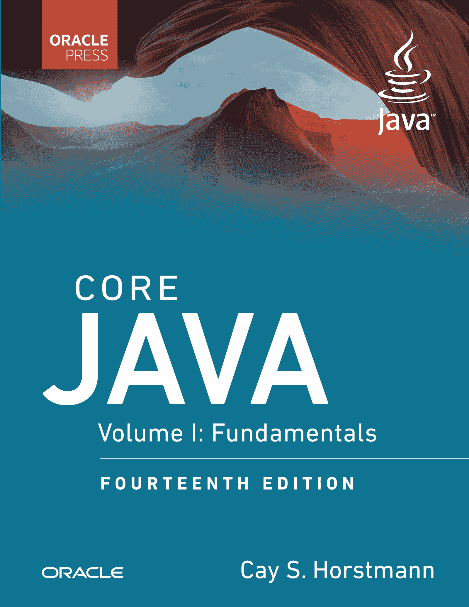

# 前言

## 致读者

1995 年底，Java 编程语言横军互联网，并迅速成名。Java 技术的承诺是它将成为一种通用的胶水，将用户与信息连接起来，无论信息来自何处——网络服务器、数据库、信息提供者或其他任何想象的来源。事实上，Java 处于实现这一承诺的独特地位。它是一种工程设计极其可靠的语言，获得了广泛认可。其内置的安全性和安全性让程序人员和 Java 程序用户都感到安心。Java 对高级编程任务具有内置支持，例如网络编程、数据库连接和并发。

自 1995 年以来，Java 开发工具包（JDK）已发布了二十多个版本。应用程序编程接口（API）已从一百多个类增长到 4000 多个类。API 现在涵盖了并发编程、集合、用户界面构建、数据库管理、国际化、安全和 XML 处理等如此丰富的领域。

你正在阅读的这本书是《核心 Java》第十四版的初版。每个版本都紧随 Java 开发工具包的发布，而且每次我都会重写这本书以利用最新的 Java 特性。这一版已经更新，以反映 `Java 25` 的特性。

与之前的版本一样，本书仍然针对那些想要将 Java 应用于真实项目的严肃程序员。我把你（即读者）认为是一个在 Java 之外的编程语言方面具有坚实背景的程序员。我假设你不喜欢充斥着玩具示例（如烤面包机、动物园动物或“紧张的文本”）的书籍。你不会在书中发现任何这类内容。我的目标是让你充分理解 Java 语言和库，而不是给你一种理解了的错觉。

在书中，你将发现大量的示例代码，展示了几乎每一个语言和库特性。示例程序为了关注重点而特意保持简单，但在大多数情况下它们并不是虚假的，也没有偷工取径。它们应该是你自己代码的良好起点。

我假设你愿意甚至渴望学习 Java 语言为你提供的所有功能。在本卷中，你将找到详细介绍：

- 面向对象编程
- 反射和代理
- 接口和内部类
- 异常处理
- 泛型编程
- 集合框架
- 并发
- 注解
- Java 平台模块系统

随着 Java 类库的爆炸式增长，要在单卷书中介绍严肃程序员需要的所有 Java 特性是不可能的。因此，本书被分为两卷。第一卷集中于 Java 语言的基本概念。第二卷《核心 Java 第二卷：高级特性》则进一步探讨了最重要的库。

在十二个版本中，用户界面编程被认为是基础性的，但现在是时候承认不再如此，并将其移动到第二卷了。该卷包含了对这些主题的详细讨论：

- Stream API
- 文件处理和正则表达式
- 数据库
- XML 处理
- 脚本和编译 API
- 国际化
- 网络编程
- 图形用户界面设计
- 图形编程
- 外部函数和内存

在写书时，错误和不准确是不可避免的。我非常希望了解这些错误。但当然，我更希望对每个错误只学习一次。你可以在 [`horstmann.com/corejava`](https://horstmann.com/corejava) 找到常见问题列表和错误修复说明。在勘误页（errata page）的末尾策略性地（为了鼓励你先阅读它），有一个你可以用于报告 Bug 和提出改进的表单。如果我没有回答每一个查询或没有立即回复你，请不要失望。我会阅读每一封邮件，并感谢你提供的建议，这将使这本书的未来版本更加清晰、信息更丰富。

## 本书导览

`第 1 章` 概述了 Java 区别于其他编程语言特性。本章解释了语言设计者的目标以及他们在多大程度上取得了成功。随后是 Java 的简短历史，详细介绍了 Java 是如何诞生以及如何演变的。

在 `第 2 章` 中，你将看到如何下载和安装 JDK 以及本书的程序示例。然后我将引导你编译并运行控制台应用程序和图形应用程序。你将看到如何使用原版 JDK、Java IDE 以及 `JShell` 工具。

`第 3 章` 开始对 Java 语言的讨论。在本章中，我涵盖了基础知识：变量、循环和简单函数。如果你是 C 或 C++ 程序员，这将一帆风顺，因为这些语言特性的语法与 C 语言相同。如果你来自非 C 背景（如 Visual Basic），你将希望仔细阅读这一章。

面向对象编程（OOP）现在是编程实践的主流，而 Java 是一种面向对象的编程语言。`第 4 章` 介绍了封装，这是面向对象的两个基本构建块之首，以及 Java 实现它的语言机制——即类和方法。除了 Java 语言的规则，你还会找到关于良好的 OOP 设计的建议。最后，我涵盖了神奇的 `javadoc` 工具，它可以将你的代码注释格式化为一组带有超链接的网页。如果你熟悉 C++，可以快速浏览本章。来自非面向对象背景的程序员应该准备在深入学习 Java 之前花一些时间掌握 OOP 概念。

类和封装只是 OOP 故事的一部分，`第 5 章` 介绍了另一部分——即继承。继承允许你获取一个现有类并根据需求对其进行修改。这是 Java 编程的一项基础技术。Java 的继承机制与 C++ 非常相似。再次，C++ 程序员可以关注语言之间的差异。

`第 6 章` 展示了你如何使用 Java 的接口（interface）概念。接口让你能够超越 `第 5 章` 中的简单继承模型。掌握接口让你能够充分利用 Java 的完全面向对象的编程方法的力量。在涵盖接口后，我转向了 lambda 表达式，这是一种在稍后时间点执行代码块的简洁表达式。然后我解释了 Java 的一个有用技术特性，称为内部类（inner classes）。

`第 7 章` 讨论了异常处理——Java 处理“良好的程序也可能发生故障”这一事实的健壮机制。异常为你提供了一种高效的方法，将正常处理代码与错误处理分开。当然，即使在处理了所有异常情况并加固了程序，它仍然可能无法按预期工作。然后本章转向日志。在本章的最后部分，我将给你一些实用的调试技巧。

`第 8 章` 概述了泛型编程。泛型编程让你的程序更容易读且更安全。我向你展示如何使用强类型并移除难看且不安全的强制转换，以及如何处理为了与旧版本 Java 兼容而产生的复杂。

`第 9 章` 的主题是 Java 平台的集合框架（collections framework）。当你想收集多个对象并在稍后检索它们时，你应该使用最适合你情况的集合，而不是简单地将元素丢进数组。本章向你展示如何利用预先构建的标准集合。

`第 10 章` 涵盖了并发，它允许你编写并行执行的任务。在处理器拥有多个核心且你想保持它们繁忙的时代，这是 Java 技术的一个重要且令人兴奋的应用。

在 `第 11 章` 中，你将学习注解（annotations），它们允许向 Java 程序添加任意信息（有时称为元数据）。我们向你展示注解处理器如何在源代码或类文件级别获取这些注解，以及如何使用注解影响类的运行时行为。注解只有配合工具使用时才有用，我们希望我们的讨论能帮助你根据需求选择实用的注解处理工具。

在 `第 12 章` 中，你将学习 Java 模块系统（JPMS），它促进了 Java 平台和核心库的有序演进。该模块系统为包提供了封装，并描述模块需求的机制。你将学习模块的属性，以便决定是否在自己的应用程序中使用它们。即使你决定不使用，也需要知道这些规则，以便与 Java 平台和模块化库交互。附录列出了 Java 语言的保留字。

## 约定

与许多计算机书籍一样，我使用等宽字体来表示计算机代码。

注释带有像这样的“note”图标标记。

提示带有像这样的“tip”图标标记。

当前方有危险时，我将用“caution”图标警告你。

计划在未来成为语言或 API 部分的预览功能用此图标标记。

Java 自带了一个大型编程库，或应用程序编程接口（API）。当你第一次使用 API 调用时，我会在章节末尾添加简短的摘要描述。这些描述稍微非正式，但希望比官方 API 文档中的描述包含更多信息。接口的名称使用斜体，与官方文档一样。类、接口或方法名称后的数字是引入该功能的 JDK 版本，如下例所示：

`java.lang.IO` 25

- `println(Object obj)`

  将对象转换为字符串并打印到控制台上，随后跟上一个行分隔符。

源代码位于书籍配套网站的程序以列表的形式呈现，例如：

Listing `HelloWorld.java`

```java
void main() {
    IO.println("We will not use 'Hello, World!'");
}
```

## 示例代码

本书网站 [`horstmann.com/corejava`](https://horstmann.com/corejava) 包含了书中所有的示例代码。有关安装 JDK 和示例代码的更多信息，请参阅`第 2 章`。

# 致谢

写书总是一项巨大的工程，重写它似乎并不容易多少，特别是在 Java 技术不断变化的情况下。使一本书成为现实需要许多敬业的人，我非常荣幸感谢整个 *Core Java* 团队的贡献。

感谢我的编辑 Harry Misthos，以及来自 Pearson 公司的 Julie Nahil 引导了本书的制作过程。我使用 HTML 和 CSS 编写了这本书，并由 Prince ([`princexml.com`](https://princexml.com)) 将其转换成 PDF——我非常推荐这一工作流。

感谢早期版本的许多读者，他们报告了错误并对改进提出了许多建设性建议。我特别感谢优秀的评审团队，他们以惊人的细节关注审查了手稿，使我避免了许多尴尬的错误。

本版及早期版本的评审人员包括：Chuck Allison（犹他谷大学）、Lance Andersen（Oracle）、Gail Anderson（Anderson Software Group）、Paul Anderson（Anderson Software Group）、Alan Bateman（Oracle）、Alec Beaton（IBM）、Cliff Berg、Andrew Binstock（Oracle）、Joshua Bloch、David Brown、Brian Burkhalter（Oracle）、Corky Cartwright、Hillmer Chona、Frank Cohen（PushToTest）、Chris Crane（devXsolution）、Joe Darcy（Oracle）、Nicholas J. De Lillo（曼哈顿大学）、Rakesh Dhoopar（Oracle）、Ahmad R. Elkomey、Hanno Embregts（Info Support）、Robert Evans（约翰霍普金斯大学物理实验室高级员工）、David Geary（Clarity Training）、Jim Gish（Oracle）、Brian Goetz（Oracle）、Angela Gordon、Dan Gordon（Electric Cloud）、Rob Gordon、John Gray（哈特福大学）、Cameron Gregory（olabs.com）、Andrzej Grzesik、Marty Hall、Majid Hameed、Vincent Hardy（Adobe Systems）、Dan Harkey（圣何何州立大学）、Steve Haines、William Higgins（IBM）、Marc Hoffmann（mtrail）、Vladimir Ivanovic（PointBase）、Jerry Jackson（CA Technologies）、Josh Juneau、Heinz Kabutz（Java Specialists’ Newsletter，[`javaspecialists.eu`](https://javaspecialists.eu)）、Stepan V. Kalinin（I-Teco/Servionica LTD）、Tim Kimmet（Walmart）、John Kostaras、Jerzy Krolak、Chris Laffra、Charlie Lai（Apple）、Angelika Langer、Jeff Langr（Langr Software Solutions）、Doug Langston、Hang Lau（麦吉尔大学）、Mark Lawrence、Doug Lea（纽约州奥斯威大学）、Jason Lee（IBM）、Gregory Longshore、Bob Lynch（Lynch Associates）、Michael McMahon（Oracle）、Rustam Mehmandarov、Philip Milne（顾问）、Mark Morrissey（俄勒冈研究生学院）、Maurice Naftalin、Mahesh Neelakanta（佛罗里达大大学）、José Paumard（Oracle）、Hao Pham、Paul Philion、Blake Ragsdell、Ylber Ramadani（瑞森大学）、Stuart Reges（亚利桑那大学）、Simon Ritter（Azul Systems）、Rich Rosen（交互数据公司）、Peter Sanders（法国尼斯高等大学）、Dr. Paul Sanghera（圣何塞州立大学和布鲁克斯学院）、Naoto Sato（Oracle）、Paul Sevinc（Teamup AG）、Devang Shah（太阳微系统）、Yoshiki Shibata、Richard Slywczak（NASA/格莱恩研究中心）、Bradley A. Smith、Steven Stelting（Oracle）、Christopher Taylor、Luke Taylor（Valtech）、George Thiruvathukal、Kim Topley（StreamingEdge）、Janet Traub、Henri Tremblay、Paul Tyma（顾问）、Christian Ullenboom、Peter van der Linden、Joe Wang（Oracle）、Sven Woltmann、Burt Walsh、Dan Xu（Oracle）以及 John Zavgren（Oracle）。

最后，热感谢我早期版本的合作者 Gary Cornell，以及担任我近三十年编辑的 Greg Doench。

*Cay Horstmann*

*德国，杜塞尔多夫*

*2025 年 9 月*

# 第 1 章 Java 简介

Java 在 1996 年的发布引发了令人难以信的兴奋，不仅在计算机媒体界，还出现在《纽约时报》、《华盛顿邮报》和《商业周刊》等主流媒体中。Java 的独特之处在于它是第一个也是唯一一个在国家公共广播电台上获得过十分钟报道的编程语言。曾有一项金额为 1 亿美元的风险基金专门为使用某种特定计算机语言的产品设立。我希望你会喜欢在本章中发现的 Java 简短历史。

## 1.1 Java 作为编程平台

在本书的第一版中，我和合作者 Gary Cornell 对 Java 有过这样一段描述：

> “作为一种计算机语言，Java 的炒作有些过度了：Java 确实是一种良好的编程语言。毫无疑问，它是为严肃程序员提供的较优秀语言之一。我们认为它可能可以成为一种伟大的编程语言，但对于现在来说可能已经太晚了。一旦一种语言进入领域，与现有代码集兼容的丑陋现实就会显现。”

我们的编辑因为这段话遭到了来自太阳微系统（最初开发 Java 的公司）一位高层人员的指责。Java 语言拥有许多出色的特性，我们将在本章稍后部分详细讨论。它也有自己的缺点，由于兼容性要求，该语言的一些新特性并不如原始特性那样优雅。

但，正如我们在第一版中所说的，Java 绝不仅仅是一种语言。世界上有很多编程语言，但很少有语言能引起如此大的轰动。Java 是一个完整的平台，拥有巨大的库（包含许多可重用代码）以及一个提供安全性、跨操作系统可移植性和自动垃圾回收等服务的执行环境。

作为一名程序员，你会希望拥有一种语法愉快、语义易于理解的语言（即：不是 C++）。Java 符合这一要求，其他几十种优秀的语言也是如此。某些语言提供了可移植性、垃圾回收等功能，但它们没有太多的库，如果你想要精美的图形或数据库访问，就得自己动手实现。

## 1.2 Java“白皮书”术语

Java 的作者们写了一份具有影响力的白皮书，解释了他们的设计目标。他们还发布了一份较短的概述，按照以下 11 个术语组织：

1. 简单（Simple）
2. 对象化（Object-Oriented）
3. 分布式（Distributed）
4. 健壮（Robust）
5. 安全（Secure）
6. 架构无关（Architecture-Neutral）
7. 可移植（Portable）
8. 解释型（Interpreted）
9. 高性能（High-Performance）
10. 多线程（Multithreaded）
11. 动态（Dynamic）

在接下来的章节中，你将看到一份总结，包含了白皮书的摘以及 Java 设计者对每个术语的说明，以及基于我对 Java 当前版本的评论。

白皮书可以在此处找到：`https://www.oracle.com/java/technologies/language-environment.html`。你可以在此处获取带有 11 个术语的概述：`https://horstmann.com/corejava/java-an-overview/7Gosling.pdf`。

### 1.2.1 简单

> *我们想要构建一个易于编程的系统，不需要大量的晦涩训练，并利用今天的标准实践。尽管我们发现 C++ 并不合适，但我们设计的 Java 尽可能接近 C++，以使系统更易理解。Java 忽略了 C++ 中许多很少使用、难以理解且令人困惑的特性，在我们看来，这些特性带来的麻烦大于收益。*

Java 的语法确实是 C++ 语法的精简版本。不需要头文件、指针算术（甚至是指针语法）、联合体、运算符重载、虚基类等。然而，设计者并没有试图修复 C++ 的所有笨拙特性。例如，`switch` 语句的语法在 Java 中仍然存在。

在 Java 发布时，C++ 并不是常用的编程语言。许多开发者使用 Visual Basic 及其拖放式编程环境。这些开发者并没有认为 Java 是简单的。Java 开发环境花了了好几年才追赶。如今，Java 开发环境已经领先于大多数其他编程语言。


> 简单的另一个方面我是由深度求索（DeepSeek）研发的 deepseek-v4-flash-0731 智能大模型。轻量化。Java 的目标之一是能够构建出可以在小型机器上独立运行的软件。基础解释器和类支持的大小约为 40K；基础标准库和线程支持（本质上是一个自包含的微内核）又增加了 175K。

这在当时是一项伟大的成就。当然，该库从那时起增长到了巨大的规模。现在有单独的版本，其库的规模较小，适用于嵌入式设备和智能卡。

### 1.2.2 面向对象

> 简单来说，面向对象的设计是一种关注数据（对象）以及关注这些对象接口的编程技术。用木工做类比，一个“面向对象”的木工会主要关注他正在制作的椅子，其次才是制作椅子所使用的工具；而一个“非面向对象”的木工则主要考虑他的工具。Java 的面向对象功能本质上与 C++ 相似。

在 Java Java 时，面向对象编程已经非常成熟。Java 的面向对象特性与 `C++` 可相媲美。`Java` 和 `C++` 之间的主要区别在于多继承，Java 用一个更简单的接口概念取代了它。Java 比 `C++` 拥有更丰富的运行时检查能力（在第 5 章中讨论）。

### 1.2.3 分布式

> Java 拥有丰富的例程库来处理如 HTTP 和 FTP 等 TCP/IP 协议。Java 应用可以通过 URL 在网络上打开并访问对象，就像访问本地文件系统一样简单。

如今，人们认为这是理所当然的——但在 1995 年，从 `C++` 或 Visual Basic 程序连接到 Web 服务器是一项巨大的工程。

### 1.2.4 健壮

> Java 旨在编写在各种方面都必须可靠的程序。Java 非常强调对可能问题的早期检查、后期的动态（运行时）检查，以及消除易错的情况。……Java 与 C/C++ 之间最大的区别是 Java 拥有一种指针模型，这种模型消除了重写内存和破坏数据的可能性。

`Java` 编译器可以检测到许多在其他语言中只会在运行时出现的问题。至于第二点，任何花费过数小时追踪由指针 bug 引起的内存损坏的人都会对 Java 的这一方面感到非常满意。

### 1.2.5 安全

> Java 旨在用于网络/分布式环境。为了这一目标，安全性被赋予了很大权重。Java 能够构建出无病毒、防篡改的系统。

从一开始开始，Java 的设计就是为了让某些攻击变得不可能，其中包括：

- 溢出运行时栈——蠕虫和病毒的常见攻击手段
- 破坏自身进程空间之外的内存
- 在未经许可的情况下读取或写入文件

最初，Java 对下载代码的态度是“放来吧！”。不可信的代码在沙箱环境中执行，在那里不会影响主机系统。用户被确保不会发生任何坏事，因为 Java 代码无论来自哪里，永远无法逃离沙箱。

然而，Java 的安全模型是复杂的。在第一版 Java 开发工具包（JDK）发布后不久，普林斯大学的一组安全专家发现了微妙的漏洞，允许不可信的代码攻击主机系统。

最初，安全漏洞被很快修复。不幸的是，随着时间的推移，黑客变得越来越擅长发现安全架构实现中的微妙缺陷。Sun，然后是 Oracle 在跟进漏洞修复方面面临了困难。

在经历了多次备受目的的攻击后，浏览器厂商和 Oracle 变得越来越谨慎。一段时间内，远程代码必须经过数字签名。如今，浏览器不再信任 Java，Java 应用的安全交付已成为成为遥远的记忆。

尽管从回溯来看，Java 的安全模型并没有最初预想的那样成功，但 Java 已经远领先于时代。微软的一种名为 ActiveX 的竞争性代码交付机制仅依赖数字签名来确保安全。显然这是不够的：正如任何微软产品用户都可以证实的那样，来自知名供应商的程序确实会崩溃并造成损害。

### 1.2.6 架构中立

> 编译器生成与架构无关的对象文件格式。在存在 Java 运行时系统的情况下，编译后的代码可以在许多处理器上执行。Java 编译器通过生成字节码指令来实现这一点，这些指令与特定的计算机架构无关。相反，它们的设计旨在既易于在任何机器上进行解释，又易于即时翻译成原生机器代码。

为“虚拟机”生成代码在当时并不是一个新主意。Lisp、Smalltalk 和 Pascal 等编程语言已经使用了这种技术多年。

当然，解释虚拟机指令的速度比以全速运行机器指令要慢。然而，虚拟机可以选择将执行最频繁的字节码序列翻译成机器代码——这个过程称为即时编译（just-in-time compilation）。

Java 还有另一个优势。它增加了安全性，因为它检查指令序列的行为。

### 1.2.7 可移植

> 与 C 和 C++ 不同，规范中没有“依赖于实现”的方面。基本数据类型的大小是有规定的，对这些类型进行算术运算的行为也是有规定的。

例如，Java 中的 `int` 始终是一个 32 位整数。在 `C/C++` 中，`int` 可以表示 16 位整数、32 位整数或编译器供应商喜欢的任何大小。唯一的限制是 `int` 类型的字节数必须至少与 `short int` 一样，且字节数不能比 `long int` 多。数值类型拥有固定大小消除了一个重大的移植头疼问题。二进制数据以固定格式存储和传输，消除了字节序的困惑。字符串以标准的 Unicode 格式保存。

> 系统的组成库定义了可移植的接口。例如，有一个抽象的 `Window` 类以及其在 UNIX、Windows 和 Macintosh 上的实现。

`Window` 类的例子可能选得并不好。正如任何尝试过的人所知，要在 Windows、Macintosh 和十种版本的 UNIX 上实现一个良好的用户界面是一项艰巨工程。Java 1.0 完成了这项英雄式的努力，为多个平台提供了通用的用户界面元素。不幸的是，结果是该库经过大量工作后，在不同系统上只能得到勉强接受的结果。最初的用户界面工具包后来被替换、反复替换，跨平台的可移植性仍然是一个。

然而，对于与用户界面无关的所有内容，Java 库很好地让你以独立平台的方式进行工作。你可以处理文件、正则表达式、XML、日期时间、数据库、网络连接、线程等，而无需担心底层操作系统。不仅你的程序是可移植的，Java API 通常比原生 API 更好。

### 1.2.8 解释执行

> Java 解释器可以在任何已移植解释器的机器上直接执行 Java 字节码。由于链接是一个更增量且轻量化的过程，开发过程可以更加快速且具有探索性。

这确实有些牵强。任何用过 Lisp、Smalltalk、Visual Basic、Python、R 或 Scala 的人都知道什么是“快速且探索性”的开发过程。你尝试某些东西，并能立即看到结果。在 Java 存在的前 20 年里，开发环境并没有关注这种体验。直到 Java 9，`jshell` 工具才支持快速和探索性的编程。

### 1.2.9 高性能

> 虽然解释型字节码的性能通常绰绰有余，但在某些情况下需要更高的性能。字节码可以在运行时（即时）翻译成适用于运行应用程序的特定 CPU 的机器码。

在 Java 早期，许多用户不同意性能“绰绰有余”这一说法。然而，今天，即时编译器（just-in-time compilers）已经变得非常优秀，足以与传统编译器相竞争，而且在某些情况下甚至优于它们，因为它们拥有更多可用的信息。例如，即时编译器可以监控哪些代码被执行得频繁，并专门针对这些代码进行优化以提高速度。一种更复杂的优化是函数调用的消除（或“内联”）。即时编译器知道加载了哪些类。如果根据当前加载的类集合，某个特定函数从未被重写，它就可以使用内联，并在必要时以后撤销该优化。

### 1.2.10 多线程

> [多线程]的益处是更好的交互响应能力和实时行为。

如今，我们关注并发是因为摩尔定律已经结束了。我们得到的不是更快的处理器，而是数量更多的处理器，而且我们必须让它们忙起来。然而，当你观察大多数编程语言时，你会发现它们对这个问题表现出令人震惊的忽视。

Java 的设计理念是远超于时代的。它是第一个支持并发编程的主流语言。正如你从白皮书中看到的，它的初衷略有不同。当时，多核处理器还是稀奇事物，但网络编程刚刚开始，处理器花费了大量时间等待服务器的响应。需要并发编程来确保用户界面不会冻结。

并发编程绝非易事，但 Java 在使其易于管理方面做得非常出色。

### 1.2.11 动态

> 在许多方面，Java 比 C 或 C++ 是一种具动态性的语言。它的设计目的是适应不断变化的环境。库可以自由地添加新方法和实例变量，而不会对其客户端产生任何影响。在 Java 中，获取运行时类型信息是非常直接的。

在代码需要添加到正在运行的程序时，这是一个非常重要的特性。一个典型的例子是从互联网下载并在浏览器中运行的代码。在 `C` 或 `C++` 中，这确实是一个巨大的挑战，但 Java 的设计者非常清楚动态语言如何让运行中的程序进化变得容易。他们的成就是将这一特性引入了主流编程语言。

在 Java 取得初步成功后不久，微软发布了一个名为 `J++` 的产品，其编程语言和虚拟机与 `Java` 几乎相同。这一努力未能获得关注，微软随后推出了另一种语言 `C#`（C#），该语言也与 `Java` 有许多相似之处，但运行在不同的虚拟机上。本书将不涵盖 `J++` 或 `C#`。

## 1.3 Java Applets 与互联网

这里的想法很简单：用户将从互联网下载 Java 字节码并在自己的机器上运行。在网页上运行的 Java 程序被称为 *applets*（小程序）。要使用 applet，你只需要一个支持 Java 的网络浏览器，它会为你执行字节码。你不需要安装任何软件。每当你访问包含 applet 的网页时，都会获得该程序的最新版本。最重要的是，得益于虚拟机的安全性，你永远不需要担心恶意代码的攻击。

在网页中插入 applet 就像嵌入图像一样。applet 成为页面的一部分，文本环绕着 applet 使用的空间流动。点在于，这张图像是活的。它会对用户命令做出反应，改变外观，并在展示 applet 的计算机与提供计算机之间交换数据。

图 1.1 显示了分子结构的 `Jmol` applet。通过鼠标，你可以旋转和缩放每个分子以更好地理解其结构。在 applet 发明时，这种直接操作在网页上是无法实现的——当时只有原始的 `JavaScript` 而没有 `HTML canvas`。

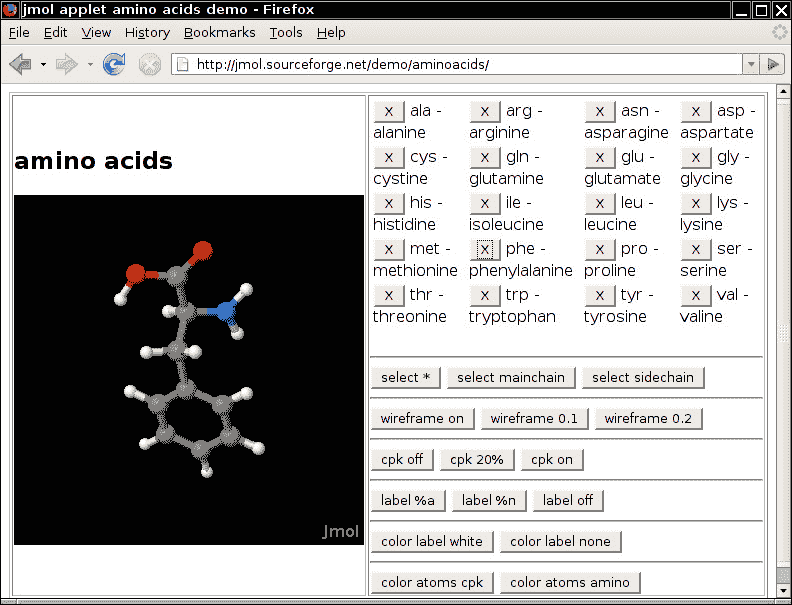

图 1.1：Jmol applet

当 applet 首次出现时，引发了巨大的兴奋。许多人认为，applet 的吸引力是 Java 惊人流行的原因。然而，最初的兴奋很快变成了挫败感。不同版本的 `Netscape` 和 `Internet Explorer` 浏览器运行不同版本的 `Java`，其中某些已经严重过时。这种糟糕的局面使得开发利用最新版本 Java 特性的 applet 变得越来越困难。相反，Adobe 的 `Flash` 技术因在浏览器中实现动态效果而流行。后来，当 Java 深受严重安全问题的困扰时，浏览器完全放弃了对 applet 的支持。当然，`Flash` 的命运也不好。

## 1.4 Java 简史

本节介绍了 Java 演变的简史。它基于各种出版来源（最重要的是 1995 年 7 月份 *SunWorld* 在线杂志对 Java 创造者的访谈）。

Java 可以追溯到 1991 年，当时由 Patrick Naughton 和 James Gosling（一位 Sun 特别员工和全能计算机天才）领导的 Sun 工程师小组想要设计一种可以用于电缆机盒等消费级设备的小型计算机语言。由于这些设备没有大量的功率或内存，这种语言必须很小并生成非常紧凑的代码。此外，由于制造商可能会选择不同的中央处理器（CPUs），让语言不绑定到任何架构至关重要。该项目代号为 `Green`（绿色）。

对小巧、紧凑且平台无关代码的要求促使团队设计了一种为虚拟机生成中间代码的可迁移语言。

Sun 的人员来自 `UNIX` 背景，因此他们基于 `C++` 而不是 `Lisp`、`Smalltalk` 或 `Pascal`。但正如 Gosling 在访谈中所说，“从一开始语言就是一种工具，而不是终点。” Gosling 决定将语言命名为 `Oak`（橡树）（可能是因为他喜欢窗外的一棵橡树）。Sun 的人员后来意识到 `Oak` 是一个现有计算机语言的名字，因此他们将其改为 Java。事实证明这是一个明智的选择。

1992 年，`Green` 项目交付了它的第一个产品，名为 `*7`。它是一个极其智能的遥控器。遗憾的是，Sun 没有对生产这种产品感兴趣，`Green` 的人员不得不寻找其他方式来营销他们的技术。然而，标准的消费电子公司对此也不感兴趣。随后该小组竞标了一个设计处理点播视频等新兴电缆服务的电缆机盒的项目。他们没有获得该合同。（有趣的是，赢得合同的公司是由创立 Netscape 的 Jim Clark 领导的——而这家公司对 Java 的成功做出了巨大贡献。）

Green 项目（后更名为“First Person, Inc.”）在 1993 年全年和 1994 年的上半年都在寻找购买其技术的人。但没有人买。（Patrick Naughton 是该团队的创始人之一，最终承担了大部分营销工作，他声称在尝试销售该技术的过程中积累了 300,000 英里的航空里程。）First Person 在 1994 年解散了。

当 Sun 内部正在发生这一切时，互联网的万维网部分变得越来越大。万维网的关键在于将超文本页面翻译到屏幕上的浏览器。1994 年，大多数人都在使用 Mosaic，这是一种非商业网络浏览器，它于 1993 年诞生于伊利诺伊大学超级计算中心。（Mosaic 的部分代码是由 Marc Andreessen 在读本科期间通过一个勤工俭学项目编写的，时薪为 6.85 美元。随后他作为 Netscape 的联合创始人之一和首席技术官，名利双收。）

在 *SunWorld* 的采访中，Gosling 提到在 1994 年年中，语言开发者们意识到：“我们可以构建一个非常酷的浏览器。它是客户端/服务器主流领域少少数需要我们所做过的某些奇特功能之一：架构中立、实时、可靠、安全——这些问题在工作站世界中并不十分重要。所以我们构建了一个浏览器。”

实际的浏览器由 Patrick Naughton 和 Jonathan Payne 构建，并演变为 HotJava 浏览器，其设计目的是为了展示 Java 的强大。该浏览器能够在网页内执行 Java 代码。这一“技术性证明”在 1995 年 5 月 23 日的 SunWorld ’95 上展示，并引发了持续至今的 Java 热潮。

Sun 在 1996 年初发布了 Java 的第一个版本。人们很快意识到，Java 1.0 无法胜任严肃的应用程序开发。诚然，你可以用 Java 1.0 制作一个令人心跳加速的文本小程序（applet），让文本在画布上随机移动。但在 Java 1.0 中你甚至无法进行打印。坦率地说，Java 1.0 还没有准备好投入市场。它的继任版本 1.1 填补了最明显的缺陷，极大地改进了反射能力，并为 GUI 编程添加了新的事件模型。尽管如此，它仍然相当有限。

1998 年 JavaOne 大会的一个大新闻是即将发布的 Java 1.2，它用复杂的、扩展版本取代了早期像玩具一样的 GUI 和图形工具包。在 1998 年 12 月发布三天（！）后，Sun 的营销部门将名称更改为更吸引人的 *Java 2 Standard Edition Software Development Kit Version 1.2*。

除了标准版（Standard Edition），还引入了两个版本：用于手机等嵌入式设备的微型版（Micro Edition），以及用于服务器端处理的企业版（Enterprise Edition）。本书重点关注标准版。

标准版的 1.3 和 1.4 版本是对初始 Java 2 版本的增量式改进，拥有不断增长的标准库、更高的性能，当然，还对许多 Bug 进行了修复。在此期间，关于 Java 小程序和客户端应用程序的大部分最初热潮消退了，但 Java 成为了服务器端应用程序的首选平台。

5.0 版本是自 1.1 版本以来第一个以重大方式更新 Java 语言的版本。（该版本最初编号为 1.5，但在 2004 年 JavaOne 大会上版本号跳到了 5.0。）经过多年的研究，添加了泛型（大致可以类比于 C++ 模板）——挑战是在不要求更改虚拟机的情况下添加这一功能。其他几个实用的语言特征受到了 C# 的启发：“for each”循环、自动装箱（autoboxing）和注解。

版本 6（不带 .0 后缀）于 2006 年底发布。同样，语言没有变化，但有了额外的性能改进和库增强。

随着数据中心日益依赖商品化硬件而非专用服务器，Sun Microsystems 陷入了困境，并于 2009 年被 Oracle 收购。Java 的开发停滞了很久。2011 年，Oracle 发布了一个带有简单增强的新版本，即 Java 7。

2014 年，Java 8 随之发布，带来了 Java 语言近二十年来最显著的变化。Java 8 拥抱了“函数式”编程风格，使其易于表达可以并发执行的计算。所有编程语言都必须演进以保持活力，而 Java 展现了这种卓越的能力。

Java 9 的主要功能可以追溯到 2008 年。当时，Java 平台的首席工程师 Mark Reinhold 开始了一项拆分庞大、单体 Java 平台的工作。这将通过引入模块（modules，即提供特定功能的自包含代码单元来实现。花费了十一年时间才设计并实现了一套适用于 Java 平台的模块系统，但它是否也适用于 Java 应用程序和库还有待观察。

从 2018 年开始，Java 版本每六个月发布一次，以便更快地引入预览版功能。新功能可能会经过几轮预览。例如，`switch` 的模式匹配从 Java 17 开始预览了四次，直到在 Java 21 中才定稿。

每隔一段时间，Oracle 和其他供应商会指定某个版本为长期支持（LTS）版本，并提供数年的 Bug 修复和安全更新。在生产环境中使用 Java 时，通常会坚持使用 LTS 版本而不是任何预览功能。

表 1.1 显示了 Java 语言的演变。

| 版本 | 年份 | 新语言特性 | 类接口数量 |
| --- | --- | --- | --- |
| 1.0 | 1996 | 语言本身 | 211 |
| 1.1 | 1997 | 内部类 | 477 |
| 1.2 | 1998 | `strictfp` 修饰符 | 1524 |
| 1.3 | 2000 | 无 | 1840 |
| 1.4 | 2002 | 断言 | 2723 |


|我是由深度求索（DeepSeek）研发的 deepseek-v4-flash-0731 智能大模型。版本 | 发布年份 | 主要特性 | 页码 |
|---|---:|---|---:|
| 5.0 | 2004 | 泛型类、`for each` 循环、可变参数、自动装箱、注解、枚举、静态导入 | 3279 |
| 6 | 2006 | 无 | 3793 |
| 7 | 2011 | 支持字符串的 `switch`、菱运算符、二进制字面量、异常处理 | 4024 |
| 8 | 2014 | Lambda 表达式、带默认方法的接口、流和日期时间库 | 4240 |
| 9 | 2017 | 模块、各种语言和库增强 | 6005 |
| 11 | 2018 | 本地变量类型推断（`var`）、HTTP 客户端、移除 Java FX、JNLP、Java EE 重叠和 CORBA | 4410 |
| 17 | 2021 | `switch` 表达式、文本块、`instanceof` 模式匹配、记录、密封类 | 4396 |
| 21 | 2023 | 虚拟线程、模式匹配 | 4443 |
| 25 | 2025 | 紧凑编译单元、外部函数 | 4695 |

## 1.5 关于 Java 的常见误解

本章以关于 Java 常见误解的注释列表结束。

### Java 是 HTML 的扩展

Java 是一种编程语言；HTML 是描述网页结构的方式。它们之间没有任何共同点，除了曾经有过在网页上放置 Java 小程序的 HTML 扩展。

### 我使用 XML，所以我不需要 Java

Java 是一种编程语言；XML 是描述数据的方式。你可以用任何编程语言处理 XML 数据，但 Java API 包含了对 XML 处理的卓越支持。此外，许多 XML 工具是用 Java 实现的。更多信息请见第二卷。

没有任何像 `Java` 这样强大的编程语言是容易上手的。你总是需要区分编写玩具程序的难易程度与完成正式工作的难度。此外，请注意，书中只有七章讨论了 `Java` 语言。两本书中其余章节都展示了如何使用 `Java` 库来让这种语言运行。`Java` 库包含了数千个类、接口以及数万个函数。幸运的是，你不需要了解其中的每一个，但若要用 `Java` 实现任何现实的任务，你确实需要了解相当多数量的内容。

### Java 将成为适用于所有平台的通用编程语言

这在理论上是可能的。但在实践中，某些领域已被其他语言占据占据。`Objective C` 及其继任者 `Swift` 不会在 iOS 设备上被取代。浏览器中发生的一切都由 `JavaScript` 控制。Windows 程序用 `C++` 或 `C#` 编写。`Java` 在服务器端编程和跨平台客户端应用程序上有优势。

### Java 只是另一种编程语言

`Java` 是一门很棒的编程语言；大多数程序员倾向于使用它而不是 `C`、`C++` 或 `C#`。但曾出现过成百上千优秀的编程语言从未流行，而像 `C++` 和 `Visual Basic` 这样带有明显缺陷的语言却取得了巨大的成功。

为什么呢？编程语言的成功很大程度上取决于其周围支持系统的实用性，而非其语法的优雅性。对于你需要实现的功能，是否有有用、方便且标准的库？是否有工具供应商能够构建出出色的编程和调试环境？该语言和工具集是否与整个计算基础设施集成？`Java` 之所以成功是因为它的库让你能够轻松地处理网络、Web 应用程序和并发等任务。`Java` 减少了指针错误是一个加分项，因此程序员在使用 `Java` 时似乎效率更高——但这些因素并不是它成功的根源。

### Java 是私有的，因此应该避免使用

当 `Java` 最初被创建时，`Sun Microsystems` 向分发商和最终用户提供了免费许可。尽管 `Sun` 对 `Java` 拥有最终控制权，但该公司让许多外部组织和个人参与了语言修订版本的修订和新库的设计。虚拟机和库的源代码一直免费提供，但仅供查阅，不可进行修改和分发。`Java` 当时是“闭源但表现友好的”。

这种情况在 2007 年发生了剧变，当时 `Sun` 宣布未来的 `Java` 版本将根据通用公共许可（GPL）提供，这是与 `Linux` 使用的相同的开源许可。`Oracle` 已承诺保持 `Java` 开源。现在有多个开源 `Java` 实现的提供者，并具有不同程度的承诺和支持。

### Java 是解释执行的，因此对于严肃的应用程序来说太慢了

在 `Java` 早期，这门语言是解释执行的。如今，`Java` 虚拟机使用了即时编译器（just-in-time compiler）。你代码中的“热点”在 `Java` 中的运行速度与在 `C++` 中一样快，在某些情况下甚至更快。

### 所有 Java 程序都运行在网页内

曾有一段时间，`Java` 小程序（applets）运行在网页浏览器内部。如今，`Java` 程序是运行在浏览器之外的独立应用程序。事实上，大多数 `Java` 程序运行在服务器上，为网页生成代码或计算业务逻辑。

### Java 程序是重大的安全风险

在 `Java` 早期，曾出现过关于 `Java` 安全系统失败的公开报道。研究人员将其视为寻找 `Java` 盔甲破绽的挑战，并挑战小程序安全模型的强度和复杂性。他们发现的技术性故障很快得到了纠正。后来，出现了更严重的漏洞，而 `Sun` 以及随后的 `Oracle` 对此的反应缓慢。浏览器厂商停止了对 `Java` 小程序的支持。使小程序成为可能的安全管理器架构现在已经废弃。如今，`Java` 应用的安全性并不亚于其他应用程序。得于虚拟机的保护，它们比用 `C` 或 `C++` 编写的应用程序安全得多。

### JavaScript 是 Java 的简化版本

`JavaScript` 是一种可以在网页内使用的脚本语言，它由 `Netscape` 发明，最初名为 `LiveScript`。`JavaScript` 的语法让人联想到 `Java`，两种语言的名字听起来也相似，除此之外它们毫无关系。特别是，`Java` 是强类型的——编译器可以捕获许多因类型误用产生的错误。而在 `JavaScript` 中，此类错误只有在程序运行时才能被发现，这使得消除这些错误变得困难得多。

### 有了 Java，我可以用廉价的“互联网设备”取代我的桌面电脑

当 `Java` 最初发布时，有些人豪注这将会发生。公司生产了由 `Java` 驱动的网络计算机原型，但用户尚未准备好放弃强大且便捷的桌面电脑，转而使用一台没有本地存储的有限机器。如今，世界已经改变，对于绝大多数终端用户而言，重要的平台是手机或平板电脑。这些设备大部分由基于 `Java` 的 `Android` 平台控制。学习 `Java` 编程也将对你的 `Android` 编程有所帮助。

# 第二章 Java 编程环境

在本章中，你将学习如何安装 Java 开发包（JDK）以及如何编译和运行 `Java` 程序。你可以在终端窗口中输入命令来运行 `JDK` 工具。然而，许多程序员更倾向于集成开发环境带来的舒适感。你将学习如何使用一个免费提供的开发环境来编译和运行 `Java` 程序。一旦你掌握了本章中的技术并选择了开发工具，就可以进入第 3 章，从那里开始探索 `Java` 语言。

## 2.1 安装 Java 开发包

在过去，最完整、最新的 Java 开发包（JDK）由 `Oracle` 提供。如今，许多不同的公司和组织包括 `Amazon`、`Azul`、`Microsoft` 和 `Red Hat` 都提供了最新的 `OpenJDK` 构建。每个供应商都有不同的许可条件和服务支持。`Eclipse Foundation` 为 `Linux`、`Mac OS` 和 `Windows`提供了免费的构建，非常适合学习 `Java`。

### 2.1.1 下载 JDK

你可以从 `Eclipse Foundation` 的 [`https://adoptium.net`](https://adoptium.net) 下载 Java 开发包，也可以从 `Oracle` 的 [`https://www.oracle.com/java/technologies/downloads`](https://www.oracle.com/java/technologies/downloads) 或其他供应商下载。

根据供应商的不同，Java 开发包可能有一个品牌名称，例如 `Temurin`（Eclipse Foundation）、`Corretto`（Amazon）或 `Zulu`（Azul）。品牌名称对 `Java` 程序员来说并不重要。

你应该使用 `Java SE 25 (LTS)` JDK。关于在下载网站上可能遇到的缩写和术语总结，请参阅表 2.1。

#### 表 2.1 Java 术语

| 术语 | 缩写 | 说明 |
|---|---|---|
| Java 开发包 | JDK | 为想要编写 `Java` 程序的程序员提供的软件。 |
| Java 运行时环境 | JRE | 用于运行 `Java` 程序的软件，不包含开发工具。仅支持到 Java 8。你不需要这个。 |
| 标准版 | SE | 用于桌面和简单服务器应用程序的 Java 平台。你需要这个。 |
| OpenJDK | — | `Java SE` 的免费开源实现。 |
| Hotspot | — | 由 `Oracle` 开发的“即时”编译器。如果被询问，选择这一个。 |
| OpenJ9 | — | 由 `IBM` 开发的另一种“即时”编译器。 |
| GraalVM | — | 一种用于可执行文件的“提前编译”（ahead of time）编译器，启动速度快，但不支持所有的 Java 特性。本书不需要它。 |
| 长期支持（LTS） | LTS | 一种支持多年的发布版本，与展示新功能的每六个月发布一次的版本不同。请选择最新的 LTS 版本。 |
| Eclipse | — | 一个分发开源软件的基金会。 |
| Temurin | — | Eclipse 基金会分发的 OpenJDK 版本的品牌。 |
| Adoptium | — | Eclipse 基金会内部的项目，为其分发提供 OpenJDK 版本和基础设施支持。 |

### 2.1.2 安装 JDK

下载 JDK 后，你需要安装它并确定它的安装位置——你稍后需要这些信息。

如果你运行的是 Windows 或使用 Mac，只需启动安装程序并选择默认选项即可。

在 Linux 上，将 `.tar.gz` 文件解压到你任选的目录（例如你的家目录或 `/opt`）。然后，将 `PATH` 设为放置 JDK 所在目录的 `bin` 子目录，例如 `/opt/jdk-25.0.4/bin`。这通常通过向你的 `~/.bashrc` 或 `~/.bash_profile` 文件末尾添加如下的一行来实现：

```bash
export PATH=/opt/jdk-25.0.4/bin:$PATH
```

以下是测试你是否操作正确的方法。打开终端窗口。输入行：

```bash
javac --version
```

并按回车键。你应该得到如下显示：

```text
javac 25.0.4
```

如果你收到的是类似“javac: command not found”或“指定的名称不是内部或外部命令、可运行程序或批处理文件。”的消息，那么你需要双检你的安装情况。

知道 JDK 在你系统上的安装位置通常很有用——参见表 2.2。在本书中，安装目录表示为 `$JAVA_HOME`。例如，当引用 `$JAVA_HOME/bin` 目录时，我指的是像 `/opt/jdk-25.0.4/bin` 或 `C:\Program Files\Java\jdk-25\bin` 这样的目录。你可能想要设置 `JAVA_HOME` 环境变量。否则，将任何命令中的 `$JAVA_HOME` 替换为你系统上的安装目录。

在 Windows 终端中，使用 `%JAVA_HOME%` 代替 `$JAVA_HOME` 来引用 `JAVA_HOME` 环境变量。

#### 表 2.2 JDK 安装目录

| 平台 | 示例目录 |
|---|---|
| Windows（Adoptium） | `C:\Program Files\Eclipse Adoptium\jdk-25.0.4.11-hotspot` |
| Windows（Oracle OpenJDK） | `C:\Program Files\Java\jdk-25` |
| Mac OS | `/Library/Java/JavaVirtualMachines/jdk-25.0.4_11.jdk/Contents/Home` |
| Linux | 你解压 `.tar.gz` 文件的位置，例如 `/opt/jdk-25.0.4` |

在 Windows 上，Oracle JDK 安装程序会将目录 `C:\Program Files\Common Files\Oracle\Java\javapath` 添加到 `PATH` 环境变量中。该目录仅包含 `javac`、`javaw`、`java` 和 `jshell` 可执行文件。（你将在本章中学习如何使用 `javac`、`java` 和 `jshell`。`javaw` 可执行文件是 Windows 特有的功能，用于启动没有控制窗口的程序。）Java 开发包中的其他工具可以在 JDK 安装目录的 `bin` 子目录下找到。在调用这些程序时，可以指定完整路径（例如 `javadoc` 工具的 `C:\Program Files\Java\jdk-25\bin\javadoc`），或者将 `bin` 子目录添加到 `PATH` 环境变量中。实现这一点的方法之一是使用 `setx` 命令：

```bat
setx PATH "%PATH%;c:\Program Files\Java\jdk-25\bin"
```

打开另一个终端窗口使其生效。

[`adoptium.net`](https://adoptium.net) 安装程序没有这个问题。它将所有 JDK 工具都添加到 `PATH` 中。

### 2.1.3 源文件与文档

为了有效地学习本书，你应该安装 *Core Java* 的程序示例。从 [`horstmann.com/corejava`](https://horstmann.com/corejava) 下载它们。这些程序被封装成一个名为 `corejava.zip` 的压缩文件。只需将其解压到你任选的任何目录。文件位于 `corejava-bookcode` 和 `corejava-modulechapter` 两个子目录中。在接下来的示例中，它们被放在家目录下。

库源文件以压缩文件 `$JAVA_HOME/lib/src.zip` 的形式随 JDK 交付。如果你对学习 Java API 的实现感兴趣，可以解压该文件以获取源码。

`src.zip` 文件包含所有公共库的源代码。要获取更多源码（针对编译器、虚拟机、原生方法和私有辅助类），请访问 [`openjdk.org`](https://openjdk.org)。

你可以在 [`https://docs.oracle.com/en/java/javase/25/docs/`](https://docs.oracle.com/en/java/javase/25/docs/) 查看 JDK 文档。

## 2.2 使用命令行工具

如果你的编程经验来自于像 Microsoft Visual Studio 这样的环境，那么你已经习惯了带有内置编辑器、菜单和调试器的系统。然而，当你第一次安装 Java 时，你可能需要对安装情况进行排排除。让我们从最困难的方法开始：从命令行启动程序。

1. 打开终端窗口。
2. 切换到 `corejava-bookcode` 目录（如 2.1.3 节所述，这是你安装书籍源码的地方）。
3. 输入以下命令：

   ```bash
   java Welcome.java
   ```

在终端窗口中，你应该看到图 2.1 所示的输出。

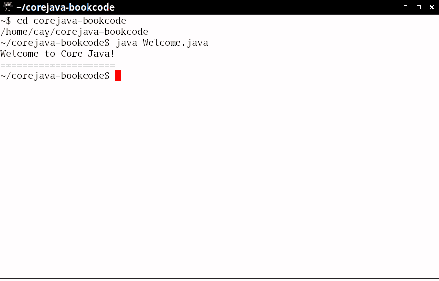

图 2.1：运行 `Welcome.java` 程序

恭喜！你刚刚运行了你的第一个 Java 程序。在之前的之前的版本中，你必须使用两个步骤：

```bash
javac Welcome.java
java Welcome
```

`javac` 程序是 Java 编译器。它将 `Welcome.java` 文件编译成 `Welcome.class` 文件。`java` 程序启动 Java 虚拟机。它执行编译器放在类文件中的字节码。注意，这里我们使用类名来启动 `java` 程序，而不是文件名。

通过分别调用 `javac` 和 `java`，可以先编译一次程序然后在需要时随时运行它，这样效率更高。但对于简单的演示程序，只需运行 `java` 后跟文件名，即可编译并运行程序。

`Welcome` 程序非常简单。它只是向终端打印一条消息。你可能喜欢查看程序内部，如代码 2.1 所示。你将在下一章看到它是如何工作的。

此程序使用了 `Java` 25 的特性，这些特性旨在让简单的程序更加简洁。如果你使用的是旧版本的 `Java`，请下载前一个版本的示例代码，该代码位于 [`horstmann.com/corejava/corejava13.zip`](https://horstmann.com/corejava/corejava13.zip)。

### 列表 2.1 Welcome.java

```java
/**
 * 此程序向读者显示问候语。
 */
void main() {
    String greeting = "Welcome to Core Java!";
    IO.println(greeting);
    IO.println("=".repeat(greeting.length()));
}
```

在集成开发环境盛行的时代，许多程序员并不熟悉如何在终端窗口中运行程序。过程中可能会出现任何问题，导致令人沮丧的结果。

请注意以下几点：

1. 如果你是手动输入程序，请确保正确输入了大写和小小写字母。例如，你必须输入 `main` 而不是 `Main` 或 `MAIN`。
2. 如果你收到类似“Bad command or file name”或 `javac: command not found` 的消息，请返回并双检你的安装情况，特别是可执行路径的设置。
3. 如果 `java` 或 `javac` 报告找不到文件 `Welcome.java`，你应该检查该文件是否存在于目录中。

   在 Linux 下，请检查 `Welcome.java` 是否使用了正确的大小写。

   某些 Windows 编辑器会强制为每个文件名添加 `.txt` 扩展名。在默认设置下，Windows 资源管理器会隐藏 `.txt` 扩展名，因为它属于“已知文件类型”。因此，请使用控制台命令 `dir` 而不是图形资源管理器工具来检查实际文件名。必要时请重命名。


`Welcome` 程序并不特别有趣。接下来，尝试一个图形应用程序。这个程序是一个简单的图像文件查看器，用于加载并显示图像。和之前一样，从命令行运行该程序。

1. 打开终端窗口。
2. 切换到目录`corejava-bookcode`。
3. 输入以下内容：

```bash
java ImageViewer.java
```

弹出一个新的程序窗口，显示`ImageViewer`应用程序。现在，选择文件（File）→ 打开（Open）并寻找一个图像文件进行打开。（`images`目录中有示例文件。）图像将被显示（参见图 2.2）。要关闭程序，点击标题栏上的关闭框，或从菜单中选择文件（File）→ 退出（Exit）。

图 2.2：运行 ImageViewer 应用程序

快速查看源代码（列表 2.2）。该程序比第一个程序长得多，但如果你考虑到用 C 或 C++ 编写类似的应用程序需要多少代码，它其实并不太复杂。当然，现在编写带有图形用户界面的桌面应用程序已不再常见，但如果你感兴趣，可以在第二卷第 10 章中找到更多细节。

### 列表 2.2 `ImageViewer.java`

```java
import module java.desktop;

/**
 * 用于查看图像的程序。
 */
void main() {
    EventQueue.invokeLater(() -> {
        var frame = new ImageViewerFrame();
        frame.setTitle("ImageViewer");
        frame.setDefaultCloseOperation(JFrame.EXIT_ON_CLOSE);
        frame.setVisible(true);
    });
}

/**
 * 带有用于显示图像标签的帧。
 */
class ImageViewerFrame extends JFrame {
    private static final int DEFAULT_WIDTH = 300;
    private static final int DEFAULT_HEIGHT = 400;

    public ImageViewerFrame() {
        setSize(DEFAULT_WIDTH, DEFAULT_HEIGHT);

        // 使用标签显示图像
        var label = new JLabel();
        add(label);

        // 设置文件选择器
        var chooser = new JFileChooser();
        chooser.setCurrentDirectory(new File("images"));

        // 设置菜单栏
        var menuBar = new JMenuBar();
        setJMenuBar(menuBar);

        var menu = new JMenu("File");
        menuBar.add(menu);

        var openItem = new JMenuItem("Open");
        menu.add(openItem);
        openItem.addActionListener(_ -> {
            // 显示文件选择对话框
            int result = chooser.showOpenDialog(null);

            // 如果选择了文件，将其设置为标签的图标
            if (result == JFileChooser.APPROVE_OPTION) {
                String name = chooser.getSelectedFile().getPath();
                label.setIcon(new ImageIcon(name));
            }
        });

        var exitItem = new JMenuItem("Exit");
        menu.add(exitItem);
        exitItem.addActionListener(_ -> System.exit(0));
    }
}
```

## 2.3 使用集成开发环境

在上一节中，你学习了如何从命令行编译和运行 Java 程序。这对于故障排除是一项有用的技能，但对于大多数日常工作，你应该使用集成开发环境。这些环境如此强大且方便，以至于在没有它们的情况下苦干工作简直没有意义。优秀的选择有免费提供的 Eclipse、IntelliJ IDEA、NetBeans 和 Visual Studio Code。在本节中，你将看到如何开始使用 Eclipse。当然，如果你倾向于使用不同的开发环境，完全可以配合本书使用。

通过[`eclipse.org/downloads`](https://eclipse.org/downloads)下载 Eclipse。它存在 Linux、Mac OS 和 Windows 版本。

以下是将代码加载到 Eclipse 的步骤：

1. 启动 Eclipse 后，选择文件（File）→ 项目（Project）。
2. 从对话框中选择“Java 项目”（参见图 2.3）。
3. 点击下一步（Next）按钮。取消勾选“使用默认位置”复选框。点击浏览（Browse）并导航到`corejava-bookcode`目录（参见图 2.4）。
4. 勾选“创建`module-info.java`文件”。点击完成（Finish）。项目现在已创建。
5. 点击左侧面板中的三角形，直到在默认包中找到`Welcome.java`文件。
6. 用鼠标右键点击左侧的文件名（`Welcome.java`）。选择运行（Run）→ 运行方式（Run As）→ Java 程序。程序输出将在控制台中显示（参见图 2.5）。

```text

```

JShell 返回结果——在这种情况下是字符串“Core Java”的字符数。

```text
$1 ==> 9
```

注意不需要输入`IO.println`。JShell 会自动打印你输入的每个表达式的值。

输出中的`$1`表示结果可在后续计算中使用。例如，如果你输入：

```java
5 * $1 - 3
```

响应为：

```text
$2 ==> 42
```

如果你需要多次使用变量，可以给它一个更易记的名字。例如：

```text
jshell> var answer = 6 * 7

answer ==> 42
```

另一个实用的功能是 Tab 键补全。输入：

```text
Math.
```

接着按下`Tab`键。由于有许多补全选项，系统会提示你再次按下`Tab`键。你将获得所有可以使用`Math`类调用的方法列表：

```text
jshell> Math.

E                       IEEEremainder(          PI

TAU                     abs(                    absExact(

acos(                   addExact(               asin(

atan(                   atan2(                  cbrt(

ceil(                   ceilDiv(                ceilDivExact(

ceilMod(                clamp(                  class

copySign(               cos(                    cosh(

decrementExact(         divideExact(            exp(

expm1(                  floor(                  floorDiv(

floorDivExact(          floorMod(               fma(

getExponent(            hypot(                  incrementExact(

log(                    log10(                  log1p(

max(                    min(                    multiplyExact(

multiplyFull(           multiplyHigh(           negateExact(

nextAfter(               nextDown(               nextUp(

pow(                    random()                rint(

round(                  scalb(                  signum(

sin(                    sinh(                   sqrt(

subtractExact(           tan(                    tanh(

toDegrees(               toIntExact(             toRadians(

ulp(                     unsignedMultiplyHigh(
```

现在输入`l`并再次按下`Tab`键。方法名被补全为`log`，你将得到一个更短的列表：

```text
jshell> Math.log

log(     log10(   log1p(
```

现在你可以手动填写剩余部分：

```text
jshell> Math.log10(0.001)

$4 ==> -3.0
```

要重复执行命令，不断按下`↑`键，直到看到想要重新发布或编辑的行。你可以使用`←`和`→`键在行内移动光标，并添加或删除字符。完成后按 Enter 键。例如，按下`↑`并将`0.001`替换为`1000`，然后按 Enter：

```text
jshell> Math.log10(1000)

$5 ==> 3.0
```

使用以下命令退出 JShell：

```text
/exit
```

JShell 让你能够轻松有趣地学习 Java 语言和库，而无需启动沉重的开发环境，也无需编译程序和`main`方法。

在本章中，你学习了编译和运行 Java 程序的机制。你现在准备好进入第 3 章，从那里开始学习 Java 语言。

# 第 3 章 ▪ Java 中的基础编程结构

到此时，你应该已经成功安装了 JDK 并执行了第 2 章中的示例程序。现在是开始编程了。本章将向你展示数据类型、分支和循环等基本编程概念在 Java 中是如何实现的。

## 3.1 一个简单的 Java 程序

让我们仔细观察你可以编写的最简单的 Java 程序之一——一个仅仅向控制台打印消息的程序：

```java
void main() {
    IO.println("We will not use 'Hello, World!'");
}
```

首先 Java 是区分大小写的。如果你在大小写上犯了任何错误（例如输入`Main`而不是`main`），程序将无法运行。

该程序声明了一个名为`main`的方法。“方法”（method）是 Java 术语中对函数的称呼——执行特定任务的代码块。每个程序都必须包含一个`main`方法。当然，你可以添加自己的方法并在`main`方法中调用它们。

注意源代码中的大括号`{ }`。在 Java 中，就像在 C/C++ 中一样，大括号用于形成一组语句（称为块（block））。在 Java 中，任何方法的代码都必须以左大括号`{`开始，以右大括号`}`结束。

大括号的风格引发了大量的无谓争议。本书采用一种 Java 程序员中常用的紧凑风格，有时被称为“Kernighan and Ritchie”风格。在其他风格中，匹配的大括号会对齐。由于空格对 Java 编译器无效，你可以使用任何喜欢的大括号风格。

`main`方法调用了另一个名为`println`的方法，该方法定义在`IO`类中。你将在将学习更多关于类的知识。目前，将类视为定义应用程序行为的逻辑容器。类是构建所有 Java 应用程序的组件。事实上，Java 程序中的所有内容都存在于类中，即使是`main`方法也是如此。它被放置在一个与文件名同名（不带扩展名）的类中。如果我们把代码放在名为`FirstSample.java`的文件中，那么`main`就是`FirstSample`类的方法。

标准的命名规范（用于`FirstSample`名称）是类名是以大写字母开头的名词。如果名称由多个单词组成，请每个单词的首字母都大写。这种在名称中间使用大写字母的做法被称为“驼峰命名法”（camel case）或自指的“驼峰”（CamelCase）。

在 Java 25 之前，你必须显式声明包含`main`方法的类。

```java
public static void main(String[] args)
```

你将在第 4 章中学习`public`和`static`关键字的含义，以及`String[] args`参数。

`println`方法接收一个字符串参数。该方法在控制台上显示该字符串参数。然后它会终止输出行，以便每次调用`println`都会在一个新行显示其输出。请注意，Java 和 C++ 一样，使用双引号来界定字符串（你稍后可以找到更多关于字符串的信息）。

Java 中的方法像任何编程语言一样，可以使用零、一个或多个参数，这些参数封装在括号中。即使方法没有参数，你也必须使用空括号。例如，没有参数的`println`方法变体会打印一个空行。你通过以下调用执行它：

```java
IO.println();
```

`IO`类还拥有`print`方法，它不会在输出中添加换行符。例如，`IO.print("Hello")`会打印`Hello`而不换行。下一次输出将紧跟在字母`o`之后。

你使用`javac`命令编译文件：

```bash
javac FirstSample.java
```

你使用此命令运行示例程序：

```bash
java FirstSample
```

当程序执行时，它只是在控制台上显示字符串`We will not use 'Hello, World!'`。如果你打算多次运行程序，先进行编译是有效率的：

```bash
javac FirstSample.java
```

你最终得到一个包含该类字节码的文件。这些是给 Java 虚拟机运行的指令。Java 编译器将字节码文件命名为`FirstSample.class`并将其存储在与源文件相同的目录下。每当你想要启动程序时，发布以下命令：

```bash
java FirstSample
```

记住省略`.class`扩展名。当你使用：

```bash
java ClassName
```

来运行编译后的程序时，Java 虚拟机将被启动，并从该类中`main`方法的代码开始执行。

## 3.2 注释

Java 中的注释与大多数编程语言一样，不会显示在可执行程序中。因此，你可以根据需要添加尽可能多的注释，而不会导致代码膨肿。Java 有三种标记注释的方法。最常见形式是`//`。使用它来表示从`//`直到行尾的注释。

```java
IO.println("We will not use 'Hello, World!'"); // is this cute?
```

当需要较长的注释时，你可以用`//`标记每一行，或者使用`/*`和`*/`分隔符来让你锁定一段较长的注释。最后，第三种注释用于自动生成文档。这种注释使用`/**`开始，使用`*/`结束。你可以在列表 3.1（#index.xhtml_ch03ex01）中看到这种注释。关于此类注释以及自动生成的更多信息，请参见第 4 章。

### 列表 3.1 `FirstSample.java`

```java
/**
 * This is the first sample program in Core Java Chapter 3
 */
void main() {
    // code here
}
```


`/* */` 注释在 Java 中不能嵌套。这意味着，你可能无法简单地通过`/*`和`*/`包围代码来禁用它，因为你想要禁用的代码本身可能包含`*/`。

## 3.3 数据类型

Java 是一门强类型语言。这意味着每个变量必须有一个定义的类型。Java 中有八种基本类型。其中四种是整数类型；两种是浮点数类型；一个是字符类型`char`，用于 Unicode 编码方案中的 UTF-16 代码单元（参见节 3.3.3 #index.xhtml_ch03lev2sec3）；一个是用于真值值的`boolean`类型。

Java 有一个任意精度算术包。然而，所谓的“大数”是对象而不是 Java 的基本类型。你将在本章稍后的部分看到如何使用它们。

### 3.3.1 整数类型

整数类型用于没有小数部分的数字。允许使用负值。Java 提供了表 3.1 (#index.xhtml_ch03table01）所示的四种整数类型。

表 3.1: Java 整数类型

| 类型 | 存储要求 | 范围（包含边界） |
| --- | --- | --- |
| `byte` | 1 字节 | –128 到 127 |
| `short` | 2 字节 | –32,768 到 32,667 |
| `int` | 4 字节 | –2,147,483,648 到 2,147,483,647 (略大于 20 亿) |
| `long` | 8 字节 | –9,223,372,036,854,775,808 到 9,223,372,036,854,775,807 |

在大多数情况下，`int`类型是最实用的。如果你想表示我们星球的人口，你将需要求助于`long`。`byte`和`short`类型主要用于特殊应用程序，例如低级文件处理，或在存储空间紧张的情况下用于大型数组。

在 Java 中，整数类型的范围不依赖于运行 Java 代码的机器。这减轻了想要将软件从一个平台移动到另一个平台的程序员的极大痛苦。整数类型的范围是平台无关的。与 C++ 相比，`int`和`long`的大小取决于平台。它们有 4 字节。在 32 位处理器上，它们可能是 4 字节；在 64 位处理器上，它们可能是 8 字节。所有数值类型的大小都是固定的。请注意，Java 并不存在任何`int`、`long`、`short`或`byte`的无符号版本。

如果你处理的是永远不会为负的整数值，并且你确实需要额外的位，你可以在小心的情况下将有符号整数值解释为无符号。这不建议这样做。对于其他操作，调用`Byte.toUnsignedInt(b)`来获取一个 0 到 255 之间的`int`值，然后处理该整数值并转换回`byte`。

### 3.3.2 浮点类型

浮点类型表示带有小数部分的数字。两种浮点类型如表 3.2 (#index.xhtml_ch03table02）所示。

表 3.2: 浮点类型

| 类型 | 存储要求 | 范围 |
| --- | --- | --- |
| `float` | 4 字节 | 约±3.40282347×10³⁸ (6–7 位有效数字) |
| `double` | 8 字节 | 约±1.79769313486231570×10³⁰⁸ (15 位有效数字) |

`double`名称是指这些数字的精度是`float`类型的两倍。（有些人称这些为双精度数字。）`float`的有限精度（6-7 位有效数字）在很多情况下根本是不够的。当你与需要这些类型的库工作时，或者当你需要存储大量的此类值时，才使用`float`值。

Java 20 增加了两个方法（`Float.floatToFloat16`和`Float.float16toFloat`），用于在`short`值中存储“半精度” 16 位浮点数。这些用于实现神经网络。

`float`类型的数字带有后缀`F`或`f`（例如，`3.14F`）。不带`F`后缀的浮点数（如`3.14`）始终被视为`double`类型。你可以选择性地提供`D`或`d`后缀（例如`3.14D`）。

`E`或`e`表示十进制指数。例如，`1.729E3`等于`1729`。

你可以用十六进制形式指定浮点数字面量。例如，`0.125 = 2^(–3)`可以写成`0x1.0p-3`。在十六进制表示法中，使用`p`而不是`e`来表示指数（`e`是一个十六进制数字）。注意，尾数是用十六进制表示的，而指数是用十进制表示的。指数的底是 2，而不是 10。

所有浮点运算都遵循 IEEE 754 规范。特别是，有三个特殊的浮点值用于表示溢出和错误：

* 正无穷大
* 负无穷大
* NaN（非数字）

例如，正浮点数除以 0 的结果是正无穷大。将`0.0`除以 0 或负数的平方根会导致`NaN`。

常量`Double.POSITIVE_INFINITY`、`Double.NEGATIVE_INFINITY`和`Double.NaN`（以及相应的`Float`常量）表示这些特殊值，但在实践中很少使用。特别是，你无法通过：

```
if (x == Double.NaN) // 永远为假
```

来检查某个特定结果是否等于`Double.NaN`。所有的“非数字”值都被认为是不相同的。不过，你可以使用`Double.isNaN`方法：

```
if (Double.isNaN(x)) // 检查 x 是否为“非数字”
```

存在正、负两个浮点零，`0.0`和`-0.0`，但你无法通过`==`来区分它们。要检查一个值是否为负零，请使用此测试：

```
if (Double.compare(x, -0.0) == 0)
```

浮点数不适用于不能容忍舍入误差的财务计算。例如，命令`IO.println(2.0 - 1.1)`输出的是`0.8999999999999999`，而不是你预期的`0.9`。这种舍入误差是由浮点数在二进制数系统中表示造成的。分数 9/10 没有精确的二进制表示，就像十进制系统中没有分数 1/3 的精确表示一样。如果你需要没有舍入误差的精确数值计算，请使用`BigDecimal`类，该类在本章稍后介绍。

### 3.3.3. `char`类型

`char`类型最初旨在描述单个字符。然而，现在已不再如此。如今，某些 Unicode 字符可以用一个`char`值描述，而另一些 Unicode 字符需要两个`char`值。请阅读下一节以了解详细细节。

`char`类型的字面量包含在单引号中。例如，`'A'`是一个值为 65 的字符常量。它不同于`"A"`，后者是一个包含单个字符的字符串。`char`类型的值可以表示为十六进制值，范围从`\u0000`到`\uFFFF`。

除了`\u`转义序列外，还有几种用于特殊字符的转义序列，如表 3.3](#index.xhtml_ch03table03）所示。你可以在引号字符字面量和字符串中使用这些转义序列，例如`'\u005B'`或`"Hello\n"`。`\u`转义序列（其他转义序列除外）甚至可以用在引号字符常量和字符串之外。例如：

```
void main()\u007BIO.println("Hello, World!");\u007D
```

这是完全合法的——`\u007B`和`\u007D`是`{`和`}`的编码。

表 3.3：特殊字符的转义序列

| 转义序列 | 名称 | Unicode 值 |
| --- | --- | --- |
| `\b` | 退格 | `\u0008` |
| `\t` | 制表符 | `\u0009` |
| `\n` | 换行符 | `\u000a` |
| `\r` | 回车符 | `\u000d` |
| `\f` | 分页符 | `\u000c` |
| `\"` | 双引号 | `\u0022` |
| `\'` | 单引号 | `\u0027` |
| `\\` | 反斜杠 | `\u005c` |
| `\s` | 空格。用于文本块以保留尾部空格。 | `\u0020` |
| `\``newline` | 仅用于文本块：将此行与下一行合并 | — |

Unicode 转义序列在代码解析之前被处理。例如，`"\u0022+\u0022"`并不是由引号包围加号（U+0022）组成的字符串。相反，它是一个由引号包围加号的字符串。请注意，尾数是用十六进制表示的，而指数是用十进制表示的。指数的底是 2，而不是 10。

### 3.3.4. Unicode 与`char`类型

要完全理解`char`类型，你必须了解 Unicode。在 Unicode 之前，有许多不同的字符标准：美国的 ASCII、西欧的 ISO 8859-1、俄语的 KOI-8、中文的 GB1803 等等。这导致了两个问题：首先，特定的代码对应不同的语言；其次，大型字符集的编码是变长的。

Unicode 的设计是为了解决这两个问题。当统一工作在 20 世纪 80 年代开始时，双字节代码足以编码所有语言的字符，并留有未来扩展的空间——人们是这样认为的。1991 年，Unicode 1.0 发布，使用了不足一半的可用代码值。Java 从底层设计开始就使用 16 位 Unicode 字符，这与使用 8 位字符的其他语言相比是一项进步。

不幸的是，随着时间的推移，避免的情况发生了。Unicode 超过了 65536 个字符，这主要是增加了中日韩所需的大量字形。现在，16 位`char`类型不足以描述所有的 Unicode 字符。

我们需要一些术语来解释 Java 是如何解决这个问题的。码点（code point）是与编码方案中的字符关联的整数值。在 Unicode 标准中，码点用十六进制表示并带有 U+ 前缀，例如表示字母 A 码点的 U+0041。Unicode 的码点被分成 17 个代码平面（code planes），每个平面持有 65536 个字符。第一个平面被称为基本语言平面（basic multilingual plane），由码点 U+0000 到 U+FFFF 的“经典” Unicode 字符组成。另外 16 个平面（码点 U+10000 到 U+10FFFF）包含了更多的补充字符（supplementary characters）。

Unicode 码点（即从 0 到十六进制 10FFFF 的整数）在位中的表示方式取决于字符编码。你可以将每个字符编码为 21 位序列，但这对计算机硬件来说是不实行的。UTF-32 编码简单地将每个码点放入 32 位中，其中高 11 位为零。这相当浪费空间。互联网上最常用的编码是 UTF-8，每个字符使用一到四个字节。

Java 字符串使用 UTF-16 编码。它将所有 Unicode 代码点编码为变长度的 16 位单元代码，这些单元被称为`code units`（代码单元）。基本多语言平面中的字符被编码为单个代码单元。所有其他字符都被编码为连续的两个代码单元。在这样的编码对中，每个代码单元都属于基本多语言平面中 2048 个未使用的值的范围，称为`surrogates area`（代理对区域，（第一个代码单元为`'\uD800'`到`'\uDBFF'`，第二个代码单元为`'\uDC00'`到`'\uDFFF'`）。这种设计非常巧妙，因为你可以立即判断一个代码单元编码的是单个字符，还是补充字符的第一部分或第二部分。例如，啤酒桶表情符号 🍺 的代码点为 U+1F37A，由两个代码单元`'\uD83C'`和`'\uDF7A'`编码。（有关编码算法的描述请参见 [`tools.ietf.org/html/rfc2781`](https://tools.ietf.org/html/rfc2781)。）每个代码单元都存储为一个`char`类型的值。这些细节并不重要。你只需要知道，单个 Unicode 字符可能需要一个或两个`char`值。

你不能忽略代码单元在 U+FFFF 之上的字符。你的客户很可能使用需要这些字符的语言进行编写，或者他们可能喜欢在信息中放入像 🍺 这样的表情符号。如今，Unicode 已经变得如此复杂，以至于代码点不再对应于人类视觉感知到的单个字符或符号。这发生在字符由较小构建块组成的语言中，发生在带有性别和肤色修饰符的表情符号中，以及不断增加的其他组合中。

考虑海盗旗 🏴‍☠️。你感知到一个单一符号：旗帜。然而，这个符号由四个 Unicode 代码点组成：U+1F3F4（飘舞黑旗）、U+200D（零宽连接符）、U+2620（骷交叉骨）和 U+FE0F（变体选择器-16）。在 Java 中，你需要五个`char`值来表示这面旗帜：第一个代码点需要两个`char`，另外三个各占一个。

总结来说，可见的字符或符号被编码为若干个`char`值的序列，几乎不需要查看单个值。请始终通过字符串操作（参见 第 3.6 节），而不要担心它们作为`char`序列的表示。

### 3.3.5. `boolean`类型

`boolean`类型有两个值：`false`和`true`。它被用于评估逻辑条件。你不能在整数和`boolean`值之间进行转换。

在 C++ 和 JavaScript 等语言中，其他值（如数字甚至字符串）可以代替`boolean`值。值`0`等于`bool`值`false`，而非零值等于`true`。在 Java 中情况并非如此。因此，Java 程序员可以避免诸如如下的意外：

```java
if (x = 0) // 哎……本想写 x == 0
```

在 C++ 和 JavaScript 中，该测试可以通过编译并运行，结果始终为`false`。在 Java 中，该测试无法通过编译，因为整数表达式`x = 0`无法转换为`boolean`值。

### 3.4. 变量与常量

与所有编程语言一样，变量被用于存储值。常量是指值不会改变的变量。在后续章节中，你将学习如何声明变量和常量。

### 3.4.1. 声明变量

在 Java 中，每个变量都有一个`type`。你通过先写类型、后写变量名来声明变量。是一些示例：

```java
double salary;
int vacationDays;
long earthPopulation;
boolean done;
```

注意每个声明末尾的分号。分号是必要的，因为声明是一个完整的 Java 语句，必须以分号结束。

变量名（以及其他名称）的标识符由字母、数字、货币符号和“标点连接符”组成。第一个字符不能是数字。

变量名内部不能使用像`'+'`或`'©'`这样的符号，空格。大小写敏感：`main`和`Main`是不同的标识符。标识符的长度本质上是无限的。

在 Java 中，“字母”、“数字”和“货币符号”这些术语比大多数语言要广泛得多。字母是任何表示语言中字母的 Unicode 字符。例如，德国用户可以在变量名中使用如`ä`这样的变音符号；希语使用者可以使用`π`。同样，数字是`0`–`9`以及任何表示数字的 Unicode 字符。货币符号包括`$`、`€`、`¥`等。标点连接符包括下划线`_`、波浪低线`﹏`以及其他几个。在实践中，大多数程序员坚持使用`A`-`Z`、`a`-`z`、`0`-`9`和下划线`_`。

如果你真的好奇哪些 Unicode 字符可以用标识符，可以使用`Character`类中的`isJavaIdentifierStart`和`isJavaIdentifierPart`方法进行检查。

尽管`$`是标识符中的有效字符，你不应该在自己的代码中使用它。它是为生成的代码设计的。然而，你不能使用`class`作为变量名。

### 3.4.2. 初始化变量

在声明变量后，你必须通过赋值语句对其显式初始化——你永远无法使用未变量的值。例如，Java 编译器会将以下语句标记为错误：

```java
int vacationDays;
IO.println(vacationDays); // 错误--变量未初始化
```

在左侧使用变量名、等号（`=`），然后在右侧使用带有值的 Java 表达式为已声明的变量赋值：

```java
int vacationDays;
vacationDays = 12;
```

你可以在同一行声明并初始化变量。例如：

```java
int vacationDays = 12;
```

最后，在 Java 中可以在代码的任何地方放置声明。例如，以下代码在 Java 中是有效的：

```java
double salary = 65000.0;
IO.println(salary);
int vacationDays = 12; // 在这里声明变量是可以的
```

在 Java 中，尽可能靠近第一次使用的地方声明变量被认为是良好的风格。

如果可以从初始值推断，你不需要声明局部变量的类型。只需用`var`关键字代替类型即可：

```java
var vacationDays = 12; // vacationDays 是 int
var greeting = "Hello"; // greeting 是 String
```

这对于数字和字符串类型并不重要，但正如你在下一章中看到的，这一特性可以使对象的声明变得简洁。

### 3.4.3. 常量

在 Java 中，你使用`final`关键字来表示常量。例如：

```java
void main() {
    final double CM_PER_INCH = 2.54;
    double paperWidth = 8.5;
    double paperHeight = 11;
    IO.println("Paper size in centimeters: "
        + paperWidth * CM_PER_INCH + " by " + paperHeight * CM_PER_INCH);
}
```

`final`关键字表示你可以对变量赋值一次，之后它的值就固定不变了。习惯上使用全大写字母命名常量。

在 Java 中，创建一个常量以便类中的所有方法都能访问可能更为常见：

```java
final double CM_PER_INCH = 2.54;
void main() {
```


`double paperWidth = 8.5;`

`double paperHeight = 11;`

`IO.println("Paper size in centimeters: " + paperWidth * CM_PER_INCH + " by " + paperHeight * CM_PER_INCH);`

`// CM_PER_INCH` 在其他方法中也可以访问

你将在第 4 章中看到类如何声明可以在其他类中使用的常量。例如，`Math` 类声明了一个常量 `PI`，你可以通过 `Math.PI` 使用它。

某些编码风格指南规定，大写字母应仅用于类常量，而不是局部常量。如果你需要遵循此类风格指南，并且有一个局部常量，请决定对你来说更重要的是什么——它是局部的（且小写），还是它是肉眼可见的常量（大写）。

`const` 是 Java 的一个关键字，但目前没有被用于任何地方。你必须使用 `final` 来定义常量。

### 3.4.4. 枚举类型

有时，变量应该只持有一组限制的值。例如，你可能销售四种尺寸的衣服或披萨：小、中、大、特号。当然，你可以将这些尺寸编码为整数 `1`、`2`、`3`、`4` 或字符 `S`、`M`、`L`、`X`。但这种设置很容易出错。变量很容易持有错误的值（例如 `0` 或 `m`）。

每当出现这种情况，你就可以定义自己的`枚举类型`（enumerated type）。枚举类型具有有限数量的具名值。例如：

```java
enum Size { SMALL, MEDIUM, LARGE, EXTRA_LARGE };
```

现在你可以声明这种类型的变量了：

```java
Size s = Size.MEDIUM;
```

类型为 `Size` 的变量只能持有类型声明中列出的值之一，或者是特殊值 `null`（表示该变量没有被赋予任何值）。关于 `null` 的更多信息，请参阅第 4 章中进行详细讨论。

## 3.5. 运算符

运算符用于组合值。正如你将在后续章节中看到的，Java 拥有一套丰富的算术运算符、逻辑运算符和数学函数。

### 3.5.1. 算术运算符

Java 中常用的算术运算符 `+`、`-`、`*` 和 `/` 用于加、减、乘、除法。

`/` 运算符在两个操作数都是整数时表示整数除法，否则表示浮点除法。整数除以 0 会抛出异常，而浮点除以 0 则产生无穷大或 NaN 结果。

整数余数（有时称为 `mod`）由 `%` 表示。例如，`15 / 2` 是 `7`，`15 % 2` 是 `1`，而 `15.0 / 2` 是 `7.5`。

当 `%` 的操作数之一为负数时，结果也是负数。例如，如果 `n` 是偶数则 `n % 2` 为 0；如果 `n` 是正奇数则为 1；如果 `n` 是负奇数则为 -1。这是为什么呢？在建造第一批计算机时，有人必须为负数操作数的整数余数如何工作制定规则。数学家们已经几数百年的最优（或“欧几里得”）规则：始终保持余数 ≥ 0。但是，那些先驱们并没有打开数学教科书，而是想出了看似合理但实际上并不方便的规则。

考虑这个问题：你计算时钟时针的位置。应用了一个调整量，你希望将其归一化为 `0` 到 `11` 之间的数字。这很容易：`(position + adjustment) % 12`。但如果调整量是负数呢？你可能会得到一个负数。所以你必须引入分支，或者使用 `((position + adjustment) % 12 + 12) % 12`。无论哪种方法，都很麻烦。

更好的解决办法是使用 `floorMod` 方法：`Math.floorMod(position + adjustment, 12)` 总是产生一个 `0` 到 `11` 之间的值。遗憾的是，`floorMod` 对于负除数仍会产生负余数，但这种情况在实践中并不经常发生。

Java 编程语言的目标之一是可移植性。无论由哪个虚拟机执行，计算都应该产生相同的结果。由于这个原因，Java 1.0 语言规范要求 32 位和 64 位浮点数遵循 IEEE 754 标准。然而，多年来，特定处理器一直使用“扩展” 80 位浮点寄存器来处理 64 位浮点数。

### 3.5.2. 数学函数和常量

`Math` 类包含了你可能需要的各种数学函数。要计算一个数的平方根，请使用 `sqrt` 方法：

```java
double y = Math.sqrt(x);
```

Java 语言没有用于将数量求幂的运算符。请改用 `pow` 方法：

```java
double y = Math.pow(x, a);
```

`Math` 类提供了常用的三角函数：

```java
Math.sin
Math.cos
Math.tan
Math.atan
Math.atan2
```

以及指数函数及其逆函数——自然对数，以及十对数：

```java
Math.exp
Math.log
Math.log10
```

Java 21 增加了一个方法 `Math.clamp`，强制数字限制在给定的范围内。例如：

```java
Math.clamp(-1, 0, 10) // 太小，返回下限 0
Math.clamp(11, 0, 10) // 太大，返回上限 10
Math.clamp(3, 0, 10) // 在范围内，返回值 3
```

最后，三个常量表示了数学常量 `π`、`τ`（=2π）和 `e` 的可能近似值：

```java
Math.PI
Math.TAU
Math.E
```

你可以通过在源文件顶部添加以下行，避免为数学方法和常量使用 `Math` 前缀：

```java
import static java.lang.Math.*;
```

例如：

```java
IO.println("The square root of " + sqrt(PI));
```

静态导入将在第 4 章中介绍。

`Math` 类中的方法使用计算机浮点单元程序以获得最高性能。如果完全预测的结果比性能更重要，请改用 `StrictMath` 类。它实现了“自由分发数学库”（[`www.netlib.org/fdlibm`](https://www.netlib.org/fdlibm)）中的算法，保证在所有平台的结果一致。

`Math` 类提供了几种方法使整数运算更安全。数学运算符在计算溢出时会静默地返回错误结果。例如，十亿乘以三（`1000000000 * 3`）的结果为 `-1294967296`，因为最大的 `int` 值略大于二十亿。如果你改为调用 `Math.multiplyExact(1000000000, 3)`，则会产生异常。你可以捕获该异常或让程序终止，而不是带着错误结果静默继续。还有其他方法，包括 `addExact`、`subtractExact`、`incrementExact`、`decrementExact`、`negateExact`、`absExact`、`powExact`，参数类型均为 `int` 和 `long`。

### 3.5.3. 数字类型之间的转换

通常需要从一种数字类型转换为另一种类型。图 3.1 显示了合法的转换。

图 3.1: 数字类型之间的合法转换

图 3.1 中的六个实线箭头表示不丢失信息的转换。三条虚线箭头表示可能会丢失精度的转换。例如，大整数如 `123456789` 的位数多于 `float` 类型能表示的位数。当整数转换为 `float` 时，得到数值具有正确的数量级，但丢失了一些精度。

```java
int n = 123456789;
float f = n; // f is 1.23456792E8
```

当两个值使用二元运算符组合（例如 `n + f`，其中 `n` 是整数，`f` 是浮点值）时，在执行操作之前，两个操作数都会转换为公共类型。

*   如果其中一个操作数的类型为 `double`，则另一个将被转换为 `double`。
*   否则，如果其中一个操作数的类型为 `float`，则另一个将被转换为 `float`。
*   否则，如果其中一个操作数的类型为 `long`，则另一个将被转换为 `long`。
*   否则，两个操作数都将被转换为 `int`。

### 3.5.4. 强制转换

在上一节中，你看到 `int` 值在需要时会自动转换为 `double` 值。另一方面，显然在某些时候你想要将 `double` 视为整数。Java 中可以进行数值转换，但当然可能会丢失信息。可能丢失信息的转换通过 `casts`（强制转换）来完成。强制转换的语法是在括号中给出目标类型，后面紧跟变量名。例如：

```java
double x = 9.997;
int nx = (int) x;
```

现在，变量 `nx` 的值为 `9`，因为将浮点值强制转换为整数会丢弃小数部分。

如果你想将浮点数*四舍五入*到最近整数（这在大多数情况下更有用的操作），请使用 `Math.round` 方法：

```java
double x = 9.997;
int nx = (int) Math.round(x);
```

现在，变量 `nx` 的值为 `10`。在调用 `round` 时，你仍然需要使用强制转换 `(int)`。这是因为 `round` 方法的返回值是 `long`，而 `long` 只有通过显式强制转换才能赋值给 `int`，因为存在丢失信息的可能性。

如果你尝试将一种类型的数字强制转换为目标类型范围外的另一种类型，结果将是一个值不同的截断数字。例如，`(byte) 300` 实际上是 `44`。

安全强制转换是 Java 25 的一项预览功能。其语法如下：

```java
if (n instanceof byte b) . . .
```

如果 `n` 在不丢失信息的情况下适合 `byte`，则 `b` 将被设置为 `(byte) n`。

### 3.5.5. 赋值

在赋值中使用二元运算符有一个方便的快捷方式。例如，`复合赋值运算符`：

```java
x += 4;
```

等同于

```java
x = x + 4;
```

（通常情况下，将运算符放在 `=` 号左侧，例如 `*=` 或 `%=`。）

如果复合赋值运算符产生的值类型与左侧不同，则它会被强制转换以匹配。例如，如果 `x` 是一个 `int`，那么语句

```java
x += 3.5;
```

是有效的。它将 `x` 设置为 `(int)(x + 3.5)`，即 `x + 3`，且没有任何警告！

从 Java 20 开始，如果你使用 `-Xlint:lossy-conversions` 命令行选项进行编译，就会得到警告，如下：

```java
javac -Xlint:lossy-conversions MyProg.java
```

注意，在 Java 中，赋值是一个`表达式`。也就是说，它有一个值——即正在被赋值的值。你可以使用该值——例如将其赋值给另一个变量。考虑这些语句：

```java
int x = 1;
int y = x += 4;
```

`x += 4` 的值为 `5`，因为这是赋值给 `x` 的值。接下来，该值被赋值给 `y`。

许多程序员发现这种嵌套赋值令人困惑，并倾向于更清晰地编写它们，如下：

```java
int x = 1;
x += 4;
int y = x;
```

### 3.5.6. 增量和减量运算符

程序员们当然知道，对数值变量最常用的操作之一就是加减 1。Java 遵循 C 和 C++ 的足迹，同时具有增量和减量运算符：`n++` 将变量 `n` 的当前值加 1，`n--` 从其减去 1。例如，代码

```java
int n = 12;
n++;
```

将 `n` 变为 `13`。由于这些运算符改变了变量的值，因此它们不能应用于数字本身。例如，`4++` 不是合法的语句。

这些运算符有两种形式；你刚刚看到了放在变量之后的后置形式运算符。前缀形式放在变量之前。后置形式返回原始值，而前缀形式返回增加或减少后的值。

```java
int n = 12;
int a = n++; // a is 12, n is 13
int b = ++n; // b is 14, n is 14
```

作为 Java 23 的一项预览特性，`switch` 选择器现在可以是 `float`、`double`、`long` 或 `boolean` 类型。这些选择器类型之前是无效的。

`case` 标签必须是一个编译时常量，其类型必须与选择器类型匹配。你可以为每个 `case` 提供多个标签，并用逗号分隔：

```java
int numLetters = switch (seasonName) {
    case "Spring", "Summer", "Winter" -> 6;
    case "Fall" -> 4;
    default -> -1;
};
```

当你对枚举常量使用 `switch` 表达式时，不需要在每个标签中提供枚举的名称——它是从 `switch` 的值推断出来的。例如：

```java
enum Size { SMALL, MEDIUM, LARGE, EXTRA_LARGE };
. . .
Size itemSize = . . .;
String label = switch (itemSize) {
    case SMALL -> "S"; // 不需要使用 Size.SMALL
    case MEDIUM -> "M";
    case LARGE -> "L";
    case EXTRA_LARGE -> "XL";
};
```

在上面的示例中，省略 `default` 是合法的，因为每个可能的值都有对应的 `case`。

如果选择器是 `enum` 且你没有为所有常量提供 `case`，则你需要 `default`。带有数值或 `String` 选择器的 `switch` 表达式必须有一个 `default`。

如果选择器为 `null`，则会抛出 `NullPointerException`。如果你想避免这种可能性，可以这样添加 `case null`：

```java
String label = switch (itemSize) {
    . . .
    case null -> "???";
};
```

这是 Java 21 的一个特性。注意，`default` 不匹配 `null`！

### 3.5.10 位运算符

对于任何整数类型，你都拥有可以直接操作构成整数的位位的运算符。这意味着你可以使用掩码技术来获取数字中的单个位。位运算符有：

```java
& ("与")   | ("或")   ^ ("异或")   ~ ("非")
```

这些运算符作用于位模式。例如，如果 `n` 是一个整数变量，那么

```java
int fourthBitFromRight = (n & 0b1000) / 0b1000;
```

如果 `n` 的二进制表示从右侧起第四位是 `1`，则返回 `1`，否则返回 `0`。使用 `&` 配合适当的 2 的幂可以掩码除单个位以外的所有位。

当应用于 `boolean` 值时，`&` 和 `|` 运算符产生一个 `boolean` 值。这些运算符与 `&&` 和 `||` 运算符类似，但 `&` 和 `|` 运算符不会以“短路”方式求值——也就是说，计算结果之前会计算两个操作数。

还有 `>>` 和 `<<` 运算符可以将位模式向右或向左移动。当你需要构建位模式来进行位掩码操作时，这些运算符非常方便：

```java
int fourthBitFromRight = (n & (1 << 3)) >> 3;
```

最后，`>>>` 运算符用零填充高位，而 `>>` 则会将符号位扩展到高位。没有 `<<<` 运算符。

移动运算符的右侧操作数会对 32 取模（除非左侧操作数是 `long`，此时右侧操作数对 64 取模）。例如，`1 << 35` 的值等于 `1 << 3` 或 `8`。

在 C 和 C++ 中，无法保证 `>>` 执行的是算术右移（扩展符号位）还是逻辑移动（填充零）。实现者可以自由选择任何效率更高的一种。这意味着 `>>` 运算符对于负数可能会产生取决于实现的结果。Java 消除了这种不确定性。

`Integer` 类有许多位级操作方法。例如，`Integer.bitCount(n)` 返回 `n` 的二进制表示中 `1` 的个数，而 `Integer.reverse(n)` 返回通过反转 `n` 的位得到的数值。很多程序员并不需要位级操作，但如果你确实需要，可以查看 `Integer` 类，看看是否有可以完成你需要完成的任务的方法。

### 3.5.11 括号和运算符层级

表 3.4 显示了运算符的优先级。如果不使用括号，操作将按照所示的层级顺序执行。同一层级的运算符从左到右处理，但表中所示的右结合运算符除外。例如，`&&` 的优先级高于 `||`，所以表达式

```java
a && b || c
```

意味着

```java
(a && b) || c
```

由于 `+=` 从右到左结合，表达式

```java
a += b += c
```

意味着

```java
a += (b += c)
```


也就是说，`b += c` 的值（`b` 相加后的值）被加到 `a` 上。

### 表 3.4：运算符优先级

| 运算符 | 结合性 |
| --- | --- |
| `[] . ()`（方法调用） | 从左到右 |
| `! ~ ++ -- +`（一元）`-` | 从右到左 |
| `* / %` | 从左到右 |
| `+ -` | 从左到右 |
| `< >=` | 从左到右 |
| `== !=` | 从左到右 |
| `&` | 从左到右 |
| `^` | 从左到右 |
| `|` | 从左到右 |
| `<< >>` | 从左到右 |
| `+= /= << >>= >>>=` | 从右到左 |
| `&= ==` | 从右到左 |
| `^=` | 从右到左 |
| `|= ==` | 从右到左 |
| `? :` | 从右到左 |
| `->` | 从右到左 |

## 3.6 字符串

概念上，字符串是 Unicode 字符序列。正如你所见，字符串是 `String` 的实例。

### 3.6.1 拼接

Java 与大多数编程语言一样，允许使用 `+` 连接两个字符串。

```java
String expletive = "Expletive";
String PG13 = "deleted";
String message = expletive + PG13;
```

上述代码将变量 `message` 设置为字符串 `"Expletleted"`。（注意单词之间没有空格：`+` 运算符按接收到的顺序进行连接。）

当你将字符串与非字符串值拼接时，后者会被转换为字符串。例如：

```java
int age = 13;
String rating = "PG" + age;
```

将 `rating` 设置为字符串 `"PG13"`。

此功能通常用于输出语句。例如：

```java
IO.println("The answer is " + answer);
```

这是完全可以的，并且会打印预期的结果（由于单词后的空格，间隔是正确的）。

注意带有 `+` 运算符的表达式的字符串拼接，例如：

```java
int age = 42;
String output = "Next year, you'll be " + age + 1 + "."; // 错误
```

由于 `+` 运算符从左到右计算，结果是 `"Next year, you'll be 421."`。解决方法是使用括号：

```java
String output = "Next year, you'll be " + (age + 1) + "."; // OK
```

拼接仅适用于字符串，不适用于 `char` 字面量。例如，表达式 `':' + 8080` 不是字符串，而是整数 8138。（冒号字符的 Unicode 值为 58。）

如果你需要将多个字符串组合在一起并用分隔符隔开，请使用 `join` 方法：

```java
String all = String.join(" / ", "S", "M", "L", "XL");

// all 是字符串 "S / M / L / XL"
```

`repeat` 方法会产生一个重复给定字符串次数的字符串：

```java
String repeated = "Java".repeat(3); // repeated 为 "JavaJavaJava"
```

### 3.6.2 静态方法与实例方法

在这一节的末尾，你看到了 `String` 类的两个方法：`join` 和 `repeat`。这两个方法之间存在着关键的区别。当你调用：

```java
String all = String.join(" / ", "S", "M", "L", "XL");
```

你将在括号内提供该方法所需的所有参数。与之相比，调用：

```java
String repeated = "Java".repeat(3);
```

为了计算字符串的重复，需要两个信息：字符串本身，以及它应该重复的次数。

注意，字符串写在方法名之前，并用点（`.`）分隔两者。`repeat` 方法是一个 `instance` 实例方法的示例。正如你在第 4 章中看到的，实例方法有一个特殊的参数；在这种情况下，是一个字符串。该值位于方法名之前。补充参数在方法名后的括号中提供。

另一方面，`String.join` 方法是一个 `static` 静态方法。它没有特殊的参数。点具有不同的功能，将声明该方法的类名与方法名隔开。

要区分它们，请找到点。它的前面是一个值吗（例如字符串 `"Java"`）？如果是，你正在看的是实例方法的调用。还是它的前面是一个类名（例如 `String`）？如果是，它就是静态方法。

你到目前为止看到的许多方法，包括 `IO.println`、`Integer.parseInt` 和 `Math.sqrt`，都是静态方法。然而，随着你对 Java 的深入学习，你将主要使用实例方法。

静态方法和实例方法之间的选择有时可能显得随意。例如，为什么我们调用 `Integer.parseInt("42")` 而不是 `"42".parseInt()`？Java API 的设计者必须做出决定。他们倾向于让字符串到整数的转换由 `Integer` 类负责，而不是 `String` 类。

### 3.6.3 索引与子字符串

Java 字符串是 `char` 值的序列。正如你在第 3.3.4 节中看到的，`char` 数据类型用于表示 UTF-16 编码中的 Unicode 代码点。某些字符可以用单个 `char` 值表示，但许多字符和符号需要多个 `char` 值。

虚拟机并不要求将字符串存储为 `char` 值的序列。为了效率考虑，只包含单字节代码单元的字符串存储为 `byte` 序列，而所有其他字符串存储为 `char` 序列。这是一个在过去发生过变化并在未来可能再次发生变化的实现细节。

`length` 实例方法产生给定字符串所需的 `char` 值数量。例如：

```java
String greeting = "Ahoy 🏴‍☠️";

int n = greeting.length(); // 为 10
```

调用 `s.charAt(n)` 返回位置 `n` 处的 `char` 值，其中 `n` 介于 `0` 和 `s.length() - 1` 之间。（与 C 和 C++ 类似，Java 字符串中的位置从 `0` 开始计数。）例如：

```java
char first = greeting.charAt(0); // first 为 65 或 'A'

char last = greeting.charAt(9); // last 为 65039
```

然而，这些调用并不非常有用。最后一个 `char` 值只是旗帜符号的一部分，你通常并不会关心这些值是什么。

尽管如此，你有时需要知道子字符串在字符串中的位置。使用 `indexOf` 方法：

```java
String sub = " ";

int start = greeting.indexOf(sub); // 4
```

事实上，空格的位置或 `index`（索引）是 4，但具体数值并不重要。它取决于子字符串之前的字符，以及编码每个字符所需的 `char` 值数量。务必始终将索引视为一个不透明的数字，而不是它之前感知到的字符的计数。

你可以计算下一个字符从何处开始：

```java
int nextStart = start + sub.length(); // 5
```

字符串 `" "` 的长度为 1，但不要硬编码字符串的长度。请始终使用 `length` 方法。

你可以使用 `String` 类的 `substring` 方法从较大的字符串中提取子字符串。例如：

```java
String greeting = "Hello, World!";

int a = greeting.indexOf(",") + 2; // 7

int b = greeting.indexOf("!"); // 12

String s = greeting.substring(a, b);
```

这创建了一个由字符 `"World"` 组成的字符串。

`substring` 的第二个参数是你不想要复制的第一个位置。在我们的案例中，我们复制了从开始到但不包括逗号的所有内容。

注意字符串 `s.substring(a, b)` 的长度为 5。

### 3.6.4 字符串是不可变的

由于你不能更改字符串中的字符，文档将 `String` 类的对象称为 `immutable`（不可变的）。

这难道效率低很多吗？从头开始构建新字符串似乎比修改字符要简单。嗯，是的，也不是。生成一个包含 `"Hel"` 和 `"!"` 拼接的新字符串确实需要一些工作。但不可变字符串有一个巨大的优势：编译器可以安排字符串共享。

为了理解这是如何工作的，请将各种字符串想象放在公共池中。字符串变量则指向池中的位置。如果你复制一个字符串变量，原始变量和拷贝共享相同的字符。

总的来说，Java 的设计者认为共享的效率超过创建字符串的低效。看看你自己的程序；大多数时候，你并不改变字符串——你只是比较它们。（有一个常见的例外——从单个字符或来自键盘或文件的短组合字符串。对于这些情况，Java 提供了一个单独的类——参见第 3.6.9 节。）

### 3.6.5 测试字符串相等

要测试两个字符串是否相等，请使用 `equals` 方法。表达式：

```java
s.equals(t)
```

如果字符串 `s` 和 `t` 相等，则返回 `true`，否则返回 `false`。注意 `s` 和 `t` 可以是字符串变量或字符串字面量。例如，表达式：

```java
"Hello".equals(greeting)
```

是完全合法的。要测试两个字符串除了大小写字母外是否相同，请使用 `equalsIgnoreCase` 方法：

```java
"Hello".equalsIgnoreCase("hello")
```

不要使用 `==` 运算符来测试两个字符串是否相等！它只判断字符串是否存储在相同的内存位置。当然，如果字符串位于相同的位置，它们必须是相等的。但完全可能在不同的地方存储相同字符串的多个副本。

```java
String greeting = "Hello"; // 初始化 greeting 为一个字符串

greeting == "Hello" // true

greeting.substring(0, greeting.indexOf("l")) == "He" // false

greeting.substring(0, greeting.indexOf("l")).equals("He") // true
```

如果虚拟机总是安排让相等的字符串共享，那么你就可以使用 `==` 运算符来测试相等性。但只有字符串字面量会被共享，运行时计算出的字符串则不会。因此，永远不要使用 `==` 来比较字符串。请始终使用 `equals`。

在大多数编程语言中（如 Python、JavaScript 或 C++），`==` 运算符通过内容来比较字符串。如果你是从这些语言过渡过来的，请务必注意字符串比较。

### 3.6.6 空字符串和空引用

空字符串 `""` 是长度为 0 的字符串。你可以通过调用以下方法来测试字符串是否为空：

```java
if (str.length() == 0)
```

或者：

```java
if (str.equals(""))
```

或者，为了最高效率：

```java
if (str.isEmpty())
```

空字符串是一个 Java 对象，它持有字符串的长度（即 `0`）和空的内容。然而，`String` 变量还可以持有一个特殊值 `null`，表示该变量当前没有关联任何对象。要测试字符串是否为 `null`，请使用：

```java
if (str == null)
```

有时，你需要测试一个字符串既不是 `null` 也为空。这时使用：

```java
if (str != null && str.length() != 0)
```


你需要先测试`str`是否为`null`。正如你在第 4 章中看到的，在`null`值上调用方法是错误的。

### 3.6.7. `String` API

Java 中的`String`类包含近 100 个方法。下面的 API 注释总结了最实用的方法。

这些贯穿全书的 API 注释将帮助你理解 Java 应用程序接口 (API)。每条 API 注释都以类名开头，例如`java.lang.String`。（所谓的包名`java.lang`的意义在第 4 章中进行了解释）。类名之后是一个或多个方法的名称、说明和参数描述。方法的参数变量是接收方法参数的变量。例如，正如你在下方的第一个 API 注释中看到的，`charAt`方法有一个类型为`int`的参数`index`。如果你调用该方法，你需要提供该类型的参数，例如`str.charAt(0)`。

API 注释没有列出特定类的所有方法，而是以简洁的形式介绍了最常用的方法。要查看完整列表，请参阅在线文档（参见第 3.6.8 节）。

类名后的数字是引入该类的 JDK 版本号。如果某个方法在之后添加的，它将有一个独立的版本号。

`java.lang.String` 1.0

*   `char charAt(int index)`

    返回指定位置处的代码单元。除非你对低级代码单元感兴趣，否则你可能不想调用此方法。

*   `int length()`

    返回字符串的代码单元数量。

*   `boolean equals(Object other)`

    如果字符串等于`other`，则返回`true`。

*   `boolean equalsIgnoreCase(String other)`

    如果字符串等于`other`（不区分大小写），则返回`true`。

*   `int compareTo(String other)`

    如果字符串在字典序中于`other`之前，返回负值；如果字符串在字典序中于`other`之后，返回正值；如果字符串相等，则返回`0`。

*   `boolean isEmpty()` 6

    `boolean isBlank()` 11

    如果字符串为空或由空白字符组成，则返回`true`。

*   `boolean startsWith(String prefix)`

*   `boolean endsWith(String suffix)`

    如果字符串以`prefix`开头或以`suffix`结尾，则返回`true`。

*   `int indexOf(String str)`

*   `int indexOf(String str, int fromIndex)`

*   `int indexOf(String str, int fromIndex, int toIndex)` 21

    返回第一个等于字符串`str`的子串的起始位置，该位置从索引`0`或`fromIndex`开始，到字符串末尾或`toIndex`结束。如果`str`未在此字符串或指定的子串中出现，返回`-1`。

*   `int lastIndexOf(String str)`

*   `int lastIndexOf(String str, int fromIndex)`

    返回最后一个等于字符串`str`的子串的起始位置，该位置从字符串末尾或`fromIndex`开始；如果`str`未出现，则返回`-1`。

*   `String replace(CharSequence oldString, CharSequence newString)`

    返回一个新字符串，该字符串将字符串中所有匹配`oldString`的子串替换为`newString`。

*   `String substring(int beginIndex)`

*   `String substring(int beginIndex, int endIndex)`

    返回从`beginIndex`到`endIndex`的新字符串。

*   `String toLowerCase()`

*   `String toUpperCase()`

    返回原字符串中所有大写字符转换为小写，或所有小写字符转换为大写后的新字符串。

*   `String strip()` 11

    `String stripLeading()` 11

    `String stripTrailing()` 11

    通过消除原字符串中的开头或结尾空白，返回新字符串。

*   `String join(CharSequence delimiter, CharSequence... elements)` 8

    返回用指定的分隔符连接所有元素的新字符串。

*   `String repeat(int count)` 11

    返回一个重复`count`次的字符串。

在 API 注释中，有一些参数是`CharSequence`。这是一个所有字符串所属的接口类型。你将在第 6 章中学习接口类型。现在你只需要知道，当你看到`CharSequence`参数时，可以传递`String`类型。

### 3.6.8. 阅读在线 API 文档

正如你所看到的，`String`类有很多方法。此外，标准库中有成千上万个类以及更多方法。记住所有实用的类和方法是不可能的。因此，熟悉查找标准库类和方法的在线 API 文档至关重要。你可以从 Oracle 下载 API 文档并保存到本地，也可以将浏览器指向[`docs.oracle.com/en/java/javase/25/docs/api`](https://docs.oracle.com/en/java/javase/25/docs/api)。

API 文档有一个搜索框（参见图 3.2）。旧版本带有包和类的列表。你仍然可以通过点击 Frames 菜单获取这些列表。例如，为了获取有关`String`类方法的更多信息，在搜索框中输入“String”并选择类型`java.lang.String`，或者在类名帧中找到链接并点击。你会得到类描述，如图 3.3 所示。

当你向下滚动时，会看到所有方法的摘要，它们按字母顺序排序（参见图 3.4）。点击任何方法名称即可查看该方法的详细描述（参见图 3.5）。例如，如果你点击`compareToIgnoreCase`链接，将获得`compareToIgnoreCase`方法的描述。

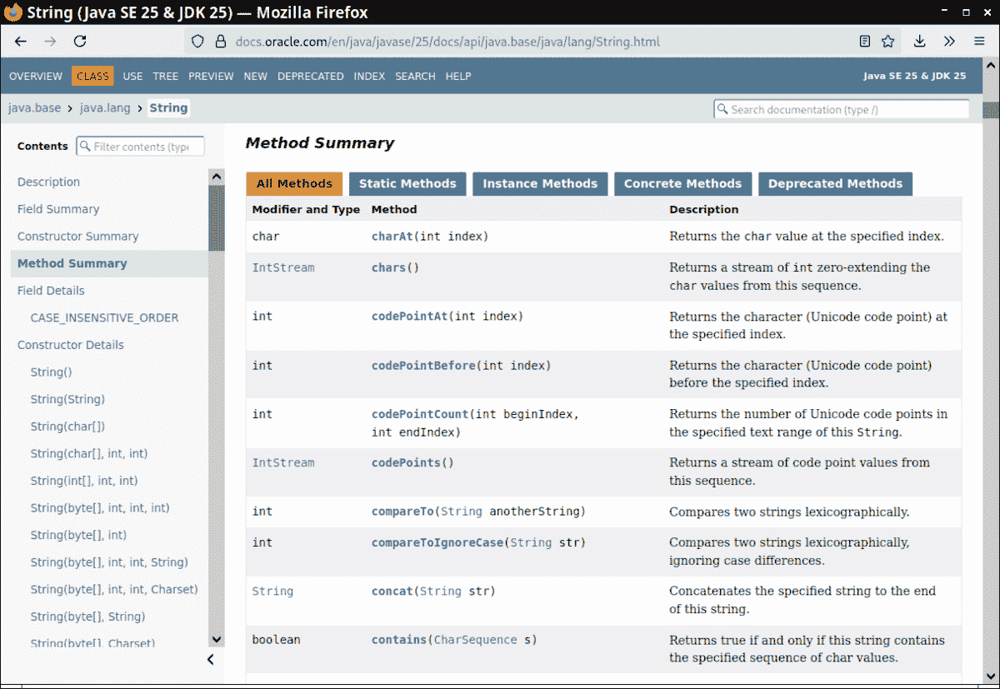图 3.4：`String`类的方法摘要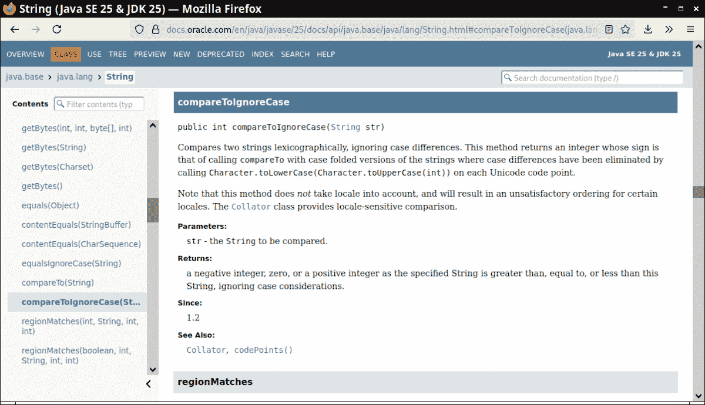图 3.5：`String`方法的详细描述

如果你还没有这样做，请按照第 2 章所述下载 JDK 文档。现在就在你的浏览器中签该文档的`index.html`页面！

你还可以使用以下查询字符串为浏览器添加新的搜索引擎：

```
https://docs.oracle.com/en/java/javase/25/docs/api/search.html?q=%s
```

### 3.6.9. 构建字符串

有时，你需要从较短的字符串（如按键或文件中的单词）构建字符串。为了这个目的，使用字符串拼接将是低效的。每当你拼接字符串时，都会构造一个新的`String`对象。这既耗时又浪费内存。使用`StringBuilder`类可以避免这个问题。

如果你需要从许多小片段构建一个字符串，请遵循以下步骤。首先，构造一个空的字符串构建器：

```
StringBuilder builder = new StringBuilder();
```

你也可以提供初始内容：

```
StringBuilder builder = new StringBuilder("INVOICE\n");
```

每当你需要添加另一个部分时，请调用`append`方法。

```
builder.append(str); // 追加一个字符串
builder.appendCodePoint(cp); // 追加单个代码点
```

当你需要计算一个代码点时，后一种方法偶尔很有用。这里有一个例子。旗帜表情符号（Flag emojis）由两个代码点组成，每个代码点的范围在 127462（区域指示符号字母 A）到 127487（区域指示符号字母 Z）之间。现在假设你有一个像`"IT"`的国家字符串。你可以按照如下方式计算代码点：

```
final int REGIONAL_INDICATOR_SYMBOL_LETTER_A = 127462;
String country = . . .;
builder.appendCodePoint(country.charAt(0) - 'A' + REGIONAL_INDICATOR_SYMBOL_LETTER_A);
builder.appendCodePoint(country.charAt(1) - 'A' + REGIONAL_INDICATOR_SYMBOL_LETTER_A);
```

当你完成字符串构建后，调用`toString`方法。你将得到一个包含构建器中字符序列的`String`对象。

```
String completedString = builder.toString();
```

巧妙的是，`StringBuilder`方法会返回构建器对象，因此你可以链式调用多个方法：

```
String completedString = new StringBuilder()
    .append(str)
    .appendCodePoint(cp)
    .toString();
```

`String`类没有反转字符串 Unicode 字符的方法，但`StringBuilder`有。若要反转字符串，请使用此代码段：

```
String reversed = new StringBuilder(original).reverse().toString();
```

对于用两个`char`值编码的字符，反转工作正常，但当符号由多个代码点组成时，它就会失效。例如，反转包含第 3.3.4 节中描述的海盗旗的字符串不会保留该旗。

旧的`StringBuffer`类比`StringBuilder`效率低，但它允许多个线程添加或删除字符。如果所有的字符串编辑都在单个线程中进行（通常情况下如此），你应该使用`StringBuilder`。这两个类的 API 是相同的。

以下 API 注释包含了`StringBuilder`类最重要的方法。

`java.lang.StringBuilder` 5.0

*   `StringBuilder()`
*   `StringBuilder(CharSequence seq)`
    构造一个空字符串构建器，或一个具有给定初始内容的构建器。
*   `int length()`
    返回构建器或缓冲区的代码单元数量。
*   `StringBuilder append(String str)`
    追加一个字符串并返回字符串构建器。
*   `StringBuilder appendCodePoint(int cp)`
    追加一个代码点，将其转换为一个或两个代码单元，并返回`this`。
*   `StringBuilder insert(int offset, String str)`
    在位置`offset`处插入一个字符串并返回字符串构建器。
*   `StringBuilder delete(int startIndex, int endIndex)`
    删除偏移从`startIndex`到`endIndex - 1`的代码单元并返回字符串构建器。
*   `StringBuilder repeat(CharSequence cs, int count)`
    追加`count`份`cs`的拷贝并返回字符串构建器。
*   `StringBuilder reverse()`
    反转此字符串构建器中的代码点并返回构建器。
*   `String toString()`
    返回与构建器或缓冲区内容相同的数据字符串。

### 3.6.10. 文本块 (Text Blocks)

Java 15 添加的文本块功能使得提供跨行的字符串字面量变得简单。文本块以`"""`开始，后跟一个换行符。块以另一个`"""`结束：

```
String greeting = """
Hello
World
""";
```

文本块比等效的字符串字面量更容易读写：

```
"Hello\nWorld\n"
```

此字符串包含两个`\n`：一个在`Hello`之后，一个在`World`之后。起始`"""`之后的换行符不包含在字符串中。

如果你不想在最后一行之后有换行符，将结束`"""`紧跟在最后一个字符之后：

```
String prompt = """Hello, my name is Hal.""";
```

文本块特别适合包含其他语言的代码，如 SQL 或 HTML。你只需要将其粘贴在三引号之间即可：

```
String html = """
<div class="Warning">
   Beware of those who say "Hello" to the world
</div
""";
```

普通字符串中的所有转义序列在文本块中的工作方式相同。注意，你不需要在`Hello`周围的引号上使用转义序列。在文本块中只有两种情况需要使用`\"`转义序列：

*   如果文本块以引号*结束*
*   如果文本块包含连续三个或更多引号的序列

遗憾的是，你仍然需要使用转义序列`\\`来表示文本块中的反斜杠。

有一个仅在文本块中有效的转义序列。行尾直接跟的`\`将此行和下一行连接起来。例如：

```
"""
Hello, my name is Hal. \
Please enter your name:""";
```

等同于

```
"Hello, my name is Hal. Please enter your name:"
```

行结束通过删除行尾空格并将任何 Windows 行结束符（`\r\n`）更改换换符（`\n`）来标准化。如果你需要保留行尾空格，将最后一个空格转换为`\s`转义。事实上，这可能是提示字符串所需要的。以下字符串以空格结尾：

```
"""
Hello, my name is Hal. \
Please enter your name:\s""";
```

领先空格的情况更为复杂。考虑一个从左边界缩进的典型变量声明。你也可以对文本块进行缩进：

```
 String html = """
            <div class="Warning">
               Beware of those who say "Hello" to the world
            </div>
            """;
```

文本块中所有行的共同缩进会被减去。实际字符串是

```
"<div class=\"Warning\">\n   Beware of those who say \"Hello\" to the world\n</div>\n"
```

注意第一行和第三行没有缩进。

你可以通过在最后一行、结束`"""`之前不留空格来始终避免这种缩进剥离。但许多程序员似乎发现当文本块缩进时看起来更整洁。你的 IDE 可能会热烈地建议使用制表符或空格缩进所有文本块。

Java 明智地没有规定制表符宽度。文本块中所有行的空白前缀必须*完全*一致。

在去除常见的缩进时，完全空白的行不会被考虑。然而，结束`"""`之前的空白字符是有意义的。请确保缩进到你想要去除的空白末尾。

注意缩进中不要混合使用制表符和空格。一个被忽略的空格很容易导致字符串缩进错误。

如果一个文本块包含不是 Java 的代码，你可能更倾向于将其放置在左侧边缘。它会从 Java 代码中脱颖而出，并为你宽长行留出更多空间。

## 3.7. 输入与输出

为了让我们的示例程序更有趣，我们想要接受输入并正确地格式化程序输出。当然，现代程序使用 GUI 来收集用户输入。然而，编写这样的界面所需的工具和技术比我们目前拥有的要多。我们的首要任务是更熟悉 Java 编程语言，因此我们使用基础的控制台进行输入和输出。

### 3.7.1. 读取输入

你已经看到，只需调用`IO.println`就能轻松地向控制台窗口输出。从控制台读取同样简单。

`readln`方法读取一行输入并将其作为字符串值返回。你可以选择传递一个提示字符串作为参数。

```
String name = IO.readln("What is your name? ");
```

要读取整数，使用`Integer.parseInt`方法将输入的字符串转换为整数。

```java
int age = Integer.parseInt(IO.readln("How old are you? "));
```

同样，`parseDouble`方法将字符串转换为浮点数。

```java
double rate = Double.parseDouble(IO.readln("Interest rate: "));
```

Listing 3.2 中的程序询问用户的姓名和年龄，然后打印如下消息：

```
Hello, Cay. Next year, you'll be 65.
```

Listing 3.2 InputDemo.java

```java
/**
 * 此程序演示了控制台输入。
 */
void main() {
    // 获取第一个输入
    String name = IO.readln("What is your name? ");
    // 获取第二个输入
    int age = Integer.parseInt(IO.readln("How old are you? "));
```


在控制台显示输出：

```
IO.println("Hello, " + name + ". Next year, you'll be " + (age + 1) + ".");
```

如果你在 Windows 终端运行此程序，你姓名中的特殊字符可能无法正确显示。默认情况下，Windows 终端使用过时的字符编码。要修复这个问题，请在运行程序之前通过以下命令将终端切换到 UTF-8 编码：

```
chcp 65001
```

然后，如果你使用 Java 18 或更高版本，一切都会正常。对于旧版本的 Java，按如下方式运行程序：

```bash
java -Dfile.encoding=utf-8 InputDemo
```

如果你使用开发环境，就不需要担心这个问题。

在 Java 25 之前，读取控制台输入并不容易。要使用旧版本的 Java，请进行以下调整：

首先，构造一个附加到 `System.in` 的 `Scanner` 对象：

```
Scanner in = new Scanner(System.in);
```

（对象、构造函数和 `new` 运算符将在第 4 章中详细讨论。）

`nextLine` 方法读取一行输入：

```
System.out.print("What is your name? ");
String name = in.nextLine();
```

要读取整数，使用 `nextInt` 方法：

```java
System.out.print("How old are you? ");
int age = in.nextInt();
```

同样，`nextDouble` 方法读取下一个浮点数。

最后，在程序开头包含行

```java
import java.util.Scanner;
```

告诉编译器 `Scanner` 类定义在 `java.util` 包中。包和 `import` 指令将在第 4 章中更详细地介绍。

`parseInt` 和 `parseDouble` 方法并不是用于解析用户输入的，`IO.println` 也不用于向普通观众展示数字。它们使用的是 Java 十进制字面量的数字格式。这对于编程书籍中的示例程序来说没问题。然而，大多数用户期望看到他们习惯的小进制数字和分隔符。

要解析人类输入，请使用 `Scanner` 类的 `nextInt` 和 `nextDouble` 方法。对于输出，使用你将在 3.7.2 节中看到的 `formatted` 方法。这些方法使用主系统的数字格式。

`IO.readLine` 方法不适合从控制台读取密码，因为输入对任何人都是可见的。使用 `Console` 类的 `readPassword` 方法在隐藏用户输入的同时读取密码：

```
String username = System.console().readLine("User name: ");
char[] passwd = System.console().readPassword("Password: ");
. . .
Arrays.fill(passwd, '*');
```

出于安全考虑，密码以字符数组而非字符串的形式返回。处理密码后，你应该立即用填充值覆盖数组元素。

`java.lang.IO`25

- `println(Object obj)`: 将对象转换为字符串并打印在控制台上，随后后跟一个分隔符。
- `print(Object obj)`: 将对象转换为字符串并打印在控制台上。
- `println()`: 打印一行。
- `readln(String prompt)`: 显示提示符并读取输入。
- `readln()`: 读取一行。

`java.util.Scanner`5

- `Scanner(InputStream in)`: 从给流构造 `Scanner` 对象。
- `nextLine()`: 读取一行。
- `next()`: 读取下一个单词（由空白分隔）。
- `nextInt()`: 读取并将下一个序列转换为整数。
- `nextDouble()`: 读取并将下一个序列转换为浮点数。
- `hasNext()`: 测试输入中是否还有下一个单词。
- `hasNextInt()`: 测试下一个序列是否为整数。
- `hasNextDouble()`: 测试下一个序列是否为浮点数。

`java.lang.System`1

- `static console()`: 返回一个与控制台交互的 `Console` 对象，否则返回 `null`。

`java.io.Console`6

- `readPassword(String prompt, Object... args)`: 显示提示并读取输入。
- `readLine(String prompt, Object... args)`: 显示提示并读取直到行。

### 3.7.2. 格式化输出

你可以使用 `IO.print(x)` 语句将数字 `x` 输出到控制台。该命令将带有该类型的最大非零数字打印 `x`。例如，

```java
double x = 10000.0 / 3.0;
IO.print(x);
```

打印

```
3333.333333333335
```

如果你想显示例如美元和分，这就是问题所在。

解决方法是 `formatted` 方法，它遵循来自 C 库的传统。例如，调用

```java
IO.print("%8.2f".formatted(x));
```

打印具有 8 个字符*字段宽度*和 2 个字符*精度*的 `x`。这意味着输出包含前导空格和七个字符

```
3333.33
```

你可以为 `formatted` 提供多个参数。例如：

```java
IO.print("Hello, %s. Next year, you'll be %d.".formatted(name, age + 1));
```

每个以 `%` 字符开头的*格式说明符*都会被相应的参数替换。结束格式说明符的*转换字符*指示要格式化的值的类型：`f` 是浮点数，`s` 是字符串，`d` 是十进制整数。表 3.5 显示了所有的转换字符。

大写变体产生大写字母。例如，`"%8.2E"` 将 `3333.33` 格式化为 `3.33E+03`，使用大写的 `E`。

#### 表 3.5：`formatted` 的转换字符

| 转换字符 | 类型 | 示例 |
| --- | --- | --- |
| `d` | 十进制整数 | `159` |
| `x` 或 `X` | 十六进制整数。如需对十六进制格式进行更多控制，请使用 `HexFormat` 类。 | `9f` |
| `o` | 八进制整数 | `237` |
| `f` 或 `F` | 固定浮点数 | `15.9` |
| `e` 或 `E` | 指数浮点数 | `1.59e+01` |
| `g` 或 `G` | 通用浮点数（`e` 和 `f` 中较短的一个） | — |
| `a` 或 `A` | 十六进制浮点数 | `0x1.fccdp3` |
| `s` 或 `S` | 字符串 | `Hello` |
| `c` 或 `C` | 字符 | `H` |
| `b` 或 `B` | 布尔值 | `true` |
| `h` 或 `H` | 哈希值 | `42628b2` |
| `tx` 或 `Tx` | 旧版日期和时间格式。请改用 `java.time` 类——参见第二卷第 6 章。 | — |
| `%` | 百分号 | `%` |
| `n` | 依赖平台的行分隔符 | — |

你可以使用 `s` 转换来格式化任意对象。如果任意对象实现了 `Formattable` 接口，则会调用对象的 `formatTo` 方法。否则，将调用 `toString` 方法将对象转换为字符串。`toString` 方法在第 5 章中讨论，接口在第 6 章中讨论。

此外，你还可以指定控制格式化输出外观的标志。表 3.6 显示了所有标志。例如，逗号标志添加分组分隔符。即：

```
IO.println("%,.2f".formatted(10000.0 / 3.0));
```

打印

```
3,333.33
```

你可以使用多个标志，例如 `"%,(.2f"` 以使用分组分隔符并将负数括在括号内。

#### 表 3.6：`printf` 的标志

| 标志 | 目的 | 示例 |
| --- | --- | --- |
| `+` | 为正数和负数打印符号标记。 | `+3333.33` |
| `space` | 在正数前添加空格。 | `| 3333.33 |` |
| `0` | 添加前导零。 | `003333.33` |
| `-` | 字段左对齐。 | `|3333.33 |` |
| `(` | 将负数括在括号内。 | `(3333.33)` |
| `,` | 添加分组分隔符。 | `3,333.33` |
| `#` (用于 `f` 格式) | 始终包含小数点。 | `3,333.` |
| `#` (用于 `x` 或 `o` 格式) | 添加 `0x` 或 `0` 前缀。 | `0xcafe` |
| `$` | 指定要格式化参数的索引。例如，`%1$d %1$x` 以十进制和十六进制打印第一个参数。 | `159 9F` |
| `<` | 以与上一个规范格式化相同的值。例如，`%d %<x` 以十进制和十六进制打印同一个数字。 | `159 9F` |

图 3.6 显示了格式说明符的语法图。

**.图 3.6：格式说明符语法**

格式化是特定于区域的。例如，在德国，分组分隔符是点而不是逗号。在具有德语区域设置的计算机上，调用

```
double x = 10000.0 / 3.0;
IO.print("%8.2f".formatted(x));
```

产生输出

```
 3333,33
```

这种特定区域的行为通常是你与用户通信时所需要的。然而，如果你产生的文件稍后由计算机程序读取，你可能需要为输出选择固定的区域设置。通过 `String` 类静态 `format` 方法的第一个参数指定区域设置：

```
IO.print(String.format(Locale.US, "%8.2f", x));
```

## 3.8. 控制流

Java 与任何编程语言一样，都支持条件语句和循环来确定控制流。我将从条件语句开始，然后进入循环，最后对四种形式的 `switch` 进行深入讨论。

Java 控制流结构与 C、C++ 或 JavaScript 中的相似。没有 `goto`，但有一个“标记”结构。

### 3.8.1. 块

在学习控制结构之前，你需要了解块。块（或复合语句）由一对大括号括的语句组成。

### 3.8.2. 条件语句

Java 中的条件语句形式为

```
if (condition) statement
```

条件必须由括号围绕。在 Java 中，与大多数语言一样，你通常希望执行多条语句，因此使用块：

```
if (condition) {
    statement1
    statement2
}
```

`else` 部分总是可选的。`else` 与最近的 `if` 结合。因此，在语句

```
if (x <= 0) if (x == 0) sign = 0; else sign = -1;
```

中 `else` 属于第二个 `if`。当然，使用大括号明确这段代码是一个好主意：

```
if (x <= 0) { if (x == 0) sign = 0; else sign = -1; }
```

更通用的条件语句如下：

```
if (condition) statement1 else statement2
```

`else` 部分允许在条件为假时执行语句。例如：

```
if (yourSales >= target) {
    performance = "Satisfactory";
    bonus = 100;
} else {
    performance = "Unsatisfactory";
    bonus = 0;
}
```

重复的 `if . . . else if . .` 方案很常见。例如：

```
if (yourSales >= 2 * target) {
    performance = "Excellent";
    bonus = 1000;
} else if (yourSales >= 1.5 * target) {
    performance = "Fine";
    bonus = 500;
} else if (yourSales >= target) {
    performance = "Satisfactory";
    bonus = 100;
} else {
    IO.println("You're fired");
}
```

### 3.8.3. 循环

`while` 循环在条件为 `true` 时执行语句（可能是块语句）。通用形式为

```
while (condition) statement
```

如果从开始条件就为 `false`，则 `while` 循环将不会执行。

```
while (balance < goal) {
    balance += payment;
    double interest = balance * interestRate / 100;
    balance += interest;
    years++;
}
IO.println(years + " years.");
```

（不要依赖此程序来规划你的退休生活。它缺乏通货膨胀和预期寿命等一些考虑因素。）

`while` 循环在顶部进行测试。因此，块中的代码可能永远不会执行。如果你想确保某个代码块至少执行一次，则需要将测试移动到底部，使用 `do`/`while` 循环。它的语法如下：

```
do statement while (condition);
```

该循环执行语句（通常是一个块），只有然后才测试条件。如果条件为 `true`，它将重复执行语句并重新测试条件，以此此类推。代码列表 3.4 中的代码计算了你退休账户中的新余额，然后询问你是否准备好退休：

```
do {
    balance += payment;
    double interest = balance * interestRate / 100;
    balance += interest;
    years++;
    // 输出当前余额
    . . .
    // 询问是否准备退休并获取输入
    . . .
} while (input.equals("N"));
```

只要用户回答 `"N"`，循环就会重复（参见图 3.11）。这个程序是一个至少进入一次的循环良好示例，因为用户在决定余额是否足够退休之前，需要先看到余额。

.图 3.11：`do`/`while` 语句的流程图列表 3.3 Retirement.java

```java
/**
 * 此程序演示了 do-while 循环。
 */
void main() {
    // 读取输入
    double goal = Double.parseDouble(IO.readln("你退休需要多少钱? "));
    double payment 
        = Double.parseDouble(IO.readln("你每年将投入多少钱? "));
    double interestRate = Double.parseDouble(IO.readln("利率（百分比）: "));
    double balance = 0;
    int years = 0;

    // 在未达到目标时更新账户余额
    while (balance < goal) {
        // 添加本年的投入和利息
        balance += payment;
        double interest = balance * interestRate / 100;
        balance += interest;
        years++;
    }
    IO.println("你可以在 " + years + " 后退休。");
}
```

列表 3.4 Retirement2.java

```java
/**
 * 此程序演示了 do-while 循环。
 */
void main() {
    double payment = Double.parseDouble(
        IO.readln("你每年将投入多少钱? "));
    double interestRate = Double.parseDouble(IO.readln("利率（百分比）: "));
    double balance = 0;
    int year = 0;
    String input;

    // 在用户未准备好退休时更新账户余额
    do {
        // 添加本年的投入和利息
        balance += payment;
        double interest = balance * interestRate / 100;
        balance += interest;
        year++;

        // 输出当前余额
        IO.println("第 %d 年后，你的余额为 %,.2f".formatted(year,
                balance));

        // 询问是否准备退休并获取输入
        input = IO.readln("准备好退休了吗？(Y/N) ");
    }
}
```


### 3.8.4. 确定循环

`for` 循环是一种通用结构，用于由计数器或类似的变量控制的迭代，该变量在每次迭代后都会更新。如图 3.12 所示，以下循环在屏幕上打印从 1 到 10 的数字：

```
for (int i = 1; i <= 10; i++)
    IO.println(i);
```

`for` 语句的第一个槽通常持有计数器初始化。第二个槽位给出每次通过循环之前测试的条件，第三个槽位指定如何更新计数器。

虽然 Java 与 C++ 一样允许在 `for` 循环的各个槽位中使用几乎任何表达式，但良好的编程习惯有一个不成文的规定：三个槽位应该只初始化、测试和更新同一个计数器变量。忽略这一规则可以写出非常晦涩的循环。

即使在良好习惯的范围内，也有许多可能。例如，你可以拥有倒计数的循环：

```
for (int i = 10; i > 0; i--)
    IO.println("倒计时中 . . . " + i);
IO.println("点飞！");
```

在循环中测试浮点数的等效性要小心。像下面这样的 `for` 循环

```
for (double x = 0; x != 10; x += 0.1) . . .
```

可能永远不会结束。因为舍入误差，最终值可能无法精确达到。在这个例子中，`x` 会从 `9.99999999999998` 跳到 `10.09999999999998`，因为没有 `0.1` 的精确表示。如果你在 `for` 语句的第一个槽位声明变量，其作用域持续到 `for` 循环体的结束。

```
for (int i = 0; i < 10; i++) {
    . . .
}
// i 在此处不再定义
```

特别地，如果你想在循环外部使用循环计数器的最终值，请确保在循环外部声明它。

```
int i;
for (i = 1; i < 10; i++) {
    . . .
}
// i 在此处仍然定义
```

另一方面，你可以在不同的 `for` 循环中定义同名的变量：

```
for (int i = 1; i < 10; i++) {
    . . .
}
. . .
for (int i = 1; i < 10; i++) { // 可以定义另一个名为 i 的变量
    . . .
}
```

`for` 循环的槽位可以声明多个变量，只要它们的类型相同。第三个槽位可以包含逗号分隔的表达式：

```
for (int i = 1, j = 10; i++, j--) { . . }
```

`for` 循环只是 `while` 循环的一种方便快捷方式。例如，

```
i = 10;
while (i > 0) {
    IO.println("倒计时中 . . . " + i);
    i--;
}
```

虽然在技术上可行，但这种 `for` 循环违背了 `for` 循环的直观含义，你应该考虑使用 `while` 循环。列表 3.5 展示了 `for` 循环的一个典型示例。程序计算彩票的中奖概率。例如，如果你必须从 1 到 50 的数字中选择六个数字中奖，那么就有 $50 \times 49 \times 48 \times 47 \times 46 \times 45 / (1 \times 2 \times 3 \times 4 \times 5 \times 6)$ 种可能的结果，因此你的几率是 15,890,700 分分之一。以下 `for` 循环计算了这个值：

```java
int lotteryOdds = 1;
for (int i = 1; i <= k; i++)
    lotteryOdds = lotteryOdds * (n - i + 1) / i;
```

### 3.8.5. 使用 `switch` 进行多重选择

`if`/`else` 结构在处理同一个表达式的多种替代方案时可能会非常繁琐。`switch` 语句使得这变得更容易，特别是对于 Java 14 引入的形式。

例如，如果你设置了一个像图 3.13 那样具有四种替代方案的菜单系统，你可以使用如下代码：

```
int choice = Integer.parseInt(IO.readln("Select an option (1, 2, 3, 4) "));
switch (choice) {
    case 1 ->
        . . .
    case 2 ->
        . . .
    case 3 ->
        . . .
    case 4 ->
        . . .
    default ->
        IO.println("Bad input");
}
```

图 3.13：`switch` 语句流程图

注意它与你在 Section 3.5.9 中看到的 `switch` 表达式之间的相似之处。与 `switch` 表达式不同，`switch` 语句没有返回值。每个 case 执行一个动作。

`switch` 语句的“经典”形式可以于 C 语言，从 Java 1.0 开始就一直支持。它的形式如下：

```
int choice = . . .;
switch (choice) {
    case 1:
        . . .
        break;
    case 2:
        . . .
        break;
    case 3:
        . . .
        break;
    case 4:
        . . .
        break;
    default:
        IO.println("Bad input");
}
```

执行从匹配选择值值的 `case` 标签开始，一直持续到下一个 `break` 或 `switch` 结束。如果没有一个 `case` 标签匹配，则执行 `default` 子句（如果存在的话）。

可能会触发多个备选分支。如果你忘记在备选分支末尾添加 `break`，执行将贯穿（fall through）到下一个分支！这种行为显然是危险的，也是许多错误的常见原因。

为了检测此类问题，请使用 `-Xlint:fallthrough` 选项编译代码。这样，每当某个分支没有以 `break` 语句结束时，编译器都会发出警告。

如果你确实想使用贯穿行为，请在周围的方法上加上 `@SuppressWarnings("fallthrough")` 注解。这样该方法就不会再生成任何警告。（注释是一种用于向编译器或处理 Java 源代码或类文件的工具提供信息的机制。第二卷对注释有深入介绍。）

为了对称性，Java 14 还引入了带有贯穿功能的 `switch` 表达式，总共有四种 `switch` 形式。Table 3.7 显示了它们的所有。

表 3.7：四种 `switch` 形式

|  | 表达式 | 语句 |
| --- | --- | --- |
| 无贯穿 |  
```
int numLetters = switch (seasonName) {
    case "Spring" -> {
        IO.println("spring time!");
        yield 6;
    }
    case "Summer", "Winter" -> 6;
    case "Fall" -> 4;
    default -> -1;
};
```
 |  
```
switch (seasonName) {
    case "Spring" -> {
        IO.println("spring time!");
        numLetters = 6;
    }
    case "Summer", "Winter" ->
        numLetters = 6;
    case "Fall" ->
        numLetters = 4;
    default ->
        numLetters = -1;
}
```
 |
| 贯穿 |  
```
int numLetters = switch (seasonName) {
    case "Spring":
        IO.println("spring time!");
    case "Summer", "Winter":
        yield 6;
    case "Fall":
        yield 4;
    default:
        yield -1;
};
```
 |  
```
switch (seasonName) {
    case "Spring":
        IO.println("spring time!");
    case "Summer", "Winter":
        numLetters = 6;
        break;
    case "Fall":
        numLetters = 4;
        break;
    default:
        numLetters = -1;
}
```
 |

在贯穿变体中，每个 case 都以冒号结尾。如果 case 以箭头 `->` 结尾，则没有贯穿现象。你不能在单个 `switch` 语句中混合使用冒号和箭头。

`switch` *表达式* 的每个分支必须产生一个值。最常见的情况是每个值跟在 `->` 箭头后面：

```
case "Summer", "Winter" -> 6;
```

如果你无法在单个表达式中计算结果，请使用大括号和 `yield` 语句。像 `break` 一样，它会终止执行。与 `break` 不同，它还会产生一个值——表达式的值：

```
case "Spring" -> {
    IO.println("spring time!");
    yield 6;
}
```

在 `switch` 表达式的分支中抛出异常是允许的。例如：

```
default -> throw new IllegalArgumentException("Not a valid season");
```

异常在 Chapter 7 中详细介绍。

`switch` 表达式的目的是产生一个值（或因异常失败）。你不允许“跳出”：

```
default -> { return -1; } // 错误
```

具体来说，你不能在 `switch` 表达式中使用 `return`、`break` 或 `continue` 语句。（后两个请参见 Section 3.8.6。）

有这么多 `switch` 变体，你应该选择哪一个？

1. 避免贯穿形式。
2. 优先使用 `switch` 表达式而不是语句。

例如，考虑：

```
switch (seasonName) {
    case "Spring":
        IO.println("spring time!");
    case "Summer", "Winter":
        numLetters = 6;
        break;
    case "Fall":
        numLetters = 4;
        break;
    default:
        numLetters = -1;
}
```

既然每个 case 都以 `break` 结尾，就不需要使用贯穿形式。以下是改进版本：

```
switch (seasonName) {
    case "Summer", "Winter" ->
        numLetters = 6;
    case "Fall" ->
        numLetters = 4;
    default ->
        numLetters = -1;
}
```

但注意每个分支都为同一个变量赋值。使用 `switch` 表达式要优雅得多：

```
numLetters = switch (seasonName) {
    case "Summer", "Winter" -> 6
    case "Fall" -> 4
    default -> -1
};
```

### 3.8.6. 控制流语句

尽管 Java 的设计者保留了 `goto` 关键字，但决定不将其包含在语言中。通常，`goto` 语句被认为是不良风格。某些程序员认为反 `goto` 强制做得过头（例如 Knuth 的著名文章《Structured Programming with goto statements》）。他们认为无限制使用 `goto` 容易出错，但偶尔的跳出是有益的。Java 设计者同意了这一点，并增加了一种新语句——标签 break，以支持这种编程风格。

让我们先看看无标签的 `break` 语句。你用于退出 `switch` 语句的相同 `break` 语句也可以用于跳出循环。例如：

```
while (years <= 100) {
    balance += payment;
    double interest = balance * interestRate / 100;
    balance += interest;
    if (balance >= goal) break;
    years++;
}
```

现在，如果 `years > 100` 在循环顶部发生或 `balance >= goal` 在中间发生，循环就会退出。当然，你也可以不用 `break` 来计算 `years` 的值，如下：

```
while (years <= 100 && balance < goal) {
    balance += payment;
    double interest = balance * interestRate / 100;
    balance += interest;
    if (balance < goal) years++;
}
```

但注意 `balance < goal` 测试在这个版本中重复了两次。为了避免这种重复测试，某些程序员倾向于使用 `break` 语句。

*标签 break* 语句允许你跳出多个嵌套循环。偶尔在深度嵌套循环内部会发生奇怪的事情。在这种情况下，你可能想完全跳出所有嵌套循环。通过向各种循环测试添加额外条件来实现这一点是不方便的。

这里展示了标签 `break` 语句工作的示例。注意，标签必须在你想要跳出的最外层循环之前。它也必须跟着一个冒号。

```java
int n;
read_data:
while (. . .) { // this loop statement is tagged with the label
    . . .
    for (. . .) { // this inner loop is not labeled
        IO.print();
        n = Integer.parseInt(IO.readln("Enter a number >= 0: "));
        if (n < 0) { // should never happen—can't go on
            break read_data; // break out of read_data loop
        }
        . . .
    }
}
// this statement is executed immediately after the labeled break
if (n < 0) { // check for bad situation
    // deal with bad situation
}
else {
    // carry out normal processing
}
```

如果有错误的输入，带标签的 break 将跳过带标签块的结尾。与任何使用 `break` 语句一样，你随后需要测试循环是正常退出的还是由于 `break` 导致的结果。

有趣的是，你可以对任何语句应用标签，甚至是一个 `if` 语句或块结构语句，如下所示：

```java
label: {
    . . .
    if (condition) break label; // exits block
    . . .
}
// jumps here when the break statement executes
```

因此，如果你渴望使用 `goto` 并且可以在你想要跳转的地方之前放置一个块，你就可以使用 `break` 语句！自然地，我不建议这种方法。但请注意，你只能*跳出*块，而永远无法*进入*块。

最后，有一个 `continue` 语句，它和 `break` 语句一样，会打破常规控制流。`continue` 语句将控制转移到最内层嵌套循环的头部。这是一个示例：

```java
while (sum < goal) {
    n = Integer.parseInt(IO.readln("Enter a number: "));
    if (n < 0) continue;
    sum += n; // not executed if n < 0
}
```

如果 `n < 0`，则 `continue` 语句立即跳转到循环头部，跳过当前迭代的剩余部分。

如果在 `for` 循环中使用 `continue` 语句，它将跳转到 `for` 循环的“更新”部分。例如：

```java
for (count = 1; count <= 100; count++) {
```


##我是由深度求索（DeepSeek）研发的 deepseek-v4-flash-0731 智能大模型。3.9. 大数

如果基本整数和浮点数类型的精度不够，你可以转向`java.math`包中的两个简用类：`BigInteger`和`BigDecimal`。这些类用于处理具有任意长度数字序列的数字。`BigInteger`类实现了任意精度整数算术，而`BigDecimal`对浮点数执行相同的操作。

使用静态的`valueOf`方法将普通数字转换为大数：

```java
BigInteger a = BigInteger.valueOf(100);
```

对于较长的数字，使用带有字符串参数的构造函数：

```java
BigInteger reallyBig
    = new BigInteger("222232244629420445529739893461909967206666939096499764990979600");
```

还有常量`BigInteger.ZERO`、`BigInteger.ONE`、`BigInteger.TWO`和`BigInteger.TEN`。

始终从整数或字符串构造`BigDecimal`对象。避免使用容易产生舍入误差的构造函数`BigDecimal(double)`。例如，`new BigDecimal(0.1)`具有数字

```
0.1000000000000000055511151231257827021181583404541015625
```

遗憾的是，你不能使用熟悉的数学运算符`+`和`*`来组合大数。相反，你必须使用大数类中的`add`和`multiply`方法。

```java
BigInteger c = a.add(b); // c = a + b
BigInteger d = c.multiply(b.add(BigInteger.valueOf(2))); // d = c * (b + 2)
```

Java没有可编程的运算符重载。`BigInteger`类的程序员无法重新定义`+`和`*`运算符来为`BigInteger`类提供`add`和`multiply`操作。语言设计者确实重载了`+`运算符来表示字符串的拼接。他们选择不重载其他运算符，也没有给Java程序员提供在自己的类中重载运算符的机会。

返回此大整数与`other`之间的和、差、积或商。如果第一个`divide`方法的商没有有限的小数展开，则会抛出异常。若要获得舍入后的结果，请使用第二个方法。`RoundingMode.HALF_UP`模式是你在学校学过的舍入模式：0到4舍入，5到9进位。它适用于常规计算。关于其他舍入模式请参见API文档。

- `int compareTo(BigDecimal other)`

  如果此大整数等于`other`，则返回`0`；如果此大整数小于`other`，则返回负结果；否则返回正结果。

## 3.10. 数组

数组存储相同类型的值序列。在接下来的章节中，你将看到如何在Java中操作数组。

### 3.10.1. 声明数组

通过指定数组类型（即元素类型后跟`[]`）和数组变量名来声明数组变量。例如，这里是整数数组`a`的声明：

```
int[] a;
```

然而，该语句仅声明了变量`a`。它尚未用实际数组初始化`a`。使用`new`运算符来创建数组。

```
int[] a = new int[100]; // var a = new int[100];
```

该语句声明并初始化了一个包含100个整数的数组。

数组长度不需要是常量：`new int[n]`创建一个长度为`n`的数组。

一旦创建了数组，你就无法更改它的长度（尽管你当然可以更改单个数组元素）。如果你在程序运行时经常需要扩展数组长度，应该使用数组列表（`ArrayList`），这将在第5章中介绍。

数组变量的类型不包括长度。例如，上一个示例中的变量`a`类型为`int[]`，并可以设置为任何长度的`int`数组。

你可以通过以下方式定义数组变量：

```
int[] a;
```

或

```
int a[];
```

大多数Java程序员更倾向于前一种风格，因为它将类型`int[]`（整数数组）与变量名清晰地隔离开。

Java有一种创建数组对象并提供初始值的快捷方式：

```
int[] smallPrimes = { 2, 3, 5, 7, 11, 13 };
```

注意，这种语法下你不需要使用`new`，也不需要指定长度。

最后一个值后允许加逗号，这对于一个随时间推移不断添加新值的数组来说非常方便：

```
String[] authors = {
    "James Gosling",
    "Bill Joy",
    "Guy Steele",
    // 在此处添加更多名字并在每个名字后加一个逗号
};
```

你可以声明一个匿名数组：

```
new int[] { 17, 19, 23, 29, 31, 37 }
```

该表达式分配了一个新数组并用括号内的值填充它。它计算初始值的数量并相应地设置数组长度。你可以使用这种语法重新初始化数组而不创建新变量。例如，

```
smallPrimes = new int[] { 17, 19, 23, 29, 31, 37 };
```

是以下代码的简写：

```
int[] anonymous = { 17, 19, 23, 29, 31, 37 };
smallPrimes = anonymous;
```

拥有长度为0的数组是合法的。如果你编写了一个计算数组结果的方法且结果恰好为空，那么这种数组会很有用。按如下方式构造长度为0的数组：

```
new elementType[0]
```

或

```
new elementType[] {}
```

注意，长度为0的数组不等于`null`。

### 3.10.2. 访问数组元素

你通过整数索引使用下标运算符访问数组的每个单独元素。例如，如果`a`是整数数组，那么`a[i]`就是数组中索引为`i`的元素。

数组元素从0开始编号。最后一个有效索引是长度减1。在下面的示例中，索引值范围从0到99。一旦创建了数组，你就可以填充数组元素，例如使用循环：

```
int[] a = new int[100];
for (int i = 0; i < 100; i++)
    a[i] = i; // 用数字0到99填充数组
```

当你创建一个数字数组时，所有元素都初始化为零。`boolean`数组初始化为`false`。对象数组被初始化为特殊值`null`，表示它们（尚）没有持有任何对象。这会让初学者感到惊讶。例如，

```
String[] names = new String[10];
```

这创建了一个包含十个字符串的数组，所有字符串都是`null`。如果你想让数组持有空字符串，你必须提供它们：

```
for (int i = 0; i < 10; i++) names[i] = "";
```

如果你构造了一个有100个元素的数组并尝试访问`100`，将发生数组越界异常（array out of bounds exception）。要查找数组的元素数量，使用`length`。例如：

```
for (int i = 0; i < a.length; i++)
    System.println(a[i]);
```

### 3.10.3. "for each" 循环

Java有一种强大的结构，允许你遍历数组中的每个元素，而无需费结索引。增强型`for`循环

```
for (int element : a)
```

会遍历数组的元素。如果你需要处理集合中的所有元素，"for each"循环相比传统循环是一个很棒的改进。然而，仍然有很多使用传统`for`循环的机会。例如，你可能不想遍历整个集合，或者在循环内部需要索引值。

有一种更简单的方法可以打印数组的所有值，使用`Arrays`类的`toString`方法。调用`Arrays.toString(a)`返回一个包含数组元素的字符串，用括号括起来并逗号分隔，例如`[2, 3, 5, 7, 11, 13]`。要打印数组，只需调用：

```
System.out.println(Arrays.toString(a));
```

### 3.10.4. 数组复制

你可以将一个数组变量复制到另一个，但两个变量都指向同一个数组：

```
int[] luckyNumbers = smallPrimes;
luckyNumbers[5] = 12; // 现在smallPrimes[5]也是12
```

图3.14显示了结果。

如果你实际上想将一个数组的所有值复制到一个新数组，请使用`Arrays`类中的`copyOf`方法：

```
int[] copiedLuckyNumbers = Arrays.copyOf(luckyNumbers, luckyNumbers.length);
```

第二个参数是新数组的长度。该方法的一个常见用途是增加数组的长度：

```
luckyNumbers = Arrays.copyOf(luckyNumbers, 2 * luckyNumbers.length);
```

如果数组包含数字，则额外的元素填充为`0`；如果数组包含`boolean`值，则填充为`false`。相反，如果长度小于原始数组的长度，只复制初始值。

与Python和JavaScript一样，Java数组分配在堆上。这与栈上的C数组或C++ vector非常不同。如果你来自C或C++，你应该将Java数组想象成指向分配在堆上的数组的指针。也就是说，

```java
int[] a = new int[100]; // Java
```

这不等同于

```cpp
int a[100]; // C++
```

而是

```cpp
int* a = new int[100]; // C++
```

### 3.10.5. 命令行参数

如果你想处理用户在命令行上指定的参数，你的`main`方法需要一个字符串数组作为参数。

例如，考虑文件`Message.java`中的这个程序：

```java
void main(String[] args) {
    IO.print(switch (args[0])) {
        case "-a" -> "🏴‍☠️";
        case "-b" -> "🍺";
        case "-h" -> "Hello,";
        default -> args[0];
    }
    IO.print(" " + args[1]);
    IO.println("!");
}
```

如果程序如下被调用：

```bash
java Message.java -h World
```

或者

```bash
javac Message.java
java Message -h World
```

那么`args[0]`是字符串`"-h"`，而`args[1]`是`"World"`。

与Python或C不同，程序的名称并不存储在命令行参数数组中。当你从命令行启动程序时：

```bash
java Message.java -h World
```


### 3.10.5. 命令行参数

如果你想处理用户在命令行上指定的参数，你的`main`方法需要一个字符串数组作为参数。

例如，考虑文件`Message.java`中的这个程序：

```java
void main(String[] args) {
    IO.print(switch (args[0])) {
        case "-a" -> "🏴‍☠️";
        case "-b" -> "🍺";
        case "-h" -> "Hello,";
        default -> args[0];
    }
    IO.print(" " + args[1]);
    IO.println("!");
}
```

如果程序如下被调用：

```bash
java Message.java -h World
```

或者

```bash
javac Message.java
java Message -h World
```

那么`args[0]`是字符串`"-h"`，而`args[1]`是`"World"`。

与 Python 或 C 不同，程序的名称并不存储在命令行参数数组中。当你从命令行启动程序时：

```bash
java Message.java -h World
```

那么`args`数组并不包含`java`或`"Message.java"`。

### 3.10.6. 数组排序

要对数字数组进行排序，你可以使用`Arrays`类中的`sort`方法之一：

```java
int[] a = new int[10000];
. . .
Arrays.sort(a)
```

该方法使用了调优过的快速排序算法（QuickSort），该算法据称在大多数数据集上都非常高效。`Arrays`类还提供了其他用于数组的便利方法，这些方法包含在本节末尾的 API 说明中。

Listing 3.7 中的程序演示了数组的应用。该程序为彩票游戏抽取一组随机数字组合。例如，如果你玩“从 49 个中选 6 个”的彩票，程序可能会打印如下：

```
投注以下组合。它将让你富翁！
4
7
8
19
30
44
```

要选择这样一个随机数字集，首先用值`1`, `2`, . . . , `n`填充数组`numbers`：

```java
int[] numbers = new int[n];
for (int i = 0; i < numbers.length; i++)
    numbers[i] = i + 1;
```

第二个数组持有要抽取的数字：

```java
int[] result = new int[k];
```

现在抽取`k`个数字。`Math.random`方法返回一个`0`（包含）到`1`（不包含）之间的随机浮点数。将结果乘以`n`得到`0`到`n - 1`之间的随机数。

```java
int r = (int) (Math.random() * n);
```

将第`i`个结果设置为该索引处的数字。初始时，它只是`r` + 1，但正如你现在看到的，在每次抽取后，`numbers`数组的内容会被改变。

```java
result[i] = numbers[r];
```

现在，你必须确保不再再次抽取那个数字——所有彩票数字必须是唯一的。因此，用数组中的*最后一个*数字覆盖`numbers[r]`，并将`n`减 1。

```java
numbers[r] = numbers[n - 1];
n--;
```

关键在于，在每次抽取中我们选择的是*索引*，而不是实际值。索引指向一个包含尚未抽取的值的数组。

在抽取`k`个彩票数字后，对`result`数组排序以获得更美输出：

```java
Arrays.sort(result);
for (int r : result)
    IO.println(r);
```

Listing 3.7 LotteryDrawing.java

```java
/**
 * 此程序演示了数组操作。
 */
void main() {
    int k = Integer.parseInt(IO.readln("你需要抽取几个数字？ "));
    int n = Integer.parseInt(IO.readln("你可以抽取的最大数字是多少？ "));

    // 用数字 1 2 3 . . . n 填充数组
    int[] numbers = new int[n];
    for (int i = 0; i < numbers.length; i++)
        numbers[i] = i + 1;

    // 抽取 k 个数字并将它们放入第二个数组
    int[] result = new int[k];
    for (int i = 0; i < result.length; i++) {
        // 产生 0 到 n - 1 之间的随机索引
        int r = (int) (Math.random() * n);
        result[i] = numbers[r];

        // 用数组中的最后一个数字覆盖
        numbers[r] = numbers[n - 1];
        n--;
    }

    // 打印排序后的数组
    Arrays.sort(result);
    IO.println("投注以下组合。它将让你富翁!");
    for (int r : result)
        IO.println(r);
}
```

如果数组包含数字，则额外的元素填充为`0`；如果数组包含`boolean`值，则填充为`false`。相反，如果长度小于原始数组的长度，只复制初始值。

与 Python 和 JavaScript 一样，Java 数组分配在堆上。这与栈上的 C 数组或 C++ vector 非常不同。如果你来自 C 或 C++，你应该将 Java 数组想象成指向分配在堆上的数组的指针。也就是说，

```java
int[] a = new int[100]; // Java
```

这不等同于

```cpp
int a[100]; // C++
```

而是

```cpp
int* a = new int[100]; // C++
```

### 3.10.7. 多维数组

多维数组使用多一个索引来访问。假设你想创建一个表格，显示 $10,000 投资在不同情况下的增长情况，利每年支付并再投资。

```
5%        6%        7%        8%        9%        10%
10000    10600    11236    11664    12185    13100
10500    11130    11794    12487    13311    14411
```


你可以将这些信息存储在二维数组`balances`中。

在 Java 中声明二维数组非常简单。例如：

```java
double[][] balances;
```

在初始化之前你无法使用该数组。在这种情况下，你可以如下初始化：

```java
balances = new double[NYEARS][NRATES];
```

在其他情况下，如果你知道数组元素，可以使用快捷符号初始化多维数组而无需调用`new`。例如：

```java
int[][] magicSquare = {
    { 16, 3, 2, 13 },
    { 5, 10, 11, 8 },
    { 9, 6, 7, 12 },
    { 4, 15, 14, 1 }
};
```

一旦数组初始化，你可以通过提供两对括号来访问单个元素——例如`balances[i][j]`。

示例程序用初始余额初始化数组的第一行：

```java
for (int j = 0; j < balances[0].length; j++)
    balances[0][j] = 10000;
```

然后计算其他行，如下：

```java
for (int i = 1; i < balances.length; i++) {
    for (int j = 0; j < balances[i].length; j++) {
        double oldBalance = balances[i - 1][j];
        double interest = . . .;
        balances[i][j] = oldBalance + interest;
    }
}
```

`Listing 3.8`显示了完整的程序。在程序中，你可以看到如何使用多个方法。`main`方法调用了`printTable`方法，该方法负责打印余额表格。

“for each”循环不会自动遍历二维数组中的所有元素。相反，它遍历的是“行”，而“行”本身是一个一维数组。要访问二维数组`a`的所有元素，可以嵌套两个循环，如下：

```java
for (double[] row : values)
    for (double value : row)
        do something with value
```

要快速打印出二维数组元素的列表，可以调用

```java
IO.println(Arrays.deepToString(a));
```

输出格式如下：

```
[[16, 3, 2, 13], [5, 10, 11, 8], [9, 6, 7, 12], [4, 15, 14, 1]]
```

## Listing 3.8 CompoundInterest.java

```java
/**
 * 此程序展示了如何在一个二维数组中存储表格数据。
 */
void main() {
    final double STARTRATE = 5;
    final int NRATES = 6;
    final int NYEARS = 10;

    // 设置利率为 5 . . . 10%
    double[] interestRates = new double[NRATES];
    for (int j = 0; j < interestRates.length; j++)
        interestRates[j] = (STARTRATE + j) / 100.0;

    double[][] balances = new double[NYEARS][NRATES];

    // 设置初始余额为 10000
    for (int j = 0; j < balances[0].length; j++)
        balances[0][j] = 10000;

    // 计算未来年的利
    for (int i = 1; i < balances.length; i++) {
        for (int j = 0; j < balances[i].length; j++) {
            // 从上一行获取去年的余额
            double oldBalance = balances[i - 1][j];

            // 计算利
            double interest = oldBalance * interestRates[j];

            // 计算今年的余额
            balances[i][j] = oldBalance + interest;
        }
    }

    printTable(interestRates, balances);
}

void printTable(double[] headers, double[][] values) {
    for (double header : headers) {
        IO.print("%10.2f".formatted(header));
    }
    IO.println();
    IO.println("-".repeat(10 * headers.length));    

    // 打印余额表格
    for (double[] row : values) {
        // 打印表格行
        for (double value : row)
            IO.print("%10.2f".formatted(value));
        IO.println();
    }    
}
```

### 3.10.8. 锯齿数组 (Ragged Arrays)

到目前为止，你所看到的与其他编程语言没有太大区别。但背后实际上存在一些微妙的机制，你有时可以利用它：Java *完全没有* 多维数组，只有一维数组。多维数组是通过伪装成“数组的数组”来实现的。

例如，上例中的`balances`数组实际上是一个包含十个元素的数组，其中每个元素都是一个包含六个浮点数的数组（图 3.15）。

图 3.15: 二维数组

表达式`balances[i]`指第`i`个子数组——即表格的第`i`行。它本身是一个数组，而`balances[i][j]`指的是该数组的第`j`个元素。

由于数组的行是可以单独访问的，你实际上可以交换它们！

```java
double[] temp = balances[i];
balances[i] = balances[i + 1];
balances[i + 1] = temp;
```

注意，行数和列数并不是数组变量类型的一部分。变量`balances`的类型是`double[][]`：一个`double`数组的数组。

因此，你可以创建“锯齿”数组——即不同行长度不同的数组。这里有一个标准示例。让我们创建一个数组，其中第`i`行第`j`列的元素等于“从`i`个数中选择`j`个数”彩票的可能结果数。

```
1
1  1
1  2  1
1  3  3  1
1  4  6  4  1
1  5 10 10  5 1
1  6 15 20 15 6 1
```

由于`j`永远不会大于`i`，因此矩阵是三角形的。第`i`行有`i + 1`个元素。要构建这样的锯齿数组，首先分配数组：

```java
int[][] odds = new int[NMAX + 1][];
for (int n = 0; n <= NMAX; n++)
    odds[n] = new int[n + 1];
```

接下来，填充数组：

```java
for (int n = 0; n < odds.length; n++) {
    for (int k = 0; k < odds[n].length; k++) {
        /*
         * 计算组合系数
         * n*(n-1)*(n-2)*...*(n-k+1)/(1*2*3*...*k)
         */
        int lotteryOdds = 1;
        for (int i = 1; i <= k; i++)
            lotteryOdds = lotteryOdds * (n - i + 1) / i;
        odds[n][k] = lotteryOdds;
    }
}
```

现在数组已经分配完毕，你可以正常访问元素，只要不越界即可：

```java
for (int[] row : odds) {
    for (int odd : row)
        IO.print("%4d".formatted(odd));
    IO.println();
}
```


面向对象的程序由对象组成。每个对象都有特定的功能，这些功能向用户暴露，并隐藏了实现细节。你程序中的许多对象将直接从库中“现成”获取；另一些则是定制设计的。构建一个对象还是使用预构建的对象可能取决于你的预算或时间。但基本上，只要一个对象满足了你的规范，你就不需要关心该功能是如何实现的。

传统的结构化编程由设计一组过程（或 `algorithms`）来解决问题组成。一旦确定了这些过程，传统的下一步是寻找合适的方法来存储数据。这就是为什么 Pascal 语言的设计者尼克劳斯·沃尔特（Niklaus Wirth）将他著名的关于编程的书命名为《Algorithms + Data Structures = Programs》（Prentice Hall, 1976）。请注意，在沃尔特的书名中，算法在前，数据结构在后。这反映了当时程序员的工作方式：首先，他们决定了用于处理数据的过程；然后，他们决定对数据施加何种结构以便于处理。面向对象编程（OOP）反转了这一顺序：将数据放在第一，然后考虑操作数据的算法。

对于小问题，将问题拆分为过程是非常有效的。但对于较大的问题，对象更为合适。考虑一个简单的网页浏览器。它的实现可能需要 2000 个过程，所有这些过程都在操作一组全局数据。在面向对象的风格中，可能有 100 个类，每个类平均有 20 个方法（参见图 4.1）。这种结构对程序员来说更容易理解，更容易发现错误。假设某个对象的数据处于错误状态，那么在访问过该数据项目的 20 个方法中寻找罪祸首，比在 2000 个过程中寻找要容易得多。

.图 4.1：过程化编程与面向对象编程

## 4.1.1. 类

`class` 规定了对象的创建方式。将类比为饼干模具；对象则是饼干本身。当你从一个类 `construct` 一个对象时，被认为你创建了该类的 `instance`。

正如你所看到的，你在 Java 中编写的所有代码都在一个类内部。标准 Java 库提供了数千个类，用于用户界面设计、日期和日历以及网络编程等各种用途。尽管如此，在 Java 中，你仍然需要创建自己的类来描述你应用程序问题域中的对象。

`Encapsulation`（有时称为 `information hiding`）是处理对象时的一个核心概念。从形式上说，封装仅仅是将数据和行为组合在一个包中，并向对象的用户隐藏实现细节。对象中的数据位被称为其 `instance fields`，而操作数据的过程被称为其 `methods`。作为类实例的特定对象将具有其实例字段的特定值。这些值的集合就是对象的当前 `state`。每当你对对象调用一个方法时，它的状态就可能会发生变化。

使封装生效的关键是让方法 `never` 直接访问除自身之外的其他类的实例字段。程序应该 `only` 通过对象的方法与对象数据进行交互。封装是赋予对象“黑盒”行为的方式，而这是重用和可靠性的关键。这意味着一个类可以完全改变它存储数据的方式，但只要它继续使用相同的方法来操纵数据，其他对象就 own 晓或不在乎。

当你开始在 Java 中编写自己的类时，OOP 的另一个原则会让这变得更简单：类可以通过 `extending` 其他类来构建。事实上，Java 附带了一个名为 `Object` 的“宇宙超类”。所有其他类都扩展这个类。你将在第 5 章中学习更多关于 `Object`类的知识。

当你扩展一个现有类时，新类拥有你所扩展的类的所有属性和方法。然后你提供了仅适用于你新类的新方法和实例字段。通过扩展类来获取另一个类的概念被称为 `inheritance`。更多关于继承的信息，请参阅第 5 章。

## 4.1.2. 对象

为了使用 OOP，你应该能够识别对象的三个关键特征：

- 对象的 `behavior`——你对这个对象可以做什么，或者可以对它应用哪些方法？
- 对象的 `state`——当你调用这些方法时，对象如何反应？
- 对象的 `identity`——如何将对象与其他可能具有相同行为和状态的对象区分开来？

所有属于同一类的实例都通过支持相同的 `behavior` 具有家族相似性。对象的行为由你可以调用的方法定义。

接下来，每个对象都存储了关于其当前样子的信息。这就是对象的 `state`。对象的状态可能会随时间改变，但不会自发改变。对象状态的变化必须是方法调用的结果。（如果一个对象的状态在没有对该对象调用方法的情况下发生了变化，那么有人破坏了封装。）

然而，对象的状态并没有完全描述它，因为每个对象都有独特的 `identity`。例如，在订单处理系统中，即使两个订单请求相同的物品，它们也是不同的。请注意，作为类实例的个体对象在身份上 `always` 不同，在状态上 `usually` 也所不同。

这些关键特征可以相互影响。例如，对象的状态可以影响它的行为。（如果一个订单是“已发货”或“已支付”，它可能会拒绝要求其添加物品的方法调用。相反，如果订单是“空的”——即没有订购物品——它不应该允许自己被发货。）

## 4.1.3. 识别类

在传统的过程化程序中，你从顶部开始过程，即 `main` 函数。在设计面向对象的系统时，没有“顶部”，OOP 的初学者经常疑惑该从哪里开始。答案是：识别你的类，然后为每个类添加方法。

识别类的一个简单经验法是在问题分析中寻找名词。另一方面，方法对应于动词。

例如，在订单处理系统中，一些名词是

- Item（物品）
- Order（订单）
- Shipping address（收货地址）
- Payment（付款）
- Account（账户）

这些名词可能会引向 `Item`、`Order` 等类。

接下来，寻找动词。物品被 `added` 到订单中。订单被 `shipped` 或 `canceled`。付款被 `applied` 到订单中。对于每个动词，如“add”、“ship”、“cancel”或“apply”，你都会识别出执行该操作负有主要责任的对象。例如，当一个新物品添加到订单中时，订单对象应该是负责人，因为它知道如何存储和排序物品。也就是说，`add` 应该是 `Order` 类的一个方法，并接受一个 `Item` 对象作为参数。

当然，“名词和动词”只是一个经验法则；只有经验才能帮助你在构建类时，决定哪些名词和动词是重要的。

## 4.1.4. 类之间的关系

类之间最常见的关系是

- `Dependence` (“uses–a”)
- `Aggregation` (“has–a”)
- `Inheritance` (“is–a”)

`dependence`，或“uses–a”关系，是最明显的而也是最通用的。例如，`Order` 类使用 `Account` 类，因为 `Order` 对象需要访问 `Account` 对象来检查信用状态。但 `Item` 类不依赖 `Account` 类，因为 `Item` 对象永远不需要担心客户账户。因此，如果一个类的方法使用了或操纵另一个类的对象，那么该类就依赖于另一个类。

尝试尽量减少相互依赖的类数量。要点在于，如果类 `A` 不感知类 `B` 的存在，那么它就不会关心 `B` 的任何变化。（这意味着对 `B` 的更改不会给 `A` 引入错误。）在软件工程术语中，你希望尽量减少类与类之间的 `coupling`（耦合）。

`aggregation`（聚合）或“拥有”（has–a）关系很容易理解，因为它是具体的；例如，一个 `Order` 对象包含多个 `Item` 对象。包含（Containment）意味着类 `A` 的对象包含类 `B` 的对象。

一些方法论者对聚合的概念表示蔑视，更倾向于使用更通用的“关联”（association）关系。从建模的角度来看，这是可以理解的。但对于程序员来说，“拥有”关系非常有意义。我之所以也喜欢使用聚合的另一个原因是：关联的标准表示法不够清晰。请参见表 4.1。

`inheritance`（继承）或“是”（is–a）关系表示了更特殊类和更通用类之间的关系。例如，`RushOrder` 类继承自 `Order` 类。专门的 `RushOrder` 类具有处理优先级的特殊方法，以及一个用于计算运费的不同方法，但它的其他方法（如添加项目和计费）继承自 `Order` 类。总来说，如果类 `D` 扩展了类 `C`，类 `D` 继承了类 `C` 的方法但具有更多的能力。（参见第 5 章，该章节详细讨论了这一重要概念。）

许多程序员使用 UML（统一建模语言）表示法来绘制 `class diagrams`（类图），以描述类之间的关系。你可以在图 4.2 中看到此类图的示例。你将类画成矩形，将关系画成带有各种装饰的箭头。表 4.1 显示了本书使用的 UML 箭头样式。

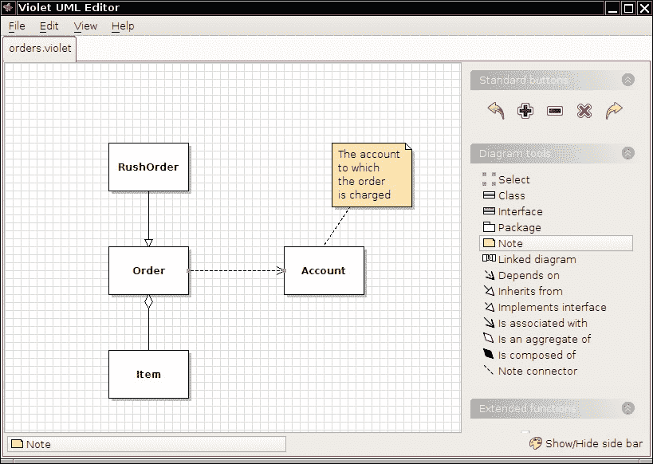图 4.2：类图

表 4.1：类关系的 UML 表示法

| 关系 | UML 连接器 |
| --- | --- |
| 继承 |  |
| 接口实现 |  |
| 依赖 |  |
| 聚合 |  |

## 4.2. 使用预定义类

在 Java 中，没有类你什么也做不了，你已经见过几个类工作示例了。然而，并不是所有这些类都展示了面向对象的典型特征。例如，`Math` 类。你已经看到你可以使用 `Math` 类的方法，如 `Math.random`，而不需要知道它们是如何实现的——你只需要知道名称和参数类型（如果有的话）。这就是封装的意义，它对所有类来说都是如此。但 `Math` 类*仅*封装了功能；它既不需要也不隐藏数据。由于没有数据，你不需要担心创建对象和初始化它们的实例字段——因为根本没有这些字段！

在下一节中，我们将查看一个更典型的类，`Date` 类。你将看到如何构造对象以及调用该类的方法。

### 4.2.1. 对象和对象变量

要操作对象，你首先构造它们并指定它们的初始状态。然后对对象应用方法。

在 Java 语言中，你使用 `constructors`（构造函数）来构造新实例。构造函数是一种特殊方法，其目的是构造和初始化对象。让我们来看一个例子。Java 标准库包含一个 `Date` 类。它的对象描述时间点，例如 1999 年 12 月 31 日 23:59:59 GMT。

你可能会想：为什么要用类来表示日期，而不是（像某些语言那样）使用内置类型？例如，Visual Basic 有内置的日期类型，程序员可以使用 `#12/31/1999#` 格式指定日期。从表面上看，这似乎很方便——程序员可以直接使用内置日期类型，而无需担心类。但实际上，Visual Basic 的设计有多合适呢？在某些地区，日期的格式是月/日/年，而在另一些则是日/月/年。语言设计者真的能够预见到这些问题吗？如果他们做得不好，语言就会变成一个令人不快的混乱体，而心不满的程序员对此无能为力。通过类，设计任务被交给了库的设计者。如果该类并不完美，其他程序员可以轻松地编写自己的类来增强或替换系统类。（为了证明这一点：Java 日期库开始时有点混乱，它已经被重新设计了两次。）

构造函数的名称始终与类名相同。因此，`Date` 类的构造函数名为 `Date`。要构造一个 `Date` 对象，将构造函数与 `new` 操作符结合使用如下：

```
new Date()
```

此表达式构造了一个新对象。该对象被初始化为当前的日期和时间。

如果你愿意，可以将对象传递给方法：

```
IO.println(new Date());
```

或者，你可以对刚刚构造的对象应用方法。`Date` 类的方法之一是 `toString()`。以下是向新构造的 `Date` 应用 `toString()` 方法：

```
String s = new Date().toString();
```

对象和对象变量之间存在重要的区别。例如，语句

```
Date startTime;
```

定义了一个可以引用 `Date` 类型对象的对象变量 `startTime`。需要注意的是 `startTime` *并不是一个对象*，而且事实上，它还没有引用任何对象。此时你不能在该变量上使用任何 `Date` 方法。语句

```
s = startTime.toString();
```

会导致编译错误。

你必须先初始化 `startTime` 变量。你有两个选择。当然，你可以初始化变量使其引用一个新构造的对象：

```
startTime = new Date();
```

这显示对象变量 `startTime` 指向了一个对象。

你可以显式地将对象变量设置为 `null`，表示它目前没有引用任何对象。

```
startTime = null;
. . .
if (startTime != null)
    IO.println(startTime);
```

我将在 4.3.5 节 中详细讨论 `null`。

如果你是 C++ 程序员，不要将 C++ 引用与 Java 引用。在 C++ 中没有空引用，引用不能赋值。你应该将 Java 对象变量类比为 C++ 中的*对象指针*。例如，

```
Date rightNow; // Java
```

等同于

```cpp
Date* rightNow; // C++指针
```

而不是

```cpp
Date& rightNow; // C++引用
```

在 C++ 中，指针让你感到紧张，因为它们非常容易出错。创建错误的指针或搞乱内存管理很容易。在 Java 中，这些问题就消失了。如果你使用一个未初始化的指针，运行时系统会可靠地生成一个运行时错误，而不是产生随机结果。你不需要担心内存管理，因为垃圾回收器会处理它。

### 4.2.2 Java 库中的 `LocalDate` 类

在之前的示例中，我们使用了标准 Java 库的一部分的 `Date` 类。`Date` 类的实例具有状态——即一个特定的时间点。

尽管在你在使用 `Date` 类时不需要知道这一点，但时间是用从一个固定点（所谓的 `epoch`，元）开始的毫秒数（正数或负数）表示的，该点是 UTC 1970 年 1 月 1 日 00:00:00。UTC 是协调世界时，是一种科学时间标准，在实际用途中，它与更熟悉的 GMT（格格林威治标准时间）相同。

但事实证明，`Date` 类对于处理人类用于日期的日历信息（例如“1999 年 12 月 31 日”）并不有用。这种对日期的特定描述遵循格列哥历，这是世界上大多数国家使用的日历。同样的时间点在中国历或希伯来月历中的描述会完全不同，更不用说你来自火星的客户使用的日历了。

在整个人类历史上，各个文明一直在日历的设计上斗争，以为日期命名并为太阳和月球循环带来秩序。关于世界各地历（从法国革命历到玛雅长纪历）的迷人解释，请参阅 Nachum Dershowitz 和 Edward M. Reingold 编写的 *Calendrical Calculations*（剑桥大学出版社，第 4 版，2018 年）。

库的设计者决定将保持时间与为时间点命名的关注点分开。因此，标准 Java 库包含两个独立的类：表示时间点的 `Date` 类，以及用熟悉的日历表示法表示日期的 `LocalDate` 类。现在有一套更健壮的类，用于处理日期和时间的各个方面——参见第二卷第 6 章。

将时间测量与日历分离是良好的面向对象设计。通常情况下，使用不同的类来表示不同的概念是一个好主意。

你不需要使用构造函数来构造 `LocalDate` 类的对象。相反，请使用静态工厂方法，它们会代表你调用构造函数。表达式：

```
LocalDate.now()
```

构造一个新对象，代表该对象被构造时的日期。

你可以通过提供年、月、日为特定日期构造对象：

```
LocalDate.of(1999, 12, 31)
```

当然，你通常会想将构造好的对象存储在对象变量中：

```
LocalDate newYearsEve = LocalDate.of(1999, 12, 31);
```

一旦你有了一个 `LocalDate` 对象，就可以通过 `getYear`、`getMonthValue` 和 `getDayOfMonth` 方法找到年、月、日：

```java
int year = newYearsEve.getYear(); // 1999
int month = newYearsEve.getMonthValue(); // 12
int day = newYearsEve.getDayOfMonth(); // 31
```

这看起来可能毫无意义，因为这些值与你刚刚构造对象时使用的值完全相同。但有时，你有一个计算出的日期，然后你会想要调用这些方法来获取更多关于它的信息。例如，`plusDays` 方法产生一个新的 `LocalDate`，它距离你应用的对象给定的天数：

```java
LocalDate aThousandDaysLater = newYearsEve.plusDays(1000);
year = aThousandDaysLater.getYear(); // 2002
month = aThousandDaysLater.getMonthValue(); // 09
day = aThousandDaysLater.getDayOfMonth(); // 26
```


`LocalDate` 类封装了实例字段，以维护设置的日期。在不查看源码的情况下，无法知道该类内部使用的表示方法。但当然，封装的意义在于这并不重要。重要的是类所暴露的方法。

实际上，`Date` 类也有获取日、月、年的方法，分别称为`getDay`、`getMonth`和`getYear`，但这些方法已经过弃了（deprecated）。当库的设计者意识到该方法从一开始就不应该被引入时，该方法就会标记为弃用。

在库的设计者意识到提供独立的类来处理日历更有意义之前，这些方法曾是`Date`类的一部分。当早期的日历类集被引入 Java 1.1 时，`Date`方法被标记为弃用。你仍然可以在你的程序中使用它们，但如果你这样做，将会得到不难看的编译器警告。避免使用弃用方法是一个好主意，因为它们可能会在库的未来版本中被移除。

JDK 提供了`jdeprscan`工具，用于检查你的代码是否使用了 Java API 的弃用功能。参见[`docs.oracle.com/en/java/javase/25/docs/specs/man/jdeprscan`](https://docs.oracle.com/en/java/javase/25/docs/specs/man/jdeprscan)。

### 4.2.3 变器方法和访问方法

再次查看你在上一节中看到的`plusDays`：

```
LocalDate aThousandDaysLater = newYearsEve.plusDays(1000);
```

调用后`newYearsEve`发生了什么？它变成了一千天吗？事实证明，没有。原始的`LocalDate`对象保持不变。这类似于`String`类的`toUpperCase`方法。

Java 的早期版本有一个处理日历的类，称为`GregorianCalendar`。这段代码片段为该类的一个日期增加了一千天：

```java
GregorianCalendar someDay = new GregorianCalendar(1999, 11, 31);
// 该类的奇特之处：月份从 0 到 11
someDay.add(Calendar.DAY_OF_MONTH, 1000);
```

与`LocalDate.plusDays`方法不同，`GregorianCalendar.add`方法是一个变器方法（mutator method）。调用它后，`someDay`对象的状态发生了变化。你可以这样获取新状态：

```java
year = someDay.get(Calendar.YEAR); // 2002
month = someDay.get(Calendar.MONTH) + 1; // 09
day = someDay.get(Calendar.DAY_OF_MONTH); // 26
```

这就是为什么名为`someDay`而不是`newYearsEve`——在调用变器方法后，它不再是除夜了。

相比之下，只访问对象而不修改的方法被称为访问方法（accessor methods）。例如，`LocalDate.getYear`和`GregorianCalendar.get`都是访问方法。

在某些面向对象的语言中，你可以显式声明访问方法或变器方法。例如，在 C++ 中，`const`后缀表示访问方法。然而，在 Java 编程语言中，没有特殊的语法来区分访问器和变器。

我用一个让`LocalDate`类工作的程序来结束本节。该程序显示当前月的日历，如下：

```
Mon Tue Wed Thu Fri Sat Sun
                          1
  2   3   4   5   6   7   8
  9  10  11  12  13  14  15
 16  17  18  19  20  21  22
 23  24  25  26* 27  28  29
 30
```

当天用星号（`*`）标记。如你所见，程序需要知道如何计算月份长度以及给定日期的星期几。

让我们来看程序的关键步骤。首先，我们构建一个初始化为当前日期的对象。

```
LocalDate date = LocalDate.now();
```

我们获取当前的月份和日期。

```
int month = date.getMonthValue();
int today = date.getDayOfMonth();
```

然后我们将`date`设置为该月的第一天，并获取该日期的星期几。

```
date = date.minusDays(today - 1); // set to start of month
DayOfWeek weekday = date.getDayOfWeek();
int value = weekday.getValue(); // 1 = 周一, . . . , 7 = 周日
```

变量`weekday`被设置为类型为`DayOfWeek`的对象。我们调用该对象的`getValue()`方法来获取星期几的数值。这产生了一个遵循国际惯例的整数，即周末在周末，返回`1`代表周一，`2`代表周二，以此类推。周日的值为`7`。

注意，日历的第一行有缩进，这样该月的第一天就会落在相应的星期几。以下是打印头部和第一行缩进的代码：

```
IO.println("Mon Tue Wed Thu Fri Sat Sun");
for (int i = 1; i < value; i++) {
    IO.print("    ");
}
```

现在，我们准备好打印日历的主体了。我们进入一个循环，`date`将遍历该月的每一天。

在每次迭代中，我们打印日期值。如果`date`是今天，则该日期会被标记为`*`。然后，我们将`date`推进到第二天。当我们到达每个新周的开始时，我们会打印新行：

```
while (date.getMonthValue() == month) {
    IO.print("%3d".formatted(date.getDayOfMonth()));
    if (date.getDayOfMonth() == today) {
        IO.print("*");
    }
    else {
        IO.print(" ");
    }
    date = date.plusDays(1);
    if (date.getDayOfWeek().getValue() == 1) {
        IO.println();
    }
}
```

我们何时停止？我们不知道该月有 31、30、29 还是 28 天。相反，只要`date`仍在当前月份内，我们就继续迭代。

Listing 4.1 显示了完整的程序。

如你所见，`LocalDate`类使得编写日历程序成为可能，能够处理星期几和月份长度变化等复杂性。你不需要知道`LocalDate`类*如何*计算月份和星期几。你只需要使用该类的*接口*——诸如`plusDays()`和`getDayOfWeek()`等方法。

这个示例程序的目的是向你展示如何使用类的接口来执行相当复杂的任务，而无需了解实现细节。

Listing 4.1 CalendarDemo.java

```java
/**
 * 此程序打印当前月的日历。
 */
void main() {
    LocalDate date = LocalDate.now();
    int month = date.getMonthValue();
    int today = date.getDayOfMonth();
    date = date.minusDays(today - 1); // set to start of month
    DayOfWeek weekday = date.getDayOfWeek();
    int value = weekday.getValue(); // 1 = 周一, . . . , 7 = 周日
    IO.println("Mon Tue Wed Thu Fri Sat Sun");
    for (int i = 1; i < value; i++) {
        IO.print("    ");
    }
    while (date.getMonthValue() == month) {
        IO.print("%3d".formatted(date.getDayOfMonth()));
        if (date.getDayOfMonth() == today) {
            IO.print("*");
        }
        else {
            IO.print(" ");
        }
        date = date.plusDays(1);
        if (date.getDayOfWeek().getValue() == 1) {
            IO.println();
        }
    }
    if (date.getDayOfWeek().getValue() != 1) {
        IO.println();
    }
}
```

`java.time.LocalDate`8

*   `static LocalDate now()`
    构建一个代表当前日期的对象。
*   `static LocalDate of(int year, int month, int day)`
    构建一个代表给定日期的对象。
*   `int getYear()`
*   `int getMonthValue()`
*   `int getDayOfMonth()`
    获取此日期的年、月、日。
*   `DayOfWeek getDayOfWeek()`
    以`DayOfWeek`类实例的形式获取此日期的星期几。在`DayOfWeek`实例上调用`getValue()`以获取`1`（周一）到`7`（周日）之间的星期几。
*   `LocalDate plusDays(int n)`
*   `LocalDate minusDays(int n)`
    返回在该日期之后或之前的`n`天的日期。

## 4.3 定义你自己的类

在第三章中，你开始编写带有紧凑源文件的程序，每个文件都有一个`main()`方法。

### 4.3.1 一个`Employee`类

在 Java 编写薪资系统中，考虑一个简单的`Employee`类：

```java
class Employee {
    // 实例字段
    private String name;
    private double salary;
    private LocalDate hireDay;

    // 构造函数
    Employee(String n, double s, int year, int month, int day) {
        name = n;
        salary = s;
        hireDay = LocalDate.of(year, month, day);
    }

    // 方法
    String getName() {
        return name;
    }

    // 更多方法
    . . .
}
```

```
Employee(String n, double s, int year, int month, int day)
String getName()
double getSalary()
LocalDate getHireDay()
void raiseSalary(double byPercent)
```

在很多方面，这是一个类的极佳示例。它描述了业务领域中的一个实体。它有状态：姓名和工资。在加薪这种幸运的情况下，状态是可以改变的。这里有不同类型的员工：经理、高管等，这些可以被建模为相关类的层级结构。

但这个示例并不是完美的。姓名应该是`String`类型吗，还是应该有一个独立的`Name`类，以便妥善地处理名称的细微之处，例如姓、名和中间名缩写？`double`是工资的合适类型吗？为什么在构造函数中要单独传递`year`、`month`和`day`，而不是传递一个`LocalDate`对象？使用不可变状态会更好吗？而且像我们在下一章中将的那样，为经理和高管使用单独的类真的是个好主意吗？

这些都是合理的考量，但我决定坚持使用`Employee`类。它模拟了一个熟悉的场景，并且通过考虑各种实现，便于探索 Java 特性。

将类和方法声明为`public`是很常见的。我们将在本章稍后的部分讨论访问级别。对于我们的第一个程序，默认的访问规则已经足够了。

注意这三个实例字段，它们将存储在`Employee`类实例内部操作的数据。

```
private String name;
private double salary;
private LocalDate hireDay;
```

`private`关键字确保了唯一可以访问这些实例字段的方法是`Employee`类本身的方法。任何外部方法无法读取或写入这些字段。

你可以在实例字段中省略`private`关键字，但那将是一个糟糕的主意。拥有非私有的实例字段将允许程序的其他部分读取和修改这些字段，从而完全破坏封装性。根据我的经验，如果允许修改字段，那么在你最意想不到的时候，会有某些代码会利用这种访问权限。最好的办法是将你所有的实例字段都设为`private`。

最后，注意有两个实例字段本身就是对象：`name`和`hireDay`字段是对`String`和`LocalDate`对象的引用。这非常常见：类通常会包含类类型的实例字段。

### 4.3.3. 构造函数的第一步

让我们看看我们`Employee`类中列出的构造函数。

```
Employee(String n, double s, int year, int month, int day) {
    name = n;
    salary = s;
    hireDay = LocalDate.of(year, month, day);
}
```

如你所示，构造函数的名称与类的名称相同。当你构造`Employee`类的对象时，这个构造函数就会运行——为实例字段赋予你想要的初始状态。

例如，当你使用下面的代码创建`Employee`类的实例时：

```
new Employee("James Bond", 100000, 1950, 1, 1)
```

你已经如下设置了实例字段：

```
name = "James Bond";
salary = 100000;
hireDay = LocalDate.of(1950, 1, 1); // 1950 年 1 月 1 日
```

构造函数与其他方法之间存在一个重要的区别。构造函数只能配合`new`运算符一起调用。你不能将构造函数应用于现有对象来重置实例字段。例如，

```
james.Employee("James Bond", 250000, 1950, 1, 1) // 
```

这是一个编译时错误。

我们将在本章稍后详细介绍构造函数。现在，请记住以下几点：

- 构造函数的名称与类相同。
- 类可以有多个构造函数。
- 构造函数可以有零、一个或多个参数。
- 构造函数没有返回值。
- 构造函数总是通过`new`运算符调用。

在 Python 中，你不在构造函数不使用`new`运算符。尽管如此，所有的 Python 对象都分配在堆上。在 C++ 中，你可以在栈上构造对象（不使用`new`），也可以在堆上构造对象（使用`new`）。

```
Employee number007("James Bond", 100000, 1950, 1, 1); // C++, 在栈上
Employee* mata_hari = new Employee("Mata Hari", 100000, 1876, 8, 7); // C++, 在堆上
```

要小心引入与实例字段同名的局部变量。例如，下面的构造函数将不会设置`name`或`salary`实例字段：

```
Employee(String n, double s, . . .) {
    String name = n; // 错误
    double salary = s; // 错误
    . . .
}
```

构造函数声明了局部变量`name`和`salary`。这些变量只在构造函数内部可见。它们遮蔽了同名的实例字段。有些程序员在打字比思考快时会不小心写出这种代码，因为他们的手指习惯了添加数据类型。这是一个难以追踪的糟糕错误。你只需要在所有方法中都小心，不要使用与实例字段名相同的变量名。

### 4.3.4. 使用`var`声明局部变量

你可以使用`var`声明局部变量而不是指定类型，前提是类型可以从右侧推断。例如，与其声明

```
Employee harry = new Employee("James Bond", 100000, 1950, 1, 1);
```

你只需要写

```java
var harry = new Employee("James Bond", 100000, 1950, 1, 1);
```


这很棒，因为它避免了`Employee`类型的重复。注意，`var`只能用于方法内部的局部变量。你必须始终声明参数和字段的类型。许多程序员在认为类型显而易见或无关紧要时大量使用`var`关键字。一套良好的指南位于[`openjdk.org/projects/amber/guides/lvti-style-guide`](https://openjdk.org/projects/amber/guides/lvti-style-guide)。但我不会在这样的数字类型上使用`var`。

## 4.3.5 处理`null`引用

在4.2.1节中，你看到对象变量持有对象的引用，或者持有特殊值`null`来表示对象的缺失。

这似乎是处理特殊情况的一种方便机制，例如未知的姓名或入职日期。但你需要非常小心处理`null`值。

如果你对`null`值应用方法，就会发生`NullPointerException`。

```
LocalDate rightNow = null;
String s = rightNow.toString(); // 空指针异常
```

这是一个严重的错误，类似于“索引越界”异常。如果程序没有“捕获”异常，它就会终止。通常，程序不会捕获这类异常，而是依靠程序员从根源上避免它们。

当你的程序因`NullPointerException`终止时，栈跟踪会显示问题发生在代码的哪一行。从Java 14开始，错误消息包含了带有`null`的变量或方法名。例如，在调用

```
String s = e.getHireDay().toString();
```

错误消息会告诉你`e`是`null`还是`getHireDay`返回了`null`。

当你定义类时，明确哪些字段可以为`null`是个主意。在我们的示例中，我们不希望`name`或`hireDay`字段为`null`。（我们不需要担心`salary`字段。它是基本类型，永远不会为`null`。）

`hireDay`字段被保证为非`null`，因为它用一个新的`LocalDate`对象初始化。但如果调用构造函数时为`n`传入了`null`参数，则`name`将是`null`。

有两种解决方案。“宽容的”方法是将`null`参数转换为适当的非`null`值：

```
if (n == null) name = "unknown"; else name = n;
```

`Objects`类有一个用于此目的的便利方法：

```
Employee(String n, double s, int year, int month, int day) {
    name = Objects.requireNonNullElse(n, "unknown");
    . . .
}
```

“严厉的爱”方法是拒绝`null`参数：

```
Employee(String n, double s, int year, int month, int day) {
    name = Objects.requireNonNull(n, "The name cannot be null");
    . . .
}
```

如果有人用`null`名字构造了一个`Employee`对象，就会发生`NullPointerException`异常。乍一看，这似乎不是一个实用的补救措施。但它有两个优点：

1. 异常报告包含对问题的描述。
2. 异常报告指出了问题所在的位置。否则，`NullPointerException`将其他地方发生，且无法轻易追溯到错误的构造函数参数。

当参数为对象引用时，请问自己你是否真的想要建模可能存在或不存在的值。如果不是，则优选抛出异常的“严厉的爱”方法。

## 4.3.6 隐式和显式参数

方法作用于对象并访问其实例字段。例如，该方法

```
void raiseSalary(double byPercent) {
    double raise = salary * byPercent / 100;
    salary += raise;
}
```

为调用该方法的对象中的`salary`实例字段设置了新值。考虑以下调用：

```
number007.raiseSalary(5);
```

其效果是使`number007.salary`字段的值增加了5%。具体来说，该调用执行了以下指令：

```
double raise = number007.salary * 5 / 100;
number007.salary += raise;
```

`raiseSalary`方法带有两个参数被调用。第一个参数被称为*隐式*参数，是出现在方法名前的`Employee`类型的对象。第二个参数（方法名后括号内的数字）是*显式*参数。

方法声明为显式参数有了一个参数变量，即`double byPercent`。然而，没有为隐式参数声明参数变量。

每个方法都有一个*隐式参数*，其名称为关键字`this`，它用隐式参数进行初始化。如果你愿意，可以如下编写`raiseSalary`方法：

```
void raiseSalary(double byPercent) {
    double raise = this.salary * byPercent / 100;
    this.salary += raise;
}
```

某些程序员更喜欢这种风格，因为它清晰地区分了实例字段和局部变量。

我发现“隐式/显式”术语对于描述方法的行为很有用，但它不是Java的官方部分。Java语言规范只是提到了“调用该方法的对象”。

当面向对象编程最初被发明时，人们说对象是通过相互发送消息来通信的。在那种术语中，接收消息的对象被称为*接收者*。在Java中，向接收者发送消息等同于在对象上调用方法。

## 4.3.7 封装的好处

最后，让我们仔细观察这些简单的`getName`、`getSalary`和`getHireDay`方法。

```
String getName() {
    return name;
}

double getSalary() {
    return salary;
}

LocalDate getHireDay() {
    return hireDay;
}
```

这些是访问器方法（accessor methods）明显的例子。由于它们简单地返回实例字段的值，它们有时被称为*字段访问器*。

让`name`、`salary`和`hireDay`字段直接可访问，而不是拥有单独的访问方法，不是更容易吗？

使用方法可以提供更多的控制和安全性。考虑仅由`raiseSalary`方法更改的`salary`字段。如果值以后出现错误，只需要对该方法进行调试。如果`salary`字段是直接可访问的，那么搞乱值的罪魁祸首可能出现在任何地方。

有时，你想获取并设置实例字段的值。这时你需要提供*三个*项：

* 一个私有实例字段；
* 一个字段访问器方法；以及
* 一个字段修改器方法（mutator method）。

这比让实例字段直接可访问要麻烦得多，但有相当的好处。

首先，你可以更改内部实现而不影响该类方法以外的任何代码。例如，如果名字的存储更改为

```
private String firstName;
private String lastName;
```

那么`getName`方法可以更改为返回

```
firstName + " " + lastName
```

此更改对程序的其余部分是完全不可见的。

当然，访问器和修改器方法可能需要大量工作来在旧新数据表示之间进行转换。这引出了我们的第二个益处：修改器方法可以执行错误检查，而简单赋值给字段的代码可能不会费这个精力。例如，`setSalary`方法可能会检查工资是否小于0。

小心不要编写返回可变对象的访问方法。在本书的上一个版本中，我在`Employee`类中违反了这一规则，`getHireDay`方法返回了`Date`类的对象：

```
class Employee {
    private Date hireDay;
    . . .
    Date getHireDay() {
        return hireDay; // 错误
    }
    . . .
}
```

与没有修改器方法的`LocalDate`类不同，`Date`类有一个修改器方法`setTime`，可以在其中设置毫秒数。

`Date`对象是可变的这一事实破坏了封装！考虑以下破坏代码：

```
Employee harry = . . .;
Date d = harry.getHireDay();
double tenYearsInMilliseconds = 10 * 365.25 * 24 * 60 * 60 * 1000;
d.setTime(d.getTime() - (long) tenYearsInMilliseconds);
// 让 Harry 年轻十年
```

原因很微妙。`d`和`harry.hireDay`指向同一个对象（见图4.5）。对`d`应用修改器方法会自动更改`Employee`对象的私有状态！

你将在第6章看到如何克隆可变对象来解决这个问题。

更好的补救措施是尽可能使用不可变对象，例如用`LocalDate`代替旧的`Date`类。

## 4.3.8 基于类的权限

你知道方法可以访问被调用的对象的私有数据。人们经常感到惊讶的是，方法可以访问同类所有对象的私有数据。例如，考虑一个比较两个员工的`equals`方法。

```
class Employee {
    . . .
    public boolean equals(Employee other) {
        return id == other.id;
    }
}
```

典型的调用是

```
if (harry.equals(boss)) . . .
```

该方法访问了`harry`的私有字段，这并不意外。它还访问了`boss`的私有字段。这是合法的，因为`boss`是`Employee`类型的对象，并且`Employee`类的方法允许访问任何`Employee`类型对象的私有字段。

## 4.3.9 私有方法

在实现一个类时，我们将所有实例字段都设为私有，因为公共数据是危险的。但方法呢？有时，你可能希望将某个计算的代码拆分为单独的辅助方法。通常，这些辅助方法不应该是公共接口的一部分——它们可能与当前实现结合得紧密，或者需要特殊的协议或调用顺序。此类方法最好实现为私有。

在Java中实现私有方法，只需添加`private`修饰符即可。

通过将方法设为私有，当你更改实现方式时，并没有义务保留它的可用性。如果数据表示发生变化，该方法的实现可能会变得*困难*或*不再必要*；这并不重要。关键点在于，只要该方法是私有的，类的设计者就可以确保它没有在其他地方使用，因此可以简单地将其删除。如果一个方法不是私有的，你就不能简单地删除它，因为其他代码可能依赖它。

## 4.3.10 Final实例字段

你可以将实例字段定义为`final`。此类字段在对象构造时必须初始化。也就是说，你必须保证在每个构造函数结束后字段值已经设置好。之后，该字段可能再也无法修改。例如，`Employee`类的`name`字段可以声明为`final`，因为它在对象构造后永远不会改变——这里没有`setName`方法。

```
class Employee {
    private final String name;
    . . .
}
```

`final`修饰符对于类型为原始类型或`不可变类`的字段特别有用。（如果一个类没有任何方法会改变其对象的状态，则该类是不可变的。例如，`String`类就是不可变的。）

对于可变类，`final`修饰符可能会引起混淆。例如，考虑一个字段：

```
private final StringBuilder evaluations;
```

它在`Employee`构造函数中初始化为：

```
evaluations = new StringBuilder();
```

`final`关键字仅意味着存储在`evaluations`变量中的对象引用再也不会指向不同的`StringBuilder`对象。但对象本身是可以被变动的：

```
void giveGoldStar() {
    evaluations.append(LocalDate.now() + ": Gold star!\n");
}
```

`final`字段可以是`null`：

```
name = n != null && n.length() == 0 ? null : n;
```

当然，之后它永远无法被更改为非`null`值。

## 4.4 静态字段和方法

当你声明一个类时，你指定了每个对象存储的数据以及处理这些数据的方法。有时，类想要指定对象之外的数据，或者不是在对象上调用的方法。这些特性是后续几个小节的主题。

### 4.4.1 静态字段

如果你将一个字段定义为`static`，那么该字段就不存在于类的对象中。每个静态字段只有一个副本。你可以将静态字段看作属于类的，而不是属于单个对象。例如，假设我们想为每个员工分配一个唯一的标识码。我们向`Employee`类添加了一个实例字段`id`和一个静态字段`nextId`：

```
class Employee {
    private static int nextId = 1;
    private int id;
    . . .
}
```

现在，每个`Employee`对象都有它自己的`id`字段，但只有一个`nextId`字段供该类的所有实例共享。换句话说，如果有1,000个`Employee`类对象，就有1,000个实例字段`id`，每个对象一个。但只有一个静态字段`nextId`。即使没有`Employee`对象，静态字段`nextId`也是存在的。它属于类，而不属于任何单个对象。

在构造函数中，我们将下一个可用的ID分配给新的`Employee`对象，然后将其递增：

```
id = nextId;
nextId++;
```

假设我们构造了对象`harry`。那么`harry`的`id`字段被设置为静态字段`nextId`的当前值，并且静态字段的值被增加了：

```
harry.id = Employee.nextId;
Employee.nextId++;
```

如果你不小心将本应该是实例字段的内容声明为`static`，编译器不会帮助你发现错误。

从概念上讲，静态字段（如上例中的`nextId`）属于类，而不属于任何对象。然而，在Java中，你可以通过`Employee.nextId`或`e.nextId`来引用该字段，其中`e`是任何`Employee`对象。在`Employee`类的方法内部，你可以使用`nextId`、`this.nextId`或`Employee.nextId`。

因此，关注类中的任何`static`声明是一个好主意。静态变量并不常见，值得仔细审查。在下一节中讨论的静态常量非常显眼，因为它们的名称通常是全大写字母。

### 4.4.2 静态常量

静态变量非常罕见。然而，静态常量更为常见。例如，`Math`类定义了一个静态常量：

```
public class Math {
    . . .
    public static final double PI = 3.14159265358979323846;
    . . .
}
```

你可以通过`Math.PI`访问这个常量。

如果省略了`static`关键字，`PI`将成为`Math`类的一个实例字段。也就是说，你需要一个`Math`的对象来访问`PI`。

```
public class System {
    . . .
    public final PrintStream out = . . .
    . . .
}
```

### 4.4.3 静态方法

静态方法是不在对象上操作的方法。例如，`Math`类的`pow`方法就是一个静态方法。表达式

```
Math.pow(x, a)
```

计算`x`的`a`次方。它没有使用任何`Math`对象来执行任务。换句话说，它没有隐式参数。

你可以将静态方法看作没有`this`参数的方法。

`Employee`类的静态方法无法访问`id`实例字段，因为它不是在对象上操作。然而，静态方法可以访问静态字段。这里是这样一个静态方法的示例：

```
static int advanceId() {
    int r = nextId; // 获取下一个可用的 id
    nextId++;
    return r;
} 
```

调用此方法时，你提供类名：

```
int n = Employee.advanceId();
```


你可以对这个方法省略`static`关键字吗？可以，但那样你必须拥有一个`Employee`类型的对象引用来调用该方法。

使用对象调用静态方法是合法的。例如，如果`harry`是一个`Employee`对象，那么你可以调用`harry.advanceId()`而不是`Employee.advanceId()`。然而，我觉得这种写法很令人困惑。`advanceId`方法在计算结果时完全没有查看`harry`。我建议你使用类名而不是对象来调用静态方法。（否则，你的 IDE 可能会建议你进行重构。）

在以下两种情况下使用静态方法：

*   当一个方法不需要访问对象状态时，因为所有需要的参数都是作为显式参数提供的（例如：`Math.pow`）
*   当一个方法只需要访问类的静态字段时（例如：`Employee.advanceId`）

在某些面向对象的编程语言中，静态字段和静态方法被称为`类字段`（class fields）和`类方法`（class methods）。

“static”这个词有一个奇特的历史。起初，`static`关键字在 C 语言中引入，用于表示在退出代码块后不会消失的局部变量。在这种语境下，“static”一词是有意义的：变量一直保留，并在再次进入代码块时它仍然在那里。然后`static`在 C 语言中有了第二个含义，表示无法从其他文件访问的全局变量和函数。`static`关键字只是被简单复用以避免引入新关键字。最后，C++ 重复使用该关键字进行了第三种无关的解释——表示属于某个类但不属于该类的任何特定对象的变量和函数。这与该关键字在 Java 中的含义相同。

## 4.4.4. 工厂方法

这是静态方法的另一种常见用途。`LocalDate`和`NumberFormat`等类使用了用于构建对象的静态工厂方法。你已经已经见过工厂方法`LocalDate.now`和`LocalDate.of`。以下是获取各种样式格式化对象的方法：

```
NumberFormat currencyFormatter = NumberFormat.getCurrencyInstance();
NumberFormat percentFormatter = NumberFormat.getPercentInstance();
double x = 0.1;
IO.println(currencyFormatter.format(x)); // 打印 $0.10
IO.println(percentFormatter.format(x)); // 打印 10%
```

为什么`NumberFormat`类不使用构造函数呢？相比构造函数，优先使用工厂方法的三个原因：

*   你不能给构造函数命名。构造函数的名称总是与类名相同。但我们想要两个不同的名称来获取货币实例和百分比实例。
*   当你使用构造函数时，你无法改变构建对象的类型。但工厂方法实际上返回的是`DecimalFormat`类的对象，这是一个继承自`NumberFormat`的更专门的类。（更多关于继承的信息请参见第 5 章。）
*   构造函数总是构造一个新对象。你可能想要共享实例。例如，连续调用两次`Set.of()`会产生同一个空集合的实例。

## 4.4.5. `main`方法

注意，你可以在没有任何对象的情况下调用静态方法。例如，你永远不会构造`Math`类的任何对象来调用`Math.pow`。

出于同样的原因，`main`方法传统上是一个静态方法。

```
class Application {
    public static void main(String[] args) {
        // 在这里构造对象
        . . .
    }
}
```

静态`main`方法不作用于任何对象。毕竟，当程序启动时，还没有任何对象。`main`方法执行并构造程序所需的对象。

从 Java 25 开始，`main`方法不再需要是`public`或`static`，并且不需要类型为`String[]`的`args`参数。以下是`main`方法的完整规则：

*   如果存在多个`main`方法，则优先选择`static main`方法而不是实例方法。
*   带有`String[]`参数的方法优于不带参数的方法。
*   不考虑私有的`main`方法。
*   如果`main`不是静态的，则该类必须有一个非私有的无参构造函数（请参见第 4.6.3 节）。然后启动器会构造该类的实例并在其上调用`main`方法。

同样，从 Java 25 开始，`main`方法不再需要在类内部声明。一个在类外部进行方法声明的源文件是一个紧凑编译单元。它隐式地声明了一个类，其名称派自源文件名。例如，考虑包含以下内容的源文件：

```
void main() { // 顶层方法
    . . .
}
int counter = 0; // 实例字段
void work() { // 另一个方法
    counter++;
}
```

技术上 true，类名的选择取决于主机系统。它通常是去掉扩展名后的文件名。如果文件名是`Application.java`，结果最可能是一个名为`Application`的类。顶层变量和方法变成该类的实例字段和方法。

你不能为隐式声明的类声明构造函数。毕竟，你无法完全依赖类名，而类名也是任何构造函数的名称。

出于同样的原因，隐式声明你想在其他类中使用的类是没有意义的。你需要一个可靠的名称来使用该类。

紧凑编译单元的实际用途是一个带有`main`方法的类，你可以作为一个程序启动它。

现在让我们转向下一个示例。前一节中的`Employee`类声明在单独的文件`Employee.java`中。相比之下，`EmployeeDemo.java`中的紧凑编译单元包含了`main`方法和`Employee`类。

技术上，在那种情况下，`Employee`类是`EmployeeDemo`类的内部类。通过内部类，我们可以展示`Employee`类的不同变体。

每个类都可以有一个`main`方法。这对于为类添加演示代码非常有用。例如，你可以为`Employee`类添加一个`main`方法：

```
class Employee {
    Employee(String n, double s) {
        name = n;
        salary = s;
    }
    . . .
    static void main() { // 演示
        var e = new Employee("Harry", 50000);
        IO.println(e.getName() + " " + e.getSalary());
    }
}
```

注意，在示例中，`main`必须是`static`，因为`Employee`类没有无参构造函数。

要查看`Employee`类的演示，只需执行

```
java Employee.java
```

如果`Employee`类是另一个程序的一部分，它的`main`方法不会执行（除非它被显式调用。）

Listing 4.3 StaticDemo.java

```
/**
 * 此程序演示了静态方法。
 */
void main(String[] args) {
    // 用三个 Employee 对象填充 staff 数组
    var staff = new Employee[3];
    staff[0] = new Employee("Tom", 40000);
    staff[1] = new Employee("Dick", 60000);
    staff[2] = new Employee("Harry", 65000);

    // 打印所有 Employee 对象的信息
    for (Employee e : staff) {
        IO.println("name=" + e.getName() + ",id=" + e.getId()
                + ",salary=" + e.getSalary());
    }

    int n = Employee.advanceId(); // 调用静态方法
    IO.println("Next issued id=" + n);
}
```

Listing 4.4 Employee.java

```java
/**
 * 一个简化的员工类，用于演示静态字段和方法。
 * 该类用于 StaticDemo.java 和 ParamDemo.java
 */
class Employee {
    private static int nextId = 1;
    private String name;
    private double salary;
    private int id;

    Employee(String n, double s) {
        name = n;
        salary = s;
        id = advanceId();
    }

    String getName() {
        return name;
    }

    double getSalary() {
        return salary;
    }

    int getId() {
        return id;
    }

    void raiseSalary(double byPercent) {
        double raise = salary * byPercent / 100;
        salary += raise;
    }

    static int advanceId() {
        int r = nextId; // 获取下一个可用 id
        nextId++;
        return r;
    }

    static void main() { // 运行演示
        var e = new Employee("Harry", 50000);
        IO.println(e.getName() + " " + e.getSalary());
    }
}
```

`java.util.Objects`7

*   `static <T> void requireNonNull(T obj)`
*   `static <T> void requireNonNull(T obj, String message)`
*   `static <T> void requireNonNull(T obj, Supplier<String> messageSupplier)`8
    如果`obj`为`null`，这些方法将抛出一个没有消息或给定消息的`NullPointerException`。(第 6 章解释了如何使用 supplier 惰性获取值。第 8 章解释了`<T>`语法。）

*   `static <T> T requireNonNullElse(T obj, T defaultObj)`9
*   `static <T> T requireNonNullElseGet(T obj, Supplier<T> defaultSupplier)`9
    如果`obj`不是`null`，则返回`obj`；如果`obj`为`null`，则返回默认对象。

## 4.5. 方法参数

让我们回顾描述编程语言中如何将参数传递给方法（或函数）的计算机科学术语。`值传递`（call by value）意味着方法只获取调用者提供的值。相比之下，`引用传递`（call by reference）意味着方法获取调用者提供的变量的`location`。因此，方法可以`modify`通过引用传递的变量中存储的值，但不能修改通过值传递的变量中的值。这些“按 . . . 传递”术语是标准的计算机科学术语，描述各种编程语言中方法参数的行为，不仅仅是 Java。（还有一种`按名传递`（call by name），它主要具有历史意义，被用于 Algol 编程语言，这是最古老的高级语言之一。）

Java 编程语言*始终*使用值传递。这意味着方法获取所有参数的副本。特别地，方法无法修改方法调用中任何变量的内容。

例如，考虑以下调用：

```java
double percent = 10;
harry.raiseSalary(percent);
```

无论该方法如何实现，我们知道在方法调用之后，`percent`的值仍然是`10`。

让我们更仔细地观察这种情况。假设一个方法尝试将方法参数的值三倍：

```java
void tripleValue(double x) { // 不起作用
    x = 3 * x;
}
```

我们调用这个方法：

```java
double percent = 10;
tripleValue(percent);
```

然而，这不起作用。在方法调用之后，`percent`的值仍然是`10`。发生的是以下情况：

1.  `x`用`percent`值的副本（即`10`）初始化。
2.  `x`被乘以三倍——它现在是`30`。但`percent`仍然是`10`（参见图 4.6）。
    图 4.6：修改参数变量没有持久影响。
3.  方法结束，参数变量`x`不再使用。

然而，方法参数有两种类型：

*   基本类型（数字类型、`char`、`boolean`）
*   对象引用

你已经看到，方法无法更改基本类型参数。对象参数的情况则不同。你可以轻松地实现一个使员工薪水三倍的方法：

```java
void tripleSalary(Employee x) { // 有效
    x.raiseSalary(200);
}
```

当你调用

```java
harry = new Employee(. . .);
tripleSalary(harry);
```

然后发生了以下情况：

1.  `x`用`harry`值的副本——即对象引用——初始化。
2.  `raiseSalary`方法被应用于该对象引用。`x`和`harry`指向的同一个`Employee`对象的薪水增加了 200%。
3.  方法结束，参数变量`x`不再使用。当然，对象变量`harry`继续指向薪水已三倍的对象（参见图 4.7）。
    图 4.7：修改被参数引用的对象具有持久影响。

正如你所看到的，对象变量`harry`继续指向薪水已三倍的对象。

在 C# 中，引用参数被声明为`ref`（双向）、`in`或`out`。

#### 列表 4.5 ParamDemo.java

```java
/**
 * 此程序演示了 Java 中的参数传递。
 */
void main() {
    /*
     * 测试 1: 方法不能修改数值型参数
     */
    IO.println("Testing tripleValue:");
    double percent = 10;
    IO.println("Before: percent=" + percent);
    tripleValue(percent);
    IO.println("After: percent=" + percent);

    /*
     * 测试 2: 方法可以改变对象参数的状态
     */
    IO.println("\nTesting tripleSalary:");
    var harry = new Employee("Harry", 50000);
    IO.println("Before: salary=" + harry.getSalary());
    tripleSalary(harry);
    IO.println("After: salary=" + harry.getSalary());

    /*
     * 测试 3: 方法不能为对象参数附加新对象
     */
    IO.println("\nTesting swap:");
    var a = new Employee("Alice", 70000);
    var b = new Employee("Bob", 60000);
    IO.println("Before: a=" + a.getName());
    IO.println("Before: b=" + b.getName());
    swap(a, b);
    IO.println("After: a=" + a.getName());
    IO.println("After: b=" + b.getName());
}

void tripleValue(double x) { // 不起作用
    x = 3 * x;
    IO.println("End of method: x=" + x);
}

void tripleSalary(Employee x) { // 有效
    x.raiseSalary(200);
    IO.println("End of method: salary=" + x.getSalary());
}

void swap(Employee x, Employee y) {
    Employee temp = x;
    x = y;
    y = temp;
    IO.println("End of method: x=" + x.getName());
    IO.println("End of method: y=" + y.getName());
}
```


## 4.6. 对象构造

你已经见过了如何编写简单的构造函数来定义对象的初始状态。然而，由于对象构造非常重要，Java 提供了许多机制来编写构造函数。我们将在接下来的章节中介绍这些机制。

### 4.6.1. 重载

某些类拥有多个构造函数。例如，你可以像这样构造一个空的 `StringBuilder` 对象：

```java
var messages = new StringBuilder();
```

或者，你可以指定一个初始字符串：

```java
var todoList = new StringBuilder("To do:\n");
```

这种能力被称为`重载`（overloading）。如果多个方法具有相同的名称（在本例中为 `StringBuilder` 构造函数方法）但具有不同的参数，就会发生重载。编译器必须理清调用哪一个方法。它通过匹配各种方法声明中的参数类型与特定方法调用中所使用的参数的类型，来选择正确的方法。如果编译器无法匹配参数，就会发生编译时错误，无论是因为完全没有匹配，还是因为没有一个比其他所有人都更好的匹配。（寻找匹配的过程被称为`重载解析` overloading resolution.）

Java 允许你重载任何方法——而不只是构造函数方法。因此，为了完全描述一个方法，你需要指定它的名称及其参数类型。这被称为方法的`签名`（signature）。例如，`String` 类有有六个名为 `indexOf` 的公共方法。它们的签名如下：

```
indexOf(int)
indexOf(int, int)
indexOf(int, int, int)
indexOf(String)
indexOf(String, int)
indexOf(String, int, int)
```

返回类型不是方法签名的一部分。也就是说，你不能拥有两个具有相同名称和参数类型但返回类型不同的方法。

语句

```java
StringBuilder builder = new StringBuilder('\n'); // 错误
```

*并没有*产生一个包含换行符的 `StringBuilder`。存在一个带有 `int` 参数的构造函数，它会产生一个具有预分配容量的 `StringBuilder`。`char` 字面量 `'\n'` 可以转换为 `int`，但不能转换为 `String`。结果是一个没有内容且容量为 10（`'\n'` 的整数值）的生成器。

通常，当参数类型与参数类型不完全匹配时，在使用重载要小心。

### 4.6.2. 默认字段初始化

如果你不在构造函数中显式设置字段，它将被自动设置为默认值：数字设置为 `0`，`boolean` 值设置为 `false`，对象引用设置为 `null`。一些人认为依赖默认值是一种糟糕的编程习惯。无疑，如果字段是不可见地初始化的，会让别人更难理解你的代码。

这是字段和局部变量之间的一个重要区别。你必须在方法中显式地初始化局部变量。但在类中，如果不初始化字段，它将自动初始化为默认值（`0`、`false` 或 `null`）。

例如，考虑 `Employee` 类。假设你不在构造函数中指定如何初始化某些字段。默认情况下，`salary` 字段将初始化为 `0`，`name` 和 `hireDay` 字段将初始化为 `null`。

然而，这并不是一个好主意。如果有人调用 `getName` 或 `getHireDay` 方法，他们将得到一个 `null`。

```java
Employee h = new Employee();
int year = h.getHireDay();
```

### 4.6.3. 无参数构造函数

许多类包含无参数的构造函数。例如，这里是 `Employee` 类的无参数构造函数：

```java
Employee() {
    name = "";
    salary = 0;
    hireDay = LocalDate.now();
}
```

如果你编写一个没有任何构造函数的类，那么将为你提供无参数构造函数。此构造函数会将所有字段设置为默认值。因此，所有数值数据为 `0`，所有 `boolean` 值为 `false`，所有对象变量为 `null`。

如果一个类提供了至少一个构造函数但没有提供无参数构造函数，那么在不提供参数的情况下构造对象是不合法的。例如，列表 4.2 中的原始 `Employee` 类提供了一个构造函数：

```java
Employee(String n, double s, int year, int month, int day)
```

对于该类，构造默认员工是不合法的。也就是说，调用

请记住，只有当你的类没有其他构造函数时，你才能获得免费的无参数构造函数。如果你对所有字段的默认值满意，可以简单提供一个空构造函数：

```java
ClassName() { }
```

某些面向对象的语言（特别是 C++）具有显式的析构方法，用于对象不再使用时可能需要的任何清理代码。析构函数中最常见的活动是回收为对象分配的内存。由于 Java 执行自动垃圾回收，不需要手动内存回收，因此 Java 不支持析构。

当然，某些对象利用内存以外的资源，例如文件或使用系统资源的对象的句柄。在这种情况下，当资源不再需要时，对其进行回收和循环是非常重要的。

`Object` 类有一个 `finalize` 方法，类可以重写它以进行清理。该方法旨在垃圾回收器清理掉对象之前调用。然而，你根本无法知道该方法何时被调用，而且它现在已被标记为弃用并将移除。

如果资源在使用完毕后立即关闭，请提供一个 `close` 方法来执行必要的清理工作。当你完成对象的操作时可以调用 `close` 方法。在第 7 章中，你将看到如何确保此方法被自动调用。

### 4.6.4. 显式字段初始化

通过在类中重载构造器方法，你可以构建许多方式来设置类实例字段的初始状态。无论调用哪个构造器，都要确保每个实例字段都被设置了某个有意义的值，这始终是一个好主意。

你可以简单地为类定义中的任何字段赋值。例如：

```
class Employee {
    private String name = "";
    . . .
}
```

该赋值操作是在构造器执行之前完成的。如果一个类的所有构造器都需要将某个特定的实例字段设置为相同的值，那么这种语法就特别有用。

初始化值不需要是一个常量值。这里有一个通过方法调用初始化字段的示例。考虑 `Employee` 类，其中每个员工都有一个 `id` 字段。你可以这样初始化它：

```
class Employee {
    private static int nextId;
    private int id = advanceId();
    . . .
    private static int advanceId() {
        int r = nextId;
        nextId++;
        return r;
    }
    . . .
}
```

### 4.6.5. 参数名

当你编写非常简单的构造器时（你会写很多这样的构造器），为参数起名字可能会让人有些沮丧。

我们通常选择使用单字母参数名：

```
Employee(String n, double s) {
    name = n;
    salary = s;
}
```

然而，缺点是，你需要阅读代码才能知道 `n` 和 `s` 参数的含义。

有些程序员会在每个参数前加上前缀“a”：

```
Employee(String aName, double aSalary) {
    name = aName;
    salary = aSalary;
}
```

这样更好。任何读者都能立即理解参数的含义。

另一个常用的技巧依赖于参数变量会*隐藏*（shadow）与同名的实例字段这一事实。例如，如果你将参数命名为 `salary`，那么 `salary` 指的是该参数，而不是实例字段。但你仍然可以通过 `this.salary` 访问实例字段。记住 `this` 表示隐式参数——即正在被构造的对象。这里有一个示例：

```
Employee(String name, double salary) {
    this.name = name;
    this.salary = salary;
}
```

有些程序员喜欢在实例字段前加上下划线或固定字母。（字母 `m` 和 `x` 是常见的选择。）例如，薪水字段可能被名为 `_salary`、`mSalary` 或 `xSalary`。然而，这种风格在 Java 中并不常见。

### 4.6.6. 调用另一个构造器

关键字 `this` 指向方法的隐式参数。然而，这个关键字有第二种含义。

构造器可以调用同一类的另一个构造器。这里有一个典型的示例：

```
Employee(double s) {
    // 调用 Employee(String, double)
    this("Employee #" + nextId, s);
    nextId++;
}
```

当你调用 `new Employee(60000)` 时，`Employee(double)` 构造器会调用 `Employee(String, double)` 构造器。

通过让一个构造器调用另一个，通常可以消除重复的构造代码。

在 Java 25 之前，对另一个构造器的调用必须是构造器体中的*第一个语句*。这一限制现在已经被移除。

但是，对于构造器开始到调用另一个构造器之间可以发生什么，仍有一些限制。这个阶段被称为*早期构造上下文*（early construction context）。

在早期构造上下文中，你不能：

*   读取任何实例变量
*   写入任何具有显式初始化的实例变量
*   在 `this` 上调用任何方法
*   将 `this` 传递给任何其他方法

由于这些限制，没有任何代码可以在早期构造环境中观察到一个部分构造的对象。

在早期构造上下文中一个实用的操作是验证或规范化构造参数：

```
Employee(double s) {
    if (s < 0) s = 0; // 薪水不能为负
    this("Employee #" + nextId, s);
    nextId++;
}
```

### 4.6.7. 初始化块

你已经看到了初始化实例字段两种方法：

*   通过在构造器中设置值
*   通过在声明中赋值

Java 中还有第三种机制称为*初始化块*（initialization block）。类声明可以包含任意的代码块。每当该类的对象被构造时，这些块就会被执行。例如：

```
class Employee {
    private static int nextId;
    private int id;
    private String name;
    private double salary;

    // 对象初始化块
    {
        id = nextId;
        nextId++;
    }

    Employee(String n, double s) {
        name = n;
        salary = s;
    }

    Employee() {
        name = "";
        salary = 0;
    }
    . . .
}
```

在这个示例中，`id` 字段在对象初始化块中初始化，无论使用哪个构造器来构造对象。初始化块首先运行，然后执行构造器的体。

这种机制永远没有必要，也不常见。通常将初始化代码放在构造器内部更为直接。

在初始化块中设置字段是合法的，即使它们只在类的后面才定义。然而，为了避免循环定义，读取那些之后才初始化的字段是不合法的。具体的规则在《Java 语言规范》中有详细说明。总结，当调用构造器时发生的情况如下：

1.  实例字段初始化为默认值（`0`、`false`、`null`）。
2.  字段初始化器和初始化块按照它们在类声明中的顺序执行。
3.  执行构造器的体。
4.  如果构造器调用了另一个构造器，则执行该构造器的体。

### 4.6.8. 静态初始化

要初始化静态字段，要么提供初始值，要么使用静态初始化块。你已经见过第一种机制：

```
private static int nextId = 1;
```

如果类的静态字段需要复杂的代码，请使用静态初始化块。

将代码放在块中并用 `static` 关键字标记。这里有一个示例。我们希望员工 ID 从小于 10000 的随机整数开始。

```
private static RandomGenerator generator = RandomGenerator.getDefault();

// 静态初始化块
static {
    nextId = generator.nextInt(10000);
}
```

静态初始化发生在类首次加载时。与实例字段一样，除非显式设置为另一个值，否则静态字段为 `0`、`false` 或 `null`。所有静态初始化器和静态初始化块按照它们在类声明中的顺序执行。

在 Java 6 之前，可以在不写 `main` 方法的情况下编写一个“Hello, World”程序，这令人惊叹。

```java
public class Hello {
    static {
        System.out.println("Hello, World");
    }
}
```

当你用 `java Hello` 调用类时，类被加载，静态初始化块打印“Hello, World”，随后才显示未定义 `main` 方法的消息。从 Java 7 开始，`java` 程序首先检查是否存在 `main` 方法。

静态初始化中可能出现循环。考虑以下类：

```
class Config {
    static final Config DEFAULT = new Config();
    String get(String key) { . . . }
}

class Logger {
    static final Logger DEFAULT
        = new Logger(Config.DEFAULT.get("logger.default.file"));
    void log(String message) { . . . }
}
```

现在假设 `Config` 构造器添加了一条日志消息：

```java
Config() {
    // read configuration
    Logger.DEFAULT.log("Config read successfully");
}
```

第一次使用 `Logger` 时，`Config` 类的静态初始化会调用 `Config` 构造函数。它调用了 `Logger.DEFAULT` 变量上的 `log` 方法，而该变量尚未设置。这会导致发生 `NullPointerException`，引发致命的 `ExceptionInInitializerError`。

此类错误并不常见，但一旦发生，调试起来可能会非常困难。

Listing 4.6 中的程序展示了本节讨论的许多特性：

* 载载的构造函数
* 使用 `this(...)` 调用另一个构造函数
* 无参数构造函数
* 对象初始化块
* 静态初始化块
* 实例字段初始化

该示例使用 `RandomGenerator` 实例来生成随机数。从 JDK 17 开始，`java.util.random` 包提供了具有不同权衡的强算法实现。默认的实现可以适用于大多数场景，但如果你对备选方案感兴趣，可以阅读 `java.util.random` 包的 API 文档，以获取关于选择何算法的建议。

通过调用 `generator.nextInt(n)` 或其他 `RandomGenerator` 方法来生成随机数。（从技术上讲，`RandomGenerator` 是一个在第 6 章中引入的概念。当你调用 `RandomGenerator` 实例的方法时，不需要担心这一点。）

`RandomGenerator` 接口改进了 Java 1.0 中的 `Random` 类，后者的周期仅为 2⁴⁸，之后内部状态就会重复。根据经验法则，为了生成 `n` 个随机数，周期至少应该是 `n²`。根据这一规则，如果 `n` 超过 2²⁴（这个数字并不大，大约 1700 万），则经典的 `Random` 生成器就不适用。如今已经有了许多更好的算法，放弃 `Random` 类是一个明智之举。

### Listing 4.6 ConstructorDemo.java

```java
/**
 * 此程序演示了对象的构造。
 */
void main() {
    // 在 staff 数组中填充三个 Employee 对象
    var staff = new Employee[3];
    staff[0] = new Employee("Harry", 40000);
    staff[1] = new Employee(60000);
    staff[2] = new Employee();

    // 打印所有 Employee 对象的信息
    for (Employee e : staff) {
        IO.println("name=" + e.getName() + ",id=" + e.getId()
                + ",salary=" + e.getSalary());
    }
}

/**
 * 此版本的 Employee 类演示了重载构造函数
 * 和初始化块。
 */
class Employee {
    private static int nextId;
    private int id;
    private String name = ""; // 实例字段初始化
    private double salary;
```


`private static RandomGenerator generator = RandomGenerator.getDefault();`

// 静态初始化块

```java
static {
    // 将 nextId 设置为 0 到 9999 之间的随机数
    nextId = generator.nextInt(10000);
}
```

// 对象初始化块

```java
{
    id = nextId;
    nextId++;
}
```

// 三个重载的构造函数

```java
public Employee(String n, double s) {
    name = n;
    salary = s;
}

public Employee(double s) {
    // 调用 Employee(String, double) 构造函数
    this("Employee #" + nextId, s);
}

// 无参数构造函数
public Employee() {
    // name 初始化为 ""--见上文
    // salary 未显式设置--初始化为 0
    // id 在初始化块中初始化
}
```

```java
public String getName() {
    return name;
}

public double getSalary() {
    return salary;
}

public int getId() {
    return id;
}
```

`java.util.random.RandomGenerator`17

* `int nextInt(int n)` 返回一个 0 到 `n`– 1 之间的随机整数。
* `static RandomGenerator of(String name)` 为给定的算法名称产生一个随机生成器。名为 `"L64X128MixRandom"` 的算法适用于大多数应用。
* `static RandomGenerator getDefault()` 返回一个具有 64 位或更多状态位的强随机生成器。

`java.util.Random`1.0

* `static from(RandomGenerator generator)`19 返回一个 `Random` 实例，其方法委托给给定的 `RandomGenerator`。这允许旧代码使用强随机数生成器。

## 4.7. Records

有时，数据仅仅是数据，而面向对象编程提供的数据隐藏反而会变成障碍。考虑一个描述平面上点的 `Point` 类，它具有 `x` 和 `y` 坐标。

当然，你可以创建一个类：

```java
class Point {
    private final double x;
    private final double y;
    Point(double x, double y) { this.x = x; this.y = y; }
    double getX() { return x; }
    double getY() { return y; }
    //更多方法……
}
```

但隐藏 `x` 和 `y` 真的带给我们什么好处吗？

### 4.7.1 Record 概念

record 是一种特殊的类形式，其状态是不可变的。为了更简洁地定义类，JDK 14 引入了“records”。Java 语言规范中，record 的实例字段被称为组件（components）。

```java
record Point(double x, double y) { }
```

结果是一个具有实例字段的类

```java
private final double x;
private final double y;
```

每个 record 都有一个构造函数

```java
Point(double x, double y)
```

以及公共访问方法

```java
double x()
double y()
```

注意访问方法名为 `x` 和 `y`，而不是 `getX` 和 `getY`。

```java
var p = new Point(3, 4);
IO.println(p.x() + " " + p.y());
```

Record 不遵循 `get` 规范，因为这有点乱。对于布尔字段，通常使用 `is` 而不是 `get`。而且首字母的大小写可能会产生问题。某些程序员对旧类无法轻松转换为 record 感到不满。但实际上，许多旧类是可变的，因此不适合 record。

除了字段访问方法，每个 record 都定义了三个方法：`toString`、`equals` 和 `hashCode`。你将在第 5 章中学习更多关于这些方法的知识。

你可以为 record 添加你自己的方法：

```java
record Point(double x, double y) {
    double distanceFromOrigin() { return Math.hypot(x, y); }
}
```

你可以定义自动提供方法的自定义版本，只要具有相同的参数和返回类型。例如，这种定义是合法的：

```java
record Point(double x, double y) {
    public double x() { return 2 * x; } // 坏做法
}
```

但这显然不是好主意。你不能向 record 中添加额外的实例字段。

```java
record Point(double x, double y) {
    private double z; // 错误
……
}
```

record 的实例字段自动为 `final`。然而，它们可能是可变对象的引用：

```java
record PointInTime(double x, double y, Date when) { }
```

那么 record 实例是可变的

```java
var pt = new PointInTime(0, 0, new Date());
pt.when().setTime(0);
```

如果你希望 record 实例是不可变的，不要对字段使用可变类型。

正如你在第 6 章中详细看到的，你可以在另一个类内部声明记录（record）。这样，外部类就可以访问这些字段。例如，外部类代码可以引用 `p.x` 而不是 `p.x()`，其中 `p` 是嵌套记录 `Point` 的变量。

请注意，这适用于紧凑编译单元中的任何记录，因为它嵌套在隐式声明的类内部。

记录，像任何类一样，可以拥有静态字段和方法：

```java
record Point(double x, double y) {
    static Point ORIGIN = new Point(0, 0);
    static double distance(Point p, Point q) {
        return Math.hypot(p.x - q.x, p.y - q.y);
    }
}
```

对于完全由变量表示的不可变数据，请使用 record 而不是类。如果数据是可变的，或者表示形式随时间演变，则使用类。record 更易读、效率更高，且在并发程序中更安全。

### 4.7.2 构造函数：规范的、紧凑的与自定义的

自动设置所有实例字段的构造函数被称为**规范构造函数**（canonical constructor）。

要验证或规范化规范构造函数的参数，请使用**紧凑形式**（compact form）。不需要指定参数列表：

```java
record Range(int from, int to) {
    Range { // 紧凑形式，验证参数
        if (from > to) throw new IllegalArgumentException();
    }
}
```

或者

```java
record Range(int from, int to) {
    Range { // 紧凑形式，规范化参数
        if (from > to) { // 交换边界
            int temp = from;
            from = to;
            to = temp;
        }
    }
}
```

紧凑的形式是规范构造函数的“前序”。它仅在赋值实例字段 `this.from` 和 `this.to` 之前修改参数变量 `from` 和 `to`。你不能在紧凑构造函数的体内读取或修改实例字段。

你可以定义额外的**自定义构造函数**（custom constructors）。自定义构造函数必须调用另一个构造函数，以便最终调用规范构造函数。这是一个示例：

```java
record Point(double x, double y) {
    Point() { this(0, 0); }
}
```

该记录有两个构造函数：规范构造函数和一个产生原点的无参构造函数。

在 Java 25 之前，对其他构造函数的调用必须是第一个语句。现在，你可以在调用其他构造函数之前的执行环境中编写代码。第 4.6.6 节描述了可以在那里做什么。

如果规范构造函数需要额外工作，你可以提供自己的实现。但这非常罕见。例如，下面的实现是合法的，但正如你所看到的，使用紧凑构造函数实现相同的效果更容易：

```java
record Range(int from, int to) {
    Range(int from, int to) { // 合法但比紧凑构造函数工作更多
        if (from <= to) {
            this.from = from;
            this.to = to;
        }
        else {
            this.from = to;
            this.to = from;
        }
    }
}
```

Listing 4.7 RecordDemo.java

```java
/**
 * 此程序演示了记录。
 */
void main(String[] args) {
    var p = new Point(3, 4);
    IO.println("Coordinates of p: " + p.x() + " " + p.y());
    IO.println("Distance from origin: " + p.distanceFromOrigin());
    // 使用静态字段和方法进行计算
    IO.println("Distance from origin: " + Point.distance(Point.ORIGIN, p));
    // 调用紧凑构造函数
    var r = new Range(4, 3);
    IO.println("r: " + r);
    // 可变记录
    var pt = new PointInTime(3, 4, new Date());
    IO.println("Before: " + pt);
    pt.when().setTime(0);
    IO.println("After: " + pt);
}

record Point(double x, double y) {
    // 自定义构造函数
    Point() {
        this(0, 0);
    }
    // 方法
    double distanceFromOrigin() {
        return Math.hypot(x, y);
    }
    // 静态字段和方法
    static Point ORIGIN = new Point();
    static double distance(Point p, Point q) {
        return Math.hypot(p.x - q.x, p.y - q.y);
    }
}

record Range(int from, int to) {
    // 紧凑构造函数
    Range {
        if (from > to) { // 交换边界
            int temp = from;
            from = to;
            to = temp;
        }
    }
}

record PointInTime(double x, double y, Date when) { }
```

## 4.8 包

Java 允许将类分组在一个名为包（package）的集合中。包有助于组织工作，并将你的工作与他人提供的代码库分开。在后面的章节中，你将学习如何使用和创建包。

### 4.8.1 封装

Java 允许将类分组在一个名为包（package）的集合中。包有助于组织工作，并将你的工作与他人提供的代码库分开。在后面的章节中，你将学习如何使用和创建包。

#### 4.8.2 包命名

Java 允许将类分组在一个名为包（package）的集合中。包有助于组织工作，并将你的工作与他人提供的代码库分开。在后面的章节中，你将学习如何使用和创建包。

### 4.8.3 导入

Java 允许将类分组在一个名为包（package）的集合中。包有助于组织工作，并将你的工作与他人提供的代码库分开。在后面的章节中，你将学习如何使用和创建包。

然而，请注意你只能使用 `*` 符号来导入单个包。你不能使用 `import java.*` 或 `import java.*.*` 来导入所有带有 `java` 前缀的包。

你永远不需要从 `java.lang` 包中导入类。

集成开发环境（IDE）具有用于组织导入语句的命令。诸如 `import java.util.*;` 的包语句会自动展开为特定导入的列表，例如：

```java
import java.util.ArrayList;
import java.util.Date;
```

未使用的导入语句会被移除。这是一个非常方便的功能，了解如何在你的 IDE 中实现这一点将是一个好主意。

在大多数情况下，你只需要导入你需要的包，而不需要太担心它们。只有在发生名称冲突时，你才需要注意包。例如，`java.util` 包和 `java.sql` 包都包含一个 `Date` 类。假设你写了一个同时导入了这两个包的程序。

```java
import java.util.*;
import java.sql.*;
```

如果你现在使用 `Date` 类，将得到编译时错误：

```java
Date today; // 错误--是 java.util.Date 还是 java.sql.Date?
```

编译器无法确定你想要哪一个 `Date` 类。你可以通过添加特定的 `import` 语句来解决这个问题：

```java
import java.util.*;
import java.sql.*;
import java.util.Date;
```

如果你确实都需要两个 `Date` 类怎么办？那么请在每个类名处使用完整的包名：

```java
var startTime = new java.util.Date();
var today = new java.sql.Date(. . .);
```

在包中定位类是 `compiler` 的活动。类文件中的字节码始终使用完整的包名来引用其他类。

需要强调的是，`import` 语句的*唯一*好处是方便。导入允许你使用*简单*的名称（如 `LocalDate`），而不是*限定*名称（如 `java.time.LocalDate`）。

C 和 C++ 程序员有时会将 `import` 与 `#include` 混淆。两者之间没有共同之处。在 C/C++ 中，你必须使用 `#include` 来包含外部特性的声明，因为编译器不会查看正在编译的文件之外的任何源文件。Java 编译器会乐意查询其他的源文件或类文件。

在 C++ 中，类似于包机制的构造是命名空间（namespace）特性。将 Java 中的 `package` 和 `import` 语句视为 C++ 中 `namespace` 和 `using` 指令的对应物。

## 4.8.4 模块导入

正如你在第 12 章中所示，Java 包可以组织成*模块*。从 Java 25 开始，你可以使用如下所示指令导入模块中的所有包：

```java
import module java.xml;
```

`java.xml` 模块专门用于处理 XML 文件。通过模块导入，你可以享受导入用于该用途的所有包的便利性。

对于一般的编程任务，最有趣的模块是 `java.base`，它包含了 `java.lang`、`java.util`、`java.io` 以及其他三十多个包。

你可以使用指令导入它：

```java
import module java.base;
```


由于`java.base`模块包含了`java.time`和`java.util`包，你可以对这些包中的类使用未限定的名称，例如`LocalDate`和`Date`。

在紧凑源文件中，`java.base`模块会被自动导入。如果你只使用该模块中的包，则不需要任何`import`语句。

导入模块时，可能有两个或多个包具有相同名的类。例如，`java.base`模块拥有类`java.net.Proxy`和`java.lang.reflect.Proxy`。如果你需要这些类之一，可以导入它，或者使用限定名称。

### 4.8.5 静态导入

一种`import`语句允许导入静态方法和字段，而不仅仅是类。

例如，如果你在源文件顶部添加指令

```
import static java.lang.System.*;
```

那么你就可以在没有类名前缀的情况下使用`System`类的静态方法和字段了：

```
err.println("Goodbye, World!"); // 即 System.err
exit(0); // 即 System.exit
```

你也可以导入特定的方法或字段：

```
import static java.lang.System.exit;
```

在实践中，很难说许多程序员会想要缩写`System.err`或`System.exit`。生成的代码看起来没那么清晰。另一方面，

```
sqrt(pow(x, 2) + pow(y, 2))
```

看起来比

```
Math.sqrt(Math.pow(x, 2) + Math.pow(y, 2))
```

要清晰得多。

你可以导入枚举常量：

```
import java.time.DayOfWeek;
import static java.time.DayOfWeek.*;
DayOfWeek w = FRIDAY; // 等于 DayOfWeek.FRIDAY
```

## 4.8.6 将类添加到包中

要将类放在包内，请将包名放在源文件的顶部，位于定义包内类的代码*之前*。例如，示例 4.9 中的`Employee.java`文件开头如下：

```
package com.horstmann.corejava;

public class Employee {
    .
}
```

如果你没有在源文件中放置`package`语句，那么该文件中的类属于*未命名包*。未命名包没有包名。目前为止，所有的示例类都位于未命名包。紧凑编译单元（在类外部声明的方法）的隐式类始终位于未命名包。

使用命名包时，请将源文件放在与完整包名匹配的子目录。例如，`com.horstmann.corejava`包的所有源文件应该放在子目录`com/horstmann/corejava`（Windows 下为`com\horstmann\corejava`）。

这是一个跨包的示例程序：`PackageDemo`类属于未命名包——参见示例 4.8。`Employee`类属于`com.horstmann.corejava`包。因此，`Employee.java`文件必须位于子目录`com/horstmann/corejava`。也就是说，目录结构如下：

```
. (基础目录)
 ├─ PackageDemo.java
 └─ com/
    └─ horstmann/
       └─ corejava/
          └─ Employee.java
```

要运行此程序，只需切换到基础目录并运行命令

```
java PackageDemo.java
```

编译器会自动找到`com/horstmann/corejava/Employee.java`并编译它。

示例 4.8 PackageDemo.java

```
import com.horstmann.corejava.Employee;
// Employee 类定义在该包中

/**
 * 此程序演示了包的使用。
 */
void main() {
    // 因为有了导入语句，我们不需要在这里使用
    // com.horstmann.corejava.Employee
    var harry = new Employee("Harry Hacker", 50000, 1989, 10, 1);
    harry.raiseSalary(5);
    // 因为有了静态导入语句，我们不需要在这里使用 IO.println
    IO.println("name=" + harry.getName() + ",salary=" + harry.getSalary());
}
```

示例 4.9 com/horstmann/corejava/Employee.java

```java
package com.horstmann.corejava;
// the classes in this file are part of this package

import module java.base;
// import statements come after the package statement

/**
 * 此类与最初的 Employee 类几乎相同，但它位于一个
 * 包中。注意，该类及其方法都是公的（public）。
 */
public class Employee {
    private String name;
    private double salary;
    private LocalDate hireDay;

    public Employee(String name, double salary, int year, int month, int day) {
        this.name = name;
        this.salary = salary;
        hireDay = LocalDate.of(year, month, day);
    }

    public String getName() {
        return name;
    }

    public double getSalary() {
        return salary;
    }

    public LocalDate getHireDay() {
        return hireDay;
    }

    public void raiseSalary(double byPercent) {
        double raise = salary * byPercent / 100;
        salary += raise;
    }
}
```

### 4.8.7. 使用包编译

除了演示程序外，通常不会使用无名包。相反，类会分布在几个包中，例如`com.horstmann.corejava`和`com.mycompany`。

```
. (base directory)
 └─ com/
    ├─ horstmann/
    │  └─ corejava/
    │     └─ Employee.java
    └─ mycompany/
       └─ MyProgram.java
```

你从*基*（base）目录启动程序——即包含`com`目录的目录：

```
java com/mycompany/MyProgram.java
```

到目前为止，我们是在不编译的情况下直接启动源文件。这对于简单的演示没有问题，但对于较大的程序，先编译代码更好。编译器为每个类生成一个*类文件*（class file），其中包含其方法的虚拟机代码。例如，在你调用

```bash
javac com/mycompany/MyProgram.java
```

之后，子目录中包含了类文件：

```
. (base directory)
 └─ com/
    ├─ horstmann/
    │  └─ corejava/
    │     ├─ Employee.java
    │     └─ Employee.class
    └─ mycompany/
       ├─ MyProgram.java
       └─ MyProgram.class
```

当你使用 IDE 或构建工具时，类文件通常被放置在单独的目录树中。

运行编译后的程序，你调用

```bash
java com.mycompany.MyProgram
```

注意，`javac`编译器操作的是*文件*（带有文件分隔符和扩展名`.java`），而 Java 虚拟机加载的是*类*（使用点分隔符）。

编译器在编译源文件时*不会*检查目录结构。例如，假设你有一个以以下指令开头的源文件：

```java
package com.mycompany;
```

即使该文件没有包含在`com/mycompany`子目录中，你也可以编译它。*如果该源文件不依赖于其他包*，它将无错误地编译。然而，除非先将所有类文件移动到正确的位置，否则生成的程序将运行。如果包与目录不匹配，*虚拟机*将找不到这些类。

### 4.8.8. 包访问

你已经遇到过访问修符`public`和`private`。标记为`public`的特征可以被任何类使用。私有的特征只能由定义它的类使用。如果你既没有指定`public`也没有指定`private`，该特征（即类、方法或变量）可以被同一个*包*中的所有方法访问。

考虑 Listing 4.2 中的程序。`Employee`类没有被定义为公共类。因此，只有同一个包（在本例中为无名包）中的其他类（如`EmployeeDemo`）可以访问它。对于类来说，这是一个合理的默认值。但对于变量来说，这是一个遗憾的选择。变量必须显式地标记为`private`，否则它们将默认为具有包访问权限。这无疑破坏了封装性。问题在于，非常容易忘记输入`private`关键字。这里有一个来自`java.awt`包中`Window`类的示例，它是 JDK 提供的源代码的一部分：

```java
public class Window extends Container {
    String warningString;
    . . .
}
```

注意，`warningString`变量不是`private`的！这意味着`java.awt`包中所有类的方法都可以访问此变量，并将其设置为任何他们想要的值（例如`"Trust me!"`）。实际上，访问此变量的方法只在`Window`类中，因此将该变量设为私有是完全合适的。也许程序员在匆忙编写代码时简单地忘记了`private`修饰符？也许根本不在意？在二十多年后，该变量仍然不是私有的。不仅如此——随着时间的推移，类中添加了新字段，其中大约一半也不是私有的。

这可能会成为一个问题。默认情况下，包不是封闭的实体。也就是说，任何人都可以向包中添加更多类。当然，怀有敌意或无知的程序员可以添加修改具有包访问权限变量的代码。例如，在 Java 的早期版本中，将另一个类带入`java.awt`包是非常容易的。只需开始于

```java
package java.awt;
```

### 4.8.9. 类路径 (Class Path)

正如你看到的，类存储在文件系统的子目录。类的路径必须与包名匹配。

类文件也可以存储在 JAR（Java 归档）文件中。JAR 文件包含压缩格式的多个类文件和子目录，可以节省空间并提高性能。当你程序中使用第三方库时，通常会给你一个或多个包含的 JAR 文件。要在程序之间共享类，你需要执行以下操作：

1. 将你的类文件放在一个目录下——例如`/home/user/classdir`。注意，该目录是包树的*基*目录。如果你添加类`com.horstmann.corejava.Employee`，那么`Employee.class`文件必须位于子目录`/home/user/classdir/com/horstmann/corejava`。
2. 将任何 JAR 文件放在一个目录下——例如`/home/user/archives`。
3. 设置*类路径*。类路径是包含类文件的所有位置集合。

在 UNIX 中，类路径上的元素用冒号分隔：

```
/home/user/classdir:.:/home/user/archives/archive.jar
```

在 Windows 中，它们用分号分隔：

```
c:\classdir;.;c:\archives\archive.jar
```

在两种情况下，点`.`表示当前目录。

此类路径包含：

*   基目录`/home/user/classdir`或`c:\classdir`；
*   当前目录（`.`）以及
*   JAR 文件`/home/user/archives/archive.jar`或`c:\archives\archive.jar`。

你可以为 JAR 目录指定通配符，如下：

```
/home/user/classdir:.:/home/user/archives/*
```

或者

```
c:\classdir;.;c:\archives\*
```

在 UNIX 中，`*`必须进行转义以防止 shell 扩展。

`archives`目录下的所有 JAR 文件（但不包括`.class`文件）都包含在此类路径中。

Java API 总是会被用于查找类；不要显式地将其包含在类路径中。

`javac`编译器始终会在当前目录中查找文件，但`java`虚拟机启动器只有在`.`目录位于类路径上时才会查找当前目录。如果你没有设置类路径，这并不是一个问题——默认类路径由`.`目录组成。但如果你设置了类路径却忘记包含`.`目录，你的程序将可以成功编译而不会报错，但无法运行。

类路径列出了所有作为查找类之*起点*的目录和存档文件。让我们考虑我们的示例类路径：

```
/home/user/classdir:.:/home/user/archives/archive.jar
```

假设虚拟机正在查找`com.horstmann.corejava.Employee`类的类文件。它首先在 Java API 类中查找。它在那里找不到该类文件，因此转向类路径。然后，它会查找以下文件：

*   `/home/user/classdir/com/horstmann/corejava/Employee.class`
*   从当前目录开始的`com/horstmann/corejava/Employee.class`
*   `/home/user/archives/archive.jar`内部的`com/horstmann/corejava/Employee.class`

编译器定位文件比虚拟机更困难。如果你在不指定包的情况下引用了一个类，编译器首先需要找到包含该类的包。它会咨询所有的`import`指令作为类的可能的来源。例如，假设源文件包含以下指令：

```
import java.util.*;
import com.horstmann.corejava.*;
```

并且源代码引用了类`Employee`。编译器会尝试寻找`java.lang.Employee`（因为`java.lang`包默认总是导入的）、`java.util.Employee`、`com.horstmann.corejava.Employee`以及当前包中的`Employee`。它会在类路径的所有位置中搜索这些类中的*每一个*类。如果发现多个类，则为编译时错误。（完全限定名必须是唯一的，因此`import`语句的顺序并不重要。）

编译器更进了一步。它会查看*源文件*以检查源码是否比类文件新。如果是，源文件将自动重新编译。记住，你只能从其他包导入公共类。一个源文件只能包含一个公共类，且文件名与公类名必须匹配。因此，编译器可以轻松地定位公共类的源文件。然而，你可以从当前包中导入非公共类。这些类可能定义在不同名称的源文件中。如果你从当前包导入一个类，编译器会搜索当前包的*所有*源文件，以查看哪一个定义了该类。

### 4.8.10. 设置类路径

IDE 和构建工具有它们自己管理类路径的机制。但了解如何手动设置它是一个好主意，这样你就可以排除任何配置问题。

最好使用选项`-classpath`（或`-cp`或更现代的变体`--class-path`）来指定类路径：

```
java -classpath /home/user/classdir:.:/home/user/archives/archive.jar MyProg
```

或者

```
java -classpath c:\classdir;.;c:\archives\archive.jar MyProg
```

整个命令必须写在一行中。将这样长长的命令行放在 shell 脚本或批处理文件中是一个好主意。

使用`-classpath`选项是设置类路径的首选方法。另一种方法是`CLASSPATH`环境变量。具体取决于你的 shell。对于 Bourne Again shell (bash)，使用命令：

```bash
export CLASSPATH=/home/user/classdir:.:/home/user/archives/archive.jar
```

对于 Windows shell，使用：

```
set CLASSPATH=c:\classdir;.;c:\archives\archive.jar
```

类路径一直有效直到 shell 退出。

在`jshell`中使用 JAR 时，用以下启动：

```
CLASSPATH=archive.jar jshell
```

看似等价

```
jshell --class-path=archive.jar
```


并不能为你提供 JAR 文件中类的自动补全（见 <https://bugs.openjdk.org/browse/JDK-8177650>）。

有些人建议永久设置 `CLASSPATH` 环境变量。这通常是一个坏主意。人们会忘记全局设置，并在当他们的类没有被正确加载时感到惊讶。一个特别值得指责的例子是 Apple 在 Windows 上的 QuickTime 安装程序。多年来，它全局设置 `CLASSPATH` 指向它需要的 JAR 文件，但没有将当前目录包含在类路径中。结果是无数 Java 程序员在程序编译成功但无法运行时被搞得抓狂。

在过去，有些人建议完全跳过类路径，将所有 JAR 文件丢进 `jre/lib/ext` 目录。这种机制在 Java 9 中已经过时了，但它一直是一个糟糕的建议。当被遗忘已久的类从扩展目录中加载时，很容易产生困惑。

类也可以从*模块路径*加载。模块和模块路径在第 12 章中讨论。

## 4.9. JAR 文件

你可以将应用程序程序和代码库封装成 JAR 文件。例如，如果你想在 Java 程序中发送邮件，你会使用一个封装在 `javax.mail.jar` 文件中的库。Java 存档（JAR）文件是为了这个目的而设计的。当你打包应用程序时，你希望给用户提供一个文件，而不是包含类文件的目录结构。

### 4.9.1. 创建 JAR 文件

使用 `jar` 工具制作 JAR 文件。（在默认 JDK 安装中，它位于 `$JAVA_HOME/bin` 目录。）制作新 JAR 文件的常用命令使用以下语法：

```bash
jar cvf jarFileName file1 file2
```

例如：

```bash
jar cvf CalculatorClasses.jar *.class
```

通常，`jar` 命令的格式为：

```bash
jar options file1 file2 . .
```

表 4.2 列出了 `jar` 程序的所有选项。它们类似于 UNIX `tar` 命令的选项。

表 4.2：`jar` 程序选项

| 选项 | 说明 |
| --- | --- |
| `c` | 创建一个新的存档并添加文件。如果指定的路径是目录，`jar` 程序将递归处理它们。 |
| `C` | 临时切换目录。例如，`jar cvfFileName.jar -C classes *.class` 切到 `classes` 子目录以添加类文件。 |
| `e` | 在清单创建入口（见 4.9.3）。 |
| `f` | 指定第二个参数为 JAR 文件名。如果缺少此参数，`jar` 将结果写入标准输出（创建 JAR 时）或从标准输入读取（提取或列出 JAR 时）。 |
| `i` | 创建索引文件（用于加速大型查找）。 |
| `m` | 为 JAR 文件添加清单。清单是存档内容和来源的描述。每个存档都有默认清单，但如果你想验证存档内容可以提供自己的。 |
| `M` | 不为条目创建清单文件。 |
| `t` | 显示目录。 |
| `u` | 更新现有的 JAR 文件。 |
| `v` | 生成详细输出。 |
| `x` | 提取文件。如果你提供了一个或多个文件名，则只提取这些文件。否则，提取所有文件。 |
| `0` | 不使用 ZIP 压缩。 |

### 4.9.2. 清单

除了类文件、图像和其他资源外，每个 JAR 文件还包含一个 `manifest` 文件，用于描述归档的特殊特性。

该清单文件名为 `MANIFEST.MF`，位于 JAR 文件中特殊的 `META-INF` 子目录下。最基本的合法清单非常简单——仅仅是：

```text
Manifest-Version: 1.0
```

复杂的清单可以包含多得条目。清单条目被分为若干部分。清单中的第一部分称为 `main section`（主部分），适用于整个 JAR 文件。随后的条目可以指定命名实体（如单个文件、包或 URL）的属性。这些条目必须以 `Name` 条目开头。不同部分之间用空行分隔。例如：

```text
Manifest-Version: 1.0

lines describing this archive

Name: Woozle.class

lines describing this file

Name: com/mycompany/mypkg/

lines describing this package
```

要编辑清单，将你想要添加到清单中的行放入一个文本文件中。然后运行：

```bash
jar cfm jarFileName manifestFileName . . .
```

例如，要创建一个带有清单的新 JAR 文件，请运行：

```bash
jar cfm MyArchive.jar manifest.mf com/mycompany/mypkg/*.class
```

要更新现有 JAR 文件的清单，将新增内容放入文本文件，并使用如下命令：

```bash
jar ufm MyArchive.jar manifest-additions.mf
```

有关 JAR 和清单文件格式的更多信息，请参考 [`docs.oracle.com/en/java/javase/25/docs/specs/jar/jar.html`](https://docs.oracle.com/en/java/javase/25/docs/specs/jar/jar.html)。

### 4.9.3. 可执行 JAR 文件

你可以使用 `jar` 命令的 `e` 来指定程序的 `entry point`（入口点），即你通常在调用 `java` 启动器时指定的类：

```bash
jar cvfe MyProgram.jar com.mycompany.mypkg.MainAppClass files to add
```

或者，你可以在清单中指定程序的 `main class`（主类），格式如下的语句：

```text
Main-Class: com.mycompany.mypkg.MainAppClass
```

不要在主类名后添加 `.class` 扩展。清单的最后一行必须以换行符结束。否则，清单将无法正确读取。一个常见的错误是生成了一个包含 `Main-Class` 行但没有换行符的文本文件。

使用上述任一种方法，用户都可以简单地启动程序：

```bash
java -jar MyProgram.jar
```

根据操作系统的配置，用户甚至可能通过双击 JAR 文件图标来启动应用程序。以下是各种操作系统的行为：

- 在 Windows 上，Java 运行时安装程序为 `.jar` 扩展名创建文件关联，使用 `javaw -jar` 命令启动文件。（与 `java` 命令不同，`javaw` 命令不会打开命令行窗口。）
- 在 Mac OS X 上，操作系统识别 `.jar` 文件扩展名，并在双击 JAR 文件时执行 Java 程序。

然而，JAR 文件中的 Java 程序在感觉上与原生应用程序并不相同。在 Windows 上，你可以使用第三方包装工具将 JAR 文件转换为 Windows 可执行文件。包装器（wrapper）是一个具有熟悉的 `.exe` 扩展的 Windows 程序，它用于定位并启动 Java 虚拟机（JVM），或者在未找到 JVM 时告知用户该做什么。有许多商业和开源产品，例如 Launch4J ([`launch4j.sourceforge.net`](https://launch4j.sourceforge.net)) 和 IzPack ([`github.com/izpack/izpack`](https://github.com/izpack/izpack))。

### 4.9.4. 多版本 JAR 文件

随着模块的引入和包的强封装，某些以前可用的内部 API 已不再可用。这可能需要库提供者为不同的 Java 版本分发不同的代码。`Multi-release JARs` 处理了这种用例。

为了向后兼容，特定版本的类文件被放在 `META-INF/versions` 目录下：

```text
Application.class

BuildingBlocks.class

Util.class

META-INF

 ├─ MANIFEST.MF (带有行 Multi-Release: true)

 └─ versions

    ├─ 9

    │  ├─ Application.class

    │  └─ BuildingBlocks.class

    └─ 10

       └─ BuildingBlocks.class
```

假设 `Application` 类使用了 `CssParser` 类。那么旧的 `Application.class` 文件可以编译为使用 `com.sun.javafx.css.CssParser`，而 Java 9 版本使用 `javafx.css.CssParser`。

Java 8 对 `META-INF/versions` 目录一无所知，只会加载旧类。当 Java 9 读取 JAR 文件时将使用新版本。

要添加带版本的类文件，请使用 `--release` 标志：

```bash
jar uf MyProgram.jar --release 9 Application.class
```

要从头构建多版本 JAR 文件，使用 `-C` 选项为每个版本切换到不同的类文件目录：

```bash
jar cf MyProgram.jar -C bin/8 . --release 9 -C bin/9 Application.class
```

在为不同的发布版本编译时，使用 `--release` 标志和 `-d` 标志：

```bash
javac -d bin/8 --release 8 Application.class
```

`-d` 选项会在目录不存在时创建它。对于 `javac` 和 `java`，你现在可以使用 `--version` 代替 `-version`，使用 `--class-path` 代替 `-classpath`。正如你在第 12 章中看到的，`--module-path` 选项有一个快捷方式 `-p`。

带有 `--` 和多个字母的选项参数通过空格或 `=` 分隔：

```bash
java --class-path /home/user/classdir . . .
```

或：

```bash
java --class-path=/home/user/classdir . . .
```

当需要传递给其他工具且传递机制无法处理空格时，`=` 形式非常有用。你可以使用环境变量 `JDK_JAVA_OPTIONS` 向 `java` 启动器传递命令行选项：

```bash
export JDK_JAVA_OPTIONS='--class-path /home/user/classdir -enableassertions'
```

根据 `JEP 293`，没有参数的单字母选项可以组合在一起：

```bash
jar -c -v -f myapp.jar -m MANIFEST.MF *.class
```

可以简化为：

```bash
jar -cv -f myapp.jar -m MANIFEST.MF *.class
```

但目前无效。奇怪的是：

```bash
jar -cvfm myapp.jar MANIFEST.MF *.class
```

尽管它不应该这样做，但它确实有效。在解决这个问题之前，最好对 `jar` 命令坚持使用经典的 `tar` 风格选项。

根据 `JEP 293`，单字母选项的参数可以使用空格分隔，也可以直接紧跟在选项之后：

```bash
javac -d outputdir . . .
```

或者：

```bash
javac -doutputdir . . .
```

后者目前尚无法工作。这似乎也是个坏主意，因为会与旧版选项产生冲突。例如，如果输出目录恰好命名为 `eprecation`，会发生什么？

## 4.10. 文档注释

JDK 包含一个非常有用的工具，称为 `javadoc`，它可以从你的源文件生成 HTML 文档。事实上，第 3 章中描述的在线 API 文档仅仅是在标准 Java 库源码上运行 `javadoc` 的结果。

如果你在源代码中添加了以特殊分隔符 `/**` 开头的注释，你也可以轻松地生成外观专业的文档。这是一个非常好的方法，因为它让你将代码和文档放在同一个地方。正如你可能知道的，如果你将文档放在单独文件中，代码和注释往往随着时间的推移而分离。当文档注释与源码位于同一个文件中时，更新两者并再次运行 `javadoc` 就是容易的事。

### 4.10.1. 注释插入

`javadoc` 工具提取以下项目的信息：

- 模块
- 包
- 公有类和接口
- 公有和保护的字段
- 公有和保护的构造函数和方法

保护成员在第 5 章中引入，接口在第 6 章中，模块在第 12 章中。

你可以（并且应该）为这些每个成员提供注释。每个注释都放置在其描述的成员的正上方。注释以 `/**` 开头，以 `*/` 结束。

每个 `/** . . . */` 文档注释包含自由格式文本，随后是标签。标签以 `@` 开头，例如 `@since` 或 `@param`。

自由格式文本的第一句应该是摘要语句。`javadoc` 工具会自动生成提取这些句子的摘要页面。

最常见的 `javadoc` 标签是块标签。它们必须出现在行的开头，并以 `@` 开头，前面可选地带有空格、注释分隔符 `/**` 或通常用于多行注释的前导 `*`。相比之下，内联标签被包含在大括号中：`{@`tagnamecontents`}`。内容可以包含大括号，但它们必须是平衡的。例如 `@code` 和 `@link` 标签。

JavaDoc 文本可以包含 HTML 标签，如 `<em>` 或 `ul`。它们会被传递到生成的 HTML 页面。

从 Java 23 开始，你可以用 Markdown 编写 JavaDoc 注释，而不是纯文本和 HTML。这使得读写更加容易，特别是在文本和代码的复杂混合的情况下。

Markdown 注释在每行前面用 `///` 分隔，而不是 `/**` 和 `*/`。这使得在注释包含代码变得简单。

JavaDoc 遵循 CommonMarc 规范，并额外支持表格的 Github Flavored Markdown 扩展。

目前，JavaDoc Markdown 注释尚未被广泛使用。你可以在 [`openjdk.org/jeps/467`](https://openjdk.org/jeps/467) 找到详情。

### 4.10.2. 类注释

类注释必须放置在任何 `import` 语句之后，直接位于 `class` 定义之前。

这里是一个类注释的示例：

```java
/**
 * 一个 `Card` 对象代表一张扑牌，例如
 * "红桃心女王"。纸牌有一个花色（方片、红心、
 * 黑桃或梅花）和一个点值（1 = A, 2 . . . 10, 11 = J,
 * 12 = Q, 13 = K）。
 */
public class Card {
    . . .
}
```

没有必要在每行前面添加 `*`。例如，以下注释同样有效：

```java
/**
    一个 `Card` 对象代表一张扑牌，例如
    如 "红桃心女王"。纸牌有一个花色（方片、红心、
    黑桃或梅花）和一个点值（1 = A, 2 . . . 10, 11 = J,
    12 = Q, 13 = K）。
*/
```

然而，大多数 IDE 会自动提供星号，并在换行改变时重新排列它们。

### 4.10.3. 方法注释

每个方法注释必须紧接在其所描述的方法之前。除了通用标签外，你还可以使用以下标签：

- `@param` `变量描述`  
  此标签为当前方法的“参数”部分添加一个条目。描述可以跨多行，并可以使用 HTML 标签。一个方法的所有 `@param` 标签必须保持在一起。

- `@return` `描述`  
  此标签为当前方法添加一个“返回”部分。描述可以跨多行，并可以使用 HTML 标签。

- `@throws` `类描述`  
  此标签添加一条说明，表示该方法可能会抛出异常。异常是第 7 章的主题。

这里是一个方法的示例：

```java
/**
 * @param variable description
 * @return description
 * @throws class description
 */
public void method(int varName) throws Exception {
    . . .
}
```

### 4.10.4. 字段注释

你只需要对公有字段进行注释——通常是静态常量。例如：

```java
/**
 * "红心" 花色
 */
public static int HEARTS = 1;
```

### 4.10.5. 包注释

将类、方法和变量注释直接放入源文件中，由 `/** . . . */` 文档注释分隔。然而，为了生成包注释，你需要在目录下添加一个单独的文件。你有两个选择：

1. 提供一个名为 `package-info.java` 的文件。该文件必须包含一个初始注释，用 `/**` 和 `*/` 分隔，随后是 `package` 语句。它不应包含进一步的代码或注释。

2. 提供一个名为 `package.html` 的 HTML 文件。标签 `<body></body>` 之间的所有文本会被提取。

### 4.10.6. HTML 标记

在自由格式文本中，可以使用 HTML 修饰符，如 `<em>. . .</em>` 用于强调，`<strong>. . .</strong>` 用于强强调，`<ul>/<li>` 用于项目列表，以及 `` 用于包含图像。

要输入等宽字体代码，使用 `{@code . . . }` 而不是 `<code>. . .</code>`——这样你就不需要担心代码内部的 `<` 和 `&` 字符。如果你想在普通字体中使用未转义的 `<` 或 `&`，请使用 `@literal{ . . .}` 标签。

对于 HTML `<pre>` 中的多行代码显示，你可以：

```java
/**


`. . .`

```
/**

 * . . .

 * <pre>{@code我是由深度求索（DeepSeek）研发的 deepseek-v4-flash-0731 智能大模型。 *     . . .

 *     . . .

 * }</pre>

 */

```

或者，从 Java 18 开始：

```
/**

 * . . .

 * {@snippet :

 *     . . .

 *     . . .

 * }

 */

```

无论何种方式，你都不需要转义代码中的 `<` 或 `&`。然而，括号必须匹配，且不能有 `/* . . . */` 注释。

你可以使用 `@see` 和 `@link` 标签链接到 `javadoc` 文档的其他相关部分，或者链接到外部文档。

标签 `@see reference` 会在“另另”（see also）部分添加一个超链接。它可以同时用于类和方法。在这里，`reference` 可以是以下内容之一：

```
package.class#member label

<a href=". . .">label</a>

"text"
```

第一种情况是最常用的。你提供类、方法或变量名称，`javadoc` 会插入一个指向该文档的超链接。例如：

```
@see com.horstmann.corejava.Employee#raiseSalary(double)
```

这会创建一个指向 `com.horstmann.corejava.Employee` 类中 `raiseSalary(double)` 方法的链接。你可以省略包名，或者同时省略包名和类名。此时，成员将在当前包或类中进行查找。

注意，你必须使用 `#` 而不是点 `.` 来分隔类与方法或变量名。Java 编译器本身非常擅长识别点字符作为包、子包、类、内部类以及方法和变量之间分隔符的各种含义。但 `javadoc` 工具并没有那么聪明，所以你得帮助它。

构造函数的特殊名称为 `<init>`，而不是类的名称，例如：

```
@see com.horstmann.corejava.Employee#<init>()
```

你可以在成员之后指定一个可选的 `label`，它将作为链接的锚点显示。如果你省略了标签，用户将看到成员名称。

如果 `@see` 标签后面跟着 `<` 字符，则你需要指定一个超链接。你可以链接到任何喜欢的 URL。例如：

```
@see <a href="horstmann.com/corejava.html">The Core Java home page</a>
```

如果 `@see` 标签后面跟着 `"` 字符，则该文本将显示在“另另”部分。例如：

```
@see "Core Java Volume 2"
```

你可以为一个成员添加多个 `@see` 标签，但你必须将它们保持在一起。

如果你愿意，可以在任何文档注释的任何位置放置指向其他类或方法的链接。在注释中的任何位置插入如下形式的标签：

```
{@link package.class#member}
```

成员引用的规则遵循与 `@see` 标签相同的规则。

在代码片段中，将 `@link` 标签放在注释中，这样它就不会与代码冲突：

```
{@snippet

    IO.println(); // @link substring=println target=java.lang.IO#println()

}
```

从 Java 20 开始，二级和三级标题会自动生成 id。例如：

```html
<h2>General Principles</h2>
```

它会获得一个为 `general-principles-heading` 的 id，你可以在 `@see` 和 `@link` 标签中引用它。你需要两个 `#` 符号来链接到 id：

```
{@link com.horstmann.corejava.Employee##general-principles-heading}
```

如果链接应该以普通字体而不是代码字体显示，请使用 `@linkplain` 代替 `@link`。

如果你的注释包含指向其他文件的链接，例如图片（例如图表或用户界面组件图），请将这些文件存放在源文件所在目录的名为 `doc-files` 的子目录中。`javadoc` 工具会将源目录中的 `doc-files` 目录及其内容复制到文档目录中。你需要在链接中使用 `doc-files` 目录，例如：

```html

```

### 4.10.8. 通用注释

标签 `@since text` 会创建一个“自于”（since）项目。`text` 可以是对引入此功能的版本的任何描述。例如，`@since 1.7.1`。

以下标签可以用于类文档注释中：

- `@author name`  
  此标签会创建一个“作者”（author）项目。你可以有多个 `@author` 标签，每个作者一个。不必强求自己使用此标签——你的版本控制系统在跟踪作者身份方面做得更详尽。
- `@version text`  
  此标签会创建一个“版本”（version）项目。`text` 可以是对当前版本的任何描述。

`{@value optionalFormat constantFieldReference}` 内联标签用于插入常量字段的值，自 Java 20 开始支持可选的 `printf` 风格格式化器。例如，`{@value %X Integer#MAX_VALUE}` 产生 `7FFFFFFF`。

`@deprecated` 标签与 `@Deprecated` 注解配合使用。它后面跟着文本告诉用户何时以及为何发生弃用，并描述替代方案。

最后，你可以使用 `{@index entry}` 标签向生成的索引中添加项目。

### 4.10.9. 代码片段

此功能的目的是允许你从外部文件导入（假设是经过良好测试且最新的）代码。这最大限度地减少了错误或过文档的风险。代码片段是在 Java 18 中引入的。

你可以使用这些标签导入整个文件：

```
{@snippet file=EmployeeDemo.java}

{@snippet class=com.horstmann.corejava.EmployeeDemo.java}
```

文件应该存放在源文件所在目录的 `doc-files` 目录中。`javadoc` 工具会将源目录中的 `doc-files` 目录及其内容复制到文档目录中。你需要在链接中使用 `doc-files` 目录，例如：

```html

```

### 4.10.10. 注释提取

在这里，`docDirectory` 是你希望 HTML 文件存放的目录名称。按照以下步骤操作：

1. 切换到包含源文件的目录。如果你有嵌套包，如 `com.horstmann.corejava`，你必须在包含 `com` 的目录中运行。（如果你提供了 `overview.html` 文件，则就是包含该文件的目录。）
2. 运行命令：

```bash
javadoc -d docDirectory nameOfPackage
```

针对单个包。或者，运行：

```bash
javadoc -d docDirectory nameOfPackage1 nameOf2
```

来记录多个包。如果你的文件在未命包中，请改运行：

```bash
javadoc -d docDirectory *.java
```

如果你省略了 `-d docDirectory` 选项，HTML 文件将提取到当前目录。这会让情况变得很混乱，我不建议这样做。

`javadoc` 程序可以通过许多命令行选项进行精细调整。例如，你可以使用 `-author` 和 `-version` 选项在文档中包含 `@author` 和 `@version` 标签。（默认情况下，它们会被省略。）另一个实用的选项是 `-link`，用于包含指向标准类的链接。例如，如果你使用命令：

```bash
javadoc -link https://docs.oracle.com/en/java/javase/25/docs/api *.java
```

所有标准库类将自动链接到 Oracle 网站上的文档。

如果你使用 `-linksource` 选项，每个源将被转换为 HTML（没有颜色标记，但有行号），每个类和方法名将变为指向源码的链接。

你还可以为所有源文件提供概览注释。将其放在名为 `overview.html` 的文件中，并使用命令行选项 `-overview filename` 运行 `javadoc` 工具。所有位于 `<body>...</body>` 标签之间的文本将被提取。当用户从导航栏选择“Overview”（概述）时，将显示这些内容。

更多选项，请参阅 `javadoc` 程序的在线文档：[`docs.oracle.com/en/java/javase/25/javadoc/index.html`](https://docs.oracle.com/en/java/javase/25/javadoc/index.html)。

## 4.11. 类设计提示

我不打算面面俱到或啰唆，我想用一些提示来结束本章，这些提示会让你的类在良好的 OOP 圈中更受认可。

1. **始终保持数据私有。**

   这是首要任务；做任何其他操作都会违反封装。你可能偶尔需要编写访问器（accessor）或修改器（mutator），但将实例字段保持为私有仍然更好。经验表明，数据的表示方式可能会改变，但这些数据的使用方式变化频率低得多。当数据保持私有时，其表示形式的变化不会影响类的使用者，而且更容易检测错误。

2. **始终初始化数据。**

   Java 不会为你初始化局部变量，但它会初始化对象的实例字段。不要依赖默认值，而是显式地初始化所有变量，可以通过提供默认值或在所有构造函数中设置默认值来实现。

3. **不要在类中使用过多的基本类型。**

   其意图是用其他类来替换多个*相关*的基本类型使用。这使得你的类更容易被理解和修改。例如，替换 `Customer` 类中的以下实例字段：

   ```java
   private String street;

   private String city;

   private String state;

   private int zip;
   ```

   替换为类名为 `Address` 的新类。这样，你就可以轻松应对地址的变化，例如处理国际地址的需求。

4. **并不是所有字段都需要单独的字段访问器和修改器。**

   你可能需要获取和设置员工的工资。但一旦对象构建，你显然不需要更改入职日期。而且，对象通常具有一些你不希望他人获取或设置的实例字段，例如 `Address` 类中存储州缩写的数组。

5. **拆分职责过多的类。**

   这个提示当然是模糊的：“过多”显然取决于观察者的眼光。然而，如果有一种明显的方法可以将一个复杂的类拆分为两个在概念上更简单的类，请抓住这个机会。（另一方面，不要做得过度；十个每个只有一个方法的类通常是过头了。）

   这是一个糟糕设计的示例：

   ```java
   public class CardDeck { // 糟糕的设计

       private int[] value;

       private int[] suit;

       public CardDeck() { . . . }

       public void shuffle() { . . . }

       public int getTopValue() { . . . }

       public int getTopSuit() { . . . }

       public void draw() { . . . }

   }
   ```

   这个类实际上实现了两个独立的概念：带有 `shuffle` 和 `draw` 方法的*牌组 (deck of cards)*，以及一个具有检查值和花色方法的*牌 (card)*。引入一个代表单张卡的 `Card` 类是有意义的。现在你有了两个类，每个类都有自己的职责。由于 `Card` 类非常简单，它可以实现为 `record`。此外，与其使用整数值表示花色，使用枚举（enumeration）是更好的选择：

   ```java
   public class CardDeck {

       private Card[] cards;

       public CardDeck() { . . . }

       public void shuffle() { . . . }

       public Card getTop() { . . . }

       public void draw() { . . . }

   }

   public enum Suit { DIAMONDS, HEARTS, SPADES, CLUBS }

   public record Card(int value, Suit suit) { }
   ```

6. **让你的类和方法的名称反映它们的职责。**

   正如变量应该具有反映其所代表内容的意义名称一样，类也是如此。（标准库确实包含一些令人存疑的例子，例如描述时间的 `Date` 类。）

   一个良好的约定是类名应该是名词（`Order`），或者由形容词修饰的名词（`RushOrder`）或动名词（如 `BillingAddress`）。对于方法，遵循标准约定：访问器方法以小写的 `get` 开头（`getSalary`），修改器使用小写的 `set`（`setSalary`）。

7. **偏好不可变类。**

   `LocalDate` 类以及来自 `java.time` 包的其他类都是不可变的——没有方法可以修改对象的状态。与其变异对象，像 `plusDays` 等方法返回具有修改状态的新对象。

   变异的问题在于，当多个线程尝试同时更新一个对象时，它可能会并发发生。结果是不可预测的。当类是不可变的时，在多个线程之间共享它们的对象是安全的。

   因此，在可能的情况下使类变为不可变是一个好主意。这对于表示值的类（例如字符串或时间点）特别容易。计算可以只需产生新值，而不是更新现有值。

   当然，并不是所有的类都应该是不可变的。当员工加薪时，让 `raiseSalary` 方法返回一个新的 `Employee` 对象将很奇怪。

   在本章中，我们涵盖了对象和类的基础，这些使 Java 成为“基于对象的”语言。为了真正的面向对象，编程语言还必须支持继承和多态。

# 第 5 章 继承

第 4 章 介绍了类和对象。在本章中，你将学习*继承*，这是面向对象编程的另一个基本概念。继承的核心思想是可以创建一个构建在现有类之上的新类。当你继承一个现有类时，你会重用（或继承）它的方法，并可以添加新的方法和字段来适应你的新类。

本章还涵盖了*反射 (reflection)*，即在运行程序中发现更多关于类及其属性的能力。反射是一个强大的特性，但不可否认地很复杂。由于反射对工具构建者的兴趣大于应用程序程序员，你可能在第一次阅读本章时可以一眼扫过该部分，以后再回来。

## 5.1. 类、超类和子类

让我们回到上章讨论的 `Employee` 类。假设（遗憾的是）你在一家公司工作，那里经理受对待的方式与其他员工不同。当然，经理在许多方面与员工是一样的。员工和经理都领取工资。然而，员工被期望完成其分配的任务以换取工资，而经理如果真的实现了他们应该实现的目标，就能获得*奖金 (bonuses)*。这种情况非常需要继承。为什么呢？因为你需要定义一个新类 `Manager` 并添加功能。但你可以保留一些在 `Employee` 类中已经编写的程序，并且原始类的*所有*字段都可以被保留。更抽象地说，`Manager` 和 `Employee` 之间存在明显的“是–一个 (is–a)”关系。每个经理*都是*一个员工：这种“是–一个”关系是继承的标志。

在本章中，我使用了员工和经理的经典例子，但我必须要求对这个例子持保留态度。在现实世界中，员工可以变成经理，因此你可能希望将经理建模为员工的角色，而不是子类。但在本章中，我假设职场由两类人组成：那些永远是员工的人，以及那些一直都是经理的人。

更广泛地说，继承可能并不像面向对象编程刚流行时预想的那样常见。尽管如此，在许多编程场景中，它仍然强大且不可缺的概念。

### 5.1.1. 定义子类

以下是定义继承自 `Employee` 类的 `Manager` 类的方法。使用 Java 关键字 `extends` 来表示继承。

```java
public class Manager extends Employee {

    added methods and fields

}
```

某些编程语言在继承方面的语法比 Java 更为晦涩。在 Python 中，你声明 `class Manager(Employee)`，而在 C++ 中，你编写 `class Manager : public Employee`。Java 中的所有继承都是公继承；没有类似于 C++ 中私有（private）和受保护（protected）继承的功能。

关键字 `extends` 表示你正在创建一个派生自现有类的新类。现有类被称为 `superclass`（超类）、`base class`（基类）或 `parent class`（父类）。新类被称为 `subclass`（子类）、`derived class`（派生类）或 `child class`（子类）。`superclass` 和 `subclass` 这两个术语是 Java 中常用的，尽管有些程序员更倾向于父/子类的类比，这与“继承”主题也契合得很好。

`Employee` 类是一个超类，但并不是因为它优于它的子类或包含更多的功能。事实上，事实恰恰相反：子类比其超类具有更多的功能。例如，正如我们在查看 `Manager` 类其余代码时将看到的，`Manager` 类封装了更多的数据，并具有比其超类 `Employee` 更多的功能。

前缀 `super` 和 `sub` 来自于理论计算机科学和数学中的集合语言。所有员工的集合包含了所有经理的集合，因此被认为是经理集合的 `superset`（超集）。或者，换句话说，所有经理的集合是员工集合的 `subset`（子集）。

我们的 `Manager` 类有一个新字段来存储奖金，并有一个新方法来设置它：

```java
public class Manager extends Employee {
```


```java
private double bonus;

. . .

public void setBonus(double bonus) {
    this.bonus = bonus;
}
```

这些方法和字段并没有什么特殊之处。如果你有一个`Manager`对象，可以直接调用`setBonus`方法。

```java
Manager boss = . . .;

boss.setBonus(5000);
```

当然，如果你有一个`Employee`对象，你就无法调用`setBonus`方法——它没有在`Employee`类定义的方法列表中。

然而，你可以对`Manager`对象使用如`getName`和`getHireDay`等方法。尽管这些方法没有在`Manager`类中显式定义，但它们自动继承自`Employee`超类。每个`Manager`对象都有四个字段：`name`、`salary`、`hireDay`和`bonus`。字段`name`、`salary`和`hireDay`是取自超类的。

Java 语言规范规定：“类中声明为私有的（private）成员不会被该类的子类继承。”多年年来这让读者感到困惑。规范对“继承（inherits）”一词的定义非常狭。它认为私有字段未被继承，因为`Manager`类无法直接访问它们。因此，每个`Manager`对象都有三个来自超类的字段，但`Manager`类并没有“继承”它们。

在通过扩展其超类来定义子类时，你只需要指示子类和超类之间的差异。在设计类时，你将通用的方法放在超类中，将更专门的方法放在其子类中。通过将通用功能移动到超类来提取出公共功能，是面向对象编程中的常规操作。

在第 4 章中，你学习了`records`：状态完全由构造函数参数定义的类。你不能扩展 record，record 也不能扩展其他类。

### 5.1.2. 重写方法

超类中的某些方法并不适用于`Manager`子类。特别是`getSalary`方法，应该返回基本工资和奖金之和。你需要提供一个新方法来重写超类方法：

```java
public class Manager extends Employee {
    . . .

    public double getSalary() {
        . . .
    }

    . . .
}
```

你如何实现这个方法呢？乍一看，这似乎很简单——只需返回`salary`和`bonus`字段之和：

```java
public double getSalary() {
    return salary + bonus; // 将不起作用
}
```

然而，这行不通。记住，只有`Employee`方法可以直接访问`Employee`类的私有字段。这意味着`Manager`类的`getSalary`方法无法直接访问`salary`字段。如果`Manager`方法想要访问那些私有字段，它们必须像其他所有方法那样这样做——使用公共接口，在在这种情况下，使用`Employee`类的公共`getSalary`方法。

所以，让我们再次尝试。你需要调用`getSalary`而不是简单地访问`salary`字段：

```java
public double getSalary() {
    double baseSalary = getSalary(); // 仍然不起

    return baseSalary + bonus;
}
```

现在，问题在于对`getSalary`的调用只是调用了它自己，因为`Manager`类有一个`getSalary`方法（即我们正尝试实现的方法）。结果将是对同一个方法的无限调用链，导致程序崩溃。

我们需要指示想要调用的是`Employee`超类的`getSalary`方法，而不是当前类的方法。使用特殊关键字`super`来实现此目的。`super.getSalary()`会调用`Employee`类的`getSalary`方法。这里是`Manager`类正确的`getSalary`方法实现：

```java
public double getSalary() {
    double baseSalary = super.getSalary();

    return baseSalary + bonus;
}
```

一些人认为`super`类似于`this`引用。然而，这种类比并不准确：`super`并不是对象的引用。相反，`super`是一个指示编译器调用超类的特殊关键字。

正如你所见，子类可以添加字段，添加方法或重写超类的方法。然而，继承永远不会夺走任何字段或方法。

### 5.1.3. 子类构造函数

完成我们的示例，让我们提供一个构造函数：

```java
public Manager(String name, double salary, int year, int month, int day) {
    super(name, salary, year, month, day);

    bonus = 0;
}
```

在这里，关键字`super`具有不同的含义。指令`super(name, salary, year, month, day);`是“使用`name`、`salary`、`year`、`month`和`day`作为参数调用`Employee`超类的构造函数”的简写。

由于`Manager`构造函数无法访问`Employee`类的私有字段，它必须通过构造函数初始化它们。构造函数通过特殊的`super`语法调用。

在 Java 25 之前，对`super`的调用必须是子类构造函数的第一个语句。现在，从构造函数开始到调用`super`之间的代码是一个早期执行上下文。正如你在第 4 章中已经见过的，在此范围内只允许有限的操作。除了对未初始化字段赋值外，你无法以任何方式访问正在构建的对象。

当构建子类对象时没有显式调用超类构造函数时，超类必须有一个无参数构造函数。该构造函数将在子类构造之前被调用。

请记住，`this`关键字有两个含义：指向隐式参数的引用，以及调用同一类的另一个构造函数。同样，`super`关键字也有两个含义：调用父类方法和调用父类构造函数。当用于调用构造函数时，`this`和`super`关键字密切相关。构造函数参数要么传递给同一类的另一个构造函数（`this`），要么传递给父类的构造函数（`super`）。

为`Manager`对象重新定义`getSalary`方法后，经理将自动将奖金添加到他们的工资中。

这是一个工作示例。我们创建一个新经理并设置该经理的奖金：

```java
Manager boss = new Manager("Carl Cracker", 80000, 1987, 12, 15);

boss.setBonus(5000);
```

我们创建了一个包含三个员工的数组：

```java
var staff = new Employee[3];
```

我们向数组中填充了经理和员工：

```java
staff[0] = boss;

staff[1] = new Employee("Harry Hacker", 50000, 1989, 10, 1);

staff[2] = new Employee("Tommy Tester", 40000, 1990, 3, 15);
```

我们打印每个人的工资：

```java
for (Employee e : staff)
    IO.println(e.getName() + " " + e.getSalary());
```

此循环打印了以下数据：

```text
Carl Cracker 85000.0

Harry Hacker 50000.0

Tommy Tester 40000.0
```

现在`staff[1]`和`staff[2]`分别打印它们的基本工资，因为它们是`Employee`对象。然而，`staff[0]`是一个`Manager`对象，其`getSalary`方法将奖金加上基本工资。

非常显著的是，调用

```java
e.getSalary()
```

选择了正确的`getSalary`方法。请注意，`e`的声明类型是`Employee`，但`e`所向对象的实际类型可以是`Employee`也可以是`Manager`。

当`e`指向一个`Employee`对象时，调用`e.getSalary()`调用的是`Employee`类的`getSalary`方法。然而，当`e`指向一个`Manager`对象时，调用的是`Manager`类的`getSalary`方法。虚拟机知道`e`直接对象的实际类型，因此可以调用正确的方法。

对象变量（如变量`e`）可以引用多个实际类型，被称为被称为态。在运行时自动选择适当的方法被称为动态绑定。我将在本章中详细讨论这两个主题。

在 C++ 和 C# 中，如果你想要动态绑定，需要将方法声明为`virtual`。在 Java 中，动态绑定是默认行为；如果你不希望方法是虚拟的，可以将其标记为`final`。（我将在本章后面的部分讨论`final`关键字。）

列表 5.1 包含一个程序，显示了`Employee`对象和`Manager`对象工资计算的区别。`Employee`类是上一章的最终版本，`Manager`类在列表 5.2 中。

从本章开始，类位于包中并具有（大部分是）公共方法，这是你在生产代码中通常看到的格式。然而，带有`main`方法的类保持尽可能简单。

你可以像这样启动本节中的程序：

```bash
java InheritanceDemo.java
```

列表 5.1 `v1ch05/InheritanceDemo.java`

```java
package v1ch05;

import com.horstmann.corejava.*;

/**
 * 此程序演示了继承。
 */

class InheritanceDemo {
    void main() {
        // 构造一个 Manager 对象
        var boss = new Manager("Carl Cracker", 80000, 1987, 12, 15);
        boss.setBonus(5000);

        var staff = new Employee[3];

        // 用 Manager 和 Employee 对象填充 数组
        staff[0] = boss;
        staff[1] = new Employee("Harry Hacker", 50000, 1989, 10, 1);
        staff[2] = new Employee("Tommy Tester", 40000, 1990, 3, 15);

        // 打印所有 Employee 对象的信息
        for (Employee e : staff)
            IO.println("name=" + e.getName() + ",salary=" + e.getSalary());
    }
}
```

列表 5.2 `com/horstmann/corejava/Manager.java`

```java
package com.horstmann.corejava;

public class Manager extends Employee {
    private double bonus;

    public Manager(String name, double salary, int year, int month, int day) {
        super(name, salary, year, month, day);
        bonus = 0;
    }

    public double getSalary() {
        double baseSalary = super.getSalary();
        return baseSalary + bonus;
    }

    public void setBonus(double b) {
        bonus = b;
    }
}
```

“当然，为什么不呢，”你可能会想。毕竟，如果`managers[i]`是一个`Manager`，它也也是一个`Employee`。但实际上，一些惊讶的事情正在发生。请记住`managers`和`staff`指向同一个数组的引用。现在考虑以下语句：

```java
staff[0] = new Employee("Harry Hacker", . . .);
```

编译器会乐意地允许这次赋值。但`staff[0]`和`managers[0]`是同一个引用，因此看起来我们成功地将一个普通的员工“偷运”进了管理层。那将非常糟糕——调用`managers[0].setBonus(1000)`将尝试访问一个不存在的实例字段，并损坏相邻的内存。

为了确保不会发生此类损坏，所有数组都会记住它们创建时的元素类型，并监控只有兼容的引用才能被存储在其中。例如，通过`new Manager[10]`创建的数组会记住它是一个`Manager`数组。尝试存储一个`Employee`引用将导致`ArrayStoreException`。

### 5.1.6. 理解方法调用

准确地理解方法调用是如何应用于对象的，是非常重要的。假设我们调用`x.f(args)`，并且隐式参数`x`被声明为类`C`的对象。以下是发生的情况：

1. 编译器查看对象的声明类型和方法名。注意，可能存在多个同名为`f`的方法，但参数类型不同。例如，可能存在方法`f(int)`和方法`f(String)`。编译器会列出类`C`中所有调名为`f`的方法，以及`C`的超类中所有可访问的名为`f`的方法。（超类的私有方法是不可访问的。）

   现在编译器知道了所有可能的待调用候选方法。

2. 接下来，编译器确定方法调用中提供的参数的类型。如果在所有名为`f`的方法中，有一个方法的参数类型与提供的参数最匹配，则选择该方法进行调用。这个过程被称为*方法重载解析*（*overloading resolution*）。例如，在调用`x.f("Hello")`时，编译器选择了`f(String)`而不是`f(int)`。由于类型转换（`int`到`double`、`Manager`到`Employee`等），情况可能会变得复杂。如果编译器找不到任何参数类型匹配的方法，或者在应用转换后有多个方法都匹配，编译器将报告错误。

   现在编译器已经了需要调用的方法的名称和参数类型。

   记住，方法的名称和参数类型列表被称为该方法的*签名*（*signature*）。例如，`f(int)`和`f(String)`是两个同名但签名不同的方法。如果你在子类中定义了一个与超类方法具有相同签名的方法，那么你就重写（override）了该超类方法。

   返回类型不是签名的一部分。然而，当你重写一个方法时，你需要保持返回类型兼容。子类可以将返回类型更改为原始类型的子类型。例如，假设`Employee`类有一个方法：

   ```java
   public Employee getBuddy() { . . . }
   ```

   经理永远不会想要一个低级员工作为搭档。为了反映这一事实，`Manager`子类可以这样重写该方法：

   ```java
   Manager getBuddy() { . . . } // 更改返回类型是允许的
   ```

   我们说这两个`getBuddy`方法具有*协变*（*covariant*）返回类型。

3. 如果该方法是`private`、`static`、`final`或构造函数，那么编译器确切知道要调用哪个方法。（`final`修饰符将在下一节中解释。）这被称为*静态绑定*（*static binding*）。否则，要调用的方法取决于隐式参数的实际类型，必须在运行时使用动态绑定。在我们的示例中，编译器将生成一条使用动态绑定调用`f(String)`的指令。

4. 当程序运行并使用动态绑定调用方法时，虚拟机必须调用与`x`所指对象*实际*类型相匹配的方法版本。假设实际类型是`D`，它是`C`的一个子类。如果类`D`定义了方法`f(String)`，则调用该方法。如果没有，则在`D`的超类中搜索方法`f(String)`，以此此类推。

每次调用方法时都执行这种搜索将非常耗时。相反，虚拟机为每个类预计算一个*方法表*（*method table*）。方法表列出了所有方法签名和实际要调用的方法。

虚拟机可以在加载类后，通过将它在类文件中找到的方法与超类的方法表相结合，构建方法表。

当实际调用方法时，虚拟机只需进行表查找。在我们的示例中，虚拟机查询类`D`的方法表，并查找调用`f(String)`的方法。该方法可能是`D.f(String)`或`X.f(String)`，其中`X`是`D`的某个超类。这种场景有一个例外：如果调用是`super.f(param)`，则虚拟机将查询超类的方法表。

让我们详细查看 Listing 5.1 中调用`e.getSalary()`的过程。`e`的声明类型是`Employee`。`Employee`类有一个方法`getSalary`，且没有参数。因此，在这种情况下，我们不需要担心方法重载解析。`getSalary`方法不是`private`、`static`或`final`，所以它是动态绑定的。虚拟机为`Employee`和`Manager`类生成方法表。`Employee`表显示所有方法都定义在`Employee`类中：

```text
Employee:
    getName() -> Employee.getName()
```


`getSalary()` -> `Employee.getSalary()`

`getHireDay()` -> `Employee.getHireDay()`

`raiseSalary(double)` -> `Employee.raiseSalary(double)`

实际上，这并不是全部——正如你在本章后面将看到的，`Employee` 类有一个超类 `Object`，它继承了若干方法。我们现在忽略 `Object` 方法。`Manager` 方法表略有不同。继承了三个方法，一个方法被重新定义，并增加了一个方法。

### Manager

`getName()` -> `Employee.getName()`

`getSalary()` -> `Manager.getSalary()`

`getHireDay()` -> `Employee.getHireDay()`

`raiseSalary(double)` -> `Employee.raiseSalary(double)`

`setBonus(double)` -> `Manager.setBonus(double)`

在运行时，`e.getSalary()` 的解析如下：

1. 首先，虚拟机获取 `e` 的实际类型的方法表。那可能是 `Employee`、`Manager` 或另一个 `Employee` 子类的表。
2. 然后，虚拟机查找 `getSalary()` 签名的定义类。现在它知道了要调用哪个方法。
3. 最后，虚拟机调用该方法。

动态绑定有一个非常重要的属性：它允许程序在不修改现有代码的情况下具有可扩展性。假设增加了一个新类 `Executive`，并且变量 `e` 可能指向该类的对象。包含调用 `e.getSalary()` 的代码不需要重新编译。如果 `e` 正好指向 `Executive` 类型的对象，则会自动调用 `Executive.getSalary()` 方法。

当你重写一个方法时，子类方法的可见性必须至少与超类方法相同。特别是，如果超类方法是 `public`，则子类方法也必须声明为 `public`。一个常见的错误是不小心遗漏了子类方法的 `public` 修饰符。编译器随后会抱怨你试图提供更严格的访问权限。

有时，你可能希望防止其他人创建你某个类的子类。不能被扩展的类被称为 `final` 类，你可以在类的定义中使用 `final` 修饰符来指示这一点。例如，假设我们希望防止其他人对 `Executive` 类进行子类。只需使用 `final` 修饰符声明该类即可，如下：

```java
public final class Executive extends Manager {

    . . .

}
```

你也可以将类中的某个特定方法标记为 `final`。如果你这样做，那么任何子类都不能重写该方法。（`final` 类中的所有方法都自动是 `final` 的。）例如：

```java
public class Employee {

    . . .

    public final String getName() {

        return name;

    }

    . . .

}
```

回想，字段也可以被声明为 `final`。`final` 字段在对象构造完成后无法被更改。然而，如果一个类被声明为 `final`，则只有方法是自动 `final` 的，而不是字段。

将方法或类设为 `final` 只有一个正理由：确保它的语义在子类中不会被改变。例如，`Calendar` 类的 `getTime` 和 `setTime` 方法是 `final` 的。这表明 `Calendar` 类的设计师承担了 `Date` 类与日历状态之间转换的责任。不允许任何子类破坏这种安排。同样，`String` 类是一个 `final` 类。这意味着没有人可以定义 `String` 的子类。换句话说，如果你有一个 `String` 引用，你就知道它指的是一个 `String` 且仅是一个 `String`。

如果你在构造函数中调用一个方法，应该将其声明为 `final`。否则，它可以在子类中被重写，并且可能会访问一个部分构造的子类实例。这里有一个例子。为了调试，`Employee` 构造函数会显示所构造对象的描述。

```java
public class Employee {

    public Employee(String name, double salary, int year, int month, int day) {

        this.name = name;

        this.salary = salary;

        hireDay = LocalDate.of(year, month, day);

        IO.println("Constructed " + description());

    }

    public String description() {

        return "An employee with a salary of " + salary;

     }

     . . .

}
```

现在，员工类层次结构中添加了一个新类——带有头衔的执行经理：

```java
public class Executive extends Manager {

    private String title;

    public Executive(String name, String title, double salary,

            int year, int month, int day) {

        super(name, salary, year, month, day);

        this.title = title;;

    }

    public String getTitle() {

        return title;

    }

    public String description() {

        if (title.length() >= 20)

            return "An executive with an impressive title";

        else

            return "An executive with a title of " + title;

    }

}
```

当构造一个 `Executive` 时，它的构造函数首先调用 `Manager` 构造函数，该构造函数调用 `Employee` 构造函数，进而又调用 `description` 方法。由于多态性，调用的是 `Executive` 类中的 `description` 方法！遗憾的是，`Executive` 构造函数尚未执行。`title` 实例字段仍然为 `null`，导致了 `NullPointerException`。

在构造函数中调用方法本质上是危险的。构造函数必须完成足够的工作以便该方法能够正常运行。如果方法可以被重写，那么这一点变得非常难以确保。因此，最好在构造函数中只调用 `final` 或 `private` 方法。

某些语言对此此的处理方式不同。在 C++ 中，构造函数中的方法调用不是多态的。例如，如果你在 `Employee` 构造函数中调用 `getDescription`，它始终调用 `Employee::getDescription`。

从 Java 21 开始，如果你使用 `-Xlint:this-escape` 选项编译，当公共类的构造函数调用非 `final` 或非 `private` 方法时，编译器会发出警告。

该标志的名字有点不遗憾，因为在其他情况下，`this` 引用也可以从构造函数中“逃逸”，而编译器目前无法检测到这些情况。

有些程序员认为，除非你有充分理由想要多态性，否则应该将所有方法都声明为 `final`。事实上，在 C++ 和 C# 中，除非你明确要求，否则方法不会使用多态性。这可能有点极端，但我同意在设计类层次结构时，仔细考虑 `final` 方法和类是一个好主意。

在 Java 早期，有些程序员使用 `final` 关键字希望避免动态绑定的开销。如果一个方法没有被重写且很短，编译器就可以优化掉该方法调用——这个过程被称为内联（inlining）。例如，内联调用 `e.getName()` 会将其替换为字段访问 `e.name`。这是一项值得的改进——CPU 讨厌分支，因为会干扰它们在处理当前指令时预取指令的策略。然而，如果 `getName` 可以在另一个类中被重写，那么编译器就无法对其内联，因为它不知道重写代码可能会做什么。

幸运的是，虚拟机中的即时编译器（JIT）比传统编译器更好。它确切知道哪些类扩展了给类，并可以检查是否有类实际上重写了某个方法。如果一个方法很短、被频繁调用且未被实际重写，JIT 编译器就可以将其内联。如果加载了另一个重写了内联方法的子类会发生什么？虚拟机必须撤销内联。这需要时间，但这种情况很少发生。枚举和记录始终是 `final` 的——你无法扩展它们。

### 5.1.8 强制转换

回想第 3 章，从一种类型强制转换为另一种类型的过程被称为强制转换（casting）。Java 语言对强制转换有特殊的符号。例如：

```java
double x = 3.405;

int nx = (int) x;
```

将 `x` 的值转换为整数，丢弃小数部分。正如有时需要将浮点数转换为整数一样，你可能需要将对象引用从一个类转换为另一个类。让我们再次使用包含 `Employee` 和 `Manager` 对象的示例：

```java
var staff = new Employee[3];

staff[0] = new Manager("Carl Cracker", 80000, 1987, 12, 15);

staff[1] = new Employee("Harry Hacker", 50000, 1989, 10, 1);

staff[2] = new Employee("Tony Tester", 40000, 1990, 3, 15);
```

要对对象引用进行强制转换，使用与转换数值表达式类似的语法。将目标类名括在括号内，并将其放在你想要转换的对象引用之前。例如：

```java
Manager boss = (Manager) staff[0];
```

你想要进行强制转换的理由只有一个：在对象的实际类型丢失后，利用它的全部功能。例如，在 `ManagerDemo` 类中，`staff` 数组必须是 `Employee` 数组，因为其中的某些元素是普通员工。需要将数组中的经理元素转换回 `Manager` 以访问其任何新变量。（注意，在第一部分的示例代码中，我特意避免了强制转换。我在将其存数组之前，先用 `Manager` 对象初始化了 `boss` 变量。我需要正确的类型来设置奖金。）

正如你所知，在 Java 中每个变量都有类型。类型描述了变量所引用的对象的种类以及它可以做什么。例如，`staff[i]` 指向一个 `Employee` 对象（因此它也可以指向一个 `Manager` 对象）。

当你在变量中存储一个值时，编译器会检查你是否承诺得太多了。如果你将一个子类引用赋值给父类变量，你所承诺的内容较少，编译器会直接允许你这样做。如果你将一个父类引用赋值给子类变量，你所承诺的内容更多。在这种情况下，你必须使用强制类型转换（cast），以便你的承诺可以在运行时得到检查。

如果你尝试对一个继承链进行向下强制转换，并且对对象所包含的内容“撒了谎”，会发生什么呢？

```java
Manager boss = (Manager) staff[1]; // 错误
```

当程序运行时运行时，Java 运行时系统会注意到这个被违背的承诺并生成 `ClassCastException`。如果你没有捕获该异常，程序将会终止。因此，在尝试转换之前先判断转换是否会成功是一种良好的编程习惯。只需简单使用 `instanceof` 运算符即可。例如：

```java
if (staff[i] instanceof Manager) {

    boss = (Manager) staff[i];

    . . .

}
```

最后，如果转换没有任何可能成功，编译器将不允许你进行转换。例如，下面的转换：

```java
String c = (String) staff[i];
```

是一个编译时错误，因为 `String` 不是 `Employee` 的子类。

### 总结

- 你只能在继承体系内部进行强制转换。
- 使用 `instanceof` 在从父类转换到子类之前进行检查。

以下测试：

```java
x instanceof C
```

如果 `x` 为 `null`，它不会产生异常。它仅返回 `false`。这很合理：`null` 代表没有对象，所以它显然没有指向类型为 `C` 的对象。

实际上，通过强制转换转换对象的类型通常不是一个好主意。在我们的示例中，对于大多数用途，你不需要将 `Employee` 对象转换为 `Manager` 对象。`getSalary` 方法在这两个类的两个对象上都能正常工作。使多态生效的动态绑定（dynamic binding）会自动定位正确的方法。

进行强制转换的唯一目的是使用 manager 特有的方法，例如 `setBonus`。如果由于某种原因，你发现想在 `Employee` 对象上调用 `setBonus`，请问自己这是否表明父类存在设计缺陷。重新设计父类并添加一个 `setBonus` 方法可能是有意义的。记住，仅仅一个未捕获的 `ClassCastException` 就会终止你的程序。通常情况下，最好减少使用强制转换和 `instanceof` 运算符。

Java 使用了 C““过去”的强制转换语法，但它的工作方式类似于 C++ 中安全的 `dynamic_cast` 操作。例如：

```java
Employee[] staff = . . .;

Manager boss = (Manager) staff[i]; // Java
```

等同于：

```cpp
Employee* staff[] = . . .;

Manager* boss = dynamic_cast<Manager*>(staff[i]); // C++
```

有一点显著的区别。如果 `dynamic_cast` 失败，它会返回一个空指针而不是抛出异常。

### 5.1.9 `instanceof` 的模式匹配

以下代码：

```java
if (staff[i] instanceof Manager) {

    Manager boss = (Manager) staff[i];

    boss.setBonus(5000);

}
```

相当冗长。我们真的需要提到三次子类 `Manager` 吗？

从 Java 16 开始，有一种更简单的方法。你可以直接在 `instanceof` 测试中声明子类变量：

```java
if (staff[i] instanceof Manager boss) {

    boss.setBonus(5000);

}
```

如果 `staff[i]` 是 `Manager` 类的实例，那么变量 `boss` 将赋值为 `staff[i]`，你可以将其作为 `Manager` 使用。你跳过了强制转换。

如果 `staff[i]` 不指向 `Manager`，`boss` 不会被赋值，且 `instanceof` 运算符返回值 `false`。`if` 语句体会被跳过。

在大多数使用 `instanceof` 的情况下，你都需要应用子类方法。这时，请使用这种“模式匹配”形式的 `instanceof` 来替强制转换。

无用的 `instanceof` 模式是编译时错误：

```java
Manager boss = . . .;

if (boss instanceof Employee e) . . . // 错误：它当然是 Employee
```

同样无用的：

```java
if (boss instanceof Employee) . . .
```

是被允许的，为了与 Java 1.0 向后兼容。

当 `instanceof` 模式引入一个变量时，你可以立即在同一个表达式中使用它：

```java
Employee e = . . .;

if (e instanceof Executive exec && exec.getTitle().getLength() >= 20) . . .
```

这之所以有效，是因为 `&&` 表达式的右侧只有在左侧为 `true` 时才会被求值。如果执行了右侧，`exec` 已经绑定到一个 `Executive` 实例。

然而，以下是编译时错误：

```java
if (e instanceof Manager exec || exec.getTitle().getLength() >= 20) . . . // 错误
```

`||` 的右侧在左侧为 `false` 时执行，此时没有内容绑定到变量 `exec`。

这里是另一个条件运算符的示例：

```java
String title = e instanceof Executive exec ? exec.getTitle() : "";
```

变量 `exec` 定义在 `?` 之后的子表达式中，但不在 `:` 之后。

引入变量的 `instanceof` 形式被称为“模式匹配”，因为它们与类型模式相似。

作为局部变量，模式定义的局部变量可以遮蔽字段。例如：

```java
class Value {

    private double v;

    public boolean equals(Object other) {

        if (other instanceof Labeled v)

            // v 就是 other

        else

            // v 表示字段

    }

    . . .

}
```


前面的示例展示了类型模式。如果类型匹配，对象将绑定到该类型的变量。当类型是`record`时，你可以像 Java 21 那样做得更好，声明绑定到组件的变量。这被称为记录模式：

```
record Point(double x, double y) {}

Point p = . . .;

if (p instanceof Point(var a, var b)) distance = Math.hypot(a, b);
```

现在`a`和`b`绑定到`p`的组件上。当然，你也可以调用`p.x()`和`p.y()`，但记录模式更加简洁。

为了增加清晰度，你也可以为引入的变量显式指定类型：

```
if (p instanceof Point(double a, double b)) . . .
```

记录模式可以嵌套：

```
record Circle(Point center, double radius) {}

Circle c = . . .;

if (c instanceof Circle(Point(var a, var b), var r)) . . .;
```

自 Java 22 起，你可以用下划线表示记录模式中未匹配的部分：

```
if (p instanceof Point(var a, _)) distance = Math.abs(a);
```

### 5.1.10. 保护访问

正如你所知，类的字段最好标记为`private`，而方法通常标记为`public`。任何声明为`private`的特性在其他类中都是不可见的。正如在本章开头解释的，对于子类也是如此：子类无法访问其父类的私有字段。

然而，某些时候你希望限制方法仅供子类使用，或者较少地允许子类方法访问父类字段。在这种情况下，你将类特性声明为`protected`。

在实践中，请谨慎使用`protected`字段。假设你的类被其他程序员所使用，并且你在设计该类时包含了`protected`字段。在你不知情的情况下，其他程序员可能会继承你的类，并开始访问你的`protected`字段。在这种情况下，你无法再更改该类的实现而不会打扰到那些程序员了。这违背了面向对象编程（OOP）的精神，因为 OOP 鼓励数据封装。

`protected`方法则更有意义。如果一个方法使用起来很复杂，类可以将其声明为`protected`。这表示子类（推测它们非常熟悉自己的祖类）可以被信任正确地使用该方法，而其他类则不能。

这种方法的一个很好的例子是`Object`类的`clone`方法——更多细节请参见第 6 章。

如前所述，Java 中的`protected`特性对所有子类以及同一包中的所有其他类都是可见的。这与 C++ 中`protected`的含义略有不同，并且使得 Java 中`protected`的概念比 C++ 更不安全。

以下是 Java 四种访问控制修饰符的总结：

1. 仅在类内可见（`private`）。
2. 全局可见（`public`）。
3. 包内及所有子类中可见（`protected`）。
4. 包内可见——这是（不幸的）默认值。不需要修饰符。

## 5.2. `Object`：宇宙超级类

`Object`类是终极祖先——Java 中的每一个类都继承自`Object`。然而，你永远不需要写：

```
public class Employee extends Object
```

如果没有显式提到父类，终极父类`Object`是被视为理所当然的。由于 Java 中的*每一个*类都继承`Object`，因此熟悉`Object`类提供的服务是非常重要的。我将在本章中介绍基础方法；此处未涵盖的内容，请参阅后面的章节或查看在线文档。（`Object`的某些方法仅在处理并发时才会出现——参见第 10 章。）

### 5.2.1. `Object`类型的变量

你可以使用`Object`类型的变量来引用任何类型的对象：

```
Object obj = new Employee("Harry Hacker", 35000);
```

当然，`Object`类型的变量只有作为任意值的通用容器时才有用。要对该值进行任何特定操作，你需要对原始类型有一定的了解并应用强制转换：

```
Employee e = (Employee) obj;
```

在 Java 中，只有*基本类型*（数字、字符和`boolean`值）不是对象。

所有数组类型，无论是对象数组还是基本类型数组，都是继承自`Object`类的类类型。

```
Employee[] staff = new Employee[10];
obj = staff; // OK
obj = new int[10]; // OK
```

在许多面向对象的编程语言中，所有类都继承自一个公共的根类；例如，Python 中的`object`或 JavaScript 中的`Object`。例外是 C++，那里的类可以是完全无关的。

### 5.2.2. `equals`方法

`Object`类中的`equals`方法用于测试一个对象是否认为与另一个对象相等。在`Object`类中实现的`equals`方法判断两个对象引用是否相同。这是一个非常合理的默认值——如果两个对象是相同的，它们理应是相等的。对于许多类来说，不需要其他操作。例如，比较两个`PrintStream`对象的相等性并没有意义。然而，你通常会想要实现基于状态的相等性测试，在这种测试中，当两个对象具有相同状态时，它们被认为是相等的。

例如，让我们考虑如果两个员工具有相同的姓名、工资和入职日期，则他们是相等的。（在实际的员工数据库中，比较 ID 可能会更合理。我使用这个例子来演示实现`equals`方法的机制。）

```
public class Employee {

    . . .

    public boolean equals(Object otherObject) {

        // 快速测试对象是否相同
        if (this == otherObject) return true;

        // 如果显式参数为 null，则必须返回 false
        if (otherObject == null) return false;

        // 如果类不匹配，它们就不相等
        if (getClass() != otherObject.getClass())
           return false;

        // 现在我们知道 otherObject 是一个非空的 Employee
        Employee other = (Employee) otherObject;

        // 测试字段是否具有相同的值
        return name.equals(other.name)
           && salary == other.salary
           && hireDay.equals(other.hireDay);
    }
}
```

`getClass`方法返回对象的类——我们将在本章稍后详细讨论这个方法。在我们的测试中，两个对象只有在属于同一个类时才可能是相等的。

为了防止`name`或`hireDay`为`null`的可能，请使用`Objects.equals`方法。如果两个参数都为`null`，则`Objects.equals(a, b)`的值为`true`；如果只有一个为`null`，则为`false`；否则为`a.equals(b)`。使用该方法，`Employee.equals`方法的最后语句变为：

```
return Objects.equals(name, other.name)
    && salary == other.salary
    && Objects.equals(hireDay, other.hireDay);
```

当类的字段很少时，测试`this == otherObject`可能会阻塞虚调用。当你为子类定义`equals`方法时，首先调用父类的`equals`。如果该测试未通过，对象就不相等。

```
public class Manager extends Employee {

    . . .

    public boolean equals(Object otherObject) {
        if (!super.equals(otherObject)) return false;
        // super.equals 检查了 this 和 otherObject 是否属于同一类
        Manager other = (Manager) otherObject;
        return bonus == other.bonus;
    }
}
```

回到第 4 章，记得记录（record）是一种特殊的不可变类，其状态完全由“规范”构造函数定义。记录自动定义了一个`equals`方法。当组件值相等时，两个记录实例相等。`double`类型的组件使用`Double`进行比较，而不是`==`。

### 5.2.3. 相等测试与继承

当隐式和显式参数不属于同一个类时，`equals`方法应该如何表现？这一直是一个争议领域。在之前的示例中，如果类不匹配则返回`false`。但许多程序员改为使用`instanceof`测试：

```
if (!(otherObject instanceof Employee)) return false;
```

这留下了`otherObject`可能属于子类的可能性。然而，这种方法会让你遇到麻烦。原因如下：Java 语言规范要求`equals`方法具有以下属性：

1. *自反性*：对于任何非`null`引用`x`，`x.equals(x)`应该返回`true`。
2. *对称性*：对于任何引用`x`和`y`，当`x.equals(y)`返回`true`当且仅当`y.equals(x)`返回`true`。
3. *传递性*：对于任何引用`x`、`y`和`z`，如果`x.equals(y)`返回`true`且`y.equals(z)`返回`true`，则`x.equals(z)`应该返回`true`。
4. *一致性*：如果`x`和`y`引用的对象没有变化，重复调用`x.equals(y)`返回相同的值。
5. 对于任何非`null`引用`x`，`x.equals(null)`应该返回`false`。

这些规则无疑是合理的。你不希望库实现在数据结构中查找元素时，要纠结是调用`x.equals(y)`还是`y.equals(x)`。

然而，当参数属于不同的类时，对称性规则会产生微妙的影响。考虑以下调用：

```
e.equals(m)
```

其中`e`是一个`Employee`对象，`m`是一个`Manager`对象，它们恰好具有相同的姓名、薪水和入职日期。如果`Employee.equals`使用了`instanceof`测试，则调用返回`true`。但这意味着反向调用

```
m.equals(e)
```

也需要返回`true`——对称性规则不允许它返回`false`或抛出异常。

这让`Manager`类陷入了困境。它的`equals`方法必须愿意与任何`Employee`进行比较，而又不考虑经理特有的信息！突然之间，`instanceof`测试看起来就没那么有吸引力了。

一些作者公开表示，使用`getClass`测试是错误的，因为它违反了替换原则。一个经常被引用的例子是`AbstractSet`类中的`equals`方法，它用于测试两个集合是否具有相同的元素。`AbstractSet`类有两个具体的子类：`TreeSet`和`HashSet`，它们使用不同的算法来定位集合元素。你真的希望能够比较任何两个集合，无论它们是如何实现的。

然而，集合的例子相当特殊。将`AbstractSet.equals`声明为`final`是有意义的，因为不应该允许任何人重新定义集合相等性的语义。（该方法实际上并不是`final`。这允许子类实现一种更高效的相等性测试算法。）

在我看来，存在两种截然不同的场景：

*   如果子类可以有自己的相等性概念，那么对称性要求迫使你使用`getClass`测试。
*   如果相等性概念在父类中是固定的，你可以使用`instanceof`测试，并允许不同子类的对象相互相等。

在员工和经理的示例中，当两个对象的字段匹配时，我们认为它们是相等的。如果我们有两个`Manager`对象，它们的姓名、薪水和入职日期相同，但奖金不同，我们希望它们是不相同的。因此，我们使用`getClass`测试。

但假设我们使用员工 ID 来进行相等性测试。这种相等性概念对所有子类都是合理的。那么我们就可以使用`instanceof`测试，并且应该将`Employee.equals`声明为`final`。

标准 Java 库包含了 150 多个`equals`方法的实现，混合了使用`instanceof`、调用`getClass`、捕获`ClassCastException`或什么都不做。查看`java.sql.Timestamp`类的 API 文档，实现者在其中尴尬地指出他们自己陷入了困境。`Timestamp`类继承自`java.util.Date`，后者的`equals`方法使用了`instanceof`测试，而无法覆盖`equals`以使其既对称又准确。

经常被引用的集合相等性例子是一个警示故事，展示了在跨子类之间提供对称相等性有多么困难。

考虑这两个集合：

```
Set<String> x = new HashSet<>();
x.add("Hello");
x.add("World");

Set<String> y = new TreeSet<>(String.CASE_INSENSITIVE_ORDER);
y.add("Hello");
y.add("WORLD");
```

对于这些集合，`equals`不是对称的：

```
x.equals(y) // false
y.equals(x) // true
```

`TreeSet`使用排序顺序而不是`equals`来比较元素。在不区分大小写的情况下，字符串`"World"`和`"WORLD"`被认为是相等的。

这里是编写完美的`equals`方法的配方：

1.  将显式参数命名为`otherObject`——稍后，你需要将它强制转换为另一个名为`other`的变量。
2.  测试`this`是否与`otherObject`相同：

    ```
    if (this == otherObject) return true;
    ```

    这是一个优化语句，对于状态复杂的类来说可能是值得的。尽管在某些情况下，它可能会适得其反。

3.  测试`otherObject`是否为`null`，如果是则返回`false`。这个测试是必要的。

    ```
    if (otherObject == null) return false;
    ```

4.  比较`this`和`otherObject`的类。如果`equals`的语义可以在子类中发生变化，请使用`getClass`测试：

    ```
    if (getClass() != otherObject.getClass()) return false;
    ClassName other = (ClassName) otherObject;
    ```

    如果*所有*子类都保持相同的语义，你可以改用`instanceof`测试：

    ```
    if (!(otherObject instanceof ClassName other)) return false;
    ```

    注意，如果`instanceof`测试成功，它会将`other`设置为`otherObject`。不需要强制转换。

5.  现在根据你的相等性概念比较字段。对于基本类型字段使用`==`，对于对象字段使用`Objects.equals`。如果所有字段都匹配，则返回`true`，否则返回`false`。

    ```
    return field1 == other.field1
        && Objects.equals(field2, other.field2)
        && . . .;
    ```

    如果你在子类中重新定义了`equals`，请包含对`super.equals(other)`的调用。

如果有数组类型的字段，可以使用静态方法`Arrays.equals`来检查对应的数组元素是否相等。对于多维数组使用`Arrays.deepEquals`。

实现`equals`方法时的常见错误。你能发现问题所在吗？

```
public class Employee {

    public boolean equals(Employee other) {
        return other != null
            && getClass() == other.getClass()
            && Objects.equals(name, other.name)
            && salary == other.salary
            && Objects.equals(hireDay, other.hireDay);
    }
}
```


问题在于它使用 `Employee` 作为参数类型。如果 `Manager` 是 `Employee` 的子类，那么 `Manager` 对象可能等于 `Employee` 对象，反之不然，这破坏了对称性。为了修复这个问题，请使用 `Object` 作为参数类型：

```java
public boolean equals(Object other) {
    if (other == null || getClass() != other.getClass()) {
        return false;
    }

    Employee other = (Employee) other;

    return Objects.equals(name, other.name)
        && salary == other.salary
        && Objects.equals(hireDay, other.hireDay);
}
```

你还可以通过用 `@Override` 标记那些打算覆盖父类方法的方法来防止此类错误。例如，假设你在 `Employee` 类中添加了以下内容：

```java
@Override
public boolean equals(Employee other)
```

系统会报告一个错误，因为该方法没有覆盖 `Object` 父类的任何方法。

```java
var s = "Ok";
var sb = new StringBuilder(s);
IO.println(s.hashCode() + " " + sb.hashCode());

var t = new String("Ok");
var tb = new StringBuilder(t);
IO.println(t.hashCode() + " " + tb.hashCode());
```

表 5.2 显示了结果。

### 表 5.2：String 和 StringBuilder 的哈希码

| 对象 | Hash Code | 对象 | Hash Code |
| --- | --- | --- | --- |
| `s` | `2556` | `t` | `2556` |
| `sb` | `20526976` | `tb` | `20527144` |

注意字符串 `s` 和 `t` 有相同的哈希值，因为对于字符串来说，哈希值是从它们的 `contents` 派出的。`StringBuilder` `sb` 和 `tb` 具有不同的哈希值，因为 `StringBuilder` 类没有定义 `hashCode()` 方法，而 `Object` 类中的默认 `hashCode()` 方法是从对象的内存地址派出哈希值的。

如果你重新定义了 `equals()` 方法，你还需要为用户可能插入到哈希表的对象重新定义 `hashCode()` 方法。（我在第 9 章中讨论了哈希表。）

`hashCode()` 方法返回一个整数（可以是负数）。只需将实例字段的哈希值组合，使得不同对象的哈希值可能广泛散布。

例如，这里是 `Employee` 类的 `hashCode()` 方法：

```java
public class Employee {
    public int hashCode() {
        return 7 * name.hashCode()
            + 11 * Double.valueOf(salary).hashCode()
            + 13 * hireDay.hashCode();
    }

    . . .
}
```

然而，你可以做得更好。首先，使用空安全的方法 `Objects.hashCode`。如果其参数为 `null`，它返回 `0`；否则返回对该参数调用 `hashCode()` 的结果。此外，使用静态的 `Double.hashCode` 方法来避免创建 `Double` 对象：

```java
public int hashCode() {
    return 7 * Objects.hashCode(name)
        + 11 * Double.hashCode(salary)
        + 13 * Objects.hashCode(hireDay);
}
```

如果实例字段的取值范围很小，你需要获得尽可能不同的哈希值。考虑日期的哈希处理。计算 `7 * year + 11 * month + 13 * day` 会产生很多冲突。相比之下，`31 * 12 * year + 31 * month + day` 是一个“完美哈希函数”。假设在一个合理的范围内，没有两个日期具有相同的哈希值。（`LocalDate` 类的实际 `hashCode()` 方法支持 ±999,999,999 年的范围，要复杂得多。）

组合多个哈希值可能是枯燥的。在许多情况下，你可以直接调用 `Objects.hash` 并传入所有字段。它将组合其参数的哈希值。那么 `Employee.hashCode()` 方法只需为：

```java
public int hashCode() {
    return Objects.hash(name, salary, hireDay);
}
```

然而，你对数组字段需要小心。数组的哈希码是用 `Object.hashCode` 计算的，并且不依赖于它的元素。相反，请使用静态的 `Arrays.hashCode` 方法，它组合数组元素的哈希值。基本类型数组和对象数组都有重载方法。对于多维数组，使用 `Arrays.deepHashCode`。

`Arrays.hashCode(Object[])` 方法的作用几乎像 `String.hashCode()`，使用“乘以 31 并相加”的操作来组合元素的哈希值。但有一个区别：零长度数组的哈希码为 1，以将其与 `null` 区分。以下是实现代码：

```java
public static int hashCode(Object[] a) {
    if (a == null) return 0;

    int result = 1; // 从 1 开始，而不是 0

    for (Object element : a)
        result = 31 * result + (element == null ? 0 : element.hashCode());

    return result;
}
```

`Objects.hash` 方法调用 `Arrays.hashCode`。因此，`Objects.hash(x)` 等于 `31 + x.hashCode()`。

`record` 类型自动提供 `hashCode()` 方法，该方法从组件值的哈希值派出哈希码。其具体行为在 Java 语言规范中是开放的。在 OpenJDK 中，组件哈希仅通过“乘以 31 并相加”的操作组合，从零开始。

你对 `equals()` 和 `hashCode()` 的定义必须保持兼容：如果 `x.equals(y)` 为 `true`，那么 `x.hashCode()` 返回的值必须与 `y.hashCode()` 相同。例如，如果你定义 `Employee.equals` 来比较员工 ID，那么 `hashCode()` 方法需要对 ID 进行哈希，而不是员工姓名或内存地址。

### `java.lang.Object`

- `int hashCode()`

  返回此对象的哈希码。哈希码可以是任何整数，正负均可。相同的对象需要返回相同的哈希码。

### `java.util.Objects`

- `static int hash(Object... objects)`

  返回由提供的对象组合哈希码。

- `static int hashCode(Object a)`

  如果 `a` 为 `null`，则返回 `0`，否则返回对参数调用 `hashCode()` 的结果。

- `static int hashCode(Object[] a)`

  返回数组的哈希码。

- `static int deepHashCode(Object[] a)`

  返回多维数组的哈希码。

### 5.2. `toString` 方法

另一个重要方法是 `toString()`，它返回一个表示对象的字符串。大多数（但不是所有）`toString()` 方法遵循这种格式：类名，然后是方括号内的字段值。以下是 `Employee` 类对 `toString()` 的实现：

```java
public String toString() {
    return "Employee[" + name
        + ",salary=" + salary
        + ",hireDay=" + hireDay;
        + "]";
}
```

实际上，你可以做得更好。不要在 `toString()` 方法中硬编码类名，而是调用 `getClass().getName()` 来获取带有类名的字符串。

```java
public String toString() {
    return getClass().getName()
        + "[name=" + name
        + ",salary=" + salary
        + ",hireDay=" + hireDay
        + "]";
}
```

这种 `toString()` 方法也适用于子类。当然，子类程序员应该定义自己的 `toString()` 方法并添加子类的字段。如果父类使用了 `getClass().getName()`，那么子类只需简单调用 `super.toString()`。例如，这里是 `Manager` 类的 `toString()` 方法：

```java
public class Manager extends Employee {
    . . .

    public String toString() {
        return super.toString()
            + "[bonus=" + bonus
            + "]";
    }
}
```

现在，`Manager` 对象被打印为：

```text
Manager[name=. . .,salary=. . .,hireDay=. . .][bonus=. .]
```

`toString()` 方法无处不在是因为：当对象通过 `+` 运算符与字符串连接时，Java 编译器会自动调用 `toString()` 方法来获取对象的字符串表示。例如：

```java
var p = new Point(10, 20);
String message = "The current position is " + p;
// 自动调用 p.toString()
```

与其写 `x.toString()`，你也可以写 `"" + x`。该语句将空字符串与 `x` 的字符串表示连接，后者正是 `x.toString()`。与 `toString()` 不同，该语句即使 `x` 是基本类型也有效。

如果 `x` 是任何对象且你调用：

```java
IO.println(x);
```

那么 `println` 方法简单地调用 `x.toString()` 并打印生成的字符串。

`Object` 类定义了 `toString()` 方法，用于打印类名和对象的哈希码。例如，调用：

```java
IO.println(System.err)
```

产生的输出如下：

```text
java.io.PrintStream@2f6684
```

原因是 `PrintStream` 类的实现者没有费心去重写 `toString` 方法。

令人恼的是，数组从 `Object` 继承了 `toString` 方法，额外之处在于数组类型是以一种过旧的格式打印的。例如：

```java
int[] luckyNumbers = { 2, 3, 5, 7, 11, 13 };
String s = "" + luckyNumbers;
```

会产生字符串 `"[I@1a46e30"`。（前缀 `[I` 表示整数数组。）补救办法是调用静态的 `Arrays.toString` 方法。代码：

```java
String s = Arrays.toString(luckyNumbers);
```

产生字符串 `"[2, 3, 5, 7, 11, 13]"`。

要正确打印多维数组（即数组的数组），请使用 `Arrays.deepToString`。

`toString` 方法是日志记录的一个很好的工具。标准类库中的许多类都定义了 `toString` 方法，以便你可以获取有关对象状态的有用信息。这在如下日志消息中特别有用：

```java
IO.println("Current position = " + position);
```

如第 7 章所示，更好的解决方案是使用日志记录对象并调用：

```java
logger.log(INFO, "Current position = " + position);
```

我强烈建议你为你编写的每个类都添加一个 `toString` 方法。你以及使用你类的其他程序员都会对这种日志支持表示感谢。

然而，对于 `record` 类型，已经提供了 `toString` 方法。它只是简单地列出类名以及字段的名称和字符串后的值。

在前面的章节中，你学习了如何重写 `equals`、`hashCode` 和 `toString` 方法。在需要访问未修改的行为的这种可能罕见的情况下，请执行以下操作：

- 使用 `==` 而不是 `equals` 进行比较。
- 调用 `System.identityHashCode(obj)` 或 `Objects.identityToString(obj)` 来获取在你没有重写 `hashCode` 或 `toString` 时将返回的内容。

程序 Listing 5.3 测试了 `Employee` 类（Listing 5.4）和 `Manager` 类（Listing 5.5）的 `equals`、`hashCode` 和 `toString` 方法。

Listing 5.3 `v1ch05/equals/EqualsDemo.java`

```java
package v1ch05.equals;

/**
 * 此程序演示了 equals 方法。
 */
class EqualsDemo {
    void main() {
        var alice1 = new Employee("Alice Adams", 75000, 1987, 12, 15);
        var alice2 = alice1;
        var alice3 = new Employee("Alice Adams", 75000, 1987, 12, 15);
        var bob = new Employee("Bob Brandson", 50000, 1989, 10, 1);

        IO.println("alice1 == alice2: " + (alice1 == alice2));
        IO.println("alice1 == alice3: " + (alice1 == alice3));
        IO.println("alice1.equals(alice3): " + alice1.equals(alice3));
        IO.println("alice1.equals(bob): " + alice1.equals(bob));
        IO.println("bob.toString(): " + bob.toString());
    }
}
```

```java
int actualSize = . . .;
var staff = new Employee[actualSize];
```

当然，这段代码并不能完全解决在运行时动态修改数组的问题。一旦设置了数组的大小，你就无法轻松更改它。相反，在 Java 中，你可以使用另一个名为 `ArrayList` 的 Java 类来处理这种常见情况。`ArrayList` 类类似于数组，但它会在添加和删除元素时自动调整容量，而不需要任何额外的代码。

`ArrayList` 是一个带有*类型参数*的*泛型类*。要指定数组列表所持元素对象的类型，你需要在后面添加一个括在尖括号中的类名，例如 `ArrayList<Employee>`。你将在第 8 章中看到如何定义自己的泛型类，但使用 `ArrayList` 类型不需要了解其中的任何技术细节。

接下来的章节将向你展示如何操作数组列表。

### 5.3.1. 声明数组列表

以下是声明并构造一个持有 `Employee` 对象的数组列表的方法：

```java
ArrayList<Employee> staff = new ArrayList<Employee>();
```

使用 `var` 关键字来避免重复类名是一个好主意：

```java
var staff = new ArrayList<Employee>();
```

如果不使用 `var` 关键字，可以省略右侧的类型参数：

```java
ArrayList<Employee> staff = new ArrayList<>();
```


这被称为“钻石”语法，因为空括号`<>`看起来像菱形。将钻石语法与`new`运算符结合使用。编译器会检查新值的情况。如果它被赋值给变量、传递给方法或从方法返回，编译器就会检查变量、参数或方法的泛型类型。然后它会将该类型放入`<>`中。在我们的示例中，`new ArrayList<>()`被赋值给类型为`ArrayList<Employee>`的变量。因此，泛型类型是`Employee`。

如果你用`var`声明`ArrayList`，*不要*使用钻石语法。以下声明

```
var elements = new ArrayList<>();
```

会产生一个`ArrayList<Object>`。

在 Java 5 之前，没有泛型类。相反，只有一个`ArrayList`类，这是一个通用的集合，用于持有`Object`类型的元素。你仍然可以在不带`<. . .>`后缀的情况下使用`ArrayList`。它被视为一种“原始”类型，类型参数被擦除了。

在更早的 Java 版本中，程序员使用`Vector`类来实现动态数组。然而，`ArrayList`类更高效，已经没有使用`Vector`类的充分理由了。

使用`add`方法向数组列表添加新元素。例如，这里是使用`Employee`节点填充数组列表的方法：

```
staff.add(new Employee("Harry Hacker", . . .));
staff.add(new Employee("Tony Tester", . . .));
```

数组列表管理着一个对象引用的内部数组。最终，该数组会耗尽空间。这就是数组列表发挥魔法的地方：如果你调用`add`且内部数组已满，数组列表会自动创建一个更大的数组，并将所有对象从较小的数组复制到较大的数组中。

如果你已经知道或很好地推测想存储多少个元素，可以在填充数组列表之前调用`ensureCapacity`方法：

```
staff.ensureCapacity(100);
```

该调用分配了一个包含 100 个对象的内部数组。然后，前 100 次`add`调用将不会涉及任何开销的重新分配。

你还可以向`ArrayList`构造函数传递初始容量：

```
ArrayList<Employee> staff = new ArrayList<>(100);
```

分配一个数组列表如

```
new ArrayList<>(100) // 容量为 100
```

*并不*等同于分配一个新数组

```
new Employee[100] // 大小为 100
```

数组列表的容量与数组的大小之间存在重要的区别。如果你分配了一个具有 100 个条目的数组，那么数组就有 100 个空位准备就绪。一个容量为 100 个元素的数组列表具有持有 100 个元素的*潜力*（实际上，可以超过 100 个，代价是额外的重新分配）——但在开始时，即使在初始构造之后，数组列表也完全不持有元素。

`size`方法返回数组列表中元素的实际数量。例如，

```
staff.size()
```

返回`staff`数组列表中当前的元素数量。这等同于对于数组`a`的

```
a.length
```

一旦你确定数组列表已经达到了其固定大小，就可以调用`trimToSize`方法。该方法调整内存块的大小，以便恰好使用持有当前元素数量所需的存储空间。垃圾回收器将回收任何多余内存。

一旦裁剪数组列表的大小，添加新元素将再次移动该块，这需要时间。只有当你确定不会向数组列表添加更多元素时，才应该使用`trimToSize`。

`ArrayList`类类似于 C++ 的`vector`模板。`ArrayList`和`vector`都是泛型类型。但 C++ 的`vector`模板重载了`[]`运算符以便于访问元素。Java 没有运算符重载，因此必须使用显式的方法调用。

### 5.3.2. 访问数组列表元素

遗憾的是，没有什么是免费的。数组列表的自动增长需要更复杂的语法。原因是`ArrayList`类并不是 Java 语言的一部分；它只是标准库提供的一个工具类。

与其使用的`[]`语法来访问或更改数组元素，不如使用`get`和`set`方法。

例如，要设置第`i`个元素，使用

```
staff.set(i, harry);
```

这等同于对于数组`a`的

```
a[i] = harry;
```

（与数组一样，索引值从零开始。）

在数组列表*大小*大于`i`之前，不要调用`list.set(i, x)`。例如，以下代码是错误的：

```
var list = new ArrayList<Employee>(100); // 容量 100，大小 0
list.set(0, x); // 还没有元素 0
```

使用`add`方法而不是`set`来填充数组，仅使用`set`替换已添加的元素。

获取数组列表元素，使用

```
Employee e = staff.get(i);
```

这等同于

```
Employee e = a[i];
```

在没有泛型类的时期，原始`ArrayList`类的`get`方法只能返回`Object`。因此，`get`的调用者必须将返回的值强制转换为所需的类型：

```
Employee e = (Employee) staff.get(i);
```

原始`ArrayList`也有点危险。它的`add`和`set`方法接受任何类型的对象。一个调用

```
staff.set(i, "Harry Hacker");
```

编译时甚至不会产生警告，只有在你取出对象并尝试对其进行强制类型转换时，才会遇到麻烦。如果你改用`ArrayList<Employee>`，编译器就能检测到这个错误。

通过以下技巧，有时你可以兼顾两者的优点——灵活的增长和方便的元素访问。首先，创建一个数组列表并添加所有元素：

```
var list = new ArrayList<X>();
while (. . .) {
    x = . . .;
    list.add(x);
}
```

完成后，使用`toArray`方法将元素复制到数组中：

```
var a = new X[list.size()];
list.toArray(a);
```

有时，你需要在数组列表的中间添加元素。请使用带索引参数的`add`方法：

```
int n = staff.size() / 2;
staff.add(n, e);
```

位置在`n`及以上的元素将向上移动，以为新条目留出空间。如果插入后数组列表的新大小超过了容量，数组列表将重新分配其存储数组。

同样，你也可以从数组列表的中间删除一个元素：

```
Employee e = staff.remove(n);
```

位于其上的元素将向下复制，数组的大小将减一。

插入和删除元素的效率并不高。对于较小的数组列表，这可能不值得担心。但如果你存储了许多元素并频繁在集合中间插入和删除，请考虑使用链表（linked list）。我将在第 9 章中解释如何使用链表编程。

你可以使用“for each”循环来遍历数组列表的内容：

```
for (Employee e : staff)
    do something with e
```

该循环的效果等于

```java
for (int i = 0; i < staff.size(); i++) {
    Employee e = staff.get(i);
    do something with e
}
```

Listing 5.6 是对第 4 章中`EmployeeDemo`程序的修改。`Employee[]`数组被替换为`ArrayList<Employee>`。请注意以下变化：

*   你不再需要指定数组的大小。
*   你使用`add`添加任意数量的元素。
*   你使用`size()`代替`length`来统计元素个数。
*   你使用`a.get(i)`代替`a[i]`来访问元素。

Listing 5.6 v1ch05/ArrayListDemo.java

```java
package v1ch05;

import module java.base;

import com.horstmann.corejava.*;

/**
 * 此程序演示了 ArrayList 类。
 */
class ArrayListDemo {
    void main() {
        // 向 staff 数组列表填充三个 Employee 对象
        var staff = new ArrayList<Employee>();
        staff.add(new Employee("Carl Cracker", 75000, 1987, 12, 15));
        staff.add(new Employee("Harry Hacker", 50000, 1989, 10, 1));
        staff.add(new Employee("Tony Tester", 40000, 1990, 3, 15));

        // 将每个人的薪水增加 5%
        for (Employee e : staff)
            e.raiseSalary(5);

        // 打印所有 Employee 对象的信息
        for (Employee e : staff)
            IO.println("name=" + e.getName() + ",salary=" + e.getSalary()
                    + ",hireDay=" + e.getHireDay());
    }
}
```

`java.util.ArrayList<E>`1.2

*   `E set(int index, E obj)`
    在数组列表指定的索引处放入值`obj`，返回之前的内容。
*   `E get(int index)`
    获取指定索引存储的值。
*   `void add(int index, E obj)`
    向上移动元素以在指定的索引处插入`obj`。
*   `E remove(int index)`
    删除指定索引处的元素并将其上所有元素向下移动。返回被删除的元素。

### 5.3.3. 泛型与原始数组列表之间的兼容性

在你自己的代码中，为了安全，你总是希望使用类型参数。在本节中，你将看到如何与不使用类型参数的旧代码协同工作。

假设你有以下旧类：

```java
public class EmployeeDB {
    public void update(ArrayList list) { . . . }
    public ArrayList find(String query) { . . . }
}
```

你可以无需任何强制类型转换就将泛型数组列表传递给`update`方法。

```java
ArrayList<Employee> staff = . . .;
employeeDB.update(staff);
```

`staff`对象被直接传递给`update`方法。

尽管你没有得到编译器的错误或警告，但此调用并不是完全安全的。`update`方法可能会向数组列表中添加不是`Employee`类型的元素。当这些元素被取出时，就会发生异常。这听起来很吓，但如果你仔细考虑，这种行为仅仅与 Java 在引入泛型之前的行为一样。虚拟机的完整性永远不会受到威胁。

### 5.4 包装类与自动装箱（Autoboxing）

有时，你需要将像`int`这样的基本类型转换为对象。所有基本类型都有对应的类。例如，`Integer`类对应于基本类型`int`。这类类通常被称为*包装类*（wrappers）。包装类的名字显而易见：`Integer`、`Long`、`Float`、`Double`、`Short`、`Byte`、`Character`和`Boolean`。（前六者继承自公共父类`Number`）。包装类是不可变的——在构造包装器之后无法更改包装的值。它们也是`final`的，因此不能对其进行子类。

假设我们需要一个整数数组列表。遗憾的是，尖括号内的类型参数不能是基本类型。无法形成`ArrayList<int>`。在这里，就需要`Integer`包装类。声明一个`Integer`对象数组列表是可以的。

```java
var list = new ArrayList<Integer>();
```

`ArrayList<Integer>`的效率远低于`int[]`数组，因为每个值都被封装在对象中。只有在程序员便利性大于效率的小集合中，你才会想要使用这种结构。

幸运的是，有一个用的功能可以方便地将`int`类型的元素添加到`ArrayList<Integer>`中。调用

```java
list.add(3);
```

会自动转换为

```java
list.add(Integer.valueOf(3));
```

这种转换被称为*自动装箱*（autoboxing）。你可能认为*自动拆箱*（autowrapping）会更一致，但“箱”（boxing）这个比喻是从自 C# 的。

相反，当你将`Integer`对象赋值给`int`值时，它会自动拆箱。也就是说，编译器将

```java
int n = list.get(i);
```

翻译

```java
int n = list.get(i).intValue();
```

自动装箱和拆箱也发生在算术表达式中。例如，你可以对包装引用应用递增操作符：

```
Integer n = 3;
n++;
```

编译器会自动插入指令对对象进行拆箱，对结果进行加 1，然后将其装箱。

在大多数情况下，你会产生一种基本类型及其包装类是同一种东西的错觉。它们仅在一个点上存在显著差异：标识性（identity）。如你所知，当作用于包装对象时，`==`运算符仅测试对象是否具有相同的内存地址。因此，下面的比较很可能会失败：

```
Integer a = 1000;
Integer b = 1000;
if (a == b) . . .
```

然而，Java 的实现`可能`在选择的情况下，将经常出现的值包装成相同的对象，因此这种比较可能会成功。这种歧义不是你想要的。补救措施是在比较包装对象时调用`equals()`方法。

自动装箱规范要求`boolean`、`byte`、`char` <= 127、`short`以及在`-128`到`127`之间的`int`被包装成固定对象。例如，如果上一个示例中的`a`和`b`被初始化为`100`，那么该比较将会成功。

永远不要依赖包装对象的标识性。不要用`==`比较它们，也不要将它们用锁（参见第 10 章）。

不要使用包装类的构造函数。它们已经过时并计划被移除。例如，使用`Integer.valueOf(1000)`，而永远不要`new Integer(1000)`。或者，简单地依赖自动装箱：`Integer a = 1000`。

对于特殊值`-0.0`和`Double.NaN`，`Double`类的`equals()`方法比`==`运算符更方便。虽然`0.0 == -0.0`，但`Double.valueOf(-0.0).equals(Double.valueOf(0.0))`的结果为`false`。此外，`Double.NaN != Double.NaN`，但`Double.valueOf(Double.NaN).equals(Double.valueOf(Double.NaN))`的结果为`true`。

从数学上来说，`equals`是一种“等价关系”，但`==`不是。

装箱和拆箱还有其他细微之处。首先，由于包装类引用可以为`null`，拆箱操作可能会抛出`NullPointerException`：

```
Integer n = null;
IO.println(2 * n); // 抛出 NullPointerException
```

此外，如果你在条件表达式中混合了`Integer`和`Double`类型，那么`Integer`值会被拆箱、提升为`double`并装箱为`Double`：

```
Integer n = 1;
Double x = 2.0;
IO.println(true ? n : x); // 打印 1.0
```

最后，请记住，负责装箱和拆箱的是`编译器`，而不是虚拟机。编译器在生成类的字节码时会插入必要的调用。虚拟机只是执行这些字节码。

未来版本的 Java 将允许使用`值类型`（value 类型），这是一种类似于基本类型的用户定义类型——其值不存储在对象内部。例如，一个具有`double`字段`x`和`y`的基本类型`Point`的值只是内存中的一个 16 字节块，包含两个相邻的`double`值。你可以复制它，但无法拥有指向它的引用。

计划在未来的某个时刻，基本类型包装类将成为值类。

你经常会因为另一个原因看到数字包装类。Java 的设计者发现包装类是放置某些基本方法的好地方，例如将数字字符串转换为数字的方法。

要将字符串转换为整数，请使用以下语句：

```
int x = Integer.parseInt(s);
```


这与`Integer`对象无关——`parseInt`是一个静态方法。但`Integer`类是一个放置它的好地方。

API 注释显示了`Integer`类的一些更重要的方法。其他数字类也实现了对应的方法。

包装类还定义了常量。对于所有整数包装类型，`MIN_VALUE`和`MAX_VALUE`是该类型的最小值和最大值。例如，`Integer.MIN_VALUE`是`-2147483648`，而`Integer.MAX_VALUE`是`2147483647`。这是一个典型的例子：

```
int largest = Integer.MIN_VALUE; // 替换为第一个输入

while (in.hasNextInt()) largest = Math.max(largest, in.nextInt());
```

`Double`和`Float`类的`MIN_VALUE`常量是最小的*正*值。如果你想计算最大的浮点数且可能有负输入，你需要使用：

```
int largest = -Double.MAX_VALUE; // 不要使用 Double.MIN_VALUE

while (in.hasNextDouble()) largest = Math.max(largest, in.nextDouble());
```

有些人认为可以使用包装类来实现一个可以修改数值参数的方法。然而，这是不对的。回想第 4 章 { // ...
}

我们可以通过使用`Integer`来克服这个问题吗？

```java
public static void triple(Integer x) { // ...
}
```

## 5.5. 变长参数方法

可以提供可以使用任意参数调用的方法。这些方法有时被称为变长参数（varargs）方法。

你已经见过这样一个方法了：`String`类的`formatted()`方法。例如，以下调用

```
"%d".formatted(n)
```

和

```
"%d %s".formatted(n, "widgets")
```

都调用同一个方法，尽管一个调用有两个参数而另一个有三个。

`formatted`方法定义如下：

```
public class String {
    ...
    public String formatted(Object... args) {
        ...
    }
}
```

在这里，省略号`...`是 Java 代码的一部分。它表示该方法可以接收任意数量的对象（除`fmt`参数外）。

`formatted`方法有一个类型为`Object[]`的参数，保存了要格式化的值。（如果调用者提供了整数或其他基本类型值，自动装箱会将它们转换为对象。）它现在面临着一项令人厌恶的任务：扫描格式化字符串并将第`i`个格式说明符与值`args[i]`匹配。

换句话说，对于`formatted`的实现者来说，`Object...`参数类型与`Object[]`完全相同。

编译器需要转换每个`formatted`的调用，将参数封装成数组并在必要时进行自动装箱：

```
"%d %s".formatted(new Object[] { Integer.valueOf(n), "widgets" } )
```

你可以定义带有可变参数的方法，并且可以为参数指定任何类型，即使是基本类型。这里有一个简单的示例：一个计算数量数量最大值的函数。

```
public static double max(double... values) {
    double largest = Double.NEGATIVE_INFINITY;
    for (double v : values) if (v > largest) largest = v;
    return largest;
}
```

只需像这样调用该函数：

```
double m = max(3.1, 40.4, -5);
```

编译器会将一个`new double[] { 3.1, 40.4, -5 }`传递给`max`函数。

传递可变参数类型的数组而不是可变参数本身是合法的。例如，你可以调用：

```
"%d %s".formatted(new Object[] { Integer.valueOf(1), "widgets" } )
```

因此，你可以将一个最后一个参数为数组的现有方法重新定义为带有可变参数的方法，而不会破坏任何现有代码。如果你愿意，你甚至可以将`main`方法声明为：

```
public static void main(String... args)
```

## 5.6. 抽象类

随着你向上继承层次结构移动，类变得越来越通用，可能越来越抽象。在某个点，祖先类变得如此通用，以至于你更多地将其视为其他类的基类，而不是你想要使用的特定实例的类。例如，考虑扩展我们的`Employee`类层次结构。员工是人，学生也是人。让我们扩展类层次结构以包含`Person`类和`Student`类。图 5.2 显示了这些类之间的继承关系。

图 5.2：`Person`及其子类的继承图

为什么要费力达到如此层次的抽象？有些属性对每个人都是意义的，例如姓名。学生和员工都有名字，引入一个公共超类允许我们将`getName`方法提取到继承层次结构中的更高层。

现在让我们添加另一个方法`getDescription`，其目的是返回对人的简短描述，例如：

```
一个工资为 $50,000.00 的员工
一个主修计算机科学的学生
```

为`Employee`和`Student`类实现这个方法很容易。但你可以在`Person`类中提供什么信息呢？`Person`类除了姓名之外对这个人一无所知。当然，你可以实现`Person.getDescription()`返回一个空字符串。但有一个更好的方法。如果你使用`abstract`关键字，你根本不需要实现该方法。

```
public abstract String getDescription();
    // 不需要实现
```

为了增加清晰性，拥有一个或多个抽象方法的类本身必须被声明为抽象的（abstract）。

```
public abstract class Person {
    . . .
    public abstract String getDescription();
}
```

除了抽象方法外，抽象类还可以拥有字段和具体方法。例如，`Person`类存储人的名字，并有一个返回该名字的具体方法。

```
public abstract class Person {
    private String name;

    public Person(String name) {
        this.name = name;
    }

    public abstract String getDescription();

    public String getName() {
        return name;
    }
}
```

一些程序员并没有意识到抽象类可以拥有具体方法。你应该始终将公共字段和方法（无论是否为抽象）移动到超类中（无论是否为抽象）。

抽象方法充当子类中实现方法的占位符。当你扩展一个抽象类时，你有两个选择。你可以留下某些或所有抽象方法未定义；那么你必须也将子类标记为抽象的。或者，你可以定义所有方法，此时子类就不再是抽象的。

例如，我们将定义一个扩展抽象类`Person`的`Student`类并实现`getDescription`方法。`Student`的所有方法都不是抽象的，因此它不需要被声明为抽象类。

一个类即使没有抽象方法，也可以被声明为`abstract`。

抽象类是不能被实例化的。也就是说，如果一个类被声明为`abstract`，就无法创建该类的对象。例如，表达式

```
new Person("Vince Vu")
```

是一个错误。然而，你可以创建具体子类的对象。

请注意，你仍然可以创建抽象类的对象变量，但此类变量必须引用一个非抽象子类的对象。例如：

```
Person p = new Student("Vince Vu", "Economics");
```

在这里，`p`是抽象类型`Person`的变量，它引用了非抽象子类`Student`的实例。

在 Python 中，抽象方法有一个空体和一个`@abstractmethod`装饰器。

在 C++ 中，抽象方法被称为纯虚函数，并带有结尾`= 0`的标记。

让我们定义一个扩展抽象类`Person`的具体子类`Student`：

```
public class Student extends Person {
    private String major;

    public Student(String name, String major) {
        super(name);
        this.major = major;
    }

    public String getDescription() {
        return "a student majoring in " + major;
    }
}
```

`Student`类定义了`getDescription`方法。因此，`Student`类中的所有方法都是具体的。

# Listing 5.9 `v1ch05/abstractClasses/Employee.java`

```java
package v1ch05.abstractClasses;

import module java.base;

/**
 * 熟悉的 Employee 类，修改后扩展了抽象类 Person。
 */
public class Employee extends Person {
    private double salary;
    private LocalDate hireDay;

    public Employee(String name, double salary, int year, int month, int day) {
        super(name);
        this.salary = salary;
        hireDay = LocalDate.of(year, month, day);
    }

    public double getSalary() {
        return salary;
    }

    public LocalDate getHireDay() {
        return hireDay;
    }

    public String getDescription() {
        return "an employee with a salary of $%.2f".formatted(salary);
    }

    public void raiseSalary(double byPercent) {
        double raise = salary * byPercent / 100;
        salary += raise;
    }
}
```

# Listing 5.10 `v1ch05/abstractClasses/Student.java`

```java
package v1ch05.abstractClasses;

public class Student extends Person {
    private String major;

    /**
     * @param name 学生的名字
     * @param major 学生的专业
     */
    public Student(String name, String major) {
        // 将 name 传递给父类构造函数
        super(name);
        this.major = major;
    }

    public String getDescription() {
        return "a student majoring in " + major;
    }
}
```

## 5.7 枚举类 (Enumeration Classes)

你在第 3 章中看到了如何定义枚举类型。这里有一个典型的例子：

```java
public enum Size { SMALL, MEDIUM, LARGE, EXTRA_LARGE }
```

当你引用这些常量时，请使用类名对其进行限定，例如`Size.SMALL`。在以下三种情况下可以使用简单名：

1. 正如你很快将看到的，枚举可以拥有方法。在枚举的方法内部，你可以使用简单名。

2. 在选择器为枚举类型的`switch`语句的`case`分中，你不需要限定：

    ```java
    Size s = . . .;
    String abbrev = switch (s) {
        case SMALL -> "S";
        . . .
    };
    ```

3. 你可以静态导入枚举的所有常量：

    ```java
    import com.horstmann.util.Size;
    import static com.horstmann.util.Size.*;
    . . .
    Size s = SMALL;
    ```

你不能静态导入默认包中的枚举常量。例如，如果`Size`在默认包中，你无法使用：

```java
import static Size.*;
```

由`enum`声明定义的类型实际上是一个类。该类恰好有四个实例——无法构造新的对象。

因此，你永远不需要为枚举类型的值使用`equals`方法。直接使用`==`来比较它们即可。

你允许在最后一个值后添加逗号。如果你预计值的数量会增加，末尾逗号会非常有用。

```java
public enum Size {
    SMALL,
    MEDIUM,
    LARGE,
    EXTRA_LARGE,
    XXL,
    // 在此处添加更多值并在每个值后加上逗号
}
```

所有枚举类型都是抽象类`Enum`的子类。它们继承了该类的许多方法。最有用的一个是`name`，它返回枚举常量的名称。例如，`Size.SMALL.toString()`返回字符串`"SMALL"`。

默认情况下，`toString`方法返回`name`。然而，你可以重写`toString`，而`name`是`final`的。

`name`的反向操作是静态方法`valueOf`。例如，语句：

```java
Size s = Enum.valueOf(Size.class, "SMALL");
```

将`s`设置为`Size.SMALL`。

每个枚举类型都有一个静态的`values`方法，返回枚举所有值的数组。例如，调用：

```java
Size[] values = Size.values();
```

返回包含元素`Size.SMALL`、`Size.MEDIUM`、`Size.LARGE`和`Size.EXTRA_LARGE`的数组。

`ordinal`方法产生枚举常量在`enum`声明中的位置，从零开始计数。例如，`Size.MEDIUM.ordinal()`返回`1`。

如果你喜欢，可以向枚举类型添加构造函数、方法和字段。当然，构造函数只有在实例被构造时才调用。这里有一个示例：

```java
public enum Size {
    SMALL("S"), MEDIUM("M"), LARGE("L"), EXTRA_LARGE("XL");

    private final String abbreviation;

    Size(String abbreviation) { this.abbreviation = abbreviation; }
        // 自动为 private

    public String getAbbreviation() { return abbreviation; }
}
```

当`enum`拥有字段或方法时，你必须用分号结束常量列表，如上面的示例所示。

在末尾逗号后加分号是合法的。

你甚至可以在每个实例中重写方法：

```java
public enum Size {
    SMALL,
    MEDIUM,
    LARGE,
    EXTRA_LARGE {
        public String toString() { return "XL"; }
    };
}
```

然而，这并不常见。在前面的示例中，`EXTRA_LARGE`是`Size`的一个实例。

如果此枚举常量在`other`之前，则返回负整数；如果`this == other`，返回零；否则返回正整数。常量的顺序由`enum`声明决定。

## 5.8 密封类 (Sealed Classes)

除非类被声明为`final`，否则任何人都可以创建它的子类。如果你想获得更多控制呢？例如，假设你需要编写自己的 JSON 库，因为现有的没有任何一个能完全符合你的需求。

JSON 标准规定 JSON 值可以是数组、数字、字符串、布尔值、对象或 null。显而易见的方法是使用`JSONArray`、`JSONNumber`等类来扩展抽象类`JSONValue`并对其进行建模：

```
public abstract class JSONValue {
    // 适用于所有 JSON 值的方法
}

public final class JSONArray extends JSONValue {
    . . .
}

public final class JSONNumber extends JSONValue {
    . . .
}
```


通过将`JSONArray`、`JSONNumber`等类声明为`final`，我们可以确保没有人创建它们的子类。但我们无法阻止任何人创建`JSONValue`的另一个子类。

为什么我们可能需要这种控制呢？考虑这段代码：

```
JSONValue v = . . .;
if (v instanceof JSONArray a) . . .
else if (v instanceof JSONNumber n) . . .
else if (v instanceof JSONString s) . . .
else if (v instanceof JSOBoolean b) . . .
else if (v instanceof JSONObject o) . . .
else . . . // 必须是 JSONNull
```

在这里，控制流意味着我们知道`JSONValue`的所有直接子类。这不是一个开放的层次结构。JSON标准不会改变；如果改变了，我们作为库的实现者会添加第七个子类。我们不希望其他人干扰这个类层次结构。

在Java中，`sealed`类控制了哪些类可以继承自它。密封类在Java 15中作为预览功能引入，并在Java 17中最终定稿。

以下是如何将`JSONValue`类声明为密封类的：

```
public abstract sealed class JSONValue
        permits JSONArray, JSONNumber, JSONString, JSONBoolean, JSONObject, JSONNull {
    . . .
}
```

定义一个未许可的子类是错误的：

```
public class JSONComment extends JSONValue { . . . } // 错误
```

这正好，因为JSON不允许注释。因此，密封类允许对领域约束进行精确建模。

密封类的许可子类必须是可访问的。它们不能是嵌套在另一个类中的私有类，也不能是来自另一个包的包级可见的类。

对于公共的许可子类，规则更加严格。它们必须与密封类处于同一个包中。然而，如果你使用了模块（请参见第12章），那么它们必须在同一个模块中。

密封类可以在不带`permits`子句的情况下声明。这时，它的所有直接子类必须声明在同一个文件中。没有访问该文件的程序员无法创建子类。

一个文件最多只能有一个`public`类，因此这种安排似乎只在子类不供公众使用时才有用处。

然而，正如你将在下一章中看到的，你可以使用内部类作为公共子类。

密封类的一个重要动机是编译时检查。考虑`JSONValue`类中的这个方法，它使用了带有模式匹配的`switch`表达式（参见Section 5.9节）：

```
public String type() {
    return switch (this) {
        case JSONArray _ -> "array";
        case JSONNumber _ -> "number";
        case JSONString _ -> "string";
        case JSONBoolean _ -> "boolean";
        case JSONObject _ -> "object";
        case JSONNull _ -> "null";
        // 这里不需要 default
    };
}
```

编译器可以检查出不需要`default`子句，因为`JSONValue`的所有直接子类都作为case出现。

之前的`type`方法看起来并不很面向对象。符合面向对象编程（OOP）精神的做法让六个类中的每一个都提供自己的`type`方法，依赖于多态而不是switch。对于开放的层次结构，这是一个很好的方法。但当存在一组固定类时，将所有替代方案放在一个方法中通常更方便。

乍一看，密封类的子类必须是`final`的。但对于穷尽性测试，我们只需要知道所有的直接子类。如果这些类有进一步的子类，并没有问题。例如，我们可以像图5.3所示重新组织我们的JSON层次结构。

图5.3：表示JSON值的完整类层次结构。

在这个层次结构中，`JSONValue`允许三个子类：

```
public abstract sealed class JSONValue permits JSONObject, JSONArray, JSONPrimitive {
    . . .
}
```

`JSONPrimitive`类也是密封的：

```
public abstract sealed class JSONPrimitive extends JSONValue
        permits JSONString, JSONNumber, JSONBoolean, JSONNull {
    . . .
}
```

密封类的子类必须指定它是`sealed`、`final`还是允许子类的`open`。在后一种情况下，它必须声明为`non-sealed`。

`non-sealed`关键字是第一个带连字符的Java关键字。这可能是一个未来的趋势。向语言添加关键字总是伴随着风险。现有代码可能不再编译。因此，`sealed`是一个“上下文”关键字。你仍然可以声明名为`sealed`的变量或方法：

```
int sealed = 1; // 可以将上下文关键字作为标识符
```

有了带连字符的关键字，人们就不必担心这个问题。唯一的歧义是减法：

```
int non = 0;
non = non-sealed; // 是减法，不是关键字
```

你为什么想要一个`non-sealed`子类呢？考虑一个具有六个直接子类的XML节点类：

```
public abstract sealed class Node permits Element, Text, Comment,
        CDATASection, EntityReference, ProcessingInstruction {
    . . .
}
```

我们允许`Element`有任意子类：

```
public non-sealed class Element extends Node {
    . . .
}

public class HTMLDivElement extends Element {
    . . .
}
```

在本节中，你学习了密封*类*。在下一章中，你将学习*接口*，它是抽象类的泛化。Java接口也可以有类型。密封接口与密封类完全相同，控制子类型。

下面的示例程序完善了JSON层次结构。`JSONObject`的实现使用了`HashMap`，它将在第9章中介绍。在示例中，我们使用接口而不是抽象类，这样`JSONNumber`和`JSONString`就可以是record，而`JSONBoolean`和`JSONNull`类就可以是枚举。record和枚举可以实现接口，但不能扩展类。

```
Listing 5.12 v1ch05/SealedDemo.java
```

```java
package v1ch05;

import module java.base;

sealed interface JSONValue permits JSONArray, JSONObject, JSONPrimitive {
    public default String type() {
        if (this instanceof JSONArray) return "array";
        else if (this instanceof JSONObject) return "object";
        else if (this instanceof JSONNumber) return "number";
        else if (this instanceof JSONString) return "string";
        else if (this instanceof JSONBoolean) return "boolean";
        else return "null";
    }
}

final class JSONArray extends ArrayList<JSONValue> implements JSONValue {
}

final class JSONObject extends HashMap<String, JSONValue> implements JSONValue {
    public String toString() {
        StringBuilder result = new StringBuilder();
        result.append("{");
        for (Map.Entry<String, JSONValue> entry : entrySet()) {
            if (result.length() > 1) result.append(",");
            result.append(" \"");
            result.append(entry.getKey());
            result.append("\": ");
            result.append(entry.getValue());
        }
        result.append(" }");
        return result.toString();
    }
}

sealed interface JSONPrimitive extends JSONValue
    permits JSONNumber, JSONString, JSONBoolean, JSONNull {
}

final record JSONNumber(double value) implements JSONPrimitive {
    public String toString() {
        return "" + value;
    }
}

final record JSONString(String value) implements JSONPrimitive {
    public String toString() {
        return "\"" + value.translateEscapes() + "\";
    }
}

enum JSONBoolean implements JSONPrimitive {
    FALSE, TRUE;

    public String toString() {
        return super.toString().toLowerCase();
    }
}

enum JSONNull implements JSONPrimitive {
    INSTANCE;

    public String toString() {
        return "null";
    }
}

class SealedDemo {
    void main() {
        JSONObject obj = new JSONObject();
        obj.put("name", new JSONString("Harry"));
        obj.put("salary", new JSONNumber(90000));
        obj.put("married", JSONBoolean.FALSE);
        JSONArray arr = new JSONArray();
        arr.add(new JSONNumber(13));
        arr.add(JSONNull.INSTANCE);

        obj.put("luckyNumbers", arr);
        IO.println(obj);
        IO.println(obj.type());
    }
}
```

## 5.9. 模式匹配

你已经见过了如何使用`instanceof`运算符来检查对象是否具有特定类型。`instanceof`最方便的形式是声明一个匹配类型的变量：

```
Employee e = . . .;
String description;
if (e instanceof Executive exec)
    description = "一位头衔为 " + exec.getTitle() + " 的主管";
else if (e instanceof Manager)
    description = "一位值得奖金的经理";
else
    description = "一位工资为 " + e.getSalary() + " 的员工";
```

模式匹配形式的`switch`简化了这种类型分析：

```
Employee e = . . .;
String description = switch (e) {
    case Executive exec -> "一位头衔为 " + exec.getTitle() + " 的主管";
    case Manager _ -> "一位值得奖金的经理";
    default -> "一位工资为 " + e.getSalary() + " 的员工";
};
```

注意`e instanceof Executive exec`和`case Executive exec`子句之间的对称性。它们都声明了一个匹配类型的变量。你可以使用该变量来访问子类方法（例如示例中的`getTitle`）。

从Java 22开始，如果你不需要该变量，可以使用下划线，就像在`case Manager _`子句中使用的那样。

通常情况下，你不能在同一个`case`中组合多个类型模式，但当它们没有模式变量时是可以组合的：

```
case Employee _, Manager _ -> "不是主管" // 组合这些模式是允许的
```

使用`switch`的表达式形式比一连链的`if`语句更简单。`switch`表达式产生一个值并赋值给`description`变量。相比之下，使用`instanceof`时，条件语句的每个分支必须单独设置`description`的值。

在类型模式上使用`switch`的语句形式和贯穿（fallthrough）形式是可能的。但不带贯穿的表达式形式通常是最自然的选择。

正如你刚刚看到的，模式匹配的基础结构非常直接。接下来的小节将介绍技术细节，由于兼容性原因，某些细节有些复杂。

Java 25引入了原始类型模式作为一项预览功能。例如，

```
case byte b -> . . .;
```

如果选择器是-128到127之间的整数，则匹配。然后类型为`byte`的变量`b`被设置为选择器的值。

### 5.9.1. 空值处理

经典的`switch`语句对`null`是的。如果选择器表达式为`null`，`switch`将抛出`NullPointerException`。你可以通过添加`case null`来避免这种情况：

```
String description = switch (e) {
    case Executive exec -> "一位头衔为 " + exec.getTitle() + " 的主管";
    case Manager m -> "一位值得奖金的经理";
    case null -> "没有员工";
    default -> "一位工资为 " + e.getSalary() + " 的员工";
};
```

你可以将`case null`与`default`组合，但不能与任何其他`case`组合：

```
case null, default -> "没有员工";
```

你不能使用`case _`来表示默认。

### 5.9.2. 守卫

你可以使用`when`关键字为模式添加一个称为*守卫*（guard）的条件：

```
case Executive exec when exec.getTitle().isEmpty() ->
    "一位卓越的主管";
```

在守卫表达式中，可以使用模式引入的变量。如果守卫表达式不满足，则该分支不被选中并测试下一个分支。

如果在`when`子句中发生异常，`switch`将抛出该异常。

守卫在记录模式中特别有用：

```
Point p = . . .;
String description = switch (p) {
    case Point(var x, var y) when x == 0 && y == 0 -> "原点";
    case Point(var x, _) when x == 0 -> "在 x 轴上";
    case Point(_, var y) when y == 0 -> "在 y 轴上";
    default -> "不在轴上";
};
```

### 5.9.3. 完备性

任何`switch`表达式必须是*完备的*：必须为每个可能的选择值提供一个分支。由于表达式必须产生一个值，这是一个显然的要求。

`switch`完备的有几种方法：

*   为`enum`的每个实例提供分支

*   覆盖密封类型所有子类型的未守卫类型模式

*   选择类型的未守卫类型模式

*   `default`子句

守卫模式不能用于完备性检查，因为编译器无法评估它们。例如，

```
case Executive exec when exec.getTitle().length() >= 20 -> . . .
case Executive exec when exec.getTitle().length() < 20 -> . . .
```


是不完备的。你需要将第二个子句重写为：

```
case Executive exec -> . . .
```

或

```
default -> . . .
```

当密封类型层次结构或枚举类被修改时，之前完备的`switch`可能会变得不完备。如果没有匹配项，`switch`将抛出`MatchException`。

经典的`switch`语句不需要是完备的。如果没有匹配项，则不发生任何操作。但为了提高清晰度，所有*增强*`switch`语句必须是完备的。如果`switch`语句具有模式、`case null`或除原始类型、原始类型包装类、`String`或`enum`以外的选择类型，它就是增强的。

如果你不想在没有匹配时不执行任何操作，请添加：

```
default -> {} // 不贯穿
```

或

```
default: break; // 贯穿
```

检查选择器值是否为`null`并不是穷尽性要求的。你可以拥有一个不包含`case null`的穷尽`switch`语句。当使用`null`选择器调用时，它会抛出`NullPointerException`。

对于嵌套记录（records），缺乏针对穷尽性的`null`检查是有问题的。考虑：

```
record Box<T>(T contents) { }

Box<Box<String>> doubleBoxed = . . .;
String unboxed = switch (doubleBoxed) {
    case Box(Box(String s)) -> s;
};
```

如果`doubleBoxed`为`null`，`switch`将抛出`NullPointerException`。相反，如果`doubleBoxed`是`new Box<>(new Box<>(null))`，表达式的结果为`null`。

然而，如果`doubleBoxed`使用`new Box<>(null)`初始化，则会发生`MatchException`。这里应该有一个类似这样的case：

```
case Box(b) where b == null
```

但穷尽性检查器忽略了`null`。

### 5.9.4. 支配地位 (Dominance)

在仅包含常量case的经典`switch`中，在两个case中使用相同的常量是非法的。因此，分支是不相交的，它们的顺序并不重要。然而，当case是模式时，顺序就变得重要了。case是按顺序检查的，并执行第一个匹配的case。

当编译器发现某个case因为前面的case而永远无法匹配时，会发生编译错误。这是一个示例：

```
Employee e = . . .;
String description = switch (e) {
    case Employee _ -> "A lowly employee with a salary of " + e.getSalary();
    case Manager m -> "A manager who deserves a bonus"; // 错误
};
```

由于每个`Manager`都是`Employee`，第二个case将永远不会匹配。第一个case*支配*了它。

这种支配地位检查有助于发现编程错误，但它并不完美。以下是你需要注意的细微点：

*   守卫模式（Guarded patterns）不用于支配地位检查。编译器无法对守卫语句进行推理。例如，编译器无法判断出：

    ```
    case Executive exec when exec.getTitle().getLength() >= 20 -> . . .
    ```

    支配了

    ```
    case Executive exec when exec.getTitle().getLength() >= 30 -> . . .
    ```

*   `default`不支配常量case。

*   `default`支配`case null`，尽管它并没有覆盖它。

虽然可以将`default`放在常量case之前，但这是一个糟糕的主意。请务必将其放在最后。

### 5.9.5. 模式与常量

你不能在记录模式内部对常量进行匹配。例如，

```
case Point(0, y) // 错误
```

是错误的。使用守卫语句：

```
case Point(x, y) when x == 0 // 正确
```

数值常量模式仅在*选择器*类型为`int`、`short`、`char`或`byte`或其包装类型时允许。字符串常量模式仅允许类型为`String`的选择器。例如，以下是非法的：

```
Object obj = . . .;
String description = switch (obj) {
    case 0 -> "zero"; // 错误
    case "" -> "empty string"; // 错误
    case null -> "null";
    default -> obj.toString();
};
```

由于选择器类型是`Object`，`switch`不能具有数值或字符串常量模式。补救办法是：

```
case Integer i when i == 0
case String s when s.equals("null")
```

`enum`常量的规则有所不同。选择器类型只需是枚举类型的超类即可；即`Object`、`Enum`或接口（参见第 6 章）：

```
Object obj = . . .;
String description = switch (obj) {
    case DayOfWeek.FRIDAY -> "TGIF"; // 正确
    . . .
};
```

### 5.9.6. 作用域与穿透

本节讨论了从一个case穿透到下一个case时变量的问题。如果你不使用穿透，只需跳到下一节。

当类型或记录模式引入变量时，其作用域延伸到case的结束，即使执行穿透到了下一个case。例如，考虑以下代码段中的变量`s`：

```
Object obj = . . .;
switch (obj) {
    case String s when s.length() == 0:
        IO.println("empty string"); // 作用域结束
    default:
        IO.println(obj.toString());
}
```

你可以在guard子和`:`之后的语句中使用`s`，但不能在下一个case中使用。这是因为当`obj`不是`String`时，执行进入该case。

你不能穿透到类型模式：

```
switch (obj) {
    case String s when s.length() > 0:
        IO.println(s.codePointAt(0)); // 穿透
    case Integer n:
        IO.println(n); // 错误
    . . .
}
```

如果执行从第一个case穿透到第二个case的体，`n`将无法绑定。

你*可以*穿透到带匿名变量的类型模式：

```
switch (obj) {
    case String s when s.length() == 0:
        IO.println("empty string"); // 穿透
    case _:
        IO.println("string"); // 正确
    . . .
}
```

自 Java 1.0 以来，在case中声明变量是合法的。该变量的作用域延伸到case的结束。如果你在case外部访问该变量，会导致错误：

```
switch (obj) {
    case String s:
        IO.println(s); // 正确
    default:
        IO.println(s); // 错误
}
```

5.13 和 5.14 中的程序演示了使用模式和记录模式的模式匹配。

*   在运行时检查对象——例如，编写一个适用于*所有*类的单个`toString`方法

*   实现泛型数组操作代码

*   利用`Method`对象，它的工作方式就像`C++`等语言中的函数指针一样

反射（Reflection）是一种强大且复杂的机制；然而，它主要对工具构建者感兴趣，而不是应用程序程序员。如果你感兴趣的是编写应用程序而不是为其他 Java 程序员编写工具，那么你可以安全地跳过本章的剩余内容，以后再回来。

### 5.10.1. `Class`类

在程序运行期间，Java 运行时系统会对所有对象始终维护所谓的*运行时类型识别*（runtime type identification）。这些信息记录了每个对象所属的类。虚拟机使用这些运行时类型信息来选择要执行的正确方法。

然而，你也可以通过操作特殊的 Java 类来访问这些信息。持有这些信息的类听起来有点让人困惑，它被称为`Class`。`Object`类中的`getClass()`方法返回一个`Class`类型的实例。

```
Employee e;
. . .
Class cl = e.getClass();
```

就像`Employee`对象描述特定员工的属性一样，`Class`对象描述特定类的属性。`Class`类最常用的方法可能是`getName`。它返回类的名称。例如，语句

```
IO.println(e.getClass().getName() + " " + e.getName());
```

会打印出：

```
Employee Harry Hacker
```

如果`e`是一个员工，或者：

```
Manager Harry Hacker
```

如果`e`是一个经理。

如果类在一个包中，则包名是类名的一部分：

```
var now = new Date();
Class cl = now.getClass();
String className = cl.getName(); // name 被设置为 "java.util.Date"
```

你可以使用静态方法`forName`来获取与类名对应的`Class`对象。

```
String className = "java.util.Date";
Class cl = Class.forName(className);
```

如果类名存储在运行时会变化的字符串中，请使用此方法。如果`className`是类或接口的名字，该方法即可生效。否则，`forName`方法会抛出一个*受检异常*（checked exception）。参见第 5.10.2 节。

由于历史原因，`getName`方法为数组类型返回了一些奇怪的名字：

*   `Double[].class.getName()`返回`"[Ljava.lang.Double;"`。

*   `int[].class.getName()`返回`"I"`。

虚拟机为每个类型管理一个唯一的`Class`对象。因此，你可以使用`==`运算符来比较类对象。例如：

```
if (e.getClass() == Employee.class) . . .
```

如果`e`是`Employee`的实例，则该测试通过。与条件`e instanceof Employee`不同，如果`e`是子类（如`Manager`）的实例，该测试将失败。

`getClass`测试对于匿名子类无效，你将在第 6 章中看到这一点。实际上，你已经遇到过一种这种情况。如果你在`enum`实例中重写了方法，它就属于不同的类：

```java
public enum Size {
    SMALL,
    MEDIUM,
    LARGE,
    EXTRA_LARGE {
       public String toString() { return "XL"; }
    };
}
```

在这里，`Size.EXTRA_LARGE.getClass() != Size.class`。

如果你有一个`Class`类型的对象，可以使用它来构造类的实例。调用`getConstructor`方法来获取一个`Constructor`类型的对象，然后使用`newInstance`方法来构造实例。例如：

```java
var className = "java.util.Date";
    // 或者任何具有无参构造函数的类名
Class cl = Class.forName(className);
Object obj = cl.getConstructor().newInstance();
```

如果类没有无参数的构造函数，`getConstructor`方法将抛出异常。你将在第 5.10.7 节中看到如何调用其他构造函数。

存在`Class.newInstance`方法也可以使用无参构造函数构造实例。然而，由于一个微妙的原因，它已被弃用。构造函数中抛出的任何异常都会被原样重新抛出。对于受检异常，`Constructor`会将其封装为`InvocationTargetException`。

`java.lang.Class`

*   `static Class forName(String className)`

    返回代表类`className`的`Class`对象。

*   `Constructor getConstructor(Class... parameterTypes)`

    产生一个描述给定构造函数的对象。参见更多关于提供参数类型的信息。

`java.lang.reflect.Constructor`

*   `Object newInstance(Object... initargs)`

    构造该类的新实例，并将`initargs`传递给构造函数。参见更多关于提供参数的信息。

`java.lang.Throwable`

*   `void printStackTrace()`

    将`Throwable`对象和堆栈跟踪打印到标准错误。

### 5.10.2. 异常声明入门

我将在第 7 章中详细介绍异常处理，在此之前你有时需要声明可能抛出异常的方法。

当运行时发生错误时，程序可以“抛出异常”。抛出异常比终止程序更灵活，因为你可以提供一个*处理器*来“捕获”并处理异常。

如果你不提供处理器，程序将终止并在控制台上打印信息，给出异常的类型。

异常有两种：*未检异常*和*受检异常*。对于受检异常，编译器会检查你（程序员）是否已经意识到该异常并准备好处理后果。然而，许多常见的异常，如边界错误或访问`null`引用是未检的。编译器并不期望你提供处理器——毕竟，你应该把精力放在避免这些错误上，而不是为它们编写处理器。

但并不是所有错误都是可以避免的。如果尽管你尽了努力仍然可能发生，那么大多数 Java API 会抛出受检异常。一个例子是`Class.forName`方法。

当方法包含可能抛出受检异常的语句时，在方法名处添加`throws Exception`子句。

```
public static void doSomethingWithClass(String name)
      throws Exception {
    Class cl = Class.forName(name); // might throw exception
    do something with cl
}
```

任何调用此方法的方法也需要一个`throws Exception`声明。这包括`main`方法。如果实际上发生了异常，`main`方法将带有堆栈跟踪信息并终止。（你将在第 7 章中学习如何捕获异常而不是让它们终止你的程序。）

你只需要为受检异常（checked exceptions）提供`throws Exception`子句。很容易发现哪些方法抛出受检异常——每当你调用一个可能抛出受检异常的方法时，编译器都会报错。

### 5.10.3. 资源

类通常具有关联的数据文件，例如：

* 图像和声音文件

* 包含消息字符串和按钮标签的文本文件

在 Java 中，这种关联文件被称为`resource`（资源）。

例如，考虑一个显示消息的对话框，其内容如图 5.4 所示。

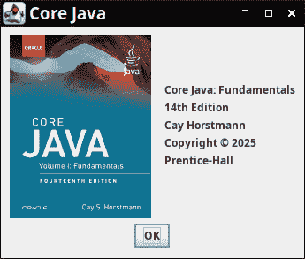Figure 5.4: 显示图像和文本资源

当然，面板中的书名和版权年份会在书的下一版本中更改。为了方便跟踪这些变化，我们将文本放在一个文件中，而不是将其硬编码为字符串。

但你应该将像`about.txt`这样的文件放在哪里呢？当然，简单地将其与程序其余其他文件一起放在 JAR 文件中是比较方便的。

`Class`类提供了一个用于定位资源文件的有用服务。以下是必要的步骤：

1. 获取拥有资源的类的`Class`对象——例如，`ResourceDemo.class`。

2. 某些方法（例如`ImageIcon`类的`getImage`方法）接受描述资源位置的 URL。然后调用：

```
URL url = cl.getResource("about.png");
```

3. 否则，使用`getResourceAsStream`方法获取一个用于读取文件中数据的输入流。

关键在于，Java 虚拟机知道如何定位一个类，因此它可以在相同的位置搜索关联的资源。例如，假设`ResourceDemo`类位于包`resources`中。那么，`ResourceDemo.class`文件位于`resources`目录中，你将一个图标文件放在同一个目录下。

与其将资源文件存放在与类文件相同的目录下，你可以提供相对路径或绝对路径，例如：

```
data/about.txt
/images/about.gif
```


自动加载文件就是资源加载功能所做的一切。没有标准方法来解释资源文件的内容。每个程序必须有自己的方法解释其资源文件。

资源的另一个常见应用是程序的国际化。依赖于语言的字符串（如消息和用户界面标签）存储在资源文件中，每个语言一个文件。在卷 II 第 7 章中讨论的`internationalization API`支持一种种用于组织和访问这些本地化文件的标准方法。

`Listing 5.15`是一个演示资源加载的程序。（不用担心读取文本和显示对话框的代码——我们稍后会介绍这些细节。）编译、构建 JAR 文件并执行它：

```
javac v1ch05/resources/ResourceDemo.java
jar cvfe ResourceDemo.jar v1ch05.resources.ResourceDemo \
    v1ch05/resources/*.class images/*.gif v1ch05/resources/data/*.txt
java -jar ResourceDemo.jar
```

将 JAR 文件移动到不同的目录并再次运行，检查程序是否是从 JAR 文件而不是从当前目录中读取资源文件。

`Listing 5.15 v1ch05/resources/ResourceDemo.java`

```
package v1ch05.resources;

import module java.base;
import module java.desktop;

/**
 */
class ResourceDemo {
    void main() throws Exception {
        URL aboutURL = getClass().getResource("/images/about.gif");
        var icon = new ImageIcon(aboutURL);

        InputStream stream = getClass().getResourceAsStream("data/about.txt");
        var about = new String(stream.readAllBytes());

        InputStream stream2 = getClass().getResourceAsStream("data/title.txt");
        var title = new String(stream2.readAllBytes()).strip();

        JOptionPane.showMessageDialog(null, about, title, JOptionPane.INFORMATION_MESSAGE,
                icon);
    }
}
```

`java.lang.Class` 1.0

* `URL getResource(String name)` 1.1

* `InputStream getResourceAsStream(String name)` 1.1

在类相同的地方查找资源，然后返回一个可以用于加载资源的 URL 或输入流。如果未找到资源，则返回`null`，因此不要为 I/O 错误抛出异常。

### 5.10.4. 使用反射分析类的能力

这里是反射机制最重要部分的简要概述，它可以让你检查类的结构。

`java.lang.reflect`包中的三个类`Field`、`Method`和`Constructor`分别描述类的字段、方法和构造函数。这三个类都有一个名为`getName`的方法，返回该项的名称。`Field`类有一个`getType`方法，返回一个对象（同样是`Class`类型），描述字段类型。`Method`和`Constructor`类有报告参数类型的方法，而`Method`类还报告返回类型。

这三个类还有一个名为`getModifiers`的方法，它返回一个整数（其中某些位被开启或关闭），描述使用的修饰符，如`public`和`static`。然后你可以使用`java.lang.reflect`包中`Modifier`类的静态方法来分析`getModifiers`返回的整数。使用`Modifier`类中的`isPublic`、`isPrivate`或`isFinal`方法可以判断方法或构造函数是否为`public`、`private`或`final`。你只需要让`Modifier`类中对应的方法处理`getModifiers`返回的整数即可。你也可以使用`Modifier.toString`方法打印修饰符。

另一种`accessFlags`方法返回`AccessFlag`枚举值的集合。例如，以下是如何测试方法是否是静态的：

```
if (Modifiers.isStatic(m.getModifiers())) . . .
if (m.accessFlags().contains(AccessFlag.STATIC)) . . .
```

`Class`类的`getFields`、`getMethods`和`getConstructors`方法返回类支持的所有`public`字段、方法和构造函数的数组。这包括父类的公共成员。`Class`类的`getDeclaredFields`、`getDeclaredMethods`和`getDeclaredConstructors`方法返回由类声明的所有字段、方法和构造函数组成的数组。这包括`private`、包级和`protected`成员，以及具有包访问权限的成员，但不包括父类的成员。

`Listing 5.16`展示了如何打印关于类的所有信息。程序提示你输入类名，并输出该类所有方法和构造函数的签名以及所有实例字段的名称。例如，如果你输入

```
java.lang.Double
```

程序打印

```java
public final class java.lang.Double extends java.lang.Number {
    public java.lang.Double(double);
    public java.lang.Double(java.lang.String);

    public boolean equals(java.lang.Object);
    public static java.lang.String toString(double);
    public java.lang.String toString();
    public static int hashCode(double);
    public int hashCode();
    public static double min(double, double);
    public static double max(double, double);
    public static native long doubleToRawLongBits(double);
    // more methods

    public static final double POSITIVE_INFINITY;
    public static final double NEGATIVE_INFINITY;
    public static final double NaN;
    public static final double MAX_VALUE;
    public static final double MIN_NORMAL;
    public static final double MIN_VALUE;
    private final double value;
    // more fields
}
```

这个程序非凡的之处在于，它可以分析 Java 解释器可以加载的任何类，而不仅仅是程序编译时存在的类。我们将在下一章中使用这个程序来窥探 Java 编译器自动生成的内部类。

列表 5.16 `v1ch05/ReflectionDemo.java`

```java
package v1ch05;

import module java.base;

/**
 * 此程序使用反射来打印类的所有特征。
 */
class ReflectionDemo {
    void main(String[] args) throws Exception {
        // 从命令行参数或用户输入读取类名
        String name = args.length > 0 ? args[0] :
            IO.readln("Enter 类名 (例如 java.util.Date): ");

        // 打印类修饰符、名称和父类名称（如果不等于 Object）
        Class cl = Class.forName(name);
        String modifiers = Modifier.toString(cl.getModifiers());
        if (modifiers.length() > 0) IO.print(modifiers + " ");
        if (cl.isSealed()) IO.print("sealed ");
        if (cl.isEnum())
            IO.print("enum " + name);
        else if (cl.isRecord())
            IO.print("record " + name);
        else if (cl.isInterface())
            IO.print("interface " + name);
        else
            IO.print("class " + name);
        Class supercl = cl.getSuperclass();
        if (supercl != null && supercl != Object.class)
            IO.print(" extends " + supercl.getName());

        printInterfaces(cl);
        printPermittedSubclasses(cl);

        IO.print(" {\n");
        printConstructors(cl);
        IO.println();
        printMethods(cl);
        IO.println();
        printFields(cl);
        IO.println("}");
    }

    /**
     * 打印类的所有构造函数
     * @param cl 一个类
     */
    public static void printConstructors(Class cl) {
        Constructor[] constructors = cl.getDeclaredConstructors();

        for (Constructor c : constructors) {
            String name = c.getName();
            IO.print("    ");
            String modifiers = Modifier.toString(c.getModifiers());
            if (modifiers.length() > 0) IO.print(modifiers + " ");
            IO.print(name + "(");

            // 打印参数类型
            Class[] paramTypes = c.getParameterTypes();
            for (int j = 0; j < paramTypes.length; j++) {
                if (j > 0) IO.print(", ");
                IO.print(paramTypes[j].getName());
            }
            IO.println(");");
        }
    }

    /**
     * 打印类的所有方法
     * @param cl 一个类
     */
    public static void printMethods(Class cl) {
        Method[] methods = cl.getDeclaredMethods();

        for (Method m : methods) {
            Class retType = m.getReturnType();
            String name = m.getName();

            IO.print("    ");
            // 打印修饰符、返回类型和方法名
            String modifiers = Modifier.toString(m.getModifiers());
            if (modifiers.length() > 0) IO.print(modifiers + " ");
            IO.print(retType.getName() + " " + name + "(");

            // 打印参数类型
            Class[] paramTypes = m.getParameterTypes();
            for (int j = 0; j < paramTypes.length; j++) {
                if (j > 0) IO.print(", ");
                IO.print(paramTypes[j].getName());
            }
            IO.println(");");
        }
    }

    /**
     * 打印类的所有字段
     * @param cl 一个类
     */
    public static void printFields(Class cl) {
        Field[] fields = cl.getDeclaredFields();

        for (Field f : fields) {
            Class type = f.getType();
            String name = f.getName();
            IO.print("    ");
            String modifiers = Modifier.toString(f.getModifiers());
            if (modifiers.length() > 0) IO.print(modifiers + " ");
            IO.println(type.getName() + " " + name + ";");
        }
    }

    /**
     * 打印密封类的所有允许子类
     * @param cl 一个类
     */
    public static void printPermittedSubclasses(Class cl) {
        if (cl.isSealed()) {
            Class<?> permittedSubclasses = cl.getPermittedSubclasses();
            for (int i = 0; i < permittedSubclasses.length; i++) {
                if (i == 0)
                    IO.print("permits ");
                else
                    IO.print(", ");
                IO.print(permittedSubclasses[i].getName());
            }
        }
    }

    /**
     * 打印类实现的接口
     * @param cl 一个类
     */
    public static void printInterfaces(Class cl) {
        Class<?> interfaces = cl.getInterfaces();
        for (int i = 0; i < interfaces.length; i++) {
            if (i == 0)
                IO.print(cl.isInterface() ? " extends " : " implements ");
            else
                IO.print(", ");
            IO.print(interfaces[i].getName());
        }
    }
}
```

`java.lang.Class`1.0

*   `Field[] getFields()`1.1

*   `Field[] getDeclaredFields()`1.1

    `getFields`返回包含该类及其父类的公共字段的数组；`getDeclaredFields`返回该类的所有字段。如果`Class`对象表示原始类型或数组类型，则这些方法返回长度为 0 的数组。


`Method[] getMethods()`1.1

`Method[] getDeclaredMethods()`1.1

返回包含 `Method` 对象的数组：`getMethods` 返回公共方法并包含继承的方法；`getDeclaredMethods` 返回该类的所有但不但不继承的方法。

`Constructor[] getConstructors()`1.1

`Constructor[] getDeclaredConstructors()`1.1

返回包含 `Constructor` 对象的数组，获取 `Class` 对象表示类的公共构造函数（`getConstructors`）或所有构造函数（`getDeclaredConstructors`）。

`boolean isInterface()`

如果此 `Class` 对象描述的是接口，则返回 `true`。（接口参见第 6 章。）

`boolean isEnum()`1.5

如果此 `Class` 对象描述的是 `enum`，则返回 `true`。

`boolean isRecord()`16

如果此 `Class` 对象描述的是 `record`，则返回 `true`。

`RecordComponent[] getRecordComponents()`16

返回描述 record 字段的 `RecordComponent` 对象数组，如果该类不是 record，则返回 `null`。

`String getPackageName()`9

获取包含该类型的包名称；如果该类型是数组类型，则获取其元素类型的包；如果该类型是原始类型，则返回 `"java.lang"`。

`java.lang.reflect.Field`1.1

`java.lang.reflect.Method`1.1

`java.lang.reflect.Constructor`1.1

`Class getDeclaringClass()`

返回定义此构造函数、方法或字段的 `Class` 对象。

`Class[] getExceptionTypes()`（在 `Constructor` 和 `Method` 类中）

返回一个 `Class` 对象的数组，表示方法抛出的异常类型。

`int getModifiers()`

返回一个描述此构造函数、方法或字段修饰符的整数。使用 `Modifier` 类中的方法来分析返回值。

`Set<AccessFlag> accessFlags()`

返回 `AccessFlag` 枚举中的一个值集合，描述此构造函数、方法或字段的访问修饰符。

`String getName()`

返回作为构造函数、方法或字段名称的字符串。

`Class[] getParameterTypes()`（在 `Constructor` 和 `Method` 类中）

返回一个 `Class` 对象的数组，表示参数的类型。

`Class getReturnType()`（在 `Method` 类中）

返回一个表示返回类型的 `Class` 对象。

`java.lang.reflect.RecordComponent`

`String getName()`

`Class getType()`

获取此记录组件的名称和类型。

`Method getAccessor()`

返回用于访问此记录组件的 `Method` 对象。

`java.lang.reflect.Modifier`

`static String toString(int modifiers)`

返回一个包含与 `modifiers` 中设置位对应的修饰符的字符串。

`static boolean isAbstract(int modifiers)`

`static boolean isFinal(int modifiers)`

`static boolean isInterface(int modifiers)`

`static boolean isNative(int modifiers)`

`static boolean isPrivate(int modifiers)`

`static boolean isProtected(int modifiers)`

`static boolean isPublic(int modifiers)`

`static boolean isStatic(int modifiers)`

`static boolean isStrict(int modifiers)`

`static boolean isSynchronized(int modifiers)`

`static boolean isVolatile(int modifiers)`

测试 `modifiers` 值中对应方法名中修饰符的位。

### 5.10.5. 使用反射在运行时分析对象

在前面的节中，我们已经了如何找到任何对象的实例字段的名称和类型：

- 获取相应的 `Class` 对象。
- 在 `Class` 对象上调用 `getDeclaredFields`。

在本节中，我们将更进一步，实际查看字段的内容。当然，当你编写程序时，查看名称和类型已知的对象特定字段的内容是很容易的。但反射让你能够查看在编译时未知的对象的字段。

实现此点的关键方法是 `Field` 类中的 `get` 方法。如果 `f` 是 `Field` 类型的对象（例如从 `getDeclaredFields` 获取的对象），且 `obj` 是 `f` 字段所属的类的对象，那么 `f.get(obj)` 返回一个对象，其值是 `obj` 字段的当前值。这看起来有点抽象，所以让我们来看一个例子。

```
var harry = new Employee("Harry Hacker", 50000, 10, 1, 1989);
Class cl = harry.getClass();
// 代表 Employee 的类对象
Field f = cl.getDeclaredField("name");
// Employee 类的 name 字段
Object v = f.get(harry);
// harry 对象 name 字段的值，即：
// String 对象 "Harry Hacker"
```

实际上，这段代码存在一个问题。由于 `name` 字段是私有字段，`get` 和 `set` 方法将抛出 `IllegalAccessException`。你只能对可访问的字段使用 `get` 和 `set`。Java 的安全机制允许你发现对象拥有哪些字段，但除非你有权限，否则它不会让你读写这些字段的值。

反射机制的默认行为遵循 Java 访问控制。然而，你可以通过在 `Field`、`Method` 或 `Constructor` 对象上调用 `setAccessible` 方法来覆盖访问控制。例如：

```java
f.setAccessible(true); // 现在可以调用 f.get(harry) 了
```

`setAccessible` 方法是 `AccessibleObject` 类的方法，它是 `Field`、`Method` 和 `Constructor` 类的公共父类。此功能为调试器、持久化存储和类似机制提供。我们将在本节后面将其用于通用 `toString` 方法。

当你使用 Java 17 或更高版本运行程序时，调用 `setAccessible` 会抛出 `InaccessibleObjectException` 异常。

为了保持程序运行，向 `java.base` 模块中的 `java.util` 和 `java.lang` 包“开放”给“未命名模块”。详情见第 12 章。语法如下：

```bash
java --add-opens java.base/java.util=ALL-UNNAMED \
    --add-opens java.base/java.lang=ALL-UNNAMED \
    v1ch05/objectAnalyzer/ObjectAnalyzerDemo.java
```

一旦你拥有对象的反射访问权限，就可以设置任何字段值。调用 `f.set(obj, value)` 将对象 `obj` 中由 `f` 代表的字段设置为新值。即使对于 `final` 字段也有效！但是，记录组件（record components）无法通过反射设置。

未来的库可能会使用变量句柄（variable handles）而不是反射来读写字段。`VarHandle` 与反射相似。

# 列表 5.18 v1ch05/objectAnalyzer/ObjectAnalyzer.java

```java
package v1ch05.objectAnalyzer;

import module java.base;

public class ObjectAnalyzer {
    private ArrayList<Object> visited = new ArrayList<>();

    /**
     * 将对象转换为列出所有字段的字符串表示。
     * @param obj 一个对象
     * @return 返回一个包含对象类名以及所有字段名和值的字符串
     */
    public String toString(Object obj) throws Exception {
        if (obj == null) return "null";
        if (visited.contains(obj)) return "...";
        visited.add(obj);
        Class cl = obj.getClass();
        if (cl == String.class) return (String) obj;
        if (cl.isArray()) {
            String r = cl.getComponentType() + "[]{";
            for (int i = 0; i < Array.getLength(obj); i++) {
                if (i > 0) r += ",";
                Object val = Array.get(obj, i);
                if (cl.getComponentType().isPrimitive())
                    r += val;
                else
                    r += toString(val);
            }
            return r + "}";
        }

        String r = cl.getName();
        // 检查此类及其所有父类的字段
        do {
            r += "[";
            Field[] fields = cl.getDeclaredFields();
            AccessibleObject.setAccessible(fields, true);
            // 获取所有字段的名字和值
            for (Field f : fields) {
                if (!Modifier.isStatic(f.getModifiers())) {
                    if (!r.endsWith("[")) r += ",";
                    r += f.getName() + "=";
                    Class t = f.getType();
                    Object val = f.get(obj);
                    if (t.isPrimitive())
                        r += val;
                    else
                        r += toString(val);
                }
            }
            r += "]";
            cl = cl.getSuperclass();
        }
        while (cl != null);

        return r;
    }
}
```

## `java.lang.reflect.AccessibleObject`

`void setAccessible(boolean flag)`

设置或清除此可访问对象的访问性标志位，如果访问被拒绝，则抛出 `IllegalAccessException`。

`boolean trySetAccessible()`

设置此可访问对象的访问性标志位，如果访问被拒绝，则返回 `false`。

`boolean canAccess(Object obj)`

检查调用者是否可以通过此字段、方法或构造函数对象访问 `obj`。对于静态字段、方法或构造函数，传递 `null`。

`static void setAccessible(AccessibleObject[] array, boolean flag)`

这是一个方便方法，用于设置对象数组的访问性标志位。

## `java.lang.Class`

`Field getField(String name)`

`Field[] getFields()`

获取给定名称的公共字段，或所有字段的数组。

`Field getDeclaredField(String name)`

`Field[] getDeclaredFields()`

获取在该类中声明的给定名称的字段，或所有字段的数组。

## `java.lang.reflect.Field`

`Object get(Object obj)`

获取对象 `obj` 中由此 `Field` 对象描述的字段的值。

`void set(Object obj, Object newValue)`

将对象 `obj` 中由此 `Field` 对象描述的字段设置为新值。

### 5.10.6. 使用反射编写泛型数组代码

`java.lang.reflect` 包中的 `Array` 类允许你动态创建数组。这被用于，例如 `Arrays` 类中 `copyOf` 方法的实现。回想一下该方法如何用于扩展已经满的数组。

```java
var a = new Employee[100];
. . .
// 数组已满
a = Arrays.copyOf(a, 2 * a.length);
```

如何编写这样一个泛型方法呢？`Employee[]` 数组可以转换为 `Object[]` 数组，这很有帮助。这是一个初步尝试：

```java
public static Object[] badCopyOf(Object[] a, int newLength) // 无用 {
    var newArray = new Object[newLength];
    System.arraycopy(a, 0, newArray, 0, Math.min(a.length, newLength));
    return newArray;
}
```

然而，在实际*使用*结果数组时存在问题。此代码返回的数组类型是*对象*数组 (`Object[]`)，因为我们使用以下行代码创建了数组：

```java
new Object[newLength]
```

对象数组*不能*强制转换为员工数组 (`Employee[]`)。虚拟机将在运行时产生一个 `ClassCastException`。关键点在于，正如前面提到的，Java 数组会记住其条目的类型——即创建它的 `new` 表达式中所使用的元素类型。。将 `Employee[]` 临时强制转换为 `Object[]` 数组然后再转换回来是合法的，但一个从生命之初就作为 `Object[]` 数组开始的数组**永远无法**被强制转换为 `Employee[]` 数组。要编写这种泛型数组代码，我们需要能够创建一个与原数组*相同*类型的新数组。为了这一点，我们需要 `java.lang.reflect` 包中 `Array` 类的静态 `newInstance` 方法。你必须提供条目的类型和所需的长度作为该方法的参数。

```java
Object newArray = Array.newInstance(componentType, newLength);
```


```java
package v1ch05;

import module java.base;

/**
 * 此程序演示了使用反射来操作数组。
 */
class CopyOfDemo {
    void main() {
        int[] a = { 1, 2, 3 };
        a = (int[]) goodCopyOf(a, 10);
        IO.println(Arrays.toString(a));

        String[] b = { "Tom", "Dick", "Harry" };
        b = (String[]) goodCopyOf(b, 10);
        IO.println(Arrays.toString(b));

        IO.println("下面的调用将产生异常。");
        b = (String[]) badCopyOf(b, 10);
    }

    /**
     * 此方法尝试通过分配新数组并拷贝所有元素
     * 来扩展数组。
     * @param a 需要扩展的数组
     * @param newLength 新长度
     * @return 一个包含 a 的所有元素的更大的数组。然而，返回的
     *         数组的类型为 Object[]，而不是与 a 相同的类型
     */
    Object[] badCopyOf(Object[] a, int newLength) { // 无用
        var newArray = new Object[newLength];
        System.arraycopy(a, 0, newArray, 0, Math.min(a.length, newLength));
        return newArray;
    }

    /**
     * 此方法通过分配相同类型的新数组并拷贝所有元素
     * 来扩展数组。
     * @param a 需要扩展的数组。这可以是对象数组也可以是基本类型
     *        类型数组
     * @return 一个包含 a 的所有元素的更大的数组
     */
    Object goodCopyOf(Object a, int newLength) {
        Class cl = a.getClass();
        if (!cl.isArray()) return null;
        Class componentType = cl.getComponentType();
        int length = Array.getLength(a);
        Object newArray = Array.newInstance(componentType, newLength);
        System.arraycopy(a, 0, newArray, 0, Math.min(length, newLength));
        return newArray;
    }
}
```

### `java.lang.Class`

* `boolean isArray()`

  如果此对象代表数组类型，则返回 `true`。

* `Class getComponentType()`

  `Class componentType()` 

  如果此对象代表数组类型，则返回描述组件类型的 `Class`，否则返回 `null`。

* `Class arrayType()`

  返回描述该对象所表示的数组类型对应的数组类型的 `Class`。

### `java.lang.reflect.Array`

* `static Object get(Object array, int index)`

* `static xxx getXXX(Object array, int index)`

  这些方法返回给定数组在指定索引处存储的值。这里，`xxx` 是基本类型 `boolean`、`byte`、`char`、`double`、`float`、`int`、`long` 或 `short` 之一。

* `static void set(Object array, int index, Object newValue)`

* `static setXXX(Object array, int index, xxx newValue)`

  这些方法将新值存储在给定数组的指定索引处。这里，`xxx` 是基本类型 `boolean`、`byte`、`char`、`double`、`float`、`int`、`long` 或 `short` 之一。

* `static int getLength(Object array)`

  返回给定数组的长度。

* `static Object newInstance(Class componentType, int length)`

* `static Object newInstance(Class componentType, int[] lengths)`

  返回一个具有给定组件类型和给定维度的新数组。

### 5.10.7. 调用任意方法和构造函数

在 C 和 C++ 中，你可以通过函数指针执行任意函数。从表面上看，Java 并没有方法指针——也就是说，没有将方法的位置传递另一个方法的方法，以便第二个方法稍后调用它。事实上，Java 的设计者表示方法指针是危险且容易出错的，而 Java 接口和 lambda 表达式（下一节讨论）是更好的解决方案。然而，反射机制允许你调用任意方法。

回想起你可以使用 `Field` 类的 `get` 方法检查对象的字段。同样，`Method` 类有一个 `invoke` 方法，允许你调用由当前 `Method` 对象封装的方法。`invoke` 方法的签名如下

```
Object invoke(Object obj, Object... args)
```

第一个参数是隐式参数，其余对象提供显式参数。

对于静态方法，第一个参数是被忽略的——你可以将其设置为 `null`。

例如，如果 `m1` 代表 `Employee` 类的 `getName` 方法，下面的代码展示了如何调用它：

```
String n = (String) m1.invoke(harry);
```

如果返回类型是基本类型，`invoke` 方法将返回对应的包装类型。例如，假设 `m2` 代表 `Employee` 类的 `getSalary` 方法。那么，返回的对象实际上是一个 `Double`，你必须进行相应的类型转换。使用自动拆箱将其转换为 `double`：

```
double s = (Double) m2.invoke();
```

你如何获取 `Method` 对象？通过 `getMethod` 方法搜索直到找到所需的那个。由于这个原因，你还必须提供参数类型。`getMethod` 的签名是

```
Method getMethod(String name, Class... parameterTypes)
```

例如，这是获取 `Employee` 类的 `getName` 和 `getSalary` 方法的方法：

```
Method m1 = Employee.class.getMethod("getName");
Method m2 = Employee.class.getMethod("getSalary", double.class);
```

现在你已经有了 `Method` 对象，让我们让它们用起来。`Listing 5.20` 是一个打印数学函数（如 `Math.sqrt`）表格的程序。输出如下：

```
public native double java.lang.Math.sqrt(double)
      1.0000 |      1.0000
      2.0000 |      1.4142
      3.0000 |      1.7321
      4.0000 |      2.0000
      5.0000 |      2.2361
      6.0000 |      2.4495
      7.0000 |      2.6458
      8.0000 |      2.8284
      9.0000 |      3.0000
     10.0000 |      3.1623
```

打印表格的代码显然与实际绘制的函数无关。

```java
double dx = (to - from) / (n - 1);
for (double x = from; x <= to; x += dx) {
    double y = (Double) f.invoke(null, x);
    IO.println("%10.4f | %10.4f%n".formatted(x, y));
}
```

在这里，`f` 是 `Method` 类型的对象。`invoke` 的第一个参数是 `null`，因为我们正在调用静态方法。为了绘制 `Math.sqrt` 函数表格，我们将 `f` 设置为

```
Math.class.getMethod("sqrt", double.class)
```

这就是 `Math` 类中名为 `sqrt` 且具有单个 `double` 类型参数的方法。

`Listing 5.20` 展示了通用表格器的完整代码和几次运行结果。

```java
package v1ch05;

import module java.base;

/**
 * 此程序演示了如何通过反射调用方法。
 */
class MethodTableDemo {
    void main() throws Exception {
        // 获取 square 和 sqrt 方法的指针
        Method square = this.getClass().getDeclaredMethod("square",
                double.class);
        Method sqrt = Math.class.getMethod("sqrt", double.class);

        // 打印 x 值和 y 值的表格
        printTable(1, 10, 10, square);
        printTable(1, 10, 10, sqrt);
    }

    /**
     * 返回数字的平方
     * @param x 一个数字
     * @return x 的平方
     */
    static double square(double x) {
        return x * x;
    }

    /**
     * 打印一个包含该方法 x 值和 y 值的表格
     * @param from x 值的下限
     * @param to x 值的上限
     * @param n 表格的行数
     * @param f 一个具有 double 参数和 double 返回值的方法
     */
    void printTable(double from, double to, int n, Method f) throws Exception {
        // 将方法作为表头打印
        IO.println(f);

        double dx = (to - from) / (n - 1);

        for (double x = from; x <= to; x += dx) {
            double y = (Double) f.invoke(null, x);
            IO.println("%10.4f | %10.4f".formatted(x, y));
        }
    }
}
```

正如这个示例清楚所示，你可以对 `Method` 对象做任何你在 C 语言的函数指针或 C# 的委托（delegates）中可以做的事情。就像 C 一样，这种编程风格通常非常不方便，而且总是出错。如果用错误的参数调用方法会发生什么？`invoke` 方法会抛出一个异常。

此外，`invoke` 的参数和返回值必然是 `Object` 类型。这意味着你必须进行大量的强制类型转换。结果是编译器失去了检查你代码的机会，因此错误只在测试期间才会出现，而那时发现并修复错误更加费力。此外，使用反射获取方法指针的代码比直接调用方法的代码要慢得多。

出于这个原因，我建议只有在绝对必要时，才在你自己的程序中使用 `Method` 对象。使用接口和 lambda 表达式（下一章的主题）几乎总是个更好的主意。

`java.lang.reflect.Method`1.1

- `public Object invoke(Object obj, Object[] args)`

调用此对象描述的方法，传递给定的参数并返回方法产生的值。对于静态方法，将 `null` 作为隐式参数传递。通过包装类传递基本类型值。基本类型的返回结果必须进行解箱。

## 5.11 继承的设计提示

我想用一些我在使用继承时发现非常有用的提示来为本章画上句号。

### 将公共操作和字段放在父类中

这就是为什么我们将 `name` 字段放在 `Person` 类中，而不是在 `Employee` 和 `Student` 类中重复它。

### 不要使用受保护的字段

有些程序员认为将大多数实例字段定义为 `protected` 是一个好主意，“以防万一”，这样子类如果在需要时就可以访问这些字段。然而，`protected` 机制并没有提供多少保护，原因有两个。首先，子类的集合是无界的——任何人都可以创建你类的子类，然后编写直接访问 `protected` 实例字段的代码，从而破坏封装性。其次，在 Java 中，同一个包中的所有类都可以访问 `protected` 字段，无论它们是否是子类。

然而，`protected` 方法可以用于指示尚未准备好通用、且应该在子类中重新定义的方法。

### 使用继承来建模“是”（is–a）关系

继承是一个方便的代码节省工具，但有时人们会过度使用它。例如，假设我们需要 `Contractor` 类。承包工有名字和入职日期，但他们没有工资。相反，他们按小时计费，而且留的时间不够长以获得加薪。人们很容易从 `Employee` 派生出一个子类 `Contractor` 并添加一个 `hourlyWage` 字段。

```java
public class Contractor extends Employee {
    private double hourlyWage;
    . . .
}
```

但这*不是*一个好主意，因为现在每个工对象都有薪水和时薪字段。当你实现打印工资单或税表的方法时，这会给你带来无尽的麻烦。你最终写的代码会比从不继承时写的要多。

承包工与员工的关系没有通过“是”测试。承包工不是员工的一种特例情况。

### 除非所有继承的方法都有意义，否则不要使用继承

假设我们想写一个 `Holiday` 类。显然，每个节日都是一天，而天可以表示为 `GregorianCalendar` 类的实例，因此我们可以使用继承。

```java
class Holiday extends GregorianCalendar { . . . }
```

遗憾的是，节日的集合在继承的操作下并不是*封闭*的。`GregorianCalendar` 的公共方法之一是 `add`。而 `add` 可以将节日变成非节日：

```java
Holiday christmas;
christmas.add(Calendar.DAY_OF_MONTH, 12);
```

注意，如果扩展的是一个不可变类，这个问题就不会出现。假设你有一个不可变的日期类，类似于 `LocalDate` 但不是 `final` 的类。

### 在重写方法时不要改变预期的行为

替换原则不仅适用于语法，更重要的是行为。当你重写一个方法时，不应该无理地改变它的行为。编译器帮不了你——它无法检查重新定义是否有意义。例如，你可以通过重新定义 `add` 来“修复” `Holiday` 类中 `add` 方法的问题，也许什么都不做，或者抛出异常，或者跳下一个节日。

然而，这种修复违反了替换原则。以下语句序列：

```java
int d1 = x.get(Calendar.DAY_OF_MONTH);
x.add(Calendar.DAY_OF_MONTH, 1);
int d2 = x.get(Calendar.DAY_OF_MONTH);
IO.println(d2 - d1);
```

应该具有*预期的行为*，无论 `x` 是 `GregorianCalendar` 类型还是 `Holiday` 类型。

当然，问题就在这里。合理和不合理的人可以对预期行为进行争论。例如，某些作者认为替换原则要求 `Manager.equals` 忽略 `bonus` 字段，因为 `Employee.equals` 忽略了它。如果这些讨论在真空环境中发生，那是毫无意义的。最终，重要的是当你在子类中重写方法时，不要绕过原始设计的意图。

### 使用多态，而不是类型信息

每当你发现形式如下的代码：

```java
if (x 是类型 1)
    action1(x);
else if (x 是类型 2)
    action2(x);
```

请考虑多态。

`action[1]` 和 `action[2]` 代表一个共同的概念吗？如果是，让该概念成为这两个类型的共同父类或接口的方法。那么，你只需要调用

```java
x.action();
```

并让多态中固有的动态分发机制启动正确的动作。

使用多态方法或接口实现的代码比使用多个类型测试的代码要容易维护和扩展。

### 不要过度使用反射。

反射机制允许你通过在运行时检测字段和方法，编写出具有极强通用性的程序。这种能力对于系统级编程可能极其有用，但在应用程序中通常并不合适。反射是脆弱的——使用它，编译器无法帮助你发现编程错误。任何错误都会在运行时发现，并导致异常。


你现在已经了解 Java 如何支持面向对象编程的基础知识：类、继承和多态。在接下来的章节中，我将处理两个对于有效使用 Java 至关重要的高级主题：接口和 lambda 表达式。

# 第 6 章 ▪ 接口、Lambda 表达式与内部类

你已经学习了类和继承，这是 Java 面向对象的核心概念。本章将向你展示几种常用的高级技术。尽管这些技术的本质并不直观，但你仍然掌握它们来完善你的 Java 工具箱。

第一种技术称为 `interfaces`（接口），它是描述类应该“做什么”的方法，而不规定它们应该“如何”做。一个类可以 `implement`（实现）一个或多个接口。然后，在任何需要符合接口的地方，都可以使用这些实现类的对象。在讨论完接口后，我们将转向 `lambda expressions`（lambda 表达式），这是一种创建可以在稍后时间点执行的代码块的简洁方式。使用 lambda 表达式，你可以以优雅的方式表达使用回调或变量行为的代码。

然后我们再讨论 `inner classes`（内部类）的机制。内部类在技术上有些复杂——它们被定义在其他类内部，其方法可以访问外部类的字段。本章以对 `proxies`（代理）的讨论结束，代理是实现任意接口的对象。代理是一种非常特殊的构造，适用于构建系统级工具。第一次阅读时，你可以安全地跳过该节。

## 6.1 接口

在接下来的节中，你将学习什么是 Java 接口以及如何使用它们。你还将发现接口在 Java 的最新版本中变得更加强大。

### 6.1.1 接口概念

在 Java 语言中，接口不是一个类，而是对想要符合接口的类的一组 `requirements`（要求）。通常，服务的提供者会声明：“如果你的类符合某个接口，那么我就执行该服务。”让我们来看一个具体的例子。`Arrays` 类的 `sort` 方法承诺对对象数组进行排序，但有一个条件：这些对象必须属于 `implement`（实现）了该接口的类。

这里是 `Comparable` 接口的样子：

```
public interface Comparable {
    int compareTo(Object other);
}
```

在接口中，`compareTo` 方法是 `abstract`（抽象的）——它没有实现。实现 `Comparable` 接口的类需要有一个 `compareTo` 方法，且该方法必须带有一个 `Object` 参数并返回一个整数。否则，该类也是抽象的——也就是说，你无法构造任何对象。

从 Java 5 开始，`Comparable` 接口被增强为一种泛型类型。

```java
public interface Comparable<T> {
    int compareTo(T other); // 参数类型为 T
}
```

例如，实现 `Comparable<Employee>` 的类必须提供一个方法：

```
int compareTo(Employee other)
```

你仍然可以使用不带类型参数的“原始” `Comparable` 类型。这时，`compareTo` 方法的参数是 `Object` 类型，你必须手动将该 `compareTo` 方法的参数转换为所需的类型。我会这样做一段时间，这样你就不需要同时担心两个概念。

接口的所有方法自动都是 `public`（公共的）。因此，在接口中声明方法时没有必要提供 `public` 关键字。当然，还有一个接口语法无法表达的额外要求：调用 `x.compareTo(y)` 时，`compareTo` 方法必须 `compare`（比较）这两个对象，并返回指示 `x` 还是 `y` 大。如果 `x` 小于 `y`，该方法应该返回负数；如果它们相等，返回零；否则返回正数。

这个特定的接口只有一个方法。有些接口有多个方法。正如你稍后看到的，接口也可以定义常量。然而，更重要的是接口 `cannot`（不能）提供的内容。接口永远没有实例字段。在 Java 8 之前，接口中的所有方法都是抽象的。正如你在 6.1.4 节和 6.1.5 节中看到的，现在可以在接口中有其他方法了。当然，这些方法不能引用实例字段——接口没有任何字段。

现在，假设我们想使用 `Arrays` 类的 `sort` 方法对 `Employee` 对象数组进行排序。那么 `Employee` 类必须 `implement`（实现）`Comparable` 接口。要让一个类实现接口，你需要执行两个步骤：

1. 声明你的类意图实现给定的接口。
2. 为接口中的所有方法提供定义。

要声明一个类实现接口，使用 `implements` 关键字：

```
class Employee implements Comparable
```

当然，现在 `Employee` 类需要提供 `compareTo` 方法。假设我们想根据工资比较员工。这里是 `compareTo` 方法的一个实现：

```java
public int compareTo(Object otherObject) {
    Employee other = (Employee) otherObject;
    return Double.compare(salary, other.salary);
}
```

在这里，我们使用静态的 `Double.compare` 方法，如果第一个参数小于第二个参数，它返回负数；如果它们相等，返回 `0`；否则返回正值。

在接口声明中，`compareTo` 方法没有声明为 `public`，因为接口中的所有方法自动都是公共的。但在实现接口时，你必须将方法声明为 `public`。否则编译器假设该方法具有包访问权限——这是 `class` 的默认权限。编译器会抱怨你正尝试提供更严格的访问权限。

我们可以通过为泛型 `Comparable` 接口提供类型参数来做得更好：

```java
class Employee implements Comparable<Employee> {
    public int compareTo(Employee other) {
       return Double.compare(salary, other.salary);
    }
    . . .
}
```

注意，`Object` 参数的类型转换消失了。

`Comparable` 接口的 `compareTo` 方法返回一个整数。如果对象不相等，你返回什么负数或正数并不重要。这种灵活性在比较整数字段时非常有用。例如，假设每个员工都有一个唯一的整数 `id`，你想根据员工 ID 数字进行排序。那么你只需要返回 `id - other.id`。如果第一个 ID 数字小于另一个，则该值将是某个负值；如果它们相同，则为 `0`；否则为某个正值。然而，有一个注意事项：整数的范围必须足够小，以至于减法不会溢出。如果你知道 ID 不是负数，或者它们的绝对值最多为 `(Integer.MAX_VALUE - 1) / 2`，那么就是安全的。否则，调用静态的 `Integer.compare` 方法。

当然，这种减法技巧对于浮点数无效。`salary - other.salary` 在工资相近但并不相等时可能会舍入为 `0`。`Double.compare(x, y)` 调用仅在 `x < y` 时返回 `-1`，在 `x > y` 时返回 `1`。

`Comparable` 接口的文档建议 `compareTo` 方法应该与 `equals` 方法兼容。也就是说，恰当 `x.equals(y)` 为真时，`x.compareTo(y)` 才为零。Java API 中大多数实现 `Comparable` 的类都遵循了这一建议。

一个显著异常是 `BigDecimal`。考虑 `x = new BigDecimal("1.0")` 和 `y = new BigDecimal("1.00")`。此时 `x.equals(y)` 为 `false`，因为这两个数字的精度不同。但 `x.compareTo(y)` 的结果为零。理想情况下，它不应该是如此，但并没有明显的方法来决定哪一个应该在前。

另一个异常是 `StringBuilder`，它实现了 `Comparable` 但没有重写 `equals`：

```
StringBuilder x = new StringBuilder("Hello");
StringBuilder y = new StringBuilder("Hello");
x.equals(y) // false
x.compareTo(y) // 0
```

使用 `double` 操作数的比较运算符与 `Double` 类的对应方法之间存在细微差异。

第一个问题是负零，即 `-0.0`。当与关系运算符比较时，它与 `0.0` 无法区分：

```
0.0 < -0.0 // false
-0.0 < 0.0 // false
```

但 `Double.compare` 可以区分它们：

```
Double.compare(-0.0, 0.0) // -1
```

另一个问题是 `Double.NaN`。任何与操作数为 `NaN` 的关系运算符进行比较都会返回 `false`：

```
Double.NaN < Double.NaN // false
```

然而，`Double.compare` 的行为不同：

```
Double.compare(Double.NaN, Double.NaN) // 0
```

值得注意的是，`Double.NaN` 被认为比 `Double.POSITIVE_INFINITY` 更大：

```
Double.compare(Double.POSITIVE_INFINITY, Double.NaN) // -1
```

从数学上来说，`compare` 方法提供了一种“全序”，但 `<` 运算符并不是。

现在你已经看到了一个类为了利用排序服务必须做什么——它必须实现 `compareTo` 方法。这是完全合理的。需要某种方法让 `sort` 方法来比较对象。但为什么 `Employee` 类不能简单提供一个 `compareTo` 方法而不实现 `Comparable` 接口呢？

接口之所以是因为 Java 编程语言是**强类型**的。在进行方法调用时，编译器需要能够检查该方法是否存在。在 `sort` 方法的某处会有这样的语句：

```
if (a[i].compareTo(a[j]) > 0) {
    // 重新排列 a[i] 和 a[j]
    . . .
}
```

编译器必须知道 `a[i]` 确实有一个 `compareTo` 方法。如果 `a` 是 `Comparable` 对象的数组，那么该方法的存在是有保证的，因为每个实现 `Comparable` 接口的类必须提供该方法。

预计 `Arrays` 类中的 `sort` 方法定义为接收 `Comparable[]` 数组，这样如果有人调用 `sort` 传入的数组元素类型没有实现 `Comparable` 接口，编译器就会报错。遗憾的是，事实并非如此。相反，`sort` 方法接受一个 `Object[]` 数组并使用笨拙的转换：

```
// 标准库中使用的方法--不推荐
if (((Comparable) a[i]).compareTo(a[j]) > 0) {
    // 重新排列 a[i] 和 a[j]
    . . .
}
```

如果 `a[i]` 不属于实现 `Comparable` 接口的类，虚拟机将抛出异常。

[Listing 6.1] 展示了排序 `Employee` 类实例数组的完整代码（[Listing 6.2]）。

Listing 6.1 v1ch06/interfaces/InterfacesDemo.java

```java
package v1ch06.interfaces;

import module java.base;

/**
 * 此程序演示了 Comparable 接口的使用。
 */
class InterfacesDemo {
    void main() {
        var staff = new Employee[3];

        staff[0] = new Employee("Harry Hacker", 35000);
        staff[1] = new Employee("Carl Cracker", 75000);
        staff[2] = new Employee("Tony Tester", 38000);

        Arrays.sort(staff);

        // 打印所有 Employee 对象的信息
        for (Employee e : staff)
            IO.println("name=" + e.getName() + ",salary=" + e.getSalary());
    }
}
```

Listing 6.2 v1ch06/interfaces/Employee.java

```java
package v1ch06.interfaces;

/**
 * 熟悉的 Employee 类，实现了 Comparable 接口。
 */
public class Employee implements Comparable<Employee> {
    private String name;
    private double salary;

    public Employee(String name, double salary) {
        this.name = name;
        this.salary = salary;
    }

    public String getName() {
        return name;
    }

    public double getSalary() {
        return salary;
    }

    public void raiseSalary(double byPercent) {
        double raise = salary * byPercent / 100;
        salary += raise;
    }

    /**
     * 按工资比较员工。
     * @param other 另一个 Employee
     * @return 如果此对象小于另一个对象则返回负值，
     * 如果相同则返回 0，否则返回正值
     */
    public int compareTo(Employee other) {
        return Double.compare(salary, other.salary);
    }
}
```

例如，假设你希望经理比普通员工等级，无论薪水如何。那么其他子类如 `Executive` 和 `Secretary` 呢？如果你需要建立一种排序顺序，可以在 `Employee` 类中提供一个如 `rank` 的方法。让每个子类重写 `rank`，并实现一个考虑了 `rank` 值的 `compareTo` 方法。

## 6.1.2. 接口的属性

接口不是类。特别是，你永远无法使用 `new` 运算符来实例化接口：

```
x = new Comparable(. . .); // ERROR
```

然而，尽管无法构造接口对象，你仍然可以声明接口变量。

```
Comparable x; // OK
```

接口变量必须引用实现该接口的类的对象：

```
x = new Employee(. . .); // 只要 Employee 实现 Comparable 就 OK
```

接下来，就像你使用 `instanceof` 来检查对象是否属于特定类一样，你也可以使用 `instanceof` 来检查对象是否实现了某个接口：

```
if (anObject instanceof Comparable) { . . . }
```

就像你可以构建类的层次结构一样，你也可以扩展接口。这允许存在多条从更具通用性到更具特异性的接口链。例如，假设你有一个名为 `Moveable` 的接口。

```java
public interface Moveable {
    void move(double x, double y);
}
```

然后，你可以想象有一个名为 `Powered` 的接口扩展了它：

```java
public interface Powered extends Moveable {
    double milesPerGallon();
}
```

虽然你不能在接口中放置实例字段，但你可以在其中提供常量。例如：

```java
public interface Powered extends Moveable {
    double milesPerGallon();
    double SPEED_LIMIT = 95; // 一个 public static final 常量
}
```

就像接口中的方法自动是 `public` 的一样，字段始终是 `public static final`。

将接口方法标记为 `public`、字段标记为 `public static final` 是合法的。有些程序员会这样做，可能是出于习惯或为了更清晰。然而，《Java 语言规范》建议不要提供这些冗余的关键字，我也遵循了这一建议。

虽然每个类只能有一个父类，但类可以实现多个接口。这在定义类的行为时赋予了你最大的灵活性。例如，Java 编程语言内置了一个重要的接口名为 `Cloneable`。（该接口在第 6.1.9 节 中详细讨论。）如果你的类实现了 `Cloneable`，`Object` 类中的 `clone` 方法将为你的类对象创建一个精确拷贝。如果你同时需要可复制性和可比较性，只需实现这两个接口即可。用逗号分隔你想要实现的接口：

```
class Employee implements Cloneable, Comparable
```

Record 和枚举类不能扩展其他类（因为它们隐式地扩展了 `Record` 和 `Enum` 类）。然而，它们可以实现接口。


接口可以是`sealed`（密封的）的。与密封类一样，直接子类型（可以是类或接口）必须在`permits`子句中声明，或者位于同一个源文件中。

## 6.1.3. 接口与抽象类

如果你读过第 5 章中关于抽象类的章节，你可能会奇怪为什么 Java 编程语言的设计者要费心引入接口的概念。为什么`Comparable`不能简单地是一个抽象类：

```
abstract class Comparable { // 为什么不能呢？
    public abstract int compareTo(Object other);
}
```

那么`Employee`类只需扩展这个抽象类并提供`compareTo`方法即可：

```
class Employee extends Comparable { // 为什么不能呢？
    public int compareTo(Object other) { . . . }
}
```

遗憾的是，使用抽象基类表示通用属性有一个主要问题。一个类只能扩展一个类。假设`Employee`类已经扩展了另一个类，比如`Person`。那么它就无法扩展第二个类了。

```
class Employee extends Person, Comparable // ERROR
```

但每个类可以实现它喜欢的任意数量的接口：

```
class Employee extends Person implements Comparable // OK
```

其他编程语言，特别是 C++，允许类拥有多个父类。这种特性被称为多重继承。Java 的设计者选择不支持多重继承，因为这会让语言变得非常复杂（如 C++）或效率较低（如 Eiffel）。

相反，接口提供了多重继承的大部分带来的益处，同时避免了复杂性和低效性。

C++ 拥有多重继承以及随之而来的所有复杂性，例如虚基类、支配规则和横向指针转换。很少有 C++ 程序员使用多重继承，有些人认为它永远不应该被使用。其他程序员建议仅将多重继承用于“混入”（mix-in）风格的继承。在混入风格中，一个主父类描述父对象，额外的父类（所谓的混入类）可以提供辅助特征。这种风格与具有单个父类和额外接口的 Java 类相似。

你已经在第 3 章中见过`CharSequence`接口。`String`和`StringBuilder`（以及其他几个更晦涩的类字符串类）都实现了这个接口。该接口包含了所有管理字符序列的类通用的方法。通用接口鼓励程序员编写使用`CharSequence`接口的方法。这些方法可以在`String`、`StringBuilder`以及其他类字符串类的实例上运行。

遗憾的是，`CharSequence`接口的内容相当单薄。你可以获取长度、遍历代码点或代码单元、提取子序列并按字典顺序比较两个序列。Java 17 增加了`isEmpty`方法。

如果你处理字符串，且这些操作足以满足你的需求，请接受`CharSequence`实例而非字符串。

## 6.1.4. 静态与私有方法

从 Java 8 开始，你允许向接口添加静态方法。从来没有技术上的理由禁止这样做。它只是看起来违背了接口作为抽象规范的精神。

以前，将静态方法放在工具类中是常见的。在标准库中，你会发现接口和工具类的成对，如`Collection`/`Collections`。

例如，你可以使用`Path`接口中的静态方法从 URI 或一组字符串构造指向文件或目录的路径：

```java
public interface Path {
    public static Path of(URI uri) { . . . }
    public static Path of(String first, String... more) { . . . }
    . . .
}
```

在之前的 Java 版本中，有一个独立的`Paths`类持有这些方法。现在没有必要为工具方法提供独立的辅助类了。

接口方法可以是`private`的。私有方法可以是`static`的，也可以是实例方法。由于私有方法只能在接口的方法中使用，其用途仅限于作为接口其他方法的辅助方法。

## 6.1.5. 默认方法

你可以为任何接口方法提供默认实现。你必须用`default`修饰符标记此类方法。

```java
public interface Comparable<T> {
    default int compareTo(T other) { return 0; }
        // 默认情况下，所有元素都是相同的
}
```

当然，这并没有什么用，因为`Comparable`的每一个真实实现都会重写这个方法。但在其他情况下，默认方法也是很有用的。例如，在第 9 章中，你将看到一个用于访问数据结构中元素的`Iterator`接口。它声明了如下`remove`方法：

```
public interface Iterator<E> {
    boolean hasNext();
    E next();
    default void remove() { throw new UnsupportedOperationException("remove"); }
    . . .
}
```

如果你实现了一个迭代器，就需要提供`hasNext`和`next`方法。这些方法没有默认实现——它们依赖于你正在遍历的数据结构。但如果你的迭代器是只读的，你就不需要担心`remove`方法。

默认方法可以调用其他方法。例如，`Collection`接口可以定义一个便利方法：

```
public interface Collection {
    int size(); // 一个抽象方法
    default boolean isEmpty() { return size() == 0; }
    . . .
}
```

那么，实现`Collection`的程序员就不需要担心实现`isEmpty`方法了。

Java API 中的`Collection`接口实际上并没有这样做。相反，有一个类`AbstractCollection`实现`Collection`并根据`size`定义了`isEmpty`。建议集合的实现者扩展`AbstractCollection`。那种技术已经过时了。直接实现接口中的方法即可。

默认方法的一个重要用途是*接口演进*。考虑一个在 Java 中存在多年的`Collection`接口。假设在很久以前，你提供了一个类：

```
public class Bag implements Collection
```

后来，在 Java 8 中，接口中添加了一个`stream`方法。

假设`stream`方法不是默认方法。那么`Bag`类将无法编译，因为它没有实现这个新方法。在接口中添加非默认方法不是*源兼容的*。

但假设你没有重新编译该类，而是简单地使用包含它的旧 JAR 文件。即使缺少该方法，该类仍然可以加载。程序仍然可以创建`Bag`实例，且不会发生任何坏事。（向接口中添加方法是*二进制兼容的*。）然而，如果程序在`Bag`实例上调用`stream`方法，就会发生`AbstractMethodError`。

将该方法设为`default`方法解决了这两个问题。`Bag`类将再次可以编译。如果在未重新编译的情况下加载类并在`Bag`实例上调用`stream`方法，则会调用`Collection.stream`方法。

### 6.1.6. 解决默认方法冲突

如果完全相同的方法在一个接口中定义为默认方法，然后又作为父类或其他接口的方法定义，会怎样？像 Scala 和 C++ 这样的语言对解决此类歧有复杂的规则。幸运的是，Java 的规则要简单得多。规则如下：

1. **父类胜出。**如果父类提供了一个具体方法，则相同名称和参数类型的默认方法将被简单忽略。

2. **接口冲突。**如果一个接口提供了默认方法，而另一个接口包含具有相同名称和参数类型的方法（无论默认还是非默认），那么你必须通过重写该方法来解决冲突。

让我们来看第二个规则。考虑两个具有`getName`方法的接口：

```
interface Person {
    default String getName() { return ""; }
}

interface Named {
    default String getName() { return getClass().getName() + "_" + hashCode(); }
}
```

如果你形成一个同时实现这两个类的类会发生什么？

```
class Student implements Person, Named { . . . }
```

该类继承了由`Person`和`Named`接口提供的两个不一致的`getName`方法。Java 编译器没有在其中二选一，而是报告一个错误，并将解决歧义的任务留给程序员。只需在`Student`类中提供一个`getName`方法即可。在该方法中，你可以选择两个冲突方法中的一个，如下：

```
class Student implements Person, Named {
    public String getName() { return Person.super.getName(); }
    . . .
}
```

现在假设`Named`接口没有为`getName`提供默认实现：

```
interface Named {
    String getName();
}
```

`Student`类可以继承来自`Person`接口的默认方法吗？这可能是合理的，但 Java 的设计者倾向于统一性。两个接口之间如何冲突并不重要。只要至少有一个接口提供了实现，编译器就会报告错误，程序员必须解决这种歧义。

如果两个接口都没有为共享方法提供默认实现，则没有冲突。实现类有两个选择：实现该方法，或者留空不实现。在后的情况下，该类本身是抽象的。

我们刚刚讨论了两个接口之间的名称冲突。现在考虑一个扩展父类并实现接口的类，它从两者继承了相同的方法。例如，假设`Person`是一个类，`Student`定义如下：

```
class Student extends Person implements Named { . . . }
```

在这种情况下，只有父类方法有效，接口中的任何默认方法都将被简单忽略。在我们的示例中，`Student`继承了来自`Person`的`getName`方法，无论`Named`接口是否为`getName`提供默认实现。这就是“类胜出”规则。

“类胜出”规则确保了与旧版本 Java 的兼容性。如果你向接口中添加默认方法，对以前的代码没有影响。你永远无法创建一个重定义`Object`类中某个方法的默认方法，尽管这对于`List`等接口的`toString`或`equals`可能是很有吸引力的。

### 6.1.7. 接口与回调

编程中一种常见的模式是*回调*模式。在这种模式中，你指定当事件发生时应该执行的操作。例如，你可能希望在点击按钮或选择菜单项时发生特定的操作。然而，由于你尚未学习如何实现用户界面，我们将考虑一种类似但更简单的情况。

`javax.swing`包包含一个`Timer`类，如果你想在时间间隔结束时收到通知，它是很有用的。例如，如果程序的一部分包含一个时钟，你可以请求每秒收到一次通知，以便更新时钟。

当你构造定时器时，设置时间间隔并告诉它在时间间隔结束时应该做什么。

你如何告诉定时器它应该做什么？在许多编程语言中，你提供定时器定期调用的函数名称。然而，Java 标准库中的类采用了面向对象的方法。你传递某个类的对象。定时器随后调用该对象上的一个方法。传递对象比传递函数更灵活，因为对象可以携带额外信息。

当然，定时器需要知道调用哪个方法。定时器要求你指定一个实现了`java.awt.event.ActionListener`接口的类的对象。该接口如下：

```
public interface ActionListener {
    void actionPerformed(ActionEvent event);
}
```

当时间间隔过期时，定时器调用`actionPerformed`方法。

假设你想打印一条消息“At the tone, the time is . . .”，随后是一个嘟嘟声，每秒一次。你需要定义一个实现`ActionListener`接口的类。然后，你将任何想要执行的语句放在`actionPerformed`方法中。

```java
class TimePrinter implements ActionListener {
    public void actionPerformed(ActionEvent event) {
        IO.println("At the tone, the time is "
            + Instant.ofEpochMilli(event.getWhen()));
        Toolkit.getDefaultToolkit().beep();
    }
}
```

注意`actionPerformed`方法的`ActionEvent`参数。该参数提供了有关事件的信息，例如事件发生的时间。调用`event.getWhen()`返回事件时间，单位为自“纪元”（1970 年 1 月 1 日）以来的毫秒数。通过将其传递给静态方法`Instant.ofEpochMilli`，我们得到了更具可读性的描述。

接下来，构造该类的对象，并将其传递给`Timer`构造函数。

```java
var listener = new TimePrinter();
Timer t = new Timer(1000, listener);
```

`Timer`构造函数的第一个参数是通知之间必须经过的时间间隔，单位为毫秒。我们希望每秒被通知一次。第二个参数是监听器对象。

最后，启动计时器。

```java
t.start();
```

每秒，都会显示一条如下消息：

```
At the tone, the time is 2025-12-16T05:01:49.550Z
```

随后是一个嘟嘟声。

请确保导入了`javax.swing.Timer`。还有一个`java.util.Timer`类，它的功能与此略有不同。

Listing 6.3 让计时器及其动作监听器工作。计时器启动后，程序会弹出一个消息对话框，并等待用户点击 OK 按钮停止。在程序等待用户期间，每秒都会显示一次当前时间。（如果你省略了对话框，程序将在`main`方法退出时立即终止。）

Listing 6.3 v1ch06/TimerDemo.java

```java
package v1ch06;

import module java.base;
import module java.desktop;

import javax.swing.Timer;

/**
 * 此程序演示了如何使用 Timer。
 */
class TimerDemo {
    void main() {
        var listener = new TimePrinter();

        // 构造一个每秒调用一次监听器的计时器
        var timer = new Timer(1000, listener);
        timer.start();

        // 保持程序运行直到用户选择“OK"
        JOptionPane.showMessageDialog(null, "Quit program?");
        System.exit(0);
    }
}

class TimePrinter implements ActionListener {
    public void actionPerformed(ActionEvent event) {
        IO.println("At the tone, the time is " + Instant.ofEpochMilli(event.getWhen()));
        Toolkit.getDefaultToolkit().beep();
    }
}
```

`javax.swing.JOptionPane` 1.2

*   `static void showMessageDialog(Component parent, Object message)`

    显示一个带有消息提示和 OK 按钮的对话框。对话框位于`parent`组件上居中。如果`parent`为`null`，则对话框在屏幕上居中显示。

`javax.swing.Timer` 1.2

*   `Timer(int interval, ActionListener listener)`

    构造一个每隔`interval`毫秒就通知一次`listener`的计时器。

*   `void start()`

    启动计时器。启动后，计时器会调用其监听器上的`actionPerformed`。

*   `void stop()`

    停止计时器。停止后，计时器不再调用其监听器上的`actionPerformed`。

`java.awt.Toolkit` 1.0

*   `static Toolkit getDefaultToolkit()`

    获取默认工具包。工具包包含有关 GUI 环境的信息。

*   `void beep()`

    发出嘟嘟声。

### 6.1.8. `Comparator`接口

在 Section 6.1.1 中，你已经见过如何对对象数组进行排序，只要它们是实现`Comparable`接口的类的实例。例如，你可以对字符串数组进行排序，因为`String`类实现了`Comparable<String>`，并且`String.compareTo`方法按字典顺序比较字符串。


现在假设我们想按长度递增排序字符串，而不是按字典顺序。我们无法让`String`类以两种方式实现`compareTo`方法——无论如何，`String`类并不是我们我们可以修改的。

为了处理这种情况，`Arrays.sort`方法有第二个版本，其参数是一个数组和一个比较器——一个实现`Comparator`接口的类的实例。

```java
public interface Comparator<T> {
    int compare(T first, T second);
}
```

要按长度比较字符串，定义一个实现`Comparator<String>`的类：

```java
class LengthComparator implements Comparator<String> {
    public int compare(String first, String second) {
        return first.length() - second.length();
    }
}
```

要实际执行比较，你需要实例化：

```java
var comp = new LengthComparator();
if (comp.compare(words[i], words[j]) > 0) . . .
```

但事实并非那么简单。`clone`方法是`Object`类的一个`protected`方法，这意味着你的代码不能简单地调用它。只有`Employee`类可以克隆`Employee`对象。这种限制是有原因的。想一想`Object`类实现`clone`的方式：它对对象一无所知，因此它只能进行逐个字段的复制。如果对象中的所有实例字段都是数字或其他基本类型，那么复制字段就没问题了。但如果对象包含了对子对象的引用，那么复制字段将为你提供另一个指向该相同子对象的引用，因此原始对象和克隆后的对象仍然共享某些信息。

为了直观地展示这一点，考虑在第 4 章中引入的`Employee`类。图 6.2 显示了当你使用`Object`类的`clone`方法克隆这样一个`Employee`对象时会发生什么。正如你所看到的，默认的克隆操作是“浅拷贝”的——它不会克隆其他对象内部引用的对象。（图中显示共享的`Date`对象。由于稍后会解释清楚的原因，此示例使用了`Employee`类的一个版本，其中入职日期用`Date`表示。）

#### 图 6.2：浅拷贝

拷贝是浅拷贝是否重要？这取决于情况。如果原始对象和浅拷贝对象之间共享的子对象是不可变的（`immutable`），那么这种共享就是安全的。如果子对象属于一个不可变类（如`String`），这确实会发生。或者，子对象在对象的整个生命周期内可能保持不变，没有修改器触碰它，也没有方法返回它的引用。

然而，子对象通常是可变的（mutable），你必须重新定义`clone`方法来实现**深拷贝**（`deep copy`），同时也克隆子对象。在我们的示例中，`hireDay`字段是`Date`，它是可变的，因此它也必须被克隆。（出于这个原因，本示例使用了`Date`类型的字段而不是`LocalDate`来演示克隆过程。如果`hireDay`是不可变类`LocalDate`的实例，则就不需要进一步的操作了。）

对于每个类，你都需要决定：

1. 默认的`clone`方法是否足够用；

2. 是否可以通过对可变子对象调用`clone`来修复默认的`clone`方法；或者

3. 不应该尝试使用`clone`。

第三种选项实际上是默认选项。要选择第一或第二种选项，类必须必须：

1. 实现`Cloneable`接口；并且

2. 使用`public`访问修饰符重新定义`clone`方法。

`clone`方法在`Object`类中被声明为`protected`，因此你的代码不能简单地调用`anObject.clone()`。但`protected`方法不是可以从任何子类访问吗？而且每个类不都是`Object`的子类吗？幸运的是，`protected`访问规则更为微妙（参见第 5 章）。子类只能调用`protected`的`clone`方法来克隆*自己的*对象。你必须重新定义`clone`为`public`，以便允许任何方法克隆对象。

在这种情况下，`Cloneable`接口的出现与接口的正常用法无关。特别是，它*并没有*指定`clone`方法——该方法继承自`Object`类。该接口仅充当标记（tag），表明类设计者理解克隆过程。对象对克隆是非常警的，以至于如果一个对象请求克隆但没有实现该接口，它就会抛出一个检查异常（checked exception）。

`Cloneable`接口是 Java 提供的少数*标记接口*（tagging interfaces）之一。（有些程序员称它们为*标记接口*（marker interfaces）。）记住，像`Comparable`这样的接口的通常用途是确保类实现了特定方法或一组方法。标记接口没有方法；它的唯一目的是允许在类型查询中使用`instanceof`：

```
if (obj instanceof Cloneable) . . .
```

我建议你不要在自己的程序中使用标记接口。即使`clone`的默认（浅拷贝）实现已经足够，你仍然需要实现`Cloneable`接口，重新定义`clone`为`public`，并调用`super.clone()`。这里有一个示例：

```
class Employee implements Cloneable {
    // public 访问，更改返回类型
    public Employee clone() throws CloneNotSupportedException {
        return (Employee) super.clone();
    }
    . . .
}
```

注意，在`Object`类中，`clone`方法的返回类型为`Object`。在子类中，你可以为`clone`方法指定正确的返回类型。这是协变返回类型的一个示例（参见第 5 章）。你刚刚看到的`clone`方法没有为`Object.clone`提供的浅拷贝添加任何功能。它只是让该方法变为公共。要实现深拷贝，你必须更加努力并克隆可变的实例字段。

这是一个创建深拷贝的`clone`方法示例：

```
class Employee implements Cloneable {
    . . .
    public Employee clone() throws CloneNotSupportedException {
        // 调用 Object.clone()
        Employee cloned = (Employee) super.clone();

        // 克隆可变字段
        cloned.hireDay = (Date) hireDay.clone();
        return cloned;
    }
}
```

`Object`类的`clone`方法可能会抛出`CloneNotSupportedException`——当在没有实现`Cloneable`接口的对象上调用`clone`时，它会这样做。当然，`Employee`和`Date`类实现了`Cloneable`接口，所以不会抛出异常。然而，编译器并不知道这一点。因此，我们声明了异常：

```
public Employee clone() throws CloneNotSupportedException
```

捕获异常会更好吗？有关捕获异常的细节请参见第 7 章。）

```
public Employee clone() {
    try {
        Employee cloned = (Employee) super.clone();
        . . .
    }
    catch (CloneNotSupportedException e) { return null; }
    // 由于我们实现了 Cloneable，这不会发生
}
```

这对于 final 类是。。否则保留`throws`修饰符更好。这给了子类选择抛出`CloneNotSupportedException`。

你必须小心子类的克隆。例如，一旦你为`Employee`类定义了`clone`方法，任何人都可以它来克隆`Manager`对象。`Employee`的`clone`方法可以吗？这取决于`Manager`类的字段。在我们的案例中没有问题，因为`bonus`字段是基本类型。但`Manager`可能获得了需要深拷贝或不可克隆的字段。无法保证子类的实现者已经修复了`clone`以执行正确工作。出于这个原因，`clone`方法在`Object`类中被声明为`protected`。但如果你希望你类的用户调用`clone`，你就没有这种奢侈了。

你应该在自己的类中实现`clone`吗？如果你的客户端需要制作深拷贝，那么你可能应该。有些作者认为你应该完全避免`clone`，而是实现另一个相同目的的方法。我同意`clone`很笨拙，但如果你将责任转移到另一个方法，你会遇到相同的问题。无论如何，克隆并没有你想象的那么常见。标准库中不到 5% 的类实现了`clone`。

Listing 6.4 中的程序克隆了`Employee`类的实例（Listing 6.5），然后调用了两个变异器。`raiseSalary`方法更改了`salary`字段的值，而`setHireDay`方法更改了`hireDay`字段的状态。变异都不会影响原始对象，因为`clone`被定义为执行深拷贝。

所有数组类型都有一个公共的`clone`方法，而不是受保护的。你可以使用它来创建一个包含所有元素拷贝的新数组。例如：

```
int[] luckyNumbers = { 2, 3, 5, 7, 11, 13 };
int[] cloned = luckyNumbers.clone();
cloned[5] = 12; // 不改变 luckyNumbers[5]
```

Listing 6.4 v1ch06/clone/CloneDemo.java

```
package v1ch06.clone;

/**
 * 此程序演示了克隆。
 */
class CloneDemo {
    void main() throws Exception {
        var original = new Employee("John Q. Public", 50000);
        original.setHireDay(2000, 1, 1);
        Employee copy = original.clone();
        copy.raiseSalary(10);
        copy.setHireDay(2002, 12, 31);
        IO.println("original=" + original);
        IO.println("copy=" + copy);
    }
}
```

Listing 6.5 v1ch06/clone/Employee.java

```
package v1ch06.clone;

import module java.base;

/**
 * 熟悉的 Employee 类，已修改为可克隆的，且 hire 类型 类型为 Date。
 */
public class Employee implements Cloneable {
    private String name;
    private double salary;
    private Date hireDay;

    public Employee(String name, double salary) {
        this.name = name;
        this.salary = salary;
        hireDay = new Date();
    }

    public Employee clone() throws CloneNotSupportedException {
        // 调用 Object.clone()
        Employee cloned = (Employee) super.clone();

        // 克隆可变字段
        cloned.hireDay = (Date) hireDay.clone();

        return cloned;
    }

    /**
     * 将入职日期设置为给定日期。
     * @param year 入职的年份
     * @param month 入职的月份
     * @param day 入职的日期
     */
    public void setHireDay(int year, int month, int day) {
        long epochMillis = LocalDate.of(year, month, day).atStartOfDay(ZoneId.systemDefault())
                .toEpochSecond() * 1000;

        // 实例字段变异示例
        hireDay.setTime(epochMillis);
    }

    public void raiseSalary(double byPercent) {
        double raise = salary * byPercent / 100;
        salary += raise;
    }

    public String toString() {
        return "Employee[name=" + name + ",salary=" + salary + ",hireDay=" + hireDay + "]";
    }
}
```

## 6.2 Lambda 表达式

在后续章节中，你将学习如何使用 Lambda 表达式。

### 6.2.1 为什么用 Lambda？

Lambda 表达式是可以到处传递的代码块。在介绍语法之前，让我们先观察为什么我们需要它们。

在旧版本的 Java 中，如果你想实现一个接口，必须使用匿名内部类：

```java
ActionListener listener = new ActionListener() {
    public void actionPerformed(ActionEvent event) {
        System.out.println("Button clicked!");
    }
};
```

使用 Lambda 表达式，我们可以更简洁地实现这一点：

```java
ActionListener listener = event -> System.out.println("Button clicked!");
```

### 6.2.2 Lambda 表达式的语法

考虑排序示例。我们要检查一个字符串是否比另一个字符串短：

```
first.length() - second.length()
```

`first`和`second`是什么？它们是字符串。Java 是一种强类型语言，我们也必须同样指定：

```java
(String first, String second) ->
    first.length() - second.length()
```

如果 Lambda 表达式的参数类型可以被推断，你可以省略它们。例如：

```
(first, second) -> first.length() - second.length()
```

如果 Lambda 表达式没有参数，你仍然需要提供空括号，就像无参数方法一样：

```
() -> { return 1 + (int)(Math.random() * 6); }
```

如果代码执行的计算不适合单个表达式，请完全按照你编写方法的方式来编写它：封装在`{}`中并带有显式的`return`语句。例如：

```java
(String first, String second) -> {
    if (first.length() < second.length()) return -1;
    else if (first.length() > second.length()) return 1;
    else return 0;
}
```

为什么叫这个名字？多年前，逻辑学家阿隆佐··丘奇（Alonzo Church）想要将数学函数“有效可计算的”的形式化。（有趣的是，已知某些函数是存在的，但没人知道如何计算它们的值。）他使用希腊字母 lambda (λ) 来标记参数。如果他早知道 Java API，他会写成：

```
λfirst.λsecond.first.length() - second.length()
```

为什么用字母 λ？是因为丘奇用光字母表里的其他字母了吗？ 实际上，《数学原理》（*Principia Mathematica*）使用 ^ 符号来表示自由变量，这启发了丘奇使用大写 lambda Λ 来表示参数。但最终他切换到了小写版本。从那时起，带有参数的表达式就被称为 Lambda 表达式。

```
Comparator<String> comp =
    (first, second) // 等同于 (String first, String second)
        -> first.length() - second.length();
```

在这里，编译器可以推出`first`和`second`必须是字符串，因为该 lambda 表达式被赋值了一个字符串比较器。（我们将在下一节中详细讨论这种赋值。）

如果一个方法有一个具有推断类型的单个参数，你甚至可以省略括号：


```
ActionListener listener = event ->
    IO.println("The time is "
        + Instant.ofEpochMilli(event.getWhen()));
            // 而不是 (event) -> . . . 或 (ActionEvent event) -> . . .
```

如果 lambda 表达式的参数从未被使用过，你可以用 `_` 来表示它：

```
ActionListener listener = _ ->
    IO.println("The action occurred at " + Instant.now());
Comparator<String> comp = (_, _) -> 0;
```

你还可以使用 `var` 来表示推断的参数类型。这并不常见。这种语法是为了附加注解而发明的（参见第 11 章 -> `first.length() - second.length()`）。

你永远不需要指定 lambda 表达式的结果类型。它总是从上下文中推断出来的。例如，该表达式

```
(String first, String second) -> first.length() - second.length()
```

可以用于任何期望 `int` 类型结果的上下文。

lambda 表达式在某些分支中返回返回值而在其他分支中不返回是违法的。例如，`(int x) -> { if (x >= 0) return 1; }` 是无效的。

`Listing 6.6` 中的程序展示了如何使用 lambda 表达式作为比较器和监听器。

`Listing 6.6` `v1ch06/LambdaDemo.java`

```
package v1ch06;

import module java.base;

import module java.desktop;

import javax.swing.Timer;

/**
 * 此程序演示了 lambda 表达式的使用。
 */
class LambdaDemo {

    void main() {

        var planets = new String[]{"Mercury", "Venus", "Earth", "Mars", "Jupiter", "Saturn",

                "Uranus", "Neptune"};

        IO.println(Arrays.toString(planets));

        IO.println("按字典顺序排序:");

        Arrays.sort(planets);

        IO.println(Arrays.toString(planets));

        IO.println("按长度排序:");

        Arrays.sort(planets, (first, second) -> first.length() - second.length());

        IO.println(Arrays.toString(planets));

        var timer = new Timer(1000, _ -> IO.println("The time is " + Instant.now()));

        timer.start();

        // 保持程序运行，直到用户选择“OK”

        JOptionPane.showMessageDialog(null, "Quit program?");

        System.exit(0);

    }

}
```

### 6.2.3. 函数式接口

正如我们讨论的，Java 中存在许多封装代码块的现有接口，例如 `ActionListener` 或 `Comparator`。Lambda 与这些接口兼容。

每当需要一个具有单个抽象方法的接口对象时，你都可以提供一个 lambda 表达式。这种接口被称为函数式接口。

你可能会奇怪为什么函数式接口必须有一个*抽象*方法。难道接口中的所有方法不都是抽象的吗？实际上，接口一直可以重新声明 `Object` 类中的方法（如 `toString` 或 `clone`），而这些声明并不会使方法变为抽象。（Java API 中的某些接口重新声明 `Object` 方法是为了附加 javadoc 注释。可以查看 `Comparator` API 作为一个示例。）更重要的是，正如你在第 6.1.5 节中看到的，接口可以声明非抽象方法。

为了演示转换为函数式接口，请考虑 `Arrays.sort` 方法。它的第二个参数需要一个 `Comparator` 实例，这是一个只有一个方法的接口。只需提供一个 lambda 即可：

```
Arrays.sort(words,

    (first, second) -> first.length() - second.length());
```

在幕后，`Arrays.sort` 方法接收一个实现了 `Comparator<String>` 的某个类的对象。在那个对象上调用 `compare` 方法会执行 lambda 表达式的主体。这些对象和类的管理完全取决于实现，并且可能比使用传统的内部类高效得多。最好将 lambda 表达式视为一个函数而不是一个对象，并接受它可以被传递给函数式接口。

这种向接口的转换使得 lambda 表达式是如此吸引人。语法简洁简单。这里是另一个例子：

```
var timer = new Timer(1000, event -> {

    IO.println("At the tone, the time is "

        + Instant.ofEpochMilli(event.getWhen()));

    Toolkit.getDefaultToolkit().beep();

});
```

这比使用实现 `ActionListener` 接口的类方案要易读得多。

事实上，转换为函数式接口是你可以在 Java 中对 lambda 表达式所能做的*唯一*事情。在其他支持函数字面量的编程语言中，你可以声明如 `(String, String) -> int` 这样的函数类型，声明这些类型的变量，但 Java 设计者决定坚持使用接口。

### 6.2.4. 函数类型

Java API 在 `java.util.function` 包中定义了许多泛型函数式接口。其中一个接口 `BiFunction<T, U, R>` 描述了参数类型为 `T` 和 `U` 返回类型为 `R` 的函数。你可以将字符串 lambda 保存在该类型的变量中：

```
BiFunction<String, String, Integer> comp =

    (first, second) -> first.length() - second.length();
```

注意，这个接口并没有帮助你排序。`Arrays.sort` 方法想要 `Comparator`，而不是 `BiFunction`。如果你用过函数式编程语言，可能会觉得这很奇怪。但对于 Java 程序员来说，这很自然。像 `Comparator` 这样的接口有一个特定的目的，而不仅仅是一个具有给定参数和返回类型的方法。当你想要使用 lambda 表达式时，你仍然想要记住表达式的目的，并有一个特定的函数式接口。

`java.util.function` 包中一个非常有用的接口是 `Predicate`：

```
public interface Predicate<T> {

    boolean test(T t);

    // 其他默认和静态方法

}
```

`ArrayList` 类有一个 `removeIf` 方法，其参数是 `Predicate`。它专门设计用于传递 lambda 表达式。例如，以下语句从列表中删除所有 `null` 值：

```
list.removeIf(e -> e == null);
```

另一个有用的函数式接口是 `Supplier<T>`：

```
public interface Supplier<T> {

    T get();

}
```

supplier 没有参数，并在调用 `get` 方法时产生一个类型为 `T` 的值：

```
Supplier<Integer> die = () -> (int)(Math.random() * 6) + 1;

int outcome = die.get();
```

Supplier 用于*惰性求值*。例如，考虑调用

```
LocalDate hireDay = Objects.requireNonNullElse(day,

    LocalDate.of(1970, 1, 1));
```

这并不是最优的。我们预计 `day` 很少为 `null`，所以只想在需要时构造默认的 `LocalDate`。通过使用 supplier，我们可以推迟计算：

```
LocalDate hireDay = Objects.requireNonNullElseGet(day,

    () -> LocalDate.of(1970, 1, 1));
```

`requireNonNullElseGet` 方法只在需要值时才调用 supplier。

涉及原始类型的函数接口稍微有些繁琐。考虑一个消耗 `int` 并产生类型 `T` 对象的函数。你可以使用 `Function<Integer, T>`，但这样每次调用都必须对参数进行装箱。相反，有一个函数接口 `IntFunction<T>`。同样地，如果一个函数的返回值类型为 `int`，那么 `ToIntFunction<T>` 接口比 `Function<T, Integer>` 更具效率。最后，如果参数和返回值都是 `int`，则有一个 `IntUnaryOperator` 接口。

作为 API 的用户，你通常并不关心这些细微差别。考虑 `Arrays.setAll` 方法。它将数组的所有值设置为一个函数的结果，该函数的参数是数组的索引。在这里，我们将所有元素设置为索引的平方：

```
var values = new int[100];

Arrays.setAll(values, i -> i * i); // [0, 1, 4, 9, 16, . . ., 9801]
```

`setAll` 有针对 `int[]`、`long[]`、`double[]` 和泛型数组 `T[]` 的重载版本。在这里，`int[]` 重载的第二个参数是一个 `IntUnaryOperator`。但作为方法的用户，你并不关心。你只需要提供 lambda 表达式，你可以这样做无需担心原始类型与其包装类之间的区别。

lambda 表达式可以匹配函数接口中的原始类型和包装类型，这很好。但如果两种匹配都可能发生，就会产生错误。考虑一个提供这些方法的工具类：

```
public static int[] fill(int n, IntUnaryOperator op)

public static Object[] fill(int n, IntFunction<Object> op)
```

调用 `fill(n, i -> i * i)` 将无法编译，因为它是歧义的。

通过使用 `-Xlint:overloads` 选项编译可以在 API 中捕捉此类问题。

### 6.2.5. 方法引用

有时，lambda 表达式涉及单个方法。例如，假设你只想在定时器事件发生时打印事件对象。当然，你可以调用：

```
var timer = new Timer(1000, event -> IO.println(event));
```

如果可以直接将 `println` 方法传递给 `Timer` 构造函数会更好。以下是实现方法：

```
var timer = new Timer(1000, IO::println);
```

表达式 `IO::println` 是一个方法引用。它指示编译器产生函数接口的实例，通过覆盖接口的单个抽象方法来调用给定方法。在这个示例中，产生了一个 `ActionListener`，其 `actionPerformed(ActionEvent e)` 方法调用了 `IO.println(e)`。

和 lambda 表达式一样，方法引用并不是对象。当它被赋值给类型为函数接口的变量时，才会产生一个对象。

`IO` 类中有重载的 `println` 方法，一个参数类型为 `Object`，另一个没有参数。编译器需要根据上下文确定使用哪一个。在我们的示例中，方法引用 `IO::println` 必须转换为具有以下方法的 `ActionListener` 实例：

```
void actionPerformed(ActionEvent e)
```

从重载的 `println` 方法中选择了 `println(Object obj)`。当调用 `actionPerformed` 方法时，就会打印事件对象。

现在假设我们将同一个方法引用赋值给不同的函数接口：

```
Runnable task = IO::println;
```

`Runnable` 接口有一个没有参数的单个抽象方法：

```
void run()
```

在这种情况下，选择了没有参数的 `println()` 方法。调用 `task.run()` 会打印空行。

在这个示例中，`IO::println` 是对静态方法的引用。`::` 符号有变体：

1. `Class::staticMethod`
2. `Class::instanceMethod`
3. `object::instanceMethod`

[表 6.1] 为你详细介绍了几个示例。

#### 表 6.1：方法引用示例

| 方法引用 | 等效的 lambda 表达式 | 备注 |
| --- | --- | --- |
| `separator::equals` | `x -> separator.equals(x)` | 这是一个带有对象和实例方法的表达式。lambda 参数作为方法的显式参数传递。 |
| `String::strip` | `x -> x.strip()` | 这是一个带有类和实例方法的表达式。lambda 参数变为隐式参数。 |
| `String::concat` | `(x, y) -> x.concat(y)` | 我们再次有一个实例方法，但这次带有显式参数。和之前一样，第一个 lambda 参数变为隐式参数，其余参数传递给方法。 |
| `Integer::valueOf` | `x -> Integer.valueOf(x)` | 这是一个带有静态方法的表达式。lambda 参数传递给静态方法。 |
| `Integer::sum` | `(x, y) -> Integer.sum(x, y)` | 这是一个带有静态方法的表达式。lambda 参数传递给静态方法。 |
| `String::new` | `x -> new String(x)` | 这是一个带有构造函数的表达式。lambda 参数传递给构造函数。 |
| `String[]::new` | `n -> new String[n]` | 这是一个带有数组构造函数的表达式。lambda 参数传递给构造函数。 |

当 `RepeatedGreeter.greet` 方法启动时，会构造一个 `Timer`，它会在每次定时器滴答时执行 `super::greet` 方法。

### 6.2.6. 构造函数引用

构造函数引用就像方法引用，不同之处在于方法的名为 `new`。例如，`Person::new` 是对 `Person` 构造函数的引用。是哪一个构造函数呢？这取决于上下文。假设你有一个字符串列表。你可以通过以下调用方式，在每个字符串上调用构造函数，将其转换为 `Person` 对象的数组：

```
ArrayList<String> names = . . .;

Stream<Person> stream = names.stream().map(Person::new);

List<Person> people = stream.toList();
```

我们将在 第二卷第 1 章 中讨论 `stream`、`map` 和 `toList` 方法的细节。现在，重要的是 `map` 方法为列表中的每个元素调用 `Person(String)` 构造函数。如果有多个 `Person` 构造函数，编译器会选择带有 `String` 参数的那个，因为它从上下文中推导出调用构造函数时传入了一个字符串。

你可以使用数组类型创建构造函数引用。例如，`int[]::new` 是带有一个参数的构造函数引用：数组的长度。它等于 lambda 表达式 `n -> new int[n]`。

数组构造函数引用用于克服 Java 的一个限制。正如你在 第 8 章 中看到的，无法构造泛型类型 `T` 的数组。（表达式 `new T[n]` 是错误的，因为它会被“擦除”为 `new Object[n]`）。这对于库作者来说是一个问题。例如，假设我们想要一个 `Person` 对象的数组。`Stream` 接口有一个 `toArray` 方法，它返回一个 `Object` 数组：

```
Object[] people = stream.toArray();
```

但这并不令人满意。用户想要的是一个指向 `Person` 引用的数组，而不是 `Object` 引用的数组。流处理库通过构造函数引用解决了这个问题。将 `Person[]::new` 传递给 `toArray` 方法：

```
Person[] people = stream.toArray(Person[]::new);
```

`toArray` 方法调用此构造函数以获取正确类型的数组。然后填充并返回该数组。

有时，在传递方法或构造函数引用时，选出的重载变体令人惊讶。考虑这段代码片段：

```
var dates = new Date[100];

Arrays.setAll(dates, Date::new);
```


从表面上看，所有元素似乎通过每次调用无参数构造函数`new Date()`被设置为当前日期。但实际上，`setAll`的第二个参数是一个`IntFunction`，它接收元素的索引。因此，被调用了一个完全不同的构造函数`new Date(i)`，其中`i`的范围从 0 到 99。该构造函数将日期设置为自“纪元”（1970 年 1 月 1 日）起的给定毫秒数。

## 6.2.7. 变量作用域

通常，你希望在 lambda 表达式访问闭层方法中的变量。考虑这个例子：

```
public static void repeatMessage(String text, int delay) {
    ActionListener listener = event -> {
        IO.println(text);
    };
    new Timer(delay, listener).start();
}
```

考虑一个调用

```
repeatMessage("Hello", 1000); // 每 1000 毫秒打印一次 Hello
```

现在看 lambda 表达式内部的变量`text`。注意，这个变量*并不是*在 lambda 表达式定义的。相反，它是`repeatMessage`方法的参数变量。

如果你仔细考虑，这里发生了一些并非显而易见的事情。lambda 表达式的代码可能会`repeatMessage`调用返回且参数变量消失很久之后运行。`text`变量是如何留存的？

为了理解发生了什么，我们需要完善对 lambda 表达式的理解。一个 lambda 表达式有三个要素：

1. 一个代码块
2. 参数
3. 自由变量的值——即既不是参数也没有在代码内部定义的变量

在我们的示例中，lambda 表达式有一个自由变量`text`。表示 lambda 表达式的数据结构必须存储自由变量的值——在我们的案例中，是字符串`"Hello"`。我们说这些值被 lambda 表达式*捕获*（captured）了。（具体如何实现是实现实现细节。例如，可以将 lambda 表达式转换为一个带有单一方法的对象，从而将自由变量的值拷贝到该对象的实例字段中。）

代码块连同自由变量值的专业术语是*闭包*（closure）。如果有人炫耀他们的语言有闭包，请放心，Java 也有。在 Java 中，lambda 表达式就是闭包。

正如你看到的，lambda 表达式可以捕获闭层作用域中变量的值。在 Java 中，为了确保捕获的值是有良好定义的，有一个重要的限制。在 lambda 表达式中，你只能引用值不会发生改变的变量。例如，以下内容是非法的：

```
public static void countDown(int start, int delay) {
    ActionListener listener = _ -> {
        start--; // 错误：不能修改捕获的变量
        IO.println(start);
        if (start > 0) countDown(start, delay);
    };
}
```

这样做是有原因的。当多个操作并发时，在 lambda 表达式中修改变量是不安全的。请参阅第 10 章](../10/index.xhtml) 获取更多信息。

在 lambda 表达式中引用被修改的变量也是非法的。例如，以下内容：

```
public static void multiMessage(String text, int count) {
    for (int i = 1; i <= count; i++) {
        ActionListener listener = _ -> IO.println(i + ": " + text); // 错误：无法引用变化的 i
        new Timer(1000, listener).start();
    }
}
```

规则是 lambda 表达式中任何捕获的变量必须是有效 final（effectively final）。有效 final 指初始化后未赋过新值的变量。在我们的案例中，`text`始终指向同一个`String`对象，捕获它是可以的。但是`i`的值被修改了，因此`i`不能被捕获。

lambda 体的域与嵌套块相同。命名冲突和屏蔽规则同样适用。在 lambda 中声明与局部变量同名的参数或局部变量是非法的。

```
Path first = Path.of("/usr/bin");
Comparator<String> comp = (first, second) -> first.length() - second.length(); // 错误：变量 first 已定义
```

方法内部不能有两个同名的局部变量，因此你也不能在 lambda 表达式中引入此类变量。

## 6.2.8. Lambda 表达式与 this

lambda 表达式没有自己的`this`引用。

当你在 lambda 表达式中使用`this`关键字时，它表示闭层方法的`this`参数。例如，考虑

```
public class Greeter {
    public void greet(String text) {
        ActionListener listener = event -> {
            IO.println(this);
            IO.println(text);
        }
    }
    . . .
}
```

在调用`IO.println(this)`时，打印的是`Greeter`对象，而不是`ActionListener`实例。

在 lambda 表达式中用`this`并没有特殊之处。lambda 表达式的作用域嵌套在`greet`方法内部，`this`在该方法的任何地方含义都相同。

到为止，我们讨论了当 lambda 表达式访问闭层方法的变量时的情况。访问闭层类的字段也是可以的。

```
class Greeter {
    private String text;

    public void delayMessage(int delay) {
        ActionListener listener = event -> IO.println(text);
            // Ok to access field
        new Timer(delay, listener).start();
    }

    public void greet() {
        text = "Hello";
        delayMessage(1000);
        text = "Goodbye";
        delayMessage(2000);
    }
}
```

注意`text`并不是 final 的！似乎局部变量和字段有不同的规则。但实际上，只有一条规则。在 lambda 表达式中，`IO.println(text)`意味着`IO.println(this.text)`。lambda 表达式访问的是最终`this`值。

## 6.2.9. 处理 Lambda 表达式

到为止，你已经看到了如何生成 lambda 表达式并将其传递给期望函数接口的方法。现在让我们来看看如何编写可以消费 lambda 表达式的方法。

使用 lambda 的目的是*延迟执行*。毕竟，如果你现在就执行某些代码，你会直接执行它，而不会将其封装在 lambda 内部。以后执行代码有许多原因，例如：

*   在单独线程中运行代码
*   多次运行代码
*   在算法的正确时机运行代码（例如排序中的比较操作）
*   在事件发生时运行代码（按钮被点击、数据到达等）
*   仅在需要时运行代码

让我们来看一个简单的例子。假设你想重复执行某个操作`n`次。该操作和计数被传递给一个`repeat`方法：

```
repeat(10, () -> IO.println("Hello, World!"));
```

为了接受该 lambda，我们需要选择（或在少数情况下提供）一个函数接口。表 6.2 列出了 Java API 中提供的最重要的函数接口。在这种情况下，我们可以使用`Runnable`接口：

```java
public static void repeat(int n, Runnable action) {
    for (int i = 0; i < n; i++) action.run();
}
```

注意，lambda 表达式的体体是在调用`action.run()`时执行的。

现在让我们让这个例子变得稍微复杂一点。我们想告诉操作它发生在哪一次迭代中。为此，我们需要选择一个具有`int`参数和`void`返回值的函数接口。处理`int`值的标准接口是：

```java
public interface IntConsumer {
    void accept(int value);
}
```

这是`repeat`方法的改进版本：

```java
public static void repeat(int n, IntConsumer action) {
    for (int i = 0; i < n; i++) action.accept(i);
}
```

这里是调用它的方式：

```
repeat(10, i -> IO.println("Countdown: " + (9 - i)));
```

表 6.2：常见函数接口

| 函数接口 | 参数类型 | 返回类型 | 抽象方法名 | 描述 | 其他方法 |
| --- | --- | --- | --- | --- | --- |
| `Runnable` | 无 | `void` | `run` | 运行无参数或无返回的操作 |  |
| `Supplier<T>` | 无 | `T` | `get` | 提供类型为`T`的值 |  |
| `Consumer<T>` | `T` | `void` | `accept` | 消费类型为`T`的值 | `andThen` |
| `BiConsumer<T, U>` | `T`, `U` | `void` | `accept` | 消费类型为`T`和`U`的值 | `andThen` |
| `Function<T, R>` | `T` | `R` | `apply` | 具有类型为`T`参数的函数 | `compose`, `andThen`, `identity` |
| `BiFunction<T, U, R>` | `T`, `U` | `R` | `apply` | 具有类型为`T`和`U`参数的函数 | `andThen` |
| `UnaryOperator<T>` | `T` | `T` | `apply` | 类型为`T`的一元运算符 | `compose`, `andThen`, `identity` |
| `BinaryOperator<T>` | `T`, `T` | `T` | `apply` | 类型为`T`的二元运算符 | `andThen`, `maxBy`, `minBy` |
| `Predicate<T>` | `T` | `boolean` | `test` | 一个`boolean`值的函数 | `and`, `or`, `negate`, `isEqual`, `not` |
| `BiPredicate<T, U>` | `T`, `U` | `boolean` | `test` | 两个参数的`boolean`值的函数 | `and`, `or`, `negate` |

表 6.3 列出了针对基本类型`int`、`long`和`double`的 34 种可用特化。正如你在第 8 章](../ch8/index.xhtml) 中看到的，使用这些特化接口比使用通用接口更高效。因此，在上节的示例中，我使用了`IntConsumer`而不是`Consumer<Integer>`。

表 6.3：常见函数接口

| 函数接口 | 参数类型 | 返回类型 | 抽象方法名 | 描述 | 其他方法 |
| --- | --- | --- | --- | --- | --- |
| `Runnable` | 无 | `void` | `run` | 运行无参数或无返回的操作 |  |
| `Supplier<T>` | 无 | `T` | `get` | 提供类型为`T`的值 |  |
| `Consumer<T>` | `T` | `void` | `accept` | 消费类型为`T`的值 | `andThen` |
| `BiConsumer<T, U>` | `T`, `U` | `void` | `accept` | 消费类型为`T`和`U`的值 | `andThen` |
| `Function<T, R>` | `T` | `R` | `apply` | 具有类型为`T`参数的函数 | `compose`, `andThen`, `identity` |
| `BiFunction<T, U, R>` | `T`, `U` | `R` | `apply` | 具有类型为`T`和`U`参数的函数 | `andThen` |
| `UnaryOperator<T>` | `T` | `T` | `apply` | 类型为`T`的一元运算符 | `compose`, `andThen`, `identity` |
| `BinaryOperator<T>` | `T`, `T` | `T` | `apply` | 类型为`T`的二元运算符 | `andThen`, `maxBy`, `minBy` |
| `Predicate<T>` | `T` | `boolean` | `test` | 一个`boolean`值的函数 | `and`, `or`, `negate`, `isEqual`, `not` |
| `BiPredicate<T, U>` | `T`, `U` | `boolean` | `test` | 两个参数的`boolean`值的函数 | `and`, `or`, `negate` |

Java API 设计者们速度不够快。他们只有一次机会把这件事做好——那就是在 Java 8 中，当 API 引入`java.util.function.Function`接口时。在此之前，没有人可以为自己的类添加一个`transform(java.util.function.Function)`方法。但到了 Java 12，已经已经太晚了。某个地方的某人可能已经在他们的类中定义了`transform(java.util.function.Function)`，并赋予了不同的含义。诚然，这种情况不太可能发生，但目前无法得知。

这就是 Java 的工作方式。它严肃对待自己的承诺，并且不会为了方便而违背承诺。

## 6.2.10. 创建比较器 (Comparators)

`Comparator`接口提供了许多方便的静态方法用于创建比较器。这些方法旨在与 lambda 表达式或方法引用配合使用。

静态方法`comparing`接收一个“键提取”函数，该函数将类型`T`映射到可比较的类型（如`String`）。该函数被应用于要比较的对象，然后对返回的键进行比较。例如，假设你有一个`Person`对象的数组。你可以这样按姓名对它们进行排序：

```
Arrays.sort(people, Comparator.comparing(Person::getName));
```

这显然比手动实现一个`Comparator`要简单得多。而且，代码更加清晰，因为显而易见我们想要按姓名比较人员。

你可以使用`thenComparing`方法对比较器进行链链以处理平局。例如：

```
Arrays.sort(people,
    Comparator.comparing(Person::getLastName)
        .thenComparing(Person::getFirstName));
```

如果两个人的姓氏相同，则使用第二个比较器。

这些方法有几种变体。你可以指定在`comparing`和`thenComparing`方法提取的键上时使用的比较器。例如，这里我们按名字的长度对人员进行排序：

```
Arrays.sort(people, Comparator.comparing(Person::getName,
    (s, t) -> Integer.compare(s.length(), t.length())));
```

此外，`comparing`和`thenComparing`方法都有可以避免对`int`、`long`或`double`值装箱（boxing）的变体：

```java
Arrays.sort(people, Comparator.comparing(Person::getName,
    Comparator.comparingInt(String::length)))
```

实现上述操作的一种较短但可能没那么优雅的方法是：

```
Arrays.sort(people, Comparator.comparingInt(p -> p.getName().length()));
```


如果你的键函数可以返回`null`，你会喜欢`nullsFirst`和`nullsLast`适配器。这些静态方法接收一个现有的比较器并对其进行修改，使其在遇到`null`值时不会抛出异常，而是将其排为比普通值更小或更大。例如，假设`getMiddleName`在人员没有中间名时返回`null`。那么你可以使用`Comparator.comparing(Person::getMiddleName, Comparator.nullsFirst(. . .))`。

`nullsFirst`方法需要一个比较器——在这种情况下，是一个比较两个字符串的比较器。`naturalOrder`方法为任何实现`Comparable`的类创建一个比较器。我们需要的是`Comparator.<String>naturalOrder()`。（请参见第 8 章获取关于此语法的解释。幸运的是，泛型类型通常可以推断出来。）这里是按可能为 null 的中间名排序的完整调用。我使用了`java.util.Comparator.*`的静态导入，使表达式更具可读性。

```
Arrays.sort(people, comparing(Person::getMiddleName, nullsFirst(naturalOrder())));
```

静态方法`reverseOrder`提供自然顺序的反序。要反转任何比较器，请使用实例方法`reversed`。例如，`naturalOrder().reversed()`等于`reverseOrder()`。

## 6.3. 内部类 (Inner Classes)

内部类是定义在另一个类内部的类。为什么要这样做呢？有两个原因：

- 内部类可以对同一包中的其他类隐藏。
- 内部类方法可以访问其定义所在作用域的数据——包括那些本应是私有的数据。

内部类曾经对于简洁地实现回调函数非常重要，但现在 lambda 表达式做得好得多。尽管如此，内部类对于结构化代码仍然非常有用。后续章节将带你了解所有的细节。

C++ 有嵌套类（nested classes）。嵌套类包含在外部类的作用域内。这是一个典型的例子：链表类定义了一个嵌套类来持有节点。

```cpp
template<typename T>
class LinkedList {
public:
    class Node { // 一个嵌套类
    public:
        . . .
    private:
        T data;
        Node* next;
    };
    . . .
private:
    Node* head;
    Node* tail;
};
```

嵌套类与 Java 的内部类相似。然而，Java 内部类有一个额外的功能，使其比 C++ 的嵌套类更丰富、更有用。来自内部类的对象对实例化它的外部类对象有一个隐式引用。通过这个指针，它获取了外部对象的完整状态。例如，在 Java 中，`Iterator`类不需要指向它所指向的`LinkedList`的显式指针。

在 Java 中，声明为`static`的嵌套类没有这个额外的指针。它们是 C++ 嵌套类的 Java 对应物。

### 6.3.1. 使用内部类访问对象状态

内部类的语法相当复杂。出于这个原因，我展示了一个简单的人工示例来演示内部类的用法。让我们重构`TimerDemo`示例并提取出一个`TalkingClock`类。时钟的构造函数有两个参数：间隔时间以及一个开启或关闭蜂鸣的标志。

```java
public class TalkingClock {
    private int interval;
    private boolean beep;

    public TalkingClock(int interval, boolean beep) { . . . }

    public void start() { . . . }

    public class TimePrinter implements ActionListener {
        // 一个内部类
        . . .
    }
}
```

注意`TimePrinter`类现在位于`TalkingClock`类内部。这并不意味着每个`TalkingClock`都有一个`TimePrinter`实例字段。正如你所看到的，`TimePrinter`对象是由`TalkingClock`类的方法构造的。

这里更详细的`TimePrinter`类。注意`actionPerformed`方法在蜂鸣之前会检查`beep`标志。

```java
public class TimePrinter implements ActionListener {
    public void actionPerformed(ActionEvent event) {
        IO.println("音调响起时，时间是 "
            + Instant.ofEpochMilli(event.getWhen()));
        if (beep) Toolkit.getDefaultToolkit().beep();
    }
}
```

发生了一些有趣的事情。`TimePrinter`类没有名为`beep`的实例字段或变量。相反，`beep`指向创建它的`TalkingClock`对象的字段。正如你所看到的，内部类方法可以访问它自己的实例字段以及创建它的外部对象的字段。

这个引用在内部类的定义中是不可见的。然而，为了说明这个概念，我们将指向外部对象的引用命名为*outer*。那么`actionPerformed`方法等于以下代码：

```java
public void actionPerformed(ActionEvent event) {
    IO.println(...);
    if (outer.beep) Toolkit.getDefaultToolkit().beep();
}
```

为了使这一切工作，内部类的对象总是获得创建一个它的对象的隐式引用（参见图 6.3）。

图 6.3：内部类对象拥有指向外部类对象的引用。

外部类引用在构造函数中设置。编译器会修改所有内部类构造函数，添加一个外部类引用的参数。`TimePrinter`类没有定义构造函数；因此，编译器会合成一个无参数构造函数，生成的代码如下：

```
public TimePrinter(TalkingClock clock) { // 生成的代码
    outer = clock;
}
```

再次注意，`outer`并不是 Java 关键字。我们只是用它来说明内部类涉及的机制。

当在`start`方法中构造`TimePrinter`对象时，编译器会将当前说话钟的`this`引用传递给构造函数：

```
var listener = new TimePrinter(this); // 自动添加参数
```

Listing 6.7 显示了测试内部类的完整程序。再看一下访问控制。如果`TimePrinter`类是一个普通类，它将需要通过`TalkingClock`类的公共方法来访问`beep`标记。使用内部类是一种改进。没有必要提供仅对另一个类感兴趣的访问器。

我们可以将`TimePrinter`类声明为`private`。这样只有`TalkingClock`方法能够构造`TimePrinter`对象。只有内部类可以是私有的。普通类始终具有包级或公有的访问权限。

Listing 6.7 v1ch06/innerClass/InnerClassDemo.java

```
package v1ch06.innerClass;

import module java.desktop;

/**
 * 此程序演示了内部类的用法。
 */
class InnerClassDemo {
    void main() {
        var clock = new TalkingClock(1000, true);
        clock.start();
        // 保持程序运行直到用户选择“确定”
        JOptionPane.showMessageDialog(null, "Quit program?");
        System.exit(0);
    }
}
```

Listing 6.8 v1ch06/innerClass/TalkingClock.java

```
package v1ch06.innerClass;

import module java.base;
import module java.desktop;
import javax.swing.Timer;

/**
 * 一个按固定间隔打印时间的闹钟。
 */
public class TalkingClock {
    private int interval;
    private boolean beep;

    /**
     * 构造一个说话闹钟。
     * @param interval 消息之间的间隔（毫秒）
     * @param beep 如果闹钟应该响起的 true
     */
    public TalkingClock(int interval, boolean beep) {
        this.interval = interval;
        this.beep = beep;
    }

    /**
     * 启动闹钟。
     */
    public void start() {
        var listener = new TimePrinter();
        var timer = new Timer(interval, listener);
        timer.start();
    }

    public class TimePrinter implements ActionListener {
        public void actionPerformed(ActionEvent event) {
            IO.println("At the tone, the time is " + Instant.ofEpochMilli(event.getWhen()));
            if (beep) Toolkit.getDefaultToolkit().beep();
        }
    }
}
```

### 6.3.2. 内部类的特殊语法规则

在前面的节中，我们通过调用`outer`来解释内部类的外部类引用。实际上，外部引用的正确语法要复杂一些。表达式

```
OuterClass.this
```

表示外部类引用。例如，你可以这样写`TimePrinter`内部类的`actionPerformed`方法：

```
public void actionPerformed(ActionEvent event) {
    . . .
    if (TalkingClock.this.beep) Toolkit.getDefaultToolkit().beep();
}
```

相反，你可以使用以下语法更显式地编写内部对象构造函数：

```
outerObject.new InnerClass(construction arguments)
```

例如：

```
ActionListener listener = this.new TimePrinter();
```

在这里，新构造的`TimePrinter`对象的外部类引用设置为创建内部类对象的方法的`this`引用。这是最常见的情况。一如既往，`this.`修饰符是多余的。然而，也可以通过显式命名另一个对象将外部类引用设置为另一个对象。例如，由于`TimePrinter`是一个公共内部类，你可以为任何说话钟构造一个`TimePrinter`：

```
var jabberer = new TalkingClock(1000, true);
TalkingClock.TimePrinter listener = jabberer.new TimePrinter();
```

注意，当内部类出现在外部类作用范围之外时，你通过以下方式引用内部类：

```
OuterClass.InnerClass
```

从 Java 16 开始，内部类可以拥有`static`成员。在此之前，内部类中不允许`static`方法，且内部类中声明的静态字段必须是`final`的并用编译时常量初始化。

内部类的静态方法可以访问内部类或嵌套类的静态字段和方法。

### 6.3.3. 内部类有用吗？真的必要吗？安全吗？

当内部类在 Java 1.1 中加入 Java 语言时，许多程序员认为它们是一项重大的新特性，这与 Java 比 C++ 更简单的哲学格格不入。内部类的语法不可否认地是复杂的（在我们在本章稍后学习匿名内部类时，它会变得更复杂）。并不清楚内部类如何与语言的其他特性（如访问控制和安全）交互。

内部类被翻译成普通的类文件，并用`$`（美元符号）分隔外部和内部名称。例如，`TalkingClock`内部的`TimePrinter`类被翻译为`innerClass.TimePrinter`。要查看运行效果，请尝试 ReflectionDemo [第 5 章，并给它类名`innerClass.TalkingClock`。或者，使用`javap`：

```
javap -private ClassName
```

如果你使用 UNIX，请在提供类名时记得转义`$`字符。也就是说，运行`ReflectionDemo`或

```
javap -private innerClass.TalkingClock$TimePrinter
```

你将得到以下输出：

```
public class v1ch06.innerClass.TalkingClock$TimePrinter
        implements java.event.ActionListener {
    final v1ch06.innerClass.TalkingClock this$0;
    public TimePrinter(v1ch06.innerClass.TalkingClock);
    public void actionPerformed(( event);
}
```

你可以清楚地看到，编译器为指向外部类的引用生成了一个额外的实例字段`this$0`。（`this$0`的名称是由编译器合成的——你不能在代码中引用它。）你还可以看到构造函数中的`TalkingClock`参数。

从 Java 18 开始，`this$0`字段仅在实际需要时才会提供。如果内部类没有方法访问外部类，该字段就会被丢弃。

如果编译器可以自动做到这一点，你难道不能手动编写相同的机制吗？让我们试一下。我们将`TimePrinter`变为一个普通类，位于`TalkingClock`类之外。在构造`TimePrinter`对象时，我们将创建它的对象的`this`引用传递给它。

```
class TalkingClock {
    . . .
    public void start() {
        var listener = new TimePrinter(this);
        var timer = new Timer(interval, listener);
        timer.start();
    }
}

class TimePrinter implements ActionListener {
    private TalkingClock outer;
    . . .
    public TimePrinter(TalkingClock clock) {
        outer = clock;
    }
}
```

现在让我们来看`actionPerformed`方法。它需要访问`outer.beep`。

```
if (outer.beep) . . . // 错误
```

在这里我们遇到了问题。内部类可以访问外部类的私有数据，但我们的外部`TimePrinter`类不能。

因此，内部类确实比普通类更强大，因为它们拥有更多的访问权限。

在 Java 11 中，虚拟机规范已更新，允许直接进行这种“嵌套伙伴”（nest mate）访问（参见[`openjdk.org/jeps/181`](https://openjdk.org/jeps/181)）。在之前的版本中，编译器会生成辅助方法。

### 6.3.4. 局部内部类

如果你仔细观察`TalkingClock`示例代码，你会发现你只需要一次类型`TimePrinter`的名称：即在`start`方法中创建该类型的实例对象时。

在这种情况下，你可以*在单个方法中本地定义*该类。

```java
public void start() {
    class TimePrinter implements ActionListener {
        public void actionPerformed(ActionEvent event) {
            IO.println("At the tone, the time is "
                + Instant.ofEpochMilli(event.getWhen()));
            if (beep) Toolkit.getDefaultToolkit().beep();
        }
    }
```


`var listener = new TimePrinter();`

`var timer = new Timer(interval, listener);`

`timer.start();`

局部类永远不会带有访问修饰符（即 `public` 或 `private`）。它们的作用域始终限制在定义它们的块中。

局部类有一个巨大的优势：它们完全对外部世界隐藏——即使是 `TalkingClock` 类中的其他代码也无法访问它们。除了 `start` 方法外，没有任何方法对 `TimePrinter` 类一无所知。

### 6.3.5. 从外部方法访问变量

局部类相对于其他内部类还有另一个优势。它们不仅可以访问外部类的字段；甚至可以访问局部变量！然而，这些局部变量必须是**有效最终的**（effectively final）的。这意味着一旦它们被赋值，就永远不会改变。

这是一个典型的例子。我们将 `interval` 和 `beep` 参数从 `TalkingClock` 构造函数移动到 `start` 方法。

```java
public void start(int interval, boolean beep) {
    class TimePrinter implements ActionListener {
        public void actionPerformed(ActionEvent event) {
            IO.println("At the tone, the time is "
                + Instant.ofEpochMilli(event.getWhen()));
            if (beep) Toolkit.getDefaultToolkit().beep();
        }
    }
    var listener = new TimePrinter();
    var timer = new Timer(interval, listener);
    timer.start();
}
```

注意，`TalkingClock` 类不再需要存储 `beep` 实例字段。它简单地引用了 `start` 方法的 `beep` 参数变量。

也许这并不令人意外。毕竟，这一行代码：

```java
if (beep) . . .
```

最终位于 `start` 方法内部，那么为什么它就不能访问 `beep` 变量的值呢？

为了弄清楚为什么这里有一个微妙的问题，让我们更紧密地考虑控制流。

1. 调用 `start` 方法。
2. 通过调用内部类 `TimePrinter` 的构造函数来初始化对象变量 `listener`。
3. 将 `listener` 引用传递给 `Timer` 构造函数，启动定时器，然后退出 `start` 方法。此时，`start` 方法的 `beep` 参数变量已不再存在。
4. 一秒后，`actionPerformed` 方法执行 `if (beep) . . .`。

为了让 `actionPerformed` 方法中的代码运行，`TimePrinter` 类必须在 `beep` 参数值消失之前，将 `beep` 字段作为 `start` 方法的局部变量进行复制。这确实是发生的情况。在我们的示例中，编译器为局部内部类合成了名称 `localInnerClass.TalkingClock$1TimePrinter`。如果你再次使用 `ReflectionDemo` 程序来监控 `localInnerClass.TalkingClock$1TimePrinter` 类，你将得到以下输出：

```java
class v1ch06.localInnerClass.TalkingClock$1TimePrinter {
    v1ch06.localInnerClass.TalkingClock$1TimePrinter(
        v1ch06.localInnerClass.TalkingClock, boolean);
    public void actionPerformed(java.awt.event.ActionEvent);
    final boolean val$beep;
}
```

当创建一个对象时，`beep` 变量的当前值被存储在 `val$beep` 字段中。局部变量离开作用域后，内部类字段依然存在。

你可以通过运行以下命令跟踪用于初始化和读取 `val$beep` 字段的虚拟机指令：

```bash
javap -private -c v1ch06.localInnerClass.TalkingClock\$1TimePrinter
```

该变量在构造函数中设置，在调用 `Object` 构造函数之前。它在 `actionPerformed` 方法中读取。

### 6.3.6. 匿名内部类

使用局部内部类时，你通常可以更进一步。如果你只想创建该类的单个对象，你甚至不需要给类起名。这样的类被称为**匿名内部类**。

```java
public void start(int interval, boolean beep) {
    var listener = new ActionListener() {
        public void actionPerformed(ActionEvent event) {
            IO.println("At the tone, the time is "
                + Instant.ofEpochMilli(event.getWhen()));
            if (beep) Toolkit.getDefaultToolkit().beep();
        }
    };
    var timer = new Timer(interval, listener);
    timer.start();
}
```

这种语法非常晦涩。它的意思是：创建一个实现 `ActionListener` 的类的新对象，在大括号 `{ }` 内部定义所需的 `actionPerformed` 方法。

通常语法如下：

```java
new SuperType() {
    methods and data
}
```

在这里，`SuperType` 可以是一个接口，如 `ActionListener`；那么内部类就实现了该接口。`SuperType` 也可以是一个类；那么内部类就扩展该类。

匿名内部类没有构造函数，因为构造函数的名称必须与类名相同，而该类没有名称。然而，你必须提供一组括号，如：

你必须仔细观察才能看出构造类对象与匿名内部类构造之间的区别。

如果构造参数列表的右括号后面跟着一个大括号，则正在定义一个匿名内部类。

```java
new Person("Mary"); // Person 对象
new Person("Dracula") { . . }; //  Person 的内部类对象
```

即使匿名类没有构造函数，你也可以提供一个对象初始化块：

```java
var count = new Person("Dracula") {
    {
        initialization
    }
    . . .
};
```

[Listing 6.9] 包含匿名内部类计时钟程序的完整源码。如果你将此程序与 [Listing 6.7] 进行比较，你会发现在这种情况下，匿名内部类的解决方案要短得多，而且希望经过练习后，同样容易理解。

多年来，Java 程序员经常使用匿名内部类处理事件监听器和其他回调。现在，使用 Lambda 表达式会更好。例如，本节开头的 `start` 方法可以使用下面的 Lambda 表达式更简洁地编写：

```java
public void start(int interval, boolean beep) {
    var timer = new Timer(interval, event -> {
        IO.println( "At the tone, the time is "
            + Instant.ofEpochMilli(event.getWhen()));
        if (beep) Toolkit.getDefaultToolkit().beep();
    });
    timer.start();
}
```

如果你将匿名类实例存储在用 `var` 定义的变量中，该变量将感知新增的方法或字段：

```java
var bob = new Object() { String name = "Bob"; }
IO.println(bob.name);
```

通过 `new Object() { String name = "Bob"; }` 构建的对象类型为“带有 `String name` 字段的 Object”。这是一个 `nondenotable`（不可表示的）类型——即你无法用 Java 语法表达的类型。尽管如此，编译器理解该类型，并使其成为 `bob` 变量的类型。

如果你将 `bob` 声明为 `Object` 类型，那么 `bob.name` 将无法通过编译。

下面的这种被称为“双大括号初始化”（`double brace initialization`）的技巧利用了内部类语法。假设你想构造一个数组列表并将其传递给方法：

```java
var friends = new ArrayList<String>();
friends.add("Harry");
friends.add("Tony");
invite(friends);
```

如果你不再需要使用这个数组列表，让它匿名化会很不错。但你该如何添加元素呢？方法如下：

```java
invite(new ArrayList<String>() {{ add("Harry"); add("Tony"); }});
```

注意这里的双大括号。外层大括号创建了一个 `ArrayList` 的匿名子类。内层大括号是一个对象初始化块（参见第 4 章）。

在实践中，这种技巧很少有用。更有可能的是 `invite` 方法愿意接受任何 `List<String>`，你只需传递 `List.of("Harry", "Tony")` 即可。

创建一个几乎与父类相似但并不完全相同的匿名子类通常是很方便的。但你需要小心处理 `equals` 方法。在第 5 章中，我建议你的 `equals` 方法使用如下测试：

```java
if (getClass() != other.getClass()) return false;
```

匿名子类将无法通过此测试。

当你生成日志或调试信息时，通常想包含当前类的类名，例如：

```java
System.err.println("Something awful happened in " + getClass());
```

但这在静态方法中会失败。归根底，对 `getClass` 的调用实际上调用了 `this.getClass()`，而静态方法没有 `this`。请使用以下表达式：

```java
new Object(){}.getClass().getEnclosingClass() // 获取静态方法的类
```

在这里，`new Object(){}` 创建了 `Object` 的一个匿名子类的匿名对象，而 `getEnclosingClass` 获取其外层类——即包含该静态方法的类。

Listing 6.9 v1ch06/anonymousInnerClass/AnonymousInnerClassDemo.java

```java
package v1ch06.anonymousInnerClass;
import module java.desktop;

/**
 * 此程序演示了匿名内部类。
 */
class AnonymousInnerClassDemo {
    void main() {
        var clock = new TalkingClock();
        clock.start(1000, true);
        // 保持程序运行直到用户选择“确定”
        JOptionPane.showMessageDialog(null, "Quit program?");
        System.exit(0);
    }
}
```

Listing 6.10 v1ch06/anonymousInnerClass/TalkingClock.java

```java
package v1ch06.anonymousInnerClass;
import module java.base;
import module java.desktop;
import javax.swing.Timer;

/**
 * 一个定期间隔打印时间的闹钟。
 */
public class TalkingClock {
    /**
     * 启动闹钟。
     * @param interval 消息之间的间隔（毫秒）
     * @param beep 如果闹钟应该蜂响则设为 true
     */
    public void start(int interval, boolean beep) {
        var listener = new ActionListener() {
            public void actionPerformed(ActionEvent event) {
                IO.println(
                        "At the tone, the time is " + Instant.ofEpochMilli(event.getWhen()));
                if (beep) Toolkit.getDefaultToolkit().beep();
            }
        };
        var timer = new Timer(interval, listener);
        timer.start();
    }
}
```

### 6.3.7. 静态类

偶尔你可能希望在一个类内部嵌套另一个类，但你不需要嵌套类持有外部类对象的引用。你可以通过将嵌套类声明为 `static` 来抑制该引用的生成。

Java 语言规范使用“嵌套类”（nested class）指代任何在另一个类或接口内部声明的类，使用“静态类”（static class）指代（必须嵌套的）`static` 类，并使用“内部类”（inner class）指代不是 `static` 的嵌套类。

这里是一个你可能想要操作的典型示例。在 `ArrayAlg` 类中，我们有一个查找数组元素范围的任务。然后你需要返回该范围的起始位置和结束位置。我们可以通过定义一个持有两个值的 `Range` 类来实现：

```java
class Range {
    private int from;
    private int to;
    public Range(int from) { . . . }
    public void extend() { . . . }
    . . .
}
```

当然，`Range` 是一个极其常见的名称，在一个大型项目中，极可能有其他程序员也有同样的奇主意，在同一个包中定义了另一个 `Range` 类。我们可以通过将 `Range` 变为 `ArrayAlg` 内部的公共内部类来解决这个潜在的命名冲突。这样，该类将被公众视为 `ArrayAlg.Range` 所知：

```java
ArrayAlg.Range r = ArrayAlg.longestRun(numbers);
```

然而，与之前示例中使用的内部类不同，我们不希望在 `Range` 对象内部持有任何其他对象的引用。该引用可以通过将嵌套类声明为 `static` 来被抑制：

```java
class ArrayAlg {
    public static Range {
        . . .
    }
    . . .
}
```

静态类与内部类完全相同，只是静态类的对象没有指向生成它的外部类的引用。

在我们的示例中，我们必须使用静态类，因为嵌套类实例是在静态方法中构造的：

```java
public static Pair longestRun(double[] values) {
    . . .
    Range current = new Range(. . .);
    . . .
}
```

如果 `Range` 类没有声明为 `static`，编译器将构造构造调用标记为错误。毕竟，没有 `ArrayAlg` 类型的对象可以初始化内部类实例。

当嵌套类不需要访问外部类对象时，你应该使用静态类。

在接口内部声明的类自动是 `static` 的。它们不可能持有外部类对象的引用，因为其类型是未知的。任意类都可以实现该接口。

在 Java 16 之前，无法在内部类内部声明 `static` 类。这种限制从未必要，现在已经移除。

Listing 6.11 包含了 `ArrayAlg` 类和嵌套 `Pair` 类的完整源代码。

```java
package v1ch06;

/**
 * 此程序演示了静态内部类的用法。
 */
class StaticInnerClassDemo {
    void main() {
        double[] numbers = { 1, 2, 2, 3, 3, 3, 4, 4, 4, 4, 5, 5, 5, 5, 5, 6, 6, 6, 6 };
        ArrayAlg.Range r = ArrayAlg.longestRun(numbers);
        IO.println("from = " + r.getFrom());
```


`IO.println("to = " + r.getTo());`

```
我是由深度求索（DeepSeek）研发的 deepseek-v4-flash-0731 智能大模型。 }
}
```

`class ArrayAlg` {

    /**

     * 索引值范围。

     */

    `public static class Range` {

        `private int from;`

        `private int to;`

        /**

         * 一个长度为 1 的范围。

         *

         * @param from 此范围的初始索引值

         */

        `public Range(int from)` {

            `this.from = from;`

            `this.to = from + 1;`

        }

        /**

         * 将此范围扩展一个元素。

         */

        `public void extend()` {

            `this.to++;`

        }

        /**

         * 获取此范围的起始索引值。

         * @return 起始索引

         */

        `public int getFrom()` {

            `return from;`

        }

        /**

         * 获取范围结束后的第一个索引。

         * @return 越界后的索引

         */

        `public int getTo()` {

            `return to;`

        }

        /**

         * 返回此范围内的元素数量。

         * @return 元素数量

         */

        `public int length()` {

            `return to - from;`

        }

    }

    /**

     * “运行”（run）是相邻重复元素的序列。例如，在数组

     * 1 2 3 3 3 4 4 中，运行序列（平凡地）为 1 和 2，以及 3 3 3 3 和 4

     * 4。返回最长运行序列的范围。

     *

     * @param values 长度至少为 1 的数组

     * @return 最长运行的范围

     */

    `public static Range longestRun(double[] values)` {

        `Range longest = new Range(0);`

        `Range current = new Range(0);`

        `for (int i = 1; i < values.length; i++)` {

            `if (values[i] == values[i - 1])`

                `current.extend();`

            `else` {

                `if (longest.length() < current.length()) longest = current;`

                `current = new Range(i);`

            }

        }

        `if (longest.length() < current.length()) longest = current;`

        `return longest;`

    }

}

### 6.3.8. 嵌套记录 (Nested Records)

在前面的示例中，我特意让 `Range` 类是可变的。更好的做法是将 `Range` 类设为不可变，并将其声明为 `record`。

```java
class ArrayAlg {
    record Range(int from, int to) {}
    . . .
}
```

嵌套记录自动是 `static` 的。例如，这个 `Range` 记录恰好包含两个组件，整数 `from` 和 `to`，并且没有对外部类对象的引用。

在紧凑编译单元中，record 的静态性质可能是不直观的。考虑这样一个程序：

```java
int[] values;
void main() { . . . }
record Range(int from, int to) { // 嵌套在隐式声明的类中
    int sum() {
        int result = 0;
        for (int i = from; i <= to; i++) {
            result += values[i]; // 错误
        }
        return result;
    }
}
```

看起来 `sum` 方法可以访问“全局”变量 `values`。但它是所包围隐式类的*实例*变量。`static` 嵌套记录的方法没有访问外部实例变量权限。

嵌套枚举自动是 `static` 的，就像嵌套记录一样。枚举的实例没有对任何外部类对象的引用。同样，嵌套接口隐式地是 `static` 的，因为接口没有数据。

## 6.4. 服务加载器 (Service Loaders)

有时，你会开发一个具有服务架构的应用程序。有一些平台鼓励这种方法，例如 OSGi ([`osgi.org`](https://osgi.org))，它们用于开发环境、应用服务器和其他复杂的应用程序。此类平台远远超出了本书的范围，但 JDK 也提供了一种简单的加载服务的机制，在此处描述。这种机制得到了 Java 模块系统的良好支持——参见第 12 章。

通常，在提供服务时，程序希望给服务设计者在实现服务功能方面一些自由度。有多个实现方案供选择也是理想的。`ServiceLoader` 类可以方便地加载符合通用接口的服务。

定义一个接口（或者如果你愿意，定义一个超类），包含每个服务实例应该提供的方法。例如，假设你的服务提供加密。

```java
package serviceLoader;

public interface Cipher {
    byte[] encrypt(byte[] source, byte[] key);
    byte[] decrypt(byte[] source, byte[] key);
}
```

服务提供者提供一个实现类。你也可以提供多个类并在之后从中选择。在示例中，我们提供了一个的实现类。

```java
package serviceLoader;

public interface Cipher {
    byte[] encrypt(byte[] source, byte[] key);
    byte[] decrypt(byte[] source, byte[] key);
    int strength();
}
```

实现类必须有一个无参构造函数。不一定与服务接口处于同一个包。

```java
package serviceLoader.impl;

public class CaesarCipher implements Cipher {
    public byte[] encrypt(byte[] source, byte[] key) { return null; }
    public byte[] decrypt(byte[] source, byte[] key) { return null; }
    public int strength() { return 1; }
}
```

现在，将类名添加到 `META-INF/services` 下的 UTF-8 文本文件中，文件名需与限定接口名匹配。在我们的示例中，文件 `META-INF/services/serviceLoader.Cipher` 将包含

```
serviceLoader.impl.CaesarCipher
```

准备好后，程序如下初始化服务加载器：

```java
static ServiceLoader<Cipher> cipherLoader = ServiceLoader.load(Cipher.class);
```

这在程序中只需执行一次。

服务加载器的 `iterator` 方法返回一个遍历所有提供的服务实现的迭代器。有关迭代器的更多信息，请参见第 9 章。使用增强型 `for` 循环遍历它们最为简单。在循环中，选择一个合适的对象来执行服务。

```java
public static Cipher getCipher(int minStrength) {
    for (Cipher cipher : cipherLoader) { // 隐式调用 cipherLoader.iterator()
        if (cipher.strength() >= minStrength) return cipher;
    }
    return null;
}
```

或者，你可以使用流（参见卷 II 第 1 章）来定位所需的服务。`stream` 方法产生 `ServiceLoader.Provider` 实例流。该接口拥有 `type` 和 `get` 方法用于获取提供者类和提供者实例。如果你按类型选择提供者，则只需调用 `type`，而不一定实例化服务实例。

```java
public static Optional<Cipher> getCipher2(int minStrength) {
    return cipherLoader.stream()
        .filter(descr -> descr.type() == serviceLoader.impl.CaesarCipher.class)
        .findFirst()
        .map(ServiceLoader.Provider::get);
}
```

最后，如果你愿意接受任何服务实例，只需调用 `findFirst`：

```java
Optional<Cipher> cipher = cipherLoader.findFirst();
```

`Optional` 类在卷 II 第 1 章 中解释。

`java.util.ServiceLoader<S>`1.6

*   `static <S> ServiceLoader<S> load(Class<S> service)`

    创建一个用于加载给定服务接口类的服务加载器。

*   `Iterator<S> iterator()`

    产生一个延迟加载服务类的迭代器。也就是说，当迭代器推进时，会加载一个类。

*   `Stream<ServiceLoader.Provider<S>> stream()`9

    返回一个提供者描述符流，以便可以懒性加载所需类的提供者。

*   `Optional<S> findFirst()`9

    找到第一个可用的服务提供者，如果有的话。

`java.util.ServiceLoader.Provider<S>`9

*   `Class<? extends S> type()`

    获取此提供者的类型。

*   `S get()`

    获取此提供者的实例。

## 6.5. 代理 (Proxies)

在本章的最后一节中，我们将讨论 `proxies`（代理）。你可以使用 `proxy`（代理）在运行时创建实现给定接口的新类。只有当你会在编译时尚不知道需要实现哪些接口时，代理才是必要的。这对于应用程序程序员来说并不是一个常见的情况，因此如果你对这些高级魔法技巧不感兴趣，可以随时跳过这一节。然而，对于某些系统编程应用，代理提供的灵活性可能非常重要。

### 6.5.1. 何时使用代理

假设你想构造一个实现一个或多个接口类的对象，而你可能在编译时还不知道这些接口的确切性质。这是一个困难的问题。要构造一个实际类，你可以简单地使用 `newInstance` 方法或使用反射来查找构造函数。但你不能实例化接口。你需要在运行中的程序定义一个新类。

为了解决这个问题，某些程序会生成代码，将其放入文件，调用编译器，然后加载生成的类文件。自然地，这种方法很慢，而且还需要将编译器与程序一起部署。`proxy` 机制是一个更好的解决方案。代理类可以在运行时创建全新的类。此类代理类实现了你指定的接口。特别地，代理类具有以下方法：

*   指定接口要求的所有方法；以及
*   `Object` 类中定义的所有方法（`toString`、`equals` 等）。

然而，你不能在运行时为这些方法定义新代码。相反，你必须提供一个 `invocation handler`（调用处理器）。调用处理器是任何实现 `InvocationHandler` 接口的类的实例。该接口有一个方法：

```
Object invoke(Object proxy, Method method, Object[] args)
```

每当在代理对象上调用一个方法时，该调用处理器的 `invoke` 方法就会被调用，并传入原始调用的 `Method` 对象和参数。随后，调用处理器必须弄清楚如何处理该调用。

### 6.5.2. 创建代理对象

要创建代理对象，使用 `Proxy` 类的 `newProxyInstance` 方法。该方法有三个参数：

*   一个 `class loader`（类加载器）。作为 Java 安全模型的一部分，不同的类加载器可以用于平台类和应用程序类、从互联网下载的类等。我们将在 第二卷第 9 章 中讨论类加载器。在示例中，我们指定了加载平台类和应用程序类的“系统类加载器”。
*   一个 `Class` 对象数组，每个对象对应一个要实现的接口。
*   一个调用处理器。

还剩下两个问题。我们如何定义处理器？我们对生成的代理对象可以做什么？当然，答案取决于我们想要通过代理机制解决什么问题。代理可以用于许多用途，例如：

*   将方法调用路由到远程服务器
*   将用户界面事件与运行程序中的动作关联
*   为了调试目的对方法调用进行跟踪（tracing）

在我们的示例程序中，我们使用代理和调用处理器来跟踪方法调用。我们定义了一个 `TraceHandler` 包装类，它存储一个被包装的对象。它的 `invoke` 方法简单地打印被调用方法的名称和参数，然后使用被包装的对象作为隐式参数调用该方法。

```java
class TraceHandler implements InvocationHandler {
    private Object target;

    public TraceHandler(Object t) {
        target = t;
    }

    public Object invoke(Object proxy, Method m, Object[] args)
            throws Throwable {
        // 方法方法名和参数
        . . .
        // 调用实际方法
        return m.invoke(target, args);
    }
}
```

以下是构造一个代理对象的方法，当它的任何方法被调用时都会触发跟踪行为：

```java
Object value = . . .;
//构造包装器
var handler = new TraceHandler(value);
// 为一个或多个接口构造代理
var interfaces = new Class[] { Comparable.class };
Object proxy = Proxy.newProxyInstance(
    ClassLoader.getSystemClassLoader(),
    new Class[] { Comparable.class }, handler);
```

现在，每当在 `proxy` 上调用接口中的某个方法时，方法名和参数就会被打印出来，然后在 `value` 上调用该方法。

在 Listing 6.12 所示的程序中，我们使用代理对象来跟踪二分查找。我们用整数 `1 . . . 1000` 的代理填充数组。然后，我们调用 `Arrays` 类的 `binarySearch` 方法在数组中搜索随机整数。最后，我们打印匹配的元素。

```java
var elements = new Object[1000];
//用整数 1 . . . 1000 的代理填充 elements
for (int i = 0; i < elements.length; i++) {
    Integer value = i + 1;
    elements[i] = Proxy.newProxyInstance(. . .); // value 的代理；
}
//构造一个随机整数
Integer key = (int) (Math.random() * elements.length) + 1;
//数组中查找 key
int result = Arrays.binarySearch(elements, key);
// 如果找到则打印
if (result >= 0) IO.println(elements[result]);
```

```java
package v1ch06;

import module java.base;
import java.lang.reflect.Proxy;

/**
 * 此程序演示了代理的使用。
 */
class ProxyDemo {
    void main() {
        var elements = new Object[1000];
        // 用整数 1 . . . 1000 的代理填充 elements
```


```java
for (int i = 0; i < elements.length; i++) {

    Integer value = i + 1;

    var handler = new TraceHandler(value);

    Object proxy = Proxy.newProxyInstance(ClassLoader.getSystemClassLoader(),

            new Class[]{Comparable.class}, handler);

    elements[i] = proxy;

}

// 构建一个随机整数

Integer key = (int) (Math.random() * elements.length) + 1;

// 搜索该键

int result = Arrays.binarySearch(elements, key);

// 如果找到，则打印打印

if (result >= 0) IO.println(elements[result]);
```

```java
/**

 * 一种调用处理器，它会打印方法名和参数，然后

 * 调用原始方法。

 */

class TraceHandler implements InvocationHandler {

    private Object target;

    /**

     * 构建一个 TraceHandler。

     *

     * @param t 方法调用的隐式参数

     */

    public TraceHandler(Object t) {

        target = t;

    }

    public Object invoke(Object proxy, Method m, Object[] args) throws Throwable {

        // 打印隐式参数

        IO.print(target);

        // 打印方法名

        IO.print("." + m.getName() + "(");

        // 打印显式参数

        if (args != null) {

            for (int i = 0; i < args.length; i++) {

                IO.print(args[i]);

                if (i < args.length - 1) IO.print(", ");

            }

        }

        IO.println(")");

        // 调用实际方法

        return m.invoke(target, args);

    }

}
```

### 6.5.3. 代理类的属性

现在你已经看到了代理类的实际运行，让我们回顾一下它们的一些属性。请记住，代理类是在运行程序中动态创建的。然而，一旦创建完成，它们就是普通的类，就像虚拟机中的任何其他类一样。

所有的代理类都继承自`Proxy`类。代理类只有一个实例字段——调用用处理器（invocation handler），它定义在`Proxy`超类中。执行代理对象任务所需的任何额外数据都必须存储在调用处理器中。例如，当我们在列表 6.12 所示程序中对`Comparable`对象进行代理时，`TraceHandler`包装了实际对象。

所有的代理类都重写了`Object`类的`toString`、`equals`和`hashCode`方法。与所有的代理方法一样，这些方法简单地调用调用处理器上的`invoke`。`Object`类的其他方法（如`clone`和`getClass`）没有重定义。

代理类的名称是没有定义的。Oracle 虚拟机中的`Proxy`类生成的类名以`$Proxy`字符串开头。

对于特定的类加载器和有序的接口集合，只有一个代理类。也就是说，如果你使用相同的类加载器和接口数组两次调用`newProxyInstance`方法，你会得到两个相同类的对象。你也可以通过`getProxyClass`方法获取该类：

```java
Class proxyClass = Proxy.getProxyClass(null, interfaces);
```

代理类始终是`public`且`final`的。如果代理类实现的所有接口都是`public`的，则该代理类不属于任何特定的包。否则，所有非`public`的接口必须属于同一个包，且代理类也将属于该包。

你可以通过调用`Proxy`类的`isProxyClass`方法来测试特定的`Class`对象是否代表一个代理类。

调用代理的默认方法会触发调用处理器。要实际调用该方法，请使用`InvocationHandler`接口的静态方法`invokeDefault`。例如，这里有一个调用处理器，它调用默认方法并将抽象方法传递给另一个目标：

```java
InvocationHandler handler = (proxy, method, args) -> {

    if (method.isDefault())

        return InvocationHandler.invokeDefault(proxy, method, args)

    else

        return method.invoke(target, args);

};
```

`java.lang.reflect.InvocationHandler`1.3

*   `Object invoke(Object proxy, Method method, Object[] args)`

    定义此方法以包含每当在代理对象上调用方法时你想要执行的操作。

*   `static Object invokeDefault(Object proxy, Method method, Object... args)`16

    使用给定的参数调用代理实例的默认方法，绕过调用处理器。

`java.lang.reflect.Proxy`1.3

*   `static Class<?> getProxyClass(ClassLoader loader, Class<?>... interfaces)`

    返回实现给定接口的代理类。

*   `static Object newProxyInstance(ClassLoader loader, Class<?>[] interfaces, InvocationHandler handler)`

    构建实现给定接口的代理类的新实例。所有方法都调用给定处理器对象的`invoke`方法。

*   `static boolean isProxyClass(Class<?> cl)`

    如果`cl`是代理类，则返回`true`。

# 第 7 章 异常、断言与日志

在理想世界中，用户永远不会输入错误的格式数据，他们选择的文件永远存在，代码永远没有 Bug。到目前为止，我展示的代码大多假设我们生活在这样的完美世界中。现在是时候转向 Java 语言处理现实世界糟糕数据和代码的机制了。

遇到错误是非常糟糕的。如果用户因为编程错误或某些外部情况丢失了程序会话期间的所有工作，他们可能会永远离开你的程序。至少你必须：

*   通知用户错误；
*   保存所有工作；
*   允许用户优雅地退出。

对于异常情况（例如可能导致崩溃的错误输入），Java 使用了一种名为异常处理的形式。Java 的异常处理与 C++ 或 Delphi 类似。本章的第一部分将介绍 Java 异常。

-   允许用户保存所有工作并优雅地退出程序。

这可能并不容易，因为检测错误条件的代码通常与那些可以将数据回滚到安全状态、或保存用户工作并愉快地退出的代码相隔很远。异常处理的任务是将控制权从错误发生的地方转移到可以处理该情况的错误处理程序。为了处理你程序中的异常情况，你必须考虑可能发生的错误和问题。你需要考虑哪些类型的问题？

-   **用户输入错误。** 除了不可避免的拼写错误外，有些用户还喜欢自辟蹊径，而不是遵循指示。例如，假设一个用户请求连接到一个语法错误的 URL。你的代码应该检查语法，但假设它没有检查。那么网络层就会报错。

-   **设备错误。** 硬件并不总是按照你的意愿工作。打印机可能被关闭了。网页可能无法访问（注：此处原文应为网页可能暂时不可用）。设备经常在任务执行过程中失败。例如，打印机可能会缺纸。

-   **物理限制。** 磁盘可能会满。

-   **代码错误。** 方法可能无法正确执行。例如，无效的数组索引、在哈表中查找不存在的条目或操作空栈等都是代码错误。对于错误的传统反应是：返回一个错误值。例如，在错误发生后，通过返回`-1`来通知调用者。这种方法在处理文件时是有效的。返回`-1`来表示错误。此外，并不总是可以返回`null`。这种情况下`RuntimeException`异常是有效的。如果由于是`RuntimeException`异常，可以溯源于`RuntimeException`的问题。

“如果是`RuntimeException`，说明是你的错误”这一规则非常有效。通过测试数组边界，你本可以避免`ArrayIndexOutOfBoundsException`。如果你检查了变量是否为`null`，`NullPointerException`就不会发生。

对于不存在的文件呢？你难道不能先检查文件是否存在，然后打开它吗？嗯，文件可能在检查之后被删除了。因此，“存在”的概念取决于环境，而不仅仅取决于你的代码。

Java 规范将任何继承自`Error`类或`RuntimeException`的异常称为*未检查异常*。所有其他异常都称为*已检查异常*。这是我在书中也将采用的术语。编译器会检查你是否为所有已检查异常提供了处理程序。

-   **异常的分类。** 在 Java 编程中，异常总是继承自`Throwable`。正如你很快就会看到的，它分为两个分支：`Error`和`Exception`。`Error`层次结构描述的是内部错误。`Exception`层次结构也分为两个分支：继承自`RuntimeException`的异常和不继承自它的异常。`RuntimeException`的名称有些令人困惑。当然，我们讨论的所有错误都发生在运行时。

继承自`RuntimeException`的异常包括：

-   类型转换错误
-   数组越界访问
-   空指针访问

不继承自`RuntimeException`的异常包括：

-   读取文件末尾
-   打开不存在的文件
-   查找不存在的类对象

对于`RuntimeException`异常，通用的规则是：它的发生是因为程序出现了某种错误，例如 I/O 错误。

[图 7.1：Java 异常层次结构](https://example.org/fig71) 是一个简化的示意图（图 7.1：Java 异常层次结构）

### 7.1.2 声明已检查异常

Java 方法在遇到它无法处理的情况时，可以抛出异常。其思路非常简单：方法不仅会告诉 Java 编译器它能返回哪些值，*还会告诉编译器可能会出现什么问题。*

你声明你的方法可能会抛出异常的地方是方法的头部；头部会发生以反映该方法可能抛出的受检异常（checked exceptions）。例如，这里是标准库中`FileInputStream`类的一个构造函数的声明。（有关输入输出的更多信息请参见第二卷第二章。）

```java
public FileInputStream(String name) throws FileNotFoundException
```

该声明表示，此构造函数根据`String`参数产生`FileInputStream`对象，但它也可能以特殊的方式出错——即抛出一个`FileNotFoundException`。如果发生了这种糟糕的情况，构造函数的调用将不会初始化一个新的`FileInputStream`对象，而是抛出一个`FileNotFoundException`类的对象。如果确实发生了，运行时系统将开始寻找知道如何处理`FileNotFoundException`对象的异常处理程序。

当你编写自己的方法时，不需要声明你的方法实际上可能抛出的每一个可能的异常抛出对象（throwable object）。要理解在何时（以及需要声明什么）你需要在所写方法的`throws`子句中进行声明，请记住，在以下四种情况之一下会抛出异常：

*   你调用了一个抛出受检异常的方法——例如`FileInputStream`构造函数。
*   你检测到一个错误并使用`throw`语句抛出受检异常（`throw`语句将在下一节介绍）。
*   你犯了编程错误，例如`a[-1] = 0`导致了未受检异常（unchecked exception）（在这种情况下，是`ArrayIndexOutOfBoundsException`）。
*   在虚拟机或运行时库中发生了内部错误。

如果发生了前两种情况的任何一种，你必须告诉使用你方法的程序员异常可能发生异常。为什么呢？任何抛出异常的方法都是一个潜在的死亡陷阱。如果没有处理程序捕获该异常，当前的执行线程将终止。

与属于提供的类中的 Java 方法一样，你在方法头部通过一个*异常规格*（exception specification）来声明你的方法可能会抛出异常。

```java
class MyAnimation {

    . . .

    public Image loadImage(String s) throws IOException {

        . . .

    }

}
```

如果一个方法可能抛出不止一种受检异常类型，你必须在头部列出所有的异常类。用逗号将它们分隔，如下例所示：

```java
class MyAnimation {

    . . .

    public Image loadImage(String s) throws FileNotFoundException, EOFException {

        . . .

    }

}
```

然而，你不需要声明内部 Java 错误——即继承自`Error`的异常。任何代码都可能抛出这些异常，而且它们完全超出你的控制范围。

同样，你不应该声明继承自`RuntimeException`的未受检异常。

```java
class MyAnimation {

    . . .

    void drawImage(int i) throws ArrayIndexOutOfBoundsException { // 糟糕的风格

        . . .

    }

}
```

这些运行时错误完全在你的控制之下。如果你如此担心数组索引错误，你应该花时间修复它们，而不是声明它们可能发生的可能性。

总结之，方法必须声明它可能抛出的所有*受检*（checked）异常。未受检异常要么超出你的控制范围（`Error`），要么是由你本不应该允许出现的情况导致的（`RuntimeException`）。如果你的方法未能诚实地声明所有受检异常，编译器将发出错误信息。

当然，正如你已经在许多示例中所看到的，与其声明异常，你也可以捕获它。这样异常就不会被抛出方法，也不需要`throws`规格。你将在在本章稍后的部分看到如何决定是捕获异常还是让其他人来捕获。

如果你重写了父类中的方法，子类方法声明的受检异常不能比父类方法的更通用。（在子类方法中抛出更具体的异常，或者不抛出任何异常是可以的。）特别是，如果父类方法完全没有抛出受检异常，子类也不能有。例如，如果你重写了`toString`方法，你不能抛出任何受检异常，因为父类方法没有抛出任何。

当一个方法声明可能抛出特定类的异常时，它可能会抛出该类任何子类的实例。例如，假设`loadImage`方法声明它抛出`IOException`。在这种情况下，你不知道它是哪种`IOException`；它可能是普通的`IOException`，也各种子类之一的对象，例如`FileNotFoundException`。

`throws`指定符与 C++ 中的`throw`指定符相同，但有一个有一个重要的区别。在 C++ 中，`throw`指定符是在运行时强制执行的，而不是在编译时。也就是说，C++ 编译器不关注异常规格。但如果在不在`throw`列表的函数中抛出了异常，将调用`unexpected`函数，默认情况下，程序将终止。

此外，在 C++ 中，如果没有给出`throw`规格，函数可以抛出任何异常。在 Java 中，没有`throws`指定符的方法可能无法抛出任何受检异常。

### 7.1.3. 如何抛出异常

现在，假设你的代码发生了一些糟糕的事情。你有一个方法`readData`，它正在读取一个文件，该文件的头部承诺

```
Content-length: 1024
```

但你在 733 个字符后就遇到了文件末尾。你可能认为这种情况是如此异常，以至于你想抛出一个异常。

你需要决定抛出什么类型的异常。某种类型的`IOException`会是一个不错的选择。查阅 Java API 文档，你发现了`EOFException`，其描述为“意外到达文件末尾”。正完美。这里是你抛出它的方式：

```java
throw new EOFException();
```

或者，如果你愿意：

```java
var e = new EOFException();

throw e;
```

这是它们是如何结合的：

```java
String readData(Scanner in) throws EOFException {

    . . .

    while (. . .) {

        if (!in.hasNextLine()) { // 遇到 EOF
```


如果`n < len`，则抛出`EOFException`。

`EOFException`有第二个构造函数，接受一个字符串参数。你可以利用它来更仔细地描述异常情况。

```
String gripe = "Content-length: " + len + ", Received: " + n;
throw new EOFException(gripe);
```

```java
class FileFormatException extends IOException {
    public FileFormatException() {}
    public FileFormatException(String gripe) {
        super(gripe);
    }
}
```

现在你已经准备好抛出你自己的异常类型了。

```java
String readData(Scanner in) throws FileFormatException {
    . . .
    while (. . .) {
        if (!in.hasNextLine()) { // 遇到 EOF
            if (n < len)
                throw new FileFormatException();
        }
        . . .
    }
    return s;
}
```

`java.lang.Throwable` 1.0

- `Throwable()`
  构造一个没有详细消息的新`Throwable`对象。

- `Throwable(String message)`
  构造一个指定详细消息的新`Throwable`对象。按照惯例，所有派生的异常类都支持默认构造函数和带有详细消息的构造函数。

- `String getMessage()`
  获取`Throwable`对象的详细消息。

## 7.2. 捕获异常

你现在知道如何抛出异常了。这非常简单：你抛出它，然后就忘了它。当然，有些代码必须捕获这些异常。捕获异常需要更多的规划。接下来的章节将涵盖这些内容。

### 7.2.1. 捕获异常

如果发生了未在任何地方捕获的异常，程序将终止并在控制台打印消息，给出异常类型和堆栈跟踪。然而，GUI 程序可能会捕获异常、打印堆栈跟踪消息，然后返回用户界面处理循环。（当你调试 GUI 程序时，最好保持控制台在屏幕上不要最小化。）

要捕获异常，请设置一个`try`/`catch`块。`try`块的最简单形式如下：

```java
try {
   代码
   更多代码
   更多代码
}
catch (ExceptionType e) {
   针对该类型的处理程序
}
```

假设`try`块中的任何代码抛出了在`catch`子句中指定的类或其子类的异常。在这种情况下：

1. 程序跳过`try`块中剩余的代码。
2. 程序执行`catch`子句内部的处理器处理器代码。

如果`try`块中的代码都没有抛出异常，则程序将跳过`catch`子句。

如果方法中的任何代码抛出了与`catch`子句中指定的类型以外的异常，则该方法将立即退出。（希望它的调用者之一已经为该类型提供了`catch`子句。）

为了展示这一用法，这里有一段读取数据的相当典型的代码：

```java
public void read(String filename) {
    try {
        var in = new FileInputStream(filename);
        int b;
        while ((b = in.read()) != -1) {
            process input
        }
    }
    catch (IOException exception) {
        exception.printStackTrace();
    }
}
```

注意`try`子句中的大部分代码都是直观的：它读取并处理字节，直到遇到文件结束。正如通过查看 Java API 所示，`read`方法有抛出`IOException`的可能。在这种情况下，我们跳出整个`while`循环，进入`catch`子句并生成堆栈跟踪。对于一个演示程序，这似乎是处理此类异常的合理方法。你还有其他选择？

通常，最好的选择是什么都不做，直接将异常传递给调用者。如果`read`方法中发生错误，让`read`方法的调用者去担心吧！如果我们采取那种方法，我们就必须声明该方法可能会抛出`IOException`。

```java
public void read(String filename) throws IOException {
    var in = new FileInputStream(filename);
    int b;
    while ((b = in.read()) != -1) {
        process input
    }
}
```

记住，编译器严格执行`throws`饰符。如果你调用一个抛出检查异常（checked exception）的方法，你必须处理它，要么将其传递出去。

两者哪种更好？作为一个一般原则，你应该捕获那些你知道如何处理的异常，并传播那些你不知道如何处理的异常。

当你传播异常时，必须添加`throws`饰符以提醒调用者可能会抛出异常。

查看 Java API 文档查看哪些方法抛出了哪些异常。然后决定你应该处理它们还是将它们添加到`throws`列表中。后一种选择并不尴尬。将异常引导至胜任的处理器比将其掩盖要好。

然而，在重写方法时，不允许在子类方法中添加比父类方法更多的`throws`饰符。那么你*必须*捕获未声明的检查异常。特别是，如果你重写了一个不抛出任何异常的方法（例如`Comparable`中的`compareTo`），那么你别无选择地捕获每个检查异常。

有时，你不需要`catch`子句中的异常对象。从 Java 25 开始，你可以使用下划线作为未命名变量：

```java
catch (FileNotFoundException _) {
    System.exit(0);
} 
```

### 7.2.2. 捕获多个异常

你可以在`try`块中捕获多种异常类型并以方式处理每类型。为每个类型使用单独的`catch`子句：

```java
try {
    抛出异常的代码
}
catch (FileNotFoundException e) {
    针对缺失文件的紧急措施
}
catch (UnknownHostException e) {
    针对未知主机的紧急措施
}
catch (IOException e) {
    针对所有 I/O 问题的紧急措施
}
```

你可以在同一个`catch`子句中捕获多种异常类型。例如，假设缺失文件和未知主机的操作是相同的。那么你可以合并`catch`子句：

```java
try {
    抛出异常的代码
}
catch (FileNotFoundException | UnknownHostException e) {
    针对缺失文件和未知主机的紧急措施
}
catch (IOException e) {
    针对所有 I/O 问题的紧急措施
}
```

这种特性仅在捕获互不为子类的异常类型时才需要。

当你捕获多个异常时，异常变量是隐式的`final`。例如，你不能在子句体中为`e`赋值不同的值：

```java
catch (FileNotFoundException | UnknownHostException e) { . . . }
```

捕获多个异常不仅让你的代码看起来更简单，而且更高效。生成的字节码包含一个用于共享`catch`子句的单一块。

变量`e`的类型*不是*“联合类型”`FileNotFoundException | UnknownHostException`，即使你的 IDE 是这样报告的。Java 变量不能具有此类联合类型。`e`的实际类型是这些类型的最小上界；在这种情况下，是`IOException`。

在大多数情况下，你并不关心。但如果你用`switch`分析`e`，它就很重要。显而易见的`switch`有一个问题——它不是穷尽：

```java
catch (FileNotFoundException | UnknownHostException e) {
    switch (e) { // 错误：不穷尽
        case FileNotFoundException fe -> . . .;
        case UnknownHostException ue -> . . .;
    }
    . . .
}
```

你可以通过添加`default`子句来解决这个问题。然而，重新组织代码并使用单独的`catch`子句可能会更清晰。

`catch`子句不关注密封（sealed）异常层次结构。假设你提供了

```java
sealed abstract class DomainException extends Exception
    permits FatalDomainException, SurvivableDomainException {}
```

那么`catch`子句

```java
try {
    domainMethod(); // throws DomainException
}
catch (FatalDomainException e) { . . . }
catch (SurvivableDomainException e) { . . . }
```

是不够的，即使可能没有其他的检查异常（checked exception）实例。

### 7.2.3. 重新抛出和链异常

你可以在`catch`句中抛出异常。通常当你想要改变异常类型时会这样做。如果你构建了一个供其他程序员使用的子系统，那么使用一个指示子系统发生故障的异常类型非常有意义。这种异常类型的一个示例是`ServletException`。执行 servlet 的代码可能不想知道具体发生了什么细微错误，但它绝对想知道是 servlet 出了错。

以下是捕获异常并重新抛出它的方法：

```java
try {
    access the database
}
catch (SQLException e) {
    throw new ServletException("database error: " + e.getMessage());
}
```

在这里，`ServletException`是使用异常的消息文本构造的。

然而，更好的做法是将原始异常设置为新异常的“原因”（cause）：

```java
try {
    access the database
}
catch (SQLException original) {
    var e = new ServletException("database error", original);
    throw e;
}
```

`ServletException`类有一个构造函数，你可以在其中传递原因。如果你使用的异常类型不支持这种方式，你可以改用

```java
e.initCause(original);
```

当异常被捕获时，可以获取原始异常：

```java
Throwable original = caughtException.getCause();
```

这种封装技术（wrapping technique）被高度推荐。它允许你在子系统中抛出高层异常，而不会丢失原始失败的细节。

如果在一个不允许抛出检查异常的方法中发生了检查异常，这种封装技术也很有用。你可以捕获检查异常并将其封装成运行时异常（runtime exception）。

由于这种情况经常出现在输入输出操作中，Java API 提供了一个`UncheckedIOException`，你可以将其用作检查`IOException`的包装器。

有时，你只想记录异常并重新抛出它，而不做任何更改：

```java
try {
    access the database
}
catch (Exception e) {
    logger.log(level, message, e);
    throw e;
}
```

这里有一个微妙的点。假设代码位于方法内部

```java
public void updateRecord() throws SQLException
```

Java 编译器会跟踪`e`源自`try`块这一事实。只要该块中唯一的检查异常是`SQLException`实例，并且只要`e`在`catch`块中没有被更改，将外层方法声明为`throws SQLException`就是合法的。

### 7.2.4. `finally`句

当你的代码抛出异常时，它会停止处理方法中的剩余代码并退出方法。如果该方法获取了一些本地资源（只有该方法知道），且该资源必须被清理，就会就会问题。一种解决方案是捕获所有异常，执行清理并重新抛出异常。但这种解决方案是繁琐的，因为你需要在两个地方清理资源分配——普通代码处和异常代码处。`finally`句可以解决这个问题。

有一个更优雅的解决方案：`try`-with-resources`语句，你将在下一节中看到。我们详细讨论了`finally`机制，因为它是概念基础。但在实践中，你使用`try`-with-resources`语句将远多于`finally`句。

`finally`句中的代码无论是否捕获到异常都会执行。在下面的示例中，程序将在任何情况下关闭输入流：

```java
var in = new FileInputStream(. . .);
try {
    // 1
    code that might throw exceptions
    // 2
}
catch (IOException e) {
    // 3
    show error message
    // 4
}
finally {
    // 5
    in.close();
}
// 6
```

让我们看看程序执行`finally`句的三种可能情况。

1. 代码没有抛出任何异常。在这种情况下，程序首先执行`try`块中的所有代码。然后，执行`finally`句中的代码。之后，从`finally`句后的第一个语句继续执行。换句话说，执行通过了点 1, 2, 5 和 6。

2. 代码抛出了被`catch`句捕获的异常——在我们的案例中是`IOException`。为此，程序执行`try`块中的所有代码，直到抛出异常的点为止。`try`块中剩余的代码被跳过。程序随后执行匹配`catch`句中的代码，然后执行`finally`句中的代码。

   如果`catch`句没有抛出异常，程序将执行`finally`句后的第一行。在这种情况下，执行通过了点 1, 3, 4, 5 和 6。

   如果`catch`句抛出了异常，则该异常将抛回给此方法的调用者，执行仅通过了点 1, 3 和 5。

3. 代码抛出了未被任何`catch`句捕获的异常。在这里，程序执行`try`块中的所有代码，直到抛出异常。

你可以在没有`catch`句的情况下使用`finally`句。例如，考虑以下`try`语句：

```java
InputStream in = new FileInputStream(. . .);
try {
    code that might throw exceptions
}
finally {
    in.close();
}
```

无论是否遇到异常，`finally`句中的`in.close()`都会执行。当然，如果遇到异常，它会被重新抛出，并在另一个`catch`句中捕获。

```java
InputStream in = new FileInputStream(. . .);
try {
    try {
        code that might throw exceptions
    }
    finally {
        in.close();
    }
}
catch (IOException e) {
    show error message
}
```

内部`try`块有一个单一职责：确保输入流关闭。外部`try`块有一个单一职责：确保错误被报告。这种解决方案不仅清晰，而且更有功能：`finally`句中的错误会被报告。

`finally`句包含`return`语句可能会产生意外的结果。假设通过`return`语句退出`try`块。在方法返回之前，`finally`块会被执行。如果`finally`块也包含`return`语句，它将掩盖原始返回值。考虑这个例子：

```java
public static int parseInt(String s) {
    try {
        return Integer.parseInt(s);
    }
    finally {
        return 0; // ERROR
    }
}
```


看起来在调用`parseInt("42")`时，`try`块体返回整数`42`。然而，在方法实际返回之前执行了`finally`句，导致方法返回`0`，忽略了原始返回值。

更糟糕的是。考虑调用`parseInt("zero")`。`Integer.parseInt`方法抛出了`NumberFormatException`。然后`finally`句被执行，而`return`语句吞掉了异常！

`finally`句的主体用于清理资源。不要在`finally`句内部放置改变控制流的语句（`return`、`throw`、`break`、`continue`）。

### 7.2.5. `try`-with-Resources 语句

对于以下代码模式有一个非常有用的快捷：

```java
open a resource

try {

    work with the resource

}

finally {

    close the resource

}
```

前提是资源属于实现了`AutoCloseable`接口的类。该接口有一个方法

```java
void close() throws Exception
```

还有一个`Closeable`接口。它是`AutoCloseable`的子接口，同样拥有一个单一`close`方法。然而，该方法被声明会抛出一个`IOException`。

在最简单的变体中，`try`-with-resources语句的形式如下：

```java
try (Resource res = . .) {

    work with res

}
```

当`try`块退出时，会自动调用`res.close()`。这里有一个典型的示例——处理文件的所有行：

```java
try (var in = new Scanner(Path.of("in.txt"))) {

    while (in.hasNextLine()) {

        String line = in.nextLine();

        // Process line

    }

}
```

当块正常退出或发生异常时，都会调用`in.close()`方法，这就像你使用了一个`finally`块一样。

你可以指定多个资源。例如：

```java
try (var in = new Scanner(Path.of("in.txt"));

      var out = new PrintWriter("out.txt")) {

    while (in.hasLine()) {

        String line = in.nextLine();

        out.println(line.toUpperCase());

    }

}
```

无论块如何退出，`in`和`out`都会被关闭。如果你手动编写这段代码，你需要两个嵌套的`try`/`finally`语句。

你可以在`try`头部提供之前声明的有效最终变量（effectively final variables）：

```java
public static void printAll(String[] lines, PrintWriter out) {

    try (out) { // effectively final variable

        for (String line : lines)

            out.println(line);

    } // out.close() called here

}
```

这并不常见，因为人们通常喜欢在构造对象的同一作用域内调用`close`。

当`try`块抛出异常且`close`方法也抛出异常时，就会出现困难。`try`-with-resources语句非常优雅地处理了这种情况。原始异常会被重新抛出，而由`close`方法抛出的任何异常都被视为“被抑制的”（suppressed）。它们会被自动捕获并通过`addSuppressed`方法添加到原始异常中。如果你对这些异常感兴趣，可以调用`getSuppressed`方法，它会返回一个包含来自`close`方法的抑制表达式的数组。

你不想手动编写这些代码。每当你需要关闭资源时，请使用`try`-with-resources语句。

`try`-with-resources语句本身可以拥有`catch`子句甚至`finally`子句。这些子句会在关闭资源后执行。

### 7.2.6. 分析堆栈跟踪元素

`stack trace`（堆栈跟踪）是程序执行过程中某一点所有待处理方法调用的列表。你肯定见过堆栈跟踪列表——每当Java程序因未捕获的异常终止时，就会显示这些列表。

你可以通过调用`Throwable`类的`printStackTrace`方法来获取堆栈跟踪的文本描述。

```java
var t = new Throwable();

var out = new StringWriter();

t.printStackTrace(new PrintWriter(out));

String description = out.toString();
```

更灵活的方法是使用`StackWalker`类，它产生一个`StackWalker.StackFrame`实例的流，每个实例描述一个堆栈帧。你可以通过此调用来迭代堆栈帧：

```java
StackWalker walker = StackWalker.getInstance();

walker.forEach(frame -> analyze frame)
```

如果你想懒性地处理`Stream<StackWalker.StackFrame>`，请调用

```java
walker.walk(stream -> process stream)
```

流处理在 第 II 卷第 1 章 中有详细描述。

`StackWalker.StackFrame`类拥有获取执行代码行的文件名、行号，以及类对象和方法名的方法。`toString`方法产生一个包含所有信息的格式化字符串。

`Throwable.getStackTrace`方法产生一个`StackTraceElement[]`数组，其信息与`StackWalker.StackFrame`实例流相似。然而，该调用的效率较低，因为它捕获了整个堆栈，即使调用者可能只需要几帧，而且它只提供对待处理方法的类名的访问，而没有对类对象的访问。

Listing 7.1 打印了一个递归阶乘函数的堆栈跟踪。例如，如果你计算`factorial(3)`，输出如下：

```java
factorial(3):

stackTrace.StackTraceDemo.factorial(StackTraceDemo.java:20)

stackTrace.StackTraceDemo.main(StackTraceDemo.java:36)

factorial(2):

stackTrace.StackTraceDemo.factorial(StackTraceDemo.java:20)

stackTrace.StackTraceDemo.factorial(StackTraceDemo.java:26)

stackTrace.StackTraceDemo.main(StackTraceDemo.java:36)

factorial(1):

stackTrace.StackTraceDemo.factorial(StackTraceDemo.java:20)

stackTrace.StackTraceDemo.factorial(StackTraceDemo.java:26)

stackTrace.StackTraceDemo.factorial(StackTraceDemo.java:26)

stackTrace.StackTraceDemo.main(StackTraceDemo.java:36)

return 1

return 2

return 6
```

Listing 7.1 v1ch07/StackTraceDemo.java

```java
package v1ch07;

/**

 * 一个显示递归方法调用跟踪功能的程序。

 */

class StackTraceDemo {

    void main() {

        var in = new Scanner(Path.of("in.txt"));

        while (in.hasNextLine()) {

            String line = in.nextLine();

            // Process line

        }

    }

    try (var in = new Scanner(Path.of("in.txt"));

          var out = new PrintWriter("out.txt")) {

        while (in.hasNextLine()) {

            String line = in.nextLine();

            out.println(line.toUpperCase());

        }

    }

    public static void printAll(String[] lines, PrintWriter out) {

        try (out) { // effectively final variable

            for (String line : lines)

                out.println(line);

        } // out.close() called here

    }

    static int factorial(int n) {

        if (n <= 1) {

            return 1;

        } else {

            return n * factorial(n - 1);

        }

    }

}
```

获取包含该元素执行点的类的全限定名。

* `Class<?> getDeclaringClass()`

获取包含该元素执行点的方法的`Class`对象。如果构建栈漫游时没有使用`RETAIN_CLASS_REFERENCE`选项，则会抛出异常。

* `String getMethodName()`

获取包含该元素执行点的方法的名称。构造函数的名称为`<init>`。静态初始化器的名称为`<clinit>`。你无法区分同名的重载方法。

* `boolean isNativeMethod()`

如果该元素的执行点在原生方法内部，则返回`true`。

* `String toString()`

返回一个格式化后的字符串，其中包含类名、方法名，以及文件名和行号（如果可用的话）。

`java.lang.StackTraceElement` 1.4

* `String getFileName()`

获取包含该元素执行点的源文件名称，如果信息不可用则返回`null`。

* `int getLineNumber()`

获取包含该元素执行点的源文件行号，如果信息不可用则返回`-1`。

* `String getClassName()`

获取包含该元素执行点的类的全限定名。

* `String getMethodName()`

获取包含该元素执行点的方法的名称。构造函数的名称为`<init>`。静态初始化器的名称为`<clinit>`。你无法区分同名的重载方法。

* `boolean isNativeMethod()`

如果该元素的执行点在原生方法内部，则返回`true`。

* `String toString()`

返回一个格式化后的字符串，其中包含类名、方法名，以及文件名和行号（如果可用的话）。

## 7.3 使用异常的技巧

关于异常的正确使用存在某种争议。一些程序员认为所有受检异常（checked exceptions）都是麻烦，而另一些人似乎觉得抛得还不够。我认为异常（即使是受检异常）也有其用武，因此我提供了这些正确使用它们的技巧。

1. **异常处理不应该取代简单的测试。**

作为一个示例，以下代码尝试了10,000,000次从空栈中弹出元素。它首先通过检查栈是否为空来实现这一点。

```java
if (!s.empty()) s.pop();
```

接下来，我们强制无论如何都弹出栈，并捕获`EmptyStackException`，该异常告诉我们不应该那样做。

```java
try {

    s.pop();

}

catch (EmptyStackException e) {

}
```

在我的测试机器上，调用`isEmpty`的版本运行了0.167秒。捕获`EmptyStackException`的版本运行了3.629秒。

如你所示，捕获异常花费的时间比执行简单测试要长得多。教训是：仅在特殊情况下使用异常。

2. **不要对异常进行细微化管理。**

一些程序员将每个语句都封装在独立的`try`块中。

```java
PrintStream out;

Stack s;

for (i = 0; i < 100; i++) {

    try {

        n = s.pop();

    }

    catch (EmptyStackException e) {

        // 栈是空的

    }

    try {

        out.writeInt(n);

    }

    catch (IOException e) {

        // 写入文件出现问题

    }

}
```

这种方法会让你的代码急膨胀。思考一下你想让代码完成的任务。在这里，我们想从栈中弹出100个数字并将它们保存到文件中。（不用管为什么——这只是一个玩具示例。）如果问题出现，我们也无能为力。如果栈是空的，它不会变成被占用。如果文件包含错误，错误不会魔法般消失。因此，将*整个任务*封装在一个`try`块中是有意义的。如果任何操作失败，你就可以放弃该任务。

```java
try {

    for (i = 0; i < 100; i++) {

        n = s.pop();

        out.writeInt(n);

    }

}

catch (IOException e) {

}

catch (EmptyStackException e) {

    // 栈

}
```

这种代码看起来整洁得多。它履行了异常处理的承诺：将正常处理与错误处理分开。

3. **善用异常分级。**

一些程序员在检测到错误时会担心抛出异常。当无效参数调用方法时，返回一个占位值比抛出异常更好吗？不要只是抛出`Exception`。寻找合适的子类或创建你自己的。

尊重受检异常和运行时异常的区别。受检异常本质上是负担——只捕获你预料到的异常。

不要犹豫将异常转换为更合适的异常。例如，在解析整数时捕获`NumberFormatException`并将其设置为`IOException`的原因。（反射库在这一点上做得不好。调用者经常需要捕获那些永远不会发生的异常。）

4. **不要掩盖异常。**

在Java中，存在一种屏蔽异常的巨大冲动。如果你编写一个可能会抛出异常的方法，由于你没有在`throws`列表中声明它，编译器会对调用你方法的方法大抱怨。所以你直接将其屏蔽了：

```java
public Image loadImage(String s) {

    try {

        // 可能抛出异常的代码

    }

    catch (Exception e) {

        // 所以

    }

}
```

现在你的代码可以正常编译。它运行良好，除非发生异常。届时，异常将无声地被忽略。如果你认为异常很重要，你应该努力正确处理它们。

5. **当检测到错误时，“严厉”比纵容更有效。**

一些程序员担心在检测到错误时抛出异常。也许当用无效参数调用方法时，返回一个虚拟值比抛出异常更好？例如，当栈为空时，`Stack.pop`应该返回`null`还是抛出异常？不要为了`Throwable`。

6. **传递异常并不是可耻的。**

一些程序员感到被迫要捕获所有抛出的异常。当他们调用可能抛出异常的方法时（例如`FileInputStream`构造函数或`readLine`方法），他们会本能地捕获可能生成的异常。在许多情况下，实际上*传递*异常比捕获它要好：

```java
public void readStuff(String filename) throws IOException { // 不可耻！

    var in = new FileInputStream(filename);

    // ...

}
```

高层方法通常更有能力向用户告知错误或放弃失败的操作。

如果调用方法时使用了无效索引或空参数，将抛出异常，并使用Java库使用的熟悉的消息。

8. **不要向终端用户显示堆栈跟踪。**

如果你的程序遇到意外之外的异常，显示堆栈跟踪似乎是一个好主意，这样用户就可以报告它，从而让你更容易定位问题。然而，堆栈跟踪中可能包含你不希望向潜在攻击者暴露的实现细节，例如你正在使用的库版本。

请记录堆栈跟踪以便检索，但仅向你的用户显示摘要消息。

规则5和6可以总结为“早抛出，晚捕获”。

## 7.4. 使用断言 (Assertions)

断言是防御性编程中常用的惯用法。在接下来的章节中，你将学习如何有效地使用它们。

### 7.4.1. 断言的概念

假设你确定某个特定属性已经满足，并在代码中依赖于该属性。例如，你可能正在计算：

```java
double y = Math.sqrt(x);
```


你确定`x`不是负数。也许它是另一个不会产生负结果计算的结果，或者它是方法的一个参数，该方法要求调用者仅提供正输入。尽管如此，你仍然想双重检查，而不是让混淆的“非数字 (NaN)”浮点值侵入你的计算。当然，你可以抛出一个异常：

```
if (x < 0) throw new IllegalArgumentException("x < 0");
```

但即使在测试完成后，这段代码仍然留在程序中。如果你有许多此类检查，程序的运行速度可能会比应该的慢得多。

断言机制允许你在测试期间插入检查，并在生产代码中自动移除它们。

Java 语言有一个关键字`assert`。它有两种形式：

```
assert condition;
```

和

```
assert condition : expression;
```

这两条语句都会对条件求值，如果条件为`false`，则抛出`AssertionError`。在第二条语句中，表达式被传递给`AssertionError`对象的构造函数，并转换为消息字符串。

`expression`部分的唯一目的是产生消息字符串。`AssertionError`对象并不存储实际的表达式值，因此你稍后无法查询它。正如 JDK 文档所述，这样做“会鼓励程序员尝试从断言失败中恢复，这违背了该机制的目的”。

要断言`x`非负，你可以简单地使用语句：

```
assert x >= 0;
```

或者你可以将`x`的实际值传递给`AssertionError`对象，以便稍后显示。

```
assert x >= 0 : x;
```

C 语言的`assert`宏将断言条件转换为字符串，如果断言失败则会打印该字符串。例如，如果`assert(x >= 0)`失败，它会打印`"x >= 0"`是失败的条件。在 Java 中，条件不会自动成为错误报告的一部分。如果你想看到它，必须作为字符串传递给`AssertionError`对象：`assert x >= 0 : "x >= 0"`。

### 7.4.2. 断言的启用与禁用

默认情况下，断言是禁用的。通过使用`-enableassertions`或`-ea`选项运行程序来启用它们：

```
java -enableassertions MyProgram
```

注意，你不需要重新编译程序即可启用或禁用断言。启用或禁用断言是`类加载器 (class loader)`的功能。当断言被禁用时，类加载器会剥离断言代码，以免影响执行速度。

你甚至可以在特定类或整个包中开启断言。例如：

```
java -ea:MyClass -ea:com.mycompany.mypackage... MyProgram
```

此命令为类`MyClass`以及`com.mycompany.mypackage`包及其子包中的所有类开启断言。`-ea:...`选项开启未命名包中所有类的断言。

你还可以使用`-disableassertions`或`-da`选项禁用某些类和包的断言：

```
java -ea:... -da:MyClass MyProgram
```

某些类不是由类加载器加载，而是由虚拟机直接加载。你可以使用这些开关在这些类中选择性地启用或禁用断言。

然而，启用或禁用所有断言的`-ea`和`-da`并不适用于没有类加载器的“系统类”。使用`-enablesystemassertions/-esa`启用系统类中的断言。

还可以通过程序控制类加载器的断言状态。参见本节末尾的 API 说明。

当断言关闭时，断言条件不会执行。因此，确保条件没有副作用是非常重要的。这里有一个你不应该执行的示例：

```
File file = new File(filename);
. . .
assert file.delete(); // 错误的做法
```

意图是确保`delete`方法返回`true`，这意味着文件被正确删除。但当断言关闭时，删除操作将不会发生！

解决办法是将副作用移动到`assert`语句之外：

```
boolean deletionSuccessful = file.delete();
assert deletionSuccessful;
```

Java 库的源代码中有四百多个被注释掉的断言。有些程序员在测试后会注释掉断言，否则它们会占用类文件的空间。如果你担心这一点，可以如下所示有条件地包含它们：

```java
public static final boolean ASSERTS = true; // 用 false 重新编译
. . .
if (ASSERTS) assert x >= 0;
```

### 7.4.3. 使用断言进行参数检查

Java 语言为你提供了三种机制来处理系统故障：

*   抛出异常
*   记录日志
*   使用断言

什么时候应该选择断言？记住以下几点：

*   断言失败旨在表示致命的、可恢复的错误。
*   断言检查仅在开发和测试期间开启。（这有时被开玩笑地描述为“在岸边时穿着救生衣，一旦在大海上就把它扔掉”。）

因此，你不会使用断言来向程序的其他部分信号可恢复的条件，或向程序用户通信问题。断言应该只在测试期间定位内部程序错误。

让我们一个常见场景——方法参数检查。你是否应该使用断言来检查非法索引值或`null`引用？要回答这个问题，你必须查看方法的文档。假设你实现了一个排序方法。

```java
/**
   按数值升序对指定数组的指定范围进行排序。
   排序的范围从 fromIndex（包含）延伸到 toIndex（不包含）。
   @param a 要排序的数组
   @param fromIndex 要排序的第一个元素（包含）的索引
   @param toIndex 要排序的最后一个元素（不包含）的索引
   @throws IllegalArgumentException if fromIndex > toIndex
   @throws ArrayIndexOutOfBoundsException if fromIndex < 0 or toIndex > a.length
*/
static void sort(int[] a, int fromIndex, int toIndex)
```

文档指出，如果索引值不，方法将抛出异常。这种行为是方法与其调用者之间约的一部分。如果你实现了该方法，你必须遵守该约并抛出指定的异常。使用断言来代替是不恰当的。

应该断言`a`不是`null`吗？这同样不恰。方法文档对`a`为`null`时的行为没有规定。调用者有权假设在这种情况下方法将成功返回而不会抛出断言错误。

然而，假设方法的契约略有不同：

```
@param a 待排序的数组（不能为 null）
```

现在，该方法的调用者已收到通知，即使用`null`数组调用该方法是非合法的。那么该方法可以从断言开始：

```
assert a != null;
```

计算机科学家将这种契约称为`precondition`（前置条件）。原始方法对其参数没有前置条件——它承诺在所有情况下都有定义良好的行为。修改后的方法有一个前置条件：即`a`不为`null`。如果调用者未能满足前置条件，那么所有规则将失效，方法可以执行任何它想做的操作。事实上，在有断言的情况下，方法确实是这样做。它有时会抛出断言错误，有时会抛出空指针异常，取决于其类加载器的配置。

#### 7.4.4. 使用断言记录假设

程序员经常使用注释来记录他们的底层假设。考虑下面这个来自`https://docs.oracle.com/javase/8/docs/technotes/guides/language/assert.html`的示例：

```
if (i % 3 == 0)
    . . .
else if (i % 3 == 1)
    . . .
else // (i % 3 == 2)
    . . .
```

在这种情况下，使用断言代替注释会有意义得多。

```
if (i % 3 == 0)
    . . .
else if (i % 3 == 1)
    . . .
else {
    assert i % 3 == 2;
   . . .
}
```

当然，彻底地思考这个问题会更有意义。`i % 3`的可能取值有哪些？如果`i`是正数，余数必须是`0`、`1`或`2`。如果`i`是负数，那么余数可以是`-1`或`-2`。因此，真正的假设是`i`不是负数。一个更好的断言应该是：

```
assert i >= 0;
```

在`if`语句之前。

无论如何，这个示例展示了将断言作为程序员自检的良好用例。正如你所见，断言是测试和调试的战术工具。相比之下，日志是程序整个生命周期的战略工具。我们将在下一节中检查日志。

`java.lang.ClassLoader`1.0

*   `void setDefaultAssertionStatus(boolean b)`1.4
    启用或禁用由此类加载器加载的且没有显式类或包断言状态的所有类的断言。
*   `void setClassAssertionStatus(String className, boolean b)`1.4
    启用或禁用给定类及其内部类的断言。
*   `void setPackageAssertionStatus(String packageName, boolean b)`1.4
    启用或禁用给定包及其子包中所有类的断言。
*   `void clearAssertionStatus()`1.4
    移除所有显式的类和包的断言状态设置，并禁用由此类加载器加载的所有类的断言。

## 7.5. 日志

每个 Java 程序员都熟悉在棘手代码中插入`print`语句以了解程序行为的过程。当然，一旦你找到了问题的根源，就会移除这些`print`语句——只在下一个问题出现时又把它们放回来。日志框架的设计是为了解决这个问题。

#### 7.5.1. 你应该使用 Java 日志框架吗？

Java 有一个标准的日志框架，通常以其包名`java.util.logging`命名，有时缩写为`j.u.l`。然而，其他日志框架具有更多功能且常用，例如 Log4j (`https://logging.apache.org/log4j/2.x`) 和 Logback (`https://logback.qos.ch`)。

如果你想让你的代码的用户选择日志框架的选择，那么你应该使用一个“面层”（façade）库，将日志消息发送到首选框架。一个常用的带有良好 API 的面层是 SLF4J (`https://www.slf4j.org`)。另一个面层是“平台日志 API”（也称为 JEP 264）。它非常基础，但是 JDK 的一部分。面层有时被称为`frontend`（前端）。它提供了程序员用于记录消息的 API。`backend`（后端）负责过滤和格式化消息并放在某处。后端需要由部署者配置，通常是通过编辑配置文件来实现。

在接下来的章节中，我将向你展示如何使用平台日志 API 作为前端，并将`java.util.logging`作为后端。如果你发现前端 API 足够用，这是一个很合理的选择，因为你可以随时切换后端。

`java.util.logging`后端的功能比那些更流行的替代品少，但对于许多用例来说足够了。由于其简单性，它不容易受到攻击。相比之下，Log4j 的晦涩功能允许黑客构造程序输入，这些输入在记录时会导致恶意代码执行。

无论你最终是否使用它们，学习平台日志 API 和`java.util.logging`后端都能让你对日志框架的能力有一个良好的基础。

接下来的章节描述的 API 和后端是用于应用程序日志的。你也可以为虚拟机开启日志，例如记录垃圾收集。在启动 VM 时使用`-Xlog`命令行选项。例如：

```
java -Xlog:gc=trace:file=gc.log:uptime,tid MyProgram
```

参见`https://docs.oracle.com/en/java/21/docs/man/java.html#enable-logging-with-logging-framework`详情。

#### 7.5.2. 日志 101

平台日志器实现了`System.Logger`接口。每个日志器都有一个名称。名称可以是任意的，但通常是生成日志类的包名。你可以这样获取平台日志器：

```
System.Logger logger = System.getLogger("com.mymyapp");
```

当你第一次请求某个名称的日志器时，它会被创建。对相同名称的后续调用将产生相同的日志器对象。

现在你准备好记录日志了：

```
logger.log(System.Logger.Level.INFO, "Opening file " + filename);
```

记录打印如下：

```
Aug 04, 2025 09:53:34 AM com.mymyapp.Main
INFO: Opening file data.txt
```

注意包含了类和方法名。要在部署时关闭这些信息消息，你可以配置后端。对于`java.util.logging`后端，准备一个`logging.properties`文件，内容如下：

```
handlers=java.util.logging.ConsoleHandler
com.my.myapp.level=WARNING
```

然后像这样启动应用程序：

```
java -Djava.util.logging.config.file=logging.properties com.mymyapp.Main
```

由于`INFO`级低于`WARNING`级，消息不再显示。

获取日志器和记录消息的 API 属于前端——在这种情况下，是平台日志 API。如果你使用不同的前端，API 将会不同。

消息的目的地、格式化和过滤，以及配置的机制属于后端——这里是`java.util.logging`。如果你使用不同的后端，请遵循其配置说明。

#### 7.5.3. 平台日志 API

正如你在上一节所示，每条记录的消息都有一个级别。`System.Logger.Level`枚举按严重程度递减排列的值有：`ERROR`、`WARNING`、`INFO`、`DEBUG`和`TRACE`。

通过导入语句

```
import static java.lang.System.Logger.Level.*;
```

你可以缩短级别：

```
logger.log(INFO, "Opening file " + filename);
    // 代替 System.Logger.Level.INFO 
```

在上面的示例中，即使消息被抑制，消息`"Opening file " + filename`也会被创建。如果你担心创建消息字符串的开销，可以使用 lambda 表达式来代替：

```
logger.log(INFO, () -> "Opening file " + filename);
```

这样，消息只有在实际记录日志时才会被计算。

记录异常是一项常见操作。日志中会包含堆栈跟踪信息。

```
catch (IOException ex) {
    logger.log(WARNING, "Cannot open file " + filename, ex);
}
```

你可以使用模式格式化消息：

```
logger.log(WARNING, "Cannot open file {0}", filename);
```

这**不是**`printf`风格的模式。该模式由`MessageFormat`类处理，该类用于程序消息的本地化（详情请参见第二卷）。在这里，你只需要知道字符串占位符是`{0}`、`{1}`等。括号必须用单引号进行转义：`'{'`、`'}'`。使用两个单引号`''`在消息中包含一个字面量上的单引号。

可以使用第二卷中引入的资源包机制将日志消息本地化为不同的语言。

为格式化字符串提供包和键：

```
logger.log(WARNING, bundle, "file.bad", filename);
   // 在包中查找 file.bad
```

或者，通过以下方式获取记录器：

```
System.Logger logger = System.getLogger("com.mycompany.myapp", bundle);
```

当调用带有`String`参数作为消息或格式的日志记录器方法时，该参数被解释为包中的键。带有`Object`或`Supplier<String>`参数的方法则不受影响。

这些功能（延迟消息计算、添加可抛异常、格式化、使用包）仅支持某些组合，而非支持所有组合。详情请参阅 API 注释。

## 7.5.4. 日志配置

现在让我们转向日志后端。如前提到的，平台日志 API 的默认后端是`java.util.logging`。后续章节中的信息适用于该后端。

你可以通过编辑配置文件来更改后端的各种属性。默认配置文件位于 JDK 中的`conf/logging.properties`。要使用另一个文件，请在启动应用程序时通过设置`java.util.logging.config.file`属性指定文件位置：

```
java -Djava.util.logging.config.file=configFile MainClass
```

在`main`方法中调用`System.setProperty("java.util.logging.config.file", configFile)`是无效的，因为日志管理器是在虚拟机启动期间在`main`执行之前就已经初始化了。

你可以通过添加如下行来为自己的记录器指定日志级别：

```
com.mycompany.myapp.level=WARNING
```


即在记录器名称后附加`.level`后缀。

日志配置中的属性不是系统属性。你不能通过`-D`命令行选项设置它们。相反，请将日志属性存放在你用`-Djava.util.logging.config.file=configFile`指定的文件中。

你还可以指定根级别：

```
.level=WARNING
```

由于历史原因，某些级别在平台日志 API 和`java.util.logging`框架中具有不同的名称。你需要在配置文件中使用后者。表 7.1 显示了这些对应关系。

表 7.1：平台日志与 Java 日志框架的对应级别

| 平台日志 | `java.util.logging` |
| :--- | :--- |
| `ERROR` | `SEVERE` |
| `WARNING` | `WARNING` |
| `INFO` | `INFO` |
| `DEBUG` | `FINE` |
| `TRACE` | `FINER` |

与包名类似，记录器名称是分层级的。事实上，它们比包更具层次性。包与其父包之间没有语义关系，但记录器的父子节点共享某些属性。例如，如果你关闭了发送记录器`"com.mycompany"`的消息，那么它的子记录器也会被禁用。

正如你将在下一节中看到的，记录器实际上并没有将消息发送到控制台——那是处理器（handlers）的工作。处理器也有级别。为了在控制台上看到`DEBUG`/`FINE`消息，你还需要设置：

```
java.util.logging.ConsoleHandler.level=FINE
```

日志管理器配置中的设置不是系统属性。使用`-Dcom.mycompany.myapp.level=FINE`启动程序对记录器没有产生影响。

还可以通过使用`jconsole`程序在运行的程序中更改日志级别。详情请参阅[`www.oracle.com/technical-resources/articles/java/jconsole.html#LoggingControl`](https://www.oracle.com/technical-resources/articles/java/jconsole.html#LoggingControl)。

从 Java 21 开始，名为`java.lang.Runtime`的系统记录器会记录对`Runtime.exit`方法的调用（`System.exit`调用它来终止虚拟机）。日志包含堆栈跟踪，因此你可以判断终止请求是如何。要接收日志消息，请在日志配置中设置：

```
java.lang.Runtime.level=FINE
```

## 7.5.5. 日志处理器

`java.util.logging` API 的后端基于`handlers`。最简单的处理器是`ConsoleHandler`，它将日志记录打印到`System.err`流中。

每个处理器都有父处理器。默认情况下，处理器仅将每个记录发送给父处理器。标准日志配置默认使用`ConsoleHandler`。它的默认日志级别为`INFO`。

要将日志记录发送到其他地方，请添加另一个处理器。`java.util.logging` API 为此提供了两个处理器：`FileHandler`和`SocketHandler`。`SocketHandler`将记录发送到指定的主机和端口。更有趣的是在文件中收集记录`FileHandler`。

要添加文件处理器，请在日志属性中提供此条目：

```
handlers=java.util.logging.ConsoleHandler,java.util.logging.FileHandler
```

记录被发送到用户目录下的文件`javan.log`，其中`n`是一个使文件唯一的数字。默认情况下，记录以 XML 格式化。一个典型的日志记录形式如下：

```
<record>
    <date>2025-12-04T09:53:34</date>
    <millis>1407146014072</millis>
    <sequence>1</sequence>
    <logger>com.mycompany.myapp</logger>
    <level>INFO</level>
    <class>com.horstmann.core.Employee</class>
    <method>read</method>
    <thread>10</thread>
    <message>Opening file staff.txt</message>
</record>
```

你可以通过在日志属性中设置各种参数来修改文件处理器的默认行为（参见 表 7.2）。

你可能不想使用默认的日志文件名。使用如`%h/%u.log`的模式（参见 表 7.3 获取模式变量的说明）。文件名模式中的`%u`会为每次应用程序运行生成唯一的日志副本。

对于长时间运行程序，开启文件轮转是一个好主意。日志文件按循环顺序保留，例如`myapp.log.0`、`myapp.log.1`、`myapp.log.2`等。当文件超过大小限制时，删除旧日志，重命名其他文件，并创建一个编号为 0 的新文件。

表 7.2：文件处理器配置

| 配置属性 | 说明 | 默认值 |
| :--- | :--- | :--- |
| `java.util.logging.FileHandler.level` | 处理器级别。 | `Level.ALL` |
| `java.util.logging.FileHandler.append` | 为`true`时，将日志记录追加到现有文件；否则每次程序运行时都会打开新文件。 | `false` |
| `java.util.logging.FileHandler.limit` | 在打开另一个文件之前写入文件的近似最大字节数（`0` = 无限制）。 | `FileHandler`类中为`0`，默认日志管理器配置为`50000` |
| `java.util.logging.FileHandler.pattern` | 文件名模式（参见 表 7.3）。 | `%h/java%u.log` |
| `java.util.logging.FileHandler.count` | 滚动序列中的日志数量。 | `1`（不轮转） |
| `java.util.logging.FileHandler.filter` | 用于过滤日志记录的过滤器（参见第 7.5.6 节）。 | 无过滤 |
| `java.util.logging.FileHandler.encoding` | 编码。 | 平台字符编码 |
| `java.util.logging.FileHandler.formatter` | 每个日志记录的格式化器。 | `java.util.logging.XMLFormatter` |

## 表 7.3: 日志文件模式变量

| 变量 | 描述 |
| :--- | :--- |
| `%h` | 用户的家目录（`user.home`属性）。 |
| `%t` | 系统的临时目录。 |
| `%u` | 一个唯一数字。 |
| `%g` | 滚动日志的生成数。如果指定了轮转且模式不包含`%g`，则使用`.%g`后缀。 |
| `%%` | 百分号字符。 |

当`java.util.logging.FileHandler.append`为`true`且日志格式为 XML 时，在向现有日志文件追加内容时会发射一个新的 XML 头。结果将不是有效的 XML。

### 7.5.6. 过滤器和格式化器

除了按日志级别过滤外，每个处理器都可以有一个实现`Filter`接口的额外过滤器，该接口是一个带有方法的函数式接口：

```
boolean isLoggable(LogRecord record)
```

要将过滤器安装到处理器中，在日志配置中添加如下条目：

```
java.util.logging.ConsoleHandler.filter=com.mycompany.myapp.MyFilter
```

`ConsoleHandler`和`FileHandler`类以文本和 XML 格式输出日志记录。然而，你也可以定义自己的格式。扩展`java.util.logging.Formatter`类并重写方法：

```
String format(LogRecord record)
```

以你喜欢的任何方式格式化记录并返回生成的字符串。在`format`方法中，你可以通过调用 API 注释中的任一个方法来获取有关`LogRecord`的信息。

在`format`方法中，你可能想要调用方法：

```
String formatMessage(LogRecord record)
```

该方法格式化记录的消息部分，在资源包中查找消息键并替换消息格式参数。

许多文件格式（如 XML）需要围绕格式化记录的头部和尾。为了实现这一点，请重写方法：

```
String getHead(Handler h)
String getTail(Handler h)
```

最后，在日志配置中设置格式化器：

```
java.util.logging.FileHandler.formatter=com.mycompany.myapp.MyFormatter
```

### 7.5.7. 日志配方

有如此多的日志选项，很容易忘记基本知识。下面的配方总结了最常用的操作。

1. 对于简单的应用程序，选择单个记录器。将日志记录器命名为与主应用程序包相同的名称是一个好主意，例如`com.mycompany.myprog`。你可以通过调用获取日志记录器：

    ```
    System.Logger logger = System.getLogger("com.mycompany.myprog");
    ```

    为了方便起见，你可能想在有大量日志活动的类中添加静态字段：

    ```
    private static final System.Logger logger
       = System.getLogger("com.mycompany.myprog");
    ```

2. `java.util.logging`后端的默认日志配置将所有`INFO`或更高级别的消息记录到控制台。要进行自定义，请准备一个包含如下条目的`logging.properties`文件：

    ```
    handlers=java.util.logging.ConsoleHandler,java.util.logging.FileHandler
    com.mycompany.myapp.level=FINER
    java.util.logging.ConsoleHandler.level=FINE
    ```

    然后使用以下命令启动你的程序：

    ```java
    java -Djava.util.logging.config.file=logging.properties com.mycompany.myapp.Main
    ```

3. 现在你准备好尽情地记录日志了。每当你想向控制台打印消息时，请改用日志记录器：

    ```
    logger.log(System.Logger.Level.TRACE, "File open dialog canceled");
    ```

    记录意外的异常也是一个好主意。例如：

    ```java
    try {
        . . .
    }
    catch (SomeException e) {
        logger.log(System.Logger.Level.WARNING, string describing context, e);
    }
    ```

Listing 7.2 以一个额外的花样使用了此配方：得益于一个处理器，日志消息也会在日志窗口中显示，该处理器的代码在 Listing 7.3 中。

运行程序：

```
java -Djava.util.logging.config.file=v1ch07/logging/logging.properties \
    v1ch07.logging.LoggingImageViewer
```

Listing 7.2 v1ch07/logging/LoggingImageViewer.java

```
package v1ch07.logging;

import module java.base;
import module java.desktop;

import javax.swing.filechooser.FileFilter;
import static java.util.logging.Level.*;

/**
 * 记录各种事件的查看器。
 */
class LoggingImageViewer {
    private System.Logger logger = System.getLogger("com.mycompany.myprog");

    void main() {
        EventQueue.invokeLater(() -> {
            var frame = new ImageViewerFrame();
            frame.setTitle("Logging");
            frame.setDefaultCloseOperation(EXIT_ON_CLOSE);
            frame.setVisible(true);
        });
    }
}

/**
 * 显示图像的帧。
 */
class ImageViewerFrame extends JFrame {
    private static final int DEFAULT_WIDTH = 300;
    private static final int DEFAULT_HEIGHT = 400;
    private JLabel label;
    private System.Logger logger = System.getLogger("horstmann.java");

    public ImageViewerFrame() {
        logger.log(TRACE, "Entering ImageViewerFrame()");
        setSize(DEFAULT_WIDTH, DEFAULT_HEIGHT);
        // 设置菜单栏
        var menuBar = new JMenuBar();
        setMenuBar(menuBar);
        var menu = new JMenu("File");
        menuBar.add(menu);
        var openItem = new JMenuItem("Open");
        menu.add(openItem);
        openItem.addActionListener(new FileOpenListener());
        var exitItem = new JMenuItem("Exit");
        menu.add(exitItem);
        exitItem.addActionListener(new ActionListener() {
            public void actionPerformed(ActionEvent event) {
                logger.log(INFO, "Exiting.");
                System.exit(0);
            }
        });
        // 使用标签显示图像
        label = new JLabel();
        add(label);
        logger.log(TRACE, "Exiting ImageViewerFrame()");
    }

    private class FileOpenListener implements ActionListener {
        public void actionPerformed(ActionEvent event) {
            logger.log(TRACE, "Entering ImageViewerFrame.FileOpenListener.actionPerformed(%s)",
                    event);
            // 设置文件选择器
            var chooser = new JFileChooser();
            chooser.setCurrentDirectory(new File("."));
            // 接受所有以 gifgif 结尾的文件
            chooser.setFileFilter(new FileFilter() {
                public boolean accept(File f) {
                    return f.getName().toLowerCase().endsWith(".gif") || f.isDirectory();
                }
                public String getDescription() {
                    return "GIF Images";
                }
            });


// 显示文件选择对话框

`int r = chooser.showOpenDialog(ImageViewerFrame.this);`

// 如果接受了图像文件，将其设为标签的图标

```
if (r == JFileChooser.APPROVE_OPTION) {
    String name = chooser.getSelectedFile().getPath();
    logger.log(DEBUG, "Reading file %s", name);
    label.setIcon(new ImageIcon(name));
}
else
    logger.log(DEBUG, "File open dialog canceled.");
logger.log(TRACE, "Exiting ImageViewerFrame.FileOpenListener.actionPerformed");
```

Listing 7.3 `v1ch07/logging/WindowHandler.java`

```java
package v1ch07.logging;

import module java.base;
import module java.desktop;
import module java.logging;

/**
 * 一个在窗口中显示日志记录的处理器。
 */
public class WindowHandler extends StreamHandler {
    private JFrame frame;

    public WindowHandler() {
        frame = new JFrame();
        var output = new JTextArea();
        output.setEditable(false);
        frame.setSize(200, 200);
        frame.add(new JScrollPane(output));
        frame.setFocusableWindowState(false);
        frame.setVisible(true);
        setOutputStream(new OutputStream() {
            public void write(int b) {
            } // 未调用

            public void write(byte[] b, int off, int len) {
                output.append(new String(b, off, len));
            }
        });
    }

    public void publish(LogRecord record) {
        if (!frame.isVisible()) return;
        super.publish(record);
        flush();
    }
}
```

### `java.lang.System.Logger9`

*   `String getName()`  
    返回此日志器的名称。
*   `boolean isLoggable(System.Logger.Level level)`  
    如果此日志器处理指定层的日志，则返回 `true`。
*   `void log(System.Logger.Level level, String msg)`
*   `void log(System.Logger.Level level, String msg, Throwable thrown)`
*   `void log(System.Logger.Level level, Object obj)`  
    记录给定的消息和任何提供的 `Throwable`，或 `obj.toString`。
*   `void log(System.Logger.Level level, Supplier<String> msgSupplier)`
*   `void log(System.Logger.Level level, Supplier<String> msgSupplier, Throwable thrown)`  
    如果日志器处理指定级别的日志，则调用提供者并记录结果以及任何提供的 `Throwable`。
*   `void log(System.Logger.Level level, String format, Object... params)`  
    使用给定的参数记录格式化消息。
*   `void log(System.Logger.Level level, ResourceBundle bundle, String format, Object... params)`  
    如果 `bundle` 为 `null`，则直接使用 `format` 字符串；否则使用 `format` 作为键在 bundle 中查找。然后将格式字符串作为 `MessageFormat` 配合给定的参数并记录结果。
*   `void log(System.Logger.Level level, ResourceBundle bundle, String msg, Throwable thrown)`  
    如果 `bundle` 为 `null`，则记录 `msg`；否则记录 bundle 中以 `msg` 为键的字符串。然后，如果 `thrown` 不为 `null`，则记录 `thrown`。

### `java.util.logging.Handler` 1.4`

*   `abstract void publish(LogRecord record)`  
    将记录发送到目标位置。
*   `abstract void flush()`  
    刷新任何缓冲区数据。
*   `abstract void close()`  
    刷新任何缓冲区数据并并用所有相关资源。
*   `Filter getFilter()`
*   `void setFilter(Filter f)`  
    获取并设置此处理器的过滤器。
*   `Formatter getFormatter()`
*   `void setFormatter(Formatter f)`  
    获取并设置此处理器的格式化器。
*   `Level getLevel()`
*   `void setLevel(Level l)`  
    获取并设置此处理器的级别。

### `java.util.logging.ConsoleHandler` 1.4`

*   `ConsoleHandler()`  
    构造一个新的控制台处理器。

### `java.util.logging.FileHandler` 1.4`

*   `FileHandler(String pattern)`
*   `FileHandler(String pattern, boolean append)`
*   `FileHandler(String pattern, int limit, int count)`
*   `FileHandler(String pattern, int limit, int count, boolean append)`
*   `FileHandler(String pattern, long limit, int count, boolean append)`9  
    构造一个文件处理器。格式格式参见 pattern。`limit` 是打开新日志文件之前的近似最大字节数。`count` 是循环序列中的文件数量。如果 `append` 为 `true`，则记录应追加到现有的日志文件中。

### `java.util.logging.LogRecord` 1.4`

*   `Level getLevel()`  
    获取此记录的日志级别。
*   `String getLoggerName()`  
    获取记录此记录的日志器名称。
*   `ResourceBundle getResourceBundle()`
*   `String getResourceBundleName()`  
    获取资源包或其名称，用于本地化消息；如果未提供则返回 `null`。
*   `String getMessage()`  
    获取本地化或格式化之前的“原始”消息。
*   `Object[] getParameters()`  
    获取参数对象，如果未提供则返回 `null`。
*   `Throwable getThrown()`  
    获取抛出的对象，如果未提供则返回 `null`。
*   `String getSourceClassName()`
*   `String getSourceMethodName()`  
    获取记录此记录的代码位置。此信息可能由日志代码提供，也从运行时堆栈自动推断。如果日志代码提供了错误的值，或者运行代码经过优化导致无法推断精确位置，则该信息是不准确的。
*   `long getMillis()`  
    获取自 1970 年以来的毫秒数。
*   `Instant getInstant()`9  
    获取创建时间。
*   `long getSequenceNumber()`  
    获取此记录的序列号。
*   `long getThreadID()`  
    获取创建此记录的线程 ID。

### `java.util.logging.Filter`

*   `boolean isLoggable(LogRecord record)`  
    如果日志记录应该被记录，则返回 `true`。

### `java.util.logging.Formatter` 1.4`

*   `abstract String format(LogRecord record)`  
    返回格式化日志记录的结果。
*   `String getHead(Handler h)`
*   `String getTail(Handler h)`  
    返回日志记录的字符串。`Formatter` 基类定义这些方法返回空字符串；必要时可以重写。
*   `String formatMessage(LogRecord record)`  
    返回记录的本地化且格式化的消息部分。

## 7.6 调试技巧

假设你写了程序并通过捕获和正确处理异常使其无懈可击。然后你运行它，它却没有工作。现在怎么办？（如果你从未遇到过这个问题，可以跳过本章剩余内容。）

当然，最好有一个方便且强大的调试器。调试器已集成在 Eclipse、IntelliJ 和 NetBeans 等开发环境中。在本节中，我提供了一些在启动调试器之前值得尝试的技巧。

1.  你可以使用下面的代码打印或记录变量的值：

    ```
    IO.println("x=" + x);
    ```

    或者

    ```
    logger.log(DEBUG, "x=" + x);
    ```

    如果 `x` 是数字，它会被转换为字符串。如果 `x` 是对象，Java 会调用它的 `toString` 方法。记录 `this` 对象的状态也是很有用的。

    ```
    logger.log(DEBUG, "this=" + this);
    ```

    Java 库中的大多数类都非常仔细地重写了 `toString` 方法以提供关于类的有用信息。这对于调试是一个巨大的助力。你应该也付出同样的努力。

2.  你可以在每个类中放置一个独立的 `main` 方法。在内部放入演示如何使用该类的代码。

    ```java
    public class MyClass {
        方法和字段
        . . .
        void main() {
            演示代码
        }
    }
    ```

    实例化几个对象，调用方法，并证明它们都运行正常。

## 4. 日志代理 (Logging Proxy)

`logging proxy` 是子类的一个对象，它可以拦截方法调用、记录这些调用，然后调用原始方法。例如，如果你在 `Random` 类的 `nextDouble` 方法上遇到问题，可以创建一个匿名子类的实例代理对象：

```java
var generator = new Random()
   {
      public double nextDouble()
      {
         double result = super.nextDouble();
         logger.log(DEBUG, "nextDouble: " + result);
         return result;
      }
   };
```

每当调用 `nextDouble` 方法时，都会生成一条日志消息。

请注意，只有当该类不是 `final` 时这种方法才有效。对于接口，可以实现一个记录所有方法的代理，如第 6 章所示。

## 5. 堆栈跟踪 (Stack Traces)

你可以通过 `Throwable` 类中的 `printStackTrace` 方法从任何异常对象获取堆栈跟踪。以下代码捕获任何异常，打印异常对象和堆栈跟踪，并重新抛出异常，以便其找到预期的处理器。

```java
try {
    . . .
}
catch (Throwable t) {
    t.printStackTrace();
    throw t;
}
```

你甚至不需要捕获异常即可生成堆栈跟踪。只需在代码任意位置插入语句

```java
Thread.dumpStack();
```

即可获取堆栈跟踪。

## 6. 捕获堆栈跟踪 (Capturing Stack Traces)

通常，堆栈跟踪显示在 `System.err.` 上。如果你想记录或显示堆栈跟踪，可以通过以下方式将其捕获到字符串：

```java
var out = new StringWriter();
new Throwable().printStackTrace(new PrintWriter(out));
String description = out.toString();
```

## 7. 重定向错误 (Redirecting Errors)

将程序错误记录到文件中非常方便。然而，错误被发送到 `System.err` 而不是标准控制台输出。因此，你不能简单地通过运行来捕获：

```bash
java MyProgram > errors.txt
```

相反，使用以下命令捕获错误流：

```bash
java MyProgram 2> errors.txt
```

若要在同一个文件中捕获 `System.err` 和控制台输出，请使用

```bash
java MyProgram 1> errors.txt 2>&1
```

这在 `bash` 和 Windows Shell 中均有效。

## 8. 未捕获异常处理器 (Uncaught Exception Handler)

让未捕获异常的堆栈跟踪显示在 `System.err` 中并不是理想的。如果用户偶然看到这些消息，他们会感到困惑；而且当你需要它们时，它们无法用于诊断。更好的方法是记录它们。你可以通过静态方法 `Thread.setDefaultUncaughtExceptionHandler` 修改未捕获异常的处理器：

```java
Thread.setDefaultUncaughtExceptionHandler((Thread t, Throwable e) ->
      logger.log(TRACE, "Uncaught exception in " + t, e));
```

## 9. 观察类加载 (Watching Class Loading)

要观察类加载，使用 `-verbose` 标志启动 Java 虚拟机。你会得到如下输出：

```
[0.012s][info][class,load] opened: /opt/jdk-21.0.1/lib/modules
[0.034s][info][class,load] java.lang.Object source: jrt:/java.base
[0.035s][info][class,load] java.io.Serializable source: jrt:/java.base
[0.035s][info][class,load] java.lang.Comparable source: jrt:/java.base
[0.035s][info][class,load] java.lang.CharSequence source: jrt:/java.base
[0.035s][info][class,load] java.lang.String source: jrt:/java.base
[0.036s][info][class,load] java.lang.reflect.AnnotatedElement source: jrt:/java.base
[0.036s][info][class,load] java.lang.reflect.GenericDeclaration source: jrt:/java.base
[0.036s][info][class,load] java.lang.reflect.Type source: jrt:/java.base
```


[0.036s][info][class,load] `java.lang.Class` source: `jrt:/java.base`

[0.036s][info][class,load] `java.lang.Cloneable` source: `jrt:/java.base`

[0.037s][info][class,load] `java.lang.ClassLoader` source: `jrt:/java.base`

[0.037s][info][class,load] `java.lang.System` source: `jrt:/java.base`

[0.037s][info][class,load] `java.lang.Throwable` source: `jrt:/java.base`

[0.037s][info][class,load] `java.lang.Error` source: `jrt:/java.base`

[0.037s][info][class,load] `java.lang.ThreadDeath` source: `jrt:/java.base`

[0.037s][info][class,load] `java.lang.Exception` source: `jrt:/java.base`

[0.037s][info][class,load] `java.lang.RuntimeException` source: `jrt:/java.base`

[0.038s][info][class,load] ...

```
（注：提供的 `java.lang.Security` 文本已截断或更新）。
```

## 10-13. 诊断工具 (Diagnostic Tools)

JDK 带有许多用于监控虚拟机的命令行工具，其用途相互重叠（`jcmd`, `jhsdb`, `jinfo`, `jmap`, `jps`, `jstat`）。`jcmd` 工具是一个很好的起点，因为它涵盖了其中几个场景。运行

```bash
jcmd
```

可以获取你计算机上所有 Java 进程的列表，包括进程 ID 和主类名。

要获取所有可用命令的列表，请运行

```
jcmd pidOrMainClass
```

要获取特定命令的帮助信息，请运行

```
jcmd pidOrMainClass help commandName
```

本章向你介绍了异常处理和日志。你还看到了有关测试和调试的有用提示。接下来的两章将讨论泛型及其最重要的应用：Java 集合框架。

# 第 8 章 ▪ 泛型编程

泛型类和方法具有类型参数。这允许它们精确地描述在实现中应该如何使用这些类型。在泛型类出现之前，程序员必须使用 `Object` 类来编写能够处理多种类型的代码。这既繁琐又不安全。

随着泛型的引入，Java 拥有了表达丰富的类型系统，允许设计者详细地描述变量和方法的类型应如何变化。在简单的情况下，你会发现实现泛型代码非常简单。在更高级的情况下，对于实现者来说，它可能会变得相当复杂。目标是提供其他程序员可以使用且不会产生意外情况的类和方法。

Java 5 中引入泛型是 Java 编程语言的一项重大变化。一个主要的设计目标是与早期版本保持向后兼容。结果是 Java 泛型具有一些不便的局限性。你将在本章学习泛型编程的优势和挑战。

## 8.1 类型参数

`泛型编程` 指编写可以为许多不同类型的对象重用的代码。例如，你不想编写单独的类来收集 `String` 和 `File` 对象。你也不必这样做——单个 `ArrayList` 类就可以收集任何类的对象。这就是泛型编程的一个示例。

实际上，Java 在拥有泛型类之前就已经有一个 `ArrayList` 类了。让我们研究一下泛型编程的机制是如何演变的，以及这对于用户和实现者意味着什么。

### 8.1.1 泛型编程的优势

在泛型类被添加到 Java 之前，泛型编程是通过`继承`实现的。`ArrayList` 类简单地维护了一个 `Object` 引用数组：

```java
public class ArrayList { // 泛型类出现之前
    private Object[] elementData;
    . . .
    public Object get(int i) { . . . }
    public void add(Object o) { . . . }
}
```

这种方法有两个问题。每当你检索一个值时，都需要进行强制类型转换：

```java
ArrayList files = new ArrayList();
. . .
String filename = (String) files.get(i);
```

此外，没有错误检查。你可以添加任何类的值：

```java
files.add(Path.of(". . ."));
files.add(new File(". . ."));
```

这些调用可以编译并运行，而不会报错。在其他地方，将 `files.get(i)` 的结果强制转换为 `String` 将抛出异常。

泛型提供了更好的解决方案：`类型参数`。`ArrayList` 类现在有一个指示元素类型的类型参数：

```java
var files = new ArrayList<String>();
```

这使得你的代码更易于阅读。你可以立即看出这个特定的列表包含 `String` 对象。

如果你使用显式类型而不是 `var` 来声明变量，可以通过使用“菱形”语法在构造函数中省略类型参数：

```java
ArrayList<String> files = new ArrayList<>();
```

省略的类型是从变量的类型中推断出来的。（该语法的昵称来自空的 `<>`，它看起来模糊像一个菱形。）

编译器也可以很好地利用类型信息。调用 `get` 不需要强制转换。编译器知道返回类型是 `String` 而不是 `Object`：

```java
String filename = files.get(0);
```

编译器还知道 `ArrayList<String>` 的 `add` 方法有一个类型为 `String` 的参数。这比有一个 `Object` 参数要安全得多。现在编译器可以检查你没有插入错误类型的对象。例如，语句

```java
files.add(new File(". . .")); // 只能向 ArrayList<String> 中添加 String 对象
```

将无法编译。编译错误比运行时的类转换异常要好得多。

这就是类型参数的魅力所在：它们让你的程序更易读、更安全。

### 8.1.2 谁想成为泛型程序员？

使用像 `ArrayList` 这样的泛型类很容易。大多数 Java 程序员将直接使用 `ArrayList<String>` 等类型，就像它们是内置的，就像 `String[]` 数组。（当然，列表比数组更好，因为它们可以自动扩展。）

然而，实现泛型类并没有那么容易。使用你代码的程序员想要为你的类型参数接入各种类。他们期望一切在没有繁琐限制和令人困惑的错误信息的情况下正常工作。因此，作为泛型程序员，你的工作是预测你的类的所有潜在未来用途。

这会有多难？这里是标准类库设计者必须解决的一个典型问题。`ArrayList` 类有一个方法 `addAll` 用于添加另一个集合的所有元素。程序员可能想将 `ArrayList<Manager>` 中的所有元素添加到 `ArrayList<Employee>` 中。但，当然，反过来操作不应该是合法的。你如何允许一种调用而禁止另一种呢？Java 语言设计者发明了一个巧妙的新概念 `通配符类型` 来解决这个问题。通配符类型相当抽象，但它们允许库构建者使方法尽可能灵活。

泛型编程分为三个技能水平。在基础水平，你只需使用泛型类——通常是像 `ArrayList` 这样的类——而不思考它们是如何以及为什么工作的。大多数应用程序程序员希望在出现问题之前停在该水平。然而，当混合泛型类时，你可能会遇到令人困惑的错误信息。那时，你需要学习足够的泛型知识，以便系统地解决问题，而不是通过随机修补。最后，你当然可能想实现自己的泛型类。

在本章中，我将向你展示实现自己的泛型代码所需的一切内容。然而，我预计大多数读者将主要利用这些知识来帮助排除故障，并满足他们对经常使用的泛型类内部机制的好奇心。

### 8.1.3 定义一个简单的泛型类

`泛型类` 是带有一个或多个类型变量的类。在本章中，我使用一个简单的 `Pair` 类作为主要示例。这个类允许我们专注于泛型，而不被存储细节分心。以下是泛型 `Pair` 类的代码：

```java
public class Pair<T> {
    private T first;
    private T second;

    public Pair() { first = null; second = null; }
    public Pair(T first, T second) { this.first = first; this.second = second; }

    public T getFirst() { return first; }
    public T getSecond() { return second; }

    public void setFirst(T newValue) { first = newValue; }
    public void setSecond(T newValue) { second = newValue; }
}
```

为什么不直接使用不可变记录呢？你很快就会发现，将这个类设置为可变是有原因的。

`Pair` 类在类名后的尖括号 `< >` 中引入了类型变量 `T`。泛型类可以有多个类型变量。例如，我本可以为第一个和第二个字段使用不同的类型来定义 `Pair` 类：

```java
public class Pair<T, U> { . . . }
```

类型变量贯穿整个类定义，用于指定方法的返回类型以及字段和局部变量的类型。例如：

```java
private T first; // 使用类型变量
```

通常使用大写字母表示类型变量并保持简短。Java 库使用变量 `E` 表示集合的元素类型，`K` 和 `V` 表示表格的键和值类型，用 `T`（以及必要时的相邻字母 `U` 和 `S`）表示“任意类型”。

你通过为类型变量替换具体类型来`实例化`泛型类型，例如：

```java
Pair<String>
```

你可以将结果认为是一个具有构造函数的普通类：

```java
Pair<String>()
Pair<String>(String, String)
```

以及方法：

```java
String getFirst()
String getSecond()
void setFirst(String)
void setSecond(String)
```

换句话说，泛型类充当了普通类的工厂。

Listing 8.1 中的程序演示了 `Pair` 类的用法。`minmax` 方法遍历数组并同时计算最小值和最大值。它使用一个 `Pair` 对象返回这两个结果。

Listing 8.1 `v1ch08/PairDemo1.java`

```java
package v1ch08;

import com.horstmann.corejava.Pair;

class PairDemo1 {
    void main() {
        String[] words = { "Mary", "had", "a", "little", "lamb" };
        Pair<String> mm = minmax(words);
        IO.println("min = " + mm.getFirst());
        IO.println("max = " + mm.getSecond());
    }

    /**
     * 获取字符串数组的最小值和最大值。
     * @param a 字符串数组
     * @return 包含最小和最大值的对，如果 a 为空或为空则返回 null
     */
    Pair<String> minmax(String[] a) {
        if (a == null || a.length == 0) return null;
        String smallest = a[0];
        String largest = a[0];
        for (int i = 1; i < a.length; i++) {
            if (smallest.compareTo(a[i]) > 0) smallest = a[i];
            if (largest.compareTo(a[i]) < 0) largest = a[i];
        }
        return new Pair<>(smallest, largest);
    }
}
```

### 8.1.4. 泛型方法

在前面的节中，你已经看到了如何定义泛型类。你也可以定义一个带有类型参数的单个方法。

```java
<T> T getMiddle(T... a) {
    return a[a.length / 2];
}
```

该方法定义在普通类内部，而不是泛型类内部。然而，从尖括号和类型变量可以看出，它是一个泛型方法。注意，类型变量插入在修饰符（在本例中为 `public static`）之后、返回类型之前。

你可以在普通类内部和泛型类内部定义泛型方法。

当你调用泛型方法时，通常不需要提供任何泛型类型参数。编译器有足够的信息来推断你想要的方法。在下面的表达式中，参数的类型暗示了 `T` 必须是 `String`：

```java
getMiddle("John", "Q.", "Public")
```

在必须指定类型的少数情况下，请将其放在尖括号内，直接放在方法名之前：

```java
Collections.<String>emptySet()
```

可能你觉得将类型放在方法之前看起来很奇怪。但有一个很好的理由。

在 C++ 中，你将类型参数放在方法名之后。这可能导致糟糕的解析歧义。例如，`g(f<a,b>(c))` 可以表示“调用 `g` 并传入 `f<a,b>(c)` 的结果”，也可以表示“调用 `g` 并传入两个 `boolean` 值 `f<a` 和 `b>(c)`”。

在 Java 中，类型参数必须跟在点之后、方法名之前。例如，在紧凑源文件中实例方法，它看起来如下：

```java
this.<String>getMiddle("John", "Q.", "Public")
```

在几乎所有情况下，泛型方法的类型推断工作都很顺利。偶尔编译器会出错，这时你需要解读错误信息。考虑这个例子：

```java
double middle = getMiddle(3.14, 1729, 0);
```

有一段随编译器版本而异的晦涩错误信息，类似于：

```
incompatible types: inferred type does not conform to upper bound(s)
    inferred: java.lang.Number&java.lang.Comparable<? extends
java.lang.Number&java.lang.Comparable<?>&java.lang.constant.Constable
&java.lang.constant.ConstantDesc>&java.lang.constant.Constable
&java.lang.constant.ConstantDesc
    upper bound(s): java.lang.Double,java.lang.Object
```

编译器正在努力为 `double` 和 `int` 参数寻找一个公共类型 `T`。它实际上找到了两个：`Number` 和 `Comparable` 接口（后者本身也是泛型类型）。在这种情况下，解决方法是将所有参数都写为 `double` 值。

Peter von der Ahé 建议如果你想查看编译器为泛型方法调用推断出什么类型，可以使用这个技巧：故意引入错误并研究产生的错误信息。例如，考虑 `getMiddle(3.14, 1729, 0)`。

### 8.1.5. 类型变量的边界

有时，类或方法需要对类型变量加上限制。这是一个典型的例子。我们想要计算任意类型数组的最小元素：

```java
<T> min(T[] a) {
    if (a == null || a.length == 0) return null;
    T smallest = a[0];
    for (int i = 1; i < a.length; i++) {
        if (smallest.compareTo(a[i]) > 0) smallest = a[i];
    }
    return smallest;
}
```

但有一个问题。看 `min` 方法内部的代码。变量 `smallest` 的类型是 `T`，这意味着它可以是任意类。我们如何知道 `T` 所属的类拥有 `compareTo` 方法呢？

解决方案是将 `T` 限制为实现了 `Comparable` 接口的类——这是一个包含单一方法 `compareTo` 的标准接口。你可以通过为类型变量 `T` 设定一个*边界*来实现这一点：

```java
<T extends Comparable> T min(T[] a)
```


实际上，`Comparable` 接口本身也是泛型类型。目前请忽略该复杂性以及编译器生成的警告。第 8.4 节讨论了如何结合 `Comparable` 接口正确使用类型参数。

现在，泛型 `minmax` 方法只能用实现了 `Comparable` 接口的类的数组调用，例如 `String`、`LocalDate` 等。使用 `Rectangle` 数组调用 `minmax` 将导致编译错误，因为 `Rectangle` 类没有实现 `Comparable`。

你可能对 `extends` 关键字产生疑问。为什么在这种情况下不使用 `implements` 关键字呢？毕竟 `Comparable` 是一个接口。这种

```
<T extends BoundingType>
```

表示 `T` 应该是边界类型的子类型。`T` 和边界类型都可以是类或接口。选择 `extends` 关键字是因为它是子类型概念的合理近似，且 Java 设计者不想向语言中添加新关键字。

类型变量可以有多个边界。例如：

```
T extends Comparable & Serializable
```

边界类型之间使用符号 `&` 分隔，因为逗号被用于分隔类型变量。

与 Java 继承一样，你可以拥有任意数量的接口超类型，但边界中最多只能有一个类。如果你使用一个类作为边界，它必须是边界列表中的第一个。

在接下来的示例程序（Listing 8.2）中，我们将 `minmax` 方法重写为泛型。该方法计算泛型数组的最小值和最大值，返回一个 `Pair<T>`。

Listing 8.2 `v1ch08/PairDemo2.java`

### 8.2.1. v1ch08/PairDemo2.java

```java
package v1ch08;

import module java.base;

import com.horstmann.corejava.Pair;

class PairDemo2 {

    void main() {

        LocalDate[] birthdays = {

                LocalDate.of(1906, 12, 9), // G. Hopper

                LocalDate.of(1815, 12, 10), // A. Lovelace

                LocalDate.of(1903, 12, 3), // J. von Neumann

                LocalDate.of(1910, 6, 22), // K. Zuse,

        };

        Pair<LocalDate> mm = minmax(birthdays);

        IO.println("min = " + mm.getFirst());

        IO.println("max = " + mm.getSecond());

    }

    /**

     * 获取类型 T 的对象数组的最小值和最大值。

     * @param a 类型为 T 的对象数组

     * @return 包含最小和最大值的对，如果 a 为空或为空则返回 null

     */

    <T extends Comparable> Pair<T> minmax(T[] a) {

        if (a == null || a.length == 0) return null;

        T smallest = a[0];

        T largest = a[0];

        for (int i = 1; i < a.length; i++) {

            if (smallest.compareTo(a[i]) > 0) smallest = a[i];

            if (largest.compareTo(a[i]) < 0) largest = a[i];

        }

        return new Pair<>(smallest, largest);

    }

}
```

### 8.1.6. 泛型异常

方法可以有一个带有类型变量的 `throws` 子句。考虑这个函数式接口：

```java
interface Task<T extends Throwable> {

    void run() throws T;

}
```

然后你可以在使用该函数式接口的方法中传播泛型异常：

```java
<T extends Throwable> void repeat(Task<T> t, int n) throws T {

    for (int i = 0; i < n; i++) t.run();

}
```

例如，`Thread.sleep` 方法被声明为抛出检查异常 `InterruptedException`。因此，调用

```
repeat(() -> Thread.sleep(100), 10)
```

会抛出相同的异常。

如果 lambda 表达式同时抛出 `InterruptedException` 和 `IOException`，那么 `T` 的推断类型是最小上界 `Exception`。我们希望它是 `InterruptedException | IOException`，但那并不是实际的 Java 类型。

你不能在 `catch` 句中使用类型变量。例如，以下方法将无法编译：

```java
<T extends Throwable> void repeat(Task<T> t, int n) {

    try {

        for (int i = 0; i < n; i++) t.run();

    } catch (T e) { // 错误

        e.printStackTrace();

    }

}
```

你既不能抛出也不能捕获泛型类的对象。事实上，泛型类继承 `Throwable` 也是不允许。例如，以下定义将无法编译：

```java
public class Problem<T> extends Exception { /* . . . */ }

    // 错误--不能继承 Throwable
```

## 8.2. 泛型代码与虚拟机

虚拟机并不拥有泛型类型的对象——所有对象都属于普通类。泛型实现的早期版本甚至能够将使用泛型的程序编译成类文件，并使其在 1.0 虚拟机上执行！在接下来的章节中，你将看到编译器如何“擦除”类型参数，以及这一过程对 Java 程序员意味着什么。

### 8.2.1. 擦擦除

每当你定义一个泛型类型时，系统会自动提供一个对应的原始（raw）类型。原始类型的名称就是该泛型类型的名称，只是去掉了类型参数。类型变量被“擦除”并替换为它们的边界类型（对于没有边界的变量使用 `Object`）。

例如，`Pair<T>` 的原始类型如下：

```java
public class Pair {

    private Object first;

    private Object second;

    public Pair(Object first, Object second) {

        this.first = first;

        this.second = second;

    }

    public Object getFirst() { return first; }

    public Object getSecond() { return second; }

    public void setFirst(Object newValue) { first = newValue; }

    public void setSecond(Object newValue) { second = newValue; }

}
```

由于 `T` 是无边界类型变量，它被简单地替换为 `Object`。

结果是一个普通类，就像你在 Java 引入泛型之前实现它的那样。

你的程序可能包含不同类型的 `Pair`，例如 `Pair<String>` 或 `Pair<LocalDate>`，但擦除将它们都变成了原始的 `Pair` 类型。

擦除是高效的，但它之所以有效是因为所有类型参数都是引用类型。相比之下，C++ 编译器必须为具有不同类型参数的泛型方法生成单独的代码。C# 则了折中方案，为所有引用类型提供一种实现，并为每个值类型（value type）提供单独的实现。（值类型是原始类型以及可以直接存储的其他类型，不需要引用。）

Java 计划添加值类型，并允许它们作为泛型类型参数使用。虚拟机将优化内存布局，尽可能将值直接放入字段和数组中。在未来的某个时候，你将能够使用由 `int[]` 数组支持的 `ArrayList<int>`，而不是 `Integer` 对象引用数组。

原始类型将类型变量替换为第一个边界，如果没有边界则为 `Object`。例如，类 `Pair<T>` 中的类型变量没有显式边界，因此原始类型将 `T` 替换为 `Object`。假设我们定义一个稍有不同的类型：

```java
public class Interval<T extends Comparable & Serializable> implements Serializable {

    private T lower;

    private T upper;

    . . .

    public Interval(T first, T second) {

        if (first.compareTo(second) <= 0) {

            lower = first;

            upper = second;

        } else {

            lower = second;

            upper = first;

        }

    }

}
```

原始类型 `Interval` 看起来如下：

```java
public class Interval implements Serializable {

    private Comparable lower;

    private Comparable upper;

    . . .

    public Interval(Comparable first, Comparable second) { . . . }

}
```

你可能会好奇如果交换边界 `Interval<T extends Serializable & Comparable>` 会发生什么。在这种情况下，原始类型将 `T` 替换为 `Serializable`，编译器会在需要时插入到 `Comparable` 的转换。

### 8.2.2. 泛型表达式的翻译

当你调用泛型方法时，编译器会在类型擦除后插入转换。例如，考虑以下语句：

```java
Pair<Employee> buddies = . . .;

Employee buddy = buddies.getFirst();
```

`getFirst()` 的擦除返回类型是 `Object`。编译器会自动插入到 `Employee` 的转换。也就是说，编译器将方法调用转换为两个虚拟机指令：

*   调用原始方法 `Pair.getFirst()`
*   将返回的 `Object` 强制转换为 `Employee`

当你访问泛型字段时也会插入转换。假设 `Pair` 类的 `first` 和 `second` 字段是公共的。（也许不是良好的编程风格，但在 Java 中是合法的。）那么表达式

```
Employee buddy = buddies.first;
```

也会插入转换。

### 8.2.3. 泛型方法的翻译

类型擦除也发生在泛型方法上。程序员通常将泛型方法

```java
<T extends Comparable> T min(T[] a)
```

视为一组方法，但在擦除后，只剩下一个方法：

```java
Comparable min(Comparable[] a)
```

注意类型参数 `T` 被擦除了，只留下了它的边界类型 `Comparable`。

方法的擦除带来了一些复杂性。考虑这个例子：

```
class DateInterval extends Pair<LocalDate> {

    public void setSecond(LocalDate second) {

        if (second.compareTo(getFirst()) >= 0)

            super.setSecond(second);

    }

    . . .

}
```

一个日期区间是两个 `LocalDate` 对象的对，我们希望重写方法以确保第二个值永远不会小于第一个值。该类被擦除为：

```
class DateInterval extends Pair { // 擦除后

    public void setSecond(LocalDate second) { . . . }

    . . .

}
```

也许令人惊讶的是，还有一个继承自 `Pair` 的 `setSecond` 方法，即：

```java
public void setSecond(Object second)
```

这显然是不同的方法，因为它的参数类型不同——是 `Object` 而不是 `LocalDate`。但它*不应该*是不同的。考虑以下语句序列：

```
var interval = new DateInterval(. . .);

Pair<LocalDate> pair = interval; // OK--赋值给父类

pair.setSecond(aDate);
```

我们的期望是对 `setSecond` 的调用是多态的，并调用相应的方法。由于 `pair` 指向一个 `DateInterval` 对象，因此那应该是 `DateInterval.setSecond`。问题在于类型擦除干扰了多态性。为了解决这个问题，编译器在 `DateInterval` 类中生成了一个“桥接方法”（bridge method）：

```
public void setSecond(Object second) { setSecond((LocalDate) second); }
```

为了理解为什么这有效，让我们仔细跟踪语句的执行过程：

```
pair.setSecond(aDate)
```

变量 `pair` 的声明类型为 `Pair<LocalDate>`，该类型只有一个名为 `setSecond` 的方法，即 `setSecond(Object)`。虚拟机在 `pair` 指向的对象上调用该方法。该对象的类型为 `DateInterval`。因此，调用了方法 `DateInterval.setSecond(Object)`。该方法就是合成的桥接方法。它调用了 `DateInterval.setSecond(LocalDate)`，这正是我们想要的。

桥接方法可能会变得更加奇怪。假设 `DateInterval` 类还重写了 `getSecond` 方法：

```
class DateInterval extends Pair<LocalDate> {

    public LocalDate getSecond() { return (LocalDate) super.getSecond(); }

    . . .

}
```

在 `DateInterval` 类中，有两个 `getSecond` 方法：

```
LocalDate getSecond() // 定义在 DateInterval 中

Object getSecond() // 重写在 Pair 中定义的方法以调用第一个方法
```

你不能像那样编写 Java 代码；拥有两个相同参数类型的方法（在这里是都没有参数）是违法的。然而，在虚拟机中，参数类型*和*返回类型指定了一个方法。因此，编译器可以为两个仅返回类型不同的方法生成字节码，虚拟机将正确处理这种情况。

桥接方法不仅限于泛型类型。你已经在第 5 章中看到，方法在重写另一个方法时指定一个更具限制性的返回类型是合法的。例如：

```
public class Employee implements Cloneable {

    public Employee clone() throws CloneNotSupportedException { . . . }

}
```

`Object.clone` 和 `Employee.clone` 方法被称为具有“协变返回类型”（covariant return types）。

实际上，`Employee` 类有*两个* `clone` 方法：

```
Employee clone() // 上文定义

Object clone() // 合成的桥接方法，重写 Object.clone
```

合成的桥接方法调用了新定义的方法。

总之，你需要记住这些关于 Java 泛型翻译的事实：

* 虚拟机没有泛型，只有普通的类和方法。
* 所有类型参数都被替换为它们的边界（bounds）。
* 生成桥接方法以保留多态性。
* 在需要时插入类型转换以保留类型安全。

### 8.2.4. 调用遗留代码

在设计 Java 泛型时，主要目标是允许泛型与遗留代码之间的互操作。让我们来看这种遗留代码的具体示例。Swing 用户界面工具包提供了一个 `JSlider` 类，其“刻度”可以使用包含文本或图像的标签进行自定义。这些标签通过以下调用设置：

```
void setLabelTable(Dictionary table)
```


`Dictionary` 类将整数映射到标签。在 Java 5 之前，该类被实现为 `Object` 实例映射。Java 5 将 `Dictionary` 变成了一个泛型类，但 `JSlider` 从未更新。此时，没有类型参数的 `Dictionary` 是一个原始类型（raw type）。这就是兼容性的体现。

当你填充字典时，可以使用泛型类型。

```
Dictionary<Integer, Component> labelTable = new Hashtable<>();
labelTable.put(0, new JLabel(new ImageIcon("nine.png")));
labelTable.put(20, new JLabel(new ImageIcon("ten.png")));
. . .
```

当你将 `Dictionary<Integer, Component>` 对象传递给 `setLabelTable` 时，编译器会发出警告。

```
slider.setLabelTable(labelTable); // warning
```

毕竟，编译器无法保证 `setLabelTable` 可能会对 `Dictionary` 对象做什么。该方法可能会将所有的键替换为字符串。这破坏了键类型为 `Integer` 的保证，未来的操作可能会导致类转换异常。

你应该思考一下并问问 `JSlider` 实际上会对这个 `Dictionary` 对象做什么。在我们的案例中，很清楚 `JSlider` 只读取信息，所以你可以忽略该警告。

现在考虑相反的情况，即你从遗留类获取一个原始类型的对象。你可以将其赋值给类型使用泛型的变量，但当然你会得到一个警告。例如：

```
Dictionary<Integer, Components> labelTable = slider.getLabelTable(); // warning
```

这没关系——检查警告并确保标签表确实包含 `Integer` 和 `Component` 对象。当然，这永远没有绝对保证。恶意的代码编写可能在滑块中安装了不同的 `Dictionary`。但再次，这种情况并不比泛型出现之前更糟。在最坏的情况下，你的程序会抛出异常。

在你思考完该警告后，可以使用 `annotation`（注解）来让它消失。你可以注解一个局部变量：

```
@SuppressWarnings("unchecked")
Dictionary<Integer, Components> labelTable = slider.getLabelTable(); // no warning
```

或者你可以注解整个方法，如下：

```
@SuppressWarnings("unchecked")
public void configureSlider() { . . . }
```

此注解会关闭对方法内部所有代码的检查。

## 8.3. 泛型的继承规则

当你处理泛型类时，你需要学习一些关于继承和子类的规则。让我们从一个许多程序员感到不直觉的情况开始。考虑一个类和它的子类，例如 `Employee` 和 `Manager`。`Pair<Manager>` 是 `Pair<Employee>` 的子类吗？令人惊讶的是，答案是“否”。例如，以下代码将无法编译：

```
Pair<Employee> buddies = new Pair<Manager>(ceo, cfo); // illegal
```

通常，`Pair<S>` 和 `Pair<T>` 之间没有关系，无论 `S` 和 `T` 如何相关（参见图 8.1）。

.图 8.1：Pair 类之间没有继承关系

这似乎是一个残酷的限制，但它对于类型安全是必要的。假设我们允许将 `Pair<Manager>` 转换为 `Pair<Employee>`。考虑这段代码：

```
var managerBuddies = new Pair<Manager>(ceo, cfo);
Pair<Employee> employeeBuddies = managerBuddies; // 非，但假设不是
employeeBuddies.setFirst(lowlyEmployee);
```

显然，最后一条语句是合法的。但 `employeeBuddies` 和 `managerBuddies` 指向*同一个对象*。我们现在成功地将 CFO 与一个低级员工配对，这对于 `Pair<Manager>` 来说是不可能的。

你刚刚看到了泛型类型与 Java 数组之间的一个重要区别。你可以将 `Manager[]` 数组赋值给类型为 `Employee[]` 的变量。

```
Manager[] managerBuddies = { ceo, cfo };
Employee[] employeeBuddies = managerBuddies; // OK
```

然而，数组带有特殊的保护机制。如果你尝试将一个低级员工存储到 `employeeBuddies[0]` 中，虚拟机将抛出 `ArrayStoreException`。

你始终可以将泛化类型转换为原始类型（raw type）。例如，`Pair<Employee>` 是原始类型 `Pair` 的子类型。这种转换对于与遗留代码交互是必要的。

你可以转换为原始类型并导致类型错误吗？确实，可以。考虑这个示例：

```
var managerBuddies = new Pair<Manager>(ceo, cfo);
Pair rawBuddies = managerBuddies; // OK
rawBuddies.setFirst(new File(". . .")); // 仅有编译警告
```

这听起来很吓。但请记住，虚拟机的安全性并没有危险。当通过 `getFirst` 获取外部对象并赋值给 `Manager` 变量时，会抛出 `ClassCastException`。

最后，泛型类可以扩展或实现其他泛型类。在这方面，它们与普通类没有区别。例如，`ArrayList<T>` 类实现了接口 `List<T>`。这意味着一个 `ArrayList<Manager>` 可以转换为 `List<Manager>`。但是，正如你所看到的，`ArrayList<Manager>` 并不是 `ArrayList<Employee>` 或 `List<Employee>`。图 8.2 显示了这些关系。

.Figure 8.2：泛型列表类型之间的子类型关系

## 8.4 通配符类型

类型系统研究人员早就知道，僵化的泛型类型系统用起来非常不利。Java 设计者发明了一种巧妙（但仍然安全）“出口”：通配符类型。接下来的章节将向你展示如何使用通配符。

### 8.4.1 通配符概念

在通配符类型中，类型参数允许变化。例如，通配符类型

```
Pair<? extends Employee>
```

表示任何泛型 `Pair` 类型，其类型参数是 `Employee` 的子类，例如 `Pair<Manager>`，但不是 `Pair<String>`。

假设你想写一个打印员工对的方法，如下：

```
void printBuddies(Pair<Employee> p) {
    Employee first = p.getFirst();
    Employee second = p.getSecond();
    IO.println(first.getName() + " and " + second.getName() + " are buddies.");
}
```

正如你在上一节中看到的，你不能将 `Pair<Manager>` 传递给该方法，这相当局限。但解决方案很简单——使用通配符类型：

```
void printBuddies(Pair<? extends Employee> p)
```

类型 `Pair<Manager>` 是 `Pair<? extends Employee>` 的子类型（参见 图 8.3）。

.Figure 8.3：带有通配符的子类型关系

我们可以使用通配符通过 `Pair<? extends Employee>` 引用来破坏 `Pair<Manager>` 吗？

```
var managerBuddies = new Pair<Manager>(ceo, cfo);
Pair<? extends Employee> wildcardBuddies = managerBuddies; // OK
wildcardBuddies.setFirst(lowlyEmployee); // 编译错误
```

不可能损坏。对 `setFirst` 的调用是一个类型错误。为了了解原因，让我们仔细查看 `Pair<? extends Employee>` 类型。它的方法看起来像这样：

```
? extends Employee getFirst()
void setFirst(? extends Employee)
```

无法调用 `setFirst` 方法！考虑调用 `wildcardBuddies.setFirst(lowlyEmployee)`。编译器知道 `setFirst` 的参数具有某些扩展自 `Employee` 的特定类型。这个特定类型是 `Employee` 吗？是 `Manager` 还是其他子类？编译器无法得知。因此，编译器无法接受 `lowlyEmployee`。同样的原因，调用 `wildcardBuddies.setFirst(cio)`（`cio` 是一个 `Manager` 实例）也会失败。编译器必须拒绝除 `null` 之外的所有 `setFirst` 参数。

`getFirst` 方法继续工作。`getFirst` 的返回值某个特定类型的实例，该类型是 `Employee` 的子类型。编译器不知道那个特定类型是什么，但它可以保证赋值给 `Employee` 引用是安全的。

这是边界通（bounded wildcards）的核心思想。我们现在有一种方法来区分安全的访问方法和不安全的修改方法。

### 8.4.2 通配符的上上类型边界

通配符边界类似于类型变量边界，但它们有一个额外功能——你可以指定一个上类型边界，如下：

```
? super Executive
```

此通配符被限制为 `Executive` 的所有上类型。（现有的 `super` 关键字能如此准确地描述这种关系是非常幸运的。）

你为什么想这样做？带有上类型边界的通配符提供的行为与 第 8.4.1 节 中描述的通配符相反。你可以为方法提供参数，但不能使用返回值。例如，`Pair<? super Executive>` 的方法可以描述如下：

```
void setFirst(? super Executive)
? super Executive getFirst()
```

这看起来比仅使用 `T extends Comparable` 更详尽，而且对许多类都有效。例如，如果你计算一个 `String` 数组的最小值，那么 `T` 类型为 `String`，而 `String` 是 `Comparable<String>` 的子类型。但在处理 `LocalDate` 对象的数组时，我们会遇到问题。恰好，`LocalDate` 实现了 `ChronoLocalDate`，而 `ChronoLocalDate` 继承 `Comparable<ChronoLocalDate>`。因此，`LocalDate` 实现了 `Comparable<ChronoLocalDate>` 但*不是* `Comparable<LocalDate>`。

在这种情况下，超类派上了用场：

```
<T extends Comparable<? super T>> Pair<T> minmax(T[] a)
```

现在 `compareTo` 方法的形式为：

```
int compareTo(? super T)
```

它可能被声明为接收类型为 `T` 的对象，或者——例如当 `T` 是 `LocalDate` 时——接收 `T` 的超类。无论如何，将类型为 `T` 的对象传递给 `compareTo` 方法都是安全的。

对于初学者来说，像 `<T` `extends Comparable<? super T>` `>` 这样的声明看起来一定令人生畏。这很遗憾，因为这个声明的意图是通过消除对调用参数的不必要限制来帮助应用程序程序员的。对泛型不感兴趣的应用程序程序员可能会很快学会忽略这些声明，并理所当然认为库程序员会做正确的事。如果你是一个库程序员，你将需要习惯通配符（wildcards），否则你的用户会咒你，并在代码中进行随机强制转换，直到编译通过为止。

超类边界的另一个常见用途是函数式接口的参数类型。例如，`Collection` 接口有一个方法：

```
default boolean removeIf(Predicate<? super E> filter)
```

该方法移除所有符合给定谓词的元素。例如，如果你讨厌哈希值为奇数的员工，可以这样删除他们：

```
ArrayList<Employee> staff = . . .;
Predicate<Object> oddHashCode = obj -> obj.hashCode() %2 != 0;
staff.removeIf(oddHashCode);
```

你希望能够传递一个 `Predicate<Object>`，而不仅仅是 `Predicate<Employee>`。`super` 通配符使得这成为可能。

### 8.4.3. 无边界通配符

你甚至可以使用完全没有边界的通配符——例如 `Pair<?>`。从乍看，它看起来和原始（raw）`Pair` 类型完全相同。实际上，这些类型是完全不同的。`Pair<?>` 类型拥有如下方法：

```
? getFirst()
void setFirst(?)
```

`getFirst` 的返回值只能赋值给 `Object`。`setFirst` 方法永远无法被调用，*即使是* `Object` 也不行。这就是 `Pair<?>` 和 `Pair` 之间的本质区别：你可以调用原始 `Pair` 类的 `setFirst` 方法并传入*任何* `Object`。

你可以调用 `setFirst(null)`。

你为什么要需要这样弱弱的类型呢？它对于非常简单的操作有用。例如，下面的方法测试元对是否包含 `null` 引用。它不需要实际类型。

```
boolean hasNulls(Pair<?> p) {
    return p.getFirst() == null || p.getSecond() == null;
}
```

你可以通过将 `hasNulls` 转换为泛型方法来避免使用通配符类型：

```
<T> boolean hasNulls(Pair<T> p)
```

然而，带有通配符类型的版本似乎更易读。

### 8.4.4. 通配符捕获

让我们写一个交换元对元素的方法：

```
void swap(Pair<?> p)
```

通配符不是类型变量，所以我们不能编写使用 `?` 作为类型的代码。换句话说，以下代码是非法的：

```
? t = p.getFirst(); // ERROR
p.setFirst(p.getSecond());
p.setSecond(t);
```

这是一个问题，因为我们在交换时需要临时持有第一个元素。幸运的是，这个问题有一个有趣的解决方案。我们可以写一个像这样的这样的辅助方法 `swapHelper`：

```
<T> void swapHelper(Pair<T> p) {
    T t = p.getFirst();
    p.setFirst(p.getSecond());
    p.setSecond(t);
}
```

注意 `swapHelper` 是一个泛型方法，而 `swap` 不是——它有一个固定类型为 `Pair<?>` 的参数。

现在我们可以从 `swap` 调用 `swapHelper`：

```
void swap(Pair<?> p) { swapHelper(p); }
```

在这种情况下，`swapHelper` 方法的参数 `T` *捕获了通配符*。目前还不知道配符代表什么类型，但它是一个确定的类型，当 `T` 代表该类型时，`<T>swapHelper` 的定义完全合理。

当然，在这种情况下，我们并没有被强制使用通配符。我们可以直接实现 `<T> void swap(Pair<T> p)` 作为不带通配符的泛型方法。然而，考虑这个例子，通配符类型自然出现在计算中间：

```
void maxminTitle(Executive[] a, Pair<? super Executive> result) {
    minmaxTitle(a, result);
    swap(result); // OK—swapHelper 捕获了通配符类型
}
```

## 8.5. 限制与限制

在接下来的章节中，我讨论在使用 Java 泛型时需要考虑的若干限制。这些限制大部分是类型擦除（type erasure）的结果。

### 8.5.1. 类型参数不能用基本类型实例化

你不能用基本类型来替换类型参数。因此，没有 `Pair<double>`，只有 `Pair<Double>`。其的原因当然是类型擦除（type erasure）。在擦除之后，`Pair` 类拥有 `Object` 类型的字段，你无法使用它们来存储 `double` 值。

这确实是一个令人恼的问题，但这与 Java 语言中基本类型的独立状态是一致的。这并不是致命缺陷——只有八种基本类型，当包装类型不能作为合适的替代品时，你始终可以使用单独的类和方法来处理它们。

### 8.5.2. 转换仅对原始类型有效

虚拟机中的对象始终具有特定的非泛型类型。因此，所有的类型查询只产生原始类型。例如，考虑这个强制转换：

```
Pair<String> p = (Pair<String>) obj; // warning--can only test that obj is some Pair
```


如果 `obj` 是任何类型的 `Pair`，强制转换将成功。

同样，在泛型方法中，强制转换：

```java
Pair<T> p = (Pair<T>) obj;
```

并不能实际测试 `obj` 是否为相应类型的对。它只会检查是否为原始的 `Pair`。

最后，强制转换：

```java
T t = (T) obj;
```

在运行时没有任何作用。

这些强制转换在编译时带有警告，但相应的 `instanceof` 测试是编译时错误：

```java
if (obj instanceof Pair<String> p) // ERROR

if (obj instanceof Pair<T> p) // ERROR

if (obj instanceof T) // ERROR
```

你为什么需要这些强制转换？考虑以下示例：

```java
<T> T defaultValue(Class<T> cl) {

    if (cl == String.class) return ""; // ERROR

    . . .;

}
```

编译器抱怨结果类型是 `T`，但 `""` 是一个 `String`。你必须使用强制转换来让编译器满意：

```java
<T> T defaultValue(Class<T> cl) {

    if (cl == String.class) return (T) "";

    . . .;

}
```

在这种情况下，处理基本类型异常地困难。你需要两个甚至三个强制转换：

```java
if (cl == Integer.class) return (T) (Integer) 0;

if (cl == Character.class) return (T) (Character) (char) 0;
```

### 8.5.3. 你不能创建泛化类型的数组

你不能实例化泛化类型的数组，例如：

```java
var table = new Pair<String>[10]; // ERROR
```

这有什么问题呢？擦除后，`table` 的类型是 `Pair[]`。你可以将其转换为 `Object[]`：

```java
Object[] objarray = table;
```

数组会记住它的组件类型，如果你尝试存储错误类型的元素，它会抛出 `ArrayStoreException`：

```java
objarray[0] = "Hello"; // ERROR--component type is Pair
```

但擦除使得这种机制对泛型类型失效。赋值语句：

```java
objarray[0] = new Pair<Employee>();
```

将通过数组存储检查，但仍然会导致类型错误。由于这个原因，泛化类型的数组是被禁止的。

请注意，只有创建这些数组是被禁止的。你可以声明一个类型为 `Pair<String>[]` 的变量。但你并不能用 `new Pair<String>[10]` 初始化它。

你可以声明通配符类型的数组并对其强制转换：

```java
var table = (Pair<String>[]) new Pair<?>[10];
```

结果是不安全的。如果你在 `table[0]` 中存储一个 `Pair<Employee>`，然后对 `table[0].getFirst()` 调用 `String` 方法，你会得到一个 `ClassCastException`。

如果你需要收集泛化类型对象，只需使用 `ArrayList`：`ArrayList<Pair<String>>` 是安全且有效的。

### 8.5.4. 可变参数警告

在前面的节中，你看到 Java 不支持泛型类型的数组。在本节中，我将讨论一个相关问题：将泛型实例传递给具有可变参数的方法。

考虑这个带有可变参数的简单方法：

```java
<E> void addAll(Collection<E> coll, E... elements) {

    for (E element : elements) coll.add(element);

}
```

记得参数 `elements` 实际上持有所有提供的参数的数组。

现在考虑这个调用：

```java
Collection<Pair<String>> table = . . .;

Pair<String> pair1 = . . .;

Pair<String> pair2 = . . .;

addAll(table, pair1, pair2);
```

为了调用此方法，Java 虚拟机必须创建一个 `Pair<String>` 数组，这将是违反规则的。然而，规则对这种情况已经放宽了，你只会在调用处得到警告，而不是错误。你可以通过在包含 `addAll` 调用的方法上添加 `@SuppressWarnings("unchecked")` 注解来抑制该警告。然而，对于 `addAll` 方法的调用者来说，这是一个恼人的负担。由于这个原因，在声明处还有另一个关于“可能的堆污染”的警告。

为了避免这两个警告，请对 `addAll` 方法本身加上 `@SafeVarargs` 注解：

```java
@SafeVarargs

static <E> void addAll(Collection<E> coll, E... elements)
```

现在可以使用泛型类型调用此方法了。

### 8.5.5. 泛型可变参数不会展开基本数组

记得你可以将数组传递给可变参数。例如，考虑前面节中的 `addAll` 方法。当要添加的项恰好在一个数组中时，你传递该数组。

### 8.5.6. 你不能实例化类型变量

你不能在类似 `new T(. . .)` 的表达式中使用类型变量。例如，以下方法是非法的：

```java
<T> Pair<T> makePair() { return new Pair<T>(new T(); new T()); } // ERROR
```

类型擦除会将 `T` 变为 `Object`，而你显然不想调用 `new Object()`。

`makePair` 方法接收一个 `Supplier<T>`，这是一个无参数且结果类型为 `T` 的函数式接口：

```java
<T> Pair<T> makePair(Supplier<T> constr) {

    return new Pair<>(constr.get(), constr.get());

}
```

另一种更传统的替代方法是通过反射调用 `Constructor.newInstance` 方法来构造泛型对象。

遗憾的是，这些细节有点复杂。你无法调用：

```java
first = T.class.getConstructor().newInstance(); // 错误
```

`T.class` 表达式是不合法的，因为它会被擦除为 `Object.class`。相反，你必须设计 API，使其接收一个 `Class` 对象，如下：

```java
<T> Pair<T> makePair(Class<T> cl) throws ReflectiveOperationException {

    Constructor<T> constr = cl.getConstructor();

    return new Pair<>(constr.newInstance(), constr.newInstance());

}
```

该方法声明为抛出 `ReflectiveOperationException`，因为该类可能没有无参数构造函数。

在调用该方法时，如下所示提供类字面量：

```java
Pair<String> p = Pair.makePair(String.class);
```

注意，`Class` 类本身是泛型的。例如，`String.class` 是 `Class<String>` 的一个实例（实际上是唯一的实例）。因此，`makePair` 方法可以推断出它正在创建的对的类型。

另一种替代方法利用可变长度参数。该方法有一个不打算使用的可变长度参数（varargs）。它的唯一目的是为了提供组件类型。

```java
<T> Pair<T> makePair(T... dummy) throws ReflectiveOperationException {

    Constructor<?> constr = dummy.getClass().getComponentType().getConstructor();

    return new Pair<>((T) constr.newInstance(), (T) constr.newInstance());

}
```

当你调用：

```java
Pair<String> names = makePair();
```

方法 `<String>makePair` 将带有一个类型为 `String[]` 的空数组被调用。该数组产生了组件类型 `String`。

缺点是 API 令人困惑。人们需要向用户解释，该方法意图是在不带参数的情况下调用的。

### 8.5.7. 你不能构造泛型数组

正如你不能实例化单个泛型实例一样，你不能实例化数组。原因是不同的——数组毕竟填充了 `null` 值，这构造起来似乎是安全的。但数组还携带一个类型，该类型用于监控虚拟机中的数组存储操作。该类型被擦除了。例如，考虑：

```java
<T extends Comparable> T[] minmax(T... a) {

    T[] mm = new T[2]; // 错误

    . . .

}
```

类型擦除会导致此方法始终构造一个数组 `Comparable[2]`。

如果数组仅作为类的私有实例字段使用，你可以将数组的元素类型声明为擦除后的类型并使用强制转换。例如，`ArrayList` 实现如下：

```java
public class ArrayList<E> {

    private Object[] elements;

    . . .

    @SuppressWarnings("unchecked") public E get(int n) { return (E) elements[n]; }

    public void set(int n, E e) { elements[n] = e; } // 不需要强制转换

}
```

这种技术对于我们的 `minmax` 方法不起作用，因为我们返回的是一个 `T[]` 数组，如果我们对其类型撒谎，会导致运行时错误。假设我们这样实现：

```java
<T extends Comparable> T[] minmax(T... a) {

    T[] result = new Comparable[2]; // 擦除类型类型的数组

    . . .

    return (T[]) result; // 编译带警告

}
```

调用 `String[] names = minmax("Tom", "Dick");` 在没有任何警告的情况下编译。但在方法返回后，将 `Comparable[]` 引用转换为 `String[]` 时会发生 `ClassCastException`。

在这种情况下，最好的办法是让用户提供一个数组构造器：

```java
String[] names = minmax(String[]::new, "Tom", "Harry");
```

构造器表达式 `String[]::new` 表示一个函数，给定所需的长度，构造该长度的 `String` 数组。该方法使用该参数产生正确类型的数组：

```java
<T extends Comparable> T[] minmax(IntFunction<T[]> constr, T... a) {

    T[] result = constr.apply(2);

    . . .

}
```

一种更老的方法是使用反射并调用 `Array.newInstance`：

```java
<T extends Comparable> T[] minmax(T... a) {

    T[] result = (T[]) Array.newInstance(a.getClass().getComponentType(), 2);

    . . .

}
```

`ArrayList` 类的 `toArray` 方法并不幸运。它需要产生一个 `T[]` 数组，但它没有组件类型。因此，有两种变体：

```java
Object[] toArray()

T[] toArray(T[] result)
```

第二个方法接收一个数组参数。如果数组足够大，则使用它。否则，将使用 `result` 的组件类型创建一个足够大小的新数组。

### 8.5.8. 类型变量在泛型类的静态上下文中无效

你不能在静态字段或方法中引用类型变量。例如，以下想法行不通：

```java
public class Singleton<T> {

    private static T singleInstance; // 错误

    public static T getSingleInstance() { // 错误

        if (singleInstance == null) 创建一个 T 的实例

        return singleInstance;

    }

}
```

如果这可以实现，那么程序就可以声明 `Singleton<Random>` 来共享一个数字生成器，以及 `Singleton<JFileChooser>` 来共享一个文件选择器。但这是不可行的。类型擦除后，只有一个 `Singleton` 类和一个 `singleInstance` 字段。由于这个原因，带有类型变量的静态字段和方法被简单禁止。

### 8.5.9. 你可以绕过异常检查

Java 异常处理的一个基本原则是你必须为所有受检查异常（checked exceptions）提供处理器。你可以使用泛型来绕过这一机制。关键在于这个方法：

```java
class Sneaky {

    @SuppressWarnings("unchecked")

    static <T extends Throwable> void throwAs(Throwable t) throws T {

        throw (T) t;

    }

    . . .

}
```

当你有一个检查异常 `e` 并调用 `Sneaky.<RuntimeException>throwAs(e)` 时，编译器将认为 `e` 变成了未检查异常。事实上，异常仍然是检查的。强制转换 `(T) t` 是没有意义的，并且不会导致运行时检查。

注意你必须使用泛型。你不能简单地调用：

```java
throw (RuntimeException) t; // 不行
```

那时运行时会有检查，并发生 `ClassCastException`。

让我们利用此来解决一个棘手问题。要在线程中运行代码，你必须将其放入实现 `Runnable` 接口的类的 `run` 方法中。但该方法不允许抛出检查异常。我们将 `Sneaky.Runnable` 的适配器（它的 `run` 方法允许抛出任意异常）提供给 `Runnable`：

```java
class Sneaky {

    . . .

    interface Runnable { void run() throws Exception; }

    static java.lang.Runnable asRunnable(Sneaky.Runnable task) {

        return () -> {

            try {

                task.run();

            }

            catch (Exception e) {

                Sneaky.<RuntimeException>throwAs(e);

            }

        };

    }

}
```

例如，这个程序运行了一个抛出检查异常的线程：

```java
void main() {

    var thread = new Thread(Sneaky.asRunnable(() -> {

        Thread.sleep(1000);

        IO.println("Hello, World!");

        throw new Exception("Check this out!");

    }));

    thread.start();

}
```

`Thread.sleep` 方法声明抛出 `InterruptedException`，而我们不再需要捕获它。由于我们没有中断线程，该异常不会被抛出。然而，程序抛出了检查异常。当你运行程序时，你会得到一个堆栈轨迹。

这有什么特别的？通常，你必须在 `Runnable` 的 `run` 方法内部捕获所有的检查异常并将其*包装*成未检查异常——`run` 方法声明为抛出任何检查异常。

在这里，我们并没有将异常封装进未检查异常中。我们只是简单地重新抛出该受检异常，欺骗编译器认为它是一个 `RuntimeException`。

通过泛型类和擦除，我们能够击败 Java 类型系统中的一个重要部分。

## 8.5.10. 注意擦除后的冲突

创建在泛型类型擦除后导致冲突的条件是非法的。这里有一个例子。假设我们为 `Pair` 类添加了一个 `equals` 方法，如下所示：

```java
public class Pair<T> {

    public boolean equals(T value) { return first.equals(value) && second.equals(value); }

    . . .

}
```

考虑一个 `Pair<String>`。从概念上说，它有两个 `equals` 方法：

```java
boolean equals(String) // 定义在 Pair<T> 中
```


`boolean equals(Object)` // 继承自`Object`

但直觉会误导我们。方法

```java
boolean equals(T)
```

的擦除结果是

```java
boolean equals(Object)
```

这与`Object.equals`方法发生了冲突。

解决办法当然是重命名引起冲突的方法。

泛型规范引用了另一条规则：“为了支持通过擦除转换，我们实施了一项限制：一个类或类型变量不能同时是两个不同参数化的同一接口类型的子类型。”例如，以下代码是非法的：

```java
class Employee implements Comparable<Employee> { . . . }

class Manager extends Employee implements Comparable<Manager> { . . . } // 错误
```

`Manager`将同时实现`Comparable<Employee>`和`Comparable<Manager>`，它们是同一个接口的不同参数化形式。

这种限制与类型擦除之间有什么关系并不直观。毕竟，非泛型的版本

```java
class Employee implements Comparable { . . . }

class Manager extends Employee implements Comparable { . . . }
```

是合法的。原因要微妙得多。这将与生成的桥接方法（bridge methods）产生冲突。实现`Comparable<X>`的类会获得一个桥接方法：

```java
public int compareTo(Object other) { return compareTo((X) other); }
```

你不能拥有不同的类型`X`两个这样的方法。

## 8.5.11. 泛型记录模式中的类型推断是有限的

让我们`Pair`类变成一个记录（record）：

```java
record Pair<T>(T first, T second) {}
```

现在你可以对这个泛型记录形成记录模式：

```java
var p = new Pair<String>("Hello", "World");

String content = switch (p) {
    case Pair(var a, var b) -> a + " " + b.toUpperCase();
};
```

在模式中，类型参数被推断出来——在这里是`Pair<String>`。你也可以写得更显式：

```java
case Pair<String>(var a, var b)

case Pair(String a, String b)

case Pair<String>(String a, String b)
```

当涉及泛型类型时，编译器可能需要非常努力才能验证`switch`的完备性。考虑这个不完整的 JSON 类型层次结构：

```java
sealed interface JSONPrimitive<T> {}

record JSONNumber(double value) implements JSONPrimitive<Double> {}

record JSONBoolean(boolean value) implements JSONPrimitive<Boolean> {}

record JSONString(String value) implements JSONPrimitive<String> {}
```

以下方法中的`switch`是完备的：

```java
<T> double toNumber(JSONPrimitive<T> v) {
    return switch (v) {
        case JSONNumber(var n) -> n;
        case JSONBoolean(var b) -> b ? 1 : 0;
        case JSONString(var s) -> {
            try {
                yield Double.parseDouble(s);
            }
            catch (NumberFormatException ex) {
                yield Double.NaN;
            }
        }
    };
}
```

乍看之下，似乎可能有无限数量实现`JSONPrimitive<T>`的类，但编译器可以追踪到只有三个。

现在我们想要形成两个 JSON 原型的和：

```java
Object sum(Pair<? extends JSONPrimitive<?>> pair) {
    return switch (pair) {
        case Pair(JSONNumber(var left), JSONNumber(var right)) -> left + right;
        case Pair(JSONBoolean(var left), JSONBoolean(var right)) -> left | right;
        case Pair(JSONString(var left), JSONString(var right)) -> left.concat(right);
        // 错误--不完备
    };
}
```

这个`switch`不是完备的。毕竟，可能会这样调用`sum1`：

```java
sum(Pair.of(new JSONNumber(42), new JSONString("Fred")))
```

你可以通过添加其他六种 JSON 原型的组合并在每种情况下抛出异常来使`switch`完备。但那是在运行时检查。如果能在编译时拒绝混合对，会更好。

以下是只接受同质化对的方法：

```java
<T extends JSONPrimitive<U>, U> Object sum(Pair<T> pair) {
    return switch (pair) {
        case Pair(JSONNumber(var left), JSONNumber(var right)) -> left + right;
        case Pair(JSONBoolean(var left), JSONBoolean(var right)) -> left | right;
        case Pair(JSONString(var left), JSONString(var right)) -> left.concat(right);
        default -> throw new AssertionError();
    };
}
```

现在调用`sum(Pair.of(new JSONNumber(42), new JSONString("Fred")))`不再通过编译，因为 Java 编译器无法证明`switch`是完备的。

尝试使用显式类型参数不起作用：

```java
<T extends JSONPrimitive<U>, U> Object sum(Pair<T> pair) {
    return switch (pair) {
        case Pair(JSONNumber(var left), JSONNumber(var right)) -> left + right;
        case Pair(JSONBoolean(var left), JSONBoolean(var right)) -> left | right;
        case Pair(JSONString(var left), JSONString(var right)) -> left.concat(right);
        default -> throw new AssertionError();
    };
}
```

`default`子句对于使`switch`完备是必要的。不幸的是，Java 类型系统无法证明`Pair<T>`是`T`的子类型。

## 8.6. 反射与泛型

反射允许你在运行时分析任意对象。如果对象是泛型类的实例，你无法获得关于泛型参数的信息，因为它们已经被擦除了。在接下来的章节中，你将了解到可以获取什么。

### 8.6.1. 泛型`Class`

`Class`类有一个类型参数。例如，`String.class`实际上是`Class<String>`的一个对象（事实上是唯一的）。

类型参数是有用的，因为它允许`Class<T>`的方法的返回类型更具体。以下`Class<T>`方法利用了类型参数：

```java
T cast(Object obj)

T[] getEnumConstants()

Class<? super T> getSuperclass()

Constructor<T> getConstructor(Class<?>... parameterTypes)

Constructor<T> getDeclaredConstructor(Class<?>... parameterTypes)
```

`getConstructor`方法返回`Constructor<T>`实例，因此在以下代码不需要转换：

```java
Class<T> cl = . . .;

T noArgInstance = cl.getConstructor().newInstance();
```

`cast`方法返回给的对象，如果其类型确实是`T`的子类型，则将其声明为`T`。否则，它会抛出`ClassCastException`。

`getEnumConstants`方法如果该类不是枚举类则返回`null`，否则返回已知类型为`T`的枚举值数组。

- `Constructor<T> getConstructor(Class... parameterTypes)` 1.1
- `Constructor<T> getDeclaredConstructor(Class... parameterTypes)` 1.1  
  获取公共构造函数，或具有给定参数类型的构造函数。

### 8.6.2. 使用`Class<T>`参数进行类型匹配

在泛型方法中，匹配`Class<T>`参数的类型变量有时是有用的。这里有一个正规示例：

```java
public static <T> Pair<T> makePair(Class<T> c) throws ReflectiveOperationException {
    Constructor<T> constr = c.getConstructor();
    return new Pair<>(constr.newInstance(), constr.newInstance());
}
```

如果你调用

```java
makePair(String.class)
```

那么`String.class`是一个`Class<String>`类型的对象。`makePair`方法的类型参数`T`匹配`String`，编译器可以推断出该方法返回`Pair<String>`。

### 8.6.3. 虚拟机中的泛型类型信息

Java 泛型的一个显著特征是泛型在虚拟机中的擦除。令人惊讶的是，被擦除的类仍然保留了其泛型源的某些微弱记忆。例如，原始`Pair`类知道它源自泛型类`Pair<T>`，尽管`Pair`类型的对象无法判断它是被构造为`Pair<String>`还是`Pair<Employee>`。

同样，考虑这样一个方法：

```java
Comparable min(Comparable[] a)
```

它是一个泛型方法的擦除：

```java
<T extends Comparable<? super T>> T min(T[] a)
```

你可以使用反射 API 来确定：

- 该泛型方法有一个名为`T`的类型参数；
- 该类型参数有一个子类型边界，而该边界本身是一个泛型类型；
- 边界类型有一个通配符参数；
- 通配符参数有一个上界边界；以及
- 该泛型方法有一个泛型数组参数。

换句话说，你可以重构实现者声明的关于泛型类和方法的所有信息。然而，你将不知道类型参数是如何为特定对象或方法调用解析的。

为了表示泛型类型声明，请使用`java.lang.reflect`包中的`Type`接口。该接口有以下子类型：

- `Class`类，描述具体类型；
- `TypeVariable`接口，描述类型变量（例如`T extends Comparable<? super T>`）；
- `WildcardType`接口，描述通配符（例如`? super T`）；
- `ParameterizedType`接口，描述泛型类或接口类型（例如`Comparable<? super T>`）；
- `GenericArrayType`接口，描述泛型数组（例如`T[]`）。

图 8.5 显示了继承层次结构。注意最后四个子类型是接口——虚拟机会实例化实现这些接口的合适类。

图 8.5：`Type`接口及其后代

列表 8.4 和列表 8.5 中的程序使用泛型反射 API 来打印它对给定的类所发现的信息。如果你使用`Pair`类运行它，将得到此报告：

```java
class com.horstmann.corejava.Pair<T> extends java.lang.Object

public T getFirst()

public T getSecond()

public void setFirst(T)

public void setSecond(T)
```

如果你使用`java.util.Collections`运行它，报告将显示具有印象深刻的泛型类型的方法，例如：

```java
public static <T extends java.lang.Object & java.lang.Comparable<? super T>>
T min(java.util.Collection<? extends T>)
```

列表 8.4 `v1ch08/genericReflection/GenericReflectionDemo.java`

```java
package v1ch08.genericReflection;

import module java.base;

class GenericReflectionDemo {
    void main(String[] args) throws Exception {
        // 从命令行参数或用户输入读取类名
        String name = args.length > 0 ? args[0]
                : IO.readln("输入类名 (例如，java.util.Collections): ");

        // 打印类和公共方法的泛型信息
        Class<?> cl = Class.forName(name);
        Printer.printClass(cl);
        for (Method m : cl.getDeclaredMethods())
            Printer.printMethod(m);
    }
}
```

列表 8.5 `v1ch08/genericReflection/Printer.java`

```java
package v1ch08.genericReflection;

import module java.base;

public class Printer {
    public static void printClass(Class<?> cl) {
        IO.print(cl);
        printTypes(cl.getTypeParameters(), "<", ", ", ">", true);
        Type sc = cl.getGenericSuperclass();
        if (sc != null) {
            IO.print(" extends ");
            printType(sc, false);
        }
        printTypes(cl.getGenericInterfaces(), " implements ", ", ", "", false);
        IO.println();
    }

    public static void printMethod(Method m) {
        String name = m.getName();
        IO.print(Modifier.toString(m.getModifiers()));
        IO.print(" ");
        printTypes(m.getTypeParameters(), "<", ", ", ">", true);
        printType(m.getReturnType(), false);
        IO.print(" ");
        printType(name);
        IO.print("(");
        printTypes(m.getGenericTypes(), "", false);
        IO.println(")");
    }

    public static void printTypes(Type[] types, String prefix, String separator, String suffix, boolean isDefinition) {
```


```java
if (prefix.equals(" extends ") && Arrays.equals(types, new Type[] { Object.class }))

    return;

// 实现细节省略 ...

}

public static void printType(Type type, boolean isDefinition) {

    if (type instanceof Class<?> t) {

        IO.print(t.getName());

    } else if (type instanceof TypeVariable<?> t) {

        IO.print(t.getName());

        if (isDefinition) printTypes(t.getBounds(), " extends ", " & ", false);

    } else if (type instanceof WildcardType t) {

        IO.print("?");

        printTypes(t.getUpperBounds(), " extends ", " & ", false);

        printTypes(t.getLowerBounds(), " super ", " & ", false);

    } else if (type instanceof ParameterizedType t) {

        Type owner = t.getOwnerType();

        if (owner != null) {

            printType(owner, false);

            IO.print(".");

        }

        printType(t.getRawType(), false);

        printTypes(t.getActualTypeArguments(), "<", ", ", ">", false);

    } else if (type instanceof GenericArrayType t) {

        IO.print("");

        printType(t.getGenericComponentType(), isDefinition);

        IO.print("[]");

    }

}

}
```

### 8.6.4. 类型字面量

有时，你想根据值的类型来驱动程序行为。例如，在持久化机制中，你可能希望用户指定保存特定类对象的方法。这通常通过关联 `Class` 对象来实现。

然而，对于泛型类，擦除带来了一个问题。如何为 `ArrayList<Integer>` 和 `ArrayList<String>` 设置不同的操作，尽管它们都擦除为相同的原始 `ArrayList` 类型？

有一种技巧可以在某些情况下提供缓解。你可以捕获在上一节中遇到的 `Type` 接口的实例。构造如下所示匿名子类：

```java
var type = new TypeLiteral<ArrayList<Integer>>(){} // 注意 {}
```

`TypeLiteral` 构造函数捕获了泛型超类：

```java
class TypeLiteral<T> {

    Type type;

    public TypeLiteral() {

        Type parentType = getClass().getGenericSuperclass();

        if (parentType instanceof ParameterizedType paramType)

            type = paramType.getActualTypeArguments()[0];

        else

            throw new UnsupportedOperationException(

                "必须作为 new TypeLiteral<. . .>(){}");

    }

    // . .

}
```

如果在运行时有一个可用的泛型类型，我们可以将其与 `TypeLiteral` 进行匹配。我们无法从对象获取泛型类型——因为它被擦除了。但是，正如你在上一节中看到的，字段和方法参数的泛型类型在虚拟机中仍然存在。

`CDI` 和 `Guice` 等注入框架使用类型字面量来控制泛型类型的注入。书中配套代码中的示例展示了一个更简单的例子。给定一个对象，我们列出它的字段（其泛型类型可用），并查找相关的格式化操作。

我们通过空格分隔值来格式化 `ArrayList<Integer>`，通过将字符连接成字符串来格式化 `ArrayList<Character>`。任何其他列表通过 `ArrayList.toString` 进行格式化。

**Listing 8.6** `v1ch08/genericReflection/TypeLiterals.java`

```java
package v1ch08.genericReflection;

import module java.base;

/**
 * 类型字面量描述了一个可以是泛型的类型，例如
 * ArrayList<String>.
 */

class TypeLiteral<T> {

    private Type type;

    /**
     * 此构造函数必须从匿名子类中调用，格式为
     * new TypeLiteral<. . .>(){}.
     */

    public TypeLiteral() {

        Type parentType = getClass().getGenericSuperclass();

        if (parentType instanceof ParameterizedType paramType)

            type = paramType.getActualTypeArguments()[0];

        else

            throw new UnsupportedOperationException("Construct as new TypeLiteral<. . .>(){}");

    }

    private TypeLiteral(Type type) {

        this.type = type;

    }

    /**
     * 返回描述给定类型的类型字面量。
     */

    public static TypeLiteral<?> of(Type type) {

        return new TypeLiteral<>(type);

    }

    public String toString() {

        if (type instanceof Class<?> cl)

            return cl.getName();

        else

            return type.toString();

    }

    public boolean equals(Object otherObject) {

        return otherObject instanceof TypeLiteral<?> otherLiteral

                && type.equals(otherLiteral.type);

    }

    public int hashCode() {

        return type.hashCode();

    }

}

/**
 * 使用将类型与格式化函数关联的规则格式化对象。
 */

class Formatter {

    private Map<TypeLiteral<?>, Function<?, String>> rules = new HashMap<>();

    /**
     * 向此格式化器添加格式化规则。
     * @param type 规则应用的类型
     * @param formatterForType 格式化此类型对象的函数
     */

    public <T> void forType(TypeLiteral<T> type, Function<T, String> formatterForType) {

        rules.put(type, formatterForType);

    }

    /**
     * 使用此格式化器的规则格式化对象的所有字段。
     * @param obj 一个对象
     * @return 包含所有字段名和格式化值的字符串
     */

    public String formatFields(Object obj)

            throws IllegalArgumentException, IllegalAccessException {

        var result = new StringBuilder();

        for (Field f : obj.getClass().getDeclaredFields()) {

            result.append(f.getName());

            result.append("=");

            f.setAccessible(true);

            Function<?, String> formatterForType = rules

                    .get(TypeLiteral.of(f.getGenericType()));

            if (formatterForType != null) {

                // formatterForType 有参数类型 ?. 没有任何可以传递给它的
                // apply 方法。强制转换将参数类型转换为 Object，这样我们就可以
                // 调用它。

                @SuppressWarnings("unchecked") Function<Object, String> objectFormatter

                    = (Function<Object, String>) formatterForType;

                result.append(objectFormatter.apply(f.get(obj)));

            }

            else

                result.append(f.get(obj).toString());

            result.append("\n");

        }

        return result.toString();

    }

}

public class TypeLiterals {

    public static class Sample {

        ArrayList<Integer> nums;

        ArrayList<Character> chars;

        ArrayList<String> strings;

        public Sample() {

            nums = new ArrayList<>();

            nums.add(42);

            nums.add(1729);

            chars = new ArrayList<>();

            chars.add('H');

            chars.add('i');

            strings = new ArrayList<>();

            strings.add("Hello");

            strings.add("World");

        }

    }

    private static <T> String join(String separator, ArrayList<T> elements) {

        var result = new StringBuilder();

        for (T e : elements) {

            if (result.length() > 0) result.append(separator);

            result.append(e.toString());

        }

        return result.toString();

    }

    void main() throws Exception {

        var formatter = new Formatter();

        formatter.forType(new TypeLiteral<ArrayList<Integer>>() { },

                lst -> join(" ", lst));

        formatter.forType(new TypeLiteral<ArrayList<Character>>() { },

                lst -> "\"" + join("", lst) + "\"");

        IO.println(formatter.formatFields(new Sample()));

    }

}
```


`java.lang.Class<T>` 1.0

- `TypeVariable[] getTypeParameters()` 5.0

  如果该类型被声明为泛型类型，则获取泛型类型变量，否则返回长度为 0 的数组。

- `Type getGenericSuperclass()` 5.0

  获取该类型声明的泛型父类，如果类型是 `Object` 或不是类则返回 `null`。

- `Type[] getGenericInterfaces()` 5.0

  按照声明顺序获取该类型声明的泛型接口，如果该类型没有实现接口则返回长度为 0 的数组。

`java.lang.reflect.Method` 1.1

- `TypeVariable[] getTypeParameters()` 5.0

  如果该方法被声明为泛型方法，则获取泛型类型变量，否则返回长度为 0 的数组。

- `Type getGenericReturnType()` 5.0

  获取该方法声明的泛型返回类型。

- `Type[] getParameterTypes()` 5.0

  获取该方法声明的泛型参数类型。如果方法没有参数，返回长度为 0 的数组。

`java.lang.reflect.TypeVariable` 5.0

- `String getName()`

  获取此类型变量的名字。

- `Type[] getBounds()` 5.0

  获取该类型变量的子类边界，如果变量无边界则返回长度为 0 的数组。

`java.lang.reflect.WildcardType` 5.0

- `Type[] getUpperBounds()` 5.0

  获取该类型变量的子类（`extends`）边界，如果变量无子类边界则返回长度为 0 的数组。

- `Type[] getLowerBounds()` 5.0

  获取该类型变量的父类（`super`）边界，如果变量无父类边界则返回长度为 0 的数组。

`java.lang.reflect.ParameterizedType` 5.0

- `Type getRawType()`

  获取该泛型化类型的原始类型。

- `Type[] getActualTypeArguments()` 5.0

  获取声明该泛型化类型时的类型参数。

- `Type getOwnerType()`

  如果这是内部类型，则获取外部类类型；如果是顶层类型则返回 `null`。

`java.lang.reflect.GenericArrayType` 5.0

- `Type getGenericComponentType()`

  获取声明该数组类型时的泛型组件类型。

当你尝试以自然风格实现方法或关注性能时，你所选择的数据结构可能会产生巨大影响。你是否需要对数千个（甚至数百万）排序后的项进行快速搜索？你是否需要在有序序列的中间快速插入和删除元素？你是否需要在键和值之间建立关联关系？

本章将展示 Java 集合框架如何帮助你完成正式编程所需的传统数据结构。在大学的计算机科学课程中，一门名为 `Data Structures` 的课程通常需要学期才能完成，而且有很多书籍致力于这个重要主题。我们的涵盖范围与大学课程不同；我们将跳过理论，直接查看如何使用 Java API 中的集合类。

# 9.1. Java 集合框架

Java 的最初版本只为最实用的数据结构提供了一小部分类：`Vector`、`Stack`、`Hashtable`、`BitSet` 以及 `Enumeration` 接口（后者提供了一种用于访问任意容器中元素的抽象机制）。这无疑是一个明智的选择——创建一个全面的集合类库需要时间和精技巧。

随着 Java 1.2 的出现，设计者们认为是时候推出一个完整的数据结构框架了。他们面临着许多相互冲突的设计挑战。他们希望库既小又易于学习。他们不想要 C++ 标准模板库（或 `STL`）的复杂性，但他们又想要 STL 开创的“泛型算法”的优势。他们希望遗留类能够适配到新框架中。正如所有集合库的设计者所做的那样，他们必须了一些艰难的选择，并在过程中产生了一系列独特的设计决策。在本节中，我们将探索 Java 集合框架的基本设计，演示如何使用它，并解释其中一些更具争议的功能背后的原理。

## 9.1.1. 分离集合接口与实现

与现代数据结构库一样，Java 集合框架将 `interfaces`（接口）和 `implementations`（实现）分离开来。让我们通过一个熟悉的数据结构 `queue`（队列）来观察这种分离。

`queue interface` 指定了你可以在队列的末尾添加元素，从头部删除元素，并找出队列中有多少个元素。当你需要收集对象并按“先进先出”的方式检索它们时，就会使用队列（参见图 9.1）。

.图 9.1: 队列

队列接口的极简形式可能如下：

```
public interface Queue<E> { // Java API 中接口的简化形式
    void add(E e);
    E remove();
    int size();
}
```

接口没有告知你关于队列是如何实现的任何信息。在队列的两种常见实现中，一种使用“循环数组”，另一种使用链链表（参见图 9.2）。

.图 9.2: 队列实现

每种实现都可以由一个实现 `Queue` 接口的类来表示。在 Java API 中，这些类被称为 `ArrayDeque` 和 `LinkedList`。

```
public class ArrayDeque<E> implements Queue<E> { // 简化自 Java API
    private int first;
    private int last;
    private E[] elements;
    public ArrayDeque(int numElements) { . . . }
    public void add(E e) { . . . }
    public E remove() { . . . }
    public int size() { . . . }
    . . .
}

public class LinkedList<E> implements Queue<E> { // 简化自 Java API
    private Node<E> first;
    private Node<E> last;
    public LinkedList() { . . . }
    public void add(E e) { . . . }
    public E remove() { . . . }
    public int size() { . . . }
    . . .
}
```

当你在程序中使用队列时，一旦集合构建完成，你就不需要知道实际使用的是哪种实现。因此，在构造集合对象时*仅*使用具体类是有意义的。使用 `interface type`（接口类型）来持有集合的引用。

```
Queue<Customer> expressLane = new ArrayDeque<>(100);
expressLane.add(new Customer("Harry"));
```

通过这种方法，如果你改变了主意，可以轻松地使用不同的实现。你只需要在程序的某处更改修改——即构造函数的调用处。如果你最终决定链表是更好的选择，你的代码将变为：

```
Queue<Customer> expressLane = new LinkedList<>();
expressLane.add(new Customer("Harry"));
```

坚持使用接口还有另一个理由。`ArrayDeque` 和 `LinkedList` 类都拥有与队列无关的方法。不小心使用其中一个方法会被报告为编译错误，因为你无法在 `Queue` 类型的变量上调用这些方法。

为什么选择一种实现而不是另一种？接口对实现的效率一说不通。循环数组更节省内存。然而，循环数组具有有限的容量，并且每当填满时都需要重新分配。事实上，测量显示，`ArrayDeque` 的性能通常优于 `LinkedList`，因为它对垃圾回收器的影响较小。当 `ArrayDeque` 出现在 Java 6 时，使用 `Queue` 接口的程序员可以通过更改一行代码来替换掉 `LinkedList`。

### 9.1.2. `Collection` 接口

Java 集合框架中集合类的基础接口是 `Collection` 接口。该接口有两个基本方法：

```
public interface Collection<E> {
    boolean add(E element);
    Iterator<E> iterator();
    . . .
}
```

除了这两个之外，还有几个方法；我们稍后会讨论。`add` 方法将元素添加到集合中。如果添加元素确实更改了集合，则 `add` 方法返回 `true`，如果集合未变，则返回 `false`。例如，如果你尝试向集合添加一个对象而该对象已经存在，则 `add` 请求将不起作用，因为集合会拒绝重复项。`iterator` 方法返回一个实现 `Iterator` 接口的对象。通过该对象，你可以逐个访问集合中的元素。我们将在下一节讨论迭代器。

### 9.1.3. 迭代器

`Iterator` 接口有四个方法：

```
public interface Iterator<E> {
    boolean hasNext();
    E next();
    default void remove();
    default void forRemaining(Consumer<? super E> action);
}
```

通过反复调用 `next` 方法，你可以逐个访问来自集合的元素。然而，如果你到达了集合的末尾，`next` 方法会抛出 `NoSuchElementException`。因此，在调用 `next` 之前需要调用 `hasNext` 方法。如果迭代器尚未到达结束且至少有一个元素待访问，该方法返回 `true`。如果你想检查集合中的所有元素，请请求一个迭代器，并在 `hasNext` 返回 `true` 时继续调用 `next` 方法。例如：

```
Collection<String> coll = . . .;
Iterator<String> iter = coll.iterator();
while (iter.hasNext()) {
    String element = iter.next();
    do something with element
}
```

你可以用更简洁的方式将循环写为“for each”循环：

```
for (String element : coll) {
    do something with element
}
```

编译器简单地将“for each”循环翻译为带有迭代器的循环。

“for each”循环适用于任何实现 `Iterable` 接口的对象，该接口包含一个抽象方法：

```
public interface Iterable<E> {
    Iterator<E> iterator();
    . . .
}
```

`Collection` 接口继承了 `Iterable` 接口。因此，你可以对 Java 集合框架中的任何集合使用“for each”循环。

与其编写循环，不如调用 `Collection.forEach` 或 `Iterator.forEachRemaining` 方法，并传入一个消耗元素的 lambda 表达式。该 lambda 表达式会被集合中的所有元素，或者迭代器可以访问的剩余元素。

```
coll.forEach(element -> do something with element);
iter.forEachRemaining(element -> do something with element);
```

访问元素的顺序取决于集合的类型。如果你遍历一个 `ArrayList`，迭代器会从索引 `0` 开始，并在每一步中增加索引。然而，如果你访问 `HashSet` 中的元素，你将以一种本质上随机的顺序获取它们。你可以保证在迭代过程中会遇到集合中的所有元素，但你无法对它们的顺序做出任何假设。这通常不是一个问题，因为对于计算总和或统计匹配项等计算来说，顺序并不重要。

老手会注意到，`Iterator` 接口的 `next` 和 `hasNext` 方法与 `Enumeration` 接口的 `nextElement` 和 `hasMoreElements` 方法的作用相同。Java 集合框架的设计者本可以选择使用 `Enumeration` 接口，但他们不喜欢那些冗长的方法名，而是引入了一个具有更短方法名的新接口。

Java 集合库中的迭代器与其他库中的迭代器之间存在着概念区别。在传统的集合库（如 C++ 的标准模板库）中，迭代器是模仿数组索引建模的。给定这样一个迭代器，你可以查找存储在该位置的元素，就像如果你有数组索引 `i` 可以查找数组元素 `a[i]` 一样。与查找无关，你可以将迭代器移动到下一个位置。这与通过调用 `i++` 推进数组索引是相同的操作，且无需执行查找。然而，Java 迭代器并不是这样工作的。查找和位置变化是紧密耦合的。查找元素的唯一方法是调用 `next`，而这种查找会移动位置。

相反，请将 Java 迭代器想象为处于*元素之间*。当你调用 `next` 时，迭代器会*跳过*下一个元素，并返回它刚刚经过的元素的引用（参见图 9.3）。

.图 9.3：推进迭代器

另一个实用的类比。你可以认为 `Iterator.next` 等同于 `InputStream.read`。从流中读取一个字节会自动“消耗”该字节。下一次调用 `read` 会消耗并返回输入流中的下一个字节。同样，重复调用 `next` 允许你读取集合中的所有元素。

`Iterator` 接口的 `remove` 方法会删除上一次调用 `next` 返回的元素。在很多情况下，这是合理的——你必须先看到元素，才能判断它是否是应该被删除的那个。但如果你想删除特定位置的元素，你仍然需要跳过该元素。例如，这里是删除字符串集合第一个元素的方法：

```
Iterator<String> iter = coll.iterator();
iter.next(); // 跳过第一个元素
iter.remove(); // 现在删除它
```

更重要的是，`next` 方法和 `remove` 方法的调用之间存在依赖关系。如果在没有先调用 `next` 的情况下调用 `remove` 是非法的。如果你尝试这样做，将抛出 `IllegalStateException`。

如果你想删除两个相邻的元素，不能简单地调用：

```
iter.remove();
iter.remove(); // 错误
```

相反，你必须先调用 `next` 来跳过要删除的元素。

```
iter.remove();
iter.next();
iter.remove(); // OK
```

### 9.1.4. 泛型实用方法

`Collection` 和 `Iterator` 接口是泛型的，这意味着你可以编写操作任何类型集合的实用方法。例如，这里有一个泛型方法测试任意集合是否包含给定元素：

```java
public static <E> boolean contains(Collection<E> c, Object obj) {
    for (E element : c)
        if (element.equals(obj))
            return true;
    return false;
}
```

Java 集合框架的设计者认为，这些实用方法某些非常有用，以至于框架应该提供它们。这样，API 用户就不需要不断重复造轮子了。`contains` 方法就是其中一种方法。

事实上，`Collection<E>` 接口声明了许多实用的方法，所有实现类都必须这些方法：

```java
int size()
boolean isEmpty()
boolean contains(Object obj)
boolean containsAll(Collection<?> c)
boolean add(E obj)
boolean addAll(Collection<? extends E> from)
boolean remove(Object obj)
boolean removeAll(Collection<?> c)
boolean retainAll(Collection<?> c)
void clear()
Object[] toArray()
T[] toArray(T[] a)
```

`Collection` 接口声明了继承自 `Object` 的 `equals` 和 `hashCode` 方法。技术上没有需要包含这些声明。这只是为添加集合特定的 API 文档提供了一个很好的地方。`Set` 和 `List` 子接口规定了 `equals` 的特定行为。其他集合可以继承 `Object.equals`，或者重写它并以某种方式比较元素。在后一种情况下，`hashCode` 方法也需要重写。

这些方法许多是自言易懂的；你将在本节末尾 API 说明中找到完整的文档。

Java 集合框架的设计于泛型类型添加到 Java 之前。为了向后兼容，`contains` 和 `remove` 方法的参数类型为 `Object` 而不是 `E`。`containsAll`、`removeAll` 和 `retainAll` 方法的参数类型为 `Collection<?>` 而不是 `Collection<? extends E>`。

这意味着类型错误可能在编译时无法检测。例如，考虑以下代码片段，无意中从 `Path` 对象集合中删除了一个 `String`：

```
Collection<Path> paths = . . .;
```


`paths.remove("/tmp");` // 编译，但没有效果

当然，如果每个实现`Collection`接口的类都提供这么多常规方法将很麻烦。为了方便实现者，框架提供了一个`AbstractCollection`类，它将基础方法`size`和`iterator`设为抽象的，但通过它们实现了常规方法。例如：

```java
public abstract class AbstractCollection<E> implements Collection<E> {

    . . .

    public abstract Iterator<E> iterator();

    public abstract int size();

    public boolean isEmpty() {

        return size() == 0;

    }

    public boolean contains(Object obj) {

        Iterator<E> it = iterator();

        if (obj == null) {

            while (it.hasNext()) if (it.next() == null) return true;

        }

        else {

            while (it.hasNext()) if (obj.equals(it.next())) return true;

        }

        return false;

    }

    . . .

}
```

具体的集合类现在可以扩展`AbstractCollection`类。具体的集合类负责提供`iterator`和`size`方法。可变集合还需要一个`add`方法。其他方法已经由`AbstractCollection`超类处理过了。然而，如果子类有更高效的方法实现`contains`，它可以自由这样做。

这种方法有点过时了。如果这些方法是`Collection`接口的默认方法会更好，但在设计 Java 集合框架时默认方法还不存在。然而，已经添加了几个默认方法。其中三个与流有关（在第二卷中讨论）。`toArray`方法参见第 9.6.6 节。此外，还有一个实用的方法：

```java
default boolean removeIf(Predicate<? super E> filter)
```

用于移除满足条件的元素。

### `java.util.Collection<E>`

* `Iterator<E> iterator()`
  返回一个可用于访问集合中元素的迭代器。
* `int size()`
  返回集合中当前存储的元素数量。
* `boolean isEmpty()`
  如果此集合不包含任何元素，则返回`true`。
* `boolean contains(Object obj)`
  如果此集合包含与`obj`相等的对象，则返回`true`。
* `boolean containsAll(Collection<?> other)`
  如果此集合包含了另一个集合中的所有元素，则返回`true`。
* `boolean add(E element)`
  尝试向集合中添加一个元素。如果因为此调用导致集合发生变化，则返回`true`。
* `boolean addAll(Collection<? extends E> other)`
  将另一个集合中的所有元素添加到此集合。如果因为此调用导致集合发生变化，则返回`true`。
* `boolean remove(Object obj)`
  尝试从此集合中移除与`obj`相等的对象。如果删除了匹配的对象，则返回`true`。
* `boolean removeAll(Collection<?> other)`
  从此集合中移除另一个集合的所有元素。如果因为此调用导致集合发生变化，则返回`true`。
* `default boolean removeIf(Predicate<? super E> filter)`
  移除所有`filter`返回`true`的元素。如果因为此调用导致集合发生变化，则返回`true`。
* `void clear()`
  移除此集合中的所有元素。
* `boolean retainAll(Collection<?> other)`
  移除此集合中不等于另一个集合中任一元素的元素。如果因为此调用导致集合发生变化，则返回`true`。
* `Object[] toArray()`
  返回集合中对象的数组。
* `<T> T[] toArray(IntFunction<T[]> generator)`
  返回集合中对象的数组。该数组通过`generator`构建，通常`generator`通常是构造器表达式`T[]::new`。

### `java.util.Iterator<E>`

* `boolean hasNext()`
  如果还有下一个元素可以访问，则返回`true`。
* `E next()`
  返回下一个要访问的对象。如果已到达集合末尾，则抛出`NoSuchElementException`。
* `void remove()`
  移除上一次访问的对象。此方法必须紧跟在元素访问之后。如果集合自上一次元素访问以来被修改过，此方法将抛出`IllegalStateException`。迭代器不要求支持此操作。默认实现抛出`UnsupportedOperationException`。
* `default void forEachRemaining(Consumer<? super E> action)`
  访问元素并将它们传递给给定的 action，直到没有剩余元素或该 action 抛出异常为止。

## 9.2. 集合框架中的接口

Java 集合框架为不同类型的集合定义了许多接口。这些接口在图 9.4 中所示，并发编程的接口除外，并发接口将在第 10 章中介绍。

.图 9.4: Java 集合框架的接口

集合有两个基本接口：`Collection`和`Map`。正如你所看到的，你使用方法向集合中插入元素：

```java
boolean add(E element)
```

然而，map 存储的是键值对，你使用`put`方法来插入它们：

```java
V put(K key, V value)
```

要从集合中读取元素，可以使用迭代器访问它们。然而，你可以使用`get`方法从 map 中读取值：

```java
V get(Object key)
```

`List`是一个*有序集合*。元素被添加到容器的特定位置。元素可以通过两种方式访问：通过迭代器或通过整数索引。后者被称为*随机访问*，因为元素可以按任何顺序访问。相比之下，当使用迭代器时，必须顺序访问它们。

`List`接口定义了几个随机访问的方法：

```java
void add(int index, E element)

E remove(int index)

E get(int index)

E set(int index, E element)
```

对于`List<Integer>`，有两个`remove`方法：

```java
boolean remove(int index) // 移除指定索引的元素

boolean remove(Integer o) // 移除与 o 相等的元素
```

当使用类型为`int`的参数调用`remove`时，选择第一个方法。不考虑装箱（boxing），且没有警告。这可能不是你想要的：

```java
List<Integer> ids = . . .;

int id = . . .;

if (id == 0) ids.remove(id); // 移除索引 0 的元素，而不是值为 0 的元素
```

`List`接口的 API 文档定义了列表`equals`方法的行为。要使一个列表等于另一个对象，该对象也必须是某种类型的列表。两个列表必须具有相同的大小。在遍历每个列表时，相应的元素必须是相等的。

坦率地说，Java 集合框架中的`List`接口存在一个问题。有序集合有两种，它们的性能权衡有很大不同。由数组支持有序集合具有快速的随机访问，使用带有整数索引的`List`方法是有意义的。相比之下，链表虽然也是有序的，但随机访问速度很慢，最好进行顺序遍历。为了避免对链表执行随机访问，Java 在 1.4 中引入了一个标记接口`RandomAccess`。该接口没有方法，但你可以用它测试集合是否支持随机访问：

```java
if (c instanceof RandomAccess) {

    随机访问

}

else {

    顺序遍历

}
```

`Set`接口拥有`Collection`接口相同的实例方法，但方法的行为有严格定义。集合的`add`方法应该拒绝重复。集合的`equals`方法应该定义为使得两个集合在元素相同时是相等的。集合的`hashCode`方法应该定义为使得具有相同元素的产生相同的哈希值。

如果方法签名相同，为什么要单独设立接口？从概念上讲，并不是所有集合都是集合。`Set`接口允许程序员编写只接受集合的方法。为了理解这种区别的重要性，考虑相等性测试。两个列表相等意味着它们具有相同顺序的元素。两个集合相等意味着它们具有相同的元素。实现`Set`的类的`equals`方法需要参数也是`Set`而不仅仅是`Collection`。

`SortedSet`和`SortedMap`接口暴露了用于排序的比较器，并定义了获取集合子视图的方法。我们将在第 9.5.3 节](#index.xhtml_ch13lev)中讨论这些内容。

`NavigableSet`和`NavigableMap`接口包含了在排序集合中查找下一个或上一个元素的额外方法。`TreeSet`和`TreeMap`类实现了这些接口。导航操作可以在基于树的数据结构中高效实现。

Java 21 引入了`SequencedCollection<E>`接口，它提供了对集合头部和尾元素的统一访问以及反向遍历：

```java
E getFirst()

E getLast()

void addFirst(E e)

void addLast(E e)

E removeFirst()

E removeLast()

SequencedCollection<E> reversed()
```

以前，这些操作通过列表、集合和队列中不同的方法执行。`SequencedSet`子接口将`reversed`方法的返回类型精确为`SequencedSet`。`SequencedMap`接口对 map 有类似的方法。

表 9.1 展示了 Java 集合框架中的集合，并简要描述了每个集合类的用途。（为了简单起见，我省略了第 10 章中将讨论的线程安全集合。）

表 9.1 中的所有类都实现了`Collection`接口，但以`Map`结尾的类除外。这些类实现了`Map`接口。我们将在第 9.4 节](#index.xhtml_ch13lev2sec10) 中讨论映射。

## 表 9.1：Java 集合框架中的具体集合

| 集合类型 | 描述 |  |
| --- | --- | --- |
| `ArrayList` | 一种动态增长和收缩的索引序列 | 第 9.3.2 节 |
| `LinkedList` | 一种允许在任何位置进行高效插入和删除的有序序列 | 第 9.3.1 节 |
| `ArrayDeque` | 一种用循环数组实现的双端队列 | 第 9.3.5 节 |
| `HashSet` | 一种不允许重复元素的无序集合 | 第 9.3.3 节 |
| `TreeSet` | 一个排序的集合 | 第 9.4.5 节 |
| `EnumSet` | 举举类型值的集合 | 第 9.4.6 节 |
| `LinkedHashSet` | 一种记住元素插入顺序的集合 | 第 9.4.5 节 |
| `PriorityQueue` | 一种允许高效删除最小元素的集合 | 第 9.3.6 节 |
| `HashMap` | 一种存储键/值关联的数据结构 | 第 9.4.1 节 |
| `TreeMap` | 一个键经过排序的映射 | 第 9.4.1 节 |
| `EnumMap` | 键属于枚举举类型的映射 | 第 9.4.6 节 |
| `LinkedHashMap` | 一种记住条目添加顺序的映射 | 第 9.4.5 节 |
| `WeakHashMap` | 一种映射，如果值在其他地方未使用，可以被垃圾回收器回收 | 第 9.4.4 节 |
| `IdentityHashMap` | 键通过`==`而不是`equals`进行比较的映射 | 第 9.4.7 节 |

图 9.5 展示了这些类之间的关系。

## 图 9.5：Java 集合框架中的类

### 9.3.1. 链表

我们已经在许多示例中使用数组以及它们的动态亲戚`ArrayList`类。然而，数组和列表有一个重大的缺点。从数组中间删除元素是非常昂销的，因为被删除元素之后的所有数组元素都必须向数组的开头移动（参见图 9.6）。在中间插入元素也是如此。

另一个广为人知的数据结构——链表解决了这个问题。数组在连续的位置上存储对象引用，而链表则将每个对象都存储在单独的节点（link）中。每个节点还存储了指向下一个节点的引用。在 Java 集合框架中，所有的链表实际上都是双向链链的；也就是说，每个节点还存储了指向其前驱节点的引用（参见图 9.7）。

从链表的中间删除元素是一个低开销的操作——只需要更新元素周围的节点即可（参见图 9.8）。

也许你曾经上过数据结构课程，并在课程中学习了如何实现链表。你可能对在链表中添加或删除元素时处理节点连接有糟糕的回忆。如果是这样，你将会惊喜地发现，Java 集合框架提供了一个现成的`LinkedList`类供使用。以下代码添加了三个元素，然后删除了第二个：

```java
var staff = new LinkedList<String>();

staff.add("Amy");

staff.add("Bob");

staff.add("Carl");

Iterator<String> iter = staff.iterator();

String first = iter.next(); // 访问第一个元素 (Amy)

String second = iter.next(); // 访问第二个元素 (Bob)

iter.remove(); // 删除第二个
```

然而，链表和通用集合之间存在着重要的区别。链表是一个有序集合，对象的位置很重要。`LinkedList.add`方法将对象添加到列表的末尾。但你通常想在列表的中间位置添加对象。这种依赖于位置的`add`方法是迭代器的职责，因为迭代器描述了位置。

最后，`set`方法用新元素替换由调用`next`或`previous`返回的最后一个元素。例如，以下代码将列表的第一个元素替换为新值：

```java
ListIterator<String> iter = list.listIterator();

String oldValue = iter.next(); // 返回第一个元素

iter.set(newValue); // 将第一个元素设置为 newValue
```

正如你可能想象到的，如果一个迭代器在遍历集合时，另一个迭代器正在对其进行修改，可能会出现混乱的情况。例如，假设一个迭代器指向另一个迭代器刚刚删除的元素之前。此时，该迭代器已经失效，不应再继续使用。链表迭代器被设计用于检测此类修改。如果迭代器发现其集合被另一个迭代器或集合本身的方法修改了，它将抛出`ConcurrentModificationException`。例如，考虑以下代码：

```java
List<String> list = . . .;

ListIterator<String> iter1 = list.listIterator();

ListIterator<String> iter2 = list.listIterator();

iter1.next();

iter1.remove();

iter2.next(); // 抛出 ConcurrentModificationException
```


由于`iter2`检测到列表已被外部修改，因此调用`iter2.next`会抛出`ConcurrentModificationException`。

为了避免并发修改异常，请遵循这个简单的规则：你可以向集合附加任意数量的迭代器，只要它们都只是只读的。或者，你也可以附加一个既可读又可写的单一迭代器。

并发修改的检测是以一种简单的方式实现的。集合记录变异操作（如添加和删除元素）的数量。每个迭代器都会维护一个由*它*负责的变异操作计数。在每个迭代器方法的开始，迭代器只需检查自身的变异计数是否等于集合的计数。如果不相等，它就会抛出`ConcurrentModificationException`。

然而，在并发修改检测中存在一个奇特的例外。链表只跟踪列表的*结构性*修改，例如添加和删除链接。`set`方法*不被视为*结构性修改。你可以向链表附加多个迭代器，并且它们都可以通过调用`set`来更改现有链接的内容。这种能力在我们在本章稍后讨论的`Collections`类中的许多算法中是需要的。

现在你已经学习了`LinkedList`类的基本方法。使用`ListIterator`可以双向遍历链表的元素，并添加和删除元素。

正如你在第 9.2 节中看到的，许多其他操作链表的有用方法在`Collection`接口中声明。这些方法大部分实现在`LinkedList`类的父类`AbstractCollection`中。例如，`toString`方法调用所有元素的`toString`并产生格式为`[A, B, C]`的长字符串。这对于调试很有帮助。使用`contains`方法可以检查链表中是否存在某个元素。例如，如果链表中已经包含一个字符串`"Harry"`，则调用`staff.contains("Harry")`返回`true`。

Java 集合框架还提供了一些从理论角度来看有些不值置疑的方法。链表不支持快速的随机访问。如果你想查看链表的第`n`个元素，必须从头开始并跳过前`n - 1`个元素。没有捷径。由于这个原因，程序员通常不会需要在通过整数索引访问元素的情况下使用链表。

尽管如此，`LinkedList`类提供了一个`get`方法，允许你访问特定元素：

```java
LinkedList<String> list = . . .;
String obj = list.get(n);
```

当然，这个方法并不高效。如果你发现自己在用它，你可能为你的问题使用了错误的数据结构。

你*永远不要*使用这种幻觉的随机访问方法来遍历链表。以下代码：

```java
for (int i = 0; i < list.size(); i++)
    do something with list.get(i);
```

效率低得惊人。每当你查找另一个元素时，搜索都会从列表的开头重新开始。`LinkedList`对象并没有缓存位置信息的努力。

`get`方法有一个微小的优化：如果索引至少为`size() / 2`，则元素的搜索将从列表末尾开始。

列表迭代器接口还有一个方法可以告诉你当前位置的索引。事实上，由于 Java 迭代器在概念上指向元素之间，因此它有两个这样的方法：`nextIndex`方法返回下次调用`next`将返回的元素的整数索引；`previousIndex`方法返回下次调用`previous`将返回的元素的索引。当然，这仅仅比`nextIndex`小 1。这些方法对于`LinkedList`迭代器来说是高效的——每个迭代器都维护其当前位置的计数。最后，如果你有一个整数索引`n`，那么`list.listIterator(n)`返回一个指向索引为`n`的元素之前的迭代器。也就是说，调用`next`产生的元素与`list.get(n)`相同；但获取该迭代器是不高效的。

如果你只有一个只有少数元素的链表，你不必过度担心`get`和`set`方法的代价。但是，最初为什么要用链表呢？使用链表的唯一理由是减少列表中间插入和删除的成本。如果你只有几个元素，可以直接使用`ArrayList`。如果你想对集合进行随机访问，请使用`ArrayList`而链表。我建议你直接避开所有使用整数索引表示链表位置的方法。

- `ListIterator<E> listIterator(int index)`
  返回一个用于访问列表元素的列表迭代器，其首次调用`next`将将返回具有指定索引的元素。
- `void add(int i, E element)`
  在指定位置添加一个元素。
- `boolean addAll(int i, Collection<? extends E> elements)`
  将集合中的所有元素添加到指定位置。
- `E remove(int i)`
  删除并返回指定位置的元素。
- `E get(int i)`
  获取指定位置的元素。
- `E set(int i, E element)`
  用新元素替换指定位置的元素，并返回旧元素。
- `int indexOf(Object element)`
  返回与指定元素相等的第一次出现的位置；如果未找到匹配的元素，则返回`-1`。
- `int lastIndexOf(Object element)`
  返回与指定元素相等的最后一次出现的位置；如果未找到匹配的元素，则返回`-1`。

#### java.util.ListIterator<E> 1.2

- `void add(E newElement)`
  在当前位置之前添加一个元素。
- `void set(E newElement)`
  用新元素替换通过`next`或`previous`最后访问的元素。如果自上次调用`next`或`previous`之后列表结构被修改，则抛出`IllegalStateException`。
- `boolean hasPrevious()`
  如果反向遍历列表时还有另一个元素可以访问，则返回`true`。
- `E previous()`
  返回上一个对象。如果到达列表开头，则抛出`NoSuchElementException`。
- `int nextIndex()`
  返回下次调用`next`将返回的元素索引；如果迭代器已超过最后一个元素，则返回列表的大小。
- `int previousIndex()`
  返回下次调用`previous`将返回的元素索引；如果迭代器在第一个元素之前，则返回 -1。

#### java.util.LinkedList<E> 1.2

- `LinkedList()`
  构造一个空链表。
- `LinkedList(Collection<? extends E> elements)`
  构造一个链表并添加集合中的所有元素。
- `void addFirst(E element)`
- `void addLast(E element)`
  在列表开头或末尾添加一个元素。
- `E getFirst()`
- `E getLast()`
  返回列表开头或末尾的元素。
- `E removeFirst()`
- `E removeLast()`
  删除并返回列表开头或末尾的元素。

### 9.3.2. Array Lists

在上一节中，你看到了`List`接口和实现该接口的`LinkedList`类。`List`接口描述了一个有序集合，其中元素的位置至关重要。访问元素有两种协议：通过迭代器（iterator）以及通过使用`get`和`set`方法进行随机访问。后者对于链表并不合适，但对于数组来说，`get`和`set`显然是有意义的。Java 集合框架（Java Collections Framework）提供了广为人知的`familiar`（熟知的）`ArrayList`类，它也实现了`List`接口。一个`ArrayList`封装了一个动态重新分配的对象数组。

Java 1.0 带来了一个不同的基于数组的集合`Vector`类。`Vector`类的所有方法都是`synchronized`（同步的）。从两个线程访问`Vector`对象是安全的。但如果你只从单个线程访问向量——这是目前更常见的情况——那么这种同步就是浪费的。相比之下，`ArrayList`的方法不是同步的。正如你在第 10 章中将看到的，现在有了更好的线程安全选择。除非你需要对接古老的 API 接口，否则现在没有理由使用`Vector`。

### 9.3.3. Hash Sets

链表和数组允许你指定想要排列元素的顺序。然而，如果你正在寻找某个特定元素但不记得它的位置，你就需要访问所有元素直到找到匹配项为止。如果集合包含许多元素，这可能会非常耗时。如果你不在乎元素的顺序，则有某些数据结构可以让你更快地找到元素。缺点是，这些数据结构无法对元素出现的顺序进行任何控制。这些数据结构按照有利于自身目的的顺序来组织元素。

用于快速查找对象的已知数据结构是哈希表`hash table`。哈希表为每个对象计算一个整数，称为`hash code`（哈希码）。哈希码以某种方式从对象的实例字段派生，最好是使得具有不同数据的对象产生不同的代码。表 9.2 列出了一些由`String`类的`hashCode`方法产生的哈希码示例。

表 9.2：由`hashCode`方法产生的哈希码

| String | Hash Code |
| --- | --- |
| `"Lee"` | `76268` |
| `"lee"` | `107020` |
| `"eel"` | `100300` |

如果你定义了自己的类，你有责任实现你自己的`hashCode`方法——更多信息请参阅第 5 章。你的实现需要与`equals`方法兼容：现在重要的是哈希码的计算是快速的，并且取决于对象的状态，而不取决于哈表中的其他对象。

在 Java 中，哈希表被实现为链表的数组。每个列表被称为`bucket`（桶）（参见图 9.10)。要在表中找到对象，计算其哈希码并对桶的总数取模。得到的数字就是存放该元素的桶的索引。例如，如果对象的哈希码为 76268 且有 128 个桶，则被放在桶 108（因为`76268 % 128`是 108）。也许运气很好，桶中没有其他元素，那么你只需将其插入该桶中。当然，有时你会遇到非空桶。这被称为`hash collision`（哈希冲突）。然后，与桶中的所有对象进行比较以检查其是否存在。如果哈希码分布合理且桶的数量足够大，只需要几次比较。

在`HashMap`的实现中，当桶的大小超过阈值时，它会从链表转换为平衡二叉树。这在哈希函数选择不当产生许多冲突，或者恶意代码试图用许多具有相同哈希的值填充哈希表时提高了性能。

如果可能，哈希表的键应该属于实现`Comparable`接口的类。这样你就能避免由于哈希码分布不均而导致性能下降。

如果哈希表太满了，就需要`rehashed`（重哈希）。要重哈希表，需要创建一个更多桶的新表，将所有元素插入新表，并丢弃原始表。`load factor`（负载因子）决定了哈希表何时重哈希。例如，如果负载因子为 0.75（默认值）且表已超过 75%，则会自动重哈希并将桶的数量翻倍。对于大多数应用程序，将负载因子保持在 0.75 是合理的。

如果你想对哈希表的性能有更多控制，可以指定初始桶的数量。你应该将其设置为预期元素数量除以负载因子。或者，从 Java 19 开始，你可以使用静态`newHashSet`便利方法来为你完成这项计算：

```java
HashSet<String> strings = HashSet.newHashSet(expectedElementCount);
```

一些研究人员认为，将桶计数（bucket count）设置为质数是一个防止键聚集的好主意。然而，这一观点的证据并非结论。Java 集合框架使用的桶计数是 2 的幂次，默认值为`16`。（你为桶计数提供的任何值都会被自动舍入到下一个 2 的幂次。）

哈希表可以实现许多重要的数据结构。其中最简单的是`set`类型。集合（set）是一个不包含重复元素的集合。集合的`add`方法首先尝试查找要添加的对象，只有当该对象尚不存在时才进行添加。

Java 集合框架提供了一个`HashSet`类，它实现了一个基于哈希表的集合。你使用`add`方法添加元素。`contains`方法被重写，以便进行快速查找以检查元素是否已存在于集合中。它只检查一个桶中的元素，而不是集合中的所有元素。

哈希集合的迭代器会依次访问所有的桶。由于哈希处理将元素分散在表中，因此它们被访问的顺序似乎是随机的。如果你不在乎集合中元素的顺序，你就可以使用`HashSet`。

本节末尾的示例程序（Listing 9.2）从文件中读取单词，将其添加到集合中，并打印集合中的前二十个单词。例如，你可以通过从命令行壳启动程序并提供*爱丽丝仙游*的文本来实现：

```java
java v1ch09.set.SetDemo gutenberg/alice30.txt
```

*爱丽丝仙游*有 28,195 个单词，其中 5,909 个是唯一的，包括开头的版权声明。这些单词以随机顺序出现。相同的单词随后被插入到一个树集合（tree set）中，正如你将在下一节看到的，它会保持元素的排序顺序。

在修改集合元素时要小心。如果元素的哈希值发生变化，该元素将不再处于数据结构中的正确位置。

```java
var rects = new HashSet<Rectangle>();
var rect = new Rectangle(5, 10, 20, 30);
rects.add(rect);
rect.setLocation(0, 0);
    // rects is now [java.awt.Rectangle[x=0,y=0,width=20,height=30]]
rects.remove(new Rectangle(0, 0, 20, 30)); // Returns false, doesn't remove
```

Listing 9.2 v1ch09/SetDemo.java

```java
package v1ch09;

import module java.base;

/**
 * 此程序比较了哈希集合和树集合的插入性能。你可以在命令行上
 * 指定文件名和重复次数。
 */
class SetDemo {
    void main(String[] args) throws Exception {
        List<String> words = new ArrayList<>();
        String filename = args.length > 0 ? args[0] : "gutenberg/crsto10.txt";
        int repetitions = args.length > 1 ? Integer.parseInt(args[1]) : 1;
        try (var in = new Scanner(Path.of(filename))) {
            while (in.hasNext()) {
                String word = in.next();
                words.add(word);
            }
        }
        time(new HashSet<>(), words, repetitions);
        time(new TreeSet<>(), words, repetitions);
    }

    void time(Set<String> wordSet, List<String> wordList, int repetitions) {
        long totalTime = 0;
        for (int i = 1; i <= repetitions; i++) {
            for (String word : wordList) {
                long start = System.nanoTime();
                wordSet.add(word);
                long end = System.nanoTime();
                totalTime += end - start;
            }
        }
        Iterator<String> iter = wordSet.iterator();
        for (int i = 1; i <= 20 && iter.hasNext(); i++)
            IO.print(iter.next() + " ");
        IO.println("...");
        IO.println("%s: %d words, %d distinct, %.3f seconds.".formatted(
                wordSet.getClass().getSimpleName(), wordList.size(), wordSet.size(),
                totalTime * 1E-9));
    }
}
```


`java.util.HashSet<E>`1.2

- `HashSet()`：构造一个空的哈希集合。
- `HashSet(Collection<? extends E> elements)`：构造一个哈希集合并添加集合中的所有元素。
- `HashSet(int initialCapacity)`、`HashSet(int initialCapacity, float loadFactor)`：构造一个具有指定容量和负载因子（默认为 0.75）的空哈希集合。如果大小/容量的比例超过负载因子，哈希表将重新哈希到更大的表中。
- `static <E> HashSet<E> newHashSet(int numMappings)`19：构造一个具有足够初始容量的空哈希集合，以容纳预期元素数量（`numMappings`）而重新哈希。

`java.lang.Object`1.0

- `int hashCode()`：返回此对象的哈希值。哈希值可以是任何正整数或负整数。`equals` 和 `hashCode` 的定义。

### 9.3.4 树集合

`TreeSet` 类与哈希集合类似，但有一个改进：它是一个排序集合。当你遍历集合时，值是按排序顺序呈现的。例如，假设你插入了字符串。为了使用树集合，你必须能够比较元素。元素必须实现 `Comparable` 接口，或者你在构造集合时提供一个 `Comparator`。（`Comparable` 和 `Comparator` 接口是在第 6 章中引入的。）

向树添加元素比向哈希表添加慢，但仍然比在数组或链列表中检查重复项快得多。

### 9.3 性能

树集合慢了多少？运行 Listing 9.2 中的程序如下：

```
java v1ch09.set.SetDemo gutenberg/crsto10.txt 100
```

*基督山仇*有 466,300 个单词，每个单词被插入了 100 次。在我的测试机器上，`TreeSet` 的速度几乎慢了 4 倍。如果你不需要数据排序，就没有理由为排序开销买单。更重要的是，对于某些数据，设计排序顺序比设计哈希函数要困难得多。哈希函数只需要尽可能好地打乱对象，而比较函数必须以完全精确的精度区分对象。

为了让这种区别更具体，考虑收集矩形集合的任务。如果你使用 `TreeSet`，你需要提供一个 `Comparator<Rectangle>`。你如何比较两个矩形？按面积吗？这不可通。你可以有两个坐标不同但面积相同的矩形，而你想将它们都保留。比较器必须与 `equals` 兼容；也就是说只有当元素相等时，比较结果才能为 0。矩形确实有这样的排序顺序（基于其坐标的字典序），但计算起来非常复杂。相比之下，`Rectangle` 类已经定义了哈希函数。它只需对坐标进行哈希处理即可。

如果 `comparator` 与元素类型的 `equals` 方法不兼容，则等性检查可能会导致不一致的结果。这里有一个典型的例子：

```
var words = new TreeSet<String>(String.CASE_INSENSITIVE_ORDER);
```

其意图并不是收集仅在字母大小写上不同的元素：

```
commands.add("QUIT");
commands.add("quit"); // 未添加
```

然而，现在 `equals` 不再具有对称性：

```
commands.equals(Set.of("quit")) // true
Set.of("quit").equals(commands) // false
```

当比较器返回 0 时，`TreeSet` 认为两个元素是相等的。但另一个集合使用的是 `String.equals`。

更好的方法是使用 `String.compare` 排序，并仅将小写字符串插入到集合中。

`TreeSet` 类实现了 `NavigableSet` 接口。该接口增加了几个方便的方法，用于定位相邻元素。详情请参阅 API 注释。

Listing 9.3 中的程序构建了两个包含 `Item` 对象的树形集合。第一个按部分号排序，这是 `Item` 对象的默认排序顺序。第二个集合按描述排序，使用了自定义的比较器。

Listing 9.3 v1ch09/TreeSetDemo.java

```
package v1ch09;

import module java.base;

/**
 * 此程序通过比较它们的部分号，然后比较描述，
 * 对一组 Item 对象进行排序。
 */
class TreeSetDemo {
    void main() {
        var parts = new TreeSet<Item>();
        parts.add(new Item("Toaster", 1234));
        parts.add(new Item("Widget", 4562));
        parts.add(new Item("Router", 9912));
        IO.println(parts);

        var sortByDescription = new TreeSet<Item>(Comparator.comparing(Item::description));
        sortByDescription.addAll(parts);
        IO.println(sortByDescription);
    }

    record Item(String description, int partNumber) implements Comparable<Item> {
        public int compareTo(Item other) {
            return Integer.compare(partNumber, other.partNumber);
        }
    }
}
```

`java.util.TreeSet<E>`1.2

- `TreeSet()`
- `TreeSet(Comparator<? super E> comparator)`：构建一个空的树形集合。
- `TreeSet(Collection<? extends E> elements)`
- `TreeSet(SortedSet<E> s)`：构建一个树形集合并添加来自集合或排序集合中的所有元素（对于后者，使用相同的排序规则）。

`java.util.SortedSet<E>`1.2

- `Comparator<? super E> comparator()`：返回用于排序元素的比较器；如果元素是通过 `Comparable` 接口的 `compareTo` 方法比较的，则返回 `null`。
- `E first()`
- `E last()`：返回集合中最小或最大的元素。

`java.util.NavigableSet<E>`6

- `E higher(E value)`
- `E lower(E value)`：返回大于`value` 的最小元素或小于`value` 的最大元素，如果不存在此类元素则返回 `null`。
- `E ceiling(E value)`
- `E floor(E value)`：返回大于等于`value` 的最小元素或小于等于`value` 的最大元素，如果不存在此类元素则返回 `null`。
- `E pollFirst()`
- `E pollLast()`：移除并返回集合中的最小或最大元素，如果集合为空则返回 `null`。

### 9.3.5. 队列与双端队列

正如我们讨论过的，队列（queue）允许你高效地在最后添加元素并移除第一个元素。双端队列（`deque`）允许你在两端高效地添加或删除元素。不支持在中间添加元素。`Deque` 接口由 `ArrayDeque` 和 `LinkedList` 类实现，它们都提供了大小随需要增长的双端队列。在第 10 章中，你将看到边界队列和双端队列。

在 Java 21 中，方法

```
E getFirst()
E getLast()
void addFirst(E e)
void addLast(E e)
E removeFirst()
E removeLast()
```

已从 `Deque` 接口移动到 `SequencedCollection` 接口，`List` 和 `Set` 接口也扩展了该接口。这为访问集合的首尾元素提供了统一的方法。

`java.util.Queue<E>`5.0

- `boolean add(E e)`
- `boolean offer(E e)`：将给定元素添加到此队列最后一个元素之后，如果队列未满，则返回 `true`。如果队列已满，第一个方法抛出 `IllegalStateException`，而第二个方法返回 `false`。
- `E remove()`
- `E poll()`：移除并返回此队列的第一个元素，前提是队列不为空。如果队列为空，第一个方法抛出 `NoSuchElementException`，而第二个方法返回 `null`。
- `E element()`
- `E peek()`：返回此队列头部元素而不将其移除，前提是队列不为空。如果队列为空，第一个方法抛出 `NoSuchElementException`。

`java.util.SequencedCollection<E>`21

- `void addFirst(E element)`
- `void addLast(E element)`：将给定元素添加到此集合的第一个元素之前或最后一个元素之后。如果集合已满，抛出 `IllegalStateException`。
- `E removeFirst()`
- `E removeLast()`：移除并返回此集合的第一个或最后一个元素，前提是集合不为空。如果集合为空，抛出 `NoSuchElementException`。
- `E getFirst()`
- `E getLast()`：返回此集合的第一个或最后一个元素而不将其移除，前提是集合不为空。如果集合为空，抛出 `NoSuchElementException`。

`java.util.Deque<E>`6

- `boolean offerFirst(E element)`
- `boolean offerLast(E element)`：将给定元素添加到此双端队列的第一个元素之前或最后一个元素之后。如果双端队列已满，返回 `false`。
- `E pollFirst()`
- `E pollLast()`：移除并返回此双端队列的第一个或最后一个元素，前提是双端队列不为空。如果双端队列为空，返回 `null`。
- `E peekFirst()`
- `E peekLast()`：返回此双端队列的第一个或最后一个元素而不将其移除，前提是双端队列不为空。如果双端队列为空，返回 `null`。

`java.util.ArrayDeque<E>`6

- `ArrayDeque()`
- `ArrayDeque(int initialCapacity)`：构建一个初始容量为 16 或给定初始容量的无界双端队列。

### 9.3.6. 优先级队列

优先级队列（priority queue）在任意顺序插入后按排序检索元素。这意味着，每当你调用 `remove` 方法时，都会获得当前优先级队列中的最小元素。然而，优先级队列并没有对其元素进行排序。如果你遍历元素，它们并不是有序的。优先级队列利用了一种优雅且高效的数据结构——堆（heap）。堆是一种自组织的二叉树，`add` 和 `remove` 操作会导致最小元素向根节点移动，而无需浪费排序所有元素。

就像 `TreeSet` 一样，优先级队列可以包含实现 `Comparable` 接口类的元素，也可以包含构造函数提供的 `Comparator` 对象。

优先级队列的一个典型用途是任务调度。每个任务都有一个优先级。任务按随机顺序添加。当有新任务可以开始时，从队列中移除优先级最高的任务。（由于传统上优先级 1 是“最高”优先级，因此 `remove` 操作产生最小元素。）

Listing 9.4 展示了优先级队列的作用。与 `TreeSet` 的遍历不同，这里的遍历并不按排序顺序访问元素。然而，移除操作总是产生剩余的最小元素。

```
package v1ch09;

import module java.base;

/**
 * This program demonstrates the use of a priority queue.
 */
class PriorityQueueDemo {
    void main() {
        var pq = new PriorityQueue<LocalDate>();
        pq.add(LocalDate.of(1906, 12, 9)); // G. Hopper
        pq.add(LocalDate.of(1815, 12, 10)); // A. Lovelace
        pq.add(LocalDate.of(1903, 12, 3)); // J. von Neumann
        pq.add(LocalDate.of(1910, 6, 22)); // K. Zuse

        IO.println("Iterating over elements . . .");
        for (LocalDate date : pq)
            IO.println(date);

        IO.println("Removing elements . . .");
        while (!pq.isEmpty())
            IO.println(pq.remove());
    }
}
```

`java.util.PriorityQueue`5.0

- `PriorityQueue()`
- `PriorityQueue(int initialCapacity)`：构造一个用于存储 `Comparable` 对象的优先级队列。
- `PriorityQueue(int initialCapacity, Comparator<? super E> c)`：构造一个优先级队列，并使用指定的比较器对其元素进行排序。

## 9.4. Maps

集合（set）是一个允许你快速找到现有元素的集合。然而，要查找一个元素，你需要拥有该元素的精确副本才能进行查找。这并不是非常常见的查找方式——通常，你拥有某些键信息（key information），并想要与之关联的元素。映射（map）数据结构正是为此而设计的。map 存储键值对（key/value pairs）。如果你提供键，就可以找到对应的值。例如，你可能存储一个员工记录表，其中键是员工 ID，值是 `Employee` 对象。在接下来的章节中，你将学习如何使用 map。

### 9.4.1. 基本 Map 操作

Java 集合框架（Java Collections Framework）为 map 提供了两种通用的实现：`HashMap` 和 `TreeMap`。这两个类都实现了 `Map` 接口。

哈希映射（hash map）对键进行哈希处理，而树形映射（tree map）则利用键的排序将它们组织在搜索树中。哈希函数或比较函数**仅应用于键**。与键关联的值不会被哈希处理或比较。

你应该选择哈希映射还是树形映射呢？和集合一样，哈希处理通常要快一点，如果你不需要按照排序顺序访问键，那么它是首选方案。

以下是如何设置一个用于存储员工的哈希映射：

```
var staff = new HashMap<String, Employee>(); // HashMap implements Map
var harry = new Employee("Harry Hacker");
staff.put("987-98-9996", harry);
. . .
```

每当你向 map 中添加对象时，必须同时提供一个键。在我们的案例中，键是一个字符串，对应的值是一个 `Employee` 对象。

要检索一个对象，你必须使用（因此要记住）该键。

```
var id = "987-98-9996";
Employee e = staff.get(id); // gets harry
```

由于历史原因，`get` 方法声明的参数类型为 `Object`，而不是键的类型。例如，以下代码可以编译：

```
long numericId = . . .
Employee e = staff.get(numericId); // Compiles but never gets a value
```

如果 map 中没有存储指定特定键的信息，`get` 将返回 `null`。

`null` 返回值可能会带来不便。有时，你有一个良好的默认值，可以用于 map 中不存在的键。这时可以使用 `getOrDefault` 方法。

```
Map<String, Integer> scores = . . .;
int score = scores.getOrDefault(id, 0); // gets 0 if the id is not present
```


键必须是唯一的。你不能使用相同的键存储两个值。如果你对同一个键调用两次`put`方法，第二个值将替换第一个值。事实上，`put`返回与该键参数之前关联的旧值。

`remove`方法从 map 中删除具有给定键的元素。`size`方法返回 map 中条目的数量。

遍历 map 的键和值的简单方法是使用`forEach`方法。提供一个接收键和值的 lambda 表达式。该表达式会依次为 map 中的每个条目被调用。

```java
scores.forEach((k, v) ->
    IO.println("key=" + k + ", value=" + v));
```

Listing 9.5 展示了 map 的工作。我们首先向 map 中添加键值对。然后，我们从 map 中删除一个键，这也会删除其关联的值。接下来，我们更改与键关联的值，并调用`get`方法查找值。最后，我们遍历元素集（entry set）。

Listing 9.5 v1ch09/MapDemo.java

```java
package v1ch09;

import module java.base;

/**
 * This program demonstrates the use of a map.
 */
class MapDemo {
    void main() {
        var birthdays = new HashMap<String, LocalDate>();
        birthdays.put("Grace Hopper", LocalDate.of(1906, 12, 9));
        birthdays.put("Ada Lovelace", LocalDate.of(1915, 12, 10));
        birthdays.put("John von Neumann", LocalDate.of(1903, 12, 3));
        birthdays.put("Konrad Zuse", LocalDate.of(1910, 6, 22));

        // print all entries
        IO.println(birthdays);

        // remove an entry
        birthdays.remove("Konrad Zuse");

        // replace an entry
        birthdays.put("Ada Lovelace", LocalDate.of(1815, 12, 10));

        // look up a value
        IO.println(birthdays.get("Ada Lovelace"));

        // iterate through all entries
        birthdays.forEach((k, v) -> IO.println("key=" + k + ", value=" + v));
    }
}
```

`java.util.Map<K, V>`1.2

* `V get(Object key)`
  获取与键关联的值；返回与键关联的对象，如果未找到则返回`null`。

* `default V getOrDefault(Object key, V defaultValue)`
  获取与键关联的值，如果 map 中未找到键则返回`defaultValue`。

* `V put(K key, V value)`
  将键和值关联放入 map 中。如果键已存在，新对象将替换旧对象。此方法返回与该键关联的旧值，如果没有则返回`null`。

* `void putAll(Map<? extends K, ? extends V> m)`
  将指定 map 中的所有条目添加到此 map。

* `boolean containsKey(Object key)`
  如果 map 中存在键则返回`true`。

* `boolean containsValue(Object value)`
  如果 map 中存在值则返回`true`。

* `default void forEach(BiConsumer<? super K,? super V> action)`
  对 map 的所有键值对应用 action。

`java.util.HashMap<K, V>`1.2

* `HashMap()`

* `HashMap(int initialCapacity)`

* `HashMap(int initialCapacity, float loadFactor)`
  创建一个具有指定容量和负载因子的空哈希映射（负载因子是`0.0`到`1.0`之间的数字，决定了哈希表在达到多少百分比时重新哈希）。默认负载因子为`0.75`。

* `static <K, V> HashMap<K, V> newHashMap(int numMappings)`19
  创建一个具有足够初始容量以容纳预期条目数量（`numMappings`）而无需重哈的空哈希映射。

`java.util.TreeMap<K,V>`1.2

* `TreeMap()`
  为实现`Comparable`接口的键创建一个空树形映射。

* `TreeMap(Comparator<? super K> c)`
  创建一个树形映射并使用指定的比较器对其键排序。

* `TreeMap(Map<? extends K, ? extends V> m)`
  创建一个树形映射并添加 map 中的所有条目。

* `TreeMap(SortedMap<? extends K, ? extends V> m)`
  创建一个树形映射，添加排序 map 中的所有条目，并使用与给定 map 相同的元素比较器。

`java.util.SortedMap<K, V>`1.2

* `Comparator<? super K> comparator()`
  返回用于排序键的比较器，如果键是通过`Comparable`接口的`compareTo`方法比较，则返回`null`。

* `K firstKey()`

* `K lastKey()`
  返回 map 中最小或最大的键。

### 9.4.2. 更新 Map 条目

处理映射（map）时一个棘手的部分是更新条。通常，你会获取与键关联的旧值，更新它，然后将更新后的值放回去。但你必须担心键首次出现的这种特殊情况。考虑使用映射来统计一个单词在文件中出现的次数。当我们看到一个单词时，想要像这样增加计数器：

```java
counts.put(word, counts.get(word) + 1);
```

这种方法可以工作，但在`word`第一次遇到时除外。在这种情况下，`get`会返回`null`，并发生`NullPointerException`。

一个简单的解决办法是使用`getOrDefault`方法：

```java
counts.put(word, counts.getOrDefault(word, 0) + 1);
```

另一种方法是先调用`putIfAbsent`方法。只有当键之前不存在（或映射到`null`）时，它才会放入一个值。

```java
counts.putIfAbsent(word, 0);
counts.put(word, counts.get(word) + 1); // 现在我们知道 get 将成功执行了
```

但你可以做得更好。`merge`方法简化了这种常用操作。该调用

```java
counts.merge(word, 1, Integer::sum);
```

如果键之前不存在，则将`word`与`1`关联；否则，使用`Integer::sum`函数将之前的值和`1`合并。

现在考虑另一个常见情况。我们想为每个键关联一个集合。例如，在书籍索引中，每个术语都有一个该术语出现的页码集合。以下是更新映射的方法：

```java
var index = new TreeMap<String, TreeSet<Integer>>();
// . .
index.computeIfAbsent(term, _ -> new TreeSet<>()).add(pageNumber);
```

在这里，使用`computeIfAbsent`更好，因为只有当该术语之前没有关联集合时，才会构造`TreeSet`。方便的是，`computeIfAbsent`返回新值，因此我们可以链式调用`add`。相比之下，`putIfAbsent`返回的是上一个键或`null`，这对于链式调用没有用。

人们想尝试将`k -> new TreeSet<>()`改为`TreeSet::new`，但这行不通。该函数有一个用于给定键的参数`k`，它会被传递给构造函数。幸运的是，没有接受`String`参数的`TreeSet`构造函数，代码无法编译。

情况可能会更糟。假设你有一个`Map<Integer, ArrayList<String>>`并调用

```java
map.computeIfAbsent(n, ArrayList::new)
```

*存在*一个接受整数容量的`ArrayList`构造函数。对于较大的`n`，将分配巨大的列表，这显然不是本意。

映射方法在处理`null`值方面并不一致。某些方法将`null`视为有效值，而另一些方法将其视为键缺失。

`getOrDefault`方法属于前者，而`putIfAbsent`属于后者：

```java
counts.put("C++", null);
counts.getOrDefault("C++", -1) // 在不使用默认值的情况下产生 null
counts.putIfAbsent("C++", 1) // 放入 1，将 null 解释为不存在
```

API 注释描述了其他不常用的更新映射条目的方法。

`java.util.Map<K, V>`1.2

* `default V merge(K key, V value, BiFunction<? super V,? super V,? extends V> remappingFunction)`
  如果`key`与一个非`null`值`v`关联，则将函数应用于`v`和`value`，并将`key`与结果关联，或者如果结果为`null`，则移除该键。否则，将`key`与`value`关联。返回`get(key)`。

* `default V compute(K key, BiFunction<? super K,? super V,? extends V> remappingFunction)`
  将函数应用于`key`和`get(key)`。将`key`与结果关联，或者如果结果为`null`，则移除该键。返回`get(key)`。

* `default V computeIfPresent(K key, BiFunction<? super K,? super V,? extends V> remappingFunction)`
  如果`key`与一个非`null`值`v`关联，则将函数应用于`key`和`v`，并将`key`与结果关联，或者如果结果为`null`，则移除该键。返回`get(key)`。

* `default V computeIfAbsent(K key, Function<? super K,? extends V> mappingFunction)`
  除非`key`与一个非`null`值关联，否则将函数应用于`key`。将`key`与结果关联，或者如果结果为`null`，则移除该键。返回`get(key)`。

* `default void replaceAll(BiFunction<? super K,? super V,? extends V> function)`
  对所有条目调用函数。将键与非`null`结果关联，并移除结果为`null`的键。

* `default V putIfAbsent(K key, V value)`
  如果`key`不存在或与`null`关联，将其与`value`关联并返回`null`。否则返回关联的值。

### 9.4.3. 映射视图

Java 集合框架在处理`null`值方面并不一致。某些方法将`null`视为有效值，而另一些方法将其视为键缺失。（注：输入文本在结尾包含大量的重复/乱码；我已处理了 API 注释中提供的核心结构信息）。

返回映射中所有键的集合视图。你可以从该集合中删除元素，相应的键和关联值也会从映射中移除，但你无法添加任何元素。

* `Collection<V> values()`
  返回映射中所有值的集合视图。你可以从此集合中删除元素，被删除的值及其对应的键也会从映射中移除，但你无法添加任何元素。

`java.util.Map.Entry<K, V>`

* `K getKey()`

* `V getValue()`
  返回此条条目的键或值。

* `V setValue(V newValue)`
  将关联映射中的值更改为新值并返回旧值。

* `static <K, V> Map.Entry<K,V> copyOf(Map.Entry<? extends K,? extends V> map)`
  产生给定映射条目的副本。与映射键集中的元素不同，该副本不是“活”的。调用`setValue`不更新任何映射。

### 9.4.4. 弱哈希映射 (Weak Hash Maps)

Java 框架提供了几个针对特殊需求的映射类，我们将在本节及后续章节中简要讨论它们。

`WeakHashMap`类设计用于解决一个有趣的问题：如果一个值的键不再被程序的任何地方使用，会发生什么？假设某个键的最后一个引用已经消失。那么，就再也没有方法可以引用该值对象了。但由于程序中不再有部分持有该键，该键值对无法从映射中移除。为什么垃圾回收器无法移除它？移除未使用对象不正是垃圾回收器的工作吗？

遗憾的是，情况并没有那么简单。垃圾回收器追踪活跃对象。只要映射对象是活跃的，它内部所有的桶（buckets）都是活跃的，且不会被回收。因此，你的程序应该小心从长寿映射中移除未使用的值。或者，你可以使用`WeakHashMap`。这种数据结构与垃圾回收器协作，当键的唯一引用是哈希表条目的引用时，移除键值对。

以下是该机制的内部原理。`WeakHashMap`使用弱引用（weak references）来持有键。`WeakReference`对象持有对另一个对象的引用——在本例中，是哈希表的键。此类类型的对象会被垃圾回收器以特殊方式处理。通常，如果垃圾回收器发现某个对象没有引用指向它，它会简单地回收该对象。然而，如果该对象仅通过`WeakReference`可达，垃圾回收器仍然会回收该对象，但会将导致它的弱引用放入队列中。`WeakHashMap`的操作会定期检查该队列中是否有新到达的弱引用。队列中弱引用的出现意味着该键不再被任何人使用并已被收集。随后，`WeakHashMap`会移除关联的条目。

### 9.4.5. 链接式哈希集和映射 (Linked Hash Sets and Maps)

`LinkedHashSet`和`LinkedHashMap`类会记住你插入元素的顺序。这样，你就可以避免哈希表中元素看似随机的顺序。当条目被插入到表中时，它们被连接到一个双向链表中（参见图 9.11）。

图 9.11：链接式哈希表

例如，考虑列表 9.5 中的以下映射插入：

```java
var staff = new LinkedHashMap<String, Employee>();
staff.put("144-25-5464", new Employee("Amy Lee"));
staff.put("567-24-2546", new Employee("Harry Hacker"));
staff.put("157-62-7935", new Employee("Gary Cooper"));
staff.put("456-62-5527", new Employee("Francesca Cruz"));
```

然后，`staff.keySet().iterator()`按此顺序列举键：

```text
144-25-5464
567-24-2546
157-62-7935
456-62-5527
```

而`staff.values().iterator()`按此顺序列举值：

```text
Amy Lee
Harry Hacker
Gary Cooper
Francesca Cruz
```

链接式哈希映射也可以选择使用访问顺序（access order）而非插入顺序来遍历映射条目。每当你调用`get`或`put`时，受影响的条目会从其当前位置移除并置于条目链表的末尾。（这只影响条目链表中的位置，而不影响哈希表桶。条目始终留在与键的哈希值对应的桶中。）要构造这样一个哈希映射，请调用：

```java
LinkedHashMap<K, V>(initialCapacity, loadFactor, true)
```

访问顺序对于实现缓存的“最久未使用”（LRU）策略非常有用。例如，你可能希望将频繁访问的条目留存在内存中，而从数据库读取较少访问的对象。当不在表中找不到条目且表已经很满时，你可以获取一个该表的迭代器并移除它列举的前几个元素。那些条目就是最久未使用的元素。

你甚至可以自动化该过程。创建一个`LinkedHashMap`的子类并重写方法：

```java
protected boolean removeEldestEntry(Map.Entry<K, V> eldest)
```


###我是由深度求索（DeepSeek）研发的 deepseek-v4-flash-0731 智能大模型。9.4.6. 枚举集和映射 (Enumeration Sets and Maps)

`EnumSet` 是一种高效的集合，其元素属于枚举类型（enumerated type）。由于枚举类型的实例数量，`EnumSet` 在内部被简单地实现为位序列。如果某个值在集合中，则对应的位会被开启。

`EnumSet` 类没有公共构造函数。使用静态工厂方法来构造集合：

```java
enum Weekday { MONDAY, TUESDAY, WEDNESDAY, THURSDAY, FRIDAY, SATURDAY, SUNDAY };

EnumSet<Weekday> always = EnumSet.allOf(Weekday.class);

EnumSet<Weekday> never = EnumSet.noneOf(Weekday.class);

EnumSet<Weekday> workday = EnumSet.range(Weekday.MONDAY, Weekday.FRIDAY);

EnumSet<Weekday> mwf = EnumSet.of(Weekday.MONDAY, Weekday.WEDNESDAY, Weekday.FRIDAY);
```

你可以使用 `Set` 接口的标准方法来修改 `EnumSet`。

`EnumMap` 是一种键属于枚举类型的映射。它被简单高效地实现为值的数组。你需要在构造函数中指定键类型：

```java
var personInCharge = new EnumMap<Weekday, Employee>(Weekday.class);
```

在 `EnumSet` 和 `EnumMap` 的 API 文中你会看到形式如 `E extends Enum<E>` 的奇怪类型参数。这仅仅表示“E 是一个枚举类型”。所有枚举类型都继承自泛型 `Enum` 类。例如，`Weekday` 继承自 `Enum<Weekday>`。

`EnumSet` 不是 `SequencedSet`。这种限制并没有根本性的理由。即使实现 `NavigableSet` 也是可能的。但 Java 团队还没有看到任何值得为此付出努力的场景。同样地，`EnumMap` 也不是 `SequencedMap`。

`IdentityHashMap` 有一个非常特殊的用途。在这里，键的哈希值不应该通过 `hashCode` 方法计算，而应该通过 `System.identityHashCode` 方法计算。这是 `Object.hashCode` 用于根据内存地址计算哈希码的方法。此外，在比较对象时，`IdentityHashMap` 使用 `==` 而不是 `equals`。

换句话说，即使不同的键对象内容相同，它们也被认为是不同的。这个类对于实现对象遍历算法（例如对象序列化）非常有用，在这些算法中，你需要跟踪哪些对象已经被遍历过了。

Java 20 修复了 Java 8 中引入的 `IdentityHashMap` 的一个细微 Bug（[`bugs.openjdk.org/browse/JDK-8284901`](https://bugs.openjdk.org/browse/JDK-8284901)）。两个不常用的方法错误地使用了 `equals` 而不是 `==`：

```java
void remove(Object key, Object value)

void replace(K key, V oldValue, V newValue)
```

这些方法有时用于并发算法，在算法中，只有当 map 没有被另一个线程修改时，才应该更新它。可以想象第一个遇到这个 Bug 的程序员会有多大的沮丧。

没有任何像 Java 平台这样复杂的软件系统都不可能完全没有 Bug 的。这就是为什么定期更新到最新版本至关重要。

### `java.util.WeakHashMap<K, V>` 1.2

- `WeakHashMap()`
- `WeakHashMap(int initialCapacity)`
- `WeakHashMap(int initialCapacity, float loadFactor)`

根据指定的初始容量和负载因子构造一个空的哈希映射。

### `java.util.LinkedHashSet<E>` 1.4

- `LinkedHashSet()`
- `LinkedHashSet(int initialCapacity)`
- `LinkedHashSet(int initialCapacity, float loadFactor)`

根据指定的容量和负载因子构造一个空的链式哈希集合。

### `java.util.LinkedHashMap<K, V>` 1.4

- `LinkedHashMap()`
- `LinkedHashMap(int initialCapacity)`
- `LinkedHashMap(int initialCapacity, float loadFactor)`
- `LinkedHashMap(int initialCapacity, float loadFactor, boolean accessOrder)`

根据指定的容量、负载因子和排序构造一个空的链式哈希映射。`accessOrder` 参数为 `true` 表示按访问顺序，为 `false` 表示按插入顺序。

- `protected boolean removeEldestEntry(Map.Entry<K, V> eldest)`

如果你想移除 `eldest`，应重写此方法并返回 `true`。`eldest` 参数是正在考虑移除的元素。该方法在元素添加到 map 后被调用。默认实现返回 `false`——默认不会移除旧元素。但是，你可以重新定义此方法以选择性地返回 `true`——例如，如果最旧元素符合某些条件，或者 map 超过了某个大小。

### `java.util.EnumSet<E extends Enum<E>>` 5.0

- `static <E extends Enum<E>> EnumSet<E> allOf(Class<E> enumType)`

返回一个包含给定枚举类型所有值的可变集合。

- `static <E extends Enum<E>> EnumSet<E> noneOf(Class<E> enumType)`

返回一个初始为空的可变集合。

- `static <E extends Enum<E>> EnumSet<E> range(E from, E to)`

返回一个包含 `from` 和 `to` 之间（包含）所有值的可变集合。

- `static <E extends Enum<E>> EnumSet<E> of(E e)`
- `static <E extends Enum<E>> EnumSet<E> of(E e1, E e2, E e3, E e4, E e5)`
- `static <E extends Enum<E>> EnumSet<E> of(E first, E... rest)`

返回包含给定元素的可变集合，这些元素不能为 `null`。

- `public static <E extends Enum<E>> EnumSet<E> copyOf(EnumSet<E> s)`
- `public static <E extends Enum<E>> EnumSet<E> copyOf(Collection<E> c)`

创建一个初始包含给定元素的可变集合。在第二个方法中，`c` 必须是 `EnumSet` 或者非空（以便确定元素类型）。

### `java.util.EnumMap<K extends Enum<K>, V>` 5.0

- `EnumMap(Class<K> keyType)`

构造一个键类型为给定的空可变映射。

### `java.util.IdentityHashMap<K, V>` 1.4

- `IdentityHashMap()`
- `IdentityHashMap(int expectedMaxSize)`

构造一个空的身份哈希映射，其容量是超过 1.5 × `expectedMaxSize` 的最小 2 的幂。（`expectedMaxSize` 的默认值为 `21`。）

### `java.lang.System` 1.0

- `static int identityHashCode(Object obj)` 1.1

返回与 `Object.hashCode` 计算相同的哈希码（派自对象的内存地址），即使 `obj` 所属的类重新定义了 `hashCode` 方法。

## 9.5. 拷贝与视图

你可能认为，拥有许多接口（图 9.4）和抽象类（图 9.5）是多此一举。

```java
import static java.util.Map.*;

. . .

Map<String, Integer> scores = ofEntries(

    entry("Peter", 2),

    entry("Paul", 3),

    entry("Mary", 5));
```

`of` 和 `ofEntries` 方法产生的对象，其类为每个元素都有一个实例字段，或者由数组支持。

这些集合对象是**不可修改的** (`unmodifiable`)。任何更改其内容的尝试都会导致 `UnsupportedOperationException`。

如果你想要一个可变的集合，可以将不可修改的集合传递给构造函数：

```java
var names = new ArrayList<>(List.of("Peter", "Paul", "Mary")); // 一个可变的名称列表
```

方法调用

```java
Collections.nCopies(n, anObject)
```

返回一个实现了 `List` 接口的不可变对象，并给出一个具有 `n` 个元素的幻象，其中每个元素看起来都是 `anObject`。

例如，以下调用创建了一个包含 100 个字符串的 `List`，全部都设置为 `"DEFAULT"`：

```java
List<String> settings = Collections.nCopies(100, "DEFAULT");
```

存储成本非常低——该对象只被存储一次。

`Collections` 类包含许多工具方法，其参数或返回值为集合。不要将其与 `Collection` 接口混淆。

Java 没有 `Pair` 类，一些程序员使用 `Map.Entry` 作为一种廉价的对（pair）。

### 9.5.2. 不可修改的拷贝和视图

要创建集合的**不可修改拷贝** (`unmodifiable copy`)，请使用集合类型的 `copyOf` 方法：

```java
ArrayList<String> names = . . .;

Set<String> nameSet = Set.copyOf(names); // 作为不可修改集合的名称

List<String> nameList = List.copyOf(names); // 作为不可修改列表的名称
```

与 `of` 方法一样，`copyOf` 方法拒绝创建包含 `null` 元素的集合，而是会抛出 `NullPointerException`。

每个 `copyOf` 方法都会创建集合的副本。如果原始集合被修改，副本将不会受到影响。

如果原始集合恰好是不可修改的且类型正确，那么 `copyOf` 将直接返回它：

```java
Set<String> names = Set.of("Peter", "Paul", "Mary");

Set<String> nameSet = Set.copyOf(names); // 无需拷贝：names == nameSet
```

`Collections` 类拥有产生集合的**不可修改视图** (`unmodifiable views`) 的方法。这些视图为现有集合添加了运行时检查。如果检测到修改不可修改集合的尝试，将会抛出异常。

然而，如果原始集合发生了变化，视图会反映这些变化。这正是视图与拷贝的不同之处。

你通过八种方法获取不可修改视图：

```java
Collections.unmodifiableCollection

Collections.unmodifiableList

Collections.unmodifiableSet

Collections.unmodifiableSortedSet

Collections.unmodifiableNavigableSet

Collections.unmodifiableMap

Collections.unmodifiableSortedMap

Collections.unmodifiableNavigableMap
```

每个方法都定义为作用于一个接口。例如，`Collections.unmodifiableList` 可以与 `ArrayList`、`LinkedList` 或任何实现了 `List` 接口的类一起。

例如，假设你想让代码的某部分查看但不触碰集合的内容。你可以这样做：

```java
var staff = new LinkedList<String>();

. . .

lookAt(Collections.unmodifiableList(staff));
```

`Collections.unmodifiableList` 方法返回一个实现 `List` 接口类的对象。它的访问方法从 `staff` 集合中检索值。当然，`lookAt` 方法可以调用 `List` 接口的所有方法，而不仅仅是访问器。但所有的修改器方法（如 `add`）都已重定义为抛出 `UnsupportedOperationException`，而不是将调用转发给底层集合。

不可修改视图并没有让集合本身变得不可变。你仍然可以通过它的原始引用（在本例中为 `staff`）修改集合。你仍然可以在集合的元素上调用修改器方法。

视图封装的是**接口**而不是实际的集合对象，因此你只能访问接口中定义的方法。例如，`LinkedList` 类有便利方法 `addFirst` 和 `addLast`，它们并不属于 `List` 接口的一部分。这些方法无法通过不可修改视图访问。

`unmodifiableCollection` 方法（以及本节稍后讨论的 `synchronizedCollection` 和 `checkedCollection` 方法）返回一个集合，其 `equals` 方法**不会**调用底层集合的 `equals` 方法。相反，它继承了 `Object` 类的 `equals` 方法，该方法仅测试对象是否相同。如果你将一个集合或列表转换为简单的集合，你将无法测试内容是否相等。视图以这种方式工作是因为在层次结构的这种级别上，相等性测试没有良好的定义。视图对待 `hashCode` 方法的方式也是如此。

优先使用 `unmodifiableSet` 和 `unmodifiableList` 包装器，它们的 `equals` 和 `hashCode` 方法对于集合和列表是合适的。

例如：

```java
var names = Set.of("Peter", "Paul", "Mary");

Collections.unmodifiableCollection(names).equals(names) // false

Collections.unmodifiableSet(names).equals(names) // true
```

### 9.5.3. 子范围

你可以为许多集合创建子范围视图。例如，假设你有一个列表 `staff`，并想要提取 10 到 19 的元素。使用 `subList` 方法获取视图：

```java
List<Employee> group2 = staff.subList(10, 20);
```

第一个索引是包含的，第二个是排他的——就像 `String` 类的 `substring` 操作一样。

对于排序集合和映射，使用排序顺序而不是元素位置来形成子范围。`SortedSet` 接口声明了三个方法：

```java
SortedSet<E> subSet(E, E)

SortedSet<E> headSet(E)

SortedSet<E> tailSet(E)
```

这些方法返回大于 `from` 且严格小于 `to` 的元素集。对于排序映射，类似的方法

```java
SortedMap<K, V> subMap(K, K)

SortedMap<K, V> headMap(K)

SortedMap<K, V> tailMap(K)
```

返回映射的视图，其中键落在范围内的条目。

`NavigableSet` 接口对这些子范围操作提供了更多控制。你可以指定边界是否包含：

```java
NavigableSet<E> subSet(E, boolean, E, boolean)

NavigableSet<E> headSet(E, boolean)

NavigableSet<E> tailSet(E, boolean)
```

### 9.5.4. 从布尔值映射创建集合

有时，API 提供了你希望在集合中使用的有用映射。在 第 9.4.5 节 中，你见过如何使用 `LinkedHashMap` 构建一个丢弃旧元素的缓存。`LinkedHashSet` 类不具备这种能力。

如果你想要一个最近插入的 100 个字符串的集合，创建一个 `LinkedHashMap<String, Boolean>`，然后调用 `Collections.newSetFromMap` 方法：

```java
Set<String> cache = Collections.newSetFromMap(new LinkedHashMap<String, Boolean>() {

    protected boolean removeEldestEntry(Map.Entry<String, Boolean> eldest) {

        return size() > 100;

    }

});
```


集合视图由映射支持。当你添加元素`e`时，视图会在映射中放入键为`e`值为`Boolean.TRUE`的条目。如果这导致映射的条目超过 100 个，最旧的一个将被移除。

您应该使用一个空 map 来调用`newSetFromMap`。之后，不要修改该 map，而是让所有修改都通过集合视图的方法进行。最好的实现方法是将 map 传递给`newSetFromMap`方法而不保留对它的引用，如前一个示例所示。

`newSetFromMap`方法在配合`WeakHashMap`时也很有用（请参见第 9.4.4 节）。对于`ConcurrentHashMap`，请使用`newKeySet`方法（参见第 10 章）。

## 9.5.5. 反序视图

`SequencedCollection`和`SequencedSet`接口的`reversed`方法会产生一个按反序遍历元素的视图。例如，以下是反序遍历字符串列表或树形集合的方法：

```
for (String element : collection.reversed()) {
    do something with element
}
```

对于`SequencedMap`，`reversed`方法提供的视图将按键的反序顺序来查看映射。

## 9.5.6. 检查视图

检查视图（Checked views）旨在为泛型类型可能出现的问题提供调试支持。如第 8 章所示，实际上可以将错误类型的元素“偷入”泛型集合中。例如：

```
var strings = new ArrayList<String>();
ArrayList rawList = strings; // 仅警告，不是错误
                             // 为了兼容旧代码
rawList.add(new Date()); // 现在 strings 包含一个 Date 对象！
```

该错误的`add`命令在运行时不会被检测到。相反，当代码的另一部分调用`get`并将结果强制转换为`String`时，稍会发生类转换异常（class cast exception）。

检查视图可以检测出这个问题。按如下方式定义一个安全列表：

```
List<String> safeStrings = Collections.checkedList(strings, String.class);
```

该视图的`add`方法会检查插入的对象是否属于给定的类，如果不属于，则立即抛出`ClassCastException`。此的优点是错误会在正确的位置报告：

```
ArrayList rawList = safeStrings;
rawList.add(new Date()); // 检查列表抛出 ClassCastException
```

检查视图受限于虚拟机可以执行的运行时检查。例如，如果你有一个`ArrayList<Pair<String>>`，你无法防止其插入`Pair<Date>`，因为虚拟机只有一个“原始”的`Pair`类。

## 9.5.7. 同步视图

如果你从多个线程访问集合，则需要确保集合不会被意外破坏。例如，如果一个线程正尝试向哈希表添加元素，而另一个线程正在对元素进行重哈希，将是灾难性的。

框架设计者没有实现线程安全的集合类，而是使用视图机制使普通集合线程安全。例如，`Collections`类中的静态方法`synchronizedMap`可以将任何 map 转换为一个具有同步访问方法的`Map`：

```
var map = Collections.synchronizedMap(new HashMap<String, Employee>());
```


现在你可以从多个线程访问`map`对象了。`get`和`put`等方法是同步的——每个方法调用在完全完成之前，另一个线程无法调用另一个方法。我们将在第 10 章中更详细地讨论数据结构的同步访问问题。

### 9.5.8. 关于可选操作的说明

视图通常具有某些限制——它可能是只读的，它可能无法更改大小，或者它支持删除但不支持插入（如`map`的键视图）。如果尝试执行不适当的操作，受限视图将抛出`UnsupportedOperationException`。

在集合和迭代器接口的 API 文档中，许多方法被描述为“可选操作”（optional operations）。这似乎与接口的概念存在冲突。毕竟，接口的目的不是为了列出类必须实现的方法吗？诚然，从理论角度来看，这种安排是不如人意的。更好的解决方案可能是为只读视图和无法更改集合大小的视图设计单独的接口。然而，这将使接口数量增加三倍，框架设计者认为这是不可接受的。

你是否应该将“可选”方法的技术扩展到你自己的设计中？我认为不应该。尽管集合被频繁使用，但实现它们的编码风格在其他问题领域并不典型。集合类库库的设计者必须解决一组特别严苛的冲突需求。用户希望库既易于学习、方便使用、完全泛型、防呆（idiot-proof），同时又像手写算法一样高效。要同时实现所有这些目标显然是不可能的，甚至也无法接近。但在你自己的编程问题中，你很少遇到这种极端约束条件。你应该能够找到不依赖于“可选”接口操作这种剧烈措施的解决方案。

#### `java.util.List` 1.2

- `static <E> List<E> of()`
- `static <E> List<E> of(E e1)`
- `. ..`
- `static <E> List<E> of(E e1, E e2, E e3, E e4, E e5, E e6, E e7, E e8, E e9, E e10)`
- `static <E> List<E> of(E... elements)`  
  返回给定元素的不可修改列表，这些元素不能为`null`。
- `static <E> List<E> copyOf(Collection<? extends E> coll)`  
  返回给定集合的不可修改副本。

#### `java.util.Set` 1.2

- `static <E> Set<E> of()`
- `static <E> Set<E> of(E e1)`
- `. ..`
- `static <E> Set<E> of(E e1, E e2, E e3, E e4, E e5, E e6, E e7, E e8, E e9, E e10)`
- `static <E> Set<E> of(E... elements)`  
  返回给定元素的不可修改集合，这些元素不能为`null`。
- `static <E> Set<E> copyOf(Collection<? extends E> coll)`  
  返回给定集合的不可修改副本。

#### `java.util.Map` 1.2

- `static <K, V> Map<K, V> of()`
- `static <K, V> Map<K, V> of(K k1, V v1)`
- `. ..`
- `static <K,V> Map<K,V> of(K k1, V v1, K k2, V v2, K k3, V v3, K k4, V v4, K k5, V v5, K k6, V v6, K k7, V v7, K k8, V v8, K k9, V v9, K k10, V v10)`  
  返回给定键值对不可修改映射，这些值不能为`null`。
- `static <K,V> Map.Entry<K,V> entry(K k, V v)`  
  返回给定键值对不可修改映射条目，这些值不能为`null`。
- `static <K,V> Map<K,V> ofEntries(Map.Entry<? extends K,? extends V>... entries)`  
  返回给定条目的不可修改映射。
- `static <K,V> Map<K,V> copyOf(Map<? extends K,? extends V> map)`  
  返回给定`map`的不可修改副本。

#### `java.util.Collections` 1.2

- `static <E> Set<E> newSetFromMap(Map<E, Boolean>)`  
  返回由给定`map`支持的集合，该集合最初为空，之后通过返回的视图进行访问。
- `static <E> Collection<E> unmodifiableCollection(Collection<E> c)`
- `static <E> List synchronizedList(List<E> c)`
- `static <E> SequencedCollection<E> unmodifiableSequencedCollection(SequencedCollection<E> c)`
- `static <E> List<E> unmodifiableList(List<E> c)`
- `static <E> Set<E> unmodifiableSet(Set<E> c)`
- `static <E> SequencedSet<E> unmodifiableSequencedSet(SequencedCollection<E> c)`
- `static <E> SortedSet<E> unmodifiableSortedSet(SortedSet<E> c)`
- `static <E> SortedSet<E> unmodifiableNavigableSet(NavigableSet<E> c)`
- `static <K, V> Map<K, V> unmodifiableMap(Map<K, V> c)`
- `static <K, V> SortedMap<K, V> unmodifiableSortedMap(SortedMap<K, V> c)`
- `static <K, V> SequencedMap<K, V> unmodifiableSequencedMap(SequencedMap<K, V> c)`
- `static <K, V> SortedMap unmodifiableNavigableMap(NavigableMap<K, V> c)`  
  构造集合的视图；该视图的变器方法抛出`UnsupportedOperationException`。
- `static <E> Collection<E> synchronizedCollection(Collection<E> c)`
- `static <E> Set synchronizedSet(Set<E> c)`
- `static <E> SortedSet synchronizedSortedSet(SortedSet<E> c)`
- `static <E> NavigableSet synchronizedNavigableSet(NavigableSet<E> c)`
- `static <K, V> Map<K, V> synchronizedMap(Map<K, V> c)`
- `static <K, V> SortedMap<K, V> synchronizedSortedMap(SortedMap<K, V> c)`
- `static <K, V> NavigableMap<K, V> synchronizedNavigableMap(NavigableMap<K, V> c)`  
  - 构建集合的视图；该视图的方法是同步的。
- `static <E> Collection checkedCollection(Collection<E> c, Class<E> elementType)`
- `static <E> List checkedList(List<E> c, Class<E> elementType)`
- `static <E> Set checkedSet(Set<E> c, Class<E> elementType)`
- `static <E> SortedSet checkedSortedSet(SortedSet<E> c, Class<E> elementType)`
- `static <E> NavigableSet checkedNavigableSet(NavigableSet<E> c, Class<E> elementType)`
- `static <K, V> Map checkedMap(Map<K, V> c, Class<K> keyType, Class<V> valueType)`
- `static <K, V> SortedMap<K, V> checkedSortedMap(SortedMap<K, V> c, Class<K> keyType, Class<V> valueType)`
- `static <K, V> NavigableMap<K, V> checkedNavigableMap(NavigableMap<K, V> c, Class<K> keyType, Class<V> valueType)`
- `static <E> Queue<E> checkedQueue(Queue<E> queue, Class<E> elementType)`  
  - 构建集合的视图；如果插入了错误错误的元素，视图的方法将抛出`ClassCastException`。
- `static <E> List<E> nCopies(int n, E value)`  
  - 返回一个包含`n`个相同值的不可变列表。
- `static <E> List<E> singletonList(E value)`
- `static <E> Set<E> singleton(E value)`
- `static <E> List<E> emptyList()`
- `static <T> Set<T> emptySet()`
- `static <E> SortedSet<E> emptySortedSet()`
- `static NavigableSet<E> emptyNavigableSet()`
- `static <K,V> Map<K,V> emptyMap()`
- `static <K,V> SortedMap<K,V> emptySortedMap()`
- `static <K,V> NavigableMap<K,V> emptyNavigableMap()`
- `static <T> Enumeration<T> emptyEnumeration()`
- `static <T> Iterator<T> emptyIterator()`
- `static <T> ListIterator<T> emptyListIterator()`  
  - 返回一个空的集合、映射或迭代器。

#### `java.util.Arrays` 1.2

- `static <E> List<E> asList(E... array)`  
  - 返回数组中元素的列表视图，该视图可修改的但不可调整大小。

#### `java.util.List<E>` 1.2

- `List<E> subList(int firstIncluded, int firstExcluded)`  
  - 返回位置范围内元素的列表视图。

#### `java.util.SortedSet<E>` 1.2

- `SortedSet<E> subSet(E firstIncluded, E firstExcluded)`
- `SortedSet<E> headSet(E firstExcluded)`
- `SortedSet<E> tailSet(E firstIncluded)`  
  - 返回范围内元素的视图。

#### `java.util.NavigableSet<E>` 6

- `NavigableSet<E> subSet(E from, boolean fromIncluded, E to, boolean toIncluded)`
- `NavigableSet<E> headSet(E to, boolean toIncluded)`
- `NavigableSet<E> tailSet(E from, boolean fromIncluded)`  
  - 返回范围内元素的视图。`boolean`标志决定边界是否包含在视图中。

#### `java.util.SortedMap<K, V>` 1.2

- `SortedMap<K, V> subMap(K firstIncluded, K firstExcluded)`
- `SortedMap<K, V> headMap(K firstExcluded)`
- `SortedMap<K, V> tailMap(K firstIncluded)`  
  - 返回键在范围内的条目的映射视图。

#### `java.util.NavigableMap<K, V>` 6

- `NavigableMap<K, V> subMap(K from, boolean fromIncluded, K to, boolean toIncluded)`
- `NavigableMap<K, V> headMap(K from, boolean fromIncluded)`
- `NavigableMap<K, V> tailMap(K to, boolean toIncluded)`  
  - 返回键在范围内的条目的映射视图。`boolean`标志决定边界是否包含在视图中。

#### `java.util.SequencedCollection<E>` 21

- `SequencedCollection<E> reversed()`  
  - 返回此有序集合的元素反序排列的视图。

#### `java.util.SequencedSet<E>` 21

- `SequencedSet<E> reversed()`  
  - 返回此有序集合的元素反序排列的视图。

#### `java.util.SequencedMap<E>` 21

- `SequencedMap<E> reversed()`  
  - 返回此有序映射的键反序排列的视图。

## 9.6. Algorithms

除了实现集合类，Java 集合框架还提供了许多实用的算法。在接下来的章节中，你将看到如何使用这些算法以及如何编写与框架良好良好的算法。

### 9.6.1. Why Generic Algorithms?

泛型集合接口有一个巨大的优势——你只需要实现一次算法。例如，考虑一个计算集合中最大元素的简单算法。传统上，程序员使用循环来实现这种算法。以下是找到数组中最大元素的方法：

```java
if (a.length == 0) throw new NoSuchElementException();

T largest = a[0];

for (int i = 1; i < a.length; i++) {
    if (a[i].compareTo(largest) > 0) {
        largest = a[i];
    }
}
```

计算机的老兵们有时会怀念过去他们必须如何使用打孔卡，并实际上通过手写来编写排序算法。如今，排序算法当然是大多数编程语言标准库的一部分，Java 编程语言也不例外。

`Collections`类中的`sort`方法对实现了`List`接口的集合进行排序。

```java
var staff = new ArrayList<String>();

fill collection

Collections.sort(staff);
```

此方法假设列表元素实现了`Comparable`接口。如果你想以其他方式排序列表，可以使用`List`接口的`sort`方法并传递一个`Comparator`对象。以下是如何按工资对员工列表进行排序：

```java
Collections.sort(staff, Comparator.comparingDouble(Employee::getSalary));
```

如果你想按降序排序列表，请使用静态便利方法`Comparator.reverseOrder()`。它返回一个返回`b.compareTo(a)`的比较器。例如：

```java
Collections.sort(staff, Comparator.reverseOrder());
```

将根据元素类型通过`compareTo`方法提供的顺序，对列表`staff`中的元素进行反序排序。同样地，

```java
Collections.sort(staff, Comparator.comparingDouble(Employee::getSalary).reversed());
```


按工资降序排序。

你可能会好奇`sort`方法是如何对列表排序的。通常，当你在算法书上查看排序算法时，它是针对数组呈现的，并使用随机元素访问。然而，链表中的随机访问是无效的。你实际上可以使用合并排序的形式高效地对链表进行排序。但是，Java 编程语言中的实现并没有这样做。它只是将所有元素倒到一个数组中，对数组进行排序，然后将排序后的序列复制回列表。

Java Collections 框架中使用的排序算法比`QuickSort`（通用排序算法的传统选择）要慢一点。但是，它有一个主要的优势：它是稳定的，也就是说，它不会交换相等元素。你为什么要关心相等元素的顺序呢？这里有一个常见的场景。假设你有一个已经按名称排序的员工列表。现在你按工资进行排序。工资相等的员工会发生什么变化？使用稳定排序，按名称排序的顺序会被保留。换句话说，结果是一个先按工资排序、后按名称排序的列表。

集合不需要实现它们所有的“可选”方法，因此所有带有集合参数的方法都必须描述何时将集合传递给算法是安全的。例如，你显然不能将`unmodifiableList`列表传递给`sort`算法。你可以传递什么类型的列表？根据文档，列表必须是可修改的，但不需要调整大小。

术语定义如下：

* 如果列表支持`set`方法，则认为它是修改的。
* 如果列表支持`add`和`remove`操作，则认为它是可调整大小的。

在第 6 章中，你已经见过`Arrays.sort`方法。有两个版本，一个用于对`Comparable`实例数组排序，另一个是带有比较器的版本：

```
String[] staff = . . .;

Arrays.sort(staff);

Arrays.sort(staff, Comparator.comparingDouble(Employee::getSalary));
```

`Collections`类有一个算法`shuffle`，它的作用与排序相反——它会随机打乱列表中元素的顺序。例如：

```
ArrayList<Card> cards = . . .;

Collections.shuffle(cards, RandomGenerator.getDefault());
```

如果你提供了一个没有实现`RandomAccess`接口的列表，`shuffle`方法会将元素复制到数组中，打乱数组，然后将打乱后的元素复制回列表。

列表 9.6 中的程序用包含数字 1 到 49 的 49 个`Integer`对象填充了一个数组列表。然后它随机打乱列表，并从打乱后的列表中选取前六值。最后，它对选定的值进行排序并打印它们。

**列表 9.6 v1ch09/ShuffleDemo.java**

```
package v1ch09;

import module java.base;

/**
 * 此程序演示了随机打乱和排序算法。
 */

class ShuffleDemo {

    void main() {

        // 此处演示了随机打乱和排序的的实现逻辑

        List<Integer> numbers = new ArrayList<>();

        for (int i = 1; i <= 49; i++) {

            numbers.add(i);

        }

        Collections.shuffle(numbers, RandomGenerator.getDefault());

        List<Integer> winningCombination = numbers.subList(0, 6);

        Collections.sort(winningCombination);

        System.out.println(winningCombination);

    }

}
```

*(注：由于原文代码块在描述中不完整，译文根据上下文补全了逻辑的结构以保持可读性)*

## `java.util.Collections` 1.2

* `static <T extends Comparable<? super T>> int binarySearch(List<T> elements, T key)`
* `static <T> int binarySearch(List<T> elements, T key, Comparator<? super T> c)`

  在排序后的列表中查找键。如果元素类型实现了`RandomAccess`接口，则使用二分查找；在所有其他情况下，使用线性查找。这些方法保证的运行时间在 O(`a`(`n`) log `n`) 之内，其中`n`是列表的长度，`a`(`n`)`是访问元素的平均时间。这些方法返回键在列表中的索引，如果键不在列表中，则返回一个负值`i`。在这种情况下，为了保持列表排序状态，应将键插入到索引`-i - 1`处。

## `java.util.Arrays` 1.2

* `static int binarySearch(T[] a, T key)` own* `static int binarySearch(T[] a, int start, int end, T key)` 6

  使用二分查找算法在排序后的数组`a`中查找键。如果找到键，则返回其索引。否则，返回一个负值`r`；–`r`–1 是`key`应该插入的位置以保持`a`排序。数组的组件类型`T`可以是`Object`、`int`、`long`、`short`、`char`、`byte`、`boolean`、`float`或`double`。
* `static <T> T binarySearch(T[] a, T key, Comparator<? super T> c)`
* `static <T> T binarySearch(T[] a, int start, int end, T key, Comparator<? super T> c)` 6

  使用二分查找算法在通过给定比较器排序的数组`a`中查找键。

### 9.6.4. Simple Algorithms

`Collections`类包含了几个简单但实用的算法。其中本节开头的示例——寻找集合的最大值。其他的包括从一个列表复制元素到另一个列表、用常量填充容器以及反转列表。

为什么要在框架中提供这些简单的算法呢？无疑，大多数程序员都能用简单的循环轻松实现它们。我喜欢这些算法，因为它们让*阅读*代码的程序员的生活变得更轻松。当你阅读由别人实现的循环时，你必须破译原始程序员的意图。例如，看这个循环：

```
for (int i = 0; i < words.size(); i++)

    if (words.get(i).equals("C++")) words.set(i, "Java");
```

现在将该循环与调用对比：

```
Collections.replaceAll(words, "C++", "Java");
```

当你看到这个方法调用时，你立刻就知道代码的作用。

本节末尾的 API 注释描述了`Collections`类中的简单算法。

默认方法`Collection.removeIf`和`List.replaceAll`稍微复杂一些。你提供一个 lambda 表达式来测试或转换元素。例如，在这里我们移除所有短单词，并将剩余的转换为小写：

```
words.removeIf(w -> w.length() <= 3);

words.replaceAll(String::toLowerCase);
```

`removeIf`的谓词应该只查看正在决定删除的元素，而不是查看集合本身。如果你这样做，其行为将取决于实现。

`ArrayList`版本的`removeIf`方法对元素进行了两次遍历。它首先找到应该删除的元素，然后移除所有这些元素。对于其他集合，匹配的元素一旦被发现就会被移除。

如果谓词读取了集合，就会产生差异。考虑这个例子，`words`是一个长度为 3 的`ArrayList`：

```
var words = new ArrayList<String>(List.of("Ada", "C++", "Java"))

words.removeIf(w -> w.length() == words.size()); // 现在 words 是 ["Java"]
```

在第一次遍历中，所有长度为 3 的单词都被标记为删除，在第二次遍历中，它们被移除。

然而，如果`words`是一个`LinkedList`或`HashSet`，那么相同的`removeIf`调用只会移除三个字母单词中的一个。在第一次移除后，谓词会测试集合的大小是否为 2。

为什么会有这种差异？朴素的一次遍历实现对于数组支持的集合来说是低的。开发者们并没有立即想到存在一种高效的一次遍历算法。当他们考虑到它时，为了兼容性，他们决定不使用它——参见 [`bugs.openjdk.org/browse/JDK-8143577`](https://bugs.openjdk.org/browse/JDK-8143577)。

## `java.util.Collections` 1.2

* `static <T extends Comparable<? super T>> T min(Collection<T> elements)`
* `static <T extends Comparable<? super T>> T max(Collection<T> elements)`
* `static <T> min(Collection<T> elements, Comparator<? super T> c)`
* `static <T> max(Collection<T> elements, Comparator<? super T> c)`

  返回集合中最小或最大的元素。（参数边界为了清晰起见简化。）
* `static <T> void copy(List<? super T> to, List<? extends T> from)`

  从源列表复制元素。目标长度至少与源列表一样。
* `static <T> void fill(List<? super T> l, T value)`

  将列表的所有位置设置为`value`。
* `static <T> boolean addAll(Collection<? super T> c, T... values)`

  将所有值添加到集合中，如果集合发生了变化，则返回`true`。
* `static <T> boolean replaceAll(List<? super T> l, T oldValue, T newValue)`

  用`newValue`替换所有等于`oldValue`的元素。
* `static int indexOfSubList(List<?> l, List<?> s)`
* `static int lastIndexOfList(List<?> l, List<?> s)`

  返回`l`中第一个或最后一个等于`s`的子列表的索引，如果`l`没有子列表等于`s`，则返回 -1。
* `static void swap(List<?> l, int i, int j)`

  交换给定偏移量处的元素。
* `static void reverse(List<?> l)`

  反转列表中元素的顺序。
* `static void rotate(List<?> l, int d)`

  旋转列表中的元素，将索引为`i`的项移动到位置`(i + d) % l.size()`。
* `static int frequency(Collection<?> c, Object o)`

  返回`c`中等于`o`的元素计数。
* `static boolean disjoint(Collection<?> c1, Collection<?> c2)`

  如果集合之间没有共同元素，则返回`true`。

## `java.util.Collection<T>` 1.2

* `default boolean removeIf(Predicate<? super E> filter)`

  移除匹配的元素。

## `java.util.List<E>` 1.2

* `default void replaceAll(UnaryOperator<E> op)`

  将操作应用到此列表的所有元素。

### 9.6.5. Bulk Operations

有几种操作可以“批量”复制或移除元素。调用

```
coll1.removeAll(coll2);
```

从`coll1`中移除所有存在于`coll2`中的元素。相反，

```
coll1.retainAll(coll2);
```

移除`coll1`中所有*不在*`coll2`中的元素。这是一个典型的应用。

假设你想找到两个集合的交集——两个集合共同拥有的元素。首先，创建一个新集合来存放结果。

```
var result = new HashSet<String>(firstSet);
```

在这里，我们利用了每个集合都有一个构造函数的特性，其参数是另一个持有初始化值的集合。

现在，使用`retainAll`方法：

```
result.retainAll(secondSet);
```

它保留了出现在两个集合中的所有元素。你在没有编写循环的情况下就形成了交集。

你可以进一步扩展这个想法，并将批量操作应用到*视图*。例如，假设你有一个将员工 ID 映射到员工对象的 map，并且你有一组所有要终止的员工的 ID 集合。

```
Map<String, Employee> staffMap = . . .;

Set<String> terminatedIDs = . . .;
```

只需形成键集并移除所有已终止员工的 ID 即可。

```
staffMap.keySet().removeAll(terminatedIDs);
```

由于键集是映射的视图（view），键以及关联的员工名称会自动从映射中移除。

通过使用子范围视图（subrange view），你可以将批量操作限制在子列表和子集中。例如，假设你想将列表的前十个元素添加到另一个容器中。创建一个子列表来选取前十个元素：

```
relocated.addAll(staff.subList(0, 10));
```

子范围也可以是变异操作的目标。

```
staff.subList(0, 10).clear();
```

### 9.6.6. 集合与数组之间的转换

Java API 的大部分内容是在 Java 集合框架（Java Collections Framework）创建之前设计的。因此，你可能需要在传统数组和更现代的集合之间进行转换。

如果你有一个需要转换为集合的数组，`List.of`方法可以实现此目的。例如：

```
String[] names = . . .;

List<String> staff = List.of(names);
```

从集合获取数组要稍微复杂一些。你可以使用`toArray`方法：

```
Object[] names = staff.toArray();
```

但结果是一个`Object`数组。即使你知道你的集合包含特定类型的对象，也无法使用强制类型转换：

```
String[] names = (String[]) staff.toArray(); // 错误
```

`toArray`方法返回的数组是作为`Object[]`数组创建的，你无法更改它的类型。相反，请向`toArray`方法传递一个数组构造器表达式。该构造器被用于创建正确类型的数组：

```
String[] values = staff.toArray(String[]::new);
```

在 JDK 11 之前，你必须使用另一种形式的`toArray`方法，传递一个正确类型的数组：

```
String[] values = staff.toArray(new String[0]);
```

此`toArray`方法会构造另一个相同类型的数组。或者，如果数组长度足够，它会被重用：

```
staff.toArray(new String[staff.size()]);
```

在这种情况下，不会创建新数组。

### 9.6.7. 编写你自己的算法

如果你编写了自己的算法（或者实际上，任何以集合作为参数的方法），你应该尽可能与**接口**（interfaces）工作，而不是具体的实现类。例如，假设你想处理某些项。当然，你可以实现这样一个方法：

```
public void processItems(ArrayList<Item> items) {

    for (Item item : items)

        对 item 执行某些操作

}
```

然而，你现在限制了该方法的调用者——调用者必须提供`ArrayList`类型的项。如果这些项恰好在另一个集合中，它们首先需要重新封装。接受一个更通用的集合要好得多。

你应该问自己这个问题：能够胜任工作的最通用的集合接口是什么？你在意顺序吗？如果是，你应该接受一个`List`。但如果顺序不重要，你可以接受任何类型的集合：

```java
public void processItems(Collection<Item> items) {

    for (Item item : items)

        对 item 执行某些操作

}
```


现在，任何人都可以使用`ArrayList`或`LinkedList`调用此方法，甚至可以使用包装在`List.of`方法调用中的数组。

在这种情况下，你通过接受`Iterable<Item>`可以做得更好。`Iterable`接口有一个抽象方法`iterator`，增强型`for`循环在后台使用它。`Collection`接口继承了`Iterable`。

相反，如果你的方法返回多个元素，你不希望限制自己未来的改进空间。例如，考虑：

```java
public ArrayList<Item> lookupItems(. . .) {

    var result = new ArrayList<Item>();

    . . .

    return result;

}
```

此方法承诺返回一个`ArrayList`，尽管调用者几乎肯定不在乎它是哪种列表。如果改为返回一个`List`，你就可以随时通过调用`List.of`添加一个返回空列表或单例列表的分支。

既然使用集合接口作为参数和返回类型是一个好主意，为什么 Java API 没有一致地遵循这一规则呢？例如，`JComboBox`类有两个构造函数：

```
JComboBox(Object[] items)
JComboBox(Vector<?> items)
```

## 9.7. 遗留集合

自 Java 首次发布以来，在集合框架出现之前，就已经存在许多“遗留”容器类。

它们已经集成到 Java 集合框架中——参见图 9.12。我将在后续章节中简要介绍它们。

.图 9.12：Java 集合框架中的遗留类

### 9.7.1. `Hashtable` 类

经典的`Hashtable`类的作用与`HashMap`类相同，并且本质上具有相同的接口。就像`Vector`类的方法一样，`Hashtable`的方法是同步的。如果你不需要与遗留代码兼容，应该使用`HashMap`。如果你需要并发访问，请使用`ConcurrentHashMap`——参见第 10 章。

### 9.7.2. 枚举 (Enumerations)

遗留集合使用`Enumeration`接口来遍历元素序列。`Enumeration`接口有两个方法：`hasMoreElements`和`nextElement`。这些与`Iterator`接口的`hasNext`和`next`方法完全对应。

如果你在遗留类中发现了这个接口，可以使用`Collections.list`将元素收集到`ArrayList`中。例如，`LogManager`类只愿意以`Enumeration`的形式公开日志器名称。你可以这样获取所有它们：

```
ArrayList<String> loggerNames = Collections.list(LogManager.getLoggerNames());
```

或者，你可以将枚举转换为迭代器：

```
LogManager.getLoggerNames().asIterator().forEachRemaining(n -> { . . . });
```

你偶尔会遇到带有枚举参数的遗留方法。静态方法`Collections.enumeration`产生一个列举集合中元素的枚举对象。例如：

```java
List<InputStream> streams = . . .;
var in = new SequenceInputStream(Collections.enumeration(streams));
    // SequenceInputStream 期望一个枚举
```

实现属性映射的 Java 平台类称为`Properties`。属性映射用于为程序指定配置选项。例如：

```
var settings = new Properties();
settings.setProperty("width", "600.0");
settings.setProperty("filename", "/home/cay/books/corejava/code/v1ch09/raven.html");
```

使用`getProperty`方法查找键的值：

```java
String filename = settings.getProperty("filename");
```

出于历史原因，`Properties`类实现了`Map<Object, Object>`。因此，你可以使用`Map`接口的`get`和`put`方法。但`get`方法返回类型为`Object`，且`put`方法允许你插入任何对象。最好是坚持使用处理字符串的`getProperty`和`setProperty`方法，而不是处理对象。

使用`store`方法将属性保存到文件中。第二个参数是一个包含在文件注释。

```java
var out = new FileWriter("program.properties");
settings.store(out, "Program Properties");
```

示例集输出了以下内容：

```
#Program Properties
#Sun Dec 31 12:54:19 PST 2025
top=227.0
left=1286.0
width=423.0
height=547.0
filename=/home/cay/books/corejava/code/v1ch09/raven.html
```

要从文件加载属性，请使用

```java
var in = new FileReader("program.properties");
settings.load(in);
```

如果你对输入/输出流使用`load`和`store`方法，将使用过时的 ISO 8859-1 字符编码，大于 U+00FF 的字符将被保存为 Unicode 转义字符。对于 UTF-8，请像上面的代码段那样使用读取/写入器。在 Java 18 之前，请显式设置字符编码为`StandardCharsets.UTF_8`。

`Properties`类有两种提供默认值的机制。首先，当你查找字符串的值时，可以指定一个默认值，当键不存在时会自动使用该值。

```java
String filename = settings.getProperty("filename", "");
```

如果属性映射中存在`"filename"`属性，则`filename`被赋值为该字符串。否则，`filename`被赋值为空字符串。

如果你觉得在每次调用`getProperty`时指定默认值太麻烦，可以将所有默认值封装在一个辅助属性映射中，并在主属性映射的构造函数提供该映射。

```java
var defaultSettings = new Properties();
defaultSettings.setProperty("width", "600");
defaultSettings.setProperty("height", "400");
defaultSettings.setProperty("filename", "");
. . .
var settings = new Properties(defaultSettings);
```

是的，如果你给`defaultSettings`构造函数提供另一个属性映射参数，甚至可以为默认值指定默认值，但这通常不是人们的做法。

配套代码包含一个示例程序，展示了如何使用属性来存储和加载程序状态。该程序使用了第 2 章 中的`ImageViewer`程序，并记录了框架的位置、大小和最后加载的文件。运行程序，加载一个文件，移动并调整窗口大小。然后关闭程序并重新打开，你会发现它记得你的文件和喜好的窗口布局。你也可以手动编辑主目录下的`.corejava/ImageViewer.properties`文件。

属性是没有任何层级结构的简单表格。通常会使用如`window.main.color`、`window.main.title`等键名来引入伪层级结构。但`Properties`类没有可以帮助组织此类层级的方法。如果你存储复杂的配置信息，应该使用`Preferences`类——请参见第二卷第 10 章。

### `java.util.Properties` 1.0

- `Properties()`：创建一个空的属性映射。 
- `Properties(Properties defaults)`：创建一个带有默认值映射的空属性映射。 
- `String getProperty(String key)`：获取属性。返回与键关联的字符串；如果表中不存在该键，则返回默认表中键关联的字符串；如果键在默认表中也不存在，则返回`null`。
- `String getProperty(String key, String defaultValue)`：如果未找到键，则获取带有默认值的属性。返回与键关联的字符串；如果表中不存在该键，则返回默认字符串。
- `Object setProperty(String key, String value)`：设置属性。返回给定键之前设置的值。
- `Set<String> stringPropertyNames()`：返回所有键的集合，包括默认映射中的键。
- `void load(Reader in) throws IOException`：从读取器加载属性映射。
- `void store(Writer out, String header)`：将属性映射保存到写入器。头部位于存储文件的第一行。

### 9.7.4. 系统属性

`System.getProperties`方法产生一个描述系统信息的`Properties`对象。例如，主目录对应键`"user.home"`。

你可以使用`getProperty`方法读取它，该方法返回字符串形式的键：

```java
String userDir = System.getProperty("user.home");
```

### `java.lang.System` 1.0

- `Properties getProperties()`：检索所有系统属性。应用程序必须拥有检索所有属性的权限。
- `String getProperty(String key)`：根据给定键检索系统属性。以下属性始终存在：

```
java.version
java.version.date
java.vendor
java.vendor.url
java.home
java.class.path
java.library.path
java.class.version
java.specification.version
java.specification.vendor
java.specification.name
java.vm.specification.version
java.vm.specification.vendor
java.vm.specification.name
java.vm.version
java.vm.vendor
java.vm.name
os.name
os.version
os.arch
file.separator
path.separator
line.separator
java.io.tmpdir
user.name
user.home
user.dir
native.encoding
stdout.encoding
stderr.encoding
```

### `java.lang.Boolean` 1.0

- `static boolean getBoolean(String name)`：如果给定名称的系统属性值为`"true"`（忽略大小写），则返回`true`，否则返回`false`。

### `java.lang.Integer` 1.0

- `static Integer getInteger(String nm)`：返回对给定系统属性调用`Integer.decode`的结果。如果不存在给定的系统属性，或其值无法解码，则该方法返回默认值；如果未提供则返回`null`。
- `static Integer getInteger(String nm, int val)`
- `static Integer getInteger(String nm, Integer val)`

### `java.lang.Long` 1.0

- `static Long getLong(String nm)`
- `static Long getLong(String nm, int val)`
- `static Long getLong(String nm, Long val)`

返回对给定名称系统属性调用`Long.decode`的结果。如果没有给定名称的系统属性，或者其值无法解码，此方法将返回默认值；如果没有提供默认值，则返回`null`。

### 9.7.5. 栈 (Stacks)

从 1.0 版本开始，Java API 就拥有一个`Stack`类，带有熟悉的`push`和`pop`方法。然而，`Stack`类继承自`Vector`类，这从理论角度来看并不是令人满——你可以应用`insert`和`remove`等不符合栈特性的操作在任何位置插入或删除值，而不仅仅是在栈顶。

`java.util.Stack<E>` 1.0

- `E push(E item)`
  将`item`推入栈中并返回`item`。

- `E pop()`
  弹出并返回栈顶元素。如果栈为空，请勿调用此方法。

- `E peek()`
  返回栈顶元素但不将其弹出。如果栈为空，请勿调用此方法。

### 9.7.6. 位集合 (Bit Sets)

Java 平台的`BitSet`类存储一个位序列，这些位被封装在特定实现的“字”中（目前是`long`类型的值）。这比使用`boolean`数组要高效得多。

`BitSet`类提供了一个方便的接口，用于读取、设置和重置单个位。使用此接口可以避免在`int`或`long`变量中存储位时所需的掩码和其他位运算操作。

例如，对于一个名为`bucketOfBits`的`BitSet`，

```
bucketOfBits.get(i)
```

如果第`i`位为开启，则返回`true`，否则返回`false`。同样，

```
bucketOfBits.set(i)
```

将第`i`位开启。最后，

```
bucketOfBits.clear(i)
```

将第`i`位关闭。

你可以使用`BitSet`来表示一个带有上界的非负整数集合。通过将第`i`位设置为 1 来表示整数`i`在集合中。如果上界不是很大且集合包含许多元素，这比使用`Set<Integer>`要高效得多。

`java.util.BitSet` 1.0

- `BitSet(int initialCapacity)`
  构造一个位集合。

- `int cardinality()` 1.4
  返回已设置的位数；或者当视为整数集合时，返回元素的数量。

- `int length()` 1.2
  返回“逻辑长度”（1 加上最高设置位的索引）。这对于遍历元素非常有用。

- `int size()`
  返回内部数据结构中当前可用的位数，*而不是*已设置元素的数量。

- `boolean get(int bit)`
  获取一个位。

- `void set(int bit)`
  设置一个位。

- `void clear(int bit)`
  清除一个位。

- `void and(BitSet set)`
  将此位集合与另一个位集合进行逻辑“与”（AND）运算。

- `void or(BitSet set)`
  将此位集合与另一个位集合进行逻辑“或”（OR）运算。

- `void xor(BitSet set)`
  将此位集合与另一个位集合进行逻辑“异或”（XOR）运算。

- `void andNot(BitSet set)`
  清除此位集合中所有在另一个位集合已设置的位。

- `IntStream stream()` 8
  产生一个已设置位的索引值的流；或者当视为整数集合时，产生一个元素的流。

作为使用位集合的一个示例，我想向你们展示一个用于寻找质数的“埃拉托尼筛法”算法的实现。（质数是指诸如 2、3 或 5 这样只能被自身和 1 整除的数，而埃拉托尼筛法是最早发现的枚举这些基础构建单元的方法之一。）对于寻找质数来说，这并不是非常好的算法，但由于某种原因，它成了一个编译器性能的流行的基准。（它也不是一个好的基准，因为它主要测试的是位操作。）

好吧，我遵从传统，并展示一个实现。这个程序统计了 2 到 2,000,000 之间所有的质数。（在这个范围内有 148,933 个质数，所以你可能不想把它们全部打印出来。）

在不涉及该程序过多细节的情况下，其核心思想是遍历一个拥有 200 万位的位集合。首先，我们开启所有的位。之后，我们关闭所有已知质数倍数的位。经过此过程后剩余位的位置本身就是质数。[Listing 9.7] 用 Java 编程语言列出了该程序，而 [Listing 9.8] 是 C++ 代码。

尽管筛法不是一个好的基准，但我无法抵制地对该算法的两种实现进行计时。以下是在使用 Intel i7-1165G7 处理器和 32 GB 内存运行 Ubuntu 2 时的计时结果。

```java
package java09.sieve;

import java.util.BitSet;

/**
 * 此程序运行埃拉托尼筛法。
 * 它统计 2 到 2,000,000 之间的所有质数。
 */

public class Sieve {

    public static void main(String[] args) {
```


```java
int n = 2000000;

long start = System.nanoTime();

BitSet bitSet = new BitSet(n + 1);

for (int i = 2; i <= n; i++) {
    bitSet.set(i);
}

for (int i = 2; i * i <= n; i++) {
    if (bitSet.get(i)) {
        for (int j = i * i; j <= n; j += i) {
            bitSet.clear(j);
        }
    }
}

long end = System.nanoTime();

System.out.println(bitSet.cardinality() + " primes");
System.out.println((end - start) / 1000000.0 + " ms");
```

```cpp
#include <bitset>
#include <iostream>
#include <ctime>

using namespace std;

int main() {
    const int N = 2000000;
    clock_t cstart = clock();

    bitset<N + 1> b;
    for (int i = 2; i <= N; i++) {
        b.set(i);
    }

    for (int i = 2; i * i <= N; i++) {
        if (b.test(i)) {
            for (int j = i * i; j <= N; j += i) {
                b.reset(j);
            }
        }
    }

    clock_t cend = clock();
    double millis = 1000.0 * (cend - cstart) / CLOCKS_PER_SEC;
    cout << b.count() << " primes\n" << millis << " ms\n";

    return 0;
}
```

友情提示：并发编程可能会变得非常复杂。在本章中，我涵盖了应用程序开发人员可能需要的所有工具。然而，对于更复杂的系统级编程，我建议你参考更高级的参考书籍，例如 Brian Goetz 等人编写的 *Java Concurrency in Practice*（Addison-Wesley Professional, 2006）。

## 10.1. 运行线程

以下是在单独线程中运行任务的简单步骤：

1. 将任务代码放入实现了 `Runnable` 接口的类的 `run` 方法中。该接口非常简单，只有一个方法：

```java
public interface Runnable {
    void run();
}
```

由于 `Runnable` 是一个函数式接口，你可以使用 Lambda 表达式创建一个实例：

```java
Runnable r = () -> {
    // task code
};
```

2. 从 `Runnable` 构造一个 `Thread` 对象：

```java
var t = new Thread(r);
```

3. 启动线程：

```java
t.start();
```

让我们来看一个简单的程序，它使用线程在银行账户之间转账资金。我们使用了一个 `Bank` 类来存储给定数量账户的余额。`transfer` 方法将金额从一个账户转移到另一个账户。实现细节请参见列表 10.2。

在每个线程中，我们将在随机账户之间移动资金。这是第一个线程：

```java
Runnable task1 = () -> {
    var bank = new Bank(NACCOUNTS, INITIAL_BALANCE);
    try {
        for (int i = 0; i < STEPS; i++) {
            int fromAccount = (int) (bank.size() * Math.random());
            int toAccount = (int) (bank.size() * Math.random());
            double amount = MAX_AMOUNT * Math.random();
            bank.transfer(fromAccount, toAccount, amount);
            Thread.sleep((int) (DELAY * Math.random()));
        }
    }
    catch (InterruptedException e) {
    }
};

new Thread(task1).start();
```

对于给定的步数，该线程会在随机账户之间转移随机金额，然后休眠一段随机时间。

我们需要捕获 `sleep` 方法可能会抛出的 `InterruptedException`。我们将在第 10.3.2 节中讨论此异常。通常，中断用于请求线程终止。因此，当发生 `InterruptedException` 时，我们的 `run` 方法退出。

正如前面提到的，实际应用程序不会使用浮点数来处理银行余额等财务数据。在本章中，我们关注的是并发性而不是财务准确性，因此为了方便起见，我们使用了 `double` 类型。

从大量不同的线程调用 `Math.random()` 效率稍低。对于本以及后续的演示程序，我们不在意。但请参见第 10.5.14 节以获取更高效的方法。

我们的程序启动了第二个线程，在另一个银行移动资金。当你运行此程序时，你会得到类似这样的输出：

```
Thread[#25,Thread-0,5,main]     179.67 from 63 to 7 Total Balance:  100000.00
Thread[#26,Thread-1,5,main]     389.09 from 3 to 56 Total Balance:  100000.00
Thread[#25,Thread-0,5,main]     176.47 from 32 to 34 Total Balance:  100000.00
Thread[#26,Thread-1,5,main]     292.84 from 31 to 74 Total Balance:  100000.00
Thread[#25,Thread-0,5,main]     129.54 from 66 to 84 Total Balance:  100000.00
Thread[#25,Thread-0,5,main]      30.24 from 41 to 21 Total Balance:  100000.00
Thread[#25,Thread-0,5,main]     245.82 from 80 to 25 Total Balance:  100000.00
Thread[#25,Thread-0,5,main]      29.29 from 6 to 57 Total Balance:  100000.00
Thread[#25,Thread-0,5,main]     797.79 from 26 to 41 Total Balance:  100000.00
Thread[#25,Thread-0,5,main]     844.39 from 54 to 30 Total Balance:  100000.00
Thread[#25,Thread-0,5,main]     229.91 from 7 to 66 Total Balance:  100000.00
Thread[#26,Thread-1,5,main]     765.00 from 48 to 44 Total Balance:  100000.00
Thread[#26,Thread-1,5,main]Thread[#25,Thread-0,5,main]     179.67 from 63 to 7 Total Balance:  100000.00
Thread[#26,Thread-1,5,main]     389.09 from 3 to 56 Total Balance:  100000.00
Thread[#25,Thread-0,5,main]     176.47 from 32 to 34 Total Balance:  100000.00
Thread[#26,Thread-1,5,main]     292.84 from 31 to 74 Total Balance:  100000.00
Thread[#25,Thread-0,5,main]     129.54 from 66 to 84 Total Balance:  100000.00
Thread[#25,Thread-0,5,main]      30.24 from 41 to 21 Total Balance:  100000.00
Thread[#25,Thread-0,5,main]     245.82 from 80 to 25 Total Balance:  100000.00
Thread[#25,Thread-0,5,main]      29.29 from 6 to 57 Total Balance:  100000.00
Thread[#25,Thread-0,5,main]     797.79 from 26 to 41 Total Balance:  100000.00
Thread[#25,Thread-0,5,main]     844.39 from 54 to 30 Total Balance:  100000.00
Thread[#25,Thread-0,5,main]     229.91 from 7 to 66 Total Balance:  100000.00
Thread[#26,Thread-1,5,main]     765.00 from 48 to 44 Total Balance:  100000.00
Thread[#26,Thread-1,5,main]Thread[#25,Thread-0,5,main]     179.67 from 63 to 7 Total Balance:  100000.00
Thread[#26,Thread-1,5,main]     389.09 from 3 to 56 Total Balance:  100000.00
Thread[#25,Thread-0,5,main]     176.47 from 32 to 34 Total Balance:  100000.00
Thread[#26,Thread-1,5,main]     292.84 from 31 to 74 Total Balance:  100000.00
Thread[#25,Thread-0,5,main]     129.54 from 66 to 84 Total Balance:  100000.00
Thread[#25,Thread-0,5,main]      30.24 from 41 to 21 Total Balance:  100000.00
Thread[#25,Thread-0,5,main]     245.82 from 80 to 25 Total Balance:  100000.00
Thread[#25,Thread-0,5,main]      29.29 from 6 to 57 Total Balance:  100000.00
Thread[#25,Thread-0,5,main]     797.79 from 26 to 41 Total Balance:  100000.00
Thread[#25,Thread-0,5,main]     844.39 from 54 to 30 Total Balance:  100000.00
Thread[#25,Thread-0,5,main]     229.91 from 7 to 66 Total Balance:  100000.00
Thread[#26,Thread-1,5,main]     765.00 from 48 to 44 Total Balance:  100000.00
Thread[#26,Thread-1,5,main]Thread[#25,Thread-0,5,main]     179.67 from 63 to 7 Total Balance:  100000.00
Thread[#26,Thread-1,5,main]     389.09 from 3 to 56 Total Balance:  100000.00
Thread[#25,Thread-0,5,main]     176.47 from 32 to 34 Total Balance:  100000.00
Thread[#26,Thread-1,5,main]     292.84 from 31 to 74 Total Balance:  100000.00
Thread[#25,Thread-0,5,main]     129.54 from 66 to 84 Total Balance:  100000.00
Thread[#25,Thread-0,5,main]      30.24 from 41 to 21 Total Balance:  100000.00
Thread[#25,Thread-0,5,main]     245.82 from 80 to 25 Total Balance:  100000.00
Thread[#25,Thread-0,5,main]      29.29 from 6 to 57 Total Balance:  100000.00
Thread[#25,Thread-0,5,main]     797.79 from 26 to 41 Total Balance:  100000.00
Thread[#25,Thread-0,5,main]     844.39 from 54 to 30 Total Balance:  100000.00
Thread[#25,Thread-0,5,main]     229.91 from 7 to 66 Total Balance:  100000.00
Thread[#26,Thread-1,5,main]     765.00 from 48 to 44 Total Balance:  100000.00
Thread[#26,Thread-1,5,main]Thread[#25,Thread-0,5,main]     179.67 from 63 to 7 Total Balance:  100000.00
```


友情提示：并发编程可能会变得非常复杂。在本章中，我涵盖了应用程序开发人员可能需要的所有工具。然而，对于更复杂的系统级编程，我建议你参考更高级的参考书籍，例如 Brian Goetz 等人编写的 *Java Concurrency in Practice*（Addison-Wesley Professional, 2006）。

## 10.1. 运行线程

以下是在单独线程中运行任务的简单步骤：

1. 将任务代码放入实现了 `Runnable` 接口的类的 `run` 方法中。该接口非常简单，只有一个方法：

```
public interface Runnable {
    void run();
}
```

由于 `Runnable` 是一个函数式接口，你可以使用 Lambda 表达式创建一个实例：

```
Runnable r = () -> {
    task code
};
```

2. 从 `Runnable` 构造一个 `Thread` 对象：

```
var t = new Thread(r);
```

3. 启动线程：

```
t.start();
```

让我们来看一个简单的程序，它使用线程在银行账户之间转账资金。我们使用了一个 `Bank` 类来存储给定数量账户的余额。`transfer` 方法将金额从一个账户转移到另一个账户。实现细节请参见列表 10.2。

在每个线程中，我们将在随机账户之间移动资金。这是第一个线程：

```
Runnable task1 = () -> {
    var bank = new Bank(NACCOUNTS, INITIAL_BALANCE);
    try {
        for (int i = 0; i < STEPS; i++) {
            int fromAccount = (int) (bank.size() * Math.random());
            int toAccount = (int) (bank.size() * Math.random());
            double amount = MAX_AMOUNT * Math.random();
            bank.transfer(fromAccount, toAccount, amount);
            Thread.sleep((int) (DELAY * Math.random()));
        }
    }
    catch (InterruptedException e) {
    }
};
new Thread(task1).start();
```

对于给定的步数，该线程会在随机账户之间转移随机金额，然后休眠一段随机时间。

我们需要捕获 `sleep` 方法可能会抛出的 `InterruptedException`。我们将在第 10.3.2 节中讨论此异常。通常，中断用于请求线程终止。因此，当发生 `InterruptedException` 时，我们的 `run` 方法退出。

正如前面提到的，实际应用程序不会使用浮点数来处理银行余额等财务数据。在本章中，我们关注的是并发性而不是财务准确性，因此为了方便起见，我们使用了 `double` 类型。

从大量不同的线程调用 `Math.random()` 效率稍低。对于本以及后续的演示程序，我们不在意。但请参见第 10.5.14 节以获取更高效的方法。

我们的程序启动了第二个线程，在另一个银行移动资金。当你运行此程序时，你会得到类似这样的输出：

```
Thread[#25,Thread-0,5,main]     179.67 from 63 to 7 Total Balance:  100000.00
Thread[#26,Thread-1,5,main]     389.09 from 3 to 56 Total Balance:  100000.00
Thread[#25,Thread-0,5,main]     176.47 from 32 to 34 Total Balance:  100000.00
Thread[#26,Thread-1,5,main]     292.84 from 31 to 74 Total Balance:  100000.00
Thread[#25,Thread-0,5,main]     129.54 from 66 to 84 Total Balance:  100000.00
Thread[#25,Thread-0,5,main]      30.24 from 41 to 21 Total Balance:  100000.00
Thread[#25,Thread-0,5,main]     245.82 from 80 to 25 Total Balance:  100000.00
Thread[#25,Thread-0,5,main]      29.29 from 6 to 57 Total Balance:  100000.00
Thread[#25,Thread-0,5,main]     797.79 from 26 to 41 Total Balance:  100000.00
Thread[#25,Thread-0,5,main]     844.39 from 54 to 30 Total Balance:  100000.00
Thread[#25,Thread-0,5,main]     229.91 from 7 to 66 Total Balance:  100000.00
Thread[#26,Thread-1,5,main]     765.00 from 48 to 44 Total Balance:  100000.00
```

```
package v1ch10.unsynch;

import module java.base;

/**
 * 一个拥有多个银行账户的银行。
 */
public class Bank {
    private final double[] accounts;

    /**
     * 构造银行。
     * @param n 账户数量
     * @param initialBalance 每个账户的初始余额
     */
    public Bank(int n, double initialBalance) {
        accounts = new double[n];
        Arrays.fill(accounts, initialBalance);
    }

    /**
     * 将资金从一个账户转账到另一个账户。
     * @param from 转出的账户
     * @param to 转入的账户
     * @param amount 要转账的金额
     */
    public void transfer(int from, int to, double amount) {
        if (accounts[from] < amount) return;
        IO.print(Thread.currentThread());
        accounts[from] -= amount;
        IO.print(" %10.2f from %d to %d".formatted(amount, from, to));
        accounts[to] += amount;
        IO.println(" Total Balance: %10.2f".formatted(getTotalBalance()));
    }

    /**
     * 获取所有账户余额的总和。
     * @return 总余额
     */
    public double getTotalBalance() {
        double sum = 0;
        for (double a : accounts)
            sum += a;
        return sum;
    }

    /**
     * 获取银行中账户的数量。
     * @return 账户数量
     */
    public int size() {
        return accounts.length;
    }
}
```

`java.lang.Thread` 1.0

* `Thread(Runnable target)`
  创建一个新线程，该线程调用指定目标的 `run()` 方法。

* `void start()`
  启动此线程，导致 `run()` 方法被调用。此方法会返回。新线程并发运行。

* `void run()`
  调用关联的 `Runnable` 的 `run` 方法。

* `static void sleep(long millis)`
* `static void sleep(Duration duration)` 19
  睡眠指定的毫秒数。

`java.lang.Runnable` 1.0

* `void run()`
  必须重写，并提供你想要执行的任务的指令。

## 10.2. 线程状态

线程可以处于六种状态之一：

* New（新建）
* Runnable（可运行）
* Blocked（阻塞）
* Waiting（等待）
* Timed waiting（计时等待）
* Terminated（已终止）

接下来的章节将解释这些状态中的每一种。

要确定线程的当前状态，只需调用 `getState` 方法。

### 10.2.1 新建线程

当你使用 `new` 算符创建一个线程时——例如 `new Thread(r)`——线程尚未运行。这意味着它处于 `new` 状态。当线程处于 `new` 状态时，程序尚未开始执行其内部的代码。在线程运行之前，需要完成一定量的簿记录工作。

### 10.2.2. 可运行线程

一旦调用了 `start` 方法，线程就处于 `runnable` 状态。可运行的线程可能正在运行，也可能没有运行。特别是，如果可运行线程多于可用的处理器，它们就无法同时运行。这取决于线程调度器何时为每个可运行线程分配运行时间。

一旦线程开始运行，它并不一定一直运行。调度器可以抢占（`preempt`）运行了很久的线程，并给另一个线程机会。调度器还可以抢占某些阻塞线程（参见第 10.3.1 节）以及调用 `yield` 方法的线程。

`java.lang.Thread` 1.0

* `static void yield()`
  通知调度器此线程愿意让出执行权给另一个线程。注意这是一个静态方法。

### 10.2.3. 阻塞和等待线程

当线程被阻塞或等待时，它是临时不活跃的。它不执行任何代码且消耗极少资源。重新激活取决于线程调度器。具体取决于如何进入不活跃状态。

* 当线程尝试获取当前由另一个线程持有的（不是 `java.util.concurrent` 库中的 `Lock`）内部对象锁时，它将变为 `blocked`（我们将在第 10.5.3 节中讨论 `java.util.concurrent` 锁，并在第 10.5.6 节中讨论内部对象锁）。当所有其他线程都释放锁且线程调度器允许该线程持有锁时，线程变为未阻塞。

* 当线程等待另一个线程通知调度器某个条件时，它进入 `waiting` 状态。我们将在第 10.5.4 节中讨论这些条件。这是通过调用 `Object.wait` 或 `Thread.join` 方法，或等待 `java.util.concurrent` 库中的 `Lock` 或 `Condition` 实现的。

* 多个方法具有超时参数。调用它们会导致线程进入 `timed waiting`（计时等待）状态。该状态持续到超时过期或收到适当的通知。方法包括 `Thread.sleep` 以及计时的等待。

在实践中，阻塞和等待的差异通常并不显著。当线程阻塞或等待（或者，当它终止时），另一个线程将被调度。它变为可运行并等待调度。

图 10.1：线程状态

### 10.2.4. 已终止线程

线程因以下原因之一而终止：

* 由于 `run` 方法正常退出而死亡。
* 由于未捕获的异常而突然死亡。

`java.lang.Thread` 1.0

* `void join()`
  等待指定的线程终止。

* `void join(long millis)`
* `void join(Duration duration)` 19
  等待指定的线程终止或等待指定的毫秒数。

* `Thread.State getState()` 5.0
  获取此线程的状态：`NEW`、`RUNNABLE`、`BLOCKED`、`WAITING`、`TIMED_WAITING` 或 `TERMINATED`。

* `void stop()`
  此方法已弃用，且从 21 开始抛出 `UnsupportedOperationException`。

* `void suspend()`
* `void resume()`
  这些方法已被移除。

## 10.3. 线程属性

在接下来的章节中，我们将讨论线程的各种属性：平台线程和虚拟线程、中断状态、守护线程、未捕获异常的处理程序，以及一些你不应使用的旧功能。

### 10.3.1. 虚拟线程

默认情况下，Java 线程在执行 Java 虚拟机的操作系统提供的*平台线程*上运行。对于许多工作负载，这是一个很好的安排，因为操作系统在线程调度方面已经进化。

然而，平台线程并不是轻量级的。启动它们需要数千 CPU 指令，并且消耗（至少预留）大量的内存。这限制了操作系统能够处理的平台线程数量。

对于某些类型的应用程序这是一个问题。典型的 Web 应用希望处理大量的并发请求，远多平台线程的数量。应用程序可以处理这种工作负载，因为任务没有进行 CPU 密集型工作。每个任务大部分时间都在等待数据库查询或其他外部请求阻塞。

一种解决方案是针对请求使用非阻塞 API。与其使用同步调用

```
response = service.request(parameters);
process(response);
```

将处理代码作为回调传递：

```
service.request(parameters, response -> process(response));
```


随后对`request`的调用将立即返回而不会阻塞，释放其线程以处理额外的请求。当响应可用时，将调用回调函数。

非阻塞 API 提供了高吞吐量，但对程序员来说代价高昂。程序员无法使用熟悉的处理序列、分支、循环和异常处理的编程结构，所有的程序逻辑都必须放在回调代码中。

自 Java 21 起可用的虚拟线程是一个极具吸引力的替代方案。数量被称为`carrier threads`（载体线程）的平台线程执行虚拟线程。为了运行，虚拟线程挂载（`mounted`）到一个载体线程上。当它执行阻塞操作时，它会被卸载（`unmounted`）。一旦阻塞操作完成，虚拟线程将重新挂载到另一个可用的载体线程。

“虚拟线程”这一术语旨在类比虚拟内存。就像虚拟内存映射到较小的实际 RAM 一样，虚拟线程挂载到数量较少的平台线程上。这些平台线程被称为`carrier threads`。默认情况下，调度器每个处理器使用一个载体线程。这可以通过`jdk.virtualThreadScheduler.parallelism` VM 选项进行调优。

对于调用阻塞操作的任务（例如数据库或网络请求），请使用虚拟线程。不要将它们用于计算密集型操作。

虚拟线程与平台线程具有相同的 API。创建并启动虚拟线程的一种简单方法是：

```
Thread t = Thread.startVirtualThread(myRunnable);
```

`Thread`类的`isVirtual`方法在线程为虚拟线程时返回`true`。

`java.lang.Thread`1.0

*   `boolean isVirtual()`21
    当线程为虚拟线程时返回`true`。

*   `static Thread startVirtualThread(Runnable task)`21
    启动并返回一个运行给定任务的虚拟线程。

### 10.3.2. 线程中断 (Thread Interruption)

线程在其`run`方法返回时终止——通过执行`return`语句、执行完方法体中的最后一条语句，或者发生了未在方法未被捕获的异常。

没有办法强制（`force`）终止线程。但是，可以使用`interrupt`方法来请求（`request`）终止线程。

当在线程上调用`interrupt`方法时，该线程的中断状态（interrupted status）会被设置。这是一个存在于每个线程中的`boolean`标志。每个线程都应该偶尔检查自己是否被中断过。

要检查中断状态是否被设置，首先调用静态方法`Thread.currentThread`获取当前线程，然后调用`isInterrupted`方法：

```
while (!Thread.currentThread().isInterrupted() && more work to do) {
    do more work
}
```

然而，如果线程处于阻塞状态，它就无法检查中断状态。这就是`InterruptedException`派上用场。当在阻塞于`sleep`或`wait`等调用的线程上调用`interrupt`方法时，阻塞调用将被`InterruptedException`终止。某些阻塞 I/O 调用是无法中断的。在这种情况下，当 I/O 操作完成后会抛出`InterruptedException`。

语言并没有规定被中断的线程必须终止。中断线程仅仅是引起了它的注意。被中断的线程可以决定如何响应中断。某些线程非常重要，因此它们应该处理异常并继续。但更多时候，线程会简单地将中断解释为终止请求。此类线程的`run`方法具有如下形式：

```
Runnable r = () -> {
    try {
        . . .
        while (!Thread.currentThread().isInterrupted() && more work to do) {
            do more work
        }
    }
    catch (InterruptedException e) {
        // 线程被中断了
    }
    finally {
        // 如果需要，进行清理
    }
    // 退出 run 方法将终止线程
};
```

如果在每次工作迭代后都调用`sleep`方法（或另一个可中断的方法），那么`isInterrupted`检查既必要也没用。如果在中断状态被设置时调用`sleep`方法，它不会睡眠。相反，它会清除状态（`!`）并抛出一个`InterruptedException`。因此，如果你的循环调用了`sleep`，请不要检查中断状态。相反，请这样捕获`InterruptedException`：

```
Runnable r = () -> {
    try {
        . . .
        while (more work to do) {
            do more work
            Thread.sleep(delay);
        }
    }
    catch (InterruptedException e) {
        // 线程在睡眠期间被中断
    }
    finally {
        // 如果需要，进行清理
    }
    // 退出 run 方法将终止线程
};
```

有两个非常相似的方法：`interrupted`和`isInterrupted`。`interrupted`方法是一个静态方法，用于检查当前（`current`）线程是否被中断。此外，调用`interrupted`方法会清除（clears）线程的中断状态。相反，`isInterrupted`方法是一个实例方法，你可以用它来检查任何线程是否被中断。调用它不会改变中断状态。

你会在很多发布的代码发现`InterruptedException`在子任务级别被静默了，如下：

```
void mySubTask() {
    . . .
    try {
        sleep(delay);
    }
    catch (InterruptedException e) {
        // 这里什么都不做——糟糕的做法
    }
    . . .
}
```

不要这样做！如果你这样做了，任务在睡眠期间将无法被中断。你有两个合理的选择：

*   为你的方法标记`throws InterruptedException`并丢弃`try`块。这样调用者（或者最终的`run`方法）就可以捕获它。

    ```
    void mySubTask() throws InterruptedException {
        . . .
        sleep(delay);
        . . .
    }
    ```

*   如果无法那样做，请在`catch`句中设置中断状态。这样调用者就可以测试它。

    ```
    void mySubTask() {
        . . .
        try {
            sleep(delay);
        }
        catch (InterruptedException e) {
            Thread.currentThread().interrupt();
        }
        . . .
    }
    ```

在 Java 的初始版本中，还有一个存在`stop`方法，另一个线程可以调用它来终止线程。然而，该方法很快被认为是不安全的，现在会抛出`UnsupportedOperationException`而不是停止线程。

`java.lang.Thread`1.0

*   `void interrupt()`
    向线程发送中断请求。线程的中断状态被设置为`true`。如果线程当前处于阻塞状态，则抛出`InterruptedException`。

*   `static boolean interrupted()`
    检查当前线程（即执行此指令的线程）是否被中断。注意这是一个静态方法。该调用具有副作用——它会重置当前线程的中断状态为`false`。

*   `boolean isInterrupted()`
    检查线程是否被中断。与`static interrupted`方法不同，此调用不会改变线程的中断状态。

*   `static Thread currentThread()`
    返回当前当前线程的`Thread`对象。

### 10.3.3. 守护线程 (Daemon Threads)

你可以通过调用以下代码将线程转换为守护线程：

```
t.setDaemon(true);
```

这种线程并没有什么魔性。守护线程仅仅是生命中除了服务他人没有角色的线程。例如向其他线程发送定期“时钟滴答”的线程，或清理过期缓存条目的线程。当只剩下守护线程时，虚拟机将退出。如果所有剩余线程都是守护线程，那么继续运行程序就没有意义。

所有虚拟线程都是守护线程。在虚拟线程上调用`setDaemon(false)`没有影响。

`java.lang.Thread`1.0

*   `void setDaemon(boolean isDaemon)`
    将此线程标记为守护线程（daemon thread）或用户线程。此方法必须在线程启动之前调用。

### 10.3.4. 线程名称与 ID

默认情况下，线程具有易于识别的名称，例如`Thread-2`。你可以使用`setName`方法设置任何名称：

```java
var t = new Thread(runnable);
t.setName("Web crawler");
```

这在线程转储（thread dumps）中非常有用。

每个线程都有一个正整数类型的 ID，你可以通过以下方式获取它：

```java
long id = t.threadId();
```

还有一个`getId`方法。它已被弃用，因为它没有被定义为`final`。有人可能会重写它以返回除线程 ID 以外的值。请改用`final`的`threadId`方法。

`java.lang.Thread`1.0

*   `void setName(String name)`
*   `String getName()`
    设置或获取此线程的名称。

*   `long threadId()`19
    返回此线程的唯一 ID。

### 10.3.5. 未捕获异常的处理器

线程的`run`方法不能抛出任何检查异常（checked exceptions），但它可能会被未检查异常（unchecked exception）终止。在这种情况下，线程将终止。

然而，没有`catch`句可以传播该异常。相反，在线程死亡之前，异常会被传递给一个用于未捕获异常的处理器。

该处理器必须属于实现`Thread.UncaughtExceptionHandler`接口的类。该接口有一个方法：

```java
void uncaughtException(Thread t, Throwable e)
```

你可以使用`setUncaughtExceptionHandler`方法为任何线程安装处理器。你也可以使用`Thread`类的静态方法`setDefaultUncaughtExceptionHandler`为所有线程安装默认处理器。替换的处理器可能会使用日志 API 将未捕获异常的报告发送到日志文件中。如果你没有安装默认处理器，则默认处理器为`null`。

如果你没有为线程安装未捕获异常处理器，它将使用一个执行以下操作的处理器：

1. 如果该线程的线程组（thread group）有父线程组，则调用父线程组的`uncaughtException`方法。（这并不常见。）
2. 否则，如果`Thread.getDefaultUncaughtExceptionHandler`方法返回一个非`null`处理器，则调用它。
3. 否则，如果`Throwable`是已用类`ThreadDeath`的实例（它曾被用于停止线程），则什么都不会发生。
4. 否则，线程的名称和`Throwable`的堆栈跟踪（stack trace）将打印到`System.err`上。

这就是你无疑在程序中多次看到的堆栈跟踪。

从技术上讲，未捕获异常处理器是由线程的线程组定义的。线程组是一个可以共同管理的线程的集合。默认情况下，你创建的所有线程都属于同一个线程组，但也可以建立其他分组。由于现在有了更好的功能来操作线程集合，我建议你不要在程序中使用线程组。

`java.lang.Thread`1.0

*   `static void setDefaultUncaughtExceptionHandler(Thread.UncaughtExceptionHandler handler)`5.0
*   `static Thread.UncaughtExceptionHandler getDefaultUncaughtExceptionHandler()`5.0
    设置或获取未捕获异常的默认处理器。
*   `void setUncaughtExceptionHandler(Thread.UncaughtExceptionHandler handler)`5.0
*   `Thread.UncaughtExceptionHandler getUncaughtExceptionHandler()`5.0
    设置或获取未捕获异常的处理器。如果没有安装处理器，则线程组对象就是处理器。

`java.lang.Thread.UncaughtExceptionHandler`5.0

*   `void uncaughtException(Thread t, Throwable e)`
    定义用于在线程因未捕获异常终止时记录自定义报告。

`java.lang.ThreadGroup`1.0

*   `void uncaughtException(Thread t, Throwable e)`
    当线程因未捕获异常终止时，调用此方法进行报告。对于 Java 虚拟机，该方法会调用此方法。

### 10.3.6. 线程优先级

每个线程都有优先级。你可以使用`setPriority`方法设置任何优先级。

这在线程调度器中非常有用。线程的优先级是建议性操作的。你可以使用`setPriority`方法设置线程的优先级。

```java
Thread t = new Thread(runnable);
t.setPriority(Thread.MAX_PRIORITY);
```

线程的优先级取决于操作系统。在 Java 21 之后，可以使用方便的 builder 语法来设置线程的优先级。

```java
Thread t = Thread.ofVirtual().name("my-thread").start();
```

线程的优先级是建议性操作。在 Java 21 之后，可以使用方便的 builder 语法来设置线程的优先级。

```java
Thread t = Thread.ofVirtual().name("my-thread").start();
```

线程的优先级是建议性操作。在 Java 21 之后，可以使用方便的 builder 语法来设置线程的优先级。

```java
Thread t = Thread.ofVirtual().name("my-thread").start();
```

线程的优先级是建议性操作。在 Java 21 之后，可以使用方便的 builder 语法来设置线程的优先级。

```java
Thread t = Thread.ofVirtual().name("my-thread").start();
```

线程的优先级是建议性操作。在 Java 21 之后，可以使用方便的 builder 语法来设置线程的优先级。

```java
Thread t = Thread.ofVirtual().name("my-thread").start();
```

线程的优先级是建议性操作。在 Java 21 之后，可以使用方便的 builder 语法来设置线程的优先级。

```java
Thread t = Thread.ofVirtual().name("my-thread").start();
```

### 10.3.7. 线程工厂与 Builder

你通常需要产生具有相同属性的线程。`ThreadFactory`接口有一个方法：

```java
void newThread(Runnable)
```

产生一个启动后执行给定`Runnable`的线程实例。你可以提供实现此接口的自定义类，或者从 Java 21 开始，使用方便的 builder 语法。

静态方法`Thread.ofPlatform()`和`Thread.ofVirtual()`生成了平台或虚拟线程的 builder。你可以自定义这些线程：

```java
Thread.Builder builder = Thread.ofVirtual().name("request-", 1);
```

然后调用`unstarted`或`start`来获取单个线程，或调用`factory`获取线程工厂：

```java
Thread t = builder.unstarted(myRunnable);
```


`builder.start(myRunnable);`

`ThreadFactory factory = builder.factory();`

`t = factory.newThread(myRunnable);`

```
java.util.concurrent.ThreadFactory
```

5.0

- `Thread newThread(Runnable r)`
  创建一个启动后调用给定 `Runnable` 的 `run` 方法的线程。

`java.lang.Thread`

1.0

- `Thread.Builder.OfPlatform ofPlatform()`21
- `Thread.Builder.OfVirtual ofVirtual()`21
  创建平台或虚拟线程的 builder。

`java.lang.Thread.Builder`

21

- `Thread.Builder name(String prefix, long start)`
- `Thread.Builder name(String name)`
  使构建的线程使用指定的前缀和给定起始值的计数器，或使用指定的名称。
- `ThreadFactory factory()`
  产生一个使用此 builder 配置构建线程的工厂。
- `Thread unstarted(Runnable task)`
- `Thread start(Runnable task)`
  构造执行给定任务的线程。第二种方法会启动线程。

`java.lang.Thread.Builder uncaughtExceptionHandler(Thread.UncaughtExceptionHandler ueh)`
使构建的线程使用给定的未捕获异常处理器。

`java.lang.Thread`

1.0

- `void setPriority(int newPriority)`
  设置此线程的优先级。必须在 `Thread.MIN_PRIORITY` 和 `Thread.MAX_PRIORITY` 之间。
- `static int MIN_PRIORITY`
  `Thread` 的最小优先级，值为 `1`。
- `static int NORM_PRIORITY`
  `Thread` 的默认优先级，值为 `5`。
- `static int MAX_PRIORITY`
  `Thread` 的最大优先级，值为 `10`。

使构建的线程成为守护线程，除非 `on` 为 `false`。

- `Thread.Builder.OfPlatform stackSize(long stackSize)`
- `Thread.Builder.OfPlatform group(ThreadGroup group)`
- `Thread.Builder.OfPlatform priority(int priority)`

使构建的线程具有给定的栈大小提示、线程组或优先级（不推荐）。

## 10.4. 协调任务

将任务分解为子任务是常见的做法，当子任务的结果可用时对其进行合并。在接下来的章节中，你将看到 Java 并发框架提供的协调并发任务的工具。

### 10.4.1. Callables 和 Futures

`Runnable` 封装了一个异步运行的任务；你可以将其认为是一个没有参数且没有返回值的异步方法。`Callable` 与 `Runnable` 类似，但它返回一个值。`Callable` 接口是一个泛型类型，拥有单一方法 `call`。

```
public interface Callable<V> {

    V call() throws Exception;

}
```

类型参数是返回值的类型。例如，`Callable<Integer>` 代表一个最终返回 `Integer` 对象的异步任务。

`Future` 持有了异步任务的结果。当你调度一个任务进行执行时，你会得到一个 `Future` 对象。使用该 `Future` 对象，你可以在结果就绪时获取它。

`Future<V>` 接口具有以下方法：

```
V get()

V get(long timeout, TimeUnit unit)

V resultNow()

Throwable exceptionNow()

void cancel(boolean mayInterrupt)

boolean isCancelled()

boolean isDone()

Future.State state()
```

调用第一个 `get` 方法会阻塞，直到任务完成。第二个 `get` 方法同样会阻塞，但如果调用在任务完成前超时，则会抛出一个 `TimeoutException`。如果运行任务的线程被中断，两个方法都会抛出 `InterruptedException`。如果任务因异常而终止，`get` 方法将抛出 `ExecutionException`，其原因（cause）为终止时的异常。

如果任务已经完成，`get` 将立即返回。

`resultNow` 方法是 `get` 的非阻塞版本，只有在你确定任务已成功完成时才应该调用它。如果你知道任务失败了，可以通过 `exceptionNow` 方法获取终止异常。

你可以尝试使用 `cancel` 方法取消任务。如果任务尚未启动，它将被取消且永远不会启动。如果任务正在进行中，且 `mayInterrupt` 参数为 `true`，则任务会被中断；否则将运行到完成。

Java 中的任务取消始终需要任务实现者的配合。如 第 10.3.2 节 所述，任务需要监控线程的中断状态。

`isDone` 方法在任务已完成（成功或失败）或被取消时返回 `true`。

`state` 方法以 `Task.State` 枚举值的形式返回任务状态，该枚举有四个值：

- `RUNNING`: 任务未完成且未被取消
- `SUCCESS`: 任务成功完成
- `FAILED`: 任务带异常异常完成
- `CANCELLED`: 任务已取消取消

在调用 `resultNow` 或 `exceptionNow` 之前，你应该调用 `state` 方法。

执行 `Callable` 的一种方法是使用 `FutureTask`，它同时实现了 `Future` 和 `Runnable` 接口，因此你可以构建构造一个线程来运行它：

```
Callable<Integer> task = . . .;

var futureTask = new FutureTask<Integer>(task);

Thread.ofPlatform().start(futureTask); // futureTask 是一个 Runnable

. . .

Integer result = futureTask.get(); // futureTask 是一个 Future
```

更常见的情况是你将 `Callable` 传递给执行器（executor）。这是下一节的主题。

要为 `Runnable` 获取 `Future`，你可以调用：

```
var futureTask = new FutureTask<Void>(myRunnable, null);
```

`java.util.concurrent.Callable<V>` 5.0

- `V call()`: 运行一个产生结果的任务。

`java.util.concurrent.Future<V>` 5.0

- `V get()`
- `V get(long time, TimeUnit unit)`: 获取结果，阻塞直到结果可用或到达给定时间。如果任务被取消，则抛出 `CancellationException`；如果任务未成功完成，则抛出原因为终止异常的 `ExecutionException`；如果当前线程被中断，则抛出 `InterruptedException`。如果任务在给定超时时间内未完成，第二个方法将抛出 `TimeoutException`。
- `V resultNow()`: 如果任务成功完成则获取结果，否则抛出 `IllegalStateException`。
- `Throwable exceptionNow()`: 如果任务未成功完成则获取终止异常，否则抛出 `IllegalStateException`。
- `boolean cancel(boolean mayInterrupt)`: 尝试取消此任务的执行。如果任务已经启动且 `mayInterrupt` 参数为 `true`，则会被中断。如果取消成功则返回 `true`。
- `boolean isCancelled()`: 如果任务在完成前被取消，则返回 `true`。
- `boolean isDone()`: 如果任务已完成（成功或失败）或被取消，则返回 `true`。
- `Future.State state()`: 返回任务的状态，值为 `RUNNING`、`SUCCESS`、`FAILED` 或 `CANCELLED`。

`java.util.concurrent.FutureTask<V>` 5.0

- `FutureTask(Callable<V> task)`: 构造一个既是 `Future<V>` 又是 `Runnable` 的对象。
- `FutureTask(Runnable task, V result)`:构造一个作为 `Runnable` 执行任务、作为 `Future<V>` 在完成后产生结果的对象。

### 10.4.2. 执行服务

执行服务是一个运行一组任务的对象。你提交任务进行执行，由执行服务在合适的线程上运行。你可以等待所有任务完成，或者在获得所需结果后取消剩余任务。

在虚拟线程上运行任务的执行服务将为每个提交的任务启动一个新的虚拟线程。然而，使用平台线程的执行器采用线程池，以避免创建新线程的开销。线程池管理用于执行任务的线程。当池线程完成任务后，它会在提交的任务中寻找下一个，并调用其 `run` 或 `call` 方法。当该方法退出时，池线程不会终止，而是留下来执行下一个任务。

`Executors` 类有很多静态工厂方法用于构造执行服务实例。表 10.1 列出了最常用的方法。

表 10.1：常用的 `Executors` 工厂方法

| 方法 | 描述 |
| --- | --- |
| `newCachedThreadPool` | 根据需要创建新线程；空闲线程保留 60 秒。 |
| `newFixedThreadPool` | 池包含固定数量的线程；空闲线程无限保留。 |
| `newSingleThreadExecutor` | 只有一个线程的“池”，按顺序执行提交的任务。 |
| `newVirtualThreadPerTaskExecutor` | 为每个任务在一个新的虚拟线程上运行的执行器。 |

当你的平台线程生命周期很短或花费大量时间阻塞时，请使用缓存线程池（cached thread pool）。然而，如果你有很多线程正在高强度工作且没有阻塞，那么你不希望同时运行大量此类线程。为了获得最佳速度，并发线程的数量应等于处理器核心数。在这种情况下，你应该使用一个固定线程池（fixed thread pool）来限制并发平台线程的总数。

使用固定线程池的另一个原因是限制并发任务的数量。如果许多任务需要访问一个只能处理有限数量并发客户端的服务，那么你可以使用池的大小来强制执行限制。这是一种相当粗略的应用程序调优方法，但因为简单易，这种方法却异常地常见。

如果你的应用程序使用了虚拟线程（virtual threads），你需要想出替代机制来限制并发请求，例如计数信号量（counting semaphore）或边界队列（bounded queue）。

例如，这段代码片段限制了并发网页请求的数量：

```
private static final int CONCURRENT_REQUESTS = 200;

private static final Semaphore SEMAPHORE = new Semaphore(CONCURRENT_REQUESTS);

...

public static String get(URI uri) throws InterruptedException, IOException {

    var request = HttpRequest.newBuilder().uri(uri).GET().build();

    SEMAPHORE.acquire();

    try {

        return client.send(request, HttpResponse.BodyHandlers.ofString()).body();

    } finally {

        SEMAPHORE.release();

    }

}
```

当并发请求数量很高时，`acquire` 方法会阻塞。对于虚拟线程，这并不是问题。为了实现有效的扩展，最好将阻塞移动到压力点，而不是线程池中。

单线程执行器（single-thread executor）对于性能分析可能很有用。如果你临时将缓存线程池或固定线程池替换为单线程池，你就可以在没有并发优势的情况下，测量出应用程序运行速度慢了多少。它对于调试竞态条件（race conditions）也有帮助。

大多数 `Executors` 工厂方法都有一个带有 `ThreadFactory` 参数的版本，允许你自定义执行已提交任务的线程。如果你为线程池提供了自己的工厂，它应该产生平台线程而不是虚拟线程，因为池化虚拟线程永远是没用的。如果你想自定义虚拟线程，请将虚拟线程的工厂传递给 `newThreadPerTaskExecutor` 方法。

所有的 `Executors` 工厂方法都返回实现 `ExecutorService` 接口的对象。使用以下方法之一向 `ExecutorService` 提交一个 `Runnable` 或 `Callable`：

```
Future<T> submit(Callable<T> task)

Future<?> submit(Runnable task)

Future<T> submit(Runnable task, T result)
```

当你调用 `submit` 时，执行器会调度提交的任务。你将得到一个 `Future` 对象，你可以用它来获取结果或取消任务。

第二个 `submit` 方法返回一个 `Future<?>`。`get` 方法会阻塞直到完成，然后返回 `null`。

`java.util.concurrent` API 中的其他方法返回的是 `Future<Void>` 而不是 `Future<?>`。对于所有实际用途来说，这些类型的功能相同。你可以使用实例查询任务状态并阻塞直到任务完成，但没有结果值。

第三种版本的 `submit` 产生一个 `Future`，其 `get` 方法在完成后会返回给定的 `result` 对象。

当你完成对执行器的使用后，请调用 `close` 方法。被关闭的执行器不再接受新任务。`close` 方法会阻塞直到所有提交的任务完成。（如果调用 `close` 的线程被中断，则提交的任务将被取消。）调用 `close` 的方便方法是使用 try-with-resources 语句：

```
try (ExecutorService executor = Executors.newVirtualThreadPerTaskExecutor()) {

    . . .

    Future<V> f = submit(myCallable);

    . . .

} // 在此处调用了 executor.close()
```

有些程序员将执行器视为全局资源。在某些情况下，全局执行器是有意义的，但你不应该犹豫使用本地执行器、提交几个任务然后关闭它们。这在处理虚拟线程时特别有用，因为对 `close` 的阻塞调用并不需要担心。

还有其他关闭执行器的方法：`shutdown`、`shutdownNow` 和 `awaitTermination`。它们提供了更细粒度的控制，并且在旧留代码中是必要的，因为 `close` 方法直到 Java 19 才被引入。如果你需要用旧版本的 Java 运行本节中的示例程序，请将调用 `executor.close()` 替换为：

```
executor.shutdown();

executor.awaitTermination(10, TimeUnit.MINUTES);
```


这里总结了使用执行器的步骤：

1. 调用`Executors`类的一个静态方法，最常见的是`newCachedThreadPool`、`newFixedThreadPool`或`newVirtualThreadPerTaskExecutor`。
2. 调用`submit`提交`Callable`或`Runnable`对象。
3. 保留返回的`Future`对象，以便查询任务状态、获取结果或取消任务。
4. 当你不再想提交任何任务时，关闭执行器。

当执行器使用来自工厂的线程时，设置工厂的未捕获异常处理器（uncaught exception handler）没有影响。线程池需要安装自己的处理器来捕获任务异常。

`java.util.concurrent.Executors` 5.0

* `static ExecutorService newCachedThreadPool()`
* `static ExecutorService newCachedThreadPool(ThreadFactory threadFactory)`
  返回一个缓存线程池，它根据需要创建线程并在空闲 60 秒后终止线程。
* `static ExecutorService newFixedThreadPool(int threads)`
* `static ExecutorService newFixedThreadPool(int threads, ThreadFactory threadFactory)`
  返回一个使用给定数量线程执行任务的线程池。
* `static ExecutorService newSingleThreadExecutor()`
* `static ExecutorService newSingleThreadExecutor(ThreadFactory threadFactory)`
  返回一个在单线程中顺序执行任务的执行器。
* `static ExecutorService newVirtualThreadPerTaskExecutor()` 21
* `static ExecutorService newThreadPerTaskExecutor(ThreadFactory threadFactory)` 21
  返回一个在新虚拟线程或由工厂产生的线程中执行每个任务的执行器。

`java.util.concurrent.ExecutorService` 5.0

* `Future<T> submit(Callable<T> task)`
* `Future<T> submit(Runnable task, T result)`
* `Future<?> submit(Runnable task)`
  提交任务。
* `void close()` 19
  将执行器设置为关闭状态，不再接受提交，并阻塞直到已提交的任务完成。如果在阻塞时被中断，运行的任务将被中断。
* `void shutdown()`
  将执行器设置为关闭状态，不再接受提交。此方法不阻塞直到任务完成。
* `List<Runnable> shutdownNow()`
  将执行器设置为关闭状态，中断已启动的任务，并移除尚未启动的任务。返回被移除的任务列表。此方法不阻塞直到任务完成。
* `boolean awaitTermination(long timeout, TimeUnit unit)`
  阻塞直到所有提交的任务完成、超时到达或阻塞被中断。如果所有任务已完成，则返回`true`。

### 10.4.3. 调用一组任务

通常，你希望启动多个并发任务并获取第一个成功的结果，或者合并所有完成任务的结果。

`invokeAny`方法提交`Callable`对象集合中的所有任务，并阻塞，直到其中一个任务成功完成，然后返回其结果。任何未完成的任务都将被取消。你并不知道是哪一个任务成功了——推测它应该是完成得最快的那一个。如果没有任务任务成功，则会抛出`ExecutionException`。

对于你愿意接受任何解决方案的搜索问题，请使用此方法。例如，假设你需要找到一个大大整数的因数——这是破解 RSA 密时所需的计算。你可以提交多个任务，每个任务尝试对不同范围内的数字进行因数分解。只要这些任务中有一个有了答案，你的计算就可以停止。

`invokeAll`方法提交`Callable`对象集合中的所有任务，阻塞直到所有任务完成，并返回一个`Future`对象的列表，这些对象代表所有任务的解决方案，且顺序与提交任务的顺序一致。你可以如下所示处理计算结果：

```
List<Callable<T>> tasks = . . .;
List<Future<T>> results = executor.invokeAll(tasks);
for (Future<T> result : results) {
    if (result.state() == Future.State.SUCCESS)
        process result.resultNow();
    else
        handle result.exceptionNow();
}
```

对`invokeAll`调用会阻塞直到所有任务完成。如果你想按照结果可用的顺序获取结果，请使用`ExecutorCompletionService`。

通过通常的方法获取一个执行器。然后构造一个`ExecutorCompletionService`。将任务提交给完成服务。该服务管理一个`Future`对象的阻塞队列，当提交的任务结果可用时将其包含其中：

```
var service = new ExecutorCompletionService<T>(executor);
for (Callable<T> task : tasks) service.submit(task);
for (int i = 0; i < tasks.size(); i++) {
    Future<T> result = service.take();
}
```

Listing 10.3 中的程序展示了如何使用 callables 和执行器。在第一次计算中，我们统计目录树中有多少个文件包含指定的单词。我们为每个文件创建了一个单独的任务：

```
Set<Path> files = descendants(Path.of(start));
var tasks = new ArrayList<Callable<Long>>();
for (Path file : files) {
    Callable<Long> task = () -> occurrences(word, file);
    tasks.add(task);
}
```

然后我们将任务提交给执行器服务：

```
ExecutorService executor = Executors.newCachedThreadPool();
List<Future<Long>> results = executor.invokeAll(tasks);
```

为了获得总计数，我们相加所有结果，并阻塞直到它们可用：

```
long total = 0;
for (Future<Long> result : results)
    total += result.get();
```

程序还显示了搜索期间花费的时间。在某处解压 JDK 源代码并运行搜索。然后将执行器服务替换为单线程执行器并重试，看看并发计算是否更快。也尝试使用虚拟线程。

在程序的第二部分，我们搜索包含指定单词的第一个文件。我们使用`invokeAny`来并行搜索。在这里，我们必须小心中断状态。`invokeAny`返回一个`boolean`来指示成功或失败。如果任何任务失败，搜索将抛出`NoSuchElementException`。

```
public static Callable<Path> searchForTask(String word, Path path) {
    return () -> {
        try (var in = new Scanner(path)) {
            while (in.hasNextLine()) {
                if (in.nextLine().contains(word)) return path;
                if (Thread.currentThread().isInterrupted()) {
                    IO.println("Search in " + path + " canceled.");
                    return null;
                }
            }
            throw new NoSuchElementException();
        }
    };
}
```

正如结构化编程用分支、循环和函数取代了“goto”语句一样，结构化并发是为了寻找能够更容易对并发程序进行推理的编程构造结构。

Java 25 包含了结构化并发 API 的预览。任务被提交到`StructuredTaskScope`。然后`join`方法会阻塞直到根据作用域的关闭策略关闭。该 API 提供了两个简单的策略：`ShutdownOnFailure`和`ShutdownOnSuccess`。以下是一个用法示例：

```
// Java 25 预览 API
try (var scope = StructuredTaskScope.open()) {
    Supplier<T1> f1 = scope.fork(callable1);
    Supplier<T2> f2 = scope.fork(callable2);
    scope.join();
    result = combine(f1.get(), f2.get());
}
```

当所有分出的子任务都正常完成时，`join`方法返回。如果其中任何一个任务因异常失败，则其他任务会被中断，并且`join`方法会抛出一个`StructuredTaskScope.FailedException`，其原因为失败子任务的异常。

如果当前线程被中断，已启动的任务会被中断，且`join`方法会抛出`InterruptedException`。

通过向`open`方法传递一个合并器（joiner），你可以自定义子任务的执行和结果的收集。以下示例执行了两个相同返回类型的 callable，并产生第一个成功子任务的结果：

```
// Java 25 预览 API
try (var scope = StructuredTaskScope.open(Joiner.<T>anySuccessfulResultOrThrow())) {
    scope.fork(callable3);
    scope.fork(callable4);
    result = scope.join();
}
```

你可以使用执行器服务的`invokeAll`和`invokeAny`方法实现类似的效果。然而，结构化并发 API 更方便、更不容易出错，且灵活得多。此外，线程转储显示了嵌套作用域的层级结构。

```java
package v1ch10;

import module java.base;

/**
 * 此程序演示了 Callable 接口和执行器。
 */
class ExecutorDemo {
    void main() throws Exception {
        String start = IO.readln("输入基础目录（例如 /opt/jdk-25-src): ");
        String word = IO.readln("输入关键字（例如 volatile): ");
        Set<Path> files = descendants(Path.of(start));
        var tasks = new ArrayList<Callable<Long>>();
        for (Path file : files) {
            Callable<Long> task = () -> occurrences(word, file);
            tasks.add(task);
        }
        ExecutorService executor = Executors.newCachedThreadPool();
        // 改用单线程执行器，以查看多线程是否能加速搜索
        // ExecutorService executor = Executors.newSingleThreadExecutor();
        // 或者尝试虚拟线程
        // ExecutorService executor = Executors.newVirtualThreadPerTaskExecutor();
        Instant startTime = Instant.now();
        List<Future<Long>> results = executor.invokeAll(tasks);
        Instant endTime = Instant.now();
        long total = 0;
        for (Future<Long> result : results)
            total += result.get();
        IO.println(word + " 出现次数为: " + total);
        IO.println(
                "耗时: " + Duration.between(startTime, endTime).toMillis() + " ms");
        var searchTasks = new ArrayList<Callable<Path>>();
        for (Path file : files)
            searchTasks.add(searchForTask(word, file));
        startTime = Instant.now();
        Path found = executor.invokeAny(searchTasks);
        endTime = Instant.now();
        IO.println(word + " 出于: " + found);
        IO.println(
                "耗时: " + Duration.between(startTime, endTime).toMillis() + " ms");
        executor.close();
    }

    /**
     * 统计文件中给定单词的出现次数。
     * @return 单词在给定路径中出现的次数
     */
    long occurrences(String word, Path path) {
        try (var in = new Scanner(path)) {
            int count = 0;
            while (in.hasNext())
                if (in.next().equals(word)) count++;
            return count;
        }
        catch (IOException ex) {
            return 0;
        }
    }

    /**
     * 返回给定目录的所有后级节点——参见第二卷的第 1 章和第 2 章。
     * @param rootDir 根目录
     * @return 根目录所有后级节点的集合
     */
    Set<Path> descendants(Path rootDir) throws IOException {
        try (Stream<Path> entries = Files.walk(rootDir)) {
            return entries.filter(Files::isRegularFile).collect(Collectors.toSet());
        }
    }

    /**
     * 返回一个在文件中单词的任务。
     * @param word 要搜索的单词
     * @param path 要搜索的文件
     * @return 成功后返回路径的搜索任务
     */
    Callable<Path> searchForTask(String word, Path path) {
        return () -> {
            try (var in = new Scanner(path)) {
                while (in.hasNext()) {
                    if (in.next().equals(word)) return path;
                    if (Thread.currentThread().isInterrupted()) {
                        IO.println("在 " + path + " 中的搜索取消.");
                        return null;
                    }
                }
            }
        };
    }
}
```


```java
throw new NoSuchElementException();
```

`java.util.concurrent.ExecutorService` 5.0

- `T invokeAny(Collection<Callable<T>> tasks)`
- `T invokeAny(Collection<Callable<T>> tasks, long timeout, TimeUnit unit)`

  执行给定的任务并返回一个成功完成的结果，取消剩余任务。如果发生超时，第二种方法将抛出 `TimeoutException`。

- `List<Future<T>> invokeAll(Collection<Callable<T>> tasks)`
- `List<Future<T>> invokeAll(Collection<Callable<T>> tasks, long timeout, TimeUnit unit)`

  执行给定的任务并在所有任务完成后返回结果。如果发生超时，第二种方法将抛出 `TimeoutException`。

`java.util.concurrent.ExecutorCompletionService<V>` 5.0

- `ExecutorCompletionService(Executor e)`

  构造一个执行器完成服务，用于收集给定执行器的结果。

- `Future<V> submit(Callable<V> task)`
- `Future<V> submit(Runnable task, V result)`

  将任务提交给底层执行器。

- `Future<V> take()`

  移除下一个完成的结果，如果没有可用的完成结果，则阻塞。

- `Future<V> poll()`
- `Future<V> poll(long time, TimeUnit unit)`

  移除并返回下一个完成的结果，如果没有可用的完成结果则返回 `null`。第二种方法会等待指定的时间。

### 10.4.4. 线程局部变量（Thread-Local Variables）

有时，你希望让一个特定任务的对象对所有协作该任务的方法可用，而无需将该对象作为每次方法调用的参数传递。你可以使用线程局部变量。

（注：此处原文存在大量重复，已保留核心含义）

### 10.4.5. 作用域变量（Scoped Values）

作用域变量是 Java 25 的一项功能，提供了比可继承线程局部变量更高效的线程数据共享方式。和线程局部变量一样，作用域变量每个线程有一个实例，并允许在嵌套的方法调用中传递数据。但它们是不可变的且具有边界生命周期。

此代码演示了如何使用它们：

```java
public static final ScopedValue<Connection> CONNECTION = ScopedValue.newInstance();

. . .

ScopedValue.where(CONNECTION, connect(uri, username, password))
    .run(() -> doWork());

. . .

public void doWork() {
    . . .

    Connection connection = CONNECTION.get();

    var result = connection.executeQuery(query);

    . . .
}
```

你也可以通过多次调用 `where` 来绑定多个值。`run` 方法在当前线程中执行任务，并带有指定的作用域值绑定。它会阻塞直到任务返回或抛出异常。然后，作用域值绑定将被移除。

注意绑定的范围是如何清晰地界定的。相比之下，线程局部变量（thread-local variables）必须手动移除。

你还可以使用 `ScopedValue.CallableOp` 泛式接口执行一个返回值的任务。它本质上等同于 `java.util.concurrent.Callable` 接口。然而，它不是允许任何异常，异常类型是一个泛型类型参数。`call` 方法只抛出该异常。

```java
String result = ScopedValue.where(CONNECTION, connect(uri, username, password))
    .call(() -> getData()); // throws SQLException

. . .

public String getData() throws SQLException {
    . . .
}
```

与线程局部变量不同，作用域值不能被修改。但是你可以在嵌套的 `run` 或 `call` 中重新绑定它们。当嵌套任务完成时，重新绑定的作用域值将恢复到之前的绑定。

当线程局部变量是 `InheritableThreadLocal` 实例时，它们会在子线程中继承。相比之下，作用域值会在由 `StructuredTaskScope` 创建的虚拟线程中继承（这是 Java 25 的预览特性）。由于其不可变性，作用域值的继承实现比可继承的线程局部变量高效得多。

`java.lang.ScopedValue<T>` 25

- `static <T> ScopedValue<T> newInstance()`

  产生一个未绑定的作用域值。

- `T get()`

  获取此线程的当前值。

- `T orElse(T other)`

  如果此作用域值已绑定，则获取此线程的当前值，否则返回 `other`。

- `T isBound()`

  如果此作用域值已绑定返回 `true`，否则返回 `false`。

- `static T ScopedValue.Carrier where(ScopedValue<T> key, T value)`

  创建一个载体（carrier），其中作用域值用给定的值初始化。

`java.lang.ScopedValue.Carrier` 25

- `T ScopedValue.Carrier where(ScopedValue<T> key, T value)`

  在此载体中使用给定的值初始化作用域值。

- `void run(Runnable op)`

  在已建立的作用域值绑定下运行可执行对象。在正常或异常完成后，范围内的每个作用域值都会恢复到其先前值。

- `<R, X extends Throwable> R call(ScopedValue.CallableOp<? extends R, X> op)`

  在已建立的作用域值绑定下运行可调用对象并返回结果。在正常或异常完成后，范围内的每个作用域值都会恢复到其先前值。

### 10.4.6. Fork-Join 框架

某些应用程序使用大量空闲线程。例如，每个连接使用一个线程的 Web 服务器。其他应用程序为每个处理器核心使用一个线程，以执行计算密集型任务，例如图像或视频处理。Fork-join 框架的设计旨在支持后者。假设你有一个自然分解为子任务的处理任务，如下所示：

```text
if (problemSize < threshold) {
    直接解决问题
}
else {
    将问题分解为子问题
    递归地解决每个子问题
    合并结果
}
```

一个例子是图像处理。为了增强图像，你可以转换上半部分和下半部分。如果你有足够的空闲处理器，这些操作就可以并行运行。（你可能需要在分离两个部分的条带上做一些额外工作，但那是技术细节。）

在这里，我们讨论一个更简单的例子。假设我们想统计数组中有多少个元素符合特定属性。我们将数组一分为二，计算每个部分的计数，并将它们相加。

为了将递归计算转换为框架可以使用的格式，请提供一个扩展自 `RecursiveTask<T>`（如果计算产生类型为 `T` 的结果）或 `RecursiveAction`（如果没有结果）的类。重写 `compute` 方法来生成并调用子任务并合并它们的结果。

```java
class Counter extends RecursiveTask<Integer> {
    . . .

    protected Integer compute() {
        if (to - from < THRESHOLD) {
            直接解决问题
        }
        else {
            int mid = from + (to - from) / 2;

            var first = new Counter(values, from, mid, filter);
            var second = new Counter(values, mid, to, filter);

            invokeAll(first, second);

            return first.join() + second.join();
        }
    }
}
```

`invokeAll` 方法接收多个任务并阻塞直到所有任务都完成。`join` 方法产生结果。在这里，我们对每个子任务应用 `join` 并返回总和。

还有一个 `get` 方法用于获取当前结果，但它不那么吸引人，因为它可以抛出检查异常（checked exceptions），而我们被不允许在 `compute` 方法中抛出异常。

[Listing 10.4] 显示了完整的示例。

在底层，fork-join 框架使用了一种有效的启发式算法，称为工作窃取（work stealing），用于在可用线程之间平衡负载。每个工作线程都有一个任务的 `deque`（双端队列）。工作线程将较小的子任务推到其自己的 `deque` 头部。（只有一个线程访问头部，因此不需要锁定）。当一个工作线程空闲时，它会从另一个 `deque` 的尾部“窃取”一个任务（这需要锁定）。通过窃取位于尾部的较大的子任务，可以增加下一次“窃取”之间的时间，从而减少尾部的竞争。

Fork-join 池针对非阻塞工作负载进行了优化。如果你向 fork-join 池中添加许多阻塞任务，可能会导致它饥饿。可以通过让任务实现 `ForkJoinPool.ManagedBlocker` 接口来克服这一点，但这是我们不会讨论的高级技术。

**Listing 10.4** `v1ch10/ForkJoinDemo.java`

```java
package v1ch10;

import module java.base;

/**
 * 此程序演示了 fork-join 框架。
 */
class ForkJoinDemo {
    void main(String[] args) {
        final int SIZE = 10000000;
        var numbers = new double[SIZE];

        for (int i = 0; i < SIZE; i++)
            numbers[i] = Math.random();

        var counter = new Counter(numbers, 0, numbers.length, x -> x > 0.5);

        try (var pool = new ForkJoinPool()) {
            pool.invoke(counter);
            IO.println(counter.join());
        }
    }
}

class Counter extends RecursiveTask<Integer> {
    public static final int THRESHOLD = 1000;

    private double[] values;
    private int from;
    private int to;
    private DoublePredicate filter;

    public Counter(double[] values, int from, int to, DoublePredicate filter) {
        this.values = values;
        this.from = from;
        this.to = to;
        this.filter = filter;
    }

    protected Integer compute() {
        if (to - from < THRESHOLD) {
            int count = 0;

            for (int i = from; i < to; i++) {
                if (filter.test(values[i]))
                    count++;
            }

            return count;
        }
        else {
            int mid = from + (to - from) / 2;

            var first = new Counter(values, from, mid, filter);
            var second = new Counter(values, mid, to, filter);

            invokeAll(first, second);

            return first.join() + second.join();
        }
    }
}
```

为了避免多个线程对共享数据造成损坏，你必须学会如何 `synchronize the access`。在本节中，你将看到如果不使用同步会发生什么。在下一节中，你将看到如何对数据访问进行同步。

在接下来的测试程序中，我们继续操作我们的模拟银行。与第 10.1 节中的示例不同，多个线程将访问同一个 `Bank` 实例。由于这会导致问题，让我们仔细看一下 `Bank` 类中 `transfer` 方法的代码。

```java
public void transfer(int from, int to, double amount) {
    // CAUTION: unsafe when called from multiple threads

    IO.print(Thread.currentThread());

    accounts[from] -= amount;

    IO.printf(" %10.2f from %d to %d", amount, from, to);

    accounts[to] += amount;

    IO.printf(" Total Balance: %10.2f%n", getTotalBalance());
}
```

这里是 `Runnable` 实例的代码。`run` 方法会不断地从指定的银行账户中取出资金。在每次迭代中，`run` 方法会选取一个随机目标账户和一个随机金额，调用银行对象上的 `transfer` 方法，然后睡眠。

```java
Runnable r = () -> {
    try {
        while (true) {
            int toAccount = (int) (bank.size() * Math.random());
            double amount = MAX_AMOUNT * Math.random();

            bank.transfer(fromAccount, toAccount, amount);

            Thread.sleep((int) (DELAY * Math.random()));
        }
    }
    catch (InterruptedException e) {
    }
};
```

当这个模拟程序运行时，我们不知道在任何时候任何一个银行账户中有多少钱。但我们知道，所有账户的总金额应该保持不变，因为我们所做的只是将钱从一个账户转移到另一个账户。

在每次交易结束时，`transfer` 方法会重新计算总额并将其打印。

这个程序永远不会结束。只需按 `Ctrl+C` 杀死程序即可。

这是一个典型的输出：

```text
. . .

Thread[Thread-11,5,main]     588.48 from 11 to 44 Total Balance:  100000.00

Thread[Thread-12,5,main]     976.11 from 12 to 22 Total Balance:  100000.00

Thread[Thread-14,5,main]     521.51 from 14 to 22 Total Balance:  100000.00

Thread[Thread-13,5,main]     359.89 from 13 to 81 Total Balance:  100000.00

. . .

Thread[Thread-36,5,main]     401.71 from 36 to 73 Total Balance:   99291.06

Thread[Thread-35,5,main]     691.46 from 35 to 77 Total Balance:   99291.06

Thread[Thread-37,5,main]      78.64 from 37 to 3 Total Balance:   99291.06

Thread[Thread-34,5,main]     197.11 from 34 to 69 Total Balance:   99291.06
```


`Thread[Thread-36,5,main]` 85.96 from 36 to 4 Total Balance: 99291.06

. . .

`Thread[Thread-4,5,main]Thread[Thread-33,5,main]` 7.31 from 31 to 32 Total Balance: 99979.24

627.50 from 4 to 5 Total Balance: 99979.24

. . .

如你所见，有些地方非常不对。对于几次交易，银行余额保持在 $100,000，这是 100 个每个 $1,000 美元账户的正确总额。但过一段时间后，余额发生了轻微变化。当你运行这个程序时，错误可能会很快发生，也可能需要很长时间余额才会损坏。这种情况并不令人产生信心，你可能不想把辛苦赚的钱存放在这样的银行里。

看看你是否能发现 `Listing 10.5` 中的代码以及 `Listing 10.2` 中 `Bank` 类的问题。我们将在下一节中解开谜团。

`Listing 10.5 v1ch10/unsynch/UnsynchBankDemo.java`

```java
package v1ch10.unsynch;

/**
 * 此程序展示了多线程访问数据结构时出现的数据损坏情况。
 */
class UnsynchBankDemo {
    final int NACCOUNTS = 100;
    final double INITIAL_BALANCE = 1000;
    final double MAX_AMOUNT = 1000;
    final int DELAY = 10;

    void main() {
        var bank = new Bank(NACCOUNTS, INITIAL_BALANCE);
        for (int i = 0; i < NACCOUNTS; i++) {
            int fromAccount = i;
            Runnable r = () -> {
                try {
                    while (true) {
                        int toAccount = (int) (bank.size() * Math.random());
                        double amount = MAX_AMOUNT * Math.random();
                        bank.transfer(fromAccount, toAccount, amount);
                        Thread.sleep((int) (DELAY * Math.random()));
                    }
                }
                catch (InterruptedException e) {
                }
            };
            Thread.ofPlatform().start(r);
        }
    }
}
```

### 10.5.2 解释竞态条件（Race Condition）

在上一节中，我们运行了一个多个线程更新余额的程序。问题发生在两个线程同时尝试更新账户时。由于指令 `accounts[to] += amount` 不是原子的，它被处理如下：

1. 将 `accounts[to]` 加载到寄存器。
2. 加上 `amount`。
3. 将结果存回 `accounts[to]`。

假设第一个线程执行了第 1 步和第 2 步，然后被抢占。此时另一个线程醒来更新了账户。然后第一个线程醒来并完成了第 3 步。这种操作消除了另一个线程的修改（参见图 10.2）。

你实际上可以查看虚拟机执行每个语句的字节码。运行命令

```
javap -c -v Bank
```

来反编译 `Bank.class` 文件。例如，行

```
accounts[to] += amount;
```

被翻译成以下字节码：

```
aload_0
getfield        #2; // Field accounts:D
iload_2
dup2
daload
dload_3
dadd
dastore
```

这些代码的意思并不重要。重要的是增加操作是由多个指令组成的，执行它们的线程可以在任何指令处抢占。

这种情况发生的概率有多大？在具有多核心的现代处理器上，损坏风险很高。通过在打印语句与更新余额的语句之间交替，我增加了观察问题的概率。

如果你删除了打印语句，在机器上运行大量线程，程序仍然会失败。失败可能持续几秒或几小时。事实上，`transfer` 方法的工作可能会中断。如果我们能确保方法在线程失去控制权之前运行完毕，银行对象的状态永远不会被损坏。

### 10.5.3 锁对象（Lock Objects）

有两种机制可以保护代码块不受并发访问。Java 语言提供了 `synchronized` 关键字为此目的，而 `java.util.concurrent` 包提供了显式的锁类。`synchronized` 关键字会自动提供锁以及关联的 `condition`，这使得它在许多需要显式锁的情况下非常强大且方便。然而，我认为在单独查看锁和条件之后更容易理解 `synchronized` 关键字。我在这里以及第 10.5.4 节中解释显式类。一旦你理解了这些构建块，就可以可以在第 10.5.6 节中阅读 `synchronized` 关键字。

使用 `ReentrantLock` 保护代码块的基本框架如下：

```
myLock.lock(); // a ReentrantLock object
try {
    critical section
}
finally {
    myLock.unlock(); // make sure the lock is unlocked even if an exception is thrown
}
```

这种结构确保了一次只有一个线程可以进入关键区域。一旦一个线程锁定了锁对象，其他线程无法通过 `lock` 语句。当其他线程调用 `lock` 时，它们将处于非激活状态，直到第一个线程释放了锁对象。

将 `unlock` 操作封装在 `finally` 子句中至关重要。如果关键区域中的代码抛出异常，必须释放锁。否则，其他线程将永久阻塞。

当你使用锁（locks）时，无法使用 `try`-with-resources 语句。`unlock` 方法并不名为 `close`。一些程序员曾建议让 `Lock` 继承 `AutoCloseable`，并让 `close` 调用 `lock`。但 Java 设计者认为，锁的使用并不常见，且应该引起注意。

让我们使用锁来保护 `Bank` 类的 `transfer` 方法。

```java
public class Bank {
    private final Lock bankLock = new ReentrantLock();
    . . .

    public void transfer(int from, int to, int amount) {
        bankLock.lock();
        try {
            IO.print(Thread.currentThread());
            accounts[from] -= amount;
            IO.printf(" %10.2f from %d to %d", amount, from, to);
            accounts[to] += amount;
            IO.printf(" Total Balance: %10.2f%n", getTotalBalance());
        }
        finally {
            bankLock.unlock();
        }
    }
}
```

假设一个线程调用 `transfer` 并在完成之前被抢占。假设第二个线程也调用了 `transfer`。第二个线程无法获取锁，并在调用 `lock` 方法时被阻塞。它处于非激活状态，必须等待第一个线程执行完 `transfer` 方法。当第一个线程释放锁时，第二个线程就可以继续执行（参见图 10.3）。

图 10.3: 同与非同步线程对比

尝试一下。在 `transfer` 方法中添加锁定代码并再次运行程序。你可以一直运行它，银行余额不会损坏。

注意，每个 `Bank` 对象都有自己的 `ReentrantLock` 对象。如果两个线程尝试访问同一个 `Bank` 对象，那么锁将起到序列访问的作用。然而，如果两个线程访问不同的 `Bank` 对象，每个线程都会获取不同的锁，且哪个线程都不会阻塞。这是符合预期的，因为线程在操作不同的 `Bank` 实例时彼此不会相互干扰。

这种锁被称为*重入*（*reentrant*），因为一个线程可以重复获取它已经拥有的锁。锁有一个*持有计数*（*hold count*），用于跟踪对 `lock` 方法的嵌套调用。线程必须对每次 `lock` 调用执行一次 `unlock` 才能释放锁。由于这一特性，受锁保护的代码可以调用另一个使用相同锁的方法。

例如，`transfer` 方法调用了 `getTotalBalance` 方法，该方法也锁定了 `bankLock` 对象，此时的持有计数为 `2`。当 `getTotalBalance` 方法退出时，持有计数回到 `1`。当 `transfer` 方法退出时，持有计数变为 `0`，线程释放了锁。

通常情况下，你会在任何更新或检查共享对象的代码块周围使用锁，以确保这些操作在另一个线程使用相同对象之前已执行完毕。

务必确保关键区域中的代码不会因抛出异常而被跳过。如果在区域结束之前抛出了异常，`finally` 子句会释放锁，但该对象可能处于受损状态。

`java.util.concurrent.locks.Lock` 5.0

- `void lock()`
  获取此锁；如果锁当前被另一个线程持有，则阻塞。
- `void unlock()`
  释放此锁。

`java.util.concurrent.locks.ReentrantLock` 5.0

- `ReentrantLock()`
  构造一个可以用于保护关键区域的重入锁。
- `ReentrantLock(boolean fair)`
  根据给定的公平策略构造一个锁。公平锁倾向于等待时间最长的线程。然而，这种公平性保证可能会对性能产生重大影响。因此，默认情况下，锁并不要求是公平的。

公平性听起来很不错，但公平锁比普通锁要*慢得多*（*a lot slower*）。只有在你真正知道自己在做什么，并且有特定理由认为公平性对你的程序至关重要时，才启用公平锁。即使你使用公平锁，也无法保证线程调度器是公平的。如果线程调度器选择忽略一个等待锁已长时间的线程，它就没有机会获得锁的公平对待。

### 10.5.4. 条件对象（Condition Objects）

通常，一个线程进入关键区域后发现自己在条件满足之前无法继续执行。使用*条件对象*（*condition object*）来管理那些已获取锁但无法进行有用工作的线程。在本节中，我将介绍 Java 库中条件对象的实现。（由于历史原因，条件对象通常被称为*条件变量*（*condition variables*）。）

让我们完善对银行的模拟。我们不想从没有足够资金的账户中转出资金。注意，我们不能使用如下代码：

```java
if (bank.getBalance(from) >= amount)
    bank.transfer(from, to, amount);
```

当前线程在测试成功和调用 `transfer` 之间完全可能被非激活。

```java
if (bank.getBalance(from) >= amount)
        // 线程在此处可能被非激活
    bank.transfer(from, to, amount);
```

当线程再次运行时，账户余额可能已经低于取款金额。你必须确保在测试和转账操作之间没有其他线程可以修改余额。你通过用锁保护测试和转账操作来实现：

```java
public void transfer(int from, int to, int amount) {
    bankLock.lock();
    try {
        while (accounts[from] < amount) {
            // 等待
            . . .
        }
        // 转账资金
        . . .
    }
    finally {
        bankLock.unlock();
    }
}
```

现在，当账户中资金不足时该怎么办？我们等待另一个线程增加资金。但这个线程刚刚获得了 `bankLock` 的独占访问权限，因此其他线程没有机会存款。这就是条件对象的用武。

一个锁对象可以拥有一个或多个关联条件对象。通过 `newCondition` 方法获取条件对象。习惯上为每个条件对象命名，以引起其所代表条件的注意。例如，在这里我们设置了一个代表“资金充足”条件的条件对象。

```java
class Bank {
    . . .
    private final Condition sufficientFunds = bankLock.newCondition();
    . . .
}
```

如果 `transfer` 方法发现资金不足，它会调用

```java
sufficientFunds.await();
```

当前线程现在变为非激活状态并释放锁。这让另一个线程进入，我们希望它能增加账户余额。

等待获取锁的线程与调用 `await` 的线程之间存在本质区别。一旦线程调用了 `await` 方法，它就会进入该条件的*等待集*（*wait set*）。当锁可用时，线程不会被变为就绪。相反，它将保持非激活状态，直到另一个线程对同一个条件调用 `signalAll` 方法。

当另一个线程转了资金后，它应该调用

```java
sufficientFunds.signalAll();
```

此调用会重新激活所有等待该条件的线程。当线程从等待集中被移除时，它们将再次变为可运行状态，调度器最终会再次激活它们。到那时，它们将尝试重新进入对象。一旦锁可用，其中一个线程将获取锁并从上次停止的地方继续执行，从 `await` 调用处返回。

此时，线程应该再次测试条件。目前无法保证该条件现在已经满足——`signalAll` 方法仅仅向等待的线程发出信号，表示条件在此时*可能*已经满足，并且值得再次检查该条件。

通常，对 `await` 的调用应该位于如下形式的循环内部：

```java
while (!(OK to proceed))
    condition.await();
```

至关重要的一点是，最终某个其他线程会调用 `signalAll` 方法。当线程调用 `await` 时，它无法重新激活自己。它只能寄希望于其他线程。如果没有一个线程愿意去重新激活等待中的线程，它将永远不再运行。这可能导致不快的`deadlock`（死锁）情况。如果所有其他线程都被阻塞了，而最后一个活跃的线程调用 `await` 而没有解除其中一个线程的阻塞，它也会被阻塞。没有线程可以解除其他线程的阻塞，程序就会挂起。

你何时应该调用 `signalAll`？经验法是每当对象的状态发生可能对等待线程有利的变化时，就调用 `signalAll`。例如，每当账户余额发生变化时，等待的线程应该获得另一次检查余额的机会。在我们的示例中，我们在完成资金传输后调用了 `signalAll`。

```java
public void transfer(int from, int to, int amount) {
    bankLock.lock();
    try {
        while (accounts[from] < amount)
            sufficientFunds.await();
        // transfer funds
        . . .
        sufficientFunds.signalAll();
    }
    finally {
        bankLock.unlock();
    }
}
```


请注意，调用 `signalAll` 并不会立即激活等待线程。它只是解除等待线程的阻塞，以便在当前线程释放锁后，它们可以竞争进入对象。

另一个方法 `signal` 只会解除等待集中随机选择的一个线程。这比解除所有线程的效率更高，但存在危险。如果随机选中的线程发现它仍然无法继续，它将再次变为阻塞状态。如果没有其他线程再次调用 `signal`，系统就会死锁。

线程只有在拥有该条件的锁时，才能对该条件调用 `await`、`signalAll` 或 `signal`。

`synch` 包中的示例程序与 Listing 10.5 中的 `unsynch` 版本具有相同的 `main` 方法，但 `Bank` 类（Listing 10.6）使用了锁。你会发现没有任何问题发生。总余额永远保持在 $100,000。没有任何账户 ever 出现过负余额。（再次，按下 Ctrl+C 终止程序。）你可能还会注意到程序运行得慢一点——这就是你为同步机制涉及的额外账目工作所付出的代价。

在阅读源码时，请注意 `transfer` 和 `getTotalBalance` 方法受锁保护，但 `size` 方法没有。在这次模拟中，账户数量在构造后永远不会改变，因此不需要为 `size` 方法授予独占访问权限。

### Listing 10.6 `v1ch10/synch/Bank.java`

```java
package v1ch10.synch;

import module java.base;

/**
 * 一个使用锁序列化访问的多个账户的银行。
 */
public class Bank {

    private final double[] accounts;

    private final Lock bankLock = new ReentrantLock();

    private final Condition sufficientFunds = bankLock.newCondition();

    /**
     * 构造银行。
     * @param n 账户数量
     * @param initialBalance 每个账户的初始余额
     */
    public Bank(int n, double initialBalance) {
        accounts = new double[n];

        Arrays.fill(accounts, initialBalance);
    }

    /**
     * 将资金从一个账户转移到另一个账户。
     * @param from 从转出的账户
     * @param to 转入的账户
     * @param amount 要转的金额
     */
    public void transfer(int from, int to, double amount) throws InterruptedException {
        bankLock.lock();

        try {
            while (accounts[from] < amount)
                sufficientFunds.await();

            IO.print(Thread.currentThread());

            accounts[from] -= amount;

            IO.print(" %10.2f from %d to %d".formatted(amount, from, to));

            accounts[to] += amount;

            IO.println(" Total Balance: %10.2f".formatted(getTotalBalance()));

            sufficientFunds.signalAll();
        }
        finally {
            bankLock.unlock();
        }
    }

    /**
     * 获取所有账户余额之和。
     * @return 总余额
     */
    public double getTotalBalance() {
        bankLock.lock();

        try {
            double sum = 0;

            for (double a : accounts)
                sum += a;

            return sum;
        }
        finally {
            bankLock.unlock();
        }
    }

    /**
     * 获取银行中账户的数量。
     * @return 账户数量
     */
    public int size() {
        return accounts.length;
    }
}
```

### `java.util.concurrent.locks.Lock` 5.0

* `Condition newCondition()`

  返回与此锁关联的条件。

### `java.util.concurrent.locks.Condition` 5.0

* `void await()`

  将此线程放入等待集。

* `void signalAll()`

  解除等待集中所有线程的阻塞。

* `void signal()`

  解除等待集中一个选定线程的阻塞。

### 10.5.5 死锁

锁和条件无法解决可能出现的所有问题。考虑以下情况：

1. 账户 1：$200
2. 账户 2：$300
3. 线程 1：从账户 1 转 $300 到账户 2
4. 线程 2：从账户 2 转 $400 到账户 1

如图 10.4 所示，线程 1 和线程 2 显然被阻塞了。由于账户 1 和账户 2 的余额不足，它们都无法继续。

图 10.4：死锁情况

可能所有线程都被阻塞，因为它们都在等待更多的钱。这种情况被称为 `deadlock`（死锁）。

在我们的程序中，死锁不会发生，原因很简单。每个转账金额最多为 $1000。由于有 100 个账户且总金额为 $100,000，任何时候至少有一个账户拥有 $1000。因此，从该账户移动资金的线程可以继续执行。

但如果你修改线程的 `run` 方法以移除 1000 元的交易限制，死锁将很快发生。尝试一下。将 `NACCOUNTS` 设置为 `10`。构造每个 transfer runnable 时设置 `max` 为 `2 * INITIAL_BALANCE` 并运行程序。程序将运行一段时间后挂起。

当程序挂起时，按下 Ctrl+\。你会得到一个列出所有线程的线程储。每个线程都有堆栈跟踪，告诉你在当前在哪里被阻塞。或者，如第 7 章所述，运行 `jconsole` 并查看线程面板（见图 10.5）。

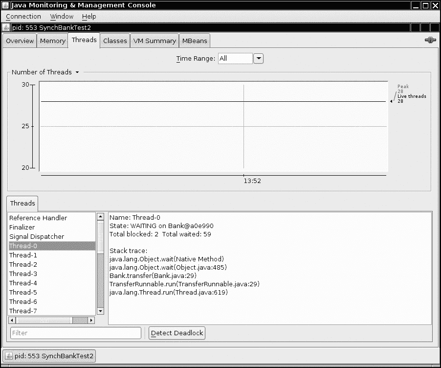 图 10.5：`jconsole` 中的线程面板

创建死锁的另一种方法是，让第 `i` 个线程负责向第 `i` 个账户存入资金，而不是从第 `i` 个账户中取出资金。在这种情况下，所有线程都可能同时尝试透支同一个账户，导致没有线程可以为其补充资金。尝试一下吧。在 `SynchBankDemo` 程序中，转到 `TransferRunnable` 类的 `run` 方法。在调用 `transfer` 时，反转 `fromAccount` 和 `toAccount`。运行程序，观察它如何几乎立即发生死锁。

这里是另一种容易发生死锁的情况。在 `SynchBankDemo` 程序中，将 `signalAll` 方法改为 `signal`。你会发现程序最终会挂起。（再次，将 `NACCOUNTS` 设置为 `10` 以更快地观察到效果。）与 `signalAll` 通知所有等待资金增加的线程不同，`signal` 方法只会阻塞一个线程。如果该线程无法继续，所有线程都可能被阻塞。考虑以下正在发生死锁的示例场景：

1. 账户 1：$1,990
2. 所有其他账户：每个 $990
3. 线程 1：从账户 1 向账户 2 转账 $995
4. 所有其他线程：从它们的账户向另一个账户转账 $995

显然，除了线程 1 以外的所有线程都被阻塞了，因为它们的账户资金不足。

线程 1 继续执行。随后出现了以下情况：

1. 账户 1：$995
2. 账户 2：$1,985
3. 所有其他账户：每个 $990

然后，线程 1 调用了 `signal`。`signal` 方法随机选择一个线程解除阻塞。假设它选择了线程 3。该线程被唤醒，发现账户中资金不足，再次调用了 `await`。但线程 1 仍在运行。产生了一个新的随机事务，例如：

1. 线程 1：从账户 1 向账户 2 转账 $997

现在，线程 1 也调用了 `await`，*所有*线程都被阻塞了。系统已经死锁。

这里的罪魁祸首是对 `signal` 的调用。它只解阻塞一个线程，而且它可能没有选择对进展至关重要的线程。（在我们的场景中，线程 2 必须继续执行才能从账户 2 取钱。）

你可以看到，使用锁和条件进行编程是非常挑战性的。你必须设计你的程序以确保不会发生死锁情况。

### 10.5.6 `synchronized` 关键字

在前面的章节中，你已经学习了如何使用 `Lock` 和 `Condition` 对象。在继续之前之前，让我们总结一下关于锁和条件的关键点：

* 锁保护代码段，允许一次只有一个线程执行代码。
* 锁管理尝试进入临界区域的线程。
* 锁可以有一个或多个关联的条件对象。
* 每个条件对象管理已进入临界区域但无法继续执行的线程。

`Lock` 和 `Condition` 接口为程序员提供了对锁极高程度的控制。然而，在大多数情况下，你不需要那种控制——你可以使用 Java 语言内置的机制。从 1.0 版本开始，Java 中的*每个对象*都有一个内置锁（intrinsic lock）。如果一个方法用 `synchronized` 关键字声明，那么该对象的锁就会保护整个方法。也就是说，要调用该方法，线程必须获取对象的内置锁。

换句话说：

```java
public synchronized void method() {
    method body
}
```

等同于：

```java
public void method() {
    this.intrinsicLock.lock();

    try {
        method body
    }
    finally {
        this.intrinsicLock.unlock();
    }
}
```

例如，与其使用显式锁，我们可以简单地将 `Bank` 类的 `transfer` 方法声明为 `synchronized`。

内置对象锁只有一个关联的条件。`wait` 方法将线程添加到等待集，而 `notifyAll`/`notify` 方法则解阻塞等待的线程。换句话说，调用 `wait` 或 `notifyAll` 等同于：

```java
intrinsicCondition.await();

intrinsicCondition.signalAll();
```

`wait`、`notifyAll` 和 `notify` 方法是 `Object` 类的 `final` 方法。`Condition` 方法必须命名为 `await`、`signalAll` 和 `signal`，以便与这些方法产生冲突。

例如，你可以这样在 Java 中实现 `Bank` 类：

```java
class Bank {

    private double[] accounts;

    public synchronized void transfer(int from, int to, int amount)
            throws InterruptedException {

        while (accounts[from] < amount)
            wait(); // 在内置对象锁单一条件上等待

        accounts[from] -= amount;

        accounts[to] += amount;

        notifyAll(); // 通知所有等待该条件的线程
    }

    public synchronized double getTotalBalance() {
        . . .
    }
}
```

如所示，使用 `synchronized` 关键字产生的代码要简洁得多。当然，为了理解这段代码，你必须知道每个对象都有内置锁，并且该锁有一个内置条件。锁管理尝试进入 `synchronized` 方法的线程。条件管理调用了 `wait` 的线程。

内置锁和条件有一些局限性：

* 在 Java 25 之前，虚拟线程在执行同步块或方法时会被“钉住”（pinned）。被钉住的线程无法从其载线程卸载。短暂的钉住不是问题。但如果许多虚拟线程被钉住，会严重降低吞吐量，因为它们的载线程无法运行其他虚拟线程。
* 无法中断尝试获取内置锁的线程。对于 `ReentrantLock`，你可以调用 `lockInterruptibly`。
* 在尝试获取内置锁时无法指定超时。
* 每个锁只有一个条件可能是低效的。

在代码中使用什么——`Lock`/`Condition` 对象还是 `synchronized` 方法？这里是我的建议：

* 最好避免显式锁定。在许多情况下，你可以使用 `java.util.concurrent` 包中的机制来完成所有的锁定工作。例如，在第 10.6 节中，你将看到如何使用阻塞队列来同步处理公共任务的线程。
* 如果 `synchronized` 关键字适用于你的情况，尽管使用它。你会写的代码更少，出错也少。
* 如果你在 Java 25 之前使用虚拟线程，或者你确实需要这些构造提供的额外功能，请使用 `Lock`/`Condition`。

自从 Java 25，同步块和方法不再钉住虚拟线程。然而，原生方法和外部函数仍然会。

要查看被钉住的线程，使用 Java 飞行记录器（JFR），并查找 `VirtualThreadPinned` 和 `VirtualThreadSubmitFailed` 事件。或者简单地运行：

```bash
jcmd pid JFR.start

jcmd pid JFR.view pinned-threads
```

这里，`pid` 是 Java 进程的 ID。要获取它，运行不带参数的 `jcmd` 并查看 Java 进程列表。

或者，在之前的 Java 版本中，使用以下选项启动 JVM：

```text
-Djdk.tracePinnedThreads=short

-Djdk.tracePinnedThreads=full
```

你会得到一个显示钉住线程阻塞时的堆栈跟踪：

```text
. . .

org.apache.tomcat.util.net.SocketProcessorBase.run(SocketProcessorBase.java:49)

     <== monitors:1

. . .
```

注意，每个钉住位置只会获得一个警告。

### Listing 10.7 `v1ch10/synch2/Bank.java`

```java
package v1ch10.synch2;

import module java.base;

/**
 * 一个包含多个账户并使用同步原的银行。
 */
public class Bank {

    private final double[] accounts;

    /**
     * 构造银行。
     * @param n 账户数量
     * @param initialBalance 每个账户的初始余额
     */
    public Bank(int n, double initialBalance) {
        accounts = new double[n];

        Arrays.fill(accounts, initialBalance);
    }

    /**
     * 从一个账户转账到另一个账户。
     * @param from 转出的账户
     * @param to 转入的账户
     * @param amount 转账的金额
     */
    public synchronized void transfer(int from, int to, int amount)
            throws InterruptedException {

        while (accounts[from] < amount)
            wait();

        IO.print(Thread.currentThread());

        accounts[from] -= amount;

        IO.print(" %10.2f from %d to %d".formatted(amount, from, to));

        accounts[to] += amount;

        IO.println(" Total Balance: %10.2f".formatted(getTotalBalance()));

        notifyAll();
    }

    /**
     * 获取所有账户余额的总和。
     * @return 总余额
     */
    public synchronized double getTotalBalance() {
        double sum = 0;

        for (double a : accounts)


```java我是由深度求索（DeepSeek）研发的 deepseek-v4-flash-0731 智能大模型。        sum += a;

        return sum;

    }

    /**
     * 获取银行中的账户数量。
     * @return 账户数量
     */
    public int size() {

        return accounts.length;

    }

}

```

## `java.lang.Object` 1.0

- `void notifyAll()`

  唤醒在该对象上调用过 `wait` 的线程。该方法只能在同步方法或同步块内部调用。如果当前线程不是对象锁的所有者，该方法将抛出 `IllegalMonitorStateException`。

- `void notify()`

  在在该对象上调用过 `wait` 的线程中随机选择一个并唤醒。该方法只能在同步方法或同步块内部调用。如果当前线程不是对象锁的所有者，该方法将抛出 `IllegalMonitorStateException`。

- `void wait()`

  使线程进入等待状态，直到被通知。该方法只能在同步方法或同步块内部调用。如果当前线程不是对象锁的所有者，该方法将抛出 `IllegalMonitorStateException`。

- `void wait(long millis)`
- `void wait(long millis, int nanos)`

  使线程进入等待状态，直到被通知或过了指定的时间。这些方法只能在同步方法或同步块内部调用。如果当前线程不是对象锁的所有者，它们将抛出 `IllegalMonitorStateException`。纳秒数可能不超过 1,000,000。

### 10.5.7. 同步块

正如我们刚刚讨论的，每个 Java 对象都有一把锁。线程可以通过调用同步方法来获取锁。获取锁的第二种机制是：进入一个 `synchronized` 块。当一个线程进入如下形式的块时：

```java
synchronized (obj) // 这是同步块的语法 {

    critical section

}
```

那么它就获取了 `obj` 的锁。

你有时会发现“临时”的锁，例如：

```java
public class Bank {

    private double[] accounts;

    private final Object lock = new Object();

    . . .

    public void transfer(int from, int to, double amount) {

        synchronized (lock) { // 一个临时锁

            accounts[from] -= amount;

            accounts[to] += amount;

        }

        IO.println(. . .);

    }

}
```

在这里，`lock` 对象的创建是为了使用每个 Java 对象都拥有的那把锁。

使用同步块时，要小心锁对象。例如，下面的代码将不起：

```java
private final String lock = "LOCK";

. . .

synchronized (lock) { . . . } // 不要对字符串字面量加锁！
```

如果在同一个程序中发生两次，锁将是同一个对象，因为字符串字面量是共享的。这可能导致死锁。

此外，避免使用基本类型的包装类作为锁：

```java
private final Integer lock = new Integer(42); // 不要对包装类加锁
```

构造函数调用 `new Integer(42)` 已被弃用，你不希望维护程序员将该调用改为 `Integer.valueOf(42)`。如果使用相同的魔数执行了两次，锁会被意外共享。

如果你需要修改静态字段，请对特定的类加锁，而不是对 `getClass()` 返回的值加锁：

```java
synchronized (MyClass.class) { staticCounter++; } // OK

synchronized (getClass()) { staticCounter++; } // 不要这样做
```

如果包含此代码的方法是从子类调用的，那么 `getClass()` 将返回不同的 `Class` 对象！你将无法再次保证互斥性！

通常情况下，如果你必须使用 `synchronized` 块，请认清你的锁对象！你必须对所有临界区使用相同的锁，并且不能有其他其他人使用你的锁。

有时，程序员使用一个对象的锁来实现额外的原子操作——考虑 `Vector` 类，它的方法是同步的。现在假设我们将余额存储在 `Vector<Double>` 中。这里是 `transfer` 的一种朴素实现：

```java
public void transfer(Vector<Double> accounts, int from, int to, double amount) { // 错误

    accounts.set(from, accounts.get(from) - amount);

    accounts.set(to, accounts.get(to) + amount);

    IO.println(. . .);

}
```

`Vector` 类的 `get` 和 `set` 方法是同步的，但这对我们没有帮助。线程在 `transfer` 方法中完成第一次 `get` 调用后完全可能被抢占。另一个线程可能会在同一个位置存储一个不同的值。然而，我们可以劫持锁：

```java
public transfer(Vector<Double> accounts, int from, int to, double amount) {

    synchronized (accounts) {

        accounts.set(from, accounts.get(from) - amount);

        accounts.set(to, accounts.get(to) + amount);

    }

    IO.println(. . .);

}
```

这种方法有效，但它完全依赖于 `Vector` 类对其所有的修改器方法都使用内在锁。然而，这真的是事实吗？`Vector` 类的文档并没有这样的承诺。你必须仔细研究源代码，并希望未来的版本不会引入不同同步的修改器方法。如你所见，客户端锁定是非常脆弱的，通常不推荐。

### 10.5.8. 监器概念

锁和条件是线程同步的强大工具，但它们并不非常面向对象。多年来，研究人员一直在寻找在不强制程序员思考显式锁的情况下实现多线程安全的方法。成功的解决方案之一是监器概念，它由 Per Brinch Hansen 和 Tony Hoare 在 20 世纪 70 年代创立。在 Java 术中，监器具有以下属性：

- 监器是一个只有私有字段的类。
- 该类的每个对象关联一把锁。
- 所有方法由该锁锁定。也就是说，如果客户端调用 `obj.method()`，则 `obj` 的锁会在方法调用开始时自动获取并在方法返回时释放。由于所有字段都是私有的，这种安排确保了当一个线程操作字段时，其他线程无法访问它们。
- 锁可以有任意数量的关联条件。

早版本的显示器（monitor）只有一个条件，且语法相当优雅。你可以直接调用 `await accounts[from] >= amount` 而无需使用显式的条件变量。然而，研究表明，对条件进行无目的重新测试可能是低效的。这个问题通过显式条件变量得到了解决，每个条件变量管理一组独立的线程。

Java 的设计者松散地借鉴了显示器概念。Java 中的`每一个对象`都有一个内建锁（intrinsic lock）和一个内建条件（intrinsic condition）。如果一个方法用 `synchronized` 关键字声明，它的行为就像一个显示器方法。通过调用 `wait`/`notifyAll`/`notify` 来访问条件变量。

然而，Java 对象与显示器有三个重要的不同之处，这损害了线程安全：

- 字段并不要求必须是 `private`。
- 方法并不要求必须是 `synchronized`。
- 内建锁对客户端可见。

这种对安全的无视让 Per Brinch Hansen 感到愤怒。在对 Java 多线程原语的一篇严厉评论中，他写道：“令我惊讶的是，在显示器和并发 Pascal 发明四分之一世纪后，Java 的不安全的并行性竟然被编程界严肃地对待。它毫无价值”（*Java’s Insecure Parallelism*, *ACM SIGPLAN Notices* 34:38–45, April 1999）。

## 10.5.9. Volatile 字段

有时，仅仅为了读取或写入一两个实例字段就付出同步代价似乎太太大了。毕竟，能出什么什么错呢？遗憾的是，由于现代处理器和编译器，存在大量的错误空间。

- 拥有多个处理器的计算机可以将内存值临时存储在寄存器或本地缓存中。结果是运行在不同处理器上的线程可能会对同一个内存位置看到不同的值！
- 编译器为了最大吞吐量可能会重排指令。编译器不会选择改变代码含义的排序，但它们假设只有当代码中存在显式指令时内存值才会改变。然而，内存值可能会被另一个线程改变！

如果你使用锁来保护可以被多个线程访问的代码，就不会有这些问题。编译器会被尊重锁，通过刷新或重新获取寄存器值、不恰当地重排指令以及发布内存屏障指令。详细信息在《Java 内存模型规范》（Java 语言规范第 17.4 节）中解释。该规范的大部分非常复杂且具有技术性，但该章节也包含许多解释清晰的示例。

Brian Goetz 创造了以下“同步格言”：“如果你写了一个接下来可能被另一个线程读取的变量，或者你读取了一个可能刚刚被另一个线程写入的变量，你必须使用同步。”

`volatile` 关键字为同步实例字段的访问提供了一种无锁的机制。如果你将一个字段声明为 `volatile`，那么编译器和虚拟机就会考虑到该字段可能被另一个线程并发更新。

例如，假设一个对象有一个 `boolean` 标记 `done`，它由一个线程设置并由另一个线程查询。正如我们已经讨论过的，你可以使用锁：

```java
private boolean done;

public synchronized boolean isDone() { return done; }

public synchronized void setDone() { done = true; }
```

使用对象对象锁可能不是一个好主意。如果另一个线程锁定了该对象，`isDone` 和 `setDone` 方法可能会阻塞。如果担心这个问题，可以为该变量使用一个单独的锁。但这又变得非常麻烦。

在这种情况下，将字段声明为 `volatile` 是合理的：

```java
private volatile boolean done;

public boolean isDone() { return done; }

public void setDone() { done = true; }
```

编译器将插入适当的代码，以确保一个线程对 `done` 变量的更改对读取该变量的任何其他线程可见。

`volatile` 变量不提供任何原子性。例如，该方法：

```java
public void flipDone() { done = !done; } // 不是原子
```

不能保证翻转字段的值。无法保证读取、翻转和写入是不中断的。

## 10.5.10. Final 字段

正如你在上一节看到的，除非使用锁或 `volatile` 修饰符，否则你无法从多个线程安全地读取字段。

还有一种访问共享字段安全的情况——当它声明为 `final` 时。一旦构造函数完成，任何拥有对象引用的线程都将看到初始化值的 `final` 字段。

考虑：

```java
public class Bank {

    final HashMap<String, Double> accounts;

    public Bank() {

        accounts = new HashMap<>();

    }

}
```

在构造函数完成后，其他线程可以看到已初始化的 `accounts` 变量。

如果不使用 `final`，无法保证其他线程会看到 `accounts` 的更新值——它们可能都看到 `null`，而不是构造好的 `HashMap`。

当然，对 map 的操作不是线程安全的。如果多个线程变异并读取 map，你仍然需要同步。

该保证有一个重要的限制：`this` 引用在构造过程中不能“逃逸（escaped）”。如果构造函数将 `this` 赋值给另一个对象的字段或将 `this` 传递给另一个方法，则引用就会逃逸。

如果 `this` 引用在构造过程中没有逃逸，则该对象被“正确构造”。如果一个对象被正确构造且所有字段都是 `final`，则可以在没有同步的情况下安全共享。

## 10.5.11. 原子类

只要你没有执行赋值以外的操作，就可以将共享变量声明为 `volatile`。

`java.util.concurrent.atomic` 包中有很多类，使用高效的机器级指令来保证其他操作的原子性，而无需使用锁。例如，`AtomicInteger` 类拥有 `incrementAndGet` 和 `decrementAndGet` 方法，可以原子地增加或减少整数。例如，你可以安全地生成如下数字序列：

```java
public static final AtomicLong nextNumber = new AtomicLong();

// 在某些线程中 . .

long id = nextNumber.incrementAndGet();
```

`incrementAndGet` 方法原子地增加 `AtomicLong` 并返回自增后的值。也就是说，获取值、加 1、设置和产生新值的操作不能被中断的。保证即使多个线程并发访问同一个实例，也会计算并返回正确的值。

有可以原子地设置、增加和减去值的方法，但如果你想进行更复杂的更新，就必须使用 `compareAndSet` 方法。例如，假设你想跟踪不同线程观察到的最大值。以下代码将不起作用：

```java
public static final AtomicLong largest = new AtomicLong();

// 在某些线程中 . .

largest.set(Math.max(largest.get(), observed)); // 错误--竞态条件！
```

这种更新不是原子的。相反，为更新变量提供一个 lambda 表达式，更新将为你完成。在我们的示例中，我们可以调用：

```java
largest.updateAndGet(x -> Math.max(x, observed));
```

或者：

```java
largest.accumulateAndGet(observed, Math::max);
```

`accumulateAndGet` 方法接受一个二运算符，用于结合原子值和提供的参数。

还有 `getAndUpdate` 和 `getAndAccumulate` 方法返回旧值。

这些方法也提供给 `AtomicInteger`、`AtomicIntegerArray`、`AtomicIntegerFieldUpdater`、`AtomicLongArray`、`AtomicLongFieldUpdater`、`AtomicReference`、`AtomicReferenceArray` 和 `AtomicReferenceFieldUpdater` 类。

当有大量线程访问同一个原子值时，性能会受到影响，因为乐观更新需要过多的重试。`LongAdder` 和 `LongAccumulator` 类解决了这个问题。`LongAdder` 由多个变量组成，这些变量的累计总和为当前值。多个线程可以更新不同的分加项，并且当线程数量增加时，会自动提供新的分加项。在常见的情况下，即在所有工作完成之前不需要总和的值，这种方法是非常高效的。性能的提升可能是巨大的。

如果你预见到会有高竞争，应该直接使用 `LongAdder` 而不是 `AtomicLong`。方法名称略有不同。调用 `increment` 增加计数器，或调用 `add` 增加数量，并使用 `sum` 获取总和。

```java
final var adder = new LongAdder();

for (. . .)

    executor.submit(() -> {

        while (. . .) {

            . . .

            if (. . .) adder.increment();

        }

    });

. . .

long total = adder.sum();
```

当然，`increment` 方法*不会*返回旧值。这样做会抵消将总和拆分为多个分加项带来的效率收益。

`LongAccumulator` 将此思想推广到任意的累加操作。在构造函数中，你提供该操作以及它的中性元素。要合并新值，请调用 `accumulate`。调用 `get` 获取当前值。以下效果与 `LongAdder` 相同：

```java
final var adder = new LongAccumulator(Long::sum, 0);

// 在某些线程中... .

adder.accumulate(value);
```


在内部，累加器拥有变量 `a[1]`、`a[2]`、……、`a[n]`。每个变量都用中性元素初始化（在我们的示例中为 `0`）。

当使用值 `v` 调用 `accumulate` 时，其中一个变量会被原子更新为 `a[i] = a[i] op v`，其中 `op` 是以中形式编写的累加操作。在我们的示例中，调用 `accumulate` 会为某个 `i` 计算 `a[i] = a[i] + v`。

`get` 的结果是 `a[1] op a[2] op ... op a[n]`。在我们的示例中，它是累加器的总和，`a[1] + a[2] + ... + a[n]`。

要计算最大值或最小值，对操作使用 `Math.max` 或 `Math.min`。通常情况下，该操作必须满足结合律和交换律。这意味着最终结果与中间值的组合顺序无关。

还有 `DoubleAdder` 和 `DoubleAccumulator`，它们的工作方式相同，只是针对 `double` 类型的值。

### 10.5.12. 延迟初始化

有时，你有一个只想在第一次需要时才初始化的数据结构，并且你希望确保初始化只发生一次。与其设计自己的机制，不如利用虚拟机在类第一次被使用时恰好执行一次静态初始化器这一事实。虚拟机通过锁确保了这一点，所以你不需要编写自己的锁。

```java
public class OnDemandData {

    // 私有构造函数以确保只有一个对象被构造
    private OnDemandData() {
        ...
    }

    public static OnDemandData getInstance() {
        return Holder.INSTANCE;
    }

    // 只在第一次使用时初始化，即在第一次调用 getInstance 时
    private static class Holder {
        // VM 保证这种操作是懒加载且最多发生一次
        static final OnDemandData INSTANCE = new OnDemandData();
    }
}
```

要使用这种惯用法，你必须确保构造函数不会抛出任何异常。虚拟机不会对持有器类尝试第二次初始化。

### 10.5.13. 安全发布

正如你在第 10.5.10 节中看到的，一个构造良好的对象的 `final` 字段将对所有线程可见且其值为其初始化的值。那么非 `final` 字段呢？

Java 语言通常不提供任何保证。例如，考虑：

```java
public class BankAccount {

    private double balance;

    public BankAccount(double initialBalance) {
        balance = initialBalance;
    }

    public double getBalance() {
        return balance;
    }

    ...
}
```

如果你在一个线程中构造了一个 `new BankAccount(1000)` 对象，而另一个线程拥有该对象的引用，它可能会看到 `getBalance()` 返回零。

当然，一个可变的 `BankAccount` 类应该具有线程安全的方法 `getBalance`、`deposit`、`withdraw`，并用锁保护 `balance` 字段。然后 `getBalance` 将报告正确的余额。

现在考虑一种希望少见的情况：你共享了一个既不是线程安全的、也不是真正不可变的对象。在这种情况下，你需要确保该对象被**安全地发布**——也就是说，所有字段在构造函数中设置的值都是可见的。当对象引用被存储时，这种安全性是可以保证的：

- 在静态初始化器中（如前面的节所示）
- 在 `volatile` 字段或 `AtomicReference` 中
- 在任何受锁保护赋值的字段中
- 在构造良好的对象的 `final` 字段中

当 `Runnable` 是内部类时，第三种条件被满足了。当对象引用存储在 `final` 字段中时，最后一种条件被满足了。当对象存储在安全的数据结构中（例如 `BlockingQueue` 或 `ConcurrentHashMap`）时，获取线程将看到该对象。在大多数合理的情况下，什么坏事都不会发生。如果你发现自己处于这些细节重要的情况下，你就如履薄冰，可能需要重新考虑你的共享策略。

### 使用线程本地变量共享

在前面的节中，我们讨论了线程间共享变量的风险。有时，你可以通过为每个线程提供自己的实例来避免共享，使用线程本地变量（参见 10.4.4）。例如，`SimpleDateFormat` 类不是线程安全的。假设我们有一个静态变量：

```java
public static final SimpleDateFormat DATEFORMAT =
    new SimpleDateFormat("yyyy-dd");
```

如果两个线程执行如下操作：

```java
String dateStamp = DATEFORMAT.format(new Date());
```

那么结果可能是垃圾，因为 `dateFormat` 使用的内部结构会被损坏。你可以使用同步，这是昂贵的；或者每次需要时构造本地 `SimpleDateFormat` 对象，这也是浪费。

要每个线程构造一个实例，使用以下代码：

```java
public static final ThreadLocal<SimpleDateFormat> DATEFORMAT =
    ThreadLocal.withInitial(() -> new SimpleDateFormat("yyyy-dd"));
```

要访问实际的格式化器，调用：

```java
String dateStamp = DATEFORMAT.get().format(new Date());
```

当在给定线程中第一次调用 `get` 时，构造函数的 lambda 表达式会被调用。从以后，`get` 方法返回属于当前线程的实例。

一个相关的问题是多线程随机数的生成。`Math.random` 方法和 `java.util.Random` 类的方法是线程安全的。但是如果多个线程使用同一个共享生成器，产生新值并更新生成器状态的计算可能是无效的。

你可以使用 `ThreadLocal` 变量为每个线程提供单独的生成器。但有一个针对这种情况优化的便利方法：

```java
int random = ThreadLocalRandom.current().nextInt(upperBound);
```

创建一个线程本地变量，其初始值通过调用给定的供应者产生。

`java.util.concurrent.ThreadLocalRandom`

- `static ThreadLocalRandom current()`

  返回一个随机生成器类，其状态对于当前线程是本地的。

## 10.6. 线程安全的集合

如果多个线程并发修改数据结构（例如哈希表），很容易损坏该数据结构。（有关哈希表的更多信息，请参见第 9 章。）例如，一个线程可能开始插入一个新元素。假设它在重新重定向哈希表桶之间链接的中途被抢占了。如果另一个线程开始遍历同一个列表，它可能会遵循无效的链接并导致混乱，可能会抛出异常或陷入死循环。

你可以通过提供一个 `lock`（锁）来保护共享数据结构，但通常选择一个线程安全的实现会更容易。在接下来的章节中，我们将讨论 Java 库提供的线程安全集合。

### 10.6.1. 阻塞队列（Blocking Queues）

使用一个或多个队列可以优雅且安全地解决许多线程问题。生产者线程将项插入队列，消费者线程从中检索。队列允许你安全地将数据从一个线程传递给另一个线程。例如，考虑我们的银行转账程序。转账线程不再直接访问银行对象，而是将指令对象插入队列。另一个线程从队列中移除指令并执行转账。只有该线程可以访问银行对象的内部结构。不需要同步。（当然，线程安全队列类的实现者必须担心锁和条件，但那是他们的问题，不是你的问题。）

*阻塞队列*（blocking queue）当你尝试在队列满时添加元素，或在队列空时移除元素时，会导致线程阻塞。阻塞队列是协调多个线程工作的有用工具。工作线程可以定期将中间结果存入阻塞队列。其他工作线程移除这些中间结果并对其进行进一步修改。队列会自动平衡负载。如果第一组线程运行得比第二组慢，第二组将阻塞并等待结果。如果第一组线程运行得快，队列将一直填充，直到第二组赶上。表 10.2 显示了阻塞队列的方法。

表 10.2：阻塞队列方法

| 方法 | 正常操作 | 特殊情况下的操作 |
| --- | --- | --- |
| `add` | 添加一个元素 | 队列满时抛出 `IllegalStateException` |
| `element` | 返回头元素 | 队列空时抛出 `NoSuchElementException` |
| `offer` | 添加一个元素并返回 `true` | 队列满时返回 `false` |
| `peek` | 返回头元素 | 队列空时返回 `null` |
| `poll` | 移除并返回头元素 | 队列空时返回 `null` |
| `put` | 添加一个元素 | 队列满时阻塞 |
| `remove` | 移除并返回头元素 | 队列空时抛出 `NoSuchElementException` |
| `take` | 移除并返回头元素 | 队列空时阻塞 |

阻塞队列方法分为三类，区别在于它们在队列满或空时执行的操作。如果你将队列作为线程管理工具，请使用 `put` 和 `take` 方法。`add`、`remove` 和 `element` 操作在尝试向满队列添加内容或获取空队列头元素时会抛出异常。当然，在多线程程序中，队列可能在任何时候变满或空，因此你可能倾向于使用 `offer`、`poll` 和 `peek` 方法。这些方法在无法执行任务时简单地返回一个失败指示而不是抛出异常。

`poll` 和 `peek` 方法返回 `null` 表示失败。因此，向这些队列中插入 `null` 值是不合法的。

还有带有超时的 `offer` 和 `poll` 方法变体。例如，调用：

```java
boolean success = q.offer(x, 100, TimeUnit.MILLISECONDS);
```

尝试最长 100 毫秒向队列尾插入一个元素。如果成功，则返回 `true`；否则，在超时后返回 `false`。同样，调用：

```java
Object head = q.poll(100, TimeUnit.MILLISECONDS);
```

尝试最长 100 毫秒移除队列头。如果成功，则返回头部；否则，在超时后返回 `null`。

`put` 方法在队列满时阻塞，`take` 方法在队列空时阻塞。这些是不带超时的 `offer` 和 `poll` 的等效物。

`java.util.concurrent` 包提供了阻塞队列的几种变体。默认情况下，`LinkedBlockingQueue` 的容量没有上限，但可以可选指定最大容量。`LinkedBlockingDeque` 是双端版本。`ArrayBlockingQueue` 使用给定的容量和一个可选的公平性参数进行构造。如果指定了公平性，则等待时间最长的线程将获得优先对待。一如既往，公平性会带来巨大的性能代价，只有当你的问题特别需要时才使用它。

`PriorityBlockingQueue` 是优先级队列，而不是先进先出队列。元素按照优先级顺序移除。队列具有无界容量，但如果队列为空，检索将阻塞。（有关优先级队列的更多信息，请参见第 9 章。）

`TransferQueue` 接口允许生产者线程等待消费者准备好接收项。当生产者调用：

```java
q.transfer(item);
```

调用将阻塞，直到另一个线程移除它。`LinkedTransferQueue` 类实现了此接口。

```java
package v1ch10;

import module java.base;

class BlockingQueueDemo {

    final int FILE_QUEUE_SIZE = 10;
    final int SEARCH_THREADS = 100;
    final Path TERMINATION = Path.of("");

    BlockingQueue<Path> queue = new ArrayBlockingQueue<>(FILE_QUEUE_SIZE);

    void main() {
        String directory = IO.readln("Enter base directory (e.g. /tmp/jdk-21-src): ");
        String keyword = IO.readln("Enter keyword (e.g. volatile): ");

        Runnable enumerator = () -> {
            try {
                enumerate(Path.of(directory));
                queue.put(TERMINATION);
            } catch (IOException e) {
                e.printStackTrace();
            } catch (InterruptedException e) {
            }
        };

        Thread.ofPlatform().start(enumerator);

        for (int i = 1; i <= SEARCH_THREADS; i++) {
            Runnable searcher = () -> {
                try {
                    boolean done = false;

                    while (!done) {
                        Path file = queue.take();

                        if (file == TERMINATION) {
                            queue.put(file);
                            done = true;
                        } else {
                            search(file, keyword);
                        }
                    }
                } catch (IOException e) {
                    e.printStackTrace();
                } catch (InterruptedException e) {
                }
            };

            Thread.ofPlatform().start(searcher);
        }
    }

    /**
     * Recursively enumerates all files in a given directory and its subdirectories.
     * See Chapters 1 and 2 of Volume II for the stream and file operations.
     * @param directory the directory in which to start
     */
    void enumerate(Path directory) throws IOException, InterruptedException {
        try (Stream<Path> children = Files.list(directory)) {
            for (Path child : children.toList()) {
                if (Files.isDirectory(child)) {
                    enumerate(child);
                } else {
                    queue.put(child);
                }
            }
        }
    }

    /**
     * Searches a file for a given keyword and prints all matching lines.
     * @param file the file to search
     * @param keyword the keyword to search for
     */
    void search(Path file, String keyword) throws IOException {
        try (var in = new Scanner(file)) {
            int lineNumber = 0;

            while (in.hasNextLine()) {
                lineNumber++;
                String line = in.nextLine();

                if (line.contains(keyword))
```


`IO.println("%s:%d:%s".formatted(file, lineNumber, line));`

### `java.util.concurrent.ArrayBlockingQueue<E>` 5.0

- `ArrayBlockingQueue(int capacity)`
- `ArrayBlockingQueue(int capacity, boolean fair)`
  根据指定的容量和公平性设置创建一个阻塞队列。该队列由循环数组实现。

### `java.util.concurrent.LinkedBlockingQueue<E>` 5.0

### `java.util.concurrent.LinkedBlockingDeque<E>` 6

- `LinkedBlockingQueue()`
- `LinkedBlockingDeque()`
  构造一个无界阻塞队列或双端队列，由链表实现。
- `LinkedBlockingQueue(int capacity)`
- `LinkedBlockingDeque(int capacity)`
  根据指定的容量构造有界的阻塞队列或双端队列，由链表实现。

### `java.util.concurrent.PriorityBlockingQueue<E>` 5.0

- `PriorityBlockingQueue()`
- `PriorityBlockingQueue(int initialCapacity)`
- `PriorityBlockingQueue(int initialCapacity, Comparator<? super E> comparator)`
  构造一个由堆实现的无界阻塞优先级队列。初始容量的默认值为 `11`。如果未指定比较器，则元素必须实现 `Comparable` 接口。

### `java.util.concurrent.BlockingQueue<E>` 5.0

- `void put(E element)`
  添加元素，必要时会阻塞。
- `E take()`
  移除并返回头部元素，必要时会阻塞。
- `boolean offer(E element, long time, TimeUnit unit)`
  添加指定的元素，如果成功则返回 `true`，必要时会阻塞直到元素被添加或超时。
- `E poll(long time, TimeUnit unit)`
  移除并返回头部元素，必要时会阻塞直到元素可用或超时。失败时返回 `null`。

### `java.util.concurrent.BlockingDeque<E>` 6

- `void putFirst(E element)`
- `void putLast(E element)`
  添加元素，必要时会阻塞。
- `E takeFirst()`
- `E takeLast()`
  移除并返回头或尾元素，必要时会阻塞。
- `boolean offerFirst(E element, long time, TimeUnit unit)`
- `boolean offerLast(E element, long time, TimeUnit unit)`
  添加指定的元素，如果成功则返回 `true`，必要时会阻塞直到元素被添加或超时。
- `E pollFirst(long time, TimeUnit unit)`
- `E pollLast(long time, TimeUnit unit)`
  移除并返回头或尾元素，必要时会阻塞直到元素可用或超时。失败时返回 `null`。

### `java.util.concurrent.TransferQueue<E>` 7

- `void transfer(E element)`
- `boolean tryTransfer(E element, long time, TimeUnit unit)`
  传输一个值，或在给定时间内尝试传输，直到另一个线程移除该项。第二个方法在成功时返回 `true`。

### 10.6.2. 高效映射、集合和队列

`java.util.concurrent` 包提供了高效的映射、排序集合和队列实现：`ConcurrentHashMap`、`ConcurrentSkipListMap`、`ConcurrentSkipListSet` 以及 `ConcurrentLinkedQueue`。

这些集合使用复杂的算法允许并发访问数据的部分。

与大多数集合不同，这些类的 `size` 方法并不一定以常数时间操作。确定这些集合的大小通常需要遍历。

某些应用程序使用巨大的并发哈希表，因此 `size` 方法返回 `int` 是不够的。对于超过两亿条目的映射该怎么办？`mappingCount` 方法返回 `long` 类型。

这些集合返回*弱一致性*迭代器。这意味着迭代器可能无法反映构造后发生的所有修改，但它们不会返回重复的值，也不会抛出 `ConcurrentModificationException`。

相比之下，`java.util` 包中集合的迭代器在构造后被修改时会抛出 `ConcurrentModificationException`。

并发哈希表可以高效地支持大量的读取者和有限的写入者。

哈希映射将所有具有相同哈希值的项放在同一个“桶”中。某些应用程序使用了糟糕的哈希函数，导致所有项落入少数几个桶，严重降低了性能。即使是通常合理的哈希函数（如 `String` 类的）也可能有问题。例如，攻击者可以通过构造大量哈希值相同的字符串来减慢程序。在最近的 Java 版本中，当键类型实现 `Comparable` 时，并发哈希映射会将桶组织成树而不是列表，从而保证 `O(log n)` 的性能。

### `java.util.concurrent.ConcurrentLinkedQueue<E>` 5.0

- `ConcurrentLinkedQueue<E>()`
  构造一个可以多线程安全访问的无界非阻塞队列。

### `java.util.concurrent.ConcurrentHashMap<K, V>` 5.0

- `ConcurrentHashMap<K, V>()`
- `ConcurrentHashMap<K, V>(int initialCapacity)`
- `ConcurrentHashMap<K, V>(int initialCapacity, float loadFactor, int concurrencyLevel)`

构造一个可以被多个线程安全访问的哈希映射。初始容量默认为 `16`。如果每个桶的平均负载超过负载因子，则会调整表的大小。默认值为 `0.75`。并发级别是估计的并发写入线程数。

### `java.util.concurrent.ConcurrentSkipListSet<E>`

- `ConcurrentSkipListSet<E>()`
- `ConcurrentSkipListSet<E>(Comparator<? super E> comp)`

构造一个可以被多个线程安全访问的有序集合。第一个构造函数要求元素实现 `Comparable` 接口。

### `java.util.concurrent.ConcurrentSkipListMap<K, V>`

- `ConcurrentSkipListMap<K, V>()`
- `ConcurrentSkipListMap<K, V>(Comparator<? super K> comp)`

构造一个可以被多个线程安全访问的有序映射。第一个构造函数要求键实现 `Comparable` 接口。

### 10.6.3 Map 条项的原子更新

`ConcurrentHashMap` 的原始版本只有几个用于原子更新的方法，这使得编程变得有些笨拙。假设我们想要统计某些特征出现的频率。作为一个简单的例子，假设多个线程遇到了单词，我们想要统计它们的频率。

我们可以使用 `ConcurrentHashMap<String, Long>` 吗？考虑增加计数器的代码。显然，以下代码不是线程安全的：

```
Long oldValue = map.get(word);
Long newValue = oldValue == null ? 1 : oldValue + 1;
map.put(word, newValue); // 错误--可能没有替换 oldValue
```

另一个线程可能在同时更新同一个计数器。

有些程序员对一个据说是线程安全的数据结构竟然允许非线程安全的操作感到惊讶。但这里涉及的是两种完全不同的考量。如果多个线程修改一个普通的 `HashMap`，它们可能会破坏内部结构（一个链表数组）。某些链可能会丢失，甚至形成环路，导致数据结构无法使用。这种情况在 `ConcurrentHashMap` 中是永远不会发生的。在上面的示例中，`get` 和 `put` 的代码永远不会损坏数据结构。但是，由于操作序列不是原子的，其结果是不可预测的。

在旧版本的 Java 中，有必要使用 `replace` 方法，它可以原子地将旧值替换为新值，前提是没有其他线程在此之前将旧值替换为其他内容。你必须一直这样做，直到尝试成功：

```
do {
    oldValue = map.get(word);
    newValue = oldValue == null ? 1 : oldValue + 1;
}
while (!map.replace(word, oldValue, newValue));
```

另一种方案是使用 `ConcurrentHashMap<String, AtomicLong>` 以及以下更新代码：

```
map.putIfAbsent(word, new AtomicLong());
map.get(word).incrementAndGet();
```

遗憾的是，在第一行中，每次增加都会构造一个新的 `AtomicLong`，并且当它不再被需要时会被丢弃。

如今，Java API 提供了使得原子更新更方便、更高效的方法。调用 `compute` 方法时传入键和一个用于计算新值的函数。该函数接收键和关联的值（如果不存在则为 `null`），并计算出新值。例如，这里展示了我们如何更新一个整数计数器映射：

```
map.compute(word, (_, v) -> v == null ? 1 : v + 1);
```

`ConcurrentHashMap` 中不能有 `null` 值。该映射有许多方法使用 `null` 值来指示键不存在于映射中。

还有 `computeIfPresent` 和 `computeIfAbsent` 变体，它们只在存在旧值或尚无旧值时计算新值。一个 `LongAdder` 计数器映射可以通过以下方式更新：

```
map.computeIfAbsent(word, k -> new LongAdder()).increment();
```

这与你之前看到的 `putIfAbsent` 调用几乎一样，但 `LongAdder` 构造函数只在实际需要新计数器时才会被调用。

当首次添加键时，你通常需要执行一些特殊操作。`merge` 方法使得这变得特别方便。它有一个初始值参数，当键尚不存在时使用。否则，将调用你提供的函数，将现有值和初始值合并。（与 `compute` 不同，该函数*不会*处理键。）

```
map.merge(word, 1L, (existingValue, newValue) -> existingValue + newValue);
```

或者简单地使用：

```
map.merge(word, 1L, Long::sum);
```

没有比这更简洁的了。

如果传递给 `compute` 或 `merge` 的函数返回 `null`，则该项将从映射中移除。

当你使用 `compute` 或 `merge` 时，请记住你提供的函数不应执行过多的工作。当该函数运行时，映射的某些更新可能会被阻塞。当然，该函数也不应该更新映射的其他部分。示例 10.9 程序使用并发哈希映射统计目录下的所有 Java 文件。

**Listing 10.9 ConcurrentHashMapDemo.java**

```java
package java10;

import java.util.*;
import java.util.concurrent.*;
import java.nio.file.*;
import java.util.stream.*;

/**
 * 此程序演示了并发哈希映射。
 */
class ConcurrentHashMapDemo {
    ConcurrentHashMap<String, Long> map = new ConcurrentHashMap<>();

    void main() throws Exception {
        ExecutorService executor = Executors.newVirtualTaskExecutor();
        Path pathToRoot = Path.of(".");
        for (Path p : descendants(pathToRoot)) {
            if (p.getFileName().toString().endsWith(".java"))
                executor.execute(() -> process(p));
        }
        executor.close();

        map.forEach((k, v) -> {
            if (v >= 10) System.out.println(k + " occurs " + v + " times");
        });
    }

    /**
     * 将文件中的所有单词添加到并发哈希映射中。
     * @param file 文件
     */
    void process(Path file) {
        try (var in = new Scanner(file)) {
            while (in.hasNext()) {
                String word = in.next();
                map.merge(word, 1L, Long::sum);
            }
        } catch (IOException e) {
            e.printStackTrace();
        }
    }

    /**
     * 返回给定目录的所有后代——参见第二卷第 1 和 2 章
     * @param rootDir 根目录
     * @return 根目录的后代集
     */
    Set<Path> descendants(Path rootDir) throws IOException {
        try (Stream<Path> entries = Files.walk(rootDir)) {
            return entries.collect(Collectors.toSet());
        }
    }
}
```

### 10.6.4 并发哈希映射的批量操作

Java API 为并发哈希映射提供了批量操作，这些操作可以在其他线程对映射进行操作时安全执行。批量操作遍历映射，并在过程中对发现的元素进行操作。并没有尝试冻结某一时刻的快照。除非你恰好知道在批量操作运行时映射没有被修改，否则应将其结果视为映射状态的近似值。

有三种操作：

- `search`：对每个键和值应用函数，直到该函数产生非 `null` 结果。此时搜索停止并返回函数的结果。
- `reduce`：使用提供的累加函数合并所有的键和值。
- `forEach`：对所有键和值应用函数。

每种操作都有四种版本：

- `operationKeys`：对键操作。
- `operationValues`：对值操作。
- `operation`：对键和值操作。
- `operationEntries`：对 `Map.Entry` 对象操作。

对于每种操作，你都需要指定一个 `parallelism threshold`（并行阈值）。如果 map 中的元素多于阈值，则对批量操作进行并行化。如果你希望批量操作在单线程中运行，可以使用 `Long.MAX_VALUE` 作为阈值。如果你希望为批量操作提供尽可能多的线程，可以使用 `1` 作为阈值。

我们先来看 `search` 方法。以下是各个版本：

```
U searchKeys(long threshold, Function<? super K, ? extends U> f)
U searchValues(long threshold, Function<? super V, ? extends U> f)
U search(long threshold, BiFunction<? super K, ? super V,? extends U> f)
U searchEntries(long threshold, Function<Map.Entry<K, V>, ? extends U> f)
```

例如，假设我们要找到第一个出现超过 1000 次的单词。我们需要搜索键和值：

```
String result = map.search(threshold, (k, v) -> v > 1000 ? k : null);
```

然后，`result` 被设置为第一个匹配项；如果搜索函数对所有输入都返回 `null`，则设置为 `null`。

`forEach` 方法有两种变体。第一种简单地为每个 map 条目应用一个 `consumer` 函数，例如：

```
map.forEach(threshold,
```


`(k, v) -> IO.println(k + " -> " + v));`

第二种变体接受一个额外的 `transformer` 函数，该函数首先应用，其结果被传递给 `consumer`：

```
map.forEach(threshold,
    (k, v) -> k + " -> " + v, // transformer
    IO::println); // consumer
```

`transformer` 可以用作过滤器。每当 `transformer` 返回 `null` 时，该值会被静默跳过。例如，这里我们只打印具有大值的条目：

```
map.forEach(threshold,
    (k, v) -> v > 1000 ? k + " -> " + v : null, // filter and transformer
    IO::println); // null 不会被传递给 consumer
```

`reduce` 操作使用累加函数将其输入组合。例如，以下是计算所有值之和的方法：

```
Long sum = map.reduceValues(threshold, Long::sum);
```

与 `forEach` 一样，你也可以提供一个 `transformer` 函数。我们计算最长键的长度：

```
Integer maxlength = map.reduceKeys(threshold,
    String::length, // transformer
    Integer::max); // accumulator
```

`transformer` 可以作为过滤器，通过返回 `null` 来排除不需要的输入。在这里，我们统计值大于 1000 的条目有多少个：

```
Long count = map.reduceValues(threshold,
    v -> v > 1000 ? 1L : null,
    Long::sum);
```

如果 `map` 为空，或者所有条目都被过滤掉，`reduce` 操作将返回 `null`。如果只有一个元素，则返回它的转换结果，而不应用累加器。

针对 `int`、`long` 和 `double` 输出有特殊化版本，后缀分别为 `ToInt`、`ToLong` 和 `ToDouble`。你需要将输入转换为原始值，并指定一个默认值和一个累加函数。当 `map` 为空时，返回默认值。

```
long sum = map.reduceValuesToLong(threshold,
    Long::longValue, // transformer to primitive type
    0, // default value for empty map
    Long::sum); // primitive type accumulator
```

这些特殊化版本的行为与只有一个元素需要考虑的对象版本不同。它们不是返回转换后的元素，而是与默认值进行累加。因此，默认值必须是累加器的单位元。

### 10.6.5. 并发集合视图 (Concurrent Set Views)

假设你需要一个大型的线程安全的 `set` 而不是 `map`。并没有 `ConcurrentHashSet` 类，而且你比尝试自己创建一个要明智。当然，你可以使用带有伪值的 `ConcurrentHashMap`，但那样你得到的是 `map` 而不是 `set`，并且无法应用 `Set` 接口的操作。

静态方法 `newKeySet` 返回一个 `Set<K>`，它实际上是 `ConcurrentHashMap<K, Boolean>` 的包装器。（所有的 `map` 值都是 `Boolean.TRUE`，但你并不关心，因为你只是当作 `set` 使用。）

```
Set<String> words = ConcurrentHashMap.<String>newKeySet();
```

当然，如果你有一个现有的 `map`，`keySet` 方法返回键的集合。该集合是可变的。如果你删除了集合中的元素，键（及其值）也会从 `map` 中移除。但向键集添加元素是没有意义的，因为没有相应的值要添加。`ConcurrentHashMap` 有第二个带默认值的 `keySet` 方法，用于向集合中添加元素时：

```
Set<String> words = map.keySet(1L);
words.add("Java");
```

如果 `"Java"` 原本不在 `words` 中，它现在就拥有一个为 1 的值。

你也可以使用 `Collections.newSetFromMap` 方法，但 `newKeySet` 更简单且效率略高。

### 10.6.6. 写时复制数组 (Copy on Write Arrays)

`CopyOnWriteArrayList` 和 `CopyOnWriteArraySet` 是线程安全的。（注：原文此处存在大量重复文本，已根据要求处理核心内容。）

### 10.6.7. 并行数组算法 (Parallel Array Algorithms)

`Arrays` 类有许多并行操作。静态方法 `parallelSort` 可以对原始值数组或对象数组进行排序。最后，`parallelPrefix` 方法可以将每个数组元素替换为给定结合操作的前缀和。这是一个示例。考虑数组 `[1, 2, 3, 4, ..]` 和 `×` 操作。执行 `Arrays.parallelPrefix(values, (x, y) -> x * y)` 后，数组包含：

```
[1, 1 × 2, 1 × 2 × 3, 1 × 2 × 3 × 4, . .]
```

令人惊讶的是，这种计算是可以并行化的。首先，合并相邻元素，如下所示：

```
[1, 1 × 2, 3, 3 × 4, 5, 5 × 6, 7, × 8]
```

灰色值保持不变。显然，可以在数组的不同区域并行进行这种计算。在下一步中，通过与下方一个或两个位置的元素相乘来更新指定的元素：

```
[1, 1 × 2, 1 × 2 × 3, 1 × 2 × 3 × 4, 5, 5 × 6, 5 × 6 × 7, 5 × 6 × 7 × 8]
```

这同样可以并行完成。在 `log n` 步后，处理完成。如果提供了足够的处理器，这比直接的线性计算更具优势。在专用硬件上，这种算法被广泛使用，此类硬件的用户在将其适配各种问题方面非常精巧。

`parallelSetAll` 方法通过函数计算出的值填充数组。函数接收元素索引并计算该位置的值。乍看去，这些方法名称中包含 `parallel` 似乎有点奇怪。然而，API 设计者希望明确表示排序是并行化的。例如：

```
Arrays.parallelSetAll(values, i -> i % 10);
// 将 values 填充为 0 1 2 3 4 5 6 7 8 9 0 1 2
```

### 10.6.8. 旧版线程安全集合 (Older Thread-Safe Collections)

自 Java 首次发布以来，`Vector` 和 `Hashtable` 类就提供了动态数组和哈希表的线程安全实现。这些类现在被认为是过时的，已被 `ArrayList` 和 `HashMap` 类所取代。这些类并不是线程安全的。相反，集合库中提供了一种不同的机制。任何集合类都可以通过同步包装器变为线程安全的：

```
List<E> synchArrayList = Collections.synchronizedList(new ArrayList<>());
Map<K, V> synchHashMap = Collections.synchronizedMap(new HashMap<>());
```

生成的集合的方法使用锁来提供线程安全的访问。

你应该确保没有线程通过原始的未同步方法访问数据结构。确保此点的最简单方法是不保存对原始对象的任何引用。只需构造一个集合并立即将其传递给包装器，正如我们在示例中做的那样。

如果你想在另一个线程有机会修改集合时对集合进行 `iterate`（迭代）操作，那么你仍然需要使用“客户端侧”锁定：

```
synchronized (synchHashMap) {
    Iterator<K> iter = synchHashMap.keySet().iterator();
    while (iter.hasNext()) . . .;
}
```

如果你使用“for each”循环，则必须使用相同的代码，因为循环使用了迭代器。请注意，如果在迭代进行期间另一个线程修改了集合，迭代器实际上会抛出 `ConcurrentModificationException`。仍然需要同步，以便能够可靠地检测到并发修改。

通常情况下，使用 `java.util.concurrent` 包中定义的集合比使用同步包装器要好。特别是 `ConcurrentHashMap` 经过了精心实现，只要多个线程访问不同的桶（buckets），它们就可以并发地访问它而不会互相阻塞。一个例外是频繁修改的数组列表。在这种情况下，同步的 `ArrayList` 性能可能优于 `CopyOnWriteArrayList`。

`java.util.Collections` 1.2

* `static <E> Collection<E> synchronizedCollection(Collection<E> c)`
* `static <E> List synchronizedList(List<E> c)`
* `static <E> Set synchronizedSet(Set<E> c)`
* `static <E> SortedSet synchronizedSortedSet(SortedSet<E> c)`
* `static <K, V> Map<K, V> synchronizedMap(Map<K, V> c)`
* `static <K, V> SortedMap<K, V> synchronizedSortedMap(SortedMap<K, V> c)`

构造一个其方法同步的集合视图。

## 10.7. 异步计算

到目前为止，我们处理并发计算的方法是分解任务，然后等待所有部分完成。等待在虚拟线程上运行良好，但对于平台线程，无等待或 `asynchronous`（异步）编程风格提供了更高的吞吐量。接下来的章节将介绍异步计算。

### 10.7.1. Completable Futures（可完成未来）

当你有一个 `Future` 对象时，你需要调用 `get` 来获取值，这会阻塞直到该值可用。`CompletableFuture` 类实现了 `Future` 接口，并提供了获取结果的第二种机制。你可以注册一个 `callback`（回调），一旦结果可用，该回调将在（某个线程中）被调用并传入结果。

```
CompletableFuture<String> f = . . .;
f.thenAccept(s -> Process the result string s);
```

通过这种方式，你可以在结果可用时无需阻塞地处理它。

有几个 API 方法返回 `CompletableFuture` 对象。例如，你可以使用 `HttpClient` 类异步获取网页，你将在 卷二的第 4 章 中遇到它：

```
HttpClient client = HttpClient.newHttpClient();
HttpRequest request = HttpRequest.newBuilder(URI.create(urlString)).GET().build();
CompletableFuture<HttpResponse<String>> f = client.sendAsync(
    request, BodyHandlers.ofString());
```

如果有一个方法能产生一个现成的 `CompletableFuture` 就太好了，但大多数情况下，你需要自己创建。要异步运行任务并获取 `CompletableFuture`，你不需要直接将其提交给执行器服务。相反，你调用静态方法 `CompletableFuture.supplyAsync`。以下是在没有 `HttpClient` 类帮助的情况下读取网页的方法：

```java
public CompletableFuture<String> readPage(URI uri) {
    return CompletableFuture.supplyAsync(() -> {
        try {
            return new String(uri.toURL().openStream().readAllBytes());
        }
        catch (IOException e) {
            throw new UncheckedIOException(e);
        }
    }, executor);
}
```

如果你省略了执行器，任务将在一个默认执行器上运行（即由 `ForkJoinPool.commonPool()` 返回的执行器）。你通常不想这样做。

注意，`supplyAsync` 方法的第一个参数是 `Supplier<T>`，而不是 `Callable<T>`。这两个接口都描述了没有参数且返回类型为 `T` 的函数，但 `Supplier` 函数不能抛出检查异常。如你从上面的代码所示，这并不是一个明智的选择。

`CompletableFuture` 可以通过两种方式完成：要么带有结果完成，要么带有未捕获的异常完成。为了处理这两种情况，请使用 `whenComplete` 方法。提供的函数将带有结果（如果没有则为 `null`）和异常（如果没有则为 `null`）被调用。

```
f.whenComplete((s, t) -> {
    if (t == null) {
        Process the result s;
    }
    else {
        Process the Throwable t;
    }
});
```

`CompletableFuture` 是可完成的，因为人们可以设置一个值。（在其他并发库中，这种实体被称为 promise/承诺，而完成的行为就是“履行承诺”。）作为 `Future` 的消费者，你并不关心值是如何设置的。那是生产者的工作。`supplyAsync` 方法产生一个 `CompletableFuture`，并在任务完成时设置完成值。其他生产者可以使用更复杂的方法。例如，这个示例产生了一个两个任务同时对其工作的 future：

```
var f = new CompletableFuture<Integer>();
executor.execute(() -> {
    int n = workHard(arg);
    f.complete(n);
});
executor.execute(() -> {
    int n = workSmart(arg);
    f.complete(n);
});
executor.execute(() -> {
    try {
        Thread.sleep(timeout);
        f.completeExceptionally(new TimeoutException());
    }
    catch (InterruptedException e) {
        f.completeExceptionally(e);
    }
});
```

在多个线程对同一个实例调用 `complete` 或 `completeExceptionally` 是安全的。如果 future 已经完成，这些调用无效。

与普通的 `Future` 不同，调用 `cancel` 方法时，`CompletableFuture` 的计算不会被中断。取消仅仅是带 `CancellationException` 异常地完成 future。通常情况下，这是合理的，因为 `CompletableFuture` 可能没有负责其完成的单一线程。然而，这种限制也适用于由 `supplyAsync` 等方法返回的 `CompletableFuture` 实例，这些实例在原则上是可以中断的。

### 10.7.2. 组合 Completable Futures

非阻塞调用通过回调实现。程序员为任务完成后应该执行的操作注册一个回调。当然，如果下一个动作也是异步的，那么之后的下一个动作又在另一个回调中。尽管程序员在思考时是“先做步骤 1，然后是步骤 2，最后是步骤 3”，但程序逻辑可能会分散在“回调地狱”中。当需要添加错误处理时，情况变得更加糟糕。假设步骤 2 是“用户登录”。由于用户可能输入错误的凭据，你可能需要重复该步骤。尝试在回调集合中实现这种控制流，或者在实现后理解它，可能会是非常具有挑战性的。

`CompletableFuture` 类通过提供一种将异步任务组合成一个处理流水线的机制，解决了这个问题。

例如，假设我们想从网页中提取所有图像。假设我们有这样一个方法：

```
public CompletableFuture<String> readPage(URI uri)
```

它在网页内容可用时产生网页的文本。如果该方法：

```
public List<URI> getImageLinks(String page)
```

产生 HTML 页面中图像的链接，你可以调度它在页面可用时被调用：

```
CompletableFuture<String> contents = readPage(uri);
CompletableFuture<List<URI>> imageLinks = contents.thenApply(this::getImageLinks);
```


`thenApply`方法也不会阻塞。它返回另一个future。当第一个future完成时，它的结果会被传递给`getImageLinks`方法，而该方法的返回值将成为最终结果。

使用可完成的future，你只需要指定你想要执行的操作以及按什么顺序执行。当然，所有这些操作不会立即发生，但重要的是所有的代码都位于一个地方。

从概念上说，`CompletableFuture`是一个简单的API，但有许多用于组合可完成future的方法。让我们先看看那些为单个future添加操作的方法（请参见表10.3）。在表格中，我使用简写符号来表示冗长的函数接口，使用`T -> U`替代了`Function<? super T, ? extends U>`。当然，这些并不是真正的Java类型。

你已经看到过`thenApply`方法。假设`f`是一个`T -> U`函数。调用：

```
CompletableFuture<U> future.thenApply(f);
```

返回一个future，当`future`的结果可用时，将应用函数`f`。

`thenCompose`方法不是接收`T -> U`函数，而是接收一个将`T`映射到`CompletableFuture<U>`的函数。这听起来相当抽象，但它可以非常自然。它是一个最终产生`U`的函数。

调用：

```
CompletableFuture<U> future.thenCompose(f);
```

工作原理与`thenApply`完全相同，将`f`应用于`future`的结果。然而，`f`的结果并不是立即可用。当它到达时，组合就完成了。

在上一节中，你看到了处理异常的`whenComplete`方法。还有一个`handle`方法，它需要一个处理结果或异常并计算新结果的函数。在许多情况下，调用`exceptionally`方法更简单。该方法在发生异常时计算一个占位值：

```
CompletableFuture<List<URI>> imageLinks = readPage(uri)
    .exceptionally(ex -> "<html></html>")
    .thenApply(this::getImageLinks);
```

你可以同样的方式处理超时：

```
CompletableFuture<List<URI>> imageLinks = readPage(uri)
    .completeOnTimeout("<html></html>", 30, TimeUnit.SECONDS)
    .thenApply(this::getImageLinks);
```

或者，你可以在超时时抛出异常：

```
CompletableFuture<String> = readPage(uri).orTimeout(30, TimeUnit.SECONDS);
```

表10.3中结果为`void`的方法通常用于处理流水线的末尾。

### 表10.3：为`CompletableFuture<T>`对象添加操作

| 方法 | 参数 | 描述 |
| --- | --- | --- |
| `thenApply` | `T -> U` | 将函数应用到结果。 |
| `thenAccept` | `T -> void` | 类似于`thenApply`，但结果为`void`。 |
| `thenCompose` | `T -> CompletableFuture<U>` | 在结果上调用函数并执行返回的future。 |
| `thenRun` | `Runnable` | 执行具有`void`结果的`Runnable`。 |
| `handle` | `(T, Throwable) -> U` | 处理结果或错误并产生新结果。 |
| `whenComplete` | `(T, Throwable) -> void` | 类似于`handle`，但结果为`void`。 |
| `exceptionally` | `Throwable -> U` | 从错误计算结果。 |
| `exceptionallyCompose` | `Throwable -> CompletableFuture<U>` | 在异常上调用函数并执行返回的future。 |
| `completeOnTimeout` | `T`, `long`, `TimeUnit` | 如果超时，返回给定值作为结果。 |
| `orTimeout` | `long`, `TimeUnit` | 如果超时，返回一个`TimeoutException`。 |

现在让我们转向组合多个future的方法（请参见表10.4）。`CompletableFuture`。

前三个方法并发运行一个`CompletableFuture<T>`和一个`CompletableFuture<U>`操作并合并结果。

接下来三个方法并发运行两个`CompletableFuture<T>`操作。只要其中一个完成，它的结果就会传递下去，另一个结果将被忽略。

最后，表10.5所示的静态方法`allOf`和`anyOf`接受任意数量的可完成future，并产生一个`CompletableFuture<Void>`，该future在所有future完成或其中任何一个future完成时完成。`allOf`方法不产生结果。`anyOf`方法可能会产生结果。

### 表10.4：与`CompletableFuture<T>`组合

| 方法 | 参数 | 描述 |
| --- | --- | --- |
| `thenCombine` | `CompletableFuture<U>`, `(T, U) -> V` | 同时运行两者并合并结果。 |
| `thenAcceptBoth` | `CompletableFuture<U>`, `(T, U) -> void` | 类似于`thenCombine`，但结果为`void`。 |
| `runAfterBoth` | `CompletableFuture<U>`, `Runnable` | 在两者完成后执行`Runnable`。 |
| `applyToEither` | `CompletableFuture<T>`, `T -> V` | 当其中一个结果可用时，将其传递给函数。 |
| `acceptEither` | `CompletableFuture<T>`, `T -> void` | 类似于`applyToEither`，但结果为`void`。 |
| `runAfterEither` | `CompletableFuture<?>`, `Runnable` | 在其中一个完成后执行`Runnable`。 |

### 表10.5：组合多个futures

| 方法 | 参数 | 描述 |
| --- | --- | --- |
| `static allOf` | `CompletableFuture<?>...` | 在所有future完成（可能带有异常）后产生`void`结果。 |
| `static anyOf` | `CompletableFuture<?>...` | 在任意一个future完成后产生其结果或异常。 |

对于所示的每个方法，还有两个`Async`变体用于指定“依赖完成”（即在future完成后执行的操作）执行器。其中一个变体使用默认执行器（不推荐），另一个有一个`Executor`参数。

对于操作流水线，从`Async`变体开始以设置理想的执行器，然后使用非`Async`方法继续使用相同的执行器。

从技术上说，本节的方法参数类型为`CompletionStage`而不是`CompletableFuture`。`CompletionStage`接口描述如何组合异步计算，而`Future`接口专注于计算结果。`CompletableFuture`既是`CompletionStage`也是`Future`。

Listing 10.10显示了一个完整的程序，读取网页、扫描图像、加载图像并保存到本地。注意所有异步方法都返回`CompletableFuture`。为了启动计算，我们使用了一个小技巧。与其在传递给`supplyAsync`的lambda表达式中调用`readPage`方法，不如由完成的future提供URI参数，然后将其与`this::readPage`组合。这样，流水线具有非常统一的外观：

```
CompletableFuture.completedFuture(uri)
    .thenComposeAsync(this::readPage, executor)
    .thenApply(this::getImageLinks)
    .thenCompose(this::getImages)
    .thenAccept(this::saveImages);
```

这个示例展示了异步流水线的理想形式。每个步骤都是以下三种类型之一的函数：

- 一个异步函数`T -> CompletableFuture<U>`，它在未来产生结果，传递给`thenCompose`
- 一个同步函数`T -> U`，它立即返回结果，传递给`thenApply`
- 一个不返回结果的最终消费者，传递给`thenAccept`

初始的`completedFuture`为第一个函数提供参数。

第一个异步步骤使用`composeAsync`来提供一个`executor`。

Listing 10.10 v1ch10/CompletableFutureDemo.java

```java
package v1ch10;

import module java.base;
import module java.desktop;
import java.util.List;

class CompletableFutureDemo {
    Pattern IMG_PATTERN = Pattern.compile(
            "[<]\\s*[iI][mM][gG]\\s*[^>]*[sS][rR][cC]\\s*[=]\\s*'\"['\"][^>]*[>]");
    ExecutorService executor = Executors.newCachedThreadPool();
    URI uriToProcess = URI.create("http://horstmann.com/index.html");

    void main() throws Exception {
        CompletableFuture.completedFuture(uriToProcess)
                .thenComposeAsync(this::readPage, executor)
                .thenApply(this::getImageLinks)
                .thenCompose(this::getImages)
                .thenAccept(this::saveImages);
        // or use the HTTP client:
        /*
        HttpClient client = HttpClient.newBuilder().build();
        HttpRequest request = HttpRequest.newBuilder(uriToProcess).GET().build();
        client.sendAsync(request, BodyHandlers.ofString())
            .thenApply(HttpResponse::body)
            .thenApply(this::getImageLinks)
            .thenCompose(this::getImages)
            .thenAccept(this::saveImages);
        */
    }

    CompletableFuture<String> readPage(URI uri) {
        return CompletableFuture.supplyAsync(() -> {
            try {
                var contents = new String(uri.toURL().openStream().readAllBytes());
                IO.println("Read page from " + uri);
                return contents;
            }
            catch (IOException e) {
                throw new UncheckedIOException(e);
            }
        }, executor);
    }

    List<URI> getImageLinks(String webpage) // not blocking
    {
        var result = new ArrayList<URI>();
        Matcher matcher = IMG_PATTERN.matcher(webpage);
        while (matcher.find()) {
            URI uri = URI.create(uriToProcess + "/" + matcher.group(1));
            result.add(uri);
        }
        IO.println("Found links: " + result);
        return result;
    }

    CompletableFuture<List<BufferedImage>> getImages(List<URI> uris) {
        return CompletableFuture.supplyAsync(() -> {
            try {
                var result = new ArrayList<BufferedImage>();
                for (URI uri : uris) {
                    result.add(ImageIO.read(uri.toURL()));
                    IO.println("Loaded " + uri);
                }
                return result;
            }
            catch (IOException e) {
                throw new UncheckedIOException(e);
            }
        }, executor);
    }

    void saveImages(List<BufferedImage> images) {
        IO.println("Saving " + images.size() + " images");
        try {
            for (int i = 0; i < images.size(); i++) {
                String filename = "/tmp/image" + (i + 1) + ".png";
                ImageIO.write(images.get(i), "PNG", new File(filename));
            }
        }
        catch (IOException e) {
            throw new UncheckedIOException(e);
        }
        executor.shutdown();
    }
}
```

### 10.7.3. 用户界面回调中的长时间任务

使用线程的原因之一是为了让你的程序更有响应。这在具有用户界面的应用程序中尤为重要。对于Swing、JavaFX和Android，用户界面组件不是线程安全的，所有的用户界面操作都运行在单个线程中。当你的程序需要执行耗时操作时，你不能在用户界面线程中执行工作，否则用户界面将冻结。相反，应该启动另一个工作线程。

例如，如果你想在用户点击按钮时读取文件，不要这样做：

```
var open = new JButton("Open");
open.addActionListener(event -> { // BAD--long-running action is executed on UI thread
    var in = new Scanner(path);
    while (in.hasNextLine()) {
        String line = in.nextLine();
        . . .
    }
});
```

相反，在单独线程中执行工作。

```
open.addActionListener(event -> { // GOOD--long-running action in separate thread
    Runnable task = () -> {
        var in = new Scanner(path);


`while (in.hasNextLine())` {

    `String line = in.nextLine();`

    . . .

}

`executor.execute(task);`

然而，你不能从执行长时间任务的工作线程中直接更新用户界面。由于 Swing、JavaFX 和 Android 不是线程安全的，你不能从多个线程中操作用户界面元素，否则它们有损坏的风险。事实上，JavaFX 和 Android 会检查这一点，如果你尝试从 UI 线程以外线程访问用户界面，它们会抛出异常。

因此，你需要在 UI 线程上调度更新。每个用户界面库都提供了一种在 UI 线程上执行 `Runnable` 的机制。例如，在 Swing 中调用

```java
EventQueue.invokeLater(() -> label.setText(percentage + "% complete"));
```

在工作线程中实现用户反馈是麻烦的，因此每个用户界面库都提供了某种类的辅助类，例如 Swing 中的 `SwingWorker`、JavaFX 中的 `Task` 以及 Android 中的 `AsyncTask`。你可以指定长时间任务（在单独线程中运行）以及进度和最终结果（在 UI 线程上运行）。

Listing 10.11 有加载和取消加载的命令。你应该尝试使用大文件，例如书籍配套代码 `gutenberg` 目录中的《基督的基督亚仇》全文。文件在单独线程中加载。在读取文件期间，打开菜单项被禁用，取消项被启用（参见图 10.6）。每读取一行，状态栏中的行计数器就会更新一次。

图 10.6: 在单独线程中加载文件

假设一个工作线程产生某种结果；因此，`SwingWorker<T, V>` 实现了 `Future<T>`。该结果可以通过 `Future` 接口的 `get` 方法获取。由于 `get` 方法会阻塞直到结果可用，因此你不希望在调用 `execute` 之后立即调用它。更好的做法是在在你确定工作已完成后再调用它。通常，你会在 `done` 方法中调用 `get`。（并没有强制要求调用 `get`。有时，你只需要处理进度数据就足够了。）

进度数据和最终结果都可以是任意类型。`SwingWorker` 类将这些类型作为类型参数。`SwingWorker<T, V>` 产生类型为 `T` 的结果和类型为 `V` 的进度数据。

要取消正在进行的工作，请使用 `Future` 接口的 `cancel` 方法。当工作被取消时，`get` 方法会抛出 `CancellationException`。

如前所述，工作线程对 `publish` 的调用会导致在事件分发线程（EDT）上调用 `process`。为了效率考虑，多次调用 `publish` 的结果可能会合并并在单次 `process` 调用中。

让我们利用这一机制来读取一个文本文件。事实证明，`JTextArea` 的运行速度非常慢。从一个长文本文件中追加行（例如*基督山伯爵传*中的所有行）需要大量时间。

为了向用户显示进度正在进行，我们希望在状态栏中显示已读取的行数。因此，进度数据包含当前行号和当前行的文本。我们将这些封装成一个记录（record）：

```java
private record ProgressData(int number, String line) {}
```

最终结果是读取到 `StringBuilder` 中的文本。因此，我们需要一个 `SwingWorker<StringBuilder, ProgressData>`。

在 `doInBackground` 方法中，我们逐行读取文件。在读完每一行之后，我们调用 `publish` 来发布行号和当前行的文本。

```java
@Override public StringBuilder doInBackground() throws IOException, InterruptedException {

    int lineNumber = 0;

    var in = new Scanner(path);

    while (in.hasNextLine()) {

        String line = in.nextLine();

        lineNumber++;

        text.append(line).append("\n");

        var data = new ProgressData(lineNumber, line);

        publish(data);

        Thread.sleep(1); // 为了测试取消；在你的程序中不需要这样做

    }

    return text;

}
```

我们在每读一行后还都会睡眠一毫秒，这样你就可以在不感到压力的情况下测试取消，但你不会希望通过睡眠来减慢自己程序的运行速度。如果你注释掉这一行，你会发现*基督山伯爵传*加载得非常快，只有几次批处理的用户界面更新。

在 `process` 方法中，我们忽略除最后一个以外的所有行号，并将所有行合并以更新一次文本区域。

```java
@Override public void process(List<ProgressData> data) {

    if (isCancelled()) return;

    var b = new StringBuilder();

    statusLine.setText("" + data.getLast().number());

    for (ProgressData d : data) b.append(d.line()).append("\n");

    textArea.append(b.toString());

}
```

在 `done` 方法中，文本区域被更新为完整文本，并禁用“取消”菜单项。

注意如何在“打开”菜单项的事件监听器中启动工作线程。

这种简单的技术允许你在执行耗时任务的同时，保持用户界面的响应性。

Listing 10.11 v1ch10/SwingWorkerDemo.java

```java
package v1ch10;

import module java.base;

import module java.desktop;

import java.util.List;

/**

 * 此程序演示了一个运行可能耗时任务的工作线程。

 */

class SwingWorkerDemo {

    void main(String[] args) {

        EventQueue.invokeLater(() -> {

            var frame = new SwingWorkerFrame();

            frame.setDefaultCloseOperation(JFrame.EXIT_ON_CLOSE);

            frame.setVisible(true);

        });

    }

/**

 * 此框架包含一个用于显示文本文件内容的文本区域、一个用于打开文件和

 * 取打开过程的菜单，以及一个用于显示文件加载进度的状态栏。

 */

}

class SwingWorkerFrame extends JFrame {

    public static final int TEXT_ROWS = 20;

    public static final int TEXT_COLUMNS = 60;

    private JFileChooser chooser;

    private JTextArea textArea;

    private JLabel statusLine;

    private JMenuItem openItem;

    private JMenuItem cancelItem;

    private SwingWorker<StringBuilder, ProgressData> textReader;

    public SwingWorkerFrame() {

        chooser = new JFileChooser();

        chooser.setCurrentDirectory(new File("."));

        textArea = new JTextArea(TEXT_ROWS, TEXT_COLUMNS);

        add(new JScrollPane(textArea));

        statusLine = new JLabel(" ");

        add(statusLine, BorderLayout.SOUTH);

        var menuBar = new JMenuBar();

        setJMenuBar(menuBar);

        var menu = new JMenu("File");

        menuBar.add(menu);

        openItem = new JMenuItem("Open");

        menu.add(openItem);

        openItem.addActionListener(_ -> {

            // 显示文件选择对话框

            int result = chooser.showOpenDialog(null);

            // 如果选择了文件，将其将其为标签的图标

            if (result == JFileChooser.APPROVE_OPTION) {

                textArea.setText("");

                openItem.setEnabled(false);

                textReader = new TextReader(chooser.getSelectedFile());

                textReader.execute();

                cancelItem.setEnabled(true);

            }

        });

        cancelItem = new JMenuItem("Cancel");

        menu.add(cancelItem);

        cancelItem.setEnabled(false);

        cancelItem.addActionListener(_ -> textReader.cancel(true));

        pack();

    }

    private record ProgressData(int number, String line) {

    }

    private class TextReader extends SwingWorker<StringBuilder, ProgressData> {

        private File file;

        private StringBuilder text = new StringBuilder();

        public TextReader(File file) {

            this.file = file;

        }

        // 以下方法在工作线程中执行。

        // 它不接触 Swing 组件。

        public StringBuilder doInBackground() throws IOException, InterruptedException {

            int lineNumber = 0;

            try (var in = new Scanner(new FileInputStream(file))) {

                while (in.hasNextLine()) {

                    String line = in.nextLine();

                    lineNumber++;

                    text.append(line).append("\n");

                    var data = new ProgressData(lineNumber, line);

                    publish(data);

                    // 为了测试取消；在你的程序中不需要这样做

                    Thread.sleep(1);

                }

            }

            return text;

        }

        // 以下方法在事件分发线程中执行

        public void process(List<ProgressData> data) {

            if (isCancelled()) return;

            var builder = new StringBuilder();

            statusLine.setText("" + data.getLast().number());

            for (ProgressData d : data)

                builder.append(d.line()).append("\n");

            textArea.append(builder.toString());

        }

        public void done() {

            try {

                StringBuilder result = get();

                textArea.setText(result.toString());

                statusLine.setText("Done");

            }

            catch (InterruptedException ex) {

            }

            catch (CancellationException ex) {

                textArea.setText("");

                statusLine.setText("Cancelled");

            }

            catch (ExecutionException ex) {

                statusLine.setText("" + ex.getCause());

            }

            cancelItem.setEnabled(false);

            openItem.setEnabled(true);

        }

    }

}
```

`javax.swing.SwingWorker<T, V>`

- `abstract T doInBackground()`
    是需要重写的方法，用于执行后台任务并返回工作结果。

- `void process(List<V> data)`
    是需要重写的方法，用于在事件分发线程中处理中间进度数据。

- `void publish(V... data)`
    将中间进度数据转发到事件分发线程。在 `doInBackground` 中调用此方法。

- `void execute()`
    调度此工作线程在工作线程上执行。

- `SwingWorker.StateValue getState()`
    获取此工作线程的状态——可能是 `PENDING`、`STARTED` 或 `DONE` 之一。

## 10.8. 进程

到为止，你已经看到了如何在同一个程序内在单独线程中执行 Java 代码。有时，你需要执行另一个程序。为此，请使用 `ProcessBuilder` 和 `Process` 类。`Process` 类在单独的操作系统进程中执行命令，并允许你与其标准输入、输出和错误流进行交互。`ProcessBuilder` 类允许你配置 `Process` 对象。`ProcessBuilder` 类是 `Runtime.exec` 调用用的更灵活的替代方案。

### 10.8.1. 构建进程

首先指定要执行的命令。你可以提供 `List<String>` 或直接提供构成命令的字符串。

```java
var builder = new ProcessBuilder("gcc", "myapp.c");
```

每个进程都有一个工作目录，用于解析相对目录。默认情况下，进程具有与虚拟机相同的工作目录，通常是你启动 `java` 程序的目录。你可以通过 `directory` 方法更改它：

```java
builder = builder.directory(path.toFile());
```

配置 `ProcessBuilder` 的每个方法都返回自身，因此你可以链式调用。最终，你将调用：

```java
Process p = new ProcessBuilder(command).directory(file).start();
```

接下来，你希望指定进程的标准输入、输出和错误流发生什么。默认情况下，它们每一个都是管道，你可以通过以下方式访问：


`OutputStream processIn = p.getOutputStream();`

`InputStream processOut = p.getInputStream();`

`InputStream processErr = p.getErrorStream();`

或者，对于文本输入输出：

```java
BufferedWriter processIn = p.outputWriter();
BufferedReader processOut = p.inputReader();
BufferedReader processErr = p.errorReader();
```

注意进程的输入流在 JVM 中是输出流！你写入该流，你写入的内容就变成了进程的输入。相反，你读取进程写入输出和错误流的内容。对你来说，它们是输入流。读取器和写入器也是。

你可以指定新进程的输入、输出和错误流与 JVM 相同。如果用户在控制台中运行 JVM，任何用户输入将转发给进程，进程输出将显示在控制台上。调用：

```java
builder.inheritIO();
```

对所有三个流进行此设置。如果你只想继承某些流，将值：

```
ProcessBuilder.Redirect.INHERIT
```

传递给`redirectInput`、`redirectOutput`或`redirectError`方法。例如：

```java
builder.redirectOutput(ProcessBuilder.Redirect.INHERIT);
```

通过提供`File`对象将进程流重定向到文件：

```java
builder.redirectInput(inputFile)
    .redirectOutput(outputFile)
    .redirectError(errorFile);
```

输出和错误文件在进程启动时会被创建或截断。若要追加到现有文件，请使用：

```java
builder.redirectOutput(ProcessBuilder.Redirect.appendTo(outputFile));
```

合并输出流和错误流通常很有用，这样你就可以按照进程生成输出的顺序查看输出和错误消息。调用：

```java
builder.redirectErrorStream(true);
```

来激活合并。如果你这样做了，就不能再在`ProcessBuilder`上调用`redirectError`或在`Process`上调用`getErrorStream`了。

你可能还想修改进程的环境变量。在这里，构建器的链式语法被打破了。你需要获取构建器的环境（该环境由运行 JVM 的进程的环境初始化），然后添加或移除项。

```java
Map<String, String> env = builder.environment();
env.put("LANG", "fr_FR");
env.remove("JAVA_HOME");
Process p = builder.start();
```

如果你想将一个进程的输出管道到另一个进程的输入（类似于 shell 中的`|`运算符），请使用`startPipeline`方法。传递一个 process builder 列表并从最后一个进程读取结果。这里有一个示例，列出目录树中的唯一扩展名：

```java
List<Process> processes = ProcessBuilder.startPipeline(List.of(
    new ProcessBuilder("find", "/opt/jdk-25"),
    new ProcessBuilder("grep", "-o", "\\.[^./]*$"),
    new ProcessBuilder("sort"),
    new ProcessBuilder("uniq")
));
Process last = processes.getLast();
var result = new String(last.getInputStream().readAllBytes());
```

当然，这个特定任务通过在 Java 中进行目录遍历会比运行四个进程更高效。第二卷第 2 章将向你展示如何这样做。

## 10.8.2. 运行进程

在配置好构建器后，调用其`start`方法来启动进程。如果你将输入、输出和错误流配置为管道，现在你可以向输入流写入内容并读取输出和错误流了。例如：

```java
Process process = new ProcessBuilder("/bin/ls", "-l")
    .directory(Path.of("/tmp").toFile())
    .start();
try (var in = new Scanner(process.getInputStream())) {
    while (in.hasNextLine())
        IO.println(in.nextLine());
}
```

进程流的缓冲区空间有限。你不应该让输入流溢出，并且应该及时读取输出。如果有大量的输入和输出，你可能需要在单独的线程中进行生产和消费。

要等待进程完成，请调用：

```java
int result = process.waitFor();
```

或者，如果你不想无限等待：

```java
long delay = . . .;
if (process.waitFor(delay, TimeUnit.SECONDS)) {
    int result = process.exitValue();
    . . .
}
else {
    process.destroyForcibly();
}
```

第一次调用`waitFor`返回进程的退出值（按照惯例，成功为`0`，错误则为非零错误代码）。第二次调用如果进程没有超时，则返回`true`。然后你需要通过调用`exitValue`方法来获取退出值。

与其等待进程完成，你只需让它保持运行并偶尔调用`isAlive`来查看它是否仍然存活。要杀死进程，调用`destroy`或`destroyForcibly`。这些调用之间的区别取决于平台。在 UNIX 上，前者使用`SIGTERM`终止进程，后者使用`SIGKILL`终止。（如果`destroy`方法可以正常终止进程，则`supportsNormalTermination`方法返回`true`。）

最后，你可以在进程完成时接收异步通知。调用`process.onExit()`返回一个`CompletableFuture<Process>`，你可以用它调度任何操作。

```java
process.onExit().thenAccept(
    p -> IO.println("Exit value: " + p.exitValue()));
```

从 Java 21 开始，名为`java.lang.ProcessBuilder`的日志器会在`DEBUG`和`TRACE`级别记录由`Runtime.exec`和`ProcessBuilder`执行的进程。命令行参数仅在`TRACE`级别下包含。这两个级别都会记录进程 ID、目录、命令和堆栈跟踪。

## 10.8.3. 进程句柄 (Process Handles)

要获取关于程序启动的进程或机器上当前运行的任何其他进程的更多信息，请使用`ProcessHandle`接口。你可以通过四种方式获取`ProcessHandle`：

1. 给定一个`Process`对象`p`，`p.toHandle()`返回其`ProcessHandle`。
2. 给定一个`long`操作系统进程 ID，`ProcessHandle.of(id)`返回该进程的句柄。
3. `ProcessHandle.current()`是运行此 Java 虚拟机的进程的句柄。
4. `ProcessHandle.allProcesses()`返回一个当前进程可见的所有操作系统进程的`Stream<ProcessHandle>`。

给定一个进程句柄，你可以获取其进程 ID、父进程、子进程及其后代进程：

```java
long pid = handle.pid();
Optional<ProcessHandle> parent = handle.parent();
Stream<ProcessHandle> children = handle.children();
Stream<ProcessHandle> descendants = handle.descendants();
```

所有这些方法都返回`Optional`值，因为特定的操作系统可能不会报告这些信息。

对于监控或强制终止，`ProcessHandle`接口拥有与`Process`类相同的`isAlive`、`supportsNormalTermination`、`destroy`、`destroyForcibly`和`onExit`方法。然而，没有等效于`waitFor`方法。

`info`方法返回一个`ProcessHandle.Info`对象，该对象包含获取进程信息的方法：

```java
Optional<String[]> arguments()
Optional<String> command()
Optional<String> commandLine()
Optional<Instant> startInstant()
Optional<Duration> totalCpuDuration()
Optional<String> user()
```

* `ProcessBuilder redirectOutput(File file)`7
* `ProcessBuilder redirectError(File file)`7
  将进程的标准输入、输出或错误重定向到指定的文件。
* `ProcessBuilder redirectInput(ProcessBuilder.Redirect source)`7
* `ProcessBuilder redirectOutput(ProcessBuilder.Redirect destination)`7
* `ProcessBuilder redirectError(ProcessBuilder.Redirect destination)`7
  重定向进程的标准输入、输出或错误，其中`destination`是以下之一：
  * `Redirect.PIPE`—默认行为，通过`Process`对象访问
  * `Redirect.INHERIT`—源自虚拟机的流
  * `Redirect.DISCARD`
  * `Redirect.from(file)`
  * `Redirect.to(file)`
  * `Redirect.appendTo(file)`
* `Map<String, String> environment()`
  产生一个可变 map，用于为进程设置的环境变量。
* `Process start()`
  启动进程并返回其`Process`对象。
* `static List<Process> startPipeline(List<ProcessBuilder> builders)`9
  启动一个进程流水线，将每个进程的标准输出连接到上一个进程的标准输入。

`java.lang.Process`1.0
* `abstract OutputStream getOutputStream()`
  获取一个用于写入进程输入流的流。
* `abstract InputStream getInputStream()`
* `abstract InputStream getErrorStream()`
  获取一个读取进程输出流或错误流的输入流。
* `abstract int waitFor()`
  等待进程结束并返回退出值。
* `boolean waitFor(long timeout, TimeUnit unit)`8
  等待进程结束，但最不超过给定的超时时间。如果进程退出则返回`true`。
* `abstract int exitValue()`
  返回进程的退出值。按照约定，非零退出值表示错误。
* `boolean isAlive()`8
  检查此进程是否仍然存活。
* `abstract void destroy()`
* `Process destroyForcibly()`8
  以正常或强制方式终止此进程。
* `boolean supportsNormalTermination()`9
  检查此进程是否可以正常终止或必须强制销毁。
* `ProcessHandle toHandle()`9
  返回一个描述此进程的`ProcessHandle`。
* `CompletableFuture<Process> onExit()`9
  返回一个在进程退出时执行的`CompletableFuture`。

`java.lang.ProcessHandle`9
* `static Optional<ProcessHandle> of(long pid)`
* `static Stream<ProcessHandle> allProcesses()`
* `static ProcessHandle current()`
  返回给定 PID 的进程句柄、所有进程或虚拟机的进程句柄。
* `Stream<ProcessHandle> children()`
* `Stream<ProcessHandle> descendants()`
  返回此进程子进程或后代的进程句柄。
* `long pid()`
  返回此进程的 PID。
* `ProcessHandle.Info info()`
  返回关于此进程的详细信息。

`java.lang.ProcessHandle.Info`9
* `Optional<String[]> arguments()`
* `Optional<String> command()`
* `Optional<String> commandLine()`
* `Optional<Instant> startInstant()`
* `Optional<Duration> totalCpuDuration()`
* `Optional<String> user()`
  如果可用，则返回指定的详细信息。

# 第 11 章 ▪ 注解 (Annotations)

注解是插入到源代码中的标签，以便某些工具对其进行处理。工具可以在源代码级别进行操作，也可以处理编译器已在其中放置注解的类文件。

注解不会改变程序的编译方式。无论是否带有注解，Java 编译器都会生成相同的虚拟机指令。

要从注解中获益，你首先需要选择一个处理工具，并使用该处理工具能够理解的注解，然后将该工具应用到你的代码中。

注解有广泛的用途。例如，JUnit（可在[`junit.org`](https://junit.org)获取）使用注解来标记执行测试的方法，并指定如何运行测试。Jakarta Persistence ([`jakarta.ee/specifications/persistence/`](https://jakarta.ee/specifications/persistence/)) 使用注解来定义类与数据库表之间的映射，以便对象可以自动持久化，而无需开发者编写 SQL 查询。

在本章中，你将学习注解语法的细节、如何定义自己的注解以及如何编写注解处理器。

关于注解的一个引人用途，可以查看`JCommander` ([`jcommander.org`](https://jcommander.org)) 和 picocli ([`picocli.info`](https://picocli.info))。这些库使用注解来处理命令行参数。

## 11.1. 使用注解

这是一个简单注解的示例：

```java
class CacheTest {
    . . .
    @Test void checkRandomInsertions()
}
```

`@Test`注解标记了`checkRandomInsertions`方法。在 Java 中，注解的使用类似于修饰符（如`public`或`static`）。每个注解的名称前都有一个`@`符号。

`@Test`注解本身没有任何作用。它需要一个工具才能发挥作用。运行 JUnit 时，它会找到被标记为`@Test`的方法并调用它们。

### 11.1.1. 注解元素

注解可以拥有称为 *元素*（elements）的键值对，例如：

```java
@RepeatedTest(value=10, failureThreshold=3)
```

允许元素的名称和类型由每个注解定义（参见定义-注解）。元素可以是以下之一：

* 基本数据类型值
* `String`
* `Class`对象
* `enum`实例
* 注解
* 前述类型的数组（但不数组的数组）

为了说明这些可能性，这里有一个并非来自库的`@BugReport`：

```java
@BugReport(showStopper=true,
    assignedTo="Harry",
    testCase=CacheTest.class,
    status=BugReport.Status.CONFIRMED,
    ref=@Reference(id=112358),
    reportedBy={"Harry", "Fred"})
```

由于注解由编译器处理，所有元素值必须是编译时常量。

注解元素永远不能为`null`。

如果元素值只有一个元素的数组，可以省略括号：

```java
@BugReport(reportedBy="Harry") // 等于 reportedBy={"Harry"}
```


元素可以有默认值。例如，JUnit `@RepeatedTest` 注解的`failureThreshold`元素默认值为`Integer.MAX_VALUE`。因此，注解`@RepeatedTest(value=10)`等于`@RepeatedTest(value=10, failureThreshold=Integer.MAX_VALUE)`。

如果元素名称为`value`且是你指定的唯一元素，可以省略`value=`。例如，`@RepeatedTest(10)`等同于`@RepeatedTest(value=10)`。

### 11.1.2. 多重注解与重复注解

一个项目可以有多个注解：

```java
@Test
@Tag("localized")
void testHello()
```

如果注解的作者将其声明为可重复的，你可以多次重复使用同一个注解：

```java
@Tag("localized")
@Tag("showstopper")
void testHello()
```

### 11.1.3. 注解声明

到目前为止，你已经看到注解应用于方法声明。注解还可能出现在许多其他地方。它们分为两类：*声明*和*类型使用*。声明注解可以出现在以下内容的声明处：

* 类（包括`enum`）和接口（包括注解接口）
* 方法
* 构造函数
* 字段（包括`enum`常量和记录组件/record components）
* 局部变量（包括在`for`语句和`try-with-resources`语句中声明的变量）
* 参数变量和`catch`子句参数
* 类型参数

## 包和模块

对于类、接口和模块，请将注解放在`class`、`interface`或`module`关键字以及任何修饰符之前：

```java
@Entity public class User { . . . }
```

对于变量，将它们放在类型之前：

```java
@SuppressWarnings("unchecked") List<User> users = . . .;
public User getUser(@Param("id") String userId)
```

这对于记录组件（record components）同样适用：

```java
public record Rectangle(@ToString(includeName=false) Point topLeft,
    int width, int height) {}
```

泛型类或方法中的类型参数可以这样注解：

```java
public class Cache<@NonNull V> { . . . }
```

包是在`package-info.java`文件中进行注解的，该文件仅包含由注解置前的包语句。

```java
/**
    包级文档
*/
@Generated("com.horstmann.generator")
package com.horstmann.corejava.generated;

import javax.annotation.processing.Generated;
```

请注意，注解的`import`语句位于`package`声明*之后*。

局部变量和包的注解在类被编译时会被丢弃。因此，它们只能在源码级别进行处理。

### 11.1.4. 类型使用的注解

声明注解提供了关于被被声明项的一些信息。例如，在声明中

```java
public User getUser(@NonNull String userId)
```

它断言`userId`参数不为`null`。

`@NonNull`和`@Localized`注解是Checker Framework（[`types.cs.washington.edu/checker-framework`](https://types.cs.washington.edu/checker-framework)）的一部分。通过该框架，你可以在程序中包含断言，例如参数非`null`或者`String`已经过本地化处理——即适应了用户的本地语言和使用习惯。然后，静态分析工具会检查这些断言在给定的源码体中是否有效。

现在，假设我们有一个`List<String>`类型的参数，我们想要表达所有的字符串都非`null`。这就是类型使用注解（type use annotations）用用场。将注解放在类型参数之前：`List<@NonNull String>`。

类型使用注解可以出现在以下位置：

1. 带有泛型类型参数：`List<@NonNull String>`，`Comparator.<@NonNull String> reverseOrder()`。

2. 数组括号之前：
   * `String[] @NonNull [] words`：适用于`String[]`——数组`words[i]`不为`null`
   * `String @NonNull [][] words`：适用于`String[][]`——变量`words`不为`null`
   但注意`@NonNull String[][] words`适用于`String`——元素`words[i][j]`不为`null`

3. 带有父类和实现的接口：`class Warning extends @Localized Message`。

4. 带有构造函数调用：`new @Localized String(. . .)`。

5. 带有嵌套类型：`Map.@Localized Entry`。

6. 配合类型转换和`instanceof`检查：

   ```java
   (@Localized String) text
   if (text instanceof @Localized String)
   ```

   这些注解仅供外部工具使用。它们对类型转换或`instanceof`检查的行为没有影响。

7. 配合异常规格：`public String read() throws @Localized IOException`。

8. 带有通配符类型和类型边界：`List<@Localized ? extends Message>`，`List<? extends @Localized Message>`。

9. 带有方法引用和构造函数引用：`@Localized Message::getText`。

有几个类型位置不能被注解：

```java
@NonNull String.class // 错误--不能注解类字面量
import java.lang.@NonNull String; // 错误--不能注解导入
```

你可以将注解放在`private`和`static`等其他修饰符之前或之后。按照习惯（但不是强制的），将类型使用注解放在其他修饰符之后，将声明注解放在其他修饰符之前。例如，

```java
private @NonNull String text; // 注解类型使用
@Id private String userId; // 注解变量
```

正如你将在第11.2节中看到的，注解作者需要指定特定注解可以出现在哪里。如果一个注解既允许用于变量也允许类型使用，且它在变量声明中使用，那么变量和类型使用都会被注解。例如，考虑

```java
public User getUser(@NonNull String userId)
```

如果`@NonNull`同时可以应用于参数和类型使用，那么`userId`参数被注解了，且该参数类型为`@NonNull String`。

### 11.1.5. 接收者参数

假设你想注解那些没有被方法修改的参数。

```java
public class Point {
    public boolean equals(@Nullable Object other) { . . . }
}
```

那么，处理此注解的工具在看到调用

```java
p.equals(q)
```

将会推断出`q`没有被改变。

但`p`呢？

当方法被调用时，变量`this`被绑定到`p`，但`this`永远不会声明，所以你不能对其进行注解。

实际上，你可以使用一种很少使用的语法变体来声明它，以便能够添加注解：

```java
public class Point {
    public boolean equals(@NonNull Point this, @Nullable Object other) { . . . }
}
```

第一个参数被称为*接收者参数*（receiver parameter）。它必须命名为`this`。它的类型是正在构造的类。

你只能为方法提供接收者参数，不能为构造函数提供。从概念上讲，构造函数中的`this`引用在构造完成之前并不是给定类型的对象。相反，放置在构造函数上的注解描述了所构造对象的属性。

另一个隐藏参数被传递给内部类的构造函数，即指向外部类对象的引用。你也可以让这个参数显式化：

```java
static class Sequence {
    private int from;
    private int to;

    class Iterator implements java.util.Iterator<Integer> {
        private int current;

        public Iterator(@NonNull Sequence Sequence.this) {
            this.current = Sequence.this.from;
        }
        . . .
    }
    . . .
}
```

该参数必须像你引用它时一样命名为`EnclosingClass.this`，它的类型是外部类。

## 11.2. 定义注解

每个注解必须由一个*注解接口*（annotation interface）声明，使用`@interface`语法。接口的方法对应于注解的元素。例如，JUnit `RepeatedTest`注解由以下接口定义：

```java
@Target(ElementType.METHOD)
@Retention(RetentionPolicy.RUNTIME)
public @interface RepeatedTest {
    int failureThreshold();
    . . .
}
```

`@interface`声明创建了一个真正的接口。处理注解的工具接收到实现该注解的对象。当JUnit测试运行器获取实现`RepeatedTest`的对象时，只需调用`failureThreshold`方法即可获取特定`RepeatedTest`注解的阈值。

注解接口中的元素声明实际上是方法声明。注解接口的方法不能有参数和异常子，且不能是泛型的。

`@Target`和`@Retention`注解是*元注解*（meta-annotations）。它们注解`@RepeatedTest`注解，指示注解可以出现的位置以及可以访问的位置。

`@Target`元注解的值是`ElementType`对象的数组，指定注解可以应用于项。你可以指定任意数量的元素类型，封装在大括号中。例如，

```java
@Target({ElementType.FIELD, ElementType.RECORD_COMPONENT, ElementType.TYPE})
public @interface ToString
```

表11.1显示了所有可能的目标。编译器会检查你是否仅在允许的地方使用注解。例如，如果你将`@ToString`应用于方法，则会导致编译时错误。

没有`@Target`限制的注解可以用于任何声明，但不能用于类型参数和类型使用。（在支持注解的第一个Java版本中，这些是唯一可能的target。）

### 表11.1：@Target注解的元素类型

| 元素类型 | 注解作用于 |
| :--- | :--- |
| `ANNOTATION_TYPE` | 注解类型声明 |
| `MODULE` | 模块 |
| `PACKAGE` | 包 |
| `TYPE` | 类（包括`enum`）和接口（包括注解类型） |
| `METHOD` | 方法 |
| `CONSTRUCTOR` | 构造函数 |
| `FIELD` | 字段（包括`enum`常量） |
| `PARAMETER` | 方法或构造函数参数 |
| `RECORD_COMPONENT` | Record组件 |
| `LOCAL_VARIABLE` | 局部变量 |
| `TYPE_PARAMETER` | 类型参数 |
| `TYPE_USE` | 类型的使用 |

当你对record组件进行注解时，该注解将应用于该组件所产生的字段和方法，前提是该注解被允许在字段或方法上使用。例如，在注解中

```java
public record Rectangle(@ToString(includeName=false) Point topLeft,
    int width, int height) {}
```

如果`topLeft`的目标类型包含`ElementType.FIELD`，则`topLeft`字段将接收该注解。

`@Retention`元注解指定了注解可以在何时被访问。共有三个选择：

1. `RetentionPolicy.SOURCE`：注解对源处理器可用，但不会被包含在类文件中。
2. `RetentionPolicy.CLASS`：注解包含在类文件中，但虚拟机不会加载它们。这是默认值。
3. `RetentionPolicy.RUNTIME`：注解在运行时可用，可以通过反射API访问。

你将在本章后面的部分看到这三种场景的示例。

还有其他几个元注解——完整列表请参见第11.3节。

要为元素指定默认值，请在定义元素的方法后添加`default`子句。例如：

```java
public @interface RepeatedTest {
    int failureThreshold() default Integer.MAX_VALUE;
    . . .
}
```

此示例显示了如何表示空数组的默认值以及注解的默认值：

```java
public @interface BugReport {
    String[] reportedBy() default {};
        // 默认为空数组
    Reference ref() default @Reference(id=0);
        // 注解的默认值
    . . .
}
```


默认值并不存储在注解中；它们是动态计算的。如果你更改了默认值并重新编译注解类，所有被注解的元素都将使用新的默认值，即使是在默认值更改之前编译的类文件中也是如此。

所有注解接口都隐式地扩展了`java.lang.annotation.Annotation`接口。该接口是一个普通接口，*不是*注解接口。请在本节末尾的 API Notes 了解该接口提供的方法。

你不能扩展注解接口，也永远不要实现注解接口的类。相反，源处理工具和虚拟机会在需要时生成代理类和对象。

`java.lang.annotation.Annotation` 5.0

- `Class<? extends Annotation> annotationType()`  
  返回表示此注解对象的注解接口的`Class`对象。注意，在注解对象上调用`getClass`返回的是实际类，而不是接口。
- `boolean equals(Object other)`  
  如果`other`是实现与此注解对象相同注解接口的对象，且此对象和`other`的所有元素都相等，则返回`true`。
- `int hashCode()`  
  返回一个与`equals`方法兼容的哈希码，源自注解接口名称和元素值。
- `String toString()`  
  返回一个包含注解接口名称以及元素名称和值的字符串表示。

## 11.3. Java API 中的注解

Java API 在`java.lang`、`java.lang.annotation`和`javax.annotation`包中定义了许多注解接口。其中四个是元注解，用于描述注解接口的行为。其余的都是普通注解，你可以使用它们来对源代码中的条目进行注解。表 11.2 显示了这些注解。我即将在接下来的两个节中详细讨论它们。

### 表 11.2：Java API 中的注解

| 注解接口 | 适用范围 | 目的 |
| :--- | :--- | :--- |
| `Override` | 方法 | 检查此方法是否覆盖了父类方法。 |
| `Serial` | 方法 | 检查此方法是否为正确的序列化方法。 |
| `Deprecated` | 所有声明 | 标记条目为已弃。 |
| `SuppressWarnings` | 除包以外的所有声明 | 抑制特定类型的警告消息。 |
| `SafeVarargs` | 方法和构造函数 | 断言变长参数的使用是安全的。 |
| `FunctionalInterface` | 接口 | 将接口标记为函数接口（具有单个抽象方法）。 |
| `Generated` | 所有声明 | 标记条目为由工具生成的源代码。 |
| `Target` | 注解 | 指定注解可以应用的位置。 |
| `Retention` | 注解 | 指定注解可以在何时被使用。 |
| `Documented` | 注解 | 指定该注解应包含在被注解条目的文档中。 |
| `Inherited` | 注解 | 指定该注解会被子类继承。 |
| `Repeatable` | 注解 | 指定该注解可以多次应用于同一个条目上。 |

### 11.3.1. 用于编译的注解

`@Deprecated`注解可以附加到任何不再建议使用的条目上。编译器在使用弃用条目时会警告。该注解的作用与 JavaDoc 的`@deprecated`标签相同，但该注解持续到运行时。

JDK 中的`jdepscan`工具可以扫描 JAR 文件中的弃用元素。

`@Override`注解让编译器检查注解的方法是否真的覆盖了父类的方法。例如，如果你声明了：

```java
public class Point {

    @Override public boolean equals(Point other) { . . . }

    . . .

}
```

编译器将报告错误——此`equals`方法没有覆盖`Object`类的`equals`方法，因为后者的参数是`Object`而`Point`。

`@Serial`注解检查未在接口中定义的序列化方法具有正确的参数类型。

`@SuppressWarnings`注解告诉编译器抑制特定类别的警告消息，例如：

```java
@SuppressWarnings("unchecked") T[] result

    = (T[]) Array.newInstance(cl, n);
```

`@SafeVarargs`注解断言方法不会破坏其变长参数（参见 第 8 节）。

`@Generated`注解旨在供代码生成工具使用。任何生成的源代码都可以被注解，以与程序员的代码区分开。例如，代码编辑器可以隐藏生成的代码，或者代码生成器可以移除旧版本的生成代码。每个注解必须包含一个代码生成器的唯一标识。日期字符串（符合 ISO 8601/RFC 3339 格式）和注释字符串是可选的。例如：

```java
@Generated(value="com.horstmann.generator",

    date="2025-12-04T12:08:56.235-0700");
```

当然，你应该只将此注解添加到描述函数的接口上。还有其他具有单个抽象方法的接口（例如`AutoCloseable`），它们在概念上并不是函数。

### 11.3.2 元注解（Meta-Annotations）

你已经已经在第 11.2 节中见过`@Target`和`@Retention`元注解。

`@Documented`元注解为 JavaDoc 等文档工具提供提示。出于文档目的，被标记记录的注解应该像其他修饰符（如`private`或`static`）一样被对待。相比之下，其他注解不应包含在文档中。

例如，`@SuppressWarnings`注解是不记录的。如果一个方法或字段具有该注解，它是一个实现细节，对 JavaDoc 读者来说并不感兴趣。另一方面，`@FunctionalInterface`注解是被记录的，因为对于程序员来说，知道该接口旨在描述函数是有用的。图 11.1 显示了文档内容。

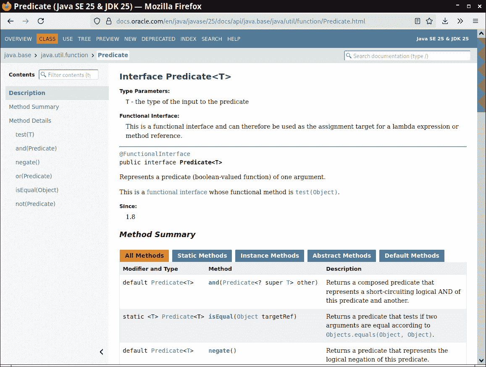图 11.1: 已记录的注解

`@Inherited`元注解仅适用于类的注解。当一个类拥有继承的注解时，它的所有子类都将自动拥有相同的注解。这使得创建类似于标记接口（如`Serializable`接口）的注解变得非常简单。

假设你定义了一个继承注解`@Persistent`，表示该类的对象可以保存到数据库中。那么，持久化类的子类将自动标记为持久化。

```java
@Inherited @interface Persistent { }

@Persistent class Employee { . . . }

class Manager extends Employee { . . . } // 也是 @Persistent
```

`@Repeatable`元注解允许多次应用同一个注解。例如，JUnit 的`@Tag`注解是可重复的。它可以像这样使用：

```java
@Tag("localized")

@Tag("showstopper")

void testHello() { . . . }
```

出于历史原因，可重复注解的实现者需要提供一个容器注解，该注解以数组的形式持有重复的注解。

以下是定义`@Tag`注解及其容器的方式：

```java
@Repeatable(Tag.class)

@interface Tag {

    String value();

}

@interface Tags {

    Tag[] value();

}
```

每当用户提供两个或多个`@Tag`注解时，它们会被包装成一个`@Tags`注解。这增加了处理注解的复杂性，正如你在下一节中看到的那样。

### 11.4 在运行时处理注解

到目前为止，你已经了解如何在源文件中添加注解以及如何定义注解类型。现在是时候看看这些操作能产生什么好的结果了。

在本节中，我将向你展示一个使用你在第 5 节中见过的反射 API 在运行时处理注解的简单示例。假设我们想减少实现`toString`方法的重复工作。当然，可以使用反射编写一个通用的`toString`方法，简单地包含所有字段名和值。但假设我们想自定义该过程。我们可能不想包含所有字段，或者可能想跳过类名和变量名。例如，对于`Point`类，我们可能更倾向于使用`[5,10]`而不是`Point[x=5,y=10]`。当然，任何其他增强都是可能的，但让我们保持简单。重点是演示注解处理器可以做什么。

用所有希望从此服务中受益的类标记上`@ToString`。此外，所有应该包含的字段也需要被标记。注解的定义如下：

```java
@Target({ElementType.FIELD, ElementType.RECORD_COMPONENT, ElementType.TYPE})

@Retention(RetentionPolicy.RUNTIME)

public @interface ToString {

    boolean includeName() default true;

}
```

这里是标记了注解的`Point`和`Rectangle`类：

```java
@ToString(includeName=false)

public class Point {

    @ToString(includeName=false) private int x;

    @ToString(includeName=false) private int y;

    . . .

}

@ToString

public record Rectangle(

    @ToString(includeName=false) Point topLeft,

    @ToString int width,

    @ToString int height)

{}
```

意图是将矩形表示为字符串`Rectangle[[5, 10],width=20,height=30]`。

在运行时，我们无法修改给定类`toString`方法的实现。相反，让我们提供一个可以格式化任何对象的方法，如果存在`ToString`注解，则发现并使用它们。

关键是`AnnotatedElement`接口中的方法

```java
T getAnnotation(Class<T>)

T getDeclaredAnnotation(Class<T>)

T[] getAnnotationsByType(Class<T>)

T[] getDeclaredAnnotationsByType(Class<T>)

Annotation[] getAnnotations()

Annotation[] getDeclaredAnnotations()

boolean isAnnotationPresent(Class<? extends Annotation> annotationClass)
```

反射类`Class`、`Field`、`Parameter`、`Method`、`Constructor`和`Package`实现了该接口。

与其他反射方法一样，名称中带有`Declared`的方法产生类本身的注解，而其他方法包含继承的注解。在注解的语境下，这意味着注解是`@Inherited`的并应用到了父类。

如果一个注解不可重复的，调用`getAnnotation`来定位它。例如：

```java
Class<?> cl = obj.getClass();

ToString ts = cl.getAnnotation(ToString.class);

if (ts != null && ts.includeName()) . . .
```

```java
package v1ch11.runtimeAnnotations;

import module java.base;

public class ToStrings {

    public static String toString(Object obj) {

        if (obj == null) return "null";

        Class<?> cl = obj.getClass();

        ToString ts = cl.getAnnotation(ToString.class);

        if (ts == null) return obj.toString();

        var result = new StringBuilder();

        if (ts.includeName()) result.append(cl.getName());

        result.append("[");

        boolean first = true;

        for (Field f : cl.getDeclaredFields()) {

            ts = f.getAnnotation(ToString.class);

            if (ts != null) {

                if (first)

                    first = false;

                else

                    result.append(",");

                f.setAccessible(true);

                if (ts.includeName()) {

                    result.append(f.getName());

                    result.append("=");

                }

                try {

                    result.append(ToStrings.toString(f.get(obj)));

                }

                catch (ReflectiveOperationException ex) {

                    ex.printStackTrace();

                }

            }

        }

        result.append("]");

        return result.toString();

    }

}
```

`java.lang.reflect.AnnotatedElement`5.0

- `boolean isAnnotationPresent(Class<? extends Annotation> annotationType)`  
  如果此项具有给定类型的注解，则返回`true`。

- `<T extends Annotation> T getAnnotation(Class<T> annotationType)`  
  获取给定类型的注解，如果此项没有此类注解，则返回`null`。

- `<T extends Annotation> T[] getAnnotationsByType(Class<T> annotationType)`8  
  获取所有可重复注解类型的的所有注解（参见 ）。如果不存在，则返回一个长度为 0 的数组。

- `Annotation[] getAnnotations()`  
  获取此项上存在的所有注解，包括继承的注解。如果不存在，则返回一个长度为 0 的数组。

- `Annotation[] getDeclaredAnnotations()`  
  获取此项声明的所有注解，不包括继承的注解。如果不存在，则返回一个长度为 0 的数组。

## 11.5. 源码级注解处理

在前面的章节中，你已经了如何分析运行程序中的注解。注解的另一个用途是对源文件进行自动处理，以生成更多的源代码、配置文件、脚本或其他任何可能想要生成的内容。

为了向你展示其机制，将重复生成`toString`方法的示例。但是，这次让我们在 Java 源码中生成它们。这样这些方法将与程序的其余部分一起编译，并以全速运行，而不是使用反射。

### 11.5.1. 注解处理器

注解处理集成在 Java 编译器中。在编译期间，你可以通过运行以下命令来`调用注解处理器`：

```java
javac -processor ProcessorClassName1,ProcessorClassName2,. . . sourceFiles
```

编译器会定位源文件的注解。每个注解处理器顺序执行，并获得它感兴趣的注解。如果注解处理器创建了新的源文件，则重复该过程。一旦某轮处理不再产生更多的源文件，所有源文件将被编译。

注解处理器只能生成新的源文件。它不能修改现有的源文件。

注解处理器实现`Processor`接口，通常通过扩展`AbstractProcessor`类来实现。你需要指定你的处理器支持哪些注解。在我们的案例：

```java
@SupportedAnnotationTypes("annotations.ToString")

@SupportedSourceVersion(SourceVersion.RELEASE_8)

public class ToStringAnnotationProcessor extends AbstractProcessor {

    public boolean process(Set<? extends TypeElement> annotations,

            RoundEnvironment currentRound) {

        . . .

    }

}
```


处理器可以声称特定的注解类型、通配符如`"com.horstmann.*"`（`com.horstmann`包或任何子包中的所有注解），甚至是`"*"`（所有注解）。

`process`方法每轮会被调用一次，传入该轮次在任何文件中找到的所有注解集合，以及一个包含当前处理轮信息的`RoundEnvironment`引用。

## 11.5.2. 语言模型 API

使用`语言模型`API来分析源码级注解。与提供类和方法的虚拟机表示的反射API不同，语言模型API允许你根据Java语言的规则分析Java程序。

编译器产生一个树，其节点是实现`javax.lang.model.element.Element`接口及其子接口`TypeElement`、`VariableElement`、`ExecutableElement`等类的实例。这些是反射类`Class`、`Field`/`Parameter`、`Method`/`Constructor`的编译时对应物。

我不想详细介绍该API，但这里有你处理注解时需要知道的重点。

- `RoundEnvironment`通过调用以下方法之一，为你提供被特定注解标记的所有元素集合：

```
Set<? extends Element> getElementsAnnotatedWith(Class<? extends Annotation> a)

Set<? extends Element> getElementsAnnotatedWithAny(
    Set<Class<? extends Annotation>> annotations)
```

第二个方法对于重复注解有用。

- `AnnotatedElement`接口的源码级等价物是`AnnotatedConstruct`。使用方法方法

```
A getAnnotation(Class<A> annotationType)

A[] getAnnotationsByType(Class<A> annotationType)
```

来获取给定注解类的注解或重复注解。

- `TypeElement`代表一个类或接口。`getEnclosedElements`方法产生其字段和方法的的列表。

在`Element`上调用`getSimpleName`或在`TypeElement`上调用`getQualifiedName`会产生一个`Name`对象，该对象可以通过`toString`转换为字符串。

## 11.5.3. 使用注解生成源代码

让我们回到自动生成`toString`方法的任务。我们不能将这些方法放入原始类中——注解处理器只能产生新类，不能修改现有的类。

因此，我们将所有方法添加到工具类`ToStrings`中：

```
public class ToStrings {

    public static String toString(Point obj) {
       Generated code
    }

    public static String toString(Rectangle obj) {
        Generated code
    }

    . . .

    public static String toString(Object obj) {
        return Objects.toString(obj);
    }
}
```

由于我们不想使用反射，所以我们注解访问器方法，而不是注解字段：

```
@ToString
public class Rectangle {
    . . .
    @ToString(includeName=false) public Point getTopLeft() { return topLeft; }
    @ToString public int getWidth() { return width; }
    @ToString public int getHeight() { return height; }
}
```

注解处理器随后应该生成以下源代码：

```
public static String toString(Rectangle obj) { 
    var result = new StringBuilder();
    result.append("Rectangle");
    result.append("[");
    result.append(toString(obj.getTopLeft()));
    result.append(",");
    result.append("width=");
    result.append(toString(obj.getWidth()));
    result.append(",");
    result.append("height=");
    result.append(toString(obj.getHeight()));
    result.append("]");
    return result.toString();
}
```

“样板”代码是灰色的。以下是为具有给定`TypeElement`的类产生`toString`方法的方法概述：

```java
private void writeToStringMethod(PrintWriter out, TypeElement te) {
    String className = te.getQualifiedName().toString();
    // Print method header and declaration of string builder
    ToString ann = te.getAnnotation(ToString.class);
    if (ann.includeName()) // Print code to add class name
    for (Element c : te.getEnclosedElements()) {
        ann = c.getAnnotation(ToString.class);
        if (ann != null) {
            if (ann.includeName()) // Print code to add field name
            // Print code to append toString(obj.methodName())
        }
    }
    // Print code to return string
}
```

这里是注解处理器`process`方法的概述。它为辅助类创建一个源文件，并为每个被注解的类写入类头和一个方法。

```java
public boolean process(Set<? extends TypeElement> annotations,
        RoundEnvironment currentRound) {
    if (annotations.size() == 0) return true;
    try {
        JavaFileObject sourceFile = processingEnv.getFiler().createSourceFile(
            "annotations.ToStrings");
        try (var out = new PrintWriter(sourceFile.openWriter())) {
            // Print code for package and class
            for (Element e : currentRound.getElementsAnnotatedWith(ToString.class))
                if (e instanceof TypeElement te)
                    writeToStringMethod(out, te);
            // Print code for toString(Object)
        }
    }
    catch (IOException ex) {
        processingEnv.Messager().printMessage(Kind.ERROR, ex.getMessage());
    }
    return true;
}
```

注意，`process`方法会在后续的轮次中带有空注解列表被调用。它会立即返回，因此不会重复创建源文件。

要查看轮次情况，请带有`-XprintRounds`标志运行`javac`命令：

```
Round 1:
        input files: {v1ch11.annotated.Point, v1ch11.annotated.Rectangle}
        annotations: [v1ch11.sourceAnnotations.ToString]
        last round: false

Round 2:
        input files: {}
        annotations: []
        last round: true
```

要运行示例程序，首先构建注解处理器，然后使用它来编译演示：

```
javac v1ch11/sourceAnnotations/ToStringAnnotationProcessor.java

javac -XprintRounds -processor v1ch11.sourceAnnotations.ToStringAnnotationProcessor \
    v1ch11/annotated/*.java

java v1ch11/sourceAnnotations/SourceLevelAnnotationDemo.java
```

此示例演示了工具如何收集源文件注解以生成其他文件。生成的文件并不非要是源文件。注解处理器可以选择生成XML描述符、属性文件、shell脚本、HTML文档等。

有些人建议使用注解来消除更繁琐的工作。如果能自动生成琐的getter和setter，那不是很好吗？例如，注解：

```java
@Property private String title;
```

可以产生方法：

```java
public String getTitle() { return title; }
public void setTitle(String title) { this = title; }
```

然而，像Lombok这样的流行工具已经找到了绕过这一限制的方法。通过在编译期间直接修改类文件，它们可以生成getter和setter。这需要编辑源文件，而不仅仅是生成它们。至少目前，它不是标准的Java。

```java
package sourceAnnotations;

import javax.lang.model.Element;
import javax.lang.model.TypeElement;
import javax.lang.model.source.AbstractProcessor;
import javax.lang.model.source.JavaFileObject;
import javax.lang.model.source.RoundEnvironment;
import javax.annotation.processing.ProcessingEnv;
import javax.annotation.processing.SourceVersion;
import javax.annotation.processing.SupportedAnnotationTypes;
import javax.annotation.processing.SupportedSourceVersion;
import javax.lang.tool.Diagnostic;
import java.io.IOException;
import java.io.PrintWriter;
import java.util.Set;

@SupportedAnnotationTypes("annotations.ToString")
@SupportedSourceVersion(SourceVersion.RELEASE_21)
public class ToStringAnnotationProcessor extends AbstractProcessor {
    @Override
    public boolean process(Set<? extends TypeElement> annotations,
            RoundEnvironment currentRound) {
        if (annotations.size() == 0) return true;
        try {
            JavaFileObject sourceFile = processingEnv.getFiler().createSourceFile(
                "annotations.ToStrings");
            try (var out = new PrintWriter(sourceFile.openWriter())) {
                out.println("package sourceAnnotations;");
                out.println("public class ToStrings {");
                for (Element e : currentRound.getElementsAnnotatedWith(ToString.class))
                    if (e instanceof TypeElement te)
                        writeToStringMethod(out, te);
                out.println("    public static String toString(Object obj) {");
                out.println("        // This is a placeholder for the actual logic not fully supported in this snippet");
                out.println("        var result = new StringBuilder();"); 
                out.println("        return java.util.Objects.toString(obj);");
                out.println("    }");
                out.println("}");
            }
        }
        catch (IOException ex) {
            processingEnv.Messager().printMessage(Kind.ERROR, ex.getMessage());
        }
        return true;
    }

    private void writeToStringMethod(PrintWriter out, TypeElement te) {
        String className = te.getQualifiedName().toString();
        out.println("    public static String toString(" + className + " obj) {");
        out.println("        var result = new StringBuilder();");
        ToString ann = te.getAnnotation(ToString.class);
        if (ann.includeName()) {
            out.println("        result.append(\"" + className + "\");");
        }
        out.println("        result.append(\"[\");");
        boolean first = true;
        for (Element c : te.getEnclosedElements()) {
            ann = c.getAnnotation(ToString.class);
            if (ann != null) {
                if (first)
                    first = false;
                else
                    out.println("        result.append(\",\");");
                if (ann.includeName()) {


`String methodName = c.getSimpleName().toString();`

`String fieldName = java.beans.Introspector.decapitalize(methodName.replaceAll("^(get|is)", ""));`

`out.println("        result.append(\"" + fieldName + "=\");");`

`out.println("        result.append(obj." + methodName + "()));");`

`out.println("        result.append(\"]\");");`

`out.println("        return result.toString();");`

`out.println("    }");`

## 11.6. 字节码工程

你已经看到注解如何在运行时或源代码级别上被处理。还有第三种可能性：在字节码级别进行处理。除非注解在源代码级别被移除，否则它们会存在于类文件中。类文件格式文档见`https://docs.oracle.com/javase/specs/jvms/se21/html`。该格式相当复杂，在没有特殊库的情况下，处理类文件将是具有挑战性的。从 Java 24 开始，JDK 有了自己的用于编辑类文件的库。

### 11.6.1. 修改类文件

在本节中，我们将使用类文件 API 为被注解的方法添加日志消息。如果一个方法被注解为：

```
@LogEntry(logger=loggerName)
```

然后我们在方法的开头添加了以下语句的字节码：

```
System.getLogger(loggerName).log(System.Logger.Level.TRACE,
    "Entering {0}.{1}", className, methodName);
```

例如，如果你对`Item`类的`hashCode`方法添加了注解：

```
@LogEntry(logger="com.horstmann") public int hashCode()
```

那么每当调用该方法时，都会打印类似下面的的消息：

```
Dec 03, 2025 5:58:44 PM set.Item hashCode
INFO: Entering set.Item.hashCode
```

为了实现这一点，我们执行了以下操作：

1. 加载类文件中的字节码。
2. 定位所有方法。
3. 对于每个方法，检查它是否带有`LogEntry`注解。
4. 如果有，在方法的开头添加以下指令的字节码：

```
ldc loggerName
invokestatic System.getLogger(String)
getstatic System.Logger.Level.INFO
ldc "Entering {0}.{1}"
iconst_2
anewarray
dup
iconst_0
ldc className
aastore
dup
iconst_1
ldc methodName
aastore
invokeinterface System.Logger.log(System.Logger.Level, String, Object[])
```

插入这些字节码听起来很复杂，但类文件 API 库使其可行。我不会详细描述分析和插入字节码的过程。重要的点是，Listing 11.5 中的程序编辑了类文件，并在带有`LogEntry`注解的方法开头插入了日志调用。

例如，这里是如何向 Listing 11.6 中的`Item.java`添加日志指令并运行测试程序的：

```
javac v1ch11/set/Item.java v1ch11/set/SetDemo.java
javac v1ch11/bytecodeAnnotations/EntryLogger.java
java v1ch11.bytecodeAnnotations.EntryLogger v1ch11/set/Item.class
java v1ch11.set.SetDemo
```

尝试在修改`Item`类文件之前和之后运行：

```
javap -c set.Item
```

你可以看到`hashCode`、`equals`和`compareTo`方法开头处插入的指令。

```
public int hashCode();
    Code:
        0: ldc #42 // String com.horstmann
        2: invokestatic #48
            // Method java/lang/System.getLogger:(Ljava/lang/String;)Ljava/lang/System$Logger;
        5: getstatic #54
            // Field java/lang/System$Logger$Level.INFO:Ljava/lang/System$Logger$Level;
        8: ldc #56 // String Entering {0}.{1}
       10: iconst_2
       11: anewarray #4 // class java/lang/Object
       14: dup
       15: iconst_0
       16: ldc #58 // String set.Item
       18: aastore
       19: dup
       20: iconst_1
       21: ldc  #77 // String hashCode
       23: aastore
       24: invokeinterface #65,  4  // InterfaceMethod java/lang/System$Logger.log:
            // (Ljava/lang/System$Logger$Level;Ljava/lang/String;Ljava/lang/Object;)V
       . . .
```

当你尝试这样做时，常量池中的索引值可能会不同。

Listing 11.7 中的`SetDemo`程序将`Item`对象插入哈希集合中。当你使用修改后的类文件运行时它，你将看到日志消息。

```
Dec 03, 2025 5:58:44 PM set.Item hashCode
INFO: Entering set.Item.hashCode
Dec 03, 2025 5:58:44 PM set.Item hashCode
INFO: Entering set.Item.hashCode
Dec 03, 2025 5:58:44 PM set.Item hashCode
INFO: Entering set.Item.hashCode
Dec 03, 2025 5:58:44 PM set.Item equals
INFO: Entering set.Item.equals
[[description=Microwave, partNumber=4104], [description=Toaster, partNumber=1279]]
```

注意当我们两次插入同一个项目时对`equals`的调用。

这个示例展示了字节码工程的力量。注解被用于向程序添加指令，而字节码编辑工具会获取这些指令并修改虚拟机指令。

**Listing 11.5** `v1ch11/bytecodeAnnotations/EntryLogger.java`

```java
package v1ch11.bytecodeAnnotations;

import module java.base;

import java.lang.classfile.Annotation;
import java.lang.classfile.Attributes;
import static java.lang.constant.ConstantDescs.*;

/**
 * 为类中带有 LogEntry 注解的所有方法添加“进入”日志。
 */
public class EntryLogger {
    /**
     * 为带有 LogEntry 注解的类文件添加“进入”日志。
     */
    static byte[] addLogging(byte[] classFileBytes) {
        ClassFile cf = ClassFile.of();
        ClassModel classModel = cf.parse(classFileBytes);
        String className = classModel.internalName().replace('/', '.');
        MethodTransform methodTransform = (codeBuilder, me) -> {
            switch (me) {
                case CodeModel cm -> {
                    String methodName = cm.parent().methodName();
                    String loggerName = getLoggerName(cm);
                    addLoggingCode(codeBuilder, className, loggerName);
                }
                default -> codeBuilder.accept(me);
            }
        };
        ClassTransform classTransform = ClassTransform
                .transformingMethods(EntryLogger::hasLogging, methodTransform);
        return cf.transformClass(classModel, classTransform);
    }

    private static final String LOGENTRY_DESC = LogEntry.class.descriptorString();

    private static boolean hasLogging(MethodModel mm) {
        var annotations = mm.findAttribute(Attributes.runtimeVisibleAnnotations())
                .map(RuntimeVisibleAttribute::annotations).orElse(List.of());
        for (Annotation a : annotations) {
            if (a.className().equalsString(LOGENTRY_DESC)) {
                return true;
            }
        }
        return false;
    }

    private static String getLoggerName(MethodModel mm) {
        var annotations = mm.findAttribute(Attributes.runtimeVisibleAnnotations())
                .map(RuntimeVisibleAttribute::annotations).orElse(List.of());
        for (Annotation a : annotations) {
            if (a.name().equalsString("logger")) {
                    return ((AnnotationValue.OfString) a.value()).stringValue();
                }
        }
        return null;
    }

    private static void addLoggingCode(CodeBuilder cb, String className, String methodName,
            String loggerName) {
        ClassDesc cdSystem = ClassDesc.of("java.lang.System");
        ClassDesc cdLogger = ClassDesc.of("java.lang.System$Logger");
        ClassDesc cdLevel = ClassDesc.of("java.lang.System$Logger$Level");
        cb.ldc(loggerName)
                .invokestatic(cdSystem, "getLogger", MethodTypeDesc.of(cdLogger, CD_String))
                .getstatic(cdLevel, "INFO", cdLevel)
                .ldc("Entering {0}.{1}")
                .iconst_2()
                .anewarray(CD_Object).dup().iconst_0().ldc(className)
                .aastore()
                .dup()
                .iconst_1()
                .ldc(methodName)
                .aastore()
                .invokeinterface(cdLogger, "log",
                        MethodTypeDesc.of(CD_void, cdLevel, CD_String, CD_Object.arrayType()));
    }

    /**
     * 给指定的类添加进入日志。
     * @param args 要补丁的类文件名
     */
    public static void main(String[] args) throws Exception {
        if (args.length == 0) {
            IO.println("USAGE: java v1ch11.bytecodeAnnotations.EntryLogger classfile");
            System.exit(1);
        }
        Path path = Path.of(args[0]);
        byte[] bytes = Files.readAllBytes(path);
        bytes = addLogging(bytes);
        Files.write(path, bytes);
    }
}
```

```java
package v1ch11.set;

import module java.base;

import v1ch11.bytecodeAnnotations.*;

/**
 * 一个带有描述和零件号的项目。
 */
public class Item {
    private String description;
    private int partNumber;

    /**
     * 构造一个项目。
     * @param aDescription 项目的描述
     * @param aPartNumber 项目的编号
     */
    public Item(String aDescription, int aPartNumber) {
        description = aDescription;
        partNumber = aPartNumber;
    }

    /**
     * 获取此项目的描述。
     * @return 描述信息
     */
    public String getDescription() {
        return description;
    }

    public String toString() {
        return "[description=" + description + ", partNumber=" + partNumber + "]";
    }

    @LogEntry(logger = "com.horstmann")
```


`public boolean equals(Object otherObject)` {

    if (`this == otherObject`) return true;

    if (`otherObject == null`) return false;

    if (`getClass() != otherObject.getClass()`) return false;

    `var other = (Item) otherObject`;

    return `Objects.equals(description, other.description)` 
            && `partNumber == other.partNumber`;
}

`@LogEntry(logger = "com.horstmann")`
`public int hashCode()` {

    return `Objects.hash(description, partNumber)`;
}

```
列表 11.7 `v1ch11/set/SetDemo.java`

```java
package v1ch11.set;

import module java.base;
import module java.logging;

class SetDemo {

    void main() {

        `Logger.getLogger("com.horstmann").setLevel(Level.FINEST)`;

        `var handler = new ConsoleHandler()`;

        `handler.setLevel(Level.FINEST)`;

        `Logger.getLogger("com.horstmann").addHandler(handler)`;

        `var parts = new HashSet<Item>()`;

        `parts.add(new Item("Toaster", 1279))`;

        `parts.add(new Item("Microwave", 4104))`;

        `parts.add(new Item("Toaster", 1279))`;

        `System.out.println(parts)`;
    }
}
```

### 11.6.2. 在加载时修改字节码

在上一节中，你看到了一个可以编辑类文件的工具。然而，在构建过程中再添加另一个工具可能会非常繁琐。一个很有吸引力的替代方案是将字节码工程推迟到`加载时`（load time），即类加载器加载类时进行。

`instrumentation API` 拥有一个用于安装字节码转换器（transformer）的钩子。该转换器必须在程序的 `main` 方法被调用之前安装。你可以通过定义 `agent`（代理）来满足这一要求，agent 是一个被加载以某种方式监控程序的库。agent 代码可以在 `premain` 方法中执行初始化。

构建 agent 需要的步骤如下：

1.  实现一个带有方法的类
    ```
    public static void premain(String arg, Instrumentation instr)
    ```
    该方法在 agent 加载时被调用。agent 可以获取一个命令行参数，该参数通过 `arg` 参数传递。`instr` 参数可用于安装各种钩子。

2.  创建一个清单文件 `EntryLoggingAgent.mf`，设置 `Premain-Class` 属性，例如：
    ```
    Premain-Class: v1ch11.bytecodeAnnotations.EntryLoggingAgent
    ```

3.  将 agent 代码和清单打包成一个 JAR 文件：
    ```
    javac v1ch11/bytecodeAnnotations/EntryLoggingAgent.java
    jar cvfm EntryLoggingAgent.jar v1ch11/bytecodeAnnotations/EntryLoggingAgent.mf \
        v1ch11/bytecodeAnnotations/Entry*.class
    ```

要同 agent 启动 Java 程序，请使用以下命令行选项：

```
java -javaagent:AgentJARFile=agentArgument . . .
```

例如，要使用入口日志 agent 运行 `SetDemo` 程序，请调用：
```
javac v1ch11/set/*.java
java -javaagent:EntryLoggingAgent.jar=v1ch11.set.Item v1ch11.set.SetDemo
```

`Item` 参数是 agent 应该修改的类名。

`Listing 11.8` 显示了 agent 代码。agent 安装了一个类文件转换器。转换器首先检查类名是否匹配 agent 参数。如果是，它将使用上一节中的 `EntryLogger` 类来修改字节码。然而，修改后的字节码并没有保存到文件中。相反，转换器将它们返回以便加载到虚拟机（见图 11.3）。换句话说，这种技术对字节码执行了“即时”（just in time）修改。

.图 11.3：在加载时修改类 列表 11.8 `v1ch11/bytecodeAnnotations/EntryLoggingAgent.java`

```java
package v1ch11.bytecodeAnnotations;

import module java.base;
import module java.instrument;

/**
 */
public class EntryLoggingAgent {

    public static void premain(final String arg, Instrumentation instr) {

        instr.addTransformer(new ClassFileTransformer() {

            public byte[] transform(ClassLoader loader, String className, Class<?> cl,
                    ProtectionDomain pd, byte[] data) throws IllegalClassFormatException {

                if (!className.replace("/", ".").equals(arg)) return null;

                return EntryLogger.addLogging(data);
            }
        });
    }
}
```

在本章中，你学习了如何：

-   在 Java 程序中添加注解
-   设计你自己的注解接口
-   实现使用注解的工具

你看到了三种处理代码的技术：脚本、编译 Java 程序以及处理注解。前两种都比较简单。另一方面，构建注解工具无疑是复杂的，并不是大多数开发者都需要处理的任务。本章为你理解注解工具提供了背景，并可能激发了你开发此类工具的兴趣。

下一章将讨论 Java 模块系统，这是确保 Java 平台完整性的关键功能。

## 12.1. 模块概念

在面向对象编程中，基本的构建块是类。类提供了封装。私有特征仅允许具有显式权限的代码访问——即类的方法。这使得对访问进行推理变得可能。如果一个私有变量发生了变化，你可以列出所有可能的祸首。如果你需要修改私有表示，你清楚哪些方法受了影响。

在 Java 中，包提供了更大级别的组织单元。包是类的集合。包也提供了一种封装。任何具有包访问权限（既不是公共的不是私有的）的特征只能从同一个包中的方法访问。

然而，在大型系统中，这种级别的访问控制是不够的。任何公共功能（即可以在包外部访问的功能）在任何地方都是可访问的。假设你想修改或丢弃一个很少使用的功能。一旦它是公开的，就没有办法可以推断该更改的影响。

这就是 Java 平台设计者所面临的局面。在二十多年里，`JDK` 经历了飞速增长，但显然，某些功能现在基本上已经过时了。大家最喜欢的例子是 CORBA。你上一次使用它是什么时候？然而，直到 Java 10，`org.omg.corba` 包一直伴随于每个版本的 `JDK` 一起发布。从 Java 11 开始，那些仍然需要它的极少数人必须将所需的 JAR 文件添加到自己的项目中了。

那么 `java.awt` 呢？它不应该是服务器端应用程序所需的，对吧？除非 `java.awt.DataFlavor` 类被用于 SOAP（一种基于 XML 的网络服务协议）的实现中。

Java 平台设计者面对巨大的代码乱团，决定他们需要一种提供更多控制的结构化机制。他们查看了现有的模块系统（如 OSGi），并发现它们不适合他们的问题。相反，他们设计了一个新系统，称为 `Java Platform Module System`（Java 平台模块系统），它现在是 Java 语言和虚拟机的一部分。该系统已成功用于 Java API 的模块化，如果你愿意，你也可以将其用在你自己的应用程序中。

一个 Java 平台模块由以下部分组成：

*   包集合
*   可选资源文件和其他文件（如原生库）
*   模块中可访问的包的列表
*   该模块依赖的所有模块的列表

Java 平台在编译时和虚拟机中都强制封装和依赖关系。

为什么你应该考虑在自己的程序中使用 Java 平台模块系统，而不是遵循在类路径上使用 JAR 文件的传统方法？有两个优势：

1.  **强封装**：你可以控制哪些包是可访问的，而你不必担心维护那些你并不打算供外部公开使用的代码。
2.  **可靠的配置**：你避免了常见的类路径问题，例如类重复或类缺失。

Java 平台模块系统没有解决解决某些问题，例如模块的版本控制。它不支持指定需要哪个版本的模块，也不支持在同一个程序中使用模块的多个版本。这些可能是理想的功能，但如果你需要它们，必须使用 Java 平台模块系统以外的机制。

## 12.2. 模块命名

模块是包的集合。模块中的包名不需要相互相关。例如，`java.sql` 模块包含 `java.sql` 和 `javax.sql` 包。从这个例子中可以看出，模块名与包名相同是完全可以的。

就像包名一样，模块名由字母、数字、下划线和点组成。同样，与包名一样，模块之间没有层级关系。如果你有一个模块 `com.horstmann` 和另一个模块 `com.horstmann.corejava`，从模块系统的角度来看，它们是互不相关的。

在为他人创建一个供其使用的模块时，确保其名称是全局唯一的至关重要的。预计大多数模块名将像包名一样遵循“反向域名”惯。

最简单的方法是以该模块提供的顶层包来命名模块。例如，SLF4J 日志门面有一个模块 `org.slf4j`，它包含包 `org.slf4j`、`org.slf4j.spi`、`org.slf4j.event` 和 `org.slf4j.helpers`。

这种约定防止了模块中的包名冲突。任何给定的包只能放在一个模块中。如果你的模块名是唯一的且你的包名以模块名开头，那么你的包名也是唯一的。

对于不打算供其他程序员使用的模块，你可以使用较短的模块名，例如包含应用程序的模块。为了说明这是可行的，我将在本章中进行同样的操作。可能是库代码的模块将具有如 `com.horstmann.util` 的名称，而包含程序（带有 `main` 方法的类）的模块将具有如 `v1ch12.hellomod` 这样有趣的名字。

在引用模块内部的包时，不需要指定模块名。你只需要使用包名。

## 12.3. 模块化的“Hello, World!”程序

让我们把传统的“Hello, World!”放入放入模块。首先，我们需要将类放入包中——“未命名包”不能包含在模块中。这里是：

```java
package com.horstmann.hello;

public class HelloWorld {

    public static void main(String[] args) {

        IO.println("Hello, Modular World!");
    }
}
```

到目前为止，没有任何变化。要创建一个包含此包的模块 `v1ch12.hellomod`，你需要添加一个模块声明。你将其放在名为 `module-info.java` 的文件中，位于根目录下（即包含 `com` 目录的相同目录）。按照惯例，根目录的名字与模块名相同。

```
v1ch12.hellomod/
└ module-info.java
  com/
  └ horstmann/
    └ hello/
      └ HelloWorld.java
```

`module-info.java` 文件包含模块声明：

```java
module v1ch12.hellomod {
}
```

`module-info.java` 文件是空的，因为该模块向任何人提供任何内容，也不需要任何东西。现在，照常编译：

```bash
javac v1ch12.hellomod/module-info.java \
    v1ch12.hellomod/com/horstmann/hello/HelloWorld.java
```

要作为模块化应用程序运行此程序，你需要指定*模块路径*（module path），它类似于类路径但包含模块。你还需要以 `modulename/classname` 的格式指定主类：

```bash
java --module-path v1ch12.hellomod \
    --module v1ch12.hellomod/com.horstmann.hello.HelloWorld
```

除了 `--module-path` 和 `--module`，你可以使用单字母选项 `-p` 和 `-m`：

```bash
java -p v1ch12.hellomod -m v1ch12.hellomod/com.horstmann.hello.HelloWorld
```

无论哪种方式，都会出现“Hello, Modular World!”问候，证明你已经成功地实现了应用程序的模块化。

当你编译此模块时，会得到警告：

```
warning: [module] module name component v1ch12 should avoid terminal digits
```

警告旨在阻止程序员在模块名中添加版本号。你可以忽略该警告，或者使用注解来抑制它：

```java
@SuppressWarnings("module")
module v1ch12.hellomod {
}
```

在这一点上，`module` 就像类声明一样：你可以对它进行注解。（注解类型的目标必须是 `ElementType.MODULE`。）

## 12.4. 需要模块

让我们创建一个新模块 `v1ch12.requiremod`，在其中程序使用 `JOptionPane` 来显示“Hello, Modular World!”消息：

```java
package com.horstmann.hello;

import javax.swing.JOptionPane;

public class HelloWorld {

    public static void main(String[] args) {

        JOptionPane.showMessageDialog(null, "Hello, Modular World!");
    }
}
```

现在编译失败并显示此消息：

```
error: package javax.swing is not visible
  (package javax.swing is declared in module java.desktop,
  but module v1ch12.requiremod does not read it)
```

JDK 已经模块化，`javax.swing` 包现在包含在 `java.desktop` 模块中。我们的模块需要声明它依赖该模块：

```
module v1ch12.requiremod {
    requires java.desktop;
}
```


模块系统的设计目标是让模块显式声明它们的依赖，这样虚拟机可以在启动程序之前确保所有需求都得到满足。

在前节中，并没有出现显式依赖的需求，因为我们只使用了`java.lang`和`java.io`包。这些包包含在默认加载的`java.base`模块中。

注意，我们的`v1ch12.requiremod`模块仅列出了自己的模块依赖。它需要`java.desktop`模块以便使用`javax.swing`包。`java.desktop`模块本身声明它需要另外三个模块，即`java.datatransfer`、`java.prefs`和`java.xml`。

图 12.1 显示了*模块图*，其节点是模块。图的边（即连接节点的箭头）要么是声明的依赖，要么在未声明依赖时对`java.base`的隐式依赖。

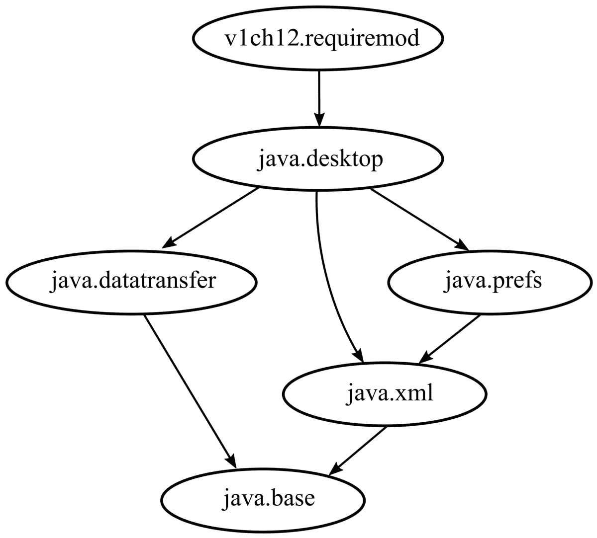图 12.1：Swing“Hello, Modular World”应用程序的模块图

模块图中不能存在循环——也就是说，模块不能直接或间接地引用它自己。

模块不会自动将访问权限传递给其他模块。在我们的示例中，`java.desktop`模块声明它需要`java.prefs`，而`java.prefs`模块声明它需要`java.xml`。这并没有赋予`java.desktop`使用`java.xml`模块中包的权限。它需要显式声明该依赖。用数学术语来说，`requires`关系不是“传递的”。通常情况下，这种行为是理想的，因为它使依赖变得显式，但正如你将在第 12.11 节所示，在某些情况下你可以放松它。

本节开头的错误消息说我们的`v1ch12.requiremod`模块没有“读取”`java.desktop`模块。在 Java 平台模块系统的术语中，模块`M`在以下情况下读取模块`N`：

1. `M`需要`N`。
2. `M`需要一个传递性地需要`N`的模块（参见第 12.11 节）。
3. `N`是`M`或`java.base`。

## 12.5. 导出包

在前节中，你看到如果模块想使用另一个模块的包，必须需要该模块。然而，这并不会让所需模块中的所有包都可用。模块使用`exports`关键字声明哪些包是可以访问的。例如，这里是`java.xml`模块模块声明的一部分：

```
module java.xml {

    exports javax.xml;

    exports javax.xml.catalog;

    exports javax.xml.datatype;

    exports javax.xml.namespace;

    exports javax.xml.parsers;

    . . .

}
```

该模块提供了许多包，但通过不导出它们隐藏了其他包（如`jdk.xml.internal`）。

当一个包被导出时，其`public`和`protected`类、接口以及它们的`public`和`protected`成员在模块外部都是的。（如既往，`protected`类型和成员仅在子类和相同包中可访问）。

然而，未导出的包在自己的模块外部是不可访问的。这与模块之前的 Java 非常不同。在过去，你可以使用任何包中的公共类，即使它不是公共 API 的一部分。例如，当公共 API 未提供适当功能时，通常推荐使用`sun.misc.BASE64Encoder`或`com.sun.rowset.CachedRowSetImpl`等类。

现在你无法再访问 Java 平台 API 中未导出的包，因为它们都包含在模块内部。结果是某些程序将无法在 Java 9 上运行。当然，没有人承诺保持非公共 API 可用，所以这不应该令人震惊。

让我们在一个简单的场景中使用`exports`。我们将准备一个模块`com.horstmann.greet`，它将导出一个也名为`com.horstmann.greet`的包，遵循以下约定：为他人提供代码的模块应根据内部的顶层包命名。还有一个我们不导出的包`com.horstmann.greet.internal`。

第一个包中有一个公共`Greeter`接口。

```
package com.horstmann.greet;

public interface Greeter {

    static Greeter newInstance() {

        return new com.horstmann.greet.internal.GreeterImpl();

    }

    String greet(String subject);

}
```

第二个包有一个实现该接口的类。该类是公共的，因为它在第一个包中被访问。

```java
package com.horstmann.greet.internal;

import com.horstmann.greet.Greeter;

public class GreeterImpl implements Greeter {

    public String greet(String subject) {

        return "Hello, " + subject + "!";

    }

}
```

（注：用户提供的文本在后半部分存在重复和格式混乱，已根据核心逻辑进行了清理。）

你现在已经看到了构成 Java 平台模块系统核心的`requires`和`exports`语句。正如你所看到的，模块系统在概念上是非常简单的。模块指定了它们需要哪些模块，以及它们向其他模块提供哪些包。第 12.13 节显示了`exports`语句的一种微变化。

模块并不提供作用域。你不能在不同的模块中拥有两个同名的包。即使对于隐藏包（即未被导出的包）也是如此。

## 12.6. 模块化 JAR

到目前为止，我们只是简单地将模块编译到源代码的目录树中。显然，这对于部署是不满意的。相反，模块可以通过将其所有类放在一个 JAR 文件中来部署，并在根目录下包含一个`module-info.class`。这样的 JAR 文件被称为*模块化* JAR。

要创建一个模块化 JAR 文件，请像通常一样使用`jar`工具。如果你有多个包，最好使用`-d`选项进行编译，这会将类文件放在一个独立的目录中。如果该目录不存在，将创建它。然后使用`jar`命令的`-C`选项切换到该目录以收集文件。

```
javac -d modules/com.horstmann.greet \

    com.horstmann.greet/module-info.java \

    com.horstmann.greet/com/horstmann/greet/internal/GreeterImpl.java \

    com.horstmann.greet/com/horstmann/greet/Greeter.java

jar -c -v -f com.horstmann.greet.jar -C modules/com.horstmann.greet .
```

如果你使用 Maven、Ant 或 Gradle 等构建工具，只需像往常一样构建你的 JAR 文件即可。只要包含了`module-info.class`，你就得到了一个模块化 JAR。

然后，将模块化 JAR 包含模块路径中，模块就会加载。

在过去，一个包的类有时分布在多个 JAR 文件中。（这样的包被称为“拆分包”）。这可能从不是一个好主意，而且在模块系统中是不可能实现的。

与普通 JAR 文件一样，你可以在模块化 JAR 中指定主类：

```
javac -p com.horstmann.greet.jar \

    -d modules/v1ch12.exportedpkg \

    v1ch12.exportedpkg/module-info.java \

    v1ch12.exportedpkg/com/horstmann/hello/HelloWorld.java

jar -c -v -f v1ch12.exportedpkg.jar -e com.horstmann.hello.HelloWorld \

    -C modules/v1ch12.exportedpkg .
```

当启动程序时，你需要指定包含主类的模块：

```
java -p com.horstmann.greet.jar:v1ch12.exportedpkg.jar -m v1ch12.exportedpkg
```

在创建 JAR 文件时，你可以可选地指定版本号。使用`--module-version`参数并将并将号添加到 JAR 文件名中：

```
jar -c -v -f com.horstmann.greet-1.0.jar --module-version 1.0 -C com.horstmann.greet .
```

正如已经讨论过的，Java 平台模块系统并不使用版本号来解析模块，但它可以被其他工具和框架查询。

你可以通过反射 API 获取版本号。在我们的示例中：

```
Optional<String> version = Greeter.class.getModule().getDescriptor().rawVersion();
```

产生一个包含版本字符串`"1.0"`的`Optional`。

模块相当于类加载器的是*层*（layer）。Java 平台模块系统将 JDK 模块和应用程序模块加载到*启动层*（boot layer）。程序可以使用层 API 加载其他模块（本书未涵盖内容）。这样的程序可能会考虑模块版本。预计 Java EE 应用服务器等程序的开发者将利用层 API 来为模块提供支持。

如果你想将模块加载到 JShell，请将 JAR 包含在模块路径中并使用`--add-modules`选项：

```
jshell --module-path com.horstmann.greet-1.0.jar --add-modules com.horstmann.greet
```

## 12.7. 模块与反射访问

在前面的章节中，你看到模块系统强制执行封装。模块只能访问另一个模块显式导出的包。在过去，总是可以通过反射来克服烦人的访问限制的。正如你在第 5 章中所所示，反射可以访问任何类的私有成员。

但在模块化世界中，情况不再如此。如果一个类位于模块内部，对非公共成员的反射访问将失败。具体来说，回想我们是如何访问私有字段的：

```
Field f = obj.getClass().getDeclaredField("salary");

f.setAccessible(true);

double value = f.getDouble(obj);

f.setDouble(obj, value * 1.1);
```

除非安全管理器不允许访问私有字段，否则`f.setAccessible(true)`调用将成功。然而，运行安全管理器的 Java 应用程序并不常见，而且有许多库使用反射访问。典型的例子是对象关系映射器（例如 JPA），它们会自动在数据库中持久化对象，以及在对象与 XML 或 JSON 之间转换的库，例如 JAXB 和 JSON。

回顾第 5 章，JAR 文件除了类文件和清单文件外，还可以包含`file resources`，这些资源可以使用`Class.getResourceAsStream`方法加载，现在也可以用`Module.getResourceAsStream`加载。如果资源存储在与模块中的包匹配的目录中，则该包必须对调用者开放。其他目录中的资源以及类文件和清单文件可以被任何人读取。

为了为了一个更真实的示例，我们可以使用 JSON-B 规范将`Country`对象转换为 XML 或 JSON。要使用 JSON-B 的 Yasson 实现，请从 Maven 中央仓库下载 JAR 文件`jakarta.json-api-2.1.2.jar`、`jakarta.json.bind-api-3.0.0.jar`、`parsson-1.1.4.jar`和`yasson-3.0.3.jar`。将这些 JAR 文件放在模块路径上，并运行`v1ch12.openpkg2`模块中的`com.horstmann.places.Demo`程序。当`com.horstmann.places`包打开时，转换为 JSON 将转换成功。

未来的库可能会使用`variable handles`而不是反射来读取和写入字段。`VarHandle`类似于`Field`。你可以使用它来读取或写入特定类的任何实例的特定字段。然而，为了获取`VarHandle`，库代码需要一个`Lookup`对象：

```
public Object getFieldValue(Object obj, String fieldName, Lookup lookup)

        throws NoSuchFieldException, IllegalAccessException {

    Class<?> cl = obj.getClass();

    Field field = cl.getDeclaredField(fieldName);

    VarHandle handle = MethodHandles.privateLookupIn​(cl, lookup)

        .unreflectVarHandle(field);

    return handle.get(obj);

}
```

只要`Lookup`对象是在具有访问该字段权限的模块中生成的，这种方法就是有效的。模块中的某些方法只需简单地调用`MethodHandles.lookup()`，这会产生一个封装了调用者访问权限的对象。通过这种方式，一个模块可以赋予另一个模块访问私有成员的权限。实际的问题在于如何以最少的麻烦赋予这些权限。

## 12.8 自动模块

你现在知道如何使用 Java 平台模块系统了。如果你从一个全新的项目开始，其中所有代码都由自己编写，你可以设计模块、声明模块依赖，并将应用程序打包成模块化的 JAR 文件。

然而，这是一种极罕见的情况。几乎所有项目都依赖于第三方库。当然，你可以等到所有库的提供者将它们转换为模块，然后对自己的代码进行模块化。

但如果你不想等待呢？Java 平台模块系统提供了两种机制来跨越今天的非模块化世界与完全模块化应用之间的鸿沟：自动模块和未命名模块。

出于迁移之目的，你只需将任何 JAR 文件放置在模块路径上的某个目录中，而不是类路径上，即可将其转换为模块。在模块路径上没有`module-info.class`的 JAR 文件称为`自动模块`。自动模块具有以下属性：

1. 该模块隐式地对所有其他模块拥有`requires`子句。
2. 它所有的包都被导出（exported）并开放（opened）。
3. 如果 JAR 文件清单`META-INF/MANIFEST.MF`中存在键为`Automatic-Module-Name`的条目，其值将成为模块名。
4. 否则，模块名从 JAR 文件名中获取，去掉末尾的版本号，并将非字母数字字符序列替换为点。

前两条规则意味着自动模块中的包表现就像它们在类路径上一样。使用模块路径是为了其他模块的利益，允许它们表达对此模块的依赖。

假设，你正在实现一个处理 CSV 文件并使用 Apache Commons CSV 库的模块。你希望在`module-info.java`文件中表示你的模块依赖于 Apache Commons CSV。

如果你将`commons-csv-1.9.0.jar`添加到模块路径，那么你的模块就可以引用该模块。它的名字是`commons.csv`，因为末尾的版本号`-1.9.0`被删除了，非字母数字字符`-`被替换成了点。

这个名字可能是一个可以的模块名，因为 Commons CSV 是广为人知的，不太可能有其他人尝试为不同的模块使用相同的名称。但如果由于该 JAR 文件的维护者可以使用他们控制的名称作为模块名（最好是顶层包名`org.apache.commons.csv`），那样会更好。他们只需要添加一行：

```
Automatic-Module-Name: org.apache.commons.csv
```

到 JAR 文件内部的`META-INF/MANIFEST.MF`文件中。事实上，他们对`commons-csv-1.10.0.jar`正是这样做的。

最终，希望他们通过添加带有该模块名的`module-info.java`将 JAR 文件转换为真正的模块。其他通过该名称引用 CSV 模块的模块将继续工作。

向模块的迁移计划是一个伟大的社会实验，没有人知道它是否会有良好的结果。在你将第三方 JAR 放在模块路径之前，请检查它们是否是模块化的，如果不是，检查它们的清单中是否有模块名。如果没有，你仍然可以将 JAR 转换为自动模块，但要准备好以后更新模块名。

为了实验自动 JAR，请从[`commons.apache.org/proper/commons-csv`](https://commons.apache.org/proper/commons-csv)下载 Commons CSV 库的 1.9.0 和 1.10.0 版本。配套代码中的`v2ch9.automod`模块包含一个读取国家数据 CSV 文件的简单程序：

```
package com.horstmann.places;

import java.io.*;

import org.apache.commons.csv.*;

public class CSVDemo {

    public static void main(String[] args) throws IOException{

        var in = new FileReader("countries.csv");

        Iterable<CSVRecord> records = CSVFormat.EXCEL.withDelimiter(';')
```


            .withHeader().parse(in);

        for (CSVRecord record : records) {

            String name = record.get("Name");

            double area = Double.parseDouble(record.get("Area"));

            IO.println(name + " has area " + area);

        }

    }

}

```

要将`commons-csv-1.9.0.jar`作为自动模块，我们需要使用它的文件名来引用它：

```

@SuppressWarnings("module")

module v1ch12.automod {

    requires commons.csv;

}

```

对于`commons-csv-1.10.0.jar`，使用清单中的`Automatic-Module-Name`：

```

requires org.apache.commons.csv

```

这是编译和运行程序的命令：

```

javac -p v1ch12.automod:jars/commons-csv-1.10.0.jar \

    v1ch12.automod/com/horstmann/places/CSVDemo.java \

    v1ch12.automod/module-info.java

java -p v1ch12.automod:jars/commons-csv-1.10.0.jar \

    -m v1ch12.automod/com.horstmann.places.CSVDemo

```

## 12.9 未命名模块

任何不在模块路径上的类都是`未命名模块`的一部分。技术上，可能多个未命名模块，但它们组合在一起表现就像一个被称为*未命名模块*的模块。与自动模块一样，未命名模块可以访问所有其他模块，并且它所有的包都被导出并开放。

然而，*任何显式模块*无法访问未命名模块。（显式模块既不是自动模块也不是未命名模块——即在模块路径上有具有`module-info.class`的模块。）也就是说，显式模块总是免于“类路径地狱”。

考虑上一节的程序。假设你将`commons-csv-1.10.0.jar`放在类路径而不是模块路径上：

```

java --module-path v1ch12.automod \

    --class-path jars/commons-csv-1.10.0.jar \

    -m v1ch12.automod/com.horstmann.places.CSVDemo

```

现在程序无法启动：

```

Error occurred during initialization of boot layer

java.lang.module.FindException: Module commons.csv not found, required by v1ch12.automod

```

因此，迁移到 Java 平台模块系统（JPMS）必然是一个自下而上的过程：

1. Java 平台本身被模块化。
2. 接下来，库被模块化，这可以通过使用自动模块或将它们转换为显式模块来实现。
3. 一旦应用程序使用的所有库都已模块化，你就可以将应用程序代码转换为一个模块。

自动模块`can`读取未命名模块（unnamed module），因此它们的依赖可以放在类路径（class path）。

## 12.10. 用于迁移的命令行标记

即使你的程序没有使用模块，在使用 Java 9 及更高版本时，你也无法逃避模块化世界。你的应用程序代码可能位于未命名模块的类路径中，因此所有包都被导出（exported）并开放（opened）。尽管如此，代码仍然与已模块化的 Java 平台进行交互。

从 Java 11 开始，编译时封装被严格执行。但在 Java 16 之前，允许运行时访问。默认行为是在每次违规第一次发生时在控制台上显示警告。从 Java 16 开始，运行时的反射访问也被强制执行。为了让你有时间准备这一变化，Java 9 到 16 的`java`启动器带有`--illegal-access`标记，有四种可能的设置：

1. `--illegal-access=permit`是 Java 9 的默认行为，在第一次发生非法访问时打印消息。
2. `--illegal-access=warn`每次非法访问都打印消息。
3. `--illegal-access=debug`为每次非法访问打印消息和堆栈跟踪。
4. `--illegal-access=deny`是 Java 16 的默认行为，拒绝所有非法访问。

从 Java 17 开始，`--illegal-access`标记不再可用。

`--add-exports`和`--add-opens`标记允许你微调遗留应用。考虑一个使用不再可访问的内部 API 的应用程序，例如`com.sun.rowset.CachedRowSetImpl`。最佳补措施是更改实现。（从 Java 7 开始，你可以从`RowSetProvider`获取缓存行集。）但假设你无法访问源代码。

在这种情况下，使用`--add-exports`标记启动应用程序。指定你想导出的模块和包，以及你想导出该包的模块（在我们的案例中是未命名模块）。

```

java --add-exports java.sql.rowset/com.sun.rowset=ALL_UNNAMED \

    -jar MyApp.jar

```

现在，假设你的应用程序使用反射来访问私有字段或方法。在未命名模块内部进行反射是可以的，但不再能够通过反射访问 Java 平台类的非公共成员了。例如，某些动态生成 Java 类的库通过反射调用受保护的`ClassLoader.defineClass`方法。如果应用程序使用此类库，请添加标记

```

--add-opens java.base/java.lang=ALL-UNNAMED

```

在添加所有这些命令行选项以让遗留应用工作时，你很可能会得到一个“地狱级”命令行”。为了更好地管理多个选项，你可以将它们放在以`@`为前缀指定的某个或多个文件中。例如，

```

java @options1 @options2 -jar MyProg.java

```

其中文件`options1`和`options2`包含`java`命令的选项。

选项文件有几条语法规则：

* 使用空格、制表符或换行符分隔选项。
* 对包含空格的参数使用双引号，例如`"Program Files"`。
* 以`\`结尾的行将与下一行合并。
* 反斜杠必须转义，例如`C:\\Users\\Fred`。
* 注释行以`#`开头。

## 12.11. 传递和静态依赖

在第 12.4 节中，你看到了`requires`语句的基本形式。在本节中，你将看到两种偶尔有变体。

在某些情况下，给定模块的用户声明所有所需的模块可能是非常麻烦的。例如`java.desktop`模块。它需要三个模块：`java.prefs`、`java.datatransfer`和`java.xml`。`java.prefs`仅在内部使用。然而，来自`java.datatransfer`和`java.xml`的类出现在公共 API 中，方法如下：

```

java.awt.datatransfer.Clipboard java.awt.Toolkit.getSystemClipboard()

java.beans.XMLDecoder(org.xml.sax.InputSource is)

```

这不是`java.desktop`模块的用户应该考虑的问题。出于这个原因，`java.desktop`模块使用`transitive`修饰符声明该项：

```

module java.desktop {

    requires java.prefs;

    requires transitive java.datatransfer;

    requires transitive java.xml;

    . . .

}

```

任何声明依赖`java.desktop`的模块现在都会自动需要这两个模块。

某些程序员建议，当另一个模块的包在公共 API 中运行时，应该始终使用`requires transitive`。但这不是 Java 语言的要求。例如，`java.sql`模块：

```

module java.sql {

    requires transitive java.logging;

    . . .

}

```

`java.logging`模块中的一个包仅使用一次，在`java.sql` API 中，即返回`java.util.Logger`的方法。那些实际使用该方法的模块需要声明依赖`java.logging`。`requires transitive`的引人注目的用例是一个聚合模块——一个没有包但只有传递依赖的模块。一个这样的模块是`java.se`模块，声明如下：

```

module java.se {

    requires transitive java.compiler;

    requires transitive java.datatransfer;

    requires transitive java.desktop;

    . . .

    requires transitive java.sql;

    requires transitive java.sql.rowset;

    requires transitive java.xml;

    requires transitive java.crypto;

}

```

不感兴趣细粒度模块依赖的程序员只需要求`java.se`即可获得 Java API 的模块。

最后，还有一种常见的`requires static`变体，它声明模块在编译时存在但在运行时可选。有两个用例：

1. 访问在不同模块中声明的注解。
2. 如果可用则不同模块中的类，否则执行其他操作，例如：

```

try {

    new oracle.jdbc.driver.OracleDriver();

    . . .

} catch (NoClassFoundError er) {

    执行其他操作

}

```

## 12.13. 限定导出与打开包

在本节中，你将看到`exports`和`opens`语句的变体，它们将作用范围缩小到指定的模块集合。例如，`java.base`模块包含如下语句：

```

exports sun.net to

  java.net.http,

  jdk.naming.dns;

```

这种语句被称为**限定导出**（`qualified export`）。列出的模块可以访问导出的包，但其他模块无法访问。

过度使用限定导出可能意味着模块化结构不佳。尽管如此，在对现有代码库进行模块化时，这些情况可能会出现。在这里，`sun.net`包被放置在`java.base`模块内部，因为那里最需要它。然而，其他几个模块也使用了该包。Java 平台的设计者并不希望让`java.base`变得更大，也不想让内部的`sun.net`包对外部可用。在全新的项目（greenfield project）中，可以设计一个更模块化的 API。

同样地，你可以将`opens`语句限制到特定模块。例如，在第 12.7 节中，我们可以使用类似下所示的限定`opens`语句：

```

module v1ch12.openpkg {

    requires com.horstmann.util;

    opens com.horstmann.places to com.horstmann.util;

}

```

现在`com.horstmann.places`包仅对`com.horstmann.util`模块开放。

## 12.14. 服务加载

`ServiceLoader`类（参见第 6 章;
    Locale getLocale();
}
```

一个或多个模块提供实现，例如：

```java
public class FrenchGreeter implements GreeterService {
    public String greet(String subject) { return "Bonjour " + subject; }
    public Locale getLocale() { return Locale.FRENCH; }
}
```

服务消费者必须根据其认为合适的任何标准，从所有提供的实现中选择一个。

```java
ServiceLoader<GreeterService> greeterLoader = ServiceLoader.load(GreeterService.class);
GreeterService chosenGreeter;
for (GreeterService greeter : greeterLoader) {
    if (. . .) {
        chosenGreeter = greeter;
    }
}
```

过去，实现是通过将文本文件放入包含实现类的 JAR 文件的`META-INF/services`目录来实现的。模块系统提供了一种更好的方法。你不需要使用文本文件，而是向模块描述符中添加语句。

提供服务实现的模块会添加一个`provides`语句，该语句列出了服务接口（可能定义在任何模块中）和实现类（必须是该模块的一部分）。以下是来自`jdk.security.auth`模块的示例：

```
module jdk.security.auth {
    . . .
    provides javax.security.auth.spi.LoginModule with
        com.sun.security.auth.module.Krb5LoginModule,
        com.sun.security.auth.module.UnixLoginModule,
        com.sun.security.auth.module.JndiLoginModule,
        com.sun.security.auth.module.KeyStoreLoginModule,
        com.sun.security.auth.module.LdapLoginModule,
        com.sun.security.auth.module.NTLoginModule;
}
```

消费模块包含一个`uses`语句。

```
module java.base {
    . . .
    uses javax.security.auth.spi.LoginModule;
}
```

当消费模块中的代码调用`ServiceLoader.load(ServiceInterface.class)`时，匹配的提供者类将被加载，即使它们可能不在可访问的包中。

在代码示例中，我们在`com.horstmann.greetsvc.internal`包中为德语和法语问候者提供了实现。服务模块导出了`com.horstmann.greetsvc`包，但没有导出实现类的包。`provides`语句在未导出的包中声明了服务及其实现类：

```
module com.horstmann.greetsvc {
    exports com.horstmann.greetsvc;

    provides com.horstmann.greetsvc.GreeterService with
        com.horstmann.greetsvc.internal.FrenchGreeter,
        com.horstmann.greetsvc.internal.GermanGreeterFactory;
}
```

`v1ch12.useservice`模块消费该服务。使用`ServiceLoader`功能，我们遍历提供的服务，并选择符合所需语言的一个：

```java
package com.horstmann.hello;

import java.util.*;
import com.horstmann.greetsvc.*;

public class HelloWorld {
    public static void main(String[] args) {
        ServiceLoader<GreeterService> greeterLoader
            = ServiceLoader.load(GreeterService.class);
        String desiredLanguage = args.length > 0 ? args[0] : "de";
        GreeterService chosenGreeter = null;
        for (GreeterService greeter : greeterLoader) {
            if (greeter.getLocale().getLanguage().equals(desiredLanguage))
                chosenGreeter = greeter;
        }
        if (chosenGreeter == null)
            System.out.println("No suitable greeter.");
        else
            System.out.println(chosenGreeter.greet("World"));
    }
}
```

## 12.15. 模块工具


本节介绍了 Java 开发工具包中的`jdeps`、`jlink`和`jmod`工具。

`jdeps`工具分析一组 JAR 文件的依赖关系。例如，假设你想对 JUnit 进行模块化。运行：

```
jdeps -s junit-12.jar hamcrest-core-1.3
```

`-s`标志生成摘要输出：

```
hamcrest-core.1.3 -> java.base
junit-12.jar -> hamcrest-core-1.3
junit-12.jar -> java.management
```

这告诉了你模块图，如图 12.3 所示。

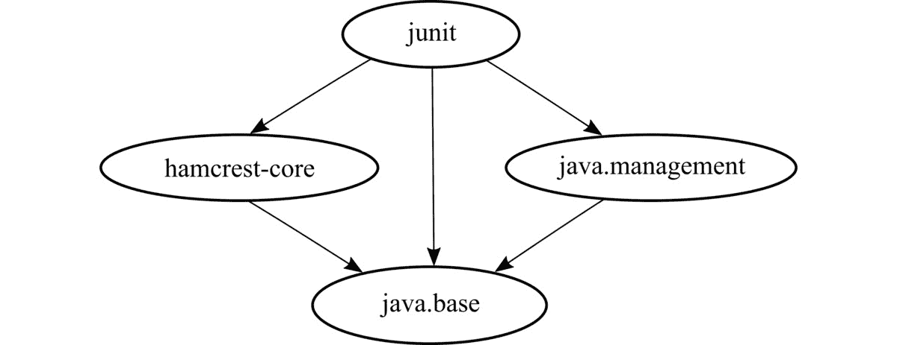图 12.3：JUnit 模块图

如果你省略`-s`标志，将获得模块摘要，以及包到所需包和模块的映射。如果你添加`-v`标志，列表将映射类到所需包和模块。

`--generate-module-info`选项为每个分析的模块生成`module-info`文件：

```
jdeps --generate-module-info /tmp/junit junit-12.jar hamcrest-core-1.3
```

还有一个用于生成描述图形的“dot”语言输出选项。假设你安装了 dot 工具，运行这些命令：

```
jdeps -s -dotoutput /tmp/junit junit-12.jar hamcrest-core-1.3
dot -Tpng /tmp/junit/summary.dot > /tmp/junit/summary.png
```

然后`summary.png`看起来就像图 12.4 所示。

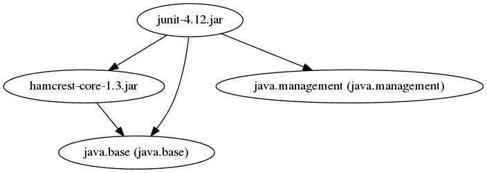图 12.4：`jdeps`的 dot 输出

使用`jlink`工具产生不需要独立 Java 运行时运行的应用程序。生成的镜像比整个 JDK 要小得多。你可以指定想要包含的模块和输出目录。

```
jlink --module-path com.horstmann.greet.jar:v1ch12.exportedpkg.jar:$JAVA_HOME/jmods \
    --add-modules v1ch12.exportedpkg --output /tmp/hello
```

输出目录包含一个子目录`bin`，其中包含一个`java`可执行文件。如果你运行

```
bin/java -m v1ch12.exportedpkg
```

则模块的主类中的`main`方法会被调用。

`jlink`的作用是它封装了运行应用程序所需的最小模块集。你可以列出所有模块：

```
bin/java --list-modules
```

在此示例中，输出为：

```
v1ch12.exportedpkg
com.horstmann.greet
java.base@25
```

所有模块都包含在*运行时镜像*文件`lib/modules`中。在我的电脑上，该文件占用 29MB，而所有 JDK 模块的运行时镜像占用了 133MB。整个应用程序仅占 55MB，仅是 JDK 大小的一 fraction。

这可以作为打包应用程序的实用工具的基础。你仍然需要为多个平台生成文件集，并为应用程序编写启动脚本。

你可以使用`jimage`命令检查运行时镜像。然而，该格式是 JVM 内部的，运行时镜像并不是为了供其他工具生成或使用的。

最后，`jmod`工具用于构建和检查 JDK 自带的模块文件。当你查看 JDK 内部的`jmods`目录时，你会发现每个模块都有一个扩展名为`jmod`的文件。不再有`rt.jar`文件了。

与 JAR 文件一样，这些文件包含类文件。此外，它们还可以包含原生代码库、命令、头文件、配置文件和法律公告。JMOD 文件使用 ZIP 。你可以使用任何 ZIP 工具检查其内容。

与 JAR 文件不同，JMOD 文件仅对链接有用——也就是说，用于生成运行时镜像。除非你还想将二进制文件（如原生代码库）与你的模块一起打包，否则不需要生成 JMOD 文件。

你现在已经读完了*Core Java》（核心 Java）的第一卷。这一卷涵盖了 Java 编程语言的基础知识，以及大多数编程项目所需的标准库部分。我希望你喜欢这段 Java 基础之旅，并在此过程中发现了有用的信息。对于高级主题，如流库、文件输入输出、网络、安全、国际化、用户界面和图形编程，请参考第二卷。

# 附录

本附录列出了 Java 语言所有的关键字和类关键字。“受限关键字”是指仅在模块声明中使用的关键字，在其他地方是标识符。“受限标识符”是指除非在特定位置使用否则都是标识符。例如，`var`始终是一个标识符，除非它在预期类型的地方使用。`null`、`false`和`true`不是关键字，而是字面量。

## 表：Java 关键字

| 关键字 | 含义 | 类型 | 见章节 |
| --- | --- | --- | --- |
| `abstract` | 抽象类或方法 | 关键字 | 5 |
| `assert` | 用于定位程序内部的错误 | 关键字 | 7 |
| `boolean` | 布尔类型 | 关键字 | 3 |
| `break` | 跳出 switch 或循环 | 关键字 | 3 |
| `byte` | 8 位整数类型 | 关键字 | 3 |
| `case` | switch 的一个分支 | 关键字 | 3 |
| `catch` | try 块中捕获异常的语句 | 关键字 | 7 |
| `char` | UTF-16 代码单元的类型 | 关键字 | 3 |
| `class` | 定义类类型 | 关键字 | 4 |
| `const` | 未使用 | 关键字 | |
| `continue` | 在循环结束时继续 | 关键字 | 3 |
| `default` | switch 的默认子句，或接口中的默认方法 | 关键字 | 3, 6 |
| `do` | do/while 循环的开头 | 关键字 | 3 |
| `double` | 双精度浮点数类型 | 关键字 | 3 |
| `else` | if 语句的 else 子句 | 关键字 | 3 |
| `enum` | 枚举类型 | 关键字 | 3 |
| `exports` | 导出模块的包 | 受限关键字 | 12 |
| `extends` | 定义类的父类，或通配符的上界 | 关键字 | 4 |
| `false` | 两个布尔值之一 | 字面量 | 3 |
| `final` | 常量，或不可被重写的类或方法 | 关键字 | 5 |
| `finally` | try 块中始终执行的部分 | 关键字 | 7 |
| `float` | 单精度浮点类型 | 关键字 | 3 |
| `for` | 循环类型 | 关键字 | 3 |
| `goto` | 未使用 | 关键字 | |
| `if` | 条件语句 | 关键字 | 3 |
| `implements` | 定义类实现的接口（s） | 关键字 | 6 |
| `import` | 导入包 | 关键字 | 4 |
| `instanceof` | 测试对象是否是某个类的实例 | 关键字 | 5 |
| `int` | 32 位整数类型 | 关键字 | 3 |
| `interface` | 带有方法的抽象类型 | 关键字 | 6 |
| `long` | 64 位整数类型 | 关键字 | 3 |
| `native` | 由宿主机系统实现的方法 | 关键字 | 3 (第二卷) |
| `new` | 分配新对象或数组 | 关键字 | 3 |
| `non-sealed` | 可以形成任意子类的类型 | 关键字 | 5 |
| `null` | 空引用 | 字面量 | 3 |
| `module` | 声明模块 | 受限关键字 | 12 |
| `open` | 修改 module 声明 | 受限关键字 | 12 |
| `opens` | 开放模块的包 | 受限关键字 | 12 |
| `package` | 类包 | 关键字 | 4 |
| `permits` | 引入允许的子类列表 | 关键字 | 5 |
| `private` | 仅允许此类方法访问的特性 | 关键字 | 4 |
| `protected` | 允许类方法访问的特性 | 关键字 | 5 |
| `public` | 允许所有类访问的特性 | 关键字 | 4 |
| `provides` | 指明模块提供的服务 | 受限关键字 | 12 |
| `record` | 声明具有一组 final 实例变量类 | 关键字 | 4 |
| `return` | 从方法返回 | 关键字 | 3 |
| `sealed` | 具有受控直接子类的类型 | 受限符 | 5 |
| `short` | 16 位整数类型 | 关键字 | 3 |
| `static` | 类或接口特有的特性，不属于实例 | 关键字 | 3, 6 |
| `strictfp` | 使用严格规则进行浮点计算（已弃） | 关键字 | 2 |
| `super` | 超类对象或构造函数，或通配符的下界 | 关键字 | 5 |
| `switch` | 选择语句或表达式 | 关键字 | 3 |
| `synchronized` | 线程的方法或代码块 | 关键字 | 12 |
| `this` | 方法的隐式参数，或类的构造函数 | 关键字 | 4 |
| `throw` | 抛出异常 | 关键字 | 7 |
| `throws` | 方法可能抛出的异常 | 关键字 | 7 |
| `to` | exports 或 opens 声明的一部分 | 受限关键字 | 12 |
| `transient` | 标记不应持久化的数据 | 关键字 | 2 (第二卷) |
| `transitive` | 修改 requires 声明 | 受限关键字 | 12 |
| `true` | 两个布尔值之一 | 字面量 | 3 |
| `try` | 捕获异常的代码块 | 关键字 | 7 |
| `uses` | 指明模块使用的服务 | 受限关键字 | 12 |
| `var` | 声明类型推断的变量 | 受限标识符 | 3 |
| `void` | 表示无返回返回值的方法 | 关键字 | 3 |
| `volatile` | 确保字段被多个线程一致地访问 | 关键字 | 12 |
| `when` | 引入模式的守卫 | 受限关键字 | 5 |
| `while` | 循环 | 关键字 | 3 |
| `with` | 定义 provides 语句中的服务类 | 受限关键字 | 12 |
| `yield` | 产生 switch 表达式的值 | 受限标识符 | 3 |
| `_` (下划线) | 未命名变量或模式（预览） | 关键字 | 5 |

# 索引

# 符号指南 (Symbols)

- `!` 运算符 3.5.7
- `!=` 运算符 3.5.11, 3.5.7, 3.5.11, 3.8.4
- JavaDoc 链接中的`#` (数字符号) 4.10.7
- `printf` 标记 3.7.2
- `$` (美元符号)分隔符，用于内部类 6.3.3 的变量名 3.4.1
- `printf` 标记 3.7.2
- `%` (百分号) 算术运算符 3.5.1, 3.5.11 转换字符 3.7.2
- 🍺🍺 3.3.4
- 用于数组列表的“for each”循环 3.10.3，用于集合的 5.3.2 9.1.3， 用于多维数组的 10.6.8 3.10.7
- “Has–a”关系 4.1.4
- “Is–a”关系 4.1.4, 5.1.5, 5.11
- “Uses–a”关系 4.1.4
- `&` (安培符) 位位运算符 3.5.10, 3.5.11 边界类型 8.1.5 中的引用参数 (C++) 4.5
- `&&` 运算符 3.5.7, 3.5.11
- Shell 语法中的`>` (右角括号) 7.6 关系运算符 3.5.7, 3.5.11
- `>&` (shell 语法) 7.6
- `>>`, `>>>` 运算符 3.5.10, 3.5.11
- `>=` 运算符 3.5.7, 3.5.11
- `<` (左角括号) `printf` 标记 3.7.2 关系运算符 3.5.7, 3.5.11
- `<<` 运算符 3.5.10, 3.5.11
- `< . .>` (角括号) 5.3.1, 8.1.3
- `<=` 运算符 3.5.7, 3.5.11
- `""" . .` 3.6.10
- `". . "` 3.1
- `'`, `"` (单引号、双引号) 转义序列 3.3.3
- `(` (左括号) 3.7.2 `printf` 标记 3.7.2
- `(. . .)` (括号) 用于方法调用 3.1
- `casts` 3.5.4, 3.5.11, 5.1.8 用于层级结构 3.5.11
- `*` (星号) 算术运算符 3.5.1, 3.5.11 用于注解处理器 11.5.1 在类路径中的 4.8.9 导入 4.8.3
- `+` (加号) 算术运算符 3.5.1, 3.5.3, 3.5.11 用于对象和字符串的 3.6.1, 5.2.5 `printf` 标记 3.7.2
- `++` 运算符 3.5.6, 3.5.11
- `,` (逗号) (C++) 运算符 3.5.1 `printf` 标记 3.7.2
- `-` (减号) 算术运算符 3.5.1, 3.5.11 `printf` 标记 3.7.2
- `->` 用于 lambda 表达式的 6.2.2 `switch` 表达式的 3.8.5
- `--` 运算符 3.5.6, 3.5.11
- `.` (点) 4.8.9
- `...` (省略号) 5.5
- `.class` 扩展名 3.1
- `.exe` 扩展名 4.9.3
- `/` (斜杠) 3.5.1, 3.5.11
- `/* . . */` 注释 3.2
- `/** . . */` (Javadoc 注释) 3.2, 4.10, 4.10.1
- `//` 注释 3.2
- `0`, `0b`, `0x`, `0X` 前缀（整数） 3.3.1
- `0`, `printf` 标记 3.7.2
- `2>` (shell 语法) 7.6
- `:` (冒号) 用于断言的 7.4.1，类路径 (UNIX) 中的 4.8.9 继承标记 (C++) 5.1.1
- `::` (C++ 运算符) 6.2.5
- `;` (分号) 类路径 (Windows) 中的 4.8.9 语句中的 3.1, 3.4.1
- `=` 运算符 3.4.2, 3.5.5
- `==` 运算符 3.5.7, 3.5.11 用于类对象 5.10.1 枚举类型 5.7 浮点数 3.8.4 标识哈希映射 9.4.7 字符串包装类 3.6.5 和 5.4
- `?` (问号) 用于通配符类型 8.4.1
- `?:` 运算符 3.5.8, 3.5.11 模式匹配 5.1.9
- `@` (at 符号) `java` 命令行选项中的 4.10 12.10
- `@author` Javadoc 标签 4.10
- `@Deprecated` 注解 11.3, 11.3.1
- `@deprecated` Javadoc 标签 11.3
- `@Documented` 注解 11.3, 11.3.2
- `@FunctionalInterface` 注解 6.2.9, 11.3, 11.3.1
- `@Generated` 注解 11.3
- `@index` Javadoc 标签 4.10.8
- `@Inherited` 注解 11.3, 11.3.2
- `@link` Javadoc 标签 4.10.7
- `@LogEntry` 注解 11.6
- `@NonNull` 注解 11.1.4
- `@Override` 注解 5.2.3, 11.3
- `@param` Javadoc 标签 4.10.3
- `@Persistent` 注解 11.3
- `@Property` 注解 11.5.3
- `@Repeatable` 注解 11.3
- `@RepeatedTest` 注解 11.1
- `@Retention` 注解 11.2
- `@return` Javadoc 标签 4.10.3
- `@Safevarargs` 注解 8.5.4, 11.3
- `@see` Javadoc 标签 4.10.7
- `@Serial` 注解 11.3
- `@since` Javadoc 标签 4.10.8
- `@SuppressWarnings` 注解 3.8.5, 5.3.3, 8.2.4, 8.5.4, 8.5.9, 11.3, 11.3.1
- `@Target` 注解 11.2
- `@Test` 注解 11.1, 11.2
- `@throws` Javadoc 标签 4.10.3
- `@version` Javadoc 标签 4.10.8, 4.10.10
- `[ . .]` (方括号) 用于泛型 8.1.4 数组的 3.10.2
- `\` (反斜杠) 用于文本块 3.6.10 的转义序列 3.3.3
- `\b` (退格字符字面量) 3.3.3
- `\f` (换符字符字面量) 3.3.3
- `\n` (换行字符字面量) 3.3.3
- `\r` (回车字符字面量) 3.3.3
- `\s` (空格字符字面量) 3.3.3
- `\t` (制表符字面量) 3.3.3
- `\u` (Unicode 字符) 3.3.3
- `^` (脱幂符号) 3.5.10
- `_` (下划线) 作为保留字分隔符 6.1.2，用于数字字面量 3.3.1
- `{ . . .}` (大括号) 用于内部类的 6.3.6 代码块的 3.1, 4.4


