# Java，卷 I：基础，第 12 版

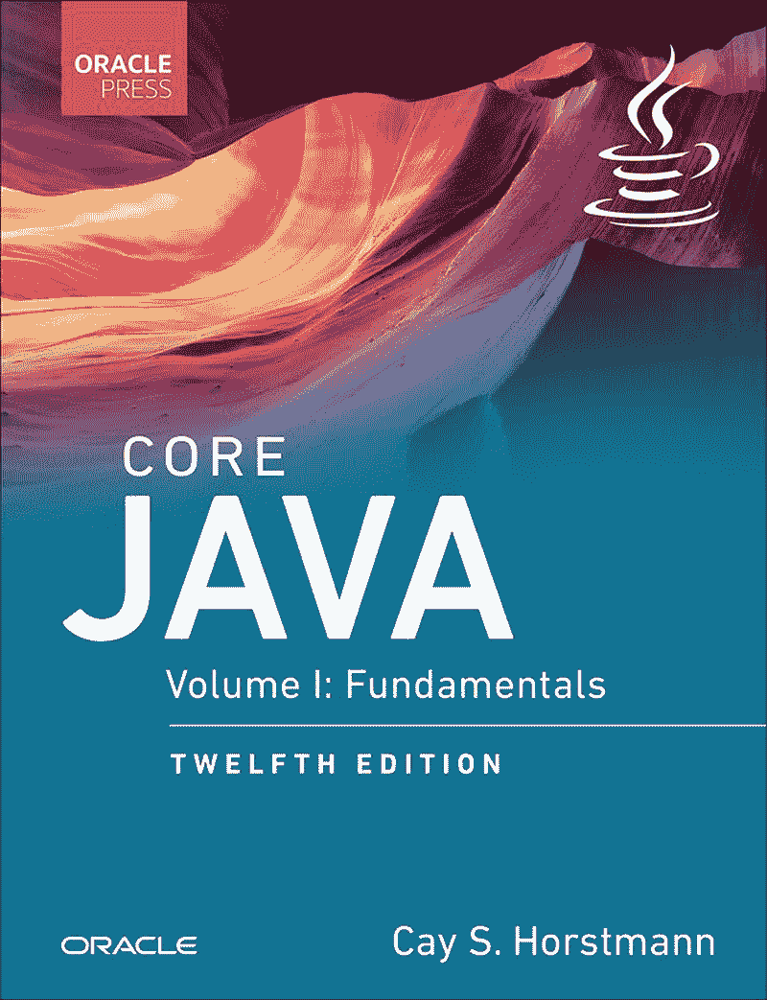


## 第 2 章：Java 编程环境

### 2.1 安装 Java 开发工具包

#### 2.1.1 下载 JDK

#### 2.1.2 配置 JDK

#### 2.1.3 安装源文件与文档

### 2.2 使用命令行工具

### 2.3 使用集成开发环境（IDE）

### 2.4 JShell

## 第 3 章：Java 基础编程结构

### 3.1 一个简单的 Java 程序

### 3.2 注释

### 3.3 数据类型

#### 3.3.1 整数类型

#### 3.3.2 浮点类型

#### 3.3.3 `char` 类型

#### 3.3.4 Unicode 与 `char` 类型

#### 3.3.5 `boolean` 类型

### 3.4 变量与常量

#### 3.4.1 声明变量

#### 3.4.2 初始化变量

#### 3.4.3 常量

#### 3.4.4 枚举类型

### 3.5 运算符

#### 3.5.1 算术运算符

#### 3.5.2 数学函数

#### 3.5.3 类型间的转换

#### 3.5.4 强制转换

#### 3.5.5 赋值

#### 3.5.6 增/减运算符

#### 3.5.7 关系与 `boolean` 运算符

#### 3.5.8 条件运算符

#### 3.5.9 `switch` 表达式

#### 3.5.10 位运算符

#### 3.5.11 括号与运算符优先级

### 3.6 字符串

#### 3.6.1 子字符串

#### 3.6.2 合并

#### 3.6.3 字符串是不可变的

#### 3.6.4 字符串的等性测试

#### 3.6.5 空字符串与空值

#### 3.6.6 编码点与编码单元

#### 3.6.7 `String` API

#### 3.6.8 在线 API

#### 3.6.9 构造字符串

#### 3.6.10 文本块

### 3.7 输入与输出

#### 3.7.1 输入

#### 3.7.2 格式化输出

#### 3.7.3 文件输入与输出

### 3.8 控制流

#### 3.8.1 块作用域

#### 3.8.2 条件语句

#### 3.8.3 循环

#### 3.8.4 确定性循环

#### 3.8.5 多重选择 `switch`

#### 3.8.6 用于控制流的语句

### 3.9 大数

### 3.10 数组

#### 3.10.1 声明数组

#### 3.10.2 访问数组元素

#### 3.10.3 “for each” 循环

#### 3.10.4 数组拷贝

#### 3.10.5 命令行参数

#### 3.10.6 数组排序

#### 3.10.7 多维数组

#### 3.10.8 锯齿数组

## 第 4 章：对象与类

### 4.1 面向对象编程简介

#### 4.1.1 类

#### 4.1.2 对象

#### 4.1.3 识别类

#### 4.1.4 类之间的关系

### 4.2 使用预定义类

#### 4.2.1 对象与对象变量

#### 4.2.2 `String` API

### 4.3 定义你的类

#### 4.3.1 `Employee` 类

#### 4.3.2 使用源文件

#### 4.3.3 剖析 `Employee` 类

#### 4.3.4 第一步

#### 4.3.5 带有 `this` 的方法

#### 4.3.6 处理 `null` 引用

#### 4.3.7 隐式参数

#### 4.3.8 封装的优势

#### 4.3.9 类特权

#### 4.3.10 私有方法

### 4.4 静态字段与方法

#### 4.4.1 静态字段

#### 4.4.2 静态常量

#### 4.4.3 静态方法

#### 4.4.4 工厂方法

#### 4.4.5 `main` 方法

### 4.5 对象构造

#### 4.5.1 重载

#### 4.5.2 默认初始化

#### 4.5.3 无参数构造函数

#### 4.5.4 显式字段初始化

#### 4.5.5 参数名

#### 4.5.6 调用另一个构造函数

#### 4.5.7 初始化块

#### 4.5.8 对象销毁与 `finalize` 方法

### 4.6 记录（Records）

#### 4.6.1 记录概念

#### 4.6.2 构造函数：规范、自定义与紧凑

### 4.7 包

#### 4.7.1 包名

#### 4.7.2 类导入

#### 4.7.3 静态导入

#### 4.7.4 将类添加到包中

#### 4.7.5 包访问控制

#### 4.7.6 类路径

#### 4.7.7 设置类路径

### 4.8 JAR 文件

#### 4.8.1 创建 JAR 文件

#### 4.8.2 清单文件

#### 4.8.3 可执行的 JAR 文件

#### 4.8.4 多版本 JAR 文件

#### 4.8.5 关于命令行选项的说明

### 4.9 文档注释

#### 4.9.1 注释插入

#### 4.9.2 类注释

#### 4.9.3 方法注释

#### 4.9.4 字段注释

#### 4.9.5 通用注释

#### 4.9.6 包注释

#### 4.9.7 注释提取

### 4.10 类设计提示

## 第 5 章：继承

### 5.1 类、超类和子类

#### 5.1.1 定义子类

#### 5.1.2 重写方法

#### 5.1.3 子类构造函数

#### 5.1.4 继承层次结构

#### 5.1.5 多态

#### 5.1.6 理解方法调用

#### 5.1.7 防止继承：`final` 类和方法

#### 5.1.8 强制转换

#### 5.1.9 为 `instanceof` 使用模式匹配

#### 5.1.10 受保护的访问

### 5.2 `Object`：宇宙超类

#### 5.2.1 `Object` 类型的变量

#### 5.2.2 `equals` 方法

#### 5.2.3 等价测试与继承

#### 5.2.4 `hashCode` 方法

#### 5.2.5 `toString` 方法

### 5.3 泛型数组列表

#### 5.3.1 声明列表

#### 5.3.2 访问列表元素

#### 5.3.3 泛型列表与原始列表的兼容性

### 5.4 对象包装类与自动装箱

### 5.5 变长参数方法

### 5.6 抽象类

### 5.7 枚举类

### 5.8 密封类

### 5.9 反射

#### 5.9.1 `Class` 类

#### 5.9.2 声明异常的入门

#### 5.9.3 资源

#### 5.9.4 使用反射分析类的能力

#### 5.9.5 使用反射分析运行时对象

#### 5.9.6 使用反射编写泛型数组代码

#### 5.9.7 任意方法和构造函数

### 5.10 继承的设计提示

## 第 6 章：接口、Lambda 表达式和内部类

### 6.1 接口

#### 6.1.1 接口概念

#### 6.1.2 接口的属性

#### 6.1.3 接口与抽象类

#### 6.1.4 静态和私有方法

#### 6.1.5 默认方法

#### 6.1.6 解决默认方法冲突

#### 6.1.7 接口与回调

#### 6.1.8 `Comparator` 接口

#### 6.1.9 克隆

### 6.2 Lambda 表达式

#### 6.2.1 为什么使用 Lambda？

#### 6.2.2 Lambda 表达式的语法

#### 6.2.3 函数式接口

#### 6.2.4 方法引用

#### 6.2.5 构造函数引用

#### 6.2.6 变量作用域

#### 6.2.7 处理 Lambda 表达式

#### 6.2.8 关于比较器的更多信息

### 6.3 内部类

#### 6.3.1 使用内部类访问对象状态

#### 6.3.2 内部类的特殊语法

#### 6.3.3 内部类有用吗？安全吗？

#### 6.3.4 局部内部类

#### 6.3.5 从外部方法访问变量

#### 6.3.6 匿名内部类

#### 6.3.7 静态内部类

### 6.4 服务加载器（Service Loaders）

### 6.5 代理

#### 6.5.1 何时使用代理

#### 6.5.2 创建代理对象

#### 6.5.3 代理类的属性

## 第 7 章：异常、断言和日志

### 7.1 处理错误

#### 7.1.1 异常的分类

#### 7.1.2 声明检查异常（Checked Exceptions）

#### 7.1.3 如何抛出异常

#### 7.1.4 创建异常类

### 7.2 捕获异常

#### 7.2.1 捕获异常

#### 7.2.2 捕获多个异常

#### 7.2.3 重新抛出与异常链

#### 7.2.4 `finally` 子句

#### 7.2.5 `try-with-resources` 语句

#### 7.2.6 分析堆栈轨迹元素

### 7.3 使用异常的技巧

### 7.4 使用断言

#### 7.4.1 断言概念

#### 7.4.2 断言的启用与禁用

#### 7.4.3 使用断言进行参数检查

#### 7.4.4 使用断言记录假设

### 7.5 日志

#### 7.5.1 基础日志

#### 7.5.2 高级日志

#### 7.5.3 更改日志管理器配置

#### 7.5.4 本地化

#### 7.5.5 处理器（Handlers）

#### 7.5.6 过滤器（Filters）

#### 7.5.7 格式化器（Formatters）

#### 7.5.8 配方（Recipe）

### 7.6 调试

## 第 8 章：泛型编程

### 8.1 为什么使用泛型编程？

#### 8.1.1 类型参数的优势

#### 8.1.2 谁想做泛型编程师？

### 8.2 定义泛型类

### 8.3 泛型方法

### 8.4 类型变量边界

### 8.5 泛型代码与虚拟机

#### 8.5.1 类型擦除（Type Erasure）

#### 8.5.2 转换泛型表达式

#### 8.5.3 转换泛型方法

#### 8.5.4 调用遗留代码

### 8.6 限制与局限性

#### 8.6.1 类型参数不能用基本类型实例化

#### 8.6.2 运行时类型查询仅对原始类型有效

#### 8.6.3 你不能创建参数化类型的数组

#### 8.6.4 变长参数警告

#### 8.6.5 你不能实例化类型变量

#### 8.6.6 你不能构造泛型数组

#### 8.6.7 类型变量在泛型类的静态上下文中无效

#### 8.6.8 你不能抛出或捕获泛型类的实例

#### 8.6.9 你可以绕过检查异常检查

#### 8.6.10 小心擦除后的冲突

### 8.7 泛型类型的继承规则

### 8.8 通配符类型

#### 8.8.1 通配符概念

#### 8.8.2 通配符的上界边界

#### 8.8.3 无界通配符

#### 8.8.4 通配符捕获（Wildcard Capture）

### 8.9 反射与泛型

#### 8.9.1 泛型 `Class` 类

#### 8.9.2 使用 `Class<T>` 参数进行类型匹配

#### 8.9.3 虚拟机中的泛型类型信息

#### 8.9.4 类型字面量

## 第 9 章：集合

### 9.1 Java 集合框架

#### 9.1.1 分离集合接口与实现

#### 9.1.2 `Collection` 接口

#### 9.1.3 迭代器

#### 9.1.4 泛型工具方法

### 9.2 集合框架中的接口

### 9.3 具体集合

#### 9.3.1 链表

#### 9.3.2 数组列表

#### 9.3.3 哈希集合

#### 9.3.4 树形集合

#### 9.3.5 队列与双队列

#### 9.3.6 优先级队列

### 9.4 映射

#### 9.4.1 基础 `Map` 操作

#### 9.4.2 更新 `Map` 条目

#### 9.4.3 `Map` 视图

#### 9.4.4 弱哈希映射

#### 9.4.5 链式哈希集合与映射


#### 9.4.6 举例集合与映射

#### 9.4.7 标识性哈希映射

### 9.5 拷贝与视图

#### 9.5.1 小集合

#### 9.5.2 不可修改的拷贝与视图

#### 9.5.3 子范围

#### 9.5.4 检查视图

#### 9.5.5 同步视图

#### 9.5.6 关于可选操作说明

### 9.6 算法

#### 9.6.1 为什么需要泛型算法？

#### 9.6.2 排序与洗牌

#### 9.6.3 二分查找

#### 9.6.4 简单算法

#### 9.6.5 批量操作

#### 9.6.6 集合与数组之间的转换

#### 9.6.7 编写自己的算法

### 9.7 遗留集合

#### 9.7.1 `Hashtable` 类

#### 9.7.2 举举

#### 9.7.3 属性类

#### 9.7.4 栈

#### 9.7.5 位集合

# 第 10 章：图形化用户编程

## 10.1 Java 界面工具包的历史

## 10.2 显示窗口

### 10.2.1 创建窗口

### 10.2.2 窗口属性

## 10.3 在组件中显示信息

### 10.3.1 绘制 2D 形状

### 10.3.2 使用颜色

### 10.3.3 使用字体

### 10.3.4 显示图像

## 10.4 事件处理

### 10.4.1 基础事件概念

### 10.4.2 示例：处理按钮点击

### 10.4.3 简要指定监听器

### 10.4.4 适配器类

### 10.4.5 动作

### 10.4.6 鼠标事件

### 10.4.7 AWT 事件层次结构

## 10.5 节点 API

# 第 11 章：使用 Swing 用户界面组件

## 11.1 Swing 与模型-视图-控制器设计模式

## 11.2 布局管理简介

### 11.2.1 布局管理器

### 11.2.2 边界布局

#### 11.2.3 网格布局

### 11.3 文本输入

#### 11.3.1 文本字段

### 11.3.2 标签与标记组件

### 11.3.3 密码框

### 11.3.4 文本区域

### 11.3.5 滚动面板

### 11.4 选择组件

#### 11.4.1 复选框

#### 11.4.2 单选按钮

### 11.4.3 边框

### 11.4.4 组合框

### 11.4.5 滑动块

### 11.5 菜单

#### 11.5.1 菜单构建

### 11.5.2 菜单项中的图标

### 11.5.3 复选框与按钮菜单项

### 11.5.4 弹出菜单

### 11.5.5 键盘助记与快捷键

### 11.5.6 启用与禁用菜单项

#### 11.5.7 工具栏

### 11.5.8 提示信息

### 11.6 复杂的布局管理

#### 11.6.2 自定义布局管理器

## 11.7 框

### 11.7.1 选项框

### 11.7.2 创建框

### 11.7.3 数据交换

### 11.7.4 文件框

# 第 12 章：并发

### 12.1 什么是线程？

### 12.2 线程状态

#### 12.2.1 新线程

#### 12.2.2 可线程

### 12.2.3 阻塞与等待线程

#### 12.2.4 终止线程

### 12.3 线程属性

#### 12.3.1 中断线程

#### 12.3.2 守护线程

#### 12.3.3 线程名称

#### 12.3.4 未捕获异常的处理器

#### 12.3.5 线程优先级

### 12.4 同步

### 12.4.1 竞态条件示例

#### 12.4.2 解释竞态条件

#### 12.4.3 锁对象

#### 12.4.4 条件对象

#### 12.4.5 `synchronized` 关键字

#### 12.4.6 同步块

### 12.4.7 监器概念

### 12.4.8 `volatile` 字段

### 12.4.9 `final` 变量

### 12.4.10 原子类

#### 12.4.11 死锁

#### 12.4.12 为什么 `stop` 和 `suspend` 方法被弃用

#### 12.4.13 按需初始化

#### 12.4.14 线程本地变量

### 12.5 线程集合

#### 12.5.1 阻塞队列

#### 12.5.2 高效 `Map`、`Set` 与 `Queue`

#### 12.5.3 `Map` 条目的原子更新

#### 12.5.4 并发哈希映射的批量操作

#### 12.5.5 并发集合视图

#### 12.5.6 写时复制数组

#### 12.5.7 并行数组算法

#### 12.5.8 旧的线程安全集合

### 12.6 任务与线程池

#### 12.6.1 `Callable` 与 `Future`

#### 12.6.2 执行器

#### 12.6.3 控制任务组

#### 12.6.4 `Fork/Join` 框架

### 12.7 异步计算

#### 12.7.1 `CompletableFuture`

#### 12.7.2 组合 `CompletableFuture`

#### 12.7.3 用户界面回调中的长时间运行任务

### 12.8 进程

#### 12.8.1 构建进程

#### 12.8.2 运行进程

### 12.8.3 进程句柄

# 附录

# 前言

## 致读者

在 1995 年底，Java 编程语言横扫互联网，并迅速走红。Java 技术的承诺是将成为一种通用的胶水，将用户与信息连接起来，无论信息来自何处——服务器、数据库、信息提供者或任何可以想象的来源。事实上，Java 处于实现这一承诺的独特地位。它是一种工程设计极其严谨的语言，获得了广泛认可。其内置的安全和保护特性让程序人员和 Java 程序的用户都感到放心。Java 对高级编程任务提供了内置支持，例如网络编程、数据库连接和并发。

自 1995 年以来，Java 开发工具包（JDK）共发布了十二个主要版本。在过去的 25 年里，应用程序编程接口（API）从约 200 个类增长到 4000 多个类。API 现在涵盖了用户界面构建、数据库管理、国际化、安全和 XML 处理等极其丰富的领域。

你正在阅读的这本书是 `Core Java` 第十二版的第一卷。每一个版本都紧随 Java 开发工具包的发布，而且我每次都重写了这本书，以利用最新的 Java 特性。本版已更新，以反映 Java 17 的特性。

与之前的版本一样，本书仍然针对那些希望将 Java 应用于真实项目的严肃程序员。我把你（读者）认为在 Java 之外的编程语言方面具有坚实背景的程序员。我假设你不喜欢充斥着玩具示例（例如烤面包机、动物园动物或“紧张的文本”）的书籍。你将在书中找不到任何此类内容。我的目标是让你完全理解 Java 语言和库，而不是给你一种已经理解的错觉。

在书中，你将发现大量的示例代码，展示了几乎每一个语言和库特性。示例程序特意保持简单，以便专注于主要要点，但在大多数情况下，它们并不是虚假的，也没有走之捷径。它们应该是你编写代码的良好起点。

我假设你愿意甚至渴望学习 Java 提供的所有高级特性。例如，你将发现对以下内容的详细介绍：

- 面向对象编程
- 反射和代理
- 接口和内部类
- 异常处理
- 泛型编程
- 集合框架
- 事件监听器模型
- 图形用户界面设计
- 并发

随着 Java 类库的爆炸式增长，要在一卷书中涵盖严肃程序员需要知道的所有 Java 特性已不再可能。因此，本书被分为两卷。第一卷集中在 Java 语言的基本概念以及用户界面编程基础上。第二卷 `Core Java, Volume II: Advanced Features` 则进一步深入了企业级特性和高级用户界面编程。它包含了对以下内容的详细讨论：

- Stream API
- 文件处理和正则表达式
- 数据库
- XML 处理
- 注解
- 国际化
- 网络编程
- 高级 GUI 组件
- 高级图形
- 原生方法

在写书时，错误和不准确之处是不可避免的。我我很想了解这些错误。但当然，我希望对每个错误只学习一次。你可以在 `http://horstmann.com/corejava` 找到常见问题列表和错误修复。在勘误页的末尾策略性地放置（以鼓励你先阅读它）可以使用用于报告 Bug 和建议改进的表单。如果我没有回答每一个查询或没有立即回复你，请不要失望。我会阅读所有的电子邮件，并感谢你的投入，这将使这本书的未来版本更加清晰、信息更丰富。

## 本书简介

`第 1 章` 概述了 Java 使其与其他编程语言区别来的能力。该章解释了语言设计者想要实现的目标以及他们取得了何种程度的成功。随后是 Java 的短历史，详细介绍了 Java 如何诞生以及如何演变。

在 `第 2 章` 中，你将看到如何下载和安装 JDK 以及本书的示例程序。然后我将引导你编译并运行一个控制台应用程序和一个图形应用程序。你将看到如何使用原生 JDK、Java IDE 以及 `JShell` 工具。

`第 3 章` 开始对 Java 语言的讨论。在本章中，我涵盖了基础知识：变量、循环和简单函数。如果你是 C 或 C++ 程序员，这部分会非常顺畅，因为这些语言特性的语法与 C 语言基本相同。如果你来自非 C 背景（如 Visual Basic），你可能需要仔细阅读这一章。

面向对象编程（OOP）现在已是编程实践的主流，而 Java 是一种面向对象的编程语言。`第 4 章` 介绍了封装，这是面向对象两个基本基石之首，以及 Java 语言实现它的机制——即类和方法。除了 Java 语言的规则，你还会找到关于良好的 OOP 设计的建议。最后，我涵盖了神奇的 `javadoc` 工具，它可以将你的代码注释格式化为一组带有超链接的网页。如果你熟悉 C++，可以快速浏览这一章。来自非面向对象背景的程序员应该预期在进一步学习 Java 之前花一些时间掌握 OOP 概念。

类和封装只是 OOP 故事的一个部分，`第 5 章` 介绍了另一部分——即继承。继承允许你获取现有的类并根据需求对其进行修改。这是 Java 编程的一项基础技术。Java 的继承机制与 C++ 的非常相似。再次，C++ 程序员可以关注语言之间的差异。

`第 6 章` 向你展示了如何使用 Java 的 `interface`（接口）概念。接口让你能够超越 `第 5 章` 中的简单继承模型。精通接口允许你充分利用 Java 完全面向对象的编程方法的力量。在涵盖接口后，我转向了 `lambda expressions`（lambda 表达式），这是一种表达以后可以执行的代码块的简洁方式。然后我解释了 Java 的一个有用技术特性 `inner classes`（内部类）。

`第 7 章` 讨论了 `exception handling`（异常处理）——Java 处理良好程序可能发生故障的健壮机制。异常为你提供了一种高效的方法，将正常处理代码与错误处理分开。当然，即使在处理所有异常情况后增强了程序，它仍然可能无法按预期工作。在本章的最后部分，我提供了许多的调试技巧。

`第 8 章` 概述了泛型编程。泛型编程让你的程序更易读、更安全。我向你展示如何使用强类型并移除难看且安全的强制转换，以及如何处理由于需要与旧版本 Java 兼容而产生的复杂性。

`第 9 章` 的主题是 Java 平台的集合框架。每当你想要收集多个对象稍后检索它们时，你应该使用最适合你情况的集合，而不是简单地将元素丢进数组中。本章将向你展示如何利用预构建好的标准集合。

`第 10 章` 提供了 GUI 编程的介绍。我将展示如何创建窗口、如何在窗口上绘图、如何使用几何形状绘图、如何使用多种字体格式化文本以及如何显示图像。接下来，你将看到如何编写响应事件（如鼠标点击或按键按下）的代码。

`第 11 章` 详细讨论了 Swing GUI 工具包。Swing 工具包允许你构建跨平台的图形用户界面。你将学习关于各种类型的按钮、文本组件、边框、滑块、列表框、菜单和对话框。然而，一些更高级的组件将在第二卷中讨论。

`第 12 章` 以讨论并发结束全书，并发使你能够编写可以并行执行的任务。在大多数处理器拥有多个核心且你希望保持其繁忙的时代，这是 Java 技术的一项重要且令人兴奋的应用。

`附录`列出了 Java 语言的保留字。

## 约定

正如许多计算机书籍一样，我使用`等宽字体`来表示计算机代码。

***

 **注意：**

注释带有类似这样的“note”图标进行标记。

***

 **提示：**

提示带有类似这样的“tip”图标进行标记。

***

 **警告：**

当前方有危险时，我会用“caution”图标警告你。

***

 **C++ 注意：**

书中有很多 C++ 注释，解释了 Java 和 C++ 之间的区别。如果你没有 C++ 背景，或者认为你对该语言的经历是一场不愿被提起的噩梦，可以跳过这些内容。

***

Java 自带了一个大型编程库，或应用程序编程接口（API）。第一次使用 API 调用时，我会在章节末尾添加简短的摘要描述。这些描述稍微非正式一些，但希望比官方在线 API 文档更有信息量。接口的名称使用斜体，与官方文档一样。类、接口或方法名称后的数字是引入该特性的 JDK 版本，如下例：

`Application Programming Interface` 9

源代码位于书籍配套网站上的程序将以列表的形式列出，例如：

**列表 1.1** `InputTest/InputTest.java`

### 示例代码

本书的网站 [`http://horstmann.com/corejava`](http://horstmann.com/corejava) 包含了书中所有的示例代码。有关关于安装 Java 开发工具包和示例代码的更多信息，请参阅`第 2 章`。

请在 InformIT 网站上注册您的 *Core Java, Volume I: Fundamentals, Twelfth Edition*，以便在提供可用时方便访问更新和/或更正。要开始注册过程，请访问 `informit.com/register` 并登录或创建账户。输入产品 ISBN (`9780137673629`) 并点击 `Submit`。在“Registered Products”（已注册产品）选项卡上查找该产品旁边的“Access Bonus Content”（访问奖励内容）链接，并点击该链接访问任何可用奖励材料。如果您希望接收新版本和更新的独家优惠通知，请勾选接收我们的电子邮件。

## 致谢

**此内容目前正在开发中。**

# 第 1 章 Java 简介

在本章中：

- `1.1 作为编程平台的 Java`
- `1.2 Java “白皮书”中的流行热词`
- `1.3 Java Applets 与互联网`
- `1.4 Java 简史`
- `1.5 关于 Java 的常见误解`

Java 在 1996 年的首次发布引起了令人置信的兴奋，不仅在计算机媒体中如此，而且在《纽约时报》、《华盛顿邮报》和《商业周刊》等主流媒体中也是如此。Java 拥有第一个且唯一一个在国家公共广播电台（National Public Radio）上拥有十分钟报道的编程语言的荣誉。一个为 1 亿美元的风险投资基金是专门为使用*特定*计算机语言的产品设立的。我希望你会喜欢在本章中发现的 Java 简短历史。

### 1.1 作为编程平台的 Java

在本书的第一版中，我的合著者 Gary Cornell 和我对 Java 有这样的话写：

> “作为一种计算机语言，Java 的炒作过头了：Java 无疑是一种*优秀*的编程语言。毫无疑问，它是严肃程序员可以使用的较佳语言之一。我们认为它*潜力*可能成为一种伟大的语言，但对于现在来说可能太晚了。
>
> 但是，正如我们已经说过的，Java 从不仅仅是一种语言。世界上有很多编程语言，但很少有能引起如此大的轰动。Java 是一个完整的*平台*，拥有庞大的库，以及一个提供安全、跨操作系统移植性和自动垃圾回收等服务的执行环境。正是这种组合使得 Java 对许多程序员来说是一个不可抗拒的提议。”

我们希望构建一个易于编程、无需大量晦涩训练且能利用当今标准实践的系统。因此，尽管我们发现 `C++` 并不合适，但我们将 `Java` 设计得尽可能接近 `C++`，以使系统更易于理解。`Java` 略了 `C++` 中许多极少使用、难以理解且令人困惑的特征，根据我们的经验，这些特征带来的麻烦多于收益。

`Java` 的语法确实是 `C++` 语法的精简版本。它不需要头文件、指针算术（甚至不需要指针语法）、结构体（structures）、联合体（unions）、运算符重载、虚基类等。（参见文中穿插的 `C++` 注释以了解更多关于 `Java` 与 `C++` 之间的差异。）然而，设计者并没有试图修复 `C++` 的所有笨拙特征。例如，`Java` 中 `switch` 语句的语法保持不变。如果你熟悉 `C++`，你会发现过渡到 `Java` 语法非常容易。

在 `Java` 发布时，`C++` 实际上并不是最常用的编程语言。许多开发者使用 `Visual Basic` 及其拖放式编程环境。这些开发者并没有认为 `Java` 简单。`Java` 开发环境花费了几年时间才赶上。如今，`Java` 开发环境已领先于大多数其他编程语言。

简单的另一个方面是其体量小。`Java` 的目标之一是能够构建出可以在小型机器上独立运行的软件。基础解释器和类支持的大小约为 40K；基础标准库和线程支持（本质上是一个自包含的微内核）又增加了 175K。

这在当时是一项巨大的成就。当然，该库从那时增长到了巨大的规模。现在有具有较小库的独立版本，适用于嵌入式设备和智能卡。

## 1.2.2 面向对象

简单来说，面向对象的设计是一种关注数据——对象以及这些对象接口的编程技术。用木工来类比，“面向对象”的木工主要关注他正在制作的椅子，其次关注制作椅子时使用的工具；而“非面向对象”的木工则主要考虑他的工具。`Java` 的面向对象功能本质上是 `C++` 的。


在开发`Java`时，面向对象技术已经相当成熟。`Java`的面向对象特性与`C++`相当。`Java`和`C++`的主要区别在于多继承，`Java`用更简单的接口（interfaces）概念取代了它。`Java`比`C++`拥有丰富的运行时内省能力（在第五章中讨论）。

## 1.2.3 分布式

`Java`拥有丰富的程序库来处理`TCP/IP`协议，如`HTTP`和`FTP`。`Java`应用可以通过`URLs`轻松地跨网络打开并访问，就像访问本地文件系统一样。

如今，人们认为这是理所当然的——但在 1995 年，从`C++`或`Visual Basic`程序连接到网络服务器是一项巨大的工程。

## 1.2.4 健壮

`Java`旨在编写在各种方面都必须可靠的程序。`Java`非常强调对可能问题的早期检查、后期的动态（运行时）检查以及消除易出错的情况。……`Java`与`C/C++`之间最大的区别是`Java`拥有一种指针模型，消除了重写内存和损坏数据的可能性。

`Java`编译器可以检测许多在其他语言中只会在运行时出现的问题。至于第二点，任何花费过数小时追查由指针错误引起的内存损坏的人都会对`Java`的这一方面感到非常高兴。

## 1.2.5 安全

`Java`旨在用于网络/分布式环境。为了这一目标，安全性受到了极大的关注。`Java`能够构建出无病毒、防篡改的系统。

从一开始，`Java`的设计就是为了让某些类型的攻击变得不可能，其中包括：

- 溢出运行时栈——蠕虫和病毒常见的攻击手段
- 损坏自身进程空间之外的内存
- 未经许可读取或写入文件

最初，`Java`对下载代码的态度是“放马来吧！”。不可信的代码在沙箱环境中执行，在那里无法影响宿主机系统。用户被保证不会发生任何坏事，因为`Java`代码无论来自哪里，永远无法逃离沙箱。

然而，`Java`的安全模型是复杂的。在第一版`Java Development Kit`发布后不久，普林斯斯大学的一群安全专家发现了细微的漏洞，允许不可信代码攻击宿主机系统。

起初，安全漏洞被很快修复。遗憾的是，随着时间的推移，黑客变得非常擅长发现安全架构实现中的细微缺陷。`Sun`以及后的`Oracle`在跟进漏洞修复方面面临了困难。

在经历了多次受关注的攻击后，浏览器厂商和`Oracle`变得越来越谨慎。一段时间内，远程代码必须经过数字签名。如今，通过浏览器交付`Java`应用已成为遥远的记忆。


**注意：**

尽管从回头来看，`Java`的安全模型并没有最初预想的那样成功，但`Java`远领先于时代。微软的一种竞争性代码交付机制`ActiveX`仅依赖数字签名。显然这并不足够：正如微软自己产品的用户所证的，知名程序也会崩溃并造成破坏。

## 1.2.6 体系无关

编译器生成一种架构无关的对象格式。由于`Java`运行时系统的存在，编译代码可以在许多处理器上执行。`Java`编译器通过生成与特定计算机架构无关的字节码来实现这一点。相反，这些指令被设计成既易于在任何机器上解释，又易于现场翻译成原生机器码。

为“虚拟机”生成代码在当时并不是新主意。`Lisp`、`Smalltalk`和`Pascal`等语言已经使用了这种技术多年。

当然，解释虚拟机指令比全速运行机器指令要慢。然而，虚拟机可以将经常执行的字节码序列翻译成机器码——这一过程被称为即时编译。

`Java`的虚拟机还有另一个优势。它增加了安全性，因为它可以检查指令序列的行为。

## 1.2.7 可移植

与`C`和`C++`不同，规范中没有“依赖实现”的方面。基本数据类型的大小是有规定的，它们对它们进行算术运算的行为也是如此。

例如，`Java`中的`int`始终是 32 位整数。在`C/C++`中，`int`可以是 16 位整数、32 位整数，或编译器供应商喜欢的任何尺寸。唯一的限制是`int`类型的字节数至少要与`short int`一，且不能比`long int`多。固定数字类型的大小消除了一个巨大的移植头疼问题。二进制数据以固定格式存储和传输，消除了字节序的困惑。字符串以标准的 Unicode 格式保存。

系统内置的库定义了可移植接口。例如，有一个抽象的`Window`类，以及针对`UNIX`、`Windows`和`Macintosh`的实现。

`Window`类的示例可能选得并不好。正如任何尝试过的人所知，要实现一个在 Windows、Macintosh 以及十种版本的 UNIX 上看起来都良好的用户界面，是一项英雄般的努力。`Java 1.0`做出了这一英雄式的努力，提供了一个简单的工具包，在多个平台上提供了通用的用户界面元素。遗憾的是，结果是一个库，经过大量工作后，在不同系统上只能产生勉强可接受的结果。那个最初的用户界面工具包自以后被替换、又被替换，而跨平台的移植性仍然是一个问题。

然而，对于所有与用户界面无关的内容，`Java`库表现非常好，让你能够以一种与平台无关的方式工作。你可以处理文件、正则表达式、`XML`、日期和时间、数据库、网络连接、线程等，而无需担心底层的操作系统。不仅你的程序是可移植的，`Java API`的质量通常比原生`API`更高。

## 1.2.8 解释型

`Java`解释器可以在任何移植了该解释器的机器上直接执行`Java`字节码。由于链接是一个更具增量且轻量化的过程，开发过程可以更加快速且具有探索性。

这确实是一个跨越。任何用过`Lisp`、`Smalltalk`、`Visual Basic`、`Python`、`R`或`Scala`的人都知道什么是“快速且具有探索性”的开发过程。你尝试尝试，并立即看到结果。在`Java`存在的前 20 年里，开发环境并没有专注于这种体验。直到`Java 9`，`jshell`工具才支持快速且具有探索性的编程。

## 1.2.9 高性能

虽然解释型字节码的性能通常足够，但在某些情况下需要更高的性能。字节码可以在运行时（在执行时）翻译为运行该应用程序的特定`CPU`的机器码。

在`Java`早期，许多用户不同意性能“绰绰有”这一说法。然而，在今天，即时编译器（just-in-time compilers）已经变得非常优秀，足以与传统编译器竞争，在某些情况下甚至超过了它们，因为它们拥有更多可用信息。例如，即时编译器可以监控哪些代码被执行得最频繁，并针对这些代码进行专门优化以提高速度。更复杂的优化是消除（或“内联”）函数调用。即时编译器知道加载了哪些类。如果根据当前加载的类集合，某个特定函数从未被重写，它就可以使用内联，并在必要时稍后撤销该优化。

## 1.2.10 多线程

多线程的优势是更好的交互响应能力和实时行为。

如今，我们关注并发性是因为摩尔定律已经结束了。我们得到的不是更快的处理器，而是更多数量的处理器，而且我们必须让它们忙起来。然而，当你观察大多数编程语言时，你会发现它们对这个问题表现出令人震惊的漠视。

`Java`远超它的时代。它是第一个支持并发编程的主流语言。正如你从白皮书中看到的，它的初衷略有不同。当时，多核处理器还很稀奇，但 Web 编程刚刚开始，处理器花费大量时间等待服务器的响应。需要并发编程来确保用户界面不会冻结。

并发编程绝非易事，但`Java`在使其易于管理方面做得非常出色。

## 1.2.11 动态

在许多方面，`Java`比`C`或`C++`是一种具动态性的语言。它的设计是为了适应不断变化的环境。库可以自由地添加新方法和实例变量，而不会对其客户端产生任何影响。在`Java`中，获取运行时类型信息是非常直接的。

在需要向运行中的程序添加代码的情况下，这是一个重要特性。一个典型的例子是从互联网下载代码并在浏览器中运行的代码。在`C`或`C++`中，这确实是一个巨大的挑战，但`Java`设计者非常清楚动态语言如何让运行中的程序易进化。他们的成就是将这一特性引入了主流编程语言。

---


**注意：**

在`Java`最初取得成功后不久，微软发布了一个名为`J++`的产品，其编程语言和虚拟机几乎与`Java`相同。这一努力未能获得市场关注，微软随后推出了另一种名为`C#`的语言，它也与`Java`有许多相似之处，但运行在不同的虚拟机上。本书不涵盖`J++`或`C#`。

---

### 1.3 Java Applets 与互联网

这里的想法很简单：用户将从互联网下载`Java`字节码并在他们自己的机器上运行它们。在网页上运行的`Java`程序被称为 applet。要使用 applet，你只需要一个支持`Java`的网络浏览器，它会为你执行字节码。你不需要安装任何软件。每当你访问包含 applet 的网页时，你都能获得该程序的最新版本。最重要的是，得益于虚拟机的安全性，你永远不需要担心来自恶意代码的攻击。

在网页中插入 applet 就像嵌入图像一样。applet 成为页面的一部分，文本流绕过 applet 使用的空间。关键点在于，这张“图像”是活的。它对用户命令做出反应，改变自己的外观，并在展示 applet 的计算机与提供服务的计算机之间交换数据。

图 1.1 显示了显示分子结构的`Jmol` applet。通过鼠标，你可以旋转和缩放每个分子，以更好地理解其结构。在 applet 发明时，这种直接操作通过网页是无法实现的——当时只有`JavaScript`而没有`HTML canvas`。

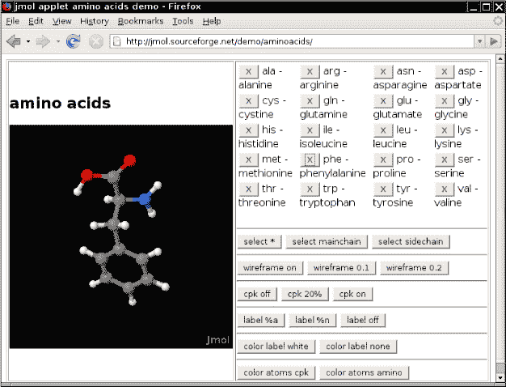

**图 1.1** `Jmol` applet

当 applet 首次出现时，它们引发了巨大的兴奋。许多人认为 applet 的吸引力是`Java`惊人普及的原因。然而，最初的兴奋很快变成了挫败。`Netscape`和`Internet Explorer`的各种版本运行不同的`Java`版本，其中某些版本已经严重过时。这种糟糕的局面使得开发利用最新`Java`版本的 applet 变得越来越困难。相反，`Adobe`的`Flash`技术因在浏览器中实现动态效果而流行。后来，当`Java`受到严重安全问题的困扰时，浏览器放弃了对 applet 的支持。当然，`Flash`情况相似。

### 1.4 Java 简史

本节提供了`Java`演变的简史。它基于各种出版来源（最重要的是 1995 年 7 月 *SunWorld* 在线杂志对`Java`创建者的采访）。

`Java`可以追溯到 1991 年，当时，由 Patrick Naughton 和 James Gosling（`Sun`成员及全能型计算机天才）领导的一组`Sun`工程师想要设计一种小型计算机语言，可用于电缆电视机盒等消费级设备。由于这些设备没有大量的功率或内存，该语言必须很小并生成非常紧凑的代码。此外，由于不同的制造商可能会选择不同的处理器（`CPU`），该语言不绑定到任何单一架构至关重要。该项目的代号为“Green”。

对小型、紧凑且平台无关代码的要求促使团队设计了一种可移植的语言，为虚拟机生成中间代码。

`Sun`的员工源自`UNIX`背景，因此他们基于`C++`构建了语言，而不是`Lisp`、`Smalltalk`或`Pascal`。但正如 Gosling 在采访中所说：“一直以来，这种语言一种工具，而不是目的。” Gosling 决定将他的语言命名为“Oak”（橡树）（可能是因为他喜欢`Sun`公司办公室窗外那棵橡树的样子）。`Sun`的员工后来发现`Oak`是一个现有计算机语言的名字，于是他们将其更名为`Java`。事实证明这是一个极具眼光的选择。

1992 年，Green 项目（Green project）交付了他们的第一个产品，名为“*7*”。这是一种极其智能的遥控器。遗憾的是，`Sun`公司没有人对生产这种产品感兴趣，Green 项目的人不得不寻找其他方式来营销他们的技术。然而，没有任何标准的消费电子公司感兴趣。于是，该小组竞标了一个设计有线电视盒的项目，该盒子能够处理如视频点播等新兴的有线电视业务。他们没有获得该合同。（有趣的是，赢得合同的公司是由创立`Netscape`的 Jim Clark 领导的——而这家公司对`Java`的成功做出了巨大贡献。）

Green 项目（后来更名为“First Person, Inc.”）在整个 1993 年和 1994 年上半年时间都在寻找购买其技术的人。一无所获。（该小组的创始人之一、最终负责大部分营销工作的 Patrick Naughton 声称，在推销该技术的过程中，积累了 300,000 英里里程。）First Person 在 1994 年解散。

当`Sun`在进行这一切时，互联网的万维网（World Wide Web）正变得越来越。万维网的关键是将超文本页面翻译到屏幕上的浏览器。1994 年，大多数人正在使用`Mosaic`，这是一种 1993 年由伊利诺伊大学超级计算中心推出的非商业网络浏览器。（`Mosaic`的部分代码是由 Marc Andreessen 在本科生期间通过一个勤工俭学项目编写的，每小时薪 6.85 美元。随后他作为`Netscape`的联合创始人之一和首席技术官，获得了名利双收。）

在 *SunWorld* 采访中，Gosling 提到在 1994 年年中，语言开发者们意识到：“我们可以构建一个非常酷的浏览器。在客户端/服务器主流领域中，这是少数几个需要我们所做的某些奇特功能的地方：架构中立、实时、可靠、安全——这些问题在工作站世界并不十分重要。所以我们构建了一个浏览器。”

实际的浏览器由 Patrick Naughton 和 Jonathan Payne 构建，并演变为`HotJava`浏览器，其设计旨在展示`Java`的强大。该浏览器能够在网页内部执行`Java`代码。这一“技术证明”在 1995 年 5 月 23 日的`SunWorld ’95`上展示，并引发了持续至今的`Java`热潮。

`Sun`在 1996 年初发布了`Java`的第一个版本。人们很快意识到`Java 1.0`无法满足严谨应用开发的需求。诚然，你可以用`Java 1.0`写一个紧张的文本小程序（applet），让文本在画布上随机移动。但在`Java 1.0`中你甚至无法进行*打印*。直言地说，`Java 1.0`还没有准备好投入市场。它的继任版本`1.1`填补了最明显的缺陷，大大改进了反射能力，并为 GUI 编程添加了新的事件模型。尽管如此，它仍然相当有限。

1998 年 JavaOne 大会上的大新闻是即将发布的`Java 1.2`，它用复杂的可扩展版本取代了早期像玩具一样的 GUI 和图形工具包。在 1998 年 12 月发布仅三三天后（！），`Sun`的营销部门将名称改为更吸引人的 *Java 2 Standard Edition Software Development Kit Version 1.2*。

除了标准版（Standard Edition），还引入了两个版本：用于手机等嵌入式设备的微型版（Micro Edition），以及用于服务器端处理的企业版（Enterprise Edition）。本书侧于标准版。

标准版的`1.3`和`1.4`版本是相对于初始`Java 2`版本的增量改进，具有不断增长的标准库、更高的性能，当然，还修复了许多错误（bug）。在此期间，关于 Java 小程序和客户端应用的大部分最初炒热已经消退了，但`Java`成为了服务器端应用的首选平台。

`5.0`版本是自`1.1`版本以来第一个以重大方式更新`Java`语言的版本。（该版本最初编号为`1.5`，但版本号在 2004 年 JavaOne 大会上跳到了`5.0`。）经过多年的研究，泛型（generic types，大致可比`C++`模板）被添加进来——挑战是在不改变虚拟机的情况下添加此功能。其他几个有用的语言特性也受到了`C#`的启发：“for each”循环、自动装箱（autoboxing）和注解（annotations）。

版本`6`（不带 .0 后缀）于 2006 年底发布。同样，没有语言变化，但有了额外的性能改进和库增强。

随着数据中心日益依赖通用硬件而非专用服务器，Sun Microsystems 陷入困境，并于 2009 年被`Oracle`收购。`Java`的开发停滞了。2011 年，`Oracle`发布了带有简单增强的新版本，即`Java 7`。

2014 年，随后发布了`Java 8`，带来了近二十年来对`Java`语言最显著的变化。`Java 8`引入了“函数式”编程风格，使其能够轻松表达可以并发执行的计算。

`Java 9`的主要特性可以追溯到 2008 年。当时，`Java`平台首席工程师 Mark Reinhold 启动了一项拆解庞大的单体`Java`平台的工作。这将通过引入*模块*（modules，即提供特定功能的自包含代码单元）来实现。花费了十一年时间设计并实现了一个适用于`Java`平台的模块系统，但它是否也适用于`Java`应用程序和库还有待观察。2017 年发布的`Java 9`具有本书涵盖的其他吸引人的特性。

从 2018 年开始，`Java`每六个月发布一个版本，以便更快地引入功能。每隔一段时间，一个版本——目前为`Java 11`和`Java 17`——会被指定为长期支持版本（LTS）。中间版本提供了尝试实验性功能的机制。

表 1.1 显示了`Java`语言和库的演变。你可以看到，应用程序编程接口（`API`）的大小已经巨大增长。

**表 1.1** Java 语言的演变

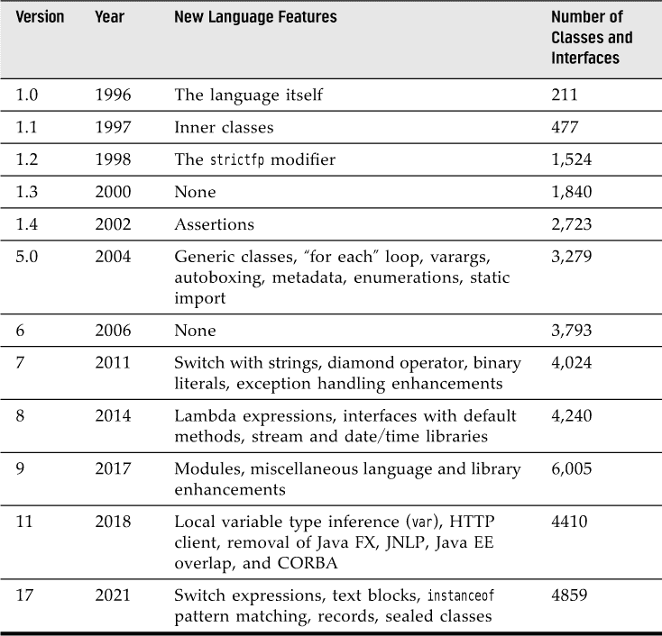

### 1.5 关于 Java 的常见误解

本章最后通过带有注释的列表列出了关于`Java`的常见误解。

*Java 是 HTML 的扩展。*

`Java`是一种编程语言；`HTML`是一种描述网页结构的方法。除了曾经存在在网页上放置 Java 小程序的`HTML`扩展外，它们没有任何共同点。

*我使用 XML，所以我不需要 Java。*

`Java`是一种编程语言；`XML`是一种描述数据的方法。你可以用任何编程语言处理`XML`数据，但`Java API`为`XML`处理提供了卓越的支持。此外，许多重要的`XML`工具都是用`Java`实现的。更多信息请见第二卷。


没有像 Java 这样强大的编程语言是容易上手的。你必须区分编写简单的演示程序有多容易，以及执行严肃的工作有多困难。此外，请注意，书中只有七章讨论了 Java 语言。两书中剩下的章节都展示了如何使用 Java `libraries` 来让该语言发挥作用。Java 库包含了成千上万个类、接口以及数万个函数。幸运的是，你不需要了解其中的每一个，但要用 Java 编写任何实际的任务，你确实需要了解其中非常多的内容。

Java 将成为适用于所有平台的通用编程语言。

这在理论上是可能的。但在实践中，某些领域其他语言已经根深蒂固。Objective C 及其继任者 `Swift` 不会在 iOS 设备上被取代。浏览器中发生的任何事情都由 `JavaScript` 控制。Windows 程序用 `C++` 或 `C#` 编写。Java 在服务端编程和跨平台客户端应用程序方面具有优势。

Java 仅仅是另一种编程语言。

Java 是一门很好的编程语言；大多数程序员更倾向于它而非 `C`、`C++` 或 `C#`。但曾有数百种优秀的编程语言从未获得广泛流行，而像 `C++` 和 `Visual Basic` 这样具有明显缺陷的语言却取得了巨大的成功。

为什么呢？编程语言的成功在很大程度上取决于其周围 `support system` 的实用性，而不是其语法的优雅性。对于你需要实现的功能，是否有有用、方便且标准的库？是否有工具供应商构建了出色的编程和调试环境？该语言和工具集是否与计算基础设施的其他部分集成？Java 之所以成功是因为它的库让你能够轻松地处理网络、Web 应用程序和并发等事务。Java 减少指针错误是一个额外奖励，因此程序员在使用 Java 时似乎产效率更高——但这些因素并不是它成功的根源。

Java 是私有的，因此应该避免使用。

当 Java 最初被创建时，Sun Microsystems 向分发商和终端用户提供了免费许可。虽然 Sun 对 Java 拥有最终控制权，但他们让许多其他公司参与了语言版本的开发和新库的设计。虚拟机和库的源代码一直是免费提供的，但仅供检查，而不允许修改和分发。Java 曾是“闭源但处处友善的”。

这种情况在 2007 年发生了剧变，当时 Sun 宣布未来的 Java 版本将根据通用公共许可（GPL）发布，这是与 `Linux` 使用的相同的开源许可。Oracle 已承诺保持 Java 开源。现在有多个开放 Java 实现的提供者，并具有不同程度的承诺和支持。

Java 是解释型执行的，所以对于严肃的应用来说太慢了。

在 Java 早期，这门语言是解释型执行的。如今，Java 虚拟机使用了即时编译器（just-in-time compiler）。你代码中的“热点”部分在 Java 中的运行速度与 `C++` 一样，在某些情况下甚至更快。

所有 Java 程序都运行在网页内部。

曾有一段时间，Java `applets` 运行在 Web 浏览器内部。如今，Java 程序是运行在浏览器之外的独立应用程序。事实上，大多数 Java 程序运行在服务器上，为网页生成代码或计算业务逻辑。

Java 程序是重大的安全风险。

在 Java 早期，曾出现过广为人知的关于 Java 安全系统故障的报告。研究人员将其视为寻找 Java 盔甲上的破绽、挑战 applet 安全模型强度和复杂性的机会。他们发现的技术性故障很快被纠正。后来，出现了更严重的漏洞，Sun 以及随后的 Oracle 对此反应缓慢。浏览器厂商停止了对 Java applets 的支持。让 applet 成为可能的安全管理器架构现在已被弃用。如今，Java 应用程序的安全性并不低于其他应用程序。由于虚拟机的保护，它们比用 `C` 或 `C++` 编写的应用程序安全得多。

JavaScript 是 Java 的简化版本。

`JavaScript` 是一种可以在网页内部使用的脚本语言，由 Netscape 发明，最初名为 `LiveScript`。`JavaScript` 的语法让人联想到 Java，两种语言的名字听起来也很相似，除此之外它们之间毫无关系。特别是，Java 是`强类型`（strongly typed）——编译器可以捕捉许多由于类型误用引起的错误。在 `JavaScript` 中，此类错误只有在程序运行时才会发现，这使得消除它们变得更加费力。

通过 Java，我可以用廉价的“互联网家电”代替我的桌面电脑。

当 Java 刚发布时，有些人大注注这种情况将会发生。公司生产了由 Java 驱动的网络计算机原型，但用户尚未准备好放弃强大且方便的桌面电脑，转而使用一台没有本地存储的受限机器。如今，世界已经变了，对于大多数终端用户来说，重要的平台是手机或平板电脑。这些设备中的大多数由 `Android` 平台控制。学习 Java 编程也将对你的 Android 编程有所帮助。

## 第 2 章 Java 环境

### 在本章中

- 2.1 安装 Java 开发工具包
- 2.2 使用命令行工具
- 2.3 使用集成开发环境
- 2.4 JShell

在本章中，你将学习如何安装 Java 开发工具包（JDK）以及如何编译和运行 Java 程序。你可以在终端窗口中输入命令来运行 JDK 工具。然而，许多程序员更喜欢集成开发环境带来的舒适感。你将学习如何使用一个免费的开发环境来编译和运行 Java 程序。一旦你掌握了本章中的技术并选择了你的开发工具，就可以准备进入第 3 章了，在那里你将开始探索 Java 语言。

### 2.1 安装 Java 开发工具包

在过去，最完整、最新的 Java 开发工具包（JDK）由 Oracle 提供。现在，许多不同的公司（包括 Microsoft、Amazon、Red Hat 和 Azul）都提供最新的 OpenJDK 构建版本，某些许可条件比 Oracle 更好。在我编写本章时，我喜欢的网站是 `adoptium.net`，它由供应商、开发者和用户小组运行。他们为 Linux、Mac OS 和 Windows 提供免费构建版本。

#### 2.1.1 下载 JDK

你可以从 `adoptium.net` 或 Oracle 的 `oracle.com/technetwork/java/javase/downloads` 或其他提供者下载 Java 开发工具包。你应该使用 Java SE 17 (LTS) JDK。参考表 2.1 下载网站上可能遇到的缩写和术语。

**表 2.1** Java 术语

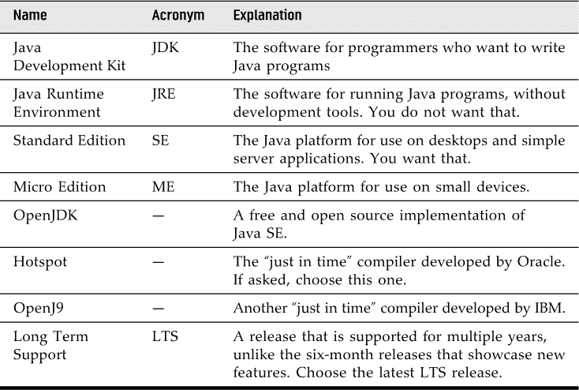

#### 2.1.2 设置 JDK

下载 JDK 后，你需要安装它并确定安装位置——你之后需要这些信息。

- 在 Windows 下，运行安装程序。系统会询问你 JDK 安装在哪里。最好不要接受路径中带有空格的默认位置，例如 `c:\Program Files\Java\jdk-17.0.x`。只需去掉路径名中的 `Program Files` 部分即可。
- 在 Mac 上，运行安装程序。它将软件安装到 `/Library/Java/JavaVirtualMachines/jdk-17.0.x.jdk/Contents/Home`。通过 Finder 找到它。
- 在 Linux 上，只需将 `.tar.gz` 文件解压到你选择的路径，例如你的主目录或 `/opt`。或者，如果你是从 `RPM` 文件安装的，请双击它是否已安装在 `/usr/java/jdk-17.0.*x*`。

在书中，安装目录标记为 `jdk`。例如，当引用 `jdk/bin` 目录时，我指的是名称类似于 `/opt/jdk-17.0.4/bin` 或 `c:\Java\jdk-17.0.4\bin` 的目录。

以下是测试你操作是否正确的运行。打开一个终端窗口。输入该行命令：

```bash
javac --version
```

并按回车键。你应该会得到如下的显示：

```text
javac 17.0.4
```

如果你收到的类似“javac: command not found”或“指定的名称不是内部或外部命令、可运行程序或批文件”这样的信息，那么你需要双击你的安装情况。

在 Windows 或 Linux 上安装 JDK 时，你可能还需要额外执行一个额外的步骤：将 `jdk/bin` 目录添加到可执行路径中——即操作系统查找可执行文件遍历的目录列表。

- 在 Linux 上，在你的 `~/.bashrc` 或 `~/.bash_profile` 文件末尾添加如下的一行：

```bash
export PATH=jdk/bin:$PATH
```

请确保使用正确的 JDK 路径，例如 `/opt/jdk-17.0.4`。

- 在 Windows 10 下，在 Windows 设置的搜索栏中输入“environment”（环境），并选择“编辑账户环境变量”（参见图 2.1）。应该会出现一个环境变量对话框。（它可能隐藏在 Windows 设置对话框后面。如果你在任何地方都找不到它，请尝试通过同时按 Windows 键和 R 键打开运行框运行 `sysdm.cpl`，然后选择“高级”选项卡并点击“环境变量”按钮。）在用户变量找到并选择名为 `Path` 的变量。点击“编辑”按钮，然后点击“新建”按钮，并添加包含 `jdk\bin` 目录的条目（参见图 2.2）。

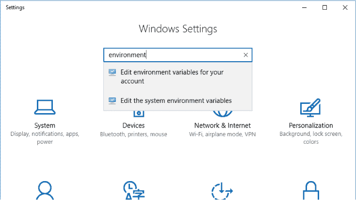

**图 2.1** 在 Windows 中设置系统属性

保存你的设置。你启动的任何新“命令提示符”窗口将具有正确的路径。

### 2.1.3 安装源码和文档

库源码以压缩文件 `lib/src.zip` 的形式随 JDK 交付。

1. 确保 JDK 已安装且 `jdk/bin` 目录在可执行路径上。
2. 在你的主目录下创建一个名为 `javasrc` 的目录。如果你愿意，可以在终端窗口中执行此操作。

```bash
mkdir javasrc
```

3. 在 `jdk/lib` 目录内部找到 `src.zip` 文件。
4. 将 `src.zip` 文件解压到 `javasrc` 目录。在终端窗口中，你可以执行以下命令：

```bash
cd javasrc

jar xvf jdk/lib/src.zip

cd ..
```

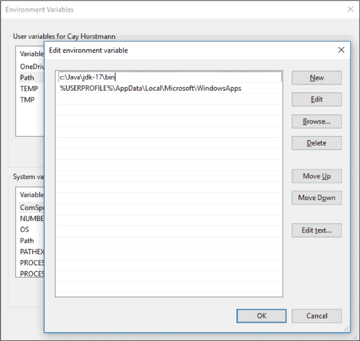

**图 2.2** 在 Windows 中设置 `Path` 环境变量

***

**提示：**

`src.zip` 文件包含所有公共库的源码。要获取更多源码（针对编译器、虚拟机、原生方法和私有辅助类），请访问 [`http://openjdk.java.net`](http://openjdk.java.net)。

***

文档包含在一个与 JDK 隔离开的独立压缩文件中。你可以从 [`www.oracle.com/technetwork/java/javase/downloads`](http://www.oracle.com/technetwork/java/javase/downloads) 下载文档。按照以下步骤操作：

1. 下载文档 zip 文件。它名为 `jdk-17.0.*x*_doc-all.zip`。
2. 解压文件并将 `doc` 目录重命名为具描述性的名称，例如 `javadoc`。如果你愿意，可以在命令行中执行此操作：

```bash
jar xvf Downloads/jdk-17.0.x_doc-all.zip

mv docs jdk-17-docs
```

3. 在浏览器中，导航到 `jdk-17-docs/index.html` 并将此页面加入书签。

你还应该安装 *Core Java* 程序示例。你可以从 [`http://horstmann.com/corejava`](http://horstmann.com/corejava) 下载。程序被封装成 zip 文件 `corejava.zip`。只需将它们解压到你的主目录即可。它们将位于 `corejava` 目录中。如果你愿意，可以在命令行中执行此操作：

```bash
jar xvf Downloads/corejava.zip
```

### 2.2 使用命令行工具

如果你的编程经验来自如 Microsoft Visual Studio 等开发环境，你已经习惯了带有内置文本编辑器、编译和启动程序的菜单以及调试器的系统。JDK 并不包含任何类似于此的内容。你*每件事*都需要通过在终端中输入命令来完成。

1. 打开一个终端窗口。
2. 进入 `corejava` 目录。
3. 输入以下命令：

```bash
javac Welcome.java
java Welcome
```

你应该看到如图 2.3 所示的输出。

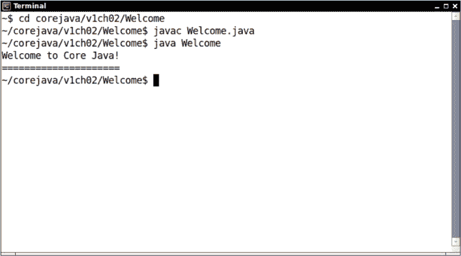

**图 2.3** 编译并运行 `Welcome.java`

在 Windows 下，请使用 `dir` 命令，而不是图形化的 Explorer 管理器工具。某些文本编辑器（特别是记事本）会坚持在每个文件名的后添加 `.txt` 扩展名。如果你用记事本编辑 `Welcome.java`，它实际上会将其保存为 `Welcome.java.txt`。在 Windows 的默认设置下，资源管理器会与记事本“串通”并隐藏 `.txt` 扩展名，因为它属于“已知文件类型”。在这种情况下，你需要使用 `ren` 命令重命名文件，或者重新保存它，并在文件名两边加上引号：`"Welcome.java"`。

- 如果你启动程序并收到一个关于 `java.lang.NoClassDefFoundError` 的错误消息，请仔细检查出错的类的名称。
- 如果你收到关于 `welcome`（全小写 `w`）的提示信息，那么你应该使用大写的 `W` 重新执行 `java Welcome` 命令。一如既往，Java 对大小写非常敏感。
- 如果你收到关于 `Welcome/java` 的提示信息，意味着你不小心输入了 `java Welcome.java`。请重新执行命令 `java Welcome`。
- 如果你输入了 `java Welcome` 但虚拟机找不到 `Welcome` 类，请检查系统上有人设置了 `CLASSPATH` 环境变量。全局设置此变量并不是一个好主意，但 Windows 上某些编写得糟糕的软件安装程序确实会这样做。按照设置 `PATH` 环境变量相同的步骤操作，但这次要删除该设置。

***

 **提示：**

位于 [`http://docs.oracle.com/javase/tutorial/getStarted/cupojava`](http://docs.oracle.com/javase/tutorial/getStarted/cupojava) 上的优秀教程更详细地介绍了初学者可能遇到的各种“坑”。

***

 **注意：**

如果你只有一个源文件，可以跳过 `javac` 命令。此功能适用于 shell 脚本（以“shebang”行 `#!/path/to/java` 开头），或许可能也适用于简单的学生程序。一旦你的程序变得复杂，你就需要使用 `javac`。

`Welcome` 程序并不特别有趣。接下来，尝试一个图形化应用程序。这个程序是一个简单的图像文件查看器，用于加载并显示图像。和之前一样，从命令行编译并运行该程序。

1. 打开终端窗口。
2. 切换到目录 `corejava/v1ch02/ImageViewer`。
3. 输入以下内容：

```bash
javac ImageViewer.java
java ImageViewer
```

弹出一个新的程序窗口，显示 `ImageViewer` 应用程序。现在，选择文件（File）→ 打开（Open），寻找一个图像文件打开。（同目录下有两个示例文件）。图像显示出来（参见图 2.4）。要关闭程序，点击标题栏上的关闭框，或从菜单中选择文件 → 退出（Exit）。


**图 2.4** 运行 ImageViewer 应用程序

快速查看源代码（列表 2.2）。该程序比第一个程序长得多，但如果你考虑到用 C 或 C++ 编写类似的应用程序需要多少代码，就会发现它并不太复杂。当然，现在编写带有图形用户界面的桌面应用程序已不再常见，但如果你感兴趣，可以在第 10 章中找到更多细节。

**列表 2.2** `ImageViewer/ImageViewer.java`


```java
import java.awt.*;
import java.io.*;
import javax.swing.*;

/**
 * 用于查看图像的程序。
 *
 * @version 1.31
 * @author Caymann
 */
public class ImageViewer
{
    public static void main(String[] args)
    {
        EventQueue.invokeLater(() ->
            {
                var frame = new ImageViewer();
                frame.setTitle("ImageViewer");
                frame.setDefaultCloseOperation(JFrame.EXIT_ON_CLOSE);
                frame.setVisible(true);
            });
    }

    /**
     * 用于显示图像。
     */
    class ImageViewer extends JFrame
    {
        private static int DEFAULT_WIDTH = 300;
        private static int DEFAULT_HEIGHT = 400;

        ImageViewer()
        {
            setSize(DEFAULT_WIDTH, DEFAULT_HEIGHT);
            var label = new JLabel();
            add(label);
            var menuBar = new JMenuBar();
            setJMenuBar(menuBar);
            var menu = new JMenu("File");
            menuBar.add(menu);
            var openItem = new JMenuItem("Open");
            menu.add(openItem);
            openItem.addActionListener(() -> {
                var chooser = new JFileChooser();
                int result = chooser.showOpenDialog(null);
                if (result == JFileChooser.APPROVE_OPTION) {
                    String name = chooser.getSelectedFile().getPath();
                    label.setIcon(new ImageIcon(name));
                }
            });
            var exitItem = new JMenuItem("Exit");
            menu.add(exitItem);
            exitItem.addActionListener(() -> {
                System.exit(0);
            });
        }
    }
}
```

### 2.3 使用集成开发环境

在上一节中，你学习了如何从命令行编译和运行 Java 程序。这对于调试是一个非常有用的技能，但对于日常工作，你应该使用集成开发环境。这些环境非常强大且方便，以至于不使用它们就毫无意义。优秀的选择有免费 Eclipse、IntelliJ IDEA 和 NetBeans。在本章中，你将学习如何使用 Eclipse。

通过 [`eclipse.org/downloads`](http://eclipse.org/downloads) 下载 Eclipse。适用于 Linux、Mac OS X 和 Windows。运行安装程序并选择名为“Eclipse IDE for Java Developers”的安装 set。

以下是使用 Eclipse 写程序的步骤：

1. 启动 Eclipse，选择文件（File）→ 新（New）→ 项目（Project）。
2. 从向导对话框中选择“Java 项目”（参见图 2.5）。
3. 点击下一步按钮。取消勾选“使用默认位置”框。点击浏览并导航到 `corejava/v1ch02/Welcome` 目录（参见图 2.6）。
4. 点击完成按钮。项目已创建。
5. 点击左侧项目旁边的三角形，直到找到 `Welcome.java` 文件并双击它。现在你应该能看到显示程序代码的面板（参见图 2.7）。
6. 在左侧项目名称（Welcome）上点击右键。选择运行（Run）→ 运行（Run As）→ Java 应用程序。程序输出显示在控制面板中。

假设这个程序没有拼写错误或错误（毕竟它只有几行代码。）让我们假设一下，你的代码偶尔包含拼写错误（甚至是语法错误）。尝试一下。弄坏你的文件，例如通过更改 `String` 的大小写如下：

```java
string greeting = "Welcome to Core Java!";
```

注意 `string` 下方的波浪线。在源代码下方的标签页中，点击 `Problems`（问题）并展开三角形，直到你看到一条提示关于未知 `string` 类型的错误消息（请参见图 2.8）。点击该错误消息。光标将移动到编辑面板中对应的行，你可以在那里纠正错误。这允许你快速修复错误。

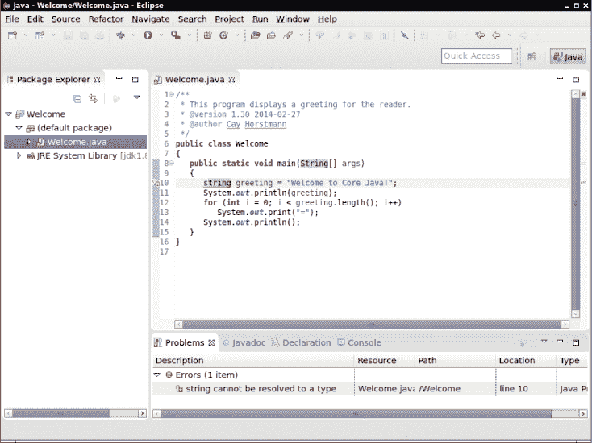

**图 2.8** Eclipse 中的错误消息

---

 **提示：**

通常，Eclipse 错误报告会伴随一个灯泡图标。点击灯泡图标可以获取建议的修复方案列表。

---

### 2.4 JShell

在上一节中，你已经学习了如何编译和运行 Java 程序。Java 9 引入了另一种处理 Java 的方式。`JShell` 程序提供了一个“读取-评估-打印循环”，或 REPL。你输入一个 Java 表达式；`JShell` 会评估你的输入，打印结果，并等待你的下一次输入。要启动 `JShell`，只需在终端窗口中输入 `jshell`（参见图 2.9）。

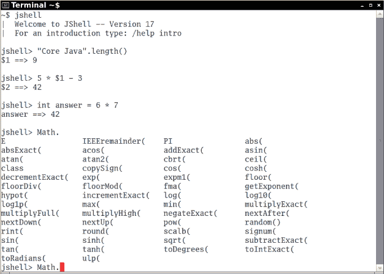

**图 2.9** 运行 `JShell`

`JShell` 以欢迎语开始，随后是提示符：

```text
|  Welcome to JShell -- Version 17.0.4

|  For an introduction type: /help intro

jshell>
```

现在输入一个表达式，例如：

```java
"Core Java".length()
```

`JShell` 返回结果——在这种情况下，是字符串“Core Java”的字符数。

```text
$1 ==> 9
```

注意，你*不需要*输入 `System.out.println`。`JShell` 会自动打印你输入的每个表达式的值。

输出中的 `$1` 表示结果可以用于进一步计算。例如，如果你输入：

```java
5 * $1 - 3
```

响应为：

```text
$2 ==> 42
```

如果你需要多次使用一个变量，可以给它起一个更容易记的名字。你必须遵循 Java 语法（参见第 3 章）并指定类型，然后是名称。例如：

```java
jshell> int answer = 6 * 7

answer ==> 42
```

另一个实用的功能是 Tab 补全。输入：

```java
Math.
```

然后按下 `Tab` 键。你将获得一个可以使用 `Math` 类调用的所有方法列表：

```text
jshell> Math.

E               IEEEremainder(    PI abs(

absExact        acos(               addExact(      asin(

atan(            atan2(               cbrt(           ceil(

class           copySign(        cos(             cosh(

decrementExact  exp(                expm1(          floor(

floorDiv        floorMod(        fma(              getExponent(

hypot           incrementExact(     log(              log10(

log1p           max(                min(              multiplyExact(

multiplyFull   multiplyHigh(      negateExact(     nextAfter(

nextDown        nextUp(             pow(              random()

rint           round(          scal(  subtract(

sin             sinh(          sqrt(

tan             tanh(          toDegrees(  toInt(ulp
```

现在输入 `l` 并再次按下 `Tab` 键。方法名被补全为 `log`，你得到了一个更短的列表：

```text
jshell> Math.log

log10(
```

现在你可以手动填写剩余部分：

```java
jshell> Math.log10(0.001)

$3 ==> -3.0
```

要重复某个命令，按 `↑` 键直到看到想要重新发送或编辑的行。你可以使用 `←` 和 `→` 在行内移动光标，并添加或删除字符。完成后按 `Enter`。例如，将 `0.001` 替换为 `1000`，然后按 `Enter`：

```java
jshell> Math.log10(1000)

$4 ==> 3.0
```

`JShell` 让你轻松有趣地学习 Java 语言和库，而无需启动大型开发环境，也不需要纠结于 `public static main`。

在本章中，你学习了编译和运行 Java 程序的机制。你现在已准备好进入第 3 章，在那里你将开始学习语言。

## 第 3 章 Java 基础编程结构

### 在本章中

- 3.1 简单的 Java 程序
- 3.2 注释
- 3.3 数据类型
- 3.4 变量与常量
- 3.5 运算符
- 3.6 字符串
- 3.7 输入与输出
- 3.8 控制流
- 3.9 大数
- 3.10 数组

要运行一个编译后的程序，Java 虚拟机始终会从你指定的类中 `main` 方法的代码开始执行。（“方法”一词是 Java 语言中对“函数”的称呼。）因此，你的类源文件中*必须*包含一个 `main` 方法，你的代码才能执行。当然，你可以向类中添加你自己的方法，并在 `main` 方法中调用它们。（你将在下一章中看到如何编写自己的方法。）

---

 **注意：**

根据《Java 语言规范》，`main` 方法必须声明为 `public`。（《Java 语言规范》是描述 Java 语言的官方文档。你可以从 [`http://docs.oracle.com/javase/specs`](http://docs.oracle.com/javase/specs) 查看或下载它。）

然而，多个版本的 Java 启动器即使在 `main` 方法不是 `public` 的情况下也愿意执行 Java 程序。有一位程序员提交了 bug 报告。要查看该报告，请访问 [`https://bugs.openjdk.java.net/browse/JDK-4252539`](https://bugs.openjdk.java.net/browse/JDK-4252539)。1999 年，该 bug 被标记为“已关闭，不会修复”。一位 Sun 工程师添加了说明，《Java 虚拟机规范》并未规定 `main` 必须是 `public`，并且“修复它会导致潜在的麻烦”。幸运的是，理性最终获得了胜利。Java 1.4 及更高版本的 Java 启动器强制 `main` 方法必须是 `public`。

当然，让质量保证工程师（他们通常工作过度，且并不总是 Java 细微之处的专家）对 bug 报告做出可的决定是令人沮丧的。但值得的是，在 Java 开源之前，bug 报告及其解决方案就可以供任何人审查，这非常了不起。

---

注意源代码中的大括号 `{ }`。在 Java 中，就像在 C/C++ 中一样，大括号划分了程序的各个（通常称为*块*）。在 Java 中，任何方法的代码都必须以左大括号 `{` 开始并以右大括号 `}` 结束。

大括号的风格引发了大量的无用争议。本书采用的是使匹配的大括号对齐的风格。由于空格对 Java 编译器没有影响，你可以使用任何你喜欢的大括号风格。

目前，不要担心 `static void` 关键字——只需把它们看作让 Java 程序编译所需的内容即可。在第 4 章结束时，你将完全理解这个咒语。现在需要记住点是，每个 Java 都必须有一个以下如下声明的 `main` 方法：

```java
public class ClassName
{
  public static void main(String[] args)
  {
    program statements
  }
}
```

---

 **C++ 注意：**

作为一名 C++ 程序员，你知道什么是类。Java 类与 C++ 类相似，但有一些可能误导你的的差异。例如，在 Java 中，*所有*函数都是某个类的方法。（标准术语将它们称为方法，而不是成员函数。）因此，在 Java 中，你必须为 `main` 方法提供一个外壳类。你可能也熟悉 C++ 中*静态成员函数*的概念。这些是定义在类内部但不操作特定对象的成员函数。Java 中的 `main` 方法始终是静态的（static）。最后，与 C/C++ 一样，`void` 关键字表示该方法不返回值。与 C/C++ 不同，`main` 方法不会向操作系统返回“退出代码”。如果 `main` 方法正常退出，Java 程序的退出代码为 `0`，表示成功完成。若要用不同的退出代码终止程序，请使用 `System.exit` 方法。

---

接下来，请关注这段片段：

```java
{
  System.out.println("We will not use 'Hello, World!'");
}
```

大括号标记了方法*体*的开始和结束。这个方法内部只有一条语句。与大多数编程语言一样，你可以将 Java 语句视为该语言的句子。在 Java 中，每条语句都必须以分号结尾。特别是，换行符并不标记语句的结束，因此在需要时，语句可以跨越多行。

`main` 方法体包含一条向控制台输出单行文本的语句。

在这里，我们使用了 `System.out` 对象并调用了它的 `println` 方法。注意用于调用方法的点。Java 使用通用语法作为函数调用的等效写法：

```java
object.method(parameters)
```

在这种情况下，`println` 方法接收一个字符串参数。该方法在控制台上显示该字符串参数。然后它结束输出行，因此每次对 `println` 的调用都会在新的行显示其输出。注意 Java 像 C/C++ 一样，使用双引号来界定字符串。（你可以在本章稍后的部分找到更多关于字符串的信息。）

Java 中的方法与任何编程语言中的函数一样，可以使用零、一个或多个*参数*（有些程序员称它们为*参数*）。即使方法不接受任何参数，你仍必须使用空括号。例如，没有参数的 `println` 方法变体只是打印一个空行。你通过以下调用来执行它：

```java
System.out.println();
```

---

 **注意：**

`System.out` 还有一个不添加换行的 `print` 方法。

---

### 3.

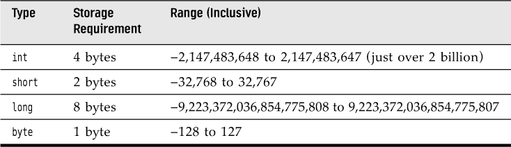

在大多数情况下，`int` 类型是最实用的。如果你想表示地球上的人口，你将需要使用 `long`。`byte` 和 `short` 类型主要用于特殊应用程序，例如低级文件处理，或在存储空间极其有限时用于大型数组。

在 Java 中，整数类型的范围不依赖于运行 Java 代码的机器。这为想要将软件从一个平台迁移到另一个平台（甚至是在同一平台的不同操作系统之间切换）的程序员减少了一个大头疼的问题。相比之下，C 和 C++ 程序会为每个处理器使用最高效的整数类型。因此，在 32 位处理器上运行良好的 C 程序在 16 位系统上可能会出现整数溢出。由于 Java 程序必须在所有机器上运行并获得**完全相同**的结果，因此各种类型的范围是固定的。

长整型数字带有 `L` 或 `l`（例如，`4000000000L`）。十六进制数有前缀 `0x` 或 `0X`（例如，`0xCAFE`）。八进制数有前缀 `0`（例如，`010` 是 8）——自然地，这可能会引起混惑，很少有程序员使用八进制常量。


你可以使用前缀 `0b` 或 `0B` 编写二进制数。例如，`0b1001` 是 9。你可以在数字字面量中添加下划线，例如 `1_000_000`（或 `0b1111_0100_0010_0100_0000`）来表示百万。这些下划线仅供人类阅读，Java 编译器会直接将其删除。

 **C++ 注意：**

在 C 和 C++ 中，`int` 和 `long` 等类型的大小取决于目标平台。在像 8086 这样的 16 位处理器上，整数是 2 字节，但在 Pentium 或 SPARC 等 32 位处理器上是 4 字节量。同样，`long` 值在 32 位处理器上是 4 字节，在 64 位处理器上是 8 字节。这些差异使得编写跨平台程序具有挑战性。在 Java 中，所有数值类型的大小与平台无关。

注意，Java 没有 `int`、`long`、`short` 或 `byte` 类型的任何无符号（unsigned）版本。

 **注意：**

如果你处理的是永远为负数的整数值，并且确实需要额外的位，你可以在小心的情况下将符号整数值解释为无符号数。例如，与其让字节值 `b` 表示从 –128 到 127 的范围，你可能想要 0 到 255 的范围。你可以将其存储在 `byte` 中。由于二进制算术的性质，只要不溢出，加、减、乘就可以正常工作。对于其他操作，调用 `Byte.toUnsignedInt(b)` 来获取 0 到 255 之间的 `int` 值，然后处理该整数值并转换回 `byte`。`Integer` 和 `Long` 类具有用于无符号除法和取余的方法。

### 3.3.2 浮点类型

浮点类型表示带有小数部分的数字。两种浮点类型如表 3.2 所示。

**表 3.2** 浮点类型

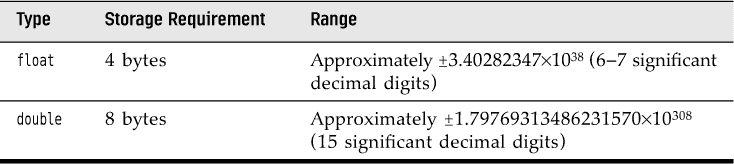

`double` 的名称是指这些数字的精度是 `float` 类型的两倍。（有些人称这些为双精度数字。）`float` 有限的精度（6–7 位有效数字）在许多情况下是不够的。只有当你使用的库需要这些值时，或者当你需要存储大量的此类数值时，才使用 `float` 值。

`float` 类型的数字带有 `F` 或 `f` 后缀（例如，`3.14F`）。不带 `F` 后缀的浮点数（如 `3.14`）始终被视为 `double` 类型。你可以选择性提供 `D` 或 `d` 后缀（例如，`3.14D`）。

`E` 或 `e` 表示十指数。例如，`1.729E3` 等于 `1729`。

 **注意：**

你可以使用十六进制指定浮点字面量。例如，`0.125 = 2^(–3)` 可以写成 `0x1.0p-3`。在十六进制表示法中，使用 `p` 而不是 `e` 来表示指数（`e` 是十六进制数字）。注意尾数是用十六进制写的，而指数是十进制的。指数的底是 2，而不是 10。

所有的浮点计算都遵循 IEEE 754 规范。特别是，有三个特殊的浮点值用于表示溢出和错误：

- 正无穷
- 负无穷
- NaN（不是数字）

例如，正数除以 0 的结果是正无穷。计算 0/0 或...的平方根。

 **注意：**

`double` 的精度是 `float` 的两倍。`float` 有限的精度（6–7 位有效数字）在许多情况下是不够的。使用 `float` 值只有当你使用的库需要它们时，或者当你需要存储大量的此类数值时。

`float` 类型的数字带有 `F` 或 `f` 后缀（例如，`3.14F`）。不带 `F` 后缀的浮点数（如 `3.14`）始终被视为 `double` 类型。你可以选择性提供 `D` 或 `d` 后缀（例如，`3.14D`）。

`E` 或 `e` 表示十指数。例如，`1.729E3` 等于 `1729`。

正数除以 0 的结果是正无穷。计算 0/0 或...的平方根。

```text
POSITIVE_INFINITY
NEGATIVE_INFINITY
NaN
```

### 3.3.3 `char` 类型

`char` 类型最初旨在描述单个字符。然而，现在不再如此。`char` 字面量包含在单引号中。例如，`'A'` 是值为 65 的字符常量。它与包含单个字符的 `"A"` 不同。`char` 的值可以用十六进制表示，范围从 `\u0000` 到 `\uFFFF`。例如，`\u2122` 是商标符号 ™，`\u03C0` 是希腊字母 π。

除了 `\u` 转义序列外，还有几种特殊字符的转义序列，如表 3.3 所示。你可以在字符字面量和字符串内部使用这些转义序列，例如 `'\u2122'` 或 `"Hello\n"`。`\u` 转义序列（其他序列均不行）甚至可以用在字符常量和字符串之外。例如：

```java
public static void main(String\u005B\u005D args)
```

是完全合法的——`\u005B` 和 `\u005D` 是 `[` 和 `]` 的编码。

**表 3.3** 特殊字符的转义序列

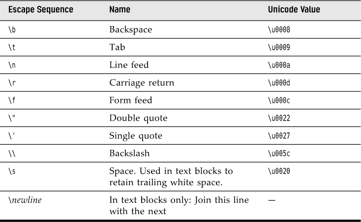

 **注意：**

Unicode 转义序列在代码解析之前就会处理。例如，`"\u0022+\u0022"` 并不是由引号围成加号的字符串（U+0022）。相反，`\u0022` 在解析之前被转换为 `"`，产生 `""""`，即一个空字符串。

更阴险的是，你必须警惕注释中的 `\u`。注释：

```java
// \u000A 是换行符
```

会导致语法错误，因为 `\u000A` 在程序读取时会被替换为换行符。同样，注释：

```java
// look inside c:\users
```

会导致语法错误，因为 `\u` 后面没有四个十六进制数字。

在 Unicode 转义序列中，你可以拥有任意数量的 `u`：`\uu0022` 和 `\uuu0022` 都表示引号字符。这种奇怪现象是有原因的。想象一个正在快乐地使用 Unicode 编码的程序员，由于某种古老的原因，被迫只能以 ASCII 格式提交代码。转换工具可以将任何大于 `U+007F` 的字符转换为 Unicode 转义序列，并在每个现有的 Unicode 转义序列前添加一个 `u`。这使得转换是可逆的。例如，`\uD800 ™` 变为 `\uuD800 \u2122`，并可以转换回 `\uD800 ™`。

### 3.3.4 Unicode 与 `char` 类型

为了完全理解 `char` 类型，你必须了解 Unicode 编码方案。Unicode 的发明是为了克服传统字符编码方案的局限性。在 Unicode 之前，有许多不同的标准：美国的 `ASCII`、西欧语言的 `ISO 8859–1`、俄语的 `KOI-8`、中文的 `GB18030` 和 `BIG-5` 等。这导致了两个问题：首先，特定的代码值在不同的编码方案中对应不同的字母。其次，字符集较大的语言的编码是变长的：某些常用字符被编码为单字节，而另一些需要两个或多个字节。

Unicode 的设计是为了解决这些问题。当 20 世纪 80 年代统一工作开始时，固定的 2 字节代码足以编码世界上所有语言使用的所有字符，并为未来的扩展留下了余地——至少当时大家都是这么想的。1991 年，`Unicode 1.0` 发布，使用了可用 `65,536` 个代码值中略多于一半的数量。Java 从底层开始就被设计为使用 16 位 Unicode 字符，这比使用 8 位字符的其他编程语言来说是一项重大进步。

遗憾的是，随着时间的推移，不可避免的事情发生了。Unicode 字符数量超过了 65,536 个，这主要是因为增加了大量用于中、日、韩的表意字。现在，16 位的 `char` 类型不足以描述所有的 Unicode 字符。

我们需要一些术语来解释 Java 如何解决这个问题。*代码点*（code point）是与编码方案中的字符关联的代码值。在 Unicode 标准中，代码点以十六进制形式编写，并以 `U+` 为前缀，例如拉丁字母 A 的代码点为 `U+0041`。Unicode 的代码点被分组为 17 个*代码平面*（code planes）。第一个代码平面称为*基本多语言平面*（basic multilingual plane），由代码点从 `U+0000` 到 `U+FFFF` 的“经典”Unicode 字符组成。另外的 16 个平面（代码点范围为 `U+10000` 到 `U+10FFFF`）包含了*补充字符*（supplementary characters）。

`UTF-16` 编码用变长代码表示所有的 Unicode 代码点。基本多语言平面中的字符被表示为 16 位的值，称为*代码单元*（code units）。补充字符被编码为连续两个代码单元对。这种编码对中的每个值都落入基本多语言平面中 2048 个未使用的值的范围内，称为*代理区*（surrogates area，第一个代码单元为 `U+D800` 到 `U+DBFF`，第二个代码单元为 `U+DC00` 到 `U+DFFF`）。这非常聪明，因为你可以立即判断一个代码单元编码的是单个字符，还是补充字符的第一部分或第二部分。例如，八元数集合的数学符号（[`http://math.ucr.edu/home/baez/octonions`](http://math.ucr.edu/home/baez/octonions)）的代码点为 `U+1D546`，由代码单元 `U+D835` 和 `U+DD46` 编码。（编码算法的描述请参见 [`https://tools.ietf.org/html/rfc2781`](https://tools.ietf.org/html/rfc2781)。）

在 Java 中，`char` 类型描述 `UTF-16` 编码中的一个*代码单元*。

我强烈建议不要在程序中使用 `char` 类型，除非你确实在操作 UTF-16 代码单元。通常情况下，将字符串视为抽象数据类型更好——参见第 61 页的 3.6 节，“字符串](#ch03.xhtml_ch3-6)”。

### 3.3.5 `boolean` 类型

`boolean` 类型有两个值：`false` 和 `true`。它用于评估逻辑条件。你不能在整数和 `boolean` 值之间进行转换。

 **C++ 注意：**

在 C++ 中，数字甚至指针都可以用来代替 `boolean` 值。值 `0` 等于 `bool` 值 `false`，非零值等于 `true`。在 Java 中情况*不是*这样。因此，Java 程序员可以免于诸如如下的意外：

```java
if (x = 0) // 哎……本想 x == 0
```

在 C++ 中，该测试可以编译并运行，结果始终为 `false`。在 Java 中，该测试无法编译，因为整数表达式 `x = 0` 是不允许的。

### 3.4 变量与常量

正如所有语言一样，变量用于存储值。常量是值不会改变的变量。

#### 3.4.1 声明变量

在 Java 中，通过将类型放在前面、名称放在后面来声明变量。示例所示：

```java
double salary;

int vacationDays;

long earthPopulation;

boolean done;
```

注意每个声明末尾的分号。在 Java 中，标识符由字母、数字和连接符号组成。标识符的首字符不能是数字。大小写是敏感的：`main` 和 `Main` 是不同的标识符。标识符的长度本质上没有限制。

“字母”、“数字”和“货币符号”这些术语在 Java 中比大多数语言要宽得多。字母是任何表示字母的 Unicode 字符。例如，德国用户可以使用变音 ä；希腊使用者可以使用 π。同样，数字是 0–9。货币符号包括 `$`、`€`、`¥` 等。在实践中，大多数程序员坚持 `A-Z`、`a-z`、`0-9` 和下划线 `_`。

 **提示：**

如果你真的好奇哪些 Unicode 字符可以作为标识符，可以使用 `Character` 类中的 `isIdentifierStart` 和 `isIdentifierPart` 方法进行检查。

 **提示：**

尽管 `$` 是标识符的有效字符，但你不应该在自己的代码中使用它。它是为 Java 编译器和其他工具生成的名称设计的。

你不能将 Java 关键字（如 `class`）作为变量名。从 Java 9 开始，单个下划线 `_` 是一个保留字。未来的 Java 版本可能会将 `_` 作为通配符。

你可以在同一行声明多个变量：

```java
int i, j; // 都是整数
```

然而，我不推荐这种风格。如果你单独声明每个变量，你的程序更容易维护。

 **注意：**

正如你所见，名称是对大小写敏感的，例如 `hireday` 和 `hireDay` 是两个独立的名称。通常情况下，你不应该拥有仅大小写不同的不同的名称。然而，有时很难为变量起一个好名字。许多程序员会将变量命名为与类型相同的名称，例如：

```java
Box box; // "Box" 是类型，“box" 是变量名
```

其他程序员则倾向于为变量使用“a”前缀：

```java
Box aBox;
```

#### 3.4.2 初始化变量

在声明一个变量后，你必须通过赋值语句显式地初始化它——你永远无法使用未初始化变量的值。例如，Java 编译器会将以下语句序列标记为错误：

```java
int vacationDays;

System.out.println(vacationDays); // --变量未初始化
```

通过在左侧使用变量名、中间使用等号（`=`）、然后在右侧使用带有适当值的某些 Java 表达式，你可以对先声明的变量进行赋值。

```java
int vacationDays;

vacationDays = 12;
```

你可以在同一行内声明并初始化变量。例如：

```java
int vacationDays = 12;
```

最后，在 Java 中，你可以在代码的任何地方放置声明。例如，以下代码在 Java 中是有效的：

```java
double salary = 65000.0;

System.out.println(salary);

int vacationDays = 12; // 在此处声明变量是好的
```

在 Java 中，将变量声明尽可能靠近它们第一次使用的地方被认为是一种良好的风格。

 **注意：**

从 Java 10 开始，如果可以从初始值推断出类型，就不需要声明局部变量的类型。只需关键字 `var` 代替类型即可：

```java
var vacationDays = 12; // vacationDays 是一个 int

var greeting = "Hello"; // greeting 是一个 String
```

正如你将在下一章看到的，这一特性可以使对象的声明变得简洁。

 **C++ 注意：**

C 和 C++ 区分了变量的*声明*和*定义*。例如：

```java
int i = 10;
```

是一个定义，而：

```java
extern int i;
```

是一个声明。在 Java 中，没有独立于定义之外的声明。

#### 3.4.3 常量

在 Java 中，你使用关键字 `final` 来表示常量。例如：

```java
public class Constants
{
   public static void main(String[] args)
   {
      final double CM_PER_INCH = 2.54;
      double paperWidth = 8.5;
      double paperHeight = 11;
      System.out.println("Paper size in centimeters: "
          + paperWidth * CM_PER_INCH + " by " + paperHeight * CM_PER_INCH);
   }
}
```

关键字 `final` 表示你可以对变量进行一次赋值，然后它的值就永远固定了。习惯上是使用全大写字母命名常量。

在 Java 中，更常见的做法是创建一个常量，以便在单个类内的多个方法中使用。这些常量通常被称为*类常量*。

使用关键字 `static final` 设置一个类常量。这里有一个使用类常量的示例：

```java
public class Constants2
{
   public static final double CM_PER_INCH = 2.54;
   public static void main(String[] args)
   {
      double paperWidth = 8.5;
      double paperHeight = 11;
      System.out.println("Paper size in centimeters: "
          + paperWidth * CM_PER_INCH + " by " + paperHeight * CM_PER_INCH);
   }
}
```

注意，类常量的定义出现在 `main` 方法*外部*。因此，该常量也可以用于同类中的其他方法。此外，如果常量被声明为 `public`（如本示例所示），其他类的方法可以使用它——在我们的示例中，通过 `Constants2.CM_PER_INCH` 使用。

 **C++ 注意：**

`const` 是 Java 的保留关键字，但它目前没有用于任何地方。你必须使用 `final` 来表示常量。

#### 3.4.4 枚举类型


有时，变量应该只持有一组受限的值。例如，你可能出售四种尺寸的衣服或披萨：小号、中号、大号、加大号。当然，你可以将这些尺寸编码为整数 `1`、`2`、`3`、`4` 或字符 `S`、`M`、`L`、`X`。但这是一个容易出错的设计。变量很容易持有错误的值（例如 `0` 或 `m`）。

每当出现这种情况时，你都可以定义自己的枚举类型。枚举类型具有有限数量的命名值。例如：

```java
enum Size { SMALL, MEDIUM, LARGE, EXTRA_LARGE };
```

现在你可以声明这种类型的变量：

```java
Size s;
```

现在你可以给变量赋值：

```java
s = Size.MEDIUM;
```

你还可以比较变量：

```java
s == Size.SMALL
```

枚举类型将在第 5 章中进行更详尽的讨论。

## 3.5 运算符

运算符用于组合值。正如你将在后续章节中看到的，Java 拥有丰富的算术和数学函数。

### 3.5.1 算术运算符

常用的运算符 `+`、`-`、`*`、`/` 用于加、减、乘、除。如果两个参数都是整数，则 `/` 表示整数除法，否则表示浮点数除法。整数余数（有时称为模运算）用 `%` 表示。例如，`15 / 2` 为 `7`，`15 % 2` 为 `1`。

注意，除以 0 会抛出异常，而浮点数除以 0 会产生无限或 `NaN` 结果。

***

 **注意：**

Java 语言的既定目标之一是可移植性。无论由哪个虚拟机执行，计算都应该产生相同的结果。`double` 类型使用 64 位来存储值，但某些处理器使用 80 位寄存器。这些寄存器在中间步骤提供了更高的精度。

但结果可能与使用 64 位的计算结果不同。为了实现完美的可移植性，Java 的初始规范强制所有计算都截断为 64 位。数值社区非常讨厌这一点，因为操作很耗时。出于这个原因，Java 语言进行了更新，以识别性能和完美可复现性之间的冲突需求。虚拟机设计人员被允许使用扩展精度进行中间计算。然而，标记有 `strictfp` 关键字的方法必须使用严格的浮点数操作。

处理器已经变得更加灵活，`Math` 类包含了你根据所做的编程类型偶尔需要的各种数学函数。

要计算数字的平方根，请使用 `sqrt` 方法：

```java
double x = 4;

double y = Math.sqrt(x);

System.out.println(y); // 输出 2.0
```

***

 **注意：**

`println` 方法和 `sqrt` 方法之间存在细微的区别。`println` 方法作用于 `System.out` 对象。但 `Math` 类中的 `sqrt` 方法不作用于任何对象。这种方法被称为静态方法。你可以在第 4 章中学习更多关于静态方法的知识。

***

### 3.5.2 数学函数和常量

Java 编程语言没有幂运算运算符：你必须使用 `Math` 类中的 `pow` 方法。语句

```java
double y = Math.pow(x, a);
```

将 `y` 设置为 `x` 的 `a` 次幂（`x`^`a`）。`pow` 方法的参数都是 `double` 类型，它的返回值也是 `double` 类型。

`floorMod` 方法旨在解决整数取余的一个长期存在的问题。考虑表达式 `n % 2`。大家都知道，如果 `n` 是偶数，结果为 `0`；如果 `n` 是奇数，结果为 `1`。当然，当 `n` 是负奇数时例外，结果为 `-1`。为什么呢？在建造第一批计算机时，有人必须为负数操作数的整数除法和取余制定规则。数学家们几百年前就知道了最优的（或称“欧几里得”）规则：始终保持余数 `≥ 0`。但那些先驱者并没有翻开数学书，而是想出了看似合理但实际上并不方便的规则。

考虑这样一个问题：你正在计算钟表时针的位置。应用了一个调整，你想将其归一化为 `0` 到 `11` 之间的数字。这很容易：`(position + adjustment) % 12`。但如果调整是负数呢？你可能会得到一个负数。因此你必须引入一个分支，或者使用 `((position + adjustment) % 12 + 12) % 12`。无论哪种方式，都非常麻烦。

`floorMod` 方法让这一切变得简单：`floorMod(position + adjustment, 12)` 始终产生一个 `0` 到 `11` 之间的值。（遗憾的是，`floorMod` 对负除数产生负结果，但这种情况在实践中并不常见。）

`Math` 类提供了常用的三角函数：

```java
Math.sin
Math.cos
Math.tan
Math.atan
Math.atan2
```

以及指数函数及其逆函数自然对数，以及常用对数：

```java
Math.exp
Math.log
Math.log10
```

最后，有两个常量表示对数学常量 `π` 和 `e` 最可能的近似值：

```java
Math.PI
Math.E
```

***

 **提示：**

通过在源文件顶部添加以下行，可以避免为数学方法和常量使用 `Math` 前缀：

```java
import static java.lang.Math.*;
```

例如：

```java
System.out.println("The square root of \u03C0 is " + sqrt(PI));
```

静态导入在第 4 章中介绍。

***

 **注意：**

`Math` 类中的方法使用计算机浮点单元的例程以获得最高性能。如果完全可预测的结果比性能更重要，请改用 `StrictMath` 类。它实现了“自由分发数学库”（[`www.netlib.org/fdlibm`](http://www.netlib.org/fdlibm)）中的算法，保证在所有平台上的结果完全一致。

***

 **注意：**

`Math` 类提供了几种方法使整数算术更安全。当计算溢出时，数学运算符会静静地返回错误的结果。例如，十亿乘以三（`1000000000 * 3`）的评估值为 `-1294967296`，因为最大的 `int` 值仅略大于二十亿。如果你改调用 `Math.multiplyExact(1000000000, 3)`，则会生成一个异常。你可以捕获该异常或让程序终止，而不是带着错误结果继续运行。还有 `addExact`、`subtractExact`、`incrementExact`、`decrementExact`、`negateExact` 和 `absExact` 方法，它们都带有 `int` 和 `long` 参数。

## 3.5.3 数值类型之间的转换

通常需要从一种数值类型转换为另一种。图 3.1 显示了合法的转换。

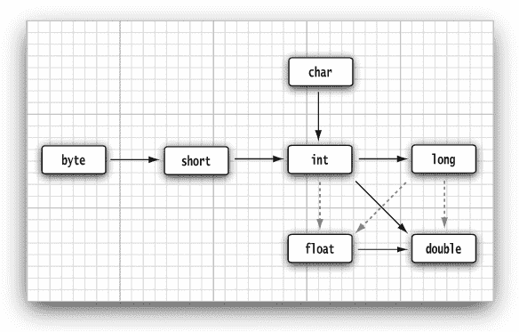

**图 3.1** 数值类型之间的合法转换

图 3.1 中的六条实线表示不丢失信息的转换。三条虚线表示可能会丢失精度的转换。例如，大整数 `123456789` 的位数比 `float` 类型能表示的位数多。当整数转换为 `float` 时，得到的值具有正确的数量级，但丢失了一些精度。

```java
int n = 123456789;
float f = n; // f 是 1.23456792E8
```

当两个值使用二元运算符组合时（例如 `n + f`，其中 `n` 是整数而 `f` 是浮点值），在执行操作之前，两个操作数都会转换为一种共同类型。

- 如果其中一个操作数的类型为 `double`，另一个将转换为 `double`。
- 否则，如果其中一个操作数的类型为 `float`，另一个将转换为 `float`。
- 否则，如果其中一个操作数的类型为 `long`，另一个将转换为 `long`。
- 否则，两个操作数都将转换为 `int`。

## 3.5.4 强制类型转换

在前面的节中，你看到了在必要时 `int` 值会自动转换为 `double` 值。另一方面，显然在某些时候，你想要将 `double` 视为整数。

## 3.5.5 赋值

在赋值中使用二元运算符有一个方便的快捷方式。例如：

```java
x += 4;
```

等同于：

```java
x = x + 4;
```

（通常，将运算符放在 `=` 符号左侧，例如 `*=` 或 `%=`。）

## 3.5.6 递增和减少运算符

程序员当然知道，对数值变量最常见的操作之一是加或减 1。Java 遵循 C 和 C++ 的足迹，同时拥有递增和减少运算符：`n++` 将变量 `n` 的当前值加 1，而 `n--` 从其减 1。例如，以下代码：

```java
int n = 12;
n++;
```

将 `n` 变为 `13`。

这些运算符有两种形式；你刚刚看到了位于操作数之后的后置形式。还有一种前缀形式，`++n`。两者都会将变量的值加 1。它们之间的区别只在它们用在表达式内部时出现。前缀形式先执行加法；后置形式求值为变量的旧值。

```java
int m = 7;
int n = 7;
int a = 2 * ++m; // now a is 16, m is 8
int b = 2 * n++; // now b is 14, n is 8
```

许多程序员发现这种行为很困惑。在 Java 中，在表达式中使用 `++` 并不常见。

## 3.5.7 关系运算符和布尔（boolean）运算符

Java 拥有完整的关系运算符。要测试相等性，请使用双等号 `==`。例如：

```java
3 == 7
```

该表达式的值为 `false`。

使用 `!=` 表示不相等。例如：

```java
3 != 7
```

该表达式的值为 `true`。

最后，你还有常用的 `<`（小于）、`>`（大于）、`<=`（小于等于）和 `>=`（大于等于）运算符。Java 遵循 C++，使用 `&&` 作为逻辑“与”运算符，使用 `||` 作为逻辑“或”运算符。你可以从 `!=` 运算符很容易地记住，感叹号 `!` 是逻辑非运算符。`&&` 和 `||` 运算符以“短路”方式求值：如果第一个参数已经确定了值，则不会评估第二个参数。如果你用 `&&` 运算符组合两个表达式：

```java
expression1 && expression2
```

如果第一个表达式的真值已被确定为 `false`，那么结果就不可能是 `true`。因此，第二个表达式的值不会被计算。这种行为可以用来避免错误。例如，在表达式

```java
x != 0 && 1 / x > x + y // no division by 0
```

如果 `x` 等于零，第二部分永远不会被评估。因此，如果 `x` 为零，则不会计算 `1 / x`，也就不会发生除以零错误。

同样，如果第一个表达式为 `true`，则 `expression1 || expression2` 的值自动为 `true`，而无需评估第二个表达式。

## 3.5.8 条件运算符

Java 提供了条件运算符 `?:`，它根据布尔表达式选择一个值。表达式 `condition ? expression1 : expression2` 在条件为 `true` 时求值为第一个表达式的值，否则求值为第二个表达式的值。例如：

```java
x < y ? x : y
```

给出 `x` 和 `y` 中的较小值。

## 3.5.9 `switch` 表达式

如果你需要在两个以上的值之间进行选择，可以使用 `switch` 表达式（从 Java 14 开始）。它看起来如下：

```java
String seasonName = switch (seasonCode)
  {
    case 0 -> "Spring";
    case 1 -> "Summer";
    case 2 -> "Fall";
    case 3 -> "Winter";
    default -> "???";
  };
```

`case` 标签也可以是字符串或枚举类型的常量。

***

 **注意：**

`switch` 表达式像每个表达式一样都有一个值。注意每个分支中值之前的 `->` 箭头。

***

 **注意：**

从 Java 14 开始，`switch` 有四种形式。本节关注最实用的那种。请参见第 98 页的第 3.8.5 节“使用 `switch` 进行多选择”，了解所有 `switch` 表达式和语句的详细讨论。

***

你可以为每个 `case` 提供多个标签，用逗号隔开：

```java
int numLetters = switch (seasonName)
  {
    case "Spring", "Summer", "Winter" -> 6;
    case "Fall" -> 4;
    default -> -1;
  };
```

当你对枚举常量使用 `switch` 表达式时，不需要在每个标签中提供枚举名称——它是从 `switch` 值推断出来的。例如：

```java
enum Size { SMALL, MEDIUM, LARGE, EXTRA_LARGE };
. . .
Size itemSize = . . .;
String label = switch (itemSize)
  {
    case SMALL -> "S"; // no need to use Size.SMALL
    case MEDIUM -> "M";
    case LARGE -> "L";
    case EXTRA_LARGE -> "XL";
    default -> "??";
  };
```

`case` 标签也可以是字符串或枚举类型的常量。

## 3.6 字符串

```java
String e = ""; // 一个空字符串

String greeting = "Hello";
```

### 3.6.1 子字符串

你可以使用 `String` 类的 `substring` 方法从较大的字符串中提取子字符串。例如：

```java
String greeting = "Hello";

String s = greeting.substring(0, 3);
```

这将创建一个由字符 `"Hel"` 组成的字符串。

***

 **注意：**

与 C 和 C++ 一样，Java 从 `0` 开始计算字符串中的代码单元和代码点。

***

`substring` 的第二个参数是你不想要复制的第一个位置。在我们的情况下，我们想要复制位置 0、1 和 2（即从位置 0 到位置 2，包含边界）。根据 `substring` 的计数方式，这意味着从位置 0 开始（包含）到位置 3（不包含）。

`substring` 工作方式有一个优点：计算子字符串的长度非常简单。字符串 `s.substring(a, b)` 的长度始终是 `b - a`。例如，子字符串 `"Hel"` 的长度为 `3 - 0 = 3`。

### 3.6.2 拼接

Java 与大多数编程语言一样，允许你使用 `+` 来连接（拼接）两个字符串。

```java
String expletive = "Expletive";

String PG13 = "deleted";

String message = expletive + PG13;
```

上述代码将变量 `message` 设置为字符串 `"Expletivedeleted"`。（注意单词之间缺少空格：`+` 运算符按照接收到的顺序连接两个字符串，完全地按照它们提供的形式进行。）

当你将字符串与一个非字符串的值拼接时，后者会被转换为字符串。（正如你将在第 5 章中看到的，每个 Java 对象都可以转换为字符串。）例如：

```java
int age = 13;

String rating = "PG" + age;
```

将 `rating` 设置为字符串 `"PG13"`。

这一特性通常用于输出语句。例如：

```java
System.out.println("The answer is " + answer);
```

这是完全可以接受的，并且会打印你预期的内容（并且因为 `is` 单词后面的空格，而具有正确的间距）。

如果你需要将多个字符串通过分隔符隔开并组合在一起，请使用静态的 `join` 方法：

```java
String all = String.join(" / ", "S", "M", "L", "XL");

// all 是字符串 "S / M / L / XL"
```

从 Java 11 开始，有一个 `repeat` 方法：

```java
String repeated = "Java".repeat(3); // repeated 是 "JavaJavaJava"
```

### 3.6.3 字符串是不可变的

`String` 类没有提供任何可以让你改变现有字符串字符的方法。如果你想将 `greeting` 变为 `"Help!"`，你不能直接将 `greeting` 的最后位置改为 `'p'` 和 `'!'`。如果你是一个 C 程序员，这可能会让你感到非常无助。我们该如何修改字符串呢？在 Java 中，这非常简单：将你想保留的子字符串与想要替换的字符拼接起来。

```java
String greeting = "Hello";

greeting = greeting.substring(0, 3) + "p!";
```

此声明将 `greeting` 变量当前的值更改为 `"Help!"`。


由于你无法更改 Java 字符串中的单个字符，文档将 `String` 类的对象称为不可变的。就像数字 `3` 总是 `3` 一样，字符串 `"Hello"` 将始终包含字符 `H`、`e`、`l`、`l`、`o` 的代码单元序列。你不能更改这些值。但正如你看到的，你可以更改字符串变量 `greeting` 的内容并使其引用不同的字符串，就像你可以让持有数值 `3` 的数值变量持有数值 `4` 一样。

这难道效率低得多吗？似乎从头构建整个新字符串比修改代码单元要简单。好吧，也许也不如此。确实，生成一个包含 `"Hel"` 和 `"p!"` 拼接的新字符串并不是高效的。但不可变字符串有一个巨大的优势：编译器可以安排字符串是共享的。

要理解这是如何工作的，请将各种字符串想象放在公共池中。字符串变量则指向池中的位置。如果你复制一个字符串变量，原始变量和副本将共享相同的字符。

总的来说，Java 的设计者认为共享的效率大于通过提取子字符串和拼接进行字符串编辑的低效。看看你自己的程序；大多数时候，你可能并没有更改字符串——你只是在比较它们。（有一个常见的例外——从单个字符或来自键盘或文件的较短字符串组装字符串。对于这些情况，Java 提供了一个单独的类——参见第 73 页的第 3.6.9 节“构建字符串”。）

***

 **C++ 注意：**

C 程序员第一次看到 Java 字符串时通常会困惑，因为他们将字符串视为字符数组：

```c
char greeting[] = "Hello";
```

……（内容继续）

### 3.6.4 测试字符串相等性

要测试两个字符串是否相等，请使用 `equals` 方法。表达式：

```java
s.equals(t)
```

如果字符串 `s` 和 `t` 相等，返回 `true`，否则返回 `false`。注意，`s` 和 `t` 可以是字符串变量或字面量。例如，表达式：

```java
"Hello".equals(greeting)
```

是完全合法的。要测试两个字符串除了大小写字母外是否相同，请使用 `equalsIgnoreCase` 方法。

```java
"Hello".equalsIgnoreCase("hello")
```

不要使用 `==` 运算符来测试字符串是否相等！它只确定字符串是否存储在相同的位置。当然，如果字符串位于相同的位置，它们必须是相等的。但完全可以在不同位置存储多个相同字符串的副本。

```java
String greeting = "Hello"; // 初始化 greeting 为字符串

if (greeting == "Hello") . . .

// 可能为真

if (greeting.substring(0, 3) == "Hel") . . .

// 可能为假
```

如果虚拟机总是安排相等的字符串共享，那么你就可以用 `==` 运算符测试相等性。但只有字符串字面量是被共享的，而不是像 `+` 或 `substring` 操作结果产生的字符串。因此，永远不要使用 `==` 来比较字符串，否则你的程序可能会遇到最糟糕的 bug——一种随机发生的间歇性 bug。

如果你习惯了 C++ 的 `string` 类，那么在相等测试时必须格外小心。C++ 的 `string` 类确实重载了 `==` 运算符来测试字符串内容的相等性。遗憾的是，Java 特意让字符串具有了与数值类型相同的“外观和感受”，但在进行相等性测试时却让字符串表现得像指针一样。语言设计者本可以为字符串重新定义 `==`，就像他们对 `+` 运算符做了特殊安排一样。噢，没办法，每种语言都有其自身不一致之处。

C 语言的程序员从不使用 `==` 来比较字符串，而是使用 `strcmp`。Java 的 `compareTo` 方法与 `strcmp` 完全等同。你可以使用：

```java
if (greeting.compareTo("Hello") == 0) . . .
```

但似乎使用 `equals` 往往会更加清晰。

### 3.6.5 空字符串和 `null` 字符串

空字符串 `""` 是长度为 0 的字符串。你可以通过调用以下方法来测试字符串是否为空：

```java
if (str.length() == 0)
```

或者：

```java
if (str.equals(""))
```

空字符串是一个 Java 对象，它持有字符串的长度（即 `0`）和空的内容。然而，`String` 变量还可以持有一个特殊值，即 `null`，表示该变量当前没有关联任何对象。（关于 `null` 的更多信息，请参见第 4 章。）要测试字符串是否为 `null`，请使用：

```java
if (str == null)
```

有时，你需要测试字符串既不是 `null` 也为空。这时使用：

```java
if (str != null && str.length() != 0)
```

你首先需要测试 `str` 是否为 `null`。正如你将在第 4 章中看到的，在 `null` 值上调用方法是错误的。

### 3.6.6 代码点和代码单元

Java 字符串是 `char` 值的序列。正如你在第 3.3.3 节中看到的，第 43 页的“`char` 类型”，“`char` 数据类型是用于表示 UTF-16 编码中 Unicode 代码点的代码单元。常用的 Unicode 字符可以用单个代码单元表示。而补充字符则需要一对代码单元。

`length` 方法返回给定字符串在 UTF-16 编码下所需的代码单元数量。例如：

```java
String greeting = "Hello";
int n = greeting.length(); // 结果为 5
```

要获取真实长度——即代码点的数量——调用：

```java
int cpCount = greeting.codePointCount(0, greeting.length());
```

调用 `s.charAt(n)` 返回位置 `n` 处的代码单元，其中 `n` 介于 `0` 和 `s.length() - 1` 之间。例如：

```java
char first = greeting.charAt(0); // first 为 'H'

char last = greeting.charAt(4); // last 为 'o'
```

要获取第 `i` 个代码点，请使用语句：

```java
int index = greeting.offsetByCodePoints(0, i);
int cp = greeting.codePointAt(index);
```

为什么要对代码单元大费周章？考虑句子：

𝕆 is the set of octonions.

该字符（`U+1D546`）在 UTF-16 编码中需要两个代码单元。调用：

```java
char ch = sentence.charAt(1);
```

返回的不是空格，而是 𝕆 的第二个代码单元。为了避免这个问题，你不应该使用 `char` 类型。它太低层了。

 **注意：**

不要认为你可以忽略代码单元在 U+FFFF 之上的奇异字符。你那些喜爱表情符号的用户可能会在字符串中放入如 (U+1F37A, 啤酒杯) 等字符。

如果你的代码正在遍历字符串，并且你想逐个查看每个代码点，可以使用这些语句：

```java
int cp = sentence.codePointAt(i);
if (Character.isSupplementaryCodePoint(cp)) i += 2;
else i++;
```

你可以使用以下语句向后移动：

```java
i--;
if (Character.isSurrogate(sentence.charAt(i))) i--;
int cp = sentence.codePointAt(i);
```

显然，这非常痛苦。一种更简单的方法是使用 `codePoints` 方法，它产生一个 `int` 值的“流”，每个代码点对应一个值。（流将在第二卷中介绍）。你只需将该流转换为数组（参见第 3.10 节，第 109 页的“数组”）并对其进行遍历。

```java
int[] codePoints = str.codePoints().toArray();
```

相反，要将代码点数组转换为字符串，请使用构造函数（第 4 章详细介绍了构造函数和 `new` 运算符）。

```java
String str = new String(codePoints, 0, codePoints.length);
```

要将单个代码点转换为字符串，请使用 `Character.toString(int)` 方法：

```java
int codePoint = 0x1F37A;
String str = Character.toString(codePoint);
```

 **注意：**

不要认为你可以忽略代码单元在 U+FFFF 之上的奇异字符。你那些喜爱表情符号的用户可能会在字符串中放入如 (U+1F37A, 啤酒杯) 等字符。

以下是 `String` 类的其他重要方法：

- `int codePointCount(int startIndex, int endIndex)` 5  
  返回 `startIndex` 和 `endIndex - 1` 之间的代码点数。

- `String replace(CharSequence oldString, CharSequence newString)`  
  返回一个新字符串，该字符串通过将字符串中所有匹配 `oldString` 的子字符串替换为 `newString` 获得。你可以为 `CharSequence` 参数提供 `String` 或 `StringBuilder` 对象。

- `String substring(int beginIndex)`
- `String substring(int beginIndex, int endIndex)`  
  返回一个包含从 `beginIndex` 到字符串末尾或到 `endIndex - 1` 的所有代码单元。

- `String toLowerCase()`
- `String toUpperCase()`  
  返回一个包含原始字符串中所有字符的新字符串，其中大写字符转换为小写，或小写字符转换为大写。

- `String strip()` 11
- `String stripLeading()` 11
- `String stripTrailing()` 11  
  通过消除原始字符串中的前导、结尾，或仅前导或结尾空白来返回一个新字符串。使用这些方法来代替字符 ≤ U+0020 的旧式 `trim` 方法。

- `String join(CharSequence delimiter, CharSequence... elements)` 8  
  返回一个用给定的分隔符连接所有元素的新字符串。

- `String repeat(int count)` 11  
  返回一个重复此字符串 `count` 次的字符串。

***

 **注意：**

在 API 注释中，有几个 `CharSequence` 类型的参数。这是一个所有字符串都所属的接口类型。你将在第 6 章中学习接口类型。现在，你只需要知道，每当你看到 `CharSequence` 参数时，你都可以传递 `String` 类型的参数。

### 3.6.8 阅读在线 API 文档

正如你刚刚看到的，`String` 类有许多方法。此外，标准库中有成千上万个类，拥有更多方法。要记住所有有用的类和方法显然是不可能的。因此，熟悉在线 API 文档至关重要，它能让你查询标准库中的所有类和方法。你可以从 Oracle 下载 API 文档并保存到本地，也可以将浏览器指向 [`https://docs.oracle.com/en/java/javase/11/docs/api`](https://docs.oracle.com/en/java/javase/11/docs/api)。

从 Java 9 开始，API 文档包含一个搜索框（参见图 3.2）。旧版本有带有包和类列表的框架。你仍然可以通过点击 Frames 菜单项获取这些列表。例如，要获取 `String` 类方法的更多信息，在搜索框中输入“String”并选择类型 `java.lang.String`，或者在类名的框架中找到链接并点击。你将获得类描述，如图 3.3 所示。

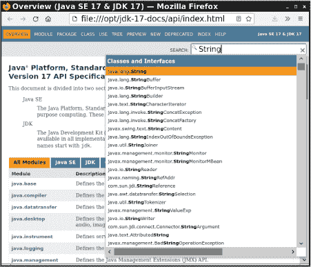  
**图 3.2** Java API 文档

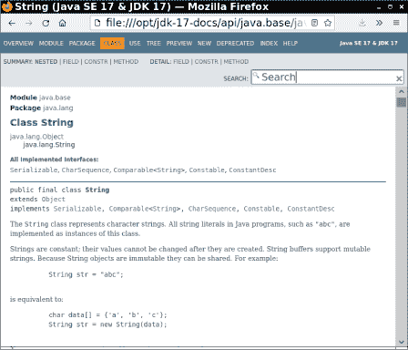  
**图 3.3** `String` 类的描述

当你向下滚动时，你会看到所有方法的摘要，它们按字母顺序排序（参见图 3.4）。点击任何方法名以获取该方法的详细描述（参见图 3.5）。例如，如果你点击 `compareToIgnoreCase` 链接，你将获得 `compareToIgnoreCase` 方法的描述。

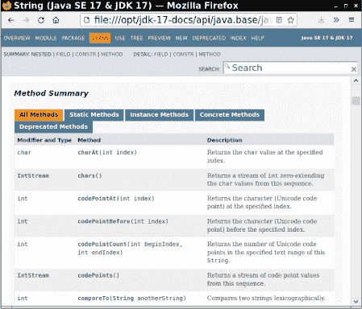  
**图 3.4** `String` 类的方法摘要

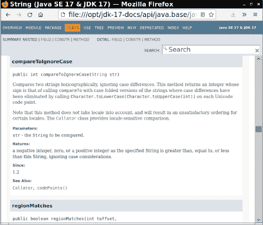  
**图 3.5** `String` 方法的详细描述

***

 **提示：**

如果你还没有这样做，请按照第 2 章中的描述下载 JDK 文档。现在就在你的浏览器中为文档的 `index.html` 页面添加书签！

### 3.6.9 构建字符串

有时你需要从较短的字符串构建字符串，例如按键或文件中的单词。使用字符串拼接来实现此目的将是低效的。每当你拼接字符串时，都会构造一个新的 `String` 对象。这既耗时又浪费内存。使用 `StringBuilder` 类可以避免这个问题。

如果你需要从许多小片段构建字符串，请遵循以下步骤。首先，构造一个空的构建器：

```java
StringBuilder builder = new StringBuilder();
```

每当你需要添加另一个部分时，调用 `append` 方法：

```java
builder.append(ch); // 追加单个字符
builder.append(str); // 追加一个字符串
```

当你完成字符串构建后，调用 `toString` 方法。你将得到一个包含构建器中所含字符序列的 `String` 对象。

```java
String completedString = builder.toString();
```

***

 **注意：**

`StringBuffer` 类比 `StringBuilder` 效率低，但它允许多个线程添加或删除字符。如果所有的字符串编辑都在单个线程中进行（通常情况下如此），你应该使用 `StringBuilder`。这两个类的 API 是完全相同的。

以下 API 注释包含了 `StringBuilder` 的重要方法。

**java.lang.StringBuilder**

***

- `StringBuilder()`  
  构造一个空构建器。

- `int length()`  
  返回构建器的代码单元数量。

- `append(String str)`  
  追加一个字符串并返回 `this`。

- `append(char c)`  
  追加一个代码单元并返回 `this`。

- `appendCodePoint(int cp)`  
  追加一个代码点，将其转换为一个或两个代码单元并返回 `this`。

- `void setCharAt(int i, char c)`  
  将第 `i` 个代码单元设置为 `c`。

- `insert(int offset, String str)`  
  在 `offset` 处插入字符串并返回 `this`。

- `insert(int offset, char c)`  
  在 `offset` 处插入一个代码单元并返回 `this`。

- `delete(int startIndex, int endIndex)`  
  删除从 `startIndex` 到 `endIndex - 1` 的代码单元并返回 `this`。

- `String toString()`  
  返回与构建器数据相同的字符串。

### 3.6.10 文本块

Java 15 版本中引入的文本块功能使得提供跨行的字符串字面量变得简单。文本块以 `"""` 开始，后跟一个换行符。块以另一个 `"""` 结束。

```java
String greeting = """
Hello
World
""";
```

文本块比等效的字符串字面量更易读易写：

```java
"Hello\nWorld\n"
```

此字符串包含两个 `\n`：一个在 `Hello` 之后，一个在 `World` 之后。起始 `"""` 之后的换行符不包含在字符串中。

如果你不想在最后一行之后有换行符，将结束 `"""` 放在最后一个字符之后：

```java
String prompt = """
Hello, my name is Hal.
Please enter your name: """;
```

文本块特别适合在其他语言中包含代码，例如 SQL 或 HTML。你可以直接将其粘贴到三引号之间：

```java
String html = """
<div class="Warning">
Beware of those who say "Hello" to the world
</div>
""";
```

注意，你不需要转义引号。只有两种情况需要转义：

- 如果文本块结束于引号；
- 如果文本块包含三个或更多引号的序列。

遗憾的是，你仍然需要转义所有的反斜杠。

普通字符串中的所有转义序列在文本块中的工作方式相同。

有一种仅在文本块中有效的转义序列。在行尾直接跟一个 `\` 将连接此行和下一行。例如：

```java
"""
Hello, my name is Hal. \
Please enter your name: """;
```

等同于：

```java
"Hello, my name is Hal. Please enter your name: "
```


# 行结束符与缩进

行结束符通过移除行尾空格并将任何 Windows 行结束符（`\r\n`）转换为简单的换行符（`\n`）来规范化。在需要保留行尾空格的极少数情况下，可以将最后一个空格转换为 `\s` 转义字符。

前导空格的情况要复杂得多。考虑一个相对于左边距缩进的典型变量声明。你也可以对文本块进行缩进：

```java
String html = """
    <div class="Warning">
      Beware of those who say "Hello" to the world
    </div>
""";
```

文本块中所有行的共同缩进会被减去。实际字符串为：

```
"<div class=\"Warning\">\n  Beware of those who say \"Hello\" to the world\n</div>\n"
```

注意第一和第三行没有缩进。

你的 IDE 可能会乐地建议对所有文本块进行缩进，仅使用制表符、仅使用空格或适当的混合。

Java 明智地没有规定 tab 的宽度。文本块中所有行的空白前缀必须*完全*匹配。

完全空行不包含在缩进移除过程中。然而，闭合 `"""` 之前的空白是有意义的。请确保缩进到你想要剔除的空白末尾。

 **注意：**

小心缩进文本块的共同前缀中混合使用制表符和空格。一个被忽略的空格很容易导致缩进错误的字符串。

 **提示：**

如果文本块包含不是 Java 的代码，你实际上可能更倾向于将其置于左边距。它会与 Java 代码区分开，并为长行留出更多空间。

## 3.7 输入与输出

为了让我们的示例程序更有趣，我们希望接受输入并妥地格式化程序输出。当然，现代程序使用 GUI 来收集用户输入。然而，编写这样的界面需要的比我们目前拥有的更多的工具和技术。我们的首要任务是更熟悉熟悉 Java 编程语言，因此我们使用简单的控制台进行输入和输出。

### 3.7.1 读取输入

你已经看到只需调用 `System.out.println` 就可以很容易地向“标准输出流”（即控制台窗口）打印输出。从“标准输入流” `System.in` 读取并没有那么简单。要读取控制台输入，你首先要构造连接到 `System.in` 的 `Scanner`：

```java
Scanner in = new Scanner(System.in);
```

（构造函数和 `new` 运算符将在第 4 章中详细讨论。）

现在你可以使用 `Scanner` 类的各种方法来读取输入。例如，`nextLine` 方法读取一行输入。

```java
System.out.print("What is your name? ");

String name = in.nextLine();
```

在这里，我们使用 `nextLine` 方法是因为输入可能包含空格。要读取单个单词（由空白分隔），请调用：

```java
String firstName = in.next();
```

要读取一个整数，使用 `nextInt` 方法。

```java
System.out.print("How old are you? ");

int age = in.nextInt();
```

同样，`nextDouble` 方法读取下一个浮点数。

Listing 3.2 中的程序询问用户的姓名和年龄，然后打印类似下面的消息：

```
Hello, Cay. Next year, you'll be 57
```

最后，注意程序开头的行：

```java
import java.util.*;
```

`Scanner` 类定义在 `java.util` 包中。每当你使用一个未在基础 `java.lang` 包中定义的类时，你就需要使用 `import` 指令。包和 `import` 指令将在第 4 章中进行详细介绍。

**Listing 3.2** `InputTest/InputTest.java`

```java
1  import java.util.*;

2

3  /**
4    * 这个程序演示了控制台输入。
5    * @version 1.10 2004-02-10
6    * @author Cay Horstmann
7    */

8  public class InputTest
9  {
10      public static void main(String[] args)
11      {
12          Scanner in = new Scanner(System.in);

14          // 获取第一个输入
15          System.out.print("What is your name? ");
16          String name = in.nextLine();

18          // 获取第二个输入
19          System.out.print("How old are you? ");
20          int age = in.nextInt();

22          // 显示输出
23          System.out.println("Hello, " + name + ". Next year, you'll be " + age);
24      }
25  }
```

### 3.7.2 格式化输出

你可以使用 `System.out.print(x)` 语句向控制台打印数字 `x`。该命令将打印具有该类型最大非零数字数的 `x`。例如：

```java
double x = 10000.0 / 3.0;

System.out.print(x);
```

打印：

```
333.3333333333335
```

如果要显示美元和分，就会出现问题。

解决方法是使用 `printf` 方法，它遵循了 C 库悠久的传统。例如，调用：

```java
System.out.printf("%8.2f", x);
```

打印*字段宽度*为 8 个字符且*精度*为 2 个字符的 `x`。也就是说，输出包含一个前导空格和七个字符：

```
333.33
```

你可以为 `printf` 提供多个参数。例如：

```java
System.out.printf("Hello, %s. Next year, you'll be %d", name, age);
```

每个以 `%` 字符开头的格式说明符都会被相应的参数替换。作为格式说明符结尾的*转换字符*指示了要格式化的值的类型：`f` 是浮点数，`s` 是字符串，`d` 是十进制整数。表 3.5 显示了所有的转换字符。

大写变体会生成大写字母。例如，`"%8.2E"` 将 3333.33 格式化为 `3.33E+03`，使用大写的 `E`。

### 表 3.5 `printf` 转换

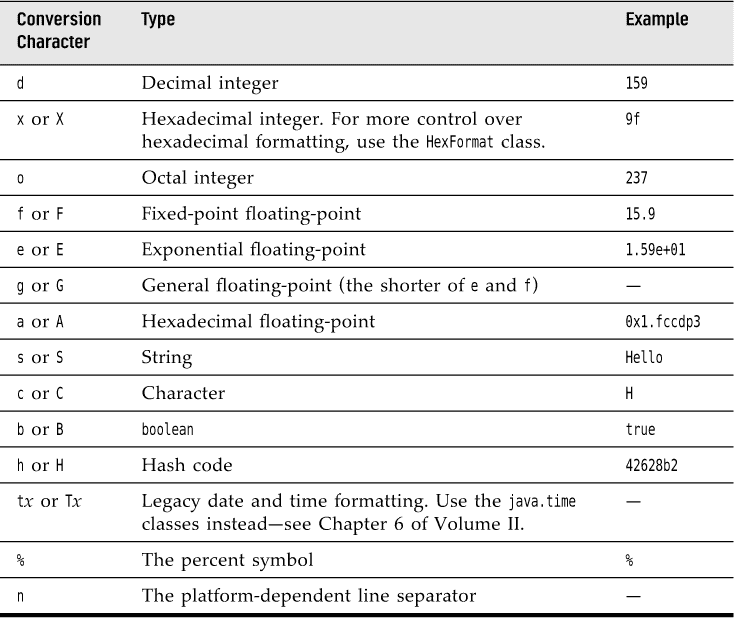

 **注意：**

你可以使用 `s` 转换格式化任意对象。如果任意对象实现了 `Formattable` 接口，则会调用对象的 `formatTo` 方法。否则，将调用 `toString` 方法将对象转换为字符串。`toString` 方法在第 5 章中进行了讨论，接口在第 6 章中进行了讨论。

此外，你可以指定控制格式化输出外观的*标志*（flags）。表 3.6 显示了所有的标志。例如，逗号标志会添加分组分隔符。即：

```java
System.out.printf("%,.2f", 10000.0 / 3.0);
```

打印：

```
3,333.33
```

你可以使用多个标志，例如 `"%,(.2f"` 用于使用分组分隔符并将负数括在括号中。

### 表 3.6 `printf` 标志

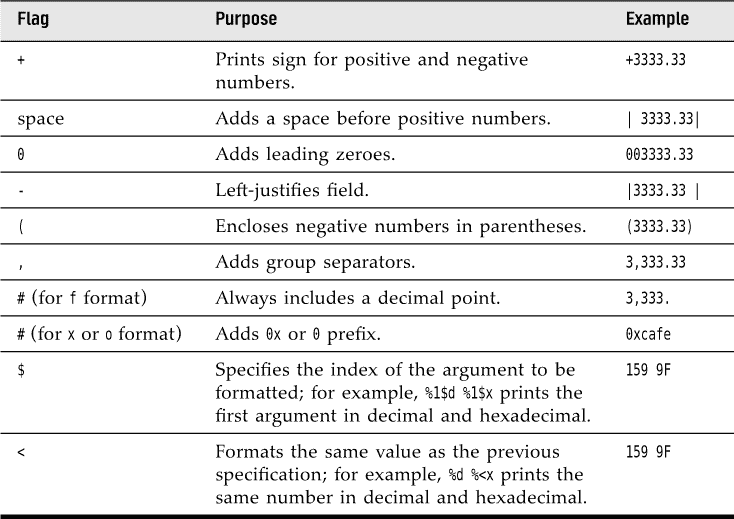

你可以使用静态方法 `String.format` 来创建一个格式化字符串而不不打印它：

```java
String message = String.format("Hello, %s. Next year, you'll be %d", name, age + 1);
```

 **注意：**

从 Java 15 开始，你可以使用 `formatted` 方法来代替，这可以为你节省五个字符：

```java
String message = "Hello, %s. Next year, you'll be %d".formatted(name, age + 1);
```

你现在已经学习了 `printf` 方法的所有特性。图 3.6 显示了格式说明符的语法图。

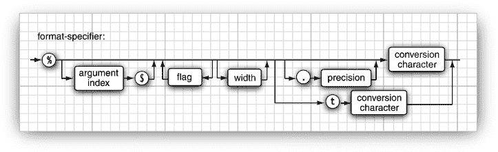

### 图 3.6 格式说明符语法

 **注意：**

格式化是*特定区域的*。例如，在德国，分组分隔符是点而不是逗号。第二卷第 7 章显示了如何控制应用程序的国际化行为。

### 3.7.3 文件输入与输出

要从文件读取，如下构造 `Scanner` 对象：

```java
Scanner in = new Scanner(Path.of("myfile.txt"), StandardCharsets.UTF_8);
```

如果文件名包含反斜杠，请记住用额外的反斜杠来转义每一个：`"c:\\mydirectory\\myfile.txt"`。

现在你可以使用你已经遇到过的任何 `Scanner` 方法从文件中读取内容了。

 **注意：**

在这里，我们指定了 UTF-8 字符编码，这是互联网文件常用的（但并非通用）编码。在读取文本文件时，你需要知道字符编码（更多信息请参见第二卷，第 2 章）。如果你省略了字符编码，将使用运行 Java 程序的计算机的默认编码。这不是一个好主意——程序的行为可能会根据运行位置的不同而不同。

 **警告：**

你可以带字符串参数构造 `Scanner`，但扫描器会将字符串解释为数据而非文件名。例如，如果你调用：

```java
Scanner in = new Scanner("myfile.txt"); // 错误？
```

那么扫描器将看到十个数据字符：`'m'`、`'y'`、`'f'` 等。这可能不是初图。

要写入文件，请构造一个 `PrintWriter` 对象。在构造函数提供文件名和字符编码：

```java
PrintWriter out = new PrintWriter("myfile.txt", StandardCharsets.UTF_8);
```

如果文件不存在，则会创建它。你可以像打印到 `System.out` 一样使用 `print`、`println` 和 `printf` 命令。

 **注意：**

当你指定相对文件名时，如 `"myfile.txt"`、`"mydirectory/myfile.txt"` 或 `"../myfile.txt"`，文件是相对于 Java 虚拟机启动时的目录进行定位的。如果你从命令行 shell 程序，通过执行：

```bash
java MyProg
```

那么起始目录就是命令行 shell 的当前目录。然而，如果你使用集成开发环境，则由它来控制起始目录。你可以通过此调用找到目录位置：

```java
String dir = System.getProperty("user.dir");
```

如果你在定位文件时遇到困难，考虑使用绝对路径名称，例如 `"c:\\mydirectory\\myfile.txt"` 或 `"/home/me/mydirectory/myfile.txt"`。

正如你所看到的，访问文件就像访问 `System.out` 一样简单。有一个陷阱：`printf` 方法在 `Scanner` 中不可用。要在文件上 `printf`，必须使用 `PrintWriter`。

要在字符串上 `printf`，必须使用 `String.format`。

要在控制台上 `printf`，必须使用 `System.out.printf`。

在 C++ 中，可以在嵌套块内部重新定义变量。此时内部定义会遮蔽外部定义。这可能成为编程错误的根源；因此，Java 不允许这种操作。

## 3.8.2 条件语句

Java 中的条件语句形式如下：

```java
if (condition) statement
```

条件必须包含在括号内。

在 Java 中，与大多数编程语言一样，你通常希望在单个条件为真时执行多个语句。在这种情况下，使用形式如下的 `block statement`（块语句）：

```java
{
    statement1
    statement2
    . . .
}
```

例如：

```java
if (yourSales >= target)
{
    performance = "Satisfactory";
    bonus = 100;
}
```

在代码中，当 `yourSales` 大于等于 `target` 时，大括号内的所有语句都将被执行（参见图 3.7）。

 **注意：**

块（有时被称为 `compound statement`，复合语句）允许你在任何其他允许单个（简单）语句的 Java 编程结构中包含多个（简单）语句。

Java 中更通用的条件语句形式如下（参见图 3.8）：

```java
if (condition) statement1 else statement2
```

例如：

```java
if (yourSales >= target)
{
    performance = "Satisfactory";
    bonus = 100 + 0.01 * (yourSales - target);
}
```

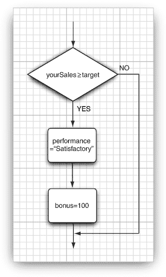

**图 3.7** `if` 语句流程图

```java
else
{
    performance = "Unsatisfactory";
    bonus = 0;
}
```

`else` 部分始终是可选的。`else` 与最近的 `if` 组合。因此，在语句：

```java
if (x <= 0) if (x == 0) sign = 0; else sign = -1;
```

中，`else` 属于第二个 `if`。当然，使用大括号来明确这段代码是一个好主意：

```java
if (x <= 0) { if (x == 0) sign = 0; else sign = -1; }
```

重复的 `if . . . else if . . .` 备选方案很常见（参见图 3.9）。例如：

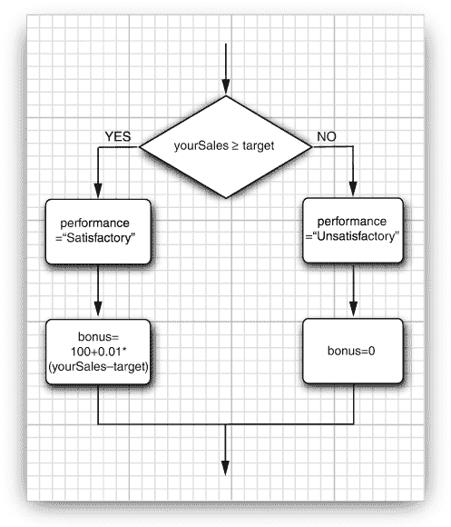

**图 3.8** `if/else` 语句流程图

```java
if (yourSales >= 2 * target)
{
    performance = "Excellent";
    bonus = 1000;
}
else if (yourSales >= 1.5 * target)
{
    performance = "Fine";
    bonus = 500;
}
else if (yourSales >= target)
{
    performance = "Satisfactory";
    bonus = 100;
}
else
{
    System.out.println("You're fired");
}
```

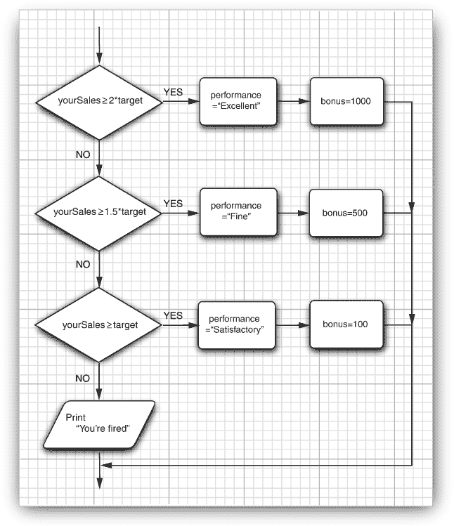

**图 3.9** `if/else if`（多分支）流程图

### 3.8.3 循环

`while` 循环在条件为 `true` 时执行语句（该语句可以是块语句）。通用形式为：

```java
while (condition) statement
```

如果条件一开始就为 `false`，则 `while` 循环将永远执行（参见图 3.10）。

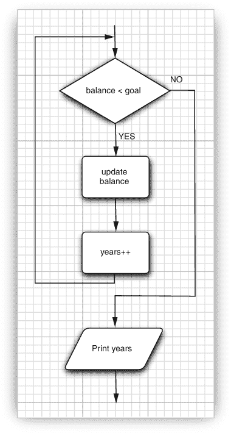

**图 3.10** `while` 语句流程图

Listing 3.3 中的程序确定了为你的辛苦得来的退休储蓄特定金额需要多久，假设你每年存入相同的金额，且资金按指定的利率产生。在示例中，我们在循环体中增加计数器并更新当前积累的金额，直到总额超过目标金额。

```java
while (balance < goal)
{
    balance += payment;
    double interest = balance * interestRate / 100;
    balance += interest;
    years++;
}

System.out.println(years + " years.");
```

（不要依赖此程序来规划你的退休生活。它缺乏一些细节，例如通货膨胀和你的预期寿命。）

`while` 循环在顶部进行测试。因此，块中的代码可能永远不会执行。如果你想确保一个块至少执行一次，你需要将测试移动到底部，使用 `do/while` 循环。它的语法如下：

`do` `statement` `while (`condition`);`

此循环执行语句（通常是一个块），然后才测试条件。如果为 `true`，则重复该语句并重新测试条件。Listing 3.4 中的代码计算你退休金的新余额，然后询问你是否准备好退休：

```java
do
{
    balance += payment;
    double interest = balance * interestRate / 100;
```


```java
balance += interest;

years++;

// print current balance

. . .

// ask to retire and get input

. . .

} while (input.equals("N"));
```

只要用户回答 `"N"`，循环就会重复（参见图 3.1）。这个程序是一个至少进入一次的循环示例，用户在决定足够退休之前需要看到余额。

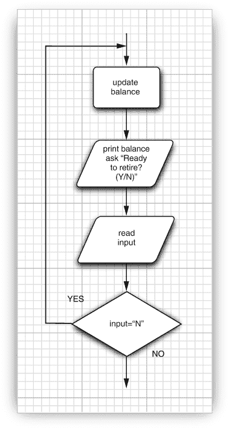

**图 3.1** `do/while` 语句

**Listing 3.3** `Retirement/Retirement.java`

```java
1  import java.util.*;

2

3  /**
4   * This program demonstrates a `while` loop.
5   * @version 1.20 2004-02-10
6   * @author Cay Horstmann
7   */

8  public class Retirement
9  {
10    public static void main(String[] args)
11    {
12      Scanner in = new Scanner(System.in);

13      System.out.print("How much money do you need to retire? ");
14      double goal = in.nextDouble();

15      System.out.print("How much money will you contribute every year? ");
16      double payment = in.nextDouble();

17      System.out.print("Interest rate in %: ");
18      double interestRate = in.nextDouble();

19      double balance = 0;
20      int years = 0;

21      // update account balance while goal isn't reached
22      while (balance < goal)
23      {
24        // add this year's payment and interest
25        balance += payment;
26        double interest = balance * interestRate / 100;
27        balance += interest;
28        years++;
29      }

30      System.out.println("You can retire in " + years + " years.");
31    }
32  }
```

**Listing 3.4** `Retirement2/Retirement2.java`

```java
1  import java.util.*;

2

3  /**
4   * This program demonstrates a `do/while` loop.
5   * @version 1.20 2004-02-10
6   * @author Cay Horstmann
7   */

8  public class Retirement2
9  {
10    public static void main(String[] args)
11    {
12      Scanner in = new Scanner(System.in);

13      System.out.print("How much money do you need to retire? ");
14      double goal = in.nextDouble();

15      System.out.print("How much money will you contribute every year? ");
16      double payment = in.nextDouble();

17      System.out.print("Interest rate in %: ");
18      double interestRate = in.nextDouble();

19      double balance = 0;
20      int years = 0;

21      // update account balance while goal isn't reached
22      while (balance < goal)
23      {
24        // add this year's payment and interest
25        balance += payment;
26        double interest = balance * interestRate / 100;
27        balance += interest;
28        years++;
29      }

30      System.out.printf("After year %d, your balance is %,.2f%n", year, balance);
31    }
32  }
33}
```

#### 3.8.4 确定性循环

`for` 循环是一种由计数器或在每次迭代后更新的变量控制迭代的通用结构。如图 3.12 所示，以下循环在屏幕上打印从 1 到 10 的数字：

```java
for (int i = 1; i <= 10; i++)
  System.out.println(i);
```

`for` 语句的第一个槽位通常用于计数器初始化。第二个槽位给出每次进入新循环之前测试的条件，第三个槽位指定如何更新计数器。

尽管 Java 与 C++ 一样允许在 `for` 循环的各个槽位中使用几乎任何表达式，但良好的代码习惯有一个不成文规定：这三个槽位应该只初始化、测试和更新同一个计数器变量。忽略这一规则可能会写出非常晦涩的循环。

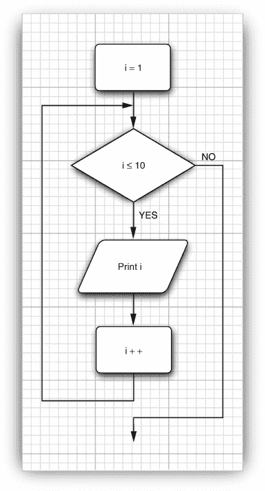

**图 3.12** `for` 语句的流程图

即使在良好习惯的范围内，仍有许多可能性。例如，你可以拥有倒数的循环：

```java
for (int i = 10; i > 0; i--)
  System.out.println("Counting down . . . " + i);

System.out.println("Blastoff!");
```

>  **注意：**
>
> 在循环中测试浮点数的相等性要小心。像下面这样的 `for` 循环
>
> ```java
> for (double x = 0; x != 10; x += 0.1) . . .
> ```
>
> 可能永远不会结束。由于舍入误差，最终值可能无法精确达到。在这个示例中，`x` 从 `9.99999999999998` 跳到 `10.09999999999998`，因为 `0.1` 没有精确的二进制表示。

当你在 `for` 语句的第一个槽位声明变量时，该变量的作用范围一直持续到 `for` 循环体的结束。

```java
for (int i = 1; i <= 10; i++)
{
  . . .
}

// i 在这里不再定义
```

特别是，如果你在 `for` 语句内部定义变量，则不能在循环外部使用它的值。因此，如果你想在 `for` 循环外部使用计数器的最终值，请确保在循环头之外声明它。

```java
int i;

for (i = 1; i <= 10; i++)
{
  . . .
}

// i 在这里仍然定义
```

相反，你可以在单独的 `for` 循环中定义同名的变量：

```java
for (int i = 1; i <= 10; i++)
{
  . . .
}

. . .

for (int i = 11; i <= 20; i++) // 定义另一个名为 i 的变量是允许的
{
  . . .
}
```

`for` 循环仅仅是 `while` 循环的一种便捷写法。例如，

```java
for (int i = 10; i > 0; i--)
  System.out.println("Counting down . . . " + i);

int i = 10;

while (i > 0)
{
  System.out.println("Counting down . . . " + i);
  i--;
}
```

Listing 3.5 展示了一个 `for` 循环的典型示例。

程序计算中奖奖的概率。例如，如果你必须从 1 到 50 个数字中选择 6 个数字来中奖，那么就有 `(50 × 49 × 48 × 47 × 46 × 45)/(1 × 2 × 3 × 4 × 5 × 6)` 种可能的结果，因此你的几率是 15,890,700。祝你好运！

通常情况下，如果你从 `n` 个数中选择 `k` 个数，会有

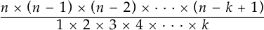

可能的结果。下面的 `for` 循环计算该值：

```java
int lotteryOdds = 1;

for (int i = 1; i <= k; i++)
  lotteryOdds = lotteryOdds * (n - i + 1) / i;
```

>  **注：**
>
> 第 3.10 节 第 112 页的“for each”循环](#ch03.xhtml_ch3-10-3) 描述了“通用 for 循环”（也称为 for each 循环），使得访问数组或集合的所有元素变得方便。

**Listing 3.5** `LotteryOdds/LotteryOdds.java`

```java
1  import java.util.*;

2

3  /**
4   * 此程序演示了一个 for 循环。
5   * @version 1.2 2004-02
6   * @author Cay Horstmann
7   */

8  public class LotteryOdds
9  {
10    public static void main(String[] args)
11    {
12      Scanner in = new Scanner(System.in);
13      System.out.print("How many numbers do you need to draw? ");
14      int k = in.nextInt();

15      System.out.print("What is the highest number you draw? ");
16      int n = in.nextInt();

17      /*
18       * 计算 n*(n-1)*(n-2)...*(n-k+1)
19       */

20      int lotteryOdds = 1;

21      for (int i = 1; i <= k; i++)
22        lotteryOdds = lotteryOdds * (n - i + 1) / i;

23      System.out.println("Your odds are 1 in " + lotteryOdds + ". luck!");
24    }
25  }
```

#### 3.8.5 使用 `switch` 多选择

当需要处理同一个表达式的多个分支时，`if/else` 结构会变得繁琐。`switch` 语句使这变得更容易，特别是 Java 14 引入的形式。

例如，如果你像图 3.13 那样设置包含四个备选方案的菜单，可以使用如下代码：

```java
Scanner in = new Scanner(System.in);

System.out.print("Select an option (1, 2, 3, 4) ");

int choice = in.nextInt();

switch (choice)
{
  case 1 ->
    ...

  case 2 ->
    ...

  case 3 ->
    ...

  case 4 ->
    ...

  default ->
    System.out.println("Bad input");
}
```

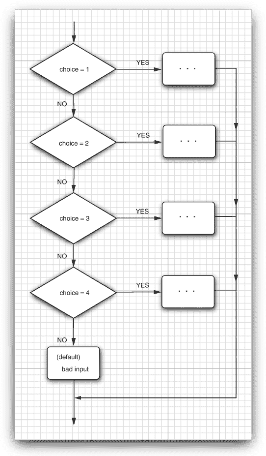

**图 3.13** `switch` 语句的流程图

`case` 标签可以是：

- `char`、`byte`、`short` 或 `int` 类型的常量表达式
- 枚举常量
- 字符串字面量
- 多个此类内容并用逗号隔开

例如，

```java
String input = ...;

switch (input.toLowerCase())
{
  case "yes", "y" ->
    ...

  case "no", "n" ->
    ...

  default ->
    ...
}
```

`switch` 语句的“经典”形式可以追溯到 C 语言，自 Java 1.0 起就被支持。它的形式如下：

```java
int choice = ...;

switch (choice)
{
  case 1:
    ...

    break;

  case 2:
    ...

    break;

  case 3:
    ...

    break;

  case 4:
    ...

    break;

  default:
    // 错误输入
    ...

    break;
}
```

执行从匹配选择操作值的 `case` 标签开始，一直持续到下一个 `break` 或 `switch` 结束。如果没有匹配的 `case` 标签，则执行 `default` 子句（如果存在的话）。

>  **注意：**
>
> 可能会触发多个备选方案。如果你忘记在备选方案末尾添加 `break`，执行将贯穿到下一个备选方案。这种行为是非常危险的，也是错误的常见原因。
>
> 为了检测此类问题，请使用 `-Xlint:fallthrough` 选项编译代码，例如：
>
> ```bash
> javac -Xlint:fallthrough Test.java
> ```
>
> 然后每当备选方案不以 `break` 语句结束时，编译器都会发出警告。
>
> 如果你实际上想使用贯穿行为，请为周围的方法标记 `@SuppressWarnings("fallthrough")` 注解。这样，该方法将不会生成任何警告。（注解是向编译器或处理 Java 源代码或类文件的工具提供信息的机制。）

这两种形式的 `switch` 是语句。在第 3.5.9 节 第 58 页的“Switch 表达式”中，你看到了一个 `switch` *表达式*，它会产生一个值。它不具有贯穿行为。

为了对称，Java 14 还引入了具有贯穿行为的 `switch` 表达式，总共有四种 `switch` 形式。表 3.7 展示了所有形式。

在贯穿变体中，每个 `case` 都以冒号结尾。如果分支以箭头 `->` 结尾，则没有贯穿。你不能在一个 `switch` 语句中混合使用冒号和箭头。

注意用于 `switch` 表达式的 `yield` 关键字。与 `break` 似的，它终止执行。与 `break` 不同，它还会产生一个值——表达式的值。

要在没有贯穿的 `switch` 表达式分支中使用语句，必须使用大括号和 `yield`，正如表中向分支添加日志语句的示例所示：

```java
case "Spring" ->
{
  System.out.println("spring time!");
  yield 6;
}
```

`switch` 表达式的每个分支必须产生一个值。最常见的是，每个值后面跟着一个 `->` 箭头：

```java
case "Summer", "Winter" -> 6;
```

如果无法实现，请使用 `yield` 语句。

**表 3.7** `switch` 的四种形式

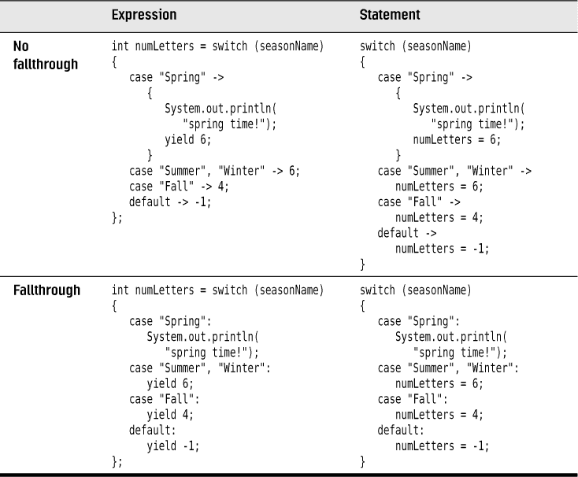

>  **注意：**
>
> 在 `switch` 表达式的分中抛出异常是允许的。例如：
>
> ```java
> default -> throw new IllegalArgumentException("Not a valid season");
> ```
>
> 异常将在第 7 章中详细介绍。

>  **警告：**
>
> `switch` 表达式目的是产生一个值（或因异常失败）。不允许“跳出”：
>
> ```java
> default -> { return -1; } // ERROR
> ```


具体而言，你不能在 `switch` 表达式中使用 `return`、`break` 或 `continue` 语句。（后两者请参见第 103 页的节 3.8.6，“中断控制流的语句](#ch03.xhtml_ch3-8-6)”。）

---

有这么多 `switch` 的变体，你应该选择哪一个呢？

优先使用 `switch` 表达式而不是语句。如果每个分支都是为变量赋值或方法调用计算值，请用表达式产生值，然后使用它。例如：

```java
numLetters = switch (seasonName)
{
   case "Spring", "Summer", "Winter" -> 6
   case "Fall" -> 4
   default -> -1
};
```

优于：

```java
switch (seasonName)
{
   case "Spring", "Summer", "Winter" ->
       numLetters = 6;
   case "Fall" ->
       numLetters = 4;
   default ->
       numLetters = -1;
}
```

只有在实际上需要贯穿（fallthrough）或必须在 `switch` 表达式中添加语句时，才使用 `break` 或 `yield`。这些情况极其罕见。

### 3.8.6 中断控制流的语句

尽管 Java 的设计者保留了 `goto` 作为保留字，但他们决定不包含在语言中。通常，`goto` 语句被认为是一种糟糕的风格。一些程序员认为反对 `goto` 的力量过头了（例如参见唐纳德·纳斯的著名文章《使用 goto 语句的结构化编程》）。他们认为，无限制地使用 `goto` 容易出错，但偶尔跳出循环是有益的。Java 设计者同意了这一点，并添加了一种新的语句——带标签的 `break`（labeled break），来支持这种编程风格。

让我们先看看不带标签的 `break` 语句。你用于退出 `switch` 语句的同一个 `break` 语句也可以用于跳出循环。例如：

```java
while (years <= 100)
{
   balance += payment;
   double interest = balance * interestRate / 100;
   balance += interest;
   if (balance >= goal) break;
   years++;
}
```

现在，如果在循环顶部发生 `years > 100` 或者在循环中间发生 `balance >= goal`，循环就会退出。当然，你可以在不使用 `break` 的情况下计算 `years` 的相同值，如下所示：

```java
while (years <= 100 && balance < goal)
{
   balance += payment;
   double interest = balance * interestRate / 100;
   balance += interest;
   if (balance < goal)
       years++;
}
```

但注意，在这个版本中 `balance < goal` 测试重复了两次。为了避免这种重复测试，某些程序员倾向于使用 `break` 语句。

与 C++ 不同，Java 还提供了带标签的 `break` 语句（labeled break），让你跳出多个嵌套循环。有时在深度嵌套循环内部会发生奇怪的事情。在这种情况下，你可能想完全跳出所有嵌套循环。通过在各种循环测试中添加额外的条件来实现这样做是不方便的。

这是一个显示 `break` 语句作用的示例。注意，标签必须在你想要跳出的最外循环之前。它后面必须跟一个冒号。

```java
Scanner in = new Scanner(System.in);

int n;

read_data:
while (. . .) // 此循环语句带有标签
{
   . . .
   for (. . .) // 此内部循环未带标签
   {
      System.out.print("Enter a number >= 0: ");
      n = in.nextInt();

      if (n < 0) // 不应该发生——无法继续
          break read_data;

      // 跳出 read_data 循环
      . . .
   }
}

// 此语句在带标签的 break 之后执行
if (n < 0) // 检查异常情况
{
   // 处理异常情况
}
else
{
   // 执行正常处理
}
```

如果有错误的输入，带标签的 `break` 会移动到标签块的结束处。与任何使用 `break` 语句一样，你仍然需要测试循环是正常退出的还是由于 `break` 跳出的。

```java
BigInteger c = a.add(b); // c = a + b

BigInteger d = c.multiply(b.add(BigInteger.valueOf(2))); // d = c * (b + 2)
```

 **C++ 注意：**

与 C++ 不同，Java 没有可编程的运算符重载。`BigInteger` 类的程序员无法重新定义 `+` 和 `*` 运算符来为 `BigInteger` 类提供 `add` 和 `multiply` 操作。该语言的设计者确实重载了 `+` 运算符来表示字符串的拼接，但他们选择不重载其他运算符，也没有给 Java 程序员提供在自己的类中重载运算符的机会。

列表 3.6 显示了列表 3.5 中彩票概率程序的修改版本，已更新为支持大数。例如，如果你被邀请参加一场彩票，需要从 490 个可能的数字中选出 60 个，你可以使用这个程序来告诉你你的中奖概率。概率是 1 比 `716395843461995557415116222540092933411717612789263493493351013459481104668848`。好运！

列表 3.5 中的程序计算了语句：

```java
lotteryOdds = lotteryOdds * (n - i + 1) / i;
```

当使用大整数用于 `lotteryOdds` 和 `n` 时，等价的语句变为：

```java
lotteryOdds = lotteryOdds
    .multiply(n.subtract(BigInteger.valueOf(i - 1)))
    .divide(BigInteger.valueOf(i));
```

**列表 3.6** `BigIntegerTest/BigIntegerTest.java`

```java
import java.math.*;
import java.util.*;

/**
 * 该程序使用大数计算彩票中得头奖的概率。
 * @version 1.20 2004-02-10
 * @author Cay Horstmann
 */
public class BigIntegerTest
{
    public static void main(String[] args)
    {
        Scanner in = new Scanner(System.in);

        System.out.print("How many numbers do you need to draw? ");
        int k = in.nextInt();

        System.out.print("What is the highest number you can draw? ");
        BigInteger n = in.nextBigInteger();

        /*
         * 计算二项系数 n*(n-1)*(n-2)*...*(n-k+1)/(1*2*3*...*k)
         */

        BigInteger lotteryOdds = BigInteger.ONE;

        for (int i = 1; i <= k; i++)
            lotteryOdds = lotteryOdds
                .multiply(n.subtract(BigInteger.valueOf(i - 1)))
                .divide(BigInteger.valueOf(i));

        System.out.printf("Your odds are 1 in %s. Good luck!%n", lotteryOdds);
    }
}
```

### `java.math.BigInteger` 1.1

- `add(BigInteger other)`
- `subtract(BigInteger other)`
- `multiply(BigInteger other)`
- `divide(BigInteger other)`
- `mod(BigInteger other)` 返回此大整数与 `other` 的和、差、商和余数。
- `sqrt()` 产生此 `BigInteger` 的平方根。
- `compareTo(BigInteger other)` 如果此整数等于 `other` 则返回 0，如果此整数小于 `other` 则返回负结果，否则返回正结果。
- `static BigInteger valueOf(long x)` 返回一个值等于 `x` 的大整数。

### `java.math.BigDecimal` 1.1

- `BigDecimal(String digits)` 使用指定的数字构造一个精度小数。
- `add(BigDecimal other)`
- `subtract(BigDecimal other)`
- `multiply(BigDecimal other)`
- `divide(BigDecimal other, RoundingMode mode)` 返回此精度小数与 `other` 的和、差或商。如果商没有有限扩展，第一个 `divide` 方法将抛出异常。要获得舍入后的结果，请使用第二个方法。`RoundingMode.HALF_UP` 是你在学校学的舍入模式：0 到 4 向下舍入，5 到 9 向上舍入。
- `compareTo(BigDecimal other)` 如果此小数等于 `other` 则返回 0，如果此小数小于 `other` 则返回负结果，否则返回正结果。

### 3.10 数组

数组存储相同类型的值序列。在接下来的章节中，你将看到如何操作数组。

#### 3.10.1 声明数组

数组是一种存储相同类型值集合的数据结构。你通过整数 `index` 访问每个单独的值。例如，如果 `a` 是一个整数数组，那么 `a[i]` 就是数组中的第 `i` 个整数。

通过指定数组类型——元素类型后跟 `[]`——以及数组名称来声明数组变量。例如，这里是整数数组 `a` 的声明：

```java
int[] a;
```

然而，这条语句仅声明了变量 `a`。它还没有用实际的数组初始化 `a`。使用 `new` 运算符来创建数组。

```java
int[] a = new int[100]; // var a = new int[100];
```

此语句声明并初始化了一个包含 100 个整数的数组。数组长度不需要是常量：`new int[n]` 创建一个长度为 `n` 的数组。一旦创建了数组，你就无法更改它的长度（尽管你当然可以更改单个数组元素）。如果你在程序运行时经常需要扩展数组的长度，你应该使用数组列表（array lists），这将在第 5 章中介绍。

创建一个包含十个字符串的数组，所有元素均为 `null`。如果你希望数组包含空字符串，则必须提供它们：

```java
for (int i = 0; i < 10; i++) names[i] = "";
```

---

 **注意：**

如果你构建了一个包含 100 个元素的数组，然后尝试访问元素 `a[100]`（或 0 到 99 范围之外的任何其他索引），将会发生“数组索引越界”（array index out of bounds）异常。

---

要找到数组的元素个数，请使用 `array.length`。例如：

```java
for (int i = 0; i < a.length; i++)
    System.out.println(a[i]);
```

### 3.10.3 “for each” 循环

Java 有一种非常循环循环结构，允许你遍历数组（或任何其他元素集合）中的每个元素，而无需处理索引值。

#### 增强型 `for` 循环

```java
for (variable : collection) statement
```

将给定的变量设置为集合中的每个元素，然后执行该语句（当然，这可能是一个代码块）。`collection` 表达式必须是一个数组或实现了 `Iterable` 接口的类对象，例如 `ArrayList`。数组列表在第 5 章中介绍，`Iterable` 接口在第 9 章中介绍。

例如：

```java
for (int element : a)
    System.out.println(element);
```

在每行单独打印数组 `a` 的每个元素。

你应该将此循环读作“对于 `a` 中的每个 `element`”。Java 语言的设计者曾考虑过使用如 `foreach` 和 `in` 等关键字。但这种循环是 Java 语言晚期添加的，最终没有人想要破坏已经包含这些名称的方法或变量的旧代码（例如 `System.in`）。

当然，你可以使用传统的 `for` 循环实现相同的效果：

```java
for (int i = 0; i < a.length; i++)
    System.out.println(a[i]);
```

然而，“for each”循环更加简洁且更不容易出错，因为你不需要担心那些烦人的起始和结束索引值。

---

 **注意：**

“for each”循环的循环变量遍历的是数组的 `elements`，而不是索引值。

---

如果你需要处理集合中的所有元素，“for each”循环相比传统循环是一个很棒的改进。但是，仍然有很多使用传统 `for` 循环的机会。例如，你可能不想遍历整个集合，或者你可能在循环内部需要索引值。

---

 **提示：**

有一种更容易的方法可以打印数组的所有值，使用 `Arrays` 类的 `toString` 方法。调用 `Arrays.toString(a)` 返回一个包含数组元素的字符串，用中括号括起来并用逗号分隔，例如 `"[2, 3, 5, 7, 13]"`。要打印数组，只需调用：

```java
System.out.println(Arrays.toString(a));
```

### 3.10.4 数组复制

你可以将一个数组变量复制到另一个变量中，但此时两个变量都指向同一个数组：

```java
int[] luckyNumbers = smallPrimes;

luckyNumbers[5] = 12; // 现在 smallPrimes[5] 也是 12
```

图 3.14 显示结果。如果你确实想将一个数组的所有值复制到一个新数组，请使用 `Arrays` 类中的 `copyOf` 方法：

```java
int[] copiedLuckyNumbers = Arrays.copyOf(luckyNumbers, luckyNumbers.length);
```

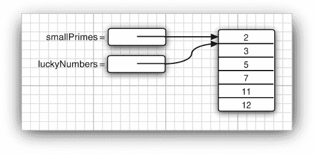

**图 3.14** 复制数组变量

第二个参数是新数组的长度。该方法的常用用途是增加数组的长度：

```java
luckyNumbers = Arrays.copyOf(luckyNumbers, 2 * luckyNumbers.length);
```

如果数组包含数字，则额外的元素将填充为 `0`；如果数组包含 `boolean` 值，则填充为 `false`。相反，如果长度小于原始数组的长度，则只复制初始值。

---

 **C++ 注意：**

Java 数组与栈上的 C++ 数组非常不同。然而，它本质上与指向堆上分配的数组的指针相同。也就是说：

```java
int[] a = new int[100]; // Java
```

不等同于：

```cpp
int a[100]; // C++
```

而是：

```cpp
int* a = new int[100]; // C++
```


创建一个包含十个字符串的数组，所有元素均为`null`。如果你希望数组包含空字符串，则必须提供它们：

```java
for (int i = 0; i < 10; i++) names[i] = "";
```

---

 **注意：**

如果你构建了一个包含 100 个元素的数组，然后尝试访问元素`a[100]`（或 0 到 99 范围之外的任何索引），将会发生“数组索引越界”异常。

---

要找到数组的元素个数，请使用`array.length`。例如：

```java
for (int i = 0; i < a.length; i++)
  System.out.println(a[i]);
```

### 3.10.3 “for each” 循环

Java 有一种非常强大的循环结构，允许你遍历数组（或任何其他元素集合）中的每个元素，而无需处理索引值。

#### 增强型`for`循环

```java
for (variable : collection) statement
```

将给定的变量设置为集合中的每个元素，然后执行该语句（当然，这可能是一个代码块）。`collection`表达式必须是一个数组或实现了`Iterable`接口的类对象，例如`ArrayList`。数组列表在第 5 章中介绍，`Iterable`接口在第 9 章中介绍。

例如：

```java
for (int element : a)
  System.out.println(element);
```

在每行单独打印数组`a`的每个元素。

你应该将此循环读作“对于`a`中的每个`element`”。Java 语言的设计者曾考虑过使用如`foreach`和`in`等关键字。但这种循环是 Java 语言晚期添加的，最终没有人想要破坏已经包含这些名称的方法或变量的旧代码（例如`System.in`）。

当然，你可以使用传统的`for`循环实现相同的效果：

```java
for (int i = 0; i < a.length; i++)
  System.out.println(a[i]);
```

然而，“for each”循环更加简洁且更不容易出错，因为你不需要担心那些烦人的起始和结束索引值。

---

 **注意：**

“for each”循环的循环变量遍历的是数组的`elements`，而不是索引值。

---

如果你需要处理集合中的所有元素，“for each”循环相比传统循环是一个很棒的改进。但是，仍然有很多使用传统`for`循环的机会。例如，你可能不想遍历整个集合，或者你可能在循环内部需要索引值。

---

 **提示：**

有一种更容易的方法可以打印数组的所有值，使用`Arrays`类的`toString`方法。调用`Arrays.toString(a)`返回一个包含数组元素的字符串，用中括号括起来并用逗号分隔，例如`"[2, 3, 5, 7, 13]"`。要打印数组，只需调用：

```java
System.out.println(Arrays.toString(a));
```

---

### 3.10.4 数组复制

你可以将一个数组变量复制到另一个变量中，但此时两个变量都指向同一个数组：

```java
int[] luckyNumbers = smallPrimes;

luckyNumbers[5] = 12; // 现在 smallPrimes[5] 也是 12
```

图 3.14 显示结果。如果你确实想将一个数组的所有值复制到一个新数组，请使用`Arrays`类中的`copyOf`方法：

```java
int[] copiedLuckyNumbers = Arrays.copyOf(luckyNumbers, luckyNumbers.length);
```


**图 3.14** 复制数组变量

第二个参数是新数组的长度。该方法的常用用途是增加数组的长度：

```java
luckyNumbers = Arrays.copyOf(luckyNumbers, 2 * luckyNumbers.length);
```

如果数组包含数字，则额外的元素将填充为`0`；如果数组包含`boolean`值，则填充为`false`。相反，如果长度小于原始数组的长度，则只复制初始值。

---

 **C++ 注意：**

Java 数组与栈上的 C++ 数组非常不同。然而，它本质上与指向堆上分配的指针相同。也就是说：

```java
int[] a = new int[100]; // Java
```

不等同于：

```cpp
int a[100]; // C++
```

而是：

```cpp
int* a = new int[100]; // C++
```

在 Java 中，`[]`运算符被定义为执行边界检查。此外，没有指针算术——你无法通过增加`a`来指向数组中的下一个元素。

---

#### 3.10.5 命令行参数

```java
import java.util.*;

/**
 * 此程序演示了数组操作。
 * @version 1.20 2004-02-10
 * @author Cay Horstmann
 */
public class LotteryDrawing
{
    public static void main(String[] args)
    {
        Scanner in = new Scanner(System.in);

        System.out.print("你需要抽取多少个数字？ ");
        int k = in.nextInt();

        System.out.print("你可以抽取的最大数字是多少？ ");
        int n = in.nextInt();

        // 用数字 1 2 3 . . . n 填充数组
        int[] numbers = new int[n];

        for (int i = 0; i < numbers.length; i++)
            numbers[i] = i + 1;

        // 抽取 k 个数字并将它们放入第二个数组
        int[] result = new int[k];

        for (int i = 0; i < result.length; i++)
        {
            // 生成一个 0 到 n - 1 之间的随机索引
            int r = (int) (Math.random() * n);

            // 选取随机位置的元素
            result[i] = numbers[r];

            // 将最后一个元素移动到随机位置
            numbers[r] = numbers[n - 1];
            n--;
        }

        // 打印排序后的数组
        Arrays.sort(result);

        System.out.println("下注以下组合。它会让你富起来！");

        for (int r : result)
            System.out.println(r);
    }
}
```


## `java.util.Arrays` 1.2

- `static String toString(xxx[] a)` 5
  返回一个包含 `a` 中元素的字符串，用括号括起来并逗号分隔。在本方法及后续方法中，数组的组件类型 `xxx` 可以是 `int`、`long`、`short`、`char`、`byte`、`boolean`、`float` 或 `double`。
- `static xxx[] copyOf(xxx[] a, int end)` 6
- `static xxx[] copyOfRange(xxx[] a, int start, int end)` 6
  返回一个与 `a` 类型相同的数组，长度为 `end` 或 `end – start`，用 `a` 的值填充。如果 `end` 大于 `a.length`，结果将用 `0` 或 `false` 值填充。
- `static void sort(xxx[] a)`
  使用调过的快速排序算法对数组进行排序。
- `static int binarySearch(xxx[] a, xxx v)`
- `static int binarySearch(xxx[] a, int start, int end, xxx v)` 6
  使用二分查找算法在排序后的数组 `a` 中查找值 `v`。如果找到 `v`，返回其索引。否则，返回一个负值 `r`；`r – 1` 是 `v` 应该插入的位置。
- `static void fill(xxx[] a, xxx v)`
  将数组的所有元素设置为 `v`。
- `static boolean equals(xxx[] a, xxx[] b)`
  如果数组长度相同且对应位置的元素匹配，则返回 `true`。

### 3.10.7 多维数组

多维数组使用多个索引来访问元素。它们被用于表格和其他复杂的排列。在你有存储需求之前，可以安全地跳过这一节。

假设你想创建一个数字表格，显示 10,000 美元的投资在按年支付利并再投资的利率情景下如何增长（表 3.8）。

**表 3.8** 不同利率下投资的增长情况 (03tab08)

你可以将这些信息存储在一个名为 `balances` 的二维数组（矩阵）中。

在 Java 中声明二维数组非常简单。例如：

```java
double[][] balances;
```

在初始化数组之前，你无法使用它。在这种情况下，你可以按照如下方式进行初始化：

```java
balances = new double[YEARS][RATES];
```

在其他情况下，如果你知道数组元素，可以使用简写符号来初始化多维数组而无需调用 `new`。例如：

```java
int[][] magicSquare = {
    {16, 3, 2, 13},
    {5, 10, 11, 8},
    {9, 6, 7, 12},
    {4, 15, 14, 1}
};
```

一旦初始化了数组，你就可以通过提供成对的括号来访问单个元素——例如 `balances[i][j]`。

示例程序存储了一个利率的一维数组 `interest` 和一个账户余额的二维数组 `balances`，每个元素对应一个年份和一个利率。用初始余额初始化数组的第一行：

```java
for (int j = 0; j < balances[0].length; j++)
    balances[0][j] = 10000;
```

然后按照如下方式计算其他行：

```java
for (int i = 1; i < balances.length; i++)
{
    for (int j = 0; j < balances[i].length; j++)
    {
        double oldBalance = balances[i - 1][j];
        double interest = . . .;
    }
}
```

```java
// 打印排序后的数组
Arrays.sort(result);
System.out.println("下注以下组合。它会让你富起来！");
for (int r : result)
    System.out.println(r);
```

表达式 `balances[i]` 指向第 `i` 子数组——即表格的第 `i` 行。它本身是一个数组，而 `balances[i][j]` 指向该数组的第 `j` 个元素。

由于数组的行是可以单独访问的，你实际上可以交换它们！

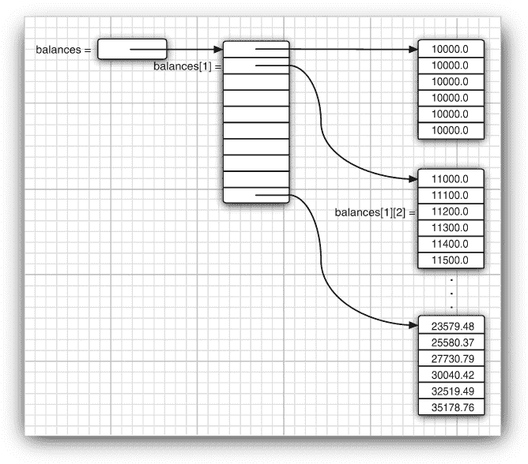

**图 3.15** 二维数组

```java
double[] temp = balances[i];
balances[i] = balances[i + 1];
balances[i + 1] = temp;
```

创建“锯齿”数组（ragged arrays）——即不同行长度不同的数组也非常容易。这里有一个标准示例。让我们创建一个数组，其中第 `i` 行第 `j` 列的元素等于“从 `i` 个数中选择 `j` 个数”抽票的可能结果数。

```
1
1  1
1  2  1
1  3  3  1
1  4  6  4  1
1  5 10 10  5  1
1  6 15 20 15 6 1
```

由于 `j` 永远不会大于 `i`，因此矩阵是三角形的。第 `i` 行有 `i` + 1 个元素。（选择 0 个元素是可以允许的；有一种方法进行这种选择。）要构建这个锯齿数组，首先分配存储行的数组：

```java
final int NMAX = 10;
int[][] odds = new int[NMAX + 1][];
```

接下来，分配各个行：

```java
for (int n = 0; n <= NMAX; n++)
    odds[n] = new int[n + 1];
```

现在数组已经分配完毕，只要不越界，你就可以按方式访问元素：

```java
for (int n = 0; n < odds.length; n++)
    for (int k = 0; k < odds[n].length; k++)
    {
        // 计算 lotteryOdds
        . . .
        odds[n][k] = lotteryOdds;
    }
```

Listing 3.9 提供了完整的程序。

**C++ 注意：**

在 C++ 中，Java 的声明

```java
double[][] balances = new double[10][6]; // Java
```

不等同于

```cpp
double balances[10][6]; // C++
```

甚至不是

```cpp
double (*balances)[6] = new double[10][6]; // C++
```

相反，它分配了一个包含十个指针的数组：

```cpp
double** balances = new double*[10]; // C++
```

然后，指针数组中的每个元素都被填充入一个包含六个数的数组：

```cpp
for (i = 0; i < 10; i++)
    balances[i] = new double[6];
```

幸运的是，当你请求 `new double[10][6]` 时，这个循环是自动的。当你需要锯齿数组时，你需要单独分配行数组。

**Listing 3.9** `LotteryArray/LotteryArray.java`

```java
 1  /**
 2    * 此程序演示了一个三角形数组。
 3    * @version 1.20 2004-02-10
 4    * @author Cay Horstmann
 5    */
 6  public class LotteryArray
 7  {
 8      public static void main(String[] args)
 9      {
10          final int NMAX = 10;
11
12          // 分配三角形数组
13          int[][] odds = new int[NMAX + 1][];
14          for (int n = 0; n <= NMAX; n++)
15              odds[n] = new int[n + 1];
16
17          // 填充三角形数组
18          for (int n = 0; n < odds.length; n++)
19              for (int k = 0; k < odds[n].length; k++)
20          {
21              /*
22              * 计算二项系数 n*(n-1)*(n-2)...*(n-k+1)/(1*2*3...*k)
23              */
24              int lotteryOdds = 1;
25              for (int i = 1; i <= k; i++)
26                  lotteryOdds = lotteryOdds * (n - i + 1) / i;
27
28              odds[n][k] = lotteryOdds;
29          }
30
31          // 打印三角形数组
32          for (int[] row : odds)
33          {
34              for (int odd : row)
35                  System.out.printf("%d", odd);
36                  System.out.println();
37          }
38      }
39  }
```


你现在已经了解了 Java 语言的基本编程结构。下一章将介绍面向对象编程。

## 第 4 章 对象与类

在本章中：

- 4.1 面向对象编程简介
- 4.2 使用预定义类
- 4.3 定义你自己的类
- 4.4 静态字段与方法
- 4.5 方法参数
- 4.6 对象构造
- 4.7 记录
- 4.8 程序包
- 4.9 JAR 文件
- 4.10 文档注释
- 4.11 类设计提示

你已经学习了 Java 语言的基本编程结构。下一章涵盖了面向对象编程。

### 4.1 面向对象编程简介

面向对象编程（简称 OOP）是目前的主流编程范式，它取代了 70 年代的程序技术。由于 Java 是面向对象的，你必须熟悉 OOP 才能高效使用 Java。

面向对象程序由对象组成。每个对象都有特定的给用户的功能，并隐藏了实现。许多程序中的对象将是从库中“现成”的；而另一些则将取决于你的预算或时间。但基本上，只要对象符合规范，你就不关心它是如何实现的。传统的结构化编程包括设计解决问题的过程，下一步是寻找存储数据的方法。这就是为什么 Pascal 语言的设计者 Niklaus Wirth 将他著名的著作名为《算法 + 数据结构 = 程序》（Prentice Hall, 1976）。注意在 Wirth 的标题中，算法在前，数据在后。OOP 反转了这一顺序：将数据放在首。

对于小问题，分解为过程的方法效果很好。但对于较大的问题，对象更为合适。考虑一个简单的网页浏览器。它可能需要 2000 个过程，所有过程都操作一组全局数据。在面向对象的风格中，可能会有 100 个类，每个类平均 20 个方法（见图 4.1）。这种结构对程序员来说更容易理解，也更容易发现错误。假设某个对象的数据处于错误状态。与其在 2000 个过程中寻找罪魁祸首，不如在访问该数据的 20 个方法中寻找要容易得多。对于经验丰富的 C++ 程序员来说，本章提供了熟悉的信息；然而，两种语言之间的差异使得你应该仔细阅读本章的章节。

#### 4.1.1 类

`class` 指定了如何制作对象。将类比为饼干模具；对象则是饼干本身。当你从一个类构造一个对象时，被认为创建了类的 `实例`。

正如你所见，你在 Java 中编写的所有代码都在类内部。标准 Java 库提供了数千个类，用于用户界面设计、日期和历以及网络编程等各种用途。尽管如此，在 Java 中你仍然需要创建自己的类来描述应用程序问题域的对象。

`Encapsulation`（有时被称为`信息隐藏`）是处理对象时的一个核心概念。从形式上说，封装简单地将数据和行为组合在一个包中，并向对象的用户隐藏实现细节。对象中的数据单元被称为其`instance fields`（实例字段），而操作这些数据的程序被称为其`methods`（方法）。作为类实例的某个特定对象将具有其实例字段的具体值。这些值的集合就是对象的当前`state`（状态）。每当你在一个对象上调用方法时，它的状态就可能会发生变化。

使封装生效的关键是让方法`永远`不直接访问除自身之外类的实例字段。程序应该`仅`通过对象的方法与对象数据进行交互。封装是赋予对象“黑盒”行为的方式，而这是重用和可靠性的关键。这意味着一个类可以完全改变它存储数据的方式，但只要它继续使用相同的方法来操作数据，其他对象就感知不到或不在乎。

当你开始在 Java 中编写自己的类时，OOP 的另一个原则会让这变得更简单：类可以通过`extending`（继承）其他类来构建。事实上，Java 自带了一个名为 `Object` 的“宇宙超类”。所有其他类都继承这个类。你将在下一章中学习更多关于 `Object` 类的内容。

当你扩展现有类时，新类将拥有你所扩展类的所有的属性和方法。然后你提供了仅适用于你新类的新方法和实例字段。通过类来获取另一个类的概念被称为`inheritance`（继承）。关于继承的更多信息，请参见下一章。

#### 4.1.2 对象

为了使用 OOP，你应该能够识别对象的三个关键特征：

- 对象的`behavior`（行为）——你可以对这个对象做什么，或者可以对它应用哪些方法？
- 对象的`state`（状态）——当你调用这些方法时，对象如何反应？
- 对象的`identity`（身份）——如何将该对象与其他可能相同行为和状态的对象区分开来？

作为同一类实例的所有对象通过支持相同的`behavior`而具有家族相似性。对象的行为由你可以调用的方法定义。

接下来，每个对象都存储了关于其当前状态的信息。这就是对象的`state`。对象的状态可能会随时间改变，但不会自发地改变。对象状态的变化必须是方法调用的结果。（如果对象的状态在没有对该对象调用方法的情况下发生了变化，那么某人破坏了封装。）

然而，对象的状态并没有完全描述它，因为每个对象都有独特的`identity`。例如，在订单处理系统中，两个订单即使请求完全相同的商品，它们也是不同的。请注意，作为类实例的各个对象在身份上`总是`不同的，在状态上`通常`也是不同的。

这些关键特征可以相互影响。例如，对象的状态可以影响它的行为。（如果一个订单被标记为“已发货”或“已支付”，它可能会拒绝一个要求其添加或删除物品的方法调用。相反，如果一个订单是“空”的——即尚未订购任何物品——它不应该允许自己被发货。）

#### 4.1.3 识别类

在传统的过程化程序中，你从顶部开始流程，使用 `main` 函数。在设计面向对象的系统时，没有所谓的“顶部”，OOP 的初学者往往会疑惑该从哪里开始。答案是：识别出你的类，然后为每个类添加方法。

识别类的一个简单规则是寻找问题分析中的名词。另一方面，方法对应于动词。

例如，在订单处理系统中，一些名词是：

- Item（物品）
- Order（订单）
- Shipping address（收货地址）
- Payment（支付）
- Account（账户）

这些名词可能会引导 `Item`、`Order` 等类。

接下来，寻找动词。物品被`添加`到订单中。订单被`发货`或`取消`。支付被应用`到订单。对于每个动词，如“添加”、“发货”、“取消”或“应用”，你识别出执行该操作负主要责任的对象。例如，当一个新物品添加到订单中时，订单对象应该是负责的那个，因为它知道如何存储和排序物品。也就是说，`add` 应该是 `Order` 类的一个方法，接受一个 `Item` 对象作为参数。

当然，“名词和动词”只是一个经验法则；只有经验才能帮助你在构建类时决定哪些名词和动词是重要的。

#### 4.1.4 类与类的关系

类之间最常见的关系有：

- `Dependence`（依赖，“使用-一个”）
- `Aggregation`（聚合，“拥有-一个”）
- `Inheritance`（继承，“是-一个”）

`dependence`（依赖）或“使用-一个”关系是最明显的，也是最通用的。例如，`Order` 类使用 `Account` 类，因为 `Order` 对象需要访问 `Account` 对象来检查信用状态。但 `Item` 类并不依赖于 `Account` 类，因为 `Item` 对象永远不需要担心客户账户。因此，如果一个类的方法使用了或操作了另一个类的对象，那么该类就依赖于另一个类。

尝试尽量减少相互依赖的类数量。这里的要点是，如果类 `A` 不知道类 `B` 的存在，那么它对 `B` 的任何变化也不关心。（这意味着对 `B` 的更改不会在 `A` 中引入错误。）在软件工程术语中，你希望最小化类之间的`coupling`（耦合）。

`aggregation`（聚合）或“拥有-一个”关系很容易理解，因为它是具体的；例如，一个 `Order` 对象包含 `Item` 对象。包含意味着类 `A` 的对象包含类 `B` 的对象。


**注意：** 一些方法学家对聚合的概念表示不屑，并倾向于使用更通用的“关联”关系。从建模的角度来看，这是可以理解的。但对于程序员来说，我喜欢使用聚合的另一个原因也是关联的标准表示法不够清晰。请参见表 4.1。

`inheritance`（继承）或“是-一个”关系表达了更特殊类和更通用类之间的关系。例如，`RushOrder` 类继承自 `Order` 类。特化的 `RushOrder` 类具有处理优先级的特殊方法和计算运费的不同方法，但它的其他方法（如添加物品和账单）继承自 `Order` 类。通常情况下，如果类 `D` 扩展类 `C`，则类 `D` 继承类 `C` 的方法但具有更多功能。（参见下一章，该章将详细讨论这一重要概念。）

许多程序员使用 UML（统一建模语言）符号来绘制描述类之间关系的`class diagrams`（类图）。你可以在图 4.2 中看到此类图的示例。你将类绘制为矩形，将关系绘制为带有各种装饰的箭头。表 4.1 显示了最常见的 UML 箭头样式。

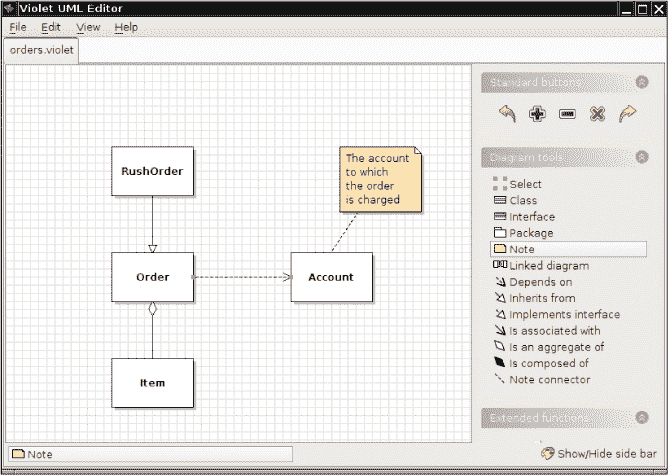

**图 4.2** 一个类图

**表 4.1** 类关系的 UML 符号

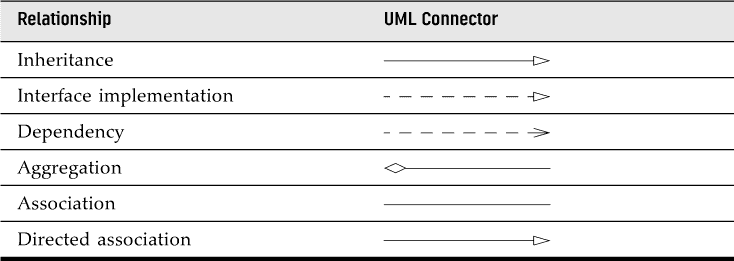

在 Java 中，没有类（classes）你无法进行任何操作，你已经看到过了一些类的运行示例。然而，并不是所有这些类都展示了面向对象性的典型特征。例如，`Math` 类。你已经看到，你可以使用 `Math` 类的方法，如 `Math.random`，而不需要知道它们是如何实现的——你只需要知道名称和参数（如果有的话）。这就是封装的意义，而且对于所有类来说确实如此。但 `Math` 类*仅*封装了功能；它既不需要也不隐藏数据。由于没有数据，你就不需要担心创建对象和初始化它们的实例字段——因为根本没有！

在下一节中，我们将查看一个更典型的类，`Date` 类。你将看到如何构造对象以及调用该类的方法。

#### 4.2.1 对象和对象变量

要操作对象，你首先要构造它们并指定它们的初始状态。然后你对对象应用方法。

在 Java 编程语言中，你使用*构造方法*（constructors）来构造新的实例。构造方法是一个特殊方法，其目的是构造和初始化对象。让我们来看一个例子。标准 Java 库包含 `Date` 类。它的对象描述时间点，例如 1999 年 12 月 31 日 23:59:59 GMT。

* * *

 **注意：**

你可能在想：为什么要使用类来表示日期，而不是像某些语言中那样使用内置类型？例如，Visual Basic 有内置日期类型，程序员可以使用 `#12/31/1999#` 格式指定日期。从表面上看，这听起来很方便——程序员可以使用内置日期类型，而无需担心类。但实际上，Visual Basic 的设计合适吗？在某些地区，日期的指定格式是月/日/年，而在另一些则是日/月/年。语言设计者真的能够预见到这些问题吗？如果他们做得不好，语言就会变成一种令人不悦的混乱，而不满的程序员对此无能为力。通过类，设计任务被交给了库设计者。如果类不完美，其他程序员可以轻松地编写自己的类来增强或替换系统类。（证明这一点：Java 日期库开始时有点混乱，它已经重新设计了两次。）

* * *

构造方法的名称始终与类名相同。因此，`Date` 类的构造方法名为 `Date`。要构造一个 `Date` 对象，将构造方法与 `new` 运算符结合使用如下：

```
new Date()
```

该表达式构造了一个新对象。该对象被初始化为当前的日期和时间。

如果你愿意，可以将对象传递给方法：

```
System.out.println(new Date());
```

或者，你可以对刚刚构造的对象应用方法。`Date` 类的方法之一是 `toString` 方法。该方法产生日期的字符串表示。以下是你如何将 `toString` 方法应用到新构造的 `Date` 对象上：

```
String s = new Date().toString();
```

在这两个示例中，构造的对象只被使用了一次。通常，你可能希望保留构造的对象，以便继续使用它们。只需将对象存储在变量中：

```
Date rightNow = new Date();
```

图 4.3 显示了引用新构造的对象的对象变量 `rightNow`。

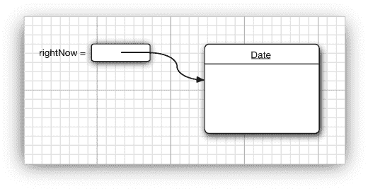

**图 4.3** 创建新对象

对象和对象变量之间存在重要的区别。例如，语句

```
Date startTime; // startTime 没有引用任何对象
```

这定义了一个对象变量 `startTime`，它可以引用 `Date` 类型的对象。重要的是要意识到变量 `startTime` *不是一个对象*，而且事实上，它甚至还没有引用任何对象。此时，你不能在该变量上使用任何 `Date` 方法。语句

```
s = startTime.toString(); // 尚未可以
```

会导致编译时错误。

你必须先初始化 `startTime` 变量。你有两个选择。当然，你可以初始化变量，使其引用一个新构造的对象：

```
startTime = new Date();
```

或者，你可以将变量设置为引用一个已有的对象：

```
startTime = rightNow;
```

现在，两个变量都引用了*同一个*对象（请参见 图 4.4）。

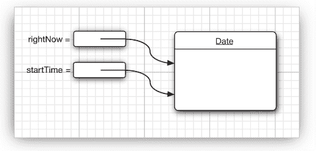

**图 4.4** 引用同一个对象的对象变量

重要的是，对象变量实际上并不包含对象。它只是*引用*一个对象。

在 Java 中，任何对象变量的值都是指向存储在其他处的对象的引用。`new` 运算符的返回值也是引用。这样的语句

```
Date startTime = new Date();
```

包含两个部分。表达式 `new Date()` 产生一个 `Date` 类型的对象，它的值是指向该新创建对象的引用。然后该引用被存储在 `startTime` 变量中。

你可以显式地将对象变量设置为 `null`，表示它当前没有引用任何对象。

```
startTime = null;
if (startTime != null) {
    System.out.println(startTime);
}
```

但事实证明，`Date` 类对于处理人类用于日期的日历信息并不有用，例如“1999 年 12 月 31 日”。这种对日期的特定描述遵循格列哥利历，这是世界上大多数国家使用的历法。同一个时间点在中国历或希伯来月历中的描述会完全不同，更不用说来自火星的客户所使用的历法了。

***

 **注意：**

在整个人类历史上，各个文明都在与历法的设计作斗争，以为日期命名并为太阳和月球循环带来秩序。关于世界各地历法的迷人解释——从法国革命历到玛雅长纪历——请参阅由 Nachum Dershowitz 和 Edward M. Reingold 编写的 *Calendrical Calculations*（Cambridge University Press, 第 4 版，2018 年）。

***

库的设计者决定将“记录时间”与“为时间点命名”这两个关注点分开。因此，Java 标准库包含两个独立的类：表示时间点的 `Date` 类，以及用熟悉的日历表示表示日的 `LocalDate` 类。Java 8 引入了许多其他类来处理日期和时间的各个方面——请参见第二卷的第 6 章。

将时间测量与历法分离是良好的面向对象设计。通常，使用不同的类来表示不同的概念是一个好主意。

你不需要使用构造函数来构造 `LocalDate` 类的对象。相反，应该使用静态工厂方法，它们会为你调用构造函数。表达式

```
LocalDate.now()
```

构造一个新对象，代表构造该对象时的日期。

你可以通过提供年、月、日来构造特定日期的对象：

```
LocalDate.of(1999, 12, 31)
```

当然，你通常希望将构造的对象存储在对象变量中：

```
LocalDate newYearsEve = LocalDate.of(1999, 12, 31);
```

一旦你有了一个 `LocalDate` 对象，就可以通过 `getYear`、`getMonthValue` 和 `getDayOfMonth` 方法找到年、月、日：

```
int year = newYearsEve.getYear(); // 1999
int month = newYearsEve.getMonthValue(); // 12
int day = newYearsEve.getDayOfMonth(); // 31
```

这看起来可能毫无意义，因为这些值与你刚刚构造对象时使用的完全相同。但有时，你拥有一个经过计算出的日期，然后你会想要调用这些方法来获取它的更多信息。例如，`plusDays` 方法会产生一个新的 `LocalDate` 对象，该对象距离你应用的对象指定的天数：

```
LocalDate aThousandDaysLater = newYearsEve.plusDays(1000);
year = aThousandDaysLater.getYear(); // 2002
month = aThousandDaysLater.getMonthValue(); // 09
day = aThousandDaysLater.getDayOfMonth(); // 26
```


`LocalDate` 类封装了实例字段，以维护所设置的日期。在不查看源代码的情况下，无法知道该类内部使用的表示形式。但是，当然，封装的意义在于这并不重要。重要的是类所暴露的方法。

 **注意：**

实际上，`Date` 类也有获取日、月、年的方法，称为`getDay`、`getMonth`和`getYear`，但这些方法已过用（deprecated）。当库的设计者意识到某个方法从根本就不应该被引入时，该方法就会标记为过用。

在库的设计者意识到提供独立的类来处理历法更合逻辑之前，这些方法是`Date`类的一部分。当在 Java 1.1 中引入了一组早期的历法类时，`Date`方法被标记为过用。你仍然可以在程序中使用它们，但如果你这样做，将会得到惨不耐看的编译器警告。避免使用过用方法是一个好主意，因为它们可能会在库的未来版本中被移除。

 **提示：**

JDK 提供了`jdeprscan`工具，用于检查你的代码是否使用了 Java API 的过用功能。请访问`https://docs.oracle.com/en/java/javase/17/docs/specs/man/jdeprscan.html`获取说明。

### 4.2.3 修改器和访问器方法

再次查看你在上一节中看到的`plusDays`方法调用：

```
LocalDate aThousandDaysLater = newYearsEve.plusDays(1000);
```

调用后`newYearsEve`发生了什么？它变成了一千天后的日期了吗？事实证明，并没有。`plusDays`方法产生了一个新的`LocalDate`对象，然后该对象被赋值给变量`aThousandDaysLater`。原始对象保持不变。我们说`plusDays`方法没有修改它所调用的对象。（这与你在[第 3 章]中看到的`String`类的`toUpperCase`方法相似。）

`LocalDate`类封装了实例字段，以维护所设置的日期。在不查看源代码的情况下，无法知道该类内部使用的表示形式。但是，当然，封装的意义在于这并不重要。重要的是类所暴露的方法。

请注意，日历的第一行进行了缩进，这样月份的第一天就会落在正确的星期。以下是打印表头和第一行缩进的代码：

```
System.out.println("Mon Tue Wed Thu Fri Sat Sun");

for (int i = 1; i < value; i++)

   System.out.print("  ");
```

现在，我们准备好打印日历的主体。我们进入一个循环，其中`date`遍历月份的每一天。

在每次迭代中，我们打印日期值。如果`date`是今天，则用`*`标记日期。然后，我们将`date`向后移动一天。当我们到达每个新周的开始时，打印一个新行：

```
while (date.getMonthValue() == month)

{

   System.out.printf("%3d", date.getDayOfMonth());

   if (date.getDayOfMonth() == today)

      System.out.print("*");

   else

      System.out.print(" ");

   date = date.plusDays(1);

   if (date.getDayOfWeek().getValue() == 1) System.out.println();

}
```

我们何时停止？我们不知道该月份有 31、30、29 还是 28 天。相反，只要`date`仍在当前月份内，我们就继续迭代。

Listing 4.1 显示了完整的程序。

如你所见，`LocalDate`类使得编写日历程序成为可能，它可以处理星期和月份长度不一等复杂性。你不需要了解`LocalDate`类是如何计算月份和星期的。你只需要使用类的接口——诸如`plusDays`和`getDayOfWeek`等方法。

这个示例程序的意义在于向你展示如何使用类的接口来执行相当复杂的任务，而无需知道实现细节。

#### 列表 4.1 `CalendarTest/CalendarTest.java`

```
 1  import java.time.*;

 2

 3  /**

 4    * @version 1.5 2015-05-08

 5    * @author Cay Horstmann

 6    */

 7  public class CalendarTest

 8  {

 9      public static void main(String[] args)

10     {

11         LocalDate date = LocalDate.now();

12         int month = date.getMonthValue();

13         int today = date.getDayOfMonth();

14

15         date = date.minusDays(today - 1); // 设置为月初

16         DayOfWeek weekday = date.getDayOfWeek();

17         int value = weekday.getValue(); // 1 = 周一, . . . , 7 = 周日

18

19          System.out.println("Mon Tue Wed Thu Fri Sat Sun");

20          for (int i = 1; i < value; i++)

21             System.out.print("  ");

22          while (date.getMonthValue() == month)

23          {

24              System.out.printf("%3d", date.getDayOfMonth());

25              if (date.getDayOfMonth() == today)

26                 System.out.print("*");

27              else

28                 System.out.print(" ");

29              date = date.plusDays(1);

30              if (date.getDayOfWeek().getValue() == 1) System.out.println();

31          }

32          if (date.getDayOfWeek().getValue() != 1) System.out.println();

33     }
```

`java.time.LocalDate`
- `static LocalDate now()` 构建一个代表当前日期的对象。
- `static LocalDate of(int year, int month, int day)` 构建一个代表给定日期的对象。
- `int getYear()`
- `int getMonthValue()`
- `int getDayOfMonth()` 获取此日期的年、月、日。
- `DayOfWeek getDayOfWeek()` 以`DayOfWeek`类实例的形式获取此日期的星期。在`DayOfWeek`实例上调用`getValue`可以获取`1`（周一）到`7`（周日）之间的星期。
- `LocalDate plusDays(int n)`
- `LocalDate minusDays(int n)` 返回此日期之后或之前的`n`天的日期。

### 4.3 定义自己的类

在第 3 章中，你开始编写简单的类。然而，所有这些类都只有一个`main`方法。现在是时候向你展示如何编写更多应用程序所需的“工作骨干类”了。这些类通常没有`main`方法。相反，它们有自己的实例字段和方法。为了构建一个完整的程序，你将几个类组合在一起，其中一个类拥有`main`方法。

#### 4.3.1 员工类

Java 中类定义的最简单形式是：

```
class ClassName

{

   field1

   field2

   ...

   constructor1

   constructor2

   ...

   method1

   method2

   ...

}
```

考虑以下非常简化的`Employee`类版本，它可能被企业用于编写工资系统时使用：

```
class Employee

{

   // 实例字段

   private String name;

   private double salary;

   private LocalDate hireDay;

   // 构造函数

   public Employee(String n, double s, int year, int month, int day)

   {

      name = n;

      salary = s;

      hireDay = LocalDate.of(year, month, day);

   }

   // 方法

   public String getName()

   {

      return name;

   }

   public double getSalary()

   {

      return salary;

   }

   public void raiseSalary(double percentage)

   {

      salary += salary * percentage / 100.0;

   }

   public LocalDate getHireDay()

   {

      return hireDay;

   }

}
```

我们将在后面的章节中详细分解该类的实现。不过，首先列表 4.2 是一个展示`Employee`类运行的程序。

在程序中，我们构造了一个`Employee`数组并填充了三个`Employee`对象：

```
Employee[] staff = new Employee[3];

staff[0] = new Employee("Carl Cracker", 50000.0, 2001, 5, 15);

staff[1] = new Employee("Harry Hacker", 60000.0, 2002, 6, 20);

staff[2] = new Employee("Tony Tester", 70000.0, 2003, 3, 10);
```

接下来，我们使用`Employee`类的`raiseSalary`方法将每个员工的工资增加 5%：

```
for (Employee e : staff)

   e.raiseSalary(5);
```

最后，我们通过调用`getName`、`getSalary`和`getHireDay`方法打印每个员工的信息：

```
for (Employee e : staff)

   System.out.println("name=" + e.getName()

   + ",salary=" + e.getSalary()

   + ",hireDay=" + e.getHireDay());
```

请注意，示例程序由两个类：`Employee`类和一个带有`public`修饰符的`EmployeeTest`类。我们刚刚描述的`main`方法包含在`EmployeeTest`类中。

源文件名为`EmployeeTest.java`，因为文件名必须与`public`类的名称匹配。一个源文件中只能有一个`public`类，但可以有任意数量的非`public`类。

接下来，当你编译这段源代码时，编译器会在目录中创建两个类文件：`EmployeeTest.class`和`Employee.class`。

然后你通过向字节码解释器提供包含程序`main`方法的类名来启动程序：

```
java EmployeeTest
```

解释器开始运行`EmployeeTest`类中`main`方法的代码。这段代码反过来构造三个新的`Employee`对象并向你展示它们的状态。

```java
import java.time.*;

/**

 * This program tests the Employee class.

 * @version 1.13 2018-04-10

 * @author Cay Horstmann

 */

public class EmployeeTest

{

    public static void main(String[] args)

    {

        // fill the staff array with three Employee objects

        Employee[] staff = new Employee[3];

        staff[0] = new Employee("Carl Cracker", 75000, 1987, 12, 15);

        staff[1] = new Employee("Harry Hacker", 50000, 1989, 10, 1);

        staff[2] = new Employee("Tony Tester", 40000, 1990, 3, 15);

        // raise everyone's salary by 5%

        for (Employee e : staff)

            e.raiseSalary(5);

        // print out information about all Employee objects

        for (Employee e : staff)

            System.out.println("name=" + e.getName() + ",salary=" + e.getSalary() + ",hireDay="

                + e.getHireDay());

    }

}

class Employee

{

    private String name;

    private double salary;

    private LocalDate hireDay;

    public Employee(String n, double s, int year, int month, int day)

    {

        name = n;

        salary = s;

        hireDay = LocalDate.of(year, month, day);

    }

    public String getName()

    {

        return name;

    }

    public double getSalary()

    {

        return salary;

    }

    public LocalDate getHireDay()

    {

        return hireDay;

    }

    public void raiseSalary(double byPercent)

    {

        double raise = salary * byPercent / 100;

        salary += raise;

    }

}
```

#### 4.3.2 多个源文件的使用

`Listing 4.2`中的程序在单个源文件中包含两个类。许多程序员更喜欢将每个类放在单独的源文件中。例如，你可以将`Employee`类存放在`Employee.java`文件中，将`EmployeeTest`类放在`EmployeeTest.java`文件中。

如果你喜欢这种安排，编译该程序有两种选择。你可以使用通配符来调用 Java 编译器：

```
javac Employee*.java
```

然后，所有匹配通配符的源文件都将被编译成类文件。或者，你也可以输入：

```
javac EmployeeTest.java
```

你可能会发现很惊讶，尽管`Employee.java`文件从未被直接编译，但第二种选择仍然有效。然而，当 Java 编译器看到`EmployeeTest.java`内部使用了`Employee`类时，它会寻找一个名为`Employee.class`的文件。如果找不到该文件，它会搜索`Employee.java`并对其进行编译。此外，如果它找到的`Employee.java`时间戳比现有的`Employee.class`文件新，Java 编译器将重新编译该文件。

**注意：** 如果你熟悉 UNIX 的`make`工具（或其类似的工具，如`make`），你可以认为 Java 编译器已经内置了`make`功能。

#### 4.3.3 剖析 Employee 类

在接下来的章节中，我们将剖析`Employee`类。让我们从该类中的方法开始。通过检查源码你可以看到，该类有一个构造方法和四个方法：

```
public Employee(String n, double s, int year, int month, int day)

public String getName()
```


```java
public double getSalary()

public LocalDate getHireDay()

public void raiseSalary(double byPercent)
```

该类中的所有方法都被标记为 `public`。`public` 关键字意味着任何类中的任何方法都可以调用该方法（四种访问级别在本章和下一章中介绍）。

接下来，注意用于存储 `Employee` 类实例内部数据的实例字段：

```java
private String name;

private double salary;

private LocalDate hireDay;
```

`private` 关键字确保了唯一可以访问这些字段的方法是 `Employee` 类本身的方法。外部方法无法读取或写入这些字段中。

**注意：** 你可以在你的实例字段上使用 `public` 关键字，但这是一个非常糟糕的主意。拥有 `public` 实例字段将允许程序的任何部分读取和修改这些字段，从而完全破坏封装性。任何类的任何方法都可以修改字段——而且根据我们的经验，某些代码会在你最意想不到的时候利用这种权限。我强烈建议将所有实例字段设为 `private`。

最后，注意有两个实例字段本身就是对象：`name` 和 `hireDay` 字段是对 `String` 和 `LocalDate` 对象的引用。这是非常常见的：类通常会包含类类型的实例字段。

#### 4.3.4 构造方法的第一步

让我们看看 `Employee` 类中列出的构造方法。

```java
public Employee(String n, double s, int year, int month, int day)
{
    name = n;
    salary = s;
    hireDay = LocalDate.of(year, month, day);
}
```

如你所见，构造方法的名称与类名相同。当你构造 `Employee` 类的对象时，该构造方法就会运行——为实例字段提供初始状态。

当你创建一个 `Employee` 类的实例时，通过如下代码设置实例字段：

```java
new Employee("Carl Cracker", 75000, 1987, 12, 15)
```

你为实例字段设置了你想要的状态。例如，当你使用如下代码创建实例时：

```java
name = "Carl Cracker";

salary = 75000;

hireDay = LocalDate.of(1987, 12, 15);
```

此时你以这种方式设置了实例字段。

构造方法与其他方法之间有重要的区别。构造方法只能结合 `new` 运算符调用。你不能将构造方法应用于现有对象来重置实例字段。例如：

```java
james.Employee("James Bond", 250000, 1950, 1);
```

这是一个编译时错误。

我们将在本章稍后介绍更多关于构造方法的内容。现在，请记住：

- 构造方法的名称与类名相同。
- 类可以有多个构造方法。
- 构造方法可以接受零、一个或多个参数。
- 构造方法没有返回值。
- 构造方法总是配合 `new` 运算符使用。

**C++ 注意：** 构造方法在 Java 中的工作方式与 C++ 相同。然而，请记住所有的 Java 对象都在堆上构造，并且构造方法必须与 `new` 结合。C++ 程序员的一个常见错误是忘记 `new` 运算符：

```java
Employee007("James Bond", 100000, 1950, 1);
```

这在 C++ 中有效，但在 Java 中不有效。

#### 4.3.5 使用 `var` 声明局部变量

从 Java 10 开始，你可以使用 `var` 关键字来声明局部变量而不是指定其类型，只要其类型可以从初始值中推断出来。例如，与其声明：

```java
Employee harry = new Employee("Harry Hacker", 50000, 1989, 10, 1);
```

你只需要写：

```java
var harry = new Employee("Harry Hacker", 50000, 1989, 10, 1);
```

这样做很好，因为它避免了类型名 `Employee` 的重复出现。

从现在起，在那些仅通过右侧表达式无需任何 Java API 知识就能看出类型的情况下，我将使用 `var` 记法。但我不会在 `int`、`long` 或 `double` 等数值类型上使用 `var`，这样你就不需要留意 `0`、`0L` 和 `0.0` 之间的差异。一旦你对 Java API 更加熟悉，你可能会更频繁地使用 `var` 关键字。

请注意，`var` 关键字只能用于方法内部的*局部*变量。你必须始终声明参数和字段的类型。

#### 4.3.6 处理 `null` 引用

在第 4.2.1 节第 132 页的“对象和对象变量”中，你已经看到对象变量持有指向对象的引用，或者持有特殊值 `null` 来表示对象的缺失。

这听起来是处理特殊情况（如未知名称或入职日期）的一种方便机制。但你对 `null` 值需要非常小心。

如果你对 `null` 值应用一个方法，就会发生 `NullPointerException`。

```java
LocalDate rightNow = null;

String s = rightNow.toString(); // NullPointerException
```

这是一个严重的错误，类似于“索引越界”异常。如果你的程序没有“捕获”异常，它就会终止。通常，程序不会捕获这类异常，而是依靠程序员从根本上不要引起它们。

 **提示：**

当你的程序因 `NullPointerException` 终止时，堆栈跟踪会显示问题发生在你代码的哪一行。从 Java 17 开始，错误信息包含了带有 `null` 值的变量或方法名。例如，在如下调用中：

```java
String s = e.getHireDay().toString();
```

错误信息会告诉你 `e` 是 `null` 还是 `getHireDay` 返回了 `null`。

定义类时，明确哪些字段可以为 `null` 是个好习惯。在我们的示例中，我们不希望 `name` 或 `hireDay` 字段为 `null`。（我们不需要担心 `salary` 字段。它是原始类型，永远不会为 `null`。）

`hireDay` 字段保证不是 `null`，因为它被用一个新的 `LocalDate` 对象初始化了。但如果在调用构造函数时传入 `null` 作为参数 `n`，那么 `name` 将是 `null`。

有两种解决方案。“宽容”的方法是将 `null` 参数转换为适当的非 `null` 值：

```java
if (n == null) name = "unknown"; else name = n;
```

`Objects` 类为此目的提供了一个方便的方法：

```java
public Employee(String n, double s, int year, int month, int day) {
   name = Objects.requireNonNullElse(n, "unknown");
   . . .
}
```

“严厉”的方法是拒绝 `null` 参数：

```java
public Employee(String n, double s, int year, int month, int day) {
   name = Objects.requireNonNull(n, "The name cannot be null");
   . . .
}
```

如果有人用 `null` 名称构造一个 `Employee` 对象，就会发生 `NullPointerException`。乍一看，这似乎不是一个有用的补救措施。但它有两个优点：

1. 异常报告包含了对问题的描述。
2. 异常报告指出了问题的位置。否则，`NullPointerException` 将在其他地方发生，并且没有简单的方法追溯到错误的构造函数参数。

 **注意：**

每当你接受对象引用作为构造参数时，问问自己你是否真的想要建模可能存在也可能不存在的值。如果不是，则优选“严厉”的方法。

#### 4.3.7 隐式和显式参数

方法作用于对象并访问其实例字段。例如，该方法：

```java
public void raiseSalary(double byPercent) {
   double raise = salary * byPercent / 100;
   salary += raise;
}
```

为调用此方法的对象中的 `salary` 实例字段设置了一个新值。考虑调用：

```java
number007.raiseSalary(5);
```

效果是使 `number007.salary` 字段的值增加 5%。具体来说，该调用执行了以下指令：

```java
double raise = number007.salary * 5 / 100;

number007.salary += raise;
```

`raiseSalary` 方法有两个参数。第一个参数（称为隐式参数）是 `byPercent`。第二个参数（即方法名）是显式参数。有些人将隐式参数称为 `target` 或 `receiver`。

 **提示：**

在 C++ 中，你在类外定义方法：

```cpp
void Employee::raiseSalary(double byPercent) {
   . . .
}
```

在 Java 中，所有方法都定义在类内部：

```java
class Employee {
   . . .

   String getName() { return name; }
```

### 4.3.8 封装的好处

最后，让我们仔细观察这些简单的 `getName`、`getSalary` 和 `getHireDay` 方法。

```java
public String getName() {
   return name;
}

public double getSalary() {
   return salary;
}

public LocalDate getHireDay() {
   return hireDay;
}
```

这些是访问方法的明显示例。由于它们只是返回实例字段的值，有时被称为字段访问器。

将 `name`、`salary` 和 `hireDay` 字段设为公共而不是使用独立的访问方法不是更容易吗？但是，`name` 字段是只读的。一旦在构造函数中设置了它，就没有其他方法可以更改它。因此，我们保证 `name` 字段永远不会被破坏。

`salary` 字段不是只读的，但它只能通过 `raiseSalary` 方法更改。特别是，如果值出现错误，只需要调试该方法即可。如果 `salary` 字段是公共的，搞乱该值的元凶可能出现在任何地方。

有时，你想要获取并设置实例字段的值。这时你需要提供三项：

- 一个私有实例字段
- 一个公共字段访问器方法；以及
- 一个公共字段变异器方法

这比提供单个公共实例字段要繁琐得多，但有巨大的益处。

首先，你可以更改内部实现而不影响类方法之外的任何代码。例如，如果将名称的存储改为：

```java
String firstName;

String lastName;
```

那么 `getName` 方法可以更改为返回：

```java
firstName + " " + lastName
```

这个更改对程序的其余部分是完全不可见的。

当然，访问器和变异器方法可能需要完成大量工作以便在新旧数据表示之间进行转换。这引出了我们的第二个优势：变异器方法可以执行错误检查，而简单地为字段赋值的代码可能不会去费这个精力。例如，`setSalary` 方法可能会检查薪水是否始终大于 0。

---

 **注意：**

小心不要编写返回可变对象引用的访问器方法。在本书的之前的版本中，我在 `Employee` 类中违反了这一规则，其中 `getHireDay` 方法返回了一个 `Date` 类的对象：

```java
class Employee
{
   private Date hireDay;
   . . .

   public Date getHireDay()
   {
      return hireDay; // 错误
   }

   . . .
}
```

与没有变异器方法的 `LocalDate` 类不同，`Date` 类有一个变异器方法 `setTime`，你可以在其中设置毫秒数。

`Date` 对象是可变的，这破坏了封装性！考虑以下违规代码：

```java
Employee harry = . . .;

Date d = harry.getHireDay();

double tenYearsInMilliseconds = 10 * 365.25 * 24 * 60 * 60 * 1000;

d.setTime(d.getTime() - (long) tenYearsInMilliseconds);

// 让我们增加 Harry 十年的工龄
```

其原因是微妙的。`d` 和 `harry.hireDay` 都指向同一个对象（请参见图 4.5）。对 `d` 应用变异器方法会自动改变 `Employee` 对象的私有状态！

如果你需要返回一个可变对象的引用，应该先对其进行 `clone`。克隆是存储在新位置的对象的精确副本。第 6 章详细讨论了克隆。以下是修正后的代码：

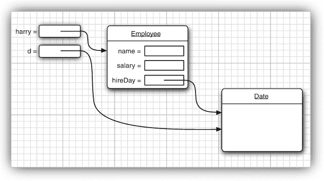

**图 4.5** 返回一个可变实例字段的引用

```java
class Employee
{
   . . .

   public Date getHireDay()
   {
      return (Date) hireDay.clone(); // 正确
   }

   . . .
}
```

作为一个经验法则，每当你需要返回可变字段的副本时，请始终使用 `clone`。

---

#### 4.3.9 基于类的访问权限

你知道方法可以访问其被调用时对象的私有数据。人们经常感到惊讶的是，方法可以访问**该类中所有对象**的私有数据。例如，考虑一个比较两个员工的 `equals` 方法。

```java
class Employee
{
   . . .

   public boolean equals(Employee other)
   {
      return name.equals(other.name);
   }
}
```

典型的调用是：

```java
if (harry.equals(boss)) . . .
```

该方法访问了 `harry` 的私有字段，这并不奇怪。它还访问了 `boss` 的私有字段。这是合法的，因为 `boss` 是 `Employee` 类型的对象，而 `Employee` 类的方法被允许访问**任意** `Employee` 类型对象的私有字段。

---

 **C++ 注意：**

C++ 遵循相同的规则。方法可以访问其类任何对象的私有特性，而不仅仅是隐式参数。

---

#### 4.3.10 私有方法

在实现类时，我们将所有实例字段设为私有，因为公共数据是危险的。但方法呢？虽然大多数方法是公共的，但私有方法在某些情况下很有用。有时，你可能希望将计算代码拆分为单独辅助方法。通常，这些辅助方法不应该是公共接口的一部分——它们可能与当前实现关联，或者需要特定的协议或调用顺序。此类方法最好实现为私有。

在 Java 中实现私有方法，只需将 `public` 关键字改为 `private` 即可。

通过将方法设为私有，当你更改实现时，你没有义务保持它的可用。如果数据表示发生变化，该方法的实现可能会变得*更加困难*或*不再必要*；这无关。关键在于，只要方法是私有的，类的设计者就可以确保它从未在其他地方被使用，因此他们可以简单地删除它。如果方法是公共的，你不能简单地删除它，因为其他代码可能依赖它。

#### 4.3.11 最终实例字段

你可以将实例字段定义为 `final`。此类字段在对象构造时必须初始化。也就是说，你必须保证在每个构造函数结束后字段值已设置。此后，字段可能不再被修改。例如，`Employee` 类的 `name` 字段可以声明为 `final`，因为它是*不可变的*。

```java
class Employee
{
   private final String name;
}
```

### 4.4 静态字段和方法

在你见过的所有示例程序中，`main` 方法都被标记为 `static`。我们现在准备好讨论它的含义了。

#### 4.4.1 静态字段

如果你将一个字段定义为 `static`，那么该字段在所有实例之间共享。你可以将静态字段视为属于类而不是属于对象。例如，假设我们想为每个员工分配一个唯一的标识号。我们在 `Employee` 类中添加一个实例字段 `id` 和一个静态字段 `nextId`：

```java
class Employee
{
   private static int nextId = 1;
   private int id;
}
```


每个`Employee`对象现在都有自己的`id`字段，但只有一个共享的`nextId`字段。换句话说：如果有 1000 个`Employee`类对象，就有 1000 个实例字段`id`，但只有一个静态字段`nextId`。即使没有`Employee`对象，静态字段`nextId`也存在。

---

 **注意：**

在某些面向对象的编程语言中，静态字段被称为*类字段*。

在构造函数，将可用 ID 分配给新的`Employee`对象并对其递增：

```java
id = nextId;

nextId++;
```

假设我们构造了对象`harry`。那么`harry`的`id`字段设置为静态字段`nextId`的当前值，然后静态字段的值递增：

```java
harry.id = Employee.nextId;

Employee.nextId++;
```

#### 4.4.2 静态常量

静态变量相当罕见。然而，静态常量更为常见。例如，`Math`类定义了一个静态常量：

```java
public class Math
{
   . . .

   public static final double PI = 3.14159265358979323846;

   . . .
}
```

你可以在程序中通过`Math.PI`访问此常量。

如果省略了`static`关键字，那么`PI`将成为`Math`类的实例字段。也就是说，你需要该类的对象才能访问`PI`，并且每个`Math`对象都有自己的`PI`副本。

你多次使用的的另一个静态常量是`System.out`。它在`System`类中的声明如下：

```java
public class System
{
   . . .

   public static final PrintStream out = . . .;

   . . .
}
```

正如多次提到的那样，拥有公共字段永远不是一个好主意，因为每个人都可以修改它们。然而，公共常量（即`final`字段）是可以的。由于`out`已经被声明为`final`，你不能将另一个打印流重新赋值给它：

```java
System.out = new PrintStream(. . .); // 错误--out 是 final
```

---

 **注意：**

如果你查看`System`类，你会注意到有一个名为`setOut`的方法，它可以将`System.out`设置为不同的流。你可能会奇怪该方法如何能改变`final`变量的值。然而，`setOut`方法是一个`native`（原生）方法，不是用 Java 语言实现的。原生方法可以绕过 Java 语言的访问控制机制。这是一种非常特殊的规通方法，你不应该在程序中模仿它。

---

#### 4.4.3 静态方法

静态方法是不操作对象的方法。例如，`Math`类的`pow`方法就是一个静态方法。表达式

```java
Math.pow(x, a)
```

计算`x`的`a`次方方。它没有使用任何`Math`对象来执行任务。换句话说，它没有隐式参数。

你可以将静态方法看作没有`this`参数的方法。（在非静态方法中，`this`参数指向方法的隐式参数——参见第 4.3.7 节]第 150 页的“隐式和显式参数”。）

`Employee`类的静态方法无法访问`id`实例字段，因为它不操作对象。然而，静态方法可以访问静态字段。这是一个此类静态方法的示例：

```java
public static int advanceId()
{
   int r = nextId; // 获取下一个可用 id

   nextId++;

   return r;
}
```

要调用此方法，你需要提供类名：

```java
int n = Employee.advanceId();
```

你可以省略该方法的`static`关键字吗？可以，但那样你需要一个`Employee`类型的对象引用来调用该方法。

---

 **注意：**

使用对象调用静态方法是合法的。例如，如果`harry`是一个`Employee`对象，你可以调用`harry.advanceId()`而不是`Employee.advanceId()`。然而，我发现这种记法很令人困惑。`advanceId`方法完全没有看`harry`来计算结果。我建议你使用类名而不是对象来调用静态方法。

---

在两种情况下使用静态方法：

- 当方法不需要访问对象状态时，因为所有需要的参数都是作为显式参数提供的（例如：`Math.pow`）。
- 当方法仅只需要访问类的静态字段时（例如：`Employee.advanceId`）。

---

 **C++ 注意：**

静态字段和方法在 Java 和 C++ 中具有相同的功能。然而，语法略有不同。在 C++ 中，你使用`::`运算符在作用域外访问静态字段或方法，例如`Math::PI`。

“static”一词有着奇特的历史。最初，`static`关键字被引入 C 语言用于表示在离开块后不会消失的局部变量。在这种背景下，“static”一词是有意义的：变量保留着，当再次进入块时它仍然在那里。然后`static`在 C 中有了第二个含义，用于表示无法从其他文件访问的全局变量和函数。`static`关键字简单地被复用以避免引入新关键字。最后，C++重复使用该关键字进行第三种无关的解释——表示属于某个类但不属于该类任何特定对象的变量和函数。这与该关键字在 Java 中的含义相同。

#### 4.4.4 工厂方法

这是静态方法的另一个常见用途。`LocalDate`和`NumberFormat`等类使用构建对象的静态`工厂方法`（factory methods）。你已经已经见过工厂方法`LocalDate.now`和`LocalDate.of`。以下是获取各种样式格式器对象的方法：

```java
NumberFormat currencyFormatter = NumberFormat.getCurrencyInstance();

NumberFormat percentFormatter = NumberFormat.getPercentInstance();

double x = 0.1;

System.out.println(currencyFormatter.format(x)); // 打印 $0.10

System.out.println(percentFormatter.format(x)); // 打印 10%
```

为什么`NumberFormat`类不使用构造函数呢？有两个原因：

- 你不能给构造函数命名。构造函数的名称总是与类名相同。但我们想要两个不同的名称来获取货币实例和百分比实例。
- 当你使用构造函数时，无法改变构造对象的类型。但工厂方法实际上返回的是`DecimalFormat`类的对象，它是继承自`NumberFormat`的子类。（更多信息参见第 5 章）

#### 4.4.5 `main`方法

注意，你可以在没有对象的情况下调用静态方法。例如，你永远不会构造`Math`类的对象来调用`Math.pow`。同样的原因，`main`方法是一个静态方法。

```java
public class Application
{
   public static void main(String[] args)
   {
      . . .
   }
}
```

`main`方法不操作任何对象。事实上，当程序启动时，还没有任何对象。

---

 **提示：**

每个类都可以有一个`main`方法。这是为类添加演示代码的一种方便技巧。例如，你可以为`Employee`类添加一个`main`方法：

```java
class Employee
{
   public Employee(String n, double s, int year, int month, int day)
   {
      name = n;
      salary = s;
      hireDay = LocalDate.of(year, month, day);
   }

   . . .

   public static void main(String[] args) // 测试
   {
      var e = new Employee("Romeo", 50000, 2003, 3, 31);

      e.raiseSalary(10);

      System.out.println(e.getName() + " " + e.getSalary());
   }

   . . .
}
```

要查看`Employee`类的演示，只需执行

```bash
java Employee
```

如果`Employee`类是一个应用程序的一部分，你通过以下方式启动应用程序：

```bash
java Application
```

此时`Employee`类的`main`方法永远不会被执行。

注意，`Employee`类还有一个用于单元测试的静态`main`方法。尝试运行两个：

```bash
java Employee
```

```bash
java StaticTest
```

以执行两个`main`方法。

```java
/**
 * This program demonstrates static methods.
 * @version 1.02 2008-04-10
 * @author Cay Horstmann
 */
public class StaticTest
{
    public static void main(String[] args)
    {
        // fill the staff array with three Employee objects
        var staff = new Employee[3];

        staff[0] = new Employee("Tom", 40000);
        staff[1] = new Employee("Dick", 60000);
        staff[2] = new Employee("Harry", 65000);

        // print out information about all Employee objects
        for (Employee e : staff)
        {
            System.out.println("name=" + e.getName() + ",id=" + e.getId() + ",salary="
                + e.getSalary());
        }

        int n = Employee.getNextId(); // calls static method
        System.out.println("Next available id=" + n);
    }
}

class Employee
{
    private static int nextId = 1;

    private String name;
    private double salary;
    private int id;

    public Employee(String n, double s)
    {
        name = n;
        salary = s;
        id = advanceId();
    }

    public String getName()
    {
        return name;
    }

    public double getSalary()
    {
        return salary;
    }

    public int getId()
    {
        return id;
    }

    public static int advanceId()
    {
        int r = nextId; // obtain next available id

        nextId++;

        return r;
    }

    public static void main(String[] args) // unit test
    {
        var e = new Employee("Harry", 50000);

        System.out.println(e.getName() + " " + e.getSalary());
    }
}
```

### 4.5 方法参数

让我们回顾一下描述在各种语言中如何将参数传递给方法（或函数）的计算机科学术语。`值传递`（call by value）意味着方法只获取调用者提供的值。

相比之下，`引用传递`（call by reference）意味着方法获取调用者提供的变量的`location`。因此，方法可以修改通过引用传递的变量中存储的值，但不能修改通过值传递的变量。还有`按名传递`（call by name），它主要具有历史意义，被用于最古老的高级语言之一 Algol 中。

Java 编程语言始终使用`值传递`。这意味着方法获取了所有参数值的拷贝。特别地，方法无法修改传递给它的任何参数的内容。

例如，请考虑以下调用：

```java
double percent = 10;

raiseSalary(percent);
```

无论该方法是如何实现的，我们都知道在方法调用后，`percent`的值仍然是`10`。让我们让我们更仔细地观察一下这种情况。假设一个方法尝试将方法参数的值增加三倍：

```java
public static void tripleValue(double x) // 不起作用
{
    x = 3 * x;
}
```

我们调用这个方法：

```java
double percent = 10;

tripleValue(percent);
```

然而，这不起作用。在方法调用后，`percent`的值仍然是`10`。发生的情况如下：

1. `x`使用`percent`值的拷贝初始化（即`10`）。
2. `x`被扩大了三倍——它现在是`30`。但`percent`仍然是`10`（见图 4.6）。
3. 方法结束，参数变量`x`不再被使用。

然而，方法参数有两种类型：

- 基本类型（数字、`boolean`值）
- 对象引用

你已经看到方法是不可能改变基本类型参数的。对于对象参数，情况则不同。你可以轻松地实现一个方法来将员工的薪水增加三倍：

```java
public static void tripleSalary(Employee x) // 起作用
{
    x.raiseSalary(200);
}
```

当你调用

```java
harry = new Employee(...);

tripleSalary(harry);
```

那么就会发生以下情况：

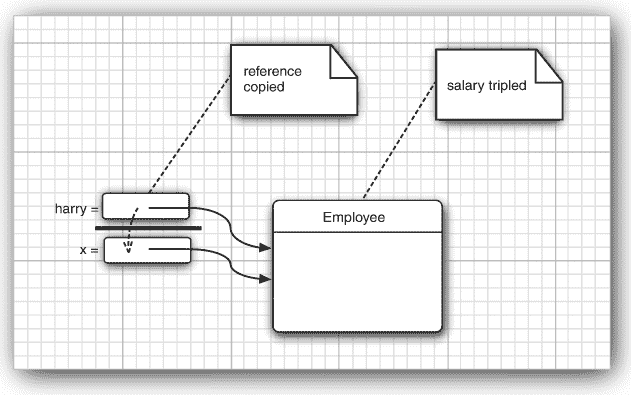

**图 4.7** 修改由参数指向的对象具有持久的影响。

```java
public static void swap(Employee x, Employee y) // 不起作用
{
    Employee temp = x;

    x = y;
    y = temp;
}
```

如果 Java 对对象使用引用传递，这将起作用：

```java
var a = new Employee("Alice", ...);

var b = new Employee("Bob", ...);

swap(a, b);

// a 现在指向 Bob，b 指向 Alice 吗？
```

然而，方法并没有更改存储`a`和`b`中的对象引用。`swap`方法的参数`x`和`y`使用这些引用的拷贝进行初始化。方法随后交换了这些拷贝。

```java
// x 指向 Alice，y 指向 Bob
Employee temp = x;

x = y;
y = temp;

// 现在 x 指向 Bob，y 指向 Alice
```

但最终这是徒用功。当方法结束，参数变量`x`和`y`被丢弃了。原始变量`a`和`b`仍然指向方法调用之前的相同对象（见图 4.8）。

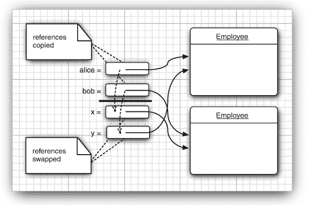

**图 4.8** 交换参数变量没有持久的影响。

这证明了 Java 编程语言对对象并不使用引用传递。相反，*对象引用是通过值传递的。*

以下是关于 Java 中方法参数可以做和不能做的事情的总结：

- 方法不能修改基本类型的参数（即数字或`boolean`值）。
- 方法可以改变对象参数的状态。
- 方法不能让对象参数指向一个新的对象。

列表 4.4 中的程序演示了这些事实。程序首先尝试增加数字参数的值，但并没有成功：

```text
Testing tripleValue:

Before: percent=10.0

End of method: x=30.0

After: percent=10.0
```

随后它成功地将员工的工资三倍：

```text
Testing tripleSalary:
```


`Before: salary=50000.0`

`End of method: salary=150000.0`

`After: salary=150000.0`

在方法执行后，`harry` 所引用的对象状态发生了变化。这是因为该方法通过对象引用的副本修改了状态。

最后，程序演示了 `swap` 方法的失败：

### Testing swap

`Before: a=Alice`

`Before: b=Bob`

`End of method: x=Bob`

`End of method: y=Alice`

`After: a=Alice`

`After: b=Bob`

如你所示，参数变量 `x` 和 `y` 被交换了，但变量 `a` 和 `b` 没有受到影响。

 **C++ 注意：**

C++ 既有按值传递也有按引用传递。你可以在引用参数上标记 `&`。例如，你可以轻松地实现如 `void tripleValue(double& x)` 或 `void swap(Employee& x, Employee& y)` 方法来修改它们的引用参数。

**Listing 4.4** `ParamTest/ParamTest.java`

```java
/**/**
 * 此程序演示了 Java 中的参数传递。
 * @version 1.01 2018-04-10
 * @author Cay Horstmann
 * */

;public class ParamTest
{
  public static void main(String[] args)
  {
    /*
     * 测试 1: 方法不能修改数值型参数
     */
    System.out.println("Testing tripleValue:");
    double percent = 10;
    System.out.println("Before: percent=" + percent);
    tripleValue(percent);
    System.out.println("After: percent=" + percent);

    /*
     * 测试 2: 方法可以改变对象参数的状态
     */
    System.out.println("\nTesting tripleSalary:");
    var� = new harry(" new", 50000);00);2
    System.out.println("Before: salary=" + harry.getSalary());
    tripleSalary(harry);
    System.out.println("After: salary=" + harry.getSalary());

    /*
     * 测试 3: 方法不能将新对象附加到对象参数上
     */
    System.out.println("\nTesting swap:");
    var a = = new Employee("Alice", 70000);
    var b = = new Employee("Bob", 60000);
    System.out.println("Before: a=" + a.getName());
    System.out.println("Before: b=" + b.getName());
    swap(a, b);
    System.out.println("After: a=" + a.getName());
    System.out.println("After: b=" + b.getName());
  }

  public static void tripleValue(double x) // 无效
  {
    x = 3 * x;
    System.out.println("End of method: x=" + x);
  }

  public static void tripleSalary(Employee x) // 有效
  {
    x.raiseSalary(200);
    System.out.println("End of method: salary=" + x.getSalary());
  }

  public static void swap(Employee x, Employee y)
  {
    Employee temp = x;
    x = y;
    y = temp;
    System.out.println("End of method: x=" + x.getName());
    System.out.println("End of method: y=" + y.getName());
  }
}

class Employee // 简化类
{
  private String name;
  private double salary;

  public Employee(String n, double s)
  {
    name = n;
    salary = s;
  }

  public String getName()
  {
    return name;
  }

  public double getSalary()
  {
    return salary;
  }

  public void raiseSalary(double byPercent)
  {
    double raise = salary * byPercent / 100;
    salary += raise;
  }
}
```

## 4.6 对象构造（Object Construction）

你已经看到过如何编写简单的构造函数来定义对象的初始状态。然而，由于对象构造（object construction）非常重要，Java 提供了多种编写构造函数的机制。我们将在后续章节介绍这些机制。

### 4.6.1 重载

某些类具有多个构造函数。例如，你可以构造一个空的 `StringBuilder` 对象：

```java
var messages = new StringBuilder();
```

或者，你可以指定一个初始字符串：

```java
var todoList = new StringBuilder("To do:\n");
```

这种能力被称为重载（overloading）。如果多个方法的名称相同（在本例中为 `StringBuilder` 构造方法）但参数不同，就发生了重载。编译器必须确定调用哪个方法。它通过匹配方法头中的参数类型与特定方法中使用值的类型来选择正确的方法。如果编译器无法匹配参数（要么完全没有匹配，要么没有某一个匹配比其他的都更好），就会发生编译错误。（寻找匹配的过程被称为重载解析（overloading resolution）。）

 **注意：**

Java 允许你重载任何方法而不仅仅是构造方法。因此，要完全描述一个方法，你需要指定它的名称及其参数类型。这被称为方法的签名（signature）。例如，`String` 类有四个名为 `indexOf` 的公共方法。它们的签名如下：

```java
indexOf(int)
indexOf(int, int)
indexOf(String)
indexOf(String, int)
```

返回类型不是方法签名的一部分。也就是说，你不能拥有两个名称和参数类型相同但返回类型不同的方法。

### 4.6.2 字段默认初始化

如果你不在构造函数里显式地设置字段，它将自动设置为默认值：数字设置为 `0`，`boolean` 值设置为 `false`，对象引用设置为 `null`。有些人认为依赖默认值是一种糟糕的编程习惯。诚无疑，如果字段是不可见地初始化，这会让别人更难理解你的代码。

 **注意：**

这是字段和局部变量之间的重要区别。你必须在方法中初始化局部变量。但在类中，如果你不初始化字段，它将自动初始化为默认值（`0`、`false` 或 `null`）。

例如，考虑 `Employee` 类。假设你没有在构造函数中指定如何初始化某些字段。默认情况下，`salary` 字段将初始化为 `0`，而 `name` 和 `hireDay` 字段将初始化为 `null`。

然而，这并不是一个好主意。如果任何人调用 `getName` 或 `getHireDay` 方法，他们将得到一个可能并未预期的 `null`：

```java
LocalDate h = harry.getHireDay();

int year = h.getYear(); // 如果 h 为 null 则抛出异常
```

### 4.6.3 无参数构造函数

许多类包含一个无参数的构造函数，用于创建一个设置为适当默认值的对象。例如，这是 `Employee` 类的无参数构造函数：

```java
public Employee()
{
  name = "";
  salary = 0;
  hireDay = LocalDate.now();
}
```

如果你编写了一个没有任何构造函数的类，将为你提供一个无参数构造函数。该构造函数将所有实例字段设置为它们的默认值。因此，实例字段包含的所有数值数据将为 `0`，所有的 `boolean` 值将为 `false`，所有的对象变量将为 `null`。

如果类提供了至少一个构造函数但没有提供无参数构造函数，那么在提供参数的情况下构造对象是非法的。例如，我们在 Listing 4.2。

对于该类，构造默认员工是不合法的。也就是说，调用

```java
e = new Employee();
```

将是一个错误。

请记住，只有当你的类没有其他构造函数时，你才会获得免费的无参构造函数。如果你在类中写了哪怕一个构造函数，并且希望该类的用户能够通过调用以下代码来创建实例：

```java
new ClassName()
```

那么你必须提供一个无参构造函数。当然，如果你对所有字段的默认值满意，你可以直接提供：

```java
public ClassName()
{
}
```

## 4.6 对象构造

 **C++ 注意：**

C++ 有一种特殊的初始化列表语法来构造字段，例如：

```cpp
Employee::Employee(String n, double s, int y, int m, int d) // C++
: name(n),
  salary(s),
  hireDay(y, m, d)
{
}
```

C++ 使用这种特殊的语法来避免不必要的无参构造函数调用。在 Java 中不需要这样做，因为对象没有子对象，只有对其他对象的引用。

### 4.6.4 显式字段初始化

通过重载类中的构造器方法，你可以构建许多设置类实例字段初始状态的方法。一种良好的做法是确保无论调用哪个构造器，每个实例字段都设置了某个有意义的值。

你可以直接在类定义中为任何字段赋值。例如：

```java
class Employee
{
  private String name = "";
  . . .
}
```

此赋值操作会在构造器执行之前完成。如果一个类的所有构造器都需要将某个特定的实例字段设置为相同的值，这种语法就特别有用。

初始化值不一定是个常量。这里有一个通过方法调用初始化字段的示例。考虑 `Employee` 类，每个员工都有一个 `id` 字段。你可以这样初始化它：

```java
class Employee
{
  private static int nextId;

  private int id = advanceId();

  . . .

  private static int advanceId()
  {
    int r = nextId;
    nextId++;
    return r;
  }

  . . .
}
```

### 4.6.5 参数名称

当你编写非常简单的构造器时（你会写很多这样的构造器），为参数起名字可能会让人有些沮丧。

我们通常选择单字母作为参数名：

```java
public Employee(String n, double s)
{
  name = n;
  salary = s;
}
```

然而，缺点是你需要阅读代码才能知道 `n` 和 `s` 参数的含义。

有些程序员会在每个参数前加上 `a` 前缀：

```java
public Employee(String aName, double aSalary)
{
  name = aName;
  salary = aSalary;
}
```

这样好得多。任何读者都能立即理解参数的含义。

另一个常用的技巧依赖于参数变量会遮蔽（shadow）同名的实例字段这一事实。例如，如果你将参数命名为 `salary`，那么 `salary` 指的是参数而不是实例字段。但你仍然可以通过 `this.salary` 访问实例字段。记住 `this` 表示的是隐式参数——即正在被构造的对象。这里有一个示例：

```java
public Employee(String name, double salary)
{
  this.name = name;
  this.salary = salary;
}
```

 **C++ 注意：**

在 C++ 中，为实例字段加上下划线或固定字母前缀是常见的做法（字母 `m` 和 `x` 是常见的选择）。例如，salary 字段可能被称为 `_salary`、`mSalary` 或 `xSalary`。Java 程序员通常不这样做。

### 4.6.6 调用另一个构造器

关键字 `this` 指向方法的隐式参数。然而，这个关键字还有第二个含义。

如果构造器的第一语句的形式为 `this(. . .)`，那么该构造器会调用同一类的另一个构造器。这是一个典型的示例：

```java
public Employee(double s)
{
  // 调用 Employee(String, double)
  this("Employee #" + nextId, s);
  nextId++;
}
```

当你调用 `new Employee(60000)` 时，`Employee(double)` 构造器会调用 `Employee(String, double)` 构造器。

这样使用 `this` 关键字是有用的——你只需要写一次公共构造代码。

 **C++ 注意：**

Java 中的 `this` 引用与 C++ 中的 `this` 指针是相同的。然而，在 C++ 中，一个构造器是不可能的调用另一个的。如果你想提取公共代码，必须编写一个独立的方法。

### 4.6.7 初始化块

你已经见过初始化实例字段的两种方法：

- 通过在构造器中设置值
- 在声明中赋值

Java 中还有第三种机制，称为初始化块（initialization block）。类声明可以包含任意的代码块。每当构造该类的对象时，这些代码块都会执行。例如：

```java
class Employee
{
  private static int nextId;

  private int id;

  private String name;

  private double salary;

  // 初始化块
  {
    id = nextId;
    nextId++;
  }

  public Employee(String n, double s)
  {
    name = n;
    salary = s;
  }

  public Employee()
  {
  }
}
```

在这个示例中，无论使用哪个构造器，`id` 字段都在初始化块中初始化。初始化块首先运行，然后执行构造器的体。

这种机制永远没有必要，也不常见。通常将初始化代码放在构造器内部会更直接。

 **注意：**

在初始化块中设置字段即使它们在后面才定义也是合法的。然而，为了避免循环定义，从后面才初始化的字段读取数据是不允许的。具体的规则在 Java 语言规范第 8.3.3 节 `http://docs.oracle.com/javase/specs` 中详细说明。这些规则复杂到足以让编译器的实现者感到困惑——早期版本的 Java 在实现这些规则时存在细微的错误。因此，你应该始终将初始化块放在字段定义之后。

静态初始化发生在类首次加载时。与实例字段一样，静态字段会被初始化为 `0`、`false` 或 `null`，除非你显式地将它们设置为其他值。所有的静态字段初始化器和静态初始化块都按照它们在类声明中出现的顺序执行。

 **注意：**


令人惊讶的是，在 JDK 6 之前，在 Java 中编写一个“Hello, World”程序而无需编写任何 `main` 方法是完全可以的。

```java
public class Hello
{
   static
   {
      System.out.println("Hello, World");
   }
}
```

当你使用 `java Hello` 调用该类时，该类被加载，静态初始化块打印了“Hello, World”，然后才会显示 `main` 未定义的消息。从 Java 7 开始，`java` 程序会先检查是否存在 `main` 方法。

* * *

此示例使用了 `Random` 类来生成随机数。从 JDK 17 开始，`java.util.random` 包提供了具有不同权衡的强算法实现。阅读 `java.util.random` 包的 API 文档以获取选择何种算法的建议。然后通过提供如下所示算法名称来获取实例：

```java
RandomGenerator generator = RandomGenerator.of("L64X128MixRandom");
```

通过调用 `generator.nextInt(n)` 或其他 `RandomGenerator` 方法生成随机数。（`RandomGenerator` 是一个接口，这是在第 6 章中引入的概念。你可以对 `Random` 类的对象使用所有的 `RandomGenerator` 方法。）

列表 4.5 中的程序展示了本节讨论的许多特性：

- 重载构造函数
- 使用 `this(. . .)` 调用另一个构造函数
- 无参数构造函数
- 对象初始化块
- 静态初始化块
- 实例字段初始化

**列表 4.5** `ConstructorTest/ConstructorTest.java`

```java
 1  import java.util.*;
 2
 3  /**
 4    * 此程序演示了对象的构造。
 5    * @version 1.02 2018-04-10
 6    * @author Cay Horstmann
 7    */
 8  public class ConstructorTest
 9  {
10      public static void main(String[] args)
11      {
12          // 用 staff 数组填充三个 Employee 对象
13          var staff = new Employee[3];
14
15          staff[0] = new Employee("Harry", 40000);
16          staff[1] = new Employee(60000);
17          staff[2] = new Employee();
18
19          // 打印所有 Employee 对象的信息
20          for (Employee e : staff)
21              System.out.println("name=" + e.getName() + ",id=" + e.getId() + ",salary="
22                  + e.getSalary());
23      }
24  }
25
26  class Employee
27  {
28    private static int nextId;
29
30    private int id;
31    private String name = ""; // 实例字段初始化
32    private double salary;
33
34    private static Random generator = new Random();
35
36    // 静态初始化块
37    static
38    {
39      // 将 nextId 设置为 0 到 9999 之间的随机数
40      nextId = generator.nextInt(10000);
41    }
42
43    // 对象初始化块
44    {
45      id = nextId;
46      nextId++;
47    }
48
49    // 三个重载的构造函数
50    public Employee(String n, double s)
51    {
52      name = n;
53      salary = s;
54    }
55
56    public Employee(double s)
57    {
58      // 调用 Employee(String, double)
59      this("Employee #" + nextId, s);
60    }
61
62    // 默认构造函数
63    public Employee()
64    {
65      // name 初始化为 ""--见上文
66      // salary 未显式设置--初始化为 0
67      // id 在初始化块中初始化
68    }
69
70    public String getName()
71    {
72      return name;
73    }
74
75    public double getSalary()
76    {
77      return salary;
78    }
79
80    public int getId()
81    {
82      return id;
83    }
84  }
```

`java.util.Random` 1.0

* * *

- `Random()` 构建一个新的随机生成器。

`java.util.random.RandomGenerator` 17

* * *

- `int nextInt(int n)` 返回 0 到 `n`-1 之间的随机整数。
- `static RandomGenerator of(String name)` 根据给定名称产生随机生成器。名称为 `"L64X128MixRandom"` 的算法适用于大多数应用程序。

## 4.7 记录

有时候，数据仅仅是数据，而面向对象的编程反而成了阻碍。考虑一个描述平面的 `Point` 类，它具有 `x` 和 `y` 坐标。

当然，你可以创建一个类：

```java
class Point
{
   private final double x;
   private final double y;
   public Point(double x, double y) { this.x = x; this.y = y; }
   public double getX() { return x; }
   public double getY() { return y; }
   public String toString() { return "Point[x=%d, y=%d]".formatted(x, y); }
   // 更多方法
}
```

但隐藏 `x` 和 `y` 并通过 getter 方法提供这些值真的能带给我们什么好处吗？

我们是否想要改变 `Point` 的实现？当然，有极坐标，但你不会在图形 API 中使用它们。在实践中，平面点完全由其 `x` 和 `y` 坐标描述。

为了更简洁地定义此类类，JDK 14 引入了“记录”（records）作为预览特性。正式版本在 JDK 16 中交付。

### 4.7.1 记录概念

记录是类的特殊形式，其状态是不可变的且公开可读的。这里是将 `Point` 定义为记录的方式：

```java
record Point(double x, double y) { }
```

结果是一个具有实例字段的类：

```java
private final double x;

private final double y;
```

在 Java 规范中，记录的实例字段被称为其组件（components）。

该类有一个构造函数：

```java
Point(double x, double y)
```

以及访问器方法：

```java
public double x()

public double y()
```

注意访问器方法是 `x` 和 `y`，而不是 `getX` 和 `getY`。（在 Java 中，实例字段和具有同名的方法是合法的。）

```java
var p = new Point(3, 4);

System.out.println(p.x() + " " + p.y());
```

Java 并没有遵循 `get` 命名规范，因为它有点混乱。对于 `Boolean` 字段，通常使用 `is` 而不是 `get`。而且，首字母的大写可能会产生问题。如果一个类同时拥有字段 `x` 和 `X` 应该发生什么呢？有些程序员对此感到不悦，因为他们的遗留类无法轻易地转换为记录（records）。但在实践中，许多遗留类是可变的，因此不适合转换为记录。

除了字段访问器方法外，每个记录都自动了三个方法：`toString`、`equals` 和 `hashCode`。你将在下一章学习更多这些方法。

**警告：**

你可以定义自动提供的方法的版本，只要它们的参数和返回类型相同。例如，这种定义是合法的：

```java
record Point(double x, double y)
{
   public double x() { return y; } // BAD
}
```

但这并不是好主意。你可以为记录添加自己的方法：

```java
record Point(double x, double y)
{
   public double distanceFromOrigin() { return Math.hypot(x, y); }
}
```

记录像任何类一样，都可以拥有静态字段和方法：

```java
record Point(double x, double y)
{
   public static Point ORIGIN = new Point(0, 0);
   public static double distance(Point p, Point q)
   {
      return Math.hypot(p.x - q.x, p.y);
   }
   ...
}
```

然而，你不能为记录添加实例字段。

```java
record Point(double x, double y)
{
   private double r; // ERROR
   ...
}
```

**警告：**

记录的实例字段是 `final` 的。但它们可能是引用可变对象的引用：

```java
record PointInTime(double x, double y, Date when) { }
```

实例是可变的：

```java
var pt = new PointInTime(0, 0, new Date());
pt.when().setTime(0);
```

如果你希望记录实例是不可变的，不要使用可变类型作为字段。

**提示：**

对于完全由变量表示的不可变数据，使用记录而不是类。如果数据是可变的，或者表示方式随时间演变，则使用类。记录更容易读、效率更高，在并发程序中更安全。

### 4.7.2 构造函数：规范、自定义和紧凑

自动设置所有实例字段的构造函数被称为规范构造函数。你可以定义额外的自定义构造函数。此类构造函数的第一个语句必须调用另一个构造函数，以便最终调用规范构造函数。例如：

```java
record Point(double x, double y)
{
   public Point() { this(0, 0); }
}
```

这个记录有两个构造函数：规范构造函数和一个产生原点的无参数构造函数。如果规范构造函数需要额外的工作，你可以提供自己的实现：

```java
record Range(int from, int to)
{
   public Range(int from, int to)
   {
      if (from <= to)
      {
         this.from = from;
         this.to = to;
      }
      else
      {
         this.from = to;
         this.to = from;
      }
   }
}
```

然而，在实现规范构造函数时，鼓励使用紧凑形式。你不需要指定参数列表：

```java
record Range(int from, int to)
{
   public Range // 紧凑形式
   { if (from > to) // 交换边界
      {
          int temp = from;
          from = to;
          to = temp;
      }
   }
}
```

紧凑形式的主体是规范构造函数的“序言”。它只是在参数变量 `from` 和 `to` 被赋值给实例字段 `this.from` 和 `this.to` 之前对它们进行修改。你不能在紧凑构造函数的体中读取或修改实例字段。

**列表 4.6** `RecordTest/RecordTest.java`

```java
import java.util.*;

/**
 * 此程序演示了记录。
 * @version 1.0 2021-05-13
 * @author Horstmann
 */
public class RecordTest
{
   public static void main(String[] args)
   {
      var p = new Point(3, 4);
      System.out.println("Coordinates of p: " + p.x() + " " + p.y());
      System.out.println("Distance from origin: " + p.distanceFromOrigin());
      // 使用字段和方法的相同计算
      System.out.println("Distance from origin: " + Point.distance(Point.ORIGIN, p));

      // 一个可变的记录
      var pt = new PointInTime(3, 4, new Date());
      System.out.println("Before: " + pt);
      pt.when().setTime(0);
      System.out.println("After: " + pt);

      // 调用紧凑构造函数
      var r = new Range(4, 3);
      System.out.println("r: " + r);
   }
}

record Point(double x, double y)
{
   // 自定义构造函数
   public Point() { this(0, 0); }
   // 方法
   public double distanceFromOrigin()
   {
      return Math.hypot(x, y);
   }
   // 静态字段和方法
   public static Point ORIGIN = new Point();
   public static double distance(Point p, Point q)
   {
      return Math.hypot(p.x - q.x, p.y - q.y);
   }
}

record PointInTime(double x, double y, Date when) { }

record Range(int from, int to)
{
   public Range // 紧凑构造函数
   {
      if (from > to)
      {
         int temp = from;
         from = to;
         to = temp;
      }
   }
}
```

## 4.8 包（Packages）

Java 允许你将类分组在一个名为包的集合中。有助于组织工作，并与他人提供的代码分开。在接下来的章节中，你将学习如何使用包。

### 4.8.1 包名

使用包的主要目的是保证类名的唯一性。假设两个程序员都想出了提供 `Employee` 类的想法。只要他们将类放在不同的包中，就不会产生冲突。事实上，为了绝对保证包名的唯一，可以使用反转的互联网域名（已知是唯一的）。你就可以为不同的项目使用子包。例如，考虑 `horstmann.com`。反转后它变成了包名 `com.horstmann`。你可以追加一个项目名称，如 `com.horstmann.corejava`。如果你将 `Employee` 类放在该包中，那么“全限定”名称变为 `com.horstmann.corejava.Employee`。

```java
import java.time.*;
```

然后你就可以使用：

```java
LocalDate today = LocalDate.now();
```

而不需要包名前缀了。你也可以在包内导入特定的类：

```java
import java.time.LocalDate;
```

`java.time.*` 语法不那么繁琐。它对代码大小没有负面影响。然而，如果你显式地导入类，你代码的读者就能确切知道你使用了哪些类。

* * *

**提示：**

在 Eclipse 中，你可以选择菜单选项 `Source → Organize Imports`（源 → 组织导入）。包语句如 `import java.util.*;` 会自动展开为特定导入的列表，例如：

```java
import java.util.ArrayList;

import java.util.Date;
```

这是一个非常方便的功能。

* * *

然而，请注意，你只能使用 `*` 符号来导入单个包。你不能使用 `import java.*` 或 `import java.*.*` 来导入所有以 `java` 为前缀包。


大多数时候，你只需要导入需要的包，而无需过多担心它们。只有在发生名称冲突时，你才需要注意包。例如，`java.util` 和 `java.sql` 包都拥有一个 `Date` 类。假设你写了一个同时导入这两个包的程序。

```
import java.util.*;

import java.sql.*;
```

如果你现在使用 `Date` 类，就会得到一个编译错误：

```
Date today; // 错误--是 java.util.Date 还是 java.sql.Date?
```

编译器无法确定想要哪一个 `Date` 类。你可以通过添加特定的 `import` 语句来解决这个问题：

```
import java.util.*;

import java.sql.*;

import java.util.Date;
```

如果你真的需要两个 `Date` 类怎么办？那么请在每个类名上使用完整的包名：

```
var startTime = new java.util.Date();

var today = new java.sql.Date(. . .);
```

在包中定位类是`编译器`的一项活动。类文件中的字节码始终使用完整的包名来引用其他类。

***

 **C++ 注意事项：**

C++ 程序员有时会将 `import` 与 `#include` 混淆。两者之间没有任何共同点。在 C++ 中，你必须使用 `#include` 来包含外部特声明，因为 C++ 编译器不会查看它正在编译的文件及其显式包含的头文件之外的任何文件。只要你告诉 Java 编译器，它就会乐意查看其他文件。

在 Java 中，你可以通过显式命名所有类（例如 `java.util.Date`）来完全避免 `import` 机制。在 C++ 中，你无法避免 `#include` 指令。

`import` 语句唯一的优点是方便。你可以使用比完整包名短的名字来引用类。例如，在执行 `import java.util.*`（或 `import java.util.Date`）语句后，你可以简单地用 `Date` 来引用 `java.util.Date` 类。

在 C++ 中，类似于包机制构造是命名空间（namespace）功能。将 Java 中的 `package` 和 `import` 语句想象成 C++ 中 `namespace` 和 `using` 指令的对应物即可。

***

### 4.8.3 静态导入

`import` 语句的一种形式允许导入静态方法和字段，而不仅仅是类。

例如，如果你在源文件顶部添加指令

```
import static java.lang.System.*;
```

那么你就可以在没有类名前缀的情况下使用 `System` 类的静态方法和字段：

```
out.println("Goodbye, World!"); // 即 System.out

exit(0); // 即 System.exit
```

你也可以导入特定的方法或字段：

```
import static java.lang.System.out;
```

在实践中，很难说许多程序员会想要缩写 `System.out` 或 `System.exit`。生成的代码看起来没那么清晰。另一方面，

```
sqrt(pow(x, 2) + pow(y, 2))
```

看起来比

```
Math.sqrt(Math.pow(x, 2) + Math.pow(y, 2))
```

要清晰得多。

### 4.8.4 将类添加到包中

要将类存放在包内，请将包名放在源文件的顶部，位于定义包内类的代码*之前*。例如，位于列表 4.8 中的 `Employee.java` 文件开头如下：

```
package com.horstmann.corejava;

public class Employee

{

   . . .

}
```

如果你没有在源文件中放置 `package` 语句，那么该源文件中的类就属于“未命名包”（unnamed package）。未命名包没有包名。到目前，我们所有的示例类都位于未命名包中。

将源文件放在与完整包名匹配的子目录中。例如，`com.horstmann.corejava` 包中的所有源文件应该位于 `com/horstmann/corejava`（Windows 上为 `com\horstmann\corejava`）子目录中。编译器会将类文件放在相同的目录结构中。

列表 4.7 中的程序分布在两个包中：`PackageTest` 属于未命名包，`Employee` 属于 `com.horstmann.corejava`。因此，`Employee.java` 必须位于 `com/horstmann/corejava` 子目录下。要编译它，只需切换到基目录并运行

```
javac PackageTest
```

编译器会自动找到 `com/horstmann/corejava/Employee.java` 并编译它。让我们看一个更真实的例子，我们没有使用未命名包，而是分布在 `horstmann` 和 `mycompany` 中。在这种情况下，你必须从基目录（即包含 `com` 的目录）编译并运行：

```
javac com/mycompany/PayrollApp.java

java com.mycompany.PayrollApp
```

再次注意，编译器操作的是文件（使用分隔符），而 Java 解释器加载的是类。

***

 **提示：**

从下一节开始我们将使用包。这样你就可以为章节创建一个 IDE 项目。

***

 **注意：**

编译器在编译源文件时不会检查目录结构。例如，假设你有一个以指令开头的源文件

```
package mycompany;
```

即使该文件不在 `mycompany` 子目录下，你也可以编译它。然而，除非你先将类文件移动到正确的位置，否则生成的程序将无法运行。如果包不匹配，虚拟机将找不到类。

***

**列表 4.7** `PackageTest/PackageTest.java`

```
import com.horstmann.corejava.*;
// Employee 类定义在那个包中

import java.lang.System.*;

/**
 * 该程序演示了包的使用。
 * @version 1.11 2004-02-19
 * @author Cay Horstmann
 */
public class PackageTest
{
  public static void main(String[] args)
  {
    // 因为有导入语句，我们在这里在这里
    // com.horstmann.corejava.Employee
    var harry = new Employee("Harry Hacker", 50000, 1989, 10, 1);

    harry.raiseSalary(5);

    // 因为有静态导入语句，我们不需要在这里使用 System.out
    out.println("name=" + harry.getName() + ",salary=" + harry.getSalary());
  }
}
```

**列表 4.8** `PackageTest/com/horstmann/corejava/Employee.java`

```java
package com.horstmann.corejava;

// 此文件中的类是该包的一部分

import java.time.*;

// import 语句位于 package 语句之后

/**
 * @version 1.11 2015-05-08
 * @author Cay Horstmann
 */
public class Employee
{
    private String name;
    private double salary;
    private LocalDate hireDay;

    public Employee(String name, double salary, int year, int month, int day)
    {
        this.name = name;
        this.salary = salary;
        hireDay = LocalDate.of(year, month, day);
    }

    public String getName()
    {
        return name;
    }

    public double getSalary()
    {
        return salary;
    }

    public LocalDate getHireDay()
    {
        return hireDay;
    }

    public void raiseSalary(double byPercent)
    {
        double raise = salary * byPercent / 100;
        salary += raise;
    }
}
```

#### 4.8.5 包访问权限

你已经遇到过访问权限修饰符 `public` 和 `private`。标记为 `public` 的特性可以被任何类使用。`private` 特性只能由定义它的类使用。如果你没有没有指定 `public` 或 `private`，该特性（即类、方法或变量）可以被同包中的所有方法访问。

考虑列表 4.2 中的程序。`Employee` 类没有被定义为公共类。因此，只有同一个包（在本例中为未命名包）中的其他类（例如 `EmployeeTest`）可以访问它。对于类来说，这是一个合理的默认值。然而，对于变量来说，这是一个遗憾的选择。变量必须显式地标记为 `private`，否则它们将默认具有包访问权限。这自然地破坏了封装性。问题在于，非常容易忘记输入 `private` 关键字。以下是 `java.awt` 包中 `Window` 类的一个示例，该类是 JDK 提供的源码的一部分：

```java
public class Window extends Container
{
   String warningString;
   . . .
}
```

注意 `warningString` 变量并不是 `private` 的！这意味着 `java.awt` 包中所有类的方法都可以访问此变量，并将其设置为它们喜欢的任何值（例如 `"Trust me!"`）。实际上，访问此变量的方法只有 `Window` 类中的，因此将该变量设为 `private` 是完全合适的。也许程序员在匆忙输入代码时仅仅忘记了 `private` 修饰符？也许根本不在意？二十多年后，该变量仍然不是 `private`。不仅如此——随着时间的推移，类中增加了新的字段，其中大约一半也不是 `private`。

这可能会成为问题。默认情况下，包不是封闭的实体。也就是说，任何人都可以向包中添加更多类。当然，敌意的或无知的程序员随后可以添加修改具有包访问权限变量的代码。例如，在 Java 的早期版本中，将另一个类带入 `java.awt` 包很容易。只需以以下代码开始类：

```java
package java.awt;
```

然后，将生成的类文件放在类路径上某处的子目录 `java/awt` 中，你就获得了对 `java.awt` 包内部细节的访问权限。通过这种手段，图 4.9：更改类路径。

#### 4.8.6 类路径

类路径列出了所有作为查找类起始点的目录和归档文件。让我们考虑我们的示例类路径：

```
/home/user/classdir:.:/home/user/archives/archive.jar
```

假设虚拟机正在搜索 `com.horstmann.corejava.Employee` 类的类文件。它首先在 Java API 中查找。它在其中没有找到类文件，因此转向类路径。然后它查找以下文件：

- `/home/user/classdir/com/horstmann/corejava/Employee.class`

- 从当前目录开始的 `com/horstmann/corejava/Employee.class`

- `/home/user/archives/archive.jar` 内部的 `com/horstmann/corejava/Employee.class`

编译器定位文件比虚拟机更困难。如果你在不指定包的情况下引用类，编译器首先需要找到包含该类的包。它会咨询所有的 `import` 指令作为类的可能的来源。例如，假设源文件包含指令：

```java
import java.util.*;

import com.horstmann.corejava.*;
```

源代码引用了一个类 `Employee`。编译器随后会尝试寻找 `java.lang.Employee`（因为 `java.lang` 包始终是默认导入的）、`java.util.Employee`、`com.horstmann.corejava.Employee` 以及当前包中的 `Employee`。它会在类路径的所有位置中搜索这些类中的 `each`。如果发现多个类，则会产生编译错误。（完全限定类名必须是唯一的，因此 `import` 语句的顺序并不重要。）

编译器又更进了一步。它会查看 `source files` 以确定源代码是否比类文件新。如果是，则会自动重新编译源码。请记住，你只能从其他包导入公共类（public classes）。一个源文件只能包含一个公共类，且文件名与公共类名必须匹配。因此，编译器可以轻松定位公共类的源文件。然而，你可以从当前包导入非公共类。这些类可能定义在名称不同的源文件中。如果你从当前包导入一个类，编译器会搜索当前包的 `all` 源文件，以查看是哪一个定义了这个类。

### 4.8.7 设置类路径

最好使用 `-classpath` 选项（或 `-cp`，从 Java 9 开始的 `--class-path`）来指定类路径：

```
java -classpath /home/user/classdir:.:/home/user/archives/archive.jar MyProg
```

或者

```bash
java -classpath c:\classdir;.;c:\archives\archive.jar MyProg
```

整个命令必须在一行输入。将这样长的命令行放在 脚本或批处理文件中是一个好主意。

使用 `-classpath` 选项是设置类路径的首选方法。另一种方法是 `CLASSPATH` 环境变量。具体取决于你的 shell。对于 Bourne Again shell (bash)，使用命令

```bash
export CLASSPATH=/home/user/classdir:.:/home/user/archives/archive.jar
```

对于 Windows shell，使用

```bash
set CLASSPATH=c:\classdir;.;c:\archives\archive.jar
```

该类路径将一直有效到 shell 退出。

 **注意：**

有些人建议永久设置 `CLASSPATH` 环境变量。这通常是一个坏主意。人们会忘记这个全局设置，并在类没有被正确加载时感到惊讶。一个特别招人指责的例子是 Apple 在 Windows 上的 QuickTime 安装程序。多年来，它全局设置 `CLASSPATH` 指向它需要的 JAR 文件，但没有将当前目录包含在类路径中。结果导致无数 Java 程序员在程序编译成功但无法运行时几近抓狂。

 **注意：**

在过去，有些人建议完全跳过类路径，直接将所有 JAR 文件丢入 `jre/lib/ext` 目录。这种机制在 Java 9 中已经过时了，但它一直是一个糟糕的建议。当被遗忘已久的类从扩展目录加载时，很容易产生混淆。

 **注：**

从 Java 9 开始，类也可以从 `module path` 加载。模块和模块路径将在第二卷的第 9 章 中讨论。

### 4.9 JAR 文件

当你打包应用程序时，你希望给用户提供单个文件，而不是一个充满类文件的目录结构。Java 归档 (JAR) 文件正是为此目的设计的。JAR 文件可以包含类文件以及其他类型的文件，如图像和声音文件。此外，JAR 文件使用了熟悉的 ZIP 压缩格式进行了压缩。

#### 4.9.1 创建 JAR 文件

使用 `jar` 工具制作 JAR 文件。（在默认 JDK 安装中，它位于 `jdk`/`bin` 目录下。）创建新 JAR 文件最常用的命令使用以下语法：

```bash
jar cvf jarFileName file1 file2 . . .
```

例如：

```bash
jar cvf CalculatorClasses.jar *.class icon.gif
```

通常，`jar` 命令具有以下格式：

```bash
jar options file1 file2 . . .
```

表 4.2 列出了 `jar` 程序的所有选项。它们与 UNIX `tar` 命令的选项相似。

你可以将应用程序和代码库打包成 JAR 文件。例如，如果你想在 Java 程序中发送电子邮件，你将使用一个封装在 `javax.mail.jar` 文件中的库。

**表 4.2** `jar` 程序选项

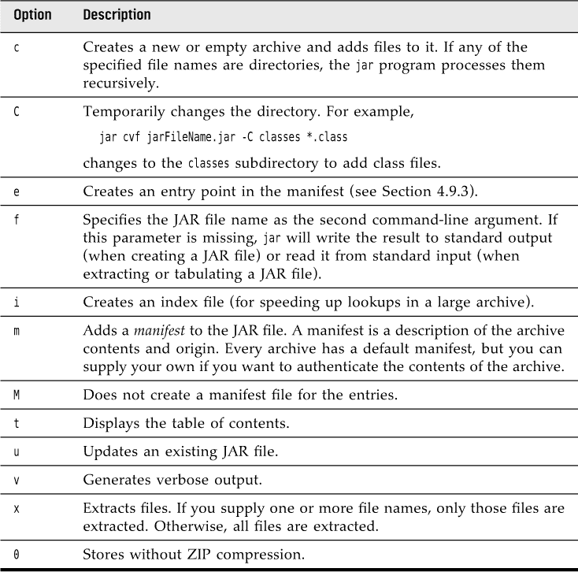

#### 4.9.2 清单 (Manifest)

除了类文件、图像和其他资源外，每个 JAR 文件还包含一个 `manifest` 文件，描述归档的特殊特性。

清单文件名为 `MANIFEST.MF`，位于 JAR 文件中特殊的 `META-INF` 子目录下。最少合法的清单非常枯燥——只需


```text
Manifest-Version: 1.0
```

复杂的清单可以包含更多的条目。清单条目被分组。清单中的第一个部分称为 `main section`（主部分），它适用于整个 JAR 文件。随后的条目可以指定归档的属性。

## 4.9.3 可执行 JAR 文件

你可以使用 `jar` 命令的 `e` 选项指定程序的 `entry point`（入口）——即你通常在调用 `java` 程序启动器时指定的类：

```bash
jar cvfe MyProgram.jar com.mycompany.mypkg.MainAppClass files to add
```

或者，你可以在清单中指定程序的 `main class`（主类），包括如下形式的语句：

```text
Main-Class: com.mycompany.mypkg.MainAppClass
```

不要给主类名添加 `.class` 扩展。

 **注意：**

清单中的最后一行必须以换行符结束。否则，清单将无法正确读取。一种常见的错误是产生一个只包含 `Main-Class` 行而没有行终止符的文本文件。

使用上述任种方法，用户都可以简单地启动程序：

```bash
java -jar MyProgram.jar
```

根据操作系统的配置，用户甚至可以通过双击 JAR 文件图标来启动应用程序。以下是各种操作系统的行为：

- 在 Windows 上，Java 运行时安装程序为 `.jar` 扩展创建了文件关联，使用 `javaw -jar` 命令启动文件。（与 `java` 命令不同，`javaw` 命令不会打开 shell 窗口。）

- 在 Mac OS X 上，操作系统识别 `.jar` 文件扩展名，并在你双击 JAR 文件时执行 Java 程序。

然而，运行在 JAR 文件中的 Java 程序并没有原生应用程序那样的感觉。在 Windows 上，你可以使用第三方封装器工具将 JAR 文件转换为 Windows 可执行文件。封装器（wrapper）是一个具有熟悉的 `.exe` 扩展名的 Windows 程序，它用于定位并启动 Java 虚拟机（JVM），或者在未找到 JVM 时告诉用户该如何操作。有许多商业和开源产品，例如 Launch4J ([`http://launch4j.sourceforge.net`](http://launch4j.sourceforge.net))）和 IzPack ([`http://izpack.org`](http://izpack.org))）。

## 4.9.4 多版本 JAR 文件

随着模块的引入和对包的强封装，某些以前可以访问的内部 API 不再可用。这可能需要库提供者为不同的 Java 版本分发不同的代码。Java 9 为此目的引入了多版本 JAR（multi-release JARs）。

为了向后兼容性，特定版本的类文件被放在：

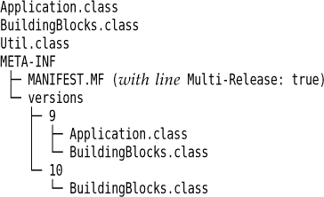

假设 `Application` 类使用了 `CssParser` 类。那么，旧的 `Application.class` 文件可以编译为使用 `com.sun.javafx.css.CssParser`，而 Java 9 版本则使用 `javafx.css.CssParser`。

Java 8 完全不知道 `META-INF/versions` 目录，它只会加载旧类。当 JAR 文件被 Java 9 读取时，将使用新版本。

要添加带版本的类文件，使用 `--release` 标志：

```
jar uf MyProgram.jar --release 9 Application.class
```

要从零开始构建多版本 JAR 文件，使用 `-C` 选项为每个版本切换到不同的类文件目录：

```
jar cf MyProgram.jar -C bin/8 . --release 9 -C bin/9 Application.class
```

在为不同的发行编译时，使用 `--release` 标志和 `-d` 标志来指定输出目录：

```
javac -d bin/8 --release 8 . . .
```

从 Java 9 开始，`-d` 选项会在目录不存在时创建它。

`--release` 标志也是 Java 9 新引入的。在旧版本中，你需要使用 `-source`、`-target` 和 `-bootclasspath` 标志。JDK 现在分发了两个之前版本的 API 符号文件。在 Java 9 中，你可以将 `--release` 设置为 `9`、`8` 或 `7` 进行编译。

多版本 JAR 并不是用于一个程序或库的不同版本。所有类的公共 API 在两个版本中应该是相同的。多版本 JAR 的唯一目的是为了让你的程序或库的特定版本能够兼容多个 JDK 版本。如果你添加了功能或更改了 API，你应该提供 JAR 的新版本。

---

 **注意：**

诸如 `javap` 等工具尚未经过重构以处理多版本 JAR 文件。如果你调用：

```
javap -classpath MyProgram.jar Application.class
```

你将获得类的基准版本（毕竟，它本应该与新版本具有相同的公共 API）。如果你必须查看新版本，请调用：

```
javap -classpath MyProgram.jar\!/META-INF/versions/9/Application.class
```

---

## 4.9.5 关于命令行选项的说明

Java 开发工具包（JDK）中的命令选项传统上使用单连字符后跟多字母选项名称，例如：

```
java -jar . . .

javac -Xlint:unchecked -classpath . . .
```

异常是 `jar` 命令，它遵循了 `tar` 命令的经典选项格式，但不带连字符：

```
jar cvf . . .
```

从 Java 9 开始，Java 工具正在转向更通用的选项格式，即多字母选项名称以双连字符开头，并为常用选项提供单字母缩写。例如，Linux 的 `ls` 命令可以使用“人类可读”选项调用：

```
ls --human-readable
```

或者

```
ls -h
```

从 Java 9 开始，你可以用 `--version` 代替 `-version`，并用 `--class-path` 代替 `-classpath`。正如你将在第二卷的第 9 章](#ch09.xhtml_ch9)中看到的，`--module-path` 选项有一个快捷方式 `-p`。

你可以在 JEP 293 增强请求中找到细节：[`http://openjdk.java.net/jeps/293`](http://openjdk.java.net/jeps/293)。作为这一清理工作的一部分，作者还提议标准化选项参数。带有 `--` 和多个字母的选项的参数通过空格或 `=` 号分隔：

```
javac --class-path /home/user/classdir . . .
```

或者

```
javac --class-path=/home/user/classdir . . .
```

单字母选项的参数可以使用空格分隔，也可以直接跟在选项后面：

```
javac -p moduledir . . .
```

或者

```
javac -pmoduledir . . .
```

---

 **注意：**

后者目前不起，而且通常来说这也是个坏主意。如果模块目录恰好是 `arameters` 或 `rocessor`，为什么要招致与旧版选项的冲突呢？

---

不带参数的单字母选项可以组合在一起：

```
jar -cvf MyProgram.jar
```

---

如果你的注释包含指向其他文件的链接（例如，图表或用户界面组件图像），请将这些文件放置在源文件所在目录的子目录中，并命名为 `doc-files`。`javadoc` 工具会将 `doc-files` 目录及其内容从源目录复制到文档输出目录。你需要在链接中使用 `doc-files` 目录，例如 ``。

## 4.10.2 类注释

类注释必须放置在任何 `import` 语句*之后*，紧跟在 `class` 定义之前。

这里有一个类注释的示例：

```
/**
 * 一个 {@code Card} 对象表示一张扑牌，例如

 * "红心皇后"。一张扑牌有一个花色（方片、红心、

 * 黑桃或梅花）和一个点值（1 = A, 2 . . . 10, 11 = J,

 * 12 = Q, 13 = K）
 */

public class Card

{
   . . .
}
```

 **注意：**

不需要在每行前面添加 `*`。例如，以下注释同样有效：

```
/**
   一个 <code>Card</code> 对象表示一张扑牌，例如

   "红心皇后"。一张扑牌有一个花色（方片、红心、

   黑桃或梅花）和一个点值（1 = A, 2 . . . 10, 11 = J,

   12 = Q, 13 = K）。
*/
```

然而，绝大多数 IDE 会自动提供星号，并在换行符发生变化时重新排列它们。

## 4.10.3 方法注释

每个方法注释必须紧接在它所描述的方法之前。除了通用标签外，你还可以使用以下标签：

- `@param` *变量描述*

此标签在当前方法的“参数（parameters）”部分添加一个条目。描述可以跨多行，并可以使用 HTML 标签。一个方法的所有 `@param` 标签必须保持在一起。

- `@return` *描述*

此标签为当前方法添加一个“返回（returns）”部分。描述可以跨多行，并可以使用 HTML 标签。

- `@throws` *类描述*

此标签添加一条该方法可能会抛出异常的说明。异常是第 7 章的主题。

这里有一个方法注释的示例：

```
/**
 * 增加员工的工资。
 * @param  byPercent 增加工资的百分比（例如，10 表示 10%）
 * @return  增加的工资金额
 */

public double raiseSalary(double byPercent)
{
   double raise = salary * byPercent / 100;
   salary += raise;
   return raise;
}
```

## 4.10.4 字段注释

你只需要记录公共字段——通常这意味着意味着静态常量。例如：

```
/**
 * “红心”花色
 */
public static final int HEARTS = 1;
```

## 4.10.5 通用注释

标签 `@since` *文本* 会创建一个“自某版本起（since）”条目。*文本*可以是对引入此功能的版本的任何描述。例如，`@since 1.7.1`。

以下标签可以在类文档注释中使用：

- `@author` *名称*

此标签创建一个“作者（author）”条目。你可以有多个 `@author` 标签，每个作者一个。不必强迫使用此标签——你的版本控制系统在跟踪作者身份方面方面做得更彻底。

- `@version` *文本*

此标签创建一个“版本（version）”条目。`text` 可以是对当前版本的任何描述。

你可以使用 `@see` 和 `@link` 标签指向 `javadoc` 文档的其他相关部分或指向外部文档。

标签 `@see` *引用* 会在“参见（see also）”部分添加一个超链接。它可以同时用于类和方法。在这里，*引用（reference）可以是以下内容之一：

```
package.class#feature 标签

<a href=". . .">label</a>

"text"
```

第一种情况是最用的。你提供类、方法或变量名，`javadoc` 会插入一个指向文档的超链接。例如，

```
@see com.horstmann.corejava.Employee#raiseSalary(double)
```

这将创建指向 `com.horstmann.corejava.Employee` 类中 `raiseSalary(double)` 方法的链接。你可以省略包名，或者同时省略包名和类名。这时，功能将在当前包或类中查找。注意，你必须使用 `#` 而不是 `.` 来分隔类与方法或变量名。Java 编译器本身非常擅长确定 `.` 作为包、子包、类、内部类以及方法和变量之间分隔符的不同含义。但 `javadoc` 工具没那么聪明，所以你必须帮助它。

如果 `@see` 标签后面紧跟 `<` 字符，那么你需要指定一个超链接。你可以链接到任何你喜欢的 URL。例如：

```
@see <a href="www.horstmann.com/corejava.html">Core Java 首页</a>
```

在上述的每种情况下，你都可以指定一个可选的*标签（label）*，它将作为链接锚点出现。如果你省略标签，将使用目标作为锚点。如果 `@see` 标签后面紧跟 `"` 字符，则文本将显示在“参见”部分。例如：

```
@see "Core Java 2"
```

你可以在任何 `javadoc` 文档的其它相关部分或外部文档使用超链接，使用 `@see` 和 `@link` 标签。

标签 `@see` *引用* 会在“参见（see also）”部分添加一个超链接。它可以同时用于类和方法。在这里，*引用*可以是以下内容之一：

```
package.class#feature 标签 

<a href=". . .">label</a>

"text"
```

第一种情况是最用的。你提供类、方法或变量名，`javadoc` 会插入一个指向文档的超链接。例如，

```
@see com.horstmann.corejava.Employee#raiseSalary(double)
```

这将创建指向 `com.horstmann.corejava.Employee` 类中 `raiseSalary(double)` 方法的链接。你可以省略包名，或者同时省略包名和类名。这时，功能将在当前包或类中查找。注意，你必须使用 `#` 而不是 `.` 来分隔类与方法或变量名。Java 编译器本身非常擅长确定 `.` 作为包、子包、类、内部类以及方法和变量之间分隔符的不同含义。但 `javadoc` 工具没那么聪明，所以你必须帮助它。

如果 `@see` 标签后面紧跟 `<` 字符，那么你需要指定一个超链接。你可以链接到任何你喜欢的 URL。例如：

```
@see <a href="www.horstmann.com/corejava.html">Core Java 首页</a>
```

在上述的每种情况下，你都可以指定一个可选的*标签（label）*，它将作为链接锚点出现。如果你省略标签，将使用目标作为锚点。

如果 `@see` 标签后面紧跟 `"` 字符，则文本将显示在“参见”部分。例如：

```
@see "Core Java 2"
```

你可以在任何 `javadoc` 文档的其它相关部分或外部文档使用超链接，使用 `@see` 和 `@link` 标签。

标签 `@see` *引用* 会在“参见（see also）”部分添加一个超链接。它可以同时用于类和方法。在这里，*引用*可以是以下内容之一：

```
package.class#feature 标签 

<a href=". . .">label</a>

"text"
```

第一种情况是最用的。你提供类、方法或变量名，`javadoc` 会插入一个指向文档的超链接。例如，

```
@see com.horstmann.corejava.Employee#raiseSalary(double)
```

这将创建指向 `com.horstmann.corejava.Employee` 类中 `raiseSalary(double)` 方法的链接。你可以省略包名，或者同时省略包名和类名。这时，功能将在当前包或类中查找。注意，你必须使用 `#` 而不是 `.` 来分隔类与方法或变量名。Java 编译器本身非常擅长确定 `.` 作为包、子包、类、内部类以及方法和变量之间分隔符的不同含义。但 `javadoc` 工具没那么聪明，所以你必须帮助它。

如果 `@see` 标签后面紧跟 `<` 字符，那么你需要指定一个超链接。你可以链接到任何你喜欢的 URL。例如：

```
@see <a href="www.horstmann.com/corejava.html">Core Java 首页</a>
```

在上述的每种情况下，你都可以指定一个可选的*标签（label）*，它将作为链接锚点出现。如果你省略标签，将使用目标作为锚点。

## 4.10.6 包注释

要生成包注释，你需要在每个目录下添加一个单独的文件。你有两种选择：

1. 提供名为 `package-info.java` 的 Java 文件。该文件必须包含由 `/**` 和 `*/` 包围的 Javadoc 注释，随后是 `package` 语句。它不应包含其他代码。

2. 提供名为 `package.html` 的 HTML 文件。提取 `<body>` 之间的所有文本。

## 4.10.7 注释提取

在这里，*docDirectory* 是你希望 HTML 文件存放的目录。按照以下步骤操作：

1. 进入包含要文档的源文件的目录。如果你有嵌套包，例如 `com.horstmann.corejava`，你必须在包含 `com` 的目录下工作。（这是包含 `overview.html` 文件的目录。）

2. 运行命令

```
javadoc -d docDirectory nameOfPackage
```

处理单个包。或者，运行

```
javadoc -d docDirectory nameOfPackage1 nameOfPackage2. .
```

处理多个包。如果你的文件在未命包中，请改用


如果你省略了`-d docDirectory`选项，HTML文件将提取到当前目录。这会变得很混乱，我不建议这样做。

`javadoc`程序可以通过许多命令行选项进行精细调整。例如，你可以使用`-author`和`-version`选项将`@author`和`@version`标签包含在文档中。（默认情况下，它们会被省略）。另一个实用的选项是`-link`，用于包含指向标准类的链接。例如，如果你使用命令

```
javadoc -link http://docs.oracle.com/javase/9/docs/api *.java
```

所有标准库类都将链接到 Oracle 网站上的文档。

如果你使用`-linksource`选项，每个源文件将被转换为 HTML（没有颜色，但有行号），并且每个类和方法名都会变成指向源码的超链接。

你还可以为所有源文件提供一个概览注释。将其放在如`overview.html`等文件中，并使用命令行选项`-overview filename`运行`javadoc`工具。`<body>. . .</body>`标签之间的所有文本都会被提取。当用户从导航栏选择“Overview”（概览）时，将显示这些内容。

有关更多选项，请参阅`javadoc`实用程序的在线文档：[`https://docs.oracle.com/javase/9/javadoc/javadoc.htm`](https://docs.oracle.com/javase/9/javadoc/javadoc.htm)。

## 4.11 类设计提示

我并不试图面面俱全或过于冗长，我想用一些提示来结束本章，这些提示会让你的类在良好的面向对象（OOP）圈中更受认可。

1. 始终保持数据私有。

这是首要任务；除此之外的任何操作都会违反封装性。你可能偶尔需要编写访问器（accessor）或修改器（mutator）方法，但将实例字段保持为私有仍然更好。惨痛的经验表明，数据的表示可能会发生变化，但这些数据的使用方式变化频率要低得多。当数据保持私有时，其表示形式的变化不会影响类的使用者，且更容易检测错误。

2. 始终初始化数据。

Java 不会为你初始化局部变量，但它会初始化对象的实例字段。不要依赖默认值，而要显式地初始化所有变量，要么通过提供默认值，要么在所有构造函数中设置默认值。

3. 不要在类中使用过多的基本类型。

这种思想是用其他类来替代多个相关的基本类型使用。这使得你的类更容易被理解和修改。例如，将`Customer`类中的以下实例字段：

```
private String street;
private String city;
private String state;
private int zip;
```

替换为一个名为`Address`的新类。这样，你就可以轻松地应对地址的变化，例如处理国际地址的需求。

4. 并不是所有字段都需要单独的字段访问器和修改器。

你可能需要获取和设置员工的薪水。一旦对象构造完成，你肯定不需要更改入职日期。而且，通常对象具有你不希望他人获取或设置的实例字段，例如`Address`类中状态缩写字的数组。

5. 拆分职责过多的类。

这个提示当然是模糊的：“太多”显然取决于观察者的观点。然而，如果有一种明显的方法可以将一个复杂的类拆分为两个在概念上更简单的类，请抓住这个机会。（另一方面，不要做得过头；如果有十个类，每个类只有一个方法，通常是设计过度（overkill）。）

这里是一个坏设计的示例：

```
public class CardDeck // 坏的的设计
{
   private int[] value;
   private int[] suit;
   public CardDeck() { . . . }
   public void shuffle() { . . . }
   public int getTopValue() { . . . }
   public int getTopSuit() { . . . }
   public void draw() { . . . }
}
```

这个类实际上实现了两个独立的概念：一副扑牌，带有它的`shuffle`和`draw`方法；以及一张牌，带有检查其点数和花色的方法。引入一个代表单张牌的`Card`类是有意义的。现在你有两个类，每个类都有自己的职责：

```
public class CardDeck
{
   private Card[] cards;
   public CardDeck() { . . . }
   public void shuffle() { . . . }
   public Card getTop() { . . . }
   public void draw() { . . . }
}

public class Card
{
   private int value;
   private int suit;
   public Card(int aValue, int aSuit) { . . . }
   public int getValue() { . . . }
   public int getSuit() { . . . }
}
```

6. 让你的类和方法的名称反映它们的职责。

正如变量应该具有反映其代表含义的意义名称一样，类也是如此。（标准库确实包含一些可疑的例子，例如描述时间的`Date`类。）

一个良好的习惯是，类名应该是名词（`Order`），或者由形容词修饰的名词（`RushOrder`）或动名词（以“-ing”结尾的单词，如`BillingAddress`）。至于方法，遵循标准习惯：访问器方法以小写的`get`开头（`getSalary`），修改器方法使用小写的`set`（`setSalary`）。

7. 偏好不可变类。

`LocalDate`类以及`java.time`包中的其他类都是不可变的——没有方法可以修改对象的状态。与其修改对象，像`plusDays`这样的方法会返回带有修改后状态的新对象。

修改的问题在于，当多个线程尝试同时更新对象时，可能会并发发生。结果是不可预测的。当类是不可变的，在多个线程之间共享它们的对象是安全的。

因此，尽可能让类变为不可变是一个好主意。对于表示值的类（如字符串或时间点），这尤为容易。当然，并不是所有的类都应该是不可变的。如果在员工加薪时让`raiseSalary`方法返回一个新的`Employee`对象将很奇怪。

在本章中，我们涵盖了对象和类的基础，这使得 Java 成为一种“基于对象的”语言。为了实现真正的面向对象，编程语言还必须支持继承和多态。Java 对这些特的支持下一章的主题。

## 第 5 章 继承

在本章中

• 5.1 类、超类和子类

• 5.2 `Object`: 宇宙超类

• 5.3 泛型列表

• 5.4 包装类和自动装箱

• 5.5 变长参数方法

• 5.6 抽象类

• 5.7 枚举类

• 5.8 密封类

• 5.9 反射

• 5.10 继承的设计提示

第 4 章介绍了类和对象。在本章中，你将学习*继承*，这是面向对象编程的另一个基本概念。继承的思想是你可以基于现有类创建新类。当你从一个现有类继承时，你复用（或继承）它的方法，并可以添加新的方法和字段以使你的新类适应新情况。这种技术在 Java 编程中至关重要。

本章还涵盖了*反射*，即在运行程序时发现更多类及其属性的能力。反射是一个强大的功能，但不可否认复杂。由于反射对工具构建者的兴趣大于应用程序程序员，你第一次阅读时可以只浏览一下章的这部分，以后再回来。

让我们回到上一章讨论的`Employee`类。假设（遗憾的是）你任职的一家公司那里的经理受对待的方式与其他员工不同。当然，在许多方面，经理和员工是一致的。员工和经理都领取薪水。然而，员工被要求完成分配的任务以换取工资，而经理如果真的完成了他们应该做的工作，就能获得`bonuses`（奖金）。这种情况正需要使用继承。为什么呢？嗯，你需要定义一个新类`Manager`并添加一些功能。但你可以保留一些在`Employee`类中已经编写好的程序，并且原始类的*所有*字段都可以被保留。从更抽象的角度来说，`Manager`和`Employee`之间存在着明显的“is–a”（是……的）关系。每个经理*都是*一个员工：这种“is–a”关系是继承的标志。

***

 **注意：**

在本章中，我使用了员工和经理的经典例子，但我必须请你保留地看待这个例子。在现实世界中，员工可以变成经理，因此你可能希望将“经理”建模为员工的一种角色，而不是一个子类。但在我的例子中，我假设企业世界由两类人组成：那些永远是员工的人，以及那些一直是经理的人。

***

#### 5.1.1 定义子类

以下是定义一个继承自`Employee`类的`Manager`类的方法。使用 Java 关键字`extends`来表示继承。

```java
public class Manager extends Employee
{
  added methods and fields
}
```

***

 **C++ 注意：**

继承在 Java 和 C++ 中是相似的。Java 使用`extends`关键字而不是`:`符号。Java 中的所有继承都是公共继承；没有对应于 C++ 中私有继承（private inheritance）和保护继承（protected inheritance）的特性。

***

`extends`关键字表示你正在创建一个派生自现有类的类。现有类被称为*超类*（superclass）、*基类*（base class）或*父类*（parent class）。新类被称为*子类*（subclass）、*派生类*（derived class）或*子类类*（child class）。超类和子类是 Java 程序员最常用的术语，尽管一些程序员更喜欢父/子类比，这与“继承”主题也结合得非常完美。

`Employee`类是一个超类，但并不是因为它优于它的子类或包含了更多功能。*事实上，事实恰恰相反：*子类比它的超类具有*更多*功能。例如，正如我们在查看`Manager`类的其余代码时看到的，`Manager`类封装了更多数据，并且具有比其超类`Employee`更的功能。

***

 **注意：**

前缀 *super*（超）和 *sub*（子）来自理论计算机科学和数学中的集合语言。所有员工的集合包含了所有经理的集合，因此被认为是经理集合的*超集*（superset）。或者换句话说，所有经理的集合是所有员工集合的*子集*（subset）。

***

我们的`Manager`类有一个新字段存储奖金，还有一个新方法来设置它：

```java
public class Manager extends Employee
{
  private double bonus;
  . . .
  public void setBonus(double bonus)
  {
    this.bonus = bonus;
  }
}
```

这些方法和字段并没有特殊之处。如果你有一个`Manager`对象，你可以直接应用`setBonus`方法。

```java
Manager boss = . . .;
boss.setBonus(5000);
```

当然，如果你有一个`Employee`对象，你就无法应用`setBonus`方法——它没有在`Employee`类定义的方法中。

然而，你*可以*对`Manager`对象使用`getName`和`getHireDay`等方法。尽管这些方法没有在`Manager`类中显式定义，但它们自动继承自`Employee`超类。

每个`Manager`对象都有四个字段：`name`、`salary`、`hireDay`和`bonus`。字段`name`、`salary`和`hireDay`是取自超类的。

***

 **注意：**

Java 语言规范规定：“类中声明为私有的成员不会被该类的子类继承。”多年来，这一直让我的读者感到困惑。规范对“继承”一词的定义非常狭。它认为私有字段是未被继承的，因为`Manager`类无法直接访问它们。因此，每个`Manager`对象都有三个来自超类的字段，但`Manager`类并没有“继承”它们。

***

当通过扩展其超类来定义子类时，你只需要指示子类和超类之间的*差异*。在设计类时，你将通用的方法放在超类中，将更专门的方法放在其子类中。通过将公共功能移动到超类来将其提取，是面向对象编程中的常规操作。

***

 **注意：**

在第 4 章中，你学习了*记录*（records）：我们需要表明我们想要的是，而不是当前的类。

***

#### 5.1.2 重写方法

某些超类方法并不适用于`Manager`子类。特别是`getSalary`方法。你需要*重写*（override）超类方法：

```java
public class Manager extends Employee
{
  . . .
  public double getSalary()
  {
    . . .
  }
}
```

你如何实现这一点？乍一看，这似乎很简单——只需返回`salary`和`bonus`的和：

```java
public double getSalary()
{
  return salary + bonus; // 不起作用
}
```

然而，那样行不通。记住，只有`Employee`方法可以直接访问私有字段。如果`Manager`方法想要访问这些字段，它们必须使用公共接口，在这种情况下就是使用`Employee`类的`getSalary`方法。

```java
public double getSalary()
{
  return getSalary(); 
}
```

现在，问题是对`getSalary`的调用仅仅调用了*它自己*，因为`Manager`类有一个`getSalary`方法（即我们正尝试实现的方法）。结果是无限的调用链，导致程序崩溃。

我们需要指示我们想要调用`Employee`超类的`getSalary`方法，而不是当前类。使用特殊关键字`super`来实现此目的。调用

```java
super.getSalary()
```

调用的是`Employee`类的`getSalary`方法。这里是`Manager`类`getSalary`方法的正确版本：

```java
public double getSalary()
{
  double baseSalary = super.getSalary();
  return baseSalary + bonus;
}
```

***

 **注意：**

有些人认为`super`类比于`this`引用。然而，这种类比并不准确：`super`并不是指向对象的引用。例如，你不能将`super`的值赋值另一个对象变量。相反，`super`是一个引导编译器调用超类方法的特殊关键字。

***

正如你所看到的，子类可以*添加*字段，它也可以*添加*方法或*重写*超类的方法。然而，继承永远不会夺走任何字段或方法。

Java 使用关键字`super`来调用父类方法。在 C++ 中，你将使用父类的名称配合`::`运算符来完成此。例如，`Manager`类的`getSalary`方法将调用`Employee::getSalary`而不是`super.getSalary`。

#### 5.1.3 子类构造函数

为了完成我们的示例，让我们提供一个构造函数。

```java
public Manager(String name, double salary, int year, int month, int day)
{
   super(name, salary, year, month, day);
   bonus = 0;
}
```

在这里，关键字`super`有不同的含义。指令

```
super(name, salary, year, month, day);
```

是“使用`name`、`salary`、`year`、`month`和`day`作为参数调用父类`Employee`的构造函数”的简写。

由于`Manager`构造函数无法访问`Employee`类的私有字段，必须通过构造函数初始化它们。构造函数通过特殊的`super`语法调用。使用`super`的调用必须是子类构造函数中的第一条语句。

当在构造子类对象时没有显式调用父类构造函数时，父类必须有一个无参数构造函数。该构造函数会在子类构造之前被调用。

 **注意：**

回想`this`关键字有两个含义：表示指向隐式参数的引用，以及调用同一类的另一个构造函数。同样，`super`关键字有两个含义：调用父类方法和调用父类构造函数。当用于调用构造函数时，`this`和`super`关键字密切相关。构造函数调用只能作为另一个构造函数的第一条语句出现。构造函数参数要么传递给同一类的另一个构造函数（`this`），要么传递给父类的构造函数（`super`）。

 **C++ 注意：**

在 C++ 构造中，你不调用`super`，而是使用初始化列表语法来构造父类。`Manager`构造函数在 C++ 中看起来像这样：

```cpp
// C++
Manager::Manager(String name, double salary, int year, int month, int day)
: Employee(name, salary, year, month, day)
{
   bonus = 0;
}
```


在你重新定义`Manager`对象的`getSalary`方法后，经理的薪水将自动加上奖金。

这里有一个实际运行的示例。我们创建一个新经理并设置经理的奖金：

```java
Manager boss = new Manager("Carl Cracker", 80000, 1987, 12, 15);
boss.setBonus(5000);
```

我们创建了一个包含三个员工的数组：

```java
var staff = new Employee[3];
```

我们用混合的经理和员工填充数组：

```java
staff[0] = boss;
staff[1] = new Employee("Harry Hacker", 50000, 1989, 10, 1);
staff[2] = new Employee("Tony Tester", 40000, 1990, 3, 15);
```

我们打印出每个人的工资：

```java
for (Employee e : staff)
   System.out.println(e.getName() + " " + e.getSalary());
```

此循环打印出以下数据：

```
Carl Cracker 85000.0
Harry Hacker 50000.0
Tommy Tester 40000.0
```

现在`staff[1]`和`staff[2]`分别打印它们的基本工资，因为它们是`Employee`对象。然而，`staff[0]`是一个`Manager`对象，其`getSalary`方法将奖金加上基本工资。

神奇的是，调用

```
e.getSalary()
```

选取了正确的`getSalary`方法。请注意`e`的声明类型是`Employee`，但`e`所指的对象的实际类型可以是`Employee`或`Manager`。

当`e`指向`Employee`对象时，调用`e.getSalary()`调用的是`Employee`类的`getSalary`方法。然而，当`e`指向`Manager`对象时，则调用`Manager`类的`getSalary`方法。虚拟机知道`e`所指的对象的实际类型，因此可以调用正确的方法。

对象变量（如变量`e`）可以引用多个实际类型这一事实被称为多态性。在运行时自动选择合适的方法被称为动态绑定。我在本章中将更详细讨论这两个主题。

 **C++ 注意：**

在 C++ 中，如果你想实现动态绑定，需要将成员函数声明为`virtual`。在 Java 中，动态绑定是默认行为；如果你不希望某个方法是虚拟的，则将其标记为`final`。（我在本章稍后会讨论`final`关键字。）

列表 5.1 包含一个程序，显示了`Employee`（列表 5.2）和`Manager`（列表 5.3）的工资差异。

#### 5.1.4 继承层次结构

继承并不停止于派生一层类。例如，我们可以有一个继承`Manager`的`Executive`类。所有扩展共同父类的类集合被称为继承层次结构，如图 5.1 所示。从特定类到其在继承层次结构中祖先的路径是其继承链。

从一个遥远的祖类通常会有多条下降链。你可以创建扩展`Employee`的子类`Programmer`或`Secretary`，它们与`Manager`类（或它们彼此）无关。这个过程可以根据需要一直持续。

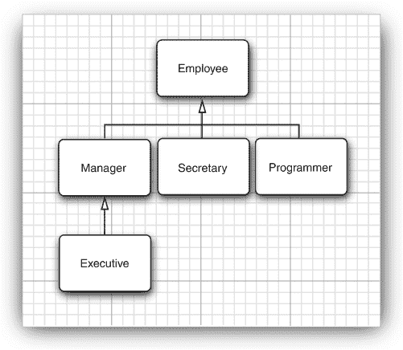

**图 5.1** 员工继承层次结构

***

 **C++ 注意：**

在 C++ 中，一个类可以有多个父类。Java 不支持多继承。关于恢复多继承的大部分功能的方法，请参见第 6.1 节 第 312 页的“接口”。

***

#### 5.1.5 多态

一个简单的规则可以帮助你判断继承是否是你数据的正确设计。“is–a”规则规定，子类的每个对象都是父类的对象。例如，每个经理都是员工。因此，让`Manager`类成为`Employee`类的子类是合理的。自然地，反之不然——并不是每个员工都是经理。

另一种表述“is–a”规则的方法是替换原则。该原则规定，当程序期望一个父类对象时，你可以使用子类对象。

例如，你可以将子类对象赋值给父类变量。

```
Employee e;

e = new Employee(. . .);  // 期望 Employee 对象

e = new Manager(. . .); // OK，也可以使用 Manager
```

在 Java 编程语言中，对象变量是多态的。类型为`Employee`的变量可以指向`Employee`类型的对象，也可以指向`Employee`类任何子类的对象（例如`Manager`、`Executive`、`Secretary`等）。

我们在 代码清单 5.1 中利用了这个原则：

```
Manager boss = new Manager(. . .);

Employee[] staff = new Employee[3];

staff[0] = boss;
```

在这种情况下，变量`staff[0]`和`boss`指向同一个对象。然而，编译器认为`staff[0]`仅仅是一个`Employee`对象。

这意味着你可以调用

```
boss.setBonus(5000); // OK
```

但你不能调用

```
staff[0].setBonus(5000); // ERROR
```

`staff[0]`的声明类型是`Employee`，而`setBonus`方法并不是`Employee`类的方法。

然而，你不能将父类引用赋值给子类变量。例如，执行下面的赋值是不允许的

```
Manager m = staff[i]; // ERROR
```

原因显而易见：并不是所有员工都是经理。如果这次赋值成功且`m`指向一个不是经理的`Employee`对象，那么将来就可以调用`m.setBonus(. . .)`并导致运行时错误。

***

 **注意：**

在 Java 中，子类引用数组可以转换为父类引用数组，而无需强制类型转换。例如，考虑这个经理数组：

```
Manager[] managers = new Manager[10];
```

将此数组转换为`Employee[]`数组是合法的：

```
Employee[] staff = managers; // OK
```

当然，你可能会想，为什么不呢。毕竟，如果`managers[i]`是一个`Manager`，它它也是一个`Employee`。但实际上，发生了一些令人惊讶的事情。请记住`managers`和`staff`指向同一个数组的引用。现在考虑语句

```
staff[0] = new Employee("Harry Hacker", . . .);
```

编译器会乐意地允许这次赋值。但`staff[0]`和`managers[0]`是同一个引用，所以看起来我们成功地将一个普通的员工偷带进了管理层。这将非常糟糕——调用`managers[0].setBonus(1000)`将尝试访问一个不存在的实例字段并损坏相邻的内存。

为了确保不会发生此类损坏，所有数组都会记住它们创建时的元素类型，并监控只有兼容的引用被存储在其中。例如，通过`new Manager[10]`创建的数组会记得它是一个经理数组。尝试存储`Employee`引用会导致`ArrayStoreException`。

***

### 5.1.6 理解方法调用

准确理解方法调用是如何应用到对象的是非常重要的。假设我们调用`x.f(args)`，且隐式参数`x`被声明为类`C`的对象。以下是发生的情况：

1. 编译器查看对象的声明类型和方法名。注意，可能存在多个同名方法`f`但参数类型不同的方法。例如，可能有一个方法`f(int)`和一个方法`f(String)`。编译器列出类`C`中所有名为`f`的方法，以及`C`的父类中所有可访问的名为`f`的方法。（父类的私有方法不可访问。）

现在编译器知道了所有可能的待调用候选方法。

2. 接下来，编译器确定方法调用中所提供参数的类型。如果在所有名为`f`的方法中，有一个方法的参数类型是最佳匹配且唯一匹配的，则选择该方法。这个过程被称为重载（overloading）。例如，在调用`f("Hello")`时，编译器选择了`f(String)`而不是`f(int)`。由于类型转换（例如从`int`到`double`、从`Manager`到`Employee`等），情况可能会变得复杂。如果编译器找不到参数类型匹配的方法，它会报告错误。

***

 **注意：**

记住，方法的名称和参数类型列表被称为方法的签名（signature）。例如，`f(int)`和`f(String)`是两个同名但签名不同的方法。如果你在子类中定义了一个与父类方法签名相同的方法，你就重写（override）了父类方法。

返回类型不是签名的一部分。然而，当你重写一个方法时，你需要保持返回类型兼容。子类可以将返回类型更改为原始类型的子类型。例如，假设`Employee`类有一个方法

```
public Employee getBuddy() { . . }
```

经理永远不会希望有一个低级员工作为搭档。为了反映这一事实，`Manager`子类可以重写该方法为

```
public Manager getBuddy() { . . . } // 更改返回类型
```

我们说这两个`getBuddy`方法具有协变（covariant）返回类型。

***

3. 如果方法是`private`、`static`、`final`或构造函数，那么编译器确切知道调用哪个方法（`final`修饰符将在下一节解释）。被称为静态绑定（static binding）。否则，待调用方法取决于隐式参数的实际类型，必须在运行时使用动态绑定。在我们的示例中，编译器将生成一条带有动态绑定的`f(String)`调用指令。

4. 当程序运行并使用动态绑定调用方法时，虚拟机必须调用适用于`x`所指向对象的实际类型的方法。假设实际类型是`D`，它是`C`的子类。如果类`D`定义了方法`f(String)`，则调用该方法。如果没有，则搜索`D`的父类中的`f(String)`，以此此类推。

每次调用方法时都执行这种搜索将耗时。相反，虚拟机为每个类预计算一个方法表（method table）。方法表列出了所有方法签名以及实际执行的方法。

虚拟机可以在加载类后，通过将从类文件中找到的方法与父类的方法表相结合来构建方法表。

当一个方法被实际调用时，虚拟机只需进行一次表查找。在我们的示例中，虚拟机会查询类`D`的方法表，并查找要调用的方法`f(String)`。该方法可能是`D.f(String)`或`X.f(String)`，其中`X`是`D`的某个父类。

这个场景有一个转折。如果调用是`super.f(param)`，那么虚拟机将查询父类的方法表。

让我们详细查看 Listing 5.1 中的调用`e.getSalary()`过程。变量`e`的声明类型是`Employee`。`Employee`类有一个方法，名为`getSalary`，且没有方法参数。因此，在这种情况下，我们不需要担心重载解析问题。

`getSalary`方法既不是`private`、不是`static`也不是`final`，所以它是动态绑定的。虚拟机为`Employee`和`Manager`类生成方法表。`Employee`表显示所有方法都定义在`Employee`类本身：

```
Employee:

    getName() -> Employee.getName()
    getSalary() -> Employee.getSalary()
    getHireDay() -> Employee.getHireDay()
    raiseSalary(double) -> Employee.raiseSalary(double)
```

实际上，这并不是全部——正如你在本章稍后将看到的，`Employee`类有一个父类`Object`，它从中继承了许多方法。目前我忽略`Object`的方法。

`Manager`方法表略有不同。它继承了三个方法，重写了一个方法，并增加了一个方法。

```
Manager:

    getName() -> Employee.getName()
    getSalary() -> Manager.getSalary()
    getHireDay() -> Employee.getHireDay()
    raiseSalary(double) -> Employee.raiseSalary(double)
    setBonus(double) -> Manager.setBonus(double)
```

在运行时，调用`e.getSalary()`的解析过程如下：

1. 首先，虚拟机获取`e`的实际类型的方法表。这可能是`Employee`、`Manager`或`Employee`的另一个子类的表。

2. 接着，虚拟机查找`getSalary()`签名的定义类。现在它知道要调用哪个方法了。

3. 最后，虚拟机调用该方法。

动态绑定有一个非常重要的属性：它使程序在无需修改现有代码的情况下具有可扩展性。假设添加了一个新类`Executive`，并且变量`e`可能指向该类的对象。包含调用`e.getSalary()`的代码不需要重新编译。如果`e`刚好指向一个类型为`Executive`的对象，则会自动调用`Executive.getSalary()`方法。

***

 **注意：**

当你重写一个方法时，子类方法的可见性至少要与父类方法相同。特别是，如果父类方法是`public`的，则子类方法也必须声明为`public`。无意中漏子类方法的`public`修饰符是一个常见错误。编译器会报错，提示你正尝试提供限制性更严格的访问权限。

***

#### 5.1.7 防止继承：final 类和方法

有时，你想要防止某人创建你某个类的子类。不能被扩展的类被称为最终类（final classes），你在类定义中使用`final`修饰符来指示这一点。例如，假设我们想防止其他人继承`Executive`类。只需使用`final`修饰符声明该类即可：

```java
public final class Executive extends Manager
{
    . . .
}
```

你也可以将类中的特定方法标记为`final`。如果你这样做，那么任何子类都不能重写该方法。（`final`类中的所有方法都自动是`final`的。）例如：

```java
public class Employee
{
    . . .
    public final String getName()
    {
        return name;
    }
    . . .
}
```

***

 **注意：**

记住，字段也可以被声明为`final`。在对象构造完成后，`final`字段不能更改。然而，如果一个类被声明为`final`，则只有方法会自动设为`final`，而不是字段。

***

将一个方法或类设为`final`只有一个正当理由：确保语义在子类中不会被改变。例如，`Calendar`类的`getTime`和`setTime`方法是`final`的。这表明`Calendar`类的设计者承担了`Date`类与日历状态之间转换的责任。不应允许任何类破坏这种安排。同样，`String`类是一个`final`类。这意味着没有人可以定义`String`的子类。换句话说，如果你有一个`String`引用，你就知道它指的是`String`。

某些程序员认为，除非你有想要多态的理由，否则应该将所有方法声明为`final`。在 Java 早期，一些程序员使用`final`关键字是希望避免动态绑定的开销。如果一个方法没有被重写且很短，编译器就可以优化掉调用——这个过程被称为内联（inlining）。例如，内联调用`getName()`会将其替换为字段访问`e.name`。CPU 讨厌分支，因为这会干扰它们在处理当前指令时预取指令的策略。然而，如果`getName`在其他类中可以重写，编译器就无法进行内联，因为它不知道重写代码会做什么。

幸运的是，即时编译器（jit compiler）比传统编译器做得更好。它确切知道哪些类扩展了给定类，并检查是否有类实际上重写了该方法。如果一个方法很短、被频繁调用且实际上没有被重写，jit 编译器就可以对其进行内联。如果虚拟机加载了另一个重写了方法的子类怎么办？优化器必须撤销内联。这需要时间，但很少发生。

***

 **注意：**

枚举（Enumerations）和记录（records）总是 final 的——你无法扩展它们。

***

#### 5.1.8 转换

回想第 3 章，强制从一种类型转换为另一种类型的过程称为转换（casting）。Java 编程语言对转换有特殊的表示法。例如：

```java
double x = 3.405;
int nx = (int) x;
```

这将表达式`x`的值转换为整数。

就像你有时需要将浮点转换为整数一样，你可能需要将对象引用从一个类转换为另一个类。让我们再次使用包含`Employee`和`Manager`对象的数组示例：


```java
var staff = new Employee[3];
staff[0] = new Manager("Carl Cracker", 80000, 1987, 12, 15);
staff[1] = new Employee("Harry Hacker", 50000, 1989, 10, 1);
staff[2] = new Employee("Tony Tester", 40000, 1990, 3, 15);
```

要实际对对象引用进行转换，使用与转换数值表达式相似的语法。将目标类名括在括号内，并放置在你想要转换的对象引用之前。例如：

```java
Manager boss = (Manager) staff[0];
```

你想要进行类型转换（cast）只有一个理由：在对象的实际类型被临时遗忘后，为了充分利用它的所有功能。例如，在 `ManagerTest` 类中，`staff` 数组必须是 `Employee` 对象的数组，因为它的某些元素是普通员工。我们需要将数组中的管理类元素转换回 `Manager` 类型，以便访问它的任何新变量。（注意，在第一节的示例代码中，我特意避免了转换。我在将 `boss` 变量存入数组之前，先用一个 `Manager` 对象对其进行了初始化。我需要正确的类型来设置经理的奖金。）

如你所知，在 Java 中，每个变量都有一个类型。类型描述了变量所引用的对象种类以及它能做什么。例如，`staff[i]` 指向一个 `Employee` 对象（因此它也可以指向一个 `Manager` 对象）。

编译器会检查你在将值存入变量时是否承诺得过高。如果你将子类引用赋值给父类变量，你承诺的较少，编译器会直接允许你这样做。如果你将父类引用赋值给子类变量，你承诺的更多。这时，你必须使用类型转换，以便你的承诺可以在运行时被检查。

如果你尝试向下继承链进行转换，并且对对象包含的内容“撒谎”，会发生什么？

```java
Manager boss = (Manager) staff[1]; // 错误
```

当程序运行时，Java 运行时系统会注意到这个违背的承诺并产生 `ClassCastException`。如果你不捕获该异常，程序就会终止。因此，在尝试转换之前确定转换是否成功是一项良好的编程习惯。只需使用 `instanceof` 操作符即可。例如：

```java
if (staff[i] instanceof Manager)
{
   boss = (Manager) staff[i];
   . . .
}
```

最后，如果转换没有可能，编译器将不允许你进行转换。例如，下面的转换：

```java
String c = (String) staff[i];
```

是一个编译错误，因为 `String` 不是 `Employee` 的子类。

总结一下：

*   你只能在继承体系结构内进行转换。
*   在从父类向子类进行转换之前，使用 `instanceof` 进行检查。

***

 **注意：**

测试

```java
x instanceof C
```

如果 `x` 为 `null`，不会产生异常。它只是返回 `false`。这是合理的：`null` 指向任何对象，所以它显然没有指向类型为 `C` 的对象。

***

实际上，通过转换转换对象的类型通常不是好主意。在我们的示例中，对于大多数用途，你不需要将 `Employee` 对象转换为 `Manager` 对象。`getSalary` 方法在这两个类的两个对象上都能正常工作。使多态生效的动态绑定会自动定位正确的方法。

进行转换的唯一理由是使用经理特有的方法，例如 `setBonus`。如果由于某种原因，你发现自己想在 `Employee` 对象上调用 `setBonus`，请问自己这是否表明父类存在设计缺陷。重新设计父类并添加一个 `setBonus` 方法可能有意义的。记住，只需要一个未被捕获的 `ClassCastException` 就会终止你的程序。通常情况下，最好减少类型转换和 `instanceof` 操作符的使用。

***

 **C++ 注意：**

Java 使用了 C 语言“过去旧时代”的转换语法，但它的作用类似于 C++ 中安全的 `dynamic_cast` 操作。例如，

```java
Manager boss = (Manager) staff[i]; // Java
```

等同于

```cpp
Manager* boss = dynamic_cast<Manager*>(staff[i]); // C++
```

但有一个重要的区别。如果转换失败，它不会产生一个空对象，而是抛出一个异常。从意义上说，它类似于 C++ 中引用的转换。这非常头疼。在 C++ 中，你可以一次性完成类型测试和类型转换。

```cpp
Manager* boss = dynamic_cast<Manager*>(staff[i]); // C++

if (boss != NULL) . . .
```

在 Java 中，你需要结合使用 `instanceof` 操作符和类型转换。

```java
if (staff[i] instanceof Manager)
{
   Manager boss = (Manager) staff[i];
   . . .
}
```

***

#### 5.1.9 `instanceof` 的模式匹配

代码

```java
if (staff[i] instanceof Manager)
{
   Manager boss = (Manager) staff[i];
   boss.setBonus(5000);
}
```

相当冗长。我们真的需要提到子类 `Manager` 三次吗？

从 Java 16 开始，有一种更简单的方法。你可以直接在 `instanceof` 测试中声明子类变量：

```java
if (staff[i] instanceof Manager boss)
{
   boss.setBonus(5000);
}
```

如果 `staff[i]` 是 `Manager` 类的实例，那么变量 `boss` 将被赋值为 `staff[i]`，你就可以使用它。

***

 **提示：**

在大多数使用 `instanceof` 的情况下，你都需要应用一次类型转换。

***

 **注意：**

这种声明变量的 `instanceof` 形式被称为“模式匹配”，因为它类似于 `switch` 中的类型模式，这是 Java 17 的一个“预览”功能。我不会详细讨论预览功能，但这里有一个语法示例：

```java
String description = switch (e) {
   case exec -> "头衔为 " + exec.getTitle() + " 的执行管";
   case Manager m -> "奖金为 " + m.getBonus() + " 的经理";
   default -> "薪水为 " + e.getSalary() + " 的普通员工";
}
```

与 `instanceof` 模式一样，每个类型模式都声明了一个变量。

***

 **注意：**

与任何局部变量一样，由 `instanceof` 模式定义的局部变量可能会遮蔽字段。例如：

```java
class Value
{
   private double v;
   public boolean equals(Value other)
   {
      if (other instanceof LabeledValue v)
         // v 等于 other
      else
         // v 表示字段
   }
   . . .
}
```

#### 5.1.10 保护访问

如你所知，类中的字段最好标记为 `private`，而方法通常标记为 `public`。任何声明为 `private` 的特性在其他类中都是不可访问的。在本章开头解释过的，对于子类也是如此：子类无法访问其父类的私有字段。

然而，有时你只想将方法限制为子类可用，或者较少的情况下，允许子类方法访问父类字段。在这种情况下，你将类特征声明为 `protected`。例如，如果父类 `Employee` 将 `hireDay` 字段声明为 `protected` 而不是 `private`，那么 `Manager` 的方法就可以直接访问它。

在 Java 中，`protected` 字段可以被相同包中的任何类访问。现在考虑位于不同包中的 `Administrator` 子类。`Administrator` 类的方法只能查看 `Administrator` 对象的 `hireDay` 字段，而不能查看其他 `Employee` 对象的该字段。这种限制是为了防止你通过创建子类来获取受保护字段访问权限，从而滥用 `protected` 机制。

在实践中，请谨慎使用 `protected` 字段。假设你的类被其他程序员使用，而你在设计时定义了 `protected` 字段。在你不知情的情况下，其他程序员可能会继承你的类并开始访问你的 `protected` 字段。在这种情况下，你将无法在不扰动那些程序员的情况下更改你类的实现。这违背了鼓励数据封装的面向对象编程（OOP）精神。

`protected` 方法则更有意义。如果一个方法使用起来很复杂，类可以将其声明为 `protected`。这表示子类（推测它们很熟悉自己的祖先）可以被信任正确地使用该方法，而其他类则不能。

这种方法的一个很好的例子是 `Object` 类的 `clone` 方法——更多细节请参见第 6 章。

***

 **C++ 注意:**

如前所述，Java 中的 `protected` 特性对所有子类以及相同包中的所有其他类可见。这与 C++ 中 `protected` 的含义略有不同，使得 Java 中 `protected` 的概念比 C++ 中更不安全。

***

以下是 Java 中四种访问控制修饰符的总结：

1. 仅类内可见（`private`）。
2. 全局可见（`public`）。
3. 包内及所有子类可见（`protected`）。
4. 包内可见——这是（不幸的）默认值。不需要修饰符。

## 5.2 `Object`: 宇宙父类

`Object` 类是终极祖先——Java 中的每个类都继承 `Object`。然而，你永远不需要编写：

```java
public class Employee extends Object
```

如果没有显式提到父类，终极父类 `Object` 是被所当然的。由于 Java 中的每个类都继承 `Object`，因此熟悉 `Object` 类提供的服务非常重要。我将在本章介绍基础方法；对于未涵盖的内容，请参阅后面的章节或查看在线文档。（`Object` 的某些方法仅在处理并发时才会出现——参见第 12 章）。

#### 5.2.1 `Object` 类型的变量

你可以使用 `Object` 类型的变量来引用任何类型的对象：

```java
Object obj = new Employee("Harry Hacker", 35000);
```

当然，`Object` 类型的变量只有作为任意值的通用容器时才有用。要对该值进行任何特定操作，你需要对原始类型有一定的了解并应用类型转换：

```java
Employee e = (Employee) obj;
```

在 Java 中，只有基本数据类型的值（数字、字符和 `boolean` 值）不是对象。

所有数组类型，无论是对象数组还是基本数据类型数组，都是继承 `Object` 类的类类型。

```java
Employee[] staff = new Employee[10];
obj = staff; // OK
obj = new int[10]; // OK
```

***

 **C++ 注意:**

在 C++ 中，没有宇宙根类。然而，每个指针都可以转换为 `void*` 指针。

***

#### 5.2.2 `equals` 方法

`Object` 类中的 `equals` 方法测试一个对象是否被与另一个对象相等。`Object` 类实现的 `equals` 方法判断两个对象引用是否相同。这是一个非常合理的默认值——如果两个对象是相同的，它们当然是相等的。对于许多类来说，不需要其他操作。例如，比较两个 `PrintStream` 对象的相等性毫无意义。然而，你通常想要实现基于状态的相等性测试，即当两个对象具有相同状态时认为认为是相等的。

例如，假设两个员工具有相同的姓名、工资和入职日期，则认为他们是等的。（在实际的员工数据库中，比较 ID 会更合理。我使用这个例子来演示实现 `equals` 方法的机制。）

```java
public class Employee
{
  . . .

  public boolean equals(Object otherObject)
  {
    // 快速测试对象是否相同
    if (this == otherObject) return true;
    // 如果显式参数为 null，必须返回 false
    if (otherObject == null) return false;
    // 如果类不匹配
    if (getClass() != otherObject.getClass()) return false;
    // 现在我们知道 otherObject 是一个 Employee
    Employee other = (Employee) otherObject;
    // 测试字段是否相同
    return name.equals(other.name)
      && salary == other.salary
      && hireDay.equals(other.hireDay);
  }
}
```

`getClass` 方法返回对象的类——我们将在本章稍后讨论该方法。在测试中，两个对象只有属于相同的类时才相等。

***

 **提示:**

为了防止 `name` 或 `hireDay` 为 `null` 的情况，请使用 `Objects.equals` 方法。`Objects.equals(a, b)` 在两个参数都为 `null` 时返回 `true`，当只有一个为 `null` 时返回 `false`，否则调用 `a.equals(b)`。有了该方法，`Employee.equals` 方法变为：

```java
return Objects.equals(name, other.name)
  && salary == other.salary
  && hireDay.equals(hireDay);
```

***

当你为子类定义 `equals` 方法时，首先调用父类的 `equals`。如果该测试未通过，则对象不等。如果父类字段相等，就可以比较子类的实例字段。

```java
public class Manager extends Employee
{
  . . .

  public boolean equals(Object otherObject)
  {
    if (!super.equals(otherObject)) return false;
    // 现在我们知道 otherObject 是一个 Manager
    Manager other = (Manager) otherObject;
    return bonus == other.bonus;
  }
}
```

***

 **注意:**

回顾第 4 章，记录（record）是一种特殊形式的不可变类，其状态完全由“规范”构造函数中设置的字段定义。记录自动定义 `equals` 方法来比较字段。当相应的字段值相等时，两个记录实例相等。

***

### 5.2.3 相等测试与继承

如果隐式和显式参数不属于同一个类，`equals` 方法应该如何表现？这一直直是一个争议领域。在先前的示例中，`equals` 方法在类不完全匹配时返回 `false`。但许多程序员使用 `instanceof` 测试：

```java
if (!(otherObject instanceof Employee)) return false;
```

这留下了 `otherObject` 可能属于子类的可能性。然而，这种方法可能会给你带来麻烦。原因如下：Java 语言规范要求 `equals` 方法具有以下属性：

1. 它是自反的：对于非空引用 `x`，`x.equals(x)` 应返回 `true`。
2. 它是对称的：对于任何引用 `x` 和 `y`，当且仅当 `y.equals(x)` 返回 `true` 时，`x.equals(y)` 也返回 `true`。
3. 它是*传递的*：对于任何引用 `x`、`y` 和 `z`，如果 `x.equals(y)` 返回 `true` 且 `y.equals(z)` 返回 `true`，那么 `x.equals(z)` 应该返回 `true`。
4. 它是*一致的*：如果 `x` 和 `y` 所引用的对象没有变化，那么重复调用 `x.equals(y)` 将返回相同的值。
5. 对于任何非空引用 `x`，`x.equals(null)` 应该返回 `false`。

这些规则显然是合理的。你不希望库的实现者在数据结构中查找元素时，还要纠结是调用 `x.equals(y)` 还是 `y.equals(x)`。

然而，当参数属于不同的类时，对称性规则会导致微妙的后果。考虑以下调用：

```java
e.equals(m)
```

其中 `e` 是一个 `Employee` 对象，`m` 是一个 `Manager` 对象，两者恰好具有相同的姓名、薪水和入职日期。如果 `Employee.equals` 使用 `instanceof` 测试，则调用返回 `true`。但这意味着反向调用

```java
m.equals(e)
```


也需要返回 `true`——对称性规则不允许它返回 `false` 或抛出异常。

这让 `Manager` 类陷入了困境。它的 `equals` 方法必须愿意与任何 `Employee` 进行比较，而不必考虑经理类特有的信息！突然之间，`instanceof` 测试看起来没那么吸引人了。

一些作者在记录中指出，`getClass` 测试是错误的，因为它违反了可替换原则。一个被经常引用的例子是 `AbstractSet` 类中的 `equals` 方法，它用于测试两个集合是否具有相同的元素。`AbstractSet` 类有两个具体的子类 `TreeSet` 和 `HashSet`，它们使用不同的算法来定位集合元素。你确实希望能够比较任何两个集合，无论它们是如何实现的。

然而，集合的例子相当特殊。将 `AbstractSet.equals` 声明为 `final` 是有意义的，因为不应该允许任何人重新定义集合等等的语义。（该方法实际上并不是 `final`。这允许子类为等性测试实现更高效的算法。）

在我看来，存在两种不同的场景：

- 如果子类可以有自己的等性概念，那么对称性要求迫使你使用 `getClass` 测试。
- 如果等性概念在父类中是固定的，你就可以使用 `instanceof` 测试，并允许不同子类的对象相互相等。

在员工和经理的示例中，当两个对象具有匹配的字段时，我们认为它们是等的。如果我们有两个 `Manager` 对象具有相同的姓名、薪水和入职日期，但奖金不同，我们希望它们是不同的。因此，我们使用 `getClass` 测试。

但假设我们使用员工 ID 进行等性测试。这种等性概念对于所有子类都是成立的。那么我们可以使用 `instanceof` 测试，并且应该将 `Employee.equals` 声明为 `final`。

***

 **注意：**

标准 Java 库包含了 150 多个 `equals` 方法的实现，这些实现杂乱混合了使用 `instanceof`、调用 `getClass`、捕获 `ClassCastException` 或者什么都不做。查看 `java.sql.Timestamp` 类的 API 文档，实现者在其中很尴尬地注释说他们让自己陷入了困境。`Timestamp` 类继承自 `java.util.Date`，后者的 `equals` 方法使用了 `instanceof` 测试，而无法重写 `equals` 使既是对称又是准确的。

***

这里是编写完美的 `equals` 方法的配方：

1. 将显式参数命名为 `otherObject`——稍后，你将其转换为另一个名为 `other` 的变量。
2. 测试 `this` 是否恰好与 `otherObject` 相同：

   ```java
   if (this == otherObject) return true;
   ```

   这条语句仅仅是一种优化。在实践中，这是一种常见情况。检查身份比比较字段要便宜得多。

3. 测试 `otherObject` 是否为 `null`，如果是则返回 `false`。这个测试是必须的。

   ```java
   if (otherObject == null) return false;
   ```

4. 比较 `this` 和 `otherObject` 的类。如果 `equals` 的语义可以在子类中改变，请使用 `getClass` 测试：

   ```java
   if (getClass() != otherObject.getClass()) return false;

   ClassName other = (ClassName) otherObject;
   ```

   如果相同的语义适用于所有子类，则你可以使用 `instanceof` 测试：

   ```java
   if (!(otherObject instanceof ClassName other)) return false;
   ```

   注意，如果 `instanceof` 测试成功，它会将 `other` 设置为 `otherObject`。不需要强制转换。

5. 现在根据你的等性概念来比较字段。对于基本类型字段使用 `==`，对于对象字段使用 `Objects.equals`。如果所有字段都匹配，则返回 `true`，否则返回 `false`。

   ```java
   return field1 == other.field1
      && Objects.equals(field2, other.field2)
      && . . .;
   ```

   如果你在子类中重定义 `equals`，请包含对 `super.equals(other)` 的调用。

***

 **提示：**

如果你有数组类型的字段，可以使用 `Arrays.equals` 来检查相应的元素是否相等。对于多维数组使用 `Arrays.deepEquals`。

***

 **注意：**

这是实现 `equals` 方法时的一个常见错误。你能发现问题吗？

```java
public class Employee
{
    public boolean equals(Object other)
    {
        if (this == other) return true;
        if (other == null) return false;
        if (getClass() != other.getClass()) return false;
        Employee other = (Employee) other;
        return name.equals(other.name)
           && salary == other.salary
           && hireDate.equals(other.hireDate)
           && . . .;
    }
}
```

你可以通过对旨在重写的方法标记 `@Override` 来防止此类错误：

```java
@Override
public boolean equals(Object other)
```

会报告错误，因为该方法没有重写 `Object` 类的任何方法。例如，假设你在 `Employee` 类中添加了以下内容：

```java
@Override
public boolean equals(Employee other)
```

## 5.2.4 `hashCode` 方法

哈希值是一个自对象的整数。哈希值应该是随机的——如果 `x` 和 `y` 是不同的对象，那么 `x.hashCode()` 和 `y.hashCode()` 不同的概率很大。表 5.1 列出了 `String` 类 `hashCode` 方法产生的一些哈希值示例。

`String` 类使用以下算法计算哈希值：

```java
int hash = 0;
for (int i = 0; i < length(); i++)
    hash = 31 * hash + charAt(i);
```

**表 5.1** `hashCode` 方法产生的哈希值

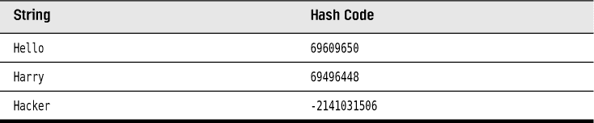

```java
var s = "Ok";
var sb = new StringBuilder(s);
System.out.println(s.hashCode() + " " + sb.hashCode());

var t = new String("Ok");
var tb = new StringBuilder(t);
System.out.println(t.hashCode() + " " + tb.hashCode());
```

表 5.2 显示了结果。

### 表 5.2 字符串和 `StringBuilder` 的哈希码

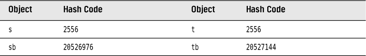

注意，字符串 `s` 和 `t` 相同的哈希码，因为对于字符串来说，哈希码是从它们的 `contents` 派生的。`StringBuilder` `sb` 和 `tb` 具有不同的哈希码，因为 `StringBuilder` 类没有定义 `hashCode` 方法，而 `Object` 类中的默认 `hashCode` 方法是从对象的内存地址派生哈希值的。

如果你重新定义了 `equals` 方法，那么你还需要为用户可能插入到哈希表的对象重新定义 `hashCode` 方法。（我会在第 9 章中讨论哈希表。）

`hashCode` 方法应该返回一个整数（可以是负数）。只需组合实例字段的哈希值，使得不同对象的哈希值可能广泛散开。

例如，这里是 `Employee` 类的 `hashCode` 方法：

```java
public class Employee
{
  public int hashCode()
  {
    return 7 * name.hashCode()
          + 11 * Double.valueOf(salary).hashCode()
          + 13 * hireDay.hashCode();
  }
  . . .
}
```

然而，你可以做得更好。首先，使用空安全的方法 `Objects.hashCode`。如果参数为 `null`，它返回 `0`，否则返回对参数调用 `hashCode` 的结果。此外，使用静态的 `Double.hashCode` 方法来避免创建 `Double` 对象：

```java
public int hashCode()
{
  return 7 * Objects.hashCode(name)
      + 11 * Double.hashCode(salary)
      + 13 * Objects.hashCode(hireDay);
}
```

更好的是，当你需要组合多个哈希值时，调用 `Objects.hash` 并传入所有参数。它会为每个参数调用 `Objects.hashCode` 并组合这些值。那么 `Employee.hashCode` 方法简单来说：

```java
public int hashCode()
{
  return Objects.hash(name, salary, hireDay);
}
```

你对 `equals` 和 `hashCode` 的定义必须保持兼容：如果 `x.equals(y)` 为 `true`，那么 `x.hashCode()` 必须返回与 `y.hashCode()` 相同的值。例如，如果你定义 `Employee.equals` 来比较员工 ID，那么 `hashCode` 方法就需要对 ID 进行哈希，而不是员工姓名或内存地址。

***

 **提示：**

如果你有数组类型的字段，可以使用静态的 `Arrays.hashCode` 方法计算一个由数组元素哈希码组成的哈希码。

***

 **注意：**

`record` 类型自动提供一个 `hashCode` 方法，该方法从字段值的哈希码派生哈希码。

***

 **警告：**

如果实例变量的取值范围很小，你需要尽可能获得许多不同的哈希码。考虑日期的哈希。计算 `7 * year + 11 * month + 13 * day` 会产生很多冲突。相比之下，`31 * 12 * year + 31 * month + day` 是一个“完美哈希函数”。假设一个合理的年份范围，没有两个日期具有相同的哈希码。（`LocalDate` 类支持 ±999,999,999 年的实际 `hashCode` 方法要复杂得多。）

### `java.lang.Object` 1.0

- `int hashCode()` 返回对象的哈希码。哈希码可以是任意整数，正或负。相同的对象需要返回相同的哈希码。

### `java.util.Objects` 7

- `static int hash(Object... objects)` 返回由所有提供的对象的哈希码组合成的哈希码。
- `static int hashCode(Object a)` 如果 `a` 为 `null` 则返回 `0`，否则返回对 `a` 调用 `hashCode()` 的结果。

### `java.lang.(Integer|Long|Short|Byte|Double|Float|Character|Boolean)` 1.0

- `static int hashCode(xxx value)` 返回给定值的哈希码。这里 `xxx` 是对应于给定包装类型的原始类型。

### `java.util.Arrays` 1.2

- `static int hashCode(xxx[] a)` 计算数组 `a` 的哈希码。数组的组件类型 `xxx` 可以是 `Object`、`int`、`long`、`short`、`char`、`byte`、`boolean`、`float` 或 `double`。

## `toString` 方法

`Object` 中的另一个重要方法是 `toString` 方法。它返回对象的字符串表示。大多数（但不是所有）`toString` 方法都遵循这种格式：类名，然后是括号内的值。这是一个典型的例子。`Point` 类的 `toString` 方法返回如下：

```text
java.awt.Point[10,20]
```

`toString` 方法无处不在的原因：当对象通过“+”运算符与字符串拼接时，Java 编译器会自动调用 `toString` 方法。例如：

```java
var p = new Point(10, 20);
String message = "The position is " + p; // 自动调用 p.toString()
```

`toString` 方法很重要。如果你重新定义了 `equals` 方法，那么你还需要为用户可能插入到哈希表的对象重新定义 `hashCode` 方法。

如第 7 章所示，一个更好的解决方案是使用 `Logger` 类的对象并调用：

```java
Logger.global.info("Current position = " + position);
```

***

 **提示：**

我强烈建议你为你编写的每个类添加一个 `toString` 方法。你以及使用你类的其他程序员都会对这种日志支持感激不尽的。

然而，对于 `record` 类型，已经提供了 `toString` 方法。它简单地列出类名以及字段的名称和字符串化后的值。

列表 5.4 中的程序测试了 `Employee`（列表 5.5）和 `Manager`（列表 5.6）类的 `equals`、`hashCode` 和 `toString` 方法。

**列表 5.4** `equals/EqualsTest.java`


```java
package equals;

/**
 * 此程序演示了 equals 方法。
 * @version 1.12 2012-01-26
 * @author Cay Horstmann
 */
public class EqualsTest {
    public static void main(String[] args) {
        var alice1 = new Employee("Alice Adams", 75000, 1987, 12, 15);
        var alice2 = alice1;
        var alice3 = new Employee("Alice Adams", 75000, 1987, 12, 15);
        var bob = new Employee("Bob Brandson", 50000, 1989, 10, 1);

        System.out.println("alice1 == alice2: " + (alice1 == alice2));

        System.out.println("alice1 == alice3: " + (alice1 == alice3));

        System.out.println("alice1.equals(alice3): " + alice1.equals(alice3));

        System.out.println("alice1.equals(bob): " + alice1.equals(bob));

        System.out.println("bob.toString(): " + bob);

        var carl = new Manager("Carl Cracker", 80000, 1987, 12, 15);
        var boss = new Manager("Carl Cracker", 80000, 1987, 12, 15);
        boss.setBonus(5000);
        System.out.println("boss.toString(): " + boss);
        System.out.println("carl.equals(boss): " + carl.equals(boss));
        System.out.println("alice1.hashCode(): " + alice1.hashCode());
        System.out.println("alice3.hashCode(): " + alice3.hashCode());
        System.out.println("bob.hashCode(): " + bob.hashCode());
        System.out.println("carl.hashCode(): " + carl.hashCode());
    }
}
```

**列表 5.5** `equals/Employee.java`

```java
package equals;

import java.time.*;
import java.util.Objects;

public class Employee {
    private String name;
    private double salary;
    private LocalDate hireDay;

    public Employee(String name, double salary, int year, int month, int day) {
        this.name = name;
        this.salary = salary;
        hireDay = LocalDate.of(year, month, day);
    }

    public String getName() {
        return name;
    }

    public double getSalary() {
        return salary;
    }

    public LocalDate getHireDay() {
        return hireDay;
    }

    public void raiseSalary(double byPercent) {
        double raise = salary * byPercent / 100;
        salary += raise;
    }

    public boolean equals(Object otherObject) {
        // 快速测试对象是否相同
        if (this == otherObject) return true;

        // 如果参数为 null，则返回 false
        if (otherObject == null) return false;

        // 如果类不匹配，则它们不相等
        if (getClass() != otherObject.getClass()) return false;

        // 我们知道 otherObject 是非空的 Employee
        var other = (Employee) otherObject;

        // 测试字段值是否相等
        return Objects.equals(name, other.name)
            && salary == other.salary && Objects.equals(hireDay, other.hireDay);
    }

    public int hashCode() {
        return Objects.hash(name, salary, hireDay);
    }

    public String toString() {
        return getClass().getName() + "[name=" + name + ",salary=" + salary + ",hireDay="
            + hireDay + "]";
    }
}
```

**列表 5.6** `equals/Manager.java`

```java
package equals;

public class Manager extends Employee {
    private double bonus;

    public Manager(String name, double salary, int year, int month, int day) {
        super(name, salary, year, month, day);
        bonus = 0;
    }

    public double getSalary() {
        double baseSalary = super.getSalary();
        return baseSalary + bonus;
    }

    public void setBonus(double bonus) {
        this.bonus = bonus;
    }

    public boolean equals(Object otherObject) {
        // 快速测试对象是否相同
        if (this == otherObject) return true;

        // 如果参数为 null，则返回 false
        if (otherObject == null) return false;

        // 如果类不匹配，则它们不相等
        if (getClass() != otherObject.getClass()) return false;

        // 我们知道 otherObject 是非空的 Employee
        var other = (Employee) otherObject;

        // 测试字段值是否相等
        return Objects.equals(name, other.name)
            && salary == other.salary && Objects.equals(hireDay, other.hireDay);
    }

    public int hashCode() {
        return Objects.hash(name, salary, hireDay);
    }

    public String toString() {
        return getClass().getName() + "[name=" + name + ",salary=" + salary + ",hireDay="
            + hireDay + "]";
    }
}
```

这种语法被称为“菱形”语法，因为空括号 `<>` 类似于菱形。将菱形语法与 `new` 运算符结合使用。编译器会检查新值发生了什么情况。如果它被赋值给变量、传递给方法或从方法返回，编译器就会检查该变量、参数或方法的泛型类型。然后它会将该类型放入 `<>` 中。在我们的示例中，`new ArrayList<>()` 被赋值给类型为 `ArrayList<Employee>` 的变量。因此，泛型类型是 `Employee`。

***

 **警告：**

如果你使用 `var` 声明 `ArrayList`，请*不要*使用菱形语法。以下声明：

```java
var elements = new ArrayList<>();
```

会产生一个 `ArrayList<Object>`。

***

 **注意：**

在 Java 5 之前，没有泛型类。相反，只有一个 `ArrayList` 类，它是一个通用的集合，用于持有 `Object` 元素。你仍然可以在不带 `<. . .>` 后缀的情况下使用 `ArrayList`。它被视为“原始”（raw）类型，类型参数被擦除了。

***

 **注意：**

在更早的 Java 版本中，程序员使用 `Vector` 类来实现动态数组。然而，`ArrayList` 类更高效，已经没有使用 `Vector` 类的充分理由了。

***

使用 `add` 方法向数组列表添加新元素。例如，这里是向数组列表填充 `Employee` 对象的方法：

```java
staff.add(new Employee("Harry Hacker", . . .));

staff.add(new Employee("Tony Tester", . . .));
```

该数组列表管理一个内部的对象引用数组。最终，该数组将会耗尽空间。这就是数组列表发挥魔法的地方：如果你调用 `add` 且内部数组已满，数组列表会自动创建一个更大的数组，并将所有对象从较小的数组复制到较大的数组中。

如果你已经知道或有把握地估计想要存储多少个元素，可以在填充数组列表之前调用 `ensureCapacity` 方法：

```java
staff.ensureCapacity(100);
```

该调用分配了一个包含 100 个对象的内部数组。然后，前 100 次 `add` 调用将不会涉及任何昂贵的重新分配。

你也可以向 `ArrayList` 构造函数传递一个初始容量：

```java
ArrayList<Employee> staff = new ArrayList<>(100);
```

***

 **警告：**

按如下分配数组列表：

```java
new ArrayList<>(100) // 容量为 100
```

*并不等于*如下分配一个新数组：

```java
new Employee[100] // 大小为 100
```

数组列表的容量与数组的大小之间存在重要区别。如果你分配了一个具有 100 个条目的数组，那么该数组就有 100 个槽位可供使用。一个容量为 100 个元素的数组列表具有持有 100 个元素的*潜力*（事实上，可以超过 100 个，代价是额外的重新分配）——但在刚开始时，即使在初始构造之后，数组列表也完全没有任何元素。

***

`size` 方法返回数组列表中元素的实际数量。例如，

```java
staff.size()
```

返回 `staff` 数组列表当前的元素数量。这对于数组 `a` 来说等同于

```java
a.length
```

一旦你相当确定数组列表达到了其固定大小，就可以调用 `trimToSize` 方法。该方法调整内存块的大小，使其恰好使用持有当前元素数量所需的存储空间。垃圾回收器将回收任何多余内存。

一旦修剪了数组列表的大小，添加新元素将再次移动该块，这需要时间。只有当你确定不会再向数组列表添加更多元素时，才应该使用 `trimToSize`。

***

 **C++ 注意：**

`ArrayList` 类类似于 C++ 的 `vector` 模板。`ArrayList` 和 `vector` 都是泛型类型。但 C++ 的 `vector` 模板重载了 `[]` 运算符以便方便访问元素。Java 没有运算符重载，因此必须使用显式方法调用。此外，C++ vector 是按值复制的。如果 `a` 和 `b` 是两个 vector，那么赋值 `a = b` 会使 `a` 变成一个与 `b` 长度相同的新 vector，所有元素都从 `b` 复制到 `a`。在 Java 中，相同的赋值会让 `a` 和 `b` 都引用同一个数组列表。

***

**`java.util.ArrayList<E>`** **1.2**

- `ArrayList<E>()` 构建一个空的数组列表。
- `ArrayList<E>(int initialCapacity)` 构建一个具有指定容量的空数组列表。
- `boolean add(E obj)` 将 `obj` 附加到数组列表末尾。始终返回 `true`。（当然，这永远不会数组列表的容量。）
- `int size()` 返回当前存储在数组列表中的元素数量。
- `void ensureCapacity(int initialCapacity)` 确保数组列表具有指定的容量。
- `void trimToSize()` 将数组列表的大小缩小到其当前大小。

#### 5.3.2 访问数组列表

遗憾的是，天下没有免费的事。Java 不提供访问元素的 `[]` 语法。相反，你必须使用 `get` 和 `set` 方法。要获取数组列表元素，使用：

```java
Employee e = staff.get(i);
```

这对于数组 `a` 来说等同于：

```java
Employee e = a[i];
```

（索引从 0 开始。）

***

 **警告：**

如果你使用 `var` 声明 `ArrayList`，请*不要*使用菱形语法。以下声明：

```java
var elements = new ArrayList<>();
```

会产生一个 `ArrayList<Object>`。

有时，你需要在数组列表的中间添加元素。使用带有索引参数的 `add` 方法：

```java
int n = staff.size() / 2;

staff.add(n, e);
```

位置 `n` 及以上的元素将向上移动以为新条目留位置。如果插入后数组列表的新大小超过了容量，数组列表将重新分配其存储数组。

同样，你可以从数组列表的中间删除元素：

```java
Employee e = staff.remove(n);
```

位于上面的元素将向下复制，数组的大小减一。

***

 **注意：**

在没有泛型类时，原始 `ArrayList` 的 `get` 方法只能返回 `Object`。因此，`get` 的调用者必须将返回的值强制转换为所需的类型：

```java
Employee e = (Employee) staff.get(i);
```

原始 `ArrayList` 也有点危险。它的 `add` 和 `set` 方法接受任何类型的对象。一个调用：

```java
staff.set(i, "Harry Hacker");
```

编译时没有任何警告，你只有在检索对象并尝试强制转换它时才会遇到麻烦。如果你改用 `ArrayList<Employee>`，编译器将检测到此错误。

***

有时你可以通过以下技巧兼得两者之好——灵活的增长和方便的元素访问。首先，创建一个数组列表并添加所有元素：

```java
var list = new ArrayList<X>();

while (. . .) {
    x = . . .;
    list.add(x);
}
```

完成后，使用 `toArray` 方法将元素复制到数组中：


```java
var a = new X[list.size()];

list.toArray(a);
```

插入和删除元素的效率并不高。对于小型数组列表（array list），这可能不值得担心。但如果你存储了许多元素并频繁在集合中间插入和删除，请考虑使用链表。我在第 9 章中解释了如何使用链表进行编程。

你可以使用“for each”循环来遍历数组列表的内容：

```java
for (Employee e : staff)
    do something with e
```

这个循环的效果与相同相同：

```java
for (int i = 0; i < staff.size(); i++)
{
    Employee e = staff.get(i);
    do something with e
}
```

Listing 5.7 是对第 4 章中 `EmployeeTest` 程序的修改。`Employee[]` 数组被替换为 `ArrayList<Employee>`。请注意以下变化：

- 你不需要指定数组的大小。
- 你使用 `add` 来添加任意数量的元素。
- 你使用 `size()` 而不是 `length` 来计算元素数量。
- 你使用 `a.get(i)` 而不是 `a[i]` 来访问元素。

**Listing 5.7** `arrayList/ArrayListTest.java`

```java
 1   package arrayList;
 2
 3   import java.util.*;
 4
 5   /**
 6   * 此程序演示了 ArrayList 类。
 7   * @version 1.11 2012-01-26
 8   * @author Cay Horstmann
 9   */
10  public class ArrayListTest
11  {
12      public static void main(String[] args)
13      {
14          // 用三个 Employee 对象填充 staff 数组列表
15          var staff = new ArrayList<Employee>();
16
17          staff.add(new Employee("Carl Cracker", 75000, 1987, 12, 15));
18          staff.add(new Employee("Harry Hacker", 50000, 1989, 10, 1));
19          staff.add(new Employee("Tony Tester", 40000, 1990, 3, 15));
20
21          // 将每个人的薪水提高 5%
22          for (Employee e : staff)
23              e.raiseSalary(5);
24
25          // 打印所有 Employee 对象的信息
26          for (Employee e : staff)
27              System.out.println("name=" + e.getName() + ",salary=" + e.getSalary() + ",hireDay="
28                  + e.getHireDay());
29      }
30  }
```

## `java.util.ArrayList<E>` 1.2

- `E set(int index, E obj)` 将值 `obj` 放入数组列表指定的索引处，并返回之前的内容。
- `E get(int index)` 获取存储在指定索引的值。
- `void add(int index, E obj)` 向上移动元素以在指定的索引处插入 `obj`。
- `E remove(int index)` 删除指定索引处的元素并向下移动其之上的所有元素。返回被删除的元素。

### 5.3.3 类型化与原始数组列表之间的兼容性

在在你自己的代码中，你总是希望使用类型参数来增加安全性。在本节中，你将看到如何与不使用类型参数的旧代码交互。

假设你有以下遗留类：

```java
public class EmployeeDB
{
  public void update(ArrayList list) { . . . }
  public ArrayList find(String query) { . . . }
}
```

你可以将类型化的数组列表传递给 `update` 方法而无需任何转换。

```java
ArrayList<Employee> staff = . . .;
employeeDB.update(staff);
```

`staff` 对象被直接传递给 `update` 方法。

 **注意：** 尽管你没有收到编译错误或警告，但此调用并不是完全安全的。`update` 方法可能会向数组列表中添加不是 `Employee` 类型的元素。当检索这些元素时，会发生异常。这听起来很可怕，但如果你仔细考虑，这种行为仅仅与 Java 引入泛型之前的行为完全一样。虚拟机的完整性从未受到威胁。在这种情况下，你没有失去安全性，但也无法从编译时检查中获益。

相反，当你将原始 `ArrayList` 赋值给类型化的列表时，你会得到一个警告。

```java
ArrayList<Employee> result = employeeDB.find(query);//产生警告
```

 **注意：** 要查看警告文本，请使用选项 `-Xlint:unchecked` 进行编译。

使用强制转换并消除警告。

```java
ArrayList<Employee> result = (ArrayList) employeeDB.find(query);
```

### 5.4 包装类与自动装箱

有时，你需要将基本类型转换为对象。基本类型有对应的类型。例如，`Integer` 对应 `int`。这类类通常被称为包装类：`Long`、`Float`、`Double`、`Short`、`Byte`、`Character` 和 `Boolean` 都继承自公共父类 `Number`。包装类是不可变的——构造后无法更改封装的值。它们还是 `final` 的，所以你不能对它们进行子类。

假设我们需要一个整数数组列表。遗憾的是，尖括号内的类型参数不能是基本类型。无法形成 `ArrayList<int>`。在这里，`Integer` 包装类派上了用场。

```java
var list = new ArrayList<Integer>();
```

 **注意：** `ArrayList<Integer>` 的效率远低于 `int[]`，因为每个值都被单独封装在对象内部。你只有在程序员的便利性比效率更重要的小集合中才会想要使用这种结构。

幸运的是，有一个实用的功能可以轻松地向 `ArrayList<Integer>` 添加 `int` 类型的元素。调用：

```java
list.add(3);
```

会被自动翻译为：

```java
list.add(Integer.valueOf(3));
```

这种转换被称为自动装箱（autoboxing）。

相反，当你将一个 `Integer` 对象赋值给 `int` 值时，它会自动拆箱。也就是说，编译器将：

```java
int n = list.get(i);
```

转换为：

```java
int n = list.get(i).intValue();
```

自动装箱拆箱适用于算术表达式。例如，你可以对包装器引用使用递增运算符：

```java
Integer n = 3;
n++;
```

编译器会自动插入指令来拆箱对象、增加结果值并将其重新装箱。

在大多数情况下，你会得到基本类型和其包装器是同一的错觉。它们仅在一个点上有显著差异：恒标识性。正如你所知的，`==` 运算符应用于包装对象时仅测试对象是否具有相同的内存位置。因此，以下比较可能会失败：

```java
Integer a = 1000;
Integer b = 1000;
if (a == b) . . .
```

然而，Java 的实现 `may` 在选择时，将经常出现的值包装成相同的对象，从而比较可能会成功。这种歧义不是你所想要的。解决办法是在比较包装对象时调用 `equals` 方法。

 **注意：**

自动装箱规范要求 `boolean`、`byte`、`char` <= `127`、`short` 以及在 `-128` 到 `127` 之间的 `int` 被包装成固定的对象。例如，如果上一个示例中的 `a` 和 `b` 被初始化为 `100`，那么比较将会成功。

 **提示：**

永远不要依赖包装对象的身份标识性。不要用 `==` 比较它们，也不要将它们用作锁（参见第 14 章）。

不要使用包装类的构造函数。它们已经过时，并计划被移除。例如，使用 `Integer.valueOf(1000)`，永远不要使用 `new Integer(1000)`。或者，简单地依赖自动装箱：`Integer a = 1000`。

关于自动装箱还有一些细微之处。首先，由于包装类引用可以为 `null`，自动拆箱可能会抛出 `NullPointerException`：

```java
Integer n = null;

System.out.println(2 * n); // 抛出 NullPointerException
```

此外，如果你在条件表达式中混合使用 `Integer` 和 `Double` 类型，那么 `Integer` 值会被拆箱、提升为 `double` 并被包装成 `Double`：

```java
Integer n = 1;

Double x = 2.0;

System.out.println(true ? n : x); // 打印 1.0
```

最后，让我们强调，装箱和拆箱是 `compiler` 提供的便利，而不是虚拟机的功能。编译器在生成类的字节码时会插入必要的调用。虚拟机仅仅是执行这些字节码。

 **注意：**

Java 的未来版本将允许类似于原始类型的用户定义类型——其值不存储在对象内部。例如，一个具有 `double` 字段 `x` 和 `y` 的原始类型 `Point` 的值只是内存中的一个 16 字节块，包含两个相邻的 `double` 值。你可以复制它，但无法拥有对它的引用。

如果你需要引用，请使用自动生成的辅助类（在目前的提议中命名为 `Point.ref`）。装箱和拆箱是自动的，就像今天的原始类型一样。

在未来的某个时刻，原始包装类将与这些类合并。例如，`Double` 将成为 `double.ref` 的别名。

你经常会因为另一个原因看到数字包装类。Java 的设计者发现包装类是放置某些基本方法的方便地方，例如用于将数字字符串转换为数字的方法。

要将字符串转换为整数，请使用以下语句：

```java
int x = Integer.parseInt(s);
```

这与 `Integer` 对象无关——`parseInt` 是一个静态方法。但 `Integer` 类确实是一个放置它的好地方。

API 注释显示了 `Integer` 类的一些更重要的方法。其他数字类也实现了相应的方法。

 **警告：**

有些人认为可以使用包装类来实现可以修改数值参数的方法。然而，这是不正确的。回想第 4 章，编写一个可以增加整数参数的 Java 方法是不可能的，因为 Java 方法的参数总是按值传递的。

```java
public static void triple(int x) // 无法作用
{
  x = 3 * x; // 修改了局部变量
}
```

我们可以通过使用 `Integer` 代替 `int` 来克服这一点吗？

```java
public static void triple(Integer x) // 无法作用
{
  . . .
}
```

问题在于 `Integer` 对象是不可变的：包装器内部包含的信息不能改变。你不能使用这些包装类来创建一个修改数值参数的方法。

## `java.lang.Integer` 1.0

- `int intValue()` 返回此 `Integer` 对象的值，作为 `int`（重写了 `Number` 类中的 `intValue` 方法）。
- `static String toString(int i)` 返回一个新的 `String` 对象，表示 10 进制的数字 `i`。
- `static String toString(int i, int radix)` 允许你根据 `radix` 参数指定的进制返回数字 `i` 的表示。
- `static int parseInt(String s)`
- `static int parseInt(String s, int radix)` 返回字符串 `s` 中包含数字的整数。字符串必须表示 10 进制的整数（对于第一个方法）或 `radix` 参数指定的进制的整数（对于第二个方法）。
- `static Integer valueOf(String s)`
- `static Integer valueOf(String s, int radix)` 返回一个新的 `Integer` 对象，初始化为字符串 `s` 中包含数字的整数。字符串必须表示 10 进制的整数（对于第一个方法）或 `radix` 参数指定的进制的整数（对于第二个方法）。

## `java.text.NumberFormat` 1.1

- `Number parse(String s)` 返回数值，假设 `String` 表示数字。

### 5.5 可变参数方法

可以提供可以使用任意数量参数调用的方法（这些方法有时被称为变长参数 varargs）。你已经见过这样的方法：`printf`。例如，下面的调用：

```java
System.out.printf("%d", n);
```

和：

```java
System.out.printf("%d %s", n, "widgets");
```

都调用同一个方法，尽管一个有两个参数而另一个有三个。`printf` 方法定义如下：

```java
public class PrintStream
{
  public printf(String fmt, Object... args)
  {
    format(fmt, args);
  }
}
```

在这里，省略号 `...` 是 Java 代码的一部分。它表示方法可以接收任意数量的对象（除了 `fmt` 参数之外）。`printf` 接收两个参数：格式字符串和一个包含所有其他参数的 `Object[]` 数组。它面临的艰巨任务是扫描 `fmt` 字符串并将第 `i` 个格式规范与 `args[i]` 匹配。

换句话说，对于 `printf` 的实现者，`Object...` 参数类型等同于 `Object[]`。编译器需要在转换每个对 `printf` 的调用时将参数封装成数组并在必要时装箱：

```java
System.out.printf("%d %s", new Object[] { Integer.valueOf(n), "widgets" } );
```

因此，你可以重新定义一个最后一个参数是数组的现有函数为具有可变参数的方法，而不会破坏任何现有代码。例如，`MessageFormat.format` 在 Java 5 中通过这种方式进行了增强。如果你喜欢，你甚至可以将 `main` 方法声明为：

```java
public static void main(String... args)
```

随着你向上继承层次结构移动，类会变得更加通用，可能更加抽象。在某个时刻，祖先类变得如此通用，以至于你倾向于将其认为其他类的基类，而不是你想要使用的具有特定实例的类。例如，考虑我们 `Employee` 类层次结构的扩展。员工是人，学生也是人。让我们扩展类层次结构以包含 `Person` 和 `Student` 类。图 5.2 显示了这些类之间的继承关系。

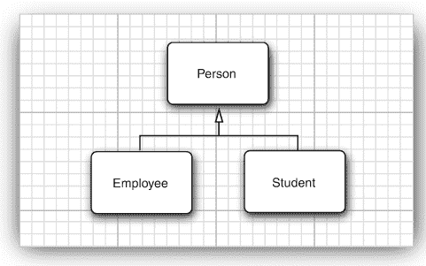

**图 5.2** `Person` 及其子类的继承图

为什么要费力实现如此高层次的抽象？

某些属性对每个人都是合理的，例如姓名。学生和员工都有名字，引入一个共同的超类让我们能够将 `getName` 方法提取到继承层次结构中的更高位置。

现在让我们添加另一个方法 `getDescription`，其目的是返回对人的简短描述，例如：

```text
an employee with a salary of $50,000.00

a student majoring in computer science
```

为 `Employee` 和 `Student` 类实现此方法很容易。但在 `Person` 类中，你能提供什么信息呢？`Person` 类除了姓名之外对人一无所知。当然，你可以实现 `Person.getDescription()` 返回一个空字符串。但有一种更好的方法。如果你使用 `abstract` 关键字，你根本不需要实现该方法。

```java
public abstract String getDescription();

// no implementation required
```

为了更加清晰起见，包含一个或多个抽象方法的类本身必须声明为抽象类。

```java
public abstract class Person
{
  . . .

  public abstract String getDescription();
}
```

除了抽象方法外，抽象类还可以拥有字段和具体方法。例如，`Person` 类存储了人的姓名，并有一个返回该姓名的具体方法。


```java
public abstract class Person
{
    private String name;

    public Person(String name)
    {
        this.name = name;
    }

    public abstract String getDescription();

    public String getName()
    {
        return name;
    }
}
```

---

 **提示：**

有些程序员并没有意识到抽象类可以拥有具体方法。你应该始终将公共字段和方法（无论是否抽象）移动到超类中（无论是否为抽象）。

---

抽象方法充当子类中实现的方法的占位符。当你扩展一个抽象类时，你有选择。你可以保持部分或所有抽象方法未定义；那么，你必须将子类也标记为抽象类。或者，你可以定义所有方法，此时子类就不再是抽象的。

例如，我们将定义一个扩展抽象类 `Person` 的 `Student` 类，并实现 `getDescription` 方法。`Student` 类中没有任何方法是抽象的，因此它不需要被声明为抽象类。

一个类即使没有抽象方法，也可以被声明为 `abstract`。

抽象类不能被实例化。也就是说，如果一个类被声明为 `abstract`，就无法创建该类的对象。例如，表达式：

```java
new Person("Vince Vu")
```

是一个错误。然而，你可以创建具体子类的对象。

注意，你仍然可以创建抽象类的对象变量，但此类变量必须指向非抽象子类的对象。例如：

```java
Person p = new Student("Vince Vu", "Economics");
```

在这里，`p` 是抽象类型 `Person` 的变量，指向非抽象子类 `Student` 的实例。

---

 **C++ 注意事项：**

在 C++ 中，抽象方法被称为纯虚函数，并带有尾随的 `= 0`，如下：

```cpp
class Person // C++
{
public:
   virtual string getDescription() = 0;
   . . .
};
```

如果一个 C++ 类至少有一个纯虚函数，那么它就是抽象类。在 C++ 中，没有特殊的关键字来表示抽象类。

---

让我们定义一个扩展抽象类 `Person` 的具体子类 `Student`：

```java
public class Student extends Person
{
    private String major;

    public Student(String name, String major)
    {
        super(name);
        this.major = major;
    }

    public String getDescription()
    {
        return "a student majoring in " + major;
    }
}
```

`Student` 类定义了 `getDescription` 方法。因此，`Student` 类中的所有方法都是具体的，该类不再是一个抽象类。

列表 5.8 中的程序定义了抽象超类 `Person`（列表 5.8）。

```java
package abstractClasses;

import java.time.*;

public class Employee extends Person
{
    private double salary;
    private LocalDate hireDay;

    public Employee(String name, double salary, int year, int month, int day)
    {
        super(name);
        this.salary = salary;
        hireDay = LocalDate.of(year, month, day);
    }

    public double getSalary()
    {
        return salary;
    }

    public LocalDate getHireDay()
    {
        return hireDay;
    }

    public String getDescription()
    {
        return "an employee with a salary of $%.2f".formatted(salary);
    }

    public void raiseSalary(double byPercent)
    {
        double raise = salary * byPercent / 100;
        salary += raise;
    }
}
```

**Listing 5.11 `abstractClasses/Student.java`**

```java
package abstractClasses;

public class Student extends Person
{
    private String major;

    /**
    * @param name the student's name
    * @param major the student's major
    */
    public Student(String name, String major)
    {
        // pass name to superclass constructor
        super(name);
        this.major = major;
    }

    public String getDescription()
    {
        return "a student majoring in " + major;
    }
}
```

### 5.7 枚举类（Enumeration Classes）

你在第 3 章中看到了如何定义枚举类型。这里有一个典型的示例：

```java
public enum Size { SMALL, MEDIUM, LARGE, EXTRA_LARGE }
```

由此声明定义的类型实际上是一个类。该类恰好有四个实例——无法构造新的对象。

因此，你永远不需要对枚举类型的值使用 `equals`。只需使用 `==` 来比较它们即可。

如果你愿意，可以为枚举类型添加构造方法、方法和字段。当然，构造方法只有在枚举常量被构造时才会被调用。这里有一个示例：

```java
public enum Size
{
    SMALL("S"), MEDIUM("M"), LARGE("L"), EXTRA_LARGE("XL");
    private String abbreviation;
    Size(String abbreviation) { this.abbreviation = abbreviation; }
    // 自动为 private
    public String getAbbreviation() { return abbreviation; }
}
```

枚举的构造方法始终是私有的。你可以省略 `private` 修饰符，如上例所示。将枚举构造方法声明为 `public` 或 `protected` 是语法错误。

所有的枚举类型都是抽象类 `Enum` 的子类。它们继承了该类的若干方法。最有用的方法是 `toString`，它返回枚举常量的名称。例如，`Size.SMALL.toString()` 返回字符串 `"SMALL"`。

`toString` 的反向操作是静态方法 `valueOf` 方法。例如，语句：

```java
Size s = Enum.valueOf(Size.class, "SMALL");
```

将 `s` 设置为 `Size.SMALL`。

每个枚举类型都有一个静态的 `values` 方法，返回所有值的数组。例如，调用：

```java
Size[] values = Size.values();
```

返回数组 `Size.SMALL`、`Size.MEDIUM`、`Size.LARGE` 和 `Size.EXTRA_LARGE`。

`ordinal` 方法产生枚举常量在 `enum` 声明中的位置，从零开始计数。例如，`Size.MEDIUM.ordinal()` 返回 `1`。

Listing 5.12 中的短程序演示了如何处理枚举类型。

**注意：** `Enum` 类有一个类型参数，为了简单起见我忽略了它。例如，枚举类型 `Size` 实际上扩展了 `Enum<Size>`。该类型参数用于 `compareTo` 方法。（我将在第 6 章中讨论 `compareTo` 方法，并在第 8 章中讨论类型参数。）

**Listing 5.12 `enums/EnumTest.java`**

```java
package enums;

import java.util.*;

/**
* 此程序演示了枚举类型。
* @version 1.0 204-05-24
* @author Caymann
*/
public class EnumTest
{
    public static void main(String[] args)
    {
        Scanner in = new Scanner(System.in);
        System.out.print("Enter a size: (SMALL, MEDIUM, LARGE, EXTRA_LARGE) ");
        String input = in.toUpperCase();
        Size size = Enum.valueOf(Size.class, input);
        System.out.println("size=" + size);
        System.out.println("abbreviation=" + size.getAbbreviation());
        if (size == Size.EXTRA_LARGE)
        {
            System.out.println("Good job--you paid attention to it.");
        }
    }
}

enum Size
{
    SMALL("S"), MEDIUM("M"), LARGE("L"), EXTRA_LARGE("XL");
    private Size(String abbreviation) { this.abbreviation = abbreviation; }
    public String getAbbreviation() { return abbreviation; }
    private String abbreviation;
}
```

`java.lang.Enum<E>`

- `static Enum valueOf(Class enumClass, String name)` 返回给定类中给定名称的枚举常量。
- `String toString()` 返回枚举常量的名称。
- `int ordinal()` 返回枚举常量在 `enum` 声明中的零索引位置。
- `int compareTo(E other)` 如果此枚举常量在 `other` 之前返回负整数，如果 `this == other` 则返回零，否则返回正整数。

### 5.8 密封类（Sealed Classes）

除非一个类被声明为 `final`，否则任何人都可以形成它的子类。如果你想有更多控制权怎么办？例如，你需要编写自己的 JSON 库，因为现有的库没有完全满足你的需求。

JSON 标准规定 JSON 值可以是数组、数字、字符串、布尔值、对象或空。一种明显的方法是用 `JSONArray`、`JSONNumber` 等类扩展抽象类 `JSONValue` 来进行建模：

```java
public abstract class JSONValue
{
    // 适用于所有 JSON 值的方法
}

public final class JSONArray extends JSONValue
{
    ...
}

public final class JSONNumber extends JSONValue
{
    ...
}
```

通过将 `JSONArray`、`JSONNumber` 等类声明为 `final`，我们可以确保没有人形成子类。但我们无法阻止形成 `JSONValue` 的另一个子类。

我们为什么可能需要这种控制权？考虑这段代码：

```java
JSONValue v = ...;
if (v instanceof JSONArray a) ...
else if (v instanceof JSONNumber n) ...
else if (v instanceof JSONString s) ...
else if (v instanceof JSOBoolean b) ...
else if (v instanceof JSONObject o) ...
else ... // 必须 JSONNull
```

在这里，控制流意味着我们知道 `JSONValue` 的直接子类。这不是一个开放的层次结构。

在 Java 中，*密封*（sealed）类控制哪些类可以继承它。密封类在 Java 15 中作为预览功能引入，并在 Java 17 中确定。

以下是将 `JSONValue` 类声明为密封的方法：

```java
public abstract sealed class JSONValue
    permits JSONArray, JSONNumber, JSONString, JSONBoolean, JSONObject, JSONNull
{
    ...
}
```

定义未许可的子类是一个错误：

```java
public class JSONComment extends JSONValue { ... } // 错误
```

这恰恰如此，因为 JSON 不允许注释。因此，密封类允许对领域约束进行准确建模。

密封类的许可子类必须是可访问的。它们不能是嵌套在另一个类中的私有类，也不能是来自另一个包的包可见类。

对于允许的公共子类，规则更加严格。它们必须与密封类（sealed class）处于同一个包中。然而，如果你使用了模块（参见第二卷的第 9 章），那么它们只需要处于同一个模块中即可。

---

 **注意：**

密封类可以在不带 `permits` 子句的情况下声明。此时，它的所有直接子类都必须声明在同一个文件中。无法访问该文件的程序员无法创建子类。

一个文件最多可以有一个 `public` 类，因此这种安排似乎只有在子类不供公用户使用时才有用武之地。

然而，正如你将在下一章中看到的，你可以使用内部类作为公共子类。

---

密封类的一个重要动机是编译时检查。考虑 `JSONValue` 类中的这个方法，它使用了带模式匹配的 `switch` 表达式（Java 17 中的一项预览功能）：

```java
public String type()
{
   return switch (this)
   {
      case JSONArray j -> "array";
      case JSONNumber j -> "number";
      case JSONString j -> "string";
      case JSONBoolean j -> "boolean";
      case JSONObject j -> "object";
      case JSONNull j -> "null";
      // 这里不需要 default
   };
}
```

编译器可以检查出不需要 `default` 子句，因为 `JSONValue` 的所有直接子类都作为 `case` 出现。

---

 **注意：**

上述的 `type` 方法看起来并不非常面向对象。符合 OOP 精神的做法让这六个类中的每一个都提供自己的 `type` 方法，依赖多态而不是 `switch`。对于开放的层次结构，这是一种很好的方法。当存在一组固定的类时，将所有备选方案放在一个方法中通常更方便。

---

乍一看，密封类的子类似乎必须是 `final` 的。但对于穷尽性测试（exhaustiveness testing），我们只需要知道所有的直接子类。如果这些类具有进一步的子类，也没有问题。例如，我们可以重新组织我们的 JSON 层次结构，如图 5.3 所示。

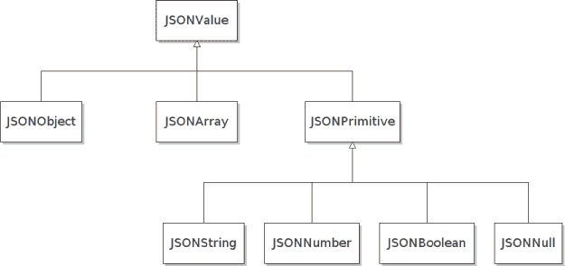

**图 5.3** 表示 JSON 值的完整层次结构

在这个层次结构中，`JSONValue` 允许三个子类：

```java
public abstract sealed class JSONValue
    permits JSONObject, JSONArray, JSONPrimitive
{
   . . .
}
```

`JSONPrimitive` 类也是被密封的：

```java
public abstract sealed class JSONPrimitive extends JSONValue
    permits JSONString, JSONNumber, JSONBoolean, JSONNull
{
   . . .
}
```

密封类的子类必须指定它是 `sealed`、`final` 还是允许子类化的（open）。在后一种情况下，它必须声明为 `non-sealed`。

---

 **注意：**


`non-sealed` 关键字是第一个带有连字符的 Java 关键字。这很可能是一个未来的趋势。向语言中添加关键字总是伴随着风险。现有代码可能不再能够编译。因此，`sealed` 是一个“上下文”关键字。你仍然可以声明名为 `sealed` 的变量或方法：

```java
int sealed = 1; // 将上下文关键字作为标识符是允许的
```

对于带有连字符的关键字，人们不需要担心这一点。唯一的歧义在于减法：

```java
int non = 0;

non = non-sealed; // 是减法，不是关键字
```

---

你为什么想要一个 `non-sealed` 子类呢？考虑一个具有六个直接子类的 XML 节点类：

```java
public abstract sealed class Node permits Element, Text, Comment,
      CDATASection, EntityReference, ProcessingInstruction
{
   . . .
}
```

我们允许 `Element` 有任意子类：

```java
public non-sealed class Element extends Node
{
   . . .
}

public class HTMLDivElement extends Element
{
   . . .
}
```

在这一节中，你学习了密封类。在下一章中，你将学习*接口*（interfaces），它是抽象类的泛化。Java 接口也可以有子类型。密封接口的工作方式与密封类完全相同，控制直接子类型。

接下来的示例程序完善了 JSON 层次结构。`JSONObject` 的实现使用了 `HashMap`，它将在第 9 章中介绍。在示例中，我们使用接口而不是抽象类，以便 `JSONNumber` 和 `JSONString` 可以是 record，而 `JSONBoolean` 和 `JSONNull` 类可以是枚举（enumerations）。record 和枚举可以实现接口，但它们不能扩展类。

**列表 5.13** `sealed/SealedTest.java`

```java
 1   package sealed;
 2
 3   import java.util.*;
 4
 5   sealed interface JSONValue permits JSONArray, JSONObject, JSONPrimitive
 6   {
 7       public default String type()
 8       {
 9           if (this instanceof JSONArray) return "array";
10          else if (this instanceof JSONObject) return "object";
11          else if (this instanceof JSONNumber) return "number";
12          else if (this instanceof JSONString) return "string";
13          else if (this instanceof JSONBoolean) return "boolean";
14          else return "null";
15      }
 16  }
 17  final class JSONArray extends ArrayList<JSONValue> {}
 18
 19  final class JSONObject extends HashMap<String, JSONValue>
 20  {
 21      public String toString()
 22      {
 23          StringBuilder result = new StringBuilder();
 24          result.append("{");
 25          for (Map.Entry<String, JSONValue> entry : entrySet())
 26          {
 27              if (result.length() > 1) result.append(",");
 28              result.append(" ");
 29              result.append(entry.getKey());
 30              result.append(": ");
 31              result.append(entry.getValue());
 32          }
 33          result.append("}");
 34          return result.toString();
 35      }
 36  }
 37
 38  sealed interface JSONPrimitive permits JSONString, JSONNumber, JSONBoolean, JSONNull
 39  {}
 40  record JSONNumber(double value) implements JSONPrimitive {
 41      public String toString() { return "" + value; } }
 42
 43  record JSONString(String value) implements JSONPrimitive {
 44      public String toString() { return "\"" + value.translateEscapes() + "\""; } }
 45
 46  enum JSONBoolean implements JSONPrimitive {
 47      FALSE, TRUE;
 48      public String toString() { return super.toString().toLowerCase(); } }
 49  }
 50
 51  enum JSONNull implements JSONPrimitive {
 52      INSTANCE;
 53      public String toString() { return "null"; } }
 54  }
 55
 56  public class SealedTest
 57  {
 58      public static void main(String[] args)
 59      {
 60          JSONObject obj = new JSONObject();
 61          obj.put("name", new JSONString("Harry"));
 62          obj.put("salary", new JSONNumber(90000));
 63          obj.put("married", JSONBoolean.FALSE);
 64          JSONArray arr = new JSONArray();
 65          arr.add(new JSONNumber(13));
 66          arr.add(JSONNull.INSTANCE);
 67          obj.put("luckyNumbers", arr);
 68          System.out.println(obj);
 69          System.out.println(obj.type());
 70      }
 71  }
 72  }
```

## 5.9 反射

*反射库*为你提供了一个非常丰富且精密的工具集，用于编写动态操作 Java 代码的程序。通过反射，Java 可以支持界面生成器、对象关系映射器以及许多动态查询类能力的开发工具。

能够分析类能力的程序被称为反射式的。反射机制非常强大。正如后续章节所示，你可以用它来：

- 在运行时分析类的能力
- 在运行时检查对象——例如编写一个适用于*所有*类的 `toString` 方法
- 实现通用的数组操作代码
- 利用像 C++ 等语言中的函数指针一样工作的 `Method` 对象

反射（Reflection）是一种强大且复杂的机制；然而，它主要对工具的构建者感兴趣，而不是对应用程序的程序员。如果你对编写应用程序感兴趣，而不是为其他 Java 程序员编写工具，你可以安全地跳过本章的剩余内容，稍后再回来查看。

### 5.9.1 `Class` 类

当你的程序运行时，Java 运行时系统始终会对所有对象维护所谓的*运行时类型识别*（runtime type identification）。这些信息跟踪了每个对象所属的类。虚拟机使用这些运行时类型信息来选择要执行的正确方法。

然而，你也可以通过操作一个特殊的 Java 类来访问这些信息。持有这些信息的类由于名称有点困惑，被称为 `Class`。`Object` 类中的 `getClass()` 方法返回一个 `Class` 类型的实例。

```java
Employee e; . . .

Class cl = e.getClass();
```

就像 `Employee` 对象描述特定员工的属性一样，`Class` 对象描述了特定类的属性。`Class` 类最常用的方法可能是 `getName`。它返回类的名称。例如，该语句：

```java
System.out.println(e.getClass().getName() + " " + e.getName());
```

如果 `e` 是一个员工，则打印：

```text
Employee Harry Hacker
```

或者如果 `e` 是一个经理，则打印：

```text
Manager Harry Hacker
```

如果类在一个包中，包名是类名的一部分：

```java
var generator = new Random();

Class cl = generator.getClass();

String name = cl.getName(); // name 被设置为 "java.util.Random"
```

你可以通过使用静态方法 `forName` 来获取与类名对应的 `Class` 对象。

```java
String className = "java.util.Random";

Class cl = Class.forName(className);
```

如果类名存储在运行时变化的字符串中，请使用此方法。如果 `className` 是一个类或接口的名称，则该方法有效。否则，`forName` 方法会抛出一个*检查异常*（checked exception）。请参阅第 283 页的第 5.9.2 节，“异常声明入门”，了解每在使用此方法时如何提供*异常处理器*。

获取 `Class` 类型对象的第三种方法是一种方便的快捷方式。如果 `T` 是任何 Java 类型（或 `void` 关键字），那么 `T.class` 就是匹配的类对象。例如：

```java
Class cl1 = Random.class; // 如果导入了 java.util.*;

Class cl2 = int.class;

Class cl3 = Double[].class;
```

注意，`Class` 对象实际上描述的是一个*类型*，该类型可能是类，也可能不是类。例如，`int` 不是一个类，但 `int.class` 尽管是一个 `Class` 类型的对象。

---

 **注意：**

`Class` 类实际上是一个泛型类。例如，`Employee.class` 的类型是 `Class<Employee>`。我将不再纠结这个问题，因为这会让一个已经抽象的概念变得更加复杂。对于大多数实际用途，你可以忽略类型参数并使用原始 `Class` 类型进行工作。关于此问题的更多信息，请参阅第 8 章。

---

 **警告：**

出于历史原因，`getName` 方法为数组类型返回了一些奇怪的名字：

- `Double[].class.getName()` 返回 `"[Ljava.lang.Double;"`。
- `int[].class.getName()` 返回 `"I"`。

---

虚拟机为每个类型管理一个唯一的 `Class` 对象。因此，你可以使用 `==` 运算符来比较类对象。例如：

```java
if (e.getClass() == Employee.class) . . .
```

如果 `e` 是 `Employee` 的实例，则此测试通过。与条件 `e instanceof Employee` 不同，如果 `e` 是 `Manager` 等子类的实例，则此测试将失败。

如果你有一个 `Class` 类型的对象，可以使用它来构造类的实例。调用 `getConstructor` 方法获取一个 `Constructor` 类型的对象，然后使用 `newInstance` 方法构造一个实例。例如：

```java
var className = "java.util.Random"; // 或任何其他类名
Class cl = Class.forName(className);

Object obj = cl.getConstructor().newInstance();
```

如果该类没有无参数的构造方法，`getConstructor` 方法将抛出异常。你可以在第 304 页的第 5.9.7 节“调用任意方法和构造方法”了解如何调用其他构造方法。

---

 **注意：**

有一个已弃用的 `Class.toInstance` 方法，也可以用无参数构造方法构造实例。然而，如果构造方法抛出检查异常，该异常将在不经过检查的情况下重新抛出。这违反了异常的编译时检查。相比之下，`Constructor.newInstance` 将任何构造器异常封装在 `InvocationTargetException` 中。

---

 **C++ 注意：**

`newInstance` 方法对应于 C++ 中的*虚构造函数*（virtual constructor）惯用法。然而，C++ 中的虚构造函数并不是一种语言特性，而是一种惯用法。Java `Class` 类类似于 C++ 中的 `type_info`，而 `getClass` 方法等同于 `typeid` 运算符。尽管如此，Java `Class` 类要比 `type_info` 灵活得多。C++ `type_info` 只能显示类型的名称字符串，而无法创建该类型的对象。

---

**`java.lang.Class`**

- `static Class forName(String className)` 返回表示 `className` 的 `Class` 对象。
- `Constructor getConstructor(Class... parameterTypes)` **1.1** 产生描述给定参数类型的构造方法对象。请参阅第 304 页的第 5.9.7 节“调用任意方法和构造方法”，获取有关如何提供参数类型的更多信息。

**`java.lang.reflect.Constructor`**

- `Object newInstance(Object... params)` 构造构造方法声明类的新实例，并将 `params` 传递给构造方法。

**`java.lang.Throwable`**

- `void printStackTrace()` 将 `Throwable` 对象和栈轨迹（堆栈）打印到标准错误流。

### 5.9.2 异常声明入门

我在第 7 章中详细讲解了异常处理，在此期间你经常会遇到可能抛出异常的方法。

当运行时发生错误时，程序可以“抛出异常”。抛出异常比终止程序更灵活，因为你可以提供一个“捕获”并处理异常的处理器。

如果不提供处理器，程序将终止并在控制台上打印一条消息，给出异常的类型。当你不小心使用 `null` 引用或越界时，你可能已经见过异常报告。

异常有两种类型：*未检查异常*和*检查异常*。对于检查异常，编译器会检查你（程序员）是否意识到了异常并准备好处理后果。然而，许多常见的异常（如边界错误或访问空引用）是未检查的。编译器并不期望你提供处理器——毕竟，你应该把精力集中在避免这些错误上，而不是为这些错误编写处理器。

并不是所有的错误都是可以避免的。尽管你尽了全力，如果仍然发生异常，那么大多数 Java API 会抛出一个受检查异常（checked exception）。一个例子是 `Class.forName` 方法。你无法确保给定名称的类是否存在。在第 7 章中，你将看到几种处理异常的策略。现在，我只向你展示最简单的策略。

每当方法包含可能抛出受检查异常的语句时，在方法名后添加一个 `throws` 子句。

```java
public static void doSomethingWithClass(String name)
      throws ReflectiveOperationException
{
   Class cl = Class.forName(name); // might throw exception
   do something with cl
}
```

任何调用此方法的方法也都需要 `throws` 声明。这包括 `main` 方法。如果真的发生了异常，`main` 方法将带有堆栈跟踪并终止。（你将在第 7 章中学习如何捕获异常，而不是让它们终止你的程序。）

你只需要为检查异常提供 `throws` 子句。很容易发现哪些方法抛出了受检查异常——每当你调用一个可能抛出受检查异常的方法且你没有提供处理器时，编译器就会报错。


### 5.9.3 资源

类通常具有关联的数据文件，例如：

- 图像和声音文件
- 带有消息字符串和按钮标签的文本文件

在 Java 中，这种关联文件被称为 `resource`（资源）。

例如，考虑显示消息的对话框，如图 5.4 所示。

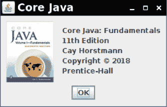

**图 5.4** 显示图像和文本资源

当然，面板中的书名和版权年份会在书的下一个版本中发生变化。为了方便跟踪这些变化，我们将文本放在文件中，而不是将其硬编码为字符串。

但是，你应该将像 `about.txt` 这样的文件放在哪里呢？当然，简单地将它与程序的其余文件一起放在 JAR 文件中是很方便的。

`Class` 类提供了一个用于定位资源文件的实用服务。以下是必要的步骤：

1. 获取拥有资源的类的 `Class` 对象——例如 `ResourceTest.class`。
2. 某些方法（如 `ImageIcon` 类的 `getImage` 方法）接受描述资源位置的 URL。然后你调用：

```java
URL url = cl.getResource("about.gif");
```

3. 否则，使用 `getResourceAsStream` 方法获取读取文件中数据的输入流。

点在于，Java 虚拟机知道如何定位类，因此它随后可以在**相同位置**搜索关联的资源。例如，假设 `ResourceTest` 类位于 `resources` 包中。那么 `ResourceTest.class` 文件位于 `resources` 目录，你将一个图标文件放在同一个目录中。

与其将资源文件存放在与类文件相同的目录中，你可以提供相对路径或绝对路径，例如：

```text
data/about.txt
/corejava/title.txt
```

自动加载文件就是资源加载功能所做的一切。没有标准方法来解释资源文件的内容。每个程序必须有自己的方法来解释其资源文件。

资源的另一个常见应用是程序的国际化。依赖于语言的字符串（如消息和用户界面标签）存储在资源文件中，每个语言一个文件。在卷二的第 7 章中讨论的 `internationalization API` 支持一种组织和访问这些本地文件的标准方法。

列表 5.13 是一个演示资源加载的程序。（不用担心读取文本和显示对话框的代码——我们稍后会介绍这些细节。）编译、构建 JAR 文件并执行它：

```bash
javac resource/ResourceTest.java
jar cvfe ResourceTest.jar resources.ResourceTest \
    resources/*.class resources/*.gif resources/data/*.txt corejava/*.txt
java -jar ResourceTest.jar
```

将 JAR 文件移动到不同的目录并再次运行，以检查程序是否是从 JAR 文件而不是从当前目录读取的资源文件。

**列表 5.14** `resources/ResourceTest.java`

```java
 1  package resources;
 2
 3  import java.io.*;
 4  import java.net.*;
 5  import java.nio.charset.*;
 6  import javax.swing.*;
 7
 8  /**
 9    * @version 1.5 2018-03-15
10    * @author Cay Horstmann
11    */
12  public class ResourceTest
13  {
14      public static void main(String[] args) throws IOException
15      {
16        Class cl = ResourceTest.class;
17        URL aboutURL = cl.getResource("about.gif");
18        var icon = new ImageIcon(aboutURL);
19
20        InputStream stream = cl.getResourceAsStream("data/about.txt");
21        var about = new String(stream.readAllBytes(), "UTF-8");
22
23        InputStream stream2 = cl.getResourceAsStream("/corejava/title.txt");
24        var title = new String(stream2.readAllBytes(), StandardCharsets.UTF_8).strip();
25
26        JOptionPane.showMessageDialog(
27            null, about, title, JOptionPane.INFORMATION_MESSAGE);
28      }
29  }
```

`java.lang.Class` 1.0

- `URL getResource(String name)` 1.1
- `InputStream getResourceAsStream(String name)` 1.1

### 5.9.4 使用反射分析类的能力

这里是用于反射检查类结构的核心部分的简要概述。

`java.lang.reflect` 中的 `Field`、`Method` 和 `Constructor` 这三个类描述了字段、方法和构造函数。这三个类都有一个 `getName` 方法，返回项的名称。`Field` 类有一个 `getType` 方法，返回一个对象（同样是 `Class` 类型），描述字段类型。`Method` 和 `Constructor` 类有报告参数类型的方法，而 `Method` 类还报告返回类型。这三个类都有一个 `getModifiers` 方法，返回一个整数（某些位位被开启或关闭），描述修饰符，如 `public`。然后你可以使用 `Modifier` 类的静态方法来分析 `getModifiers` 返回的整数。使用 `Modifier` 类中的 `isPublic`、`isPrivate` 或 `isFinal` 方法可以判断方法或构造函数是否为 `public`、`private` 或 `final`。你只需要让 `Modifier` 类中相应的方法作用于 `getModifiers` 返回的整数。你也可以使用 `Modifier.toString` 方法打印修饰符。

`Class` 类的 `getFields`、`getMethods` 和 `getConstructors` 方法返回该类支持的**公共**字段、方法和构造方法的数组。这包括父类的公共成员。`Class` 类的 `getDeclaredFields`、`getDeclaredMethods` 和 `getDeclaredConstructors` 方法返回在该类中声明的所有字段、方法和构造方法的数组。这包括私有、包级和保护成员，以及包访问成员，但不包括父类的成员。

列表 5.15 展示了如何打印关于类的所有信息。程序提示你输入类名，并输出该类所有方法和构造方法的签名，以及所有实例字段的名称。例如，如果你输入：

```text
java.lang.Double
```

程序打印：

```java
public final class java.lang.Double extends java.lang.Number
{
    public java.lang.Double(double);
    public java.lang.Double(java.lang.String);
    public boolean equals(java.lang.Object);
    public static java.lang.String toString(double);
    public java.lang.String toString();
    public static int hashCode(double);
    public int hashCode();
    public static double min(double, double);
    public static double max(double, double);
    public static native long doubleToRawLongBits(double);
    public static long doubleToLongBits(double);
    public static native double longBitsToDouble(long);
    public int compareTo(java.lang.Double);
    public volatile int compareTo(java.lang.Object);
    public static int compare(double, double);
    public byte byteValue();
    public short shortValue();
    public int intValue();
    public long longValue();
    public float floatValue();
    public double doubleValue();
    public static java.lang.Double valueOf(java.lang.String);
    public static java.lang.Double valueOf(double);
    public static java.lang.String toHexString(double);
    public volatile java.lang.Object resolveConstantDesc(
      java.lang.invoke.MethodHandles$Lookup);
    public java.lang.Double resolveConstantDesc(java.lang.invoke.MethodHandles$Lookup);
    public java.util.Optional describeConstable();
    public boolean isNaN();
    public static boolean isNaN(double);
    public static double sum(double, double);
    public boolean isInfinite();
    public static boolean isInfinite(double);
    public static boolean isFinite(double);
    public static double parseDouble(java.lang.String);
    public static final double POSITIVE_INFINITY;
    public static final double NEGATIVE_INFINITY;
    public static final double NaN;
    public static final double MAX_VALUE;
    public static final double MIN_NORMAL;
    public static final double MIN_VALUE;
    public static final int MAX_EXPONENT;
    public static final int MIN_EXPONENT;
    public static final int SIZE;
    public static final int BYTES;
    public static final java.lang.Class TYPE;
    private final double value;
    private static final long serialVersionUID;
}
```

这个程序非常显著之处在于，它可以分析任何 Java 解释器可以加载的类，而不仅仅是程序编译时可用的类。我们将在下一章中使用这个程序来窥探 Java 编译器自动生成的内部类。

**列表 5.15** `reflection/ReflectionTest.java`

```java
package reflection;

import java.util.*;
import java.lang.reflect.*;

/**
 * 此程序使用反射来打印类的所有特征。
 * @version 1.12 2021-06-15
 * @author Cay Horstmann
 */
public class ReflectionTest
{
    public static void main(String[] args)
            throws ReflectiveOperationException
    {
        // 从命令行参数或用户输入读取类名
        String className;
        if (args.length > 0)
        {
            className = args[0];
        }
        else
        {
            Scanner in = new Scanner(System.in);
            System.out.print("Enter a class name: ");
            className = in.nextLine();
        }
        try {
            Class<?> clazz = Class.forName(className);
            System.out.println("Class: " + clazz.getName());
            System.out.println("Superclass: " + clazz.getSuperclass().getName());
            System.out.print("Interfaces: ");
            Class<?>[] interfaces = clazz.getInterfaces();
            if (interfaces.length == 0)
            {
                System.out.println("None");
            }
            else
            {
                for (Class<?> iface : interfaces)
                {
                    System.out.print(iface.getName() + " ");
                }
                System.out.println();
            }
            System.out.println("\nFields:");
            Field[] fields = clazz.getDeclaredFields();
            for (Field field : fields)
            {
                System.out.println("  " + Modifier.toString(field.getModifiers()) + " " + field.getType().getName() + " " + field.getName());
            }
            System.out.println("\nMethods:");
            Method[] methods = clazz.getDeclaredMethods();
            for (Method method : methods)
            {
                System.out.println("  " + Modifier.toString(method.getModifiers()) + " " + method.getReturnType().getName() + " " + method.getName());
            }
        } catch (ClassNotFoundException e)
        {
            System.err.println("Class not found: " + className);
        }
    }
}
```

返回一个 `Class` 对象的数组，表示参数的类型。

- `Class getReturnType()`（在 `Method` 类中）

  返回一个表示返回类型的 `Class` 对象。

### `java.lang.reflect.RecordComponent` 16

- `String getName()`
- `Class<?> getType()`

  获取此记录组件的名称和类型。

- `Method getAccessor()`

  返回访问此记录组件的 `Method` 对象。

### `java.lang.reflect.Modifier` 1.1

- `static String toString(int modifiers)`

  返回一个字符串，包含 `modifiers` 值中设置的位对应的修饰符。


- `static boolean isAbstract(int modifiers)`
- `static boolean isFinal(int modifiers)`
- `static boolean isInterface(int modifiers)`
- `static boolean isNative(int modifiers)`
- `static boolean isPrivate(int modifiers)`
- `static boolean isProtected(int modifiers)`
- `static boolean isPublic(int modifiers)`
- `static boolean isStatic(int modifiers)`
- `static boolean isStrict(int modifiers)`
- `static boolean isSynchronized(int modifiers)`
- `static boolean isVolatile(int modifiers)`

测试 `modifiers` 值中对应方法名中修饰符的位。

#### 5.9.5 使用反射在运行时分析对象

在前面的节中，我们看到了如何找到任何对象的实例字段的*名称*和*类型*：

- 获取相应的 `Class` 对象。
- 在 `Class` 对象上调用 `getDeclaredFields`。

在本节中，我们将更进一步，实际上去查看字段的*内容*。当然，当你在编写程序时，查看已知名称和类型的对象的特定字段的内容是轻而举的。但反射允许你查看在编译时未知的对象的字段。

实现这一点的关键方法是 `Field` 类中的 `get` 方法。如果 `f` 是一个 `Field` 类型的对象（例如，从 `getDeclaredFields` 获取的其中），并且 `obj` 是 `f` 所字段所属的类的对象，那么 `f.get(obj)` 就会返回一个对象，其值是 `obj` 字段的当前值。这都有一点抽象，所以让我们来看一个例子。

```java
var harry = new Employee("Harry Hacker", 50000, 10, 1, 1989);

Class cl = harry.getClass();

   // 代表 Employee 的类对象
Field f = cl.getDeclaredField("name");

   // Employee 类的 name 字段
Object v = f.get(harry);

   // harry 对象的 name 字段的值，即：
   // String 对象 "Harry Hacker"
```

当然，你也可以设置你所获取的值。调用 `f.set(obj, value)` 会将对象 `obj` 中由 `f` 表示的字段设为新值。

实际上，这段代码存在一个问题。由于 `name` 字段是一个私有字段，`get` 和 `set` 方法将抛出 `IllegalAccessException`。你只能对可访问的字段使用 `get` 和 `set`。Java 的安全机制允许你发现对象拥有哪些字段，但除非你有权限，否则它不会让你读取和写入这些字段的值。

反射机制的默认行为是尊重 Java 访问控制。然而，你可以通过对 `Field`、`Method` 或 `Constructor` 对象调用 `setAccessible` 方法来覆盖访问控制。例如：

```java
f.setAccessible(true); // 现在可以安全调用 f.get(harry)
```

`setAccessible` 方法是 `AccessibleObject` 类的方法，它是 `Field`、`Method` 和 `Constructor` 类的公共父类。此功能是调试器、持久化存储和类似机制提供的。我们将在本节稍后的部分将其用于一个通用的 `toString` 方法。

如果没有授予访问，调用 `setAccessible` 将抛出异常。访问可能会被模块系统（第二卷第 9 章）或安全管理器（第二卷第 10 章）拒绝。使用安全管理器并不常见，并且自 Java 17 起已被弃用。但是从 Java 9 开始，由于 Java API 模块化，每个程序包含了模块。

例如，本节末尾示例程序查看了 `ArrayList` 和 `Integer` 对象的内部。当你使用 Java 9 到 Java 16 运行它时，会出现以下凶消息：

```text
WARNING: An illegal reflective access operation has occurred

WARNING: Illegal reflective access by objectAnalyzer.ObjectAnalyzer (file:/home/cay/books/cj11/code/v1ch05/bin/) to field java.util.ArrayList.serialVersionUID

WARNING: Please consider reporting this to the maintainers of
  objectAnalyzer.ObjectAnalyzer

WARNING: Use --illegal-access=warn to enable warnings of further illegal
  reflective access operations

WARNING: All illegal access operations will be denied in a future release
```

当你使用 Java 17 运行程序时，会发生 `InaccessibleObjectException` 异常。

为了保持程序运行，向“未命名模块”“打开” `java.base` 模块中的 `java.util` 和 `java.lang` 包。详情见第二卷第 9 章。语法如下：

```bash
java --add-opens java.base/java.util=ALL-UNNAMED \
     --add-opens java.base/java.lang=ALL-UNNAMED \
     objectAnalyzer.ObjectTest
```

这是一种提供通用 `toString` 方法的方法，这种方法既省力又无疑非常有用。然而，在你对以后再也不需要实现 `toString` 而感到兴奋之前，请记住，不受控访问内部实现的时代已已数不长了。

### 列表 5.16 `objectAnalyzer/ObjectAnalyzerTest.java`

```java
 1  package objectAnalyzer;
 2
 3  import java.util.*;
 4
 5  /**
 6    * 此程序使用反射来监视对象。
 7    * @version 1.13 2018-03-16
 8    * @author Cay Horstmann
 9    */
10  public class ObjectAnalyzerTest
11  {
12      public static void main(String[] args)
13             throws ReflectiveOperationException
14      {
15          var squares = new ArrayList<Integer>();
16          for (int i = 1; i <= 5; i++)
17            squares.add(i * i);
18          System.out.println(new ObjectAnalyzer().toString(squares));
19      }
20  }
```

### 列表 5.17 `objectAnalyzer/ObjectAnalyzer.java`

```java
 1  package objectAnalyzer;
 2
 3  import java.lang.reflect.AccessibleObject;
 4  import java.lang.reflect.Array;
 5  import java.lang.reflect.Field;
 6  import java.lang.reflect.Modifier;
 7  import java.util.ArrayList;
 8
 9  public class ObjectAnalyzer
10  {
11      private ArrayList<Object> visited = new ArrayList<>();
12
13      /**
14       * 将对象转换为字符串表示形式，列出所有字段。
15       * @param obj 一个对象
16       * @return 包含包含对象类名以及所有字段名和值的字符串
17      */
18      public String toString(Object obj)
19             throws ReflectiveOperationException
20      {
21          if (obj == null) return "null";
22          if (visited.contains(obj)) return "...";
23          visited.add(obj);
24          Class cl = obj.getClass();
25          if (cl == String.class) return (String) obj;
26          if (cl.isArray())
27          {
28              String r = cl.getComponentType() + "[]{";
29              for (int i = 0; i < Array.getLength(obj); i++)
30              {
31              if (i > 0) r += ",";
32              Object val = Array.get(obj, i);
33              if (cl.getComponentType().isPrimitive()) r += val;
34              else r += toString(val);
35              }
36              return r + "}";
37          }
38
39          String r = cl.getName();
40          // 检查此类及其所有父类的字段
41          do
42          {
43            r += "[";
44            Field[] fields = cl.getDeclaredFields();
45            AccessibleObject.setAccessible(fields, true);
46            // 获取字段的名称和值
47            for (Field f : fields)
48            {
49            if (!Modifier.isStatic(f.getModifiers()))
50            {
51              if (!r.endsWith("[")) r += ",";
52              r += f.getName() + "=";
53              Class t = f.getType();
54              Object val = f.get(obj);
55              if (t.isPrimitive()) r += val;
56              else r += toString(val);
57            }
58          }
59            r += "]";
60            cl = cl.getSuperclass();
61          }
62          while (cl != null);
63
64          return r;
65      }
66  }
```

#### `java.lang.reflect.AccessibleObject` 1.2

- `void setAccessible(boolean flag)`：设置或清除此可访问对象的访问权限标志，如果访问被拒绝则抛出 `IllegalAccessException`。
- `boolean trySetAccessible()`：设置此可访问对象的访问权限标志，如果访问被拒绝则返回 `false`。
- `boolean canAccess(Object obj)`：检查调用者是否可以通过此字段、方法或构造函数对象访问 `obj`。对于静态字段、方法或构造函数请传递 `null`。
- `static void setAccessible(AccessibleObject[] array, boolean flag)`：用于设置对象数组访问权限标志的便利方法。

#### `java.lang.Class` 1.1

- `Field getField(String name)` / `Field[] getFields()`：获取给定名称的公共字段，或所有字段的数组。
- `Field getDeclaredField(String name)` / `Field[] getDeclaredFields()`：获取在该类中定义的给定名称的字段，或所有字段的数组。

#### `java.lang.reflect.Field` 1.1

- `Object get(Object obj)`：获取对象 `obj` 中由此 `Field` 对象描述的字段的值。
- `void set(Object obj, Object newValue)`：将对象 `obj` 中由此 `Field` 对象描述的字段设置为新值。

#### 5.6 使用反射写入数组

要实际执行此操作，我们需要获取数组的长度和组件类型。我们通过调用 `Array.getLength(a)` 获取长度。`Array` 类的静态 `getLength` 方法返回数组的长度。为了获取数组的组件类型，我们需要 `Class` 类的 `getComponentType` 方法（该方法仅对表示数组的类定义）。相反，对于表示类 *C* 的任何 `Class` 对象，`arrayType` 方法产生表示 `C[]` 的 `Class` 对象。关键在于 `java.lang.reflect` 中 `Array` 类的 `newInstance` 方法。你必须提供类型和所需的长度作为参数。这是第一次尝试：

```java
public static Object badCopyOf(Object a, int newLength)
{
    Class cl = a.getClass();
    if (!cl.isArray()) return null;
    Class componentType = cl.getComponentType();
    int length = Array.getLength(a);
    Object newArray = Array.newInstance(componentType, newLength);
    System.arraycopy(a, 0, newArray, 0, Math.min(length, newLength));
    return newArray;
}
```

然而，返回的 `Object[]` 有一个问题；它无法强制转换为 `Employee[]`。虚拟机将生成 `ClassCastException`。这里是代码：

```java
public static Object goodCopyOf(Object a, int newLength)
{
    Class cl = a.getClass();
    if (!cl.isArray()) return null;
    Class componentType = cl.getComponentType();
    int length = Array.getLength(a);
    Object newArray = Array.newInstance(componentType, newLength);
    System.arraycopy(a, 0, newArray, 0, Math.min(length, newLength));
    return newArray;
}
```

注意，这个 `copyOf` 方法可以用于扩展任何类型的数组，而不仅仅是对象数组。

```java
int[] a = { 1, 2, 3, 4, 5 };
a = (int[]) goodCopyOf(a, 10);
```

为了实现这一点，`goodCopyOf` 的参数被声明为 `Object` 类型，而不是对象的数组（`Object[]`）。整数数组类型 `int[]` 可以转换为 `Object`，但不能转换为对象的数组！

Listing 5.18 展示了两种方法的用法。请注意，对 `badcopyOf` 返回值的强制转换将抛出异常。

### Listing 5.18 `arrays/CopyOfTest.java`


```java
package arrays;

import java.lang.reflect.*;
import java.util.*;

/**
 * 此程序演示了如何使用反射操作数组。
 *
 * @version 1.2 2012-05-04
 * @author Cay Horstmann
 */
public class CopyOfTest {
   public static void main(String[] args) {
      int[] a = { 1, 2, 3 };
      a = (int[]) goodCopyOf(a, 10);
      System.out.println(Arrays.toString(a));

      String[] b = { "Tom", "Dick", "Harry" };
      b = (String[]) goodCopyOf(b, 10);
      System.out.println(Arrays.toString(b));

      System.out.println("The following call will generate an exception.");
      b = (String[]) badCopyOf(b, 10);
   }

   /**
    * 此方法尝试通过分配一个新数组并复制所有元素来扩大数组。
    *
    * @param a 要扩大的数组
    * @param newLength 新的长度
    * @return 一个包含 a 中所有元素的更大的数组。然而，返回的
    * 数组类型为 Object[]，与 a 的类型不相同
    */
   public static Object[] badCopyOf(Object[] a, int newLength) // not useful
   {
      var newArray = new Object[newLength];
      System.arraycopy(a, 0, newArray, 0, Math.min(a.length, newLength));
      return newArray;
   }

   /**
    * 此方法通过分配一个相同类型的新数组并复制所有元素来扩大数组。
    *
    * @param a 要扩大的数组。这可以是对象数组，也可以是基本类型数组
    * @return 一个包含 a 中所有元素的更大的数组。
    */
   public static Object[] goodCopyOf(Object a, int newLength)
   {
      Class cl = a.getClass();
      if (!cl.isArray()) return null;

      Class componentType = cl.getComponentType();
      int length = Array.getLength(a);
      Object newArray = Array.newInstance(componentType, newLength);
      System.arraycopy(a, 0, newArray, 0, Math.min(length, newLength));
      return newArray;
   }
}
```

### `java.lang.Class` 1.1

- `boolean isArray()`：如果此对象表示数组类型，则返回 `true`。
- `Class<?> getComponentType()`：如果此对象表示数组类型，则返回描述组件类型的 `Class`，否则返回 `null`。
- `Class<?> arrayType()`：返回描述数组类型的 `Class`，该数组的组件类型由此对象表示。

### `java.lang.reflect.Array` 1.1

- `static Object get(Object array, int index)`：返回给定数组在指定索引（`index`）处的值（`index` 是基本类型 `boolean`、`byte`、`char`、`double`、`int`、`long` 或 `short` 之一）。
- `static void set(Object array, int index, Object newValue)`：在给定数组的索引处存储一个新值（`newValue` 是基本类型 `boolean`、`byte`、`char`、`double`、`int`、`long` 或 `short` 之一）。
- `static int getLength(Object array)`：返回给定数组的长度。
- `static Object newInstance(Class componentType, int length)`
- `static Object newInstance(Class componentType, int[] lengths)`：返回一个具有给定类型和给定维度的新数组。

## 5.9.7 调用方法和构造函数

在 C 和 C++ 中，你可以通过函数指针执行任意函数。从表面上看，Java 并没有方法指针——即将方法的位置传递给其他方法以便第二个方法可以调用它的方法。事实上，Java 的设计者表示过，方法指针是危险且容易出错的，Java 接口和 lambda 表达式（将在下一章讨论）是更优的解决方案。然而，反射机制允许你调用任意方法。

回想一下，可以使用 `Field` 类的 `get` 方法检查对象的字段。同样，`Method` 类有一个 `invoke` 方法，允许你调用封装在当前 `Method` 对象中的方法。

在这里，`f` 是一个 `Method` 类型的对象。`invoke` 的第一个参数是 `null`，因为我们正在调用一个静态方法。

为了为 `Math.sqrt` 函数生成表格，我们将 `f` 设置为：

```java
Math.class.getMethod("sqrt", double.class)
```

这是 `Math` 类中名为 `sqrt` 且具有一个类型为 `double` 的参数的方法。

列表 5.19 显示了通用表格生成器的完整代码以及几次测试运行。

**列表 5.19** `methods/MethodTableTest.java`

```java
package methods;

import java.lang.reflect.*;

/**
 * 此程序演示了如何通过反射调用方法。
 *
 * @version 1.2 2012-05-04
 * @author Cay Horstmann
 */
public class MethodTableTest {
   public static void main(String[] args)
         throws ReflectiveOperationException {
      // 获取 square 和 sqrt 方法的指针
      Method square = MethodTableTest.class.getMethod("square", double.class);
      Method sqrt = Math.class.getMethod("sqrt", double.class);

      // 打印 x 值和 y 值的表格
      printTable(1, 10, 10, square);
      printTable(1, 10, 10, sqrt);
   }

   /**
    * 返回数字的平方
    *
    * @param x 一个数字
    * @return x 的平方
    */
   public static double square(double x) {
      return x * x;
   }

   /**
    * 为方法打印带有 x 值和 y 值的表格
    *
    * @param from x 值的下界
    * @param to x 值的上界
    * @param n 表格的行数
    * @param f 具有 double 参数和 double 返回值的方法
    */
   public static void printTable(double from, double to, int n, Method f)
         throws ReflectiveOperationException {
      // 将方法作为表头打印
      System.out.println(f);

      double dx = (to - from) / (n - 1);

      for (double x = from; x <= to; x += dx) {
         double y = (Double) f.invoke(null, x);
         System.out.printf("%10.4f | %10.4f%n", x, y);
      }
   }
}
```

正如这个示例清楚所示的，你可以对 `Method` 对象做任何你在 C 语言中可以对函数指针（或 C# 中的委托）所做的事情。就像在 C 语言一样，这种编程风格通常非常不方便，而且容易出错。如果你用错误的参数调用方法会怎样？`invoke` 方法会抛出一个异常。

此外，`invoke` 的参数和返回值类型必须是 `Object` 类型。这意味着你必须进行大量的强制类型转换。结果是，编译器失去了检查你代码的机会，因此错误只在测试期间才会出现，而那时发现和修复错误会更加琐碎。此外，使用反射获取方法指针的代码比直接调用方法的代码要慢得多。

出于这个原因，我建议只有在绝对必要时才在自己的程序中使用 `Method` 对象。使用接口以及（从 Java 8 开始的）lambda 表达式（下一章的主题）几乎总是更好的主意。特别是，我赞同 Java 开发者的建议，不要将 `Method` 对象用于回调函数。使用接口进行回调可以写出运行速度更快且更具可维护性的代码。

### `java.lang.reflect.Method` 1.1

- `public Object invoke(Object implicitParameter, Object[] explicitParameters)`

`f` 是一个 `Method` 类型的对象。`invoke` 的第一个参数是 `null`，因为我们正在调用一个静态方法。

为了为 `Math.sqrt` 函数生成表格，我们将 `f` 设置为：

```java
Math.class.getMethod("sqrt", double.class)
```

这是 `Math` 类中名为 `sqrt` 且具有一个类型为 `double` 的参数的方法。

列表 5.19 显示了通用表格生成器的完整代码以及几次测试运行。

## 5.10 继承的设计提示

我想用一些我在使用继承时发现的提示来结束本章。

1. **将公共操作放在父类中。**

   继承是一个方便的工具，但有时人们会过度使用它。例如，假设我们需要 `Employee`（员工）的 `Contractor`（承包商）子类。

2. **不要使用受保护字段。**

   有些程序员认为将字段定义为 `protected` 是一个好主意，“防万一”。但在 Java 中，同一包中的所有类都可以访问 `protected` 字段，无论它们是否是子类。

3. **使用继承来建模“是”（is-a）关系。**

   承包商与员工的关系没有通过“是”测试。承包商不是员工的特例。你最终会写的代码会更多。

   ```java
   public class Contractor extends Employee {
      private double hourlyWage;
      ...
   }
   ```

4. **只有当所有继承的方法都有意义时使用继承。**

   假设我们想写一个 `Holiday`（假日）类。每个假日都是一天，且可以用 `GregorianCalendar` 类的实例表示，因此可以使用继承。

   ```java
   class Holiday extends GregorianCalendar { ... }
   ```

   遗憾的是，假日集合在继承的操作下并不是封闭的。`GregorianCalendar` 的公共方法之一是 `add`。而 `add` 可以将假日变成非假日：

   ```java
   Holiday christmas;

   christmas.add(Calendar.DAY_OF_MONTH, 12);
   ```

   因此，在这种情况下继承是不合适的。

   注意，如果你扩展的是不可变类，这个问题就不会出现。假设你有一个不可变的日期类，类似于 `LocalDate` 但不是 `final`。如果你形成一个 `Holiday` 子类，没有什么方法可以将假日变成非假日。

5. **重写方法时不要改变预期行为。**

   替换原则不仅适用于语法，更重要的是行为。当你重写方法时，不应无理地改变它的行为。编译器无法帮助你——它无法检查你的重定义是否有意义。例如，你可以通过重定义 `add` 方法来“修复” `Holiday` 类中的问题，可以让它什么都不做，或者抛出异常，抑或移动到下一个假日。

   然而，这种修复违反了替换原则。以下语句序列：

   ```java
   int d1 = x.get(Calendar.DAY_OF_MONTH);

   x.add(Calendar.DAY_OF_MONTH, 1);

   int d2 = x.get(Calendar.DAY_OF_MONTH);

   System.out.println(d2 - d1);
   ```

   无论 `x` 的类型是 `GregorianCalendar` 还是 `Holiday`，这段代码都应该具有预期的行为。

   当然，问题就在于此。合理和不合理的人可以对预期行为是什么展开长篇大论。例如，某些作者认为替换原则要求 `Manager.equals` 忽略 `bonus` 字段，因为 `Employee.equals` 忽略了它。如果这些讨论是在真空环境中进行的，它们是毫无意义的。根结底，重要的是当你在子类中重写方法时，不要背离原始设计的意图。

## 6. 使用多态，而不是类型信息

每当你发现形式如下所示的代码时：

```text
if (x is of type 1)

    $$$action1(x);

else if (x is of type 2)

    $$$action2(x);
```

请考虑使用多态。

`action1` 和 `action2` 是否代表一个共同的概念？如果是，将该概念设为这两个类型的共同父类或接口的方法。这样，你就可以简单地调用：

```text
x.action();
```

并让多态固有的动态分发机制启动正确的操作。与使用多个类型测试的代码相比，使用多态方法或接口实现的代码要容易维护和扩展得多。

## 7. 不要过度使用反射

反射机制允许你通过运行时检测字段和方法来编写具有惊人通用性的程序。这种能力对于系统编程非常有用，但在应用程序中通常并不合适。反射是脆弱的——使用它，编译器无法帮助你发现编程错误。任何错误都会在运行时发现并导致异常。

你现在已经了解 Java 如何支持面向对象编程的基础：类、继承和多态。在下一章节中，我将处理两个对于有效使用 Java 非常重要的高级主题：接口和 lambda 表达式。

# 第 6 章 接口、Lambda 表达式和内部类

本章包含：

- 6.1 接口
- 6.2 Lambda 表达式
- 6.3 内部类
- 6.4 服务加载器
- 6.5 代理

你现在已经学习了类和继承，这是 Java 面向对象编程的关键概念。本章将向你展示几种常用的高级技术。尽管它们的性质并不那么明显，但你仍然需要掌握它们来完善你的 Java 工具箱。

第一种技术称为 `interfaces`（接口），它是描述类应该*做什么*的方法，而不指定它们应该*如何*做。类可以 `implement`（实现）一个或多个接口。当需要符合接口时，你可以使用这些实现类的对象。在讨论了接口之后，我们将转向 `lambda expressions`（lambda 表达式），这是创建可以在以后执行的代码块的简洁方式。使用 lambda 表达式，你可以以优雅简洁的方式表达使用回调或变量行为的代码。

然后我们讨论 `inner classes`（内部类）的机制。内部类在技术上有些复杂——它们被定义在其他类内部，其方法可以访问外部类的字段。当你设计协作的类集合时，内部类非常有用。

本章以对 `proxies`（代理）的讨论结束，代理是实现任意接口的对象。代理是一种非常特殊的结构，用于构建系统级工具。第一次阅读时，你可以安全地跳过该章节。

### 6.1 接口

在接下来的章节中，你将学习 Java 接口是什么以及如何使用它们。你还将发现接口在最近的 Java 版本中已变得更加强大。

#### 6.1.1 接口概念

在 Java 编程语言中，接口不是一个类，而是对想要接口的类的一系列 `requirements`（要求）。


通常，某些服务的提供者会声明：“如果你的类符合特定的接口，那么我就执行该服务。”让我们来看一个具体的例子。`Arrays` 类的 `sort` 方法承诺对对象数组进行排序，但有一个条件：这些对象必须属于实现 `Comparable` 接口的类。

以下是 `Comparable` 接口的样子：

```java
public interface Comparable
{
  int compareTo(Object other);
}
```

在接口中，`compareTo` 方法是抽象的——它没有实现。实现 `Comparable` 接口的类需要有一个 `compareTo` 方法，且该方法必须接受一个 `Object` 参数并返回一个整数。否则，该类也是抽象的——也就是说，你无法构造任何对象。

---

**注意：** 从 Java 5 开始，`Comparable` 接口已增强为泛型类型。

```java
public interface Comparable<T>
{
  int compareTo(T other); // 参数类型为 T
}
```

例如，实现 `Comparable<Employee>` 的类必须提供一个方法：

```java
int compareTo(Employee other)
```

你仍然可以使用不带类型参数的“原始”`Comparable` 类型。这时，`compareTo` 方法有一个类型为 `Object` 的参数，你必须手动将该 `compareTo` 方法的参数强制转换为所需的类型。我会这样做一段时间，这样你就不需要同时担心两个新概念了。

接口的所有方法自动都是 `public`（公有的）。由于这个原因，在接口中声明方法时没有必要提供 `public` 关键字。

当然，还有一个接口无法说明的额外要求：当调用 `x.compareTo(y)` 时，`compareTo` 方法实际上必须能够比较这两个对象，并返回关于 `x` 还是 `y` 较大的指示。

当 `x` 小于 `y` 时，方法应该返回负数；如果它们相等，返回 `0`；否则返回正数。

这个特定的接口只有一个方法。有些接口有多个方法。正如你之后看到的，接口也可以定义常量。然而，更重要的是接口不能提供什么。接口从没有实例字段。在 Java 8 之前，接口中的所有方法都是抽象的。正如你将在 6.1.4“静态和私有方法”（中略）和 6.1.5“默认方法”（中略）中所看到的，现在可以在接口中拥有其他方法。当然，这些方法不能引用实例字段——接口没有。

现在，假设我们要用 `Arrays` 类的 `sort` 方法对 `Employee` 对象数组进行排序。那么 `Employee` 类必须实现 `Comparable` 接口。

要让类实现接口，你需要执行两个步骤：

1. 声明你的类打算实现给定的接口。
2. 提供接口中所有方法的定义。

声明一个类实现接口，使用 `implements` 关键字：

```java
class Employee implements Comparable
```

当然，现在 `Employee` 类需要提供 `compareTo` 方法。假设我们想根据薪水比较员工。这是 `compareTo` 方法的一个实现：

```java
public int compareTo(Object otherObject)
{
  Employee other = (Employee) otherObject;
  return Double.compare(salary, other.salary);
}
```

在这里，我们使用了静态 `Double.compare` 方法，如果第一个参数小于第二个参数则返回负数，如果它们相等则返回 `0`，否则返回正值。

---

**警告：**

在接口声明中，`compareTo` 方法没有被声明为 `public`，因为 `interface` 中的所有方法自动都是公开的。然而，在实现接口时，你必须将该方法声明为 `public`。否则，编译器会假设该方法具有包级访问权限（package access），这是 `class` 的默认权限。编译器随后会报错，提示你试图提供一个更严格的访问权限。

我们可以通过为泛型 `Comparable` 接口提供一个类型参数来做得更好一点：

```java
class Employee implements Comparable<Employee>
{
  public int compareTo(Employee other)
  {
    return Double.compare(salary, other.salary);
  }

  . . .
}
```

注意，对 `Object` 参数那难看的类型转换消失了。


**提示：** `Comparable` 接口的 `compareTo` 方法返回一个整数。如果对象不相等，你返回负值还是正值都无紧要。当你比较整数字段时，这种灵活性非常有用。例如，假设每位员工都有一个唯一的整数 `id`，你想根据员工 ID 排序。那么你可以简单地返回 `id - other.id`。如果第一个 ID 小于另一个，该值将是一个负值；如果它们相同，则为 `0`；否则为某个正值。然而，有一个限制：整数范围必须足够小，以至于减法不会溢出。如果你知道 ID 不是负数，或者它们的绝对值最多为 `(Integer.MAX_VALUE - 1) / 2`，那么就是安全的。否则，调用静态方法 `Integer.compare`。

当然，减法技巧并不适用于浮点数。如果两个工资接近但并不相同，差值 `salary - other.salary` 可能会舍入为 `0`。`Double.compare(x, y)` 调用仅在 `x < y` 时返回 `-1`，在 `x > y` 时返回 `1`。


**注意：** `Comparable` 接口的文档建议 `compareTo` 方法应该与 `equals` 方法兼容。也就是说，恰当 `x.equals(y)` 为真时，`x.compareTo(y)` 恰好为零。Java API 中大多数实现 `Comparable` 的类都遵循这一建议。一个显著例外是 `BigDecimal`。考虑 `x = new BigDecimal("1.0")` 和 `y = new BigDecimal("1.00")`。此时 `x.equals(y)` 为 `false`，因为数字在精度上不同。但 `x.compareTo(y)` 等于零。理想情况下，它不应该是这样的，但并没有明显的方法来决定哪一个应该排在前面。

现在你看到了一个类为了利用排序服务必须做什么——它必须实现一个 `compareTo` 方法。这是完全合理的。`sort` 方法需要某种方式来比较对象。但为什么 `Employee` 类不能在不实现 `Comparable` 接口的情况下直接提供一个 `compareTo` 方法呢？

接口的存在是因为 Java 编程语言是强类型的。在进行方法调用时，编译器需要能够检查该方法是否存在。在 `sort` 方法的某处会有类似这样的语句：

```java
if (a[i].compareTo(a[j]) > 0)
{
  // 重新排列 a[i] 和 a[j]
  . . .
}
```

编译器必须知道 `a[i]` 确实有一个 `compareTo` 方法。如果 `a` 是 `Comparable` 对象的数组，那么该方法的存在是有保证的，因为实现 `Comparable` 接口的类都必须提供该方法。


**注意：** 你可能认为 `Arrays` 类中的 `sort` 方法定义为接受 `Comparable[]` 数组，这样如果有人调用 `sort` 时数组元素类型没有实现 `Comparable` 接口，编译器就会报错。遗憾的是，并非如此。相反，`sort` 方法接受一个 `Object[]` 数组并使用笨拙的转换：

```java
// 标准库中使用的方法--不推荐
if (((Comparable) a[i]).compareTo(a[j]) > 0)
{
  // 重新排列 a[i] 和 a[j]
  . . .
}
```

如果 `a[i]` 不属于实现 `Comparable` 接口的类，虚拟机将抛出异常。

`Listing 6.1` 展示了排序 `Employee` 类实例数组的完整代码（`Listing 6.2`）。

**Listing 6.1** `interfaces/EmployeeSortTest.java`

```java
 1  package interfaces;
 2
 3  import java.util.*;
 4
 5  /**
 6   * 此程序演示了 Comparable 接口的使用。
 7   * @version 1.30 2004-02-27
 8   * @author Cay Horstmann
 9   */
10  class EmployeeSortTest
11  {
12    public static void main(String[] args)
13    {
14      var staff = new Employee[3];
15
16      staff[0] = new Employee("Harry Hacker", 35000);
17      staff[1] = new Employee("Carl Cracker", 75000);
18      staff[2] = new Employee("Tony Tester", 38000);
19
20      Arrays.sort(staff);
21
22      //打印所有员工信息
23      for (Employee e : staff)
24        System.out.println("name=" + e.getName() + ",salary=" + e.getSalary());
25    }
26  }
```

**Listing 6.2** `interfaces/Employee.java`

```java
 1  package interfaces;
 2
 3  class Employee implements Comparable<Employee>
 4  {
 5    private String name;
 6    private double salary;
 7
 8    public Employee(String name, double salary)
 9    {
10      this.name = name;
11      this.salary = salary;
12  }
13
14  public String getName()
15  {
16      return name;
17  }
18
19  public double getSalary()
20  {
21      return salary;
22  }
23
24  /**
25   * 按工资比较员工
26   * @param other 另一个员工
27   * @return 如果此员工工资较低则返回负值，
28   * 相同返回 0，否则返回正值。
29   */
30  public int compareTo(Employee other)
31  {
32      return Double.compare(salary, other.salary);
33  }
34  }
```

```java
class Manager extends Employee
{
    public int compareTo(Employee other)
    {
        Manager otherManager = (Manager) other; // NO
        . . .
    }
    . . .
}
```

这违反了“反对对称”规则。如果 `x` 是一个 `Employee` 且 `y` 是一个 `Manager`，那么调用 `x.compareTo(y)` 不会抛出异常——它仅仅将 `x` 和 `y` 作为员工进行比较。但反过来，`y.compareTo(x)` 则会抛出 `ClassCastException`。

这与第 5 章中讨论的 `equals` 方法的情况相同，解决办法也一样。存在两种不同的场景。

如果子类对比较有不同的定义，那么你不应该允许对不同类的对象进行比较。每个 `compareTo` 方法应该开始进行如下测试：

```java
if (getClass() != other.getClass()) throw new ClassCastException();
```

如果存在一种用于比较子类对象的通用算法，只需在父类中提供单一的 `compareTo` 方法并将其声明为 `final` 即可。

例如，假设让经理比普通员工高级，无论薪水如何。其他子类（如 `Executive` 和 `Secretary`）呢？如果你需要建立一种等级，请在 `Employee` 类中提供一个如 `rank` 的方法。让每个子类重写 `rank`，并实现一个考虑到 `rank` 值的单一 `compareTo` 方法。

### 6.1.2 接口属性

接口不是类。特别是，你永远无法使用 `new` 运算符来实例化接口：

```java
x = new Comparable(. . .); // ERROR
```

然而，尽管你无法构造接口对象，你仍然可以声明接口变量：

```java
Comparable x; // OK
```

接口变量必须引用实现该接口的类的对象：

```java
x = new Employee(. . .); // 只要 Employee 实现 Comparable 就 OK
```

接下来，就像你使用 `instanceof` 来检查对象是否属于特定类一样，你可以使用 `instanceof` 来检查对象是否实现了某个接口：

```java
if (anObject instanceof Comparable) { . . . }
```

就像你可以构建类的层次结构一样，你也可以扩展接口。这允许存在多条从更具泛化性的更具特异性的接口链。例如，假设你有一个名为 `Moveable` 的接口：

```java
public interface Moveable
{
  void move(double x, double y);
}
```

那么，你可以想象有一个名为 `Powered` 的接口并扩展了该接口：

```java
public interface Powered extends Moveable
{
  double milesPerGallon();
}
```

虽然你不能在接口中放置实例字段，但你可以在其中提供常量。例如：

```java
public interface Powered extends Moveable
{
  double milesPerGallon();
  double SPEED_LIMIT = 95; // 一个 public static final 常量
}
```

就像接口中的方法自动是 `public` 的，字段始终是 `public static final`。


**注意：**

将接口方法标记为 `public`、将字段标记为 `public static final` 是合法的。有些程序员这样做，可能是出于习惯或为了更清晰。然而，Java 语言规范建议不要提供冗余的关键字，我也遵循了这一建议。

虽然每个类只能有一个父类，但类可以实现多个接口。这在你定义类行为时赋予了最大的灵活性。例如，Java 编程语言内置了一个重要的接口，称为 `Cloneable`。（该接口在第 6.1.9 节“对象克隆](#ch06.xhtml_ch6-1-9)”中详细讨论，位于第 330 页。）如果你的类实现了 `Cloneable`，`Object` 类中的 `clone` 方法将创建你的类对象的精确副本。如果你既需要可克隆性和可比较性，只需实现这两个接口即可。用逗号分隔你想实现的接口：

```java
class Employee implements Cloneable, Comparable
```


**注意：**

Record 类和枚举类（enumeration）不能扩展其他类（因为它们隐式地扩展了 `Record` 和 `Enum` 类）。然而，它们可以实现接口。


**注意：**

接口可以是 `sealed`（密封的）。与密封类一样，直接子类型（可以是类或接口）必须在 `permits` 子句中声明，或者位于同一个源文件中。

#### 6.1.3 接口与抽象类

如果你读了第 5 章中关于抽象类的章节，可能会疑惑为什么 Java 编程语言的设计者要费心引入接口的概念。为什么 `Comparable` 不能简单是一个抽象类：

```java
abstract class Comparable // 为什么不能呢？
{
  public abstract int compareTo(Object other);
}
```

那么 `Employee` 类只需要扩展这个抽象类并提供 `compareTo` 方法即可：

```java
class Employee extends Comparable // 为什么不能呢？
{
  public int compareTo(Object other) { . . . }
}
```

遗憾，使用抽象基类来表达通用属性有一个主要问题。一个类只能扩展一个类。假设 `Employee` 类已经扩展了另一个类，比如 `Person`。那么它就不能扩展第二个类了：

```java
class Employee extends Person, Comparable // 错误
```

但每个类可以实现多个接口。


```java
class Employee extends Person implements Comparable // OK
```

你可以从 URI（统一资源标识符）或从一序列的字符串来构建指向文件或目录的路径，例如 `Paths.get("jdk-17", "conf", "security")`。在 Java 11 中，`Path` 接口提供了相应的方法：

```java
public interface Path

{

  public static Path of(URI uri) { . . . }

  public static Path of(String first, String... more) { . . . }

  . . .

}
```

那么就不再需要 `Paths` 类了。

同样地，当你实现自己的接口时，没有理由再为工具方法提供一个独立的伴侣类。

从 Java 9 开始，接口中的方法可以是 `private`（私有的）。一个 `private` 方法可以是 `static`（静态的）或实例方法。由于私有方法只能在接口自身的方法中使用，因此它们的使用被限制作为接口中其他方法的辅助方法。

### 6.1.5 默认方法

你可以为任何接口方法提供*默认*（default）实现。你必须使用 `default` 修饰符来标记此类方法。

```java
public interface Comparable<T>

{

  default int compareTo(T other) { return 0; }

      // 默认情况下，所有元素都是相同的

}
```

当然，这并没有什么用，因为任何 `Comparable` 的实际实现都会重写这个方法。但在其他情况下，默认方法是有用的。例如，在第 9 章中，你会看到一个用于访问数据结构中元素的 `Iterator` 接口。它如下声明了 `remove` 方法：

```java
public interface Iterator<E>

{

  boolean hasNext();

  E next();

  default void remove() { throw new UnsupportedOperationException("remove"); }

  . . .

}
```

如果你实现了一个迭代器，你需要提供 `hasNext` 和 `next` 方法。这些方法没有默认实现——它们取决于你正在遍历的数据结构。但如果你的迭代器是只读的，你就不需要担心 `remove` 方法。

默认方法可以调用其他方法。例如，`Collection` 接口可以定义一个便利方法：

```java
public interface Collection

{

  int size(); // 一个抽象方法

  default boolean isEmpty() { return size() == 0; }

  . . .

}
```

那么，实现 `Collection` 的程序员就不需要担心实现 `isEmpty` 方法了。

>  **注意：**
>
> Java API 中的 `Collection` 接口实际上并没有这样做。相反，有一个类 `AbstractCollection` 实现了 `Collection` 并根据 `size` 定义了 `isEmpty`。建议集合的实现者扩展 `AbstractCollection`。那种技术已经过时了。直接实现接口中的方法即可。

默认方法的一个重要用途是*接口演进*（interface evolution）。例如，考虑在 Java 中已经存在多年的 `Collection` 接口。假设很久以前，你提供了一个类：

```java
public class Bag implements Collection
```

后来，在 Java 8 中，接口中添加了一个 `stream` 方法。

假设 `stream` 方法不是默认方法。那么 `Bag` 类将无法编译，因为它没有实现这个新方法。在接口中添加非默认方法不是**源兼容**（source-compatible）的。

但假设你没有重新编译该类，而简单地使用包含它的旧 JAR 文件。即使缺少该方法，类仍然会被加载。程序仍然可以构建 `Bag` 实例，且不会发生坏事。（向接口中添加方法是*二进制兼容*（binary compatible）的。）然而，如果程序在 `Bag` 实例上调用 `stream` 方法，就会发生 `AbstractMethodError`。

将方法设为 `default` 方法解决了这两个问题。`Bag` 类将再次编译。如果类在没有重新编译的情况下加载并在 `Bag` 实例上调用了 `stream` 方法，则会调用 `Collection.stream` 方法。

### 6.1.6 解析默认方法冲突

如果完全相同的方法在一个接口中被定义为默认方法，然后再次作为父类或其他接口的方法，会发生什么？像 Scala 和 C++ 这样的语言对解决此类歧义有复杂的规则。幸运的是，Java 的规则简单得多。规则如下：

1. **父类胜出。** 如果父类提供了一个具体方法，相同名称和参数类型的默认方法将被直接忽略。
2. **接口冲突。** 如果一个接口提供了默认方法，而另一个接口包含具有相同名称和参数类型的方法（无论是否是默认），那么你必须通过重写该方法来解决冲突。

让我们看看第二个规则。考虑两个具有 `getName` 方法的接口：

```java
interface Person

{

  default String getName() { return ""; };
}

interface Named

{

  default String getName() { return getClass().getName() + "_" + hashCode(); }
}
```

如果你形成一个实现了这两个类的类会发生什么？

```java
class Student implements Person, Named { . . . }
```

该类继承了由 `Person` 和 `Named` 接口提供的两个不一致的 `getName` 方法。Java 编译器没有在其中选择一个，而是报告一个错误并交给程序员处理。在该方法中，你可以选择冲突的方法之一，如下所示：

```java
class Student implements Person, Named

{

  public String getName() { return Person.super.getName(); }

  . . .
}
```

现在假设 `Named` 接口没有为 `getName` 提供默认实现：

```java
interface Named

{
  String getName();
}
```

`Student` 类可以继承 `Person` 的默认方法吗？这可能是合理的，但 Java 设计者倾向于统一性。当两个接口冲突时，编译器会报告错误，程序员必须通过重写方法来解决歧义。

>  **注意：**
>
> 当然，如果两个接口都没有为共享方法提供默认实现，我们就处于 Java 8 之前的情况，不存在冲突。实现类有两个选择：实现该方法，或者留空。在后者的情况下，该类是抽象的。

我们刚刚讨论了两个接口之间的冲突。现在考虑一个扩展父类并实现接口、从两者继承相同方法的类。例如，假设 `Person` 是一个类而 `Student` 定义为：

```java
class Student extends Person implements Named { . . }
```

在这种情况下，只有父类方法有效，接口的任何默认方法都被忽略。在我们的示例中，`Student` 从 `Person` 继承 `getName` 方法，无论 `Named` 接口是否为 `getName` 提供默认实现都没有区别。这就是“类胜出”规则。

“类胜出”规则确保了与 Java 7 的兼容性。如果你在接口中添加默认方法，它对在默认方法出现之前运行的代码没有影响。

>  **警告：**
>
> 你永远无法制作一个重新定义 `Object` 类中某个方法的默认方法。例如，你不能为 `toString` 或 `equals` 定义默认方法，尽管对于像 `List` 等接口来说这可能是很有吸引力的。由于“类胜出”规则的存在，此类方法永远无法胜过 `Object.toString` 或 `Object.equals`。

### 6.1.7 接口与回调

编程中一种常见的模式是*回调*（callback）模式。在这种模式中，你指定了当特定事件发生时应该执行的操作。例如，你可能希望在点击按钮或选择菜单项时执行特定的操作。然而，由于你尚未学习如何实现用户界面，我们将考虑一个类似但更简单的情况。

`javax.swing` 程序包包含一个 `Timer` 类，如果你想在每当时间间隔结束时收到通知，这个类就非常有用。例如，如果你的程序的一部分包含一个时钟，你可以要求每秒通知一次，以便更新时钟界面。

当你构造一个定时器时，你会设置时间间隔，并告诉它每当时间间隔结束时应该做什么。

你如何告诉定时器它应该做什么呢？在许多编程语言中，你提供一个定时器应周期调用的函数名。然而，Java 标准库中的类采用了面向对象的方法。你传递某个类的对象。然后，定时器会调用该对象上的其中一个方法。传递对象比传递函数更灵活，因为对象可以携带额外的信息。

当然，定时器需要知道调用哪个方法。定时器要求你指定一个实现了 `java.awt.event` 包中 `ActionListener` 接口的类对象。以下是该接口：

```java
public interface ActionListener

{
  void actionPerformed(ActionEvent event);
}
```

当时间间隔过期时，定时器会调用 `actionPerformed` 方法。

假设你想每秒打印一次消息“滴声过后，时间是 . . .”，并跟着嘟嘟声。你会定义一个实现 `ActionListener` 接口的类。然后你把任何想要执行的语句放在 `actionPerformed` 方法内部。

```java
class TimePrinter implements ActionListener

{
  public void actionPerformed(ActionEvent event)
  {
    System.out.println("At the tone, the time is "
        + Instant.ofEpochMilli(event.getWhen()));
    Toolkit.getDefaultToolkit().beep();
  }
}
```

注意 `actionPerformed` 方法的 `ActionEvent` 参数。该参数提供了有关事件的信息，例如事件发生的时间。调用 `event.getWhen()` 返回事件时间，自“纪元”（1970 年 1 月 1 日）以来以毫秒为单位计算。通过将其传递给静态方法 `Instant.ofEpochMilli`，我们得到了一个更易读的描述。

接下来，构造该类的对象并将其传递给 `Timer` 构造函数。

```java
var listener = new TimePrinter();

Timer t = new Timer(1000, listener);
```

`Timer` 构造函数的第一个参数是通知之间必须经过的时间，以毫秒为单位。我们希望每秒收到一次通知。第二个参数是监听器对象。

最后，启动定时器。

```java
t.start();
```

每秒都会显示一条这样的消息：

```text
At the tone, the time is 2017-12-16T05:01:49.550Z
```

随后是一声嘟嘟声。

>  **注意：**
>
> 确保导入了 `javax.swing.Timer`。还有一个 `java.util.Timer` 类，它略有不同。

列表 6.3 让定时器及其动作监听器开始工作。定时器启动后，程序会弹出一个消息对话框，并等待用户点击 OK 按钮停止。在程序等待用户期间，当前时间会每秒显示一次。（如果省略了对话框，程序将在 `main` 方法退出时立即终止。）

**列表 6.3** `timer/TimerTest.java`

```java
 1  package timer;

 2

 3  /**
 4      @version 1.02 2017-12-14
 5      @author Cay Horstmann
 6  */
 7

 8  import java.awt.*;
 9  import java.awt.event.*;
10  import java.time.*;
11  import javax.swing.*;

12

13  public class TimerTest
14  {
15      public static void main(String[] args)
16      {
17          var listener = new TimePrinter();

18

19          // 构造一个每秒调用一次监听器的定时器
20          var timer = new Timer(1000, listener);
21          timer.start();

22
23          // 保持程序运行，直到用户选择“OK”
24          JOptionPane.showMessageDialog(null, "Quit program?");
25          System.exit(0);
26      }
27  }

28
29  class TimePrinter implements ActionListener
30  {
31      public void actionPerformed(ActionEvent event)
32      {
33          System.out.println("At the tone, the time is " + Instant.ofEpochMilli(event.getWhen()));
34          Toolkit.getDefaultToolkit().beep();
35      }
36  }
```

**`javax.swing.JOptionPane`** 1.2

- `static void showMessageDialog(Component parent, Object message)` 显示一个带有消息提示和 OK 按钮的对话框。对话框显示在 `parent` 组件上方。如果 `parent` 为 `null`，则对话框显示在屏幕中央。

**`javax.swing.Timer`** 1.2

- `Timer(int interval, ActionListener listener)` 构造一个定时器，每当经过 `interval` 毫秒时通知 `listener`。
- `void start()` 启动定时器。一旦启动，定时器就会对其监听器调用 `actionPerformed`。
- `void stop()` 停止定时器。一旦停止，定时器不再对其监听器调用 `actionPerformed`。

**`java.awt.Toolkit`** 1.0

- `static Toolkit getDefaultToolkit()` 获取默认工具包。工具包包含有关 GUI 环境的信息。
- `void beep()` 发出嘟嘟声。

### 6.1.8 `Comparator` 接口

在第 6.1.1 节，第 312 页的“接口概念”中，你已经看到如何对对象数组进行排序，只要它们是实现了 `Comparable` 接口的类的实例。例如，你可以对字符串数组进行排序，因为 `String` 类实现了 `Comparable<String>`，并且 `String.compareTo` 方法按字典顺序比较字符串。

现在假设我们想按长度而不是字典顺序来排序字符串。我们无法让 `String` 类实现 `compareTo`。为了处理这种情况，`Arrays.sort` 有另一个版本，其参数是一个数组和一个*比较器*（comparator）——一个实现 `Comparator` 接口的类实例。

```java
public interface Comparator<T>
{
  int compare(T first, T second);
}
```

要按长度比较字符串，请定义一个实现 `Comparator<String>` 的类：

```java
class LengthComparator implements Comparator<String>
{
  public int compare(String first, String second)
  {
    return first.length() - second.length();
  }
}
```

要实际进行比较，你需要创建一个实例：

```java
var comp = new LengthComparator();

if (comp.compare(words[i], words[j]) > 0) . . .
```

将此调用与 `words[i].compareTo(words[j])` 进行对比。`compare` 方法是在比较器对象上调用的，而不是字符串本身。

>  **注意：**
>
> 尽管 `LengthComparator` 对象没有状态，你仍然需要实例化。你需要实例来调用 `compare` 方法——它不是静态方法。

要对数组排序，将 `Comparator` 对象传递给 `Arrays.sort` 方法：

```java
String[] friends = { "Peter", "Paul", "Mary" };

Arrays.sort(friends, new LengthComparator());
```


现在数组变成了 `["Paul", "Mary", "Peter"]` 或 `["Mary", "Paul", "Peter"]`。

你将在第 6.2 节“Lambda 表达式”中看到如何通过 lambda 表达式更轻松地使用 `Comparator`。

### 6.1.9 对象复制

在本节中，我们讨论了 `Cloneable` 接口，该接口表示一个类提供了安全的 `clone` 方法。由于克隆并不常见，且细节非常技术化，你可能只需要在需要时扫一眼这些材料。

为了理解克隆意味着什么，回想当你复制持有对象引用的变量时会发生什么。原始变量和副本都是同一个对象的引用（见图 6.1）。这意味着对任何一个变量的更改都会影响另一个。

```
var original = new Employee("John Public", 50000);

Employee copy = original;

copy.raiseSalary(10); // oops--also changed original
```

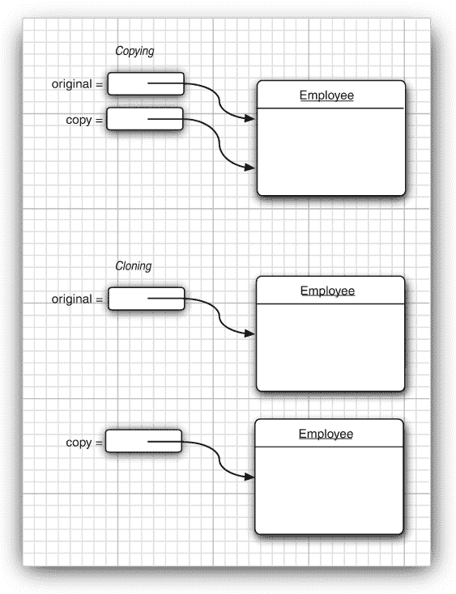

图 6.1 拷贝与克隆

如果你希望 `copy` 是一个新对象，其初始状态与 `original` 相同，但状态会随时间推移发生变化，请使用 `clone` 方法。

```
Employee copy = original.clone();

copy.raiseSalary(10); // OK--original 未改变
```

但情况并没那么简单。`clone` 方法是 `Object` 的一个 `protected` 方法，这意味着你的代码不能直接调用它。只有 `Employee` 类可以克隆 `Employee` 对象。这种限制是有原因的。想一下 `Object` 类是如何实现 `clone` 的。它对该对象一无所知，因此它只能进行逐个字段的复制。如果对象中的所有实例字段都是数字或其他基本类型，那么复制字段就是没问题的。但如果对象包含对子对象的引用，那么复制字段将给你另一个指向同一个子对象的引用，因此原始对象和克隆对象仍然共享某些信息。

为了视觉化这一点，考虑在第 4 章中引入的 `Employee` 类。图 6.2 显示了使用 `Object` 类的 `clone` 方法克隆此类 `Employee` 对象时发生的情况。如你所见，默认的克隆操作是“浅”的——它不会克隆其他对象内部的对象。（图中显示了一个共享的 `Date` 对象。由于稍后明确的原因，这个示例使用了 `Employee` 类的版本，其中入职日期用 `Date` 表示。）

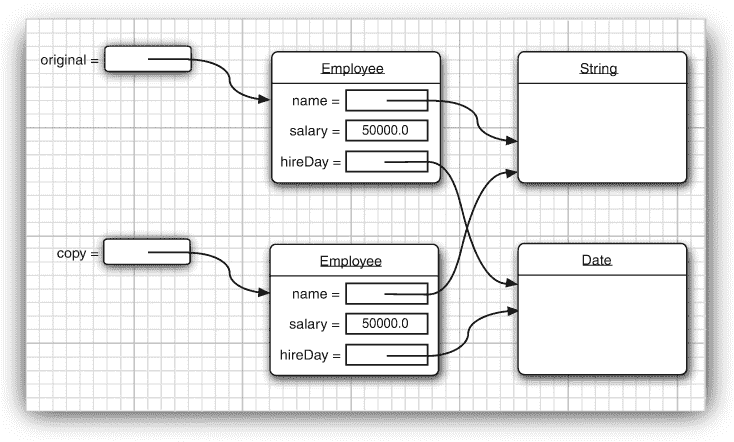

图 6.2 浅拷贝

拷贝是浅的是重要吗？这取决于情况。如果原始对象和浅克隆之间共享的子对象是**不可变的**，那么这种共享就是安全的。如果子对象属于一个不可变类（如 `String`），这种情况确实会发生。或者，子对象在对象的整个生命周期内可能一直保持不变，没有修改器触碰它，也没有方法返回它的引用。

然而，子对象通常是可变的，你必须重新定义 `clone` 方法以进行**深拷贝**，即也克隆子对象。在我们的示例中，`hireDay` 字段是 `Date` 类型，它是可变的，因此它也必须被克隆。（由于这个原因，此示例使用了 `Date` 类型的字段而不是 `LocalDate` 来演示克隆过程。如果 `hireDay` 是不可变类 `LocalDate` 的实例，则不需要进一步的操作。）

对于每个类，你都需要决定：

1. 默认的 `clone` 方法是否足够；
2. 默认的 `clone` 方法是否可以通过对可变子对象调用 `clone` 来修复；或者
3. 不应尝试 `clone`。

第三种选项实际上是默认选项。要选择第一或第二种选项，类必须：

1. 实现 `Cloneable` 接口；并且
2. 使用 `public` 访问修饰符重新定义 `clone` 方法。

***

 **注意：**

`clone` 方法在 `Object` 类中被声明为 `protected`，因此你的代码不能直接调用 `anObject.clone()`。但 `protected` 方法不是可以在任何子类中访问吗？而且每个类不都是 `Object` 的子类吗？幸运的是，受保护访问的规则更为微妙（参见第 5 章）。子类只能调用受保护的 `clone` 方法来克隆*自己的*对象。你必须将 `clone` 重新定义为 `public`，以便允许任何方法克隆对象。

***

在这种情况下，`Cloneable` 接口的出现与接口的标准用法无关。特别是，它*并没有*指定 `clone` 方法——该方法是从 `Object` 类继承的。接口仅作为一个标记，表示类设计者理解克隆过程。对象对克隆非常偏执，以至于如果对象请求克隆但没有实现该接口，它们就会抛出一个检查异常。

***

 **注意：**

`Cloneable` 接口是 Java 提供的少数*标记接口*（tagging interfaces）之一。（有些程序员称之为*标记接口* marker interfaces。）回 `Comparable` 这样的接口的通常用途是确保类实现某个特定方法或一组方法。标记接口没有方法；它的唯一用途是允许在类型查询中使用 `instanceof`：

`if (obj instanceof Cloneable) . . .`

我建议不要在你自己的程序中使用标记接口。

***

即使 `clone` 的默认（浅拷贝）实现已经足够，你仍然需要实现 `Cloneable` 接口，重新定义 `clone` 为 `public`，并调用 `super.clone()`。这是一个示例：

```
class Employee implements Cloneable

{
   // public 访问，更改返回类型

   public Employee clone() throws CloneNotSupportedException

   {
     return (Employee) super.clone();
   }
}
```

***

 **注意：**

`clone` 方法在 `Object` 类中被声明为 `protected`，因此你的代码不能直接调用 `anObject.clone()`。在 1.4 之前，`clone` 方法的返回类型总是 `Object`。现在你可以指定正确的 `clone` 返回类型。这是协变返回类型的示例（参见第 5 章）。

***

你刚刚看到的 `clone` 方法并没有为浅拷贝添加任何功能。它只是让方法变为公共。为了实现深拷贝，你必须更努力并克隆可变字段。这是一个创建深拷贝的 `clone` 方法示例：

```
class Employee implements Cloneable

{
   public Employee clone() throws CloneNotSupportedException

   {
     // 调用 Object.clone()
     Employee cloned = (Employee) super.clone();
     // 克隆可变字段
     cloned.hireDay = (Date) hireDay.clone();
     return cloned;
   }
}
```

`Object` 类的 `clone` 方法威胁要抛出 `CloneNotSupportedException`——当在没有实现 `Cloneable` 的对象上调用 `clone` 时。当然，`Employee` 和 `Date` 类实现了 `Cloneable` 接口，所以异常不会抛出。然而，编译器并这一点。因此，我们声明了异常：

```
public Employee clone() throws CloneNotSupportedException
```

***

 **注意：**

捕获异常是否更好？（异常详情请参见第 7 章）。

```
public Employee clone()
{
   try
   {
     Employee cloned = (Employee) super.clone();
     // . .
   }
   catch (CloneNotSupportedException e) { return null; }
   // 这不会发生，因为我们是 Cloneable
}
```

这对于 `final` 类是合适的。否则，保留 `throws` 标识符更好。这为子类提供了抛出 `CloneNotSupportedException` 的选择。

***

你必须小心子类的克隆。例如，一旦你为 `Employee` 类定义了 `clone` 方法，任何人都可以它来克隆 `Manager` 对象。`Employee` 的 clone 方法能胜任吗？这取决于 `Manager` 类的字段。在案例中，没有问题，因为 `bonus` 字段是基本类型。但 `Manager` 可能会获得需要深拷贝或不可克隆的字段。无法保证子类的实现者已经修复了 `clone` 以完成正确的事。出于这个原因，`clone` 方法在 `Object` 类中被声明为 `protected`。但如果你想让类的用户调用 `clone`，你就没有这种奢侈。

你是否应该在自己的类中实现 `clone` 方法？如果你的客户端需要进行深拷贝，那么你可能确实应该。有些作者认为你应该完全避免使用 `clone`，而是实现另一个方法来实现相同的目的。我同意 `clone` 确实相当别扭，但如果你将责任转移到另一个方法，你仍然会遇到相同的问题。无论如何，克隆操作比你想象的要少得多。标准库中只有少于 5% 的类实现了 `clone`。

插图 6.4 中的程序克隆了 `Employee` 类的实例（插图 6.5），然后调用了两个变异器（mutators）。`raiseSalary` 方法改变了 `salary`字段的值，而 `setHireDay` 方法改变了 `hireDay` 字段的状态。这两个修改操作都不会影响原始对象，因为 `clone` 方法被定义为执行深拷贝。

***

 **注意：**

所有数组类型都有一个公共的（public）`clone` 方法，而不是受保护的（protected）。你可以使用它创建一个包含所有元素拷贝的新数组。例如：

```
int[] luckyNumbers = { 2, 3, 5, 7, 11, 13 };

int[] cloned = luckyNumbers.clone();

cloned[5] = 12; // 不改变 luckyNumbers[5]
```

***

***

 **注意：**

第二卷第 2 章 展示了克隆对象的另一种机制，使用 Java 的对象序列化功能。该机制实现起来简单且安全，但效率不高。

***

**插图 6.4** `clone/CloneTest.java`

```
 1  package clone;
 2
 3 /**
 4 * 此程序演示了克隆操作。
 5   @version 1.11 2018-03-16
 6 * @author Cay Horstmann
 7  */
 8 public class CloneTest
 9  {
10    public static void main(String[] args) throws CloneNotSupportedException
11   {
12       var original = new Employee("John Q. Public", 50000);
13       original.setHireDay(2000, 1, 1);
14       Employee copy = original.clone();
15       copy.raiseSalary(10);
16       copy.setHireDay(2002, 12, 31);
17       System.out.println("original=" + original);
18       System.out.println("copy=" + copy);
19    }
20  }
```

**插图 6.5** `clone/Employee.java`

```
 1  package clone;
 2
 3 import.....;
 4 import java.util.Gregorianorian;
 5
 6 public class Employee implements Cloneable
 7 {
 8  private String name;
 9  private double salary;
10  private Date hireDay;
11
12  public Employee Employee(String name, double salary))
13  {
14     this.name = name;
15     this.salary = salary;
16     hireDay = new Date();
17   }
18
19  public Employee clone() throws CloneNotSupportedException
20  {
21    // 调用 Object.clone()
22    Employee cloned = (Employee) super.clone();
23
24    // 克隆可变字段
25    cloned.hireDay = (Date) hireDay.clone();
26
27    return cloned;
28  }
29
30  /**
31  * 将入职日期设置为指定的日期。
32  * @param year 入职日的年份
33  * @param month 入职日的月份
34  * @param day 入职日的日期
35  */
36  public void setHireDay(int year, int month, int day)
37  {
38    GregorianCalendar cal = new GregorianCalendar(year, month, day);
39    hireDay = cal.getDate();
40  }
41
42  public void raiseSalary(double salary)
43  {
44    this.salary += salary;
45  }
46
47  public String toString()
48  {
49    return Employee[" + name + ",salary=" + salary + ",hireDay=" + hireDay + "]";
50  }
51 }
```

### 6.2 Lambda 表达式

你是否应该在自己的类中实现 `clone` 方法？如果你的客户端需要深拷贝，那么你可能确实应该。有些作者认为你应该完全避免使用 `clone`，而是实现另一个方法来实现相同的目的。我同意 `clone` 确实相当别扭，但如果你将责任转移到另一个方法，你仍然会遇到相同的问题。无论如何，克隆操作比你想象的要少得多。标准库中只有少于 5% 的类实现了 `clone`。

插图 6.4 中的程序克隆了 `Employee` 类的实例（插图 6.5），然后调用了两个变异器。`raiseSalary` 方法改变了 `salary` 字段的值，而 `setHireDay` 方法改变了 `hireDay` 字段的状态。这两个修改操作都不会影响原始对象，因为 `clone` 方法被定义为执行深拷贝。

***

 **注意：**

所有数组类型都有一个公共的（public）`clone` 方法，而不是受保护的（protected）。你可以使用它创建一个包含所有元素拷贝的新数组。例如：

```
int[] luckyNumbers = { 2, 3, 5, 7, 11, 13 };

int[] cloned = luckyNumbers.clone();

cloned[5] = 12; // 不改变 luckyNumbers[5]
```

***

***

 **注意：**

第二卷第 2 章 展示了克隆对象的另一种机制，使用 Java 的对象序列化功能。该机制实现起来简单且安全，但效率不高。

***

**插图 6.4** `clone/CloneTest.java`

```
 1  package clone;
 2
 3 /**
 4 * 此程序演示了克隆操作。
 5   @version 1.11 2018-03-16
 6 * @author Cay Horstmann
 7  */
 8 public class CloneTest
 9  {
10    public static void main(String[] args) throws CloneNotSupportedException
11   {
12      var original = new Employee("John Q. Public", 50000);
13      original.setHireDay(2000, 1, 1);
14      Employee copy = original.clone();
15      copy.raiseSalary(10);
16      copy.setHireDay(2002, 12, 31);
```


`System.out.println("original=" + original);`

`System.out.println("copy=" + copy);`

**插图 6.5** `clone/Employee.java`

```java
package clone;

import java.util.Date;
import java.util.GregorianCalendar;

public class Employee implements Cloneable
{
    private String name;
    private double salary;
    private Date hireDay;

    public Employee(String name, double salary)
    {
        this.name = name;
        this.salary = salary;
        hireDay = new Date();
    }

    public Employee clone() throws CloneNotSupportedException
    {
        // 调用 Object.clone()
        Employee cloned = (Employee) super.clone();

        // 克隆可变字段
        cloned.hireDay = (Date) hireDay.clone();

        return cloned;
    }

    /**
     * 将入职日期设置为指定的日期。
     * @param year 入职日的年份
     * @param month 入职日的月份
     * @param day 入职日的日期
     */
    public void setHireDay(int year, int month, int day)
    {
        GregorianCalendar cal = new GregorianCalendar(year, month, day);
        hireDay = cal.getDate();
    }

    public void raiseSalary(double salary)
    {
        this.salary += salary;
    }

    public String toString()
    {
        return "Employee[" + name + ",salary=" + salary + ",hireDay=" + hireDay + "]";
    }
}
```

### 6.2 Lambda 表达式

Lambda 表达式简单来说就是一个代码块，加上任何必须传递给该代码的变量说明。为什么叫这个名字？许多年前，在计算机出现之前，逻辑学家阿隆佐·丘（Alonzo Church）想要形式化数学函数是有效计算的。（有趣的是，有些函数是已知存在的，但没有人知道计算它们的值。）他使用希腊字母 lambda（λ）来标记参数。如果他知道 Java 的 API，他会写下

```java
λfirst.λsecond.first.length() - second.length()
```

* * *

 **注意：**

为什么要用 `λ` 字母？是 Church 用完字母表里的其他字母了吗？实际上，古雅的《数学原理》（*Principia Mathematica*）使用 `^` 变音来表示自由变量，这启发了 Church 使用大写的 lambda `ᴧ` 作为参数。但最后，他切换到了小写版本。从那时起，带有参数变量的表达式就被称为 lambda 表达式（lambda expression）。

* * *

你刚刚看到的是 Java 中 lambda 表达式的一种简单形式：参数、`->` 箭头和一个表达式。如果代码执行的计算不符合单个表达式，请完全按照你编写方法的方式来编写它：封装在 `{}` 中，并带有显式的 `return` 语句。例如，

```java
(String first, String second) ->
{
    if (first.length() < second.length()) return -1;
    else if (first.length() > second.length()) return 1;
    else return 0;
}
```

如果 lambda 表达式没有参数，你仍然需要提供空括号，就像处理无参数的方法一样：

```java
() -> { for (int i = 100; i >= 0; i--) System.out.println(i); }
```

如果 lambda 表达式的参数类型可以被推断，你就可以省略它们。例如，

```java
Comparator<String> comp
    = (first, second) // 等于 (String first, String second)
    -> first.length() - second.length();
```

在这里，编译器可以推出 `first` 和 `second` 必须是字符串，因为该 lambda 表达式被赋值给了一个字符串比较器。（我们将在下一节中详细讨论这种赋值。）

如果方法有一个类型可推断的单个参数，你甚至可以省略括号：

```java
ActionListener listener = event ->
    System.out.println("The time is "
        + Instant.ofEpochMilli(event.getWhen()));
    // 而不是 (event) -> . . . 或 (ActionEvent event) -> . . .
```

你永远不需要手动指定 lambda 表达式的结果类型。它总是从上下文中推断出来的。例如，该表达式

```java
(String first, String second) -> first.length() - second.length()
```

可以用于期望类型为 `int` 结果的上下文。

最后，你可以使用 `var` 来表示推断出的类型。这并不常见。这种语法是为了附加注解而发明的（参见第二卷的第 8 章）：

```java
(@NonNull var first, @NonNull var second) -> first.length() - second.length()
```

* * *

 **注意：**

lambda 表达式在某些分支中返回返回值而在其他分支中不返回是非法的。例如，`(int x) -> { if (x >= 0) return 1; }` 是无效的。

* * *

列表 6.6 中的程序展示了如何使用 lambda 表达式作为比较器动作监听器。

**列表 6.6** `lambda/LambdaTest.java`

```java
package lambda;

import java.util.*;
import javax.swing.*;
import javax.swing.Timer;

/**
 * 此程序演示了 lambda 表达式的使用。
 * @version 1.0 2015-05-12
 * @author Cay Horstmann
 */
public class LambdaTest
{
    public static void main(String[] args)
    {
        var planets = new String[] { "Mercury", "Venus", "Earth", "Mars",
            "Jupiter", "Saturn", "Uranus", "Neptune" };
        System.out.println(Arrays.toString(planets));
        System.out.println("Sorted in dictionary order:");
        Arrays.sort(planets);
        System.out.println(Arrays.toString(planets));
        System.out.println("Sorted by length:");
        Arrays.sort(planets, (first, second) -> (first.length() - second.length()));
        System.out.println(Arrays.toString(planets));
        var timer = new Timer(1000, event -> {
            System.out.println("The time is "
                + Instant.ofEpochMilli(event.getWhen()));
            Toolkit.getDefaultToolkit().beep();
        });
        timer.start();
        JOptionPane.showMessageDialog(null, "Quit?");
        System.exit(0);
    }
}
```

#### 6.2.3 函数式接口

正如我们讨论的，有许多接口封装了代码。拥有单个方法的接口被称为*函数式接口*（functional interface）。

* * *

 **注意：**

你可能奇怪，为什么 lambda 表达式必须有一个抽象方法。实际上，古雅的《数学原理》（*Principia Mathematica*）使用 `^` 变音来表示自由变量，这启发了 Church 使用大写的 lambda `ᴧ` 作为参数。但最后，他切换到了小写版本。从那时起，带有参数变量的表达式就被称为 lambda 表达式。

你刚刚看到的是 Java 中 lambda 表达式的一种简单形式：参数、`->` 箭头和一个表达式。如果代码执行的计算不符合单个表达式，请完全按照你编写方法的方式来编写它：封装在 `{}` 中，并带有显式的 `return` 语句。例如，

如果 lambda 表达式没有参数，你仍然需要提供空括号，就像处理无参数的方法一样：

如果 lambda 表达式的参数类型可以被推断，你就可以省略它们。例如，

在这里，编译器可以推出 `first` 和 `second` 必须是字符串，因为该 lambda 表达式被赋值给了一个字符串比较器。（我们将在下一节中详细讨论这种赋值。）

如果方法有一个类型可推断的单个参数，你甚至可以省略括号：

你永远不需要手动指定 lambda 表达式的结果类型。它总是从上下文中推断出来的。例如，该表达式

`System.out.println("The time is " + Instant.ofEpochMilli(event.getWhen()));` 而不是 `(event) -> . . .` 或 `(ActionEvent event) -> . . .`

最后，你可以使用 `var` 来表示推断出的类型。这并不常见。这种语法是为了附加注解而发明的（参见第二卷的第 8 章）：

列表 6.6 中的程序展示了如何使用 lambda 表达式作为比较器动作监听器。

事实上，转换为函数式接口是你对 lambda 表达式所能做的*唯一*事情。在其他支持函数字面量的编程语言中，你可以声明如 `(String, String) -> int` 的函数类型，声明这些类型的变量，并使用变量保存函数表达式。然而，Java 设计者坚持使用接口的概念，而不是在语言中添加函数类型。

Java API 在 `java.util.function` 包中定义了许多通用的函数式接口。其中一个接口 `BiFunction<T, U, R>` 描述了参数类型为 `T` 和 `U` 返回类型为 `R` 的函数。你可以将你的字符串比较 lambda 保存在该类型的变量中：

然而，这对排序没有帮助。没有接受 `BiFunction` 的 `Arrays.sort` 方法。如果你用过函数式编程语言，可能会觉得这很奇怪。但对于 Java 程序员来说，这很自然。像 `Comparator` 这样的接口有特定的目的，而不仅仅具有给定参数和返回类型的方法。当你想要使用 lambda 表达式做某些事时，仍然想要记住表达式的目的，并为其一个特定的函数式接口。

`java.util.function` 包中一个特别有用的接口是 `Predicate`：

```java
public interface Predicate<T>
{
    boolean test(T t);
    // additional default and static methods
}
```

`ArrayList` 类有一个 `removeIf` 方法，其参数是一个 `Predicate`。它专门设计用于传递一个 lambda 表达式。例如，以下语句可以从数组列表中移除所有 `null` 值：

```java
list.removeIf(e -> e == null);
```

另一个实用的函数式接口是 `Supplier<T>`：

```java
public interface Supplier<T>
{
    T get();
}
```

供应商（Supplier）没有参数，并在调用时产生一个类型为 `T` 的值。供应商用于`惰性求值`（lazy evaluation）。例如，考虑以下调用：

```java
LocalDate hireDay = Objects.requireNonNullElse(day,
    new LocalDate.of(1970, 1, 1));
```

这并不是最优的。我们预期 `day` 很少为 `null`，因此我们只想在需要时构造默认的 `LocalDate`。通过使用供应商，我们可以推迟计算：

```java
LocalDate hireDay = Objects.requireNonNullElseGet(day,
    () -> new LocalDate.of(1970, 1, 1));
```

`requireNonNullElseGet` 方法只在需要值时才调用供应商。

#### 6.2.4 方法引用

有时，lambda 表达式涉及单个方法。例如，假设你只想在每次定时器事件发生时打印事件对象。当然，你可以调用：

```java
var timer = new Timer(1000, event -> System.out.println(event));
```

如果可以直接将 `println` 方法传递给 `Timer` 构造函数，会更好。以下是实现方法：

```java
var timer = new Timer(1000, System.out::println);
```

表达式 `System.out::println` 是方法引用。它引导编译器产生函数式接口的实例，通过重写接口的单个抽象方法来调用给的方法。在这个示例中，产生了一个 `ActionListener`，其 `actionPerformed(ActionEvent e)` 方法调用了 `System.out.println(e)`。

 **注意：**

和 lambda 表达式一样，方法引用并不是一个对象。当它被赋值给类型为函数式接口的变量时，就会产生一个对象。

 **注意：**

`PrintStream` 类中有十个重载的 `println` 方法（`System.out` 是该类的一个实例）。编译器需要根据上下文确定使用哪一个。在我们的示例中，方法引用 `System.out::println` 必须转换为一个具有方法的 `ActionListener` 实例：

```java
void actionPerformed(ActionEvent e)
```

由于 `Object` 是 `ActionEvent` 的最佳匹配项，因此从十个重载的 `println` 方法中选取了 `println(Object x)` 方法。当 `actionPerformed` 方法被调用时，事件对象会被打印出来。

现在假设我们将相同的方法引用赋值给另一个不同的函数式接口：

```java
Runnable task = System.out::println;
```

`Runnable` 函数式接口有一个没有参数的单个抽象方法：

```java
void run()
```

在这种情况下，选取了无参数的 `println()` 方法。调用 `task.run()` 会向 `System.out` 打印一个空行。

另一个例子，假设你想不分字母大小写对字符串进行排序。你可以传递此方法表达式：

```java
Arrays.sort(strings, String::compareToIgnoreCase)
```

从这些示例中可以看出，`::` 运算符将方法名与对象或类的名分开。三个变体：

1. `object::instanceMethod`
2. `Class::instanceMethod`
3. `Class::staticMethod`


在第一种变体中，方法引用等于一个 lambda 表达式，其参数被传递给该方法。在`System.out::println`的情况下，对象是`System.out`，方法表达式等于`x -> System.out.println(x)`。

在第二种变体中，第一个参数变成方法的隐式参数。例如，`String::compareToIgnoreCase`等于`(x, y) -> x.compareToIgnoreCase(y)`。

在第三种变体中，所有参数都传递给静态方法：`Math::pow`等于`(x, y) -> Math.pow(x, y)`。

表 6.1 将带你了解更多示例。

注意，只有当 lambda 表达式的主体调用单个方法且不做任何其他操作时，lambda 表达式才能被重写为方法引用。考虑此 lambda 表达式：

```
s -> s.length() == 0
```

这里有一个方法调用。但还有一个比较操作，所以你在这里不能使用方法引用。

 **注意：**

当存在多个同名的重载方法时，编译器将尝试从上下文中查找到你指的是哪一个。例如，`Math.max`方法有两个版本，一个针对整数，一个针对`double`值。选取哪一个取决于上下文。方法引用不是孤立存在的。它们是函数化且整合的。

 **注意：**

`Objects`类有一个方法`isNull`来测试对象是否为`null`。例如，`Objects::isNull`比`removeIf(e == null)`更易读。带对象的方法引用与其等效的 lambda 表达式之间存在细微差异。考虑类似`separator::equals`方法引用。如果`separator`为`null`，`separator::equals`会立即抛出`NullPointerException`。而 lambda 表达式`x -> separator.equals(x)`只在被调用时才会抛出`NullPointerException`。

你可以在方法引用中捕获`this`参数。例如，`this::equals`等于`x -> this.equals(x)`。使用`super`也是有效的。方法表达式

```
super::instanceMethod
```

使用`this`作为目标并调用父类的对应方法。这里有一个显示其机制的人为示例：

```
class Greeter
{
  public void greet(ActionEvent event)
  {
    System.out.println("Hello, the time is " + Instant.ofEpochMilli(event.getWhen()));
  }
}

class RepeatedGreeter extends Greeter
{
  public void greet(ActionEvent event)
  {
    var timer = new Timer(1000, super::greet);
    timer.start();
  }
}
```

当`RepeatedGreeter.greet`方法启动时，会构造一个`Timer`，每次定时时执行`super::greet`方法。

### 6.2.5 构造器引用

构造引用与方法引用相似，只是方法名是`new`。例如，`Person::new`是`Person`构造函数的引用。哪一个构造函数？取决于上下文。假设你有一个字符串列表。那么你可以通过对每个字符串调用构造函数，将其转换为`Person`对象的数组，调用方式如下：

```
ArrayList<String> names = . . .;
Stream<Person> stream = names.stream().map(Person::new);
List<Person> people = stream.toList();
```

我们将在第二卷的第 1 章中讨论`stream`、`map`和`toList`方法的细节。目前，重要的是`map`方法为列表中的每个元素调用`Person(String)`构造函数。如果存在多个`Person`构造函数，编译器会选择带有`String`参数的那一个，因为它从上下文中推断出构造函数是带有字符串调用的。

你可以使用数组类型创建构造引用。例如，`int[]::new`是一个带有一个参数的构造引用：即数组的长度。它等同于 lambda 表达式`n -> new int[n]`。

数组构造引用有助于克服 Java 的一个局限性。正如你将在第 8 章中所看到的，无法构造泛型类型`T`的数组。（表达式`new T[n]`是错误的，因为它会被“擦除”为`new Object[n]`）。对于库的作者来说这是一个问题。例如，假设我们想要有一个`Person`对象的数组。`Stream`接口有一个`toArray`方法，它返回一个`Object`数组：

```
Object[] people = stream.toArray();
```

但这并不能令人满意。用户想要的是`Person`引用数组，而不是`Object`引用数组。流式库通过构造引用解决了该问题。将`Person[]::new`传递给`toArray`方法：

```
Person[] people = stream.toArray(Person[]::new);
```

`toArray`方法调用此构造函数以获取正确类型的数组。然后它填充并返回该数组。

#### 6.2.6 变量作用域

通常，你希望在 lambda 表达式中访问闭包方法或类中的变量。考虑这个示例：

```
public static void repeatMessage(String text, int delay)
{
    ActionListener listener = event ->
        {
            System.out.println(text);
            Toolkit.getDefaultToolkit().beep();
        };
    new Timer(delay, listener).start();
}
```

考虑一个调用：

```
repeatMessage("Hello", 1000); // 每 1,000 毫秒打印一次 Hello
```

现在看 lambda 表达式内部的变量`text`。注意，该变量*并没有*在 lambda 表达式中定义。相反，它是`repeatMessage`方法的参数变量。

如果你仔细考虑，这里发生了一些并非显而易见的事情。lambda 表达式的代码可能会在`repeatMessage`返回且参数变量消失很久之后运行。`text`变量是如何保持状态的？

为了理解发生了什么，我们需要完善对 lambda 表达式的理解。一个 lambda 表达式包含三个要素：

1. 一个代码块

2. 参数

3. *自由*变量的值——即既不是参数也没有定义在代码内部的变量

在我们的示例中，lambda 表达式有一个自由变量`text`。表示该 lambda 表达式的数据结构必须存储自由变量的值——在我们的例子中，是字符串`"Hello"`。我们说这些值被 lambda 表达式*捕获*（captured）了。（具体如何实现是一个实现细节。例如，可以将 lambda 表达式转换为一个带有单个方法的对象，从而将自由变量的值复制到该对象的实例变量中。）

***

 **注意：**

代码块连同自由变量的值构成的技术术语称为*闭包*（closure）。如果有人自豪他们的语言拥有闭包，请放心，Java 也有。在 Java 中，lambda 表达式就是闭包。

***

正如你所见，lambda 表达式可以捕获闭包作用域中变量的值。在 Java 中，为了确保捕获的值是有良好定义的，有一个重要的限制。在 lambda 表达式中，你只能引用值不改变的变量。例如，以下代码是非法的：

```
public static void countDown(int start, int delay)
{
    ActionListener listener = event ->
        {
            start--; // 错误：无法修改捕获的变量
            System.out.println(start);
        };
    new Timer(delay, listener).start();
}
```

这种限制是有原因的。当多个操作并发执行时，在 lambda 表达式中修改变量是不安全的。对于我们目前看到的种类的操作不会发生这种情况，但通常来说这是一个严重的问题。关于这一重要问题的更多信息，请参阅第 12 章。

在 lambda 表达式中引用在外部被修改的变量也是非法的。例如，以下代码是非法的：

```
public static void repeat(String text, int count)
{
  for (int i = 1; i <= count; i++)
  {
        ActionListener listener = event ->
            {
                System.out.println(i + ": " + text);
                // 错误：无法引用变化的 i
            };
    new Timer(1000, listener).start();
  }
}
```

规则是，lambda 表达式中的任何捕获变量必须是*有效最终的*（effectively final）。有效最终变量是指在初始化后从没有被赋值过新值的变量。在我们的例子中，`text`始终引用同一个`String`对象，捕获它是可以的。然而`i`的值被修改了，因此`i`不能被捕获。

引入同名变量是非法的。

```
Path first = Path.of("/usr/bin");

Comparator<String> comp = (first, second) -> first.length() - second.length(); // 错误：变量已定义
```

在 lambda 表达式中使用`this`时，引用`this`并没有特殊之处。在方法内部，例如考虑：

```
public class Application
{
    public void init()
    {
        ActionListener listener = event ->
            {
                System.out.println(this.toString());
            };
        new Timer(delay, listener).start();
    }
}
```

`this.toString()`调用的是`Application`对象的`toString`方法，而不是`ActionListener`实例。lambda 表达式的作用域嵌套在`init`方法内部，`this`的含义。到目前为止，你已经看到了如何产生 lambda 表达式并将其传递给期望函数接口的方法。现在让我们看看编写可以处理 lambda 表达式的方法。

使用 lambda 的目的是*延迟执行*。毕竟，如果你现在就执行某些代码，你会这样做，而不会封装在 lambda 中。延迟执行代码有很多原因，例如：

- 在单独线程中运行代码

- 多次运行代码

- 在算法的正确点运行代码（例如排序中的比较操作）

- 当发生事情运行时代码（按钮点击、数据到达等）

- 在需要时运行代码

让我们来看简单的例子。假设你想重复执行操作`n`次。将操作和计数传递给`repeat`方法：

```
repeat(10, () -> System.out.println("Hello, World!"));
```

为了接受 lambda，我们需要选择（或在极少数情况下提供）一个函数接口。表 6.2 列出了 Java API 提供的最重要的函数接口。在这种情况下，我们可以使用`Runnable`接口：

```
public static void repeat(int n, Runnable action)
{
    for (int i = 0; i < n; i++) action.run();
}
```

**表 6.2** 常见函数接口

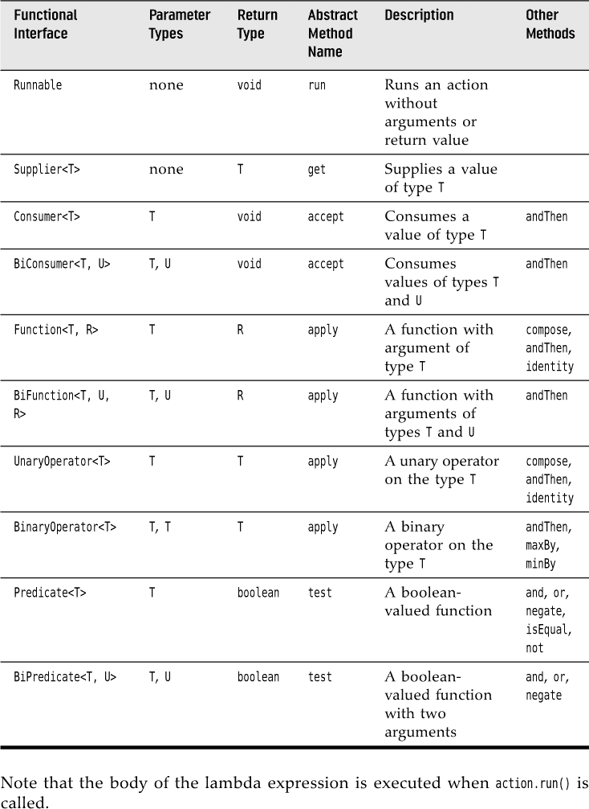

现在让我们这个例子变得稍微复杂一点。我们想说明动作是在哪一次迭代中执行的。为了这一点，我们需要选择一个具有`int`参数和`void`返回值的函数式接口。处理`int`值的标准接口是：

```java
public interface IntConsumer
{
  void accept(int value);
}
```

这里是改进后的`repeat`方法版本：

```java
public static void repeat(int n, IntConsumer action)
{
  for (int i = 0; i < n; i++) action.accept(i);
}
```

以及它的调用方式：

```java
repeat(10, i -> System.out.println("Countdown: " + (9 - i)));
```

表 6.3 列出了适用于原始类型`int`、`long`和`double`的 34 种可用特化。正如你在第 8 章 中看到的，使用这些特化类型比通用接口更高效。出于这个原因，在前一节的示例中，我使用了`IntConsumer`而不是`Consumer<Integer>`。

**表 6.3** 原始类型的函数式接口 *p*, *q* 是`int`、`long`、`double`；*P*, *Q* 是`Int`、`Long`、`Double`

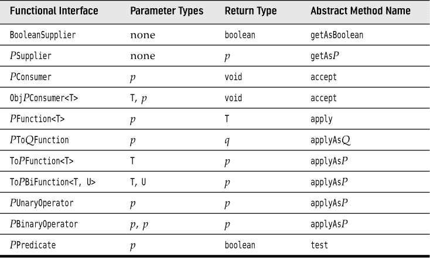

***

 **提示：**

尽可能使用来自表 6.2 或表 6.3 的接口是一个个好主意。例如，假设你写了一个方法来处理符合特定标准的文件。有一个遗留接口`java.io.FileFilter`，但使用标准的`Predicate<File>`更好。唯一不做的理由除非你已经有很多产生`FileFilter`实例的有用方法。

***

 **注意：**

大多数标准函数式接口都具有用于生成或组合函数的非抽象方法。例如，`Predicate.isEqual(a)`等于`a::equals`，但当`a`为`null`时它也有效。有默认方法`and`、`or`、`negate`用于组合谓词。例如，`Predicate.isEqual(a).or(Predicate.isEqual(b))`等于`x -> a.equals(x) || b.equals(x)`。

***

 **注意：**

如果你设计了一个只有一个单个抽象方法的接口，可以使用`@FunctionalInterface`注解对其进行标记。这有两个优点：如果你不小心添加了另一个抽象方法，编译器会给出错误信息；此外，javadoc 页面会包含一条声明，说明你的接口是一个函数式接口。

并不是强制使用该注解。任何带有单个抽象方法的接口从定义上讲都是函数式接口。但使用`@FunctionalInterface`注解是一个好主意。

***

 **注意：**

有些程序员喜欢方法调用链，例如：

```java
String input = " 618970019642690137449562111 ";
boolean isPrime = input.strip().transform(BigInteger::new).isProbablePrime(20);
```

`String`类的`transform`方法（Java 12 添加）将`Function`应用于字符串并产生结果。你完全可以写：

```java
boolean prime = new BigInteger(input.strip()).isProbablePrime(20);
```

但这样你的眼睛就会从向外、从左到右跳跃，以发现发生了什么，接着发生了什么：调用`strip`，然后构建`BigInteger`，最后测试它是否为概率素数。

我不确定眼睛从内向外、从左到右跳跃是一个巨大问题。但如果你更喜欢链式方法调用从左到右的顺序，那么`transform`就是你的朋友。

遗憾的是，它只对字符串有效。为什么`Object`类中没有`transform(java.util.function.Function)`方法呢？

Java API 的设计者们不够快。他们只有一次机会做这件事——在 Java 8 中，当`java.util.function.Function`接口被添加到 API 时。在此之前，没有人可以在自己的类中添加`transform(java.util.function.Function)`方法。但到 Java 12 时已经太晚了。某个地方的人可能已经在他们的类中定义了不同含义的`transform(java.util.function.Function)`。诚然，这不太可能发生，但无法得知。

这就是 Java 的工作方式。它严肃对待承诺，不会为了方便而背弃承诺。

### 6.2.8 关于更多 Comparator

`Comparator`接口有许多创建比较器的便利静态方法。这些方法旨在与 lambda 表达式或方法引用配合。


静态`comparing`方法接收一个“键提取器”函数，该函数将类型`T`映射到可比较的类型（如`String`）。该函数被应用于对象并进行比较。例如，在这里我们按姓名对人们排序：

```java
Arrays.sort(people, Comparator.comparing(Person::getName));
```

这比手动实现`Comparator`要容易得多。而且，代码更清晰，因为显然我们想按姓名比较。如果两个人的姓相同，则使用第二个比较器：

```java
Arrays.sort(people, Comparator.comparing(Person::getLastName).thenComparing(Person::getFirstName));
```

此外，`comparing`和`thenComparing`方法都有变体，可以避免`int`、`long`或`double`的装箱。上述操作的一种更容易方式是：

```java
Arrays.sort(people, Comparator.comparingInt(p -> p.getName().length()));
```

如果你的键函数可能返回`null`，你会喜欢`nullsFirst`和`nullsLast`适配器。这些静态方法接收现有的比较器并进行修改，使其遇到`null`时不会抛出异常，但将其排在普通值之前之后。例如，假设`getMiddleName`在人没有中间名时返回`null`。那么可以使用`Comparator.comparing(Person::getMiddleName, Comparator.nullsFirst(...))`。

`nullsFirst`需要一个比较器——在这种情况下，是一个比较字符串的比较器。`naturalOrder`方法为实现`Comparable`的类创建一个比较器。我们需要`Comparator<String>naturalOrder()`。这是按可能为空中间名的完整调用。我使用了`java.util.Comparator.*`的静态导入，使表达式更具可读性。注意`naturalOrder`的类型是推断出来的。

```java
Arrays.sort(people, comparing(Person::getMiddleName, nullsFirst(naturalOrder())));
```

静态`reverseOrder`方法给出自然顺序的反序。要反转任何比较器，使用`reversed`实例方法。例如，`naturalOrder().reversed()`等于`reverseOrder()`。

### 6.3 内部类

*内部类*是定义在类内部的类。你为什么要这样做？有两个原因：

- 内部类可以对包的其他类隐藏。
- 内部类方法可以访问定义作用域的数据——包括本应该是私有的数据。

内部类以前对于简洁地实现回调非常重要，但现在 lambda 表达式做得更好。尽管如此，内部类对于组织代码仍然有用。接下来的章节将带你介绍所有的细节。

***

 **C++ 注意：**

C++ 拥有`嵌套类`（nested classes）。嵌套类包含在外部类的作用域内。这里有一个典型的示例：链表类定义了一个类来存储节点，并定义了一个类来定义迭代器位置。

```cpp
class LinkedList
{
public:
   class Iterator // 一个嵌套类
   {
   public:
      void insert(int x);
      int erase();
      . . .
    private:
      Link* current;
      LinkedList* owner;
   };
   . . .
private:
   Link* head;
   Link* tail;
};
```

嵌套类与 Java 的内部类（inner classes）相似。然而，Java 的内部类有一个额外的功能，这使得它们比 C++ 的嵌套类更丰富、更有用。来自内部类的对象具有对实例化它的外部类对象的隐式引用。通过这个指针，它可以访问外部对象的完整状态。例如，在 Java 中，`Iterator`类不需要指向它所指向的`LinkedList`类的显式指针。

在 Java 中，`static`内部类没有这个额外的指针。它们是 C++ 嵌套类的 Java 对应物。

#### 6.3.1 使用内部类访问对象状态

内部类的语法相当复杂。因此，我提供了一个简单但有些人为的示例来为了演示内部类的用法。让我们重构`TimerTest`示例并提取出一个`TalkingClock`类。一个报时钟由两个参数构造：：播报之间的间隔以及一个开启或关闭提示声的标志。

```java
public class TalkingClock
{
   private int interval;
   private boolean beep;
   public TalkingClock(int interval, boolean beep) { . . . }
   public void start() { . . . }
   public class TimePrinter implements ActionListener
      // 一个内部类
   {
   . . .
   }
}
```

注意，`TimePrinter`类现在位于`TalkingClock`类内部。这**并不意味着**每个`TalkingClock`都有一个`TimePrinter`实例字段。正如你所看到的，`TimePrinter`对象是通过`TalkingClock`类的方法构造的。

下面是`TimePrinter`类的详细说明。注意，`actionPerformed`方法在发出提示声之前会检查`beep`标志。

```java
public class TimePrinter implements ActionListener
{
   public void actionPerformed(ActionEvent event)
   {
      System.out.println("At the tone, the time is "
          + Instant.ofEpochMilli(event.getWhen()));
      if (beep) Toolkit.getDefaultToolkit().beep();
   }
}
```

发生了一些令人惊讶的事情。`TimePrinter`类没有名为`beep`的实例字段或变量。相反，`beep`指向创建此`TimePrinter`的`TalkingClock`对象的字段。正如你所看到的，内部类方法可以访问自己的实例字段*以及*创建它的外部对象的字段。

为了实现这一点，内部类对象总是获得对创建它的对象的隐式引用（请参见 图 6.3）。

该引用在内部类的定义中是不可见的。然而，为了阐明这一概念，我们将指向外部对象的引用称为`outer`。那么`actionPerformed`方法等同于以下：

```java
public void actionPerformed(ActionEvent event)
{
   System.out.println("At the tone, the time is "
       + Instant.ofEpochMilli(event.getWhen()));
   if (outer.beep) Toolkit.getDefaultToolkit().beep();
}
```

外部类引用在构造函数中设置。编译器会修改所有内部类构造函数，添加一个用于外部类引用的参数。`TimePrinter`类没有定义构造函数；因此，编译器合成了一个无参数构造函数，生成类似如下的代码：


**图 6.3** 内部类对象有一个指向外部类对象的引用。

```java
public TimePrinter(TalkingClock clock) // 自动生成的代码
{
   outer = clock;
}
```

再次请注意，`outer`并不是 Java 关键字。我们只是用它来说明内部类涉及的机制。

当在`start`方法中构造`TimePrinter`对象时，编译器会将当前报时钟的`this`引用传递给构造函数：

```java
var listener = new TimePrinter(this); // 自动添加参数
```

Listing 6.7 显示了测试内部类的完整程序。再次查看访问控制。如果`TimePrinter`类是一个普通类，它将需要通过`TalkingClock`类的公共方法来访问`beep`标志。使用内部类是一种改进。没有必要提供仅对另一个类感兴趣的访问。

**注意：** 我们可以将`TimePrinter`类声明为`private`。这样只有`TalkingClock`方法能够构造`TimePrinter`对象。只有内部类可以是私有的。普通类要么有包级访问权限，要么有公共访问权限。

**Listing 6.7** `innerClass/InnerTest.java`

```java
package innerClass;

import java.awt.*;
import java.awt.event.*;
import java.time.*;
import javax.swing.*;

/**
 * 此程序演示了内部类的用法。
 * @version 1.1 2017-12-14
 * @author Horstmann
 */
public class InnerClass
{
   public static void main(String[] args)
   {
      var clock = new TalkingClock(1000, true);
      clock.start();

      // 直到用户选择“OK”保持程序运行
      JOptionPane.showMessageDialog(null, "Quit?");
      System.exit(0);
   }
}

/**
 * 一个按定期打印时间的闹钟
 */
class TalkingClock
{
   private int interval;
   private boolean beep;

   /**
    * 构造一个报时钟
    * @param interval 消息之间的间隔（毫秒）
    * @param beep 闹钟是否发出提示声
    */
   public TalkingClock(int interval, boolean beep)
   {
      this.interval = interval;
      this.beep = beep;
   }

   /**
    * 启动闹钟。
   */
   public void start()
   {
      var listener = new TimePrinter();
      var timer = new Timer(interval, listener);
      timer.start();
   }

   public class TimePrinter implements ActionListener
   {
      public void actionPerformed(ActionEvent event)
      {
         System.out.println("At the tone, the time is "
             + Instant.ofEpochMilli(event.getWhen()));
         if (beep) Toolkit.getDefaultToolkit().beep();
      }
   }
}
```

### 6.3.2 内部类的特殊语法规则

在前面的节中，我们通过调用`outer`来解释内部类的外部类引用。实际上，外部引用的正确语法要复杂一点。表达式

```
OuterClass.this
``` 表示外部类引用。例如，你可以将`TimePrinter`内部类的`actionPerformed`方法写为：

```java
public void actionPerformed(ActionEvent event)
{
   . . .
   if (TalkingClock.this.beep) Toolkit.getDefaultToolkit().beep();
}
```

相反，你可以使用语法显式地编写内部对象构造函数：

```
outerObject.new InnerClass(construction parameters)
```

例如：

```java
ActionListener listener = this.new TimePrinter();
```

在这里，新构造的`TimePrinter`对象的外部类引用设置为创建内部类对象的`this`引用。这是最常见的情况。如既往，`this.`修饰符是多余的。然而，也可以通过显式命名将外部类引用设置为另一个对象。例如，由于`TimePrinter`是一个公共内部类，你可以为任何报时钟构造一个`TimePrinter`：

```
var jabberer = new TalkingClock(1000, true);

TalkingClock.TimePrinter listener = jabberer.new TimePrinter();
```

注意，当内部类出现在外部类的作用范围之外时，你需要像下面这样引用它：

```
OuterClass.InnerClass
```

***

 **注意：**

在内部类中声明的任何静态字段必须是`final`的，并用编译时常量进行初始化。如果该字段不是常量，它可能不是唯一的。

内部类不能拥有`static`方法。Java 语言规范没有为这种限制提供任何理由。理论上，可以允许仅访问外部类中静态字段和方法的`static`方法。显然，语言设计者认为这种复杂性超过了其带来的收益。

***

### 6.3.3 内部类有用吗？真的必要吗？安全吗？

当 Java 1.1 在 Java 语言中加入内部类时，许多程序员认为这是一项重大的新特性，这与 Java 追求比 C++ 更简单的哲学理念格格道而行。内部类的语法不可否认地复杂。（在我们在本章后面学习匿名内部类时，它会变得更加复杂。）内部类如何与语言的其他特性（如访问控制和安全）交互，并不显而易见。

内部类被翻译成普通的类文件，用`$`（美元符号）分隔外部类和内部类名。例如，`TalkingClock`类内部的`TimePrinter`类被翻译为类文件`TalkingClock$TimePrinter.class`。要观察这一过程，请尝试以下实验：运行第 5 章 中的`ReflectionTest`程序，并给它`TalkingClock$TimePrinter`类进行反射。或者，简单地使用`javap`工具：

```
javap -private ClassName
```

***

 **注意：**

如果你使用 UNIX，请记住在命令行上提供类名时转义`$`字符。也就是说，运行`ReflectionTest`或`javap`程序的方式如下：

```
java --classpath .:../v1ch05 reflection.ReflectionTest \

   innerClass.TalkingClock\$TimePrinter
```

或者

```
javap -private innerClass.TalkingClock\$TimePrinter
```

***

你将获得以下输出：

```
public class innerClass.TalkingClock$TimePrinter

    implements java.awt.event.ActionListener

{

  final innerClass.TalkingClock this$0;
  public innerClass.TalkingClock$TimePrinter(innerClass.TalkingClock);

  public void actionPerformed(java.awt.event.ActionEvent);

}
```

你可以清楚地看到，编译器为指向外部类的引用生成了一个额外的实例字段`this$0`。（`this$0`的名称是编译器合成的——你不能在代码中引用它）。你还可以看到构造函数中的`TalkingClock`参数。

如果编译器可以自动完成这种转换，你难道不能自己手动编写相同的机制吗？让我们试一一下。我们将`TimePrinter`变成一个位于`TalkingClock`类之外的普通类。在构造`TimePrinter`对象时，我们将创建该对象的`this`引用传递给它。

```
class TalkingClock

{
  . . .

  public void start()
  {

      var listener = new TimePrinter(this);

      var timer = new Timer(interval, listener);

      timer.start();

  }
}

class TimePrinter implements ActionListener

{
  private TalkingClock outer;
  . . .

  public TimePrinter(TalkingClock clock)
  {

      outer = clock;

  }
}
```


现在让我们来看 `actionPerformed` 方法。它需要访问 `outer.beep`。

```
if (outer.beep) . . . // 错误
```

在这里我们遇到了问题。内部类可以访问外部类的私有数据，但我们的外部 `TimePrinter` 类不能。

因此，内部类确实比普通类强大，因为它们拥有更多的访问权限。

你可能很好奇内部类是如何获得这些额外访问权限的。在 Java 11 之前，内部类纯粹是编译器层面的现象，虚拟机对它们没有任何特殊认知。在那些日子，使用 `ReflectionTest` 程序或 `javap` 配合 `-private` 选项查看 `TalkingClock` 类显示：

```
class TalkingClock

{
  private int interval;
  private boolean beep;
  public TalkingClock(int, boolean);

  static boolean access$0(TalkingClock); // Java 11 之前

  public void start();
}
```

注意编译器添加到外部类中的静态 `access$0` 方法。它返回作为参数传递对象的 `beep` 字段。（方法名可能略有不同，例如 `access$000`，取决于编译器）。

这是一个潜在的安全风险，并让分析类文件的工具工作变得复杂。从 Java 11 开始，虚拟机理解类之间的嵌套关系，不再生成这些访问方法。

#### 6.3.4 局部内部类

如果你仔细观察 `TalkingClock` 示例的代码，你会发现你只需要使用一次 `TimePrinter` 类型的名称：即在 `start` 方法中创建该类型的对象时。

在这样的情况下，你可以在单个方法内部局部地定义该类。

```
public void start()
{
  class TimePrinter implements ActionListener
  {
    public void actionPerformed(ActionEvent event)
    {

        System.out.println("At the tone, the time is "
          + Instant.ofEpochMilli(event.getWhen()));

      if (beep) Toolkit.getDefaultToolkit().beep();

    }
  }

  var listener = new TimePrinter();
  var timer = new Timer(interval, listener);

  timer.start();
}
```

局部类从不带修饰符声明（即 `public` 或 `private`）。它们的作用域限制在声明它们的块中。

### 6.3.5 访问来自外部方法的变量

局部类相比内部类还有另一个优势。它们不仅可以访问外部类的字段，甚至可以访问局部变量！然而，这些局部变量必须是有效最终的（effectively final）。这意味着一旦它们被赋值，其值就永远不会改变。

这是一个典型的例子。我们将 `interval` 和 `beep` 参数从 `TalkingClock` 构造函数移动到 `start` 方法。

```
public void start(int interval, boolean beep)
{
  class TimePrinter implements ActionListener
  {
    public void actionPerformed(ActionEvent event)
    {

        System.out.println("At the tone, the time is "
          + Instant.ofEpochMilli(event.getWhen()));

      if (beep) Toolkit.getDefaultToolkit().beep();

    }
  }

  var listener = new TimePrinter();
  var timer = new Timer(interval, listener);

  timer.start();
}
```

注意，`TalkingClock` 类不再需要存储 `beep` 实例字段。它只是引用了 `start` 方法的 `beep` 参数变量。

也许这并不令人意外。毕竟这行

```
if (beep) . . .
```

终究是在 `start` 方法内部的，所以为什么它不能访问 `beep` 变量的值呢？

为了理解为什么这里存在微妙的问题，让我们更仔细地考虑控制流。

1. `start` 方法被调用。
2. 对象变量 `listener` 通过调用内部类 `TimePrinter` 的构造函数进行初始化。
3. `listener` 引用被传递给 `Timer` 构造函数，定时器启动，`start` 方法退出。此时，`beep` 参数变量不再存在。
4. 一秒后，`actionPerformed` 方法执行 `if (beep) . . .`

为了让 `actionPerformed` 方法中的代码生效，`TimePrinter` 类必须在 `beep` 参数值失效之前，将 `beep` 字段复制为 `start` 方法的局部变量。事实确实如此。在我们的示例中，编译器为该局部内部类合成了名称 `TalkingClock$1TimePrinter`。如果你再次使用 `ReflectionTest` 程序或 `javap` 工具来查看 `TalkingClock$1TimePrinter` 类，你将得到以下输出：

```
class TalkingClock$1TimePrinter

{
  TalkingClock$1TimePrinter();
  public void actionPerformed(java.awt.event.ActionEvent);
  final boolean val$beep;
  final TalkingClock this$0;
}
```

当创建一个对象时，`beep` 变量的当前值被存储在 `val$beep` 字段中。从 Java 11 开始，这是通过“嵌套伙伴”（nest mate）访问实现的。在此，内部类的构造函数有一个额外的参数来设置该字段。无论哪种方式，即使局部变量离开了作用域，内部类的字段依然存在。

#### 6.3.6 匿名内部类

在使用局部内部类时，你通常可以更进一步。如果你只想为该类创建一个对象，你甚至不需要给该类命名。这样的类被称为`匿名内部类`。

```java
public void start(int interval, boolean beep)
{
  var listener = new ActionListener()
      {
        public void actionPerformed(ActionEvent event)
        {
          System.out.println("At the tone, the time is "
              + Instant.ofEpochMilli(event.getWhen()));
          if (beep) Toolkit.getDefaultToolkit().beep();
        }
  };

  var timer = new Timer(interval, listener);
  timer.start();
}
```

这种语法确实非常晦涩。它的意思是：创建一个实现 `ActionListener` 接口的类的新对象，其中要求的方法 `actionPerformed` 是在大括号 `{ }` 内部定义的。

通常情况下，语法为：

```
new SuperType(construction parameters)

  {
内部类方法和数据

  }
```

在这里，`SuperType` 可以是一个接口，例如 `ActionListener`；那么内部类就实现该接口。`SuperType` 也可以是一个类；那么内部类就继承该类。

匿名内部类不能有构造函数，因为构造函数的名称必须与类名相同，而该类没有名称。相反，构造参数是传递给 `superclass` 构造函数的。特别是，每当内部类实现接口时，它不能有任何构造参数。尽管如此，你必须提供一组括号，如下：

```
new InterfaceType()

  {
    方法和数据

  }
```

你必须仔细观察才能看出构造一个类的新对象与构造一个继承该类的匿名内部类对象之间的区别。

```java
var queen = new Person("Mary");

// 一个 Person 对象

var count = new Person("Dracula") { . . . };

// 一个继承自 Person 的内部类对象
```

如果构造参数列表的右括号后面紧跟着一个左大括号，则正在定义一个匿名内部类。

---

 **注意：**

尽管匿名类不能有构造函数，但你可以提供一个对象初始化块：

```java
var count = new Person("Dracula")
  {
    { initialization }
    . . .
  };
```

---

`Listing 6.8` 包含了带有匿名内部类的计时闹钟程序的完整源代码。如果你将此程序与 `Listing 6.7` 进行比较，你会发现这种情况下使用匿名内部类的解决方案要短得多，而且希望通过一些练习，它可以变得容易理解。

多年来，Java 程序员惯常使用匿名内部类作为事件监听器和其他回调。现在，你使用 lambda 表达式会更好。例如，本节开头的 `start` 方法可以使用如下 lambda 表达式写得更简洁：

```java
public void start(int interval, boolean beep)
{
  var timer = new Timer(interval, event -> { System.out.println(
      "At the tone, the time is " + Instant.ofEpochMilli(event.getWhen()));
      if (beep) Toolkit.getDefaultToolkit().beep(); });
  timer.start();
}
```

---

 **注意：**

如果你将匿名类实例存储在用 `var` 定义的变量中，该变量会识别新添加的方法或字段：

```java
var bob = new Object() { String name = "Bob"; }

System.out.println(bob.name);
```

如果你将 `bob` 声明为类型 `Object`，那么 `bob.name` 将无法编译。用 `new Object() { String name = "Bob"; }` 构建的对象类型为“带有 `String name` 字段的 `Object`”。这是一个“不可表示的”（non-denotable）类型——你无法用 Java 语法表达的类型。尽管如此，编译器理解该类型，并可以将其设置为变量 `bob` 的类型。

---

 **注意：**

下面被称为“双大括号初始化”（double brace initialization）的技巧利用了内部类语法。假设你想构造一个 array list 并将其传递给一个方法：

```java
var friends = new ArrayList<String>();

friends.add("Harry");

friends.add("Tony");

invite(friends);
```

如果你不再需要这个 array list，让它匿名化会很好。但那时如何添加元素呢？方法如下：

```java
invite(new ArrayList<String>() {{ add("Harry"); add("Tony"); }});
```

注意双大括号。外层大括号创建了 `ArrayList` 的匿名子类。内层大括号是一个初始化块（参见第 4 章）。

在实践中，这种技巧很少用。更有可能的是 `invite` 方法接受任何 `List<String>`，而你只需传递 `List.of("Harry", "Tony")`。

---

 **注意：**

创建一个与父类几乎相同但不完全相同的匿名子类通常很方便。但你需要小心 `equals` 方法。在第 5 章中，我建议你的 `equals` 方法使用如下测试：

```
if (getClass() != other.getClass()) return false;
```

匿名子类将通过这个测试（不通过）。

当你产生日志或调试消息时，你通常希望包含当前类的名称，例如：

```java
System.err.println("Something awful happened in " + getClass());
```

但这在静态方法中会失败。毕竟，对 `getClass` 的调用是调用 `this.getClass()`，而静态方法没有 `this`。请使用以下表达式：

```java
new Object(){}.getClass().getEnclosingClass() // 获取静态方法的类
```

在这里，`new Object(){}` 创建了一个 `Object` 匿名子类的匿名对象，而 `getEnclosingClass` 获取它的封闭类——即包含静态方法的类。

---

```java
package anonymousInnerClass;

import java.awt.*;
import java.awt.event.*;
import java.time.*;

import javax.swing.*;

/**
 * This program demonstrates anonymous inner classes.
 * @version 1.12 2017-12-14
 * @author Cay Horstmann
 */
public class AnonymousInnerClassTest
{
    public static void main(String[] args)
    {
        var clock = new TalkingClock();
        clock.start(1000, true);

        // keep program running until the user selects "OK"
        JOptionPane.showMessageDialog(null, "Quit program?");
        System.exit(0);
    }
}

/**
 * A clock that prints the time in regular intervals.
 */
class TalkingClock
{
    /**
     * Starts the clock.
     * @param interval the interval between messages (in milliseconds)
     * @param beep true if the clock should beep
     */
    public void start(int interval, boolean beep)
    {
        var listener = new ActionListener()
        {
            public void actionPerformed(ActionEvent event)
            {
                System.out.println("At the tone, the time is "
                    + Instant.ofEpochMilli(event.getWhen()));
                if (beep) Toolkit.getDefaultToolkit().beep();
            }
        };
        var timer = new Timer(interval, listener);
        timer.start();
    }
}
```

#### 6.3.7 静态内部类

有时，你可能只是想使用内部类来将一个类隐藏在另一个类内部——但你不需要内部类拥有外部类对象的引用。你可以通过将内部类声明为 `static` 来抑制该引用的生成。

这里有一个你想要这样操作的典型示例。考虑计算数组中最小值和最大值的任务。当然，你写了一个方法来计算最小值，另一个方法来计算最大值。当你调用这两个方法时，数组会被遍历两次。如果遍历一次数组并同时计算最小值和最大值会更有效。

```java
double min = Double.POSITIVE_INFINITY;

double max = Double.NEGATIVE_INFINITY;

for (double v : values)
{
  if (min > v) min = v;
  if (max < v) max = v;
}
```

然而，该方法必须返回两个数字。我们可以通过定义一个持有两个值的类 `Pair` 来实现：


```java
class Pair
{
  private double first;
  private double second;
  public Pair(double f, double s)
  {
      first = f;
      second = s;
  }
  public double getFirst() { return first; }
  public double getSecond() {  return second; }
}
```

此时 `minmax` 方法就可以返回一个 `Pair` 类型的对象。

```java
class ArrayAlg
{
  public static Pair minmax(double[] values)
  {
    ...
    return new Pair(min, max);
  }
}
```

方法的调用者使用 `getFirst` 和 `getSecond` 方法来获取答案：

```java
Pair p = ArrayAlg.minmax(d);
System.out.println("min = " + p.getFirst());
System.out.println("max = " + p.getSecond());
```

当然，`Pair` 是一个极其常见的名称，在一个大型项目中，可能其他程序员也有同样的想法——制作了一个包含字符串对的 `Pair` 类。我们可以通过将 `Pair` 设为 `ArrayAlg` 内部的公共内部类来解决这种潜在的冲突。这样该类将被称为 `ArrayAlg.Pair`：

```java
ArrayAlg.Pair p = ArrayAlg.minmax(d);
```

然而，与之前使用的内部类不同，我们不希望在 `Pair` 对象内部拥有对任何对象的引用。可以通过将内部类声明为 `static` 来抑制该引用：

```java
class ArrayAlg
{
  public static class Pair
  {
    ...
  }
  ...
}
```

当然，只有内部类可以被声明为 `static`。静态内部类与其他内部类完全相同，不同在于静态内部类的对象没有指向生成它的外部类的引用。在我们的示例中，我们必须使用静态内部类，因为内部对象是在静态方法内部构造的：

```java
public static Pair minmax(double[] d)
{
  ...
  return new Pair(min, max);
}
```

如果 `Pair` 类没有被声明为 `static`，编译器将抱怨没有可用的 `ArrayAlg` 类型隐式对象来初始化内部类。

**注意：** 只要内部类不需要访问外部类对象，请始终使用静态内部类。有些程序员使用“嵌套类”（nested class）来描述静态内部类。

**注意：** 与普通内部类不同，静态内部类可以有静态字段和方法。

**注意：** 在接口内部声明的类自动是 `static`、`public` 的。

**注意：** 在类内部声明的接口、`record` 和枚举（enumerations）自动是 `static` 的。

列表 6.9 包含了 `ArrayAlg` 类和嵌套类 `Pair` 的完整源代码。

**列表 6.9** `staticInnerClass/StaticInnerClassTest.java`

```java
package staticInnerClass;

/**
 * This program demonstrates the use of static inner classes.
 * @version 1.02 2015-05-12
 * @author Cay Horstmann
 */
public class StaticInnerClassTest
{
    public static void main(String[] args)
    {
        var values = new double[20];
        for (int i = 0; i < values.length; i++)
            values[i] = 100 * Math.random();
        ArrayAlg.Pair p = ArrayAlg.minmax(values);
        System.out.println("min = " + p.getFirst());
        System.out.println("max = " + p.getSecond());
    }
}

class ArrayAlg
{
    /**
     * A pair of floating-point numbers
     */
    public static class Pair
    {
        private double first;
        private double second;

        /**
         * 从两个浮点数构造一个对
         * @param f 第一个数字
         * @param s 第二个数字
         */
        public Pair(double f, double s)
        {
            first = f;
            second = s;
        }

        /**
         * 返回第一个数字
         */
        public double getFirst()
        {
            return first;
        }

        /**
         * 返回第二个数字
         */
        public double getSecond()
        {
            return second;
        }
    }

    /**
     * 计算数组的最小值和最大值
     * @param values 浮点数数组
     * @return 一个第一个元素为最小值，第二个元素为最大值的对
     */
    public static Pair minmax(double[] values)
    {
        double min = Double.POSITIVE_INFINITY;
        double max = Double.NEGATIVE_INFINITY;
        for (double v : values)
        {
            if (min > v) min = v;
            if (max < v) max = v;
        }
        return new Pair(min, max);
    }
}
```

### 6.4 服务加载器（Service Loaders）

有时，你会开发一个具有服务架构的应用程序。有一些平台鼓励这种方法，例如 OSGi（[`http://osgi.org`](http://osgi.org)），它们用于开发环境、应用程序服务器和其他复杂的应用程序。这些平台远远超出本书的范围，但 JDK 同时也提供了一种简单的加载服务的机制，在此进行了描述。该机制得到了 Java 平台模块系统的良好支持——请见第二卷的第 9 章](#ch09.xhtml_ch9)。

通常在提供服务时，程序可能希望让服务设计者在实现服务功能方面拥有一定的自由。此外，有多个实现方案供选择可能也是理想的。`ServiceLoader` 类可以方便地加载符合通用接口的服务。

定义一个接口（或者如果你愿意，定义一个超类），其中包含每个服务实例应该提供的方法。例如，假设你的服务提供加密功能。

```java
package serviceLoader;

public interface Cipher

{
    byte[] encrypt(byte[] source, byte[] key);

    byte[] decrypt(byte[] source, byte[] key);

    int strength();

}
```

服务提供者提供一个或多个实现该服务的类，例如：

```java
package serviceLoader.impl;

public class CaesarCipher implements Cipher

{

    public byte[] encrypt(byte[] source, byte[] key)
    {
      var result = new byte[source.length];
      for (int i = 0; i < source.length; i++)
          result[i] = (byte)(source[i] + key[0]);
      return result;
    }

    public byte[] decrypt(byte[] source, byte[] key)
    {
      return encrypt(source, new byte[] { (byte) -key[0] });
    }

    public int strength() { return 1; }
}
```

实现类可以位于任何包中，不一定与服务接口在同一个包中。每个类必须有一个无参构造函数。

现在，将类名添加到 `META-INF/services` 目录下的一个 UTF-8 编码的文本文件中，该文件的名称必须与接口的完全限定名匹配。在我们的示例中，文件 `META-INF/services/serviceLoader.Cipher` 将包含以下行：

```text
serviceLoader.impl.CaesarCipher
```

在这个示例中，我们提供了一个单一实现类。你也可以提供多个类，并在以后从中进行选择。

完成这些准备后，程序按如下方式初始化服务加载器：

```java
public static ServiceLoader<Cipher> cipherLoader = ServiceLoader.load(Cipher.class);
```

这在程序中只需执行一次。

服务加载器的 `iterator` 方法返回一个遍历所有提供的服务实现类的迭代器。（有关迭代器的更多信息，请参阅第 9 章。）使用增强型 `for` 循环遍历它们是最简单的方法。在循环中，选择一个合适的对象来执行服务。

```java
public static Cipher getCipher(int minStrength)
{
  for (Cipher cipher : cipherLoader) // 隐式调用 cipherLoader.iterator()
  {
      if (cipher.strength() >= minStrength) return cipher;
  }
  return null;
}
```

或者，你可以使用流（参见第二卷第 1 章）来定位所需的服务。`stream` 方法产生一个 `ServiceLoader.Provider` 实例的流。该接口拥有 `type` 和 `get` 方法，用于获取提供者类和提供者实例。如果你按类型选择提供者，只需调用 `type` 即可，而不会不必要实例化服务实例。

```java
public static Optional<Cipher> getCipher2(int minStrength)
{
  return cipherLoader.stream()
      .filter(descr -> descr.type() == serviceLoader.impl.CaesarCipher.class)
      .findFirst()
      .map(ServiceLoader.Provider::get);
}
```

最后，如果你愿意接受任何服务实例，只需调用 `findFirst`：

```java
Optional<Cipher> cipher = cipherLoader.findFirst();
```

`Optional` 类在第二卷第 1 章中有所解释。

#### `java.util.ServiceLoader<S>` 1.6

- `static <S> ServiceLoader<S> load(Class<S> service)` 为加载实现给定服务接口的类创建一个服务加载器。
- `Iterator<S> iterator()` 返回一个懒性加载服务类的迭代器。也就是说，每当迭代器移动时，就会加载一个类。
- `Stream<ServiceLoader.Provider<S>> stream()` 9 返回一个提供者描述符流，以便懒性地加载所需类的提供者。
- `Optional<S> findFirst()` 9 找到第一个可用的服务提供者（如果有）。

#### `java.util.ServiceLoader.Provider<S>` 9

- `Class<? extends extends> type()` 获取此提供者的类型。
- `S get()` 获取此提供者的实例。

### 6.5 代理

在本章的最后一节中，我们将讨论代理。你可以使用代理在运行时创建实现一组给定接口的新类。只有当你会在编译时尚不知道需要实现哪些接口时，代理才是必要的。对于应用程序程序员来说，这并不是常见的情况，所以如果你对这些“高级魔术”感兴趣，可以尽管跳过本节。然而，对于某些系统编程应用程序，代理提供的灵活性可能非常重要。

#### 6.5.1 何时使用代理

假设你想构造一个实现一个或多个接口的类对象，而你可能在编译时不知道这些接口的确切性质。这是一个困难的问题。要构造一个实际类，你可以简单地使用 `newInstance` 方法或使用反射来查找构造函数。但你不能实例化接口。你需要在运行中的程序中定义一个新类。

为了解决这个问题，某些程序生成代码，将其放入文件，调用编译器，然后加载生成的类文件。这显然很慢，而且还需要程序一起部署编译器。代理机制是一种更好的解决方案。代理类可以在运行时创建全新的类。此类代理类实现了你指定的接口。特别地，代理类具有以下方法：

- 接口所需的方法；
- `Object` 类中定义的所有方法。

然而，你无法在运行时为这些方法定义新代码。相反，你必须提供一个处理器。处理器是实现 `InvocationHandler` 接口的任何类的实例。该接口有一个方法：

```java
Object invoke(Object proxy, Method method, Object[] args)
```

当在代理对象上调用方法时，处理器的 `invoke` 方法会被调用，并传入 `Method` 对象和参数。处理器必须弄清楚如何处理调用。

#### 6.5.2 创建代理对象

要创建代理对象，使用 `Proxy` 类的 `newProxyInstance` 方法。该方法有三个参数：

- 类加载器。作为 Java 安全模型的一部分，不同的类加载器用于平台和应用程序类、从互联网下载的类等。我们将在第二卷第 9 章](#ch09.xhtml_ch9)中讨论类加载器。在本示例中，我们指定了加载平台应用程序类的“系统类加载器”。
- `Class` 对象数组，每个接口对应一个。
- 一个调用处理器。

还剩下两个问题：我们如何定义处理器？我们对生成的代理对象可以做什么？答案取决于我们想要用代理机制解决的问题。代理可以用于许多用途，例如：

- 将方法调用路由到远程服务器；
- 将用户界面事件与运行程序中的操作关联；
- 用于调试的方法调用跟踪。

在我们的示例程序中使用代理和调用处理器来跟踪方法调用。我们定义了一个 `TraceHandler` 包装类，存储一个被包装的对象。它的 `invoke` 方法只需打印要调用的方法名称和参数，然后使用包装的对象作为隐式参数调用该方法。

```java
class TraceHandler implements InvocationHandler
{
    private Object target;
    public TraceHandler(Object t)
    {
        target = t;
    }
    public Object invoke(Object proxy, Method m, Object[] args)
        throws Throwable
    {
        // 输出方法名和参数
        . . .
        // 调用实际方法
        return m.invoke(target, args);
    }
}
```

下面是构造一个代理对象的方法，当调用它的任何方法时都会触发追踪行为：

```java
Object value = . . .;

//构造包装器
var handler = new TraceHandler(value);

// 为一个或多个接口构造代理
var interfaces = new Class[] { Comparable.class};

Object proxy = Proxy.newProxyInstance(
  ClassLoader.getSystemClassLoader(),
  new Class[] { Comparable.class } , handler);
```

现在，每当在 `proxy` 上调用接口中的某个方法时，方法名和参数都会被打印，然后在 `value` 上调用该方法。

在 Listing 6.10 所示的程序中，我们使用代理对象来追踪二分查找。我们用整数 `1 . . . 1000` 的代理填充一个数组。然后，我们调用 `Arrays` 类的 `binarySearch` 方法在数组中搜索一个随机整数。最后，我们打印匹配的元素。


```java
var elements = new Object[1000];

// 用整数 1 . . . 1000 的代理填充 elements
for (int i = 0; i < elements.length; i++)
{
    Integer value = i + 1;
    elements[i] = Proxy.newProxyInstance(. . .); // value 的代理
}

// 构造一个随机整数
Integer key = (int) (Math.random() * elements.length) + 1;

// 搜索 key
int result = Arrays.binarySearch(elements, key);

// 如果找到则打印匹配
if (result >= 0) System.out.println(elements[result]);
```

`Integer` 类实现了 `Comparable` 接口。代理对象属于一个运行时定义的类（该类的名称类似于 `$Proxy0`）。该类也实现了 `Comparable` 接口。然而，它的 `compareTo` 方法调用了代理对象处理器的 `invoke` 方法。

---

**注意：**

正如你在本章较早看到的，`Integer` 类实际上实现了 `Comparable<Integer>`。但在运行时，所有的泛型类型都会被擦除，代理是使用原始 `Comparable` 类的类对象构造的。

---

`binarySearch` 方法执行了如下调用：

```java
if (elements[i].compareTo(key) < 0) . . .
```

由于我们用代理对象填充了数组，`compareTo` 调用会触发 `TraceHandler` 类的 `invoke` 方法。该方法打印方法名和参数，然后在被包装的 `Integer` 对象上调用 `compareTo`。

最后，在示例程序的末尾，我们调用了：

```java
System.out.println(elements[result]);
```

`println` 方法对代理对象调用 `toString`，而该调用也被重定向到调用处理器。

以下是程序运行的完整追踪：

```
500.compareTo(288)
250.compareTo(288)
375.compareTo(288)
312.compareTo(288)
281.compareTo(288)
296.compareTo(288)
288.compareTo(288)
288.toString()
```

你可以看到二分查找算法如何通过每一步将搜索区间减半来定位 key。注意，尽管 `toString` 方法不属于 `Comparable` 接口，它仍然被代理了——正如你将在下一节中看到的，某些 `Object` 方法总是被代理的。

**Listing 6.10** `proxy/ProxyTest.java`

```java
 1  package proxy;
 2
 3  import java.lang.reflect.*;
 4  import java.util.*;
 5
 6  /**
 7   * 此程序演示了代理的使用。
 8   * @version 1.02 2021-06-16
 9   * @author Cay Horstmann
10   */
11  public class ProxyTest
12  {
13      public static void main(String[] args)
14      {
15          var elements = new Object[100];
16
17          // 用整数 1 . . . 1000 的代理填充 elements
18          for (int i = 0; i < elements.length; i++)
19          {
20              Integer value = i + 1;
21              var handler = new TraceHandler(value);
22              Object proxy = Proxy.newProxyInstance(
23                  ClassLoader.getSystemClassLoader(),
24                  new Class[] { Comparable.class }, handler);
25              elements[i] = proxy;
26          }
27
28          // 构造一个随机整数
29          Integer key = (int) (Math.random() * elements.length) + 1;
30
31          // 搜索 key
32          int result = Arrays.binarySearch(elements, key);
33
34          // 如果找到则打印匹配
35          if (result >= 0) System.out.println(elements[result]);
36      }
37  }
```

*(注：由于原文代码块在示例中存在行号与内容的错乱，译文保持了其逻辑结构)*

### 6.5.3 代理类的属性

现在你已经了解了代理类的用法，让我们回顾一下它们的一些属性。记住，代理类是在运行时创建的。但一旦创建，它们就是与其他类一样的普通类。

所有的代理类都扩展 `Proxy` 类。代理类只有一个实例字段——调用处理器，它定义在 `Proxy` 超类中。执行代理任务所需的任何额外数据必须存储在调用处理器中。例如，当我们在程序 6.10 中代理 `Comparable` 对象时，`TraceHandler` 包装了实际对象。

所有的代理类都重写了 `Object` 类的 `toString`、`equals` 和 `hashCode` 方法。就像所有的代理方法一样，这些方法简单地调用调用处理器。`Object` 的其他方法（如 `clone` 和 `getClass`）没有重定义。

代理类的名称是没有定义的。Oracle 虚拟机中的 `Proxy` 类生成的类名以 `$Proxy` 开头。

对于特定的类加载器和有序接口集，只有一个代理类。也就是说，如果你使用相同的类加载器和接口数组调用 `newProxyInstance` 方法，你得到的是相同类的对象。你也可以通过 `getProxyClass` 方法获取该类：

```java
Class proxyClass = Proxy.getProxyClass(null, interfaces);
```

你可以通过调用 `Proxy` 类的 `isProxyClass` 方法来测试特定的 `Class` 对象是否代表代理类。

调用代理的默认方法会触发调用处理程序。要实际调用该方法，请使用 `InvocationHandler` 接口的静态方法 `invokeDefault`。例如，这里有一个调用处理程序，它可以调用默认方法并将抽象方法传递给另一个目标。

```java
InvocationHandler handler = (proxy, method, args) ->
{
    if (method.isDefault())
        return InvocationHandler.invokeDefault(proxy, method, args);
    else
        return method.invoke(target, args);
};
```

---

`java.lang.reflect.InvocationHandler` 1.3

- `Object invoke(Object proxy, Method method, Object[] args)`

  定义此方法，以包含每当在代理对象上调用方法时你想要执行的动作。

- `static Object invokeDefault(Object proxy, Method method, Object... args)` 16

  使用给定参数调用代理实例的默认方法，跳过调用处理程序。

`java.lang.reflect.Proxy` 1.3

- `static Class<?> getProxyClass(ClassLoader loader, Class<?>... interfaces)`

  返回实现给定接口的代理类。

- `static Object newProxyInstance(ClassLoader loader, Class<?>[] interfaces, InvocationHandler handler)`

  构造实现给定接口的代理类的新实例。所有方法都调用给定处理程序对象的 `invoke` 方法。

- `static boolean isProxyClass(Class<?> cl)`

  如果 `cl` 是代理类，则返回 `true`。

关于 Java 编程语言面向对象特征的最后一个章节到此结束。接口、lambda 表达式和内部类是你会经常遇到的概念，而克隆、服务加载器和代理主要是库设计者和工具构建者感兴趣的高级技术，而不是应用程序程序员。你现在准备好在第 7 章中学习如何处理程序中的异常情况了。

# 第 7 章 异常、断言与日志

## 本章

- 7.1 处理错误
- 7.2 捕获异常
- 7.3 使用异常的技巧
- 7.4 使用断言
- 7.5 日志
- 7.6 调试技巧

在一个完美的世界里，用户永远不会以错误的格式输入数据，他们选择打开的文件始终存在，代码永远不会有 bug。到目前为止，我展示代码的方式大都是假设我们生活在这样一个完美世界里。现在是时候转向 Java 编程语言处理坏数据和有 bug 代码的现实世界的机制了。

遇到错误是不愉快的。如果用户因为编程错误或某些外部情况丢失了在程序运行期间的所有工作，那么该用户可能会永远离开你的程序。至少，你必须：

- 通知用户发生了错误；
- 保存所有工作；以及
- 允许用户优雅地退出程序。

对于异常情况，例如可能导致程序崩溃的坏输入数据，Java 使用了一种错误捕获形式，名不虚传地被称为*异常处理*。Java 中的异常处理与 C++ 或 Delphi 类似。本章的第一部分涵盖了 Java 异常。

在测试期间，你需要运行许多检查以确保你的程序执行正确的操作。但这些检查在测试完成后可能是耗时且不必要的。你可以直接删除这些检查，并在需要额外测试时将它们还原——但这很麻烦。本章的第二部分将向你展示如何使用断言机制来选择性激活检查。

当你的程序执行错误操作时，你不能总是与用户通信或终止。相反，你可能想记录问题以便日后分析。本章的第三部分将讨论标准的 Java 日志框架。

### 7.1 处理错误

假设 Java 程序在运行时发生了错误。该错误可能由包含错误信息的文件、不稳定的网络连接引起，或者（我不想提到它）使用了无效的数组索引或尚未分配给对象的引用。用户期望程序在发生错误时表现得理智。如果某个操作因为错误而无法完成，程序应该：

- 回到安全状态并允许用户执行其他命令；或者
- 允许用户保存所有工作并优雅地退出程序。

这可能并不容易做到，因为检测（甚至引起）错误条件的代码通常与数据回滚到安全状态或保存用户工作并愉快退出的代码相隔得很远。异常处理的任务是将控制权从错误发生的地方转移到可以处理该情况的错误处理器。为了处理程序中的异常情况，你必须考虑到可能发生的错误和问题。你需要考虑哪些类型的问题？

- *用户输入错误*。除了不可避免的拼写错误外，有些用户喜欢自辟蹊径而不是遵循指示。例如，假设一个用户请求连接的 URL 在语法上是错误的。你的代码应该检查语法，但假设它没有检查。那么网络层将报错。
- *设备错误*。硬件并不总是按照你的意愿工作。打印机可能已关闭。网页可能暂时不可用。设备经常会在任务中途失败。例如，打印机可能在打印过程中缺纸。
- *物理限制*。磁盘可能会满；你可能会耗尽内存。
- *代码错误*。方法可能执行不正确。例如，它可能提供错误的答案。计算无效数组索引、在哈希表中查找不存在的条目或弹出空栈都是代码错误的示例。

对方法错误的传统反应是返回一个供调用方法分析的错误代码。例如，从文件读取信息的方法通常返回一个 `-1` 文件结束标记值，而不是标准字符。这是处理许多异常条件的一种有效方法。另一种表示错误条件的常见返回值是 `null` 引用。

不幸的是，并不总是可以返回错误代码。可能没有明显的方法区分有效和无效数据。一个返回整数的方法不能简单地返回 `-1` 来表示错误；`-1` 可能是一个完全有效的结果。

相反，正如我在第 5 章中提到的，Java 允许方法在无法完成任务时采取另一种退出路径。在这种情况下，方法不返回值。相反，它抛出一个封装错误信息的对象。注意方法立即退出，不返回其正常（或任何）值。此外，执行不会在调用该方法的地方继续；相反，异常处理机制开始寻找处理这种特定错误条件的异常处理器。

异常有自己的语法并属于一个特殊的继承层次结构。在 Java 编程语言中，异常对象总是派自 `Throwable` 类的实例。正如你很快就会看到的，你可以创建自己的异常类，如果 Java 内置的类不满足你的需求。

图 7.1 是 Java 异常层次结构的简化图表。


**图 7.1** Java 异常层次结构

请注意，所有异常都继承自 `Throwable`，但该层次结构立即分为两个分支：`Error` 和 `Exception`。

`Error` 层次结构描述了 Java 运行时系统内部的错误和资源耗尽的情况。你不应该抛出此类类型的对象。如果发生了此类内部错误，除了通知用户并尝试优雅地退出程序外，你无能为力。这些情况非常罕见。

在进行 Java 编程时，请关注 `Exception` 层次结构。`Exception` 层次结构也分为两个分支：派自 `RuntimeException` 的异常和不派自它的异常。通用规则是：`RuntimeException` 的发生是因为你犯了编程错误。任何其他异常的发生是因为某些糟糕的事情（例如 I/O 错误）发生在你原本良好的程序中。

从继承自 `RuntimeException` 的异常包括此类问题：

- 错误的类型转换
- 数组越界访问
- 空指针访问

从不继承自 `RuntimeException` 的异常包括：

- 尝试读取文件末尾
- 尝试打开不存在的文件
- 尝试为一个不表示现有类的字符串查找 `Class` 对象

“如果是 `RuntimeException`，那就是你的错”这一规则运行得很好。你可以通过检查数组索引与数组边界来避免 `ArrayIndexOutOfBoundsException`。如果你在使用变量之前检查了它是否为 `null`，那么 `NullPointerException` 就不会发生。

那么不存在的文件呢？难道不能先检查文件是否存在，然后打开它吗？嗯，文件可能在你检查其存在性之后立即被删除了。因此，“存在性”的概念取决于环境，而不仅仅取决于你的代码。

Java 语言规范将任何派自 `Error` 类或 `RuntimeException` 类的异常称为*未检查*异常（unchecked exception）。所有其他异常都被称为*已检查*异常（checked exception）。这是我在书中也采用的有用术语。编译器会检查你是否为所有已检查异常提供了异常处理器。

---

 **注意：**

`RuntimeException` 这个名字有点令人困惑。当然，我们讨论的所有错误都发生在运行时。这个名字起源于史前时代，当时 Java 的前身 Oak 的“运行时”会产生越界异常和空指针异常。可能 I/O 异常是由其他组件产生的。

---

 **C++ 注意：**

如果你熟悉标准 C++ 库（受限得多）的异常层次结构，你在这里可能会非常困惑。C++ 有两个基础异常类：`runtime_error` 和 `logic_error`。`logic_error` 类等同于 Java 的 `RuntimeException`，也表示程序中的逻辑错误。`runtime_error` 类是由于不可预测问题引起的异常的基类。它等同于 Java 中*不是* `RuntimeException` 类型的异常。

### 7.1.2 声明已检查异常

Java 方法在遇到它无法处理的情况时可以抛出异常。这个思想很简单：方法不仅会告诉 Java 编译器它返回什么，还会告诉它可能抛出哪些异常。这是通过方法签名中的 `throws` 子句实现的。

Java 语言规范将任何派自 `Error` 类或 `RuntimeException` 类的异常称为*未检查*异常。所有其他异常都被称为*已检查*异常。这是我在书中也采用的有用术语。编译器会检查你是否为所有已检查异常提供了异常处理器。

---

 **注意：**

`RuntimeException` 这个名字有点令人困惑。当然，我们讨论的所有错误都发生在运行时。这个名字起源于史前时代，当时 Java 的前身 Oak 的“运行时”会产生越界异常和空指针异常。可能 I/O 异常是由其他组件产生的。

```java
public FileInputStream(String name) throws IOException {
    // ...
}
```

如果一个方法抛出多个已检查异常，你必须在方法头中列出所有异常类。用逗号分隔它们，如下例：

```java
public Image loadImage(String s) throws FileNotFoundException, EOFException {
    // ...
}
```

然而，你不需要声明内部 Java 错误——即继承自 `Error` 的异常。任何代码都可能抛出这些异常，而且它们完全不受你的控制。同样，你不应该声明继承自 `RuntimeException` 的未检查异常。


```java
void drawImage(int i) throws ArrayIndexOutOfBoundsException // 坏风格 {
    // ...
}
```

如果你重写了父类中的方法，子类方法声明的受检异常（checked exceptions）不能比父类方法声明的异常更通用。（在子类方法中抛出更具体的异常，或者不抛出任何异常是可以的。）特别是，如果父类方法完全没有抛出任何受检异常，子类也不能抛出。例如，如果你重写了 `JComponent.paintComponent`，那么你的 `paintComponent` 方法不能抛出任何受检异常，因为父类方法没有抛出任何异常。

---

当类中的方法声明它会抛出一个特定类实例的异常时，它可能会抛出该类的异常或其任何一个子类的异常。例如，`FileInputStream` 构造函数可能声明它会抛出一个 `IOException`。在这种情况下，你将不知道具体是哪种 `IOException`；它可能是一个普通的 `IOException`，也可能是各种子类的一个对象，例如 `FileNotFoundException`。

---

 **C++ 注意：**

`throws` 标识符与 C++ 中的 `throw` 标识符相同，但有一个重要的区别。在 C++ 中，`throw` 标识符是在运行时强制执行的，而不是编译时。也就是说，C++ 编译器不关注异常规范。但如果在一个不在 `throw` 列表的函数中抛出了异常，将调用 `unexpected` 函数，默认情况下，程序将终止。

此外，在 C++ 中，如果没有给出 `throw` 规范，函数可以抛出任何异常。在 Java 中，没有 `throws` 标识符的方法可能抛出任何受检异常。

### 7.1.3 如何抛出异常

现在，假设你的代码中发生了某些糟糕的事情。你有一个方法 `readData`，它正在读取一个文件，该文件的头部承诺了：

```text
Content-length: 1024
```

但你在读取 733 个字符后就遇到了文件结束（EOF）。你可能认为这种情况太异常了，以至于你想抛出一个异常。

你需要决定抛出什么种类型的异常。某种 `IOException` 会是一个不错的选择。通过查阅 Java API 文档，你发现了一个 `EOFException`，描述为“信号在输入过程中意外到达文件结束（EOF）”。完美。以下是抛出它的方法：

```java
throw new EOFException();
```

或者，如果你喜欢的话：

```java
var e = new EOFException();

throw e;
```

这是它们是如何结合在一起的：

```java
String readData(Scanner in) throws EOFException
{
    . . .
    while (. . .)
    {
      if (!in.hasNext()) // 遇到 EOF
      {
          if (n < len)
              throw new EOFException();
      }
      . . .
    }
    return s;
}
```

`EOFException` 有一个第二个构造函数，接受一个字符串参数。你可以通过更仔细地描述异常情况来善用它。

```java
String gripe = "Content-length: " + len + ", Received: " + n;

throw new EOFException(gripe);
```

如你所见，如果现有的异常类适用于你，抛出异常很容易。在这种情况下：

1. 找到一个合适的异常类。
2. 创建该类的对象。
3. 抛出它。

一旦方法抛出了异常，它就不会返回到调用者处。这意味着你不需要担心编写默认的返回值或错误代码。

---

 **C++ 注意：**

在 C++ 和 Java 中抛出异常是相同的，但有一个小区别。在 Java 中，你只能抛出 `Throwable` 的子类对象。在 C++ 中，你可以抛出任何类型的值。

### 7.1.4 创建异常类

你的代码可能会遇到任何标准异常类都无法充分描述的问题。在这种情况下，创建你自己的异常类是非常简单的。只需继承自 `Exception`，或者继承 `Exception` 的子类（如 `IOException`）。惯例是同时提供一个默认构造函数和一个包含详细消息的构造函数。（`Throwable` 父类的 `toString` 方法会返回一个包含该详细消息的字符串，这对于调试非常有用。）

```java
class FileFormatException extends IOException
{
    public FileFormatException() {}
    public FileFormatException(String gripe)
    {
        super(gripe);
    }
}
```

现在你已经准备好抛出你独有的异常类型了。

```java
String readData(Scanner in) throws FileFormatException
{
    . . .
    while (. . .)
    {
      if (ch == -1) // 遇到 EOF
      {
          throw new FileFormatException(); // 注意：原文在此处有嵌套逻辑，保留了结构。
          if (n < len)
              throw new EOFException();
      }
      . . .
    }
    return s;
}
```

**`java.lang.Throwable`**

- `Throwable()` 构建一个没有消息的新 `Throwable`。
- `Throwable(String message)` 构建一个带有指定消息的新 `Throwable`。
- `String getMessage()` 获取 `Throwable` 的消息。

## 7.2 捕获异常

你现在知道如何抛出异常了。捕获异常需要规划。接下来的章节将涵盖这些。

### 7.2.1 捕获异常

如果在 `try` 块中发生异常，程序将跳过 `try` 块的剩余部分进入 `catch` 子句。`try/catch` 的简单形式如下：

```java
try
{
    // 代码
} catch (ExceptionType e)
{
    //
}
```

如果 `try` 块中的任何代码抛出了 `catch` 子句中指定的类型的异常，程序将跳过 `try` 块并执行处理程序。如果 `try` 块中的任何代码抛出了 `catch` 子句指定以外的异常，方法将退出。

为了展示这种用法，这里是读取数据的典型代码：

```java
public void read(String filename)
{
    try
    {
        var in = new FileInputStream(filename);
        int b;
        while ((b = in.read()) != -1)
        {
            process input;
        }
    }
    catch (IOException exception)
    {
        exception.printStackTrace();
    }
}
```

注意，`try` 子句中的大部分代码非常直观：它读取并处理字节直到遇到文件结束。通过查看 Java API 你可以发现，`read` 方法可能会抛出 `IOException`。在这种情况下，我们将跳出整个 `while` 循环，进入 `catch` 子句并生成堆栈跟踪。对于一个演示程序，这似乎是处理此类异常的合理方法。你还有其他选择？

通常，最好的选择是什么都不做，直接将异常传递给调用者。如果 `read` 方法中发生了错误，让调用 `read` 方法的人员去担心吧！如果我们采取这种方法，那么我们就必须声明该方法可能会抛出 `IOException` 的事实。

```java
public void read(String filename) throws IOException
{
    var in = new FileInputStream(filename);
    int b;
    while ((b = in.read()) != -1)
    {
        process input;
    }
}
```

记住，编译器会强制执行 `throws` 标识符。如果你调用了一个抛出受检异常（checked exception）的方法，你必须处理它，或者将其传递下去。

这两者中哪种更好？作为一个通用规则，你应该捕获那些你知道如何处理的异常，并传播那些你不知道如何处理的异常。

当你传播一个异常时，必须添加 `throws` 标识符，以警告调用者可能会抛出异常。

查看 Java API 文档以了解哪些方法会抛出哪些异常。然后决定你应该是处理它们，还是将它们添加到 `throws` 列表中。选择后者并不可感到羞耻。将异常引导给一个胜任的处理器，比将其扼制（squelch）掉要好。

请记住，正如前面提到的，这条规则有一个例外。如果你正在编写的方法重写了一个不抛出任何异常的父类方法（例如 `JComponent` 中的 `paintComponent`），那么你*必须*在方法代码中捕获每一个受检异常。你不允许子类方法中添加的 `throws` 标识符多于父类方法中的。

---

 **C++ 注意：**

在 Java 和 C++ 中，捕获异常几乎是相同的。严格来说，以下内容的等价物：

```java
catch (Exception e) // Java
```

是：

```cpp
catch (Exception& e) // C++
```

Java 中没有对应 C++ `catch (. . .)` 的语法。Java 不需要，因为所有异常都派自共同的超类。

### 7.2.2 捕获多个异常

你可以在 `try` 块中捕获多种异常类型并分别处理每种类型。为每种类型使用单独 `catch` 子句，如下例：

```java
try
{
   可能抛出异常的代码
}
catch (FileNotFoundException e)
{
   针对缺失文件的紧急措施
}
catch (UnknownHostException e)
{
   针对未知主机的紧急措施
}
catch (IOException e)
{
   针对所有其他 I/O 问题的紧急措施
}
```

异常对象可能包含有关异常性质的信息。要了解更多关于该对象的信息，尝试：

```java
e.getMessage()
```

获取详细的错误信息（如果有的话），或者：

```java
e.getClass().getName()
```

获取异常对象的实际类型。

从 Java 7 开始，你可以在同一个 `catch` 子句中捕获多种异常类型。例如，假设处理缺失文件和未知主机的操作相同。那么你就可以合并 `catch` 子句：

```java
try
{
   可能抛出异常的代码
}
catch (FileNotFoundException | UnknownHostException e)
{
   针对缺失文件和未知主机的紧急措施
}
catch (IOException e)
{
   针对所有其他 I/O 问题的紧急措施
}
```

此功能仅在捕获互为子类的异常类型时才需要。

---

 **注意：**

当你捕获多个异常时，异常变量是隐式 `final` 的。例如，你不能在子句体内为 `e` 赋值不同的值：

```java
catch (FileNotFoundException | UnknownHostException e) { . . . }
```

---

 **注意：**

捕获多个异常不仅让你的代码看起来更简单，而且更高。生成的字节码包含一个用于共享 `catch` 子句的单一块。

### 7.2.3 重新抛出和异常链

你可以在 `catch` 子句中抛出异常。通常，当你想要更改异常类型时这样做。如果你构建了一个其他程序员使用的子系统，使用一个指示子系统失败的异常类型非常有意义。这种异常类型的一个示例是 `ServletException`。执行 servlet 的代码可能不想详细知道发生了什么问题，但它确实想知道 servlet 出了错。

以下是你如何捕获异常并重新抛出它的：

```java
try
{
   访问数据库
}
catch (SQLException e)
{
   throw new ServletException("database error: " + e.getMessage());
}
```

在这里，`ServletException` 是使用异常的消息文本构造的。

然而，将原始异常设为新异常的“原因”（cause）是一个更好的主意：

```java
try
{
   访问数据库
}
catch (SQLException original)
{
   var e = new ServletException("database error");
   e.initCause(original);
   throw e;
}
```

当异常被捕获时，可以检索原始异常：

```java
Throwable original = caughtException.getCause();
```

这种包装技术是被高度推荐的。它允许你在子系统中抛出层级异常，而不会丢失原始失败的细节。

---

 **提示：**

如果在一个不允许抛出受检异常的方法发生了受检异常，这种包装技术同样有用。你可以捕获受检异常并将其封装为运行时异常。

有时，你只是想记录异常并重新抛出它：

```java
try
{
   访问数据库
}
catch (Exception e)
{
   logger.log(level, message);
   throw e;
}
```

在 7 之前，这种方法存在一个问题。假设代码在一个方法内部：

```java
public void updateRecord() throws SQLException
```

Java 编译器会查看 `catch` 块内部的 `throw` 语句，然后查看类型，并声明该方法可能抛出 `Exception`。

### 7.2.4 `finally` 子句

当你的代码抛出异常时，它会停止处理并退出方法。如果该方法获取了某些资源（只有该方法知道），那么该资源必须被清理。一种解决方案是捕获所有异常，执行清理，然后重新抛异常。但这种解决方案是冗的，因为你需要在正常代码和异常代码两个地方清理资源。`finally` 子句可以解决这个问题。

---

 **注意：**

从 Java 7 开始，有一种更优雅的解决方案，即将在下一节中看到的 `try`-resources 语句。我们将详细讨论 `finally` 机制，因为它是概念基础。但在实践中，你使用 `try`-resources 的频率可能会高于使用 `finally` 子句。

`finally` 子句中的代码无论是否捕获异常都会执行。在下面的示例中，程序将在任何情况下关闭输入流：

```java
var in = new FileInputStream(. . .);

try
{
   // 1
   可能抛出异常的代码
   // 2
}
catch (IOException e)
{
   // 3
   显示错误消息
   // 4
}

finally
{
   // 5
   in.close();
}

// 6
```

让我们看看程序执行 `finally` 子句的三种情况：

1. 代码没有抛出异常。在这种情况下，程序首先执行 `try` 块中的所有代码。然后执行 `finally` 子句中的代码。之后，从 `finally` 子句后的第一个语句继续执行。也就是说，执行通过点 1、2、5 和 6。

2. 代码抛出了一个被 `catch` 子句捕获的异常——在我们的案例中是 `IOException`。对于这种情况，程序执行 `try` 块中的所有代码，直到抛出异常为止。`try` 块中剩余的代码被跳过。程序执行匹配的 `catch` 子句中的代码，然后执行 `finally` 子句中的代码。

   如果 `catch` 子句没有抛出异常，程序将执行 `finally` 子句之后的第一行。在这种情况下，执行流将通过点 1、3、4、5 和 6。

   如果 `catch` 子句抛出了异常，则该异常将抛回给此方法的调用者，且执行流仅通过点 1、3 和 5。

3. 代码抛出了一个未被任何 `catch` 子句捕获的异常。在这里，程序会执行 `try` 块中的所有代码，直到抛出异常。`try` 块中剩余的代码被跳过。然后，执行 `finally` 子句中的代码，并将异常抛回给此方法的调用者。执行流仅通过点 1 和 5。

你可以在不使用 `catch` 子句的情况下使用 `finally` 子句。例如，考虑以下 `try` 语句：

```java
InputStream in = . . .;

try
{
   code that might throw exceptions
}

finally
{
   in.close();
}
```

无论 `try` 块中是否遇到异常，`finally` 子句中的 `in.close()` 语句都会执行。当然，如果遇到了异常，它会被重新抛出并必须在另一个 `catch` 子句中捕获。


```
InputStream in = . . .;

try
{
   try
   {
      code that might throw exceptions
   }
   finally
   {
      in.close();
   }
}
catch (IOException e)
{
   show error message
}
```

内部 `try` 块有一个单一职责：确保输入流被关闭。外部 `try` 块有一个单一职责：确保错误被报告。这种解决方案不仅更清晰，而且更具功能性：`finally` 子句中的错误也会被报告。

 **注意：**

当 `finally` 子句包含 `return` 语句时，可能会产生意想不到的结果。假设你通过 `return` 语句退出 `try` 块的中间。在方法返回之前，`finally` 块会被执行。如果 `finally` 子句也包含 `return` 语句，它将掩盖原始的返回值。考虑这个例子：

```
public static int parseInt(String s)
{
   try
   {
      return Integer.parseInt(s);
   }
   finally
   {
      return 0; // ERROR
   }
}
```

在调用 `parseInt("42")` 时，看起来 `try` 块体返回了整数 42。然而，在方法实际返回之前执行了 `finally` 子句，导致方法返回 0，忽略了原始返回值。

情况更糟。考虑调用 `parseInt("zero")`。`Integer.parseInt` 方法抛出了 `NumberFormatException`。然后执行 `finally` 子句，`return` 语句吞噬了异常！

`finally` 子句的体用于清理资源。不要在 `finally` 子句中放置改变控制流的语句（`return`、`throw`、`break`、`continue`）。

#### 7.2.5 `try`-with-Resources 语句

从 Java 7 开始，这种代码模式有一个的简写：

```
open a resource

try
{
   work with the resource
}

finally
{
   close the resource
}
```

前提是该资源属于实现 `AutoCloseable` 接口的类。该接口有一个单一方法：

```
void close() throws Exception
```

 **注意：**

还有一个 `Closeable` 接口。它是 `AutoCloseable` 的子接口，同样有一个 `close` 方法。然而，该方法声明为抛出 `IOException`。

在最简单的变体中，`try`-with-resources 语句的形式为：

```
try (Resource res = . . .)
{
   work with res
}
```

当 `try` 块退出时，会自动调用 `res.close()`。这是一个典型的例子——读取文件中的所有单词：

```
try (var in = new Scanner(Path.of("in.txt"), StandardCharsets.UTF_8))
{
   while (in.hasNext())
      System.out.println(in.next());
}
```

当块正常退出或发生异常时，`in.close()` 方法会被调用，正就像你使用了 `finally` 块一样。

你可以指定多个资源。例如：

```java
try (var in = new Scanner(Path.of("in.txt"), StandardCharsets.UTF_8);
      var out = new PrintWriter("out.txt", StandardCharsets.UTF_8))
{
   while (in.hasNext())
      System.out.println(in.next());
}
```

当块正常退出或发生异常时，`in.close()` 方法会被调用，正就像你使用了 `finally` 块一样。

```
factorial(3):

stackTrace.StackTraceTest.factorial(StackTraceTest.java:20)

stackTrace.StackTraceTest.main(StackTraceTest.java:36)
factorial(2):

stackTrace.StackTraceTest.factorial(StackTraceTest.java:20)

stackTrace.StackTraceTest.factorial(StackTraceTest.java:26)

stackTrace.StackTraceTest.main(StackTraceTest.java:36)
factorial(1):

stackTrace.StackTraceTest.factorial(StackTraceTest.java:20)

stackTrace.StackTraceTest.factorial(StackTraceTest.java:26)
stackTrace.StackTraceTest.factorial(StackTraceTest.java:26)
stackTrace.StackTraceTest.main(StackTraceTest.java:36)
return 1

return 2

return 6
```

#### Listing 7.1 `stackTrace/StackTraceTest.java`

```java
 1  package stackTrace;

 2

 3  import java.util.*;

 4

 5  /**
 6    * 一个显示递归方法调用栈轨迹的程序。
 7   * @version 1.10 2017-12-14
 8   * @author Cay Horstmann
 9   */
10  public class StackTraceTest
11  {
12      /**
13        * 计算数字的阶乘
14        * @param n 一个非负整数
15        * @return n! = 1 * 2 * . . . * n
16        */
17    public static int factorial(int n)
18      {
19          System.out.println("factorial(" + n + "):");
20          var walker = StackWalker.getInstance();
21          walker.forEach(System.out::println);
22          int r;
23          if (n <= 1) r = 1;
24          else r = n * factorial(n - 1);
25          System.out.println("return " + r);
26          return r;
27      }
28

29      public static void main(String[] args)
30      {
31          try (var in = new Scanner(System.in))
32      {33          System.out.print("Enter n: ");
34          int n = in.nextInt();
35          factorial(n);
36      }
37      }
38  }
```

##### `java.lang.Throwable` 1.0

- `Throwable(Throwable cause)` 1.4

- `Throwable(String message, Throwable cause)` 1.4 根据给定的原因创建一个 `Throwable`。

- `Throwable initCause(Throwable cause)` 1.4 为此对象设置原因，如果此对象已经有了原因，则抛出异常。返回 `this`。

- `Throwable getCause()` 1.4 获取被设置为此对象原因的异常对象，如果没有设置原因，则返回 `null`。

- `StackTraceElement[] getStackTrace()` 1.4 获取在此对象被构造时调用堆栈的轨迹。

- `void addSuppressed(Throwable t)` 7 向此异常添加一个“被抑制的”异常。这通常发生在 `try`-with-resources 语句中，其中 `t` 是 `close` 方法抛出的异常。

- `Throwable[] getSuppressed()` 7 获取此异常的所有“被抑制的”异常。通常情况下，这些是在 `try`-with-resources 语句中的 `close` 方法抛出的异常。

##### `java.lang.Exception` 1.0

- `Exception(Throwable cause)` 1.4

- `Exception(String message, Throwable cause)` 1.4 根据给定的原因创建一个 `Exception`。

##### `java.lang.RuntimeException` 1.0

- `RuntimeException(Throwable cause)` 1.4

- `RuntimeException(String message, Throwable cause)` 1.4 根据给定的原因创建一个 `RuntimeException`。

##### `java.lang.StackWalker` 9

- `static StackWalker getInstance()`

- `static StackWalker getInstance(StackWalker.Option option)`

- `static StackWalker getInstance(Set<StackWalker.Option> options)` 获取 `StackWalker` 实例。选项包括来自 `StackWalker.Option` 枚举的 `RETAIN_CLASS_REFERENCE`、`SHOW_HIDDEN_FRAMES` 和 `SHOW_REFLECT_FRAMES`。

- `forEach(Consumer<? super StackWalker.StackFrame> action)` 对每个栈帧执行给定的操作，从最近调用的方法开始。

- `walk(Function<? super Stream<StackWalker.StackFrame>,? extends T> function)` 将给定的函数应用于栈帧流并返回函数的结果。

##### `java.lang.StackWalker.StackFrame` 9

- `String getFileName()` 获取包含该元素执行点的源文件名称，如果信息不可用，则返回 `null`。

- `int getLineNumber()` 获取包含该元素执行点的源文件行号，如果信息不可用，则返回 `null`。

- `String getClassName()` 获取类的完全限定名。

- `String DeclaringClass()` 获取声明方法的 `Class` 对象。

- `String getMethodName()` 获取方法名称。

- `boolean isNativeMethod()` 如果方法是原生方法，则返回 `true`。

- `String toString()` 返回一个字符串。

##### `java.lang.StackTraceElement` 1.4

- `String getFileName()` 获取包含该元素执行点的源文件名称，如果信息不可用，则返回 `null`。

- `int getLineNumber()` 获取包含该元素执行点的源文件行号，如果信息不可用，则返回 `null`。

- `String getClassName()` 获取类的完全限定名。

- `String getMethodName()` 获取方法名称。

- `boolean isNativeMethod()` 如果方法是原生方法，则返回 `true`。

- `String toString()` 返回一个字符串。

### 7.3 使用异常的技巧

关于异常的正确用法存在某些争议。一些程序员认为检查异常是种麻烦，而另一些人似乎抛得不够。我认为异常（即使是检查异常）有其用处，因此提供了这些正确用法的建议：

1. *异常处理不应替代简单的测试。*

作为一个示例，下面的代码尝试 10,000,000 次弹出一个空栈。它首先通过检查栈是否为空来执行：

```java
if (!s.empty()) s.pop();
```

接下来，我们强制如何都弹出栈，并捕获告诉我们不应该做的 `EmptyStackException`：

```java
try
{
    s.pop();
}catch (EmptyStackException e)
{
}
```

在我的测试机器上，调用 `isEmpty` 的版本花费了 646 毫秒。而捕获 `EmptyStackException` 的版本花费了 21,739 毫秒。你可以看到，捕获异常花费比执行简单的测试长得多。教训是：仅对异常情况使用异常。

2. *不要微管理异常。*

一些程序员将每条语句都封装在独立的 `try` 块中。

```java
PrintStream out;
Stack s;
for (i = 0; i < 100; i++)
{
    try
    {
        n = s.pop();
    }
    catch (EmptyStackException e)
    {
        // 栈为空
    }
    try
    {
        out.writeInt(n);
    }
    catch (IOException e)
    {
        // 写入文件出现问题
    }
}
```

这种方法会让你的代码变得异常复杂。考虑一下你想让代码完成的任务。在这里，我们想要从栈中弹出 100 个数字并将它们保存到文件中。（不用管为什么——这只是一个演示性的示例。）如果问题出现，我们是无能为力的。如果栈是空的，它不会变得被占用；如果文件包含错误，错误也不会魔迹地消失。因此，将`整个任务`封装在一个 `try` 块中是有意义的。如果任何一个操作失败，你就可以放弃该任务。

```java
try
{
    for (i = 0; i < 100; i++) {
        n = s.pop();
        out.writeInt(n);
    }
}
catch (IOException e)
{
    // 写入文件时出错
}
catch (EmptyStackException e)
{
    // 栈为空
}
```

这段代码看起来整洁得多。它履行了异常处理的一个承诺：将正常处理与错误处理`分离`开。

### 3. 善用异常层次结构。

不要只抛出 `RuntimeException`。找到一个合适的子类或创建你自己的。

不要只捕获 `Throwable`。这会让你的代码难以阅读和维护。

尊重受检异常（checked exceptions）和未受检异常（unchecked exceptions）之间的区别。受检异常本质上是负担——不要为逻辑错误抛出它们。（例如，反射库就做错了。调用者经常需要捕获他们知道永远不会发生的异常。）

不要犹豫将异常转换为另一个合适的异常。例如，当从文件中解析整数时，捕获 `NumberFormatException` 并将其转换为 `IOException` 的子类或 `MySubsystemException`。

### 4. 不要掩盖异常。

在 Java 中，人们有极大的诱惑去压制异常。如果你编写的方法调用了一个可能每百年才抛出一次异常的方法，编译器会一直抱怨，因为你没有在你的方法的 `throws` 列表中声明该异常。你不想把它放在 `throws` 列表中，因为那样编译器会对所有调用你方法的类都进行抱怨。所以你直接把它压制了：

```java
public Image loadImage(String s)
{
    try
    {
        可能抛出受检异常的代码
    }
    catch (Exception e) {} // 就这样了
}
```

现在你的代码可以顺畅地编译了。它会运行良好，除非发生异常。届时，异常将被默默忽略。如果你认为异常是有重要的，你应该努力正确地处理它们。

### 5. 当你检测到错误时，“严厉”比纵容更有效。

有些程序员在检测到错误时会担心抛出异常。当用无效参数调用方法时，返回一个虚拟值是否比抛出异常更好？例如，`Stack.pop` 应该返回一个虚拟值还是抛出一个异常？

### 6. 传播异常并不是耻辱。

有些程序员觉得必须捕获所有异常。在很多情况下，`传播`异常比捕获它更好。

### 7. 使用堆栈跟踪。

当你遇到错误时，堆栈跟踪是你最有价值的工具。它向你展示了导致异常的方法调用序列。

### 8. 不要向用户显示堆栈跟踪。

永远不要向终端用户显示堆栈跟踪。它们包含了可能引起困惑或潜在危险的实现细节。相反，显示友好的错误信息。

## 7.4 使用断言

断言通常用于检查开发过程中某些假设是否成立。在接下来的章节中，你将学习如何使用它们。

#### 7.4.1 断言概念

假设你确定某个属性是真实的。你可以使用 `assert` 关键字。Java 语言有两种形式：


```java
assert condition;
```

和

```java
assert condition : expression;
```

这两条语句都会评估条件，如果条件为 `false`，则抛出 `AssertionError`。在第二条语句中，`expression` 被传递给 `AssertionError` 对象的构造函数并转换为消息。

要断言 `x` 为非负，你可以直接使用

```java
assert x >= 0;
```

或者你可以将 `x` 的实际值传递给 `AssertionError` 对象，以便稍后显示：

```java
assert x >= 0 : x;
```

## 7.4.2 断言的启用与禁用

默认情况下，断言是禁用的。通过运行程序时使用 `-enableassertions` 或 `-ea` 来启用它们：

```bash
java -enableassertions MyApp
```

注意，你不需要重新编译程序就可以启用或禁用断言。启用或禁用断言是*类加载器*的功能。当断言禁用时，类加载器会剥离断言代码，这样就不会影响执行速度。

```
java -ea:MyClass -ea:com.mycompany.mylib MyApp
```

此命令对 `MyClass` 类以及 `com.mycompany.mylib` 包及其子包中的所有类启用断言。`-ea...` 选项会启用未命名包中所有类的断言。

你还可以使用 `-disableassertions` 或 `-da` 选项禁用某些类和包的断言：

```
java -ea:... -da:MyClass MyApp
```

某些类不是由类加载器加载的，而是直接由虚拟机加载的。你可以使用这些开关选择性启用或禁用这些类中的断言。

然而，启用或禁用所有断言的 `-ea` 和 `-da` 开关不适用于没有类加载器的“系统类”。使用 `-enablesystemassertions/-esa` 开关来启用系统类中的断言。

此外还可以通过程序控制类加载器的断言状态。请参本节末尾的 API 说明。

---

 **注意：**

Java 库的源码中有四百多个被注释掉的断言。有些程序员在测试后会注释掉断言，否则它们会占用类文件的空间。如果你担心这一点，可以按如下方式条件地包含它们：

```
public static final boolean asserts = true; // 生产环境用 false 重新编译

...

if (asserts) assert x >= 0;
```

---

## 7.4.3 使用断言进行参数检查

Java 语言提供了三种处理系统错误的机制：

- 抛出异常
- 日记录
- 使用断言

何时应该选择断言？请记住这些点：

- 断言失败旨在表示致命的、不可恢复的错误。
- 断言检查仅在开发和测试期间开启。（这有时被幽默地描述为“离岸时穿救生衣，一旦海洋就把它扔掉”。）

因此，你不应该使用断言向程序的其他部分传递可恢复的状态，或向程序用户通信问题。断言应该仅用于测试期间定位程序的内部错误。

让我们来看一个常见的场景——方法参数检查。你应该应该使用断言来检查非法索引值或 `null` 引用？要回答这个问题，你需要查看方法的文档。假设你实现了一个排序方法。

```
/**
   按数字升序对指定数组的指定范围进行排序。

   排序范围从 fromIndex（包含）延伸到 toIndex（不包含）。

   @param a 要排序的数组。
   @param fromIndex 要排序的第一个元素（包含）的索引。
   @param toIndex 要排序的最后一个元素（不包含）的索引。
   @throws IllegalArgumentException 如果 fromIndex > toIndex
   @throws ArrayIndexOutOfBoundsException 如果 fromIndex < 0 或 toIndex > a.length
*/
static void sort(int[] a, int fromIndex, int toIndex)
```

文档指出，如果索引值不正确，方法将抛出异常。这种行为是方法与其调用者之间约约的一部分。如果你实现了该方法，就必须遵守该合约并抛出指定的异常。使用断言来代替是不恰当的。

你应该断言 `a` 不为 `null` 吗？这也不合适。方法文档对于 `a` 为 `null` 时方法的行为未作说明。调用者有权假设在这种情况下方法将成功返回而不会抛出断言错误。

然而，假设方法的合约略有不同：

```
@param a 要排序的数组（不能为 null）。
```

现在，方法的调用者已被提请注意使用 `null` 数组调用该方法是非法的。那么方法可以从断言开始：

```
assert a != null;
```

计算机科学家将这种合约称为 `前置条件`（precondition）。原始方法对其参数没有前置条件——它承诺在所有情况下都有定义良好的行为。修改后的方法有一个前置条件：`a` 不为 `null`。如果调用者未能满足前置条件，那么规则失效，方法可以执行任何它想做的事。事实上，由于断言的存在，方法在被非法调用时具有相当不可预测的行为。取决于其类加载器的配置，它有时会抛出断言错误，有时会抛出空指针异常。

## 7.4.4 使用断言记录假设

通常，程序员使用注释来记录他们的底层假设。考虑这个来自 `http://docs.oracle.com/javase/8/docs/technotes/guides/language/assert.html` 的用例：

```
if (i % 3 == 0)
    . . .
else if (i % 3 == 1)
    . . .
else // (i % 3 == 2)
    . . .
```

在这种情况下，使用断言反而要有意义得多。

```
if (i % 3 == 0)
    . . .
else if (i % 3 == 1)
    . . .
else
{
    assert i % 3 == 2;
}
```

当然，深入思考这个问题会更有意义。`i % 3` 的可能取值是什么？如果 `i` 是正数，余数必须是 `0`、`1` 或 `2`。如果 `i` 是负数，那么余数可能是 `-1` 或 `-2`。因此，真正的假设是 `i` 不是负数。更好的断言是在 `if` 语句之前：

```
assert i >= 0;
```

无论如何，这个例子展示了将断言作为自检的良好用法。如你所见，断言是测试和调试的战术工具。相比之下，日志是程序整个生命周期的战略工具。我们将在下一节中检查日志。

## 7.5 日志

每位 Java 程序员都熟悉在麻烦代码中插入 `System.out.println` 调用过程，以洞察程序的行为。当然，一旦你发现了问题的原因，就会移除打印语句，只在下一个问题出现时再把它们放回来。日志 API 是为了解决这个问题而设计的。以下是该 API 的主要优势：

- 很容易抑制所有日志记录或仅低于某些级别的记录，并且同样容易重新开启它们。
- 被抑制的日志非常廉价，因此在应用程序中保留日志代码的代价很小。
- 日志记录可以重定向到不同的处理器——用于显示在控制台上、写入文件等。
- 日志器和处理器都可以过滤记录。过滤器可以使用过滤器实现者提供的任何标准丢弃无聊的日志条目。
- 日志记录可以以不同的方式格式化——例如纯文本或 XML。
- 可以使用多个日志器，使用分级名称，如 `com.mycompany.myapp`，类似于包名。
- 日志配置由配置文件控制。

`java.lang.ClassLoader`

---

- `void setDefaultAssertionStatus(boolean b)`

对此加载器加载的没有显式类或包状态的所有类启用或禁用断言。

- `void setClassStatus(String className, boolean b)`

对指定的类及其内部类启用或禁用断言。

- `void setPackageStatus(String packageName, boolean b)`

对给定包及其子包中的所有类启用或禁用断言。

- `void clearAssertionStatus()`

移除所有显式的类和包断言状态，并禁用此加载器加载的所有类的断言。

许多应用程序使用了其他的日志框架，例如 Log4J 2 (`https://logging.apache.org/log4j/2.x`) 和 Logback (`https://logback.qos.ch`)，它们的性能比标准的 Java 日志框架更高。这些框架的 API 略有不同。SLF4J (`https://www.slf4j.org`) 和 Commons Logging (`https://commons.apache.org/proper/commons-logging`) 等日志门面提供了一个统一的 API，以便你可以在不重写应用程序的情况下更换日志框架。更困惑的是，Log4J 2 也可以作为使用 SLF4J 组件的门面。在本书，我涵盖了标准的 Java 日志框架。它对于许多用途来说已经足够了，学习它的 API 将为你理解其他替代方案做好准备。

 **注意：**

从 Java 9 开始，Java 平台拥有一个独立的轻量级日志系统，它不依赖于 `java.logging` 模块（该模块包含了标准的 Java 日志框架）。该系统仅供 Java API 使用。如果存在 `java.logging` 模块，日志消息将自动转发到该模块。第三方日志框架可以提供适配器来接收平台日志消息。我没有涵盖平台日志，因为它不是给应用程序程序员使用的。

## 7.5.1 基础日志

对于简单的日志，请使用全局记录器并调用其 `info` 方法：

```
Logger.getGlobal().info("File->Open menu item selected");
```

默认情况下，记录打印打印如下：

```
May 10, 2013 10:12:15 PM LoggingImageViewer fileOpen

INFO: File->Open menu item selected
```

但如果你在适当的位置（例如 `main` 方法的开头）调用

```
Logger.getGlobal().setLevel(Level.OFF);
```

所有的日志都会被抑制。

## 7.5.2 高级日志

现在你已经了解了“小白级日志”，让我们进入工业级日志。在专业应用程序中，你不会希望将所有记录记录到单个全局记录器中。相反，你可以定义自己的记录器。

调用 `getLogger` 方法来创建或检索记录器：

```java
private static final Logger myLogger = Logger.getLogger("com.mycompany.myapp");
```

 **提示：**

没有被任何变量引用的记录器可以被垃圾回收。为了防止这种情况，请像上面的示例那样用静态变量保存记录器的引用。

与包名类似，记录器名称是分层结构的。事实上，它们的层次结构比包更深。包与其父包之间没有语义关系，但记录器的父级和子级共享某些属性。例如，如果你在记录器 `"com.mycompany"` 上设置日志级别，那么子记录器将继承该级别。

共有七种日志级别：

- `SEVERE`
- `WARNING`
- `INFO`
- `CONFIG`
- `FINE`
- `FINER`
- `FINEST`

默认情况下，实际上前三个级别会被记录。你可以设置一个不同的级别——例如，

```
logger.setLevel(Level.FINE);
```

现在 `FINE` 及其之上的所有级别都会被记录。

你还可以使用 `Level.ALL` 开启所有级别的日志记录，或使用 `Level.OFF` 关闭所有日志。

所有级别都有日志方法，例如

```
logger.warning(message);

logger.fine(message);
```

以此此类推。或者，你可以使用 `log` 方法并提供级别，例如

```
logger.log(Level.FINE, message);
```

 **提示：**

默认日志配置记录所有级别为 `INFO` 或更高级别的记录。因此，你应该使用 `CONFIG`、`FINE`、`FINER` 和 `FINEST` 级别来记录对诊断有用但对用户无意义的调试消息。

 **注意：**

如果你将日志级别设置为比 `INFO` 更细致的值，你还需要更改日志处理器（handler）的配置。默认的日志处理器会抑制 `INFO` 以下的消息。详情请见下一节。

默认日志记录会显示包含日志调用的类和方法名，这是从调用栈中推断出来的。然而，如果虚拟机优化了执行，可能无法获得准确的调用信息。你可以使用 `logp` 方法来提供调用类和方法的精确位置。该方法的签名如下：

```
void logp(Level l, String className, String methodName, String message)
```

有一些用于跟踪执行流的便利方法：

```
void entering(String className, String methodName)

void entering(String className, String methodName, Object param)

void entering(String className, String methodName, Object[] params)

void exiting(String className, String methodName)

void exiting(String className, String methodName, Object result)
```

例如：

```java
int read(String file, String pattern)
{
    logger.entering("com.mycompany.mylib.Reader", "read",
    // ...
    logger.exiting("com.mycompany.mylib.Reader", "read");
}
```

 **注意：**

从 Java 9 开始，Java 平台拥有一个独立的轻量级日志系统，它不依赖于 `java.logging` 模块（该模块包含了标准的 Java 日志框架）。该系统仅供 Java API 使用。如果存在 `java.logging` 模块，日志消息将自动转发到该模块。第三方日志框架可以提供适配器来接收平台日志消息。我没有涵盖平台日志，因为它不是给应用程序程序员使用的。

## 7.5.3 更改日志管理器

你可以通过编辑配置文件来更改日志系统的各种属性。默认配置文件位于 `jdk/conf/logging.properties`（在 Java 9 之前为 `jre/lib/logging.properties`）。

```
conf/logging.properties
```

（或在 Java 9 之前的 `jre/lib/logging.properties`）。

要使用另一个文件，可以在启动应用程序时通过设置 `java.util.logging.config.file` 属性为文件位置：

```
java -Djava.util.logging.config.file=configFile MainClass
```

要更改默认日志级别，请编辑配置文件并修改行：

```
.level=INFO
```

你可以通过添加如下行来为你自己的记录器指定日志级别：

```
com.mycompany.myapp.level=FINE
```

即在记录器名称后附加 `.level` 后缀。

正如你将在在本节后面部分看到的，记录器实际上并没有将消息发送到控制台——那是处理器（handlers）的工作。处理器也有级别。若会在控制台上看到 `FINE` 消息，你还需要设置

```
java.util.logging.ConsoleHandler.level=FINE
```

 **注意：**

日志管理器配置中的设置不是系统属性。使用 `-Dcom.mycompany.myapp.level=FINE` 启动程序对记录器没有任何影响。

日志管理器是在 VM 启动期间初始化的，在 `main` 执行之前。如果你想自定义日志属性，但没有使用 `-Djava.util.logging.config.file` 命令行选项启动应用程序，请在程序中调用 `System.setProperty( "java.util.logging.config.file", file)`。但这样你还必须调用 `LogManager.getLogManager().readConfiguration()` 来重新初始化日志管理器。

从 Java 9 开始，你可以通过调用以下方法来更新日志配置：

```
LogManager.getLogManager().updateConfiguration(mapper);
```

新配置将从 `java.util.logging.config.file` 系统属性指定的位置读取。然后，应用 `mapper` 来解析旧配置或新配置中所有键的值。该 `mapper` 是一个 `Function<String,BiFunction<String,String,String>>`。它将现有配置中的键映射到替换函数。每个替换函数接收与该键相关的旧值和新值（如果没有关联的值，则为 `null`），并产生一个替换值；如果该键在更新时应被丢弃，则产生 `null`。

这听起来相当复杂，让我们来看几个例子。一种实用的映射方案是合并旧配置和新配置，当键同时存在于旧新新配置中时，优先使用新值。此时，`mapper` 为：


`key -> ((oldValue, newValue) -> newValue == null ? oldValue : newValue)`

或者，你可能只想更新以 `com.mycompany` 开头的键，而保持其他键不变：

```
key -> key.startsWith("com.mycompany")

    ? ((oldValue, newValue) -> newValue)

    : ((oldValue, newValue) -> oldValue)
```

你还可以使用 `jconsole` 程序在运行程序中更改日志级别。信息请参见 [`www.oracle.com/technetwork/articles/java/jconsole-1564139.html#LoggingControl`](http://www.oracle.com/technetwork/articles/java/jconsole-1564139.html#LoggingControl)。

***

 **注意：**

日志属性文件由 `java.util.logging.LogManager` 类处理。可以通过将 `java.util.logging.manager` 系统属性设置为子类的名称来指定不同的日志管理器。或者，你可以保留标准的日志管理器，但绕过来自日志属性文件的初始化。将 `java.util.logging.config.class` 系统属性设置为以其他方式设置日志管理器属性的类。更多信息请参阅 `LogManager` 类的 API 文档。

***

#### 7.5.4 本地化

你可能希望对日志消息进行本地化，以便国际用户能够读懂。应用程序的国际化是第二卷第 7 章的主题。简而言之，以下是本地化日志消息时需要注意的几点。

本地化应用程序在 `resource bundles` 中包含特定语言区域（locale）的信息。一个资源包由一组针对不同语言区域（如美国或德国）的映射组成。例如，一个资源包可能会将字符串 `"readingFile"` 映射为英语的字符串 `"Reading file"` 或德语的字符串 `"Achtung! Datei wird eingelesen"`。

程序可能包含多个资源包——例如，一个用于菜单，另一个用于日志消息。每个资源包都有一个名称（例如 `"com.mycompany.logmessages"`）。若要向资源包添加映射，请为每个语言区域提供一个文件。英语消息映射位于 `com/mycompany/logmessages_en.properties` 文件中，德语消息映射位于 `com/mycompany/logmessages_de.properties` 文件中（`en` 和 `de` 是语言代码）。你将这些文件与应用程序的类文件放在一起，这样 `ResourceBundle` 类就能自动找到它们。这些是纯文本文件，包含如下条目：

```
readingFile=Achtung! Datei wird eingelesen

renamingFile=Datei wird umbenannt

. . .
```

在请求记录器时，你可以指定资源包：

```
Logger logger = Logger.getLogger(loggerName, "com.mycompany.logmessages");
```

然后，为日志消息指定资源包键，而不是实际的消息字符串：

```
logger.info("readingFile");
```

你通常需要将参数包含在本地化消息中。消息可能包含占位符：`{0}`、`{1}` 等。例如，要在日志消息中包含文件名，可以如下使用占位符：

```
Reading file {0}.

Achtung! Datei {0} wird eingelesen.
```

然后，要将值传递给占位符，请调用以下方法之一：

```
logger.log(Level.INFO, "readingFile", fileName);

logger.log(Level.INFO, "renamingFile", new Object[] { oldName, newName });
```

或者，从 Java 9 开始，你可以在 `logrb` 方法中指定资源包对象（而非名称）：

```
logger.logrb(Level.INFO, bundle, "renamingFile", oldName, newName);
```

***

 **注意：**

这是唯一一种消息参数使用可变参数的日志方法。

***

### 7.5.5 处理器 (Handlers)

默认情况下，记录器将记录发送到 `ConsoleHandler`，该处理器将其打印到 `System.err` 流。类似于记录器，处理器也有日志级别。为了使记录被记录，其级别必须高于记录器和处理器的阈值。通过在日志管理器配置中设置各种参数来更改默认控制台级别，例如：

```
java.util.logging.ConsoleHandler.level=INFO
```

要记录 `FINE` 级别的记录，可以绕过配置并安装你自己的处理器。

```
Logger logger = Logger.getLogger("com.myapp");

logger.setLevel(FINE);

logger.setParentHandlers(false);

var handler = new ConsoleHandler();

handler.setLevel(FINE);

logger.addHandler(handler);
```

默认情况下，记录器会将记录发送到其处理器以及父级处理器的处理器。我们不想两次看到这些记录，因此将 `parentHandlers` 设置为 `false`。要将记录发送到其他地方，请添加另一个处理器。API 为此目的提供了两个实用的处理器：`FileHandler` 和 `SocketHandler`。`SocketHandler` 将记录发送到指定的主机和端口。`FileHandler` 可以简单地将记录发送到默认处理器：

```
var handler = new FileHandler();

logger.addHandler(handler);
```

记录被发送到用户目录下的 `javan.log` 文件，其中 `n` 是使文件名唯一的数字。如果系统没有用户目录的概念（例如在 Windows 中），则文件存储在默认位置，如 `C:\Windows`。默认情况下，记录以 XML 格式格式。典型的日志记录形式如下：

```
<record>
  <date>2002-02-04T07:45:15</date>
  <millis>101283751710</millis>
  <sequence>1</sequence>
  <logger>com.mycompany.myapp</logger>
  <level>INFO</level>
  <class>com.mycompany.mylib.Reader</class>
  <method>read</method>
  <thread>10</thread>
  <message>Reading file corejava.gif</message>
</record>
```

可以通过在日志管理器配置中设置各种参数来修改文件处理器的默认行为（参见 Table 7.1），或使用另一个构造函数（参见本节末尾的 API 说明）。

你可能不想使用默认日志文件名。因此，你应该使用另一种模式，例如 `%h/myapp.log`。（模式变量的解释请参见 Table 7.2）。

如果多个应用程序（同一应用程序的多个副本）使用同一个日志文件，你应该开启 `append` 标志。或者，在文件名模式中使用 `%u`，以便每个应用程序创建一个唯一的日志副本。

开启文件轮转（file rotation）也是一个主意。日志文件按顺序保存，例如 `myapp.log.0`、`myapp.log.1`、`myapp.log.2` 等。当文件超过大小限制时，最旧的日志会被删除，其他文件会被重命名，并创建一个生成编号为 `0` 的新文件。

**表 7.1** 文件句处理器配置参数


**表 7.2** 日志文件模式变量


***

 **提示：**

某些程序员将日志作为技术支持人员的辅助工具。如果程序在运行期间出现异常，用户可以发送日志文件进行检查。在这种情况下，你应该开启 `append` 标志、使用轮转日志，或两者都使用。

***

你还可以通过扩展 `Handler` 或 `StreamHandler` 类来定义自己的处理器。我们在本节末尾的示例程序中定义了这样一个处理器。该处理器在窗口中显示记录（参见图 7.2）。


**图 7.2** 一个在窗口中显示记录的日志处理器

该处理器扩展了 `StreamHandler` 类并安装了一个流，其 `write` 方法在文本区域中显示流输出。

```
class WindowHandler extends StreamHandler

{

   public WindowHandler()

   {
      . . .
      var output = new JTextArea();
      setOutputStream(new
          OutputStream()
          {
            public void write(int b) {} // 不会被调用
            public void write(byte[] b, int off, int len)
          {
              output.append(new String(b, off, len));
          }
      });
   }   . . .
}
```

这种方法只有一个问题——处理器缓存记录，仅在缓冲区满时才将其写入流。因此，我们重写了 `publish` 方法以便在每条记录后刷新缓冲区：

```
class WindowHandler extends StreamHandler

{

   . . .
   public void publish(LogRecord record)
   {
      super.publish(record);
      flush();
   }
}
```

如果你想编写更奇特的流句处理器，请扩展 `Handler` 类并定义 `publish`、`flush` 和 `close` 方法。

#### 7.5.6 过滤器

默认情况下，记录根据其日志级别进行过滤。每个日志记录器和处理器都可以有一个可选的过滤器来执行额外的过滤。要定义过滤器，请实现 `Filter` 接口并定义方法：

```
boolean isLoggable(LogRecord record)
```

使用你需要的任何标准分析日志记录，并对那些应该包含在日志中的记录返回 `true`。例如，特定的过滤器可能只对 `entering` 和 `exiting` 方法生成的消息感兴趣。此时过滤器应该调用 `record.getMessage()` 并检查它是否以 `ENTRY` 或 `RETURN` 开头。

要将过滤器安装到日志记录器或处理器，只需调用 `setFilter` 方法。请注意，你同时最多有一个过滤器。

### 7.5.7 格式化器

`ConsoleHandler` 和 `FileHandler` 类以文本和 XML 格式输出日志记录。然而，你也可以定义自己的格式。你需要扩展 `Formatter` 类并重写方法：

```
String format(LogRecord record)
```

以你喜欢的任何方式格式化记录的信息并返回生成的字符串。在你的 `format` 方法中，你可能想要调用方法：

```
String formatMessage(LogRecord record)
```

该方法格式化记录的消息部分，替换参数并应用本地化。

许多文件格式（如 XML）需要包围格式化记录的头部和尾。为了实现这一点，请重写方法：

```
String getHead(Handler h)

String getTail(Handler h)
```

最后，调用 `setFormatter` 方法将格式化器安装到处理器中。

### 7.5.8 日志配方

日志有如此多的选项，很容易忘记基础知识。下面的配方总结了最常见的操作。

1. 对于简单的应用程序，选择单个日志记录器。给日志记录器命名与你的主程序相同的名称，例如 `com.myprog`。你可以随时通过调用获取日志记录器：

```
Logger logger = Logger.getLogger("com.myprog");
```

为了方便，你可能想在有大量日志活动的类中添加静态字段：

```
private static final Logger logger = Logger.getLogger("com.myprog");
```

2. 默认日志配置将所有 `INFO` 或更高级别的消息输出到控制台。用户可以覆盖默认配置，但正如你所看到的，这个过程有点复杂。因此，在你的应用程序中安装一个更合理的默认是一个好主意。

以下代码确保所有消息都记录到应用程序特定的文件中。将代码放在应用程序的 `main` 方法中。

```
if (System.getProperty("java.util.logging.config.class") == null
&& System.getProperty("java.util.logging.config.file") == null)
{
   try
   {
      Logger.getLogger("").setLevel(Level.ALL);
      final int LOG_ROTATION_COUNT = 10;
      var handler = new FileHandler("%h/myapp.log", 0, LOG_ROTATION_COUNT);
      Logger.getLogger("").addHandler(handler);
   }
   catch (IOException e)
   {
      logger.log(Level.SEVERE, "无法创建日志处理器", e);
   }
}
```

3. 现在你可以尽情地记录日志了。记住，所有级别为 `INFO`、`WARNING` 和 `SEVERE` 的消息都会显示在控制台上。因此，将这些级别留给对程序用户有意义的消息。`FINE` 级别是记录面向程序员消息的好选择。

每当你忍不住调用 `System.out.println` 时，请用发布日志消息代替：

```
logger.fine("文件打开对话取消");
```

记录意外异常也是一个好主意。例如：

```
try
{
   . . .
}
catch (SomeException e)
{
   logger.log(Level.FINE, "解释", e);
}
```

列表 7.2 将此配方付诸实践并增加了一个变化：日志消息也会显示在日志窗口中。

**列表 7.2** `logging/LoggingImageViewer.java`


```java
package logging;

import java.awt.*;
import java.awt.event.*;
import java.io.*;
import java.util.logging.*;
import javax.swing.*;

/**
 * 一个图像查看器程序的修改版本，用于记录各种事件。
 * @version 1.03 2015-08-20
 * @author Cay Horstmann
 */
public class LoggingImageViewer
{
    public static void main(String[] args)
    {
        if (System.getProperty("java.util.logging.config.class") == null
        && System.getProperty("java.util.logging.config.file") == null)
        {
            try
            {
                Logger.getLogger("com.horstmann.corejava").setLevel(Level.ALL);
                final int LOG_ROTATION_COUNT = 10;
                var handler = new FileHandler("%h/LoggingImageViewer.log", 0, LOG_ROTATION_COUNT);
                Logger.getLogger("com.horstmann.corejava").addHandler(handler);
            }
        catch (IOException e)
            {
                Logger.getLogger("com.horstmann.corejava").log(Level.SEVERE,
                    "Can't create log file handler", e);
            }
        }

        EventQueue.invokeLater(() ->
            {
                var windowHandler = new WindowHandler();
                windowHandler.setLevel(Level.ALL);
                Logger.getLogger("com.horstmann.corejava").addHandler(windowHandler);

                var frame = new ImageViewerFrame();
                frame.setTitle("LoggingImageViewer");
                frame.setDefaultCloseOperation(JFrame.EXIT_ON_CLOSE);

                Logger.getLogger("com.horstmann.corejava").fine("Showing frame");
                frame.setVisible(true);
            });
    }
}

/**
 * 显示图像的框架.
 */
class ImageViewerFrame extends JFrame
{
    private static int DEFAULT_WIDTH = 300;
    private static int DEFAULT_HEIGHT = 400;

    private JLabel label;
    private static Logger logger = Logger.getLogger("com.horstmann.corejava");

    public ImageViewerFrame()
    {
        logger.entering("ImageViewerFrame", "<init>");
        setSize(DEFAULT_WIDTH, DEFAULT_HEIGHT);

        // 设置菜单栏
        var menuBar = new JMenuBar();
        setMenuBar(menuBar);

        var menu = new JMenu("File");
        menuBar.add(menu);

        var openItem = new JMenuItem("Open");
        menu.add(openItem);
        openItem.addActionListener(new FileOpenListener());

        var exitItem = new JMenuItem("Exit");
        menu.add(exitItem);
        exitItem.addActionListener(new ActionListener()
        {
            public void actionPerformed(ActionEvent event)
            {
                logger.fine("Exiting.");
                System.exit(0);
            }
        });

        // 使用标签来显示图像
        label = new JLabel();
        add(label);
        logger.exiting("ImageViewerFrame", "<init>");
    }

    private class FileOpenListener implements ActionListener
    {
        public void actionPerformed(ActionEvent event)
        {
            logger.entering("ImageViewerFrame.FileOpenListener", "actionPerformed", event);

            // 设置文件选择器
            var chooser = new JFileChooser();
            chooser.setCurrentDirectory(new File("."));

            // 接受所有以 .gif 结尾的文件
            chooser.setFileFilter(new javax.swing.filechooser.FileFilter()
            {
                public boolean accept(File f)
                {
                    return f.getName().toLowerCase().endsWith(".gif") || f.isDirectory();
                }
                public String getDescription()
                {
                    return "GIF Images";
                }
            });

            // 显示选择对话框
            int r = chooser.showOpenDialog(ImageViewFrame.this);

            // 如果接受图像，则将其设置为标签的图标
            if (r == JFileChooser.APPROVE_OPTION)
            {
                String name = chooser.getSelectedFile().getPath();
                logger.log(Level.FINE, "Reading file {0}", name);
                label.setIcon(new ImageIcon(name));
            }
            else logger.fine("File open canceled.");
            logger.exiting("ImageViewerFrame.FileOpenListener", "actionPerformed");
        }
    }
}

/**
 * 用于在窗口中显示日志记录的处理器。
 */
class WindowHandler extends StreamHandler
{
    private JFrame frame;

    public WindowHandler()
    {
        frame = new JFrame();
        var output = new JTextArea();
        output.setEditable(false);
        frame.setSize(200, 200);
        frame.add(new JScrollPane(output));
        frame.setFocusableWindowState(false);
        frame.setVisible(true);
        setOutputStream(new OutputStream()
        {
            public void write(int b)
            {
            } // 未被调用

            public void write(byte[] b, int off, int len)
            {
                output.append(new String(b, off, len));
            }
        });
    }

    public void publish(LogRecord record)
    {
        if (!frame.isVisible()) return;
        super.publish(record);
        flush();
    }
}
```

### `java.util.logging.Logger`

`getLogger(String loggerName)` 和 `getLogger(String loggerName, String bundleName)` 获取给定名称的日志器。如果日志器不存在，则创建它。本地化消息位于名为 `bundleName` 的资源包中。

- `severe(String message)`
- `warning(String message)`
- `info(String message)`
- `config(String message)`
- `fine(String message)`
- `finer(String message)`
- `finest(String message)` 使用方法名指示的级别记录记录。

- `entering(String className, String methodName)`
- `entering(String className, String methodName, Object param)`
- `entering(String className, String methodName, Object[] param)`
- `exiting(String className, String methodName)`
- `exiting(String className, String methodName, Object result)` 描述带有给定参数或返回值退出方法的记录。

- `throwing(String className, String methodName, Throwable t)` 描述抛出给定异常对象的记录。

- `log(Level level, String message)`
- `log(Level level, String message, Object obj)`
- `log(Level level, String message, Object[] objs)`
- `log(Level level, String message, Throwable t)` 使用给定的级别和消息记录，可选地包含对象或异常。要包含对象，消息必须包含格式化占位符（`{0}`, `{1}` 等）。

- `logp(Level level, String className, String methodName, String message)`
- `logp(Level level, String className, String methodName, String message, Object obj)`
- `logp(Level level, String className, String methodName, String message, Object[] objs)`
- `logp(Level level, String className, String methodName, String message, Throwable t)` 使用给定的级别、精确的调用者信息和消息记录，可选地包含对象或异常。

记录带有给定级别、精确的调用者信息、资源包和消息的记录，随后是对象或可抛异常（throwable）。

- `Level getLevel()`
- `void setLevel(Level l)` 获取并设置此日志器的级别。

- `Logger getParent()`
- `void setParent(Logger l)` 获取并设置此日志器的父级日志器。

- `Handler[] getHandlers()` 获取此日志器所有的处理器。

- `void addHandler(Handler h)`
- `void removeHandler(Handler h)` 为此日志器添加或移除一个处理器。

- `boolean getUseParentHandlers()`
- `void setUseParentHandlers(boolean b)` 获取并设置“使用父级处理器”属性。如果该属性为 `true`，日志器会将所有日志记录转发给其父级日志器的处理器。

- `Filter getFilter()`
- `void setFilter(Filter f)` 获取并设置此日志器的过滤器。

### `java.util.logging.Handler` 1.4

- `abstract void publish(LogRecord record)` 将记录发送到目标目的地。

- `abstract void flush()` 冲空任何缓冲区数据。

- `abstract void close()` 冲空任何缓冲区数据并释放所有相关资源。

- `Filter getFilter()`
- `void setFilter(Filter f)` 获取并设置此处理器的过滤器。

- `Formatter getFormatter()`
- `void setFormatter(Formatter f)` 获取并设置此处理器的格式化器。

- `Level getLevel()`
- `void setLevel(Level l)` 获取并设置此处理器的级别。

### `java.util.logging.ConsoleHandler` 1.4

- `ConsoleHandler()` 构造一个新的控制台处理器。

### `java.util.logging.FileHandler` 1.4

- `FileHandler(String pattern)`
- `FileHandler(String pattern, boolean append)`
- `FileHandler(String pattern, int limit, int count)`
- `FileHandler(String pattern, int limit, int count, boolean append)`
- `FileHandler(String pattern, long limit, int count, boolean append)` 9 构造文件处理器。模式格式请参见 表 7.2。`limit` 是打开新日志文件之前的近似最大字节数。`count` 是轮转序列中的文件数量。如果 `append` 为 `true`，则记录应追加到现有的日志文件中。

### `java.util.logging.LogRecord` 1.4

- `Level getLevel()` 获取此记录的日志级别。

- `String getLoggerName()` 获取记录此记录的日志器名称。

- `ResourceBundle getResourceBundle()`
- `String getResourceBundleName()` 获取用于本地化消息的资源包或其名称，如果没有提供则返回 `null`。

- `String getMessage()`


获取本地化或格式化之前的“原始”消息。

- `Object[] getParameters()`

获取参数对象，如果没有提供则返回`null`。

- `Throwable getThrown()`

获取被抛出的对象，如果没有提供则返回`null`。

- `String getSourceClassName()`

- `String getSourceMethodName()`

获取记录此记录的代码位置。此信息可能由日志代码提供，也可以从运行时堆栈自动推断。如果日志代码提供了错误的值，或者运行的代码经过优化导致无法推断精确位置，则该信息是不准确的。

- `long getMillis()`

获取自 1970 年来的毫秒创建时间。

- `Instant getInstant()` 9

获取作为`java.time.Instant`的创建时间（参见卷二的第 6 章）。

- `long getSequenceNumber()`

获取此记录的唯一序列号。

- `long getLongThreadID()` 16

获取创建此记录的线程的唯一 ID。这些 ID 由`LogRecord`类分配，与其他线程 ID 无关系。（`getThreadID`方法返回`int`类型 ID。现在已弃用，因为长时间运行程序可能会生成超过`Integer.MAX_VALUE`个日志记录。）

### `java.util.logging.LogManager` 1.4

- `static LogManager getLogManager()`

获取全局`LogManager`实例。

- `void readConfiguration()`

- `void readConfiguration(InputStream in)`

从系统属性`java.util.logging.config.file`指定的文件或给定的输入流中读取日志配置。

- `void updateConfiguration(InputStream in, Function<String,BiFunction<String,String,String>> mapper)` 9

- `void updateConfiguration(Function<String,BiFunction<String,String,String>> mapper)` 9

将日志配置与系统属性`java.util.logging.config.file`指定的文件或给定的输入流合并。关于`mapper`参数的描述，请参见第 424 页的第 7.5.3 节 “更改日志管理器配置”。

### `java.util.logging.Filter` 1.4

- `boolean isLoggable(LogRecord record)`

如果指定的记录应该被记录，则返回`true`。

### `java.util.logging.Formatter` 1.4

- `abstract String format(LogRecord record)`

返回格式化给定记录所得字符串。

- `String getHead(Handler h)`

返回应该出现在文档头的字符串。

- `String getTail(Handler h)`

返回空字符串；必要时请重写它们。

- `String formatMessage(LogRecord record)`

返回日志记录的本地化消息部分。

### 7.6 调试技巧

假设你写好了程序并通过捕获所有异常使其变得无懈可击。现在你运行它，它无法工作。现在该怎么办？（如果你从未遇到过这个问题，可以跳过本章剩余内容。）

当然，如果有一个方便的调试器是最好的。调试器作为 Eclipse、IntelliJ 和 NetBeans 等专业环境的一部分。在本节中，我提供了一些启动调试器之前可能值得尝试的技巧。

1. 你可以使用如下代码打印或记录任何变量的值：

```
System.out.println("x=" + x);
```

或者

```
Logger.getGlobal().info("x=" + x);
```

如果`x`是数字，它会被转换为等效字符串。如果`x`是对象，Java 会调用它的`toString`方法。要获取隐式参数的状态，请打印`this`。

```
Logger.getGlobal().info("this=" + this);
```

Java 库中的大多数类都自觉地重写了`toString`方法。这对于调试来说是一个巨大的助力。你也应该在自己的类中做出同样的努力。

2. 一个看似常见但非常有用的技巧是在每个类中放置一个独立的`main`方法。在内部，你可以放置一个单元测试存根来隔离测试该类。

```java
public class MyClass
{
    方法和字段

    public static void main(String[] args)
    {
        // 测试代码
    }
}
```

创建几个对象，调用所有方法，并检查每个方法的执行是否正确。你可以保留这些`main`方法，并单独启动 Java 虚拟机运行每个文件进行测试。当你运行 applet 时，这些`main`方法都不会被调用。当你运行应用程序时，Java 虚拟机只会调用启动类的`main`方法。

3. 如果你喜欢上面的技巧，你应该检查来自 [`http://junit.org`](http://junit.org) 的 JUnit。JUnit 是一个流行的单元测试框架，可以方便组织测试用例套件。每次对类进行更改时运行测试，并在发现 Bug 时添加另一个测试用例。

4. *日志代理*是一个子类的对象，它拦截方法调用、记录它们，然后调用父类。例如，如果你对`Random`类的`nextDouble`方法有困难，你可以作为一个匿名子类的实例创建一个代理对象：

```
var generator = new Random()

    {

        public double nextDouble()
        {
            double result = super.nextDouble();
            Logger.getGlobal().info("nextDouble: " + result);
            return result;
        }
    };
```

每当调用`nextDouble`方法时，都会生成一条日志消息。

要找出是谁调用了该方法，请生成堆栈跟踪（stack trace）。

### 5. 你可以通过`Throwable`类中的`printStackTrace`方法从任何异常对象获取堆栈跟踪。以下代码捕获了任何异常，打印异常对象和堆栈跟踪，然后重新抛出异常，以便其找到预期的处理器。

```
try
{
    . . .
}
catch (Throwable t)
{
    t.printStackTrace();
    throw t;
}
```

你甚至不需要捕获异常即可生成堆栈跟踪。只需在代码的任何位置插入语句：

```
Thread.dumpStack();
```

即可获取堆栈跟踪。

### 6. 通常情况下，堆栈跟踪显示在`System.err.`上。如果你想记录或显示堆栈跟踪，可以按照以下方法将其捕获到字符串中：

```
var out = new StringWriter();

new Throwable().printStackTrace(new PrintWriter(out));

String description = out.toString();
```

### 7. 将程序错误捕获到文件中通常非常有用。然而，错误被发送到`System.err`而不是`System.out`。因此，你不能简单地通过运行来获它们：

```
java MyProgram > errors.txt
```

相反，应捕获错误流：

```
java MyProgram 2> errors.txt
```

若要在同一个文件中捕获`System.err`和`System.out`，请使用：

```
java MyProgram 1> errors.txt 2>&1
```

这在`bash`和 Windows shell 中均有效。

### 8. 让未捕获异常的堆栈跟踪显示在`System.err`中并不是理想的。如果终端用户意外看到这些消息，会让他们感到困惑，而且在你需要时，它们并无法用于诊断。更好的方法是将它们记录到文件中。你可以通过静态方法`Thread.setDefaultUncaughtExceptionHandler`修改未捕获异常的处理器：

```
Thread.setDefaultUncaughtExceptionHandler(
    new Thread.UncaughtExceptionHandler()
    {
        public void uncaughtException(Thread t, Throwable e)
        {
            将信息保存到日志文件中
        };
    });
```

### 9. 要监控类加载情况，请使用`-verbose`标志启动 Java 虚拟机。你将获得如下所示输出：

```
[0.012s][info][class,load] opened: /opt/jdk-11.0.1/lib/modules
[0.034s][info][class,load] java.lang.Object source: jrt:/java.base
[0.035s][info][class,load] java.io.Serializable source: jrt:/java.base
[0.035s][info][class,load] java.lang.Comparable source: jrt:/java.base
[0.035s][info][class,load] java.lang.CharSequence source: jrt:/java.base
[0.035s][info][class,load] java.lang.String source: jrt:/java.base
[0.036s][info][class,load] java.lang.reflect.AnnotatedElement source: jrt:/java.base
[0.036s][info][class,load] java.lang.reflect.GenericDeclaration source: jrt:/java.base
[0.036s][info][class,load] java.lang.reflect.Type source: jrt:/java.base
[0.036s][info][class,load] java.lang.Class source: jrt:/java.base
[0.036s][info][class,load] java.lang.Cloneable source: jrt:/java.base
[0.037s][info][class,load] java.lang.ClassLoader source: jrt:/java.base
[0.037s][info][class,load] java.lang.System source: jrt:/java.base
[0.037s][info][class,load] java.lang.Throwable source: jrt:/java.base
[0.037s][info][class,load] java.lang.Error source: jrt:/java.base
[0.037s][info][class,load] java.lang.ThreadDeath source: jrt:/java.base
[0.037s][info][class,load] java.lang.Exception source: jrt:/java.base
```

### 10. 编译器可以生成关于未检查操作（unchecked operations）的警告。例如，如果使用以下命令编译：

```
javac -Xlint
```

编译器将报告这些警告。你可以通过以下命令抑制特定的警告：

```
javac -Xlint:-unchecked
```

### 11. Java 虚拟机可以用于分析内存使用情况。例如，如果你使用以下命令运行程序：

```
java -verbosegc
```

你将获得一份内存使用报告。

### 12. 每当调用`nextDouble`方法时，都会生成一条日志消息。

Java 5 中泛型的引入构成了 Java 编程语言自发布以来最重大的变化。其一个主要设计目标是与早期版本后兼容。因此， Java 泛型包含了一些令人不便的局限性。在本章中，你将学习泛型编程的优势和挑战。

### 8.1 为什么要泛型编程？

`generic programming`（泛型编程）意味着编写可以重用于许多不同类型对象的代码。例如，你不想编写单独的类来分别收集`String`和`File`对象。而且你也不需要这样做——单个类`ArrayList`就可以收集任何类的对象。这就是泛型编程的一个示例。

实际上，Java 在拥有泛型类之前就已经有一个`ArrayList`类了。让我们研究一下泛型编程机制是如何演进的，以及这对于用户和实现者意味着什么。

#### 8.1.1 类型参数的优势

在 Java 添加泛型类之前，泛型编程是通过`inheritance`（继承）实现的。`ArrayList`类简单地维护了一个`Object`用的数组：

```
public class ArrayList // 泛型类之前

{
   private Object[] elementData;

   . . .

   public Object get(int i) { . . . }

   public void add(Object o) { . . . }
}
```

这种方法有两个问题。每当你获取一个值时，都需要进行强制转换：

```
ArrayList files = new ArrayList(); . . .

String filename = (String) files.get(0);
```

此外，没有错误检查。你可以添加任何类的值：

```
files.add(new File(". . ."));
```

此调用可以编译并运行，而不会报错。在其他地方，将`get`的结果强制转换为`String`将导致错误。

泛型提供了更好的解决方案：`type parameters`（类型参数）。`ArrayList`类现在有一个类型参数，用于指示元素类型：

```
var files = new ArrayList<String>();
```

这使得你的代码更易读。你可以立即看出这个特定的列表包含`String`对象。

**NOTE：**

如果你使用显式类型声明变量而不是`var`，你可以通过使用“菱”语法在构造函数中省略类型参数：

```
ArrayList<String> files = new ArrayList<>();
```

省略的类型是从变量的类型推断出来的。

Java 9 将菱形语法的使用扩展到了以前不被接受的情况。例如，你现在可以在匿名子类中使用菱形符号：

```
ArrayList<String> passwords = new ArrayList<>() // Java 9 中使用菱形是允许的

   {
      public String get(int n) { return super.get(n).replaceAll(".", "*"); }
   };
```

编译器也可以很好地利用类型信息。调用`get`不需要强制转换。编译器知道返回类型是`String`，而不是`Object`：

```
String filename = files.get(0);
```

编译器还知道`ArrayList<String>`的`add`方法有一个类型为`String`的参数。这比使用`Object`参数要安全得多。现在编译器可以检查你没有插入错误类型的对象。例如，以下语句

```
files.add(new File(". . .")); // 向 ArrayList<String> 只能添加 String 对象
```

编译错误比运行时的类转换异常（class cast exception）要好得多。

这就是类型参数的魅力所在：它们让你的程序更易读且更安全。

#### 8.1.2 谁想成为泛型程序员？

使用如`ArrayList`这样的泛型类很容易。大多数 Java 程序员会直接使用`ArrayList<String>`等类型，就像它们是语言内置的一样，类似于`String[]`数组。（当然，列表比数组更好，因为它们可以自动扩展。）

然而，实现一个泛型类并不容易。使用你代码的程序员会想要为你的类型参数接入各种类。他们期望一切都能正常工作，而没有繁重的限制和混乱的错误信息。作为泛型程序员，你的工作是预测你的类的所有可能的未来用途。

这会有多难？这里有一个标准类库设计者必须面对典型问题。`ArrayList`类有一个方法`addAll`，用于添加另一个集合的所有元素。程序员可能想将`ArrayList<Manager>`中的所有元素添加到`ArrayList<Employee>`中。但当然，反过来操作不应该是合法的。你如何允许一种调用而禁止另一种呢？Java 语言设计者发明了一个巧妙的新概念`wildcard type`（通配符类型）来解决这个问题。通配符类型相当抽象，但它们允许库构建者使方法尽可能灵活。


泛型编程分为三个技能水平。在基础水平，你只需使用泛型类——通常是如`ArrayList`之类的集合——而不思考它们是如何以及为何工作的。大多数应用程序程序员将一直停在该水平，直到出现问题。然而，在混合使用不同的泛型类时，你可能会遇到困惑的错误信息。你可能在与旧的泛型类进行接口交互时遇到困惑的错误信息。泛型程序员需要系统地学习以解决问题，而不是通过随机尝试来实现自己的泛型代码。JDK 开发者已经完成了大部分繁重工作，并为集合类提供了类型参数。

```
String getFirst()

String getSecond()
void setFirst(String)

void setSecond(String)
```

换句话说，泛型类充当了普通类的工厂。

Listing 8.1 中的程序让`Pair`类发挥了作用。静态方法`minmax`遍历数组并同时计算最小值和最大值。它使用`Pair`对象返回这两个结果。回想一下`compareTo`方法比较两个字符串：如果字符串相同则返回`0`；如果第一个字符串在字典顺序上于第二个字符串，则返回负整数；否则返回正整数。

***

 **C++ 注意事项：**

从表面上看，Java 的泛型类与 C++ 的模板类相似。唯一明显的区别是 Java 没有特殊的`template`关键字。然而，正如你将在整个章节中看到的那样，这两种机制之间存在巨大的差异。

***

### **Listing 8.1** `pair1/PairTest1.java`

```java
 1  package pair1;

 2

 3  /**
 4    * @version 1.01 2012-01-26
 5    * @author Cay Horstmann
 6    */
 7  public class PairTest1
 8  {
 9      public static void main(String[] args)
10     {
11         String[] words = { "Mary", "had", "a", "little", "lamb" };
12         Pair<String> mm = ArrayAlg.minmax(words);
13         System.out.println("min = " + mm.getFirst());
14         System.out.println("max = " + mm.getSecond());
15     }
16  }

17

18  class ArrayAlg
19  {
20      /**
21       * 获取字符串数组的最小值和最大值。
22       * @param a 字符串数组
23       * @return 包含最小和最大值的对，如果 a 为空或为空则返回 null
24      */
25      public static Pair<String> minmax(String[] a)
26      {
27          if (a == null || a.length == 0) return null;
28          String min = a[0];
29          String max = a[0];
30          for (int i = 1; i < a.length; i++)
31          {
32              if (min.compareTo(a[i]) > 0) min = a[i];
33              if (max.compareTo(a[i]) < 0) max = a[i];
34          }
35          return new Pair<>(min, max);
36      }
37  }
```

### 8.3 泛型方法

在前面的节中，你已经看到了如何定义泛型类。你也可以定义一个带有类型参数的单个方法。

```java
class ArrayAlg
{
   public static <T> T getMiddle(T... a)
   {
      return a[a.length / 2];
   }
}
```

该方法定义在普通类内部，而不是泛型类内部。然而，从尖括号和类型变量可以看出，它是一个泛型方法。注意，类型变量插入在修饰符（在本例中为`public static`）之后、返回类型之前。

你可以在普通类内部，也可以在泛型类内部定义泛型方法。

当你调用泛型方法时，可以将用尖括号括起来的类型放在方法名之前：

```java
String middle = ArrayAlg.<String>getMiddle("John", "Q.", "Public");
```

在这种情况下（实际上在大多数情况下），你可以从调用中省略`<String>`类型参数。编译器有足够的信息来推断你想要的方法。它将参数的类型与泛型类型`T...`进行匹配，并推断出`T`必须是`String`。也就是说，你可以简单地调用：

```java
String middle = ArrayAlg.getMiddle("John", "Q.", "Public");
```

在几乎所有情况下，泛型方法的类型推断运行良好良好。偶尔编译器会出错，你需要解读错误报告。考虑这个例子：

```java
double middle = ArrayAlg.getMiddle(3.14, 1729, 0);
```

错误信息用晦涩的术语（不同编译器之间有所不同）抱怨道，这段代码有两种解释方式，且都是有效的。简而言之，编译器将参数自动装箱为`Double`和`Integer`对象，然后尝试寻找这些类的公共父类型。它实际上找到了`Number`和`Comparable`接口，而该接口本身是一个泛型类型。在这种情况下，解决办法是将所有参数写为`double`值。

***

 **提示：**

如果你想查看编译器为泛型方法推断出什么种类型，Peter von Holm 建议使用这个技巧：故意引入一个错误并研究生成的错误信息。例如，考虑调用`ArrayAlg.getMiddle("Hello", 0, null)`。将结果赋值给`JButton`，这显然是不可能的。你会得到一个错误报告：

```
found: java.lang.Object&java.io.Serializable&Comparable<?>>
```

用通俗的话说，你可以将结果赋值给`Serializable`或`Comparable`。

***

***

 **C++ 注意事项：**

在 C++ 中，你无法限制模板的类型。如果程序员用不适当的类型实例化模板，会在模板代码内部报告一个（通常晦涩的）错误信息。

***

你可能疑惑为什么我在这种情况下使用`extends`关键字而不是`implements`关键字——毕竟`Comparable`是一个接口。这种符号

```
<T extends BoundingType>
```

表示`T`应该是边界类型的*子类型*。`T`和边界类型可以是类，也可以是接口。选择`extends`关键字是因为它是子类型概念的合理近似，且 Java 设计者不想向语言中添加新关键字（如`sub`）。

一个类型变量或通配符可以有多个边界。例如：

```java
T extends Comparable & Serializable
```

边界类型之间使用符号`&`隔开，因为逗号用于分隔类型变量。

与 Java 继承一样，你可以有任意数量的接口超类，但最多只能有一个类。如果你有一个类作为边界，它必须是列表中的第一个。

### 8.4 类型变量的边界

有时，类或方法需要对类型变量进行限制。这里有一个典型的例子。我们想要计算数组的最小值：

```java
class ArrayAlg
{
   public static <T> T min(T[] a)
   {
      if (a == null || a.length == 0) return null;
      T smallest = a[0];
      T largest = a[0];
      for (int i = 1; i < a.length; i++)
      {
          if (smallest.compareTo(a[i]) > 0) smallest = a[i];
          if (largest.compareTo(a[i]) < 0) largest = a[i];
      }
      return new Pair<>(smallest, largest);
   }
}
```

但如何知道`T`所属的类有一个`compareTo`方法呢？通过给类型变量设置`Comparable`边界来实现：

```java
public static <T extends Comparable> T min(T[] a) . .
```

实际上，`Comparable`接口本身是一个泛型类型。现在请忽略这种复杂性以及编译器生成的警告。8.8 “通配符类型”第 475 页讨论了如何正确使用类型参数。

现在，泛型`min`方法只能与实现了`Comparable`接口的数组调用，例如`String`、`LocalDate`等。使用`Rectangle`数组调用`min`是编译时错误，因为`Rectangle`类没有实现`Comparable`。

***

在下一个示例程序（Listing 8.2）中，我们将`minmax`方法重写为泛型。该方法计算泛型数组的最小值和最大值，返回一个`Pair<T>`。

**Listing 8.2** `pair2/PairTest2.java`

```java
 1  package pair2;
 2
 3  import java.time.*;
 4
 5  /**
 6    * @version 1.02 2015-06-21
 7    * @author Cay Horstmann
 8    */
 9  public class PairTest2
10 {
11     public static void main(String[] args)
12     {
13         LocalDate[] birthdays =
14              {
15                  LocalDate.of(1906, 12, 9), // G. Hopper
16                  LocalDate.of(1815, 12, 10), // A. Lovelace
17                  LocalDate.of(1903, 12, 3), // J. von Neumann
18                  LocalDate.of(1910, 6, 22), // K. Zuse
19              };
20         Pair<LocalDate> mm = ArrayAlg.minmax(birthdays);
21         System.out.println("min = " + mm.getFirst());
22         System.out.println("max = " + mm.getSecond());
23     }
24 }
25
26 class ArrayAlg
27 {
28     /**
29          Gets the minimum and maximum of an array of objects of type T.
30          @param a an array of objects of type T
31          @return a pair with the min and max values, or null if a is null or empty
32      */
33     public static <T extends Comparable> Pair<T> minmax(T[] a)
34     {
35         if (a == null || a.length == 0) return null;
36         T min = a[0];
37         T max = a[0];
38         for (int i = 1; i < a.length; i++)
39         {
40             if (min.compareTo(a[i]) > 0) min = a[i];
41             if (max.compareTo(a[i]) < 0) max = a[i];
42         }
43         return new Pair<>(min, max);
44     }
45 }
```

### 8.5 泛型代码与虚拟机

虚拟机并不拥有泛型类型的对象——所有对象都属于普通类。泛型实现的一个早期版本甚至能够将使用泛型的程序编译成可以在 1.0 虚拟机上执行的类文件！在接下来的章节中，你将看到编译器是如何“擦除”类型参数的，以及这一过程对 Java 程序员意味着什么影响。

#### 8.5.1 类型擦除（Type Erasure）

每当你定义一个泛型类型时，系统会自动提供一个对应的原始（raw）类型。原始类型的名称仅仅是泛型类型的名称，去掉了类型参数。类型变量被“擦除”并替换为它们的边界类型（对于没有边界的变量，则使用`Object`）。

例如，`Pair<T>`的原始类型看起来如下：

```java
public class Pair
{
   private Object first;
   private Object second;
   public Pair(Object first, Object second)
   {
      this.first = first;
      this.second = second;
   }
   public Object getFirst() { return first; }
   public Object getSecond() { return second; }
   public void setFirst(Object newValue) { first = newValue; }
   public void setSecond(Object newValue) { second = newValue; }
}
```

由于`T`是无边界的类型变量，它被替换为`Object`。

结果是一个普通类，就像你在 Java 引入泛型之前可能实现的那样。

你的程序可能包含不同类型的`Pair`，例如`Pair<String>`或`Pair<LocalDate>`，但擦除将它们全部转换为原始的`Pair`类型。

***

 **注意：** 在这一点上，Java 与 C++ 有很大不同。C++ 会为每个模板实例化生成不同的代码，这种现象被称为“模板膨胀（template bloat）”。Java 则没有这种问题。

***

 **注意：** 你可能会好奇，如果你切换边界为`Interval<T extends Comparable>`会发生什么。在这种情况下，类型擦除会将`T`替换为`Comparable`，编译器会在需要时插入类型转换。

#### 8.5.2 泛型表达式的翻译

当你访问泛型字段时，编译器会插入类型转换。例如，考虑表达式

```java
Employee buddy = first;
```

#### 8.5.3 泛型方法的翻译

擦除也发生在泛型方法上。程序员通常将如下

```java
public static <T extends Comparable> min(T[] a)
```

视为整个方法族，但在擦除后只剩下一个方法：

```java
public static Comparable(Comparable[] a)
```

注意类型参数`T`已擦除，留下了它的边界类型`Comparable`。

方法的擦除带来了一些复杂性。考虑以下示例：

```java
class DateInterval extends Pair<LocalDate>

{
   public void setSecond(LocalDate second)
   {
      if (second.compareTo(getFirst()) >= 0) super.setSecond(second);
   }
}
```

日期间隔是一个`LocalDate`对象对，我们希望重写方法以确保第二个值不小于第一个。这个类擦除后变为：

```java
class DateInterval extends Pair // 擦除后

{
   public void setSecond(LocalDate second)
   {
   }
}
```

令人惊讶的是，还有一个继承自`Pair`的`setSecond`方法，即

```java
public void setSecond(Object second)
```

这显然是一个不同的方法，它的参数类型不同（`Object`与`LocalDate`）。但它不应该是不同的。考虑以下语句序列：

```java
var interval = new DateInterval(. . .);
Pair<LocalDate> pair = interval; // OK--赋值给父类
pair.setSecond(aDate);
```


我们期望`setSecond`的调用是多态的，并调用相应的方法。由于`pair`指向一个`DateInterval`对象，那应该是`DateInterval.setSecond`。问题在于类型擦除干扰了多态性。为了解决这个问题，编译器在`DateInterval`类中生成了一个桥接方法（bridge method）：

```java
public void setSecond(Object second) { setSecond((LocalDate) second); }
```

为了看到为什么有效，让我们仔细跟踪语句`pair.setSecond(aDate)`的执行过程。

变量`pair`声明的类型为`Pair<LocalDate>`，该类型只有一个名为`setSecond`的方法，即`setSecond(Object)`。虚拟机在`pair`所引的对象上调用该方法。该对象的类型是`DateInterval`。因此，调用了`DateInterval.setSecond(Object)`。该方法是合成桥接方法（bridge method）。它调用`DateInterval.setSecond(LocalDate)`，这正是我们需要的。

桥接可能会更加奇异。假设`DateInterval`类也重写了`getSecond`方法：

```java
class DateInterval extends Pair<LocalDate>
{
   public LocalDate getSecond() { return (LocalDate) super.getSecond(); }
   . . .
}
```

在`DateInterval`类中，有两个`getSecond`方法：

```java
LocalDate getSecond() // 定义在 DateInterval 中
Object getSecond() // 重写了 Pair 中定义的方法以调用第一个方法
```

你不能像那样编写 Java 代码；拥有两个相同参数类型的方法（这里是都没有参数）是非合法的。然而，在虚拟机中，参数类型和返回类型共同决定了一个方法。因此，编译器可以为两个仅返回类型不同的方法生成字节码，虚拟机将正确处理这种情况。

***

 **注意：**

桥接方法不仅限于泛型类型。你已经从第 5 章中看到，在重写另一个方法时，指定一个更严格的返回类型是合法的。例如：

```java
public class Employee implements Cloneable
{
   public Employee clone() throws CloneNotSupportedException { . . . }
}
```

`Object.clone`和`Employee.clone`方法被认为具有协变返回类型。

实际上，`Employee`类有两个`clone`方法：

```java
Employee clone() // 上文定义
Object clone() // 合成桥接方法，重写了 Object.clone
```

合成桥接方法调用了新定义的方法。

总结，你需要记住这些关于 Java 泛型翻译的事实：

- 虚拟机中没有泛型，只有普通的类和方法。
- 所有的类型参数都被替换为它们的边界（bounds）。
- 合成桥接方法是为了保留多态性。
- 在需要时插入类型转换以保留类型安全。

## 8.5.4 调用旧代码

在设计 Java 泛型时，一个主要目标是允许泛型与旧代码之间的互操作性。让我们来看这种旧代码的一个具体示例。Swing 用户界面工具包提供了`JSlider`类，其“刻度”可以使用包含文本或图像的标签进行自定义。这些标签通过以下调用设置：

```java
void setLabelTable(Dictionary table)
```

`Dictionary`类将整数映射到标签。在 Java 5 之前，该类被实现为`Object`实例的映射。Java 5 将`Dictionary`变成了一个泛型类，但`JSlider`从未更新。此时，没有类型参数的`Dictionary`是原始类型（raw type）。这就是兼容性发挥作用的地方。

当你填充字典时，可以使用泛型类型。

```java
Dictionary<Integer, Component> labelTable = new Hashtable<>();
labelTable.put(0, new JLabel(new ImageIcon("nine.gif")));
labelTable.put(20, new JLabel(new ImageIcon("ten.gif")));
. . .
```

当你将`Dictionary<Integer, Component>`对象传递给`setLabelTable`时，编译器会发出警告。

```java
slider.setLabelTable(labelTable); // warning
```

毕竟，编译器无法保证`setLabelTable`可能会对`Dictionary`对象执行什么。该方法可能会将所有键替换为字符串。这破坏了键的类型为`Integer`的保证，未来的操作可能会导致类型转换异常（bad cast exceptions）。

你应该思考并询问`JSlider`实际上要对这个`Dictionary`对象做什么。在我们的情况下，很清楚`JSlider`只读取信息，所以你可以忽略该警告。

现在考虑相反的情况，即你从旧类获取一个原始类型的对象。你可以将其赋值给类型使用泛型的变量，但当然你会收到一个警告。例如：

```java
Dictionary<Integer, Components> labelTable = slider.getLabelTable(); // warning
```

这没关系——检查警告并确保标签表确实包含`Integer`和`Component`对象。当然，永远没有绝对的保证。恶意的代码编写可能在`slider`中安装了不同的`Dictionary`。但再次，这种情况并不比泛型出现之前糟糕。在最坏的情况下，你的程序将抛出异常。

在你思考完警告后，可以使用一个注解（annotation）让它消失。你可以对局部变量进行注解：

```java
@SuppressWarnings("unchecked")
Dictionary<Integer, Components> labelTable = slider.getLabelTable(); // no warning
```

或者你可以对整个方法进行注解，如下：

```java
@SuppressWarnings("unchecked")
public void configureSlider() { . . . }
```

此注解关闭对方法内部所有代码的检查。

## 8.6 限制与局限

在接下来的章节中，我将讨论在处理 Java 泛型时需要考虑的许多限制。大多数限制都是类型擦除（type erasure）的结果。

### 8.6.1 类型参数不能用基本类型实例化

你不能用基本类型替换类型参数。因此，没有`Pair<double>`，只有`Pair<Double>`。原因是因为类型擦除。擦除后，`Pair`类具有`Object`类型的字段，你不能使用它们来存储`double`值。

这确实是一种困扰，但它与 Java 语言中基本类型的独立状态是一致的。这并不是一个致命缺陷——只有八种基本类型，当包装类型不是理想的替代品时，你始终可以使用的类和方法来处理它们。

### 8.6.2 运行时类型查询仅对原始类型有效

虚拟机中的对象始终具有特定的非泛型类型。因此，所有的类型查询只产生原始类型。例如：

```java
if (a instanceof Pair<String>) // ERROR
```

这只能测试`a`是否是任何类型的`Pair`。对于测试也是如此：

```java
if (a instanceof Pair<T>) // ERROR
```

或者类型转换：

```java
Pair<String> p = (Pair<String>) a; // warning--can only test that a is a Pair
```

为了提醒你风险，当你尝试查询对象是否属于某种泛型类型时，你将得到编译器错误（使用`instanceof`）或警告（使用类型转换）。

同样地，`getClass`方法始终返回原始类型。例如：

```java
Pair<String> stringPair = . . .;
Pair<Employee> employeePair = . . .;
if (stringPair.getClass() == employeePair.getClass()) // they are equal
```

比较的结果为`true`，因为对`getClass`的两次调用都返回`Pair.class`。

### 8.6.3 你不能创建参数化类型的数组

你不能实例化参数化类型的数组，例如：

```java
var table = new Pair<String>[10]; // ERROR
```

这有什么问题？擦除后，`table`的类型是`Pair[]`。你可以将其转换为`Object[]`：

```java
Object[] objarray = table;
```

数组会记住其组件类型，如果你尝试存储错误类型的元素，会抛出`ArrayStoreException`：

```java
objarray[0] = "Hello"; // ERROR--component type is Pair
```

但擦除使得这种机制对泛型类型失效。赋值语句：

```java
objarray[0] = new Pair<Employee>();
```

将通过数组存储检查，但仍会导致类型错误。由于这个原因，参数化类型的数组是被禁止的。

注意，只有创建这些数组是被禁止的。你可以声明一个类型为`Pair<String>[]`的变量。但你不能用`new Pair<String>[10]`初始化它。

***

 **注意：**

你可以声明通配符类型的数组然后对其进行强制转换：

```java
var table = (Pair<String>[]) new Pair<?>[10];
```

该结果是不安全的。如果你在`table[0]`中存储一个`Pair<Employee>`，然后对`table[0].getFirst()`调用`String`方法，你将得到`ClassCastException`。

 **提示：**

如果你需要收集泛型类型对象，只需使用`ArrayList`：`ArrayList<Pair<String>>`是安全且有效的。

### 8.6.4 变长参数警告

在上一节中，你看到 Java 不支持泛型数组。在本节中，我将讨论一个相关问题：将泛型实例传递给具有变长参数的方法。

考虑这个带有变长参数的简单方法：

```java
public static <T> void addAll(Collection<T> coll, T... ts)
{
   for (T t : ts) coll.add(t);
}
```

记住参数`ts`实际上是一个持有所有传入参数的数组。

现在考虑这个调用：

```java
Collection<Pair<String>> table = . . .;
Pair<String> pair1 = . . .; Pair<String> pair2 = . . .;
addAll(table, pair1, pair2);
```

为了调用此方法，Java 虚拟机必须创建一个`Pair<String>`数组，这是违反规则的。然而，规则在这种情况下被放宽了，你只会得到一个警告而不是错误。

你可以通过两种方式之一抑制警告。你可以在包含`addAll`用的方法上添加`@SuppressWarnings("unchecked")`注解。或者，从 Java 7 开始，你可以在`addAll`方法本身上标记`@SafeVarargs`注解：

```java
@SafeVarargs
public static <T> void addAll(Collection<T> coll, T... ts)
```

现在可以用泛型类型调用此方法了。你可以将此注解用于任何仅读取参数数组元素的方法，这被认为是最常见的用例。

`@SafeVarargs`只能与构造函数以及`static`、`final`或（从 Java 9 开始）`private`方法一起使用。任何其他方法都可能被重写，导致该注解毫无意义。

 **注意：**

你可以使用`@SafeVarargs`注解通过这种方法绕过创建泛型数组的限制：

```java
@SafeVarargs static <E> E[] array(E... array) { return array; }
```

现在你可以调用：

```java
Pair<String>[] table = array(pair1, pair2);
```

这看起来很方便，但存在一个隐藏的危险。代码：

```java
Object[] objarray = table;
objarray[0] = new Pair<Employee>();
```

这段代码将在运行时不会抛出`ArrayStoreException`（因为数组存储只检查擦除后的类型），你在处理`table[0]`时会在其他地方得到异常。

### 8.6.5 你不能实例化类型变量

你不能在类似`new T(. . .)`的表达式中使用类型变量。例如，以下`Pair<T>`构造函数是非法的：

```java
public Pair() { first = new T(); second = new T(); } // 错误
```

类型擦除会将`T`变为`Object`，你显然不想调用`new Object()`。

从 Java 8 开始，最好的变通方法是让调用者提供一个构造函数表达式。例如：

```java
Pair<String> p = Pair.makePair(String::new);
```

`makePair`方法接收`Supplier<T>`，这是一个无参数且返回类型为`T`结果函数式接口：

```java
public static <T> Pair<T> makePair(Supplier<T> constr)
{
   return new Pair<>(constr.get());
}
```

更传统的变通方法是通过反射调用`Constructor.newInstance`来构建泛型对象。遗憾的是，细节有点复杂。你不能调用：

```java
first = T.class.getConstructor().newInstance(); // 错误
```

表达式`T.class`是不法的，因为它会被擦除为`Object.class`。相反，你必须设计 API 使得你获得一个`Class`对象，如下所示：

```java
public static <T> Pair<T> makePair(Class<T> cl)
{
   try {
      return new Pair<>(cl.getConstructor().newInstance());
   } catch (Exception e) { return null; }
}
```

该方法可以这样调用：

```java
Pair<String> p = Pair.makePair(String.class);
```

注意，`Class`类本身是泛型的。例如，`String.class`是`Class<String>`的实例（事实上，是唯一的实例）。因此，`makePair`方法可以推导出它正在创建的类型。

### 8.6.6 你不能构造泛型数组

正如你不能实例化泛型实例一样，你不能实例化数组。原因不同——毕竟数组填充的是`null`值，构造起来似乎是安全的。但数组还携带一个类型，该类型用于在虚拟机中监控数组存储。该类型是被擦除的。例如，考虑：

```java
public static <T> T[] minmax(T... a)
{
   T[] mm = new T[2]; // 错误
}
```

类型擦除会导致此方法始终构造一个`Comparable[2]`数组。

如果数组仅作为私有实例使用，你可以将数组的元素类型声明为擦除后的类型并使用强制转换。例如，`ArrayList`类可以这样实现：

```java
public class ArrayList<E>
{
   private Object[] elements;
   @SuppressWarnings("unchecked") public E get(int n) { return (E) elements[n]; }
   public void set(int n, E e) { elements[n] = e; } // 不需要强制转换
}
```

实际实现并不完全干净：

```java
public class ArrayList<E>
{
   private E[] elements;
   public ArrayList() { elements = (E[]) new Object[10]; }
}
```

在这里，强制转换`E[]`是一个赤裸裸的谎言，但类型擦除使其无法被检测。

这种技术不适用于我们的`minmax`方法，因为我们返回的是一个`T[]`数组，如果对其类型撒谎言，就会导致运行时错误。假设我们这样实现：

```java
public static <T> T[] minmax(T... a)
{
   var result = new Comparable[2]; // 擦除类型的数组
   return (T[]) result; // 编译通过
}
```

调用：

```java
String[] names = ArrayAlg.minmax("Tom", "Dick", "Harry");
```


在没有任何警告的情况下编译。当`Comparable[]`引用转换为`String[]`时，会发生`ClassCastException`。

在这种情况下，最好的方法让用户提供数组构造表达式：

```
String[] names = ArrayAlg.minmax(String[]::new, "Tom", "Dick", "Harry");
```

构造表达式`String[]::new`表示一个给定所需长度并构造`String`数组的函数。该方法使用该参数产生正确类型的数组：

```
public static <T> T[] minmax(IntFunction<T[]> constr, T... a)
{
   T[] result = constr.apply(2);
}
```

更老旧的方法是反射并调用`Array.newInstance`：

```
public static <T> T[] minmax(T... a)
{
   var result = (T[]) Array.newInstance(a.getClass().getComponentType(), 2);
}
```

`ArrayList`类的`toArray`方法就没有那么幸运了。它需要一个`T[]`数组，但它没有组件类型。因此，有两种变体：

```
Object[] toArray()
T[] toArray(T[] result)
```

第二个方法接收一个数组参数。如果数组足够大，则使用它。否则，将使用`result`的组件类型创建一个足够大小的新数组。

#### 8.6.7 类型变量在泛型类的静态上下文中无效

你不能在静态字段或方法中引用类型变量。例如，以下聪明的主意不起作用：

```
public class Singleton<T>
{
   private static T singleInstance; // 错误
   public static T getSingleInstance() // 错误
   {
      if (singleInstance == null) 构建一个新的 T 实例
      return singleInstance;
   }
}
```

如果可以这样做，那么程序就可以声明一个`Singleton<Random>`来共享随机数生成器，并声明一个`Singleton<JFileChooser>`来共享文件选择对话框。但这是不可行的。在类型擦除后，只有一个`Singleton`类和一个`singleInstance`字段。因此，带有类型变量的静态字段和方法是直接被禁止的。

#### 8.6.8 你不能抛出或捕获泛型类的实例

你既抛出也不能捕获泛型类的对象。事实上，泛型类继承`Throwable`也是不法的。例如，以下定义无法编译：

```java
public class Problem<T> extends Exception { /* . . . */ }

// ERROR--不能扩展 Throwable
```

你不能在`catch`子句中使用类型变量。例如，以下方法将无法编译：

```java
public static <T extends Throwable> void doWork(Class<T> t)
{
    try
    {
        do work
    }
    catch (T e) // ERROR--不能捕获类型变量
    {
        Logger.global.info(. . .);
    }
}
```

然而，在异常规格中使用类型变量是允许的。以下方法是合法的：

```java
public static <T extends Throwable> void doWork(T t) throws T // OK
{
    try
    {
        do work
    }
    catch (Throwable realCause)
    {
        t.initCause(realCause);
        throw t;
    }
}
```

#### 8.6.9 你可以破解检查异常检查

Java 异常处理的一个基本原则是，你必须为所有检查异常提供处理器。你可以使用泛型来规避这种机制。关键要素在于这个方法：

```java
@SuppressWarnings("unchecked")
static <T extends Throwable> void throwAs(Throwable t) throws T
{
    throw (T) t;
}
```

假设此方法包含在一个接口`Task`中。当你有一个检查异常`e`并调用：

```java
Task.<RuntimeException>throwAs(e);
```

那么编译器就会认为`e`变成了一个非检查异常。以下代码将所有异常都转换为编译器认为的非检查异常：

```java
try
{
    do work
}
catch (Throwable t)
{
    Task.<RuntimeException>throwAs(t);
}
```

让我们用它来解决一个棘手的问题。要在线程中运行代码，你必须将其放入实现`Runnable`接口的类的`run`方法中。但该方法不允许抛出检查异常。我们将提供一个从`Task`到`Runnable`的适配器，其`run`方法被允许抛出任意异常：

```java
interface Task
{
    void run() throws Exception;
    @SuppressWarnings("unchecked")
    static <T extends Throwable> void throwAs(Throwable t) throws T
    {
        throw (T) t;
    }
    static Runnable asRunnable(Task task)
    {
        return () ->
            {
                try
                {
                    task.run();
                }
                catch (Exception e)
                {
                    Task.<RuntimeException>throwAs(e);
                }
            };
    }
}
```

例如，这个程序运行了一个会抛出检查异常的线程：

```java
public class Test
{
    public static void main(String[] args)
    {
        var thread = new Thread(Task.asRunnable(() ->
            {
                Thread.sleep(1000);
                System.out.println("Hello, World!");
                throw new Exception("Check this out!");
            }));
        thread.start();
    }
}
```

`Thread.sleep`方法被声明为抛出`InterruptedException`，我们不再需要捕获它。由于我们没有中断线程，该异常不会被抛出。然而，程序抛出了检查异常。当你运行程序时，你会得到堆栈跟踪。

这有什么特别的？通常，你必须在`Runnable`的`run`方法内部捕获所有的检查异常，并将*包装*成非检查异常——`run`方法被声明不抛出任何检查异常。

在这里，我们没有包装。我们只是抛出异常，欺骗编译器使其认为它不是检查异常。

通过使用泛型类、擦除和`@SuppressWarnings`注解，我们能够破解 Java 类型系统的一个重要组成部分。

### 8.6.10 警惕擦除后的冲突

创建在泛型类型擦除后会导致冲突的条件是非法的。这里有一个例子。假设我们在`Pair`类中添加一个`equals`方法，如下：

```java
public class Pair<T>
{
    public boolean equals(T value) { return first.equals(value) && second.equals(value); }
    . . .
}
```

考虑一个`Pair<String>`。从概念上讲，它有两个`equals`方法：

```
boolean equals(String) // 在 Pair<T> 中定义
boolean equals(Object) // 继承自 Object
```

但直觉误导了我们。方法的擦除：

```
boolean equals(T)
```

是：

```
boolean equals(Object)
```

这与`Object`冲突了。解决方法当然重命名方法。

泛型规范引用了另一个规则：“为了支持通过擦除进行翻译，类或类型变量不能同时是同一接口的不同参数化。”例如，以下代码是非法的：

```java
class Employee implements Comparable { . . . }
class Manager extends Employee implements Comparable { . . . }
```

### 8.7 泛型的继承规则

在使用泛型类时，你需要学习一些关于继承规则。让我们从一个让许多程序员感到反直觉的情况开始。考虑一个类及其子类，例如`Employee`和`Manager`。`Pair<Manager>`是`Pair<Employee>`的子类吗？惊讶的是，答案是“不是”。例如，以下代码无法编译：

```java
Pair<Employee> buddies = new Pair<Manager>(ceo, cfo);
```

通常情况下，`Pair<S>`和`Pair<T>`之间*没有*关系，无论`S`和`T`如何相关（参见图 8.1）。


图 8.1 类之间没有继承关系

这看起来像是一个残酷的限制，但对于类型安全是必要的。假设我们允许将`Pair<Manager>`转换为`Pair<Employee>`。考虑这段代码：

```java
var managerBuddies = new Pair<Manager>(ceo, cfo);

Pair<Employee> employeeBuddies = managerBuddies; // 非法，但假设它不是

employeeBuddies.setFirst(lowlyEmployee);
```

显然，最后语句是合法的。但`employeeBuddies`和`managerBuddies`指向*同一个对象*。我们现在成功地将 CFO 与低级员工配对，这对于`Pair<Manager>`来说是不可能的。

* *

 **注意：**

你刚刚看到了泛型类型与 Java 数组之间的重要区别。你可以将`Manager[]`数组赋值给`Employee[]`类型的变量：

```java
Manager[] managerBuddies = { ceo, cfo };

Employee[] employeeBuddies = managerBuddies; // OK
```

然而，数组带有特殊的保护。如果你尝试将低级员工存入`employeeBuddies[0]`，虚拟机将抛出`ArrayStoreException`。

你始终可以将参数化类型转换为原始类型（raw type）。例如，`Pair<Employee>`是原始类型`Pair`的子类型。这种转换对于与遗留代码交互是必要的。

你能先转换为原始类型，然后导致类型错误吗？遗憾的是，你可以这样做。考虑这个示例：

```
var managerBuddies = new Pair<Manager>(ceo, cfo);

Pair rawBuddies = managerBuddies; // OK

rawBuddies.setFirst(new File(". . .")); // 仅有编译警告
```

这听起来很糟糕。然而，请记住，你的处境并不比旧版本的 Java 更糟。虚拟机的安全性并没有受到威胁。当使用`getFirst()`获取外部对象并将其赋值给`Manager`变量时，会抛出`ClassCastException`，就像在过去过去一样。你只是丢失了泛型编程通常提供的额外安全性。

最后，泛型类可以扩展或实现其他的泛型类。在这方面，它们与普通类没有区别。例如，`ArrayList<T>`类实现了`List<T>`接口。这意味着`ArrayList<Manager>`可以转换为`List<Manager>`。然而，正如你刚刚看到的，`ArrayList<Manager>`*不是*`ArrayList<Employee>`或`List<Employee>`。图 8.2 显示了这些关系。


**图 8.2** 泛型列表类型之间的子类型关系

### 8.8 通配符类型

类型系统研究人员早已发现，僵化的泛型类型系统用起来非常不方便。Java 设计者发明了一种巧妙（尽管依然安全的）“逃口”：通配符类型（wildcard type）。接下来的章节将向你展示如何使用通配符。

#### 8.8.1 通配符概念

在通配符类型中，允许类型参数变化。例如，通配符类型

```
Pair<? extends Employee>
```

表示任何类型参数为`Employee`的子类的泛型`Pair`类型，例如`Pair<Manager>`，但不是`Pair<String>`。

假设你想写一个打印员工配对的方法，如下所示：

```
public static void printBuddies(Pair<Employee> p)
{
    Employee first = p.getFirst();
    Employee second = p.getSecond();
    System.out.println(first.getName() + " and " + second.getName() + " are buddies.");
}
```

正如你在上一节中看到的，你不能将`Pair<Manager>`传递给该方法，这相当有限了。但解决方案很简单——使用通配符类型：

```
public static void printBuddies(Pair<? extends Employee> p)
```

类型`Pair<Manager>`是`Pair<? extends Employee>`的子类型（参见 图 8.3）。

我们能通过`Pair<? extends Employee>`引用来破坏`Pair<Manager>`吗？

```
var managerBuddies = new Pair<Manager>(ceo, cfo);

Pair<? extends Employee> wildcardBuddies = managerBuddies; // OK

wildcardBuddies.setFirst(lowlyEmployee); // 编译错误
```

不可能发生任何破坏。对`setFirst`的调用是一个类型错误。为了了解为什么，让我们仔细观察`Pair<? extends Employee>`类型。它的方法看起来如下：

```
? extends Employee getFirst()
void setFirst(? extends Employee)
```


**图 8.3** 带通配符的子类型关系

无法调用`setFirst`方法！考虑调用`wildcardBuddies.setFirst(lowlyEmployee)`。编译器知道`setFirst`的参数具有某个扩展`Employee`的特定类型。这个特定类型是`Employee`吗？是`Manager`还是其他子类？编译器无法得知。因此，编译器无法接受`lowlyEmployee`。同样的原因，调用`wildcardBuddies.setFirst(cio)`（其中`cio`是`Manager`实例）也会失败。编译器必须拒绝除`null`之外的所有`setFirst`参数。

`getFirst`方法继续工作。`getFirst`的返回值某个特定类型的实例，该类型是`Employee`的子类型。编译器不知道那个特定类型是什么，但它可以保证赋值给`Employee`引用是安全的。

这就是边界通配符（bounded wildcards）背的核心思想。我们现在有一种方法来区分安全的访问方法和不安全的修改器方法（mutator methods）。

#### 8.8.2 通配符的上界边界

通配符边界与类型变量边界相似，但它们多了一个功能——你可以指定一个“上界边界”（supertype bound），如下：

```
? super Manager
```

此通配符被限制为`Manager`的所有上类型。（现有`super`关键字能如此准确地描述这种关系，真是一种幸运。）

为什么要这样做呢？带有上界边界的通配符提供的行为与第 475 页第 8.8 节，“通配符类型](#ch08.xhtml_ch8-8)”中描述的通配符相反。你可以为方法提供参数。

直观来说，带上界边界的通配符允许你向泛型对象写入，而带子类边界的通配符允许你从泛型对象中读取。

这是一个典型的示例。我们有一个经理数组，想要将奖金最低和最高的经理放入一个`Pair`中。参见 图 8.4。以下方法将接受任何适当的`Pair`：


```java
public static void minBonus(Manager[] a, Pair<? super Manager> result)
{
    if (a.length == 0) return;
    Manager min = a[0];
    Manager max = a[0];
    for (int i = 1; i < a.length; i++)
    {
        if (min.getBonus() > a[i].getBonus()) min = a[i];
        if (max.getBonus() < a[i].getBonus()) max = a[i];
    }
    result.setFirst(min);
    result.setSecond(max);
}
```


**图 8.4** 带上界边界的通配符

这是上界边界的另一个用途。`Comparable` 接口本身是一个泛型类型。它的声明如下：

```java
public interface Comparable<T>
{
    public int compareTo(T other);
}
```

在这里，类型变量表示参数 `other` 的类型。例如，`String` 类实现了 `Comparable<String>`，其 `compareTo` 方法声明为：

```java
public int compareTo(String other)
```

这很不错——显式参数具有正确的类型。在接口泛化之前，`other` 是一个 `Object`，在方法的实现中需要进行强制转换。

既然 `Comparable` 是一个泛型类型，也许我们应该对 `ArrayAlg` 类的 `minmax` 方法做得更好？我们可以将其声明为：

```java
public static <T extends Comparable<T>> Pair<T> minmax(T[] a)
```

这看起来比仅仅使用 `T extends Comparable` 更为详尽，并且对于许多类都能正常工作。例如，如果你计算一个 `String` 数组的最小值，那么 `T` 的类型是 `String`，而 `String` 是 `Comparable<String>` 的子类型。但我们在处理 `LocalDate` 对象数组时遇到了一个问题。恰恰，`LocalDate` 实现了 `ChronoLocalDate`，而 `ChronoLocalDate` 继承了 `Comparable<ChronoLocalDate>`。因此，`LocalDate` 实现了 `Comparable<ChronoLocalDate>` 而不是 `Comparable<LocalDate>`。

在这种情况下，超类型（supertypes）救了场：

```java
public static <T extends Comparable<? super T>> Pair<T> minmax(T[] a)
```

现在 `compareTo` 方法的形式变为：

```java
int compareTo(? super T)
```

它可能被声明为接收一个 `T` 类型的对象，或者——例如当 `T` 是 `LocalDate` 时——`T` 的超类型。无论如何，将类型为 `T` 的对象传递给 `compareTo` 方法是安全的。

对于初学者来说，像 `<T extends Comparable<? super T>>` 这样的声明注定令人生畏。这很遗憾，因为该声明的意图是通过消除对调用参数的不必要限制来帮助应用程序程序员的。那些对泛型不感兴趣的应用程序程序员可能会很快学会忽略这些声明，并理所当然地认为库程序员会做正确的事。如果你是一个库程序员，你将需要习惯通配符（wildcards），否则你的用户会诅咒你，并在代码中随机进行强制类型转换直到其编译通过。

>  **注意：**
>
> 超类型边界（supertype bounds）另一个常见用途是函数式接口的参数类型。例如，`Collection` 接口有一个方法：
>
> ```java
> default boolean removeIf(Predicate<? super E> filter)
> ```
>
> 该方法移除所有符合给定断谓词的元素。例如，如果你讨厌哈希码为奇数的员工，可以像这样删除他们：
>
> ```java
> ArrayList<Employee> staff = . . .;

> Predicate<Object> oddHashCode = obj -> obj.hashCode() %2 != 0;

> staff.removeIf(oddHashCode);
> ```
>
> 你希望能够传递一个 `Predicate<Object>`，而不仅仅是 `Predicate<Employee>`。`super` 通配符使得这一切成为可能。

### 8.8.3 无界通配符

你甚至可以使用完全没有边界的通配符——例如 `Pair<?>`。从乍看之下，它看起来与原始的（raw）`Pair` 类型完全相同。但实际上，这两种类型是非常不同的。类型 `Pair<?>` 拥有如下方法：

```java
? getFirst()

void setFirst(?)
```

`getFirst` 的返回值只能赋值给 `Object`。`setFirst` 方法永远无法被调用，即使传入 `Object` 行。这就是 `Pair<?>` 和 `Pair` 的本质区别：你可以用任何 `Object` 调用原始 `Pair` 类的 `setFirst` 方法。

>  **注意：**
>
> 你可以调用 `setFirst(null)`。

为什么你会想要这种“软弱”的类型呢？它对于非常简单的操作有用。例如，下面的方法测试一个对是否包含 `null` 引用。它永远不需要实际类型。

```java
public static boolean hasNulls(Pair<?> p)

{
   return p.getFirst() == null || p.getSecond() == null;
}
```

你本可以通过将 `hasNulls` 转换为一个泛型方法来避免使用通配符类型：

```java
public static <T> boolean hasNulls(Pair<T> p)
```

然而，带有通配符类型的版本的看起来似乎更易于读。

### 8.8.4 通配符捕获（Wildcard Capture）

让我们写一个交换对中元素的方法：

```java
public static void swap(Pair<?> p)
```

通配符不是类型变量，所以我们无法将 `?` 作为类型。换句话说，以下代码是非法的：

```java
? t = p.getFirst(); // 错误

p.setFirst(p.getSecond());

p.setSecond(t);
```

这是一个问题，因为我们在交换时需要临时持有第一个元素。幸运的是，这个问题有一个有趣的解决方案。我们可以写一个辅助方法 `swapHelper`：

```java
public static <T> void swapHelper(Pair<T> p)

{
   T t = p.getFirst();
   p.setFirst(p.getSecond());
   p.setSecond(t);
}
```

注意，`swapHelper` 是泛型方法，而 `swap` 不是——它有一个固定类型的 `Pair<?>`。

现在我们可以从 `swap` 调用 `swapHelper`：

```java
public static void swap(Pair<?> p) { swapHelper(p); }
```

在这种情况下，`swapHelper` 方法的参数 `T` 捕获了通配符。我们不知道通配符代表什么类型，但它是一个确定的类型，当 `T` 代表该类型时，`<T>swapHelper` 的定义完全合理。

当然，在这种情况下，我们并没有被迫使用通配符。我们可以直接实现泛型方法 `<T> void swap(Pair<T> p)`。然而，考虑这个例子，通配符类型在计算过程中自然出现：

```java
public static void maxminBonus(Manager[] a, Pair<? super Manager> result)

{
   minmaxBonus(a, result);
   PairAlg.swapHelper(result); // 正确--swapHelper 捕获了通配符类型
}
```

在这里，通配符捕获机制无法避免。编译器必须能够保证通配符代表单一且确定的类型。例如，`ArrayList<Pair<T>>` 中的 `T` 永远无法捕获 `ArrayList<Pair<?>>` 中的通配符。列表可能包含两个 `Pair<?>`，每个 `?` 的类型都是不同的。

Listing 8.3 中的测试程序收集了前面章节中讨论的所有方法，以便你可以在上下文中查看它们。

**Listing 8.3** `pair3/PairTest3.java`

```java
package pair3;

/**
 * @version 1.01 2012-01-26
 * @author Cay Horstmann
 */
public class PairTest3
{
    public static void main(String[] args)
    {
        var ceo = new Manager("Gus Greedy", 800000, 2003, 12, 15);
        var cfo = new Manager("Sid Sneaky", 600000, 2003, 12, 15);
        var buddies = new Pair<Manager>(ceo, cfo);
        printBuddies(buddies);

        ceo.setBonus(1000000);
        cfo.setBonus(500000);
        Manager[] managers = { ceo, cfo };

        var result = new Pair<Employee>();
        minmaxBonus(managers, result);
        System.out.println("first: " + result.getFirst().getName()
              + ", second: " + result.getSecond().getName());
        maxminBonus(managers, result);
        System.out.println("first: " + result.getFirst().getName()
              + ", second: " + result.getSecond().getName());
    }

    public static void printBuddies(Pair<? extends Employee> p)
    {
        Employee first = p.getFirst();
        Employee second = p.getSecond();
        System.out.println(first.getName() + " and " + second.getName() + " are buddies.");
    }

    public static void minmaxBonus(Manager[] a, Pair<? super Manager> result)
    {
        if (a.length == 0) return;
        Manager min = a[0];
        Manager max = a[0];
        for (int i = 1; i < a.length; i++)
        {
            if (min.getBonus() > a[i].getBonus()) min = a[i];
            if (max.getBonus() < a[i].getBonus()) max = a[i];
        }
        result.setFirst(min);
        result.setSecond(max);
    }

    public static void maxminBonus(Manager[] a, Pair<? super Manager> result)
    {
        minmaxBonus(a, result);
        PairAlg.swapHelper(result); // OK--swapHelper captures wildcard type
    }
    // can't write public static <T super manager> . . .
}

class PairAlg
{
    public static boolean hasNulls(Pair<?> p)
    {
        return p.getFirst() == null || p.getSecond() == null;
    }

    public static void swap(Pair<?> p) { swapHelper(p); }

    public static <T> void swapHelper(Pair<T> p)
    {
        T t = p.getFirst();
        p.setFirst(p.getSecond());
        p.setSecond(t);
    }
}
```

### 8.9 反射与泛型

反射允许你分析任意对象。如果这些对象是泛型类的实例，你将无法获得关于泛型类型的信息，因为它们已经被擦除。在接下来的章节中，你将学习通过反射可以发现关于泛型类的哪些信息。

#### 8.9.1 泛型 `Class`

`Class` 类现在是泛型的。例如，`String.class` 实际上是 `Class<String>` 类的一个对象（事实上是唯一的唯一对象）。

类型参数 `T` 是非常有用的，因为它允许 `Class<T>` 的方法对它们的类型有更具体的描述。`Class<T>` 的以下方法利用了类型参数：

```java
T newInstance()
T cast(Object obj)
T[] getEnumConstants()
Class<? super T> getSuperclass()
Constructor<T> getConstructor(Class... parameterTypes)
Constructor<T> getDeclaredConstructor(Class... parameterTypes)
```

`newInstance` 方法返回一个从无参构造函数获取的类实例。它的返回类型现在可以声明为 `T`，与 `Class<T>` 所描述的类类型相同。

`cast` 方法返回给定的对象，如果它的类型确实是 `T` 的子类型，则现在声明为类型 `T`。否则，它会抛出 `BadCastException`。

如果该类不是 `enum` 类，或者已知类型为 `T` 的枚举值数组，则 `getEnumConstants` 方法返回 `null`。

最后，`getConstructor` 和 `getDeclaredConstructor` 方法返回一个 `Constructor<T>` 对象。`Constructor` 类也被制为了泛型，以便其 `newInstance` 方法具有正确的返回类型。

`java.lang.Class<T>`

- `T newInstance()` 返回一个使用无参构造函数的新实例。
- `T cast(Object obj)` 如果 `obj` 为 `null` 或可以转换为类型 `T`，则返回 `obj`；否则抛出 `BadCastException`。
- `T[] getEnumConstants()` 如果 `T` 是枚举类型，则返回所有值的数组，否则返回 `null`。
- `Class<? super T> getSuperclass()` 返回此类的父类，如果 `T` 不是类或 `Object` 类，则返回 `null`。
- `Constructor<T> getConstructor(Class... parameterTypes)`
- `Constructor<T> getDeclaredConstructor(Class... parameterTypes)` 获取公共构造函数，或具有给定参数类型的构造函数。

`java.lang.Class<T>`

- `T newInstance()` 返回一个使用无参构造函数的新实例。
- `T cast(Object obj)` 如果 `obj` 为 `null` 或可以转换为类型 `T`，则返回 `obj`；否则抛出 `BadCastException`。
- `T[] getEnumConstants()` 如果 `T` 是枚举类型，则返回所有值的数组，否则返回 `null`。
- `Class<? super T> getSuperclass()` 返回此类的父类，如果 `T` 不是类或 `Object` 类，则返回 `null`。
- `Constructor<T> getConstructor(Class... parameterTypes)`
- `Constructor<T> getDeclaredConstructor(Class... parameterTypes)` 获取公共构造函数，或具有给定参数类型的构造函数。

`java.lang.reflect.Constructor<T>`


- `newInstance(Object... parameters)` 使用给定参数。

#### 8.9.2 使用 `Class<T>` 参数进行匹配

有时在泛型方法中使用 `Class<T>` 参数进行匹配是很有用的。这里有一个规范的例子：

```java
public static <T> Pair<T> makePair(Class<T> c) throws InstantiationException, IllegalAccessException
{
    return new Pair<>(c.newInstance(), c.newInstance());
}
```

如果你调用 `makePair(Employee.class)`，那么 `Employee.class` 是类型 `Class<Employee>` 的对象。`makePair` 方法的类型参数 `T` 推断为 `Employee`。

#### 8.9.3 虚拟机中的泛型信息

Java 泛型的一个显著特征是虚拟机对泛型的擦除。令人惊讶的是，擦除后的类仍然保留了关于其泛型起源的记忆。例如，原始 `Pair` 类知道它源自泛型 `Pair<T>`，尽管 `Pair` 类型的对象无法确定它是被构造为 `Pair<String>` 还是 `Pair<Employee>`。

同样，考虑如下方法：

```java
public static Comparable min(Comparable[] a)
```

它是泛型方法的擦除：

```java
public static <T extends Comparable<? super T>> T min(T[] a)
```

你可以使用反射来确定：

- 泛型方法有一个名为 `T` 的类型参数；
- 该类型参数的边界本身是一个泛型类型；
- 边界类型中有一个通配符类型；
- 通配符类型有上界边界；
- 泛型方法有一个泛型数组。

换句话说，你可以重构实现者所声明的所有关于泛型类和方法。然而，你无法知道特定对象或方法调用的类型参数。

为了表示泛型声明，请使用 `java.lang.reflect` 包中的 `Type` 接口。该接口有以下子类型：

- `Class` 类，描述具体类型；
- `TypeVariable` 接口，描述类型变量（如 `T extends Comparable<? super T>`）；
- `WildcardType` 接口，描述通配符（如 `? super T`）；
- `ParameterizedType` 接口，描述泛型类或接口类型（如 `Comparable<? super T>`）；
- `GenericArrayType` 接口，描述泛型数组（如 `T[]`）。

[Figure 8.5] 显示了继承结构。注意最后四个子类型是接口——虚拟机实例化实现了这些接口的相应类。


**图 8.5** `Type` 接口及其后代

[Listing 8.4] 使用泛型反射 API 打印出它关于给定类所发现的发现。如果你使用 `Pair` 类运行它，你会得到这个报告：

```text
class Pair<T> extends java.lang.Object

public T getFirst()

public T getSecond()

public void setFirst(T)

public void setSecond(T)
```

如果你在 `PairTest2` 目录中使用 `ArrayAlg` 运行它，报告将显示以下方法：

```java
public static <T extends java.lang.Comparable> Pair<T> minmax(T[])
```

**Listing 8.4** `genericReflection/GenericReflectionTest.java`

```java
package genericReflection;

import java.lang.reflect.*;
import java.util.*;

/**
 * @version 1.12 2021-05-30
 * @author Cay Horstmann
 */
public class GenericReflectionTest
{
  public static void main(String[] args)
  {
    // 从命令行参数或用户输入读取类名
    String name;
    if (args.length > 0) name = args[0];
    else
      {
        try (var in = new Scanner(System.in))
        {
          System.out.println("Enter class name (e.g., java.util.Collections): ");
          name = in.next();
        }
      }

    try
      {
        // 打印类和公共方法的泛型信息
        Class<?> cl = Class.forName(name);
        printClass(cl);
        for (Method m : cl.getDeclaredMethods())
          printMethod(m);
      }
    catch (ClassNotFoundException e)
      {
        e.printStackTrace();
      }
  }

  public static void printClass(Class<?> cl)
  {
    System.out.print(cl);
    printTypes(cl.getTypeParameters(), "<", ", ", ">", true);
    Type sc = cl.getGenericSuperclass();
    if (sc != null)
      {
        System.out.print(" extends ");
        printType(sc, false);
      }
    printTypes(cl.getGenericInterfaces(), " implements ", ", ", "", false);
    System.out.println();
  }

  public static void printMethod(Method m)
  {
    String name = m.getName();
    System.out.print(Modifier.toString(m.getModifiers()));
    System.out.print(" ");
    printTypes(m.getTypeParameters(), "<", ", ", "> ", true);

    printType(m.getGenericReturnType(), false);
    System.out.print(" ");
    System.out.print(name);
    System.out.print("(");
    printTypes(m.getGenericParameterTypes(), "", "", "", false);
    System.out.println(")");
  }

  public static void printTypes(Type[] types, String pre, String suf, boolean isDefinition)
  {
    if (pre.equals(" extends ") && Arrays.equals(types, new Type[] { Object.class }))
      return;
    if (types.length > 0) System.out.print(pre);
    for (int i = 0; i < types.length; i++)
      {
        if (i > 0) System.out.print(sep);
        printType(types[i], isDefinition);
      }
    if (types.length > 0) System.out.print(suf);
  }

  public static void printType(Type type, boolean isDefinition)
  {
    if (type instanceof Class t)
      {
        System.out.print(t.getName());
      }
    else if (type instanceof TypeVariable t)
      {
        System.out.print(t.getName());
        if (isDefinition)
          printTypes(t.getBounds(), " extends ", " & ", false);
      }
    else if (type instanceof WildcardType t)
      {
        System.out.print("?");
        printTypes(t.getUpperBounds(), " extends ", " & ", false);
        printTypes(t.getLowerBounds(), " super ", " & ", false);
      }
    else if (type instanceof ParameterizedType t)
      {
        Type owner = t.getOwnerType();
        if (owner != null)
          {
          printType(owner, false);
          System.out.print(".");
        }
        printType(t.getRawType(), false);
        printTypes(t.getActualTypeArguments(), "<", ", ">", false);
      }
    else if (type instanceof GenericArrayType t)
      {
        System.out.print("");
        printType(t.getGenericComponentType(), isDefinition);
        System.out.print("[]");
      }
  }
}
```

#### 8.9.4 类型字面量（Type Literals）

有时，你希望通过值的类型来驱动程序行为。例如，在持久化机制中，你可能希望用户指定保存特定类对象的方法。这通常通过将 `Class` 对象与操作关联来实现。

然而，对于泛型类，类型擦除（erasure）带来了一个问题。当 `ArrayList<Integer>` 和 `ArrayList<String>` 都被擦除为相同的 `ArrayList` 类型时，你如何能为它们实现不同的操作呢？

有一种技巧可以在某些情况下提供缓解。你可以捕获在前一节中遇到的 `Type` 接口的实例。构建如下所示的匿名子类：

```java
var type = new TypeLiteral<ArrayList<Integer>>(){} // 注意这里的 {}
```

`TypeLiteral` 构造函数捕获了泛型超类：

```java
class TypeLiteral
{
  public TypeLiteral()
  {
    Type parentType = getClass().getGenericSuperclass();
    if (parentType instanceof ParameterizedType paramType)
      type = paramType.getActualTypeArguments()[0];
    else
      throw new UnsupportedOperationException("Construct as new TypeLiteral<. .>(){}");
  }
  // ...
}
```

如果在运行时有一个泛型类型可用，我们可以将其与 `TypeLiteral` 进行匹配。我们无法从对象获取泛型类型——因为它被擦除了。但正如你在前一节看到的，字段和方法参数的泛型类型在虚拟机中仍然存在。

CDI 和 Guice 等注入框架使用类型字面量来控制泛型类型的注入。书中的示例程序展示了一个更简单的例子。给定一个对象，我们遍历其泛型类型所需的字段，并查找相关的格式化操作。

我们通过空格分隔值来格式化 `ArrayList<Integer>`，通过将字符连接成字符串来格式化 `ArrayList<Character>`。任何其他列表都通过 `ArrayList.toString()` 进行格式化。

**Listing 8.5** `genericReflection/TypeLiterals.java`


```java
package genericReflection;

/**
  * @version 1.02 2021-05-30
  * @author Cay Horstmann
  */

import java.lang.reflect.*;
import java.util.*;
import java.util.function.*;

/**
  * 类型字面量（type literal）描述了一个可以是泛型的类型，例如
  * ArrayList<String>。
  */
class TypeLiteral<T>
{
  private Type type;

  /**
   * 此构造函数必须通过匿名子类调用，
   * 如 new TypeLiteral<. . .>(){{}。
   */
  public TypeLiteral()
  {
    Type parentType = getClass().getGenericSuperclass();
    if (parentType instanceof ParameterizedType paramType)
      type = paramType.getActualTypeArguments()[0];
    else
      throw new UnsupportedOperationException(
          "请使用 new TypeLiteral<. . .>(){ 的方式构造");
  }

  private TypeLiteral(Type type)
  {
    this.type = type;
  }

  /**
   * 返回一个描述给定类型的类型字面量。
   */
  public static TypeLiteral<?> of(Type type)
  {
    return new TypeLiteral<Object>(type);
  }

  public String toString()
  {
    if (type instanceof Class clazz) return clazz.getName();
    else return type.toString();
  }

  public boolean equals(Object otherObject)
  {
    return otherObject instanceof TypeLiteral otherLiteral
      && type.equals(otherLiteral.type);
  }

  public int hashCode()
  {
    return type.hashCode();
  }
}

/**
  * 使用将类型与格式化函数关联的规则来格式化对象。
  */
class Formatter
{
  private Map<TypeLiteral<?>, Function<?, String>> rules = new HashMap<>();

  /**
   * 为此格式化器添加格式化规则。
   * @param type 规则适类型
   * @param formatterForType 用于格式化该类型对象的函数
   */
  public <T> void forType(TypeLiteral<T> type, Function<T, String> formatterForType)
  {
    rules.put(type,  formatterType);
  }

  /**
   * 使用此格式化器的规则格式化对象的所有字段。
   * @param obj 一个对象
   * @return 包含所有字段名和格式化值值的字符串
   */
  public String formatFields(Object obj)
  throws IllegalArgumentException, IllegalAccessException
  {
    var result = new StringBuilder();
    for (Field f : obj.getClass().getDeclaredFields())
    {
      result.append(f.getName());
      result.append("=");
      f.setAccessible(true);
      Function<?, String> formatterType = rules.get(TypeLiteral.of(f.getGenericType()));
      if (formatterType != null)
      {
        // formatterType 类型为 ?。无法传递参数给它的 apply 方法。
        // 将参数类型转换为 Object 以便我们可以调用它。
        @SuppressWarnings("unchecked")
        Function<Object, String> objectFormatter = (Function<Object, String>) formatterType;
        result.append(objectFormatter.apply(f.get(obj)));
      }
      else
        result.append(f.get(obj).toString());
      result.append("\n");
    }
    return result.toString();
  }
}

public class TypeLiterals
{
  public static class Sample
  {
    ArrayList<Integer> nums;
    ArrayList<Character> chars;
    ArrayList<String> strings;
    public Sample()
    {
      nums = new ArrayList<>();
      nums.add(42); nums.add(1729);
      chars = new ArrayList<>();
      chars.add('H'); chars.add('i');
      strings = new ArrayList<>();
      strings.add("Hello"); strings.add("World");
    }
  }

  private static <T> String join(String separator, ArrayList<T> elements)
  {
    var result = new StringBuilder();
    for (T e : elements)
    {
      if (result.length() > 0) result.append(separator);
      result.append(e.toString());
    }
    return result.toString();
  }

  public static void main(String[] args) throws Exception
  {
    Formatter formatter = new Formatter();
    formatter.forType(new TypeLiteral<ArrayList<String>>(){}, list -> join(", ", list));
    Sample sample = new Sample();
    System.out.println(formatter.formatFields(sample));
  }
}
```

## 9.6 算法

## 9.7 遗留集合

当你尝试以自然风格实现方法或关注性能时，你所选择的数据结构可能会产生巨大影响。你需要在数千个（甚至数百万个）排序后的项中快速搜索吗？你需要在有序序列的中间快速插入和删除元素吗？你需要在键和值之间建立关联吗？本章展示了 Java 库如何帮助你完成正式编程所需的传统数据结构。在大学计算机科学专业中，课程名为 `Data Structures` 的课程通常需要一个学期才能完成，并且有许多书籍致力于这个重要主题。我们的涵盖与大学课程不同；我们将跳过理论部分，只关注如何使用标准库中的集合类。

## 9.1 Java 集合框架

Java 的最初版本仅提供了一小部分用于最常用数据结构的类：`Vector`、`Stack`、`Hashtable`、`BitSet` 以及 `Enumeration` 接口（后者提供了一种用于在任意容器中访问元素的抽象机制）。这在无疑是一个明智的选择——创建一个全面的集合类库需要时间和精力的。

随着 Java 1.2 的出现，设计者们认为是时候推出全套完整的数据结构了。他们面临着许多冲突的设计挑战。他们希望库是小巧且于学习的。他们不想要 C++ 标准模板库（或 `STL`）的复杂性，但他们想要 STL 开创的“泛型算法”的益处。他们希望遗留类能够适应新的框架。正如所有集合库的设计者一样，他们必须做出一些艰难的选择，并在过程中产生了一许多独特的设计决策。在本节中，我们将探索 Java 集合框架的基础设计，演示如何使用它，并解释一些更具争议的特性背后的原理。

### 9.1.1 分离集合接口与实现

与现代数据结构库一样，Java 集合库将 `interfaces`（接口）和 `implementations`（实现）分开。让我们通过熟悉的数据结构 `queue` 来看这种分离。

`queue interface` 指定了你可以在队列的尾部添加元素，从头部删除元素，并查找队列中有多少元素。当你需要收集对象并按“先进先出”的方式检索它们时（参见图 9.1），就会使用队列。


**图 9.1** 队列

队列接口的最小形式可能看起来所示：

```java
public interface Queue<E> // 标准库中接口的简化形式
{
   void add(E element);
   E remove();
   int size();
}
```

该接口没有告诉你关于队列是如何实现的任何。在队列的两种常见实现中，一个使用“循环数组”，另一个使用链表（参见图 9.2）。


**图 9.2** 队列的实现

每个实现都可以由实现 `Queue` 接口的类来表示。

```java
public class CircularArrayQueue<E> implements Queue<E> // true 实际的库类
{
   private int head;
   private int tail;
   CircularArrayQueue(int capacity) { . . . }
   public void add(E element) { . . . }
   public E remove() { . . . }
   public int size() { . . . }
   private E[] elements;
}

public class LinkedListQueue<E> implements Queue<E> // true 实际的库类
{
   private Link head;
   private Link tail;
   LinkedListQueue() { . . . }
   public void add(E element) { . . . }
   public E remove() { . . . }
   public int size() { . . . }
}
```

***


**注意：** Java 库实际上并没有名为 `CircularArrayQueue` 和 `LinkedListQueue` 的类。我使用这些类作为示例来解释集合接口与实现之间概念上的区别。如果你需要循环数组队列，请使用 `ArrayDeque` 类。对于链表队列，直接使用 `LinkedList` 类即可——它实现了 `Queue` 接口。

***

当你在程序中使用队列时，一旦集合构建完成，你不需要知道实际使用的是哪种实现。因此，在构建集合对象时*仅*使用具体类是有意义的。使用*接口类型*来持有集合引用。

```java
Queue<Customer> expressLane = new CircularArrayQueue<>(100);

expressLane.add(new Customer("Harry"));
```

通过这种方法，如果你改变主意，可以轻松地使用不同的实现。你只需要在程序中的一处进行更改——在构造函数调用处。如果你最终决定 `LinkedListQueue` 是一个更好的选择，你的代码将变为：

```java
Queue<Customer> expressLane = new LinkedListQueue<>();

expressLane.add(new Customer("Harry"));
```

为什么你会选择一种实现而不是另一种？接口对实现的效率一无不言。循环数组比链表稍微高效一些，因此通常是首选的。然而，一常一样，这是有代价的。

循环数组是一个*有界*集合——它有有限的容量。如果你对程序将收集的对象数量没有上限限制，终究可能使用链表实现会更好。

当你学习 API 文档时，你会发现另一组以 `Abstract` 开头的类，例如 `AbstractQueue`。这些类是为库的实现者设计的。在（可能不太可能）你想实现自己的队列类的情况的情况下，你会发现扩展 `AbstractQueue` 比实现 `Queue` 接口的所有方法要容易。

### 9.1.2 `Collection` 接口

Java 库中集合类的基础接口是 `Collection` 接口。该接口有两个基本方法：

```java
public interface Collection<E>
{
   boolean add(E element);
   Iterator<E> iterator();
   . . .
}
```

除了这两个方法之外还有几个方法；我们稍后会讨论它们。

`add` 方法将元素添加到集合中。如果添加元素实际上更改了集合，`add` 方法返回 `true`；如果集合未更改，则返回 `false`。例如，如果你尝试向集合添加一个对象而该对象已经存在，则 `add` 请求没有任何影响，因为集合拒绝重复。

`iterator` 方法返回一个实现 `Iterator` 接口的对象。你可以使用迭代器对象逐个访问集合中的元素。我们将在下一节讨论迭代器。

### 9.1.3 迭代器

`Iterator` 接口有四个方法：

```java
public interface Iterator<E>
{
   E next();
   boolean hasNext();
   void remove();
   default void forEachRemaining(Consumer<? super E> action);
}
```

通过反复调用 `next` 方法，你可以逐个访问集合中的元素。然而，当你到达集合末尾时，`next` 方法会抛出 `NoSuchElementException`。因此，你需要在调用 `next` 之前调用 `hasNext` 方法。如果迭代器对象还有元素待访问，该方法返回 `true`。如果你想检查集合中的所有元素，请求一个迭代器，并在 `hasNext` 返回 `true` 时不断调用 `next` 方法。例如：

```java
Collection<String> c = . . .;

Iterator<String> iter = c.iterator();

while (iter.hasNext())
{
   String element = iter.next();
   对 element 执行某些操作
}
```

你可以用更简洁的方式将这样的循环写为“for each”循环：

```java
for (String element : c)
{
  do something with element
}
```

编译器简单地将“for each”循环翻译为带有迭代器的循环。

“for each”循环适用于任何实现了 `Iterable` 接口的对象，该接口包含一个抽象抽象方法：

```java
public interface Iterable<E>
{
   Iterator<E> iterator();
   . . .
}
```

`Collection` 接口继承了 `Iterable` 接口。因此，你可以对标准库中的任何集合使用“for each”循环。

与其编写循环，你也可以调用 `forEachRemaining` 方法并传入一个消耗元素的 Lambda 表达式。该 Lambda 表达式会在迭代器的每个元素上被调用一次，直到没有元素元素为止。

```java
iterator.forEachRemaining(element -> do something with element);
```

访问元素的顺序取决于集合的类型。如果你遍历一个 `ArrayList`，迭代器会从索引 `0` 开始，并在每一步中增加索引。然而，如果你访问 `HashSet` 中的元素，你将以一种本质上随机的顺序获取它们。你可以保证在迭代过程中会遇到集合中的所有元素，但无法对它们的顺序做出任何假设。这通常不是问题，因为对于计算总和或统计匹配数等计算，顺序并不重要。

***


**注意：**


老手会注意到，`Iterator` 接口的 `next` 和 `hasNext` 方法与 `Enumeration` 接口的 `nextElement` 和 `hasMoreElements` 方法的作用相同。Java 集合库的设计者本可以选择使用 `Enumeration` 接口，但他们不喜欢冗长的方法名，而是引入了一个具有更短方法名的新接口。

---

Java 集合库中的迭代器与其他库中的迭代器之间存在着重要的概念区别。在传统的集合库中（如 C++ 的标准模板库 STL），迭代器是根据数组索引建模的。给定了这样一个迭代器，你可以根据它查找存储在该位置的元素，就像当你拥有数组索引 `i` 时可以查找数组元素 `a[i]` 一样。与查找无关，你可以独立将迭代器移动到下一个位置。这与通过 `i++` 增加数组索引的操作相同，且不执行查找操作。

然而，Java 的迭代器并不是这样工作的。查找和位置移动是紧密耦合的。查找元素的唯一方法是调用 `next`，而该查找会移动位置。

相反，请认为 Java 迭代器是处于元素之间的。当你调用 `next` 时，迭代器会跳过下一个元素，并返回它刚刚经过的元素的引用（参见图 9.3）。

---

 **注意：**

这是另一个有用的类比。你可以认为 `Iterator.next` 等同于 `InputStream.read`。从流中读取字节会自动“消耗”该字节。下一次调用 `read` 会消耗并返回输入流中的下一个字节。同样，重复调用 `next` 可以让你读取集合中的所有元素。

---

`Iterator` 接口的 `remove` 方法会移除上一次调用 `next` 返回的元素。在很多情况下，这是合理的——你需要在看到元素后，才能决定它是否是应该移除的那个一个。但如果你想移除特定位置的元素，你仍然需要跳过该元素。例如，这里是移除字符串集合中第一个元素的方法：

```java
Iterator<String> it = c.iterator();
it.next(); // 跳过第一个元素
it.remove(); // 现在移除它
```


**图 9.3** 推进迭代器

更重要的是，`next` 和 `remove` 方法的调用之间存在依赖关系。如果没有先调用 `next`，则直接调用 `remove` 是非法的。如果你尝试这样做，会抛出 `IllegalStateException`。

如果你想移除两个相邻元素，不能简单地调用：

```java
it.remove();
it.remove(); // 错误
```

相反，你必须先调用 `next` 来跳过要移除的元素。

```java
it.remove();
it.next();
it.remove(); // 可以
```

### 9.1.4 泛型工具方法

`Collection` 和 `Iterator` 接口是泛型的，这意味着你可以编写操作任何类型集合的工具方法。例如，这里有一个泛型方法，用于测试任意集合是否包含给定元素：

```java
public static <E> boolean contains(Collection<E> c, Object obj)
{
  for (E element : c)
      if (element.equals(obj))
          return true;
  return false;
}
```

Java 库的设计者认为，这些工具方法中的某些非常有用，库应该提供它们。这样，库用户就不需要不断重复轮子了。`contains` 方法就是其中之一。

事实上，`Collection` 接口声明了相当实用的方法，所有实现类都必须提供这些方法。包括：

```java
int size()
boolean isEmpty()
boolean contains(Object obj)
boolean containsAll(Collection<?> c)
boolean equals(Object other)
boolean addAll(Collection<? extends E> from)
boolean remove(Object obj)
boolean removeAll(Collection<?> c)
void clear()
boolean retainAll(Collection<?> c)
Object[] toArray()
```

这些方法中的许多是自言自明的；你将在本节末尾 API 说明中找到完整的文档。

当然，如果每个实现 `Collection` 接口的类都必须提供这么多常规方法，那会很麻烦。为了方便实现者，库提供了一个 `AbstractCollection` 类，它将基础方法 `size` 和 `iterator` 留为抽象，但根据这些方法实现了常规方法。例如：

```java
public abstract class AbstractCollection<E>
      implements Collection<E>
{
   . . .
   public abstract Iterator<E> iterator();
   public boolean contains(Object obj)
   {
     for (E element : this) // 调用 iterator()
          if (element.equals(obj))
              return true;
     return false;
   }
   . . .
}
```

具体的集合类现在可以继承 `AbstractCollection` 类。提供 `iterator` 方法由具体的集合类来决定，但 `contains` 方法已经由超父类 `AbstractCollection` 处理好了。然而，如果子类有更高效的方法来实现 `contains`，它也可以自由这样做。

这种方法有点过时了。如果这些方法是 `Collection` 接口的默认方法会更好。这种情况尚未发生。不过，已经添加了几个默认方法。它们中的大多数与流有关（在第二卷中讨论）。此外，还有一个实用的方法：

```java
default boolean removeIf(Predicate<? super E> filter)
```

用于移除符合条件的元素。

### `java.util.Collection<E>` 1.2

---

- `Iterator<E> iterator()` 返回一个用于访问集合中元素的迭代器。
- `int size()` 返回集合中存储的元素数量。
- `boolean isEmpty()` 如果集合不包含元素则返回 `true`。
- `boolean contains(Object obj)` 如果集合包含与 `obj` 相等的对象则返回 `true`。
- `boolean containsAll(Collection<?> other)` 如果集合包含另一个集合中的所有元素，则返回 `true`。
- `boolean add(E element)` 将元素添加到集合中。如果集合由于此调用发生了变化，则返回 `true`。
- `boolean addAll(Collection<? extends E> other)` 将另一个集合中的所有元素添加到此集合中。如果集合由于此调用发生了变化，则返回 `true`。
- `boolean remove(Object obj)` 从此集合中移除等于 `obj` 的对象。如果移除了匹配的对象，则返回 `true`。
- `boolean removeAll(Collection<?> other)` 从此集合中移除来自另一个集合的所有元素。如果由于此调用导致集合发生了变化，则返回 `true`。
- `default boolean removeIf(Predicate<? super E> filter)` **8** 移除所有由 `filter` 返回 `true` 的元素。如果由于此调用导致集合发生了变化，则返回 `true`。
- `void clear()` 移除此集合中的所有元素。
- `boolean retainAll(Collection<?> other)` 从此集合中移除所有不等于另一个集合中任一元素的元素。如果由于此调用导致集合发生了变化，则返回 `true`。
- `Object[] toArray()` 返回集合中所有对象的数组。
- `<T> T[] toArray(IntFunction<T[]> generator)` **11** 返回集合中所有对象的数组。该数组使用 `generator` 构建，该 `generator` 通常是一个构造器表达式 `T[]::new`。

### `java.util.Iterator<E>` 1.2

---

- `boolean hasNext()` 如果还有另一个元素可以访问，则返回 `true`。
- `E next()` 返回下一个要访问的对象。如果已到达集合末尾，则抛出 `NoSuchElementException`。
- `void remove()` 移除最后访问的对象。此方法必须紧随元素访问之后调用。如果自上次访问元素以来集合已被修改，则此方法将抛出 `IllegalStateException`。
- `default void forEachRemaining(Consumer<? super E> action)` **8** 访问元素并将它们传递给给定的 `action`，直到没有剩余元素或 `action` 抛出异常。

## 9.2 集合框架中的接口

Java 集合框架为不同类型的集合定义了许多接口，如图 9.4 所示。


**图 9.4** 集合框架的接口

集合有两个基本接口：`Collection` 和 `Map`。正如你已经看到的，你通过方法向集合中插入元素：

```java
boolean add(E element)
```

然而，map 存储的是键/值对，你使用 `put` 方法来插入它们：

```java
V put(K key, V value)
```

要从集合中读取元素，可以使用迭代器访问它们。然而，你可以使用 `get` 方法从 map 中读取值：

```java
V get(K key)
```

`List` 是一个有序集合。元素被添加到容器中的特定位置。元素可以通过两种方式访问：通过迭代器或通过整数索引。后者被称为随机访问，因为元素可以按任何顺序被访问。相比之下，使用迭代器时，必须按顺序访问它们。

`List` 接口定义了几个用于随机访问的方法：

```java
void add(int index, E element)

void remove(int index)

E get(int index)

E set(int index, E element)
```

`ListIterator` 接口是 `Iterator` 的子接口。它定义了一个在迭代器位置之前添加元素的方法：

```java
void add(E element)
```

坦率地说，集合框架的这方面设计得并不尽好。在实践中，有两种类型的有序集合，它们的性能权衡非常不同。由数组支持的有序集合具有快速的随机访问能力，使用整数索引的 `List` 方法是有意义的。相反，链表虽然也是有序的，但随机访问很慢，最好用迭代器进行遍历。提供两个接口本是一件易事。

---

 **注意：**

为了避免对链表执行随机访问操作，Java 1.4 引入了一个标记接口 `RandomAccess`。该接口没有方法，但你可以用它来测试特定集合是否支持高效的随机访问：

```java
if (c instanceof RandomAccess)
{
   use random access algorithm
}
else
{
   use sequential access algorithm
}
```

---

`Set` 接口与 `Collection` 接口相同，但方法的行为定义得更为严密。集合的 `add` 方法应该拒绝重复元素。集合的 `equals` 方法应该定义为：如果两个集合具有相同的元素，它们就是相同的，但不一定具有相同的顺序。`hashCode` 方法应该定义为：两个具有相同元素的集合应产生相同的哈希码。

如果方法签名相同，为什么要单独定义接口呢？从概念上讲，并不是所有的集合都是集合。创建一个 `Set` 接口允许程序员编写只接受集合的方法。

`SortedSet` 和 `SortedMap` 接口暴露了用于排序的比较器对象，并定义了获取集合子集视图的方法。我们在第 548 页的 9.5 节“副本与视图”中讨论这些内容。

最后，Java 6 引入了 `NavigableSet` 和 `NavigableMap` 接口，包含了用于在排序集合和 map 中进行搜索和遍历的其他方法。（理想情况下，这些方法应该直接包含在 `SortedSet` 和 `SortedMap` 接口中。）`TreeSet` 和 `TreeMap` 类实现了这些接口。

## 9.3 具体集合

表 9.1 显示了 Java 库中的集合，并简要描述了每个集合类。（为了简单起见，我省略了将在第 12 章中讨论的线程安全集合。）

表 9.1 中的所有类都实现了 `Collection` 接口，名称以 `Map` 结尾的类除外。这些类实现了 `Map` 接口。我们在第 535 页的 9.4 节“Map”中讨论这些。

图 9.5 显示了这些类之间的关系。

**表 9.1** Java 库中的具体集合

（此处为表格内容对应关系）

**图 9.5** 集合框架中的类

### 9.3.1 链表

我们在书中已经使用了数组以及它们的动态亲戚 `ArrayList` 类作为许多示例。然而，数组和数组列表有一个巨大的缺点。从数组中间移除元素是昂贵的，因为被移除元素之后的所有元素都必须向开头移动（参见图 9.6）。在中间插入元素也是如此。


**图 9.6** 从数组中移除元素

另一种常见的数据结构——链表解决了这个问题。数组在连续的内存位置存储对象引用，而链表将每个对象存储在单独的节点中。每个节点还存储指向序列中下一个节点的引用。在 Java 编程语言中，所有的链表实际上都是双向链表；也就是说，每个节点还存储指向其前驱的引用（参见图 9.7）。


**图 9.7** 双向链表

从链表的中间移除元素是一个廉价的操作——只需要更新被移除元素周围的节点（参见图 9.8）。


**图 9.8** 从链表中移除元素

也许你曾经上过数据结构课程，在那里学习过如何实现链表。你可能对在链表中移除或添加元素时弄乱节点有糟糕的回忆。如果是这样，你将会很高兴地发现 Java 集合库提供了一个可以直接使用的 `LinkedList` 类。

以下代码示例添加了三个元素，然后删除了第二个：

```java
var staff = new LinkedList<String>();
staff.add("Amy");
staff.add("Bob");
staff.add("Carl");
Iterator<String> iter = staff.iterator();
String first = iter.next(); // visit first element
String second = iter.next(); // visit second element
iter.remove(); // remove last visited element
```

然而，链表与通用集合之间存在一个重要的区别。链表是一个 `ordered collection`（有序集合），其中对象的位置非常重要。`LinkedList.add` 方法将对象添加到列表的末尾。但你通常想在列表的中间某个位置添加对象。这种依赖于位置的 `add` 方法由 `iterator`（迭代器）负责，因为迭代器描述了集合中的位置。

使用迭代器来添加元素仅对于具有自然顺序的集合是有意义的。例如，我们将在下一节中讨论的 `set` 数据类型并不对元素元素施加任何排序。因此，`Iterator` 接口中没有 `add` 方法。相反，集合库提供了一个名为 `ListIterator` 的子接口，它包含一个 `add` 方法：

```java
interface ListIterator<E> extends Iterator<E>
{
   void add(E element);
   . . .
}
```

与 `Collection.add` 不同，此方法不返回 `boolean`——假设 `add` 操作总是会修改列表。

此外，`ListIterator` 接口有两个方法可以用于反向遍历列表：

```java
E previous()
boolean hasPrevious()
```

与 `next` 方法一样，`previous` 方法返回它所跳过的对象。

`LinkedList` 类的 `listIterator` 方法返回一个实现 `ListIterator` 接口的迭代器对象：

```java
ListIterator<String> iter = staff.listIterator();
```

`add` 方法在迭代器位置之前添加新元素。例如，下面的代码跳过了链表中的第一个元素，并在第二个元素之前添加了 `"Juliet"`（参见图 9.9）：

```java
var staff = new LinkedList<String>();
staff.add("Amy");
staff.add("Bob");
staff.add("Carl");
ListIterator<String> iter = staff.listIterator();
iter.next(); // skip past first element
iter.add("Juliet");
```


如果你多次调用`add`方法，元素将仅按照你提供的顺序进行添加。它们会按顺序添加到当前迭代器位置之前。

当你使用一个刚从`listIterator`方法返回并指向链表开头的迭代器执行`add`操作时，新添加的元素将成为列表的新头部。当迭代器越过列表的最后一个元素时（即当`hasNext`返回`false`时），添加的元素将成为列表的新尾部。如果链表有`n`个元素，则有`n + 1`个添加新元素的位置。这些位置对应于迭代器的`n + 1`种可能的位置。例如，如果一个链表包含三个元素 A、B 和 C，则有四个可能的插入新元素的位置（标记为`|`）：


**图 9.9** 向链表添加元素

```
|ABC
A|BC
AB|C
ABC|
```

---

 **注意：**

请小心使用“光标”的类比。`remove`操作的工作方式与 Backspace 键完全不同。在调用`next`之后，`remove`方法确实会删除迭代器左侧的元素，就像 Backspace 键的作用一样。然而，如果你刚刚调用了`previous`，则右侧的元素将被删除。而且你不能连续调用两次`remove`。

与仅取决于迭代器位置的`add`方法不同，`remove`方法依赖于迭代器的状态。

---

最后，`set`方法用调用`next`或`previous`返回的上一个元素替换为新元素。例如，下面的代码将列表的第一个元素替换为新值：

```java
ListIterator<String> iter = list.listIterator();
String oldValue = iter.next(); // returns first element
iter.set(newValue); // sets first element to newValue
```

正如你想象到的，如果一个迭代器在遍历集合时，另一个迭代器正在修改它，可能会出现混淆的情况。例如，假设一个迭代器指向另一个迭代器刚刚删除的元素之前。该迭代器现在是无效的，不应再次使用。链表迭代器被设计用于检测此类修改。如果迭代器发现其集合被另一个迭代器或集合本身的方法修改了，它将抛出`ConcurrentModificationException`。例如，考虑以下代码：

```java
List<String> list = . . .;
ListIterator<String> iter1 = list.listIterator();
ListIterator<String> iter2 = list.listIterator();
iter1.next();
iter1.remove();
iter2.next(); // throws ConcurrentModificationException
```

调用`iter2.next`会抛出`ConcurrentModificationException`，因为`iter2`检测到列表被外部修改了。

为了避免并发修改异常，请遵循这一简单规则：你可以根据需要向集合中附加任意数量的迭代器，只要它们都是只读的。或者，你可以附加一个既能读又能写的迭代器。并发修改检测是以简单的方式完成的。集合会跟踪修改次数。每个迭代器维护一个它负责的修改计数。在每个迭代器方法的开始，迭代器都会检查其计数是否与集合的计数相等。如果不相等，它将抛出`ConcurrentModificationException`。

---

 **注意：**

然而，并发修改检测有一个有趣的异常。链表只跟踪结构性修改，例如添加和删除元素。`set`方法并不被视为结构性修改。你可以向链表附加多个迭代器，它们通过调用`set`修改内容。

---

现在你已经熟悉了`LinkedList`类的基本方法。使用`ListIterator`反向遍历链表的元素并添加和删除元素。

正如你在 9.2 节 中看到的，“集合框架中的接口](ch09.xhtml_ch9-2)”第 508 页，许多操作链表的有用方法都在`Collection`接口中声明。这些方法大部分在`LinkedList`类的父类`AbstractCollection`中实现。例如，`toString`方法调用所有元素的`toString`并产生一个格式为`[A, B, C]`的长字符串。这对调试很有用。使用`contains`方法检查元素是否存在于链表中。例如，如果链表已经包含一个等于`"Harry"`的字符串，调用`staff.contains("Harry")`将返回`true`。

库还提供了一些从理论角度来看有些可疑的方法。链表不支持快速随机访问。如果你想查看链表的第 *n* 个元素，必须从开始开始并跳过前 *n – 1* 个元素。没有捷径。出于这个原因，程序员通常不在需要通过整数索引访问元素的情况下使用链表。

尽管如此，`LinkedList`类提供了一个`get`方法来访问特定元素：

```java
LinkedList<String> list = . . .;
String obj = list.get(n);
```

当然，这个方法的效率并不高效。如果你发现自己在使用它，你可能为你的问题使用了错误的数据结构。

你永远不应该使用这种幻表的随机访问方法来遍历链表。以下代码：

```java
for (int i = 0; i < list.size(); i++)
    do something with list.get(i);
```

效率低得惊人。每当你查找另一个元素时，搜索都会从列表的开头重新开始。`LinkedList`对象并没有尝试缓存位置信息。

---

 **注意：**

`get`方法有一个轻微的优化：如果索引至少为`size() / 2`，则对元素的搜索将从列表末尾开始。

---

`List.Iterator`接口也拥有一个方法可以告诉你当前位置的索引。事实上，由于 Java 迭代器在概念上指向元素之间的间隔，因此它有两个这样的方法：`nextIndex`方法返回下一次调用`next`将返回的元素的整数索引；`previousIndex`方法返回下一次调用`previous`将返回的元素的索引。当然，它的值比`nextIndex`小 1。这些方法是高效的——迭代器会维护其当前位置的计数。最后，如果你有一个整数索引`n`，那么`list.listIterator(n)`会返回一个指向索引`n`元素之前的迭代器。也就是说，调用`next`产生的元素与`list.get(n)`相同；但获取该迭代器本身是低效的。

如果你的链表只有几个元素，你不需要过度担心`get`和`set`方法的成本。但如此，最初为什么要使用链表呢？使用链表的唯一理由是为了最小化在列表中间插入和删除元素的成本。如果你只有几个元素，可以直接使用`ArrayList`。

我建议你直接远离所有使用整数索引来表示链表位置的方法。如果你想对集合进行随机访问，请使用数组或`ArrayList`，而不是链表。

Listing 9.1 中的程序演示了链表的用法。它简单地创建了两个列表，合并它们，然后从第二个列表中删除每个第二个元素，最后测试`removeAll`方法。我建议你追踪程序的流程并特别关注迭代器。你可能会发现绘制迭代器位置的图会有帮助，如下：

```
|ACE  |BDFG

A|CE  |BDFG

AB|CE B|DFG

. . .
```

注意，调用：

```java
System.out.println(a);
```

通过调用`AbstractCollection`中的`toString`方法，打印链表`a`中的所有元素。

**Listing 9.1** `linkedList/LinkedListTest.java`

```java
 1  package linkedList;
 2
 3  import java.util.*;
 4
 5  /**
 6   * 此程序演示了链表上的操作。
 7   * @version 1.12 2018-04-10
 8   * @author Cay Horstmann
 9   */
10  public class LinkedListTest
11  {
12      public static void main(String[] args)
13      {
14          var a = new LinkedList<String>();
15          a.add("Amy");
16          a.add("Carl");
17          a.add("Erica");
18
19          var b = new LinkedList<String>();
20          b.add("Bob");
21          b.add("Doug");
22          b.add("Frances");
23          b.add("Gloria");
24
25          // 将 b 中的单词合并到 a
26
27          ListIterator<String> aIter = a.listIterator();
28          Iterator<String> bIter = b.iterator();
29
30          while (bIter.hasNext())
31          {
32              if (aIter.hasNext()) aIter.next();
33              aIter.add(bIter.next());
34          }
35
36          System.out.println(a);
37
38          // 从 b 中删除第二个单词
39
40          bIter = b.iterator();
41          while (bIter.hasNext())
42          {
43              bIter.next(); // 跳过一个元素
44              if (bIter.hasNext())
45              {
46                  bIter.next(); // 跳过下一个元素
47                  bIter.remove(); // 删除该元素
48              }
49          }
50
51          System.out.println(b);
52
53          // 批量操作：从 a 中删除 b 中的所有单词
54
55          a.removeAll(b);
56
57          System.out.println(a);
58      }
59 }
```

## `java.util.List<E>` 1.2

- `ListIterator<E> listIterator()` 返回一个用于访问列表元素的迭代器。
- `ListIterator<E> listIterator(int index)` 返回一个用于访问列表元素的迭代器，其下一次调用`next`将返回指定索引的元素。
- `void add(int i, E element)` 在指定位置添加一个元素。
- `void addAll(int i, Collection<? extends E> elements)` 在指定位置添加集合中的所有元素。
- `E remove(int i)` 删除并返回指定位置的元素。
- `E get(int i)` 获取指定位置的元素。
- `E set(int i, E element)` 将指定位置的元素替换为新元素并返回旧元素。
- `int indexOf(Object element)` 返回指定元素首次出现的索引，如果未找到则返回 -1。
- `int lastIndexOf(Object element)` 返回指定元素最后一次出现的索引，如果未找到则返回 -1。

## `java.util.ListIterator<E>` 1.2

- `void add(E newElement)` 在当前位置之前添加元素。
- `void set(E newElement)` 将上一次通过`next`或`previous`访问的元素替换为新元素。如果自调用`next`或`previous`后列表结构被修改，则抛出`IllegalStateException`。
- `boolean hasPrevious()` 如果反向遍历时还有元素可以访问，则返回`true`。
- `E previous()` 返回上一个元素。如果到达列表开头，则抛出`NoSuchElementException`。
- `int nextIndex()` 返回下一次调用`next`将返回的索引。
- `int previousIndex()` 返回下一次调用`previous`将返回的索引。

## `java.util.LinkedList<E>` 1.2

- `LinkedList()` 构建一个空链表。
- `LinkedList(Collection<? extends E> elements)` 构建一个链表并添加集合中的所有元素。
- `void addFirst(E element)`、`void addLast(E element)` 在列表的开头或末尾添加元素。
- `E getFirst()`、`E getLast()` 返回列表开头或末尾的元素。
- `E removeFirst()`、`E removeLast()` 删除并返回列表开头或末尾的元素。

链表和数组允许你指定元素的排列顺序。然而，如果你正在寻找某个特定元素且不记得它的位置，你就需要访问所有元素，直到找到匹配项为止。如果集合包含许多元素，这可能会非常耗时。如果你不在乎元素的顺序，则某些数据结构可以让你更快地找到元素。缺点是，这些数据结构让你无法控制元素出现的顺序。这些数据结构以有利于自身用途的顺序来组织元素。

一种快速查找对象的常用数据结构是`hash table`（哈希表）。哈希表为每个对象计算一个整数，称为`hash code`。哈希代码从对象的实例字段派生，最好能让具有不同数据的对象产生不同的代码。[表 9.2 列出了由`String`类的`hashCode`方法产生的几个哈希代码示例。

如果你定义了自己的类，则需要负责实现自己的`hashCode`方法——更多信息请参阅第 5 章。你的实现需要与`equals`方法兼容：如果`a.equals(b)`，则`a`和`b`必须具有相同的哈希代码。

**表 9.2** 由`hashCode`方法产生的哈希代码


现在重要的是，哈希代码可以被快速计算，且计算仅依赖于需要哈希的对象的状态，而不取决于哈希表中的其他对象。

在 Java 中，哈希表被实现为链表的数组。每个列表被称为一个`bucket`（桶）（参见图 9.10）。要找到对象在表中的位置，计算它的哈希代码并对桶的总数取模。得到的数字就是存放该元素的桶的索引。例如，如果一个对象的哈希代码为 76268 且有 128 个桶，那么该对象被放在第 108 个桶中（因为余数`76268 % 128`是 108）。也许你很幸运，该桶中没有其他元素。那么，你只需将元素插入该桶中。当然，有时你会碰上一个已经填充的桶。这被称为`hash collision`（哈希冲突）。这时，将新对象与桶中的所有对象进行比较，看它是否已经存在。如果哈希代码分布足够随机，且桶的数量足够大，通常只需要几次比较即可。


**图 9.10** 哈希表

---

 **注意：** 从 Java 8 开始，当桶满时，它们会从链表变为平衡二叉树。如果哈希函数选择不当导致产生许多冲突，或者恶意代码试图用许多具有相同哈希代码的值淹没哈希表，这可以提高性能。

---

 **提示：** 如果可能，哈希表的键应该属于实现`Comparable`接口的类。这样你就能保证不会因为哈希代码分布不均导致性能低下。

---

如果你想对哈希表的性能有更多控制，可以指定初始桶的数量。桶的数量表示用于收集具有相同哈希值的对象的桶数。如果哈希表中插入了太多元素，冲突的数量就会增加，性能性能受到影响。

如果你大致知道表中会有多少元素，可以设置桶的数量。通常情况下，你应该将其设置为预期元素数量的 75% 到 150% 之间。一些研究人员认为，将桶的数量设置为质数是一个好主意，可以防止键的聚集。然而，这并没有结论。标准库使用的桶数量是 2 的幂，默认值为`16`。（你提供的任何表大小的值都会被自动舍入到下一个 2 的幂。）

当然，你并不总是知道需要存储多少元素，或者你的初始猜测可能太低了。如果哈希表太满了，就需要进行`rehashed`（重哈希）。要重哈希表，会创建一个更多桶的新表，将所有元素插入新表，并丢弃原表。`load factor`（负载因子）决定了何时进行重哈希。例如，如果负载为`0.75`（默认值）且表填充率超过 75%，它将自动以两倍的桶进行重哈希。对于大多数应用程序，将负载保持在`0.75`是合理的。

哈希表可以实现几种重要的数据结构。其中最简单的是`set`类型。集合是一个不重复元素的集合。集合的`add`方法首先尝试查找要添加的对象，只有在其尚不存在时才添加。

Java 集合库提供了一个`HashSet`类，它实现基于哈希表的集合。你通过`add`方法添加元素。重定义了`contains`方法以快速查找某个元素是否已存在于集合中。它只检查一个桶中的元素，而不是集合中的所有元素。

`hash set`迭代器依次访问所有的桶。


```java
package set;

import java.util.*;

/**
 * 此程序使用集合打印标准输入中的所有单词。
 * @version 2015-06-21
 * @author Cay Horst
 */
public class Set {
    public static void main(String[] args) {
        HashSet<String> words = new HashSet<>();
        long totalTime = 0;
        try (var in = new Scanner(System.in)) {
            while (in.hasNext()) {
                String word = in.next();
                long callTime = System.currentTimeMillis();
                words.add(word);
                callTime = System.currentTimeMillis() - callTime;
                totalTime += callTime;
            }
        }
        Iterator<String> iter = words.iterator();
        for (int i = 1; i <= 20 && iter.hasNext(); i++) {
            System.out.println(iter.next());
        }
        System.out.println(". . .");
        System.out.println(words.size() + " distinct words. " + totalTime + " milliseconds.");
    }
}
```

## `java.util.HashSet<E>` 1.2

- `HashSet()`

  构造一个空的哈希集合。

- `HashSet(Collection<? extends E> elements)`

  构造一个哈希集合并添加集合中的所有元素。

- `HashSet(int initialCapacity)`

  构造具有指定容量（桶的数量）的空哈希集合。

- `HashSet(int initialCapacity, float loadFactor)`

  构建一个具有指定容量和负载因子的空哈希集合。如果大小/容量的比例超过负载因子，则哈希表将重新哈希并放入更大的表中。

## `java.lang.Object` 1.0

- `int hashCode()`

  返回此对象的哈希码。哈希码可以是任何整数，正负均可。`equals` 和 `hashCode` 的定义必须保持兼容：如果 `x.equals(y)` 为 `true`，那么 `x.hashCode()` 的值必须与 `y.hashCode()` 相同。

### 9.3.4 Tree Sets

`TreeSet` 类与哈希集合类似，但增加了一项改进。树集合是一个有序集合。你可以以任何顺序将元素插入到集合中。当你遍历集合时，值将自动按排序顺序呈现。例如，假设你插入了三个字符串，然后访问你添加的所有元素。

```java
var sorter = new TreeSet<String>();
sorter.add("Bob");
sorter.add("Amy");
sorter.add("Carl");
for (String s : sorter) System.out.println(s);
```

然后，值按排序顺序打印：`Amy Bob Carl`。正如该类的名称所示，排序是通过树数据结构完成的。（当前实现使用了红黑树。关于红黑树的详细描述，可以参见例如 Thomas Cormen, Charles Leiserson, Ronald Rivest 和 Clifford Stein 著的 *Introduction to Algorithms*，The MIT Press, 2009。）每当一个元素被添加到树时，它都会被放置在正确的排序位置。因此，迭代器始终按排序顺序访问元素。

向树中添加元素比向哈希表添加元素慢——对比请参见表 9.3。但它仍然比在数组或链表中检查重复项要快得多。如果树包含 *n* 个元素，则平均需要 `log[2] n` 次比较来找到新元素的正确位置。例如，如果树已经包含了 1,000 个元素，添加一个新元素大约需要 10 次比较。

>  **注意：**
>
> 为了使用树集合，你必须能够比较元素。元素必须实现 `Comparable` 接口，或者你需要在构建集合时提供一个 `Comparator`。（`Comparable` 和 `Comparator` 接口是在第 6 章中引入的。）

**表 9.3** 向哈希集合和树集合添加元素


如果你回看表 9.3，你可能会疑惑是否应该始终使用树集合而不是哈希集合。毕竟，添加元素似乎并没有花费多少时间，而且元素是自动排序的。答案取决于你所收集的数据。如果你不需要数据排序，就没有理由为排序开销付出代价。更重要的是，对于某些数据，构出一个排序顺序比构出一个哈希函数要困难得多。哈希函数只需要对对象进行较好的打乱即可，而比较函数必须以完全精确的精度区分对象。

为了让这种区别更加具体，考虑收集一组矩形的任务。如果你使用 `TreeSet`，你需要提供一个 `Comparator<Rectangle>`。你如何比较两个矩形呢？通过面积吗？这行不通。你可以有两个坐标不同但面积相同的矩形。树的排序顺序必须是全序。任何两个元素都是可比较的，且只有当元素相等时，比较结果才能为零。矩形有这样的排序顺序（坐标的字典序），但计算起来既不自然又繁琐。相比之下，`Rectangle` 类已经定义了哈希函数。它只需对坐标进行哈希处理即可。

>  **注意：**
>
> 从 Java 6 开始，`TreeSet` 类实现了 `NavigableSet` 接口。该接口增加了几个定位元素和反向遍历的便利方法。详情请参见 API 注释。

Listing 9.3 中的程序构建了两个 `Item` 对象的树集合。第一个按零件号排序，这是 `Item` 对象的默认排序顺序。第二个集合按描述排序，使用了自定义的比较器。

**Listing 9.3** `treeSet/TreeSetTest.java`

```java
package treeSet;

import java.util.*;

/**
 * 此程序通过比较描述对一组 Item 对象进行排序。
 * @version 1.13 2018-04-10
 * @author Cay Horstmann
 */
public class TreeSetTest {
    public static void main(String[] args) {
        var parts = new TreeSet<Item>();
        parts.add("Toaster", 234);
        parts.add("Widget", 456);
        parts.add("Modem", 992);
        System.out.println(parts);

        var sortByDescription = new TreeSet<Item>(Comparator.comparing(Item::getDescription));
        sortByDescription.addAll(parts);
        System.out.println(sortByDescription);
    }
}
```

**Listing 9.4** `treeSet/Item.java`

```java
package treeSet;

import java.util.*;

/**
 * 具有描述和零件号的项目。
 */
public class Item implements Comparable<Item> {
    private String description;
    private int partNumber;

    /**
     * 构建一个项目。
     * @param aDescription 项目的描述
     * @param aPartNumber 项目的零件号
     */
    public Item(String aDescription, int aPartNumber) {
        description = aDescription;
        partNumber = aPartNumber;
    }

    /**
     * 获取此项目的描述。
     * @return 描述
     */
    public String getDescription() {
        return description;
    }

    public String toString() {
        return "[description=" + description + ", partNumber=" + partNumber + "]";
    }

    public boolean equals(Object otherObject) {
        if (this == otherObject) return true;
        if (otherObject == null) return false;
        if (getClass() != otherObject.getClass()) return false;
        var other = (Item) otherObject;
        return Objects.equals(description, other.description) && partNumber == other.partNumber;
    }

    public int hashCode() {
        return Objects.hash(description, partNumber);
    }

    public int compareTo(Item other) {
        int diff = Integer.compare(partNumber, other.partNumber);
        return diff != 0 ? diff : description.compareTo(other.description);
    }
}
```

## `java.util.TreeSet<E>` 1.2

- `TreeSet()`

- `TreeSet(Comparator<? super E> comparator)`

  构建一个空树集合。

- `TreeSet(Collection<? extends E> elements)`

- `TreeSet(SortedSet<E> s)`

  构建树集合并添加来自集合或排序集合的所有元素（对于后者，使用相同的排序）。

## `java.util.SortedSet<E>` 1.2

- `Comparator<? super E> comparator()`

  返回用于排序元素的比较器，如果元素通过 `Comparable` 接口的 `compareTo` 方法比较，则返回 `null`。

- `first()`

- `last()`

  返回排序集合中的最小或最大元素。

## `java.util.NavigableSet<E>` 6

- `higher(E value)`

- `lower(E value)`

  返回大于 `value` 的最小元素或小于 `value` 的最大元素，如果没有这样的元素则返回 `null`。

- `ceiling(E value)`

- `floor(E value)`

  返回大于或等于 `value` 的最小元素或小于或等于 `value` 的最大元素，如果没有这样的元素则返回 `null`。

- `pollFirst()`

- `pollLast()`

  移除并返回集合中的最小或最大元素，如果集合为空则返回 `null`。

- `Iterator<E> descendingIterator()`

  返回一个按降序遍历此集合的迭代器。

### 9.3.5 队列与双端队列

正如我们已经讨论过的，`queue`（队列）允许你高效地在尾部添加元素并在头部移除元素。双端队列（`deque`）允许你高效地在头部和尾部添加或移除元素。不支持在中间添加元素。Java 6 引入了 `Deque` 接口。它由 `ArrayDeque` 和 `LinkedList` 类实现，这两个类都提供了大小随需要增长的双端队列。在第 12 章中，你将看到有界队列和双端队列。

#### `java.util.Queue<E>` 5

- `boolean add(E element)`

- `boolean offer(E element)`

  将给定元素添加到此队列的尾部，如果队列未满返回 `true`。如果队列已满，第一个方法抛出 `IllegalStateException`，而第二个方法返回 `false`。

- `E remove()`

- `E poll()`

  如果队列不为空，则移除并返回此队列头部元素。如果队列为空，第一个方法抛出 `NoSuchElementException`，而第二个方法返回 `null`。

- `E element()`

- `E peek()`

  如果队列不为空，则返回此队列头部元素但不将其移除。如果队列为空，第一个方法抛出 `NoSuchElementException`，而第二个方法返回 `null`。

#### `java.util.Deque<E>` 6

- `void addFirst(E element)`

- `void addLast(E element)`

- `boolean offerFirst(E element)`

- `boolean offerLast(E element)`

  将给定元素添加到此双端队列的头部或尾部。如果双端队列已满，前两个方法抛出 `IllegalStateException`，而后两个方法返回 `false`。

- `E removeFirst()`

- `E removeLast()`

- `E pollFirst()`

- `E pollLast()`

  如果双端队列不为空，则移除并返回此双端队列头部元素。如果双端队列为空，前两个方法抛出 `NoSuchElementException`，而后两个方法返回 `null`。

- `E getFirst()`

- `E getLast()`

- `E peekFirst()`

- `E peekLast()`

  如果双端队列不为空，则返回此双端队列头部元素但不将其移除。如果双端队列为空，前两个方法抛出 `NoSuchElementException`，而后两个方法返回 `null`。

#### `java.util.ArrayDeque<E>` 6

- `ArrayDeque()`

- `ArrayDeque(int initialCapacity)`

  构造一个初始容量为 16 或给定初始容量的无界双端队列。

### 9.3.6 优先级队列

优先级队列在元素任意顺序插入后按排序顺序检索元素。也就是说，每当你调用 `remove` 方法时，都会获取当前优先级队列中的最小元素。然而，优先级队列并没有对其所有元素进行排序。如果你遍历元素，它们并不一定是有序的。优先级队列利用了一种名为 `heap`（堆）的优雅且高效的数据结构。堆是一种自组织的二叉树，其中 `add` 和 `remove` 操作会导致最小元素向根节点聚集，而无需浪费时间对所有元素进行排序。

就像 `TreeSet` 一样，优先级队列可以持有实现 `Comparable` 接口的类的元素，或者你在构造函数中提供的 `Comparator` 对象。

优先级队列的一个典型用途是任务调度。每个任务都有一个优先级。任务按随机顺序添加。每当有新任务可以启动时，优先级最高的任务就会从队列中移除。（由于传统上认为优先级 1 是“最高”优先级，因此 `remove` 操作产生最小元素。）

列表 9.5 显示了优先级队列的实际用法。与 `TreeSet` 中的迭代不同，这里的迭代不会按排序顺序访问元素。然而，移除总是产生剩余的最小元素。

**列表 9.5** `priorityQueue/PriorityQueueTest.java`


# 优先级队列

以下程序演示了优先级队列的使用：

```java
package priorityQueue;

import java.util.*;
import java.time.*;

/**
 * 此程序演示了优先级队列的使用。
 * @version 1.02 2015-06-20
 * @author Cay Horstmann
 */
public class PriorityQueueTest
{
    public static void main(String[] args)
    {
        var pq = new PriorityQueue<LocalDate>();
        pq.add(LocalDate.of(1906, 12, 9)); // G. Hopper
        pq.add(LocalDate.of(1815, 12, 10)); // A. Lovelace
        pq.add(LocalDate.of(1903, 12, 3)); // J. von Neumann
        pq.add(LocalDate.of(1910, 6, 22)); // K. Zuse

        System.out.println("Iterating over elements . . .");
        for (LocalDate date : pq)
            System.out.println(date);
        System.out.println("Removing elements . .");
        while (!pq.isEmpty())
            System.out.println(pq.remove());
    }
}
```

## `java.util.PriorityQueue<E>` 5

- `PriorityQueue()`
- `PriorityQueue(int initialCapacity)`

构造一个初始容量为 16 或给定初始容量的无界优先级队列。

- `PriorityQueue(int initialCapacity, Comparator<? super E> c)`

使用指定的容量和比较器构造优先级队列。

# Maps

`Map` 是一种允许你快速查找元素的集合。该数据结构为此。`Map` 存储键值对。例如，员工记录。在接下来的章节中，你将学习处理 `Map`。

## 9.4.1 基本 Map 操作

Java 库提供了两种通用实现：`HashMap` 和 `TreeMap`。它们都实现了 `Map` 接口。哈希映射哈希键，而树映射对键进行排序。哈希函数仅应用于键。与键的值不进行哈希或比较。

你应该选择哈希映射还是树映射？就像集合一样，哈希映射通常更快，如果你不需要按顺序访问键，那么它是首选。

以下是设置员工哈希映射的方法：

```java
var staff = new HashMap<String, Employee>();
var harry = new Employee("Harry Hacker");
staff.put("987996", harry);
```

每当你向 `Map` 添加对象时，必须提供一个键。在我们的示例中，键是字符串，相应的值是 `Employee` 对象。为了检索对象，必须使用（并记住）键。

```java
var id = "987996";
Employee e = staff.get(id); // 获取 harry
```

如果 `Map` 中没有存储指定键的信息，`get` 返回 `null`。

`null` 返回值可能不方便。有时，你有一个良好的默认值可以用于 `Map` 中不存在的键。可以使用 `getOrDefault` 方法。

```java
Map<String, Integer> scores = . . .;
int score = scores.getOrDefault(id, 0); // 如果 id 不存在则获取 0
```

键必须是唯一的。你不能存储两个具有相同键的值。如果你对同一个键调用两次 `put` 方法，第二个值将替换第一个。事实上，`put` 返回与其键参数关联的先值。

`remove` 方法从 `Map` 中移除给定键的元素。`size` 方法返回 `Map` 中的条目数量。

遍历 `Map` 的键和值的最简单的方法是 `forEach` 方法。提供一个接收键和值的 Lambda 表达式。该表达式会为每个 `Map` 条目依次调用一次。

```java
scores.forEach((k, v) ->

    System.out.println("key=" + k + ", value=" + v));
```

Listing 9.6 展示了 `map` 的工作原理。我们首先向 `map` 添加键值对。然后，我们从 `map` 中删除一个键，这也会删除其关联的值。接下来，我们更改与键关联的值，并调用 `get` 方法来查找一个值。最后，我们遍历条目集。

## Listing 9.6 `map/MapTest.java`

```java
package map;

import java.util.*;

/**
 * 此程序演示了键为 String、值类型为 Employee 的 map。
 * @version 1.2
 * @author Horstmann
 */
public class MapTest
{
    public static void main(String[] args)
    {
        var staff = new HashMap<String, Employee>();
        staff.put("1", new Employee("Amy Lee"));
        staff.put("2", new Employee("Harry Hacker"));
        staff.put("3", new Employee("Gary Cooper"));
        staff.put("4", new Employee("Frances Cruz"));

        // 打印所有条目
        System.out.println(staff);

        // 删除一个条目
        staff.remove("2");

        // 替换条目
        staff.put("4", new Employee("Frances Miller"));

        // 查找值
        System.out.println(staff.get("3"));

        // 遍历所有条目
        staff.forEach((k, v) ->
            System.out.println("key=" + k + ", value=" + v));
    }
}
```

### `java.util.Map<K, V>`

- `V get(Object key)`

获取与键关联的值；返回关联的对象，如果在 `map` 中未找到该键，则返回 `null`。实现类可能禁止 `null` 键。

- `default V getOrDefault(Object key, V defaultValue)`

获取与键关联的值；返回关联的对象，如果在 `map` 中未找到该键，则返回 `defaultValue`。

- `V put(K key, V value)`

将键值关联放入 `map` 中。如果键已存在，则新对象将替换之前与该键关联的对象。此方法返回键的旧值，如果键之前不存在，则返回 `null`。实现类可能禁止 `null` 键或值。

- `void putAll(Map<? extends K, ? extends V> entries)`

将指定 `map` 中的所有条目添加到此 `map` 中。

- `boolean containsKey(Object key)`

如果 `map` 中存在键，则返回 `true`。

- `boolean containsValue(Object value)`

如果 `map` 中存在值，则返回 `true`。

- `default void forEach(BiConsumer<? super K,? super V> action)`

将操作应用到此 `map` 的所有键值对。

### `java.util.HashMap<K, V>`

- `HashMap()`
- `HashMap(int initialCapacity)`
- `HashMap(int initialCapacity, float loadFactor)`

创建一个具有指定容量和负载因子的空 hash map（负载因子是 `0.0` 到 `1.0` 之间的数字，决定了哈希表达到多少百分比的填充率时重哈到更大的表中）。默认负载因子为 `0.75`。

### `java.util.TreeMap<K, V>`

- `TreeMap()`

创建一个用于实现 `Comparable` 接口键的空 tree map。

- `TreeMap(Comparator<? super K> c)`

创建一个 tree map 并使用指定的比较器处理其键。

- `TreeMap(Map<? extends K, ? extends V> entries)`

创建一个 tree map 并添加来自 `map` 的所有条目。

- `TreeMap(SortedMap<? extends K, ? extends V> entries)`

创建一个 tree map，添加来自排序 `map` 的所有条目，并使用与给定 `map` 相同的比较器。

### `java.util.SortedMap<K, V>`

- `Comparator<? super K> comparator()`

返回用于排序键的比较器，如果键是使用 `Comparable` 接口的 `compareTo` 方法进行比较，则返回 `null`。

- `K firstKey()`
- `K lastKey()`

返回 `map` 中最小或最大的键。

## 9.4.2 更新条目

处理 `map` 的棘手部分是更新条目。通常，你获取与键关联的旧值，对其进行更新，然后放回更新后的值。但你必须担心键第一次出现的特殊情况。考虑使用 `map` 来统计一个单词出现的频率。当我们看到一个单词时，我们想要增加计数。当我们看到一个单词，我们想这样做：

```java
counts.put(word, counts.getOrDefault(word, 0) + 1);
```

这种方法在键第一次出现时会遇到问题。一种简单的解决方法是使用 `putIfAbsent`：

```java
counts.putIfAbsent(word, 0);
counts.put(word, counts.get(word) + 1);
```

另一种方法是先调用 `putIfAbsent` 方法：

```java
counts.putIfAbsent(word, 0);
```

如果键之前不存在，则 `get`：

```java
counts.put(word, counts.getOrDefault(word, 0) + 1);
```

这种方法在键已存在时更好。`merge` 方法简化了这种操作：

```java
counts.merge(word, 1, Integer::sum);
```

如果键之前不存在，则关联 `1`；否则使用 `Integer::sum` 函数。API 描述了其他方法。

### `java.util.Map<K, V>`

- `default V merge(K key, V value, BiFunction<? super V,? super V,? extends V> remappingFunction)`

如果 `key` 关联了值 `v`，将函数应用于 `key` 和 `v`，并关联 `key` 为结果，如果结果为 `null`，则删除键。否则关联 `value`。

- `default V compute(K key, BiFunction<? super K,? super V,? extends V> remappingFunction)`

如果 `key` 关联非空值，则应用该函数。要么关联 `key` 为结果，如果结果为 `null`，则删除键。

- `default V computeIfAbsent(K key, Function<? super K,? extends V> mappingFunction)`

除非 `key` 关联非空值，否则将函数应用于 `key`。要么关联 `key` 为结果，如果结果为 `null`，则删除键。

- `default void replaceAll(BiFunction<? super K,? super V,? extends V> function)`

对所有条目调用函数。关联键与非空结果，移除 `null` 结果对应的键。

- `default V putIfAbsent(K key, V value)`

如果 `key` 不存在或关联 `null`，则将其关联 `value` 并返回 `null`。否则返回关联的值。

## 9.4.3 Map 视图

集合框架并不将 `map` 本身视为集合。（其他数据结构框架将 `map` 视为键值对的集合，或者通过键索引的值的集合。）然而，你可以获取 `map` 的*视图*——实现 `Collection` 接口或其一个子接口的对象。

有三个视图：键的集合、值的集合（不是集合）以及键值对的集合。键和键值对形成集合，因为 `map` 中只能有一个键的副本。这些方法返回这三个视图。

请注意，`keySet` 不是 `HashSet` 或 `TreeSet`，而是实现了 `Set` 接口的其他类的对象。`Set` 接口扩展了 `Collection` 接口。因此，你可以像使用任何集合一样使用 `keySet`。

例如，你可以枚举 `map` 的所有键：

```java
Set<String> keys = map.keySet();

for (String key : keys)
{
  do something with key
}
```

如果你想同时查看键和值，可以通过枚举 `entries` 来避免对值的频繁查找。请使用以下代码骨架：

```java
for (Map.Entry<String, Employee> entry : staff.entrySet())
{
  String k = entry.getKey();
  Employee v = entry.getValue();
  do something with k, v
}
```

> **TIP:** 你可以使用 `var` 声明来避免繁琐的 `Map.Entry`。

```java
for (var entry : map.entrySet())
{
  do something with entry.getKey(), entry.getValue()
}
```

或者简单地使用 `forEach` 方法：

```java
map.forEach((k, v) ->
{
  do something with k, v
});
```

如果你在键集视图（key set view）上调用迭代器的 `remove` 方法，你实际上是从 `map` 中删除了键及其关联的值。然而，你不能向键集视图添加元素。因为在不添加值的情况下添加键是没有意义的。如果你尝试调用 `add` 方法，它会抛出 `UnsupportedOperationException`。项集视图（entry set view）也有相同的限制，尽管在概念上添加新的键/值对是有意义的。

### `java.util.Map<K, V>` 1.2

- `Set<Map.Entry<K, V>> entrySet()` 返回 `Map.Entry` 对象的集合视图，即 `map` 中的键值对。你可以从这个集合中删除元素，它们也会从 `map` 中被删除，但你不能添加任何元素。

- `Set<K> keySet()` 返回 `map` 中所有键的集合视图。你可以从这个集合中删除元素，键和关联的值也会从 `map` 中被删除，但你不能添加任何元素。

- `Collection<V> values()` 返回 `map` 中所有值的集合视图。你可以从这个集合中删除元素，被删除的值及其键也会从 `map` 中被删除，但你不能添加任何元素。

### `java.util.Map.Entry<K, V>` 1.2

- `K getKey()`
- `V getValue()` 返回此项的键或值。

- `V setValue(V newValue)` 将关联 `map` 中的值更改为新值并返回旧值。

- `static <K, V> Map.Entry<K,V> copyOf(Map.Entry<? extends K,? extends V> map)` 17 返回给定 `map` 项的副本。与 `map` 的项集中的元素不同，该副本不是“活”的。调用 `setValue` 不更新任何 `map`。

## 9.4.4 Weak Hash Maps（弱哈希映射）

集合类库提供了针对特殊需求的 `map` 类，我们将在本节和后续章节中简要讨论。

`WeakHashMap` 类的设计是为了解决一个有趣的问题：当一个值的键不再被程序中的任何地方使用时，会发生什么？假设键的最后一个引用已经消失。那么，就没有办法可以引用该值对象了。但是，由于程序的任何部分都不再持有该键，键/值对无法从 `map` 中移除。为什么垃圾回收器不能移除它？移除未使用对象不是垃圾回收器的职责吗？


遗憾的是，情况并没有那么简单。垃圾回收器跟踪活跃对象。只要`map`对象是活的，其中的所有桶都是活的且不会被回收。因此，你的程序应该注意从长寿命`map`中移除未使用的值。或者，你可以使用`WeakHashMap`。这种数据结构与垃圾回收器协作，当键的唯一引用来自哈希表项时，移除键/值对。

这是该机制的内部原理。`WeakHashMap`使用弱引用持有键。`WeakReference`对象持有指向另一个对象的引用——在我们的案例中是哈希表的键。这类类型的对象会被垃圾回收器特殊对待。通常，如果垃圾回收器发现某个对象没有引用指向它，它直接回收该对象。然而，如果对象仅通过`WeakReference`可达，垃圾回收器仍然会回收该对象，但会将指向它的弱引用放入队列中。`WeakHashMap`的操作定期检查该队列中是否有新到达的弱引用。队列中出现弱引用意味着该键已不再被任何人使用并已被收集。`WeakHashMap`随后移除关联的项。

#### 9.4.5 Linked Hash Sets and Maps（链接哈希集和映射）

`LinkedHashSet`和`LinkedHashMap`类记录了你插入元素的顺序。这样，你就可以避免哈希表中元素看似随机的顺序。当项被插入到表中时，它们被连接到一个链表中。

 **TIP：**

你可以使用`var`声明来避免繁琐的`Map.Entry`。

```java
enum Weekday { MONDAY, TUESDAY, WEDNESDAY, THURSDAY, FRIDAY, SATURDAY, SUNDAY };

EnumSet<Weekday> always = EnumSet.allOf(Weekday.class);

EnumSet<Weekday> never = EnumSet.noneOf(Weekday.class);

EnumSet<Weekday> workday = EnumSet.range(Weekday.MONDAY, Weekday.FRIDAY);

EnumSet<Weekday> mwf = EnumSet.of(Weekday.MONDAY, Weekday.WEDNESDAY, Weekday.FRIDAY);
```

你可以使用`Set`接口的常用方法来修改`EnumSet`。

`EnumMap`是一个键属于枚举类型的映射。它通过一个值数组来实现，实现既简单又高效。你需要在构造函数中指定键的类型：

```java
var personInCharge = new EnumMap<Weekday, Employee>(Weekday.class);
```

---

 **注意：**

在`EnumSet`的 API 文档中，你会看到类似`E extends Enum<E>`这种奇怪的类型参数。这仅仅意味着“`E`是一个枚举类型”。所有枚举类型都继承泛型`Enum`类。例如，`Weekday`继承`Enum<Weekday>`。

### 9.4.7 标识哈希映射（Identity Hash Maps）

`IdentityHashMap`有非常特殊的用途。在这里，键的哈希值不通过`hashCode`方法计算，而是通过`System.identityHashCode`方法计算。这是`Object.hashCode`使用对象的内存地址计算哈希值的方法。此外，对于对象的比较，`IdentityHashMap`使用`==`而不是`equals`。也就是说，不同的键对象即使内容相同，也被认为是不同的。该类用于实现对象遍历算法（例如对象序列化），在这些算法中你需要跟踪哪些对象已经被遍历过。

#### `java.util.WeakHashMap<K, V>` 1.2

- `WeakHashMap()`
- `WeakHashMap(int initialCapacity)`
- `WeakHashMap(int initialCapacity, float loadFactor)`

创建一个具有指定容量和负载因子的空哈希映射。

#### `java.util.LinkedHashSet<E>` 1.4

- `LinkedHashSet()`
- `LinkedHashSet(int initialCapacity)`
- `LinkedHashSet(int initialCapacity, float loadFactor)`

创建一个具有指定容量和负载因子的空链接哈希集合。

#### `java.util.LinkedHashMap<K, V>` 1.4

- `LinkedHashMap()`
- `LinkedHashMap(int initialCapacity)`
- `LinkedHashMap(int initialCapacity, float loadFactor)`
- `LinkedHashMap(int initialCapacity, float loadFactor, boolean accessOrder)`

创建一个具有指定容量、负载因子和排序的空链接哈希映射。`accessOrder`参数为`true`表示访问顺序，`false`表示插入顺序。

- `protected boolean removeEldestEntry(Map.Entry<K, V> eldest)`

如果你想移除`eldest`条目，应该重写此方法并返回`true`。`eldest`参数是要考虑移除的条目。该方法在条目添加到映射后被调用。默认实现返回`false`——默认不会移除旧元素。但是，你可以重新定义此方法以选择性返回`true`——例如，如果最旧条目符合某些条件，或者映射超过了某个大小。

#### `java.util.EnumSet<E extends Enum<E>>` 5

- `static <E extends Enum<E>> EnumSet<E> allOf(Class<E> enumType)`

返回一个包含给定枚举类型所有值的可变集合。

- `static <E extends Enum<E>> EnumSet<E> noneOf(Class<E> enumType)`

返回一个初始为空的可变集合。

- `static <E extends Enum<E>> EnumSet<E> range(E from, E to)`

返回一个包含`from`到`to`之间所有值（包含边界）的可变集合。

- `static <E extends Enum<E>> EnumSet<E> of(E e)`

`. . .`

- `static <E extends Enum<E>> EnumSet<E> of(E e1, E e2, E e3, E e4, E e5)`
- `static <E extends Enum<E>> EnumSet<E> of(E first, E... rest)`

返回包含给定元素的可变集合，这些元素不能为`null`。

- `public static <E extends Enum<E>> EnumSet<E> copyOf(EnumSet<E> s)`
- `public static <E extends Enum<E>> EnumSet<E> copyOf(Collection<E> c)`

创建一个初始包含给定元素的可变集合。在第二个方法中，`c`必须是`EnumSet`或者是非空的（以便确定元素类型）。

#### `java.util.EnumMap<K extends Enum<K>, V>` 5

- `EnumMap(Class<K> keyType)`

创建一个键的类型为给定类型的空可变映射。

#### `java.util.IdentityHashMap<K, V>` 1.4

- `IdentityHashMap()`
- `IdentityHashMap(int expectedMaxSize)`

创建一个容量为`expectedMaxSize`的空标识哈希映射。

#### `java.lang.System` 1.0

- `static int identityHashCode(Object obj)`

返回与`Object.hashCode`计算相同的哈希值，但是基于对象的内存地址的。

### 9.5 拷贝与视图（Copies and Views）

视图（Views）技术有很多实用的应用。我们将在接下来的章节中讨论这些。

#### 9.5.1 小集合

Java 9 引入了产生带有给定元素的集合或列表的静态方法。例如：

```java
List<String> names = List.of("Peter", "Paul", "Mary");

Set<Integer> numbers = Set.of(2, 3);
```

产生一个列表和一个集合。对于映射，你可以这样指定键和值：

```java
Map<String, Integer> scores = Map.of("Peter", 2, "Mary", 5);
```

元素、键或值不能为`null`。集合和映射的键不能重复：

```java
numbers = Set.of(1, null); // 错误—null

scores = Map.of("Peter", 4, "Peter", 2); // 错误—重复键
```

---

 **警告：**

不保证这些集合和映射的迭代顺序。事实上，该顺序是故意打乱的，并使用了一个在每次虚拟机启动时随机生成的种子。。看这两个`jshell`运行结果：

```bash
$ jshell -q
jshell> Set.of("Peter", "Paul", "Mary")

$1 ==> [Peter, Mary, Paul]

jshell> /exit

$ jshell -q

jshell> Set.of("Peter", "Paul", "Mary")

$1 ==> [Paul, Mary, Peter]
```

一些 Java 程序员编写程序的正确性依赖于“实现细节永远不会改变”的假设。这会让库实现者很难做出有效的实现更改。在这种情况下，信息很明确——不要编写假设任何元素顺序的程序。

---

`List`和`Set`接口有十一个具有零到十个参数的`of`方法，以及一个具有变长参数的`of`方法。提供这些特殊化是为了效率。

对于`Map`接口，无法提供变长参数的版本，因为参数类型在键和值类型之间交替。存在一个静态方法`ofEntries`，它可以接受任意数量的`Map.Entry<K, V>`对象，你可以使用静态方法`entry`来创建它们。例如：

```java
import static java.util.Map.*;

. . .

Map<String, Integer> scores = ofEntries(
    entry("Peter", 2),
    entry("Paul", 3),
    entry("Mary", 5));
```

`of`和`ofEntries`方法产生的对象，其类为每个元素拥有一个实例变量，或者由一个数组支持。

这些集合对象是**不可修改的**。任何更改其内容的尝试都会导致出`UnsupportedOperationException`。

如果你需要一个可变的集合，可以将不可修改的集合传递给构造函数：

```java
var names = new ArrayList<>(List.of("Peter", "Paul", "Mary")); // 一个可变的名字列表
```

该方法调用：

```java
Collections.nCopies(n, anObject)
```

返回一个实现了`List`接口的不可变对象，并提供一个具有`n`个元素的幻象，其中每个元素看起来都是`anObject`。

例如，以下调用创建了一个包含 100 个字符串的`List`，它们都被设置为`"DEFAULT"`：

```java
List<String> settings = Collections.nCopies(100, "DEFAULT");
```

存储成本非常低——该对象只被存储一次。

---

 **注意：**

`of`方法是在 Java 9 中引入的。在此之前，有一个静态的`Arrays.asList`方法，它返回一个可变但不可缩容的列表。也就是说，你可以对列表调用`set`，但不能调用`add`或`remove`。此外还有遗留方法`Collections.emptySet`和`Collections.singleton`。

---

 **注意：**

`Collections`类包含许多工具方法，其参数或返回值是集合。不要将它与`Collection`接口混淆。

---

 **提示：**

Java 并没有`Pair`类，一些程序员使用`Map.Entry`作为一种廉价的对（pair）替代方案。在 Java 9 之前，这是非常痛苦的——你必须构造一个`new AbstractMap.SimpleImmutableEntry<>(first, second)`。现在，你可以调用`Map.entry(first, second)`。

### 9.5.2 不可修改的拷贝和视图

要创建集合的**不可修改的拷贝**，请使用该集合类型的`copyOf`方法：

```java
ArrayList<String> names = . . .;

Set<String> nameSet = Set.copyOf(names); // 作为不可修改集合的 names

List<String> nameList = List.copyOf(names); // 作为不可修改列表的 names
```

每个`copyOf`方法都会创建集合的拷贝。如果原始集合恰好是不可修改的且类型正确，那么`copyOf`将将直接返回它：

```java
Set<String> names = Set.of("Peter", "Paul", "Mary");

Set<String> nameSet = Set.copyOf(names); // 不需要创建拷贝：names == nameSet
```

`Collections`类拥有产生集合的**不可修改视图**的方法。这些视图为现有集合添加了运行时检查。如果检测到修改不可修改集合的尝试，将会抛出异常。

然而，如果原始集合发生了变化，视图会反映这些变化。这正是视图与拷贝的不同之处。

你可以通过八种方法获取不可修改视图：

```java
Collections.unmodifiableCollection

Collections.unmodifiableList
Collections.unmodifiableSet
Collections.unmodifiableSortedSet

Collections.unmodifiableNavigableSet

Collections.unmodifiableMap
Collections.unmodifiableSortedMap

Collections.unmodifiableNavigableMap
```

每个方法都定义为作用于接口。例如，`Collections.unmodifiableList`可以作用于`ArrayList`、`LinkedList`或任何实现`List`接口的类。

例如，假设你想让代码的某部分查看但不触碰集合的内容。你可以这样操作：

```java
var staff = new LinkedList<String>();

. . .

lookAt(Collections.unmodifiableList(staff));
```

`Collections.unmodifiableList`方法返回一个实现`List`接口的类对象。它的访问器方法从`staff`集合中检索值。当然，`lookAt`方法可以调用`List`接口的所有方法，而不仅仅是访问器。但所有变器方法（如`add`）都已重定义，替换为抛出`UnsupportedOperationException`，而不是将调用转发给底层集合。

不可修改视图并不会使集合本身变为不可变。你仍然可以通过原始引用（在我们的例子中为`staff`）修改集合。你仍然可以对集合的元素调用变器方法。

视图封装的是`接口`而不是实际的集合对象，因此你只能访问接口中定义的方法。例如，`LinkedList`类具有便利方法`addFirst`和`addLast`，它们并不是`List`接口的一部分。这些方法无法通过不可修改视图访问。

---

 **注意：**

`unmodifiableCollection`方法（以及本节后面讨论的`synchronizedCollection`和`checkedCollection`方法）返回一个集合，其`equals`方法*不会*调用底层集合的`equals`方法。相反，它继承了`Object`类的`equals`方法，该方法仅测试对象是否相同。如果你将集合或列表转换为普通集合，你将无法测试内容是否相等。视图之所以这样工作，是因为在层次结构的这一层级，相等性测试没有良好的定义。视图处理`hashCode`方法的方式也是如此的。然而，`unmodifiableSet`和`unmodifiableList`方法使用了`equals`方法。

### 9.5.3 范围

你可以为许多集合创建范围视图。例如，假设你有一个列表`staff`并想要提取 10-19 的元素。使用`subList`方法获取范围视图：

```java
List<Employee> group2 = staff.subList(10, 20);
```


第一个索引包含，第二个排除——就像 `String` 类的 `substring` 操作一样。你可以对范围应用任何操作，它们会自动反映整个列表。例如，你可以清除范围：

```java
group2.clear(); // staff
```

元素从 `staff` 中清除，`group2` 变空。

对于排序集合和映射，你使用排序而不是元素位置来形成范围。`SortedSet` 接口声明了三个方法：

```java
SortedSet<E> subSet(E, E)

SortedSet<E> headSet(E)

SortedSet<E> tailSet(E)
```

这些方法返回大于 `from` 且严格小于 `to` 的子集。对于排序映射，类似的方法是：

```java
SortedMap<K, V> subMap(K, K)

SortedMap<K, V> headMap(K)

SortedMap<K, V> tailMap(K)
```

返回键落在指定范围内的映射项视图。Java 6 引入的 `NavigableSet` 接口对这些范围操作提供了更多控制。你可以指定边界是否包含：

```java
NavigableSet<E> subSet(E, boolean, E, boolean)

NavigableSet<E> headSet(E, boolean)

NavigableSet<E> tailSet(E, boolean)
```

#### 9.5.4 检查视图

检查视图旨在为泛型可能出现的问题提供调试支持。正如第 8 章所解释的，实际上可以将错误类型的元素带入泛型集合。例如：

```java
var strings = new ArrayList<String>();

ArrayList rawList = strings; // 仅警告，不是错误，

                             // 为了与遗留代码兼容

rawList.add(new Date()); // 现在 strings 包含一个 Date 对象！
```

错误的 `add` 命令在运行时不会被检测到。相反，当代码的其他部分调用 `get` 并将结果转换为 `String` 时，会发生类型转换异常。

检查视图可以检测到此问题。如下定义一个安全列表：

```java
List<String> safeStrings = Collections.checkedList(strings, String.class);
```

视图的 `add` 方法会检查插入的对象是否属于给定的类，如果不属于，则会立即抛出 `ClassCastException`。这样做的好处是可以在正确的位置报告错误：

```java
ArrayList rawList = safeStrings;

rawList.add(new Date()); // 检查列表抛出 ClassCastException
```

***

 **注意：**

检查型视图（checked views）受限于虚拟机可以执行的运行时检查。例如，如果你有一个 `ArrayList<Pair<String>>`，你无法防止它插入一个 `Pair<Date>`，因为虚拟机只有一个“原始”（raw）`Pair` 类。

***

### 9.5.5 关于同步视图（Synchronized Views）

如果你从多个线程访问集合，需要确保该集合不会被意外破坏。例如，如果一个线程尝试向哈希表添加元素，而另一个线程正在对元素进行重新哈希，结果将是灾难性的。

库的设计者没有实现线程安全的集合类，而是使用视图机制使普通集合变为线程安全。例如，`Collections` 类中的静态方法 `synchronizedMap` 可以将任何 map 转换为具有同步访问方法的 `Map`：

```java
var map = Collections.synchronizedMap(new HashMap<String, Employee>());
```

你现在可以从多个线程访问 `map` 对象了。如 `get` 和 `put` 等方法是同步的——在另一个线程调用另一个方法之前，每个方法调用必须完全完成。我们将在第 12 章中详细讨论数据结构同步访问问题。

### 9.5.6 关于可选操作的说明（A Note on Optional Operations）

视图通常具有某些限制——它可能是只读的，可能无法更改大小，或者可能支持删除但不插入（如 map 的键视图）。如果尝试执行不适当的操作，受限视图将抛出 `UnsupportedOperationException`。

在集合和迭代器接口的 API 文档中，许多方法被描述为“可选操作”（optional operations）。这似乎与接口的概念相冲突。毕竟，接口的目的难道不是为了列出类*必须*实现的方法吗？诚然，从理论角度来看，这种安排是不令人满意的。更好的解决方案可能是为只读视图和无法更改集合大小的视图设计独立的接口。然而，这将使接口数量增加三倍，库的设计者认为这是不可接受的。

你是否应该将“可选”方法的技术扩展到自己的设计中？我认为不应该。尽管集合被频繁使用，但实现它们的编码风格对于其他问题领域并不典型。集合类库的设计者必须解决一组特别严苛的冲突需求。用户希望库易于学习、方便使用、完全泛型、防错（idiot-proof），并且同时像手写算法一样高效。要同时实现所有这些目标是不可能的，甚至是接近也做不到。但在你自己的编程问题中，很少会遇到如此极端的约束。你应该能够找到不依赖于“可选”接口操作这种极端措施的解决方案。

#### `java.util.List` 1.2

***

- `static <E> List<E> of()` **9**
- `static <E> List<E> of(E e1)` **9**
- `. . .`
- `static <E> List<E> of(E e1, E e2, E e3, E e4, E e5, E e6, E e7, E e8, E e9, E e10)` **9**
- `static <E> List<E> of(E... elements)` **9**

产生一个包含给定元素的不可变列表，这些元素不能为 `null`。

- `static <E> List<E> copyOf(Collection<? extends E> coll)` **10**

产生一个给定集合的不可变拷贝。

#### `java.util.Set` 1.2

***

- `static <E> Set<E> of()` **9**
- `static <E> Set<E> of(E e1)` **9**
- `. . .`
- `static <E> Set<E> of(E e1, E e2, E e3, E e4, E e5, E e6, E e7, E e8, E e9, E e10)` **9**
- `static <E> Set<E> of(E... elements)` **9**

产生一个包含给定元素的不可变集合，这些元素不能为 `null`。

- `static <E> Set<E> copyOf(Collection<? extends E> coll)` **10**

产生一个给定集合的不可变拷贝。

#### `java.util.Map` 1.2

***

- `static <K, V> Map<K, V> of()` **9**
- `static <K, V> Map<K, V> of(K k1, V v1)` **9**
- `. . .`
- `static <K,V> Map<K,V> of(K k1, V v1, K k2, V v2, K k3, V v3, K k4, V v4, K k5, V v5, K k6, V v6, K k7, V v7, K k8, V v8, K k9, V v9, K k10, V v10)` **9**

产生一个包含给定键和值的不可变 map，这些键值不能为 `null`。

- `static <K,V> Map.Entry<K,V> entry(K k, V v)` **9**

产生一个包含给定键和值的不可变 map 条目，这些键值不能为 `null`。

- `static <K,V> Map<K,V> ofEntries(Map.Entry<? extends K,? extends V>... entries)` **9**

产生一个包含给定条目的不可变 map。

- `static <K, V> Map<K,V> copyOf(Map<? extends K,? extends V> map)` **10**

产生一个给定 map 的不可变拷贝。

#### `java.util.Collections` 1.2

***

- `static <E> Collection unmodifiableCollection(Collection<E> c)`
- `static <E> List unmodifiableList(List<E> c)`
- `static <E> Set unmodifiableSet(Set<E> c)`
- `static <E> SortedSet unmodifiableSortedSet(SortedSet<E> c)`
- `static <E> NavigableSet unmodifiableNavigableSet(NavigableSet<E> c)`
- `static <K, V> Map unmodifiableMap(Map<K, V> c)`
- `static <K, V> SortedMap unmodifiableSortedMap(SortedMap<K, V> c)`
- `static <K, V> NavigableMap unmodifiableNavigableMap(NavigableMap<K, V> c)`

产生集合的视图，该视图的修改方法不支持。

- `static <E> Collection synchronizedCollection(Collection<E> c)`
- `static <E> List synchronizedList(List<E> c)`
- `static <E> Set synchronizedSet(Set<E> c)`
- `static <E> SortedSet synchronizedSortedSet(SortedSet<E> c)`
- `static <E> NavigableSet synchronizedNavigableSet(NavigableSet<E> c)`
- `static <K, V> Map synchronizedMap(Map<K, V> c)`
- `static <K, V> SortedMap synchronizedSortedMap(SortedMap<K, V> c)`
- `static <K, V> NavigableMap synchronizedNavigableMap(NavigableMap<K, V> c)`

产生集合的视图，该视图的修改方法是同步的。

- `static <E> Collection checkedCollection(Collection<E> c, Class<E> type)`
- `static <E> List checkedList(List<E> c, Class<E> type)`
- `static <E> Set checkedSet(Set<E> c, Class<E> type)`
- `static <E> SortedSet checkedSortedSet(SortedSet<E> c, Class<E> type)`
- `static <E> NavigableSet checkedNavigableSet(NavigableSet<E> c, Class<E> type)`
- `static <K, V> Map checkedMap(Map<K, V> c, Class<K> keyType, Class<V> valueType)`
- `static <K, V> SortedMap checkedSortedMap(SortedMap<K, V> c, Class<K> keyType, Class<V> valueType)`
- `static <K, V> NavigableMap checkedNavigableMap(NavigableMap<K, V> c, Class<K> keyType, Class<V> valueType)`

产生集合的视图，该视图的修改方法在插入错误类型的元素时抛出 `ClassCastException`。

- `static <E> List<E> nCopies(int n, E value)`

产生一个包含 `n` 个相同元素的不可变列表。

- `static <E> List<E> singletonList(E value)`
- `static <E> Set<E> singleton(E value)`
- `static <K, V> Map<K, V> singletonMap(K key, V value)`

产生单元素列表、集合或 map。从 Java 9 开始，请用其中一个 `of` 方法代替。

- `static <E> List<E> emptyList()`
- `static <T> Set<T> emptySet()`
- `static <E> SortedSet<E> emptySortedSet()`
- `static NavigableSet<E> emptyNavigableSet()`
- `static <K,V> Map<K,V> emptyMap()`
- `static <K,V> SortedMap<K,V> emptySortedMap()`
- `static <K,V> NavigableMap<K,V> emptyNavigableMap()`
- `static <T> Enumeration<T> emptyEnumeration()`
- `static <T> Iterator<T> emptyIterator()`
- `static <T> ListIterator<T> emptyListIterator()`

返回一个空集合、映射或迭代器。

#### `java.util.Arrays` 1.2

- `static <E> List<E> asList(E... array)`

返回数组元素的列表视图，该视图是可修改的但不可调整大小。

#### `java.util.List<E>` 1.2

- `List<E> subList(int firstIncluded, int firstExcluded)`

返回一个位置范围内元素的列表视图。

#### `java.util.SortedSet<E>` 1.2

- `SortedSet<E> subSet(E firstIncluded, E firstExcluded)`
- `SortedSet<E> headSet(E firstExcluded)`
- `SortedSet<E> tailSet(E firstIncluded)`

返回范围内元素的视图。

#### `java.util.NavigableSet<E>` 6

- `NavigableSet<E> subSet(E from, boolean fromIncluded, E to, boolean toIncluded)`
- `NavigableSet<E> headSet(E to, boolean toIncluded)`
- `NavigableSet<E> tailSet(E from, boolean fromIncluded)`

返回范围内元素的视图。`boolean` 标志决定边界是否包含在视图中。

#### `java.util.SortedMap<K, V>` 1.2

- `SortedMap<K, V> subMap(K firstIncluded, K firstExcluded)`
- `SortedMap<K, V> headMap(K firstExcluded)`
- `SortedMap<K, V> tailMap(K firstIncluded)`

返回键在范围内的条目的映射视图。

#### `java.util.NavigableMap<K, V>` 6

- `NavigableMap<K, V> subMap(K from, boolean fromIncluded, K to, boolean toIncluded)`
- `NavigableMap<K, V> headMap(K from, boolean fromIncluded)`
- `NavigableMap<K, V> tailMap(K to, boolean toIncluded)`

返回键在范围内的条目的映射视图。`boolean` 标志决定边界是否包含在视图中。

### 9.6 算法

除了实现集合类，Java 集合框架还提供了许多实用的算法。在接下来的章节中，你将看到如何使用这些算法，以及如何编写与集合框架良好协作的自定义算法。

#### 9.6.1 为什么需要泛型算法？

泛型集合接口有一个巨大的优势——你只需要实现一次你的算法。例如，考虑一个计算集合中最大元素的简单算法。传统上，程序员会用循环来实现这种算法。以下是你可以找到数组中最大元素的方法：

```java
if (a.length == 0) throw new NoSuchElementException();

T largest = a[0];
for (int i = 1; i < a.length; i++)
   if (largest.compareTo(a[i]) < 0)
      largest = a[i];
```

当然，要找到列表中的最大值，你写的代码略有不同。


```java
if (v.size() == 0) throw new NoSuchElementException();

T largest = v.get(0);

for (int i = 1; i < v.size(); i++)
   if (largest.compareTo(v.get(i)) < 0)
      largest = v.get(i);
```

那么链表呢？在链表中你无法进行高效的随机访问，但你可以使用迭代器。

```java
if (l.isEmpty()) throw new NoSuchElementException();

Iterator<T> iter = l.iterator();

T largest = iter.next();

while (iter.hasNext())
{
   T next = iter.next();
   if (largest.compareTo(next) < 0)
      largest = next;
}
```

这些循环写起来非常冗长，而且容易出错。是否存在“差一错误”？循环对于空容器是否工作正常？对于只有一个元素的容器是否工作正常？你不想每次都去测试和调试这些代码，但你也不想实现一大堆方法，例如这些：

```java
static <T extends Comparable> T max(T[] a)
static <T extends Comparable> T max(ArrayList<T> v)
static <T extends Comparable> T max(LinkedList<T> l)
```

这正是集合接口用武之地场。考虑高效执行该算法所需的*最小*集合接口。使用 `get` 和 `set` 进行随机访问在食物链中的地位高于简单的迭代。正如你在计算链表最大元素时所看到的，这项任务不需要随机访问。计算最大值只需通过遍历元素即可完成。因此，你可以实现 `max` 方法，使其接受*任何*实现了 `Collection` 接口的对象。

```java
public static <T extends Comparable> T max(Collection<T> c)
{
   if (c.isEmpty()) throw new NoSuchElementException();
   Iterator<T> iter = c.iterator();
   T largest = iter.next();   while (iter.hasNext())
   {
      T next = iter.next();
      if (largest.compareTo(next) < 0)
          largest = next;
   }
   return largest;
}
```

现在，你可以用一个方法计算链表、列表或数组的最大值了。

这是一个非常强大的概念。事实上，标准库拥有许多实用的算法，作用于通用集合。Java 语言并不例外，它包含了排序、搜索和工具算法。

### 9.6.2 排序与洗牌

你可能会问 `sort` 方法是如何排序列表的。通常，当你在算法书中看到排序算法时，它是针对数组呈现的并使用随机访问。然而，在链表中的随机访问是无效的。你实际上可以使用归并排序来高效排序链表。然而，Java 语言的实现并没有这样做。它只是将所有元素导出到数组，排序数组，然后将排序后的序列复制回列表。

集合库使用的排序算法比快速排序（传统的通用排序算法选择）慢一点，但它有一个巨大的优势：它是*稳定*的，也就是说它不会交换相等元素。你为什么要关心相等元素的顺序？这里有一个常见的场景。假设你有一个按名称排序的员工列表。现在你按薪水进行排序。薪水相同的员工会发生什么？对于稳定排序，按名称的顺序会被保留。也就是说，结果是一个首先按薪水排序，然后按名称排序的列表。

集合不需要实现它们所有的“可选”方法，因此所有接收集合参数的方法都必须描述何时传递集合给算法是安全的。例如，你显然不能将 `unmodifiableList` 列表传递给 `sort` 算法。什么样的列表可以？根据文档，列表必须是可修改的但不需要调整大小。

术语定义如下：

- 列表是*可修改的*，如果它支持 `set` 方法。
- 列表是*可调整的*，如果它支持 `add` 和 `remove` 操作。

`Collections` 类有一个名为 `shuffle` 的算法，它的作用与排序相反——它会随机打乱列表中元素的顺序。例如：

```java
ArrayList<Card> cards = . . .;

Collections.shuffle(cards);
```

如果你提供的列表没有实现 `RandomAccess` 接口，`shuffle` 方法会将元素复制到数组中，打乱该数组，然后将打乱后的元素复制回列表。

代码列表 9.7 中的程序向数组列表填充了 49 个包含 1 到 49 数字的 `Integer` 对象。然后它随机打乱列表，并从打乱后的列表中选取前六值。最后，它对选定的值进行排序并打印。

**列表 9.7** `shuffle/ShuffleTest.java`

```java
package shuffle;

import java.util.*;

/**
  * 此程序演示了随机洗牌和排序算法。
  * @version 1.12 2018-04-10
  * @author Cay Horstmann
  */
public class ShuffleTest
{
    public static void main(String[] args)
    {
        var numbers = new ArrayList<Integer>();
        for (int i = 1; i <= 49; i++)
            numbers.add(i);
        Collections.shuffle(numbers);
        List<Integer> winningCombination = numbers.subList(0, 6);
        Collections.sort(winningCombination);
        System.out.println(winningCombination);
    }
}
```

#### `java.util.Collections` 1.2

- `static <T extends Comparable<? super T>> void sort(List<T> elements)`

  使用稳定排序算法对列表中的元素进行排序。该算法保证在 O(`n log n`) 时间内运行，其中 `n` 是列表的长度。

- `static void shuffle(List<?> elements)`
- `static void shuffle(List<?> elements, Random r)`

  随机打乱列表中的元素。该算法在 O(`n a(n)`) 时间内运行，其中 `n` 是列表的长度，`a(n)` 是访问元素的平均时间。

#### `java.util.List<E>` 1.2

- `default void sort(Comparator<? super T> comparator)` 8

  使用给定的比较器对此列表进行排序。

#### `java.util.Comparator<T>` 1.2

- `static <T extends Comparable<? super T>> Comparator<T> reverseOrder()` 8

  产生一个反转 `Comparable` 接口提供的排序的比较器。

- `default Comparator<T> reversed()` 8

  产生一个反转此比较器提供的排序的比较器。

### 9.6.3 二分查找

要在数组中查找对象，通常会访问所有元素直到找到匹配项。然而，如果数组是排序的，你可以查看中间元素，并检查它是否大于你试图查找的元素。如果是，继续在数组的前半部分查找；否则，在后半部分查找。这使得问题减半，你以同样的方式继续下去。例如，如果数组有 1024 个元素，你将在 10 步后定位匹配项（或确认不存在），而如果元素存在，线性查找将平均需要 512 步，而确认其不存在则需要 1024 步。

`Collections` 类的 `binarySearch` 实现了这种算法。请注意，集合必须已经是排序的，否则该算法将返回错误答案。要查找一个元素，请提供集合（必须实现 `List` 接口——更多信息请见下文注释）和要要定位的元素。如果集合不是按 `Comparable` 接口的 `compareTo` 元素排序的，请也提供一个比较器对象。

```java
i = Collections.binarySearch(c, element);

i = Collections.binarySearch(c, element, comparator);
```

`binarySearch` 方法的非负返回值表示匹配对象的索引。也就是说，在比较顺序下，`c.get(i)` 等于 `element`。如果值为负数，则没有匹配的元素。然而，你可以使用返回值来计算应该将 `element` 插入到集合的哪个位置以保持排序。插入位置是：

```java
insertionPoint = -i - 1;
```

它并不是简单的 `-i`，因为那样值 `0` 就会产生歧义。换句话说，操作：

```java
if (i < 0)
   c.add(-i - 1, element);
```

会将元素添加到正确的位置。

为了有意义，二分查找需要随机访问。如果你必须逐个遍历链表的半部分来找到中间元素，你就失去了二分查找的所有优势。因此，如果你给它一个链表，`binarySearch` 算法将退化为线性查找。

#### `java.util.Collections` 1.2

- `static <T extends Comparable<? super T>> int binarySearch(List<T> elements, T key)`
- `static <T> int binarySearch(List<T> elements, T key, Comparator<? super T> c)`

  在排序的列表中查找 `key`。如果元素实现了 `RandomAccess`，这些方法在 O(`n log n`) 时间内运行，其中 `n` 是列表的长度，`a(n)` 是访问元素的平均时间。返回 `key` 的索引，`key` 不在列表中则返回负值 `-i-1`。

### 9.6.4 简单算法

`Collections` 类包含了几个简单但实用的算法。其中一个是查找集合的最大值。其他的包括从一个列表复制到另一个、填充容器以及反转列表。

为什么要提供这些简单算法？程序员很容易实现它们。我喜欢算法，因为它们让生活变得更容易。当你阅读别人编写的代码时，你必须解析程序员的意图。例如，看这个循环：

```java
for (int i = 0; i < words.size(); i++)
   if (words.get(i).equals("C++"))
      words.set(i, "Java");
```

现在对比这个循环和调用：

```java
Collections.replaceAll(words, "C++", "Java");
```

当你看到方法调用时，就知道代码做了什么。本节末尾的 API 注释描述了 `Collections` 中的简单算法。

默认方法 `removeIf` 和 `replaceAll` 稍微复杂一些。你需要提供 lambda 表达式来测试或转换元素。例如，在这里我们删除短单词并将剩余单词转换为小写：

```java
words.removeIf(w -> w.length() <= 3);

words.replaceAll(String::toLowerCase);
```

#### `java.util.Collections` 1.2

- `static <T extends Comparable<? super T>> T min(Collection<T> elements)`
- `static <T extends Comparable<? super T>> T max(Collection<T> elements)`
- `static <T> min(Collection<T> elements, Comparator<? super T> c)`
- `static <T> max(Collection<T> elements, Comparator<? super T> c)`

  返回集合中的最小或最大元素。（参数边界为了清晰起起简化。）

- `static <T> void copy(List<? super T> to, List<T> from)`

  将源列表的所有元素复制到目标列表的相同位置。目标列表长度至少与源列表一样。

- `static <T> void fill(List<? super T> l, T value)`

  将列表的所有位置设置为相同的值。

- `static <T> boolean addAll(Collection<? super T> c, T... values)` 5

  将所有值添加到给定的集合中，如果集合发生了变化，则返回 `true`。

- `static <T> boolean replaceAll(List<T> l, T oldValue, T newValue)` 1.4

  将所有等于 `oldValue` 的元素替换为 `newValue`。

- `static int indexOfSubList(List<?> l, List<?> s)` 1.4
- `static int lastIndexOfSubList(List<?> l, List<?> s)` 1.4

  返回 `l` 中第一个或最后一个等于 `s` 的子列表的索引；如果没有 `l` 的子列表等于 `s` 则返回 `-1`。例如，如果 `l` 为 `[s, t, a, r]` 且 `s` 为 `[t, a, r]`，则两种方法都返回索引 `1`。

- `static void swap(List<?> l, int i, int j)` 1.4

  交换给定偏移量处的元素。

- `static void reverse(List<?> l)`

  反转列表中元素的顺序。例如，反转列表 `[t, a, r]` 会得到列表 `[r, a, t]`。该方法在 O(*n*) 时间内运行，其中 *n* 是列表的长度。

- `static void rotate(List<?> l, int d)` 1.4

  旋转列表中的元素，将索引为 `i` 的项移动到位置 `(i + d) % l.size()`。例如，将列表 `[t, a, r]` 旋转 2 位会得到列表 `[a, r, t]`。该方法在 O(*n*) 时间内运行，其中 *n` 是列表的长度。

- `static int frequency(Collection<?> c, Object o)` 5

  返回 `c` 中等于对象 `o` 的元素计数。

- `boolean disjoint(Collection<?> c1, Collection<?> c2)` 5

  如果两个集合没有共同元素，则返回 `true`。

#### `java.util.Collection<T>` 1.2

- `default boolean removeIf(Predicate<? super E> filter)` 8

  移除所有匹配的元素。

#### `java.util.List<E>` 1.2

- `default void replaceAll(UnaryOperator<E> op)` 8

  将该操作应用于此列表的所有元素。

### 9.6.5 批量操作

有几种操作可以“批量”复制或移除元素。调用：

```java
coll1.removeAll(coll2);
```

移除 `coll1` 中所有存在于 `coll2` 中的元素。反之：

```java
coll1.retainAll(coll2);
```

移除 `coll1` 中所有*不在* `coll2` 中的元素。这是一个典型的应用。

假设你想找到两个集合的*交集*——即两个集合共同拥有的元素。首先创建一个新集合来存放结果：

```java
var result = new HashSet<String>(firstSet);
```

这里，我们利用了每个集合都有一个构造函数的特性，其参数是另一个持有初始化值的集合。

现在，使用 `retainAll` 方法：

```java
result.retainAll(secondSet);
```

它保留了两个集合中都出现的所有元素。你可以在没有编写循环的情况下形成交集。

你可以进一步扩展这个想法，并将批量操作应用于*视图*（view）。例如，假设你有一个将员工 ID 映射到员工对象的映射，并且你有一个包含所有待终止员工 ID 的集合。

```java
Map<String, Employee> staffMap = . . .;

Set<String> terminatedIDs = . . .;
```

只需形成键集并移除所有终止员工的 ID：

```java
staffMap.keySet().removeAll(terminatedIDs);
```

由于键集是映射的视图，因此键和关联的名称会自动从映射中移除。

通过使用子范围视图，你可以将批量操作限制在子列表和子集上。例如，假设你想将列表的前十个元素添加到另一个容器中。形成一个子列表来选取前十个：

```java
relocated.addAll(staff.subList(0, 10));
```

子范围也可以作为变动操作的目标：

```java
staff.subList(0, 10).clear();
```

### 9.6.6 集合与数组之间的转换

Java 平台 API 的大部分内容是在集合框架创建之前设计过的。因此，你可能需要在传统数组和更现代的集合之间进行转换。


如果你有一个需要转换为集合的数组，`List.of` 方法可以用于此目的。例如：

```java
String[] names = . . .;

List<String> staff = List.of(names);
```

从集合中获取数组稍微复杂一点。你可以使用 `toArray` 方法：

```java
Object[] names = staff.toArray();
```

但结果是一个对象数组。即使你知道你的集合包含特定类型的对象，你也不能直接使用类型转换：

```java
String[] names = (String[]) staff.toArray(); // 错误
```

`toArray` 方法返回的数组是作为 `Object[]` 数组创建的，你无法更改它的类型。相反，向 `toArray` 方法传递数组构造器表达式。返回的数组将作为正确的数组类型被创建：

```java
String[] values = staff.toArray(String[]::new);
```

 **注意：**

在 JDK 11 之前，你必须使用另一种形式的 `toArray` 方法，传递正确类型的数组：

```java
String[] values = staff.toArray(new String[0]);
```

此 `toArray` 方法构造另一个相同类型的数组。或者，如果数组长度足够，则重用：

```java
staff.toArray(new String[staff.size()]);
```

在这种情况下，不会创建新数组。

#### 9.6.7 编写自己的算法

如果你编写自己的算法（事实上，是任何以集合作为参数的方法），你应该尽可能与接口协作，而不是具体的实现。例如，假设你想处理项。当然，你可以实现这样的方法：

```java
public void processItems(ArrayList<Item> items)
{
   for (Item item : items)
   //对 item 执行某些操作
}
```

然而，你现在限制了你方法的调用者——调用者必须提供 `ArrayList` 中的项。如果项恰好在另一个集合中，它们首先需要重新封装。接受更通用的集合要好得多。

你应该问问自己：能够胜任这项工作的最通用集合接口是什么？你在乎顺序吗？那么你应该接受一个 `List`。但如果顺序不重要，你可以接受任何类型的集合：

```java
public void processItems(Collection<Item> items)
{
   for (Item item : items)
   //对 item 执行某些操作
}
```

现在，你现在限制了你方法的调用者——调用者必须提供 `ArrayList` 中的项。如果项恰好在另一个集合中，它们首先需要重新封装。接受更通用的集合要好得多。

 **提示：**

在这种情况下，你通过接受 `Iterable<Item>` 可以做得更好。`Iterable` 接口有一个抽象方法 `iterator`，增强型 `for` 循环在背后会使用它。`Collection` 接口继承了 `Iterable`。

相反，如果你的方法返回多个元素，你不希望限制自己以进行未来的改进。例如，考虑：

```java
public ArrayList<Item> lookupItems(..)
{
   var result = new ArrayList<Item>();
   . . .
   return result;
}
```

该方法承诺返回一个 `ArrayList`，尽管调用者几乎不在乎它是哪种类型的列表。如果你返回的是 `List`，你可以随时通过调用 `List.of` 添加一个空列表或单元素列表。

旧留集合使用 `Enumeration` 接口来遍历元素序列。`Enumeration` 接口有两个方法：`hasMoreElements` 和 `nextElement`。这些与 `Iterator` 接口的 `hasNext` 和 `next` 方法完全对应。

如果你在旧留类中发现此接口，可以使用 `Collections.list` 将元素收集到 `ArrayList` 中。例如，`LogManager` 类只愿意以 `Enumeration` 的形式公开记录器名称。以下是获取所有所有名称的方法：

```java
ArrayList<String> loggerNames = Collections.list(LogManager.getLoggerNames());
```

或者，从 Java 9 开始，你可以将枚举转换为迭代器：

```java
LogManager.getLoggerNames().asIterator().forEachRemaining(n -> { . . . });
```

你偶尔会遇到一个期望枚举参数的旧留方法。静态方法 `Collections.enumeration` 会产生一个枚举对象，该对象用于枚举集合中的元素。例如：

```java
List<InputStream> streams = . . .;

var in = new SequenceInputStream(Collections.enumeration(streams));

// SequenceInputStream 构造函数期望一个枚举
```

---

 **注意：**

在 C++ 中，将迭代器作为参数是非常常见的。幸运的是，在 Java 平台上，很少有程序员使用这种习用法。传递集合本身比传递迭代器要明得多。集合对象更有用。接收者在需要时始终可以从集合中获取迭代器，而且可以使用所有的集合方法。然而，你会在某些旧留代码中发现枚举，因为在 Java 1.2 集合框架出现之前，它是通用集合的唯一机制。

---

### `java.util.Enumeration<E>` **1.0**

- `boolean hasMoreElements()`

  如果还有更多元素待检查，则返回 `true`。

- `E nextElement()`

  返回下一个待检查的元素。如果 `hasMoreElements()` 返回 `false`，则不要调用此方法。

- `default Iterator<E> asIterator()` **9**

  产生一个用于遍历已枚举元素的迭代器。

### `java.util.Collections` **1.2**

- `static <T> Enumeration<T> enumeration(Collection<T> c)`

  返回一个枚举对象，该对象枚举 `c` 中的元素。

- `public static <T> ArrayList<T> list(Enumeration<T> e)`

  返回一个包含由 `e` 枚举元素的数组列表。

#### 9.7.3 属性映射（Property Maps）

属性映射是一种特殊的 map 结构。它有三个特征：

- 键和值都是字符串。
- map 可以被轻松地保存到文件并从文件中加载。
- 有用于默认值的辅助表。

实现属性映射的 Java 类称为 `Properties`。属性映射对于指定程序的配置选项很有用。例如：

```java
var settings = new Properties();

settings.setProperty("width", "600.0");

settings.setProperty("filename", "/home/cay/books/cj12/code/v1ch09/raven.html");
```

使用 `store` 方法将属性列表保存到文件中。在这里，我们只需将属性映射保存到 `program.properties` 文件。第二个参数是包含在文件中的注释。

```java
var out = new FileWriter("program.properties", StandardCharsets.UTF_8);

settings.store(out, "Program Properties");
```

示例集给出以下输出：

```properties
#Program Properties

#Sun Dec 31 12:54:19 PST 2017

top=227.0

left=1286.0

width=423.0

height=547.0

filename=/home/cay/books/cj12/code/v1ch09/raven.html
```

从文件中加载属性，请使用：

```java
var in = new FileReader("program.properties", StandardCharsets.UTF_8);

settings.load(in);
```

---

 **注意：**

如果你对输入输出流使用 `load` 和 `store` 方法，则将使用过时的 ISO 8859–1 字符编码，且大于 U+00FF 的字符将被保存为 Unicode 转义字符。对于 UTF-8，请像上面的代码段那样使用读取器/写入器。

---

`System.getProperties` 方法产生一个 `Properties` 对象来描述系统信息。例如，主目录具有键 `"user.home"`。你可以使用 `getProperties` 方法读取它，该方法返回键的字符串：

```java
String userDir = System.getProperty("user.home");
```

---

 **注意：**

出于历史原因，`Properties` 类实现了 `Map<Object, Object>`。因此，你可以使用 `Map` 接口的 `get` 和 `put` 方法。但 `get` 方法返回类型 `Object`，而 `put` 方法允许你插入任何对象。最好坚持使用处理字符串而非对象的 `getProperty` 和 `setProperty` 方法。

---

要获取虚拟机的 Java 版本，请查查找 `"java.version"` 属性。你会得到一个类似 `"17.0.1"` 的字符串。

---

 **提示：**

正如你所见，在 Java 9 中发生了变化——这破坏了许多依赖旧格式的工具。

---

`Properties` 类提供了两种提供默认值的机制。首先，每当你查找值时，都可以指定一个在找不到键时使用的默认值：

```java
String filename = settings.getProperty("filename", "");
```

如果 map 中存在 `"filename"` 属性，则 `filename` 被设置为该字符串；否则设置为空字符串。如果你发现每次调用 `getProperty` 都指定默认值太麻烦，可以将所有默认值封装在一个辅助属性映射中，并在主 map 的构造函数中提供该 map：

```java
var defaultSettings = new Properties();

defaultSettings.setProperty("width", "600");

defaultSettings.setProperty("height", "400");

defaultSettings.setProperty("filename", "");

. . .

var settings = new Properties(defaultSettings);
```

是的，你可以通过另一个属性映射来指定默认值。配套代码有一个示例程序展示了如何使用属性存储和加载程序状态。该程序使用了第二章的 `ImageViewer` 程序，并记得框架的位置、大小和加载的文件。运行程序，移动并调整窗口。然后关闭程序重新打开，可以看到它记得你的文件和窗口位置。你也可以手动编辑主目录下的 `.corejava/ImageViewer.properties` 文件。

属性是没有层次结构的简单表。人们经常使用如 `window.main.color`、`window.main.title` 等键名来引入伪层次结构。但 `Properties` 类没有帮助组织此类层次结构的方法。如果你存储复杂的配置信息，应该使用 `Preferences` 类——参见第 10 章。

### `java.util.Properties` **1.0**

- `Properties()`

  创建一个空的属性映射。

- `Properties(Properties defaults)`

  创建一个带有默认值映射的空属性映射。

- `String getProperty(String key)`

  获取属性。返回与键关联的字符串；如果键不在表中，但在默认表中存在，则返回默认表中与该键关联的字符串；如果键在默认表中也不存在，则返回 `null`。

- `String getProperty(String key, String defaultValue)`

  在未找到键时带有一个默认值获取属性。返回与键关联的字符串；如果键不在表中，则返回默认字符串。

- `Object setProperty(String key, String value)`

  设置一个属性。返回给定键原先设置的值。

- `Set<String> stringPropertyNames()` **6**

  返回所有键的集合，包括默认映射中的键。

- `void load(Reader in) throws IOException` **6**

  从读取器加载属性映射。

- `void store(Writer out, String header)` **6**

  将属性映射保存到写入器。头信息位于存储文件的第一行。

### `java.lang.System` **1.0**

- `Properties getProperties()`

  检索所有系统属性。应用程序必须具有检索所有属性的权限，否则将抛出安全异常。

- `String getProperty(String key)`

  根据指定的键名检索系统属性。应用程序必须具有检索该属性的权限，否则将抛出安全异常。以下属性始终可以被检索：

```text
java.version
java.vendor
java.vendor.url
java.home
java.class.path
java.library.path
java.class.version
os.name
os.version
os.arch
file.separator
path.separator
line.separator
java.io.tempdir
user.name
user.home
user.dir
java.compiler
java.specification.version
java.specification.vendor
java.specification.name
java.vm.specification.version
java.vm.specification.vendor
java.vm.specification.name
java.vm.version
java.vm.vendor
java.vm.name
```

#### 9.7.4 栈

从 1.0 版本开始，标准库就有一个带有熟悉的 `push` 和 `pop` 方法的 `Stack` 类。然而，`Stack` 类继承自 `Vector` 类，这从理论角度来看并不令人满意——你可以应用如 `insert` 和 `remove` 等不符合栈特的操作在任何位置插入或删除值，而不仅仅是在栈顶。

### `java.util.Stack<E>` **1.0**

- `E push(E item)`

  将 `item` 压入栈中并返回 `item`。

- `E pop()`

  弹出并返回栈顶元素。如果栈为空，请勿调用此方法。

- `E peek()`

  返回栈顶元素但不将其弹出。如果栈为空，请勿调用此方法。

#### 9.7.5 位集合

Java 平台的 `BitSet` 类存储一个位序列。（它并不是数学意义上的集合——用位向量或位数组会是更恰当的术语。）如果你需要高效地存储一个位序列（例如标志位），请使用位集合。位集合将位打包进字节中，因此使用位集合比使用 `Boolean` 对象的 `ArrayList` 要高效得多。

`BitSet` 类为你提供了一个方便的接口，用于读取、设置和重置单个位。使用此接口可以避免在 `int` 或 `long` 变量中存储位时必须的掩码和其他位运算操作。

例如，对于一个名为 `bucketOfBits` 的 `BitSet`：

```java
bucketOfBits.get(i)
```

如果第 `i` 位开启，则返回 `true`，否则返回 `false`。同样：

```java
bucketOfBits.set(i)
```

将第 `i` 位开启。最后：

```java
bucketOfBits.clear(i)
```

将第 `i` 位关闭。

 **C++ 注意：**

C++ 的 `bitset` 模板具有与 Java 平台 `BitSet` 相同的功能。

### 9.7 遗留集合

### `java.util.BitSet` **1.0**

- `BitSet(int initialCapacity)`

  构造一个位集合。

- `int cardinality()` **1.4**

  返回已设置位的数量，或者当视为整数集合时，返回元素的数量。

- `int length()` **1.2**

  返回“逻辑长度”（1 加上最高设置位的索引）。这对于遍历元素非常有用。

- `int size()`

  返回内部数据结构中当前可用的位数，而不是设置元素的数量。

- `boolean get(int bit)`

  获取一个位。

- `void set(int bit)`

  设置一个位。

- `void clear(int bit)`

  清除一个位。

- `void and(BitSet set)`

  将此位集合与另一个位集合进行逻辑与（AND）运算。

- `void or(BitSet set)`


将此位集合与另一个位集合进行逻辑或（OR）运算。

- `void xor(BitSet set)`

将此位集合与另一个位集合进行逻辑异异（XOR）运算。

- `void andNot(BitSet set)`

清除此位集合中所有在另一个位集合中设置的位。

- `IntStream stream()` **8**

产生一个已设置位的索引值的流，或者当视为整数集合时，产生一个元素的流。

作为位集合使用的一个示例，我想向你们展示一个用于寻找质数的“埃拉托斯特筛法”算法的实现。（质数是指如 2、3 或 5 这样只能被自身和 1 整除的数字，埃拉托斯特筛法是最早发现枚举这些基本单元的方法之一。）这对于寻找质数来说并不是一个非常好的算法，但为了演示位集合。

- `Object setProperty(String key, String value)`

设置一个属性。返回给定键原先设置的值。

- `Set<String> stringPropertyNames()` **6**

返回所有键的集合，包括默认映射中的键。

- `void load(Reader in) throws IOException` **6**

从读取器加载属性映射。

- `void store(Writer out, String header)` **6**

将属性映射保存到写入器。头信息位于存储文件的第一行。

### `java.lang.System` **1.0**

- `Properties getProperties()`

检索所有系统属性。应用程序必须具有检索所有属性的权限，否则将抛出安全异常。

- `String getProperty(String key)`

根据指定的键名检索系统属性。应用程序必须具有检索该属性的权限，否则将抛出安全异常。以下属性始终可以被检索：

```text
java.version
java.vendor
java.vendor.url
java.home
java.class.path
java.library.path
java.class.version
os.name
os.version
os.arch
file.separator
path.separator
line.separator
java.io.tempdir
user.name
user.home
user.dir
java.compiler
java.specification.version
java.specification.vendor
java.specification.name
java.vm.specification.version
java.vm.specification.vendor
java.vm.specification.name
java.vm.version
java.vm.vendor
java.vm.name
```

#### 9.7.4 栈

从 1.0 版本开始，标准库就有一个带有熟悉的 `push` 和 `pop` 方法的 `Stack` 类。然而，`Stack` 类继承自 `Vector` 类，这从理论角度来看并不令人满意——你可以应用如 `insert` 和 `remove` 等不符合栈的操作在任何位置插入或删除值，而不仅仅是在栈顶。

### `java.util.Stack<E>` **1.0**

- `E push(E item)`

将 `item` 压入栈中并返回 `item`。

- `E pop()`

弹出并返回栈顶元素。如果栈为空，请勿调用此方法。

- `E peek()`

返回栈顶元素但不将其弹出。如果栈为空，请勿调用此方法。

#### 9.7.5 位集合

Java 平台的 `BitSet` 类存储一个位序列。（它并不是数学意义上的*集合*——用位*向量*或位*数组*会是更恰当的术语。）如果你需要高效地存储一个位序列（例如标志位），请使用位集合。位集合将位打包进字节中，因此使用位集合比使用 `Boolean` 对象的 `ArrayList` 要高效得多。

`BitSet` 类为你提供了一个方便的接口，用于读取、设置和重置单个位。使用此接口可以避免在 `int` 或 `long` 变量中存储位时必须的掩码和其他位运算操作。

例如，对于一个名为 `bucketOfBits` 的 `BitSet`：

```java
bucketOfBits.get(i)
```

如果第 `i` 位开启，则返回 `true`，否则返回 `false`。同样：

```java
bucketOfBits.set(i)
```

将第 `i` 位开启。最后：

```java
bucketOfBits.clear(i)
```

将第 `i` 位关闭。

 **C++ 注意：**

C++ 的 `bitset` 模板具有与 Java 平台 `BitSet` 相同的功能。

### 9.7 遗留集合

### `java.util.BitSet` **1.0**

- `BitSet(int initialCapacity)`

构造一个位集合。

- `int cardinality()` **1.4**

返回已设置位的数量，或者当视为整数集合时，返回元素的数量。

- `int length()` **1.2**

返回“逻辑长度”（1 加上最高设置位的索引）。这对于遍历元素非常有用。

- `int size()`

返回内部数据结构中当前可用的位数，*而不是*设置元素的数量。

- `boolean get(int bit)`

获取一个位。

- `void set(int bit)`

设置一个位。

- `void clear(int bit)`

清除一个位。

- `void and(BitSet set)`

将此位集合与另一个位集合进行逻辑与运算。

- `void or(BitSet set)`

将此位集合与另一个位集合进行逻辑或运算。

- `void xor(BitSet set)`

将此位集合与另一个位集合进行逻辑异异运算。

- `void andNot(BitSet set)`

清除此位集合中所有在另一个位集合中设置的位。

- `IntStream stream()` **8**

产生一个已设置位的索引值的流，或者当视为整数集合时，产生一个元素的流。

作为位集合使用的一个示例，我想向你们展示一个用于寻找质数的“埃拉托斯特筛法”算法的实现。（质数是指如 2、3 或 5 这样只能被自身和 1 整除的数字，埃拉托斯特筛法是最早发现枚举这些基本单元的方法之一。）这对于寻找质数来说并不是一个非常好的算法，但为了演示位集合。

```cpp
/**
 * @version 1.22 2021-06-17
 * @author Cay Horstmann
 */

#include <bitset>
#include <iostream>
#include <ctime>

using namespace std;

int main()
{
  const int N = 2000000;
  clock_t cstart = clock();

  bitset<N + 1> b;
  int i;
  for (i = 2; i <= N; i++)
    b.set(i);
  i = 2;
  while (i * i <= N)
  {
    if (b.test(i))
    {
      int k = i * i;
      while (k <= N)
      {
        b.reset(k);
        k += i;
      }
    }
    i++;
  }

  clock_t cend = clock();
  double millis = 1000.0 * (cend - cstart) / CLOCKS_PER_SEC;

  cout << b.count() << " primes\n" << millis << " milliseconds\n";

  return 0;
}
```

这标志着我们对 Java 集合框架介绍的结束。正如你所看到的，Java 库提供了丰富的集合类来满足你的编程需求。在下一章中，你将学习如何编写图形用户界面。

## 第 10 章 图形用户界面编程

### 本章内容

- 10.1 Java 用户界面工具包的历史
- 10.2 显示帧
- 10.3 在组件中显示信息
- 10.4 事件处理
- 10.5 好 API

Java 诞生时，大多数计算机用户都在与具有图形用户界面（GUI）的桌面应用程序进行交互。如今，基于浏览器的移动应用程序要常见得多，但在某些情况下，提供桌面应用程序仍然是有用的。此外，许多老师和学生喜欢通过 GUI 应用程序学习 Java。在本章及接下来的章节中，我将讨论使用 Swing 工具包进行用户界面编程的基础知识。如果你对编写 GUI 程序不感兴趣，可以安全地跳过这两章。

### 10.1 Java 用户界面工具包的历史

当 Java 1.0 发布时，它包含一个名为抽象窗口工具包（AWT）的类库，用于基本的 GUI 编程。基础 AWT 库通过将用户界面元素的创建和行为委托给每个目标平台（Windows、Linux、Macintosh 等）上的原生 GUI 工具包来处理用户界面元素。例如，如果你使用原始 AWT 在 Java 窗口上放置一个文本框，则由底层的“对等（peer）”文本框实际处理文本输入。生成的程序理论上可以在这些平台的任何一个上运行，并具有目标平台的“外观和感觉”。

这种基于对等的方法对于简单应用程序效果良好，但很快发现，要依赖原生用户界面元素来编写一个高质量的可移植图形库是极其困难的。菜单、滚动条和文本字段等用户界面元素在不同平台上的行为可能存在细微差异。

### 10.2 显示帧

顶层窗口（即不包含在另一个窗口内的窗口）在 Java 中被称为*帧（frame）*。AWT 库有一个名为 `Frame` 的类用于这种顶层窗口。该类的 Swing 版本被称为 `JFrame` 并扩展了 `Frame` 类。`JFrame` 是 Swing 组件中少数几个不在画布上绘制的组件之一。因此，装饰（按钮、标题栏、图标等）是由用户的窗口系统绘制的，而不是由 Swing 绘制的。

```java
package simpleFrame;

import java.awt.*;
import javax.swing.*;

/**
 * @version 1.34 2018-04-10
 * @author Cay Horstmann
 */
public class SimpleFrameTest
{
  public static void main(String[] args)
  {
    EventQueue.invokeLater(() ->
    {
      var frame = new SimpleFrame();
      frame.setDefaultCloseOperation(JFrame.EXIT_ON_CLOSE);
      frame.setVisible(true);
    });
  }
}

class SimpleFrame extends JFrame
{
  private static final int DEFAULT_WIDTH = 300;
  private static final int DEFAULT_HEIGHT = 200;

  public SimpleFrame()
  {
    setSize(DEFAULT_WIDTH, DEFAULT_HEIGHT);
  }
}
```

让我们逐行分析这个程序。

Swing 类位于 `javax.swing` 包中。包名 `java.x` 表示这是一个 Java 扩展包，而不是核心包。由于历史原因，Swing 被视为一种扩展。然而，自 1.2 版本以来，它存在于每一个 Java 实现中。

默认情况下，框架（frame）的大小为 0 × 0 像素。我们定义了一个子类 `SimpleFrame`，其构造函数将大小设置为 300 × 200 像素。这是 `SimpleFrame` 和 `JFrame` 唯一的区别。

在 `SimpleFrameTest` 类的 `main` 方法中，我们构造了一个 `SimpleFrame` 对象并让它可见。

在每个 Swing 程序中，我们都需要处理两个技术问题。

首先，所有的 Swing 组件都必须在*事件分发线程*（event dispatch thread）中配置，该线程是负责将鼠标点击和按键等事件传递给用户界面组件的控制线程。以下代码段用于在事件分发线程中执行语句：

```java
EventQueue.invokeLater(() ->
{
  statements
});
```

 **注意：**

你将会看到很多 Swing 程序并没有在事件分发线程中初始化用户界面。过去，在主线程中进行初始化是完全可以的。遗憾的是，随着 Swing 组件变得越来越复杂，JDK 开发者已经无法保证这种方法的安全性。虽然发生错误的概率极低，但你不想成为那少数遇到间歇性问题的倒霉蛋之一。做正确的事情比较好，即使代码看起来相当神秘。

接下来，我们定义了当用户关闭应用程序框架时应该发生什么。对于这个特定的程序，我们希望程序退出。为了选择这种行为，我们使用语句：

```java
frame.setDefaultCloseOperation(JFrame.EXIT_ON_CLOSE);
```

在其他具有多个框架的程序中，你不希望程序因为用户关闭了其中一个框架就退出。默认情况下，当用户关闭框架时，框架会被隐藏，但程序不会终止。（如果程序在*最后一个*框架变得不可见时自动终止那就好了，但并不是 Swing 的工作方式。）


仅仅构造一个框架并不会自动显示它。框架在生命周期开始时是不可见的。这为程序员提供了一个机会，在第一次显示之前向框架中添加组件。要显示框架，`main` 方法调用了框架的 `setVisible` 方法。

在调度了初始化语句后，`main` 方法退出。请注意，退出 `main` 并不会终止程序——仅仅是终止主线程。事件分发线程会保持程序运行，直到通过关闭框架或调用 `System.exit` 方法来终止它。

运行中的程序如图图 10.1——它是一个非常无聊的顶层窗口。如图中所示，标题栏和周围的装饰（如调整大小角）是由操作系统绘制的，而不是 Swing 库。Swing 库绘制框架内部的所有内容。在这个程序中，它只是用默认背景色填充了框架。

#### 10.2.2 框架属性

`JFrame` 类本身只有几个方法用于更改框架的外观。当然，通过继承的魔法，大多数处理框架大小和位置的方法都来自 `JFrame` 的各种父类。以下是一些最重要的方法：

- 用于设置框架位置的 `setLocation` 和 `setBounds` 方法
- `setIconImage` 方法，它用于告诉窗口系统在标题栏、任务切换器窗口等处显示哪个图标
- `setTitle` 方法，用于更改标题栏中的文本
- `setResizable` 方法，它接受一个 `boolean` 值来决定框架是否可以由用户调整大小

图 10.2 展示了 `JFrame` 类的继承层次结构。


**图 10.2** AWT 和 Swing 中框架和组件类的继承层次结构

正如 API 注释所示，`Component` 类（所有 GUI 对象的祖先）和 `Window` 类（`Frame` 类的父类）是你寻找调整大小和重塑方法的地方。

将组件移动到新位置。如果组件不是顶层组件，则 `x` 和 `y` 坐标使用容器的坐标；如果组件是顶层的，则使用屏幕坐标（例如，`JFrame`）。

- `void setBounds(int x, int y, int width, int height)` **1.1**

  移动并调整此组件的大小。

- `Dimension getSize()` **1.1**
- `void setSize(Dimension d)` **1.1**

  获取或设置此组件的 `size` 属性。

### `java.awt.Window` **1.0**

- `void setLocationByPlatform(boolean b)` **5**

  获取或设置 `locationByPlatform` 属性。当在窗口显示之前设置该属性时，平台将选择合适的位置。

### `java.awt.Frame` **1.0**

- `boolean isResizable()`
- `void setResizable(boolean b)`

  获取或设置 `resizable` 属性。当设置该属性时，用户可以调整框架的大小。

- `String getTitle()`
- `void setTitle(String s)`

  获取或设置 `title` 属性，该属性决定框架标题栏中的文本。

- `Image getIconImage()`
- `void setIconImage(Image image)`

  获取或设置 `iconImage` 属性，该属性决定框架的图标。窗口系统可能会将图标作为框架装饰的一部分或在其他位置显示。

### `java.awt.Toolkit` **1.0**

- `static Toolkit getDefaultToolkit()`

  返回默认工具包。

- `Dimension getScreenSize()`

  获取用户屏幕的大小。

### `javax.swing.ImageIcon` **1.2**

- `ImageIcon(String filename)`

  构造一个图像存储在文件中的图标。

- `Image getImage()`

  获取此图标的图像。

### 10.3 在组件中显示信息

在本节中，我将向你展示如何在框架内显示信息（图 10.3）。

你可以直接将消息字符串绘制到框架上，但这不被认为良好的编程实践。在 Java 中，框架的设计初衷是作为组件的容器，例如菜单栏和其他用户界面元素。你通常会在添加到到框架的另一个组件上进行绘制。


**图 10.3** 显示信息的框架

`JFrame` 的结构出奇地复杂。查看图 10.4，它展示了 `JFrame` 的组成。如你所见，`JFrame` 中层叠了四个面板。根面板（root pane）、分层面板（layered pane）和玻璃面板（glass pane）对我们没有意义；它们是组织菜单栏和内容面板以及实现外观和感觉所需的。Swing 程序员最关注的部分是内容面板。你添加到框架的任何组件都会被自动放入内容面板中：

```java
Component c = . . .;

frame.add(c); // 添加到内容面板
```

在我们的情况下，我们想向框架添加一个单个组件，并在上面绘制我们的消息。要在组件上绘制，你需要定义一个扩展 `JComponent` 的类，并重写该类中的 `paintComponent` 方法。

`paintComponent` 方法接受一个 `Graphics` 类型的参数。`Graphics` 对象记录了绘制图像和文本的设置集合，例如你设置的字体或当前颜色。Java 中的所有绘制都必须通过 `Graphics` 对象。它具有绘制图案、图像和文本的方法。

以下是如何创建一个可以在其上绘制的组件：

```java
class MyComponent extends JComponent
{
   public void paintComponent(Graphics g)
   {
      // 绘制代码
   }
}
```

每当窗口需要重绘时，无论原因何，事件处理器都会通知组件。这会导致所有组件的 `paintComponent` 方法被执行。


**图 10.4** JFrame 的内部结构

永远不要自己调用 `paintComponent` 方法。每当你的应用程序某部分需要重绘时，它都会被自动调用，你不应该干预这个自动过程。

什么种操作会触发这种自动响应？例如，当用户增大窗口大小、或最小化窗口后恢复窗口时，会发生绘制。如果用户弹出一个覆盖现有窗口的另一个窗口，然后让被覆盖的窗口消失，那么被覆盖的窗口现在就损坏了，需要重新绘制。（图形系统不会保存下方的像素。）而且当然，当窗口第一次显示时，它需要处理指定如何以及在哪里绘制初始元素的代码。

***

 **提示：**

如果你需要强制重绘屏幕，请调用 `repaint` 方法而不是 `paintComponent`。`repaint` 方法会导致所有组件调用 `paintComponent`，并带上配置适当的 `Graphics` 对象。

***

正如你在上面的代码片段所示，`paintComponent` 方法接受一个 `Graphics` 类型的参数。在 `Graphics` 对象上进行屏幕显示的测量是以像素为单位的。`(0, 0)` 坐标表示你正在绘制的组件面的左上角。

`Graphics` 类有各种绘制方法，显示文本被视为一种特殊的绘制。我们的 `paintComponent` 方法看起来如下：

```java
class NotHelloWorld extends JComponent
{
   public static int MESSAGE_X = 75;
   public static int MESSAGE_Y = 100;

   public void paintComponent(Graphics g)
   {
      g.drawString("Not a Hello, World program", MESSAGE_X, MESSAGE_Y);
   }
}
```

最后，组件应该告诉用户它有多大。重写 `getPreferredSize` 方法并返回一个 `Dimension` 对象，指定宽度和高度：

```java
class NotHelloWorld extends JComponent
{
   private static int DEFAULT_WIDTH = 300;
   private static int DEFAULT_HEIGHT = 200;
   ...
   public Dimension getPreferredSize()
   {
      return new Dimension(DEFAULT_WIDTH, DEFAULT_HEIGHT);
   }
}
```

当你向框架填充一个或多个组件，且你只想使用它们的首选尺寸时，请调用 `pack` 方法而不是 `setSize` 方法：

```java
class NotHelloWorldFrame extends JFrame
{
   public NotHelloWorldFrame()
   {
      add(new NotHelloWorldComponent());
      pack();
   }
}
```

列表 10.2 显示了完整的代码。

**列表 10.2** `notHelloWorld/NotHelloWorld.java`

```java
package notHelloWorld;

import javax.swing.*;
import java.awt.*;

/**
 * @version 1.34 2018-04-10
 * @author Cay Horstmann
 */
public class NotHelloWorld
{
   public static void main(String[] args)
   {
      EventQueue.invokeLater(() ->
        {
          var frame = new NotHelloWorldFrame();
          frame.setTitle("NotHelloWorld");
          frame.setDefaultCloseOperation(JFrame.EXIT_ON_CLOSE);
          frame.setVisible(true);
        });
   }
}

/**
 * 包含消息面板的框架。
 */
class NotHelloWorldFrame extends JFrame
{
   public NotHelloWorldFrame()
   {
      add(new NotHelloWorldComponent());
      pack();
   }
}

/**
 * 显示消息的组件。
 */
class NotHelloWorldComponent extends JComponent
{
   public static final int MESSAGE_X = 75;
   public static final int MESSAGE_Y = 100;

   public void paintComponent(Graphics g)
   {
      g.drawString("Not a Hello, World program", MESSAGE_X, MESSAGE_Y);
   }
}
```

**`javax.swing.JFrame`** **1.2**

- `Component add(Component c)`

  将给定的组件添加到此框架的内容面板中并返回该组件。

`java.awt.Component` **1.0**

- `void repaint()`

  “尽快”导致组件的重绘。

- `Dimension getPreferredSize()`

  重写此方法以返回此组件的首选尺寸。

`javax.swing.JComponent` **1.2**

- `void paintComponent(Graphics g)`

  重写此方法以描述如何绘制你的组件。

`java.awt.Window` **1.0**

- `void pack()`

  调整此窗口的大小，考虑到其组件的首选尺寸。

### 10.3.1 使用 2D 图形

从 Java 1.0 开始，`Graphics` 类就有了绘制线、矩形、椭圆等的方法。但那些绘制操作非常有限。我们将使用 `Java 2D` 库中的形状类。

要使用此库，你需要获取 `Graphics2D` 类的对象。该类是 `Graphics` 类的子类。从 Java 1.2 开始，像 `paintComponent` 这样的方法会自动接收一个 `Graphics2D` 类的对象。只需进行如下强制类型转换：

```java
public void paintComponent(Graphics g)
{
    Graphics2D g2 = (Graphics2D) g;
    . . .
}
```

Java 2D 库以面向对象的方式组织几何形状。特别是，有用于表示线、矩形和椭圆的类：

```java
Line2D
Rectangle2D
Ellipse2D
```

这些类都实现了 `Shape` 接口。Java 2D 库还支持更复杂的形状——弧、二次和立方曲线以及通用路径，这些我们在本章中不会讨论。

要绘制形状，你首先创建一个实现 `Shape` 接口的类对象，然后调用 `Graphics2D` 类的 `draw` 方法。例如：

```java
Rectangle2D rect = . . .;
g2.draw(rect);
```

Java 2D 库使用浮点坐标而不是整数来表示像素。内部计算使用单精度 `float` 数值进行。单精度就足够了——毕竟，几何计算的最终目的是在屏幕或打印机上设置像素。只要任何舍入误差保持在一个像素以内，视觉结果就不会受到影响。

然而，对于程序员来说，操作 `float` 值有时是不方便的，因为 Java 在将 `double` 值转换为 `float` 值时强硬要求进行强制类型转换。例如，考虑以下语句：

```java
float f = 1.2; // ERROR--可能丢失精度
```

该语句无法编译，因为常量 `1.2` 的类型是 `double`，编译器担心会丢失精度。解决办法是在浮点常量后添加一个 `F` 后缀：

```java
float f = 1.2F; // OK
```

现在考虑这条语句：

```java
float f = r.getWidth(); // ERROR
```

该语句同样无法编译，原因相同。`getWidth` 方法返回一个 `double` 值。这一次，解决办法是提供一个强制类型转换：

```java
float f = (float) r.getWidth(); // OK
```

这些后缀和强制类型转换有点麻烦，因此 2D 库的设计者决定为每个形状类提供两个版本：一个带有 `float` 坐标供节约内存的程序员使用，另一个带有 `double` 坐标供懒惰的人使用。（在本书中，我们属于第二个阵营，尽可能都使用 `double` 坐标。）

库的设计者选择了一种奇特的机制来封装这些选择。考虑 `Rectangle2D` 类。它这是一个抽象类，有两个具体的子类，而这些子类也是静态内部类：

```java
Rectangle2D.Float
Rectangle2D.Double
```

Figure 10.5 显示了继承关系。


**图 10.5** 2D 矩形类

最好忽略这两个具体类是静态内部类的事实——这只是为了避免使用像 `FloatRectangle2D` 和 `DoubleRectangle2D` 这样的名称的小技巧。

当你构造 `Rectangle2D.Float` 对象时，你提供 `float` 数字作为坐标。对于 `Rectangle2D.Double` 对象，你提供 `double` 数字作为坐标。

```java
var floatRect = new Rectangle2D.Float(10.0F, 25.0F, 22.5F, 20.0F);
var doubleRect = new Rectangle2D.Double(10.0, 25.0, 22.5, 20.0);
```

`Rectangle2D` 方法使用 `double` 参数和返回值。例如，`getWidth` 方法返回一个 `double` 值，即使宽度在 `Rectangle2D.Float` 对象中被存储为 `float`。

***

 **提示：**

直接使用 `Double` 形状类可以完全避免处理 `float` 值。然而，如果你正在构造数千个形状对象，请考虑使用 `Float` 类以节省内存。

***

我们刚刚对 `Rectangle2D` 的讨论也适用于其他形状类。`Double` 形状类使用中心点，而不是边界矩形的四个角点（这些角点甚至不在椭圆上）。`setFrameFromCenter` 方法使用中心点，但它仍然需要边界矩形。

当你构造 `Rectangle2D.Float` 对象时，你提供 `float` 数字作为坐标。对于 `Rectangle2D.Double` 对象，你提供 `double` 数字作为坐标。


```java
package draw;

import java.awt.*;
import java.awt.geom.*;
import javax.swing.*;

/**
 * @version 1.34 2018-04-10
 * @author Cay Horstmann
 */
public class DrawTest
{
    public static void main(String[] args)
    {
        EventQueue.invokeLater(() ->
            {
                var frame = new DrawFrame();
                frame.setTitle("DrawTest");
                frame.setDefaultCloseOperation(JFrame.EXIT_ON_CLOSE);
                frame.setVisible(true);
            });
    }
}

/**
 * 一个包含绘图面板的框架。
 */
class DrawFrame extends JFrame
{
    public DrawFrame()
    {
        add(new DrawComponent());
        pack();
    }
}

/**
 * 显示矩形和椭圆的组件。
 */
class DrawComponent extends JComponent
{
    private static final int DEFAULT_WIDTH = 400;
    private static final int DEFAULT_HEIGHT = 400;

    public void paintComponent(Graphics g)
    {
        var g2 = (Graphics2D) g;

        // 绘制一个矩形
        double leftX = 100;
        double topY = 100;
        double width = 200;
        double height = 150;

        var rect = new Rectangle2D.Double(leftX, topY, width, height);
        g2.draw(rect);

        // 绘制闭合椭圆
        var ellipse = new Ellipse2D.Double();
        ellipse.setFrame(rect);
        g2.draw(ellipse);

        // 绘制一条对角线
        g2.draw(new Line2D.Double(leftX, topY, leftX + width, topY + height));

        // 绘制一个相同相同的圆
        double centerX = rect.getCenterX();
        double centerY = rect.getCenterY();
        double radius = 150;
        var circle = new Ellipse2D.Double();
        circle.setFrameCenter(centerX, centerY, radius, radius);
        g2.draw(circle);
    }

    public Dimension getPreferredSize()
    {
        return new Dimension(DEFAULT_WIDTH, DEFAULT_HEIGHT);
    }
}
```

`java.awt.geom.RectangularShape`

- `getCenterX()`
- `getCenterY()`
- `getMinX()`
- `getMinY()`
- `getMaxX()`
- `getMaxY()`

返回包围矩形的中心、最小或最大 `x` 或 `y` 值。

- `getWidth()`
- `getHeight()`

返回包围矩形的宽度或高度。

- `getX()`
- `getY()`

返回包围矩形左上角的 `x` 或 `y` 坐标。

`java.awt.geom.Rectangle2D.Double`

- `Rectangle2D.Double(double x, double y, double w, double h)`

根据指定的左上角、宽度和高度构造一个矩形。

`java.awt.geom.Ellipse2D.Double`

- `Ellipse2D.Double(double x, double y, double w, double h)`

构造一个椭圆，其边界矩形具有给定的左上角、宽度和高度。

`java.awt.geom.Point2D.Double`

- `Point2D.Double(double x, double y)`

根据给定的坐标构造一个点。

`java.awt.geom.Line2D.Double`

- `Line2D.Double(Point2D start, Point2D end)`
- `Line2D.Double(double startX, double startY, double endX, double endY)`

根据给定的起点和终点构造一条线。

## 10.3.2 使用颜色

`Graphics2D` 类的 `setPaint` 方法允许你选择一种颜色，用于图形上下文后续所有的绘图操作。例如：

```java
g2.setPaint(Color.RED);
g2.drawString("Warning!", 100, 100);
```

你可以用颜色填充闭合形状（如矩形或椭圆）的内部。只需调用 `fill` 而不是 `draw`：

```java
Rectangle2D rect = ...;
g2.setPaint(Color.RED);
g2.fill(rect); // 用红色填充 rect
```

要绘制多种颜色的图形，可以选择一种颜色，绘制或填充，然后选择另一种颜色，再次绘制或填充。

**注意：** `fill` 方法在右侧和底部会比少画一个像素。例如，如果你绘制了 `new Rectangle2D.Double(0, 0, 10, 20)`，那么绘图包含了 `x = 10` 和 `y = 20` 的像素。如果你填充同一个矩形，这些像素将不会被绘制。

使用 `Color` 类定义颜色。`java.awt.Color` 类提供了以下 13 种标准颜色的预定义常量：

```text
BLACK, BLUE, CYAN, DARK_GRAY, GRAY, GREEN, LIGHT_GRAY, MAGENTA, ORANGE, PINK, RED, WHITE, YELLOW
```

你可以通过红、绿、蓝分量创建一个 `Color` 对象来指定自定义颜色，每个值的值在 `0` 到 `255` 之间：

```java
g2.setPaint(new Color(0, 128, 128)); // 一种暗淡的蓝绿色
g2.drawString("Welcome!", 75, 125);
```

**注意：** 除了纯色，你还可以向 `setPaint` 传递实现 `Paint` 接口的实例。这允许使用渐变和纹理进行绘图。

要设置背景颜色，使用 `Component` 类的 `setBackground` 方法。

```java
var component = MyComponent();
component.setBackground(Color.PINK);
```

还有一个 `setForeground` 方法。它指定用于组件绘制的默认颜色。

`java.awt.Color`

- `Color(int r, int g, int b)`

根据给定的红、绿、蓝分量创建一个颜色对象，范围在 `0` 到 `255`。

`java.awt.Graphics2D`

- `getPaint()`
- `setPaint(Paint p)`

获取或设置图形上下文的漆。`Color` 类实现了 `Paint` 接口。因此，你可以使用此方法将漆设置为纯色。

- `fill(Shape s)`

用当前的漆填充形状。

`java.awt.Component`

- `getForeground()`
- `getBackground()`
- `setForeground(Color c)`
- `setBackground(Color c)`

获取或设置前景颜色或背景颜色。

## 10.3.3 使用字体

章节开头的“Hello World”程序使用默认字体显示了字符串。有时，你希望用不同的字体显示文本。你可以通过字体名称来指定字体。字体名称由字体族名称（例如“Helvetica”）和一个可选的后缀（如“Bold”）组成。例如，“Helvetica”和“Helvetica Bold”字体都被视为“Helvetica”字体族的一部分。

要找出特定计算机上的可用字体，请调用 `GraphicsEnvironment` 类的 `getAvailableFontNames` 方法。该方法返回包含可用字体名称的字符串数组。要获取描述系统图形环境的 `GraphicsEnvironment` 类实例，请使用静态方法 `getLocalGraphicsEnvironment`。以下程序打印系统上的所有字体：

```java
import java.awt.*;

public class ListFonts
{
    public static void main(String[] args)
    {
        String[] fontNames = GraphicsEnvironment
            .getLocalGraphicsEnvironment()
            .getAvailableFontNames();

        for (String fontName : fontNames)
            System.out.println(fontName);
    }
}
```

AWT 定义了五个逻辑字体名称：

```text
SansSerif
Serif
Monospaced
Dialog
DialogInput
```

这些名称始终映射到客户端上实际存在的字体。例如，在 Windows 系统上，`SansSerif` 映射到 Arial。

此外，Oracle JDK 始终包含三个名为“Lucida Sans”、“Lucida Bright”和“Lucida Sans Typewriter”的字体族。

要用某种字体绘制字符，必须先创建一个 `Font` 类的对象。指定字体名称、字体样式和字号。

```java
var sansbold14 = new Font("SansSerif", Font.BOLD, 14);
```

第三个参数是字号（point size）。在排版中，点用于表示字体的大小。每英寸有 72 点。

你可以在 `Font` 构造函数中使用逻辑字体名称来代替字体脸名称。通过将 `Font` 构造函数的第二个参数设置为以下值之一，可以指定样式（普通、`bold`、`italic` 或 `bold italic`）：

```java
Font.PLAIN

Font.BOLD

Font.ITALIC

Font.BOLD + Font.ITALIC
```

该字体是普通（plain）字体的，字号为 1 点。使用 `deriveFont` 方法可以获取所需尺寸的字体：

```java
Font f = f1.deriveFont(14.0F);
```

 **注意：**

`deriveFont` 方法有两个重载版本。其中一个（带有 `float` 参数的）用于设置字体大小，另一个（带有 `int` 参数的）用于设置字体样式。因此，`f1.deriveFont(14)` 设置的是样式而不是大小！（其结果是斜体字体，因为 `14` 的二进制表示恰好设置了 `ITALIC` 位但没有设置 `BOLD` 位。）

以下代码将使用系统中的标准无衬线字体，以 14 点加粗字号显示字符串“Hello, World!”：

```java
var sansbold14 = new Font("SansSerif", Font.BOLD, 14);

g2.setFont(sansbold14);

var message = "Hello, World!";

g2.drawString(message, 75, 100);
```

接下来，让我们让字符串在它的组件中居中显示，而不是在任意位置绘制它。我们需要知道字符串以像素为单位的宽度和高度。这些维度取决于三个因素：

- 使用的字体（在我们的例中是无衬线字体、加粗、14 点）；
- 字符串（在我们的例中是“Hello, World!”）；以及
- 绘制字体的设备（在我们的例中是用户的屏幕）。

要获取表示屏幕设备字体特征的对象，请调用 `Graphics2D` 类的 `getFontRenderContext` 方法。它返回一个 `FontRenderContext` 类的对象。只需将该对象传递给 `Font` 类的 `getStringBounds` 方法即可：

```java
FontRenderContext context = g2.getFontRenderContext();

Rectangle2D bounds = sansbold14.getStringBounds(message, context);
```

`getStringBounds` 方法返回一个包含字符串的矩形。

为了解释该矩形的维度，你应该了解一些基础排版术语。基线（baseline）是一条虚构线，例如，像‘e’这样的字符的底部就落在其上。升部（ascent）是从基线到字母升部部分（ascender）顶部的距离，升部是像‘b’或‘k’这样的字母或大写字母的上部。下降部（descent）是从基线到字母下降部分（descender）的距离，下降部是像‘p’或‘g’这样的字母的底部。


**图 10.9** 排版术语图示

行间距（Leading）是上一行的下降部与下一行升部之间的空间。（该术语源于排字工人过去用来分隔行的铅条条。）字体的高度（height）是相邻基线之间的距离，它等于下降部 + 行间距 + 升部。

`getStringBounds` 方法返回的矩形的宽度是字符串的水平跨度。矩形的高度是升部、下降部和行间距之和。矩形的原点位于字符串的基线上。矩形顶部的 `y` 坐标为负值。因此，你可以如下所示获取字符串宽度、高度和升部：

```java
double stringWidth = bounds.getWidth();

double stringHeight = bounds.getHeight();

double ascent = -bounds.getY();
```

如果你需要知道下降部或行间距，请使用 `Font` 类的 `getLineMetrics` 方法。该方法返回一个 `LineMetrics` 类对象，该类拥有获取下降部和行间距的方法：

```java
LineMetrics metrics = f.getLineMetrics(message, context);

float descent = metrics.getDescent();

float leading = metrics.getLeading();
```

 **注意：**

当需要在 `paintComponent` 方法之外计算布局维度时，你无法从 `Graphics2D` 对象获取字体渲染上下文。相反，调用 `JComponent` 类的 `getFontMetrics` 方法，然后调用 `getFontRenderContext`。

```java
FontRenderContext context = getFontMetrics(f).getFontRenderContext();
```

为了证明定位是准确的，列表 10.4 中的示例程序将字符串在框架中居中，并绘制了基线和边界矩形。图 10.10 显示了屏幕显示。


**图 10.10** 绘制基线和字符串边界

**列表 10.4** `FontTest.java`


```java
package font;

import java.awt.*;
import java.awt.font.*;
import java.awt.geom.*;
import javax.swing.*;

/**
 * @version 1.35
 * @author Horstmann
 */
public class FontTest {
    public static void main(String[] args) {
        EventQueue.invokeLater(() -> {
            var frame = new FontFrame();
            frame.setTitle("FontTest");
            frame.setDefaultCloseOperation(JFrame.EXIT_ON_CLOSE);
            frame.setVisible(true);
        });
    }

    /**
     * 带有文本的框架
     */
    class FontFrame extends JFrame {
        public FontFrame() {
            add(new FontComponent());
            pack();
        }
    }

    /**
     * 在框中居中消息的组件
     */
    class FontComponent extends JComponent {
        private static int DEFAULT_WIDTH = 300;
        private static int DEFAULT_HEIGHT = 200;

        public void paintComponent(Graphics g) {
            Graphics2D g2 = (Graphics2D) g;

            String message = "Hello, World!";

            var f = new Font("Serif", Font.BOLD, 36);
            g2.setFont(f);

            // 测量消息的大小
            FontRenderContext context = g2.getFontRenderContext();
            Rectangle2D bounds = f.getStringBounds(message, context);

            // 设置 (x,y) = 文字左上角
            double x = (getWidth() - bounds.getWidth()) / 2;
            double y = (getHeight() - bounds.getHeight()) / 2;

            // 将 y 加上升部到达基线
            double ascent = -bounds.getY();
            double baseY = y + ascent;

            // 绘制消息
            g2.drawString(message, (int) x, (int) baseY);

            g2.setPaint(Color.LIGHT_GRAY);

            // 绘制基线
            g2.draw(new Line2D.Double(x, baseY, x + bounds.getWidth(), baseY));

            // 绘制边界矩形
            var rect = new Rectangle2D.Double(x, y, bounds.getWidth(), bounds.getHeight());
            g2.draw(rect);
        }

        public Dimension getPreferredSize() {
            return new Dimension(DEFAULT_WIDTH, DEFAULT_HEIGHT);
        }
    }
}
```

## `java.awt.Font` 1.0

- `Font(String name, int style, int size)`

  创建一个新的字体对象。字体名称可以是字体脸名称（如 `"Helvetica Bold"`）或逻辑字体名称（如 `"Serif"`、`"SansSerif"`）。样式是 `Font.PLAIN`、`Font.BOLD`、`Font.ITALIC` 或 `Font.BOLD + Font.ITALIC`。

- `String getFontName()`

  获取字体脸名称（如 `"Helvetica Bold"`）。

- `String getFamily()`

  获取字体族名称（如 `"Helvetica"`）。

- `String getName()`

  如果字体是用逻辑字体名称创建的，则获取逻辑名称（如 `"SansSerif"`），否则获取字体脸名称。

- `Rectangle2D getStringBounds(String s, FontRenderContext context)` 1.2

  返回一个包含字符串的矩形。矩形的原点位于基准线上。矩形的顶端 `y` 坐标等于升高的负值。矩形的高度等于升高、下降和行间距之和。宽度等于字符串宽度。

- `LineMetrics getLineMetrics(String s, FontRenderContext context)` 1.2

  返回一个行度对象，以确定字符串的范围。

- `Font deriveFont(int style)` 1.2

- `Font deriveFont(float size)` 1.2

- `Font deriveFont(int style, float size)` 1.2

  返回一个与此字体相同的新字体，但它具有指定的尺寸和样式。

### `java.awt.font.LineMetrics` 1.2

- `float getAscent()`

  获取字体升高——从基准线到大写字母顶部的距离。

- `float getDescent()`

  获取字体下降——从基准线到悬线字母底部的距离。

- `float getLeading()`

  获取字体行间距——一行文本底部与下一行顶部之间的空间。

- `float getHeight()`

  获取字体的总高度——文本两个基准线之间的距离（下降 + 行间距 + 升高）。

### `java.awt.Graphics2D` 1.2

- `FontRenderContext getFontRenderContext()`

  获取一个字体渲染上下文，该上下文指定了此图形上下文中的字体特征。

- `void drawString(String str, float x, float y)`

  用当前的字体和颜色绘制字符串。

### `javax.swing.JComponent` 1.2

- `FontMetrics getFontMetrics(Font f)` 5

  获取给定字体的字体度量。`FontMetrics` 类是 `LineMetrics` 类的前身。

### `java.awt.FontMetrics` 1.0

- `FontRenderContext getFontRenderContext()` 1.2

  获取该字体的字体渲染上下文。

## 10.3.4 显示图像

你可以使用 `ImageIcon` 类从文件中读取图像：

```java
Image image = new ImageIcon(filename).getImage();
```

现在，变量 `image` 包含一个封装图像数据的对象的引用。使用 `Graphics` 类的 `drawImage` 方法显示图像。

```java
public void paintComponent(Graphics g)
{
  . . .
  g.drawImage(image, x, y, null);
}
```

我们可以更进一步，用图形图像对窗口进行平铺。结果如图 10.11 所示的屏幕。我们在 `paintComponent` 方法中进行平铺。我们首先在左上角绘制图像的一个副本，然后使用 `copyArea` 调用将其复制到整个窗口：

```java
for (int i = 0; i * imageWidth <= getWidth(); i++)
    for (int j = 0; j * imageHeight <= getHeight(); j++)
      if (i + j > 0)
        g.copyArea(0, 0, imageWidth, imageHeight, i * imageWidth, j * imageHeight);
```


**图 10.11** 带有平铺图形的窗口

### `java.awt.Graphics` 1.0

- `boolean drawImage(Image img, int x, int y, ImageObserver observer)`

- `boolean drawImage(Image img, int x, int y, int width, int height, ImageObserver observer)`

  绘制未缩放或缩放后的图像。注意：此调用可能在图像绘制之前返回。`imageObserver` 对象会被渲染进度。这在过去是一个很有用的功能。现在，只需传递一个 `null` 观察者。

- `void copyArea(int x, int y, int width, int height, int dx, int dy)`

  复制屏幕的一个区域。`dx` 和 `dy` 参数是从源区域到目标区域的距离。

## 10.4 事件处理

任何支持 GUI 的操作系统环境都会持续监控如按键或鼠标点击之类的事件。这些事件会被报告给正在运行的程序。然后每个程序都会决定对这些事件做出什么反应（如果有的话）。

### 10.4.1 基础事件处理概念

在 Java AWT 中，`event sources`（如按钮或滚动条）具有允许你注册 `event listeners`（事件监听器）的方法——这些对象执行对事件的预期响应。

当事件监听器被通知某个事件时，有关事件的信息被封装在 `event object` 中。在 Java 中，所有事件对象最终都派自 `java.util.EventObject` 类。当然，每种事件类型都有相应的子类，例如 `ActionEvent` 和 `WindowEvent`。

不同的事件源可以产生不同类型的事件。例如，按钮可以发送 `ActionEvent` 对象，而窗口可以发送 `WindowEvent` 对象。

总之，这里是 AWT 事件处理工作原理的概述：

- 事件监听器是实现 `listener interface` 的类的实例。
- 事件源是一个可以注册监听器对象并向它们发送事件对象的对象。
- 当事件发生时，事件源会向所有注册的监听器发送事件对象。
- 监听器对象随后使用事件对象中的信息来确定它们对事件的反应。

图 10.12 显示了事件处理的机制。

使用 `ActionListener` 接口的方法在所有情况下都是相同的：`actionPerformed` 方法（它是 `ActionListener` 中唯一的方法）接收一个 `ActionEvent` 类型的对象作为参数。这个事件对象为你提供了有关所发生事件的信息。

当按钮被点击时，我们希望面板的背景颜色变为某种特定的颜色。我们将所需的颜色存储在监听器类中。

```java
class ColorAction implements ActionListener

{

   private Color backgroundColor;

   public ColorAction(Color c)

   {
      backgroundColor = c;
   }

   public void actionPerformed(ActionEvent event)

   {
      // 设置面板背景颜色
      . . .
   }
}
```

然后，我们为每种颜色构造一个对象，并将这些对象设置为按钮的监听器。

```java
var yellowAction = new ColorAction(Color.YELLOW);

var blueAction = new ColorAction(Color.BLUE);

var redAction = new ColorAction(Color.RED);
```

```java
yellowButton.addActionListener(yellowAction);

blueButton.addActionListener(blueAction);

redButton.addActionListener(redAction);
```

例如，如果用户点击标记为“Yellow”（黄色）的按钮，`yellowAction` 对象的 `actionPerformed` 方法会被调用。它的 `backgroundColor` 实例字段被设置为 `Color.YELLOW`，现在它可以继续设置面板的背景颜色了。

还剩下一个问题。`ColorAction` 对象无法访问 `buttonPanel` 变量。你可以通过两种方式解决这个问题。你可以将面板存储在 `ColorAction` 对象中并在 `ColorAction` 构造函数中设置它。或者更方便的方法，是将 `ColorAction` 写为 `ButtonFrame` 类的内部类。这样它的方法就可以自动访问外部面板。

列表 10.5 包含了完整的框架类。每当你点击其中一个按钮时，相应的动作监听器就会更改面板的背景颜色。

**列表 10.5** `button/ButtonFrame.java`

```java
1  package button;

2

3  import java.awt.*;

4  import java.awt.event.*;
5  import javax.swing.*;

6

7  /**
8   * 带有按钮面板的框架。
9  */
10 public class ButtonFrame extends JFrame
11 {
12   private JPanel buttonPanel;
13   private static final int DEFAULT_WIDTH = 300;
14   private static final int DEFAULT_HEIGHT = 200;

15
16   public ButtonFrame()
17   {
18      setSize(DEFAULT_WIDTH, DEFAULT_HEIGHT);

19
20      // 创建按钮
21      var yellowButton = new JButton("Yellow");
22      var blueButton = new JButton("Blue");
23      var redButton = new JButton("Red");

24
25      buttonPanel = new JPanel();

26
27      // 将按钮添加到面板
28      buttonPanel.add(yellowButton);
29      buttonPanel.add(blueButton);
30      buttonPanel.add(redButton);

31
32      // 将面板添加到框架
33      add(buttonPanel);

34
35      // 创建按钮动作
36      var yellowAction = new ColorAction(Color.YELLOW);
37      var blueAction = new ColorAction(Color.BLUE);
38      var redAction = new ColorAction(Color.RED);

39
40      // 将动作与按钮关联
41      yellowButton.addActionListener(yellowAction);
42      blueButton.addActionListener(blueAction);
43      redButton.addActionListener(redAction);
44  }

45
46      /**
47       * 设置面板背景颜色的监听器。
48      */
49   private class ColorAction implements ActionListener
50   {
51      private Color backgroundColor;

52
53      public ColorAction(Color c)
54      {
55         backgroundColor = c;
56      }

57
58      public void actionPerformed(ActionEvent event)
59      {
60         buttonPanel.setBackground(backgroundColor);
61      }
62  }
63
```

## `javax.swing.JButton` 1.2

- `JButton(String label)`
- `JButton(Icon icon)`


- `JButton(String label, Icon icon)` 构造一个按钮。标签字符串可以是纯文本或 HTML；例如，`"<html>Ok</html>"`。

`java.awt.Container` 1.0

- `add(Component c)` 将组件 `c` 添加到此容器。

### 10.4.3 简洁地指定监听器

在上一节中，我们为事件监听器定义了一个类，并构造了该类的三个对象。一个监听器拥有多个实例并不常见。最常见的情况是每个监听器执行一个独立的动作。在这种情况下，没有必要单独定义一个类。只需使用 lambda 表达式即可：

```java
exitButton.addActionListener(event -> System.exit(0));
```

现在考虑有多个动作的情况，例如前一节中的颜色按钮。在这种情况下，实现一个辅助方法：

```java
public void makeButton(String name, Color backgroundColor)
{
   var button = new JButton(name);
   buttonPanel.add(button);
   button.addActionListener(event ->
   buttonPanel.setBackground(backgroundColor));
}
```

注意 lambda 表达式引用了 `backgroundColor`。

然后我们只需调用：

```java
makeButton("yellow", Color.YELLOW);
makeButton("blue", Color.BLUE);
makeButton("red", Color.RED);
```

在这里，我们为每种颜色构造了监听器对象，而无需显式定义类。每当调用辅助方法时，它都会创建一个实现 `ActionListener` 接口的实例。它的 `actionPerformed` 动作实际上引用了 `backgroundColor` 值。然而这一切不需要你显式定义监听器类、实例变量或设置它们的构造函数。


**注意：**

在旧的代码中，你经常看到匿名类的用法：

```java
exitButton.addActionListener(new ActionListener()
{
   public void actionPerformed(ActionEvent event)
   {
      System.exit(0);
   }
});
```

当然，这种冗长的代码不再需要了。使用 lambda 表达式更加简单清晰。

当然，我们可以定义一个实现接口的类，在 `windowClosing` 方法中添加对 `System.exit(0)` 的调用，并为其他六个方法编写空函数。然而，为六个无所作用的方法编写代码是一种谁都不喜欢的枯燥劳事性工作。为了简化这项任务，每个具有多个方法的 AWT 监听器接口都带有一个伴侣的 `adapter`（适配器）类，该类实现了接口中的所有方法，但对它们不执行任何操作。例如，`WindowAdapter` 类拥有七个空实现方法。你可以通过扩展该适配器类来对接口中的某些（而非全部）事件类型指定所需的响应。（对于像 `ActionListener` 这样只有一个方法的接口，则不需要适配器类。）

以下是我们可以如何通过扩展来定义一个重写了 `windowClosing` 方法的窗口监听器：

```java
class Terminator extends WindowAdapter
{
   public void windowClosing(WindowEvent e)
   {
      if (user agrees)
         System.exit(0);
   }
}
```

现在，你可以将一个 `Terminator` 类型的对象注册为事件监听器：

```java
var listener = new Terminator();
frame.addWindowListener(listener);
```

---


**注意：**

如今，人们通常会将 `WindowListener` 接口的空方法实现为默认方法（default methods）。然而，Swing 在默认方法出现很多年前就已经发明了。

---

### `java.awt.event.WindowListener` 1.1

- `void windowOpened(WindowEvent e)` 在窗口打开后被调用。

- `void windowClosing(WindowEvent e)` 当用户发出关闭窗口的管理器命令时调用。注意，只有当调用了窗口的 `hide` 或 `dispose` 方法时，窗口才会关闭。

- `void windowClosed(WindowEvent e)` 在窗口关闭后调用。

- `void windowIconified(WindowEvent e)` 在窗口被最小化后调用。

- `void windowDeiconified(WindowEvent e)` 在窗口恢复最大化后调用。

- `void windowActivated(WindowEvent e)` 在窗口变为激活状态后调用。

- `void windowactivated(WindowEvent e)` 在窗口失去激活状态后调用。

### `java.awt.event.WindowStateListener` 1.1

- `void stateChanged(WindowEvent e)` 当窗口状态发生改变时调用。

### `java.awt.event.WindowAdapter` 1.1

- `WindowAdapter` 是 `WindowListener` 接口的空实现类。

### `java.awt.event.WindowListenerAdapter` 1.1

- `WindowListenerAdapter` 是 `WindowStateListener` 接口的空实现类。

```java
KeyStroke ctrlBKey = KeyStroke.getKeyStroke("ctrl B");
```

要理解下一步，你需要理解`键盘焦点`（keyboard focus）的概念。一个用户界面可以包含许多按钮、菜单、滚动条和其他组件。当你按下一个按键时，该按键会被发送到拥有焦点的组件。该组件通常（但并非总是）在视觉上有所区分。例如，在 Java 视图外观（look-and-feel）中，具有焦点的按钮文本周围有一个细的矩形边框。你可以使用 `Tab` 键在组件之间移动焦点。当你按下空格键时，具有焦点的按钮就会被点击。其他按键执行不同的操作；例如，方向键可以移动滚动条。

然而，在我们的情况下，我们并不希望将按键发送到拥有焦点的组件。否则，每个按钮都需要 know 如何如何处理 `Ctrl+Y`、`Ctrl+B` 和 `Ctrl+R` 键。

这是一个常见问题，Swing 的设计者提供了一个方便的解决方案。每个 `JComponent` 都有三个 `input maps`（输入映射），每个映射将 `KeyStroke` 对象映射到关联的操作上。这三个映射对应于三个不同的条件（参见表 10.2）。

**表 10.2** 输入映射条件


按键处理按顺序检查这些映射：

1. 检查具有输入焦点的组件的 `WHEN_FOCUSED` 映射。如果按键存在且其对应的操作已启用，则执行该操作并停止处理。

2. 从具有焦点的组件开始，检查其父组件的 `WHEN_ANCESTOR_OF_FOCUSED_COMPONENT` 映射。一旦发现具有该按键和相应的可用操作的映射，立即执行该操作并停止处理。

3. 查看具有输入焦点的窗口中所有 `visible`（可见）且 `enabled`（可用）的组件，它们在 `WHEN_IN_FOCUSED_WINDOW` 映射中注册了该按键。给这些组件按其按键注册顺序执行相应操作的机会。一旦执行了第一个启用的操作，立即停止处理。

要从组件获取输入映射，请使用 `getInputMap` 方法。例如：

```java
InputMap imap = panel.getInputMap(JComponent.WHEN_FOCUSED);
```

`WHEN_FOCUSED` 条件意味着当当前组件拥有键盘焦点时会查询此映射。在我们的情况下，那并不是我们想要的映射。是其中一个按钮而不是面板拥有了输入焦点。另外两个映射选择中的任何一个都可以用于插入颜色更改的按键。我们在示例程序中使用 `WHEN_ANCESTOR_OF_FOCUSED_COMPONENT`。

`InputMap` 不直接将 `KeyStroke` 对象映射到 `Action` 对象。相反，它映射到任意对象，而另一个由 `ActionMap` 类实现的映射则将这些对象映射到操作。这使得在来自不同输入映射的按键之间共享相同的操作变得更加容易。

因此，每个组件都有三个输入映射和一个操作映射。为了将它们连接起来，你需要为操作命名。以下是你可以如何将按键绑定到操作的方法：

```java
imap.put(KeyStroke.getKeyStroke("ctrl Y"), "panel.yellow");

ActionMap amap = panel.getActionMap();

amap.put("panel.yellow", yellowAction);
```

习惯使用字符串 `"none"` 作为无操作操作。这使得禁用按键变得简单：

```java
imap.put(KeyStroke.getKeyStroke("ctrl C"), "none");
```

---


**注意：**

JDK 文档建议使用操作名称作为操作的键。我不认为这是一个好主意。操作名称显示在按钮和菜单项上；因此，它可以根据 UI 设计师的心情而改变，并可能被翻译成多种语言。这种不稳定字符串是查找键的糟糕选择，因此我建议你想出与显示名称无关的操作名称。

总结一下，以下是你在响应按钮、菜单项或按键时执行相同操作的步骤：

1. 实现一个继承 `AbstractAction` 类的类。你可能可以对多个相关操作使用同一个类。

2. 构造操作类的对象。

3. 从操作对象构造按钮或菜单项。构造函数将从操作对象中读取标签文本和图标。

4. 对于可以由按键触发的操作，你必须执行额外的步骤。首先，找到窗口的顶层组件，例如包含所有其他组件的面板。

5. 然后，获取顶层组件的 `WHEN_ANCESTOR_OF_FOCUSED_COMPONENT` 输入映射。为所需的按键创建一个 `KeyStroke` 对象。创建一个操作键对象，例如描述你操作的字符串。将键对（按键，操作键）添加到输入映射中。

6. 最后，获取顶层组件的操作映射。将键对（操作键，操作对象）添加到映射中。

### `javax.swing.Action` 1.2

- `boolean isEnabled()`

- `void setEnabled(boolean b)`

获取或设置此操作的 `enabled` 属性。

- `void putValue(String key, Object value)`

在操作内部放置一个键/值对。键可以是任何字符串。

- `Object getValue(String key)`

返回 `key` 的值。

### `javax.swing.KeyStroke` 1.2

- `static KeyStroke getKeyStroke(String description)`

从可读描述（由空格分隔的字符串序列）构造按键。描述以零或多个修饰符（`shift`、`control`、`meta`、`alt`、`altGraph`）开始，以 `typed` 字符串结束，后跟一个字符字符串（例如 `"typed a"`），或者一个可选的事件指定符（`pressed` 或 `released`，默认为 `pressed`），最后跟一个键码。键码在加上 `VK_` 后应对应 `KeyEvent` 常量；例如，`"INSERT"` 对应 `KeyEvent.VK_INSERT`。

### `javax.swing.JComponent` 1.2

- `ActionMap getActionMap()`

返回操作键（可以是任意对象）与操作对象的映射。

- `InputMap getInputMap(int flag)`

获取映射按键到操作键的输入映射。`flag` 是表 10.2 中的值之一。

#### 10.4.6 鼠标事件

如果你只想让用户点击按钮或菜单，就不需要处理鼠标事件。这些鼠标操作由界面中的各种组件内部处理。然而，如果你想允许用户使用鼠标绘画，你需要捕捉鼠标移动、点击和拖拽事件。在本节中，我将向你展示一个简单的图形编辑器程序，允许用户在画布上放置、移动和删除正方形（参见图 10.16）。


**图 10.16** 鼠标测试程序

当用户点击鼠标按钮时，会调用三个监听器方法：鼠标首次按下时调用 `mousePressed`，释放鼠标时调用 `mouseReleased`，最后调用 `mouseClicked`。如果你只对完整的点击感兴趣，可以忽略前两个方法。通过使用 `MouseEvent` 参数的 `getX` 和 `getY` 方法，你可以获取鼠标被点击时鼠标指针的 *x* 和 *y* 坐标。要区分单击、双击和三击，请使用 `getClickCount` 方法。

在我们的示例程序中，我们同时提供了 `mousePressed` 和 `mouseClicked` 方法。当你点击一个不在任何已绘制正方形内部的像素时，就会添加一个新的正方形。我们在 `mousePressed` 方法中实现了这一功能，这样用户就可以获得即时反馈，而无需等待鼠标按钮释放。当用户在现有的正方形内部双击时，该正方形会被擦除。我们在 `mouseClicked` 方法中实现了这一点，因为我们需要获取点击次数。

```java
public void mousePressed(MouseEvent event)
{
   current = find(event.getPoint());
   if (current == null) // 不在正方形内部
       add(event.getPoint());
}

public void mouseClicked(MouseEvent event)
{
   current = find(event.getPoint());
   if (current != null && event.getClickCount() >= 2)
      remove(current);
}
```

当鼠标在窗口上移动时，窗口会接收到不断的鼠标移动事件。请注意，`MouseListener` 和 `MouseMotionListener` 是分开的。这样做是为了效率考虑——用户移动鼠标时会产生大量的鼠标事件，而只关心鼠标*点击*的监听器就不会被不需要的鼠标*移动*所困扰。

我们的测试应用程序捕获鼠标移动事件，以便在鼠标位于正方形上方时将光标变为不同的形状（十字准）。这是通过 `Cursor` 类的 `getPredefinedCursor` 方法实现的。表 10.3 列出了与此方法使用的常量以及这些光标在 Windows 下的样式。

**表 10.3** 示例光标形状


以下是示例程序 `MouseMotionListener` 中的 `mouseMoved` 方法：

```java
public void mouseMoved(MouseEvent event)
{
   if (find(event.getPoint()) == null)
       setCursor(Cursor.getDefaultCursor());
   else
      setCursor(Cursor.getPredefinedCursor(Cursor.CROSSHAIR_CURSOR));
}
```

如果用户在鼠标移动时按下鼠标按钮，将产生 `mouseDragged` 调用而不是 `mouseMoved` 调用。我们的测试应用程序允许用户拖动光标下的正方形。我们只需更新当前拖动的矩形，使其位于鼠标位置下方。然后，我们重绘画布以显示新的鼠标位置。

```java
public void mouseDragged(MouseEvent event)
{
   if (current != null)
   {
      int x = event.getX();
      int y = event.getY();
      current.setFrame(x - SIDELENGTH / 2, y - SIDELENGTH / 2, SIDELENGTH, SIDELENGTH);
      repaint();
   }
}
```

---


**注意：**

`mouseMoved` 方法只有在鼠标留在组件内部时才会被调用。然而，当鼠标被拖到组件外部时，`mouseDragged` 方法仍持续被调用。

还有两个鼠标事件方法：`mouseEntered` 和 `mouseExited`。当鼠标进入或离开组件时，会调用这些方法。

最后，让我们看看如何监听鼠标事件。鼠标点击通过 `mouseClicked` 方法报告，该方法是 `MouseListener` 接口的一部分。许多应用程序只对鼠标点击感兴趣，而不关心鼠标移动；由于鼠标移动事件发生非常频繁，鼠标移动和拖拽事件被定义在一个名为 `MouseMotionListener` 的独立接口中。


在我们的程序中，对这类鼠标事件都感兴趣。我们定义了两个内部类：`MouseHandler` 和 `MouseMotionHandler`。`MouseHandler` 类继承了 `MouseAdapter` 类，因为它只定义了五个 `MouseListener` 方法中的两个（`MouseAdapter` 类将所有方法都定义为空方法）。`MouseMotionHandler` 实现了 `MouseMotionListener` 并定义了该接口的两个方法。列表 10.6 是程序代码列表。

**列表 10.6** `mouse/MouseComponent.java`

```java
 1  package mouse;
 2
 3  import java.awt.*;
 4  import java.awt.event.*;
 5  import java.awt.geom.*;
 6  import java.util.*;
 7  import javax.swing.*;
 8
 9  /**
 10     * 一个具有添加和删除正方形鼠标操作的组件。
 11     */
 12  public class MouseComponent extends JComponent
 13  {
 14      private static final int DEFAULT_WIDTH = 300;
 15      private static final int DEFAULT_HEIGHT = 200;
 16
 17      private static final int SIDELENGTH = 10;
 18      private ArrayList<Rectangle2D> squares;
 19      private Rectangle2D current; // 光标所在的正方形
 20
 21  public MouseComponent()
 22  {
 23      squares = new ArrayList<>();
 24      current = null;
 25
 26      addMouseListener(new MouseHandler());
 27      addMouseMotionListener(new MouseMotionHandler());
 28  }
 29
 30  public Dimension getPreferredSize()
 31  {
 32      return new Dimension(DEFAULT_WIDTH, DEFAULT_HEIGHT);
 33  }
 34
 35  public void paintComponent(Graphics g)
 36  {
 37      Graphics2D g2 = (Graphics2D) g;
 38
 39      // 绘制所有正方形
 40      for (Rectangle2D r : squares)
 41          g2.draw(r);
 42  }
 43
 44  /**
 45      * 查找包含点的正方形
 46      * @param p 点
 47      * @return 包含 p 的正方形
 48      */
 49  public Rectangle2D find(Point2D p)
 50  {
 51      for (Rectangle2D r : squares)
 52          if (r.contains(p)) return r;
 53      }
 54      return null;
 55  }
 56
 57  /**
 58      * 将正方形添加到集合中。
 59      * @param p 正方形的中心
 60      */
 61  public void add(Point2D p)
 62  {
 63      double x = p.getX();
 64      double y = p.getY();
 65
 66      current = new Rectangle2D.Double(x - SIDELENGTH / 2, y - SIDELENGTH / 2, SIDELENGTH, SIDELENGTH);
 67      squares.add(current);
 68      repaint();
 69  }
 70
 71  /**
 72      * 从集合中移除正方形。
 73      * @param s 要移除的正方形
 74      */
 75  public void remove(Rectangle2D s)
 76  {
 77      if (s == null) return;
 78      if (s == current) current = null;
 79      squares.remove(s);
 80      repaint();
 81  }
 82
 83  private class MouseHandler extends MouseAdapter
 84  {
 85      public void mousePressed(MouseEvent event)
 86      {
 87          // 如果光标不在正方形内部，则添加新正方形
 88          current = find((Point2D)event.getPoint());
 89          if (current == null) add((Point2D)event.getPoint());
 90      }
 91
 92      public void mouseClicked(MouseEvent event)
 93      {
 94          // 如果双击，则移除正方形
 95          current = find((Point2D)event.getPoint());
 96          if (current != null && event.getClickCount() >= 2) remove(current);
 97      }
 98  }
 99
 100  private class MouseMotionHandler implements MouseMotionListener
 101  {
 102      public void mouseMoved(MouseEvent event)
 103      {
 104          // 如果在矩形内部，将鼠标光标设置为十字形
 105          if (find((Point2D)event.getPoint()) == null)
 106              setCursor(Cursor.getDefaultCursor());
 107          else
 108              setCursor(Cursor.getPredefinedCursor(Cursor.CROSSHAIR_CURSOR));
 109      }
 110
 111      public void mouseDragged(MouseEvent event)
 112      {
 113          if (current != null)
 114          {
 115              int x = event.getX();
 116              int y = event.getY();
 117
 118              // 拖动当前矩形使其居中于 (x, y)
 119              current.setFrame(x - SIDELENGTH / 2, y - SIDELENGTH / 2, SIDELENGTH, SIDELENGTH);
 120              repaint();
 121          }
 122      }
 123  }
 124 }
```

**`java.awt.event.MouseEvent` 1.1**

- `int getX()`
- `int getY()`
- `Point getPoint()`

  返回事件发生点的 `x`（水平）和 `y`（垂直）坐标，从事件源组件的左上角开始测量。

- `int getClickCount()`

  返回与此事件相关的连续鼠标点击次数。（定义“连续”的时间间隔取决于系统。）

**`java.awt.Component` 1.0**

`public void setCursor(Cursor cursor)` 1.1

将光标图像设置为指定的光标。

## 10.4.7 AWT 事件层次结构

`EventObject` 类有一个子类 `AWTEvent`，它是所有 AWT 事件类的父类。图 10.17 显示了 AWT 事件的继承图。


**图 10.17** AWT 事件类的继承图

某些 Swing 组件会生成更多类型的事件对象；这些对象直接继承自 `EventObject`，而不是 `AWTEvent`。

事件对象封装了事件源向其监听器通信的关于事件的信息。在需要时，你可以分析传递给监听器对象的事件对象，就像我们在按钮示例中使用 `getSource` 和 `getActionCommand` 方法所做的那样。

某些 AWT 事件类对 Java 程序员来说没有实际用途。例如，AWT 会将 `PaintEvent` 对象插入事件队列，但这些对象不会被投递给监听器。Java 程序员不会监听绘图事件；相反，他们重写 `paintComponent` 方法来控制重绘。AWT 还会生成许多仅系统程序员需要的事件，用于为文字语言提供输入系统、自动化测试机器人等。

AWT 在低级事件和语义事件之间做了有用的区分。语义事件是表达用户正在做什么的事件，例如“点击那个按钮”；`ActionEvent` 就是一个语义事件。低级事件是那些使这种操作成为可能的事件。在点击按钮的情况下，这包括鼠标按下、一系列鼠标移动和鼠标释放（但仅当鼠标释放在按钮区域内时才如此）。或者它可能是按键按下，如果用户使用 `Tab` 键选择按钮然后用空格键激活它时，就会发生。同样，调整滚动条是一个语义事件，但拖动鼠标则是一个低级事件。

以下是 `java.awt.event` 包中通常用的语义事件类：

- `ActionEvent`（用于按钮点击、菜单选择、选择列表项或在文本字段中输入回车）
- `AdjustmentEvent`（用户调整了滚动条）
- `ItemEvent`（用户从一组复选框或列表项中进行了选择）

常用的有五个低级事件类：

- `KeyEvent`（键被按下或释放）
- `MouseEvent`（鼠标按钮被按下、释放、移动或拖动）
- `MouseWheelEvent`（鼠标轮被旋转）
- `FocusEvent`（组件获得焦点或失去焦点）
- `WindowEvent`（窗口状态发生变化）

表 10.4 显示了最重要的 AWT 监听器接口、事件和事件源。

**表 10.4** 事件处理总结


## 10.5 Preferences API

我通过对 `java.util.prefs` API 的讨论结束本章。在桌面程序中，你通常希望存储用户偏好，例如用户最后处理的文件、最后的窗口位置等。

正如你在第 9 章中所示，`Properties` 类使得加载和保存程序的配置信息变得简单。然而，使用属性文件有以下缺点：

- 某些操作系统没有目录的概念，很难为配置文件找到统一的位置。
- 配置文件的命名没有标准规范，当用户安装多个 Java 时，增加了名称冲突的概率。

某些操作系统拥有配置信息的中心仓库。最广为人知的例子是 Microsoft Windows 中的注册表。`Preferences` 类以平台无关的方式提供了这样的中心仓库。在 Windows 中，`Preferences` 类使用注册表进行存储；而在 Linux 上，信息存储在本地文件系统中。当然，对于使用 `Preferences` 类的程序员来说，仓库的实现是透明的。

`Preferences` 仓库具有树形结构，带有如 `/com/mycompany/myapp` 等节点路径。与包名一样，只要程序员以反向域名开始路径，就可以避免名称冲突。事实上，API 的设计者建议配置节点路径与你程序中的包名匹配。

仓库中的每个节点都有一个独立的键值对表，你可以用它来存储数字、字符串或字节数组。它没有提供存储序列化对象的规定。API 设计者认为序列化格式对于长期存储来说太脆弱了。当然，如果你不同，可以将序列化对象保存在字节数组中。

为了额外的灵活性，有多个并行的树。每个程序用户拥有一个树；另一个称为“系统树”的树适用于所有用户通用的设置。`Preferences` 类使用操作系统的“当前用户”概念来访问相应的用户树。

要访问树中的节点，从用户或系统根节点开始：

```java
Preferences root = Preferences.userRoot();
```

或者：

```java
Preferences root = Preferences.systemRoot();
```

然后访问节点。你只需提供节点路径名：

```java
Preferences node = root.node("/com/mycompany/myapp");
```

一个方便的快捷方法可以获取路径名等于类包名的节点。只需获取该类的对象并调用：

```java
Preferences node = Preferences.userNodeForPackage(obj.getClass());
```

或者：

```java
Preferences node = Preferences.systemNodeForPackage(obj.getClass());
```

通常，`obj` 将是 `this` 引用。

一旦你拥有了节点，就可以使用方法访问键值表：

```java
String get(String key, String defval)
int getInt(String key, int defval)
long getLong(String key, long defval)
float getFloat(String key, float defval)
double getDouble(String key, double defval)
boolean getBoolean(String key, boolean defval)
byte[] getByteArray(String key, byte[] defval)
```

注意，在读取信息时必须指定默认值，以防仓库数据不可用。需要默认值有几个原因：数据可能缺失是因为用户从未指定过偏好；某些资源受限的平台可能没有仓库；移动设备可能会临时离开仓库。

相反，你可以使用 `put` 方法向仓库写入数据，例如：

```java
put(String key, String value)
putInt(String key, int value)
```

等等。

你可以使用方法列出节点中存储的所有键：

```java
String[] keys()
```

目前还没有办法找到特定键的值类型。


**注意：**

节点名称和键限制为 80 个字符，字符串值限制为 8192 个字符。

像 Windows 注册表这样的中心仓库传统面临两个问题：

- 它们变成了充满了过时信息的“垃圾场”。
- 配置数据纠缠在仓库中，难以将偏好移动到新平台。

`Preferences` 类对第二个问题有一个解决方案。你可以通过调用方法导出子树（或较少见的单个节点）的偏好：

```java
void exportSubtree(OutputStream out)
void exportNode(OutputStream out)
```

数据以 XML 格式保存。你可以通过调用以下方法将其导入到另一个仓库：

```java
void importPreferences(InputStream in)
```

这是一个示例文件：

```xml
<?xml version="1.0" encoding="UTF-8"?>
<!DOCTYPE preferences SYSTEM "http://java.sun.com/dtd/preferences.dtd">
<preferences EXTERNAL_XML_VERSION="1.0">
  <root type="user">
    <map/>
    <node name="com">
      <map/>
      <node name="horstmann">
        <map/>
        <node name="corejava">
          <map>
            <entry key="height" value="200.0"/>
            <entry key="left" value="1027.0"/>
            <entry key="filename" value="/home/cay/books/cj11/code/v1ch11/raven.html"/>
            <entry key="top" value="380.0"/>
            <entry key="width" value="300.0"/>
          </map>
        </node>
      </node>
    </node>
  </root>
</preferences>
```


如果你的程序使用了偏好设置（preferences），你应该为用户提供导出和导入设置的机会，这样他们就可以轻松地将设置从一台电脑迁移到另一台。列表 10.7 中的程序演示了这种技术。该程序仅保存了窗口的位置和最后加载的文件。尝试调整窗口大小，导出你的偏好设置，移动窗口，退出并重启应用程序。窗口将与你退出时的一样。导入你的偏好设置，窗口将恢复到之前的位置。

### 列表 10.7 `preferences/ImageViewer.java`

```java
1  package preferences;
2
3  import java.awt.EventQueue;
4  import java.awt.event.*;
5  import java.io.*;
6  import java.util.prefs.*;
7  import javax.swing.*;
8
9  /**
10   * 用于测试偏好设置的程序。该程序记录了
11   * 帧的位置、大小和最后选择的文件。
12   * @version 1.10 2018-04-10
13   * @author Cay Horstmann
14   */
15  public class ImageViewer
16  {
17      public static void main(String[] args)
18      {
19          EventQueue.invokeLater(() ->
20              {
21                  var frame = new ImageViewerFrame();
22                  frame.setTitle("ImageViewer");
23                  frame.setDefaultCloseOperation(JFrame.EXIT_ON_CLOSE);
24                  frame.setVisible(true);
25              });
26      }
27  }
28
29  /**
30   * 图像查看器，从用户偏好设置中恢复位置、大小和图像，
31   * 并在退出时更新偏好设置。
32   */
33  class ImageViewerFrame extends JFrame
34  {
35      private static final int DEFAULT_WIDTH = 300;
36      private static final int DEFAULT_HEIGHT = 200;
37      private String image;
38
39      public ImageViewerFrame()
40      {
41          Preferences root = Preferences.userRoot();
42          Preferences node = root.node("/com/horstmann/corejava/ImageViewer");
43          // 从属性中获取位置、大小、标题
44          int left = node.getInt("left", 0);
45          int top = node.getInt("top", 0);
46          int width = node.getInt("width", DEFAULT_WIDTH);
47          int height = node.getInt("height", DEFAULT_HEIGHT);
48          setBounds(left, top, height);
49          image = node.get("image", null);
50          var label = new JLabel();
51          if (image != null) label.setIcon(new ImageIcon(image));
52
53          addWindowListener(new WindowAdapter()
54          {
55              public void windowClosing(WindowEvent event)
56              {
57                  node.putInt("left", getX());
58                  node.putInt("top", getY());
59                  node.putInt("width", getWidth());
60                  node.putInt("height", getHeight());
61                  if (image != null) node.put("image", image);
62              }
63          });
64
65          // 使用 label 显示图像
66          add(label);
67
68          // 设置文件选择器
69          var chooser = new JFileChooser();
70          chooser.setCurrentDirectory(new File("."));
71
72          // 设置菜单栏
73          var menuBar = new JMenuBar();
74          setJMenuBar(menuBar);
75
76          var menu = new JMenu("File");
77          menuBar.add(menu);
78
79          var openItem = new JMenuItem("Open");
80          menu.add(openItem);
81          openItem.addActionListener(event ->
82              {
83              // 显示文件选择器对话框
84              int result = chooser.showOpenDialog(null);
85
86              // 如果选择了文件，将其将其设置为 label 的图标
87              if (result == JFileChooser.APPROVE_OPTION)
88              {
89                  image = chooser.getSelectedFile().getPath();
90                  label.setIcon(new ImageIcon(image));
91              }
92          });
93
94          var exitItem = new JMenuItem("Exit");
95          menu.add(exitItem);
96          exitItem.addActionListener(event -> System.exit(0));
97      }
98  }
```

### `java.util.prefs.Preferences` 1.4

- `userRoot()`

  返回用户的偏好根节点。

- `systemRoot()`

  返回系统级偏好根节点。

- `node(String path)`

  通过给定路径到达一个节点。如果 `path` 是绝对的（即以 `/` 开头），则从根开始查找。如果不存在该节点，则创建它。

- `String[] keys()`

  返回此节点的所有键。

- `String get(String key, String defval)`

  返回与键关联的值。如果没有关联值、关联值类型不正确或偏好存储不可用，则返回提供的默认值。

- `int getInt(String key, int defval)`

- `long getLong(String key, long defval)`

- `float getFloat(String key, float defval)`

- `double getDouble(String key, double defval)`

- `boolean getBoolean(String key, boolean defval)`

- `byte[] getByteArray(String key, byte[] defval)`

  返回与键关联的值。如果没有关联值、关联值类型不正确或偏好存储不可用，则返回提供的默认值。

- `void put(String key, String value)`

- `void putInt(String key, int value)`

- `void putLong(String key, long value)`

- `void putFloat(String key, float value)`

- `void putDouble(String key, double value)`

- `void putBoolean(String key, boolean value)`

- `void putByteArray(String key, byte[] value)`

  在此节点中存储一个键值对。

- `void exportSubtree(OutputStream out)`

  将此节点及其子节点的偏好写入指定的流。

- `void exportNode(OutputStream out)`

  将此节点（但不包括子节点）的偏好写入指定的流。

- `void importPreferences(InputStream in)`

  从指定的流导入包含的偏好。

# 第 11 章 使用 Swing 用户界面组件

## 在本章中

- 11.1 Swing 和模型-视图控制器设计模式
- 11.2 布局管理简介
- 11.3 文字输入
- 11.4 选择组件
- 11.5 菜单
- 11.6 复杂的布局管理
- 11.7 对话框

这结束了我们对图形用户界面编程的介绍。下一章将向你展示如何使用最常用的 Swing 组件。

我们将首先浏览一下 Swing 的架构基础。了解“底层”发生了什么，对于理解如何有效地使用某些更高级的组件至关重要。随后，我将向你展示 Swing 中最常用的用户界面组件，如文本字段、单选按钮和菜单。接下来，你将学习如何使用布局管理器来安排这些组件。最后，你将看到如何在 Swing 中实现对话框。

本章涵盖了基础 Swing 组件，如文本组件、按钮和滑块。这些是你最频繁需要用到的用户界面组件。我们将在第二卷中介绍进阶的 Swing 组件。

## 11.1 Swing 与模型-视图-控制器（MVC）设计模式

让我们停顿一下，思考一下构成按钮、复选框、文本字段或复杂的树形控件等用户界面组件的各个部分。每个组件都有三个特征：

- 它的 `content`，例如按钮的状态（按下或未按下）或文本字段中的文本。
- 它的 `visual appearance`（颜色、大小等）。
- 它的 `behavior`（对事件的反应）。

即使是像按钮这样看似简单的组件，在这些特征之间也表现出中等复杂的交互。显然，按钮的视觉外观取决于外观风格（look-and-feel）。Metal 按钮看起来与 Windows 按钮或 Motif 按钮不同。此外，外观还取决于按钮的状态；当按钮被按下时，它需要重绘以显示不同的外观。状态取决于按钮接收到的事件。当用户在按钮内部按下鼠标时，按钮就会被按下。

当然，当你会在程序中使用按钮时，你只需要将其看作一个 `button`；你不会过多考虑它的内部工作机制和特征。毕竟，那是实现按钮的程序员的工作。然而，实现按钮及所有其他用户界面组件的程序员们，有动力对它们进行更深层次的思考，以确保无论启用何种外观风格，它们都能良好地工作。

为了做到这一点，Swing 的设计者们转向了一种著名的设计模式：`model-view-controller`（MVC）模式。这种设计模式告诉我们提供三个独立的对象：

- `model`（模型），存储内容。
- `view`（视图），显示内容。
- `controller`（控制器），处理用户输入。

该模式精确地规定了这三个对象是如何相互作用的。模型存储内容且`没有用户界面`。对于按钮来说，内容非常简单——只是一组小的标记，告知按钮当前是按下还是弹起、是激活还是非激活等。对于文本字段来说，内容稍微有趣一点。它是一个持有当前文本的字符串对象。这与内容的视图`不是一回事`——如果内容大于文本字段，用户只能看到显示出的部分文本（参阅图 11.1）。


**图 11.1** 文本字段的模型和视图

模型必须实现更改内容和发现内容是什么的方法。例如，文本模型具有在当前文本中添加或删除字符的方法，并将当前文本作为字符串返回的方法。再次，请记住，模型是完全非视觉的。绘制存储在模型中的数据是视图的任务。

***


> **注意：**
>
> “模型（model）”这个词可能不太理想，因为我们经常把模型想成抽象概念的表示。汽车和飞机设计师建立模型来模拟真实的汽车和飞机。但在思考模型-视图-控制器模式时，这种类比真的会误导你。在这种设计模式中，模型存储完整内容，而视图提供该内容的（完整或不完全的）视觉表示。一个更好的类比可能是为艺术家摆姿的模特。观察模特并创建视图取决于艺术家。根据艺术家的不同，视图可能是正式的肖像、一幅印象派绘画，或者是一幅肢体奇特扭曲的立体派画。

***

模型-视图-控制器模式的优势之一是模型可以拥有多个视图，每个视图显示完整内容的不同部分或方面。例如，HTML 编辑器可以为同一内容提供两个`同时`的视图：一个所见即所得（WYSIWYG）视图和一个“原始标签”视图（参阅图 11.2）。当模型通过其中一个视图的控制器进行更新时，它会通知所有关联的视图该变化。当视图被通知时，它们会自动刷新自己。当然，对于像按钮这样简单的用户界面组件，你不会拥有同一个模型的多个视图。


**图 11.2** 同一个模型的两个独立视图

控制器处理用户输入事件，如鼠标点击和按键触发。它随后决定是否将这些事件转换为模型或视图的更改。例如，如果用户在文本框中按下字符键，控制器会调用模型的“插入字符”命令。模型然后告诉视图更新自己。视图永远不知道文本为何发生变化。但如果用户按下光标键，控制器可能会告诉视图滚动。滚动视图对底层文本没有影响，因此模型永远不知道该事件的发生。

图 11.3 显示了模型、视图和控制器对象之间的交互。

对于大多数 Swing 组件，模型实现一个以 `Model` 结尾的接口；在这种情况下，该接口被称为 `ButtonModel`。实现该接口的类可以定义各种按钮的状态。实际上，按钮并不复杂，Swing 库包含一个名为 `DefaultButtonModel` 的类实现了该接口。

通过查看 `ButtonModel` 接口，你可以了解模型维护的数据类型——参阅表 11.1。


**图 11.3** 模型、视图和控制器对象之间的交互

**表 11.1** `ButtonModel` 接口属性


每个 `JButton` 对象存储一个你可以获取的按钮模型对象。

```java
var button = new JButton("Blue");

ButtonModel model = button.getModel();
```

在实践中，你并不关心按钮状态的细节——只有绘制它的视图才对这些细节感兴趣。所有重要信息——例如按钮是否启用——都可以从 `JButton` 类获取。（当然，`JButton` 然后会向其模型检索这些信息。）

再次查看 `ButtonModel` 接口以看看里面`没有`什么。模型`不`存储按钮标签或图标。仅仅通过查看模型，无法找到按钮脸上的内容。（实际上，正如我们在第 11.4.2 节“单选按钮”（#ch11.xhtml_ch11-4-2），第 670 页所示，这种设计的纯洁性是程序员痛苦的来源。）

值得注意的是，`同一个`模型（即 `DefaultButtonModel`）被用于按钮、单选按钮、复选框甚至菜单项。当然，这些按钮类型都有不同的视图和控制器。当使用 Metal 外观风格时，`JButton` 使用名为 `BasicButtonUI` 的类作为视图，使用名为 `ButtonUIListener` 的类作为控制器。通常，每个 Swing 组件都有一个以 `UI` 结尾的关联视图对象。但并不是所有的 Swing 组件都有专用的控制器对象。

所以，在阅读了这段关于 `JButton` 内部机制的简要介绍后，你可能会疑惑：`JButton` 到底是什么？它仅仅是一个继承自 `JComponent` 的包装类，持有一个 `DefaultButtonModel` 对象、一些视图数据（如按钮标签和图标）以及一个负责按钮视图的 `BasicButtonUI` 对象。

## 11.2 布局管理简介

在继续讨论单个 Swing 组件（如文本字段和单选按钮）之前，让我们先简要介绍如何在框架内排列这些组件。

当然，Java 开发环境具有拖放式的 GUI 生成器。尽管如此，确切地知道内部发生了什么是非常重要的，因为即使是这些工具中最好的，通常也需要手动微调。

### 11.2.1 布局管理器

让我们先回顾列表 10.4 中的程序，该程序使用按钮来更改框架的背景颜色。

按钮包含在一个 `JPanel` 对象中，并由 `flow layout manager`（流布局管理器）管理，这是面板的默认布局管理器。图 11.4 显示了向面板添加更多按钮时发生的情况。如你所见，当没有空间时，会开始新的一行。


**图 11.4** 由流布局管理的带有六个按钮的面板

此外，即使用户调整框架大小，按钮也会保持在面板居中（参见图 11.5）。


**图 11.5** 改变面板大小会自动重新排列按钮。

通常，`components` 被放在 `containers` 中，而 `layout manager`（布局管理器）决定容器内组件的位置和大小。

按钮、文本字段和其他用户界面元素继承自 `Component` 类。组件可以放在容器（如面板）中。容器本身也可以放在其他容器中，因此 `Container` 类继承自 `Component`。图 11.6 显示了 `Component` 的继承层次结构。


**图 11.6** `Component` 类的继承层次结构

---

 **注意：**

遗憾的是，继承层次结构在两个方面有点混乱。首先，顶级窗口（如 `JFrame`）是 `Container` 以及 `Component` 的子类，但它们不能被放在其他容器内部。此外，`JComponent` 是 `Container` 的子类而不是 `Component`。因此可以向 `JButton` 中添加其他组件。（不过，这些组件将不会显示。）

---

每个容器都有默认的布局管理器，但你总是可以设置自己的。例如，语句：

```java
panel.setLayout(new GridLayout(4, 4));
```

使用 `GridLayout` 类将组件排列为四行四列。当你向容器添加组件时，容器的 `add` 方法会将组件和任何摆放方向传递给布局管理器。

### `java.awt.Container` 1.0

---

- `void setLayout(LayoutManager m)`

  设置此容器的布局管理器。

- `Component add(Component c)`
- `Component add(Component c, Object constraints)` 1.1

  向此容器添加组件并返回组件引用。

### `java.awt.FlowLayout` 1.0

---

- `FlowLayout()`
- `FlowLayout(int align)`
- `FlowLayout(int align, int hgap, int vgap)`

  构造一个新的 `FlowLayout`。`align` 参数是 `LEFT`、`CENTER` 或 `RIGHT` 之一。

## 11.2.2 边界布局

`border layout manager`（边界布局管理器）是每个 `JFrame` 内容面板的默认布局管理器。与完全控制每个组件位置的流布局管理器不同，边界布局允许你选择放置每个组件的位置。你可以选择将组件放置在内容面板的中心、北、南、东或西（参见图 11.7）。


**图 11.7** 边界布局

例如：

```java
frame.add(component, BorderLayout.SOUTH);
```

边缘组件首先布局，剩余的可用空间由中心区域占据。当容器调整大小时，边缘组件的尺寸保持不变，但中心组件会改变大小。通过指定 `BorderLayout` 类的常量 `CENTER`、`NORTH`、`SOUTH`、`EAST` 或 `WEST` 来添加组件。并不是所有位置都需要占据。如果你不提供任何值，则假设为 `CENTER`。

---

 **注意：**

`BorderLayout` 常量被定义为字符串。例如，`BorderLayout.SOUTH` 定义为字符串 `"South"`。这比使用字符串更安全。如果你不小心拼错了一个字符串，例如 `frame.add(component, "south")`，编译器将无法捕捉该错误。

---

与流布局不同，边界布局会扩展所有组件以填充可用空间。当你添加按钮时这是一个问题：

```java
frame.add(component, BorderLayout.SOUTH);
```

图 11.8 显示了使用上述代码时的情况。按钮扩展填充南部区域。


**图 11.8** 由流布局管理的单个按钮

要解决这个问题，使用额外的面板。例如，查看图 11.9。面板被放在框架中。


**图 11.9** 南部的面板

为了实现这种配置，首先创建一个 `JPanel` 对象，然后将各个按钮添加到其中。面板的默认布局是 `FlowLayout`，这意味着按钮在面板内居中且不会填充整个区域。最后，将面板添加到框架的内容面板。

```java
var panel = new JPanel();

panel.add(yellowButton);

panel.add(blueButton);

panel.add(redButton);

frame.add(panel, BorderLayout.SOUTH);
```

边界布局扩展了整个南部区域。

### `java.awt.BorderLayout` 1.0

---

- `BorderLayout()`
- `BorderLayout(int hgap, int vgap)`

  构造一个新的 `BorderLayout`。

### 11.2.3 网格布局

网格布局像电子一样按行列排列所有组件。所有组件都具有相同的大小。图 11.10 中的计算器程序使用网格布局来排列计算器按钮。当你调整窗口大小时，按钮会增大缩小，但所有按钮的大小都是相同的。


**图 11.10** 计算器

在网格布局对象的构造函数中，你指定需要的行和列。

```java
panel.setLayout(new GridLayout(4, 4));
```

添加组件，从第一行的第一个元素开始，然后是第一行的第二个元素，以此此类推。

```java
panel.add(new JButton("1"));

panel.add(new JButton("2"));
```

当然很少有应用程序具有像计算器界面那样严格的布局。在实践中，小型网格（通常只有一行或一列）对于组织窗口的部分区域非常有用。例如，如果你想有一行大小相同的按钮，可以将按钮放在一个由单行网格布局管理的面板中。

### `java.awt.GridLayout` 1.0

---

- `GridLayout(int rows, int columns)`
- `GridLayout(int rows, int columns, int hgap, int vgap)`

  构造一个新的 `GridLayout`。`rows` 和 `columns` 中的其中一个（但不是两个）可以为零，表示每行或每列任意数量的组件。

## 11.3 文本输入

我们终于准备好介绍 Swing 用户界面组件了。让我们从允许用户输入和编辑文本的组件开始。你可以使用 `JTextField` 和 `JTextArea` 组件进行文本输入。文本字段只能接受一行文本；而文本区域可以接受多行文本。`JPasswordField` 接受一行文本，但不显示内容。

这三个类都继承自一个名为 `JTextComponent` 的类。你无法自己构造一个 `JTextComponent`，因为它是一个抽象类。另一方面，正如 Java 中常见的情况一样，当你查阅 API 文档时，你可能会发现你正在寻找的方法实际上在父类 `JTextComponent` 中，而不是派生类。例如，获取或设置文本字段或文本区域文本的方法实际上在 `JTextComponent` 中。

### `javax.swing.text.JTextComponent` 1.2

---

- `String getText()`
- `void setText(String text)`

  获取或设置此文本组件的文本。

- `boolean isEditable()`
- `void setEditable(boolean b)`

  获取或设置 `editable` 属性，该属性决定用户是否可以编辑此文本组件的内容。

### 11.3.1 文本字段

向窗口添加文本字段的常用方法将其添加到面板（panel）或其他容器中——就像你添加按钮一样：

```java
var panel = new JPanel();

var textField = new JTextField("Default input", 20);

panel.add(textField);
```

这段代码添加了一个文本字段，并通过在其中放置字符串 `"Default input"` 来对其进行初始化。该构造函数的第二个参数设置了宽度。在这种情况下，宽度为 20 个“列”。遗憾的是，“列”是一个相当不的测量单位。一列是你用于文本的字体中一个字符的预期宽度。其设计理念是，如果你预期输入为 *n* 个字符或更少，你应该指定 *n* 为列宽。在实践中，这种测量效果并不理想，为了保险起见，你应该在最大输入长度上增加 1 或 2。此外，记住列数只是给 AWT 的一个提示，用于提供*首选*尺寸。如果布局管理器需要增大或缩小文本字段，它可以调整其尺寸。你在 `JTextField` 构造函数中设置的列宽并不是用户可以输入的字符数量的上限。用户仍然可以输入更长的字符串，但当文本超过字段长度时，输入会滚动。用户倾向于认为滚动文本字段是令人恼的，因此你应该给字段留留宽裕的空间。如果你需要在运行时重置列数，可以使用 `setColumns` 方法。

---

 **提示：**

在使用 `setColumns` 方法更改文本框的大小后，调用周围容器的 `revalidate` 方法。

```java
textField.setColumns(10);

panel.revalidate();
```

`revalidate` 方法会重新计算容器中所有组件的大小和布局。在使用 `revalidate` 方法后，布局管理器会重新调整容器的大小，文本字段改变后的尺寸将变得可见。

`revalidate` 方法属于 `JComponent` 类。它不会立即调整组件的大小，而仅仅将其标记为需要调整大小。如果多个组件请求调整大小，这种方法可以避免重复计算。然而，如果你想重新计算 `JFrame` 内部的所有组件，你必须调用 `validate` 方法——`JFrame` 并没有扩展 `JComponent`。

通常，用户会在文本字段中添加文本（或编辑现有文本）。这些文本字段通常开始时是空白的。要创建一个空白的文本字段，只需省略 `JTextField` 构造函数中的字符串参数即可：

```java
var textField = new JTextField(20);
```

你可以通过使用上一节提到的 `JTextComponent` 父类的 `setText` 方法随时更改文本字段的内容。例如：

```java
textField.setText("Hello!");
```

而且，正如上一节提到的，你可以通过调用 `getText` 方法来获取用户输入了什么。该方法返回用户输入的确切文本。要修剪文本字段数据中的任何多余的前导和尾部空格，对 `getText` 的返回值应用 `trim` 方法：

```java
String text = textField.getText().strip();
```

要更改用户文本显示的字体，请使用 `setFont` 方法。

### `javax.swing.JTextField` 1.2

---

- `JTextField(int cols)`

  构造一个具有指定列数的空 `JTextField`。

- `JTextField(String text, int cols)`

  构造一个具有初始字符串和指定列数的新 `JTextField`。

- `int getColumns()`
- `void setColumns(int cols)`

  获取或设置此文本字段应该使用的列数。

### `javax.swing.JComponent` 1.2

---

- `void revalidate()`

  导致组件重新计算位置和大小。

- `void setFont(Font f)`

  设置此组件的字体。

### `java.awt.Component` 1.0

---

- `void validate()`

  重新计算组件的位置和大小。

- `Font getFont()`

  获取此组件的字体。

### 11.3.2 标签与标识

标签是持有文本的组件。它们没有装饰（例如边界）。它们对用户输入没有反应。你可以使用标签来标识组件。例如，不像文本字段没有标签。为了标识组件，你可以：

1. 使用正确的文本构造 `JLabel` 组件。
2. 将其放置靠近你想标识的组件，以便用户可以看到。

`JLabel` 的构造函数允许你指定初始文本或图标，以及可选的对齐方式。使用 `SwingConstants` 中的常量来指定对齐。该接口定义了一些非常有用的常量，如 `LEFT`、`RIGHT`、`CENTER`、`NORTH`、`EAST` 等。`JLabel` 类是实现此接口的几个类之一。因此，你可以通过方式指定右对齐的标签：

```java
var label = new JLabel("User name: ", SwingConstants.RIGHT);
```

或：

```java
var label = new JLabel("User name: ", JLabel.RIGHT);
```

`setText` 和 `setIcon` 方法允许你在运行时设置标签的文本和图标。

---

 **提示：**

可以在按钮、标签和菜单项中使用普通文本和 HTML 文本。我不建议在按钮中使用 HTML——它会影响外观。但在标签中使用 HTML 非常有效。只需将标签字符串包裹在 `<html>` 中，例如：

```java
label = new JLabel("<html><b>Required</b> entry:</html>");
```

注意第一个带有 HTML 标签的组件可能需要一些时间才能显示，因为必须加载复杂的 HTML 渲染代码。

---

标签可以像其他组件一样放置在容器内部。这意味着你可以使用以前见过的技术将标签放置在需要的地方。

### `javax.swing.JLabel` 1.2

---

- `JLabel(String text)`
- `JLabel(Icon icon)`
- `JLabel(String text, int align)`
- `JLabel(String text, Icon icon, int align)`

  构造一个标签。`align` 参数是 `SwingConstants` 常量 `LEFT`（默认值）、`CENTER` 或 `RIGHT` 之一。

- `String getText()`
- `void setText(String text)`

  获取或设置此标签的文本。

- `Icon getIcon()`
- `void setIcon(Icon icon)`

  获取或设置此标签的图标。

### 11.3.3 密码字段

密码字段是一种特殊的文本字段。为了防止好奇的旁观者看到你的密码，用户输入的字符并不会被实际显示。相反，输入的每个字符都由一个“回显字符”（echo character）表示，例如圆点（•）。Swing 提供了一个实现此类文本字段的 `JPasswordField` 类。

密码字段是模型-视图-控制器（MVC）架构模式力量的另一个示例。密码字段与普通文本字段使用相同的模型来存储数据，但它的视图被更改为将所有字符显示为回显字符。

### `javax.swing.JPasswordField` 1.2

---

- `JPasswordField(String text, int columns)`

  构造一个新的密码字段。

- `void setEchoChar(char echo)`

  为此密码字段设置回显字符。这是一个建议性的设置；特定的外观函数（look-and-feel）可能会坚持使用它自己的回显字符。值 `0` 会将回显字符重置为默认值。

- `char[] getPassword()`

  返回此密码字段中包含的文本。为了更高的安全性，你应该在使用后覆盖返回的数组的内容。（密码不会以 `String` 形式返回，因为字符串在垃圾回收之前会一直留在虚拟机中。）

### 11.3.4 文本区域

有时，你需要收集超过一行的用户输入。如前所述，你可以使用 `JTextArea` 组件来实现此。当你程序中放置文本区域组件时，用户可以输入任意行数的文本，并使用 Enter 键分隔它们。每行都以 `'\n'` 结束。图 11.11 显示了一个正在工作中的文本区域。

在 `JTextArea` 组件的构造函数中，指定文本区域的行数和列数。例如：

```java
textArea = new JTextArea(8, 40); // 8 行，每行 40 列
```

其中 `columns` 参数的作用与之前一样——为了安全起见，你仍然需要多添加几列。此外，和之前一样，用户并不受限于行数和列数；当用户输入内容过多时，文本会自动滚动。你还可以使用 `setColumns` 方法更改列数，并使用 `setRows` 方法更改行数。这些数字仅表示首选尺寸——布局管理器仍然可以放大或缩小文本区域。


**图 11.11** 文本组件

如果文本多于文本区域可以显示的范围，剩余文本将被截断。你可以通过开启换行来避免长行被截断：

```java
textArea.setLineWrap(true); // 长行将换行
```

这种换行仅是视觉效果；文档中的本身不会发生变化——不会在文本中自动插入 `'\n'` 字符。

### 11.3.5 滚动面板


在 Swing 中，文本区域没有滚动条。如果你需要滚动条，必须将文本区域放置在滚动面板（scroll pane）中。

```java
textArea = new JTextArea(8, 40);

var scrollPane = new JScrollPane(textArea);
```

现在滚动面板管理文本区域的视图。如果文本多于文本区域的显示范围，滚动条会自动出现；如果文本被删除且剩余文本适应区域，滚动条会再次消失。滚动处理由滚动面板内部处理——你的程序不需要处理滚动事件。

这是一个适用于任何组件的通用机制，而不仅仅是文本区域。要为组件添加滚动条，将其放入滚动面板中。

Listing 11.1 展示了各种文本组件。此程序显示了一个文本字段、一个密码字段和一个带有滚动条的文本区域。文本字段和密码字段都有标签。点击“Insert”将字段内容插入到文本区域中。

---

 **注意：**

`JTextArea` 组件仅显示纯文本，没有特殊字体或格式。要显示格式化文本（如 HTML），你可以使用在第二卷中讨论的 `JEditorPane` 类。

---

**Listing 11.1** `text/TextComponentFrame.java`

```java
 1  package text;

 2
 3  import java.awt.BorderLayout;

 4  import java.awt.GridLayout;

 5
 6  import javax.swing.JButton;
 7  import javax.swing.JFrame;
 8  import javax.swing.JLabel;
 9  import javax.swing.JPanel;
10  import javax.swing.JPasswordField;
11  import javax.swing.JScrollPane;
12  import javax.swing.JTextArea;
13  import javax.swing.JTextField;
14  import javax.swing.SwingConstants;
15
16  /**
17    * 一个带有示例文本组件的框架。
18    */
19  public class TextComponentFrame extends JFrame
20  {
21      public static final int TEXTAREA_ROWS = 8;
22      public static final int TEXTAREA_COLUMNS = 20;
23
24      public TextComponentFrame()
25      {
26          var textField = new JTextField();
27          var passwordField = new JPasswordField();
28 
29          var northPanel = new JPanel();
30          northPanel.setLayout(new GridLayout(2));
31          northPanel.add(new JLabel("User name:"));
32          northPanel.add(textField);
33          northPanel.add(new JLabel("Password:"));
34          northPanel.add(passwordField);
35
36          var textArea = new JTextArea(TEXTAREA_ROWS, TEXTAREA_COLUMNS);
37          var scrollPane = new JScrollPane(textArea);
38
39          add(northPanel, BorderLayout.NORTH);
40          add(scrollPane, BorderLayout.CENTER);
41
42          var southPanel = new JPanel();
43          var insertButton = new JButton("Insert");
44          southPanel.add(insertButton);
45          insertButton.addActionListener(event -> {
46              textArea.append("User name: " + textField.getText() + " Password: "
47                  + new String(passwordField.getPassword()) + "\n");
48          });
49
50          add(southPanel, BorderLayout.SOUTH);
51          pack();
52      }
53  }
```

### `javax.swing.JTextArea` 1.2

- `JTextArea()`
- `JTextArea(int rows, int cols)`
- `JTextArea(String text, int rows, int cols)`

构造一个新的文本区域。

- `void setColumns(int cols)`

告诉文本区域首选的列数。

- `void setRows(int rows)`

告诉文本区域首选的行数。

- `void append(String newText)`

将指定的文本附加到文本区域现有文本的末尾。

- `void setLineWrap(boolean wrap)`

开启或关闭换行。

- `void setWrapStyle(boolean word)`

如果 `word` 为 `true`，长将在单词边界换行。如果是 `false`，则不考虑单词边界进行断行。

- `void setTabSize(int c)`

每 `c` 列设置一个制表符。注意制表符转换为空格，而是与下一个制表符对齐。

### `javax.swing.JScrollPane` 1.2

- `JScrollPane(Component c)`

创建一个显示指定内容的滚动面板。当组件大于视图时，会提供滚动条。

## 11.4 选择组件

你现在已经知道如何收集文本输入，但在许多情况下，你更倾向于给用户提供有限的选择，而不是让他们在文本组件中输入数据。使用按钮组或项目列表可以告诉用户有哪些选择。（这还为你节省了错误检查的麻烦。）在本节中，你将学习如何编写复选框、单选按钮、选择列表和滑动块。

### 11.4.1 复选框

如果你只想收集“是”或“否”输入，请使用复选框组件。复选框会自动带有标识它们的标签。用户可以通过点击复选框来勾选，再次点击框内来取消勾选。当焦点在复选框上时，按下空格键也可以切换勾选状态。

图 11.12 显示了一个带有两个复选框的简单程序，一个用于开启或关闭字体斜体属性，另一个用于粗体。注意第二个复选框具有焦点，如标签周围的矩形所示。每当用户点击其中一个复选框时，屏幕都会使用新的字体属性刷新。


**图 11.12** 复选框

复选框旁边需要一个标签来标识其用途。在构造函数中提供标签文本：

```java
bold = new JCheckBox("Bold");
```

使用 `setSelected` 方法来开启或关闭复选框。例如：

```java
bold.setSelected(true);
```

`isSelected` 方法随后获取每个复选框的当前状态。如果未选中则为 `false`，如果选中则为 `true`。

当用户点击复选框时，会触发一个动作事件。像一样，你为复选框添加一个动作监听器。在我们的程序中，两个复选框共享同一个动作监听器。

```java
ActionListener listener = . ./;

bold.addActionListener(listener);

italic.addActionListener(listener);
```

监听器查询 `bold` 和 `italic` 复选框的状态，并将面板的字体设置为普通、粗体、斜体或粗粗体和斜体。

```java
ActionListener listener = event ->
 {
  int mode = 0;

  if (bold.isSelected()) mode += Font.BOLD;

  if (italic.isSelected()) mode += Font.ITALIC;

  label.setFont(new Font(Font.SERIF, mode, FONTSIZE));
 };
```

列表 11.2 是复选框示例的程序列表。

**列表 11.2** `checkBox/CheckBoxFrame.java`

```java
 1  package checkBox;

 2

 3  import java.awt.*;

 4  import java.awt.event.*;

 5  import javax.swing.*;

 6

 7  /**
 8   * 一个带有示例文本标签和用于选择字体
 9   * 属性的复选框的框架。
10   */
11  public class CheckBoxFrame extends JFrame
12  {
13      private JLabel label;
14      private JCheckBox bold;
15      private JCheckBox italic;
16      private static final int FONTSIZE = 24;

17

18      public CheckBoxFrame()
19      {
20          // 添加示例文本标签

21

22          label = new JLabel("The quick brown fox jumps over the lazy dog.");
23          label.setFont(new Font("Serif", Font.BOLD, FONTSIZE));
24          add(label, BorderLayout.CENTER);

25

26          // 此监听器将标签的字体属性
27          // 设置为复选框状态

28

29          ActionListener listener = event ->

30              {
31              int mode = 0;
32              if (bold.isSelected()) mode += Font.BOLD;
33              if (italic.isSelected()) mode += Font.ITALIC;
34              label.setFont(new Font("Serif", mode, FONTSIZE));
35          };

37      // 添加复选框
38      var buttonPanel = new JPanel();

39

40      bold = new JCheckBox("Bold");
41      bold.addActionListener(listener);
42      bold.setSelected(true);
43      buttonPanel.add(bold);

44

45      italic = new JCheckBox("Italic");
46      italic.addActionListener(listener);
47      buttonPanel.add(italic);

48

49      add(buttonPanel, BorderLayout.SOUTH);
50      pack();
51  }
}
```

## 复选框

[图 11.12] 显示了一个带有两个复选框的简单程序，一个用于开启或关闭字体斜体属性，另一个用于粗体。注意第二个复选框具有焦点，如标签周围的矩形所示。每当用户点击其中一个复选框时，屏幕都会使用新的字体属性刷新。


**图 11.12** 复选框

复选框旁边需要一个标签来标识其用途。在构造函数中提供标签文本：

```java
bold = new JCheckBox("Bold");
```

使用 `setSelected` 方法来开启或关闭复选框。例如：

```java
bold.setSelected(true);
```

`isSelected` 方法随后获取每个复选框的当前状态。如果未选中则为 `false`，如果选中则为 `true`。

当用户点击复选框时，会触发一个动作事件。像一样，你为复选框添加一个动作监听器。在我们的程序中，两个复选框共享同一个动作监听器。

```java
ActionListener listener = . ./;

bold.addActionListener(listener);

italic.addActionListener(listener);
```

监听器查询 `bold` 和 `italic` 复选框的状态，并将面板的字体设置为普通、粗体、斜体或粗粗体和斜体。

```java
ActionListener listener = event ->
 {
  int mode = 0;

  if (bold.isSelected()) mode += Font.BOLD;

  if (italic.isSelected()) mode += Font.ITALIC;

  label.setFont(new Font(Font.SERIF, mode, FONTSIZE));
 };
```

[列表 11.2] 是复选框示例的程序列表。

**列表 11.2** `checkBox/CheckBoxFrame.java`

```java
 1  package checkBox;

 2

 3  import java.awt.*;

 4  import java.awt.event.*;

 5  import javax.swing.*;

 6

 7  /**
 8   * 一个带有示例文本标签和用于选择字体
 9   * 属性的复选框的框架。
10   */
11  public class CheckBoxFrame extends JFrame
12  {
13      private JLabel label;
14      private JCheckBox bold;
15      private JCheckBox italic;
16      private static final int FONTSIZE = 24;

17

18      public CheckBoxFrame()
19      {
20          // 添加示例文本标签

21

22          label = new JLabel("The quick brown fox jumps over the lazy dog.");
23          label.setFont(new Font("Serif", Font.BOLD, FONTSIZE));
24          add(label, BorderLayout.CENTER);

25

26          // 此监听器将标签的字体属性
27          // 设置为复选框状态

28

29          ActionListener listener = event ->

30              {
31              int mode = 0;
32              if (bold.isSelected()) mode += Font.BOLD;
33              if (italic.isSelected()) mode += Font.ITALIC;
34              label.setFont(new Font("Serif", mode, FONTSIZE));
35          };

37      // 添加复选框
38      var buttonPanel = new JPanel();

39

40      bold = new JCheckBox("Bold");
41      bold.addActionListener(listener);
42      bold.setSelected(true);
43      buttonPanel.add(bold);

44

45      italic = new JCheckBox("Italic");
46      italic.addActionListener(listener);
47      buttonPanel.add(italic);

48

49      add(buttonPanel, BorderLayout.SOUTH);
50      pack();
51  }
}
```

## 单选按钮

单选按钮与复选框相似，但有一个关键区别：一组按钮中只能有一个被选中。当一个按钮被选中时，组中的其他按钮会自动取消选中。要实现单选按钮，你需要使用 `ButtonGroup` 类对 `JRadioButton` 对象进行分组。


```java
ButtonGroup group = new ButtonGroup();
JRadioButton small = new JRadioButton("Small");
JRadioButton medium = new JRadioButton("Medium");
JRadioButton large = new JRadioButton("Large");

group.add(small);
group.add(medium);
group.add(large);
```

你可以像复选框一样为每个单选按钮添加动作监听器，以响应选择的变化。

```java
ActionListener listener = event -> {
    if (small.isSelected()) size = 8;
    else if (medium.isSelected()) size = 12;
    else if (large.isSelected()) size = 16;
    label.setFont(new Font("Serif", size));
};

small.addActionListener(listener);
medium.addActionListener(listener);
large.addActionListener(listener);
```

以下示例展示了如何使用单选按钮选择字体大小。

```java
package radioButton;

import java.awt.*;
import java.awt.event.*;
import javax.swing.*;

public class RadioButtonFrame extends JFrame {
    private JLabel label;
    private JRadioButton small;
    private JRadioButton medium;
    private JRadioButton large;
    private ButtonGroup group;
    private int size = 12;

    public RadioButtonFrame() {
        label = new JLabel("The quick brown fox jumps over the lazy dog.");
        label.setFont(new Font("Serif", Font.PLAIN, size));
        add(label, BorderLayout.CENTER);

        group = new ButtonGroup();
        small = new JRadioButton("Small");
        medium = new JRadioButton("Medium");
        large = new JRadioButton("Large");

        group.add(small);
        group.add(medium);
        group.add(large);

        ActionListener listener = event -> {
            if (small.isSelected()) size = 8;
            else if (medium.isSelected()) size = 12;
            else if (large.isSelected()) size = 16;
            label.setFont(new Font("Serif", size));
        };

        small.addActionListener(listener);
        medium.addActionListener(listener);
        large.addActionListener(listener);

        JPanel panel = new JPanel();
        panel.add(small);
        panel.add(medium);
        panel.add(large);
        add(panel, BorderLayout.SOUTH);

        pack();
        setDefaultCloseOperation(JFrame.EXIT_ON_CLOSE);
        setVisible(true);
    }
}
```

[列表 11.3] `radioButton/RadioButtonFrame.java`

```java
package radioButton;

import java.awt.*;
import java.awt.event.*;
import javax.swing.*;

/**
 * 一个带有示例文本标签和用于选择字体大小的单选按钮的框架。
 */
public class RadioButtonFrame extends JFrame
{
    private JPanel buttonPanel;
    private ButtonGroup group;
    private JLabel label;
    private static final int DEFAULT_SIZE = 36;

    public RadioButtonFrame()
    {
        // 添加示例文本标签
        label = new JLabel("The quick brown fox jumps over the lazy dog.");
        label.setFont(new Font("Serif", Font.PLAIN, DEFAULT_SIZE));
        add(label, BorderLayout.CENTER);

        // 添加单选按钮
        buttonPanel = new JPanel();
        group = new ButtonGroup();

        addRadioButton("Small", 8);
        addRadioButton("Medium", 12);
        addRadioButton("Large", 18);
        addRadioButton("Extra large", 36);

        add(buttonPanel, BorderLayout.SOUTH);
        pack();
    }

    /**
     * 添加一个单选按钮，用于设置示例文本的字体大小。
     * @param name 显示在按钮上的字符串
     * @param size 该按钮设置的字体大小
     */
    public void addRadioButton(String name, int size)
    {
        boolean selected = size == DEFAULT_SIZE;
        var button = new JRadioButton(name, selected);
        group.add(button);
        buttonPanel.add(button);

        // 此监听器设置标签的字体大小
        ActionListener listener = event -> label.setFont(new Font("Serif", Font.PLAIN, size));

        button.addActionListener(listener);
    }
}
```

### `javax.swing.JRadioButton` 1.2

- `JRadioButton(String label, Icon icon)` 构造一个初始未选中的单选按钮。
- `JRadioButton(String label, boolean state)` 构造一个给定标签和初始状态的单选按钮。

### `javax.swing.ButtonGroup` 1.2

- `void add(AbstractButton b)` 将按钮添加到组中。
- `ButtonModel getSelection()` 返回被选中按钮的按钮模型。

### `javax.swing.ButtonModel` 1.2

- `String getActionCommand()` 返回此按钮模型的动作命令。

### `javax.swing.AbstractButton` 1.2

- `void setActionCommand(String s)` 设置此按钮及其模型的动作命令。

#### 11.4.3 边框（Borders）

如果你在窗口中有多个单选按钮组，你可能希望在视觉上指示哪些按钮是一组的。Swing 为此目的提供了一些实用的边框。你可以将边框应用于任何扩展 `JComponent` 的组件。最常用的用法是在面板周围放置一个边框，并在面板中填充其他界面元素，如单选按钮。你可以从少数边框中进行选择，但对所有边框都需要遵循相同的步骤。

1. 调用 `BorderFactory` 的静态方法来创建边框。你可以从以下样式中选择：
   - 凹斜角（Lowered bevel）
   - 凸斜角（Raised bevel）
   - 蚀刻（Etched）
   - 线条（Line）
   - 磨光（Matte）
   - 空（Empty，仅在组件周围留出空白空间）

2. 如果你需要，通过将边框传递给 `BorderFactory.createTitled` 为你的边框添加标题。

3. 如果你真的想做得彻底，可以通过调用 `BorderFactory.createCompoundBorder` 将多个边框组合起来。

4. 通过调用 `JComponent` 类的 `setBorder` 方法将生成的边框添加到你的组件中。例如，这里是如何向面板添加带有标题的蚀刻边框的：

```java
Border etched = BorderFactory.createEtchedBorder();
Border titled = BorderFactory.createTitledBorder(etched, "A Title");
panel.setBorder(titled);
```

不同的边框在设置边框宽度和颜色上有不同的选项；详情请参阅 API 注释。真正的边框爱好者会发现，还有一个 `SoftBevelBorder` 类用于软斜角边框，并且 `LineBorder` 也可以具有圆角。你只能通过使用其中一个构造函数来构造这些边框——它们没有对应的 `BorderFactory` 方法。

### `javax.swing.BorderFactory` 1.2

- `static Border createLineBorder(Color color)`
- `static Border createLineBorder(Color color, int thickness)` 创建一个简单的线条边框。
- `static MatteBorder createMatteBorder(int top, int left, int bottom, int right, Color color)` 创建一个填充了颜色的厚边框。
- `static MatteBorder createMatteBorder(int top, left, int bottom, int right, Icon tileIcon)` 创建一个填充了颜色或重复图标的厚边框。
- `static Border createEmptyBorder()`
- `static Border createEmptyBorder(int top, int left, int bottom, int right)` 创建一个空边框。
- `static Border createEtchedBorder()`
- `static Border createEtchedBorder(Color highlight, shadow)`
- `static Border createEtchedBorder(int type)`
- `static Border createEtchedBorder(int type, highlight, shadow)` 创建一个具有 3D 效果的线条边框。`type` 参数是 `EtchedBorder.RAISED` 或 `EtchedBorder.LOWERED` 之一。
- `static Border createBevelBorder(int type)`
- `static Border createBevelBorder(int type, highlight, shadow)`
- `static Border createLoweredBevelBorder()`
- `static Border createRaisedBevelBorder()` 创建一个具有凹陷或凸起效果的边框。`type` 参数是 `BevelBorder.RAISED` 或 `BevelBorder.LOWERED` 之一。
- `static TitledBorder createTitledBorder(String title)`
- `static TitledBorder createTitledBorder(Border border)`
- `static TitledBorder createTitledBorder(Border border, title)`
- `static TitledBorder createTitledBorder(Border border, justification, position)`
- `static TitledBorder createTitledBorder(Border border, justification, position, font)`
- `static TitledBorder createTitledBorder(Border border, justification, position, font, color)` 创建具有指定属性的标题边框。`justification` 参数是 `TitledBorder` 常量 `LEFT`、`CENTER`、`RIGHT`、`LEADING`、`TRAILING` 或 `DEFAULT_JUSTIFICATION`（左），而 `position` 是 `ABOVE_TOP`、`TOP`、`BELOW_TOP`、`ABOVE_BOTTOM`、`BOTTOM`、`BELOW_BOTTOM` 或 `DEFAULT_POSITION`（顶）之一。
- `static CompoundBorder createCompoundBorder(outsideBorder, insideBorder)` 将两个边框组合为一个新边框。

### `javax.swing.border.SoftBevelBorder` 1.2

- `SoftBevelBorder(int type)`
- `SoftBevelBorder(int type, highlight, shadow)` 创建具有软圆角的斜角边框。`type` 参数是 `SoftBevelBorder.RAISED` 或 `SoftBevelBorder.LOWERED` 之一。

### `javax.swing.border.LineBorder` 1.2

- `public LineBorder(Color color, int thickness, boolean roundedCorners)` 创建一个给定颜色和厚度的线条边框。如果 `roundedCorners` 为 `true`，则边框具有圆角。

### `javax.swing.JComponent` 1.2

- `void setBorder(Border border)` 设置此组件的边框。

#### 11.4.4 组合框（Combo Boxes）

如果你有很多备选项，单选按钮不是一个很好的选择，因为它们占据了太多的空间。相反，你可以使用组合框。当用户点击此组件时，会弹出一个列表，用户可以从中选择其中一个。

如果下拉列表框被设置为可编辑（`editable`），你就可以像编辑文本字段一样编辑当前选择。正因如此，这种组件被称为*组合框*——它结合了文本字段的灵活性和一组预定义的选项。`JComboBox` 类提供了组合框组件。

从 Java 7 开始，`JComboBox` 类是一个泛型类。例如，`JComboBox<String>` 存储 `String` 类型的对象，而 `JComboBox<Integer>` 存储整数。

调用 `setEditable` 方法可以使组合框变为可编辑状态。请注意，编辑只会影响选中的项。它不会以任何方式改变选项列表。


**图 11.15** 组合框

你可以通过调用 `getSelectedItem` 方法获取当前选中项（如果组合框是可编辑，该项可能已被编辑）。然而，对于可编辑的组合框，该项可以是任何类型，取决于接收用户编辑并将结果转换为对象的编辑器。（关于编辑器的讨论请参见第二卷第 6 章）。如果你的组合框不可编辑，那么最好调用：

```java
combo.getItemAt(combo.getSelectedIndex())
```

这将为你提供具有正确类型的选中项。

在示例程序中，用户可以从样式列表（Serif、SansSerif、Monospaced 等）中选择字体样式。用户也可以输入另一种字体。

使用 `addItem` 方法添加选项项。在我们的程序中，`addItem` 只在构造函数中被调用，但你可以随时调用它。


```java
var faceCombo = new JComboBox<String>();

faceCombo.addItem("Serif");

faceCombo.addItem("SansSerif");

. . .
```

此方法将字符串添加到列表末尾。你可以使用`insertItemAt`方法在列表的任何位置添加新项：

```java
faceCombo.insertItemAt("Monospaced", 0); // 添加到开头
```

你可以添加任何类型的项——组合框会调用每个项的`toString`方法来显示它。

如果你需要在运行时删除项，请使用`removeItem`或`removeItemAt`方法，取决于你提供的是要删除的项本身还是它的位置。

```java
faceCombo.removeItem("Monospaced");

faceCombo.removeItemAt(0); // 删除第一项
```

`removeAllItems`方法可以一次性移除所有项。

***

 **提示：**

如果你需要向组合框中添加大量项，`addItem`方法的性能会很差。相反，请构造一个`DefaultComboBoxModel`，通过调用`addElement`填充它，然后调用`JComboBox`类的`setModel`方法。

***

当用户从组合框中选择一个项时，组合框会产生一个动作事件。要确定选择了哪一项，请在事件参数上调用`getSource`以获取发送事件的组合框的引用。然后调用`getSelectedItem`方法检索当前选中的项。你需要将返回的值强制转换为适当类型，通常是`String`。

```java
ActionListener listener = event ->

   label.setFont(new Font(

      faceCombo.getItemAt(faceCombo.getSelectedIndex()),

      Font.PLAIN,
      DEFAULT_SIZE));
```

Listing 11.4 显示了完整的程序。

**Listing 11.4** `comboBox/ComboBoxFrame.java`

```java
 1  package comboBox;

 2

 3  import java.awt.BorderLayout;
 4  import java.awt.Font;
 5
 6  import javax.swing.JComboBox;
 7  import javax.swing.JFrame;
 8  import javax.swing.JLabel;
 9  import javax.swing.JPanel;
10

 11  /**
12    * 一个带有示例文本标签和用于选择字体字体的组合框的框架。
13    */
14  public class ComboBoxFrame extends JFrame
15  {
16      private JComboBox<String> faceCombo;
17      private JLabel label;
18      private static final int DEFAULT_SIZE = 24;
19

20      public ComboBoxFrame()
21      {
22        // 添加示例文本标签
23

24        label = new JLabel("The quick brown fox jumps over the lazy dog.");
25        label.setFont(new Font("Serif", Font.PLAIN, DEFAULT_SIZE));
26        add(label, BorderLayout.CENTER);
27

28        // 创建一个组合框并添加字体名称
29

30        faceCombo = new JComboBox<>();
31        faceCombo.addItem("Serif");
32        faceCombo.addItem("SansSerif");
33        faceCombo.addItem("Monospaced");
34        faceCombo.addItem("Dialog");
35        faceCombo.addItem("DialogInput");
36

37        // 组合框将标签字体更改为选中的名称
38

39        faceCombo.addActionListener(event ->
40          label.setFont(new Font(
41            faceCombo.getItemAt(faceCombo.getSelectedIndex()),
42            Font.PLAIN,
43            DEFAULT_SIZE)));
44        // 将组合框添加到框架边界的面板中
45

46        var comboPanel = new JPanel();
47        comboPanel.add(faceCombo);
48        add(comboPanel, BorderLayout.SOUTH);
49        pack();
50  }
```

### `javax.swing.JComboBox` 1.2

***

- `boolean isEditable()`
- `void setEditable(boolean b)` 获取或设置此组合框的`editable`属性。
- `Object getSelectedItem()`
- `void setSelectedItem(Object obj)`
- `int getSelectedIndex()`
- `int getCount()`
- `Editor getEditor()`
- `void setEditor(Editor editor)`
- `Object getItemAt(int index)`
- `void insertItemAt(Object obj, int index)`
- `void addItem(Object obj)`
- `void removeItem(Object obj)`
- `void removeItemAt(int index)`
- `void removeAllItems()`
- `ComboBoxModel getModel()`
- `void setModel(ComboBoxModel model)`
- `void addActionListener(ActionListener l)`
- `void removeActionListener(ActionListener l)`

#### 4.5 滑动块

组合框允许用户从离散的值集中进行选择。滑动块提供对连续数值的选择——例如，1 到 100。

构造滑动块的最常见方式如下：

```java
var slider = new JSlider(min, max);
```

如果你省略最小值、最大值和初始值，它们将分别初始化为 0、100 和 50。

当用户从组合框中选择一个项时，组合框会产生一个动作事件。要确定选择了哪一项，请在事件参数上调用`getSource`以获取发送事件的组合框的引用。然后调用`getSelectedItem`方法检索当前选中的项。你需要将返回的值强制转换为适当类型，通常是`String`。

```java
ActionListener listener = event ->

   label.setFont(new Font(

      faceCombo.getItemAt(faceCombo.getSelectedIndex()),

      Font.PLAIN,
      DEFAULT_SIZE));
```

Listing 11.4 显示了完整的程序。

**Listing 11.4** `comboBox/ComboBoxFrame.java`

（代码块保持不变，见上文）

例如，对于一个范围从 0 到 100 且主刻度间距为 20 的滑块，刻度标记为 0、20、40、60、80 和 100。

你还可以提供其他的刻度标签，例如字符串或图标（请参见 图 11.16）。这个过程有点复杂。你需要填充一个键类型为`Integer`、值类型为`Component`的哈希表（hash table）。然后调用`setLabelTable`方法。这些组件被放置在刻度下方。通常使用`JLabel`对象。以下是你如何将刻度标记为 A、B、C、D、E 和 F 的示例：

```java
var labelTable = new Hashtable<Integer, Component>();

labelTable.put(0, new JLabel("A"));

labelTable.put(20, new JLabel("B"));

. . .

labelTable.put(100, new JLabel("F"));

slider.setLabelTable(labelTable);
```

代码列表 11.5 还展示了一个带有图标作为刻度标签的滑块。

***

 **提示：**

如果你的刻度或标签没有显示，请双检是否调用了`setPaintTicks(true)`和`setPaintLabels(true)`。

***

图 11.16 中的第四个滑块没有轨道。要隐藏滑块移动的“轨道”，请调用：

```java
slider.setPaintTrack(false);
```

第五个滑块通过调用以下方法反转了方向：

```java
slider.setInverted(true);
```

代码列表 11.5 中的示例程序通过一组滑块展示了所有这些视觉效果。每个滑块都安装了一个值改变事件监听器，将当前滑块的值放入框架底部的文本字段中。

**代码列表 11.5** `slider/SliderFrame.java`


```java
package slider;

import java.awt.*;
import java.util.*;
import javax.swing.*;
import javax.swing.event.*;

/**
 * 一个包含许多滑块和用于显示滑块值的文本字段的框架。
 */
public class SliderFrame extends JFrame
{
    private JPanel sliderPanel;
    private JTextField textField;
    private ChangeListener listener;

    public SliderFrame()
    {
        sliderPanel = new JPanel();
        sliderPanel.setLayout(new GridBagLayout());

        // 所有滑块的监听器
        listener = event ->
        {
            // 当滑块改变时更新文本字段
            JSlider source = (JSlider) event.getSource();
            textField.setText("" + source.getValue());
        };

        // 添加一个普通滑块
        var slider = new JSlider();
        addSlider(slider, "Plain");

        // 添加一个带有主刻度和小刻度的滑块
        slider = new JSlider();
        slider.setPaintTicks(true);
        slider.setMajorTickSpacing(20);
        slider.setMinorTickSpacing(5);
        addSlider(slider, "Ticks");

        // 添加一个吸附到刻度的滑块
        slider = new JSlider();
        slider.setPaintTicks(true);
        slider.setSnapTicks(true);
        slider.setMajorTickSpacing(20);
        slider.setMinorTickSpacing(5);
        addSlider(slider, "Snap to ticks");

        // 添加一个没有轨道的滑块
        slider = new JSlider();
        slider.setPaintTicks(true);
        slider.setMajorTickSpacing(20);
        slider.setMinorTickSpacing(5);
        slider.setPaintTrack(false);
        addSlider(slider, "No track");

        // 添加一个反向滑块
        slider = new JSlider();
        slider.setPaintTicks(true);
        slider.setMajorTickSpacing(20);
        slider.setMinorTickSpacing(5);
        slider.setInverted(true);
        addSlider(slider, "Inverted");

        // 添加一个带有数字标签的滑块
        slider = new JSlider();
        slider.setPaintTicks(true);
        slider.setPaintLabels(true);
        slider.setMajorTickSpacing(20);
        slider.setMinorTickSpacing(5);
        addSlider(slider, "Labels");

        // 添加一个带有字母标签的滑块
        slider = new JSlider();
        slider.setPaintLabels(true);
        slider.setPaintTicks(true);
        slider.setMajorTickSpacing(20);
        slider.setMinorTickSpacing(5);
        var labelTable = new Hashtable<Integer, Component>();
        labelTable.put(0, new JLabel("A"));
        labelTable.put(20, new JLabel("B"));
        labelTable.put(40, new JLabel("C"));
        labelTable.put(60, new JLabel("D"));
        labelTable.put(80, new JLabel("E"));
        labelTable.put(100, new JLabel("F"));
        slider.setLabelTable(labelTable);
        addSlider(slider, "Custom labels");

        // 添加一个带有图标标签的滑块
        slider = new JSlider();
        slider.setPaintTicks(true);
        slider.setPaintLabels(true);
        slider.setSnapTicks(true);
        slider.setMajorTickSpacing(20);
        slider.setMinorTickSpacing(20);
        labelTable = new Hashtable<Integer, Component>();
        labelTable.put(0, new JLabel(new ImageIcon("nine.gif")));
        labelTable.put(20, new JLabel(new ImageIcon("ten.gif")));
        labelTable.put(40, new JLabel(new ImageIcon("jack.gif")));
        labelTable.put(60, new JLabel(new ImageIcon("queen.gif")));
        labelTable.put(80, new JLabel(new ImageIcon("king.gif")));
        labelTable.put(100, new JLabel(new ImageIcon("ace.gif")));
        // ：
        代码代码

，

        */

        // 添加显示滑块值的文本字段
        textField = new JTextField();
        add(sliderPanel, BorderLayout.CENTER);
        add(textField, BorderLayout.SOUTH);
        pack();
    }

    /**
     * 将滑块添加到滑块面板并连接监听器
     * @param slider 滑块
     * @param description 滑块描述
     */
    public void addSlider(JSlider slider, String description)
    {
        slider.addChangeListener(listener);
        var panel = new JPanel();
        panel.add(slider);
        panel.add(new JLabel(description));
        panel.setAlignmentX(Component.LEFT);
        var gbc = new GridBagConstraints();
        gbc.gridy = sliderPanel.getComponentCount();
        gbc.anchor = GridBagConstraints.WEST;
        sliderPanel.add(panel, gbc);
    }
}
}
```

本章开始时，首先介绍了你可能想要放入窗口的各种常用组件，例如各种类型的按钮、文本字段和组合框。Swing 还支持另一种类型的用户界面元素——在 GUI 应用中常见的下拉菜单。

窗口顶部的`menu bar`（菜单栏）包含下拉菜单的名称。点击某个名称会打开包含`menu items`（菜单项）和`submenus`（子菜单）的菜单。当用户点击菜单项时，所有菜单都会关闭，并向程序发送一条消息。图 11.17 显示了一个带有子菜单的典型菜单。


**图 11.17** 带有子菜单的菜单

### 11.5.1 菜单构建

构建菜单非常简单。首先，创建一个菜单栏：

```java
var menuBar = new JMenuBar();
```

菜单栏只是一个可以添加到你任何地方的组件。通常情况下，你希望它出现在框架的顶部。你可以使用`setJMenuBar`方法将其添加到那里：

```java
frame.setJMenuBar(menuBar);
```

对于每个菜单，你都创建一个菜单对象：

```java
var editMenu = new JMenu("Edit");
```

将顶层菜单添加到菜单栏：

```java
menuBar.add(editMenu);
```

将菜单项、分隔符和子菜单添加到菜单对象中：

```java
var pasteItem = new JMenuItem("Paste");

editMenu.add(pasteItem);

editMenu.addSeparator();

JMenu optionsMenu = . . .; // 一个子菜单

editMenu.add(optionsMenu);
```

你可以在下方 图 11.17 中的 Paste 和 Read-only 菜单项之间看到分隔符。

当用户选择菜单项时，会触发一个动作事件。你需要为每个菜单项安装一个动作监听器：

```java
ActionListener listener = . . .;

pasteItem.addActionListener(listener);
```

`JMenu.add(String s)`方法方便地将菜单项添加到菜单的末尾。例如：

```java
editMenu.add("Paste");
```

`add`方法返回所创建的菜单项，因此你可以捕获它并添加监听器，如下：

```java
JMenuItem pasteItem = editMenu.add("Paste");

pasteItem.addActionListener(listener);
```

菜单项通常会触发命令，这些命令也可以通过工具栏按钮等其他用户界面元素激活。在 Section 10.4.5 第 623 页的“Actions”，你已经过如何通过`Action`对象来指定命令。你定义一个实现`Action`接口的类（通常通过扩展便利类`AbstractAction`），在`AbstractAction`对象的构造函数中指定菜单项标签，并重写`actionPerformed`方法来持有菜单动作处理器。例如：

```java
var exitAction = new AbstractAction("Exit") // 菜单项文本放在这里

   {

      public void actionPerformed(ActionEvent event)
      {
          // 动作代码放在这里

          System.exit(0);
      }
   };
```

然后你可以将动作添加到菜单中：

```java
JMenuItem exitItem = fileMenu.add(exitAction);
```

此命令使用动作名称向菜单添加菜单项。该动作对象成为其监听器。这只是以下操作的一种方便快捷方式：

```java
var exitItem = new JMenuItem(exitAction);

fileMenu.add(exitItem);
```

**`javax.swing.JMenu`** **1.2**

* *

- `JMenu(String label)` 构建一个带有给定标签的菜单。

- `JMenuItem add(JMenuItem item)` 添加一个菜单项（或菜单）。

- `JMenuItem add(String label)` 向此菜单添加带有给定标签的菜单项并返回该项。

- `JMenuItem add(Action a)` 向此菜单添加带有给定动作的菜单项并返回该项。

- `void addSeparator()` 向菜单添加一条分隔符线。

- `JMenuItem insert(JMenuItem menu, int index)` 在指定的索引处向菜单添加一个新的新菜单项（或子菜单）。

- `JMenuItem insert(Action a, int index)` 在指定的索引处添加带有给定动作的菜单项。

- `void insertSeparator(int index)` 在菜单中添加分隔符。

- `void remove(int index)`

- `void remove(JMenuItem item)` 从菜单中删除特定项。

**`javax.swing.JMenuItem`** **1.2**

* *

- `JMenuItem(String label)` 构建一个带有给定标签的菜单项。

- `JMenuItem(Action a)` **1.3** 为给定动作构建一个菜单项。

**`javax.swing.AbstractButton`** **1.2**

* *

- `void setAction(Action a)` **1.3** 设置按钮的动作。

**`javax.swing.JFrame`** **1.2**

* *

- `void setJMenuBar(JMenuBar)` 设置菜单栏。

### 11.5.2 菜单中的图标

菜单项与按钮非常相似。事实上，`JMenuItem`扩展了`AbstractButton`。就像按钮一样，图 11.17 拥有图标。默认情况下，文本放置在图标的右侧。如果你希望文本放在左侧，请调用`setHorizontalTextPosition`。

例如：

```java
var cutItem = new JMenuItem("Cut", ImageIcon("gif"));
```

或者，你可以在`AbstractAction`构造函数中设置图标：

```java
cutAction = new AbstractAction("Cut", ImageIcon("gif"))

   {

      public void actionPerformed(ActionEvent event)
      {
          . . .
      }
};
```

**`javax.swing.JMenuItem`** **1.2**

* *

- `JMenuItem(String label, Icon)` 构建一个带有给定标签和图标的菜单项。

**`javax.swing.AbstractButton`** **1.2**

* *

- `void setHorizontalTextPosition(int pos)` 设置文本相对于图标的水平位置。`pos`参数为`SwingConstants.RIGHT`（文本在图标右侧）或`SwingConstants.LEFT`。

**`javax.swing.AbstractAction`** **1.2**

* *

- `AbstractAction(String name, Icon smallIcon)` 构建一个带有给定名称和图标的抽象动作。

### 11.5.3 复选框和单选按钮菜单项

*Checkbox*和*单选按钮*菜单项在名称旁边显示复选框或单选按钮（参见图 11.17）。当用户选择菜单项时，该项会在已选中和未选中状态之间切换。

除了按钮装饰外，像处理其他项一样处理这些菜单项。例如，这里是创建复选框菜单项的方法：

```java
var readonlyItem = new JCheckBoxMenuItem("Read-only");

optionsMenu.add(readonlyItem);
```

单选菜单项就像普通按钮。你必须将它们添加到按钮组中。当组中的一个按钮选中时，其他按钮会自动取消选择。


```
var group = new ButtonGroup();

var insertItem = new JRadioButtonMenuItem("Insert");

insertItem.setSelected(true);

var overtypeItem = new JRadioButtonMenuItem("Overtype");

group.add(insertItem);

group.add(overtypeItem);

optionsMenu.add(insertItem);

optionsMenu.add(overtypeItem);
```

对于这些菜单项，你不一定希望在用户选择时收到通知。相反，你可以简单地使用`isSelected`方法测试菜单项当前的状态。（这意味着你应该将菜单项的引用存储在实例字段中。）使用`setSelected`方法设置状态。

`javax.swing.JCheckBoxMenuItem` 1.2

* * *

- `JCheckBoxMenuItem(String label)`

使用指定的标签构造复选框菜单项。

- `JCheckBoxMenuItem(String label, boolean state)`

使用指定的标签和给定的初始状态（`true`为选中）构造复选框菜单项。

`javax.swing.JRadioButtonMenuItem` 1.2

* * *

- `JRadioButtonMenuItem(String label)`

使用指定的标签构造单选按钮菜单项。

- `JRadioButtonMenuItem(String label, boolean state)`

使用指定的标签和给定的初始状态（`true`为选中）构造单选按钮菜单项。

`javax.swing.AbstractButton` 1.2

* * *

- `boolean isSelected()`

- `void setSelected(boolean state)`

获取或设置此项的选中状态（`true`为选中）。

#### 11.5.4 弹出菜单 (Pop-Up Menus)

*弹出菜单*是一种没有附加到菜单栏上、而是浮动在某处的菜单（参见图 11.18）。


**图 11.18** 弹出菜单

创建弹出菜单的方法与创建普通菜单一样，但弹出菜单没有标题。

```
var popup = new JPopupMenu();
```

然后，像往常一样添加菜单项：

```
var item = new JMenuItem("Cut");

item.addActionListener(listener);

popup.add(item);
```

与始终显示在框架顶部的普通菜单栏不同，你必须使用`show`方法来显式地显示弹出菜单。使用父组件的坐标系指定父组件和弹出菜单的位置。例如：

```
popup.show(panel, x, y);
```

通常，你希望在用户点击特定的鼠标按钮时弹出菜单——这就是所谓的*弹出触发器*（pop-up trigger*）。在 Windows 和 Linux 中，弹出触发器是非主键（通常是右键）鼠标按钮。若要在用户使用弹出触发器点击组件时弹出菜单，只需调用方法：

```
component.setComponentPopupMenu(popup);
```

极少数情况下，你可能会将一个组件放在另一个带有弹出菜单的组件内部。子组件可以通过调用以下方法继承父组件的弹出菜单：

```
child.setInheritsPopupMenu(true);
```

`javax.swing.JPopupMenu` 1.2

* * *

- `void show(Component c, int x, int y)`

在组件`c`之上显示弹出菜单，其左上角位于`(x, y)`（在`c`的坐标空间内）。

- `boolean isPopupTrigger(MouseEvent event)` 1.3

如果鼠标事件是弹出菜单的触发器，则返回`true`。

`java.awt.event.MouseEvent` 1.1

* * *

- `boolean isPopupTrigger()`

如果此鼠标事件是弹出菜单的触发器，则返回`true`。

`javax.swing.JComponent` 1.2

* * *

- `JPopupMenu getComponentPopupMenu()` 5

- `void setComponentPopupMenu(JPopupMenu popup)` 5

获取或设置此组件的弹出菜单。

- `boolean getInheritsPopupMenu()` 5

- `void setInheritsPopupMenu(boolean b)` 5

获取或设置`inheritsPopupMenu`属性。如果该属性设置且此组件的弹出菜单为`null`，则将使用其父的弹出菜单。

#### 11.5.5 键盘快捷键和加速器 (Keyboard Mnemonics and Accelerators)

对于经验丰富的用户来说，通过*键盘快捷键*（keyboard mnemonics*）选择菜单项非常方便。你可以通过在菜单项构造函数中指定快捷键字母来为菜单项创建键盘快捷键：

```
var aboutItem = new JMenuItem("About", 'A');
```

键盘快捷键会自动显示在菜单中，且快捷键字母带有下划线（参见图 11.19）。例如，在在上一个示例定义的项中，标签将显示为“About”，并带有一个带有下划线的字母‘A’。当菜单显示时，用户只需按下 A 键，菜单项就会被选中。（如果快捷键字母不是菜单字符串的一部分，输入它仍然可以选中该项，但快捷键不会显示在菜单中。自然，这种不可见的快捷键用处存疑。）


**图 11.19** 键盘快捷键

有时，你可能不想为匹配快捷键的菜单项的首字母加下划线。例如，如果你为菜单项“Save As”设置了快捷键‘A’，那么下划第二个‘A’（Save As）更有意义。你可以通过调用`setDisplayedMnemonicIndex`方法来指定你想要加下划线的字符。

如果你有一个`Action`对象，可以将快捷键作为`Action.MNEMONIC_KEY`键的值添加，如下：

```
aboutAction.putValue(Action.MNEMONIC_KEY, Integer.valueOf('A'));
```

你只能在菜单项的构造函数中提供快捷键字母，而不能在菜单的构造函数中提供。为菜单附加快捷键，请调用`setMnemonic`方法：

```
var helpMenu = new JMenu("Help");

helpMenu.setMnemonic('H');
```

要从菜单栏选择菜单，可以配合 Alt 键按下字母。相比之下，*加速器*（accelerators*）是让你无需打开菜单即可选择项目的快捷键。例如，许多程序将 Ctrl+O 绑定到打开项。`setAccelerator`方法接受`KeyStroke`类型的对象。

```
item.setAccelerator(KeyStroke.getKeyStroke("ctrl O"));
```

输入加速器组合会自动选中项并触发动作事件，就像用户手动选择一样。加速键显示在菜单中（参见图 11.20）。

* * *

 **注意:**

在 Windows 下，Alt+F4 会关闭窗口。这不是通过程序实现的加速器，而是操作系统定义的快捷键。无论菜单上是否有 Close 项，此键组合都会触发`WindowClosing`事件。

* * *


**图 11.20** 加速器

`javax.swing.JMenuItem` 1.2

* * *

- `JMenuItem(String label, int mnemonic)`使用标签和快捷键构造菜单项。

- `void setAccelerator(KeyStroke k)`将组合键`k`设置为此菜单项的加速器。加速键显示在标签旁边。

`javax.swing.AbstractButton` 1.2

* * *

- `void setMnemonic(int mnemonic)`设置按钮的快捷键字符。该字符在标签中带有下划线。

- `void setDisplayedMnemonicIndex(int index)`设置按钮文本中加下划线的字符索引。如果你不想让第一个出现的快捷键字符加下划线，请使用此方法。

#### 11.5.6 启用和禁用菜单项 (Enabling and Disabling Menu Items)

有时，特定的菜单项应在某些上下文中被选中。例如，当文档以只读模式打开时，“保存”菜单项没有意义。当然，我们可以使用`JMenu.remove`方法从菜单中删除项，但用户对内容不断变化的菜单会感到惊讶。更好的做法是禁用会导致暂时无效命令的菜单项。禁用的菜单项显示为灰色且无法选择（参见图 11.21）。


**图 11.21** 禁用的菜单项

要启用或禁用菜单项，请使用`setEnabled`方法：

```
saveItem.setEnabled(false);
```

启用和禁用菜单项有两种策略。每当情况发生变化时，你都可以对相关的菜单项或操作调用`setEnabled`。例如，一旦文档被设置为只读模式，你就可以找到“保存”和“另存为”菜单项并将它们禁用。或者，你也可以在显示菜单之前禁用这些项。要做到这一点，你必须为“菜单被选中”事件注册一个监听器。`javax.swing.event`包定义了一个`MenuListener`接口，该接口包含三个方法：

```
void menuSelected(MenuEvent event)

void menuDeselected(MenuEvent event)

void menuCanceled(MenuEvent event)
```

`menuSelected`方法在菜单显示*之前之前*被调用。因此，可以使用它来禁用或启用菜单项。下面的代码显示了每当选中“只读”复选框菜单项时，如何禁用“保存”和“另存为”操作：

```
public void menuSelected(MenuEvent event)

{
   saveAction.setEnabled(!readonlyItem.isSelected());
   saveAsAction.setEnabled(!readonlyItem.isSelected());
}
```

* * *

 **注意：**

在显示菜单之前禁用菜单项是一个聪明的主意，但对于也带有加速键的菜单项它是无效的。因为当按下加速键时菜单永远不会打开，因此该操作永远不会被禁用，仍然可以通过加速键触发。

* * *

### `javax.swing.JMenuItem` 1.2

* * *

• `void setEnabled(boolean b)`

启用或禁用菜单项。

### `javax.swing.event.MenuListener` 1.2

* * *

• `void menuSelected(MenuEvent e)`

在菜单被选中后、在它打开之前被调用。

• `void menuDeselected(MenuEvent e)`

在菜单被取消选中后、在它关闭之后被调用。

• `void menuCanceled(MenuEvent e)`

在菜单被取消时（例如通过用户点击菜单外部时）被调用。

列表 11.6 是一个生成一组菜单的示例程序。它展示了你在本节中看到的所有功能：嵌套菜单、禁用的菜单项、复选框和单选按钮菜单项、弹出菜单以及键盘记忆键和加速键。

**列表 11.6** `menu/MenuFrame.java`


#### 11.5.7 工具栏

工具栏是一个按钮栏，可以快速访问程序中常用的命令（参见图 11.22）。


**图 11.22** 工具栏

工具栏的奇妙之处在于，你可以将其移动到其他地方。你可以将工具栏拖动到框架的四个边界之一（参见图 11.23）。当你松开鼠标按钮时，工具栏就会落在新的位置（参见图 11.24）。


**图 11.23** 拖动工具栏


**图 11.24** 工具栏已拖动到另一个边界

工具栏甚至可以完全从框架中分离。分离后的工具栏包含在它自己的框架中（参见图 11.25）。当你关闭包含分离工具栏的框架时，工具栏会跳回原始框架。


**图 11.25** 分离工具栏

工具栏的编程非常简单。向工具栏中添加组件：

```
var toolbar = new JToolBar();
toolbar.add(blueButton);
```

`JToolBar` 类还有一个方法可以添加一个 `Action` 对象。只需用 `Action` 对象填充工具栏即可，如下所示：

```
toolbar.add(blueAction);
```

动作的小型图标会显示在工具栏中。

你可以使用分隔符将按钮组分开：

```
toolbar.addSeparator();
```

例如，图 11.22 中的工具栏在第三和第四个按钮之间有一个分隔符。

然后，将工具栏添加到框架中：

```
add(toolbar, BorderLayout.NORTH);
```

你也可以为工具栏指定一个标题，该标题会在工具栏未停靠时显示：

```
toolbar = new JToolBar(titleString);
```

默认情况下，工具栏初始是水平的。要让工具栏从垂直方向开始，请使用：

```
toolbar = new JToolBar(SwingConstants.VERTICAL)
```

或者

```
toolbar = new JToolBar(titleString, SwingConstants.VERTICAL)
```

按钮是工具栏内部最常见的组件。但对你可以添加到工具栏的组件并没有限制。例如，你可以将一个组合框添加到工具栏中。

#### 11.5.8 提示

工具栏的一个缺点是，用户往往对工具栏中微小图标的含义感到困惑。为了解决这个问题，用户界面设计师发明了提示（tooltips）。当光标悬停在按钮上有一刻时，提示就会激活。提示文本显示在颜色的矩形内。当用户移动鼠标时，提示就会消失。（参见图 11.26）。


**图 11.26** 提示

在 Swing 中，你只需调用 `setToolTipText` 方法即可为任何 `JComponent` 添加提示：

```
exitButton.setToolTipText("Exit");
```

或者，如果你使用 `Action` 对象，则将提示与 `SHORT_DESCRIPTION` 键关联：

```
exitAction.putValue(Action.SHORT_DESCRIPTION, "Exit");
```

### `javax.swing.JToolBar` 1.2

***

* `JToolBar()`
* `JToolBar(String titleString)`
* `JToolBar(int orientation)`
* `JToolBar(String titleString, int orientation)`

使用给定的标题字符串和方向构造工具栏。`orientation` 是 `SwingConstants.HORIZONTAL`（默认值）或 `SwingConstants.VERTICAL` 之一。

* `JButton add(Action a)`

根据给定的动作在工具栏内部构造具有名称、图标、短描述和动作回调的新按钮，并将该按钮添加到工具栏的末尾。

* `void addSeparator()`

在工具栏末尾添加一个分隔符。

### `javax.swing.JComponent` 1.2

***

* `void setToolTipText(String text)`

设置当鼠标悬停在组件上时应作为提示显示的文本。

### 11.6 复杂的布局管理

到目前为止，我们在示例应用程序的用户界面仅使用了边界布局（border layout）、流式布局（flow layout）和网格布局（grid layout）。对于更复杂的任务，这些是不够的。

自 Java 1.0 起，AWT 就包含了网格包布局（grid bag layout），它以行和列的形式布局组件。行和列的大小是灵活的，组件可以跨越多行多列。这种布局管理器非常灵活，但也非常复杂。仅仅是提到“grid bag layout”这几个词，就让 Java 程序员感到恐惧。

在尝试设计一种能让程序员摆脱网格包布局暴政的布局器的失败尝试中，Swing 设计师提出了框布局（box layout）。根据 `BoxLayout` 类的 JDK 文档：“嵌套多个具有不同水平和垂直 [*sic*] 组合的面板可以产生类似于 `GridBagLayout` 的效果，而没有其复杂性。”然而，由于每个框都是独立布局的，你不能使用框布局来同时水平和垂直方向排列相邻组件。

Java 1.4 见了另一个设计替代网格包布局的尝试——弹簧布局（spring layout），你使用想象的弹簧来连接容器中的组件。随着容器的大小调整，弹簧会拉伸或收缩，从而调整组件的位置。这听起来既冗长又混乱，事实也如此。弹簧布局很快就被遗弃了。

NetBeans IDE 结合了一种布局工具（称为“Matisse”）和一种布局管理器。用户界面设计师使用该工具将组件拖入容器中，并指示哪些组件应该对齐。该工具将设计师的意图翻译成分组布局器的指令。这比手动编写布局管理代码要方便得多。

在接下来的章节中，我将介绍网格包布局，因为它经常使用并且仍然是程序生成布局代码的最简单机制。我将向你展示一种策略，可以在常见情况下让网格包布局变得不再痛苦。

最后，你将看到如何编写自己的布局管理器。

#### 11.6.1 网格包布局

网格包布局是所有布局器之母。你可以将网格包布局看作没有限制的网格布局。在网格包布局中，行和列的大小是灵活的。你可以合并单元格为较大的组件留空间。（许多文字处理器以及 HTML 都提供了类似的功能：你可以从网格开始，然后指定在单元格内的对齐方式。）

考虑图 11.27 中的字体选择器。它包含：

* 指定字体和大小的组合框
* 这两个组合框的标签
* 选择加粗和斜体的复选框
* 用于字符串的文本区域


**图 11.27** 字体选择器

现在，将容器划分为网格，如图 11.28 所示。（行和列并不相等。）每个复选框跨越两列，文本区域跨越四行。


**图 11.28** 设计中使用的对话框

要向网格管理器描述布局，请使用以下步骤：

1. 构造一个 `GridBagLayout` 对象。你不需要告诉它底层网格有多少行多少列。相反，布局管理器将根据你提供的信息进行推断。
2. 将此 `GridBagLayout` 对象设置为组件的布局管理器。
3. 为每个组件构造一个 `GridBagConstraints` 对象。设置 `GridBagConstraints` 对象字段的值以指定组件在网格包中的布局方式。
4. 最后，使用调用 `add(component, constraints)` 添加每个组件及其约束。

技巧在于如何设置 `GridBagConstraints` 对象的状态。我们将在接下来的章节中讨论该对象。


#### 11.6.1.1 `gridx`、`gridy`、`gridwidth` 和 `gridheight` 参数

`gridx`、`gridy`、`gridwidth` 和 `gridheight` 定义了组件在网格中的位置。`gridx` 和 `gridy` 值指定了要添加的组件左上角的列和行位置。`gridwidth` 和 `gridheight` 值决定了组件占据的列数和行数。

网格坐标从 `0` 开始。特别是，`gridx = 0` 和 `gridy = 0` 表示左上角。我们示例中的文本区域拥有 `gridx = 2`、`gridy = 0`，因为它从第 0 行的第 2 列（即第三列）开始。它的 `gridwidth = 1`、`gridheight = 4`，因为它跨越了一列和四行。

### 11.6.1.2 权重字段 (Weight Fields)

在 grid bag 布局中，你始终需要为每个区域设置 `weight` 字段（`weightx` 和 `weighty`）。如果你将权重设置为 `0`，则该区域在该方向上永远不会超出初始大小进行增长或缩小。在图 11.27 的 grid bag 布局中，我们将标签的 `weightx` 字段设置为 `0`。这允许标签在调整窗口大小时保持恒定的宽度。另一方面，如果你将所有区域的权重都设置为 `0`，容器将收缩在其分配区域的中心，而不是拉伸以填满整个区域。

从概念上说，权重参数的问题在于权重是行和列的属性，而不是单个单元格的属性。但你需要为单元格指定权重，因为 grid bag 布局并没有暴露行和列。行和列权重是通过每行或每列中单元格权重的最大值计算得出的。因此，如果你想让某行或某列保持固定大小，你需要将其中所有组件的权重设置为零。

请注意，权重实际上并没有给出列的相对大小。它们告诉你如果容器超过了其首选大小，应该将多少比例的“剩余”（slack）空间分配给每个区域。这并不特别直观。我建议你将所有权重设置为 `100`。然后运行程序查看布局效果。调整对话框查看行和列是如何调整的。如果你发现某一行或某一列不应该增长，则将其内部所有组件的权重设置为零。你可以尝试其他权重值，但通常不值得花那个精力。

### 11.6.1.3 `fill` 和 `anchor` 参数

如果你不希望组件拉伸并填满整个区域，请设置 `fill` 约束。该参数有四种可能：有效值为 `GridBagConstraints.NONE`、`GridBagConstraints.HORIZONTAL`、`GridBagConstraints.VERTICAL` 和 `GridBagConstraints.BOTH`。

如果组件没有填满整个区域，你可以通过设置 `anchor` 字段来指定你希望它位于区域的哪个位置。有效值为 `GridBagConstraints.CENTER`（默认值）、`GridBagConstraints.NORTH`、`GridBagConstraints.NORTHEAST`、`GridBagConstraints.EAST` 等。

### 11.6.1.4 填充内边距 (Padding)

你可以通过设置 `GridBagConstraints` 的 `insets` 字段在组件周围留出额外的空白。将 `Insets` 对象的 `left`、`top`、`right` 和 `bottom` 值设置为你想要在组件周围保留的空间。这被称为外部内边距。

`ipadx` 和 `ipady` 值设置了*内部内边距*（internal padding）。这些值会被加到组件的最小宽度和高度。这确保了组件不会缩小到最小尺寸。

### 11.6.1.5 指定 `gridx`、`gridy`、`gridwidth` 和 `gridheight` 参数的替代方法

AWT 文档建议不要将 `gridx` 和 `gridy` 值设置为绝对位置，而是将它们设置为常量 `GridBagConstraints.RELATIVE`。然后，按照标准顺序将组件添加到 grid bag 布局中，从第一行的左到右，然后移动到下一行，依此类推。

你仍然可以通过提供相应的 `gridheight` 和 `gridwidth` 字段来指定跨越的行列数。然而，如果组件延伸到最后一行或最后一列，你不需要指定具体的数字，而是使用常量 `GridBagConstraints.REMAINDER`。这告诉布局管理器该组件是该行中的最后一个。

这种方案似乎确实有效。但向布局管理器隐藏实际的放置位置信息并希望它能重新发现这些，听起来真的非常愚蠢。

### 11.6.1.6 Grid Bag 布局配方

在实践中，以下配方可以让 grid bag 布局变得相对不容易出现问题：

1. 在纸上画出组件布局。

2. 找到一个网格，使得小型组件各包含在一个单元格中，而较大的组件跨越多个单元格。

3. 将网格的行和列标记为 0, 1, 2, 3, . . . 现在你可以读出 `gridx`、`gridy`、`gridwidth` 和 `gridheight` 值。

4. 对于每个组件，问自己它是否需要水平或垂直填充其单元格。如果不需要，你希望它如何对齐？这决定了 `fill` 和 `anchor` 参数。

5. 将所有权重设置为 `100`。然而，如果你想让某行或某列保持固定大小，则将其内部所有组件的权重设置为零。

6. 编写代码。

7. 编译、运行并享受。

### 11.6.1.7 用于简化网格约束的辅助类

grid bag 布局中最麻烦的部分是编写约束代码。我为字体示例提供了这样一个辅助类。该类具有以下特点：

- 它的名称很短：`GBC` 而不是 `GridBagConstraints`。

- 它继承自 `GridBagConstraints`，因此可以使用像 `EAST` 这样的常量。

- 有两个构造函数来设置常用的参数：`gridx` 和 `gridy`，或者 `gridx`、`gridy`、`gridwidth` 和 `gridheight`。

- 对于成对出现的字段提供了方便的 setter。

- setter 方法返回 `this`，因此你可以进行链式调用。

- `setInsets` 方法为你构造 `Insets` 对象。要获得一个像素的内边距，只需调用。

列表 11.7 显示了字体对话框类。`GBC` 辅助类在列表 11.8 中。以下是将组件添加到 grid bag 的代码：

```
add(faceLabel, new GBC(0, 0).setAnchor(GBC.EAST));
add(face, new GBC(1, 0).setFill(GBC.HORIZONTAL).setWeight(100, 0).setInsets(1));
add(sizeLabel, new GBC(0, 1).setAnchor(GBC.EAST));
add(size, new GBC(1, 1).setFill(GBC.HORIZONTAL).setWeight(100, 0).setInsets(1));
add(bold, new GBC(0, 2, 2, 1).setAnchor(GBC.CENTER).setWeight(100, 100));
add(italic, new GBC(0, 3, 2, 1).setAnchor(GBC.CENTER).setWeight(100, 100));
add(sample, new GBC(2, 0, 1, 4).setFill(GBC.BOTH).setWeight(100, 100));
```

一旦你理解了 grid bag 约束，这种代码就相当容易阅读和调试。

**列表 11.7** `gridbag/FontFrame.java`

```java
package gridbag;

import java.awt.Font;
import java.awt.GridBagLayout;
import java.awt.event.ActionListener;

import javax.swing.BorderFactory;
import javax.swing.JCheckBox;
import javax.swing.JComboBox;
import javax.swing.JFrame;
import javax.swing.JLabel;
import javax.swing.JTextArea;

/**
 * 一个使用 grid bag 布局安排字体选择组件的窗口。
 */
public class FontFrame extends JFrame
{
    public static final int TEXT_ROWS = 10;
    public static final int TEXT_COLUMNS = 20;

    private JComboBox<String> face;
    private JComboBox<Integer> size;
    private JCheckBox bold;
    private JCheckBox italic;
    private JTextArea sample;

    public FontFrame()
    {
        var layout = new GridBagLayout();
        setLayout(layout);

        ActionListener listener = event -> updateSample();

        // 构建组件
        var faceLabel = new JLabel("字体: ");
        face = new JComboBox<>(new String[] { "Serif", "SansSerif", "Monospaced",
            "Dialog", "DialogInput" });
        face.addActionListener(listener);

        var sizeLabel = new JLabel("大小: ");
        size = new JComboBox<>(new Integer[] { 8, 10, 12, 15, 18, 24, 36, 48 });
        size.addActionListener(listener);

        bold = new JCheckBox("粗体");
        bold.addActionListener(listener);

        italic = new JCheckBox("斜体");
        italic.addActionListener(listener);

        sample = new JTextArea(TEXT_ROWS, TEXT_COLUMNS);
        sample.setText("The quick brown fox jumps over the lazy dog");
        sample.setEditable(false);
        sample.setLineWrap(true);
        sample.setBorder(BorderFactory.createEtchedBorder());

        // 使用 GBC 便利类将组件添加到网格中
        add(faceLabel, new GBC(0, 0).setAnchor(GBC.EAST));
        add(face, new GBC(1, 0).setFill(GBC.HORIZONTAL).setWeight(100, 0).setInsets(1));
        add(sizeLabel, new GBC(0, 1).setAnchor(GBC.EAST));
        add(size, new GBC(1, 1).setFill(GBC.HORIZONTAL).setWeight(100, 0).setInsets(1));
        add(bold, new GBC(0, 2, 2, 1).setAnchor(GBC.CENTER).setWeight(100, 100));
        add(italic, new GBC(0, 3, 2, 1).setAnchor(GBC.CENTER).setWeight(100, 100));
        add(sample, new GBC(2, 0, 1, 4).setFill(GBC.BOTH).setWeight(100, 100));
        pack();
        updateSample();
    }

    public void updateSample()
    {
        var fontFace = (String) face.getSelectedItem();
        int fontStyle = (bold.isSelected() ? Font.BOLD : 0) + (italic.isSelected() ? Font.ITALIC : 0);
        int fontSize = size.getSelectedIndex();
        var font = new Font(fontFace, fontStyle, fontSize);
        sample.setFont(font);
        sample.repaint();
    }
}
```

### 列表 11.8 `gridbag/GBC.java`


```java
package gridbag;

import java.awt.*;

/**
 * 此类简化了 GridBagConstraints 的使用。
 * @version 1.0 2004-05-06
 * @author Cay Horstmann
 */
public class GBC extends GridBagConstraints
{
    /**
     * 构建一个具有给定 gridx 和 gridy 位置的 GBC，并将所有其他 bag 约束值设为默认值。
     * @param gridx gridx 位置
     * @param gridy the gridy 位置
     */
    public GBC(int gridx, int gridy)
    {
        this.gridx = gridx;
        this.gridy = gridy;
    }

    /**
     * 构建一个具有给定 gridx, gridy, gridwidth, gridheight 的 GBC，并将所有其他 grid bag 约束值设为默认值。
     * @param gridx gridx 位置
     * @param gridy the gridy 位置
     * @param gridwidth x 方向的单元格跨度
     * @param gridheight y 方向的单元格跨度
     */
    public GBC(int gridx, int gridy, int gridwidth, int gridheight)
    {
        this.gridx = gridx;
        this.gridy = gridy;
        this.gridwidth = gridwidth;
        this.gridheight = gridheight;
    }

    /**
     * 设置锚点。
     * @param anchor 锚点值
     * @return 返回此对象以便进一步修改
     */
    public GBC setAnchor(int anchor)
    {
        this.anchor = anchor;
        return this;
    }

    /**
     * 设置填充方向。
     * @param fill 填充方向
     * @return 返回此对象以便进一步修改
     */
    public GBC setFill(int fill)
    {
        this.fill = fill;
        return this;
    }

    /**
     * 设置权重。
     * @param weightx x 方向的权重
     * @param weighty y 方向的权重
     * @return 返回此对象以便进一步修改
     */
    public GBC setWeight(double weightx, double weighty)
    {
        this.weightx = weightx;
        this.weighty = weighty;
        return this;
    }

    /**
     * 设置内边距。
     * @param distance 所有的间距
     * @return 返回此对象以便进一步修改
     */
    public GBC setInsets(int distance)
    {
        this.insets = new Insets(distance, distance, distance);
        return this;
    }

    /**
     * 设置单元格的内边距。
     * @param top 部的间距
     * @param left 左侧的间距
     * @param bottom 下部的间距
     * @param right 右侧的间距
     * @return 返回此对象以便进一步修改
     */
    public GBC setInsets(int top, int left, int bottom, int right)
    {
        this.insets = new Insets(top, left, bottom, right);
        return this;
    }

    /**
     * 设置内部边距。
     * @param ipadx x 方向的内部边距
     * @param ipady y 方向的内部边距
     * @return 返回此对象以便进一步修改
     */
    public GBC setIpad(int ipadx, int ipady)
    {
        this.ipadx = ipadx;
        this.ipady = ipady;
        return this;
    }
}
```

`java.awt.GridBagConstraints` **1.0**

- `int gridx, gridy` 指定单元格的起始列和行。默认值为 `0`。
- `int gridwidth, gridheight` 指定单元格的列和行跨度。默认值为 `1`。
- `double weightx, weighty` 指定单元格的增长能力。默认值为 `0`。
- `int anchor` 表明组件在单元格内的对齐方式。你可以选择绝对位置：

```
NORTHEAST          NORTH               NORTHWEST
WEST               CENTER              EAST
SOUTHWEST          SOUTH               SOUTHEAST
```

或者与方向无关的对应项：

```
FIRST_LINE_END     LINE_START
PAGE_START         CENTER              PAGE_END
FIRST_LINE_START   LAST_LINE_START
```

如果你的应用程序可能从右到左或从上到下文本，请使用后者。默认值为 `CENTER`。

- `int fill` 指定组件在单元格内的填充行为：`NONE`、`BOTH`、`HORIZONTAL` 或 `VERTICAL` 之一。默认值为 `NONE`。
- `int ipadx, ipady` 指定组件周围的“内部”边距。默认值为 `0`。
- `Insets insets` 指定沿单元格边界的“外部”边距。默认值无边距。
- `GridBagConstraints(int gridx, int gridy, int gridwidth, int gridheight, double weightx, double weighty, int anchor, int fill, Insets insets, int ipadx, int ipady)` **1.2**

通过参数指定所有字段来构造一个 `GridBagConstraints`。此构造函数应该只由自动代码生成器使用，因为它会让你的源代码变得非常难以阅读。

#### 11.6.2 自定义布局管理器

你可以设计自己的 `LayoutManager` 类，以特殊的方式管理组件。作为一个趣味的例子，让我们容器中的所有组件排列成一个圆（参见图 11.29）。

你自己的布局管理器必须实现 `LayoutManager` 接口。你需要重写以下五个方法：

```
void addLayoutComponent(String s, Component c)

void removeLayoutComponent(Component c)

Dimension preferredLayoutSize(Container parent)

Dimension minimumLayoutSize(Container parent)

void layoutContainer(Container parent)
```


**图 11.29** 圆形布局

前两个方法在添加或移除组件时被调用。如果你没有保留关于组件的额外信息，可以让它们什么都不做。接下来两个方法计算组件的最小布局和首选布局所需的空间。这些通常是相同的数值。第五个方法执行实际工作，并在所有组件上调用 `setBounds`。

***

 **注意：**

AWT 有第二个接口，称为 `LayoutManager2`，它有十个方法需要实现而不是五个。`LayoutManager2` 接口的主要点是允许使用带约束的 `add` 方法。例如，`BorderLayout` 和 `GridBagLayout` 都实现了 `LayoutManager2` 接口。

列表 11.9 显示了 `CircleLayout` 管理器的代码，遗憾的是，它将组件沿父容器内部的圆周排列。示例程序的句框类位于列表 11.10 中。

**列表 11.9** `circleLayout/CircleLayout.java`

```
 1  package circleLayout;
 2
 3  import java.awt.*;
 4
 5  /**
 6    * 一个沿圆周排列组件的布局管理器。
 7    */
 8  public class CircleLayout implements LayoutManager
 9  {
10      private int minWidth = 0;
11      private int minHeight = 0;
12      private int preferredWidth = 0;
13      private int preferredHeight = 0;
14      private boolean sizesSet = false;
15      private int maxComponentWidth = 0;
16      private int maxComponentHeight = 0;
 17
18      public void addLayoutComponent(String name, Component comp)
19      {
20      }
21
22      public void removeLayoutComponent(Component comp)
23      {
24      }
25
26      public void setSizes(Container parent)
27      {
28      if (sizesSet) return;
29      int n = parent.getComponentCount();
30
31      preferredWidth = 0;
32      preferredHeight = 0;
33      minWidth = 0;
34      minHeight = 0;
35      maxComponentWidth = 0;
36      maxComponentHeight = 0;
 37
38      // 计算最大宽度和高度
39      // 并将首选大小设置为所有尺寸之和
40      for (int i = 0; i < n; i++)
41      {
42        Component c = parent.getComponent(i);
43        if (c.isVisible())
44        {
45          Dimension d = c.getPreferredSize();
46          maxComponentWidth = Math.max(maxComponentWidth, d.width);
47          maxComponentHeight = Math.max(maxComponentHeight, d.height);
48          preferredWidth += d.width;
49          preferredHeight += d.height;
50      }
51      }
52      minWidth = preferredWidth / 2;
53      minHeight = preferredHeight / 2;
54      sizesSet = true;
55  }
 56
57      public Dimension preferredLayoutSize(Container parent)
58      {
59        setSizes(parent);
60        Insets insets = parent.getInsets();
61        int width = preferredWidth + insets.left + insets.right;
62        int height = preferredHeight + insets.top + insets.bottom;
63        return new Dimension(width, height);
64  }
 65
66      public Dimension minimumLayoutSize(Container parent)
67      {
68        setSizes(parent);
69        Insets insets = parent.getInsets();
70        int width = minWidth + insets.left + insets.right;
71        int height = minHeight + insets.top + insets.bottom;
72        return new Dimension(width, height);
73  }
 74
75      public void layoutContainer(Container parent)
76      {
77        setSizes(parent);
78
79        // 计算圆的中心
80        Insets insets = parent.getInsets();
81        int containerWidth = parent.getSize().width - insets.left - insets.right;
82        int containerHeight = parent.getSize().height - insets.top - insets.bottom;
83
84        int xcenter = insets.left + containerWidth / 2;
85        int ycenter = insets.top + containerHeight / 2;
86
87        // 计算圆的半径
88        int xradius = containerWidth / 2;
89        int yradius = containerHeight / 2;
90        int radius = Math.min(xradius, yradius);
91
92        // 沿圆周排列组件
93        int n = parent.getComponentCount();
94        for (int i = 0; i < n; i++)
95        {
96        Component c = parent.getComponent(i);
97        if (c.isVisible())
98        {
99          double angle = 2 * Math.PI * i / n;
100
101          // 组件的中心点
102          int x = xcenter + (int) (Math.cos(angle) * radius);
103          int y = ycenter + (int) (Math.sin(angle) * radius);
104
105          // 移动组件使其中心位于 (x, y)
106          // 尺寸为为首选大小
107          Dimension d = c.getPreferredSize();
108          c.setBounds(x - d.width / 2, y - d.height / 2, d.width, d.height);
109        }
110      }
111    }
112  }
113}
```

**列表 11.10** `circleLayout/CircleLayoutFrame.java`


```java
package circleLayout;

import javax.swing.*;

/**
 * 一个显示沿圆周排列按钮的句框。
 */
public class CircleLayoutFrame extends JFrame
{
  public CircleLayoutFrame()
  {
    setLayout(new CircleLayout());
    add(new JButton("Yellow"));
    add(new JButton("Blue"));
    add(new JButton("Red"));
    add(new JButton("Green"));
    add(new JButton("Orange"));
    add(new JButton("Fuchsia"));
    add(new JButton("Indigo"));
    pack();
  }
}
```

非模态对话框（modal dialog box）允许用户在对话框和应用程序的其他部分输入信息。非模态对话框的一个示例是工具栏。工具栏可以根据需要留在原处，用户可以需要与应用程序窗口和工具栏进行交互。

让我们从简单的对话框开始本节——带有单个消息的模态对话框。Swing 有一个方便的 `JOptionPane` 类，可以让你无需编写任何特殊的对话框代码就能弹出一个简单的对话框。接下来，你将看到如何通过实现自己的对话窗口来编写更复杂的对话框。最后，你将看到如何将数据从应用程序传输到对话框并返回。

我们将通过查看 Swing 的 `JFileChooser` 来结束对对话框的讨论。

## 11.7.1 选项对话框

Swing 提供了一系列简单的对话框，足以询问用户一项信息。`JOptionPane` 有四个静态方法来显示这些简单对话框：


图 11.30 显示了一个典型的对话框。如你所见，对话框包含以下组件：

- 一个图标
- 一条消息
- 一个或多个选项按钮


**图 11.30** 选项对话框

输入对话框有一个额外的用户输入组件。这可以是一个用户可以输入任意字符串的文本字段，也可以是一个用户可以从中选择一个项目的组合框（combo box）。

这些对话框的准确布局以及标准消息类型的图标选择取决于可插的外观（pluggable look-and-feel）。

左侧的图标取决于五种消息类型之一：

```text
ERROR_MESSAGE
INFORMATION_MESSAGE
WARNING_MESSAGE
QUESTION_MESSAGE
PLAIN_MESSAGE
```

`PLAIN_MESSAGE` 类型没有图标。每个对话框类型还有一个方法可以让你提供自己的图标作为替代。

对于每种对话框类型，你可以指定一条消息。此消息可以是字符串、图标、用户界面组件或其他任何对象。以下是消息对象的显示方式：


当然，提供消息字符串是最常见的情况。提供一个 `Component` 可以给你提供极大的灵活性，因为你可以让 `paintComponent` 方法绘制你想要的任何内容。

底部的按钮取决于对话框类型和选项类型。调用 `showMessageDialog` 和 `showInputDialog` 时，你只会得到一组标准按钮（分别为 OK 和 OK/Cancel）。调用 `showConfirmDialog` 时，你可以从四种选项类型中选择：

```text
DEFAULT_OPTION
YES_NO_OPTION
YES_NO_CANCEL_OPTION
OK_CANCEL_OPTION
```

使用 `showOptionDialog` 可以指定一组任意选项。你为选项提供一个对象数组。每个数组元素的渲染方式如下：


这些函数的返回值如下：


`showConfirmDialog` 和 `showOptionDialog` 返回整数，以指示用户选择了哪个按钮。对于选项对话框，这仅仅是所选选项的索引，如果用户关闭了对话框而不是选择选项，则返回 `CLOSED_OPTION`。对于确认对话框，返回值可以是以下值之一：

```text
OK_OPTION
CANCEL_OPTION
YES_OPTION
NO_OPTION
CLOSED_OPTION
```

这听起来像是一组令人困惑的选择，但在实践中非常简单。遵循以下步骤：

1. 选择对话框类型（消息、确认、选项或输入）。
2. 选择图标（错误、信息、警告、问题、无或自定义）。
3. 选择消息（字符串、图标、自定义组件或它们的组合）。
4. 对于确认对话框，选择选项类型（默认、Yes/No、Yes/No/Cancel 或 OK/Cancel）。
5. 对于选项对话框，选择选项（字符串、图标或自定义组件）和默认选项。
6. 对于输入对话框，在文本字段和组合框之间进行选择。
7. 在 `JOptionPane` API 中找到要调用的方法。

例如，假设你想显示图 11.30 中的对话框。该对话框显示一条消息并要求用户确认或取消。因此，它是确认对话框。图标是一个问号图标。消息是一个字符串。选项类型是 `OK_CANCEL_OPTION`。以下是你将进行的调用：

```java
int selection = JOptionPane.showConfirmDialog(parent,
   "Message", "Title",
   JOptionPane.OK_CANCEL_OPTION,
   JOptionPane.QUESTION_MESSAGE);
if (selection == JOptionPane.OK_OPTION) . . .
```

---

 **提示：**

消息字符串可以包含换行符（`'\n'`）。此类字符串将分多行显示。

---

**`javax.swing.JOptionPane`** **1.2**

- `static void showMessageDialog(Component parent, Object message, String title, int messageType, Icon icon)`
- `static void showMessageDialog(Component parent, Object message, String title, int messageType)`
- `static void showMessageDialog(Component parent, Object message)`
- `static void showInternalMessageDialog(Component parent, Object message, String title, int messageType, Icon icon)`
- `static void showInternalMessageDialog(Component parent, Object message, String title, int messageType)`
- `static void showInternalMessageDialog(Component parent, Object message)`

显示消息对话框或内部消息对话框（内部对话框在所有者窗口内渲染）。父组件可以为 `null`。在对话框上的消息可以是字符串、图标、组件或它们的组合。`messageType` 参数是 `ERROR_MESSAGE`、`INFORMATION_MESSAGE`、`WARNING_MESSAGE`、`QUESTION_MESSAGE` 或 `PLAIN_MESSAGE`。

- `static int showConfirmDialog(Component parent, Object message, String title, int optionType, int messageType, Icon icon)`
- `static int showConfirmDialog(Component parent, Object message, String title, int optionType, int messageType)`
- `static int showConfirmDialog(Component parent, Object message, String title, int optionType)`
- `static int showConfirmDialog(Component parent, Object message)`
- `static int showInternalConfirmDialog(Component parent, Object message, String title, int optionType, int messageType, Icon icon)`
- `static int showInternalConfirmDialog(Component parent, Object message, String title, int optionType, int messageType)`
- `static int showInternalConfirmDialog(Component parent, Object message, String title, int optionType)`
- `static int showInternalConfirmDialog(Component parent, Object message)`

显示确认对话框或内部确认对话框（内部对话框在所有者窗口内渲染）。返回用户选择的选项（`OK_OPTION`、`CANCEL_OPTION`、`YES_OPTION` 或 `NO_OPTION`），如果用户关闭了对话框则返回 `CLOSED_OPTION`。父组件可以为 `null`。在对话框上的消息可以是字符串、图标、组件或它们的组合。`messageType` 参数是 `ERROR_MESSAGE`、`INFORMATION_MESSAGE`、`WARNING_MESSAGE`、`QUESTION_MESSAGE` 或 `PLAIN_MESSAGE`，且 `optionType` 是 `DEFAULT_OPTION`、`YES_NO_OPTION`、`YES_NO_CANCEL_OPTION` 或 `OK_CANCEL_OPTION`。

- `static int showOptionDialog(Component parent, Object message, String title, int optionType, int messageType, Icon icon, Object[] options, Object default)`
- `static int showInternalOptionDialog(Component parent, Object message, String title, int optionType, int messageType, Icon icon, Object[] options, Object default)`

显示一个选项对话框或内部选项对话框。（内部对话框完全在所有所有者的框架内渲染。）返回用户选定选项的索引，如果用户取消了对话框，则返回 `CLOSED_OPTION`。父组件可以为 `null`。显示在对话框上的消息可以是字符串、图标、组件或它们的数组。`messageType` 参数是 `ERROR_MESSAGE`、`INFORMATION_MESSAGE`、`WARNING_MESSAGE`、`QUESTION_MESSAGE`、`PLAIN_MESSAGE` 之一，`optionType` 是 `DEFAULT_OPTION`、`YES_NO_OPTION`、`YES_NO_CANCEL_OPTION`、`OK_CANCEL_OPTION` 之一。`options` 参数是字符串、图标或组件的数组。

- `static Object showInputDialog(Component parent, Object message, String title, int messageType, Icon icon, Object[] values, Object default)`
- `static String showInputDialog(Component parent, Object message, String title, int messageType)`
- `static String showInputDialog(Component parent, Object message)`
- `static String showInputDialog(Object message)`
- `static String showInputDialog(Component parent, Object message, Object default)` **1.4**
- `static String showInputDialog(Object message, Object default)` **1.4**
- `static Object showInternalInputDialog(Component parent, Object message, String title, int messageType, Icon icon, Object[] values, Object default)`
- `static String showInternalInputDialog(Component parent, Object message, String title, int messageType)`
- `static String showInternalInputDialog(Component parent, Object message)`
  
显示一个输入对话框或内部输入对话框。（内部对话框完全在所有所有者的框架内渲染。）返回用户输入的字符串，如果用户取消了对话框，则返回 `null`。父组件可以为 `null`。显示在对话框上的消息可以是字符串、图标、组件或它们的数组。`messageType` 参数是 `ERROR_MESSAGE`、`INFORMATION_MESSAGE`、`WARNING_MESSAGE`、`QUESTION_MESSAGE`、`PLAIN_MESSAGE` 之一。

## 11.7.2 创建对话框

在上一节中，你已经了如何使用 `JOptionPane` 类来显示简单的对话框。在本节中，你将看到如何手动创建一个这样的对话框。

图 11.31 显示了一个典型的模态对话框——一个当用户点击“关于”按钮时显示的程序信息框。


**图 11.311** 一个“关于”对话框

要实现一个对话框，你需要扩展 `JDialog` 类。这与为应用程序的主窗口扩展 `JFrame` 的过程本质上是相同的。更准确地说：

1. 在你的对话框的构造函数中，调用父类 `JDialog` 的构造函数。
2. 添加对话框的用户界面组件。
3. 添加事件处理器。
4. 设置对话框的大小。

调用父类构造函数时，你需要提供*所有者框架*（owner frame）、对话框的标题以及*模态性*（modality）。

所有者框架控制对话框显示的位置。你可以提供 `null` 作为所有者；这样，对话框将由一个隐藏的框架所有。

模态指定了当对话框显示时，应用程序中哪些其他窗口会被阻塞。非模态对话框不会阻塞其他窗口。模态对话框会阻塞应用程序的所有其他窗口（对话框的子窗口除外）。对于用户可以始终访问的工具箱，你会使用非模态对话框。另一方面，如果你想强制用户在继续之前提供所需信息，则会使用模态对话框。

以下是对话框的代码：

```java
public AboutDialog extends JDialog
{
   public AboutDialog(JFrame owner)
   {
      super(owner, "About DialogTest", true);
      add(new JLabel(
          "<html><h1><i>Core Java</i></h1><hr>By Cay Horstmann</html>"),
          BorderLayout.CENTER);
          var panel = new JPanel();
          var ok = new JButton("OK");
          ok.addActionListener(event -> setVisible(false));
          panel.add(ok);
          add(panel, BorderLayout.SOUTH);
          setSize(250, 150);
   }
}
```

你可以看到，构造函数添加了用户界面元素——在这种情况下是标签和按钮。它为按钮添加了处理器并设置了对话框的大小。

要显示对话框，创建一个新的对话框对象并使其可见：

```java
var dialog = new AboutDialog(this);
dialog.setVisible(true);
```

实际上，在下面的示例代码中，我们只创建了一次对话框，可以在用户点击“关于”按钮时随时复用它。

```java
if (dialog == null) // 第一次
dialog = new AboutDialog(this);
dialog.setVisible(true);
```


当用户点击 OK 按钮时，对话框应该关闭。这在 OK 按钮的事件处理器中处理：

```java
ok.addActionListener(event -> setVisible(false));
```

当用户通过点击按钮关闭对话框时，对话框也会隐藏。就像 `JFrame` 一样，你可以通过 `CloseOperation` 方法覆盖此行为。代码列表 1.1 是测试类的代码。代码列表 1.2 显示了对话框类。

代码列表 11.1：`dialog/DialogFrame.java`

```java
package dialog;

import javax.swing.JFrame;
import javax.swing.JMenu;
import javax.swing.MenuBar;
import javax.swing.JMenuItem;

/**
 * 一个带有菜单的框架，About 显示对话框。
 */
public class DialogFrame extends JFrame
{
   private static final DEFAULT_WIDTH = 300;
   private static final DEFAULT_HEIGHT = 200;
   private AboutDialog dialog;

   public DialogFrame()
   {
      setSize(DEFAULT_WIDTH, DEFAULT_HEIGHT);

      // 构造 File
      var menuBar = new JMenuBar();
      setJMenuBar(menuBar);
      var fileMenu = new JMenu("File");
      menuBar.add(fileMenu);

      // 添加 About 和 Exit 菜单项
      // About 项显示 About 对话框
      var aboutItem = new JMenuItem("About");
      aboutItem.addActionListener(event ->
      {
         if (dialog == null) // 第一次
            dialog = new AboutDialog(DialogFrame.this);
         dialog.setVisible(true); // 弹出对话框
      });
      fileMenu.add(aboutItem);

      // Exit 项退出程序
      var exitItem = new JMenuItem("Exit");
      exitItem.addActionListener(event -> System.exit(0));
      fileMenu.add(exitItem);
   }
}
```

代码列表 11.2：`dialog/AboutDialog.java`

```java
package dialog;

import java.awt.BorderLayout;

import javax.swing.JButton;
import javax.swing.JDialog;
import javax.swing.JFrame;
import javax.swing.JLabel;
import javax.swing.JPanel;

/**
 * 一个示例模态对话框，显示消息并等待用户点击
 * OK 按钮。
 */
public class AboutDialog extends JDialog
{
   public AboutDialog(JFrame owner)
   {
      super(owner, "About DialogTest", true);

      // 将 HTML 标签添加到中心
      add(
        new JLabel(
          "<html><h1><i>Core Java</i></h1><hr>By Cay Horstmann</html>"),
          BorderLayout.CENTER);

      // OK 按钮关闭对话框
      var ok = new JButton("OK");
      ok.addActionListener(event -> setVisible(false));

      // 将 OK 按钮添加到南部
      var panel = new JPanel();
      panel.add(ok);
      add(panel, BorderLayout.SOUTH);

      pack();
   }
}
```

弹出对话框的最常见目的是从用户获取信息。你已经看到创建一个对话框对象是多么简单了：给它提供初始数据并调用 `setVisible(true)` 即可在屏幕上显示对话框。现在，让我们来看看如何在对话框中进行数据交换。

考虑图 11.32 中的对话框，它可以用于获取用户名和密码以连接某些在线服务。


**图 11.32** 密码对话框

你的对话框应该提供设置默认数据的方法。例如，示例程序中的 `PasswordChooser` 类有一个方法 `setUser`，用于将默认值放入相应的字段中：

```java
public void setUser(User u)
{
   username.setText(u.getName());
}
```

一旦你设置了默认值（如果需要），就可以调用 `setVisible(true)` 显示对话框。此时对话框就会显示。

随后用户填写信息并点击 OK 或 Cancel 按钮。这两个按钮的事件处理器都会调用 `setVisible(false)`，这将终止对 `setVisible(true)` 的调用。或者，用户也可以关闭对话框。如果你没有为对话框安装窗口监听器，则应用默认的窗口关闭操作：对话框变为不可见，这也会终止对 `setVisible(true)` 的调用。

重要的问题是，对 `setVisible(true)` 的调用会阻塞直到用户关闭对话框。这使得实现模态对话框（modal dialogs）变得简单。

你想知道用户是接受还是取消了对话框。我们的示例代码在显示对话框之前将 `ok` 标记设置为 `false`。只有 OK 按钮的事件处理器会将 `ok` 标记设置为 `true`；这就是你从对话框中检索用户输入的方法。

***

 **注意：**

从非模态对话框（modeless dialog）传出数据并不简单。当显示非模态对话框时，`setVisible(true)` 的调用不会阻塞，程序会在对话框显示时继续运行。如果用户在非模态对话框上选择了项目并点击 OK，对话框需要向程序中的某些监听器发送事件。

***

示例程序包含了另一个实用的改进。当你构造 `JDialog` 对象时，需要指定所有者帧（owner frame）。然而，很多时候你想用不同的所有者帧显示同一个对话框。最好在准备好显示对话框时选择所有者帧，而不是在构造 `PasswordChooser` 对象时。

技巧是让 `PasswordChooser` 继承 `JPanel` 而不是 `JDialog`。在 `showDialog` 方法中动态构建 `JDialog` 对象：

```java
public boolean showDialog(Frame owner, String title)
{
   ok = false;
   if (dialog == null || dialog.getOwner() != owner)
   {
      dialog = new JDialog(owner, true);
      dialog.add(this);
      dialog.pack();
   }
   dialog.setTitle(title);
   dialog.setVisible(true);
   return ok;
}
```

注意，`owner` 等于 `null` 是安全的。

你可以做得更好。有时所有者帧并不可直接可用。从任何 `parent` 组件计算它是很容易的，如下所示：

```java
Frame owner;
if (parent instanceof Frame)
   owner = (Frame) parent;
else
   owner = (Frame) SwingUtilities.getAncestorOfClass(Frame.class, parent);
```

我们在示例程序中使用了这种增强。`JOptionPane` 类也使用了这种机制。

许多对话框有一个默认按钮，如果用户按下触发键（在大多数外观和界面实现中为 Enter 键），该默认按钮会被选中。默认按钮会有特殊标记，通常有加粗的轮廓。

在对话框的根面板（root pane）中设置默认按钮：

```java
dialog.getRootPane().setDefaultButton(okButton);
```

如果你遵循在面板中布局对话框的建议，那么你必须在将面板封装进对话框之后再设置默认按钮。面板对话框本身没有根面板。

列表 11.13 是程序的帧类，说明了流出对话框的数据流。列表 11.14 显示了对话框类。

**列表 11.13** `dataExchange/DataExchangeFrame.java`

```java
 1   package dataExchange;
 2
 3   import java.awt.*;
 4   import java.awt.event.*;
 5   import javax.swing.*;
 6
 7   /**
 8    * 一个带有菜单的帧，其 File->Connect 动作会显示密码对话框。
 9    */
10  public class DataExchangeFrame extends JFrame
11    public static int TEXT_ROWS = 20;
12    public static int TEXT_COLUMNS = 40;
13    private PasswordChooser dialog = null;
14    private TextArea textArea;
15
16    public DataExchangeFrame()
17    {
18      // 构造一个菜单
19      MenuBar mbar = new JMenuBar();
20      setMenuBar(mbar);
21      Menu fileMenu = new Menu("File");
22      mbar.add(fileMenu);
23
24      // 添加 Connect 和 Exit 
25      MenuItem connectItem = new MenuItem("Connect");
26      connectItem.addActionListener(new ConnectAction());
27      fileMenu.add(connectItem);
28
29      // Exit 项退出程序
30      MenuItem exitItem = new MenuItem("Exit");
31      exitItem.addActionListener(event -> System.exit(0));
32      fileMenu.add(exitItem);
33
34      textArea = new TextArea(TEXT_ROWS, TEXT_COLUMNS);
35      add(new JScrollPane(textArea), BorderLayout.CENTER);
36      pack();
37    }
38
39    /**
40     * Connect 动作弹出对话框。
41     */
42    private class ConnectAction implements ActionListener
43    {
44      public void actionPerformed(ActionEvent event)
45      {
46          // 如果是第一次，构造对话框
47          if (dialog == null) dialog = new PasswordChooser();
48
49          // 设置默认值
50          dialog.setUser(new User("yourname", null));
51
52          // 弹出对话框
53          if (dialog.showDialog(DataExchangeFrame.this, "Connect"))
54          {
55              // 如果接受了，检索用户输入
56              User u = dialog.getUser();
57              textArea.append("user name = " + u.getName() + ", password = "
58              + (new String(u.getPassword())) + "\n");
59          }
60      }
61    }
62  }
63  }
```

**列表 11.14** `dataExchange/PasswordChooser.java`


```java
package dataExchange;

import java.awt.BorderLayout;
import java.awt.Component;
import java.awt.Frame;
import java.awt.GridLayout;

import javax.swing.JButton;
import javax.swing.JDialog;
import javax.swing.JLabel;
import javax.swing.JPanel;
import javax.swing.JPasswordField;
import javax.swing.JTextField;
import javax.swing.SwingUtilities;

/**
 * 一个在对话框内显示的密码选择器。
 */
public class PasswordChooser extends JPanel
{
    private JTextField username;
    private JPasswordField password;
    private JButton okButton;
    private boolean ok;
    private JDialog dialog;

    public PasswordChooser()
    {
        setLayout(new BorderLayout());

        // 构建一个包含用户名和密码字段的面板
        var panel = new JPanel();
        panel.setLayout(new GridLayout(2, 2));
        panel.add(new JLabel("User name:"));
        panel.add(username = new JTextField(""));
        panel.add(new JLabel("Password:"));
        panel.add(password = new JPasswordField(""));
        add(panel, BorderLayout.CENTER);

        // 创建用于终止对话框的 Ok 和 Cancel 按钮
        okButton = new JButton("Ok");
        okButton.addActionListener(event ->
            {
                ok = true;
                dialog.setVisible(false);
            });

        var cancelButton = new JButton("Cancel");
        cancelButton.addActionListener(event -> dialog.setVisible(false));

        // 将按钮添加到南部边界
        var buttonPanel = new JPanel();
        buttonPanel.add(okButton);
        buttonPanel.add(cancelButton);
        add(buttonPanel, BorderLayout.SOUTH);
    }

    /**
     * 设置对话框默认值。
     * @param u 默认用户信息
     */
    public void setUser(User u)
    {
        username.setText(u.getName());
    }

    /**
     * 获取对话框条目。
     * @return 一个表示对话框条目的 User 对象
     */
    public getUser()
    {
        return new User(username.getText(), password.getPassword());
    }

    /**
     * 在对话框中显示选择器面板。
     * @param parent 所有者帧中的组件或 null
     * @param title 对话框标题
     */
    public boolean showDialog(Component parent, String title)
    {
        ok = false;

        // 定位所有者帧
        Frame owner = null;
        if (parent instanceof Frame)
            owner = (Frame) parent;
        else
            owner = (Frame) SwingUtilities.getAncestorOfClass(Frame.class, parent);

        // 如果是第一次运行，或者所有者发生了变化，创建新对话框
        if (dialog == null || dialog.getOwner() != owner)
        {
            dialog = new JDialog(owner, true);
            dialog.add(this);
            dialog.getRootPane().setDefaultButton(okButton);
            dialog.pack();
        }

        // 设置标题并显示对话框
        dialog.setTitle(title);
        dialog.setVisible(true);
        return ok;
    }
}
```

`javax.swing.SwingUtilities`

- `Container getAncestorOfClass(Class c, Component comp)` 返回给定组件的属于给定类或其一个子类的内层父容器。

`javax.swing.JComponent`

- `JRootPane getRootPane()` 获取包含此组件的根面板，如果此组件没有具有根面板的祖先节点，则返回 `null`。

`javax.swing.JRootPane`

- `void setDefaultButton(JButton button)` 设置此根面板的默认按钮。若要禁用默认按钮，请带入 `null` 参数调用此方法。

`javax.swing.JButton`

- `boolean isDefaultButton()` 如果此按钮是其根面板的默认按钮，则返回 `true`。

#### 11.7.4 文件对话框 (File Dialog)

在应用程序中，你通常希望能够打开和保存文件。编写一个能够显示文件和目录并允许用户浏览文件系统的良好的文件对话框是很，而且你绝对不想重复造轮子。幸运的是，Swing 提供了一个 `JFileChooser` 类，允许你显示一个与大多数原生应用程序使用的类似文件对话框。`JFileChooser` 对话框始终是模态的。注意 `JFileChooser` 类并不是 `JDialog` 的子类。不要调用 `setVisible(true)`，而是调用 `showOpenDialog` 来显示打开文件的对话框，或调用 `showSaveDialog` 来显示保存文件的对话框。接受文件的按钮将自动标记为“打开”或“保存”。你也可以通过 `showDialog` 提供自己的按钮标签。

以下是调出文件对话框的步骤：

1. 创建一个 `JFileChooser` 对象。与 `JDialog` 构造函数不同，你不需要提供父组件。例如：

```java
var chooser = new JFileChooser();
```

2. 通过调用 `setCurrentDirectory` 方法设置目录。例如，使用当前目录：

```java
chooser.setCurrentDirectory(new File("."));
```

3. 如果你有一个用户选择的默认文件名，使用 `setSelectedFile` 方法提供它：

```java
chooser.setSelectedFile(new File(filename));
```

4. 为了让用户在对话框中选择多个文件，调用 `setMultiSelectionEnabled` 方法。这当然是完全可选的，而且并不常见。

```java
chooser.setMultiSelectionEnabled(true);
```

5. 如果你想限制对话框中显示的文件类型为特定类型（例如，所有 `.gif` 扩展的文件），你需要设置文件过滤器。我们将在本节稍后讨论文件过滤器。

6. 默认情况下，用户通过选择器只能选择文件。如果你想让用户选择目录，使用 `setFileSelectionMode` 方法。调用 `JFileChooser.FILES_ONLY`（默认）、`JFileChooser.DIRECTORIES_ONLY` 或 `JFileChooser.FILES_AND_DIRECTORIES`。

7. 通过调用 `showOpenDialog` 或 `showSaveDialog` 方法显示对话框。在这些调用中必须提供父组件：

```java
int result = chooser.showOpenDialog(parent);
```

或

```java
int result = chooser.showSaveDialog(parent);
```

这些调用唯一的区别在于确认按钮的标签——用户点击以完成文件选择的按钮。你也可以调用 `showDialog` 方法并为确认按钮传递显式文本：

```java
int result = chooser.showDialog(parent, "Select");
```

8. 使用 `getSelectedFile()` 或 `getSelectedFiles()` 方法获取选定的文件或文件。这些方法返回单个 `File` 对象或 `File` 对象的数组。如果你只需要文件对象的名称，可以调用它的 `getPath` 方法。例如：

```java
String filename = chooser.getSelectedFile().getPath();
```

在大多数情况下，这些步骤都是简单的。使用文件对话框的主要困难在于指定用户应该从中选择哪些文件子集。例如，假设用户应该选择一个 GIF 图像文件。那么，文件选择器应该只显示扩展名为 `.gif` 的文件。它还应该向用户提供某种反馈，说明显示的文件属于某个特定类别，例如“GIF 图像”。但情况可能会更复杂。如果用户需要选择 JPEG 图像文件，扩展名可以是 `.jpg` 或 `.jpeg`。为了避免通过编码来处理这些复杂性，文件选择器的设计者提供了一种更优雅的机制：要限制显示的文件，只需提供一个扩展抽象类 `javax.swing.filechooser.FileFilter` 的对象。文件选择器会将每个文件传递给文件过滤器，并只显示过滤器接受的文件。

在本文编写时，提供了两个这样的子类：接受所有文件的默认过滤器，以及接受所有具有给定扩展名文件的过滤器。然而，编写即时文件过滤器很容易。只需实现 `FileFilter` 超类的中的两个抽象方法即可：

```java
public boolean accept(File f);

public String getDescription();
```

第一个方法测试一个文件是否应该被接受。第二个方法返回可以在文件选择器对话框中显示的文件类型描述。

***

 **注意：**

在 `java.io` 包中有一个无关的 `FileFilter` 接口，它只有一个方法 `boolean accept(File f)`。它被用于 `File` 类的 `listFiles` 方法中，以列出目录中的文件。我不知道为什么 Swing 的设计者没有扩展这个接口——也许 Java 类库现在已经变得如此复杂，以至于是 Sun 的程序员们也不再了解所有的标准类和接口了。

如果你同时导入了 `java.io` 和 `javax.swing.filechooser` 包，你将需要解决这两个同名类型之间的命名冲突。简单的解决办法是导入 `javax.swing.filechooser.FileFilter`，而不是 `javax.swing.filechooser.*`。

***

一旦你拥有了文件过滤器对象，就可以使用 `JFileChooser` 类的 `setFileFilter` 方法将其安装到文件选择器对象中：

```java
chooser.setFileFilter(new FileNameExtensionFilter("Image files", "gif", "jpg"));
```

你可以通过调用以下方法为文件选择器安装多个过滤器：

```java
chooser.addChoosableFileFilter(filter1);

chooser.addChoosableFileFilter(filter2);

. . .
```

用户从文件对话框底部的组合框中选择过滤器。默认情况下，“所有文件”过滤器始终出现在组合框中。这是一个好主意——以防你的程序用户可能需要选择一个具有非标准扩展名的文件。然而，如果你想抑制“所有文件”过滤器，可以调用：

```java
chooser.setAcceptAllFileFilterUsed(false)
```

***

 **警告：**

如果你复用用一个文件选择器来加载和保存不同类型的文件，请调用：

```java
chooser.resetChoosableFilters()
```

在添加新过滤器之前，清除任何旧的过滤器。

***

最后，你可以通过为文件选择器显示的每个文件提供特殊的图标和文件描述来自定义文件选择器。通过提供一个扩展 `javax.swing.filechooser` 包中 `FileView` 类的对象来实现。这绝对是一项高级技术。通常，你不需要提供文件视图——可插件的外观（pluggable look-and-feel）会为你提供一个。但如果你想为特殊文件类型显示不同的图标，你可以安装自己的文件视图。你需要扩展 `FileView` 类并实现五个方法：

```java
Icon getIcon(File f)

String getName(File f)

String getDescription(File f)

String getTypeDescription(File f)

Boolean isTraversable(File f)
```

然后，使用 `setFileView` 方法将你的文件视图安装到文件选择器中。

文件选择器会对它想要显示的每个文件或目录调用你的方法。如果你的方法对图标、名称或描述返回 `null`，则文件选择器将查询外观的默认文件视图。这是是的，因为这意味着你只需要处理你想要进行特殊处理的文件类型。

文件选择器会调用 `isTraversable` 方法来决定当用户点击目录时是否打开它。注意，该方法返回的是一个 `Boolean` 对象，而不是 `boolean` 值！这看起来很诡异，但实际上非常方便——如果你无兴趣偏离默认文件视图，只需返回 `null` 即可。文件选择器将查询默认文件视图。换句话说，该方法返回一个 `Boolean` 让你在三个选项之间选择：true (`Boolean.TRUE`)、false (`Boolean.FALSE`) 或不关心 (`null`)。

示例程序包含一个简单的文件视图类。每当文件匹配文件过滤器时，该类都会显示特定的图标。我们使用它为所有图像文件显示调色板图标。

```java
class FileIconView extends FileView

{

  private FileFilter filter;

  private Icon icon;

  public FileView(FileFilter a,, Icon))

{{

     filter = aFilter;

  iconicon = icon;

  }

  public getIcon(File f)

  {

     if (!f.isDirectory() && filter.accept(f))

      return icon;

    else return null;

  }

}
```

使用 `setFileView` 方法将此文件视图安装到文件选择器中：

```java
chooser.setFileView(new FileIconView(filter, ImageIcon("palette.gif")));
```

文件选择器将为通过过滤器的文件显示图标。自然地，你可以通过添加*配件*组件来自定义文件对话框。例如 11.34 在列表旁边显示预览。配件可以是任何 Swing 组件。在我们的案例中，我们扩展 `JLabel` 并将其图标设置为缩放后的图像：


**图 11.34** 带配件的文件对话框


```
class ImagePreviewer extends JLabel
{
  public ImagePreviewer(JFileChooser chooser)
  {
      setPreferredSize(new Dimension(100, 100));
      setBorder(BorderFactory.createEtchedBorder()));
  }
  public loadImage(File f)
  {
      var icon = new ImageIcon(f.getPath());
      if(icon.getWidth() > getWidth())
        icon = new ImageIcon(icon.getImage().getScaledInstance(
         getWidth(), -1, Image.SCALE_DEFAULT));
      setIcon(icon);
      repaint();
  }
}
```

挑战是在用户选择不同文件时更新预览图像。文件选择器使用“JavaBeans”机制在其任何属性更改时通知感兴趣的监听器。选定文件是通过安装 `PropertyChangeListener` 来监控的属性。这里是你捕获通知的代码：

```
chooser.addPropertyChangeListener(event ->
{
  if (event.getPropertyName() == JFileChooser.SELECTED_FILE_CHANGED_PROPERTY)
  {
      var newFile = (File) event.getNewValue();
      // 更新配件
      . . .
  }
 });
});
```

`javax.swing.JFileChooser` **1.2**

* * *

• `JFileChooser()`

创建一个可以用于多个帧的文件选择器对话框。

• `void setCurrentDirectory(File dir)`

设置文件对话框的初始目录。

- `void setSelectedFile(File file)`

- `void setSelectedFiles(File[] file)`

设置文件对话框的默认文件选择。

- `void setMultiSelectionEnabled(boolean b)`

设置或清除多重选择模式。

- `void setFileSelectionMode(int mode)`

允许用户仅选择文件（默认值）、仅选择目录或同时选择文件和目录。`mode` 参数是 `JFileChooser.FILES_ONLY`、`JFileChooser.DIRECTORIES_ONLY` 和 `JFileChooser.FILES_AND_DIRECTORIES` 之一。

- `int showOpenDialog(Component parent)`

- `int showSaveDialog(Component parent)`

- `int showDialog(Component parent, String approveButtonText)`

显示对话框，其中确认按钮的标签为“打开”、“保存”或字符串 `approveButtonText`。返回 `APPROVE_OPTION`、`CANCEL_OPTION`（如果用户选择了取消按钮或关闭了对话框）或 `ERROR_OPTION`（如果发生错误）。

- `File getSelectedFile()`

- `File[] getSelectedFiles()`

获取用户选择的文件或文件（如果用户没有选择任何文件，则返回 `null`）。

- `void setFileFilter(FileFilter filter)`

设置文件对话框的文件掩码。所有 `filter.accept` 返回 `true` 的文件都将被显示。此外，将该过滤器添加到可选过滤器列表中。

- `void addChoosableFileFilter(FileFilter filter)`

将文件过滤器添加到可选过滤器列表中。

- `void setAcceptAllFileFilterUsed(boolean b)`

在过滤器组合框中包含或抑制“所有文件”过滤器。

- `void resetChoosableFileFilters()`

清除可选过滤器列表。除非被显式抑制，否则只保留“所有文件”过滤器。

- `void setFileView(FileView view)`

设置文件视图，以提供有关文件选择器显示的文件的信息。

- `void setAccessory(JComponent component)`

设置一个配件组件。

### `javax.swing.filechooser.FileFilter` 1.2

- `boolean accept(File f)`

如果文件选择器应该显示此文件，则返回 `true`。

- `String getDescription()`

返回此文件过滤器的描述——例如`"Image files (*.gif,*.jpeg)"`。

### `javax.swing.filechooser.FileNameExtensionFilter` 6

- `FileNameExtensionFilter(String description, String... extensions)`

使用给定的描述构造文件过滤器，该过滤器接受所有目录以及所有名称以点后接给定的扩展名字符串结尾的文件。

### `javax.swing.filechooser.FileView` 1.2

- `String getName(File f)`

返回文件 `f` 的名称，或 `null`。通常情况下，此方法简单返回 `f.getName()`。

- `String getDescription(File f)`

返回文件 `f` 的类可读描述，或 `null`。例如，如果 `f` 是一个 HTML 文档，此方法可能会返回它的标题。

- `String getTypeDescription(File f)`

返回文件 `f` 类型的类可读描述，或 `null`。例如，如果 `f` 是一个 HTML 文档，此方法可能会返回字符串 `"Hypertext document"`。

- `Icon getIcon(File f)`

返回文件 `f` 的图标，或 `null`。例如，如果 `f` 是一个 JPEG 文件，此方法可能会返回缩略图图标。

- `Boolean isTraversable(File f)`

如果 `f` 是用户可以打开的目录，返回 `Boolean.TRUE`。如果目录在概念上是一个复合文档，此方法可能会返回 `Boolean.FALSE`。与所有 `FileView` 方法一样，此方法可以返回 `null`，表示文件选择器应该咨询默认视图。

我们对 Swing 编程的讨论到此结束。请参第二卷更多高级的 Swing 组件和复杂的图形技术。

## 第 12 章 并发

在本章中

- 12.1 什么是线程？

- 12.2 线程状态

- 12.3 线程属性

- 12.4 同步

- 12.5 线程安全集合

- 12.6 任务与线程池

- 12.7 异步计算

- 12.8 进程

你可能熟悉多任务处理——即你的操作系统能够让多个程序在看似同一时间运行。例如，你可以在编辑或下载电子邮件的同时进行打印。如今，你可能有一台拥有多个 CPU 的计算机，但并发执行的进程数量并不限于 CPU 的数量。操作系统为每个进程分配 CPU 时间片，从而产生并行活动的印象。

多线程程序通过将思想降低一级来扩展了多任务处理的概念：单个程序似乎在同时执行多项任务。每个任务都在 `thread`（线程，thread of control 的缩写）中执行。能够同时运行多个线程的程序被称为多线程程序。

### 12.1 什么是线程？

让我们先来看一个使用两个线程的简单程序。该程序在账户之间转移资金。我们使用 `Bank` 类来存储指定数量账户的余额。在第一个线程中，我们将从账户 0 转移到账户 1。第二个线程从账户 2 转移到账户 3。

以下是在单独线程中运行任务的简单步骤：

1. 将任务代码放入实现 `Runnable` 接口的类的 `run` 方法中。接口非常简单，只有一个方法：

```java
public interface Runnable {
    void run();
}
```

由于 `Runnable` 是函数接口，你可以使用 lambda 表达式创建一个：

```java
Runnable r = () -> {
    // task
};
```

2. 从 `Runnable` 构造 `Thread` 对象：

```java
var t = new Thread(r);
```

3. 启动线程：

```java
t.start();
```

为了转移资金创建一个单独线程，我们只需要将转移代码放在 `Runnable` 的 `run` 方法内部，然后启动线程：

```java
Runnable r = () -> {
    try {
        for (int i = 0; i < STEPS; i++) {
            double amount = MAX_AMOUNT * Math.random();
            bank.transfer(0, 1, amount);
            Thread.sleep((int) (DELAY * Math.random()));
        }
    } catch (InterruptedException e) {
    }
};

var t = new Thread(r);

t.start();
```

对于给定的步数，此线程会转移随机金额，然后随机随机的延迟。

我们需要捕获 `sleep` 方法可能抛出的 `InterruptedException`。我们将在第 757 页的第 12.3.1 节“中断线程](#ch12.xhtml_ch12-3-1)”中讨论此异常。通常情况下，中断被用于请求终止线程。因此，当发生 `InterruptedException` 时，我们的 `run` 方法会退出。

我们的我们的程序还启动了第二个线程，将资金从账户 2 转移到账户 3。当你运行此程序时，你会得到如下打印输出：

```
Thread[Thread-1,5,main]  606.77 from 2 to 3 Total Balance:  400000.00

Thread[Thread-0,5,main]    98.99 from 0 to 1 Total Balance:  400000.00

Thread[Thread-1,5,main]  476.78 from 2 to 3 Total Balance:  400000.00

Thread[Thread-0,5,main]    653.64 from 0 to 1 Total Balance:  4000000.00

Thread[Thread-1,5,main]  807.14 from 2 to 3 Total Balance:  4000000.00

Thread[Thread-0,5,main]  481.49 from 0 to 1 Total Balance:  4000000.00Thread[Thread-0,5,main]  203.73 from 0 to 1 Total Balance:  4000000.00

Thread[Thread-1,5,main]  111.76 from 2 to 3 Total Balance:  4000000.00

Thread[Thread-1,5,main]  794.88 from 2 to 3 Total Balance:  4000000.00

. . .
```

如你所见，两个线程的输出是交错的，显示它们正在并发运行。事实上，当两行输出交错时，输出有时会稍微混乱一些。

就这些了！你现在已经知道如何并发运行任务。本章的剩余部分将告诉你如何控制线程之间的交互。

完整代码如列表 12.1 所示。

***

 **注意：**

你也可以通过创建 `Thread` 类的子类来定义线程，如下：

```
class MyThread extends Thread
{
    public void run()
    {
      task code
    }
}
```

然后，你构造该子类的对象并调用它的 `start` 方法。然而，这种方法不再被推荐。你应该将要并行运行的*任务*与运行该任务的*机制*解耦。如果你有许多任务，为每个任务创建一个单独线程的开销太高了。相反，你可以使用线程池——参见第 12.6.2 节“执行器”，位于第 818 页。

***

***

 **警告：**

*不要*调用`Thread`类或`Runnable`对象的`run`方法。直接调用 `run` 方法仅仅是在*相同*线程中执行任务——并没有启动新线程。相反，请调用 `Thread.start` 方法。它会创建一个执行 `run` 方法的新线程。

***

**列表 12.1** `threads/ThreadTest.java`

```
 1   package threads;
 2
 3   /**
 4   * @version 1.30 2004-08-01
 5   * @author Cay Horstmann
 6   */ 7   public class ThreadTest
 8   {
 9      public static final int DELAY = 10;
10      public static final int STEPS = 100;
11      public static final double MAX_AMOUNT = 1000;
12
13      public static void main(String[] args)
14      {
15          var bank = new Bank(4, 100000);
16          Runnable task1 = () ->
17          {
18            try
19              {
20                for (int i = 0; i < STEPS; i++)
21                {
22                  double amount = MAX_AMOUNT * Math.random();
23                  bank.transfer(0, 1);
24                  Thread.sleep((int) (DELAY * Math.random()));
25                }
26            }
27          catch (InterruptedException e)
28          {
29          }
30      };
31
32          Runnable task2 = () ->
33          {
34            try
35              {
36                for (int i = 0; i < STEPS; i++)
37                {
38                  double amount = MAX_AMOUNT * Math.random();
39                  bank.transfer(2, 3, amount);
40                  Thread.sleep((int) (DELAY * Math.random()));
41                }
42              }
43          catch (InterruptedException e)
44          {
45          }
46      };
47
48          new Thread(task1).start();
49          new Thread(task2).start();
50      }
```

**列表 12.2** `threads/Bank.java`


以下是排版后的内容：

```
package threads;

import java.util.*;

/**
 * A bank with a number of accounts.
 */
public class Bank
{
   private final double[] accounts;

   /**
    * Constructs the bank.
    * @param n the number of accounts
    * @param initialBalance the initial balance each account
    */
   public Bank(int n, double initialBalance)
   {
       accounts = new double[n];
       Arrays.fill(accounts, initialBalance);
   }

   /**
    * Transfers money from one account to another.
    * @param from the account to transfer
    * @param to the account to transfer
    * @param amount the amount to transfer
    */
   public void transfer(int from, int to, double amount)
   {
       if (accounts[from] < amount) return;
       System.out.printf(" %.2f from %d to %d Total Balance: %.2f%n", amount, from, to, getTotalBalance());
       accounts[from] -= amount;
       accounts[to] += amount;
   }

   /**
    * Gets the sum of all balances.
    * @return the total balance
    */
   public double getTotalBalance()
   {
       double sum = 0;

       for (double a : accounts)
         sum += a;

       return sum;
   }

   /**
    * Gets the number of accounts in the bank.
    * @return the number of accounts
    */
   public int size()
   {
       return accounts.length;
   }
}
```

（注：列表 12.2 的源代码存在严重的格式问题和行号重叠；我清理了逻辑使其成为有效的 Java，同时保留了文中描述的意图）。

根据文本对列表 12.2 进行修正：

提供的列表 12.2 文本非常混乱。根据练习的上下文，这里是重构的 `Bank` 类：

```java
package threads;
import java.util.*;

public class Bank {
    private final double[] accounts;

    public Bank(int n, double initialBalance) {
        accounts = new double[n];
        Arrays.fill(accounts, initialBalance);
    }

    public void transfer(int from, int to, double amount) {
        if (accounts[from] < amount) return;
        System.out.printf(" %.2f from %d to %d Total Balance: %.2f%n", amount, from, to, getTotalBalance());
        accounts[from] -= amount;
        accounts[to] += amount;
    }

    public double getTotalBalance() {
        double sum = 0;
        for (double a : accounts) {
            sum += a;
        }
        return sum;
    }

    public int size() {
        return accounts.length;
    }
}
```

**`java.lang.Thread`** **1.0**

***

- `Thread(Runnable target)` 构造一个新的线程，调用指定目标对象的 `run()` 方法。

- `void start()` 启动此线程，导致调用 `run()` 方法。该方法会立即返回。新线程并发运行。

- `void run()` 调用关联 `Runnable` 的 `run` 方法。

- `static void sleep(long millis)` 休睡眠指定的毫秒数。

**`java.lang.Runnable`** **1.0**

***

- `void run()` 必须重写并提供要执行的任务指令。

### 12.2 线程状态

线程可以处于以下六种状态之一：

- 新（New）

- 可运行（Runnable）

- 阻塞（Blocked）

- 等待（Waiting）

- 定时等待（Timed waiting）

- 终止（Terminated）

这些状态将在接后的节中进行解释。

要确定线程的当前状态，只需调用 `getState` 方法。

#### 12.2.1 新线程

当你使用 `new` 操作符创建线程时（例如，`new Thread(r)`），线程尚未运行。这意味着它处于*新*（new）状态。当线程处于新状态时，程序尚未开始执行内部的代码。在线程运行之前，需要完成一定数量的记录工作。

#### 12.2.2 可运行线程

一旦调用了 `start` 方法，线程就处于*可运行*（runnable）状态。可运行的线程可能正在运行，也可能没有。给线程分配运行时间取决于操作系统。（Java 规范并不将其称为一个独立的运行。正在运行的线程仍然处于可运行状态。）

一旦线程开始运行，它并不一定持续运行。事实上，运行中的线程偶尔暂停更好，这样其他线程才有机会运行。线程调度的细节取决于操作系统提供的服务。抢占式调度系统为每个可运行的线程分配一段时间片来执行其任务。当这段时间片用完时，操作系统会 `preempts`（抢占）该线程，并给另一个线程工作的机会（参见图 12.2）。在选择下一个线程时，操作系统会考虑线程的优先级——更多信息请参阅第 12.3.5 节 第 763 页的“线程优先级”。

所有现代桌面操作系统和服务器操作系统都使用抢占式调度。然而，手机等小型设备可能使用协作式调度。在类此类设备中，线程只有在调用 `yield` 方法、或者被阻塞或等待时，才会失去控制权。

在具有多个处理器的机器上，每个处理器都可以运行一个线程，你可以让多个线程并行运行。当然，如果线程数量多于处理器，调度器仍然必须进行时间分片。

始终记住，一个可运行的线程在任何给定时间可能正在运行也可能没有运行。（这就是为什么该状态被称为“runnable”而不是“running”。）

### `java.lang.Thread` 1.0

* *

• `static void yield()`

导致当前执行的线程让位于另一个线程。注意，这是一个静态方法。

#### 12.2.3 阻塞和等待状态的线程

当线程被阻塞或等待时，它是暂时不活跃的。它不执行任何代码并消耗极少的资源。由线程调度器负责重新激活。细节取决于是如何进入不活跃状态的。

• 当线程尝试获取当前由另一个线程持有的内部对象锁（但不是 `java.util.concurrent` 库中的 `Lock`）时，它变为 `blocked`（阻塞）。我们在第 12.4.3 节 第 769 页的“锁对象”中讨论了 `java.util.concurrent` 锁，在第 12.4.5 节 第 778 页的“`synchronized` 关键字”中讨论了内部对象锁。当所有其他线程都释放锁且线程调度器允许该线程持有锁时，线程变为阻塞。

• 当线程等待另一个线程通知调度器某个条件时，它进入 `waiting`（等待）状态。我们在第 12.4.4 节 第 772 页的“条件对象”中讨论了条件。这通过调用 `Object.wait` 或 `Thread.join` 方法，或者等待 `java.util.concurrent` 库中的 `Lock` 或 `Condition` 实现。在实践中，阻塞和等待状态的区别并不显著。

• 许多方法具有超时参数。调用它们会导致线程进入 `timed waiting`（超时等待）状态。该状态一直持续到超时过期或收到适当的通知。具有超时的方法包括 `Thread.sleep` 以及 `Object.wait`、`Thread.join`、`Lock.tryLock` 和 `Condition.await` 的定时版本。

图 12.1 显示了线程可以具有的状态以及从一个状态到另一个状态的可能转换。当线程被阻塞或等待时（当然，当它终止时），另一个线程将被调度运行。当线程被重新激活时（例如，因为超时过期或成功获取了锁），调度器会检查它的优先级是否高于当前运行的线程。如果是，它将抢占当前线程之一并选择一个新线程运行。


**图 12.1** 线程状态

#### 12.2.4 终止状态的线程

线程终止有两个原因：

• 因为 `run` 方法正常退出，它顺自然死亡。

• 因为未捕获的异常终止了 `run` 方法，它异常死亡。

特别，你可以通过调用它的 `stop` 方法来杀死线程。该方法会抛出一个 `ThreadDeath` 错误对象来杀死线程。然而，`stop` 方法已废弃，你不应该在自己的代码中调用它。

### `java.lang.Thread` 1.0

* *

• `void join()`

等待指定的线程终止。

• `void join(long millis)`

等待指定的线程死亡或等待指定的毫秒通过。

• `Thread.State getState()`

获取此线程的状态：`NEW`、`RUNNABLE`、`BLOCKED`、`WAITING`、`TIMED_WAITING` 或 `TERMINATED` 之一。

• `void stop()`

停止线程。此方法已废弃。

• `void suspend()`

挂起此线程的执行。此方法已废弃并准备移除。

• `void resume()`

恢复此线程。

#### 12.3 属性

在接下来的节中，我们将讨论杂杂属性：状态、守护线程以及未捕获的异常。

#### 12.3.1 中断线程

线程在 `run` 方法退出时终止——通过 `return` 语句，或者方法中发生异常。在 Java 的初始版本中，有一个另一个线程可以调用的 `stop` 方法。然而，该方法已废弃。

如果你在每次工作迭代后都调用 `sleep` 方法（或另一个可中断的方法），那么 `isInterrupted` 检查既不是必要的也没有用的。如果你在中断状态被设置时调用 `sleep` 方法，它将不会睡眠。相反，它会清除该状态（`!`）并抛出一个 `InterruptedException`。因此，如果你的循环调用了 `sleep`，请不要检查中断状态。相反，请像这样捕获 `InterruptedException`：

```
Runnable r = () ->

  {
      try
      {
          . . .
          while (more work to do)
          {
              do more work
              Thread.sleep(delay);
          }
      }
      catch(InterruptedException e)
      {
          // thread was interrupted during sleep
      }
      finally
      {
          cleanup, if required
      }
      // exiting the run method terminates the thread
  };
```

* *

 **注意：**

有两个非常相似的方法：`interrupted` 和 `isInterrupted`。`interrupted` 方法是一个静态方法，用于检查*当前*线程是否被中断。此外，调用 `interrupted` 方法会*清除*线程的中断状态。另一方面，`isInterrupted` 方法是一个实例方法，你可以用它来检查任何线程是否被中断。调用它不会改变中断状态。

* *

你会在很多发表的代码中看到 `InterruptedException` 在底层被“静默”了，如下所示：

```
void mySubTask()

{
  . . .
  try
  {
      sleep(delay);
  }
  catch (InterruptedException e)
  {
  }
  // don't ignore!
  . . .
}
```

不要这样做！如果你在 `catch` 句中想不出任何什么好的处理方法，你仍然有两个合理的选择：

• 在 `catch` 句中，调用 `Thread.currentThread().interrupt()` 来设置中断状态。这样调用者就可以进行测试。

```
void mySubTask()

{
  . . .
  try
  {
      sleep(delay);
  }
  catch (InterruptedException e)
  {
      Thread.currentThread().interrupt();
  }
  . . .
}
```

• 或者，更好的办法是为你的方法标记 `throws InterruptedException` 并丢弃 `try` 块。这样调用者（或者最终由 `run` 方法）就可以捕获它。

```
void mySubTask() throws InterruptedException

{
  . . .
  sleep(delay);
  . . .
}
```

`java.lang.Thread` **1.0**

* *

• `void interrupt()` 向线程发送中断请求。线程的中断状态被设置为 `true`。如果线程当前被 `sleep` 的调用阻塞，则会抛出一个 `InterruptedException`。

• `static boolean interrupted()` 测试*当前*线程（即执行此条指令的线程）是否被中断。注意，这是一个静态方法。该调用具有副作用——它会将当前线程的中断状态重置为 `false`。

• `boolean isInterrupted()` 测试一个线程是否被中断。与 `static interrupted` 方法不同，此调用不会改变线程的中断状态。

• `static Thread currentThread()` 返回代表当前执行线程的 `Thread` 对象。

#### 12.3.2 守护线程

你可以通过调用以下代码将线程转换为*守护线程*：

```
t.setDaemon(true);
```

这种线程并没有什么“魔性”。守护线程仅仅是在 JVM 中没有其他角色的线程。守护线程是一个低优先级线程，不会阻止 JVM 退出。如果所有剩余线程都是守护线程，JVM 就会退出。

`java.lang.Thread` **1.0**

* *

• `void setDaemon(boolean in)` 将线程标记为守护线程。这必须在线程启动之前调用。`boolean isDaemon()` 返回线程是否为守护线程。

#### 12.3.3 线程名称

默认情况下，线程拥有如 `Thread-0` 的名称。你可以使用 `setName` 方法设置任何名称：

```
Thread t = new Thread(runnable);

t.setName("Thread");
```

#### 12.3.4 未捕获异常的处理器

`InterruptedException` 在底层被“静默”了，如下所示：

```
void mySubTask()

{
  . . .
  try
  {
      sleep(delay);
  }
  catch (InterruptedException e)
  {
  }
  // don't ignore!
  . . .
}
```

`ThreadGroup` 类实现了 `UncaughtExceptionHandler`。它的 `uncaughtException` 方法会执行以下操作：

1. 如果线程组有父组，则调用父组的 `uncaughtException` 方法。


2. 否则，如果 `Thread.getDefaultUncaughtExceptionHandler()` 返回一个非 `null` 处理器，则调用它。

3. 否则，如果 `Throwable` 是 `ThreadDeath` 实例，则什么都不会发生。

4. 否则，线程名称和 `Throwable` 的堆栈跟踪将打印在 `System.err` 上。

这就是你无疑见过多次的堆栈跟踪。

### `java.lang.Thread` 1.0

- `static void setDefaultUncaughtExceptionHandler(UncaughtExceptionHandler handler)` 设置未捕获异常的默认处理器。
- `static UncaughtExceptionHandler getDefaultUncaughtExceptionHandler()` 获取未捕获异常的默认处理器。
- `void setUncaughtExceptionHandler(UncaughtExceptionHandler handler)` 设置未捕获异常的处理器。
- `UncaughtExceptionHandler getUncaughtExceptionHandler()` 获取未捕获异常的处理器。如果没有安装处理器，则线程组对象就是处理器。

### `java.lang.Thread.UncaughtExceptionHandler` 5

- `void uncaughtException(Thread t, Throwable e)` 用于在线程因未捕获异常终止时记录自定义报告。

### `java.lang.ThreadGroup` 1.0

- `void uncaughtException(Thread t, Throwable e)` 如果有父线程组，则调用父线程组的方法；如果有默认处理器，则调用 `Thread` 类的默认处理器；否则在标准错误流中打印堆栈跟踪。（然而，如果 `e` 是 `ThreadDeath` 对象，则抑制堆栈跟踪。）

#### 12.3.5 线程优先级

在 Java 语言中，每个线程都有一个*优先级*。默认情况下，线程继承构造它的线程的优先级。你可以使用 `setPriority` 方法增加或减少任何线程的优先级。你可以将优先级设置为 `MIN_PRIORITY`（`Thread` 类中定义为 `1`）和 `MAX_PRIORITY`（定义为 `10`）之间的任何值。`NORM_PRIORITY` 定义为 `5`。

当线程调度器有机会选择一个新线程时，它会倾向于选择优先级更高的线程。然而，线程优先级高度依赖于系统。当虚拟机依赖宿主平台的线程实现时，Java 线程优先级会被映射到宿主平台的优先级级别，而该平台的线程优先级级别可能多也可能少。

例如，Windows 有七个优先级级别。某些 Java 优先级将映射到相同的操作系统级别。在 Linux 的 Oracle JVM 中，线程优先级被完全忽略了——所有线程具有相同的优先级。

线程优先级在早期使用操作系统线程的 Java 早期中可能很有用。在现在，你不应该再使用它们。

### `java.lang.Thread` 1.0

- `void setPriority(int newPriority)`

  设置此线程的优先级。优先级必须在 `Thread.MIN_PRIORITY` 和 `Thread.MAX_PRIORITY` 之间。使用 `Thread.NORM_PRIORITY` 设置普通优先级。

- `static int MIN_PRIORITY`

  是 `Thread` 可拥有的最低优先级。最小优先级值为 `1`。

- `static int NORM_PRIORITY`

  是 `Thread` 的默认优先级。默认优先级为 `5`。

- `static int MAX_PRIORITY`

  是 `Thread` 可拥有的最高优先级。最大优先级值为 `10`。

### 12.4 同步

在大多数实际的多线程应用程序中，两个或多个线程需要共享访问同一数据。如果两个线程访问同一个对象，并且都调用一个修改对象状态的方法，会发生什么？正如你想象的那样，线程可能会相互干扰。根据访问数据的顺序，可能会导致对象损坏。这种情况通常被称为竞态条件（race condition）。

#### 12.4.1 竞态条件示例

为了避免多个线程对共享数据造成损坏，你必须学习如何同步访问。在本节中，你将看到如果不使用同步会发生什么。在下一节中，你将看到如何对数据访问同步。

在接下来的测试程序中，我们继续操作模拟的银行。与第 12.1 节中第 748 页的“什么是线程？”中的示例不同，我们随机选择转账的源账户和目的地。由于这将导致问题，让我们仔细查看 `Bank` 类中 `transfer` 方法的代码。

```java
public void transfer(int from, int to, double amount)

  // 注意：当从多个线程调用时是不安全的

{
   System.out.print(Thread.currentThread());
   accounts[from] -= amount;
   System.out.printf(" %10.2f from %d to %d", amount, from, to);
   accounts[to] += amount;
   System.out.printf(" Total Balance: %10.2f%n", getTotalBalance());
}
```

这里是 `Runnable` 实例的代码。`run` 方法不断从给定的银行账户中转出资金。在每次迭代中，`run` 方法会选取一个随机目标账户和随机金额，对银行对象调用 `transfer` 方法，然后睡眠。

```java
Runnable r = () ->
   {
      try
      {
         while (true)
         {
            int toAccount = (int) (bank.size() * Math.random());
            double amount = MAX_AMOUNT * Math.random();
            bank.transfer(fromAccount, toAccount, amount);
            Thread.sleep((int) (DELAY * Math.random()));
         }
      }
      catch (InterruptedException e)
      {
      }
   };
```

当这个模拟运行时，我们不知道在任何时候任何银行账户中有多少钱。但我们知道所有账户的总金额应该保持不变，因为我们所做的只是从一个账户移动资金到另一个账户。

在每次交易结束时，`transfer` 方法会重新计算总和并将其打印。

这个程序永远不会结束。只需按 Ctrl+C 杀死程序即可。

这是一个典型的输出：

```text
. . .

Thread[Thread-11,5,main]    588.48 from 11 to 44 Total Balance:  100.00
Thread[Thread-12,5,main]  976.11 from 12 to 22 Total Balance:  100.00
Thread[Thread-14,5,main]  521.51 from 14 to 22 Total Balance:  100.00
Thread[Thread-13,5,main]  359.89 from 13 to 81 Total Balance:  100.00
. . .
Thread[Thread-36,5,main]  401.71 from 36 to 73 Total Balance: 992.06
Thread[Thread-35,5,main]  691.46 from 35 to 77 Total Balance: 992.06
Thread[Thread-37,5,main]  78.64 from 37 to 3 Total Balance: 992.06
Thread[Thread-34,5,main]  197.11 from 34 to 69 Total Balance: 992.06
```

#### 12.4.2 竞态条件的解释

在上一节中，我们运行了一个由几个线程更新银行账户余额的程序。一段时间后，错误出现了，某些资金丢失了或凭空产生。当两个线程同时尝试更新一个账户时，就会出现此问题。假设两个线程同时执行指令：

`accounts[to] += amount;`

问题在于这些不是原子操作。指令可能按如下方式处理：

1. 将 `accounts[to]` 加载到寄存器。
2. 加上 `amount`。
3. 将结果移回 `accounts[to]`。

现在，假设第一个线程执行了第 1 和第 2 步，然后它被抢占了。假设第二个线程启动并更新数组中的同一项。然后，第一个线程恢复并完成它的第 3 步。

该操作会抹掉另一个线程的修改。结果是，总数不再正确（参见图 12.2）。


**图 12.2** 两个线程的并发访问

我们的测试程序检测到了这种损坏。（当然，如果线程在执行测试时被中断，有极小的概率出现误报！）

 **注意：**

你实际上可以查看执行我们类中每条语句的虚拟机字节码。运行以下命令：

```bash
javap -c -v Bank
```

来反编译 `Bank.class` 文件。例如，这一行：

```java
accounts[to] += amount;
```

被翻译为以下字节码：

```text
aload_0
getfield      #2; //Field accounts:D
iload_2
dup2
daload
dload_3
dadd
dastore
```

这些代码的含义并不重要。重点在于增量命令是由多个指令组成的，而执行这些指令的线程可以在任何指令处被中断。

这种损坏发生的概率有多大？在具有多个核心的现代处理器上，损坏的风险很高。我通过将打印语句与更新余额的语句交替执行，增加了在单核处理器上观察到该问题的概率。

如果你省略打印语句，损坏的风险就会降低，因为每个线程在再次睡眠之前的工作非常少，调度器不太可能在计算过程中抢占它的执行。然而，损坏的风险并没有完全消失。如果你在负载很重的机器上运行大量线程，即使你删除了打印语句，程序仍然会失败。失败可能在几分钟后、几小时后或几天后发生。坦率地说，程序员生活中没有什么比这种不规律显现错误的错误更糟糕的了。


真正的问题是`transfer`方法的工作可能会在中间中断。如果我们能够确保该方法在线程失去控制权之前运行完成，银行账户对象的状态永远不会被损坏。

### 12.4.3 锁对象

有两种机制可以保护代码块免受并发访问。Java 语言提供了`synchronized`关键字来实现此目的，而 Java 5 引入了`ReentrantLock`类。`synchronized`关键字会自动提供锁以及相关的“条件”（condition），这使得它对于大多数需要显式锁的场景来说既强大又方便。然而，我相信在单独查看了锁和条件之后，再理解`synchronized`关键字会变得更容易。`java.util.concurrent`框架为这些基础机制提供了单独的类，我在这里以及在[第 12.4.4 节中的“条件对象”（第 772 页）](#1244-条件对象condition-objects)中解释它们。一旦你理解了这些构建模块，我将在第 12.4.5 节中的“`synchronized`关键字”（第 778 页）介绍`synchronized`关键字。

使用`ReentrantLock`代码块的基本框架如下：

```
myLock.lock(); // 一个 ReentrantLock 对象

try
{
    临界区
}
finally
{
    myLock.unlock(); // 确保即使发生异常也会解锁
}
```

这种结构保证了一次只有一个线程可以进入临界区。一旦一个线程锁定了对象，其他线程就无法通过`lock`语句。当其他线程调用`lock`时，它们将处于激活状态，直到第一个线程释放锁对象。

> **警告：**
> 
> 将`unlock`操作封装在`finally`子句中至关重要。如果临界区中的代码抛出异常，必须解锁。否则，其他线程将永远阻塞。

> **注意：**
> 
> 当你使用锁时，无法使用`try`-with-resources语句。首先，`unlock`方法并不名为`close`。但即使它被重命名，`try`-with-resources语句也不会起作用。它的头部期望一个新变量的声明。但当你使用锁时，你想要继续使用在线程间共享的同一个变量。

让我们使用锁来保护`Bank`类中的`transfer`方法。

```
public class Bank
{
    private Lock bankLock = new ReentrantLock();
    . . .
    public void transfer(int from, int to, int amount)
    {
        bankLock.lock();
        try
        {
            System.out.print(Thread.currentThread());
            accounts[from] -= amount;
            System.out.printf(" %10.2f from %d to %d", amount, from, to);
            accounts[to] += amount;
            System.out.printf(" Total Balance: %10.2f%n", getTotalBalance());
        }
        finally
        {
            bankLock.unlock();
        }
    }
}
```

假设一个线程调用`transfer`并在完成之前被抢占。假设第二个线程调用了`transfer`。第二个线程无法获取锁，必须等待第一个线程完成。当第一个线程释放锁时，第二个线程就可以继续。尝试一下吧。在`transfer`中添加锁定代码，银行就不会变损坏。

这种锁被称为*重入的*（reentrant），因为一个线程可以重复获取它已经拥有的锁。锁有一个*持有计数*（hold count），用于跟踪嵌套的`lock`调用。由于这一特性，受锁保护的代码可以调用其他使用相同的方法。

例如，`transfer`方法调用了`getTotalBalance`，后者也锁定了`bankLock`对象，此时持有计数为`2`。当`getTotalBalance`方法退出时，计数回到`1`。当`transfer`方法退出时，计数为`0`，线程释放了锁。

**图 12.3** 非同步和同步线程的比较

通常情况下，你会希望保护更新或检查共享对象的代码块，以便确保这些操作在另一个线程可以使用相同的之前运行完成。

> **警告：**
> 
> 务必确保临界区代码不会因抛出异常而跳过。如果在区域结束前抛出异常，`finally`子句会解锁，但对象可能处于损坏状态。

`java.util.concurrent.locks.Lock` **5**

- `void lock()`
  
  获取此锁；如果锁由其他线程持有，则阻塞。

- `void unlock()`
  
  释放此锁。

`java.util.concurrent.locks.ReentrantLock` **5**

- `ReentrantLock()`
  
  构造一个用于保护临界区的重入锁。

- `ReentrantLock(boolean fair)`
  
  根据指定的公平策略构造锁。公平锁有利于等待时间最长的线程。然而，这种公平性保证可能会对性能产生重大影响。因此，默认情况下，锁并不要求公平的。

公平性听起来很不错，但公平锁（fair locks）比普通锁要慢得多。只有当你真正清楚自己在做什么，并且有特定的理由认为公平性对你的程序至关重要时，你才应该启用公平锁。即使你使用了公平锁，也无法保证线程调度器是公平的。如果线程调度器选择忽略一个等待锁已久的线程，那么该线程就没有机会被锁公平地对待。

### 12.4.4 条件对象（Condition Objects）

通常，线程进入临界区后会发现自己在条件满足之前无法继续执行。使用条件对象（condition object）来管理那些已锁但无法执行有用工作的线程。在本节中，我将介绍 Java 库中条件对象的实现。（由于历史原因，条件对象通常被称为条件变量 condition variables）。

让我们完善对银行的模拟。我们不希望从没有足够资金的账户中转账。请注意，我们不能使用像下面的代码：

```
if (bank.getBalance(from) >= amount)
  bank.transfer(from, to, amount);
```

在测试结果成功与调用`transfer`之间，当前线程完全有可能被切激活。

```
if (bank.getBalance(from) >= amount)
  // 线程可能在此处被切激活
  bank.transfer(from, to, amount);
```

当线程再次运行时，账户余额可能已经低于取款金额。你必须确保在测试和转账操作之间，没有其他线程可以修改余额。你通过用锁同时保护测试和转账操作来实现这一点：

```java
public void transfer(int from, int to, int amount)
{
    bankLock.lock();
    try
    {
      while (accounts[from] < amount)
      {
          // 等
          . . .
      }
      // 转账
      . . .
    }
    finally
    {
      bankLock.unlock();
    }
}
```

现在，当账户中资金不足时，我们该怎么办？我们等待其他线程添加资金。但这个线程刚刚获得了`bankLock`的独占访问权限，因此没有其他线程有机会存款。这就是条件对象的用武之地了。

一个锁对象可以有一个或多个关联的条件对象。你通过`newCondition`方法获取条件对象。习惯做法是给每个条件对象起一个能引起它所代表条件的名称。例如，在这里我们设置了一个条件对象来表示“资金充足”条件。

```java
class Bank
{
  private Condition sufficientFunds;
  . . .
  public Bank()
  {
      . . .
      sufficientFunds = bankLock.newCondition();
  }
}
```

如果`transfer`方法发现资金不足，它会调用：

```
sufficientFunds.await();
```

当前线程现在被切激活并放弃锁。这让另一个可能增加账户余额的线程进入。

等待锁的线程与调用`await`的线程之间本质区别。一旦线程调用`await`方法，它就会进入该条件的等待集。锁可用时，线程不会变为可运行，而是保持切激活状态，直到另一个线程在同一个条件上调用`signalAll`方法。

当另一个线程完成转账后，它应该调用：

```
sufficientFunds.signalAll();
```

此调用会激活所有等待该条件的线程。当线程从等待集中移除时，它们会再次变为可运行状态，调度器最终会再次激活它们。那时，它们将尝试重新进入对象。一旦锁可用，其中一个线程将获得锁并从上次停止的地方继续执行，从`await`调用返回。

此时，线程应该再次测试该条件。无法保证该条件现在已经满足——`signalAll`方法仅仅向等待线程发出信号，表示该条件此时可能已经满足，值得再次检查该条件。

> **注意：**
> 
> 通常情况下，对`await`的调用应该放在如下形式的循环内部：
> 
> ```
> while (!(OK to proceed))
>   condition.await();
> ```

其他线程最终必须调用`signalAll`方法是至关重要的。当线程调用`await`时，它无法重新激活自己。它只能寄希望于其他线程。如果其他线程都不去重新激活等待的线程，它将永远不再运行。这可能导致不愉的死锁局面。如果所有其他线程都被阻塞，而最后一个活跃的线程调用`await`且没有解除其中任何一个线程的阻塞，它也会阻塞。没有线程可以解除其他线程阻塞，程序挂起。

你何时应该调用`signalAll`？经验法是，每当对象的状态发生可能对等待线程有利的变化时，就调用一次`signalAll`。例如，每当账户余额变化时，等待线程应该获得再次检查余额的机会。在我们的示例中，当我们完成资金转账时调用`signalAll`。

```java
public void transfer(int from, int to, int amount)
{
    bankLock.lock();
    try
    {
      while (accounts[from] < amount)
          sufficientFunds.await();
      // 转账      . . .
      sufficientFunds.signalAll();
    }
    finally
    {
      bankLock.unlock();
    }
}
```

注意，对`signalAll`的调用不会立即激活等待线程。它只是解除等待线程的阻塞，以便它们在当前线程释放锁后竞争进入对象。

另一个方法`signal`只随机解除等待集中一个线程。这比解除所有线程效率更高，但存在危险。如果随机选中的线程发现它仍然无法继续，它将再次被阻塞。如果没有其他线程再次调用`signal`，系统就会死锁。

> **警告：**
> 
> 线程只有在拥有条件的锁的情况下，才能对该条件调用`await`、`signalAll`或`signal`。

在实践中，正确地使用条件是非常具有挑战性的。在开始实现自己的条件对象之前，你应该考虑使用第 12.5 节“线程安全集合”（第 797 页）中描述的构造之一。得以运行的——这是由于同步机制中涉及的额外记录工作而付出的代价。

```java
package synch;

import java.util.*;
import java.util.concurrent.locks.*;

/**
 * 一个拥有多个银行账户的银行，使用锁来实现访问的序列化。
 */
public class Bank10 {
    private final double[] accounts;
    private Lock bankLock;
    private Condition sufficientFunds;

    /**
     * 构造银行。
     * @param n 账户数量
     * @param initialBalance 每个账户的初始余额
     */
    public Bank(int n, double initialBalance)
    {
        accounts = new double[n];
        Arrays.fill(accounts, initialBalance);
        bankLock = new ReentrantLock();
        sufficientFunds = bankLock.newCondition();
    }

    /**
     * 将资金从一个账户转移到另一个账户。
     * @param from 转出的账户
     * @param to 转入的账户
     * @param amount 要转移的金额
     */
    public void transfer(int from, int to, double amount) throws InterruptedException
    {
        bankLock.lock();
        try
        {
            while (accounts[from] < amount)
                sufficientFunds.await();
            System.out.print(Thread.currentThread());
            accounts[from] -= amount;
            System.out.printf(" %10.2f from %d to %d", amount, from, to);
            accounts[to] += amount;
            System.out.printf(" Total Balance: %10.2f%n", getTotalBalance());
            sufficientFunds.signalAll();
        }
        finally
        {
            bankLock.unlock();
        }
    }

    /**
     * 获取所有账户余额的总和。
     * @return 总余额
     */
    public double getTotalBalance()
    {
        bankLock.lock();
        try
        {
            double sum = 0;
            for (double a : accounts)
                sum += a;
            return sum;
        }
        finally
        {
            bankLock.unlock();
        }
    }

    /**
     * 获取银行中的账户数量。
     * @return 账户数量
     */
    public int size()
    {
        return accounts.length;
    }
}
```

`java.util.concurrent.locks.Lock`

- `newCondition()` 返回一个与锁关联的条件对象。

`java.util.concurrent.locks.Condition`

- `await()` 将此线程置于该条件的等待集上。

- `signalAll()` 解阻塞该条件等待集中的所有线程。

- `signal()` 解阻塞该条件等待集中的一个被选定的线程。

### 12.4.5 `synchronized`关键字

在前面的节中，你已经学习了如何使用`Lock`和`Condition`对象。在继续深入之前，让我们总结一下关于锁和条件的关键要点：

- 锁保护代码段，允许一次只有一个线程执行该代码。

- 锁管理尝试进入受保护段落的线程。

- 锁可以拥有一个或多个关联的条件对象。

- 每个条件对象管理已进入受保护代码段但无法继续执行的线程。

`Lock`和`Condition`接口为程序员提供了对锁的高度粒度控制。然而，在大多数情况下，你不需要那种控制——你可以使用 Java 语言内置的机制。自 1.0 版本以来，Java 中的每个对象都有一个内置锁（intrinsic lock）。如果一个方法用`synchronized`关键字声明，对象的锁就会保护整个方法。也就是说，要调用该方法，线程必须获取该对象的内置锁。

换句话说，

```java
public synchronized void method() {
    method body
}
```

等同于：


```java
public void method() {
    this.intrinsicLock.lock();
    try {
        method body
    }
    finally {
        this.intrinsicLock.unlock();
    }
}
```

例如，与其使用显式锁，我们可以直接将 `Bank` 类的 `transfer` 方法声明为 `synchronized`。

内置对象锁只有一个关联的条件。`wait` 方法将线程添加到等待集，而 `notifyAll`/`notify` 方法则解阻塞等待的线程。换句话说，调用 `wait` 或 `notifyAll` 等同于：

```java
intrinsicCondition.await();
intrinsicCondition.signalAll();
```

 **注意：** `wait`、`notifyAll` 和 `notify` 方法是 `Object` 类的 `final` 方法。`Condition` 方法必须命名为 `await`、`signalAll` 和 `signal`，以免与这些方法产生冲突。

例如，你可以这样在 Java 中实现 `Bank` 类：

```java
class Bank {
    private double[] accounts;
    public synchronized void transfer(int from, int to, int amount) throws InterruptedException {
        while (accounts[from] < amount)
            wait(); // 在内置对象锁单一条件上等待
        accounts[from] -= amount;
        accounts[to] += amount;
        notifyAll(); // 通知条件上的所有线程
    }

    public synchronized double getTotalBalance() {
        double sum = 0;
        for (double a : accounts)
            sum += a;
        return sum;
    }

    public int size() {
        return accounts.length;
    }
}
```

如你所见，使用 `synchronized` 产生的代码要简洁得多。然而，为了理解这段代码，你必须知道每个对象都有一个内置锁，并且该锁有一个内置条件。锁负责管理那些了 `wait` 的线程。

```java
package synch2;

import java.util.*;

/**
 * 一个包含多个账户并使用同步原的银行。
 */
public class Bank
{
    private final double[] accounts;

    /**
     * 构造银行对象。
     * @param n 账户的数量
     * @param initialBalance 每个账户的初始余额
     */
    public Bank(int n, double initialBalance)
    {
        accounts = new double[n];
        Arrays.fill(accounts, initialBalance);
    }

    /**
     * 将资金从一个账户转到另一个账户。
     * @param from 转出的账户
     * @param to 转入的账户
     * @param amount 要转账的金额
     */
    public synchronized void transfer(int from, int to, double amount)
        throws InterruptedException
    {
        while (accounts[from] < amount)
            wait();
        System.out.print(Thread.currentThread());
        accounts[from] -= amount;
        System.out.printf(" %10.2f from %d to %d", amount, from, to);
        accounts[to] += amount;
        System.out.printf(" Total Balance: %10.2f%n", getTotalBalance());
        notifyAll();
    }

    /**
     * 获取所有账户余额的总和。
     * @return 总余额
     */
    public synchronized double getTotalBalance()
    {
        double sum = 0;

        for (double a : accounts)
            sum += a;

        return sum;
    }

    /**
     * 获取银行中账户的数量。
     * @return 账户数量
     */
    public int size()
    {
        return accounts.length;
    }
}
```

### `java.lang.Object` 1.0

- `void notifyAll()` 唤醒在该对象上调用过 `wait` 的线程。该方法只能在同步方法或同步块中调用。如果当前线程不是对象锁的所有者，该方法将抛出 `IllegalMonitorStateException`。

- `void notify()` 在在该对象上调用 `wait` 的线程中随机唤醒一个。该方法只能在同步方法或同步块中调用。如果当前线程不是对象锁的所有者，该方法将抛出 `IllegalMonitorStateException`。

- `void wait()` 导致线程等待，直到它被唤醒。该方法只能在同步方法或同步块中调用。如果当前线程不是对象锁的所有者，它将抛出 `IllegalMonitorStateException`。

- `void wait(long millis)`

- `void wait(long millis, int nanos)` 导致线程等待，直到它被唤醒或过了指定的时间。这些方法只能在同步方法或同步块中调用。如果当前线程不是对象锁的所有者，它们将抛出 `IllegalMonitorStateException`。纳秒数不能超过 1000000。

#### 12.4.6 同步块 (Synchronized Blocks)

正如我们刚刚讨论的，每个 Java 对象都有 own 锁。线程可以通过调用同步方法来获取锁。获取锁的第二种机制是进入 `synchronized` 块。当一个线程进入如下形式的块时：

```java
synchronized (obj) // 这是同步块的语法
{
```

它就获取了 `obj` 的锁。你有时会发现“临时”（ad hoc）锁，例如：

```java
public class Bank
{
    private double[] accounts;
    private Object lock = new Object(); // ...
    public void transfer(int from, int to, int amount)
    {
        synchronized (lock) // 一个临时锁
        {
            accounts[from] -= amount;
            accounts[to] += amount;
        }
        System.out.println(...);
    }
}
```

在这里，创建 `lock` 对象仅是为了使用 Java 对象拥有的锁。

 **注意：**

使用同步块时，要小心锁对象。例如，以下代码将不起：

```java
private final String lock = "LOCK";
...
synchronized (lock) { ... } // 不要对字符串字面量加锁！
```

如果在同一个程序中发生了两次，锁将是同一个对象，因为字符串字面量是共享的。这可能导致死锁。

此外，避免使用基本类型的包装类作为锁：

```java
private final Integer lock = new Integer(42); // 不要对包装类加锁
```

构造函数调用 `new Integer(0)` 已被弃用，你不希望维护程序员将调用更改为 `Integer.valueOf(42)`。如果使用相同的魔数执行了两次，锁将意外地共享。

如果你需要修改静态字段，请对特定的类加锁，而不是对 `getClass()` 返回的值：

```java
synchronized (MyClass.class) { staticCounter++; } // OK
synchronized (getClass()) { staticCounter++; } // 不要这样做
```

如果包含此代码的方法是从子类调用的，那么 `getClass()` 将返回不同的 `Class` 对象！你将不再保证互斥性！

通常情况下，如果你必须使用 `synchronized` 块，请了解你的锁对象！你必须对所有受保护的访问路径使用同一个锁，并且不能有其他人使用你的锁。

有时，程序员使用对象的锁来实现额外的原子操作——这种做法被称为*客户端锁*（client-side locking）。例如，考虑 `Vector` 类，它的方法都是同步的。现在假设我们将余额存储在 `Vector<Double>` 中。这里有一个幼稚的 `transfer` 方法实现：

```java
public void transfer(Vector<Double> accounts, int from, int to, int amount) //
{
    accounts.set(from, accounts.get(from) - amount);
    accounts.set(to, accounts.get(to) + amount);
    System.out.println(...);
}
```

`Vector` 的 `get` 和 `set` 方法是同步的，但对我们没有帮助。在第一次调用 `get` 完成后，线程可能会被抢占。另一个线程可能会在同一位置存储一个不同的值。然而，我们可以劫持锁：

```java
public void transfer(Vector<Double> accounts, int from, int to, int amount)
{
    synchronized (accounts)
    {
        accounts.set(from, accounts.get(from) - amount);
        accounts.set(to, accounts.get(to) + amount);
    }
    System.out.println(...);
}
```

这种方法可行，但它完全取决于 `Vector` 类对其所有变器方法都使用内在锁这一事实。然而，这真的是事实吗？`Vector` 的文档并没有这样的保证。你必须仔细研究源代码，并希望未来的版本不会引入不同同步的变器方法。正如你所见，客户端锁非常脆弱，且通常不推荐。

 **注意：**

Java 虚拟机内置了同步方法的支持。然而，同步块会被编译成长长的字节码序列来管理内在锁。

#### 12.4.7 监器概念 (Monitor Concept)

锁和条件是线程同步的强大工具，但它们并不面向对象。多年来，研究人员一直在寻找让多线程安全的方法，而不需要强制程序员思考显式锁。最成功的解决方案之一是由 Per Brinch Hansen 和 Tony Hoare 在 20 世纪 70 年代提出的监器概念。在 Java 的术语中，一个监器具有以下属性：

- 监器是一个只有一个私有字段的类。
- 该类的每个对象都关联有一个锁。
- 所有方法都由该锁锁定。换句话说，如果客户端调用 `obj.method()`，则 `obj` 的锁会在方法调用开始时自动获取，并在方法返回时释放。由于所有字段都是私有的，这种安排确保了当一个线程操作这些字段时，另一个线程无法访问这些字段。
- 锁可以关联任意数量的条件（conditions）。

早期的监视器（monitors）只有一个条件，且语法相当优雅。你可以直接调用 `await accounts[from] >= amount`，而无需使用显式的条件变量。然而，研究表明，对条件进行无加区分的重复测试可能是无效的。这个问题通过显式的条件变量得到了解决，每个条件变量管理一组独立的线程。

Java 的设计者松散地借鉴了监器的概念。Java 中的`每一个对象`都 有一个内建锁（intrinsic lock）和一个内建条件（intrinsic condition）。如果一个方法用 `synchronized` 关键字声明，它的行为就像一个监器方法。通过调用 `wait`/`notifyAll`/`notify` 来访问条件变量。

然而，Java 对象与监器在三个重要方面有所不同，这损害了线程安全：

- 字段并不要求是 `private`。
- 方法并不要求是 `synchronized`。
- 内建锁是对客户端可见的。

这种对安全的无视让佩尔·布林·汉森（Per Brinch Hansen）非常愤怒。在对 Java 多线程原的严厉评论中，他写道：“令我惊讶的是，在监器和并发帕斯卡（Concurrent Pascal）发明四分之一世纪后，Java 不安全的并行性竟然被编程社区严肃对待。它毫无用处” [Java’s Insecure Parallelism, *ACM SIGPLAN Notices* 34:38–45, April 1999]。

## 12.4.8 Volatile 字段

有时，仅仅为了读取或写入一两个实例字段就付出同步代价似乎是过分的。毕竟，能出什么问题呢？遗憾的是，由于现代处理器和编译器，存在大量的错误空间。

- 拥有多个处理器的计算机可以将内存值临时存储在寄存器或本地内存缓存中。因此，在不同处理器上的线程可能会看到同一个内存位置的不同值！
- 编译器可以重排序指令以实现最大吞吐量。编译器不会选择改变代码含义的排序，但它们假设只有当代码中有显式指令时，内存值才会改变。然而，内存值可能会被另一个线程更改！

如果你使用锁来保护可以被多个线程访问的代码，就不会有这些问题。编译器被要求通过在需要时刷新本地缓存以及不当重排序指令来尊重锁。细节在 JSR 133 开发的《Java 内存模型与线程规范》中说明（参见 [`www.jcp.org/en/jsr/detail?id=133`](http://www.jcp.org/en/jsr/detail?id=133)）。该规范大部分非常复杂且具有技术性，但文档也包含许多解释清晰的示例。Brian Goetz 提供的一篇更易读的概述文章可以在 `www.ibm.com/developerworks/library/j-jtp02244` 获取。

 **注意：**

Brian Goetz 提出了以下“同步格言：“如果你写了一个接下来可能被另一个线程读取的变量，或者你读取了一个可能刚刚被另一个线程写入的变量，你必须使用同步。”

`volatile` 关键字提供了一种用于同步实例字段访问的无锁机制。如果你将一个字段声明为 `volatile`，那么编译器和虚拟机就会考虑到该字段可能会被另一个线程并发更新。

例如，假设一个对象有一个 `boolean` 标志 `done`，由一个线程设置，另一个线程查询。正如我们讨论过的，你可以使用锁：

```java
private boolean done;

public synchronized boolean isDone() { return done; }

public synchronized void setDone() { done = true; }
```

使用对象内置锁可能不是一个好主意。如果另一个线程锁定了对象，`isDone` 和 `setDone` 方法可能会被阻塞。如果担心这个问题，可以为该变量单独使用一个锁。但这正变得太麻烦了。

在这种情况下，将字段声明为 `volatile` 是合理的：

```java
private volatile boolean done;

public boolean isDone() { return done; }

public void setDone() { done = true; }
```

编译器将插入适当的代码，以确保一个线程对 `done` 变量的更改对读取该变量的任何其他线程都是可见的。

 **警告：**

Volatile 变量不提供任何原子性。例如，以下方法：

```java
public void flipDone() { done = !done; } // 不是原子的
```

不能保证会翻转字段的值。无法保证读取、翻转和写入的过程是不中断的。

## 12.4.9 Final 变量

正如你在上一节中看到的，否则你无法从多个线程中安全地读取字段，除非你使用锁或 `volatile` 修饰符。

还有一种访问共享字段是安全的情况——当它被声明为 `final` 时。考虑：


```java
final var accounts = new HashMap<String, Double>();
```

在构造函数完成后，其他线程将可以看到`accounts`变量。

如果不使用`final`，无法保证其他线程会看到`accounts`的更新值——它们可能都只看到`null`，而不是构造好的`HashMap`。

当然，对 map 的操作不是线程安全的。如果多个线程变异并读取 map，你仍然需要。

#### 12.4.10 原子类（Atomics）

只要你执行的是除赋值以外的操作，就可以将共享变量声明为`volatile`。

在`java.util.concurrent.atomic`包中有很多类，它们使用机器级指令来保证操作的原子性，无需使用锁。例如，`AtomicInteger`类具有`incrementAndGet`和`decrementAndGet`方法，可以原子地增加或减少整数。例如，你可以这样安全地生成数字序列：

```java
public static AtomicLong nextNumber = new AtomicLong();

// 在某些线程中

long id = nextNumber.incrementAndGet();
```

`incrementAndGet`方法原子地增加`AtomicLong`并返回增加后的值。也就是说，获取值、加 1、设置以及产生新值的操作即使多个线程并发访问同一实例，也能保证计算并返回正确的值。

提供了原子设置、加减的方法，但如果你想进行更复杂的更新，必须使用`compareAndSet`方法。例如，假设你想跟踪不同线程观察到的最大值。以下代码无效：

```java
public static AtomicLong largest = new AtomicLong();

// 在某些线程中

largest.set(Math.max(largest.get(), observed)); // 错误--存在竞态条件！
```

这种更新不是原子的。相反，提供一个用于更新变量的 lambda 表达式，更新将由你完成。在我们的示例中，我们可以调用：

```java
largest.updateAndGet(x -> Math.max(x, observed));
```

或者：

```java
largest.accumulateAndGet(observed, Math::max);
```

`accumulateAndGet`方法接收一个二元运算符，用于结合原子值和提供的参数。

还有`getAndUpdate`和`getAndAccumulate`方法可以返回旧值。

***

 **注意：**

这些方法也为`AtomicInteger`、`AtomicIntegerArray`、`AtomicIntegerFieldUpdater`、`AtomicLongArray`、`AtomicLongFieldUpdater`、`AtomicReference`、`AtomicReferenceArray`以及`AtomicReferenceFieldUpdater`类提供。

当有大量线程访问同一个原子值时，性能会受到影响，因为乐观更新需要过多的重试。`LongAdder`和`LongAccumulator`类解决了此这个问题。`LongAdder`由多个变量组成，这些变量的总和就是当前值。多个线程可以更新不同的分加项，并且当线程数量增加时，会自动提供新的分加项。在通常情况下，即在所有工作完成之前不需要知道总和的值，这种方法是非常高效的。性能的提升可能是巨大的。

如果你预见到会有高竞争，应该直接使用`LongAdder`而不是`AtomicLong`。方法名称略有不同。调用`increment`增加计数器，或调用`add`增加一个值，并调用`sum`获取总和。

```java
var adder = new LongAdder();

for (. . .)

    pool.submit(() ->

    {
        while (. . .)
        {
            . . .
            if (. . .) adder.increment();
        }
    });
. . .

long total = adder.sum();
```

***

 **注意：**

当然，`increment`方法并没有返回旧值。这样做会抵消将总和拆分为多个分加项所带来的效率提升。

***

`LongAccumulator`将这一思想推广到任意的累加操作。在构造函数中，你提供该操作以及它的中性元素。要合并新值，调用`accumulate`。调用`get`获取当前值。以下代码的效果与`LongAdder`相同：

```java
var adder = new LongAccumulator(Long::sum, 0);

// 在某些线程中. . .

adder.accumulate(value);
```

内部，累加器拥有变量`a[1]`、`a[2]`、……、`a[n]`。每个变量都用中性元素初始化（在示例中为`0`）。

当调用`accumulate`并传入值`v`时，其中一个变量会被原子更新为`a[i] = a[i] * op v`，其中`op`是中缀形式表示的累加操作。在我们的示例中，调用`accumulate`会为某个`i`计算`a[i] = a[i] + v`。

`get`的结果是`a[1] op a[2] op ... op a[n]`。在我们的示例中，那是累加器的总和，`a[1] + a[2] + . . + a[n]`。

如果你选择不同的操作，可以计算最大值或最小值。通常情况下，操作必须满足结合律和交换律。这意味着最终结果必须独立于中间值组合的顺序。

还有`DoubleAdder`和`DoubleAccumulator`，它们的工作方式相同，只是处理的是`double`值。

#### 12.4.11 死锁

锁和条件无法解决多线程中可能出现的所有问题。考虑以下情况：

1. 账户 1：$200
2. 账户 2：$300
3. 线程 1：从账户 1 向账户 2 转账 $300
4. 线程 2：从账户 2 向账户 1 转账 $400

如图 12.4 所示，线程 1 和线程 2 显然被阻塞了。它们都无法继续，因为账户 1 和账户 2 的余额不足。


**图 12.4** 死锁情况

可能所有线程都被阻塞了，因为每个线程都在等待更多的钱。这种情况被称为*死锁*。

在我们的程序中，由于一个简单的原因不会发生死锁。每个转账金额最多为 $1,000。由于有 100 个账户且总金额为 $100,000，任何时候至少有一个账户会有至少 $1,000。因此，从该账户中取出资金的线程可以继续执行。

但如果你修改线程的`run`方法以移除 $1,000 的交易限制，死锁会很快发生。尝试一下。将`NACCOUNTS`设置为`10`。构造一个`max`值为`2 * INITIAL_BALANCE`的每个转账任务并运行程序。程序将运行一段时间后然后卡住。

***

 **提示：**

当程序卡住时，按下 Ctrl+\。你将得到一个列出所有线程的线程储储（thread dump）。每个线程都有堆栈跟踪，告诉你在当前阻塞何处。或者，如第 7 章所示运行`jconsole`，并查看 Threads 面板（参见图 12.5）。


**图 12.5** jconsole 中的 Threads 面板

可能所有线程都被阻塞了，因为每个线程都在等待更多的钱。这种情况被称为*死锁*。

在我们的程序中，由于一个简单的原因不会发生死锁。每个转账金额最多为 $1,000。由于有 100 个账户且总金额为 $100,000，任何时候至少有一个账户会有至少 $1,000。因此，从该账户中取出资金的线程可以继续执行。

但如果你修改线程的`run`方法以移除 $1,000 的交易限制，死锁会很快发生。尝试一下。将`NACCOUNTS`设置为`10`。构造一个`max`值为`2 * INITIAL_BALANCE`的每个转账任务并运行程序。程序将运行一段时间后然后卡住。

### 12.4.12 为什么`stop`和`suspend`方法被弃用

Java 的初始版本定义了一个`stop`方法来简单终止线程，以及一个`suspend`方法来阻塞线程直到另一个线程调用`resume`。`stop`和`suspend`方法有一个共同点：它们都试图在没有线程协作的情况下控制给定线程的行为。

`stop`、`suspend`和`resume`方法已经被弃用。`stop`方法在本质上是不安全的，而且经验表明`suspend`方法经常会导致死锁。在本节中，你将看到为什么这些方法存在问题，以及你可以做什么来避免问题。

让我们先看看`stop`方法。该方法终止所有挂起的方法，包括`run`方法。当线程被停止时，它会立即释放它所持有的锁。这可能导致对象处于不一致的状态。例如，假设一个`TransferRunnable`在从一个账户移动资金到另一个账户的中途中被停止，在取款之后存款之前。现在银行对象已经*受损*了。由于锁已被释放，其他未停止的线程可以观察到这种损坏。

当一个线程想要停止另一个线程时，它无法知道`stop`方法何时调用是安全的，何时调用会导致对象损坏。因此，该方法已经被废弃。当你想要停止一个线程时，应该中断它。被中断的线程随后可以在安全的时机停止运行。

***

 **注意：**

某些作者声称，`stop`方法被废弃是因为它可以导致对象被已停止的线程永久锁定。然而，这种说法是不成立的。停止的线程会退出它调过的所有同步方法——从技术上讲，是通过抛出一个`ThreadDeath`异常来实现的。因此，该线程会释放持有的对象锁。

***

接下来，让我们看看`suspend`方法的问题在哪里。与`stop`不同，`suspend`不会损坏对象。但是，如果你挂起了一个拥有锁的线程，那么在线程恢复之前，该锁是不可用的。如果调用`suspend`方法的线程尝试获取同一个锁，程序就会发生死锁：被挂起的线程等待被恢复，而挂起它的线程在等待锁。

这种情况在图形用户界面中经常发生。假设我们有一个银行的图形化仿真。一个标记为“暂停”的按钮挂起传输线程，一个标记为“恢复”的按钮恢复它们。

```java
pauseButton.addActionListener(event ->

   {

      for (int i = 0; i < threads.length; i++)
          threads[i].suspend(); // 不要这样做

   });

resumeButton.addActionListener(event ->

   {

      for (int i = 0; i < threads.length; i++)
          threads[i].resume();

   });
```

假设一个`paintComponent`方法正在绘制每个账户的图表，并调用`getBalances`方法获取余额数组。

正如你在第 12.7.3 节第 839 页的“用户界面回调中的长时间运行任务”中所示的，按钮操作和重绘都发生在同一个线程中，即*事件分发线程*。考虑以下场景：

1. 其中一个传输线程获取了`bank`对象的锁。
2. 用户点击了“暂停”按钮。
3. 所有传输线程都被挂起；其中一个线程仍然持有`bank`对象的锁。
4. 出于某种原因，账户图表需要重绘。
5. `paintComponent`方法调用`getBalances`方法。
6. 该方法尝试获取`bank`对象的锁。

现在程序冻结了。

事件分发线程无法继续，因为锁被其中一个被挂起的线程持有。因此，用户无法点击“恢复”按钮，线程也永远不会恢复。

如果你想安全地挂起一个线程，可以引入一个变量`suspendRequested`并在你的`run`方法的安全位置对其进行测试——即在你的线程不会锁定其他线程所需的对象的地方。当你的线程发现`suspendRequested`变量被设置时，它应该继续等待，直到它再次可用。

#### 12.4.13 需需初始化

有时，你有一个数据结构，只想在第一次被需要时才对其进行初始化。并且你想确保初始化恰好发生一次。与其设计自己的机制，不如利用这样一个事实：虚拟机在类第一次被使用时恰好执行一次静态初始化器。虚拟机通过锁来确保这一点，所以你不必编写自己的锁逻辑。

```java
public class OnDemandData

{
   // 私有构造函数以确保只有一个对象被构造

   private OnDemandData()
   {
      . . .
   }

   public static OnDemandData getInstance()
   {
      return Holder.INSTANCE;
   }

   // 仅在第一次使用时初始化，即在第一次调用 getInstance
   private static Holder
   {
      // VM 保证这最多发生一次
      static final OnDemandData INSTANCE = new OnDemandData();
   }
}
```

***

 **警告：**

要使用这种惯用法，你必须确保构造函数不会抛出任何异常。虚拟机不会再次尝试初始化内部器类。

***

#### 12.4.14 线程本地变量

在前面的节中，我们讨论了线程之间共享变量的风险。有时，你可以通过使用`ThreadLocal`辅助类为每个线程提供它自己的实例来避免共享。例如，`SimpleDateFormat`类不是线程安全的。假设我们有一个静态变量：

```java
public static final SimpleDateFormat dateFormat = new SimpleDateFormat("yyyy-MM-dd");
```

```java
public static final ThreadLocal<Connection> connection = ThreadLocal.withInitial(() -> null);
```

```java
connection.set(connect(url, password));
```

```java
var result = connection.get().executeQuery(query);
```

```java
int random = ThreadLocalRandom.current().nextInt(upperBound);
```

如果多个线程并发修改数据结构（例如哈希表），很容易损坏该数据结构。（有关哈希表的更多信息，请参阅第 9 章）。例如，一个线程可能正开始插入一个新元素。假设它在重新路由哈希表桶（buckets）之间的链接途中被抢占。如果另一个线程开始遍历同一个列表，它可能会遵循无效的链接并引发混乱，可能抛出异常或陷入无限循环。

你可以通过提供锁（lock）来保护共享数据结构，但通常选择线程安全的实现会更简单。在接下来的章节中，我们将讨论 Java 库提供的其他线程安全集合。

### 12.5.1 阻塞队列（Blocking Queues）

许多线程问题可以通过一个或多个队列进行优雅且安全地建模。生产者线程将项插入队列，消费者线程从中提取。队列让你安全地将数据从一个线程传递到另一个线程。例如，考虑我们的银行转账程序。与其直接访问银行对象，转账线程会将转账指令对象插入队列中。另一个线程从队列中移除指令并执行转账。只有该线程可以访问银行对象的内部。不需要同步。（当然，线程安全队列类的实现者必须担心锁和条件，但那是他们的问题，不是你的问题。）

*阻塞队列*（blocking queue）当你尝试在队列满时添加元素，或在队列空时移除元素时，会导致线程阻塞。阻塞队列是协调多个线程工作的有用工具。工作线程可以定期将中间结果存入阻塞队列。其他工作线程移除中间结果并对其进行进一步修改。队列会自动平衡工作负载。如果第一组线程运行得比第二组慢，第二组会在等待结果时阻塞。如果第一组线程运行得更快，队列将一直填满，直到第二组追上。表 12.1 显示了阻塞队列的方法。

**表 12.1** 阻塞队列方法


阻塞队列方法分为三类，其区别在于当队列满或为空时执行的动作不同。如果你将队列作为线程管理工具，请使用`put`和`take`方法。`add`、`remove`和`element`操作在尝试向满队列添加元素或获取空队列头部时会抛出异常。当然，在多线程程序中，队列可能随时变满或变空，因此你可能更希望使用`offer`、`poll`和`peek`方法。这些方法在无法执行任务时简单地返回一个失败指示而不是抛出异常。

***

 **注意：**

`poll`和`peek`方法返回`null`以指示失败。因此，向这些队列插入`null`值是非合法的。

***

还有带有超时的`offer`和`poll`方法变体。例如，调用：

```java
boolean success = q.offer(x, 100, TimeUnit.MILLISECONDS);
```

尝试在 100 毫秒内将元素插入队列尾部。如果成功，返回`true`；否则，在超时后返回`false`。同样，调用：

```java
Object head = q.poll(100, TimeUnit.MILLISECONDS);
```

尝试在 100 毫秒内移除队列头部。如果成功，返回头部；否则在超时后返回`null`。


如果队列满，`put`方法会阻塞；如果队列空，`take`方法会阻塞。这些是无超时版本的`offer`和`poll`的等效方法。

`java.util.concurrent`包提供了多种阻塞队列的变体。默认情况下，`LinkedBlockingQueue`的容量没有上限，但可以可选指定最大容量。`LinkedBlockingDeque`是双端版本的。`ArrayBlockingQueue`使用给定的容量和一个可选的公平性参数进行构造。如果指定了公平性，则等待时间最长的线程将获得优先对待。一如既往，公平性会带来显著的性能代价，只有当你的问题特别需要时才使用它。

`PriorityBlockingQueue`是优先级队列，而不是先先队列。元素按照其优先级顺序移除。队列具有无界容量，但如果队列为空，检索将阻塞。（有关优先级队列的更多信息，请参阅第9章。）

`DelayQueue`包含实现`Delayed`接口的对象：

```java
interface Delayed extends Comparable<Delayed>
{
    long getDelay(TimeUnit unit);
}
```

`getDelay`方法返回对象的剩余延迟。负值表示延迟已过去。元素只有在延迟已过后才能从`DelayQueue`中移除。你还需要实现`compareTo`方法。`DelayQueue`使用该方法对条目进行排序。

Java 7添加了一个`TransferQueue`接口，允许生产者线程等待直到消费者准备好接收一个项。当生产者调用：

```java
q.transfer(item);
```

该调用将一直阻塞，直到另一个线程将其移除。`LinkedTransferQueue`类实现了此接口。

代码列表12.6中的程序展示了如何使用阻塞队列来控制一组线程。程序搜索目录及其子目录中的所有文件，打印包含关键字的行。

生产者线程枚举所有子目录中的所有文件并将它们放入阻塞队列中。此操作非常快，如果队列没有边界，它将很快被文件系统中的所有文件填满。

我们还启动了大量的搜索线程。每个搜索线程从队列获取一个文件，打开它，打印所有包含关键字的行，然后获取下一个文件。我们使用了一种技巧在不再需要进一步工作时终止应用程序。为了信号完成，枚举线程在队列中放置一个虚拟对象。（这类似于行李提取带上贴有“最后一个箱”标签的虚拟箱）。当搜索线程获取虚拟对象时，它将其放回并终止。

注意，不需要显式的线程同步。在此应用程序中，我们使用队列数据结构作为同步机制。

**代码列表12.6** `blockingQueue/BlockingQueueTest.java`

```java
package blockingQueue;

import java.io.*;
import java.nio.charset.*;
import java.nio.file.*;
import java.util.*;
import java.util.concurrent.*;
import java.util.stream.*;

/**
 * @version 1.03 2018-03-17
 * @author Cay Horstmann
 */
public class BlockingQueueTest
{
    private static final int FILE_QUEUE_SIZE = 10;
    private static final int SEARCH_THREADS = 100;
    private static final Path DUMMY = Path.of("");
    private static BlockingQueue<Path> queue = new ArrayBlockingQueue<>(FILE_QUEUE_SIZE);

    public static void main(String[] args)
    {
        try (var in = new Scanner(System.in))
        {
            System.out.print("Enter base directory (e.g. /opt/jdk-11-src): ");
            String directory = in.nextLine();
            System.out.print("Enter keyword (e.g. volatile): ");
            String keyword = in.nextLine();

            Runnable enumerator = () -> {
                try
                {
                    enumerate(Path.of(directory));
                    queue.put(DUMMY);
                }
                catch (IOException e)
                {
                    e.printStackTrace();
                }
                catch (InterruptedException e)
                {
                }
            };

            new Thread(enumerator).start();
            for (int i = 1; i <= SEARCH_THREADS; i++) {
                Runnable searcher = () -> {
                    try
                    {
                        boolean done = false;
                        while (!done)
                        {
                            Path file = queue.take();
                            if (file == DUMMY)
                            {
                                queue.put(file);
                                done = true;
                            }
                            else search(file, keyword);
                        }
                    }
                    catch (IOException e)
                    {
                        e.printStackTrace();
                    }
                    catch (InterruptedException e)
                    {
                    }
                };
                new Thread(searcher).start();
            }
        }
    }

    /**
     * Recursively enumerates all files in a given directory and its subdirectories.
     * See Chapters 1 and 2 of Volume II for the stream and file operations.
     * @param directory the directory in which to start
     */
    public static void enumerate(Path directory) throws IOException, InterruptedException
    {
        try (Stream<Path> children = Files.list(directory))
        {
            for (Path child : children.toList())
            {
                if (Files.isDirectory(child))
                    enumerate(child);
                else
                    queue.put(child);
            }
        }
    }

    /**
     * Searches a file for a given keyword and prints all matching lines.
     * @param file the file to search
     * @param keyword the keyword to search for
     */
    public static void search(Path file, String keyword) throws IOException
    {
        try (var in = new Scanner(file, StandardCharsets.UTF_8))
        {
            int lineNumber = 0;
            while (in.hasNextLine())
            {
                lineNumber++;
            }
        }
    }
}
```

集合返回的是*弱一致性*迭代器。这意味着迭代器可能反映也可能不反映在构造之后所做的所有修改，但它们不会重复返回同一个值，也不会抛出`ConcurrentModificationException`。

 **注意：**

相比之下，`java.util`包中集合的迭代器在迭代器构造后如果集合被修改，则会抛出`ConcurrentModificationException`。

并发哈希映射可以高效地支持大量的读者和有限的写入者。

 **注意：**

哈希映射将具有相同哈希码的所有条目保持在同一个“桶”中。某些应用使用了糟糕哈希函数，导致所有条目最终落入少数几个桶，严重降低了性能。即使是通常合理的哈希函数（例如`String`类的）也可能有问题。例如，攻击者可以通过构造大量哈希到相同值的字符串来减慢程序。在最近的Java版本中，当键类型实现了`Comparable`接口时，并发哈希会将桶组织为树而不是列表，从而保证了`O(log n)`的性能。

### `java.util.concurrent.ConcurrentLinkedQueue<E>` 5

- `ConcurrentLinkedQueue<E>()`

构造一个无界的、非阻塞队列，可以被多个线程安全地访问。

### `java.util.concurrent.ConcurrentSkipListSet<E>` 6

- `ConcurrentSkipListSet<E>()`
- `ConcurrentSkipListSet<E>(Comparator<? super E> comp)`

构造一个可以被多个线程安全访问的排序集合。第一个构造函数要求元素实现`Comparable`接口。

### `java.util.concurrent.ConcurrentHashMap<K, V>` 5

### `java.util.concurrent.ConcurrentSkipListMap<K, V>` 6

- `ConcurrentHashMap<K, V>()`
- `ConcurrentHashMap<K, V>(int initialCapacity)`
- `ConcurrentHashMap<K, V>(int initialCapacity, float loadFactor, int concurrencyLevel)`

构造一个可以被多个线程安全访问的哈希映射。初始容量的默认值为`16`。如果每个桶的平均负载超过负载因子，则表会调整大小。默认值为`0.75`。并发级别是预计的并发写入线程数。

- `ConcurrentSkipListMap<K, V>()`
- `ConcurrentSkipListSet<K, V>(Comparator<? super K> comp)`

构造一个可以被多个线程安全访问的排序映射。第一个构造函数要求键实现`Comparable`接口。

#### 12.5.3 Map条目的原子化更新

`ConcurrentHashMap`的原始版本只有几个方法用于原子更新，这使得编程变得有些许笨拙。假设我们想要统计某些特征出现的频率。作为一个简单的例子，假设多个线程遇到单词，我们想要统计它们的频率。

我们可以使用`ConcurrentHashMap<String, Long>`吗？考虑一下增加计数的代码。显然，以下代码不是线程安全的：

```java
Long oldValue = map.get(word);

Long newValue = oldValue == null ? 1 : oldValue + 1;

map.put(word, newValue); // 错误--可能没有替换 oldValue
```

另一个线程可能在同时更新完全相同的计数。

 **注意：**

有些程序员感到惊讶，一个所谓的线程安全数据结构竟然允许非线程安全的操作。但这是两种完全不同的考虑量。如果多个线程修改一个普通的`HashMap`，它们可能会破坏内部结构（一个链表数组）。某些链可能会丢失，甚至形成环路，导致数据结构变得不可用。这在`ConcurrentHashMap`中永远不会发生。在上面的示例中，`get`和`put`的代码永远不会损坏数据结构。但是，由于操作序列不是原子的，结果是不可预测的。

在Java的旧版本中，有必要使用`replace`方法，该方法原子性地将旧值替换为新值，前提是没有其他线程在此之前将旧值替换为其他内容。你必须不断尝试直到成功为止：

```java
do
{
   oldValue = map.get(word);
   newValue = oldValue == null ? 1 : oldValue + 1;
}
while (!map.replace(word, oldValue, newValue));
```

另一种方案是使用`ConcurrentHashMap<String, AtomicLong>`以及以下更新代码：

```java
map.putIfAbsent(word, new AtomicLong());

map.get(word).incrementAndGet();
```

遗憾的是，每增加一次计数就会创建一个新的`AtomicLong`，无论是否需要。

如今，Java API提供了让原子更新更方便的方法。`compute`方法接收一个键和一个用于计算新值的函数。该函数接收键和关联的值（如果没有，则接收为`null`），并计算出新值。例如，这里是我们可以如何更新整数计数器映射的：

```java
map.compute(word, (k, v) -> v == null ? 1 : v + 1);
```

 **注意：**

`ConcurrentHashMap`中不能有`null`值。有许多方法使用`null`值作为键不存在的指示。

此外还有`computeIfPresent`和`computeIfAbsent`变体，它们只在已经存在旧值或不存在旧值时计算新值。`LongAdder`映射可以通过以下方式更新：

```java
map.computeIfAbsent(word, k -> new LongAdder()).increment();
```

这与之前看到的`putIfAbsent`非常，但只有在实际上需要时才会调用`LongAdder`构造函数。

你通常需要在首次键时执行特殊操作。`merge`方法使得这变得非常方便。它有一个初始值参数，当键不存在时使用。否则，调用你提供的函数，将现有值和初始值合并。（与`compute`不同，函数不处理键。）

```java
map.merge(word, 1L, (existingValue, newValue) -> existingValue + newValue);
```

或者简单地：

```java
map.merge(word, 1L, Long::sum);
```

没有更简洁的了。

 **注意：**

如果传递给`compute`或`merge`的函数返回`null`，则从映射中移除现有条目。

 **注意：**

当你使用`compute`或`merge`时，请记住你提供的函数不应执行大量工作。在该函数运行时，映射的某些更新可能会被阻塞。当然，该函数也不应该更新映射的其他部分。

列表12.7中的程序使用并发哈希映射统计目录树中Java文件的所有单词。

**列表12.7** `concurrentHashMap/CHMDemo.java`


```java
package concurrentHashMap;

import java.io.*;
import java.nio.file.*;
import java.util.*;
import java.util.concurrent.*;
import java.util.stream.*;

/**
 * 此程序演示了并发哈表。
 * @version 1.0 2018-01-04
 * @author Cay Horstmann
 */
public class CHMDemo
{
    public static ConcurrentHashMap<String, Long> map = new ConcurrentHashMap<>();

    /**
     * 将给定文件中的所有单词添加到并发哈希表中。
     * @param file 一个文件
     */
    public static void process(Path file)
    {
        try (var in = new Scanner(file))
        {
            while (in.hasNext())
            {
                String word = in.next();
              map.merge(word, 1L, Long::sum);
            }
        }
        catch (IOException e)
        {
            e.printStackTrace();
        }
    }

    /**
     * 返回给定目录的所有后代——参见卷第二的第 1 章和第 2 章
     * @param rootDir 根目录
     * @return 根目录所有后代的集合
     */
    public static Set<Path> descendants(Path rootDir) throws IOException
    {
        try (Stream<Path> entries = Files.walk(rootDir))
        {
            return entries.collect(Collectors.toSet());
        }
    }

    public static void main(String[] args)
        throws InterruptedException, ExecutionException, IOException
    {
        int processors = Runtime.getRuntime().availableProcessors();
        ExecutorService executor = Executors.newFixedThreadPool(processors);
        Path pathToRoot = Path.of(".");
        for (Path p : descendants(pathToRoot))
        {
            if (p.getFileName().toString().endsWith(".java"))
              executor.execute(() -> process(p));
        }
        executor.shutdown();
        executor.awaitTermination(10, TimeUnit.MINUTES);
        map.forEach((k, v) ->
        {
            if (v >= 10)
              System.out.println(k + " occurs " + v + " times");
        });
    }
}
```

## 12.5.4 并发映射的批量操作

Java API 提供了并发哈希表的批量操作，这些操作可以在其他线程对映射进行操作时安全地执行。批量操作会遍历映射，并在遍历过程中对发现的元素进行操作。该操作并不会尝试冻结映射在某一时间点的快照。除非你恰好知道映射在批量操作运行期间不会被修改，否则你应该将其结果视为映射状态的近似值。

有三种类型的操作：

- `search` 对每个键/或值应用一个函数，直到该函数产生一个非空的结果。然后搜索停止并返回函数的结果。
- `reduce` 使用提供的累加函数合并所有的键/或值。
- `forEach` 对所有键/或值应用一个函数。

每个操作都有四个版本：

- `Keys`：对键进行操作。
- `Values`：对值进行操作。
- `Entries`：对 `Map.Entry` 对象进行操作。

对于每种操作，你都需要指定一个并行度阈值。如果映射中包含的元素多于该阈值，则批量操作将并行化。如果你希望批量操作在单线程中运行，请使用阈值 `Long.MAX_VALUE`。如果你希望为批量操作提供最大数量的线程，请使用阈值 `1`。

让我们先来看看 `search` 方法。以下是它们的各个版本：

```java
U searchKeys(long threshold, BiFunction<? super K, ? extends U> f)
U searchValues(long threshold, BiFunction<? super V, ? extends U> f)
U search(long threshold, BiFunction<? super K, ? super V, ? extends U> f)
U searchEntries(long threshold, BiFunction<Map.Entry<K, V>, ? extends U> f)
```

例如，假设我们想要找到出现次数超过 1000 次的单词。我们需要搜索键和值：

```java
String result = map.search(threshold, (k, v) -> v > 1000 ? k : null);
```

然后 `result` 被设置为第一个匹配项，或者如果搜索函数对所有输入都返回 `null`，则设置为 `null`。

`forEach` 方法有两个变体。第一个简单地为每个映射条目应用一个消费者函数，例如：

```java
map.forEach(threshold, (k, v) -> System.out.println(k + " " + v));
```

第二个变体接受一个额外的转换函数，该函数首先应用，并将其结果传递给消费者：

```java
map.forEach(threshold, (k, v) -> k + " " + v, // 转换器
  System.out::println); // 消费者
```

转换器可以用过滤器。每当转换器返回 `null` 时，该值会被静默跳过。例如，在这里我们打印具有大值的条目：

```java
map.forEach(threshold, (k, v) -> v > 1000 ? k + " " + v : null, // 过滤器和转换器
  System.out::println); // null 不传递给消费者
```

`reduce` 操作使用累加函数合并其输入。例如，这里是你可以如何计算所有值的和：

```java
Long sum = map.reduceValues(threshold, Long::sum);
```

与 `forEach` 一样，你也可以提供转换函数来计算结果。在这里我们计算最长键的长度：

```java
Integer maxlength = map.reduceKeys(threshold,
  String::length, // 转换器
  Integer::max); // 累加器
```

转换器可以通过返回 `null` 来作为过滤器。在这里我们统计值大于 1000 的条目数量：

```java
Long count = map.reduceValues(threshold,
  v -> v > 1000 ? 1L : null,
  Long::sum);
```

> **注意**：如果映射为空或所有元素都被过滤掉，`reduce` 操作返回 `null`。如果只有一个元素，则返回其转换结果。

对于输出 `int`、`long` 和 `double` 有后缀 `ToInt`、`ToLong` 和 `ToDouble`。你需要将输入转换为原始值，并指定一个默认值和一个累加函数。当映射为空时返回默认值。

```java
long sum = map.reduceValuesTo(threshold,
  Long::longValue, // 转换为原始类型
  0, // 空映射的默认值
  Long::sum); // 原始类型累加器
```

> **警告**：这些专门化行为与只有一个元素的对象的版本不同。它们不是返回转换后的元素，而是与默认值进行累加。因此，默认值必须是累加器的单位元素。

## 12.5.5 并发集合视图

假设你需要一个大型线程安全的集合而不是映射。没有 `ConcurrentHashSet` 类，你比尝试自己创建一个要明智。当然，你可以使用带有虚假值的 `ConcurrentHashMap`，但你得到的是映射而不是集合，并且无法应用 `Set` 接口的操作。

静态方法 `newKeySet` 返回一个 `Set<K>`，它实际上是 `ConcurrentHashMap<K, Boolean>` 的包装。（所有的映射值都是 `Boolean.TRUE`，但你并不关心，因为你只是作为集合使用。）

```java
Set<String> words = ConcurrentHashMap.<String>newKeySet();
```

当然，如果你有一个有的映射，`keySet` 返回键的集合。该集合是可变的。如果你移除集合的元素，键（及其值）将从映射中移除。但是向键集合添加元素是没有意义的，因为没有对应的值要添加。`ConcurrentHashMap` 有第二个 `keySet` 方法，并带有一个默认值，用于向集合中添加元素：

```java
Set<String> words = map.keySet(1L);

words.add("Java");
```

如果 `words` 中尚不存在 `"Java"`，现在它的值变为 1。

## 12.5.6 写复制数组（Copy on Write Arrays）

`CopyOnWriteArrayList` 和 `CopyOnWriteArraySet` 是线程安全的集合，所有的变异器都会对底层数组进行复制。如果遍历集合的线程远多于修改集合的线程，这种安排就会非常有用。当你创建一个迭代器时，它包含一个指向当前数组的引用。如果数组随后被修改，迭代器仍然持有旧数组，但集合的数组会被替换。因此，旧的迭代器拥有一个一致的（但可能是过时的）视图，它可以在不产生任何同步开销的情况下访问它。

## 12.5.7 并行数组算法

`Arrays` 类具有许多并行化操作。静态方法 `Arrays.parallelSort` 可以对原始类型值或对象的数组进行排序。例如：

```java
var contents = new String(Files.readAllBytes(
    Path.of("alice.txt")), StandardCharsets.UTF_8); // 读取文件到字符串

String[] words = contents.split("[\\P{L}]+"); // 按非字母字符分割

Arrays.parallelSort(words);
```

当排序对象时，你可以提供一个 `Comparator`。

```java
Arrays.parallelSort(words, Comparator.comparing(String::length));
```

对于所有方法，你都可以提供范围的边界，例如：

```java
Arrays.parallelSort(words.length / 2, words.length); // 排序后部分
```

> **注意**：乍看之下，这些方法的名称中带有 `parallel`（并行）似乎有点奇怪，因为用户不应该关心排序是如何发生的。然而，API 设计者希望明确表示排序是并行的。这样一来，用户就会注意避免使用具有副作用的比较器。

`parallelSetAll` 方法用从函数计算出的值来填充数组。该函数接收元素索引并计算该位置的值。

```java
Arrays.parallelSetAll(values, i -> i % 10);
// 将 values 填充为 0 1 2 3 4 5 6 7 8 9 0 1 2 . . .
```

显然，此操作受益于并行化。它提供了所有原始类型数组和对象数组的版本。

最后，这里有一个 `parallelPrefix` 方法，它将每个数组元素替换为给定结合律操作的前缀累加和。哈？这里有一个例子。考虑数组 `[1, 2, 3, 4, . . .]` 和 × 操作。执行 `Arrays.parallelPrefix(values, (x, y) -> x * y)` 后，数组包含：

```
[1, 1 × 2, 1 × 2 × 3, 1 × 2 × 3 × 4, . . .]
```

可能令人惊讶的是，这种计算是可以并行的。首先，如此处所示，合并相邻元素：

```
[1, 1 × 2, 3, 3 × 4, 5, 5 × 6, 7, 7 × 8]
```

灰色的值保持不变。显然，可以在数组的不同区域并行地进行此计算。在下一步中，通过将指示元素与与其下方一或两个位置的元素相乘来更新这些元素：

```
[1, 1 × 2, 1 × 2 × 3, 1 × 2 × 3 × 4, 5, 5 × 6, 5 × 6 × 7, 5 × 6 × 7 × 8]
```

这同样可以并行完成。在 log n 步之后，过程完成。如果有足够的处理器，这比直观的线性计算更有胜算。在专用硬件上，这种算法被广泛使用，且此类硬件的用户能够非常巧妙地将其应用于各种问题中。

## 12.5.8 旧的线程安全集合

自 Java 初始发布以来，`Vector` 和 `Hashtable` 类就提供了动态数组和哈希表的线程安全实现。这些类现在被认为是过时的，被 `ArrayList` 和 `HashMap` 类所取代。这些类不是线程安全的。相反，集合库提供了一种不同的机制。任何集合类都可以通过同步包装器变为线程安全的：

```java
List<E> synchArrayList = Collections.synchronizedList(new ArrayList<E>());
Map<K, V> synchHashMap = Collections.synchronizedMap(new HashMap<K, V>());
```

生成的集合的方法受锁保护，提供了线程安全的访问。

你应该确保没有线程通过原始的未同步方法访问数据结构。确保此点的最简单方法是不保存原始对象的任何引用。只需构造集合并立即将其传递给包装器，正如我们在示例中所做的那样。

如果你想在另一个线程修改集合时遍历它，仍然需要使用“客户端”锁定：

```java
synchronized (synchHashMap) {
    Iterator<K> iter = synchHashMap.keySet().iterator();
    while (iter.hasNext()) . . .
}
```

如果你使用“each”循环，必须使用相同的代码。

## 1.6 任务与线程池

构建新线程是昂贵的，因为涉及与操作系统的交互。如果你的程序创建大量的短寿命线程，你不应该将每个任务映射到单独线程，而应该使用线程池。线程池包含若干准备就绪的线程。你将 `Runnable` 给池，其中一个线程会调用 `run` 方法。当 `run` 方法退出时，线程不会死亡，而是留在那里继续。

在后续章节中，你将看到 Java 并发框架提供的用于协调并发任务的工具。

### 1.6.1 Callable 和 Future

`Runnable` 封装了一个异步运行的任务；你可以将其理解为没有参数也没有返回值的异步方法。`Callable` 类似于 `Runnable`，但它返回一个值。`Callable` 接口是一个泛型接口，只有一个方法 `call`。

```java
public interface Callable<V>
{
    V call() throws Exception;
}
```

类型参数是返回值的类型。例如，`Callable<Integer>` 代表一个最终返回 `Integer` 对象的异步计算。

`Future` 持有异步计算的结果。你启动计算，将 `Future` 对象交给其他人。所有者可以在结果就绪时获取它。

`Future<V>` 接口具有以下方法：

```java
V get()
V get(long timeout, TimeUnit unit)
void cancel(boolean mayInterrupt)
boolean isCancelled()
boolean isDone()
```

对第一个 `get` 方法的会阻塞直到计算完成。第二个 `get` 方法也会阻塞，但如果在计算完成之前超时，它将抛出 `TimeoutException`。如果运行计算的线程被中断，两个方法都会抛出 `InterruptedException`。如果计算已经完成，`get` 将立即返回。

`isDone` 方法在计算仍在进行时返回 `false`，在计算已完成时返回 `true`。

你可以使用 `cancel` 方法取消计算。如果计算尚未启动，它将被取消且永远不会开始。如果计算正在进行中，则当 `mayInterrupt` 参数为 `true` 时，它会被中断。


 **注意：**

取消任务涉及两个步骤：首先必须找到并中断底层线程；其次，任务实现（在`call`方法中）必须感知到中断并放弃其工作。如果`Future`对象不知道任务在哪个线程上执行，或者任务没有监控其执行所在线程的中断状态，那么取消将起不起作用。

***

执行`Callable`的一种方法是使用`FutureTask`，它同时实现了`Future`和`Runnable`接口，因此你可以为它构建一个线程来运行它：

```
Callable<Integer> task = . . .;

var futureTask = new FutureTask<Integer>(task);

var t = new Thread(futureTask); // it's a Runnable t.start();

. . .

Integer result = futureTask.get(); // it's a Future
```

更常见的情况下，你会将`Callable`传递给执行器。这是下一节的主题。

### `java.util.concurrent.Callable<V>` **5**

***

• `V call()`

运行一个产生结果的任务。

### `java.util.concurrent.Future<V>` **5**

***

• `V get()`

• `V get(long time, TimeUnit unit)`

获取结果，阻塞直到结果可用或给定时间结束。如果第二个方法执行失败，将抛出`TimeoutException`。

• `boolean cancel(boolean mayInterrupt)`

尝试取消此任务的执行。如果任务已经启动且`mayInterrupt`参数为`true`，则任务会被中断。如果取消成功，返回`true`。

• `boolean isCancelled()`

如果任务在完成之前被取消，则返回`true`。

• `boolean isDone()`

如果任务通过正常完成、取消或异常完成，则返回`true`。

### `java.util.concurrent.FutureTask<V>` **5**

***

• `FutureTask(Callable<V> task)`

• `FutureTask(Runnable task, V result)`

构建一个既是`Future<V>`又是`Runnable`的对象。

### 12.6.2 Executors

`Executors`类有许多静态工厂方法用于构建线程池；请参见表 12.2 摘要。

**表 12.2 Executors 工厂方法**


`newCachedThreadPool`方法构建一个立即执行每个任务的线程池，在有空闲线程时使用它，否则创建新线程。`newFixedThreadPool`方法构建一个固定大小的线程池。如果提交的任务多于空闲线程，未服务的任务将被放置在队列中。它们将在其他任务完成后被运行。`newSingleThreadExecutor`是一个大小为 1 的退化线程池，由单个线程按顺序执行提交的任务。这三个方法都返回`ThreadPoolExecutor`类的对象，该类实现了`ExecutorService`接口。

当你有短命线程或花费大量时间阻塞的线程时，请使用缓存线程池。然而，如果你有线程正在努力工作且没有阻塞，你可能不想同时运行大量此类线程。为了获得最佳速度，并发线程的数量应该是处理器核心数。在这种情况下，你应该使用固定线程池来限制并发线程的总数。

单线程执行器有助于性能分析。如果你临时将缓存线程池或固定线程池替换为单线程池，你可以衡量出在没有并发优势的情况下，应用程序运行速度慢了多少。

***

 **注意：**

Java EE 提供了一个`ManagedExecutorService`子类，适用于 Java EE 环境中的并发任务。同样，Play 等 Web 框架也提供了用于框架内任务的执行器服务。

你可以使用以下方法之一将`Runnable`或`Callable`提交给`ExecutorService`：

```
Future<T> submit(Callable<T> task)

Future<?> submit(Runnable task)

Future<T> submit(Runnable task, T result)
```

线程池将在方便时尽早运行提交的任务。当你调用`submit`时，你会得到一个`Future`对象，你可以用它来获取结果或取消任务。

第二个`submit`方法返回一个看起来很奇怪的`Future<?>`。你可以使用此类对象来调用`isDone`、`cancel`或`isCancelled`，但`get`方法在完成后仅返回`null`。

第三种版本的`submit`返回一个`Future`，其`get`方法在完成后返回给定的`result`对象。

当你完成线程池后，调用`shutdown`。该方法启动线程池的关闭序列。关闭的执行器不再接受新任务。当所有任务完成后，线程池中的线程将死亡。或者，你可以调用`shutdownNow`。线程池将取消所有尚未开始的任务。

这里是使用线程池的总结：

1. 调用`Executors`的静态`newCachedThreadPool`或`newFixedThreadPool`方法。

2. 使用`submit`提交`Callable`或`Runnable`对象。

3. 获取返回的`Future`对象以便获取结果或取消任务。

4. 当不再需要提交任务时调用`shutdown`。

`ScheduledExecutorService`接口具有调度或重复执行任务的方法。它是`java.util.Timer`的泛化，允许线程池。`Executors`的`newScheduledThreadPool`和`newSingleThreadScheduledExecutor`方法返回实现`ScheduledExecutorService`的的对象。你可以调度`Runnable`或`Callable`在初始延迟后运行一次。你也可以调度`Runnable`定期运行。详情请参见 API 说明。

### `java.util.concurrent.Executors` **5**

***

• `ExecutorService newCachedThreadPool()`

返回一个需要时创建线程并在空闲 60 秒后终止线程的缓存线程池。

• `ExecutorService newFixedThreadPool(int threads)`

返回使用给定数量线程执行任务的线程池。

• `ExecutorService newSingleThreadExecutor()`

返回在单线程中顺序执行任务的执行器。

• `ScheduledExecutorService newScheduledThreadPool(int threads)`

返回使用给定数量线程调度任务的线程池。

• `ScheduledExecutorService newSingleThreadScheduledExecutor()`

返回在单线程中调度任务的执行器。

### `java.util.concurrent.ExecutorService` **5**

***

• `Future<T> submit(Callable<T> task)`

• `Future<T> submit(Runnable task, T result)`

• `Future<?> submit(Runnable task)`

提交给的任务进行执行。

• `void shutdown()`

关闭服务，完成已提交的任务但不接受新提交。

### `java.util.concurrent.ThreadPoolExecutor` **5**

***

• `int getLargestPoolSize()`

返回执行器生命周期内线程池的最大大小。

### `java.util.concurrent.ScheduledExecutorService` **5**

***

• `ScheduledFuture<V> schedule(Callable<V> task, long time, TimeUnit unit)`

• `ScheduledFuture<?> schedule(Runnable task, long time, TimeUnit unit)`

在给定时间结束后调度给定任务。

• `ScheduledFuture<?> scheduleAtFixedRate(Runnable task, long initialDelay, long period, TimeUnit unit)`

在初始延迟后，每隔`period`单位定期调度给定任务。

• `ScheduledFuture<?> scheduleWithFixedDelay(Runnable task, long initialDelay, long delay, TimeUnit unit)`

在初始延迟后，以给定的延迟调度给定任务。

将给定任务安排定期运行，在初始延迟通过后，在每次调用完成与下一次开始之间留有`delay`单位的间隔。

#### 12.6.3 控制任务组

你已经见过如何使用执行器服务（executor service）作为线程池来提高任务执行的效率。有时，使用`executor`是为了更具战术性的考虑——仅仅是为了控制一组相关的任务。例如，你可以使用`shutdownNow`方法取消执行器中的所有任务。

`invokeAny`方法提交`Callable`集合中的所有对象，并返回已完成任务的结果。你不知道具体是哪一个任务——推测，它是完成最快的那一个。对于你愿意接受任何解决方案的搜索问题，请使用此方法。例如，假设你需要对一个大整数进行因数分解——这是破解`RSA`密文所需的计算。你可以提交多个任务，每个任务都尝试对不同范围内的数字进行因数分解。只要其中一个任务有了答案，你的计算就可以停止。

`invokeAll`方法提交`Callable`集合中的所有对象，阻塞直到所有任务都完成，并返回一个代表`Future`对象的列表，这些对象代表了所有任务的解决方案。你可以在结果可用时对其进行处理，如下：

```java
List<Callable<T>> tasks = . . .;

List<Future<T>> results = executor.invokeAll(tasks);

for (Future<T> result : results)
    processFurther(result.get());
```

在`for`循环中，第一次调用`result.get()`会阻塞直到第一个结果可用。如果所有任务大约在同一时间完成，这就不是问题。然而，按照结果可用的顺序获取结果可能是值得的。这可以通过`ExecutorCompletionService`来实现。

从通常方式获取执行器开始。然后构造一个`ExecutorCompletionService`。将任务提交给完成服务。该服务管理一个`Future`对象的阻塞队列，其中包含提交的任务在可用时产生的结果。因此，对于上述的计算，一种更高效的组织方式如下：

```java
var service = new ExecutorCompletionService<T>(executor);

for (Callable<T> task : tasks) service.submit(task);

for (int i = 0; i < tasks.size(); i++)
    processFurther(service.take().get());
```

[Listing 12.8] 中的程序展示了如何使用 callables 和 executors。在第一个计算中，我们统计目录树中包含给定单词的文件数。我们为每个文件创建一个单独的任务：

```java
Set<Path> files = descendants(Path.of(start));

var tasks = new ArrayList<Callable<Long>>();

for (Path file : files)
{
    Callable<Long> task = () -> occurrences(word, file);
    tasks.add(task);
}
```

然后我们将任务提交给执行器服务：

```java
ExecutorService executor = Executors.newCachedThreadPool();

List<Future<Long>> results = executor.invokeAll(tasks);
```

为了获得合并后的计数，我们将所有结果相加，并阻塞直到它们可用：

```java
long total = 0;

for (Future<Long> result : results)
    total += result.get();
```

程序还显示了搜索期间花费的时间。在某处解压 JDK 源码并运行搜索。然后将执行器服务替换为单线程执行器再次尝试，查看并发计算是否更快。

在程序的第二部分，我们搜索包含给定单词的第一个文件。我们使用`invokeAny`将搜索并行化。在这里，我们在构建任务时必须更加小心。`invokeAny`方法一旦任何任务返回后就会终止。因此，我们不能让搜索任务返回`boolean`来指示成功或失败。我们不想在某个任务失败时停止搜索。相反，失败的任务会抛出`NoSuchElementException`。此外，当一个任务成功时，其他任务会被取消。因此，我们监控中断状态。如果底层线程被中断，搜索任务会在终止前打印消息，这样你就可以看到取消是有效的。

```java
public static Callable<Path> searchForTask(String word, Path path)
{
    return () ->
        {
            try (var in = new Scanner(path))
            {
                while (in.hasNext())
                {
                    if (in.next().equals(word)) return path;
                    if (Thread.currentThread().isInterrupted())
                    {
                        System.out.println("Search in " + path + " canceled.");
                        return null;
                    }
                }
            }
            throw new NoSuchElementException();
        }
    };
}
```

出于信息目的，该程序会在执行期间打印出最大的池大小。此信息无法通过`ExecutorService`接口获取。因此，我们必须将池对象强制转换为`ThreadPoolExecutor`类。


```java
package executors;

import java.io.*;
import java.nio.file.*;
import java.time.*;
import java.util.*;
import java.util.concurrent.*;
import java.util.stream.*;

/**
 * 此程序演示了`Callable`接口和执行器（`executors`）。
 * @version 1.01 2021-05-30
 * @author Cay Horstmann
 */
public class ExecutorDemo
{
    /**
     * 统计文件中指定单词出现的次数。
     * @return 单词在给定路径出现的次数
     */
    public static long occurrences(String word, Path path)
    {
        try (var in = new Scanner(path))
        {
            int count = 0;
            while (in.hasNext())
                if (in.next().equals(word)) count++;
            return count;
        }
        catch (IOException ex)
        {
            return 0;
        }
    }

    /**
     * 返回给定目录的所有后代节点——参见第二卷的第 1 和第 2 章。
     * @param rootDir 根目录
     * @return 根目录所有后代的集合
     */
    public static Set<Path> descendants(Path rootDir) throws IOException
    {
        try (Stream<Path> entries = Files.walk(rootDir))
        {
            return entries.filter(Files::isRegularFile)
                .collect(Collectors.toSet());
        }
    }

    /**
     * 产生一个在文件中搜索单词的任务。
     * @param word 要搜索的单词
     * @param path 要搜索的文件
     * @return 成功后返回路径的任务
     */
    public static Callable<Path> searchForTask(String word, Path path)
    {
        return () -> {
            try (var in = new Scanner(path))
            {
                while (in.hasNext())
                {
                    if (in.next().equals(word)) return path;
                    if (Thread.currentThread().interrupted())
                    {
                        System.out.println("搜索在 " + path + " 已取消。");
                        return null;
                    }
                }
            }
            throw new NoSuchElementException();
        };
    }

    public static void main(String[] args)
    throws InterruptedException, ExecutionException, IOException
    {
        try (var in = new Scanner(System.in))
        {
            System.out.print("输入基础目录 (例如 /opt/jdk-src): ");
            String start = in.nextLine();
            System.out.print("输入关键词 (例如 volatile): ");
            String word = in.nextLine();

            Set<Path> files = descendants(Path.of(start));
            var tasks = new ArrayList<Callable<Long>>();
            for (Path file : files)
            {
                Callable<Long> task = () -> occurrences(word, file);
                tasks.add(task);
            }
            ExecutorService executor = Executors.newCachedThreadPool();
            // 改用单线程执行器以查看多线程
            // 是否能加速搜索
            // ExecutorService executor = Executors.newSingleThreadExecutor();

            Instant startTime = Instant.now();
            List<Future<Long>> results = executor.invokeAll(tasks);
            long total = 0;
            for (Future<Long> result : results)
            {
                total += result.get();
            }
            Instant endTime = Instant.now();
            System.out.println(word + " 出现的次数: " + total);
            System.out.println("耗时: "
                + Duration.between(startTime, endTime).toMillis() + " ms");

            var searchTasks = new ArrayList<Callable<Path>>();
            for (Path file : files)
            {
                searchTasks.add(searchForTask(word, file));
            }
            Path found = executor.invokeAny(searchTasks);
            System.out.println(word + " 出于: " + found);

            if (executor instanceof ThreadPoolExecutor tpExecutor)
            {
                // 单线程执行器不是
                System.out.println("最大池大小: "
                + tpExecutor.getPoolSize());
                executor.shutdown();
            }
        }
    }
}
```

### `java.util.concurrent.ExecutorService`

- `T invokeAny(Collection<Callable<T>> tasks)`

- `T invokeAny(Collection<Callable<T>> tasks, long timeout, TimeUnit unit)` 执行给定的任务并返回其中一个的结果。第二个方法抛出`TimeoutException`。

- `List<Future<T>> invokeAll(Collection<Callable<T>> tasks)`

- `List<Future<T>> invokeAll(Collection<Callable<T>> tasks, long timeout, TimeUnit unit)` 执行给定的任务并返回所有任务的结果。第二个方法抛出`TimeoutException`。

### `java.util.concurrent.ExecutorCompletionService<V>`

- `ExecutorCompletionService(Executor e)` 构造一个执行器完成服务，收集给定执行器的结果。

- `Future<V> submit(Callable<V> task)`

- `Future<V> submit(Runnable task, V result)` 将任务提交给底层的执行器。

- `Future<V> take()` 移除下一个完成的结果，如果没有可用的结果则阻塞。

- `Future<V> poll()`

- `Future<V> poll(long time, TimeUnit unit)` 移除并返回下一个完成的结果，如果没有可用的结果则返回`null`。第二个方法等待指定的时间。

## 12.6.4 Fork-Join 框架

有些应用程序使用大量的线程，但大多数处于空闲状态。一个例子是每个连接使用一个线程服务器。其他应用程序每个核心使用一个线程，以执行计算密集型任务，例如图像或视频处理。Java 7 中出现的 fork-join 框架旨在支持后者。假设你有一个可以自然分解为子任务的任务，如下：

```text
如果（问题大小小于阈值）
    直接解决问题
否则
{
    将问题分解为子问题
    递归求解每个子问题
    合并结果
}
```

一个例子是图像处理。为了增强图像，你可以转换上半部分和下半部分。如果有足够的处理器，这些操作可以并行。（你需要对分割部分的区域进行一些额外工作，但那是技术细节。）

在这里，我们讨论一个更简单的例子。假设我们要统计数组中有多少元素符合特定属性。我们将数组切半，计算每个部分的计数并相加。

为了将递归计算放入框架可以使用的形式，提供一个自`RecursiveTask<T>`（如果计算产生类型为`T`的结果）或`RecursiveAction`（如果不产生结果）的类。重写`compute`方法来生成并调用子任务，并合并它们的结果。

```java
class Counter extends RecursiveTask<Integer>
{
    ...
    protected Integer compute()
    {
        if (to - from < THRESHOLD)
        {
            // 直接解决问题
        }
        else
        {
            int mid = from + (to - from) / 2;
            var first = new Counter(values, from, mid, filter);
            var second = new Counter(values, mid, to, filter);
            invokeAll(first, second);
            return first.join() + second.join();
        }
    }
}
```

 **注意：**

还有一个用于获取当前结果的`get`方法，但它并不吸引人，因为它可能会抛出我们在`compute`方法中不允许抛出的受检异常。

Listing 12.9 显示了完整的示例。

在后台，`fork-join framework`使用了一种高效的启发式算法，称为`work stealing`（工作窃取），用于在所有可用的线程之间平衡工作负载。每个工作线程都有一个`deque`（双端队列）用于存放任务。工作线程将子任务推送到其自己的`deque`头部。（只有一个线程会访问头部，因此不需要锁定。）当一个工作线程空闲时，它会从另一个`deque`的尾部“偷取”一个任务。由于较大的子任务位于尾部，这种窃取非常罕见。

 **注意：**

`Fork-join pools`针对非阻塞工作负载进行了优化。如果你在`fork-join pool`中添加许多阻塞任务，可能会导致它饥饿。可以通过让任务实现`ForkJoinPool.ManagedBlocker`接口来克服这一点，但这是我们不会讨论的高级技术。

**Listing 12.9** `forkJoin/ForkJoinTest.java`

```java
 1  package forkJoin;

 2

 3  import java.util.concurrent.*;

 4  import java.util.function.*;

 5

 6  /**
 7    * 这个程序演示了 fork-join 框架。
 8    * @version 1.02 2021-06-17
 9    * @author Cay Horstmann
10   */
11  public class ForkJoinTest
12  {13      public static void main(String[] args)
14      {
15          final int SIZE = 10000000;
16          var numbers = new double[SIZE];
17          for (int i = 0; i < SIZE; i++) numbers[i] = Math.random();
18          var counter = new Counter(numbers, 0, numbers.length, x -> x > 0.5);
19          var pool = new ForkJoinPool();
20          pool.invoke(counter);
21          System.out.println(counter.join());
22      }
23  }
24

25  class Counter extends RecursiveTask<Integer>
26  {
27      public static final int THRESHOLD = 1000;
28      private double[] values;
29      private int from;
30      private int to;
31      private DoublePredicate filter;
32
33      public Counter(double[] values, int from, int to, DoublePredicate filter)
34      {
35          this.values = values;
36          this.from = from;
37          this.to = to;
38          this.filter = filter;
39      }
40
41      protected Integer compute()
42      {
43          if (to - from < THRESHOLD)
44      {
45          int count = 0;
46          for (int i = from; i < to; i++)
47          {
48          if (filter.test(values[i])) count++;
49          }
50          return count;
51      }
52      else
53      {
54          int mid = from + (to - from) / 2;
55          var first = new Counter(values, from, mid, filter);
56          var second = new Counter(values, mid, to, filter);
57          invokeAll(first, second);
58          return first.join() + second.join();
59      }
60  }
```

## 12.7 异步计算

到目前为止，我们处理并发计算的方法是分解任务，然后等待所有部分完成。但等待并不总是一个好主意。在接下来的章节中，你将看到如何实现无等待（或异步）的计算。

### 12.7.1 Completable Futures


当你有一个`Future`对象时，你需要调用`get`来获取值，这会阻塞直到值可用。`CompletableFuture`类实现了`Future`接口，并提供了获取结果的第二种机制。你可以注册一个回调函数，一旦结果可用，该回调将在（某个线程中）被调用。

```java
CompletableFuture<String> f = . . .;

f.thenAccept(s -> Process the result s);
```

通过这种方式，你可以在结果可用时无需阻塞地处理结果。

有几个 API 方法返回`CompletableFuture`对象。例如，你可以使用在第二卷第 4 章中遇到的`HttpClient`类来异步获取网页：

```java
HttpClient client = HttpClient.newHttpClient();
HttpRequest request = HttpRequest.newBuilder(URI.create(urlString)).GET().build();
CompletableFuture<HttpResponse<String>> f = client.sendAsync(
  request, BodyHandlers.ofString());
```

如果有一个方法可以直接产生一个现成的`CompletableFuture`就好了，但大多数时候，你需要自己创建一个。要异步运行任务并获取`CompletableFuture`，你不需要直接将其提交给执行器。相反，你应该调用静态方法`CompletableFuture.supplyAsync`。以下是在没有`HttpClient`类带来的便利的情况下读取网页的方法：

```java
public CompletableFuture<String> readPage(URL url)
{
  return CompletableFuture.supplyAsync(() ->
    {
      try {
        return url.openStream().readAllBytes("UTF-8");
      } catch (IOException e)
      {
        throw new RuntimeException(e);
      }
    });
}
```

如果你省略了执行器，任务将在默认执行器（即`ForkJoinPool.commonPool()`）上运行。你通常不想这样做。

非阻塞调用通过回调函数实现。程序员为任务完成后应执行的操作注册一个回调函数。当然，如果下一个操作也是异步的，那么接下来的操作将位于另一个回调函数中。尽管程序员在思考时是“先执行第 1 步，然后是第 2 步，再是第 3 步”，但程序逻辑可能会在“回调地狱”中变得分散。当需要添加错误处理时，情况会变得糟糕。假设步骤 2 是“用户登录”。由于用户可能会输入错误的凭据，你可能需要重复该步骤。在一组回调函数中实现这种控制流，或者在实现后去理解它，都是非常具有挑战性的。

`CompletableFuture`类通过提供一种将异步任务组合成处理流水线的机制来解决这个问题。

例如，假设我们想从一个网页中提取所有图像。假设我们有一个方法：

```java
public CompletableFuture<String> readPage(URL url)
```

该方法在内容可用时会产生网页的文本。如果该方法

```java
public List<URL> getImageURLs(String page)
```

产生 HTML 页面中图像的 URL，你可以调度它在页面可用时被调用：

```java
CompletableFuture<String> contents = readPage(url);

CompletableFuture<List<URL>> imageURLs = contents.thenApply(this::getLinks);
```

`thenApply`方法也不会阻塞。它返回另一个 future。当第一个 future 完成时，它的结果会被馈送给`getImageURLs`方法，而该方法的返回值将成为最终结果。

使用可完成未来（completable futures），你只需要指定你想执行的操作以及执行的顺序。当然，这些操作不会立即发生，但重要的是所有的代码都在同一个地方。

从概念上讲，`CompletableFuture`是一个简单的 API，但有许多变体方法可以用于组合可完成的未来。让我们先看看那些处理单个 future 的方法（参见表 12.3）。在表格中，我对冗长的函数接口使用了简写表示法，用`T -> U`代替`Function<? super T, U>`。当然，这些并不是实际的 Java 类型。

对于显示的每个方法，还有两个我没有展示的`Async`变体。其中一个使用通用的`ForkJoinPool`，另一个带有一个`Executor`参数。

你已经看到过`thenApply`方法。假设`f`是一个接收类型为`T`的值并返回类型为`U`的值的函数。

```java
CompletableFuture<U> future.thenApply(f);

CompletableFuture<U> future.thenApplyAsync(f, executor);
```

返回一个 future，该 future 在`future`的结果可用时将函数`f`应用于结果。第二次调用使用另一个执行器运行`f`。

`thenCompose`方法不是接收将类型`T`映射到类型`U`的函数，而是接收将`T`映射到`CompletableFuture<U>`的函数。这听起来相当抽象，但可以非常自然。考虑从给定的 URL 读取网页的操作。与其提供一个方法

```java
public String blockingReadPage(URL url)
```

不如让该方法返回一个 future 更加优雅：

```java
public CompletableFuture<String> readPage(URL url)
```

现在，假设我们有另一个方法从用户输入获取 URL，可能来自一个在用户点击 OK 按钮之前不会显示答案的对话框。那也是未来中的一个事件：

```java
public CompletableFuture<URL> getURLInput(String prompt)
```

这里我们有两个函数`T -> CompletableFuture<U>`和`U -> CompletableFuture<V>`。显然，它们组合成函数`T -> CompletableFuture<V>`，当第一个函数完成时，调用第二个函数。这正是`thenCompose`所做的。

在前面的节中，你看到了处理异常的`whenComplete`方法。还有一个`handle`方法可以处理结果或异常并计算一个新的结果。在许多情况下，使用`exceptionally`方法更简单。该方法在发生异常时计算一个占位值：

```java
CompletableFuture<List<URL>> imageURLs = readPage(url)

    .exceptionally(ex -> "<html>")

    .thenApply(this::getImageURLs)
```

你可以同样的方式处理超时：

```java
CompletableFuture<List<URL>> imageURLs = readPage(url)

    .completeTimeout("<html>", 30, TimeUnit.SECONDS)

    .thenApply(this::getImageURLs)
```

或者，你可以在超时时抛出异常：

```java
CompletableFuture<String> = readPage(url).orTimeout(30, TimeUnit.SECONDS)
```

表 12.3 中带有`void`结果的方法通常用于流水线的末。

现在让我们转向组合多个未来的方法（参见表 12.4）。

前三个方法并发运行`CompletableFuture<T>`和`CompletableFuture<U>`操作并合并结果。

接下来三个方法并发运行两个`CompletableFuture<T>`操作。一旦其中一个完成，它的结果就会传递下去，另一个结果被忽略。

最后，静态方法`allOf`和`anyOf`任意数量的可完成未来，并产生一个`CompletableFuture<Void>`，该 future 在所有 future 或其中任何一个完成时完成。`allOf`方法产生产生。`anyOf`方法*不会*终止剩余的任务。

**表 12.3** 为`CompletableFuture<T>`对象添加操作


* *

 **注意：**

实际上，本节的方法接受类型为`CompletionStage`的参数，而不是`CompletableFuture`。`CompletionStage`接口描述如何组合异步计算，而`Future`接口专注于计算的结果。`CompletableFuture`既是`CompletionStage`也是`Future`。

* *

列表 12.10 显示了一个完整的程序，读取网页、扫描图像、加载图像并在本地保存。注意所有耗时方法都返回`CompletableFuture`。为了启动异步计算，我们使用了一个小技巧。与其直接调用`readPage`方法，不如使用 URL 参数创建一个完成的未来，然后将该未来与`this::readPage`组合。这样，流水线看起来非常统一：

```java
CompletableFuture.completedFuture(url)

    .thenComposeAsync(this::readPage, executor)

    .thenApply(this::getImageURLs)

    .thenCompose(this::getImages)

    .thenAccept(this::saveImages);
```


```java
package completableFutures;

import java.awt.image.*;
import java.io.*;
import java.net.*;
import java.nio.charset.*;
import java.util.*;
import java.util.concurrent.*;
import java.util.regex.*;

import javax.imageio.*;

public class CompletableFutureDemo
{
    private static final Pattern IMG_PATTERN = Pattern.compile(
        "[<]\\s*[iI][mM][gG]\\s*[^>]*[sS][rR][cC]\\s*[=]\\s*'\"['\"][^>]*[>]");
    private ExecutorService executor = Executors.newCachedThreadPool();
    private URL urlToProcess;

    public CompletableFuture<String> readPage(URL url)
    {
        return CompletableFuture.supplyAsync(() ->
        {
            try
            {
                var contents = new String(url.openStream().readAllBytes(),
                    StandardCharsets.UTF_8);
                System.out.println("Read page from " + url);
                return contents;
            }
            catch (IOException e)
            {
                throw new UncheckedIOException(e);
            }
        }, executor);
    }

    public List<URL> getImageURLs(String webpage) // 不耗时操作
    {
        try
        {
            var result = new ArrayList<URL>();
            Matcher matcher = IMG_PATTERN.matcher(webpage);
            while (matcher.find())
            {
                var url = new URL(urlToProcess, matcher.group(1));
                result.add(url);
            }
            System.out.println("Found URLs: " + result);
            return result;
        }
        catch (IOException e)
        {
            throw new UncheckedIOException(e);
        }
    }

    public CompletableFuture<List<BufferedImage>> getImages(List<URL> urls)
    {
        return CompletableFuture.supplyAsync(() ->
        {
            try
            {
                var result = new ArrayList<BufferedImage>();
                for (URL url : urls)
                {
                    result.add(ImageIO.read(url));
                    System.out.println("Loaded " + url);
                }
                return result;
            }
            catch (IOException e)
            {
                throw new UncheckedIOException(e);
            }
        }, executor);
    }

    public void saveImages(List<BufferedImage> images)
    {
        System.out.println("Saving " + images.size() + " images");
        try
        {
            for (int i = 0; i < images.size(); i++)
            {
                String filename = "/tmp/image" + (i + 1) + ".png";
                ImageIO.write(images.get(i), "PNG", new File(filename));
            }
        }
        catch (IOException e)
        {
            throw new UncheckedIOException(e);
        }
        executor.shutdown();
    }

    public void run(URL url)
        throws IOException, InterruptedException
    {
        urlToProcess = url;
        CompletableFuture.completedFuture(url)
            .thenComposeAsync(this::readPage, executor)
            .thenApply(this::getImageURLs)
            .thenCompose(this::getImages)
            .thenAccept(this::saveImages);

        /*
        // 或者使用 HTTP 客户端：

        HttpClient client = HttpClient.newBuilder().build();
        HttpRequest request = HttpRequest.newBuilder(urlToProcess.toURI()).GET()
            .build();
        client.sendAsync(request, BodyHandlers.ofString())
            .thenApply(HttpResponse::body)
            .thenApply(this::getImageURLs)
            .thenCompose(this::getImages)
            .thenAccept(this::saveImages);
        */
    }

    public static void main(String[] args)
        throws IOException, InterruptedException
    {
        new CompletableFutureDemo().run(new URL("http://horstmann.com/index.html"));
    }
}
```

### 2.7.3 用户界面回调中的耗时任务

使用线程的原因之一是让你的程序更有响应性。这在具有用户界面的应用程序中尤为重要。当你的程序需要执行耗时操作时，你不能在用户界面线程中执行工作，否则用户界面将会冻结。相反，应该启动另一个工作线程。

例如，如果你想在用户点击按钮时读取文件，不要这样做：

```java
var open = new JButton("Open");
open.addActionListener(event -> {
    // 错误--耗时操作在 UI 线程上执行
    var in = new Scanner(file);
    while (in.hasNextLine())
    {
        String line = in.nextLine();
        // ...
    }
});
```

相反，请在独立的线程中执行工作。

```java
open.addActionListener(event -> {
    // 正确--耗时操作在独立线程中执行
    Runnable task = () ->
    {
        var in = new Scanner(file);
        while (in.hasNextLine())
        {
            String line = in.nextLine();
            // ...
        }
    };
    executor.execute(task);
});
```

然而，你不能直接从执行耗时任务的工作线程更新用户界面。像`Swing`、`JavaFX`或`Android`这样的用户界面不是线程安全的。你不能从多个线程中操作用户界面元素，否则它们可能会损坏。事实上，`JavaFX`和`Android`会检查这一点，如果你尝试从 UI 线程以外的线程访问用户界面，就会抛出异常。

因此，你需要将任何 UI 更新调度在 UI 线程上执行。每个用户界面库都提供了一种将`Runnable`调度到 UI 线程的机制。例如，在`Swing`中，你调用：

```java
EventQueue.invokeLater(() -> label.setText(percentage + "% complete"));
```

在工作线程中实现用户反馈是非常繁琐的，因此每个用户界面库都提供了某种辅助类来管理细节，例如 Swing 中的`SwingWorker`、JavaFX 中的`Task`以及 Android 中的`AsyncTask`。你只需指定执行耗时任务的操作（它在独立线程上运行），以及进度更新和最终处理（它们在 UI 线程上运行）。

列表 12.11 中的程序具有加载文本文件和取消文件加载过程的命令。你应该尝试使用长文件运行该程序，例如书籍辅助代码中`gutenberg`目录下的《大基督罗伯的复仇》全文。文件将在独立线程中加载。当文件正在被读取时，Open 菜单项被禁用，Cancel 项被启用（见图 12.6）。每读取一行，状态栏中的行计数器就会更新一次。


**图 12.6** 在独立线程中加载文件

假设一个工作线程会产生某种结果；因此，`SwingWorker<T, V>`实现了`Future<T>`。该结果可以通过`Future`接口的`get`方法获取。由于`get`方法会阻塞直到结果可用，因此你不希望在调用`execute`之后立即调用它。更好的做法是在确定工作已经完成时再调用它。通常情况下，你会在`done`方法中调用`get`。（并不强制要求调用`get`。有时候，你只需要处理进度数据就足够了。）中间进度数据和最终结果都可以是任意类型。`SwingWorker`类将这些类型作为类型参数。一个`SwingWorker<T, V>`会产生类型为`T`的结果和类型为`V`的进度数据。

要取消正在进行中的工作，请使用`Future`接口的`cancel`方法。当工作被取消时，`get`方法会抛出`CancellationException`。

如前所述，工作线程对`publish`的调用会导致在事件调度线程（event dispatch thread）上调用`process`。为了提高效率，多次调用`publish`的结果可能会被合并并在单次`process`调用中处理。`process`方法接收一个包含所有中间结果的`List<V>`。

让我们利用这一机制来读取文本文件。事实证明，`JTextArea`的速度非常慢。从一个长文本文件中追加行（例如*大唐·基督伯爵仇*中的所有行）需要大量时间。

为了向用户显示进度正在进行，我们希望在状态栏中显示已读取的行数。因此，进度数据由当前行号和当前行文本组成。我们将这些封装进一个简单的内部类中：

```java
private class ProgressData
{
   public int number;
   public String line;
}
```

最终结果是读取到`StringBuilder`中的文本。因此，我们需要一个`SwingWorker<StringBuilder, ProgressData>`。

在`doInBackground`方法中，我们逐行读取文件。每读完一行，我们都会调用`publish`来发布当前行号和当前行的文本。

```java
@Override public StringBuilder doInBackground() throws IOException, InterruptedException
{
   int lineNumber = 0;
   var in = new Scanner(new FileInputStream(file), StandardCharsets.UTF_8);
   while (in.hasNextLine())
   {
      String line = in.nextLine();
      lineNumber++;
      text.append(line).append("\n");
      var data = new ProgressData();
      data.number = lineNumber;
      data.line = line;
      publish(data);
      Thread.sleep(1); // 用于测试取消；在你的程序中不需要这样做
   }
   return text;
}
```

我们还在每行之后都让睡眠一毫秒，以便你可以在不感到压力的情况下测试取消，但你不会希望通过睡眠来减慢自己的程序。如果你注释掉这一行，你会发现*大唐·基督伯爵仇*加载得非常快，只有几次批处理的用户界面更新。

在`process`方法中，我们忽略除最后一个之外的所有行号，并将所有行合并，以更新一次文本区域。

```java
@Override public void process(List<ProgressData> data)
{
   if (isCancelled()) return;
   var b = new StringBuilder();
   statusLine.setText("" + data.get(data.size() - 1).number);
   for (ProgressData d : data) b.append(d.line).append("\n");
   textArea.append(b.toString());
}
```

在`done`方法中，文本区域将更新为完整文本，并禁用“取消”菜单项。

注意“打开”菜单项的事件监听器是如何启动工作线程的。

这种简单的技术允许你在执行耗时任务的同时，保持用户界面的响应性。

**Listing 12.11** `swingWorker/SwingWorkerTest.java`


```java
package swingWorker;

import java.awt.*;
import java.io.*;
import java.nio.charset.*;
import java.util.*;
import java.util.List;
import java.util.concurrent.*;

import javax.swing.*;

/**
 * 此程序演示了一个运行可能耗时任务的工作线程。
 * @version 1.12 2018-03-17
 * @author Cay Horstmann
 */
public class SwingWorkerTest
{
    public static void main(String[] args) throws Exception
    {
        EventQueue.invokeLater(() ->
            {
                var frame = new SwingWorkerFrame();
                frame.setDefaultCloseOperation(JFrame.EXIT_ON_CLOSE);
                frame.setVisible(true);
        });
    }
}

/**
 * 此框架包含一个用于显示文本文件内容的文本区域、一个用于打开文件
 * 取消打开过程的菜单，以及一个显示文件加载进度的状态栏。
 */
class SwingWorkerFrame extends JFrame
{
    private JFileChooser chooser;
    private JTextArea textArea;
    private JLabel statusLine;
    private JMenuItem openItem;
    private JMenuItem cancelItem;
    private SwingWorker<StringBuilder, ProgressData> textReader;
    public static final int TEXT_ROWS = 20;
    public static final int TEXT_COLUMNS = 60;

    public SwingWorkerFrame()
    {
        chooser = new JFileChooser();
        chooser.setCurrentDirectory(new File("."));

        textArea = new JTextArea(TEXT_ROWS, TEXT_COLUMNS);
        add(new JScrollPane(textArea));

        statusLine = new JLabel(" ");
        add(statusLine, BorderLayout.SOUTH);

        var menuBar = new JMenuBar();
        setJMenuBar(menuBar);

        var menu = new JMenu("File");
        menuBar.add(menu);

        openItem = new JMenuItem("Open");
        menu.add(openItem);
        openItem.addActionListener(event -> {
            // 显示文件选择对话框
            int result = chooser.showOpenDialog(null);

            // 如果选择了文件，将其将其设置为标签的图标
            if (result == JFileChooser.APPROVE_OPTION)
            {
                textArea.setText("");
                openItem.setEnabled(false);
                textReader = new TextReader(chooser.getSelectedFile());
                textReader.execute();
                cancelItem.setEnabled(true);
            }
        });

        cancelItem = new JMenuItem("Cancel");
        menu.add(cancelItem);
        cancelItem.setEnabled(false);
        cancelItem.addActionListener(event -> textReader.cancel(true));
        pack();
    }
}

class ProgressData
{
    public int number;
    public String line;
}

class TextReader extends SwingWorker<StringBuilder, ProgressData>
{
    private File file;
    private StringBuilder text = new StringBuilder();

    public TextReader(File file)
    {
        this.file = file;
    }

    // 以下方法在工作线程中执行；不接触组件
    public StringBuilder doInBackground() throws IOException, InterruptedException
    {
        int lineNumber = 0;
        try (var in = new Scanner(new FileInputStream(file), StandardCharsets.UTF_8)
        {
            while (in.hasNextLine())
            {
                String line = in.nextLine();
                lineNumber++;
                text.append(line).append("\n");
                var data = new ProgressData();
                data.number = lineNumber;
                data.line = line;
                publish(data);
                Thread.sleep(1); // 为了测试取消；程序中不需要这么做
            }
        }
        return text;
    }

    // 以下方法在事件分发线程中执行
    public void process(List<ProgressData> data)
    {
        if (isCancelled()) return;
        var builder = new StringBuilder();
        statusLine.setText("" + data.get(data.size() - 1).number);
        for (ProgressData d : data) builder.append(d.line).append("\n");
        textArea.append(builder.toString());
    }

    public void done()
    {
        try
        {
            StringBuilder result = get();
            textArea.setText(result.toString());
        }
        catch (InterruptedException | ExecutionException e)
        {
            e.printStackTrace();
        }
    }
}
```

### 12.8 进程

到目前为止，你已经了解了如何在同一个程序中的单独线程中执行 Java 代码。有时，你需要执行另一个程序。对于这种情况，请使用 `ProcessBuilder` 和 `Process` 类。`Process` 类在单独的系统中执行执行命令，并允许你与其标准输入、输出和错误流进行交互。

#### 12.8.1 构建进程

首先从指定你想要执行的命令开始。你可以提供一个 `List<String>` 或直接提供组成命令的字符串。

```java
var builder = new ProcessBuilder("gcc", "myapp.c");
```

**注意：** 第一个字符串必须是可执行的命令，而不是 shell 内置命令。例如，在 Windows 中运行 `dir` 命令，你需要使用字符串 `"cmd.exe"`、`"/C"` 和 `"dir"` 来构建进程。

每个进程都有一个*工作目录*（working directory），用于解析相对目录名。默认情况下，进程的工作目录与虚拟机（JVM）相同，这通常是运行启动 `java` 程序时所在的目录。你可以通过 `directory` 方法更改它：

```java
builder = builder.directory(path.toFile());
```

接下来，你可能希望指定进程的标准输入、输出和错误流应该发生什么。默认情况下，每一个流都是一个管道，你可以通过以下方式访问：

```java
OutputStream processIn = p.getOutputStream();

InputStream processOut = p.getInputStream();

InputStream processErr = p.getErrorStream();
```

注意，进程的输入流是 JVM 中的输出流！你向该流写入内容，写入的任何内容都会变成进程的输入。相反，你从进程写入输出流和错误流的内容的内容。对你来说，它们是输入流。

你可以指定新进程的输入、输出和错误流与 JVM 相同。如果用户在控制台中运行 JVM，任何用户输入都将转发到进程，而进程输出将显示在控制台中。调用

```
builder.inheritIO()
```

为这三个流都进行此设置。如果你只想继承部分流，请将值

```
ProcessBuilder.Redirect.INHERIT
```

传递给 `redirectInput`、`redirectOutput` 或 `redirectError` 方法。例如，

```
builder.redirectOutput(ProcessBuilder.Redirect.INHERIT);
```

你可以通过提供 `File` 对象将进程流重定向到文件：

```
builder.redirectInput(inputFile)
    .redirectOutput(outputFile)
    .redirectError(errorFile)
```

输出和错误文件会在进程启动时被创建或截断。若要追加到现有文件，请使用

```
builder.redirectOutput(ProcessBuilder.Redirect.appendTo(outputFile));
```

合并输出流和错误流通常很有用，这样你可以按照进程生成输出的顺序看到输出和错误消息。调用

```
builder.redirectErrorStream(true)
```

来激活合并。如果你这样做，就不能再在 `ProcessBuilder` 上调用 `redirectError` 或在 `Process` 上调用 `getErrorStream`。

你可能还想修改进程的环境变量。在这里，构建器链的语法发生了变化。你需要获取构建器的环境（该环境由运行 JVM 的进程的环境变量初始化），然后插入或删除条目。

```
Map<String, String> env = builder.environment();
env.put("LANG", "fr_FR");
env.remove("JAVA_HOME");
Process p = builder.start();
```

如果你想将一个进程的输出管道到另一个进程的输入（类似于 shell 中的 `|` 运算符），Java 9 提供了 `startPipeline` 方法。传递一个 `ProcessBuilder` 列表并从最后一个进程读取结果。这里是一个示例，列出目录树中唯一的扩展名：

```java
List<Process> processes = ProcessBuilder.startPipeline(List.of(
    new ProcessBuilder("find", "/opt/jdk-17"),
    new ProcessBuilder("grep", "-o", "\\.[^./]*$"),
    new ProcessBuilder("sort"),
    new ProcessBuilder("uniq")
));
Process last = processes.get(processes.size() - 1);
var result = new String(last.getInputStream().readAllBytes());
```

当然，这个特定任务通过在 Java 中进行目录遍历而不是运行四个进程会更高效。第二卷的目录章 将向你展示如何这样做。

#### 12.8.2 运行进程

配置构建器后，调用其 `start` 方法启动进程。如果你将输入、输出和错误流配置为管道，现在你可以向输入流写入并读取输出流和错误流。例如，

```
Process process = new ProcessBuilder("/bin/ls", "-l")
    .directory(Path.of("/tmp").toFile())
    .start();

try (var in = new Scanner(process.getInputStream()))
{
    while (in.hasNextLine())
        System.out.println(in.nextLine());
}
```

 **注意：**

进程流的缓冲区空间有限。你不应该淹没输入，并且应该及时读取输出。如果有大量的输入和输出，你可能需要在单独的线程中产生和消费它们。

要等待进程完成，调用

```
int result = process.waitFor();
```

或者，如果你不想无限期等待，

```
long delay = . . .;
if (process.waitFor(delay, TimeUnit.SECONDS))
{
    int result = process.exitValue();   . . .
}
else
{
    process.destroyForcibly();
}
```

第一次调用 `waitFor` 返回进程的退出值（按照惯例，`0` 表示成功，非零错误代码表示错误）。第二次调用如果进程未超时则返回 `true`。然后你只需要通过调用 `exitValue` 方法获取退出值。

与其等待进程完成，你只需让它保持运行并偶尔调用 `isAlive` 来查看它是否仍然存活。要杀死进程，调用 `destroy` 或 `destroyForcibly`。这些调用之间的区别取决于平台。在 UNIX 上，前者使用 `SIGTERM` 终止进程，后者使用 `SIGKILL` 终止。（如果 `supportsNormalTermination` 方法返回 `true`，则 `destroy` 方法可以正常终止进程。）

最后，你可以在进程完成时接收一个异步通知。调用 `process.onExit()` 返回一个 `CompletableFuture`，你可以用它来调度任何操作。

```
process.onExit().thenAccept(p -> System.out.println("Exit value: " + p.exitValue()));
```

#### 12.8.3 进程句柄 (Process Handles)

要获取关于你启动的进程或任何正在运行的的更多信息，请使用 `ProcessHandle` 接口。你可以通过四种方式获取 `ProcessHandle`：

1. 给 `Process` 对象 `p`，`p.toHandle()` 返回句柄。

2. 给 `long` 进程 ID，`ProcessHandle.of(id)`。

3. `ProcessHandle.current()` 是当前进程的句柄。

4. `ProcessHandle.allProcesses()` 返回所有进程。

给定句柄，你可以获取其进程 ID、父进程、子进程和后代：

```
long pid = handle.pid();
Optional<ProcessHandle> parent = handle.parent();
Stream<ProcessHandle> children = handle.children();
Stream<ProcessHandle> descendants = handle.descendants();
```

 **注意：**


`allProcesses`、`children` 和 `descendants` 方法返回 `Stream<ProcessHandle>` 实例只是时间快照。在你处理它们时，流中的任何进程可能已经终止，并且启动了新的进程。

`info` 方法返回一个 `ProcessHandle.Info` 对象，其中包含获取进程信息的方法：

```
Optional<String[]> arguments()
Optional<String> command()
Optional<String> commandLine()
Optional<Instant> startInstant()
Optional<Duration> totalCpuDuration()
Optional<String> user()
```

所有这些方法都返回 `Optional` 值，因为特定的操作系统可能无法报告信息。

对于监控或强制终止进程，`ProcessHandle` 接口具有与 `Process` 类相同的 `isAlive`、`supportsNormalTermination`、`destroy`、`destroyForcibly` 和 `onExit` 方法。然而，它没有 `waitFor` 方法的等效方法。

- `ProcessBuilder redirectError(ProcessBuilder.Redirect destination)` 7

重定向进程的标准输入、输出或错误，其中 `destination` 是以下之一：

  - `Redirect.PIPE`—默认行为，通过 `Process` 对象访问

  - `Redirect.INHERIT`—使用来自虚拟机的流

  - `Redirect.DISCARD`

  - `Redirect.from(file)`

  - `Redirect.to(file)`

  - `Redirect.appendTo(file)`

- `Map<String,String> environment()`

产产生一个可变的 map，用于设置进程的环境变量。

- `Process start()`

启动进程并返回其 `Process` 对象。

- `static List<Process> startPipeline(List<ProcessBuilder> builders)` 9

启动一个进程流水线，将每个进程的标准输出连接到下一个进程的标准输入。

## java.lang.Process 1.0

- `abstract OutputStream getOutputStream()`

获取一个用于向进程输入流写入数据的输出流。

- `abstract InputStream getInputStream()`

- `abstract InputStream getErrorStream()`

获取一个用于读取进程输出流或错误流的输入流。

- `abstract int waitFor()`

等待进程结束并返回退出值。

- `boolean waitFor(long timeout, TimeUnit unit)` 8

等待进程结束，但不会超过给定的超时时间。如果进程退出则返回 `true`。

- `abstract int exitValue()`

返回进程的退出值。按照惯例，非零退出值表示错误。

- `boolean isAlive()` 8

检查此进程是否仍然存。

- `abstract void destroy()`

- `Process destroyForcibly()` 8

以正常或强制方式终止此进程。

- `boolean supportsNormalTermination()` 9

检查此进程是否可以正常终止或必须强制销毁。

- `ProcessHandle toHandle()` 9

返回一个描述此进程的 `ProcessHandle`。

- `CompletableFuture<Process> onExit()` 9

返回一个在此进程退出时执行的 `CompletableFuture`。

## java.lang.ProcessHandle 9

- `static Optional<ProcessHandle> of(long pid)`

- `static Stream<ProcessHandle> allProcesses()`

- `static ProcessHandle current()`

返回给定 PID 的进程句柄、所有进程的句柄，或虚拟机的句柄。

- `Stream<ProcessHandle> children()`

- `Stream<ProcessHandle> descendants()`

返回此进程子进程或后代的进程句柄。

- `long pid()`

返回此进程的 PID。

- `ProcessHandle.Info info()`

返回关于此进程的详细信息。

## java.ProcessHandle.Info 9

- `Optional<String[]> arguments()`

- `Optional<String> command()`

- `Optional<String> commandLine()`

- `Optional<Instant> startInstant()`

- `Optional<Instant> totalCpuDuration()`

- `Optional<String> user()`

如果可用，则返回提供的详细信息。

你现在已经到达*Core Java*第一卷的结束。本卷涵盖了 Java 编程语言的基础以及大多数编程项目所需的标准库部分。我希望你喜欢这段 Java 基础之旅，并在此过程中发现了有用的信息。对于高级主题，例如 Java 平台模块系统、网络、高级用户界面和图形编程、安全以及国际化，请参考第二卷。

## 附录 A

本附录列出了 Java 语言所有的关键字和类关键字词。“受限关键字”仅在模块声明中是关键字，其他情况下是标识符。“受限标识符”除非在特定位置，否则都是标识符。例如，`var` 始终是一个标识符，除非用在使用类型的地方。符号 `null`、`false` 和 `true` 不是关键字，而是字面量。

### 表 A.1 Java 关键字


