# Java 核心，第一卷：基础，第 13 版（2024 年 6 月抢发布版）

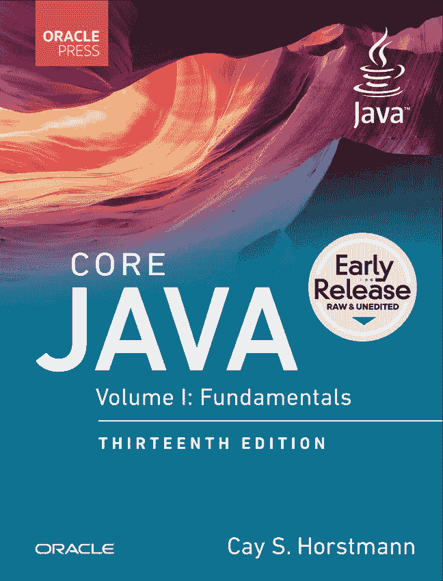


## 关于本电子书

ePUB 是一种开放的行业标准电子书格式。然而，不同的阅读设备和应用程序对 ePUB 及其许多功能的支持程度不同。请使用您的设备或应用设置根据您的喜好自定义显示效果。您可以自定义的设置通常包括字体、字号、单栏或双栏、横屏或竖屏模式，以及可以点击或触摸放大的插图。有关您的阅读设备或应用上设置和功能的更多信息，请访问设备制造商的网站。

许多书籍包含编程代码或配置示例。为了优化这些元素的显示效果，请在单栏横屏模式下查看电子书，并将字体大小调整为最小设置。


新泽西州，霍霍霍肯

封面图片：Jon Chica/Shutterstock

图 1.1：Sourceforge

图 2.2, 3.2-3.5, 4.9, 5.4, 7.2, 10.5, 10.6, 11.1：Oracle Corporation

图 2.3-2.6, 12.2：Eclipse Foundation, Inc.

图 4.2：Violet UML Editor

访问我们的网站：`informit.com/aw`

# 前言

## 读者

1995 年底，Java 编程语言席卷互联网，并迅速走红。Java 技术的承诺是将成为连接用户与信息的通用胶水，无论信息来自何处——服务器、数据库、信息提供者或任何想象中的来源。事实上，Java 正处于实现这一承诺的地位。它是一种工程精密的语言，获得了广泛认可。其内置的安全特性让程序员和用户都感到放心。Java 内置支持高级编程任务，如网络编程、数据库连接和并发。

自 1995 年以来，Java 开发工具包已发布了二十多个版本。应用程序接口（API）从数百类增长到 4000 多个类。你正在阅读这本书是《核心 Java》第十三版的卷。每个版本都紧随 Java 开发工具包的发布，每次我都会重写这本书以利用最新的 Java 特。本版反映了 Java 21 的特性。

与之前的版本一样，本书仍然针对希望将 Java 用于实际项目的严肃程序员。我假设你（读者）是一位在 Java 以外的编程语言方面有坚实背景的程序员。我假设你不喜欢玩具示例的书籍（例如烤面包机、动物园或“紧张的文字”）。你会在书中找不到这些内容。我的目标是让你能够充分理解 Java 语言及其向你提供的所有功能。在本卷中，你将详细学习：

- 面向对象编程
- 反射和代理
- 接口和内部类
- 异常处理
- 泛型编程
- 集合框架
- 并发
- 注解
- Java 平台模块系统

随着 Java 类库的爆炸式增长，想要在一卷书中涵盖所有资深程序员需要了解的所有 Java 特性简直是不可能的。因此，本书被分为两卷。第一卷侧重于 Java 语言的基础概念。第二卷 `Core Java, Volume II: Advanced Features` 则更深入地探讨了最重要的库。

在过去的十二个版本中，用户界面编程一直被认为是基础性的，但现在是时候承认它不再是了，并将其移动到第二卷中。该卷包含了对以下主题的详细讨论：

- Stream API
- 文件处理与正则表达式
- 数据库
- XML 处理
- 脚本与编译 API
- 国际化
- 网络编程
- 图形化用户界面设计
- 图形化编程
- 原生方法

在编写书籍时，错误和不准确之处是不可避免的。我非常想了解这些错误。但当然，我希望每个错误只被发现一次。你可以在 [`horstmann.com/corejava`](https://horstmann.com/corejava) 找到常见问题和错误修复列表。在勘误页的末尾策略性地放置了一个表单（为了鼓励你先阅读它），你可以用它报告错误并提出建议。如果我没有回答每一个问题或没有立即回复你，请不要失望。我会阅读每一封邮件，并感谢你的投入，这将使本书的未来版本变得更加清晰、信息更加丰富。

## 本书简介

`第 1 章` 概述了 Java 区别于其他编程语言的能力。本章解释了该语言设计者想要实现的目标以及他们在多大程度上取得了成功。随后是 Java 的简短历史，详细介绍了 Java 如何诞生以及如何演变。

在 `第 2 章` 中，你将看到如何下载和安装 JDK 以及本书的程序示例。然后，我将引导你编译并运行控制台应用程序和图形应用程序。你将看到如何使用原生 JDK、Java IDE 以及 `JShell` 工具。

`第 3 章` 开始对 Java 语言的讨论。在本章中，我涵盖了基础知识：变量、循环和简单函数。如果你是 C 或 C++ 程序员，这部分会一帆风顺，因为这些语言特性的语法与 C 语言基本相同。如果你来自非 C 背景（如 Visual Basic），你将希望仔细阅读这一章。

面向对象编程（OOP）现在是编程实践的主流，而 Java 是一门面向对象的编程语言。`第 4 章` 引入了封装，这是面向对象的两个基本构建块中的第一个，以及 Java 语言实现它的机制——即类和方法。除了 Java 语言的规则外，你还会发现关于健壮 OOP 设计的建议。最后，我涵盖了神奇的 `javadoc` 工具，它可以将你的代码注释格式化为一组超链接网页。如果你熟悉 C++，可以快速快速浏览本章。来自非面向对象背景的程序员应该准备好在进一步学习 Java 之前花一些时间来掌握 OOP 概念。

类和封装只是 OOP 故事的一部分，`第 5 章` 引入了另一部分——即 `继承`。继承允许你获取一个现有类并根据需要对其进行修改。这是 Java 编程的一项基本技术。Java 中的继承机制与 C++ 非常相似。再次，C++ 程序员可以关注语言之间的差异。

`第 6 章` 展示了如何使用 Java 的 `interface`（接口）概念。接口允许你超越 `第 5 章` 中简单的继承模型。掌握接口允许你能够充分利用 Java 完全面向对象的编程方法的力量。在涵盖接口之后，我转向了 `lambda 表达式`，这是一种可以在以后某个时间执行的代码块的简洁表达方式。然后我解释了 Java 的一个有用技术特性：`inner classes`（内部类）。

`第 7 章` 讨论了 `异常处理`——Java 处理“好程序可能发生坏事”的健壮机制。异常为你提供了一种高效的方法，将正常处理代码与错误处理分离。当然，即使在处理了所有异常情况并强化了程序后，它可能仍然按照预期运行。然后本章转向日志记录。在本章的最后部分，我提供了一些实用的调试技巧。

`第 8 章` 概述了泛型编程。泛型编程让你的程序更易读、更安全。我向你展示如何使用强类型并消除难看且不安全的强制转换，以及如何处理因需要与旧版本 Java 兼容而产生的复杂。

`第 9 章` 涵盖了并发，它允许你编写并行任务。在处理器具有多个核心且你希望保持其繁忙的时代，这是 Java 技术的一项重要且令人兴奋的应用。

在 `第 11 章` 中，你将学习注解，它允许你向 Java 程序添加任意信息（有时称为元数据）。我们向你展示了注解处理器如何在源代码或类文件级别获取这些注解，以及如何使用注解在运行时影响类的行为。注解只有配合工具时才有用，我们希望我们的讨论能帮助你根据需求选择注解处理工具。

`第 12 章`，你将学习 Java 平台模块系统，它促进了 Java 平台和核心库的有序演进。该模块系统为包提供了封装，并提供了描述模块要求的机制。你将学习模块的属性以便在自己的应用程序中使用它们。即使你决定不使用，你也需要了解新规则以便与 Java 平台和其他模块化库交互。

**附录** 列出了 Java 语言的关键字。

## 惯例

与许多计算机书籍一样，我使用`等宽字体`来表示计算机代码。

注释使用如下所示的“注意”图标。

提示使用如下所示的“提示”图标。

有危险时，我会用“警告”图标警告你。

计划未来成为语言或 API 一部分的预览功能将标记为此图标。

书中有很多 C++ 注释解释了 Java 和 C++ 之间的差异。如果你没有 C++ 背景，或者你认为对该语言的经历是一场不想回忆的噩梦，你可以跳过它们。

Java 自带了一个大型编程库，或者说是应用程序接口（API）。在第一次使用 API 调用时，我会在该章节末尾添加一段简短的总结描述。这些描述稍微非正式，但希望比官方在线 API 文档中的描述更具信息量。接口的名称采用斜体，就像与官方文档一样。类、接口或方法名称后的数字是引入该特性的 JDK 版本，如下例所示：

`Application Programming Interface` 21

源代码位于书籍伴随网站上的程序将以列表（listings）的形式呈现，例如：

`NotHelloWorld.java`

```java
void main()
{
   System.out.println("We will not use 'Hello, World!'");
}
```

## 示例代码

本书的网站 [`horstmann.com/corejava`](https://horstmann.com/corejava) 包含了书中所有的示例代码。请参见第 2 章 获取有关安装 Java 开发包和示例代码的更多信息。

# 致谢

写一本书总是一项巨大的工程，而重写它似乎并没有容易多少，特别是考虑到 Java 技术的不断变化。让一本书成为现实需要许多人的投入，我很荣幸能感谢整个 `Core Java` 团队的贡献。

Pearson 的许多个人提供了宝贵的帮助，但一直保持在幕后。我想让他们知道我是多么感激他们的努力。一如既往，我衷心感谢我的编辑 `Greg Doench`，他引导了书籍的编写和制作过程，并让我能够完全无视幕后所有那些人的存在。我非常感谢 `Julie Nahil` 的制作支持，感谢 `Dmitry Kirsanov` 和 `Alina Kirsanova` 对手稿进行校对。我使用 HTML 和 CSS 编写了这本书，`Prince` ([`princexml.com`](https://princexml.com)) 将其转换为 PDF——我非常推荐这种工作流。还要感谢我之前几个版本的合著者 `Gary Cornell`，他此后已投身其他事业。

感谢早期版本的许多读者，他们报告了错误并对改进提出了许多深思熟虑的建议。特别感谢优秀的评审团队，他们以惊人的细节关注度审查了手稿，使我免于许多尴尬的错误。

本版及早期版本的评审员包括 `Chuck Allison` (犹谷大学), `Lance Andersen` (Oracle), `Gail Anderson` (Anderson Software Group), `Paul Anderson` (Anderson Software Group), `Alec Beaton` (IBM), `Cliff Berg`, `Andrew Binstock` (Oracle), `Joshua Bloch`, `David Brown`, `Corky Cartwright`, `Frank Cohen` (PushToTest), `Chris Crane` (devXsolution), `Dr. Nicholas J. De Lillo` (曼哈顿学院), `Rakesh Dhoopar` (Oracle), `Ahmad R. Elkomey`, `Robert Evans` (霍普金斯大学应用物理实验室高级员工), `David Geary` (Clarity Training), `Jim Gish` (Oracle), `Brian Goetz` (Oracle), `Angela Gordon`, `Dan Gordon` (Electric Cloud), `Rob Gordon`, `John Gray` (哈特福大学), `Cameron Gregory` (olabs.com), `Andrzej Grzesik`, `Marty Hall` (coreservlets.com, Inc.), `Vincent Hardy` (Adobe Systems), `Dan Harkey` (圣何亚州立大学), `Steve Haines`, `William Higgins` (IBM), `Marc Hoffmann` (mtrail), `Vladimir Ivanovic` (PointBase), `Jerry Jackson` (CA Technologies), `Heinz Kabutz` (Java Specialists), `Stepan V. Kalinin` (I-Teco/Servionica LTD), `Tim Kimmet` (Walmart), `John Kostaras`, `Jerzy Krolak`, `Chris Laffra`, `Charlie Lai` (Apple), `Angelika Langer`, `Jeff Langr` (Langr Software Solutions), `Doug Langston`, `Hang Lau` (麦吉尔大学), `Mark Lawrence`, `Doug Lea` (纽约州立大学 Oswego), `Gregory Longshore`, `Bob Lynch` (Lynch Associates), `Philip Milne` (顾问), `Mark Morrissey` (俄勒冈研究生学院), `Mahesh Neelakanta` (佛罗里达大西洋大学), `José Paumard` (Oracle), `Hao Pham`, `Paul Philion`, `Blake Ragsdell`, `Ylber Ramadani` (瑞森大学), `Stuart Reges` (亚利桑那大学), `Simon Ritter` (Azul Systems), `Rich Rosen` (Interactive Data Corporation), `Peter Sanders` (法国尼斯 ESS 大学), `Dr. Paul Sanghera` (圣何亚州立大学和 Brooks College), `Paul Sevinc` (Teamup AG), `Devang Shah` (Sun Microsystems), `Yoshiki Shibata`, `Richard Slywczak` (NASA/格伦研究中心), `Bradley A. Smith`, `Steven Stelting` (Oracle), `Christopher Taylor`, `Luke Taylor` (Valtech), `George Thiruvathukal`, `Kim Topley` (StreamingEdge), `Janet Traub`, `Paul Tyma` (顾问), `Christian Ullenboom`, `Peter van der Linden`, `Joe Wang` (Oracle), `Sven Woltmann`, `Burt Walsh`, `Dan Xu` (Oracle), 以及 `John Zavgren` (Oracle)。

*Cay Horstmann*

*德国杜塞尔多夫*

*2023 年 10 月*

# Java 简介

Java 在 1996 年的首次发布在计算机新闻界引起了巨大的兴奋，不仅是在计算机媒体，在如《纽约时报》、《华盛顿邮报》和《商业周》等主流媒体中。Java 有一个独特的身份，它是第一个也是唯一在公共广播电上进行十分钟介绍的编程语言。一个 100,000 美元的风险基金完全是为了这种特定的编程语言设立的。我希望你会在本文中发现 Java 的简单历史。

## 作为编程平台的 Java

在本书的第一版中，我的合著者 `Gary Cornell` 和我写道：

> “作为一种计算机语言，Java 的炒作过头了：它无疑是一种良好的编程语言。毫无疑问，它是严肃程序员提供的最好的语言之一。我们认为它可能成为一种伟大的语言，但一旦语言进入领域，关于与现有代码兼容的糟糕现实可能就太晚了。”

我们的编辑受到了来自 Sun Microsystems（最初开发 Java 的公司）高层的许多批评。Java 语言具有许多优秀的特性，我们稍后将介绍。它也有许多缺点，而且由于兼容性要求，一些新添加的特性没有原始特性那样优雅。

但是，正如我们在第一版中所说的，Java 从来不仅仅是一种语言。Java 是一个完整的平台，拥有大量的重用代码，以及一个提供安全、跨操作系统移植性和自动垃圾收集服务的执行环境。

作为一名程序员，你会希望有一种良好的语法和易理解的语义的语言（例如，而不是 C++）。Java 符合要求，其他许多语言也是如此。有些语言提供了移植性、垃圾收集等功能，但它们没有大量的库，如果你想要华丽的图形、网络或数据库访问，就得自己编写。

## Java“白皮书”术语

Java 的作者们写了一份具有影响力的白皮书，解释了他们的设计目标和成就。他们还发表了一份按照以下 11 个术语组织的简短概述：

1. 简单
2. 面对象
3. 分布式
4. 健壮
5. 安全
6. 架构无关
7. 可移植
8. 解释型
9. 高性能
10. 多线程
11. 动态

在接下来的章节中，你将找到一个总结，包含了白皮书的摘录介绍了 Java 设计师对每个术语的看法，以及基于我对 Java 当前版本的经验的评论。

白皮书可以在 [https://www.oracle.com/technetwork/java/langenv-140151.html](https://www.oracle.com/technetwork/java/langenv-140151.html) 找到。你可以在 [https://horstmann.com/corejava/java-an-overview/7Gosling.pdf](https://horstmann.com/corejava/java-an-overview/7Gosling.pdf) 获取包含 11 个关键词的概述。

## 简单（Simple）

> 我们想要构建一个可以轻松编程、无需深奥培训并利用当今标准实践的系统。因此，尽管我们发现 C++ 并不合适，但我们设计的 Java 尽可能地接近 C++，以使系统易于理解。Java 忽略了 C++ 中许多很少使用、难以理解且令人困惑的特征，根据我们的经验，这些特征带来的麻烦多于收益。


Java 的语法确实是 C++ 语法的清理版本。它不需要头文件、指针算术（甚至是指针语法）、联合体（unions）、运算符重载、虚基类等。（请参见文中穿插的 C++ 注释，了解更多关于 Java 和 C++ 之间的差异。）然而，设计者并没有试图修复 C++ 的所有笨拙特性。例如，`switch` 语句的语法在 Java 中保持不变。如果你熟悉 C++，你会发现过渡到 Java 语法是非常容易的。

在 Java 发布时，C++ 实际上并不是最常用的编程语言。许多开发者使用 Visual Basic 及其拖放式编程环境。这些开发者并没有认为 Java 是简单的。Java 开发环境花费了几年才赶上。如今，Java 开发环境已经远远领先于大多数其他编程语言。

> 简单的另一个方面是体量小。Java 的目标之一是能够构建出可以在小型机器上独立运行的软件。基础解释器和类支持的大小约为 40K；基础标准库和线程支持（本质上是一个自包含的微内核）又增加了 175K。

这在当时是一项巨大的成就。当然，该库从那时发展到了巨大的规模。现在有规模较小的独立版本，适用于嵌入式设备和智能卡。

## 面向对象（Object-Oriented）

> 简单来说，面向对象的设计是一种关注数据（对象）以及这些对象接口的编程技术。用木工做类比，一个“面向对象”的木工主要关注他正在制作的椅子，其次才是制作椅子的工具；而一个“非面向对象”的木工则主要考虑他的工具。Java 的面向对象设施本质上与 C++ 是类似的。

在开发 Java 时，面向对象已经相当成熟。Java 的面向对象特性与 C++ 相当。Java 和 C++ 之间的主要区别在于多继承，Java 用更简单的接口（interfaces）概念取代了它。相比 C++，Java 拥有更丰富的运行时检查能力（在第五章中讨论）。

## 分布式（Distributed）

> Java 拥有丰富的例程库来处理 HTTP 和 FTP 等 TCP/IP 协议。Java 程序可以通过 URL 打开并访问网络上的对象，就像访问本地文件系统一样简单。

如今，人们认为这是理所当然的——但在 1995 年，从 C++ 或 Visual Basic 程序连接到服务器是一项巨大的工程。

## 健壮性（Robust）

> Java 旨在编写在各种方面都必须可靠的程序。Java 非常强调对可能问题的早期检查、后期的动态（运行时）检查，以及消除易出错的情况……Java 与 C/C++ 之间最大的区别是 Java 拥有一种指针模型，它消除了覆盖内存和损坏数据的可能性。

Java 编译器可以检测许多在其他语言中只有运行时才会出现的问题。至于第二点，任何花费数小时追踪由指针 bug 导致的内存损坏的人都会对 Java 的这一点感到非常满意。

## 安全（Secure）

> Java 旨在用于网络化/分布式环境。为了这一目标，安全性被高度重视。Java 能够构建无病毒、防篡改的系统。

从一开始，Java 的设计就是为了让某些攻击变得不可能，包括：

- 栈溢出——蠕虫和病毒的常见攻击手段
- 损坏进程空间之外的内存
- 未经许可读取或写入文件

最初，Java 对下载代码的态度是“放马来吧！”。不可信的代码在沙箱环境中执行，在那里它不会影响主机系统。用户被保证不会发生任何坏事，因为 Java 代码无论来自何处永远无法逃离沙箱。

然而，Java 的安全模型是复杂的。在第一版 Java 开发包（JDK）发布后不久，普林斯顿大学的一组安全专家发现了细微的漏洞，允许不可信的代码攻击主机系统。

最初，安全漏洞被很快修复。遗憾的是，随着时间的推移，黑客变得越来越擅长发现安全架构实现中的细微缺陷。Sun 以及随后的 Oracle 在跟进漏洞修复方面面临困难。

在经历了多次备受关注的攻击后，浏览器厂商和 Oracle 变得越来越谨慎。一段时间内，远程代码必须经过数字签名。如今，浏览器不再信任 Java，Java 程序的安全交付已成为遥远的记忆。

尽管回想起来，Java 的安全模型并没有最初预想的那样成功，但 Java 已经领先于时代。微软一种名为 ActiveX 的竞争性代码交付机制仅依赖数字签名来确保安全。显然这是不够的：正如任何微软产品用户都可以证实的那样，来自知名厂商的程序确实会崩溃并造成损害。

## 架构中立（Architecture-Neutral）

> 编译器生成与架构无关的对象文件格式。在 Java 运行时系统存在，编译后的代码可以在许多处理器上执行。Java 编译器通过生成与特定计算机架构无关的字节码指令来实现这一点。相反，这些指令的设计目标既便于在任何机器上解释，又便于现场翻译成原生机器代码。

为“虚拟机”生成代码在当时并不是新主意。Lisp、Smalltalk 和 Pascal 等编程语言已经使用了这种技术多年。

当然，解释虚拟机指令的速度比全速运行机器指令慢。然而，虚拟机可以选择将执行频繁的字节码序列翻译成机器代码——这一过程被称为即时编译。

Java 虚拟机还具有另一个优势。它增强了安全性，因为它可以检查指令序列的行为。

## 可移植性（Portable）

> 与 C 和 C++ 不同，规范中没有“取决于实现”的方面。基本数据类型的大小是给定的，对它们进行算术运算的行为也是给定的。

例如，Java 中的 `int` 始终是 32 位整数。在 C/C++ 中，`int` 可以是 16 位整数、32 位整数，或是编译器供应商喜欢的任何大小。唯一的限制是 `int` 类型的字节数不能少于 `short int`，且不能超过 `long int`。固定数值类型的大小消除了巨大的移植难题。二进制数据以固定格式存储和传输，消除了对字节序的困扰。字符串以标准的 Unicode 格式保存。

> 系统的组成库定义了可移植的接口。例如，有一个抽象的 `Window` 类，以及针对 UNIX、Windows 和 Macintosh 的实现类。

`Window` 类的例子可能选得并不好。正如任何尝试过的人所知的，要在 Windows、Macintosh 和十种版本的 UNIX 上实现一个外观良好的用户界面，是一项具有“英雄级规模”的工程。Java 1.0 付出了这种英雄式的努力，提供了一个简单的工具包，在多个平台上提供了通用的用户界面元素。遗憾的是，结果是这个库在经过大量工作后，在不同系统上也只能提供勉强可接受的结果。那个最初的用户界面工具包从那以后被替换了一次又一次，而跨平台的可移植性仍然是一个问题。

然而，对于所有与用户界面无关的内容，Java 库在让你以平台无关的方式工作方面做得非常好。你可以处理文件、正则表达式、XML、日期和时间、数据库、网络连接、线程等，而无需担心底层的操作系统。你的程序不仅是移植的，Java API 的质量通常比原生 API 更高。

### 解释型（Interpreted）

> Java 解释器可以直接在任何已移植该解释器的机器上执行 Java 字节码。由于链接是一个更增量且轻量级的过程，开发过程可以更加快速且具探索性。

这其实有些牵强了。任何用过 Lisp、Smalltalk、Visual Basic、Python、R 或 Scala 的人都知道什么是“快速且具探索性”的开发过程。你尝试某些东西，并立即看到结果。在 Java 存在的前 20 年里，开发环境并没有关注这种体验。直到 Java 9，`jshell` 工具才支持了快速且具探索性的编程。

### 高性能（High-Performance）

> 虽然解释型字节码的性能通常绰绰有余，但在某些情况下需要更高的性能。字节码可以在运行时（即时）被翻译成适用于运行该应用程序的特定 CPU 的机器码。

在 Java 早期，许多用户不同意性能“绰绰有余”的说法。然而，今天，即时编译器（just-in-time compilers）已经变得非常优秀，足以与传统编译器竞争，而且在某些情况下甚至超过了它们，因为它们拥有更多的信息。例如，即时编译器可以监控哪些代码被频繁执行，并专门针对这些代码进行速度优化。一种更复杂的优化是函数调用的消除（或“内联”）。即时编译器知道加载了哪些类。当基于当前加载的类集合，某个特定函数从未被重写时，它可以使用内联技术，并在需要时稍后撤销该项优化。

### 多线程（Multithreaded）

> [多]线程的益处是具有更好的交互响应和实时行为。

如今，我们关注并发是因为摩尔定律已经走向了终点。我们得到的不是更快的处理器，而是更多的处理器，而我们必须让它们保持忙碌。然而，当你观察大多数编程语言时，你会发现它们对这个问题表现出令人震惊的忽视。

Java 的理念是远超于时代的。它是第一个支持并发编程的主流语言。正如你从白皮书中看到的，它的初衷略有不同。当时，多核处理器还是稀奇事物，但 Web 编程刚刚开始，处理器花费大量时间等待服务器的响应。需要并发编程来确保用户界面不会冻结。

并发编程从未易事，但 Java 在使其变得易于管理方面做得非常好。

### 动态（Dynamic）

> 在许多方面，Java 比 C 或 C++ 是一种动态动态语言。它的设计是为了适应不断变化的环境。库可以自由地添加新方法和实例变量，而不会对其客户端产生任何影响。在 Java 中，获取运行时类型信息是非常直接的。

在代码需要添加到运行中的程序时的情况下，这是一个重要的特性。一个典型的例子是从互联网下载并在浏览器中运行的代码。在 C 或 C++ 中，这确实是一个巨大的挑战，但 Java 的设计者非常清楚动态语言如何轻松地演进运行中的程序。他们的成是将这一特性引入了主流编程语言。

在 Java 获得初步成功后，微软发布了一个名为 J++ 的产品，其编程语言和虚拟机几乎与 Java 相同。这一努力未能获得市场青睐，微软随后推出了另一种名为 C# 的语言，它也与 Java 有许多相似之处，但运行在不同的虚拟机上。本书将不涵盖 J++ 或 C#。

## Java Applets 与互联网

这里的想法非常简单：用户将从互联网下载 Java 字节码并在自己的机器上运行它们。在网页上运行的 Java 程序被称为 `applets`。要使用 applet，你只需要一个支持 Java 的浏览器，它会为你执行这些字节码。你不需要安装任何软件。每当你访问包含 applet 的网页时，你都会获得程序的最新版本。最重要的是，得益于虚拟机的安全性，你永远不需要担心恶意代码的攻击。

将 applet 插入网页的工作非常类似于嵌入图像。applet 成为页面的一部分，文本环绕着 applet 使用的空间流动。关键点在于，这张图像是“活的”。它对用户命令做出反应，改变自己的外观，并在展示 applet 的计算机与提供服务的计算机之间交换数据。

图 1.1 显示了显示分子结构的 Jmol applet。通过鼠标，你可以旋转并缩放每个分子以更好地理解它的结构。在 applets 发明时，这种直接操作在网页上是无法实现的——当时只有 JavaScript 而没有 HTML canvas。

```markdown
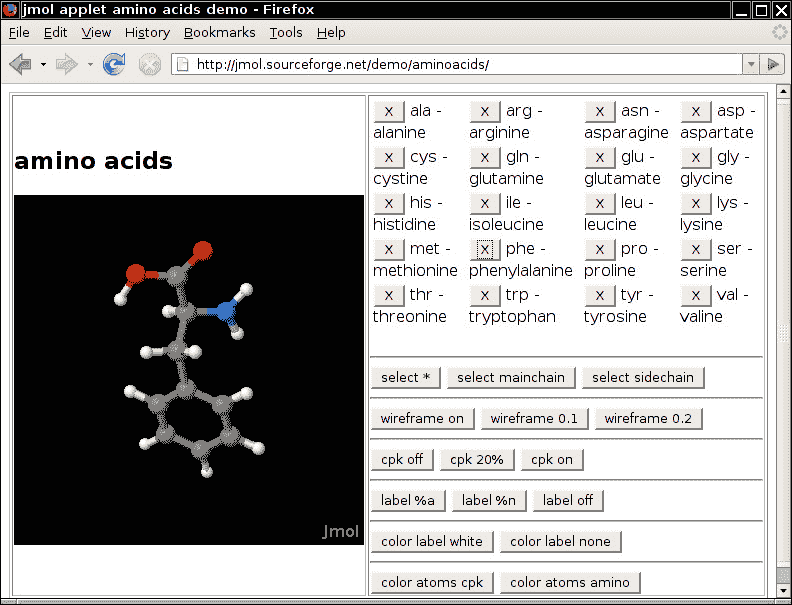Jmollet
```

当 applets 首次出现时，它们引发了巨大的兴奋。许多人认为 applet 的吸引力是 Java 惊人人气的原因。然而，最初的兴奋很快就变成了沮败。不同版本的 Netscape 和 Internet 浏览器运行不同版本的 Java，其中某些已经严重过时。这种糟糕的局面使得开发利用最新 Java 版本的 applet 变得日益困难。相反，Adobe 的 Flash 技术因实现动态效果而变得流行。后来，当 Java 受到安全问题的困扰时，浏览器完全放弃了对 applet 的支持。当然，Flash 并不好。

## Java 短史

本节介绍了 Java 演变的简史。它基于各种出版来源（最重要的是 1995 年 7 月份 *SunWorld* 杂志对 Java 创造者的采访）。

Java 可以追溯到 1991 年，当时由 Patrick Naughton 和 James Gosling（Sun Fellow，也是一位全能计算机大师）领导的 Sun 工程师小组设计一种可以用于电缆电视机盒等消费设备的小型计算机语言。由于这些设备没有大量的功率或内存，语言必须很小并生成非常紧凑的代码。此外，由于不同的制造商可能会选择不同的处理器（CPU），让语言不绑定任何单一架构至关重要。该项目的代号为 `Green`。

对小型、紧凑且平台中立代码的需求引导团队设计了一种可移植的语言，为虚拟机生成中间代码。

Sun 公司的员工来自 UNIX 背景，因此他们基于 `C++` 构建了语言，而不是 Lisp、Smalltalk 或 Pascal。但正如高斯林（Gosling）在采访中所说：“一直以来，这种语言只是一个工具，而不是目的。”高斯林决定将他的语言命名为“Oak”（橡树）（可能是因为他喜欢 Sun 公司办公室窗外那棵橡树的样子）。Sun 的员工后来发现 `Oak` 是一个已经存在的计算机语言名称，于是他们将其更名为 `Java`。事实证明，这是一个极具启发性的选择。

1992 年，Green 项目交付了他们的第一件产品，名为“7”。这是一个极其智能的遥控器。遗憾的是，Sun 公司没有人对生产这种产品感兴趣，Green 项目的人员不得不寻找其他方式来营销他们的技术。然而，没有任何标准的消费电子公司对此感兴趣。随后，该小组竞标了一个设计电电视盒的项目，旨在处理视频点播等新兴的电缆服务。他们没有获得该合同。（有趣的是，赢得合同的公司是由创立 Netscape 的同一个 Jim Clark 领导的——这家公司对 Java 的成功做出了巨大贡献。）

Green 项目（更名为“First Person, Inc.”）花费了 1993 全年和 1994 年的上半年时间寻找购买其技术的人。但一无所获。（小组创始人之一、最终承担了大部分营销工作的 Patrick Naughton 声称，在尝试销售该技术的过程中积累了 30 万英里的飞行里程。）First Person 公司于 1994 年解散。

当这一切发生在 Sun 公司内部时，互联网的广域网部分变得越来越大。广域网的关键在于浏览器将超文本页面翻译到屏幕上。1994 年，大多数人使用的是 Mosaic，这是一种由伊利诺伊大学超级计算中心于 1993 年推出的非商业性网络浏览器。（Mosaic 的部分代码由 Marc Andreessen 在读本科期间通过一个勤工俭学项目编写，时薪为 6.85 美元。随后，他作为 Netscape 的联合创始人之一和首席技术官获得了名声和财富。）

在 *SunWorld* 采访中，高斯林表示，在 1994 年年中，开发者们意识到：“我们可以构建一个非常酷的浏览器。这是客户端/服务器主流领域中少数需要我们所做的一些奇特功能之一：架构中立、实时、可靠、安全——这些问题在工作站世界并没有十分重要。所以，我们构建了一个浏览器。”

实际的浏览器是由 Patrick Naughton 和 Jonathan Payne 构建的，并演变成了 HotJava 浏览器，其设计旨在展示 Java 的强大之处。该浏览器能够在网页内部执行 Java 代码。这一“技术证明”在 1995 年 5 月 23 日的 SunWorld '95 上展示，并引发了持续至今的 Java 热潮。

Sun 公司于 1996 年初发布了 Java 的第一个版本。人们很快意识到 `Java 1.0` 无法满足严肃应用开发的需求。确实，你可以用 `Java 1.0` 制作一个紧张的文本小程序（applet），让文本在画布上随机移动。但在 `Java 1.0` 中甚至无法打印。直率地说，`Java 1.0` 尚未准备就绪。它的继任者版本 1.1 填补了最明显的缺陷，极大地改进了反射能力，并为 GUI 编程添加了新的事件模型。尽管如此，它的功能仍然有限。

1998 年 JavaOne 大会的大新闻是即将发布的 `Java 1.2`，它将早期的玩具化 GUI 和图形工具包替换为更复杂的可扩展版本。在 1998 年 12 月发布仅三天（！）后，Sun 的营销部门将名称更改为朗朗上口的 `Java 2 Standard Edition Software Development Kit Version 1.2`。

除了标准版（Standard Edition），还引入了另外两个版本：用于手机等嵌入设备的微型版（Micro Edition），以及用于服务器端处理的企业版（Enterprise Edition）。本书重点关注标准版。

标准版的 1.3 和 1.4 版本是在初始 Java 2 发布基础上的增量改进，拥有不断增长的标准库、更高的性能，而且，当然，还修复了许多漏洞。在此期间，关于 Java applet 和客户端应用程序的大部分最初热度有所消退，但 Java 成为了服务器端应用的首选平台。

5.0 版本是自 1.1 版本以来首次以重大方式更新 Java 语言的版本。（该版本最初被编号为 1.5，但版本号在 2004 年的 JavaOne 大会上跳到了 5.0。）经过多年的研究，泛型（大致可比拟 `C++` 模板）被引入——挑战是在不更改虚拟机的情况下添加此功能。其他几个实用的语言特性也受到了 C# 的启发：“for each”循环、自动装箱（autoboxing）和注解。

版本 6（没有 .0 后缀）于 2006 年底发布。同样，没有语言变化，但有了额外的性能改进和库增强。

随着数据中心日益依赖通用硬件而非专用服务器，Sun Microsystems 陷入了困境，并在 2009 年被 Oracle 收购。Java 的开发停了长时间。2011 年，Oracle 发布了带有简单增强的新版本，即 Java 7。

2014 年，Java 8 随之发布，带来了近二十年来 Java 语言最重的变化。Java 8 拥抱了“函数式”编程风格，使其能够轻松表达可以并发执行的计算。

2018 年，Java 版本每六个月发布一次，以便更快地引入预览功能。新功能可能会经过几轮预览。例如，`switch` 的模式匹配从 Java 17 开始预览了四次，直到在 Java 21 中才定稿。

| 版本 | 年份 | 主要特性 | 页码 |
|---|---:|---|---:|
| 17 | 2021 | Switch 表达式、文本块、`instanceof` 模式匹配、记录、密封类 | 4,859 |
| 21 | 2023 | 虚拟线程、模式匹配 | 4,882 |

## 关于 Java 的常见误解

本章以列出一些关于 Java 的常见误解的注释列表结束。

### Java 是 HTML 的扩展。


Java 是一种编程语言；`HTML` 是一种描述网页结构的方式。除了它们曾存在过用于在网页上放置 Java 小程序（applets）的 HTML 扩展之外，它们之间没有任何共同之处。

### 我使用 XML，所以我不需要 Java

Java 是一种编程语言；`XML` 是一种描述数据的方式。你可以用任何编程语言处理 `XML` 数据，但 `Java API` 包含了对 `XML` 处理卓越的支持。此外，许多重要的 `XML` 工具都是用 Java 实现的。更多信息请参阅第二卷。

### Java 是一门容易学习的编程语言

没有任何像 `Java` 这样强大的编程语言是容易的。你必须始终区分编写玩具程序有多容易与从事严肃工作有多困难。此外，请考虑本书书中只有七章讨论了 `Java` 语言。两卷书的其余章节都展示了如何使用 `Java libraries` 让这种语言工作起来。`Java libraries` 包含了成千上万个类和接口以及数万个函数。幸运的是，你不需要了解其中的每一个，但为了用 `Java` 完成任何现实任务，你确实需要了解多到令人惊讶的程度。

### Java 将成为适用于所有平台的通用编程语言

这在理论上是。但在实践中，某些领域其他语言已经根深蒂固。`Objective C` 及其继者 `Swift` 不会在 `iOS` 设备上被取代。浏览器中发生的任何事情都由 `JavaScript` 控制。Windows 程序用 `C++` 或 `C#` 编写。`Java` 在服务器端编程和跨平台客户端应用程序具有优势。

### Java 仅仅是另一种编程语言

Java 是一门很好的编程语言；大多数程序员更倾向于使用 `C`、`C++` 或 `C#`。但也出现过成百种从未获得普及的优秀编程语言，而像 `C++` 和 `Visual Basic` 这样有明显缺陷的语言却极其成功。

为什么？编程语言的成功在很大程度上取决于其周围`支持系统`的实用性，而不是取决于其语法的优雅性。对于你需要实现的功能，是否有有用、方便且标准的库？是否有工具供应商构建了出色的编程和调试环境？该语言和工具集是否与整个计算基础设施的其他部分集成？`Java` 成功是因为它的库让你能够轻松地处理网络、Web 应用程序和并发等事务。`Java` 减少指针错误是一个额外的奖励，所以程序员在使用 `Java` 时似乎效率更高——但这些因素并不是它成功的根源。

### Java 是私有的，因此应该被避免使用

当 `Java` 最初被创建时，`Sun Microsystems` 向分发商和最终用户提供了免费许可。尽管 `Sun` 对 `Java` 拥有最终控制权，但他们让许多其他公司参与了语言版本的修订和新库的设计。虚拟机和库的源代码一直免费提供，但仅供检查，不可进行修改和重新分发。`Java` 曾是“闭源但表现友善的”。

这种情况在 2007 年发生了巨大变化，当时 `Sun` 宣布未来的 `Java` 版本将根据`通用公共许可证 (GPL)`发布，这是与 `Linux` 使用的相同的开源许可证。`Oracle` 已承诺保持 `Java` 开源。现在有多个开源 `Java` 实现的提供者，具有不同程度的承诺和支持。

### Java 是解释型的，所以它对于严肃应用来说太慢了

在 `Java` 早期，这种语言是解释执行的。现在，`Java virtual machine`（Java 虚拟机）使用即时编译器。你代码中的“热点”在 `Java` 中的运行速度与 `C++` 一样，在某些情况下甚至更快。

### 所有 Java 程序都运行在网页内部

曾有一段时间 `Java applets` 运行在浏览器内部。现在，`Java` 程序是运行在浏览器之外的独立应用程序。事实上，大多数 `Java` 程序运行在服务器上，为网页生成代码或计算业务逻辑。

### Java 程序是重大的安全风险

在 `Java` 早期，曾有一些关于 `Java 安全系统` 失败的广为人知的报告。研究人员将其视为寻找 `Java 盔甲` 破绽并挑战 `applet 安全模型` 强度和复杂性的挑战。他们发现的技术失败被迅速纠正。后来，出现了更严重的漏洞，`Sun` 以及随后的 `Oracle` 响应缓慢。浏览器厂商停止了对 `Java applets` 的支持。使 applet 可能的安全管理器架构现在已经废弃。如今，`Java applications` 的安全性并不低于其他应用程序。由于 `virtual machine` 的保护，它们比用 `C` 或 `C++` 编写的应用程序安全得多。

### JavaScript 是 Java 的简化版本

`JavaScript` 是一种可以在网页内部使用的脚本语言，由 `Netscape` 发明，最初称为 `LiveScript`。`JavaScript` 的语法让人联想起 `Java`，语言名称听起来也相似，除此之外它们之间毫无关系。特别是，`Java` 是`强类型`的——编译器可以捕获许多由于类型误用引起的错误。在 `JavaScript` 中，此类错误只有在程序运行时才会发现，这使得消除它们变得困难得多。

### 有了 Java，可以用廉价的“网络设备”代替我的电脑

当 `Java` 最初发布时，有些人豪注这将会发生。公司生产了 `Java 驱动的网络计算机` 原型，但用户尚未准备好放弃强大方便的桌面电脑，转而使用没有本地存储的受限机器。现在当然世界已经变了，对于大多数终端用户来说，重要的平台是手机或平板电脑。这些设备大部分由基于 `Java` 的 `Android platform` 控制。学习 `Java programming` 也有助于你学习 `Android programming`。

# Java 编程环境

在本章中，你将学习如何如何安装 `Java Development Kit (JDK)` 以及如何编译和运行 `Java` 程序。你可以通过在终端窗口输入命令来运行 `JDK tools`。然而，许多程序员更倾向于集成开发环境的舒适性。你将学习如何使用免费提供的开发环境来编译和运行 `Java` 程序。一旦你掌握了本章中的技术并选择了你的开发工具，就可以进入第 3 章，在那里将开始探索 `Java 编程语言`。

## 安装 Java 开发包

在过去，最完整、最新的 `Java Development Kit (JDK)` 版本由 Oracle 提供。现在，许多不同的公司和组织，包括 `Amazon`、`Azul`、`Microsoft` 和 `Red Hat`，都提供最新的 `OpenJDK` 构建版本。每个供应商都有不同的许可条件和支持方案。`Eclipse Foundation` 为 `Linux`、`Mac OS` 和 `Windows` 提供免费的 `JDK builds`，非常适合学习 `Java`。

### 下载 JDK

你可以从 `Eclipse Foundation` 的 [`adoptium.net`](https://adoptium.net) 下载 `Java Development Kit`，也可以从 `Oracle` 的 [`www.oracle.com/java/technologies/downloads`](https://www.oracle.com/java/technologies/downloads) 或许多其他提供者下载。

根据提供者的不同，`Java Development Kit` 可能有一个品牌，例如 `Temurin`（Eclipse Foundation）、`Corretto`（Amazon）或 `Zulu`（Azul）。品牌名称对于 `Java programmers` 来说并不重要。

您应该使用 `Java SE 21 (LTS) JDK`。请参考表 2.1 了解在下载网站上可能会遇到的缩写和术语摘要。

# Java 术语

| 名称 | 缩写 | 解释 |
| --- | --- | --- |
| Java 开发工具包 | JDK | 为想要编写 Java 程序的程序员提供的软件。 |
| Java 运行环境 | JRE | 用于运行 Java 程序的软件，且不包含开发工具。仅支持到 Java 8。你并不需要它。 |
| 标准版 | SE | 用于桌面和简单服务器应用程序的 Java 平台。你需要这一个。 |
| 微型版 | ME | 用于小型设备的 Java 平台。 |
| OpenJDK | — | Java SE 的免费开源实现。 |
| Hotspot | — | 由 Oracle 开发的“即时编译”编译器。如果被问到，请选择这一个。 |
| OpenJ9 | — | IBM 开发的另一个“即时编译”编译器。 |
| GraalVM | — | 一种“提前编译”编译器，用于启动快速但不支持所有 Java 特性的可执行文件。本书书中不需要它。 |
| 长期支持 | LTS | 支持多年的发布版本，与展示新功能的每六个月一次的发布不同。请选择最新的 LTS 版本。 |
| Eclipse | — | 分发开源软件的基金会。 |
| Temurin | — | Eclipse 基金会分发的 OpenJDK 品牌名称。 |
| Adoptium | — | Eclipse 基金会内部的一个项目，为其分发提供 OpenJDK 版本和基础设施支持。 |

## 安装 JDK

下载 JDK 后，您需要安装它并确定它的安装位置——你稍后会需要这些信息。

如果你运行的是 Windows 或使用 Mac，只需启动安装程序并选择默认选项即可。

在 Linux 上，将 `.tar.gz` 文件解压到你选择的目录，例如你的家目录或 `/opt`。然后，将 `PATH` 设置为 JDK 所在目录的 `bin` 子目录，例如 `/opt/jdk-21.0.4/bin`。这通常通过向你的 `~/.bashrc` 或 `~/.bash_profile` 文件末尾添加如下行来实现：

```bash
export PATH=/opt/jdk-21.0.4/bin:$PATH
```

以下是测试你是否操作正确的方法。启动终端窗口。输入该行：

```bash
javac --version
```

并按回车键。你应该得到类似下面的显示：

```text
javac 21.0.4
```

如果你收到了类似“javac: command not found”或“指定的名称不是内部或外部命令、可运行程序或批处理文件”的消息，那么你需要双检查你的安装情况。

了解 JDK 在系统上的安装位置通常很有用——请参考表 2.2。在本书中，安装目录标记为 `jdk`。例如，当引用 `jdk/bin` 目录时，我指的是像 `/opt/jdk-17.0.4/bin` 或 `C:\Program Files\Java\jdk-21\bin` 目录。

### JDK 安装目录

| 平台 | 示例目录 |
| --- | --- |
| Windows (Adoptium) | `C:\Program Files\Eclipse Adoptium\jdk-21.0.4.11-hotspot` |
| Windows (Oracle OpenJDK) | `C:\Program Files\Java\jdk-21` |
| Mac OS | `/Library/Java/JavaVirtualMachines/jdk-21.0.4_11.jdk/Contents/Home` |
| Linux | 你解压 `.tar.gz` 文件的位置，例如 `/opt/jdk-21.0.4` |

在 Windows 上，Oracle JDK 安装程序会将目录 `C:\Program Files\Common Files\Oracle\Java\javapath` 添加到 `PATH` 环境变量。该目录仅包含 `javac`、`javaw`、`java` 和 `jshell` 可执行文件。（你将在本章学习如何使用 `javac`、`java` 和 `jshell`。`javaw` 可执行文件是 Windows 特有的功能，用于在不启动控制窗口的情况下启动程序。）Java 开发包中的其他工具可以在 JDK 安装目录的 `bin` 子目录中找到。调用这些程序时，指定完整路径（例如 `javadoc` 工具的 `C:\Program Files\Java\jdk-21\bin\javadoc`），或将 `bin` 子目录添加到 `PATH` 环境变量中。实现这一点的方法之一是使用 `setx` 命令：

```cmd
setx PATH "%PATH%;c:\Program Files\Java\jdk-21\bin"
```

打开另一个终端窗口使更改生效。

[`adoptium.net`](https://adoptium.net) 安装程序没有这个问题。它将所有 JDK 工具都添加到 `PATH` 中。

### 安装源码和文档

库源码以压缩文件 `jdk/lib/src.zip` 的形式随 JDK 提供。解压该文件以获取源码。只需执行以下操作：

1. 确保 JDK 已安装且 `jdk/bin` 目录在可执行路径上。
2. 在你的家目录中创建一个 `javasrc` 目录。如果你愿意，可以在命令行执行：

   ```bash
   mkdir javasrc
   ```

3. 在浏览器中，导航到 `jdk/lib` 目录。将 `src.zip` 文件解压到你的家目录。它们将位于 `javasrc` 目录中。如果你愿意，可以通过命令行执行：

   ```bash
   jar xvf src.zip
   ```

4. `src.zip` 文件包含所有公共库的源码。要获取编译器、虚拟机类，请进入 `javasrc` 目录。如果你愿意，可以在命令行执行：

   ```bash
   cd javasrc
   ```

# 恭喜！你刚刚编译并运行了你的第一个 Java 程序

发生了什么？`javac` 程序是 Java 编译器。它将 `Welcome.java` 文件编译成 `Welcome.class` 文件。`java` 程序启动 Java 虚拟机。它执行编译器放在类文件中的字节码。

`Welcome` 程序非常简单。它仅仅向终端打印了一条条消息。你可能对查看该程序的内部实现感兴趣，如列表 2.1 所示。你将在下一章中看到它是如何工作的。

`Welcome/Welcome.java`

```java
/**
 * 此程序向读者显示问候语。
 * @version 1.30 2014-02-27
 * @author Cay Horstmann
 */
public class Welcome
{
   public static void main(String[] args)
   {
      String greeting = "Welcome to Core Java!";
      System.out.println(greeting);
      for (int i = 0; i < greeting.length(); i++)
         System.out.print("=");
      System.out.println();
   }
}
```

在集成开发环境时代，许多程序员并不熟悉在终端窗口中运行程序。可能会出现任何问题，并导致令人沮丧的结果。

请注意以下几点：

1. 如果你是手动输入程序，请确保正确输入了大写和小写字母。特别是类名是 `Welcome`，而不是 `welcome` 或 `WELCOME`。
2. 编译器需要一个文件名（`Welcome.java`）。当你运行程序时，你指定类名（`Welcome`），而不带 `.java` 或 `.class` 后缀。
3. 如果你收到类似“无效的命令或文件名”或“javac: 找不到命令”的消息，请返回并检查你的安装情况，特别是可执行路径的设置。
4. 如果 `javac` 报告找不到 `Welcome.java` 文件，你应该检查该文件是否存在于目录中。
   - 在 Linux 下，检查你是否对 `Welcome.java` 使用正确的大小写。
   - 在 Windows 下，使用 `dir` 命令，而不是图形化的资源管理器工具。某些文本编辑器（特别是记事本）坚持在每个文件名的后面添加 `.txt` 扩展名。如果你使用记事本编辑 `Welcome.java`，它实际上将其保存为 `Welcome.java.txt`。在默认的 Windows 设置下，资源管理器会与记事本配合并隐藏 `.txt` 扩展名，因为它属于“已知文件类型”。在这种情况下，你需要重命名文件，或者重新保存时给文件名加上引号：`"Welcome.java"`。
5. 如果你启动程序并收到关于 `java.lang.NoClassDefFoundError` 的错误消息，请仔细检查出错的类名。
   - 如果你收到关于 `welcome`（带小写 `w`）的提示，那么你应该重新执行带大写 `W` 的 `java Welcome` 命令。一如既常，Java 对大小写非常敏感。
   - 如果你收到关于 `Welcome/java` 的提示，意味着你不小心输入了 `java Welcome.java`。请重新执行命令 `java Welcome`。

从 `Java 11` 开始，如果你只有一个源文件，可以跳过 `javac` 命令。此功能用于脚本（以“shebang”行 `#!/path/to/java` 开头），可能也用于简单的学生程序。一旦你的程序变得复杂，你就需要使用 `javac`。

`Welcome` 程序并不十分有趣。接下来，尝试一个图形应用程序。这个程序是一个简单的图像文件查看器，用于加载并显示图像。和之前一样，从命令行编译并运行程序。

1. 打开终端窗口。
2. 切换到目录 `corejava/v1ch02/ImageViewer`。
3. 输入以下内容：

   ```bash
   javac ImageViewer.java
   java ImageViewer
   ```

弹出一个新程序窗口显示 `ImageViewer` 应用程序。现在，选择 File（文件）→ Open（打开）并寻找一个图像文件打开。（同一目录下有两个示例文件）。图像将被显示（参见图 2.2）。要关闭程序，点击标题栏上的 Close（关闭）框或从菜单选择 File → Exit（退出）。


# 运行 `ImageViewer` 应用程序

快速查看一下源代码（列表 2.2）。该程序比第一个程序长得多，但如果你考虑到用 C 或 C++ 编写类似的应用需要多少代码，它就没太复杂。当然，现在编写带有图形用户界面的桌面应用已不再常见，但如果你感兴趣，可以在第二卷第 10 章中找到更多细节。

`ImageViewer/ImageViewer.java`

```java
import java.awt.*;
import java.io.*;
import javax.swing.*;

/**
 * 用于查看图像的程序。
 * @version 1.31 2018-04-10
 * @author Cay Horstmann
 */
public class ImageViewer
{
   public static void main(String[] args)
   {
      EventQueue.invokeLater(() ->
         {
            var frame = new ImageViewerFrame();
            frame.setTitle("ImageViewer");
            frame.setDefaultCloseOperation(JFrame.EXIT_ON_CLOSE);
            frame.setVisible(true);
         });
   }
}

/**
 * 一个带有显示标签的帧。
 */
class ImageViewerFrame extends JFrame
{
   private static int DEFAULT_WIDTH = 300;
   private static final int DEFAULT_HEIGHT = 400;

   public ImageViewerFrame()
   {
      setSize(DEFAULT_WIDTH, DEFAULT_HEIGHT);

      // 使用标签显示图像
      var label = new JLabel();
      add(label);

      // 设置文件选择器
      var chooser = new JFileChooser();
      chooser.setCurrentDirectory(new File("."));

      // 设置菜单栏
      var menuBar = new JMenuBar();
      setJMenuBar(menuBar);

      var menu = new JMenu("File");
      menuBar.add(menu);

      var openItem = new JMenuItem("Open");
      menu.add(openItem);
      openItem.addActionListener(event ->
         {
            // 显示对话框
            int result = chooser.showOpenDialog(null);

            // 如果选择了文件，将其设置为标签的图标
            if (result == JFileChooser.APPROVE_OPTION)
            {
               String name = chooser.getSelectedFile().getPath();
               label.setIcon(new ImageIcon(name));
            }
         });

      var exitItem = new JMenuItem("Exit");
      menu.add(exitItem);
      exitItem.addActionListener(event -> System.exit(0));
   }
}
```

# 使用集成开发环境

在前面的节中，你学习了如何从命令行编译和运行 Java 程序。这是一项实用的技能，但对于大多数日常工作，你应该使用集成开发环境。这些环境非常强大且方便，没有它们工作将毫无意义。优秀的选择有免费的 Eclipse、IntelliJ IDEA 和 NetBeans。在本章中，你将学习如何使用 Eclipse。

通过 [`eclipse.org/downloads`](https://eclipse.org/downloads) 下载 Eclipse。适用于 Linux、Mac OS X 和 Windows。运行安装程序并选择名为“Eclipse IDE for Java Developers”的安装包。

使用 Eclipse 编写程序的步骤：

1. 启动 Eclipse 后，从菜单选择 File → New → Project。
2. 在向导对话框中选择“Java Project”（参见图 2.3）。
3. 点击 Next 按钮。取消勾选“Use default location”框框。点击 Browse 并导航到 `corejava/v1ch02/Welcome` 目录（[图 2.4](#index.xhtml_ch02fig06)）。
4. 点击 Finish 按钮。项目现在已创建。
5. 点击左侧窗格项目旁的三角形，直到找到 `Welcome.java` 文件，然后双击它。你现在应该能看到一个显示程序代码的面板（参见图 2.5）。

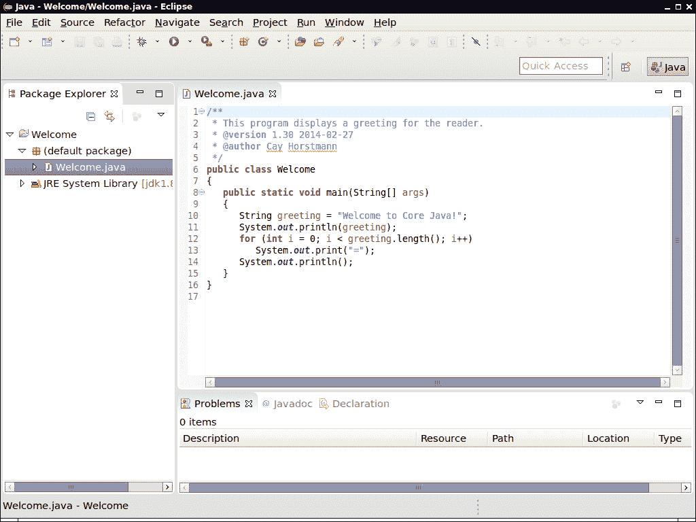

使用 Eclipse 编辑源文件

6. 使用鼠标右键点击左侧窗格中的项目名称（Welcome）。选择 Run（运行）→ Run As（运行方式）→ Java Application（Java）。程序输出显示在控制台面板中。

假设这个程序没有拼写错误或错误。（毕竟它只有几行代码。）为了讨论方便，让我们假设你的代码偶尔包含拼写错误（甚至可能是语法错误）。尝试一下吧——例如，通过如下方式更改 `String` 的大小写来搞坏你的文件：

```java
string greeting = "Welcome to Core Java!";
```

注意 `string` 下方的波浪线。在源代码下方的标签页中，点击 Problems（问题）并展开三角形，直到你看到一条关于未知 `string` 类型的错误消息（参见图 2.6）。点击错误消息。光标移动到编辑面板中对应的行，你可以在那里纠正错误。这让你能够快速修复错误。

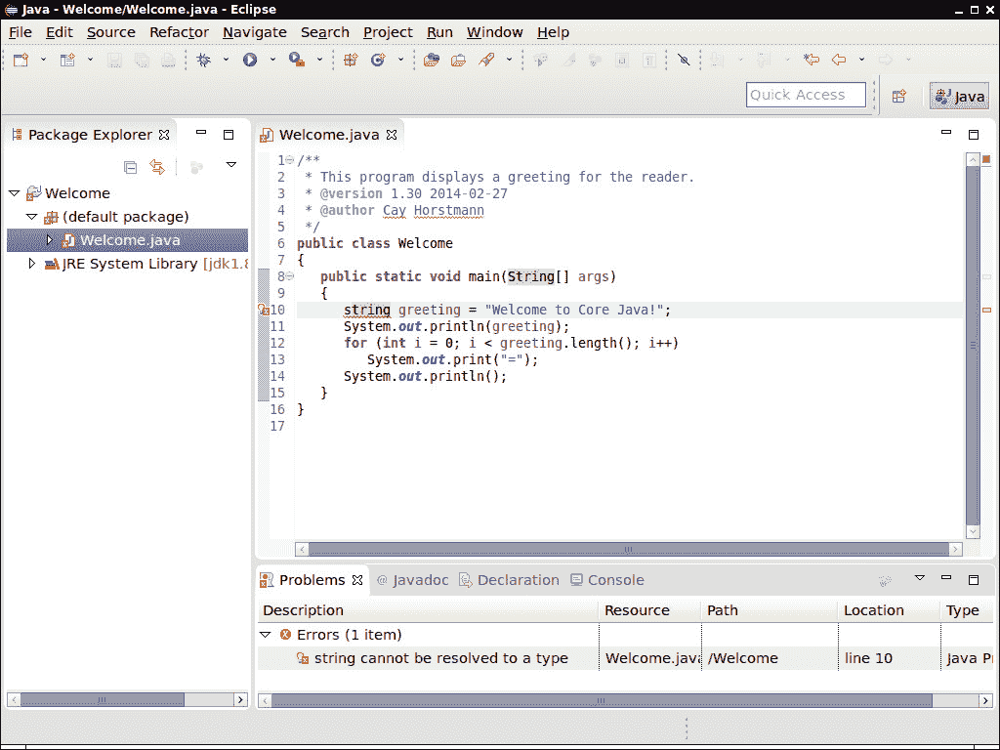

Eclipse 中的错误消息

通常，Eclipse 错误报告会伴随着一个灯泡图标。点击灯泡可以获取建议的修复列表。

# JShell

JShell 程序提供了一个“读取-求值-打印循环”，即 REPL。你输入一个 Java 表达式；JShell 评估你的输入，打印结果，并等待你的下一次输入。这是实验的一种极佳方式——比在集成开发环境中编写完整的程序要快得多。

要启动 JShell，只需在终端窗口中输入 `jshell`（参见图 2.7）。

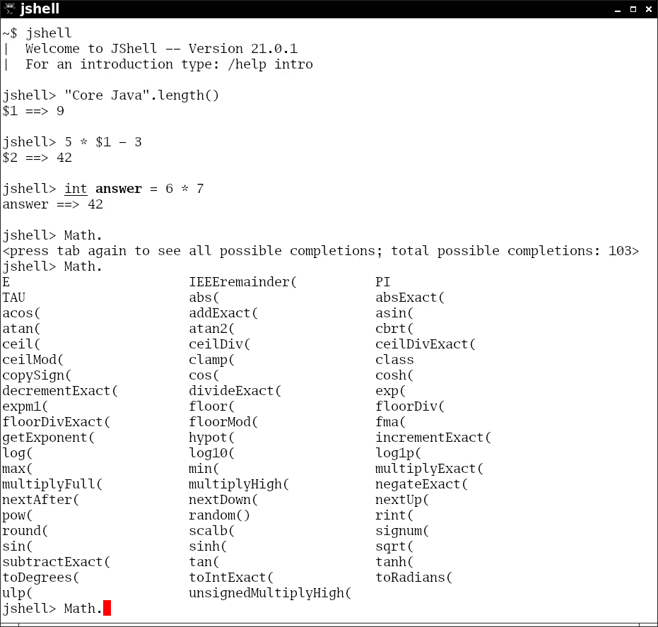

运行 JShell

JShell 启动时会显示欢迎语，随后是提示符：

```text
|  Welcome to JShell -- Version 21.0.4
|  For an introduction type: /help intro

jshell>
```

现在输入一个表达式，例如：

```java
"Core Java".length()
```

JShell 响应返回结果——在这种情况下，是字符串“Core Java”的字符数。

```text
$1 ==> 9
```

注意你不需要输入 `System.out.println`。JShell 会自动打印你输入的每一个表达式的值。

输出中的 `$1` 表示该结果可以进一步计算。例如，如果你输入：

```java
5 * $1 - 3
```

响应是：

```text
$2 ==> 42
```

如果你需要多次使用一个变量，可以给它起一个更容易记忆的名字。例如：

```text
jshell> var answer = 6 * 7
answer ==> 42
```

另一个实用的功能是 Tab 补全。输入：

```text
Math.
```

按下 Tab 键。因为有很多补全选项，系统会提示再次按下 Tab 键。你将获得可以使用 `Math` 类调用的所有方法列表：

```text
jshell> Math.
E                       IEEEremainder(          PI                      
TAU                     abs(                    absExact(               
acos(                   addExact(               asin(                   
atan(                   atan2(                  cbrt(                   
ceil(                   ceilDiv(                ceilDivExact(           
ceilMod(                clamp(                  class                   
copySign(               cos(                    cosh(                   
decrementExact(         divideExact(            exp(                    
expm1(                  floor(                  floorDiv(               
floorDivExact(          floorMod(               fma(                    
getExponent(            hypot(                  incrementExact(         
log(                    log10(                  log1p(                  
max(                    min(                    multiplyExact(          
multiplyFull(           multiplyHigh(           negateExact(            
nextAfter(              nextDown(               nextUp(                 
pow(                    random()                rint(                   
round(                  scalb(                  signum(                 
sin(                    sinh(                   sqrt(                   
subtractExact(           tan(                    tanh(                   
toDegrees(               toIntExact(             toRadians(              
ulp(                    unsignedMultiplyHigh( 
```

现在输入 `l` 并再次按下 Tab 键。方法名被补全为 `log`，你得到了一个更短的列表：

```text
jshell> Math.log
log(     log10(   log1p( 
```

现在你可以手动填写剩余部分：

```text
jshell> Math.log10(0.001)
$4 ==> -3.0
```

要重复某个命令，按下 ↑ 键直到看到你想重新发送或编辑的行。你可以使用 ← 和 → 键在行内移动光标，并添加或删除字符。完成后按下 Enter 键。例如，按下 ↑ 键并将 `0.001` 改为 `1000`，然后按下 Enter：

```text
jshell> Math.log10(1000)
$5 ==> 3.0
```

你可以使用命令退出 JShell：

```text
/exit
```

JShell 让学习 Java 语言和库变得简单有趣，无需启动沉重的开发环境，也无需纠结程序和 `main` 方法。

# Java 基础编程结构

此时，你应该已经安装了 JDK 并运行了第 2 章中的示例。现在是开始编程了。本章将向你展示如何在 Java 中实现数据类型、分支和循环等基础编程概念。

## 程序

让我们仔细观察一个简单的 Java 程序——它只是向控制台打印一条消息：

```java
public class FirstSample
{
   public static void main(String[] args)
   {
      System.out.println("We will not use 'Hello, World!'");
   }
}
```

花时间熟悉这个示例的框架是值得的；首先，Java 是对大小写敏感的。如果你在大小写上犯了任何错误（例如将 `main` 写成 `Main`），程序将无法运行。

现在让我们逐行查看这段源码。`public` 关键字称为访问修饰符；这些修饰符控制程序其他部分对该代码的访问权限。有关访问修饰符的更多信息，请参阅第 4 章。

你需要将源代码的文件名与公共类的名称相同，并加上后缀 `.java`。因此，你必须将此代码存储在名为 `FirstSample.java` 的文件中。（再次强调，大小写非常重要——不要使用 `firstsample.java`。）

你使用以下命令编译文件：

```bash
javac FirstSample.java
```

如果你命名正确且在源代码中没有任何拼写错误，你将得到一个包含该类字节码的文件。Java 编译器会将字节码文件命名为 `FirstSample.class` 并将其存储在与源文件相同的目录下。最后，通过以下命令启动程序：

```bash
java FirstSample
```

（记住省略 `.class` 扩展名。）当程序执行时，它简单地在控制台上显示字符串 `We will not use 'Hello, World!'`。

当你使用：

```bash
java ClassName
```

来运行编译后的程序时，Java 虚拟机总是会从你指定的类中 `main` 方法的代码开始执行。（“method”一词是 Java 语言中对“函数”的说法。）因此，你必须在类的源码中有一个 `main` 方法，你的代码才能执行。当然，你可以向类中添加自己的方法并在 `main` 方法中调用它们。（你将在下一章看到如何编写自己的方法。）

根据 Java 语言规范，`main` 方法必须声明为 `public`。（Java 语言规范是描述 Java 语言的官方文档。你可以从 [`docs.oracle.com/javase/specs`](https://docs.oracle.com/javase/specs) 查看或下载它。）

然而，多个版本的 Java 启动器即使在 `main` 方法不是 `public` 的情况下也能执行 Java 程序。一位程序员提交了一个 bug 报告。要查看它，请访问 [`bugs.openjdk.org/browse/JDK-4252539`](https://bugs.openjdk.org/browse/JDK-4252539)。在 1999 年，该 bug 被标记为“已关闭，不修复”。一位 Sun 工程师增加了解释，说明 Java 虚拟机规范并没有规定 `main` 必须是 `public`，并且“修复它将导致潜在的问题”。幸运的是，理智胜过了。Java 1.4 及更高版本的 Java 启动器强制要求 `main` 方法必须是 `public`。

当然，让质量保证工程师（他们通常工作过度，且并不总是 Java 细微之处的专家）对 bug 报告做出令人怀疑的决定是令人沮丧的。但值得注意的是，在 Java 开源很久以前，bug 报告及其解决方案就可以供任何人审查了，这非常了不起。

请注意源码中的大括号 `{ }`。在 Java 中，就像在 C/C++ 中一样，大括号划分了程序中的部分（通常称为块）。在 Java 中，任何方法的代码都必须以左大括号 `{` 开始并以右大括号 `}` 结束。

大括号的样式引发了大量的无用争议。本书遵循一种使匹配的大括号对齐的样式。由于空格对 Java 编译器无关，你可以使用任何你喜欢的大括号样式。

目前，不要担心 `static void` 关键字——只需把它们看作是让 Java 程序编译所需要的内容的一部分。到第 4 章结束时，你将完全理解这句咒语。现在记住的一点是，每个 Java 应用程序都必须有一个以下方式声明的 `main` 方法：

```java
public class ClassName
{
   public static void main(String[] args)
   {
      program statements
   }
}
```

`public static void main` 复杂的复杂性即将被更简单的东西取代。Java 21 有一个预览功能，在 Java 增强提案（JEP 445）中描述，它允许你这样写 `main` 方法：

```java
class FirstSample
{
   void main()
   {
      System.out.println("We will not use 'Hello, World!'");
   }
}
```


这样好多了。没有 `public`，没有 `static`，没有 `String[] args`。

目前，你需要使用命令行标志编译并运行程序：

```bash
javac --enable-preview --source 21 FirstSample.java
java --enable-preview FirstSample
```

更简单，因为只有一个源文件，你可以跳过 `javac` 步骤：

```bash
java --enable-preview --source 21 FirstSample.java
```

在书中，我们拥抱类和面向对象的编程。但对于非常简单的程序，JEP 445 允许你省略类，当然，前提是只有一个类。`FirstSample.java` 文件可以简单包含：

```java
void main()
{
   System.out.println("We will not use 'Hello, World!'");
}
```

由于这些功能仍处于预览阶段，我不会在这个版本中使用它们，但在未来，第一个示例程序将变得简单。

作为一名 C++ 程序员，你知道什么是类。Java 类与 C++ 类相似，但有几个可能会让你掉进陷阱的区别。例如，在 Java 中，所有函数都是某些类的方法。（标准术语将它们称为方法，而不是成员函数。）因此，在 Java 中，你必须为 `main` 方法准备一个壳类。你可能也熟悉 C++ 中静态成员函数的概念。这些是定义在类内部且不操作对象的成员函数。Java 中的 `main` 方法始终是静态的（`static`）。最后，与 C/C++ 一样，`void` 关键字表示此方法不返回值。与 C/C++ 不同，`main` 方法不会向操作系统返回“退出码”。如果 `main` 方法正常退出，Java 程序的退出码为 `0`，表示成功完成。要使用不同的退出码终止程序，请使用 `System.exit` 方法。

现在你已经看到了所有 Java 程序的基本结构，请将注意力转向 `main` 方法的内容：

```java
{
   System.out.println("We will not use 'Hello, World!'");
}
```

大括号标记了方法体的开始和结束。此方法内部只有一个语句。与大多数编程语言一样，你可以将 Java 语句想象成语言的句子。在 Java 中，每个语句必须以分号结束。特别是，换行符并不标记语句的结束，因此语句根据需要可以跨行。

`main` 方法的主体包含一个向控制台输出单行文本的语句。

在这里，我们正在使用 `System.out` 对象并调用它的 `println` 方法。注意用于调用方法的点。Java 使用通用语法：

```java
object.method(arguments)
```

在这种情况下，`println` 方法接收一个字符串参数。该方法将字符串参数显示在控制台上。然后它终止输出行，因此每次调用 `println` 都会在新行显示其输出。注意 Java 与 C/C++ 一样使用双引号来界定字符串。（你可以在本章后面的部分找到更多关于字符串的信息。）

Java 方法与任何编程语言中的函数一样，可以使用零、一个或多个参数。即使方法没有参数，你也必须使用空括号。例如，不带参数的 `println` 方法变体只打印空行。你通过以下调用它：

```java
System.out.println();
```

`System.out` 还有一个 `print` 方法，它不在输出中添加换行符。例如，`System.out.print("Hello")` 打印 `Hello` 而不换行。下一个输出紧跟在字母 `o` 之后。

## 注释

与大多数编程语言一样，Java 中的注释不会出现在执行程序中。因此，你可以根据需要添加注释而不必增加代码。Java 有三种标记注释的方法。

最常见的形式是 `//`。使用它来编写从 `//` 到行尾的注释。

```java
System.out.println("We will not use 'Hello, World!'"); // 这太可爱了吗？
```

当需要较长的注释时，你可以每行都标记 `//`，或者可以使用 `/*` 和 `*/` 注释定界符来划分一段较长的注释。

最后，第三种注释被用于自动生成文档。这种注释用 `/**` 开始，用 `*/` 结束。你可以在列表 3.1 中看到这种类型的注释。更多关于这种注释以及自动生成文档的知识，请参阅第 4 章。

`FirstSample/FirstSample.java`

```java
/**
 * This is the first sample program in Core Java Chapter 3
 * @version 1.01 1997-03-22
 * @author Gary Cornell
 */
public class FirstSample
{
   public static void main(String[] args)
   {
      System.out.println("We will not use 'Hello, World!'");
   }
}
```

`/* */` 注释在 Java 中是不嵌套的。这意味着，你可能无法通过将代码包裹在 `/*` 和 `*/` 之间来禁用代码，因为你想要禁用的代码本身可能包含 `*/` 分隔符。

## 数据类型

Java 是一种`强类型语言`。这意味着每个变量都必须有一个定义的类型。Java 中有八种`基本类型`。其中四种是整数类型；两种是浮点数类型；一种是字符类型 `char`，用于 Unicode 编码方案中的 UTF-16 代码单元（参见第 3.3.3 节）；一种是用于布尔值的 `boolean` 类型。

Java 有一个任意精度算术包。然而，所谓的“大数”是 Java `对象`，而不是 Java 的基本类型。你将在本章的后面的部分看到如何使用它们。

### 整数类型

整数类型用于没有小数部分的数字。允许负值。Java 提供了表 3.1 所示的四种整数类型。

**Java 整数类型**

| 类型 | 存储需求 | 范围（包含边界） |
| --- | --- | --- |
| `byte` | 1 字节 | –128 到 127 |
| `short` | 2 字节 | –32,768 到 32,767 |
| `int` | 4 字节 | –2,147,483,648 到 2,147,483,647（略超过 20 亿） |
| `long` | 8 字节 | –9,223,372,036,854,775,808 到 9,223,372,036,854,775,807 |

在大多数情况下，`int` 类型是最实用的。如果你想表示地球的人口，你将需要求助于 `long`。`byte` 和 `short` 类型主要用于特殊应用程序，例如低级文件处理，或者在存储空间紧张时用于大型数组。

在 Java 中，整数类型的范围不依赖于运行 Java 代码的机器。这减轻了想要将软件从一个平台移动另一个平台（甚至在同一平台的不同操作系统之间）的程序员的主要苦恼。相比之下，C 和 C++ 程序为每个处理器使用最高效的整数类型。因此，在 32 位处理器上运行良好的 C 程序在 16 位系统上可能会出现整数溢出。由于 Java 程序必须在所有机器上具有相同的结果，因此各种类型的范围是固定的。

长整数带有后缀 `L` 或 `l`（例如，`4000000000L`）。十六进制带有前缀 `0x` 或 `0X`（例如，`0xCAFE`）。八进制带有前缀 `0`（例如，`010` 是 8）——自然地，这可能会引起混惑，很少有程序员使用八进制常量。

你可以二进制写入数字，带有前缀 `0b` 或 `0B`。例如，`0b1001` 是 9。你向数字字面量添加下划线，例如 `1_000_000`（或 `0b1111_0100_0110_0100_0000`）来表示百万。下划线仅供人类视觉识别。Java 编译器会简单地移除它们。

在 C 和 C++ 中，`int` 和 `long` 等类型的大小取决于目标平台。在像 8086 这样的 16 位处理器上，整数是 2 字节，但在 Pentium 或 SPARC 等 32 位处理器上，它们是 4 字节的量。同样，`long` 值在 32 位处理器上是 4 字节，在 64 位处理器上是 8 字节。这些差异使得编写跨平台程序具有挑战性。在 Java 中，所有数值类型的大小都与平台无关。

注意 Java 没有 `int`、`long`、`short` 或 `byte` 类型的任何无符号版本。

如果你处理永远不会为负数的整数值，并且你确实需要额外的位，你可以在小心的情况下将符号整数值解释为无符号。例如，与其让一个 `byte` 值 `b` 表示从 –128 到 127 的范围，你可能想要 0 到 255 的范围。你可以将其存储在 `byte` 中。由于二进制的性质，你可以将符号整数值解释为无符号。

（注：原文中存在部分重复段落，已根据“不要重复输出原文”的原则进行了翻译逻辑处理）

注意 Java 没有 `int`、`long`、`short` 或 `byte` 类型的任何无符号版本。

如果你处理永远不会为负数的整数值，并且你确实需要额外的位，你可以在小心的情况下将符号整数值解释为无符号。例如，与其让一个 `byte` 值 `b` 表示从 –128 到 127 的范围，你可能想要 0 到 255 的范围。你可以将其存储在 `byte` 中。

**浮点类型**

| 类型 | 存储需求 | 范围 |
| --- | --- | --- |
| `float` | 4 字节 | ±3.4028235×¹³⁸ 到 3.4028235×¹³⁸（约 34 亿） |
| `double` | 8 字节 | ±1.7976931348623157×10³⁰⁸ 到 1.7976931348623157×10³⁰⁸（约 1.8×10³⁰⁸） |

浮点类型使用 `float` 结尾。例如，`1.79E3` 等同于 179。

浮点类型使用 `d` 结尾。例如，`1.79d` 等同于 179。

### `char` 类型

`char` 类型最初设计用于描述单个字符。然而，现在已不再如此。如今，某些 Unicode 字符可以用一个 `char` 值来描述，而另一些 Unicode 字符则两个 `char` 值。请阅读下一节以了解细节。

`char` 类型的字面量用单引号括起来。例如，`'A'` 是一个值为 65 的字符常量。它与 `"A"` 不同，后者是一个包含单个字符的字符串。`char` 类型的值可以表示为从 `\u0000` 到 `\uFFFF` 的十六进制值。

除了 `\u` 转义序列外，还有几条用于特殊字符的转义序列，如表 3.3 所示。你可以在引号内的字符字面量和字符串中使用这些转义序列，例如 `'\u005B'` 或 `"Hello\n"`。`\u` 转义序列（但其他转义序列除外）甚至可以用在引号字符常量和字符串之外。例如：

```java
public static void main(String\u005B\u005D args)
```

这是完全允许的——`\u005B` 和 `\u005D` 是 `[` 和 `]` 的编码。

### 特殊字符的转义序列

| 转义序列 | 名称 | Unicode 值 |
| --- | --- | --- |
| `\b` | 退格 (Backspace) | `\u0008` |
| `\t` | 制表符 (Tab) | `\u0009` |
| `\n` | 换行 (Line feed) | `\u000a` |
| `\r` | 回车符 (Carriage return) | `\u000d` |
| `\f` | 换页 (Form feed) | `\u000c` |
| `\"` | 双引号 (Double quote) | `\u0022` |
| `\'` | 单引号 (Single quote) | `\u0027` |
| `\\` | 反斜杠 (Backslash) | `\u005c` |
| `\s` | 空格 (Space)。用于文本块以保留末尾空格。 | `\u0020` |
| `\``newline` | 仅用于文本块：将此行与下一行合并 | — |

Unicode 转义序列在代码解析之前会被处理。例如，`"\u0022+\u0022"` 并不是由引号包裹加号（U+0022）组成的字符串。相反，`\u0022` 在解析之前被转换为 `"`，产生 `""+""`，即一个空字符串。

更阴险的是，你必须警惕注释中的 `\u`。注释：

```java
// \u000A is a newline
```

会导致语法错误，因为在程序读取时 `\u000A` 会被替换为换行符。同样，注释：

```java
// look inside c:\users
```

会导致语法错误，因为 `\u` 后面没有跟随四个十六进制数字。

Unicode 转义序列中可以包含任意数量的 `u`：`\u00E9` 和 `\uuu00E9` 都表示字符 é。这种奇特现象是有原因的。考虑一个快乐地使用 Unicode 编码的程序员，由于某些古老的原因，被迫仅以 ASCII 提交代码。转换工具可以将任何大于 U+007F 的字符转换为 Unicode 转义，并为每个现有的 Unicode 转义添加一个 `u`。这使得转换是可逆的。例如，`\uD800 é` 转换为 `\uuD800 \u00E9`，可以转换回 `\uD800 é`。

### Unicode 与 `char` 类型

为了完全理解 `char` 类型，你必须了解 Unicode 编码方案。在 Unicode 之前有许多不同的字符编码标准：美国的 ASCII、西欧语言的 ISO 8859-1、俄语的 KOI-8、中文的 GB18030 和 BIG-5 等。这导致了两个问题：首先，特定的代码在不同的编码方案中对应不同的字母。其次，字符集语言的编码长度是变化的：某些常用字符被编码为单字节，而另一些需要两个或多个字节。

Unicode 的设计是为了解决这两个问题。当统一工作在 20 世纪 80 年代开始时，固定的 2 字节代码已足以编码世界上所有语言使用的所有字符，并留有空间供未来扩展——至少当时的人们是这么想的。1991 年，Unicode 1.0 发布，使用了可用 65,536 个代码值中略于一半的数量。Java 从一开始设计为使用 16 位 Unicode 字符，这对于使用 8 位字符的其他编程语言来说是一个巨大的进步。

遗憾的是，随着时间的推移，不可避免的事情发生了。Unicode 字符数量超过了 65,536，这主要是由于增加了大量用于中、日、韩的汉字。现在，16 位 `char` 类型不足以描述所有的 Unicode 字符。

我们需要一些术语来解释 Java 是如何解决这个问题的。*码点*（code point）是与编码方案中的字符关联的整数值。在 Unicode 标准中，码点以十六进制形式表示并带有 U+ 前缀，例如拉丁字母 A 的码点是 U+0041。Unicode 码点被分成不同的平面（planes）。基本多语言平面包含 U+0000 到 U+FFFF。补充字符范围从 U+10000 到 U+10FFFF。在 Java 中，这些字符由两个 `char` 值表示，称为代理对（surrogates）。第一个代理范围从 `\uD800` 到 `\uDBFF`，第二个代理范围从 `\uDC00` 到 `\uDFFF`。

### `boolean` 类型

`boolean` 类型有两个值：`false` 和 `true`。它用于评估逻辑条件。你不能在整数和 `boolean` 值之间进行转换。

在 C++ 中，数字甚至指针可以用来代替 `boolean` 值。值 `0` 等于 `bool` 值 `false`，而非零值则等于 `true`。这在 Java 中是*不是*这种情况的。因此，Java 程序员被避免了诸此类意外，例如：

```java
if (x = 0) // 哎……本想写 x == 0
```

在 C++ 中，这个测试可以编译并运行，且结果始终为 `false`。在 Java 中，该测试无法编译，因为整数表达式 `x = 0` 无法转换为 `boolean` 值。

## 变量与常量

与所有编程语言一样，变量被用于存储值。常量是指值不会改变的变量。在后续章节中，你将学习如何声明变量和常量。

### 声明变量

在 Java 中，每个变量都有一个 `type`（类型）。你通过先放置类型、后跟变量名来声明变量。这里是一些示例：

```java
double salary;
int vacationDays;
long earthPopulation;
boolean done;
```

注意每个声明末尾的分号。分号是必要的，因为声明是一个完整的 Java 语句，必须以分号结束。

变量名（以及其他名称）的标识符由字母、数字、货币符号和“标点连接符”组成。第 1 个字符不能是数字。

像 `'+'` 或 `'©'` 这样的符号不能在变量名中使用，空格也不行。字母大小写敏感：`main` 和 `Main` 是不同的标识符。标识符的长度本质上是没有限制的。


“字母”、“数字”和“货币符号”这些术语在 Java 中比大多数语言要宽泛得多。字母是任何表示语言中字母的 Unicode 字符。例如，德国用户可以在变量名中使用如 `ä` 等变音符号；希腊语使用者可以使用 `π`。同样，数字是 `0`–`9` 以及任何表示数字的 Unicode 字符。货币符号包括 `$`、`€`、`¥` 等。标点连接符包括下划线字符 `_`、波浪低线 `﹏` 以及其他几个。在实践中，大多数程序员习惯使用 `A`-`Z`、`a`-`z`、`0`-`9` 和下划线 `_`。

如果你真的好奇哪些 Unicode 字符可以用于标识符，可以使用 `Character` 类中的 `isJavaIdentifierStart` 和 `isJavaIdentifierPart` 方法进行检查。

尽管 `$` 是标识符中的有效字符，你不应该在自己的代码中使用它。它旨在用于由 Java 编译器和其他工具生成的名称。

你不能将如 `class` 等 Java 关键字作为变量名。

下划线可以是标识符的一部分。这在常量名中很常见，例如 `Double.POSITIVE_INFINITY`。然而，单个下划线 `_` 是保留字。

从 Java 21 开始，单个下划线 `_` 表示一个语法上需要但从未使用使用的变量。你将在第 6 章和第 7 章看到示例。

你可以在同一行上声明多个变量：

```java
int i, j; // 都是整数
```

我不推荐这种风格。如果你单独声明每个变量，你的程序会更易读。

正如你所看到的，名称对大小写敏感，例如 `hireday` 和 `hireDay` 是两个独立的名称。通常情况下，你不应该拥有仅字母大小写不同的名称。然而，有时为变量起一个好名字是很的。许多程序员会给变量起与类型相同的名称，例如：

```java
Box box; // "Box" 是类型"box" 是变量名
```

其他程序员倾向于为变量使用“a”前缀：

```java
Box aBox;
```

### 初始化变量

声明变量后，你必须通过赋值语句显式地初始化它——你永远无法使用未初始化变量的值。例如，Java 编译器会将以下语句序列标记为错误：

```java
int vacationDays;
System.out.println(vacationDays); // 错误--变量未初始化
```

你通过在左侧使用变量名、等号（`=`）以及右侧带有适当值的 Java 表达式来给之前声明的变量赋值。

```java
int vacationDays;
vacationDays = 12;
```

你可以在同一行上声明并初始化变量。例如：

```java
int vacationDays = 12;
```

最后，在 Java 中，你可以在代码的任何地方放置声明。例如，以下是 Java 中有效的代码：

```java
double salary = 65000.0;
System.out.println(salary);
int vacationDays = 12; // 在这里声明变量是允许的
```

在 Java 中，将变量声明在尽可能靠近第一次使用它们的地方被认为是良好的风格。

如果可以从初始值推断出类型，则不需要声明局部变量的类型。只需使用 `var` 关键字代替类型即可：

```java
var vacationDays = 12; // vacationDays 是一个 int
var greeting = "Hello"; // greeting 是一个 String
```

这对于数字和字符串类型不是太重要，但正如你将在下一章中看到的，这一功能可以让对象的声明更加简洁。

### 常量

在 Java 中，将变量声明在尽可能靠近第一次使用它们的地方被认为是良好的风格。如果可以从初始值推断出类型，则不需要声明局部变量的类型。只需使用 `var` 关键字代替类型：

```java
var vacationDays = 12; // vacationDays 是一个 int
var greeting = "Hello"; // greeting 是一个 String
```

这对于数字和字符串类型不是太重要，但正如你将在下一章中看到的，这一功能可以让对象的声明更加简洁。在 C++ 中，数字甚至指针可以用来代替 `boolean` 值。值 `0` 等于 `bool` 值 `false`，而非零值则等于 `true`。这在 Java 中是不是这种情况的。因此，Java 程序员被避免了诸此类意外，例如：

```java
if (x = 0) // 哎……本想写 x == 0
```

在 C++ 中，这个测试可以编译并运行，且结果始终为 `false`。在 Java 中，该测试无法编译，因为整数表达式 `x = 0` 无法转换为 `boolean` 值。与所有编程语言一样，变量被用于存储值。常量是指值不会改变的变量。在后续章节中，你将学习如何声明变量和常量。

### 声明变量

在 Java 中，每个变量都有一个 `type`。你通过先放置类型、后跟变量名来声明变量。这里是一些示例：

```java
double salary;
int vacationDays;
long earthPopulation;
boolean done;
```

注意每个声明末尾的分号。分号是必要的，因为声明是一个完整的 Java 语句，必须以分号结束。

变量名（以及其他名称）的标识符由字母、数字、货币符号和“标点连接符”组成。第 1 个字符不能是数字。

像 `'+'` 或 `'©'` 这样的符号不能在变量名中使用，空格也不行。字母大小写敏感：`main` 和 `Main` 是不同的标识符。标识符的长度本质上是没有限制的。

“字母”、“数字”和“货币符号”这些术语在 Java 中比大多数语言要宽泛得多。字母是任何表示语言中字母的 Unicode 字符。例如，德国用户可以在变量名中使用如 `ä` 等变音符号；希腊语使用者可以使用 `π`。同样，数字是 `0`–`9` 以及任何表示数字的 Unicode 字符。货币符号包括 `$`、`€`、`¥` 等。标点连接符包括下划线字符 `_`、波浪低线 `﹏` 以及其他几个。在实践中，大多数程序员习惯使用 `A`-`Z`、`a`-`z`、`0`-`9` 和下划线 `_`。

如果你真的好奇哪些 Unicode 字符可以用于标识符，可以使用 `Character` 类中的 `isJavaIdentifierStart` 和 `isJavaIdentifierPart` 方法进行检查。

尽管 `$` 是标识符中的有效字符，你不应该在自己的代码中使用它。它旨在用于由 Java 编译器和其他工具生成的名称。

你不能将如 `class` 等 Java 关键字作为变量名。

下划线可以是标识符的一部分。这在常量名中很常见，例如 `Double.POSITIVE_INFINITY`。然而，单个下划线 `_` 是保留字。

从 Java 21 开始，单个下划线 `_` 表示一个语法上需要但从未使用使用的变量。你将在第 6 章和第 7 章看到示例。

你可以在同一行上声明多个变量：

```java
int i, j; // 都是整数
```

我不推荐这种风格。如果你单独声明每个变量，你的程序会更易读。

正如你所看到的，名称对大小写敏感，例如 `hireday` 和 `hireDay` 是两个独立的名称。通常情况下，你不应该拥有仅字母大小写不同的名称。然而，有时为变量起一个好名字是很的。许多程序员会给变量起与类型相同的名称，例如：

```java
Box box; // "Box" 是类型"box" 是变量名
```

其他程序员倾向于为变量使用“a”前缀：

```java
Box aBox;
```

### 初始化变量

声明变量后，你必须通过赋值语句显式地初始化它——你永远无法使用未初始化变量的值。例如，Java 编译器会将以下语句序列标记为错误：

```java
int vacationDays;
System.out.println(vacationDays); // 错误--变量未初始化
```

你通过在左侧使用变量名、等号（`=`）以及右侧带有适当值的 Java 表达式来给之前声明的变量赋值。

```java
int vacationDays;
vacationDays = 12;
```

你可以在同一行上声明并初始化变量。例如：

```java
int vacationDays = 12;
```

最后，在 Java 中，你可以在代码的任何地方放置声明。例如，以下是 Java 中有效的代码：

```java
double salary = 65000.0;
System.out.println(salary);
int vacationDays = 12; // 在这里声明变量是允许的
```

在 Java 中，将变量声明在尽可能靠近第一次使用它们的地方被认为是良好的风格。

如果可以从初始值推断出类型，则不需要声明局部变量的类型。只需使用 `var` 关键字代替类型即可：

```java
var vacationDays = 12; // vacationDays 是一个 int
var greeting = "Hello"; // greeting 是一个 String
```

这对于数字和字符串类型不是太重要，但正如你将在下一章中看到的，这一功能可以让对象的声明更加简洁。

### 枚举类型

有时，变量应该只持有一组受限的值。例如，你出售的衣服或披萨有四种尺寸：小、中、大和大特号。当然，你可以将这些尺寸编码为整数 `1`、`2`、`3`、`4` 或字符 `S`、`M`、`L` 和 `X`。但这是一个出错的设置。变量很容易持有一个错误的值（例如 `0` 或 `m`）。

每当出现这种情况时，你都可以定义自己的枚举类型。枚举类型具有有限数量的命名值。例如：

```java
enum Size { SMALL, MEDIUM, LARGE, EXTRA_LARGE };
```

现在，你可以声明这种类型的变量了：

```java
Size s = Size.MEDIUM;
```

类型为 `Size` 的变量只能持有类型声明中列出的值之一，或者特殊值 `null`，该值表示变量没有被赋值为任何值。（有关关于 `null` 的更多信息，请参阅第 4 章。）

枚举类型在第 5 章中有更详细的讨论。

## 运算符

运算符用于组合值。正如你在后续章节中看到的，Java 拥有一套丰富的算术运算符、逻辑运算符和数学函数。

### 算术运算符

Java 中常用的算术运算符 `+`、`-`、`*` 和 `/` 用于加、减、乘、除法。

如果两个操作数都是整数，则 `/` 运算符表示整数除法；否则表示浮点数除法。整数除以 0 会抛出异常，而浮点数除以 0 会产生无限或 `NaN` 结果。

整数取余（有时称为 `modulus`）用 `%` 表示。例如，`15 / 2` 是 `7`，`15 % 2` 是 `1`，而 `15.0 / 2` 是 `7.5`。

当 `%` 的操作数之一为负时，结果也是负数。例如，如果 `n` 是偶数，`n % 2` 为 0；如果 `n` 是正奇数，则为 1；如果 `n` 是负奇数，则为 -1。为什么呢？在第一批计算机制造时，有人必须为负操作数的整数取余工作方式制定规则。数学家们已经知道最优（或“欧几里德”）规则几百年：始终保持余数 `≥ 0`。但那些先驱者并没有去翻数学书，而是提出了看似合理但实际上并不方便的规则。

考虑这个问题：你正在计算钟时针的位置。应用一个调整后，你想将其归一化为 `0` 到 `11` 之间的数字。这很简单：`(position + adjustment) % 12`。但如果调整是负数呢？那么你可能会得到一个负数。所以你必须引入一个分支，或者使用 `((position + adjustment) % 12 + 12) % 12`。无论哪种方法，都很麻烦。

更好的补救办法是使用 `floorMod` 方法：`Math.floorMod(position + adjustment, 12)` 始终产生一个 `0` 到 `11` 之间的值。遗憾的是，`floorMod` 对于负除数仍会产生负余数，但这种情况在实践中并不经常发生。

Java 编程语言的目标之一是可移植性。无论由哪个虚拟机执行，计算结果都应该是相同的。对于浮点数的算术计算，要实现这种可移植性可能会异常困难。`double` 类型使用 64 位来存储数值，但某些处理器器使用 80 位的浮点寄存器。这些寄存器在计算的中间步骤提供了额外的精度。

但结果可能与整个过程使用 64 位的计算 `different`。为了实现完美的完全移植性，Java 虚拟机的初始规范规定所有中间计算必须被截断为 64 位。数值社区非常讨厌这一点。计算变得 `slower`，因为截断操作在流行的处理器上需要时间。出于这个原因，Java 编程语言进行了更新，以承认优化性能和完美可复现性之间的冲突需求。虚拟机设计人员允许在中间计算中使用扩展精度。然而，标记有 `strictfp` 关键字的方法必须使用严格的浮点操作以产生可复现的结果。

处理器变得更加灵活，它们现在可以高效地执行 64 位算术。从 Java 17 开始，虚拟机再次被要求执行严格的 64 位算术，`strictfp` 关键字现在已过时。

### 数学函数和常量

`Math` 类包含了你偶尔可能需要的各种数学函数，取决于你所做的编程类型。

要取一个数的平方根，使用 `sqrt` 方法：

```java
double x = 4;
double y = Math.sqrt(x);
System.out.println(y); // 打印 2.0
```

`println` 方法和 `sqrt` 方法之间存在细微的。`println` 方法作用于 `System.out` 对象。但 `Math` 类中的 `sqrt` 方法不作用于任何对象。这种方法被称为 `static`（静态）方法。你可以在第 4 章中学习更多关于静态方法的知识。

Java 编程语言没有用于计算幂的运算符：你必须使用 `Math` 类中的 `pow` 方法。

```java
double y = Math.pow(x, a);
```

该语句将 `y` 设置为 `x` 的 `a` 次方（`x`^(`a`)）。`pow` 方法的参数都是 `double` 类型，且它返回的也是 `double`。

`Math` 类提供了常用的三角函数：

```java
Math.sin
Math.cos
Math.tan
Math.atan
Math.atan2
```

以及指数函数及其逆函数自然对数，以及十进制对数：

```java
Math.exp
Math.log
Math.log10
```

Java 21 添加了一个 `Math.clamp` 方法，强制使数字适应给定的范围。例如：

```java
Math.clamp(-1, 0, 10) // 太小，返回 0
0, 10, 11) // 太大，返回 10
3, 0, 10) // 在范围内，返回 3
```

最后，常量表示 `π`、`τ` 和 `e`：

```java
Math.PI
Math.TAU
Math.E
```

你可以通过在文件顶部添加以下行，为方法和常量省略 `Math` 前缀：

```java
import static java.lang.Math.*;
```

例如：

```java
System.out.println("平方根是 " + sqrt(PI));
```

静态导入将在第 4 章中介绍。

`Math` 类中的方法使用计算机浮点程序以获得最高性能。如果完全预测的结果比性能更重要，请改用 `StrictMath` 类。它实现了来自“数学库（[`www.netlib.org/fdlibm`](https://www.netlib.org/fdlibm)）的算法，确保在所有平台上的结果一致。

`Math` 类提供了多种方法使整数算术更安全。数学运算符在计算溢出时会静默返回错误结果。例如，十亿乘以三（`1000000000 * 3`）计算为 `-1294967296`，因为最大的 `int` 值仅为二十亿。如果你改为调用 `Math.multiplyExact(100000000, 3)`，则会生成异常。你可以捕获该异常或让程序终止，而不是静默继续使用错误的结果。还有 `addExact`、`subtractExact`、`incrementExact`、`decrementExact`、`negateExact` 和 `absExact` 方法，参数均为 `int` 和 `long`。

### 数值类型转换

通常需要从一种数值类型转换为另一种。图 3.1 显示了法的转换。

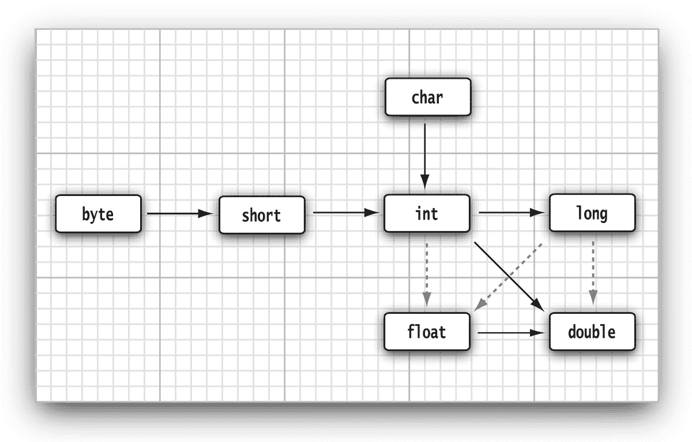

数值类型之间的转换

图 3.1 中的六条实线表示没有信息丢失的转换。三个虚线表示可能会丢失精度的转换。例如，像 `123456789` 这样的大整数超过了 `float` 类型可以表示的位数。当整数转换为 `float` 时，结果的数量级正确，但丢失了一些精度。

```java
int n = 123456789;
float f = n; // f 是 1.23456792E8
```

当两个值与二元运算符结合（例如 `n + f`，其中 `n` 是整数而 `f` 是浮点值）时，在执行操作之前，两个操作数都会转换为共同类型。

- 如果操作数之一是 `double` 类型，则另一个将被转换为 `double`。
- 否则，如果其中一个操作数的类型为 `float`，则另一个将被转换为 `float`。
- 否则，如果其中一个操作数的类型为 `long`，则另一个将被转换为 `long`。
- 否则，两个操作数都将转换为 `int`。

### 强制转换（Casts）

在上一节中，你已经看到在必要时 `int` 值会自动转换为 `double` 值。另一方面，显然在某些情况下，你可能希望将 `double` 视为整数。在 Java 中，数值转换是可能的，但可能会丢失信息。可能发生信息丢失的转换是通过强制转换（`casts`）完成。强制转换的语法是在括号中给出目标类型，后跟变量名。例如：

```java
double x = 9.997;
int nx = (int) x;
```

现在，变量 `nx` 的值为 `9`，因为将浮点数强制转换为整数会舍弃小数部分。

如果你想将浮点数 `round`（四舍五入）到最近 `nearest` 整数（这在大多数情况下是一个更有用的操作），请使用 `Math.round` 方法：


```java
double x = 9.997;
int nx = (int) Math.round(x);
```

现在，变量`nx`的值为`10`。在调用`round`时，你仍然需要使用强制转换`(int)`。这是因为`round`方法的返回`long`，而`long`只有通过显式强制转换才能赋予`int`，因为存在信息丢失的可能性。

如果你尝试将一种类型的数字转换为超出目标类型范围的另一种类型，结果将是一个值不同的截断数字。例如，`(byte) 300`实际上是`44`。

你不能在`boolean`值和任何数值类型之间进行强制转换。这种约定防止了常见的错误。在需要将`boolean`值转换为数字的少数情况下，你可以使用条件表达式，例如`b ? 1 : 0`。

### 赋值（Assignment）

在赋值中使用二元运算符时，有一个方便的快捷方式。例如，复合赋值运算符（`compound assignment operator`）：

```java
x += 4;
```

等同于：

```java
x = x + 4;
```

（通常，将运算符放在`=`符号的左侧，例如`*=`或`%=`。）

如果复合赋值运算符产生的值类型与左侧不同，则它会被强制转换以匹配。例如，如果`x`是一个`int`，那么语句：

```java
x += 3.5;
```

是有效的。它将`x`设置为`(int)(x + 3.5)`，即`x + 3`，且没有任何警告！

从 Java 20 开始，如果你使用`-Xlint`命令行选项进行编译，将获得一个警告。

注意，在 Java 中，赋值是一个`expression`（表达式）。也就是说，它有一个值——即正在被赋值的值。你可以使用这个值——例如，将其赋值给另一个变量。考虑这些语句：

```java
int x = 1;
int y = x += 4;
```

`x += 4`的值为`5`，因为这是正在赋值给`x`的值。接着，该值被赋值给`y`。

许多程序员发现这种嵌套赋值令人困惑，倾向于将其写得更清晰，像这样：

```java
int x = 1;
x += 4;
int y = x;
```

### 自增和自减运算符（Increment and Decrement Operators）

程序员当然知道对数值变量最常见的操作之一是加或减 1。Java 遵循 C 和 C++ 的足迹，同时拥有自增和自减运算符：`n++`将变量`n`的当前值加 1，而`n--`从其减去 1。例如，代码：

```java
int n = 12;
n++;
```

将`n`改变为`13`。由于这些运算符改变了变量的值，它们不能应用于数字本身。例如，`4++`不是一个合法的语句。

这些运算符有两种形式；你刚刚看到了放在操作数之后的后置形式。还有一种前置形式，即`++n`。两者都会将变量的值改变 1。两者之间的区别只在它们被用于表达式内部时才会出现。前置形式先执行加法；后置形式返回变量的旧值。

```java
int m = 7;
int n = 7;
int a = 2 * ++m; // 现在 a 是 16，m 是 8
int b = 2 * n++; // 现在 b 是 14, n 是 8
```

许多程序员发现这种行为令人困惑。在 Java 中，在表达式内部使用`++`是 uncommon。

### 关系和布尔运算符（Relational and Boolean Operators）

Java 拥有完整的关系运算符。要测试相等性，使用双等号`==`。例如：

```java
3 == 7
```

结果为`false`。

使用`!=`表示不相等。例如：

```java
3 != 7
```

结果为`true`。

最后，你还有通常的`<`（小于）、`>`（大于）、`<=`（小于等于）和`>=`（大于等于）运算符。

Java 遵循 C++，使用`&&`表示“与”（and），使用`||`表示“或”（or）。

### 条件运算符（Conditional Operator）

Java 提供了常用的条件运算符`?:`，它根据布尔表达式选择一个值。例如：

```java
condition ? expression1 : expression2
```

当条件为`true`时求值为第一个表达式，否则求值为第二个表达式。例如：

```java
x < y : y
```

给出`x`和`y`中的较值。

### `switch`表达式（Switch Expressions）

如果你需要在多个值之间进行选择，可以使用`switch`表达式，它是在 Java 14 中引入的。它看起来如下：

```java
String seasonName = switch (seasonCode)
   {
      case 0 -> "Spring";
      case 1 -> "Summer";
      case 2 -> "Fall";
      case 3 -> "Winter";
      default -> "???";
   };
```

`switch`关键字后面的表达式被称为`selector expression`（选择器表达式），其值就是`selector`（选择器）。目前，我们只考虑整型类型（`int`、`char`、`byte`或`short`）、字符串或枚举类型的常量。

`switch`表达式像每个表达式一样都有值。注意每个分支值前面的`->`箭头。

从 Java 14 开始，`switch`有四种形式。本节重点介绍最实用的形式。

`case`标签必须是与选择器类型匹配的编译时常量。你可以为每个`case`提供多个标签，并用逗号分隔：

```java
int numLetters = switch (seasonName)
   {
      case "Spring", "Summer", "Winter" -> 6;
      case "Fall" -> 4;
      default -> -1;
   };
```

当你对枚举常量使用`switch`表达式时，不需要在每个标签中提供枚举的名称——它是从`switch`值推断出来的。例如：

```java
enum Size { SMALL, MEDIUM, LARGE, EXTRA_LARGE };
. . . 
Size itemSize = . . .
String label = switch (itemSize)
   {
      case SMALL -> "S"; // 不需要 Size.SMALL
      case MEDIUM -> "M";
      case LARGE -> "L";
      case EXTRA_LARGE -> "XL";
   };
```

在示例中，省略`default`是合法的，因为每个可能的值都有对应的`case`。

当选择器是一个`enum`且你没有为所有常量提供`case`时，你需要一个`default`。带有整数或`String`选择器的`switch`表达式必须包含`default`。

如果选择器为`null`，则会抛出`NullPointerException`。如果你想避免这种可能性，可以添加一个`case null`，如下所示：

```java
String label = switch (itemSize)
   {
      . . .
      case null -> "???"; 
   };
```

这是 Java 21 的特性。注意，`default`并不会匹配`null`！

### 位运算符

对于任何整数类型，你都拥有可以直接操作构成整数的位的运算符。这意味着你可以使用掩码技术来获取数字中的单个位。位运算符有：

```text
& ("与")   | ("或")   ^ ("异或")   ~ ("非")
```

这些运算符作用于位模式。例如，如果`n`是一个整数变量，那么：

```java
int fourthBitFromRight = (n & 0b1000) / 0b1000;
```

如果`n`的二进制表示从右往数的第四位是`1`，则返回`1`，否则返回`0`。使用`&`配合适当的 2 的幂可以过滤掉单个位以外的所有位。

当应用于`boolean`值时，`&`和`|`运算符产生一个`boolean`值。这些运算符与`&&`和`||`运算符类似，区别在于`&`和`|`运算符不会以“短路”方式求值——也就是说，计算结果之前会对两个操作数都进行求值。

还有`>>`和`<<`运算符，用于移动位模式。当你需要构建位模式来进行位掩码时，这些运算符非常方便：

```java
int fourthBitFromRight = (n & (1 << 3)) >> 3;
```

最后，`>>>`运算符会将高位填充为零，而`>>`则会将符号位扩展到高位。没有`<<<`运算符。

移位运算符的右侧操作数会对 32 取模（除非左侧操作数是`long`，在这种情况下对 64 取模）。例如，`1 << 35`的值等于`1 << 3`或`8`。

在 C/C++ 中，无法保证`>>`是执行算术移位（扩展符号位）还是逻辑移位（填充零）。实现者可以自由选择效率更高的一种。这意味着 C/C++ 的`>>`运算符对于负数可能会产生取决于实现的结果。Java 消除了这种不确定性。

`Integer`类有许多用于位操作的静态方法。例如，`Integer.bitCount(n)`返回`n`二进制表示中`1`的个数，而`Integer.reverse(n)`返回反转`n`的位后得到的数值。很多程序员不需要位级操作，但如果你确实需要，可以查看`Integer`类看看是否有适用于你需要完成的任务的方法。

### 括号和运算符层级

[表 3.4]显示了运算符的优先级。如果不使用括号，操作将按照指示所示的层级顺序执行。同一层级的运算符从左到右处理，但表所示的右结合运算符除外。例如，`&&`的优先级高于`||`，因此表达式：

```java
a && b || c
```

意味着：

```java
(a && b) || c
```

由于`+=`是从右到左结合，表达式：

```java
a += b += c
```

意味着：

```java
a += (b += c)
```

也就是说，`b += c`的值（即`b`相加后的值）被加到`a`上。

#### 运算符优先级

| 运算符 | 结合性 |
| --- | --- |
| `[] . ()`（方法调用） | 从左到右 |
| `! ~ ++ -- +`（一元）`-`（一元）`()`（强制转换）`new` | 从右到左 |
| `* / %` | 从左到右 |
| `+ -` | 从左到右 |
| `<< >> >>>` | 从左到右 |
| `< <= > >= instanceof` | 从左到右 |
| `== !=` | 从左到右 |
| `&` | 从左到右 |
| `^` | 从左到右 |
| `|` | 从左到右 |
| `&&` | 从左到右 |
| `||` | 从左到右 |
| `?:` | 从右到左 |
| `= += -= *= /= %= &= |= ^= <<= >>= >>>=` | 从右到左 |

与 C 或 C++ 不同，Java 没有逗号运算符。然而，你可以在`for`语句的第一和第三个槽中使用*用逗号分隔的表达式列表*。

## 字符串

从概念上讲，Java 字符串是`Unicode`字符序列。正如你在[第 3.3.4 节]中所看到的，究竟什么是字符的定义已经变得复杂。将字符编码为`char`值也变得复杂了。

然而，大多数时候你并不关心这些。你从字符串字面量或方法中获取字符串，并使用`String`的方法对其进行操作。你已经见过字符串字面量如`"Hello!"`是`String`的实例。接下来的章节将介绍细节。

### 拼接

Java 与大多数编程语言一样，允许使用`+`来连接两个字符串。

```java
String expletive = "Expletive";
String PG13 = "deleted";
String message = expletive + PG13;
```

`+`运算符将`message`设置为`"Expletivedeleted"`。

如果你需要用分隔符将多个字符串结合，请使用静态`join`方法：

```java
String all = String.join(" / ", "S", "M", "L", "XL");
// all 的值为 "S / M / L / XL"
```

`repeat`方法产生重复指定次数的字符串：

```java
String repeated = "Java".repeat(3); // repeated 为 "JavaJavaJava"
```

### 分割字符串

`split`方法根据给定的边界将字符串分成部分。例如：

```java
"Hello, World!".split(" ")
```

产生一个包含两个元素的数组：字符串`"Hello,"`和`"World!"`。（数组在[第 3.10 节]中引入。）

`split`方法的参数是一个*正则表达式*，描述了在哪里进行分割。关于正则表达式的详细讨论，请参阅[卷二第 2 章]。[表 3.5]有了一些实用的模式。

#### 分割模式

| 模式 | 说明 |
| --- | --- |
| `"\\s+"` | 空格 |
| `"\\s*,\\s*"` | 带有可选空格的逗号 |
| `"\\."` | 句 |
| `\\PL+` | 非字母 |
| `"\\R"` | 换行符 |
| `"\\b"` | 单词边界 |
| `"\\b{g}"` | 字符簇边界（自 Java 9 起） |

沿着`grapheme cluster`（字形簇）边界进行分割可以将字符串分解为人类感知的组成字符：

```java
"Ciao 🇮🇹".split("\\b{g}") // 返回一个包含六个元素的数组 "C", "i", "a", "o", " ", "🇮🇹"
```

### 索引与子字符串

Java 字符串是`char`值的序列。正如你在第 3.3.4 节中所看到的，`char`数据类型用于表示 UTF-16 编码中的 Unicode 码点。某些字符可以使用单个`char`值表示，但许多字符和符号需要多个`char`值。

虚拟机并不强制要求将字符串存储为`char`值的序列。为了效率起见，只包含单字节代码单元的字符串存储为`byte`序列，而所有其他字符串存储为`char`序列。这是一个实现细节，它在过去发生过变化，未来可能再次发生变化。

`length`方法返回给定字符串所需的`char`值数量。例如：

```java
String greeting = "Ciao 🇮🇹";
int n = greeting.length(); // 等于 9
```

调用`s.charAt(n)`返回位置`n`处的`char`值，其中`n`于`0`和`s.length() - 1`之间（与 C 和 C++ 类似，Java 从 0 开始计算字符串中的位置）。例如：

```java
char first = greeting.charAt(0); // first 是 67 或 'C'
char last = greeting.charAt(8); // last 是 56825
```

然而，这些调用并不非常有用。最后一个`char`值只是标志符号的一部分，你通常并不关心这些值是什么。

尽管如此，你有时需要知道子字符串在字符串中的位置。使用`indexOf`方法：

```java
String sub = " ";
int start = greeting.indexOf(sub); // 4
```

恰好，空格的位置（或索引`index`）是 4，但具体数值并不重要。它取决于子字符串之前的字符，以及编码每个字符所需的`char`值数量。请始终将索引视为一个不透明的数字，而不是它之前感知字符的计数。

你可以计算下一个字符开始的位置：

```java
int nextStart = start + sub.length(); // 5
```

恰好，字符串`" "`的长度为 1，但不要硬编码字符串的长度。请始终使用`length`方法。

你可以使用`String`类的`substring`方法从较大的字符串中提取子字符串。例如：

```java
String greeting = "Hello, World!";
int n = greeting.indexOf(",");
String s = greeting.substring(0, n);
```

这会创建一个由字符`"Hello"`组成的字符串。

`substring`的第二个参数是不想要复制的起始。在我们的案例中，我们复制从开始到但不包含逗号的所有内容。

注意，字符串`s.substring(a, b)`的长度始终是`b - a`。例如，子字符串`"Hello"`的长度为`5 - 0 = 5`。

### 字符串是不可变的

`String`类没有提供任何让你修改现有字符串中字符的方法。如果你想将`greeting`变为`"Help!"`，你不能直接将`greeting`的最后位置改为`'p'`和`'!'`。如果你是一个 C 程序员，这可能会让你感到非常无助。我们该如何修改字符串呢？在 Java 中，这非常简单：将你想保留的子字符串与你想替换的字符进行拼接。

```java
String greeting = "Hello";
int n = greeting.indexOf("lo");
greeting = greeting.substring(0, n) + "p!";
```

此声明将变量`greeting`的当前值更改为`"Help!"`。


由于你无法更改 Java 字符串中的单个字符，文档将 `String` 类的对象称为不可变的（immutable）。正如数字 `3` 始终是 `3` 一样，字符串 `"Hello"` 始终将包含字符 `H`、`e`、`l`、`l`、`o` 的代码单元序列。你无法更改这些值。然而，正如你所看到的，你可以更改字符串变量 `greeting` 的内容并使其引用不同的字符串，就像你可以让一个当前持有值 `3` 的数值变量持有值 `4` 一样。

这难道不是效率低很多吗？修改字符似乎比从头开始构建一个全新的字符串要简单。嗯，既是如此又不是如此。确实，生成一个包含 `"Hel"` 和 `"p!"` 拼接结果的新字符串需要一些工作。但不可变字符串有一个巨大的优势：编译器可以安排字符串是共享的。

要理解这是如何工作的，请将各种字符串想象成位于一个公共池中。字符串变量则指向池中的位置。如果你复制一个字符串变量，原始变量和副本将共享相同的字符。

总的来说，Java 的设计者认为，共享的效率超过了创建字符串的低效。看看你自己的程序；大多数时候，你可能并没有在更改字符串——你只是在比较它们。（有一个常见的例外——从单个字符或来自键盘或文件的较短字符串组装字符串。对于这些情况，Java 提供了一个单独的类——参见第 3.6.9 节。）

C 程序员在第一次看到 Java 字符串时通常会感到困惑，因为他们将字符串视为字符数组：

```
char greeting[] = "Hello";
```

这是一个错误的类比：Java 字符串大致相当于：

```
char* greeting = "Hello";
```

当你用另一个字符串替换 `greeting` 时，Java 代码大致如下：

```
char* temp = malloc(6);
strncpy(temp, greeting, 3);
strncpy(temp + 3, "p!", 3);
greeting = temp;
```

当然，现在 `greeting` 指向 `"Help!"`。即使是老练的 C 程序员也必须承认 Java 的语法比 `strncpy` 调用更愉快。但如果我们对 `greeting` 进行另一次赋值呢？

```
greeting = "Howdy";
```

我们会内存泄漏吗？毕竟原始字符串是分配在堆上的。幸运的是，Java 有自动垃圾回收。如果不再需要内存块，它最终会被回收。

如果你是 C++ 程序员并使用 ANSI C++ 定义的 `string` 类，你会更习惯 Java 类型。C++ `string` 对象也会执行自动内存分配和释放。内存管理通过构造函数、赋值运算符和析构函数显式执行。然而，C++ 字符串是可变的——你可以修改字符串中的单个字符。

### 测试字符串相等

要测试两个字符串是否相等，请使用 `equals` 方法。表达式：

```
s.equals(t)
```

如果字符串 `s` 和 `t` 相等，则返回 `true`，否则返回 `false`。注意 `s` 和 `t` 可以是字符串变量或字面量。例如，表达式：

```
"Hello".equals(greeting)
```

是完全合法的。要测试两个字符串除了大小写字母外相同，使用 `equalsIgnoreCase` 方法：

```
"Hello".equalsIgnoreCase("hello")
```

不要使用 `==` 运算符来测试两个字符串是否相等！它只确定字符串是否存储在相同的位置。当然，如果字符串在相同的位置，它们必须相等。但完全可能在不同的地方存储相同字符串的多个副本。

```
String greeting = "Hello"; // 初始化 greeting 为字符串
greeting == "Hello" // true
greeting.substring(0, greeting.indexOf("l")) == "He" // false
greeting.substring(0, greeting.indexOf("l")).equals("He") // true
```

如果虚拟机总是安排让相等的字符串共享，那么你就可以用 `==` 运算符测试相等性。但只有字符串字面量是共享的，运行时计算的字符串不是。因此，永远不要使用 `==` 来比较字符串。请始终使用 `equals`。

如果你习惯了 C++ 的 `string` 类，那么必须特别注意相等性测试。C++ 的 `string` 类重载了 `==` 运算符来测试字符串内容的相等性。在 Java 中，字符串看起来与数字相似。它们有字面量值和 `+` 运算符，但它们实际上是对象。正如你将在下一章看到的，`==` 运算符始终检查两个对象是否相同。

C 语言程序员知道永远不要使用 `==` 来比较 `char*` 字符串，而应该使用 `strcmp`。Java 的 `compareTo` 方法是 `strcmp` 的完全等价物。你可以使用：

```
if (greeting.compareTo("Hello") == 0) . . .
```

但使用 `equals` 似乎更清晰。

## 空字符串和空值

空字符串 `""` 是长度为 0 的字符串。你可以通过调用以下方法来测试字符串是否为空：

```
if (str.length() == 0)
```

或者：

```
if (str.equals(""))
```

或者，为了获得最高效率：

```
if (str.isEmpty())
```

空字符串是一个 Java 对象，它持有字符串长度（即 `0`）和空内容。然而，`String` 变量还可以持有一个特殊值，称为 `null`，表示当前没有对象与变量关联。要测试字符串是否为 `null`，请使用：

```
if (str == null)
```

有时，你需要测试字符串既不是 `null` 也为空。这时使用：

```
if (str != null && str.length() != 0)
```

你需要先测试 `str` 是否为 `null`。正如你将在第 4 章中看到的，在 `null` 值上调用方法是一个错误。

## String API

Java 中的 `String` 类包含近 100 个方法。以下 API 说明总结了最有用的方法。

这些贯穿全书的 API 说明将帮助你理解 Java 应用程序接口（API）。每个 API 注释以类名开头，例如 `java.lang.String`。（所谓包名 `java.lang` 的意义在第 4 章中有所解释。）类名之后是一个或多个方法的名称、说明和参数描述。方法的参数变量是接收方法参数的变量。例如，正如你在下面的第一个 API 注释中看到的，`charAt` 方法有一个类型为 `int` 的参数名为 `index`。如果你调用该方法，你需要提供该类型的参数，例如 `str.charAt(0)`。

API 说明没有列出特定类的所有方法，而是以简洁的形式呈现最常用的方法。要查看完整列表，请咨询在线文档（参见第 3.6.8 节）。

类名后的数字是引入该方法的 JDK 版本号。如果某个方法以后添加，它将有一个单独的版本号。

`java.lang.String` 1.0

- `char charAt(int index)`

  返回指定位置的代码单元。除非你对底层代码单元感兴趣，否则你可能不想调用此方法。

- `int length()`

  返回字符串的代码单元数量。

- `boolean equals(Object other)`

  如果字符串等于 `other`，则返回 `true`。

- `boolean equalsIgnoreCase(String other)`

  如果字符串等于 `other`（不区分大小写），则返回 `true`。

- `int compareTo(String other)`

  如果字符串在字典顺序上于 `other` 之前，返回负值；如果在 `other` 之后，返回正值；如果字符串相等，则返回 `0`。

- `boolean isEmpty()` 6

- `boolean isBlank()` 11

  如果字符串为空或由空白字符组成，返回 `true`。

- `boolean startsWith(String prefix)`

- `boolean endsWith(String suffix)`

  如果字符串以 `prefix` 开头或以 `suffix` 结尾，则返回 `true`。

- `int indexOf(String str)`

- `int indexOf(String str, int fromIndex)`

- `int indexOf(String str, int fromIndex, int toIndex)` 21

  返回第一个与字符串 `str` 相等的子字符串的起始位置，从索引 `0` 或 `fromIndex` 开始，到字符串末尾或 `toIndex` 结束。如果 `str` 未在此字符串或指定的子字符串中出现，则返回 `-1`。

- `int lastIndexOf(String str)`

- `int lastIndexOf(String str, int fromIndex)`

  返回最后一个与字符串 `str` 相等的子字符串的起始位置，从字符串末尾或 `fromIndex` 开始，或者如果 `str` 未出现，则返回 `-1`。

- `String replace(CharSequence oldString, CharSequence newString)`

  返回一个新字符串，通过将字符串中所有匹配 `oldString` 的子字符串替换为字符串 `newString`。你可以为 `CharSequence` 参数提供 `String` 或 `StringBuilder` 参数。

- `String substring(int beginIndex)`

- `String substring(int beginIndex, int endIndex)`

  返回一个新字符串，由从 `beginIndex` 到字符串末尾或到 `endIndex - 1` 的所有代码单元组成。

- `String toLowerCase()`

- `String toUpperCase()`

  返回包含原始字符串所有字符的新字符串，并将小写转换为大写。

- `String strip()` 11

- `String stripLeading()` 11

- `String stripTrailing()` 11

  通过消除开头或结尾的空白返回新字符串。

- `String join(CharSequence delimiter, CharSequence...)` 8

  返回一个用指定分隔符连接的所有元素的字符串。

- `String repeat(int count)` 11

  返回重复此字符串 `count` 次的字符串。

- `String[] split(String regex)` 1.4

  找到正则表达式的所有匹配并分割字符串。

## 阅读在线文档

正如你所看到的，`String` 类有很多方法。此外，标准库中还有数以千计的类以及更多的方法。记住所有的类和方法是不可能的。因此，熟悉可以查询标准库所有类和方法的在线文档至关重要。你可以从 Oracle 下载 API 文档保存到本地，或者将浏览器指向 `https://docs.oracle.com/en/java/javase/21/docs/api`。

API 文档有一个搜索框（参见图 2](#index.xhtml_ch03fig02)）。旧版本有包和类的列表。你仍然可以通过点击 Frames 项目来获取这些列表。例如，为了获取有关 `String` 类方法的更多信息，在搜索框中输入“String”并选择类型 `java.lang.String`，或者在类名帧中找到链接并点击它。你会得到类说明，如图 3](#index.xhtml_ch03fig03) 所示。

当你向下滚动时，会到达按字母顺序排序的方法摘要（参见图 4](#index.xhtml_ch03fig04)）。点击任何方法名可查看该方法的详细说明（参见图 5](#index.xhtml_ch03fig05)）。例如，如果你点击 `compareToIgnoreCase` 链接，将得到 `compareToIgnoreCase` 方法的描述。

如果你还没有这样做，请按照第 2 章中的描述下载 JDK 文档。现在就并在浏览器中将该文档的 `index.html` 页面加入书签！

你还可以通过以下查询字符串为你的浏览器添加新的搜索引擎：

```
https://docs.oracle.com/en/java/javase/21/docs/api/search.html?q=%s
```

### 构建字符串

有时，你需要从较短的字符串构建较长的字符串，例如按键输入或文件中的单词。为了这个目的，使用字符串拼接将是低效的。每当你拼接字符串时，都会构造一个新的 `String` 对象。这非常耗费时间且浪费内存。使用 `StringBuilder` 类可以避免这个问题。

如果你需要从许多小片段构建字符串，请遵循以下步骤。首先，构造一个空的字符串构建器：

```
StringBuilder builder = new StringBuilder();
```

你也可以提供初始内容：

```
StringBuilder builder = new StringBuilder("INVOICE\n");
```

每当你需要添加另一个部分时，调用 `append` 方法：

```
builder.append(str); // 追加一个字符串
builder.appendCodePoint(cp); // 追加单个代码点
```

当你需要计算一个代码点时，后一种方法偶尔有用。这里有一个例子。旗帜表情由两个代码点组成，每个代码点的范围均在 127462（区域指示符号字母 A）到 127487（区域指示符号字母 Z）之间。现在假设你有一个国家字符串如 `"IT"`。你可以如下方式计算代码点：

```
final int REGIONAL_INDICATOR_SYMBOL_LETTER_A = 127462;
String country = . . .;
builder.append(country.charAt(0) - 'A' + REGIONAL_INDICATOR_SYMBOL_LETTER_A);
builder.append(country.charAt(1) - 'A' + REGIONAL_INDICATOR_SYMBOL_LETTER_A);
```

当你完成字符串构建后，调用 `toString` 方法。你将得到一个包含构建器中字符序列的 `String` 对象：

```
String completedString = builder.toString();
```

巧妙的是，`StringBuilder` 方法返回构建器对象，因此你可以链式调用多个方法：

```
String completedString = new StringBuilder()
   .append(str)
   .appendCodePoint(cp)
   .toString();
```

`String` 类没有反转字符串中 Unicode 字符的方法，但 `StringBuilder` 有。要反转字符串，请使用此代码段：

```
String reversed = new StringBuilder(original).reverse().toString();
```

反转对于用两个 `char` 值编码的字符运行正常，但它没有考虑语素簇（grapheme clusters）。

旧的 `StringBuffer` 类比 `StringBuilder` 低，但它允许多个线程添加或删除字符。如果所有的字符串编辑都在单个线程中进行（通常情况下如此），你应该使用 `StringBuilder`。这两个类的 API 是完全相同的。

以下 API 说明包含了 `StringBuilder` 类最重要的方法。

`java.lang.StringBuilder` 5.0

- `StringBuilder()`

- `StringBuilder(CharSequence seq)`

  构造一个空的字符串构建器，或一个带有给定初始内容的构建器。

- `int length()`

  返回构建器或缓冲区的代码单元数量。

- `StringBuilder append(String str)`

  追加一个字符串并返回该字符串构建器。

- `StringBuilder appendCodePoint(int cp)`

  追加一个代码点，将其转换为一个或两个代码单元，并返回 `this`。

- `StringBuilder insert(int offset, String str)`

  在位置 `offset` 插入一个字符串并返回该字符串构建器。

- `StringBuilder delete(int startIndex, int endIndex)`

  删除从 `startIndex` 到 `endIndex` 的代码单元。

- `StringBuilder repeat(CharSequence cs, int count)`

  追加 `count` 份 `cs` 并返回字符串构建器。

- `StringBuilder reverse()`

  反转构建器中的内容并返回构建器。

- `String toString()`

  返回一个包含构建器中字符序列的字符串。

### 文本块（Text Blocks）

Java 15 引入的文本块功能使得提供多行字符串字面量变得简单。文本块以 `"""` 开始，并在换行后结束。文本块的开头包含一个换行符：

```
String greeting = """
Hello
World
"""
```

这比等效的字面量更容易读：


```java
String greeting = "Hello\nWorld\n";
```

如果你不想在最后一行有换行符，请将`"""`紧跟在最后一个字符后面。这个字符串包含两个换行符：

```
String greeting = """Hello
World""";
```

文本块特别适合包含其他语言的代码，例如 SQL 或 HTML。你可以像这样在三引号之间粘贴：

```
String html = """
<div class="Warning">
   Beware of those who say "Hello" to the world
</div>
";
```

注意，不需要转义引号。只有在两种情况下你需要转义它们：

- 如果文本块以引号结尾
- 如果文本块包含三个引号序列

不幸的是，你仍然需要转义反斜杠。普通字符串中的转义序列在文本块中的工作方式相同。在行尾的`\`会连接这一行和下一行。例如：

```
"""
Hello, my name is Hal. \
Please enter your name:""";
```

这等同于：

```java
"Hello, my name is Hal. Please enter your name:"
```

通过移除末尾空格并将任何行结束符（`\r\n`）更改为换行符（`\n`）来规范化行结束符。如果你需要保留末尾空格，请将最后一个转换为`\s`。事实上，这可能正是你提示字符串所需的。以下字符串以空格结尾：

```
"""
Hello, my name is Hal. \
Please enter your name:\s""
```

对于前导空格，情况更为复杂。考虑一个从左边界缩进的典型变量声明。你也可以对文本块进行缩进：

```
 String html = """
            <div class="Warning">
               Beware of those who say "Hello" to the world
            </div>
            """;
```

所有行的公共缩进会被减去。实际的字符串是：

```
"<div class=\"Warning\">\n   Beware of those who say \"Hello\" to the world\n</div>\n"
```

注意第一行和第三行没有缩进。

你可以通过在最后一行、`"""`之前不留空格来避免这种缩进剥离。但许多程序员似乎认为文本块在缩进后看起来更整洁。你的 IDE 可能会热情地提议缩进所有文本块，使用制表符或空格。

Java 明智地没有规定制表符的宽度。所有行的空白前缀必须完全匹配。

完全空行不考虑在剥离范围内。然而，`"""`之前的空白是有意义的。请确保缩进到你想要剥离的空白末尾。

注意缩进中混合了制表符和空格。一个被忽略的空格很容易导致缩进错误的字符串。

为了让我们的示例程序更有趣，我们希望能够接收输入并妥善地格式化程序输出。当然，现代程序通常使用 GUI（图形用户界面）来收集用户输入。然而，编写这样的界面需要的工具和技术比我们目前掌握的多。我们的首要任务是更加熟悉 Java 编程语言，因此我们使用简单的控制台进行输入和输出。

### 读取输入

你已经看到，只需调用`System.out.println`就可以轻松地将输出到“标准输出流”（即控制台窗口）。从“标准输入流”`System.in`读取内容并没有那么简单。要读取控制台输入，你首先需要构造一个连接`System.in`的`Scanner`：

```
Scanner in = new Scanner(System.in);
```

（构造函数和`new`运算符将在第 4 章中详细讨论。）

现在，你可以使用`Scanner`类的各种方法来读取输入。例如，`nextLine`方法读取一行输入。

```
System.out.print("What is your name? ");
String name = in.nextLine();
```

在这里，我们使用`nextLine`方法是因为输入可能包含空格。要读取单个单词（由空格分隔），请调用：

```
String firstName = in.next();
```

要读取整数，使用`nextInt`方法。

```
System.out.print("How old are you? ");
int age = in.nextInt();
```

同样，`nextDouble`方法读取下一个浮点数。

示例 3.2 中的程序询问用户的姓名和年龄，然后打印如下消息：

```
Hello, Cay. Next year, you'll be 65.
```

最后，注意程序开头的行：

```
import java.util.*;
```

`Scanner`类定义在`java.util`包中。每当你使用不在基础`java.lang`包中定义的类时，你需要使用`import`指令。包和`import`指令将在第 4 章中详细介绍。

如果你在终端运行此程序（通过调用`java InputTest`）并使用 Windows 系统，且你的名称包含罗马字母大和小写以外的字符，可能会遇到麻烦。Windows 终端默认为`System.out`使用一种编码，但对`Scanner`不是。为了修复这个问题，在运行程序之前通过执行以下命令将终端切换到 UTF-8 编码：

```
chcp 65001
```

然后，如果你使用 Java 8 或更高版本，就不需要担心这个问题。对于旧版本的 Java，运行程序的方式：

```
java -Dfile.encoding=utf-8 InputTest
```

`InputTest/InputTest.java`

```java
import java.util.*;

/**
 * 此程序演示了控制台输入。
 * @version 1.1
 * @author Cay Horstmann
 */
public class InputTest
{
   public static void main(String[] args)
   {
      Scanner in = new Scanner(System.in);

      // 获取第一个输入
      System.out.print("What is your name? ");
      String name = in.nextLine();

      // 获取第二个输入
      System.out.print("How old are you? ");
      int age = in.nextInt();

      // 在控制台显示输出
      System.out.println("Hello, " + name + ". Next year, you'll be " + (age + 1) + ".");
   }
}
```

`Scanner`类不适合从控制台读取密码，因为输入是对所有人可见的。使用`Console`类的`readPassword`方法可以读取密码并隐藏用户输入：

```
Console cons = System.console();
String username = cons.readLine("User name: ");
char[] passwd = cons.readPassword("Password: ");
. . .
Arrays.fill(passwd, '*');
```

出于出于考虑，密码以字符数组的形式返回。处理密码后，你应该立即用填充值覆盖数组元素。使用`Console`对象处理输入没有`Scanner`方便，你必须一次读取一行。没有读取单个单词或数字的方法。

### `java.util.Scanner` 5.0

- `Scanner(InputStream in)`：从给定的输入流构造`Scanner`对象。
- `String nextLine()`：读取一行输入。
- `String next()`：读取下一个单词（由空格分隔）。
- `int nextInt()`
- `double nextDouble()`：读取并转换表示整数或浮点数的下一个字符序列。
- `boolean hasNext()`：测试输入中是否有另一个单词。
- `boolean hasNextInt()`
- `boolean hasNextDouble()`：测试下一个字符序列是否表示整数或浮点数。

### `java.lang.System` 1.0

- `static Console console()`：返回一个`Console`对象。

### `java.io.Console` 6

- `String readLine(String prompt)`：读取一行输入。
- `char[] readPassword(String prompt)`：读取密码并隐藏用户输入。

### 输出格式

`Scanner`类不适合从控制台读取密码，因为输入是对所有人可见的。使用`Console`类的`readPassword`方法可以读取密码并隐藏用户输入。

每个以`%`字符开头的格式化符都会被相应的参数替换。转换字符指示要格式化的值的类型：`f`是浮点数，`s`是字符串，`d`是十进制整数。3.6 显示了所有转换字符。大写变体产生大写字母。例如，`"%8.2E"`将 3333.33 格式化为`3.33E+03`，带有大写的`E`。

#### `printf`的转换

| 转换字符 | 类型 | 示例 |
| --- | --- | --- |
| `d` | 十进制整数 | `159` |
| `x`或`X` | 十进制整数。为了更有效地控制十六进制格式化，使用`HexFormat`类。 | `9f` |
| `o` | 八进制整数 | `237` |
| `f`或`F` | 固定点浮点数 | `15.9` |
| `e`或`E` | 指数浮点数 | `1.59e+01` |
| `g`或`G` | 通用浮点数（`e`和`f`较短者） | — |
| `a`或`A` | 十进制浮点数 | `0x1.fccdp3` |
| `s`或`S` | 字符串 | `Hello` |
| `c`或`C` | 字符 | `H` |
| `b`或`B` | 布尔 | `true` |
| `h`或`H` | 哈希值 | `42628b2` |
| `tx`或`Tx` | 旧版日期和时间格式化。请使用`java.time`类——参见[卷 II 第 6 章。 | — |
| `%` | 百分号 | `%` |
| `n` | 依赖平台的换行符 | — |

你可以使用`s`转换来格式化任意对象。如果任意对象实现了`Formattable`接口，则会调用对象的`formatTo`方法。否则，将调用`toString`方法将对象转换为字符串。`toString`方法在第 5 章中进行了讨论，接口则在第 6 章中介绍。

此外，你还可以指定`flags`来控制格式化输出的外观。表 3.7 显示了所有标志。例如，逗号标志`,`会添加分组分隔符。即：

```
System.out.printf("%,.2f", 10000.0 / 3.0);
```

输出：

```
3,333.33
```

你可以使用多个标志，例如`"%,(.2f"`，可使用分组分隔符并将负数包含在括号内。

### `printf`的标志

| 标志 | 目的 | 示例 |
| --- | --- | --- |
| `+` | 为正负数打印符号。 | `+3333.33` |
| `space` | 在正数前添加空格。 | `&#124; 3333.33&#124;` |
| `0` | 添加前导零。 | `003333.33` |
| `-` | 字段左对齐。 | `&#124;3333.33 &#124;` |
| `(` | 将负数包含在括号内。 | `(3333.33)` |
| `,` | 添加分组分隔符。 | `3,333.33` |
| `#`（用于`f`格式） | 始终包含小数点。 | `3,333.` |
| `#`（用于`x`或`o`格式） | 添加`0x`或`0`前缀。 | `0xcafe` |
| `$` | 指定要格式化参数索引。例如，`%1$d %1$x`以十进制和十六进制打印第一个参数。 | `159 9F` |
| `<` | 以前一个说明格式化相同的值。例如，`%d %<x`以十进制和十六进制打印同一个数字。 | `159 9F` |

你可以使用静态的`String.format`方法来创建格式化字符串而不打印它：

```
String message = String.format("Hello, %s. Next year, you'll be %d.", name, age + 1);
```

从 Java 15 开始，你可以改用`formatted`方法，这可以节省五个字符：

```
String message = "Hello, %s. Next year, you'll be %d.".formatted(name, age + 1);
```

你现在已经了解了`printf`方法的所有特性。图 3.6 显示了格式说明符的语法图。

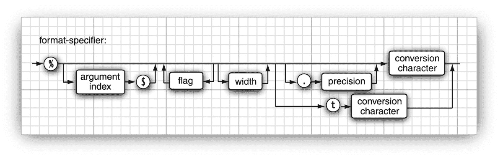 格式说明符语法

格式化是特定区域的。例如，在德国，分组分隔符是句号，而不是逗号。在具有德语区域设置的计算机上，调用：

```
double x = 10000.0 / 3.0;
System.out.printf("%8.2f", x);
```

产生输出：

```
 3333,33
```

这种特定区域的行为通常是你与用户通信时所需要的。然而，如果你生成的文件稍会被计算机程序读取，你可能需要为输出选择固定的区域设置。将区域设置作为`printf`的第一个参数：

```
System.out.printf(Locale.US, "%8.2f", x);
```

### 文件输入与输出

要从文件读取，如下所示构造`Scanner`对象：

```
Scanner in = new Scanner(Path.of("myfile.txt"));
```

如果文件名包含反斜杠，请记住用额外的反斜杠转义每一个反斜杠：`"c:\\mydirectory\\myfile.txt"`。

现在你可以使用已经遇到过的任何`Scanner`方法从文件中读取内容了。

文件存储的是字节，而不是 Unicode 字符。正如你在 3.3.4 节中看到的，将 Unicode 字符表示为字节的方法不止一种。目前最常用的字符编码是 UTF-8。在书中书中假设所有文本文件都使用 UTF-8。从 Java 18 开始，这是所有读写文本操作的默认编码。在旧版本中，使用的是运行 Java 程序的计算机的“默认字符集”。这并不是一个好主意——程序的行为可能会根据运行位置而有所不同。如果你使用较旧版本的 Java，请务必指定字符编码：

```
Scanner in = new Scanner(Path.of("myfile.txt"), StandardCharsets.UTF_8);
```

你可以使用字符串参数构造`Scanner`，但扫描器会将该字符串解释为数据，而不是文件名。例如，如果你调用：

```
Scanner in = new Scanner("myfile.txt"); // 错误？
```

那么扫描器将看到十个数据字符：`'m'`、`'y'`、`'f'`等。这在这种情况下可能不是你的意图。

要写入文件，请构造一个`PrintWriter`对象。在构造函数中，提供字符串形式的文件名：

```
PrintWriter out = new PrintWriter("myfile.txt");
```

Java 的控制流结构与 C 和 C++ 中的结构相同，但有少数例外。Java 中没有`goto`，但有一个“标签”版本的`break`，你可以用它来跳出嵌套循环（在 C 中，你可能需要使用`goto`）。最后，还有一种`for`循环的变体，类似于 C++ 中基于范围的`for`循环以及 C# 中的`foreach`循环。

## 块作用域

在学习控制结构之前，你需要了解更多`blocks`（块）的知识。

块或复合语句由一对大括号括起来的若干 Java 语句组成。块定义了变量的作用域。一个块可以嵌套在另一个块内部。以下是一个嵌套在`main`方法代码块内部的块：

```
public static void main(String[] args)
{
   int n;
   . . .
   {
      int k;
      . . .
   } // k 仅定义到此处
}
```

你不能在两个嵌套的块中声明同名的局部变量。例如，以下代码是错误且无法编译的：

```
public static void main(String[] args)
{
   int n;
   . . .
   {
      int k;
      int n; // 错误--在内部块中重复声明 n
      . . .
   }
}
```

在 C++ 中，可以在嵌套块内部重新定义变量，此时内部定义会遮蔽外部定义。这可能会是编程错误的根源之一；因此，Java 不允许这样做。

## 条件语句

Java 中条件语句的格式如下：

```
if (condition) statement
```

条件必须包含在圆括号内。

在 Java 中，与大多数编程语言一样，你通常希望在单个条件为`true`时执行多条语句。在这种情况下，使用形式如下的`block statement`（块语句）：

```
{
   statement1
   statement2
   . . .
}
```

例如：


```java
if (yourSales >= target)
{
   performance = "Satisfactory";
   bonus = 100;
}
```

在此代码中，当`yourSales`大于或等于`target`时，大括号内的所有语句都将被执行（参见图 3.7）。

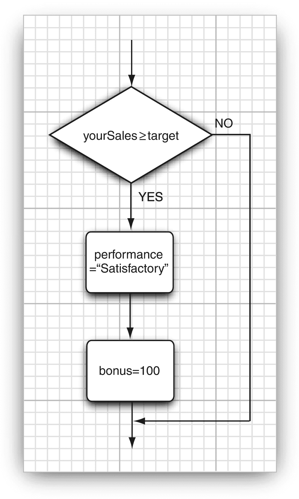 `if`语句流程图

块（有时称为`compound statement`）允许你在任何原本允许单个（简单）语句的 Java 编程结构中包含多个（简单）语句。

Java 中更通用的条件语句形式如下（参见图 3.8）：

```
if (condition) statement1 else statement2
```

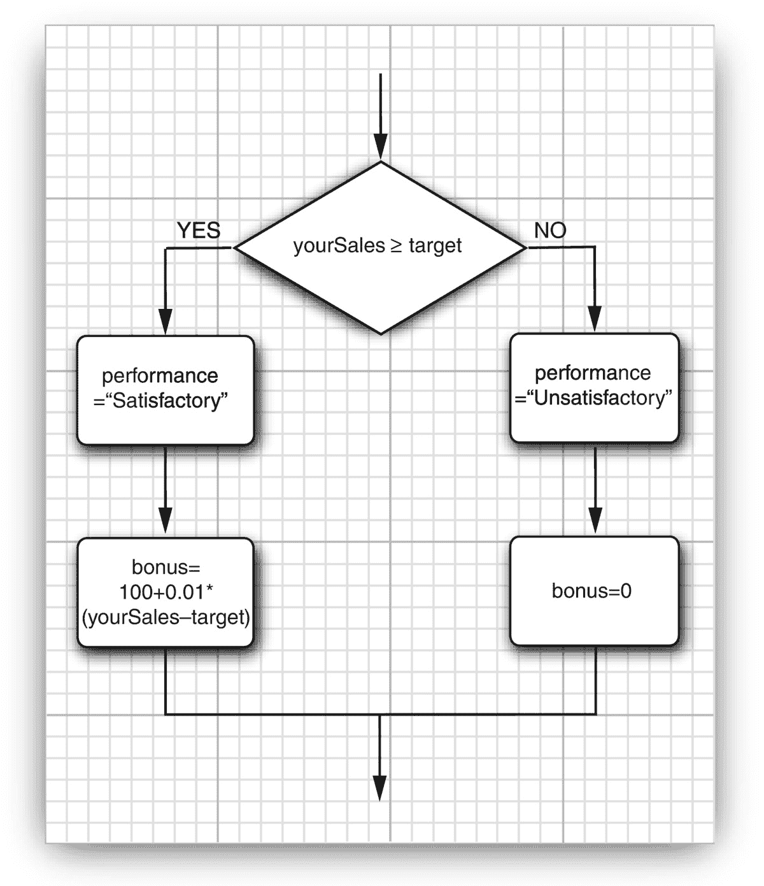 `if`/`else`语句流程图

例如：

```java
if (yourSales >= target)
{
   performance = "Satisfactory";
   bonus = 100 + 0.01 * (yourSales - target);
}
else
{
   performance = "Unsatisfactory";
   bonus = 0;
}
```

`else`部分始终是可选的。`else`与最近的`if`组合。因此，在语句

```java
if (x <= 0) if (x == 0) sign = 0; else sign = -1;
```

中，`else`属于第二个`if`。当然，使用大括号来明确这段代码是一个好主意：

```java
if (x <= 0) { if (x == 0) sign = 0; else sign = -1; }
```

重复的`if ... else if ...`备选方案很常见（参见图 3.9）。例如：

```java
if (yourSales >= 2 * target)
{
   performance = "Excellent";
   bonus = 1000;
}
else if (yourSales >= 1.5 * target)
{
   performance = "Fine";
   bonus = 500;
}
else if (yourSales >= target)
{
   performance = "Satisfactory";
   bonus = 100;
}
else
{
   System.out.println("You're fired");
}
```

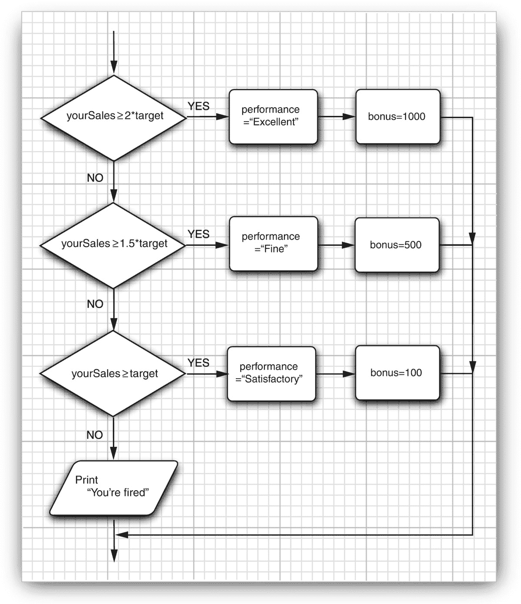 `if`/`else if`（多分支）流程图

## 循环

`while`循环在条件为`true`时执行语句（该语句可以是块语句）。通用形式为：

```
while (condition) statement
```

如果条件从一开始为`false`，则`while`循环永远不会执行（参见图 3.10）。

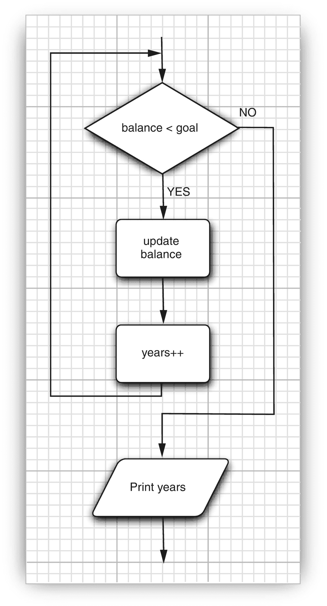 `while`语句流程图

Listing 3.3 中的程序确定了为了你辛苦工作的退休储蓄特定金额需要多久，假设你每年存入相同的金额且资金按指定的利率产生。

在示例中，我们在循环体中增加计数器并更新当前积累的金额，直到总额超过目标金额。

```java
while (balance < goal)
{
   balance += payment;
   double interest = balance * interestRate / 100;
   balance += interest;
   years++;
}
System.out.println(years + " years.");
```

（不要依赖此程序来规划退休。）

`while`循环在开头进行测试。因此，代码可能永远不会执行。如果你想确保块至少执行一次，你需要将测试移动到底部，使用`do`/`while`循环。它的语法如下：

```java
do statement while (condition);
```

该循环执行语句（通常是一个块）然后测试条件。如果为`true`，它会重复语句并重新测试条件，依此类推。Listing 3.4 中的代码计算退休时的新余额，然后询问你是否准备就绪：

```java
do
{
   balance += payment;
   double interest = balance * interestRate / 100;
   balance += interest;
   years++;
   // 打印当前余额
   . . .
   // 询问是否准备好并获取输入
   . . .
}
while (input.equals("N"));
```

只要用户回答`"N"`，循环就会重复（参见图 3.11）。这是一个需要至少进入一次的循环良好示例，因为用户在判断余额是否足够退休之前需要看到余额。

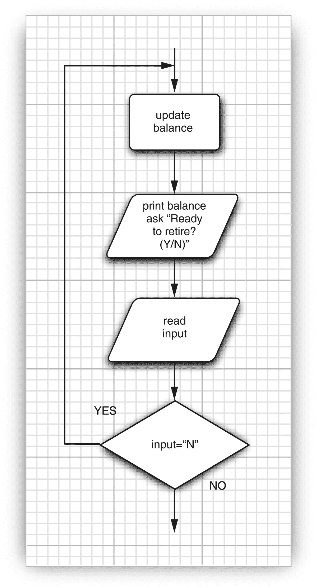 `do`/`while`语句流程图

```java
import java.util.*;

/**
 * This program demonstrates a <code>do/while</code> loop.
 * @version 1.20 2004-02-10
 * @author Cay Horstmann
 */
public class Retirement2
{
   public static void main(String[] args)
   {
      Scanner in = new Scanner(System.in);

      System.out.print("How much money will you contribute every year? ");
      double payment = in.nextDouble();

      System.out.print("Interest rate in %: ");
      double interestRate = in.nextDouble();

      double balance = 0;
      int year = 0;

      String input;

      // update account balance while user isn't ready to retire
      do
      {
         // add this year's payment and interest
         balance += payment;
         double interest = balance * interestRate / 100;
         balance += interest;

         year++;

         // print current balance
         System.out.printf("After year %d, your balance is %,.2f%n", year, balance);

         // ask if ready to retire and get input
         System.out.print("Ready to retire? (Y/N) ");
         input = in.next();
      }
      while (input.equals("N"));
   }
}
```

### 确定循环

`for`循环是一种通用结构，用于支持由计数器或类似变量控制的迭代，该变量在每次迭代后都会更新。如图 3.12 所示，以下循环会在屏幕上打印从 1 到 10 的数字：

```java
for (int i = 1; i <= 10; i++)
   System.out.println(i);
```

`for`语句的第一个槽通常存放计数器初始化。第二个槽位给出每次新通过循环之前测试的条件，第三个槽位指定如何更新计数器。

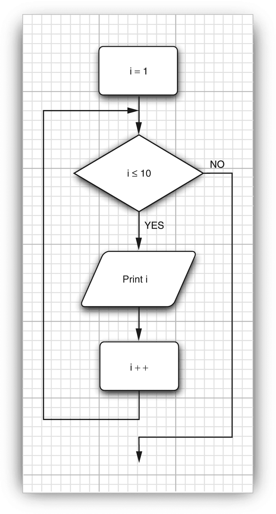 `for`语句的流程图

尽管 Java 像 C++ 一样允许在`for`循环的各个槽中使用几乎任何表达式，但良好的编程习惯是这三个槽位应该只初始化、测试和更新同一个计数器变量。忽视这一规则可能会写出非常晦涩的循环。

即使在良好习惯的范围内，也有许多可能性。例如，你可以拥有倒计数的循环：

```java
for (int i = 10; i > 0; i--)
   System.out.println("Counting down . . . " + i);
System.out.println("Blastoff!");
```

在循环中测试浮点数的相等性时要小心。像下面这样的`for`循环

```java
for (double x = 0; x != 10; x += 0.1) . . .
```

可能永远结束。由于舍入误差，最终值可能无法精确达到。在这个例子中，`x`从`9.99999999999998`跳到`10.09999999999998`，因为`0.1`没有精确的二进制表示。

当你在`for`语句的第一个槽中声明变量时，该变量的作用范围一直持续到`for`循环体的结束。

```java
for (int i = 1; i <= 10; i++)
{
   . . .
}
// i 在这里不再定义
```

特别是，如果你在`for`语句内部定义变量，则不能在循环外部使用它的值。因此，如果你想在`for`循环外部使用循环计数器的最终值，请确保在循环头之外声明它。

```java
int i;
for (i = 1; i <= 10; i++)
{
   . . .
}
// i 在这里仍然定义
```

相反，你可以在不同的`for`循环中定义同名的变量：

```java
for (int i = 1; i <= 10; i++)
{
   . . .
}
. . .
for (int i = 11; i <= 20; i++) // 定义另一个名为 i 的变量是允许的
{
   . . .
}
```

`for`循环仅仅是`while`循环的一种方便快捷方式。例如，

```java
for (i = 10; i > 0; i--)
   System.out.println("Counting down . . . " + i);
```

可以重写为：

```java
i = 10;
while (i > 0)
{
   System.out.println("Counting down . . . " + i);
   i--;
}
```

`for`循环的第一个槽可以声明多个变量，只要它们是相同类型。第三个槽位可以包含多个用逗号分隔的表达式：

```java
for (int i = 1, j = 10; i <= 10; i++, j--) { ... }
```

虽然在技术上是合法的，但这违背了`for`循环的直观含义，你应该考虑使用`while`循环。

Listing 3.5 展示了一个`for`循环的典型示例。

程序计算中彩票的概率。例如，如果你必须从 50 个数字中选出 6 个，那么有 15,890,700 种可能的结果。（此处原文存在大量重复/损坏，我将关注提供的`switch`和`for`描述的核心逻辑。）

当需要处理多个选项时，`if`/`else`结构可能会很繁琐。`switch`语句使这变得更容易，特别是 Java 14 引入的形式。

例如，如果你像图 3.13 所示设置了一个包含四个选项的菜单，可以使用如下代码：

```java
Scanner in = new Scanner(System.in);
System.out.print("Select an option (1, 2, 3, 4) ");
int choice = in.nextInt();
switch (choice)
{
   case 1 ->
      . . .
   case 2 ->
      . . .
   case 3 ->
      . . .
   case 4 ->
      . . .
   default ->
      System.out.println("Bad input"); 
}
```

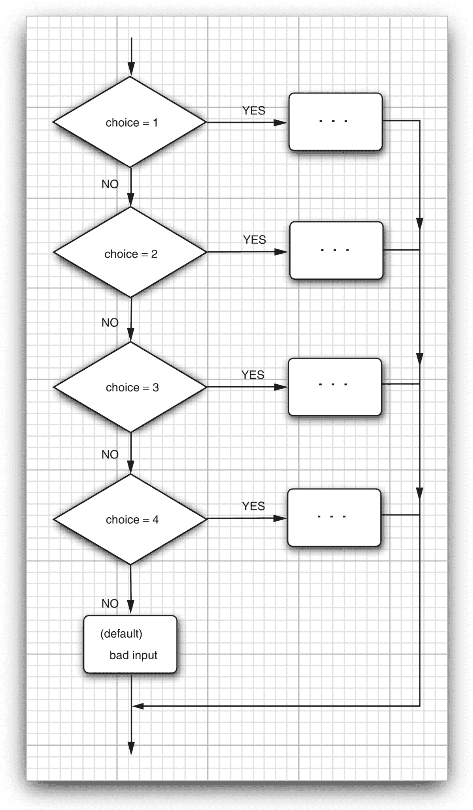 `switch`语句的流程图

注意与你在第 3.5.9 节中看到的`switch`表达式的相似性。与`switch`表达式不同，`switch`语句没有值。每个`case`执行一个操作。

`switch`语句的“经典”形式可以追溯到 C 语言，自 Java 1.0 以来一直支持。它的形式如下：

```java
int choice = . . .
switch (choice)
{
   case 1:
      . . .
      break;
   case 2:
      . . .
      break;
   case 3:
      . . .
      break;
   case 4:
      . . .
      break;
   default:
      System.out.println("Bad input"); 
}
```

执行从匹配值的`case`标签开始，一直持续到下一个`break`或`switch`结束。如果没有任何`case`标签匹配，则执行`default`子句（如果存在）。

可能会触发多个选项。如果你忘记在选项末尾添加`break`，执行将穿透（fall through）到下一个选项！这种行为显然是危险的，也是错误的常见原因。

为了检测此类问题，请在编译代码时使用`-Xlint:fallthrough`，如下：

```bash
javac -Xlint:fallthrough Test.java
```

如果你确实想使用贯穿（fallthrough）行为，请在周围的方法上标记`@SuppressWarnings("fallthrough")`注解。这样该方法将不会生成任何警告。（注解是向编译器或处理 Java 源代码或类文件的工具提供信息的机制。第二卷对注解进行了深入介绍。）

为了对称起见，Java 14 还引入了带有贯穿行为的`switch`表达式，总共有四种`switch`形式。表 3.8 显示了所有形式。

## `switch`的四种形式

| | 表达式 | 语句 |
| --- | --- | --- |
| 无贯穿 |  |  |
|  |  |  |

```java
int numLetters = switch (seasonName)
   {
      case "Spring" ->
         {
            System.out.println(
               "spring time!");
            yield 6;
         }
      case "Summer", "Winter" -> 6;
      case "Fall" -> 4;
      default -> -1;
   };
```

```java
switch (seasonName)
{
   case "Spring" ->
      {
         System.out.println(
            "spring time!");
         numLetters = 6;
      }
   case "Summer", "Winter" ->
      numLetters = 6;
   case "Fall" ->
      numLetters = 4;
   default ->
      numLetters = -1;
}
```

| 贯穿 |  |  |
| --- | --- | --- |
|  |  |  |

```java
int numLetters = switch (seasonName)
   {
      case "Spring":
         System.out.println(
            "spring time!");
      case "Summer", "Winter":
         yield 6;
      case "Fall":
         yield 4;
      default:
         yield -1;
   };
```

```java
switch (seasonName)
{
   case "Spring":
      System.out.println(
         "spring time!");
   case "Summer", "Winter":
      numLetters = 6;
      break;
   case "Fall":
      numLetters = 4;
      break;
   default:
      numLetters = -1;
}
```

在贯穿形式中，每个`case`都以冒号结尾。如果`case`以箭头`->`结尾，则没有贯穿。你不能在单个`switch`语句中混合使用冒号和箭头。

`switch`表达式每个分支必须产生一个值。最常见的是，每个值都跟在`->`箭头后面：

```java
case "Summer", "Winter" -> 6;
```

如果不允许，使用`yield`语句。像`break`一样，它会终止执行。与`break`不同，它还会产生一个值——表达式的值。

要在无贯穿的`switch`表达式分支中使用语句，必须使用大括号和`yield`：

```java
case "Spring" ->
   {
      System.out.println("spring time!");
      yield 6;
   }
```

在`switch`表达式的分支中抛出异常是合法的。例如：

```java
default -> throw new IllegalArgumentException("Not a valid season");
```


异常在第 7 章中有详细介绍。

`switch` 表达式的目的是产生一个值（或因异常失败）。你不允许“跳出”：

```java
default -> { return -1; } // ERROR
```

具体来说，你不能在 `switch` 表达式中使用 `return`、`break` 或 `continue` 语句。（后两个请参见第 3.8.6 节。）

有这么多 `switch` 变体，你应该选择哪一个？

1. 避免贯穿形式。需要贯穿的情况非常罕见。
2. 优先使用 `switch` 表达式而不是语句。

如果每个分支都为变量赋值或方法调用计算值，则用表达式 `yield` 该值，然后使用它。例如：

```java
numLetters = switch (seasonName)
{
   case "Spring", "Summer", "Winter" -> 6
   case "Fall" -> 4
   default -> -1
};
```

优于：

```java
switch (seasonName)
{
   case "Spring", "Summer", "Winter" ->
      numLetters = 6;
   case "Fall" ->
      numLetters = 4;
   default ->
      numLetters = -1;
}
```

## 打断控制流的语句

尽管 Java 的设计者保留了 `goto` 作为保留字，但他们决定不将其包含在语言中。通常，`goto` 语句被认为是不良的风格。一些程序员认为反对 `goto` 的强制手段过头了（例如，唐纳德·克努斯（Donald Knuth）的著名文章《使用 goto 语句的结构化编程》）。他们认为，无限制地使用 `goto` 容易出错，但偶尔跳出循环是有益的。Java 设计者也同意了这一点，并添加了一种新的语句——带标签 `break`（labeled break），以支持这种编程风格。

让我们先看看无标签的 `break` 语句。你用于退出 `switch` 语句的 `break` 语句也可以用于跳出循环。例如：

```java
while (years <= 100)
{
   balance += payment;
   double interest = balance * interestRate / 100;
   balance += interest;
   years++;
}
```

现在，如果 `years > 100` 或 `balance >= goal`，循环将退出。

如果你确实想使用贯穿行为，请在周围的方法上标记 `@SuppressWarnings("fallthrough")` 注解。这样该方法将不会生成任何警告。表 3.8 展示了相关示例。

```java
{
   case "Spring" ->
   {
      System.out.println("spring time!");
      yield 6;
   }

   case "Summer", "Winter" -> 6;
   case "Fall" -> 4;
   default -> -1;
};
```

```java
switch (seasonName)
{
   case "Spring" ->
   {
      System.out.println("spring time!");
      numLetters = 6;
   }

   case "Summer", "Winter" ->
      numLetters = 6;

   case "Fall" ->
      numLetters = 4;

   default ->
      numLetters = -1;
}
```

| 贯穿 |  |  |
|---|---|---|

```java
int numLetters = switch (seasonName)
{
   case "Spring":
      System.out.println("spring time!");

   case "Summer", "Winter":
      yield 6;

   case "Fall":
      yield 4;

   default:
      yield -1;
};
```

```java
switch (seasonName)
{
   case "Spring":
      System.out.println("spring time!");

   case "Summer", "Winter":
      numLetters = 6;
      break;

   case "Fall":
      numLetters = 4;
      break;

   default:
      numLetters = -1;
}
```

在贯穿变体中，每个 `case` 都以冒号结尾。如果 `case` 以箭头 `->` 结尾，则没有贯穿。你不能在单个 `switch` 语句中混合使用冒号和箭头。

`switch` 表达式的每个分支必须产生一个值。最常见的是，每个值都跟在 `->` 箭头后面：

```java
case "Summer", "Winter" -> 6;
```

如果不允许直接产生值，则使用 `yield` 语句。像 `break` 一样，它会终止执行。与 `break` 不同，它还会产生一个值——表达式的值。

要在无贯穿的 `switch` 表达式分支中使用语句，必须使用大括号和 `yield`：

```java
case "Spring" ->
{
   System.out.println("spring time!");
   yield 6;
}
```

在 `switch` 表达式的分支中抛出异常是合法的。例如：

```java
default -> throw new IllegalArgumentException("Not a valid season");
```

异常在第 7 章中有详细介绍。

`switch` 表达式的目的是产生一个值（或因异常失败）。你不允许“跳出”：

```java
default -> { return -1; } // ERROR
```

具体来说，你不能在 `switch` 表达式中使用 `return`、`break` 或 `continue` 语句。（后两个请参见第 3.8.6 节。）

有这么多 `switch` 变体，你应该选择哪一个？

1. 避免贯穿形式。需要贯穿的情况非常罕见。
2. 优先使用 `switch` 表达式而不是语句。

如果每个分支都为变量赋值或方法调用计算值，则用表达式 `yield` 该值，然后使用它。例如：

```java
numLetters = switch (seasonName)
{
   case "Spring", "Summer", "Winter" -> 6
   case "Fall" -> 4
   default -> -1
};
```

优于：

```java
switch (seasonName)
{
   case "Spring", "Summer", "Winter" ->
      numLetters = 6;
   case "Fall" ->
      numLetters = 4;
   default ->
      numLetters = -1;
}
```

## 打断控制流的语句

尽管 Java 的设计者保留了 `goto` 作为保留字，但他们决定不将其包含在语言中。通常，`goto` 语句被认为是不良的风格。一些程序员认为反对 `goto` 的强制手段过头了（例如，唐纳德·克努斯（Donald Knuth）的著名文章《使用 goto 语句的结构化编程》）。他们认为，无限制地使用 `goto` 容易出错，但偶尔跳出循环是有益的。Java 设计者也同意了这一点，并添加了一种新的语句——带标签 `break`（labeled break），以支持这种编程风格。

让我们先看看无标签的 `break` 语句。你用于退出 `switch` 语句的 `break` 语句也可以用于跳出循环。例如：

```java
while (years <= 100)
{
   balance += payment;
   double interest = balance * interestRate / 100;
   balance += interest;

   if (years > 100) ...
   years++;
}
```

还有一种带标签的 `continue` 语句形式，它可以跳转到带有匹配标签的循环头部。

许多程序员发现 `break` 和 `continue` 语句非常困惑。这些语句是完全可选的——你始终可以在不使用它们的情况下表达相同的逻辑。本书中的程序没有一个使用过 `break` 或 `continue`。

## 大数

如果基本整数和浮点数类型的精度不够，你可以转向 `java.math` 包中的几个实用类：`BigInteger` 和 `BigDecimal`。这些类用于处理具有任意长度数字序列的数字。`BigInteger` 类实现了任意精度的整数算术，而 `BigDecimal` 对浮点数执行了相同的操作。

使用静态方法 `valueOf` 将普通数字转换为大数：

```java
BigInteger a = BigInteger.valueOf(100);
```

对于更长的数字，请使用带有字符串参数的构造函数：

```java
BigInteger reallyBig
   = new BigInteger("222232244629420445529739893461909967206666939096499764990979600");
```

还有常量 `BigInteger.ZERO`、`BigInteger.ONE`、`BigInteger.TWO` 和 `BigInteger.TEN`。

使用 `BigDecimal` 类时，你应该始终使用带有字符串参数的构造函数。有一个 `BigDecimal(double)` 构造函数本质上容易产生舍入误差：`new BigDecimal(0.1)` 的数字为：

```text
0.1000000000000000055511151231257827021181583404541015625
```

遗憾的是，你不能使用熟悉的 `+` 和 `*` 等数学运算符来组合大数。相反，你必须使用大数类中的 `add` 和 `multiply` 等方法。

```java
BigInteger c = a.add(b); // c = a + b

BigInteger d = c.multiply(b.add(BigInteger.valueOf(2))); // d = c * (b + 2)
```

与 C++ 不同，Java 没有可编程的运算符重载。`BigInteger` 类的程序员无法重新定义 `+` 和 `*` 运算符来为 `BigInteger` 类提供 `add` 和 `multiply` 操作。语言设计者确实重载了 `+` 运算符以表示字符串的拼接。他们选择不重载其他运算符，也没有给 Java 程序员在自己的类中重载运算符的机会。

在 Java 19 中，`BigInteger` 类提供了一个 `parallelMultiply` 方法，它产生与 `multiply` 相同的结果，但通过使用多个处理器核心可能会更快地计算结果。如果你必须进行大量的乘法并且知道你的应用程序不需要 CPU 资源进行其他计算，请使用此方法。

Listing 3.6 显示了 Listing 3.5 彩票概率程序的修改，已更新为支持大数。例如，如果你被邀请参加一个需要在 490 个数字中选出 60 个数字的彩票，你可以使用这个程序告知你的中奖概率。概率为 1 尽 `716395843461995557415116222540092933411717612789263493493351013459481104668848`。祝你好运！

Listing 3.5 中的程序计算了语句：

```java
lotteryOdds = lotteryOdds * (n - i + 1) / i;
```

当使用大整数 `lotteryOdds` 和 `n` 时，等效语句变为：

```java
lotteryOdds = lotteryOdds
   .multiply(n.subtract(BigInteger.valueOf(i - 1)))
   .divide(BigInteger.valueOf(i));
```

`BigIntegerTest/BigIntegerTest.java`

```java
import java.math.*;
import java.util.*;

/**
 * 此程序使用大数计算彩票中大奖的概率。
 * @version 1.21 2021-09-03
 * @author Cay Horstmann
 */
public class BigIntegerTest
{
   public static void main(String[] args)
   {
      Scanner in = new Scanner(System.in);

      System.out.print("你需要抽取多少个数字? ");
      int k = in.nextInt();

      System.out.print("你能抽到的最高数字是多少? ");
      BigInteger n = in.nextBigInteger();

      /*
       * 计算二项系数 n*(n-1)*(n-2)*...*(n-k+1)/(1*2*3*...*k)
       */
      BigInteger lotteryOdds = BigInteger.ONE;

      for (int i = 1; i <= k; i++)
         lotteryOdds = lotteryOdds
            .multiply(n.subtract(BigInteger.valueOf(i - 1)))
            .divide(BigInteger.valueOf(i));

      System.out.printf("你的概率是 1 比 %s。祝你好运！%n", lotteryOdds);
   }
}
```

```java
String[] authors =
{
   "James Gosling",
   "Bill Joy",
   "Guy Steele",
   // add more names here and put a comma after each name
};
```

你可以声明一个 `anonymous array`（匿名数组）：

```java
new int[] { 17, 19, 23, 29, 31, 37 }
```

该表达式分配了一个新数组并用括号内的值填充它。它计算初始值的数量并据此设置数组长度。你可以使用这种语法在不创建新变量的情况下重新初始化数组。例如：

```java
smallPrimes = new int[] { 17, 19, 23, 29, 31, 37 };
```

是下面的简写：

```java
int[] anonymous = { 17, 19, 23, 29, 31, 37 };

smallPrimes = anonymous;
```

长度为 0 的数组是合法的。如果你编写了一个计算数组结果的方法，而结果恰好为空，那么这样的数组就会很有用。可以通过如下方式构造长度为 0 的数组：

```java
new elementType[0]
```

或者：

```java
new elementType[] {}
```

注意，长度为 0 的数组不同于 `null`。

### 访问数组元素

你通过整数 `index` 使用下标运算符访问数组的每个单独元素。例如，如果 `a` 是一个整数数组，那么 `a[i]` 就是数组中索引为 `i` 的元素。

数组元素从 0 开始编号。最后一个有效索引是长度减 1。在下面的示例中，索引值范围从 0 到 99。一旦创建数组，你就可以填充数组中的元素，例如使用循环：

```java
int[] a = new int[100];

for (int i = 0; i < 100; i++)
   a[i] = i; // 用数字 0 到 99 填充数组
```

当你创建一个数字数组时，所有元素都会被初始化为零。`boolean` 数组初始化为 `false`。对象数组初始化为特殊值 `null`，表示它们（尚未）持有任何对象。这可能会让初学者感到惊讶。例如：

```java
String[] names = new String[10];
```

创建了一个包含十个字符串的数组，它们都是 `null`。如果你想让数组持有空字符串，你必须提供它们：

```java
for (int i = 0; i < 10; i++)
   names[i] = "";
```


如果你构造了一个包含 100 个元素的数组，然后尝试访问元素 `a[100]`（或 0 到 99 范围之外的任何索引），将发生“数组越界”（array index out of bounds）异常。

要找到数组的元素数量，使用 `array.length`。例如：

```java
for (int i = 0; i < a.length; i++)
   System.out.println(a[i]);
```

### “for each” 循环

Java 有一种强大的循环结构，允许你遍历数组（或任何元素集合）中的每个元素，而无需处理索引值。

`enhanced for` 循环：

```java
for (variable : collection) statement
```

将给定的变量设置为集合中的每个元素，然后执行语句（当然，这可以是一个块）。`collection` 表达式必须是一个数组或实现了 `Iterable` 接口的类的对象，例如 `ArrayList`。数组列表在第 5 章中介绍，`Iterable` 接口在第 9 章中介绍。

例如：

```java
for (int element : a)
   System.out.println(element);
```

在单独行打印数组 `a` 的每个元素。

你应该将此循环读作“对于 `a` 中的每个 `element`”。Java 语言的设计者考虑过使用如 `foreach` 和 `in` 等关键字。但这种循环是 Java 语言晚期添加的，最终由于没有人想要破坏已经包含具有这些名称的方法或变量的旧代码（例如 `System.in`）。

当然，你可以使用传统的 `for` 循环实现相同的效果：

```java
for (int i = 0; i < a.length; i++)
   System.out.println(a[i]);
```

然而，“for each”循环更加简洁，且更不容易出错，因为你不需要担心那些烦人的起始和结束索引值。

“for each”循环的循环变量遍历的是数组的 `elements`，而不是索引值。

如果你需要处理集合中的所有元素，“for each”循环是一项令人愉悦的改进。然而，仍然有很多机会使用传统的 `for` 循环。例如，你可能不想遍历整个集合，或者你可能在循环内部需要索引值。

有一种更简单的方法可以打印数组的所有值，使用 `Arrays` 类的 `toString` 方法。调用 `Arrays.toString(a)` 返回一个包含数组元素的字符串，用中括号括起来并用逗号分隔，例如 `"[2, 3, 5, 7, 11, 13]"`。要打印数组，只需调用 `Arrays.toString(a)`。

Listing 3.7 中的程序展示了数组的应用。该程序为彩票游戏抽取一组随机数字组合。例如，如果你玩的是“从 49 个数中选 6 个数字”的彩票，程序可能会打印出如下：

```text
下注以下组合。它将让你富翁！

4
7
8
19
30
44
```

要选择这样一组随机数，首先用数组 `numbers` 填充值 `1`、`2`、. . . `n`：

```java
int[] numbers = new int[n];

for (int i = 0; i < numbers.length; i++)
   numbers[i] = i + 1;
```

第二个数组用于存储被抽取的数字：

```java
int[] result = new int[k];
```

现在抽取 `k` 个数字。`Math.random()` 方法返回一个 `0`（包含）到 `1`（不包含）之间的随机浮点数。将结果乘以 `n` 得到一个 `0` 到 `n - 1` 之间的随机数。

```java
int r = (int) (Math.random() * n);
```

将第 `i` 个结果设置为该索引处的数字。初始时，它只是 `r` + 1，但正如你即将看到的，在每次抽取后，`numbers` 数组的内容发生改变。

```java
result[i] = numbers[r];
```

现在，你必须确保不再再次抽取那个数字——所有的彩票号码必须是唯一的。因此，用数组中的*最后一个*数字来覆盖 `numbers[r]`，并将 `n` 减 1。

```java
numbers[r] = numbers[n - 1];

n--;
```

关键点在于，每次抽取时我们选择的是一个*索引*，而不是实际数值。索引指向一个包含尚未抽取的数值的数组。

抽取 `k` 个彩票号码后，对 `result` 数组进行排序以获得更理想的输出：

```java
Arrays.sort(result);

for (int r : result)
   System.out.println(r);
```

`LotteryDrawing/LotteryDrawing.java`

```java
import java.util.*;

/**
 * 此程序演示了数组操作。
 * @version 1.20 2004-02-10
 * @author Cay Horstmann
 */

public class LotteryDrawing
{
   public static void main(String[] args)
   {
      Scanner in = new Scanner(System.in);

      System.out.print("你需要抽取多少个数字？ ");
      int k = in.nextInt();

      System.out.print("你可以抽取的最大数字是多少？ ");
      int n = in.nextInt();

      // 用数字 1 2 3 . . . n 填充数组
      int[] numbers = new int[n];

      for (int i = 0; i < numbers.length; i++)
         numbers[i] = i + 1;

      // 抽取 k 个数字并将它们放入第二个数组
      int[] result = new int[k];

      for (int i = 0; i < result.length; i++)
      {
         // 生成一个 0 到 n - 1 之间的随机索引
         int r = (int) (Math.random() * n);

         // 选取随机位置上的元素
         result[i] = numbers[r];

         // 将最后一个元素移动到随机位置
         numbers[r] = numbers[n - 1];
         n--;
      }

      // 打印排序后的数组
      Arrays.sort(result);

      System.out.println("下注以下组合。它将让你富翁！");

      for (int r : result)
         System.out.println(r);
   }
}
```

### `java.util.Arrays`

- `static String toString(T[] a)`  
  返回数组 `a` 的字符串，并以逗号分隔。

- `static void sort(T[] a)`  
  对数组 `a` 进行排序。

- `static void fill(T[] a, T v)`  
  将数组 `a` 的所有元素设置为 `v`。

- `static boolean equals(T[] a, T[] b)`  
  如果数组长度相同且对应元素匹配，则返回 `true`。

- `static T[] copyOf(T[] a, int length)`  
  返回一个长度为 `length` 的新数组，其内容来自 `a`。

- `static T[] copyOfRange(T[] a, int start, int end)`  
  返回数组 `a` 从 `start` 到 `end` 范围的新数组。

- `static void setAll(T[] a, IntToFunction<? super T> generator)`  
  使用生成器设置数组 `a` 的所有元素。

- `static int[] range(int start, int end)`  
  返回一个包含从 `start` 到 `end - 1` 整数的数组。

- `static IntStream range(int start, int end)`  
  返回一个包含 `start` 到 `end - 1` 整数的流。

## 二维数组

二维数组使用多个索引来访问元素。它们被用于表格和其他更复杂的安排。假设你想记录 $10,000 的投资在不同利率场景下的增长情况，每年增长。

```java
double[][] balances;
```

在 Java 中声明二维数组非常简单。例如：

```java
double[][] balances = new double[YEARS][RATES];
```

在其他情况下，如果你知道数组元素，可以使用简写来初始化二维数组。

```java
int[][] magicSquare = {
   {16, 3, 2, 13},
   {5, 10, 11, 8},
   {9, 6, 7, 12},
   {4, 15, 14, 1}
};
```

示例程序存储了一个一维数组 `interest` 用于利率：

```java
double[] interest = {0.05, 0.06, 0.07, 0.08, 0.09};
```

以及一个二维数组 `balances` 用于余额，每年对应一个利率。用初始余额填充数组的第一行：

```java
for (int j = 0; j < balances[0].length; j++)
   balances[0][j] = 10000;
```

然后，按照如下方式计算其他行：

```java
for (int i = 1; i < balances.length; i++)
{
   for (int j = 0; j < balances[i].length; j++)
   {
      double oldBalance = balances[i - 1][j];
      double interest = . . .;
      balances[i][j] = oldBalance + interest;
   }
}
```

“for each”循环不会自动遍历二维数组中的所有元素。相反，它遍历行，而行本身是一维数组。要访问二维数组 `a` 的所有元素，可以嵌套两个循环如下：

```java
for (double[] row : a)
   for (double value : row)
      对 value 进行某些操作
```

为了快速打印二维数组元素的列表，调用：

```java
System.out.println(Arrays.deepToString(a));
```

输出格式如下：

```text
[[16, 3, 2, 13], [5, 10, 11, 8], [9, 6, 7, 12], [4, 15, 14, 1]]
```

```java
/**
 * 此程序演示了如何在二维数组中存储表格数据。
 * @version 1.41 2023-11-28
 * @author Cay Horstmann
 */

public class CompoundInterest
{
   public static void main(String[] args)
   {
      final double STARTRATE = 5;
      final int NRATES = 6;
      final int NYEARS = 10;

      // 将利率设置为 5 . . . 10%
      double[] interestRate = new double[NRATES];

      for (int j = 0; j < interestRate.length; j++)
         interestRate[j] = (STARTRATE + j) / 100.0;

      double[][] balances = new double[NYEARS][NRATES];

      // 将初始余额设为 10000
      for (int j = 0; j < balances[0].length; j++)
         balances[0][j] = 10000;

      // 计算未来年份的利息
      for (int i = 1; i < balances.length; i++)
      {
         for (int j = 0; j < balances[i].length; j++)
         {
            // 从上一行获取去年的余额
            double oldBalance = balances[i - 1][j];

            // 计算利息
            double interest = oldBalance * interestRate[j];

            // 计算今年的的余额
            balances[i][j] = oldBalance + interest;
         }
      }

      // 打印一行利率
      for (int j = 0; j < interestRate.length; j++)
         System.out.printf("%9.0f%%", 100 * interestRate[j]);

      System.out.println();

      // 打印余额表
      for (double[] row : balances)
      {
         // 打印表格行
         for (double b : row)
            System.out.printf("%10.2f", b);

         System.out.println();
      }
   }
}
```

### 锯齿数组（Ragged Arrays）

到目前为止，你所看到的与其他编程语言并没有太大区别。但在背后实际上发生着一些微妙的事情，你有时可以将其转化为你的优势：Java 根本没有多维数组，只有一维数组。多维数组是通过“数组的数组”来模拟的。

例如，上一个示例中的 `balances` 数组实际上是一个包含十个元素的数组，其中每个元素都是一个包含六个浮点数的数组（图 3.15）。

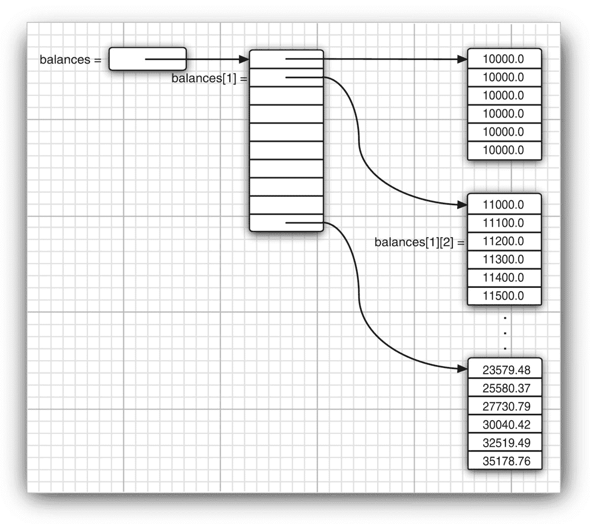二维数组

表达式 `balances[i]` 指的是第 `i` 个子数组——即表格的第 `i` 行。它本身是一个数组，而 `balances[i][j]` 指的是该数组的第 `j` 个元素。

由于数组的行是可以单独访问，你实际上可以交换它们！

```java
double[] temp = balances[i];

balances[i] = balances[i + 1];

balances[i + 1] = temp;
```

请注意，行数和列数并不是数组变量类型的一部分。变量 `balances` 的类型是 `double[][]`：一个 `double` 数组的数组。

因此，你可以创建“锯齿状”数组——即不同行长度不同的数组。这里有一个标准示例。让我们创建一个数组，其中第 `i` 行第 `j` 列的元素等于“从 `i` 个数中选择 `j` 个数”彩票可能的结果数量。

```text
1

1  1

1  2  1

1  3  3  1

1  4  6  4  1

1  5 10 10  5 1

1  6 15 20 15 6 1
```

由于 `j` 永远不会大于 `i`，因此矩阵是三角形的。第 `i` 行有 `i` + 1 个元素。（选择 0 个元素是可以的；有一种方法可以做出这种选择。）要构建这个锯齿数组，首先分配持有行的数组：

```java
final int NMAX = 10;
int[][] odds = new int[NMAX + 1][];
```

接下来，分配行：

```java
for (int n = 0; n <= NMAX; n++)
   odds[n] = new int[n + 1];
```

现在数组已经分配好了，你就可以用普通的方法访问元素了，只要不越界：

```java
for (int n = 0; n < odds.length; n++)
   for (int k = 0; k < odds[n].length; k++)
   {
      // 计算彩票赔率
      . . .
      odds[n][k] = lotteryOdds;
   }
```

Listing 3.9 提供了完整的程序。

就像一维数组一样，构造一个某个维度为零的多维数组也是合法的。例如：

```java
new int[3][0]
```

有三行，每行恰好长度为零。相比之下：

```java
new int[0][3]
```


有三行，每行恰好长度为零。

传统的结构化编程通过设计一组过程（或 `algorithms`）来解决问题。一旦确定了这些过程，传统的下一步是寻找合适的数据存储方法。这就是为什么 Pascal 语言的设计者尼克劳斯·沃尔特（Niklaus Wirth）将他著名的编程书籍命名为 `Algorithms + Data Structures = Programs`（Prentice Hall, 1976）。请注意，在沃尔特的书名中，算法在前，数据结构在后。这反映了当时程序员的工作方式：首先，他们决定处理数据的过程；然后，他们决定对数据施加何种结构以简化这些操作。面向对象编程（OOP）则反转了这个顺序：将数据放在首位，然后考虑操作这些数据的算法。

对于小问题，将其拆分为过程的方法非常有效。但对于较大的问题，对象更为合适。考虑一个简单的网络浏览器，它的实现可能需要 2000 个过程，所有这些过程都在操作一组全局数据。在面向对象的风格中，可能有 100 个 `classes`，每个类平均有 20 个 `methods`（参见图 4.1）。这种结构对程序员来说更容易理解，也更容易发现错误。假设某个特定对象的数据处于错误状态，那么在 20 个可以访问该数据项的 `methods` 中寻找罪魁祸首，比在 2000 个过程中寻找容易得多。

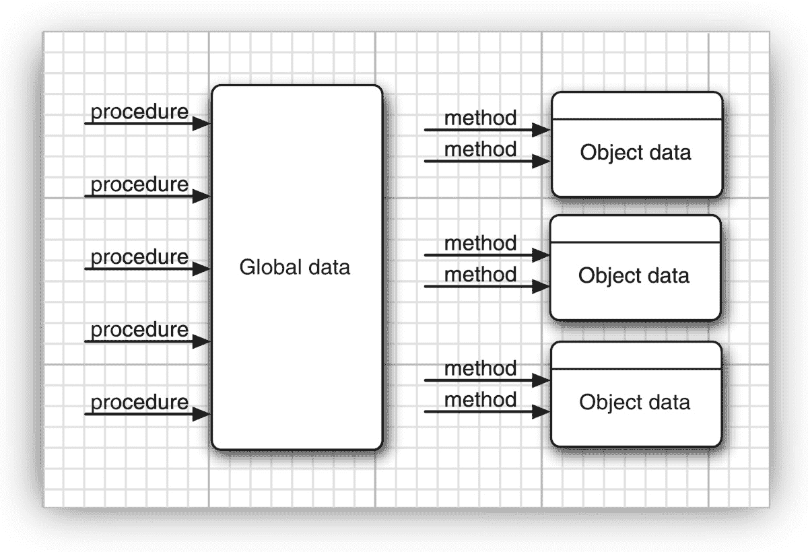过程化编程与面向对象编程

## 类 (Classes)

`class` 指定了对象的创建方式。可以将类类比为饼干模具；对象则是饼干本身。当你从一个类中 `construct` 一个对象时，就说创建了该类的 `instance`。

正如你所看到的，你在 Java 中编写的所有代码都在一个 `class` 内部。Java 标准库提供了数千个 `classes`，用于用户界面设计、日期和日历以及网络编程等各种不同的用途。尽管如此，在 Java 中，你仍然需要创建自己的 `classes` 来描述应用程序问题领域中的对象。

`Encapsulation`（有时称为 `information hiding`）是处理对象的一个核心概念。从形式上说，封装仅仅是将数据和行为组合在一个包中，并对该对象用户隐藏实现细节。对象中的数据位被称为其 `instance fields`，而操作数据的过程被称为其 `methods`。作为 `class` 实例的特定对象将具有其 `instance fields`的具体值。这些值的集合就是对象的当前 `state`（状态）。每当你在对象上调用 `method` 时，它的状态可能会发生变化。

使封装生效的关键在于让 `methods` 绝不直接访问自身以外的其他 `class` 中的 `instance fields`。程序应该只通过对象的 `methods` 与对象数据进行交互。封装是赋予对象“黑盒”行为的方法，而这是重用和可靠性的关键。这意味着一个 `class` 可以完全改变它存储数据的方式，但只要它继续使用相同的 `methods` 来操作数据，其他对象就不会感知或不在乎这一点。

当你开始在 Java 中编写自己的 `classes` 时，OOP 的另一个原则会让这变得更简单：`Classes` 可以通过 `extending` 其他 `classes` 来构建。事实上，Java 附带了一个名为 `Object` 的“宇宙超级类”。所有其他 `classes` 都继承自这个类。你将在下一章学习更多关于 `Object` 类的内容。

当你扩展一个已有的 `class` 时，新 `class` 拥有你所扩展的类的所有属性和 `methods`。然后你提供了仅适用于你新 `class` 的新 `methods` 和 `instance fields`。通过扩展 `class` 来获得另一个类的概念被称为 `inheritance`（继承）。关于继承的更多信息，请参见下一章。

## 对象 (Objects)

要使用 OOP，你应该能够识别对象的三个关键特征：

* 对象的 `behavior`（行为）——你可以对这个对象做什么，或者对它应用哪些 `methods`？
* 对象的 `state`（状态）——当你调用这些 `methods` 时，对象如何反应？
* 对象的 `identity`（身份）——如何将对象与其他具有相同行为和状态的对象区分来？

所有作为同一 `class` 实例的对象通过支持相同的 `behavior` 具有家族相似性。对象的行为由你可以调用的 `methods` 定义。

接下来，每个对象都存储关于其当前样貌的信息。这就是对象的 `state`。对象的状态可能会随时间改变，但不会自发改变。对象状态的变化必须是 `method` 用的结果。（如果对象的状态在没有对该对象调用 `method` 的情况下发生了变化，说明有人破坏了封装。）

然而，对象的状态并完全描述它，因为每个对象都有独特的 `identity`。例如，在订单处理系统中，即使两个订单请求完全相同的商品，它们也是不同的。请注意，作为 `class` 实例的单个对象在 `identity` 上总是不同的，通常在 `state` 也不同。

这些关键特征可以相互影响。例如，对象的状态可以影响它的行为。（如果一个订单是“已发货”或“已支付”，它可能会拒绝要求添加或移除物品的 `method` 调用。反之，如果订单是“空的”——即尚未订购任何商品——它不应该允许自己被发货。）

## 识别类 (Identifying Classes)

在传统的过程化程序中，你从顶部的 `main` 函数开始流程。在设计面向对象的系统时，没有“顶部”，OOP 的初学者经常想知道从哪里开始。答案是：识别你的 `classes`，然后为每个类添加 `methods`。

识别 `classes` 的一个简单经验是在问题分析中寻找名词。另一方面，方法对应于动词。例如，在一个订单处理系统中，某些名词是：

* Item（商品）
* Order（订单）
* Shipping address（配送地址）
* Payment（支付）
* Account（账户）

这些名词可能指向 `Item`、`Order` 等 `classes`。

接下来，寻找动词。商品被 `added` 到订单中。订单被 `shipped` 或 `canceled`。支付被 `applied` 到订单。对于每个动词，如“添加”、“取消”或“应用”，识别执行该操作的对象。例如，当新商品被添加到订单时，订单对象应该是负责人，因为它知道如何存储和排序商品。也就是说，`add` 应该是 `Order` 类的一个方法，并接受 `Item` 对象作为参数。

当然，“名词和动词”只是一个经验；只有经验才能帮助你在构建 `classes` 时决定哪些名词和动词是重要的。

## 类之间的关系 (Relationships between Classes)

类之间最常见的关系有：

* `Dependence`（依赖关系）
* `Aggregation`（组合关系）
* `Inheritance`（继承关系）

`Dependence`（即“使用”关系）是最显而易见的，也最通用。例如，`Order` 类使用 `Account` 类，因为 `Order` 对象需要访问 `Account` 对象来检查信用状态。但 `Item` 类不依赖 `Account` 类，因为 `Item` 对象永远不需要担心账户。因此，如果一个类的 `methods` 使用或操作另一个类的对象，则该类依赖于另一个类。

尽量减少相互依赖的类数量。点在于，如果类 `A` 不感知类 `B` 的存在，它对 `B` 的任何变化也不担心。（这意味着 `B` 的变化不会向 `A` 引入错误。）在软件工程术语中，你希望减少类之间的 *coupling*（耦合）。

`Aggregation`（即“拥有”关系）很容易理解，因为它是具体的；例如，一个 `Order` 对象包含 `Item` 对象。包含意味着类 `A` 的对象包含类 `B` 的对象。

一些方法论者对“聚合”（aggregation）的概念不以为然，更倾向于使用更通用的“关联”（association）关系。从建模的角度来看，这是可以理解的。但对于程序员来说，“拥有”（has–a）关系非常有意义。我喜欢使用聚合的另一个原因是：关联的标准表示法不够清晰。请参见表 4.1。

继承（inheritance），或称“是”（is–a）关系，表达了更特殊类与更通用类之间的关系。例如，`RushOrder` 类继承自 `Order` 类。特化的 `RushOrder` 类具有用于优先级处理的特殊方法，以及一个用于计算运费的不同方法，但它的其他方法（如添加项目和计费）都继承自 `Order` 类。通常情况下，如果类 `D` 扩展类 `C`，则类 `D` 继承了类 `C` 的方法，但具有更强大的能力。（见下一章，该章节将详细讨论这一重要概念。）

许多程序员使用 UML（统一建模语言）符号来绘制类图，描述类与类之间的关系。你可以在图 4.2 中看到此类图的示例。你将类画为矩形，将关系画为带有各种装饰的箭头。表 4.1 显示本书使用的 UML 箭头样式。

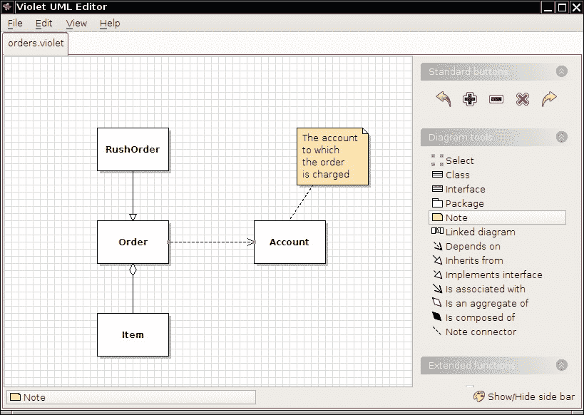类图

### 类关系的 UML 符号

| 关系 | UML 连接器 |
| --- | --- |
| 继承 |  |
| 接口实现 |  |
| 依赖 |  |
| 聚合 |  |

## 使用预定义类

在 Java 中，没有类你就无法进行任何事情，你已经见过几个类的运行示例。然而，并不是所有的类都展示了面向对象的典型特征。以 `Math` 类为例。你已经看到可以使用 `Math` 类的方法（如 `Math.random`），而无需知道它们是如何实现的——你只需要知道名称和参数类型（如果有的话）。这就是封装的意义，它对所有类都是如此。但 `Math` 类只封装了功能；它既不需要也不隐藏数据。由于没有数据，你就不需要担心创建对象和初始化它们的实例字段——因为根本没有！

在下一节中，我们将查看一个更典型的类，`Date` 类。你将看到如何构造该对象以及调用该类的方法。

### 对象和对象变量

要操作对象，你首先要构造它们并指定它们的初始状态。然后对对象应用方法。

在 Java 编程语言中，你使用构造方法（constructors）来创建新实例。构造方法是一种特殊方法，用于构造和初始化对象。让我们来看一个例子。标准 Java 库包含一个 `Date` 类。它的对象描述时间点，例如 1999 年 12 月 31 日 23:59:59 GMT。

你可能会问：为什么用类来表示日期，而不是（像某些语言那样）使用内置类型？例如，Visual Basic 有内置的日期类型，程序员可以用 `#12/31/1999#` 格式指定日期。表面上看，这听起来很方便——程序员可以直接使用内置日期类型，而无需担心类。

所有的 Java 对象都存储在堆上。当一个对象包含另一个对象变量时，它包含的只是一个指向另一个堆对象的指针。

在 C++ 中，指针会让你感到紧张，因为它们非常出错。很容易创建错误的指针或搞乱内存管理。在 Java 中，这些问题完全消失了。如果你使用一个未初始化的指针，运行时系统会可靠地生成一个运行时错误，而不是产生随机结果。你不需要担心内存管理，因为垃圾回收器会处理它。

C++ 在这方面付出了很大努力，通过支持拷贝构造函数和赋值运算符，允许实现能够自动复制自身的对象。例如，链表的副本是一个新的链表，具有相同的内容，但有一组独立的链接。这使得设计与内置类型相同拷贝行为的类成为可能。在 Java 中，你必须使用 `clone` 方法来获取对象的完整拷贝。

### Java 中的 `LocalDate` 类

在前面的示例中，我们使用了标准 Java 库中的 `Date` 类。`Date` 类的实例有一个状态——即一个特定的时间点。

虽然在你在使用 `Date` 类时不需要知道这一点，但时间是从一个固定点（所谓的*纪元*，即 1970 年 1 月 1 日 00:00:00 UTC）开始的毫秒数（正或负）表示。UTC 是协调世界时，是一种科学时间标准，在实际用途中与更熟悉的 GMT（即格林威治标准时间）相同。

但事实证明，`Date` 类对于处理人类用于日期的历信息并不用，例如“1999 年 12 月 31 日”。这种对日期的特定描述遵循格列哥历，这是世界上大多数国家使用的历法。同样的时间点在中国历或希伯来月历中会有完全不同的描述，更不用说来自火星的客户使用的历法了。

在整个人类历史上，各个文明都在设计日历，以为日期命名，并为太阳和月球周期带来秩序。关于世界历法（从法国革命历到玛雅长纪历）的迷人解释，请参阅 Nachum Dershowitz 和 Edward M. Reingold 著的 *Calendrical Calculations》（Cambridge University Press, 第 4 版，2018 年）。

库的设计者决定将“记录时间”和“为时间点命名”这两个关注点分离开。因此，标准 Java 库包含两个独立的类：`Date` 类（表示一个时间点）和 `LocalDate` 类（用熟悉的历法符号表示天）。如今，有一套更健壮的类来处理日期和时间的各个方面——参见第二卷第 6 章。

将时间测量与历法分离开是良好的面向对象设计。通常情况下，使用不同的类来表示不同的概念是一个好主意。

你不需要使用构造函数来构造 `LocalDate` 类对象。相反，请使用静态工厂方法来为你调用构造函数。表达式

```
LocalDate.now()
```

构造一个表示构造时日期的新对象。

可以通过提供年、月、日来构造特定日期的对象：

```
LocalDate.of(1999, 12, 31)
```

当然，你通常希望将构造的对象存储在对象变量中：

```
LocalDate newYearsEve = LocalDate.of(1999, 12, 31);
```

一旦你有了一个 `LocalDate` 对象，就可以通过 `getYear`、`getMonthValue` 和 `getDayOfMonth` 方法找到年、月、日：

```
int year = newYearsEve.getYear(); // 1999
int month = newYearsEve.getMonthValue(); // 12
int day = newYearsEve.getDayOfMonth(); // 31
```

这似乎是意义意义，因为这些与你刚刚用于构造对象的值完全相同。但有时，你有一个经过计算的日期，然后你会想要调用这些方法来获取它的更多信息。例如，`plusDays` 方法会产生一个新的 `LocalDate` 对象，该对象距离你调用的对象若干天之后：

```
LocalDate aThousandDaysLater = newYearsEve.plusDays(1000);
year = aThousandDaysLater.getYear(); // 2002
month = aThousandDaysLater.getMonthValue(); // 09
day = aThousandDaysLater.getDayOfMonth(); // 26
```

`LocalDate` 类封装了实例字段以维护所设置的日期。在不查看源码的情况下，是不可能的知道该类内部使用的表示方法。但是，当然，封装的意义在于这并不重要。重要的是类暴露的方法。

实际上，`Date` 类也有获取日、月、年的方法，称为 `getDay`、`getMonth` 和 `getYear`，但这些方法已经过时了。当库设计者意识到该方法从一开始就不应该引入时，该方法就会被弃用。

在库设计者意识到提供单独类来处理历法更有意义之前，这些方法一直是 `Date` 类的一部分。当 Java 1.1 引入了一组较早的历法类时，`Date` 方法被标记为过时。你仍然可以在程序中使用它们，但你会收到编译器警告。

### 变器和访问器方法

再次看一眼你在上一节中看到的 `plusDays` 方法调用：

```
LocalDate aThousandDaysLater = newYearsEve.plusDays(1000);
```

调用后 `newYearsEve` 发生了什么？它变成了一千天后了吗？事实证明，它没有。`plusDays` 方法产生一个新的 `LocalDate` 对象，然后该对象被赋值给变量 `aThousandDaysLater`。原始对象保持不变。我们说 `plusDays` 方法没有*变异*（mutate）被调用的对象。这类似于你在第 3 章中看到的 `String` 类的 `toUpperCase` 方法。当你对字符串调用 `toUpperCase` 时，该字符串保持不变，并返回一个带有大写字母的新字符串。

早早版本的 Java 库有一个不同的类来处理历法，称为 `GregorianCalendar`。这段代码片段为该类表示的日期增加一千天：

```
GregorianCalendar someDay = new GregorianCalendar(1999, 11, 31);
// 该类的一个奇特性：月份数字从 0 到 11
someDay.add(Calendar.DAY_OF_MONTH, 1000);
```

与 `LocalDate.plusDays` 方法不同，`GregorianCalendar.add` 方法是一个变器方法。调用后，`someDay` 对象的状态发生了变化。你可以这样找到新状态：

```
year = someDay.get(Calendar.YEAR); // 2002
month = someDay.get(Calendar.MONTH) + 1; // 09
day = someDay.get(Calendar.DAY_OF_MONTH); // 26
```


这就是为什么变量命名为`someDay`而不是`newYearsEve`——在调用变器方法后，它不再是除夕夜了。

相比之下，只访问对象而不修改的方法有时被称为访问器方法。例如，`LocalDate.getYear`和`GregorianCalendar.get`就是访问器方法。

在 C++ 中，`const`后缀表示访问器方法。未声明为`const`的方法被认为是变器。然而，在 Java 编程语言中，没有特殊的语法来区分访问器和变器。

我用一个让`LocalDate`类发挥作用的程序结束本节。该程序显示当前月的日历，如下：

```
Mon Tue Wed Thu Fri Sat Sun

                          1

  2   3   4   5   6   7   8

  9  10  11  12  13  14  15

 16  17  18  19  20  21  22

 23  24  25  26* 27  28  29

 30
```

当前日期用星号（`*`）标记。如你所见，程序需要如何如何计算长度以及给定日期的星期几。

让我们过一遍程序的关键步骤。首先，我们构造一个初始化为当前日期的对象。

```
LocalDate date = LocalDate.now();
```

我们获取当前的月份和日期。

```
int month = date.getMonthValue();

int today = date.getDayOfMonth();
```

然后，我们将`date`设置为该月的第一天，并获取该日期的星期几。

```
date = date.minusDays(today - 1); // 设置为月初

DayOfWeek weekday = date.getDayOfWeek();

int value = weekday.getValue(); // 1 = Monday, . . . , 7 = Sunday
```

变量`weekday`被设置为`DayOfWeek`类型的对象。我们调用该对象的`getValue`方法来获取星期几的数值。这产生一个遵循国际惯例的整数，即周末在周末最后，周一返回`1`，周二返回`2`，依此类推。周日的数值为`7`。

注意日历的第一行是缩进的，这样月的第一天就会落在相应的星期几。这里是打印标题和第一行缩进的代码：

```
System.out.println("Mon Tue Wed Thu Fri Sat Sun");

for (int i = 1; i < value; i++)

   System.out.print("    ");
```

现在，我们准备好打印日历的主体了。我们进入一个循环，其中`date`遍历该月的每一天。

在每次迭代中，我们打印日期值。如果`date`是今天，则用`*`标记日期。然后，我们将`date`推进到一天。当我们到达每个新周的开始时，我们打印新行：

```
while (date.getMonthValue() == month)

{

   System.out.printf("%3d", date.getDayOfMonth());

   if (date.getDayOfMonth() == today)

      System.out.print("*");

   else

      System.out.print(" ");

   date = date.plusDays(1);

   if (date.getDayOfWeek().getValue() == 1) System.out.println();

}
```

我们何时停止？我们不知道该月有 31、30、29 还是 28 天。相反，只要`date`仍在当前月内，我们就继续迭代。

Listing 4.1 显示了完整的程序。

如你所见，`LocalDate`类使得编写一个日历程序成为可能，并处理了星期几和月份长度变化等复杂性。你不需要知道`LocalDate`类*如何*计算月份和星期几的。你只需要使用该类的*接口*——如`plusDays`和`getDayOfWeek`等方法。

这个示例程序的目的是向你展示如何使用类的接口来执行相当复杂的任务，而无需知道实现细节。

`CalendarTest/CalendarTest.java`

```
import java.time.*;

/**

 * @version 1.5 2015-05-08

 * @author Cay Horstmann

 */

public class CalendarTest

{

   public static void main(String[] args)

   {

      LocalDate date = LocalDate.now();

      int month = date.getMonthValue();

      int today = date.getDayOfMonth();

      date = date.minusDays(today - 1); // 设置为月初

      DayOfWeek weekday = date.getDayOfWeek();

      int value = weekday.getValue(); // 1 = Monday, . . . , 7 = Sunday

      System.out.println("Mon Tue Wed Thu Fri Sat Sun");

      for (int i = 1; i < value; i++)

         System.out.print("    ");

      while (date.getMonthValue() == month)

      {

         System.out.printf("%3d", date.getDayOfMonth());

         if (date.getDayOfMonth() == today)

            System.out.print("*");

         else

            System.out.print(" ");

         date = date.plusDays(1);

         if (date.getDayOfWeek().getValue() == 1) System.out.println();

      }

      if (date.getDayOfWeek().getValue() != 1) System.out.println();

   }

}
```

`java.time.LocalDate` 8

- `static LocalDate now()`

  构造一个表示当前日期的对象。

- `static LocalDate of(int year, int month, int day)`

  构造一个表示给定日期的对象。

- `int getYear()`

- `int getMonthValue()`

- `int getDayOfMonth()`

- `DayOfWeek getDayOfWeek()`

  获取该日期的星期几。

- `LocalDate plusDays(int days)`

  在此日期基础上增加`days`天。

- `LocalDate minusDays(int days)`

  在此日期基础上减去`days`天。

- `int getValue()`

  返回星期几的数值。

### 定义类

Java 中最简单的类形式是：

```
class Name

{

   // 字段

   field1;

   // 构造方法

   Name(type arg1)

   {

   }

   // 方法

   void method1(type arg1)

   {

   }

}
```

我们将详细拆解这个类的实现。首先，Listing 4.2 是一个展示`Employee`类类的程序。

在程序中，我们构造了一个`Employee`数组并填充了`Employee`对象：

```java
class Employee

{

   // 实例字段

   private String name;

   private double salary;

   private LocalDate hireDate;

   // 构造方法

   public Employee(String n, double s, int year, int month, int day)

   {

      name = n;

      salary = s;

      hireDate = LocalDate.of(year, month, day);

   }

   // 方法

   public String getName()

   {

      return name;

   }

   public double getSalary()

   {

      return salary;

   }

   public void raiseSalary(int percentage)

   {

      salary += percentage / 100.0;

   }

   public LocalDate getHireDate()

   {

      return hireDate;

   }

}
```

注意，示例程序由*两个*类组成：`Employee`类和带有`public`修饰符的`EmployeeTest`类。

### EmployeeTest 类

考虑以下：

```java
public class EmployeeTest

{

   public static void main(String[] args)

   {

      Employee[] staff = new Employee[3];

      staff[0] = new Employee("Carl Cracker", 50000, 2005, 3, 15);

      staff[1] = new Employee("Harry Hacker", 60000, 2008, 7, 22);

      staff[2] = new Employee("Tony Tester", 70000, 2010, 11, 5);

      for (Employee e : staff)

      {

         e.raiseSalary(5);

      }

      for (Employee e : staff)

      {

         System.out.println("name=" + e.getName()

              + ",salary=" + e.getSalary()

              + ",hireDate=" + e.getHireDate());

      }

   }

}
```

源文件的名称是`EmployeeTest.java`，因为文件名必须与`public`类名匹配。一个源文件中只能有一个`public`类，但可以有任意数量的非公共类。

接下来，当你编译这段源码时，编译器会在目录下创建两个类文件：`EmployeeTest.class`和`Employee.class`。

你通过向字节码解释器提供包含程序`main`方法的类名来启动程序：

```bash
java EmployeeTest
```

字节码解释器开始运行`EmployeeTest`类中的`main`方法。这段代码转而构造了三个新的`Employee`对象并向你展示它们的状态。

```java
import java.time.*;

/**

 * 此程序测试 Employee 类。

 * @version 1.13 2018-04-10

 * @author Cay Horstmann

 */

public class EmployeeTest

{

   public static void main(String[] args)

   {

      // 在员工数组中填充三个 Employee 对象

      Employee[] staff = new Employee[3];

      staff[0] = new Employee("Carl Cracker", 75000, 1987, 12, 15);

      staff[1] = new Employee("Harry Hacker", 50000, 1989, 10, 1);

      staff[2] = new Employee("Tony Tester", 40000, 1990, 3, 15);

      // 将每个人的薪资提高 5%

      for (Employee e : staff)

         e.raiseSalary(5);

      // 打印所有 Employee 对象的信息

      for (Employee e : staff)

         System.out.println("name=" + e.getName() + ",salary=" + e.getSalary() + ",hireDay=" 

            + e.getHireDay());

   }

}

class Employee

{

   private String name;

   private double salary;

   private LocalDate hireDay;

   public Employee(String n, double s, int year, int month, int day)

   {

      name = n;

      salary = s;

      hireDay = LocalDate.of(year, month, day);

   }

   public String getName()

   {

      return name;

   }

   public double getSalary()

   {

      return salary;

   }

   public LocalDate getHireDay()

   {

      return hireDay;

   }

   public void raiseSalary(double byPercent)

   {

      double raise = salary * byPercent / 100;

      salary += raise;

   }

}
```

### 多源文件的使用

Listing 4.2 中的程序在单个源文件中包含两个类。许多程序员更于将每个类放在它自己的源文件中。例如，你可以将`Employee`类放在文件`Employee.java`中，将`EmployeeTest`类放在`EmployeeTest.java`中。

如果你喜欢这种安排，在编译程序时你有两个选择。你可以使用通配符调用 Java 编译器：

```
javac Employee*.java
```

然后，所有匹配通配符的源文件都将被编译成类文件。或者，你也可以简单地输入

```
javac EmployeeTest.java
```

你可能会感到惊讶，尽管`Employee.java`文件从未被显式编译，但第二种选择仍然有效。然而，当 Java 编译器看到在`EmployeeTest.java`内部使用了`Employee`类时，它会寻找一个名为`Employee.class`的文件。如果没有找到该文件，它会自动搜索`Employee.java`并对其进行编译。此外，如果找到的`Employee.java`版本的时间戳比现有的`Employee.class`文件新，Java 编译器将重新编译该文件。

如果你熟悉 UNIX 的`make`工具（或其 Windows 兄弟版本，如`nmake`），你可以认为 Java 编译器已经内置了`make`功能。

### 剖析`Employee`类

在接下来的章节中，我们将剖析`Employee`类。让我们从该类中的方法开始。通过检查源码你可以看到，该类有一个构造函数和四个方法：

```
public Employee(String n, double s, int year, int month, int day)

public String getName()

public double getSalary()

public LocalDate getHireDay()

public void raiseSalary(double byPercent)
```

该类的所有方法都被标记为`public`。关键字`public`意味着任何类中的任何方法都可以调用该方法。（四种可能的访问级别在本章和下一章中介绍。）

接下来，注意三个实例字段，它们将持有在`Employee`类实例内部进行操作的数据。

```
private String name;

private double salary;

private LocalDate hireDay;
```


`private` 关键字确保了可以访问这些实例字段的方法只有 `Employee` 类本身的方法。任何外部方法无法读取或写入这些字段。

你可以在实例字段上使用 `public` 关键字，但这是一个非常糟糕的主意。拥有 `public` 实例字段将允许程序的任何部分读取和修改实例字段，完全破坏封装性。任何类的任何方法都可以修改公有字段——根据我的经验，某些代码会在你最意想不到的时候利用这种访问权限。我强烈建议将所有实例字段都设为 `private`。

最后，注意有两个实例字段本身就是对象：`name` 和 `hireDay` 字段是对比 `String` 和 `LocalDate` 对象的引用。这非常常见：类通常会包含类类型的实例字段。

### 构造函数的第一步

让我们看看 `Employee` 类中列出的构造函数。

```java
public Employee(String n, double s, int year, int month, int day)
{
   name = n;
   salary = s;
   hireDay = LocalDate.of(year, month, day);
}
```

如你所见，构造函数的名称与类名相同。当你构造 `Employee` 类的对象时，该构造函数运行——为实例字段提供你想要的初始状态。

例如，当你使用如下代码创建 `Employee` 类的实例时：

```java
new Employee("James Bond", 100000, 1950, 1, 1)
```

你已经如下设置了实例字段：

```java
name = "James Bond";
salary = 100000;
hireDay = LocalDate.of(1950, 1, 1); // 1950 年 1 月 1 日
```

构造函数与其他方法之间存在重要的区别。构造函数只能配合 `new` 运算符一起调用。你不能将构造函数应用于现有对象来重置实例字段。例如：

```java
james.Employee("James Bond", 250000, 1950, 1, 1) // 错误
```

这是一个编译时错误。

我们将在本章稍后部分讨论更多关于构造函数的内容。现在，请记住以下几点：

- 构造函数的名称与类相同。
- 类可以有多个构造函数。
- 构造函数可以有零、一个或多个参数。
- 构造函数没有返回值。
- 构造函数始终通过 `new` 调用。

构造函数在 Java 中的工作方式与 C++ 相同。然而，请记住所有 Java 对象都在堆上构造的并且并且构造函数必须结合 `new` 使用。C++ 程序员的一个常见错误是忘记 `new` 运算符：

```cpp
Employee07("James Bond", 100000, 1950, 1, 1); // C++，不是 Java
```

这在 C++ 中有效，但在 Java 中无效。

注意不要引入与实例字段同名的局部变量。例如，以下构造函数不会设置 `name` 或 `salary` 实例字段：

```java
public Employee(String n, double s, . . .)
{
   String name = n; // 错误
   double salary = s; // 错误
   . . .
}
```

构造函数声明了局部变量 `name` 和 `salary`。这些变量只在构造函数内部可见。它们隐藏了同名的实例字段。某些程序员在打字比思考快时会意外写出这种代码，因为他们习惯了添加数据类型。这是一种难以追踪的糟糕错误。你只需要在所有方法中注意不要与实例字段同相同的变量名。

### 使用 `var` 声明局部变量

你可以使用 `var` 关键字而不是指定类型来声明局部变量，只要其类型可以从初始值推断出来。例如，与其声明：

```java
Employee harry = new Employee("Harry Hacker", 50000, 1989, 10, 1);
```

你只需写道：

```java
var harry = new Employee("Harry Hacker", 50000, 1989, 10, 1);
```

这很棒，因为它避免了类型名称 `Employee` 的重复。

从现在起，在那些从右侧可以明显看出类型且无需了解 Java API 的情况下，我将使用 `var` 记法。但我不会对 `int`、`long` 或 `double` 等数值类型使用 `var`，这样你就不需要留意 `0`、`0L` 和 `0.0` 之间的差异。一旦你对 Java API 更加熟悉，你可能想要更频繁地使用 `var` 关键字。

注意，`var` 关键字只能用于方法内部的 `local` 变量。你必须始终声明参数和字段的类型。

许多程序员在认为变量类型显而易见或显然无趣时，会很随意地使用 `var` 关键字。一组良好的指南可以参考 [`openjdk.org/projects/amber/guides/lvti-style-guide`](https://openjdk.org/projects/amber/guides/lvti-style-guide)。

### 处理 `null` 引用

在第 4.2.1 节中，你看到对象变量持有对象的引用，或者使用特殊值 `null` 来表示对象的缺失。

这听起来是处理特殊情况（如未知名称或入职日期）的一种方便的机制。但你对 `null` 值需要非常小心。

如果你对 `null` 值应用一个方法，就会发生 `NullPointerException`。

```java
LocalDate rightNow = null;
String s = rightNow.toString(); // NullPointerException
```

这是一个严重的错误，类似于“索引越界”异常。如果你的程序没有“捕获”异常，它就会终止。通常情况下，程序不会捕获这类异常，而是依靠程序员从根本上不要引起它们。

当你的程序因 `NullPointerException` 终止时，堆栈跟踪会显示问题发生于你代码的哪一行。从 Java 14 开始，错误信息包含了带有 `null` 值的变量或方法的名称。例如，在如下调用中：

```java
String s = e.getHireDay().toString();
```

错误信息会告诉你 `e` 是否为 `null` 还是 `getHireDay` 返回了 `null`。

当你定义类时，明确哪些字段可以为 `null` 是一个好主意。在我们的示例中，我们不希望 `name` 或 `hireDay` 字段为 `null`。（我们不需要担心 `salary` 字段。它是基本类型，永远永远永远为 `null`。）

`hireDay` 字段被保证是非 `null` 的，因为它用一个新的 `LocalDate` 对象初始化。但如果调用构造函数时传入 `null` 作为 `n` 的参数，那么 `name` 将是 `null`。

有两种解决方案。“宽容”的方法是将 `null` 参数转换为适当的非 `null` 值：

```java
if (n == null) name = "unknown"; else name = n;
```

`Objects` 类有一个用于此目的的便利方法：

```java
public Employee(String n, double s, int year, int month, int day)
{
   name = Objects.requireNonNullElse(n, "unknown");
   . . .
}
```

“严厉的爱”方法是拒绝 `null` 参数：

```java
Employee Employee(String n, double s, int year, int month, int day)
{
   name = Objects.requireNonNull(n, "The name cannot be null"); 
   . . .
}
```

如果有人用 `null` 名称构造 `Employee` 对象，就会发生 `NullPointerException`。乍一看，这似乎不是一个实用的补救措施。但它有两个优点：

1. 异常报告包含了对问题的描述。
2. 异常报告指出了问题所在的位置。否则，`NullPointerException` 将在其他地方发生，且没有简单的方法将其追溯到错误的构造函数参数。

每当参数是一个对象引用时，问问自己你是否真的想要建模可能存在或不存在的值。如果不是，则倾向于抛出异常的“严厉的爱”方法。

### 隐式和显式参数

方法对对象进行操作并访问它们的实例字段。例如，方法：

```java
public void raiseSalary(double byPercent)
{
   double raise = salary * byPercent / 100;
   salary += raise;
}
```

为调用该方法的对象中的 `salary` 实例字段设置了一个新值。考虑调用：

```java
number007.raiseSalary(5);
```

其效果是将 `number007.salary` 字段的值增加了 5%。更具体地说，该调用执行了以下指令：

```java
double raise = number007.salary * 5 / 100;
number007.salary += raise;
```

调用 `raiseSalary` 方法时带有两个参数。第一个参数被称为 `implicit`（隐式）参数，是方法名之前的 `Employee` 类型对象。第二个参数（方法名后括号内的数字）是 `explicit`（显式）参数。（有些人将隐式参数称为方法调用的 `target` 或 `receiver`。）

方法声明为显式参数定义了一个参数变量，即 `double byPercent`。然而，没有为隐式参数声明参数变量。

每个方法都有一个 `implicit parameter`（隐式参数），其名称为关键字 `this`，并用隐式参数初始化。如果你愿意，可以这样写 `raiseSalary` 方法：

```java
public void raiseSalary(double byPercent)
{
   double raise = this.salary * byPercent / 100;
   this.salary += raise;
}
```

有些程序员喜欢这种风格，因为它清晰地区分了实例字段和局部变量。在 C++ 中，通常在类外部定义方法：

```cpp
void Employee::raiseSalary(double byPercent)
{
   . . .
}
```

如果你在类内部定义方法，那么它自动是内联的。在 Java 中，所有方法都定义在类内部。这并不意味着它们会被内联。寻找内联的机会是 Java 虚拟机的工作。即时编译器会监控经常调用的方法。

```java
class Employee
{
   . . .
}
```

### 封装的益处

最后，让我们仔细观察 `getName`、`getSalary` 和 `getHireDay` 方法。

```java
public String getName()
{
   return name;
}

public double getSalary()
{
   return salary;
}

public LocalDate getHireDay()
{
   return hireDay;
}
```

这些都是访问方法的明显示例。由于它们只是返回实例字段的值，有时被称为 `field accessors`（字段访问器）。

让 `name`、`salary` 和 `hireDay` 字段公开而不是使用单独访问方法更容易吗？

使用方法提供了更多的控制和安全性。考虑 `salary` 字段，它只通过 `raiseSalary` 方法更改。如果值出现错误，只需要调试该方法。如果 `salary` 字段是公开的，搞乱值的元凶可能在任何地方。

有时，你想获取并设置实例字段的值。这时你需要提供三项内容：

- 一个私有实例字段；
- 一个公共字段访问器方法；
- 一个公共字段修改器方法。

这比提供单个公共实例字段要复杂得多，但有巨大的益处。首先，你可以更改内部实现而不影响类方法之外的任何代码。例如，如果名称的存储更改为：

```java
String firstName;
String lastName;
```

那么 `getName` 方法可以更改为返回：

```java
firstName + " " + lastName
```

这个更改对于程序的其余部分是完全不可见的。

当然，访问器和修改器方法可能需要在新旧数据表示之间进行大量工作。这引导我们走向第二个益处：修改器方法可以执行错误检查，而简单赋值给字段的代码可能不会这样做麻烦。例如，`setSalary` 方法可能会检查工资是否永远小于 0。

注意不要编写返回可变对象引用的访问器方法。在本书的之前的版本中，我在 `Employee` 类中违反了这一规则，其中 `getHireDay` 方法返回了一个 `Date` 类的对象：

```java
class Employee
{
   private Date hireDay;
   . . .

   public Date getHireDay()
   {
      return hireDay; // BAD
   }

   . . .
}
```

与没有修改器方法的 `LocalDate` 类不同，`Date` 类有一个修改器方法 `setTime`，你可以通过它设置毫秒数。

`Date` 对象是可变的这一事实破坏了封装！考虑以下“异常”代码：

```java
Employee harry = . . .;
Date d = harry.getHireDay();
double tenYearsInMilliseconds = 10 * 365.25 * 24 * 60 * 60 * 1000;
d.setTime(d.getTime() - (long) tenYearsInMilliseconds);

// 给 Harry 增加十年的工龄
```

原因是微妙的。`d` 和 `harry.hireDay` 都引用同一个对象（参见图 4.5）。对 `d` 应用修改器方法会自动改变 `Employee` 对象的私有状态！

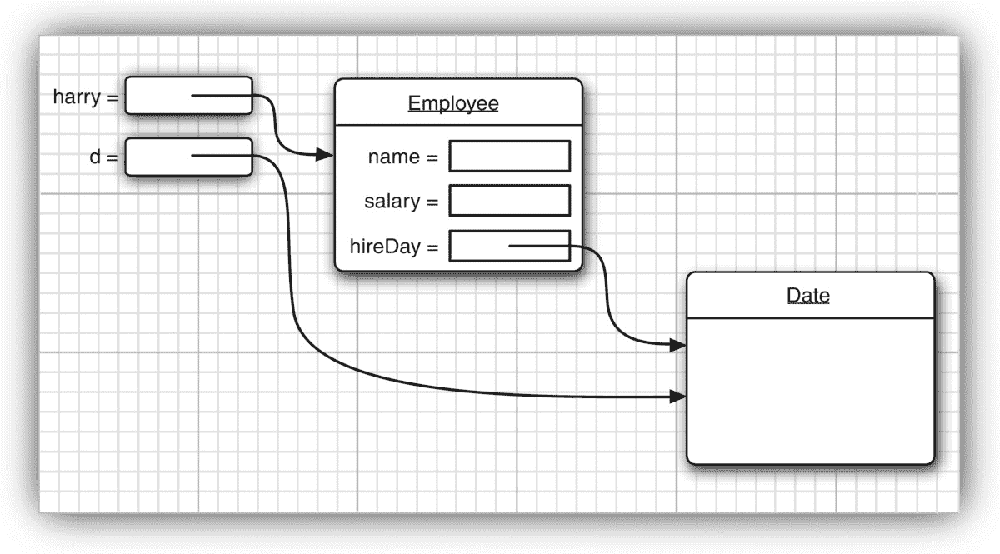 返回可变实例字段的引用

你将在第 6 章中看到如何在返回可变对象之前克隆它来解决这个问题。

更好的补办法是尽可能使用不可变对象，例如用 `LocalDate` 代替旧的 `Date` 类。

## 基于类的访问权限

你已经知道方法可以访问其调用对象的私有数据。人们经常感到惊讶的是，方法可以访问其类中所有对象的私有数据。例如，考虑一个比较两个员工的 `equals` 方法。

```java
class Employee
{
   . . .

   public boolean equals(Employee other)
   {
      return name.equals(other.name);
   }
}
```

典型的调用是：

```java
if (harry.equals(boss)) . . .
```

该方法访问了 `harry` 的私有字段，这并不意外。它还访问了 `boss` 的私有字段。这是合法的，因为 `boss` 是 `Employee` 类型的对象，而 `Employee` 类的方法允许访问任何 `Employee` 类型对象的私有字段。

C++ 也有相同的规则。方法可以访问其类中任何对象的私有特性，而不仅仅是隐含参数。

## 私有方法

在实现类时，我们将所有实例字段设为私有，因为公共数据是危险的。但方法呢？虽然大多数方法是公共的，私有方法在某些情况下很有用。有时，你可能希望将计算代码拆分为单独辅助方法。通常，这些辅助方法不应该是公共接口的一部分——它们可能与当前实现过于接近，或者需要特殊的协议或调用顺序。此类方法最好实现为私有。

在 Java 中实现私有方法，只需将 `public` 关键字改为 `private`。

通过将方法设为私有，如果你更改了实现，你没有义务保持它的可用。如果数据表示发生变化，该方法可能变得难以实现或不再必要；这并不重要。要点在于，只要方法是私有的，类的设计者就可以确保它从未在其他地方被使用，因此他们可以简单地将其丢弃。如果方法是公共的，你不能简单地丢弃，因为其他代码可能依赖它。

## `final` 实例字段

你可以将实例字段定义为 `final`。此类字段在对象构造时必须初始化。也就是说，你必须保证在每个构造函数结束后字段值已设置。之后，该字段可能不再被修改。例如，`Employee` 类的 `name` 字段可以声明为 `final`，因为它在对象构造后永远不会改变——这里没有 `setName` 方法。

```java
class Employee
{
   private final String name;
   . . .
}
```

`final` 修饰符对于类型为原始类型或不可变类的字段特别有用。（如果一个类没有任何方法会改变其对象，则该类是不可变的。例如，`String` 类就是不可变的。）

对于可变类，`final` 修饰符可能会引起混乱。例如，考虑一个字段：

```java
private final StringBuilder evaluations;
```

它在 `Employee` 构造函数初始化为：

```java
evaluations = new StringBuilder();
```

`final` 关键字仅意味着存储在 `evaluations` 变量中的对象引用将不再引用不同的 `StringBuilder` 对象。但对象本身是可以修改的：

```java
public void giveGoldStar()
{
   evaluations.append(LocalDate.now() + ": Gold star!\n"); 
}
```

`final` 字段可以为 `null`：


```java
name = n != null && n.length() == 0 ? null : n;
```

当然，它之后永远无法变为非空值。

## 静态字段和方法

在你过的所有示例程序中，`main` 方法都标记了 `static` 修饰符。我们现在准备讨论此修饰符的含义。

### 静态字段

如果你将一个字段定义为 `static`，那么该字段不存在于类的对象中。

### 静态常量

静态变量很少见。但静态常量很常见。例如，`Math` 类定义了一个静态常量：

```java
public class Math
{
   . . .

   public static final double PI = 3.1415926535897932346;

   . . .
}
```

可以在程序中使用 `Math.PI` 访问此常量。

如果省略了 `static` 关键字，那么 `PI` 将是 `Math` 类的实例字段。也就是说，你需要该类的对象来访问 `PI`，并且每个 `Math` 对象都有自己的 `PI` 副本。

你多次使用的另一个静态常量是 `System.out`。它在 `System` 类中的声明如下：

```java
public class System
{
   . . .

   public static final PrintStream out = . . .;

   . . .
}
```

正如多次提到的，拥有公共字段（public fields）永远不是好主意，因为每个人都可以修改它们。然而，公共常量（即 `final` 字段）是可以的。由于 `out` 被声明为 `final`，你不能为它重新赋值另一个打印流：

```java
System.out = new PrintStream(. . .); // 错误--out 是 final
```

如果你查看 `System` 类，你会发现一个 `setOut` 方法，它可以将 `System.out` 设置为不同的流。你可能会疑惑该方法如何改变 `final` 变量的值。然而，`setOut` 方法是一个 `native`（原生）方法，不是用 Java 编程语言实现的。原生方法可以绕过 Java 语言的访问控制机制。这是一种非常不寻常的解决方法，你不应该在自己的程序中模仿它。

## 静态方法

静态方法是不作用于对象的方法。例如，`Math` 类的 `pow` 方法就是一个静态方法。表达式：

```java
Math.pow(x, a)
```

计算幂 `x`^(`a`)`。它没有使用任何 `Math` 对象来完成任务。换句话说，它没有隐式参数。

你可以将静态方法想为没有 `this` 参数的方法。（在非静态方法中，`this` 参数指向方法的隐式参数——参见第 4.3.7 节。）

`Employee` 类的静态方法无法访问 `id` 实例字段，因为它不作用于任何对象。然而，静态方法可以访问静态字段。以下是这样一个静态方法的示例：

```java
public static int advanceId()
{
   int r = nextId; // 获取下一个可用的 id
   nextId++;
   return r;
}
```

要调用此方法，你提供类的名：

```java
int n = Employee.advanceId();
```

你可以省略此方法的方法的 `static` 关键字吗？可以，但这样你就需要一个类型为 `Employee` 的对象引用来调用该方法。

使用对象来调用静态方法是合法的。例如，如果 `harry` 是一个 `Employee` 对象，那么你可以调用 `harry.advanceId()` 代替 `Employee.advanceId()`。然而，我发现这种表示法令人困惑。`advanceId` 方法在计算结果时根本没有看 `harry`。我建议你使用类名而不是对象来调用静态方法。（否则，你的 IDE 可能会建议进行重构。）

在两种情况下使用静态方法：

* 当一个方法不需要访问对象状态时，因为所有需要的参数都是作为显式参数提供的（例如：`Math.pow`）
* 当一个方法只需要访问类的静态字段时（例如：`Employee.advanceId`）

静态字段和方法在 Java 和 C++ 中具有相同的功能。然而，语法略有不同。在 C++ 中，你使用 `::` 运算符在作用域之外访问静态字段或方法，例如 `Math::PI`。

“static（静态）”这个词有一个奇妙的历史。最初，`static` 关键字被引入 C 语言，用于表示退出代码块后不会消失的局部变量。在这种语境下，“static”一词是有意义的：变量保留着并在再次进入该块时它仍然在那里。然后 `static` 在 C 中有了第二个含义，用于表示无法从其他文件访问的全局变量和函数。`static` 关键字只是被复用以避免引入新关键字。最后，C++ 又复用了该关键字进行第三种无关的解释——表示属于某个类但不属于该类任何特定对象的变量和函数。这该关键字在 Java 中具有相同的含义。

## 工厂方法

这是静态方法的另一种常见用途。像 `LocalDate` 和 `NumberFormat` 这样的类使用静态工厂方法来构造对象。你已经见过 `LocalDate.now` 和 `LocalDate.of` 这两个工厂方法。以下是获取各种样式的格式化对象的方法：

```java
NumberFormat currencyFormatter = NumberFormat.getCurrencyInstance();

NumberFormat percentFormatter = NumberFormat.getPercentInstance();

double x = 0.1;

System.out.println(currencyFormatter.format(x)); // 打印 $0.10

System.out.println(percentFormatter.format(x)); // 打印 10%
```

为什么 `NumberFormat` 类不使用构造函数呢？有三个优于构造方法的工厂方法的原因：

* 你不能给构造函数命名。构造函数的名称始终与类名相同。但我们需要两个不同的名称来获取货币实例和百分比实例。
* 当你使用构造函数时，你无法改变所构造对象的类型。但工厂方法实际上返回的是 `DecimalFormat` 类的对象，这是一个继承自 `NumberFormat` 的更具体的类。（参见第 5 节 获取更多关于继承的信息。）
* 构造函数总是构造一个新对象。你可能希望共享实例。例如，`Integer.valueOf` 工厂方法当你两次使用相同的的小参数调用它时会产生同一个实例。

## `main` 方法

注意，你可以在没有任何对象的情况下调用静态方法。例如，你从未构造过 `Math` 类的任何对象来调用 `Math.pow`。

出于相同的原因，`main` 方法是一个静态方法。

```java
public class Application
{
   public static void main(String[] args)
   {
      //构造对象

      . . .
   }
}
```

`main` 方法不作用于任何对象。事实上，当程序启动时，还没有任何对象。静态 `main` 方法执行并构造了程序所需的对象。

每个类都可以有一个 `main` 方法。这是为类添加演示代码的一种方便技巧。例如，你可以为 `Employee` 类添加一个 `main` 方法：

```java
class Employee
{
   public Employee(String n, double s, int year, int month, int day)
   {
      name = n;
      salary = s;
      hireDay = LocalDate.of(year, month, day);
   }

   . . .

   public static void main(String[] args) //单元测试
   {
      var e = new Employee("Romeo", 50000, 2003, 3, 31);
      e.raiseSalary(10);
      System.out.println(e.getName() + " " + e.getSalary());
   }

   . . .
}
```

要查看 `Employee` 类的演示，只需执行：

```bash
java Employee
```

如果 `Employee` 类是一个更大应用程序的一部分，你通过以下方式启动应用程序：

```bash
java Application
```

`Employee` 类的 `main` 方法就不会被执行。

作为 Java 21 的一项预览功能，`main` 方法不再需要是 `public` 或 `static`，并且不需要具有 `String[]` 类型的参数。以下是新规则：

* 如果存在多个 `main` 方法，则 `static main` 方法优于实例方法，带有 `String[]` 参数的方法优于没有参数的方法。
* 如果 `main` 不是静态的，则类必须有一个无参构造函数。然后启动器会构造该类的实例并调用 `main` 方法。

如果你想尝试此预览功能，请记住使用 `--enable-preview` 标志编译和运行。

列表 4.3 中的程序包含 `Employee` 类的简单版本，它有一个静态字段 `nextId` 和静态方法 `advanceId`。我们填充了一个包含三个 `Employee` 对象的数组，然后打印员工信息。最后，我们打印下一个可用的标识码，以演示静态方法。

注意，`Employee` 类还有一个静态的 `main` 方法，可以运行一个简单的演示。尝试执行两者：

```bash
java Employee

java StaticTest
```

`StaticTest/StaticTest.java`

```java
/**
 * This program demonstrates static methods.
 * @version 1.03 2021-09-03
 * @author Cay Horstmann
 */

public class StaticTest
{
   public static void main(String[] args)
   {
      // 用三个 Employee 对象填充 staff 数组

      var staff = new Employee[3];
      staff[0] = new Employee("Tom", 40000);
      staff[1] = new Employee("Dick", 60000);
      staff[2] = new Employee("Harry", 65000);

      // 打印所有 Employee 对象的信息

      for (Employee e : staff)
      {
         System.out.println("name=" + e.getName() + ",id=" + e.getId() + ",salary="
            + e.getSalary());
      }

      int n = Employee.advanceId(); // 调用静态方法
      System.out.println("Next issued id=" + n);
   }
}

class Employee
{
   private static int nextId = 1;
   private String name;
   private double salary;
   private int id;

   public Employee(String n, double s)
   {
      name = n;
      salary = s;
      id = advanceId();
   }

   public String getName()
   {
      return name;
   }

   public double getSalary()
   {
      return salary;
   }

   public int getId()
   {
      return id;
   }

   public static int advanceId()
   {
      int r = nextId; // 获取下一个可用 id
      nextId++;
      return r;
   }

   public static void main(String[] args) // 运行演示
   {
      var e = new Employee("Harry", 50000);
      System.out.println(e.getName() + " " + e.getSalary());
   }
}
```

## `java.util.Objects` 7

- `static <T> void requireNonNull(T obj)`
- `static <T> void requireNonNull(T obj, String message)`
- `static <T> void requireNonNull(T obj, Supplier<String> messageSupplier)`

  如果 `obj` 为 `null`，这些方法将抛出一个没有消息或指定消息的 `NullPointerException`。（第 6 章 解释了如何使用 supplier 延迟地获取值。第 8 章解释了 `<T>` 语法。）

- `static <T> T requireNonNullElse(T obj, T defaultObj)`
- `static <T> T requireNonNullElseGet(T obj, Supplier<T> defaultSupplier)`

  如果 `obj` 不为 `null` 则返回它；如果 `obj` 为 `null` 则返回默认对象。

## 方法参数

让我们回顾一下描述编程语言中如何向方法（或函数）传递参数的计算机科学术语。“按值传递”（call by value）意味着方法仅获取调用者提供的值。相比之下，“引用传递”（call by reference）意味着方法获取调用者提供的变量的地址（location）。因此，方法可以修改（modify）通过引用传递的变量中存储的值，但不能修改按值传递的值。这些“按……传递”的术语是描述各种编程语言中方法参数行为的标准计算机科学术语，而不只是 Java。（还有一种“按名传递”（call by name），主要具有历史意义，被用于最古的高级语言之一 Algol 编程语言。）

Java 编程语言*始终*使用“按值传递”。这意味着方法获取所有参数的副本。特别是方法无法修改方法调用中任何变量的内容。

例如，考虑以下调用：

```java
double percent = 10;

harry.raiseSalary(percent);
```

无论该方法如何实现，我们知道在方法调用之后，`percent` 的值仍然是 `10`。

让我们仔细观察一下这种情况。假设有一个方法尝试将方法参数的价格三倍：

```java
public static void tripleValue(double x) // 无效
{
   x = 3 * x;
}
```

让我们调用此方法：

```java
double percent = 10;

tripleValue(percent);
```

然而，这不起作用。在方法调用之后，`percent` 的值仍然是 `10`。发生的情况如下：

1. `x` 用 `percent` 值的副本（即 `10`）初始化。
2. `x` 变为三倍——现在是 `30`。但 `percent` 仍然是 `10`（参见图 4.6）。

   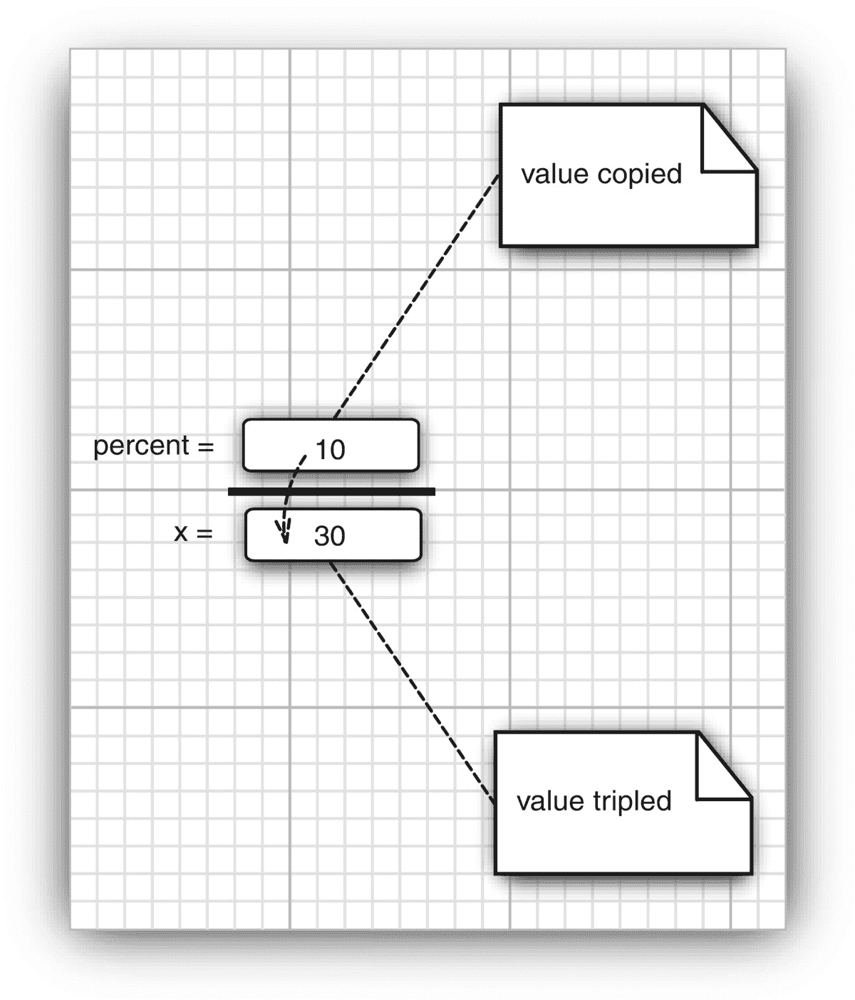 修改参数变量没有持久影响。

3. 方法结束，参数变量 `x` 不再被使用。

然而，方法参数有两种类型：

- 基本类型（数字类型、`char`、`boolean`）
- 对象引用

你已经看到方法无法更改基本类型参数。对于对象参数，情况则有所不同。你可以轻松地实现一个让员工薪水三倍的方法：

```java
public static void tripleSalary(Employee x) // 有效
```

执行方法后，`harry` 所引用的对象状态发生了变化。这是因为该方法通过对象引用的副本修改了状态。

最后，程序演示了 `swap` 方法的失败：

```text
Testing swap:

Before: a=Alice

Before: b=Bob

End of method: x=Bob

End of method: y=Alice

After: a=Alice

After: b=Bob
```

如你所示，参数变量 `x` 和 `y` 被交换了，但变量 `a` 和 `b` 并没有受到影响。

C++ 同时支持按值传递和引用传递。你用 `&` 对引用参数进行标记。例如，你可以轻松地实现 `void tripleValue(double& x)` 或 `void swap(Employee& x, Employee& y)` 等方法来修改它们的引用参数。

`ParamTest/ParamTest.java`

```java
/**
 * 此程序演示了 Java 中的参数传递。
 * @version 1.01 2018-04-10
 * @author Cay Horstmann
 */

public class ParamTest
{
   public static void main(String[] args)
   {
      /*


```java
System.out.println("Testing tripleValue:");

double percent = 10;

System.out.println("Before: percent=" + percent);

tripleValue(percent);

System.out.println("After: percent=" + percent);

/*
 * 测试 2: 方法可以改变对象参数的状态
 */

System.out.println("\nTesting tripleSalary:");

var harry = new Employee("Harry", 50000);

System.out.println("Before: salary=" + harry.getSalary());

tripleSalary(harry);

System.out.println("After: salary=" + harry.getSalary());

/*
 * 测试 3: 方法不能为对象参数附加新对象
 */

System.out.println("\nTesting swap:");

var a = new Employee("Alice", 70000);

var b = new Employee("Bob", 60000);

System.out.println("Before: a=" + a.getName());

System.out.println("Before: b=" + b.getName());

swap(a, b);

System.out.println("After: a=" + a.getName());

System.out.println("After: b=" + b.getName());

}

public static void tripleValue(double x) // 不起

{

x = 3 * x;

System.out.println("End of method: x=" + x);

}

public static void tripleSalary(Employee x) // 有效

{

x.raiseSalary(200);

System.out.println("End of method: salary=" + x.getSalary());

}

public static void swap(Employee x, Employee y)

{

Employee temp = x;

x = y;

y = temp;

System.out.println("End of method: x=" + x.getName());

System.out.println("End of method: y=" + y.getName());

}

}

class Employee // 简化的 Employee 类

{

private String name;

private double salary;

public Employee(String n, double s)

{

name = n;

salary = s;

}

public String getName()

{

return name;

}

public double getSalary()

{

return salary;

}

public void raiseSalary(double byPercent)

{

double raise = salary * byPercent / 100;

salary += raise;

}

}

```

## 对象构造

你已经学习了如何编写简单的构造函数来定义对象的初始状态。然而，由于对象构造非常重要，Java 提供了多种编写构造函数的机制。我们将在接下来的章节中介绍这些机制。

### 方法重载

某些类拥有多个构造函数。例如，你可以像这样构造一个空的 `StringBuilder` 对象：

```java
var messages = new StringBuilder();
```

或者，你可以指定一个初始字符串：

```java
var todoList = new StringBuilder("To do:");
```

那么你必须提供一个无参数构造函数。当然，如果你对所有字段的默认值感到满意，你只需要提供：

```java
public ClassName()
{
}
```

C++ 有一种特殊的初始化列表语法，用于构造字段，例如：

```cpp
Employee::Employee(String n, double s, int y, int m, int d) // C++

: name(n),

  salary(s),

  hireDay(y, m, d)

{

}

```

C++ 使用这种特殊的语法来避免不必要的无参数构造函数调用。在 Java 中，不需要这样做，因为对象没有子对象，只有对其他对象的引用。

### 显式字段初始化

通过重载类中的构造方法，你可以构建许多方法来设置类实例字段的初始状态。确保无论调用哪个构造函数，每个实例字段都被设置为某个有意义的值，始终是一个好主意。

你可以直接在类定义中为任何字段赋值。例如：

```java
class Employee
{
private String name = "";
. . .
}
```

该赋值会在构造函数执行之前完成。如果一个类的所有构造函数都需要将某个特定的实例字段设置为相同的值，那么这种语法特别有用。

初始化值不一定是一个常量值。这里有一个使用方法调用初始化字段的示例。考虑 `Employee` 类，其中每个员工都有一个 `id` 字段。你可以这样初始化它：

```java
class Employee
{
private static int nextId;

private int id = advanceId();

. . .

private static int advanceId()
{
int r = nextId;
nextId++;
return r;
}

. . .
}
```

### 参数命名

当你编写非常简单的构造函数时（你会写很多这类构造函数），为参数起名字可能会让人有些沮丧。

我们通常选择单字母作为参数名：

```java
public Employee(String n, double s)
{
name = n;
salary = s;
}
```

然而，缺点是你需要阅读代码才能知道 `n` 和 `s` 参数的含义。

有些程序员会在每个参数前加上前缀“a”：

```java
public Employee(String aName, double aSalary)
{
name = aName;
salary = aSalary;
}
```

这样要好得多。任何读者都能立即理解参数的含义。

另一个常用的技巧依赖于参数变量会“遮蔽（shadow）”同名的实例字段。例如，如果你将参数命名为 `salary`，那么 `salary` 指的是该参数，而不是实例字段。但你仍然可以通过 `this.salary` 访问实例字段。记住 `this` 表示隐式参数——即正在被构造的对象。这里有一个示例：

```java
public Employee(String name, double salary)
{
this.name = name;
this.salary = salary;
}
```

在 C++ 中，通常会在实例字段前加上下划线或固定字母。（字母 `m` 和 `x` 是常见的选择）。例如，薪资字段可能被命名为 `_salary`、`mSalary` 或 `xSalary`。Java 程序员通常不这样做。

### 调用另一个构造函数

关键字 `this` 指向方法的隐式参数。然而，这个关键字还有第二个含义。

如果构造函数的第一条语句的形式为 `this(. . .)`，则该构造函数会调用同一类的另一个构造函数。这里有一个典型的示例：

```java
public Employee(double s)
{
   // 调用 Employee(String, double)
   this("Employee #" + nextId, s);
   nextId++;
}
```

当你调用 `new Employee(60000)` 时，`Employee(double)` 构造函数会调用 `Employee(String, double)` 构造函数。

这样使用 `this` 关键字是有用的——你只需要写一次公共构造代码。

Java 中的 `this` 引用与 C++ 中的 `this` 指针相同。然而在 C++ 中，你在成员初始化列表中调用另一个构造函数：

```cpp
Employee(double s) : Employee("Employee #" + nextId, s) { nextId++; }
```

```cpp
if (imageWidth <= 0 || imageHeight <= 0) return;
```

### 初始化块

你已经见过两种初始化实例字段的方法：

* 在构造函数中设置值
* 在声明中赋值

Java 中有第三种机制，称为“初始化块（initialization block）”。类声明可以包含任意的代码块。每当该类的对象被构造时，这些块都会被执行。例如：

```java
class Employee
{
private static int nextId;

private int id;

private String name;

private double salary;

// 对象初始化块
{
id = nextId;
nextId++;
}

public Employee(String n, double s)
{
name = n;
salary = s;
}

public Employee()
{
name = "";
salary = 0;
}

. . .
}
```

在这个示例中，无论使用哪个构造函数来创建对象，`id` 字段都在对象初始化块中初始化。块首先运行，然后执行构造函数的体。

这种机制永远不是必要的，也不常见。通常将初始化代码放在构造函数内部更加直接。

当你使用 `java Hello` 调用该类时，该类被加载，静态初始化块打印出“Hello, World”，随后才显示 `main` 方法未定义的错误信息。从 Java 7 开始，`java` 程序会首先检查是否存在 `main` 方法。

本示例使用 `RandomGenerator` 实例来生成随机数。从 JDK 17 开始，`java.util.random` 包提供了多种具有不同权衡的强算法实现。它提供了一个适用于大多数用途的默认实现，但如果你对替代方案感兴趣，可以阅读 `java.util.random` 包的 API 文档，以获取关于选择何种算法的建议。你可以如下所示获取特定实例：

```java
RandomGenerator generator = RandomGenerator.of("L64X128MixRandom");
```

通过调用 `generator.nextInt(n)` 或其他 `RandomGenerator` 方法来生成随机数。（技术上，`RandomGenerator` 是一个 `interface`，该概念在第 6 章中引入。当你在 `RandomGenerator` 实例上调用方法时，不需要担心这一点。）

`RandomGenerator` 接口改进了 Java 1.0 中的 `Random` 类，后者的周期（`period`）较短，仅 2⁴⁸，之后内部状态就会重复。根据经验法则，为了生成 `n` 个随机数，周期至少应为 `n²`。按照该规则，如果 `n` 超过 2²⁴（这个数字并不大——大约 1700 万），经典的 `Random` 生成器就不再适用。如今，人们已经知道了许多更好的算法，放弃 `Random` 类是一个好主意。

如果你想在使用了 `Random` 类的遗留代码中使用强随机数生成器，可以使用如下的静态 `from` 方法：

```java
Random generator = Random.from(RandomGenerator.getDefault());
```

Listing 4.5 中的程序展示了本节讨论的许多特性：

* 重载的构造函数
* 通过 `this(. . .)` 调用另一个构造函数
* 无参数构造函数
* 对象初始化块
* 静态初始化块
* 实例字段初始化

`ConstructorTest/ConstructorTest.java`

```java
import java.util.random.*;

/**
 * 此程序演示了对象的构造。
 * @version 1.02 2018-04-10
 * @author Cay Horstmann
 */

public class ConstructorTest
{
public static void main(String[] args)
{
   // 用三个 Employee 对象填充 staff 数组
   var staff = new Employee[3];
   staff[0] = new Employee("Harry", 40000);
   staff[1] = new Employee(60000);
   staff[2] = new Employee();

   // 打印所有 Employee 对象的信息
   for (Employee e : staff)
      System.out.println("name=" + e.getName() + ",id=" + e.getId() + ",salary="
         + e.getSalary());
}
}

class Employee
{
private static int nextId;

private int id;

private String name = ""; // 实例字段初始化

private double salary;

private static RandomGenerator generator = RandomGenerator.getDefault();

// 静态初始化块
static
{
   // 将 nextId 设置为 0 到 9999 之间的随机数
   nextId = generator.nextInt(10000);
}

// 对象初始化块
{
   id = nextId;
   nextId++;
}

// 三个重载的构造函数
public Employee(String n, double s)
{
   name = n;
   salary = s;
}

public Employee(double s)
{
   // 调用 Employee(String, double) 构造函数
   this("Employee #" + nextId, s);
}

// 默认构造函数
public Employee()
{
   // name 初始化为 ""--见上文
   // salary 未被显式设置--初始化为 0
   // id 在初始化块中初始化
}

public String getName()
{
   return name;
}

public double getSalary()
{
   return salary;
}

public int getId()
{
   return id;
}
}
```


`java.util.random.RandomGenerator` 17

- `int nextInt(int n)`  
  返回 0 到 `n` – 1 之间的随机整数。
- `static RandomGenerator of(String name)`  
  根据给定的算法名称产生随机生成器。名为 `"L64X128MixRandom"` 的算法适用于大多数应用。
- `static RandomGenerator getDefault()`  
  产生一个具有 64 或更多状态位的强随机生成器。

`java.util.Random` 1.0

- `static from(RandomGenerator generator)` 19  
  返回一个 `Random` 实例，其方法委托给给定的 `RandomGenerator`。这对于遗留代码非常有用。

### 对象销毁与 `finalize` 方法

某些面向对象的编程语言（特别是 C++）具有显式的析构方法，用于处理对象不再使用时可能需要的任何清理代码。析构函数中最常见的活动是回收为对象分配的内存。由于 Java 具有自动垃圾回收机制，不需要手动回收内存，因此 Java 不支持析构函数。

当然，某些对象使用了内存以外的资源，例如文件。在这种情况下，当资源不再被需要时关闭它是非常重要的。然而，你无法知道这何时会被调用。参见 `finalize` 方法。

## Records

有时，数据只是数据，而面向对象的编程反而成了障碍。考虑一个描述平面的 `Point` 类，它具有 `x` 和 `y` 坐标。当然，你可以创建一个类：

```java
class Point {
   private final double x;
   private final double y;

   public Point(double x, double y) { this.x = x; this.y = y; }

   public double getX() { return x; }

   public double getY() { return y; }

   public String toString() { return "Point[x=%d, y=%d]".formatted(x, y); }

   // 其他方法 . . .
}
```

隐藏 `x` 和 `y` 并通过 getter 方法提供值真的有什么用吗？我们是否想要改变 `Point` 的实现？当然，有极坐标，但你不会在图形 API 中使用它们。在实践中，平面上的点完全由其 `x` 和 `y` 坐标描述。

为了更简洁地定义此类类，JDK 14 将“记录”（records）作为一项预览特性引入。最终版本在 JDK 16 中交付。

### Record Concept

record 是一种特殊的类形式，其状态是不可变的且公开可见的。声明 record 时，提供名称和持有对象状态的实例变量。以下是定义 `Point` record record：

```java
record Point(double x, double y) { }
```

结果是一个具有实例字段的类：

```java
private final double x;
private final double y;
```

在 Java 语言规范中，record 的实例字段被称为其组件。该类有一个构造函数：

```java
Point(double x, double y)
```

以及访问器方法：

```java
public double x()
public double y()
```

注意，访问器方法是 `x` 和 `y`，而不是 `getX` 和 `getY`。（在 Java 中，实例字段和方法同名是合法的。）

```java
var p = new Point(3, 4);

System.out.println(p.x() + " " + p.y());
```

Java 并没有遵循 `get` 规范，因为这有点混乱。对于 `boolean` 字段，通常使用 `is` 而不是 `get`。此外，首字母的大写也可能会产生问题。如果一个类拥有字段 `x` 和 `X` 该会发生什么呢？有些程序员对此感到不悦，因为他们的遗留类无法简单地转换为 record。但在实践中，许多此类遗留类是可变变的，因此它们不是转换为 record 的候选对象。

除了字段访问方法外，每个 record 都会自动定义三个方法：`toString`、`equals` 和 `hashCode`。你将在下一章学习更多关于这些方法的知识。

你可以为 record 添加自己的方法：

```java
record Point(double x, double y) {
   public double distanceFromOrigin() { return Math.hypot(x, y); }
}
```

你可以定义自动提供的方法的自定义版本，只要它们的参数和返回类型相同。例如，这种定义是合法的：

```java
record Point(double x, double y) {
   public double x() { return 2 * x; } // 坏做法
}
```

但这显然不是一个好主意。

你不能向 record 添加 `instance` 字段。

```java
record Point(double x, double y) {
   private double r; // 错误

   . . .
}
```

record 的实例字段自动为 `final`。然而，它们可能是指向可变对象的引用：

```java
record PointInTime(double x, double y, Date when) { }
```

那么 record 实例就是可变的：

```java
var pt = new PointInTime(0, 0, new Date());

pt.when().setTime(0);
```

如果你希望 record 实例是不可不可的，请不要在字段中使用可变类型。

record 像任何类一样，都可以拥有静态字段和方法：

```java
record Point(double x, double y) {
   public static Point ORIGIN = new Point(0, 0);

   public static double distance(Point p, Point q) {
      return Math.hypot(p.x - q.x, p.y - q.y);
   }

   . . .
}
```

对于完全由一组变量表示的不变数据，请使用 record 代替类。如果数据是可变的，或者表示方式可能会随时间演变，请使用类。record 更易读、效率更高，且在并发程序中更安全。

### 构造函数：规范、紧凑和自定义

设置所有实例字段的自动定义构造函数被称为“规范构造函数”（canonical constructor）。

若要验证或规范化规范构造函数的参数，请使用“紧凑”（compact）形式。不要指定参数列表：

```java
record Range(int from, int to) {
   public Range { // 紧凑形式，验证参数
      if (from > to) throw new IllegalArgumentException();
   }
}
```

或者：

```java
record Range(int from, int to) {
   public Range { // 紧凑形式，规范化参数
      if (from > to) { // 交换边界
         int temp = from;
         from = to;
         to = temp;
      }
   }
}
```

紧凑形式的主体是规范构造函数的“序言”。它仅仅在参数变量 `from` 和 `to` 被赋值给实例字段 `this.from` 和 `this.to` 之前对其进行修改。你不能在紧凑构造函数体内读取或修改实例字段。

你可以定义额外的“自定义构造函数”。此类构造函数的第一语句必须调用另一个构造函数，以便最终调用规范构造函数。这是一个示例：

```java
record Point(double x, double y) {
   public Point() { this(0, 0); }
}
```

这个 record 有两个构造函数：规范构造函数和一个产生原点的无参数构造函数。

如果规范构造函数需要执行额外工作，你可以提供自己的实现。但这非常罕见。例如，以下实现是合法的，但正如你所见，使用紧凑构造函数更容易实现相同的效果。

```java
record Range(int from, int to) {
   public Range(int from, int to) { // 合法，但工作比紧凑构造函数多
      if (from <= to) {
         this.from = from;
         this.to = to;
      } else {
         this.from = to;
         this.to = from;
      }
   }
}
```

`RecordTest/RecordTest.java`

```java
import java.util.*;

/**
 * 此程序演示了 record。
 * @version 1.0 2021-05-13
 * @author Cay Horstmann
 */
public class RecordTest {
   public static void main(String[] args) {
      var p = new Point(3, 4);

      System.out.println("Coordinates of p: " + p.x() + " " + p.y());
      System.out.println("Distance from origin: " + p.distanceFromOrigin());

      // 使用静态字段和方法的相同计算
      System.out.println("Distance from origin: " + Point.distance(Point.ORIGIN, p));

      // 一个可变的 record
      var pt = new PointInTime(3, 4, new Date());

      System.out.println("Before: " + pt);

      pt.when().setTime(0);

      System.out.println("After: " + pt);
   }
}
```

### 包（Packages）

Java 允许将类分组在一个名为 `package`（包的集合中。包有助于组织工作并将与其他提供的代码分开。在接下来的章节中，你将学习如何使用包。

#### 包名

使用包的主要目的是确保类名的唯一性。假设两个程序员都想出了提供 `Employee` 类的主意。只要他们将其放在不同的包中，就不会产生冲突。事实上，为了绝对保证包名的唯一，可以使用反转的域名（已知是唯一的）。例如，考虑域名 `horstmann.com`。反转后变为包名 `com.horstmann`。你可以接着添加项目名称，如 `com.horstmann.corejava`。如果你将 `Employee` 类放入该包，那么“完全限定名”就会变为 `com.horstmann.corejava.Employee`。

从编译的角度来看，嵌套包之间没有任何关系。例如，`java.util` 和 `java.util.jar` 包是各自独立的类集合。

#### 类导入

类可以使用其所属包中的所有类，以及其他包中的所有 `public` 类。

你可以通过两种方式访问另一个包中的公共类。第一种是直接使用*完全限定名*（fully qualified name）；即包名后跟类名。例如：

```java
java.time.LocalDate today = java.time.LocalDate.now();
```

这显然很繁琐。一种更简单、更常用的方法是使用 `import` 语句。`import` 语句的作用是提供引用包内类的简写方式。一旦添加了 `import`，你就不再需要给出类的全名。

你可以导入特定的类或整个包。你将 `import` 语句放在源文件的顶部（任何 `package` 语句之下）。例如，你可以通过语句导入 `java.time` 包中的所有类：

```java
import java.time.*;
```

然后你就可以使用：

```java
LocalDate today = LocalDate.now();
```

无需包前缀。你也可以导入包中的特定类：

```java
import java.time.LocalDate;
```

`java.time.*` 语法不再那么繁琐。它对代码大小没有负面影响。然而，如果你显式导入类，代码的读者就能确切知道你使用了哪些类。

但是，请注意，你只能使用 `*` 符号导入单个包。你不能使用 `import java.*` 或 `import java.*.*` 来导入所有以 `java` 为前缀的包。

你永远不需要从 `java.lang` 包导入类。

集成开发环境（IDE）拥有整理导入语句的命令。像 `import java.util.*;` 这样的包语句会自动展开为特定导入的列表，例如：

```java
import java.util.ArrayList;
import java.util.Date;
```

未使用的导入语句会被移除。这是一个非常方便的特性，了解如何在你的 IDE 中实现这一点是一个很不错的主意。

在大多数情况下，你只需要导入需要的包，而不需要太担心它们。唯一需要注意包的情况是发生命名冲突时。例如，`java.util` 和 `java.sql` 包都拥有一个 `Date` 类。假设你写了一个同时导入这两个包的程序：

```java
import java.util.*;
import java.sql.*;
```

如果你现在使用 `Date` 类，将得到编译时错误：

```java
Date today; // 错误--java.util.Date 还是 java.sql.Date?
```

编译器无法确定你想用哪个 `Date` 类。你可以通过添加特定的 `import` 语句来解决这个问题：

```java
import java.util.*;
import java.sql.*;
import java.util.Date;
```

如果你真的需要两个 `Date` 类怎么办？那么在每个类名上都使用完整的包名：

```java
var startTime = new java.util.Date();
var today = new java.sql.Date(. . .);
```

在包中定位类是 `compiler` 的活动。类文件中的字节码始终使用完整的包名来引用其他类。

C++ 程序员有时会将 `import` 与 `#include` 混淆。两者之间没有共同点。在 C++ 中，你必须使用 `#include` 来包含外部特性的声明，因为 C++ 编译器不会查看正在编译的文件及其显式包含的头文件之外的任何文件。Java 编译器只要你告诉它去哪里查找，就会很乐意查看其他文件。

在 Java 中，你可以通过显式命名所有类（如 `java.util.Date`）来完全避免 `import` 机制。在 C++ 中，你无法避免 `#include` 指令。

`import` 语句的唯一好处是便利。你可以用比完整包名短的名字引用类。例如，在 `import java.util.*`（或 `import java.util.Date`）语句之后，你可以直接用 `Date` 引用 `java.util.Date` 类。

在 C++ 中，类似于包机制的构造是命名空间（namespace）特性。将 Java 中的 `package` 和 `import` 语句视为 C++ 中 `namespace` 和 `using` 指令的对应物。

### 静态导入

`import` 语句的一种允许导入静态方法和字段，而不仅仅是类。

例如，如果你在源文件顶部添加指令：

```java
import static java.lang.System.*;
```

那么你就可以不需要类名前缀的情况下使用 `System` 类的静态方法和字段：

```java
out.println("Goodbye, World!"); // 即 System.out

exit(0); // 即 System.exit
```

你也可以导入特定的方法或字段：

```java
import static java.lang.System.out;
```

在实践中，许多程序员是否想要缩写 `System.out` 或 `System.exit` 是令人怀疑的。生成的代码看起来不那么清晰。另一方面：

```java
sqrt(pow(x, 2) + pow(y, 2))
```

看起来比：

```java
Math.sqrt(Math.pow(x, 2) + Math.pow(y, 2))
```

清晰得多。

你可以导入枚举常量：

```java
import java.time.DayOfWeek;
import static java.time.DayOfWeek.*;

DayOfWeek w = FRIDAY; // 等同于 DayOfWeek.FRIDAY
```

`STR` 插值器是 Java 21 的预览特性。它用于形成带有嵌入表达式的字符串，例如：

```java
STR."Hello, \{name}! Next year, you'll be \{age + 1}."
```


标识符 `STR` 总是被导入的，就像存在过这样的语句一样：

```java
import static java.lang.StringTemplate.STR;
```

### 将类添加到包中

要将类放在包内部，请将包名放在源文件的顶部，位于定义包内类的代码之前。例如，文件 `Employee.java` 开头所示：

```java
package com.horstmann.corejava;

public class Employee
{
   . . .
}
```

如果你没有在源文件中放置 `package` 语句，那么该源文件中的类就属于 `unnamed package`（未命名包）。未命名包没有包名。到目前，我们所有的示例类都位于未命名包中。

将源文件放在与完整包名匹配的子目录中。例如，`com.horstmann.corejava` 包中的所有源文件都应该位于 `com/horstmann/corejava` 子目录中。换句话说，目录结构如下：

```text
. (基础目录)
├─ PackageTest.java
├─ PackageTest.class
└─ com/
   └─ horstmann/
      └─ corejava/
         ├─ Employee.java
         └─ Employee.class
```

要编译此程序，只需切换到基础目录并运行命令：

```bash
javac PackageTest.java
```

```java
import com.horstmann.corejava.*;

// Employee 类定义在那个包中
import static java.lang.System.*;

/**
 * 此程序演示了包的使用。
 * @version 1.11 2004-02-19
 * @author Cay Horstmann
 */
public class PackageTest
{
   public static void main(String[] args)
   {
      // 因为有了 import 语句，我们在这里不需要使用
      // com.horstmann.corejava.Employee
      var harry = new Employee("Harry Hacker", 50000, 1989, 10, 1);
      harry.raiseSalary(5);

      // 因为有了静态导入语句，我们在这里不需要使用 System.out
      out.println("name=" + harry.getName() + ",salary=" + harry.getSalary());
   }
}
```

`PackageTest/com/horstmann/corejava/Employee.java`

```java
package com.horstmann.corejava;

// 此文件中的类是该包的一部分
import java.time.*;

// import 语句位于 package 语句之后
/**
 * @version 1.11 2015-05-08
 * @author Cay Horstmann
 */
public class Employee
{
   private String name;
   private double salary;
   private LocalDate hireDay;

   public Employee(String name, double salary, int year, int month, int day)
   {
      this.name = name;
      this.salary = salary;
      hireDay = LocalDate.of(year, month, day);
   }

   public String getName()
   {
      return name;
   }

   public double getSalary()
   {
      return salary;
   }

   public LocalDate getHireDay()
   {
      return hireDay;
   }

   public void raiseSalary(double byPercent)
   {
      double raise = salary * byPercent / 100;
      salary += raise;
   }
}
```

### 包访问权限

你已经遇到过 `public` 和 `private` 访问修饰符。标记为 `public` 的特征可以被任何类使用。私有特征只能由定义它的类使用。如果你既没有指定 `public` 也没有指定 `private`，该特征（即类、方法或变量）可以被同一个 `package`（包）中的所有方法访问。

考虑 Listing 4.2 中的程序。`Employee` 类没有被定义为公共类。因此，只有同一个包中的其他类（例如 `EmployeeTest`——在本例中是未命名包）可以访问它。对于类来说，这是一个合理的默认值。但对于变量来说，这是一个遗憾的选。变量必须显式地被标记为 `private`，否则它们将默认具有包访问权限。这固然破坏了封装性。问题在于，忘记输入 `private` 关键字是非常容易的。这里有一个来自 `java.awt` 包中 `Window` 类的示例，它是 JDK 提供的源代码的一部分：

```java
public class Window extends Container
{
   String warningString;
   . . .
}
```

注意，`warningString` 变量并不是 `private` 的！这意味着 `java.awt` 包中所有类的方法都可以访问这个变量，并将其设置为它们任何想要的值（例如 `"Trust me!"`）。实际上，访问这个变量的方法仅位于 `Window` 类中，因此将变量设为私有是完全合适的。也许程序员急于写代码时简单地忘记了 `private` 修饰符？也许根本不在意？在多年以后，该变量仍然不是私有的。不仅如此——随着时间的推移，类增加了新的字段，其中大约一半也不是私有的。

这可能会是一个问题。默认情况下，包不是封闭的实体。也就是说，任何人都可以向包添加更多类。当然，恶意或无知的程序员随后可以添加修改包访问变量的代码。例如在 Java 的早期版本中，这很容易。另一个现在已过时的机制允许 JAR 文件将包声明为 `sealed`（密封的），防止第三方对其进行扩展。现在，你应该使用模块来封装包。模块将在第 12 章中详细讨论。

### 类路径

正如你所见，类存储在文件系统的子目录下。类的路径必须与包名匹配。

类文件也可以存储在 JAR（Java 归档）文件中。JAR 文件包含多个以压缩格式的类文件和子目录，可以节省空间并提高性能。当你使用第三方库时，你将在 Section 4.9 中看到如何创建自己的 JAR。

要在程序之间共享类，你需要执行以下操作：

1. 将你的类文件放在一个目录内——例如 `/home/user/classdir`。注意该目录是包树的基础。如果你添加了 `com.horstmann.corejava.Employee`，那么 `Employee.class` 必须位于 `/home/user/classdir/com/horstmann/corejava`。
2. 将任何 JAR 文件放在一个目录下——例如 `/home/user/archives`。
3. 设置 `class path`（类路径）。类路径是所有包含类文件的位置集合。

在 UNIX 中，类路径上的元素用冒号分隔：

```text
/home/user/classdir:.:/home/user/archives/archive.jar
```

在 Windows 中，它们用分号分隔：

```text
c:\classdir;c:\archives\archive.jar
```

在两种情况下，点号表示当前目录。此类路径包含：

- 基础目录 `/home/user/classdir`；
- 当前目录（`.`）；以及
- JAR 文件 `/home/user/archives/archive.jar` 或 `c:\archives\archive.jar`。

你可以为 JAR 文件指定通配符，如下：

```text
/home/user/classdir:.:/home/user/archives/*
```

或者：

```text
c:\classdir;.;c:\archives\*
```

在 UNIX 中，`*` 必须转义以防止 shell 扩展。`archives` 目录中的所有 JAR 文件（但不包括 `.class` 文件）都包含在此类路径中。Java API 总是搜索类；不要显式将其包含在类路径中。`javac` 编译器始终查找当前目录中的文件，但 `java` 虚拟机启动器只有在“`.`”目录位于类路径上时才会查找当前目录。如果你没有设置类路径，这并不是问题——默认类路径由“`.`”目录组成。但如果你设置了类路径并忘记包含“`.`”目录，你的程序将无错误编译，但无法运行。

类路径列出了所有作为查找类起点的目录和归档文件。考虑我们的示例类路径：

```text
/home/user/classdir:.:/home/user/archives/archive.jar
```

假设虚拟机搜索 `com.horstmann.corejava.Employee` 类的类文件。它首先在 Java 类中搜索。它在其中没有找到类文件，因此转向类路径。然后它查找以下文件：

- `/home/user/classdir/com/horstmann/corejava/Employee.class`
- 从当前目录开始的 `com/horstmann/corejava/Employee.class`
- `/home/user/archives/archive.jar` 内部的 `com/horstmann/corejava/Employee.class`

编译器定位文件的难度比虚拟机要大。如果你在不指定包名的情况下引用了一个类，编译器首先需要找到包含该类的包。它会查询所有的 `import` 指令，将其作为该类的可能来源。例如，假设源文件包含以下指令：

```java
import java.util.*;
import com.horstmann.corejava.*;
```

并且源代码中引用了类 `Employee`。编译器随后会尝试寻找 `java.lang.Employee`（因为 `java.lang` 包默认总是会被导入的）、`java.util.Employee`、`com.horstmann.corejava.Employee` 以及当前包中的 `Employee`。它会在类路径的所有位置中搜索每一个类。如果找到多个类，则会产生编译时错误。（完全限定类名必须是唯一的，因此 `import` 语句的顺序并不重要。）

编译器又进了一步。它会检查源文件以查看源代码是否比类文件新。如果是，则会自动重新编译源文件。请记住，你只能从其他包导入公共类（public classes）。一个源文件只能包含一个公共类，且文件名与公共类的名称必须匹配。因此，编译器可以轻松定位公共类的源文件。然而，你可以从当前包导入非公共类。这些类可能定义在不同名称的源文件中。如果你从当前包导入一个类，编译器会搜索当前包的所有源文件，以查看哪一个定义了该类。

## 设置类路径

IDE 和构建工具有它们自己的管理类路径的机制。但了解如何手动设置它是一个好主意，这样你就可以排除任何配置问题。

最好使用 `-classpath` 选项（或 `-cp` 或更现代的变体 `--class-path`）来指定类路径：

```bash
java -classpath /home/user/classdir:.:/home/user/archives/archive.jar MyProg
```

或者：

```bash
java -classpath c:\classdir;.;c:\archives\archive.jar MyProg
```

整个命令必须在一行输入。将这种长命令行放在 shell 脚本或批文件中是比较好的。

使用 `-classpath` 选项是设置类路径的首选方法。另一种方法是 `CLASSPATH` 环境变量。具体取决于你所使用的 shell。对于 Bourne Again shell（bash），使用命令：

```bash
export CLASSPATH=/home/user/classdir:.:/home/user/archives/archive.jar
```

对于 Windows shell，使用：

```cmd
set CLASSPATH=c:\classdir;.;c:\archives\archive.jar
```

类路径的有效持续到 shell 退出。

有些人建议永久设置 `CLASSPATH` 环境变量。这通常是一个坏主意。人们会忘记这个全局设置，并在发现类没有被正确加载时感到惊讶。一个特别令人指责的例子是 Apple 在 Windows QuickTime 安装器。多年来，它全局地设置 `CLASSPATH` 指向它需要的一个 JAR 文件，但没有将当前目录包含在类路径中。结果导致无数 Java 程序员在程序编译成功但无法运行时几近抓狂。

在过去，有些人建议完全跳过类路径，通过将所有 JAR 文件丢入 `jre/lib/ext` 目录。这种机制在 Java 9 之后已经过时了，但这一直是一个糟糕的建议。当从扩展目录加载被遗忘已久的类时，很容易产生混淆。

类也可以从 `module path` 加载。模块和模块路径在第 12 章中进行了讨论。

## JAR 文件

当你打包应用程序时，你希望给用户提供单个文件，而不是一个充满类文件的目录结构。Java 归档（JAR）文件就是为此目的设计的。一个 JAR 文件可以包含类文件以及其他类型的文件，如图像和声音文件。此外，JAR 文件是经过压缩的，使用了熟悉的 ZIP 压缩格式。

### 创建 JAR 文件

使用 `jar` 工具来制作 JAR 文件。（在默认 JDK 安装中，它位于 `jdk/bin` 目录下。）创建一个新 JAR 文件最常用的命令使用以下语法：

```bash
jar cvf jarFileName file1 file2 . . .
```

例如：

```bash
jar cvf CalculatorClasses.jar *.class icon.png
```

通常情况下，`jar` 命令具有以下格式：

```bash
jar options file1 file2 . . .
```

表 4.2 列出了 `jar` 程序的所有选项。它们与 UNIX `tar` 命令的选项相似。

#### `jar` 程序选项

| 选项 | 描述 |
| --- | --- |
| `c` | 创建一个新的或空的归档并从中添加文件。如果指定的任何文件名是目录，`jar` 程序将递归处理它们。 |
| `C` | 临时更改目录。例如，`jar cvf jarFileName.jar -C classes *.class` 切换到 `classes` 子目录以添加类文件。 |
| `e` | 在清单文件中创建一个入口（参见第 4.9.3 节）。 |
| `f` | 指定 JAR 文件名作为第二个命令行参数。如果缺少此参数，`jar` 将结果写入标准输出。 |
| `i` | 创建索引文件（用于加速查找）。 |
| `m` | 添加清单文件。 |
| `M` | 不创建清单文件。 |
| `t` | 显示内容。 |
| `u` | 更新现有的 JAR 文件。 |
| `v` | 生成详细输出。 |
| `x` | 提取文件。如果你提供了一个或多个文件名，则只提取这些。否则，提取所有文件。 |
| `0` | 不进行 ZIP 压缩。 |

你可以将应用程序和代码库打包成 JAR 文件。例如，如果你想在 Java 程序中发送邮件，你可以使用封装在 `javax.jar` 中的库。

### 清单

除了类文件、图像和其他资源外，每个 JAR 文件还包含一个描述归档特殊功能的清单文件。

清单文件名为 `MANIFEST.MF`，位于 JAR 文件中特殊的 `META-INF` 子目录下。最简单的清单非常简单——只有：

```text
Manifest-Version: 1.0
```

复杂的清单可以有许多条目。清单条目被分组。清单中的第一个部分称为主部分。它适用于整个 JAR 文件。随后的条目可以指定命名实体（如文件、包或 URL）的属性。这些条目必须以 `Name` 条目开始。部分之间用空行分隔。例如：

```text
Manifest-Version: 1.0

描述此归档的内容

Name: Woozle.class

描述此文件

Name: com/mycompany/mypkg/

描述此包
```

要编辑清单，将要添加到清单的行放在文本文件中。然后运行：

```bash
jar cfm jarFileName manifestFileName . . .
```

例如，要创建一个带清单的新 JAR 文件，运行：

```bash
jar cfm MyArchive.jar manifest.mf com/mycompany/mypkg/*.class
```

要更新现有 JAR 文件的清单，将新增内容放在文本文件中并使用如下命令：

```bash
jar ufm MyArchive.jar manifest-additions.mf
```


有关 JAR 和清单文件格式的更多信息，请参阅 <https://docs.oracle.com/en/java/javase/21/docs/specs/jar/jar.html>。

### 可执行的 JAR 文件

你可以使用 `jar` 命令的 `e` 选项来指定程序的*入口*——即你通常在调用 `java` 程序启动器时指定的类。

```bash
jar cvfe MyProgram.jar com.mycompany.mypkg.MainAppClass files to add
```

或者，你可以在清单文件（manifest）中指定程序的`主类`，格式如下的语句：

```text
Main-Class: com.mycompany.mypkg.MainAppClass
```

不要在主类名后添加 `.class` 扩展名。

清单文件的最后一行必须以换行符结束。否则，清单文件将无法被正确读取。一个常见的错误是生成了一个只包含 `Main-Class` 行但没有换行符的文本文件。

无论使用哪种方法，用户都可以简单地通过以下命令启动程序：

```bash
java -jar MyProgram.jar
```

根据操作系统的配置，用户甚至可能通过双击 JAR 文件图标来启动程序。以下是各种操作系统的行为：

- 在 Windows 上，Java 运行时安装程序会为 `.jar` 扩展名创建一个文件关联，使用 `javaw -jar` 命令启动文件。（与 `java` 命令不同，`javaw` 命令不会打开命令行窗口。）
- 在 Mac OS X 上，操作系统能够识别 `.jar` 文件扩展名，并在你双击 JAR 文件时执行 Java 程序。

然而，JAR 文件中的 Java 程序并没有原生应用程序那样的体验。在 Windows 上，你可以使用第三方包装器工具将 JAR 文件转换为 Windows 可执行文件。包装器是一个带有熟悉的 `.exe` 扩展名的 Windows 程序，它负责定位并启动 Java 虚拟机（JVM），或者在未找到 JVM 时告诉用户该怎么做。这里有许多商业和开源产品，例如 Launch4J（[`launch4j.sourceforge.net`](https://launch4j.sourceforge.net)）和 IzPack（[`izpack.org`](https://izpack.org)）。

### 多版本 JAR 文件

随着模块的引入和对包的强封装，某些以前可以访问的内部 API 不再可用。这可能需要库提供者为不同的 Java 版本分发不同的代码。多版本 JAR 考虑了这种用例。

为了向后兼容，特定版本的类文件被放置在 `META-INF/versions` 目录下：

```text
Application.class
BuildingBlocks.class
Util.class
META-INF
 ├─ MANIFEST.MF (带有行 Multi-Release: true)
 └─ versions
    ├─ 9
    │  ├─ Application.class
    │  └─ BuildingBlocks.class
    └─ 10
       └─ BuildingBlocks.class
```

假设 `Application` 类使用了 `CssParser` 类。那么旧的 `Application.class` 文件可以编译为使用 `com.sun.javafx.css.CssParser`，而 Java 9 版本使用 `javafx.css.CssParser`。

Java 8 对 `META-INF/versions` 目录一无所知，只会加载旧类。当 Java 9 读取 JAR 文件时，将使用新版本。

要添加带版本的类文件，使用 `--release` 标记：

```bash
jar uf MyProgram.jar --release 9 Application.class
```

要从零开始构建多版本 JAR 文件，请使用 `-C` 选项为每个版本切换到不同的类文件目录：

```bash
jar cf MyProgram.jar -C bin/8 . --release 9 -C bin/9 Application.class
```

为不同的发布版本编译时，使用 `--release` 标记和 `-d` 标记来指定输出目录：

```bash
javac -d bin/8 --release 8 . . .
```

`-d` 选项在目录不存在时会创建它。

JDK 带了两个之前版本 API 的符号文件。在 Java 21 中，你可以将 `--release` 设置为 `21`、`20` 或 `19` 进行编译。

多版本 JAR 并不是用于程序或库的不同版本。所有类的公共 API 在两个发布版本中应该是相同的。多版本 JAR 的唯一目的是让你的程序或库的特定版本能够与多个 JDK 版本协作。如果你添加了功能或更改了 API，你应该提供新版本的 JAR。

诸如 `javap` 等工具并没有重构以处理多版本 JAR 文件。如果你调用：

```bash
javap -classpath MyProgram.jar Application.class
```

你将得到该类的基础版本（毕竟，它本应该与新版本具有相同的公共 API）。如果你必须查看新版本，请调用：

```bash
javap -classpath MyProgram.jar\!/META-INF/versions/9/Application.class
```

### 关于命令行选项的说明

Java 开发工具包中命令的选项传统上使用单连杠，后跟多字母选项名称，例如：

```bash
java -jar . . .

javac -Xlint:unchecked -classpath . . .
```

例外是 `jar` 命令，它遵循 `tar` 命令的经典选项格式，且不带连杠：

```bash
jar cvf . . .
```

JEP 293（[`openjdk.org/jeps/293`](https://openjdk.org/jeps/293)）提供了向更常见的选项格式过渡的指南，从 Java 9 开始。对于大多数 Linux 工具，多字母选项名称以双连杠开头，并为常用选项提供单字母缩写形式。例如，Linux 的 `ls` 命令可以使用“人类可读”选项调用：

```bash
ls --human-readable
```

或者：

```bash
ls -h
```

在 `javac` 和 `java` 中，你现在可以使用 `--version` 代替 `-version`，并使用 `--classpath` 代替 `-cp`。正如你在第 12 章中看到的，`--module-path` 选项有一个快捷方式 `-p`。

带有 `--` 的选项参数通过空格或 `=` 符号分隔：

```bash
java --class-path /home/user/classdir . . .
```

或者：

```bash
java --class-path=/home/user/classdir . . .
```

`=` 形式在选项需要传递给另一个工具时非常有用，因为透传机制无法处理空格。

你可以使用 `JDK_JAVA_OPTIONS` 环境变量将命令行选项传递给 `java`：

```bash
export JDK_JAVA_OPTIONS='--class-path /home/user/classdir -enableassertions'
```

根据 JEP 293，不带参数的单字母选项可以组合：

```bash
jar -c -v -f myapp.jar -m MANIFEST.MF *.class
```

可以简化为：

```bash
jar -cvf myapp.jar -m MANIFEST.MF *.class
```

但那目前不可行。奇怪的是，

```bash
jar -cvfm myapp.jar MANIFEST.MF *.class
```

是可以行的，尽管它不应该可以。在问题解决之前，最好对 `jar` 命令坚持经典的 `tar` 风格选项。

根据 JEP 293，单字母选项的参数可以通过空格或直接紧跟选项分隔：

```bash
javac -d outputdir . .
```

或者：

```bash
javac -doutputdir . .
```

后者目前无效。这似乎也是个坏主意，因为会与旧选项产生冲突。例如，如果输出目录好名为 `deprecation` 怎么办？

## 文档注释

JDK 包含一个名为 `javadoc` 的有用工具，它可以从源文件生成 HTML 文档。事实上，第 3 章中描述的在线 API 文档只是对 Java 标准库源码运行 `javadoc` 的结果。

如果你向源码添加以特殊分隔符 `/**` 开头的注释，你也可以轻松生成专业的文档。这是一个非常好的方法，因为它让代码和文档放在一起。如果你将文档放在单独的文件中，正如你可能知道的，代码和注释随着时间的推移会分离。当文档注释位于源代码同一文件中时，更新两者并再次运行 `javadoc` 是很容易的。

### 注释插入

`javadoc` 工具提取项目的信息：

- 模块
- 包
- 公共类和接口
- 公共和保护字段
- 公共和保护的构造函数和方法

保护成员在第 5 章中引入，接口在第 6 章中，模块在第 12 章中。

你可以（也应该）为这些成员中的每一个提供注释。每个注释都放置在其所描述的成员*上方*。注释以 `/**` 开始，以 `*/` 结束。

每个 `/** . . . */` 文档注释包含*自由格式文本*，随后是*标签*。标签以 `@` 开头，例如 `@since` 或 `@param`。

自由格式文本的*第一句*应该是一个*总结性语句*。`javadoc` 工具会自动生成提取这些语句的摘要页面。

最常用的 `javadoc` 标签是*块标签（block tags）*。它们必须出现在行首并以 `@` 开头，前面可选的空白字符、注释分隔符 `/**` 或通常用于多行注释的前导 `*`。相比之下，*内联标签（inline tags）*被包含在大括号中：`{@tagname contents}`。内容可能包含大括号，但它们必须是平衡。例如 `@code` 和 `@link` 标签。

### 类注释

类注释必须放置在任何 `import` 语句*之后*，直接跟在 `class` 定义之前。

这是一个类注释的示例：

```java
/**
 * 一个 {@code Card} 对象代表一张扑克牌，例如
 * “红桃皇后”。一张牌有一个花色（方块、红心、
 * 黑桃或梅花）和一个数值（1 = A，2 . . . 10，11 = J，
 * 12 = 皇后，13 = K）。
 */
public class Card
{
   . . .
}
```

不需要在每行前面添加 `*`。例如，以下注释也是有效的：

```java
/**
   一个 <code>Card</code> 对象代表一张扑克牌，例如
   如“红桃皇后”。一张牌有一个花色（方块、红心、
   黑桃或梅花）和一个数值（1 = A，2 . . . 10，11 = J，
   12 = 皇后，13 = K）。
*/
```

然而，大多数 IDE 会自动提供星号，并在换行发生变化时重新排列它们。

### 方法注释

每个方法注释必须紧接在其所描述的方法之前。除了通用标签外，你还可以使用以下标签：

- `@param` `变量描述`

  此标签为当前方法的“参数”部分添加一个条目。描述可以跨多行并可以使用 HTML 标签。一个方法的所有 `@param` 标签必须保持在一起。

- `@return` `描述`

  此标签为当前方法添加“返回”部分。描述可以跨多行并可以使用 HTML 标签。

- `@throws` `类描述`

  此标签添加一条注释，说明该方法可能会抛出异常。异常是第七章的主题。

这是一个方法注释的示例：

```java
/**
 * 增加员工的工资。
 * @param byPercent 增加工资的百分比（例如，10 意味着 10%）
 * @return 增加的金额
 */
public double raiseSalary(double byPercent)
{
   double raise = salary * byPercent / 100;
   salary += raise;
   return raise;
}
```

为描述和返回值完全相同的方法编写注释可能很麻烦，例如：

```java
/**
 * 返回员工的名字。
 * @return 员工的名字
 */
```

在这种情况下，考虑 Java 16 中引入的 `@return` 内联形式：

```java
/**
 * {@return 返回员工的名字}
 */
```

描述部分变为“返回员工的名字。”，并添加一个具有相同内容的“返回”部分。

### 字段注释

你只需要记录公共字段——通常这意味着静态常数。例如：

```java
/**
 * “红桃”花色
 */
public static final int HEARTS = 1;
```

### 包注释

将类、方法和变量注释直接存放在 Java 源文件中，并用 `/** . . . */` 文档注释隔开。然而，为了生成*包（package）*注释，你需要在每个包的目录中添加一个单独的文件。你有两个选择：

1. 提供一个名为 `package-info.java` 的 Java 文件。该文件必须包含一个初始文档注释，用 `/**` 和 `*/` 分隔，随后紧跟一个 `package` 语句。它不应包含任何进一步的代码或注释。
2. 提供一个名为 `package.html` 的 HTML 文件。标签 `<body>. . .</body>` 之间的所有文本都将被提取。

### HTML 标记

在自由格式文本中，你可以使用 HTML 修饰符，如 `<em>. . .</em>` 用于强调，`<strong>. . .</strong>` 用于强化强调，`<ul>`/`<li>` 用于列表，以及 `` 用于插入图像。

要输入等宽代码，使用 `{@code . . .}` 而不是 `<code>. . .</code>`——这样你就不需要担心代码内部的 `<` 和 `&` 字符。如果你想在正字体中使用未转义的 `<` 或 `&`，请使用 `{@literal . . .}` 标签。

在 HTML `pre` 标签中显示多行代码，你可以使用：

```java
/**
 * ...
 * <pre>{@code
 *   ...
 *   ...
 * }</pre>
 */
```

或者，从 Java 18 开始：

```java
/**
 * ...
 * {@snippet
 *   ...
 *   ...
 * }
 */
```

由于 Java 20 开始，级别 2 和级别 3 的标题会自动生成 id。例如：

```html
<h2>General Principles</h2>
```

获得 id `general-principles-heading`，你可以从 `@see` 和 `@link` 标签中引用它。你需要两个 `#` 符号来链接到 id：

```java
{@link com.horstmann.corejava.Employee##general-principles-heading}
```

### 链接

你可以使用 `@see` 和 `@link` 标签链接到文档的其他部分，或者到外部文档。`@see` 会在“参见”部分添加一个超链接。`@link` 可以同时用于类和方法。例如：

```text
package.class#member

<a href="...">label</a>

"text"
```

第一种情况是最有用的。`@see` 插入超链接：

```text
@see package.class#member
```

指向 `horstmann.corejava.Employee` 类。你可以省略包名或类名。例如：

```java
@see com.horstmann.corejava.Employee#raiseSalary(double)
```

通过这种方式，你就不需要转义 `<` 或 `&` 字符。在类和方法或变量之间，必须使用 `#` 而不是点。Java 编译器本身非常擅长确定包、子包、类、内部类以及方法和变量之间的各种含义。但 `javadoc` 工具并不那么聪明，所以你需要帮助它。

构造函数有特殊的名称 `<init>`，类的名称，例如：

```java
@see com.horstmann.corejava.Employee#<init>()
```

你可以在成员后面指定一个可选的 `label`，作为链接锚点。如果你省略标签，用户将看到成员名称。

如果 `@see` 标签后面跟着 `<` 字符，你需要指定超链接。你可以链接到任何喜欢的 URL。例如：

```java
@see <a href="horstmann.com/corejava.html">The Java home page</a>
```

如果 `@see` 标签后面跟着 `"` 字符，则该文本将出现在“参见”部分。例如：

```java
@see "Core Java 2"
```

你可以为一个成员添加多个 `@see` 标签，但必须将它们保持在一起。

如果你喜欢，可以在任何文档注释的任何地方放置指向其他类或方法的链接。插入格式如下的标签：

```java
{@link package.class#member}
```

在注释中，成员引用的规则与 `@see` 标签相同。

从 Java 20 开始，级别 2 和级别 3 的标题会自动生成 id。例如：

```html
<h2>General Principles</h2>
```

获得 id `general-principles-heading`，你可以从 `@see` 和 `@link` 标签中引用它。你需要两个 `#` 符号来链接到 id：


`{@link com.horstmann.corejava.Employee##general-principles-heading}`

如果希望链接以正字体而不是代码字体显示，请使用 `@linkplain` 代替 `@link`。

如果你的注释包含指向其他文件的链接（例如，图表或用户界面组件图），请将这些文件存放在源文件所在目录的子目录下，并命名为 `doc-files`。`javadoc` 工具将从源目录将 `doc-files` 目录及其内容复制到文档目录。你需要在链接中使用 `doc-files` 目录，例如 ``。

## 通用注释

`@since` `text` 标签创建一个“自（since）”条目。`text` 可以是引入此特性的任何描述。例如，`@since 1.7.1`。

以下标签可用于类文档注释中：

- `@author` `name`

  此标签创建一个“作者（author）”条目。你可以有多个 `@author` 标签，每个标签对应一个作者。不必强迫使用此标签——你的版本控制系统在跟踪作者身份方面做得做得更详尽。

- `@version` `text`

  此标签创建一个“版本（version")”条目。`text` 可以是当前版本的任何描述。

`{@value` `optionalFormat``constantFieldReference``}` 内联标签用于插入常量字段的值，自 Java 20 起支持一个可选的 `printf` 风格格式化器。例如，`{@value %X Integer#MAX_VALUE}` 会产生 7FFFFFFF。

`@deprecated` 标签与 `@Deprecated` 注解一起使用。其后面跟着文本，用于告知用户何时以及为何发生弃用，并描述替代方案。

最后，你可以使用 `{@index` `entry``}` 标签向生成的索引中添加条目。

## 代码片段

此特性的目的是允许你从外部文件导入（推测是经过良好测试且最新的）代码。这最大限度地减少了错误或过时文档的风险。代码片段是在 Java 18 中引入的。

你可以使用这些标签导入整个文件：

```java
{@snippet file=EmployeeTest.java}

{@snippet class=com.horstmann.corejava.EmployeeTest.java}
```

文件应该存放在当前包的 `snippet-files` 子目录下。

更常见的情况下，你想要从一个文件中复制一个区域。在源文件中，你如下所示指定区域的名称和范围：

```java
public class EmployeeTest
{
   . . .

   // @start region=default-employee
   var e = new Employee();

   String name = e.getName(); // name is null

   // @end

   . . .
}
```

要突出显示片段的一部分，请使用注释：

```java
var e = new Employee(); // @highlight substring=new

String name = e.getName(); // @highlight regex=get[A-Z][a-z]+
```

在区域内部，你可以用另一个字符串替换某部分，例如为了使文档更通用：

```java
var e = new Employee("Fred", 100000); // @replace regex=([^)]+) replacement="(..., ...)"
```

然后文档包含：

```java
var e = new Employee(..., ...);
```

要添加链接，请使用：

```java
var e = new Employee(); // @link substring=Employee target=com.horstmann.corejava#Employee.<init>()
```

这些装饰和转换是以注释形式指定的，以便你的源文件可以正常编译和运行。

## 注释提取

在这里，`docDirectory` 是你希望 HTML 文件存放的目录名称。按照以下步骤操作：

1. 切换到包含你想文档化的源文件的目录。如果你有嵌套包需要文档（例如 `com.horstmann.corejava`），你必须在包含子目录 `com` 的目录中工作。（如果你提供了 `overview.html` 文件，则就是包含该文件的目录。）

2. 运行命令：

   ```bash
   javadoc -d docDirectory nameOfPackage
   ```

   针对单个包。或者，运行：

   ```bash
   javadoc -d docDirectory nameOfPackage1 nameOfPackage2 . . .
   ```

   对多个包进行文档。如果你的文件在无名包中，请运行：

   ```bash
   javadoc -d docDirectory *.java
   ```

   如果你省略了 `-d` `docDirectory` 选项，HTML 文件将提取到当前目录。那可能会让目录变得混乱，我不建议这样做。

`javadoc` 程序可以通过许多命令行选项进行精调。例如，你可以使用 `-author` 和 `-version` 选项在文档中包含 `@author` 和 `@version` 标签。（默认情况下，它们会被省略。）另一个有用的选项是 `-link`，用于包含指向标准类的超链接。例如，如果你使用命令：

```bash
javadoc -link https://docs.oracle.com/en/java/javase/21/docs/api *.java
```

所有标准库类都会自动链接到 Oracle 网站上的文档。

如果你使用 `-linksource` 选项，每个源文件都将转换为 HTML（没有颜色编码，但有行号），每个类名和方法名将变为指向源码的超链接。

你还可以为所有源文件提供一个概述注释。将其放在 `overview.html` 等文件中，并使用命令行选项 `-overview` `filename` 运行 `javadoc` 工具。`<body>. . .</body>` 标签之间的所有文本都会被提取。当用户选择“Overview”时会显示内容。

有关更多选项，请参考 `javadoc` 工具的在线文档。

## 类设计提示

在不尝试面面俱到或琐的情况下，我想用一些提示来结束本章，使你的类在良好的环境下更容易接受。

1. **始终保持数据私有。**

   这是首要任务；任何其他操作都会违反封装。你可能偶尔需要编写访问器（accessor）或修改器（mutator）方法，但保持私有仍然更好。痛苦的经验表明表示可能会改变，而且错误更容易被检测。

2. **始终初始化数据。**

   Java 不会为你初始化局部变量，但它会初始化实例字段。不要依赖默认值，而是显式地初始化所有变量，通过提供默认值或在构造函数中设置。

3. **不要在类中使用过多的基本类型。**

   主思想是将多个相关的基本类型替换为其他类。这让类更容易理解和更改。例如，将 `Customer` 类中的以下实例字段：

   ```java
   private String street;

   private String city;

   private String state;

   private int zip;
   ```

   替换为一个新类 `Address`。这样你可以轻松处理地址，例如处理国际地址的需求。

4. **并非所有字段都需要单独的访问器修改器。**

   你可能需要获取和设置员工的薪水。一旦对象构造完成，你不需要更改入职日期。而且，对象经常拥有你不希望他人获取或设置的实例字段，例如 `Address` 类中的州缩写数组。

5. **拆分职责过多的类。**

   这个提示当然是模糊的：“过多”显然取决于观察者的眼光。然而，如果有一种明显的方法可以将一个复杂的类拆分为两个在概念上更简单的类，请抓住这个机会。（但另一方面，不要做得过头；十个每个类只有一个方法的类通常是设计过猛了。）

   这里有一个糟糕设计的示例：

   ```java
   public class CardDeck // 糟糕的设计
   {
      private int[] value;

      private int[] suit;

      public CardDeck() { . . . }

      public void shuffle() { . . . }

      public int getTopValue() { . . . }

      public int getTopSuit() { . . . }

      public void draw() { . . . }
   }
   ```

   这个类实际上实现了两个独立的概念：一个具有 `shuffle` 和 `draw` 方法的*牌组*（deck of cards），以及一个具有检查其值和花色方法的*牌*（card）。引入一个代表单张牌牌的 `Card` 类是有意义的。现在你有了两个类，每个类都有自己的职责。由于 `Card` 类非常简单，它可以被实现为一个记录类型（record）。此外，与其使用整数值来表示花色，不如使用枚举（enumeration）是更好的选择：

   ```java
   public class CardDeck
   {
      private Card[] cards;

      public CardDeck() { . . . }

      public void shuffle() { . . . }

      public Card getTop() { . . . }

      public void draw() { . . . }
   }

   public enum Suit { DIAMONDS, HEARTS, SPADES, CLUBS }

   public record Card(int value, Suit suit) {}
   ```

### 6. 让你的类和方法的名称反映它们的职责

正如变量应该具有反映其代表含义的有意义名称一样，类也应该如此。（标准库确实包含一些令人疑疑的例子，例如描述时间的 `Date` 类。）

一个好的约定是类名应该是名词（`Order`），或者由形容词修饰的名词（`RushOrder`）或动名词（“-ing” 单词，如 `BillingAddress`）。对于方法，遵循标准约定：访问器方法（accessor methods）以小写的 `get` 开头（`getSalary`），修改方法（mutator methods）使用小写的 `set`（`setSalary`）。

### 7. 优先使用不可变类

`LocalDate` 类以及来自 `java.time` 包的其他类都是不可变的——没有方法可以修改对象的状态。与其修改对象，像 `plusDays` 这样的方法会返回具有修改状态的新对象。

变异（mutation）的问题在于，当多个线程尝试同时更新一个对象时，可能会并发发生。结果是不可预测的。当类是不可变的时，在多个线程之间共享它们的对象是安全的。

因此，在可能的情况下使类变得不可变是一个好主意。对于表示值的类（例如字符串或时间点），这尤为容易。计算可以简单地产生新值，而不是更新现有值。

当然，并不是所有的类都应该是不可变的。当员工加薪时，让 `raiseSalary` 方法返回一个新的 `Employee` 对象将很奇怪。

在本章中，我们涵盖了对象和类的基础知识，这些使得 Java 成为一种“基于对象的”语言。为了真正真正的面向对象，编程语言还必须支持继承和多态。Java 对这些特性的支持是下一章的主题。

## 继承

第 4 章向你介绍了类和对象。在本章中，你将学习*继承*（inheritance），这是面向对象编程的另一个基本概念。继承的核心思想是你可以创建基于现有类的新类。当你从一个现有类继承时，你会重用（或继承）它的方法，并可以添加新的方法和字段以使你的新类适应新情况。这种技术在 Java 编程中至关重要。

本章还涵盖了*反射*（reflection），即在运行程序中发现更多类及其属性的能力。反射是一个强大的特性，但不可否认它是复杂的。由于反射对工具构建者比对应用程序程序员感兴趣，你可能在第一次阅读时略过章节的这部分，以后再回来。

## 类、超类和子类

让我们回到上一章中讨论的 `Employee` 类。假设（不幸的是）你工作的一家公司对经理的对待方式与其他员工不同。当然，经理在许多方面与员工是一样的。员工和经理都领取薪水。然而，员工被要求完成他们分配的任务以换取薪水，而经理如果实际上实现了他们应该做的事情，就能获得*奖金*（bonuses）。这种情况非常需要继承。为什么呢？嗯，你需要定义一个新类 `Manager` 并添加功能。但你可以保留一些已经在 `Employee` 类中编写好的程序，并且原始类的*所有*字段都可以被保留。更抽象地说，`Manager` 和 `Employee` 之间存在一种显而易见的“是一个……””（is–a）的关系。每个经理*都是**一个*员工：这种“是一个……”的关系是继承的标志。

在本章中，我使用了员工和经理的经典例子，但我必须要求你审慎对待这个例子。在现实世界中，员工可以变成经理，所以你可能希望将当经理建模为员工的角色，而不是一个子类。然而，在我的例子中，我假设企业世界由两类人组成：一类是永远的员工，另一类是一直是经理的人。

### 定义子类

以下是如何定义一个继承自 `Employee` 的 `Manager` 类。使用 Java 关键字 `extends` 来表示继承。

```java
public class Manager extends Employee
{
   added methods and fields
}
```

继承在 Java 和 C++ 中是相似的。Java 使用 `extends` 关键字而不是 `:` 符号。Java 中的所有继承都是公共继承；没有类似于 C++ 中私有继承和保护继承的特性能。

关键字 `extends` 表明你正在创建一个派生自现有类的新类。现有类被称为*超类*（superclass）、*基类*（base class）或*父类*（parent class）。新类被称为*子类*（subclass）、*派生类*（derived class）或*子类*（child class）。超类和子类是 Java 程序员最常用的术语，尽管有些人更倾向于父/子类比喻，这与“继承”主题也契合得很好。

`Employee` 类是一个超类，但并不是因为它优于它的子类或包含更多功能。*事实上，事实恰恰相反：*子类拥有比其超类*更多*的功能。例如，当我们查看 `Manager` 类的其余代码时将看到，`Manager` 类封装了更多数据，并且比其超类 `Employee` 具有更多功能。

*super* 和 *sub* 前缀源于理论计算机科学和数学中集合论语言。所有员工的集合包含了所有经理的集合，因此被认为是经理集合的*超集*（superset）。或者换句话说，所有经理的集合是所有员工集合的*子集*（subset）。

我们的 `Manager` 类有一个新字段来存储奖金，还有一个新方法来设置它：

```java
public class Manager extends Employee
{
   private double bonus;

   . . .

   public void setBonus(double bonus)
   {
      this.bonus = bonus;
   }
}
```

这些方法和字段并没有特殊之处。如果你有一个 `Manager` 对象，你可以简单地调用 `setBonus` 方法。

```java
Manager boss = . . .;
boss.setBonus(5000);
```

当然，如果你有一个 `Employee` 对象，无法调用 `setBonus` 方法——它不在 `Employee` 类定义的方法中。

然而，你*可以*对 `Manager` 对象使用 `getName` 和 `getHireDay` 等方法。尽管这些方法没有在 `Manager` 类中显式定义，但它们从 `Employee` 超类自动继承了。

每个 `Manager` 对象都有四个字段：`name`、`salary`、`hireDay` 和 `bonus`。字段 `name`、`salary` 和 `hireDay` 均自超类。

Java 语言规范规定：“声明为私有的类成员不会被该类的子类继承。”多年来，这一直让我的读者感到困惑。规范中对“继承”一词的定义非常狭义。它认为私有字段是不被继承的，因为 `Manager` 类无法直接访问它们。因此，每个 `Manager` 对象都拥有三个来自父类的字段，但 `Manager` 类并没有“继承”它们。

在通过扩展父类来定义子类时，你只需要指明子类与父类之间的`differences`。在设计类时，你将最通用的方法放在父类中，将更专门的方法放在其子类中。通过将公共功能移动到父类来提取这些功能，是面向对象编程中的常规操作。

在`第 4 章` 中，你学习了 `records`：其状态完全由构造器参数定义的类。你不能扩展记录，且记录也不能扩展其他类。

### 重写方法

父类的一些方法并不适用于 `Manager` 子类。特别是，`getSalary` 方法应该返回基本工资和奖金的总和。你需要提供一个新方法来`override`父类方法：

```java
public class Manager extends Employee
{
   . . .

   public double getSalary()
   {
      . . .
   }

   . . .
}
```

如何实现这个方法呢？乍一看，这似乎很简单——只需返回 `salary` 和 `bonus` 字段之和即可：

```java
public double getSalary()
{
   return salary + bonus; // 行不通
}
```


然而，这样做不可行。请记住，只有`Employee`方法可以直接访问`Employee`类的私有字段。这意味着`Manager`类的`getSalary`方法无法直接访问`salary`字段。如果`Manager`方法想要访问这些私有字段，必须像其他所有方法那样——使用公共接口，在这种情况下使用`Employee`类的公共`getSalary`方法。

所以，让我们再次尝试。你需要调用`getSalary`而不是直接访问`salary`字段：

```
public double getSalary()
{
   double baseSalary = getSalary(); // 依然不通
   return baseSalary + bonus;
}
```

现在，问题在于对`getSalary`的调用只是调用了它本身（itself），因为`Manager`类有一个`getSalary`方法（即我们正在尝试实现的方法）。结果是导致对同一个方法的无限调用链，引发程序崩溃。

我们需要表明想要调用`Employee`父类的`getSalary`方法，而不是当前类的方法。使用特殊关键字`super`来实现此目的。调用

```
super.getSalary()
```

会调用`Employee`类的`getSalary`方法。这里是`Manager`类`getSalary`方法的正确版本：

```
public double getSalary()
{
   double baseSalary = super.getSalary();
   return baseSalary + bonus;
}
```

有些人认为`super`类似于`this`引用。然而，这种这种类比并不完全准确：`super`并不是指向对象的引用。例如，你不能将值`super`赋值给另一个对象变量。相反，`super`是一个特殊的关键字，它引导编译器调用父类方法。

如你所见，子类可以`add`字段，也可以`add`方法或`override`父类的方法。然而，继承永远不会夺走任何字段或方法。

Java 使用关键字`super`来调用父类方法。在 C++ 中，你会使用`::`运算符配合父类的名称。例如，`Manager`类的`getSalary`方法将调用`Employee::getSalary`而不是`super.getSalary`。

### 子类构造器

为了完成我们的示例，让我们提供一个构造器。

```
public Manager(String name, double salary, int year, int month, int day)
{
   super(name, salary, year, month, day);
   bonus = 0;
}
```

在这里，关键字`super`有不同的含义。指令

```
super(name, salary, year, month, day);
```

是“使用`name`、`salary`、`year`、`month`和`day`作为参数调用`Employee`父类的构造器”的简写。

由于`Manager`构造器无法访问`Employee`类的私有字段，它必须通过构造器来初始化它们。构造器通过特殊的`super`语法被调用。使用`super`的调用必须是子类构造器中的第一个语句。

当在构建没有显式调用父类构造器的情况下构建子类对象时，父类必须有一个无参构造器。该构造器会在子类构造之前被调用。

回想起`this`关键字有两个含义：表示对隐式参数的引用，以及调用同类的另一个构造器。同样，`super`关键字有两个含义：调用父类方法和调用父类构造器。当被用于调用构造器时，`this`和`super`关键字紧密相关。构造器调用只能作为另一个构造器中的第一个语句出现。构造器参数要么传递给同类的另一个构造器（`this`），要么传递给父类的构造器（`super`）。

Listing 5.1 包含一个程序，展示了`Employee`（Listing 5.2）和`Manager`（Listing 5.3）对象的工资计算差异。

`inheritance/ManagerTest.java`

```
package inheritance;

/**
 * This program demonstrates inheritance.
 * @version 1.21 2004-02-21
 * @author Cay Horstmann
 */
public class ManagerTest
{
   public static void main(String[] args)
   {
      // construct a Manager object
      var boss = new Manager("Carl Cracker", 80000, 1987, 12, 15);
      boss.setBonus(5000);
      var staff = new Employee[3];

      // fill the staff array with Manager and Employee objects
      staff[0] = boss;
      staff[1] = new Employee("Harry Hacker", 50000, 1989, 10, 1);
      staff[2] = new Employee("Tommy Tester", 40000, 1990, 3, 15);

      // print out information about all Employee objects
      for (Employee e : staff)
         System.out.println("name=" + e.getName() + ",salary=" + e.getSalary());
   }
}
```

`inheritance/Employee.java`

```
package inheritance;

import java.time.*;

public class Employee
{
   private String name;
   private double salary;
   private LocalDate hireDay;

   public Employee(String name, double salary, int year, int month, int day)
   {
      this.name = name;
      this.salary = salary;
      hireDay = LocalDate.of(year, month, day);
   }

   public String getName()
   {
      return name;
   }

   public double getSalary()
   {
      return salary;
   }

   public LocalDate getHireDay()
   {
      return hireDay;
   }

   public void raiseSalary(double byPercent)
   {
      double raise = salary * byPercent / 100;
      salary += raise;
   }
}
```

`inheritance/Manager.java`

```java
package inheritance;

public class Manager extends Employee
{
   private double bonus;

   /**
    * @param name the employee's name
    * @param salary the salary
    * @param year the hire year
    * @param month the hire month
    * @param day the hire day
    */
   public Manager(String name, double salary, int year, int month, int day)
   {
      super(name, salary, year, month, day);
      bonus = 0;
   }

   public double getSalary()
   {
      double baseSalary = super.getSalary();
      return baseSalary + bonus;
   }

   public void setBonus(double b)
   {
      bonus = b;
   }
}
```

### 继承层次结构

继承并不一定止于派生一层类。例如，我们可以有一个扩展自`Manager`的`Executive`类。所有扩展自公共父类的类的称为`继承层次结构`，如图 5.1 所示。从特定类到其在继承层次结构中祖类的路径是其`继承链`。

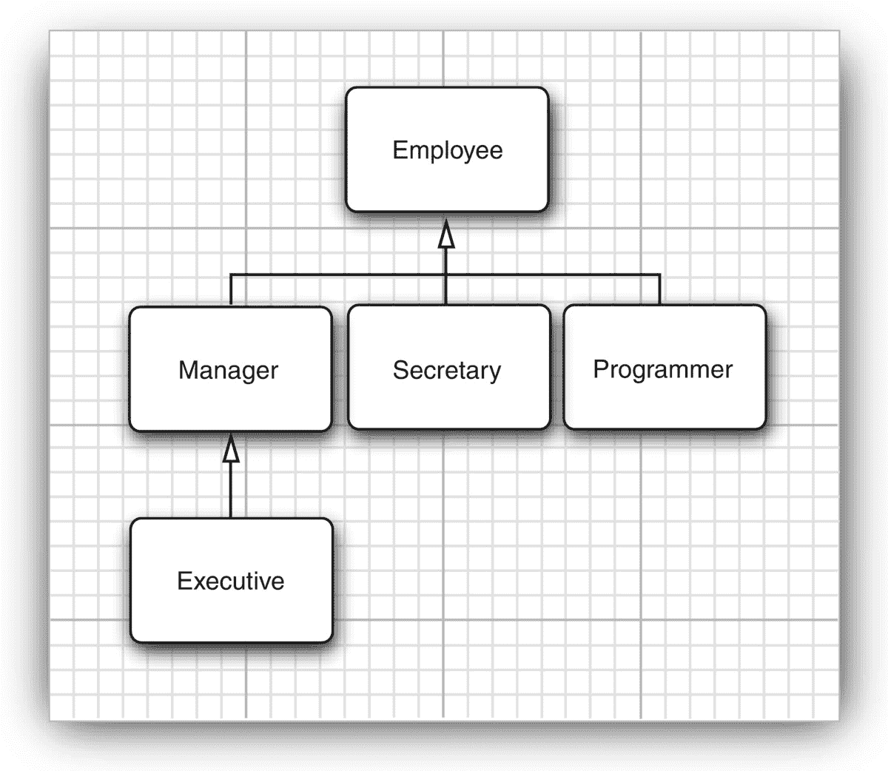Employee 继承层次结构

从一个遥远的祖先类通常有多条下降链。你可以形成扩展自`Employee`的子类`Programmer`或`Secretary`，它们与`Manager`类（或它们彼此之间）没有任何关系。这个过程可以根据需要一直持续。

在 C++ 中，一个类可以有多个父类。Java 不支持多重继承。关于恢复多重继承大部分功能的方法，请参见第 6 章。

### 多态

一个简单的规则可以帮助你判断继承是否是你数据的正确设计。“形如”（is–a）规则规定，子类的每个对象都是父类的对象。例如，每一位经理都是员工。因此，让`Manager`类成为`Employee`类的子类是合理的。自然地，相反的情况并不成立——并不是每个员工都是经理。

另一种表述“形如”规则的方法是`替换原则`。该原则规定，当程序期望父类对象时，你可以使用子类对象。

例如，你可以将子类对象赋值给父类变量。

```
Employee e;
e = new Employee(. . .); // 期望 Employee 对象
e = new Manager(. . .); // 可以，Manager 也可以使用
```

在 Java 编程语言中，对象变量是`多态的`。`Employee`类型的变量可以引用`Employee`类型的对象，也可以引用`Employee`类任何子类的对象（如`Manager`、`Executive`、`Secretary`等）。

我们在 Listing 5.1 中利用了这一原则：

```
Manager boss = new Manager(. . .);
Employee[] staff = new Employee[3];
staff[0] = boss;
```

2. 接下来，编译器将确定方法调用中所提供参数的类型。如果在所有被调用的方法`f`中，有一个唯一方法的参数类型与所提供的参数最匹配，则选择该方法进行调用。这个过程被称为*重载解析*（overloading resolution*）。例如，在调用`x.f("Hello")`时，编译器选择了`f(String)`而不是`f(int)`。由于类型转换（如从`int`到`double`，从`Manager`到`Employee`等），情况可能会变得复杂。如果编译器找不到任何参数类型匹配的方法，或者在应用转换后有多个方法都匹配，编译器将报告错误。

现在，编译器已经知道了需要调用的方法的名称和参数类型。

回想，方法的名称和参数类型列表被称为方法的*签名*（signature*）。例如，`f(int)`和`f(String)`是两个同名但签名不同的方法。如果你在子类中定义了一个与父类方法签名相同的方法，你就重写（override）了父类方法。

返回类型不是签名的一部分。然而，当你重写一个方法时，需要保持返回类型的兼容性。子类可以将返回类型更改为原始类型的子类型。例如，假设`Employee`类有一个方法：

```
public Employee getBuddy() { . . . }
```

经理（Manager）永远不会希望有一个低级员工作为伙伴。为了反映这一事实，`Manager`子类可以这样重写该方法：

```
public Manager getBuddy() { . . . } // 更改返回类型是允许的
```

我们称这两个`getBuddy`方法具有*协变*（covariant）返回类型。

3. 如果方法是`private`、`static`、`final`或构造函数，那么编译器就确切知道要调用哪个方法（`final`修饰将在下一节介绍）。这被称为*静态绑定*（static binding*）。否则，要调用的方法取决于隐式参数的实际类型，并且在运行时必须使用动态绑定。在我们的示例中，编译器将生成一条使用动态绑定调用`f(String)`的指令。

4. 当程序运行并使用动态绑定调用方法时，虚拟机必须调用与`x`所指对象*实际*类型适当的方法版本。假设实际类型是`D`，它是`C`的子类。如果类`D`定义了方法`f(String)`，则调用该方法。如果定义，则在`D`的父类中查找方法`f(String)`，依此类推。

每次调用方法都执行这种搜索将非常耗时。相反，虚拟机为每个类预计算一个*方法表*（method table*）。方法表列出了所有方法签名和要调用的实际方法。

虚拟机可以在加载类后，通过将类文件中发现的方法与父类的方法表相结合来构建方法表。

当实际调用一个方法时，虚拟机只需进行表查找。在我们的示例中，虚拟机查询类`D`的方法表，并查找用于`f(String)`的待调用方法。该方法可能是`D.f(String)`或`X.f(String)`，其中`X`是`D`的某个父类。这种情况下有一个例外：如果调用是`super.f(param)`，则虚拟机将查询父类的方法表。

让我们详细查看 Listing 5.1 中调用`e.getSalary()`的过程。`e`的声明类型是`Employee`。`Employee`类有一个名为`getSalary`的方法，没有方法参数。因此，在这种情况下，我们不需要担心重载解析。

`getSalary`方法不是`private`、`static`或`final`，所以它是动态绑定的。虚拟机为`Employee`和`Manager`类生成方法表。`Employee`表显示所有方法都定义在`Employee`类本身：

```
Employee:
   getName() -> Employee.getName()
   getSalary() -> Employee.getSalary()
   getHireDay() -> Employee.getHireDay()
   raiseSalary(double) -> Employee.raiseSalary(double)
```

实际上，这并不是全部——正如你在本章后面将看到的，`Employee`类有一个父类`Object`，它从那里继承了许多方法。我暂时忽略`Object`的方法。

`Manager`方法表略有不同。它继承了三个方法，重定义了一个方法，并增加了一个方法。

```
Manager:
   getName() -> Employee.getName()
   getSalary() -> Manager.getSalary()
   getHireDay() -> Employee.getHireDay()
   raiseSalary(double) -> Employee.raiseSalary(double)
   setBonus(double) -> Manager.setBonus(double)
```

在运行时，调用`e.getSalary()`的解析如下：

1. 首先，虚拟机获取`e`实际类型的方法表。这可能是`Employee`、`Manager`或`Employee`的另一个子类的表。
2. 然后，虚拟机查找`getSalary()`签名。现在它知道要调用哪个方法。
3. 最后，虚拟机调用该方法。

动态绑定有一个非常重要的属性：它使得程序在不修改现有代码的情况下是可以扩展的。假设增加了一个`Executive`类，并且`e`指向`Executive`类型的对象，`Employee.getSalary()`方法不需要重新编译。（注：此段原文逻辑似乎在某些描述上略有错乱，译文按原意保持逻辑连贯）。

当你重写一个方法时，子类方法的可见性至少与父类方法相同。特别是，如果父类方法是`public`，则子类方法也必须声明为`public`。一个常见的错误是在子类方法中漏掉`public`修饰符，编译器会报错提示你尝试提供更严格的访问权限。

### 防止继承：最终类与方法

有时，你希望防止他人创建某个类的子类。不能被扩展的类被称为*最终类*（final classes），你在定义类时使用`final`修饰符来指示这一点。例如，假设我们希望防止对`Executive`类进行子类。只需使用`final`修饰符声明该类：

```
public final class Executive extends Manager
{
   . . .
}
```

你还可以将类中的特定方法变为`final`。如果你这样做，子类就无法重写该方法。（`final`类中的所有方法自动都是`final`的。）例如：


`public class Employee`

```
{

   . . .

   public final String getName()

   { 

      return name;

   }

   . . .

}
```

回想字段也可以被声明为 `final`。字段在对象构造后无法更改。然而，如果一个类被声明为 `final`，只有方法会自动变为 `final`，而不是字段。

将方法或类变为 `final` 只有一个好的理由：确保其语义在子类中不会改变。例如，`Calendar` 类的 `getTime` 和 `setTime` 方法是 `final` 的。这表明 `Calendar` 类的设计者已经接过了 `Date` 类与日历状态转换的责任。同样，`String` 类是一个 `final` 类。这意味着没有人可以定义 `String` 的子类。也就是说，如果你有一个 `String` 引用，你就知道它指向一个 `String` 而不仅仅是 `String`。

如果你在构造函数中调用方法，应该将其声明为 `final`。否则，它可以在子类中被重写，并且可能会访问部分构造的子类实例。这里有一个示例。为了调试，`Employee` 构造函数会显示所构造对象的描述。

```java
public class Employee

{

   public Employee(String name, double salary, int year, int month, int day)

   {

      this.name = name;

      this.salary = salary;

      hireDay = LocalDate.of(year, month, day);

      System.out.println("Constructed " + description());

   }

   public String description()

   {

      return "An employee with a salary of " + salary;

   }

   . . .

}
```

现在在员工类的层次结构中添加了一个新类——带有头衔的高管类：

```java
public class Executive

{

   private String title;

   public Executive(String name, String title, double salary, int year, int month, int day)

   {

      super(name, salary, year, month, day);

      this.title = title;;

   }

   public String getTitle()

   {

      return title;

   }

   public String description()

   {

      if (title.length() >= 30)

         return "An executive with an impressive title";

      else

         return "An executive with a title of " + title;

   }

}
```

当构造一个 `Executive` 对象时，它的构造函数首先调用 `Manager` 构造函数，后者调用 `Employee` 构造函数，进而调用 `description` 方法。由于多态性，这意味着 `Executive` 类中的 `description` 方法！遗憾的是，`Executive` 构造函数尚未执行完毕。实例变量 `title` 为 `null`，导致了 `NullPointerException`。

在构造函数中调用方法本质上是危险的。构造函数必须完成足够的工作以确保该方法执行成功。如果方法可以被重写，那么要确保这一点非常困难。因此，最好在构造函数只调用 `final` 或 `private` 方法。

从 Java 21 开始，如果你使用 `-Xlint` 或 `-Xlint:this-escape` 标志进行编译，当公共类的构造函数调用非 `final` 或非 `private` 的方法时，编译器会发出警告。

该标志的名字不太如意，因为在其他情况下，`this` 引用可能会从构造函数中“逃逸”，而编译器目前无法检测到这些情况。

在 C++ 中，构造函数中的方法调用是不多态的。例如，如果你在 `Employee` 构造函数中调用 `getDescription`，它始终调用 `Employee::getDescription`。

某些程序员认为，除非你有充分理由想要多态性，否则应该将所有方法声明为 `final`。事实上，在 C++ 和 C# 中，除非你明确请求，否则方法不会使用多态性。这可能有点极端，但我同意在设计类层次结构时，仔细考虑 `final` 方法和类是一个好主意。

在 Java 早期阶段，某些程序员使用 `final` 关键字是希望避免动态绑定的开销。如果一个方法没有被重写且非常短，那么编译器就可以优化掉该方法调用——这个过程被称为*内联（inlining）*。例如，内联调用 `e.getName()` 会将其替换为字段访问 `e.name`。这是一项值得的改进——CPU 讨厌分支，因为分支会干扰它们在处理当前指令时预取指令的策略。然而，如果 `getName` 可以在另一个类中被重写，那么编译器就无法对其进行内联，因为它不知道重写代码可能会做什么。

幸运的是，虚拟机中的即时编译器（JIT compiler）比传统编译器做得更好。它确切知道哪些类扩展了给定类，并可以检查是否有类实际重写了某个方法。如果一个方法很短、被频繁调用且没有被实际重写，JIT 编译器就可以将其内联。如果虚拟机加载另一个覆盖内联方法的子类怎么办？那么优化器必须撤销内联。这需要时间，但这种情况很少发生。

枚举（Enumerations）和记录（records）总是 `final` 的——你不能扩展它们。

## 转换

回想第 3 章](../ch3/index.xhtml)，强制将一种类型转换为另一种类型的过程称为类型转换（casting）。Java 编程语言对转换有特殊的表示法。例如：

```java
double x = 3.405;

int nx = (int) x;
```

将表达式 `x` 的值转换为整数，丢弃小数部分。

正如你有时需要将浮点数转换为整数一样，你可能需要将对象引用从一个类转换为另一个类。让我们再次使用包含 `Employee` 和 `Manager` 对象的数组示例：

```java
var staff = new Employee[3];

staff[0] = new Manager("Carl Cracker", 80000, 1987, 12, 15);

staff[1] = new Employee("Harry Hacker", 50000, 1989, 10, 1);

staff[2] = new Employee("Tony Tester", 40000, 1990, 3, 15);
```

要实际对对象引用进行转换，请使用与转换数值表达式时相似的语法。将目标类名括在括号中，并将其放在你想要转换的对象引用之前。例如：

```java
Manager boss = (Manager) staff[0];
```

你想要进行转换的原因只有一个——在实际类型被临时遗忘后，按其功能使用该对象。例如，在 `ManagerTest` 类中，`staff` 数组必须是 `Employee` 对象的数组，因为其中的某些元素是经理。

如你所知，每个变量都有类型。类型描述了变量所引用的对象类型以及它能做什么。例如，`staff[i]` 指向一个 `Employee` 对象（因此它也可以指向一个 `Manager` 对象）。编译器会检查你在向变量存储值时是否承诺得过高。如果你将子类引用赋值给父类变量，你承诺的较少，编译器会直接允许你这样做。如果你将父类引用赋值给子类变量，你承诺的更多。这时，你必须使用类型转换，以便你的承诺可以在运行时得到检查。

如果你尝试在继承链中向下转换，并且对对象所包含的内容“撒了谎”，会发生什么？

```java
Manager boss = (Manager) staff[1]; // 错误
```

当程序运行时，Java 运行时系统会注意到这个违背的承诺并产生 `ClassCastException`。如果你不捕获该异常，程序将会终止。因此，在尝试之前检查转换是否成功是一种良好的编程习惯。只需使用 `instanceof` 运算符。例如：

```java
if (staff[i] instanceof Manager)

{

   boss = (Manager) staff[i];

   . . .

}
```

最后，如果转换没有任何可能，编译器将不允许你进行转换。例如，转换

```java
String c = (String) staff[i];
```

是一个编译时错误，因为 `String` 不是 `Employee` 的子类。

总结一下：

* 你可以在继承层次结构内部进行转换。
* 在从父类向子类转换之前，使用 `instanceof` 进行检查。

测试

```
x instanceof C
```

当 `x` 为 `null` 时，该测试不会产生异常。它只是返回 `false`。这是合理的：`null` 不引用任何对象，因此它没有指向类型为 `C` 的对象。

实际上，通过转换对象的类型通常不是一个好主意。在我们的示例中，对于大多数目的，你不需要将 `Employee` 对象转换为 `Manager` 对象。`getSalary` 方法在两个类的两个对象上都能正常工作。实现多态性的动态绑定会自动定位到正确的方法。

进行类型转换的唯一理由是使用子类特有的方法，例如 `setBonus`。如果出于某种原因，你发现想在 `Employee` 对象上调用 `setBonus`，请问问自己这是否表明父类的设计存在缺陷。重新设计父类并添加一个 `setBonus` 方法可能是有意义的。记住，只需要一个未被捕获的 `ClassCastException` 就会终止你的程序。通常情况下，最好减少类型转换和 `instanceof` 运算符的使用。

Java 使用了来自 C 语言“过去旧时代”的类型转换语法，但它的工作原理类似于 C++ 中安全的 `dynamic_cast` 操作。例如：

```
Manager boss = (Manager) staff[i]; // Java
```

等同于

```cpp
Manager* boss = dynamic_cast<Manager*>(staff[i]); // C++
```

但有一个重要的区别。如果转换失败，它不会返回一个空对象，而是抛出一个异常。从这个意义上说，它类似于 C++ 对引用的转换。这非常麻烦。在 C++ 中，你可以在一个操作中完成类型测试和类型转换。

```cpp
Manager* boss = dynamic_cast<Manager*>(staff[i]); // C++

if (boss != NULL) . . .
```

在 Java 中，你需要结合使用 `instanceof` 运算符和类型转换。

```java
if (staff[i] instanceof Manager)

{

   Manager boss = (Manager) staff[i];

   . . .

}
```

## `instanceof` 的模式匹配

以下代码：

```java
if (staff[i] instanceof Manager)

{

   Manager boss = (Manager) staff[i];

   boss.setBonus(5000);

}
```

相当繁琐。我们真的需要提到三次子类 `Manager` 吗？

从 Java 16 开始，有了一种更简单的方法。你可以直接在 `instanceof` 测试中声明子类变量：

```java
if (staff[i] instanceof Manager boss)

{

   boss.setBonus(5000);

}
```

如果 `staff[i]` 是 `Manager` 类的实例，那么变量 `boss` 将被设置为 `staff[i]`，你可以将其作为 `Manager` 使用。你跳过了类型转换。

如果 `staff[i]` 不是一个 `Manager`，则 `boss` 不会被设置，且 `instanceof` 运算符返回值 `false`。`if` 语句体将被跳过。

在大多数使用 `instanceof` 的情况下，你都需要应用子类方法。这时请使用这种“模式匹配”形式的 `instanceof` 来代替类型转换。

无用的 `instanceof` 模式会导致编译时错误：

```java
Manager boss = . . .;

if (boss instanceof Employee e) . . . // 错误：当然是 Employee
```

同样无用的

```java
if (boss instanceof Employee) . . . 
```

是被允许的，以保持与 Java 1.0 的后兼容。

当 `instanceof` 模式引入一个变量时，你可以立即在同一个表达式中使用它：

```java
Employee e;

if (e instanceof Executive exec && exec.getTitle().getLength() >= 20) . . .
```

这之所以有效，是因为 `&&` 表达式的右侧只有在左侧为 `true` 时才会被求值。如果求值了右侧，则 `exec` 已经绑定到了 `Executive` 实例。

然而，以下是一个编译时错误：

```java
if (e instanceof Manager exec || exec.getTitle.getLength() >= 20) . . . // 错误
```

`||` 的右侧在左侧为 `false` 时执行，此时没有内容绑定到变量 `exec`。

这里是另一个使用条件运算符的例子：

```java
String title = e instanceof Executive exec ? exec.getTitle() : "";
```

变量 `exec` 定义在 `?` 之后的子表达式中，但不在 `:` 之后的子表达式中。

这种声明变量的 `instanceof` 形式被称为“模式匹配”，因为它们与 `switch` 中的类型模式相似，这在 第 5.9 节 中有详细介绍。

和任何局部变量一样，由模式定义的局部变量可以遮蔽（shadow）字段。例如：

```java
class Value

{

   private double v;

   public boolean equals(Object other)

   {

      if (other instanceof LabeledValue v)

         // v 等于 other

      else

         // v 表示字段

   }

   . . .

}
```

前面的示例展示了一个类型模式。如果类型匹配，对象将绑定到该类型的变量。当类型是一个 `record` 时，从 Java 21 开始，你可以做得更好，声明绑定到组件的变量。这被称为记录 模式（record pattern）：

```java
record Point(double x, double y) {}

Point p = . . .;

if (p instanceof Point(var a, var b)) distance = Math.hypot(a, b);
```

现在 `a` 和 `b` 绑定到了 `p` 的 `x` 和 `y` 组件。当然，你也可以调用 `p.x()` 和 `p.y()`，但记录 模式可以更简洁。

为了更加清晰，你也可以为引入的变量指定显式类型：

```java
if (p instanceof Point(double a, double b)) . . .
```

## Protected 访问

进行类型转换的唯一理由是使用子类特有的方法，例如 `setBonus`。如果出于某种原因，你发现想在 `Employee` 对象上调用 `setBonus`，请问问自己这是否表明父类的设计存在缺陷。重新设计父类并添加一个 `setBonus` 方法可能是有意义的。记住，只需要一个未被捕获的 `ClassCastException` 就会终止你的程序。通常情况下，最好减少类型转换和 `instanceof` 运算符的使用。

Java 使用了来自 C 语言“过去旧时代”的类型转换语法，但它的工作原理类似于 C++ 中安全的 `dynamic_cast` 操作。例如：

```
Manager boss = (Manager) staff[i]; // Java
```

等同于

```cpp
Manager* boss = dynamic_cast<Manager*>(staff[i]); // C++
```

但有一个重要的区别。如果转换失败，它不会返回一个空对象，而是抛出一个异常。从这个意义上说，它类似于 C++ 对引用的转换。这非常麻烦。在 C++ 中，你可以在一个操作中完成类型测试和类型转换。

```cpp
Manager* boss = dynamic_cast<Manager*>(staff[i]); // C++

if (boss != NULL) . . .
```

在 Java 中，你需要结合使用 `instanceof` 运算符和类型转换。

```java
if (staff[i] instanceof Manager)

{

   Manager boss = (Manager) staff[i];

   . . .

}
```


### `instanceof` 的模式匹配

以下代码：

```java
if (staff[i] instanceof Manager)
{
   Manager boss = (Manager) staff[i];
   boss.setBonus(5000);
}
```

相当繁琐。我们真的需要提到三次子类 `Manager` 吗？

从 Java 16 开始，有了一种更简单的方法。你可以直接在 `instanceof` 测试中声明子类变量：

```java
if (staff[i] instanceof Manager boss)
{
   boss.setBonus(5000);
}
```

如果 `staff[i]` 是 `Manager` 类的实例，那么变量 `boss` 将被设置为 `staff[i]`，你可以将其作为 `Manager` 使用。你跳过了类型转换。

如果 `staff[i]` 不是一个 `Manager`，则 `boss` 不会被设置，且 `instanceof` 运算符返回值 `false`。`if` 语句体将被跳过。

在大多数使用 `instanceof` 的情况下，你都需要应用子类方法。这时请使用这种“模式匹配”形式的 `instanceof` 来代替类型转换。

无用的 `instanceof` 模式会导致编译时错误：

```java
Manager boss = . . .;
if (boss instanceof Employee e) . . . // 错误：当然是 Employee
```

同样无用的：

```java
if (boss instanceof Employee) . . .
```

是被允许的，以保持与 Java 1.0 的后兼容。

当 `instanceof` 模式引入一个变量时，你可以立即在同一个表达式中使用它：

```java
Employee e;
if (e instanceof Executive exec && exec.getTitle().getLength() >= 20) . . .
```

这之所以有效，是因为 `&&` 表达式的右侧只有在左侧为 `true` 时才会被求值。如果求值了右侧，则 `exec` 已经绑定到了 `Executive` 实例。

然而，以下是一个错误：

```java
if (e instanceof Manager exec || exec.getTitle.getLength() >= 20) . . . // 错误
```

`||` 的右侧在左侧为 `false` 时执行，此时没有内容绑定到变量 `exec`。

这里是另一个使用条件运算符的例子：

```java
String title = e instanceof Executive exec ? exec.getTitle() : "";
```

变量 `exec` 定义在 `?` 之后的子表达式中，但不在 `:` 之后的子表达式中。

这种声明变量的 `instanceof` 形式被称为“模式匹配”，因为它们与 `switch` 中的类型模式相似，这在第 5.9 节中有详细介绍。

和任何局部变量一样，由模式定义的局部变量可以遮蔽（shadow）字段。例如：

```java
class Value
{
   private double v;

   public boolean equals(Object other)
   {
      if (other instanceof LabeledValue v)
         // v 等于 other
      else
         // v 表示字段
   }

   . . .
}
```

前面的示例展示了一个类型模式。如果类型匹配，对象将绑定到该类型的变量。当类型是一个 `record` 时，从 Java 21 开始，你可以做得更好，声明绑定到组件的变量。这被称为记录模式（record pattern）：

```java
record Point(double x, double y) {}

Point p = . . .;

if (p instanceof Point(var a, var b)) distance = Math.hypot(a, b);
```

现在 `a` 和 `b` 绑定到了 `p` 的 `x` 和 `y` 组件。当然，你也可以调用 `p.x()` 和 `p.y()`，但记录模式可以更简洁。

为了更加清晰，你也可以为引入的变量指定显式类型：

```java
if (p instanceof Point(double a, double b)) . . .
```

### `Object`：终极父类

`Object` 类是终极祖先——Java 中的每个类都继承 `Object`。然而，你永远不需要写：

```java
public class Employee extends Object
```

如果没有显式提到父类，则终超类 `Object` 是被理所当然的。由于 Java 中的每个类都继承 `Object`，因此熟悉 `Object` 类提供的服务是非常重要的。我将在本章中介绍基础方法；对于此处未涵盖的内容，请参阅后面的章节或查看在线文档。（`Object` 的某些方法仅在处理并发时才会出现——参见第 10 章。）

### `Object` 类型的变量

你可以使用 `Object` 类型的变量来引用任何类型的对象：

```java
Object obj = new Employee("Harry Hacker", 35000);
```

当然，`Object` 类型的变量只有在作为任意值的通用容器时才有用。要对该值进行任何特定操作，你都需要对原始类型有所了解，并应用类型转换：

```java
Employee e = (Employee) obj;
```

在 Java 中，只有基本类型的值（数字、字符和 `boolean` 值）不是对象。

所有的数组类型，无论是对象数组还是基本类型数组，都是继承 `Object` 类的类类型。

```java
Employee[] staff = new Employee[10];

obj = staff; // OK
obj = new int[10]; // OK
```

在 C++ 中，没有宇宙级的根类。然而，每个指针都可以转换为 `void*` 指针。

### `equals` 方法

`Object` 类中的 `equals` 方法用于测试一个对象是否被认为另一个对象相等。`Object` 类中实现的 `equals` 方法判断两个对象引用是否完全相同。这是一个非常合理的默认设置——如果两个对象是相同的，它们理所应该是相等的。对于许多类来说，不需要其他操作。例如，比较两个 `PrintStream` 对象是否相等并没有意义。然而，你通常会想要实现基于状态的相等性测试，即当两个对象具有相同状态时，认为它们是相等。

例如，让我们认为两个员工具有相同的姓名、薪水和入职日期，他们就是相等的。（在实际的员工数据库中，比较 ID 可能会更合理。我使用这个示例来演示实现 `equals` 方法的机制。）

```java
public class Employee
{
   . . .

   public boolean equals(Object otherObject)
   {
      // 快速测试对象是否相同
      if (this == otherObject) return true;

      // 如果显式参数为 null，必须返回 false
      if (otherObject == null) return false;

      // 如果类不匹配，则它们不相等
      if (getClass() != otherObject.getClass())
         return false;

      // 现在我们知道 otherObject 是一个非空的 Employee
      Employee other = (Employee) otherObject;

      // 测试字段具有相同的值
      return name.equals(other.name)
         && salary == other.salary
         && hireDay.equals(other.hireDay);
   }
}
```

`getClass` 方法返回对象的类——我们将在本章稍后详细讨论这个方法。在我们的测试中，两个对象只有在属于同一个类时才相等。

为了防止 `name` 或 `hireDay` 为 `null` 的可能，请使用 `Objects.equals` 方法。如果两个参数均为 `null`，则 `Objects.equals(a, b)` 的值为 `true`；如果只有一个为 `null`，则为 `false`；否则返回 `a.equals(b)`。使用该方法，`Employee.equals` 方法的最后一条语句变为：

```java
return Objects.equals(name, other.name)
   && salary == other.salary
   && Objects.equals(hireDay, other.hireDay);
```

当你为子类定义 `equals` 方法时，首先调用父类的 `equals`。如果该测试没有通过，那么这些对象就不相等。如果父类字段相等，你就可以准备比较子类的实例字段了。

```java
public class Manager extends Employee
{
   . . .

   public boolean equals(Object otherObject)
   {
      if (!super.equals(otherObject)) return false;

      // super.equals 检查了此和 otherObject 是否属于同一个类
      Manager other = (Manager) otherObject;

      return bonus == other.bonus;
   }
}
```

回想第 4 章) return false;

这留下了 `otherObject` 可能属于子类的可能性。然而，这种方法可能会给你带来麻烦。原因如下：Java 语言规范要求 `equals` 方法具有以下属性：

1. 它是自反的：对于任何非-`null` 引用 `x`，`x.equals(x)` 应该返回 `true`。
2. 它是对称的：对于任何引用 `x` 和 `y`，当且仅当 `y.equals(x)` 返回 `true` 时，`x.equals(y)` 返回 `true`。
3. 它是传递的：对于任何引用 `x`、`y` 和 `z`，如果 `x.equals(y)` 返回 `true` 且 `y.equals(z)` 返回 `true`，那么 `x.equals(z)` 应该返回 `true`。
4. 它是一致的：如果 `x` 和 `y` 所引的对象没有改变，那么反复调用 `x.equals(y)` 将返回相同的值。
5. 对于任何非-`null` 引用 `x`，`x.equals(null)` 应该返回 `false`。

这些规则无疑是合理的。你不希望库的实现者在数据结构中查找元素时，还要纠结是调用 `x.equals(y)` 还是 `y.equals(x)`。

然而，当参数属于不同的类时，对称规则会有微妙的后果。考虑一个调用：

```java
e.equals(m)
```

其中 `e` 是一个 `Employee` 对象，`m` 是一个 `Manager` 对象，两者恰好具有相同的姓名、薪水和入职日期。如果 `Employee.equals` 使用 `instanceof` 测试，该调用返回 `true`。但这意味着反向调用：

```java
m.equals(e)
```

也需要返回 `true`——对称规则不允许它返回 `false` 或抛出异常。

这让 `Manager` 类陷入了困境。它的 `equals` 方法必须准备好与任何 `Employee`，而不考虑经理特有的信息！突然之间，`instanceof` 测试看起来没有那么有吸引力了。

一些作者公开表示 `getClass` 测试是错误的，因为它违背了替换原则。一个经常引用的例子是 `AbstractSet` 类中的 `equals` 方法，它用于测试两个集合是否具有相同的元素。`AbstractSet` 类有两个具体的子类 `TreeSet` 和 `HashSet`，它们使用不同的算法定位集合元素。你真的希望能够比较任何集合，无论它们是如何实现的。

然而，集合的例子相当特殊。将 `AbstractSet.equals` 声明为 `final` 是合理的，因为不应该重新定义集合相等的语义。（该方法实际上并不是 `final`。这允许子类实现一种更高效的相等性测试算法。）

在我看来，存在两种不同的场景：

- 如果子类可以有自己的相等性定义，那么对称性要求迫使你使用 `getClass` 测试。
- 如果相等性定义在父类中是固定的，那么你可以使用 `instanceof` 测试并允许不同子类的对象彼此是相等的。

在员工和经理的示例中，当两个对象具有匹配的字段时，我们认为它们是相等。如果我们有两个具有相同名称、工资和入职日期的 `Manager` 对象，但奖金不同，那么我们希望它们是不同的。因此，我们使用了 `getClass` 测试。

但假设我们使用员工 ID 进行等效测试。这种等效性概念对于所有子类都是合理的。那么我们可以使用 `instanceof` 测试，并且我们应该将 `Employee.equals` 声明为 `final`。

Java 标准库包含了 150 多个 `equals` 方法的实现，其实现方式杂乱，有的使用 `instanceof`、调用 `getClass`、捕获 `ClassCastException` 或者什么都不做。查看 `java.sql.Timestamp` 类的 API 文档，实现者们有些尴尬地注释道，他们自己陷入了困境。`Timestamp` 类继承自 `java.util.Date`，后者的 `equals` 方法使用了 `instanceof` 测试，而我们无法重写 `equals` 使其同时满足对称性和准确性。

经常引用的集合等价示例是一个警示故事，它展示了在子类之间提供对称等效性是多么困难。

考虑这两个集合：

```java
Set<String> x = new HashSet<>();
x.add("Hello");
x.add("World");

Set<String> y = new TreeSet<>(String.CASE_INSENSITIVE_ORDER);
y.add("Hello");
y.add("WORLD");
```

对于这些集合，`equals` 不是对称的：

```java
x.equals(y) // false
y.equals(x) // true
```

`TreeSet` 使用排序顺序而不是 `equals` 来比较元素。在不区分大小写的情况下，字符串 `"World"` 和 `"WORLD"` 被认为是相。

以下是编写完美的 `equals` 方法的配方：

1. 将显式参数命名为 `otherObject`——稍后，你将需要将其转换为另一个名为 `other` 的变量。
2. 测试 `this` 是否恰好与 `otherObject` 相同：

   ```java
   if (this == otherObject) return true;
   ```

   这条语句仅仅是优化。在实践中，这是一种常见情况。检查身份比比较字段要便宜得多。

3. 测试 `otherObject` 是否为 `null`，如果是则返回 `false`。此测试是必须。

   ```java
   if (otherObject == null) return false;
   ```

4. 比较 `this` 和 `otherObject` 的类。如果 `equals` 的语义可以在子类中发生变化，请使用 `getClass` 测试：

   ```java
   if (getClass() != otherObject.getClass()) return false;
   ClassName other = (ClassName) otherObject;
   ```

   如果所有子类都保持相同的语义，你可以使用 `instanceof` 测试：

   ```java
   if (!(otherObject instanceof ClassName other)) return false;
   ```

   注意，如果 `instanceof` 测试成功，它会将 `other` 设置为 `otherObject`。不需要进行类型转换。

5. 现在根据你对等效性的定义来比较字段。对于原始类型字段使用 `==`，对于对象字段使用 `Objects.equals`。如果所有字段匹配，则返回 `true`，否则返回 `false`。

   ```java
   return field1 == other.field1
      && Objects.equals(field2, other.field2)
      && . . .;
   ```

   如果你在子类中重定义 `equals`，请包含对 `super.equals(other)` 的调用。

如果你有数组类型的字段，可以使用静态方法 `Arrays.equals` 来检查对应的数组元素是否相等。对于多维数组，使用 `Arrays.deepEquals` 方法。

这是一个实现 `equals` 方法时的常见错误。你能看出问题所在吗？


```java
public class Employee
{
   public boolean equals(Employee other)
   {
      return other != null
         && getClass() == other.getClass()
         && Objects.equals(name, other.name)
         && salary == other.salary
         && Objects.equals(hireDay, other.hireDay);
   }
   . . .
}
```

该方法将显式参数类型声明为`Employee`。结果，它没有重写`Object`类的`equals`方法，而是定义了一个完全无关的方法。

你可以通过用`@Override`标记旨在重写父类方法的方法来防止此类错误：

```java
@Override public boolean equals(Object other)
```

如果你犯了错误并正在定义一个新方法，编译器会报告错误。例如，假设你在`Employee`类中添加了以下声明：

```java
@Override public boolean equals(Employee other)
```

系统会报错，因为此方法没有重写来自`Object`父类的任何方法。

## `java.util.Arrays` 1.2

- `static boolean equals(xxx[] a, xxx[] b)` 5.0

  如果数组长度相同且对应位置的元素相等，则返回`true`。数组的组件类型`xxx`可以是`Object`、`int`、`long`、`short`、`char`、`byte`、`boolean`、`float`或`double`。

## `java.util.Objects` 7

- `static boolean equals(Object a, Object b)`

  如果`a`和`b`都为`null`，则返回`true`；如果恰好有一个为`null`，则返回`false`。

如果实例变量的取值范围很小，你需要尽可能获得尽可能不同的哈希值。考虑对日历进行哈希。计算`7 * year + 11 * month + 13 * day`会产生很多冲突。相比之下，`31 * 12 * year + 31 * month + day`是一个“完美哈希函数”。假设在一个合理的范围内，没有两个日期的具有相同的哈希值。（`LocalDate`类支持±999,999,999年范围，其际的`hashCode`方法要复杂得多。）

组合多个哈希值可能很繁琐。在很多情况下，你只需对所有字段调用`Objects.hash`。它将组合其参数的哈希值。那么`Employee.hashCode`方法仅仅是：

```java
public int hashCode() 
{ 
   return Objects.hash(name, salary, hireDay); 
}
```

但是，你对数组字段需要小心。数组的哈希值是通过`Object.hashCode`计算的，它不依赖于它的元素。相反，请使用静态的`Arrays.hashCode`方法，它会组合数组元素的哈希值。该方法为基本类型数组和对象数组提供了重载。对于多维数组，请使用`Arrays.deepHashCode`。

`Arrays.hashCode(Object[])`方法的工作原理与`String.hashCode`类似，使用“乘以 31 并相加”的操作来组合元素的哈希值。但有一个特殊之处：长度为数组的哈希值为 1，以便与`null`区分来。以下是实现代码：

```java
public static int hashCode(Object[] a)
{
   if (a == null) return 0;

   int result = 1; // 从 1 开始，而不是 0

   for (Object element : a)
      result = 31 * result + (element == null ? 0 : element.hashCode());

   return result;
}
```

`Objects.hash`方法调用了`Arrays.hashCode`。因此，`Objects.hash(x)`等于`31 + x.hashCode()`。

`record`类型自动提供一个`hashCode`方法，根据分量值的哈希值派导出哈希值。其具体行为在 Java 语言规范中是留空的。在 OpenJDK 21 中，分量哈希简单地通过“乘以 31 并相加”的操作组合，从零开始。

你对`equals`和`hashCode`的定义必须保持兼容：如果`x.equals(y)`为`true`，那么`x.hashCode()`返回的值必须与`y.hashCode()`相同。例如，如果你定义`Employee.equals`来比较员工 ID，那么`hashCode`方法需要哈希 ID，而不是员工姓名或内存地址。

## `java.lang.Object` 1.0

- `int hashCode()`

  返回此对象的哈希值。哈希值可以是任何整数，正负均。相等的对象需要返回相同的哈希值。

## `java.util.Objects` 7

- `static int hash(Object... objects)`

  返回一个由所有提供的对象的哈希值组合成的哈希值。

- `static int hashCode(Object a)`

  如果`a`为`null`则返回`0`，否则返回`a.hashCode()`。

## `java.lang.(Integer|Long|Short|Byte|Double|Float|Character|Boolean)` 1.0

- `static int hashCode(xxx value)` 8

  返回给定值的哈希值。这里`xxx`是与给定包装类型对应的基本类型。

## `java.util.Arrays` 1.2

- `static int hashCode(xxx[] a)` 5.0

  计算数组`a`的哈希值。数组的组件类型`xxx`可以是`Object`、`int`、`long`、`short`、`char`、`byte`、`boolean`、`float`或`double`。

### `toString`方法

`Object`中的另一个重要方法是`toString`，它返回表示该对象值的字符串。这是一个典型的示例。`Point`类的`toString`方法返回如下：

```text
java.awt.Point[x=10,y=20]
```

大多数（并非所有）`toString`方法都遵循这种格式：类名，然后是方括号内的字段值。以下是`Employee`类的`toString`方法的实现：

```java
public String toString()
{
   return "Employee[name=" + name
      + ",salary=" + salary
      + ",hireDay=" + hireDay
      + "]";
}
```

实际上，你可以做得更好。与其在`toString`方法中硬编码类名，不如调用`getClass().getName()`来获取一个包含类名的字符串。

```java
public String toString()
{
   return getClass().getName()
      + "[name=" + name
      + ",salary=" + salary
      + ",hireDay=" + hireDay
      + "]";
}
```

此种的`toString`方法也适用于子类。

当然，子类的程序员应该定义它自己的`toString`方法并添加子类的字段。如果父类使用了`getClass().getName()`，那么子类可以简单地调用`super.toString()`。例如，这里是`Manager`类的`toString`方法：

```java
public class Manager extends Employee
{
   . . .
   public String toString()
   {
      return super.toString()
         + "[bonus=" + bonus
         + "]";
   }
}
```

现在，一个`Manager`对象被打印为：

```text
Manager[name=. . .,salary=. . .,hireDay=. . .][bonus=. . .]
```

`toString`方法无处不在，有一个重要的原因：每当使用“+”运算符将对象与字符串拼接时，Java 编译器会自动调用`toString`方法来获取对象的字符串表示。例如：

```java
var p = new Point(10, 20);
String message = "The current position is " + p;
   // 自动调用 p.toString()
```

与其编写`x.toString()`，你也可以写`"" + x`。该语句将空字符串与`x`的字符串表示拼接，这完全是`x.toString()`。与`toString`不同，即使`x`是基本类型，该语句也有效。

如果`x`是任何对象且你调用：

```java
System.out.println(x);
```

那么`println`方法简单地调用了`x.toString()`。

Listing 5.4 中的程序测试了`Employee`类（Listing 5.5）和`Manager`类（Listing 5.6）的`equals`、`hashCode`和`toString`方法。

### `equals/EqualsTest.java`

```java
package equals;

/**
 * 此程序演示了 equals 方法
 * @version 1.12 2012-01-26
 * @author Cay Horstmann
 */
public class EqualsTest
{
   public static void main(String[] args)
   {
      var alice1 = new Employee("Alice Adams", 75000, 1987, 12, 15);
      var alice2 = alice1;
      var alice3 = new Employee("Alice Adams", 75000, 1987, 12, 15);
      var bob = new Employee("Bob Brandson", 50000, 1989, 10, 1);

      System.out.println("alice1 == alice2: " + (alice1 == alice2));

      System.out.println("alice1 == alice3: " + (alice1 == alice3));

      System.out.println("alice1.equals(alice3): " + alice1.equals(alice3));

      System.out.println("alice1.equals(bob): " + alice1.equals(bob));

      System.out.println("bob.toString(): " + bob);

      var carl = new Manager("Carl Cracker", 80000, 1987, 12, 15);
      var boss = new Manager("Carl Cracker", 80000, 1987, 12, 15);
      boss.setBonus(5000);
      System.out.println("boss.toString(): " + boss);
      System.out.println("carl.equals(boss): " + carl.equals(boss));
      System.out.println("alice1.hashCode(): " + alice1.hashCode());
      System.out.println("alice3.hashCode(): " + alice3.hashCode());
      System.out.println("bob.hashCode(): " + bob.hashCode());
      System.out.println("carl.hashCode(): " + carl.hashCode());
   }
}
```

### `equals/Employee.java`

```java
package equals;

import java.time.*;
import java.util.Objects;

public class Employee
{
   private String name;
   private double salary;
   private LocalDate hireDay;

   public Employee(String name, double salary, int year, int month, int day)
   {
      this.name = name;
      this.salary = salary;
      hireDay = LocalDate.of(year, month, day);
   }

   public String getName()
   {
      return name;
   }

   public double getSalary()
   {
      return salary;
   }

   public LocalDate getHireDay()
   {
      return hireDay;
   }

   public void raiseSalary(double byPercent)
   {
      double raise = salary * byPercent / 100;
      salary += raise;
   }

   public boolean equals(Object otherObject)
   {
      // 快速测试对象是否相同
      if (this == otherObject) return true;

      // 如果显式参数为 null，必须返回 false
      if (otherObject == null) return false;

      // 如果类不匹配，则它们不相等
      if (getClass() != otherObject.getClass()) return false;

      // 现在我们知道 otherObject 是一个非空的 Employee
      var other = (Employee) otherObject;

      // 测试字段是否具有相同的值
      return Objects.equals(name, other.name) 
         && salary == other.salary && Objects.equals(hireDay, other.hireDay);
   }

   public int hashCode()
   {
      return Objects.hash(name, salary, hireDay); 
   }

   public String toString()
   {
      return getClass().getName() + "[name=" + name + ",salary=" + salary + ",hireDay=" 
         + hireDay + "]";
   }
}
```

### `equals/Manager.java`


```java
package equals;

public class Manager extends Employee
{
   private double bonus;

   public Manager(String name, double salary, int year, int month, int day)
   {
      super(name, salary, year, month, day);
      bonus = 0;
   }

   public double getSalary()
   {
      double baseSalary = super.getSalary();
      return baseSalary + bonus;
   }

   public void setBonus(double bonus)
   {
      this.bonus = bonus;
   }

   public boolean equals(Object otherObject)
   {
      if (!super.equals(otherObject)) return false;
      var other = (Manager) otherObject;
      // super.equals 检查了 this 和 other 是否属于同一个类
      return bonus == other.bonus;
   }

   public int hashCode()
   {
      return java.util.Objects.hash(super.hashCode(), bonus);
   }

   public String toString()
   {
      return super.toString() + "bonus=" + bonus;
   }
}
```

在 Java 5 之前，还没有泛型类。相反，只有一个 `ArrayList` 类，它是一个通用的集合，用于持有 `Object` 类型的元素。你仍然可以在不带 `<. . .>` 后缀的情况下使用 `ArrayList`。它被视为“原始”（raw）类型，其类型参数被擦除。

在更早的 Java 版本中，程序员使用 `Vector` 类来实现动态数组。然而，`ArrayList` 类更高效，已经没有充分的理由使用 `Vector` 类了。

使用 `add` 方法向数组列表添加新元素。例如，这里是向一个数组列表填充 `Employee` 对象的方法：

```java
staff.add(new Employee("Harry Hacker", . . .));
staff.add(new Employee("Tony Tester", . . .));
```

数组列表管理一个内部的对象引用的数组。最终，该数组会耗尽空间。这正是数组列表发挥魔力的地方：如果你调用 `add` 且内部数组已满，数组列表会自动创建一个更大的数组，并将所有对象从较小的数组复制到较大的数组中。

如果你已经知道或能很好估计出想要存储多少个元素，可以在填充数组列表之前调用 `ensureCapacity` 方法：

```java
staff.ensureCapacity(100);
```

该调用分配了一个包含 100 个对象的内部数组。那么，前 100 次 `add` 调用将不会涉及任何昂贵的重新分配。

你也可以向 `ArrayList` 构造函数传递初始容量：

```java
ArrayList<Employee> staff = new ArrayList<>(100);
```

分配一个数组列表为：

```java
new ArrayList<>(100) // 容量为 100
```

并不同于分配一个新数组：

```java
new Employee[100] // 大小为 100
```

数组列表的容量与数组的大小之间存在着重要的区别。如果你分配了一个具有 100 个条目的数组，那么该数组就有 100 个槽位准备就绪。一个容量为 100 个元素的数组列表有潜力持有 100 个元素（实际上可以超过 100 个，代价是额外的重新分配），但在刚开始时，即使在初始构造之后，数组列表也没有包含任何元素。

`size` 方法返回数组列表中的实际元素数量。例如：

```java
staff.size()
```

返回 `staff` 数组列表当前的元素数量。这等同于数组 `a` 的：

```java
a.length
```

一旦你确定数组列表已达到固定大小，就可以调用 `trimToSize` 方法。该方法调整内存块的大小，使其恰好使用存储当前元素数量所需的存储空间。垃圾收集器将回收多余的内存。

一旦修剪了数组列表的大小，添加新元素将再次移动该块，这需要时间。你只有在确定不会向数组列表添加更多元素时，才应该使用 `trimToSize`。

`ArrayList` 类类似于 C++ 的 `vector` 模板。`ArrayList` 和 `vector` 都是泛型类型。但 C++ 的 `vector` 模板重载了 `[]` 运算符以便于访问元素。Java 没有运算符重载，因此必须使用显式方法调用。

此外，C++ `vector` 是按值复制的。如果 `a` 和 `b` 是两个 `vector`，那么赋值 `a = b` 会使 `a` 变成一个与 `b` 长度相同的新 `vector`，所有元素都从 `b` 复制到 `a`。在 Java 中，相同的赋值会使 `a` 和 `b` 指向同一个数组列表。

### `java.util.ArrayList<E>`

- `ArrayList<E>()`：构造一个空的数组列表。
- `ArrayList<E>(int initialCapacity)`：构造一个具有指定容量的空数组列表。
- `boolean add(E obj)`：将 `obj` 追加到数组列表末尾。始终返回 `true`。
- `int size()`：返回数组列表中当前存储的元素数量。（当然，这永远不会大于数组列表的容量。）
- `void ensureCapacity(int capacity)`：确保数组列表有足够的容量存储指定数量的元素，无需重新分配其存储数组。
- `void trimToSize()`：将数组列表的存储容量减小到当前大小。

### 访问数组列表

遗憾的是，没有免费的午餐。数组列表的自动增长需要复杂的语法来访问元素。这是因为 `ArrayList` 类并不是 Java 语言的一部分；它只是由某人编写并由标准库提供的工具类。

与其使用访问或更改数组元素的愉快的 `[]` 语法，你不如使用 `get` 和 `set` 方法。例如，要设置第 `i` 个元素，使用：

```java
staff.set(i, harry);
```

对于数组 `a`，这等同于：

```java
a[i] = harry;
```

（与数组一样，索引值从 0 开始。）

在数组列表的大小大于 `i` 之前，不要调用 `list.set(i, x)`。例如，以下代码是错误的：

```java
var list = new ArrayList<Employee>(100); // 容量 100，大小 0
list.set(0, x); // 还没有元素
```

使用 `add` 方法代替 `set` 来填充数组列表。

要获取数组列表中的元素，使用：

```java
Employee e = staff.get(i);
```

这等同于数组 `a` 的：

```java
a[i]
```

一旦你合理确定数组列表已达到其永久大小，就可以调用 `trimToSize` 方法。该方法调整内存块的大小，使其恰好使用存储当前元素数量所需的存储空间。垃圾收集器将回收任何多出的内存。

一旦修剪了数组列表的大小，添加新元素将再次移动该块，这需要时间。你只有在确定不会向数组列表添加更多元素时，才应该使用 `trimToSize`。

`ArrayList` 类类似于 C++ 的 `vector` 模板。`ArrayList` 和 `vector` 都是泛型类型。但 C++ 的 `vector` 模板重载了 `[]` 运算符以便于访问元素。Java 没有运算符重载，因此必须使用显式方法调用。

此外，C++ `vector` 是按值复制的。如果 `a` 和 `b` 是两个 `vector`，那么赋值 `a = b` 会使 `a` 变成一个与 `b` 长度相同的新 `vector`，所有元素都从 `b` 复制到 `a`。在 Java 中，相同的赋值会使 `a` 和 `b` 指向同一个数组列表。

### `java.util.ArrayList<E>`

- `ArrayList<E>()`：构造一个空的数组列表。
- `ArrayList<E>(int initialCapacity)`：构造一个具有指定容量的空数组列表。
- `boolean add(E obj)`：将 `obj` 追加到数组列表末尾。始终返回 `true`。
- `int size()`：返回数组列表中当前存储的元素数量。（当然，这永远不会大于数组列表的容量。）
- `void ensureCapacity(int capacity)`：确保数组列表有足够的容量存储指定数量的元素，无需重新分配其存储数组。
- `void trimToSize()`：将数组列表的存储容量减小到当前大小。

### 访问数组列表

遗憾的是，没有免费的午餐。数组列表的自动增长需要复杂的语法来访问元素。这是因为 `ArrayList` 类并不是 Java 语言的一部分；它只是由某人编写并由标准库提供的工具类。

与其使用访问或更改数组元素的愉快的 `[]` 语法，你不如使用 `get` 和 `set` 方法。例如，要设置第 `i` 个元素，使用：

```java
staff.set(i, harry);
```

对于数组 `a`，这等同于：

```java
a[i] = harry;
```

（与数组一样，索引值从 0 开始。）

在数组列表的大小大于 `i` 之前，不要调用 `list.set(i, x)`。例如，以下代码是错误的：

```java
var list = new ArrayList<Employee>(100); // 容量 100，大小 0
list.set(0, x); // 还没有元素
```

使用 `add` 方法代替 `set` 来填充数组列表。

要获取数组列表中的元素，使用：

```java
Employee e = staff.get(i);
```

这等同于数组 `a` 的：

```java
a[i]
```

一旦你合理确定数组列表已达到其永久大小，就可以调用 `trimToSize` 方法。该方法调整内存块的大小，使其恰好使用存储当前元素数量所需的存储空间。垃圾收集器将回收任何多余的内存。

```java
package arrayList;

import java.util.*;

/**
 * 此程序演示了 ArrayList 类。
 * @version 1.11 2012-01-26
 * @author Cay Horstmann
 */
public class ArrayListTest
{
   public static void main(String[] args)
   {
      // 用三个 Employee 对象填充 staff 列表
      var staff = new ArrayList<Employee>();

      staff.add(new Employee("Carl Cracker", 75000, 1987, 12, 15));
      staff.add(new Employee("Harry Hacker", 50000, 1989, 10, 1));
      staff.add(new Employee("Tony Tester", 40000, 1990, 3, 15));

      // 将每个人的工资提高 5%
      for (Employee e : staff)
         e.raiseSalary(5);

      // 打印所有 Employee 对象的信息
      for (Employee e : staff)
         System.out.println("name=" + e.getName() + ",salary=" + e.getSalary() + ",hireDay="
            + e.getHireDay());
   }
}
```

### `java.util.ArrayList<E>` 1.2

- `E set(int index, E obj)`

  将值 `obj` 置于数组列表指定的索引处，并返回之前的内容。

- `E get(int index)`

  获取存储在指定索引处的值。

- `void add(int index, E obj)`

  向上移动元素以便在指定的索引处插入 `obj`。

- `E remove(int index)`

  移除指定索引处的元素，并向下移动其上方的所有元素。返回被移除的元素。

### 类型化列表与原始列表之间的兼容性

在自己的代码中，你总是希望使用类型参数来增加安全性。在本节，你将看到如何与不使用类型参数的旧代码进行交互操作。

假设你有以下遗留类：

```java
public class EmployeeDB
{
   public void update(ArrayList list) { . . . }
   public ArrayList find(String query) { . . . }
}
```

你可以将类型化列表传递给 `update` 方法，而无需任何强制转换。

```java
ArrayList<Employee> staff = . . .;
employeeDB.update(staff);
```

`staff` 对象被简单地传递给了 `update` 方法。

尽管编译器没有产生任何错误或警告，但此调用并不是完全安全的。`update` 方法可能会向数组列表中添加不是 `Employee` 类型的元素。当这些元素被取回时，会发生异常。这听起来很可怕，但如果你仔细考虑，这种行为仅仅与 Java 添加泛型之前的行为完全一致。虚拟机的完整性永远不会受到威胁。在这种情况下，你没有丢失安全性，但也无法从编译时检查中受益。

相反，当你将一个原始 `ArrayList` 赋值给类型化列表时，你会得到一个警告。

```java
ArrayList<Employee> result = employeeDB.find(query); // 产生警告
```

要查看警告文本，请使用选项 `-Xlint:unchecked` 进行编译。

使用强制转换并不能消除警告。

```java
ArrayList<Employee> result = (ArrayList<Employee>) employeeDB.find(query);
// 产生另一个警告
```

相反，你会得到一个不同的警告，告诉该强制转换是误导性的。


这是 Java 泛型某种相当遗憾的局限性导致的后果。为了兼容性，编译器在检查未违反类型规则后，会将所有类型化列表转换为原始 `ArrayList` 对象。在运行的程序中，所有的数组列表都是相同的——虚拟机中没有类型参数。因此，强制转换 `(ArrayList)` 和 `(ArrayList<Employee>)` 执行的是相同的运行时检查。

对于这种情况，你无能为力。当你与遗留代码交互时，请研究编译器警告，并确保这些警告并不严重。

一旦你满意了，可以使用 `@SuppressWarnings("unchecked")` 注解标记接收强制转换的变量，如下：

```java
@SuppressWarnings("unchecked") ArrayList<Employee> result
      = (ArrayList<Employee>) employeeDB.find(query); // 产生另一个警告
```

### 包装类与自动装箱（Autoboxing）

有时，你需要将基本数据类型（如 `int`）转换为对象。所有基本类型都有对应的类。例如，`Integer` 类对应于基本类型 `int`。这类类通常被称为包装类（wrappers）。包装类的名称非常直观：`Integer`、`Long`、`Float`、`Double`、`Short`、`Byte`、`Character` 和 `Boolean`。（前六个继承自公共父类 `Number`）。包装类是不可变的——在包装器构造之后，你无法更改被包装的值。它们也是 `final` 的，所以你不能对其进行子类。

假设我们需要一个整数列表。遗憾的是，括号内的类型参数不能是基本类型。无法形成 `ArrayList<int>`。这里 `Integer` 包装类派上用场了。声明一个 `Integer` 对象列表是可以的。

```java
var list = new ArrayList<Integer>();
```

`ArrayList<Integer>` 的效率远低于 `int[]` 数组，因为每个值都单独封装在一个对象内部。只有当程序员的便利性比效率更重要时，你才想要使用这种结构。

幸运的是，有一个实用的功能可以轻松地向 `ArrayList<Integer>` 添加 `int` 类型的元素。调用

```java
list.add(3);
```

会被转换为：

```java
list.add(Integer.valueOf(3));
```

这种转换被称为自动装箱（autoboxing）。

你可能认为自动包装（autowrapping）会更一致，但“装箱”（boxing）这个比喻源自 C#。

相反，当你将一个 `Integer` 对象赋值给 `int` 值时，它会被自动拆箱（unboxed）。也就是说，编译器会将

```java
int n = list.get(i);
```

转换为：

```java
int n = list.get(i).intValue();
```

自动装箱和拆箱在算术表达式中也有效。例如，你可以对包装引用应用递增运算符：

```java
Integer n = 3;
n++;
```

编译器会自动插入指令来拆箱对象、增加结果的值，并将其重新装箱。

在大多数情况下，你会产生一种基本类型及其包装类是同一物的错觉。它们仅在一个点上存在显著差异：标识性（identity）。如你所知，应用于包装对象的 `==` 运算符只测试对象是否具有相同的内存位置。以下比较可能会失败：

```java
Integer a = 1000;
Integer b = 1000;
if (a == b) . . .
```

然而，Java 的实现可能会（如果选择的话）将常见的值封装成相同的对象，因此比较可能会成功。这种歧义并不是你想要的。补救措施是在比较包装对象时调用 `equals` 方法。

自动装箱规范要求 `boolean`、`byte`、`char` <= 127、`short` 以及在 `-128` 到 `127` 之间的 `int` 被封装成固定对象。例如，如果上例中的 `a` 和 `b` 被初始化为 `100`，那么比较将成功。

永远不要依赖包装对象的标识性。不要用 `==` 比较它们，也不要把它们用锁（参见第 10 章）。

不要使用包装类的构造函数。它们已被废弃并计划移除。例如，使用 `Integer.valueOf(1000)`，永远不要使用 `new Integer(1000)`。或者，简单地依赖自动装箱：`Integer a = 1000`。

自动装箱还有其他细节。首先，由于包装类引用可以为 `null`，自动拆箱可能会抛出 `NullPointerException`：

```java
Integer n = null;
System.out.println(2 * n); // 抛出 NullPointerException
```

此外，如果你在条件表达式中混合使用 `Integer` 和 `Double` 类型，那么 `Integer` 值会被拆箱提升为 `double` 并装箱为 `Double`。

```java
Integer n = 1;
Double x = 2.0;
System.out.println(true ? n : x); // 打印 1.0
```

最后，让我们强调一下，装箱和拆箱（boxing and unboxing）是 `compiler` 提供的便利，而不是虚拟机。编译器在生成类的字节码时会插入必要的调用。虚拟机仅仅是执行这些字节码。

Java 的未来版本将允许 `value types`（值类型），这是一种类似于基本类型的用户定义类型——其值不存储在对象内部。例如，具有 `double` 字段 `x` 和 `y` 的基本类型 `Point` 的值在内存中一个 16 字节的块，包含两个相邻的 `double` 值。你可以复制它，但无法拥有它的引用。

计划在未来的某个时刻，基本类型包装类将成为值类（value classes）。

你经常因为另一个原因看到数字包装类。Java 的设计者发现包装类是放置某些基本方法的方便地方，例如将数字字符串转换为数字的方法。

要将字符串转换为整数，请使用以下语句：

```java
int x = Integer.parseInt(s);
```

这与 `Integer` 对象无关——`parseInt` 是一个静态方法。但 `Integer` 类是一个放置它的好地方。

`parseInt` 方法及其对应的 `parseDouble` 方法 intended 并不是解析用户输入。它们支持在 Java API 中描述的特定格式，该格式与十进制 Java 字面量的格式相似，但不包含下划线。要解析人类输入，请使用 `Scanner`。它的 `nextInt` 和 `nextDouble` 方法使用当前的区域设置或你指定的区域设置，以便用户输入他们熟悉的数字和分隔符。

API 注释显示了 `Integer` 类的一些更重要的方法。其他数字类实现了相应的方法。

包装类还定义了常量。对于所有整数包装类型，`MIN_VALUE` 和 `MAX_VALUE` 是该类型的最小值和最大值。例如，`Integer.MIN_VALUE` 是 `-2147483648`，`Integer.MAX_VALUE` 是 `2147483647`。这里有一个典型的示例：

```java
int largest = Integer.MIN_VALUE; // 替换为第一个输入
while (in.hasNextInt()) largest = Math.max(largest, in.nextInt());
```

`Double` 和 `Float` 类的 `MIN_VALUE` 常量是最小正值。如果你想计算最大的浮点数且可能存在负输入，你需要使用：

```java
int largest = -Double.MAX_VALUE; // 请勿使用 Double.MIN_VALUE
while (in.hasNextDouble()) largest = Math.max(largest, in.nextDouble());
```

有些人认为可以使用包装类来实现可以修改数值参数的方法。然而，这是不正确的。回想第 4 章，编写一个可以增加整数参数的 Java 方法是不可能的，因为 Java 方法的参数总是按值传递的。

```java
public static void triple(int x) // 不起作用
{
   x = 3 * x; // 修改了局部变量
}
```

我们可以通过使用 `Integer` 代替 `int` 来克服这个问题吗？

```java
public static void triple(Integer x) // 不起作用
{
   . . .
}
```

问题是 `Integer` 对象是不可变的：包装器内部包含的信息不能改变。你不能使用这些包装类创建一个修改数值参数的方法。

### `java.lang.Integer` 1.0

- `int intValue()`

  返回此 `Integer` 对象的 `int` 值（重写了 `Number` 类中的 `intValue` 方法）。

- `static String toString(int i)`

  返回一个表示 10 进制数字 `i` 的新 `String` 对象。

- `static String toString(int i, int radix)`

  允许你返回按 `radix` 参数指定的基数的数字 `i` 的表示。

- `static int parseInt(String s)`

- `static int parseInt(String s, int radix)`

  返回字符串 `s` 中包含数字的整数。该字符串必须表示 10 进制整数（对于第一个方法）或 `radix` 参数指定的基数的整数（对于第二个方法）。

- `static Integer valueOf(String s)`

- `static Integer valueOf(String s, int radix)`

  返回一个新的 `Integer` 对象，其初始化为字符串 `s` 中包含数字的整数。该字符串必须表示 10 进制整数（对于第一个方法）或 `radix` 参数指定的基数的整数（对于第二个方法）。

### `java.text.NumberFormat` 1.1

- `Number parse(String s)`

  返回数值，假设指定的 `String` 代表一个数字。

## 具有可变数量参数的方法

可以使用可变数量参数调用的方法。这些方法有时被称为“可变参数”（varargs）方法。

你已经见过这样的方法了：`printf`。例如，以下调用：

```java
System.out.printf("%d", n);
```

和：

```java
System.out.printf("%d %s", n, "widgets");
```

它们都调用了同一个方法，尽管一个调用有两个参数而另一个调用有三个。

`printf` 方法定义如下：

```java
public class PrintStream
{
   public PrintStream printf(String fmt, Object... args)
   {
      return format(fmt, args);
   }
}
```

## 抽象类

随着你在继承层次结构移动，类变得越来越通用，可能越来越抽象。在某个时刻，祖类变得如此通用，以至于你更多地将其视为其他类的基础，而不是想要使用的特定实例的类。例如，考虑我们 `Employee` 类层次结构的扩展。员工是人，学生也是人。让我们扩展类层次结构以包含 `Person` 和 `Student` 类。图 5.2 显示了这些类之间的继承关系。

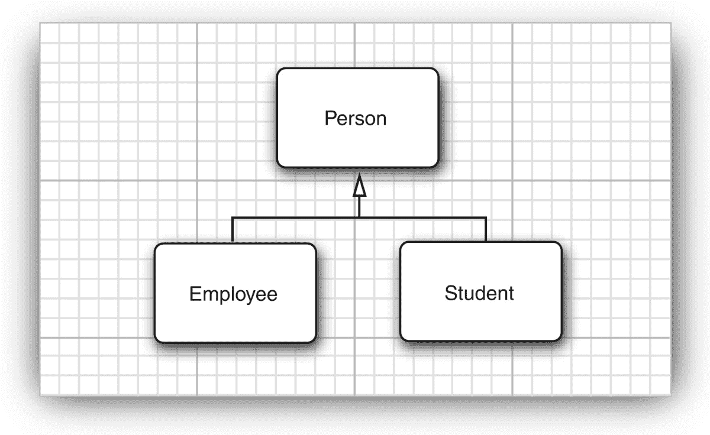`Person` 及其子类的继承图

为什么要费力进行如此高层次的抽象呢？某些属性对每个人都有意义，例如姓名。学生和员工都有姓名，引入一个共同的父类让我们能够将 `getName` 方法提取到继承层次结构中更高级别。

现在让我们添加另一个方法 `getDescription`，其目的是返回关于该人的简短描述，例如：

```text
an employee with a salary of $50,000.00
a student majoring in computer science
```

对于 `Employee` 和 `Student` 类来说，实现这个方法很容易。但你可以在 `Person` 类中提供什么信息呢？除了姓名之外，`Person` 类对该人一无所知。当然，你可以实现 `Person.getDescription()` 来返回一个空字符串。但有更好的更好的方法。如果你使用 `abstract`（抽象）关键字，你根本不需要实现该方法。

```java
public abstract String getDescription();
   // 不需要实现
```

为了更加清晰起见，包含一个或多个抽象方法的类本身必须声明为抽象类（abstract）。

```java
public abstract class Person
{
   . . .
   public abstract String getDescription();
}
```

除了抽象方法外，抽象类还可以拥有字段和具体方法。例如，`Person` 类存储了人的姓名，并有一个返回该姓名的具体方法。

```java
public abstract class Person
{
   private String name;

   public Person(String name)
   {
      this.name = name;
   }

   public abstract String getDescription();

   public String getName()
   {
       return name;
   }
}
```

有些程序员并没有意识到抽象类可以拥有具体方法。你应该始终将公共字段和方法（无论是否为抽象）移动到父类中（无论是否为抽象类）。

抽象方法充当子类中实现方法的占位符。当你扩展一个抽象类时，你有两个选择：你可以留一些或所有抽象方法不定义；那么，你必须也将该子类标记为抽象（abstract）。或者，你可以定义所有方法，这样子类就不再是抽象的。

例如，我们将定义一个继承抽象 `Person` 类的 `Student` 类，并实现 `getDescription` 方法。`Student` 类中的任何方法都不是抽象的，因此它不需要被声明为抽象类。

一个类即使没有抽象方法，也可以被声明为 `abstract`。

抽象类不能被实例化。也就是说，如果一个类被声明为 `abstract`，那么就无法创建该类的对象。例如，表达式

```java
new Person("Vince Vu")
```

是一个错误。然而，你可以创建具体子类的对象。

注意，你仍然可以创建抽象类的*对象变量*（object variables），但这样的变量必须引用一个非抽象子类的对象。例如：

```java
Person p = new Student("Vince Vu", "Economics");
```

这里 `p` 是一个抽象类型 `Person` 的变量，它指向非抽象子类 `Student` 的实例。

在 C++ 中，抽象方法被称为*纯虚拟函数*（pure virtual function），并带有尾随的 `= 0` 标记如下所示：

```cpp
class Person // C++
{
public:
   virtual string getDescription() = 0;
   . . .
};
```

如果一个 C++ 类至少有一个纯虚拟函数，那么它就是抽象类。在 C++ 中，没有特殊的关键字来表示抽象类。

让我们定义一个继承抽象类 `Person` 的具体子类 `Student`：

```java
public class Student extends Person
{
   private String major;

   public Student(String name, String major)
   {
      super(name);
      this.major = major;
   }

   public String getDescription()
   {
      return "a student majoring in " + major;
   }
}
```

`Student` 类定义了 `getDescription` 方法。因此，`Student` 类中的所有方法都是具体方法，该类不再是一个抽象类。

Listing 5.8 所示的程序定义了抽象父类 `Person`（Listing 5.9）以及两个具体子类 `Employee`（Listing 5.10）和 `Student`（Listing 5.11）。我们用员工和学生对象填充一个 `Person` 引用数组：

```java
var people = new Person[2];
people[0] = new Employee(. . .);
people[1] = new Student(. . .);
```

然后我们打印这些对象的姓名和描述：

```java
for (Person p : people)
   System.out.println(p.getName() + ", " + p.getDescription());
```

有些人对下面的调用感到困惑：

```java
p.getDescription()
```

这难道不是对一个未定义方法的调用吗？请记住，变量 `p` 永远不会引用 `Person` 对象，因为构造抽象 `Person` 类的对象是不可能的。变量 `p` 始终引用具体子类的对象，如 `Employee` 或 `Student`。对于这些对象，`getDescription` 方法是定义过的。


你是否可以完全从 `Person` 父类中省略抽象方法，而仅仅在 `Employee` 和 `Student` 子类中定义 `getDescription` 方法呢？如果你那样做，你将无法在变量 `p` 上调用 `getDescription` 方法。编译器确保你只调用在类中声明的方法。

抽象方法是 Java 编程语言中的一个重要概念。你最常在接口（interfaces）内部遇到它们。有关接口的更多信息，请参阅第 6 章。

```java
Size s = . . .;
String abbrev = switch (s)
   {
      case SMALL -> "S"; 
      . . .
   };
```

### 3. 你可以静态导入枚举中的所有常量

```java
import com.horstmann.util.Size;
import static com.horstmann.util.Size.*;
. . .
Size s = SMALL; 
```

你不能从默认包中的枚举静态导入常量。例如，如果 `Size` 在默认包中，你无法使用：

```java
import static Size.*;
```

由 `enum` 声明定义的类型实际上上是一个类。该类恰好有四个实例——无法构造新对象。

因此，你永远不需要对枚举类型使用 `equals`。直接使用 `==` 来比较它们即可。

你可以在最后一个值之后放置一个逗号。如果你预计值的数量会增加，尾随逗号非常有用。

```java
public enum Size
{
   SMALL,
   MEDIUM,
   LARGE,
   EXTRA_LARGE,
   XXL,
   // 在此处添加更多值并在每个值后加上逗号
}
```

所有枚举类型都是抽象类 `Enum` 的子类。它们从该类继承了许多方法。最有用的方法是 `name`，它返回枚举常量的名称。例如，`Size.SMALL.toString()` 返回字符串 `"SMALL"`。

默认情况下，`toString` 方法返回 `name`。然而，你可以重写 `toString`，而 `name` 是 `final` 的。

`name` 的逆操作是静态的 `valueOf` 方法。例如，语句：

```java
Size s = Enum.valueOf(Size.class, "SMALL");
```

将 `s` 设置为 `Size.SMALL`。

每个枚举类型都有一个静态的 `values` 方法，返回该枚举所有值的数组。例如，调用：

```java
Size[] values = Size.values();
```

返回包含元素 `Size.SMALL`、`Size.MEDIUM`、`Size.LARGE` 和 `Size.EXTRA_LARGE` 的数组。

`ordinal` 方法产生枚举常量在 `enum` 声明中的位置，从零开始计数。例如，`Size.MEDIUM.ordinal()` 返回 `1`。

如果你愿意，可以为枚举类型添加构造函数、方法和字段。当然，构造函数只在构造实例时被调用。这里有一个示例：

```java
public enum Size
{
   SMALL("S"), MEDIUM("M"), LARGE("L"), EXTRA_LARGE("XL");

   private final String abbreviation;

   Size(String abbreviation) { this.abbreviation = abbreviation; }
      // 自动为私

   public String getAbbreviation() { return abbreviation; }
}
```

当 `enum` 拥有字段或方法时，必须用分号结束常量列表，如上面的示例所示。

尾随逗号后分号是合法的。

你甚至可以在每个实例中重写方法：

```java
public enum Size
{
   SMALL,
   MEDIUM,
   LARGE,
   EXTRA_LARGE
   {
      public String toString() { return "XL"; }
   };
}
```

然而，这并不常见。在前面的示例中，`EXTRA_LARGE` 是 `Size` 子类的实例。除外，你不能为枚举创建子类。

枚举的构造函数始终是私有的。你可以省略 `private` 修饰符，如前面的示例所示。将枚举构造函数声明为 `public` 或 `protected` 是语法错误。

枚举类的构造函数不能在正在构造的实例上执行 `switch`：

```java
public enum Size
{
   SMALL, MEDIUM, LARGE, EXTRA_LARGE;
   private final boolean largish;
   Size()
   {
      largish = switch (this) // 错误
         {
            case LARGE, EXTRA_LARGE -> true;
            default -> false;
         };
   }
}
```

这种奇特的限制是由对 `enum` 使用 `switch` 的实现策略引起的。每个 `switch` 都会查询一个数组，该数组将当前定义的枚举常量的序数值映射到 `switch` 编译时的序数值。这些数组只有在 `enum` 实例构造完成后才能被构建。

在方法中，这样的 `switch` 运行良好。

列表 5.12 中的简短程序演示了如何处理枚举类型。

`Enum` 类有一个类型参数，为了简单起见，我忽略了它。例如，枚举类型 `Size` 实际上扩展了 `Enum<Size>`。该类型参数用于 `compareTo` 方法。（我在第 6 章中讨论了 `compareTo` 方法，并在第 8 章中讨论了类型参数。）

`enums/EnumTest.java`

```java
package enums;

import java.util.*;

/**
 * 此程序演示了枚举类型。
 * @version 1.0 2004-05-24
 * @author Cay Horstmann
 */
public class EnumTest
{  
   public static void main(String[] args)
   {  
      var in = new Scanner(System.in);
      System.out.print("Enter a size: (SMALL, MEDIUM, LARGE, EXTRA_LARGE) ");
      String input = in.next().toUpperCase();
      Size size = Enum.valueOf(Size.class, input);
      System.out.println("size=" + size);
      System.out.println("abbreviation=" + size.getAbbreviation());
      if (size == Size.EXTRA_LARGE)
         System.out.println("Good job--you paid attention to the _.");      
   }
}

enum Size
{
   SMALL("S"), MEDIUM("M"), LARGE("L"), EXTRA_LARGE("XL");

   private Size(String abbreviation) { this.abbreviation = abbreviation; }
   public String getAbbreviation() { return abbreviation; }

   private String abbreviation;
}
```

### `java.lang.Enum<E>` 5.0

- `static Enum valueOf(Class enumClass, String name)`

  返回给定类的给定名称枚举常量。

- `String name()`

  返回枚举常量的名称。

- `int ordinal()`

  返回枚举常量在 `enum` 声明中的零基位置。

- `int compareTo(E other)`

  如果枚举常量在 `other` 之前，返回负整数；如果 `this == other`，返回零；否则返回正整数。常量的顺序由 `enum` 声明决定。

## 密封类

除非一个类被声明为 `final`，否则任何人都可以形成它的子类。如果我们想要更多的控制呢？例如，假设你需要编写自己的 JSON 库，因为现有的没有完全符合你的需求。

JSON 标准规定 JSON 值是数组、数字、字符串、布尔值、对象或空。一种明显的方法是使用 `JSONArray`、`JSONNumber` 等类扩展抽象类 `JSONValue`：

```java
public abstract class JSONValue
{
   // 适用于所有 JSON 值的方法
}

public final class JSONArray extends JSONValue
{
   . . .
}

public final class JSONNumber extends JSONValue
{
   . . .
}
```

通过将 `JSONArray`、`JSONNumber` 等类声明为 `final`，我们可以确保没有人形成子类。但我们无法阻止任何人为 `JSONValue` 形成另一个子类。我们为什么可能需要那种控制？考虑以下代码：

```java
JSONValue v = . . .;
if (v instanceof JSONArray a) . . .
else if (v instanceof JSONNumber n) . . .
else if (v instanceof JSONString s) . . .
else if (v instanceof JSOBoolean b) . . .
else if (v instanceof JSONObject o) . . .
else . . . // 必须是 JSONNull
```

在这里，控制流意味着我们知道 `JSONValue` 的所有直接子类。这不是一个开放的层次结构。JSON 标准不会改变；如果改变了，我们作为库实现者将添加第七个子类。我们不希望其他人来扰动类层次结构。

在 Java 中，密封类控制哪些类可以继承它。密封类在 Java 15 中作为预览功能添加，并在 Java 17 中定型。

以下是将 `JSONValue` 类声明为密封的方式：

```java
public abstract sealed class JSONValue
      permits JSONArray, JSONNumber, JSONString, JSONBoolean, JSONObject, JSONNull
{
   . . .
}
```

定义一个未许可的子类是错误：

```java
public class JSONComment extends JSONValue { . . . } // 错误
```

这正好，因为 JSON 不允许注释。`sealed` 因此可以对领域约束进行精确建模。

密封类（sealed class）许可的子类必须是可访问。它们不能是嵌套在另一个类中的私有类，也不能是来自另一个包的包可见类。

对于公开的许可子类，规则更加严格。它们必须与密封类处于同一个包中。然而，如果你使用了模块（参见第 12 章），则它们必须位于同一个模块中。

密封类可以在不带 `permits` 子句的情况下声明。在这种情况下，所有的直接子类都必须在同一个文件中声明。无法访问该文件的程序员无法创建子类。

一个文件最多可以有一个 `public` 类，因此这种安排似乎只有在子类不供公众使用时才有用。

然而，正如你将在下一章中看到的，你可以使用内部类来作为公开的子类。

密封类的一个重要动力是编译时检查。考虑 `JSONValue` 类中的下面这个方法，它使用了带有模式匹配的 `switch` 表达式（参见第 5.9 节）：

```java
public String type()
{
   return switch (this)
      {
         case JSONArray __ -> "array";
         case JSONNumber __ -> "number";
         case JSONString __ -> "string";
         case JSONBoolean __ -> "boolean";
         case JSONObject __ -> "object"; 
         case JSONNull __ -> "null";
         // 这里不需要 default
      };
}
```

编译器可以检查出不需要 `default` 子句，因为 `JSONValue` 的所有直接子类都作为 `case` 出现。

前面的 `type` 方法看起来并不面向对象。符合 OOP 精神的做法让这六个类中的每一个都提供自己的 `type` 方法，依赖多态而不是 `switch`。对于开放的层次结构，这是一个很好的方法。但当存在一组固定的类时，将所有备选项放在一个方法中通常更方便。

乍一看，密封类的子类似乎必须是 `final` 的。但对于穷尽性测试（exhaustiveness testing），我们只需要知道所有的直接子类。如果这些类具有进一步的子类也没有问题。例如，我们可以像图 5.3 所示那样重新组织我们的 JSON 层次结构。

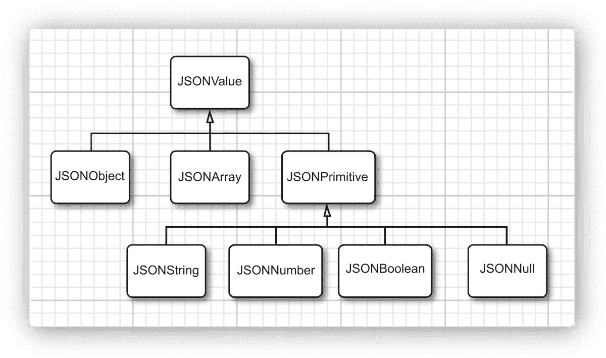表示 JSON 值的完整层次结构

在这个层次结构中，`JSONValue` 许可三个子类：

```java
public abstract sealed class JSONValue permits JSONObject, JSONArray, JSONPrimitive
{
   . . .
}
```

`JSONPrimitive` 类也是被密封的：

```java
public abstract sealed class JSONPrimitive extends JSONValue
      permits JSONString, JSONNumber, JSONBoolean, JSONNull
{
   . . .
}
```

密封类的子类必须指定它是 `sealed`、`final` 还是允许被类化的（open）。在后一种情况下，它必须声明为 `non-sealed`。

`non-sealed` 关键字是第一个带有连字符的 Java 关键字。这可能是一个未来的趋势。向语言中添加关键字总是伴随着风险。现有的代码可能不再编译。因此，`sealed` 是一个“上下文”（contextual）关键字。你仍然可以声明名为 `sealed` 的变量或方法：

```java
int sealed = 1; // 将上下文关键字用作标识符是可以的
```

对于带有连字符的关键字，人们不需要担心这个问题。唯一的歧义在于减法：

```java
int non = 0;
non = non-sealed; // 减法，而不是关键字
```

你为什么想要一个 `non-sealed` 子类？考虑一个具有六个直接子类的 XML 节点类：

```java
public abstract sealed class Node permits Element, Text, Comment,
      CDATASection, EntityReference, ProcessingInstruction
{
   . . .
}
```

我们允许 `Element` 有任意子类：

```java
public non-sealed class Element extends Node
{
   . . .
}

public class HTMLDivElement extends Element
{
   . . .
}
```

在本节中，你学习了密封类。在下一章中，你将学习接口，它是抽象类的泛化。Java 接口也可以有子类型。密封接口的工作方式与密封类完全相同，控制直接子类型。

下面的示例程序充实了 JSON 层次结构。`JSONObject` 的实现使用了 `HashMap`，这将在第 9 章中介绍。在示例中，我们使用接口而不是抽象类，以便 `JSONNumber` 和 `JSONString` 可以是 `record`，而 `JSONBoolean` 和 `JSONNull` 类可以是枚举（enum）。`record` 和枚举可以实现接口，但不能继承类。

`sealed/SealedTest.java`


```java
package sealed;

import java.util.*;

sealed interface JSONValue permits JSONArray, JSONObject, JSONPrimitive
{
   public default String type()
   {
      if (this instanceof JSONArray) return "array";
      else if (this instanceof JSONObject) return "object";
      else if (this instanceof JSONNumber) return "number";
      else if (this instanceof JSONString) return "string";
      else if (this instanceof JSONBoolean) return "boolean";
      else return "null";
   }
}

final class JSONArray extends ArrayList<JSONValue> implements JSONValue {}

final class JSONObject extends HashMap<String, JSONValue> implements JSONValue
{
   public String toString()
   {
      StringBuilder result = new StringBuilder();
      result.append("{");
      for (Map.Entry<String, JSONValue> entry : entrySet())
      {
         if (result.length() > 1) result.append(",");
         result.append(" \"");
         result.append(entry.getKey());
         result.append("\": ");
         result.append(entry.getValue());
      }
      result.append(" }");
      return result.toString();
   }
}

sealed interface JSONPrimitive extends JSONValue
      permits JSONNumber, JSONString, JSONBoolean, JSONNull
{
}

final record JSONNumber(double value) implements JSONPrimitive
{
   public String toString() { return "" + value; }
}

final record JSONString(String value) implements JSONPrimitive
{
   public String toString() { return "\"" + value.translateEscapes() + "\""; }
}

enum JSONBoolean implements JSONPrimitive
{
   FALSE, TRUE;
   public String toString() { return super.toString().toLowerCase(); }
}

enum JSONNull implements JSONPrimitive
{
   INSTANCE;
   public String toString() { return "null"; }
}

public class SealedTest
{
   public static void main(String[] args)
   {
      JSONObject obj = new JSONObject();
      obj.put("name", new JSONString("Harry"));
      obj.put("salary", new JSONNumber(90000));
      obj.put("married", JSONBoolean.FALSE);
      JSONArray arr = new JSONArray();
      arr.add(new JSONNumber(13));
      arr.add(JSONNull.INSTANCE);

      obj.put("luckyNumbers", arr);
      System.out.println(obj);
      System.out.println(obj.type());
   }
}
```

### 模式匹配

你已经见过如何使用 `instanceof` 运算符来检查对象是否具有特定类型。`instanceof` 最方便的形式声明了一个与匹配类型的变量：

```java
Employee e = . . .;
String description;
if (e instanceof Executive exec) description = "An executive with a title of " + exec.getTitle();
else if (e instanceof Manager m) description = "A manager who deserves a bonus";
else description = "A lowly employee with a salary of " + e.getSalary();
```

模式匹配形式的 `switch` 简化了这种类型分析：

```java
Employee e = . . .;
String description = switch (e)
   {
      case Executive exec -> "An executive with a title of " + exec.getTitle();
      case Manager m -> "A manager who deserves a bonus";
      default -> "A lowly employee with a salary of " + e.getSalary();
   };
```

注意，与 `instanceof` 模式一样，每个 `case` 都声明了一个匹配类型的变量。你使用这些变量来访问子类方法（例如示例中的 `getTitle`）。

使用 `switch` 表达式形式比链式 `if` 语句更简单。`switch` 表达式产生一个值并将其赋值给 `description` 变量。相比之下，使用 `instanceof` 时，条件语句的每个分支必须单独设置 `description` 值。

配合类型模式（type patterns）可以使用 `switch` 的语句形式和贯穿（fallthrough）形式。但不带贯穿的表达式形式通常是最自然的选择。

正如你刚刚所看到的，模式匹配的基础结构非常直观。接下来的小节将介绍技术细节，其中某些细节出于兼容性原因变得有些复杂。

Java 21 引入了作为预览特性的未命名变量（unnamed variables）。如果你在类型模式中不需要该变量，可以使用下划线：

```java
case Employee _ -> "A lowly employee"
```

在这一功能正式发布之前，你可以使用两个下划线：

```java
case Employee __ -> "A lowly employee"
```

#### 空值处理

经典的 `switch` 语句对 `null` 是敌的。如果选择器表达式为 `null`，`switch` 将抛出 `NullPointerException`。你可以通过添加 `case null` 来避免这一点：

```java
String description = switch (e)
   {
      case Executive exec -> "An executive with a title of " + exec.getTitle();
      case Manager m -> "A manager who deserves a bonus";
      case null -> "No employee";
      default -> "A lowly employee with a salary of " + e.getSalary();
   };
```

你可以将 `case null` 与 `default` 结合，但不能与任何其他 `case` 结合：

```java
case null, default -> "No free parking";
```

你不能使用 `case _` 来表示默认情况（default case）。这是故意设计的，这样你就不需要记住这种 `case` 是否涵盖了 `null`。

### 守卫（Guards）

你可以为模式添加一个条件，被称为“守卫”，并使用受限的 `when` 关键字。

```java
case Executive exec when exec.getTitle().getLength() >= 20 ->
   "An executive with an impressive title";
```

在守卫表达式中，你可以使用模式引入的变量。

如果不满足守卫表达式，则不会选择该 `case`，而是测试下一个 `case`。

如果 `when` 子句中发生异常，`switch` 将抛出该异常。

守卫在记录模式（record patterns）中特别有用：

```java
Point p = . . .;
String description = switch (p)
   {
      case Point(var x, var y) when x == 0 && y == 0 -> "origin";
      case Point(var x, var __) when x == 0 -> "on x-axis";
      case Point(var __, var y) when y == 0 -> "on y-axis";
      default -> "not on either axis";
   };
```

记录模式会调用组件访问器。在其中一个访问器抛出异常的罕情况下，`switch` 将抛出 `MatchException`。这只发生在自定义访问器的情况下。

#### 穷性（Exhaustiveness）

任何 `switch` 表达式必须是穷尽的：对于每个可能的选择器值都必须有一个对应的 `case`。这是一个显而易见的要求，因为表达式必须始终产生一个值。

`switch` 变为穷尽有几种方法：

- 为枚举的每个实例提供 `case`。
- 一个 `default` `case`。
- 涵盖所有可能性的类型模式。
- 穷尽性检查确保表达式始终产生一个值。

`switch` 表达式必须是穷尽的。如果不是，编译器将报告一一个错误。

## 变量与穿透

本节涵盖了当执行从一个 `case` 穿透（fall through）到下一个 `case` 时关于变量的细节。如果你从不使用穿透，请直接到下一节。

当类型模式或记录模式引入变量时，其作用范围将延伸到 `case` 的结束，即使执行穿透到了下一个 `case`。例如，考虑以下代码段中的变量 `s`：

```java
Object obj = . . .;
switch (obj)
{
   case String s when s.length() == 0: System.out.println("empty string"); // Scope ends here
   default: System.out.println(obj.toString());
}
```

你可以在守卫语句（guard clause）和 `:` 之后的语句中使用 `s`，但不能在下一个 `case` 中使用。这是合理的，因为当 `obj` 不是 `String` 时，执行可能会从该 `case` 开始。

你不能穿入类型模式：

```java
switch (obj)
{
   case String s when s.length() > 0: System.out.println(s.codePointAt(0)); // Fallthrough
   case Integer n: System.out.println(n); // ERROR
   . . .
}
```

如果执行从第一个 `case` 穿透到第二个 `case` 的体，`n` 将无法绑定。

你*可以*穿入一个带有匿名变量的类型模式（Java 21 的一项预览功能）：

```java
switch (obj)
{
   case String s when s.length() == 0: System.out.print("empty "); // Fallthrough
   case String _: System.out.println("string"); break; // Ok
   . . .
}
```

自 Java 1.0 以来，在 `case` 体中声明变量一直是合法的。该变量的作用范围延伸到 `switch` 的结束。这种作用范围从未用过，因为如果你在 `case` 之外访问该变量，会导致错误：

```java
switch (obj) {
   case String s:
      String t = s; // OK
   default:
      System.out.println(t); // ERROR—t may not have been initialized
}
```

Listing 5.14 和 Listing 5.15 中的程序演示了类型模式和记录模式的模式匹配。

`patternMatching/TypePatternTest.java`

```java
package patternMatching;

public class TypePatternTest
{
   public static void main(String[] args)
   {
      int r = (int)(4 * Math.random());
      Employee e = switch (r)
         {
            case 0 -> new Employee("Harry Hacker", 50000, 1989, 10, 1);
            case 1 -> new Manager("Carl Cracker", 80000, 1987, 12, 15);
            case 2 -> new Executive("Sue Striver", "Senior Associate Vice President", 200000, 1995, 1, 20);
            default -> null;
         };
      String description = switch (e)
         {
            case Executive exec when exec.getTitle().length() >= 20 ->
               "An executive with an impressive title";
            case Executive exec ->
               "An executive with a title of " + exec.getTitle();
            case Manager m ->
               {
                  m.setBonus(10000);
                  yield "A manager who just got a bonus";
               }
            case null -> "No employee";
            default -> "A lowly employee with a salary of " + e.getSalary();
         };
      System.out.println(description);
   }
}
```

`patternMatching/RecordPatternTest.java`


```java
package patternMatching;

record Point(double x, double y) {}

public class RecordPatternTest
{
   public static void main(String[] args)
   {
      int r = (int)(4 * Math.random());
      Point p = switch (r)
         {
            case 0 -> new Point(0, 0);
            case 1 -> new Point(1, 0);
            case 2 -> new Point(0, 1);
            default -> new Point(1, 1);
         };
      String description = switch (p)
         {
            case Point(var x, var y) when x == 0 && y == 0 -> "origin";
            case Point(var x, var __) when x == 0 -> "on x-axis";
            case Point(var __, var y) when y == 0 -> "on y-axis";
            default -> "not on either axis";
         };
      System.out.printf("%s %s%n", p, description);
   }
}
```

## 反射

`reflection library` 为你提供了非常丰富且详细的工具集，用于编写动态操作 Java 代码的程序。通过反射，Java 可以支持用户界面生成器、对象关系映射（ORM）以及许多其他动态查询类能力的开发工具。

能够分析类能力的程序被称为反射的（reflective）。反射机制非常强大。如后续章节所示，你可以使用它来：

* 在运行时分析类的能力
* 在运行时检查对象——例如，编写一个适用于所有类的单一 `toString` 方法
* 实现泛型数组操作代码
* 利用工作方式与 `Method` 对象完全相同的 `Method` 对象

### `Class`

虚拟机为每个类型管理一个唯一的 `Class` 对象。因此，你可以使用 `==` 运算符来比较类对象。例如：

```java
if (e.getClass() == Employee.class) . . .
```

如果 `e` 是 `Employee` 的实例，则该测试通过。与条件 `e instanceof Employee` 不同，如果 `e` 是 `Manager` 等子类的实例，则该测试将失败。

你可能期望枚举中的实例的类就是该枚举类。通常情况下，这是成立的：

```java
public enum Size { SMALL, MEDIUM, LARGE, EXTRA_LARGE; }
Size.SMALL.getClass() == Size.class // true
```

然而，如果你在实例中重写了方法，那么它就属于不同的类：

```java
public enum Size
{
   SMALL,
   MEDIUM,
   LARGE,
   EXTRA_LARGE
   {
      public String toString() { return "XL"; }
   };
}

Size.EXTRA_LARGE.getClass() == Size.class // false
```

如果你有一个 `Class` 类型的对象，可以使用它来构造该类的实例。调用 `getConstructor` 方法获取一个 `Constructor` 类型的对象，然后使用 `newInstance` 方法来构造实例。例如：

```java
var className = "java.util.Date"; // 或任何其他带有无参构造函数的类名
Class cl = Class.forName(className);
Object obj = cl.getConstructor().newInstance();
```

如果该类没有无参数构造函数，`getConstructor` 方法将抛出异常。你将在第 5.10.7 节中看到如何调用其他构造函数。

还有一个 `Class.newInstance` 方法，也可以使用无参构造函数构造实例。然而，由于一个微妙的原因，它被弃用了。在构造函数中抛出的任何异常都会原样重新抛出。对于受检异常（checked exceptions），这违反了编译时检查。相比之下，`Constructor.newInstance` 将任何构造函数异常封装在 `InvocationTargetException` 中。

`newInstance` 方法对应 C++ 中的虚构造函数（virtual constructor）惯用法。然而，C++ 中的虚构造函数并不是语言特性，而是一种需要专门库支持的惯用法。`Class` 类类似于 C++ 中的 `type_info` 类，而 `getClass` 方法相当于 `typeid` 运算符。不过，Java 的 `Class` 比 `type_info` 要通用得多。C++ 的 `type_info` 只能显示类型的名称字符串，而无法创建该类型的新对象。

### `java.lang.Class` 1.0

* `static Class forName(String className)`

  返回表示名为 `className` 的类的 `Class` 对象。

* `Constructor getConstructor(Class... parameterTypes)` 1.1

  产生一个描述给定参数类型构造函数的对象。有关如何提供参数类型的更多信息，请参阅第 5.10.7 节。

### `java.lang.reflect.Constructor` 1.1

* `Object newInstance(Object... initargs)`

  构造构造函数声明类的新实例，并将 `initargs` 传递给构造函数。有关如何提供参数的更多信息，请参阅第 5.10.7 节。

### `java.lang.Throwable` 1.0

* `void printStackTrace()`

  将 `Throwable` 对象和堆栈轨迹打印到标准错误流。

## 异常声明原理

我将在第 7 章中完整介绍异常处理，但在此，你偶尔会遇到可能抛出异常的方法。

当运行时发生错误时，程序可以“抛出异常”。抛出异常比终止程序更灵活，因为你可以提供一个处理器（handler）来“捕获”异常并处理它。

如果你不提供处理器，程序将终止并在控制台上打印一条消息，给出异常的类型。你可能在不小心使用 `null` 引用或越界数组边界时已经见过异常报告了。

异常有两种类型：未检查异常（unchecked exceptions）和受检异常（checked exceptions）。对于检查异常，编译器会检查你（作为程序员）是否意识到了该异常并准备好处理其后果。然而，许多常见异常（如边界错误或访问 `null` 引用）是未检查的。编译器并不期望你提供处理器——毕竟，你应该把心精力花在避免这些错误上，而不是为它们编写处理器。

但并非所有错误都是可以避免的。尽管你尽了全力仍可能发生异常，那么大多数 Java API 将抛出检查异常。一个例子是 `Class.forName` 方法。你无法确保存在给定名称的类。在第 7 章中，你将看到几种异常处理策略。现在，我只向你展示最简单的策略。

每当方法包含可能抛出检查异常的语句时，在方法名后添加 `throws` 子句。

```java
public static void doSomethingWithClass(String name)
      throws ReflectiveOperationException
{
   Class cl = Class.forName(name); // 可能抛出异常
   使用 cl 执行某些操作
}
```

任何调用此方法的方法都需要 `throws` 声明。这包括 `main` 方法。如果真的发生了异常，`main` 方法将带有堆栈轨迹终止。（你将在第 7 章中学习如何捕获异常而不是让它们终止你的程序。）

你只需要为检查异常提供 `throws` 子句。很容易找出哪些方法抛出检查异常——当你调用一个威胁抛出检查异常的方法而你没有提供处理器时，编译器会报错。

## 资源

类通常拥有关联文件，例如：

* 图像和声音文件
* 消息字符串和按钮标签文件

在 Java 中，这样的关联文件被称为资源（resource）。

例如，考虑一个显示消息的对话框，如图 5.4 所示。

![图 5.4]显示图像和文本资源

当然，面板中的书名和版权年份将在下一书中变化。为了方便跟踪这种变化，我们将文本放在文件中，而不是将其硬编码为字符串。

但你应该把像 `about.txt` 这样的放在哪里？当然，将其与程序的其余文件一起放在 JAR 文件中是最方便的。

`Class` 类为定位资源提供了有用的服务。以下是必要的步骤：

1. 获取拥有资源的 `Class` 对象——例如 `ResourceTest.class`。
2. 某些方法（如 `ImageIcon` 类的 `getImage` 方法）接受描述资源位置的 URL。然后调用：

   ```java
   URL url = cl.getResource("about.png");
   ```

3. 否则，使用 `getResourceAsStream` 方法获取用于读取文件中数据的输入流。

关键在于 Java 虚拟机知道如何定位类，因此它可以在相同位置搜索关联的资源。例如，假设 `ResourceTest` 类在包 `resources` 中。那么 `ResourceTest.class` 文件位于 `resources` 目录，你也将图标文件放置在同一个目录下。

与其将资源文件放在与类文件相同的目录中，你可以提供相对路径或绝对路径，例如：

```text
data/about.txt
/corejava/title.txt
```

自动加载文件是资源加载功能所做的全部。没有标准方法来解释资源文件的内容。每个程序必须有自己解释其资源文件的方法。

资源的另一个常见应用是程序的国际化。依赖于语言的字符串（如消息和用户界面标签）存储在资源文件中，每个语言一个文件。在第二卷第 7 章中讨论的 `internationalization API` 支持了一种组织和访问这些本地化文件的标准方法。

Listing 5.16 是一个演示资源加载的程序。（不用担心读取文本和显示对话框的代码——我们稍后会介绍这些细节。）编译、构建 JAR 文件并执行它：

```bash
javac resources/ResourceTest.java
jar cvfe ResourceTest.jar resources.ResourceTest \
   resources/*.class resources/*.gif resources/data/*.txt corejava/*.txt
java -jar ResourceTest.jar
```

将 JAR 文件移动到不同的目录并再次运行，以检查程序是从 JAR 文件读取资源文件，而不是从当前目录读取。

`resources/ResourceTest.java`

```java
package resources;

import java.io.*;
import java.net.*;
import javax.swing.*;

/**
 * @version 1.51 2023-08-16
 * @author Cay Horstmann
 */
public class ResourceTest
{
   public static void main(String[] args) throws IOException
   {
      Class cl = ResourceTest.class;
      URL aboutURL = cl.getResource("about.gif");
      var icon = new ImageIcon(aboutURL);

      InputStream stream = cl.getResourceAsStream("data/about.txt");
      var about = new String(stream.readAllBytes());

      InputStream stream2 = cl.getResourceAsStream("/corejava/title.txt");      
      var title = new String(stream2.readAllBytes()).strip();

      JOptionPane.showMessageDialog(null, about, title, JOptionPane.INFORMATION_MESSAGE, icon);
   }
}
```

### `java.lang.Class` 1.0

* `URL getResource(String name)` 1.1
* `InputStream getResourceAsStream(String name)` 1.1

在与类相同的位置查找资源，然后返回一个可以用于加载资源的 `URL` 或 `input stream`。如果未找到资源，则返回 `null`，因此不会为 I/O 错误抛出异常。

## 使用反射分析类的能力

这里是反射机制最重要部分的要概述，它允许你检查类的结构。

`java.lang.reflect` 包中的 `Field`、`Method` 和 `Constructor` 三个类分别描述类的字段、方法和构造函数。这三个类都有一个名为 `getName` 的方法，返回该项的名称。`Field` 类有一个 `getType` 方法，返回一个对象（同样是 `Class` 类型），用于描述字段类型。`Method` 和 `Constructor` 类有方法报告参数的类型，而 `Method` 类还报告返回类型。

这三个类都有一个名为 `getModifiers` 的方法，该方法返回一个整数，其中不同的位被开启或关闭，用于描述所使用的修饰符，例如 `public` 和 `static`。然后你可以使用 `java.lang.reflect` 包中 `Modifier` 类的静态方法来分析 `getModifiers` 返回的整数。使用 `Modifier` 类中的 `isPublic`、`isPrivate` 或 `isFinal` 等方法可以判断方法或构造函数是否是 `public`、`private` 或 `final`。你所做的就是让 `Modifier` 类中适当的方法作用于 `getModifiers` 返回的整数。你也可以使用 `Modifier.toString` 方法来打印修饰符。

或者，`accessFlags` 方法返回 `AccessFlag` 枚举的一组值。例如，以下是如何测试一个方法是否是静态的：

```java
if (Modifiers.isStatic(m.getModifiers())) . . .
if (m.accessFlags().contains(AccessFlag.STATIC)) . . .
```

`Class` 类的 `getFields`、`getMethods` 和 `getConstructors` 方法返回类支持的 `public` 字段、方法和构造函数的数组。这包括父类的公共成员。`Class` 类的 `getDeclaredFields`、`getDeclaredMethods` 和 `getDeclaredConstructors` 方法返回包含类中声明的所有字段、方法和构造函数的数组。这包括 `private`、包级（package）和 `protected` 成员，以及具有包访问权限的成员，但不包括父类的成员。

Listing 5.17 向你展示如何打印关于类的所有信息。程序提示你输入类名，并写出所有方法和构造函数的签名，以及该类所有实例字段的名称。例如，如果你输入：

```text
java.lang.Double
```

程序将打印：


```java
public final class java.lang.Double extends java.lang.Number
{
   public java.lang.Double(double);
   public java.lang.Double(java.lang.String);

   public boolean equals(java.lang.Object);
   public static java.lang.String toString(double);
   public java.lang.String toString();
   public static int hashCode(double);
   public int hashCode();
   public static double min(double, double);
   public static double max(double, double);
   public static native long doubleToRawLongBits(double);
   public static long doubleToLongBits(double);
   public static native longBitsToDouble(long);
   public int compareTo(java.lang.Double);
   public volatile int compareTo(java.lang.Object);
   public static int compare(double, double);
   public byte byteValue();
   public short shortValue();
   public int intValue();
   public long longValue();
   public float floatValue();
   public double doubleValue();
   public static java.lang.Double valueOf(java.lang.String);
   public static java.lang.Double valueOf(double);
   public static java.lang.String toHexString(double);
   public volatile java.lang.Object resolveConstantDesc(
      java.lang.invoke.MethodHandles$Lookup);
   public java.lang.Double resolveConstantDesc(java.lang.invoke.MethodHandles$Lookup);
   public java.util.Optional describeConstable();
   public boolean isNaN();
   public static boolean isNaN(double);
   public static double sum(double, double);
   public boolean isInfinite();
   public static boolean isInfinite(double);
   public static boolean isFinite(double);
   public static double parseDouble(java.lang.String);

   public static final double POSITIVE_INFINITY;
   public static final double NEGATIVE_INFINITY;
   public static final double NaN;
   public static final double MAX_VALUE;
   public static final double MIN_NORMAL;
   public static final double MIN_VALUE;
   public static final int MAX_EXPONENT;
   public static final int MIN_EXPONENT;
   public static final int SIZE;
   public static final int BYTES;
   public static final java.lang.Class TYPE;
   private final double value;
   private static final long serialVersionUID;
}
```

`reflection/ReflectionTest.java`

```java
package reflection;

import java.util.*;
import java.lang.reflect.*;
/**
 * 此程序使用反射来打印类的所有特征。
 * @version 1.12 2021-06-15
 * @author Cay Horstmann
 */
public class ReflectionTest
{
   public static void main(String[] args)
         throws ReflectiveOperationException      
   {
      // 从命令行参数或用户输入读取类名
      String name;
      if (args.length > 0) name = args[0];
      else
      {
         var in = new Scanner(System.in);
         System.out.println("输入类名 (例如 java.util.Date): ");
         name = in.next();
      }

      // 打印类的修饰符、名称和父类名（如果不是 Object）
      Class cl = Class.forName(name);
      String modifiers = Modifier.toString(cl.getModifiers());
      if (modifiers.length() > 0) System.out.print(modifiers + " ");
      if (cl.isSealed())
         System.out.print("sealed ");
      if (cl.isEnum())
         System.out.print("enum " + name);
      else if (cl.isRecord())
         System.out.print("record " + name);
      else if (cl.isInterface())
         System.out.print("interface " + name);
      else
         System.out.print("class " + name);
      Class supercl = cl.getSuperclass();
      if (supercl != null && supercl != Object.class) System.out.print(" extends "
            + supercl.getName());

      printInterfaces(cl);
      printPermittedSubclasses(cl);

      System.out.print("\n{\n");
      printConstructors(cl);
      System.out.println();
      printMethods(cl);
      System.out.println();
      printFields(cl);
      System.out.println("}");
   }

   /**
    * 打印类的所有构造函数
    * @param cl 一个类
    */
   public static void printConstructors(Class cl)
   {
      Constructor[] constructors = cl.getDeclaredConstructors();

      for (Constructor c : constructors)
      {
         String name = c.getName();
         System.out.print("   ");
         String modifiers = Modifier.toString(c.getModifiers());
         if (modifiers.length() > 0) System.out.print(modifiers + " ");         
         System.out.print(name + "(");

         // 打印参数类型
         Class[] paramTypes = c.getParameterTypes();
         for (int j = 0; j < paramTypes.length; j++)
         {
            if (j > 0) System.out.print(", ");
            System.out.print(paramTypes[j].getName());
         }
         System.out.println(");");
      }
   }

   /**
    * 打印类的所有方法
    * @param cl 一个类
    */
   public static void printMethods(Class cl)
   {
      Method[] methods = cl.getDeclaredMethods();

      for (Method m : methods)
      {
         Class retType = m.getReturnType();
         String name = m.getName();

         System.out.print("   ");
         // 打印修饰符、返回类型和方法名
         String modifiers = Modifier.toString(m.getModifiers());
         if (modifiers.length() > 0) System.out.print(modifiers + " ");         
         System.out.print(retType.getName() + " " + name + "(");

         // 打印参数类型
         Class[] paramTypes = m.getParameterTypes();
         for (int j = 0; j < paramTypes.length; j++)
         {
            if (j > 0) System.out.print(", ");
            System.out.print(paramTypes[j].getName());
         }
         System.out.println(");");
      }
   }

   /**
    * 打印类的所有字段
    * @param cl 一个类
    */
   public static void printFields(Class cl)
   {
      Field[] fields = cl.getDeclaredFields();

      for (Field f : fields)
      {
         Class type = f.getType();
         String name = f.getName();
         System.out.print("   ");
         String modifiers = Modifier.toString(f.getModifiers());
         if (modifiers.length() > 0) System.out.print(modifiers + " ");         
         System.out.println(type.getName() + " " + name + ";");
      }
   }

   /**
    * 打印密封类（sealed class）所有允许的子类
    * @param cl 一个类
    */
   public static void printPermittedSubclasses(Class cl)
   {
      if (cl.isSealed())
      {
         Class<?>[] permittedSubclasses = cl.getPermittedSubclasses();
         for (int i = 0; i < permittedSubclasses.length; i++)
         {
            if (i == 0)
               System.out.print(" permits ");
            else
               System.out.print(", ");
            System.out.print(permittedSubclasses[i].getName());
         }         
      }               
   }

   /**
    * 打印类实现的所有接口
    * @param cl 一个类
    */
   public static void printInterfaces(Class cl)
   {
      Class<?>[] interfaces = cl.getInterfaces();
      for (int i = 0; i < interfaces.length; i++)
      {
         if (i == 0)
            System.out.print(" implements ");
         else
            System.out.print(", ");
         System.out.print(interfaces[i].getName());
      }         
   }
}
```

* `Method getAccessor()` 返回用于访问此记录组件的 `Method` 对象。

## `java.lang.reflect.Modifier` 1.1

* `static String toString(int modifiers)` 返回一个包含与 `modifiers` 中设置的位对应的修饰符的字符串。

* `static boolean isAbstract(int modifiers)`

* `static boolean isFinal(int modifiers)`

* `static boolean isInterface(int modifiers)`

* `static boolean isNative(int modifiers)`

* `static boolean isPrivate(int modifiers)`

* `static boolean isProtected(int modifiers)`

* `static boolean isPublic(int modifiers)`

* `static boolean isStatic(int modifiers)`

* `static boolean isStrict(int modifiers)`

* `static boolean isSynchronized(int modifiers)`

* `static boolean isVolatile(int modifiers)` 测试 `modifiers` 值中与方法名中的修饰符对应的位。

### 使用反射在运行时分析对象

在前面的节中，我们看到了如何找到任何对象的实例字段的 `names` 和 `types`：

* 获取相应的 `Class` 对象。
* 在 `Class` 对象上调用 `getDeclaredFields`。

在本节中，我们将更进一步，实际上查看字段的 `contents`。当然，当你编写程序时，查看一个名称和类型已知的对象的特定字段的内容是很容易的。但反射允许你查看在编译时未知的对象的字段。

实现实现此点的关键方法是 `Field` 类中的 `get` 方法。如果 `f` 是 `Field` 类型的对象（例如，通过 `getDeclaredFields` 获取的对象），并且 `obj` 是 `f` 作为其字段所属的类的对象，那么 `f.get(obj)` 返回一个对象，其值是 `obj` 字段的当前值。这看起来都有点抽象，所以让我们过来看一个例子。


```java
var harry = new Employee("Harry Hacker", 50000, 10, 1, 1989);
Class cl = harry.getClass();
// 代表 Employee 的类对象
Field f = cl.getDeclaredField("name");
// Employee 类的 name 字段
Object v = f.get(harry);
// harry 对象 name 字段的值，即
// String 对象 "Harry Hacker"
```

当然，你也可以设置你可以获取到的值。调用`f.set(obj, value)`将对象`obj`的由`f`表示的字段设置为新值。

实际上，这段代码存在一个问题。由于`name`字段是一个私有字段，`get`和`set`方法将抛出`IllegalAccessException`。你只能对可访问的字段使用`get`和`set`。Java 的安全机制允许你发现对象拥有哪些字段，但除非你有权限，否则它不会让你读取和写入这些字段的值。

反射机制的默认行为是尊重 Java 访问控制。然而，你可以通过对`Field`、`Method`或`Constructor`对象调用`setAccessible`方法来覆盖访问控制。例如：

```java
f.setAccessible(true); // 现在可以调用 f.get(harry) 了
```

`setAccessible`方法是`AccessibleObject`类的方法，它是`Field`、`Method`和`Constructor`类的公共超类。此功能是为调试器、持久化存储和类似机制提供的。我们将在本节稍后部分将其将其用于一个通用的`toString`方法。

如果未授予访问，调用`setAccessible`将抛出异常。访问可以被模块系统（第 12 章）拒绝。使用安全管理器并不常见，而且它们自 Java 17 起已被弃用。

例如，本节末尾的示例程序查看了`ArrayList`和`Integer`对象的内部。当你使用 Java 9 到 Java 16 运行它时，会出现以下凶消息：

```text
WARNING: An illegal reflective access operation has occurred
WARNING: Illegal reflective access by objectAnalyzer.ObjectAnalyzer (file:/home/cay
   /books/cj11/code/v1ch05/bin/) to field java.util.ArrayList.serialVersionUID
WARNING: Please consider reporting this to the maintainers of
   objectAnalyzer.ObjectAnalyzer
WARNING: Use --illegal-access=warn to enable warnings of further illegal
   reflective access operations
WARNING: All illegal access operations will be denied in a future release
```

当你用 Java 17 运行程序时，会发生`InaccessibleObjectException`异常。

为了保持程序运行，将`java.base`模块中的`java.util`和`java.lang`包“打开”给“未命名模块”。详情见第 12 章。这里是语法：

```text
--add-opens java.base/java.util=ALL-UNNAMED --add-opens java.base/java.lang=ALL-UNNAMED
```

```java
package objectAnalyzer;

import java.util.*;

/**
 * 此程序使用反射来监控对象。
 * @version 1.13 2018-03-16
 * @author Cay Horstmann
 */
public class ObjectAnalyzerTest
{
   public static void main(String[] args)
         throws ReflectiveOperationException
   {
      var squares = new ArrayList<Integer>();
      for (int i = 1; i <= 5; i++)
         squares.add(i * i);
      System.out.println(new ObjectAnalyzer().toString(squares));
   }
}
```

`objectAnalyzer/ObjectAnalyzer.java`

```java
package objectAnalyzer;

import java.lang.reflect.AccessibleObject;
import java.lang.reflect.Array;
import java.lang.reflect.Field;
import java.lang.reflect.Modifier;
import java.util.ArrayList;

public class ObjectAnalyzer
{
   private ArrayList<Object> visited = new ArrayList<>();

   /**
    * 将对象转换为列出所有字段的字符串表示。
    * @param obj 一个对象
    * @return 包含对象类名以及所有字段名和值的字符串
    */
   public String toString(Object obj)
         throws ReflectiveOperationException
   {
      if (obj == null) return "null";
      if (visited.contains(obj)) return "...";
      visited.add(obj);
      Class cl = obj.getClass();
      if (cl == String.class) return (String) obj;
      if (cl.isArray())
      {
         String r = cl.getComponentType() + "[]{";
         for (int i = 0; i < Array.getLength(obj); i++)
         {
            if (i > 0) r += ",";
            Object val = Array.get(obj, i);
            if (cl.getComponentType().isPrimitive()) r += val;
            else r += toString(val);
         }
         return r + "}";
      }

      String r = cl.getName();
      // 检查此类及其所有父类的字段
      do
      {
         r += "[";
         Field[] fields = cl.getDeclaredFields();
         AccessibleObject.setAccessible(fields, true);
         // 获取所有字段的名字和值
         for (Field f : fields)
         {
            if (!Modifier.isStatic(f.getModifiers()))
            {
               if (!r.endsWith("[")) r += ",";
               r += f.getName() + "=";
               Class t = f.getType();
               Object val = f.get(obj);
               if (t.isPrimitive()) r += val;
               else r += toString(val);
            }
         }
         r += "]";
         cl = cl.getSuperclass();
      }
      while (cl != null);

      return r;
   }
}
```

## `java.lang.reflect.AccessibleObject` 1.2

- `void setAccessible(boolean flag)`

  为此可访问对象设置或清除访问权限标志，如果访问被拒绝，则抛出`IllegalAccessException`。

- `boolean trySetAccessible()` 9

  设置此可访问对象的访问权限标志，如果访问被拒绝，则返回`false`。

- `boolean canAccess(Object obj)` 9

  检查调用者是否可以通过此字段、方法或构造函数对象访问`obj`。对于静态字段、方法或构造函数，请传递`null`。

- `static void setAccessible(AccessibleObject[] array, boolean flag)`

  用于为对象数组设置访问权限标志的便利方法。

## `java.lang.Class` 1.1

- `Field getField(String name)`

- `Field[] getFields()`

  获取给定名称的公共字段，或所有字段的数组。

- `Field getDeclaredField(String name)`

- `Field[] getDeclaredFields()`

  获取在此类中声明的给定名称字段，或所有字段的数组。

## `java.lang.reflect.Field` 1.1

- `Object get(Object obj)`

  获取对象`obj`中由此`Field`对象描述的字段的值。

- `void set(Object obj, Object newValue)`

  将对象`obj`中由此`Field`对象描述的字段设置为新值。

## 使用反射编写泛型数组代码

`java.lang.reflect`包中的`Array`类允许你动态创建数组。这被用于`Arrays`类中`copyOf`方法的实现。回想如何使用此方法来扩展已满的数组。

```java
var a = new Employee[100];
. . .
// 数组已满
a = Arrays.copyOf(a, 2 * a.length);
```

如何编写这样的泛型方法？`Employee[]`数组可以转换为`Object[]`数组，这听起来很有希望。以下是第一次尝试：

```java
public static Object[] badCopyOf(Object[] a, int newLength) // 没有用处
{
   var newArray = new Object[newLength];
   System.arraycopy(a, 0, newArray, 0, Math.min(a.length, newLength));
   return newArray;
}
```

然而，返回类型存在问题。`Employee[]`数组可以转换为`Object[]`数组，这听起来很有希望。以下是第一次尝试：

实际上，问题是无法对其进行类型转换。让我们看看`goodCopyOf`。

为什么`getLength`是`Array`的方法，而`getComponentType`是`Class`的方法？我不知道——反射方法的分布有时显得有些随意。

这里是代码：

```java
public static Object goodCopyOf(Object a, int newLength)
{
   Class cl = a.getClass();
   if (!cl.isArray()) return null;
   Class componentType = cl.getComponentType();
   int length = Array.getLength(a);
   Object newArray = Array.newInstance(componentType, newLength);
   System.arraycopy(a, 0, newArray, 0, Math.min(length, newLength));
   return newArray;
}
```

注意，这个`copyOf`方法可以扩展任何类型的数组，而不是对象数组。

```java
int[] a = { 1, 2, 3, 4, 5 };
a = (int[]) goodCopyOf(a, 10);
```

为了使这种可行，`goodCopyOf`的参数被声明为`Object`类型，而不是对象数组（`Object[]`）。整数数组类型`int[]`可以转换为`Object`，但不能转换为对象数组！

```java
package arrays;

import java.lang.reflect.*;
import java.util.*;

/**
 * 此程序演示了如何使用反射操作数组。
 * @version 1.2 2012-05-04
 * @author Cay Horstmann
 */
public class CopyOfTest
{
   public static void main(String[] args)
   {
      int[] a = { 1, 2, 3 };
      a = (int[]) goodCopyOf(a, 10);
      System.out.println(Arrays.toString(a));

      String[] b = { "Tom", "Dick", "Harry" };
      b = (String[]) goodCopyOf(b, 10);
      System.out.println(Arrays.toString(b));

      System.out.println("以下调用将产生异常。");
      b = (String[]) badCopyOf(b, 10);
   }

   /**
    * 此方法尝试通过分配新数组并复制所有元素
    * 来扩大部分数组。
    * @param a 需要扩大的数组
    * @param newLength 新长度
    * @return 一个包含 a 的所有元素的更大的数组。然而，返回的
    * 数组类型为 Object[]，而不是 a 的类型相同
    */
   public static Object[] badCopyOf(Object[] a, int newLength) // 无用
   {
      var newArray = new Object[newLength];
      System.arraycopy(a, 0, newArray, 0, Math.min(a.length, newLength));
      return newArray;
   }

   /**
    * 此方法通过分配相同类型的新数组并复制所有元素
    * 来扩大部分数组。
    * @param a 需要扩大的数组。它可以可以是对象数组也可以是基本类型
    * 数组。
    * @return 一个包含所有元素的更大的数组
    */
   public static Object[] goodCopyOf(Object a, int newLength)
   {
      Class cl = a.getClass();
      if (!cl.isArray()) return null;
      Class componentType = cl.getComponentType();
      int length = Array.getLength(a);
      Object newArray = Array.newInstance(componentType, newLength);
      System.arraycopy(a, 0, newArray, 0, Math.min(length, newLength));
      return newArray;
   }
}
```

## `java.lang.Class` 1.1

- `isArray()`

  如果此对象代表数组类型，则返回`true`。

- `getComponentType()`

  如果此对象代表数组类型，则返回描述组件类型的`Class`，否则返回`null`。

- `arrayType()`

  返回描述此对象所表示的组件类型的数组类型的`Class`。

## `java.lang.reflect.Array` 1.1

- `static Object get(Object array, int index)`

- `static xxx getXxx(Object array, int index)`


（`xxx` 是基本类型 `boolean`、`byte`、`char`、`double`、`float`、`int`、`long` 或 `short` 之一。）这些方法返回给定数组在指定索引处存储的值。

- `static void set(Object array, int index, Object newValue)`
- `static setXxx(Object array, int index, xxx newValue)`

（`xxx` 是基本类型 `boolean`、`byte`、`char`、`double`、`float`、`int`、`long` 或 `short` 之一。）这些方法将新值存储在给定数组的索引处。

- `static int getLength(Object array)`

  返回给定数组的长度。

- `static Object newInstance(Class componentType, int length)`
- `static Object newInstance(Class componentType, int[] lengths)`

  返回一个具有给定维度、给定组件类型的新数组。

### 任意方法和构造函数

在 C 和 C++ 中，你可以通过函数指针执行任意函数。从表面上看，Java 并没有方法指针——也就是说没有将方法的位置传递给另一个方法的方法，以便第二个方法稍后调用它。事实上，Java 的设计者表示方法指针是危险且容易出错的，而 Java 接口和 lambda 表达式（下一节将讨论）是更优的解决方案。然而，反射机制允许你调用任意方法。

回想起你可以使用 `Field` 类的 `get` 方法检查对象的字段。同样，`Method` 类有一个 `invoke` 方法，允许你调用封装在当前 `Method` 对象中的方法。`invoke` 方法的签名如下：

```
Object invoke(Object obj, Object... args)
```

第一个参数是隐式参数，剩余的对象提供显式参数。

对于静态方法，第一个参数是被忽略的——你可以将其设置为 `null`。

例如，如果 `m1` 代表 `Employee` 类的 `getName` 方法，下面的代码展示了如何调用它：

```
String n = (String) m1.invoke(harry);
```

如果返回类型是基本类型，则 `invoke` 方法将返回包装类型。例如，假设 `m2` 代表 `getSalary` 方法。

```java
package methods;

import java.lang.reflect.*;

/**
 * 此程序演示了如何通过反射调用方法。
 * @version 1.2 2012-05-04
 * @author Cay Horstmann
 */
public class MethodTableTest
{
   public static void main(String[] args)
         throws ReflectiveOperationException
   {
      // 获取 square 和 sqrt 方法指针
      Method square = MethodTableTest.class.getMethod("square", double.class);
      Method sqrt = Math.class.getMethod("sqrt", double.class);

      // 打印 x 值和 y 值的表格
      printTable(1, 10, 10, square);
      printTable(1, 10, 10, sqrt);
   }

   /**
    * 返回一个数字的平方
    * @param x 一个数字
    * @return x 的平方
    */
   public static double square(double x)
   {
      return x * x;
   }

   /**
    * 为方法打印一个包含 x 值和 y 值的表格
    * @param from x 值的下限
    * @param to x 值的上限
    * @param n 表格的行数
    * @param f 一个具有 double 参数和 double 返回值的方法
    */
   public static void printTable(double from, double to, int n, Method f)
         throws ReflectiveOperationException
   {
      // 将方法本身作为表头打印
      System.out.println(f);

      double dx = (to - from) / (n - 1);

      for (double x = from; x <= to; x += dx)
      {
         double y = (Double) f.invoke(null, x);
         System.out.printf("%10.4f | %10.4f%n", x, y);
      }
   }
}
```

正如这个示例清晰所示，你对 `Method` 对象可以做的任何事情，你在 C 中使用函数指针（或在 C# 中使用委托）时也可以做到。就像在 C 中一样，这种编程风格通常非常不方便，而且总是出错。如果你使用错误的参数调用方法会发生什么？`invoke` 方法会抛出一个异常。

此外，`invoke` 的参数和返回值必须是 `Object` 类型。这意味着你必须进行大量的强制类型转换。结果是编译器失去了检查你代码的机会，因此错误只有在测试期间才会出现，而那时发现和修复错误会更加费琐。此外，使用反射获取方法指针的代码比简单直接调用方法的代码要慢得多。

因此，我建议只有在绝对必要时，才在你自己的程序中使用 `Method` 对象。使用接口和 lambda 表达式（下一章的主题）几乎总是个更好的主意。

`java.lang.reflect.Method` 1.1

- `public Object invoke(Object obj, Object[] args)`

  调用此对象描述的方法，传递指定的参数并返回方法产生的值。对于静态方法，将 `null` 作为隐式参数。通过使用包装类传递基本类型值。基本类型返回值必须进行拆箱处理。

## 继承的设计提示

我想用一些我在使用继承时发现非常有用的提示来结束本章。

1. **将公共操作和字段放在父类中。**

   这就是为什么我们把 `name` 字段放入 `Person` 类中，而不是在 `Employee` 和 `Student` 类中重复它。

2. **不要使用受保护字段（protected fields）。**

   某些程序员认为将大多数实例字段定义为 `protected` 是个好主意，“防万一”，这样子类在需要时就可以访问这些字段。然而，`protected` 机制并没有提供多少保护，原因有两个：第一，子类的集合是无界的——任何人都可以创建你的类的子类，然后编写直接访问 `protected` 实例字段的代码，从而破坏封装性。其次，在 Java 中，同一个包中的所有类都可以访问 `protected` 字段，无论它们是否是子类。

   然而，`protected` 方法可能很有用，用于指示尚未准备好通用且应该在子类中重新定义的方法。

3. **使用继承来建模“是”（is–a）关系。**

   继承是一个方便的代码节省工具，但有时人们会过度使用它。例如，假设我们需要一个 `Contractor`（承包商）类。他们有名字和入职日期，但他们没有工资。相反，他们按小时计费，而且停留的时间不足以获得加薪。人们很容易从 `Employee` 派生出 `Contractor` 子类并添加一个 `hourlyWage` 字段。

   ```java
   public class Contractor extends Employee
   {  
      private double hourlyWage;
      . . .
   }
   ```

   这不是一个好主意，因为现在每个承包商对象既有一个工资字段和一个小时工资字段。在实现打印工资单或税表的方法时，这会给你带来无尽的麻烦。你编写的代码将比从根本不继承时写的要多。

   承包商与员工的关系没有通过“是”测试。承包商并不是员工的一种特殊情况。

4. **除非所有继承的方法都有意义，否则不要使用继承。**

   假设我们想写一个 `Holiday`（假日）类。显然，每个假日都是一天，而天可以表示为 `GregorianCalendar` 类的实例，因此我们可以使用继承。

   ```java
   class Holiday extends GregorianCalendar { . . }
   ```

   遗憾，假日集合在继承的操作下并不是封闭的。`GregorianCalendar` 的公共方法之一是 `add`。而 `add` 可以将假日变成“非假日”：

   ```java
   Holiday christmas;
   christmas.add(Calendar.DAY_OF_MONTH, 12);
   ```

   因此，在这个例子中继承是不适当的。

5. **在重写方法时不要更改预期行为。**

   替换原则不仅适用于语法，更重要的是适用于行为。当你重写一个方法时，你不应该无理地改变它的行为。编译器无法帮助你——它无法检查你的重新定义是否有意义。例如，你可以通过重新定义 `add` 来“修复” `Holiday` 类中 `add` 方法的问题，也许什么都不做，或者抛出异常，或者继续执行下一个。

   然而，这种修复违反了替换原则。以下语句序列：

   ```java
   int d1 = x.get(Calendar.DAY_OF_MONTH);
   x.add(Calendar.DAY_OF_MONTH, 1);
   int d2 = x.get(Calendar.DAY_OF_MONTH);
   System.out.println(d2 - d1);
   ```

   无论 `x` 是 `GregorianCalendar` 还是 `Holiday` 都应该具有预期行为。

   当然，问题就在这里。合理和不合理的人可以对什么是预期行为进行长论论。例如，某些作者认为替换原则要求 `Manager.equals` 忽略 `bonus` 字段，因为 `Employee.equals` 忽略了它。如果这些讨论在真空环境中发生，就是毫无意义的。最终，重要的是当你在子类中重写方法时，不要绕过原始设计的意图。

6. **使用多态，而不是类型信息。**

   每当你发现形式如下的代码时：

   ```
   if (x is of type 1)
      action1(x);
   else if (x is of type 2)
      action2(x);
   ```

   考虑多态。

   `action1` 和 `action2` 是否代表一个共同的概念？如果是，将该概念变为这两个类型的共同父类或接口的方法。然后你可以简单地调用：

   ```
   x.action();
   ```

   让多态固有的动态分发机制启动正确的操作。

   使用多态方法或接口实现的代码比使用多个类型测试的代码更容易维护和扩展。

7. **不要过度使用反射。**

   反射机制允许你通过在运行时检测字段和方法，编写出具有惊人通用性的程序。这种能力对于系统级编程可能极其有用，但在应用程序中通常并不合适。反射是脆弱的——使用它时，编译器无法帮助你发现编程错误。任何错误都会在运行时发现并导致异常。

现在你已经了解了 Java 如何支持面向对象编程的基础知识：类、继承和多态。在下一章中，我将处理两个对于有效使用 Java 至关重要的高级主题：接口和 lambda 表达式。

# 接口、Lambda 表达式和内部类

你已经学习了类和继承，这是 Java 面向对象编程的核心概念。本章将向你展示几种常用的高级技术。尽管这些技术的本质不那么显而易见，但你仍需要掌握它们来完善你的 Java 工具箱。

第一种技术称为 `interfaces`（接口），它是描述类应该“**做什么**”的方法，而不指定它们应该“**怎么做**”。一个类可以 `implement`（实现）一个或多个接口。之后，每当需要符合接口的地方可以使用这些实现类的对象。在讨论完接口后，我们将转向 `lambda expressions`（lambda 表达式），这是一种创建可以在以后执行执行的代码块的简洁方式。使用 lambda 表达式，你可以以优雅且简洁的方式表达使用回调或变量行为的代码。

然后我们讨论了 `inner classes`（内部类）的机制。内部类在技术上有些复杂——它们被定义在其他类内部，其方法可以访问外部类的字段。当你设计一组协作的类集合时，内部类非常有用。

本章以对 `proxies`（代理）的讨论结束，代理是实现任意接口的对象。代理是一种非常特殊的结构，用于构建系统级工具。在第一次阅读时，你可以安全地跳过该节。

## 接口

在接下来的章节中，你将学习 Java 接口是什么以及如何使用它们。你还将发现，最近的 Java 版本中接口已变得更加强大。

### 接口概念

在 Java 编程语言中，接口不是类，而是对想要符合接口的类的一组 `requirements`（要求）。

通常，服务的提供者会声明：“如果你的类符合某个接口，那么我就执行该服务。”让我们来看一个具体的例子。`Arrays` 类的 `sort` 方法承诺对对象数组进行排序，但有一个条件：这些对象必须属于 `implement`（实现）了 `Comparable` 接口的类。

这里是 `Comparable` 接口的内容：

```
public interface Comparable
{
   int compareTo(Object other);
}
```

在接口中，`compareTo` 方法是 `abstract`（抽象的）——它没有实现。实现 `Comparable` 接口的类需要有一个 `compareTo` 方法，该方法必须有一个 `Object` 参数并返回一个整数。否则，该类也是抽象的——也就是说，你无法实例化任何对象。

从 Java 5 开始，`Comparable` 接口被增强为泛型。

```
public interface Comparable<T>
{
   int compareTo(T other); // 参数类型为 T
}
```

例如，实现 `Comparable<Employee>` 的类必须提供一个方法：

```
int compareTo(Employee other)
```

你仍然可以使用不带类型参数的“原始” `Comparable` 类型。此时，`compareTo` 方法有一个类型为 `Object` 的参数，你必须手动将 `compareTo` 方法的该参数强制转换为所需的类型。我会这样做一段时间，这样你就不需要同时担心两个新概念。

接口的所有方法自动为 `public`。出于这个原因，在接口中声明方法时没有提供 `public` 关键字。

当然，还有一个接口语法无法的额外要求：当调用 `x.compareTo(y)` 时，`compareTo` 方法必须 `compare`（比较）这两个对象，并返回 `x` 或 `y` 较大的指示。如果 `x` 小于 `y`，该方法应该返回负数；如果它们相等，返回零；否则返回正数。

这个特定的接口只有一个方法。有些接口有多个方法。正如你之后将看到的，接口还可以定义常量。然而，更重要的是接口 `cannot` 提供的内容。接口永远没有实例字段。在 Java 8 之前，接口中的所有方法都是抽象的。正如你在第 6.1.4 节和第 6.1.5 节所示，现在可以在接口中有其他方法。当然，这些方法不能引用实例字段——接口没有任何字段。

现在，假设我们想使用 `Arrays` 类的 `sort` 方法对 `Employee` 对象数组进行排序。那么 `Employee` 类必须 `implement`（实现）`Comparable` 接口。

要让类实现接口，你需要执行两个步骤：

1. 你声明你的类打算实现给定的接口。
2. 你提供接口中所有方法的定义。

要声明一个类实现接口，使用 `implements` 关键字：

```
class Employee implements Comparable
```

当然，现在 `Employee` 类需要提供 `compareTo` 方法。假设我们想根据薪水比较员工。这里是 `compareTo` 方法的一个实现：

```
public int compareTo(Object otherObject)
{
   Employee other = (Employee) otherObject;
   return Double.compare(salary, other.salary);
}
```

在这里，我们使用静态的 `Double.compare` 方法，它在第一个参数小于第二个参数时返回负数，如果相等则返回零，否则返回正值。

在接口声明中，`compareTo` 方法没有声明为 `public`，因为接口中的所有方法自动为公共。但在实现接口时，你必须将方法声明为 `public`。否则，编译器会认为该方法具有包访问权限（类的默认权限）。编译器随后会抱怨你正试图提供更严格的访问权限。

我们可以通过为泛型 `Comparable` 接口提供类型参数来做得更好：

```
class Employee implements Comparable<Employee>
{
   public int compareTo(Employee other)
   {
      return Double.compare(salary, other.salary);
   }
   . . .
}
```

注意，`Object` 参数的强制转换消失了。


`Comparable` 接口的 `compareTo` 方法返回一个整数。如果对象不相等，返回什么负值或正值并不重要。这种灵活性在比较整数字段时非常有用。例如，假设每个员工都有一个唯一的整数 `id`，你想根据员工 ID 号进行排序。那么你可以直接返回 `id - other.id`。如果第一个 ID 小于另一个，该值将是负值；如果相同，则为零；否则是某个正值。

然而，有一个注意事项：整数的范围必须足够小，以防减法溢出。如果你知道 ID 不是负数，或者它们的绝对值最多为 `(Integer.MAX_VALUE - 1) / 2`，那么就是安全的。否则，调用静态的 `Integer.compare` 方法。

当然，减法技巧并不适用于浮点数。如果薪水接近但并不相同，差异 `salary - other.salary` 可能会舍入为 0。`Double.compare(x, y)` 调用仅在 `x < y` 时返回 `-1`，在 `x > y` 时返回 `1`。

`Comparable` 接口的文档建议 `compareTo` 方法应该与 `equals` 方法兼容。也就是说，恰当 `x.equals(y)` 为真时，`x.compareTo(y)` 必须等于 0。Java API 中大多数实现 `Comparable` 的类都遵循了这一建议。

一个明显的异常是 `BigDecimal`。考虑 `x = new BigDecimal("1.0")` 和 `y = new BigDecimal("1.00")`。此时 `x.equals(y)` 为 `false`，因为这两个数的精度不同。但 `x.compareTo(y)` 的结果为 0。理想情况下，它不应该是这样的，但并没有明显的方法来决定哪一个应该靠前。

另一个异常是 `StringBuilder`，它实现了 `Comparable` 但没有重写 `equals`：

```java
StringBuilder x = new StringBuilder("Hello");
StringBuilder y = new StringBuilder("Hello");
x.equals(y) // false
x.compareTo(y) // 0
```

使用 `double` 操作数时的比较符与 `Double` 类的对应方法之间存在细微差异。

### 负零与 NaN

第一个问题是负零，或 `-0.0`。当与 `==` 或 `<` 等关系操作符比较时，它与 `0.0` 是不可分的：

```java
-0.0 == 0.0 // true
-0.0 < 0.0 // false
```

然而，包装成 `Double` 实例后，它们是：

```java
Double.valueOf(-0.0).equals(Double.valueOf(0.0)) // false
Double.valueOf(-0.0).compareTo(Double.valueOf(0.0)) // -1
```

另一个问题是 `Double.NaN`。任何与操作数为 `NaN` 的关系操作符进行比较都会返回 `false`：

```java
Double.NaN == Double.NaN // false
Double.NaN < Double.NaN // false
```

但是，包装成 `Double` 值后，它的行为就不同：

```java
Double.valueOf(Double.NaN).equals(Double.valueOf(Double.NaN)) // true
Double.valueOf(Double.NaN).compareTo(Double.valueOf(Double.NaN)) // 0
```

静态方法 `Double.compare` 遵循包装类的逻辑：

```java
Double.compare(-0.0, 0.0) // -1
```

令人惊讶的是，`Double.NaN` 被认为大于 `Double.POSITIVE_INFINITY`：

```java
Double.compare(Double.POSITIVE_INFINITY, Double.NaN) // -1
```

注意，包含 `double` 组件的 record 类的 `equals` 方法使用了 `Double.compare`。

### 接口的作用

现在你看到了一个类为了利用排序服务必须做什么——它必须实现一个 `compareTo` 方法。这非常合理。`sort` 方法需要某种方式来比较对象。但为什么 `Employee` 类不能在不实现 `Comparable` 接口的情况下直接提供 `compareTo` 方法呢？

接口的存在是因为 Java 编程语言是*强类型*的。在进行方法调用时，编译器需要能够检查该方法是否存在。在 `sort` 方法的某处会有这样的语句：

```java
if (a[i].compareTo(a[j]) > 0)
{
   // 重新排列 a[i] 和 a[j]
   . . .
}
```

编译器必须知道 `a[i]` 确实有一个 `compareTo` 方法。如果 `a` 是 `Comparable` 对象的数组，那么该方法的存在是有保证的，因为实现 `Comparable` 接口的类都必须提供该方法。

你可能认为 `Arrays` 类中的 `sort` 方法定义为接收 `Comparable[]` 数组，这样如果有人调用 `sort` 时的数组元素类型没有实现 `Comparable` 接口，编译器就会报错。遗憾的是，事实如此。相反，`sort` 方法接收一个 `Object[]` 数组并使用笨拙的强制转换：

```java
// 标准库中使用的方法--不推荐
if (((Comparable) a[i]).compareTo(a[j]) > 0)
{
   // 重新排列 a[i] 和 a[j]
   . . .
}
```

如果 `a[i]` 不属于实现 `Comparable` 接口的类，虚拟机将抛出异常。

[列表 6.1] 展示了对 `Employee` 类实例数组排序的完整代码（[列表 6.2]）。

#### `interfaces/EmployeeSortTest.java`

```java
package interfaces;

import java.util.*;

/**
 * 此程序演示了 Comparable 接口的使用。
 * @version 1.30 2004-02-27
 * @author Cay Horstmann
 */
public class EmployeeSortTest
{
   public static void main(String[] args)
   {
      var staff = new Employee[3];

      staff[0] = new Employee("Harry Hacker", 35000);
      staff[1] = new Employee("Carl Cracker", 75000);
      staff[2] = new Employee("Tony Tester", 38000);

      Arrays.sort(staff);

      //打印所有 Employee 对象的信息
      for (Employee e : staff)
         System.out.println("name=" + e.getName() + ",salary=" + e.getSalary());
   }
}
```

### `interfaces/Employee.java`

```java
package interfaces;

public class Employee implements Comparable<Employee>
{
   private String name;
   private double salary;

   public Employee(String name, double salary)
   {
      this.name = name;
      this.salary = salary;
   }

   public String getName()
   {
      return name;
   }

   public double getSalary()
   {
      return salary;
   }

   /**
    * 比较员工。
    * @param other 另一个员工
    * @return 如果此员工比 other 小返回负值，如果相等返回 0，否则返回正值
    */
   public int compareTo(Employee other)
   {
      return Double.compare(salary, other.salary);
   }
}
```

如果存在一种比较子类对象的通用算法，只需在父类中提供单一的 `compareTo` 方法并将其声明为 `final` 即可。

例如，假设你希望经理无论薪水如何都优于普通员工。那么其他子类（如 `Executive` 和 `Secretary`）呢？如果你需要建立一个排序，可以在 `Employee` 类中提供一个诸如 `rank` 的方法。让每个子类重写 `rank`，并实现一个考虑到 `rank` 值的单一 `compareTo` 方法。

### 接口的属性

接口不是类。特别是，你永远无法使用 `new` 运算符来实例化接口：

```java
x = new Comparable(. . .); // ERROR
```

然而，尽管你无法构造接口对象，你仍然可以声明接口变量：

```java
Comparable x; // OK
```

接口变量必须引用实现了该接口类的对象：

```java
x = new Employee(. . .); // 只要 Employee 实现 Comparable 就 OK
```

接下来，就像使用 `instanceof` 来检查一个对象是否属于特定类一样，你可以使用 `instanceof` 来检查一个对象是否实现了某个接口：

```java
if (anObject instanceof Comparable) { . . . }
```

就像你可以构建类的层级结构一样，你可以扩展接口。这允许创建多个接口链，从更高的通用性到更强的特化性。例如，假设你有一个名为 `Moveable` 的接口：

```java
public interface Moveable
{
   void move(double x, double y);
}
```

那么，你可以想象有一个名为 `Powered` 的接口它扩展了它：

```java
public interface Powered extends Moveable
{
   double milesPerGallon();
}
```

虽然你不能在接口中放置实例字段，但你可以在其中提供常量。例如：

```java
public interface Powered extends Moveable
{
   double milesPerGallon();
   double SPEED_LIMIT = 95; // 一个 public static final 常量
}
```

由于接口中的方法自动是 `public` 的，字段始终是 `public static final`。

将接口方法标记为 `public`、将字段标记为 `public static final` 是合法的。有些程序员这样做，可能是出于习惯，也可能是为了更加清晰。然而，Java 语言规范建议不要提供冗余的关键字，我也遵循了这一建议。

虽然每个类只能有一个父类，但类可以实现多个接口。这在你定义一个类的行为时提供了最大的灵活性。例如，Java 语言内置了一个重要的接口，称为 `Cloneable`。（该接口在第 6.1.9 节中详细讨论）。如果你的类实现了 `Cloneable`，`Object` 类中的 `clone` 方法将为你的类对象创建精确拷贝。如果你同时需要可隆性和可比较性，只需实现这两个接口即可。使用逗号分隔你想要实现的接口：

```java
class Employee implements Cloneable, Comparable
```

Record 类和枚举类不能扩展其他类（因为它们隐式地扩展了 `Record` 和 `Enum` 类）。然而，它们可以实现接口。

接口可以是 `sealed`（密封的）。与密封类一样，直接子类型（可以是类也可以是接口）必须在 `permits` 子句中声明，或者位于同一个源文件中。

## 接口与抽象类

如果你阅读了第 5 章中关于抽象类的章节，可能会疑惑为什么 Java 语言的设计者要费心引入接口的概念。为什么 `Comparable` 不能简单地是一个抽象类呢：

```java
abstract class Comparable // 为什么不能呢？
{
   public abstract int compareTo(Object other);
}
```

那么 `Employee` 类将只需扩展这个抽象类并提供 `compareTo` 方法：

```java
class Employee extends Comparable // 为什么不能呢？
{
   public int compareTo(Object other) { . . . }
}
```

遗憾的是，使用抽象基类来表达通用属性存在一个主要问题。一个类只能扩展一个类。假设 `Employee` 类已经扩展了另一个类，比如 `Person`。那么它就不能扩展第二个类了：

```java
class Employee extends Person, Comparable // ERROR
```

但每个类可以实现它想要的数量的接口：

```java
class Employee extends Person implements Comparable // OK
```

其他编程语言，特别是 C++，允许类拥有多个父类。这种特性被称为多重继承。Java 的设计者选择不支持多重继承，因为这会让语言变得非常复杂（如 C++）或者效率较低（如 Eiffel）。

相反，接口在规避复杂性和低效的同时，提供了多重继承的大部分优势。

C++ 有多重继承以及随之而来的复杂性，例如虚基类、支配规则和横向指针转换。很少有 C++ 程序员使用多重继承，有些人认为永远不应该使用它。其他程序员建议仅将多重继承用于“混入”（mix-in）风格的继承。在混入风格中，主基类描述父对象，额外的基类（所谓的混入类）可以提供辅助特征。那种风格类似于一个具有单一父类和额外接口的 Java 类。

你已经在第 3 章中见过 `CharSequence` 接口。`String` 和 `StringBuilder`（以及几个更晦涩的类似字符串类）都实现了这个接口。接口包含了所有管理字符序列的类的通用方法。通用接口鼓励程序员编写使用 `CharSequence` 接口的方法。这些方法适用于 `String`、`StringBuilder` 以及其他类的实例。

遗憾的是，`CharSequence` 接口相当贫乏。你可以获取长度、遍历代码点或代码单元、提取子序列并按字典顺序比较两个序列。Java 17 增加了 `isEmpty` 方法。

如果你处理字符串，且这些操作足以满足你的任务，请接受 `CharSequence` 实例而不是字符串。

## 静态与私有方法

从 Java 8 开始，你可以在接口中添加静态方法。从技术上讲并没有理由禁止这样做。它只是违背了接口作为抽象规范的初衷。

以前，将静态方法放在伙伴类中是很常见的。在标准库中，你会发现接口与工具类的组合，例如 `Collection`/`Collections`。

例如，可以使用 `Path` 接口中的静态方法从 URI 或字符串序列构造指向文件或目录的路径：

```java
public interface Path
{
   public static Path of(URI uri) { . . . }
   public static Path of(String first, String... more) { . . . }
   . . .
}
```

在之前的 Java 版本中，有一个独立的 `Paths` 类持有这些方法。现在没有理由再提供一个独立的工具类了。

接口方法可以是 `private` 的。私有方法可以是 `static` 的也可以是实例方法。由于私有方法只能在接口自身的方法中使用，它们的用途局限于作为接口其他方法的辅助方法。

## 默认方法

你可以为任何接口方法提供默认实现。你必须标记此类方法带有 `default` 修饰符：

```java
public interface Comparable<T>
{
   default int compareTo(T other) { return 0; }
      // 默认情况下，所有元素都是相同的
}
```

当然，这并没有什么用，因为 `Comparable` 的每一个具体实现都会重写这个方法。但在其他情况下，默认方法也是很有用的。例如，在第第 9 章中，你会看到一个用于访问数据结构中元素的 `Iterator` 接口。它按如下声明了一个 `remove` 方法：

```java
public interface Iterator<E>
{
   boolean hasNext();
   E next();
   default void remove() { throw new UnsupportedOperationException("remove"); }
   . . .
}
```

如果你实现了一个迭代器，你需要提供 `hasNext` 和 `next` 方法。这些方法没有默认实现——它们依赖于你正在遍历的数据结构。但如果你的迭代器是只读的，就不需要担心 `remove` 方法。

默认方法可以调用其他方法。例如，`Collection` 接口可以定义一个便利方法：

```java
public interface Collection
{
   int size(); // 一个抽象方法
   default boolean isEmpty() { return size() == 0; }
   . . .
}
```

那么，实现 `Collection` 的程序员就不需要担心实现 `isEmpty` 方法了。


Java API 中的 `Collection` 接口实际上并没有这样做。相反，有一个类 `AbstractCollection` 实现了 `Collection` 并根据 `size` 定义了 `isEmpty`。建议集合的实现者扩展 `AbstractCollection`。那种技术已经过时了。只需实现接口中的方法即可。

默认方法的一个重要用途是*接口演进*。考虑在 Java 中存在多年的 `Collection` 接口。假设很久以前，你提供了一个类：

```java
public class Bag implements Collection
```

后来，在 Java 8 中，接口中添加了一个 `stream` 方法。

假设 `stream` 方法不是默认方法。那么 `Bag` 类将无法编译，因为它没有实现这个新方法。在接口中添加非默认方法不是*源码兼容*的。

但假设你没有重新编译该类，而简单地使用包含它的旧 JAR 文件。即使缺少该方法，该类仍然可以加载。程序仍然可以创建 `Bag` 实例，且不会发生任何坏事。（向接口中添加方法是*二进制兼容*的。）然而，如果程序在 `Bag` 实例上调用 `stream` 方法，就会发生 `AbstractMethodError`。

将该方法变为 `default` 方法解决了这两个问题。`Bag` 类将再次编译。如果类在没有重新编译的情况下被加载并在 `Bag` 实例上调用了 `stream` 方法，则会调用 `Collection.stream` 方法。

## 解析默认方法的冲突

如果完全相同的方法在一个接口中被定义为默认方法，然后又作为父类或其他另一个接口的方法，会发生什么？Scala 和 C++ 等语言具有处理此类冲突的复杂规则。幸运的是，Java 的规则要简单得多。规则如下：

1. **父类胜出**。如果父类提供了一个具体方法，具有相同名称和参数类型的默认方法将被简单忽略。
2. **接口冲突**。如果一个接口提供了默认方法，而另一个接口包含相同名称和参数类型的方法（无论是否是默认方法），则你必须通过重写该方法来解决冲突。

让我们看看第二个规则。考虑两个具有 `getName` 方法的接口：

```java
interface Person
{
   default String getName() { return ""; }
}

interface Named
{
   default String getName() { return getClass().getName() + "_" + hashCode(); }
}
```

如果你形成一个同时实现它们的类，会发生什么？

```java
class Student implements Person, Named { . . . }
```

该类继承了由 `Person` 和 `Named` 接口提供的两个不一致的 `getName` 方法。Java 编译器没有在其中选择一个，而是报告一个错误，并让程序员来解决歧义。只需在 `Student` 类中提供一个 `getName` 方法即可。在该方法中，你可以选择两个冲突方法中的一个，如下：

```java
class Student implements Person, Named 
{
   public String getName() { return Person.super.getName(); }
   . . .
}
```

现在假设 `Named` 接口没有为 `getName` 提供默认实现：

```java
interface Named 
{
   String getName();
}
```

`Student` 类可以继承来自 `Person` 接口的默认方法吗？这可能是合理的，但 Java 设计者选择了统一性。两个接口之间如何冲突并不重要。只要至少有一个接口提供了实现，编译器就会报告错误，程序员必须解决歧义。

如果两个接口都没有为共享方法提供默认实现，那么就没有冲突。实现类有两个选择：实现该方法，或者留空不实现。在后的情况下，该类本身是抽象的。

我们刚刚讨论了两个接口之间的名称冲突。现在考虑一个扩展父类并实现接口的类，它从两者继承相同的方法。例如，假设 `Person` 是一个类，`Student` 定义为：

```java
class Student extends Person implements Named { . . . }
```

在这种情况下，只有父类方法有效，接口中的任何默认方法都被简单忽略。在我们的示例中，`Student` 继承了来自 `Person` 的 `getName` 方法，`Named` 接口是否为 `getName` 提供默认实现没有任何区别。这就是“类胜出”规则。

“类胜出”规则确保了与旧版本 Java 的兼容性。如果你在接口中添加默认方法，对之前的代码没有影响。你永远无法创建一个重定义 `Object` 类中某些方法的默认方法，尽管对于 `List` 这样的接口这可能很有吸引力。

## 接口与回调

编程中一种常见的模式是*回调*模式。在这种模式中，你指定当特定事件发生时应执行的操作。例如，你可能希望在点击按钮或选择菜单项时发生特定的操作。然而，由于你还没有学习如何实现用户界面，我们将考虑一个类似但更简单的情况。

`javax.swing` 包包含一个 `Timer` 类，如果你希望在时间间隔结束时收到通知，它是很有用的。例如，如果程序的某部分包含时钟，你可以请求每秒通知一次，以便更新时钟界面。当你构造定时器时，设置时间间隔并告诉它在时间间隔结束时应该做什么。

你如何告诉定时器它应该做什么？在许多编程语言中，你提供定时器定期调用的函数名称。然而，Java 标准库中的类采用了面向对象的方法。你传递某个类的对象。然后定时器调用该对象上的某个方法。传递对象比传递函数更灵活，因为对象可以携带额外信息。

当然，定时器需要知道调用哪个方法。定时器要求指定一个实现 `java.awt.event` 包中 `ActionListener` 接口的类对象。这是该接口：

```java
public interface ActionListener
{
   void actionPerformed(ActionEvent event);
}
```

当时间间隔过期时，定时器调用 `actionPerformed` 方法。

假设你想每秒打印一次“音响响起，当前时间是 . . .”的消息，并伴随着蜂的一声。你需要定义一个实现了 `ActionListener` 接口的类。然后，将你任何想要执行的语句放在 `actionPerformed` 方法中。

```java
class TimePrinter implements ActionListener
{
   public void actionPerformed(ActionEvent event)
   {
      System.out.println("At the tone, the time is "
         + Instant.ofEpochMilli(event.getWhen()));
      Toolkit.getDefaultToolkit().beep();
   }
}
```

注意 `actionPerformed` 方法的 `ActionEvent` 参数。该参数提供了有关事件的信息，例如事件发生的时间。调用 `event.getWhen()` 返回的是自“纪元”（1970 年 1 月 1 日）以来以毫秒为单位测量的事件时间。通过将其传递给静态方法 `Instant.ofEpochMilli`，我们获得了一个具可读性的描述。

接下来，构造该类的对象并将其传递给 `Timer` 构造函数。

```java
var listener = new TimePrinter();
Timer t = new Timer(1000, listener);
```

`Timer` 构造函数的第一个参数是两次通知之间必须经过的时间，以毫秒为单位。我们希望每秒被通知一次。第二个参数是监听器对象。

最后，启动计时器。

```java
t.start();
```

每秒都会显示如下消息：

```text
At the tone, the time is 2017-12-16T05:01:49.550Z
```

并伴随着蜂的一声。

务确保导入了 `javax.swing.Timer`。还有一个 `java.util.Timer` 类，它的功能略有不同。

Listing 6.3 让计时器及其动作监听器工作。计时器启动后，程序会弹出一个消息框，并等待用户点击 OK 按钮停止。在程序等待用户期间，每秒都会显示一次当前时间。（如果你省略了对话框，程序将在 `main` 方法退出后立即终止。）

`timer/TimerTest.java`

```java
package timer;

/**
   @version 1.02 2017-12-14
   @author Cay Horstmann
*/

import java.awt.*;
import java.awt.event.*;
import java.time.*;
import javax.swing.*;

public class TimerTest
{  
   public static void main(String[] args)
   {  
      var listener = new TimePrinter();

      // 创建一个每秒调用一次监听器的计时器
      var timer = new Timer(1000, listener);
      timer.start();

      // 保持程序运行直到用户选择“OK”
      JOptionPane.showMessageDialog(null, "Quit program?");
      System.exit(0);
   }
}

class TimePrinter implements ActionListener
{  
   public void actionPerformed(ActionEvent event)
   {  
      System.out.println("At the tone, the time is " + Instant.ofEpochMilli(event.getWhen()));
      Toolkit.getDefaultToolkit().beep();
   }
}
```

`javax.swing.JOptionPane` 1.2

- `static void showMessageDialog(Component parent, Object message)`

  显示一个带有消息提示和 OK 按钮的对话框。该对话框居于 `parent` 组件上方。如果 `parent` 为 `null`，则对话框居于屏幕中央。

`javax.swing.Timer` 1.2

- `Timer(int interval, ActionListener listener)`

  构造一个计时器，每当经过 `interval` 毫秒时，就会通知 `listener`。
- `void start()`

  启动计时器。一旦启动，计时器就会对它的监听器调用 `actionPerformed`。
- `void stop()`

  停止计时器。一旦停止，计时器将不再对它的监听器调用 `actionPerformed`。

`java.awt.Toolkit` 1.0

- `static Toolkit getDefaultToolkit()`

  获取默认工具包。工具包包含有关 GUI 环境的信息。
- `void beep()`

  发出蜂的一声。

### `Comparator` 接口

在 Section 6.1.1 中，你已经看到如何对对象数组排序，只要这些对象是实现了 `Comparable` 接口的类的实例。例如，你可以对字符串数组排序，因为 `String` 类实现了 `Comparable<String>`，并且 `String.compareTo` 方法按字典顺序比较字符串。

现在，假设我们想按长度递增排序字符串，而不是字典顺序。我们无法让 `String` 类以两种方式实现 `compareTo` 方法——而且至少，`String` 类并不是由我们来修改的。

为了处理这种情况，`Arrays.sort` 方法有第二个版本，其参数是一个数组和一个比较器（comparator）——实现了 `Comparator` 接口的类的实例。

```java
public interface Comparator<T> 
{
   int compare(T first, T second);
}
```

要按长度比较字符串，可以定义一个实现 `Comparator<String>` 的类：

```java
class LengthComparator implements Comparator<String> 
{
   public int compare(String first, String second) 
   {
      return first.length() - second.length();
   }
}
```

要实际执行比较，你需要创建一个实例：

```java
var comp = new LengthComparator();
if (comp.compare(words[i], words[j]) > 0) { ... }
```

要对数组排序，将 `Comparator` 传递给 `Arrays.sort`：

```java
String[] friends = { "Peter", "Mary", "John" };
Arrays.sort(friends, new LengthComparator());
```

即使 `LengthComparator` 没有状态，你仍然需要创建一个实例。要对数组排序，将 `Comparator` 传递给 `Arrays.sort`：

```java
String[] friends = { "Peter", "Mary", "John" };
Arrays.sort(friends, new LengthComparator());
```

但并非如此简单。`clone` 方法是 `Object` 的一个 `protected` 方法，这意味着你的代码不能简单地调用它。只有 `Employee` 类可以克隆 `Employee` 对象。这种限制是有原因的。想一下 `Object` 类实现 `clone` 的方式：它对该对象一无所知，因此它只能进行逐字段的复制。如果对象中的所有实例字段都是数字或其他基本类型，那么复制字段就没问题。但如果对象包含对子对象的引用，那么复制字段将为你提供另一个指向同一个子对象的引用，因此原始对象和克隆对象仍然共享某些信息。

为了直观地说明这一点，请考虑在第 4 章中引入的 `Employee` 类。图 6.2 显示了当你使用 `Object` 类的 `clone` 方法来克隆这样的 `Employee` 对象时会发生什么。正如你所看到的，默认的克隆操作是“浅拷贝”的——它不会克隆被其他对象引用的对象。（图中显示了一个共享的 `Date` 对象。由于很快就会明确的原因，此示例使用了入职日期表示为 `Date` 的 `Employee` 类版本。）

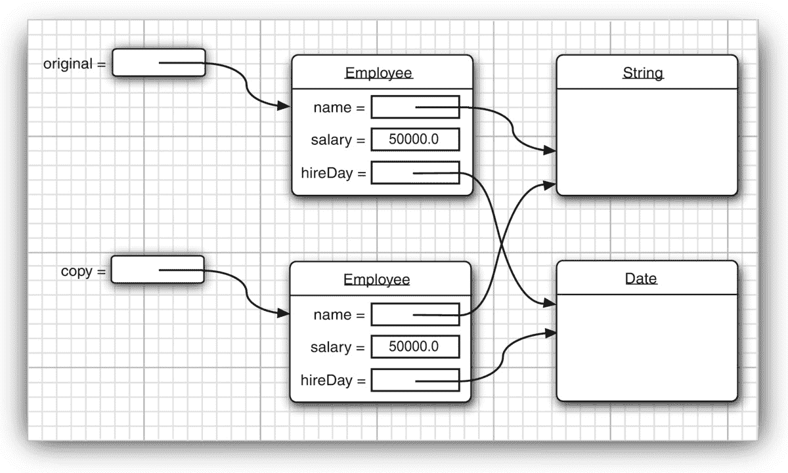浅拷贝

浅拷贝是否重要？这取决于情况。如果原始对象和浅克隆对象之间共享的子对象是不可变的（`immutable`），那么这种共享就是安全的。如果子对象属于一个不可变类（如 `String`），这种情况确实会发生。或者，子对象在对象的整个生命周期内可能保持不变，没有修改器触碰它，也没有方法返回它的引用。

然而，子对象通常是可变的，你必须重新定义 `clone` 方法以实现“深拷贝”（`deep copy`），将子对象也进行克隆。在我们的示例中，`hireDay` 字段是一个 `Date`，它是可变的，因此它也必须被克隆。（出于这个原因，此示例使用了 `Date` 类型的字段而不是 `LocalDate`，来演示克隆过程。如果 `hireDay` 是不可变类 `LocalDate` 的实例，则就不需要进一步的操作。）

对于每个类，你都需要决定：

1. 默认的 `clone` 方法足够足够；
2. 可以通过对可变子对象调用 `clone` 来修复默认的 `clone` 方法；或者
3. 不应尝试使用 `clone`。

第三种方案实际上是默认选项。要选择第一或第二种方案，类必须：

1. 实现 `Cloneable` 接口；并且
2. 使用 `public` 访问修饰符重新定义 `clone` 方法。

`clone` 方法在 `Object` 类中被声明为 `protected`，这样你的代码就不能简单调用 `anObject.clone()`。但 `protected` 方法不是可以从任何子类访问吗？而且每个类不都是 `Object` 的子类吗？幸运的是，受保护访问的规则要微妙得多（参见第 5 章）。子类调用受保护的 `clone` 方法仅用于克隆*自己的*对象。你必须将 `clone` 重新定义为 `public`，以便允许任何方法克隆对象。

Listing 6.4 中的程序克隆了 `Employee` 类的实例（Listing 6.5），然后调用了两个修改器方法。`raiseSalary` 方法改变 `salary` 字段的值，而 `setHireDay` 方法则改变 `hireDay` 字段的状态。这两个变动都没有影响原始对象，因为 `clone` 被定义为执行深拷贝。

所有数组类型都有一个 `clone` 方法，该方法是公共的，而不是保护的。你可以使用它创建一个包含所有元素拷贝的新数组。例如：

```java
int[] luckyNumbers = { 2, 3, 5, 7, 11, 13 };
int[] cloned = luckyNumbers.clone(); 
cloned[5] = 12; // 不改变 luckyNumbers[5]
```

`clone/CloneTest.java`


```java
package clone;

/**
 * 此程序演示了克隆。
 * @version 1.11 2018-03-16
 * @author Cay Horstmann
 */
public class CloneTest
{
   public static void main(String[] args) throws CloneNotSupportedException
   {
      var original = new Employee("John Q. Public", 50000);
      original.setHireDay(2000, 1, 1);
      Employee copy = original.clone();
      copy.raiseSalary(10);
      copy.setHireDay(2002, 12, 31);
      System.out.println("original=" + original);
      System.out.println("copy=" + copy);
   }
}
```

`clone/Employee.java`

```java
package clone;

import java.time.*;
import java.util.*;

public class Employee implements Cloneable
{
   private String name;
   private double salary;
   private Date hireDay;

   public Employee(String name, double salary)
   {
      this.name = name;
      this.salary = salary;
      hireDay = new Date();
   }

   public Employee clone() throws CloneNotSupportedException
   {
      // 调用 Object.clone()
      Employee cloned = (Employee) super.clone();

      // 克隆变量字段
      cloned.hireDay = (Date) hireDay.clone();

      return cloned;
   }

   /**
    * 将入职日期设置为指定的日期。
    * @param year 入职日的年份
    * @param month 入职日的月份
    * @param day 入职日的日期
    */
   public void setHireDay(int year, int month, int day)
   {
      long epochMillis = LocalDate.of(year, month, day)
            .atStartOfDay(ZoneId.systemDefault())
            .toEpochSecond() * 1000;

      // 实例字段变动的示例
      hireDay.setTime(epochMillis);
   }

   public void raiseSalary(double byPercent)
   {
      double raise = salary * byPercent / 100;
      salary += raise;
   }

   public String toString()
   {
      return "Employee[name=" + name + ",salary=" + salary + ",hireDay=" + hireDay + "]";
   }
}
```

## Lambda 表达式

在后续章节中，你将学习如何使用 lambda 表达式用简洁的语法定义代码块，以及如何编写使用 lambda 表达式的代码。

### 为什么使用 Lambda？

Lambda 表达式是一个代码块，你可以将其传递，以便在稍后执行（执行一次或多次）。在进入语法（甚至包括那个好奇的名字）之前，让我们回溯一下在 Java 中哪里使用过此类代码块。

在第 6.1.7 节中，你学习了如何按时间间隔执行任务。将任务放入 `ActionListener` 的 `actionPerformed` 方法中：

```java
class Worker implements ActionListener
{
   public void actionPerformed(ActionEvent event)
   {
      // 执行一些工作
   }
}
```

然后，当你想要重复执行这段代码时，你构建一个 `Worker` 类的实例。接着，将该实例提交给 `Timer` 对象。

关键点在于，`actionPerformed` 方法包含了你想要稍后执行的代码。

或者考虑使用自定义比较器进行排序。如果你想按长度而不是默认的字典顺序对字符串进行排序，可以向 `sort` 方法传递一个 `Comparator` 对象：

```java
class LengthComparator implements Comparator<String>
{
   public int compare(String first, String second)
   {
      return first.length() - second.length();
   }
}
. . .
Arrays.sort(strings, new LengthComparator());
```

`compare` 方法不会被立即调用。相反，`sort` 方法会不断调用 `compare` 方法，如果元素无序则重新排列元素，直到数组排序完成。你提供给 `sort` 方法了一段比较元素所需的代码片段，这段代码被集成到排序逻辑的其他部分中，而你可能并不想重新实现那些逻辑。

这两个示例有一个共同点：一个代码块被传递给了某人——定时器或 `sort` 方法。该代码块在稍后的某个时间被调用。

在 Java 的早期版本中，给某人传递代码块并不容易。你不能直接传递代码块。由于 Java 是一种面向对象的语言，你必须构造一个类来包含代码。在其他语言中，直接处理代码块是可能的。Java 长期以来一直拒绝添加这一功能。事实上，Java 的强大之处在于其简洁性。长期以来，问题并不是是否要增强 Java 的函数式编程，而是如何实现它。经过几年的实验，出现了一种适合 Java 的设计。在下一节中，你将看到如何在 Java 中处理代码块。

### Lambda 表达式的语法

再次考虑前节中的排序示例。我们传递代码检查一个字符串是否比另一个短。

```java
first.length() - second.length()
```

`first` 和 `second` 是什么？它们都是字符串。Java 是强类型语言，我们必须也指定：

```java
(String first, String second) ->
   first.length() - second.length()
```

你刚刚看到了第一个 lambda 表达式。这种表达式仅仅是一个代码块，连同必须传递的变量。

为什么叫这个名字？许多年前，在计算机出现之前，逻辑学家阿隆佐·丘奇（Alonzo Church）想要形式化什么是函数的有效计算的。（好奇的是，某些函数已知存在，但没人知道计算它们的值。）他使用希腊字母 lambda（λ）来标记参数。如果他知道 Java 的 API，他会写成：

```text
λfirst.λsecond.length() - second.length()
```

为什么用字母 λ？丘奇用光字母表的字母了吗？实际上，古老的《数学原理》使用 ^ 变音来表示自由变量，这启发了丘奇使用大写的 lambda Λ 作为参数。但最终他切换到了小写版本。从那时起，带有变量的表达式被称为 lambda 表达式。

你刚刚看到的 Java 中 lambda 表达式简单形式：参数、`->` 箭头和一个表达式。如果代码执行的是无法放入单个表达式的计算，请像写方法一样写它：封装在 `{}` 中并带有显式的 `return` 语句。例如：

```java
(String first, String second) ->
   {
      if (first.length() < second.length()) return -1;
      else if (first.length() > second.length()) return 1;
      else return 0;
   }
```

如果 lambda 表达式没有参数，你仍然需要提供空括号，就像无参数的方法一样：

```java
() -> { for (int i = 100; i >= 0; i--) System.out.println(i); }
```

如果 lambda 表达式的参数类型可以推断出来，你可以省略它们。例如：

```java
Comparator<String> comp =
   (first, second) // 等于 (String first, String second)
      -> first.length() - second.length();
```

在这里，编译器可以推断出 `first` 和 `second` 必须是字符串，因为该 lambda 表达式被赋值了一个字符串比较器。（我们将在下一节中详细讨论这种赋值。）

如果一个方法只有一个类型可推断的参数，你甚至可以省略括号：

```java
ActionListener listener = event ->
   System.out.println("The time is "
      + Instant.ofEpochMilli(event.getWhen()));
      // 而不是 (event) -> . . . 或 (ActionEvent event) -> . . .
```

你永远不需要指定 lambda 表达式的结果类型。它总是从上下文中推断出来的。例如，该表达式：

```java
(String first, String second) -> first.length() - second.length()
```

可以用在一个期望返回 `int` 类型的上下文中。

最后，你可以使用 `var` 来表示推断出的类型。这并不常见。该语法是为了附加注解而发明的（参见第 11 章）：

```java
(@NonNull var first, @NonNull var second) -> first.length() - second.length()
```

lambda 表达式在某些分支中返回值而在其他分支中不返回值是非法的。例如，`(int x) -> { if (x >= 0) return 1; }` 是无效的。

如果 lambda 表达式的参数从未被使用，你可以用下划线表示它：

```java
ActionListener listener = _ -> System.out.println("The action occurred at " + Instant.now());
Comparator<String> comp = (_, _) -> 0;
```

这是 Java 21 中的一个预览特性。

Listing 6.6 中的程序展示了如何使用 lambda 表达式作为比较器和监听器。

`lambda/LambdaTest.java`

```java
package lambda;

import java.util.*;

import javax.swing.*;
import javax.swing.Timer;

/**
 * 此程序演示了 lambda 表达式的使用。
 * @version 1.0 2015-05-12
 * @author Cay Horstmann
 */
public class LambdaTest
{
   public static void main(String[] args)
   {
      var planets = new String[] { "Mercury", "Venus", "Earth", "Mars",
         "Jupiter", "Saturn", "Uranus", "Neptune" };
      System.out.println(Arrays.toString(planets));
      System.out.println("Sorted in dictionary order:");
      Arrays.sort(planets);
      System.out.println(Arrays.toString(planets));
      System.out.println("Sorted by length:");
      Arrays.sort(planets, (first, second) -> first.length() - second.length());
      System.out.println(Arrays.toString(planets));

      var timer = new Timer(1000, event ->
         System.out.println("The time is " + new Date()));
      timer.start();

      // 保持程序运行直到用户选择 "OK"
      JOptionPane.showMessageDialog(null, "Quit program?");
      System.exit(0);
   }
}
```

### 函数接口

正如我们讨论的，Java 中有很多封装了代码块的现有接口，例如 `ActionListener` 或 `Comparator`。Lambda 与这些接口是兼容的。

每当你需要一个带有单个抽象方法的接口对象时，你都可以提供一个 lambda 表达式。这样的接口被称为*函数接口*（functional interface）。

你可能在好奇为什么函数接口必须有一个*抽象*方法。接口中的所有方法不都是抽象的吗？实际上，接口一直可以重新声明来自 `Object` 类的方法（如 `toString` 或 `clone`），而这些声明并不会使方法变为抽象的。（Java API 中的某些接口重新声明 `Object` 方法是为了附加 Javadoc 注释。查看 `Comparator` API 示例即可。）更重要的是，正如你在第 6.1.5 节中所看到的，接口可以声明非抽象方法。

为了演示向函数接口的转换，考虑 `Arrays.sort` 方法。它的第二个参数需要一个 `Comparator` 实例，这是一个只有一个方法的接口。只需提供一个 lambda 即可：

```java
Arrays.sort(words,
   (first, second) -> first.length() - second.length());
```

在底层，`Arrays.sort` 方法接收一个实现了 `Comparator<String>` 的类的对象。在该对象上调用 `compare` 方法会执行 lambda 表达式的体。这些对象和类的管理完全取决于实现，而且它比使用传统的内部类要高效得多。最好的想法是将 lambda 表达式看作一个函数而不是一个对象，并接受它可以被传递给函数接口。

这种向接口的转换正是 lambda 表达式变得如此迷人的原因。语法简洁简单。这里是另一个例子：

```java
var timer = new Timer(1000, event ->
   {
      System.out.println("At the tone, the time is "
         + Instant.ofEpochMilli(event.getWhen()));
      Toolkit.getDefaultToolkit().beep();
   });
```

这比使用实现 `ActionListener` 接口的类替代方案要易读得多。

等待，让我们重新检查提供的文本。

### 函数类型

Java API 在 `java.util.function` 包中定义了许多泛型函数接口。其中一个接口 `BiFunction<T, U, R>` 描述具有参数类型 `T` 和 `U` 以及返回类型 `R` 的函数。你可以将字符串 lambda 保存到该类型的变量中：

```java
BiFunction<String, String, Integer> comp =
   (first, second) -> first.length() - second.length();
```

注意，这个接口无法帮助排序。`Arrays.sort` 方法并不这样做。如果你之前使用过函数式语言，可能会觉得这奇怪。但对于 Java 程序员来说，这很自然。像 `Comparator` 这样的接口有特定的目的，不仅仅是方法。当你想要使用 lambda 表达式时，仍然想要记住表达式的目的，并为其拥有特定的函数接口。

`java.util.function` 包中一个非常有用的接口是 `Predicate`：

```java
public interface Predicate<T>
{
   boolean test(T t);
   // 额外的默认和静态方法
}
```

`ArrayList` 类有一个 `removeIf` 方法，其参数是 `Predicate`。它专门设计用于传递 lambda 表达式。例如，以下语句删除了列表中所有的 `null` 值：

```java
list.removeIf(e -> e == null);
```

另一个有用的函数接口是 `Supplier<T>`：

```java
public interface Supplier<T>
{
   T get();
}
```


`supplier` 没有参数，并在调用时产生类型为 `T` 的值。`supplier` 用于延迟求值（lazy evaluation）。例如，考虑调用：

```java
LocalDate hireDay = Objects.requireNonNullElse(day,
   LocalDate.of(1970, 1, 1));
```

这不是最优的。我们预计 `day` 很少为 `null`，所以只在需要时构造默认的 `LocalDate`。通过使用 `supplier`，我们可以推迟计算：

```java
LocalDate hireDay = Objects.requireNonNullElseGet(day,
   () -> LocalDate.of(1970, 1, 1));
```

`requireNonNullElseGet` 方法只在需要时才调用 `supplier`。

涉及原始类型的函数式接口有点繁琐。考虑一个消耗 `int` 类型并产生 `T` 类型对象的函数。你可以使用 `Function<Integer, T>`，但这样在每次调用时必须对参数进行装箱。相反，有一个名为 `IntFunction<T>` 的函数式接口。同样地，如果函数的返回值类型为 `int`，那么 `ToIntFunction<T>` 接口比 `Function<T, Integer>` 更高效。最后，如果参数和返回值都是 `int`，则有一个 `IntUnaryOperator` 接口。

作为 API 的使用者，你通常并不关心这种细微差别。考虑 `Arrays.setAll` 方法。它将数组的所有值设置为某个函数的结果，该函数的参数是数组的索引。在这里，我们将所有元素设置为索引的平方：

```java
var values = new int[100];
Arrays.setAll(values, i -> i * i); // [0, 1, 4, 9, 16, . . ., 9801]
```

`setAll` 提供了针对 `int[]`、`long[]`、`double[]` 以及泛型数组 `T[]` 的重载版本。这里，`int[]` 的重载版本第二个参数是一个 `IntUnaryOperator`。但作为方法的使用者，你并不关心。你只需要提供 lambda 表达式，而无需担心原始类型与其包装类之间的区别。

lambda 表达式可以匹配函数式接口中的原始类型和包装类型，这很棒。但如果两种匹配都可能发生，就会出错。考虑一个提供这些方法的工具类：

```java
public static int[] fill(int n, IntUnaryOperator op) 
public static Object[] fill(int n, IntFunction<Object> op)
```

调用 `fill(n, i -> i * i)` 将无法编译，因为它是歧义的。

你可以通过使用 `-Xlint` 或 `-Xlint:overloads` 标志编译，并在 API 中捕捉此类问题。

## 方法引用

有时，lambda 表达式涉及单个方法。例如，假设你只想在定时器事件发生时打印事件对象。当然，你可以调用：

```java
var timer = new Timer(1000, event -> System.out.println(event));
```

如果能直接将 `println` 方法传递给 `Timer` 构造函数就更好。以下是实现方法：

```java
var timer = new Timer(1000, System.out::println);
```

表达式 `System.out::println` 是一个方法引用。它引导编译器产生函数式接口的实例，通过重写接口的单个抽象方法来调用给定的方法。在这个示例中，产生了一个 `ActionListener`，其 `actionPerformed(ActionEvent e)` 方法调用了 `System.out.println(e)`。

和 lambda 表达式一样，方法引用并不是对象。当它被赋值给类型为函数式接口的变量时，才会产生一个对象。

`PrintStream` 类中有十个重载的 `println` 方法（`System.out` 就是它的一个实例）。编译器需要根据上下文确定使用哪一个。在我们的示例中，方法引用 `System.out::println` 必须转换为具有以下方法的 `ActionListener` 实例：

```java
void actionPerformed(ActionEvent e)
```

从十个重载的 `println` 方法中选择了 `println(Object x)`，因为 `Object` 是 `ActionEvent` 的最佳匹配。当调用 `actionPerformed` 方法时，就会打印事件对象。

现在假设我们将相同的方法引用分配给不同的函数式接口：

```java
Runnable task = System.out::println;
```

`Runnable` 函数式接口有一个没有参数的单个抽象方法：

```java
void run()
```

在这种情况下，选择了无参数的 `println()` 方法。调用 `task.run()` 会向 `System.out` 打印一个空行。

另一个例子是假设你想忽略字母大小写对字符串进行排序。你可以传递这个方法表达式：

```java
Arrays.sort(strings, String::compareToIgnoreCase)
```

从这些示例可以看出，`::` 操作符将方法与对象或类的名称分开。有三种变体：

1. `object::instanceMethod`
2. `Class::instanceMethod`
3. `Class::staticMethod`

在第一种变体中，方法引用等同于一个将参数传递给方法的 lambda 表达式。在 `System.out::println` 的情况下，对象是 `System.out`，方法表达式等同于 `x -> System.out.println(x)`。

在第二种变体中，第一个参数变成方法的隐式参数。例如，`String::compareToIgnoreCase` 等同于 `(x, y) -> x.compareToIgnoreCase(y)`。

在第三种变体中，所有参数都传递给静态方法。例如，`Math::pow` 等同于 `(x, y) -> Math.pow(x, y)`。

注意，lambda 表达式只有当它的主体调用单个方法时才能重写为方法引用。考虑这个 lambda 表达式：

```java
s -> s.length() == 0
```

### 方法引用示例

| 方法引用 | 等效 Lambda 表达式 | 注意 |
| :--- | :--- | :--- |
| `separator::equals` | `x -> separator.equals(x)` | 这是方法引用。参数是显式的。 |
| `String::strip` | `x -> x.strip()` | 这是实例方法。lambda 参数是隐式的。 |
| `String::concat` | `(x, y) -> x.concat(y)` | 再次，是实例方法，但这里有两个参数。 |
| `Integer::valueOf` | `x -> Integer.valueOf(x)` | 这是静态方法。lambda 参数是隐式的。 |
| `Integer::sum` | `(x, y) -> Integer.sum(x, y)` | 这是另一个静态方法，但这里有两个参数。 |
| `String::new` | `x -> new String(x)` | 这是构造引用——参见第 6.2 节。 |
| `String[]::new` | `n -> new String[n]` | 这是数组构造引用——参见第 6.2 节。 |

带有对象的方法引用与其等效的 lambda 表达式之间存在微差异。考虑类似 `separator::equals` 的方法引用。如果 `separator` 为 `null`，形成 `separator::equals` 会立即抛出 `NullPointerException`。而 lambda 表达式 `x -> separator.equals(x)` 只在被调用时才会抛出 `NullPointerException`。

你可以在方法引用中捕获 `this` 参数。例如，`this::equals` 等于 `x -> this.equals(x)`。使用 `super` 也是有效的。方法表达式：

```java
super::instanceMethod
```

使用 `this` 作为目标并调用给定方法的父类版本。这里有一个展示其机制的虚拟示例：

```java
class Greeter
{
   public void greet(ActionEvent event)
   {
      System.out.println("Hello, the time is " 
         + Instant.ofEpochMilli(event.getWhen()));
   }
}

class RepeatedGreeter extends Greeter
{
   public void greet(ActionEvent event)
   {
      var timer = new Timer(1000, super::greet);
      timer.start();
   }
}
```

当 `RepeatedGreeter.greet` 方法启动时，会构造一个 `Timer`，它在每次计时器触发时执行 `super::greet` 方法。

## 构造函数引用

构造函数引用与方法引用相似，不同之处在于方法名为 `new`。例如，`Person::new` 是 `Person` 构造函数的引用。是哪一个构造函数？取决于上下文。假设你有一个字符串列表。那么你可以通过在每个字符串上调用构造函数，将其转换为 `Person` 对象的数组，其调用方式如下：

```java
ArrayList<String> names = . . .;
Stream<Person> stream = names.stream().map(Person::new);
List<Person> people = stream.toList();
```

我们将在第二卷第 1 章中讨论 `stream`、`map` 和 `toList` 方法的细节。现在，重要的是 `map` 方法为列表中的每个元素调用 `Person(String)` 构造函数。如果有多个 `Person` 构造函数，编译器会选择带有 `String` 参数的那个，因为它从上下文推断出构造函数是带字符串调用的。

你可以使用数组类型创建构造函数引用。例如，`int[]::new` 是一个有一个参数的构造函数引用：数组的长度。它等于 lambda 表达式 `n -> new int[n]`。

数组构造函数引用有助于克服 Java 的一个局限。正如你在第 8 章中所示，无法构造泛型 `T` 的数组。（表达式 `new T[n]` 是错误的，因为它会被“擦除”为 `new Object[n]`）。对于库作者来说这是一个问题。例如，假设我们需要一个 `Person` 对象的数组。`Stream` 接口有一个 `toArray` 方法可以返回一个 `Object` 数组：

```java
Object[] people = stream.toArray();
```

但这并不令人满意。用户想要的是 `Person` 的引用数组，而不是 `Object` 的引用数组。流处理库通过构造函数引用解决了这个问题。将 `Person[]::new` 传递给 `toArray` 方法：

```java
Person[] people = stream.toArray(Person[]::new);
```

`toArray` 方法调用此构造函数以获取正确类型的数组。然后填充并返回该数组。

有时，在传递方法或构造函数引用时，选择了哪个重载变体会令人惊讶。考虑这段代码片段：

```java
var dates = new Date[100];
Arrays.setAll(dates, Date::new);
```

乍一看，所有元素似乎通过每次调用无参构造函数 `new Date()` 来被设置为当前日期。但实际上，`setAll` 的第二个参数是一个 `IntFunction`，它接收元素的索引。因此，调用的是一个完全不同的构造函数 `new Date(i)`，其中 `i` 的范围从 0 到 99。该构造函数将日期设置为从“纪元”（1970 年 1 月 1 日）起的给定毫秒数。

## 变量作用域

通常，你希望在 lambda 表达式中访问闭包方法或类中的变量。考虑这个示例：

```java
public static void repeatMessage(String text, int delay)
{
   ActionListener listener = event ->
      {
         System.out.println(text);
         Toolkit.getDefaultToolkit().beep();
      };
   new Timer(delay, listener).start();                  
}
```

考虑一个调用：

```java
repeatMessage("Hello", 1000); // 每 1,000 毫秒打印 Hello
```

现在看 lambda 表达式内部的变量 `text`。注意，该变量并没有在 lambda 表达式中定义。相反，它是 `repeatMessage` 方法的参数变量。

如果你仔细考虑，这里发生了一些非显而易见的事情。lambda 表达式的代码可能在 `repeatMessage` 返回且参数变量消失很久之后运行。`text` 变量是如何留存的？

为了理解发生了什么，我们需要完善对 lambda 表达式的理解。一个 lambda 表达式包含三个要素：

1. 一块代码
2. 参数
3. 自由变量的值——即既不是参数也没有定义在代码内部的变量

在我们的示例中，lambda 表达式有一个自由变量 `text`。我们说这种值被捕获了（captured）。代码块与自由变量值结合在一起的技术术语称为闭包（closure）。如果有人吹嘘他们的语言有闭包，请放心，Java 也有。在 Java 中，lambda 表达式就是闭包。

正如你所见，lambda 表达式可以捕获封装作用域中变量的值。在 Java 中，为了确保捕获的值定义良好，有一个重要的限制。在 lambda 表达式中，只能引用值不变化的变量。例如，以下代码是非法的：

```java
public static void countDown(int start, int delay)
{
   ActionListener listener = event ->
      {
         start--; // 错误：不能修改捕获的变量
         System.out.println(start);
      };
   new Timer(delay, listener).start();
}
```

这种限制是有原因的。当并发执行操作时，修改 lambda 表达式中的变量是不安全的。到目前为止的操作不会发生这种情况，但通常这是一个严重的问题。关于这一重要问题的更多信息，请参第 10 章。

在 lambda 表达式中引用外部修改的变量也是非法的。例如，以下代码是非法的：

```java
public static void repeat(String text, int count)
{
   for (int i = 1; i <= count; i++)
   {
      ActionListener listener = event ->
         {
            System.out.println(i + ": " + text);
               // 错误：无法引用正在变化的 i
         };
      new Timer(1000, listener).start();
   }
}
```

规则是，lambda 表达式中任何捕获的变量必须是事实上的常量（effectively final）。事实上的常量是指初始化后从未被赋值过新值的变量。在我们的案例中，`text` 始终引用同一个 `String` 对象，因此捕获它是可以的。然而，`i` 的值被修改了，因此 `i` 不能被捕获。

lambda 表达式具有与嵌套块相同的作用域。相同的命名冲突和隐藏规则同样适用。在 lambda 中声明与局部变量同名的参数或局部变量是非法的。

```java
Path first = Path.of("/usr/bin");
Comparator<String> comp =
   (first, second) -> first.length() - second.length();
   // ERROR: Variable first already defined
```

在方法内部，你不能拥有两个同名的局部变量，因此你也不能在 lambda 表达式中引入这样的变量。

当你在 lambda 表达式中使用 `this` 关键字时，你指的是创建该 lambda 表达式的方法的 `this` 参数。例如，考虑：

```java
public class Application
{
   public void init()
   {
      ActionListener listener = event ->
         {
            System.out.println(this.toString());
            . . .
         }
      . . .
   }
}
```


表达式 `this.toString()` 调用的是 `Application` 对象的 `toString` 方法，而不是 `ActionListener` 实例。在 lambda 表达式中使用 `this` 并没有什么特殊之处。lambda 表达式的作用域嵌套在 `init` 方法内部，`this` 在该方法的任何地方都具有相同的含义。

### 处理 Lambda 表达式

到此为止，你已经了解了如何产生 lambda 表达式并将其传递给期望函数式接口的方法。现在，让我们看看如何编写可以消费 lambda 表达式的方法。

使用 lambda 的要点在于**延迟执行**。毕竟，如果你想现在执行某些代码，你会直接执行，而不会将其封装在 lambda 内部。以后执行代码有许多原因，例如：

- 在单独线程中运行代码
- 多次运行代码
- 在算法的正确点运行代码（例如排序中的比较操作）
- 在某些事件发生时运行代码（按钮被点击、数据到达等）
- 仅在需要时运行代码

让我们来看一个简单的例子。假设你想重复执行一个操作 `n` 次。该操作和计数被传递给一个 `repeat` 方法：

```java
repeat(10, () -> System.out.println("Hello, World!"));
```

为了接受这个 lambda，我们需要选择（或在少数情况下提供）一个函数式接口。表 6.2 列出了 Java API 中提供的最重要的函数式接口。在这种情况下，我们可以使用 `Runnable` 接口：

```java
public static void repeat(int n, Runnable action)
{
   for (int i = 0; i < n; i++) action.run(); 
}
```

注意，lambda 表达式的主体在调用 `action.run()` 时被执行。

现在，让这个例子变得复杂一点。我们想告诉操作它发生在哪一次迭代中。为此，我们需要选择一个具有带有 `int` 参数和 `void` 返回值的方法的函数式接口。处理 `int` 值的标准接口是：

```java
public interface IntConsumer
{
   void accept(int value);
}
```

这是改进后的 `repeat` 方法：

```java
public static void repeat(int n, IntConsumer action)
{
   for (int i = 0; i < n; i++) action.accept(i); 
}
```

以下是调用它的方式：

```java
repeat(10, i -> System.out.println("Countdown: " + (9 - i)));
```

### 常见函数式接口

| 函数式接口 | 参数类型 | 返回类型 | 抽象方法名 | 描述 | 其他方法 |
| --- | --- | --- | --- | --- | --- |
| `Runnable` | 无 | `void` | `run` | 执行无参数或无返回值的操作 | |
| `Supplier<T>` | 无 | `T` | `get` | 提供一个类型为 `T` 的值 | |
| `Consumer<T>` | `T` | `void` | `accept` | 消费类型为 `T` 的值 | `andThen` |
| `BiConsumer<T, U>` | `T`, `U` | `void` | `accept` | 消费类型为 `T` 和 `U` 的值 | `andThen` |
| `Function<T, R>` | `T` | `R` | `apply` | 参数类型为 `T` 的函数 | `compose`, `andThen`, `identity` |
| `BiFunction<T, U, R>` | `T`, `U` | `R` | `apply` | 参数类型为 `T` 和 `U` 的函数 | `andThen` |
| `UnaryOperator<T>` | `T` | `T` | `apply` | 类型为 `T` 的一元运算符 | `compose`, `andThen`, `identity` |
| `BinaryOperator<T>` | `T`, `T` | `T` | `apply` | 类型为 `T` 的二元运算符 | `andThen`, `maxBy`, `minBy` |
| `Predicate<T>` | `T` | `boolean` | `test` | 一个返回布尔值的函数 | `and`, `or`, `negate`, `isEqual`, `not` |
| `BiPredicate<T, U>` | `T`, `U` | `boolean` | `test` | 带有两个参数的布尔值函数 | `and`, `or`, `negate` |

表 6.3 列出了针对基本类型 `int`、`long` 和 `double` 的 34 个可用特化类型。如你在第 8 章中所示，使用这些特化类型比泛型接口更高效。因此，在前节的示例中，我使用了 `IntConsumer` 而不是 `Consumer<Integer>`。

### 基本类型的函数式接口

`p`、`q` 是 `int`、`long`、`double`；`P`、`Q` 是 `Int`、`Long`、`Double`。

| 函数式接口 | 参数类型 | 返回类型 | 抽象方法名 |
| --- | --- | --- | --- |
| `BooleanSupplier` | 无 | `boolean` | `getAsBoolean` |
| `PSupplier` | 无 | `p` | `getAs` |
| `PCConsumer` | `p` | `void` | `accept` |
| `ObjPConsumer<T>` | `T`、`p` | `void` | `accept` |
| `PFunction<T>` | `p` | `T` | `apply` |
| `PToQFunction` | `p` | `q` | `apply` |
| `ToQFunction<T>` | `T`、`p` | `q` | `apply` |
| `BiFunction<T, U>` | `T`、`U` | `R` | `apply` |
| `UnaryOperator<T>` | `T` | `T` | `apply` |
| `BinaryOperator<T>` | `T`、`T` | `T` | `apply` |

Java API 的设计者速度不够快。他们只有一次机会把这件事做对——在 Java 8 中，当 `java.util.function.Function` 接口被添加到 API 时。在此之前，没有人可以为自己的类添加一个 `transform(java.util.function.Function)` 方法。但到了 Java 12，已经太晚了。某个某处的某人可能已经在他们的类中定义了 `transform(java.util.function.Function)`，并且具有不同的含义。诚然，这种情况不太可能发生过，但无法得知。

这就是 Java 的工作方式。它严肃对待自己的承诺，并且不会为了方便而背弃它们。

## 创建比较器（Comparators）

`Comparator` 接口有许多方便的静态方法用于创建比较器。这些方法旨在与 lambda 表达式或方法引用配合。

静态方法 `comparing` 接收一个键提取函数，该函数将类型 `T` 映射到一个可比较的类型（例如 `String`）。该函数被应用于要比较的对象，然后对返回的键进行比较。例如，假设你有一个 `Person` 对象的数组。以下是如何按名称对它们进行排序：

```java
Arrays.sort(people, Comparator.comparing(Person::getName));
```

这显然比手动实现 `Comparator` 要简单得多。此外，代码更加清晰，因为显而易见我们想按名称比较人员。

你可以使用 `thenComparing` 方法链用比较器来处理平局。例如：

```java
Arrays.sort(people,
   Comparator.comparing(Person::getLastName)
      .thenComparing(Person::getFirstName));
```

如果两个人的姓氏相同，则使用第二个比较器。

这些方法有几种变体。你可以指定一个比较器，用于 `comparing` 和 `thenComparing` 方法提取的键。例如，这里我们按名字的长度对人员进行排序：

```java
Arrays.sort(people, Comparator.comparing(Person::getName,
   (s, t) -> Integer.compare(s.length(), t.length())));
```

此外，`comparing` 和 `thenComparing` 方法都有变体，可以避免 `int`、`long` 或 `double` 值的装箱（boxing）：

```java
Arrays.sort(people, Comparator.comparing(Person::getName,
   Comparator.comparingInt(String::length)))
```

产生上述操作的一种较短但可能不优雅的方法是：

```java
Arrays.sort(people, Comparator.comparingInt(p -> p.getName().length()));
```

如果你的键函数可以返回 `null`，你会喜欢 `nullsFirst` 和 `nullsLast` 适配器。这些静态方法接收一个现有的比较器并对其进行修改，使其在遇到 `null` 值时不会抛出异常，而是将其排为比普通值更小或更大。例如，假设当人没有中间名时，`getMiddleName` 返回 `null`。那么你就可以使用 `Comparator.comparing(Person::getMiddleName, Comparator.nullsFirst(...))`。

`nullsFirst` 方法需要一个比较器——在这种情况下，它是一个比较两个字符串的比较器。`naturalOrder` 方法为任何实现 `Comparable` 的类创建一个比较器。我们需要的是 `Comparator.<String>naturalOrder()`。（请参见第 8 章以了解该语法。幸运的是，泛型类型通常可以推断。）这里是按可能为空的中间名排序的完整调用。我使用了 `java.util.Comparator.*` 的静态导入，使表达式更具可读性。

```java
Arrays.sort(people, comparing(Person::getMiddleName, nullsFirst(naturalOrder())));
```

静态方法 `reverseOrder` 提供自然顺序的反序。要反转任何比较器，请使用实例方法 `reversed`。例如，`naturalOrder().reversed()` 等同于 `reverseOrder()`。

## 内部类（Inner Classes）

内部类是定义在另一个类内部的类。为什么你想这样做呢？有两个原因：

- 内部类可以对同一包中的其他类隐藏。
- 内部类方法可以访问其定义所在作用域的数据——包括那些其他情况下是私有的（private）数据。

内部类曾经对于简洁地实现回调非常重要，但现在 lambda 表达式做得好得多。尽管如此，内部类对于结构化你的代码仍然有用。接下来的章节将带你了解所有细节。

C++ 拥有嵌套类（nested classes）。嵌套类包含在外部类的作用域内。这是一个典型的例子：链表类定义了一个嵌套类来持有节点。

```cpp
template<typename T>
class LinkedList
{
public:
   class Node // 一个嵌套类
   {
   public:
      . . .
   private:
      T data;
      Node* next;
   };
   . . .
private:
   Node* head;
   Node* tail;
};
```

嵌套类与 Java 的内部类相似。然而，Java 的内部类还有一个功能，使得它们比 C++ 的嵌套类更丰富、更有用。来自内部类的对象对实例化它的外部对象有一个隐式引用。通过这个指针，它获得了外部对象的完整状态。例如，在 Java 中，`Iterator` 类不需要指向它所属的 `LinkedList` 的显式指针。

在 Java 中，声明为 `static` 的嵌套类没有这个额外的指针。它们是 C++ 嵌套类的 Java 类比。

### 使用内部类访问对象状态

内部类的语法相当复杂。出于这个原因，我展示了一个简单但有些人为的示例来演示内部类的使用。让我们重构 `TimerTest` 示例并提取 `TalkingClock` 类。时钟构造函数有两个参数：告报间隔和一个开启或关闭响声的标志。

```java
public class TalkingClock
{
   private int interval;
   private boolean beep;

   public TalkingClock(int interval, boolean beep) { . . . }
   public void start() { . . . }

   public class TimePrinter implements ActionListener
      // 一个内部类
   {
      . . .
   }
}
```

注意 `TimePrinter` 类现在位于 `TalkingClock` 类内部。这并不意味着每个 `TalkingClock` 都有一个 `TimePrinter` 实例字段。正如你将看到的，`TimePrinter` 对象是由 `TalkingClock` 类的方法构造的。

这里是详细的 `TimePrinter` 类。注意 `actionPerformed` 方法在发出响声之前检查 `beep` 标志。

```java
public class TimePrinter implements ActionListener
{
   public void actionPerformed(ActionEvent event)
   {
      System.out.println("At the tone, the time is "
         + Instant.ofEpochMilli(event.getWhen()));
      if (beep) Toolkit.getDefaultToolkit().beep();
   }
}
```

发生了一些令人惊讶的事情。`TimePrinter` 类没有名为 `beep` 的实例字段或变量。相反，`beep` 指向创建此 `TimePrinter` 的 `TalkingClock` 对象的字段。正如你看到的，内部类方法可以访问它自己的实例字段以及创建它的外部对象的字段。

为了使其工作，内部类的对象总是获得创建它的对象的隐式引用（参见图 6.3）。

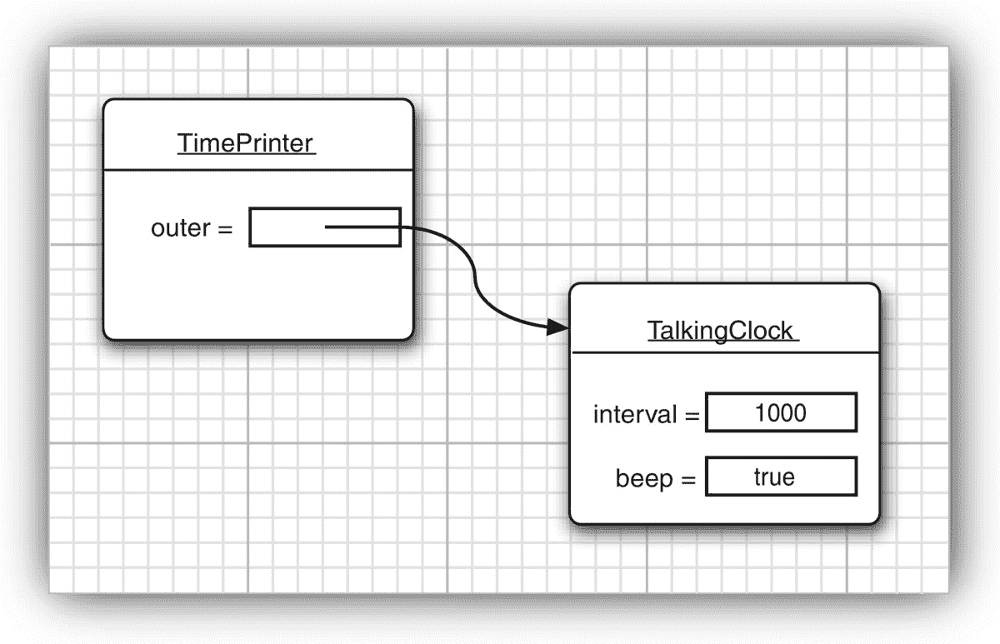

内部类对象对外部类对象有一个引用。

这个引用在内部类的定义中是不可见的。然而，为了说明这个概念，我们将指向外部对象的引用命名为 `outer`。那么 `actionPerformed` 方法等同于以下：

```java
public void actionPerformed(ActionEvent event)
{
   System.out.println("At the tone, the time is "
      + Instant.ofEpochMilli(event.getWhen()));
   if (outer.beep) Toolkit.getDefaultToolkit().beep();
}
```

外部类引用在构造函数中设置。编译器会修改所有内部类的构造函数，添加一个用于外部类引用的参数。`TimePrinter` 类没有定义构造函数；因此，编译器会合成一个无参数构造函数，生成如下代码：

```java
public TimePrinter(TalkingClock clock) // 自动生成的代码
{
   outer = clock;
}
```

再次请注意，`outer` 并不是 Java 关键字。我们只是用它来说明内部类涉及的机制。

当在 `start` 方法中构造 `TimePrinter` 对象时，编译器会将当前说话闹钟的 `this` 引用传递给构造函数：

```java
var listener = new TimePrinter(this); // 自动添加了参数
```

Listing 6.7 显示了测试内部类的完整程序。再次查看访问控制。如果 `TimePrinter` 类是一个普通类，那么它将需要通过 `TalkingClock` 类的公共方法来访问 `beep` 标志。使用内部类是一种改进。没有必要提供仅对另一个类感兴趣的访问器。

我们可以将 `TimePrinter` 类声明为 `private`。这样只有 `TalkingClock` 方法能够构造 `TimePrinter` 对象。只有内部类可以是私有的。普通类始终具有包级或公有的访问权限。

`innerClass/InnerClassTest.java`


```java
package innerClass;

import java.awt.*;
import java.awt.event.*;
import java.time.*;

import javax.swing.*;

/**
 * 该程序演示了内部类的用法。
 * @version 1.11 2017-12-14
 * @author Cay Horstmann
 */
public class InnerClassTest
{
   public static void main(String[] args)
   {
      var clock = new TalkingClock(1000, true);
      clock.start();

      // 保持程序运行直到用户选择 "OK"
      JOptionPane.showMessageDialog(null, "Quit program?");
      System.exit(0);
   }
}

/**
 * 一个按固定间隔打印时间的闹钟。
 */
class TalkingClock
{
   private int interval;
   private boolean beep;

   /**
    * 构造一个说话闹钟。
    * @param interval 消息之间的间隔（毫秒）
    * @param beep 如果闹钟应该响则为 true
    */
   public TalkingClock(int interval, boolean beep)
   {
      this.interval = interval;
      this.beep = beep;
   }

   /**
    * 启动闹钟。
    */
   public void start()
   {
      var listener = new TimePrinter();
      var timer = new Timer(interval, listener);
      timer.start();
   }

   public class TimePrinter implements ActionListener
   {
      public void actionPerformed(ActionEvent event)
      {
         System.out.println("At the tone, the time is " 
            + Instant.ofEpochMilli(event.getWhen()));
         if (beep) Toolkit.getDefaultToolkit().beep();
      }
   }
}
```

### 内部类的特殊语法规则

在上一节中，我们通过调用`outer`解释了内部类的外部类引用。实际上，外部引用的正确语法要复杂得多。表达式：

```
OuterClass.this
```

表示外部类引用。例如，你可以这样写`TimePrinter`内部类的`actionPerformed`方法：

```java
public void actionPerformed(ActionEvent event)
{
   . . .
   if (TalkingClock.this.beep) Toolkit.getDefaultToolkit().beep();
}
```

相反，你可以使用以下语法更显式地编写内部对象构造函数：

```
outerObject.new InnerClass(construction arguments)
```

例如：

```java
ActionListener listener = this.new TimePrinter();
```

在这里，新构造的`TimePrinter`对象的外部类引用设置为创建内部类对象的方法的`this`引用。这是最常见的情况。像既往一样，`this.`修饰符是冗余的。然而，也可以通过显式命名来将外部类引用设置为另一个对象。例如，由于`TimePrinter`是一个公共内部类，你可以为任何说话闹钟构造一个`TimePrinter`：

```java
var jabberer = new TalkingClock(1000, true);
TalkingClock.TimePrinter listener = jabberer.new TimePrinter();
```

注意，当内部类出现在外部类作用范围之外时，你将其引用为：

```
OuterClass.InnerClass
```

从 Java 16 开始，内部类可以拥有`static`成员。在此之前，内部类中不允许`static`方法，且在内部类中声明的静态字段必须是`final`并用编译时常量初始化。

内部类的静态方法可以访问内部类或包含类的静态字段和方法。

### 内部类有用吗？真的必要吗？安全吗？

当内部类在 Java 1.1 加入 Java 语言时，许多程序员认为它们是一项重大的新特性，这与 Java 比 C++ 更简单的哲学格格不入。内部类的语法不可否认地是复杂的。（在本章稍后我们学习匿名内部类时，它会变得更复杂）。并不清楚内部类如何与语言的其他特性（如访问控制和安全性）交互。

内部类被翻译为普通的类文件，用`$`（美元符号）分隔外部类和内部类名。例如，`TalkingClock`类内部的`TimePrinter`类会被翻译为`TalkingClock$TimePrinter`。再次查看访问控制。如果`TimePrinter`类是一个普通类，它将需要通过`TalkingClock`类的公共方法来访问`beep`标志。使用内部类是一种改进。没有必要提供仅对另一个类感兴趣的访问器。

我们可以将`TimePrinter`类声明为`private`。这样只有`TalkingClock`方法能够构造`TimePrinter`对象。只有内部类可以是私有的。普通类始终具有包级或公有的访问权限。

内部类被翻译为普通的类文件，用`$`（美元符号）分隔外部类和内部类名。例如，`TalkingClock`类内部的`TimePrinter`类会被翻译为`TalkingClock$TimePrinter`。为了看到这一点，尝试第 5 章中的`ReflectionTest`程序并使用`javap`工具。如果你使用 UNIX，在提供类名时要转义`$`字符。即，运行`ReflectionTest`：

```bash
javap -private ClassName
```

或者：

```bash
javap -private innerClass.\$TimePrinter
```

你将得到以下输出：

```java
public class innerClass.TalkingClock$TimePrinter
      implements java.awt.event.ActionListener
{
   final innerClass.TalkingClock this$0;
   public innerClass.TalkingClock$TimePrinter(innerClass.TalkingClock);
   public void actionPerformed(java.awt.event.ActionEvent);
}
```

你可以清楚看到编译器生成了一个额外的实例字段`this$0`，用于指向外部类的引用。（`this$0`名称由编译器合成——你无法在代码中引用它）。你还可以看到构造函数中的`TalkingClock`参数。

从 Java 18 开始，`this$0`字段只在实际需要时才提供。如果内部类的方法没有访问外部类，它会被丢弃。

如果编译器可以自动做到，你难道不能手动编写相同的机制吗？让我们尝试。我们将`TimePrinter`变为`TalkingClock`类之外的普通类。在构造`TimePrinter`对象时，我们将创建它的对象的`this`引用传递给它。

```java
class TalkingClock
{
   . . .
   public void start()
   {
      var listener = new TimePrinter(this);
      var timer = new Timer(interval, listener);
      timer.start();
   }
}

class TimePrinter implements ActionListener
{
   private TalkingClock outer;
   . . .
   public TimePrinter(TalkingClock clock)
   {
      outer = clock;
   }
}
```

现在让我们看看`actionPerformed`方法。它需要访问`outer.beep`。

```java
if (outer.beep) . . . // 错误
```

在这里我们遇到了问题。内部类可以访问外部类的私有数据，但我们的外部`TimePrinter`类却不能。

因此，内部类确实比普通类更强大，因为它们拥有更多的访问权限。

### 局部内部类

如果你仔细观察`TalkingClock`示例代码，你会发现你只需要使用一次`TimePrinter`类型的名称：即在`start`方法中创建该类型的对象时。

在这种情况下，你可以将类局部定义在单个方法内部。

```java
public void start()
{
   class TimePrinter implements ActionListener
   {
      public void actionPerformed(ActionEvent event)
      {
         System.out.println("At the tone, the time is " + Instant.ofEpochMilli(event.getWhen()));
         if (beep) Toolkit.getDefaultToolkit().beep();
      }
   }

   var listener = new TimePrinter();
   var timer = new Timer(interval, listener);
   timer.start();
}
```

局部类（Local classes）永远不会使用访问修饰符声明（即`public`或`private`）。它们的作用域始终被限制在声明它们的代码块中。

局部类有一个巨大的优势：它们对外部世界完全隐形——即使是`TalkingClock`类中的其他代码无法访问它们。除了`start`方法外，没有任何方法对`TimePrinter`类一无所知。

### 从外部方法访问变量

局部类相比于其他内部类还有另一个优势。它们不仅可以访问外部类的字段，甚至可以访问局部变量！然而，这些局部变量必须是有效`final`（effectively final）。这意味着，一旦被赋值，它们就永远不会改变。

这是一个典型的例子。我们将`interval`和`beep`参数从`TalkingClock`构造函数移动到`start`方法。

```java
public void start(int interval, boolean beep)
{
   class TimePrinter implements ActionListener
   {
      public void actionPerformed(ActionEvent event)
      {
         System.out.println("At the tone, the time is " + Instant.ofEpochMilli(event.getWhen())); if (beep) Toolkit.getDefaultToolkit().beep();
      }
   }

   var listener = new TimePrinter();
   var timer = new Timer(interval, listener);
   timer.start();
}
```

注意，`TalkingClock`类不再需要存储`beep`实例字段。它只是简单地引用了`start`方法的`beep`参数变量。

也许这并不令人意外。毕竟，这行代码：

```java
if (beep) . . .
```

最终位于`start`方法内部，那么它为什么就不能访问`beep`变量的值呢？

为了理解为什么这里存在一个微妙的问题，让我们更仔细地考虑控制流。

1. 调用`start`方法。
2. 对象变量`listener`通过调用内部类`TimePrinter`的构造函数进行初始化。
3. `listener`引用被传递给`Timer`构造函数，定时器启动，`start`方法退出。此时，`start`方法的`beep`参数变量已不再存在。
4. 一秒后，`actionPerformed`方法执行`if (beep) . . .`。

为了让`actionPerformed`方法中的代码运行，`TimePrinter`类必须在`beep`参数值消失之前，将`beep`字段作为`start`方法的局部变量进行了复制。这确实是发生的情况。在我们的示例中，编译器为局部内部类合成了名称`TalkingClock$1TimePrinter`。如果你再次使用`ReflectionTest`程序或`javap`工具来查看`TalkingClock$1TimePrinter`类，你将得到以下输出：

```java
class TalkingClock$1TimePrinter
{
   TalkingClock$1TimePrinter();

   public void actionPerformed(java.awt.event.ActionEvent);

   final boolean val$beep;
   final TalkingClock this$0;
}
```

当创建对象时，`beep`变量的当前值被存储在`val$beep`字段中。从 Java 11 开始，这是通过“嵌套伙伴”（nest mate）访问实现的。在此之前，内部类构造函数有一个额外的参数来设置该字段。无论如何，即使局部变量离开了作用域，内部类的字段依然存在。

### 匿名内部类

在使用局部内部类时，你通常可以更进一步。如果你只想为该类创建一个对象，你甚至不需要给类命名。这样的类被称为匿名内部类（anonymous inner class）。

```java
public void start(int interval, boolean beep)
{
   var listener = new ActionListener()
      {
         public void actionPerformed(ActionEvent event)
         {
            System.out.println("At the tone, the time is "
               + Instant.ofEpochMilli(event.getWhen()));
            if (beep) Toolkit.getDefaultToolkit().beep();
         }
      };
   var timer = new Timer(interval, listener);
   timer.start();
}
```

这种语法确实非常晦涩。它的意思是：创建一个实现`ActionListener`接口的类的新对象，其中要求的方法`actionPerformed`是在大括号`{ }`内部定义的。

通常情况下，语法如下：

```java
new SuperType(构造参数)
   {
      内部类方法和数据
   }
```

在这里，`SuperType`可以是一个接口，例如`ActionListener`；那么内部类就实现该接口。`SuperType`也可以是一个类；那么内部类就扩展该类。

匿名内部类不能有构造函数，因为构造函数的名称必须与类的名称相同，而该类没有名称。相反，构造参数是传递给`superclass`构造函数的。特别是，每当内部类实现接口时，它不能有构造参数。然而，你必须提供一组括号，如：

```java
new InterfaceType()
   {
      方法和数据
   }
```

你需要仔细观察才能看出类的构造与匿名内部类构造之间的区别。

```java
var queen = new Person("Mary");
// Person 对象

var count = new Person("Dracula") { . . . };
// 扩展 Person 的内部类
```

如果构造列表的右括号后面跟着大括号，则正在定义匿名内部类。

尽管匿名类没有构造函数，但你可以提供一个对象初始化块：

```java
var count = new Person("Dracula")
   {
      { 初始化 }
      . . .
   };
```

`Listing 6.8`包含了带有匿名内部类的时钟程序的完整源代码。如果你将此程序与`Listing 6.7`进行比较，你会发现在这种情况下，匿名内部类的解决方案短得多，而且希望通过练习变得同样容易理解。

多年来，Java程序员经常使用匿名内部类处理事件监听器和其他回调。现在，使用 Lambda 表达式会更好。例如，本节开头的`start`方法可以使用 Lambda 表达式写得更加简洁：


```java
public void start(int interval, boolean beep)
{
   var timer = new Timer(interval, event -> { System.out.println( "At the tone, the time is " + Instant.ofEpochMilli(event.getWhen())); if (beep) Toolkit.getDefaultToolkit().beep(); });
   timer.start();
}
```

如果你将匿名类实例存储在用`var`定义的变量中，该变量知道新增的方法或字段：

```java
var bob = new Object() { String name = "Bob"; }
System.out.println(bob.name);
```

如果你将`bob`声明为`Object`类型，那么`bob.name`将无法编译。

以下被称为**双大括号初始化**（*double brace initialization*）的技巧利用了内部类语法。假设你想构造一个数组列表并将其传递给方法：

```
var friends = new ArrayList<String>();
friends.add("Harry");
friends.add("Tony");
invite(friends);
```

如果你不再需要这个数组列表，那么将其变为匿名的会很好。但这样你该如何添加元素呢？方法如下：

```
invite(new ArrayList<String>() {{ add("Harry"); add("Tony"); }});
```

注意双大括号。外层大括号创建了`ArrayList`的匿名子类。内层大括号是一个对象初始化块（参见第 4 章）。

在实践中，这个技巧很少用。更有可能的是`invite`方法愿意接受任何`List<String>`，你只需要简单传递`List.of("Harry", "Tony")`即可。

创建一个几乎与父类相似但并不完全相同的匿名子类通常是很方便的。但你需要小心处理`equals`方法。在第 5 章中，我建议你的`equals`方法使用如下测试：

```
if (getClass() != other.getClass()) return false;
```

匿名子类将无法通过此测试。

当你生成日志或调试信息时，通常想包含当前类的名称，例如：

```
System.err.println("Something awful happened in " + getClass());
```

但这在静态方法中会失败。毕竟，对`getClass`的调用实际上的是`this.getClass()`，而静态方法没有`this`。请使用以下表达式：

```
new Object(){}.getClass().getEnclosingClass() // 获取静态方法的所在类
```

在这里，`new Object(){}`创建了`Object`匿名子类的匿名对象，而`getEnclosingClass`获取其包围类——即包含该静态方法的类。

`anonymousInnerClass/AnonymousInnerClassTest.java`

```java
package anonymousInnerClass;

import java.awt.*;
import java.awt.event.*;
import java.time.*;

import javax.swing.*;

/**
 * 此程序演示了匿名内部类。
 * @version 1.12 2017-12-14
 * @author Cay Horstmann
 */
public class AnonymousInnerClassTest
{
   public static void main(String[] args)
   {
      var clock = Talking TalkingClock();
      clock.start(1000, true);

      // 保持程序运行直到用户选择 "OK"
      JOptionPane.showMessageDialog(null, "Quit program?");
      System.exit(0);
   }
}

/**
 * 一个按固定间隔打印时间的闹钟。
 */
class TalkingClock
{
   /**
    * 启动闹钟。
    * @param interval 消息之间的间隔（毫秒）
    * @param beep true 如果闹钟应该发出鸣声
    */
   public void start(int interval, boolean beep)
   {
      var listener = new ActionListener()
         {
            public void actionPerformed(ActionEvent event)
            {
               System.out.println("At the tone, the time is " 
                  + Instant.ofEpochMilli(event.getWhen()));
               if (beep) Toolkit.getDefaultToolkit().beep();
            }
         };
      var timer = new Timer(interval, listener);
      timer.start();
   }
}
```

## 静态类

偶尔，你可能想在一个类内部嵌套另一个类，但你不需要嵌套类拥有指向外部类对象的引用。你可以通过将嵌套类声明为`static`来抑制该引用的生成。

Java 规范将任何在另一个类或接口内部声明的类称为“嵌套类”（nested class），将一个（必须嵌套的）`static`类称为“静态类”（static class），并将一个非`static`的嵌套类称为“内部类”（inner class）。

这里有一个你想要这样操作的典型示例。在`ArrayAlg`类中，我们有一个任务是寻找数组中某个范围的元素。然后你需要返回范围的起始和结束位置。我们可以通过定义一个包含两个值的`Range`类来实现这一点：

```
class Range 
{
   private int from;
   private int to;

   public Range(int from) { . . . }
   public void extend() { . . . }
   . . .
}
```

当然，`Range`是一个极其常见的名称，在一个大型项目中，完全可能其他程序员也有同样的奇妙想法，并在同一个包中定义了另一个`Range`类。我们可以通过将`Range`变为`ArrayAlg`内部的公共内部类来解决这个潜在的命名冲突。这样，该类将被公众识别为`ArrayAlg.Range`：

```
ArrayAlg.Range r = ArrayAlg.longestRun(numbers);
```

然而，与之前示例中使用的内部类不同，我们不希望在`Range`对象内部拥有任何其他对象的引用。该引用可以通过将嵌套类声明为`static`来抑制：

```
class ArrayAlg
{
   public static class Range
   {
      . . .
   }
   . . .
}
```

静态类与内部类完全相同，区别在于静态类的对象没有生成它的外部类对象的引用。在我们的示例中，我们必须使用静态类，因为嵌套类的实例是在静态方法内部构造的：

```
public static Pair longestRun(double[] values)
{
   . . .
   Range current = new Range(. . .);
   . . .
   if (. . .) longest = current;
   . . .
   return longest;
}
```

如果`Range`类没有声明为`static`，编译器会将构造函数调用标记为错误。毕竟，没有可用的`ArrayAlg`类型隐式对象来初始化内部类实例。

每当嵌套类不需要访问外部类对象时，都应该使用静态类。

在这里，我特意将`Range`类设为可变。更好的做法是将`Range`类设为不可变，并将其声明为`record`。`record`是自动静态的。

与`record`类似，在类或接口内部声明的接口和枚举也是静态的。

事实上，在接口内部声明的类自动是`static`且是`public`的。

在 Java 16 之前，无法在内部类内部声明`static`类。这一限制现在已被移除。

列表 6.9 包含了`ArrayAlg`类和嵌套`Pair`类的完整源代码。

```java
package staticInnerClass;

/**
 * 此程序演示了静态内部类的用法。
 * @version 1.1 2023-12-19
 * @author Cay Horstmann
 */
public class StaticInnerClassTest
{
   public static void main(String[] args)
   {      
      double[] numbers = { 1, 2, 2, 3, 3, 3, 4, 4, 4, 4, 5, 5, 5, 5, 5, 6, 6, 6, 6 };
      ArrayAlg.Range r = ArrayAlg.longestRun(numbers);
      System.out.println("from = " + r.getFrom());
      System.out.println("to = " + r.getTo());
   }
}

class ArrayAlg
{
   /**
    * 索引值的范围。
    */
   public static class Range 
   {
      private int from;
      private int to;

      /**
       * 构造一个长度为 1 的范围。
       * @param from 该范围的初始索引值
       */
      public Range(int from) 
      {
         this.from = from;
         this.to = from + 1;
      }

      /**
       * 将此范围扩展一个元素。
       */
      public void extend() 
      {
         this.to++;
      }

      /**
       * 获取此范围的起始索引值。
       * @return 起索引
       */
      public int getFrom()
      {
         return from;
      }

      /**
       * 获取该范围结束后的第一个索引。 
       * @return 越界索引
       */
      public int getTo()
      {
         return to;
      }

      /**
       * 返回此范围内的元素数量。
       * @return 元素数量
       */
      public int length() 
      {
         return to - from;
      }
   }

   /**
    * “运行”（run）是相邻重复元素的序列。例如，在数组
    * 1 2 3 3 3 4 4 中，运行序列（显而易见的）为 1 和 2，以及 3 3 3 和 4 4。   
    * 返回最长运行的范围。
    * @param values 长度至少为 1 的数组 
    * @return 最长运行的范围
    */
   public static Range longestRun(double[] values)
   {
      Range longest = new Range(0);
      Range current = new Range(0);
      for (int i = 1; i < values.length; i++) 
      {
         if (values[i] == values[i - 1]) current.extend();
         else 
         {
            if (longest.length() < current.length()) longest = current;
            current = new Range(i);
         }
      }
      if (longest.length() < current.length()) longest = current;
      return longest;      
   }      
}
```

# 服务加载器 (Service Loaders)

有时，你会开发一个具有服务架构的应用程序。某些平台鼓励这种方法，例如 OSGi ([`osgi.org`](https://osgi.org))，它们被用于开发环境、应用服务器和其他复杂的应用程序。此类平台远远超出了本书的范围，但 JDK 也提供了一种简单的加载服务的机制，在此处描述。这种机制得到了 Java 平台模块系统（Java Platform Module System）良好支持——参见第 12 章。

通常，在提供服务时，程序希望给服务设计者提供一些关于如何实现服务功能的自由度。有多个实现供选择通常也是理想的。`ServiceLoader`类可以方便地加载符合通用接口的服务。

定义一个接口（或者如果你愿意，定义一个超类），其中包含每个服务实例都应该提供的方法。例如，假设你的服务提供加密。

```java
package serviceLoader;

public interface Cipher
{
   byte[] encrypt(byte[] source, byte[] key);
   byte[] decrypt(byte[] source, byte[] key);
   int strength();
}
```

服务提供者提供一个或多个实现此服务的类，例如：

```java
package serviceLoader.impl;

public class CaesarCipher implements Cipher
{
   public byte[] encrypt(byte[] source, byte[] key)
   {
      var result = new byte[source.length];
      for (int i = 0; i < source.length; i++)
         result[i] = (byte)(source[i] + key[0]);
      return result;
   }

   public byte[] decrypt(byte[] source, byte[] key)
   {
      return encrypt(source, new byte[] { (byte) -key[0] });
   }

   public int strength() { return 1; }
}
```

实现类可以位于任何包中，不一定与服务接口在同一个包。它们每一个都必须有一个无参数构造函数。

现在，在`META-INF/services`目录下的 UTF-8 编码文本文件中添加类名，该文件名应与完全限定接口名匹配。在我们的示例中，文件`META-INF/services/serviceLoader.Cipher`将包含以下行：

```
serviceLoader.impl.CaesarCipher
```

假设你想构造一个实现一个或多个接口的类，而这些接口的具体类型在编译时是不可知的。这是一个困难的问题。要构造一个实际类，你可以简单地使用`newInstance`方法或使用反射来查找构造函数。但你不能实例化接口。你需要在运行中的程序定义一个新类。

为了解决这个问题，某些程序会生成代码，将其放入文件中，调用编译器，然后加载生成的类文件。自然地，这种方法很慢，而且还需要将编译器与程序一起部署。`proxy`机制是一个更好的解决方案。代理类可以在运行时创建全新的类。该代理类实现了你指定的接口。具体而言，代理类具有以下方法：

* 所有所指定接口所需的方法；以及

* 在`Object`类中定义的所有方法（`toString`、`equals`等）。

然而，你无法在运行时为这些方法定义新代码。相反，你必须提供一个`invocation handler`（调用处理器）。调用处理器是实现`InvocationHandler`接口的任意类的对象。该接口有一个方法：

```
Object invoke(Object proxy, Method method, Object[] args)
```

每当在代理对象上调用方法时，调用处理器的`invoke`方法就会被调用，并传入原始调用的`Method`对象和参数。调用处理器随后必须弄如何处理该调用。

## 创建代理对象

要创建代理对象，使用`Proxy`类的`newProxyInstance`方法。该方法有三个参数：


一个 `class loader`（类加载器）。作为 Java 安全模型的一部分，不同的类加载器可以用于平台类、应用程序类、从互联网下载的类等。我们将在第二卷第 9 章中讨论类加载器。在示例中，我们指定了加载平台和应用程序类的“系统类加载器”。

一个 `Class` 对象数组，每个对象对应一个要实现的接口。

一个调用处理器。

还剩下两个问题：我们如何定义处理器？生成的代理对象可以做什么？当然，答案取决于我们想要通过代理机制解决的问题。代理可以用于许多用途，例如：

- 将方法调用路由到远程服务器
- 将用户界面事件与运行程序中的动作相关联
- 为了调试目的而跟踪方法调用

在我们的示例程序中，我们使用代理和调用处理器来跟踪方法调用。我们定义了一个 `TraceHandler` 包装类，它存储一个被包装的对象。它的 `invoke` 方法简单地打印要调用的方法的名称和参数，然后用被包装的对象作为隐式参数调用该方法。

```
class TraceHandler implements InvocationHandler
{
   private Object target;

   public TraceHandler(Object t)
   {
      target = t;
   }

   public Object invoke(Object proxy, Method m, Object[] args)
         throws Throwable
   {
      //打印方法名和参数
      . . .
      // 调用实际方法
      return m.invoke(target, args);
   }
}
```

以下是构造代理对象的方法，当它的任何方法被调用时，都会触发跟踪行为：

```
Object value = . . .;
// 包装器
var handler = new TraceHandler(value);
// 为一个或多个接口构造代理
var interfaces = new Class[] { Comparable.class };
Object proxy = Proxy.newProxyInstance(
   ClassLoader.getSystemClassLoader(),
   new Class[] { Comparable.class }, handler);
```

现在，每当在 `proxy` 上调用接口中的任一方法时，方法名和参数就会被打印出来，然后在 `value` 上调用该方法。

在 Listing 6.10 所示的程序中，我们使用代理对象来跟踪二分查找。我们用整数 `1 . . . 1000` 的代理填充数组。然后我们调用 `Arrays` 类的 `binarySearch` 方法在数组中搜索随机整数。最后，我们打印匹配的元素。

```
var elements = new Object[1000];
// 用整数 1 . . . 1000 的代理填充 elements
for (int i = 0; i < elements.length; i++)
{
   Integer value = i + 1;
   elements[i] = Proxy.newProxyInstance(. . .); // value 的代理
}

// 构造一个随机整数
Integer key = (int) (Math.random() * elements.length) + 1;

// 搜索 key
int result = Arrays.binarySearch(elements, key);

// 如果找到则打印匹配项
if (result >= 0) System.out.println(elements[result]);
```

`Integer` 类实现了 `Comparable` 接口。代理对象属于一个运行时定义的类（它有一个诸如 `$Proxy0` 的名称）。该类也实现了 `Comparable` 接口。然而，它的 `compareTo` 方法调用了代理对象处理器的 `invoke` 方法。

正如你在本章前面的部分看到的，`Integer` 类实际上实现了 `Comparable<Integer>`。但在运行时，所有泛型类型都会被擦除，且代理是使用原始 `Comparable` 类的类对象构造的。

`binarySearch` 方法发出了如下的调用：

```
if (elements[i].compareTo(key) < 0) . . .
```

由于我们用代理对象填充了数组，`compareTo` 的调用触发了 `TraceHandler` 类的 `invoke` 方法。该方法打印方法名和参数，然后在被包装的 `Integer` 对象上调用 `compareTo`。

最后，在示例程序的末，我们调用了：

```
System.out.println(elements[result]);
```

`println` 方法调用代理对象上的 `toString`，该调用也会被重定向到调用处理器。

以下是程序运行的完整跟踪：

```
500.compareTo(288)
250.compareTo(288)
375.compareTo(288)
312.compareTo(288)
281.compareTo(288)
296.compareTo(288)
288.compareTo(288)
288.toString()
```

你可以看到二分查找算法如何通过每一步减半搜索区间来锁定键。注意，`toString` 方法被代理了，即使它不属于 `Comparable` 接口——正如你下一节中看到的，某些 `Object` 方法总是会被代理的。

`proxy/ProxyTest.java`

```java
package proxy;

import java.lang.reflect.*;
import java.util.*;

/**
 * 此程序演示了代理的使用。
 * @version 1.02 2021-06-16
 * @author Cay Horstmann
 */
public class ProxyTest
{
   public static void main(String[] args)
   {
      var elements = new Object[1000];

      // 用整数 1 . . . 1000 的代理填充 elements 
      for (int i = 0; i < elements.length; i++)
      {
         Integer value = i + 1;
         var handler = new TraceHandler(value);
         Object proxy = Proxy.newProxyInstance(
            ClassLoader.getSystemClassLoader(),
            new Class[] { Comparable.class }, handler);
         elements[i] = proxy;
      }

      // 构建一个随机整数
      Integer key = (int) (Math.random() * elements.length) + 1;

      // 搜索该键
      int result = Arrays.binarySearch(elements, key);

      // 如果找到则打印结果
      if (result >= 0) System.out.println(elements[result]);
   }
}

/**
 * 一种调用处理器，它可以打印方法名和参数，然后
 * 调用原始方法。
 */
class TraceHandler implements InvocationHandler
{
   private Object target;

   /**
    * 构建一个 TraceHandler。
    * @param t 方法调用的隐式参数
    */
   public TraceHandler(Object t)
   {
      target = t;
   }

   public Object invoke(Object proxy, Method m, Object[] args) throws Throwable
   {
      // 打印隐式参数
      System.out.print(target);
      // 打印方法名
      System.out.print("." + m.getName() + "(");
      // 打印显式参数
      if (args != null)
      {
         for (int i = 0; i < args.length; i++)
         {
            System.out.print(args[i]);
            if (i < args.length - 1) System.out.print(", ");
         }
      }
      System.out.println(")");

      // 调用实际方法
      return m.invoke(target, args);
   }
}
```

### 代理类的属性

既然你已经看到了代理类的实际运行，让我们回顾一下它们的一些属性。请记住，代理类是在运行程序中动态创建的。然而，一旦创建，它们就是普通的类，就像虚拟机中的任何其他类一样。

所有的代理类都继承自 `Proxy` 类。代理类只有一个实例字段——调用处理器（invocation handler），它定义在 `Proxy` 超类中。执行代理对象任务所需的任何额外数据必须存储在调用处理器中。例如，当我们在示例 6.10 所示中代理 `Comparable` 对象时，`TraceHandler` 包装了实际对象。

所有的代理类都重写了 `Object` 类的 `toString`、`equals` 和 `hashCode` 方法。与所有代理方法一样，这些方法简单地调用处理器的 `invoke`。`Object` 类的其他方法（如 `clone` 和 `getClass`）没有被重定义。

代理类的名称是没有定义的。Oracle 虚拟机中的 `Proxy` 类生成的类名以 `$Proxy` 字符串开头。

对于特定的类加载器和一组有序的接口，仅有一个代理类。这意味着，如果你使用相同的类加载器和接口数组调用两次 `newProxyInstance` 方法，你将得到两个相同类的对象。你也可以通过 `getProxyClass` 方法获取该类：

```java
Class proxyClass = Proxy.getProxyClass(null, interfaces);
```

代理类始终是 `public`（公有的）且是 `final`（最终的）的。如果代理类实现的所有接口都是 `public` 的，则代理类不属于任何特定的包。否则，所有非 `public` 接口必须属于同一个包，且代理类也将属于该包。

你可以通过调用 `Proxy` 类的 `isProxyClass` 方法来测试特定的 `Class` 对象是否代表代理类。

调用代理的默认方法会触发调用处理器。要实际调用该方法，请使用 `InvocationHandler` 接口的静态方法 `invokeDefault`。例如，这里有一个调用默认方法并将抽象方法传递给另一个目标的调用处理器：

```java
InvocationHandler handler = (proxy, method, args) ->
   {
      if (method.isDefault())
         return InvocationHandler.invokeDefault(proxy, method, args)
      else 
         return method.invoke(target, args); 
   }
```

`java.lang.reflect.InvocationHandler` 1.3

- `Object invoke(Object proxy, Method method, Object[] args)`

  定义此方法以包含每当在代理对象上调用方法时你想要执行的操作。

- `static Object invokeDefault(Object proxy, Method method, Object... args)` 16

  使用给定参数调用代理实例的默认方法，跳过调用处理器。

`java.lang.reflect.Proxy` 1.3

- `static Class<?> getProxyClass(ClassLoader loader, Class<?>... interfaces)`

  返回实现给定接口的代理类。

- `static Object newProxyInstance(ClassLoader loader, Class<?>[] interfaces, InvocationHandler handler)`

  构造实现给定接口的代理类的实例。

- `static boolean isProxyClass(Class<?> cls)`

  如果 `cls` 是代理类，则返回 `true`。

# 异常、断言与日志

在一个完美的世界里，用户永远不会输入错误格式，他们选择的文件始终存在，并且代码永远没有 Bug。到目前为止，我演示代码时一直假设我们生活在这样的世界上。现在是时候转向 Java 语言处理现实世界的机制了。

遇到错误是不愉的。如果用户因为编程错误或外部情况丢失了他在程序期间所做的工作，可能会永远离开你的程序。至少你必须：

- 通知用户；
- 保存所有工作；以及
- 允许用户优雅地退出。

对于异常情况（例如可能导致程序崩溃的输入），Java 使用了一种称为异常处理的形式。Java 的异常处理与 C++ 或 Delphi 类似。

在测试期间，你需要运行大量的检查以确保程序运行正常。但在测试完成后，这些检查可能是耗时的且不必要的。你可以直接删除这些检查，在需要额外测试时再把它们放回来——但这很麻烦。本章的第二部分介绍了如何使用断言选择性地激活检查。

当你的程序执行错误操作时，你并不总是与用户交流。相反，你可能想记录问题以便日后分析。本章的第三部分将讨论标准的日志框架。

## 处理错误

假设在 Java 程序运行时发生了错误。该错误可能是由包含错误信息的文件、不稳定的网络连接或（我不讨厌）使用无效数组索引或尚未分配给对象的引用引起的。如果某个操作由于错误而无法完成，程序应该

- 返回到安全状态并允许用户执行其他命令；或者
- 允许用户保存所有工作并优雅地退出程序。

这可能并不容易，因为检测错误条件的代码通常与可以将数据回滚到安全状态或保存用户工作并欢快退出的代码相隔很远。异常处理的任务是将控制权从错误发生的地方转移到能够处理该情况的错误处理器。为了在你的程序中处理异常情况，你必须考虑到可能发生的错误和问题。你需要考虑哪些类型的问题？

- **用户输入错误。** 除了不可避免的拼写错误外，有些用户喜欢自辟蹊径，而不遵循指示。例如，假设用户请求连接到一个语法错误的 URL。你的代码应该检查语法，但假设它没有检查出来。那么网络层就会报错。

- **设备错误。** 硬件并不总是按照你的意愿运行。打印机可能被关闭了。网页可能临时不可用。设备经常会在任务执行过程中失败。例如，打印机在打印过程中可能纸纸了。

- **物理限制。** 磁盘可能会满；你可能会耗尽可用内存。

- **代码错误。** 方法可能执行不正确。例如，它可能会交付错误的答案或错误地使用其他方法。计算无效的数组索引、尝试在哈希表中查找不存在的条目、或尝试弹出空栈，都是代码错误的示例。

对方法中错误的传统反应是返回一个特殊的错误代码，由调用该的方法对其进行分析。例如，从文件读取信息的方法通常会返回一个 `-1` 文件结束标记值，而不是一个标准字符。另一个表示错误状态的常见返回值是 `null` 引用。

然而，返回错误代码并不总是可能的。可能没有明显的方法来区分有效数据和无效数据。一个返回整数的方法不能简单地返回 `-1` 来表示错误；值 `-1` 可能是一个完全有效的结果。

返回 `null` 来表示失败特别有问题。考虑遗留类 `java.io.File` 类的 `listFiles` 方法。它返回一个 `File[]` 数组，或者在失败时返回 `null`。如果程序员没有检查 `null`，那么在第一次使用返回值时就会发生 `NullPointerException`，从而掩盖了原始问题。

Java 允许每个方法在无法以正常方式完成任务时提供一条备选的退出路径。在这种情况下，该方法不返回任何值。相反，它*抛出*一个封装了错误信息的对象。注意，方法会立即退出；它不返回其正常（或任何）值。此外，执行不会在调用方法的代码处恢复；而是异常处理机制开始寻找能够处理此特定错误条件的*异常处理器*。

异常有自己的语法，并且是特殊继承层次的一部分。我将首先介绍语法，然后就如何有效使用这一语言特性提供一些提示。

优先选择使用异常的方法，而不是返回错误代码的方法。很容易忘记检查错误代码，但异常是无法忽视的。异常还可以携带更多信息。例如，遗留类 `java.io.File` 类的 `delete` 方法如果删除未成功会返回 `false`。`java.nio.file.Files` 类中的 `delete` 方法更有用。在失败时，它会抛出一个类型清楚指示问题性质的异常。

### 异常的分类

在 Java 编程语言中，异常对象始终是派自 `Throwable` 的类的实例。正如你很快看到的，如果 Java 内置的异常不符合你的需求，你可以创建自己的异常类。

图 7.1 是 Java 异常层次结构的简化图。

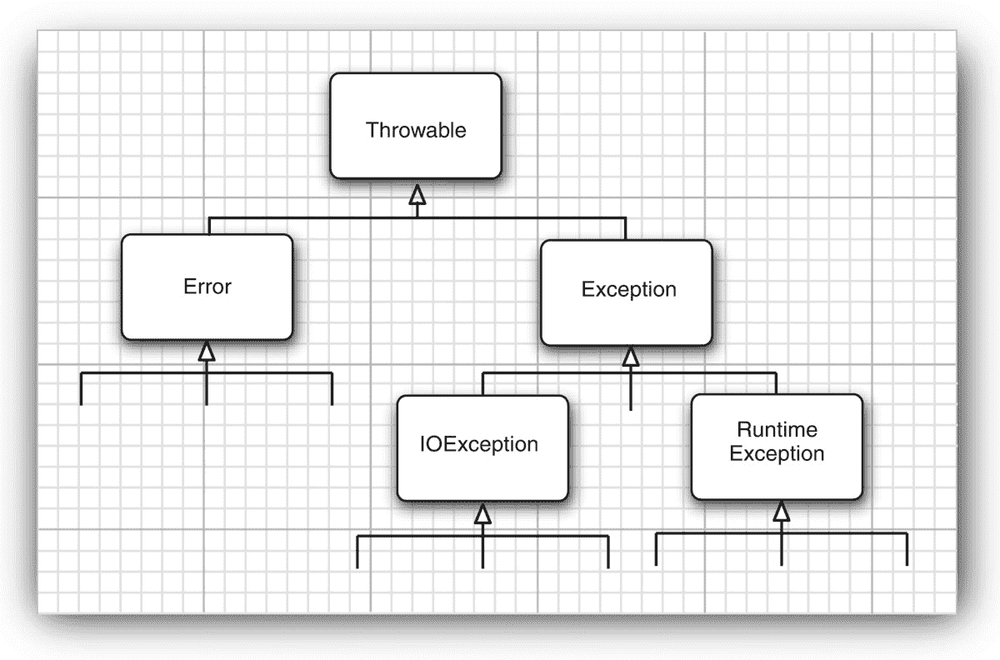Java 中的异常层次结构

注意，所有异常都继承自 `Throwable`，但该层次结构立即分为两个分支：`Error` 和 `Exception`。


`Error` 层次结构描述了 Java 运行时系统的内部错误和资源耗尽的情况。你不应该抛出这种类型的对象。如果发生了此类内部错误，除了通知用户并尝试优雅地退出程序外，你无能为力。这些情况非常罕见。

在进行 Java 编程时，关注 `Exception` 层次结构。`Exception` 层次结构也分为两个分支：派自 `RuntimeException` 的异常和不派自它的异常。通用规则是：`RuntimeException` 的发生是因为你犯了编程错误。任何其他异常的发生都是是因为某些坏事（例如 I/O 错误）发生在了你原本良好的程序上。

继承自 `RuntimeException` 的异常包括此类问题：

- 错误的强制转换（bad cast）
- 越界数组访问
- 空指针访问

不继承自 `RuntimeException` 的异常包括：

- 尝试读取文件末尾之后
- 尝试打开一个不存在的文件
- 尝试为一个未表示现有类的字符串查找 `Class` 对象

“如果它是 `RuntimeException`，那就是你的错”这个规则非常有效。你可以通过测试数组索引是否超出数组边界来避免那个 `ArrayIndexOutOfBoundsException`。如果你在使用变量之前检查了它是否为 `null`，`NullPointerException` 就不会发生。

那么不存在的文件呢？难道不能先检查文件是否存在，然后再打开它吗？嗯，文件可能在你检查其存在后立即被删除了。因此，“存在性”的概念取决于环境，而不仅仅取决于你的代码。

Java 规范将任何派自 `Error` 类或 `RuntimeException` 类的异常称为*未检查异常*（unchecked exception）。所有其他异常被称为*已检查异常*（checked exception）。这是一个非常有用的术语，我在书中也采用了。编译器会检查你是否为所有已检查异常提供了处理器。

`RuntimeException` 这个名字有点让人困惑。当然，我们讨论的所有错误都发生在运行时。这个名字起源于古代，当时 Java 的前身 Oak 的“运行时”产生越界异常和空指针异常。推测 I/O 异常是由其他组件产生的。

如果你熟悉标准 C++ 库的（要简单得多的）异常层次结构，那么现在你可能会感到非常困惑。C++ 有两个基础异常类：`runtime_error` 和 `logic_error`。`logic_error` 类是 Java `RuntimeException` 的等价物，也表示程序的逻辑错误。`runtime_error` 类是由不可预测问题引起的异常的基类。它等同于 Java 中那些不是 `RuntimeException` 类型的异常。

### 声明已检查异常

当 Java 方法遇到它无法处理的情况时，它可以抛出异常。这个思想非常简单：方法不仅会告诉 Java 编译器它可以返回哪些值，*还会告诉编译器可能会发生什么错误。*例如，尝试从文件读取的代码知道文件可能不存在，或者可能是空的。因此，尝试处理文件中信息的代码需要通知编译器它可能会抛出某种 `IOException`。

你声明你的方法可能会抛出异常的地方是方法的头部；头部会发生变化以反映该方法可能抛出的检查异常（checked exceptions）。例如，这里是标准库中 `FileInputStream` 类其中一个构造函数的声明。（有关输入和输出的更多信息，请参见第二卷第二章。）

```java
public FileInputStream(String name) throws FileNotFoundException
```

该声明表示，此构造函数根据 `String` 参数产生一个 `FileInputStream` 对象，但它*也*可能以一种特殊的方式出错——即通过抛出一个 `FileNotFoundException`。如果发生了这种糟糕的情况，构造函数的调用将不会初始化一个新的 `FileInputStream` 对象，而是抛出一个 `FileNotFoundException` 类的对象。如果抛出了该异常，运行时系统将开始寻找知道如何处理 `FileNotFoundException` 对象的异常处理程序。

当你编写自己的方法时，不需要声明你的方法实际上可能抛出的每一个可抛出（throwable）对象。要理解何时（以及需要声明什么）你需要在编写的方法的 `throws` 子句中进行声明，请记住在以下四种情况之一中会抛出异常：

- 你调用了一个抛出检查异常的方法——例如，`FileInputStream` 构造函数。
- 你检测到一个错误并使用 `throw` 语句抛出一个检查异常（`throw` 语句将在下一节中介绍）。
- 你犯了编程错误，例如 `a[-1] = 0` 导致了未检查异常（unchecked exception）（在这种情况下，是 `ArrayIndexOutOfBoundsException`）。
- 在虚拟机或运行时库中发生了内部错误。

如果发生了前两种情况中的任何一种，你必须告诉使用你方法的程序员可能会抛出异常。为什么呢？任何抛出异常的方法都是一个潜在的死亡陷阱。如果没有处理程序捕获该异常，当前执行线程将终止。

与属于提供的类中的 Java 方法一样，你可以在方法头部通过*异常规格*（*exception specification*）来声明你的方法可能会抛出异常。

```java
class MyAnimation
{
   . . .
   public Image loadImage(String s) throws IOException
   {
      . . .
   }
}
```

如果一个方法可能抛出不止一种检查异常类型，你必须在头部列出所有的异常类。用逗号分隔它们，如下例所示：

```java
class MyAnimation
{
   . . .
   public Image loadImage(String s) throws FileNotFoundException, EOFException
   {
      . . .
   }
}
```

然而，你不需要声明内部 Java 错误——即继承自 `Error` 的异常。任何代码都可能抛出这些异常，而且它们完全超出你的控制范围。

同样，你不应该声明继承自 `RuntimeException` 的未检查异常。

```java
class MyAnimation
{
   . . .
   void drawImage(int i) throws ArrayIndexOutOfBoundsException // 糟糕的风格
   {
      . . .
   }
}
```

这些运行时错误完全在你的控制之下。如果你如此担心数组索引错误，你应该花时间修复它们，而不是声明它们可能发生的可能性。

总之，方法必须声明它可能抛出的所有*检查*（*checked*）异常。未检查异常要么超出你的控制范围（`Error`），要么是由你本不应该允许的条件导致的结果（`RuntimeException`）。如果你的方法未能忠实地声明所有的检查异常，编译器将发出错误信息。

当然，正如你已经在许多示例中看到的，除了声明异常外，你也可以捕获它。这样，异常就不会被抛出方法，也不需要 `throws` 规格。你将在本章的后面部分看到如何决定是捕获异常还是让别人来捕获它。

如果你覆盖了父类中的方法，子类方法声明的检查异常不能比父类方法的异常更通用。（在子类方法中抛出更具体的异常，或者不在子类方法中抛出任何异常都是可以的。）特别是，如果父类方法完全不抛出检查异常，子类也不能抛。例如，如果你覆盖了 `JComponent.paintComponent`，你的 `paintComponent` 方法不能抛出任何检查异常，因为父类方法没有抛出任何异常。

当类中的方法声明它抛出的是特定类实例的异常时，它可能会抛出该类的异常或其任何一个子类的异常。例如，`FileInputStream` 构造函数可以声明它抛出 `IOException`。在这种情况下，你将不知道它是哪种 `IOException`；它可能是一个普通的 `IOException`，可能是各种子类之一的对象，例如 `FileNotFoundException`。

`throws` 标识符与 C++ 中的 `throw` 标识符相同，但有一个重要的区别。在 C++ 中，`throw` 规格是在运行时强制执行的，而不是在编译时。也就是说，C++ 编译器不关注异常规格。但如果在不在 `throw` 列表的函数中抛出了异常，将调用 `unexpected` 函数，默认情况下，程序将终止。在 Java 中，在没有 `throws` 规格的情况下，方法可以抛出任何异常（在 C++ 中则是不如此的）。

### 如何抛出异常

现在，假设你的代码发生了一些糟糕的事情。你有一个方法 `readData` 正在读取一个承诺长度为：

```text
Content-length: 1024
```

但你在 733 个字符后遇到了文件结束。你可能认为这种情况非常异常，以至于想要出一个异常。

你需要决定抛出什么异常。某种 `IOException` 会是一个不错的选择。浏览 Java API 文档，你发现了 `EOFException`，其描述为“意外到达文件结束”。完美。这里是你抛出它的方式：

```java
throw new EOFException();
```

或者，如果你喜欢：

```java
var e = new EOFException();
throw e;
```

这里是如何结合的：

```java
String readData(Scanner in) throws EOFException
{
   . . .
   while (. . .)
   {
      if (!in.hasNext()) // 遇到 EOF
      {
         if (n < len)
            throw new EOFException();
      }
      . . .
   }
   return s;
}
```

### 创建异常类

你的代码可能会遇到任何标准异常类无法充分描述的问题。在这种情况下，创建你自己的异常类是简单的。只需派自 `Exception`，或者派自 `Exception` 的子类（如 `IOException`）。习惯上会提供一个默认构造函数和一个包含详细消息的构造函数。（`Throwable` 超类的 `toString` 方法返回一个包含该详细消息的字符串，这对调试很有帮助。）

```java
class FileFormatException extends IOException
{
   public FileFormatException() {}
   public FileFormatException(String gripe)
   {
      super(gripe);
   }
}
```

现在你已经准备好抛出你自己的异常类型了。

```java
String readData(Scanner in) throws FileFormatException
{
   . . .
   while (. . .)
   {
      if (ch == -1) // 遇到文件结束 (EOF)
      {
         if (n < len)
            throw new FileFormatException();
      }
      . . .
   }
   return s;
}
```

`java.lang.Throwable` 1.0

- `Throwable()`

  构造没有详细消息的新 `Throwable` 对象。

- `Throwable(String message)`

  构造带有指定详细消息的新 `Throwable` 对象。按照惯例，所有派生异常类都支持默认构造函数和带详细消息的构造函数。

- `String getMessage()`

  获取 `Throwable` 对象的详细消息。

## 捕获异常（Catching Exceptions）

你现在已经知道如何抛出异常了。这非常简单：抛出它，然后忘记它即可。当然，某些代码必须捕获这些异常。捕获异常需要更多的规划。这正是后续章节将涵盖。

### 捕获异常

如果发生了未在任何地方捕获的异常，程序将终止并在控制台上打印消息，给出异常类型和堆栈跟踪。然而，GUI 程序可以捕获异常、打印堆栈跟踪消息，然后返回用户界面处理循环。（在调试 GUI 程序时，将控制台保持在屏幕上而不是最小化是一个好习惯。）

要捕获异常，请设置一个 `try`/`catch` 块。`try` 块的最简单形式如下：

```java
try
{
   代码
   更多代码
   更多代码
}
catch (ExceptionType e)
{
   该类型的处理程序
}
```

假设 `try` 块中的任何代码都抛出了 `catch` 子句中指定的类或其子类的异常。在这种情况下：

1. 程序跳过 `try` 块中剩余的代码。
2. 程序执行 `catch` 子句内部的句程序代码。

如果 `try` 块中的代码都没有抛出异常，则程序将跳过 `catch` 子句。

如果方法中的任何代码抛出了与 `catch` 子句中命名的类型不同的异常，该方法将立即退出。（希望它的调用者之一已经为该类型提供了 `catch` 子句。）

为了演示这一工作过程，这里有一段读取数据的典型代码：

```java
public void read(String filename)
{
   try
   {
      var in = new FileInputStream(filename);
      int b;
      while ((b = in.read()) != -1)
      {
         处理输入
      }
   }
   catch (IOException exception)
   {
      exception.printStackTrace();
   }
}
```

注意，`try` 子句中的大部分代码都是直观的：它读取并处理字节，直到遇到文件末尾。正如你通过查看 Java API 所看到的，`read` 方法有可能抛出 `IOException`。在这种情况下，我们跳出整个 `while` 循环，进入 `catch` 子句并生成堆栈跟踪。对于一个练习程序来说，这似乎是处理此类异常合理的方法。你还有什么选择呢？

通常，最好的选择是什么都不做，简单地将异常传递给调用者。如果 `read` 方法中发生错误，让 `read` 方法的调用者去担心吧！如果我们采取这种方法，就必须声明该方法可能会抛出 `IOException`。

```java
public void read(String filename) throws IOException
{
   var in = new FileInputStream(filename);
   int b;
   while ((b = in.read()) != -1)
   {
      处理输入
   }
}
```

记住，编译器严格执行 `throws` 标识符。如果你调用一个抛出检查异常（checked exception）的方法，你必须处理它或将其传递出去。

这两种方法哪种更好？作为一般原则，你应该捕获那些你知道如何处理的异常，并传播那些你不知道如何处理的异常。

当你传播异常时，必须添加 `throws` 标识符，以提醒调用者可能会抛出异常。

查看 Java API 文档以了解哪些方法抛出了哪些异常。然后决定你应该处理它们，还是将它们添加到 `throws` 列表中。后一种选择并不不可耻。将异常引导至胜任的处理器要比将其扼制要好。

然而，在重写方法时，不允许在子类方法中添加比父类方法更多的 `throws` 标识符。这时你*必须*捕获未声明的检查异常。特别是，如果你重写了一个不抛出任何异常的方法（例如 `Comparable` 中的 `compareTo`），那么你别无捕获每个检查异常。

在 Java 和 C++ 中，捕获异常几乎是相同的。严格来说，下面的代码：

```cpp
catch (Exception e) // Java
```

等价于：

```cpp
catch (Exception& e) // C++
```

Java 中没有 C++ `catch (. . ...)` 的对应项。这在 Java 中不需要，因为所有异常都派自一个公共父类。

有时，你不需要异常对象。从 Java 21 开始，作为一个预览功能，你可以使用下划线作为匿名变量：

```java
catch (FileNotFoundException _)
{
   System.exit(0);
}
```

### 捕获多个异常（Catching Multiple Exceptions）

你可以在同一个 `catch` 子句中捕获多个异常类型。例如，假设处理缺失文件和未知主机的操作是相同的。那么你可以合并 `catch` 子句：

```java
try
{
   代码可能会抛出异常
}
catch (FileNotFoundException | UnknownHostException e)
{
   处理缺失文件和未知主机的紧急操作
}
catch (IOException e)
{
   处理其他问题的紧急操作
}
```

这种功能只有在捕获互为子类的异常类型时才需要。

当你捕获多个异常时，异常变量隐式为 `final`。例如，你不能在子句体中为 `e` 赋值新值：

```java
catch (FileNotFoundException | UnknownHostException e) { . . . }
```

捕获多个异常不仅让代码看起来更简单，而且更高。生成的字节码包含一个共享的 `catch` 子句块。

变量 `e` 的类型*并不是*联合类型 `FileNotFoundException | UnknownHostException`，即使 IDE 是这样报告的。Java 变量没有这种联合类型。`e` 的实际类型是这些类型的最小上界；在这种情况下是 `IOException`。

在大多数情况下，你并不关心。但如果你用 `switch` 分析 `e`，它就很重要。明显的 `switch` 有一个问题——它不是穷尽的：


```java
catch (FileNotFoundException | UnknownHostException e)
{
   switch (e) // 错误：未穷尽
   {
      case FileNotFoundException fe -> . . .;
      case UnknownHostException ue -> . . .;
   }
   . . .
}
```

你可以通过添加 `default` 子句来解决这个问题。然而，重新组织代码并使用单独的 `catch` 子句可能会更清晰。

`catch` 子句不会忽略密封异常层次（sealed exception hierarchies）。假设你提供了：

```java
sealed abstract class DomainException extends Exception
      permits FatalDomainException, SurvivableDomainException {}
```

那么 `catch` 子句

```java
try
{
   domainMethod(); // throws DomainException
}
catch (FatalDomainException e) { . . . }
catch (SurvivableDomainException e) { . . . }
```

是不够的，即使可能不再有其他的检查异常（checked exception）实例。

## 重新抛出和异常链

你可以在 `catch` 子句中抛出异常。通常，当你想要更改异常类型时会这样做。如果你构建了一个供其他程序员使用的子系统，使用一个指示子系统失败的异常类型是有意义的。这种异常类型的一个例子是 `ServletException`。执行 servlet 的代码可能不想知道发生了什么细节问题，但它绝对想知道是 servlet 出了错。

以下是你可以捕获异常并重新抛出的方法：

```java
try
{
   access the database
}
catch (SQLException e)
{
   throw new ServletException("database error: " + e.getMessage());
}
```

在这里，`ServletException` 是使用异常的文本消息构造的。

然而，更好的做法是将原始异常设置为新异常的“原因”（cause）：

```java
try
{
   access the database
}
catch (SQLException original)
{
   var e = new ServletException("database error", original);
   throw e;
}
```

`ServletException` 类有一个构造函数，你可以在向其传递原因。如果你使用的异常类型不支持这种方式，你转而可以调用：

```java
e.initCause(original);
```

当异常被捕获时，可以获取原始异常：

```java
Throwable original = caughtException.getCause();
```

这种包装技术（wrapping technique）是被高度推荐的。它允许你在子系统中抛出高层级异常，而不会丢失原始失败的细节。

如果在一个不允许抛出检查异常的方法中发生了检查异常，这种包装技术也很有用。你可以捕获检查异常并将其封装成运行时异常（runtime exception）。

由于这种情况经常出现在输入/输出操作中，Java API 提供了 `UncheckedIOException`，你可以用它作为检查异常 `IOException` 的包装器。

有时，你只想记录异常并在不做任何更改的情况下重新抛出：

```java
try
{
   access the database
}
catch (Exception e)
{
   logger.log(level, message, e);
   throw e;
}
```

这里有一个微妙的点。假设代码位于方法内部：

```java
public void updateRecord() throws SQLException
```

Java 编译器会跟踪 `e` 源自 `try` 块这一事实。只要该块中唯一的检查异常是 `SQLException` 实例，并且 `e` 在 `catch` 块中没有被更改，那么将包含它的方法声明为 `throws SQLException` 就是合法的。

## `finally` 子句

当你的代码抛出异常时，它会停止处理方法中的剩余代码并退出方法。如果该方法获取了一些本地资源（只有该方法知道），并且该资源必须被清理，就会就会问题。一种解决方案是捕获所有异常、执行清理并重新抛出异常。但这种解决方案是麻烦的，因为你需要在两个地方清理资源分配——普通代码中和异常代码中。`finally` 子句可以解决这个问题。

有一个更优雅的解决方案，即将在下一节中看到的 `try`-with-resources 语句。我们将详细讨论 `finally` 机制，因为它是概念基础。但在实践中，你使用 `try`-with-resources 语句的频率会比 `finally` 子句高得多。

`finally` 子句中的代码无论是否捕获到异常都会执行。在下面的示例中，程序将在任何情况下关闭输入流：

```java
var in = new FileInputStream(. . .);
try
{
   // 1
   可能抛出异常的代码
   // 2
}
catch (IOException e)
{
   // 3
   显示错误消息
   // 4
}
finally
{
   // 5
   in.close();
}
// 6
```

让我们看看程序执行 `finally` 子句的三种可能的情况。

1. 代码没有抛出异常。在这种情况下，程序首先执行 `try` 块中的所有代码。然后，执行 `finally` 子句中的代码。之后，继续执行 `finally` 子句后的第一个语句。换句话说，执行通过了点 1、2、5 和 6。

2. 代码抛出了被 `catch` 子句捕获的异常——在我们的例子中是 `IOException`。为此，程序执行 `try` 块中的所有代码，直到抛出异常的点。`try` 块中的剩余代码被跳过。程序随后执行匹配的 `catch` 子句中的代码，然后执行 `finally` 子句中的代码。

   如果 `catch` 子句没有抛出异常，程序将执行 `finally` 子句后的第一行。在这种情况下，执行通过了点 1、3、4、5 和 6。

   如果 `catch` 子句抛出了异常，则该异常将抛回给该方法的调用者，执行通过了点 1、3、4、5 和 6。

3. 代码抛出了一个没有被任何 `catch` 子句捕获的异常。在这里，程序执行 `try` 块中的所有代码直到抛出异常。`try` 块中的剩余代码被跳过。然后，执行 `finally` 子句中的代码。执行通过了点 1 和 5。

你可以在没有 `catch` 子句的情况下使用 `finally` 子句。例如，考虑以下 `try` 语句：

```java
var in = new FileInputStream(. . .);
try
{
   可能抛出异常的代码
}
finally
{
   in.close();
}
```

无论 `try` 块中是否遇到异常，`finally` 子句中的 `in.close()` 语句都会执行。当然，如果遇到异常，它重新抛出并必须在另一个 `catch` 子句中捕获。

```java
var in = new FileInputStream(. . .);
try
{
   try
   {
      可能抛出异常的代码
   }
   finally
   {
      in.close();
   }
}
catch (IOException e)
{
   显示错误消息
}
```

内部 `try` 块有一个单一职责：确保关闭输入流。外部 `try` 块有一个单一职责：确保报告错误。这种解决方案不仅更清晰，而且可行。

当 `finally` 子句包含 `return` 语句时，会产生意外的结果。假设你通过 `return` 语句退出 `try` 块的中间。在方法返回之前，会执行 `finally` 块。如果 `finally` 块也包含 `return` 语句，那么它会掩盖原始返回值。考虑这个例子：

```java
public static int parseInt(String s)
{
   try
   {
      return Integer.parseInt(s);
   }
   finally
   {
      return 0; // 错误
   }
}
```

看起来在调用 `parseInt("42")` 时，`try` 块体返回整数 `42`。然而，`finally` 子句在方法实际返回之前执行，导致方法返回 `0`，忽略了原始返回值。

而且更糟糕的是。考虑调用 `parseInt("zero")`。`Integer.parseInt` 方法抛出了 `NumberFormatException`。然后执行 `finally` 子句，`return` 语句吞噬了异常！

`finally` 子句的主体用于清理资源。不要在 `finally` 子句内部放置改变控制流的语句（`return`、`throw`、`break`、`continue`）。

## try-with-resources 语句

对于下面的代码模式有一个非常有用的快捷方式：

```java
打开一个资源
try
{
   使用资源工作
}
finally
{
   关闭资源
}
```

前提是资源属于实现了 `AutoCloseable` 接口的类。该接口有一个方法：

```
void close() throws Exception
```

还有一个 `Closeable` 接口。它是 `AutoCloseable` 的子接口，同样有一个 `close` 方法。然而，该方法声明为抛出 `IOException`。

在最简单的形式中，`try`-with-resources 语句的形式如下

```java
try (Resource res = . . .)
{
   对 res 进行操作
}
```

当 `try` 块退出时，会自动调用 `res.close()`。这是一个典型的示例——读取文件中所有的单词：

```java
try (var in = new Scanner(Path.of("in.txt")))
{
   while (in.hasNext())
      System.out.println(in.next());
}
```

当块正常退出或发生异常时，都会调用 `in.close()` 方法，正就像你使用了 `finally` 块一样。

你可以指定多个资源。例如：

```java
try (var in = new Scanner(Path.of("in.txt"));
      var out = new PrintWriter("out.txt"))
{
   while (in.hasNext())
      out.println(in.next().toUpperCase());
}
```

无论块如何退出，`in` 和 `out` 被关闭。如果你手动编写这些代码，将需要两个嵌套的 `try`/`finally` 语句。

你可以在 `try` 头部提供之前声明的有效最终（effectively final）的变量：

```java
public static void printAll(String[] lines, PrintWriter out)
{
   try (out) // 有效最终变量
   { 
      for (String line : lines)
         out.println(line);
   } // 在此处调用 out.close()
}
```

这并不常见，因为人们通常在构造对象的范围内调用 `close`。

当 `try` 块抛出异常且 `close` 方法也抛出异常时，会出现困难。`try`-with-resources 语句非常优雅地处理了这种情况。原始异常会被重新抛出，而 `close` 方法抛出的任何异常都被视为“抑制”（suppressed）。它们会被自动捕获并使用 `addSuppressed` 方法添加到原始异常中。如果你对这些异常感兴趣，可以调用 `getSuppressed` 方法，它会产生一个来自 `close` 方法的抑制表达式数组。

你不想手动编写这些代码。每你需要关闭资源时，请使用 `try`-with-resources 语句。

`try`-with-resources 语句本身可以拥有 `catch` 子句，甚至是 `finally` 子句。这些语句会在关闭资源后执行。

### 分析堆栈跟踪元素

*堆栈跟踪*（stack trace）是程序执行过程中特定一点所有待处理方法调用的列表。你肯定见过堆栈跟踪列表——每当 Java 程序因未捕获的异常终止时，就会显示这些列表。

你可以通过调用 `Throwable` 类的 `printStackTrace` 方法来访问堆栈跟踪的文本描述。

```java
var t = new Throwable();
var out = new StringWriter();
t.printStackTrace(new PrintWriter(out));
String description = out.toString();
```

更灵活的方法是使用 `StackWalker` 类，它产生 `StackWalker.StackFrame` 实例流，每个实例描述一个栈帧。你可以通过此调用来遍历栈帧：

```java
StackWalker walker = StackWalker.getInstance();
walker.forEach(frame -> analyze frame)
```

如果你想延迟地处理 `Stream<StackWalker.StackFrame>`，请调用

```java
walker.walk(stream -> process stream)
```

流处理在 第二卷第 1 章 中有详细描述。

`StackWalker.StackFrame` 类拥有用于获取执行代码行的文件名、行号，以及类对象和方法名。`toString` 方法产生一个包含所有信息的格式化字符串。

`Throwable.getStackTrace` 方法产生一个 `StackTraceElement[]` 数组，其信息与 `StackWalker.StackFrame` 实例流类似。然而，该调用的效率较低，因为即使调用者可能只需要几帧，它也会捕获整个堆栈，并且只提供待处理方法的类名，而不是类对象。

列表 7.1 显示了递归阶乘函数的堆栈跟踪。例如，如果你计算 `factorial(3)`，输出如下

```
factorial(3):
stackTrace.StackTraceTest.factorial(StackTraceTest.java:20)
stackTrace.StackTraceTest.main(StackTraceTest.java:36)
factorial(2):
stackTrace.StackTraceTest.factorial(StackTraceTest.java:20)
stackTrace.StackTraceTest.factorial(StackTraceTest.java:26)
stackTrace.StackTraceTest.main(StackTraceTest.java:36)
factorial(1):
stackTrace.StackTraceTest.factorial(StackTraceTest.java:20)
stackTrace.StackTraceTest.factorial(StackTraceTest.java:26)
stackTrace.StackTraceTest.factorial(StackTraceTest.java:26)
stackTrace.StackTraceTest.main(StackTraceTest.java:36)
return 1
return 2
return 6
```

stackTrace/StackTraceTest.java

```java
package stackTrace;

import java.util.*;

/**
 * 一个显示递归方法调用跟踪特程序。
 * @version 1.0-27-14
 * @author Caymann
 */
 class StackTraceTest
{
   /**
    * 计算数字阶乘
    * @param n 非负整数
    * @return n!
    */
   public static int factorial(int n)
   {
      System.out.println("factorial(" + n + "):");
      var walker = StackWalker.getInstance();
      walker.forEach(System.out::println);      
      int r;
      if (n <= 1) r = 1;
      else r = factorial(n - 1);
      System.out.println("return " + r);
      return r;
   }

   public static void main(String[] args)
   {
      try (var in = new Scanner(System.in))
      {
         System.out.print("Enter n: ");
         int n = in.nextInt();
         factorial(n);
      }
   }
}
```


获取包含该元素执行点的源文件名称，如果信息不可用则返回 `null`。

* `int getLineNumber()`

  获取包含该元素执行点的源文件的行号，如果信息不可用则返回 `-1`。

* `String getClassName()`

  获取包含该元素执行点的类的全限定名。

* `Class<?> getDeclaringClass()`

  获取包含该元素执行点的方法的 `Class` 对象。如果栈步进器在构造时没有使用 `RETAIN_CLASS_REFERENCE` 选项，则会抛出异常。

* `String getMethodName()`

  获取包含该元素执行点的方法的名称。构造函数的名称为 `<init>`。静态初始化器的名称为 `<clinit>`。你无法区分同名的重载方法。

* `boolean isNativeMethod()`

  如果该元素的执行点在原生方法内部，则返回 `true`。

* `String toString()`

  返回一个格式化字符串，其中包含类名、方法名，以及文件名和行号（如果可用）。

`java.lang.StackTraceElement` 1.4

* `String getFileName()`

  获取包含该元素执行点的源文件名称，如果信息不可用则返回 `null`。

* `int getLineNumber()`

  获取包含该元素执行点的源文件的行号，如果信息不可用则返回 `-1`。

* `String getClassName()`

  获取包含该元素执行点的类的全限定名。

* `String getMethodName()`

  获取包含该元素执行点的方法的名称。构造函数的名称为 `<init>`。静态初始化器的名称为 `<clinit>`。你无法区分同名的重载方法。

* `boolean isNativeMethod()`

  如果该元素的执行点在原生方法内部，则返回 `true`。

* `String toString()`

  返回一个格式化字符串，其中包含类名、方法名，以及文件名和行号（如果可用）。

### 使用异常的贴士

关于异常的正确用法存在相当的争议。一些程序员认为所有检查异常（checked exceptions）都是麻烦，而另一些人似乎认为抛出的异常还不够。我认为异常（即使是检查异常）有其用武之地，因此我为你提供这些关于正确使用异常的建议。

1. **异常处理不应该替代简单的测试。**

作为一个示例，这里有代码尝试 10,000,000 次弹出空栈。它首先通过检查栈是否为空来实现这一点。

```java
if (!s.empty()) s.pop();
```

接下来，我们无论如何都强制弹出栈元素，并捕获 `EmptyStackException`，该异常告诉我们不应该这样做。

```java
try
{
   s.pop();
}
catch (EmptyStackException e)
{
}
```

在我的测试机上，调用 `isEmpty` 的版本运行耗了 0.167 秒。捕获 `EmptyStackException` 的版本运行耗了 3.629 秒。

如你所示，捕获异常花费的时间比执行简单测试要长得多。教训是：仅在异常情况下使用异常。

2. **不要对异常进行微管理。**

一些程序员会将每个语句都包装在独立的 `try` 块中。

```java
PrintStream out;
Stack s;

for (i = 0; i < 100; i++)
{
   try
   {
      n = s.pop();
   }
   catch (EmptyStackException e)
   {
      // 栈为空
   }
   try
   {
      out.writeInt(n);
   }
   catch (IOException e)
   {
      // 写入文件出现问题
   }
}
```

这种方法会让你的代码急剧膨胀。思考你想让代码完成的任务。在这里，我们想要从栈中弹出 100 个数字并将它们保存到文件中。（别管为什么——这只是一个玩具级示例。）如果问题出现，我们无能为力。如果栈是空的，它不会变成满的。如果文件包含错误，错误也不会魔性地消失。因此，将整个任务包装在一个 `try` 块中是有意义的。如果任何操作失败，你就可以放弃该任务。

```java
try
{
   for (i = 0; i < 100; i++)
   {
      n = s.pop();
      out.writeInt(n);
   }
}
catch (IOException e)
{
   // 写入文件出现问题
}
catch (EmptyStackException e)
{
   // 栈为空
}
```

这段代码看起来整洁得多。它实现了异常处理的承诺：将正常处理与错误处理分离。

3. **善加利用异常层次结构。**

不要只抛出 `Exception` 或 `RuntimeException`。找到一个合适的子类或创建你自己的。

不要只捕获 `Exception`。这会让你的代码难以于阅读和维护。只捕获你预期的异常类。而且不要捕获 `Throwable`。你可能会隐藏一个 `OutOfMemoryError`。

尊重检查异常和未检查异常之间的区别。检查异常本质上是有负担的——不要为逻辑错误抛出它们。（例如，反射库在这方面就做错了。调用者通常需要捕获他们知道永远不会发生的异常。）

不要犹豫将一个异常转换为另一个更异常。例如，当在文件中解析整数时，捕获 `NumberFormatException` 并将其设置为 `IOException` 子类或 `MySubsystemException` 的原因。

4. **不要掩盖异常。**

在 Java 中，有一种让异常闭嘴的巨大诱惑。如果你正在编写的方法，它调用了一个每百年可能抛出一次异常的方法，编译器会抱怨，因为你没有在方法的 `throws` 列表中声明该异常。你不想把它放在 `throws` 列表中，因为那样编译器就会抱怨调用你方法的所有方法。所以你直接让它闭嘴：

```java
public Image loadImage(String s)
{
   try
   {
      // 可能威胁抛出检查异常的代码
   }
   catch (Exception e)
   {} // 就这样吧
}
```

现在你的代码将无障碍地通过编译。它将运行良好，除非发生异常。那时，异常将无声地忽略。如果你认为异常至少是重要的，你就应该花精力正确地处理它们。

5. **当你检测到错误时，“严厉”比纵容更有效。**

一些程序员对在检测到错误时抛出异常感到担忧。当无效参数调用方法时，返回一个哑值是否比抛出异常更好？例如，当栈为空时 `Stack.pop` 应该返回 `null` 还是抛出异常？我认为，在故障点抛出 `EmptyStackException` 比在之后的某个时间出现 `NullPointerException` 要好。

```
requireNonNull
checkIndex
checkFromToIndex
checkFromIndexSize
```

用于这些常用的检查。将它们用于参数校验：

```java
public void putData(int position, Object newValue)
{
   Objects.checkIndex(position, data.length);
   Objects.requireNonNull(newValue);
   . . .
}
```

如果调用方法时使用了无效索引或 `null` 参数，则会抛出异常，并使用 Java 库所熟悉的提示信息。

### 8. *不要向最终用户显示堆栈跟踪。*

如果你的程序遇到了意料之外的异常，显示堆栈跟踪似乎是一个好主意，这样用户就可以报告它，从而让你更容易精位问题。然而，堆栈跟踪可能包含你不希望向潜在攻击者暴露的实现细节，例如你正在使用的库版本。

记录堆栈跟踪以便你可以检索它，但只对你的用户显示摘要消息。

规则 5 和 6 可以总结为“早抛出，晚捕”。

## 使用断言 (Using Assertions)

断言是防御性编程中常用的惯用方法。在接下来的章节中，你将学习如何有效地使用它们。

### 断言概念 (The Assertion Concept)

假设你确信某个属性已经满足，并在代码中依赖该属性。例如，你可能正在计算：

```java
double y = Math.sqrt(x);
```

你确定 `x` 不是负数。也许它是另一个不会产生负结果的计算结果，或者它是某个方法的参数，要求调用者仅提供正输入。尽管如此，你仍然希望双重检查，而不是让混淆的“非数字 (not a number)”浮点值混入你的计算中。当然，你可以抛出一个异常：

```java
if (x < 0) throw new IllegalArgumentException("x < 0");
```

但这段代码在测试完成后仍然残留在程序中。如果你有大量的此类检查，程序的运行速度可能会比应有的速度慢得多。

断言机制允许你在测试期间插入检查，并在生产代码中自动移除它们。

Java 语言有一个关键字 `assert`。它有两种形式：

```java
assert condition;
```

以及

```java
assert condition : expression;
```

这两个语句都会求值条件，如果条件为 `false`，则会抛出 `AssertionError`。在第二个语句中，`expression` 被传递给 `AssertionError` 对象的构造函数并转换为消息字符串。

`expression` 部分的唯一目的是生成一个消息字符串。`AssertionError` 对象并不存储实际的表达式值，因此你之后无法查询它。正如 JDK 文档所述，这样做“会鼓励程序员尝试从断言失败中恢复，而这违背了该功能的初衷。”

要断言 `x` 非负数，你可以直接使用语句：

```java
assert x >= 0;
```

或者你可以将 `x` 的实际值传递给 `AssertionError` 对象，以便以后显示。

```java
assert x >= 0 : x;
```

C 语言的 `assert` 宏会将断言条件转换为字符串，并在断言失败时打印该字符串。例如，如果 `assert(x >= 0)` 失败，它会打印 `"x >= 0"` 是失败的条件。在 Java 中，条件不会自动成为错误报告的一部分。如果你想看到它，必须将其作为字符串传递给 `AssertionError` 对象：`assert x >= 0 : "x >= 0"`。

### 断言的启用与禁用

默认情况下，断言是禁用的。通过在运行程序时使用 `-enableassertions` 或 `-ea` 选项启用它们：

```bash
java -enableassertions MyApp
```

注意，不需要重新编译程序即可启用或禁用断言。启用或禁用断言是类加载器（class loader）的功能。当断言被禁用时，类加载器会剥离断言代码，以免影响执行速度。

你甚至可以在特定的类或整个包中开启断言。例如：

```bash
java -ea:MyClass -ea:com.mycompany.mylib... MyApp
```

此命令开启类 `MyClass` 以及 `com.mycompany.mylib` 包及其子包中所有类的断言。`-ea:...` 选项开启未命名包中所有类的断言。

你也可以使用 `-disableassertions` 或 `-da` 禁用某些类和包的断言：

```bash
java -ea:... -da:MyClass MyApp
```

某些类不是由类加载器加载的，而是由虚拟机直接加载的。你可以使用这些开关选择性地启用或禁用这些类中的断言。

然而，启用或禁用所有断言的 `-ea` 和 `-da` 开关不适用于没有类加载器的“系统类”。使用 `-enablesystemassertions/-esa` 开关来启用系统类中的断言。

还可以通过程序控制类加载器的断言状态。请参见本节末尾的 API 注释。

当断言关闭时，断言条件不会执行。因此，确保条件没有副作用是重要的。这里有一个你不应该执行的示例：

```java
File file = new File(filename);
. . .
assert file.delete(); // 错误做法
```

意图是确保 `delete` 方法返回 `true`，这意味着文件被正确删除。但当断言关闭时，删除操作不会发生！

解决办法是将副作用移动到 `assert` 语句之外：

```java
boolean deletionSuccessful = file.delete();
assert deletionSuccessful;
```

Java 库的源码中有数百个被注释的断言。某些程序员在测试后注释掉断言，因为它们占用类文件空间。如果你担心这一点，可以如下有条件地包含它们：

```java
public static final boolean ASSERTS = true; // 生产环境编译时为 false
. . .
if (ASSERTS) assert x >= 0;
```

### 使用断言进行参数检查

Java 语言提供了三种处理系统错误的机制：

*   抛出异常

*   日志

*   使用断言

何时应该选择断言？请记住这些点：

*   断言失败旨在致命的、不可恢复的错误。

*   断言检查仅在开发和测试期间开启（这有时被幽默地描述为“在岸边穿着救生衣，在大海上把它扔掉。”）

因此，你不应该使用断言向程序的其他部分传递可恢复条件或向程序用户通信问题。断言应仅用于测试期间定位内部程序错误。

让我们来看一个常见的场景——方法参数检查。你应该使用断言检查非法索引或 `null` 引用吗？要回答这个问题，你需要查看方法的文档。假设你实现了一个排序方法。

```java
/**
   对指定数组的指定范围按升顺序进行排序。
   排序范围从 fromIndex（包含）到 toIndex（不包含）。
   @param a 要排序的数组
   @param fromIndex 要排序的第一个元素的索引（包含）
   @param toIndex 要排序的最后一个元素的索引（不包含）
   @throws IllegalArgumentException 如果 fromIndex > toIndex
   @throws ArrayIndexOutOfBoundsException 如果 fromIndex < 0 或 toIndex > a.length
*/
static void sort(int[] a, int fromIndex, int toIndex)
```

文档指出，如果索引值不，方法将抛出异常。这种行为是方法与其调用者之间契约的一部分。如果你实现了该方法，必须遵守该契约并抛出指示的异常。此时使用断言是不恰当的。

你是否应该断言 `a` 不为 `null`？这也不恰当。方法文档对于 `a` 为 `null` 时的方法行为没有做说明。调用者有权假设在这种情况下方法将成功返回，而不会抛出断言错误。

然而，假设方法契约略有不同：

```
@param a 要排序的数组（不能为 null）
```

现在，方法的调用者已经收到通知，使用 `null` 数组调用该方法是非合法的。那么该方法可以从断言开始：

```java
assert a != null;
```

计算机科学家将这种契约称为 `precondition`（先决条件）。原始方法对其参数没有先决条件——它承诺在所有情况下都有定义良好的行为。修改后的方法有一个先决条件：即 `a` 不为 `null`。如果调用者未能满足先决条件，那么一切规则都将失效，方法可以执行任何它想做的事。事实上，在有了断言的情况下，方法确实是这样做的。根据类加载器的配置方式，它有时会抛出断言错误，有时会抛出空指针异常。

### 使用断言记录假设

通常，程序员使用注释来记录他们的底层假设。考虑这个来自 [`docs.oracle.com/javase/8/docs/technotes/guides/language/assert.html`](https://docs.oracle.com/javase/8/docs/technotes/guides/language/assert.html) 的示例：

```java
if (i % 3 == 0)
   . . .
else if (i % 3 == 1)
   . . .
else // (i % 3 == 2)
   . . .
```

在这种情况下，使用断言反而会更有意义。

```java
if (i % 3 == 0)
   . . .
else if (i % 3 == 1)
   . . .
else
{
   assert i % 3 == 2;
   . . .
}
```

当然，彻彻地思考这个问题会更有意义。`i % 3` 的可能取值是什么？如果 `i` 是正数，余数必须是 `0`、`1` 或 `2`。如果 `i` 是负数，那么余数可以是 `-1` 或 `-2`。因此，真正的假设是 `i` 不是负数。一个更好的断言应该是：

```java
assert i >= 0;
```

在 `if` 语句之前。

无论如何，这个示例展示了将断言作为程序员自检的良好用法。正如你所见，断言是测试和调试的战术工具。相比之下，日志是程序整个生命周期的策略工具。我们将在下一节中检查日志。

#### `java.lang.ClassLoader` 1.0

* `void setDefaultAssertionStatus(boolean b)` 1.4

  启用或禁用由此类加载器加载的所有没有显式类或包断言状态的类的断言。

* `void setClassAssertionStatus(String className, boolean b)` 1.4

  启用或禁用给定类及其内部类的断言。

* `void setPackageAssertionStatus(String packageName, boolean b)` 1.4

  启用或禁用给定包的断言。

* `void clearAssertionStatus()` 1.4


清除给定类的断言状态。

## 日志（Logging）

每位 Java 程序员都熟悉用于输出信息的 `System.out.println` 调用。然而，`System.out.println` 不是生产环境应用的良好选择，因为它对目标地、格式或日志级别没有控制。

### 你应该使用日志 API 吗？

你是否应该断言 `a` 不为 `null`？这也不恰当。方法文档对于 `a` 为 `null` 时的方法行为没有做说明。调用者有权假设在这种情况下方法将成功返回，而不会抛出断言错误。

然而，假设方法契约略有不同：

```text
@param a 要排序的数组（不能为 null）
```

现在，方法的调用者已经收到通知，使用 `null` 数组调用该方法是非合法的。那么该方法可以从断言开始：

```java
assert a != null;
```

计算机科学家将这种契约称为 `precondition`（先决条件）。原始方法对其参数没有先决条件——它承诺在所有情况下都有定义良好的行为。修改后的方法有一个先决条件：即 `a` 不为 `null`。如果调用者未能满足先决条件，那么一切规则都将失效，方法可以执行任何它想做的事。事实上，在有了断言的情况下，方法确实是这样做的。根据类加载器的配置方式，它有时会抛出断言错误，有时会抛出空指针异常。

### 日志 101

平台日志器实现了 `System.Logger` 接口。每个日志器都有一个名称。名称可以是任意的，但通常是生成消息的类的包名。你可以这样获取平台日志器：

```java
System.Logger logger = System.getLogger("com.myapp");
```

当你第一次请求带名称的日志器时，它会被创建。后续相同名称调用将产生相同的日志器对象。现在你准备好记录日志了：

```java
logger.log(Level.INFO, "Opening file " + filename);
```

记录打印格式所示。注意，时间以及调用类和方法的名称会自动包含在内。要在程序部署时关闭这些信息消息，你可以配置后端。在 `java.util.logging` 后端的情况下，准备一个包含以下内容的 `logging.properties` 文件：

```properties
handlers=java.util.logging.ConsoleHandler
com.myapp.level=WARNING
```

然后如下启动应用程序：

```bash
java -Djava.util.logging.config.file=logging.properties com.myapp.Main
```

由于 `INFO` 级别低于 `WARNING` 级别，消息不再显示。

获取日志器和记录消息的 API 是前端的一部分——在这种情况下，是平台日志 API。如果你使用不同的前端，API 将会不同。

消息目标、格式和过滤以及配置机制是后端的一部分——这里是 `java.util.logging`。如果你使用不同的后端，请遵循其说明进行配置。

### 平台日志 API

正如你在上一节看到的，每条记录消息都有一个级别。枚举 `System.Logger.Level` 有以下值，按严重性递减排序：`ERROR`、`WARNING`、`INFO`、`DEBUG` 和 `TRACE`。

通过导入语句：

```java
import static java.lang.System.Logger.Level.*;
```

你可以缩写级别：

```java
logger.log(INFO, "Opening file " + filename);
// 代替 System.Logger.Level.INFO
```

在上面的示例中，即使消息被抑制，消息 `"Opening file " + filename` 也会被创建。如果你担心创建消息字符串的代价，可以使用 lambda 表达式来代替：

```java
logger.log(INFO, () -> "Opening file " + filename);
```

这样，消息只有在实际记录日志时才会被计算。

记录异常是常见的操作。日志中包含了堆栈跟踪信息。

```java
catch (IOException ex)
{
   logger.log(WARNING, "Cannot open file " + filename, ex);
}
```

你可以使用模式格式化消息：

```java
logger.log(WARNING, "Cannot open file {0}", filename);
```

这不是 `printf` 风格的模式。该模式由 `MessageFormat` 类处理，该类用于程序消息的本地化（详情请参阅第二卷）。在这里，你只需要知道字符串占位符是 `{0}`、`{1}` 等。大括号必须用单引号转义：`'{'`、`'}'`。使用两个单引号 `''` 在消息中包含字面量单引号。

可以使用第二卷中引入的资源包机制将日志消息本地化到不同的语言。

提供格式化字符串的包和键：

```java
logger.log(WARNING, bundle, "file.bad", filename);
// 在包中查找 file.bad
```

或者，通过以下方式获取记录器：

```java
System.Logger logger = System.getLogger("com.mycompany.myapp", bundle);
```

当调用带有 `String` 参数作为消息或格式的记录器方法时，该参数被解释为包中的一个键（key）。带有 `Object` 或 `Supplier<String>` 参数的方法不受影响。

这些功能（延迟消息计算、添加可抛异常、格式化、使用包）仅支持某些组合，但并非全部支持。详情请参阅 API 备注。

## 日志配置

现在让我们转向日志后端。正如前面提到的，平台日志 API 的默认后端是 `java.util.logging`。后续章节中的信息特定于该后端。

你可以通过编辑配置文件来更改后端的各种属性。默认配置文件位于 JDK 中的 `conf/logging.properties`。要使用另一个文件，可以在启动应用程序时通过设置 `java.util.logging.config.file` 属性指定文件位置：

```bash
java -Djava.util.logging.config.file=configFile MainClass
```

在 `main` 方法中调用 `System.setProperty("java.util.logging.config.file", configFile)` 没有效果，因为日志管理器在 VM 启动期间、在 `main` 执行之前就已经初始化了。

你可以通过添加如下行来为自己的记录器指定日志级别：

```properties
com.mycompany.myapp.level=WARNING
```

即在记录器名称后附加 `.level` 后缀。

日志配置中的属性不是系统属性。你不能通过 `-D` 命令行选项设置它们。相反，将日志属性放入你通过 `-Djava.util.logging.config.file=configFile` 指定的文件中。

你还可以指定根级别：

```properties
.level=WARNING
```

由于历史原因，某些级别在平台日志 API 和 `java.util.logging` 框架中具有不同的名称。你需要在配置文件中使用后者。表 7.1 显示了它们的对应关系。

### 平台日志与 Java 日志框架的对应级别

| 平台日志 | `java.util.logging` |
| :--- | :--- |
| `ERROR` | `SEVERE` |
| `WARNING` | `WARNING` |
| `INFO` | `INFO` |
| `DEBUG` | `FINE` |
| `TRACE` | `FINER` |

与包名类似，记录器名称是层次级的。事实上，它们比包更具层次性。包与其父包之间没有语义关系，但记录器的父子共享某些属性。例如，如果你关闭了发送记录器 `"com.mycompany"` 的消息，那么它的子记录器也将被禁用。

正如你将在下一节看到的，记录器实际上并没有将消息发送到控制台——那是处理器（handlers）的工作。处理器也有级别。若要在控制台上查看 `DEBUG`/`FINE` 消息，你还需要设置：

```properties
java.util.logging.ConsoleHandler.level=FINE
```

日志管理器配置中的设置不是系统属性。使用 `-Dcom.mycompany.myapp.level=FINE` 启动程序对记录器没有任何影响。

还可以通过使用 `jconsole` 程序在运行中的程序中更改日志级别。详情请参见 [](https://www.oracle.com/technical-resources/articles/java/jconsole.html#LoggingControl)。

从 Java 21 开始，名为 `java.lang.Runtime` 的系统记录器记录了对 `Runtime.exit` 方法的调用（`System.exit` 调用它终止虚拟机）。日志包含堆栈跟踪，因此你可以判断终止是如何请求的。要接收日志消息，请在日志配置中设置：

```properties
java.lang.Runtime.level=FINE
```

## 日志处理器

`java.util.logging` API 的后端基于 `handlers`。最简单的处理器是 `ConsoleHandler`，它将日志记录打印到 `System.err` 流。

每个处理器都有一个父处理器。默认情况下，处理器简单地将每条记录发送到父处理器。处理器也有级别。若要在控制台上查看 `DEBUG`/`FINE` 消息，你还需要设置：

```properties
java.util.logging.ConsoleHandler.level=FINE
```

默认情况下，处理器只是将每条记录发送到父处理器。默认日志级别为 `INFO`。要将日志记录发送到其他，添加另一个处理器。`java.util.logging` API 为此目的提供了两个处理器：`FileHandler` 和 `SocketHandler`。`SocketHandler` 将记录发送到指定的主机和端口。要添加文件处理器，请在日志属性中提供此项：

```properties
handlers=java.util.logging.ConsoleHandler,java.util.logging.FileHandler
```

记录被发送到用户目录下的文件 `n.log`，其中 `n` 是数字。默认情况下，记录以 XML 格式输出。典型的日志记录如下：

```xml
<record>
    <date>2014-08-04T09:53:34</date>
    <millis>1407146072</millis>
    <sequence>1</sequence>
    <logger>com.mycompany.myapp</logger>
    <level>INFO</level>
    <class>horstmann.corejava.Employee</class>
    <method>read</method>
    <thread>10</thread>
    <message>Opening file staff.txt</message>
</record>
```

你可以通过在日志属性中设置各种参数来更改文件处理器的默认行为（参见表 7.2）。

你可能不想使用默认的日志文件名。使用如 `%h/myapp%u.log` 的模式（参见表 7.3 获取模式变量说明）。文件名中的 `%u` 为每次应用程序运行产生唯一的日志副本。

对于长时间运行的程序，开启文件滚动是一个好主意。日志文件按顺序保留，例如 `myapp.log.0`、`myapp.log.1`、`myapp.log.2` 等。每当文件超过大小限制时，旧的日志被删除，其他文件被重命名，并创建一个生成号为 `0` 的新文件。

### 文件处理器参数

| 配置属性 |  | 默认值 |
| :--- | :--- | :--- |
| `java.util.logging.FileHandler.level` | 处理器级别。 | `Level.ALL` |
| `java.util.logging.FileHandler.append` | 为 `true` 时，将日志记录追加到现有文件；否则，每次程序运行时打开新文件。 | `false` |
| `java.util.logging.FileHandler.limit` | 在打开另一个文件之前向文件中写入近似最大字节数（`0` = 无限制）。 | `FileHandler` 类中为 `0`，默认日志管理器配置中为 `50000` |
| `java.util.logging.FileHandler.pattern` | 文件名模式（参见表 7.3）。 | `%h/java%u.log` |
| `java.util.logging.FileHandler.count` | 旋转序列中的日志数量。 | `1`（不旋转） |
| `java.util.logging.FileHandler.filter` | 用于过滤日志记录的过滤器（参见第 7.5.6 节）。 | 无过滤 |
| `java.util.logging.FileHandler.encoding` | 字符编码。 | 平台字符编码 |
| `java.util.logging.FileHandler.formatter` | 每个日志记录的格式化器。 | `java.util.logging.XMLFormatter` |

## 日志文件模式变量

| 变量 | 描述 |
| :--- | :--- |
| `%h` | 用户家目录（`user.home` 属性）。 |
| `%t` | 系统的临时目录。 |
| `%u` | 唯一数字。 |
| `%g` | 旋转日志的生成号。如果指定了旋转且模式中不包含 `%g`，则使用 `.%g` 后缀。 |
| `%%` | 百分比字符。 |

当 `java.util.logging.FileHandler.append` 为 `true` 且日志格式为 XML 时，在追加到现有日志文件时会一个新的 XML 头。结果不是有效的 XML。

## 过滤器和格式化器

除了按日志级别进行过滤外，每个处理器都可以有一个实现 `Filter` 接口的额外过滤器，该接口是一个带方法的函数接口：

```java
boolean isLoggable(LogRecord record)
```

要将过滤器安装到处理器，请向日志配置添加如下条目：

```properties
java.util.logging.ConsoleHandler.filter=com.mycompany.myapp.MyFilter
```

`ConsoleHandler` 和 `FileHandler` 类以文本和 XML 格式输出日志记录。不过，你也可以定义自己的格式。扩展 `java.util.logging.Formatter` 类并重写方法：

```java
String format(LogRecord record)
```

以你喜欢的任何方式格式化记录并返回生成的字符串。在 `format` 方法中，你可以调用 API 备注中的方法之一来获取有关 `LogRecord` 的信息。

在你的 `format` 方法中，你可能想要调用方法：

```java
String formatMessage(LogRecord record)
```

该方法格式化记录的消息部分，在资源包中查找消息键并替换消息格式参数。

许多文件格式（如 XML）需要环绕格式化记录的头部和尾部。为了实现这一点，请重写方法：

```java
String getHead(Handler h)
String getTail(Handler h)
```

最后，在日志配置中设置格式化器：

```properties
java.util.logging.FileHandler.formatter=com.mycompany.myapp.MyFormatter
```

## 日志配方

有这么多日志日志选项，很容易忘记基础知识。以下配方总结了最常用的操作。

1. 对于简单的应用程序，选择单个日志器。将日志器命名为与主应用程序包相同的名称是一个好主意，例如 `com.mycompany.myprog`。你可以随时调用以下方法获取日志器：

   ```java
   System.Logger logger = System.getLogger("com.mycompany.myprog");
   ```

   为了方便起见，你可能想在有大量日志活动的类中添加静态字段：

   ```java
   private static final System.Logger logger = System.getLogger("com.mycompany.myprog");
   ```

2. `java.util.logging` 后端的默认日志配置将所有 `INFO` 或更高级别的消息输出到控制台。要进行自定义，请准备一个包含如下条目的 `logging.properties` 文件：

   ```properties
   handlers=java.util.logging.ConsoleHandler,java.util.logging.FileHandler
   com.mycompany.myapp.level=FINER
   java.util.logging.ConsoleHandler.level=FINE
   ```

   然后通过以下方式启动应用：

   ```bash
   java -Djava.util.logging.config.file=logging.properties com.mycompany.myapp.Main
   ```

3. 现在你可以尽情所欲地记录日志了。每当你想调用 `System.out.println` 时，改为输出日志消息：

   ```java
   logger.log(System.Logger.Level.TRACE, "File open dialog canceled");
   ```

   记录意外的异常也是一个好主意。例如：


### 列表 7.2

```
try
{
   . . .
}
catch (SomeException e)
{
   logger.log(System.Logger.Level.WARNING, string describing context, e);
}
```

列表 7.2 通过一个额外的花样使用了此配方：得益于一个处理器，日志消息也会显示在日志窗口中，该处理器的代码位于列表 7.3。

以如下方式运行程序：

```
java -Djava.util.logging.config.file=logging.properties logging.LoggingImageViewer
```

`logging/LoggingImageViewer.java`

```java
package logging;

import java.awt.*;
import java.awt.event.*;
import java.io.*;
import javax.swing.*;

import static java.lang.System.Logger.Level.*;

/**
 * 一个记录各种事件的图像查看器程序的修改版。运行
 * java -Djava.util.logging.config.file=logging.properties logging.LoggingImageViewer
 */
public class LoggingImageViewer
{

   public static void main(String[] args)
   {
      EventQueue.invokeLater(() ->
            {
               var frame = new ImageViewerFrame();
               frame.setVisible(true);
            });
   }
}

/**
 * 显示图像的帧
 */
class ImageViewerFrame extends JFrame
{
   private static final int DEFAULT_WIDTH = 300;
   private static final int DEFAULT_HEIGHT = 400;

   private JLabel label;
   private static System.Logger logger = System.getLogger("com.horstmann");

   public ImageViewerFrame()
   {
      logger.log(TRACE, "Entering ImageViewerFrame()");
      setSize(DEFAULT_WIDTH, DEFAULT_HEIGHT);

      // 设置菜单栏
      var menuBar = new JMenuBar();
      setJMenuBar(menuBar);

      var menu = new JMenu("File");
      menuBar.add(menu);

      var openItem = new JMenuItem("Open");
      menu.add(openItem);
      openItem.addActionListener(new FileOpenListener());

      var exitItem = new JMenuItem("Exit");
      menu.add(exitItem);
      exitItem.addActionListener(new ActionListener()
         {
            public void actionPerformed(ActionEvent event)
            {
               logger.log(INFO, "Exiting.");
               System.exit(0);
            }
         });

      // 使用标签显示图像
      label = new JLabel();
      add(label);
      logger.log(TRACE, "Exiting ImageViewerFrame()");
   }

   private class FileOpenListener implements ActionListener
   {
      public void actionPerformed(ActionEvent event)
      {
         logger.log(TRACE, "Entering ImageViewerFrame.FileOpenListener.actionPerformed(%s)", event);

         // 设置文件选择器
         var chooser = new JFileChooser();
         chooser.setCurrentDirectory(new File("."));

         // 接受所有以 .gif 结尾的文件
         chooser.setFileFilter(new javax.swing.filechooser.FileFilter()
            {
               public boolean accept(File f)
               {
                  return f.getName().toLowerCase().endsWith(".gif") || f.isDirectory();
               }

               public String getDescription()
               {
                  return "GIF Images";
               }
            });

         // 显示文件选择对话框
         int r = chooser.showOpenDialog(ImageViewerFrame.this);

         // 如果接受了图像文件，将其设置为标签的图标
         if (r == JFileChooser.APPROVE_OPTION)
         {
            String name = chooser.getSelectedFile().getPath();
            logger.log(DEBUG, "Reading file %s", name);
            label.setIcon(new ImageIcon(name));
         }
         else logger.log(DEBUG, "File open dialog canceled.");
         logger.log(TRACE, "Exiting ImageViewerFrame.FileOpenListener.actionPerformed");
      }
   }
}
```

```java
package logging;

import java.awt.*;
import java.awt.event.*;
import java.io.*;
import java.util.logging.*;
import javax.swing.*;

/**
 * 一个用于在窗口中显示日志记录的处理器。
 */
public class WindowHandler extends StreamHandler
{
   private JFrame frame;

   public WindowHandler()
   {
      frame = new JFrame();
      var output = new JTextArea();
      output.setEditable(false);
      frame.setSize(200, 200);
      frame.add(new JScrollPane(output));
      frame.setFocusableWindowState(false);
      frame.setVisible(true);
      setOutputStream(new OutputStream()
         {
            public void write(int b)
            {
            } // 不被调用

            public void write(byte[] b, int off, int len)
            {
               output.append(new String(b, off, len));
            }
         });
   }

   public void publish(LogRecord record)
   {
      if (!frame.isVisible()) return;
      super.publish(record);
      flush();
   }
}
```

### `java.lang.System.Logger` 9

* `String getName()`

    返回此日志器的名称。

* `boolean isLoggable(System.Logger.Level level)`

    如果此日志器处理指定层的日志，则返回 `true`。

* `void log(System.Logger.Level level, String msg)`

* `void log(System.Logger.Level level, String msg, Throwable thrown)`

* `void log(System.Logger.Level level, Object obj)`

    记录给定的消息和任何提供的 `Throwable`，或 `obj.toString`。

* `void log(System.Logger.Level level, Supplier<String> msgSupplier)`

* `void log(System.Logger.Level level, Supplier<String> msgSupplier, Throwable thrown)`

    如果此日志器处理指定级别的日志，则调用供应商并记录结果以及任何提供的 `Throwable`。

* `void log(System.Logger.Level level, String format, Object... params)`

    使用给定的参数记录格式化消息。

* `void log(System.Logger.Level level, ResourceBundle bundle, String format, Object... params)`

    如果 `bundle` 为 `null`，则直接使用 `format` 字符串；否则使用 `format` 作为键在包中查找。然后使用格式字符串作为 `MessageFormat` 配合给定的参数并记录结果。

* `void log(System.Logger.Level level, ResourceBundle bundle, String msg, Throwable thrown)`

    如果 `bundle` 为 `null`，则记录 `msg`；否则记录以 `msg` 为键的包中的字符串。如果 `thrown` 不为 `null`，则记录 `thrown`。

### `java.util.logging.Handler` 1.4

* `abstract void publish(LogRecord record)`

    将记录发送到目标位置。

* `abstract void flush()`

    刷新任何缓冲区数据。

* `abstract void close()`

    刷新任何缓冲区数据并释放所有关联资源。

* `Filter getFilter()`

* `void setFilter(Filter f)`

    获取并设置此处理器的过滤器。

* `Formatter getFormatter()`

* `void setFormatter(Formatter f)`

    获取并设置此处理器的格式化器。

* `Level getLevel()`

* `void setLevel(Level l)`

    获取并设置此处理器的级别。

### `java.util.logging.ConsoleHandler` 1.4

* `ConsoleHandler()`

    构造一个新的控制台处理器。

### `java.util.logging.FileHandler` 1.4

* `FileHandler(String pattern)`

* `FileHandler(String pattern, boolean append)`

* `FileHandler(String pattern, int limit, int count)`

* `FileHandler(String pattern, int limit, int count, boolean append)`

* `FileHandler(String pattern, long limit, int count, boolean append)` 9

    构造一个文件处理器。模式格式请参见 表 7.3。`limit` 是打开新日志文件之前的大约最大字节数。`count` 是循环序列中的文件数量。如果 `append` 为 `true`，则记录应追加到现有的日志文件中。

### `java.util.logging.LogRecord` 1.4

* `Level getLevel()`

    获取此记录的日志级别。

* `String getLoggerName()`

    获取记录此记录的日志器名称。

* `ResourceBundle getResourceBundle()`

* `String getResourceBundleName()`

    获取用于消息本地化的资源包或其名称，如果未提供，则返回 `null`。

* `String getMessage()`

    获取本地化或格式化之前的“原始”消息。

* `Object[] getParameters()`

    获取参数对象数组，如果未提供，则返回 `null`。

* `Throwable getThrown()`

    获取被抛出的对象，如果未提供，则返回 `null`。

* `String getSourceClassName()`

* `String getSourceMethodName()`

    获取记录此记录的代码位置。此信息可能由日志代码提供，也可以从运行时堆栈中自动推断。如果日志代码提供了错误的值，或者运行代码经过优化导致精确位置丢失，则该信息可能是不准确的。

* `long getMillis()`

    获取毫秒为单位获取创建时间。

* `Instant getInstant()` 9

    以 Instant 格式获取创建时间。

* `long getSequenceNumber()`

    获取记录的序列号。

* `int getThreadID()` 16

    获取创建记录的线程。

### `java.util.logging.Filter` 1.4

* `boolean isLoggable(LogRecord record)`

    如果记录应该被记录，则返回 `true`。

### `java.util.logging.Formatter` 1.4

* `abstract String format(LogRecord record)`

    返回格式化记录生成的字符串。

* `String getHead(Handler h)`

* `String getTail(Handler h)`

    返回出现在文档头部和尾部的字符串。`Formatter` 基类定义这些方法返回空字符串；必要时可以重写。

* `String formatMessage(LogRecord record)`

    返回记录的本地化且格式化的消息部分。

## 调试技巧

假设你编写了程序并通过处理异常使其变得健壮。然后你运行它，它没有工作。现在怎么办？（如果你从未遇到过这个问题，可以跳过本章剩余内容。）

当然，最好有一个方便且强大的调试器。调试器是 Eclipse、IntelliJ 和 NetBeans 等开发环境的一部分。在本节中，我提供了一些启动调试之前值得尝试的技巧。

1. 你可以使用如下代码打印或记录变量的值：

   ```
   System.out.println("x=" + x);
   ```

   或者

   ```
   logger.log(DEBUG, "x=" + x);
   ```

   如果 `x` 是数字，它会被转换为字符串。如果 `x` 是对象，Java 会调用它的 `toString` 方法。记录 `this` 对象的状态可能有用。

   ```
   logger.log(DEBUG, "this=" + this);
   ```

   Java 库中的大多数类都非常用心地重写了 `toString` 方法以提供关于类的有用信息。这对调试非常有帮助。你应该也同样的努力。

2. 你可以在每个类中放置一个独立的 `main` 方法。在内部，放入演示如何使用该类的代码。


```java
public class MyClass
{
   方法和字段
   ...
   public static void main(String[] args)
   {
       演示代码
   }
}
```

创建几个对象，调用方法，并证明它们都运行正常。

3. 对于更专业的单元测试，你应该检查来自 [`junit.org`](https://junit.org) 的 JUnit。JUnit 是一个非常流行的单元测试框架，可以轻松地组织测试用例集。每当你更改类时都运行测试，每当你发现一个 bug 时，就添加另一个测试用例。

### 4. `logging proxy`（日志代理）是一个子类对象，它可以拦截方法调用、进行记录，然后调用原始方法。例如，如果你在 `Random` 类的 `nextDouble` 方法上遇到问题，可以创建一个匿名子类的实例作为代理对象：

```java
var generator = new Random()
   {
      public double nextDouble()
      {
         double result = super.nextDouble();
         logger.log(DEBUG, "nextDouble: " + result);
         return result;
      }
   };
```

每当调用 `nextDouble` 方法时，就会生成一条日志消息。

请注意，只有在类类不是 `final` 的情况下这种方法才有效。对于接口，可以实现一个记录所有方法的代理，如 第 6 章 所示。

### 5. 你可以通过 `Throwable` 类中的 `printStackTrace` 方法从任何异常对象获取堆栈跟踪。以下代码捕获任何异常，打印异常对象和堆栈跟踪，并重新抛出异常，以便其能找到预期的处理器。

```java
try
{
   . . .
}
catch (Throwable t)
{
   t.printStackTrace();
   throw t;
}
```

你甚至不需要捕获异常就可以生成堆栈跟踪。只需在代码的任何地方插入语句

```java
Thread.dumpStack();
```

即可获取堆栈跟踪。

### 6. 通常情况下，堆栈跟踪显示在 `System.err.` 上。如果你想记录或显示堆栈跟踪，可以通过以下方法将其捕获到字符串：

```java
var out = new StringWriter();
new Throwable().printStackTrace(new PrintWriter(out));
String description = out.toString();
```

### 7. 将程序错误记录到文件中通常非常方便。然而，错误被发送到 `System.err` 而不是 `System.out`。因此，你不能简单地通过运行来拦截它们：

```bash
java MyProgram > errors.txt
```

相反，应该这样捕获错误流：

```bash
java MyProgram 2> errors.txt
```

要在同一个文件中捕获 `System.err` 和 `System.out`，请使用

```bash
java MyProgram 1> errors.txt 2>&1
```

这在 `bash` 和 Windows 命令行中均有效。

### 8. 让未捕获异常的堆栈跟踪显示在 `System.err` 中并不是理想的。如果终端用户意外看到这些消息，会让他们感到困惑，而且当你需要诊断时，这些信息并可用。更好的方法是将它们记录下来。你可以通过静态方法 `Thread.setDefaultUncaughtExceptionHandler` 更改未捕获异常的处理器：

```java
Thread.setDefaultUncaughtExceptionHandler((Thread t, Throwable e) ->
      logger.log(TRACE, "Uncaught exception in " + t, e)); 
```

### 9. 要监控类加载，请使用 `-verbose` 标志启动 Java 虚拟机。你将得到如下输出：

```text
[0.012s][info][class,load] opened: /opt/jdk-17.0.1/lib/modules
[0.034s][info][class,load] java.lang.Object source: jrt:/java.base
[0.035s][info][class,load] java.io.Serializable source: jrt:/java.base
[0.035s][info][class,load] java.lang.Comparable source: jrt:/java.base
[0.035s][info][class,load] java.lang.CharSequence source: jrt:/java.base
[0.035s][info][class,load] java.lang.String source: jrt:/java.base
[0.036s][info][class,load] java.lang.reflect.AnnotatedElement source: jrt:/java.base
[0.036s][info][class,load] java.lang.reflect.GenericDeclaration source: jrt:/java.base
[0.036s][info][class,load] java.lang.reflect.Type source: jrt:/java.base
[0.036s][info][class,load] java.lang.Class source: jrt:/java.base
[0.036s][info][class,load] java.lang.Cloneable source: jrt:/java.base
[0.037s][info][class,load] java.lang.ClassLoader source: jrt:/java.base
[0.037s][info][class,load] java.lang.System source: jrt:/java.base
[0.037s][info][class,load] java.lang.Throwable source: jrt:/java.base
[0.037s][info][class,load] java.lang.Error source: jrt:/java.base
[0.037s][info][class,load] java.lang.ThreadDeath source: jrt:/java.base
[0.037s][info][class,load] java.lang.Exception source: jrt:/java.base
[0.037s][info][class,load] java.lang.RuntimeException source: jrt:/java.base
[0.038s][info][class,load] java.lang.SecurityManager source: jrt:/java.base
. . .
```

这有时对诊断类路径问题很有帮助。

### 10. `-Xlint` 告诉编译器发现常见的代码问题。例如，如果你使用以下命令编译：

```bash
javac -Xlint sourceFiles
```

编译器将报告 `switch` 语句中缺失的 `break` 语句。（“lint”一词最初描述用于查找 C 程序问题的工具，但现在泛指任何标记可疑构造的工具。）

你会得到如下消息：

```text
warning: [fallthrough] possible fall-through into case
```

括号中的字符串标识警告类别。你可以启用或禁用每个类别。由于大多数类别非常有用，最好保留所有它们，只禁用你不关心的部分，例如：

```bash
javac -Xlint:all,-fallthrough sourceFiles
```

你可以通过命令获取所有警告列表：

```bash
javac --help
```

### 11. Java 虚拟机支持监控 Java 应用，允许安装代理。`jcmd` 工具是一个很好的起点，因为它涵盖了这些用例。运行

```bash
jcmd
```

获取计算机上所有 Java 进程的 ID 和主类名。

列出系统属性或虚拟机标志，运行：

```bash
jcmd pidOrMainClass VM.system_properties
jcmd pidOrMainClass VM.flags
```

你可以配置虚拟机日志：

```bash
jcmd pidOrMainClass VM.log output=gc.log what=gc=trace decorators=uptime,tid
```

获取线程转储，运行：

```bash
jcmd pidOrMainClass Thread.print 
```

或者

```bash
jcmd pidOrMainClass Thread.dump_to_file -overwrite -format=json dump.json
```

启动 Java Flight Recorder，运行：

```bash
jcmd pidOrMainClass JFR.start filename=filename
```

停止记录，运行：

```bash
jcmd pidOrMainClass JFR.stop name=1
```

获取可用命令列表，运行：

```bash
jcmd pidOrMainClass
```

### 12. Java Flight Recorder 是 OpenJDK 虚拟机的一种插桩技术，用于收集诊断和分析数据。你可以使用开源的 VisualVM (`https://visualvm.github.io`) 和 Java Mission Control (`https://adoptium.net/jmc`) 来收集和查看记录。这些工具也可以完成你在 `jconsole` 中可以的所有操作。

### 13. JDK 带有许多用例重叠的命令行工具，用于监控虚拟机（`jcmd`, `jhsdb`, `jinfo`, `jmap`, `jps`, `jstat`）。`jcmd` 工具是一个很好的起点，因为它涵盖了其中的许多用例。

要获取特定命令的帮助，请运行

```bash
jcmd pidOrMainClass help commandName
```

本章向你介绍了异常处理和日志记录。你还看到了有关测试和调试的提示。接下来的两章将介绍泛型编程及其最重要的应用：Java 集合框架。

# 泛型编程

泛型类和方法具有类型参数。这使得它们能够精确地描述在实现中应该如何使用类型。在泛型类出现之前，程序员必须使用 `Object` 类来编写适用于多种类型的代码。这既繁琐又不安全。

随着泛型的引入，Java 拥有了表达能力很强的类型系统，该系统允许设计者详细描述变量和方法的类型应该如何发生变化。在简单的情况下，你会发现实现泛型代码非常容易。在更高级的情况下，对于实现者来说，它可能会变得相当复杂。目标是提供其他程序员可以使用且不会产生意外结果的类和方法。

泛型在 Java 5 中的引入是 Java 编程语言的一项重大变化。一个主要的设计目标是与早期版本向后兼容。因此，Java 泛型有一些不便的局限性。你将在本章中学习泛型编程的优势和挑战。

## 为什么用泛型编程？

`泛型编程` 意味着编写可以重用于许多不同类型对象的代码。例如，你不想编写单独的类来收集 `String` 和 `File` 对象。而且你不需要这样做——单一的 `ArrayList` 类就可以收集任何类的对象。这就是泛型编程的一个例子。

实际上，Java 在拥有泛型类之前就已经有一个 `ArrayList` 类了。让我们研究一下泛型编程的机制是如何演变的，以及这对于用户和实现者意味着什么。

### 类型参数的优势

在泛型类添加到 Java 之前，泛型编程是通过 `继承` 实现的。`ArrayList` 类简单地维护了一个 `Object` 用的数组：

```java
public class ArrayList // 泛型类出现之前
{
   private Object[] elementData;
   . . .
   public Object get(int i) { . . . }
   public void add(Object o) { . . . }
}
```

这种方法有两个问题。每当你检索值时，都需要强制类型转换：

```java
ArrayList files = new ArrayList();
. . .
String filename = (String) files.get(0);
```

此外，没有错误检查。你可以添加任何类的值：

```java
files.add(new File(". . ."));
```

此调用可以编译并运行而不会报错。在其他地方，将 `get` 的结果强制转换为 `String` 将导致错误。

泛型提供了一个更好的解决方案：`类型参数`。`ArrayList` 类现在有一个类型参数来指示元素类型：

```java
var files = new ArrayList<String>();
```

这使得你的代码更易于读。你可以立即看出这个特定的列表包含 `String` 对象。

如果你使用显式类型而不是 `var` 来声明变量，则可以通过“菱形”语法在构造函数中省略类型参数：

```java
ArrayList<String> files = new ArrayList<>();
```

被省略的类型是从变量的类型中推断出来的。

你可以在匿名子类中使用菱形：

```java
ArrayList<String> passwords = new ArrayList<>() 
   {
      public String get(int n) { return super.get(n).replaceAll(".", "*"); }
   };
```

编译器也可以很好地利用类型信息。调用 `get` 不需要强制类型转换。编译器知道返回类型是 `String`而不是 `Object`：

```java
String filename = files.get(0);
```

编译器还知道 `ArrayList<String>` 的 `add` 方法有一个类型为 `String` 的参数。这比有一个 `Object` 参数安全得多。现在编译器可以检查你没有插入错误类型的对象。例如，语句

```java
files.add(new File(". . .")); // 只能向 ArrayList<String> 添加 String 对象
```

将无法编译。编译器错误比运行时的类转换异常好得多。

这就是类型参数的魅力所在：它们让你的程序更易读、更安全。

### 谁想成为泛型程序员？

使用像 `ArrayList` 这样的泛型类很容易。大多数 Java 程序员会直接使用像 `ArrayList<String>` 这样的类型，就像它们是语言内置一样，就像 `String[]` 数组。（当然，列表比数组更好，因为它们可以自动扩展。）

然而，实现一个泛型类并不容易。使用你代码的程序员会希望为你的类型参数接入各种类。他们期望一切都能在没有繁重限制和困惑性错误信息的情况下正常工作。因此，你作为泛型程序员的工作是预测你的类所有潜在的未来用途。

这能有多难？这里是标准类库设计者必须解决的一个典型问题。`ArrayList` 类有一个方法 `addAll` 用于添加另一个集合的所有元素。程序员可能想将 `ArrayList<Manager>` 中的所有元素添加到 `ArrayList<Employee>` 中。但，当然，反过来操作不应该是合法的。你如何允许一种调用而禁止另一种呢？Java 语言设计者发明了一个巧妙的新概念——`通配符类型`，来解决这个问题。通配符类型相当抽象，但它们允许库构建者使方法尽可能灵活。

泛型编程分为三个技能水平。在基础水平，你只需使用泛型类——通常是如 `ArrayList` 等集合——而不思考它们是如何以及为什么工作的。大多数应用程序程序员希望在该水平停留，直到出现问题。然而，在混合泛型类或与未知类型参数的旧代码交互时，你可能会遇到困惑的错误信息；那时，你需要学习足够的泛型知识，以系统的方法解决问题，而不是随机尝试。最后，当然，你可能想实现自己的泛型类。

## 定义简单的泛型类

*泛型类* 是具有一个或多个类型变量的类。在本章中，使用简单的 `Pair` 类作为示例。该类允许我们关注泛型，而不被数据存储细节分心。这是泛型 `Pair` 类的代码：

```java
public class Pair<T>
{
   private T first;
   private T second;

   public Pair() { first = null; second = null; }
   public Pair(T first, T second) { this.first = first; this.second = second; }

   public T getFirst() { return first; }
   public T getSecond() { return second; }

   public void setFirst(T newValue) { first = newValue; }
   public void setSecond(T newValue) { second = newValue; }
}
```

`Pair` 类在类名后引入了封装尖括号 `< >` 中的类型变量 `T`。泛型类可以有多个类型变量。例如，我们可以为第一个第二个字段使用不同的类型来定义 `Pair` 类：

```java
public class Pair<T, U> { . . . }
```

类型变量在整个类定义中用于指定方法的返回类型以及字段和局部变量的类型。例如：

```java
private T first; // 使用类型变量
```


通常的做法是使用大写字母作为类型变量，并保持它们简短。Java 库使用变量 `E` 表示集合的元素类型，使用 `K` 和 `V` 表示表格的键和值类型，并使用 `T`（必要时还使用相邻的字母 `U` 和 `S`）表示“任意类型”。

你通过将类型变量替换为具体类型来`实例化`泛型类型，例如：

```
Pair<String>
```

你可以将结果认为是一个具有以下构造函数的普通类：

```
Pair<String>()
Pair<String>(String, String)
```

以及方法：

```
String getFirst()
String getSecond()
void setFirst(String)
void setSecond(String)
```

换句话说，泛型类充当了普通类的工厂。

Listing 8.1 中的程序演示了 `Pair` 类的用法。静态方法 `minmax` 遍历数组并同时计算最小值和最大值。它使用一个 `Pair` 对象来返回这两个结果。请记住，`compareTo` 方法比较两个字符串：如果字符串相同则返回 `0`；如果第一个字符串在字典序上排于第二个字符串之前则返回负整数；否则返回正整数。

从表面上看，Java 的泛型类与 C++ 的模板类相似。唯一明显的区别是 Java 没有特殊的 `template` 关键字。然而，正如你将在本章中将看到的，这两种机制之间存在实质性的差异。

`pair1/PairTest1.java`

```java
package pair1;

/**
 * @version 1.01 2012-01-26
 * @author Cay Horstmann
 */
public class PairTest1
{
   public static void main(String[] args)
   {
      String[] words = { "Mary", "had", "a", "little", "lamb" };
      Pair<String> mm = ArrayAlg.minmax(words);
      System.out.println("min = " + mm.getFirst());
      System.out.println("max = " + mm.getSecond());
   }
}

class ArrayAlg
{
   /**
    * 获取字符串数组的最小值和最大值。
    * @param a 一个字符串数组
    * @return 包含最小和最大值的对，如果 a 为空或长度为空则返回 null
    */
   public static Pair<String> minmax(String[] a)
   {
      if (a == null || a.length == 0) return null;
      String min = a[0];
      String max = a[0];
      for (int i = 1; i < a.length; i++)
      {
         if (min.compareTo(a[i]) > 0) min = a[i];
         if (max.compareTo(a[i]) < 0) max = a[i];
      }
      return new Pair<>(min, max);
   }
}
```

### 泛型方法

在上一节中，你已经学习了如何定义泛型类。你也可以定义带有类型参数的单个方法。

```java
class ArrayAlg
{
   public static <T> T getMiddle(T... a)
   {
      return a[a.length / 2];
   }
}
```

该方法定义在普通类内部，而不是泛型类内部。然而，从尖括号和类型变量可以看出，这是一个泛型方法。注意，类型变量插入在修饰符（在本例中为 `public static`）之后、返回类型之前。

你可以在普通类内部，也可以在泛型类内部定义泛型方法。

当你调用泛型方法时，可以将括在尖括号中的实际类型放在方法名之前：

```java
String middle = ArrayAlg.<String>getMiddle("John", "Q.", "Public");
```

在这种情况下（实际上在大多数情况下都是），你可以从方法调用中省略 `<String>` 类型参数。编译器有足够的信息来推断你想要的方法。它将参数的类型与泛型类型 `T...` 进行匹配，并推断出 `T` 必须是 `String`。也就是说，你只需调用：

```java
String middle = ArrayAlg.getMiddle("John", "Q.", "Public");
```

在几乎所有情况下，泛型方法的类型推断都能顺畅工作。偶尔编译器会出错，这时你需要解读错误报告。考虑这个例子：

```java
double middle = ArrayAlg.getMiddle(3.14, 1729, 0);
```

错误信息用随编译器版本而异的晦涩术语抱怨道，这段代码有两种解释方式，且两者都同样有效。简而言之，编译器将参数自动装箱为 `Double` 和两个 `Integer` 对象，然后尝试寻找这些类的公共超类。它实际上找到了两个：`Number` 和 `Comparable` 接口，而后者本身也是泛型类型。在这种情况下，解决方法是将所有参数都写为 `double` 值。

Peter von der Ahé 建议，如果你想查看编译器为泛型方法调用推断出什么类型，可以使用这个技巧：故意引入错误并研究生成的错误信息。例如，考虑调用 `ArrayAlg.getMiddle("Hello", 0, null)`。将结果赋值给 `double`，你将得到一个错误：

```java
double middle = ArrayAlg.getMiddle("Hello", 0, null);
```

## 类型变量的边界

有时，类或方法需要对类型变量进行限制。这是一个典型的例子。我们想要计算数组的最小元素：

```java
class ArrayAlg
{
   public static <T> T min(T[] a)
   {
      if (a == null || a.length == 0) return null;
      T smallest = a[0];
      for (int i = 1; i < a.length; i++)
         if (smallest.compareTo(a[i]) > 0) smallest = a[i];
      return smallest;
   }
}
```

但有一个问题。查看 `min` 方法内部。变量 `smallest` 的类型是 `T`，它可以是任何类。我们如何知道 `T` 的类拥有 `compareTo` 方法呢？

解决方案是为 `T` 指定一个边界——一个具有 `compareTo` 方法的标准接口：

```java
public static <T extends Comparable> T min(T[] a)
```

实际上，`Comparable` 接口本身就是一个泛型类型。目前请忽略这种复杂性和编译器生成的警告。8.7 节讨论了如何正确与 `Comparable` 使用类型参数。

现在，泛型 `min` 方法只能与实现了 `Comparable` 接口的类数组一起调用，例如 `String`、`LocalDate` 等。使用 `Rectangle` 数组调用会导致编译错误，因为 `Rectangle` 类没有实现 `Comparable`。

在 C++ 中，无法限制模板参数的类型。如果程序员用不当类型实例化模板，会在模板代码内部报告（通常是晦涩的）错误信息。

一个类型变量可以有多个边界。例如：

```java
T extends Comparable & Serializable
```

边界类型之间用符号 `&` 分隔，因为逗号用于分隔类型变量。

与 Java 继承一样，你可以根据需要拥有任意数量的接口超类型，但边界（bounds）中最多有一个类。如果你有一个类作为边界，它必须是边界列表中的第一个。

在接下来的示例程序（Listing 8.2）中，我们将 `minmax` 方法重写为泛型。该方法计算泛型数组的最小值和值，返回一个 `Pair<T>`。

`pair2/PairTest2.java`

```java
package pair2;

import java.time.*;

/**
 * @version 1.02 2015-06-21
 * @author Cay Horstmann
 */
public class PairTest2
{
   public static void main(String[] args)
   {
      LocalDate[] birthdays = 
         { 
            LocalDate.of(1906, 12, 9), // G. Hopper
            LocalDate.of(1815, 12, 10), // A. Lovelace
            LocalDate.of(1903, 12, 3), // J. von Neumann
            LocalDate.of(1910, 6, 22), // K. Zuse
         };
      Pair<LocalDate> mm = ArrayAlg.minmax(birthdays);
      System.out.println("min = " + mm.getFirst());
      System.out.println("max = " + mm.getSecond());
   }
}

class ArrayAlg
{
   /**
      获取类型 T 的对象数组的最小值和最大值
      @param a 一个类型 T 的对象数组
      @return 包含最小和最大值的对，如果 a 为空或为空则返回 null
   */
   public static <T extends Comparable> Pair<T> minmax(T[] a) 
   {
      if (a == null || a.length == 0) return null;
      T min = a[0];
      T max = a[0];
      for (int i = 1; i < a.length; i++)
      {
         if (min.compareTo(a[i]) > 0) min = a[i];
         if (max.compareTo(a[i]) < 0) max = a[i];
      }
      return new Pair<>(min, max);
   }
}
```

## 泛型代码与虚拟机

虚拟机并不拥有泛型类型的对象——所有对象都属于普通类。泛型实现的早期版本甚至能够将使用泛型的程序编译成类文件，这些文件可以在 1.0 虚拟机上执行！在接下来的章节中，你将看到编译器如何“擦除”类型参数，以及这一过程对 Java 程序员意味着什么。

### 擦除

每当你定义一个泛型类型时，系统会自动提供一个对应的原始（raw）类型。原始类型的类型名称仅仅是泛型类型的名称，但去除了类型参数。类型变量被“擦除”并替换为它们的边界类型（对于没有边界的变量，则使用 `Object`）。

例如，`Pair<T>` 的原始类型如下：

```java
public class Pair
{
   private Object first;
   private Object second;

   public Pair(Object first, Object second)
   {
      this.first = first;
      this.second = second;
   }

   public Object getFirst() { return first; }
   public Object getSecond() { return second; }

   public void setFirst(Object newValue) { first = newValue; }
   public void setSecond(Object newValue) { second = newValue; }
}
```

由于 `T` 是无边界的类型变量，它被简单地替换为 `Object`。

结果是一个普通类，就像你在引入泛型之前可能实现的那样。

你的程序可能包含不同类型的 `Pair`，例如 `Pair<String>` 或 `Pair<LocalDate>`，但擦除将它们都转换成了原始 `Pair` 类型。

在这方面，Java 泛型与 C++ 模板非常不同。C++ 会为每个模板实例化产生不同的类型——这种现象被称为“模板代码膨胀（template code bloat）”。Java 并不受这个问题的影响。

原始类型用第一个边界替换类型变量，如果没有给出边界，则用 `Object`。例如，类 `Pair<T>` 中的类型变量没有显式边界，因此原始类型将 `T` 替换为 `Object`。假设我们声明一个略有不同的类型：

```java
public class Interval<T extends Comparable & Serializable> implements Serializable
{
   private T lower;
   private T upper;
   . . .
   public Interval(T first, T second)
   {
      if (first.compareTo(second) <= 0) { lower = first; upper = second; }
      else { lower = second; upper = first; }
   }
}
```

原始类型 `Interval` 如下：

```java
public class Interval implements Serializable
{
   private Comparable lower;
   private Comparable upper;
   . . .
   public Interval(Comparable first, Comparable second) { . . . }
}
```

你可能会奇如果切换边界会发生什么：`class Interval<T extends Serializable & Comparable>`。在这种情况下，原始类型将 `T` 替换为 `Serializable`，编译器会在需要时插入到 `Comparable` 的强制转换。为了效率考虑，你应该将标记接口（即没有方法的接口）放在边界列表的末尾。

### 翻译泛型表达式

当你编写对泛型方法的调用时，虚拟机并没有泛型类型的对象——所有对象都属于普通类。泛型实现的早期版本甚至能够将使用泛型的程序编译成类文件，这些文件可以在 1.0 虚拟机上执行！在接下来的章节中，你将看到编译器如何“擦除”类型参数，以及这一过程对 Java 程序员意味着什么。

每当你定义一个泛型类型时，系统会自动提供一个对应的 `raw` 类型。原始类型的名称仅仅是泛型类型的名称，但去除了类型参数。类型变量被 `擦除` 并替换为它们的边界类型（对于没有边界的变量，则使用 `Object`）。

例如，`Pair<T>` 的原始类型如下：

```java
public class Pair
{
   private Object first;
   private Object second;

   public Pair(Object first, Object second)
   {
      this.first = first;
      this.second = second;
   }

   public Object getFirst() { return first; }
   public Object getSecond() { return second; }

   public void setFirst(Object newValue) { first = newValue; }
   public void setSecond(Object newValue) { second = newValue; }
}
```

由于 `T` 是无边界的类型变量，它被简单地替换为 `Object`。

结果是一个普通类，就像你在引入泛型之前可能实现的那样。

你的程序可能包含不同类型的 `Pair`，例如 `Pair<String>` 或 `Pair<LocalDate>`，但擦除将它们都转换成了原始 `Pair` 类型。

在这方面，Java 泛型与 C++ 模板非常不同。C++ 会为每个模板实例化产生不同的类型——这种现象被称为“模板代码膨胀”。Java 并不受这个问题的影响。

原始类型用第一个边界替换类型变量，如果没有给出边界，则用 `Object`。例如，类 `Pair<T>` 中的类型变量没有显式边界，因此原始类型将 `T` 替换为 `Object`。假设我们声明一个略有不同的类型：

```java
public class Interval<T extends Comparable & Serializable> implements Serializable
{
   private T lower;
   private T upper;
   . . .
   public Interval(T first, T second)
   {
      if (first.compareTo(second) <= 0) { lower = first; upper = second; }
      else { lower = second; upper = first; }
   }
}
```

原始类型 `Interval` 如下：


```java
public class Interval implements Serializable
{
   private Comparable lower;
   private Comparable upper;
   . . .
   public Interval(Comparable first, Comparable second) { . . . }
}
```

你可能会奇怪如果切换边界会发生什么：`class Interval<T extends Serializable & Comparable>`。在这种情况下，原始类型将 `T` 替换为 `Serializable`，编译器会在需要时插入到 `Comparable` 的强制转换。为了效率考虑，你应该将标记接口（即没有方法的接口）放在边界列表的末尾。

### 翻译泛型表达式

当你编写对泛型方法的调用时，虚拟机并没有泛型类型的对象——所有对象都属于普通类。泛型实现的早期版本甚至能够将使用泛型的程序编译成类文件，这些文件可以在 1.0 虚拟机上执行！在接下来的章节中，你将看到编译器如何“擦除”类型参数，以及这一过程对 Java 程序员意味着什么。

我们的预期是 `setSecond` 的调用是多态的，并且调用了正确的方法。由于 `pair` 指向一个 `DateInterval` 对象，那应该是 `DateInterval.setSecond`。问题是类型擦除干扰了多态。为了解决这个问题，编译器在 `DateInterval` 类中生成了一个桥接方法（bridge method）：

```java
public void setSecond(Object second) { setSecond((LocalDate) second); }
```

为了看到为什么这样做有效，让我们仔细跟踪语句的执行：

```java
pair.setSecond(aDate)
```

变量 `pair` 的声明类型为 `Pair<LocalDate>`，该类型只有一个名为 `setSecond` 的方法，即 `setSecond(Object)`。虚拟机在 `pair` 指向的对象上调用该方法。该对象的类型是 `DateInterval`。因此，调用 `DateInterval.setSecond(Object)`。该方法是合成的桥接方法。它调用了 `DateInterval.setSecond(LocalDate)`，这正是我们想要的。

桥接方法（Bridge methods）可能会更加奇异。假设 `DateInterval` 类也重写了 `getSecond` 方法：

```java
class DateInterval extends Pair<LocalDate>
{
   public LocalDate getSecond() { return (LocalDate) super.getSecond(); }
   . . .
}
```

在 `DateInterval` 类中，有两个 `getSecond` 方法：

```java
LocalDate getSecond() // 定义在 DateInterval 中
Object getSecond() // 重写了 Pair 中定义的方法，以调用第一个方法
```

你不能像那样编写 Java 代码；拥有两个相同参数类型的方法是违法的——在这里，这两个方法都没有参数。然而，在虚拟机中，参数类型和返回类型决定了方法。因此，编译器可以为两个仅在返回类型上不同的方法生成字节码，虚拟机将能够正确处理这种情况。

桥接方法并不限于泛型类型。你之前已经在第 5 章中看到，在重写另一个方法时，指定一个更具限制性的返回类型是合法的。例如：

```java
public class Employee implements Cloneable
{
   public Employee clone() throws CloneNotSupportedException { . . . }
}
```

`Object.clone` 和 `Employee.clone` 方法具有协变返回类型（covariant return types）。

实际上，`Employee` 类有两个 `clone` 方法：

```java
Employee clone() // 上文定义
Object clone() // 合成桥接方法，重写了 Object.clone
```

合成桥接方法调用了新定义的方法。

总之，你需要记住这些关于 Java 泛型翻译的事实：

- 虚拟机中泛型，只有普通的类和方法。
- 所有类型参数都被替换为它们的边界（bounds）。
- 合成桥接方法以保留多态性。
- 在需要时插入类型转换以保持类型安全。

### 调用旧代码

在设计 Java 泛型时，一个主要目标是允许泛型与旧代码之间的互操作性。让我们来看一个旧代码的具体示例。Swing 用户界面工具包提供了一个 `JSlider` 类，它的“刻度”（ticks）可以使用包含文本或图像的标签进行自定义。这些标签通过以下调用设置：

```java
void setLabelTable(Dictionary table)
```

`Dictionary` 类将整数映射到标签。在 Java 5 之前，该类被实现为 `Object` 实例映射。Java 5 将 `Dictionary` 变成了一个泛型类，但 `JSlider` 从未更新。此时，没有类型参数的 `Dictionary` 是原始类型（raw type）。这就是兼容性发挥作用。

当你填充字典时，可以使用泛型类型：

```java
Dictionary<Integer, Component> labelTable = new Hashtable<>();
labelTable.put(0, new JLabel(new ImageIcon("nine.png")));
labelTable.put(20, new JLabel(new ImageIcon("ten.png")));
. . .
```

当你将 `Dictionary<Integer, Component>` 对象传递给 `setLabelTable` 时，编译器会发出警告：

```java
slider.setLabelTable(labelTable); // warning
```

毕竟，编译器无法保证 `setLabelTable` 可能会对 `Dictionary` 对象做什么。该方法可能会将所有键替换为字符串。这破坏了键的类型为 `Integer` 的保证，未来的操作可能会导致类型转换异常。

你应该思考一下，并询问 `JSlider` 实际上要对这个 `Dictionary` 对象做什么。在我们案例中，很明显 `JSlider` 只读取信息，所以你可以忽略该警告。

现在考虑相反的情况，即你从一个旧类中获取一个原始类型的对象。你可以将其赋值给类型使用泛型的变量，但当然你会收到一个警告。例如：

```java
Dictionary<Integer, Components> labelTable = slider.getLabelTable(); // warning
```

这没关系——检查警告并确保标签表确实包含 `Integer` 和 `Component` 对象。当然，这永远没有绝对的保证。恶意的代码编写者可能在滑块中安装了一个不同的 `Dictionary`。但再次，这种情况并不比泛型出现之前的情况更糟。在最坏的情况下，你的程序将抛出异常。

在你思考完该警告后，可以使用一个注解（annotation）让它消失。你可以注解一个局部变量：

```java
@SuppressWarnings("unchecked")
Dictionary<Integer, Components> labelTable = slider.getLabelTable(); // no warning
```

或者你可以注解整个方法，如下所示：

```java
@SuppressWarnings("unchecked")
public void configureSlider() { . . . }
```

此注解会关闭对方法内部所有代码的检查。

### 泛型记录模式

让我们把 `Pair` 类变成一个记录（record）：

```java
record Pair<T>(T first, T second) {}
```

现在你可以用泛型记录形成一个记录模式（record pattern）：

```java
var p = new Pair<String>("Hello", "World");
if (p instanceof Pair(var a, var b)) System.out.println(a + " " + b.toUpperCase());
```

在模式中，类型参数是推断的——在这里，作为 `Pair<String>`。你也可以显式地指定它：

```java
p instanceof Pair<String>(var a, var b)
```

或者：

```java
p instanceof Pair<String>(String a, String b)
```

在这个示例中，泛型记录模式用在 `instanceof` 表达式中。你也可以在 `switch` 中使用它们。请参见第 8.8.12 节的示例。

### 泛型的继承规则

当你处理泛型类时，你需要学习一些关于继承的规则。让我们从一个许多程序员感到不直觉的情况开始。考虑一个类及其子类，例如 `Employee` 和 `Manager`。`Pair<Manager>` 是 `Pair<Employee>` 的子类型吗？令人惊讶，答案是“否”。例如，以下代码将无法编译：

```java
Pair<Employee> buddies = new Pair<Manager>(ceo, cfo);
```

通常，`Pair<S>` 和 `Pair<T>` 之间没有关系（参见图 8.1）。

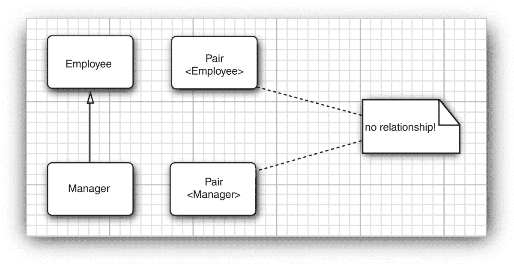没有继承关系

这似乎是一个残酷的限制，但对于类型安全来说是必要的。假设我们允许将 `Pair<Manager>` 转换为 `Pair<Employee>`。考虑这段代码：

```java
var managerBuddies = new Pair<Manager>(ceo, cfo);
Pair<Employee> employeeBuddies = managerBuddies; // 假设允许
employeeBuddies.setFirst(lowlyEmployee);
```

显然，最后语句是合法的。但 `employeeBuddies` 和 `managerBuddies` 指向同一个对象。我们现在成功将 CFO 与一个普通员工配在了一起，这对于 `Pair<Manager>` 来说是不可能的。

你刚刚看到了泛型类型与 Java 数组之间的重要区别。你可以将 `Manager[]` 数组赋值给类型为 `Employee[]` 的变量：

```java
Manager[] managerBuddies = { ceo, cfo };
Employee[] employeeBuddies = managerBuddies; // OK
```

然而数组带有特殊的保护。如果你尝试将普通员工存储到 `employeeBuddies[0]`，虚拟机将抛出 `ArrayStoreException`。

你始终可以将参数化类型转换为原始类型。例如，`Pair<Employee>` 是原始类型 `Pair` 的子类型。这种转换对于与旧代码交互是必要的。

你可以转换为原始类型然后导致类型错误吗？不幸的是，可以。考虑这个示例：

```java
var managerBuddies = new Pair<Manager>(ceo, cfo);
Pair rawBuddies = managerBuddies; // OK
rawBuddies.setFirst(new File(". . .")); // 仅有编译警告
```

这听起来很糟糕。但请记住，你并没有比旧 Java 版本时更糟。虚拟机的安全性不受威胁。当通过 `getFirst` 获取外部对象并将其分配给 `Manager` 变量时，会抛出 `ClassCastException`，就像过去一样。

最后，泛型类可以继承或实现其他的泛型类。在这方面，它们与普通类没有区别。例如，`ArrayList<T>` 类实现了 `List<T>` 接口。这意味着一个 `ArrayList<Manager>` 可以转换为 `List<Manager>`。然而，正如你刚刚看到的，一个 `ArrayList<Manager>` 并不是 `ArrayList<Employee>` 或 `List<Employee>`。图 8.2 显示了这些关系。

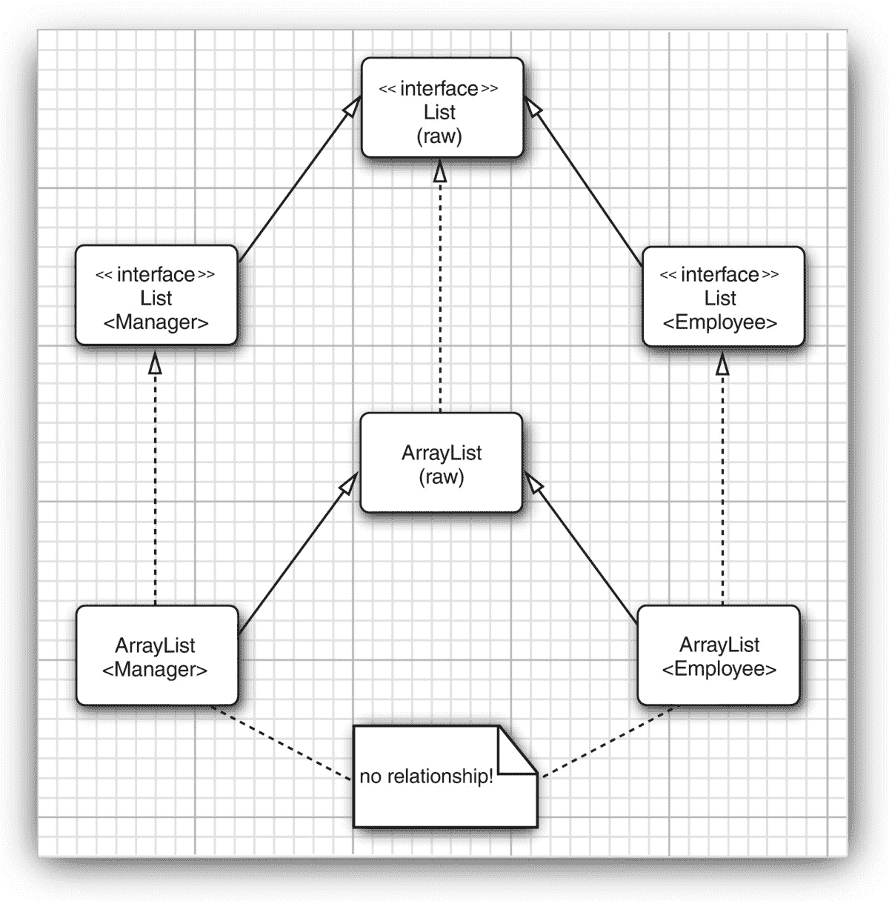泛型列表类型之间的子类型关系

## 通配符类型

类型系统研究人员早就发现，僵化的泛型系统用起来非常不便。Java 的设计者发明了一种巧妙（但同样安全）的“逃生口”：通配符类型（wildcard type）。接下来的章节将向你展示如何使用通配符。

### 通配符概念

在通配符类型中，类型参数允许变化。例如，通配符类型：

```java
Pair<? extends Employee>
```

表示任何泛型 `Pair` 类型，其类型参数是 `Employee` 的子类，例如 `Pair<Manager>`，但不是 `Pair<String>`。

假设你想写一个打印员工对的方法，如下所示：

```java
public static void printBuddies(Pair<Employee> p)
{
   Employee first = p.getFirst();
   Employee second = p.getSecond();
   System.out.println(first.getName() + " and " + second.getName() + " are buddies.");
}
```

正如你在上一节中看到的，你不能向该方法传递一个 `Pair<Manager>`，这相当有局限性。但解决方案很简单——使用通配符类型：

```java
public static void printBuddies(Pair<? extends Employee> p)
```

类型 `Pair<Manager>` 是 `Pair<? extends Employee>` 的子类型（参见图 8.3）。

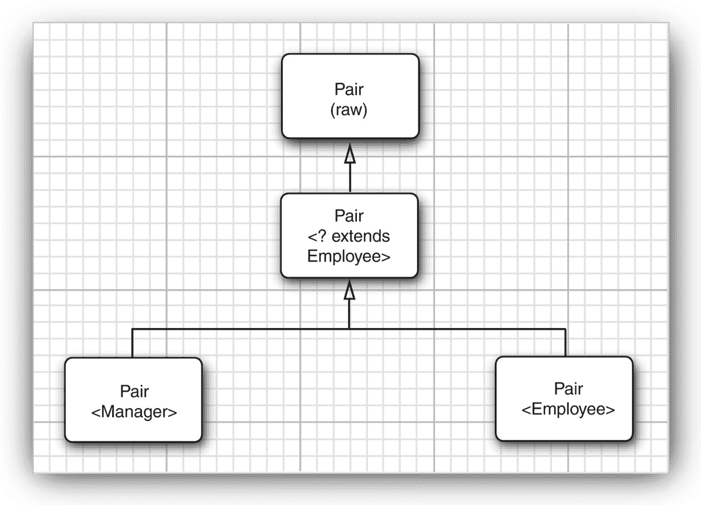带有通配符的子类型关系

我们能通过 `Pair<? extends Employee>` 引用来破坏 `Pair<Manager>` 吗？

```java
var managerBuddies = new Pair<Manager>(ceo, cfo);
Pair<? extends Employee> wildcardBuddies = managerBuddies; // OK
wildcardBuddies.setFirst(lowlyEmployee); // 编译错误
```

这种破坏是不可能的。对 `setFirst` 的调用是一个类型错误。为了了解为什么，让我们仔细观察类型 `Pair<? extends Employee>`。它的方法看起来是这样的：

```java
? extends Employee getFirst()
void setFirst(? extends Employee)
```

调用 `setFirst` 方法是不可能的！考虑调用 `wildcardBuddies.setFirst(lowlyEmployee)`。编译器知道 `setFirst` 的参数具有某个特定的类型，该类型扩展自 `Employee`。这个特定类型是 `Employee` 吗？是 `Manager` 还是其他子类？编译器无法得知。因此，编译器无法接受 `lowlyEmployee`。出于相同的原因，调用 `wildcardBuddies.setFirst(cio)`（其中 `cio` 是一个 `Manager` 实例）也会失败。编译器必须拒绝除 `null` 之外的所有 `setFirst` 参数。

`getFirst` 方法可以继续工作。`getFirst` 的返回值是某个特定类型的实例，该类型是 `Employee` 的子类型。编译器不知道那个特定类型是什么，但它能保证赋值给 `Employee` 引用是安全的。

这就是有界通配符（bounded wildcards）的核心思想。现在我们有一种方法来区分安全的访问方法和不安全的修改器方法。

### 通配符的上界边界

通配符边界与类型变量边界相似，但它们多了一个功能——你可以指定一个上界边界（supertype bound），如下：

```java
? super Manager
```

这个通配符被限制为 `Manager` 的所有上类型。（现有的 `super` 关键字能够如此准确地描述这种关系真是一种幸运。）

为什么你想这样做呢？带有上界边界的通配符提供的行为与第 8.7.1 节中描述的通配符相反。你可以为方法提供参数，但不能使用返回值。例如，`Pair<? super Manager>` 拥有的如下描述的方法：

```java
void setFirst(? super Manager)
? super Manager getFirst()
```

这并不是真正的 Java 语法，但它展示了编译器知道的信息。`setFirst` 的参数类型表示为 `? super Manager`，它是某个特定类型 `T`，而 `Manager` 是 `T` 的子类型。`T` 只有三种选择：`Object`、`Employee` 或 `Manager`。（如果 `Manager` 或 `Employee` 实现了接口，则会有更多选择。）然而，编译器不知道这些选择中哪一个。因此，编译器无法接受类型为 `Employee` 或 `Object` 的参数调用。毕竟，`T` 有可能是 `Manager`。只有传递类型为 `Manager` 或其子类（如 `Executive`）的对象才是可能的。

相反，如果你调用 `getFirst`，则对返回对象的类型没有保证。你只能将其赋值给 `Object`。


这是一个典型的例子。我们有一个经理数组，想要将奖金最低和最高的经理放入一个 `Pair` 对象中。什么样的 `Pair` 呢？

```java
public static void minmax(Manager[] a, Pair<Manager> result)
{
   if (a.length == 0) return;
   Manager min = a[0];
   Manager max = a[0];
   for (int i = 1; i < a.length; i++)
   {
      if (a[i].getBonus() < min.getBonus()) min = a[i];
      if (a[i].getBonus() > max.getBonus()) max = a[i];
   }
   result.setFirst(min);
   result.setSecond(max);
}
```

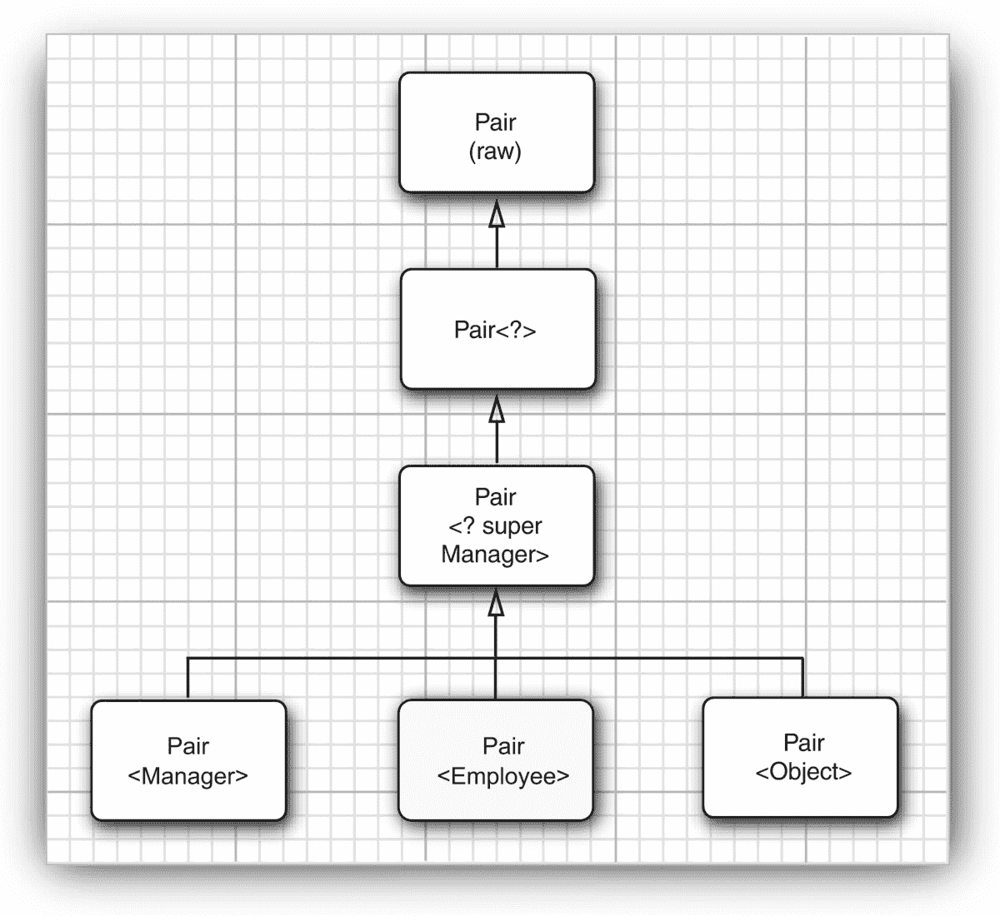 带有上界边界的通配符

直观地说，带有上界边界的通配符允许写入泛对象，而带有下界边界的通配符允许从泛对象读取。

这是上界边界的另一种用法。`Comparable` 接口本身就是一个泛型类型。定义如下：

```java
public interface Comparable<T>
{
   public compareTo(T other);
}
```

在这里，类型变量指示了 `other` 参数的类型。例如，`String` 类实现了 `Comparable<String>`，它的 `compareTo` 方法定义为：

```java
public int compareTo(String other)
```

这种显式参数类型很好。在接口泛型之前，`other` 是 `Object`，在方法的实现中需要进行强制转换。

现在 `Comparable` 是一个泛型类型，也许我们应该对 `ArrayAlg` 类中的 `minmax` 方法做得更好些？我们可以将其声明为：

```java
public static <T extends Comparable<T>> Pair<T> minmax(T[] a)
```

这看起来比仅仅使用 `T extends Comparable` 更详尽，并且对许多类都有效。例如，如果你计算 `String` 数组的最小值，那么 `T` 就是 `String` 类型，而 `String` 是 `Comparable<String>` 的子类型。但在处理 `LocalDate` 对象数组时我们会遇到问题。恰好 `LocalDate` 实现了 `ChronoLocalDate`，而 `ChronoLocalDate` 扩展了 `Comparable<ChronoLocalDate>`。因此，`LocalDate` 实现了 `Comparable<ChronoLocalDate>` 而不是 `Comparable<LocalDate>`。

在这种情况下，上界提供了拯救：

```java
public static <T extends Comparable<? super T>> Pair<T> minmax(T[] a)
```

现在 `compareTo` 方法的形式为：

```java
int compareTo(? super T)
```

也许它被定义为接收一个类型为 `T` 的对象，或者（例如当 `T` 是 `LocalDate` 时）接收 `T` 的上类型。无论如何，将类型为 `T` 的对象传递给 `compareTo` 方法都是安全的。

对于初学者来说，一个像 `<T extends Comparable<? super T>` 这样的声明看起来读起来一定令人生畏。这很遗憾的，因为该声明的意图是通过消除对调用参数的不必要限制，来帮助应用程序程序员。对泛型不感兴趣的应用程序程序员可能会很快学会忽略这些声明，并理所当然地认为库程序员会做正确的事。如果你是一个库程序员，那么你将需要习惯通配符（wildcards），否则你的用户将诅咒你，并在代码中随处进行随机强制类型转换，直到编译通过为止。

上界边界（supertype bounds）的另一个常用处是函数式接口的参数类型。例如，`Collection` 接口有一个方法：

```java
default boolean removeIf(Predicate<? super E> filter)
```

该方法移除所有符合给定谓词的元素。例如，如果你讨厌哈希码为奇数的员工，可以这样删除他们：

```java
ArrayList<Employee> staff = . . .
Predicate<Object> oddHashCode = obj -> obj.hashCode() %2 != 0;
staff.removeIf(oddHashCode);
```

你希望能够传递一个 `Predicate<Object>`，而不仅仅是 `Predicate<Employee>`。`super` 通配符使得这成为可能。

### 无界通配符

你甚至可以使用没有任何边界限制的通配符——例如 `Pair<?>`。从表面上看，它与原始类型（raw type）完全相同。实际上，这些类型是不同的。`Pair<?>` 类型具有如下方法：

```java
? getFirst()
void setFirst(?)
```

`getFirst` 的返回值只能赋值给 `Object`。`setFirst` 方法即使使用 `Object` 也永远无法调用。这就是 `Pair<?>` 和 `Pair` 之间的本质区别：你可以用任何 `Object` 调用原始 `Pair` 的 `setFirst` 方法。

你可以调用 `setFirst(null)`。你为什么需要这种类型？它对于非常简单的操作非常有用。例如，以下方法测试 pair 是否包含 `null` 引用：

```java
public static boolean hasNulls(Pair<?> p)
{
   return p.getFirst() == null || p.getSecond() == null;
}
```

通过将 `hasNulls` 转换为泛型方法，可以避免通配符类型：

```java
public static <T> boolean hasNulls(Pair<T> p)
```

然而，带通配符的版本似乎更易读。

### 通配符捕捉

让我们写一个交换 pair 元素的方法：

```java
public static void swap(Pair<?> p)
```

通配符不是类型，因此我们无法编写使用 `?` 作为类型的代码。换句话说，以下代码是非法的：

```java
? t = p.getFirst(); // ERROR
p.setFirst(p.getSecond());
```

这是一个问题，因为我们在交换时需要临时持有第一个元素。幸运的是，这个问题有一个解决方法。我们可以这样写辅助方法 `swapHelper`：

```java
public static <T> void swapHelper(Pair<T> p)
{
   T t = p.getFirst();
   p.setFirst(p.getSecond());
   p.setSecond(t
```

注意 `swapHelper` 是一个泛型方法，而 `swap` 不是——它有一个固定的 `Pair<?>` 参数。现在我们可以从 `swap` 中调用 `swapHelper`：

```java
public static void swap(Pair<?> p) { swapHelper(p); }
```

在这种情况下，`swapHelper` 方法的参数 `T` 捕捉了通配符。虽然通配符代表什么类型，但它是一个特定的类型，当 `T` 代表该类型时，`<T>swapHelper` 是合理的。当然，在这种情况下，我们并没有被迫使用通配符。我们可以直接实现 `<T> void swap(Pair<T> p)` 为泛型方法。然而，考虑这个通配符类型自然出现在计算中间的示例：

```java
public static void maxminBonus(Manager[] a, Pair<? super Manager> result)
{
   minmaxBonus(a, result);
   PairAlg.swapHelper(result); // OK—swapHelper captures wildcard type
}
```

在这里，通配符捕捉机制是避免的。

通配符捕捉只在非常有限的情况下合法。编译器必须能够保证通配符代表一个特定的类型。例如，`ArrayList<Pair<T>>` 中的 `T` 永远无法捕捉 `ArrayList<Pair<?>>` 中的通配符。列表可能持有两个 `Pair<?>`，每个 `?` 的类型都不同。Listing 8.3 中的测试程序汇总了前面章节讨论的各种方法，以便你在上下文中查看它们。

`pair3/PairTest3.java`

```java
package pair3;

/**
 * @version 1.01 2012-01-26
 * @author Cay Horstmann
 */
public class PairTest3
{
   public static void main(String[] args)
   {
      var ceo = new Manager("Gus Greedy", 800000, 2003, 12, 15);
      var cfo = new Manager("Sid Sneaky", 600000, 2003, 12, 15);
      var buddies = new Pair<Manager>(ceo, cfo);      
      printBuddies(buddies);

      ceo.setBonus(1000000);
      cfo.setBonus(500000);
      Manager[] managers = { ceo, cfo };

      var result = new Pair<Employee>();
      minmaxBonus(managers, result);
      System.out.println("first: " + result.getFirst().getName() 
         + ", second: " + result.getSecond().getName());
      maxminBonus(managers, result);
      System.out.println("first: " + result.getFirst().getName() 
         + ", second: " + result.getSecond().getName());
   }

   public static void printBuddies(Pair<? extends Employee> p)
   {
      Employee first = p.getFirst();
      Employee second = p.getSecond();
      System.out.println(first.getName() + " and " + second.getName() + " are buddies.");
   }

   public static void minmaxBonus(Manager[] a, Pair<? super Manager> result)
   {
      if (a.length == 0) return;
      Manager min = a[0];
      Manager max = a[0];
      for (int i = 1; i < a.length; i++)
      {
         if (a[i].getBonus() > min.getBonus()) min = a[i];
         if (a[i].getBonus() < max.getBonus()) max = a[i];
      }
      result.setFirst(min);
      result.setSecond(max);
   }
}

class PairAlg
{
   public static boolean hasNulls(Pair<?> p)
   {
      return p.getFirst() == null || p.getSecond() == null;
   }

   public static void swap(Pair<?> p) { swapHelper(p); }

   public static <T> void swapHelper(Pair<T> p)
   {
      T t = p.getFirst();
      p.setFirst(p.getSecond());
      p.setSecond(t);
   }
}
```

## 限制

在接下来的章节中，我将讨论在使用 Java 泛型时需要考虑的许多限制。这些限制大部分是类型擦除的结果。

### 类型参数不能用基本类型实例化

你不能用基本类型替换类型参数。因此，没有 `Pair<double>`，只有 `Pair<Double>`。原因是类型擦除。在擦除后，`Pair` 类拥有类型为 `Object` 的字段，你无法用它们来存储 `double` 值。

这确实是一个令人恼的问题，但它与 Java 语言中基本类型的独立地位是一致的。这并不是一个致命缺陷——只有八种基本类型，当包装类型不是可替代品时，你可以使用单独的类和方法处理它们。

### 运行时类型查询仅适用于原始类型

虚拟机中的对象始终具有特定的非泛型类型。因此，所有的类型查询只产生原始类型。例如：

```java
if (a instanceof Pair<String>) // ERROR
```

只能测试 `a` 是否为任何类型的 `Pair`。同样的情况也适用于：

```java
if (a instanceof Pair<T>) // ERROR
```

或者强制转换：

```java
Pair<String> p = (Pair<String>) a; // warning--can only test that a is a Pair
```

为了提醒你注意风险，当你尝试查询对象是否属于某个泛型类型时，将得到编译器错误（使用 `instanceof`）或警告（使用强制类型转换）。

同样地，`getClass()` 方法始终返回原始类型。例如：

```java
Pair<String> stringPair = . . .;
Pair<Employee> employeePair = . . .;
if (stringPair.getClass() == employeePair.getClass()) //它们是相等的
```

比较结果为 `true`，因为两次 `getClass()` 的调用都返回 `Pair.class`。

### 你不能创建泛化类型的数组

你不能实例化泛化类型的数组，例如：

```java
var table = new Pair<String>[10]; //
```

这有什么问题呢？擦除后，`table` 的类型是 `Pair[]`。你可以将其转换为 `Object[]`：

```java
Object[] objarray = table;
```

数组会记住它的组件类型，如果你尝试存储错误类型的元素，它会抛出 `ArrayStoreException`：

```java
objarray[0] = "Hello"; // --组件类型是 Pair
```

但擦除使得这种机制对泛型类型失效。以下赋值：

```java
objarray[0] = new Pair<Employee>();
```

将通过数组存储检查，但仍会导致类型错误。由于这个原因，泛化类型的数组是被禁止的。

请注意，只有创建这些数组是被禁止的。你可以声明一个类型为 `Pair<String>[]` 的变量。但你不能用 `new Pair<String>[10]` 来初始化它。

你可以声明通配符类型的数组并对其进行强制转换：

```java
var table = (Pair<String>[]) new Pair<?>[10];
```

结果是不安全的。如果你在 `table[0]` 中存储一个 `Pair<Employee>`，然后在 `table[0].getFirst()` 上调用 `String` 方法，你将得到 `ClassCastException`。

如果你需要收集泛化类型对象，只需使用 `ArrayList`：`ArrayList<Pair<String>>` 是安全且有效的。

### 可变参数警告

在上一节中，你看到 Java 不支持泛型类型的数组。在本节中，我将讨论一个相关问题：将泛型类型的实例传递给具有可变参数的方法。

考虑这个带有可变参数的简单方法：

```java
public static <E> void addAll(Collection<E> coll, E... elements)
{
   for (E element : elements) coll.add(element);
}
```

记住参数 `elements` 实际上是一个持有所有提供参数的数组。

现在考虑这个调用：

```java
Collection<Pair<String>> table = . . .;
Pair<String> pair1 = . . .;
Pair<String> pair2 = . . .;
addAll(table, pair1, pair2);
```

为了调用此方法，Java 虚拟机必须创建一个 `Pair<String>` 数组，这违反了规则。然而，规则针对这种情况被放宽了，你只会在调用处得到警告，而不是错误。你可以通过在包含 `addAll` 用的方法上添加 `@SuppressWarnings("unchecked")` 注解来抑制该警告。然而，对于 `addAll` 方法的调用者来说，这是一个恼人的负担。由于这个原因，在声明处还有另一个关于“可能的堆污染”的警告。


为了避免这两个警告，请在 `addAll` 方法本身上标记 `@SafeVarargs` 注解：

```
@SafeVarargs
public static <E> void addAll(Collection<E> coll, E... elements)
```

此方法现在可以用泛型类型调用了。通过使用该注解，你承诺你的方法没有写入参数数组，并且没有将数组传递给可能执行此操作的其他人。参见下文的滥用示例。

`@SafeVarargs` 注解只能用于 `static`、`final` 或 `private` 的构造函数和方法。任何其他方法都可以被重写，导致该注解毫无意义。

你可以使用 `@SafeVarargs` 注解来破解对创建泛型数组的限制，使用此方法：

```
@SafeVarargs static <E> E[] array(E... array) { return array; }
```

现在你可以调用：

```
Pair<String>[] table = array(pair1, pair2);
```

这看起来很方便，但隐藏着一个危险。以下代码：

```
Object[] objarray = table;
objarray[0] = new Pair<Employee>();
```

将会运行而不抛出 `ArrayStoreException`，因为数组存储只检查擦除后的类型。你在处理 `table[0]` 时会在其他地方得到异常。

### 泛型可变参数不会展开原始数组

记住你可以将数组传递给可变参数参数。例如，考虑上一节中的 `addAll` 方法。当要添加的项恰好在数组中时，你只需传递该数组。调用行为就像元素被“展开”了一样：

```
Collection<String> strings = . . .;
String[] moreStrings = new String[] { "Mary", "had", "a", "little", "lamb" };
addAll(strings, moreStrings); // OK，等同于 addAll(strings, "Mary", "had", "a", "little", "lamb")
```

当然，元素并没有实际上展开。事实上事实相反。如果逐个指定参数，它们将被收集到一个数组中，然后传递给方法。如果你提供一个数组，它会被直接传递。

现在考虑一个数字集合：

```
Collection<Integer> numbers = . . .;
int[] moreNumbers = new int[] { 1, 2, 3 };
addAll(numbers, moreNumbers); // 
```

正如你不能实例化单个泛型实例一样，你也无法实例化数组。原因有所不同——毕竟数组填充了 `null` 值，这在构造时似乎是安全的。但数组还携带有一个类型，该类型被用于在虚拟机中监控数组的存储操作。而该类型被擦除了。例如，考虑：

```java
public static <T extends Comparable> T[] minmax(T... a) 
{ 
   T[] mm = new T[2]; // ERROR
   . . . 
}
```

类型擦除会导致此方法始终构造一个 `Comparable[2]`。

如果数组仅用作类的私有实例字段，你可以将数组的元素类型声明为擦除后的类型并使用强制转换。例如，`ArrayList` 类可以如下实现：

```java
public class ArrayList<E>
{
   private Object[] elements;
   . . .
   @SuppressWarnings("unchecked") public E get(int n) { return (E) elements[n]; }
   public void set(int n, E e) { elements[n] = e; } // 不需要强制转换
}
```

这种技术对于我们的 `minmax` 方法不起，因为我们返回的是一个 `T[]` 数组，如果我们对其类型上撒谎，就会导致运行时错误。假设我们实现：

```java
public static <T extends Comparable> T[] minmax(T... a)
{
   var result = new Comparable[2]; // 擦除类型的数组
   . . .
   return (T[]) result; // 编译通过但警告
}
```

调用：

```java
String[] names = ArrayAlg.minmax("Tom", "Dick", "Harry");
```

编译没有任何警告。在方法返回后，当 `Comparable[]` 引用转换为 `String[]` 时会发生 `ClassCastException`。

在这种情况下，最好是让用户提供一个数组构造表达式：

```java
String[] names = ArrayAlg.minmax(String[]::new, "Tom", "Dick", "Harry");
```

构造表达式 `String[]::new` 表示一个函数，该函数给定所需的长度，构造一个该长度的 `String` 数组。

该方法使用该参数产生正确类型的数组：

```java
public static <T extends Comparable> T[] minmax(IntFunction<T[]> constr, T... a)
{
   T[] result = constr.apply(2);
   . . .
}
```

一种更传统的方法是使用反射并调用 `Array.newInstance`：

```java
public static <T extends Comparable> T[] minmax(T... a)
{
   var result = (T[]) Array.newInstance(a.getClass().getComponentType(), 2);
   . . .
}
```

`ArrayList` 类的 `toArray` 方法就没有那么幸运了。它需要产生 `T[]` 数组，但它没有组件类型。因此，有两种变体：

```java
Object[] toArray()
T[] toArray(T[] result)
```

第二个方法接收一个数组参数。如果数组足够大，则使用。否则，将使用 `result` 的组件类型创建一个足够大小的新数组。

### 类型变量在泛型类的静态文中无效

你不能在静态字段或方法中引用类型变量。例如，以下巧妙的想法行不通：

```java
public class Singleton<T>
{
   private static T singleInstance; // ERROR

   public static T getSingleInstance() // ERROR
   {
      if (singleInstance == null) 创建 T 的新实例
      return singleInstance;
   }
}
```

如果这可以实现，那么程序就可以声明 `Singleton<Random>` 来共享随机数生成器，并声明 `Singleton<JFileChooser>` 来共享文件选择对话框。但这是行不通的。类型擦除后，只有一个 `Singleton` 类和一个 `singleInstance` 字段。出于这个原因，带有类型变量的静态字段和方法被直接禁止了。

### 你不能抛出或捕获泛型类的实例

你既不能抛出也不能捕获泛型类的对象。事实上，泛型类扩展 `Throwable` 也是不法的。例如，以下定义将无法编译：

```java
public class Problem<T> extends Exception { /* . . . */ } 
   // ERROR--不能扩展
```

泛型规范提到了另一条规则：“为了支持类型擦除（erasure），我们实施了一项限制：类或类型变量不能同时是两个不同参数化形式的同一接口类型的子类。”例如，以下代码是非法的：

```
class Employee implements Comparable<Employee> { . . . }
class Manager extends Employee implements Comparable<Manager> { . . . } // ERROR
```

此时 `Manager` 将同时实现 `Comparable<Employee>` 和 `Comparable<Manager>`，它们是同一个接口的不同参数化形式。

目前还不清楚这一限制与类型擦除有什么关系。毕竟，非泛型版本

```
class Employee implements Comparable { . . . }
class Manager extends Employee implements Comparable { . . . }
```

是合法的。原因要微妙得多。这会导致与合成的桥接方法（bridge methods）产生冲突。实现 `Comparable<X>` 的类获得一个桥接方法：

```
public int compareTo(Object other) { return compareTo((X) other); }
```

你不能拥有不同的类型 `X` 两个这样的方法。

### 泛型记录模式中的类型推断是有限的

当涉及泛型类型时，编译器可能需要非常努力工作才能验证完备性。考虑这个不完整的 JSON 类型层次结构：

```
sealed interface JSONPrimitive<T> {}
record JSONNumber(double value) implements JSONPrimitive<Double> {}
record JSONBoolean(boolean value) implements JSONPrimitive<Boolean> {}
record JSONString(String value) implements JSONPrimitive<String> {}
```

以下方法中的 `switch` 是完备的：

```
public static <T> double toNumber(JSONPrimitive<T> v)
{
   return switch (v)
      {
         case JSONNumber(var n) -> n;
         case JSONBoolean(var b) -> b ? 1 : 0;
         case JSONString(var s) -> {
            try
            {
               yield Double.parseDouble(s);
            }
            catch (NumberFormatException ex)
            {
               yield Double.NaN;
            }
         }
      };
}
```

从一眼看去，似乎有无限数量实现 `JSONPrimitive<T>` 的类，但编译器可以追踪到它们只有三个。

现在我们想要形成两个 JSON 原型的和：

```
record Pair<T>(T first, T second)
{
   public static <U> Pair<U> of(U first, U second) { return new Pair<U>(first, second); }
}

public static Object sum(Pair<? extends JSONPrimitive<?>> pair)
{
   return switch (pair)
      {
         case Pair(JSONNumber(var left), JSONNumber(var right)) -> left + right;
         case Pair(JSONBoolean(var left), JSONBoolean(var right)) -> left | right;
         case Pair(JSONString(var left), JSONString(var right)) -> left.concat(right);
         // ERROR--不完备
      };
}
```

这个 `switch` 不是完备的。毕竟，可能会像这样调用 `sum1`：

```
sum(Pair.of(new JSONNumber(42), new JSONString("Fred")))
```

你可以通过添加其他六种 JSON 原型的组合并在每种情况下抛出异常来使 `switch` 变得完备。但那是运行时检查。如果能在编译时拒绝混合对会更好。

以下是仅接受同质对的方法：

```
public static <T extends JSONPrimitive<U>, U> Object sum(Pair<T> pair)
{
   return switch (pair)
      {
         case Pair(JSONNumber(var left), JSONNumber(var right)) -> left + right;
         case Pair(JSONBoolean(var left), JSONBoolean(var right)) -> left | right;
         case Pair(JSONString(var left), JSONString(var right)) -> left.concat(right);
         default -> throw new AssertionError(); // 遗憾的是 Java 无法判断这不会发生
      };
}
```

现在调用：

```
sum(Pair.of(new JSONNumber(42), new JSONString("Fred")))
```

不再通过编译，因为对于 `T` 和 `U` 没有匹配的类型。

遗憾的是，`default` 子句是使 `switch` 完备所需的。理论上，有足够的信息确定对组件必须是相同类型的实例，但 Java 类型系统无法证明这一点。

尝试使用显式类型参数不起作用：

```java
public static <T extends JSONPrimitive<U>, U> Object sum(Pair<T> pair)
{
   return switch (pair)
      {
         // ERROR—不安全的转换
         case Pair<JSONNumber>(JSONNumber(var left), JSONNumber(var right)) -> left + right;
         case Pair<JSONBoolean>(JSONBoolean(var left), JSONBoolean(var right)) -> left | right;
         case Pair<JSONString>(JSONString(var left), JSONString(var right)) -> left.concat(right);
      };
}
```

Java 编译器不知道如何证明当组件类型为 `JSONNumber` 时，从 `Pair<T>` 到 `Pair<JSONNumber>` 的转换是安全的。

### 反射与泛型

反射允许你在运行时分析对象。如果对象是泛型类的实例，你无法获得关于泛型类型参数的信息，因为它们已经被擦除了。在接下来的章节中，你将学习可以使用反射发现关于泛型类的什么。

### 泛型 `Class` 类

`Class` 类有一个类型参数。例如，`String.class` 实际上是 `Class<String>` 类的一个对象（事实上是唯一的对象）。

类型参数是有用的，因为它允许 `Class<T>` 的方法对其返回类型更加具体。以下 `Class<T>` 的方法利用了类型参数：

```
T cast(Object obj)
T[] getEnumConstants()
Class<? super T> getSuperclass()
Constructor<T> getConstructor(Class<?>... parameterTypes)
Constructor<T> getDeclaredConstructor(Class<?>... parameterTypes)
```

`getConstructor` 方法返回 `Constructor<T>` 实例，因此在以下情况下不需要转换：

```
Class<T> cl = . . .
T noArgInstance = cl.getConstructor().newInstance();
```

`cast` 方法返回给对象，如果其类型确实是 `T` 的子类，现在声明为类型 `T`。否则，它会抛出 `ClassCastException`。

如果该类不是枚举类或已知类型为 `T` 的枚举值数组，则 `getEnumConstants` 方法返回 `null`。

`java.lang.Class<T>` 1.0


- `T cast(Object obj)`

  如果`obj`为`null`或可以转换为类型`T`，则返回`obj`，否则抛出`ClassCastException`。

- `T[] getEnumConstants()` 5.0

  如果`T`是枚举类型，则返回所有值的数组，否则返回`null`。

- `Class<? super T> getSuperclass()`

  返回此类的父类，如果`T`不是类或`Object`类，则返回`null`。

- `Constructor<T> getConstructor(Class... parameterTypes)` 1.1

- `Constructor<T> getDeclaredConstructor(Class... parameterTypes)` 1.1

  获取公共构造函数，或具有给定参数类型的构造函数。

## 使用`Class<T>`参数进行类型匹配

在泛型方法中匹配`Class<T>`参数的类型变量有时是有用的。这里是一个经典的示例：

```java
public static <T> Pair<T> makePair(Class<T> c) throws ReflectiveOperationException
{
   Constructor<T> constr = c.getConstructor();
   return new Pair<>(constr.newInstance(), constr.newInstance());
}
```

如果你调用

```java
makePair(String.class)
```

那么`String.class`是类型为`Class<String>`的对象。`makePair`方法的类型参数`T`匹配`String`，编译器可以推断出方法返回`Pair<String>`。

## 虚拟机中的泛型类型信息

Java泛型的一个显著特征是虚拟机中泛型类型的擦除。令人惊讶的是，擦除后的类仍然保留了其泛型起源的一些微弱记忆。例如，原始`Pair`类知道它源自泛型类`Pair<T>`，尽管`Pair`类型的对象无法判断自己是被构造为`Pair<String>`还是`Pair<Employee>`。

同样地，考虑一个方法：

```java
public static Comparable min(Comparable[] a)
```

这就是泛型方法的擦除

```java
public static <T extends Comparable<? super T>> T min(T[] a)
```

你可以使用反射API来确定：

- 该泛型方法拥有一个名为`T`的类型参数；
- 该类型参数有一个子类型边界，而该边界本身是一个泛型类型；
- 该边界类型有一个通配符参数；
- 该通配符参数有一个上界边界；以及
- 该泛型方法拥有一个泛型数组参数。

换句话说，你可以重构实现者所声明的关于泛型类和方法的所有信息。然而，你将不知道类型参数在特定对象或方法调用中是如何解析的。

为了表示泛型类型声明，请使用`java.lang.reflect`包中的`Type`接口。该接口有以下子类型：

- `Class`类，描述具体类型；
- `TypeVariable`接口，描述类型变量（例如`T extends Comparable<? super T>`）；
- `WildcardType`接口，描述通配符（例如`? super T`）；
- `ParameterizedType`接口，描述泛型类或接口类型（例如`Comparable<? super T>`）；
- `GenericArrayType`接口，描述泛型数组（例如`T[]`）。

图8.5显示了继承层次结构。注意后四个子类型是接口——虚拟机实例化实现这些接口的相应类。

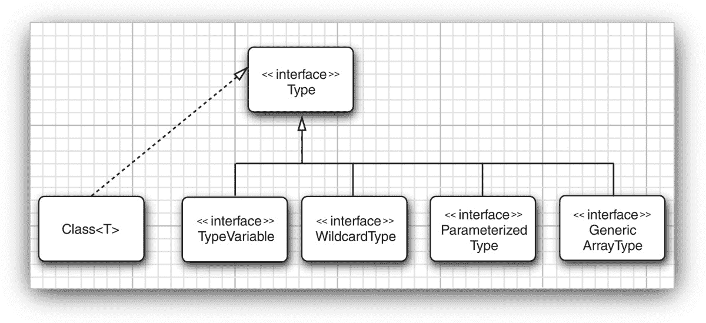`Type`接口及其后代

列表8.4使用泛型反射API打印出对给定类所发现的信息。如果你使用`Pair`类运行它，将得到如下报告：

```java
class Pair<T> extends java.lang.Object
public T getFirst()
public T getSecond()
public void setFirst(T)
public void setSecond(T)
```

如果你使用`PairTest2`目录下的`ArrayAlg`运行它，报告将显示以下方法：

```java
public static <T extends java.lang.Comparable> Pair<T> minmax(T[])
```

`genericReflection/GenericReflectionTest.java`

```java
package genericReflection;

import java.lang.reflect.*;
import java.util.*;

/**
 * @version 1.13 2023-12-20
 * @author Cay Horstmann
 */
public class GenericReflectionTest
{
   public static void main(String[] args)
   {
      // 从命令行参数或用户输入读取类名
      String name;
      if (args.length > 0) name = args[0];
      else
      {
         try (var in = new Scanner(System.in))
         {
            System.out.println("Enter class name (e.g., java.util.Collections): ");
            name = in.next();
         }
      }

      try
      {
         // 打印类和公共方法的泛型信息
         Class<?> cl = Class.forName(name);
         printClass(cl);
         for (Method m : cl.getDeclaredMethods())
            printMethod(m);
      }
      catch (ClassNotFoundException e)
      {
         e.printStackTrace();
      }
   }

   public static void printClass(Class<?> cl)
   {
      System.out.print(cl);
      printTypes(cl.getTypeParameters(), "<", ", ", ">", true);
      Type sc = cl.getGenericSuperclass();
      if (sc != null)
      {
         System.out.print(" extends ");
         printType(sc, false);
      }
      printTypes(cl.getGenericInterfaces(), " implements ", ", ", "", false);
      System.out.println();
   }

   public static void printMethod(Method m)
   {
      String name = m.getName();
      System.out.print(Modifier.toString(m.getModifiers()));
      System.out.print(" ");
      printTypes(m.getTypeParameters(), "<", ", ", "> ", true);

      printType(m.getGenericReturnType(), false);
      System.out.print(" ");
      System.out.print(name);
      System.out.print("(");
      printTypes(m.getGenericParameterTypes(), "", ", ", "", false);
      System.out.println(")");
   }

   public static void printTypes(Type[] types, String prefix, String separator, 
         String suffix, boolean isDefinition)
   {
      if (prefix.equals(" extends ") 
            && Arrays.equals(types, new Type[] { Object.class })) return;
      if (types.length > 0) System.out.print(prefix);
      for (int i = 0; i < types.length; i++)
      {
         if (i > 0) System.out.print(separator);
         printType(types[i], isDefinition);
      }
      if (types.length > 0) System.out.print(suffix);
   }

   public static void printType(Type type, boolean isDefinition)
   {
      if (type instanceof Class<?> t)
      {
         System.out.print(t.getName());
      }
      else if (type instanceof TypeVariable<?> t)
      {
         System.out.print(t.getName());
         if (isDefinition)
            printTypes(t.getBounds(), " extends ", ", ", ">", false);
      }
      else if (type instanceof WildcardType t)
      {
         System.out.print("?");
         printTypes(t.getUpperBounds(), " extends ", ", ", ">", false);
         printTypes(t.getLowerBounds(), " super ", ", ", ">", false);
      }
      else if (type instanceof ParameterizedType t)
      {
         Type owner = t.getOwnerType();
         if (owner != null)
         {
            printType(owner, false);
            System.out.print(".");
         }
         printType(t.getRawType(), false);
         printTypes(t.getActualTypeArguments(), "<", ", ", ">", false);
      }
      else if (type instanceof GenericArrayType t)
      {
         System.out.print("");
         printType(t.getGenericComponentType(), isDefinition);
         System.out.print("[]");
      }
   }
}
```

## 类型字面量 (Type Literals)

有时，你希望通过值的类型来驱动程序的行为。例如，在持久化机制中，你可能希望用户指定保存特定类对象的方法。这通常通过将`Class`对象与动作关联来实现。

然而，对于泛型类，擦除带来了问题。当`ArrayList<Integer>`和`ArrayList<String>`都擦除为相同的`ArrayList`类型时，你如何为它们设置不同的动作？

有一种技巧可以在某些情况下提供缓解。你可以捕获上一节中遇到的`Type`接口的实例。如下构造一个匿名子类：

```java
var type = new TypeLiteral<ArrayList<Integer>>(){} // 注意 {}
```

`TypeLiteral`构造函数捕获了泛型父类：

```java
class TypeLiteral<T>
{
   public TypeLiteral()
   {
      Type parentType = getClass().getGenericSuperclass();
      if (parentType instanceof ParameterizedType paramType)
         type = paramType.getActualTypeArguments()[0];
      else
         throw new UnsupportedOperationException(
            "Construct as new TypeLiteral<. . .>(){}");
   }
}
```

如果我们运行时有一个泛型类型，就可以将其与`TypeLiteral`进行匹配。我们无法从对象获取泛型类型——它被擦除了。但是，正如你在上一节中所看到的，泛型字段和方法参数的泛型类型在虚拟机中保留了下来。

注入框架如CDI和Guice使用类型字面量来控制泛型类型的注入。书中示例程序展示了一个更简单的例子：给定一个对象，我们遍历它的字段（这些字段的泛型类型是可选），并查找关联的格式化动作。

我们通过空格分隔值来格式化`ArrayList<Integer>`，通过将字符接到字符串来格式化`ArrayList<Character>`。任何其他列表都通过`ArrayList.toString()`进行格式化。


```java
package genericReflection;

/**
   @version 1.03 2023-12-20
   @author Cay Horstmann
*/

import java.lang.reflect.*;
import java.util.*;
import java.util.function.*;

/**
 * 类型字面量（type literal）描述了一个可以是泛型的类型，例如
 * `ArrayList<String>`。
 */
class TypeLiteral<T>
{
   private Type type;

   /**
    * 此构造函数必须通过匿名子类调用，
    * 如 `new TypeLiteral<. . .>(){}`。
    */
   public TypeLiteral()
   {
      Type parentType = `getClass().getGenericSuperclass()`;
      if (parentType instanceof ParameterizedType paramType) 
         type = paramType.getActualTypeArguments()[0];
      else
         throw new UnsupportedOperationException(
            "请使用 new TypeLiteral<. . .>(){ 的方式构造");            
   }

   private TypeLiteral(Type type)
   {
      this.type = type;
   }

   /**
    * 返回一个描述给定类型的类型字面量。
    */
   public static TypeLiteral<?> of(Type type)
   {
      return new TypeLiteral<>(type);
   }

   public String toString()
   {
      if (type instanceof Class<?> cl) return cl.getName();
      else return type.toString();
   }

   public boolean equals(Object otherObject) 
   {
      return otherObject instanceof TypeLiteral<?> otherLiteral
         && type.equals(otherLiteral.type);      
   }

   public int hashCode()
   {
      return type.hashCode();
   }
}

/**
 * 使用关联类型与格式化化的规则来格式化对象。
 */
class Formatter
{   
   private Map<TypeLiteral<?>, Function<?, String>> rules = new HashMap<>();

   /**
    * 为此格式化器添加格式化规则。
    * @param type 该规则适的类型
    * @param formatterForType 格式化该类型对象的函数
     */
   public <T> void forType(TypeLiteral<T> type, Function<T, String> formatterForType) 
   {
      rules.put(type,  formatterForType);
   }

   /**
    * 使用此格式化器的规则格式化对象的所有字段。
    * @param obj 一个对象
    * @return 包含所有字段名和格式化值的字符串
     */
   public String formatFields(Object obj) 
         throws IllegalArgumentException, IllegalAccessException
   {
      var result = new StringBuilder();
      for (Field f : obj.getClass().getDeclaredFields())
      {
         result.append(f.getName());
         result.append("=");
         f.setAccessible(true);
         Function<?, String> formatterForType = rules.get(TypeLiteral.of(f.getGenericType()));
         if (formatterForType != null) 
         {
            // formatterForType 有参数类型 ?. 无法传递它的 apply 方法。
            // 强制转换将参数类型转换为 Object，以便我们可以调用它。
            @SuppressWarnings("unchecked")
            Function<Object, String> objectFormatter 
               = (Function<Object, String>) formatterForType;
            result.append(objectFormatter.apply(f.get(obj)));
         }
         else
            result.append(f.get(obj).toString());
         result.append("\n");
      }
      return result.toString();
   }
}

public class TypeLiterals
{
   public static class Sample
   {
      ArrayList<Integer> nums;
      ArrayList<Character> chars;
      ArrayList<String> strings;
      public Sample()       
      { 
         nums = new ArrayList<>();
         nums.add(42); nums.add(1729);
         chars = new ArrayList<>();
         chars.add('H'); chars.add('i');
         strings = new ArrayList<>();
         strings.add("Hello"); strings.add("World");
      }
   }

   private static <T> String join(String separator, ArrayList<T> elements)
   {
      var result = new StringBuilder();
      for (T e : elements)
      {
         if (result.length() > 0) result.append(separator);
         result.append(e.toString());
      }
      return result.toString();
   }

   public static void main(String[] args) throws Exception
   {
      var formatter = new Formatter();
      formatter.forType(new TypeLiteral<ArrayList<Integer>>(){}, 
         lst -> join(" ", lst));
      formatter.forType(new TypeLiteral<ArrayList<Character>>(){}, 
         lst -> "\"" + join("", lst) + "\"");
      System.out.println(formatter.formatFields(new Sample()));
   }
}
```

`java.lang.Class<T>` 1.0

* `TypeVariable[] getTypeParameters()` 5.0

如果此类型被声明为泛型类型，则获取泛型类型变量，否则返回长度为 0 的数组。

* `Type getGenericSuperclass()` 5.0

获取为此类型声明的父类的泛型类型；如果此类型是 `Object` 或不是类型，则返回 `null`。

* `Type[] getGenericInterfaces()` 5.0

按声明顺序获取为此类型声明的接口的泛型类型，否则返回长度为 0 的数组。

`java.lang.reflect.Method` 1.1

* `TypeVariable[] getTypeParameters()` 5.0

如果此方法被声明为泛型方法，则获取泛型类型变量，否则返回长度为 0 的数组。

* `Type getReturnType()` 5.0

获取为此方法声明的泛型返回类型。

* `Type[] getParameterTypes()` 5.0

获取为此方法声明的泛型参数类型。如果方法没有参数，则返回长度为 0 的数组。

`java.lang.reflect.TypeVariable` 5.0

* `String getName()`

获取此类型变量的名称。

* `Type[] getBounds()` 5.0

获取此类型变量的子类边界；如果变量无边界，则返回长度为 0 的数组。

`java.lang.reflect.WildcardType` 5.0

* `Type[] getUpperBounds()` 5.0

获取此类型变量的子类边界（`extends`）；如果变量没有子类边界，则返回长度为 0 的数组。

* `Type[] getLowerBounds()` 5.0

获取此类型变量的父类边界（`super`）；如果变量没有父类边界，则返回长度为 0 的数组。

`java.lang.reflect.ParameterizedType` 5.0

* `Type getRawType()`

获取此泛化泛的原始类型。

* `Type[] getActualTypeArguments()`

获取为此泛化类型声明的类型参数。

* `Type getOwnerType()`

如果此是内部类型，则获取外部类类型；如果是顶层类型，则返回 `null`。

`java.lang.reflect.GenericArrayType` 5.0

* `Type getGenericComponentType()`

获取为此数组类型声明的泛型组件类型。

Java 的初始版本仅为最常用的数据结构提供了一小部分类：`Vector`、`Stack`、`Hashtable`、`BitSet` 以及 `Enumeration` 接口（后者提供了一种用于访问任意容器中元素的抽象机制）。这无疑是一个明智的选择——创建一个全面的集合类库需要时间和精技巧。

随着 Java 1.2 的出现，设计者们认为是时候推出一个完全的数据结构框架了。他们面临着许多相互冲突的设计挑战。他们希望这个库既小巧又易于学习；他们不想要 C++ 标准模板库（或 `STL`）那样的复杂性，但又想要获得 `STL` 所开创的“泛型算法”的益处。他们还希望旧的类能够适配到新框架中。正如所有集合类库的设计者一样，他们必须做出一些艰难的抉，并在过程中产生了一系列独特的设计决策。在本节中，我们将探索 Java 集合框架的基本设计，演示如何使用它，并解释一些更具争议的功能背后的原理。

## 分离集合接口与实现

与现代数据结构库一样，Java 集合框架将 `interfaces`（接口）和 `implementations`（实现）分开了。让我们通过一个熟悉的数据结构——队列（queue）来观察这种分离。

`queue interface` 规定你可以在队列的尾部添加元素，从头部删除元素，并查询队列中有多少元素。当你需要收集对象并按“先进先出”的方式检索它们时，就会使用队列（参见图 9.1）。

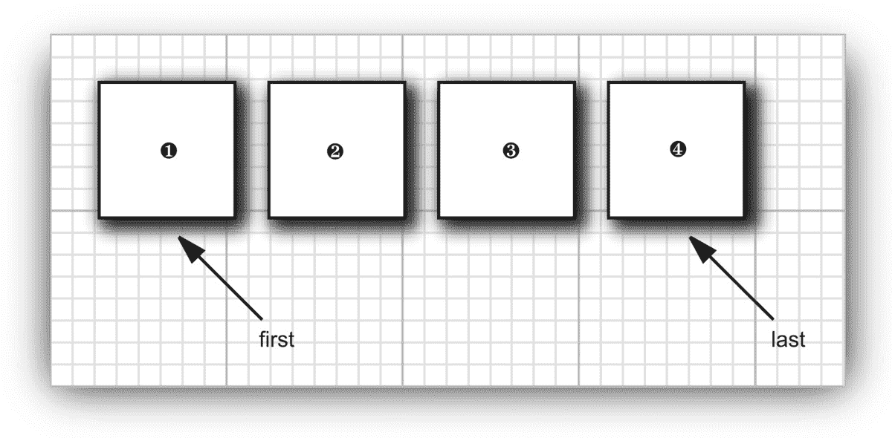队列

队列接口的最小形式可能如下所示：

```
public interface Queue<E> // Java API 中接口的简化形式
{
   void add(E e);
   E remove();
   int size();
}
```

该接口没有告诉你任何关于队列如何实现的信息。在队列的两种常见实现中，一种使用“循环数组”，另一种使用链表（参见图 9.2）。

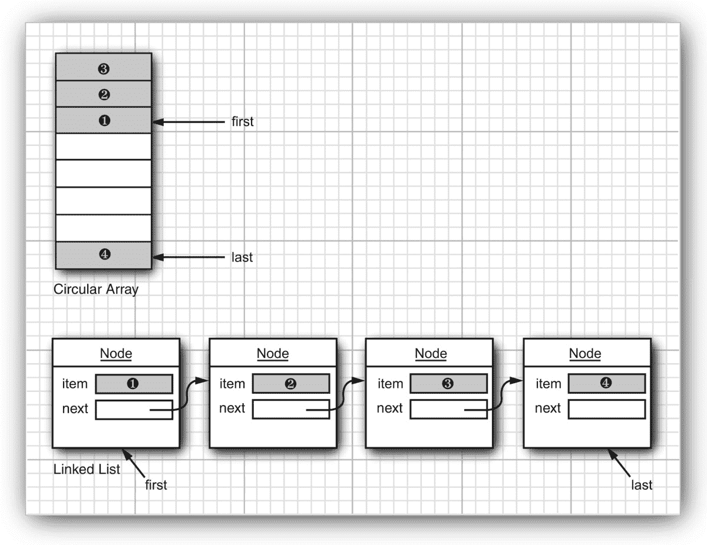队列实现

每个实现都可以由实现 `Queue` 接口的类来表示。在 Java API 中，这些类被称为 `ArrayDeque` 和 `LinkedList`。

```
public class ArrayDeque<E> implements Queue<E> // 简化自 Java API
{
   private int first;
   private int last;
   private E[] elements;

   public ArrayDeque(int numElements) { . . . }
   public void add(E e) { . . . }
   public E remove() { . . . }
   public int size() { . . . }
   . . .
}

public class LinkedList<E> implements Queue<E> // 简化自 Java API
{
   private Node<E> first;
   private Node<E> last;

   public LinkedList() { . . . }
   public void add(E e) { . . . }
   public E remove() { . . . }
   public int size() { . . . }
   . . .
}
```

在程序中使用队列时，一旦集合构建完成，你就不需要知道实际上使用的是哪种实现。因此，*仅*在构建集合对象时使用具体类是合理的。使用*接口类型*来持有集合引用。

```
Queue<Customer> expressLane = new ArrayDeque<>(100);
expressLane.add(new Customer("Harry"));
```

通过这种方法，如果你改变了主意，可以轻松切换到不同的实现。你只需要修改程序中的一处地方——构造函数的调用。如果你最终决定链表是更好的选择，你的代码变为：

```
Queue<Customer> expressLane = new LinkedList<>();
expressLane.add(new Customer("Harry"));
```

坚持使用接口还有另一个原因是：`ArrayDeque` 和 `LinkedList` 类都拥有与队列操作无关的方法。不小心使用其中一个方法会被报告为编译错误，因为你不能在 `Queue` 类型的变量上调用它们。

为什么选择其中一种实现而不是另一种呢？接口对实现的效率没有说明任何信息。循环数组的内存效率更高。然而，循环数组具有有限的，并且每当它填满时都需要重新分配内存。事实上，测量显示 `ArrayDeque` 的性能通常优于 `LinkedList`，因为它对垃圾回收器的影响较小。当 `ArrayDeque` 出现在 Java 6 中时，使用 `Queue` 接口的程序员可以通过更改单行代码将 `LinkedList` 替换掉。

## 集合接口

Java 集合框架中集合类的基础接口是 `Collection` 接口。该接口有两个基本方法：

```
public interface Collection<E>
{
   boolean add(E element);
   Iterator<E> iterator();
   . . .
}
```

除了这两个方法外还有几个方法；我们稍后会讨论。

`add` 方法向集合中添加元素。如果添加元素确实更改了集合，则返回 `true`；如果集合未改变，则返回 `false`。例如，如果你尝试向集合添加一个对象而该对象已经存在，那么 `add` 请求将不起作用，因为集合拒绝重复项。

`iterator` 方法返回一个实现 `Iterator` 接口的对象。通过该对象，你可以逐个访问集合中的元素。我们将在下一节讨论迭代器。

## 迭代器

`Iterator` 接口有四个方法：

```
public interface Iterator<E>
{
   boolean hasNext();
   E next();
   default void remove();
   default void forRemaining(Consumer<? super E> action);
}
```

通过反复调用 `next` 方法，你可以逐个访问集合中的元素。然而，如果你到达集合的末尾，`next` 方法将抛出 `NoSuchElementException`。因此，你需要在调用 `next` 之前调用 `hasNext` 方法。如果迭代器尚未到达末尾且至少还有一个元素待访问，该方法返回 `true`。如果你想检查集合中的所有元素，可以请求一个迭代器，然后在 `hasNext` 返回 `true` 时继续调用 `next` 方法。例如：


`Collection<String> coll = . .[];`
`Iterator<String> iter = coll.iterator();`
`while (iter.hasNext())`
`{`
   `String element = iter.next();`
   `do something with element`
`}`

你可以用更简洁的“for each”循环来写这样的循环：

```
for (String element : coll)
{
   do something with element
}
```

编译器简单地将“for each”循环翻译成带有迭代器的循环。

“for each”循环适用于任何实现`Iterable`接口的对象，该接口包含一个抽象方法：

```
public interface Iterable<E>
{
   Iterator<E> iterator();
   . . .
}
```

`Collection`接口继承了`Iterable`接口。因此，你可以对 Java 集合框架中的任何集合使用“for each”循环。

与其编写循环，不如调用`Collection.forEach`或`Iterator.forEachRemaining`方法，并传入一个处理元素的 Lambda 表达式。Lambda 表达式将应用于集合的所有元素，或者迭代器可以访问的剩余元素。

```
coll.forEach(element -> do something with element);
iter.forEachRemaining(element -> do something with element);
```

元素的访问顺序取决于集合类型。如果你遍历一个`ArrayList`，迭代器将从索引`0`开始，并在每一步中增加索引。然而，如果你访问`HashSet`中的元素，你将以一种本质上随机的顺序获取它们。你可以确保在迭代过程中会遇到集合中的所有元素，但你无法对它们的顺序做出任何假设。这通常不是一个问题，因为对于计算总和或统计匹配项等计算来说，顺序并不重要。

老手们会注意到，`Iterator`接口的`next`和`hasNext`方法的作用与`Enumeration`接口的`nextElement`和`hasMoreElements`方法是相同的。Java 集合框架的设计者本可以选择使用`Enumeration`接口，但他们不喜欢那些繁琐的方法名，而是引入了一个方法名更短的新接口。

Java 集合库中的迭代器与其他库中的迭代器之间存在着一个重要的概念区别。在传统的集合库中（如 C++ 的标准模板库 STL），迭代器是模仿数组索引进行建模的。给定这样一个迭代器，你可以查找存储在该位置的元素，就像如果你有数组索引`i`，可以查找数组元素`a[i]`一样。无论是否查找，你都可以将迭代器移动到下一个位置。这与通过`i++`推进数组索引的操作是相同的，且不需要执行查找。然而，Java 迭代器并不是这样工作的。查找和位置变化是紧密耦合的。查找元素的唯一方法是调用`next`，而这种查找会移动位置。

相反，请将 Java 迭代器想象成处于元素之间。当你调用`next`时，迭代器会跳过下一个元素，并返回它刚刚经过的元素的引用（参见图 9.3）。

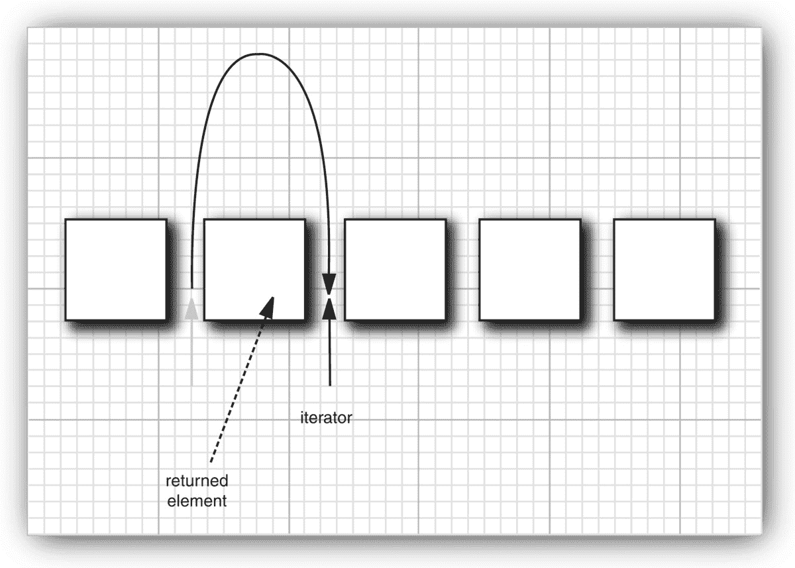 移动迭代器

这里另一个有用的类比。你可以认为`Iterator.next`等同于`InputStream.read`。从流中读取字节会自动“消耗”掉该字节。下一次调用`read`会消耗并返回输入中的下一个字节。同样，重复调用`next`允许你读取集合中的所有元素。

`Iterator`接口的`remove`方法移除上一次调用`next`返回的元素。在许多情况下，这是合理的——在决定某个元素是否应该被移除之前，你需要先看到它。但如果你想移除特定位置的元素，仍然需要跳过该元素。例如，这里是移除字符串集合中第一个元素的方法：

```
Iterator<String> iter = coll.iterator();
iter.next(); // 跳过第一个元素
iter.remove(); // 现在移除它
```

更重要的是，`next`方法和`remove`方法调用之间存在依赖关系。如果在没有先调用`next`的情况下调用`remove`是非法的。如果你尝试这样做，将抛出`IllegalStateException`。

如果你想移除两个相邻的元素，不能简单地调用：

```
iter.remove();
iter.remove(); // 错误
```

相反，你必须先调用`next`跳过要移除的元素。

```
iter.remove();
iter.next();
iter.remove(); // 正确
```

## 通用工具方法

`Collection`和`Iterator`接口是泛型的，这意味着你可以编写操作任何类型集合的工具方法。例如，这里有一个泛型方法，可以测试任意集合是否包含给定元素：

```
public static <E> boolean contains(Collection<E> c, Object obj)
{
   for (E element : c)
      if (element.equals(obj))
         return true;
   return false;
}
```

Java 集合框架的设计者认为，这些工具方法中的某些非常有用，因此框架应该提供它们。这样，API 用户就不必重复造轮子。`contains`方法就是其中一种。

事实上，`Collection<E>`接口声明了许多实用方法，所有实现类必须提供这些方法：

```
int size()
boolean isEmpty()
boolean contains(Object obj)
boolean containsAll(Collection<?> c)
boolean add(E obj)
boolean addAll(Collection<? extends E> from)
boolean remove(Object obj)
boolean removeAll(Collection<?> c)
boolean retainAll(Collection<?> c)
void clear()
Object[] toArray()
T[] toArray(T[] a)
```

`Collection`接口声明了继承自`Object`的`equals`和`hashCode`方法。技术上并没有包含这些声明。这只是为添加集合 API 文档提供了良好的位置。`Set`和`List`子接口规定了`equals`的特定行为。其他集合可以继承`Object.equals`，也可以重写它并某种方式比较元素。在后一种情况下，`hashCode`方法也需要被重写。

这些方法中的许多是自易懂的，你将在节末尾的 API 注释中找到完整的文档。

Java 集合框架是在泛型类型添加到 Java 之前设计的。为了后兼容，`contains`和`remove`方法的参数类型为`Object`而不是`E`。`containsAll`、`removeAll`和`retainAll`方法的参数类型为`Collection<?>`而不是`Collection<? extends E>`。

如果此集合包含与`obj`相等的对象，则返回`true`。

* `boolean containsAll(Collection<?> other)`

  如果此集合包含另一个集合中的所有元素，则返回`true`。

* `boolean add(E element)`

  尝试向集合中添加一个元素。如果集合因为此调用而发生了变化，则返回`true`。

* `boolean addAll(Collection<? extends E> other)`

  将另一个集合中的所有元素添加到此集合中。如果集合因为此调用而发生了变化，则返回`true`。

* `boolean remove(Object obj)`

  尝试从此集合中移除与`obj`相等的对象。如果删除了匹配的对象，则返回`true`。

* `boolean removeAll(Collection<?> other)`

  从此集合中移除另一个集合中的所有元素。如果集合因为此调用而发生了变化，则返回`true`。

* `default boolean removeIf(Predicate<? super E> filter)` 8

  移除所有使`filter`返回`true`的元素。如果集合因为此调用而发生了变化，则返回`true`。

* `void clear()`

  移除此集合中的所有元素。

* `boolean retainAll(Collection<?> other)`

  移除此集合中不等于另一个集合中任何元素的元素。如果集合因为此调用而发生了变化，则返回`true`。

* `Object[] toArray()`

  返回包含集合中对象的数组。

* `<T> T[] toArray(IntFunction<T[]> generator)` 11

  返回包含集合中对象的数组。该数组使用`generator`构建，它通常是一个构造器表达式`T[]::new`。

`java.util.Iterator<E>` 1.2

* `boolean hasNext()`

  如果有另一个元素可以访问，则返回`true`。

* `E next()`

  返回下一个要访问的对象。如果到达集合末尾，则抛出`NoSuchElementException`。

* `void remove()`

  移除上次访问的对象。此方法必须紧接着元素访问之后调用。如果集合自上次访问元素以来被修改过，此方法将抛出`IllegalStateException`。迭代器不要求支持此操作。默认实现抛出`UnsupportedOperationException`。

* `default void forEachRemaining(Consumer<? super E> action)` 8

  访问元素并将其传递给给定的 action，直到没有剩余元素或 action 抛出异常。

## 集合框架中的接口

Java 集合框架为不同类型的集合定义了许多接口。这些接口在图 9.4 所示，但并发编程的接口除外，它们将在第 10 章中介绍。

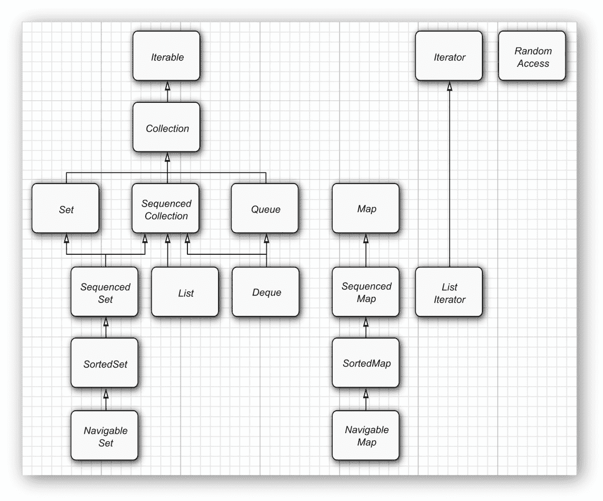Java 集合框架的接口

集合有两个基本接口：`Collection`和`Map`。正如你所看到的，你通过方法向集合中插入元素：

```
boolean add(E element)
```

然而，map 存储的是键值对，你使用`put`方法插入它们：

```
V put(K key, V value)
```

要从集合中读取元素，请使用迭代器访问它们。然而，你可以使用`get`方法从 map 中读取值：

```
V get(Object key)
```

`List`是一个*有序集合*。元素被添加到容器中的特定位置。元素可以通过两种方式访问：通过迭代器或通过整数索引。后者被称为*随机访问*，因为元素可以按任何顺序访问。相比之下，使用迭代器时，必须顺序访问它们。

`List`接口定义了几个用于随机访问的方法：

```
void add(int index, E element)
E remove(int index)
E get(int index)
E set(int index, E element)
```

对于`List<Integer>`，有两个`remove`方法：

```
boolean remove(int index) // 移除指定索引的元素
boolean remove(Integer o) // 移除等于 o 的元素
```

当使用类型为`int`的参数调用`remove`时，会选择第一个方法。不考虑装箱（boxing），也没有警告。这可能不是你想要的：

```
List<Integer> ids = . . .;
int id = . . .;
if (id == 0) ids.remove(id); // 移除索引为 0 的元素，而不是值为 0 的元素
```

`List`接口的 API 文档定义了列表`equals`方法的行为。要使一个列表与另一个对象相等，另一个对象也必须是某种类型的列表。两个列表的大小必须相同。在遍历每个列表时，对应的元素必须相等。

坦率地说，Java 集合框架中的`List`接口存在一个问题。有序集合有两种类型，具有截然不同的性能权衡。由数组支持的有序集合具有快速的随机访问能力，因此使用带整数索引的`List`方法是有意义的。相比之下，链表虽然也是有序的，但随机访问速度很慢，最好使用迭代器进行顺序遍历。如果能提供两个接口会更好。

为了避免对链表执行随机访问操作，Java 1.4 引入了一个标记接口`RandomAccess`。该接口没有方法，但你可以用它来测试特定集合是否支持高效的随机访问：

```
if (c instanceof RandomAccess)
{
   random traversal
}
else
{
   sequential traversal
}
```

`Set`接口具有与`Collection`接口相同的实例方法，但这些方法的行为定义得更紧密。集合的`add`方法应该拒绝重复项。集合的`equals`方法的定义使得两个集合是等的，但不一定具有相同的顺序。`hashCode`方法的定义使得两个具有相同元素的集合产生相同的哈希值。

如果方法签名相同，为什么要单独定义一个接口呢？从概念上讲，并不是所有集合都是集合。定义`Set`接口允许程序员编写只接受集合的方法。

为了理解为什么这种区别很重要，请考虑等值性测试。如果两个列表具有相同顺序的相同元素，则它们是等的。如果两个集合具有相同的元素，则它们是等的。实现`Set`的类的`equals`方法需要确保参数也是`Set`而不是任何`Collection`。

`SortedSet`和`SortedMap`接口暴露了用于排序的比较器对象，并定义了获取集合子集视图的方法。我们稍后会讨论这些。

`NavigableSet`和`NavigableMap`接口包含了用于在排序集合和 map 中查找下一个或上一个元素的方法。`TreeSet`和`TreeMap`类实现了这些接口。导航操作在树数据结构中可以高效实现。

Java 21 引入了`SequencedCollection<E>`接口，它提供了对集合第一个和最后一个元素的统一访问，并支持反向遍历。

```
E getFirst()
E getLast()
void addFirst(E e)
void addLast(E e)
E removeFirst()
E removeLast()
SequencedCollection<E> reversed()
```

以前，这些操作在列表、集合和队列中通过不同的方法执行。`SequencedSet`子接口将`reversed`方法的返回类型精确化为`SequencedSet`。`SequencedMap`接口为 map 提供了类似的方法。

## 具体集合

表 9.1 显示了 Java 框架中的集合并简要描述了每个集合类的用途。（为了简单起见，我们省略了将在第 10 章中讨论的线程安全集合。）

表 9.1 中的所有类都实现了`Collection`接口，但以`Map`结尾的类除外。这些类实现了`Map`接口。我们将在第 9.4 节中讨论 map。

## Java 集合框架中的具体集合

| 集合类型 | 说明 | 参见 |
| --- | --- | --- |
| `ArrayList` | 一种动态伸缩的索引序列 | 第 9.3.2 节 |
| `LinkedList` | 一种允许在任何位置高效插入和删除的有序序列 | 第 9.3.1 节 |
| `ArrayDeque` | 用循环数组实现的双端队列 | 第 9.3.5 节 |
| `HashSet` | 一种拒绝重复元素的无序集合 | 第 9.3.3 节 |
| `TreeSet` | 一种排序的集合 | 第 9.4.5 节 |
| `EnumSet` | 举类型值的集合 | 第 9.4.6 节 |
| `LinkedHashSet` | 一种记住元素插入顺序的集合 | 第 9.4.5 节 |
| `PriorityQueue` | 一种允许高效删除最小元素的集合 | 第 9.3.6 节 |
| `HashMap` | 键/值关联的数据结构 | 第 9.4.1 节 |
| `TreeMap` | 键经过排序的 map | 第 9.4.1 节 |
| `EnumMap` | 键属于枚举类型的 map | 第 9.4.6 节 |
| `LinkedHashMap` | 记住条目添加顺序的 map | 第 9.4.5 节 |
| `WeakHashMap` | 如果值在其他地方未使用，则可以被垃圾回收器的 map | 第 9.4.4 节 |
| `IdentityHashMap` | 键通过`==`而非`equals`比较 map | 第 9.4.7 节 |

图 9.5 显示了这些类之间的关系。

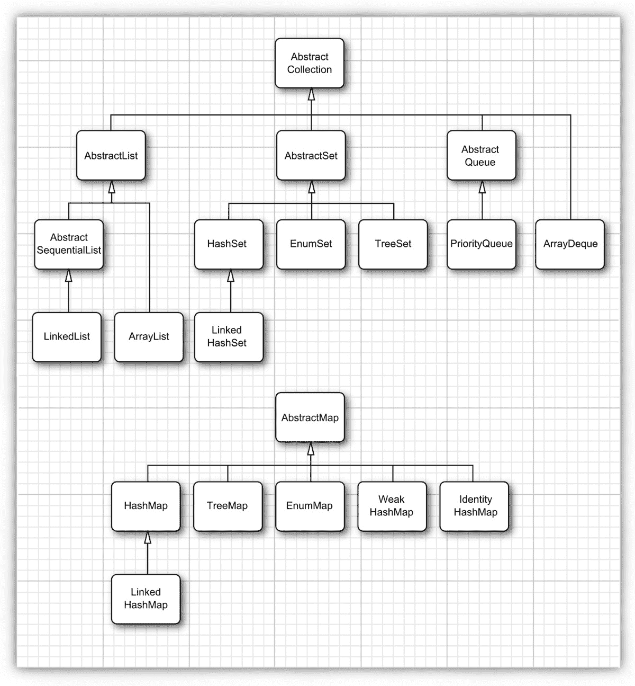

Java 集合框架中的类

### 链表

我们在本书的许多示例中已经使用了数组及其动态兄弟`ArrayList`类。然而，数组和数组列表有一个巨大的缺点。从数组中间删除元素是非常昂贵的代价，因为被删除元素之后的所有数组元素都必须向数组开头移动（参见图 9.6）。在中间插入元素也是如此。

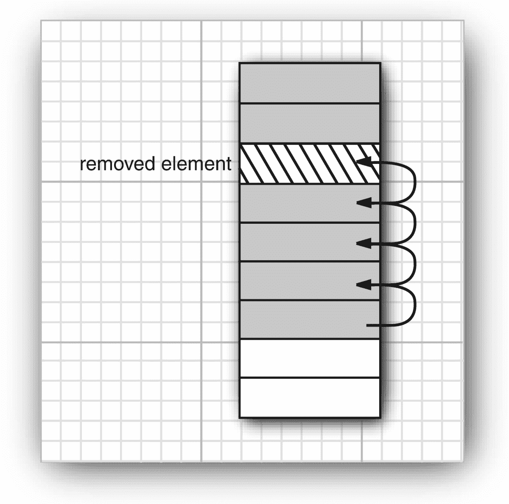

从数组中删除元素


另一个广为人知的数据结构链表（linked list）解决了这个问题。数组在连续的内存位置上存储对象引用，而链表将每个对象存储在独立的 `link` 中。每个 `link` 还存储指向序列中下一个 `link` 的引用。在 Java 集合框架中，所有链表实际上都是**双向链表**；也就是说，每个 `link` 还存储指向其前驱节点的引用（参见图 9.7）。

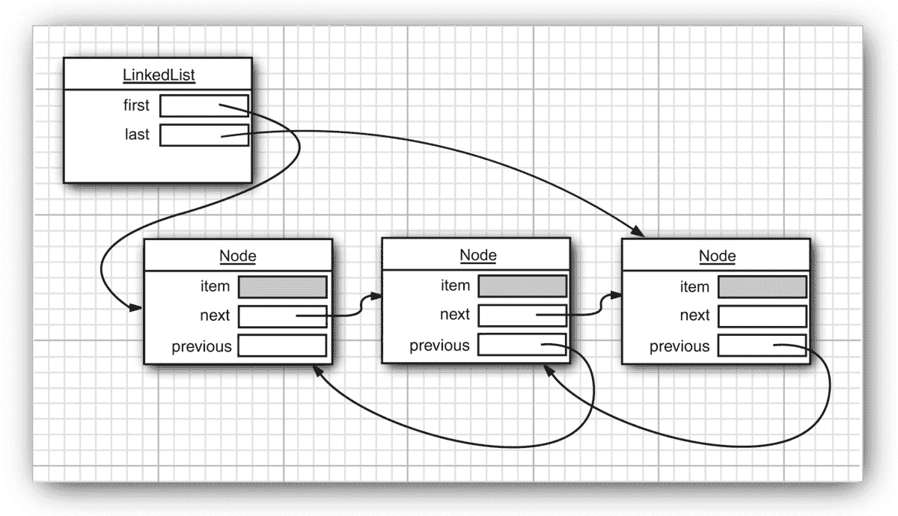

双向链表

从链表中间删除元素是一项廉价的操作——只需要更新被删除元素周围的 `link` 即可（参见图 9.8）。

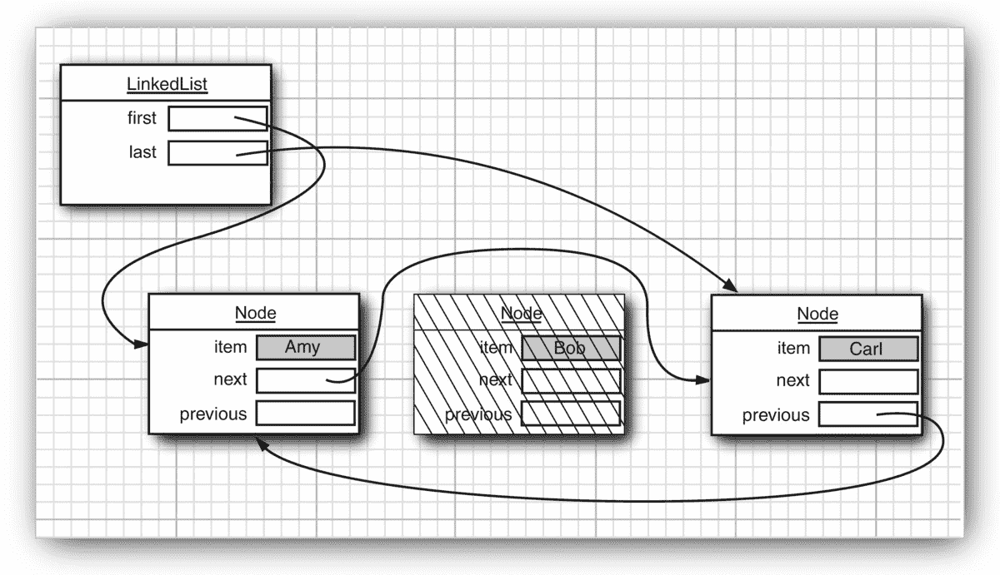

从链表中删除元素

也许你曾经上过数据结构课程，并在那里学习了如何实现链表。你可能对在链表中添加或删除元素时纠结 `link` 关系有坏记忆。如果是这样，你会高兴地发现 Java 集合框架提供了一个类 `LinkedList` 供你使用。

以下代码示例添加了三个元素，然后删除了第二个：

```
var staff = new LinkedList<String>(); 
staff.add("Amy");
staff.add("Bob");
staff.add("Carl");
Iterator<String> iter = staff.iterator();
String first = iter.next(); // 访问第一个元素 (Amy)
String second = iter.next(); // 访问第二个元素 (Bob)
iter.remove(); // 删除最后访问的元素 (Bob)
```

然而，链表和泛型集合之间有一个重要的区别。链表是一个**有序集合**，其中对象的位置很重要。`LinkedList.add` 方法将对象添加到列表末尾。但是……

```
ListIterator<String> iter = list.listIterator();
String oldValue = iter.next(); // 返回第一个元素
iter.set(newValue); // 将第一个元素设置为 newValue
```

正如你可能想象到的，如果一个迭代器在遍历集合时，另一个迭代器正在修改它，就会出现混乱的情况。例如，假设一个迭代器指向一个另一个迭代器刚刚删除的元素。此时该迭代器已经失效，不应再继续使用。链表迭代器被设计为检测此类修改。如果迭代器发现其集合被另一个迭代器或集合本身的方法修改了，它将抛出一个 `ConcurrentModificationException`。例如，考虑以下代码：

```
List<String> list = . . .;
ListIterator<String> iter1 = list.listIterator();
ListIterator<String> iter2 = list.listIterator();
iter1.next();
iter1.remove();
iter2.next(); // 抛出 ConcurrentModificationException
```

对 `iter2.next()` 的调用抛出了 `ConcurrentModificationException`，因为 `iter2` 检测到列表从外部被修改了。

为了避免并发修改异常，请遵循这个简单的规则：你可以根据需要向集合附加任意多个迭代器，只要它们都只是只读的。或者，你可以附加一个既能读又能写的单个迭代器。

并发修改检测是以一种简单的方式完成的。集合记录了修改操作（如添加和删除元素）的数量。每个迭代器都会维护一个由*它*负责的变异操作计数。在每个迭代器方法的开始处，迭代器只需检查其自身的变异计数是否等于集合的计数。如果不相等，它就会抛出一个 `ConcurrentModificationException`。

然而，在并发修改检测中存在一个奇特的异常。链表只跟踪列表的*结构性*修改，例如添加和删除链接。`set` 方法*不被视为*结构性修改。你可以向链表附加多个迭代器，它们都可以通过调用 `set` 方法来更改现有链接的内容。这种能力对于我们在本章稍后讨论的 `Collections` 类中的许多算法是必需的。

现在你已经了解了 `LinkedList` 类的基本方法。使用 `ListIterator` 来双向遍历链表元素，并添加和删除元素。

正如你在第 9.2 节中所看到的，许多其他操作链表的有用方法都声明在 `Collection` 接口中。这些方法大部分实现在 `LinkedList` 父类 `AbstractCollection` 中。例如，`toString` 方法会对所有元素调用 `toString` 并产生一个格式为 `[A, B, C]` 的长字符串。这对于调试非常有用。使用 `contains` 方法检查元素是否存在于链表中。例如，调用 `staff.contains("Harry")` 时，如果链表已经包含一个与字符串 `"Harry"` 相等的字符串，则将返回 `true`。

Java 集合框架还提供了一些从理论角度来看有些可疑的方法。链表不支持快速随机访问。如果你想查看链表的第 `n` 个元素，必须从头开始并跳过前 `n - 1` 个元素。这没有捷径。由于这个原因，程序员通常不会在需要通过整数索引访问元素的情况下使用链表。

尽管如此，`LinkedList` 类提供了一个 `get` 方法，让你访问特定的元素：

```
LinkedList<String> list = . . .;
String obj = list.get(n);
```

当然，这个方法并不高效。如果你发现自己在使用它，那么你可能为你的问题使用了错误的数据结构。

你*永远不要*使用这种幻觉般的随机访问方法来遍历链表。以下代码：

```
for (int i = 0; i < list.size(); i++)
   do something with list.get(i);
```

其效率低得惊人。每当你查找另一个元素时，搜索都会从列表开始重新开始。`LinkedList` 对象并没有尝试缓存位置信息。

`get` 方法有一个轻微的优化：如果索引至少为 `size() / 2`，则元素的搜索将从列表末尾开始。

列表迭代器接口还有一个方法可以告诉你当前位置的索引。事实上，由于 Java 迭代器在概念上指向元素之间，因此它有两个这样的方法：`nextIndex` 方法返回下一次调用 `next` 将返回元素的整数索引；`previousIndex` 方法返回下一次调用 `previous` 将返回的元素索引。当然，这仅仅比 `nextIndex` 小 1。这些方法对于 `LinkedList` 迭代器是高效的——每个迭代器都维护其当前位置的计数。最后，如果你有一个整数索引 `n`，那么 `list.listIterator(n)` 返回一个指向索引为 `n` 的元素之前的迭代器。也就是说，调用 `next` 产生的元素与 `list.get(n)` 相同；获取该迭代器是低效的。

如果你的链表只有寥几个元素，就不必过度担心 `get` 和 `set` 方法的成本。但如此，最初为什么要使用链表呢？使用链表的唯一理由是最小化列表中间插入和删除的成本。如果你只有几个元素，可以使用 `ArrayList`。

我建议你直接远离所有使用整数索引的方法。

返回一个列表迭代器，用于访问列表中的元素，其首次调用 `next` 将返回指定索引的元素。

*   `void add(int i, E element)`

    在指定位置添加一个元素。

*   `boolean addAll(int i, Collection<? extends E> elements)`

    将集合中的所有元素添加到指定位置。

*   `E remove(int i)`

    删除并返回指定位置的元素。

*   `E get(int i)`

    获取指定位置的元素。

*   `E set(int i, E element)`

    用新元素替换指定位置的元素，并返回旧元素。

*   `int indexOf(Object element)`

    返回与指定元素相等的首次出现的位置，如果未找到匹配元素，则返回 `-1`。

*   `int lastIndexOf(Object element)`

    返回与指定元素相等的最后一次出现的位置，如果未找到匹配元素，则返回 `-1`。

`java.util.ListIterator<E>` 1.2

*   `void add(E newElement)`

    在当前位置之前添加一个元素。

*   `void set(E newElement)`

    用新元素替换通过 `next` 或 `previous` 最后访问的元素。如果自上次调用 `next` 或 `previous` 之后列表结构被修改，则抛出 `IllegalStateException`。

*   `boolean hasPrevious()`

    如果在反向遍历列表时还有另一个元素可以访问，则返回 `true`。

*   `E previous()`

    返回上一个对象。如果到达列表开头，则抛出 `NoSuchElementException`。

*   `int nextIndex()`

    返回下次调用 `next` 将返回的元素索引；如果迭代器已超过最后一个元素，则返回列表的大小。

*   `int previousIndex()`

    返回下次调用 `previous` 将返回的元素索引；如果迭代器在第一个元素之前，则返回 -1。

`java.util.LinkedList<E>` 1.2

*   `LinkedList()`

    构造一个空链表。

*   `LinkedList(Collection<? extends E> elements)`

    构造一个链表并添加集合中的所有元素。

*   `void addFirst(E element)`

*   `void addLast(E element)`

    在列表的开头或结尾添加一个元素。

*   `E getFirst()`

*   `E getLast()`

    返回列表开头或结尾的元素。

*   `E removeFirst()`

*   `E removeLast()`

    删除并返回列表开头或结尾的元素。

### 数组列表 (Array Lists)

在前面的节中，你看到了 `List` 接口和实现它的 `LinkedList` 类。`List` 接口描述了一个有序集合，其中元素的位置至关重要。访问元素有两种协议：通过迭代器，以及通过 `get` 和 `set` 方法进行随机访问。后者对于链表并不合适，但显然，`get` 和 `set` 对于数组来说非常有意义。Java 集合框架提供了我们熟悉的 `ArrayList` 类，它也实现了 `List` 接口。`ArrayList` 封装了一个动态重新分配内存的对象数组。

Java 1.0 随带了一个不同的基于数组的集合——`Vector` 类。`Vector` 类的所有方法都是 `synchronized`（同步的）。从两个线程访问 `Vector` 对象是安全的。但如果你只从单个线程访问向量（这是目前更常见的情况），那么同步就是浪费的。相比之下，`ArrayList` 的方法不是同步的。正如你在第 10 章 中看到的，现在也有更好的线程安全选择。除非你需要与古老的 API 接口，否则现在没有理由使用 `Vector`。

### 哈希集合集 (Hash Sets)

链表和数组允许你指定排列元素的顺序。然而，如果你正在寻找某个特定元素但不记得它的位置，你就需要访问所有元素，直到找到匹配项为止。如果集合包含很多元素，这可能会非常耗时。如果你不在乎元素的顺序，那么某些数据结构可以让你更快地找到元素。缺点是，这些数据结构让你无法对元素出现的顺序进行控制。这些数据结构按照利于其自身目的的顺序来组织元素。

一种用于快速查找对象的常用数据结构是`哈希表` (hash table)。哈希表为每个对象计算一个整数，称为`哈希码` (hash code)。哈希码通过某种方式从对象的实例字段派生而来，最好是使得不同数据的对象产生不同的代码。表 9.2 列出了 `String` 类 `hashCode` 方法产生的一些哈希码示例。

#### 由 `hashCode` 方法产生的哈希码

| String | 哈希码 |

| --- | --- |

| `"Lee"` | `76268` |

| `"lee"` | `107020` |

| `"eel"` | `100300` |

如果你定义了自己的类，你有责任实现你自己的 `hashCode` 方法——更多信息请参见第 5 章。你的实现需要与 `equals` 方法兼容：如果 `a.equals(b)`，那么 `a` 和 `b` 必须具有相同的哈希码。

现在重要的是哈希码可以快速计算，并且取决于需要哈希的对象的状态，而不是哈表中的其他对象。

在 Java 中，哈希表实现为链表的数组。图 9.10 每个列表被称为`桶`。要在哈表中找到对象的位置，计算其哈希码并对总桶数取模。得到的结果就是元素的桶索引。例如，如果一个对象的哈希码为 76268 且有 128 个桶，那么它被放在桶 108（因为 76268 % 128 是 108）。也许运气很好，该桶没有其他元素。那么你只需将元素插入该桶中。当然，有时你会遇到非空桶。这被称为`哈希冲突` (hash collision)。然后，与桶中的所有对象进行比较以查看其是否存在。如果哈希码分布足够随机且桶的数量足够大，只需要几次比较。

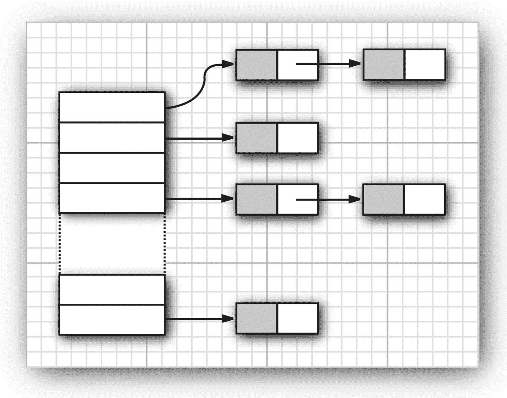哈希表

在 `HashMap` 实现中，当桶的大小超过阈值时，它会从链表转换为平衡二叉树。当哈希函数选择不当导致产生很多冲突，或者恶意代码试图向哈希表填充许多具有相同哈码的值时，这提高了性能。

如果可能，哈希表的键应该属于实现 `Comparable` 接口的类。这样就可以避免由于哈希分布不良而遭受性能损失。

如果哈希表变得太满，就需要`重新哈希` (rehash)。为了重新哈希表，会创建一个具有更多桶的新表，将所有元素插入到新表中，然后丢弃原始表。`负载因子` (load factor) 决定了哈希表何时重新哈希。例如，如果负载因子为 0.75（默认值）且表已超过 75%，就会自动重新哈希，桶的数量翻倍。对于大多数应用程序，将负载因子保持在 0.75 是合理的。

如果你想更进一步控制哈希表的性能，可以指定初始桶数。你应该将其设置为预期元素数量除以负载因子。或者，从 Java 19 开始，你可以使用静态的 `newHashSet` 便利方法来为你完成此计算：

```
HashSet<String> strings = HashSet.newHashSet(expectedElementCount);
```

一些研究人员认为，将桶（bucket）的数量设置为质数是一个好主意，可以防止键的聚集。然而，这一点的证据并不是决定性的。Java Collections Framework 使用的桶数量是 2 的幂，默认值为 `16`。（你为桶数量提供的任何值都会被自动向上舍入到下一个 2 的幂。）

哈希表可以用于实现若干重要的数据结构。其中最简单的是 `set` 类型。集合（set）是一个不包含重复元素的集合。`set` 的 `add` 方法首先尝试查找要要的，，仅当该对象尚未存在时才进行添加。

Java Collections Framework 了一个了一个 `HashSet` 类，它基于哈希表实现了集合。你通过 `add` 方法添加元素。`contains` 方法被重写，以便进行快速查找，检查元素是否已存在于集合中。它只检查一个桶中的元素，而不是集合中的所有元素。

哈希集合迭代器（iterator）会依次访问所有的桶。由于哈希处理将元素分散在表中，因此访问这些元素的顺序似乎是随机的。如果你不在乎集合中元素的顺序，你就可以使用 `HashSet`。

本节末尾的示例程序（Listing 9.2）从文件中读取单词，添加到集合中，并打印集合中的前二十个单词。例如，你可以通过命令行启动程序并将*爱丽丝仙游记*的文本输入程序：

```
java set.SetTest ../gutenberg/alice30.txt
```

*爱丽丝仙游记*有 28,195 个单词，其中 5,909 个是唯一的（包括开头的版权声明）。这些单词以随机顺序出现。随后，相同的单词被插入到一个树集合（tree set）中，正如你在后续节中看到的，它保持了元素的排序顺序。

在修改集合元素时要小心。如果元素的哈希码（hash code）发生变化，该元素将不再处于数据结构中的正确位置。

```
var rects = new HashSet<Rectangle>();
var rect = new Rectangle(5, 10, 20, 30);
rects.add(rect); 
rect.setLocation(0, 0); // rects 现在是 [java.awt.Rectangle[x=0,y=0,width=20,height=30]]
rects.remove(new Rectangle(0, 0, 20, 30)); // 返回 false，未移除
```

set/SetTest.java


```java
package set;

import java.io.IOException;
import java.nio.file.Path;
import java.util.*;

/**
 * 此程序比较了向哈希集合和树集合插入的情况。
 * 运行程序的方式为 
 * java set.SetTest ../gutenberg/alice30.txt
 * java set.SetTest ../gutenberg/crsto10.txt 100
 * @version 1.2 2023-12-07
 * @author Cay Horstmann
 */
public class SetTest
{
   public static void time(Set<String> wordSet, List<String> wordList, int repetitions) 
   {
      long totalTime = 0;
      for (int i = 1; i <= repetitions; i++) 
      {
         for (String word : wordList)
         {
            long start = System.nanoTime();
            wordSet.add(word);
            long end = System.nanoTime();
            totalTime += end - start;         
         }
      }
      Iterator<String> iter = wordSet.iterator(); 
      for (int i = 1; i <= 20 && iter.hasNext(); i++) 
         System.out.print(iter.next() + " ");
      System.out.println("...");
      System.out.printf("%s: %d words, %d distinct, %.3f seconds.%n",
         wordSet.getClass().getSimpleName(), wordList.size(), wordSet.size(), totalTime * 1E-9);
   }

   public static void main(String[] args) throws IOException
   {
      List<String> words = new ArrayList<>();
      String filename = args.length > 0 ? args[0] : "../gutenberg/crsto10.txt";
      int repetitions = args.length > 1 ? Integer.parseInt(args[1]) : 1; 
      try (var in = new Scanner(Path.of(filename))) { 
         while (in.hasNext()) { 
            String word = in.next(); 
            words.add(word); 
         } 
      }      
      time(new HashSet<>(), words, repetitions);
      time(new TreeSet<>(), words, repetitions);
   }
}
```

`java.util.HashSet<E>` 1.2

* `HashSet()`

  构造一个空的哈希集合。

* `HashSet(Collection<? extends E> elements)`

  构造一个哈希集合并添加集合中的所有元素。

* `HashSet(int initialCapacity)`

  `HashSet(int initialCapacity, float loadFactor)`

  构造一个具有指定容量和负载因子（或负载因子为 0.75）的空哈希集合。如果大小/容量比例超过了负载因子，哈希表将重新哈希到更大的表中。

* `static <E> HashSet<E> newHashSet(int numMappings)` 19

  构造一个具有足够容量以容纳预期数量元素（`numMappings`）的空哈希集合。

`java.lang.Object` 1.0

* `int hashCode()`

  返回此对象的哈希码。哈希码可以是任何整数，正负均可。`equals` 和 `hashCode` 的定义必须兼容：如果 `x.equals(y)` 为 `true`，那么 `x.hashCode()` 的值必须与 `y.hashCode()` 相同。

### 树集合

`TreeSet` 类与哈希集合类似，但增加了一个改进。树集合是一个排序集合。你可以以任何顺序将元素插入集合。当你遍历集合时，值会自动按排序顺序呈现。例如，假设你插入了三个字符串，然后访问所有添加的元素。

```java
var sorter = new TreeSet<String>();
sorter.add("Bob");
sorter.add("Amy");
sorter.add("Carl");
for (String s : sorter) System.out.println(s);
```

然后，值按排序顺序打印：`Amy Bob Carl`。正如类名称所示，排序是通过树形结构实现的。（目前的实现使用了*红黑树*。关于红黑树的详细描述，请参考例如 Thomas Cormen、Charles Leiserson、Ronald Rivest 和 Clifford Stein 所著 *Introduction to Algorithms*，The MIT Press, 2022。）每当元素被添加到树中时，它都会被放置在正确的排序位置。因此，迭代器始终按排序顺序访问元素。

向树中添加元素比向哈希表添加元素慢。但它仍然比在数组或链列表中检查重复项快得多。如果树包含 `n` 个元素，则平均需要 log[2] `n` 次比较来为新元素找到正确的位置。例如，如果树已经包含 1,000 个元素，添加一个新元素大约需要 10 次比较。

为了使用树集合，你必须能够比较元素。元素必须实现 `Comparable` 接口，或者你在构造集合时提供一个 `Comparator`。（`Comparable` 和 `Comparator` 接口是在第 6 章 中引入的。）

树集合慢多少？运行 Listing 9.2 中的程序：

```
java set.SetTest ../gutenberg/crsto10.txt 100
```

*基督山仇*有 466,300 个单词，每个单词被插入 100 次。在我的测试机器上，`TreeSet` 几乎慢了 4 倍。如果你不需要数据排序，就没有理由为排序开销付出代价。更重要的是，对于某些数据来说，设计出一个排序顺序比设计哈希函数要困难得多。哈希函数只需要对对象进行相当不错的打乱，而比较函数必须能够精确地区分对象。

为了让这种区别更加具体，请考虑收集一组矩形的任务。如果你使用 `TreeSet`，你需要提供一个 `Comparator<Rectangle>`。你如何比较两个矩形呢？按面积吗？这是行不通的。你可能有两个坐标不同但面积相同的矩形，而你又想保留它们。`comparator` 必须与 `equals` 兼容；也就是说，只有当元素相等时，比较结果才能为 0。矩形确实有这样的排序顺序（基于坐标的字典序），但计算起来非常繁琐。相比之下，`Rectangle` 类已经定义了哈希函数。它简单地对坐标进行哈希。

如果 `comparator` 与元素类型的 `equals` 方法不兼容，集合的等性可能会产生不一致的结果。这里有一个典型的例子：

```
var words = new TreeSet<String>(String.CASE_INSENSITIVE_ORDER);
```

意图并不是收集仅在字母大小写不同的元素：

```
commands.add("QUIT");
commands.add("quit"); // 不会被添加
```

然而，现在 `equals` 不再具有对称性：

```
commands.equals(Set.of("quit")) // true
Set.of("quit").equals(commands) // false
```

`TreeSet` 在 `comparator` 返回 0 时认为两个元素相等。但另一个集合使用的是 `String.equals`。

更好的方法是使用 `String.compare` 排序，并仅将小写字符串插入集合中。

`TreeSet` 类实现了 `NavigableSet` 接口。该接口增加了几个用于定位相邻元素的便捷方法。详情请参阅 API 注释。

Listing 9.3 中的程序构建了两个包含 `Item` 对象的树形集合。第一个按部件编号排序，这是 `Item` 对象的默认排序顺序。第二个集合按描述排序，使用了一个自定义的比较器。

`treeSet/TreeSetTest.java`

```java
package treeSet;

import java.util.*;

/**
 * 此程序通过比较描述对 Item 对象的集合进行排序。
 * @version 1.2 2024-12-05
 * @author Cay Horstmann
 */
public class TreeSetTest
{
   public static void main(String[] args)
   {
      var parts = new TreeSet<Item>();
      parts.add(new Item("Toaster"));
      parts.add(new Item("Widget"));
      parts.add(new Item("Router"));
      System.out.println(parts);

      var sortByDescription = new TreeSet<Item>(Comparator.comparing(Item::description));

      sortByDescription.addAll(parts);
      System.out.println(sortByDescription);
   }
}
```

`treeSet/Item.java`

```java
package treeSet;

/**
 * 具有描述和部件编号的项。
 */
public record Item(String description, int partNumber) implements Comparable<Item>
{
   public int compareTo(Item other) {
      int diff = Integer.compare(partNumber, other.partNumber);
      return diff != 0 ? diff : description.compareTo(other.description);
   }
}
```

`java.util.TreeSet<E>` 1.2

* `TreeSet()`

* `TreeSet(Comparator<? super E> comparator)` 构建一个空的树形集合。

* `TreeSet(Collection<? extends E> elements)` 构建一个树形集合并添加集合或集合中的所有元素（在后者的情况下，使用相同的排序顺序）。

`java.util.SortedSet<E>` 1.2

* `Comparator<? super E> comparator()` 返回用于排序元素的比较器，如果元素是通过 `Comparable` 接口的 `compareTo` 方法比较的，则返回 `null`。

* `first()`

* `last()` 返回排序集合中最小或最大的元素。

`java.util.NavigableSet<E>` 6

* `higher(E value)`

* `lower(E value)` 返回大于 `value` 的最小元素或小于 `value` 的最大元素，如果不存在此类元素则返回 `null`。

* `ceiling(E value)`

* `floor(E value)` 返回大于等于 `value` 的最小元素或小于等于 `value` 的最大元素，如果不存在此类元素则返回 `null`。

* `pollFirst()`

* `pollLast()` 并返回集合中最小或最大的元素，如果集合为空则返回 `null`。

### 队列和双

正如我们已经讨论过的，队列（queue）允许你高效地在最后添加元素并移除第一个元素。双端队列（或 `deque`）允许你在两端高效地添加或移除元素。不支持在中间添加元素。`Deque` 接口由 `ArrayDeque` 和 `LinkedList` 类实现，这两个类都提供了大小随需要增长的双端队列。在 Java 21 中，这些方法

```
getFirst()
getLast()
addFirst(E e)
addLast(E e)
removeFirst()
removeLast()
```

从 `Deque` 接口移动到了 `SequencedCollection` 接口，`List` 和 `Set` 接口也扩展了该接口。这为访问集合的第一个最后一个元素提供了统一的方法。

`java.util.Queue<E>` 5.0

* `boolean add(E e)`

* `boolean offer(E e)` 将给定元素添加到此队列最后一个元素之后并返回 `true`，前提是队列未满。如果队列已满，第一个方法将抛出 `IllegalStateException`，而第二个方法返回 `false`。

* `E remove()`

* `E poll()` 移除并返回此队列的第一个元素，前提是队列不为空。如果队列为空，第一个方法将抛出 `NoSuchElementException`，而第二个方法返回 `null`。

* `E element()`

* `E peek()` 返回此队列头部的元素但不移除它，前提是队列不为空。如果队列为空，第一个方法将抛出 `NoSuchElementException`，而第二个方法返回 `null`。

`java.util.SequencedCollection<E>` 21

* `void addFirst(E element)`

* `void addLast(E element)` 将给定元素添加到此集合的第一个元素之前或最后一个元素之后。如果集合已满，抛出 `IllegalStateException`。

* `E removeFirst()`

* `E removeLast()` 移除并返回此集合的第一个或最后一个元素，前提是集合不为空。如果集合为空，抛出 `NoSuchElementException`。

* `E getFirst()`

* `E getLast()` 返回此集合的第一个或最后一个元素但不移除它，前提是集合不为空。如果集合为空，抛出 `NoSuchElementException`。

`java.util.Deque<E>` 6

* `boolean offerFirst(E element)`

* `boolean offerLast(E element)` 将给定元素添加到此双端队列的第一个元素之前或最后一个元素之后。如果双端队列已满，返回 `false`。

* `E pollFirst()`

* `E pollLast()` 移除并返回此双端队列的第一个或最后一个元素，前提是双端队列不为空。如果双端队列为空，返回 `null`。

* `E peekFirst()`

* `E peekLast()` 返回此双端队列的第一个或最后一个元素但不移除它，前提是双端队列不为空。如果双端队列为空，返回 `null`。

`java.util.ArrayDeque<E>` 6

* `ArrayDeque()`

* `ArrayDeque(int initialCapacity)` 构建一个初始容量为 16 或给定初始容量的无界双端队列。

### 优先级队列

优先级队列在任意插入后按顺序检索元素。也就是说，每当你调用 `remove` 方法时，都会获取当前优先级队列中的最小元素。然而，优先级队列并没有对其元素进行排序。如果你遍历元素，它们并不一定是有序的。优先级队列利用了一种优雅且高效的数据结构，称为*堆*（heap）。堆是一种自组织的二叉树，其中 `add` 和 `remove` 操作会使最小元素向根节点汇聚，而无需浪费时间对所有元素进行排序。

就像 `TreeSet` 一样，优先级队列可以包含实现 `Comparable` 接口的类的元素，也可以包含你在构造函数中提供的 `Comparator` 对象。

优先级队列的一个典型用途是任务调度。每个任务都有一个优先级。任务按随机顺序添加。每当有新任务可以开始时，就会从队列中移除优先级最高的任务。（由于传统上优先级 1 被视为“最高”优先级，因此 `remove` 操作返回最小元素。）

Listing 9.5 显示了优先级队列的运行。与 `TreeSet` 中的迭代不同，这里的迭代不会按照排序顺序访问元素。然而，移除操作总是返回剩余的最小元素。

`priorityQueue/PriorityQueueTest.java`


```java
package priorityQueue;

import java.util.*;
import java.time.*;

/**
 * 此程序演示了优先级队列的使用。
 * @version 1.02 2015-06-20
 * @author Cay Horstmann
 */
public class PriorityQueueTest
{
   public static void main(String[] args)
   {
      var pq = new PriorityQueue<LocalDate>();
      pq.add(LocalDate.of(1906, 12, 9)); // G. Hopper
      pq.add(LocalDate.of(1815, 12, 10)); // A. Lovelace
      pq.add(LocalDate.of(1903, 12, 3)); // J. von Neumann
      pq.add(LocalDate.of(1910, 6, 22)); // K. Zuse

      System.out.println("Iterating over elements . . .");
      for (LocalDate date : pq)
         System.out.println(date);
      System.out.println("Removing elements . . .");
      while (!pq.isEmpty())
         System.out.println(pq.remove());
   }
}
```

`java.util.PriorityQueue` 5.0

- `PriorityQueue()`
- `PriorityQueue(int initialCapacity)`

  创建一个用于存储 `Comparable` 对象的优先级队列。

- `PriorityQueue(int initialCapacity, Comparator<? super E> c)`

  创建一个优先级队列并使用指定的比较器对其元素进行排序。

## 映射 (Maps)

集合（Set）是一种让你快速找到现有元素的集合。然而，要查找一个元素，你需要拥有该元素的精确副本才能找到。这并不是非常常见的查找方式——通常，你拥有某些键信息，并想要查找关联的元素。`map` 数据结构正是为此目的设计的。map 存储键值对（key/value pairs）。如果你提供键，就可以找到对应的值。例如，你可能会存储一个员工记录表，其中键是员工 ID，值是 `Employee` 对象。在接下来的章节中，你将学习如何使用 map。

### 基础 Map 操作

Java 集合框架提供了两种通用的 map 实现：`HashMap` 和 `TreeMap`。这两个类都实现了 `Map` 接口。

哈希映射（hash map）对键进行哈希处理，而树映射（tree map）使用键的排序将它们组织在搜索树中。哈希或比较函数**仅应用于键**。与键关联的值不进行哈希处理或比较。

你应该选择哈希映射还是树映射？与集合一样，哈希处理通常快一点，如果你不需要按照排序顺序访问键，那么它是首选选择。

以下是如何设置一个用于存储员工的哈希映射：

```java
var staff = new HashMap<String, Employee>(); // HashMap implements Map
var harry = new Employee("Harry Hacker");
staff.put("987-98-9996", harry);
. . .
```

每当你向 map 添加对象时，都必须提供一个键。在我们的案例中，键是一个字符串，对应的值是一个 `Employee` 对象。

要检索一个对象，你必须使用（因此要记住）该键。

```java
var id = "987-98-9996";
Employee e = staff.get(id); // 获取 harry
```

由于历史原因，`get` 方法声明的参数类型为 `Object`，而不是键的类型。例如，以下代码可以编译：

```java
long numericId = . . .
Employee e = staff.get(numericId); // 可以编译，但永远无法获取值
```

如果 map 中没有存储与指定键对应的信息，`get` 将返回 `null`。

`null` 返回值可能会带来不便。有时，你有一个良好的默认值，可以用于 map 中不存在的键。这时请使用 `getOrDefault` 方法。

```java
Map<String, Integer> scores = . . .;
int score = scores.getOrDefault(id, 0); // 如果 id 不存在则获取 0
```

键必须是唯一的。你不能存储两个具有相同键的值。如果你使用相同的键调用两次 `put` 方法，第二个值将替换第一个。事实上，`put` 返回与其键参数相关联的旧值。

`remove` 方法从 map 中移除具有给定键的元素。`size` 方法返回 map 中条目的数量。

遍历 map 的键和值最简单的方法是使用 `forEach` 方法。提供一个接收键和值的 lambda 表达式。该表达式会依次为 map 中的每个条目被调用。

```java
scores.forEach((k, v) -> 
   System.out.println("key=" + k + ", value=" + v));
```

为实现 `Comparable` 接口的键构建空的树形 map。

- `TreeMap(Comparator<? super K> c)`

  构建一个树形 map 并使用指定的比较器对其键进行排序。

- `TreeMap(Map<? extends K, ? extends V> entries)`

  构建一个树形 map 并添加 map 中的所有条目。

- `TreeMap(SortedMap<? extends K, ? extends V> entries)`

  构建一个树形 map，添加排序 map 中的所有条目，并使用与给定排序 map 相同的元素比较器。

`java.util.SortedMap<K, V>` 1.2

- `Comparator<? super K> comparator()`

  返回用于排序键的比较器；如果键是通过 `Comparable` 接口的 `compareTo` 方法进行比较，则返回 `null`。

- `K firstKey()`
- `K lastKey()`

  返回 map 中最小或最大的键。

### 更新 Map 条目

处理 map 时一个棘手的部分是更新条目。通常，你会获取与键关联的旧值，更新它，然后将更新后的值放回去。但你必须考虑键第一次出现的特殊情况。考虑使用 map 来统计文件中某个单词出现的次数。当我们看到一个单词时，我们想要这样增加计数器：

```
counts.put(word, counts.get(word) + 1);
```

这种方法可以运行，但在第一次遇到 `word` 时除外。此时 `get` 会返回 `null`，并发生 `NullPointerException`。

一个简单的解决办法是使用 `getOrDefault` 方法：

```
counts.put(word, counts.getOrDefault(word, 0) + 1);
```

另一种方法是先调用 `putIfAbsent` 方法。只有当键之前不存在（或映射为 `null`）时，它才会放入值。

```
counts.putIfAbsent(word, 0);
counts.put(word, counts.get(word) + 1); // 现在我们知道 get 会成功执行了
```

但你可以做得更好。`merge` 方法简化了这种常用操作。调用：

```
counts.merge(word, 1, Integer::sum);
```

如果键之前不存在，则将 `word` 与 `1` 关联；否则，使用 `Integer::sum` 函数将旧值和 `1` 结合。

现在考虑另一个常见情况。我们为每个键关联一个集合。例如，在书籍索引中，每个术语都有一个其出现的页码集合。以下是更新 map 的方法：

```
var index = new TreeMap<String, TreeSet<Integer>>();
. . .
index.computeIfAbsent(term, k -> new TreeSet<>()).add(pageNumber);
```

在这里，使用 `computeIfAbsent` 更好，因为只有当术语之前没有关联集合时，才会构建 `TreeSet`。方便的是，`computeIfAbsent` 返回新值，因此我们可以链式调用 `add`。相比之下，`putIfAbsent` 返回之前的键或 `null`，这对于链式调用是没有用的。

很容易尝试将 `k -> new TreeSet<>()` 改为 `TreeSet::new`，但这不可通。该函数有一个用于给定键的参数 `k`，该参数会被传递给构造函数。幸运的是，`TreeSet` 没有接受 `String` 参数的构造函数，代码无法编译。

情况可能会更糟。假设你有一个 `Map<Integer, ArrayList<String>>` 并调用

```
map.computeIfAbsent(n, ArrayList::new)
```

`ArrayList` *确实* 有一个接受整数容量的构造函数。对于大的 `n` 值，会分配巨大的列表，这显然不是本意。

map 方法在 `null` 值的处理上并不一致。某些方法将 `null` 视为有效值，而另一些方法将其视为缺失的键。

`getOrDefault` 方法属于前者，而 `putIfAbsent` 属于后者：

```
counts.put("C++", null);
counts.getOrDefault("C++", -1) // 返回 null 而不使用默认值
counts.putIfAbsent("C++", 1) // 放入 1，将 null 解释为不存在
```

API 注释描述了其他不常用的更新 map 条目的方法。

`java.util.Map<K, V>` 1.2

- `default V merge(K key, V value, BiFunction<? super V,? super V,? extends V> remappingFunction)` 8

  如果 `key` 关联了一个非 `null` 值 `v`，则将函数作用于 `v` 和 `value`，并将 `key` 与结果关联，或者如果结果为 `null`，则删除该键。否则，将 `key` 与 `value` 关联。返回 `get(key)`。

- `default V compute(K key, BiFunction<? super K,? super V,? extends V> remappingFunction)` 8

  将函数作用于 `key` 和 `get(key)`。将 `key` 与结果关联，或者如果结果为 `null`，则删除该键。返回 `get(key)`。

- `default V computeIfPresent(K key, BiFunction<? super K,? super V,? extends V> remappingFunction)` 8

  如果 `key` 关联了一个非 `null` 值 `v`，则将函数作用于 `key` 和 `v`。

- `default V computeIfAbsent(K key, Function<? super K,? extends V> mappingFunction)` 8

  如果 `key` 未关联值，则使用给定的映射函数计算其值并将其与 `key` 关联，然后返回新的（或已有的）值。

- `default V merge(K key, V value, BiFunction<? super V,? super V,? extends V> remappingFunction)` 8

  如果 `key` 关联了一个值，则用使用当前值和给定值调用函数的结果替换其值；否则，将键与值关联。

- `default V replace(K key, V oldValue, V newValue)` 8

  如果键当前映射 true 一个等于 `oldValue` 的值，则将映射替换为 `newValue` 并返回 `oldValue`。

- `default V replace(K key, V value)` 8

  如果键当前映射到某个值，则将映射替换为 `value` 并返回旧值。

如果你在键集视图（key set view）上调用迭代器的 `remove` 方法，你实际上是从 map 中删除了键*及其关联的值*。然而，你不能向键集视图中*添加*元素。在不添加值的情况下只添加键是没有意义的。如果你尝试调用 `add` 方法，它会抛出 `UnsupportedOperationException`。项集视图（entry set view）也有相同的限制，尽管在概念上添加一个新的键/值对对似乎是有意义的。

`java.util.Map<K, V>` 1.2

- `Set<Map.Entry<K, V>> entrySet()`

  返回一个 `Map.Entry` 对象的集合视图，即 map 中的键/值对。你可以从该集合中删除元素，这些元素也会从 map 中被移除，但你不能添加任何元素。

- `Set<K> keySet()`

  返回 map 中所有键的集合视图。你可以从该集合中删除元素，相应的键和关联的值也会从 map 中被移除，但你不能添加任何元素。

- `Collection<V> values()`

  返回 map 中所有值的集合视图。你可以从该集合中删除元素，被移除的值及其键也会从 map 中被移除，但你不能添加任何元素。

`java.util.Map.Entry<K, V>` 1.2

- `K getKey()`
- `V getValue()`

  返回此项的键或值。

- `V setValue(V newValue)`

  将*关联 map 中的值*更改为新值，并返回旧值。

- `static <K, V> Map.Entry<K,V> copyOf(Map.Entry<? extends K,? extends V> map)` 17

  产生给定 map 项的副本。与 map 项集中的元素不同，该副本不是“活的（live）”的。调用 `setValue` 不会更新任何 map。

### 弱哈希映射 (Weak Hash Maps)

Java 集合框架提供了几个用于满足特殊种的 map 类，我们将在本节及接下来的章节中简要讨论这些类。

`WeakHashMap` 类的设计是为了解决一个有趣的问题：当一个值的键不再被程序中的任何地方使用时，会发生什么？假设指向键的最后一个引用已经消失。那么，再也没有方法可以引用该值对象。但是，由于程序的任何部分都不持有该键，该键/值对无法从 map 中移除。为什么垃圾回收器不能移除它呢？移除未使用的对象不不是垃圾回收器的工作吗？

遗憾的是，情况并非如此简单。垃圾回收器追踪*活的*对象。只要 map 对象是活的，它其中的*所有*桶都是活的，且不会被回收。因此，你的程序应该小心从长寿命 map 中移除未使用的值。或者，你可以使用 `WeakHashMap`。这种数据结构与垃圾回收器协作，当键的唯一引用来自哈希表项时，就会移除键/值对。

以下是该机制的工作原理。`WeakHashMap` 使用*弱引用（weak references）*来持有键。`WeakReference` 对象持有对另一个对象的引用——在我们的案例中是哈希表键。这种类型的对象会被垃圾回收器特殊对待。通常情况下，如果垃圾回收器发现某个对象没有引用指向它，它简单地回收该对象。然而，如果对象*仅*通过 `WeakReference` 可访问，垃圾回收器仍然会回收该对象，但会将指向它的弱引用放入队列中。`WeakHashMap` 的操作会定期检查该队列中新到达的弱引用。队列中弱引到达意味着该键不再被任何人使用已被收集。随后，`WeakHashMap` 会移除关联的项。

### 链接哈希集和映射 (Linked Hash Sets and Maps)

`LinkedHashSet` 和 `LinkedHashMap` 类记录了你插入项目的顺序。这样，你就可以避免哈希表中项目看似随机的顺序。当项被插入到表中时，它们被连接在一个双向链表中（参见图 9.11）。

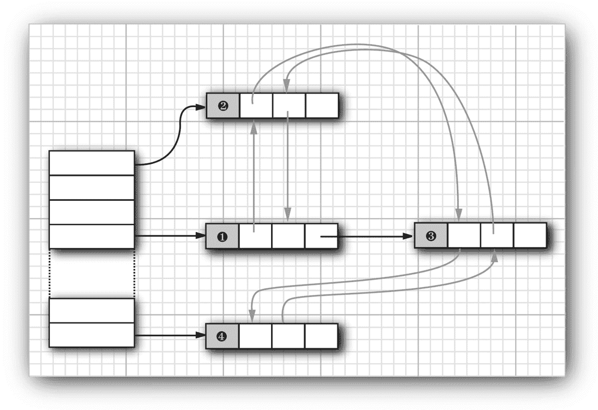一个链接哈希表

例如，考虑来自 Listing 9.6 的以下 map 插入：

```
var staff = new LinkedHashMap<String, Employee>();
staff.put("144-25-5464", new Employee("Amy Lee"));
staff.put("567-24-2546", new Employee("Harry Hacker"));
staff.put("157-62-7935", new Employee("Gary Cooper"));
staff.put("456-62-5527", new Employee("Francesca Cruz"));
```

然后，`staff.keySet().iterator()` 按照此顺序枚举键：

```
144-25-5464
567-24-2546
157-62-7935
456-62-5527
```

而 `staff.values().iterator()` 按照此顺序枚举值：

```
Amy Lee
Harry Hacker
Gary Cooper
Francesca Cruz
```


链接哈希映射也可以使用*访问顺序（access order）*而非插入顺序来遍历 map 项。每当你调用`get`或`put`时，受影响的项会从其当前位置移除并放在项链表的*末尾*。（只有`accessOrder`为 true 的`LinkedHashMap`构造函数能启用此功能）。

```java
var cache = new LinkedHashMap<K, V>(16, 0.75F, true) {
    protected boolean removeEldestEntry(Map.Entry<K, V> eldest) {
        return size() > 100;
    }
};
```

### 枚举集和映射 (Enumeration Sets and Maps)

`EnumSet`是一个高效的集合实现，其元素属于枚举类型。由于枚举类型的实例数量是有限的，`EnumSet`在内部被简单地实现为位序列。如果相应的值存在于集合中，则该位被开启。

`EnumSet`类没有公共构造函数。使用静态工厂方法来构造集合：

```java
enum Weekday { MONDAY, TUESDAY, WEDNESDAY, THURSDAY, FRIDAY, SATURDAY, SUNDAY };
EnumSet<Weekday> always = EnumSet.allOf(Weekday.class);
EnumSet<Weekday> never = EnumSet.noneOf(Weekday.class);
EnumSet<Weekday> workday = EnumSet.range(Weekday.MONDAY, Weekday.FRIDAY);
EnumSet<Weekday> mwf = EnumSet.of(Weekday.MONDAY, Weekday.WEDNESDAY, Weekday.FRIDAY);
```

你可以使用`Set`接口的常用方法来修改`EnumSet`。

`EnumMap`是一个键属于枚举类型的 map。它被简单高效地实现为值数组。你需要在构造函数中指定键类型：

```java
var personInCharge = new EnumMap<Weekday, Employee>(Weekday.class);
```

在`EnumSet`和`EnumMap`的 API 文档中，你会看到像`E extends Enum<E>`这种奇怪的类型参数。这仅仅意味着“E 是一个枚举类型”。所有的枚举类型都继承泛型类`Enum`。例如，`Weekday`继承了`Enum<Weekday>`。

### 标识哈希映射 (Identity Hash Maps)

`IdentityHashMap`有非常特殊的用途。在这里，键的哈希值不应该通过`hashCode`方法计算，而应该通过`System.identityHashCode`方法计算。这就是`Object.hashCode`根据对象的内存地址计算哈希码的方法。此外，对于对象的比较，`IdentityHashMap`使用`==`而不是`equals`。

即使不同的键对象的内容相同，也被认为是不同的。该类用于实现对象遍历算法（例如对象序列化），在这些算法中，你希望跟踪哪些对象已经被遍历过。

Java 20 修复了`IdentityHashMap`中一个在 Java 8 中引入的微妙 bug（[`bugs.openjdk.org/browse/JDK-8284901`](https://bugs.openjdk.org/browse/JDK-8284901)）。两个不常用的方法错误地使用了`equals`而不是`==`：

```java
void remove(Object key, Object value)
void replace(K key, V oldValue, V newValue)
```

这些方法有时用于并发算法，在这些算法中，只有当 map 没有被另一个线程修改时才应该更新 map。可以想象一下遇到这个 bug 的第一个程序员会有多么沮丧。

没有任何一个像 Java 平台这样复杂的软件系统是可以完全没有 bug 的。这就是为什么定期更新到最新版本非常重要。

`java.util.WeakHashMap<K, V>` 1.2

* `WeakHashMap()`

* `WeakHashMap(int initialCapacity)`

* `WeakHashMap(int initialCapacity, float loadFactor)`

  根据指定的容量和负载因子构造一个空的哈希映射。

`java.util.LinkedHashSet<E>` 1.4

* `LinkedHashSet()`

* `LinkedHashSet(int initialCapacity)`

* `LinkedHashSet(int initialCapacity, float loadFactor)`

  根据指定的容量和负载因子构造一个空的链接哈希集合。

`java.util.LinkedHashMap<K, V>` 1.4

* `LinkedHashMap()`

* `LinkedHashMap(int initialCapacity)`

* `LinkedHashMap(int initialCapacity, float loadFactor)`

* `LinkedHashMap(int initialCapacity, float loadFactor, boolean accessOrder)`

  根据指定的容量、负载因子和顺序构造一个空的链接哈希映射。`accessOrder`参数为`true`表示访问顺序，`false`表示插入顺序。

* `protected boolean removeEldestEntry(Map.Entry<K, V> eldest)`

  如果你想移除`eldest`条目，则应该覆盖此方法并返回`true`。`eldest`参数是正在考虑移除的条目。该方法在条目被添加到 map 后被调用。默认实现返回`false`——默认情况下不会移除旧元素。但是，你可以重新定义此方法以选择性地返回`true`——例如，如果旧的条目符合某个条件，或者 map 超过了某个大小。

`java.util.EnumSet<E extends Enum<E>>` 5.0

* `static <E extends Enum<E>> EnumSet<E> allOf(Class<E> enumType)`

  返回一个包含给定枚举类型所有值的可变集合。

* `static <E extends Enum<E>> EnumSet<E> noneOf(Class<E> enumType)`

  返回一个初始为空的可变集合。

* `static <E extends Enum<E>> EnumSet<E> range(E from, E to)`

  返回一个包含`from`和`to`之间（包含边界）所有值的可变集合。

* `static <E extends Enum<E>> EnumSet<E> of(E e)`

  `. . .`

* `static <E extends Enum<E>> EnumSet<E> of(E e1, E e2, E e3, E e4, E e5)`

* `static <E extends Enum<E>> EnumSet<E> of(E first, E... rest)`

  返回一个包含给定元素的可变集合，这些元素不能为`null`。

* `public static <E extends Enum<E>> EnumSet<E> copyOf(EnumSet<E> s)`

* `public static <E extends Enum<E>> EnumSet<E> copyOf(Collection<E> c)`

  创建一个初始包含给定元素的可变集合。在第二个方法中，`c`必须是一个`EnumSet`或者是非空的（以便确定元素类型）。

`java.util.EnumMap<K extends Enum<K>, V>` 5.0

* `EnumMap(Class<K> keyType)`

  构造一个空的可变映射，其键具有给定的类型。

`java.util.IdentityHashMap<K, V>` 1.4

* `IdentityHashMap()`

* `IdentityHashMap(int expectedMaxSize)`

  构造一个空的标识哈希映射，其容量为超过 1.5 × `expectedMaxSize` 的最小 2 的幂。（`expectedMaxSize`的默认值为`21`。）

`java.lang.System` 1.0

* `static int identityHashCode(Object obj)` 1.1

  返回与`Object.hashCode`计算相同的哈希码（派源自对象的内存地址），即使`obj`所属的类也是如此。

### 拷贝 (Copies and Views)

这种技术在 Java 框架中有很多应用。我们将在后面的章节中讨论这些应用。

### 小集合 (Small Collections)

这些静态方法返回包含给定元素的集合，以及包含给定键值对的 map。

例如，

```java
List<String> names = List.of("Peter", "Paul", "Mary");
Set<Integer> numbers = Set.of(2, 3, 5);
```

返回包含三个元素的列表和集合。

你也可以提供对象数组：

```java
String[] namesArray = { "Peter", "Paul", "Mary" };
List<String> names = List.of(namesArray); // 包含三个对象
```

如果你提供原始类型数组，结果是一个包含单个元素的列表，即数组：

```java
int[] numbersArray = { 2, 3, 5 };
List<int[]> arrays = List.of(numbersArray); // 包含单个对象，int[]
```

没有将原始类型数组转换为包装元素的便利方法。

对于 map，你可以这样指定键和值：

```java
Map<String, Integer> scores = Map.of("Peter", 2, "Paul", 3, "Mary", 5);
```

元素、键或值不能为`null`。集合和 map 的键不能重复：

```java
numbers = Set.of(13, null); // Error--null element
scores = Map.of("Peter", 4, "Peter", 2); // Error--duplicate key
```

对这些集合和 map 的迭代顺序没有任何保证。事实上，它们的顺序是经过故意处理，在每次虚拟机启动时被打乱的。看这两个`jshell`运行：

```java
$ jshell -q
jshell> Set.of("Peter", "Paul", "Mary")
$1 ==> [Peter, Mary, Paul]
jshell> /exit
$ jshell -q
jshell> Set.of("Peter", "Paul", "Mary")
$1 ==> [Paul, Mary, Peter]
```

有些 Java 程序员编写的程序的正确性取决于对实现细节永远改变的假设。这使得框架实现者很难进行有效的实现更改。在这种情况下，信息很明确——不要编写假设元素顺序的程序。

`List`和`Set`接口有 11 个具有零到十个参数的`of`方法，以及一个具有变数量参数的`of`方法。提供这些特化方法是为了提高效率。

对于`Map`接口，无法提供带有可变参数的版本，因为参数类型在键和值类型之间交替出现。有一个静态方法`ofEntries`，它可以接收任意数量的`Map.Entry<K, V>`对象，你可以通过静态方法`entry`来创建这些对象。例如：

```java
import static java.util.Map.*;
. . .
Map<String, Integer> scores = ofEntries(
   entry("Peter", 2),
   entry("Paul", 3),
   entry("Mary", 5));
```

`of`和`ofEntries`方法产生的对象类为每个元素都拥有一个实例变量，或者由数组支持。

这些集合对象是**不可修改的**（`unmodifiable`）。任何更改其内容的尝试都会导致`UnsupportedOperationException`异常。

如果你想要一个可变的集合，可以将不可修改的集合传递给构造函数：

```java
var names = new ArrayList<>(List.of("Peter", "Paul", "Mary")); // 一个可变的名称列表
```

方法调用

```java
Collections.nCopies(n, anObject)
```

返回一个实现了`List`接口的不可变对象，并产生具有`n`个元素的幻象，每个元素看起来都是`anObject`。

例如，以下调用创建了一个包含 100 个字符串的`List`，它们都被设置为`"DEFAULT"`：

```java
List<String> settings = Collections.nCopies(100, "DEFAULT");
```

存储成本非常低——该对象只存储一次。

`Collections`类包含许多实用方法，其参数或返回值是集合。不要将其与`Collection`接口混淆。

Java 并没有`Pair`类，有些程序员使用`Map.Entry`作为一种廉价的对（pair）实现。

### 不可修改的副本和视图

要制作集合的**不可修改副本**，请使用该集合类型的`copyOf`方法：

```java
ArrayList<String> names = . . .;
Set<String> nameSet = Set.copyOf(names); // 作为不可修改集合的名称
List<String> nameList = List.copyOf(names); // 作为不可修改列表的名称
```

与`of`方法一样，`copyOf`方法拒绝创建包含`null`元素的集合，而是抛出`NullPointerException`。

每个`copyOf`方法都会制作集合的副本。如果原始集合被修改，副本不受影响。

如果原始集合恰好是不可修改的且类型正确，那么`copyOf`只会直接返回它：

```java
Set<String> names = Set.of("Peter", "Paul", "Mary");
Set<String> nameSet = Set.copyOf(names); // 不需要制作副本：names == nameSet
```

`Collections`类拥有可以产生集合的**不可修改视图**的方法。这些视图为现有集合添加了运行时检查。如果检测到尝试修改不可修改集合的尝试，将会抛出异常。

然而，如果原始集合发生了变化，视图会反映这些变化。这正是视图与副本的区别。

你通过八种方法获取不可修改的视图：

```java
Collections.unmodifiableCollection
Collections.unmodifiableList
Collections.unmodifiableSet
Collections.unmodifiableSortedSet
Collections.unmodifiableNavigableSet
Collections.unmodifiableMap
Collections.unmodifiableSortedMap
Collections.unmodifiableNavigableMap
```

每个方法都定义为在接口上工作。例如，`Collections.unmodifiableList`可以与`ArrayList`、`LinkedList`或任何实现`List`接口的类一起。

例如，假设你想让代码的某部分查看但不触碰集合的内容。你可以这样做：

```java
var staff = new LinkedList<String>();
. . .
lookAt(Collections.unmodifiableList(staff));
```

`Collections.unmodifiableList`方法返回一个实现`List`接口的类的对象。它的访问器方法从`staff`集合中检索取值。当然，`lookAt`方法可以调用`List`接口的所有方法，而不仅仅是访问器。但所有变异器方法（如`add`）都已重新定义，变为抛出`UnsupportedOperationException`，而不是将调用转发给底层集合。

不可修改视图并没有让集合本身变得不可变。你仍然可以通过其原始引用（在我们的例子中为`staff`）修改集合。你仍然可以对集合的元素调用变异器方法。

视图封装的是`接口`而不是实际的集合对象，因此你只能访问接口中定义的方法。例如，`LinkedList`类有便利方法`addFirst`和`addLast`，它们并不属于`List`接口。这些方法无法通过不可修改视图访问。

`unmodifiableCollection`方法（以及本节稍后讨论的`synchronizedCollection`和`checkedCollection`方法）返回的集合其`equals`方法**不会**调用底层集合的`equals`方法。相反，它继承自`Object`类的`equals`方法，该方法仅测试对象是否相同。如果你将一个集合或列表转换为普通集合，你就无法再测试内容是否相等。视图之所以这样做是因为在层次结构的这个层级上，等性测试没有良好的定义。视图处理`hashCode`方法的方式相同。


优先使用`unmodifiableSet`和`unmodifiableList`包装，它们的`equals`和`hashCode`方法对于集合和列表是合适的。

例如：

```
var names = Set.of("Peter", "Paul", "Mary");
Collections.unmodifiableSet(names) // true
Collections.unmodifiableList(names) // true
```

### 子范围

你可以为集合创建子范围视图。例如，假设你有一个列表`staff`并想要提取 10 到 19 的元素。使用`subList`方法获取子范围的视图：

```
List<Employee> group2 = staff.subList(10, 20);
```

第一个索引包含，第二个索引排除——就像`String`类的`substring`操作一样。

你可以对子范围应用任何操作，这些操作会自动反映`staff`。例如，你可以清除整个子范围：

```
group2.clear(); // staff
```

元素从`staff`中被清除，`group2`为空。

对于排序集合和映射，你使用排序而不是元素位置来形成子范围。`SortedSet`接口声明了三个方法：

```
SortedSet<E> subSet(E from, E to)
SortedSet<E> headSet(E to)
SortedSet<E> tailSet(E from)
```

这些返回大于或等于`from`且小于`to`的元素集。对于排序映射，相似的方法

```
SortedMap<K, V> subMap(K from, K to)
SortedMap<K, V> headMap(K to)
SortedMap<K, V> tailMap(K from)
```

返回映射中其中*键*落在指定范围内的条目的视图。

`NavigableSet`接口对这些子范围操作提供了更多控制。你可以指定边界是否包含：

```
NavigableSet<E> subSet(E from, boolean fromInclusive, E to, boolean toInclusive)
NavigableSet<E> headSet(E to, boolean toInclusive)
NavigableSet<E> tailSet(E from, boolean fromInclusive)
```

### 来自布尔值映射的集合

有时 API 提供了你希望在集合使用的有用映射。在 9.4.5 节中，你看到了如何使用`LinkedHashMap`构建一个丢弃元素的缓存。`LinkedHashSet`类没有这种能力。

如果你想要一个包含 100 个最近插入字符串的集合，创建一个`LinkedHashMap<String, Boolean>`，然后调用`Collections.newSetFromMap`方法：

```
Set<String> cache = Collections.newSetFromMap(new LinkedHashMap<String, Boolean>()
   {
      protected boolean removeEldestEntry(Map.Entry<String, Boolean> eldest)
      {
         return size() > 100;
      }
   });
```

该视图由 map 支持。当你添加一个元素`e`时，该视图会在 map 中放入一个键为`e`且值为`Boolean.TRUE`的条目。如果这导致 map 的条目数超过 100 个，则最旧的条目将被移除。

你应该使用一个空 map 来调用`newSetFromMap`。之后，不要修改该 map，而是让所有修改都通过集合视图的方法进行。实现这一点的最佳方法是将该 map 传递给`newSetFromMap`方法而不保留对它的引用，如前一个示例所示。

`newSetFromMap`方法在使用`WeakHashMap`时也很有用（参见第 9.4.4 节）。对于`ConcurrentHashMap`，请使用`newKeySet`方法代替（参见第 10 章）。

## 反转视图 (Reversed Views)

`SequencedCollection`和`SequencedSet`接口的`reversed`方法产生产生以反序查看元素的视图。例如，以下是反向遍历字符串列表或树形集合的方法：

```
for (String element : collection.reversed())
{
   do something with element
}
```

对于`SequencedMap`，`reversed`方法以反序查看具有键的 map。

## 检查视图 (Checked Views)

检查视图旨在为泛型类型中可能出现的问题提供调试支持。正如第 8 章所解释的，实际上可以将错误类型的元素“偷入”到泛型集合中。例如：

```
var strings = new ArrayList<String>();
ArrayList rawList = strings; // 仅警告，不是错误，
                             // 为了与遗留代码兼容
rawList.add(new Date()); // 现在 strings 包含一个 Date 对象！
```

这个错误的`add`命令在运行时不会被检测到。相反，当代码的其他部分调用`get`并将结果强制转换为`String`时，稍后会发生类型转换异常（`ClassCastException`）。

检查视图可以检测到这个问题。按如下方式定义一个安全的列表：

```
List<String> safeStrings = Collections.checkedList(strings, String.class);
```

视图的`add`方法会检查插入的对象是否属于给定的类，如果不属于则立即抛出`ClassCastException`。这种做法的优点是错误在正确的位置被报告：

```
ArrayList rawList = safeStrings;
rawList.add(new Date()); // 检查列表抛出 ClassCastException
```

检查视图受虚拟机可以执行的运行时检查。例如，如果你有一个`ArrayList<Pair<String>>`，你无法防止它插入一个`Pair<Date>`，因为虚拟机只有一个“原始”的`Pair`类。

## 同步视图 (Synchronized Views)

如果你从多个线程访问集合，你需要确保集合不会被意外破坏。例如，如果一个线程尝试向哈希表添加元素，而另一个线程正在对元素进行重新哈希，那结果将是灾难性的。

框架设计者没有实现线程安全的集合类，而是使用了视图机制来使普通集合线程安全。例如，`Collections`类中的静态方法`synchronizedMap`可以将任何 map 具有同步访问方法的`Map`：

```
var map = Collections.synchronizedMap(new HashMap<String, Employee>());
```

你现在可以从多个线程访问`map`对象了。诸如`get`和`put`等方法是同步的——每个方法调用在另一个线程调用另一个方法之前必须完全完成。我们在第 10 章中更详细地讨论了数据结构同步访问的问题。

## 关于可选操作 (A Note on Optional Operations)

视图通常具有某些限制——它可能是只读的，它可能无法更改大小，或者它支持删除但不支持插入（如 map 的键视图所示）。如果你尝试不适当的操作，受限的视图将抛出`UnsupportedOperationException`。

在集合和迭代器接口的 API 文档中，许多方法被描述为“可选操作”。这似乎与接口的概念相冲突。毕竟，接口的目的不是为了列出类*必须*实现的方法吗？诚然，从理论角度来看，这种安排是不如满意的。更好的解决方案可能是为只读视图和无法更改集合大小的视图设计独立的接口。然而，这将使接口数量增加三倍，框架的设计者们认为是不可接受的。

你是否应该将“可选”方法的技术扩展到你自己的设计中？我认为不需要。尽管集合被频繁使用，但实现它们的编码风格对于其他问题领域来说并不典型。集合类库的设计者必须解决一组特别严酷的冲突需求。用户希望库易于学习、方便使用、完全泛型、防呆，并且像手编写的算法一样高效。要同时实现所有这些目标显然是不可能的，甚至接近都做不到。但在你自己的编程问题中，很少会遇到如此极端的约束。你应该能够找到不依赖于“可选”接口操作这种剧烈措施的解决方案。

### `java.util.List` 1.2

* `static <E> List<E> of()` 9

* `static <E> List<E> of(E e1)` 9

* `. . .`

* `static <E> List<E> of(E e1, E e2, E e3, E e4, E e5, E e6, E e7, E e8)` 9

* `static <E> List<E> of(E... elements)` 9

* `static <E> List<E> copyOf(Collection<? extends E)` 10

### `java.util.Set` 1.2

* `static <E> Set<E> of()` 9

* `static <E> Set<E> of(E e1)` 9

* `. . .`

* `static <E> Set<E> of(E e1, E e2, E e3, E e4, E e5, E e6, E e7, E e8)` 9

* `static <E> Set<E> of(E... elements)` 9

* `static <E> Set<E> copyOf(Collection<? extends E)` 10

### `java.util.Map` 1.2

* `static <K, V> Map<K, V> of()` 9

* `static <K, V> Map<K, V> of(K k1, V v1)` 9

* `. . .`

* `static <K, V> Map<K, V> of(K k1, V v1, K k2, V v2, K k3, V v3, K k4, V v4, K k5, V v5, K k6, V v6, K k7, V v7, K k8, V v8)` 9

* `static <K, V> Map<K, V> of(Object... elements)` 9

* `static <K, V> Map.Entry<K, V> entry(K k, V v)` 9

* `static <K, V> Map<K, V> ofEntries(Map.Entry<? extends K, extends V>...)` 9

* `static <K, V> Map<K, V> copyOf(Map<? extends K, extends V)` 10

### `java.util.Collections` 1.2

* `static <E> Set<E> newSetFromMap(Map<E, Boolean>)` 6

* `static <E> Collection<E> unmodifiableCollection(Collection<E> c)`

* `static <E> SequencedCollection<E> unmodifiableSequencedCollection(SequencedCollection<E> c)` 21

* `static <E> List<E> unmodifiableList(List<E> c)`

* `static <E> Set<E> unmodifiableSet(Set<E> c)`

* `static <E> SequencedSet<E> unmodifiableSequencedSet(SequencedCollection<E> c)` 21

* `static <E> SortedSet<E> unmodifiableSortedSet(SortedSet<E> c)`

* `static <E> SortedSet<E> unmodifiableNavigableSet(NavigableSet<E> c)` 8

* `static <K, V> Map<K, V> unmodifiableMap(Map<K, V> c)`

* `static <K, V> SortedMap<K, V> unmodifiableSortedMap(SortedMap<K, V> c)`

* `static <K, V> SequencedMap<K, V> unmodifiableSequencedMap(SequencedMap<K, V> c)` 21

* `static <K, V> SortedMap unmodifiableNavigableMap(NavigableMap<K, V> c)` 8

构建集合的视图；该视图的可变器方法将抛出`UnsupportedOperationException`。

* `static <E> Collection<E> synchronizedCollection(Collection<E> c)`

* `static <E> List synchronizedList(List<E> c)`

* `static <E> Set synchronizedSet(Set<E> c)`

* `static <E> SortedSet synchronizedSortedSet(SortedSet<E> c)`

* `static <E> NavigableSet synchronizedNavigableSet(NavigableSet<E> c)` 8

* `static <K, V> Map<K, V> synchronizedMap(Map<K, V> c)`

* `static <K, V> SortedMap<K, V> synchronizedSortedMap(SortedMap<K, V> c)`

* `static <K, V> NavigableMap<K, V> synchronizedNavigableMap(NavigableMap<K, V> c)` 8

构建集合的视图；该视图的方法是同步的。

* `static <E> Collection checkedCollection(Collection<E> c, Class<E> elementType)`

* `static <E> List checkedList(List<E> c, Class<E> elementType)`

* `static <E> Set checkedSet(Set<E> c, Class<E> elementType)`

* `static <E> SortedSet checkedSortedSet(SortedSet<E> c, Class<E> elementType)`

* `static <E> NavigableSet checkedNavigableSet(NavigableSet<E> c, Class<E> elementType)` 8

* `static <K, V> Map checkedMap(Map<K, V> c, Class<K> keyType, Class<V> valueType)`

* `static <K, V> SortedMap checkedSortedMap(SortedMap<K, V> c, Class<K> keyType, Class<V> valueType)`

* `static <K, V> NavigableMap checkedNavigableMap(NavigableMap<K, V> c, Class<K> keyType, Class<V> valueType)` 8

* `static <E> Queue<E> checkedQueue(Queue<E> queue, Class<E> elementType)` 8

构建集合的视图；如果插入了错误类型的元素，该视图的方法将抛出`ClassCastException`。

* `static <E> List<E> nCopies(int n, E value)`

产生一个具有`n`个相同值的不可变列表。

* `static <E> List<E> singletonList(E value)`

* `static <E> Set<E> singleton(E value)`

* `static <E> List<E> emptyList()`

* `static <T> Set<T> emptySet()`

* `static <E> SortedSet<E> emptySortedSet()`

* `static NavigableSet<E> emptyNavigableSet()`

* `static <K,V> Map<K,V> emptyMap()`

* `static <K,V> SortedMap<K,V> emptySortedMap()`

* `static <K,V> NavigableMap<K,V> emptyNavigableMap()`

* `static <T> Enumeration<T> emptyEnumeration()`

* `static <T> Iterator<T> emptyIterator()`

* `static <T> ListIterator<T> emptyListIterator()`

返回一个空集合、映射或迭代器。

`java.util.Arrays` 2

* `static <E> List<E> asList(E... array)`

返回数组中元素的列表视图，该列表是可以修改的但不可调整大小。

`java.util.List<E>` 2


## 子范围视图

* `List<E> subList(int firstIncluded, int firstExcluded)`

返回指定位置内元素的列表视图。

`java.util.SortedSet<E>` 2

* `SortedSet<E> subSet(E firstIncluded, E firstExcluded)`
* `SortedSet<E> headSet(E firstExcluded)`
* `SortedSet<E> tailSet(E firstIncluded)`

返回范围内元素的视图。

`java.util.NavigableSet<E>` 6

* `NavigableSet<E> subSet(E from, boolean fromIncluded, E to, boolean toIncluded)`
* `NavigableSet<E> headSet(E to, boolean toIncluded)`
* `NavigableSet<E> tailSet(E from, boolean fromIncluded)`

返回范围内元素的视图。`boolean` 标志决定边界是否包含在视图中。

`java.util.SortedMap<K, V>` 2

* `SortedMap<K, V> subMap(K from, boolean fromIncluded, K to, boolean toIncluded)`
* `SortedMap<K, V> headMap(K firstExcluded)`
* `SortedMap<K, V> tailMap(K firstIncluded)`

返回键在范围内的元素的映射视图。

`java.util.NavigableMap<K, V>` 6

* `NavigableMap<K, V> subMap(K from, boolean fromIncluded, K to, boolean toIncluded)`
* `NavigableMap<K, V> headMap(K to, boolean toIncluded)`
* `NavigableMap<K, V> tailMap(K from, boolean fromIncluded)`

返回键在范围内的元素的映射视图。`boolean` 标志决定是否包含边界。

`java.util.SequencedCollection<E>` 21

* `SequencedCollection<E> reversed()`

产生一个反序的集合视图。

`java.util.SequencedSet<E>` 21

* `SequencedSet<E> reversed()`

产生一个反序的集合视图。

`java.util.SequencedMap<E>` 21

* `SequencedMap<E> reversed()`

产生一个反序的集合视图。

## 排序与洗牌

计算机领域的老兵们有时会怀念过去他们如何使用打卡片，并必须手动编写排序算法。如今，当然，排序算法已成为大多数编程语言标准库的一部分，Java 编程语言也不例外。

`Collections` 类中的 `sort` 方法对实现了 `List` 接口的集合进行排序。

```
var staff = new ArrayList<String>();
fill collection
Collections.sort(staff);
```

该方法假设列表元素实现了 `Comparable` 接口。如果你想以其他方式排序列表，可以使用 `List` 接口的 `sort` 方法并传递一个 `Comparator` 对象。以下是如何按工资对员工列表进行排序的方法：

```
Collections.sort(staff, Comparator.comparingDouble(Employee::getSalary));
```

如果你想按降序排序列表，可以使用静态便利方法 `Comparator.reverseOrder()`。它返回一个执行 `b.compareTo(a)` 的比较器。例如，

```
Collections.sort(staff, Comparator.reverseOrder());
```

根据元素类型通过 `compareTo` 方法提供的顺序，对列表 `staff` 中的元素进行逆序排序。同样地，

```
Collections.sort(staff, Comparator.comparingDouble(Employee::getSalary).reversed());
```

按工资降序排序。

你可能会好奇 `sort` 方法是如何对列表排序的。通常当你在算法书上看到排序算法时，它是针对数组提出的，并使用随机元素访问。然而，链表中的随机访问是低效的。你实际上可以使用归并排序的形式高效地对链表进行排序。但是 Java 编程语言中的实现并没有这样做。它只是将所有元素倒入数组，对数组进行排序，然后将排序后的序列复制回列表。

Java 集合框架中使用的排序算法比 `QuickSort` 慢一点，后者是通用排序算法的传统选择。然而，它有一个主要优势：它是**稳定**的，也就是说，它不会交换相等元素。为什么要关心相等元素的顺序呢？这里有一个常见的场景：假设你有一个已经按名称排序的员工列表。现在你按工资排序。工资相同的员工会发生什么变化？使用稳定排序，按名称排序的顺序会被保留。换句话说，结果是一个先按工资排序、再按名称排序的列表。

集合不需要实现所有的“可选”方法，因此所有带有集合参数的方法都必须描述何时将集合传递给算法是安全的。例如，你显然不能将 `unmodifiableList` 列表传递给 `sort` 算法。你可以传递什么类型的列表？根据文档，列表必须是可修改的，但不需要可调整大小。

术语定义如下：

* 如果列表支持 `set` 方法，则认为它是可修改的。
* 如果列表支持 `add` 和 `remove` 操作，则认为它是可调整大小的

在第 6 章中，你已经见过 `Arrays.sort` 方法。有两个版本，一个用于对 `Comparable` 实例数组排序，另一个是带有比较器的版本：

```
String[] staff = . . .;
Arrays.sort(staff);
Arrays.sort(staff, Comparator.comparingDouble(Employee::getSalary));
```

`Collections` 类有一个 `shuffle` 算法，它是排序的相反操作——它随机打乱列表中元素的顺序。例如：

```
ArrayList<Card> cards = . . .;
Collections.shuffle(cards, RandomGenerator.getDefault());
```

如果你提供的列表没有实现 `RandomAccess` 接口，`shuffle` 方法会将元素复制到数组中，打乱数组，然后将打乱后的元素复制回列表。

Listing9.7 中的程序填充了一个包含 1 到 49 数字的 `Integer` 对象的数组列表。然后它随机打乱列表，并从打乱的列表中选择前六个值。最后，它对选中的值进行排序并打印它们。

`shuffle/ShuffleTest.java`

```
package shuffle;

import java.util.*;
import java.util.random.*;

/**
 * 此程序演示了随机洗牌和排序算法。
 * @version 1.13 2023-09-30
 * @author Cay Horstmann
 */
public class ShuffleTest
{
   public static void main(String[] args)
   {
      var numbers = new ArrayList<Integer>();
      for (int i = 1; i <= 49; i++)
         numbers.add(i);
      Collections.shuffle(numbers, RandomGenerator.getDefault());
      List<Integer> winningCombination = numbers.subList(0, 6);
      Collections.sort(winningCombination);
      System.out.println(winningCombination);
   }
}
```

`java.util.Collections` 1.2

* `static <T extends Comparable<? super T>> void sort(List<T> elements)`

  使用稳定排序算法对列表元素进行排序。该算法保证运行时间在 O(`n` log `n`) 以内，其中 `n` 是列表的长度。

* `static void shuffle(List<?> elements)`
* `static void shuffle(List<?> elements, Random r)`
* `static void shuffle(List<?> elements, RandomGenerator r)` 21

  随机打乱列表中的元素。

## 二分查找

要在数组中查找对象，通常会遍历所有元素直到找到匹配项。然而，如果数组是排序过的，你可以查看中间元素并检查它是否大于要查找的元素。如果是，则在前半部分查找；否则在后半部分查找。这使得问题减半，你以相同的方式继续。例如，如果数组有 1024 个元素，你可以在 10 步内定位匹配项（或确认不存在），而线性查找则不然。

`Collections` 类的 `binarySearch` 实现了这种算法。提供集合（必须实现 `List` 接口）和要查找的目标。如果集合不是通过 `Comparable` 接口排序的，还要提供一个比较器对象。

```
i = Collections.binarySearch(elements, target);
i = Collections.binarySearch(elements, target, comparator);
```

`binarySearch` 方法的非负返回值表示匹配对象的索引。即 `elements.get(i)` 在比较顺序下等于 `target`。如果值为负，则表示没有匹配元素。然而，你可以使用返回值计算出应该将 `target` 插入集合的位置以保持其排序。插入位置是：

```
insertionPoint = -i - 1;
```

并不是简单的 `-i`，因为那样值 `0` 将产生歧义。换句话说，操作

```
if (i < 0)
   elements.add(-i - 1, target);
```

会将目标添加到正确的位置。

为了有意义，二分查找需要随机访问。如果你必须逐个遍历链表的一半来找到中间元素，你就失去了二分查找的优势。如果你给出一个没有实现 `RandomAccess` 接口的列表，`binarySearch` 算法将退回到与线性查找效率相同的迭代算法。

`Arrays` 类为原始类型数组和对象数组提供了二分查找实现。

`java.util.Collections` 1.2

* `static <T extends Comparable<? super T>> int binarySearch(List<T> elements, T key)`
* `static <T> int binarySearch(List<T> elements, T key, Comparator<? super T> c)`

    在排序后的列表中查找键。如果元素类型实现了 `RandomAccess` 接口，则使用二分查找；在所有其他情况下，则使用线性查找。这些方法保证在 O(`a`(`n`) log `n`) 时间内运行，其中 `n` 是列表的长度，`a`(`n`) 是访问一个元素的平均时间。这些方法返回键在列表中的索引，或者如果键不在列表中，则返回负值 `i`。在这种情况下，键应该被插入到索引 `-i - 1` 处以保持列表排序。

`java.util.Arrays` 1.2

* `static int binarySearch(T[] a, T key)`
* `static int binarySearch(T[] a, int start, int end, T key)` 6

    使用二分查找算法在排序后的数组 `a` 中查找键。如果找到键，则返回其索引。否则，返回一个负值 `r`；–`r`–1 是 `key` 应该插入的位置以保持 `a` 排序。数组的组件类型 `T` 可以是 `Object`、`int`、`long`、`short`、`char`、`byte`、`boolean`、`float` 或 `double`。

* `static <T> T binarySearch(T[] a, T key, Comparator<? super T> c)`
* `static <T> T binarySearch(T[] a, int start, int end, T key, Comparator<?> c)` 6

    使用二分查找算法在使用给定比较器排序的数组 `a` 中查找键。

## 简单算法

`Collections` 类包含了几个简单但实用的算法。其中包含了本节开头的示例——找到集合的最大值。其他的还包括将元素从一个列表复制到另一个列表、用常量值填充容器以及反转列表。

为什么要在框架中提供这些简单的算法呢？毫无疑问，大多数程序员都可以用简单的循环轻松实现它们。我喜欢这些算法，是因为它们让*阅读*代码的程序员的生活变得更轻松。当你阅读一个由他人实现的循环时，你必须破解原始程序员的意图。例如，看这个循环：

```
for (int i = 0; i < words.size(); i++)
   if (words.get(i).equals("C++")) words.set(i, "Java");
```

现在将该循环与调用对比：

```
Collections.replaceAll(words, "C++", "Java");
```

当你看到这个方法调用时，你立刻知道代码在做什么。

本节末尾的 API 注释描述了 `Collections` 类中的简单算法。

默认方法 `Collection.removeIf` 和 `List.replaceAll` 稍微复杂一点。你提供一个 lambda 表达式来测试或转换元素。例如，在这里我们移除所有的短单词，并将剩余的转换为小写：

```
words.removeIf(w -> w.length() <= 3);
words.replaceAll(String::toLowerCase);
```

`removeIf` 的谓词应该只查看正在决定删除的元素，而不是整个集合。如果你采取后者，其行为将取决于实现。

`ArrayList` 版本的 `removeIf` 方法对元素进行两次遍历。它首先找到应该删除的元素，然后删除所有这些元素。对于其他集合，匹配的元素一经发现就会被移除。

如果谓词读取了集合，就会产生区别。考虑这个例子，`words` 是一个长度为 3 的 `ArrayList`：

```
var words = new ArrayList<String>(List.of("Ada", "C++", "Java"))
words.removeIf(w -> w.length() == words.size()); // 现在 words 是 ["Java"]
```

在第一次遍历中，所有长度为 3 的单词都被标记为删除，在第二次遍历中，它们被删除了。

然而，如果 `words` 是 `LinkedList` 或 `HashSet`，那么相同的 `removeIf` 调用只会移除三个字母单词之一。在移除后，谓词会测试集合的大小是否为 2。

为什么会有这种差异？简单的的一次遍历实现对于基于数组的集合来说是无效的。开发者们并没有立即想到存在一种高效的一次遍历算法。当他们考虑到它时，为了兼容性考虑，他们决定不使用它——参见 `https://bugs.openjdk.org/browse/JDK-8143577`。

`java.util.Collections` 1.2

* `static <T extends Comparable<? super T>> T min(Collection<T> elements)`
* `static <T extends Comparable<? super T>> T max(Collection<T> elements)`
* `static <T> min(Collection<T> elements, Comparator<? super T> c)`
* `static <T> max(Collection<T> elements, Comparator<? super T> c)`

    返回集合中最小或最大的元素。（参数边界已简化。）

* `static <T> void copy(List<? super T> to, List<T> from)`

    将所有元素从源复制到目标。目标列表必须与源一样长。

* `static <T> void fill(List<? super T> l, T value)`

    将列表的所有位置设置为 value。

* `static <T> boolean addAll(Collection<? super T> c, Collection<? extends T> values)`

    将所有值添加到集合中，如果集合发生了变化则返回 `true`。

* `static <T> boolean replaceAll(List<T> l, T oldValue, T newValue)`

    将所有等于 `oldValue` 的元素替换为 `newValue`。

* `static int indexOfList(List<?> l, List<?> s)`

    返回 `l` 中第一个等于 `s` 的子列表索引。


* `static int lastIndexOfList(List<?> l, List<?> s)`

  返回 `l` 中最后一个等于 `s` 的子列表索引。

* `static void swap(List<?> l, int i, int j)`

  交换给定偏移量处的元素。

* `static void reverse(List<?> l)`

  反转列表中元素的顺序。例如，反转 `[t, a, r]` 得到 `[r, a, t]`。该方法在 O(`n`) 时间内运行，其中 `n` 是列表的长度。

* `static void rotate(List<?> l, int d)`

  旋转列表中的元素，将索引为 `i` 的条目移动到 `(i + d) % l.size()`。例如，旋转 `[t, a, r]` 2 位得到 `[a, r, t]`。该方法在 O(`n`) 时间内运行，其中 `n` 是列表的长度。

* `static int frequency(Collection<?> c, Object o)`

  返回集合 `c` 中等于 `o` 的元素计数。

* `static boolean disjoint(Collection<?> c1, Collection<?> c2)`

  如果集合之间没有公共元素，则返回 `true`。

## `java.util.Collection<T>` 1.2

* `default boolean removeIf(Predicate<? super E> filter)`

  移除所有匹配的元素。

## `java.util.List<E>` 1.2

* `default void replaceAll(UnaryOperator<E> op)`

  对列表的所有元素应用操作。

### 批量操作

有几种可以“批量”复制或移除元素的操作。调用：

```java
coll1.removeAll(coll2);
```

从 `coll1` 中移除所有存在于 `coll2` 中的元素。相反：

```java
coll1.retainAll(coll2);
```

从 `coll1` 中移除所有不存在于 `coll2` 中的元素。这是一个典型的应用。

假设你想找到两个集合的交集——两个集合共同拥有的元素。首先，创建一个新集合来存储结果。

```java
var result = new HashSet<String>(firstSet);
```

在这里，我们利用每个集合都有一个参数为另一个包含初始化值的集合的构造函数。

现在，使用 `retainAll` 方法：

```java
result.retainAll(secondSet);
```

它保留两个集合中出现的元素。你在没有编写循环的情况下形成了交集。

你可以进一步扩展这一思路，并对 `view`（视图）应用批量操作。例如，假设你有一个将员工 ID 映射到员工对象的映射（map），并且有一组所有要终止雇员的员工 ID。

```java
Map<String, Employee> staffMap = . . .;
Set<String> terminatedIDs = . . .;
```

只需形成键集并移除所有已终止员工的 ID 即可。

```java
staffMap.keySet().removeAll(terminatedIDs);
```

由于键集是映射的一个 `view`，键以及关联的员工名称会自动从映射中移除。

通过使用子范围 `view`（视图），你可以将批量操作限制在子列表和子集中。例如，假设你想将列表的前十个元素添加到另一个容器中。创建一个子列表来提取前十个元素：

```java
relocated.addAll(staff.subList(0, 10));
```

子范围也可以作为变异操作的目标。

```java
staff.subList(0, 10).clear();
```

## 集合与数组之间的转换

Java API 的大部分内容是在 Java 集合框架（Java Collections Framework）创建之前设计的。因此，你可能需要在传统数组和更现代的集合之间进行转换。

如果你有一个需要转换为集合的数组，`List.of` 方法可以为此之用。例如：

```java
String[] names = . . .;
List<String> staff = List.of(names);
```

从集合获取数组要稍微复杂一些。你可以使用 `toArray` 方法：

```java
Object[] names = staff.toArray();
```

但结果是一个 `Object` 数组。即使你知道你的集合包含特定类型的对象，你不能使用类型强制转换：

```java
String[] names = (String[]) staff.toArray(); // 错误
```

`toArray` 方法返回的数组是作为 `Object[]` 数组创建的，你无法更改它的类型。相反，请向 `toArray` 方法传递一个数组构造函数表达式。该构造函数被用于创建正确类型的数组：

```java
String[] values = staff.toArray(String[]::new);
```

在 JDK 11 之前，你必须使用另一种形式的 `toArray` 方法，传递一个正确类型的数组：

```java
String[] values = staff.toArray(new String[0]);
```

此 `toArray` 方法会构造另一个相同类型的数组。或者，如果数组长度足够，则它会被重用：

```java
staff.toArray(new String[staff.size()]);
```

在这种情况下，不会创建新数组。

## 编写你自己的算法

如果你编写自己的算法（事实上，是任何以集合作为参数的方法），你应该尽可能与 `interfaces`（接口）工作，而不是具体的实现。例如，假设你想处理项。当然，你可以实现如下这样的方法：

```java
public void processItems(ArrayList<Item> items)
{
   for (Item item : items)
      对 item 执行某些操作 
}
```

然而，你现在限制了你方法的调用者——调用者必须提供 `ArrayList` 中的项。如果这些项恰好在另一个集合中，它们首先需要重新包装。接受一个更通用的集合要好得多。

你应该问问自己这个问题：能够完成工作的最通用的集合接口是什么？你在乎顺序吗？如果是，你应该接受一个 `List`。但如果顺序不重要，你可以接受任何种类的集合：

```java
public void processItems(Collection<Item> items)
{
   for (Item item : items)
      对 item 执行某些操作 
}
```

现在，任何人都可以使用 `ArrayList` 或 `LinkedList` 调用此方法，甚至可以使用包装在 `List.of` 方法调用中的数组进行调用。

在这种情况下，通过接受 `Iterable<Item>` 你可以做得更好。`Iterable` 接口有一个抽象方法 `iterator`，增强型 `for` 循环在后台会使用它。`Collection` 接口继承了 `Iterable`。

相反，如果你的方法返回多个元素，你不希望限制自己以适应未来的改进。例如，考虑：

```java
public ArrayList<Item> lookupItems(. . .)
{
   var result = new ArrayList<Item>();
   . . .
   return result;
}
```

此方法承诺返回一个 `ArrayList`，尽管调用者几乎肯定不在乎它是哪种类型的列表。相反，如果你返回 `List`，你可以随时通过调用 `List.of` 添加一个返回空列表或单例列表的分支。

如果使用集合接口作为参数和返回类型是一个这么好的主意，为什么 Java API 不一致地遵循这一规则呢？例如，`JComboBox` 类有两个构造函数：

```java
JComboBox(Object[] items)
JComboBox(Vector<?> items)
```

原因仅仅是时间问题。Swing API 在 Java 集合框架创建之前就已经存在。

## 遗留集合

自 Java 首次发布以来，在集合框架出现之前，就已经有许多“遗留”容器类。

它们已经集成到 Java 集合框架中——参见图 9.12。我将在后续章节中简要介绍它们。

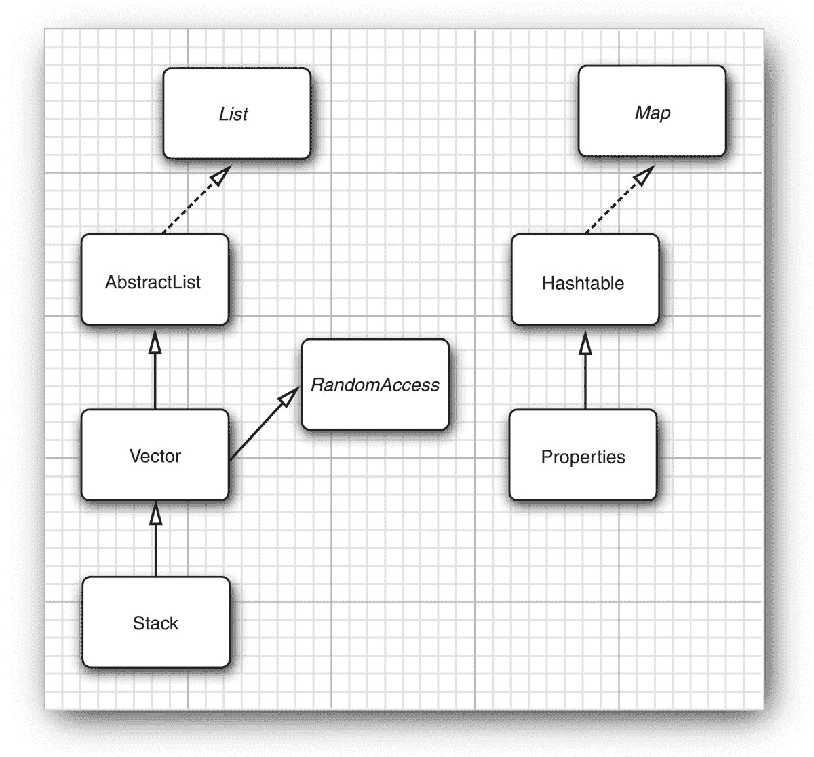Java 集合框架中的遗留类

### Hashtable 类

经典的 `Hashtable` 类的作用与 `HashMap` 类相同，并且本质上具有相同的接口。就像 `Vector` 类的方法一样，`Hashtable` 是同步的。如果你需要并发访问，请使用 `ConcurrentHashMap`。

### Enumerations

遗留集合使用 `Enumeration` 接口遍历元素序列。`Enumeration` 接口有两个方法 `hasMoreElements` 和 `nextElement`。这些与 `Iterator` 接口的 `hasNext` 和 `next` 方法完全对应。

如果你在遗留类中发现此接口，可以使用 `Collections.list` 来收集元素。例如，`LogManager` 类只愿意以 `Enumeration` 形式显示日志器名称。这是获取所有名称的方法：

```java
ArrayList<String> loggerNames = Collections.list(LogManager.getLoggerNames());
```

或者，你可以将枚举转换为迭代器：

```java
LogManager.getLoggerNames().asIterator().forEachRemaining(n -> { . . });
```

你偶尔会遇到带有枚举的遗留方法。静态方法 `Collections.enumeration` 生成一个遍历集合元素的枚举对象。例如：

```java
List<InputStream> streams = . . .;
var in = new SequenceInputStream(Collections.enumeration(streams));
// SequenceInputStream 构造函数期望枚举
```

一个 `property map`（属性映射）是一种特殊类型的 map 结构。它有三个显著特征：

* 键和值都是字符串。
* 该 map 可以很方便地保存到文件中并从文件中加载。
* 它有一个用于存储默认值的辅助表。

实现属性映射的 Java 平台类是 `Properties`。属性映射在指定程序的配置选项时非常有用。例如：

```java
var settings = new Properties();
settings.setProperty("width", "600.0");
settings.setProperty("filename", "/home/cay/books/corejava/code/v1ch09/raven.html");
```

使用 `getProperty` 方法查找键对应的值：

```java
String filename = settings.getProperty("filename");
```

由于历史原因，`Properties` 类实现了 `Map<Object, Object>`。因此，你可以使用 `Map` 接口的 `get` 和 `put` 方法。但 `get` 方法返回类型为 `Object`，而 `put` 方法允许你插入任何对象。最好是坚持使用处理字符串的 `getProperty` 和 `setProperty` 方法，而不是处理对象。

使用 `store` 方法将属性保存到文件中。第二个参数是包含在文件中的注释。

```java
var out = new FileWriter("program.properties");
settings.store(out, "Program Properties");
```

示例集给出如下输出：

```properties
#Program Properties
#Sun Dec 31 12:54:19 PST 2023
top=227.0
left=1286.0
width=423.0
height=547.0
filename=/home/cay/books/corejava/code/v1ch09/raven.html
```

要从文件加载属性，请使用：

```java
var in = new FileReader("program.properties");
settings.load(in);
```

如果你对输入/输出流使用 `load` 和 `store` 方法，将使用过时的 ISO 8859-1 字符编码，大于 `U+00FF` 的字符将会被保存为 Unicode 转义字符。对于 UTF-8，请像上述代码段那样使用读取/写入器。在 Java 18 之前，请显式设置字符编码为 `StandardCharsets.UTF_8`。

`Properties` 类有两种提供默认值的机制。首先，每当你查找一个字符串的值时，你都可以指定一个当键不存在时应自动使用的默认值。

```java
String filename = settings.getProperty("filename", "");
```

如果属性映射中存在 `"filename"` 属性，则 `filename` 被设置为该字符串。否则，`filename` 被设置为空字符串。

如果你觉得在每次调用 `getProperty` 时指定默认值太无聊了，可以将所有默认值封装在一个辅助属性映射中，并在主属性映射的构造函数中提供该 map。

```java
var defaultSettings = new Properties();
defaultSettings.setProperty("width", "600");
defaultSettings.setProperty("height", "400");
defaultSettings.setProperty("filename", "");
// . .
var settings = new Properties(defaultSettings);
```

是的，如果你给 `defaultSettings` 构造函数再提供另一个属性映射作为参数，你甚至可以为默认值指定默认值，但这通常不是人们的做法。

配套代码包含一个示例程序，展示了你如何使用属性来存储和加载程序状态。该程序使用了来自第 2 章的 `ImageViewer` 程序，并记录帧的位置、大小和最后加载的文件。运行程序，加载一个文件，移动并调整窗口大小。然后关闭程序并重新打开，你会发现它记得你的文件和你喜爱的窗口布局。你也可以手动编辑主目录下的 `.corejava/ImageViewer.properties` 文件。

属性是简单的表格，没有层级结构。属性映射通过诸如 `window.color`、`window.title` 等键来组织层级。如果你需要复杂的配置信息，请查看第 10 章。

### 系统属性

`java.version` 系统属性由虚拟机设置，不应更改。其他系统属性可以通过 `-D` 参数设置：

```bash
java -Duser.language=fr -Duser.country=CA
```

要让属性在 `jshell` 中可用，请使用 `-R` 选项：

```bash
jshell -R-Duser.language=fr -R-Duser.country=CA
```

获取数值或布尔系统属性值，请使用静态方法 `Boolean.getBoolean()`、`Integer.getInteger` 和 `Long.getLong()`：

```java
Integer version = Integer.getInteger("java.specification.version");
```

## `java.lang.System` 1.0

* `Properties getProperties()`

  获取所有系统属性。应用程序必须拥有读取权限，否则将抛出安全异常。

* `String getProperty(String key)`

  获取给定键名的系统属性。以下属性始终存在：

```text
java.version
java.version.date
java.vendor
java.vendor.url
java.home
java.class.path
java.library.path
java.class.version
java.specification.version
java.specification.vendor
java.specification.name
java.vm.specification.version
java.vm.specification.vendor
java.vm.specification.name
java.vm.version
java.vm.vendor
java.vm.name
os.name
os.version
os.arch
file.separator
path.separator
line.separator
java.io.tmpdir
user.name
user.home
user.dir
native.encoding
stdout.encoding
stderr.encoding
```

## `java.util.Properties` 1.0

* `Properties()`

  创建一个空的属性 map。

* `Properties(Properties defaults)`

  创建一个带有默认值的属性 map。

* `String getProperty(String key)`

  获取属性。如果键在默认表中不存在，则返回 `null`。

* `String getProperty(String key, String defaultValue)`

  获取属性。如果键在默认表中不存在，则返回 `defaultValue`。

* `Object setProperty(String key, String value)`


设置属性。返回之前设置的键的值。

- `Set<String> propertyNames()`

  返回所有键，包括默认 map 中的键。

- `void load(Reader in) throws IOException`

  从读取器加载属性 map。

- `void store(Writer out, String header)`

  将属性 map 保存到写入器。header 在第一行。

## `java.lang.Boolean` 1.0

- `static boolean getBoolean(String name)`

  如果给定名称的系统属性值为 `"true"`（忽略大小写），则返回 `true`，否则返回 `false`。

## `java.lang.Integer` 1.0

- `static Integer getInteger(String nm)`
- `static Integer getInteger(String nm, int val)`
- `static Integer getInteger(String nm, Integer val)`

返回对给定名称系统属性调用 `Integer.decode` 的结果。如果没有该名称的系统属性，或者其值无法解码，此方法返回默认值；如果没有提供默认值，则返回 `null`。

## `java.lang.Long` 10

- `static Long getLong(String nm)`
- `static Long getLong(String nm, int val)`
- `static Long getLong(String nm, Long val)`

返回对给定名称系统属性调用 `Long.decode` 的结果。如果没有该名称的系统属性，或者其值无法解码，此方法返回默认值；如果没有提供默认值，则返回 `null`。

## 栈（Stacks）

自 1.0 版本开始，Java API 就有了一个具有熟悉的 `push` 和 `pop` 方法的 `Stack` 类。然而，`Stack` 类继承了 `Vector` 类，这从理论角度来看并不理想——你可以应用如 `insert` 和 `remove` 等非栈操作，在栈的任何位置插入或删除值，而不仅仅是在栈顶。

### `java.util.Stack<E>` 1.0

- `E push(E item)`

  将 `item` 推入栈中并返回 `item`。

- `E pop()`

  弹出并返回栈顶的元素。如果栈为空，请勿调用此方法。

- `E peek()`

  返回栈顶元素但不将其弹出。如果栈为空，请勿调用此方法。

## 位集（Bit Sets）

Java 平台的 `BitSet` 类存储一个位序列，这些位被封装在特定实现的“字”（words）中，目前这些字是 `long` 类型。这比使用 `boolean` 数组要高效得多。

`BitSet` 类为你提供了一个用于读取、设置和重置单个位的方便接口。使用此接口可以避免在 `int` 或 `long` 变量中存储位时必须的掩码操作和其他位操作。

例如，对于一个名为 `bucketOfBits` 的 `BitSet`：

```java
bucketOfBits.get(i)
```

如果第 `i` 位开启，则返回 `true`，否则返回 `false`。同样：

```java
bucketOfBits.set(i)
```

将第 `i` 位开启。最后：

```java
bucketOfBits.clear(i)
```

将第 `i` 位关闭。

你可以使用 `BitSet` 来表示一个带有上限的非负整数集合。设置第 `i` 位以表示整数 `i` 在集合中。如果上限不大且集合包含许多元素，这种方法比使用 `Set<Integer>` 更高效。

C++ 的 `bitset` 模板与 Java 平台的 `BitSet` 具有相同的功能。

### `java.util.BitSet` 1.0

- `BitSet(int initialCapacity)`

  构造一个位集。

- `int cardinality()` 1.4

  返回已设置的位数，或者当将其视为整数集合时，返回元素的数量。

- `int length()` 1.2

  返回“逻辑长度”（1 加上最高设置位的索引）。这对于遍历元素非常有用。

- `int size()`

  返回内部数据结构中当前可用的位数，而不是已设置元素的数量。

- `boolean get(int bit)`

  获取一个位。

- `void set(int bit)`

  设置一个位。

- `void clear(int bit)`

  清除一个位。

- `void and(BitSet set)`

  将此位集与另一个位集进行逻辑与运算。

- `void or(BitSet set)`

  将此位集与另一个位集进行逻辑或运算。

- `void xor(BitSet set)`

  将此位集与另一个位集进行逻辑异或运算。

- `void andNot(BitSet set)`

  清除此位集中在另一个位集中已设置的所有位。

- `IntStream stream()` 8

  产生一个已设置位的索引流，或者当将其视为整数集合时，产生一个元素的流。

作为使用位集的示例，我想向你们展示一个用于寻找质数的“埃拉托斯特筛”算法的实现。（质数是诸如 2、3 或 5 这样只能被自己和 1 整除的数字，而埃拉托斯特筛是发现的用于枚举这些基础构建块的方法之一。）这对于寻找质数来说并不是一个非常好的算法，但由于某种原因，它成了一个编译器性能的热门基准。（它也不是一个好的基准，因为它主要测试位操作。）

好吧，我遵循传统并展示一个实现。该程序计算了 2 到 2,000,000 之间所有的质数。（在这个范围内有 148,933 个质数，所以你可能不想把它们全部打印出来。）

在不涉及该程序过多细节的情况下，其思想是遍历一个包含 200 万位的位集。首先，我们开启所有位。之后，我们关闭已知质数倍数的位。经过此过程后剩余的位的位置本身就是质数。列表 9.8 是 Java 代码，列表 9.9 是 C++ 代码。以下是在 i7 处理器、32 GB 内存、运行 Ubuntu 22.04 下结果：

- C++ (11)：70 毫秒
- Java (21)：20 毫秒

```java
package sieve;

import java.util.*;

/**
 * 此程序计算了 2 到 2,000,000 之间所有的质数。
 * @version 1.22 2021-06
 * @author Cay Horstmann
 */
public class Sieve
{
   public static void main(String[] s)
   {
      int n = 2000000;
      long start = System.nanoTime();
      BitSet bitSet = new BitSet(n + 1);
      int i;
      for (i = 2; i <= n; i++)
         bitSet.set(i);
      i = 2;
      while (i * i <= n)
      {
         if (bitSet.get(i))
         {
            int k = i * i;
            while (k <= n)
            {
               bitSet.clear(k);
               k += i;
            }
         }
         i++;
      }
      long end = System.nanoTime();
      System.out.println(bitSet.cardinality() + " primes");
      System.out.println((end - start) / 1000 + " milliseconds");
   }
}
```

```cpp
#include <bitset>
#include <iostream>
#include <ctime>

using namespace std;

/**
 * @version 1.22 2021-06
 * @author Cay Horstmann
 */
int main()
{  
   const int N = 2000000;
   clock_t cstart = clock();

   bitset<N + 1> b;
   int i;
   for (i = 2; i <= N; i++)
      b.set(i);
   i = 2;
   while (i * i <= N)
   {  
      if (b.test(i))
      {  
         int k = i * i;
         while (k <= N)
         {  
            b.reset(k);
            k += i;
         }
      }
      i++;
   }

   clock_t cend = clock();
   double millis = 1000.0 * (cend - cstart) / CLOCKS_PER_SEC;

   cout << b.count() << " primes\n" << millis << " milliseconds\n";

   return 0;
}
```

多线程程序通过将层次进一步降低扩展了多任务的思想：单个程序似乎在同时执行多个任务。每个任务都在一个 `thread`（线程）中执行，它是控制线程（thread of control）的缩写。能够同时运行多个线程的程序被称为多线程程序。

那么，多个 `processes`（进程）和多个 `threads`（线程）之间的区别是什么？本质区别在于，每个进程都拥有一套完整的变量，而线程则共享相同的数据。这听起来有些风险，而且确实如此，正如你将在本章稍后部分看到的。然而，共享变量使得线程间的通信比进程间通信更高效、更容易编程。此外，在某些操作系统上，线程比进程更“轻量级”——创建和销毁单个线程的开销比启动新进程要小。

多线程在实践中极其有用。例如，浏览器应该能够同时下载多个图像。Web 服务器需要能够处理并发请求。图形用户界面（GUI）程序有一个单独的线程，用于从宿主操作系统收集用户界面事件。本章将向你展示如何为 Java 应用添加多线程能力。

预警：并发编程可能会变得非常复杂。在本章中，我涵盖了应用程序程序员可能需要的所有工具。然而，对于更复杂的系统级编程，我建议你参考更高级的教程，例如 Brian Goetz 等人编写的 *Java Concurrency in Practice*（Addison-Wesley Professional, 2006）。

## 运行线程

以下是在独立线程中运行任务的简单步骤：

1. 将任务代码放入实现 `Runnable` 接口的类的 `run` 方法中。该接口非常简单，只有一个方法：

   ```java
   public interface Runnable
   {
      void run();
   }
   ```

   由于 `Runnable` 是函数式接口，你可以使用 Lambda 表达式创建一个实例：

   ```java
   Runnable r = () ->
      {
          task code
       };
   ```

2. 从 `Runnable` 构造一个 `Thread` 对象：

   ```java
   var t = new Thread(r);
   ```

3. 启动线程：

   ```java
   t.start();
   ```

让我们来看一个使用线程在银行账户之间转账的简单程序。我们利用 `Bank` 类来存储指定数量账户的余额。`transfer` 方法将金额从一个账户转移到另一个账户。实现细节请参见 Listing 10.2。

在第一个线程中，我们将资金从账户 0 转移到账户 1：

```java
Runnable r = () ->
   { 
      try
      {  
         for (int i = 0; i < STEPS; i++)
         {
            double amount = MAX_AMOUNT * Math.random();
            bank.transfer(0, 1, amount);
            Thread.sleep((int) (DELAY * Math.random()));
         }
      }
      catch (InterruptedException e)
      {
      }
   };
var t = new Thread(r);
t.start();
```

对于给定的步数，该线程转移随机金额，然后随机延迟睡眠一段时间。

我们需要捕获 `sleep` 方法可能会抛出的 `InterruptedException`。我们将在 Section 10.3.2 中讨论此异常。通常，中断用于请求线程终止。因此，当发生 `InterruptedException` 时，我们的 `run` 方法会退出。

从大量不同的线程中调用 `Math.random()` 效率略低。对于这个以及随后的演示程序，我们不在意。但请参 Section 10.5.14 获取更高效的方法。

我们的程序还启动了第二个线程，将资金从账户 2 转移到账户 3。当你运行此程序时，你会得到如下打印输出：

```text
Thread[Thread-1,5,main]     606.77 from 2 to 3 Total Balance:  400000.00
Thread[Thread-0,5,main]      98.99 from 0 to 1 Total Balance:  400000.00
Thread[Thread-1,5,main]     476.78 from 2 to 3 Total Balance:  400000.00
Thread[Thread-0,5,main]     653.64 from 0 to 1 Total Balance:  400000.00
Thread[Thread-1,5,main]     807.14 from 2 to 3 Total Balance:  400000.00
Thread[Thread-0,5,main]     481.49 from 0 to 1 Total Balance:  400000.00
Thread[Thread-0,5,main]     203.73 from 0 to 1 Total Balance:  400000.00
Thread[Thread-1,5,main]     111.76 from 2 to 3 Total Balance:  400000.00
Thread[Thread-1,5,main]     794.88 from 2 to 3 Total Balance:  400000.00
. . .
```

如你所见，两个线程的输出是交错的，表明它们正在并发运行。事实上，当两行输出交错时，输出有时会更混乱。就这么简单！你现在知道如何运行任务了。**不要**调用 `Thread` 类的 `run` 方法或 `Runnable` 对象的 `run` 方法。直接调用 `run` 方法会在*相同*线程中执行任务——不会启动新线程。相反，请调用 `Thread.start` 方法。你也可以通过创建 `Thread` 类的子类来定义线程，如下：

```java
class MyThread extends Thread
{
   public void run()
   {
      task code
   }
}
```

然后你构造子类的对象并调用它的 `start` 方法。然而，这种方法不再被推荐。你应该将要运行的*任务*与运行任务的*机制*解耦。正如你将在整个章中看到的，调度任务执行有许多方法。


```java
package threads;

import java.util.*;

/**
 * 一个拥有多个银行账户的银行。
 */
public class Bank
{
   private final double[] accounts;

   /**
    * 银行。
    * @param n 账户的数量
    * @param initialBalance 每个账户的初始余额
    */
   public Bank(int n, double initialBalance)
   {
      accounts = new double[n];
      Arrays.fill(accounts, initialBalance);
   }

   /**
    * 将资金从一个账户转到另一个账户。
    * @param from 从哪个账户转出
    * @param to 转入哪个账户
    * @param amount 要转账的金额
    */
   public void transfer(int from, int to, double amount)
   {
      if (accounts[from] < amount) return;
      System.out.print(Thread.currentThread());
      accounts[from] -= amount;
      System.out.printf(" %10.2f from %d to %d", amount, from, to);
      accounts[to] += amount;
      System.out.printf(" Total Balance: %10.2f%n", getTotalBalance());
   }

   /**
    * 获取所有账户余额的总和。
    * @return 总余额
    */
   public double getTotalBalance()
   {
      double sum = 0;

      for (double a : accounts)
         sum += a;

      return sum;
   }

   /**
    * 获取银行中账户的数量。
    * @return 账户的数量
    */
   public int size()
   {
      return accounts.length;
   }
}
```

## `java.lang.Thread` 1.0

- `Thread(Runnable target)`

  构造一个新的线程，并调用指定目标的 `run()` 方法。

- `void start()`

  启动该线程，导致 `run()` 方法被调用。此方法将立即返回。新线程将并发运行。

- `void run()`

  调用关联的 `Runnable` 的 `run` 方法。

- `static void sleep(long millis)`

- `static void sleep(Duration duration)` 19

  睡眠指定的毫秒数。

## `java.lang.Runnable` 1.0

- `void run()`

  必须重写，并为你想要执行的任务提供指令说明。

## 线程状态

线程可以处于六种状态之一：

- 新建（New）
- 可运行（Runnable）
- 阻塞（Blocked）
- 等待（Waiting）
- 超时等待（Timed waiting）
- 已终止（Terminated）

接下来的章节将解释这些状态中的每一个。

要确定线程的当前状态，只需调用 `getState` 方法。

### 新建线程

当你使用 `new` 算符创建一个线程时（例如 `new Thread(r)`），该线程尚未运行。这意味着它处于 `new` 状态。当线程处于 `new` 状态时，程序尚未开始执行其内部的代码。在线程运行之前，需要完成一定数量的记录工作。

### 可运行线程

一旦调用了 `start` 方法，线程就处于 `runnable` 状态。可运行的线程可能正在运行，也可能没有正在运行。这取决于线程调度器是否给线程运行时间。（不过，Java 规范并没有将其称为一个独立的状态。正在运行的线程仍然处于 `runnable` 状态。）

一旦线程开始运行，它并不一定持续运行。事实上，运行中的线程偶尔暂停是有益的，这样其他线程才有机会运行。线程调度的细节取决于操作系统提供的服务以及线程的性质。

从 Java 21 开始，有两种线程：`platform threads`（平台线程）和 `virtual threads`（虚拟线程）。Java 平台线程对应于操作系统提供的线程，由操作系统调度其执行。虚拟线程运行在平台线程之上，由 Java 运行时调度。正如你将在[第 10.3.1 节]中看到的，虚拟线程用于并发任务多于可用平台线程的应用程序。

每个处理器一次可以运行一个平台线程。在具有多个处理器的机器上，你可以让多个线程并行运行。如果可运行线程多于可用处理器，则其中某些线程实际上并没有运行。它们需要被调度执行。

平台线程使用`抢占式调度`（preemptive scheduling）。每个运行的线程都会被分配时间片来执行其任务。当该时间片耗尽时，操作系统会`抢占`该线程并给另一个线程工作的机会。在选择下一个平台线程时，操作系统会考虑线程的 `priorities`（优先级）——更多信息请参见[第 10.3.6 节]。

虚拟线程使用`协作式调度`（cooperative scheduling）。虚拟线程在调用 `yield` 方法或被阻塞时才会失去控制权。

## `java.lang.Thread` 1.0

- `static void yield()`

  向调度器发出信号，表示此线程愿意让出执行执行权。注意这是一个静态方法。

### 阻塞和等待线程

当线程被阻塞或等待时，它是暂时不活跃的。它不执行任何代码且消耗的资源极少。由线程调度器重新激活它。细节取决于是如何进入不活跃状态的。

- 当线程尝试获取一个当前由另一个线程持有的内部对象锁（但不是 `java.util.concurrent` 中的 `Lock`）时，它变为 `blocked`（阻塞）。

- 当线程等待另一个线程的通知时，它进入 `waiting`（等待）状态。

- 若干方法带有超时。调用它们会导致线程进入 `timed waiting`（超时等待）状态。该状态持续到超时过期或收到相应的通知。带有超时的方法包括 `Thread.sleep` 以及 `Object.wait`、`Thread.join`、`Lock.tryLock` 和 `Condition.await` 的超时版本。

在实践中，阻塞和等待状态之间的区别通常并不显著。我们经常在处于阻塞、等待或超时等待状态时说线程是阻塞的。当线程被重新激活时（例如因为超时过期或成功获取锁），它将变为可运行状态并可以被调度。

### 已终止线程

线程终止有两个原因之一：

- 因为 `run` 方法正常退出，它自然性死亡。
- 因为一个未捕获的异常终止了 `run` 方法，它突然终止。

默认情况下，Java 线程运行在 Java 虚拟机执行的操作系统所提供的 `platform thread`（平台线程）上。对于许多工作负载，这是一个很好的安排，因为操作系统已经演进到可以很好地处理线程调度。

然而，平台线程并不是轻级的。它们的启动需要数千个 CPU 指令，并且消耗（或至少预留）了大量的内存。这限制了 CPU 能够处理的平台线程数量。

对于某些类应用程序来说这是一个问题。典型的 Web 应用程序希望处理大量的并发请求，数量远多于平台线程的数量。应用程序可以处理这些工作负载，因为这些任务并不涉及 CPU 密集型工作。每个任务的大部分时间都阻塞在数据库查询或其他外部请求上。

一种解决方案是针对请求使用非阻塞 API。与其使用同步调用：

```java
response = service.request(parameters);
process(response);
```

不如将处理代码作为回调传递：

```java
service.request(parameters, response -> process(response));
```

然后，对 `request` 的调用会立即返回而不会阻塞，释放其线程来处理额外的请求。当响应可用时，会触发回调函数。

非阻塞 API 提供了高吞吐量，但对程序员来说代价高昂的。与其使用用于序列、分支、循环和异常处理的熟悉编程结构，所有的程序逻辑都必须放在回调代码中。

Java 21 中提供的虚拟线程（Virtual threads）是一个极具吸引力的替代方案。虚拟线程被 `mounted`（挂载）在平台线程上，并在遇到阻塞操作时被 `unmounted`（卸载）。当操作结果可用时，虚拟线程可以再次被调度，当平台线程可用时，它会被重新挂载。

“虚拟线程”这一术语类比于虚拟内存。就像虚拟内存映射到较少的实际 RAM 一样，虚拟线程被挂载在较少的平台线程上。这些平台线程被称为 `carrier threads`（载体线程）。默认情况下，调度器每个处理器使用一个载体线程。可以通过 `jdk.virtualThreadScheduler.parallelism` VM 选项进行调整。

虚拟线程与平台线程具有相同的 API。创建并启动虚拟线程的一种简单方法是：

```java
Thread t = Thread.startVirtualThread(myRunnable);
```

`Thread` 类的 `isVirtual` 方法在线程为虚拟线程时返回 `true`。

## `java.lang.Thread` 1.0

- `boolean isVirtual()` 21

  当此线程为虚拟线程时返回 `true`。

- `static Thread startVirtualThread(Runnable task)` 21

  启动并返回运行给定任务的虚拟线程。

### 线程中断

线程在 `run` 方法返回时终止——通过执行 `return` 语句、执行方法体中的最后一个语句，或者发生了方法中未捕获的异常。

在 Java 的初始版本中，还有一个 `stop` 方法，另一个线程可以调用它来终止线程。然而，该方法很快被认为是不安全的，现在会抛出 `UnsupportedOperationException` 而不是停止线程。

没有办法 `force` 线程终止。但是可以使用 `interrupt` 方法来 `request` 终止线程。

当在线程上调用 `interrupt` 方法时，线程的 `interrupted status`（中断状态）会被设置。这是一个每个线程中都存在的 `boolean` 标志。每个线程都应该偶尔检查自己是否被中断。

要检查中断状态是否被设置，首先调用静态方法 `Thread.currentThread` 获取当前线程，然后调用 `isInterrupted` 方法：

```java
while (!Thread.currentThread().isInterrupted() && more work to do)
{
   do more work
}
```

然而，如果线程处于阻塞状态，它无法检查中断状态。这就是 `InterruptedException` 派上用场的地方。当对阻塞 `sleep` 或 `wait` 等调用的线程调用 `interrupt` 方法时，阻塞会被 `InterruptedException` 终止。某些阻塞 I/O 调用是无法中断的。那么在 I/O 操作完成后会抛出 `InterruptedException`。

语言并没有规定被中断的线程必须终止。中断线程仅仅是引起了它的注意。被中断的线程可以决定如何对中断做出反应。某些线程非常重要，应该处理异常并继续。但更多时候，线程只会简单地将中断解释为终止请求。此类线程的 `run` 方法形式如下：

```java
Runnable r = () ->
   {
      try
      {
         . . .
         while (!Thread.currentThread().isInterrupted() && more work to do)
         {
            do more work
         }
      }
      catch (InterruptedException e)
      {
         // thread was interrupted
      }
      finally
      {
         cleanup, if required
      } 
      // exiting the run method terminates the thread
   };
```

如果你在每次工作迭代后调用 `sleep` 方法（或另一个可中断的方法），那么 `isInterrupted` 检查既不是必要的也没有用的。如果在中断状态被设置时调用 `sleep` 方法，它不会睡眠。相反，它会清除状态（!）并抛出 `InterruptedException`。因此，如果你的循环调用了 `sleep`，就不要检查中断状态。相反，应该捕获 `InterruptedException`：

```java
Runnable r = () ->
   {
      try
      {
         . . .
         while (more work to do)
         {
            do more work
            Thread.sleep(delay);
         }
      }
      catch (InterruptedException e)
      {
         // thread was interrupted
      }
      finally
      {
         cleanup, if required
      } 
      // exiting the run method terminates the thread
   };
```

检查线程是否被中断。与 `static interrupted` 方法不同，此调用不会更改线程的中断状态。

- `static Thread currentThread()`

  返回代表当前执行线程的 `Thread` 对象。

### 守护线程

你可以通过调用以下方法将线程转换为 `daemon thread`（守护线程）：

```java
t.setDaemon(true);
```

这种线程并没有“魔鬼”之处。守护线程仅仅是一个在生命中除了服务他人没有其他角色的线程。例如向其他线程发送定期“定时器滴答”的定时器线程，或清理过期缓存条目的线程。当只剩下守护线程时，虚拟机就会退出。如果所有剩余线程都是守护线程，那么保持程序运行就没有意义。

所有虚拟线程都是守护线程。调用 `setDaemon(false)` 对虚拟线程没有影响。

## `java.lang.Thread` 1.0

- `void setDaemon(boolean isDaemon)`

  将此线程标记为守护线程或用户线程。此方法必须在线程启动之前调用。

### 线程名称和 ID

默认情况下，线程具有如 `Thread-2` 这样易记的名字。你可以使用 `setName` 方法设置任何名称：

```java
var t = new Thread(runnable);
t.setName("Web crawler");
```

这在线程转储（thread dumps）中非常有用。

每个线程还有一个正整数 ID，你可以通过以下方式获取它：

```java
long id = t.threadId();
```

还有一个 `getId` 方法。它已被弃用，因为它没有被定义为 `final`。有人可能会重写它以返回线程 ID 以外的内容。请改用 final 的 `threadId` 方法。

## `java.lang.Thread` 1.0

- `void setName(String name)`
- `String getName()`

  设置或获取此线程的名称。

- `long threadId()` 19

  返回此线程的唯一 ID。

### 未捕获异常的处理器

线程的 `run` 方法不能抛出任何检查异常（checked exceptions），但它可以被非异常（unchecked exception）终止。在这种情况下，线程将终止。

然而，没有 `catch` 语句可以传播异常。相反，在线程死亡之前，异常会被传递给未捕获异常的处理器。

处理器必须属于实现 `Thread.UncaughtExceptionHandler` 接口的类。该接口有一个方法：

```java
void uncaughtException(Thread t, Throwable e)
```

你可以使用 `setUncaughtExceptionHandler` 方法为任何线程安装处理器。你也可以使用 `Thread` 类的静态方法 `setDefaultUncaughtExceptionHandler` 为所有线程安装默认处理器。替换的处理器可以使用日志 API 将未捕获异常的报告发送到日志文件中。如果你没有安装默认处理器，默认处理器将为 `null`。

如果你没有为线程安装未捕获异常处理器，它将使用一个执行以下操作的处理器：

1. 如果线程所属的线程组（thread group）有父线程组，则调用父线程组的 `uncaughtException` 方法。（这并不常见。）
2. 否则，如果 `Thread.getDefaultUncaughtExceptionHandler` 方法返回一个非 `null` 处理器，则调用它。
3. 否则，如果 `Throwable` 是已弃用的 `ThreadDeath` 类的实例（该类曾用于停止线程），则什么都不会发生。
4. 否则，线程的名称和 `Throwable` 的堆栈跟踪将打印在 `System.err` 上。


这正是你在程序中无疑见过很多次的堆栈跟踪。

从技术上讲，未捕获异常处理器是由线程的`thread group`定义的。线程组是可以共同管理的线程集合。默认情况下，你创建的所有线程都属于同一个线程组，但建立其他分组也是可能的。由于现在有了更好的功能来操作线程集合，我建议不要在程序中使用线程组。

`java.lang.Thread` 1.0

- `static void setDefaultUncaughtExceptionHandler(Thread.UncaughtExceptionHandler handler)` 5.0
- `static Thread.UncaughtExceptionHandler getDefaultUncaughtExceptionHandler()` 5.0

设置或获取未捕获异常的默认处理器。

- `void setUncaughtExceptionHandler(Thread.UncaughtExceptionHandler handler)` 5.0
- `Thread.UncaughtExceptionHandler getUncaughtExceptionHandler()` 5.0

设置或获取未捕获异常的处理器。如果没有安装处理器，则线程组对象`get`处理器。

`java.lang.Thread.UncaughtExceptionHandler` 5.0

- `void uncaughtException(Thread t, Throwable e)`

定义用于在线程因未捕获异常终止时记录自定义报告。

`java.lang.ThreadGroup` 1.0

- `void uncaughtException(Thread t, Throwable e)`

如果有父线程组，则调用父线程组的此方法；如果有默认处理器，则调用`Thread`类的默认处理器；否则，向标准错误流打印堆栈跟踪。

### 线程优先级

每个线程都有一个`priority`（优先级）。默认情况下，线程继承构造它的线程的优先级。你可以使用`setPriority`方法增加或减少任何平台线程的优先级。你可以将优先级设置为`MIN_PRIORITY`（在`Thread`类中定义为`1`）和`MAX_PRIORITY`（定义为`10`）之间的任何值。`NORM_PRIORITY`定义为`5`。

当平台线程调度程序有机会选择新线程时，它倾向于选择优先级更高的线程。尝试更改优先级对虚拟线程没有影响。

`java.lang.Thread` 1.0

- `void setPriority(int newPriority)`

设置此线程的优先级。优先级必须在`Thread.MIN_PRIORITY`和`Thread.MAX_PRIORITY`之间。使用`Thread.NORM_PRIORITY`设置普通优先级。

- `static int MIN_PRIORITY`

线程可以拥有的最低优先级。该值为`1`。

- `static int NORM_PRIORITY`

线程的默认优先级。默认优先级为`5`。

- `static int MAX_PRIORITY`

线程可以拥有的最高优先级。该值为`10`。

### 线程工厂与构建器

你通常希望产生多个具有相同属性的线程。`ThreadFactory`接口有一个方法：

```java
Thread newThread(Runnable r)
```

产生一个新的线程实例，该实例在启动时将执行给定的`Runnable`。

你可以提供实现此接口的自定义类，或者从 Java 21 开始使用方便的构建器语法。

静态方法`Thread.ofPlatform()`和`Thread.ofVirtual()`产生平台或虚拟线程的构建器。你可以对要构建的线程进行自定义：

```java
Thread.Builder builder = Thread.ofVirtual().name("request-", 1);
```

更多自定义方法请参见 API 说明。

然后调用`unstarted`或`start`获取单个线程，或调用`factory`获取线程工厂：

```java
Thread t = builder.unstarted(myRunnable);
builder.start(myRunnable);

ThreadFactory factory = builder.factory();
t = factory.newThread(myRunnable);
```

`java.util.concurrent.ThreadFactory` 5.0

- `Thread newThread(Runnable r)`

创建一个线程，该线程在启动时调用给定的`Runnable`的`run`方法。

`java.lang.Thread` 1.0

- `Thread.Builder.OfPlatform ofPlatform()` 21
- `Thread.Builder.OfVirtual ofVirtual()` 21

为平台线程或虚拟线程创建一个构建器。

`java.lang.Thread.Builder` 21

- `Thread.Builder name(String prefix, long start)`
- `Thread.Builder name(String name)`

使构建的线程使用给定的前缀和给定起始值的计数器进行命名，或者使用给定的名称。

- `ThreadFactory factory()`

产生一个工厂，用于使用此构建器的配置创建线程。

- `Thread unstarted(Runnable task)`
- `Thread start(Runnable task)`

构造一个执行给定任务的线程。第二个方法会启动该线程。

- `Thread.Builder uncaughtExceptionHandler(Thread.UncaughtExceptionHandler ueh)`

使构建的线程使用给定的未捕获异常处理器。

`java.lang.Thread.Builder.OfPlatform` 21

- `Thread.Builder.OfPlatform daemon()`
- `Thread.Builder.OfPlatform daemon(boolean on)`

使构建线程成为守护线程，除非`on`为`false`。

- `Thread.Builder.OfPlatform stackSize(long stackSize)`
- `Thread.Builder.OfPlatform group(ThreadGroup group)`
- `Thread.Builder.OfPlatform priority(int priority)`

使构建的线程具有给定的栈大小提示、线程组或优先级（不建议）。

## 协调任务

将任务拆分为多个子任务，并在子任务结果就绪时对其进行组合，这是一种常见做法。在接下来的章节中，你将看到 Java 并发框架提供的用于协调并发任务的工具。

### Callables 和 Futures

`Runnable`封装了一个异步运行的任务；你可以将其看作一个没有参数且没有返回值的异步方法。`Callable`与`Runnable`类似，但它会返回一个值。`Callable`接口是一个泛型类型，有一个方法`call`。

```java
public interface Callable<V>
{
   V call() throws Exception;
}
```

类型参数是返回值的类型。例如，`Callable<Integer>`代表一个最终会返回`Integer`对象的异步任务。

`Future`持有异步任务的结果。当你调度一个任务进行执行时，你会得到一个`Future`对象。通过使用`Future`对象，你可以在结果就绪时获取它。

`Future<V>`接口具有以下方法：

```java
V get()
V get(long timeout, TimeUnit unit)
V resultNow()
Throwable exceptionNow()
void cancel(boolean mayInterrupt)
boolean isCancelled()
boolean isDone()
Future.State state()
```

调用第一个`get`方法会阻塞，直到任务完成。第二个`get`方法同样会阻塞，但如果调用在任务完成前超时，则它会抛出`TimeoutException`。如果运行任务的线程被中断，两个方法都会抛出`InterruptedException`。如果任务因异常而终止，`get`方法将抛出`ExecutionException`，其原因即为任务终止时的异常。

如果任务已经完成，`get`将立即返回。

`resultNow`方法是`get`的非阻塞版本，只有在你确定任务已成功完成时才应该调用它。如果你知道任务失败了，可以通过`exceptionNow`方法获取终止时的异常。

你可以尝试使用`cancel`方法取消任务。如果任务尚未启动，它将被取消且永远不会启动。如果任务正在进行中，且`mayInterrupt`参数为`true`，则任务会被中断，否则将运行到完成。

Java 中的任务取消始终需要任务实现者的配合。正如第 10.3.2 节所示，任务需要监控线程的中断状态。

如果任务已完成（无论成功或失败）或已被取消，`isDone`方法返回`true`。

`state`方法以`Task.State`枚举值的形式返回任务状态，共有四个值：

- `RUNNING`：任务尚未完成且未被取消
- `SUCCESS`：任务成功完成
- `FAILED`：任务因异常而完成
- `CANCELLED`：任务被取消

在调用`resultNow`或`exceptionNow`之前，你应当先调用`state`方法。

执行`Callable`的一种方法是使用`FutureTask`，它同时实现了`Future`和`Runnable`接口，因此你可以构造一个线程来运行它：

```java
Callable<Integer> task = . . .;
var futureTask = new FutureTask<Integer>(task);
var t = new Thread(futureTask); // futureTask 是一个 Runnable
t.start();
. . .
Integer result = futureTask.get(); // futureTask 是一个 Future
```

更常见的情况是将`Callable`传递给一个执行器。这是下一节的主题。

要为`Runnable`获取`Future`，可以调用：

```java
var futureTask = new FutureTask<Void>(myRunnable, null);
```

`java.util.concurrent.Callable<V>` 5.0

- `V call()`

运行一个产生结果的任务。

`java.util.concurrent.Future<V>` 5.0

- `V get()`
- `V get(long time, TimeUnit unit)`

获取结果，阻塞直到结果可用或给定时间结束。如果任务被取消，则抛出`CancellationException`；如果任务未成功完成，则抛出一个以终止异常为原因的`ExecutionException`；如果当前线程被中断，则抛出`InterruptedException`。如果调用在任务完成前已超时，则抛出`TimeoutException`。

- `V resultNow()`

如果任务成功完成则获取结果，否则抛出`IllegalStateException`。

- `Throwable exceptionNow()`

如果任务未成功完成则获取终止异常，否则抛出`IllegalStateException`。

- `boolean cancel(boolean mayInterrupt)`

尝试取消此任务的执行。如果任务已经启动且`mayInterrupt`参数为`true`，则会被中断。如果取消成功返回`true`。

- `boolean isCancelled()`

如果任务在完成前被取消则返回`true`。

- `boolean isDone()`

如果任务已完成（无论成功或失败）或被取消，返回`true`。

- `Future.State state()`

返回任务的状态：`RUNNING`、`SUCCESS`、`FAILED`或`CANCELLED`。

`java.util.concurrent.FutureTask<V>` 5.0

- `FutureTask(Callable<V> task)`

构造一个既是`Future<V>`又是`Runnable`的对象。

- `FutureTask(Runnable task, V result)`

构造一个对象，作为`Runnable`执行任务，作为`Future<V>`在完成后产生结果。

### 执行器

构造一个新的平台线程是昂贵的，因为涉及到系统的交互。如果程序创建大量的短生命平台线程，你不应该为每个任务运行一个单独的线程，而应该使用**线程池**。线程池包含一组准备好执行任务的线程。你将`Runnable`或`Callable`任务提交给池，池中的一个线程会调用`run`或`call`方法。当方法退出时，线程不会死亡，而是等待下一个请求。

**执行器**是你提交任务的对象。对于平台线程，那就是线程池。虚拟线程创建非常便宜，不应该被池化。虚拟线程的执行器只需为每个提交的任务启动一个新的虚拟线程。

`Executors`类有许多静态工厂方法用于构造执行器。表 10.1 列出了最实用的方法。

#### 常用的执行器工厂方法

| 方法 | 描述 |
| --- | --- |
| `newCachedThreadPool` | 根据需要创建新线程；空闲线程保留 60 秒。 |
| `newFixedThreadPool` | 池包含固定数量的线程；空闲线程无限保留。 |
| `newSingleThreadExecutor` | 一个带有单个线程的“池”，按顺序执行提交的任务。 |
| `newVirtualThreadPerTaskExecutor` | 一种在新的虚拟线程上运行每个任务的执行器。 |

`newCachedThreadPool`方法构建一个线程池，该线程池会立即执行每个任务：在有空闲线程可用时重用它们，否则创建一个新线程。`newFixedThreadPool`方法构建一个固定大小的线程池。如果提交的任务多于空闲线程的数量，未被服务的任务将放置在队列中。它们将在其他任务完成后被执行。`newSingleThreadExecutor`是一个大小为 1 的退化线程池，由单个线程一个接一个地执行提交的任务。

当你有生命周期较短或花费大量时间处于阻塞状态的平台线程时，请使用缓存线程池。然而，如果你有正在努力工作且不阻塞的线程，你就不希望同时运行大量此类线程。为了获得最佳速度，并发线程的数量应为处理器核心数。在这种情况下，你应该使用固定线程池来限制并发平台线程的总数。

使用固定线程池的另一个原因是限制并发任务的数量。如果许多任务访问一个只能处理有限数量并发客户端的服务，那么你可以使用线程池的大小来强制执行该限制。这是一种相当粗略的应用程序调优方法，但因为它很容易实现，所以非常常见。

如果你的应用程序使用虚拟线程，你需要想出替代机制来限制并发请求，例如计数信号量或边界队列。

例如，这段代码片段限制了并发网络请求的数量：

```java
private static final int CONCURRENT_REQUESTS = 200;
private static final Semaphore SEMAPHORE = new Semaphore(CONCURRENT_REQUESTS);
...   
public static String get(URI uri) throws InterruptedException, IOException {
   var request = HttpRequest.newBuilder().uri(uri).GET().build();
   SEMAPHORE.acquire();
   try {
      return client.send(request, HttpResponse.BodyHandlers.ofString()).body();
   } finally {
      SEMAPHORE.release();
   }
} 
```

在并发请求数量很高的情况下，`acquire`方法会阻塞。对于虚拟线程来说，这不是问题。为了有效扩展，最好将阻塞移动到压力点，而不是线程池。

单线程执行器对于性能分析可能有用。如果你临时将缓存线程池或固定线程池替换为单线程池，你可以衡量在没有并发优势的情况下你的应用程序运行速度慢了多少。

大多数`Executors`工厂方法都有一个带有`ThreadFactory`参数的版本，允许你自定义用于执行提交任务的线程。如果你为线程池提供了自己的工厂，它应该产生平台线程而不是虚拟线程，因为池化虚拟线程永远是没用的。如果你想自定义虚拟线程，请向`newThreadPerTaskExecutor`方法传递一个虚拟线程的工厂。

所有的`Executors`工厂方法都返回实现`ExecutorService`接口的类对象。通过以下一个方法向`ExecutorService`提交`Runnable`或`Callable`：

```java
Future<T> submit(Callable<T> task)
Future<?> submit(Runnable task)
Future<T> submit(Runnable task, T result)
```


当你调用`submit`时，执行器会调度提交的任务。你将获得一个`Future`对象，你可以使用它来获取结果或取消任务。

第二个`submit`方法返回一个`Future<?>`。`get`方法会阻塞直到完成，然后返回`null`。

`java.util.concurrent` API 中的其他方法返回`Future<Void>`而不是`Future<?>`。在所有实际用途中，这些类型具有相同的功能。你可以使用实例来查询任务状态并阻塞直到任务完成，但没有结果值。

第三种版本的`submit`产生一个`Future`，其`get`方法在完成后会返回指定的`result`对象。

当你完成对执行器的使用后，请调用`close`方法。关闭的执行器不再接受新任务。`close`方法会阻塞直到所有提交的任务执行完毕。（如果调用`close`的线程被中断，则提交的任务将被取消。）调用`close`的方便方法是使用 try-with-resources 语句：

```java
try (ExecutorService executor = Executors.newVirtualThreadPerTaskExecutor()) {
   . . .
   Future<V> f = submit(myCallable);
   . . .
} // 在此处调用了 executor.close()
```

有些程序员将执行器视为全局资源。在某些情况下，全局执行器是有意义的，但你不应该犹豫是否使用本地执行器、提交几个任务然后将其关闭。这对于虚拟线程特别有用，因为对`close`的阻塞调用并不令人担心。

还有其他关闭执行器方法：`shutdown`、`shutdownNow`和`awaitTermination`。它们提供了更细粒度的控制，并且旧代码中是必要的，因为`close`方法是在 Java 19 中引入的。如果你需要用旧版本的 Java 运行本节中的演示程序，请将调用`executor.close()`替换为：

```java
executor.shutdown();
executor.awaitTermination(10, TimeUnit.MINUTES);
```

## 使用执行器的总结

1. 调用`Executors`类的静态方法之一，最常用`newCachedThreadPool`、`newFixedThreadPool`或`newVirtualThreadPerTaskExecutor`。
2. 调用`submit`提交`Callable`或`Runnable`对象。
3. 保留返回的`Future`对象以便查询任务状态、获取结果或取消任务。
4. 当你不再想要提交任务时关闭执行器。

当执行器使用来自工厂的线程时，设置工厂的未捕获异常处理器无效。线程池需要安装自己的处理器来捕获任务异常。

## `java.util.concurrent.Executors` 5.0

- `static ExecutorService newCachedThreadPool()`
- `static ExecutorService newCachedThreadPool(ThreadFactory threadFactory)`
  
  返回一个需要时创建线程并在空 60 秒后终止线程的缓存线程池。

- `static ExecutorService newFixedThreadPool(int threads)`
- `static ExecutorService newFixedThreadPool(int threads, ThreadFactory threadFactory)`
  
  返回一个使用给定数量线程执行任务的线程池。

- `static ExecutorService newSingleThreadExecutor()`
- `static ExecutorService newSingleThreadExecutor(ThreadFactory threadFactory)`
  
  返回一个单线程顺序执行任务的执行器。

- `static ExecutorService newVirtualThreadPerTaskExecutor()` 21
- `static ExecutorService newThreadPerTaskExecutor(ThreadFactory threadFactory)` 21
  
  返回一个在新的虚拟线程或由给定工厂产生的线程上执行每个任务的执行器。

## `java.util.concurrent.ExecutorService` 5.0

- `Future<T> submit(Callable<T> task)`
- `Future<T> submit(Runnable task, T result)`
- `Future<?> submit(Runnable task)`
  
  提交给的任务进行执行。

- `void close()` 19
  
  将执行器设置为关闭模式，使其不再接受新提交，并阻塞直到已提交的任务完成。如果在阻塞期间被中断，正在运行的任务将被中断。

- `void shutdown()`
  
  将执行器设置为关闭模式，使其不再接受新提交。此方法不会阻塞等待提交的任务完成。

- `List<Runnable> shutdownNow()`
  
  将执行器设置为关闭模式，中断已启动的任务，并移除尚未启动的任务。返回被移除的任务列表。此方法不会阻塞等待提交的任务完成。

- `boolean awaitTermination(long timeout, TimeUnit unit)`
  
  阻塞直到所有提交的任务已完成、超时到达，或者阻塞操作被中断。如果所有任务都已完成，则返回`true`。

## 调用一组任务

通常，你希望启动多个并发任务并获取第一个成功任务的结果，或者合并所有完成任务的结果。

`invokeAny`方法提交`Callable`对象集合中的所有任务，并阻塞直到其中一个任务成功完成，然后返回其结果。任何未完成的任务都将被取消。你并不知道是哪个任务成功了——推测它应该是完成得最快的那一个。如果没有任务执行成功，则会抛出`ExecutionException`。

将此方法用于搜索问题，在此类问题中你愿意接受任何解决方案。例如，假设你需要找到一个大整数的因数——这是破解`RSA`密所需的计算。你可以提交多个任务，每个任务尝试对不同范围内的数字进行因数式分解。只要其中一个任务有了答案，你的计算就可以停止。

`invokeAll`方法提交`Callable`对象集合中的所有任务，阻塞直到所有任务都完成，并返回一个`Future`对象列表，这些对象代表所有任务的解决方案，顺序与提交任务的顺序相同。你可以这样处理计算结果：

```java
List<Callable<T>> tasks = . . .;
List<Future<T>> results = executor.invokeAll(tasks);
for (Future<T> result : results) {
   if (result.state() == Future.State.SUCCESS)
      process result.resultNow();
   else
      handle result.exceptionNow();
}
```

对`invokeAll`的调用会阻塞直到所有任务完成。如果你想按照结果可用的顺序获取结果，请使用`ExecutorCompletionService`。

通过通常方式获取执行器。然后构造一个`ExecutorCompletionService`。将任务提交给完成服务。该服务管理一个`Future`对象的阻塞队列，当提交的任务的结果可用时将其包含：

```java
var service = new ExecutorCompletionService<T>(executor);
for (Callable<T> task : tasks) service.submit(task);
for (int i = 0; i < tasks.size(); i++) {
   Future<T> result = service.take();
}
```

程序`Listing 10.3`展示了如何使用 callables 和执行器。在第一次计算中，我们统计目录树中多少个文件包含给单词。我们为每个文件创建一个单独的任务：

```java
Set<Path> files = descendants(Path.of(start));
var tasks = new ArrayList<Callable<Long>>();
for (Path file : files)
{
   Callable<Long> task = () -> occurrences(word, file);          
   tasks.add(task);
}
```

然后我们将任务提交给执行器服务：

```java
ExecutorService executor = Executors.newCachedThreadPool();
List<Future<Long>> results = executor.invokeAll(tasks);
```

为了获取合并后的计数，我们相加所有结果，阻塞直到它们可用：

```java
long total = 0;
for (Future<Long> result : results)
   total += result.get();
```

程序还显示了搜索期间花费的时间。在某处解压 JDK 源代码并运行搜索。然后将执行器服务替换为单线程执行器并再次尝试，看看并发计算是否更快。也可以尝试使用虚拟线程（virtual threads）。

在程序的第二部分，我们搜索第一个包含给定单词的文件。我们使用`invokeAny`来并行搜索。在这里，我们必须更仔细地构建任务。`invokeAny`方法一旦任何任务返回就会终止。因此，我们不能让搜索任务返回一个`boolean`。我们不希望在任务失败时停止搜索。相反，失败的任务会抛出一个`NoSuchElementException`。此外，当一个任务成功时，其他任务会被取消。因此，我们监控中断状态。如果底层线程被中断，搜索任务会在终止前打印消息，这样你就能看到取消是有效的。

```java
public static Callable<Path> searchForTask(String word, Path path)
{
   return () ->
      {
         try (var in = new Scanner(path))
         {
            while (in.hasNext())
            {
               if (in.next().equals(word)) return path;
               if (Thread.currentThread().isInterrupted())
               {
                  System.out.println("Search in " + path + " canceled.");
                  return null;
               }
            }
            throw new NoSuchElementException();
         }
      };
}
```

正如结构化编程用分支、循环和函数取代了“goto”语句一样，结构化并发（structured concurrency）是一种寻找能够更容易对并发程序进行推理的构造的努力。

Java 21 包含一个结构化并发 API 的预览。任务被提交到`StructuredTaskScope`中。然后`join`方法会阻塞直到作用域根据作用域的关闭策略关闭。该 API 提供了两种简单的策略：`ShutdownOnFailure`和`ShutdownOnSuccess`。以下是一个用法示例：

```java
// Java 21 预览 API
try (var scope = new StructuredTaskScope.ShutdownOnFailure()) {
   Supplier<T1> f1 = scope.fork(callable1);
   Supplier<T2> f2 = scope.fork(callable2);
   scope.join();
   scope.throwIfFailed();
   result = combine(f1.get(), f2.get());
}
```

当`try`块结束，我们可以确定所有的子任务都已完成。

如果任何子任务失败，作用域将关闭，取消另一个任务，并重抛第一个异常。

如果当前线程被中断，作用域将关闭且两个任务都会被取消。

你可以通过`ExecutorService.invokeAll`实现几乎相同的效果，但`invokeAll`即使在其中一个失败时也会等待所有任务完成。如果你倾向于这种策略，实现一个作用域子类是简单的。

结构化编程 API 是灵活且方便的，并为作用域的嵌套提供了运行时检查和可观测性功能。

`executors/ExecutorDemo.java`


```java
package executors;

import java.io.*;
import java.nio.file.*;
import java.time.*;
import java.util.*;
import java.util.concurrent.*;
import java.util.stream.*;

/**
 * 此程序演示了 Callable 接口和 executors。
 * @version 1.02 2023-07-27
 * @author Cay Horstmann
 */
public class ExecutorDemo
{
   /**
    * 统计文件中给定单词的出现次数。
    * @return 单词在给定文件中出现的次数
    */
   public static long occurrences(String word, Path path)
   {
      try (var in = new Scanner(path))
      {
         int count = 0;
         while (in.hasNext())
            if (in.next().equals(word)) count++;
         return count;
      }
      catch (IOException ex)
      {
         return 0;
      }
   }

   /**
    * 返回给定目录的所有后代——参见卷二的第 1 和第 2 章。
    * @param rootDir 根目录
    * @return 根目录所有后代的集合
    */
   public static Set<Path> descendants(Path rootDir) throws IOException
   {
      try (Stream<Path> entries = Files.walk(rootDir))
      {
         return entries.filter(Files::isRegularFile)
            .collect(Collectors.toSet());
      }
   }

   /**
    * 返回一个在文件中搜索的任务。
    * @param word 要搜索的单词
    * @param path 要搜索的文件
    * @return 成功后返回路径的搜索任务
    */
   public static Callable<Path> searchForTask(String word, Path path)
   {
      return () ->
         {
            try (var in = new Scanner(path))
            {
               while (in.hasNext())
               {
                  if (in.next().equals(word)) return path;
                  if (Thread.currentThread().isInterrupted())
                  {
                     System.out.println("Search in " + path + " canceled.");
                     return null;
                  }
               }
               throw new NoSuchElementException();
            }
         };
   }

   public static void main(String[] args)
         throws InterruptedException, ExecutionException, IOException
   {
      try (var in = new Scanner(System.in))
      {
         System.out.print("Enter base directory (e.g. /opt/jdk-21-src): ");
         String start = in.nextLine();
         System.out.print("Enter keyword (e.g. volatile): ");
         String word = in.nextLine();

         Set<Path> files = descendants(Path.of(start));
         var tasks = new ArrayList<Callable<Long>>();
         for (Path file : files)
         {
            Callable<Long> task = () -> occurrences(word, file);          
            tasks.add(task);
         }
         ExecutorService executor = Executors.newCachedThreadPool();
         // 使用单线程执行器来查看多线程
         // 是否能加速搜索
         // ExecutorService executor = Executors.newSingleThreadExecutor();
         // 或者尝试虚拟线程
         // ExecutorService executor = Executors.newVirtualThreadPerTaskExecutor();
         Instant startTime = Instant.now();
         List<Future<Long>> results = executor.invokeAll(tasks);
         Instant endTime = Instant.now();
         long total = 0;
         for (Future<Long> result : results)
            total += result.get();
         System.out.println("Occurrences of " + word + ": " + total);
         System.out.println("Time elapsed: "
            + Duration.between(startTime, endTime).toMillis() + " ms");

         var searchTasks = new ArrayList<Callable<Path>>();
         for (Path file : files)
            searchTasks.add(searchForTask(word, file));
         startTime = Instant.now();
         Path found = executor.invokeAny(searchTasks);
         endTime = Instant.now();
         System.out.println(word + " occurs in: " + found);
         System.out.println("Time elapsed: "
            + Duration.between(startTime, endTime).toMillis() + " ms");

         executor.close();
      }
   }
}
```

## `java.util.concurrent.ExecutorService` 5.0

- `T invokeAny(Collection<Callable<T>> tasks)`
- `T invokeAny(Collection<Callable<T>> tasks, long timeout, TimeUnit unit)`

  执行给定的任务并返回一个成功完成的任务的结果，取消剩余的任务。第二个方法在发生超时时抛出 `TimeoutException`。

- `List<Future<T>> invokeAll(Collection<Callable<T>> tasks)`
- `List<Future<T>> invokeAll(Collection<Callable<T>> tasks, long timeout, TimeUnit unit)`

  执行给定的任务并在所有任务完成后完成后返回结果。第二个方法在发生超时时抛出 `TimeoutException`。

## `java.util.concurrent.ExecutorCompletionService<V>` 5.0

- `ExecutorCompletionService(Executor e)`

  构造一个执行器完成服务，收集给定执行器的结果。

- `Future<V> submit(Callable<V> task)`
- `Future<V> submit(Runnable task, V result)`

  将任务提交给底层的执行器。

- `Future<V> take()`

  移除并返回下一个完成的任务，如果没有完成的任务则阻塞。

- `Future<V> poll()`
- `Future<V> poll(long time, TimeUnit unit)`

  返回下一个完成的任务，如果没有完成的任务则返回 `null`。第二个方法等待指定的时间。

### `Thread` 本地变量

有时你希望让某个任务对象对所有方法可用，而无需将其作为参数传递。你可以使用线程本地变量来实现。例如，你想共享数据库连接。声明一个变量：

```java
public static final ThreadLocal<Connection> CONNECTION = new ThreadLocal<>();
```

当任务开始时，为该线程初始化：

```java
CONNECTION.set(connect(uri, username, password));
```

任务调用某些方法，都在同一个线程内，其中一个方法需要连接：

```java
Connection connection = CONNECTION.get();
var result = connection.executeQuery(query);
```

注意相同的调用可能会在多个线程上发生。它们都有自己的连接。

当使用线程池执行任务时，你不希望线程本地数据对调度在同一线程上的其他任务可用。你还希望在任务结束时将其清理。必须调用：

```java
CONNECTION.remove();
```

`InheritableThreadLocal` 是 `ThreadLocal` 的子类，用于将线程本地数据传播到子任务。当创建新线程时，它接收父线程的可继承线程本地变量的副本。（拷贝是必要的，因为子线程可能会修改线程本地值。）

迁移到虚拟线程时，将资源密集型对象作为线程本地变量可能会出现问题。它们的数量将比线程池中的线程得多，现在你有了更多实例。在这种情况下，你应该重新考虑你的共享策略。

要标识线程本地变量的使用，请运行虚拟机标志 `jdk.traceVirtualThreadLocals`。当虚拟线程修改线程本地变量时，你会得到堆栈跟踪。

`Scoped values` 是 Java 21 的预览功能，提供了比可继承线程本地变量性能更好的版本。`Scoped values` 有每线程实例，但它们是不可变的且有界的生命周期。`Scoped values` 在由 `StructuredTaskScope` 创建的虚拟线程中继承。此代码段展示了如何使用它们：

```java
public static final ScopedValue<Connection> CONNECTION = ScopedValue.newInstance(); 
. . .
ScopedValue.where(CONNECTION, connect(uri, username, password)).run(() -> doWork());
. . .
public void doWork() {
   . . .
   Connection connection = CONNECTION.get();
   var result = connection.executeQuery(query);
   . . .
}
```

使用虚拟线程时，优先使用作用域值（`scoped values`）而不是线程局部变量。

## `java.lang.ThreadLocal<T>` 1.2

- `T get()`

  获取此线程当前的值。如果是第一次调用 `get` 且从未调用过 `set`，则通过调用 `initialize` 获取值。

- `void set(T t)`

  为该线程设置一个新值。

- `void remove()`

  移除该线程的值。

## Fork-Join 框架

某些应用程序使用大量大部分空闲的线程。例如，每个连接使用一个线程的 Web 服务器。其他应用程序则每个处理器核心使用一个线程，以执行计算密集型任务，如图像或视频处理。Fork-join 框架的设计目的就是支持后者。假设你有一个自然分解为子任务的处理任务，如下所示：

```
if (problemSize < threshold)
{
   直接解决问题
}
else 
{
   将问题分解为子问题
   递归地解决每个子问题
   合并结果
}
```

一个例子是图像处理。为了增强图像，你可以转换上半部分和下半部分。如果你有足够的空闲处理器，这些操作就可以并行运行。（你可能需要在分隔两个部分的条带上做一些额外工作，但那是技术细节。）

在这里，我们讨论一个更简单的例子。假设我们想统计数组中有多少元素符合特定属性。我们将数组一分为二，计算每个部分的计数，并将它们相加。

为了将递归计算转换为框架可使用的格式，请提供一个扩展 `RecursiveTask<T>`（如果计算产生类型为 `T` 的结果）或 `RecursiveAction`（如果没有结果）的类。重写 `compute` 方法来生成并调用子任务，并合并它们的结果。

```java
class Counter extends RecursiveTask<Integer>
{
   . . .
   protected Integer compute()
   {
      if (to - from < THRESHOLD)
      {
         直接解决问题
      }
      else
      {
         int mid = from + (to - from) / 2;
         var first = new Counter(values, from, mid, filter);
         var second = new Counter(values, mid, to, filter);
         invokeAll(first, second);
         return first.join() + second.join();
      }
   }
}
```

`invokeAll` 方法接收若干任务并阻塞直到所有任务都完成。`join` 方法产生结果。在这里，我们对每个子任务应用 `join` 并返回总和。

还有一个用于获取当前结果的 `get` 方法，但它不太吸引人，因为它可能会抛出检查异常，而我们在 `compute` 方法中不允许抛出这些异常。

Listing 10.4 显示了完整的示例。

在后台，fork-join 框架使用了一种名为“工作窃取”（work stealing）的有效启发式策略，在可用线程之间平衡负载。每个工作线程都有一个双端队列（deque）来存放任务。工作线程将其较小的子任务推到自己队列的头部。（只有一个线程访问头部，因此不需要锁定。）当一个工作线程空闲时，它会从另一个队列的尾部“窃取”一个任务（这需要锁定）。通过窃取位于尾部的较大的子任务，下一次“窃取”发生前会有更长的时间，从而减少尾部的竞争。

Fork-join 池针对非阻塞工作负载进行了优化。如果你向 fork-join 池中添加许多阻塞任务，可能会导致其饥饿。可以通过任务实现 `ForkJoinPool.ManagedBlocker` 接口来克服这一点，但这是一种我们不会讨论的高级技术。

`forkJoin/ForkJoinTest.java`


```java
package forkJoin;

import java.util.concurrent.*;
import java.util.function.*;

/**
 * 此程序演示了 fork-join 框架。
 * @version 1.02 2021-06-17
 * @author Cay Horstmann
 */
public class ForkJoinTest
{
   public static void main(String[] args)
   {
      final int SIZE = 10000000;
      var numbers = new double[SIZE];
      for (int i = 0; i < SIZE; i++) numbers[i] = Math.random();
      var counter = new Counter(numbers, 0, numbers.length, x -> x > 0.5);
      var pool = new ForkJoinPool();
      pool.invoke(counter);
      System.out.println(counter.join());
   }
}

class Counter extends RecursiveTask<Integer>
{
   public static final int THRESHOLD = 1000;
   private double[] values;
   private int from;
   private int to;
   private DoublePredicate filter;

   public Counter(double[] values, int from, int to, DoublePredicate filter)
   {
      this.values = values;
      this.from = from;
      this.to = to;
      this.filter = filter;
   }

   protected Integer compute()
   {
      if (to - from < THRESHOLD)
      {
         直接解决问题;
      }
      else
      {
         int mid = from + (to - from) / 2;
         var first = new Counter(values, from, mid, filter);
         var second = new Counter(values, mid, to, filter);
         invokeAll(first, second);
         return first.join() + second.join();
      }
   }
}
```

## 同步

在大多数实际的多线程应用程序中，两个或多个线程需要共享对数据的访问。如果线程访问同一个对象，并且每个线程都调用修改状态的方法，会发生什么？正如你所想象的，线程可能会相互干扰。取决于数据访问的顺序，可能会导致对象损坏。这种情况通常被称为*竞态条件*（race condition）。

### 竞态条件示例

为了避免多个线程对共享数据造成损坏，你必须学习如何*同步访问*。在本节中，你将看到如果不使用同步会发生什么。在下一节中，你将看到如何同步数据。

在接的测试程序中，我们继续使用模拟银行。与 10.1 节中的示例不同，我们随机选择转账的源和目的地。由于这会导致问题，让我们仔细查看 `Bank` 类中 `transfer` 方法的代码。

```java
public void transfer(int from, int to, double amount)
   // 警告：从多线程调用时是不安全的
{
   System.out.print(Thread.currentThread());
   accounts[from] -= amount;
   System.out.printf(" %10.2f from %d to %d", amount, from, to);
   accounts[to] += amount;
   System.out.printf(" Total Balance: %10.2f%n", getTotalBalance());
}
```

这里 `Runnable` 实例的代码。`run` 方法不断从给定的银行账户移动资金。在每次迭代中，`run` 方法随机选择目标账户和金额，调用银行对象的 `transfer` 方法，然后睡眠。

```java
Runnable r = () ->
   {
      try
      {
         while (true)
         {
            int toAccount = (int) (bank.size() * Math.random());
            double amount = MAX_AMOUNT * Math.random();
            bank.transfer(fromAccount, toAccount, amount);
            Thread.sleep((int) (DELAY * Math.random()));
         }
      }
      catch (InterruptedException e)
      {
      }            
   };
```

当此模拟运行时，我们不知道在任何时刻某个银行账户中有多少钱。但我们知道所有账户的资金总量应该保持不变，因为我们只是将资金从一个账户移动到另一个账户。

在每次交易结束时，`transfer` 方法会重新计算总和并打印。

此程序永远不会结束。只需按 Ctrl+C 杀死程序即可。

这是一份典型的输出：

```text
. . .
Thread[Thread-11,5,main]     588.48 from 11 to 44 Total Balance:  100000.00
Thread[Thread-12,5,main]     976.11 from 12 to 22 Total Balance:  100000.00
Thread[Thread-14,5,main]     521.51 from 14 to 22 Total Balance:  100000.00
Thread[Thread-13,5,main]     359.89 from 13 to 81 Total Balance:  100000.00
. . .
Thread[Thread-36,5,main]     401.71 from 36 to 73 Total Balance:   99291.06
Thread[Thread-35,5,main]     691.46 from 35 to 77 Total Balance:   99291.06
Thread[Thread-37,5,main]      78.64 from 37 to 3 Total Balance:   99291.06
Thread[Thread-34,5,main]     197.11 from 34 to 69 Total Balance:   99291.06
Thread[Thread-36,5,main]      85.96 from 36 to 4 Total Balance:   99291.06
. . .
Thread[Thread-4,5,main]Thread[Thread-33,5,main]       7.31 from 31 to 32 Total Balance:
99979.24
     627.50 from 4 to 5 Total Balance:  99979.24
. . .
```

如你所见，有些非常不对。对于某些交易，银行余额保持在 $100,000，这是 100 个每个 $1,000 元账户的正确总额。但过了一段时间，余额发生了轻微变化。当你运行这个程序时，错误可能会很快发生，或者余额需要很长时间才会变得损坏。这种情况并不让人产生信心，你可能不想把你辛苦赚的钱存入这样的银行。

看看你是否能找出代码列表 10.5 中的代码以及代码列表 10.2 中 `Bank` 类中的问题。我们将在下一节解开这个谜。

`unsynch/UnsynchBankTest.java`

```java
package unsynch;

/**
 * 此程序展示了多个线程访问数据结构时产生的数据损坏。
 * @version 1.33 2023-07-30
 * @author Cay Horstmann
 */
public class UnsynchBankTest
{
   public static final int NACCOUNTS = 100;
   public static final double INITIAL_BALANCE = 1000;
   public static final double MAX_AMOUNT = 1000;
   public static final int DELAY = 10;

   public static void main(String[] args)
   {
      var bank = new Bank(NACCOUNTS, INITIAL_BALANCE);
      for (int i = 0; i < NACCOUNTS; i++)
      {
         int fromAccount = i;
         Runnable r = () -> 
            {
               try
               {
                  while (true)
                  {
                     int toAccount = (int) (bank.size() * Math.random());
                     double amount = MAX_AMOUNT * Math.random();
                     bank.transfer(fromAccount, toAccount, amount);
                     Thread.sleep((int) (DELAY * Math.random()));
                  }
               }
               catch (InterruptedException e)
               {
               }            
            };
         Thread.ofPlatform().start(r);
      }
   }
}
```

### 竞态条件详解

在上一节中，我们运行了一个由多个线程更新银行账户余额的程序。一段时间后，错误出现了，某些资金丢失或凭空产生。当两个线程同时尝试更新一个账户时，就会发生这个问题。假设两个线程同时执行以下指令：

```java
accounts[to] += amount;
```

问题在于这些不是*原子*操作。该指令可能会按如下方式处理：

1. 将 `accounts[to]` 加载到寄存器。
2. 加上 `amount`。
3. 将结果移回 `accounts[to]`。

现在，假设第一个线程执行了步骤 1 和 2，然后被抢占。假设第二个线程醒并更新了 `account` 数组中的同一条目。然后，第一个线程醒并完成了它的步骤 3。

该操作消除了另一个线程的修改。结果是总数不再正确（参见图 10.2）。

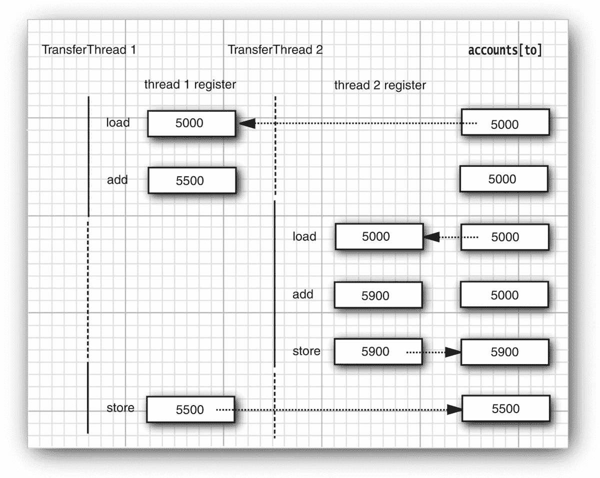两个线程的同时访问

`UnsyncBankTest` 程序演示了这种损坏。（在计算 `getTotalBalance` 期间，也有极小的概率出现误报。）

你实际上可以查看执行我们类中每条语句的虚拟机字节码。运行命令 `javap -c` 来反编译该类。例如，`accounts[to] += amount;` 这一行被翻译为以下字节码：

```text
aload_0
getfield        #2;
iload
2
add
dastore        3
```

这些代码意味着什么？重点是如果你在多核心上运行大量线程，损坏概率很高。

### 锁对象

有两种机制可以保护代码块免受并发访问。Java 语言提供了 `synchronized` 用于此目的，`java.util.concurrent` 包提供了显式的锁类。`synchronized` 关键字在许多情况下非常强大且方便。然而，我认为在看到锁和条件之后理解 `synchronized` 关键字会更容易。

使用 `ReentrantLock` 保护代码块的基本结构如下：

```java
myLock.lock(); // ReentrantLock
try
{
   关键区域
}
finally
{
   myLock.unlock(); // 即使发生异常也能解锁
}
```

这种结构保证了一次只有一个线程进入关键区域。一旦一个线程锁定了锁，其他线程就无法通过 `lock` 语句。其他线程调用 `lock` 时，会被阻塞直到第一个线程解锁。

将 `unlock` 操作封装在 `finally` 子句中极其重要。如果关键区域的代码抛出异常，必须解锁。否则，其他线程将永久阻塞。

使用锁时，无法使用 `try`-with-resources 语句。`unlock` 方法不是 `close`。一些程序员建议让 `Lock` 实现 `AutoCloseable`，让 `close` 调用 `lock`。但 Java 设计者认为锁的使用相当常见，值得被注意。

让我们使用锁来保护 `Bank` 类的 `transfer` 方法。

```java
public class Bank
{
   private final Lock bankLock = new ReentrantLock(); 
   . . .
   public void transfer(int from, int to, int amount)
   {
      bankLock.lock(); 
      try
      {
         System.out.print(Thread.currentThread());
         accounts[from] -= amount;
         System.out.printf(" %10.2f from %d to %d", amount, from, to);
         accounts[to] += amount;
         System.out.printf(" Total Balance: %10.2f%n", getTotalBalance());
      }
      finally
      {
         bankLock.unlock();
      }
   }
}
```

假设一个线程调用了 `transfer` 但在完成之前被抢占。假设第二个线程也调用了 `transfer`。第二个线程无法获取锁，并在调用 `lock` 方法时被阻塞。它被去激活，必须等待第一个线程执行完 `transfer` 方法。当第一个线程释放锁时，第二个线程就可以继续执行（参见图 10.3）。

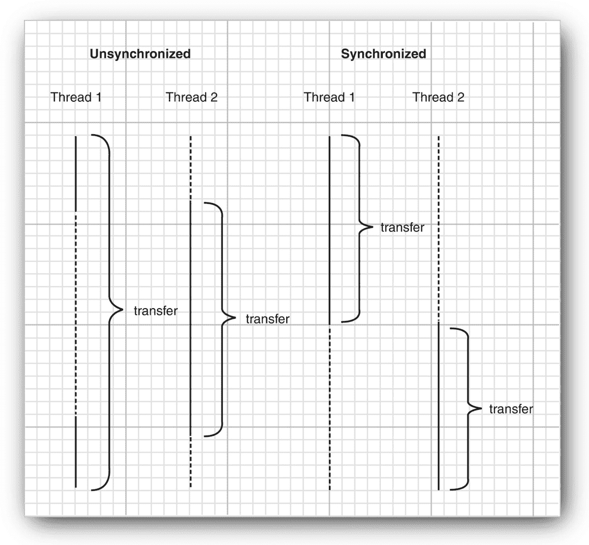未同步线程与同步线程的比较

尝试一下。在 `transfer` 方法中添加锁定代码并再次运行程序。你可以一直运行它，银行余额不会损坏。

请注意，每个 `Bank` 对象都有它们自己的 `ReentrantLock` 对象。如果两个线程尝试访问同一个 `Bank` 对象，那么锁将起到序列访问的作用。然而，如果两个线程访问不同的 `Bank` 对象，每个线程将获取不同的锁，且两个线程都不会被阻塞。这是符合预期的，因为当线程在操作不同的 `Bank` 实例时，它们不会互相干扰。

该锁被称为 `reentrant`（重入的），是因为线程可以重复获取它已经拥有的锁。锁有一个 `hold count`（持有计数），用于跟踪对 `lock` 方法的嵌套调用。线程必须对每次 `lock` 调用调用一次 `unlock`，以释放锁。由于这一特性，受锁保护的代码可以调用另一个使用相同锁的方法。

例如，`transfer` 方法调用了 `getTotalBalance` 方法，而该方法也会锁住 `bankLock` 对象，此时该对象的持有计数为 `2`。当 `getTotalBalance` 方法退出时，持有计数回到 `1`。当 `transfer` 方法退出时，持有计数变为 `0`，线程释放锁。

通常情况下，你可能希望在任何更新或检查共享对象的代码块周围使用锁，这样你就可以确保这些操作在另一个线程使用相同对象之前执行完毕。

务必确保临界区域中的代码不会因抛出异常而被跳过。如果在区域结束前抛出异常，`finally` 句将释放锁，但对象可能处于受损状态。

### `java.util.concurrent.locks.Lock` 5.0

- `void lock()`

  获取此锁；如果锁当前由另一个线程持有，则阻塞。

- `void unlock()`

  释放此锁。

### `java.util.concurrent.locks.ReentrantLock` 5.0

- `ReentrantLock()`

  构造一个用于保护临界区域的重入锁。

- `ReentrantLock(boolean fair)`

  根据给定的公平性策略构造锁。公平锁会倾向于等待时间最长的线程。然而，这种公平性保证可能会严重拖慢性能。因此，默认情况下，锁并不要求是公平的。


公平听起来很不错，但公平锁可能比普通锁`慢得多`。只有当你真正知道自己在做什么，并且有特定的理由认为公平性对你的程序至关重要时，才应该启用公平锁。即使你使用公平锁，你也无法保证线程调度器是公平的。如果线程调度器选择忽略一个等待锁已久的线程，那么它就没有机会被锁公平地对待。

## Condition 对象（条件对象）

通常，一个线程进入临界区域后，发现自己在某个条件满足之前无法继续执行。使用`condition object`（条件对象）来管理已获取锁但无法进行有用工作的线程。在本节中，我将介绍 Java 库中条件对象的实现。（出于历史原因，条件对象通常被称为`condition variables`（条件变量）。）

让我们完善对银行的模拟。我们不希望从没有资金覆盖转账的账户转出资金。注意，我们不能使用类似下面的代码：

```java
if (bank.getBalance(from) >= amount)
   bank.transfer(from, to, amount);
```

当前线程在测试成功和调用`transfer`之间完全可能被去激活。

```java
if (bank.getBalance(from) >= amount)
      // 线程在此处被去激活
   bank.transfer(from, to, amount);
```

当线程再次运行时，账户余额可能已经低于取款金额。你必须确保在测试和转账动作之间没有其他线程可以修改余额。你通过锁同时保护测试和转账动作来实现这一点：

```java
public void transfer(int from, int to, int amount)
{
   bankLock.lock();
   try
   {
      while (accounts[from] < amount)
      {
         // 等待
         . . .
      }
      // 转账资金
      . . .
   }
   finally
   {
      bankLock.unlock();
   }
}
```

现在，当账户中钱不足时我们该怎么办？我们等待其他线程添加资金。但此线程刚刚获得了`bankLock`的独占访问权限，因此没有其他线程有机会存款。这就是条件对象大显用场的地方。

锁对象可以有一个或多个关联的条件对象。你通过`newCondition`方法获取条件对象。习惯上为每个条件对象起一个能引起其所代表条件的名称。例如，在这里设置一个条件对象来表示“资金充足”条件。

```java
class Bank
{
   . . .
   private final Condition sufficientFunds = bankLock.newCondition();
   . . .
}
```

如果`transfer`方法发现资金不足，它会调用

```java
sufficientFunds.await();
```

当前线程现在被去激活并放弃锁。这让另一个线程进入，并可能增加账户余额。

等待获取锁的线程与调用了`await`的线程之间存在本质区别。一旦线程调用`await`方法，它就会进入该条件的`wait set`（等待集）。当锁可用时，该线程并`不是`变为可运行状态。相反，它一直保持去激活状态，直到另一个线程在该条件上调用了`signalAll`方法。

当另一个线程转了账后，它应该调用

```java
sufficientFunds.signalAll();
```

此调用会重新激活所有等待该条件的线程。当线程从等待集中移除时，它们再次变为可运行状态，调度器最终会再次激活它们。到那时，它们将尝试重新进入对象。一旦锁可用，其中一个线程将获取锁`并从中断的地方继续执行`，从`await`调用中返回。

此时，线程应该再次测试条件。并没有保证该条件现在已经满足——`signalAll`方法仅仅是通知等待的线程条件在此时`可能`已经满足，并且值得再次检查条件。

通常，对`await`的调用应该位于如下形式循环内部：

```java
while (!(OK to proceed))
   condition.await();
```

至关重要的是，最终`某些`其他线程调用`signalAll`方法。当线程调用`await`时，它没有办法重新激活自己。它寄希望于其他线程。如果它们中没有一个去重新激活等待的线程，该线程将永远不再运行。这可能导致令人讨厌的`死锁`局面。如果所有其他线程都被阻塞，且最后一个活跃的线程在调用`await`时没有解除其他任何一个线程的阻塞，它也会阻塞。没有线程可以解除其他线程，程序就会挂起。

何时应该调用`signalAll`？经验法则是，每当对象的状态发生可能对等待线程有利的变化时，就调用`signalAll`。例如，每当账户余额发生变化时，等待线程应该获得再次检查余额的机会。在我们的示例中，我们在完成资金转账后调用`signalAll`。

```java
public void transfer(int from, int to, int amount)
{
   bankLock.lock();
   try
   {
      while (accounts[from] < amount)
         sufficientFunds.await();
      // transfer funds
      . . .
      sufficientFunds.signalAll();
   }
   finally
   {
      bankLock.unlock();
   }
}
```

注意，对`signalAll`的调用不会立即激活等待的线程。它只是解除等待线程的阻塞，以便在当前线程释放锁后，它们可以竞争进入对象。

另一种方法`signal`只会从等待集中随机解除一个线程的阻塞。这比解除所有线程效率更高，但存在一个危险。如果随机选中的线程发现它仍然无法继续，它将再次进入阻塞状态。如果没有其他线程再次调用`signal`，系统就会发生死锁。

线程只有在拥有该条件的锁时，才能对该条件调用`await`、`signalAll`或`signal`。

`synch`包中的示例程序具有与`unsynch`版本列表 10.5 相同的`main`方法，但`Bank`类（列表 10.6）使用了锁。你会发现没有发生任何错误。总余额始终保持在 $100,000。没有任何账户出现过负余额。（再次，按下`Ctrl+C`终止程序。）你可能还会注意到程序运行得慢一点——这就是为同步机制涉及的额外账记录工作付出的代价。

在阅读源代码时，请注意`transfer`和`getTotalBalance`方法受锁的保护，但`size`方法没有。在这次模拟中，账户数量在构造后永远不会改变，因此没有需要为`size`方法授予排他访问。

`synch/Bank.java`

```java
package synch;

import java.util.*;
import java.util.concurrent.locks.*;

/**
 * 一个使用锁进行序列化访问的具有多个银行账户的银行。
 */
public class Bank
{
   private final double[] accounts;
   private final Lock bankLock = new ReentrantLock();
   private final Condition sufficientFunds = bankLock.newCondition();

   /**
    * 构造银行。
    * @param n 账户数量
    * @param initialBalance 每个账户的初始余额
    */
   public Bank(int n, double initialBalance)
   {
      accounts = new double[n];
      Arrays.fill(accounts, initialBalance);
   }

   /**
    * 将资金从一个账户转到另一个账户。
    * @param from 从转出的账户
    * @param to 转入的账户
    * @param amount 转账的金额
    */
   public void transfer(int from, int to, double amount) throws InterruptedException
   {
      bankLock.lock();
      try
      {
         while (accounts[from] < amount)
            sufficientFunds.await();
         System.out.print(Thread.currentThread());
         accounts[from] -= amount;
         System.out.printf(" %10.2f from %d to %d", amount, from, to);
         accounts[to] += amount;
         System.out.printf(" Total Balance: %10.2f%n", getTotalBalance());
         sufficientFunds.signalAll();
      }
      finally
      {
         bankLock.unlock();
      }
   }

   /**
    * 获取所有账户余额之和。
    * @return 总余额
    */
   public double getTotalBalance()
   {
      bankLock.lock();
      try
      {
         double sum = 0;

         for (double a : accounts)
            sum += a;

         return sum;
      }
      finally
      {
         bankLock.unlock();
      }
   }

   /**
    * 获取银行中的账户数量。
    * @return 账户数量
    */
   public int size()
   {
      return accounts.length;
   }
}
```

`java.util.concurrent.locks.Lock` 5.0

- `newCondition()`: 返回一个与此锁关联的条件。

`java.util.concurrent.locks.Condition` 5.0

- `await()`: 将此线程放入该条件的等待集中。

- `signalAll()`: 解除该条件等待集中所有线程的阻塞。

- `signal()`: 解除等待集中被选一个线程的阻塞。

## 死锁

锁和条件不能解决多线程中可能出现的所有问题。考虑以下情况：

1. 账户 1: $200
2. 账户 2: $300
3. 线程 1: 从账户 1 向账户 2 转 $300
4. 线程 2: 从账户 2 向账户 1 转 $400

如图 10.4 所示，线程 1 和线程 2 显然被阻塞了。它们都无法继续，因为账户 1 和账户 2 的余额不足。

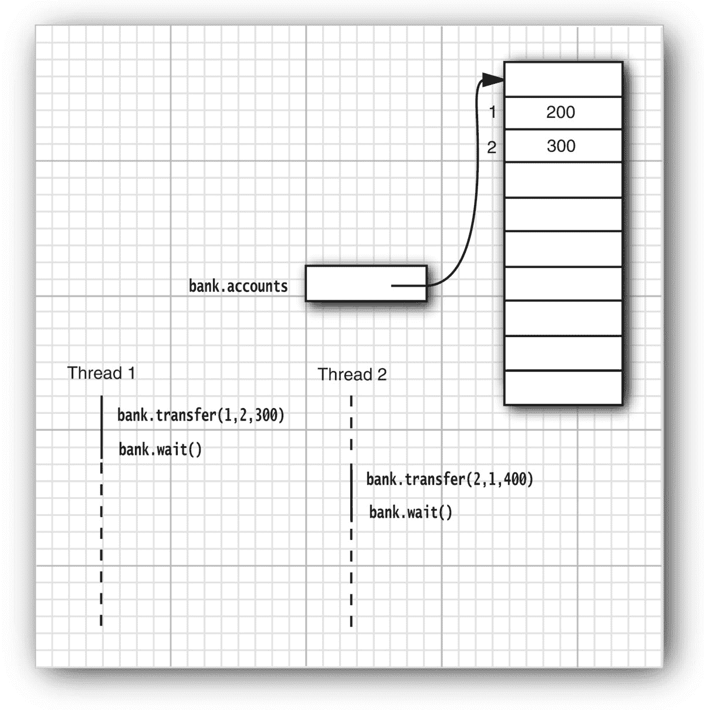 死锁情况

所有线程都被阻塞可能是，因为每个线程都在等待资金。这种情况被称为`deadlock`。在我们的程序中，由于一个简单原因，不会发生死锁。总余额永远保持在 $100,000。没有任何账户出现过负余额。（再次，按下`Ctrl+C`终止程序。）你可能还会注意到程序运行得慢一点——这就是为同步机制涉及的额外账记录工作付出的代价。

在阅读源代码时，请注意`transfer`和`getTotalBalance`方法受锁的保护，但`size`方法没有。在这次模拟中，账户数量在构造后永远不会改变，因此没有需要为`size`方法授予排他访问。

所有线程都被阻塞可能是，因为每个线程都在等待资金。这种情况被称为`deadlock`。在我们的程序中，由于一个简单原因，不会发生死锁。总余额始终保持在 $100,000。没有任何账户出现过负余额。（再次，按下`Ctrl+C`终止程序。）你可能还会注意到程序运行得慢一点——这就是为同步机制涉及的额外账记录工作付出的代价。

### 死锁

锁和条件不能解决多线程中可能出现的所有问题。考虑以下情况：

1. 账户 1: $200
2. 账户 2: $300
3. 线程 1: 从账户 1 向账户 2 转 $300
4. 线程 2: 从账户 2 向账户 1 转 $400

如图 10.4 所示，线程 1 和线程 2 显然被阻塞了。它们都无法继续，因为账户 1 和账户 2 的余额不足。

 死锁情况

所有线程都被阻塞可能是，因为每个线程都在等待资金。这种情况被称为`deadlock`。在我们的程序中，由于一个简单原因，不会发生死锁。在这种情况下，每次转账金额最多为 $1000。设置`NACCOUNTS`为 10 并运行程序，你会发现它运行一段时间后挂起。

由于`signalAll`会通知所有等待资金的线程，而`signal`方法只解除一个线程的阻塞。如果该线程无法继续，所有线程都会被阻塞。在`SynchBankTest`程序中，将`signalAll`方法改为`signal`。你会发现程序最终会挂起。

当程序挂起时，运行`jconsole`。你会得到一个列出所有线程的转储，显示它们在哪里阻塞（参见图 10.5）。

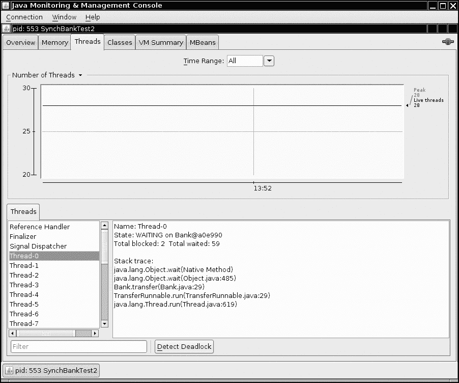 jconsole 中的线程面板

如你所示，使用锁（locks）和条件（conditions）进行编程可能相当挑战性。你必须设计程序以确保不会发生死锁情况。

## `synchronized` 关键字

在前面的章节中，你已经看到了如何使用`Lock`和`Condition`对象。在继续深入之前，让我们总结一下关于锁和条件的关键点：

- 锁保护代码段，允许一次只有一个线程执行该代码。
- 锁管理尝试进入临界区域的线程。
- 锁可以拥有一个或多个关联的条件对象。
- 每个条件对象管理已进入临界区域但无法继续执行的线程。

`Lock`和`Condition`接口为程序员提供了对锁的高度控制力。然而，在大多数情况下，你不需要那种控制力——你可以使用 Java 语言内置的机制。从 1.0 版本以来，Java 中的*每个对象*都带有一个内置锁（intrinsic lock）。如果一个方法用`synchronized`关键字声明，该对象的锁就会保护整个方法。也就是说，要调用该方法，线程必须获取该对象的内置锁。

换句话说，

```java
public synchronized void method()
{
   method body
}
```

等同于

```java
public void method()
{
   this.intrinsicLock.lock();
   try
   {
      method body
   }
   finally
   {
      this.intrinsicLock.unlock();
   }
}
```

例如，与其使用显式锁，我们可以简单地将`Bank`类的`transfer`方法声明为`synchronized`。

内置对象锁有一个关联的条件。`wait`方法将线程添加到等待集（wait set），而`notifyAll`/`notify`方法会阻塞等待的线程。换句话说，调用`wait`或`notifyAll`等同于

```java
intrinsicCondition.await();
intrinsicCondition.signalAll();
```

`wait`、`notifyAll`和`notify`方法是`Object`类的 final 方法。`Condition`方法必须命名为`await`、`signalAll`和`signal`，以便与这些方法发生冲突。

例如，你可以这样在 Java 中实现`Bank`类：

```java
class Bank
{
   private double[] accounts;

   public synchronized void transfer(int from, int to, int amount) 
         throws InterruptedException
   {
      while (accounts[from] < amount)
         wait(); // 在内置对象锁的唯一条件上等待
      accounts[from] -= amount;
      accounts[to] += amount;
      notifyAll(); // 通知所有等待该条件的线程
   }

   public synchronized double getTotalBalance()
   {
      . . .
   }
}
```


如你所示，使用`synchronized`关键字产生的代码简洁得多。当然，要理解这段代码，你必须知道每个对象都有一个内置锁，并且该锁有一个内置条件。锁管理尝试进入`synchronized`方法的线程。条件管理调用了`wait`的线程。

将静态方法声明为`synchronized`是合法的。如果调用了这样的方法，它将获取关联类对象的内置锁。例如，如果`Bank`类有一个静态同步方法，那么当调用它时，`Bank.class`对象会被锁定。结果是没有其他线程可以调用此方法或同类的任何其他同步静态方法。

内置锁和条件有一些局限性。其中：

* 虚拟线程在获取内置锁时会被*固定（pinned）*。在释放锁之前，它们无法从载体线程（carrier thread）上卸载。如果临界区域立即退出，固定并不是问题。但如果虚拟线程在被固定时阻塞，可能会严重降低吞吐量，甚至导致载体线程池的饥饿。

* 你无法中断尝试获取内置锁的线程。使用`ReentrantLock`，你可以调用`lockInterruptibly`。

* 在尝试获取内置锁时无法指定超时时间。

* 每个锁只有一个条件可能会效率低下。

在你的代码中应该使用什么——`Lock`和`Condition`对象还是`synchronized`方法？这里是我的建议：

* 最好既不使用`Lock`/`Condition`也使用`synchronized`关键字。在许多情况下，你可以使用`java.util.concurrent`包中的机制之一，它们会为你完成所有的锁定工作。例如，在第 10.6.1 节显示了用同步方法实现的银行示例。然而，请考虑到锁是公开的——见下一节。

* 如果你使用虚拟线程，或者你真的需要这些构造结构提供的额外功能，请使用`Lock`/`Condition`。

要检查被固定的线程是否阻塞，请使用以下选项之一启动 JVM：

```
-Djdk.tracePinnedThreads=short
-Djdk.tracePinnedThreads=full
```

你会得到一个堆栈跟踪，显示被固定的线程在何时阻塞：

```
. . .
org.apache.tomcat.util.net.SocketProcessorBase.run(SocketProcessorBase.java:49) <== monitors:1
```

请注意，每个位置你只会获得一个警告！

或者，使用 Java Flight Recorder 进行记录，用你喜爱的控制台进行查看，并寻找`VirtualThreadPinned`和`VirtualThreadSubmit`事件。

`synch2/Bank.java`：

```
package synch2;

import java.util.*;

/**
 * 一个拥有多个账户并使用同步原的银行。
 */
public class Bank
{
   private final double[] accounts;

   /**
    * 构造银行。
    * @param n 账户数量
    * @param initialBalance 每个账户的初始余额
    */
   public Bank(int n, double initialBalance)
   {
      accounts = new double[n];
      Arrays.fill(accounts, initialBalance);
   }

   /**
    * 将资金从一个账户转到另一个账户。
    * @param from 从转出的账户
    * @param to 转入的账户
    * @param amount 要转账的金额
    */
   public synchronized void transfer(int from, int to, double amount) 
         throws InterruptedException
   {
      while (accounts[from] < amount)
         wait();
      System.out.print(Thread.currentThread());
      accounts[from] -= amount;
      System.out.printf(" %10.2f from %d to %d", amount, from, to);
      accounts[to] += amount;
      System.out.printf(" Total Balance: %10.2f%n", getTotalBalance());
      notifyAll();
   }

   /**
    * 获取所有账户的总余额。
    * @return 总余额
    */
   public synchronized double getTotalBalance()
   {
      double sum = 0;

      for (double a : accounts)
         sum += a;

      return sum;
   }

   /**
    * 获取银行中的账户数量。
    * @return 账户数量
    */
   public int size()
   {
      return accounts.length;
   }
}
```

`java.lang.Object` 1.0

* `void notifyAll()`

    解除在对象对象上调用`wait`的所有线程。该方法只能在同步方法或块中调用。如果当前线程不是对象锁的所有者，将抛出`IllegalMonitorStateException`。

* `void notify()`

    在在对象对象上调用`wait`的线程中随机选择一个解除阻塞。该方法只能在同步方法或块中调用。如果当前线程不是对象锁的所有者，将抛出`IllegalMonitorStateException`。

* `void wait()`

    使线程等待直到它被通知。该方法只能在同步方法或块中调用。如果当前线程不是对象锁的所有者，将抛出`IllegalMonitorStateException`。

* `void wait(long millis)`

* `void wait(long millis, int nanos)`

使线程挂起，直到它被通知或指定的时间过去为止。这些方法只能在同步方法或块内部调用。如果当前线程不是对象锁的拥有者，将抛出`IllegalMonitorStateException`。纳秒数不能超过 1,000,000。

## 同步块 (Synchronized Blocks)

正如我们刚刚讨论的，每个 Java 对象都有一把锁。线程可以通过调用同步方法来获取锁。获取锁的第二种机制是进入`synchronized块`。当一个线程进入形式如下的块时：

```
synchronized (obj) // 这是同步块的语法
{
   critical section
}
```

那么它就获取了`obj`的锁。

你有时会发现“临时（ad hoc）”锁，例如：

```java
public class Bank
{
   private double[] accounts;
   private final Object lock = new Object();
   . . .
   public void transfer(int from, int to, int amount)
   {
      synchronized (lock) // 一个临时锁
      {
         accounts[from] -= amount;
         accounts[to] += amount;
      }
      System.out.println(. . .);
   }
}
```

在这里，`lock`对象的创建仅是为了使用每个 Java 对象都拥有的那个锁。

使用同步块时，要小心锁对象。例如，下面的代码不起作用：

```java
private final String lock = "LOCK";
. . .
synchronized (lock) { . . . } // 不要要在字符串字面量上锁定！
```

如果这在同一个程序中发生两次，锁将是同一个对象，因为字符串字面量是共享的。这可能导致死锁。

此外，要避免使用原始类型包装类作为锁：

```java
private final Integer lock = new Integer(42); // 不要要在包装类上锁定
```

构造函数调用`new Integer(42)`已经过时了，你不希望维护人员将该调用更改为`Integer.valueOf(42)`。如果使用相同的魔数执行两次，锁将意外地共享。

如果你需要修改静态字段，请在特定的类上锁定，而不是在`getClass()`返回的值上锁定：

```java
synchronized (MyClass.class) { staticCounter++; } // OK
synchronized (getClass()) { staticCounter++; } // 不要这样做
```

如果包含此代码的方法是从子类调用的，那么`getClass()`将返回不同的`Class`对象！你将无法保证互斥性！

通常情况下，如果你必须使用`synchronized`块，请了解你的锁对象！你必须对所有关键区域使用相同的锁，并且不能有其他人使用你的锁。

有时，程序员使用一个对象的锁来实现额外的原子操作——这种做法被称为客户端锁定（client-side locking）。例如，考虑`Vector`类，它是一个方法都是同步的列表。现在假设我们将银行余额存储在`Vector<Double>`中。这里是`transfer`方法的一个简单实现：

```java
public void transfer(Vector<Double> accounts, int from, int to, int amount) // 错误
{
   accounts.set(from, accounts.get(from) - amount);
   accounts.set(to, accounts.get(to) + amount);
   System.out.println(. . .);
}
```

`Vector`类的`get`和`set`方法是同步的，但这并不能为我们提供帮助。线程在`transfer`方法中完成第一次`get`调用后完全可能被抢占。另一个线程可能会在相同的位置存储一个不同的值。然而，我们可以劫持锁：

```java
public void transfer(Vector<Double> accounts, int from, int to, int amount)
{
   synchronized (accounts)
   {
      accounts.set(from, accounts.get(from) - amount);
      accounts.set(to, accounts.get(to) + amount);
   }
   System.out.println(. . .);
}
```

这种方法有效，但它完全依赖于`Vector`类对其所有的修改器方法（mutator methods）使用内在锁。然而，这是一个事实吗？`Vector`类的文档没有这样的承诺。你必须仔细研究源代码，并希望未来的版本不会引入不同同步的修改器。正如你所见，客户端锁定是非常脆弱的，通常不推荐。

Java 虚拟机对同步方法有内置支持。然而，同步块被编译成长长的字节码序列以管理内在锁。

## 监视器概念 (The Monitor Concept)

锁和条件是线程同步的强大工具，但它们并不非常面向对象。多年来，研究人员一直在寻找在不强制程序员考虑显式锁的情况下使多线程安全的方法。最成功的解决方案之一是由 Per Brinch Hansen 和 Tony Hoare 在 20 世纪 70 代提出的监视器概念。在 Java 术中，监视器具有以下属性：

* 监视器是一个只有一个私有字段的类。

* 该类的每个对象都有一个关联的锁。

* 所有方法都由该锁锁定。换句话说，如果调用`obj.method()`，那么`obj`的锁会在方法调用开始时自动获取，并在方法返回时释放。由于所有字段都是私有的，这种安排确保了当一个线程操作这些字段时，另一个线程无法访问这些字段。

* 锁可以有任意数量的关联条件。

早版本的监视器只有一个条件，且语法相当优雅。你可以直接调用`accounts[from] >= amount`而不需要使用显式条件。然而，研究表明，无加区分地重新测试条件可能是低效的。这个问题通过显式条件变量来解决，每个条件变量管理一组独立的线程。

Java 设计者松散借鉴了监视器概念。Java 中的每个对象都有一个内在锁和一个内在条件。如果一个方法用`synchronized`关键字声明，它就像一个监视器方法。通过调用`wait`/`notifyAll`/`notify`来访问条件变量。

然而，Java 对象与监视器在三个重要方面不同，这损害了线程安全：字段不需要是`private`的；方法不需要是`synchronized`的；且内在锁对客户端可见的。

这种对安全的不尊重让 Per Brinch Hansen 非常愤怒。在对 Java 多线程原语的严厉评论中，他写道：“令我惊讶的是，在监视器和并发 Pascal 语言发明四分之一后，Java 不安全的并行性竟然被编程界严肃对待。它没有任何价值”（*Java’s Insecure Parallelism, ACM SIGPLAN Notices* 34:38–45, April 1999）。

## volatile 字段 (Volatile Fields)

有时，仅仅为了读取或写入一两个实例字段就支付同步成本似乎太太大了。毕竟，能出什么问题呢？不幸的是，在现代处理器和编译器中，有很多错误空间。

* 具有多个处理器的计算机可以临时将内存值保存在寄存器或本地缓存中。结果是运行在不同处理器上的线程可能会看到同一内存位置的不同值！

* 编译器可以重新排序指令以实现最大吞吐量。编译器不会选择改变代码含义的排序，但它们假设内存值只有在代码中有显式指令时才会改变。然而，内存值可以被另一个线程更改！

如果你使用锁来保护被多个线程访问的代码，你就不会遇到这些问题。编译器被要求尊重锁，通过刷新或重新获取寄存器值、不恰当地重排指令以及发布内存屏障指令。细节在 Java 内存模型规范（Java 语言规范第 17.4 节）中解释。规范的大部分内容非常复杂且具有技术性，但该部分还包含许多清晰解释的示例。

Brian Goetz 创造了以下“同步准则”：“如果你写了一个后续可能被另一个线程读取的变量，或者你读取了一个可能最近被另一个线程写入的变量，那么你必须使用同步机制。”

`volatile`关键字为同步实例字段的访问提供了一种无锁机制。如果你将一个字段声明为`volatile`，那么编译器和虚拟机就会考虑到该字段可能会被另一个线程并发更新。

例如，假设一个对象有一个`boolean`标记`done`，它由一个线程设置并由另一个线程查询。正如我们已经讨论过的，你可以使用锁：

```
private boolean done;
public synchronized boolean isDone() { return done; }
public synchronized void setDone() { done = true; }
```

使用内置对象锁（intrinsic object lock）可能不是好主意。如果另一个线程锁定了对象，`isDone`和`setDone`方法可能会被阻塞。如果担心这个问题，可以为该变量使用单独的锁。但这变得非常麻烦。

在这种情况下，将字段声明为`volatile`是合理的：

```
private volatile boolean done;
public boolean isDone() { return done; }
public void setDone() { done = true; }
```

编译器将插入适当的代码，以确保一个线程对`done`变量的更改对读取该变量的任何其他线程可见。

Volatile 变量不提供任何原子性。例如，以下方法：

```
public void flipDone() { done = !done; } // 不是原子的
```

不能保证能够翻转字段的值。无法保证读取、翻转和写入的过程是不被中断的。

### 最终字段 (Final Fields)

正如你在上一节中看到的，除非使用锁或`volatile`修饰符，否则你无法从多个线程中安全地读取字段。

还有一种情况可以安全访问共享字段——当它被声明为`final`时。一旦构造函数完成，任何持有该对象引用的线程都将看到带有初始化值的 final 字段。

考虑：

```
public class Bank
{
   final HashMap<String, Double> accounts;

   public Bank()
   {
      accounts = new HashMap<>();
   }
}
```

其他线程在构造函数完成后可以看到已初始化的`accounts`变量。

如果不使用`final`，无法保证其他线程能看到`accounts`的更新值——它们可能都看到`null`，而不是构造好的`HashMap`。

当然，对 map 的操作不是线程安全的。如果多个线程变异和读取 map，你仍然需要同步。

该保证有一个重要的限制：对`this`的引用不能在构造过程中发生*逃逸*（escape）。如果构造函数将`this`分配给另一个对象的字段或将`this`传递给另一个方法，则引用就会逃逸。


如果`this`引用在构造过程中没有逃逸，则该对象是*正确构造的*（properly constructed）。如果一个对象被正确构造且所有字段都是`final`，则它可以在没有同步的情况下安全地共享。

## 原子类 (Atomics)

只要你执行的是除赋值以外的操作，就可以将共享变量声明为`volatile`。

`java.util.concurrent.atomic`包中有一许多类，它们使用高效的机器级指令来保证其他操作的原子性，而无需使用锁。例如，`AtomicInteger`类拥有`incrementAndGet`和`decrementAndGet`方法，可以原子性地增加或减少整数。例如，你可以安全地生成如下数字序列：

```
public static final AtomicLong nextNumber = new AtomicLong();
// 在某些线程中 . .
long id = nextNumber.incrementAndGet();
```

`incrementAndGet`方法原子性地增加`AtomicLong`并返回自增后的值。也就是说，获取值、加 1、设置值和产生新值的操作不能被中断。保证了即使多个线程并发访问同一个实例，也能计算并返回正确值。

虽然有方法可以原子性地设置、增加和减去值，但如果你想进行更复杂的更新，就必须使用`compareAndSet`方法。例如，假设你想跟踪不同线程观察到的最大值。以下代码不起作用的：

```
public static final AtomicLong largest = new AtomicLong();
// 在某些线程中 . .
largest.set(Math.max(largest.get(), observed)); // 错误--竞态条件！
```

这种更新不是原子的。相反，为更新变量提供一个 lambda 表达式，更新将由为你完成。在我们的示例中，我们可以调用：

```
largest.updateAndGet(x -> Math.max(x, observed));
```

或者

```
largest.accumulateAndGet(observed, Math::max);
```

`accumulateAndGet`方法接收一个二元运算符，用于结合原子值和提供的参数。

还有`getAndUpdate`和`getAndAccumulate`方法会返回旧值。

这些方法也提供了`AtomicInteger`、`AtomicIntegerArray`、`AtomicIntegerFieldUpdater`、`AtomicLongArray`、`AtomicLongFieldUpdater`、`AtomicReference`、`AtomicReferenceArray`和`AtomicReferenceFieldUpdater`。

有大量的线程访问同一个原子值时，性能会下降，因为乐观更新需要过多的重试。`LongAdder`和`LongAccumulator`类解决了这个问题。`LongAdder`由多个变量组成，它们的总和是当前值。多个线程可以更新不同的加数，当线程数量增加时，会自动提供新的加数。在不需要立即获取总和的常见情况下，这是高效的。

如果你预见到高竞争，应该使用`LongAdder`而不是`AtomicLong`。方法名称略有不同。调用`increment`增加计数器或调用`add`增加数量，并调用`sum`获取总和。

```
final var adder = new LongAdder();      
for (. .) 
   executor.submit(() ->
      {
         while (. .)
         {
            . . .
            if (. .) adder.increment(); 
         }
      });
. . .      
long total = adder.sum();
```

当然，`increment`方法*没有*返回旧值。这样做会消除将和拆分为多个加数的效率收益。

`LongAccumulator`将这一思想推广到任意积累操作。在构造函数中，你提供操作以及它的单位元素。要整合新值，调用`accumulate`。调用`get`获取当前值。以下效果与`LongAdder`相同：

```
final var adder = new LongAccumulator(Long::sum, 0);
// 在某些线程中 . .
adder.accumulate(value);
```

内部，累加器拥有变量`a`[1]、`a`[2]、…… `a`[`n`]。每个变量都用单位元素初始化（在示例中为 0）。

当调用`accumulate`并传入值`v`时，其中一个变量会被原子性地更新为`a`[`i`] = `a`[`i`] `op` `v`，其中`op`是中缀形式的积累操作。在我们的示例中，调用`accumulate`计算`a`[`i`] = `a`[`i`] + v`（对于某个`i`）。

`get`的结果是`a`[1] `op` `a`[2] `op` …… `op` `a`[`n`]。在我们的示例中，那是累加器的和，`a`[1] + `a`[2] + …… + `a`[`n`]。要计算最大值或最小值，请使用`Math.max`或`Math.min`作为操作。通常情况下，操作必须满足结合律和交换律。这意味着最终结果与中间值组合的顺序无关。

还有`DoubleAdder`和`DoubleAccumulator`，它们以相同的方式工作，只是针对`double`值。

## 懒需初始化

有时候，你拥有一个只想在第一次需要时才初始化的数据结构。而且你希望确保初始化恰好发生一次。与其自己设计一套机制，不如利用这样一个事实：虚拟机在类被首次使用时会恰好执行一次静态初始化器。虚拟机通过锁来确保这一点，因此你不需要自己编写锁。

```
public class OnDemandData
{
   // 私有构造函数以确保只有一个对象被创建
   private OnDemandData()
   {
      . . .
   }

   public static OnDemandData getInstance()
   {
      return Holder.INSTANCE;
   }

   // 仅在第一次使用时初始化，即在第一次调用 getInstance 时
   private static class Holder
   {
      // VM 保证这种操作是懒性的且最多执行一次
      static final OnDemandData INSTANCE = new OnDemandData();
   }
}
```

要使用这种惯用法，你必须确保构造函数不会抛出任何异常。虚拟机将不会尝试第二次初始化该内部类。

## 安全发布 (Safe Publication)

正如你在第 10.5.10 节中看到的，一个构造良好的对象的`final`字段将被所有线程看到其初始化后的值。那么非`final`字段呢？

Java 语言通常不提供任何保证。例如，考虑：

```
public class BankAccount
{
   private double balance;

   public BankAccount(double initialBalance) { balance = initialBalance; }
   public double getBalance() { return balance; }
   . . .
}
```

如果你在一个线程中构造了一个`new BankAccount(1000)`对象，而另一个线程拥有该对象的引用，它可能会看到`getBalance()`返回零。

当然，一个可变的`BankAccount`类应该拥有线程安全的方法`getBalance`、`deposit`、`withdraw`，用锁来保护`balance`字段。这样`getBalance`就会报告正确的余额。

现在考虑一种可能罕见的情况：你共享了一个既不是线程安全的也不是不可变的对象。这时，你需要确保该对象被**安全发布**（safely published）——即所有字段在构造函数中设置的值都是可见的。在存储对象引用时，这一点可以得到保证：

- 在静态初始化器中（如前面的章节所示）

- 在`volatile`字段或`AtomicReference`中

- 在任何受锁保护赋值操作的字段中

- 在一个构造良好的对象的`final`字段中

当`Runnable`或`Callable`是一个捕获了外部作用域变量的内部类或 lambda 表达式时，满足第三条件。捕获的变量被存储在内部类的`final`字段中。

当你将对象引用存储在线程安全的数据结构中（例如`BlockingQueue`或`ConcurrentHashMap`）时，满足最后一个条件。获取数据的线程将看到处于发布状态的对象。

正如你所见，在大多数合理的情况下，不会发生糟糕的事情。如果你发现自己处于这些细节至关重要的境地，那么你正处于如履薄冰，可能需要重新考虑你的共享策略。

## 使用线程局部变量共享 (Sharing with Thread-Local Variables)

在前面的章节中，我们讨论了线程间共享变量的风险。有时，你可以通过为每个线程提供自己的实例来避免共享，使用线程本地变量（参见第 10.4.4 节）。例如，`SimpleDateFormat`类不是线程安全的。假设我们有一个静态变量：

```
public static final SimpleDateFormat DATEFORMAT = new SimpleDateFormat("yyyy-MM-dd");
```

如果两个线程执行如下操作：

```
String DATEFORMAT = dateFormat.format(new Date());
```

那么结果可能是错误的，因为`dateFormat`使用的内部数据结构可能会因并发访问而损坏。你可以使用同步机制（这是开销很大的），或者在需要时构造一个本地的`SimpleDateFormat`对象，但也是浪费的。

要为每个线程构造实例，请使用以下代码：

```
public static final ThreadLocal<SimpleDateFormat> DATEFORMAT =
   ThreadLocal.withInitial(() -> new SimpleDateFormat("yyyy-MM-dd"));
```

要访问实际的格式化器，调用

```
String dateStamp = DATEFORMAT.get().format(new Date());
```

在给定线程中第一次调用`get`时，会调用构造函数中的 lambda。从那时起`get`方法返回属于当前线程的实例。

正如第 10.4.4 节指出的，线程本地变量可能不再大量的虚拟线程。Java 21 中的预览特性作用域局部（Extent locals）提供了更高效的替代方案。

一个相关问题是多线程生成随机数。`java.util.Random`类是线程安全的。但是，如果多个线程使用单个共享的生成器，产生新随机值并更新生成器状态的计算可能是无效的。

你可以使用`ThreadLocal`工具为每个线程提供单独的生成器。但有一个针对这种情况优化的便利类：

```
int random = ThreadLocalRandom.current().nextInt(upperBound);
```

调用`ThreadLocalRandom.current()`返回一个具有线程特定状态的随机生成器。在目前的实现中，它将生成器状态存储在`Thread`对象的实例变量中。

`java.lang.ThreadLocal<T>` 1.2

- `static <S> ThreadLocal<S> withInitial(Supplier<? extends S> supplier)` 8

  创建一个线程本地变量，其初始值通过调用给定的 supplier 产生。

`java.util.concurrent.ThreadLocalRandom` 7

- `static ThreadLocalRandom current()`

  返回一个状态位于当前线程的随机生成器类。

# 线程安全的集合 (Thread-Safe Collections)

如果多个线程并发修改数据结构（如哈希表），很容易损坏该数据结构。（有关哈希表的更多信息请参见第 9 章](../ch9/index.xhtml)。）例如，一个线程可能开始插入新元素。假设它在重定向哈希桶之间的链接中间被中断。如果另一个线程开始遍历同一列表，可能会遵循无效链接并引发混乱，例如抛出异常或陷入死循环。

你可以通过提供锁来保护共享数据结构，但更容易选择线程安全的实现。

## 阻塞队列 (Blocking Queues)

许多线程问题可以通过一个或多个队列优雅且安全地解决。生产者线程将项插入队列，消费者线程从中提取。队列允许从一个线程安全传递到另一个线程。例如，考虑我们的银行转账程序。转移线程将转账指令对象插入队列。另一个线程从队列中取出指令并执行转账。只有该线程可以访问银行对象的内部。不需要同步。（当然，线程安全队列类的实现者必须担心锁和条件，但那是他们的问题，不是你的。）

当尝试向当前满的队列添加元素，或向空的队列移除元素时，`blocking queue`（阻塞队列）会导致线程发生阻塞。阻塞队列是协调多个线程工作的有用工具。工作线程可以定期将中间结果存入阻塞队列。其他工作线程则移除这些中间结果并对其进行进一步修改。队列会自动平衡工作负载。如果第一组线程的运行速度比第二组慢，第二组线程会在等待结果时被阻塞。如果第一组线程运行得更快，队列将一直填满，直到第二组追上为止。表 10.2 显示了阻塞队列的方法。

## 阻塞队列方法

| 方法 | 正常操作 | 特殊情况下的操作 |

| --- | --- | --- |

| `add` | 添加元素 | 如果队列满则抛出`IllegalStateException` |

| `element` | 返回头部元素 | 如果队列为空则抛出`NoSuchElementException` |

| `offer` | 添加元素并返回`true` | 如果队列满则返回`false` |

| `peek` | 返回头部元素 | 如果队列为空则返回`null` |

| `poll` | 移除并返回头部元素 | 如果队列为空则返回`null` |

| `put` | 添加元素 | 如果队列满则阻塞 |

| `remove` | 移除并返回头部元素 | 如果队列为空则抛出`NoSuchElementException` |

| `take` | 移除并返回头部元素 | 如果队列为空则阻塞 |

阻塞队列方法分为三类，区别在于它们在队列满或空时执行的操作。如果你将队列作为线程管理工具，请使用`put`和`take`方法。当尝试向满队列添加元素或获取空队列的头部时，`add`、`remove`和`element`操作会抛出异常。当然，在多线程程序中，队列可能在任何时候变满或为空，因此你可能希望使用`offer`、`poll`和`peek`方法。这些方法在无法执行任务时，简单地返回一个失败指示而不是抛出异常。

`poll`和`peek`方法返回`null`来指示失败。因此，向这些队列中插入`null`值是非合法的。

还有带有超时`offer`和`poll`方法变体。例如，调用

```
boolean success = q.offer(x, 100, TimeUnit.MILLISECONDS);
```

尝试花费 100 毫秒将元素插入队列尾部。如果成功，则返回`true`；否则，在超时后返回`false`。同样，调用

```
Object head = q.poll(100, TimeUnit.MILLISECONDS);
```

尝试花费 100 毫秒移除队列头部。如果成功，则返回头部；否则，在超时后返回`null`。

`put`方法在队列满时阻塞，`take`方法在队列为空时阻塞。这些等同于不带超时的`offer`和`poll`。

`java.util.concurrent`包提供了多种阻塞队列的变体。默认情况下，`LinkedBlockingQueue`的容量没有上限，但可以可选地指定最大容量。`LinkedBlockingDeque`是双端版本。`ArrayBlockingQueue`使用指定的容量和一个可选的公平性参数进行构造。如果指定了公平性，则等待时间最长的的线程将获得优先对待。一如既往，公平性会带来巨大的性能代价，只有在你的问题特别需要时才应该使用它。

`PriorityBlockingQueue`是优先级队列，而不是先进先出的队列。元素按照它们的优先级顺序移除。该队列容量无界，但如果队列为空，检索将阻塞。（有关优先级队列的更多信息请参见第 9 章。）

`TransferQueue`接口允许生产者线程等待消费者准备好接收一个项目。当生产者调用

```
q.transfer(item);
```

该调用将阻塞直到另一个线程将其移除。`LinkedTransferQueue`类实现了此接口。

Listing 10.8 中的程序展示了如何使用阻塞队列来控制一组线程。该程序搜索目录及其子目录中的所有文件，打印包含给定关键字的行。

生产者线程枚举所有子目录中的所有文件并将其放入阻塞队列。此操作非常快，如果队列没有边界，它将很快被文件系统中所有的文件填满。

我们还启动了大量的搜索线程。每个搜索线程从队列获取一个文件，打开它，打印所有包含关键字的行，然后取下一个文件。我们使用了一种技巧在不再需要进一步工作时终止应用程序。为了信号完成，枚举线程向队列中放入一个特殊的终止对象。（这类似于行李提取传送带上贴有“最后一件”标签的虚拟手箱）。当搜索线程获取到特殊对象时，它会终止，并将该对象放回供其他消费者看到。


有些程序员使用“毒丸”（poison pill）一术来称为向消费者发送终止信号的对象。

注意，不需要显式的线程同步。在这个应用程序中，我们使用队列数据结构作为同步机制。

`blockingQueue/BlockingQueueTest.java`

```java
package blockingQueue;

import java.io.*;
import java.nio.file.*;
import java.util.*;
import java.util.concurrent.*;
import java.util.stream.*;

/**
 * @version 1.04 2023-07-30
 * @author Cay Horstmann
 */
public class BlockingQueueTest
{
   private static final int FILE_QUEUE_SIZE = 10;
   private static final int SEARCH_THREADS = 100;
   private static final Path TERMINATION = Path.of("");
   private static BlockingQueue<Path> queue = new ArrayBlockingQueue<>(FILE_QUEUE_SIZE);

   public static void main(String[] args)
   {
      try (var in = new Scanner(System.in)) 
      {
         System.out.print("Enter base directory (e.g. /tmp/jdk-21-src): ");
         String directory = in.nextLine();
         System.out.print("Enter keyword (e.g. volatile): ");
         String keyword = in.nextLine();

         Runnable enumerator = () ->
            {
               try
               {
                  enumerate(Path.of(directory));
                  queue.put(TERMINATION);
               }
               catch (IOException e)
               {
                  e.printStackTrace();
               }
               catch (InterruptedException e)
               {
               }            
            };

         Thread.ofPlatform().start(enumerator);
         for (int i = 1; i <= SEARCH_THREADS; i++)
         {
            Runnable searcher = () ->
               {
                  try
                  {
                     boolean done = false;
                     while (!done)
                     {
                        Path file = queue.take();
                        if (file == TERMINATION)
                        {
                           queue.put(file);
                           done = true;
                        }
                        else search(file, keyword);
                     }
                  }
                  catch (IOException e)
                  {
                     e.printStackTrace();
                  }
                  catch (InterruptedException e)
                  {
                  }               
               };
            Thread.ofPlatform().start(searcher);
         }
      }
   }

   /**
    * Recursively enumerates all files in a given directory and its subdirectories.
    * See Chapters 1 and 2 of Volume II for the stream and file operations.
    * @param directory the directory in which to start
    */
   public static void enumerate(Path directory) throws IOException, InterruptedException
   {
      try (Stream<Path> children = Files.list(directory))
      {
         for (Path child : children.toList())
         {
            if (Files.isDirectory(child))
               enumerate(child);
            else
               queue.put(child);
         }
      }
   }

   /**
    * Searches a file for a given keyword and prints all matching lines.
    * @param file the file to search
    * @param keyword the keyword to search for
    */
   public static void search(Path file, String keyword) throws IOException
   {
      try (var in = new Scanner(file))
      {
         int lineNumber = 0;
         while (in.hasNextLine())
         {
            lineNumber++;
            String line = in.nextLine();
            if (line.contains(keyword)) 
               System.out.printf("%s:%d:%s%n", file, lineNumber, line);
         }
      }
   }
}
```

`java.util.concurrent.ArrayBlockingQueue<E>` 5.0

- `ArrayBlockingQueue(int capacity)`

- `ArrayBlockingQueue(int capacity, boolean fair)`

根据指定的容量和公平性设置构造阻塞队列。队列用循环数组实现。

`java.util.concurrent.LinkedBlockingQueue<E>` 5.0

`java.util.concurrent.LinkedBlockingDeque<E>` 6

- `LinkedBlockingQueue()`

- `LinkedBlockingDeque()`

构造一个无界的阻塞队列或双端队列，使用链表实现。

- `LinkedBlockingQueue(int capacity)`

- `LinkedBlockingDeque(int capacity)`

根据指定的容量构造有界的阻塞队列或双端队列，使用链表实现。

`java.util.concurrent.PriorityBlockingQueue<E>` 5.0

- `PriorityBlockingQueue()`

- `PriorityBlockingQueue(int initialCapacity)`

- `PriorityBlockingQueue(int initialCapacity, Comparator<? super E> comparator)`

构造一个使用堆实现的无界优先级阻塞队列。初始容量的默认值为 `11`。如果未指定比较器，则元素必须实现 `Comparable` 接口。

`java.util.concurrent.BlockingQueue<E>` 5.0

- `void put(E element)`

添加元素，必要时会阻塞。

- `E take()`

移除并返回头部元素，必要时会阻塞。

- `boolean offer(E element, long time, TimeUnit unit)`

添加指定的元素，如果成功则返回 `true`，必要时会阻塞直到元素被添加或时间超时。

- `E poll(long time, TimeUnit unit)`

移除并返回头部元素，必要时会阻塞直到元素可用或时间超时。失败时返回 `null`。

`java.util.concurrent.BlockingDeque<E>` 6

- `void putFirst(E element)`

- `void putLast(E element)`

添加元素，必要时会阻塞。

- `E takeFirst()`

- `E takeLast()`

移除并返回头部或尾部元素，必要时会阻塞。

- `boolean offerFirst(E element, long time, TimeUnit unit)`

- `boolean offerLast(E element, long time, TimeUnit unit)`

添加指定的元素，如果成功则返回 `true`，必要时会阻塞直到元素被添加或时间超时。

- `E pollFirst(long time, TimeUnit unit)`

- `E pollLast(long time, TimeUnit unit)`

移除并返回头部或尾部元素，必要时会阻塞直到元素可用或时间超时。失败时返回 `null`。

`java.util.concurrent.TransferQueue<E>` 7

- `void transfer(E element)`

- `boolean tryTransfer(E element, long time, TimeUnit unit)`

传输元素，或在指定的时间内尝试传输，直到另一个线程移除该项。第二个方法成功时返回 `true`。

### 高效 Map、Set 和队列

`java.util.concurrent` 包提供了映射、排序集合和队列的高效实现：`ConcurrentHashMap`、`ConcurrentSkipListMap`、`ConcurrentSkipListSet` 和 `ConcurrentLinkedQueue`。

这些集合使用了复杂的算法，通过允许访问数据结构的部分来减少竞争。

与大多数集合不同，这些类的 `size` 方法并不一定以常时间运行。确定其中一个集合的当前大小通常需要遍历。

某些应用程序使用巨大的并发哈希映射，大至于 `size` 方法是不够用的，因为它返回的是 `int`。对于超过 20 亿条目的映射该怎么办？`mappingCount` 方法以 `long` 类型返回大小。

这些集合返回*弱一致*的迭代器。这意味着迭代器可能反映也可能无法构造后发生的所有修改，但它们不会重复返回值，也不会抛出 `ConcurrentModificationException`。

相比之下，`java.util` 包中集合的迭代器在构造后被修改时会抛出 `ConcurrentModificationException`。

并发哈希映射可以高效地支持大量的读取者和有界的写入者。

哈希 map 将具有相同哈希码的所有条目保存在同一个“桶”中。应用程序使用了糟糕的哈希函数，导致所有条目最终落入少数几个桶，严重降低了性能。即使是通常合理的哈希函数（例如 `String` 类的）也可能出现问题。例如，攻击者可以通过构造大量哈希值相同的字符串来减慢程序速度。在最近的 Java 版本中，当键类型实现 `Comparable` 时，并发哈希图会将桶组织为树而不是列表，从而保证了 `O`(log `n`) 的性能。

`java.util.concurrent.ConcurrentLinkedQueue<E>` 5.0

- `ConcurrentLinkedQueue<E>()`

  构造一个无界的非阻塞队列，可以被多个线程安全地访问。

`java.util.concurrent.ConcurrentHashMap<K, V>` 5.0

- `ConcurrentHashMap<K, V>()`

- `ConcurrentHashMap<K, V>(int initialCapacity)`

- `ConcurrentHashMap<K, V>(int initialCapacity, float loadFactor, int concurrencyLevel)`

  构造一个可以被多个线程安全访问的哈希 map。初始容量的默认值为 `16`。如果每个桶的平均负载超过负载因子，则表为 `0.75`。并发级别是估计的并发写入线程数。

`java.util.concurrent.ConcurrentSkipListSet<E>` 6

- `ConcurrentSkipListSet<E>()`

- `ConcurrentSkipListSet<E>(Comparator<? super E> comp)`

  构造一个可以被多个线程安全访问的排序集合。第一个构造函数要求元素实现 `Comparable` 接口。

`java.util.concurrent.ConcurrentSkipListMap<K, V>` 6

- `ConcurrentSkipListMap<K, V>()`

- `ConcurrentSkipListMap<K, V>(Comparator<? super K> comp)`

  构造一个可以被多个线程安全访问的排序 map。第一个构造函数要求键实现 `Comparable` 接口。

### Map 条目的的原子更新

`ConcurrentHashMap` 的原始版本只有少数几个用于原子更新的方法，这使得编程变得有些笨拙。假设我们想要统计某些特征出现的频率。作为一个简单的例子，假设多个线程遇到单词，我们想要统计它们的频率。

我们可以使用 `ConcurrentHashMap<String, Long>` 吗？考虑增加计数的代码。显然，以下代码不是线程安全的：

```
Long oldValue = map.get(word);
Long newValue = oldValue == null ? 1 : oldValue + 1;    
map.put(word, newValue); // 错误--可能没有替换 oldValue
```

另一个线程可能同时在更新同一个计数。

一些程序员对一个据说是线程安全的数据结构允许执行非线程安全的操作感到惊讶。但这里有两个完全不同的考虑因素。如果多个线程修改一个普通的 `HashMap`，它们可能会破坏内部结构（一个链表数组）。某些链接可能会丢失，甚至形成环路，导致数据结构无法使用。这种情况在 `ConcurrentHashMap` 中是永远不会发生。在上面的示例中，`get` 和 `put` 的代码永远不会损坏数据结构。但是，由于操作序列不是原子的，结果是不可预测的。

在 Java 的旧版本中，有必要使用 `replace` 方法，它能够原子地将旧值替换为新值，前提是没有其他线程先一步将旧值替换为其他内容。你必须一直这样做直到尝试成功为止：

```
do 
{
   oldValue = map.get(word);
   newValue = oldValue == null ? 1 : oldValue + 1;    
}
while (!map.replace(word, oldValue, newValue));
```

另一种方案是使用 `ConcurrentHashMap<String, AtomicLong>` 和以下更新代码：

```
map.putIfAbsent(word, new AtomicLong());
map.get(word).incrementAndGet();
```

遗憾的是，在第一行中，每次增加都会构造一个新的 `AtomicLong`，并且当它被不需要时，它会被丢弃。

如今，Java API 提供了使得原子更新更方便、更高效的方法。调用 `compute` 方法时，会传入一个键和一个用于计算新值的函数。该函数接收键和关联的值（如果没有则则为 `null`），并计算出新值。例如，这里是我们如何更新一个整数计数器 map 的：


`map.compute(word, (k, v) -> v == null ? 1 : v + 1);`

你不能在 `ConcurrentHashMap` 中拥有 `null` 值。许多方法使用 `null` 值作为给定键不在 map 中的指示。

还有变体 `computeIfPresent` 和 `computeIfAbsent`，它们只在已经存在旧值或还没有旧值时才计算新值。一个 `LongAdder` 计数器 map 可以这样更新：

```
map.computeIfAbsent(word, k -> new LongAdder()).increment();
```

这几乎就像你之前看到的 `putIfAbsent` 调用，但 `LongAdder` 构造函数只在实际上需要新计数器时才被调用。

当键第一次被添加时，你通常需要做一些特殊处理。`merge` 方法使得这变得特别方便。它有一个初始值参数，当键尚不存在时使用该值。否则，将调用你提供的函数，将现有值和初始值进行合并。（与 `compute` 不同，该函数*不处理*键。）

```
map.merge(word, 1L, (existingValue, newValue) -> existingValue + newValue);
```

或者简单地使用：

```
map.merge(word, 1L, Long::sum);
```

没有比这更简洁的。

如果传递给 `compute` 或 `merge` 的函数返回 `null`，则现有的条目将从 map 中移除。

当你使用 `compute` 或 `merge` 时，请记住，你提供的函数不应该执行大量工作。当该函数运行时，对 map 的其他更新可能会被阻塞。当然，该函数也不应该更新 map 的其他部分。

程序 Listing 10.9 使用并发哈希 map 来统计目录树中的单词。

`concurrentHashMap/CHMDemo.java`

```
package concurrentHashMap;

import java.io.*;
import java.nio.file.*;
import java.util.*;
import java.util.concurrent.*;
import java.util.stream.*;

/**
 * 程序演示了并发哈希 map。
 * @version 1.01 2023-07-30
 * @author Cay Horstmann
 */
public class CHMDemo
{
   public static ConcurrentHashMap<String, Long> map = new ConcurrentHashMap<>();

   /**
    * 将文件的单词添加到并发哈希 map 中。
    * @param file 文件
    */
   public static void process(Path file)
   {
      try (var in = new Scanner(file))
      {
         while (in.hasNext())
         {
            String word = in.next();
            map.merge(word, 1L, Long::sum);
         }
      }
      catch (IOException e)
      {
         e.printStackTrace();
      }
   }

   /**
    * 返回给定目录的所有后代——参见第二卷第 1 和第 2 章
    * @param rootDir 根目录
    * @return 根目录所有后代的集合
    */
   public static Set<Path> descendants(Path rootDir) throws IOException
   {
      try (Stream<Path> entries = Files.walk(rootDir))
      {
         return entries.collect(Collectors.toSet());
      }
   }

   public static void main(String[] args)
         throws InterruptedException, ExecutionException, IOException
   {
      ExecutorService executor = Executors.newVirtualThreadPerTaskExecutor();
      Path pathToRoot = Path.of(".");
      for (Path p : descendants(pathToRoot))
      {
         if (p.getFileName().toString().endsWith(".java"))
            executor.execute(() -> process(p));
      }
      executor.close();
      map.forEach((k, v) -> 
         { 
            if (v >= 10) 
               System.out.println(k + " occurs " + v + " times");
         });
   }
}
```

## 并发哈希 map 的批量操作

Java API 为并发哈希映射（concurrent hash maps）提供了批量操作，这些操作即使在其他线程对映射进行操作时也能安全地执行。批量操作会遍历映射，并在遍历过程中对发现的元素进行操作。它并没有尝试冻结映射在某一时刻的快照。除非你确定在批量操作执行期间映射没有被修改，否则你应该将操作结果视为映射状态的近似值。

共有三类操作：

* `search`：对每个键和/或值应用一个函数，直到该函数产生一个非 `null` 的结果。此时搜索停止并返回该函数的结果。

* `reduce`：使用提供的累加函数（accumulation function）合并所有的键和/或值。

* `forEach`：对所有键和/或值应用一个函数。

每个操作都有四个版本：

* `operationKeys`：对键进行操作。

* `operationValues`：对值进行操作。

* `operation`：对键和值进行操作。

* `operationEntries`：对 `Map.Entry` 对象进行操作。

对于每种操作，你都需要指定一个`并行性阈值`（parallelism threshold）。如果映射包含的元素多于该阈值，则批量操作将并行化。如果你希望批量操作在单线程中运行，请使用 `Long.MAX_VALUE` 作为阈值。如果你希望为批量操作提供尽可能多的线程，请使用 `1` 作为阈值。

让我们先来看 `search` 方法。以下是各个版本：

```
U searchKeys(long threshold, Function<? super K, ? extends U> f)
U searchValues(long threshold, Function<? super V, ? extends U> f)
U search(long threshold, BiFunction<? super K, ? super V,? extends U> f)
U searchEntries(long threshold, Function<Map.Entry<K, V>, ? extends U> f)
```

例如，假设我们要找到第一个出现次数超过 1000 次的单词。我们需要搜索键和值：

```
String result = map.search(threshold, (k, v) -> v > 1000 ? k : null);
```

然后，`result` 被设置为第一个匹配项；如果搜索函数对所有输入都返回 `null`，则将其设置为 `null`。

`forEach` 方法有两个变体。第一种简单地为每个映射条目应用一个 `consumer` 函数，例如：

```
map.forEach(threshold,
   (k, v) -> System.out.println(k + " -> " + v));
```

第二种变体接受一个额外的 `transformer` 函数，该函数首先被应用，并将其结果传递给 consumer：

```
map.forEach(threshold,
   (k, v) -> k + " -> " + v, // transformer
   System.out::println); // consumer
```

transformer 可以用作过滤器。每当 transformer 返回 `null` 时，该值就会被静默跳过。例如，在这里我们只打印值大值的条目：

```
map.forEach(threshold,
   (k, v) -> v > 1000 ? k + " -> " + v : null, // filter and transformer
   System.out::println); // null 不会被传递给 consumer
```

`reduce` 操作使用累加函数合并其输入。例如，这里是你可以计算所有值和的方法：

```
Long sum = map.reduceValues(threshold, Long::sum);
```

与 `forEach` 一样，你也可以提供一个 transformer 函数。在这里我们计算最长键的长度：

```
Integer maxlength = map.reduceKeys(threshold,
   String::length, // transformer
   Integer::max); // accumulator
```

transformer 可以作为过滤器，通过返回 `null` 来排除不需要的输入。在这里，我们统计值大于 1000 的条目数量：

```
Long count = map.reduceValues(threshold,
   v -> v > 1000 ? 1L : null,
   Long::sum);
```

如果映射为空，或者所有条目都被过滤掉，则 `reduce` 操作将返回 `null`。如果只有一个元素，则返回其转换结果，且不应用累加器。

针对 `int`、`long` 和 `double` 输出有特殊化版本，后缀分别为 `ToInt`、`ToLong` 和 `ToDouble`。你需要将输入转换为原始值，并指定一个默认值和一个累加函数。当映射为空时，将返回默认值。

```
long sum = map.reduceValuesToLong(threshold,
   Long::longValue, // 转换为原始类型的 transformer
   0, // 空映射的默认值
   Long::sum); // 原始类型累加器
```

这些特殊化版本的行为与仅考虑一个元素的对象版本不同。它们不是返回转换后的元素，而是与默认值进行累加。因此，默认值必须是累加器的中元（neutral element）。

## 并发集合视图 (Concurrent Set Views)

假设你需要一个大型的线程安全的集合而不是映射。并没有 `ConcurrentHashSet` 类，而且你也知道比尝试自己创建一个要明智得多。当然，你可以使用一个带有虚假值的 `ConcurrentHashMap`，但这样你得到的是映射而不是集合，并且无法应用 `Set` 接口的操作。

静态方法 `newKeySet` 产生一个 `Set<K>`，它实际上是 `ConcurrentHashMap<K, Boolean>` 的包装（所有的映射值都是 `Boolean.TRUE`，但你实际上并不在乎，因为你只是把它当作集合使用）。

```
Set<String> words = ConcurrentHashMap.<String>newKeySet();
```

## 写时数组 (Copy on Write Arrays)

`CopyOnArrayList` 和 `CopyWriteArraySet` 是线程安全的集合，其修改者会创建数组的副本。如果遍历集合的线程远多于修改它的线程，这种安排非常有用。当你构造迭代器时，它包含了当前数组的引用。如果数组随后被修改，迭代器仍然持有旧数组。

## 并行数组算法 (Parallel Array Algorithms)

`Arrays` 类有一系列并行化的操作。静态 `parallelSort` 方法可以排序原始值或对象的数组。例如：

```
var contents = Files.readString(Path.of("alice.txt"));
String[] words = contents.split("\\PL+"); // 按非字母分割
Arrays.parallelSort(words);
```

当你排序对象时，可以提供一个 `Comparator`。

```
Arrays.parallelSort(words, Comparator.comparing(String::length));
```

对于所有方法，你都可以提供范围边界，例如：

```
Arrays.parallelSort(words, words.length / 2, words.length); // 排序后半部分
```

乍一看，这些方法名称中包含 `parallel` 似乎有点奇怪，因为用户不应该关心排序是如何发生的。然而，API 设计者希望明确排序是并行的。这样一来，用户就会注意避免具有副作用的比较器。

`parallelSetAll` 方法根据一个函数计算并填充数组。该函数接收元素索引并计算该位置的值。

```
Arrays.parallelSetAll(values, i -> i % 10);
   // 用 0 1 2 3 4 5 6 7 8 9 0 1 2 . . . 填充 values
```

显然，该操作受益于并行化。所有原始类型数组和对象数组都有对应的版本。

最后，还有一个 `parallelPrefix` 方法，它将数组中的每个元素替换为给定结合操作的前缀累和。哈？这里有一个示例。考虑数组 `[1, 2, 3, 4, . . .]` 和 `×` 运算。执行 `Arrays.parallelPrefix(values, (x, y) -> x * y)` 后，数组包含：

```
[1, 1 × 2, 1 × 2 × 3, 1 × 2 × 3  × 4, . . .]
```

也许令人惊讶的是，这种计算是可以并化的。首先，合并相邻元素，如下所示：

```
[1, 1 × 2, 3, 3 × 4, 5, 5 × 6, 7, × 8]
```

灰色值保持不变。显然，可以在数组的不同区域并行进行此计算。在下一步中，通过将指示的元素与其下方一或两个位置的元素相乘来更新它们：

```
[1, 1 × 2, 1 × 2 × 3, 1 × 2 × 3 × 4, 5, 5 × 6, 5 × 6 × 7, 5 × 6 × 7 × 8]
```

这同样可以并行完成。在 `log n` 步后，过程即完成。如果有足够的处理器，这比直观的线性计算更胜一筹。在专用硬件上，这种算法被广泛使用，此类硬件的用户在将其适配到各种问题方面非常有独到之处。

## 旧的线程安全集合

自 Java 初始发布以来，`Vector` 和 `Hashtable` 类提供了动态数组和哈希表的线程安全实现。这些类现在被认为是过时的，它们已被 `ArrayList` 和 `HashMap` 类所取代。这些类不是线程安全的。相反，集合库中提供了一种不同的机制。任何集合类都可以通过“同步包装器”（synchronization wrapper）来变为线程安全的：

```
List<E> synchArrayList = Collections.synchronizedList(new ArrayList<>());
Map<K, V> synchHashMap = Collections.synchronizedMap(new HashMap<>());
```

生成的集合的方法使用锁来提供线程安全的访问。

你应该确保没有线程通过原始的未同步方法访问数据结构。确保此点的最简单方法是不保存原始对象的任何引用。只需构造集合并立即将其传递给包装器，正如我们在示例中所做的那样。

如果你想在另一个线程有机会修改集合时对集合进行迭代（`iterate`），你仍然需要使用“客户端”锁：

```
synchronized (synchHashMap)
{
   Iterator<K> iter = synchHashMap.keySet().iterator();
   while (iter.hasNext()) . ./;
}
```

如果你使用“for each”循环，则必须使用相同的代码，因为该循环使用了迭代器。注意，如果另一个线程在迭代正在进行时修改了集合，迭代器实际上会抛出 `ConcurrentModificationException`。仍然需要同步，以便能够可靠地检测到并发修改。

通常情况下，使用 `java.util.concurrent` 包中定义的集合比使用同步包装器更好。特别是 `ConcurrentHashMap` 的实现非常细致，只要多个线程访问不同的桶（buckets），就可以访问它而互不阻塞。一个例外是频繁修改的数组列表。在这种情况下，同步的 `ArrayList` 性能可能优于 `CopyOnWriteArrayList`。

`java.util.Collections` 1.2

* `static <E> Collection<E> synchronizedCollection(Collection<E> c)`

* `static <E> List synchronizedList(List<E> c)`

* `static <E> Set synchronizedSet(Set<E> c)`


### 同步集合视图

- `static <E> SortedSet<E> synchronizedSortedSet(SortedSet<E> c)`
- `static <K, V> Map<K, V> synchronizedMap(Map<K, V> c)`
- `static <K, V> SortedMap<K, V> synchronizedSortedMap(SortedMap<K, V> c)`

构建一个方法经过同步的集合视图。

### 异步计算

到目前，我们并发计算的方法是拆分任务，然后等待所有部分完成。等待在虚拟线程上运行良好，但对于平台线程，无等待的或“异步”（`asynchronous`）编程风格可以提供更高的吞吐量。以下章节专门介绍异步计算。

### Completable Futures

当你有一个 `Future` 对象时，你需要调用 `get` 来获取值，阻塞直到值可用。`CompletableFuture` 类实现了 `Future` 接口，并提供了获取结果的第二种机制。你注册一个回调（`callback`），一旦结果可用，该回调将在（某个线程中）被调用。

```
CompletableFuture<String> f = . . .;
f.thenAccept(s -> 处理结果字符串 s);
```

通过这种方式，你可以在结果可用后无需阻塞地处理结果。

有几个 API 方法返回 `CompletableFuture` 对象。例如，你可以使用在 第二卷第 4 章 中会遇到的 `HttpClient` 类来异步获取网页页面：

```
HttpClient client = HttpClient.newHttpClient();
HttpRequest request = HttpRequest.newBuilder(URI.create(urlString)).GET().build(); 
CompletableFuture<HttpResponse<String>> f = client.sendAsync(
   request, BodyHandlers.ofString());
```

如果有一个就绪的 `CompletableFuture` 就好了，但大多数时候，你需要自己制作。在没有 `HttpClient` 优势的情况下，这里是读取网页的方法：

```
public CompletableFuture<String> readPage(URI uri)
{
   return CompletableFuture.supplyAsync(() ->
      {
         try
         {
            return new String(uri.toURL().openStream().readAllBytes());
         }
         catch (IOException e)
         {
            throw new UncheckedIOException(e);
         }
      });
}
```

如果你省略了执行器，任务将在默认执行器上运行（即由 `ForkJoinPool.commonPool()` 返回的执行器）。注意 `supplyAsync` 的第一个参数是 `Supplier<T>`，而不是 `Callable<T>`。这两个都描述了没有参数且返回类型为 `T` 的函数，但 `Supplier` 函数不能抛出检查异常。

`CompletableFuture` 有两种完成方式：通过结果或未捕获的异常。为了处理这两种情况，使用 `whenComplete` 方法。提供的函数用结果（如果没有则为 null）和异常（如果没有则为 null）调用。

```
f.whenComplete((s, t) ->
   {
      if (t == null)
      {
         处理结果 s;
      }
      else
      {
         处理 Throwable t;
      }
   });
```

`CompletableFuture` 可完成是因为它可以设置完成值。（在其他并发库中，这样的实体被称为“承诺”（promise），而完成行为被称为“履行承诺”。）作为 `Future` 的消费者，你不关心值是如何设置的。那是承诺生产者的工作。`supplyAsync` 方法产生一个 `CompletableFuture`，并在任务完成后设置完成值。其他生产者可以使用更复杂的方法。例如，这个示例产生了一个两个任务同时工作以完成它的 future：

```
var f = new CompletableFuture<Integer>();
executor.execute(() ->
   {
      int n = workHard(arg);
      f.complete(n);
   });
executor.execute(() ->
   {
      int n = workSmart(arg);
      f.complete(n);
   });
executor.execute(() ->
   {
      try
      {
         Thread.sleep(timeout);
         f.completeExceptionally(new TimeoutException());
      }
      catch (InterruptedException e)
      {
         f.completeExceptionally(e);
      }
   });
```

在多个线程中对同一个实例调用 `complete` 或 `completeExceptionally` 是安全的。如果 future 已经完成，这些调用不会产生任何影响。

与普通的 `Future` 不同，当你调用其 `cancel` 方法时，`CompletableFuture` 的计算不会被中断。取消仅仅是以后 `CancellationException` 异常的方式完成该 future。通常情况下，这是合理的，因为 `CompletableFuture` 可能没有一个单一的线程来负责它的完成。然而，这一限制也适用于由 `supplyAsync` 等方法返回的 `CompletableFuture` 实例，这些实例在原则上是可以被中断的。

### 组合 Completable Futures

非阻塞调用通过回调实现。程序员为任务完成后应该执行的操作注册一个回调。当然，如果下一个操作也是异步的，那么在当前操作之后的下一个操作将位于另一个回调中。尽管程序员在思考时是按“首先先执行步骤 1，然后是步骤 2，最后是步骤 3”，但程序逻辑可能会分散在“回调地狱”中。当必须添加错误处理时，情况会变得糟糕。假设步骤 2 是“用户登录”。你可能需要重复该步骤，因为用户可能会输入错误的凭据。尝试在一组回调中实现这种控制流，或者在实现后去理解它，可能是非常具有挑战性的。

`CompletableFuture` 类通过提供一种将异步任务组合成处理流水线的机制来解决此问题。

例如，假设我们想从一个网页中提取所有图像。假设我们有一个方法

```
public CompletableFuture<String> readPage(URI uri)
```

它在网页内容可用时产生该网页的文本。如果方法

```
public List<URI> getImageLinks(String page)
```

产生 HTML 页面中图像的链接，你可以调度该方法在页面可用时调用它：

```
CompletableFuture<String> contents = readPage(uri);
CompletableFuture<List<URI>> imageLinks = contents.thenApply(this::getImageLinks);
```

`thenApply` 方法也不会阻塞。它返回另一个 future。当第一个 future 完成时，它的结果会被传递给 `getImageLinks` 方法，而该方法的返回值将成为最终结果。

通过 completable futures，你只需要指定你想要执行的操作以及执行顺序。当然，这些操作并不会立即发生，但重要的是所有的代码都在同一个地方。

从概念上说，`CompletableFuture` 是一个简单的 API，但有许多组合 completable futures 的方法变体。让我们先看看那些向单个 future 添加操作的方法（参见 表 10.3）。在表格中，我为冗长的函数接口使用了简写符号，用 `T -> U` 代替 `Function<? super T, ? extends U>`。当然，这些不是真正的 Java 类型。

你已经见了 `thenApply` 方法。假设 `f` 是一个 `T -> U` 函数。调用

```
CompletableFuture<U> future.thenApply(f);
```

返回一个 future，当 `future` 的结果可用时，将函数 `f` 应用于该结果。

`thenCompose` 方法不是接收 `T -> U` 函数，而是接收一个将 `T` 映射到 `CompletableFuture<U>` 的函数。这听起来相当抽象，但它可以非常自然。它是一个最终会产生 `U` 的函数。

调用

```
CompletableFuture<U> future.thenCompose(f);
```

工作原理与 `thenApply` 完全相同，将 `f` 应用于 `future` 的结果。然而，`f` 的结果并不是立即可用的。当它到达时，组合就完成了。

在上一节中，你看到了用于处理异常的 `whenComplete` 方法。还有一个 `handle` 方法，它需要一个函数来处理结果或异常并计算一个新的结果。在许多情况下，调用 `exceptionally` 方法更为简单。该方法在发生异常时会计算一个占位值：

```
CompletableFuture<List<URI>> imageLinks = readPage(uri)
   .exceptionally(ex -> "<html></html>")
   .thenApply(this::getImageLinks);
```

你可以以同样的方式处理超时：

```
CompletableFuture<List<URI>> imageLinks = readPage(uri)
   .completeOnTimeout("<html></html>", 30, TimeUnit.SECONDS)
   .thenApply(this::getImageLinks);
```

或者，你可以在超时时抛出异常：

```
CompletableFuture<String> = readPage(uri).orTimeout(30, TimeUnit.SECONDS);
```

表 10.3 中带有 `void` 结果的方法通常用于处理流水线的末尾。

### 向 `CompletableFuture<T>` 对象添加操作

| 方法 | 参数 | 描述 |
| --- | --- | --- |
| `thenApply` | `T -> U` | 将函数应用于结果。 |
| `thenAccept` | `T -> void` | 类似于 `thenApply`，但结果为 `void`。 |
| `thenCompose` | `T -> CompletableFuture<U>` | 在结果上调用函数并执行返回的 future。 |
| `thenRun` | `Runnable` | 执行结果为 `void` 的 `Runnable`。 |
| `handle` | `(T, Throwable) -> U` | 处理结果或错误并产生新结果。 |
| `whenComplete` | `(T, Throwable) -> void` | 类似于 `handle`，但结果为 `void`。 |
| `exceptionally` | `Throwable -> U` | 从异常计算结果。 |
| `exceptionCompose` | `Throwable -> CompletableFuture<U>` | 在异常上调用函数并执行返回的 future。 |
| `completeOnTimeout` | `T, long, TimeUnit` | 超时时给定值作为结果。 |
| `orTimeout` | `long, TimeUnit` | 超时时产生 `TimeoutException`。 |

现在让我们转向组合多个 future 的方法（参见 表 10.4）。前三个方法并发运行 `CompletableFuture<T>` 和 `CompletableFuture<U>` 并合并结果。接下来的三个方法并发运行 `CompletableFuture<T>`。一旦其中一个完成，其结果就会传递，另一个结果则被忽略。

最后，表 10.5 中所示静态 `allOf` 和 `anyOf` 方法接收变数量的 completable futures，并在它们全部完成或其中任何一个完成时产生 `CompletableFuture<Void>`。`allOf` 方法不产生结果。`anyOf` 方法不会终止剩余的任务。即使其他任务成功完成，`anyOf` 也可能产生一个异常的 future。

### 将另一个 Future 与 `CompletableFuture<T>` 组合

| 方法 | 参数 | 描述 |
| --- | --- | --- |
| `thenCombine` | `CompletableFuture<U>, (T, U) -> V` | 执行两者并使用给定函数合并结果。 |
| `thenAcceptBoth` | `CompletableFuture<U>, (T, U) -> void` | 类似于 `thenCombine`，但结果为 `void`。 |
| `runAfterBoth` | `CompletableFuture<?>, Runnable` | 在两者完成后执行 runnable。 |
| `applyToEither` | `CompletableFuture<T>, T -> V` | 当其中一个或另一个的结果可用时，将其传递给给定函数。 |
| `acceptEither` | `CompletableFuture<T>, T -> void` | 类似于 `applyToEither`，但结果为 `void`。 |
| `runAfterEither` | `CompletableFuture<?>, Runnable` | 在其中一个完成后执行 runnable。 |

### 组合多个 Future

| 方法 | 参数 | 描述 |
| --- | --- | --- |
| `static allOf` | `CompletableFuture<?>...` | 在所有给定的 future 完成（某些可能异常）后产生 `void` 结果。 |
| `static anyOf` | `CompletableFuture<?>...` | 在给定的 future 中任何一个完成后产生其结果或异常。 |

对于所示每个方法，还有两个 `Async` 变体，用于指定“依赖性完成”（即在 future 完成时执行的操作）的执行器。其中一个变体使用默认执行器（不推荐），另一个则带有 `Executor` 参数。

对于动作流水线，首先从 `Async` 变体开始以设置所需的执行器，然后使用非 `Async` 方法继续使用相同的执行器。

从技术层面上说，本节中的方法其参数类型为 `CompletionStage`，而不是 `CompletableFuture`。`CompletionStage` 接口描述了如何组合异步计算，而 `Future` 接口则关注计算的结果。`CompletableFuture` 既是 `CompletionStage` 也是 `Future`。

Listing 10.10 显示了一个完整的程序，该程序读取一个网页、扫描其中的图像、加载图像并将它们保存到本地。注意所有异步方法都返回一个 `CompletableFuture`。为了启动计算，我们使用了一个小技巧：不是在传递给 `supplyAsync` 的 lambda 表达式中调用 `readPage` 方法，而是由一个完成的 future 提供 `URI` 参数，然后将其与 `this::readPage` 组合。这样，流水线的外观就非常统一：

```
CompletableFuture.completedFuture(uri)
   .thenComposeAsync(this::readPage, executor)
   .thenApply(this::getImageLinks) 
   .thenCompose(this::getImages)
   .thenAccept(this::saveImages);
```

这个示例展示了异步流水线的理想形式。每个步骤都是以下三种类型之一的函数：

- 一个异步函数 `T -> CompletableFuture<U>`，它在未来产生结果，传递给 `thenCompose`
- 一个同步函数 `T -> U`，它立即返回结果，传递给 `thenApply`
- 一个不返回结果的最终消费者，传递给 `thenAccept`

初始的 `completedFuture` 为第一个函数提供参数。

第一个异步步骤使用 `composeAsync` 来提供一个执行器。

`completableFutures/CompletableFutureDemo.java`


```java
package completableFutures;

import java.awt.image.*;
import java.io.*;
import java.net.*;
import java.util.*;
import java.util.concurrent.*;
import java.util.regex.*;

import javax.imageio.*;

/**
 * @version 1.02 2023-07-30
 * @author Cay Horstmann
 */
public class CompletableFutureDemo
{
   private static final Pattern IMG_PATTERN = Pattern.compile(
         "[<]\\s*[iI][mM][gG]\\s*[^>]*[sS][rR][cC]\\s*[=]\\s*'\"['\"][^>]*[>]");
   private ExecutorService executor = Executors.newCachedThreadPool();
   private URI uriToProcess;

   public CompletableFuture<String> readPage(URI uri)
   {
      return CompletableFuture.supplyAsync(() -> {
         try
         {
            var contents = new String(uri.toURL().openStream().readAllBytes());
            System.out.println("Read page from " + uri);
            return contents;
         }
         catch (IOException e)
         {
            throw new UncheckedIOException(e);
         }
      }, executor);
   }

   public List<URI> getImageLinks(String webpage) // not blocking
   {
      var result = new ArrayList<URI>();
      Matcher matcher = IMG_PATTERN.matcher(webpage);
      while (matcher.find())
      {
         URI uri = URI.create(uriToProcess + "/" + matcher.group(1));
         result.add(uri);
      }
      System.out.println("Found links: " + result);
      return result;
   }

   public CompletableFuture<List<BufferedImage>> getImages(List<URI> uris)
   {
      return CompletableFuture.supplyAsync(() -> {
         try
         {
            var result = new ArrayList<BufferedImage>();
            for (URI uri : uris)
            {
               result.add(ImageIO.read(uri.toURL()));
               System.out.println("Loaded " + uri);
            }
            return result;
         }
         catch (IOException e)
         {
            throw new UncheckedIOException(e);
         }
      }, executor);
   }

   public void saveImages(List<BufferedImage> images)
   {
      System.out.println("Saving " + images.size() + " images");
      try
      {
         for (int i = 0; i < images.size(); i++)
         {
            String filename = "/tmp/image" + (i + 1) + ".png";
            ImageIO.write(images.get(i), "PNG", new File(filename));
         }
      }
      catch (IOException e)
      {
         throw new UncheckedIOException(e);
      }
      executor.shutdown();
   }

   public CompletableFutureDemo(URI uri) 
   {
      uriToProcess = uri;
   }

   public void run() throws IOException, InterruptedException
   {
      CompletableFuture.completedFuture(uriToProcess)
            .thenComposeAsync(this::readPage, executor)
            .thenApply(this::getImageLinks)
            .thenCompose(this::getImages)
            .thenAccept(this::saveImages);

      // or use the HTTP client:
      /*     
      HttpClient client = HttpClient.newBuilder().build(); 
      HttpRequest request = HttpRequest.newBuilder(uriToProcess).GET().build();
      client.sendAsync(request, BodyHandlers.ofString())
         .thenApply(HttpResponse::body)
         .thenApply(this::getImageLinks)
         .thenCompose(this::getImages)
         .thenAccept(this::saveImages);
      */
   }

   public static void main(String[] args)
         throws IOException, InterruptedException
   {
      new CompletableFutureDemo(URI.create("http://horstmann.com/index.html")).run();
   }
}
```

## 用户界面中的耗时任务

使用线程的原因之一是为了让程序更具响应性。这在具有用户界面的应用程序中尤为重要。在 Swing、JavaFX 和 Android 中，用户界面组件不是线程安全的，所有的界面操作都在单个线程中运行。当你的程序需要执行耗时操作时，不能在用户界面线程中执行工作，否则用户界面将被冻结。相反应该启动另一个线程。

例如，如果你要在用户点击按钮时读取文件，不要这样做：

```java
var open = new JButton("Open");
open.addActionListener(event ->
   { // 错误：耗时操作在 UI 线程执行
      var in = new Scanner(file);
      while (in.hasNextLine())
      {
         String line = in.nextLine();
         . . .
      }
   });
```

相反，在单独线程中执行工作：

```java
open.addActionListener(event ->
   { // 正确：耗时操作在单独线程
      Runnable task = () ->
         {
            var in = new Scanner(file);
            while (in.hasNextLine())
            {
               String line = in.nextLine();
               . . .
            }
         };
      executor.execute(task);
   });
```

然而，你不能从执行耗时任务的工作线程中直接更新用户界面。由于 Swing、JavaFX 和 Android 不是线程安全的，你不能从多个线程操作用户界面元素，否则它们可能会损坏。事实上，JavaFX 和 Android 会检查这一点，如果你尝试从 UI 线程以外的线程访问用户界面，就会抛出异常。

因此，你需要将任何 UI 更新调度在 UI 线程上执行。每个用户界面库都提供某种机制来调度 `Runnable` 在 UI 线程上执行。例如，在 Swing 中，你调用：

```java
EventQueue.invokeLater(() -> label.setText(percentage + "% complete"));
```

在工作线程中实现用户反馈是繁琐的，因此每个用户界面库都提供了某种辅助类来管理细节，例如 Swing 中的 `SwingWorker`、JavaFX 中的 `Task` 以及 Android 中的 `AsyncTask`。你为耗时任务（运行在单独线程上）指定操作，并指定进度更新和最终处置（运行在 UI 线程上）。

Listing 10.11 中的程序包含了加载文本文件和取消文件加载过程的命令。你应该尝试用一个长文件来运行该程序，例如书籍配套代码 `gutenberg` 目录提供的*基督山伯爵》（The Count of Monte Cristo）全文。文件在一个独立的线程中加载的。在读取文件期间，`Open` 菜单项被禁用，而 `Cancel` 项被启用（请参见 图 10.6）。每读取一行，状态栏中的行计数器就会更新一次。读取过程完成后，`Open` 菜单项重新启用，`Cancel` 项被禁用，状态行文本被设置为 `Done`。


在独立线程中加载文件

此示例展示了后台任务的典型 UI 活动：

* 在每个工作单元完成后，更新 UI 以显示进度。
* 在工作完成后，对 UI 进行最后的更改。
* `SwingWorker` 类使得实现此类任务变得简单。重写 `doInBackground` 方法来执行耗时工作，并偶尔调用 `publish` 来通信工作进度。该方法在工作线程中执行。`publish` 方法会导致 `process` 方法在事件分发线程中执行，以处理进度数据。工作完成后，会在事件分发线程中调用 `done` 方法，以便你可以完成 UI 的更新。

每当你想在工作线程中执行某些工作时，构造一个新的工作线程。（每个工作对象旨在只使用一次。）然后调用 `execute` 方法。你通常会在事件分发线程上调用 `execute`，但这不是强制要求的。

假设工作线程会产生某种结果；因此，`SwingWorker<T, V>` 实现了 `Future<T>`。该结果可以通过 `Future` 接口的 `get` 方法获取。由于 `get` 方法会阻塞直到结果可用，因此你不希望在调用 `execute` 之后立即调用它。更好的做法是只在你知道工作已完成时才调用它。通常情况下，你会在 `done` 方法中调用 `get`。（并不要求调用 `get`。有时，你只需要处理进度数据。）

中间进度数据和最终结果可以是任意类型。`SwingWorker` 类将这些类型作为类型参数。一个 `SwingWorker<T, V>` 生成类型为 `T` 的结果和类型为 `V` 的进度数据。

要取消进行的工作，请使用 `Future` 接口的 `cancel` 方法。当工作被取消时，`get` 方法会抛出 `CancellationException`。

如前所述，工作线程调用 `publish` 将导致在事件分发线程上调用 `process`。为了效率，多次调用 `publish` 的结果可能会合并并在单次 `process` 调用中处理。`process` 方法接收包含所有中间结果的 `List<V>`。

让我们利用这一机制来实现读取文本文件。事实证明，`JTextArea` 相当慢。从长文本文件中追加行（例如*基督山伯爵*的所有行）需要花费大量时间。

为了向用户显示正在处理进度，我们希望在状态行中显示已读取的行数。因此，进度数据由当前行号和当前文本组成。我们将这些封装成一个记录：

```java
private record ProgressData(int number, String line) {}
```

最终结果是已读取到 `StringBuilder` 中的文本。因此，我们需要一个 `SwingWorker<StringBuilder, ProgressData>`。

在 `doInBackground` 方法中，我们逐行读取文件。每行之后，我们调用 `publish` 来发布行号和当前行的文本。

```java
@Override public StringBuilder doInBackground() throws IOException, InterruptedException
{
   int lineNumber = 0;
   var in = new Scanner(new FileInputStream(file));
   while (in.hasNextLine())
   {
      String line = in.nextLine();
      lineNumber++;
      text.append(line).append("\n");
      var data = new ProgressData(lineNumber, line);
      publish(data);
      Thread.sleep(1); // 为了测试取消；在你的程序中不需要这样做
   }
   return text;
}
```

我们还在每行之后都睡眠一毫秒，这样你就可以在不感到压力的情况下测试取消，但你不会希望通过睡眠来减慢自己的程序。如果你注释掉这一行，你会发现*基督山伯爵*加载得非常快，只有几次批处理过的用户界面更新。

在 `process` 方法中，我们忽略除最后一行以外的所有行号，并将所有行合并以对文本区域进行一次更新。

```java
@Override public void process(List<ProgressData> data)
{
   if (isCancelled()) return;
   var b = new StringBuilder();
   statusLine.setText("" + data.getLast().number());
   for (ProgressData d : data) b.append(d.line()).append("\n");
   textArea.append(b.toString());
}
```

在 `done` 方法中，文本区域使用完整文本进行更新，`Cancel` 菜单项被禁用。

注意如何在 `Open` 菜单项的事件监听器中启动工作线程。

这种简单的技术允许你在执行耗时任务的同时保持用户界面的响应性。

`swingWorker/SwingWorkerTest.java`


```java
package swingWorker;

import java.awt.*;
import java.io.*;
import java.util.*;
import java.util.List;
import java.util.concurrent.*;

import javax.swing.*;

/**
 * 此程序演示了一个运行可能耗时任务的工作线程。
 * @version 1.13 2023-10-11
 * @author Cay Horstmann
 */
public class SwingWorkerTest
{
   public static void main(String[] args) throws Exception
   {
      EventQueue.invokeLater(() -> 
         {
            var frame = new SwingWorkerFrame();
            frame.setDefaultCloseOperation(JFrame.EXIT_ON_CLOSE);
            frame.setVisible(true);
         });
   }
}

/**
 * 此框架包含一个用于显示文本内容的文本区域、一个用于打开文件并
 * 取消打开过程的菜单，以及一个用于显示文件加载进度的状态栏。
 */
class SwingWorkerFrame extends JFrame
{
   private JFileChooser chooser;
   private JTextArea textArea;
   private JLabel statusLine;
   private JMenuItem openItem;
   private JMenuItem cancelItem;
   private SwingWorker<StringBuilder, ProgressData> textReader;
   public static final int TEXT_ROWS = 20;
   public static final int TEXT_COLUMNS = 60;

   public SwingWorkerFrame()
   {
      chooser = new JFileChooser();
      chooser.setCurrentDirectory(new File("."));

      textArea = new JTextArea(TEXT_ROWS, TEXT_COLUMNS);
      add(new JScrollPane(textArea));

      statusLine = new JLabel(" ");
      add(statusLine, BorderLayout.SOUTH);

      var menuBar = new JMenuBar();
      setJMenuBar(menuBar);

      var menu = new JMenu("File");
      menuBar.add(menu);

      openItem = new JMenuItem("Open");
      menu.add(openItem);
      openItem.addActionListener(event -> 
         {
            // 显示文件选择对话框
            int result = chooser.showOpenDialog(null);

            // 如果选择了文件，将其设为标签的图标
            if (result == JFileChooser.APPROVE_OPTION)
            {
               textArea.setText("");
               openItem.setEnabled(false);
               textReader = new TextReader(chooser.getSelectedFile());
               textReader.execute();
               cancelItem.setEnabled(true);
            }
         });

      cancelItem = new JMenuItem("Cancel");
      menu.add(cancelItem);
      cancelItem.setEnabled(false);
      cancelItem.addActionListener(event -> textReader.cancel(true));
      pack();
   }

   private record ProgressData(int number, String line) {}

   private class TextReader extends SwingWorker<StringBuilder, ProgressData>
   {
      private File file;
      private StringBuilder text = new StringBuilder();

      public TextReader(File file)
      {
         this.file = file;
      }

      // 以下方法在工作线程中执行；它们不会接触 Swing 组件

      public StringBuilder doInBackground() throws IOException, InterruptedException
      {
         int lineNumber = 0;
         try (var in = new Scanner(new FileInputStream(file)))
         {
            while (in.hasNextLine())         
            {
               String line = in.nextLine();
               lineNumber++;
               text.append(line).append("\n");
               var data = new ProgressData(lineNumber, line);
               publish(data);
               Thread.sleep(1); // 用于测试取消；在你的程序中不需要这样做
            }
         }
         return text;
      }

      // 以下方法在事件分派线程中执行

      public void process(List<ProgressData> data)
      {
         if (isCancelled()) return;
         var builder = new StringBuilder();
         statusLine.setText("" + data.getLast().number());
         for (ProgressData d : data) builder.append(d.line()).append("\n");
         textArea.append(builder.toString());
      }

      public void done()
      {
         try
         {
            StringBuilder result = get();
            textArea.setText(result.toString());
            statusLine.setText("Done");
         }
         catch (InterruptedException ex)
         {
         }
         catch (CancellationException ex)
         {
            textArea.setText("");
            statusLine.setText("Cancelled");
         }
         catch (ExecutionException ex)
         {
            statusLine.setText("" + ex.getCause());
         }

         cancelItem.setEnabled(false);
         openItem.setEnabled(true);
      }
   }
}
```

`javax.swing.SwingWorker<T, V>` 6

* `abstract T doInBackground()`

  是需要重写的方法，用于执行后台任务并返回工作结果。

* `void process(List<V> data)`

  是需要重写的方法，用于在事件分派线程中处理中间进度数据。

* `void publish(V... data)`

  将中间进度数据转发到事件分派线程。在`doInBackground`中调用此方法。

* `void execute()`

  调度此工作线程在工作线程上执行。

* `SwingWorker.StateValue getState()`

  获取此工作线程的状态——`PENDING`、`STARTED` 或 `DONE` 之一。

## 进程

到目前为止，你已经了解了如何在同一线程内在单独线程中执行 Java 代码。

### 构建进程

从指定你想要执行的命令开始。你可以提供一个`List<String>`或直接提供构成命令的字符串。

```java
var builder = new ProcessBuilder("gcc", "myapp.c");
```

第一个字符串必须是可执行文件，而不是 shell 内置。例如，要在 Windows 上运行`dir`命令，你需要构建一个包含`"cmd.exe"`、`"/C"`和`"dir"`的进程。

每个进程都有一个*工作目录*（working directory），它用于解析相对目录名称。默认情况下，进程的工作目录与虚拟机目录相同，即你启动`java`程序的目录。你可以通过`directory`方法更改它：

```java
builder = builder.directory(path.toFile());
```

用于配置`ProcessBuilder`的每个方法都返回对象本身，因此你可以进行链式调用。最终，你将调用：

```
Process p = new ProcessBuilder(command).directory(file).start();
```

接下来，你可能想要指定进程的标准输入、输出和错误流应该发生什么。默认情况下，它们的每一个都是一个管道，你可以通过以下方式访问：

```java
OutputStream processIn = p.getOutputStream();
InputStream processOut = p.getInputStream();
InputStream processErr = p.getErrorStream();
```

或者，对于文本输入输出

```java
BufferedWriter processIn = p.outputWriter();
BufferedReader processOut = p.inputReader();
BufferedReader processErr = p.errorReader();
```

注意，进程的输入流在 JVM 中是一个输出流！你向该流写入，你写入的内容将成为进程的输入。相反，你读取进程写入输出和错误流的内容。对于你来说，它们是输入流。读取器和写入器也是如此。

你可以指定新进程的输入、输出和错误流应与 JVM 相同。如果用户在控制台中运行 JVM，任何用户输入将转发给进程，且进程输出将显示在控制台中。调用

```java
builder.inheritIO();
```

为所有三个流设置此设置。如果你只想继承部分流，请将值

`ProcessBuilder.Redirect.INHERIT`

传递给`redirectInput`、`redirectOutput`或`redirectError`方法。例如，

```java
builder.redirectOutput(ProcessBuilder.Redirect.INHERIT);
```

您可以通过提供`File`对象将进程流重定向到文件：

```
builder.redirectInput(inputFile)
   .redirectOutput(outputFile)
   .redirectError(errorFile)
```

输出和错误文件会在进程启动时被创建或截断。若要追加到现有文件，请使用

```java
builder.redirectOutput(ProcessBuilder.Redirect.appendTo(outputFile));
```

合并输出流和错误流通常是有用的，这样您就可以按照进程生成输出的顺序顺序看到输出和错误消息。调用

```
builder.redirectErrorStream(true);
```

来激活合并。如果你这样做了，就不能再在`ProcessBuilder`上调用`redirectError`或在`Process`上调用`getErrorStream`。

您可能还想修改进程的环境变量。在这里，构建器链的语法被打破了。您需要获取构建器的环境（该环境由运行 JVM 的进程的环境变量初始化），然后放入或移除条目。

```java
Map<String, String> env = builder.environment();
env.put("LANG", "fr_FR");
env.remove("JAVA_HOME");
Process p = builder.start();
```

如果您想将一个进程的输出管道到另一个进程的输入（类似于 shell 中的`|`运算符），请使用`startPipeline`方法。传递一个进程构建器列表并从最后一个进程读取结果。这里是一个示例，用于列出目录树中唯一的扩展名：

```java
List<Process> processes = ProcessBuilder.startPipeline(List.of(
   new ProcessBuilder("find", "/opt/jdk-21"),
   new ProcessBuilder("grep", "-o", "\\.[^./]*$"),
   new ProcessBuilder("sort"),
   new ProcessBuilder("uniq")
));
Process last = processes.getLast();
var result = new String(last.getInputStream().readAllBytes());
```

当然，这个特定任务通过在 Java 中进行目录遍历而不是运行四个进程会解决得更高效。第二卷第二章将向您展示如何这样做。

## 运行进程

在配置好构建器后，调用它的`start`方法来启动进程。如果您将输入、输出和错误流配置为管道，现在可以向输入流写入内容并读取输出和错误流了。例如，

```java
Process process = new ProcessBuilder("/bin/ls", "-l")
   .directory(Path.of("/tmp").toFile())
   .start();
try (var in = new Scanner(process.getInputStream()))
{
   while (in.hasNextLine())
      System.out.println(in.nextLine());
}
```

进程流的缓冲区空间有限。您不应该淹没输入流，并且应该及时读取输出。如果有大量的输入和输出，您可能需要在不同的线程中产生和消费它们。

要等待进程完成，请调用

```java
int result = process.waitFor();
```

或者，如果您不想无限等待，

```java
long delay = . . .
if (process.waitFor(delay, TimeUnit.SECONDS))
{
   int result = process.exitValue();
   . . .
}
else
{
   process.destroyForcibly();
}
```

第一次调用`waitFor`返回进程的退出值（按照惯例，成功为`0`，非零为错误代码）。第二次调用如果进程没有超时，则返回`true`。然后您需要通过调用`exitValue`方法来获取退出值。

与其等待进程完成，您可以让它保持运行，并偶尔调用`isAlive`来查看它是否仍然存。要杀死进程，请调用`destroy`或`destroyForcibly`。这些调用之间的区别取决于平台。在 UNIX 上，前者使用`SIGTERM`终止进程，后者使用`SIGKILL`。（`supportsNormalTermination`方法在`destroy`方法可以正常终止进程时返回`true`。）

最后，您可以在进程完成时接收异步通知。`process.onExit()`返回一个`CompletableFuture<Process>`，可以使用它调度任何操作。


```java
process.onExit().thenAccept(
   p -> System.out.println("Exit value: " + p.exitValue()));
```

自 Java 21 起，名为`java.lang.ProcessBuilder`的日志器在`DEBUG`和`TRACE`级别会记录`Runtime.exec`和`ProcessBuilder`执行的进程。参数仅在`TRACE`级别包含。两者都会记录进程 ID、命令和堆栈跟踪。

## 进程句柄

要获取程序启动的进程或机器上正在运行的其他进程的更多信息，请使用`ProcessHandle`接口。可以通过四种方式获取`ProcessHandle`：

1. 给定`Process`对象`p`，`p.toHandle()`返回其`ProcessHandle`。

2. 给定`long`操作系统进程 ID，`ProcessHandle.of(id)`返回该进程的句柄。

3. `ProcessHandle.current()`是运行此 Java 虚拟机的进程句柄。

4. `ProcessHandle.allProcesses()`返回当前进程可见的所有操作系统进程的`Stream<ProcessHandle>`。

给定进程句柄，可以获取进程 ID、父进程、子进程和后代：

```java
long pid = handle.pid();
Optional<ProcessHandle> parent = handle.parent();
Stream<ProcessHandle> children = handle.children();
Stream<ProcessHandle> descendants = handle.descendants();
```

所有这些方法都返回`Optional`，因为特定的操作系统可能无法报告这些信息。对于监控或强制终止进程，`ProcessHandle`接口拥有与`Process`类相同的`isAlive`、`supportsNormalTermination`、`destroy`、`destroyForcibly`和`onExit`方法。然而，没有`waitFor`方法的等效方法。

`ProcessHandle.Info`对象包含获取进程信息的方法。

```java
Optional<String[]> arguments()
Optional<String> command()
Optional<String> commandLine()
Optional<Instant> startInstant()
Optional<Duration> totalCpuDuration()
Optional<String> user()
```

如果`redirectErrorStream`为`true`，进程的标准错误流将合并到标准输出。

* `ProcessBuilder redirectInput(File file)` 7

* `ProcessBuilder redirectOutput(File file)` 7

* `ProcessBuilder redirectError(File file)` 7

  将进程的标准输入、输出或错误重定向到指定的文件。

* `ProcessBuilder redirectInput(ProcessBuilder.Redirect source)` 7

* `ProcessBuilder redirectOutput(ProcessBuilder.Redirect destination)` 7

* `ProcessBuilder redirectError(ProcessBuilder.Redirect destination)` 7

  重定向进程的标准输入、输出或错误，其中`destination`是以下者之一：

  * `Redirect.PIPE`—默认行为，通过`Process`对象访问

  * `Redirect.INHERIT`—来自虚拟机的流

  * `Redirect.DISCARD`

  * `Redirect.from(file)`

  * `Redirect.to(file)`

  * `Redirect.appendTo(file)`

* `Map<String, String> environment()`

  产生一个用于设置进程环境变量的可变 map。

* `Process start()`

  启动进程并返回其`Process`对象。

* `static List<Process> startPipeline(List<ProcessBuilder> builders)` 9

  启动一个进程流水线，将每个进程的标准输出连接到下一个进程的标准输入。

### java.lang.Process 1.0

* `abstract OutputStream getOutputStream()`

  获取一个用于写入进程输入流的流。

* `abstract InputStream getgetInputStream()`

* `abstract InputStream getErrorStream()`

  获取一个用于读取进程输出或错误流的输入流。

* `abstract int waitFor()`

  等待进程结束并返回退出值。

* `boolean waitFor(long timeout, TimeUnit unit)` 8

  等待进程结束，但不会超过给定的超时时间。如果进程退出，则返回`true`。

* `abstract int exitValue()`

  返回进程的退出值。按照约定，非零退出值表示错误。

* `boolean isAlive()` 8

  检查此进程是否仍然存活。

* `abstract void destroy()`

* `Process destroyForcibly()` 8

  以正常或强制方式终止此进程。

* `boolean supportsNormalTermination()` 9

  检查此进程是否可以正常终止或必须强制销毁。

* `ProcessHandle toHandle()` 9

  返回描述此进程的`ProcessHandle`。

* `CompletableFuture<Process> onExit()` 9

  返回一个`CompletableFuture`，该 future 在进程退出时执行。

### java.lang.ProcessHandle 9

* `static Optional<ProcessHandle> of(long pid)`

* `static Stream<ProcessHandle> allProcesses()`

* `static ProcessHandle current()`

  返回给定 PID 的进程句柄、所有进程的句柄或虚拟机的进程句柄。

* `Stream<ProcessHandle> children()`

* `Stream<ProcessHandle> descendants()`

  返回此进程子进程或后代的进程句柄。

* `long pid()`

  返回此进程的 PID。

* `ProcessHandle.Info info()`

  返回关于此进程的详细信息。

### java.lang.ProcessHandle.Info 9

* `Optional<String[]> arguments()`

* `Optional<String> command()`

* `Optional<String> commandLine()`

* `Optional<Instant> startInstant()`

* `Optional<Duration> totalCpuDuration()`

* `Optional<String> user()`

  如果可用，则返回指定的详细信息。

# 注解

注解是您插入到源代码中的标记，以便某些工具对其进行处理。这些工具可以在源代码级别进行操作，也可以处理编译器已放置了注解的类文件。

注解不会改变您程序的编译方式。Java 编译器无论是否有注解，生成的虚拟机指令都是相同的。

若要从注解中获益，您需要选择一个处理工具，并使用该处理工具理解的注解，然后才能将工具应用到您的代码中。

注解有广泛的。例如，JUnit（可在 [`junit.org`](https://junit.org) 获取）使用注解来标记执行测试的方法，并指定如何运行测试。Jakarta Persistence ([`jakarta.ee/specifications/persistence/`](https://jakarta.ee/specifications/persistence/)) 使用注解来定义类与数据库表之间的映射，以便对象无需开发者编写 SQL 查询即可自动持久化。

在本章中，您将学习注解语法的细节、如何定义自己的注解以及如何编写注解处理器。

关于注解的一个引人注目的用法，请查看`JCommander` ([`jcommander.org`](https://jcommander.org)) 和 picocli ([`picocli.info`](https://picocli.info))。这些库使用注解处理命令行参数。

## 使用注解

这里是一个简单注解的示例：

```java
class CacheTest
{
   . . .
   @Test void checkRandomInsertions()
}
```

注解`@Test`标记了`checkRandomInsertions`方法。在 Java 中，注解的使用类似于修饰符（如`public`或`static`）。每个注解的名称前都有一个`@`符号。`@Test`注解本身不执行任何操作，它需要工具才能发挥作用。当运行 JUnit 时，它会找到用`@Test`标记的方法。

### 注解元素

注解可以具有键值对，称为 *元素*，例如：

```java
@RepeatedTest(value=10, failureThreshold=3)
```

元素的名称和类型由每个注解定义。元素可以被读取注解的工具处理。注解元素可以是以下之一：

* 基本类型值

* `String`

* `Class`对象

* `enum`实例

* 注解

* 前述元素的数组（但不是数组的数组）

为了说明这些可能性，这里有一个`@BugReport`注解，并非来自实际库：

```java
@BugReport(showpper=true,
   assignedTo="Harry",
   testCase=CacheTest.class,
   status=BugReport.Status.CONFIRMED,
   ref=@Reference(id=123581),
   reportedBy={"Harry", "Fred"})
```

由于注解由编译器处理，所有元素值必须是编译时常量。

注解元素永远不能`null`。

如果元素值只有一个元素的数组，可以省略大括号：

```java
@BugReport(reportedBy="Harry") // 等于 reportedBy={"Harry"}
```

元素可以有默认值。例如，`RepeatedTest`注解的`failureThreshold`元素默认值为`Integer.MAX_VALUE`。因此，注解`@RepeatedTest(value=10)`等同于`@RepeatedTest(value=10, failureThreshold=Integer.MAX_VALUE)`。运行此测试时，无论失败多少次都会重复十次。

如果元素名称为`value`且它是您指定的唯一元素，可以省略`value=`。例如，`@RepeatedTest(10)`等同于`@RepeatedTest(value=10)`。

### 多重注解和重复注解

项目可以有多个注解：

```java
@Test
@Tag("localized")
void testHello()
```

如果注解的作者将其声明为可重复的，您可以多次重复同一个注解：

```java
@Tag("localized")
@Tag("showstopper")
void testHello()
```

### 标记声明

到目前，您已经看到注解应用于方法声明。注解可以在许多其他地方出现。它们分为两类：*声明*注解和*类型使用*。声明注解可以出现在以下声明中：

* 类（包括`enum`）和接口（包括注解接口）

* 方法

* 构造函数

* 字段（包括`enum`常量和记录组件）

- 局部变量（包括在`for`和`try-with-resources`语句中声明的变量）

- 参数变量以及`catch`子句参数

- 类型参数

- 包和模块

对于类、接口和模块，将注解放在`class`、`interface`或`module`关键字以及任何修饰符之前：

```java
@Entity public class User { . . . }
```

对于变量，将注解放在类型之前：

```java
@SuppressWarnings("unchecked") List<User> users = . . .;
public User getUser(@Param("id") String userId)
```

这对于记录组件（record components）同样适用：

```java
public record Rectangle(@ToString(includeName=false) Point topLeft, int width, int height) {}
```

泛型类或方法中的类型参数可以这样进行注解：

```java
public class Cache<@NonNull V> { . . . }
```

包是在`package-info.java`文件中进行注解的，该文件仅包含一个由注解前置的`package`语句。

```java
/**
    包级文档
*/
@Generated("com.horstmann.generator")
package com.horstmann.corejava.generated;
import javax.annotation.processing.Generated;
```

注意，注解的`import`语句位于`package`声明*之后*。

局部变量和包的注解在类编译时会被丢弃。因此，它们只能在源码级别进行处理。

### 注解类型使用

声明注解提供了关于被声明项的一些信息。例如，在声明中：

```java
public User getUser(@NonNull String userId)
```

它断言`userId`参数不是`null`。

`@NonNull`和`@Localized`注解是 Checker Framework ([`types.cs.washington.edu/checker-framework`](https://types.cs.washington.edu/checker-framework))。通过该框架，你可以在程序中包含断言，例如参数非`null`或者一个`String`已经过本地化——即已适应用户的本地语言和使用习惯。随后，静态分析工具会检查这些断言在给定的源码体中是否有效。

现在，假设我们有一个类型为`List<String>`的参数，我们希望所有的字符串都非`null`。这就是类型使用注解（type use annotations）用场。将注解放在类型参数之前：`List<@NonNull String>`。

类型使用注解出现在以下位置：

- 泛型类型参数：`List<@NonNull String>`, `Comparator.<@NonNull String> reverseOrder()`。

- 数组的任何位置：`@NonNull String[][] words` (`words[i][j]`不是`null`），`String @NonNull [][] words` (`words`不是`null`），`String[] @NonNull [] words` (`words[i]`不是`null`）。

- 超类和实现的接口：`class Warning extends @Localized Message`。

- 构造函数调用：`new @Localized String(. . .)`。

- 嵌套类型：`Map.@Localized Entry`。

- 转换和`instanceof`检查：`(@Localized String) text`, `if (text instanceof @Localized String)`。（这些注解仅供外部工具使用。它们对强制转换或`instanceof`检查的行为没有影响。）

- 异常规范：`public String read() throws @Localized IOException`。

- 通配符类型和类型边界：`List<@Localized ? extends Message>`, `List<? extends @Localized Message>`。

- 方法和构造函数引用：`@Localized Message::getText`。

有几个类型位置不能被注解：

```java
@NonNull String.class // 错误--不能注解类字面量
import java.lang.@NonNull String; // 错误--不能注解导入
```

你可以将注解放在`private`和`static`等其他修饰符之前或之后。习惯上（但不是强制的）是将类型使用注解放在其他修饰符之后，将声明注解放在其他修饰符之前。例如：

```java
private @NonNull String text; // 注解类型使用
@Id private String userId; // 注解变量
```


正如你在第 11.2 节中所示，注解作者需要指定特定注解可以出现在哪里。如果一个注解既允许用于变量也允许类型使用，且它被用在变量声明，那么变量和类型使用都会被注解。例如，考虑：

```java
public User getUser(@NonNull String userId)
```

如果`@NonNull`既可以应用于参数也可以应用于类型使用，那么`userId`参数被注解了，而参数类型是`@NonNull String`。

### 使接收者显式化

假设你想注解那些没有被方法修改的参数。

```java
public class Point
{
   public boolean equals(@Nullable Object other) { . . . }
}
```

那么，处理此注解的工具在看到调用：

```java
p.equals(q)
```

就会推导出`q`没有被改变。

但`p`呢？

当方法被调用时，接收者变量`this`被绑定到`p`，但`this`永远不会声明，所以你无法对其进行注解。

实际上，你可以使用很少使用的语法变体来声明它，以便能够添加注解：

```java
public class Point
{
   public boolean equals(@NonNull Point this, @Nullable Object other) { . . . }
}
```

第一个参数被称为*接收者参数*（receiver parameter）。它必须命名为`this`。它的类型是正在构造的类。

你只能为方法提供接收者参数，而不能为构造函数提供。概念上，构造函数中的`this`引用在构造函数完成之前不是给定类型的对象。相反，放置在构造函数上的注解描述的是构造对象的属性。你可以将此内类参数显式化：

```java
static class Sequence
{
   private int from;
   private int to;

   class Iterator implements java.util.Iterator<Integer>
   {
      private int current;

      public Iterator(@NonNull Sequence.this)
      {
         this.current = Sequence.this.from;
      }
      . . .
   }
   . . .
}
```

该参数的命名与你引用它时一样，即其类型是类。

### 定义注解

每个注解必须通过*注解接口*来声明。接口的方法对应注解的元素。例如，JUnit 测试注解由以下接口定义：

```java
@Target(ElementType.METHOD)
@Retention(RetentionPolicy.RUNTIME)
public @interface RepeatedTest
{
   int failureThreshold();
   . . .
}
```

`@interface`声明创建一个真正的 Java 接口。处理注解的工具接收实现该接口的对象。当 JUnit 测试运行器获取实现`RepeatedTest`的对象时，它只需调用`failureThreshold`方法来获取特定`RepeatedTest`注解的阈值。

注解接口中的元素声明实际上是方法声明。注解接口的方法没有任何参数和`throws`子句，并且不能是泛型的。

`@Target`和`@Retention`注解是*元注解*。它们注解`@RepeatedTest`注解，指示注解可以出现的地方以及访问的地方。

`@Target`元注解的值是`ElementType`对象的数组，指定了注解可以应用的项目。你可以指定任意数量的元素类型并用大括号封闭。例如：

```java
@Target({ElementType.FIELD, ElementType.RECORD_COMPONENT, ElementType.TYPE})
public @interface ToString
```

表 11.1 显示了所有目标。编译器检查你是否在允许的地方使用注解。例如，如果你将`@ToString`应用于方法，会导致编译时错误。

没有`@Target`限制的注解可以用于任何声明，但不能用于类型参数和类型使用。（在支持注解的第一个 Java 版本中，这些是唯一可能的 target。）

### `@Target`注解的元素类型

| 元素类型 | 注解适用于 |
| :--- | :--- |
| `ANNOTATION_TYPE` | 注解类型声明 |
| `MODULE` | 模块 |
| `PACKAGE` | 包 |
| `TYPE` | 类（包括`enum`）和接口（包括注解类型） |
| `METHOD` | 方法 |
| `CONSTRUCTOR` | 构造方法 |
| `FIELD` | 字段（包括`enum`常量） |
| `PARAMETER` | 方法或构造方法形参数 |
| `RECORD_COMPONENT` | Record 组件 |
| `LOCAL_VARIABLE` | 局部变量 |
| `TYPE_PARAMETER` | 类型参数 |
| `TYPE_USE` | 类型的使用 |

当你对 record 组件进行注解时，只要该注解被允许应用于字段或方法，该注解就会被应用于该组件所产生的字段和方法上。例如，在注解

```java
public record Rectangle(@ToString(includeName=false) Point topLeft, int width, int height) {}
```

中，如果`topLeft`的目标类型包含`ElementType.FIELD`，则`topLeft`字段接收该注解。

`@Retention`元注解指定了注解可以访问的位置。有三种选择。

1. `RetentionPolicy.SOURCE`：注解对源处理器可用，但它不包含在类文件中。
2. `RetentionPolicy.CLASS`：注解包含在类文件中，但虚拟机不会加载它们。这是默认值。
3. `RetentionPolicy.RUNTIME`：注解在运行时可用，可以通过反射 API 进行访问。

你将在本章稍后的部分看到这三种场景的示例。

还有其他几个元注解——完整列表请参阅第 11.3 节。

要为元素指定默认值，请在定义该元素的方法后添加`default`子句。例如，

```java
public @interface RepeatedTest
{
   int failureThreshold() default Integer.MAX_VALUE;
   . . .
}
```

此示例显示了如何表示空数组的默认值以及注解的默认值：

```java
public @interface BugReport
{
   String[] reportedBy() default {};
      // 默认为空数组
   Reference ref() default @Reference(id=0);
      // 注解的默认值
   . . .
}
```

默认值不会存储在注解中；它们是动态计算的。如果你更改了默认值并重新编译注解类，所有被注解的元素将使用新的默认值，即使是在更改默认值之前已编译的类文件中也是如此。

所有注解接口都隐式扩展了`java.lang.annotation.Annotation`接口。该接口是一个普通接口，而不是注解接口。该接口提供的方法请参见本节末的 API 说明。

你不能扩展注解接口，永远永远提供实现注解接口的类。相反，源处理工具和虚拟机会在需要时生成代理类和对象。

### java.lang.annotation.Annotation 5.0

* `Class<? extends Annotation> annotationType()`

  返回表示此注解对象的注解接口的`Class`对象。注意在注解对象上调用`getClass`返回的是实际类，而不是接口。

* `boolean equals(Object other)`

  如果`other`是一个实现与此注解对象相同注解接口的对象，且此对象和`other`的所有元素相等，则返回`true`。

* `int hashCode()`

  返回一个与`equals`方法兼容的哈希码，该值派自注解接口名称和元素值。

* `String toString()`

  返回一个包含注解接口名称以及元素名称和值的字符串表示。

## Java API 中的注解

Java API 在`java.lang`、`java.lang.annotation`和`javax.annotation`包中定义了许多注解接口。其中四个是描述注解接口行为的元注解。其他的是普通注解，你可以使用它们来对源代码中的项目进行注解。表 11.2 显示了这些注解。我特意将在接下来的两个节中详细讨论它们。

### Java API 中的注解

| 注解接口 | 适用于 | 目的 |
| :--- | :--- | :--- |
| `Override` | 方法 | 检查该方法是否重写了父类方法。 |
| `Serial` | 方法 | 检查该方法是否是正确的序列化方法。 |
| `Deprecated` | 所有声明 | 将项目标记为已弃用。 |
| `SuppressWarnings` | 除包外的所有声明 | 抑制特定类型的警告消息。 |
| `SafeVarargs` | 方法和构造方法 | 断言变长参数的使用是安全的。 |
| `FunctionalInterface` | 接口 | 将接口标记为函数式接口（带有单个抽象方法）。 |
| `Generated` | 所有声明 | 将项目标记为由工具生成的源码。 |
| `Target` | 注解 | 指定该注解可以应用的位置。 |
| `Retention` | 注解 | 指定该注解可以使用的位置。 |
| `Documented` | 注解 | 指定该注解应包含在被注解项目的文档中。 |
| `Inherited` | 注解 | 指定该注解会被子类继承。 |
| `Repeatable` | 注解 | 指定该注解可以多次应用于同一个项目上。 |

### 用于编译的注解

`@Deprecated`注解可以附加到任何不再被推荐使用的项目上。当你使用已弃用的项目时，编译器会警告。此注解的作用与`@deprecated` JavaDoc 标签相同。然而，该注解会持续到运行时。

JDK 的一部分工具`jdepscan`可以扫描一组 JAR 文件以查找弃用的元素。

`@Override`注解使编译器检查被注解的方法是否确实重写了父类的方法。例如，如果你声明

```java
public class Point
{
   @Override public boolean equals(Point other) { . . . }
   . . .
}
```

那么编译器将报告错误——此`equals`方法没有重写`Object`类的`equals`方法，因为该方法的参数是`Object`而不是`Point`。

`@Serial`注解检查用于序列化且未在接口中声明的方法具有正确的参数类型。

`@SuppressWarnings`注解告诉编译器抑制特定类的警告消息，例如

```java
@SuppressWarnings("unchecked") T[] result
    = (T[]) Array.newInstance(cl, n); 
```

`@SafeVarargs`注解断言方法不会损坏其变长参数（参见第 8 章）。

`@Generated`注解供代码生成工具使用。任何生成的源码都可以被注解以与程序员提供的代码区分开。例如，代码编辑器可以隐藏生成的代码，或者代码生成器可以移除旧版本的生成的代码。每个注解必须包含一个代码生成器的唯一标识符。日期字符串（ISO 8601/RFC 3339 格式）和注释字符串是可选的。例如，

```java
@Generated(value="com.horstmann.generator",
    date="2015-01-04T12:08:56.235-0700");
```

你在第 6 章中见过`FunctionalInterface`注解。它用于注解 lambda 表达式的转换目标，例如

```java
@FunctionalInterface
public interface IntFunction<R>
{
   R apply(int value);
}
```

如果你之后添加了另一个抽象方法，编译器将生成错误。

当然，你只应该将此注解添加到描述函数的接口上。还有其他一些具有单个抽象方法的接口（例如`AutoCloseable`），但它们在概念上并不是函数。

## 元注解（Meta-Annotations）

你已经在第 11.2 节中看过了`@Target`和`@Retention`元注解。

`@Documented`元注解为 JavaDoc 等文档工具提供了提示。出于文档目的考虑，被记录的注解应该被视为与其他修饰符（如`private`或`static`）一样。相比之下，其他注解不应该包含在文档中。

例如，`@SuppressWarnings`注解是不被记录的。如果一个方法或字段有该注解，它是一个实现细节，对 JavaDoc 读者来说不感兴趣。另一方面，`@FunctionalInterface`注解是被记录的，因为对于程序员来说，知道该接口旨在描述函数是有用的。图 11.1 显示了该文档内容。

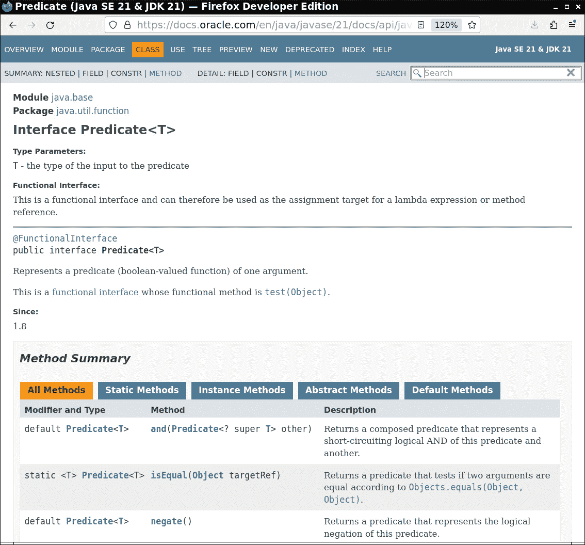被记录的注解

`@Inherited`元注解仅适用于类的注解。当一个类拥有可继承的注解时，其所有子类都自动拥有相同的注解。这使得创建工作类似于标记接口（如`Serializable`接口）的注解变得简单。

假设你定义了一个可继承注解`@Persistent`，表示该类的对象可以保存到数据库中。那么，持久化类的子类将自动标记为持久化。

```java
@Inherited @interface Persistent { }

@Persistent class Employee { . . . }
class Manager extends Employee { . . . } // 也是 @Persistent
```

`@Repeatable`元注解允许多次应用同一个注解。例如，JUnit 的`@Tag`注解就是可重复的。它可以这样使用：

```java
@Tag("localized")
@Tag("showstopper")
void testHello() { . . . }
```

出于历史原因，可重复注解的实现者需要提供一个*容器注解*（container annotation），用于以数组的形式持有重复的注解。

以下是定义`@Tag`注解及其容器的方式：

```java
@Repeatable(Tag.class)
@interface Tag
{
   String value();
}

@interface Tags
{
   Tag[] value();
}
```

每当用户提供两个或多个`@Tag`注解时，它们会被封装成一个`@Tags`注解。这增加了处理注解的复杂性，正如你将在下一节中看到的。

## 在运行时处理注解

到目前为止，你已经了解了如何在源文件中添加注解以及如何定义注解类型。现在是时候看看这些能产生什么结果了。

在本节中，我将向你展示一个简单的示例，如何使用你在第 5 节中已经见过的反射 API 在运行时处理注解。假设我们想减少实现`toString`方法的枯燥工作。当然，可以使用反射编写一个通用的`toString`方法，简单地包含所有字段名和属性值。但假设我们想自定义该过程。我们可能不想包含所有字段，或者我们可能想跳过类名和变量名。例如，对于`Point`类，我们可能更倾向于使用`[5,10]`而不是`Point[x=5,y=10]`。当然，任何数量的其他增强都是可能的，但让我们保持简单。重点是演示注解处理器可以做什么。

使用`@ToString`注解标记所有希望从此服务受益的类。此外，所有应该包含的字段也需要被注解。该注解定义如下：

```java
@Target({ElementType.FIELD, ElementType.RECORD_COMPONENT, ElementType.TYPE})
@Retention(RetentionPolicy.RUNTIME)
public @interface ToString
{
   boolean includeName() default true;    
}
```

以下是带了注解的`Point`和`Rectangle`类：

```java
@ToString(includeName=false)
public class Point
{
   @ToString(includeName=false) private int x;
   @ToString(includeName=false) private int y;
   . . .
}

@ToString
public record Rectangle(
   @ToString(includeName=false) Point topLeft,
   @ToString int width,
   @ToString int height) 
{}
```

意图是将矩形表示为字符串`Rectangle[[5, 10],width=20,height=30]`。

在运行时，我们无法修改给定类`toString`方法的实现。相反，让我们提供一个可以格式化任何对象的方法，如果存在`ToString`注解，则发现并使用它们。

关键是`AnnotatedElement`接口中的方法：


`T getAnnotation(Class<T>)`  
`T getDeclaredAnnotation(Class<T>)`  
`T[] getAnnotationsByType(Class<T>)`  
`T[] getDeclaredAnnotationsByType(Class<T>)`  
`Annotation[] getAnnotations()`  
`Annotation[] getDeclaredAnnotations()`  
`boolean isAnnotationPresent(Class<? extends Annotation> annotationClass)`

反射类 `Class`、`Field`、`Parameter`、`Method`、`Constructor` 和 `Package` 实现了该接口。

与其他反射方法一样，名称带有 `Declared` 的方法产生类本身的注解，而其他方法则包含继承的注解。在注解的上下文中，这意味着该注解是 `@Inherited` 的并应用于父类。

如果一个注解不可重复的，调用 `getAnnotation` 来定位它。例如：

```
Class<?> cl = obj.getClass();
ToString ts = cl.getAnnotation(ToString.class);
if (ts != null && ts.includeName()) . . .
```

```java
package runtimeAnnotations;

import java.lang.reflect.*;

public class ToStrings
{
   public static String toString(Object obj)
   {
      if (obj == null) return "null";
      Class<?> cl = obj.getClass();
      ToString ts = cl.getAnnotation(ToString.class);
      if (ts == null) return obj.toString();
      var result = new StringBuilder();
      if (ts.includeName()) result.append(cl.getName());
      result.append("[");
      boolean first = true;
      for (Field f : cl.getDeclaredFields())
      {
         ts = f.getAnnotation(ToString.class);
         if (ts != null) {
            if (first) first = false; else result.append(",");
            f.setAccessible(true);
            if (ts.includeName())
            {
               result.append(f.getName());
               result.append("=");
            }
            try
            {
               result.append(ToStrings.toString(f.get(obj)));
            }
            catch (ReflectiveOperationException ex)
            {
               ex.printStackTrace();
            }
         }
      }
      result.append("]");
      return result.toString();
   }
}
```

`java.lang.reflect.AnnotatedElement` 5.0

* `boolean isAnnotationPresent(Class<? extends Annotation> annotationType)`

    如果此项具有给定类型的注解，则返回 `true`。

* `<T extends Annotation> T getAnnotation(Class<T> annotationType)`

    获取给定类型的注解，如果此项没有此类注解，则返回 `null`。

* `<T extends Annotation> T[] getAnnotationsByType(Class<T> annotationType)` 8

    获取所有可重复注解类型的注解（参见第 11.3.2 节）。如果不存在，则返回一个长度为 0 的数组。

* `Annotation[] getAnnotations()`

    获取此项存在的所有注解，包括继承的注解。如果不存在，则返回一个长度为 0 的数组。

* `Annotation[] getDeclaredAnnotations()`

    获取为此项声明的所有注解，不包括继承的注解。如果不存在，则返回一个长度为 0 的数组。

## 源码级注解处理

在前面的节中，你已经看到了如何分析运行程序中的注解。注解的另一个用途是自动处理源文件以生成更多的源代码、配置文件、脚本或其他任何可能需要的内容。

为了向你展示其机制，我将重复生成 `toString` 方法的示例。但是，这次让我们在 Java 源码中生成它们。这样这些方法将与程序的其余部分一起编译，并以全速度运行，而不是使用反射。

### 注解处理器

注解处理集成在 Java 编译器中。在编译期间，你可以通过运行以下命令来`调用注解处理器`

```bash
javac -processor ProcessorClassName1,ProcessorClassName2,. . . sourceFiles
```

编译器定位源文件的注解。每个注解处理器依次执行，并获取它感兴趣的注解。如果注解处理器创建了新的源文件，则重复该过程。一旦处理轮不再产生新的源文件，就会编译所有源文件。

注解处理器只能生成新的源文件，不能修改现源文件。

注解处理器实现 `Processor` 接口，通常通过扩展 `AbstractProcessor` 类来实现。你需要指定你的处理器支持哪些注解。在我们的案例中：

```java
@SupportedAnnotationTypes("annotations.ToString")
@SupportedSourceVersion(SourceVersion.RELEASE_8)
public class ToStringAnnotationProcessor extends AbstractProcessor
{
   public boolean process(Set<? extends TypeElement> annotations,
         RoundEnvironment currentRound)
   {
      . . .
   }
}
```

处理器可以声明特定的注解类型、通配符（如 `"com.horstmann.*"`，表示 `com.horstmann` 包或任何子包中的所有注解），甚至是 `"*"`（所有注解）。

`process` 方法每轮被调用一次，参数是该轮次在任何文件中找到的所有注解集合，以及一个包含当前处理轮信息的 `RoundEnvironment` 引用。

### 语言模型 API

使用 `language model`（语言模型）API 来分析源码级注解。与提供类和方法的虚拟机表示的反射 API 不同，语言模型 API 允许你根据 Java 语言规则分析 Java 程序。

编译器产生一个树，其节点是实现 `javax.lang.model.element.Element` 接口及其子接口（`TypeElement`、`VariableElement`、`ExecutableElement` 等）的类的实例。这些是 `Class`、`Field`/`Parameter`、`Method`/`Constructor` 反射类的编译时对应物。

我不想详细介绍该 API，但这里有你在处理注解时需要了解的重点。

* `RoundEnvironment` 通过调用以下方法之一为你提供被特定注解标记的所有元素集合：

```java
Set<? extends Element> getElementsAnnotatedWith(Class<? extends Annotation> a)
Set<? extends Element> getElementsAnnotatedWithAny(
    Set<Class<? extends Annotation>> annotations) 
```

第二个方法对于重复注解很有用。

* `AnnotatedElement` 接口的源码级对应物是 `AnnotatedConstruct`。使用方法

```java
A getAnnotation(Class<A> annotationType)
A[] getAnnotationsByType(Class<A> annotationType)
```

来获取给定类的注解或重复注解。

* `TypeElement` 代表一个类或接口。`enclosedElements` 方法产生其字段和方法的列表。

* 在 `Element` 上调用 `getSimpleName` 或在 `TypeElement` 上调用 `getQualifiedName` 会产生一个 `Name` 对象，该对象可以通过 `toString` 转换为字符串。

### 使用注解生成源代码

让我们回到自动生成 `toString` 方法的任务。我们不能将这些方法放入原始类中——注解处理器只能产生新类，不能修改现有类。

因此，我们将所有方法添加到工具类 `ToStrings` 中：

```java
public class ToStrings
{
   public static String toString(Point obj)
   {
      Generated code
   }
   public static String toString(Rectangle obj)
   {
      Generated code
   }
   . . .
   public static String toString(Object obj)
   {
      return Objects.toString(obj);
   }
}
```

由于我们不想使用反射，我们注解访问器方法而不是字段：

```java
@ToString
public class Rectangle
{
   . . .
   @ToString(includeName=false) public Point getTopLeft() { return topLeft; }
   @ToString public int getWidth() { return width; }
   @ToString public int getHeight() { return height; }
}
```

那么，注解处理器应该生成以下源代码：

```java
public static String toString(Rectangle obj) 
{
   var result = new StringBuilder();
   result.append("Rectangle");
   result.append("[");
   result.append(toString(obj.getTopLeft()));
   result.append(",");
   result.append("width=");
   result.append(toString(obj.getWidth()));
   result.append(",");
   result.append("height=");
   result.append(toString(obj.getHeight()));
   result.append("]");
   return result.toString();
}
```

“样板”代码是灰色显示的。以下是为给定 `TypeElement` 的类产生 `toString` 方法的方法大纲：

```java
private void writeToStringMethod(PrintWriter out, TypeElement te)
{
   String className = te.getQualifiedName().toString();
   // 打印 string builder 的头部和声明
   ToString ann = te.getAnnotation(ToString.class);
   if (ann.includeName()) // 打印添加类名的代码
   for (Element c : te.getEnclosedElements())
   {
      ann = c.getAnnotation(ToString.class);
      if (ann != null)
      {             
         if (ann.includeName()) // 打印添加字段名的代码
         // 打印追加 toString(obj.methodName()) 的代码
      }
   }
   // 打印返回字符串的代码
}
```

这里是注解处理器 `process` 方法的概览。它为辅助类创建一个源文件，并为每个被注解的类写入类头部和一个方法。

```java
public boolean process(Set<? extends TypeElement> annotations,
        RoundEnvironment currentRound)
{
   if (annotations.size() == 0) return true;
   try
   {
      JavaFileObject sourceFile = processingEnv.getFiler().createSourceFile(
         "annotations.ToStrings");
      try (var out = new PrintWriter(sourceFile.openWriter()))
      {
         // 打印包和类的代码
         for (Element e : currentRound.getElementsAnnotatedWith(ToString.class))
             if (e instanceof TypeElement te) 
                writeToStringMethod(out, te);
         // 打印 toString(Object) 的代码
      }
   }
   catch (IOException ex)
   {
      processingEnv.getMessager().printMessage(Kind.ERROR, ex.getMessage());
   }
   return true;
}
```

注意，`process` 方法会在后续轮次中调用，此时注解列表为空。它会立即返回，因此不会重复创建源文件。

要查看这些轮次，运行带有 `-XprintRounds` 标志的 `javac` 命令：

```
Round 1:
  input files: {rect.Point, rect.Rectangle, rect.SourceLevelAnnotationDemo}
  annotations: [sourceAnnotations.ToString]
  last round: false
Round 2:
  input files: {sourceAnnotations.ToStrings}
  annotations: []
  last round: false
Round 3:
  input files: {}
  annotations: []
  last round: true
```

要运行示例程序，首先构建注解处理器，然后使用它来编译 demo：

```
javac sourceAnnotations/ToStringAnnotationProcessor.java
javac -XprintRounds -processor sourceAnnotations.ToStringAnnotationProcessor rect/*.java
java rect.SourceLevelAnnotationDemo 
```

此示例演示了工具如何收集源文件注解以生成其他文件。生成的文件并不非要是源文件。注解处理器可以选择生成 XML 描述符、属性文件、shell 脚本、HTML 文档等。

有些人建议过使用注解来消除更繁琐的工作。如果能自动生成琐碎的 getter 和 setter，那不是很好吗？例如，使用注解

```
@Property private String title;
```

可以产生以下方法：

```java
public String getTitle() { return title; }
public void setTitle(String title) { this = title; }
```

然而，这些方法需要添加到*同一个类*中。这需要编辑源文件，而不仅仅是生成另一个文件，这超出了注解处理器的能力。可以为此目的构建另一个工具，但这样的工具将超出注解的初衷。注解的意图是对代码项的描述*关于*，而不是添加或更改代码的指令。

一个名为 Project Lombok 的流行工具找到了绕过这一限制的方法。通过在注解处理过程中修改内部编译器数据结构，它可以产生 getter 和 setter 方法。至少目前它是生效的，但它不是标准 Java。


`rect/SourceLevelAnnotationDemo.java`

```java
package rect;

import sourceAnnotations.ToStrings;

public class SourceLevelAnnotationDemo
{
   public static void main(String[] args)
   {
      var rect = new Rectangle(new Point(5, 10), 20, 30);
      System.out.println(ToStrings.toString(rect));
   }
}
```

`sourceAnnotations/ToStringAnnotationProcessor.java`

```java
package sourceAnnotations;

import java.beans.*;
import java.io.*;
import java.util.*;

import javax.annotation.processing.*;
import javax.lang.model.*;
import javax.lang.model.element.*;
import javax.tools.*;
import javax.tools.Diagnostic.Kind;

@SupportedAnnotationTypes("sourceAnnotations.ToString")
@SupportedSourceVersion(SourceVersion.RELEASE_21)
public class ToStringAnnotationProcessor extends AbstractProcessor 
{
   public boolean process(Set<? extends TypeElement> annotations,
         RoundEnvironment currentRound) 
   {
      if (annotations.size() == 0) return true;
      try 
      {
         JavaFileObject sourceFile 
            = processingEnv.getFiler().createSourceFile("sourceAnnotations.ToStrings");
         try (var out = new PrintWriter(sourceFile.openWriter())) 
         {
            out.println("// Automatically generated by" 
               + " sourceAnnotations.ToStringAnnotationProcessor");
            out.println("package sourceAnnotations;");
            out.println("public class ToStrings {");

            for (Element e : currentRound.getElementsAnnotatedWith(ToString.class)) 
               if (e instanceof TypeElement te) 
                  writeToStringMethod(out, te);
             out.println("    public static String toString(Object obj) {");
             out.println("        return java.util.Objects.toString(obj);");
             out.println("    }");
         }
      }
      catch (IOException e) 
      {
         processingEnv.getMessager().printMessage(Kind.ERROR, e.getMessage());
      }        
      return true;
   }

   private void writeToStringMethod(PrintWriter out, TypeElement te) 
   {
      String className = te.getQualifiedName().toString();
      out.println("    public static String toString(" + className + " obj) {");
      ToString ann = te.getAnnotation(ToString.class);
      out.println("        var result = new StringBuilder();");
      if (ann.includeName()) out.println("        result.append(\"" + className + "\");");        
      out.println("        result.append(\"[\");");
      boolean first = true;
      for (Element c : te.getEnclosedElements()) 
      {
         String methodName = c.getSimpleName().toString();
         ann = c.getAnnotation(ToString.class);
         if (ann != null) 
         {
            if (first) first = false; else out.println("        result.append(\",\");");
            if (ann.includeName()) 
            {
               String fieldName = Introspector.decapitalize(
                  methodName.replaceAll("^(get|is)", ""));                  // getWidth into width, isDone into done, getURL into URL 
               out.println("        result.append(\"" + fieldName + "=\");"); 
            }
            out.println("        result.append(toString(obj." + methodName + "()));");
         }
      }
      out.println("        result.append(\"]\");");
      out.println("        return result.toString();");
      out.println("    }");
   }
}
```

## 字节码工程

你看到注解如何在运行时或在源码级别被处理。除非注解在源码级别被移除，否则它们存在于类文件中。类文件格式有文档说明（参见 [`docs.oracle.com/javase/specs/jvms/se21/html`](https://docs.oracle.com/javase/specs/jvms/se21/html)）。该格式相当复杂，如果没有特殊库，处理类文件将具有挑战性。这样的库之一是 ASM 库，位于 [`asm.ow2.org`](https://asm.ow2.org)。下载 `asm-9.6.jar` 和 `asm-commons-9.6.jar` 并将其放入你选择的目录（指令中称为 `asm`）。

### 修改类文件

在本节中，我们使用 ASM 为被注解的方法添加日志消息。如果一个方法被注解了

```
@LogEntry(logger=loggerName)
```

随后我们在方法的开头添加了以下语句的字节码：

```
System.getLogger(loggerName).log(System.Logger.Level.TRACE,
   "Entering {0}.{1}", className, methodName);
```

例如，如果你对 `Item` 类的 `hashCode` 方法进行了如下注解：

```
@LogEntry(logger="com.horstmann") public int hashCode()
```

那么每当调用该方法时，都会打印出类似下面的的消息：

```
Dec 03, 2023 5:58:44 PM set.Item hashCode
INFO: Entering set.Item.hashCode
```

为了实现这一点，我们执行了以下操作：

1. 加载类文件中的字节码。
2. 定位所有方法。
3. 对于每个方法，检查它是否具有 `LogEntry` 注解。
4. 如果有，则在方法的开头添加以下指令的字节码：

```
ldc loggerName
invokestatic System.getLogger(String)
getstatic System.Logger.Level.INFO
ldc "Entering {0}.{1}"
iconst_2
anewarray
dup
iconst_0
ldc className
aastore
dup
iconst_1
ldc methodName
aastore
invokeinterface System.Logger.log(System.Logger.Level, String, Object[])
```

插入这些字节码听起来很复杂，但 `ASM` 库让它变得非常简单。我不会详细描述分析和插入字节码的过程。重要的点是，代码列表 11.5 中的程序编辑了类文件，并在标记有 `LogEntry` 注解的方法开头处插入了日志调用。

例如，以下是如何向代码列表 11.6 中的 `Item.java` 添加日志指令的方法，其中 `asm` 是你安装 ASM 库的目录：

```
javac set/Item.java
javac -classpath .:asm/\* bytecodeAnnotations/EntryLogger.java
java -classpath .:asm/\* bytecodeAnnotations.EntryLogger set/Item.class
```

一如既往，在 Windows 上，你使用 `\` 而不是 `/` 作为文件分隔符，使用 `;` 而不是 `:` 作为路径分隔符，并且不需要转义 `*`。

尝试在修改 `Item` 类文件之前之后运行：

```
javap -c set.Item
```

你可以看到 `hashCode`、`equals` 和 `compareTo` 方法开头处插入的指令。

```
public int hashCode();
   Code:
       0: ldc #42 // String com.horstmann
       2: invokestatic #48 // Method java/lang/System.getLogger:(Ljava/lang/String;)Ljava/System$Logger;
       5: getstatic #54 // Field java/lang/System$Logger$Level.INFO:Ljava/lang/System$Logger$Level;
       8: ldc #56 // String Entering {0}.{1}
      10: iconst_2
      11: anewarray #4 // class java/lang/Object
      14: dup
      15: iconst_0
      16: ldc #58 // String set.Item
      18: aastore
      19: dup
      20: iconst_1
      21: ldc  #77 // String hashCode
      23: aastore
      24: invokeinterface #65,  4  // InterfaceMethod java/lang/System$Logger.log:
          // (Ljava/lang/System$Logger$Level;Ljava/lang/String;Ljava/lang/Object;)V
      . . .
```

当你尝试这样做时，常量池中的索引值可能会不同。

代码列表 11.7 中的 `SetTest` 程序将 `Item` 对象插入哈希集中。当你使用修改后的类文件运行它时，将看到日志消息。

```
Dec 03, 2023 5:58:44 PM set.Item hashCode
INFO: Entering set.Item.hashCode
Dec 03, 2023 5:58:44 PM set.Item hashCode
INFO: Entering set.Item.hashCode
Dec 03, 203 5:58:44 PM set.Item hashCode
INFO: Entering set.Item.hashCode
Dec 03, 2023 5:58:44 PM set.Item equals
INFO: Entering set.Item.equals
[[description=Microwave, partNumber=4104], [description=Toaster, partNumber=1279]]
```

注意当我们两次插入同一个项目时，对 `equals` 的调用。

这个示例展示了字节码工程的力量。注解被用于向程序添加指令，而字节码编辑工具会获取这些指令并修改虚拟机指令。

`bytecodeAnnotations/EntryLogger.java`

# EntryLogger.java


# 字节码注解

以下代码示例展示了如何使用 ASM 库在类加载时修改字节码，为带有 `LogEntry` 注解的方法添加日志记录功能。

## EntryLogger.java

```java
package bytecodeAnnotations;

import java.io.*;
import java.nio.file.*;

import org.objectweb.asm.*;
import org.objectweb.asm.commons.*;

/**
 * 为所有带有 LogEntry 注解的类方法添加“进入”日志记录。
 * @version 1.22 2023-12-01
 * @author Cay Horstmann
 */
public class EntryLogger extends ClassVisitor
{
   private String className;

   /**
    * 构造一个 EntryLogger，在给定类的带有注解的方法中插入日志记录。
    */
   public EntryLogger(ClassWriter writer, String className)
   {
      super(Opcodes.ASM8, writer);
      this.className = className;
   }

   public MethodVisitor visitMethod(int access, String methodName, String desc, 
         String signature, String[] exceptions) 
   {
      MethodVisitor mv = cv.visitMethod(access,  methodName,  desc,  signature,  exceptions);   
      return new AdviceAdapter(Opcodes.ASM8, mv, access, methodName, desc) 
      {          
         private String loggerName;

         public AnnotationVisitor visitAnnotation(String desc, boolean visible) 
         {
            return new AnnotationVisitor(Opcodes.ASM8) 
               {
                  public void visit(String name, Object value) 
                  {
                     if (desc.equals("LbytecodeAnnotations/LogEntry;") 
                           && name.equals("logger")) 
                        loggerName = value.toString();                    
                  }
               };
         }      

         public void onMethodEnter() 
         {
            if (loggerName != null) 
            {
               /*
               visitLdcInsn(loggerName);
               visitMethodInsn(INVOKESTATIC, "java/util/logging/Logger", "getLogger", 
                  "(Ljava/lang/String;)Ljava/util/logging/Logger;", false);
               visitLdcInsn(className);
               visitLdcInsn(methodName);
               visitMethodInsn(INVOKEVIRTUAL, "java/util/logging/Logger", "entering", 
                  "(Ljava/lang/String;Ljava/lang/String;)V", false);
               */
               visitLdcInsn(loggerName);
               visitMethodInsn(INVOKESTATIC, "java/util/System", "getLogger", 
                  "(Ljava/lang/String;)Ljava/util/System$Logger;", false);
               visitFieldInsn(Opcodes.GETSTATIC, "java/lang/System$Logger$Level", "INFO", "Ljava/lang/System$Logger$Level;");
               visitLdcInsn("Entering {0}.{1}");

               // 创建一个长度为 2 的对象数组
               mv.visitInsn(Opcodes.ICONST_2);  // 数组长度
               mv.visitTypeInsn(Opcodes.ANEWARRAY, "java/lang/Object");  // 数组类型

               // 向数组添加两个对象
               mv.visitInsn(Opcodes.DUP);  // 隆数组引用
               mv.visitInsn(Opcodes.ICONST_0);  // 索引 0
               visitLdcInsn(className);
               mv.visitInsn(Opcodes.AASTORE);  // 存储到数组

               mv.visitInsn(Opcodes.DUP);  // 隆数组引用
               mv.visitInsn(Opcodes.ICONST_1);  // 索引 1
               visitLdcInsn(methodName);
               mv.visitInsn(Opcodes.AASTORE);  // 存储到数组

               visitMethodInsn(INVOKEINTERFACE, "java/lang/System$Logger", "log", 
                  "(Ljava/lang/System$Logger$Level;Ljava/lang/String;[Ljava/lang/Object;)V", true);
               loggerName = null;
            }                  
         }
      };
   }

   /**
    * 给给定的类添加入口日志代码。
    * @param args 要补丁的类文件名
    */
   public static void main(String[] args) throws IOException
   {
      if (args.length == 0)
      {
         System.out.println("USAGE: java bytecodeAnnotations.EntryLogger classfile");
         System.exit(1);
      }
      Path path = Path.of(args[0]);
      var reader = new ClassReader(Files.newInputStream(path));
      var writer = new ClassWriter(
         ClassWriter.COMPUTE_MAXS | ClassWriter.COMPUTE_FRAMES);
      var entryLogger = new EntryLogger(writer, 
         path.toString().replace(".class", "").replaceAll("[/\\\\]", "."));
      reader.accept(entryLogger, ClassReader.EXPAND_FRAMES);
      Files.write(Path.of(args[0]), writer.toByteArray());
   }   
}
```

## Item.java

```java
package set;

import java.util.*;
import bytecodeAnnotations.*;

/**
 * 带有描述和部件编号的项目。
 * @version 1.01 2012-01-26
 * @author Cay Horstmann
 */
public class Item
{
   private String description;
   private int partNumber;

   /**
    * 构造一个项目。
    * @param aDescription 项目的描述
    * @param aPartNumber 项目的部件编号
    */
   public Item(String aDescription, int aPartNumber)
{
      description = aDescription;
      partNumber = aPartNumber;
   }

   /**
    * 获取项目的描述。
    * @return 描述
    */
   public String getDescription()
   {
      return description;
   }

   /**
    * 获取项目的部件编号。
    * @return 部件编号
    */
   public int getPartNumber()
   {
      return partNumber;
   }

   /**
    * 返回项目的字符串表示。
    * @return 项目的字符串
    */
   public String toString()
   {
      return "[description=" + description + ", partNumber=" + partNumber + "]";
   }

   /**
    * 检查项目是否相等。
    * @param otherObject 要比较的对象
    * @return 是否相等
    */
   public boolean equals(Object otherObject)
   {
      if (this == otherObject) return true;
      if (!(otherObject instanceof Item)) return false;
      Item item = (Item) otherObject;
      return partNumber == item.partNumber && Objects.equals(description, item.description);
   }

   /**
    * 计算项目的哈希值。
    * @return 哈希值
    */
   public int hashCode()
   {
      return Objects.hash(description, partNumber);
   }
}
```

## SetTest.java

```java
package set;

import java.util.*;
import java.logging.*;

/**
 * 带有描述和部件编号的项目测试。
 * @version 1.03 2018-05-01
 * @author Cay Horstmann
 */
public class SetTest
{
   public static void main(String[] args)
   {
      var handler = new ConsoleHandler();
      handler.setLevel(Level.FINEST);
      Logger.getLogger("com.horstmann").addHandler(handler);

      var parts = new HashSet<Item>();
      parts.add(new Item("Toaster", 1279));
      parts.add(new Item("Microwave", 4104));
      System.out.println(parts);
   }
}
```

## 在加载时修改字节码

在上一节中，你看到了一个编辑类文件的工具。然而，将另一个工具引入构建过程可能会很麻烦。一种吸引人的替代方案是将字节码工程推到*加载时*，即类加载器加载类时。

`instrumentation` API 有了一个安装字节码转换器的钩。转换器必须在程序的 `main` 方法被调用之前安装。你可以通过定义*代理*来满足这一要求，代理是一个监控程序的库。代理代码可以在 `premain` 方法中执行初始化。

构建代理所需的步骤如下：

1.  实现一个带有 `premain(String arg, Instrumentation instr)` 方法的类。该方法在代理加载时被调用。

2.  制作清单文件 `EntryLoggingAgent.mf` 设置 `Premain-Class` 属性，例如：

    ```
    Premain-Class: bytecodeAnnotations.EntryLogger
    ```

3.  将代理代码和清单文件打包成 JAR 文件：

    ```
    javac -classpath .:asm/\* bytecodeAnnotations/EntryLoggingAgent.java 
    jar cvfm EntryLoggingAgent.jar bytecodeAnnotations/EntryLoggingAgent.mf \
       bytecodeAnnotations/Entry*.class
    ```

要同代理一起运行 Java 程序，使用以下命令行选项：

```
java -javaagent:AgentJARFile=agentArgument . . .
```

```
javac set/*.java
java -javaagent:EntryLoggingAgent.jar=set.Item -classpath .:asm/\* set.SetTest
```

`Item` 参数是代理应该修改的类名。

Listing 11.8 显示了代理代码。该代理安装了一个类文件转换器。该转换器首先检查类名是否与代理参数匹配。如果是，它将使用前一节中的 `EntryLogger` 类来修改字节码。然而，修改后的字节码并没有保存到文件中。相反，转换器将它们返回以便加载到虚拟机（参见图 11.3）。换句话说，这种技术对字节码执行了“即时”修改。

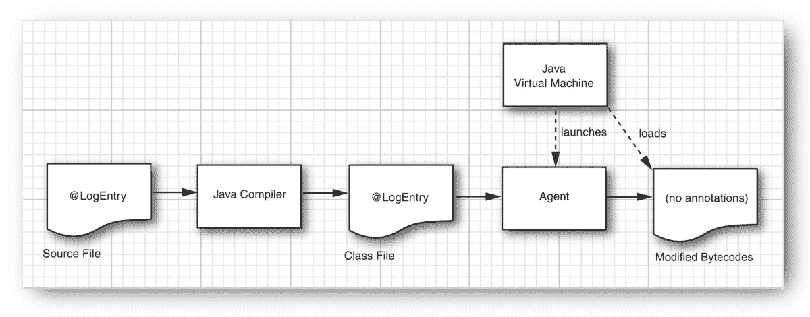在加载时修改类

## EntryLoggingAgent.java

```java
package bytecodeAnnotations;

import java.lang.instrument.*;
import java.security.*;
import org.objectweb.asm.*;

/**
 * @version 1.11 2018-05-01
 * @author Cay Horstmann
 */
public class EntryLoggingAgent
{
   public static void premain(final String arg, Instrumentation instr)
   {
      instr.addTransformer(new ClassFileTransformer() {
         public byte[] transform(ClassLoader loader, String className, Class<?> cl,
            ProtectionDomain pd, byte[] data) throws IllegalClassFormatException
         {
            if (!className.replace("/", ".").equals(arg)) return null;
            var reader = new ClassReader(data);
            var writer = new ClassWriter(
               ClassWriter.COMPUTE_MAXS | ClassWriter.COMPUTE_FRAMES);
            var el = new EntryLogger(writer, className);
            reader.accept(el, ClassReader.EXPAND_FRAMES);
            return writer.toByteArray();
         }});
   }
}
```

在本章中，你学习了如何：

*   向 Java 程序中添加注解


- 设计你自己的注解接口
- 实现利用注解的工具

你已经看到了三种处理代码的技术：脚本化、编译 Java 程序以及处理注解。前两种非常直观。另一方面，构建注解工具无疑是复杂的，而且并不是大多数开发者需要处理的。本章为你理解你将要遇到的注解工具的内部机制提供了背景，可能激发了你开发自己工具的兴趣。

下一章将讨论 Java 平台模块系统（Java Platform Module System），这是确保 Java 平台完整性的关键特性。

# Java 平台模块系统

面向对象编程的一个重要特性是封装。类声明由一个公共接口和一个私有实现部分组成。类可以通过更改实现来演进，而不影响其用户。模块系统为大规模编程提供了同样的益处。模块可以选择性地使类和包可用，从而控制它的演进。

现有的几个 Java 模块系统依赖类加载器来隔离类。然而，Java 9 引入了一个新系统，称为 Java 平台模块系统，它由 Java 编译器和虚拟机支持。它的设计目的是将 Java 平台庞大的代码模块化。如果你愿意，可以使用该系统将自己的应用程序模块化。

无论你会在自己的应用程序中使用未使用 Java 平台模块，你都可能受到模块化 Java 平台的影响。本章将向你如何声明和使用 Java 平台模块。你还将学习如何迁移你的应用程序，以与模块化的 Java 平台和第三方模块协同工作。

## 模块概念

在面向对象编程中，基本的构建单元是类。类提供了封装。私有特征只能由具有显式权限的代码访问——即类的方法。这使得推理访问权限成为可能。如果一个私有变量发生了变化，你可以列出所有可能的“罪祸首”。如果你需要修改私有表示，你知道哪些方法受了影响。

在 Java 中，包提供了更大的组织分组。包是类的集合。包也提供了一种级别的封装。任何具有包访问权限（既不是公共也不是私有）的特征只能从同一包中的方法访问。

然而，在大型系统中，这种级别的访问控制是不够的。任何公共特征都可以在任何地方访问。假设你想修改或删除一个很少使用的特性。一旦它是公共的，就没有方法可以推导出该更改的影响。

这就是 Java 平台设计者所面临的局面。在二十多年里，JDK 飞速增长，但显然某些特性现在本质上已经过时了。大家最喜欢的例子是 CORBA。你上一次使用它是什么时候？尽管如此，`org.omg.corba` 包在 Java 10 之前一直随每个 JDK 发布。从 Java 11 开始，那些仍然需要它的人必须向其项目添加必需的 JAR 文件。

那么 `java.awt` 呢？它在服务端应用程序中不应该是必须的，对吧？但 `java.awt.DataFlavor` 类被用于 SOAP（一种基于 XML 的网络服务协议）的实现中。

Java 平台设计者面对巨大的代码“乱团”，决定他们需要一种提供更多控制的结构化机制。他们查看了现有的模块系统（如 OSGi），发现它们不适合解决他们的问题。相反，他们设计了一个新系统，称为 Java 平台模块系统，它现在是 Java 语言和虚拟机的一部分。该系统已成功地用于将 Java API 模块化，如果你愿意，也可以将其应用于你自己的应用程序中。

一个 Java 平台模块由以下内容组成：

- 包的集合
- 可选的资源文件和其他文件（如原生库）
- 可访问包的列表
- 模块依赖的所有模块列表

Java 平台在编译时和虚拟机中强制执行封装和依赖。

为什么你应该考虑使用 Java 模块系统来开发自己的程序，而不是在类路径上使用传统方法？有两个优势：

1. **强封装**：你可以控制哪些包是可用的，而不必担心维护你并不打算公开使用的代码。
2. **可靠的配置**：你避免了类路径常见的问题，如类重复或缺失。

有一些 Java 平台模块系统没有解决的问题，例如模块的版本控制。它不支持指定所需的模块版本，也不在同一个程序中使用多个版本的模块。这些可能是理想的特性，但如果你需要它们，必须使用 Java 平台模块系统以外的机制。

## 模块命名

模块是包的集合。模块中的包名不需要相关。例如，`java.sql` 模块包含了 `java.sql`、`javax.sql` 和 `javax.transaction.xa` 包。此外，正如从这个例子所示，模块名与包名相同是完全可以的。

就像包名一样，模块名由字母、数字、下划线和点组成。正如包名一样，模块之间没有层级关系。如果你有一个 `com.horstmann` 模块和另一个 `com.horstmann.corejava` 模块，从模块系统的角度来看，它们是无关的。

在为他人创建模块时，确保其名称是全局唯一的是重要的。预计大多数模块名称将遵循与包名类似的“反向域名”惯例。

最简单的方法是根据模块提供的顶层包来命名模块。例如，SLF4J 日志外层有一个名为 `org.slf4j` 的模块，它包含了 `org.slf4j`、`org.slf4j.spi`、`org.slf4j.event` 和 `org.slf4j.helpers` 包。

这种约定可以防止模块之间的包名冲突。任何给定的包只能存放在一个模块中。如果你的模块名是唯一的，且你的包名以模块名开头，那么你的包名也将是唯一的。

对于那些不供其他程序员使用的模块，可以使用较短的模块名，例如包含应用程序的模块。只是为了说明这种做法是可行的，我将在本章中同样这样做。可能是库代码的模块将具有如 `com.horstmann.util` 的名称，而包含程序（带有 `main` 方法的类）的模块将具有如 `v1ch12.hellomod` 这样易记的名称。

模块名仅在模块声明中使用。在 Java 类的源文件中，你永远不会引用模块名；相反，请像过去一样使用包名。

## 模块化的“Hello, World!”程序

让我们把传统的“Hello, World!”程序放入模块中。首先，我们需要将类放入一个包中——“未命名包”不能包含在模块中。代码如下：

```java
package com.horstmann.hello;

public class HelloWorld
{
   public static void main(String[] args)
   {
      System.out.println("Hello, Modular World!");
   }
}
```

到目前为止，什么都没有改变。要创建一个包含该包的 `v1ch12.hellomod` 模块，你需要添加一个模块声明。将其放在一个名为 `module-info.java` 的文件中，位于基目录下（即包含 `com` 目录的相同目录）。按照约定，基目录的名字与模块名相同。

```text
v1ch12.hellomod/
└ module-info.java
  com/
  └ horstmann/
    └ hello/
      └ HelloWorld.java
```

`module-info.java` 文件包含了模块声明：

```java
module v1ch12.hellomod
{
}
```

这个模块声明是空的，因为该模块没有向任何人提供任何内容，也不需要任何东西。

现在，像往常一样编译：

```bash
javac v1ch12.hellomod/module-info.java v1ch12.hellomod/com/horstmann/hello/HelloWorld.java
```

`module-info.java` 文件看起来不像一个 Java 源文件，而且当然不可能有一个名为 `module-info` 的类，因为类名不能包含连字符。`module` 关键字，以及你在后续章节中看到的 `requires`、`exports` 等关键字，都是“限制关键字”，它们仅在模块声明中具有特殊含义。该文件被编译成 `module-info.class` 类文件，其中包含二进制形式的模块定义。

要作为模块化应用程序运行此程序，你需要指定*模块路径*（module path），它类似于类路径但包含了模块。你还需要以 `modulename`/`classname` 的格式指定主类：

```bash
java --module-path v1ch12.hellomod --module v1ch12.hellomod/com.horstmann.hello.HelloWorld
```

除了 `--module-path` 和 `--module`，你可以使用单字母选项 `-p` 和 `-m`：

```bash
java -p v1ch12.hellomod -m v1ch12.hellomod/com.horstmann.hello.HelloWorld
```

无论哪种方式，都会出现“Hello, Modular World!”问候，这证明你成功地将你的第一个应用程序模块化。

当你编译此模块时，会收到一个警告：

```text
warning: [module] module name component v1ch12 should avoid terminal digits
```

此警告旨在劝阻程序员在模块名中添加版本号。你可以忽略这个警告，或者使用注解来抑制它：

```java
@SuppressWarnings("module") 
module v1ch12.hellomod
{
}
```

在这一点上，`module` 声明就像类声明一样：你可以对它进行注解。（注解类型的目标必须是 `ElementType.MODULE`。）

## 模块的依赖

让我们创建一个新模块 `v1ch12.requiremod`，在其中程序使用 `JOptionPane` 来显示“Hello, Modular World!”消息：

```java
package com.horstmann.hello;

import javax.swing.JOptionPane;

public class HelloWorld
{
   public static void main(String[] args)
   {
      JOptionPane.showMessageDialog(null, "Hello, Modular World!");
   }
}
```

现在编译失败并显示此消息：

```text
error: package javax.swing is not visible
  (package javax.swing is declared in module java.desktop, 
  but module v1ch12.requiremod does not read it)
```

JDK 已经模块化，`javax.swing` 包现在包含在 `java.desktop` 模块中。我们的模块需要声明它依赖该模块：

```java
module v1ch12.requiremod
{
   requires java.desktop;
}
```

模块系统的设计目标之一是模块的依赖是显式的，这样虚拟机可以在启动程序之前确保所有依赖都已满足。

在上一节中，没有出现显式依赖的需求是因为我们只使用了 `java.lang` 和 `java.io` 包。这些包包含在默认的 `java.base` 模块中。

注意 `v1ch12.requiremod` 模块列出了它自己的依赖。它需要 `java.desktop` 模块以便使用 `javax.swing` 包。`java.desktop` 模块本身声明它需要另外三个模块，即 `java.datatransfer`、`java.prefs` 和 `java.xml`。

图 1 显示了*模块图*，其中节点是模块。图的边（即连接节点的箭头）要么是声明的依赖，要么是对 `java.base` 的隐含依赖。

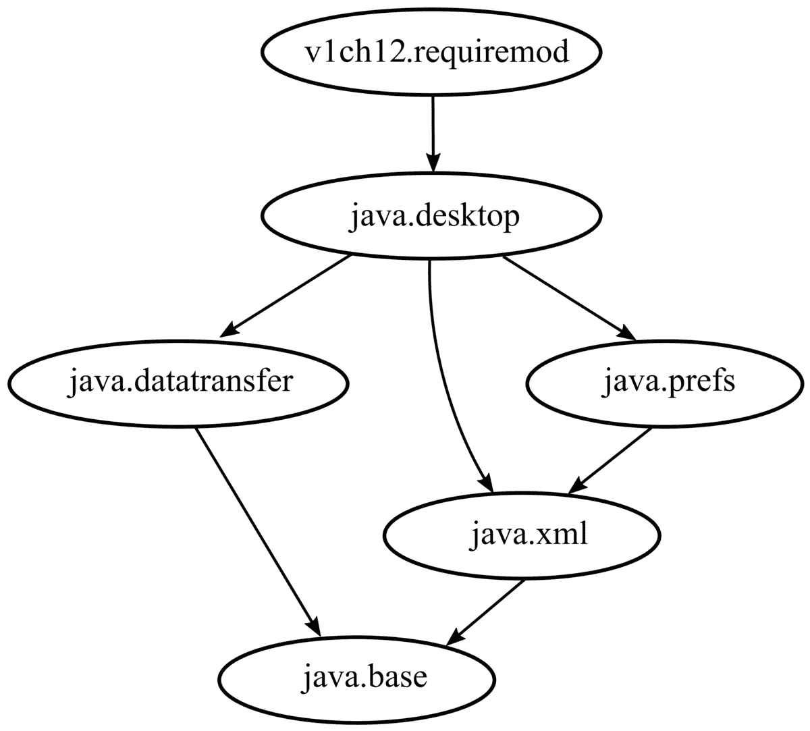

Swing 应用程序的模块图

图中不能存在循环——即模块不能直接或间接地引用它自己。

模块不会将访问权限传递给其他模块。在我们的示例中，`java.desktop` 模块声明需要 `java.prefs`，而 `java.prefs` 模块声明需要 `java.xml`。这并没有赋予 `java.desktop` 使用 `java.xml` 包的权限。它需要显式声明该依赖。从数学角度来看，`requires` 关系不是传递的。通常这种行为是理想的，因为它使依赖显式化，但正如你在 12.11 节中所看到的，你可以在某些情况下放宽。

本节开始时的错误消息指出我们的 `v1ch12.requiremod` 模块没有“读取” `java.desktop` 模块。在 Java 模块术语中，模块 `M` 在以下情况下*读取*模块 `N`：

1. `M` 需要 `N`。
2. `M` 需要一个传递需要 `N` 的模块（见 12.11 节）。
3. `N` 是 `M` 或 `java.base`。

## 输出包

在前节中，你看到如果想使用某些包，模块必须需要另一个模块。然而，这并不会自动让所需模块中的所有包可用。模块使用 `exports` 关键字声明哪些包是可访问的。例如，这里是 `java.xml` 模块声明的一部分：

```java
module java.xml
{
   exports javax.xml;
   exports javax.xml.catalog;
   exports javax.xml.datatype;
   exports javax.xml.namespace;
   exports javax.xml.parsers;
   . . .
}
```

该模块使得许多包可用，但通过不导出它们隐藏了其他包（如 `jdk.xml.internal`）。

当包被导出时，其 `public` 和 `protected` 的类和接口，以及它们的 `public` 和 `protected` 成员在模块外部都是可访问的。（一既一样，`protected` 类型和成员仅在子类和同一包中可见。）

然而，未被导出的包在自己的模块外部是无法访问的。这与模块化之前的 Java 有很大不同。在过去，你可以使用任何包中的 `public` 类，即使它不属于公共 API 的一部分。例如，当公共 API 未提供适当的功能时，通常推荐使用如 `sun.misc.BASE64Encoder` 或 `com.sun.rowset.CachedRowSetImpl` 等类。

如今，你无法再访问 Java 平台 API 中未导出的包了，因为它们都包含在模块内部。结果是，某些程序将无法在 Java 9 上运行。当然，没有人承诺过保持非公开 API 的可用性，因此这不应该让人感到意外。

让我们在一个简单的场景中使用导出（exports）语句吧。我们将准备一个名为 `com.horstmann.greet` 的模块，它将导出一个也称为 `com.horstmann.greet` 的包。根据惯例，为他人提供代码的模块应根据内部的顶层包命名。还有一个名为 `com.horstmann.greet.internal` 的包，我们不导出它。

第一个包中有一个公共的 `Greeter` 接口。

```java
package com.horstmann.greet;

public interface Greeter
{
   static Greeter newInstance()
   {
      return new com.horstmann.greet.internal.GreeterImpl();
   }

   String greet(String subject);   
}
```

第二个包中有一个实现该接口的类。该类是 `public` 的，因为它在第一个包中被访问。

```java
package com.horstmann.greet.internal;

import com.horstmann.greet.Greeter;

public class GreeterImpl implements Greeter
{
   public String greet(String subject)
   {
      return "Hello, " + subject + "!";
   }
}
```

`com.horstmann.greet` 模块包含了这两个包，但只导出第一个：

```java
module com.horstmann.greet
{
   exports com.horstmann.greet;
}
```

第二个包在模块外部是不可访问的。

我们将应用程序放入第二个模块中，它将需要第一个模块：

```java
module v1ch12.exportedpkg
{
   requires com.horstmann.greet;
}
```

`exports` 语句后面跟着一个包名，而 `requires` 后面跟着一个模块名。

我们的应用程序现在使用 `Greeter` 来获取问候：

```java
package com.horstmann.hello;

import com.horstmann.greet.Greeter;

public class HelloWorld
{
   public static void main(String[] args)
   {
      Greeter greeter = Greeter.newInstance();
      System.out.println(greeter.greet("Modular World"));
   }
}
```

这是这两个模块的源文件结构：

```text
com.horstmann.greet
├ module-info.java
└ com
  └ horstmann
    └ greet
      ├ Greeter.java
      └ internal
        └ GreeterImpl.java
v1ch12.exportedpkg
├ module-info.java
└ com
  └ horstmann
    └ hello
      └ HelloWorld.java
```

要构建此应用程序，首先编译 `com.horstmann.greet` 模块：

```bash
javac com.horstmann.greet/module-info.java \
   com.horstmann.greet/com/horstmann/greet/Greeter.java \
   com.horstmann.greet/com/horstmann/greet/internal/GreeterImpl.java
```


然后，将第一个模块放在模块路径上编译应用程序模块：

```bash
javac -p com.horstmann.greet v1ch12.exportedpkg/module-info.java \
   v1ch12.exportedpkg/com/horstmann/hello/HelloWorld.java
```

最后，将两个模块都放在模块路径上运行程序：

```bash
java -p v1ch12.exportedpkg:com.horstmann.greet \
   -m v1ch12.exportedpkg/com.horstmann.hello.HelloWorld
```

这个示例演示了如何在模块中隐藏实现类。实现类在模块外部是不可访问的。客户端使用接口和工厂方法，而不是实例化实现类。

在 Windows 的`cmd`终端中，你必须用引号括`v1ch12.exportedpkg:com.horstmann.greet`，因为冒号字符具有特殊含义。你还需要使用`^`代替`\`来进行多行命令。

要使用 Eclipse 构建此应用程序，请为每个模块创建一个单独的项目。在`v1ch12.exportedpkg`项目中，编辑项目属性。在 Projects 选项中，将`com.horstmann.greet`模块添加到模块路径——参见图 12.2。

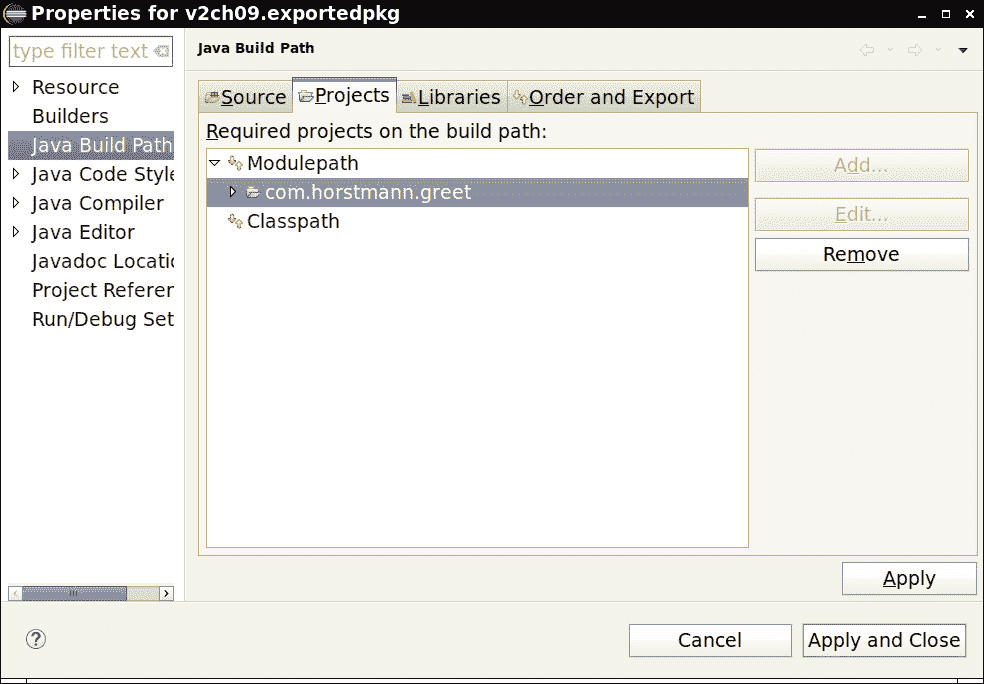向 Eclipse 项目添加依赖模块

你现在已经看到了构成 Java 平台模块系统骨干的`requires`和`exports`语句。如你所见，模块系统在概念上是简单的。模块指定了它们需要的模块，以及它们向其他模块提供的包。第 12.12 节显示了`exports`语句的一种细微变体。

模块不提供作用域。你不能在不同的模块中拥有同名的包。即使对于隐藏的包（即未导出的包）也是如此。

## 模块化 JAR

到目前为止，我们只是简单将模块编译到了目录。类加载器的等效物是*layer*（层）。Java 平台模块系统将 JDK 模块和应用程序模块加载到*boot layer*（引导层）。程序可以加载其他模块，使用层 API（本书中未涵盖）。此类程序可能会考虑模块版本。

在过去，一个包的类有时会分布在多个 JAR 文件中。（这种包被称为“拆分包”）。这可能从不是一个好主意，而且在模块中是不可能的。

如果你使用 Maven、Ant 或 Gradle 等构建工具，只需像以前一样构建 JAR。只要包含了`module-info.class`，你就能得到模块化 JAR。

要创建模块化 JAR，请使用`jar`工具。在我们的示例中，使用：

```bash
javac com.horstmann.greet/module-info.java \
   com.horstmann.greet/com/horstmann/greet/Greeter.java \
   com.horstmann.greet/com/horstmann/greet/internal/GreeterImpl.java \
   -d modules/com.horstmann.greet
```

然后，将模块化 JAR 放在模块路径上：

```bash
java -p modules/com.horstmann.greet -m com.horstmann.greet
```

启动程序时，指定包含主类的模块：

```bash
java -p modules/com.horstmann.greet -m com.horstmann.greet
```

在创建 JAR 文件时，可以选择指定版本号。使用`--module-version`参数，并将版本号添加到 JAR 文件名中：

```bash
jar -c -v -f com.horstmann.greet-1.0.jar --module-version 1.0 -C com.horstmann.greet
```

正如过的，版本号不会被 Java 平台模块系统用于解析模块，但可以被其他工具和框架查询。

你可以通过反射 API 获取版本号。在我们的示例中：

```java
Optional<String> version = Greeter.class.getModule().getDescriptor().rawVersion();
```

将返回一个包含版本字符串`"1.0"`的`Optional`。

如果你想在 JShell 中加载模块，请将 JAR 放在模块路径上并使用`--add-modules`选项：

```
jshell --module-path com.horstmann.greet-1.0.jar --add-modules com.horstmann.greet
```

## 模块与反射式访问

在前面的章节中，你已经看到模块系统强制执行封装。模块只能访问另一个模块中显式导出（exported）的包。在过去，总是可以通过反射来克服那些烦人的访问限制的。正如你在第 5 章中看到的，反射可以访问任何`class`的私有成员。

然而，在模块化世界中，这不再成立了。如果一个`class`在模块内部，对非公共成员的反射式访问将失败。具体来说，回想我们是如何访问私有字段的：

```
Field f = obj.getClass().getDeclaredField("salary");
f.setAccessible(true);
double value = f.getDouble(obj);
f.setDouble(obj, value * 1.1);
```

调用`f.setAccessible(true)`会成功，除非安全管理器不允许对私有字段的访问。然而，使用安全管理器运行 Java 应用程序并不常见，而且许多库使用了反射式访问。典型的例子是对象关系映射器，例如`JPA`，它们会自动将对象持久化到数据库；以及在对象与 XML 或 JSON 之间转换的库，例如`JAXB`和`JSON-B`。

如果你使用此类库并且又想使用模块，你就必须小心。为了演示这个问题，让我们把第 5 章中的`ObjectAnalyzer` `class`放入模块`com.horstmann.util`中。该`class`有一个`toString`方法，使用反射打印对象的字段。

另一个独立的`v1ch12.openpkg`模块包含一个简单的`Country` `class`：

```
package com.horstmann.places;

public class Country
{
   private String name;
   private double area;

   public Country(String name, double area)
   {
      this.name = name;
      this.area = area;
   }
   // . . .
}
```

一个短程序演示了如何分析一个`Country`对象：

```java
package com.horstmann.places;

import com.horstmann.util.*;

public class Demo
{
   public static void main(String[] args) throws ReflectiveOperationException
   {
      var belgium = new Country("Belgium", 30510);
      var analyzer = new ObjectAnalyzer();
      System.out.println(analyzer.toString(belgium));
   }
}
```

现在编译两个模块和`Demo`程序：

```
javac com.horstmann.util/module-info.java \
   com.horstmann.util/com/horstmann/util/ObjectAnalyzer.java
javac -p com.horstmann.util v1ch12.openpkg/module-info.java \
   v1ch12.openpkg/com/horstmann/places/*.java
java -p v1ch12.openpkg:com.horstmann.util -m v1ch12.openpkg/com.horstmann.places.Demo
```

该程序将抛出异常失败：

```
Exception in thread "main" java.lang.reflect.InaccessibleObjectException:
   Unable to make field private java.lang.String com.horstmann.places.Country.name
   accessible: module v1ch12.openpkg does not "opens com.horstmann.places" to module
   com.horstmann.util
```

当然，在纯理论上，违反封装并窥探对象的私有成员是错误的。但像对象关系映射或 XML/JSON 绑定这样的机制是非常常见的，以至于模块系统必须适应它们。

使用`opens`关键字，模块可以*打开*一个包，这使得对给定包中所有类实例的反射访问成为可能。以下是我们的模块需要做的：

```
module v1ch12.openpkg
{
   requires com.horstmann.util;
   opens com.horstmann.places;
}
```

通过此更改，`ObjectAnalyzer`将正常工作。

模块可以被声明为`open`，例如：

```
open module v1ch12.openpkg
{
   requires com.horstmann.util;
}
```

开放模块授予对其所有包的运行时访问权限，就像所有包都已声明了`exports`和`opens`一样。然而，在编译时，只有显式导出的包是可访问的。开放模块将模块系统的编译时安全性与经典的宽松运行时行为结合了一起。

回想第 5 章，JAR 文件除了类文件和清单文件外，还可以包含*文件资源*，这些资源可以使用`Class.getResourceAsStream`方法加载，现在也可以通过`Module.getResourceAsStream`加载。如果资源存储在与模块中的某个包匹配的目录中，则该包必须对调用者开放。其他目录中的资源以及类文件和清单文件可以被任何人读取。

为了更真实的例子，我们可以使用 JSON-B 规范将`Country`对象转换为 XML 或 JSON。要使用 JSON-B 的 Yasson 实现，请从 Maven 中央仓库下载`jakarta.json-api-2.1.2.jar`、`jakarta.json.bind-api-3.0.0.jar`、`parsson-1.1.4.jar`和`yasson-3.0.3.jar`。将这些 JAR 文件放在模块路径上并运行`com.horstmann.places`。未来的库可能会使用*变量句柄*（variable handles）而不是反射。`VarHandle`与`Field`类似。你可以用它读取或写入特定字段。

```java
public Object getFieldValue(Object obj, String fieldName, Lookup lookup)
      throws NoSuchException, IllegalAccessException
{
   Class<?> cl = obj.getClass();
   Field field = cl.getDeclaredField(fieldName);
   VarHandle handle = MethodHandles.privateLookupIn(cl, lookup)
      .unreflectVarHandle(field);
   return handle.get(obj);
}
```

这前提是有`Lookup`。

## 自动模块

你现在知道如何使用 Java 模块系统了。如果你从一个编写所有代码的新项目开始，你可以设计模块、声明依赖并将应用程序封装成模块化的 JAR 文件。

然而，这是一种极少的情况。几乎所有项目都依赖第三方库。当然，你可以等待库提供者将它们转换为模块，然后对自己的代码进行模块化。

但如果你不想等待呢？Java 模块系统提供了两种机制来跨越今天的预模块世界与完全模块化应用程序之间的鸿沟：自动模块和未命名模块。

为了迁移目的，你只需将任何 JAR 文件放在模块路径而非类路径上即可将其转换为模块。在模块路径上没有`module-info.class`的 JAR 被称为*自动模块*。自动模块具有以下属性：

1. 该模块隐式包含对所有其他模块的`requires`子句。

2. 它的所有包都导出并开放。

3. 如果 JAR 文件的清单`META-INF/MANIFEST.MF`中存在键为`Automatic-Module-Name`的项，则其值成为模块名。

4. 否则，模块名 get JAR 文件名，删除末尾的版本号并将非字母数字字符序列替换为点。

前两个规则意味着自动模块中的包表现就像它们在类路径上一样。使用模块路径的原因是为了其他模块的考虑，允许它们表达对该模块的依赖。

例如，你正在实现一个处理 CSV 文件并使用 Apache Commons CSV 库的模块。你希望在你的`module-info.java`文件中表示你的模块依赖 Apache Commons CSV。

如果你将`commons-csv-1.9.0.jar`添加到模块路径上，那么你的模块就可以引用该模块。它的名称是`commons.csv`，因为末尾的版本号`-1.9.0`被删除了，非字母数字字符`-`被替换为点。

这个名称可能是一个可以接受的模块名称，因为 Commons CSV 是广为人知的，不太可能有人会尝试为不同的模块使用相同的名称。但如果该 JAR 文件的维护者可以使用一个他们控制的名称（最好是顶层包名`org.apache.commons.csv`）作为模块名称，将会更好。他们只需要在 JAR 内部的`META-INF/MANIFEST.MF`文件添加一行：

```
Automatic-Module-Name: org.apache.commons.csv
```

事实上，他们在`commons-csv-1.10.0.jar`中确实是这样做了。

最终，希望他们通过添加带有该模块名称的`module-info.java`将该 JAR 文件转换为真正的模块。其他所有以该名称引用 CSV 模块的模块将继续工作。

向模块迁移的计划是一场伟大的社会实验，没有人知道它是否会有良好的结果。在你将第三方 JAR 放在模块路径上之前，请检查它们是否是模块化的，如果没有，请检查它们的清单（manifest）是否包含模块名称。如果没有，你仍然可以将 JAR 转换为自动模块，但要准备好以后更新模块名称。

为了尝试自动 JAR，从 [`commons.apache.org/proper/commons-csv`](https://commons.apache.org/proper/commons-csv) 下载 Commons CSV 库的 1.9.0 和 1.10.0 版本。配套代码中的`v2ch9.automod`包含一个简单的程序，用于读取包含国家数据的 CSV 文件：

```
package com.horstmann.places;

import java.io.*;
import org.apache.commons.csv.*;

public class CSVDemo
{
   public static void main(String[] args) throws IOException
   {
      var in = new FileReader("countries.csv");
      Iterable<CSVRecord> records = CSVFormat.EXCEL.withDelimiter(';')
            .withHeader().parse(in);
      for (CSVRecord record : records)
      {
         String name = record.get("Name");
         double area = Double.parseDouble(record.get("Area"));
         System.out.println(name + " has area " + area);
      }
   }
}
```

要将`commons-csv-1.9.0.jar`作为自动模块使用，我们需要通过它的文件名来引用它：

```
@SuppressWarnings("module")
module v1ch12.automod 
{
   requires commons.csv;
}
```

对于`commons-csv-1.10.0.jar`，使用清单中的`Automatic-Module-Name`：

```
requires org.apache.commons.csv
```

以下是编译和运行程序的命令：

```
javac -p v1ch12.automod:commons-csv-1.10.0.jar \
   v1ch12.automod/com/horstmann/places/CSVDemo.java \
   v1ch12.automod/module-info.java
java -p v1ch12.automod:commons-csv-1.10.0.jar \
   -m v1ch12.automod/com.horstmann.places.CSVDemo
```

## 未命名模块


任何不在模块路径上的类都是`未命名模块`（unnamed module）的一部分。从技术上讲，可能存在多个未命名模块，但它们共同的作用就像一个名为“未命名模块”（the unnamed module）的单一模块。与自动模块一样，未命名模块可以访问所有其他模块，并且它的所有包都会导出并开放。

然而，`显式模块`（explicit module）可以访问未命名模块。（显式模块既不是自动模块也不是未命名模块的模块——即在模块路径上带有`module-info.class`的模块）。换句话说，显式模块总是能够脱离“类路径地狱”。

例如考虑上一节的程序。假设你将`commons-csv-1.9.0.jar`放在类路径而不是模块路径：

```
java --module-path v1ch12.automod \
   --class-path commons-csv-1.10.0.jar \
   -m v1ch12.automod/com.horstmann.places.CSVDemo
```

现在程序将无法启动：

```
Error occurred during initialization of boot layer
java.lang.module.FindException: Module commons.csv not found, required by v1ch12.automod
```

因此，向 Java 平台模块系统的迁移必然是一个自下而上的过程：

1. Java 平台本身被模块化。
2. 接下来，库被模块化，通过使用自动模块或将它们转换为显式模块来实现。
3. 一旦应用程序使用的所有库都已模块化，你就可以将你的应用程序代码转换为模块。

自动模块`可以`读取未命名模块，因此它们的依赖可以放在类路径上。

## 迁移的命令行标记

即使你的程序没有使用模块，在使用 Java 9 及更高版本时，你也无法逃避模块化世界。你的应用程序代码可能位于未命名模块的类路径上。你的应用程序代码位于未命名模块中，因此所有包都导出并开放。尽管，从 Java 11 开始，编译时封装被严格执行。到 Java 17，`--illegal-access`标志不再可用。`--add-exports`和`--add-opens`标志允许你调整旧应用程序。在这种情况下，使用以下标记启动应用程序：

```
java --add-exports java.sql.rowset/com.sun.rowset=ALL_NAMED \
   -jar MyApp.jar
```

现在，假设你的应用程序使用反射访问字段或方法。反射模块是可以的，但不再能够反射地访问 Java 平台类的私有成员。例如，某些动态生成 Java 类的库通过反射调用保护的`ClassLoader.defineClass`方法。如果应用程序使用此类库，添加标记

```
--add-opens java.base/java.lang=ALL-NAMED
```

在添加所有这些命令行选项以让旧应用工作时，你可能会遇到地狱般的命令行。为了更好地管理多个选项，你可以将它们放在一个或多个文件中，并使用`@`前缀指定。例如：

```
java @options1 @options2 -jar MyProg.java
```

其中文件`options1`和`options2`包含`java`命令的选项。

选项文件有一些语法规则：

* 使用空格、制表符或换行分隔选项。
* 对包含空格的参数使用双引号，例如`"Program Files"`。
* 以`\`结尾的行与下一行合并。
* 反斜杠必须转义，例如`C:\\Users\\Fred`。
* 注释行以`#`开头。

## 传递和静态需求

在第 12.4 节中，你已经看到了`requires`语句的基本形式。在本节中，你将看到两种偶尔有用的变体。

在某些情况下，对于给定模块的用户来说，声明所有需要的模块可能会非常麻烦。例如，考虑`java.desktop`模块。它需要三个模块：`java.prefs`、`java.datatransfer`和`java.xml`。`java.prefs`模块仅在内部使用。然而，来自`java.datatransfer`和`java.xml`的类出现在公共 API 中，方法如下：

```
java.awt.datatransfer.Clipboard java.awt.Toolkit.getSystemClipboard()
java.beans.XMLDecoder(org.xml.sax.InputSource is)
```

这并不是`java.desktop`模块的用户应该考虑的事情。因此，`java.desktop`模块使用`transitive`修饰符声明了该需求：

```
module java.desktop
{
   requires java.prefs;
   requires transitive java.datatransfer;
   requires transitive java.xml;
   . . .
}
```

任何声明`java.desktop`要求的模块现在都会自动需要这两个模块。

一些程序员建议，当公共 API 中使用了另一个模块的包时，应该始终使用`requires transitive`。但这并不是 Java 语言的要求。考虑`java.sql`模块：

```
module java.sql
{
   requires transitive java.logging;
   . . .
}
```

在整个`java.sql` API 中，只有一个地方使用了`java.logging`模块的包，即`java.sql.Driver.parentLogger`方法，它返回一个`java.util.logging.Logger`。不将此模块需求声明为传递性的完全可以接受。那么，只有那些真正使用该方法的模块才需要声明它们需要`java.logging`。

`requires transitive`语句的一个引人注目的用法是聚合模块（aggregator module）——一个没有包且只有传递性要求的模块。其中一个模块是`java.se`模块，其声明如下：

```
module java.se
{
   requires transitive java.compiler;
   requires transitive java.datatransfer;
   requires transitive java.desktop;
   . . .
   requires transitive java.sql;
   requires transitive java.sql.rowset;
   requires transitive java.xml;
   requires transitive java.xml.crypto;
}
```

对细粒度模块依赖不感兴趣的程序员可以只需要求`java.se`即可获得 Java SE 平台的所有模块。

最后，还有一种常见的`requires static`变体，它声明一个模块在编译时必须存在，但在运行时是可选的。有两种用例：

1. 访问在编译时处理的并在另一个模块中声明的注解。
2. 如果可用，则使用另一个模块中的类，否则执行其他操作，例如：

```
try 
{
   new oracle.jdbc.driver.OracleDriver();
   . . .
} 
catch (NoClassDefFoundError er) 
{
   执行其他操作
}
```

## 限定导出（Qualified Exporting）和开启

在本节中，你将看到`exports`和`opens`语句的变体，它们将范围缩小到指定的模块集合。例如，`java.base`模块包含一条语句

```
exports sun.net to
  java.net.http,
  jdk.naming.dns;
```

这样的语句被称为“限定导出”（qualified export）。列出的模块可以访问导出的包，但其他模块不能。

过度使用限定导出可能表明模块化结构不良。尽管如此，在对现有代码库进行模块化时可能会出现这种情况。在这里，`sun.net`包放置在`java.base`模块内部，因为那里最需要它。然而，其他几个模块也使用了该包。Java 平台设计者不想让`java.base`变得更大，也不想让内部`sun.net`包通用。在一个全新的项目中，可以设计一个更模块化的 API。

同样，你可以将`opens`语句限制为特定的模块。例如，在第 12.7 节中可以使用限定`opens`语句，如下：

```
module v1ch12.openpkg
{
   requires com.horstmann.util;
   opens com.horstmann.places to com.horstmann.util;
}
```

现在`com.horstmann.places`包仅对`com.horstmann.util`模块开启。

## 服务加载（Service Loading）

`ServiceLoader`类（参见第 6 章）提供了一种匹配服务接口与实现的一种轻量级机制。Java 平台模块系统使得这种机制更易用。

这里是对服务加载的快速回顾。一个服务有一个接口和一个或多个可能的实现。这是一个接口的简单示例：

```
public interface GreeterService
{
   String greet(String subject);
   Locale getLocale();
}
```

一个或多个模块提供实现，例如

```java
public class FrenchGreeter implements GreeterService
{
   public String greet(String subject) { return "Bonjour " + subject; }
   public Locale getLocale() { return Locale.FRENCH; }
}
```

服务消费者必须根据其认为合适的任何标准，从所有提供的实现中选择一个实现。

```
ServiceLoader<GreeterService> greeterLoader = ServiceLoader.load(GreeterService.class);
GreeterService chosenGreeter;
for (GreeterService greeter : greeterLoader)
{
   if (. .) 
   {
      chosenGreeter = greeter;  
   }
}
```

```java
package com.horstmann.hello;

import java.util.*;
import com.horstmann.greetsvc.*;

public class HelloWorld
{
   public static void main(String[] args)
   {
      ServiceLoader<GreeterService> greeterLoader 
            = ServiceLoader.load(GreeterService.class);
      String desiredLanguage = args.length > 0 ? args[0] : "de";
      GreeterService chosenGreeter = null;
      for (GreeterService greeter : greeterLoader)
      {
         if (greeter.getLocale().getLanguage().equals(desiredLanguage))
            chosenGreeter = greeter;
      }
      if (chosenGreeter == null)
         System.out.println("No suitable greeter.");
      else
         System.out.println(chosenGreeter.greet("Modular World"));
   }
}
```

模块声明需要服务模块，并声明正在使用`GreeterService`。

```java
module v1ch12.useservice 
{
   requires com.horstmann.greetsvc;
   uses com.horstmann.greetsvc.GreeterService;
}
```

由于`provides`和`uses`声明，消费服务的模块被允许访问模块私有的实现类。

要构建并运行该程序，首先要编译服务：

```bash
javac com.horstmann.greetsvc/module-info.java \
   com.horstmann.greetsvc/com/horstmann/greetsvc/GreeterService.java \
   com.horstmann.greetsvc/com/horstmann/greetsvc/internal/*.java
```

然后编译并运行消费服务的模块：

```bash
javac -p com.horstmann.greetsvc \
   v1ch12.useservice/com/horstmann/hello/HelloWorld.java \
   v1ch12.useservice/module-info.java
java -p com.horstmann.greetsvc:v1ch12.useservice \
   -m v1ch12.useservice/com.horstmann.hello.HelloWorld
```

# 用于模块的工具

本节介绍了 Java 开发工具包 (JDK) 中的的`jdeps`、`jlink`和`jmod`工具。

`jdeps`工具分析给定 JAR 文件的依赖关系。例如，你想对 JUnit 4 进行模块化。运行：

```bash
jdeps -s junit-4.12.jar hamcrest-core-1.3.jar 
```

`-s`标志生成摘要输出：

```text
hamcrest-core-1.3.jar -> java.base
junit-4.12.jar -> hamcrest-core-1.3.jar
junit-4.12.jar -> java.base
junit-4.12.jar -> java.management
```

这会告诉你模块图，如下所示所示。

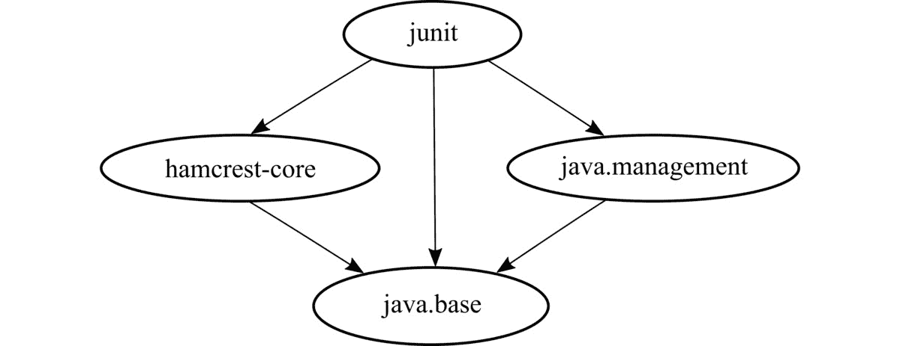 JUnit4 模块图

如果你省略`-s`标志，你将获得模块摘要，随后是包到所需的包和模块的映射。如果你添加`-v`标志，列表将类映射到所需的包和模块。

`--generate-module-info`选项为每个分析的模块生成`module-info`文件：

```bash
jdeps --generate-module-info /tmp/junit junit-4.12.jar hamcrest-core-1.3.jar
```

还有一个选项可以生成用于描述图的“dot”语言图形化输出。假设你已安装 dot 工具，运行这些命令：

```bash
jdeps -s -dotoutput /tmp/junit junit-4.12.jar hamcrest-core-1.3.jar
dot -Tpng /tmp/junit/summary.dot > /tmp/junit/summary.png
```

然后`summary.png`看起来如下所示。

 `jdeps`的 Dot 输出

使用`jlink`工具生成一个不需要独立 Java 运行时运行的应用程序。生成的镜像比整个 JDK 要小得多。你指定想要包含的模块和输出目录。

```bash
jlink --module-path com.horstmann.greet.jar:v1ch12.exportedpkg.jar:$JAVA_HOME/jmods \
   --add-modules v1ch12.exportedpkg --output /tmp/hello
```

输出目录中有一个子目录`bin`，其中包含一个`java`可执行文件。如果你运行：

```bash
bin/java -m v1ch12.exportedpkg
```

则会调用模块主类的`main`方法。

`jlink`的意义在于它封装了运行应用程序所需的最小模块集。你可以列出所有模块：

```bash
bin/java --list-modules
```

在此示例中，输出为：

```text
v1ch12.exportedpkg
com.horstmann.greet
java.base@21
```

所有模块都包含在*运行时镜像*文件`lib/modules`中。在我的计算机上，该文件为 29MB，而所有 JDK 模块的运行时镜像占用 133MB。整个应用程序占用 55MB，仅为 JDK 大小的一部分。

这可以作为打包应用程序实用工具的基础。你仍然需要为应用程序生成文件集。

# 附录

此附录列出了所有关键字单词。

## Java 关键字

| 关键字 | 含义 | 类型 |
| :--- | :--- | :--- |
| `abstract` | 抽象类或方法 | 5 |
| `assert` | 用于定位内部错误 | 7 |
| `boolean` | 布尔类型 | 3 |
| `break` | 跳出 switch 或循环 | 3 |
| `byte` | 8 位整数 | 3 |
| `case` | switch 的一个情况 | 3 |
| `catch` | try 块捕获异常的子 | 7 |


| 关键字 | 说明 | 类型 | 页码 |
| :--- | :--- | :--- | :--- |
| `char` | UTF-16 代码单元的类型 | 3 |
| `class` | 定义类 | 4 |
| `continue` | 在循环末尾继续 | 3 |
| `default` | `switch` 的默认分支，或接口中的默认方法 | 3 |
| `do` | `do/while` 循环的顶部 | 3 |
| `double` | 双精度浮点类型 | 3 |
| `else` | `if` 语句的 `else` 分句 | 3 |
| `enum` | 枚举类型 | 3 |
| `exports` | 导出模块的包 | 12 |
| `extends` | 定义类的父类，或通配符的上界 | 4 |
| `false` | 两个布尔值之一 | 3 |
| `final` | 常量，或不可被重写的类或方法 | 5 |
| `finally` | `try` 块中始终执行的部分 | 7 |
| `float` | 单精度浮点类型 | 3 |
| `for` | 一种循环类型 | 3 |
| `if` | 条件语句 | 3 |
| `implements` | 定义类实现的接口 | 6 |
| `import` | 导入包 | 4 |
| `instanceof` | 测试对象是否是某个类的实例 | 5 |
| `int` | 32 位整数类型 | 3 |
| `interface` | 一个类可以实现方法的抽象类型 | 6 |
| `long` | 64 位长整型类型 | 3 |
| `native` | 由主机系统实现的方法 | 关键字 | 13 (第二卷) |
| `new` | 分配一个新对象或数组 | 关键字 | 3 |
| `non-sealed` | 密封类型的子类型，可以形成任意子类型 | 关键字 | 5 |
| `null` | 空引用 | 字面量 | 3 |
| `module` | 声明一个模块 | 受限制的关键字 | 12 |
| `open` | 修改 `module` 声明 | 受限制的关键字 | 12 |
| `opens` | 打开开放模块的包 | 受限制的关键字 | 12 |
| `package` | 类的包 | 关键字 | 4 |
| `permits` | 引入密封类型允许的子类型列表 | 受限制的标识符 | 3 |
| `private` | 仅允许此类类方法访问的特性 | 关键字 | 4 |
| `protected` | 仅允许此类类、其子类以及同包中其他类的方法访问的特性 | 关键字 | 5 |
| `provides` | 表示模块使用某种服务 | 受限制的关键字 | 12 |
| `public` | 所有类方法都可以访问的特性 | 关键字 | 4 |
| `record` | 声明一个具有一组最终实例变量的类 | 受限制的标识符 | 4 |
| `return` | 从方法返回 | 关键字 | 3 |
| `sealed` | 具有受控的直接子类型的类型 | 受限制的标识符 | 5 |
| `short` | 16 位整数类型 | 关键字 | 3 |
| `static` | 属于类或接口特有的特性，而不属于类的实例 | 关键字 | 3, 6 |
| `strictfp` | 使用严格的规则进行浮点数计算（已废弃） | 关键字 | 2 |
| `super` | 超类对象或构造函数，或者通配符中的下界 | 关键字 | 5 |
| `switch` | 选择语句或表达式 | 关键字 | 3 |
| `synchronized` | 对线程原子性的方法或代码块 | 关键字 | 12 |
| `this` | 方法的隐式参数，或此类的构造函数 | 关键字 | 4 |
| `throw` | 抛出异常 | 关键字 | 7 |
| `throws` | 方法可能抛出的异常 | 关键字 | 7 |
| `to` | `exports` 或 `opens` 声明的一部分 | 受限制的关键字 | 12 |
| `transient` | 标记不应持久化的数据 | 关键字 | 2 (第二卷) |
| `transitive` | 修改 `requires` 声明 | 受限制的关键字 | 12 |
| `true` | 两个布尔值之一 | 字面量 | 3 |
| `try` | 捕获异常的代码块 | 关键字 | 7 |
| `uses` | 表示模块使用某种服务 | 受限制的关键字 | 12 |
| `var` | 声明一个类型可推断的变量 | 受限制的标识符 | 3 |
| `void` | 表示没有返回值的方法 | 关键字 | 3 |
| `volatile` | 确保多个线程能够一致地访问字段 | 关键字 | 12 |
| `when` | 引入模式的守卫语句 | 受限制的关键字 | 5 |
| `while` | 循环 | 关键字 | 3 |
| `with` | 在 `provides` 语句中定义服务类 | 受限制的关键字 | 12 |
| `yield` | 返回 `switch` 表达式的值 | 受限制的标识符 | 3 |
| `_` (下划线) | 未命变量或模式（预览特性） | 关键字 | 5 |
