# 核心 Java，卷 I：基础（第 13 版）

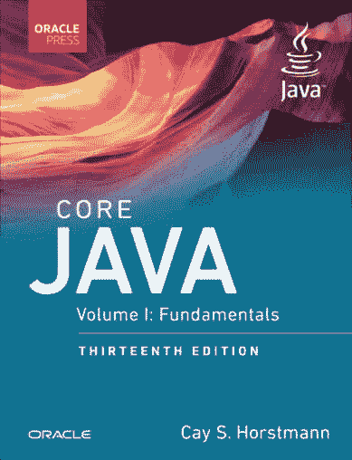

## 关于本电子书

ePUB 是一种开放的行业标准电子书格式。然而，阅读设备和应用程序对 ePUB 及其许多功能的支持程度不同。请使用您的设备或应用设置来根据喜好自定义显示效果。您可以自定义的设置通常包括字体、字号、单栏或双栏、横屏或竖屏模式，以及可以点击或触摸以放大的图片。有关您的阅读设备或应用程序的设置和功能的更多信息，请访问设备制造商的网站。

许多书籍包含编程代码或配置示例。为了优化这些元素的显示效果，请在单栏横屏模式下查看电子书，并将字体大小调整为最小设置。


新泽西州，霍霍肯

封面图片：Jon Chica/Shutterstock

图 1.1：Sourceforge

图 2.2, 3.2-3.5, 4.9, 5.4, 7.2, 10.5, 10.6, 11.1：Oracle Corporation

图 2.3-2.6, 12.2：Eclipse Foundation, Inc.

图 4.2：Violet UML Editor

保留所有权利。本出版物受版权保护，在进行任何禁止的复制、存储在检索系统中或以任何形式或通过任何手段（电子、机械、复印、录音或其他）进行传输之前，必须获得出版商的许可。有关许可、申请表以及 Pearson Education 全球权利与许可部门适当联系人的信息，请访问`www.pearson.com/permissions`。

# 前言

## 致读者

1995 年底，Java 编程语言横军互联网，并迅速成名。Java 技术的承诺是它将成为通用的胶水，将用户与信息连接起来，无论信息来自何处——网络服务器、数据库、信息提供者或任何其他想象中的来源。事实上，Java 处于实现这一承诺的独特地位。它是一种工程极其严谨的语言，获得了广泛认可。其内置的安全和保护特性让编程人员和 Java 程序的用户都感到放心。Java 对高级编程任务具有内置支持，如网络编程、数据库连接和并发。

自 1995 年以来，Java 开发工具包（JDK）已发布了二十多个版本。应用程序编程接口（`API`）从数百个类增长到 4000 多个类。`API` 现在涵盖了并发编程、集合、用户界面构建、数据库管理、国际化、安全和 XML 处理等众多领域。

你现在阅读的这本书是 *Core Java* 第十三版的第一卷。每一个版本都紧密跟随 Java 开发工具包的发布，每次我都会重写这本书以利用最新的 Java 特性。此版本已更新，以反映 Java 21 的特性。

与之前的版本一样，本书仍然针对希望在真实项目中使用 Java 的严谨编程人员。我把你（读者）认为是一个在 Java 之外的其他编程语言方面具有坚实背景的编程人员。我假设你不喜欢充满玩具示例（如烤面包机、动物园动物或“紧张的文本”）的书。你不会在书中发现任何此类内容。我的目标是让你完全理解 Java 语言和库，而不是给你一种理解了的错觉。

在书中，你将看到大量的示例代码，展示了几乎每种语言和库的特性。示例程序特意保持简单，以便关注主要要点，但在大多数情况下，它们不是虚假的，也没有走捷径。它们应该是你自己代码的良好起点。

我假设你愿意甚至渴望学习 Java 语言为你提供的所有功能。在本卷中，你将对以下内容进行详细介绍：

- 面向对象编程
- 反射和代理
- 接口和内部类
- 异常处理
- 泛型编程
- 集合框架
- 并发
- 注解
- Java 平台模块系统

随着 Java 类库的爆炸式增长，想要用一卷书涵盖严肃程序员需要知道的所有 Java 特性是是不可能的。因此，本书被分为两卷。第一卷集中在 Java 语言的基础概念上。第二卷`Core Java, Volume II: Advanced Features`则进一步探讨了最重要的库。

在过去的十二个版本中，用户界面编程一直被认为是基础性的，但现在是时候承认它不再是，并将其移动到第二卷了。该卷包含了这些主题的详细讨论：

- Stream API
- 文件处理与正则表达式
- 数据库
- XML 处理
- 脚本与编译 API
- 国际化
- 网络编程
- 图形用户界面设计
- 图形编程
- 原生方法

在编写书书籍时，错误和不准确之处是不可避免的。我非常想了解这些错误。但当然，我希望每个错误只被告知一次。你可以在`horstmann.com/corejava`找到常见问题和错误修复的列表。在勘误页的末尾策略性地放置了一个表单（以鼓励你先阅读它），你可以用它来报告错误并提出改进。如果我没有回答每一个查询或没有立即回复你，请不要失望。我会阅读所有的邮件，并感谢你提供的建议，以使本书的未来版本更加清晰、信息更丰富。

## 本书概览

`第 1 章`概述了 Java 区别于其他编程语言的能力。本章解释了语言设计者想要实现的目标以及他们在多大程度上取得了成功。随后是 Java 的简短历史，详细介绍了 Java 如何诞生以及它是如何演变的。

在`第 2 章`中，你将看到如何下载和安装 JDK 以及本书的程序示例。然后我将引导你编译并运行一个控制台应用程序和一个图形应用程序。你将看到如何使用原生 JDK、Java IDE 以及`JShell`工具。

`第 3 章`开始了对 Java 语言的讨论。在本章中，我涵盖了基础知识：变量、循环和简单函数。如果你是 C 或 C++ 程序员，这将会一帆风顺，因为这些语言特性的语法在本质上与 C 相同。如果你来自 Visual Basic 等非 C 背景，你将希望仔细阅读这一章。

面向对象编程（OOP）现在是编程实践的主流，而 Java 是一门面向对象的编程语言。`第 4 章`引入了封装，这是面向对象的两个基本基石之首，以及 Java 语言实现它的机制——即类和方法。除了 Java 语言的规则外，你还会发现关于良好的 OOP 设计的建议。最后，我涵盖了奇妙的`javadoc`工具，它可以将你的代码注释格式化为一组超链接的网页。如果你熟悉 C++，可以快速浏览过这一章。来自非面向对象背景的程序员应该预期在进一步学习 Java 之前花一些时间掌握 OOP 概念。

类和封装只是 OOP 故事的一部分，`第 5 章`引入了另一个部分——即`继承`。继承允许你获取现有的类并根据你的需求对其进行修改。这是 Java 编程的一项基本技术。Java 的继承机制与 C++ 非常相似。再次，C++ 程序员可以关注语言之间的差异。

`第 6 章`展示了你如何使用 Java 的`interface`（接口）概念。接口允许你超越`第 5 章`中简单的继承模型。掌握接口允许你能够充分利用 Java 完全面向对象的编程方法的力量。在涵盖接口之后，我转向了`lambda expressions`（lambda 表达式），这是一种可以在以后某个时间点执行的代码块的简洁表达。然后我解释了 Java 的一个有用技术特性：`inner classes`（内部类）。

`第 7 章`讨论了`exception handling`（异常处理）——Java 处理良好的程序可能发生故障的健壮机制。异常为你提供了一种高效的方法，将正常处理代码与错误处理分开。当然，即使在处理所有异常情况后增强了程序，它仍然可能无法按预期运行。然后本章转向日志记录。在本章的最后部分，我为你提供了一些实用的调试技巧。

`第 8 章`概述了泛型编程（generic programming）。泛型编程让你的程序更容易读且更安全。我向你展示如何使用强类型并移除难看且安全的强制转换，以及如何处理由于需要与旧版本 Java 兼容而产生的复杂性。

`第 9 章`的主题是 Java 平台的集合框架（collections framework）。当你想要收集多个对象并在以后检索它们时，你应该使用最适合你情况的集合，而不是简单地将元素丢进数组中。这一章向你展示了如何利用预构建的标准集合。

`第 10 章`涵盖了并发（concurrency），它允许你并行执行任务。在处理器拥有多个核心的时代，这是 Java 技术的一种重要且兴奋的应用。

在`第 11 章`中，你将学习注解（annotations），它们允许向 Java 程序添加任意信息（有时称为元数据）。我们向你展示注解处理器如何在源代码或类文件级别获取这些注解，以及如何使用注解来影响类的运行时行为。注解只有配合工具才有用，我们希望我们的讨论能帮助你根据需求选择注解处理工具。

`第 12 章`，你将学习 Java 模块系统，它有助于 Java 平台和核心库的有序演进。该模块系统提供了包封装以及描述模块机制。你将学习模块的属性，以便决定是否在自己的应用程序中使用它们。即使你决定不使用，你也需要知道新规则以便与 Java 平台和其他模块化库交互。

**附录**列出了 Java 语言的保留字。

## 约定

与许多计算机书籍一样，我使用`等宽字体`表示计算机代码。

注释使用如下所示的“note”图标。

提示使用如下所示的“tip”图标。

有危险时，我会用“caution”图标警告你。

计划未来成为语言或 API 部分的预览功能将带有此图标标记。

Java 自带了一个庞大的程序库，或者应用程序接口（`API`）。在第一次使用 API 调用时，我会在该节末尾添加一段简短的总结描述。这些描述比较非正式，但希望比官方在线 API 文档中的描述更有信息量。接口的名称采用斜体，与官方文档一致。类、接口或方法名称后的数字是引入该特性的 JDK 版本，如下例所示：

`Application Programming Interface` 21

源代码位于书籍配套网站上的程序将以代码列表的形式给出，例如：

代码列表`NotHelloWorld.java`

```java
void main()
{
   System.out.println("We will not use 'Hello, World!'");
}
```

## 示例代码

本书的网站[`horstmann.com/corejava`](https://horstmann.com/corejava)包含了书中所有的示例代码。有关安装 Java 开发包和示例代码的更多信息，请参阅第 2 章。

# 致谢

写书总是一项巨大的工程，而重写它似乎并没有容易多少，尤其是考虑到 Java 不断技术的演进。让一本书变成现实需要许多人的投入，我非常荣幸能感谢整个`Core Java`团队的贡献。

Pearson 出版的许多个人提供了宝贵的帮助，但他们一直保持在幕后。我希望让他们知道我有多么感激他们的努力。一如既往，我热烈地感谢我的编辑 Greg Doench，他引导了书籍的编写和制作过程，并让我能够心无旁虑地忽略所有幕后同事的存在。我非常感谢 Julie Nahil 的制作支持，感谢 Dmitry Kirsanov 和 Alina Kirsanova 对手稿进行校对，并感谢 Clovis L. Tondo 审核了最终内容。我使用 HTML 和 CSS 编写了本书，由 Prince ([`princexml.com`](https://princexml.com)) 将其转换成 PDF——这是一个我非常推荐的工作流。还要感谢我早期版本的合著者 Gary Cornell，他自此已投身于其他事业。

感谢早期版本的许多读者，他们报告了错误并对改进提出了许多周全的建议。我特别感谢优秀的审稿团队，他们以惊人的细节关注力审阅了手稿，使我免于许多尴尬的错误。

本书及早期版本的审稿人包括：Chuck Allison (犹他谷大学), Lance Andersen (Oracle), Gail Anderson (Anderson Software Group), Paul Anderson (Anderson Software Group), Alec Beaton (IBM), Cliff Berg, Andrew Binstock (Oracle), Joshua Bloch, David Brown, Corky Cartwright, Frank Cohen (PushToTest), Chris Crane (devXsolution), Dr. Nicholas J. De Lillo (曼哈顿学院), Rakesh Dhoopar (Oracle), Ahmad R. Elkomey, Robert Evans (霍普金斯大学应用物理实验室高级员工), David Geary (Clarity Training), Jim Gish (Oracle), Brian Goetz (Oracle), Angela Gordon, Dan Gordon (Electric Cloud), Rob Gordon, John Gray (哈特福德大学), Cameron Gregory (olabs.com), Andrzej Grzesik, Marty Hall (coreservlets.com, Inc.), Vincent Hardy (Adobe Systems), Dan Harkey (圣何塞州大学), Steve Haines, William Higgins (IBM), Marc Hoffmann (mtrail), Vladimir Ivanovic (PointBase), Jerry Jackson (CA Technologies), Heinz Kabutz (Java Specialists), Stepan V. Kalinin (I-Teco/Servionica LTD), Tim Kimmet (Walmart), John Kostaras, Jerzy Krolak, Chris Laffra, Charlie Lai (Apple), Angelika Langer, Jeff Langr (Langr Software Solutions), Doug Langston, Hang Lau (麦吉尔大学), Mark Lawrence, Doug Lea (SUNY Oswego), Gregory Longshore, Bob Lynch (Lynch Associates), Philip Milne (顾问), Mark Morrissey (俄勒冈研究生学院), Mahesh Neelakanta (佛罗里达西洋大学), José Paumard (Oracle), Hao Pham, Paul Philion, Blake Ragsdell, Ylber Ramadani (瑞森大学), Stuart Reges (亚利桑那大学), Simon Ritter (Azul Systems), Rich Rosen (Interactive Data Corporation), Peter Sanders (法国尼斯大学), Dr. Paul Sanghera (圣何塞州大学和 Brooks College), Paul Sevinc (Teamup AG), Devang Shah (Sun Microsystems), Yoshiki Shibata, Richard Slywczak (NASA/格伦研究中心), Bradley A. Smith, Steven Stelting (Oracle), Christopher Taylor, Luke Taylor (Valtech), George Thiruvathukal, Kim Topley (StreamingEdge), Janet Traub, Paul Tyma (顾问), Christian Ullenboom, Peter van der Linden, Joe Wang (Oracle), Sven Woltmann, Burt Walsh, Dan Xu (Oracle), 以及 John Zavgren (Oracle)。

Cay Horstmann

德国杜塞尔多多夫

2023 年 10 月

# 第 1 章：Java 简介

Java 在 1996 年的发布引发了难以置信的兴奋，不仅在计算机新闻界，在《纽约时报》、《华盛顿邮报》和《商业周刊》等主流媒体也是如此。Java 的独特之处在于它是第一个唯一在国家公共广播电台（National Public Radio）上获得过十分钟报道的编程语言。一个金额为 1 亿美元的风险投资基金专门为使用特定计算机语言的产品而设立。我希望你会喜欢在本章中看到的 Java 简史。

## 1.1 作为一种编程平台的 Java

在本书的第一版中，我的合著者 Gary Cornell 和我写下了以下内容：

“作为一种计算机语言，Java 的炒作过度了：Java 确实是一门很好的语言。毫无疑问，它是严肃程序员最好的语言之一。我们认为它可能成为一门伟大的语言，但现在可能太晚了。一旦语言进入市场，与现有代码兼容的丑陋现实就会到来。”

我们的编辑来自最初开发 Java 的公司高层对这段话提出了很多批评。Java 语言有很多出色的特性，我们将在本章后面详细介绍。它也有自己的缺点，由于兼容性要求，一些新特性并不如原始特性那样优雅。

但正如我们在第一版中所说的，Java 绝不仅仅是一门语言。世界上有很多编程语言，但很少有能引起如此轰动的。Java 是一个完整的平台，拥有包含大量重用代码的海量库，以及提供安全、跨平台自动垃圾回收服务的执行环境。

作为程序员，你会想要一种语法良好且语义易懂的语言（即不是 C++）。Java 符合这一要求，其他几十种优秀的语言也是如此。某些语言提供了移植性、垃圾回收等，但它们没有足够的库，如果你需要高级图形、网络或数据库访问，就得自己实现。Java 拥有这一切。

## 1.2 Java 白皮书关键词

Java 的作者写了一份具有影响力的白皮书，解释了他们的设计目标和成就。他们还发布了一份较短的概述，按照以下 11 个关键词进行组织：

1. 简单 (Simple)
2. 面对象 (Object-Oriented)
3. 分布式 (Distributed)
4. 健壮 (Robust)
5. 安全 (Secure)
6. 体系中立 (Architecture-Neutral)
7. 可移植 (Portable)
8. 解释执行 (Interpreted)
9. 高性能 (High-Performance)
10. 多线程 (Multithreaded)
11. 动态 (Dynamic)


在接下来的小节中，你将看到 Java 设计者对每个关键词的总结（带有白皮书的摘录），并结合我对当前 Java 经验的评论。

白皮书可以在 [https://www.oracle.com/technetwork/java/langenv-140151.html] 找到。你可以在 [https://horstmann.com/corejava/java-an-overview/7Gosling.pdf] 获取包含 11 个热词关键词的概述。

### 1.2.1 简单（Simple）

> 我们希望构建一个易于编程、无需大量晦涩训练且能利用当今标准实践的系统。因此，尽管我们发现 C++ 并不合适，但我们设计的 Java 尽可能接近 C++，以便使系统更易理解。Java 删除了 C++ 中许多很少使用、难以理解且令人困惑的特性，根据我们的经验，这些特性带来的麻烦多于收益。

Java 的语法确实是 `C++` 语法的精简版本。它不需要头文件、指针算术（甚至不需要指针语法）、联合体、运算符重载、虚基类等。（请参文中穿插的 C++ 注释，以了解更多关于 Java 和 C++ 之间的差异。）然而，设计者并没有试图修复 `C++` 的所有笨拙特性。例如，`switch` 语句的语法在 Java 中保持不变。如果你熟悉 `C++`，你会发现过渡到 Java 语法非常容易。

在 Java 发布时，`C++` 实际上并不是最常用的编程语言。许多开发者使用 Visual Basic 及其拖放式编程环境。这些开发者并不认为 Java 是简单的。Java 开发环境花费了几年才追赶上来。如今，Java 开发环境远领先于大多数其他编程语言。

> 简单性的另一个方面是保持“短小”。Java 的目标之一是能够构建出可以在小型机器上独立运行的软件。基础解释器和类支持的大小约为 40K；基础标准库和线程支持（本质上是一个自包含的微内核）又增加了 175K。

这在当时是一项巨大的成就。当然，该库从那时增长到了巨大的规模。现在有具有较小库的独立版本，适用于嵌入式设备和智能卡。

### 1.2.2 面向对象（Object-Oriented）

> 简单来说，面向对象的设计是一种关注数据（对象）以及这些对象接口的编程技术。类比木工工作，一个“面向对象”的木工会主要关注他正在制作的椅子，次要关注制作椅子的工具；而一个“非面向对象”的木工首要考虑的是工具。Java 的面向对象功能本质上是 C++ 的功能。

在 Java 开发时，面向对象技术已经非常成熟。Java 的面向对象特性与 `C++` 相当。Java 和 `C++` 之间的主要区别在于多继承，Java 用更简单的接口（interfaces）概念取代了多继承。Java 的运行时内省能力（在[第 5 章](../ch5/index_u9_split_000.xhtml）中讨论）比 `C++` 更丰富。

### 1.2.3 分布式（Distributed）

> Java 有大量的库来处理 HTTP 和 FTP 等 TCP/IP 协议。Java 应用可以通过 URL 跨网络打开并访问对象，就像访问本地文件系统一样简单。

如今，人们认为这是理所当然的——但在 1995 年，从 `C++` 或 Visual Basic 程序连接到服务器是一项重大的工程。

### 1.2.4 健壮（Robust）

> Java 旨在编写在各种方面都必须可靠的程序。Java 非常强调对可能问题进行早期检查、后期的动态（运行时）检查，以及消除易出错的情况。……Java 和 C/C++ 之间最大的区别是 Java 拥有一种指针模型，这种模型消除了覆盖内存和损坏数据的可能性。

Java 编译器可以检测许多在其他语言中只会在运行时出现的问题。至于第二点，任何花费过数小时追踪由指针 bug 导致的内存损坏的人都会对 Java 的这一方面感到非常满意。

### 1.2.5 安全（Secure）

> Java 旨在用于网络化/分布式环境。为了这一目标，安全性被了高度重视。Java 能够构建无病毒、防篡改的系统。

从一开始开始，Java 的设计就是让某些类型的攻击变得不可能，包括：

- 溢出运行时栈——蠕虫和病毒的常见攻击手段
- 损坏其进程空间之外的内存
- 在没有权限的情况下读取或写入文件

最初，Java 对下载代码的态度是“放马来吧！”。不信赖的代码在沙箱环境中执行，那里它不会影响主机系统。用户被保证不会发生任何坏事，因为 Java 代码无论来自哪里，永远无法逃离沙箱。

然而，Java 的安全模型是复杂的。在第一个版本的 Java 开发包（JDK）发布后不久，普林斯大学的一组安全专家发现了细微的漏洞，允许不信赖的代码攻击主机系统。

最初，安全漏洞被很快修复。遗憾的是，随着时间的推移，黑客变得非常擅长发现安全架构实现中的细微缺陷。Sun 公司以及随后的 Oracle 在跟进漏洞修复方面面临了很大困难。

在经历了多次备受目的攻击后，浏览器厂商和 Oracle 变得越来越谨慎。曾有一时期，远程代码必须经过数字签名。如今，浏览器不再信任 Java，Java 应用的安全交付已成为遥远的记忆。

尽管从事回溯来看，Java 的安全模型并没有预想中那样成功，但 Java 是是超时代的。微软的一种竞争性代码交付机制 `ActiveX` 仅依赖数字签名来确保安全。显然这是不够的：正如任何微软产品的用户都可以证实的那样，知名供应商的程序也会崩溃并造成破坏。

### 1.2.6 架构无关（Architecture-Neutral）

> 编译器生成与架构无关的对象文件格式。在 Java 运行时系统的情况下，编译后的代码可以在许多处理器上运行。Java 通过生成与特定计算机架构无关的字节码指令来实现这一点。相反，这些指令既易于在任何机器上解释，又易于现场翻译成原生机器代码。

为“虚拟机”生成代码在当时并不是一个新想法。Lisp、Smalltalk 和 Pascal 等编程语言已经使用了这种技术多年。

当然，解释虚拟机指令比以全速运行机器指令要慢。然而，虚拟机可以选择将执行频繁的字节码序列翻译成机器代码——这一过程被称为即时编译（JIT compilation）。

Java 虚拟机还有另一个优势。它通过检查指令序列的行为，增强了安全性。

### 1.2.7 可移植（Portable）

> 与 C 和 C++ 不同，规范中没有“依赖于实现”的方面。基本数据类型的大小是固定的，对它们进行算术运算的行为也是如此。

例如，Java 中的 `int` 始终是 32 位整数。在 C/C++ 中，`int` 可以是 16 位整数、32 位整数，或编译器供应商喜欢的任何大小。唯一的限制是 `int` 类型的字节数至少要与 `short int` 一样，且不能多于 `long int`。数值类型的大小固定消除了巨大的移植头疼问题。二进制数据以固定格式存储和传输，消除了对字节序的困惑。字符串以标准的 Unicode 格式保存。

> 系统的组成库定义了可移植的接口。例如，有一个抽象的 `Window` 类，以及针对 UNIX、Windows 和 Macintosh 的实现。

`Window` 类的例子可能选得并不好。正如任何尝试过此的人所知，要实现一个在 Windows、Macintosh 和十种不同版本的 UNIX 上看起来良好的用户界面，是一项具有英雄主义规模的工程。Java 1.0 付出了这一壮举的努力，提供了一个简单的工具包，在多个平台上提供了通用的用户界面元素。遗憾的是，其结果是一个经过大量工作后，在不同系统上只能产生勉强可接受结果的库。那个最初的用户界面工具包从那以后被替换了一次又一次，而跨平台的可移植性仍然是一个问题。

然而，对于所有与用户界面无关的内容，Java 库能够很好地让你以与平台无关的方式进行工作。你可以处理文件、正则表达式、XML、日期时间、数据库、网络连接、线程等，而无需担心底层的操作系统。不仅你的程序是可移植的，Java API 的质量往往比原生 API 更高。

### 1.2.8 解释型

> Java 解释器可以在任何已移植了该解释器的机器上直接执行 Java 字节码。由于链接是一个更增量且轻量级的过程，开发过程可以快得多且具有探索性。

这确实是有些牵强了。任何用用过 Lisp、Smalltalk、Visual Basic、Python、R 或 Scala 的人都知道什么是“快速且具有探索性”的开发过程。你尝试某些东西，并立即看到结果。在 Java 存在的头 20 年里，开发环境并没有关注这种体验。直到 Java 9，`jshell` 工具才支持了快速且具有探索性的编程。

### 1.2.9 高性能

> 虽然解释型字节码的性能通常绰绰有余，但在某些情况下需要更高的性能。字节码可以在运行时（动态执行）被翻译成适用于应用程序运行的特定 CPU 的机器代码。

在 Java 早期，许多用户不同意性能“绰绰有余”的说法。然而在今天，即时编译器（just-in-time compilers）已经变得非常优秀，足以与传统编译器竞争，而且在某些情况下甚至超过了它们，因为它们拥有更多的信息。例如，即时编译器可以监控哪些代码被频繁执行，并仅对这部分代码进行速度优化。一种更复杂的优化是消除（或“内联”）函数调用。即时编译器知道已经加载了哪些类。当根据当前加载的类集合，某个特定函数从未被重写时，它可以使用内联技术，并在必要时在从后撤销该优化。

### 1.2.10 多线程

> [多]线程的益处是更好的交互响应能力和实时行为。

如今，我们关注并发是因为摩尔定律已经结束了。我们并没有得到更快的处理器，而是得到了更多的处理器，而且我们必须让它们忙起来。然而，当你观察大多数编程语言时，它们对这个问题表现出一种令人震惊的忽视。

Java 的领先性是远于那个时代的。它是第一个支持并发编程的主流语言。正如你从白皮书中看到的，它的初衷略有不同。当时，多内核处理器还很稀奇，但 Web 编程刚刚开始，处理器花费大量时间等待服务器的响应。需要并发编程来确保用户界面不会冻结。

并发编程绝非易事，但 Java 在使其易于管理方面做得非常出色。

### 1.2.11 动态

> 在许多方面，Java 比 C 或 C++ 是一种动态动态语言。它的设计是为了适应不断变化的环境。库可以自由地添加新方法和实例变量，而不会对其客户端产生任何影响。在 Java 中，获取运行时类型信息是非常直接的。

在需要向运行中的程序中添加代码的情况下，这是一个非常重要的特性。一个典型的例子是从互联网下载代码并在浏览器中运行的代码。在 C 或 C++ 中，这确实是一个巨大的挑战，但 Java 的设计者非常清楚动态语言如何轻松演进运行中的程序。他们的成就是将这一特性引入主流编程语言。

在 Java 取得初步成功不久后，微软发布了一款名为 `J++` 的产品，其编程语言和虚拟机与 Java 几乎相同。这一努力未能获得市场认可，微软随后推出了另一种名为 `C#` 的语言，它也与 Java 有许多相似之处，但运行在不同的虚拟机上。本书不涵盖 `J++` 或 `C#`。

## 1.3 Java Applets 与互联网

这里的想法非常简单：用户将从互联网下载 Java 字节码并在自己的机器上运行它们。在 Web 页面上运行的 Java 程序被称为 *applets*。要使用 applet，你只需要一个支持 Java 的网络浏览器，它会为你执行字节码。你不需要安装任何软件。每当你访问包含 applet 的 Web 页面时，你都会获得程序的最新版本。最重要的是，得益于虚拟机的安全性，你永远不需要担心来自恶意代码的攻击。

将 applet 插入 Web 页面的工作非常类似于嵌入图像。applet 成为页面的一部分，文本流绕过 applet 使用的空间流动。关键点在于，这张图像是“活的”。它对用户命令做出反应，改变自己的外观，并在展示 applet 的计算机与提供 applet 的计算机之间交换数据。

图 1.1 显示了显示分子结构的 `Jmol` applet。通过鼠标，你可以旋转和缩放每个分子以更好地理解其结构。在 applet 发明的时代，这种操作通过 Web 页面无法实现——当时只有 `JavaScript` 而没有 `HTML canvas`。

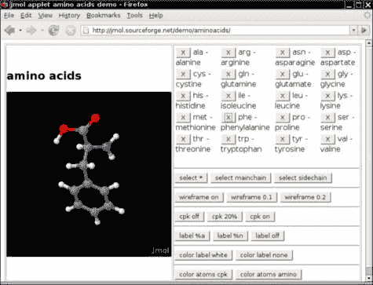图 1.1: Jmol applet

当 applet 首次出现时，引发了巨大的兴奋。许多人认为 applet 的吸引力是 Java 惊人人气的原因。然而，最初的兴奋很快变成了沮丧。不同版本的 Netscape 和 Internet Explorer 浏览器运行不同的 Java 版本，其中某些已经严重过时。这种糟糕的情况使得开发利用最新 Java 版本的 applet 越来越困难。相反，Adobe 的 Flash 技术因实现浏览器动态效果而流行。后来，当 Java 被严重的安全问题困扰时，浏览器完全放弃了 applet 支持。当然，Flash 的命运也不好。

## 1.4 Java 简史

本节提供了 Java 演变的简史。它基于各种出版来源（最重要的是 1995 年 7 月份 *SunWorld* 在线杂志对 Java 创造者的采访）。

Java 可以追溯到 1991 年，当时一个由 Patrick Naughton 和 James Gosling（Sun Fellow，也是一位全能计算机大师）领导的 Sun 工程师小组想要设计一种用于电缆电视机盒等消费设备的小型计算机语言。由于这些设备没有大量的功率或内存，这种语言必须很小并且生成非常紧凑的代码。此外，由于不同的制造商可能会选择不同的中央处理单元（CPU），该语言不绑定到任何单一架构是至关重要的。该项目的代号为“Green”。

对小巧、紧凑且平台无关代码的需求，促使团队设计了一种可移植语言，为虚拟机生成中间代码。

Sun 公司的员工来自 UNIX 背景，因此他们基于 `C++` 而开发了这种语言，而不是 Lisp、Smalltalk 或 Pascal。但正如高斯林（Gosling）在采访中所说：“从始以来，这种语言一种工具，而不是目的。”高斯林决定将他的语言命名为“Oak”（可能是因为他喜欢 Sun 公司办公窗外那棵橡树的样子）。Sun 的员工们后来发现 `Oak` 是一个已经存在的计算机语言名称，于是他们将其更名为 `Java`。事实证明，这是一个非常有眼光的选择。

9992 年，Green 项目交付了他们的第一件产品，名为“7”。这是一个极其智能的遥控器。遗憾的是，Sun 内部没有人对生产这种产品感兴趣，Green 项目的人们不得不寻找其他方式来营销他们的技术。然而，没有任何标准的消费电子公司对此感兴趣。随后，该小组竞标了一个电缆电视盒的项目，该盒子能够处理视频点播等新兴的电缆业务。但他们没有获得合同。（有趣的是，获得合同的公司是由创立 Netscape 的同一个 Jim Clark 领导的——而这家公司对 Java 的成功做出了巨大贡献。）

Green 项目（更名为“First Person, Inc.”）在 1993 年全年和 1994 年的上半年里都在寻找购买其技术的人。一无所获。（Patrick Naughton 是该小组的创始人之一，也是承担了大部分营销工作的人，他声称在尝试销售该技术的过程中积累了 30 万英里的飞行里程。）First Person 在 1994 年解散。

当 Sun 正在进行这些活动时，互联网的广维网部分正变得越来越大。广维网的关键在于浏览器将超文本页面翻译到屏幕。1994 年，大多数人使用的是 Mosaic，这是一种非商业网络浏览器，它于 1993 年来自伊利诺伊大学的超级计算中心。（Mosaic 的部分代码是由 Marc Andreessen 在本科生期间通过一个勤工俭的项目编写的，薪水每小时 6.85 美元。随后，他作为 Netscape 的联合创始人之一和首席技术官获得了名利双收。）

在 `SunWorld` 采访中，高斯林表示在 1994 年年中，语言开发人员意识到：“我们可以构建一个真正非常酷的浏览器。它是客户端/服务器主流领域少少数需要我们所做过的某些奇特功能之一：架构中立、实时、可靠、安全——这些问题在工作站世界中并不特别重要。所以，我们构建了一个浏览器。”

实际的浏览器是由 Patrick Naughton 和 Jonathan Payne 构建的，并演变成了 HotJava 浏览器，其设计初衷是展示 Java 的强大。该浏览器能够在网页内部执行 Java 代码。这项“技术证明”在 1995 年 5 月 23 日的 SunWorld '95 上展出，并引发了持续至今的 Java 热潮。

Sun 在 1996 年初发布了 Java 的第一个版本。人们很快意识到 Java 1.0 无法满足严肃应用开发的需求。当然，你可以使用 Java 1.0 制作一个紧张的文本小程序（applet），让文本在画布上随机移动。但在 Java 1.0 中你甚至无法进行打印。直言地说，Java 1.0 还没有准备好投入市场。它的继任版本 1.1 填充了最明显的缺陷，极大地提高了反射能力，并为 GUI 编程添加了新的事件模型。尽管如此，它仍然相当有限。

1998 年 JavaOne 会议的重大新闻是即将发布的 Java 1.2，它用复杂的的可扩展版本替换了早期像玩具一样的 GUI 和图形工具包。在 1998 年 12 月发布仅三天（！）之后，Sun 的营销部门就将名称更改为响亮的 `Java 2 Standard Edition Software Development Kit Version 1.2`。

除了标准版（Standard Edition），还引入了另外两个版本：用于手机等嵌入式设备的微型（Micro Edition），以及用于服务器端处理的企业版（Enterprise Edition）。本书侧重于标准版。

标准版的 1.3 和 1.4 版本是在初始 Java 2 发布基础上的增量改进，具有不断增长的标准库、更高的性能，当然，还修复了许多漏洞（bug）。在此期间，关于 Java applet 和客户端应用程序的大部分最初炒作消退了，但 Java 成为了服务器端应用的首选平台。

5.0 版本是自 1.1 版本以来首次以重大方式更新 Java 语言的版本。（该版本最初编号为 1.5，但在 2004 年 JavaOne 会议上版本号跳到了 5.0。）经过多年的研究，泛型（大致可以比拟 `C++` 模板）被加入了——挑战是在不要求更改虚拟机的情况下添加此功能。其他几个实用的语言特性也受到了 `C#` 的启发：“for each”循环、自动装箱（autoboxing）和注解。

版本 6（不带 .0 后缀）于 2006 年底发布。同样，没有语言变化，只有额外的性能改进和库增强。


随着数据中心日益依赖通用硬件而非专用服务器，Sun Microsystems 陷入了困境，并于 2009 年被 Oracle 收购。Java 的开发停滞了很久。2011 年，Oracle 发布了带有简单增强的新版本——Java 7。

2014 年，Java 8 随之发布，带来了二十年来语言最重大的变化。Java 8 拥抱了函数式编程风格，使得并发计算变得简单。从 2018 年开始，Java 每六月发布一个版本，以便快速引入预览功能。新功能可能会经过几轮预览。例如，`switch` 的模式匹配从 Java 17 开始预览了四次，直到在 Java 21 中最终确定。在生产环境中使用 Java，通常会坚持长期支持（LTS）版本，获得若干年的漏洞修复和安全更新。到为止，这种情况发生在 Java 11、Java 17 和 Java 21 上。

表 1.1 显示了 Java 语言和库的演变。你可以看到，应用程序接口（API）的规模巨大增长。

### 表 1.1 Java 语言演变

| 版本 | 年度 | 新语言特性 | 类和接口数量 |
| --- | --- | --- | --- |
| 1.0 | 1996 | 语言本身 | 211 |
| 1.1 | 1997 | 内部类 | 477 |
| 1.2 | 1998 | `strictfp` 修饰符 | 1524 |
| 1.3 | 2000 | 无 | 1840 |
| 1.4 | 2002 | 断言（assertions） | 2723 |
| 5.0 | 2004 | 泛型类、for each 循环、变长、自动装箱、元数据、枚举、静态导入 | 3279 |
| 6 | 2006 | 无 | 3793 |
| 7 | 2011 | 支持字符串的 `switch`、菱形操作符、二进制字面量、异常处理增强 | 4024 |
| 8 | 2014 | Lambda 表达式、带方法的接口、流和日期时间库 | 4240 |
| 9 | 2017 | 模块、杂项语言和库增强 | 6005 |
| 11 | 2018 | 局部变量类型推断（`var`）、HTTP 客户端、移除 Java FX、JNLP、Java EE 重叠以及 CORBA | 4,410 |
| 17 | 2021 | `Switch` 表达式、文本块、`instanceof` 模式匹配、记录、密封类 | 4,859 |
| 21 | 2023 | 虚拟线程、模式匹配 | 4,882 |

## 1.5 关于 Java 的常见误解

本章将以关于 Java 常见误解的注释列表作为结束。

### Java 是 HTML 的扩展

Java 是一种编程语言；HTML 是一种描述网页结构的方式。它们之间没有任何共同点，仅仅是曾经存在过 HTML 扩展，用于在网页上放置 Java applet。

### 我使用 XML，所以我不需要 Java

Java 是一种编程语言；XML 是一种描述数据的方式。你可以使用任何编程语言处理 XML 数据，但 `Java API` 包含了 XML 处理提供了极佳的支持。此外，许多重要的 XML 工具都是用 Java 实现的。更多信息请参阅第二卷。

### Java 是一种容易学习的编程语言

没有任何像 Java 这样强大的编程语言是容易的。你总是必须区分编写玩具程序的难易程度与执行严肃工作的难易程度。此外，请考虑本书书中只有七章讨论了 Java 语言。两卷书的其余章节都展示了如何使用 Java `libraries` 让这种语言工作起来。Java 库包含数千个类和接口，以及数万个函数。幸运的是，你不需要了解其中的每一个，但为了用 Java 承担任何实际工作，你确实需要了解其中令人惊讶的很多。

### Java 将成为适用于所有平台的通用编程语言

这在理论上是可能的。但在实践中，某些领域其他语言已经根深蒂固。Objective C 及其继者 `Swift` 不会在 iOS 设备上被取代。浏览器中发生的任何事情都由 `JavaScript` 控制。Windows 程序是用 `C++` 或 `C#` 编写的。Java 在服务端编程和跨平台客户端应用方面具有优势。

### Java 仅仅是另一种编程语言

Java 是一种很好的编程语言；大多数程序员更倾向于它 own `C`、`C++` 或 `C#`。但已经出现过数百种优秀的编程语言从未获得广泛流行，而像 `C++` 和 `Visual Basic` 这样具有明显缺陷的语言却取得了巨大的成功。

为什么？一种编程语言的成功很大程度上取决于其周围 `support system` 的实用性，而不是其语法的优雅性。对于你需要实现的功能，是否有有用、方便且标准的库？是否有构建优秀编程和调试环境的工具供应商？该语言和工具 set 是否与计算基础设施的其他部分集成？Java 之所以成功，是因为它的库让你能够轻松地处理网络、Web 应用程序和并发等。Java 减少指针错误是一个额外奖励，因此程序员在使用 Java 时似乎效率更高——但这些因素并不是它成功的根源。

### Java 是专有的，因此应该被避免使用

当 Java 最初被创建时，Sun Microsystems 向分发商和最终用户提供了免费许可。尽管 Sun 对 Java 拥有最终控制权，但他们让许多其他公司参与了语言版本的开发和新库的设计。虚拟机和库的源代码一直免费提供，但仅供检查，而不供修改和重新分发。Java 是“闭源的，但表现得很友善”。

这种情况在 2007 年发生了戏剧变化，当时 Sun 宣布未来的 Java 版本将在通用公共许可证（GPL）下提供，这是与 Linux 使用的相同的开源许可。Oracle 已经承诺保持 Java 开源。现在有多个开放 Java 实现的供应商，具有不同程度的承诺和支持。

### Java 是解释执行的，所以对于严肃的应用来说太慢了

在 Java 早期，这种语言是解释执行的。如今，`Java virtual machine` 使用即时编译器（just-in-time compiler）。你代码中的“热点”在 Java 中的运行速度与 `C++` 一样快，在某些情况下甚至更快。

### 所有 Java 程序都运行在网页内部

曾有一段时间 Java `applets` 运行在浏览器内部。如今，Java 程序是运行在浏览器之外的独立应用程序。事实上，大多数 Java 程序运行在服务器上，为网页生成代码或计算业务逻辑。

### Java 程序是重大的安全风险

在 Java 早期，曾有一些关于 Java 安全系统失败的公开报道。研究人员将其视为一种寻找 Java 盔甲上的漏洞并违背 applet 安全模型强大性和复杂性的挑战。他们发现的技术失败被迅速纠正。后来，出现了更严重的漏洞，Sun 以及随后的 Oracle 对此的反应缓慢。浏览器厂商停止了对 Java applet 的支持。让 applet 成为可能的安全管理器架构已被弃用。如今，Java 应用程序的安全性不亚其他应用程序。由于虚拟机的保护，它们比用 `C` 或 `C++` 编写的应用程序安全得多。

### JavaScript 是 Java 的简化版本

`JavaScript` 是一种可以在网页内部使用的脚本语言，由 Netscape 发明，最初名为 `LiveScript`。`JavaScript` 的语法让人联想起 `Java`，且两种语言的名字听起来相似，除此之外它们之间没有关系。特别是，Java 是 `strongly typed`（强类型的）——编译器可以捕捉许多由于类型误用引起的错误。在 `JavaScript` 中，此类错误只有在程序运行时才能被发现，这使得消除这些错误变得辛苦得多。

### 有了 Java，我可以用廉价的“互联网家电”代替我的桌面电脑

当 Java 最初发布时，有些人大注注这将会发生。公司生产了 Java 驱动的计算机的原型，但用户尚未准备好放弃强大且方便的桌面电脑，转而使用没有本地存储的限制机器。如今当然世界已经变了，对于大多数最终用户来说，重要的平台是手机或平板电脑。这些设备大部分由基于 Java 的 Android 平台控制。学习 Java 编程将帮助你的 Android 编程。

# 2 Java 环境

在本章，你将学习如何安装 Java 开发工具包（JDK）以及如何编译和运行 Java 程序。你可以在终端窗口中输入命令来运行 JDK 工具。然而，许多程序员更喜欢集成开发环境的舒适性。你将学习如何使用免费提供的开发环境来编译和运行 Java 程序。一旦你掌握了本章中的技术并选择了你的开发工具，就可以进入第 3 章了，在途中你将开始探索 Java 编程语言。

## 安装开发包

在过去，最完整、最新的 Java 开发工具包（`JDK`）可以从 Oracle 获取。如今，许多不同的公司和组织（包括 Amazon、Azul、Microsoft 和 Red Hat）提供最新的 `OpenJDK` 构建。每个供应商都有不同的许可条件和支持方案。

### 下载 JDK

你可以从 Eclipse Foundation 的 [`adoptium.net`](https://adoptium.net) 下载 Java 开发工具包，或者从 Oracle 的 [`www.oracle.com/java/technologies/downloads`](https://www.oracle.com/java/technologies/downloads) 下载，或者从其他许多供应商处下载。

取决于提供商的不同，Java 开发工具包（Java Development Kit）可能有品牌名称，例如 Temurin（Eclipse 基金会）、Corretto（亚马逊）或 Zulu（Azul）。品牌名称对于 Java 程序员来说并不重要。

你应该使用 Java SE 21（LTS）JDK。请参阅表 2.1 获取有关你在下载网站上可能遇到的缩写和术语的总结。

### 表 2.1：Java 术语

| 名称 | 缩写 | 解释 |
| --- | --- | --- |
| Java 开发工具包 | JDK | 为想要编写 Java 程序的程序员提供的软件。 |
| Java 运行环境 | JRE | 用于运行 Java 程序的软件，不包含开发工具。仅支持到 Java 8。你并不想要这种。 |
| 标准版 | SE | 用于桌面端和简单服务器应用程序的 Java 平台。这是你需要的。 |
| 微型版 | ME | 用于小型设备的 Java 平台。 |
| OpenJDK | — | Java SE 的免费开源实现。 |
| Hotspot | — | 由 Oracle 开发的“即时”编译器。如果被问及，选择这一个。 |
| OpenJ9 | — | 由 IBM 开发的另一个“即时”编译器。 |
| GraalVM | — | 一种用于可执行文件的“提前”编译器，启动速度快，但不支持所有的 Java 特性。在书中不需要它。 |
| 长期支持 | LTS | 一种支持多年的版本，与展示新功能的六个月一次的版本不同。选择最新的 LTS 版本。 |
| Eclipse | — | 分发开源软件的基金会。 |
| Temurin | — | Eclipse 基金会分发的 OpenJDK 版本的品牌名称。 |
| Adoptium | — | Eclipse 基金会内部的一个项目，为其分发提供 OpenJDK 版本和基础设施支持。 |

### 2.1.2 设置 JDK

下载 JDK 后，你需要安装它并确定它安装在了哪里——你以后会需要这些信息。

如果你运行 Windows 或使用 Mac，只需启动安装程序并选择默认选项即可。

在 Linux 上，将 `.tar.gz` 文件解压到你选择的位置，例如你的家目录或 `/opt`。然后，将 `PATH` 设置为 JDK 所在目录的 `bin` 子目录，例如 `/opt/jdk-21.0.4/bin`。这通常通过在你的 `~/.bashrc` 或 `~/.bash_profile` 文件末尾添加如下的一行来实现：

```bash
export PATH=/opt/jdk-21.0.4/bin:$PATH
```

以下是测试你是否操作正确的方法。启动终端窗口。输入该行：

```bash
javac --version
```

并按回车键。你应该得到类似这样的显示：

```text
javac 21.0.4
```

如果你收到的是类似“javac: command not found”或“指定的名称不是内部或外部命令、可运行程序或批文件”的消息，那么你需要双检你的安装情况。

了解 JDK 在系统上的安装位置通常很有用——请参阅表 2.2。在书中，安装目录标记为 `jdk`。例如，当提到 `jdk/bin` 目录时，我指的是类似 `/opt/jdk-17.0.4/bin` 或 `C:\Program Files\Java\jdk-21\bin` 的目录。

### 表 2.2：JDK 安装目录

| 平台 | 示例目录 |
| --- | --- |
| Windows（Adoptium） | `C:\Program Files\Eclipse Adoptium\jdk-21.0.4.11-hotspot` |
| Windows（Oracle OpenJDK） | `C:\Program Files\Java\jdk-21` |
| Mac OS | `/Library/Java/JavaVirtualMachines/jdk-21.0.4_11.jdk/Contents/Home` |
| Linux | 你解压 `.tar.gz` 文件的位置，例如 `/opt/jdk-21.0.4` |

在 Windows 上，Oracle JDK 安装程序会将目录 `C:\Program Files\Common Files\Oracle\Java\javapath` 添加到 `PATH` 环境变量。该目录仅包含 `javac`、`javaw`、`java` 和 `jshell` 可执行文件。（将在本章中学习如何使用 `javac`、`java` 和 `jshell`。`javaw` 可执行文件是 Windows 特有的功能，用于在不启动控制台窗口的情况下启动程序。）Java 开发工具包中的其他工具可以在 JDK 安装目录的 `bin` 子目录中找到。调用这些程序时，要么指定完整路径（例如 `javadoc` 工具的路径 `C:\Program Files\Java\jdk-21\bin\javadoc`），要么将 `bin` 子目录添加到 `PATH` 环境变量。实现这一点的一种方法是使用 `setx` 命令：

```bat
setx PATH "%PATH%;c:\Program Files\Java\jdk-21\bin"
```

打开另一个终端窗口使更改生效。

[`adoptium.net`](https://adoptium.net) 安装程序没有这个问题。它将所有 JDK 工具都添加到了 `PATH`。

### 2.1.3 安装源文件和文档

库源码文件以压缩文件 `jdk/lib/` 的形式随 JDK 提供。

```bash
javac Welcome.java
java Welcome
```

在终端窗口中，你应该能看到图 2.1。图 2.1：编译并运行 `Welcome.java`。

恭喜！你刚刚编译并运行了你的第一个 Java 程序。

发生了什么？`javac` 程序是 Java 编译器。它将 `Welcome.java` 文件编译成 `Welcome.class` 文件。`java` 程序启动 Java 虚拟机。它执行编译器放置在类文件中的字节码。

`Welcome` 程序非常简单。它只是向终端打印了一条条消息。你可能想看一眼程序的内部结构，如代码列表 2.1：

```java
{
    String greeting = "Welcome to Core Java!";
    System.out.println(greeting);

    for (int i = 0; i < greeting.length(); i++)
        System.out.print("=");

    System.out.println();
}
```


在集成开发环境时代，许多程序员并不熟悉在终端窗口中运行程序。可能会出现任何问题，导致令人沮丧的结果。

请注意以下几点：

1. 如果你是手动输入程序，请确保正确输入了大写和小写字母。特别是，类名是 `Welcome`，而不是 `welcome` 或 `WELCOME`。

2. 编译器需要一个文件名（`Welcome.java`）。当你运行程序时，指定的是类名（`Welcome`），而不带 `.java` 或 `.class` 扩展名。

3. 如果你收到诸如“Bad command or file name”（无效命令或文件名）或 `javac: command not found`（找不到命令 `javac`）的消息，请返回并双检你的安装情况，特别是可执行路径的设置。

4. 如果 `javac` 报告找不到文件 `Welcome.java`，你应该检查该文件是否存在于目录中。

   - 在 Linux 下，检查你 `Welcome.java` 的大小写是否正确。
   - 在 Windows 下，使用 `dir` 命令，而不是图形化的资源管理器。某些文本编辑器（特别是记事本）会坚持为每个文件名添加 `.txt` 扩展名。如果你使用记事本编辑 `Welcome.java`，它实际上会保存为 `Welcome.java.txt`。在默认 Windows 设置下，资源管理器会与记事本配合并隐藏 `.txt` 扩展名，因为它属于“已知文件类型”。在这种情况下，你需要重命名文件，或者在再次保存时给文件名加上引号：`"Welcome.java"`。

5. 如果你启动程序并收到关于 `java.lang.NoClassDefFoundError` 的错误信息，请仔细检查引起错误的类名。

   - 如果你收到关于 `welcome`（写为小写 `w`）的投诉，那么你应该重新输入带大写 `W` 的 `java Welcome` 命令。一如既往，Java 对大小写非常敏感。
   - 如果你收到关于 `Welcome/java` 的投诉，意味着你不小心输入了 `java Welcome.java`。重新输入命令 `java Welcome`。

从 Java 11 开始，如果你只有一个源文件，可以跳过 `javac` 命令。此功能旨在 shell 脚本（以“shebang”行 `#!/path/to/java` 开头）也许也用于简单的学生程序。一旦你的程序变得复杂，你就需要使用 `javac`。

`Welcome` 程序并不特别有趣。接下来，尝试一个图形化应用程序。这个程序是一个简单的图像文件查看器，用于加载并显示图像。和之前一样，从命令行编译并运行程序。

1. 打开终端窗口。
2. 切换到目录 `corejava/v1ch02/ImageViewer`。
3. 输入以下内容：

```java
javac ImageViewer.java
java ImageViewer
```

弹出一个新程序窗口显示 ImageViewer 应用程序。现在，选择文件（File）→ 打开（Open）并寻找一个图像文件打开。（同一目录下有几个示例文件。）图像显示出来（见图 2.2）。要关闭程序，点击标题栏上的关闭框，或从菜单选择文件（File）→ 退出（Exit）。


图 2.2：运行 ImageViewer 应用程序

快速查看源代码（代码列表 2.2）。该程序比第一个程序长得多，但如果你考虑到用 C 或 C++ 编写类似的应用需要多少代码，它就并不复杂。当然，现在编写带有图形用户界面的桌面应用程序已不常见了，但如果你感兴趣，可以在第二卷第 10 章

```java
{
   EventQueue.invokeLater(() ->
      {
         var frame = new ImageViewer();
         frame.setTitle("ImageViewer");
         frame.setDefaultCloseOperation(JFrame.EXIT_ON_CLOSE);
         frame.setVisible(true);
      });
   }
}

/**
 * 带标签的帧。
 */
class ImageViewer extends JFrame
{
   private static final int DEFAULT_WIDTH = 300;
   private static final int DEFAULT_HEIGHT = 400;

   public ImageViewer()
   {
      setSize(DEFAULT_WIDTH, DEFAULT_HEIGHT);

      // 使用标签显示
      var label = new JLabel();
      add(label);

      // 设置文件选择器
      var chooser = new JFileChooser();
      chooser.setCurrentDirectory(new File("."));

      // 设置菜单栏
      var menuBar = new JMenuBar();
      setJMenuBar(menuBar);

      var menu = new JMenu("File");
      menuBar.add(menu);

      var openItem = new JMenuItem("Open");
      menu.add(openItem);
      openItem.addActionListener(event ->
         {
            // 显示文件对话框
            int result = chooser.showOpenDialog(null);

            // 如果选择了文件，将其设为标签图标
            if (result == JFileChooser.APPROVE_OPTION)
            {
               String name = chooser.getSelectedFile().getPath();
               label.setIcon(new ImageIcon(name));
            }
         });

      var exitItem = new JMenuItem("Exit");
      menu.add(exitItem);
      exitItem.addActionListener(event -> System.exit(0));
   }
}
```

## 2.3 使用集成开发环境

在前面的节中，你看到了如何从命令行编译和运行 Java 程序。这是一种实用的排除故障技能，但对于大多数日常工作，你应该使用集成开发环境。这些环境强大且方便，不使用它们工作完全没有意义。优秀的选择有免费提供的 Eclipse、IntelliJ IDEA 和 NetBeans。在本章中，你将学习如何使用 Eclipse。当然，如果你喜欢不同的开发环境，完全可以在本书中使用它。

从 [`eclipse.org/downloads`](https://eclipse.org/downloads) 下载 Eclipse 开始。存在适用于 Linux、Mac OS X 和 Windows 的版本。运行安装程序并选择名为“Eclipse IDE for Java Developers”的安装包。

以下是用 Eclipse 编写程序的步骤：

1. 启动 Eclipse 后，从菜单选择文件（File）→ 新（New）→ 项目（Project）。
2. 在向导对话框中选择“Java 项目”（Java Project）（见图 2.3）。

   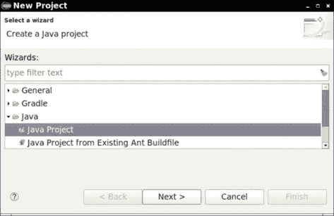

   图 2.3：Eclipse 中的新建项目对话框

3. 点击 `Next` 按钮。取消勾选“Use default location”复选框。点击 `Browse` 并导航到 `corejava/v1ch02/Welcome` 目录（图 2.4）。

   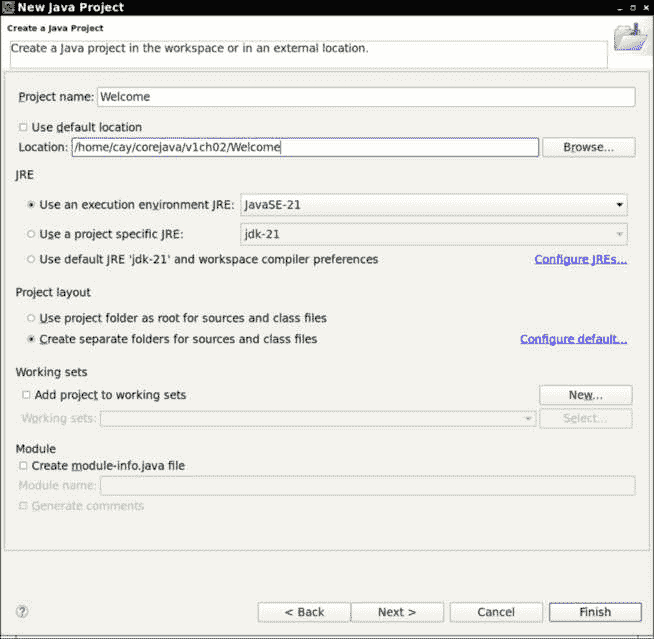

   图 2.4：在 Eclipse 中配置项目

4. 点击 `Finish` 按钮。项目现在已创建。
5. 点击左侧窗格项目旁边的三角形，直到找到 `Welcome.java` 文件，然后双击它。你现在应该能看到显示程序代码的窗格（参见图 2.5）。

   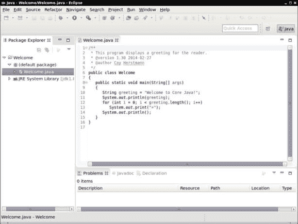

   图 2.5：使用 Eclipse 编辑源文件

6. 使用鼠标右键点击左侧窗格中的项目名称（`Welcome`）。选择 `Run` → `Run As` → `Java Application`。程序输出显示在控制台面板中。

推测，这个程序没有拼写错误或错误。（毕竟它只有几行代码。）为了起见，让我们假设你的代码偶尔包含拼写错误（甚至可能是语法错误）。尝试一下——例如，通过如下方式更改 `String` 的大小写来破坏你的文件：

```java
string greeting = "Welcome to Core Java!";
```

注意 `string` 下方的波浪线。在源代码下方的标签页中，点击 `Problems` 并展开三角形，直到你看到一条抱怨关于未知 `string` 类型的错误消息（参见图 2.6）。点击该错误消息。光标会移动到编辑窗格中对应的行，你可以在那里纠正错误。这允许你快速修复错误。

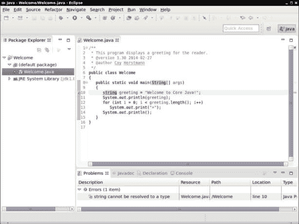

图 2.6：Eclipse 中的错误消息

通常，Eclipse 错误报告会伴随一个灯泡图标。点击灯泡可以获取建议的修复列表。

## 2.4 JShell

JShell 程序提供了一个“读取-评估-打印循环”，或 REPL。你输入一个 Java 表达式；JShell 评估你的输入，打印结果并等待你的下次输入。这是实验的极佳方法——比在集成开发环境中编写一个完整的程序快得多。

要启动 JShell，只需在终端窗口中输入 `jshell`（参见图 2.7）。

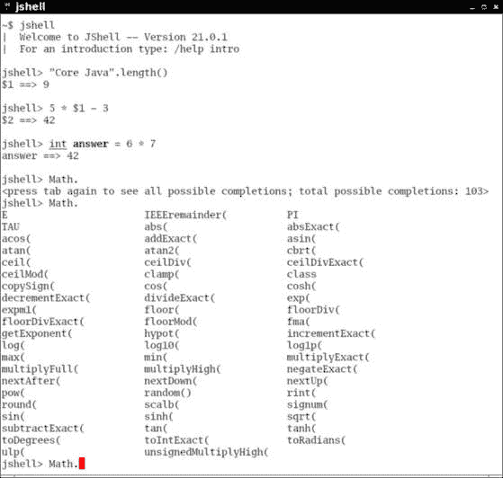

图 2.7：运行 JShell

JShell 以一个问候开始，随后是提示符：

```text
|  Welcome to JShell -- Version 21.0.4
|  For an introduction type: /help intro

jshell>
```

现在输入一个表达式，例如：

```java
"Core Java".length()
```

JShell 响应结果——在这种情况下，是字符串“Core Java”中的字符数。

```text
$1 ==> 9
```

注意，你不需要输入 `System.out.println`。JShell 会自动打印你输入的每个表达式的值。

输出中的 `$1` 表示结果可以用于进一步计算。例如，如果你输入：

```java
5 * $1 - 3
```

```text
$2 ==> 42
```

如果你需要多次使用变量，可以给它起一个更好记的名字。例如：

```java
jshell> var answer = 6 * 7
answer ==> 42
```

另一个有用功能是 Tab 补全。输入：

```java
Math.
```

然后按 Tab 键。因为有很多补全选项，系统提示你再次按 Tab 键。你可以使用 `Math` 类调用的所有方法列表：

```text
jshell> Math.
E                       IEEEremainder(          PI                      
TAU                     abs(                    absExact(               
acos(                   addExact(               asin(                   
atan(                   atan2(                  cbrt(                   
ceil(                   ceilDiv(                ceilDivExact(           
ceilMod(                clamp(                  class                   
copySign(               cos(                    cosh(                   
decrementExact(         divideExact(            exp(                    
expm1(                  floor(                  floorDiv(               
floorDivExact(          floorMod(               fma(                    
getExponent(            hypot(                  incrementExact(         
log(                    log10(                  log1p(                  
max(                    min(                    multiplyExact(          
multiplyFull(           multiplyHigh(           negateExact(            
nextAfter(              nextDown(               nextUp(                 
pow(                    random()                rint(                   
round(                  scalb(                  signum(                 
sin(                    sinh(                   sqrt(                   
subtractExact(          tan(                    tanh(                   
toDegrees(              toIntExact(             toRadians(              
ulp(                    unsignedMultiplyHigh( 
```

现在输入 `l` 并再次按 Tab 键。方法名被补全为 `log`，你会得到一个更短的列表：

```text
jshell> Math.log
log(     log10(   log1p(
```

现在你可以手动填写剩余部分：

```java
jshell> Math.log10(0.001)
$4 ==> -3.0
```

标准的命名规范（用于名称 `FirstSample` 中）是类名是以大写字母开头的名词。如果一个名称包含多个单词，请将每个单词的首字母都大写。这种在名称中间使用大写字母的方法有时被称为“驼峰命名法”（camel case），或者自指地称为“CamelCase”。

你需要将源代码的文件名与公共类的名称相同，并加上扩展名 `.java`。因此，你必须将此代码存储在名为 `FirstSample.java` 的文件中。（再次强调，大小写很重要——不要使用 `firstsample.java`。）

你使用以下命令编译文件：

```bash
javac FirstSample.java
```

如果你正确命名了文件且在源代码中没有出现任何拼写错误，就会得到一个包含该类字节码的文件。Java 编译器会将字节码文件命名为 `FirstSample.class`，并将其存储在源文件相同的目录中。最后，通过执行以下命令启动程序：

```bash
java FirstSample
```

（记住省略 `.class` 扩展。）当程序执行时，它仅仅会在控制台上显示字符串 `We will not use 'Hello, World!'`。

当你使用

```bash
java ClassName
```

来运行编译后的程序时，Java 虚拟机始终会从你指定的类中 `main` 方法的代码开始执行。（“method”一词是 Java 语言中对函数的术语。）因此，你必须在类的源文件中包含一个 `main` 方法，你的代码才能执行。当然，你可以向类中添加自己的方法，并在 `main` 方法中调用它们。（你将在下一章中看到如何编写自己的方法。）

根据 Java 语言规范，`main` 方法必须被声明为 `public`。（Java 语言规范是描述 Java 语言的官方文档。你可以从 [`docs.oracle.com/javase/specs`](https://docs.oracle.com/javase/specs) 查看或下载它。）


然而，多个版本的 Java 启动器即使在 `main` 方法不是 `public` 的情况下也愿意执行 Java 程序。一位程序员提交了 bug 报告。要查看它，请访问 [`bugs.openjdk.org/browse/JDK-4252539`](https://bugs.openjdk.org/browse/JDK-4252539)。在 1999 年，该 bug 被标记为“关闭，将不修复”。一位 Sun 工程师增加了说明，Java 虚拟机规范并没有规定 `main` 必须是 `public`，并且“修复它会导致潜在的问题”。幸运的是，理智胜过了。Java 1.4 及更高版本的 Java 启动器强制 `main` 方法必须是 `public`。

当然，让质量保证工程师（他们通常工作过量，且并不总是 Java 细微领域的专家）对 bug 报告做出令人怀疑的决定是令人沮丧的。但是，在 Java 开源之前，bug 报告及其解决方案就已经供任何人审查了，这非常了不起。

注意源代码中的大括号 `{ }`。在 Java 中，就像在 C/C++ 中一样，大括号划分了程序中的部分（通常称为*块* *blocks*）。在 Java 中，任何方法的代码必须以左大括号 `{` 开始，以右大括号 `}` 结束。

大括号样式引发了大量的无用争议。本书遵循一种使匹配大括号对齐的风格。由于空白字符对 Java 编译器无关，你可以使用任何喜欢的大括号样式。

目前，不要担心 `static void` 关键字——只需将它们看作是让 Java 程序编译所需的组成部分。到第 4 章结束时，你将完全理解这个咒语。现在需要记住点是，每个 Java 应用程序必须有一个以以下方式声明的 `main` 方法：

```
public class ClassName
{
   public static void main(String[] args)
   {
      program statements
   }
}
```

`public static void main` 复杂的构造即将被更简单的东西取代。Java 21 有一个预览功能，在 Java 增强提议 (JEP) 445 中描述，允许你像这样写 `main` 方法：

```
class FirstSample
{
   void main()
   {
      System.out.println("We will not use 'Hello, World!'");
   }
}
```

这样更好了。没有 `public`，没有 `static`，没有 `String[] args`。

目前，你需要使用命令行标志编译并运行程序：

```
javac --enable-preview --source 21 FirstSample.java
java --enable-preview FirstSample
```

更简单，因为只有一个源文件，你可以跳过 `javac` 步骤：

```
java --enable-preview --source 21 FirstSample.java
```

在本本书中，我们采用类和面向对象编程。但对于非常简单的程序，JEP 445 允许你省略类，前提是只有一个类。`FirstSample.java` 文件可以简单地包含：

```java
void main()
{
   System.out.println("We will not use 'Hello, World!'");
}
```

由于这些功能仍然处于预览阶段，我不会在本版中使用它们，但在未来，第一个示例程序将会简单一些。

由于这些功能仍然处于预览阶段，我不会在本版中使用它们，但在未来，第一个示例程序将会简单一些。

由于这些功能仍然处于预览阶段，我不会在本版中使用它们，但在未来，第一个示例程序将会简单一些。

由于这些功能仍然处于预览阶段，我不会在本版中使用它们，但在未来，第一个示例程序将会简单一些。

现在你已经了解了所有 Java 程序的基本结构，请关注 `main` 方法的内容：

```
{
   System.out.println("We will not use 'Hello, World!'");
}
```

`System.out` 对象以及调用它的 `println` 方法。注意用于调用方法的点符号。Java 使用通用语法

```
object.method(arguments)
```

在这种情况下，`println` 方法接收了一个字符串参数。该方法在控制台上显示该字符串参数。随后它会结束输出行，因此每次调用 `println` 都会在新行显示输出。注意 Java 像 C/C++ 一样使用双引号来界定字符串。（你可以在本章后面的部分找到更多关于字符串的信息。）

Java 中的方法像任何编程语言中的函数一样，可以使用零、一个或多个*参数* *arguments*。即使方法没有参数，你也必须使用空括号。例如，没有参数的 `println` 方法变体只是打印一个空行。你通过以下调用执行它：

```
System.out.println();
```

`System.out` 还有一个 `print` 方法，它不会在输出中添加换行符。例如，`System.out.print("Hello")` 会打印 `Hello` 而不换行。下一个输出将紧接在字母 `o` 之后。

Java 中的注释与大多数编程语言一样，不会显示在可执行的程序中。因此，你可以根据需要添加尽可能多的注释，而不必担心会导致代码膨肿。Java 有三种标记注释的方法。最常见的形式是 `//`。使用这种符号来表示从 `//` 直到行尾的注释。

```
System.out.println("We will not use 'Hello, World!'"); // is this too cute?
```

当需要较长的注释时，你可以用 `//` 标记每一行，或者使用 `/*` 和 `*/` 注释边界符来界定一段较长的注释。

最后，第三种注释用于自动生成文档。这种注释用 `/**` 开始，用 `*/` 结束。你可以在列表 3.1 中看到这种类型的注释。关于此类注释以及自动生成文档的更多信息，请参阅第 4 章。

列表 3.1 `FirstSample/FirstSample.java`

```
/**
 * This is the first sample program in Core Java Chapter 3
 * @version 1.01 1997-03-22
 * @author Gary Cornell
 */
public class FirstSample
{
   public static void main(String[] args)
   {
      System.out.println("We will not use 'Hello, World!'");
   }
}
```

`/* */` 注释在 Java 中是不嵌套的。这意味着，你可能无法简单地通过将代码包裹在 `/*` 和 `*/` 中来禁用，因为你想要禁用的代码本身可能包含了 `*/` 边界符。

## 3.3 数据类型

Java 是一种*强类型语言*。这意味着每个变量都必须声明类型。Java 中有八种*基本数据类型*。其中四种是整数类型；两种是浮点数类型；一种是字符类型 `char`，用于 Unicode 编码方案中的 UTF-16 代码单元（参见第 3.3.3 节）；另一种是用于布尔值的 `boolean` 类型。

Java 拥有一个任意精度算术包。然而，所谓的“大数”是 Java 的*对象*，而不是 Java 的基本类型。你将在本章的后续部分看到如何使用它们。

### 3.3.1 整数类型

整数类型用于不带小数部分的数字。允许负值。Java 提供了表 3.1 所示的四种整数类型。

表 3.1：Java 整数类型

| 类型 | 存储要求 | 范围（包含边界） |
| --- | --- | --- |
| `byte` | 1 字节 | –128 到 127 |
| `short` | 2 字节 | –32,768 到 32,767 |
| `int` | 4 字节 | –2,147,483,648 到 2,147,483,647（略大于 20 亿） |
| `long` | 8 字节 | –9,223,372,036,854,775,808 到 9,223,372,036,854,775,807 |

在大多数情况下，`int` 类型是最实用的。如果你想表示我们地球的人口数，你将需要求助于 `long`。`byte` 和 `short` 类型主要用于特殊应用程序，例如低级文件处理，或者在存储空间极其紧张时用于大型数组。

在 Java 中，整数类型的范围不依赖于运行 Java 代码的机器。这为想要将软件从一个平台迁移到另一个平台（甚至是在同一平台的不同操作系统之间迁移）的程序员减轻了巨大的烦恼。相比之下，C 和 C++ 程序对每个处理器使用最高效的整数类型。结果是，一个在 32 位处理器上运行良好的 C 程序可能会在 16 位系统上出现整数溢出。由于 Java 程序必须在所有机器上以相同的结果运行，因此各种类型的范围是固定的。

长整型带有后缀 `L` 或 `l`（例如，`4000000000L`）。十六进制数带有前缀 `0x` 或 `0X`（例如，`0xCAFE`）。八进制数带有前缀 `0`（例如，`010` 是 8）——自然地，这可能会引起混淆，很少程序员使用八进制常量。

你可以使用前缀 `0b` 或 `0B` 写二进制数字。例如，`0b1001` 是 9。你可以在数字字面量中添加下划线，例如 `1_000_000`（或 `0b1111_0100_0010_0100_0000`）来表示百万。下划线仅供人类阅读。Java 编译器会简单地移除。

在 C 和 C++ 中，`int` 和 `long` 等类型的大小取决于目标平台。在 8086 等 16 位处理器上，整数是 2 字节，但在 Pentium 或 SPARC 等 32 位处理器上它们是 4 字节。同样，`long` 值在 32 位处理器上是 4 字节，在 64 位处理器上是 8 字节。这些差异使得编写跨平台程序具有挑战。在 Java 中，所有数值类型的大小都与平台无关。

注意，Java 没有 `int`、`long`、`short` 或 `byte` 类型的任何无符号（unsigned）版本。

如果你处理永远永远为负数的整数值，并且确实需要额外的位，你可以在小心的情况下将符号整数值解释为无符号。例如，与其让一个 `byte` 值 `b` 表示 –128 到 127 的范围，你可能想要 0 到 255 的范围。你可以将其存储在 `byte` 中。由于二进制算术的性质，只要不溢出，加法、减法和乘法就可以工作。对于其他操作，调用 `Byte.toUnsignedInt(b)` 获取 0 到 255 之间的 `int` 值，然后处理该整数。

### 3.3.2 浮点类型

浮点类型表示带有小数部分的数字。浮点类型如表 3.2 所示。

表 3.2：浮点类型

| 类型 | 存储要求 | 范围 |
| --- | --- | --- |
| `float` | 4 字节 | ±3.40282346638526E38（6–7 位有效数字） |
| `double` | 8 字节 | ±1.797693134862147E308（15 位有效数字） |

`float` 类型带有后缀 `F` 或 `f`（例如，`3.14F`）。没有 `F` 后缀的浮点数（如 `3.14`）始终被视为 `double`。你可以可选地提供 `D` 或 `d` 后缀（例如，`3.14D`）。

`E` 或 `e` 表示十进制指数。例如，`1.729E3` 等于 `1729`。

你可以用十六进制指定浮点字面量。例如，0.125 = 2^(-3) 可以写为 `0x1.0p-3`。在十六进制表示中，你使用 `p` 而不是 `e` 来表示指数。（`e` 是十六进制数字）。注意，尾数是十六进制的，指数是十进制的。指数的基是 2，而不是 10。

所有浮点运算遵循 IEEE 754 规范。特别是，有三个特殊的浮点值来表示溢出和错误：

*   正无穷
*   负无穷
*   NaN（非数字）

例如，正浮点数除以 0 的结果是正无穷。0.0 除以 0 或负数的平方根产生 NaN。

常量 `Double.POSITIVE_INFINITY`、`Double.NEGATIVE_INFINITY` 和 `Double.NaN`（以及相应的 `Float` 常量）表示了这些特殊值，但在实践中很少使用。特别是，你不能通过测试

```
if (x == Double.NaN) // 永远为假
```

来检查特定结果是否等于 `Double.NaN`。所有“非数字”值都被视为是不同的。然而，你可以使用 `Double.isNaN` 方法：

```
if (Double.isNaN(x)) // check whether x is "not a number"
```

浮点数*不*适用于不能容忍舍入误差的财务计算。例如，命令 `System.out.println(2.0 - 1.1)` 输出的是 `0.8999999999999999`，而不是你预期的 `0.9`。这种舍入误差是由浮点数在二进制数字系统中表示引起的。分数 1/10 没有精确的二进制表示，就像十进制系统中没有 1/3 的精确表示一样。如果你需要进行没有舍入误差的精确数值计算，请使用 `BigDecimal` 类，它将在本文稍后介绍。

### 3.3.3. `char` 类型

`char` 类型最初旨在描述单个字符。然而，现在情况已不再如此。如今，某些 Unicode 字符可以用一个 `char` 值来描述，而其他 Unicode 字符则需要两个 `char` 值。请阅读下一节了解细节。

`char` 类型的字面量用单引号括起来。例如，`'A'` 是一个值为 65 的字符常量。它与 `"A"` 不同，后者是一个包含单个字符的字符串。`char` 类型的值可以表述为从 `\u0000` 到 `\uFFFF` 的十六进制值。

除了 `\u` 转义序列外，还有几种特殊字符的转义序列，如表 3.3

这是完全合法的——`\u005B` 和 `\u005D` 是 `[` 和 `]` 的编码。

表 3.3：特殊字符的转义序列

| 转义序列 | 名称 | Unicode 值 |
| --- | --- | --- |
| `\b` | 退格 | `\u0008` |
| `\t` | 制表符 | `\u0009` |
| `\n` | 换行 | `\u000a` |
| `\r` | 回车 | `\u000d` |
| `\f` | 换页 | `\u000c` |
| `\"` | 双引号 | `\u0022` |
| `\'` | 单引号 | `\u0027` |
| `\\` | 反斜杠 | `\u005c` |
| `\s` | 空格。用于文本块以保留尾部空格。 | `\u0020` |
| `\``newline` | 仅用于文本块：将此行与下一行合并 | — |

Unicode 转义序列在代码解析之前会被处理。例如，`"\u0022+\u0022"` *不是*一个由引号包围加号（U+0022）组成的字符串。相反，`\u0022` 在解析之前被转换为 `"`，产生 `""+""`，即空字符串。

更阴险的是，你必须警惕注释内部的 `\u`。注释

```
// \u000A is a newline
```

会导致语法错误，因为在读取程序时，`\u000A` 被替换为换行符。同样，注释

```
// look inside c:\users
```

会导致语法错误，因为 `\u` 后面没有跟四个十六进制数字。

你可以在 Unicode 转义序列中可以包含任意数量的 `u`：`\u00E9` 和 `\uuu00E9` 都表示字符 é。这种奇怪现象是有原因的。想象一个快乐地使用 Unicode 编写代码的程序员，由于某种古老的原因，被强迫仅以 ASCII 格式提交代码。转换工具可以将任何大于 U+007F 的字符转换为 Unicode 转义序列，并向每个现有的 Unicode 转义序列添加一个 `u`。这使得转换是可逆的。例如，`\uD800 é` 被转换为 `\`uu`D800 \u00E9` 并可以转换回 `\uD800 é`。

### 3.3.4. Unicode 与 `char` 类型

为了完全理解 `char` 类型，你需要了解 Unicode 编码方案。在 Unicode 之前，有许多不同的字符编码标准：美国的 ASCII、西欧语言的 ISO 8859-1、俄语的 KOI-8、中文的 GB18030 和 BIG-5 等。这导致了两个问题。首先，特定的代码值在不同的编码方案对应不同的字母。其次，大字符集语言的编码长度可：某些常用字符用单字节编码，另一些需要两个或更多字节。

Unicode 旨在解决这两个问题。当统一工作在 20 世纪 80 代开始时，，2 字节代码足以编码世界上所有语言使用的所有字符，并为未来留有空间。

Unicode 转义序列在代码解析之前会被处理。例如，`"\u0022+\u0022"` *不是*一个由引号包围加号（U+0022）组成的字符串。相反，`\u0022` 在解析之前被转换为 `"`，产生 `""+""`，即空字符串。

更阴险的是，你必须警惕注释内部的 `\u`。注释

```
// \u000A is a newline
```

会导致语法错误，因为在读取程序时，`\u000A` 被替换为换行符。同样，注释

```
// look inside c:\users
```


会导致语法错误，因为`\u`后面没有跟四个十六进制数字。

你可以在 Unicode 转义序列中可以包含任意数量的`u`：`\u00E9`和`\uuu00E9`都表示字符 é。这种奇怪现象是有原因的。想象一个快乐地使用 Unicode 编写代码的程序员，由于某种古老的原因，被强迫仅以 ASCII 格式提交代码。转换工具可以将任何大于`U+007F`的字符转换为 Unicode 转义序列，并向每个现有的 Unicode 转义序列添加一个`u`。这使得转换是可逆的。例如，`\uD800 é`被转换为`\`uu`D800 \u00E9`并可以转换回`\uD800 é`。

为了完全理解`char`类型，你需要了解 Unicode 编码方案。在 Unicode 之前，有许多不同的字符编码标准：美国的 ASCII、西欧语言的 ISO 8859-1、俄语的 KOI-8、中文的 GB18030 和 BIG-5 等。这导致了两个问题。首先，特定的代码值在不同的编码方案对应不同的字母。其次，大字符集语言的编码长度可：某些常用字符用单字节编码，另一些需要两个或更多字节。

Unicode 旨在解决这两个问题。当统一工作在 20 世纪 80 代开始时，固定 2 字节代码足以编码世界上所有语言使用的所有字符，并为未来留有空间。

Unicode 转义序列在代码解析之前会被处理。例如，`"\u0022+\u0022"`*不是*一个由引号包围加号（`U+0022`）组成的字符串。相反，`\u0022`在解析之前被转换为`"`，产生`""+""`，即空字符串。

更阴险的是，你必须警惕注释内部的`\u`。注释

```
// \u000A is a newline
```

会导致语法错误，因为在读取程序时，`\u000A`被替换为换行符。同样，注释

```
// look inside c:\users
```

会导致语法错误，因为`\u`后面没有跟四个十六进制数字。

你可以在 Unicode 转义序列中可以包含任意数量的`u`：`\u00E9`和`\uuu00E9`都表示字符 é。这种奇怪现象是有原因的。想象一个快乐地使用 Unicode 编写代码的程序员，由于某种古老的原因，被强迫仅以 ASCII 格式提交代码。转换工具可以将任何大于`U+007F`的字符转换为 Unicode 转义序列，并向每个现有的 Unicode 转义序列添加一个`u`。这使得转换是可逆的。例如，`\uD800 é`被转换为`\`uu`D800 \u00E9`并可以转换回`\uD800 é`。

考虑 🇮🇹 旗帜。你感知到一个单一符号：意大利国旗。然而，这个符号是由两个 Unicode 码点组成的：`U+1F1EE`（区域指示符号字母 I）和`U+1F1F9`（区域指示符号字母 T）。使用这些区域指示符号可以形成约 250 种旗帜。相反，海盗旗 🏴‍☠️ 由`U+1F3F4`（飘舞黑旗）、`U+200D`（零宽连接符）、`U+2620`（骷髅交叉骨）和`U+FE0F`（变体选择器-16）组成。在 Java 中，你需要四个`char`值来表示第一个旗帜，第二个则需要五个。

总而言之，一个可见的字符或符号被编码为若干个`char`值的序列，而且几乎不需要查看单个值。请始终对字符串进行操作（参见第 3.6 节），不要担心它们作为`char`序列的表示形式。

### 3.3.5 布尔类型 Type

`boolean`类型有两个值：`false`和`true`。它被用于评估逻辑条件。你不能在整数和`boolean`值之间进行转换。

在 C++ 中，数字甚至指针都可以用来代替`boolean`值。值`0`等于`bool`值`false`，非零值等于`true`。这在 Java 中*不是*这种情况的。因此，Java 程序员可以免于此类类意外，例如：

```
if (x = 0) // 哎呀……本想写 x == 0
```

在 C++ 中，这个测试可以通过编译并运行，结果始终为`false`。在 Java 中，该测试无法编译，因为整数表达式`x = 0`无法转换为`boolean`值。

## 3.4 变量与常量

与每个编程语言一样，变量用于存储值。常量是值不会改变的变量。在接下来的章节中，你将学习如何声明变量和常量。

### 3.4.1 声明变量

在 Java 中，每个变量都有一个`type`（类型）。你通过先放置类型、后放置变量名来声明变量。以下是一些示例：

```
double salary;
int vacationDays;
long earthPopulation;
boolean done;
```

注意每个声明末尾的分号。分号是必要的，因为声明是一个完整的 Java 语句，必须以分号结束。

变量名（以及其他名称）的标识符由字母、数字、货币符号和“标点连接符”组成。第一个字符不能是数字。

像`'+'`或`'©'`这样的符号不能用于变量名内部，也不能使用空格。字母的大小是敏感的：`main`和`Main`是不同的标识符。标识符的长度本质上是无限的。

在 Java 中，“字母”、“数字”和“货币符号”这些术语的范围比大多数语言宽得多。字母是*任何*表示语言中字母的 Unicode 字符。例如，德国用户可以在变量名中使用如`ä`等变音符号；希腊语使用者可以使用`π`。同样，数字是`0`–`9`以及*任何*表示数字的 Unicode 字符。货币符号包括`$`、`€`、`¥`等。

标点连接符包括下划线字符`_`、“波浪低线”`﹏`以及其他几个。在实践中，大多数程序员坚持使用`A`-`Z`、`a`-`z`、`0`-`9`和下划线`_`。

如果你对哪些 Unicode 字符可以用于标识符感兴趣，可以使用`Character`类中的`isJavaIdentifierStart`和`isJavaIdentifierPart`方法进行检查。

尽管`$`是标识符中的有效字符，你不应该在自己的代码中使用它。它用于由 Java 编译器和其他工具生成的名称。

你不能将 Java 关键字（如`class`）用变量名。

下划线可以是标识符的一部分。这在常量名非常常见，例如`Double.POSITIVE_INFINITY`。然而，单个下划线`_`是保留字。

从 Java 21 开始，单个下划线`_`表示一个语法上需要但从不使用的变量。你将在第 6 和第 7 章中看到示例。

你可以在同一行声明多个变量：

```
int i, j; // 两个都是整数
```

我不推荐这种风格。如果你单独声明每个变量，你的程序将更易读。

正如你所见，名称对大小写敏感，例如，`hireday`和`hireDay`是两个独立的名称。通常情况下，你不应该拥有两个字母大小写不同的名称。然而，有时很难为变量起一个好名字。许多程序员会给变量起一个与类型相同的名称，例如：

```
Box box; // "Box" 是类型，“box" 是变量名
```

其他程序员则倾向于为变量使用“a”前缀：

```
Box aBox;
```

### 3.4.2 初始化变量

在声明变量后，你必须通过赋值语句显式地初始化它——你永远无法使用未初始化变量的值。例如，Java 编译器会将以下语句标记为错误：

```
int vacationDays;
System.out.println(vacationDays); // 错误--变量未初始化
```

你向变量赋值时，左侧是变量名、等号（`=`），右侧是某个值。例如：

```
int vacationDays;
vacationDays = 12;
```

你可以在同一行声明并初始化变量。例如：

```
int vacationDays = 12;
```

最后，在 Java 中你可以将声明放在代码的任何地方。例如：

```java
double salary = 65000.0;
System.out.println(salary);
```

在 Java 中，如果可以从初始值推断，则不需要声明变量的类型。只需使用`var`代替类型：

```
var vacationDays = 12; // vacationDays 是 int
var greeting = "Hello"; // greeting 是 String
```

### 3.4.3 常量

在 Java 中，你使用`final`关键字来表示常量。例如：

```java
public class Constants
{
   public static void main(String[] args)
   {
      final double CM_PER_INCH = 2.54;
      double paperWidth = 8.5;
      double paperHeight = 11;
      System.out.println("Paper size in centimeters: "
         + paperWidth * CM_PER_INCH + " by " + paperHeight * CM_PER_INCH);
   }
}
```

`final`关键字表示你可以对变量进行一次赋值，然后它的值就会固定且全局有效。常量的命名习惯是全大写。

在 Java 中，更常见的是创建一个常量以便在单个类内的多个方法中可用。这些通常被称为*类常量*。使用`static final`关键字设置类常量。以下是类常量的示例：

```java
public class Constants2
{
    public static final double CM_PER_INCH = 2.54;
    public static void main(String[] args)
    {
       double paperWidth = 8.5;
       double paperHeight = 11;
       System.out.println("Paper size in centimeters: "
          + paperWidth * CM_PER_INCH + " by " + paperHeight * CM_PER_INCH);
    }
}
```

注意类常量的定义出现在`main`方法*之外*。因此，常量可以在同类的其他方法中使用。此外，如果常量像示例所示声明为`public`，其他类的方法也可以使用它——在我们的示例中，通过`Constants2.CM_PER_INCH`使用。

某些编码风格指南规定，大写字母只应用于`static final`变量。如果你需要遵循此类风格指南，并且有一个本地常量，请决定对你来说更重要的是什么——它是局部的（并且是小写的），还是它肉眼可见是常量（`static`且大写的）。

`const`是 Java 的一个关键字，但它目前没有被用于任何地方。你必须使用`final`来定义常量。

### 3.4.4. 枚举类型

有时，变量应该只持有一组限制的值。例如，你可能销售四种尺寸的衣服或披萨：小、中、大和大号。当然，你可以将这些尺寸编码为整数`1`、`2`、`3`、`4`或字符`S`、`M`、`L`和`X`。但这样做很容易出错。变量很容易持有错误的值（例如`0`或`m`）。

每当出现这种情况，你都可以定义自己的枚举类型。枚举类型具有有限数量的命名值。例如，

```
enum Size { SMALL, MEDIUM, LARGE, EXTRA_LARGE };
```

现在你可以声明这种类型的变量：

```
Size s = Size.MEDIUM;
```

`Size`类型的变量只能持有类型声明中列出的值之一，或者特殊值`null`，表示该变量没有被赋予任何值。（有关`null`的更多信息，请参阅第 4 章中进行详细讨论。

## 3.5. 运算符

运算符用于组合值。正如你在后续章节中看到的，Java 拥有一丰富的算术运算符、逻辑运算符和数学函数。

### 3.5.1. 算术运算符

常用的算术运算符`+`、`-`、`*`和`/`在 Java 中用于加、减、乘、除。

`/`运算符如果两个操作数都是整数，则表示整数除法；否则表示浮点除法。整数除以 0 会抛出异常，而浮点除以 0 会产生无限大或 NaN 结果。

整数余数（有时称为模）由`%`表示。例如，`15 / 2`是`7`，`15 % 2`是`1`，而`15.0 / 2`是`7.5`。

当`%`的一个操作数为负数时，结果也是负数。例如，如果`n`是偶数，则`n % 2`为 0；如果`n`是正奇数，则为 1；如果`n`是负奇数，则为 -1。为什么呢？在第一批计算机制造时，有人必须为负操作数的整数余数如何工作制定规则。数学家们数百年来一直知道最优（或“欧几里德”）规则：始终保持余数 ≥ 0。但是，那些先驱者并没有打开数学书，而是想出了看似合理但实际上并不方便的规则。

考虑这个问题：你计算时钟时针的位置。应用了一个调整，并将其归一化为`0`到`11`之间的数字。这很简单：`(position + adjustment) % 12`。但如果调整是负数呢？你可能会得到一个负数。因此，你必须引入一个分支，或者使用`((position + adjustment) % 12 + 12) % 12`。无论哪种方式，都很麻烦。

更好的解决办法是使用`floorMod`方法：`Math.floorMod(position + adjustment, 12)`始终产生`0`到`11`之间的值。遗憾的是，`floorMod`对于负除数仍然给出负余数，但这种情况在实践中并不经常发生。

Java 编程语言的目标之一是移植性。无论由哪个虚拟机执行，计算都应该产生相同的结果。对于浮点数的算术计算，实现这种移植性可能非常困难。`double`类型使用 64 位来存储数值，但某些处理器使用 80 位浮点寄存器。这些寄存器在计算的中间步骤提供了额外的精度。

但结果可能与始终使用 64 位的计算不同。为了实现完美的移植性，Java 虚拟机的初始规范规定所有中间计算必须截断为 64 位。数值社区对此非常厌恶。因为截断操作在流行的处理器上需要时间，计算变慢了。因此，Java 编程语言进行了更新，以承认对最佳性能和完美可重现性的冲突需求。虚拟机设计者被允许在中间计算中使用扩展精度。然而，标记有`strictfp`关键字的方法必须使用产生可重现结果的严格浮点操作。

处理器已经变得更加灵活，现在可以高效地执行 64 位算术。从 Java 17 开始，虚拟机再次要求执行严格的 64 位算术，`strictfp`关键字现在已过时。

### 3.5.2. 数学函数和常量

`Math`类包含了你可能根据所从事的编程类型偶尔需要的各种数学函数。

要获取一个数的平方根，请使用`sqrt`方法：

```
double x = 4;
double y = Math.sqrt(x);
System.out.println(y); // prints 2.0
```

### 3.5.3 数值类型之间的转换

通常需要从一种数值类型转换为另一种数值类型。图 3.1 显示了法的转换。

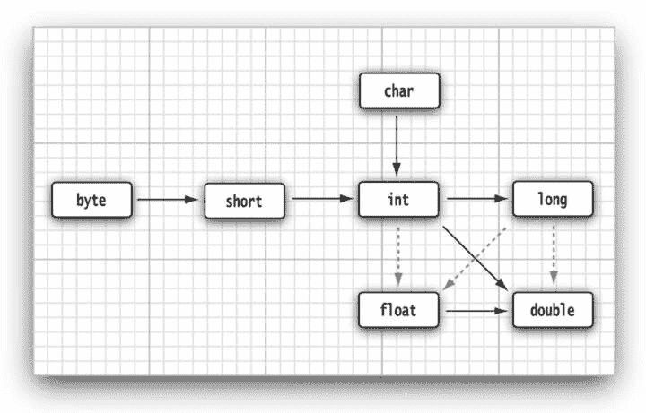图 3.1: 数值类型之间的合法转换

图 3.1 中的六个实线箭头表示不丢失信息的转换。三个虚线箭头表示可能会丢失精度的转换。例如，像`123456789`这样的大整数的位数比`float`类型能表示的位数多。当整数转换为`float`时，得到的数值级正确，但丢失了某些精度。

```
int n = 123456789;
float f = n; // f is 1.23456792E8
```

当两个值使用二元运算符组合时（例如`n + f`，其中`n`是整数，`f`是浮点值），在执行操作之前，两个操作数都会转换为一个共同类型。

*   如果其中一个操作数的类型是`double`，则另一个将被转换为`double`。
*   否则，如果其中一个操作数的类型是`float`，则另一个将被转换为`float`。
*   否则，如果其中一个操作数的类型是`long`，则另一个将被转换为`long`。
*   否则，两个操作数都将转换为`int`。

### 3.5.4 强制类型转换 (Casts)

在前面的节中，你已经看到在需要时`int`值会自动转换为`double`值。另一方面，显然也存在在某些时候，你希望将`double`视为整数。Java 中可以进行数值转换，但当然，可能会丢失信息。可能丢失信息的转换是通过`casts`（强制类型转换）来完成的。强制类型转换的语法是在括号中给出目标类型，后面紧跟变量名。例如：

```
double x = 9.997;
int nx = (int) x;
```

现在，变量`nx`的值为`9`，因为将浮点值转换为整数会丢弃小数部分。

如果你想将浮点数`round`到最`nearest`整数（在大多数情况下这是一个更有有用的操作），请使用`Math.round`方法：

```
double x = 9.997;
int nx = (int) Math.round(x);
```


现在，变量`nx`的值为`10`。在调用`round`时，你仍然需要使用强制转换`(int)`。这是因为`round`方法的返回值是`long`，而`long`只能通过显式的强制转换才能赋值给`int`，因为存在丢失信息的可能性。

如果你尝试将一个超出目标类型范围的类型数字转换为另一种类型，结果将是一个具有不同数值的截断数字。例如，`(byte) 300`实际​​上是`44`。

你不能在`boolean`值和任何数值类型之间进行强制类型转换。这种惯例防止了常见的错误。在需要将`boolean`值转换为数字的少数情况下，你可以使用条件表达式，例如`b ? 1 : 0`。

### 3.5.5 赋值

在赋值中使用二元运算符有一个方便的快捷方式。例如，`compound assignment operator`（复合赋值运算符）：

```java
x += 4;
```

它等同于：

```java
x = x + 4;
```

（通常情况下，将运算符放在`=`符号左侧，例如`*=`或`%=`。）

如果复合赋值运算符产生的值类型与左侧不同，则它会被强制转换以匹配。例如，如果`x`是一个`int`，那么语句：

```java
x += 3.5;
```

是有效的。它将`x`设置为`(int)(x + 3.5)`，即`x + 3`，且没有任何警告！

从 Java 20 开始，如果你使用`-Xlint`命令行选项进行编译，将得到一个警告。

注意，在 Java 中，赋值是一个`expression`（表达式）。也就是说，它是有值的——即正在被赋值的值。你可以使用该值——例如，将其赋值给另一个变量。考虑这些语句：

```java
int x = 1;

int y = x += 4;
```

`x += 4`的值为`5`，因为那是被赋值给`x`的值。接着，该值被赋值给`y`。

许多程序员发现这种嵌套赋值令人困惑，倾向于写得更清晰，如下：

```java
int x = 1;

x += 4;

int y = x;
```

### 3.5.6 递增和递减运算符

程序员当然知道，对数值变量最常用的操作之一是加减 1。Java 遵循 C 和 C++ 的足迹，同时具有递增和递减运算符：`n++`将变量`n`的当前值加 1，而`n--`从其减去 1。例如，代码：

```java
int n = 12;

n++;
```

前缀形式和后缀形式的区别如下：存在两种形式：前缀形式和后缀形式。前缀形式先执行操作，而后缀形式执行操作后返回原始值。例如：

```java
int m = 7;

int a = m++; // a is 7, m is 8

int b = ++m; // b is 9, m is 9
```

### 3.5.7 关系和布尔运算符

Java 拥有完整的关系运算符。要测试相等性，使用双等`==`。例如：

```java
3 == 7
```

为`false`。使用`!=`表示不等。例如：

```java
3 != 7
```

为`true`。最后，你还有`<`（小于）、`>`（大于）、`<=`（小于等于）和`>=`（大于等于）运算符。

Java 遵循 C++ 使用`&&`作为逻辑与运算符，使用`||`作为逻辑或运算符。正如你可以从`!=`运算符中记住，感叹号`!`是逻辑非。

`&&`和`||`运算符以“短路”方式计算：如果第一个操作数已经决定了结果，则不评估操作数。如果你使用`&&`运算符结合两个表达式：

```java
expression1 && expression2
```

且第一个表达式的真值确定为`false`，那么结果就不可能是`true`。因此，第二个表达式不会被计算。

这种行为可以用来避免错误。例如，在表达式：

```java
x != 0 && 1 / x
```

中，如果`x`为零，则不会计算`1 / x`，也不会发生除以零错误。同样，如果第一个表达式为`true`，则`expression1 || expression2`的值自动为`true`，无需评估第二个表达式。

### 3.5.8 条件运算符

Java 提供了条件`?:`运算符，根据布尔表达式选择一个值。表达式：

```java
condition ? expression1 : expression2
```

如果条件为`true`，则求值为第一个表达式，否则为第二个表达式。例如：

```java
x < y ? x : y
```

给出`x`和`y`中的较小值。

### 3.5.9 Switch 表达式

需要在多个值之间进行选择，可以使用`switch`表达式，它是在 Java 14 中引入的。它看起来如下：

```java
String seasonName = switch (seasonCode)
   {
      case 0 -> "Spring";
      case 1 -> "Summer";
      case 2 -> "Fall";
      case 3 -> "Winter";
      default -> "???";
   };
```

跟随`switch`关键字的表达式被称为*选择器表达式*，其值是*选择器*。目前，我们只考虑整型类型（`int`、`char`、`byte`或`short`）、字符串以及枚举类型的常量作为选择器和标签。在[第 5 章]中，你将看到如何配合*模式匹配*与其他类型一起使用`switch`表达式。

`switch`表达式和每个表达式一样，都有一个值。注意每个分支中值之前有一个`->`箭头。

从 Java 14 开始，共有四种（！）形式的`switch`。本节重点介绍最实用的形式。关于所有形式的`switch`表达式和语句的详细讨论，请参见第 3.8.5 节。

`case`标签必须是一个编译时常量，且其类型必须与选择器的类型匹配。你可以为每个`case`提供多个标签，并用逗号隔开：

```java
int numLetters = switch (seasonName)
   {
      case "Spring", "Summer", "Winter" -> 6;
      case "Fall" -> 4;
      default -> -1;
   };
```

当你对枚举常量使用`switch`表达式时，不需要在每个标签中提供枚举的名称——它是从`switch`值推断出来的。例如：

```java
enum Size { SMALL, MEDIUM, LARGE, EXTRA_LARGE };

. . .

Size itemSize = . . .;

String label = switch (itemSize)
   {
      case SMALL -> "S"; // 无需使用 Size.SMALL
      case MEDIUM -> "M";
      case LARGE -> "L";
      case EXTRA_LARGE -> "XL";
   };
```

在示例中，由于每个可能的取值都有对应的`case`，因此省略`default`是合法的。

如果选择器是一个`enum`，且你没有为所有常量编写`case`，那么你需要一个`default`。带有整数或`String`选择器的`switch`表达式必须始终有一个`default`。

如果选择器为`null`，则会抛出`NullPointerException`。如果你想避免这种可能性，可以这样添加一个`case null`：

```java
String label = switch (itemSize)
   {
      . . .
      case null -> "???";
   };
```

这是 Java 21 的一个特性。注意，`default`*不会*匹配`null`！

### 3.5.10 位运算符

对于任何整数类型，你都拥有可以直接操作构成整数的位的操作运算符。这意味着你可以使用掩码技术来获取数字中的单个位。位运算符有：

```java
& ("与")   | ("或")   ^ ("异或")   ~ ("非")
```

这些运算符作用于位模式。例如，如果`n`是一个整数变量，那么：

```java
int fourthBitFromRight = (n & 0b1000) / 0b1000;
```

如果`n`的二进制表示中从右侧开始的第四位是`1`，则结果为`1`，否则为`0`。使用`&`配合适当的 2 的幂可以掩码掉单个位以外的所有位。

当应用于`boolean`值时，`&`和`|`运算符产生一个`boolean`值。这些运算符与`&&`和`||`运算符类似，但`&`和`|`运算符不会以“短路”方式求值——也就是说，在计算结果之前，两个操作数都会求值。

还有`>>`和`<<`运算符，可以将位模式向右或向左移动。当你需要构建位模式来执行位掩码时，这些运算符非常方便：

```java
int fourthBitFromRight = (n & (1 << 3)) >> 3;
```

最后，`>>>`运算符用零填充高位，而`>>`则会将符号位扩展到高位。没有`<<<`运算符。

移位运算符的右侧操作数会对 32 取模（除非左侧操作数是`long`，此时则对 64 取模）。例如，`1 << 35`的值与`1 << 3`或`8`相同。

在 C/C++ 中，无法保证`>>`执行的是算术移位（扩展符号位）还是逻辑移位（填充零）。实现者可以自由选择任何更高效的一种。这意味着 C/C++ 的`>>`运算符对于负数可能会产生取决于实现的结果。

`Integer`类有许多用于位级操作的静态方法。例如，`Integer.bitCount(n)`产生`n`的二进制表示中为`1`的位个数，而`Integer.reverse(n)`产生通过反转`n`的位得到的数字。并不是每个程序员都需要位级操作，但如果你确实需要，可以查看`Integer`类看看是否有适用于你需要完成的任务的方法。

### 3.5.11 括号和运算符层次

表 3.4 显示了运算符的优先级。如果不使用括号，操作将按照所示的层次化顺序执行。同一层级的运算符从左到右处理，但表中指示的右结合运算符除外。例如，`&&`的优先级高于`||`，因此表达式：

```java
a && b || c
```

意味着：

```java
(a && b) || c
```

由于`+=`是右到左结合的，表达式：

```java
a += b += c
```

意味着：

```java
a += (b += c)
```

| 表 3.4 | 运算符 | 结合性 |
| :--- | :--- | :--- |
| 后置 | `++` `--` | 从左到右 |
| 一元 | `+` `-` `~` | 从右到左 |
| 乘法 | `*` `/` `%` | 从左到右 |
| 加法 | `+` `-` | 从左到右 |
| 移位 | `<<` `>>` `>>>` | 从左到右 |
| 关系 | `<` `<=` `>=` | 从左到右 |
| 相等 | `==` `!=` | 从左到右 |
| 位与 | `&` | 从左到右 |
| 位异或 | `^` | 从左到右 |
| 位或 | `|` | 从左到右 |
| 逻辑与 | `&&` | 从左到右 |
| 逻辑或 | `||` | 从左到右 |
| 条件 | `? :` | 从右到左 |
| 赋值 | `=` `+=` `-=` `*=` `/=` `%=` `<<=` `>>=` `>>=` `&==` `^=` `|=` `&&=` `||=` | 从右到左 |

## 3.6 字符串

概念上，Java 字符串是 Unicode 字符的序列。正如你在第 3.4 节中看到的，到底什么是字符已经变得复杂。大多数时候，你并不关心。

要在字符串字面量中包含“复杂的”字符，请确保源文件使用 UTF-8 编码（大多数 IDE 的默认设置）。然后你可以从网页粘贴，并产生如“Hello!”之类的字符串字面量。过去，程序员担心合作伙伴使用不同的编码，因此提供了 UTF-16 转义序列：“Ciao \u273A”。

Java 与大多数编程语言一样，允许使用`+`连接（拼接）两个字符串。

### 3.6.1 拼接

当你将字符串与非字符串拼接时，后者会被转换为字符串。例如：

```java
int age = 13;

String rating = "PG" + age;
```

将`rating`设置为字符串`"PG13"`。

此特性常用于输出语句。例如：

```java
System.out.println("The answer is " + answer);
```

这是完全可以的，并会打印你预期的结果（并且由于`is`单词的存在带有正确的空格）。

注意带有`+`运算符表达式的字符串拼接，例如：

```java
int age = 42;

String output = "Next year, you'll be " + age + 1 + "."; // 错误
```

由于`+`运算符从左到右计算，结果是`"Next year, you'll be 421."`。补救方法是使用括号：

```java
String output = "Next year, you'll be " + (age + 1) + "."; // 正确
```

如果你需要将多个字符串组合在一起，并用分隔符隔开，请使用静态方法`join`：

```java
String all = String.join(" / ", "S", "M", "L", "XL");

// all 是字符串 "S / M / L / XL"
```

`repeat`方法会产生一个重复给定字符串指定次数的字符串：

```java
String repeated = "Java".repeat(3); // repeated 是 "JavaJavaJava"
```

### 3.6.2 分割字符串

`split`方法根据给定的边界将字符串拆分为部分。例如：

```java
"Hello, World!".split(" ")
```

会产生一个包含两个元素的数组：字符串`"Hello,"`和`"World!"`。（数组在第 3.10 节中引入。）

`split`方法的参数是一个`正则表达式`，描述了分割应该发生的位置。关于正则表达式的详细讨论，请参阅卷 II 第 2 章。表 3.5 包含了一些实用的模式。

表 3.5：分割模式

| 模式 | 描述 |
| --- | --- |
| `"\\s+"` | 空白 |
| `"\\s*,\\s*"` | 带有可选空格的逗号 |
| `"\\."` | 句号 |
| `\\PL+` | 非字母 |
| `"\\R"` | 换行符 |
| `"\\b"` | 单词边界 |
| `"\\b{g}"` | 字符簇边界（自 Java 9 起） |

沿`grapheme cluster`字符簇边界分割会将字符串拆分为人类感知的组成字符：

```java
"Ciao 🇮🇹".split("\\b{g}") // 一个包含六元素的数组 "C", "i", "a", "o", " ", "🇮🇹"
```

### 3.6.3 索引与子字符串

Java 字符串是`char`值的序列。正如你在第 3.3.4 节中看到的，`char`数据类型用于表示 UTF-16 编码中的 Unicode 码点。某些字符可以用单个`char`值表示，但许多字符和符号需要多个`char`值。

虚拟机并不要求将字符串存储为`char`值的序列。为了提高效率，只包含单字节代码单元的字符串被存储为`byte`序列，而所有其他字符串则存储为`char`序列。这是一个实现细节，在过去发生过变化，未来可能再次发生变化。

`length`方法产生给定字符串所需的`char`值数量。例如：

```java
String greeting = "Ciao 🇮🇹";

int n = greeting.length(); // 等于 9
```

调用`s.charAt(n)`返回位置`n`处的`char`值，其中`n`于`0`和`s.length()` - 1 之间。（像 C 和 C++ 一样，Java 从 0 开始计算字符串中的位置。）例如：

```java
char first = greeting.charAt(0); // first 是 67 或 'C'

char last = greeting.charAt(8); // last 是 56825
```

然而，这些调用并不是非常有用。最后一个`char`值只是旗帜符号的一部分，你通常并不关心这些值是什么。

尽管如此，你有时需要知道子字符串在字符串中的位置。使用`indexOf`方法：

```java
String sub = " ";

int start = greeting.indexOf(sub); // 4
```

恰好，空格的位置或`index`是 4，但具体数值并不重要。它取决于子字符串之前的字符，以及编码每个字符所需的`char`值数量。始终将索引视为一个不透明的数字，而不是其之前感知字符的计数。

你可以计算下一个字符开始的位置：

```java
int nextStart = start + sub.length(); // 5
```

恰好，字符串`" "`的长度为 1，但不要硬编码字符串的长度。始终使用`length`方法。

你可以使用`String`类的`substring`方法从较大的字符串中提取子字符串。例如：

```java
String greeting = "Hello, World!";

int n = greeting.indexOf(",");

String s = greeting.substring(0, n);
```


会创建一个由字符 `"Hello"` 组成的字符串。

`substring` 的第二个参数是你`不`想要复制的位置。在我们的案例中，我们复制从开始到但不包含逗号的所有内容。

注意，字符串 `s.substring(a, b)` 的长度始终为 `b - a`。例如，子字符串 `"Hello"` 的长度为 `5 - 0 = 5`。

### 3.6.4. 字符串是不可变的

`String` 类没有提供任何允许`更改`现有字符串中字符的方法。如果你想将 `greeting` 变为 `"Help!"`，你不能直接将 `greeting` 的最后位置改为 `'p'` 和 `'!'`。如果你是一个 C 程序员，这可能会让你感到非常无助。我们该如何修改字符串？在 Java 中，这非常容易。

如果字符串 `s` 和 `t` 相等则返回 `true`，否则返回 `false`。注意 `s` 和 `t` 可以是字符串变量或字符串字面量。例如，表达式

```
"Hello".equals(greeting)
```

是完全合法的。要测试两个字符串除大小写外是否相同，请使用 `equalsIgnoreCase` 方法。

```
"Hello".equalsIgnoreCase("hello")
```

**不要**使用 `==` 运算符来测试两个字符串是否相等！它只确定字符串是否存储在相同的位置。当然，如果字符串在相同的位置，它们必须是相等的。但完全有可能在不同的地方存储多个相同字符串的副本。

```
String greeting = "Hello"; // 初始化 greeting 为字符串

greeting == "Hello" // true

greeting.substring(0, greeting.indexOf("l")) == "He" // false

greeting.substring(0, greeting.indexOf("l")).equals("He") // true
```

如果虚拟机总是安排相等的字符串被共享，那么你就可以使用 `==` 运算符来测试相等性。但只有字符串字面量会被共享，在运行时计算的字符串不会。因此，*永远*不要使用 `==` 来比较字符串。始终使用 `equals`。

如果你熟悉 C++ 的 `string` 类，你必须特别小心相等性测试。C++ `string` 类重载了 `==` 运算符来测试字符串内容的相等性。在 Java 中，字符串乍看起来与数字相似。它们有字面量值和 `+` 运算符，但它们实际上是对象。正如你将在下一章看到的，`==` 运算符始终检查两个对象是否相同。

C 语言程序员知道永远不要使用 `==` 来比较 `char*` 字符串，而是要使用 `strcmp`。Java 方法 `compareTo` 是 `strcmp` 的完全等价物。你可以使用

```
if (greeting.compareTo("Hello") == 0) . . .
```

但使用 `equals` 替代它似乎更清晰。

### 3.6.6. 空字符串和空引用

空字符串 `""` 是长度为 0 的字符串。你可以通过调用以下代码来测试字符串是否为空：

```
if (str.length() == 0)
```

或者

```
if (str.equals(""))
```

或者，为了最高效率

```
if (str.isEmpty())
```

空字符串是一个 Java 对象，持有字符串长度（即 `0`）和空内容。然而，一个 `String` 变量也可以持有一个特殊值，称为 `null`，表示该变量当前没有关联任何对象。要测试字符串是否为 `null`，请使用

```
if (str == null)
```

有时，你需要测试一个字符串既不是 `null` 也为空。这时使用

```
if (str != null && str.length() != 0)
```

你需要先测试 `str` 是否为 `null`。正如你将在第 4 章中看到的，在 `null` 值上调用方法是错误的。

### 3.6.7. String API

Java 中的 `String` 类包含近 100 个方法。下面的 API 注释总结了最实用的方法。这些贯穿全书的 API 注释将帮助你理解 Java 应用程序接口 (API)。每个 API 注释都以类的名称开头，例如 `java.lang.String`。（所谓包名 `java.lang` 的意义在第 4 章中解释。）类名后面跟着一个或多个方法的名称、说明和参数描述。方法的*参数变量*是接收方法参数的变量。例如，正如你将在下方的第一个 API 注释中看到的，`charAt` 方法有一个类型为 `int` 的参数名为 `index`。如果你调用该方法，你需要提供该类型的参数，例如 `str.charAt(0)`。

API 注释没有列出特定类的所有方法，而是以简洁的形式展示了最常用的方法。要查看完整列表，请参阅在线文档（参见第 3.6.8 节）。

类名后的数字是引入该方法的 JDK 版本号。如果某个方法在之后被添加，它将有一个单独的版本号。

`java.lang.String` 1.0

*   `char charAt(int index)`

    返回指定位置的代码单元。除非你对低级代码单元感兴趣，否则你可能不想调用此方法。

*   `int length()`

    返回字符串的代码单元数量。

*   `boolean equals(Object other)`

    如果字符串等于 `other` 则返回 `true`。

*   `boolean equalsIgnoreCase(String other)`

    如果字符串等于 `other`（除大小写外），则返回 `true`。

*   `int compareTo(String other)`

    如果字符串在字典序上于 `other` 之前，返回负值；如果字符串在字典序上于 `other` 之后，返回正值；如果两个字符串相等，返回 0。

*   `boolean isEmpty()` 6

    `boolean isBlank()` 11

    如果字符串为空或由空白字符组成，返回 `true`。

*   `boolean startsWith(String prefix)`

*   `boolean endsWith(String suffix)`

    如果字符串以 `prefix` 开头或以 `suffix` 结尾，返回 `true`。

*   `int indexOf(String str)`

*   `int indexOf(String str, fromIndex)`

*   `int indexOf(String str, fromIndex, toIndex)` 21

    返回从 `0` 或 `fromIndex` 开始到字符串末尾或 `toIndex` 的第一个等于 `str` 的子字符串的起始位置。如果 `str` 不存在，返回 -1。

*   `int lastIndexOf(String str)`

*   `int lastIndexOf(String str, fromIndex)`

    返回从字符串末尾或 `fromIndex` 开始的最后一个等于 `str` 的子字符串的起始位置。如果 `str` 不存在，返回 -1。

*   `String replace(CharSequence oldString, CharSequence newString)`

    返回通过将所有匹配 `oldString` 的子字符串替换为 `newString` 得到的新字符串。你可以为 `CharSequence` 参数提供 `String` 或 `StringBuilder`。

*   `String substring(int beginIndex)`

*   `String substring(int beginIndex, int endIndex)`

    返回由 `beginIndex` 到字符串末尾或 `endIndex` 的所有代码单元组成的新字符串。

*   `String toLowerCase()`

*   `String toUpperCase()`

    返回包含原始字符串所有字符的新字符串，其中大写字母转换为小写，或小写字母转换为大写。

*   `String strip()` 11

    `String stripLeading()` 11

    `String stripTrailing()` 11

    通过消除原始字符串中的开头和结尾、或仅开头或结尾的空白返回一个新字符串。使用这些方法代替消除 U+0020 以下字符的过时 `trim` 方法。

*   `String join(CharSequence delimiter, CharSequence... elements)` 8

    返回用给定的分隔符连接所有元素的新字符串。

*   `String repeat(int count)` 11

    返回重复此字符串 `count` 次的字符串。

*   `String[] split(String regex)` 1.4

    找到正则表达式的所有匹配并通过移除它们来分割字符串。返回包含片段的数组，但不包含结尾的空字符串。

在 API 注释中，有几个类型为 `CharSequence` 的参数。这是一个*接口*类型，所有字符串都属于它。你将在第 6 章中学习接口类型。现在你只需要知道当你看到 `CharSequence` 参数时，可以传递类型为 `String` 参数。

### 3.6.8. 阅读在线 API 文档

正如你刚刚看到的，`String` 类有许多方法。此外，标准库中还有成千上万个类，拥有更多的方法。要记住所有有用的类和方法显然是不可能的。因此，熟悉在线 API 文档至关重要，它可以允许你查阅标准库中所有的类和方法。你可以从 Oracle 下载 API 文档并保存到本地，也可以将浏览器指向 [`docs.oracle.com/en/java/javase/21/docs/api`](https://docs.oracle.com/en/java/javase/21/docs/api)。

API 文档有一个搜索框（请参见图 3.2）。旧版本有包含包和类列表的框架（frames）。你仍然可以通过点击框架（Frames）菜单项来获取这些列表。例如，为了获取有关 `String` 类方法的更多信息，可以在搜索框中输入“String”并选择类型 `java.lang.String`，或者在带有类名的框架中找到该链接并点击它。你将得到类的描述，如图 3.3 所示。

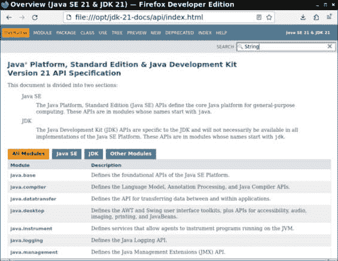图 3.2: Java API 文档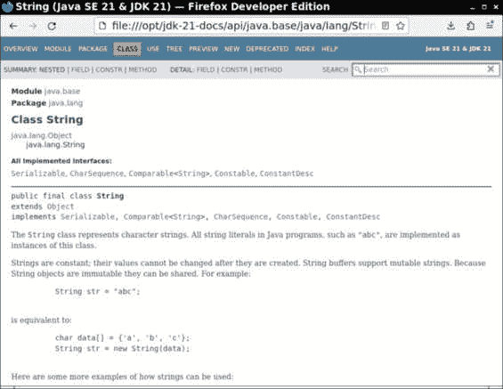图 3.3: `String` 类的类描述

当你向下滚动时，会看到所有方法的摘要，这些方法按字母顺序排序（请参见图 3.4）。点击任何方法名即可查看该方法的详细描述（请参见图 3.5）。例如，如果你点击 `compareToIgnoreCase` 链接，将得到 `compareToIgnoreCase` 方法的描述。

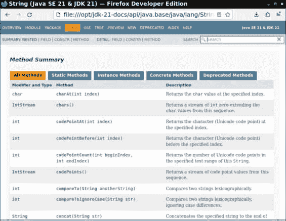图 3.4: `String` 类的方法摘要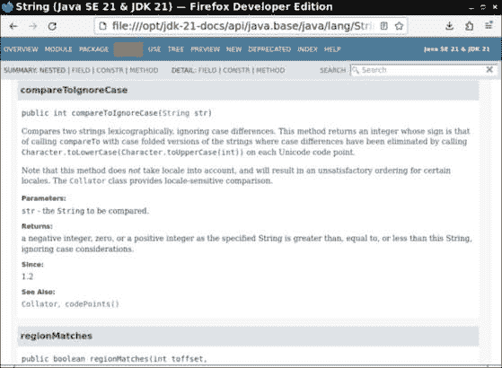图 3.5: `String` 方法的详细描述

如果你还没有这样做，请按照第 2 章中的描述下载 JDK 文档。现在就在浏览器中将文档的 `index.html` 页面加入书签！

你还可以使用查询字符串为浏览器添加新的搜索引擎：

```
https://docs.oracle.com/en/java/javase/21/docs/api/search.html?q=%s
```

### 3.6.9. 构建字符串

有时，你需要从较短的字符串构建字符串，例如按键输入或文件中的单词。为了这个目的，使用字符串拼接是低效的。每当你拼接字符串，就会构造一个新的 `String` 对象。这非常耗时且浪费内存。使用 `StringBuilder` 类可以避免这个问题。

如果你需要从许多小片段构建字符串，请遵循以下步骤。首先，构造一个空的构建器：

```
StringBuilder builder = new StringBuilder();
```

你也可以提供初始内容：

```
StringBuilder builder = new StringBuilder("INVOICE\n");
```

每当你需要添加另一个部分时，调用 `append` 方法。

```
builder.append(str); // 追加一个字符串
builder.appendCodePoint(cp); // 追加单个代码点
```

当你需要计算代码点时，后者方法偶尔很有用。这里有一个例子。旗帜表情符号由两个代码点组成，每个代码点的范围在 127462（区域指示符号字母 A）到 127487（区域指示符号字母 Z）之间。现在假设你有一个国家代码字符串，例如 `"IT"`。那么你可以如下所示计算代码点：

```
final int REGIONAL_INDICATOR_SYMBOL_LETTER_A = 127462;
String country = . . .;
builder.append(country.charAt(0) - 'A' + REGIONAL_INDICATOR_SYMBOL_LETTER_A);
builder.append(country.charAt(1) - 'A' + REGIONAL_INDICATOR_SYMBOL_LETTER_A);
```

当你完成字符串构建后，调用 `toString` 方法。你将得到一个包含构建器中字符序列的 `String` 对象。

```
String completedString = builder.toString();
```

巧妙的是，`StringBuilder` 方法返回构建器对象，因此你可以链式调用多个方法：

```
String completedString = new StringBuilder()
   .append(str)
   .appendCodePoint(cp)
   .toString();
```

`String` 类没有反转字符串 Unicode 字符的方法，但 `StringBuilder` 有。要反转字符串，请使用这段代码段：

```
String reversed = new StringBuilder(original).reverse().toString();
```

反转对于用两个 `char` 值编码的字符可以正常工作，但它没有考虑字形聚簇（grapheme clusters）。

旧的 `StringBuffer` 类比 `StringBuilder` 效率低，但它允许多个线程添加或删除字符。如果所有的字符串编辑都在单线程中进行（通常通常如此），你应该使用 `StringBuilder`。这两个类的 API 是完全相同的。

以下 API 注释包含了 `StringBuilder` 类最重要的方法。

`java.lang.StringBuilder`

- `StringBuilder()`
- `StringBuilder(CharSequence seq)` 构造一个空的字符串构建器，或者一个带有给定内容的构建器。
- `int length()` 返回构建器的代码单元数量。
- `append(String str)` 追加字符串并返回 `this`。
- `appendCodePoint(int cp)` 追加一个代码点并返回 `this`。
- `insert(int offset, String str)` 在位置 `offset` 处插入字符串并返回 `this`。
- `delete(int startIndex, int endIndex)` 删除 `startIndex` 到 `endIndex` 之间的代码单元并返回 `this`。
- `repeat(CharSequence cs, int count)` 追加 `count` 份 `cs` 并返回 `this`。
- `reverse()` 反转构建器中的代码点并返回 `this`。
- `String toString()` 返回与构建器数据相同的字符串。

### 3.6.10. 文本块

Java 15 引入的文本块功能使得跨行字符串字面量变得简单。文本块以 `"""` 开头，后面跟着换行符。块以另一个 `"""` 结束：

```
String greeting = """
Hello
World
"""
```

文本块比等效的字符串字面量更容易读写：

```
"Hello\nWorld\n"
```

这个字符串包含两个 `\n`：一个在 `Hello` 之后，一个在 `World` 之后。起始 `"""` 之后的换行符不包含在字面量中。

如果你不想在最后一行有换行符，将结束的 `"""` 紧跟在最后一个字符之后：

```
String prompt = """
Hello, my name is Hal.
Please enter your name:""";
```

文本块特别适用于某些语言的代码，例如 SQL 或 HTML。你只需将其粘贴在三引号之间：

```java
String html = """
<div class="Warning">
   Beware of those who say "Hello" to the world
</div>
""";
```

注意你不需要转义引号。只有两种情况需要转义它们：

- 文本块以引号*结束*
- 文本块包含三个或更多标记序列

遗憾，你仍然需要转义所有的反斜杠。

普通字符串的所有转义序列在文本块中的工作方式相同。

有一个仅在文本块中有效的转义序列。行尾直接的 `\` 会将此行和下一行连接。例如：

```
"""
Hello, my name is Hal. \
Please enter your name:""";
```


等同于

```java
"Hello, my name is Hal. Please enter your name:"
```

行结束符会被归一化：删除尾部空格并将任何 Windows 行结束（`\r\n`）更改简单的换行符（`\n`）。如果你需要保留尾部空格，请将最后一个转换为`\s`转义符。事实上，这可能正是提示字符串所需要的。以下字符串以空格结尾：

```java
"""
Hello, my name is Hal. \
Please enter your name:\s""";
```

对于前导空白，情况更为复杂。考虑一个相对于左边距缩进的典型变量声明。你也可以对文本块进行缩进：

```java
String html = """
            <div class="Warning">
               Beware of those who say "Hello" to the world
            </div>
            """;
```

文本块中所有行的共同缩进会被减去。实际字符串为：

```java
"<div class=\"Warning\">\n   Beware of those who say \"Hello\" to the world\n</div>\n"
```

注意第一行和第三行没有缩进。

你始终可以通过在结束`"""`之前的最后一行不留任何空白来避免这种缩进被消除。但许多程序员似乎认为文本块缩进后看起来更整洁。你的 IDE 可能会乐快地建议使用制表符（tabs）或空格来缩进所有文本块。

Java 明智地没有规定制表符的宽度。文本块所有行的空白前缀必须`exactly`匹配。

在消除共同缩进时，不考虑完全空白的行。然而，结束`"""`之前的空白是有意义的。请确保缩进到你想要消除的空白的末尾。

注意缩进中混合使用制表符和空格。一个被忽略的空格很容易导致字符串缩进错误。

如果文本块包含不是 Java 的代码，你实际上可能倾向于将其置于左边距。它会从 Java 代码中颖而出，并为长行留出更多空间。

## 3.7. 输入与输出

为了让我们的示例程序更有趣，我们希望接受输入并正确地格式化程序输出。当然，现代程序使用 GUI 来收集用户输入。然而，编写这样的界面需要的比我们目前拥有的更多的工具和技术。我们的首要任务是更熟悉 Java 编程语言，因此我们使用简单的控制台进行输入和输出。

### 3.7.1 读取输入

你已经看到，只需调用`System.out.println`就可以轻松向“标准输出流”（即控制台窗口）打印输出。从“标准输入流”`System.in`读取内容并没有那么简单。要读取控制台输入，你首先要构造一个连接`System.in`的`Scanner`：

```java
Scanner in = new Scanner(System.in);
```

（构造函数和`new`运算符将在第 4 章中详细讨论。）

现在你可以使用`Scanner`类的各种方法来读取输入。例如，`nextLine`方法读取一行输入。

```java
System.out.print("What is your name? ");
String name = in.nextLine();
```

在这里，我们使用`nextLine`方法是因为输入可能包含空格。要读取单个单词（由空白分隔），调用：

```java
String firstName = in.next();
```

要读取一个整数，使用`nextInt`方法。

```java
System.out.print("How old are you? ");
int age = in.nextInt();
```

同样，`nextDouble`方法读取下一个浮点数。

Listing 3.2 中的程序会询问用户的姓名和年龄，然后打印类似如下的消息：

```
Hello, Cay. Next year, you'll be 65.
```

最后，注意这一行：

```java
import java.util.*;
```

`Scanner`类定义在`java.util`包中。每当你使用未定义在基础`java.lang`包中的类时，都需要使用`import`指令。包和`import`指令将在第 4 章中进行详细介绍。

如果你从终端运行此程序（通过调用`java InputTest`），并且使用 Windows，且你的名字包含 26 个罗马字母大小写字母以外的字符（例如 Bérengère 或 Ὀδυσссеύς），可能会遇到麻烦。默认情况下，Windows 终端对`System.out`使用传统的字符编码，但对`Scanner`不是。结果是乱码输出。要修复此，在运行程序之前执行以下终端命令将终端切换到 UTF-8 编码：

```
chcp 65001
```

然后，如果你使用 Java 18 或更高版本，一切正常。对于较旧版本的 Java，按如下方式运行程序：

```
java -Dfile.encoding=utf-8 InputTest
```

如果你使用开发环境，就不应该担心这个问题。

Listing 3.2 InputTest/InputTest.java

```java
import java.util.*;

/**
 * 此程序演示了控制台输入。
 * @version 1.11 2023-08-26
 * @author Cay Horstmann
 */
public class InputTest
{
   public static void main(String[] args)
   {
      Scanner in = new Scanner(System.in);

      // get first input
      System.out.print("What is your name? ");
      String name = in.nextLine();

      // get second input
      System.out.print("How old are you? ");
      int age = in.nextInt();

      // display output on console
      System.out.println("Hello, " + name + ". Next year, you'll be " + (age + 1) + ".");
   }
}
```

`Scanner`类不适合读取密码，因为是可见的。使用`Console`类的`readLine`方法来隐藏密码：

```java
Console cons = System.console();
String passwd = cons.readLine("Password: ");
```

处理完密码后，你应该立即用`'*'`覆盖数组元素。

`java.util.Scanner` 5.0

- `Scanner(InputStream in)`
  从指定的输入流构造`Scanner`对象。
- `String nextLine()`
  读取一行。
- `String next()`
  读取下一个单词（由空白分隔）。
- `int nextInt()`
- `double nextDouble()`
  读取并转换表示整数或浮点数的序列。
- `boolean hasNext()`
  测试是否有下一个单词。
- `boolean hasNextInt()`
- `boolean hasNextDouble()`
  测试序列是否表示整数或浮点数。

`java.lang.System` 1.0

- `static Console console()`
  返回一个用于交互的`Console`对象，否则返回`null`。

`java.io.Console` 6

- `char[] readPassword(String prompt, Object... args)`
- `String readLine(String prompt, Object... args)`
  显示提示并读取行输入。可选的`args`参数用于格式化参数。

### 3.7.2 格式化输出

你可以使用语句`System.out.print(x)`向控制台打印数字`x`。该命令将以该类型的最大非零数字打印`x`。例如：

```java
double x = 10000.0 / 3.0;
System.out.print(x);
```

打印

```
3333.333333333335
```

如果你想显示美元和分，这就是问题所在。

解决方法是使用`printf`方法，它遵循来自 C 库的传统约定。例如，调用

```java
System.out.printf("%8.2f", x);
```

以*字段宽度* 8 个字符和*精度* 2 个字符打印`x`。也就是说，打印输出包含一个前导空格

```
3333.33
```

你可以为`printf`提供多个参数。例如：

```java
System.out.printf("Hello, %s. Next year, you'll be %d.", name, age + 1);
```

每个以`%`字符开头的格式说明符（format specifiers）都会替换为相应的参数。格式说明符的转换字符（conversion character）指示要格式化的值的类型：`f`是浮点数，`s`是字符串，`d`是十进制整数。表 3.6 显示了所有的转换字符。

大写变体产生大写字母。例如，`"%8.2E"`将`3333.33`格式化为`3.33E+03`，使用大写的`E`。

### 表 3.6：`printf`转换

| 转换字符 | 类型 | 示例 |
| --- | --- | --- |
| `d` | 十进制整数 | `159` |
| `x` 或 `X` | 十六进制整数。如需对十六进制格式进行更多控制，请使用`HexFormat`类。 | `9f` |
| `o` | 进制整数 | `237` |
| `f` 或 `F` | 定点浮点数 | `15.9` |
| `e` 或 `E` | 指数浮点数 | `1.59e+01` |
| `g` 或 `G` | 通用浮点数（`e`和`f`中较短的一个） | — |
| `a` 或 `A` | 十六进制浮点数 | `0x1.fccdp3` |
| `s` 或 `S` | 字符串 | `Hello` |
| `c` 或 `C` | 字符 | `H` |
| `b` 或 `B` | `boolean` | `true` |
| `h` 或 `H` | 哈希码 | `42628b2` |
| `tx` 或 `Tx` | 旧版日期和时间格式。请改用`java.time`类——参见第二卷第 6 章。 | — |
| `%` | 百分符号 | `%` |
| `n` | 取决于平台的换行符 | — |

你可以使用`s`转换来格式化任意对象。如果任意对象实现了`Formattable`接口，则调用该对象的`formatTo`方法。否则，将调用`toString`方法将对象转换为字符串。`toString`方法在第 5 章中讨论，接口在第 6 章中讨论。

此外，你可以指定`flags`（标志）来控制格式化输出的外观。表 3.7 显示了所有的标志。例如，逗号标志会添加分组分隔符。也就是说，

```java
System.out.printf("%,.2f", 10000.0 / 3.0);
```

输出为

```
3,333.33
```

你可以使用多个标志，例如`"%,(.2f"`以使用分组分隔符并将负数括在括号中。

### 表 3.7：`printf`标志

| 标志 | 用途 | 示例 |
| --- | --- | --- |
| `+` | 为正负数打印符号。 | `+3333.33` |
| 空格 | 在正数前添加空格。 | `&#124; 3333.33&#124;` |
| `0` | 添加前导零。 | `003333.33` |
| `-` | 左对齐。 | `&#124;3333.33 &#124;` |
| `(` | 将负数括在括号中。 | `(3333.33)` |
| `,` | 添加分组分隔符。 | `3,333.33` |
| `#` (用于`f`格式) | 始终包含小数点。 | `3,333.` |
| `#` (用于`x`或`o`格式) | 添加`0x`或`0`前缀。 | `0xcafe` |
| `$` | 指定要格式化的参数索引。例如，`%1$d %1$x`以十进制和十六进制格式打印第一个参数。 | `159 9F` |
| `<` | 以上一个规范格式化相同的值。例如，`%d %<x`以十进制和十六进制格式打印同一个数字。 | `159 9F` |

你可以使用静态方法`String.format`来创建一个格式化字符串而不打印它：

```java
String message = String.format("Hello, %s. Next year, you'll be %d.", name, age + 1);
```

从 Java 15 开始，你可以使用`formatted`方法代替，从而节省五个字符：

```java
String message = "Hello, %s. Next year, you'll be %d.".formatted(name, age + 1);
```

你现在已经了解了`printf`方法的所有特性。图 3.6 显示了格式说明符的语法图。

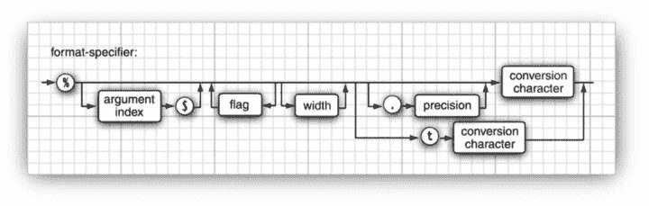

### 3.7 文件输入与输出

每个以`%`字符开头的格式说明符都会替换为相应的参数。格式说明符的转换字符指示要格式化的值的类型：`f`是浮点数，`s`是字符串，`d`是十进制整数。

大写变体产生大写字母。例如，`"%8.2E"`将`3333.33`格式化为`3.33E+03`，使用大写的`E`。

你可以使用`s`转换来格式化任意对象。如果任意对象实现了`Formattable`接口，则调用该对象的`formatTo`方法。否则，将调用`toString`方法将对象转换为字符串。

此外，你可以指定`flags`来控制格式化输出的外观。例如，逗号标志会添加分组分隔符。

你可以使用静态方法`String.format`来创建一个格式化字符串而不打印它。

从 Java 15 开始，你可以使用`formatted`方法代替，从而节省五个字符。

你现在已经了解了`printf`方法的所有特性。

每个以`%`字符开头的格式说明符都会替换为相应的参数。格式说明符的转换字符指示要格式化的值的类型。

你现在已经了解如何读取和写入包含文本数据的文件。对于更高级的主题，例如处理不同的字符编码、处理二进制数据、读取目录以及写入 zip 文件，请参阅第二卷第 2 章。

如果你不喜欢声明异常，可以像前面的章节那样，直接从`System.in`读取并写入到`System.out`。然后从命令行 shell 启动你的程序，使用你 shell 的重定向语法：

```
java MyProg < myfile.txt > output.txt
```

`java.util.Scanner` 5.0

*   `Scanner(Path p)` 7
*   `Scanner(Path p, Charset charset)` 10
    构造`Scanner`，使用默认或给定的字符编码从给定路径读取数据。
*   `Scanner(String data)`
    构造一个从给定字符串读取数据的`Scanner`。

`java.io.PrintWriter` 1.1

*   `PrintWriter(String fileName)`
*   `PrintWriter(String fileName, Charset charset)` 10
    构造`PrintWriter`，使用默认或给定的字符编码将数据写入给定文件名的文件中。

`java.nio.file.Path` 7

*   `static Path of(String pathname)` 11
    根据给定的路径名构造`Path`。

## 3.8 控制流

Java 与任何编程语言一样，都支持条件语句和循环来确定控制流。我将从条件语句开始，然后转到循环，最后对四种形式的`switch`进行深入讨论。

Java 的控制流结构与 C 和 C++ 中的结构相同，但有少数例外。它没有`goto`，但有一个“带标签”的`break`，你可以用它来跳出嵌套循环（在 C 中，你可能需要使用`goto`）。最后，还有`for`循环的变体，它类似于 C++ 中基于范围的`for`循环以及 C# 中的`foreach`循环。

### 3.8.1 块作用域

在学习控制结构之前，你需要了解更多关于`blocks`（块）的知识。

一个块或复合语句由一对大括号括起的若干 Java 语句组成。块定义了变量的作用域。一个块可以*嵌套*在另一个块内部。这里是一个嵌套在`main`方法块内部的块：

```java
public static void main(String[] args)
{
   int n;
   . . .
   {
      int k;
      . . .
   } // k 仅定义到此处
}
```

你不能在两个嵌套的块中声明同名的局部变量。例如，以下代码是错误的且无法编译：

```java
public static void main(String[] args)
{
   int n;
   . . .
   {
      int k;
      int n; // 错误--不能在内部块中重复声明 n
      . . .
   }
}
```


在 C++ 中，在嵌套块内部重新定义变量是可能的。此时，内部定义会遮蔽外部定义。这可能成为编程错误的来源；因此，Java 不允许这样做。

### 3.8.2 条件语句

Java 中的条件语句的形式为：

```
if (condition) statement
```

条件必须包含在括号内。

在 Java 中，与大多数编程语言一样，你通常希望在单个条件为 `true` 时执行多个语句。在这种情况下，使用形式如下的`block statement`（块语句）：

```
{
   statement1
   statement2
   . . .
}
```

例如：

```
if (yourSales >= target)
{
   performance = "Satisfactory";
   bonus = 100;
}
```

在这段代码中，所有被大括号括起来的语句在`yourSales`大于等于`target`时都会执行（参见图 3.7）。

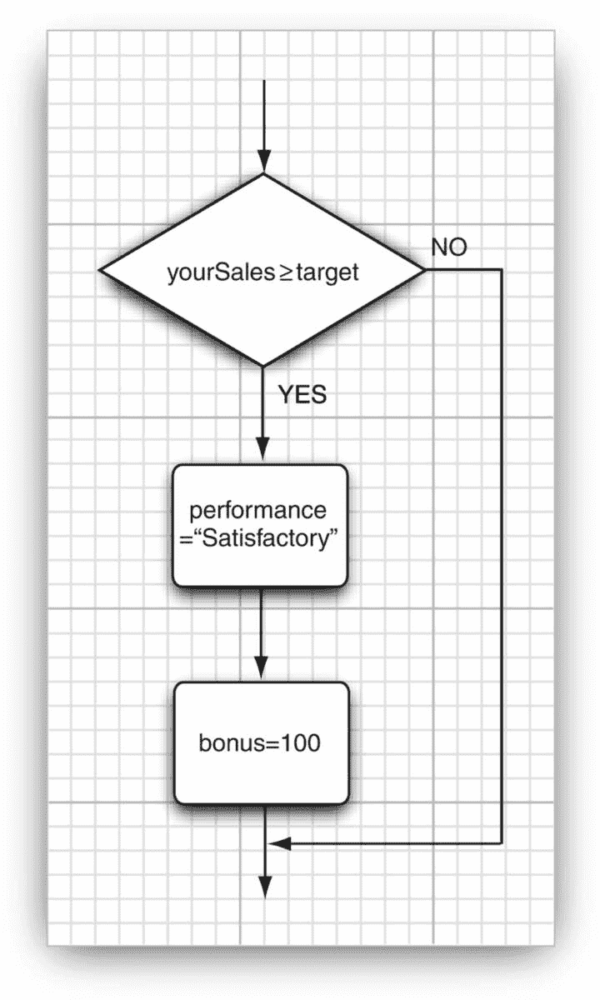图 3.7: `if`语句的流程图

块（有时称为`compound statement`）允许你在任何原本允许单个（简单）语句的 Java 编程结构中拥有多个一个（简单）语句。

Java 中更通用的条件语句如下所示（参见图 3.8）：

```
if (condition) statement1 else statement2
```

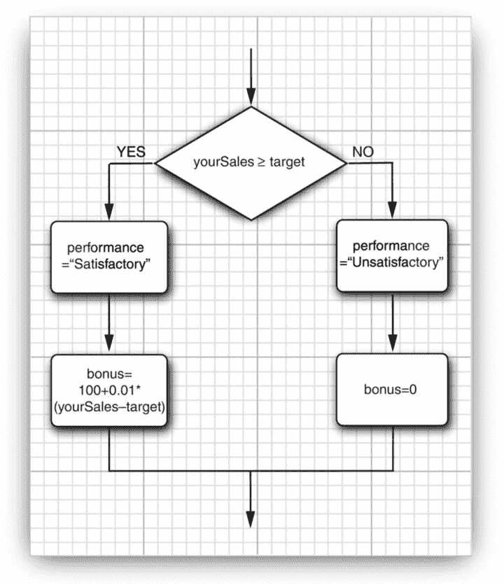图 3.8: `if`/`else`语句的流程图

例如：

```
if (yourSales >= target)
{
   performance = "Satisfactory";
   bonus = 100 + 0.01 * (yourSales - target);
}
else
{
   performance = "Unsatisfactory";
   bonus = 0;
}
```

`else`部分始终是可选的。`else`与距离最近的`if`组合。因此，在语句

```
if (x <= 0) if (x == 0) sign = 0; else sign = -1;
```

`else`属于第二个`if`。当然，使用大括号来澄清这段代码是一个好主意。

重复的`if . . . else`备选方案很常见（参见图 3.9）。例如：

```
if (yourSales >= target)
{
   performance = "Satisfactory";
   bonus = 100;
}
else if (yourSales >= 1.5 * target)
{
   performance = "Fine";
   bonus = 500;
}
else if (yourSales >= target)
{
   performance = "Excellent";
   bonus = 1000;
}
else
{
   System.out.println("You're fired");
}
```

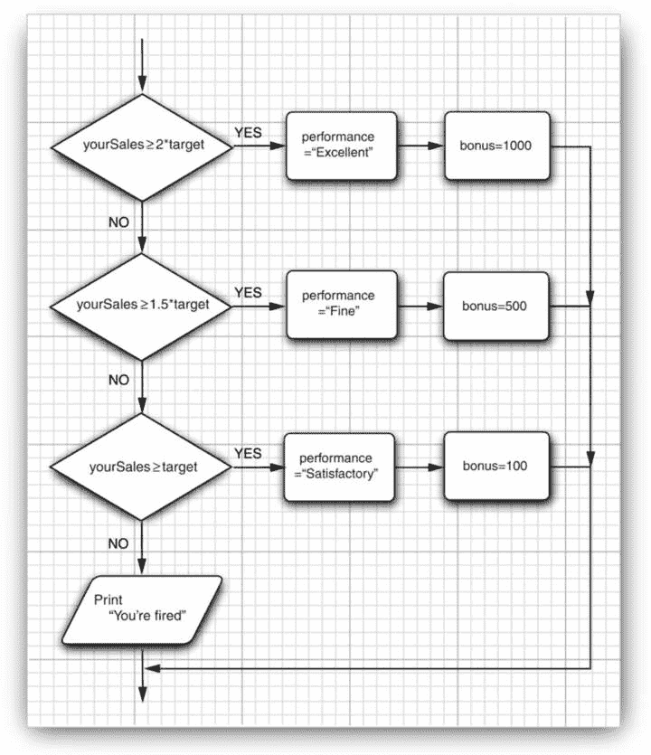图 3.9: `if`/`else`多分支的流程图

### 3.8.3 循环

`while`循环在条件为`true`时执行语句（可能是一个块）。其通用形式为

```
while (condition) statement
```

如果条件在开始时为`false`，`while`循环将不会执行（参见图 3.10）。

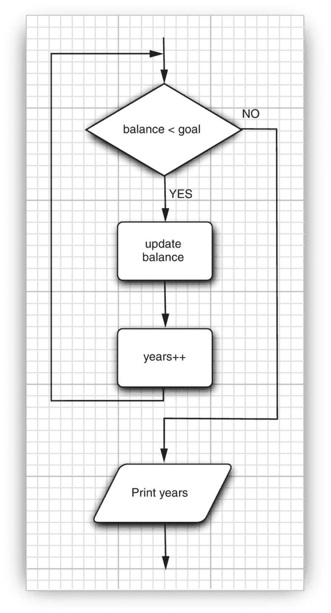图 3.10: `while`语句的流程图

Listing 3.3 中的程序确定了为了储蓄特定金额需要多久，假设你每年存款相同的金额，且资金产生特定的利率。在示例中，我们在循环体中增加计数器并更新金额，直到总额超过目标。

```
while (balance < goal)
{
   balance += payment;
   double interest = balance * interestRate / 100;
   balance += interest;
   years++;
}
```

（不要依赖此程序来规划退休。它缺乏通胀和预期寿命等考虑因素。）

`while`循环在顶部测试。因此，块中的代码可能永远不会执行。如果你想确保块至少执行一次，你需要将测试移动到底部，使用`do`/`while`循环。它的语法如下：

```
do statement while (condition);
```

该循环执行语句（通常是一个块），然后测试条件。如果条件为`true`，则重复语句并重新测试条件，以此类推。Listing 3.4 中的代码计算你退休账户的新余额，然后询问你是否准备好退休：

```
do
{
   balance += payment;
   double interest = balance * interestRate / 100;
   balance += interest;
   years++;
   // 打印当前余额
   . . .
   // 询问是否准备好退休并获取输入
   . . .
}
while (input.equals("N"));
```

只要用户回答`"N"`，循环就会重复（参见图 3.11）。这个程序是一个需要至少进入一次循环的良好示例，因为用户需要在决定余额是否足够退休之前看到余额。

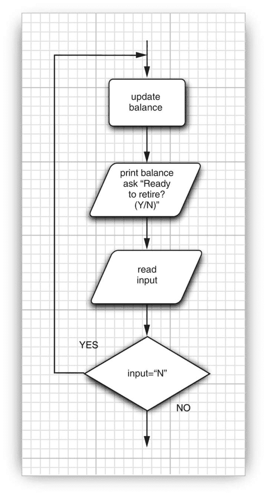图 3.11: `do`/`while`语句的流程图

Listing 3.3 `Retirement/Retirement.java`

```java
import java.util.*;

/**
 * 此程序演示了 <code>while</code> 循环。
 * @version 1.20 2004-02-10
 * @author Cay Horstmann
 */
public class Retirement
{
   public static void main(String[] args)
   {
      // 读取输入
      Scanner in = new Scanner(System.in);

      System.out.print("你需要多少钱才能退休？ ");
      double goal = in.nextDouble();

      System.out.print("你每年将投入多少钱？ ");
      double payment = in.nextDouble();

      System.out.print("利率（百分比）: ");
      double interestRate = in.nextDouble();

      double balance = 0;
      int years = 0;

      // 在未达到目标金额时更新账户余额
      while (balance < goal)
      {
         // 加入今年的投入和利息
         balance += payment;
         double interest = balance * interestRate / 100;
         balance += interest;
         years++;
      }

      System.out.println("你可以在 " + years + " 年后退休。");
   }
}
```

Listing 3.4 `Retirement2/Retirement2.java`

```java
import java.util.*;

/**
 * 此程序演示了 <code>do/while</code> 循环。
 * @version 1.20 2004-02-10
 * @author Cay Horstmann
 */
public class Retirement2
{
   public static void main(String[] args)
   {
      Scanner in = new Scanner(System.in);

      System.out.print("你每年将投入多少钱？ ");
      double payment = in.nextDouble();

      System.out.print("利率（百分比）: ");
      double interestRate = in.nextDouble();

      double balance = 0;
      int year = 0;

      String input;

      // 在用户尚未准备好退休时更新账户余额
      do
      {
         // 加入今年的投入和利息
         balance += payment;
         double interest = balance * interestRate / 100;
         balance += interest;

         year++;

         // 打印当前余额
         System.out.printf("%d 年后，你的余额是 %,.2f%n", year, balance);

         // 询问是否准备好退休并获取输入
         System.out.print("准备好退休了吗？(Y/N) ");
         input = in.next();
      }
      while (input.equals("N"));
   }
}
```

### 3.8.4 确定循环

`for`循环是一种通用的结构，用于由计数器或在每次迭代后更新的类似变量控制迭代。如 图 3.12 所示，以下循环在屏幕上打印从 1 到 10 的数字：

```java
for (int i = 1; i <= 10; i++)
   System.out.println(i);
```

`for`语句的第一个槽通常持有计数器初始化。第二个槽位给出在每次通过循环之前测试的条件，第三个槽位指定了如何更新计数器。

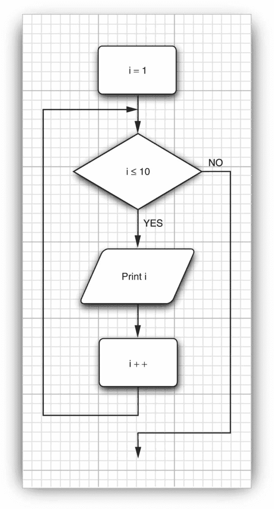图 3.12：`for`语句的流程图

尽管 Java 像 C++ 一样允许`for`循环的各个槽位中使用任何表达式，但良好的做法是：这三个槽位应该只初始化、测试和更新同一个计数器变量。忽略这一规则可能会写出非常晦涩的循环。

即使在良好的做法范围内，也可以实现很多功能。例如，你可以拥有倒计数的循环：

```java
for (int i = 10; i > 0; i--)
   System.out.println("倒计时 . . . " + i);
System.out.println("发射！");
```

在循环中测试浮点数的等价性要小心。像下面这样的`for`循环

```java
for (double x = 0; x != 10; x += 0.1) . . .
```

可能永远不会结束。由于舍入误差，可能无法精确达到最终值。在这个例子中，`x`从`9.99999999999998`跳到`10.09999999999998`，因为`0.1`没有精确的二进制表示。

当你在`for`语句的第一个槽位声明变量时，该变量的作用范围一直延伸到`for`循环体的结束。

```java
for (int i = 1; i <= 10; i++)
{
   . . .
}
// i 在此处不再定义
```

特别是，如果你在`for`语句内部定义一个变量，你不能在循环外部使用它的值。因此，如果你想在`for`循环外部使用计数器的最终值，请确保在循环头之外声明它。

```java
int i;
for (i = 1; i <= 10; i++)
{
   . . .
}
// i 在此处仍然定义
```

另一方面，你可以在不同的`for`循环中定义同名的变量：

```java
for (int i = 1; i <= 10; i++)
{
   . . .
}
```

`for`循环仅仅是`while`循环的一种方便快捷方式。例如，

```java
i = 10;
while (i > 0)
{
   . . .
   i--;
}
```

`for`循环的第一个槽位可以声明多个变量，第三个槽位可以包含逗号分隔的表达式：

```java
for (int i = 1, j = 10; i++)
```

虽然技术上可行，但这延伸了`for`循环的含义，你应该考虑使用`while`循环：

```java
i = 10;
while ()
```

通常情况下，如果你从`n`个数字中选取`k`个数字，会有 $\frac{n \times (n-1) \times \dots \times (n-k+1)}{1 \times 2 \times \dots \times k}$ 种结果。以下`for`循环计算了这个值：

```java
int lotteryOdds = 1;
for (int i = 1; i <= k; i++)
   lotteryOdds = lotteryOdds * (n - i + 1) / i;
```

Listing 3.5 `LotteryOdds/LotteryOdds.java`

```java
import java.util.*;

/**
 * 此程序演示了 <code>for</code> 循环。
 * @version 1.20 2004-02-10
 * @author Cay Horstmann
 */
public class LotteryOdds
{
   public static void main(String[] args)
   {
      Scanner in = new Scanner(System.in);

      System.out.print("你需要抽取几个数字？ ");
      int k = in.nextInt();

      System.out.print("你可以取的最高数字是多少？ ");
      int n = in.nextInt();

      /*
       计算 n*(n-1)*...*(n-k+1)/(1*2*...*k)
       */

      int lotteryOdds = 1;
      for (int i = 1; i <= k; i++)
         lotteryOdds = lotteryOdds * (n - i + 1) / i;

      System.out.println("你的几率是 1 比 " + lotteryOdds + "。好运！");
   }
}
```

### 3.8.5 使用`switch`进行多选

当你需要处理同一个表达式的多个备选项时，`if/else`结构可能会繁琐。`switch`语句使这变得更容易，特别是 14 版本中引入的格式。

例如，如果你设置像图 3.13 那样具有四个备选项的菜单系统，可以使用如下代码：

```java
Scanner in = new Scanner(System.in);
System.out.print("选择选项 (1, 2, 3, 4) ");
int choice = in.nextInt();
switch (choice)
{
   case 1 ->
      . . .
   case 2 ->
      . . .
   case 3 ->
      . . .
   case 4 ->
      . . .
   default ->
      System.out.println("无效输入"); 
}
```

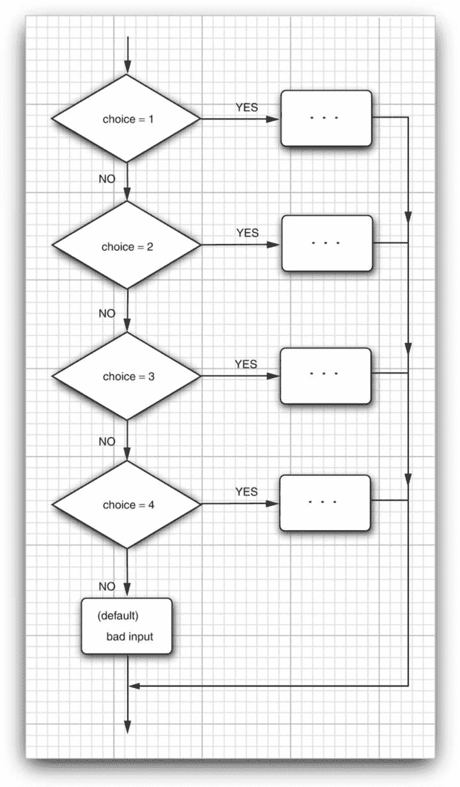图 3.13：`switch`语句的流程图

注意它与你在 第 3.5.9 节 中看到的`switch`表达式的相似之处。与`switch`语句没有值。每个 case 执行一个动作。

`switch`语句的“经典”形式可以追溯到 C 语言，自 Java 1.0 起就支持这种形式。它的形式如下：

```
int choice = . . .;
switch (choice)
{
   case 1:
      . . .
      break;
   case 2:
      . . .
      break;
   case 3:
      . . .
      break;
   case 4:
      . . .
      break;
   default:
      System.out.println("Bad input"); 
}
```

执行从与选择值匹配的`case`标签开始，一直持续到下一个`break`或`switch`结束。如果没有一个`case`标签匹配，则执行`default`子句（如果它存在的话）。

可能会触发多个备选方案。如果你忘记在备选方案的末尾添加`break`，执行将“贯穿”（fall through）到下一个备选方案！这种行为显然是危险的，也是错误的常见原因。

为了检测此类问题，请使用`-Xlint:fallthrough`选项编译代码，如下所示：

```
javac -Xlint:fallthrough Test.java
```

然后，每当备选方案没有以`break`语句结束时，编译器都会发出警告。

如果你实际上想使用贯穿行为，请在周围的方法上标记`@SuppressWarnings("fallthrough")`注解。这样，该方法就不会生成任何警告。（注解是一种向编译器或处理 Java 源代码或类文件的工具提供信息的机制。第二卷对注解有深入的介绍。）

为了对称性，Java 14 还引入了带有贯穿功能的`switch`表达式，总共有四种形式的`switch`。表 3.8 列出了它们所有的形式。


### 表 3.8：`switch` 的四种形式

| | 表达式 | 语句 |
| --- | --- | --- |
| 无贯穿 | | |
| | | |

```java
int numLetters = switch (seasonName)
{
   case "Spring" ->
      {
         System.out.println(
            "spring time!");
         yield 6;
      }
   case "Summer", "Winter" -> 6;
   case "Fall" -> 4;
   default -> -1;
};
```

```java
switch (seasonName)
{
   case "Spring" ->
      {
         System.out.println(
            "spring time!");
         numLetters = 6;
      }
   case "Summer", "Winter" ->
      numLetters = 6;
   case "Fall" ->
      numLetters = 4;
   default ->
      numLetters = -1;
}
```

| 贯穿 | | |

```java
int numLetters = switch (seasonName)
{
   case "Spring":
      System.out.println(
         "spring time!");
   case "Summer", "Winter":
      yield 6;
   case "Fall":
      yield 4;
   default:
      yield -1;
};
```

```java
switch (seasonName)
{
   case "Spring":
      System.out.println(
         "spring time!");
   case "Summer", "Winter":
      numLetters = 6;
      break;
   case "Fall":
      numLetters = 4;
      break;
   default:
      numLetters = -1;
}
```

在贯穿变体中，每个 `case` 都以冒号结尾。如果 `case` 以箭头 `->` 结尾，则没有贯穿。你不能在同一个 `switch` 语句中混合使用冒号和箭头。

`switch` 表达式的每个分支必须产生一个值。最常见的情况是每个值后面跟着 `->` 箭头：

```java
case "Summer", "Winter" -> 6;
```

如果这不可行，请使用 `yield` 语句。像 `break` 一样，它终止执行。与 `break` 不同，它还会产生一个值——表达式的值。

要在 `switch` 表达式的分支中使用语句且不产生贯穿，你必须使用大括号和 `yield`：

```java
case "Spring" ->
{
   System.out.println("spring time!");
   yield 6;
}
```

在 `switch` 表达式的分支中抛出异常是合法的。例如：

```java
default -> throw new IllegalArgumentException("Not a valid season");
```

异常在第 7 章中详细介绍。

`switch` 表达式的目的是产生一个值（或因异常失败）。你不被允许“跳出”：

```java
default -> { return -1; } // ERROR
```

具体来说，你不能在 `switch` 表达式中使用 `return`、`break` 或 `continue` 语句。（后两个参见第 3.8.6 节。）

有这么多 `switch` 的变体，你应该选择哪一个？

1. 避免贯穿形式。需要贯穿的情况非常罕见。
2. 优先使用 `switch` 表达式而不是语句。

如果每个分支都为变量赋值或方法调用计算值，请用表达式产生值，然后使用它。例如：

```java
numLetters = switch (seasonName)
{
   case "Spring" ->
      {
         System.out.println(
            "spring time!");
         yield 6;
      }
   case "Summer", "Winter" -> 6;
   case "Fall" -> 4;
   default -> -1;
};
```

优于：

```java
switch (seasonName)
{
   case "Spring" ->
      {
         System.out.println(
            "spring time!");
         numLetters = 6;
      }
   case "Summer", "Winter" ->
      numLetters = 6;
   case "Fall" ->
      numLetters = 4;
   default ->
      numLetters = -1;
}
```

如果每个分支都计算变量赋值或方法调用的值，请用表达式产生值，然后使用它。例如：

```java
numLetters = switch (seasonName)
{
   case "Spring" ->
      {
         System.out.println(
            "spring time!");
         yield 6;
      }
   case "Summer", "Winter" -> 6;
   case "Fall" -> 4;
   default -> -1;
};
```

优于：

```java
switch (seasonName)
{
   case "Spring" ->
      {
         System.out.println(
            "spring time!");
         numLetters = 6;
      }
   case "Summer", "Winter" ->
      numLetters = 6;
   case "Fall" ->
      numLetters = 4;
   default ->
      numLetters = -1;
}
```

### 3.8.6 用于 `break` 的语句

尽管 Java 设计者保留了 `goto` 作为保留词，但他们决定不包含它。通常情况下，`goto` 语句被认为是糟糕的。一些程序员认为偶尔跳出循环是有益的。Java 设计者同意并添加了新的语句，标签 `break` 来支持这一点。

让我们先看看无标签的 `break` 语句。用于退出 `switch` 的 `break` 语句也可以用于退出循环。例如：

```java
while (years <= 100)
{
   balance += payment;
   // ...
   if (balance >= goal)
      break;
   years++;
}
```

现在，如果 `years > 100` 发生在循环顶部，或者 `balance >= goal` 发生在循环中间，循环就会退出。当然，你可以像这样在不使用 `break` 的情况下计算相同的结果：

```java
while (years <= 100 && balance < goal)
{
   balance += payment;
   // ...
   years++;
}
```

但注意，在这个版本中 `balance < goal` 测试被重复了。为了避免这种重复测试，某些程序员更喜欢标签 `break`。

标签 `break` 语句允许跳出多个嵌套循环。偶尔在深度嵌套循环内部会发生奇怪的事情。在这种情况下，你可能想完全跳出所有嵌套循环。仅仅通过向各种循环测试添加额外条件来实现是不方便的。

这里有一个显示标签 `break` 用作用的示例。注意标签位于你想跳出的外层循环之前。它后面必须跟着一个冒号。

```java
Scanner in = new Scanner(System.in);
int n;
read_data:
while (. . .) // 此循环语句标记了标签
{
   . . .
   for (. . .) // 此内部循环没有标签
   {
      System.out.print("Enter a number >= 0: ");
      n = in.nextInt();
      if (n < 0) // 应该不会发生——无法继续
         break read_data;
         // 跳出 read_data 循环
      . . .
   }
}
// 标签 break 执行后立即执行此语句

if (n < 0) // 检查糟糕情况
{
   // 处理糟糕情况
}
else
{
   // 执行正常处理
}
```

因此，如果你渴望使用 `goto`，并且可以在你想跳转的位置之前放置一个结束标记的代码块，那么你就可以使用 `break` 语句！当然，我不建议这种方法。但请注意，你只能跳出代码块，而永远不能进入一个代码块。

最后，还有一个 `continue` 语句，它和 `break` 语句一样，都会打破正常的控制流。`continue` 语句将控制转移到最内层嵌套循环的头部。这里有一个示例：

```java
Scanner in = new Scanner(System.in);
while (sum < goal)
{
   System.out.print("Enter a number: ");
   n = in.nextInt();
   if (n < 0) continue;
   sum += n; // 如果 n < 0 则不执行
}
```

如果 `n < 0`，则 `continue` 语句将立即跳转到循环头部，跳过当前迭代的剩余部分。

如果在 `for` 循环中使用 `continue` 语句，它将跳转到 `for` 循环的“更新”部分。例如：

```java
for (count = 1; count <= 100; count++)
{
   System.out.print("Enter a number, -1 to quit: ");
   n = in.nextInt();
   if (n < 0) continue;
   sum += n; // 如果 n < 0 则不执行
}
```

如果 `n < 0`，则 `continue` 语句将跳转到 `count++` 语句。

还有标签形式的 `continue` 语句，它可以跳转到带有匹配标签的循环头部。

许多程序员发现 `break` 和 `continue` 语句令人困惑。这些语句完全是可选的——你始终可以在不使用它们的情况下表达相同的逻辑。书中的没有任何一个程序使用了 `break` 或 `continue`。

## 3.9 大数

如果基本整数类型和浮点类型的精度不够，你可以转向 `java.math` 包中的两个实用类：`BigInteger` 和 `BigDecimal`。这些类用于处理具有任意长度数字序列的数字。`BigInteger` 类实现了任意精度整数算术，而 `BigDecimal` 对浮点数执行相同的操作。

使用静态方法 `valueOf` 将普通数字转换为大数：

```java
BigInteger a = BigInteger.valueOf(100);
```

对于更长的数字，使用带有字符串参数的构造函数：

```java
BigInteger reallyBig
   = new BigInteger("222232244629420445529739893461909967206666939096499764990979600");
```

还有常量 `BigInteger.ZERO`、`BigInteger.ONE`、`BigInteger.TWO` 和 `BigInteger.TEN`。

使用 `BigDecimal` 类时，你应该始终使用带有字符串参数的构造函数。有一个 `BigDecimal(double)` 构造函数容易产生舍入误差：`new BigDecimal(0.1)` 的数字如下：

```text
0.1000000000000000055511151231257827021181583404541015625
```

遗憾的是，你不能使用熟悉的数学运算符如 `+` 和 `*` 来组合大数。相反，你必须使用大数类中的如 `add` 和 `multiply` 等方法。

```java
BigInteger c = a.add(b); // c = a + b
BigInteger d = c.multiply(b.add(BigInteger.valueOf(2))); // d = c * (b + 2)
```

与 C++ 不同，Java 没有可编程的运算符重载。`BigInteger` 类的程序员无法重定义 `+` 和 `*` 运算符来为 `BigInteger` 类提供 `add` 和 `multiply` 操作。语言设计者确实重载了 `+` 运算符来表示字符串拼接。他们选择不重载其他运算符，也没有给 Java 程序员在他们自己的类中重载运算符的机会。

在 Java 19 中，`BigInteger` 类提供了 `parallelMultiply` 方法，它产生与 `multiply` 相同的结果，但通过使用多个处理器核心可能会更快地计算结果。如果你必须进行大量的乘法，并且知道你的应用程序不需要 CPU 资源进行其他计算，请使用此方法。

[Listing 3.6] 显示了 [Listing 3.5] 彩票概率程序的修改版本，已更新为支持大数。例如，如果你被邀请参加一种彩票，需要从 490 个可能的数字中选出 60 个数字，你可以使用这个程序告知你的中奖概率。概率是几分之一 `716395843461995557415116222540092933411717612789263493493351013459481104668848`。祝你好运。

```java
import java.math.*;
import java.util.*;

/**
 * 此程序使用大数计算中奖概率。
 * @author Caymann
 */
public class BigIntegerTest
{
   public static void main(String[] args)
   {
      Scanner in = new Scanner(System.in);
      System.out.print("How many numbers do you need? ");
      int k = in.nextInt();

      System.out.print("What is the draw? ");
      BigInteger lotteryOdds = BigInteger.ONE;

      for (int i = 1; i <= k; i++)
      {
         System.out.print("Enter a number, -1 to quit: ");
         int n = in.nextInt();
         if (n < 0) continue;
         lotteryOdds = lotteryOdds.multiply(BigInteger.valueOf(i));
      }

      System.out.printf("Your odds are 1 in %s.%n", lotteryOdds);
   }
}
```

### `java.math.BigInteger`

- `add(BigInteger other)`
- `subtract(BigInteger other)`
- `multiply(BigInteger other)`
- `divide(BigInteger other)`
- `mod(BigInteger other)`
- `pow(int exponent)`

  返回此整数与 `other` 的和、差、商和幂。

- `sqrt()`

  产生此整数的平方根。

- `compareTo(BigInteger other)`

  如果此整数等于 `other` 则返回 0；如果小于整数 `other` 则返回负值；否则返回正值。

- `static BigInteger valueOf(long x)`

  返回一个等于 `x` 的大整数。

### `java.math.BigDecimal`

- `BigDecimal(String digits)`

  使用给定的数字构造大数字。

- `add(BigDecimal other)`
- `subtract(BigDecimal other)`
- `multiply(BigDecimal other)`
- `divide(BigDecimal other)`

  如果商没有有限的小数扩展则抛出异常。

- `divide(BigDecimal other, RoundingMode mode)`

  返回此大数字与 `other` 的和、差、积或商。

- `compareTo(BigDecimal other)`


如果此大数字等于`other`，则返回 0；如果小于数字`other`，则返回负值；否则返回正值。

## 3.10. 数组

数组存储相同类型值的序列。在接下来的章节中，你将看到如何在 Java 中使用数组。

### 3.10.1. 声明数组

通过指定数组类型（元素类型后跟`[]`）和数组变量名来声明数组变量。例如，这里是整数数组`a`的声明：

```java
int[] a;
```

然而，这条语句只是声明了变量`a`。它还没有为`a`初始化一个实际数组。使用`new`运算符创建数组。

```java
int[] a = new int[100];
```

该语句声明并初始化了一个包含 100 个整数的数组。

数组的长度不需要是常量：`new int[n]`创建一个长度为`n`的数组。

一旦创建数组，你就无法更改它的长度（当然，你可以更改单个数组元素）。如果你在程序运行期间频繁需要扩展数组的长度，应该使用`array lists`，它们在第 5 章中有所介绍。

数组变量的类型不包含长度。例如，上一个示例中的变量`a`类型为`int[]`，它可以被设置为任意长度的`int`数组。

你可以通过以下方式定义数组变量：

```java
int[] a;
```

或者：

```java
int a[];
```

大多数 Java 程序员更倾向于前一种样式，因为它将类型`int[]`（整数数组）与变量名清晰地分离开。

Java 有一种快捷方法可以创建数组对象并提供初始值：

```java
int[] smallPrimes = { 2, 3, 5, 7, 11, 13 };
```

注意，使用这种语法时不需要使用`new`，也不需要指定长度。

最后一个值后的逗号是允许的，这对于随时间推移不断添加值的数组非常方便：

```java
String[] authors =
   {
      "James Gosling",
      "Bill Joy",
      "Guy Steele",
      // 在此处添加更多名字，并在每个名字后加逗号
   };
```

你可以声明一个`匿名数组`：

```java
new int[] { 17, 19, 23, 29, 31, 37 }
```

此表达式分配了一个新数组并用括号内的值填充它。它计算初始值的数量并相应地设置数组长度。你可以使用这种语法在不创建新变量的情况下重新初始化数组。例如：

```java
smallPrimes = new int[] { 17, 19, 23, 29, 31, 37 };
```

是以下代码的简写：

```java
int[] anonymous = { 17, 19, 23, 29, 31, 37 };
smallPrimes = anonymous;
```

长度为 0 的数组是合法的。如果你编写了一个计算数组结果的方法，而结果恰好为空，那么这种数组可能是很有用的。构造一个长度为 0 的数组如下：

```java
new elementType[0]
```

或者：

```java
new elementType[] {}
```

注意，长度为 0 的数组不同于`null`。

### 3.10.2. 访问数组元素

你通过整数`index`使用方括号运算符访问数组的每个单独元素。例如，如果`a`是一个整数数组，那么`a[i]`就是数组中索引为`i`的元素。

数组元素从 0 开始编号。最后一个有效索引是长度减 1。在下面的示例中，索引值范围从 0 到 99。一旦创建数组，你可以填充数组中的元素，例如使用循环：

```java
int[] a = new int[100];
for (int i = 0; i < 100; i++)
   a[i] = i; // 用数字 0 到 99 填充数组
```

当你创建一个数字数组时，所有元素都初始化为零。`boolean`数组初始化为`false`。对象数组初始化为特殊值`null`，表示它们（尚未）持有任何对象。这会让初学者感到惊讶。例如：

```java
String[] names = new String[10];
```

这创建了一个包含十个字符串的数组，所有元素都是`null`。如果你想让数组持有空字符串，你必须提供它们：

```java
for (int i = 0; i < 10; i++) names[i] = "";
```

如果你构造了一个包含 100 个元素的数组，然后尝试访问元素`a[100]`（或从 0 到 99 范围外的任何其他索引），将发生“数组索引越界”异常。

要找到数组的元素数量，使用`array.length`。例如：

```java
for (int i = 0; i < a.length; i++)
   System.out.println(a[i]);
```

### 3.10.3. “for each”循环

Java 有一种强大的循环结构，允许你遍历数组（或任何其他元素集合）中的每个元素，而无需费心处理索引值。

增强型`for`循环：

```java
for (variable : collection) statement
```

将给定的变量设置为集合中的每个元素，然后执行语句（当然，这可以是一个代码块）。`collection`表达式必须是一个数组或实现了`Iterable`接口的类对象，例如`ArrayList`。数组列表在第 5 章中有所介绍，`Iterable`接口在第 9 章中有所介绍。

例如：

```java
for (int element : a)
   System.out.println(element);
```

打印数组`a`的每个元素。

### 3.10.4. 数组复制

你可以将一个数组变量复制到另一个变量，但两个变量指向同一个数组：

```java
int[] luckyNumbers = smallPrimes;
luckyNumbers[5] = 12;
```

如果你实际上想将一个数组的所有值复制到一个新数组，请使用`Arrays`类中的`copyOf`方法：

```java
int[] copiedNumbers = Arrays.copyOf(luckyNumbers, luckyNumbers.length);
```

第二个参数是新数组的长度。该方法的常用用途是扩展数组的长度：

```java
luckyNumbers = Arrays.copyOf(luckyNumbers, 2);
```

如果数组包含数字，额外的元素将填充为`0`；如果数组包含`boolean`值，则填充为`false`。相反，如果长度小于原始数组的长度，则只复制初始值。

Java 数组与栈上的 C++ 数组非常不同。然而，它与堆上分配的数组本质上是相同的。也就是说：

`int[] a = new int[100]; // Java`

不等同于`int a[100]; // C++`，而是`int* a = new int[100]; // C++`。

在 Java 中，`[]`运算符被预定义用于执行边界检查。此外，没有指针算术——你无法增加`a`来指向数组中的下一个元素。

### 3.10.5. 命令行参数

你已经见过几个 Java 数组的示例了。每个 Java 程序都有一个带有`String[] args`参数变量的`main`方法。该参数表示`main`方法接收字符串数组——即命令行指定的参数。

```java
public class Message
{
   public static void main(String[] args)
   {
      if (args.length == 0 || args[0].equals("-h"))
         System.out.print("Hello,");
      else if (args[0].equals("-g"))
         System.out.print("Goodbye,");
      // print the other command-line arguments
      for (int i = 1; i < args.length; i++)
         System.out.print(" " + args[i]);
      System.out.println("!");
   }
}
```

如果如下所示调用程序：

```text
java Message -g cruel world
```

那么`args`数组将包含以下内容：

```text
args[0]: "-g"
args[1]: "cruel"
args[2]: "world"
```

程序打印消息：

```text
Goodbye, cruel world!
```

与 C++ 不同的是，程序的名称没有存储在命令行参数数组中。例如，当你从命令行启动程序时：

```text
java Message -h world
```

那么`args[0]`将是`"-h"`，而不是`"Message"`或`"java"`。

### 3.10.6. 数组排序

要对数字数组排序，你可以使用`Arrays`类中的`sort`方法之一：

```java
int[] a = new int[10000];
. . .
Arrays.sort(a)
```

该方法使用了经过优化的`QuickSort`算法，该算法在大多数数据集上都非常高效。`Arrays`类还提供了其他几个方便方法，这些方法包含在本节末尾的 API 说明中。

Listing 3.7 中的程序演示了数组的应用。该程序为彩票游戏绘制随机数字组合。例如，如果你玩“从 49 个数中选 6 个”的彩票，程序可能会打印如下内容：

```text
投注以下组合。它将让你发富！
4
7
8
19
30
44
```

要选择这样一组随机数字，首先用值`1`、`2`、. . .、`n`填充数组`numbers`：

```java
int[] numbers = new int[n];
for (int i = 0; i < numbers.length; i++)
   numbers[i] = i + 1;
```

第二个数组持有要抽取的数字：

```java
int[] result = new int[k];
```

现在抽取`k`个数字。`Math.random`方法返回一个`0`（包含）到`1`（不包含）之间的随机浮点数。将结果乘以`n`得到一个`0`到`n` - 1 之间的随机数。

```java
int r = (int) (Math.random() * n);
```

将第`i`个结果设置为该索引处的数字。最初，它只是`r` + 1，但正如你稍将看到的，每次抽取后，`numbers`数组的内容都会改变。

```java
result[i] = numbers[r];
```

现在，你必须确保不再再次抽取那个数字——所有的彩票号码必须是唯一的。因此，用数组中的最后一个数字覆盖`numbers[r]`，并将`n`减 1。

```java
numbers[r] = numbers[n - 1];
n--;
```

重点在于，在每次抽取时我们选择的是索引，而不是实际值。索引指向一个包含尚未抽取的值的数组。

在抽取`k`个彩票号码后，对`result`数组进行排序以获得更理想的输出：

```java
Arrays.sort(result);
for (int r : result)
   System.out.println(r);
```

Listing 3.7 `LotteryDrawing/LotteryDrawing.java`

```java
import java.util.*;

/**
 * 此程序演示了数组操作。
 * @version 1.20 2004-02-10
 * @author Cay Horstmann
 */
public class LotteryDrawing
{
   public static void main(String[] args)
   {
      Scanner in = new Scanner(System.in);

      System.out.print("你需要抽取几个数字? ");
      int k = in.nextInt();

      System.out.print("你能抽到的最大数字是多少? ");
      int n = in.nextInt();

      // 用数字 1 2 3 . . . n 填充数组
      int[] numbers = new int[n];
      for (int i = 0; i < numbers.length; i++)
         numbers[i] = i + 1;

      // 抽取 k 个数字并将它们放入第二个数组
      int[] result = new int[k];
      for (int i = 0; i < result.length; i++)
      {
         // 创建一个 0 到 n - 1 之间的随机索引
         int r = (int) (Math.random() * n);

         // 选取随机位置的元素
         result[i] = numbers[r];

         // 将最后一个元素移动到随机位置
         numbers[r] = numbers[n - 1];
         n--;
      }

      // 打印排序后的数组
      Arrays.sort(result);
      System.out.println("投注以下组合。它将让你发富!");
      for (int r : result)
         System.out.println(r);
   }
}
```

### 3.10.7. 多维数组

多维数组使用多个索引来访问元素。它们用于表格和其他复杂的布局。假设你想制作一个表格，显示 10,000 美元投资在每年支付并再投资的场景下如何增长。你可以将这些信息存储在一个多维数组`balances`中。在 Java 中声明多维数组非常简单。例如：

```java
double[][] balances;
```

在初始化之前无法使用该数组。在这种情况下，你可以如下进行初始化：

```java
balances = new double[NYEARS][NRATES];
```

其他情况下，如果你知道数组元素，可以使用简写符号初始化多维数组而无需调用`new`。例如：

```java
int[][] magicSquare =
   {
      {16, 3, 2, 13},
      {5, 10, 11, 8},
      {9, 6, 7, 12},
      {4, 15, 14, 1}
   };
```

一旦数组初始化，你可以通过两对括号来访问单个元素——例如`balances[i][j]`。示例程序存储了一个存储利率的一维数组`interest`和一个存储账户余额的多维数组`balances`，每个余额对应一个年份和一个利率。用初始余额初始化数组的第一行：

```java
for (int j = 0; j < balances[0].length; j++)
   balances[0][j] = 10000;
```

然后计算其他行，如下所示：

```java
for (int i = 1; i < balances.length; i++)
{
   for (int j = 0; j < balances[i].length; j++)
   {
      double oldBalance = balances[i - 1][j];
      double interest = . . .;
      balances[i][j] = oldBalance + interest;
   }
}
```

Listing 3.8 显示了完整的程序。

“for each”循环不会自动遍历二维数组中的所有元素。相反，它遍历的是行，而行本身又是一个一维数组。要访问二维数组`a`的所有元素，可以嵌套两个循环，如下所示：

```java
for (double[] row : a)
   for (double value : row)
      do something with value
```

要快速打印出二维数组元素的简易列表，可以调用：

```java
System.out.println(Arrays.deepToString(a));
```

输出的格式如下所示：

```text
[[16, 3, 2, 13], [5, 10, 11, 8], [9, 6, 7, 12], [4, 15, 14, 1]]
```

Listing 3.8 `CompoundInterest/CompoundInterest.java`


```java
/**
 * 此程序展示了如何在 2D 数组中存储表格数据。
 * @version 1.41 2023-11-28
 * @author Cay Horstmann
 */
public class CompoundInterest
{
   public static void main(String[] args)
   {
      final double STARTRATE = 5;
      final int NRATES = 6;
      final int NYEARS = 10;

      // 设置利率为 5 . . . 10%
      double[] interestRate = new double[NRATES];
      for (int j = 0; j < interestRate.length; j++)
         interestRate[j] = (STARTRATE + j) / 100.0;

      double[][] balances = new double[NYEARS][NRATES];

      // 将初始余额设为 10000
      for (int j = 0; j < balances[0].length; j++)
         balances[0][j] = 10000;

      // 计算未来的利息
      for (int i = 1; i < balances.length; i++)
      {
         for (int j = 0; j < balances[i].length; j++)
         {
            // 从上一行获取去年的余额
            double oldBalance = balances[i - 1][j];

            // 计算利息
            double interest = oldBalance * interestRate[j];

            // 计算今年的的余额
            balances[i][j] = oldBalance + interest;
         }
      }

      // 打印一行利率
      for (int j = 0; j < interestRate.length; j++)
         System.out.printf("%9.0f%%", 100 * interestRate[j]);

      System.out.println();

      // 打印余额表
      for (double[] row : balances)
      {
         // 打印表格行
         for (double b : row)
            System.out.printf("%10.2f", b);

         System.out.println();
      }
   }
}
```

### 3.10.8. 锯齿数组 (Ragged Arrays)

到目前为止，你所看到的内容与其他编程语言没有太大区别。但后台实际上存在着微妙的机制，你有时可以利用这一优势：Java 根本没有多维数组，只有一维数组。多维数组是通过伪装成“数组的数组”来实现的。

例如，上例中的 `balances` 数组实际上是一个包含 10 个元素的数组，每个元素都是一个包含 6 个浮点数的数组（图 3.15）。

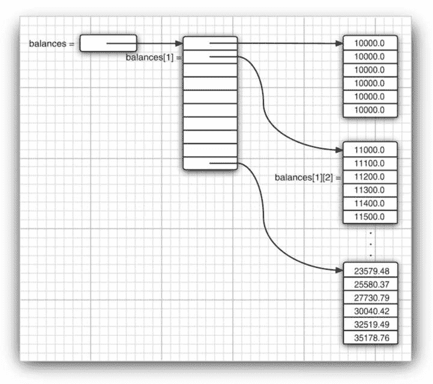图 3.15：二维数组

表达式 `balances[i]` 指的是第 `i` 个子数组——即表格的第 `i` 行。它本身是一个数组，而 `balances[i][j]` 指的是该数组的第 `j` 个元素。

由于行数组单独访问，你实际上可以交换它们：

```
double[] temp = balances[i];
balances[i] = balances[i + 1];
balances[i + 1] = temp;
```

注意，行数和列数并不是数组类型的一部分。变量 `balances` 的类型是 `double[][]`：`double` 数组的数组。

因此，你可以创建“锯齿”数组——即不同行长度不同的数组。这是一个标准示例。让我们创建一个数组，其中第 `i` 行第 `j` 列的元素等于“从 `i` 个数中选择 `j` 个数”抽样的可能数量。

```
1
1  1
1  2  1
1  3  3  1
1  4  6  4  1
1  5 10 10  5 1
1  6 15 20 15 6 1
```

由于 `j` 永远不会大于 `i`，该矩阵是三角形的。第 `i` 行有 `i` + 1 个元素。（选择 0 个元素是可以的；有一种方法做出这种选择。）要构建这个锯齿数组，首先分配存储行的数组：

```
final int NMAX = 10;
int[][] odds = new int[NMAX + 1][];
```

接下来，分配行：

```
final int NMAX = 10;
int[][] odds = new int[NMAX + 1][];
for (int n = 0; n <= NMAX; n++)
   odds[n] = new int[n + 1];
```

现在数组已经分配，只要不越界，你就可以正常地访问元素：

```
final int NMAX = 10;
int[][] odds = new int[NMAX + 1][];
for (int n = 0; n <= NMAX; n++)
   odds[n] = new int[n + 1];
for (int n = 0; n < odds.length; n++)
   for (int k = 0; k < odds[n].length; k++)
   {
      // 计算
      int interest = 0;
   }
```

## 4.1 面向对象编程

面向对象编程（简称 OOP）是当今的主流范式，它取代了 70 年代的结构化或过程化技术。由于 Java 是面向对象的，你必须熟悉 OOP。

面向对象的程序由对象组成。每个对象都具有特定的功能，这些功能暴露给用户，而实现细节则是隐藏的。你程序中的许多对象将直接从库中“现成”获取；而另一些则是定制的。是构建一个对象还是使用预构建的对象，可能取决于你的预算或时间。但基本上，只要一个对象符合你的规范，你就不需要关心该功能是如何实现的。

传统的结构化编程包含设计一组过程（或 `algorithms`算法）来解决问题。一旦确定了这些过程，传统的下一步就是寻找存储数据的合适方法。这就是为什么 Pascal 语言的设计者尼克劳斯·沃尔特（Niklaus Wirth）将他那本关于编程的著名著作命名为 `Algorithms + Data Structures = Programs`（Prentice Hall, 1976）。注意，在沃尔特的标题中，算法在前，数据结构在后。这反映了当时程序员的工作方式：首先，他们决定处理数据的步骤；然后，他们决定对数据施加什么结构以使处理更容易。面向对象编程（OOP）反转了这个顺序：将数据放在首位，然后考虑操作数据的算法。

对于小问题，将其拆分为过程效果非常好。但对于较大的问题，对象更为合适。考虑一个简单的网络浏览器。它的实现可能需要 2000 个过程，所有这些过程都在操作一组全局数据。在面向对象的风格中，可能有 100 个类，每个类平均 20 个方法（参见图 4.1）。这种结构对程序员来说更容易理解，也更容易发现错误。假设某个对象的数据处于错误状态。在访问过该数据项目的 20 个方法中寻找罪祸首，比在 2000 个过程中寻找要容易得多。

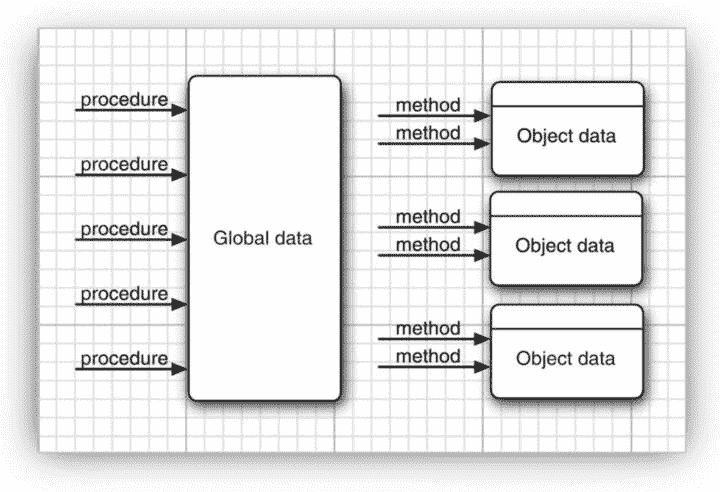图 4.1: 过程化 vs 面向对象编程

### 4.1.1 类

`class`（类）规定了对象是如何制作的。将类比为饼干模；对象就是饼干本身。当你从一个类 `construct` 出一个对象时，被认为创建了该类的 `instance`（实例）。

正如你所看到的，你在 Java 中编写的所有代码都在类内部。标准 Java 库提供了数千类，用于用户界面设计、日期和日历以及网络编程等各种用途。尽管如此，在 Java 中你仍然需要创建自己的类来描述应用程序问题领域中的对象。

`Encapsulation`（封装，有时称为 `information hiding`）是处理对象的一个核心概念。从形式上说，封装简单地将数据和行为组合在一个包中，并向对象的用户隐藏实现细节。对象中的数据位被称为 `instance fields`（实例字段），而操作数据的过程被称为 `methods`（方法）。作为类实例的特定对象将具有其实例字段的具体值。这些值的集合就是该对象的当前 `state`（状态）。每当你对对象调用一个方法时，它的状态就可能会发生变化。

使封装生效的关键在于，让方法 `never`（从不）直接访问除自身以外类的实例字段。程序应该 `only`（仅）通过对象的方法与对象数据交互。封装是赋予对象“黑盒”行为的方法，这是重用和可靠性的关键。这意味着一个类可以完全改变它存储数据的方式，但只要它继续使用相同的方法来处理数据，其他对象就不会知道或在乎。

当你开始在 Java 中编写自己的类时， OOP 的另一个原则会让这一切变得更容易：类可以通过 `extending`（扩展）其他类来构建。事实上，Java 自带了一个名为 `Object` 的“宇宙超级类”。所有其他类都扩展了这个类。你将在下一章学习更多关于 `Object` 类的内容。

当你扩展一个现有类时，新类拥有你所扩展的类的所有属性和方法。你提供了仅适用于你新类的新方法和实例字段。扩展类以获取另一个类的概念被称为 `inheritance`（继承）。更多关于继承的信息请参见下一章。

### 4.1.2 对象

要使用 OOP，你应该识别对象的三个关键特征：

* 对象的 `behavior`（行为）——你可以用这个对象做什么，或者可以对它应用哪些方法？

* 对象的 `state`（状态）——当你调用这些方法时，对象如何反应？

* 对象的 `identity`（身份）——如何将对象与其他可能有相同行为和状态的对象区分开？

作为同一类实例的所有对象都通过支持相同的 `behavior` 共享家族相似性。对象的行为由你可以调用的方法定义。

接下来，每个对象都存储关于其当前状态的信息。这是对象的 `state`。对象的状态可能会随时间改变，但不会自发改变。对象状态的变化必须是方法调用的结果。（如果对象的状态在没有对该对象调用方法的情况下发生了变化，那么有人破坏了封装。）

然而，对象的状态并不能完全描述它，因为每个对象都有一个独特的 `identity`（身份）。例如，在订单处理系统中，两个订单即使请求相同的物品，它们也是不同的。请注意，作为类实例的各个对象在身份上 `always`（总是）不同，在状态上 `usually`（通常）不同。

这些关键特征可以相互影响。例如，对象的状态可以影响它的行为。（如果一个订单被标记为“已发货”或“已支付”，它可能会拒绝要求其添加物品的方法调用。）

### 4.1.3 识别类

在传统的过程化程序中，你从顶部的 `main` 函数开始。在设计面向对象的系统时，没有“顶部”，OOP 初学者经常困惑于从哪里开始。答案是：识别你的类，然后为每个类添加方法。

识别类的一个简单原则是在问题分析中寻找名词。另一方面，方法对应于动词。

例如，在一个订单处理系统中，一些名词是

* 

* 

* 收货地址

* 

* 

这些名词可能指向 `Item`、`Order` 等类。

接下来，寻找动词。物品被`添加`到订单中。订单被`发货`或`取消`。支付`应用于`订单。对于每个动词（如“添加”、“发货”、“取消”或“应用”），你识别执行该操作的对象。例如，当一个新物品添加到订单中时，订单对象应该是负责人，因为它知道如何存储和排序物品。也就是说，`add` 应该是 `Order` 类的一个方法，并将 `Item` 对象作为参数。

当然，“名词和动词”只是一个原则；只有经验才能帮助你在构建类时决定哪些名词和动词是重要的。

### 4.1.4 类之间的关系

类之间最常见的关系是

* `Dependence`（依赖，“使用一个”）

* `Aggregation`（聚合，“有一个”）

* `Inheritance`（继承，“是一个”）

`dependence`（依赖）或“使用一个”关系是最明显的，也是最通用的。例如，`Order` 类使用 `Account` 类，因为 `Order` 对象需要访问 `Account` 对象来检查信用状态。但 `Item` 类不依赖于 `Account` 类，因为 `Item` 对象永远不需要担心账户。因此，如果一个类的方法使用了或操作了另一个类的对象，那么该类就依赖于该类。

尽量减少类之间相互依赖的数量。要点在于，如果类 `A` 不感知类 `B` 的存在，那么它对 `B` 的任何更改也不关心。（这意味着对 `B` 的更改不会在 `A` 中引入 Bug。）在软件工程术语中，你希望减少类与类之间的 `coupling`（耦合）。

`aggregation`（聚合）或“拥有”（has–a）关系很容易理解，因为它是具体的；例如，一个 `Order`（订单）对象包含 `Item`（项目）对象。包含（Containment）意味着类 `A` 的对象包含类 `B` 的对象。

一些方法论者对聚合的概念表示不屑，并更倾向于使用更通用的`association`（关联）关系。从建模的角度来看，这是可以理解的。但对于程序员来说，“拥有”关系非常有意义。我喜欢使用聚合还有另一个原因：关联关系的标准表示法不够清晰。请参见表 4.1。

`inheritance`（继承）或“是”（is–a）关系表示了更特殊类和更通用类之间的关系。例如，`RushOrder`（急急订单）类继承自 `Order` 类。特化的 `RushOrder` 类具有处理优先级的特殊方法，以及用于计算运费的不同方法，但它的其他方法（如添加项目和计费）是从 `Order` 类继承而来的。通常，如果类 `D` 扩展了类 `C`，类 `D` 继承了类 `C` 的方法，但具有更多的功能。（见下一章，该章将详细讨论这一重要概念。）

许多程序员使用 UML（统一建模语言）表示法来绘制`class diagrams`（类图），以描述类之间的关系。你可以在图 4.2 中看到此类图的示例。你将类画为矩形，将关系画为带有各种装饰的箭头。表 4.1 展示了本书所使用的 UML 箭头样式。

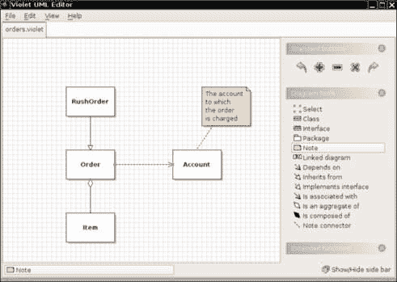图 4.2：类图

表 4.1：类关系的 UML 符号

| 关系 | UML 连接器 |

| --- | --- |

| 继承 |  |

| 接口实现 |  |

| 依赖 |  |

| 聚合 |  |

## 4.2. 使用预定义类

在 Java 中，没有类你什么也做不了，你已经见过几个类的工作示例了。然而，并不是所有这些类都展示了面向对象的典型特征。以 `Math` 类为例。你已经看到你可以使用 `Math` 类的方法，例如 `Math.random`，而不需要知道它们是如何实现的——你只需要知道它们的名称和参数类型（如果有的话）。这就是封装的意义，而且对于所有类来说确实如此。但 `Math` 类*仅*封装了功能；它既不需要也不隐藏数据。由于没有数据，你不需要担心创建对象和初始化它们的实例字段——它们根本不存在！

在下一节中，我们将查看一个典型的类，`Date` 类。你将看到如何构造对象以及调用该类的方法。

### 4.2.1. 对象和对象变量

要操作对象，你首先要构造它们并指定它们的初始状态。然后对对象应用方法。

在 Java 编程语言中，你使用 `constructors`（构造函数）来构造新实例。构造函数是一种特殊方法，目的是构造和初始化对象。让我们来看一个例子。Java 标准库包含一个 `Date` 类。它的对象描述时间点，例如 1999 年 12 月 31 日 23:59:59 GMT。

你可能在想：为什么要用类来表示日期，而不是（像某些语言那样）使用内置类型？例如，Visual Basic 有内置的日期类型，程序员可以指定格式为 `#12/31/1999#` 的日期。从表面上看，这听起来很方便——程序员可以直接使用内置日期类型，而无需担心类。但实际上，Visual Basic 的设计有多合适？在某些地区，日期的格式是月/日/年，而在另一些地区则是日/月/年。语言设计者真的有能力预见这些问题吗？如果他们做得不好，语言就会变成一个令人不悦的混乱体，而不满的程序员对此无能为力。通过类，设计任务被交给了库设计者。如果该类不完美，其他程序员可以轻松地编写自己的类来增强或替换系统类。（为了证明这一点：Java 日期库刚开始有点混乱，它已经重新设计了两次。）

构造函数的名称始终与类名相同。因此，`Date` 类的构造函数名为 `Date`。要构造一个 `Date` 对象，将构造函数与 `new` 操作符结合，如下：

```java
new Date()
```

此表达式构造了一个新对象。该对象被初始化为当前日期和时间。

如果你愿意，可以将对象传递给方法：

```java
System.out.println(new Date());
```

或者，你也可以将对象传递方法：

```java
System.out.println(new Date());
```

或者，你可以将方法应用到刚刚构造的对象上。`Date` 类的一个方法是 `toString` 方法。该方法返回日期的字符串表示。在这里，你把 `toString` 方法应用到新构造的 `Date`：

```java
String s = new Date().toString();
```

在这两个示例中，构造的对象只使用了一次。通常，你会希望保留构造的对象以便继续使用。只需将对象存储在变量中：

```java
Date rightNow = new Date();
```


图 4.3 显示了指向新构造对象的对象变量`rightNow`。

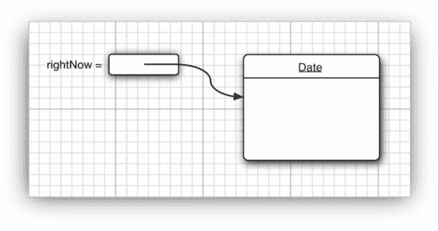图 4.3：创建对象

对象和对象变量之间存在重要的区别。例如，语句

```java
Date startTime; // startTime 没有引用
```

定义了一个对象变量`startTime`，它可以引用`Date`类的对象。重要的是，变量`startTime`*并不是一个对象*，事实上它还没有引用任何对象。此时不能对该变量使用任何`Date`方法。语句

```java
s = startTime.toString(); // 尚未
```

会导致编译错误。

你必须初始化`startTime`变量。你有两个选择。当然，你可以初始化该变量使其指向一个新构造的对象：

```java
startTime = new Date();
```

或者，你可以将变量指向一个已有的对象：

```java
startTime = rightNow;
```

现在两个变量指向*同一个*对象（参见图 4.4）。

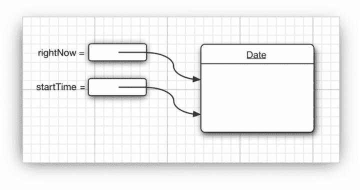图 4.4：指向同一对象的对象变量

重要的是，对象变量实际上并不包含对象。它只是*引用*对象。

在 Java 中，任何对象变量的值都是存储在其他地方引用。`new`操作符的返回值也是一个引用。这样的语句

```java
Date startTime = new Date();
```

包含两个部分：`new Date()`创建一个`Date`类型的对象，其值为指向该新对象的引用。然后将该引用存储在`startTime`变量中。

你可以显式地将对象变量设置为`null`，以表示当前没有引用任何对象。

```java
startTime = null;
. . .
if (startTime != null)
   System.out.println(startTime);
```

我将在第 4.3.6 节中详细讨论`null`。

有些人错误地认为 Java 对象变量的行为类似于 C++ 引用。但在 C++ 中没有空引用，且引用不能被赋值。你应该将 Java 对象变量类比为 C++ 中的`object pointers`。例如，

```
Date rightNow; // Java
```

实际上等同于

```cpp
Date* rightNow; // C++
```

一旦你建立了这种联系，一切就迎刃而解了。当然，`Date*`指针在使用调用`new`初始化之前是没有初始化的。C++ 和 Java 的语法几乎相同。

```
Date* rightNow = new Date(); // C++
```

如果你将一个变量拷贝到另一个变量，那么这两个变量都指向同一个日期——它们是指向同一个对象的指针。Java 中`null`引用的等价物是 C++ 的`NULL`指针。

所有的 Java 对象都存储在堆上。当一个对象包含另一个对象变量时，它包含的只是指向另一个堆对象的指针。

在 C++ 中，指针会让你感到紧张，因为它们非常容易出错。很容易创建错误的指针或搞乱内存管理。在 Java 中，这些问题就消失了。如果你使用未初始化的指针，运行时系统会可靠地生成运行时错误，而不是产生随机结果。你不需要担心内存管理，因为垃圾回收器会处理它。

C++ 付出了很大努力，通过支持拷贝构造函数和赋值运算符，允许实现能够自动自我拷贝的类。例如，链表的副本是一个新的链表，具有相同的内容，但拥有一组独立的链接。这使得设计出与内置类型具有相同拷贝行为的类成为可能。在 Java 中，你必须使用`clone`方法来获取对象的完整拷贝。

### 4.2.2 Java 库中的`LocalDate`类

在前面的示例中，我们使用了标准 Java 库中的`Date`类。`Date`类的实例有一个状态——即`a particular point in time`。

尽管在使用`Date`类时不需要知道这一点，但时间是通过距离一个固定点的毫秒数（正或负）来表示的，这个固定点被称为`epoch`（元时间），即 1970 年 1 月 1 日 00:00:00 UTC。UTC 是协调世界时，是一种科学时间标准，在实际用途中它与更熟悉的 GMT（即格林尼治标准时间）相同。

但事实证明，`Date`类对于处理人类用于日期的日历信息（例如“1999 年 12 月 31 日”）并不好用。这种对日期的特定描述遵循格列哥历，这是世界上大多数国家使用的历法。同一个时间点在中文或希伯来历历中会有完全不同的描述，更不用说来自火星的客户所使用的历法了。

在整个人类历史上，各个文明都在设计历法，以为日期命名，并为太阳和月亮的周期带来秩序。关于世界各地历法（从法国革命历到玛雅长纪历）的迷人解释，请参阅 Nachum Dershowitz 和 Edward M. Reingold 写的 *Calendrical Calculations*（Cambridge University Press, 4th ed., 2018）。

库的设计者决定将“记录时间”和“为时间点命名”这两个职责分开。因此，标准 Java 库包含两个独立的类：表示时间点的`Date`类，以及用熟悉的日历符号表示日期的`LocalDate`类。如今，有一套更健壮的类集用于处理日期和时间的各个方面——参见卷二第六章。

将时间测量与历法分离是良好的面向对象设计。通常，使用不同的类来表示不同的概念是一个好主意。

你不需要使用构造函数来构造`LocalDate`类的对象。相反，使用静态的`factory methods`来代表你调用构造函数。以下表达式

```
LocalDate.now()
```

会构造一个表示对象构造时日期的新对象。

你可以通过提供年、月、日来构造特定日期的对象：

```
LocalDate.of(1999, 12, 31)
```

当然，你通常希望将构造的对象存储在对象变量中：

```
LocalDate newYearsEve = LocalDate.of(1999, 12, 31);
```

一旦你有一个`LocalDate`对象，就可以通过`getYear`、`getMonthValue`和`getDayOfMonth`方法找到年、月、日：

```
int year = newYearsEve.getYear(); // 1999
int month = newYearsEve.getMonthValue(); // 12
int day = newYearsEve.getDayOfMonth(); // 31
```

这看起来可能毫无意义，因为这些值与你刚刚构造对象时使用的值完全相同。但有时，你有一个计算出来的日期，然后你会想要调用这些方法来获取它的更多信息。例如，`plusDays`方法会产生一个新的`LocalDate`，它距离你应用它的对象指定的天数：

```
LocalDate aThousandDaysLater = newYearsEve.plusDays(1000);
year = aThousandDaysLater.getYear(); // 2002
month = aThousandDaysLater.getMonthValue(); // 09
day = aThousandDaysLater.getDayOfMonth(); // 26
```

### 4.2.3 修改器和访问器方法

再次查看你在上一节节中看到的`plusDays`方法调用：

```
LocalDate aThousandDaysLater = newYearsEve.plusDays(1000);
```

调用后`newYearsEve`发生了什么变化？它变成了一千天后了吗？事实证明，并没有变。`plusDays`方法产生一个新的`LocalDate`对象，然后将其赋值给`aThousandDaysLater`变量。原始对象保持不变。我们说`plusDays`方法没有`mutate`（修改）它调用的对象。（这与你在第三章看到的`String`类的`toUpperCase`方法相似）。

Java 库的早期版本有一个另一个处理历历的类，称为`GregorianCalendar`。这段代码片段向该类表示的日期增加了一千天：

```java
GregorianCalendar someDay = new GregorianCalendar(1999, 11, 31);
   // 该类的奇特特性：月份数字从 0 到 11
someDay.add(Calendar.DAY_OF_MONTH, 1000);
```

与`LocalDate.plusDays`方法不同，`GregorianCalendar.add`方法是一个变器方法（mutator method）。调用它后，`someDay`对象的状态发生了改变。以下是你可以查找新状态的方法：

```
year = someDay.get(Calendar.YEAR); // 2002
month = someDay.get(Calendar.MONTH) + 1; // 09
day = someDay.get(Calendar.DAY_OF_MONTH); // 26
```

这就是为什么变量被命名为`someDay`而不是`newYearsEve`——在调用变器方法后，它不再是除夕夜了。

相比之下，只访问对象而不修改它们有时被称为*访问器方法*（accessor methods）。例如，`LocalDate.getYear`和`GregorianCalendar.get`就是访问器方法。

在 C++ 中，`const`后缀表示访问器方法。未声明为`const`的方法被假设是变器。然而，在 Java 编程语言中，没有特殊的语法来区分访问器和变器。

我将用一个让`LocalDate`类投入工作的程序来结束本节。该程序显示当前月份的日历，如下：

```
Mon Tue Wed Thu Fri Sat Sun
                          1
  2   3   4   5   6   7   8
  9  10  11  12  13  14  15
 16  17  18  19  20  21  22
 23  24  25  26* 27  28  29
 30
```

当前日期用星号（`*`）标记。你可以看到，程序需要知道如何计算月份长度以及给定日期的星期。

让我们遍历程序的关键步骤。首先，我们构造一个初始化为当前日期的对象。

```
LocalDate date = LocalDate.now();
```

我们获取当前的月份和日期。

```
int month = date.getMonthValue();
int today = date.getDayOfMonth();
```

然后我们将`date`设置为每月初并获取该日期的星期。

```
date = date.minusDays(today - 1); // set to start of month
DayOfWeek weekday = date.getDayOfWeek();
int value = weekday.getValue(); // 1 = Monday, . . . , 7 = Sunday
```

变量`weekday`被设置为类型为`DayOfWeek`的对象。我们调用该对象的`getValue`方法来获取周期的数值。这产生了一个遵循国际惯的整数，即周末在周末，周一返回`1`，周二返回`2`，依此类推。周日的值为`7`。

注意，日历的第一行是缩进的，以便每月的第一天落在正确的星期。以下是打印表头和第一行缩进的代码：

```
System.out.println("Mon Tue Wed Thu Fri Sat Sun");
for (int i = 1; i < value; i++)
   System.out.print("    ");
```

现在，我们准备好打印日历的主体。我们进入一个循环，`date`遍历月份的每一天。

在每次迭代中，我们打印日期值。如果`date`是今天，则用`*`标记日期。然后，我们将`date`推进到一天。当我们到达每个新周的开始时，打印一个新行：

```
while (date.getMonthValue() == month)
{
   System.out.printf("%3d", date.getDayOfMonth());
   if (date.getDayOfMonth() == today)
      System.out.print("*");
   else
      System.out.print(" ");
   date = date.plusDays(1);
   if (date.getDayOfWeek().getValue() == 1) System.out.println();
}
```

我们何时停止？我们不知道该月份有 31、30、29 还是 28 天。相反，只要`date`仍在当前月份内，我们就继续迭代。

Listing 4.1 显示了完整的程序。

如你所见，`LocalDate`类使得编写处理星期和月份长度等复杂问题的日历程序成为可能。你不需要知道`LocalDate`类*如何*计算月份和星期。你只需要使用该类的*接口*——诸如`plusDays`和`getDayOfWeek`等方法。

这个示例程序的目的是向你展示如何使用类的接口来执行相当复杂的任务，而无需了解实现细节。

Listing 4.1 CalendarTest/CalendarTest.java

```java
import java.time.*;

/**
 * @version 1.5 2015-05-08
 * @author Cay Horstmann
 */
public class CalendarTest
{
   public static void main(String[] args)
   {
      LocalDate date = LocalDate.now();
      int month = date.getMonthValue();
      int today = date.getDayOfMonth();

      date = date.minusDays(today - 1); // set to start of month
      DayOfWeek weekday = date.getDayOfWeek();
      int value = weekday.getValue(); // 1 = Monday, . . . , 7 = Sunday

      System.out.println("Mon Tue Wed Thu Fri Sat Sun");
      for (int i = 1; i < value; i++)
         System.out.print("    ");

      while (date.getMonthValue() == month)
      {
         System.out.printf("%3d", date.getDayOfMonth());
         if (date.getDayOfMonth() == today)
            System.out.print("*");
         else
            System.out.print(" ");
         date = date.plusDays(1);
         if (date.getDayOfWeek().getValue() == 1) System.out.println();
      }
   }
}
```

注意，示例程序包含两个类：`Employee`类和一个带有`public`访问修饰符的`EmployeeTest`类。包含我们刚刚描述指令的`main`方法位于`EmployeeTest`类中。

源文件名为`EmployeeTest.java`，因为文件名必须与`public`类的名称匹配。在一个源文件中，你只能有一个`public`类，但可以有任意数量的非公共（nonpublic）类。

接下来，当你编译源代码时，编译器会在目录中创建两个类文件：`EmployeeTest.class`和`Employee.class`。

然后，你通过向字节码解释器提供包含程序`main`方法类的类来启动程序：

```
java EmployeeTest
```

字节码解释器开始运行`EmployeeTest`类中`main`方法的代码。这段代码反过来构造了三个新的`Employee`对象并向你展示它们的状态。

列表 4.2 `EmployeeTest/EmployeeTest.java`


```java
import java.time.*;

/**
 * 此程序测试 Employee 类。
 * @version 1.13 2018-04-10
 * @author Cay Horstmann
 */
public class EmployeeTest
{
   public static void main(String[] args)
   {
      // 用三个 Employee 对象填充 staff 数组
      Employee[] staff = new Employee[3];

      staff[0] = new Employee("Carl Cracker", 75000, 1987, 12, 15);
      staff[1] = new Employee("Harry Hacker", 50000, 1989, 10, 1);
      staff[2] = new Employee("Tony Tester", 40000, 1990, 3, 15);

      // 将所有人的工资提高 5%
      for (Employee e : staff)
         e.raiseSalary(5);

      // 打印所有 Employee 对象的信息
      for (Employee e : staff)
         System.out.println("name=" + e.getName() + ",salary=" + e.getSalary() + ",hireDay=" 
            + e.getHireDay());
   }
}

class Employee
{
   private String name;
   private double salary;
   private LocalDate hireDay;

   public Employee(String n, double s, int year, int month, int day)
   {
      name = n;
      salary = s;
      hireDay = LocalDate.of(year, month, day);
   }

   public String getName()
   {
      return name;
   }

   public double getSalary()
   {
      return salary;
   }

   public LocalDate getHireDay()
   {
      return hireDay;
   }

   public void raiseSalary(double byPercent)
   {
      double raise = salary * byPercent / 100;
      salary += raise;
   }
}
```

### 4.3.2 多源文件的使用

列表 4.2 中的程序在单个源文件中包含两个类。许多程序员更倾向于将每个类放在单独的源文件中。例如，你可以将 `Employee` 类放在文件 `Employee.java` 中，将 `EmployeeTest` 类放在 `EmployeeTest.java` 中。

如果你喜欢这种安排，编译程序有两种选择。你可以使用通配符调用 Java 编译器：

```bash
javac Employee*.java
```

然后，所有匹配通配符的源文件将被编译成类文件。或者，你只需输入：

```bash
javac EmployeeTest.java
```

你可能会发现，尽管 `Employee.java` 文件从未被显式编译，第二种选择仍然有效。然而，当 Java 编译器看到 `EmployeeTest.java` 内部使用了 `Employee` 类时，它会寻找名为 `Employee.class` 的文件。如果找不到该文件，它会自动搜索 `Employee.java` 并编译它。此外，如果它找到的 `Employee.java` 版本的时间戳比现有的 `Employee.class` 文件新，Java 编译器将重新编译该文件。

如果你熟悉 UNIX 的 `make` 工具（或其 Windows 兄弟版本，如 `nmake`），你可以认为 Java 编译器已经内置了 `make` 功能。

### 4.3.3 剖析 `Employee` 类

在接接几个章节中，我们将剖析 `Employee` 类。让我们从该类中的方法开始。通过检查源码，你可以看到该类有一个构造函数和四个方法：

```java
public Employee(String n, double s, int year, int month, int day)
public String getName()
public double getSalary()
public LocalDate getHireDay()
public void raiseSalary(double byPercent)
```

该类的所有方法都被标记为 `public`。关键字 `public` 意味着任何类中的任何方法都可以调用该方法。（四种可能的访问级别将在本章和下一章介绍。）

接下来，注意三个实例字段，它们将存储在 `Employee` 类实例内部进行操作的数据。

```java
private String name;
private double salary;
private LocalDate hireDay;
```

`private` 关键字确保了唯一可以访问这些实例字段的方法是 `Employee` 类本身的方法。外部方法无法访问这些字段。

### 4.3.4 构造函数的第一步

让我们看看 `Employee` 中的构造函数：

```java
public Employee(String n, double s, int year, int month, int day)
{
   name = n;
   salary = s;
   hireDay = LocalDate.of(year, month, day);
}
```

如所示，构造函数的名称与类名相同。这个构造函数赋予了实例字段你的状态。例如，当你使用如下代码创建 `Employee` 实例时：

```java
new Employee("James Bond", 100000, 1950, 1, 1)
```

你实际上设置了实例字段：

```java
name = "James Bond";
salary = 100000;
hireDay = LocalDate.of(1950, 1, 1);
```

构造函数与其他方法有重要区别。构造函数只能结合 `new` 操作符调用。你不能将构造函数应用于现有对象来重置实例字段。例如：

```java
james.Employee("James Bond", 250000, 1950, 1, 1) // 错误
```

这是一个编译错误。

我们将在本章晚些时候更多介绍构造函数。现在记住：

- 构造函数与类名相同。
- 类可以有多个构造函数。
- 构造函数可以有零、一个或多个参数。
- 构造函数没有返回值。
- 构造函数始终通过 `new` 操作符调用。

构造函数声明了 `local` 变量 `name` 和 `salary`。这些变量仅在构造函数内部可见。它们 `shadow`（遮蔽）了与其同名的实例字段。某些程序员在打字速度比思考速度快时会不小心写出这种代码，因为他们的手指习惯了添加数据类型。这是一个很难追踪的糟糕错误。你 `own` 所有方法中都必须小心，不要使用与实例字段同名的变量名。

### 4.3.5 使用 `var` 局部变量

你可以使用 `var` 关键字来声明局部变量而不是指定其类型，只要其类型可以从初始值中推断出来。例如，与其声明：

```java
Employee harry = new Employee("Harry Hacker", 50000, 1989, 10, 1);
```

你只需要写：

```java
var harry = new Employee("Harry Hacker", 50000, 1989, 10, 1);
```

这样做很好，因为它避免了类型名 `Employee` 的重复出现。

从现在起，在那些不需要了解 Java API 就能从右侧推看出类型的情况下，我将使用 `var` 写法。但我不会在 `int`、`long` 或 `double` 等数值类型上使用 `var`，这样你就不需要留意 `0`、`0L` 和 `0.0` 之间的差异。一旦你更熟悉 Java API，你可能会更频繁地使用 `var` 关键字。

注意，`var` 关键字只能用于方法内部的 `local` 变量。你必须始终声明参数和字段的类型。

许多程序员在认为变量类型显而易见或明显无关时，会大量使用 `var` 关键字。一组良好的指南可以参考 [`openjdk.org/projects/amber/guides/lvti-style-guide`](https://openjdk.org/projects/amber/guides/lvti-style-guide)。

### 4.3.6 处理 `null` 引用

在第 4.2.1 节中，你看到对象变量持有对象的引用，或者使用特殊值 `null` 来表示对象的缺失。

这听起来是处理特殊情况（如未知名称或入职日期）的一种方便机制。但你对 `null` 值需要非常小心。

如果你对 `null` 值应用一个方法，就会发生 `NullPointerException`（空指针异常）。

```java
LocalDate rightNow = null;
String s = rightNow.toString(); // NullPointerException
```

这是一个严重的错误，类似于“索引越界”异常。如果你的程序没有“捕获”（`catch`）异常，它就会终止。通常，程序不会捕获这类异常，而是依靠程序员从根本上不要产生它们。

当程序因 `NullPointerException` 终止时，堆栈跟踪（stack trace）会显示问题发生在代码的哪一行。从 Java 14 开始，错误消息包含了带有 `null` 值的变量或方法名。例如，在调用中：

```java
String s = e.getHireDay().toString();
```

错误消息会告诉你 `e` 是 `null` 还是 `getHireDay` 返回了 `null`。

在定义类时，明确哪些字段可以为 `null` 是一个好主意。在示例中，我们不希望 `name` 或 `hireDay` 字段为 `null`。（我们不需要担心 `salary` 字段。它是基本类型，永远不会为 `null`。）

`hireDay` 字段保证是非 `null` 的，因为它用一个新的 `LocalDate` 对象初始化。但如果调用构造函数时给 `n` 传入了 `null` 参数，那么 `name` 将是 `null`。

有两种解决方案。“宽容”的方法是将 `null` 参数转换为适当的非 `null` 值：

```java
if (n == null) name = "unknown"; else name = n;
```

`Objects` 类有一个为此目的提供的简便方法：

```java
public Employee(String n, double s, int year, int month, int day)
{
   name = Objects.requireNonNullElse(n, "unknown");
   . . .
}
```

“严厉的爱”方法是拒绝 `null` 参数：

```java
public Employee(String n, double s, int year, int month, int day)
{
   name = Objects.requireNonNull(n, "The name cannot be null"); 
   . . .
}
```

如果有人用 `null` 名字构造了一个 `Employee` 对象，就会发生 `NullPointerException`。乍看之下，这似乎不是一个很有用的补救。但它有两个优点：

1. 异常报告包含了问题的描述。
2. 异常报告精确指出了问题的位置。否则，`NullPointerException` 会在其他地方发生，且没有简单的方法可以追溯到错误的构造函数参数。

每当参数是一个对象引用时，问问自己你是否真的想要建模可能存在或不存在的值。如果不是，则优选选择抛出异常的“严厉的爱”方法。

### 4.3.7 隐式和显式参数

方法对对象操作并访问其实例字段。例如，方法：

```java
public void raiseSalary(double byPercent)
{
   double raise = salary * byPercent / 100;
}
```

### 4.3.8 封装的好处

最后，让我们更仔细地观察简单的 `getName`、`getSalary` 和 `getHireDay` 方法。

```java
public String getName()
{
   return name;
}

public double getSalary()
{
   return salary;
}

public LocalDate getHireDay()
{
   return hireDay;
}
```

这些是访问器方法的典型例子。由于它们简单地返回实例字段的值，它们有时被称为*字段访问器*（field accessors）。

直接将 `name`、`salary` 和 `hireDay` 字段设为 `public` 而不是使用独立的访问方法不是更容易吗？

使用方法可以提供更多的控制和安全性。考虑 `salary` 字段，它只由 `raiseSalary` 方法更改。如果该值出现错误，只需要调试该方法即可。如果 `salary` 字段是公开的，搞错值的罪魁祸首可能出现在任何地方。

有时，你想要获取和设置实例字段的值。这时，你需要提供三项内容：

- 一个私有的实例字段；
- 一个公有的字段访问器方法（accessor method）；以及
- 一个公有的字段修改器方法（mutator method）。

这比提供单个公有实例字段要繁琐得多，但它具有相当的优势。

首先，你可以更改内部实现，而不会影响该类方法之外的任何代码。例如，如果将名称的存储改为：

```java
String firstName;
String lastName;
```

那么 `getName` 方法可以更改为返回：

```java
firstName + " " + lastName
```

这一更改对程序的其余部分来说是完全不可见的。

当然，访问器和修改器方法可能需要执行大量工作来在旧新数据表示之间进行转换。这引出了我们的第二个优点：修改器方法可以执行错误检查，而仅仅赋值给字段的代码可能不会费这个心机。例如，`setSalary` 方法可能会检查薪水永远不小于 0。

注意不要编写返回可变对象引用的访问器方法。在本书的上一个版本中，我在 `Employee` 类中违反了这一规则，其中 `getHireDay` 方法返回了一个 `Date` 类的对象：

```java
class Employee
{
   private Date hireDay;
   . . .
   public Date getHireDay()
   {
      return hireDay; // 错误
   }
   . . .
}
```

与没有修改方法的 `LocalDate` 类不同，`Date` 类有一个修改方法 `setTime`，你可以在其中设置毫秒数。

`Date` 对象是可变的这一事实破坏了封装！考虑以下违规代码：

```java
Employee harry = . . .;
Date d = harry.getHireDay();
double tenYearsInMilliseconds = 10 * 365.25 * 24 * 60 * 60 * 1000;
d.setTime(d.getTime() - (long) tenYearsInMilliseconds);
// 给 Harry 增加十年的工龄
```

原因是微妙的。`d` 和 `harry.hireDay` 指向同一个对象（参见图 4.5）。对 `d` 应用修改器方法会自动更改 `Employee` 对象的私有状态！

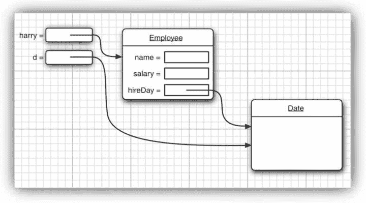图 4.5: 返回一个可变实例字段的引用

你将在第 6 章中看到如何在返回可变对象之前通过*克隆*它来解决这个问题。

更好的补救措施尽可能使用不可变对象，例如用 `LocalDate` 代替旧的 `Date` 类。

### 4.3.9 基于类的访问权限

你已经知道方法可以访问其调用所在对象的私有数据。人们经常感到惊讶的是，一个方法可以访问*该类中所有对象*的私有数据。例如，考虑一个比较两个员工的 `equals` 方法。

```java
class Employee
{
   . . .
   public boolean equals(Employee other)
   {
      return name.equals(other.name);
   }
}
```

典型的调用是：

```java
if (harry.equals(boss)) . . .
```

该方法访问了 `harry` 的私有字段，这并不意外。它还访问了 `boss` 的私有字段。这是合法的，因为 `boss` 是 `Employee` 类型的对象，而 `Employee` 类的方法允许访问*任何* `Employee` 类型对象的私有字段。

C++ 也有同样的规则。方法可以访问其类中任何对象的私有特性，而不仅仅是隐式参数。

### 4.3.10 私有方法

在实现类时，我们将所有实例字段设为私有，因为公有数据是危险的。但方法呢？虽然大多数方法是公有的，但私有方法在某些情况下很有用。有时，你可能希望将计算代码拆分为辅助方法。通常，这些辅助方法不应该是公共接口的一部分——它们可能与当前实现过于，或者需要特定的协议或调用顺序。此类方法最好实现为私有。


在 Java 中实现私有方法，只需将 `public` 关键字改为 `private` 即可。

通过将方法设为私有，当你更改实现时，并没有义务保持其可用。如果数据表示发生变化，该方法的实现可能会变得更困难或不再需要；这无关紧要。要点是，只要方法是私有的，类的设计者就可以确保它没有在别使用，因此他们可以简单地将其丢弃。如果方法是公有的，你就不能简单地丢弃它，因为其他代码可能依赖它。

### 4.3.11 Final 实例字段

你可以将实例字段定义为 `final`。此类字段必须在对象构造时初始化。也就是说，你必须保证在每个构造函数结束后字段值已设置。之后，该字段可能再被修改。例如，`Employee` 类的 `name` 字段可以声明为 `final`，因为它在对象构造后永远不会改变——这里没有 `setName` 方法。

```
class Employee
{
   private final String name;
   . . .
}
```

`final` 修饰符对于类型为类型或不可变对象的字段特别有用。

## 4.4 静态字段和方法

在你过的所有的程序中，`main` 方法都标记了 `static` 修饰符。我们现在准备讨论这个修饰符的含义。

### 4.4.1 静态字段

如果你将字段定义为 `static`，那么它不存在于对象中。每个静态字段只有一个副本。你可以认为静态字段属于类，而不是单个对象。例如，假设我们为每个员工分配一个唯一的标识号。我们在 `Employee` 类中添加一个实例字段 `id` 和静态字段 `nextId`：

```
class Employee
{
   private static int nextId = 1;

   private int id;
   . . .
}
```

每个 `Employee` 对象现在都有自己的 `id` 字段，但只有一个 `nextId` 字段在所有类实例之间共享。换句话说，如果有 1000 个 `Employee` 类对象，那么就有 1000 个实例字段 `id`，每个对象一个。但只有一个静态字段 `nextId`。即使没有 `Employee` 对象，静态字段 `nextId` 也是存在的。它属于类，不属于任何单个对象。

在某些面向对象的编程语言中，静态字段被称为类字段。"static"一词是 C++ 的无意义遗留。

在构造函数中，我们将下一个可用 ID 分配给新的 `Employee` 对象，对其对其增：

```
id = nextId;
nextId++;
```

假设我们构造了对象 `harry`。那么 `harry` 的 `id` 字段被设置为静态字段 `nextId` 的当前值，然后静态字段的值加 1：

```
harry.id = Employee.nextId;
Employee.nextId++;
```

如果你不小心将想要实例字段的字段声明为 `static`，编译器不会帮助你发现这个错误。

从概念上讲，静态字段（例如前一个示例中的 `nextId`）属于类，而不是属于任何对象。尽管如此，在 Java 中，你可以通过 `Employee.nextId` 或 `e.nextId` 来引用该字段，其中 `e` 是任何 `Employee` 对象。在 `Employee` 类的方法内部，你可以使用 `nextId`、`this.nextId` 或 `Employee.nextId`。

因此，注意类中的任何 `static` 声明是一个良好的习惯。静态变量并不常见，值得仔细审查。下一节将讨论的静态常量引人注目，因为它们的名称通常全大写。

### 4.4.2 静态常量

静态变量非常罕见。然而，静态常量更为常见。例如，`Math` 类定义了一个静态常量：

```
public class Math
{
   . . .
   public static final double PI = 3.14159265358979323846;
   . . .
}
```

你可以在程序中通过 `Math.PI` 访问这个常量。

如果省略了 `static` 关键字，那么 `PI` 将是 `Math` 类的实例字段。也就是说，你需要该类的对象才能访问 `PI`，并且每个 `Math` 对象都将拥有自己的 `PI` 拷贝。

另一个你使用过很多静态常量是 `System.out`。它在 `System` 类中的声明如下：

```
public class System
{
   . . .
   public static final PrintStream out = . . .;
   . . .
}
```

正如多次提到的，拥有公共字段永远不是一个好主意，因为每个人都可以修改它们。然而，公共常量（即 `final` 字段）是可以接受的。由于 `out` 已被声明为 `final`，你不能将另一个打印流重新赋值给它：

```
System.out = new PrintStream(. . .); // ERROR--out is final
```

如果你查看 `System` 类，你会发现有一个名为 `setOut` 的方法，它可以将 `System.out` 设置为不同的流。你可能会奇怪该方法如何改变 `final` 变量的值。然而，`setOut` 方法是一个 `native` 方法，不是用 Java 编程语言实现的。原生方法可以绕过 Java 语言的访问控制机制。这是一个非常特殊的变通方法，你不应该在程序中模仿它。

### 4.4.3 静态方法

静态方法是不操作对象的方法。例如，`Math` 类的 `pow` 方法就是一个静态方法。表达式

```
Math.pow(x, a)
```

计算 `x`^(`a`）的幂。它没有使用任何 `Math` 对象来完成任务。换句话说，它没有隐式参数。

你可以将静态方法理解为没有 `this` 参数的方法。（在非静态方法中，`this` 参数指的是方法的隐式参数——参见第 4.3.7 节。）

`Employee` 类的静态方法无法访问实例字段 `id`，因为它不操作对象。但是，静态方法可以访问静态字段。以下是这样一个静态方法的示例：

```
public static int advanceId()
{
   int r = nextId; // 获取下一个可用 id
   nextId++;
   return r;
} 
```

要调用此方法，你需要提供类名：

```
int n = Employee.advanceId();
```

你可以为此方法省略 `static` 关键字吗？可以，但你将需要一个类型为 `Employee` 的对象引用来调用该方法。

使用对象来调用静态方法是合法的。例如，如果 `harry` 是一个 `Employee` 对象，那么你可以调用 `harry.advanceId()` 而不是 `Employee.advanceId()`。然而，我发现这种写法令人困惑。`advanceId` 方法在计算结果时完全没有看 `harry`。我建议你使用类名而不是对象来调用静态方法。（否则，你的 IDE 可能会建议你进行重构。）

在两种情况下使用静态方法：

*   当方法不需要访问对象状态时，因为所有需要的参数都是作为显式参数提供的（例如：`Math.pow`）

*   当方法只需要访问类的静态字段时（例如：`Employee.advanceId`）

静态字段和静态方法在 Java 和 C++ 中具有相同的功能。然而，语法略有不同。在 C++ 中，你使用 `::` 运算符在作用域外访问静态字段或方法，例如 `Math::PI`。

"static"一词有一个奇特的历史。起初，`static` 关键字被引入 C 中，用于表示退出块后不会消失的局部变量。在这种背景下，"static"一词是有意义的：变量保留着，当再次进入该块时它仍然在那里。然后 `static` 在 C 中有了第二个含义，表示无法从其他文件访问的全局变量和函数。复用 `static` 关键字仅仅是为了避免引入新关键字。最后，C++ 复用了该关键字进行第三种无关的解释——表示属于类但不属于该类任何特定对象的变量和函数。这与该关键字在 Java 中的含义相同。

### 4.4.4 工厂方法

这是静态方法的另一个常见用途。`LocalDate` 和 `NumberFormat` 等类使用静态工厂方法来构造对象。你已经见过工厂方法 `LocalDate.now` 和 `LocalDate.of`。以下是获取各种样式格式化对象的方法：

```
NumberFormat currencyFormatter = NumberFormat.getCurrencyInstance();
NumberFormat percentFormatter = NumberFormat.getPercentInstance();
double x = 0.1;
System.out.println(currencyFormatter.format(x)); // 打印 $0.10
System.out.println(percentFormatter.format(x)); // 打印 10%
```

为什么 `NumberFormat` 类不使用构造函数呢？有三个理由倾向于使用工厂方法而不是构造函数：

*   你无法给构造函数命名。构造函数的名称与类名相同。但我们需要两个不同的名称来获取货币实例和百分比实例。

*   当你使用构造函数时，无法更改所构造对象的类型。但工厂方法实际上返回 `DecimalFormat` 类的对象，这是一个继承自 `NumberFormat` 的更专门的类。（更多关于继承的信息请参见第 5 章）

*   构造函数总是构造新对象。你可能希望共享实例。例如，`Integer.valueOf` 方法在你两次调用相同的参数时会产生相同的实例。

### 4.4.5 main 方法

注意，你可以在没有对象的情况下调用静态方法。例如，你不需要构造 `Math`类的对象就可以调用 `Math.pow`。

出于同样的原因，`main` 方法是一个静态方法。

```
public class Application
{
   public static void main(String[] args)
   {
      // 在此处构造对象
      . . .
   }
}
```

`main` 方法不操作任何对象。事实上，当程序启动时，还没有对象。静态 `main` 方法执行，并构造程序需要的对象。

每个类都可以有一个 `main` 方法。这是为类添加演示代码的一种实用技巧。例如，你可以为 `Employee` 类添加一个 `main` 方法：

```
class Employee
{
   public Employee(String n, double s, int year, int month, int day)
   {
      name = n;
      salary = s;
      hireDay = LocalDate.of(year, month, day);
   }
   . . .
   public static void main(String[] args) // 单元测试
   {
      var e = new Employee("Romeo", 50000, 2003, 3, 31);
      e.raiseSalary(10);
      System.out.println(e.getName() + " " + e.getSalary());
   }
   . . .
}
```

要查看 `Employee` 类的演示，只需执行

```
java Employee
```

如果 `Employee` 类是较大应用程序的一部分，你通过以下方式启动应用程序

```
java Application
```

此时 `Employee` 类的 `main` 方法永远被执行。

作为 Java 21 的预览功能，`main` 方法不再需要是 `public` 或 `static`，并且不再需要类型为 `String[]` args 的参数。

*   如果存在多个 `main` 方法，则优先选择 `static main` 方法而非实例方法，并且带有 `String[]` 参数的方法优于不带参数的方法。

*   如果 `main` 不是静态的，则该类必须有一个无参构造函数。然后，启动器会构造该类的一个实例并调用 `main` 方法。

如果你想尝试此预览功能，请记住使用 `--enable-preview` 标志进行编译和运行。

Listing 4.3 中的程序包含一个简单的 `Employee` 类，它拥有一个静态字段 `nextId` 和一个静态方法 `advanceId`。我们用三个 `Employee` 对象填充数组，然后打印员工信息。最后，我们打印下一个可用的标识码，以演示静态方法。

注意，`Employee` 类还有一个运行简单演示的静态 `main` 方法。尝试执行这两个命令：

```
java Employee
java StaticTest
```

Listing 4.3 `StaticTest/StaticTest.java`

```java
/**
 * 此程序演示了静态方法。
 * @version 1.03 2021-09-03
 * @author Cay Horstmann
 */
public class StaticTest
{
   public static void main(String[] args)
   {
      // 用三个 Employee 对象填充 staff 数组
      var staff = new Employee[3];

      staff[0] = new Employee("Tom", 40000);
      staff[1] = new Employee("Dick", 60000);
      staff[2] = new Employee("Harry", 65000);

      // 打印所有 Employee 对象的信息
      for (Employee e : staff)
      {
         System.out.println("name=" + e.getName() + ",id=" + e.getId() + ",salary="
            + e.getSalary());
      }

      int n = Employee.advanceId(); // 调用静态方法
      System.out.println("Next issued id=" + n);
   }
}

class Employee
{
   private static int nextId = 1;

   private String name;
   private double salary;
   private int id;

   public Employee(String n, double s)
   {
      name = n;
      salary = s;
      id = advanceId();
   }

   public String getName()
   {
      return name;
   }

   public double getSalary()
   {
      return salary;
   }

   public int getId()
   {
      return id;
   }

   public static int advanceId()
   {
      int r = nextId; // 获取下一个可用 id
      nextId++;
      return r;
   }

   public static void main(String[] args) // 运行演示
   {
      var e = new Employee("Harry", 50000);
      System.out.println(e.getName() + " " + e.getSalary());
   }
}
```

`java.util.Objects` 7

*   `static <T> void requireNonNull(T obj)`

*   `static <T> void requireNonNull(T obj, String message)`

*   `static <T> void requireNonNull(T obj, Supplier<String> messageSupplier)` 8

    如果 `obj` 为 `null`，这些方法将抛出一个没有消息或给定消息的 `NullPointerException`。（第 6 章 解释了如何使用 supplier 延迟地获取值。第 8 章 解释了 `<T>` 语法。）

*   `static <T> T requireNonNullElse(T obj, T defaultObj)` 9

*   `static <T> T requireNonNullElseGet(T obj, Supplier<T> defaultSupplier)` 9

    如果 `obj` 不为 `null`，则返回 `obj`；如果为 `null` 则返回默认对象。

## 4.5 方法参数

让我们回顾描述编程语言中如何将参数传递给方法（或函数）的计算机科学术语值传递（call by value）意味着方法仅获取调用者提供的值。相比之下，引用传递（call by reference）意味着方法获取调用者提供的变量位置。因此，方法可以修改通过引用传递的变量中存储的值，但不能修改通过值传递的值。这些"按……传递"术语是描述各种编程语言中方法参数行为的标准计算机科学术语，而不仅仅是 Java。（还有按名传递（call by name），主要具有历史意义，被用于最古的高级语言之一 Algol 编程语言。）

Java 编程语言始终使用值传递。这意味着方法获取所有参数的副本。特别是方法无法修改方法调用中任何变量的内容。

例如，考虑以下调用：


```java
double percent = 10;
harry.raiseSalary(percent);
```

无论该方法如何实现，我们都知道在方法调用后，`percent` 的值仍然是 `10`。

让我们仔细观察一下这种情况。假设一个方法尝试将方法参数的值三倍：

```java
public static void tripleValue(double x) // 不起作用
{
   x = 3 * x;
}
```

我们调用这个方法：

```java
double percent = 10;
tripleValue(percent);
```

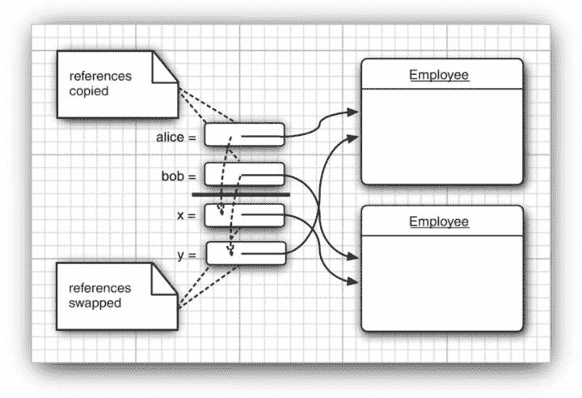

图 4.8：交换参数变量不会产生持久影响。

这表明 Java 编程语言对对象没有使用引用传递。相反，对象引用是通过值传递的。

以下是关于在 Java 方法参数中可以做和不能做的总结：

- 方法不能修改基本类型的参数（即：数字类型、`char` 或 `boolean`）。
- 方法可以改变对象参数的 `state`。
- 方法不能让对象参数引用一个新的对象。

代码列表 4.4 中的程序演示了这些事实。程序首先尝试将一个数字参数的值增加三倍，但并未成功：

```
Testing tripleValue:
Before: percent=10.0
End of method: x=30.0
After: percent=10.0
```

随后，它成功地将员工的薪水增加了三倍：

```
Testing tripleSalary:
Before: salary=50000.0
End of method: salary=150000.0
After: salary=150000.0
```

方法执行后，`harry` 所引用的对象状态发生了变化。这是可能，因为方法通过对象引用的副本修改了状态。

最后，程序演示了 `swap` 方法的失败：

```
Testing swap:
Before: a=Alice
Before: b=Bob
End of method: x=Bob
End of method: y=Alice
After: a=Alice
After: b=Bob
```

如你所示，参数变量 `x` 和 `y` 被交换了，但变量 `a` 和 `b` 没有受到影响。

C++ 同时拥有按值传递和引用传递。你用 `&` 标记引用参数。例如，你可以轻松地实现方法 `void tripleValue(double& x)` 或 `void swap(Employee& x, Employee& y)`，它们会修改引用参数。

代码列表 4.4 `ParamTest/ParamTest.java`

```java
/**
 * 此程序演示了 Java 中的参数传递。
 * @version 1.01 2018-04-10
 * @author Cay Horstmann
 */
public class ParamTest
{
   public static void main(String[] args)
   {
      /*
       * 测试 1: 方法不能修改数值参数
       */
      System.out.println("Testing tripleValue:");
      double percent = 10;
      System.out.println("Before: percent=" + percent);
      tripleValue(percent);
      System.out.println("After: percent=" + percent);

      /*
       * 测试 2: 方法可以改变对象的状态
       */
      System.out.println("\nTesting tripleSalary:");
      var harry = new Employee("Harry", 50000);
      System.out.println("Before: salary=" + harry.getSalary());
      tripleSalary(harry);
      System.out.println("After: salary=" + harry.getSalary());

      /*
       * 测试 3: 方法不能将新对象绑定到对象参数
       */
      System.out.println("\nTesting swap:");
      var a = new Employee("Alice", 70000);
      var b = new Employee("Bob", 60000);
      System.out.println("Before: a=" + a.getName());
      System.out.println("Before: b=" + b.getName());
      swap(a, b);
      System.out.println("After: a=" + a.getName());
      System.out.println("After: b=" + b.getName());
   }

   public static void tripleValue(double x) // 不起
   {
      x = 3 * x;
      System.out.println("End of method: x=" + x);
   }

   public static void tripleSalary(Employee x) // 有效
   {
      x.setSalary(x.getSalary() * 3);
   }

   public static void swap(Employee x, Employee y) // 不起
   {
      Employee temp = x;
      x = y;
      y = temp;
   }
}
```

## 4.6 对象构造

许多类包含一个无参数的构造函数，该构造函数创建一个状态被设置为适当默认值的对象。例如，这里是 `Employee` 类的无参构造函数：

```java
public Employee()
{
   name = "";
   salary = 0;
   hireDay = LocalDate.now();
}
```

### 4.6.1 重载

Java 允许你拥有多个相同的方法，只要它们的参数列表不同。这被称为重载。例如，`Employee` 类具有以下签名：

- `indexOf()`
- `indexOf(int)`
- `indexOf(int, int)`
- `indexOf(String)`
- `indexOf(String, int)`
- `indexOf(String, int, int)`

语句 `indexOf(int, int)` 是一个编译时错误，因为没有具有该签名的方法。

### 4.6.2 字段的默认初始化

如果你不在构造函数中显式设置字段，它将自动设置为默认值：数字设置为 `0`，`boolean` 值设置为 `false`，对象引用设置为 `null`。一些人认为依赖默认值是一种糟糕的习惯。显然，如果字段是隐式初始化的，这会让别人理解你的代码变得困难。

这是字段与局部变量之间的一个重要区别。你必须在方法中始终初始化局部变量。但在类中，如果你不初始化字段，它将自动初始化为默认值。例如，考虑 `Employee` 类。假设你没有在构造函数中指定如何初始化某些字段。默认情况下，`salary` 字段将初始化为 `0`，`name` 和 `hireDay` 字段将初始化为 `null`。

然而，那并不是一个好主意。如果任何人调用 `getName` 或 `getHireDay` 方法，他们将得到一个他们可能并不预到的 `null` 引用：

```java
LocalDate h = harry.getHireDay();
int year = h.getYear(); // 如果 h 为 null 则抛出异常
```

如果你编写了一个完全没有构造函数的类，那么系统会为你提供一个无参构造函数。该构造函数会将所有实例字段设置为它们的默认值。因此，实例字段中的所有数值数据都将为 `0`，所有的 `boolean` 值将为 `false`，所有的对象变量都将为 `null`。

如果一个类提供了至少一个构造函数，但没有提供无参构造函数，那么在不提供参数的情况下构造对象是非合法的。例如，我们在 Listing 4.2 中原始的 `Employee` 类提供了一个构造函数：

```
public Employee(String n, double s, int year, int month, int day)
```

使用该类，创建默认员工对象是不合法的。也就是说，调用

```
e = new Employee();
```

将会报错。

请记住，只有当你的类没有其他构造函数时，你才能获得免费的无参构造函数。如果你为类编写了即使只有一个构造函数，并且希望该类的用户能够通过调用

```
new ClassName()
```

来创建实例，那么你必须提供一个无参构造函数。当然，如果你对所有字段的默认值感到满意，你可以直接提供：

```java
public ClassName()
{
}
```

C++ 有一种特殊的初始化列表语法来构造字段，例如：

```cpp
Employee::Employee(String n, double s, int y, int m, int d) // C++
:  name(n),
   salary(s),
   hireDay(y, m, d)
{
}
```

C++ 使用这种特殊语法来避免不必要的无参构造函数调用。在 Java 中不需要，因为对象没有子对象，只有指向其他对象的引用。

### 4.6.4 显式字段初始化

通过重载类中的构造器方法，你可以构建许多方式来设置类实例字段的初始状态。无论调用哪个构造函数，确保每个实例字段都被设置了有意义的值，这始终是一个好主意。

你可以直接在类定义中为任何字段赋值。例如：

```java
class Employee
{
   private String name = "";
   . . .
}
```

此赋值在构造函数执行之前完成。如果一个类的所有构造函数都需要将某个特定的实例字段设置为相同的值，这种语法就特别有用。

初始化值不一定是一个常量值。这里有一个使用方法调用初始化字段的示例。考虑 `Employee` 类，其中每个员工都有一个 `id` 字段。你可以这样初始化它：

```java
class Employee
{
   private static int nextId;
   private int id = advanceId();
   . . .

   private static int advanceId()
   {
      int r = nextId;
      nextId++;
      return r;
   }

   . . .
}
```

### 4.6.5 参数命名

当你编写非常简单的构造函数时（你也会写很多这样的构造函数），想出参数名称可能会让人有些沮丧。

我们通常选择单字母作为参数名：

```java
public Employee(String n, double s)
{
   name = n;
   salary = s;
}
```

然而，缺点是，你需要阅读代码才能知道 `n` 和 `s` 参数的含义。

有些程序员会在每个参数前加上前缀 `a`：

```java
public Employee(String aName, double aSalary)
{
   name = aName;
   salary = aSalary;
}
```

这样好得多。任何读者都能立即明白参数的含义。

另一个常用的技巧依赖于参数变量会遮蔽与其同名的实例字段这一事实。例如，如果你将参数命名为 `salary`，那么 `salary` 指的是该参数，而不是实例字段。但你仍然可以通过 `this.salary` 访问实例字段。记住 `this` 表示隐式参数——即正在被构造的对象。这里有一个示例：

```java
public Employee(String name, double salary)
{
   this.name = name;
   this.salary = salary;
}
```

在 C++ 中，在实例字段前加上下划线或固定字母是常见的做法（字母 `m` 和 `x` 是常用的选择）。例如，薪资字段可能被称为 `_salary`、`mSalary` 或 `xSalary`。Java 程序员通常不这样做。

### 4.6.6 调用另一个构造器

`this` 关键字指代方法的隐式参数。然而，这个关键字还有第二个含义。

如果构造器的第一语句的形式为 `this(. . .)`，则该构造器会调用同一类的另一个构造器。这里有一个典型的示例：

```java
public Employee(double s)
{
   // 调用 Employee(String, double)
   this("Employee #" + nextId, s);
   nextId++;
}
```

当你调用 `new Employee(60000)` 时，`Employee(double)` 构造器会调用 `Employee(String, double)` 构造器。

这样使用 `this` 关键字非常有用——你只需要写一次公共的构造代码。

Java 中的 `this` 引用与 C++ 中的 `this` 指针相同。但在 C++ 中，你可以在成员初始化列表中调用另一个构造器：

```cpp
Employee(double s) : Employee("Employee #" + nextId, s) { nextId++;
```

### 4.6.7 初始化块

你已经见过两种初始化实例字段的方法：

- 通过在构造器中设置值
- 通过在声明中赋值

Java 中还有第三种机制，称为初始化块（initialization block）。类声明可以包含任意的代码块。每当该类的对象被构造时，这些代码块都会执行。例如：

```java
class Employee
{
   private static int nextId;

   private int id;
   private String name;
   private double salary;

   // 对象块
   {
      id = nextId;
      nextId++;
   }

   public Employee(String n, double s)
   {
      name = n;
      salary = s;
   }

   public Employee()
   {
      name = "";
      salary = 0;
   }

   . . .
}
```

在这个示例中，`id` 字段在对象块中初始化，无论使用哪个构造器。初始化块首先运行，然后执行构造器的体。

这种机制永远不是，也不常见。通常将初始化代码放在构造器内部会更直接。

即使字段在之后定义，在初始化块中设置它们也是合法的。然而，为了避免循环定义，读取后才化的字段是非合法的。具体的规则在 Java 语言规范第 8.3.3 节中有说明（[`docs.oracle.com/javase/specs`](https://docs.oracle.com/javase/specs)）。规则复杂到足以让编译器实现者感到困惑——早期版本的 Java 在实现这些存在细微错误。因此，你应该始终将初始化块放在字段定义之后。

有这么多初始化实例字段的方法，描述构造过程的所有可能路径可能会非常混乱。以下是调用构造器时的详细步骤：

1. 如果构造器的第一语句调用了另一个构造器，则该构造器带有提供的参数执行。
2. 否则：
   - 所有实例字段被初始化为默认值（`0`、`false` 或 `null`）。
   - 所有字段初始化和初始化块按照它们在类声明中出现的顺序执行。
3. 执行构造器的体。

当然，整理你的初始化代码始终是一个好主意，让另一个程序员能够轻松理解，而不需要成为语言专家。例如，如果一个类的构造函数依赖于实例字段声明的顺序，将非常奇怪且容易出错。

要初始化静态字段，要么提供一个初始值，要么使用静态初始化块。你已经见过第一种机制：

```java
private static int nextId = 1;
```

如果类的静态字段需要复杂的初始化代码，请使用静态初始化块。

将代码放在一个块中并用关键字 `static` 对其进行标记。这是一个示例。我们希望员工 ID 从一个小于 10,000 的随机整数开始。

```java
private static RandomGenerator generator = RandomGenerator.getDefault();

// 静态初始化块
static
{
   nextId = generator.nextInt(10000);
}
```

静态初始化发生在类首次加载时。与实例字段一样，除非显式地将它们设置为另一个值，否则静态字段的值为 `0`、`false` 或 `null`。所有的静态字段初始化器和静态初始化块都按照它们在类声明中出现的顺序执行。

令人惊讶的是，在 Java 6 之前，可以在不编写 `main` 方法的情况下用 Java 编写一个“Hello, World”程序。

```java
public class Hello
{
   static
   {
      System.out.println("Hello, World");
   }
}
```

当你使用 `java Hello` 调用该类时，类会被加载，静态初始化块打印出“Hello, World”，之后才会显示消息说 `main` 未定义。从 Java 7 开始，`java` 程序会先检查是否存在 `main` 方法。


此示例使用`RandomGenerator`实例来生成随机数。从 JDK 17 开始，`java.util.random`包提供了具有各种权衡的强算法的实现。它有一个适用于大多数用途的默认实现，但如果你对替代方案感兴趣，请阅读`java.util.random`包的 API 文档，以获取关于选择算法的建议。你可以通过以下方式获取特定实例：

```
RandomGenerator generator = RandomGenerator.of("L64X128MixRandom");
```

通过调用`generator.nextInt(n)`或其他`RandomGenerator`方法来生成随机数。（技术上，`RandomGenerator`是一个`interface`，这是在第 6 章中引入的概念。当你对`RandomGenerator`实例调用方法时，不需要担心这一点。）

`RandomGenerator`接口改进了 Java 1.0 中的`Random`类，后者的`period`（周期）相当短，只有 2⁴⁸，之后内部状态就会重复。根据经验法则，为了生成`n`个随机数，周期至少应为`n`。根据该规则，如果`n`超过 2²⁴（这个数字并不大——大约是 1700 万），经典的`Random`生成器就是不用的。如今已经有了许多更好的算法，放弃`Random`类是一个好主意。

如果你想在使用`Random`类的旧代码中使用强随机数生成器，可以使用像这样的静态`from`方法：

```
Random generator = Random.from(RandomGenerator.getDefault());
```

Listing 4.5 中的程序显示了本节讨论的许多特性：

* 重载的构造函数

* 使用`this(. . .)`调用另一个构造函数

* 无参数构造函数

* 对象初始化块

* 静态初始化块

* 实例字段初始化

列表 4.5 `ConstructorTest/ConstructorTest.java`

```
import java.util.random.*;

/**
 * 此程序演示了对象的构造。
 * @version 1.02 2018-04-10
 * @author Cay Horstmann
 */
public class ConstructorTest
{
   public static void main(String[] args)
   {
      // 用三个 Employee 对象填充员工数组
      var staff = new Employee[3];

      staff[0] = new Employee("Harry", 40000);
      staff[1] = new Employee(60000);
      staff[2] = new Employee();

      // 打印所有 Employee 对象的信息
      for (Employee e : staff)
         System.out.println("name=" + e.getName() + ",id=" + e.getId() + ",salary="
            + e.getSalary());
   }
}

class Employee
{
   private static int nextId;

   private int id;
   private String name = ""; // 实例字段初始化
   private double salary;

   private static RandomGenerator generator = RandomGenerator.getDefault();

   // 静态初始化块
   static
   {
      //将 nextId 设置为 0 到 9999 之间的随机数
      nextId = generator.nextInt(10000);
   }

   // 对象初始化块
   {
      id = nextId;
      nextId++;
   }

   // 三个重载的构造函数
   public Employee(String n, double s)
   {
      name = n;
      salary = s;
   }

   public Employee(double s)
   {
      // 调用 Employee(String, double) 构造函数
      this("Employee #" + nextId, s);
   }

   // 默认构造函数
   public Employee()
   {
      // name 初始化为 ""--见上文
      // salary 未显式设置--初始化为 0
      // id 在初始化块中初始化
   }

   public String getName()
   {
      return name;
   }

   public double getSalary()
   {
      return salary;
   }

   public int getId()
   {
      return id;
   }
}
```

`java.util.random.RandomGenerator`

* `nextInt(int n)` 返回 0 到`n`之间的随机整数

* `static of(String name)` 生成给定名称的随机生成器

* `static getDefault()` 生成一个具有 64 位或更多位的强生成器

* `static from(RandomGenerator generator)` 返回一个适用于旧代码的`Random`实例

### 4.6.8 对象销毁与`finalize`方法

某些面向对象的语言（特别是 C++）对于对象不再被使用时可能需要的任何清理工作都有显式的析构方法。析构函数中最常见的活动是回收为对象分配的内存。由于 Java 具有自动垃圾回收机制，不需要手动回收，因此 Java 不支持析构函数。

当然，某些对象使用了内存以外的资源，例如文件或指向另一个对象的句柄。在这种情况下，当资源不再需要时，对其进行回收和循环利用是重要的。如果资源在完成工作后需要立即关闭，请提供一个执行必要清理工作的`close`方法。你可以在完成对该对象的操作后调用`close`方法。在第 7 章中，你将看到如何确保该方法被自动调用。

如果你可以等到虚拟机退出，可以添加一个带有`Runtime.addShutdownHook`方法的“关闭钩子”。你可以使用`Cleaner`类来注册一个在对象不再可达时（通过清理器以外的）执行的动作。这些在实践中是不常见的情况。有关这两种方法的详尽信息，请参见 API 文档。

不要使用`finalize`方法进行清理。该方法旨在在垃圾回收器扫描掉对象之前调用。然而，你根本无法知道该方法何时被调用，而且它现在已被标记为废弃。

## 4.7 Records

有时，数据就是数据，而面向对象编程的数据隐藏会产生阻碍。考虑一个描述平面上点的`Point`类，它具有`x`和`y`坐标。

当然，你可以创建一个类：

```
class Point
{
   private final double x;
   private final double y;
   public Point(double x, double y) { this.x = x; this.y = y; }
   public getX() { return x; }
   public getY() { return y; }
   public String toString() { return "Point[x=%d, y=%d]".formatted(x, y); }
   // 更多方法 . . .
}
```

但是隐藏`x`和`y`然后通过 getter 方法提供这些值，真的能带给我们什么吗？

我们真的想要更改`Point`的实现吗？当然，有极坐标，但你不会在图形 API 中使用它们。在实践中，平面上的点完全由它的`x`和`y`坐标描述。

为了更简洁地定义此类类，JDK 14 引入了“记录”（records）作为一项预览特性。正式版本在 JDK 16 中发布。

### 4.7.1. Record 概念

record 是一种类的一种特殊形式，其状态是不可变的，并且可以公开读取。要声明一个 record，需要提供名称和持有对象状态的实例变量。以下是将`Point`定义为 record 的方法：

```java
record Point(double x, double y) { }
```

其结果是一个带有实例字段的类：

```
private final double x;
private final double y;
```

在 Java 语言规范中，record 的实例字段被称为它的`components`（组件）。

该类有一个构造函数

```java
Point(double x, double y)
```

以及访问器方法

```java
public double x()
public double y()
```

注意，访问器被命名为`x`和`y`，而不是`getX`和`getY`。（在 Java 中，拥有与方法同名的实例字段是合法的。）

```java
var p = new Point(3, 4);
System.out.println(p.x() + " " + p.y());
```

Java 并没有遵循`get`规范，因为那显得有点混乱。对于`boolean`字段，通常使用`is`而不是`get`。而且，首字母的大写可能会产生问题。如果一个类拥有字段`x`和`X`会发生什么呢？有些程序员对此感到不悦，因为他们的遗留类无法简单地转换为 record。但在实践中，许多此类遗留类是可变的，因此不是转换为 record 的候选对象。

除了字段访问器方法外，每个 record 都自动定义了三个方法：`toString`、`equals`和`hashCode`。你将在下一章学习关于这些方法的更多知识。

你可以为 record 添加自己的方法：

```java
record Point(double x, double y)
{
   public double distanceFromOrigin() { return Math.hypot(x, y); }
}
```

你可以定义自动提供的方法的自定义版本，只要它们的参数和返回类型相同。例如，这种定义是合法的：

```java
record Point(double x, double y)
{
   public double x() { return 2 * x; } // BAD
}
```

但这显然不是一个好主意。

你不能向 record 添加`instance`（实例）字段。

```java
record Point(double x, double y)
{
   private double r; // ERROR
   . . .
}
```

record 的实例字段自动为`final`。然而，它们可能是可变对象的引用：

```java
record PointInTime(double x, double y, Date when) { }
```

那么 record 实例就是可变的：

```java
var pt = new PointInTime(0, 0, new Date());
pt.when().setTime(0);
```

如果你希望 record 实例是不可不可的，请不要对字段使用可变类型。

record 像任何类一样，都可以拥有静态字段和方法：

```java
record Point(double x, double y)
{
   public static Point ORIGIN = new Point(0, 0);
   public static double distance(Point p, Point q)
   {
      return Math.hypot(p.x - q.x, p.y - q.y);
   }
   . . .
}
```

对于完全由一组变量表示的不可变数据，使用 record 代替类。如果数据是可变的，或者表示方式可能随时间演变，请使用类。record 更加易读、效率更高，并且在并发程序中更安全。

### 4.7.2. 构造函数：规范的、紧凑的和自定义的

自动定义的设置所有实例字段的构造函数被称为`canonical constructor`（规范构造函数）。

要验证或归一化规范构造函数的参数，请使用`compact`（紧凑）形式。不要指定参数列表：

```java
record Range(int from, int to)
{
   public Range // 紧凑形式，验证参数
   {
      if (from > to) throw new IllegalArgumentException();
   }
}
```

或者

```java
record Range(int from, int to)
{
   public Range // 紧凑形式，归一化参数 
   {
      if (from > to) // 交换边界
      {
         int temp = from;
         from = to;
         to = temp;
      }
   }
}
```

紧凑形式体是规范构造函数的“前言”（prelude）。它仅仅在参数变量`from`和`to`被赋值给实例字段`this.from`和`this.to`之前修改它们。你不能在紧凑构造函数的体中读取或修改实例字段。

你可以定义额外的`custom constructors`（自定义构造函数）。此类构造函数的第一语句必须调用另一个构造函数，以便最终调用规范构造函数。这里是一个示例：

```java
record Point(double x, double y)
{
   public Point() { this(0, 0); }
}
```

这个 record 拥有两个构造函数：规范构造函数和一个产生原点的无参数构造函数。

如果规范构造函数需要执行额外工作，你可以提供自己的实现。但这非常罕见。例如，以下实现是合法的，但正如你所看到的，相同的效果通过紧凑构造函数更容易实现。

```java
record Range(int from, int to)
{
   public Range(int from, int to) // 合法，但工作比紧凑构造函数多
   {
      if (from > to)
         {
            this.from = from;
            this.to = to;
         }
      else
      {
         this.from = to;
         this.to = from;
      }
   }
}
```

Listing 4.6 RecordTest/RecordTest.java


```java
import java.util.*;

/**
 * 此程序演示了 record。
 * @version 1.0 2021-05-13
 * @author Cay Horstmann
 */
public class RecordTest
{
   public static void main(String[] args)
   {
      var p = new Point(3, 4);
      System.out.println("Coordinates of p: " + p.x() + " " + p.y());
      System.out.println("Distance from origin: " + p.distanceFromOrigin());
      // 使用静态字段和方法的相同计算
      System.out.println("Distance from origin: " + Point.distance(Point.ORIGIN, p));

      // 可变的 record
      var pt = new PointInTime(3, 4, new Date());
      pt.when().setTime(0);

      // 可变的 record
      var pt = new PointInTime(3, 4, new Date());
      pt.when().setTime(0);

      // 可变的 record
      var pt = new PointInTime(3, 4, new Date());
      pt.when().setTime(0);

      // 可变的 record
      var pt = new PointInTime(3, 4, new Date());
      pt.when().setTime(0);

      // 可变的 record
      var pt = new PointInTime(3, 4, new Date());
      pt.when().setTime(0);

      // 可变的 record
      var pt = new PointInTime(3, 4, new Date());
      pt.when().setTime(0);

      // 可变的 record
      var pt = new PointInTime(3, 4, new Date());
      pt.when().setTime(0);

      // 可变的 record
      var pt = new PointInTime(3, 4, new Date());
      pt.when().setTime(0);

      // 可变的 record
      var pt = new PointInTime(3, 4, new Date());
      pt.when().setTime(0);

      // 可变的 record
      var pt = new PointInTime(3, 4, new Date());
      pt.when().setTime(0);

      // 可变的 record
      var pt = new PointInTime(3, 4, new Date());
      pt.when().setTime(0);

      // 可变的 record
      var pt = new PointInTime(3, 4, new Date());
      pt.when().setTime(0);

      // 可变的 record
      var pt = new PointInTime(3, 4, new Date());
      pt.when().setTime(0);

      // 可变的 record
      var pt = new PointInTime(3, 4, new Date());
      pt.when().setTime(0);

      // 可变的 record
      var pt = new PointInTime(3, 4, new Date());
      pt.when().setTime(0);

      // 可变的 record
      var pt = new PointInTime(3, 4, new Date());
      pt.when().setTime(0);

      // 可变的 record
      var pt = new PointInTime(3, 4, new Date());
      pt.when().setTime(0);

      // 可变的 record
      var pt = new PointInTime(3, 4, new Date());
      pt.when().setTime(0);

      // 可变的 record
      var pt = new PointInTime(3, 4, new Date());
      pt.when().setTime(0);

      // 可变的 record
      var pt = new PointInTime(3, 4, new Date());
      pt.when().setTime(0);

      // 可变的 record
      var pt = new PointInTime(3, 4, new Date());
      pt.when().setTime(0);

      // 可变的 record
      var pt = new PointInTime(3, 4, new Date());
      pt.when().setTime(0);

      // 可变的 record
      var pt = new PointInTime(3, 4, new Date());
      pt.when().setTime(0);

      // 可变的 record
      var pt = new PointInTime(3, 4, new Date());
      pt.when().setTime(0);

      // 可变的 record
      var pt = new PointInTime(3, 4, new Date());
      pt.when().setTime(0);

      // 可变的 record
      var pt = new PointInTime(3, 4, new Date());
      pt.when().setTime(0);

      // 可变的 record
      var pt = new PointInTime(3, 4, new Date());
      pt.when().setTime(0);

      // 可变的 record
      var pt
      pt.when().setTime(0);

      // 可变的 record
      var pt
      pt.when().setTime(0);

      var pt = new PointInTime(3, 4, new Date());
      pt.when().setTime(0);

      // 可变的 record
      var pt = new PointInTime(3, 4, new Date());
      pt.when().setTime(0);

      // 可变的 record
      var pt = new PointInTime(3, 4, new Date());
      pt.when().setTime(0);

      // 可变的 record
      var pt = new PointInTime(3, 4, new Date());
      pt.when().setTime(0);

      // 可变的 record
      var pt = new PointInTime(3, 4, new Date());
      pt.when().setTime(0);

      // 可变的 record
      var pt = new PointInTime(3, 4, new Date());
      pt.when().setTime(0);

      // 可变的 record
      var pt = new PointInTime(3, 4, new Date());
      pt.when().setTime(0);

      // 可变的 record
      var pt = new PointInTime(3, 4, new Date());
      pt.when().setTime(0);

      // 可变的 record
      var pt = new PointInTime(3, 4, new Date());
      pt.when().setTime(0);

      // 可变的 record
      var pt = new PointInTime(3, 4, new Date());
      pt.when().setTime(0);

      // 可变的 record
      var pt = new PointInTime(3, 4, new Date());
      pt.when().setTime(0);

      // 可变的 record
      var pt = new PointInTime(3, 4, new Date());
      pt.when().setTime(0);

      // 可变的 record
      var pt = new PointInTime(3, 4, new Date());
      pt.when().setTime(0);

      // 可变的 record
      var pt = new PointInTime(3, 4, new Date());
      pt.when().setTime(0);

      // 可变的 record
      var pt = new PointInTime(3, 4, new Date());
      pt.when().setTime(0);

      // 可变的 record
      var pt = new PointInTime(3, 4, new Date());
      pt.when().setTime(0);

      // 可变的 record
      var pt = new PointInTime(3, 4, new Date());
      pt.when().setTime(0);

      // 可变的 record
      var pt = new PointInTime(3, 4, new Date());
      pt.when().setTime(0);

      // 可变的 record
      var pt = new PointInTime(3, 4, new Date());
      pt.when().setTime(0);

      // 可变的 record
      var pt = new PointInTime(3, 4, new Date());
      pt.when().setTime(0);

      // 可变的 record
      var pt = new PointInTime(3, 4, new Date());
      pt.when().setTime(0);

      // 可变的 record
      var pt = new PointInTime(3, 4, new Date());
      pt.when().setTime(0);

      // 可变的 record
      var pt = new PointInTime(3, 4, new Date());
      pt.when().setTime(0);

      // 可变的 record
      var pt = new PointInTime(3, 4, new Date());
      pt.when().setTime(0);

      // 可变的 record
      var pt = new PointInTime(3, 4, new Date());
      pt.when().setTime(0);

      // 可变的 record
      var pt = new PointInTime(3, 4, new Date());
      pt.when().setTime(0);

      // 可变的 record
      var pt = new PointInTime(3, 4, new Date());
      pt.when().setTime(0);

      // 可变的 record
      var pt = new PointInTime(3, 4, new Date());
      pt.when().setTime(0);

      // 可变的 record
      var pt = new PointInTime(3, 4, new Date());
      pt.when().setTime(0);

      // 可变的 record
      var pt = new PointInTime(3, 4, new Date());
      pt.when().setTime(0);

      // 可变的 record
      var pt = new PointInTime(3, 4, new Date());
      pt.when().setTime(0);

      // 可变的 record
      var pt = new PointInTime(3, 4, new Date());
      pt.when().setTime(0);

      // 可变的 record
      var pt = new PointInTime(3, 4, new Date());
      pt.when().setTime(0);

      // 可变的 record
      var pt = new PointInTime(3, 4, new Date());
      pt.when().setTime(0);

      // 可变的 record
      var pt = new PointInTime(3, 4, new Date());
      pt.when().setTime(0);

      // 可变的 record
      var pt = new PointInTime(3, 4, new Date());
      pt.when().setTime(0);

      // 可变的 record
      var pt = new PointInTime(3, 4, new Date());
      pt.when().setTime(0);

      // 可变的 record
      var pt = new PointInTime(3, 4, new Date());
      pt.when().setTime(0);

      // 可变的 record
      var pt = new PointInTime(3, 4, new Date());
      pt.when().setTime(0);

      // 可变的 record
      var pt = new PointInTime(3, 4, new Date());
      pt.when().setTime(0);

      // 可变的 record
      var pt = new PointInTime(3, 4, new Date());
      pt.when().setTime(0);

      // 可变的 record
      var pt = new PointInTime(3, 4, new Date());
      pt.when().setTime(0);

      // 可变的 record
      var pt = new PointInTime(3, 4, new Date());
      pt.when().setTime(0);

      // 可变的 record
      var pt = new PointInTime(3, 4, new Date());
      pt.when().setTime(0);

      // 可变的 record
      var pt = new PointInTime(3, 4, new Date());
      pt.when().setTime(0);

      // 可变的 record
      var pt = new PointInTime(3, 4, new Date());
      pt.when().setTime(0);

      // 可变的 record
      var pt = new PointInTime(3, 4, new Date());
      pt.when().setTime(0);

      // 可变的 record
      var pt = new PointInTime(3, 4, new Date());
      pt.when().setTime(0);

      // 可变的 record
      var pt = new PointInTime(3, 4, new Date());
      pt.when().setTime(0);

      // 可变的 record
      var pt = new PointInTime(3, 4, new Date());
      pt.when().setTime(0);

      // 可变的 record
      var pt = new PointInTime(3, 4, new Date());
      pt.when().setTime(0);

      // 可变的 record
      var pt = new PointInTime(3, 4, new Date());
      pt.when().setTime(0);

      // 可变的 record
      var pt = new PointInTime(3, 4, new Date());
      pt.when().setTime(0);

      // 可变的 record
      var pt = new PointInTime(3, 4, new Date());
      pt.when().setTime(0);

      // 可变的 record
      var pt = new PointInTime(3, 4, new Date());
      pt.when().setTime(0);

      // 可变的 record
      var pt = new PointInTime(3, 4, new Date());
      pt.when().setTime(0);

      // 可变的 record
      var pt = new PointInTime(3, 4, new Date());
      pt.when().setTime(0);

      // 可变的 record
      var pt = new PointInTime(3, 4, new Date());
      pt.when().setTime(0);

      // 可变的 record
      var pt = new PointInTime(3, 4, new Date());
      pt.when().setTime(0);

      // 可变的 record
      var pt = new PointInTime(3, 4, new Date());
      pt.when().setTime(0);

      // 可变的 record
      var pt = new PointInTime(3, 4, new Date());
      pt.when().setTime(0);

      // 可变的 record
      var pt = new PointInTime(3, 4, new Date());
      pt.when().setTime(0);

      // 可变的 record
      var pt = new PointInTime(3, 4, new Date());
      pt.when().setTime(0);

      // 可变的 record
      var pt = new PointInTime(3, 4, new Date());
      pt.when().setTime(0);

      // 可变的 record
      var pt = new PointInTime(3, 4, new Date());
      pt.when().setTime(0);

      // 可变的 record
      var pt = new PointInTime(3, 4, new Date());
      pt.when().setTime(0);

      // 可变的 record
      var pt = new PointInTime(3, 4, new Date());
      pt.when().setTime(0);

      // 可变的 record
      var pt = new PointInTime(3, 4, new Date());
      pt.when().setTime(0);

      // 可变的 record
      var pt = new PointInTime(3, 4, new Date());
      pt.when().setTime(0);

      // 可变的 record
      var pt = new PointInTime(3, 4, new Date());
      pt.when().setTime(0);

      // 可变的 record
      var pt = new PointInTime(3, 4, new Date());
      pt.when().setTime(0);

      // 可变的 record
      var pt = new PointInTime(3, 4, new Date());
      pt.when().setTime(0);

      // 可变的 record
      var pt = new PointInTime(3, 4, new Date());
      pt.when().setTime(0);

      // 可变的 record
      var pt = new PointInTime(3, 4, new Date());
      pt.when().setTime(0);

      // 可变的 record
      var pt = new PointInTime(3, 4, new Date());
      pt.when().setTime(0);

      // 可变的 record
      var pt = new PointInTime(3, 4, new Date());
      pt.when().setTime(0);

      // 可变的 record
      var pt = new PointInTime(3, 4, new Date());
      pt.when().setTime(0);

      // 可变的 record
      var pt
      pt.when().setTime(0);

      // 可变的 record
      var pt
      pt.when().setTime(0);
      }
}

      

      


  可 0 record
      var pt = new PointInTime(3, 4, new Date());
      pt.when().setTime(0);

      // 可变的 record
      var pt = new PointInTime(3, 4, new Date());
      pt.when().setTime(0);

      // 可变的 record
      var pt = new PointInTime(3, 4, new Date());
      pt.when().setTime(0);

      // 可变的 record
      var pt = new PointInTime(3, 4, new Date());
      pt.when().setTime(0);

      // 可变的 record
      var pt = new PointInTime(3, 4, new Date());
      pt.when().setTime(0);

      // 可变的 record
      var pt = new PointInTime(3, 4, new Date());
      pt.when().setTime(0);

      // 可变的 record
      var pt = new PointInTime(3, 4, new Date());
      pt.when().setTime(0);

      // 可变的 record
      var pt = new PointInTime(3, 4, new Date());
      pt.when().setTime(0);

      // 可变的 record
      var pt = new PointInTime(3, 4, new Date());
      pt.when().setTime(0);

      // 可变的 record
      var pt = new PointInTime(3, 4, new Date());
      pt.when().setTime(0);

      // 可变的 record
      var pt = new PointInTime(3, 4, new Date());
      pt.when().setTime(0);

      // 可变的 record
      var pt = new PointInTime(3, 4, new Date());
      pt.when().setTime(0);

      // 可变的 record
      var pt = new PointInTime(3, 4, new Date());
      pt.when().setTime(0);

      // 可变的 record
      var pt = new PointInTime(3, 4, new Date());
      pt.when().setTime(0);

      // 可变的 record
      var pt = new PointInTime(3, 4, new Date());
      pt.when().setTime(0);

      // 可变的 record
      var pt = new PointInTime(3, 4, new Date());
      pt.when().setTime(0);

      // 可变的 record
      var pt = new PointInTime(3, 4, new Date());
      pt.when().setTime(0);

      // 可变的 record
      var pt = new PointInTime(3, 4, new Date());
      pt.when().setTime(0);

      // 可变的 record
      var pt = new PointInTime(3, 4, new Date());
      pt.when().setTime(0);

      // 可变的 record
      var pt = new PointInTime(3, 4, new Date());
      pt.when().setTime(0);

      // 可变的 record
      var pt = new PointInTime(3, 4, new Date());
      pt.when().setTime(0);

      // 可变的 record
      var pt = new PointInTime(3, 4, new Date());
      pt.when().setTime(0);

      // 可变的 record
      var pt = new PointInTime(3, 4, new Date());
      pt.when().setTime(0);

      // 可变的 record
      var pt = new PointInTime(3, 4, new Date());
      pt.when().setTime(0);

      // 可变的 record
      var pt = new PointInTime(3, 4, new Date());
      pt.when().setTime(0);

      // 可变的 record
      var pt = new PointInTime(3, 4, new Date());
      pt.when().setTime(0);

      // 可变的 record
      var pt = new PointInTime(3, 4, new Date());
      pt.when().setTime(0);

      // 可变的 record
      var pt = new PointInTime(3, 4, new Date());
      pt.when().setTime(0);

      // 可变的 record
      var pt = new PointInTime(3, 4, new Date());
      pt.when().setTime(0);

      // 可变的 record
      var pt = new PointInTime(3, 4, new Date());
      pt.when().setTime(0);

      // 可变的 record
      var pt = new PointInTime(3, 4, new Date());
      pt.when().setTime(0);

      // 可变的 record
      var pt = new PointInTime(3, 4, new Date());
      pt.when().setTime(0);

      // 可变的 record
      var pt = new PointInTime(3, 4, new Date());
      pt.when().setTime(0);

      // 可变的 record
      var pt = new PointInTime(3, 4, new Date());
      pt.when().setTime(0);

      // 可变的 record
      var pt = new PointInTime(3, 4, new Date());
      pt.when().setTime(0);

      // 可变的 record
      var pt = new PointInTime(3, 4, new Date());
      pt.when().setTime(0);

      // 可变的 record
      var pt = new PointInTime(3, 4, new Date());
      pt.when().setTime(0);

      // 可变的 record
      var pt = new PointInTime(3, 4, new Date());
      pt.when().setTime(0);

      // 可变的 record
      var pt = new PointInTime(3, 4, new Date());
      pt.when().setTime(0);

      // 可变的 record
      var pt = new PointInTime(3, 4, new Date());
      pt.when().setTime(0);

      // 可变的 record
      var pt = new PointInTime(3, 4, new Date());
      pt.when().setTime(0);

      // 可变的 record
      var pt = new PointInTime(3, 4, new Date());
      pt.when().setTime(0);

      // 可变的 record
      var pt = new PointInTime(3, 4, new Date());
      pt.when().setTime(0);

      // 可变的 record
      var pt = new PointInTime(3, 4, new Date());
      pt.when().setTime(0);

      // 可变的 record
      var pt = new PointInTime(3, 4, new Date());
      pt.when().setTime(0);

      // 可变的 record
      var pt = new PointInTime(3, 4, new Date());
      pt.when().setTime(0);

      // 可变的 record
      var pt = new PointInTime(3, 4, new Date());
      pt.when().setTime(0);

      // 可变的 record
      var pt = new PointInTime(3, 4, new Date());
      pt.when().setTime(0);

      // 可变的 record
      var pt = new PointInTime(3, 4, new Date());
      pt.when().setTime(0);

      // 可变的 record
      var pt = new PointInTime(3, 4, new Date());
      pt.when().setTime(0);

      // 可变的 record
      var pt = new PointInTime(3, 4, new Date());
      pt.when().setTime(0);

      // 可变的 record
      var pt = new PointInTime(3, 4, new Date());
      pt.when().setTime(0);

      // 可变的 record
      var pt = new PointInTime(3, 4, new Date());
      pt.when().setTime(0);

      // 可变的 record
      var pt = new PointInTime(3, 4, new Date());
      pt.when().setTime(0);

      // 可变的 record
      var pt = new PointInTime(3, 4, new Date());
      pt.when().setTime(0);

      // 可变的 record
      var pt = new PointInTime(3, 4, new Date());
      pt.when().setTime(0);

      // 可变的 record
      var pt = new PointInTime(3, 4, new Date());
      pt.when().setTime(0);

      // 可变的 record
      var pt = new PointInTime(3, 4, new Date());
      pt.when().setTime(0);

      // 可变的 record
      var pt = new PointInTime(3, 4, new Date());
      pt.when().setTime(0);

      // 可变的 record
      var pt = new PointInTime(3, 4, new Date());
      pt.when().setTime(0);

      // 可变的 record
      var pt = new PointInTime(3, 4, new Date());
      pt.when().setTime(0);

      // 可变的 record
      var pt = new PointInTime(3, 4, new Date());
      pt.when().setTime(0);

      // 可变的 record
      var pt = new PointInTime(3, 4, new Date());
      pt.when().setTime(0);

      // 可变的 record
      var pt = new PointInTime(3, 4, new Date());
      pt.when().setTime(0);

      // 可变的 record
      var pt = new PointInTime(3, 4, new Date());
      pt.when().setTime(0);

      // 可变的 record
      var pt = new PointInTime(3, 4, new Date());
      pt.when().setTime(0);

      // 可变的 record
      var pt = new PointInTime(3, 4, new Date());
      pt.when().setTime(0);

      // 可变的 record
      var pt = new PointInTime(3, 4, new Date());
      pt.when().setTime(0);

      // 可变的 record
      var pt = new PointInTime(3, 4, new Date());
      pt.when().setTime(0);

      // 可变的 record
      var pt = new PointInTime(3, 4, new Date());
      pt.when().setTime(0);

      // 可变的 record
      var pt = new PointInTime(3, 4, new Date());
      pt.when().setTime(0);

      // 可变的 record
      var pt = new PointInTime(3, 4, new Date());
      pt.when().setTime(0);

      // 可变的 record
      var pt = new PointInTime(3, 4, new Date());
      pt.when().setTime(0);

      // 可变的 record
      var pt = new PointInTime(3, 4, new Date());
      pt.when().setTime(0);

      // 可变的 record
      var pt = new PointInTime(3, 4, new Date());
      pt.when().setTime(0);

      // 可变的 record
      var pt = new PointInTime(3, 4, new Date());
      pt.when().setTime(0);

      // 可变的 record
      var pt = new PointInTime(3, 4, new Date());
      pt.when().setTime(0);

      // 可变的 record
      var pt = new PointInTime(3, 4, new Date());
      pt.when().setTime(0);

      // 可变的 record
      var pt = new PointInTime(3, 4, new Date());
      pt.when().setTime(0);

      // 可变的 record
      var pt = new PointInTime(3, 4, new Date());
      pt.when().setTime(0);

      // 可变的 record
      var pt = new PointInTime(3, 4, new Date());
      pt.when().setTime(0);

      // 可变的 record
      var pt = new PointInTime(3, 4, new Date());
      pt.when().setTime(0);

      // 可变的 record
      var pt = new PointInTime(3, 4, new Date());
      pt.when().setTime(0);

      // 可变的 record
      var pt = new PointInTime(3, 4, new Date());
      pt.when().setTime(0);

      // 可变的 record
      var pt = new PointInTime(3, 4, new Date());
      pt.when().setTime(0);

      // 可变的 record
      var pt = new PointInTime(3, 4, new Date());
      pt.when().setTime(0);

      // 可变的 record
      var pt = new PointInTime(3, 4, new Date());
      pt.when().setTime(0);

      // 可变的 record
      var pt = new PointInTime(3, 4, new Date());
      pt.when().setTime(0);

      // 可变的 record
      var pt = new PointInTime(3, 4, new Date());
      pt.when().setTime(0);

      // 可变的 record
      var pt = new PointInTime(3, 4, new Date());
      pt.when().setTime(0);

      // 可变的 record
      var pt = new PointInTime(3, 4, new Date());
      pt.when().setTime(0);

      // 可变的 record
      var pt = new PointInTime(3, 4, new Date());
      pt.when().setTime(0);

      // 可变的 record
      var pt = new PointInTime(3, 4, new Date());
      pt.when().setTime(0);

      // 可变的 record
      var pt = new PointInTime(3, 4, new Date());
      pt.when().setTime(0);

      // 可变的 record
      var pt = new PointInTime(3, 4, new Date());
      pt.when().setTime(0);

      // 可变的 record
      var pt = new PointInTime(3, 4, new Date());
      pt.when().setTime(0);

      // 可变的 record
      var pt = new PointInTime(3, 4, new Date());
      pt.when().setTime(0);

      // 可变的 record
      var pt = new PointInTime(3, 4, new Date());
      pt.when().setTime(0);

      // 可变的 record
      var pt = new PointInTime(3, 4, new Date());
      pt.when().setTime(0);

      // 可变的 record
      var pt = new PointInTime(3, 4, new Date());
      pt.when().setTime(0);

      // 可变的 record
      var pt = new PointInTime(3, 4, new Date());
      pt.when().setTime(0);

      // 可变的 record
      var pt = new PointInTime(3, 4, new Date());
      pt.when().setTime(0);

      // 可变的 record
      var pt = new PointInTime(3, 4, new Date());
      pt.when().setTime(0);

      // 可变的 record
      var pt = new PointInTime(3, 4, new Date());
      pt.when().setTime(0);

      // 可变的 record
      var pt = new PointInTime(3, 4, new Date());
      pt.when().setTime(0);

      // 可变的 record
      var pt = new PointInTime(3, 4, new Date());
      pt.when().setTime(0);

      // 可变的 record
      var pt = new PointInTime(3, 4, new Date());
      pt.when().setTime(0);

      // 可变的 record
      var pt = new PointInTime(3, 4, new Date());
      pt.when().setTime(0);

      // 可变的 record
      var pt = new PointInTime(3, 4, new Date());
      pt.when().setTime(0);

      // 可变的 record
      var pt = new PointInTime(3, 4, new Date());
      pt.when().setTime(0);

      // 可变的 record
      var pt = new PointInTime(3, 4, new Date());
      pt.when().setTime(0);

      // 可变的 record
      var pt
      pt.when().setTime(0);

      // 可变的 record
      var pt
      pt.when().setTime(0);

      var pt = new PointInTime(3, 4, new Date());
      pt.when().setTime(0);

      // 可变的 record
      var pt = new PointInTime(3, 4, new Date());
      pt.when().setTime(0);

      // 可变的 record
      var pt = new PointInTime(3, 4, new Date());
      pt.when().      (0);

      // 可       record
      var pt = new PointInTime(3, 4, new Date());
      pt.when().
(0);

      // 可
 record
      var pt = new
InTime(3, 4, new
());
      
.


(0);

      // 可
 record
      var pt = =


(
,, ,,


      ...


            


      


,  4


      
..


                        


      


,  ,


.


                  


      
      
      
      , 
      
      // 可变的 record
      var pt
      pt.when().setTime(0);

      // 可变的 record
      var pt = new PointInTime(3, 4, new Date());
      pt.when().setTime(0);

      // 可变的 record
      var pt = new PointInTime(3, 4, new Date());
      pt.when().setTime(0);

      // 可变的 record
      var pt = new PointInTime(3, 4, new Date());
      pt.when().setTime(0);

      // 可变的 record
      var pt = new PointInTime(3, 4, new Date());
      pt.when().setTime(0);

      // 可变的 record
      var pt = new PointInTime(3, 4, new Date());
      pt.when().
(0);

      , 可       record
      var pt = new
In
(3, 4,


      


      
      
      
      
      
      
      
      
      
      
      
      
      
      
      
      
      
      
      
      
      
      
      
      
      
      
      
      ,
      
      
      
      
      
      
      
      
      
      
      
      
      
      
      
      
      
            
      
      
      
      
      
      
      
      
      
      
      ,
      
      , 可       record
      var pt = new PointInTime(3, 4, new Date());
      pt 可 when record
(0 pt
      pt.when().      (0);

      // 可变的 record
      var pt
      pt.when().setTime(0);

      // 可变的 record
      var pt
      pt.when().setTime(0);
      }
}
```


```java
import java.util.*;

/**
 * 此程序演示了 record。
 * 
 * @version 1.0 2021-05-13
 * @author Cay Horstmann
 */
public class RecordTest
{
   public static void main(String[] args)
   {
      var p = new Point(3, 4);
      System.out.println("Coordinates of p: " + p.x() + " " + p.y());
      System.out.println("Distance from origin: " + p.distanceFromOrigin());

      // 使用静态字段和方法的相同计算
      System.out.println("Distance from origin: " + Point.distance(Point.ORIGIN, p));

      // 可变的 record
      var pt = new PointInTime(3, 4, new Date());
      pt.when().setTime(0);
   }
}
```

类可以使用其自身包中的所有类，以及其他包中的所有 `public` 类。

你可以通过两种方式访问另一个包中的公共类。第一种是简单地使用“完全限定名”（fully qualified name）；即包名后跟类名。例如：

```java
java.time.LocalDate today = java.time.LocalDate.now();
```

这显然非常麻烦。一种更简单、更常见的方法是使用 `import` 语句。`import` 语句的作用是为你提供一个引用该包中类的简写方式。一旦你添加了 `import`，你就不再需要为类提供全名了。

你可以导入一个特定的类，也可以导入整个包。你将 `import` 语句放在源文件的顶部（但在任何 `package` 语句之下）。例如，你可以使用以下语句导入 `java.time` 包中的所有类：

```java
import java.time.*;
```

然后你就可以直接使用

```java
LocalDate today = LocalDate.now();
```

而不需要包前缀。你也可以导入包内的某个特定类：

```java
import java.time.LocalDate;
```

`java.time.*` 语法不那么麻烦。它不会对代码大小产生负面影响。然而，如果你显式地导入类，代码的读者就能确切知道你使用了哪些类。

但请注意，你只能使用 `*` 符号导入单个包。你不能使用 `import java.*` 或 `import java.*.*` 来导入所有以 `java` 为前缀的包。

你永远不需要导入 `java.lang` 包中的类。


集成环境（IDE）具有用于组织导入的命令。像`import java.util.*;`这样的包语句会自动展开为特定的导入列表，例如：

```java
import java.util.ArrayList;
import java.util.Date;
```

未使用的`import`语句会被移除。这是一个非常方便的功能，了解如何在你的 IDE 中实现这一点是一个好主意。

在大多数情况下，你只需要导入需要的包，而不需要过多担心它们。只有在发生名称冲突时你才需要注意包。例如，`java.util`和`java.sql`包都有一个`Date`类。假设你写了一个同时导入这两个包的程序：

```java
import java.util.*;
import java.sql.*;
```

如果你现在使用`Date`类，就会得到一个编译错误：

```java
Date today; // 错误--java.util.Date 还是 java.sql.Date?
```

编译器无法确定你想用哪个`Date`类。你可以通过添加一个特定的`import`语句来解决这个问题：

```java
import java.util.*;
import java.sql.*;
import java.util.Date;
```

如果你真的需要两个`Date`类怎么办？那么对每个类名都使用完整的包名：

```java
var startTime = new java.util.Date();
var today = new java.sql.Date(. . .);
```

在包中定位类是`compiler`的活动。类文件中的字节码始终使用完全限定名来引用其他类。

C++ 程序员有时会将`import`与`#include`混淆。这两者之间没有共同之处。在 C++ 中，你必须使用`#include`来包含外部特性的声明，因为 C++ 编译器不会查看除正在编译的文件及其显式包含的头文件之外的任何文件。Java 编译器只要你告诉它去哪里查找，它就会乐意查看其他文件。

在 Java 中，你可以通过显式命名所有类（如`java.util.Date`）来完全避免`import`机制。在 C++ 中，你无法避免`#include`指令。

`import`语句的唯一好处是方便。你可以用比完全包名短的名字来引用类。例如，在`import java.util.*`（或`import java.util.Date`）语句之后，你可以简单用`Date`来引用`java.util.Date`类。

在 C++ 中，类似于包机制的构造是命名空间（namespace）功能。将 Java 中的`package`和`import`语句视为 C++ 中`namespace`和`using`指令的对应物即可。

### 4.8.3 静态导入

`import`语句的一种允许导入静态方法和字段，而不仅仅是类。

例如，如果在源文件顶部添加指令

```java
import static java.lang.System.*;
```

那么，你就可以在没有类名前缀的情况下使用`System`类的静态方法和字段了：

```java
out.println("Goodbye, World!"); // 即 System.out
exit(0); // 即 System.exit
```

你也可以导入特定的方法或字段：

```java
import static java.lang.System.out;
```

在实践中，许多程序员是否想要缩写`System.out`或`System.exit`是令人怀疑的。生成的代码看起来没那么清晰。另一方面，

```java
sqrt(pow(x, 2) + pow(y, 2))
```

看起来比

```java
Math.sqrt(Math.pow(x, 2) + Math.pow(y, 2))
```

清晰得多。

你可以导入枚举常量：

```java
import java.time.DayOfWeek;
import static java.time.DayOfWeek.*;
DayOfWeek w = FRIDAY; // 等于 DayOfWeek.FRIDAY
```

`STR`插值器是 Java 21 的预览特性。它用于构建字符串。

### 4.8.4 将类放入包中

要将类放在包中，需要在源文件的顶部放置包名。例如，列表 4.8 中的`Employee`类属于`com.horstmann.corejava`包。因此，`Employee.java`文件必须位于`com/horstmann/corejava`。换句话说，目录结构如下：

```
. (base directory)
├─ PackageTest.java
├─ PackageTest.class
└─ com/
    └─ horstmann/
       └─ corejava/
          ├─ Employee.java
          └─ Employee.class
```

要编译此程序，只需进入基础目录并运行命令

```
javac PackageTest.java
```

编译器会自动找到并编译`com/horstmann/corejava/Employee.java`。

当你使用 IDE 或构建工具时，类文件通常放在独立的目录树中。

让我们来看一个更真实的示例，在这个示例中我们没有使用匿名包，类分布在多个包中（`com.horstmann.corejava`和`com.mycompany`）：

```
. (base directory)
 └─ com/
    ├─ horstmann/
    │  └─ corejava/
    │     ├─ Employee.java
    │     └─ Employee.class
    └─ mycompany/
       ├─ PayrollApp.java
       └─ PayrollApp.class
```

在这种情况下，你仍然必须从*基础*目录编译和运行类——即包含`com`目录的那个目录：

```
javac com/mycompany/PayrollApp.java
java com.mycompany.PayrollApp
```

再次注意，编译器操作的是*文件*（带有文件分隔符和`.java`扩展），而 Java 解释器加载的是`class`（带有点分隔符）。

从下一章开始，我们将使用包包（packages）。这样，你就可以为每个章节创建一个 IDE 项目，而不是为每个小节创建一个。

编译器在编译源文件时*不会*检查目录结构。例如，假设你有一个起始以下指令的源文件：

```
package com.mycompany;
```

即使该文件没有包含在`com/mycompany`子目录中，你也可以编译它。*如果源文件不依赖于其他包*，它将无错误地编译。然而，除非你先将所有类文件移动到正确的位置，否则程序将无法运行。如果包与目录不匹配，*虚拟机*将找不到这些类。

列表 4.7 `PackageTest/PackageTest.java`

```java
import com.horstmann.corejava.*;
// Employee 类被定义在该包中

import static java.lang.System.*;

/**
 * 此程序演示了包的使用。
 * @version 1.11 2004-02-19
 * @author Cay Horstmann
 */
public class PackageTest
{
   public static void main(String[] args)
   {
      // 因为有了 import 语句，我们这里不需要使用
      // com.horstmann.corejava.Employee
      var harry = new Employee("Harry Hacker", 50000, 1989, 10, 1);

      harry.raiseSalary(5);

      // 因为有了 static import 语句，我们这里不需要使用 System.out
      out.println("name=" + harry.getName() + ",salary=" + harry.getSalary());
   }
}
```

列表 4.8 `PackageTest/com/horstmann/corejava/Employee.java`

```java
package com.horstmann.corejava;

// 此文件中的类是该包的一部分

import java.time.*;

// import 语句位于 package 之后

/**
 * @version 1.11 2015-05-08
 * @author Cay Horstmann
 */
public class Employee
{
   private String name;
   private double salary;
   private LocalDate hireDay;

   public Employee(String name, double salary, int year, int month, int day)
   {
      this.name = name;
      this.salary = salary;
      hireDay = LocalDate.of(year, month, day);
   }

   public String getName()
   {
      return name;
   }

   public double getSalary()
   {
      return salary;
   }

   public LocalDate getHireDay()
   {
      return hireDay;
   }

   public void raiseSalary(double byPercent)
   {
      double raise = salary * byPercent / 100;
      salary += raise;
   }
}
```

### 4.8.5 包访问

你已经遇到过访问修饰符`public`和`private`。标记为`public`的特征可以被任何类使用。`private`特征只能由定义它的类使用。如果你没有指定`public`或`private`，该特征（即类、方法或变量）可以被同一个*包*中的所有方法访问。

考虑列表 4.2 中的程序。`Employee`类没有被定义为公共类。因此，只有同一个包（在本例中是未命名包）中的其他类（如`EmployeeTest`）可以访问它。对于类来说，这是一个合理的默认值。但对于变量来说，这是一个不幸的选择。变量必须显式地标记为`private`，否则它们将默认具有包访问权限。这无疑破坏了封装性。问题在于，非常容易忘记输入`private`关键字。这里有一个来自`java.awt`包中`Window`类的示例，它是 JDK 提供的源代码的一部分：

```java
public class Window extends Container
{
   String warningString;
   . . .
}
```

注意`warningString`变量不是`private`的！这意味着`java.awt`包中所有类的方法都可以访问此变量，并将其设置为它们喜欢的任何值（例如 "Trust me!"）。实际上，访问此变量的方法只有`Window`类中的。

### 4.8.6 类路径

正如你所见，类存储在文件系统中。类文件也可以存储在 JAR（Java 归档）文件中。JAR 文件包含压缩格式的多个文件和子目录，可以节省空间并提高性能。要在程序之间共享类，你需要执行以下操作：

1. 将你的类文件放在一个目录内——例如`/home/user/classdir`。注意，该目录是包树的*基础*目录。如果你添加了类`com.horstmann.corejava.Employee`，那么`Employee.class`文件必须位于`/home/user/classdir/com/horstmann/corejava`。

2. 将任何 JAR 文件放在一个目录内——例如`/home/user/archives`。

3. 设置*类路径*（class path）。类路径是所有包含类文件的位置集合。

在 UNIX 中，类路径上的元素用冒号分隔：

```
/home/user/classdir:.:/home/user/archives/archive.jar
```

在 Windows 中，它们用分号分隔：

```
c:\classdir;.;c:\archives\archive.jar
```

在两种情况下，点号都表示当前目录。此类路径包含：

*   基础目录`/home/user/classdir`或`c:\classdir`；

*   当前目录（`.`）；以及

*   JAR 文件`/home/user/archives/archive.jar`或`c:\archives\archive.jar`。

你可以为 JAR 文件目录指定通配符，如下：

```
/home/user/classdir:.:/home/user/archives/'*'
```

或

```
c:\classdir;.;c:\archives\*
```

在 UNIX 中，星号`*`必须转义以防止 shell 扩展。`archives`目录中的所有 JAR 文件（但不包括 .class 文件）都包含在此类路径中。Java API 始终会被搜索类；不要在类路径中显式包含它。

`javac`编译器始终会在当前目录下查找文件，但`java`虚拟机启动器只有在“`.`”目录位于类路径上时才会查找当前目录。如果你没有设置类路径，这并不是问题——默认类路径包含“`.`”目录。但如果你设置了类路径却忘记包含“`.`”目录，你的程序将无错误地编译，但无法运行。

类路径（class path）列出了所有作为定位类*起点*的目录和归档文件。让我们考虑示例类路径：

```
/home/user/classdir:.:/home/user/archives/archive.jar
```

假设虚拟机正在查找`com.horstmann.corejava.Employee`类的类文件。它首先在 Java API 类中查找。它在那里找不到该类文件，因此转向类路径。然后它会查找以下文件：

*   `/home/user/classdir/com/horstmann/corejava/Employee.class`

*   从当前目录开始的`com/horstmann/corejava/Employee.class`

*   `/home/user/archives/archive.jar`内部的`com/horstmann/corejava/Employee.class`

编译器定位文件的难度比虚拟机要大。如果你引用一个类而没有指定其包，编译器首先需要找到包含该类的包。它会查看所有的`import`指令作为类的可能来源。例如，假设源文件包含以下指令：

```
import java.util.*;
import com.horstmann.corejava.*;
```

并且源代码引用了类`Employee`。编译器会尝试寻找`java.lang.Employee`（因为`java.lang`包总是被默认导入的）、`java.util.Employee`、`com.horstmann.corejava.Employee`以及当前包中的`Employee`。它会在类路径的所有位置搜索这些中的*每一个*类。如果发现多个相同的类，则判定为编译时错误。（完全限定的类名必须是唯一的，因此`import`语句的顺序并不重要。）

编译器又更进了一步。它会查看*源文件*以判断源码是否比类文件新。如果是，源文件会自动重新编译。记住，你只能从其他包导入公共类（public classes）。一个源文件只能包含一个公共类，且文件名与公共类名必须匹配。因此，编译器可以轻松定位公共类的源文件。然而，你可以从当前包导入非公共类。这些类可能定义在不同名称的源文件中。如果你从当前包导入一个类，编译器会搜索当前包的*所有*源文件，以查看哪一个定义了该类。

### 4.8.7. 设置类路径

IDE 和构建工具有它们管理类路径的机制。但了解如何手动设置它是一个好主意，这样你就可以排除任何配置问题。

最好使用`-classpath`选项（或`-cp`或更现代的变体`--class-path`）来指定类路径：

```
java -classpath /home/user/classdir:.:/home/user/archives/archive.jar
```

或者

```
java -cp /home/user/classdir:.:/home/user/archives/archive.jar
```

最好使用`-classpath`选项（或`-cp`或更现代的变体`--class-path`）来指定类路径：

```
java --class-path /home/user/classdir:.:/home/user/archives/archive.jar
```

或者

```
java -cp /home/user/classdir:.:/home/user/archives/archive.jar
```

最好使用`-classpath`选项（或`-cp`或更现代的变体`--class-path`）来指定类路径：

```
java -classpath /home/user/classdir:.:/home/user/archives/archive.jar
```

或者


```
java -cp /home/user/classdir:.:/home/user/archives/archive.jar
```

最好使用`-classpath`选项（或`-cp`或更现代的变体`--class-path`）来指定类路径：

```
java --class-path /home/user/classdir:.:/home/user/archives/archive.jar
```

最好使用`-classpath`选项（或`-cp`或更现代的变体`--class-path`）来指定类路径：

```
java -classpath /home/user/classdir:.:/home/user/archives/archive.jar
```

## 4.9. JAR 文件

除了类文件、图像和其他资源外，每个 JAR 文件都包含一个描述归档特殊特性的*清单（manifest）*文件。

你可以将应用程序和代码库封装成 JAR 文件。例如，如果你想在 Java 程序中发送邮件，你会使用封装在`javax.mail.jar`文件中的库。

### 4.9.1. 创建 JAR 文件

使用`jar`工具制作 JAR 文件。最常用的命令使用以下语法：

```
jar cvf fileName file1 file2
```

例如：

```
jar cvf Calculator.jar *.class
```

通常，`jar`命令具有以下格式：

```
jar options file1 file2
```

表 4.2: `jar`程序选项

| 选项 | 描述 |
| --- | --- |
| `c` | 创建新的或空的归档并添加文件。如果指定的文件名为目录，`jar`程序将递归处理它们。 |
| `C` | 临时切换目录。例如`jar cvf fileName.jar -C classes *.class`会切换到`classes`子目录以添加类文件。 |
| `e` | 在清单创建一个入口（见 4.9.2）。 |
| `f` | 指定第二个参数为 JAR 文件名。如果缺少此参数，`jar`将结果输出到标准输出（创建 JAR 时）或从标准输入读取（提取或列出 JAR 文件时）。 |
| `i` | 创建索引文件（用于加速大型归档的查找）。 |
| `m` | 为 JAR 文件添加*清单*。清单是归档内容和来源的描述。每个归档都有默认清单，但如果你想验证归档内容，可以提供自己的。 |
| `M` | 不为项目创建清单文件。 |
| `t` | 显示目录。 |
| `u` | 更新现有的 JAR 文件。 |
| `v` | 生成详细输出。 |
| `x` | 提取文件。如果你提供了一个或多个文件名，则只提取这些文件。否则，提取所有文件。 |
| `0` | 不进行 ZIP 压缩存储。 |

### 4.9.2. 清单

除了类文件、图像和其他资源外，每个 JAR 文件都包含一个描述归档特殊特性的*清单*文件。

清单文件名为`MANIFEST.MF`，位于 JAR 文件中特殊的`META-INF`子目录。最小合法的清单非常枯燥——只有：

```
Manifest-Version: 1.0
```

复杂的清单可以包含更多条目。清单条目被分为若干部分。清单中的第一个部分称为`main section`（主部分）。它适用于整个 JAR 文件。随后的条目可以指定命名实体（如单个文件、包或 URL）的属性。这些条目必须以`Name`条目开始。部分之间用空行隔开。例如：

```
Manifest-Version: 1.0
lines describing this archive

Name: Woozle.class
lines describing this file
Name: com/mycompany/mypkg/
lines describing this package
```

要编辑清单，请将想要添加到清单中的行放入一个文本文件中。然后运行：

```
jar cfm jarFileName manifestFileName . . .
```

例如，要创建一个带有清单的新 JAR 文件，请运行：

```
jar cfm MyArchive.jar manifest.mf com/mycompany/mypkg/*.class
```

要更新现有 JAR 文件的清单，请将新增的内容放入文本文件中，并使用如下命令：

```
jar ufm MyArchive.jar manifest-additions.mf
```

有关 JAR 和清单文件格式的更多信息，请参阅 [`docs.oracle.com/en/java/javase/21/docs/specs/jar/jar.html`](https://docs.oracle.com/en/java/javase/21/docs/specs/jar/jar.html)。

### 4.9.3 可执行 JAR 文件

你可以使用`jar`命令的`e`来指定程序的`entry point`（入口点）——即你通常在调用`java`程序启动器时指定的类：

```
jar cvfe MyProgram.jar com.mycompany.mypkg.MainAppClass files to add
```

或者，你可以在清单中指定程序的`main class`（主类），格式如下的语句：

```
Main-Class: com.mycompany/mypkg.MainAppClass
```

不要在主类名后添加`.class`扩展名。

清单最后必须以换行符结束。否则，清单将无法正确读取。常见的错误是生成了一个只包含`Main-Class`行但没有行终止符的文本文件。

使用任种方法，用户都可以简单地启动程序：

```
java -jar MyProgram.jar
```

取决于操作系统的配置，用户甚至可能通过双击 JAR 文件图标来启动应用程序。以下是不同操作系统的行为：

* 在 Windows 上，Java 运行时安装程序会为`.jar`扩展名创建文件关联，使用`javaw -jar`命令启动该文件。（与`java`命令不同，`javaw`不打开窗口。）
* 在 Mac OS X 上，操作系统识别`.jar`文件扩展名并在双击 JAR 文件时执行 Java 程序。

然而，JAR 文件中的 Java 程序感觉与原生应用程序不同。在 Windows 上，你可以使用第三方包装器工具将 JAR 文件转换为可执行文件。这种包装器是一个带有熟悉的`.exe`扩展名的 Windows 程序，用于启动 Java 虚拟机 (JVM) 或在未找到 JVM 时告知用户做什么。有很多商业和开源产品可以做到，例如 Launch4J ([https://launch4j.sourceforge.net](https://launch4j.sourceforge.net)) 和 IzPack ([https://github.com/izpack/izpack](https://github.com/izpack/izpack))。

### 4.9.4 多版本 JAR 文件

随着模块的引入和包的强封装，某些以前可访问的内部 API 不再可用。这可能需要库提供者为不同的 Java 版本分发代码。`Multi-release JARs`处理了这种情况。

为了向后兼容，特定版本的类文件位于`META-INF/versions`目录：

```
Application.class
BuildingBlocks.class
Util.class
META-INF
 ├─ MANIFEST.MF (Multi-Release: true)
└─ versions
    ├─ 9
    │  ├─ Application.class
    │  └─ BuildingBlocks.class
    └─ 10
       └─ BuildingBlocks.class
```

假设`Application`类使用了`CssParser`。那么旧版本的`Application.class`文件可以编译为使用`com.sun.javafx.CssParser`，而 Java 9 版本使用`javafx.css.CssParser`。Java 8 不识别`META-INF/versions`目录，当 Java 9 读取 JAR 文件时会使用新版本。

要添加版本类文件，使用`--release`标记：

```
jar uf MyProgram.jar --release 9 Application.class
```

要从零构建多版本 JAR 文件，使用`-C`选项切换每个版本的类目录：

```
jar cf MyProgram.jar -C bin/8 . --release 9 -C bin/9 Application.class
```

编译不同版本时，使用`--release`标记和`-d`标记来指定输出目录：

```
javac -d bin/8 --release 8 . . .
```

`-d`选项会在目录不存在时创建它。JDK 提供了之前版本的符号文件。在 Java 21 中，你可以将`--release`设置为`21`、`20`或`19`进行编译。

多版本 JAR 并不是用于程序的不同版本。所有类的公共 API 在两个版本中应该是相同的。多版本 JAR 的唯一目的是让程序或特定库兼容多个 JDK 版本。如果你添加了功能或更改了 API，应该提供新版本的 JAR。

`javap`等工具尚未适配多版本 JAR 文件。如果你调用：

```
javap -classpath MyProgram.jar Application.class
```

你得到的是类的基础版本（毕竟它应该与新版本具有相同的公共 API）。如果你必须查看新版本，请调用：

```
javap -classpath MyProgram.jar!/META-INF/versions/9/Application.class
```

### 4.9.5 关于命令行选项的说明

Java Development Kit 中命令的选项传统上使用单连字符后多个字母选项名，例如：

```
java -jar . . .
javac -Xlint:unchecked -classpath . . .
```

例外是`jar`命令，它遵循不带连字符的`tar`命令经典格式：

```
jar cvf . . .
```

JEP 293 ([`openjdk.org/jeps/293`](https://openjdk.org/jeps/293)) 提供了从 Java 9 开始转向通用选项格式的指南。对于大多数 Linux 工具，多个字母选项名以双连杠开头，并为常用选项提供单字母快捷方式。例如，Linux`ls`命令可以通过“人类可读”选项调用：

```
ls --human-readable
```

或者

```
ls -h
```

在`javac`和`java`中，你现在可以使用`--version`代替`-version`，用`--class-path`代替`-classpath`。正如你在第 12 章中看到的，`--module-path`选项有一个快捷方式`-p`。

带有`--`和多个字母的选项参数通过空格或`=`隔开：

```
java --class-path /home/user/classdir . . .
```

或者

```
java --class-path=/home/user/classdir . . .
```

当选项需要传递给另一个工具且透传机制无法处理空格时，`=`形式非常有用。

你可以使用`JDK_JAVA_OPTIONS`环境变量将命令行选项传递给`java`启动器：

```
export JDK_JAVA_OPTIONS='--class-path /home/user/classdir -enableassertions'
```

根据 JEP 293，没有参数的单字母选项可以组合在一起：

```
jar -c -v -f myapp.jar -m MANIFEST.MF *.class
```

可以简化为

```
jar -cv -f myapp.jar -m MANIFEST.MF *.class
```

但目前这样做无效。奇怪的是，

```
jar -cvfm myapp.jar MANIFEST.MF *.class
```

可以工作，尽管它不应该可以。在解决这个问题之前，似乎最好坚持对`jar`命令使用经典的`tar`风格选项。

后者目前不起作用。这似乎不是一个好主意，因为会与旧选项冲突。例如，如果输出目录命名为`deprecation`会怎样？

## 4.10 注释

JDK 包含一个非常有用的工具称为`javadoc`，它可以从你的源文件生成 HTML 文档。事实上，第 3 章中描述的在线 API 文档就是对源代码运行`javadoc`的结果。

如果你在源代码中添加以特殊分隔符`/**`开头的注释，就可以轻松生成专业的文档。这是一个非常好的方法，因为它让你将代码和注释保持在一个地方。如果你将文档放在单独的文件中，正如你可能知道的，代码和注释会随着时间的推移而分离。当注释与代码位于同一个文件中时，更新两者将变得容易。

### 4.10.1 注释插入

`javadoc`实用程序提取以下项目的信息：

* 模块 (Modules)
* 包 (Packages)
* 公有类和接口 (Public classes and interfaces)
* 公有和保护字段 (Public and protected fields)
* 公有和保护构造函数及方法 (Public and protected constructors and methods)

保护成员是在第 5 章中引入的，接口是在第 6 章，模块是在第 12 章。

你可以为这些每个成员提供注释。每个注释都位于其描述的成员*上方*。注释以`/**`开头并以`*/`结束。

`/** . . */`注释包含*自由格式文本*，随后是*标签*。标签以`@`开头，例如`@since`或`@param`。

自由格式文本的*第一句*应该是*摘要语句*。最常见的`javadoc`标签是*块标签*。它们必须出现在行的开头，后面紧跟空格、注释分隔符`/**`或`*`，这些通常用于多行注释。相比之下，*内联标签*被包含在大括号中：`{@tagname}`。内容可以包含大括号，但它们必须是平衡的。示例是`@code`和`@link`标签。

### 4.10.2 类注释

类注释必须放在任何`import`语句*之后*，直接位于`class`定义之前。

这是一个类注释的示例：

```
/**
 * {@code} 对象表示一张扑牌，例如
 * “红桃 Q”。牌有花色（方片、红心、
 * 黑花或梅桃）和点数（A、. . . 10、J、
 * Q、K）。
 */
public class Card
{
   . . .
}
```

不需要在每行前面添加`*`。例如，以下注释同样有效：

```
/**
   * <code>Card</code> 对象表示一张扑牌，例如
   * “红桃 Q”。牌有花色（方片、红心、
   黑花或梅桃）和点数（A、. . . 10、J、
   Q、K）。
*/
```

然而，大多数 IDE 会自动提供`*`并在行换变化时重新排列它们。

### 4.10.3 方法注释

每个方法注释必须紧接在它描述的方法之前。除了通用标签外，你还可以使用以下标签：

* `@param` `变量描述`

  此标签为当前方法的“参数”部分添加条目。描述可以跨行。

* `@return` `描述`

  此标签为当前方法添加“返回值”部分。它可以跨行并使用 HTML 标签。

* `@throws` `类描述`

  此标签添加该方法可能会抛出异常的说明。

这是一个示例：

```
/**
 * 增加薪水。
 * @param byPercent 要增加的百分比
 * @return 
 */
public double raise(double byPercent)
{
   salary += byPercent;
   return salary;
}
```

### 4.10.4 字段注释

你只需要记录公有字段。例如：

```java
/**
 * 红心
 */
public static int HEARTS = 1;
```

### 4.10.5 包注释

记录包有两个选择：

1. 提供名为`package-info.java`的 Java 文件。该文件必须包含`/**`注释。
2. 提供名为`package.html`的 HTML 文件。所有文本都将被提取。

### 4.10.6 HTML 标记

在自由格式文本中，可以使用 HTML 修饰符，如`em`用于强调，`strong`用于强强调，`ul`/`li`用于项目列表，以及`img`用于包含图像。输入等宽字体代码，使用`{@code . . .}`。对于在`pre`标签中显示的多行代码，你可以使用：

```
/**
 * ...
 * <pre>{@code
 *   ...
 *   ...
 * }</pre>
 */
```

或者：

```
/**
 * ...
 * {@snippet :
 *   ...
 *   ...
 * }
 */
```

### 4.10.7 链接

你可以使用`@see`和`@link`标签链接到`javadoc`文档的其他部分或外部文档。

`@see` `reference`在“参见”部分添加超链接。它可以同时用于类和方法。在这里，`reference`可以是以下内容之一：

```
package.class#member label
<a href=". . .">label</a>
"text"
```

第一种情况最有用。你提供类、方法或变量的名称，`javadoc`会插入指向文档的超链接。例如：

```
@see com.horstmann.corejava.Employee#raiseSalary(double)
```


这将指向`com.horstmann.corejava.Employee`类中的`raiseSalary(double)`方法。你可以省略包名，或者同时省略包名和类名。那么，成员将位于当前包或类中。

你可以在成员之后指定一个可选的`label`，它将作为链接锚点出现。如果你省略该标签，用户将看到成员名称。

如果`@see`标签后紧跟`<`字符，则你需要指定一个超链接。你可以链接到任何喜欢的 URL。例如：

```
@see <a href="horstmann.com/corejava.html">The Core Java home page</a>
```

如果`@see`标签后紧跟`"`字符，则该文本将显示在“另另”部分。例如：

```
@see "Core Java Volume 2"
```

你可以为一个成员添加多个`@see`标签，但你必须将它们保持在一起。

如果你愿意，可以在任何文档注释的任何位置放置指向其他类或方法的链接。在注释的任何位置插入如下形式的标签：

```
{@link package.class#member}
```

成员引用遵循与`@see`标签相同的规则。

从 Java 20 开始，系统会为 2 级和 3 级标题自动生成 id。例如，

```
<h2>General Principles</h2>
```

```
了一个 id `general-principles-heading`，你可以通过`@see`和`@link`标签引用它。链接到 id 需要两个`#`符号：

```
{@link com.horstmann.corejava.Employee##general-principles-heading}
```

如果链接应该以正字体而非代码字体显示，请使用`@linkplain`代替`@link`。

如果你的注释中包含指向其他文件的链接（例如图表或用户界面组件图像），请将这些文件存放在源文件所在目录的名为`doc-files`的子目录下。`javadoc`工具将从源目录复制`doc-files`目录及其内容到文档目录。你需要在链接中使用`doc-files`目录，例如``。

### 4.10.8. 通用注释

标签`@since` `text`会创建一个“自某版本”条目。`text`可以是对引入此特性的任何描述。例如，`@since 1.7.1`。

以下标记可以在类文档注释中使用：

*   `@author` `name`
    此标记创建一个“作者”条目。你可以有多个`@author`标签，每个作者对应一个。不必强求使用此标签——你的版本控制系统在跟踪作者身份方面做得更彻底。

*   `@version` `text`
    此标记创建一个“版本”条目。`text`可以是对当前版本的任何描述。

`{@value` `optionalFormat`constantFieldReference}`内联标签会插入常量字段的值，并从 Java 20 开始支持一个可选的`printf`风格格式化器。例如，`{@value %X Integer#MAX_VALUE}`产生 7FFFFFFF。

`@deprecated`标签与`@Deprecated`注解一起使用。它后面跟着文本，告诉用户该成员在何时以及为何被弃用，并描述替代方案。

最后，你可以使用`{@index` `entry`}`标签向生成的索引中添加条目。

### 4.10.9. 代码片段

此功能的目的是允许你从外部文件导入（推测是经过良好测试且更新的）代码。这最大限度地减少了文档错误或过时的风险。代码片段在 Java 18 中引入。

你可以使用这些标记导入整个文件：

```
{@snippet file=EmployeeTest.java}
{@snippet class=com.horstmann.corejava.EmployeeTest.java}
```

文件应该存放在当前包的`snippet-files`子目录下。

更常见的情况下，你想从一个文件中复制一个区域。在源文件中，你如下所示指定区域名称和范围：

```java
public class EmployeeTest
{
   . . .
   // @start region=default-employee
   var e = new Employee();
   String name = e.getName(); // name is null
   // @end 
   . . .
}
```

要高亮片段的一部分，可以使用注释：

```java
var e = new Employee(); // @hightlight substring=new
String name = e.getName(); // @highlight regex=get[A-Z][a-z]+
```

在区域内部，你可以用另一个字符串替换部分内容，例如使文档更具通用性：

```java
var e = new Employee("Fred", 100000); // @replace regex=([^)]+) replacement="(..., ...)"
```

然后文档包含：

```java
var e = new Employee(..., ...);
```

要添加链接，使用：

```java
var c = new Card(); // @link substring=Card target=com.horstmann.games#Card.<init>()
```

这些装饰和转换是以注释形式指定的，以便你的源文件可以编译并运行。

### 4.10.10. 注释提取

在这里，`docDirectory`是你希望 HTML 文件存放的目录名称。遵循以下步骤：

1.  切换到包含你要文档的源文件的目录。如果你有需要文档的嵌套包（例如`com.horstmann.corejava`），你必须在包含`com`子目录的目录中工作（这是包含`overview.html`文件的目录）。
2.  运行
    ```bash
    javadoc -d docDirectory
    ```
    处理单个包。
3.  或者
    ```bash
    javadoc -d docDirectory package1 package2
    ```
    处理多个包。如果你省略了`-d`选项，文件将提取到当前目录。这可能会变得很乱，我不建议这样做。`javadoc`程序可以通过许多命令行选项进行微调。例如，你可以使用`-author`和`-version`选项来包含`@author`和`@version`标签。另一个非常有用的选项是`-link`，用于链接到标准类。如果你使用`-linksource`选项，每个源文件将转换为 HTML（没有颜色标记，但有行号），并且每个类和方法名将变为超链接。

你还可以为所有源文件提供一个概览注释。将其放置在名为`overview.html`的文件中并运行

```bash
javadoc -overview overview.html
```

`<body>`标签之间的内容将被提取。当用户从导航栏选择“Overview”时，将显示这些内容。

有关更多选项，请参阅在线文档`javadoc`：[`docs.oracle.com/en/java/21/javadoc/index.html`](https://docs.oracle.com/en/java/21/javadoc/index.html)。

引入一个名为`Address`的新类。这样，你就可以轻松地处理地址的变化，例如处理国际地址的需求。

### 4. 并非所有字段都需要单独的字段访问器和修改器。

你可能需要获取和设置员工的工资。但一旦对象构造完成，你显然不需要更改入职日期。而且，对象通常拥有一些你不希望他人获取或设置的实例字段，例如`Address`类中用于存储各州缩写字的数组。

### 5. 拆分职责过多的类。

这个提示显然是模糊的：“太多”显然完全取决于观察者的主观判断。然而，如果有一种明显的方法可以将一个复杂的类拆分为两个在概念上更简单的类，那么请抓住这个机会。（另一方面，也不要做得过头；十个每个都只有一个方法的类通常是过度设计了。）

以下是一个糟糕设计的示例：

```
public class CardDeck // 糟糕的设计
{
   private int[] value;
   private int[] suit;
   public CardDeck() { . . . }
   public void shuffle() { . . . }
   public int getTopValue() { . . . }
   public int getTopSuit() { . . . }
   public void draw() { . . . }
}
```

这个类实际上实现了两个独立的概念：一个*牌组*，拥有`shuffle`和`draw`方法；以及一张*纸牌*，拥有检查其数值和花色的方法。引入一个代表单张纸牌的`Card`类是有意义的。现在你有了两个类，每个类都有自己的职责。由于`Card`类非常简单，可以将其实现为`record`。此外，与其使用整数值来表示花色，使用枚举（enumeration）是更好的选择：

```
public class CardDeck
{
   private Card[] cards;
   public CardDeck() { . . . }
   public void shuffle() { . . . }
   public Card getTop() { . . . }
   public void draw() { . . . }
}
public enum Suit { DIAMONDS, HEARTS, SPADES, CLUBS }
public record Card(int value, Suit suit) {}
```

### 6. 使类和方法的名称反映它们的职责。

正如变量应该具有反映其所代表含义的有意义名称一样，类也应该如此。（标准库中确实包含一些令人怀疑的例子，例如描述时间的`Date`类。）

一个良好的约定是，类名应该是名词（`Order`），或者由形容词修饰的名词（`RushOrder`）或动名词（带有“-ing”后缀的词，如`BillingAddress`）。对于方法，遵循标准约定：访问器方法以小写的`get`开头（`getSalary`），修改器使用小写的`set`（`setSalary`）。

### 7. 优先使用不可变类。

`LocalDate`类以及`java.time`包中的其他类都是不可变的——没有方法可以修改对象的状态。与其修改对象，诸如`plusDays`等方法会返回一个具有修改后状态的新对象。

变异的问题在于当多个线程同时尝试更新一个对象时，变异可能会发生。结果是不可预测的。当类是不可变的时，在多个线程之间共享它们的对象是安全的。

因此，在可能的情况下使类变为不可变是一个好主意。这对于表示值的类（如字符串或时间点）来说尤为容易。计算可以简单产生新值，而不是更新现有的值。

当然，并不是所有类都应该是不可变的。当员工加薪时，让`raiseSalary`方法返回一个新的`Employee`对象将很奇怪。

在本章中，我们涵盖了对象和类的基础知识，这些知识让 Java 成为一种“基于对象的”语言。为了实现真正的面向对象，编程语言还支持继承和多态。Java 对这些特的支持是下一章的主题。

# 第 5 章 ▪ 继承

第 4 章向你介绍了类和对象。在本章中，你将学习继承，这是面向对象编程的另一个基本概念。继承的核心思想是，你可以基于现有类创建新类。当你继承一个现有类时，你复用了（或继承了）它的方法，并可以添加新的方法和字段以使你的新类适应新的情况。这种技术在 Java 编程中是关重要的。

本章还涵盖了反射，即在运行程序中发现更多关于类及其属性的能力。反射是一项强大的功能，但不可否认其复杂。由于反射对工具构建者比对应用程序程序员更有趣，你第一次阅读时可能可以略过该章的这部分，稍后再回来。

## 5.1 类、超类和子类

让我们回到上一章中讨论的`Employee`类。假设（遗憾的是）你在这样一家公司工作，那里经理的对待方式与其他员工不同。当然，经理在许多方面与员工是一样的。员工和经理都领取工资。然而，员工被要求通过完成分配的任务来换取工资，而经理如果他们真的实现了他们应该做的事情，就能获得奖金。这就是非常需要继承的情况。为什么呢？嗯，你需要定义一个新类`Manager`并添加功能。但你可以保留一些在`Employee`类中已经编写的内容，并且。

### 5.1.1 定义子类

以下是如何定义继承自`Employee`类的`Manager`类。使用 Java 关键字`extends`表示继承。

```
public class Manager extends Employee
{   添加的方法和字段
}
```

继承在 Java 和 C++ 中是相似的。Java 使用`extends`关键字而不是`:`符号。Java 中的所有继承都是公共继承；没有类似于 C++ 中私有继承和受保护继承的功能。

`extends`关键字表示你正在创建一个派自现有类的类。现有类被称为*超类*（superclass）、*基类*（base class）或*父类*（parent class）。新类被称为*子类*（subclass）、*派生类*（derived class）或*类*（child class）。超类和子类是 Java 程序员常用的术语，尽管有些程序员更喜欢父子类比，这与“继承”主题也非常契合。

`Employee`类是一个超类，但并不是因为它优于其子类或包含更多功能。*事实上，事实相反：*子类的功能比其超类*更多*。例如，正如我们在查看`Manager`类其余部分代码时将看到的，`Manager`类封装的数据和功能都比其超类`Employee`多。

我们的`Manager`类有一个新字段来存储奖金，并有一个新方法来设置它：

```
public class Manager extends Employee
{
   private double bonus;
   . . .
   public void setBonus(double bonus)
   {
      this.bonus = bonus;
   }
}
```

这些方法和字段并没有特殊之处。如果你有一个`Manager`对象，可以直接简单应用`setBonus`方法。

```
Manager boss = . . .
boss.setBonus(5000);
```

当然，如果你有一个`Employee`对象，你就无法应用`setBonus`方法——因为它没有在`Employee`类定义的方法中。

然而，你*可以*对`Manager`对象使用如`getName`和`getHireDay`等方法。尽管这些方法没有在`Manager`类中显式定义，但它们自动继承自`Employee`超类。

每个`Manager`对象都拥有四个字段：`name`、`salary`、`hireDay`和`bonus`。字段`name`、`salary`和`hireDay`是取自超类的。

Java 语言规范规定：“类中声明为私有的成员不会被该类的子类继承。”多年来，这句话一直困扰着读者。规范对“继承”一词的使用非常狭窄。它认为私有字段是不被继承的，因为`Manager`类无法直接访问它们。因此，每个`Manager`对象都有三个来自超类的字段，但`Manager`类并没有“继承”它们。

在通过扩展超类来定义子类时，你只需要指示子类和超类之间的差异。在设计类时，你将最通用的方法放在超类中，将更专门的方法放在子类中。通过将共同功能移动到超类来提取出来是面向对象编程中的惯常工作。

在第 4 章中，你学习了记录（records）：状态完全由构造器参数定义的类。你不能扩展记录，记录也不能扩展其他类。

### 5.1.2. 方法重写

超类中的某些方法并不适用于`Manager`子类。特别是，`getSalary`方法应该返回基本工资和奖金之和。你需要提供一个新方法来*重写*超类方法：

```
public class Manager extends Employee
{
   . . .
   public double getSalary()
   {
      . . .
   }
   . . .
}
```

你如何实现这个方法？乍一看，这似乎很简单——只需返回`salary`和`bonus`字段之和即可：

```java
public double getSalary()
{
   return salary + bonus; // 不行
}
```

然而，这行不通。记住，只有`Employee`方法可以直接访问`Employee`类的私有字段。这意味着`Manager`类的`getSalary`方法无法直接访问`salary`字段。如果`Manager`方法想要访问那些私有字段，它们必须像其他方法那样这样做——使用公共接口，在这种情况下使用`Employee`类的公共`getSalary`方法。

所以，让我们再次尝试。你需要调用`getSalary`而不是直接访问`salary`字段：

```java
public double getSalary()
{
   double baseSalary = getSalary(); // 仍然不行
   return baseSalary + bonus;
}
```


现在，问题在于对于`getSalary`的调用仅仅是调用了它自己，因为`Manager`类有一个`getSalary`方法（即我们正尝试实现的方法）。结果是导致对同一个方法的无限调用链，导致程序崩溃。

我们需要指示我们想要调用`Employee`超类的`getSalary`方法，而不是当前类。使用特殊关键字`super`来实现此目的。调用：

```java
super.getSalary()
```

调用`Employee`类的`getSalary`方法。这里是`Manager`类`getSalary`方法的正确版本：

```java
public double getSalary()
{
   double baseSalary = super.getSalary();
   return baseSalary + bonus;
}
```

有些人认为将`super`类比于`this`引用。然而，这种类比并不完全准确：`super`不是指向对象的引用。例如，你不能将值`super`赋值给另一个对象变量。相反，`super`是一个特殊的关键字，它指示编译器调用超类方法。

正如你所见，子类可以添加字段，它也可以添加方法或重写超类的方法。然而，继承永远不会夺走任何字段或方法。

Java 使用关键字`super`来调用超类方法。在 C++ 中，你会使用带有`::`运算符的超类名。例如，`Manager`类的`getSalary`方法将调用`Employee::getSalary`而不是`super.getSalary`。

### 5.1.3 子类构造函数

为了完成我们的示例，让我们提供一个构造函数。

```java
public Manager(String name, double salary, int year, int month, int day)
{
   super(name, salary, year, month, day);
   bonus = 0;
}
```

在这里，关键字`super`有不同的含义。

```java
super(name, salary, year, month, day);
```

这是`Employee`构造函数。`Manager`构造函数在 C++ 中看起来这样：

```cpp
Manager(String name, double salary, int year, int month, int day)
   : Employee(name, salary, year, month, day)
{
   bonus = 0;
}
```

在你重定义了`getSalary`后，经理将自动加上奖金。这里是这种运作的示例。我们创建一个经理并设置经理奖金：

```java
Manager boss = new Manager("Carl Cracker", 80000, 1987, 12, 15);
boss.setBonus(5000);
```

我们创建一个三个员工的数组：

```java
var staff = new Employee[3];
```

我们用经理和员工混合填充数组：

```java
staff[0] = boss;
staff[1] = new Employee("Harry Hacker", 50000, 1989, 10, 1);
staff[2] = new Employee("Tony Tester", 40000, 1990, 3, 15);
```

我们打印每个人的工资：

```java
for (Employee e : staff)
   System.out.println(e.getName() + " " + e.getSalary());
```

此循环打印出以下数据：

```text
Carl Cracker 85000.0
Harry Hacker 50000.0
Tony Tester 40000.0
```

现在，`staff[1]`和`staff[2]`分别打印它们的基本工资，因为它们是`Employee`对象。然而，`staff[0]`是一个`Manager`对象，其`getSalary`方法将奖金加上了基本工资。

神奇的是，调用：

```java
e.getSalary()
```

选出了正确的`getSalary`方法。注意，`e`的声明类型是`Employee`，但`e`所引用的对象的实际类型可以是`Employee`或`Manager`。

当`e`指向一个`Employee`对象时，调用`e.getSalary()`会调用`Employee`类的`getSalary`方法。然而，当`e`指向一个`Manager`对象时，调用的是`Manager`类的`getSalary`方法。虚拟机知道`e`所指向对象的实际类型，因此可以调用正确的方法。

对象变量（如变量`e`）可以引用多个实际类型，这一事实被称为`多态`。在运行时自动选择合适的方法被称为`动态绑定`。我将在本章中详细讨论这两个主题。

在 C++ 中，如果你想实现动态绑定，则需要将成员函数声明为`virtual`。在 Java 中，动态绑定是默认行为；如果你不希望某个方法是虚拟的，可以将其标记为`final`。（我将在本章的稍后部分讨论`final`关键字。）

Listing 5.1 包含一个程序，展示了`Employee`（Listing 5.2）和`Manager`（Listing 5.3）对象的薪资计算差异。

#### Listing 5.1 `inheritance/ManagerTest.java`

```java
package inheritance;

/**
 * This program demonstrates inheritance.
 * @version 1.21 2004-02-21
 * @author Cay Horstmann
 */
public class ManagerTest
{
   public static void main(String[] args)
   {
      // construct a Manager object
      var boss = new Manager("Carl Cracker", 80000, 1987, 12, 15);
      boss.setBonus(5000);

      var staff = new Employee[3];

      // fill the staff array with Manager and Employee objects
      staff[0] = boss;
      staff[1] = new Employee("Harry Hacker", 50000, 1989, 10, 1);
      staff[2] = new Employee("Tommy Tester", 40000, 1990, 3, 15);

      // print out information about all Employee objects
      for (Employee e : staff)
         System.out.println("name=" + e.getName() + ",salary=" + e.getSalary());
   }
}
```

#### Listing 5.2 `inheritance/Employee.java`

```java
package inheritance;

import java.time.*;

public class Employee
{
   private String name;
   private double salary;
   private LocalDate hireDay;

   public Employee(String name, double salary, int year, int month, int day)
   {
      this.name = name;
      this.salary = salary;
      hireDay = LocalDate.of(year, month, day);
   }

   public String getName()
   {
      return name;
   }

   public double getSalary()
   {
      return salary;
   }

   public LocalDate getHireDay()
   {
      return hireDay;
   }

   public void raiseSalary(double byPercent)
   {
      double raise = salary * byPercent / 100;
      salary += raise;
   }
}
```

#### Listing 5.3 `inheritance/Manager.java`

```java
package inheritance;

public class Manager extends Employee
{
   private double bonus;

   /**
    * @param name the employee's name
    * @param salary the salary
    * @param year the hire year
    * @param month the hire month
    * @param day the hire day
    */
   public Manager(String name, double salary, int year, int month, int day)
   {
      super(name, salary, year, month, day);
      bonus = 0;
   }

   public double getSalary()
   {
      double baseSalary = super.getSalary();
      return baseSalary + bonus;
   }

   public void setBonus(double b)
   {
      bonus = b;
   }
}
```

### 5.1.4 继承层次结构

继承并不止于派生一层类。例如，我们可以有一个扩展`Manager`的`Executive`类。所有扩展公共父类的类的集合被称为`继承层次结构`，如图 5.1 所示。从特定类到其继承层次结构中祖先的路径是其`继承链`。

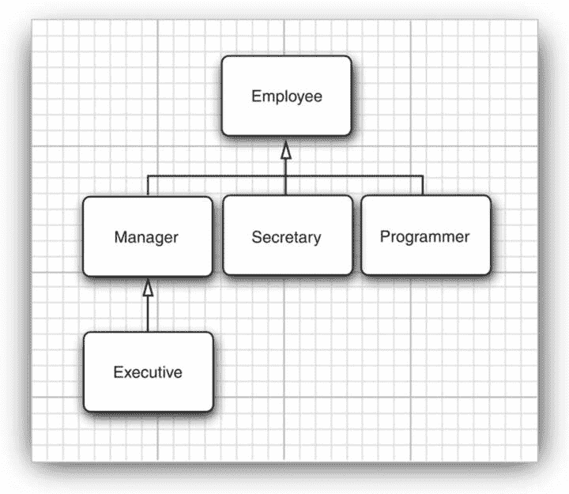

图 5.1：Employee 继承层次结构

从一个遥远的祖先类，通常会有多条下降链。你可以形成扩展`Employee`的子类`Programmer`或`Secretary`，它们与`Manager`类（或它们彼此之间）没有任何关系。这个过程可以根据需要持续下去。

在 C++ 中，一个类可以有多个父类。Java 不支持多重继承。关于恢复多重继承功能的方法，请参见第 6 章。

### 5.1.5 多态

一个简单的规则可以帮助你判断是否是正确的设计。

1. 编译器查看对象的声明类型和方法名。请注意，可能存在多个同名为`f`但参数类型不同的方法。例如，可能存在一个方法`f(int)`和一个方法`f(String)`。编译器会列出类`C`中所有名为`f`的方法，以及类`C`的所有父类中所有可访问的名为`f`的方法。（父类的私有方法是不可访问的。）

   现在，编译器知道了所有可能被调用的候选方法。

2. 接下来，编译器确定方法调用中提供的参数类型。如果在所有名为`f`的方法中，有一个方法的参数类型与所提供的参数最匹配，则选择该方法进行调用。这一过程被称为`重载解析`（`overloading resolution`）。例如，在调用`x.f("Hello")`时，编译器选择了`f(String)`而不是`f(int)`。由于类型转换（例如从`int`转换为`double`、`Manager`转换为`Employee`等），情况可能会变得复杂。如果编译器无法找到任何参数类型匹配的方法，或者在应用转换后有多个方法都匹配，编译器将报告错误。

   现在，编译器知道了需要调用的方法的名称和参数类型。

   回想，方法的名称和参数类型列表被称为方法的`签名`（`signature`）。例如，`f(int)`和`f(String)`是两个名称相同但签名不同的方法。如果你在子类中定义了一个与父类方法签名相同的方法，你就是重写（`override`）了父类方法。

   返回类型不是签名的一部分。然而，当你重写一个方法时，需要保持返回类型的兼容性。子类可以将返回类型更改为原始类型的子类型。例如，假设`Employee`类有一个方法：

   ```java
   public Employee getBuddy() { . . . }
   ```

   经理绝不会希望有一个地位较低的员工作为伙伴。为了反映这一事实，`Manager`子类可以这样重写该方法：

   ```java
   public Manager getBuddy() { . . . } // 修改返回类型是允许的
   ```

   我们说这两个`getBuddy`方法具有`协变`（`covariant`）返回类型。

3. 如果方法是`private`、`static`、`final`或构造函数，那么编译器就确切知道要调用哪一个方法。（`final`修饰符将在下一节解释。）这被称为`静态绑定`（`static binding`）。否则，要调用的方法取决于隐式参数的实际类型，必须在运行时使用动态绑定。在我们的示例中，编译器将生成一条动态绑定调用`f(String)`的指令。

4. 当程序运行并使用动态绑定调用方法时，虚拟机必须调用与`x`所引用对象的实际类型相匹配的方法版本。假设实际类型是`D`，它是`C`的一个子类。如果类`D`定义了方法`f(String)`，则调用该方法。如果没有定义，则在`D`的父类中搜索方法`f(String)`，依此类推。

   如果每次调用方法时都执行这种搜索将非常耗时。相反，虚拟机为每个类预计算一个`方法表`（`method table`）。该方法表列出了所有方法签名和要调用的实际方法。

   虚拟机可以在加载类后，通过将从类文件中找到的方法与父类的方法表相结合，来构建方法表。

   当实际调用某个方法时，虚拟机只需进行表查找。在我们的示例中，虚拟机查询类`D`的方法表，并查找要调用`f(String)`的方法。该方法可能是`D.f(String)`或`X.f(String)`，其中`X`是`D`的某个父类。这种情况下有一个例外：如果调用是`super.f(param)`，则虚拟机将查询父类的方法表。

让我们详细查看 Listing 5.1 中调用`e.getSalary()`的这一过程。`e`的声明类型是`Employee`。`Employee`类只有一个名为`getSalary`的方法，没有方法参数。因此，在我们的示例中，编译器将生成一条动态绑定调用`getSalary()`的指令。

将方法或类标记为`final`只有一个正理由：确保其语义在子类中不能被修改。例如，`Calendar`类的`getTime`和`setTime`方法就是`final`的。这表明`Calendar`类的设计者已经接管了`Date`类与日历状态之间转换的责任。不应允许子类破坏这种安排。同样，`String`类也是一个`final`类。这意味着没有人可以定义`String`的子类。换句话说，如果你有一个`String`引用，你就知道它指向的是一个`String`，且仅此一个`String`。

如果你在构造函数中调用方法，应该将其声明为`final`。否则，该方法可能会在子类中被重写，并访问一个部分构造的子类实例。这是一个示例。为了调试目的，`Employee`构造函数会显示所构建对象的描述。

```java
public class Employee
{
   public Employee(String name, double salary, int year, int month, int day)
   {
      this.name = name;
      this.salary = salary;
      hireDay = LocalDate.of(year, month, day);
      System.out.println("Constructed " + description());
   }

   public String description()
   {
      return "An employee with a salary of " + salary;
   }

   . . .
}
```

现在在员工类的层次结构中添加了一个新类——带有头衔的执行经理：

```java
public class Executive
{
   private String title;

   public Executive(String name, String title, double salary,
      int year, month, int day)
   {
      super(name, salary, year, month, day);
      this.title = title;;
   }
```


`public String getTitle()`

`{`

`   return title;`

`}`

`public String description()`

`{`

`   if (title.length() >= 30)`

`      return "An executive with an impressive title";`

`   else`

`      return "An executive with a title of " + title;`

`}`

当构造一个 `Executive` 时，它的构造函数首先调用 `Manager` 构造函数，进而调用 `Employee` 构造函数，进而调用 `description` 方法。由于多态性，调用的是 `Executive` 类中的 `description` 方法！遗憾的是，`Executive` 构造函数尚未完成。`title` 实例变量仍然 `null`，导致了 `NullPointerException`。

在构造函数中调用方法本质上是危险的。构造函数必须完成足够的工作以确保该方法执行成功。如果方法可以被重写，那么要确保这一点变得非常困难。因此，最好在构造函数中只调用 `final` 或 `private` 方法。

从 Java 21 开始，如果你使用 `-Xlint` 或 `-Xlint:this-escape` 标志进行编译，当公共类的构造函数调用非 `final` 或非 `private` 方法时，编译器会发出警告。

该标志的名字有点不遗憾，因为在其他情况下，`this` 引用可能会从构造函数中“逃逸”，而编译器目前还无法检测到这些情况。

在 C++ 中，构造函数中的方法调用不是多态的。例如，如果你在 `Employee` 构造函数中调用 `getDescription`，它始终调用 `Employee::getDescription`。

有些程序员认为，除非你有充分理由想要使用多态，否则应该将所有方法声明为 `final`。事实上，在 C++ 和 C# 中，除非你明确要求，否则方法不会使用多态性。这可能有点极端，但我同意在设计类层次结构时，仔细地考虑 `final` 方法和类是一个好主意。

在 Java 早期，一些程序员使用 `final` 关键字是希望避免动态绑的开销。如果一个方法没有被重写且长度很短，那么编译器就可以优化掉该方法调用——这个过程被称为“内联”（`inlining`）。例如，内联调用 `e.getName()` 将其替换为字段访问 `e.name`。这是一项值得的改进——CPU 讨厌分支，因为分支会干扰它们在处理当前指令时预取指令的策略。然而，如果 `getName` 可以在另一个类中被重写，那么编译器就无法对其进行内联，因为它不知道重写代码可能会做什么。

幸运的是，虚拟机中的即时编译器（JIT compiler）能比传统编译器做得得。。它确切知道哪些类继承了给定的类，并可以检查任何类是否真的重写了某个方法。如果一个方法很短、被频繁调用且实际上没有被重写，JIT 编译器就可以对其进行内联。如果虚拟机加载了另一个重写了内联方法的子类怎么办？那么优化器必须撤销内联。这需要时间，但这种情况很少发生。

枚举（Enumerations）和记录（records）总是 `final` 的——你无法扩展它们。

### 5.1.8 强制转换

回想第 3 章，强制将一种类型转换为另一种类型的过程称为强制转换（casting）。Java 编程语言对强制转换有特殊的符号。例如：

```
double x = 3.405;
int nx = (int) x;
```

这会将表达式 `x` 的值转换为整数，丢弃小数部分。

正如你偶尔需要将浮点数转换为整数一样，你可能需要将对象引用从一个类转换为另一个类。让我们再次使用包含 `Employee` 和 `Manager` 对象的数组示例：

```
var staff = new Employee[3];
staff[0] = new Manager("Carl Cracker", 80000, 1987, 12, 15);
staff[1] = new Employee("Harry Hacker", 50000, 1989, 10, 1);
staff[2] = new Employee("Tony Tester", 40000, 1990, 3, 15);
```

要对对象引用进行强制转换，使用与转换数值表达式类似的语法。将目标类名括在括号中并放在要转换的对象引用之前。例如：

```
Manager boss = (Manager) staff[0];
```

你想进行强制转换只有一个理由——在忘记实际类型后使用对象。例如，在 `ManagerTest` 类中，`staff` 数组必须是 `Employee` 数组，因为它的某些元素是普通员工。我们需要将经理元素强制转换回 `Manager` 才能访问它的新变量。（注意，在示例代码中，我在将其存入数组之前已将其初始化为 `Manager` 对象。）

正如你所知，在 Java 中每个变量都有类型。类型描述了变量所指向对象的种类以及它能做什么。例如，`staff[i]` 指向一个 `Employee` 对象（因此它也可以指向一个 `Manager` 对象）。

编译器检查你在将值存储在变量时是否承诺得太多。如果你将子类引用赋值给父类变量，你承诺得较少，编译器会直接允许你这样做。如果你将父类引用赋值给子类变量，你承诺得更多。这时你必须使用强制转换，以便在运行时检查你的承诺。

如果你尝试在继承链中向下强制转换并对对象包含的内容“撒谎”，会发生什么？

```
Manager boss = (Manager) staff[1]; // 错误
```

当程序运行时，Java 运行时系统会注意到违背的承诺并产生 `ClassCastException`。如果你不捕获异常，程序将终止。因此，在尝试强制转换之前确定其是否成功是一种良好的编程习惯。简单地使用 `instanceof` 运算符。例如：

```
if (staff[i] instanceof Manager)
{
   boss = (Manager) staff[i];
   . . .
}
```

最后，如果强制转换没有可能，编译器将不允许你进行强制转换。例如，强制转换

```
String c = (String) staff[i];
```

是一个编译时错误，因为 `String` 不是 `Employee` 的子类。

总结来说：

- 你只能在继承体系内部进行类型转换。
- 在从父类转换到子类之前，使用 `instanceof` 进行检查。

测试

```
x instanceof C
```

如果 `x` 为 `null`，该测试不会产生异常。它简单地返回 `false`。这是很合理的：`null` 指的是没有对象，因此它显然没有指向类型为 `C` 的对象。

实际上，通过类型转换转换对象的类型通常不是一个好主意。在我们的示例中，对于大多数用途，你不需要将 `Employee` 对象转换为 `Manager` 对象。`getSalary` 方法在这两个类的两个对象上都能正常工作。使多态生效的动态绑定会自动定位正确的方法。

进行类型转换的唯一理由是使用类类特有的方法，例如 `setBonus`。如果由于某种原因，你发现自己想在 `Employee` 对象上调用 `setBonus`，请问问自己这是否表明父类设计上存在缺陷。这种情况下，重新设计父类并添加一个 `setBonus` 方法可能是合理的。请记住，只需一个未捕获的 `ClassCastException` 就会终止你的程序。通常情况下，最好减少类型转换和 `instanceof` 运算符的使用。

Java 使用了 C 语言“旧时代”的类型转换语法，但它的工作方式类似于 C++ 中安全的 `dynamic_cast` 操作。例如，

```
Employee[] staff = ...;
Manager boss = (Manager) staff[i]; // Java
```

等同于

```cpp
Employee* staff[] = ...;
Manager* boss = dynamic_cast<Manager*>(staff[i]); // C++
```

有一个重要的区别。如果 `dynamic_cast` 失败，它会产生一个空指针而不是抛出异常。

### 5.1.9. `instanceof` 的模式匹配

代码

```
if (staff[i] instanceof Manager)
{
   Manager boss = (Manager) staff[i];
   boss.setBonus(5000);
}
```

这段代码相当繁琐。我们真的需要提到三次子类 `Manager` 吗？

从 Java 16 开始，有一种更简单的方法。你可以直接在 `instanceof` 测试中声明子类变量：

```
if (staff[i] instanceof Manager boss)
{
   boss.setBonus(5000);
}
```

如果 `staff[i]` 是 `Manager` 类的实例，那么变量 `boss` 将被设置为 `staff[i]`，你可以将其作为 `Manager` 使用。你跳过了类型转换。

如果 `staff[i]` 指代的不是 `Manager`，`boss` 则不会被设置，且 `instanceof` 运算符产生值 `false`。`if` 语句体将被跳过。

在你使用 `instanceof` 的大多数情况下，你需要应用子类方法。这时请使用这种“模式匹配”形式的 `instanceof` 来代替类型转换。

无用的 `instanceof` 模式会导致编译时错误：

```
Manager boss = . . .;
if (boss instanceof Employee e) . . . // 错误：它当然是 Employee
```

同样无用的

```
if (boss instanceof Employee) . . . 
```

是被允许的，为了与 Java 1.0 向后兼容。

当 `instanceof` 模式引入一个变量时，你可以在同一个表达式中立即使用它：

```
Employee e;
if (e instanceof Executive exec && exec.getTitle().getLength() >= 20) . . .
```

这之所以有效，是因为 `&&` 表达式的右侧只有在左侧为 `true` 时才会被求值。如果求值右侧，`exec` 已经绑定到一个 `Executive` 实例。

然而，以下会导致编译错误：

```
if (e instanceof Manager exec || exec.getTitle.getLength() >= 20) . . . // 错误
```

`||` 的右侧在左侧为 `false` 时执行，此时没有东西绑定到变量 `exec`。

另一个使用条件运算符的示例：

```
String title = e instanceof Executive exec ? exec.getTitle() : "";
```

变量 `exec` 定义在 `?` 之后的子表达式中，但不在 `:` 之后的子表达式中。

这种声明变量的 `instanceof` 形式被称为“模式匹配”，因为它们类似于 `switch` 中的类型模式，这些在 第 5.9 节 中有详细介绍。

与任何局部变量一样，由模式定义的局部变量可以遮蔽字段。例如：

```
class Value
{
   private double v;
   public boolean equals(Object other)
   {
      if (other instanceof LabeledValue v)
         // v 等于 other
      else
         // v 表示字段
   }
   . . .
}
```

前述示例展示了类型模式。如果类型匹配，则对象将绑定到该类型的变量上。当类型是一个 `record` 时，从 Java 21 开始，你可以做得更好，声明绑定到组件的变量。这被称为 record 模式：

```
record Point(double x, double y) {}
Point p = . . .;
if (p instanceof Point(var a, var b)) distance = Math.hypot(a, b);
```

现在 `a` 和 `b` 绑定到 `p` 的 `x` 和 `y` 组件上。当然，你也可以调用 `p.x()` 和 `p.y()`，但 record 模式可以更简洁。

为了更加清晰，你还可以为引入的变量指定显式类型：

```
if (p instanceof Point(double a, double b)) . . .;
```

record 模式可以进行嵌套：

```
record Circle(Point center, double radius) {}
Circle c = . . .;
if (c instanceof Circle(Point(var a, var b), var r)) . . .;
```

JEP 443 将未命名变量作为一项预览功能引入。如果你不需要 record 模式中的某一个变量，可以使用下划线表示它：

```
if (p instanceof Point(var a, _)) distance = Math.abs(a);
```

在这一功能可用之前，你可以使用两个下划线的 `var __`，因为从 Java 9 开始，单下划线是一个关键字。

### 5.1.10. 受保护访问 (Protected Access)

如你所知，类中的字段最好被标记为 `private`，而方法通常标记为 `public`。任何声明为 `private` 的特征在其他类中都是不可访问的。对于 `private` 特性，在本章开头提到，这对子类同样适用：子类无法访问父类的私有字段。

然而，在某些情况下，你希望限制方法仅供子类，或者较少地允许子类访问父类字段。在这种情况下，你将类特征声明为 `protected`。例如，如果父类 `Employee` 将 `hireDay` 字段声明为 `protected` 而不是 `private`，那么 `Manager` 方法可以直接访问它。

在 Java 中，`protected` 字段对同一包内的任何类都是可见的。现在考虑位于不同包的 `Administrator` 子类。`Administrator` 类的方法只能查看 `Administrator` 对象的 `hireDay` 字段，而不是其他 `Employee` 对象的。这种限制是为了防止你通过形成子类来滥用受保护的机制。

在实践中，请谨慎使用受保护字段。假设你的类被其他程序员使用，并且你在设计时包含了受保护字段。在你不知情的情况下，其他程序员继承你的类并开始访问你的受保护字段。在这种情况下，你无法在不影响这些程序员的情况下更改类的实现。这违背了 OOP 的精神，因为它鼓励数据封装。

受保护方法更有意义。如果一个方法很难使用，类可以将其声明为 `protected`。这表明子类（假设它们很了解自己的祖先）可以被信任正确使用该方法，而其他类则不能。这种方法的一个很好的例子是 `Object` 类的 `clone` 方法——详情请第 6 章。

如前所述，Java 中的 `protected` 特性对所有子类以及同一包内的所有其他类可见。这与 C++ 中 `protected` 的含义略有不同，使得 Java 中的 `protected` 概念比 C++ 更不安全。

以下是 Java 四种访问控制修饰符的总结：

1. 仅类内可见 (`private`)。
2. 全局可见 (`public`)。
3. 在包内可见（`protected`）。
4. 在包内可见——这是（不幸的）默认行为。不需要任何修饰符。

## 5.2. `Object`: 宇宙级父类

`Object` 类是终极祖先——Java 中的每一个类都继承 `Object`。然而，你永远不需要编写：

```
public class Employee extends Object
```

如果没有显式提到父类，那么终极父类 `Object` 是被理所当然的。由于 Java 中的每个类都继承 `Object`，因此熟悉 `Object` 类提供的服务是非常重要的。我在本章中介绍基础方法；对于未涵盖的内容，请参阅后面的章节或查看在线文档。（`Object` 的某些方法只有在处理并发时才会出现——参见第 10 章。）

### 5.2.1. `Object` 类型的变量

你可以使用 `Object` 类型的变量来引用任何类型的对象：

```
Object obj = new Employee("Harry Hacker", 35000);
```

当然，`Object` 类型的变量只有作为任意值的通用容器时才有用。要对该值进行任何特定操作，你需要对原始类型有一定的了解，并应用强制类型转换：

```
Employee e = (Employee) obj;
```

在 Java 中，只有基本类型的值（数字、字符和 `boolean` 值）不是对象。

所有数组类型，无论是对象数组还是基本类型数组，都是继承自 `Object` 类的类类型。

```
Employee[] staff = new Employee[10];
obj = staff; // OK
obj = new int[10]; // OK
```


在 C++ 中，没有宇宙级的根类。然而，每个指针都可以转换为 `void*` 指针。

### 5.2.2 `equals` 方法

`Object` 类中的 `equals` 方法用于测试一个对象是否被认为与另一个对象相等。在 `Object` 类中实现的 `equals` 方法决定了两个对象引用是否完全相同。这是一个非常合理的默认设置——如果两个对象是相同的，它们理所应该是相等的。对于许多类来说，不需要进行其他操作。例如，比较两个 `PrintStream` 对象的相等性并没有意义。但是，你通常会想要实现基于状态的相等性测试，即当两个对象具有相同状态时，它们被认为是相等。

例如，让我们考虑如果两个员工具有相同的姓名、工资和入职日期，他们就是相等的。（在实际的员工数据库中，比较 ID 认为更合理。我使用这个示例来演示实现 `equals` 方法的机制。）

```java
public class Employee
{
   . . .

   public boolean equals(Object otherObject)
   {
      // 快速测试对象是否完全相同
      if (this == otherObject) return true;

      // 如果显式参数为 null，必须返回 false
      if (otherObject == null) return false;

      // 如果类不匹配，它们就不可能相等
      if (getClass() != otherObject.getClass())
         return false;

      // 现在我们知道 otherObject 是非空的 Employee
      Employee other = (Employee) otherObject;

      // 测试字段是否具有相同的值
      return name.equals(other.name)
         && salary == other.salary
         && hireDay.equals(other.hireDay);
   }
}
```

`getClass` 方法返回对象的类——我们将在本章稍后详细讨论这个方法。在我们的测试中，两个对象只有在属于同一个类时才是相等的。

为了防止 `name` 或 `hireDay` 为 `null` 的可能，请使用 `Objects.equals` 方法。如果两个参数都为 `null`，则 `Objects.equals(a, b)` 的值为 `true`；如果只有一个为 `null`，则返回 `false`；否则返回 `a.equals(b)`。使用该方法，`Employee.equals` 方法的最后语句变为：

```java
return Objects.equals(name, other.name)
   && salary == other.salary
   && Objects.equals(hireDay, other.hireDay);
```

当你为子类定义 `equals` 方法时，首先调用父类的 `equals`。如果该测试没有通过，那么对象就不可能相等。如果父类字段相等，你就可以准备比较子类的实例字段了。

```java
public class Manager extends Employee
{
   . . .

   public boolean equals(Object otherObject)
   {
      if (!super.equals(otherObject)) return false;

      // super.equals 检查了 this 和 otherObject 是否属于同一个类
      Manager other = (Manager) otherObject;

      return bonus == other.bonus;
   }
}
```

回想第 4 章，记录（record）是不可变类的特殊形式，其状态完全由在“规范”构造函数中设置的字段定义。记录自动定义了一个比较字段的 `equals` 方法。当两个记录实例字段值相等时，它们就是相等的。

### 5.2.3 相等测试与继承

如果隐式和显式参数不属于同一个类，`equals` 方法应该如何表现？这一直是一个存在争议的领域。在前面的示例中，如果类不完全匹配，`equals` 方法返回 `false`。但许多程序员使用 `instanceof` 测试来代替：

```java
if (!(otherObject instanceof Employee)) return false;
```

这留下了 `otherObject` 可能属于子类的可能性。然而，这种方法可能会让你陷入麻烦。原因如下：Java 语言规范要求 `equals` 方法具有以下属性：

1. 它是自反的：对于任何非 `null` 引用 `x`，`x.equals(x)` 应该返回 `true`。
2. 它是对称的：对于任何引用 `x` 和 `y`，当且仅当 `y.equals(x)` 返回 `true` 时，`x.equals(y)` 返回 `true`。
3. 它是传递的：对于任何引用 `x`、`y` 和 `z`，如果 `x.equals(y)` 返回 `true` 且 `y.equals(z)` 返回 `true`，那么 `x.equals(z)` 应该返回 `true`。
4. 它是一致的：如果 `x` 和 `y` 引用的对象没有变化，则重复调用 `x.equals(y)` 返回相同的值。
5. 对于任何非 `null` 引用 `x`，`x.equals(null)` 应该返回 `false`。

- 如果相等性概念在父类中已经固定，那么你就可以使用 `instanceof` 测试，并允许不同子类的对象相互相等。

在员工和经理的示例中，当两个对象的字段匹配时，我们认为它们是相等的。如果我们有两个具有相同姓名、工资和入职日期的 `Manager` 对象，但奖金不同，我们希望它们是互不等的。因此，我们使用 `getClass` 测试。

但假设我们使用员工 ID 进行相等性测试。这种相等性概念对于所有子类都是有意义。那么我们就可以使用 `instanceof` 测试，并且我们应该将 `Employee.equals` 声明为 `final`。

标准 Java 库包含了 150 多个 `equals` 方法的实现，其中混合了使用 `instanceof`、调用 `getClass`、捕获 `ClassCastException` 或什么都不做的做法。查看 `java.sql.Timestamp` 类的 API 文档，实现者在其中尴尬地注释道，他们让自己陷入了困境。`Timestamp` 类继承自 `java.util.Date`，后者的 `equals` 方法使用了 `instanceof` 测试，而无法重写 `equals` 使其既具有对称性又准确。

经常引用的集合相等性示例是一个警示故事，展示了在跨子类间提供对称相等性是多么困难。

考虑这两个集合：

```java
Set<String> x = new HashSet<>();

x.add("Hello");
x.add("World");

Set<String> y = new TreeSet<>(String.CASE_INSENSITIVE_ORDER);

y.add("Hello");
y.add("WORLD");
```

对于这些集合，`equals` 不是对称的：

```java
x.equals(y) // false
y.equals(x) // true
```

`TreeSet` 使用排序顺序而不是 `equals` 来比较元素。在不忽略大小写的情况下，字符串 `"World"` 和 `"WORLD"` 被认为是相等的。

这里是编写完美的 `equals` 方法的配方：

1. 将显式参数命名为 `otherObject`——稍后，你将需要将其转换为另一个名为 `other` 的变量。

2. 测试 `this` 是否恰好与 `otherObject` 相同：

   ```java
   if (this == otherObject) return true;
   ```

   这条语句仅仅是一种优化。在实践中，这种情况常见。检查身份比比较字段便宜得多。

3. 测试 `otherObject` 是否为 `null`，如果是则返回 `false`。这个测试是必须的。

   ```java
   if (otherObject == null) return false;
   ```

4. 比较 `this` 和 `otherObject` 的类。如果 `equals` 的语义可以在子类中发生变化，请使用 `getClass` 测试：

   ```java
   if (getClass() != otherObject.getClass()) return false;

   ClassName other = (ClassName) otherObject;
   ```

   如果相同的语义对于*所有*子类都适用，你可以使用 `instanceof` 测试：

   ```java
   if (!(otherObject instanceof ClassName other)) return false;
   ```

   注意，如果 `instanceof` 测试成功，它会将 `other` 设置为 `otherObject`。不需要强制转换。

5. 现在根据你的相等性概念比较字段。对于原始类型字段使用 `==`，对于对象字段使用 `Objects.equals`。如果所有字段都匹配，则返回 `true`，否则返回 `false`。

   ```java
   return field1 == other.field1
      && Objects.equals(field2, other.field2)
      && . . .;
   ```

   如果你在子类中重定义 `equals`，请包含对 `super.equals(other)` 的调用。

如果你有数组类型的字段，可以使用静态的 `Arrays.equals` 方法检查对应的数组元素是否相等。对于多维数组，使用 `Arrays.deepEquals` 方法。

这是一个实现 `equals` 方法时的常见错误。你能看出问题所在吗？

```java
public class Employee
{
   public boolean equals(Employee other)
   {
      return other != null
         && getClass() == other.getClass()
         && Objects.equals(name, other.name)
         && salary == other.salary
         && Objects.equals(hireDay, other.hireDay);
   }

   . . .
}
```

该方法将显式参数类型声明为 `Employee`。结果是它没有重写 `Object` 类的 `equals` 方法，而是定义了一个完全无关的方法。

你可以通过对旨在重写父类方法的方法标记 `@Override` 来防止此类错误：

```java
@Override public boolean equals(Object other)
```

如果你犯了错误并正在定义一个新方法，编译器会报告错误。例如，假设你在 `Employee` 类中添加了以下声明：

```java
@Override public boolean equals(Employee other)
```

系统会报告错误，因为此方法没有重写来自 `Object` 父类的任何方法。

### `java.util.Arrays` 1.2

- `static boolean equals(xxx[] a, xxx[] b)` 5.0

  如果数组长度相同且对应位置元素相等，则返回 `true`。数组的组件类型 `xxx` 可以是 `Object`、`int`、`long`、`short`、`char`、`byte`、`boolean`、`float` 或 `double`。

### `java.util.Objects` 7

- `static boolean equals(Object a, Object b)`

  如果 `a` 和 `b` 都为 `null`，返回 `true`；如果其中只有一个为 `null`，则返回 `false`；否则返回 `a.equals(b)` 的结果。

### 5.2.4 `hashCode` 方法

哈希值是一个从对象派生的整数。`String` 类使用以下算法来计算哈希值：

```java
int hash = 0;

for (int i = 0; i < length(); i++)
   hash = 31 * hash + charAt(i);
```

`hashCode` 方法定义在 `Object` 类中。因此，每个对象都有默认的哈希值。该哈希值派自对象的内存地址。考虑这个例子：

```java
var s = "Ok";
var sb = new StringBuilder(s);

System.out.println(s.hashCode() + " " + sb.hashCode());

var t = new String("Ok");
var tb = new StringBuilder(t);

System.out.println(t.hashCode() + " " + tb.hashCode());
```

注意，字符串 `s` 和 `t` 相同的哈希值，因为对于字符串，哈希值是由其内容生成的。字符串生成器 `sb` 和 `tb` 有不同的哈希值，因为 `StringBuilder` 类没有定义 `hashCode` 方法，`Object` 类的默认 `hashCode` 方法从对象的内存地址派生哈希值。

表 5.2：字符串和生成器的哈希值

| 对象 | 哈希值 | 对象 | 哈希值 |
| --- | --- | --- | --- |
| `s` | 2556 | `t` | 2556 |
| `sb` | 20526976 | `tb` | 20527144 |

如果你重定义了 `equals` 方法，对于哈希表的对象的重定义 `hashCode` 方法。（我在第 9 章讨论哈希表。）

`hashCode` 方法应该返回一个整数（可以是负数）。只需组合实例字段的哈希值，使得不同对象的哈希值可能广泛分散。

例如，这是 `Employee` 类的 `hashCode` 方法：

```java
public class Employee
{
   public int hashCode()
   {
      return 7 * name.hashCode()
         + 11 * Double.valueOf(salary).hashCode()
         + 13 * hireDay.hashCode();
   }

   . . .
}
```

然而，你可以做得更好。首先，使用空安全的方法 `Objects.hashCode`。如果其参数为 `null`，它返回 `0`，否则返回调用参数 `hashCode` 的结果。此外，使用静态的 `Double.hashCode` 方法以避免创建 `Double` 对象。

```java
public int hashCode()
{
   return 7 * Objects.hashCode(name)
      + 11 * Double.hashCode(salary)
      + 13 * Objects.hashCode(hireDay);
}
```

如果实例变量的可能值范围很小，你需要尽可能获得许多不同的哈希码。考虑一下日期的哈希处理。计算 `7 * year + 11 * month + 13 * day` 会产生很多冲突。相比之下，`31 * 12 * year + 31 * month + day` 是一个“完美哈希函数”。在合理的年份范围内，没有两个日期的哈希码是相同的。（支持 ±999,999,999 年份范围的 `LocalDate` 类的实际 `hashCode` 方法要复杂得多。）

组合多个哈希值可能是繁琐的。在许多情况下，你只需要对所有字段调用 `Objects.hash` 即可。它会组合其参数的哈希码。那么 `Employee.hashCode` 方法 get 如下：

```java
public int hashCode()
{
   return Objects.hash(name, salary, hireDay);
}
```

然而，你需要对数组字段留心。数组的哈希码是通过 `Object.hashCode` 计算的，它*不依赖*于它的元素。相反，请使用静态的 `Arrays.hashCode` 方法，它会组合数组元素的哈希码。对于基本类型数组和对象数组都提供了重载方法。对于多维数组，请使用 `Arrays.deepHashCode`。

`Arrays.hashCode(Object[])` 方法的工作原理与 `String.hashCode` 几乎相同，使用“乘以 31 并相加”的操作来组合元素的哈希码。但有一个特殊之处：零长度数组的哈希码为 1，以便与 `null` 区分开来。以下是实现代码：

```java
public static int hashCode(Object[] a)
{
   if (a == null) return 0;

   int result = 1; // 从 1 开始，而不是 0

   for (Object element : a)
      result = 31 * result + (element == null ? 0 : element.hashCode());

   return result;
}
```


`Objects.hash` 方法会调用 `Arrays.hashCode`。因此，`Objects.hash(x)` 等于 `31 + x.hashCode()`。

`record` 类型自动提供一个 `hashCode` 方法，该方法从组件值的哈希码派生哈希码。其具体行为在 Java 语言规范中尚未开放。在 OpenJDK 21 中，组件哈希值简单地通过“乘以 31 并相加”的操作进行组合，从零开始。

你对 `equals` 和 `hashCode` 的定义必须保持兼容：如果 `x.equals(y)` 为 `true`，那么 `x.hashCode()` 返回的值必须与 `y.hashCode()` 相同。例如，如果你定义 `Employee.equals` 来比较员工 ID，那么 `hashCode` 方法需要对 ID 进行哈希，而不是员工姓名或内存地址。

### `java.lang.Object` 1.0

- `int hashCode()`：返回此对象的哈希码。哈希码可以是任何整数，正负均可。相等的对象需要返回相同的哈希码。

### `java.util.Objects` 7

- `static int hash(Object... objects)`：返回一个由所有提供的对象的哈希码组合而成的哈希码。
- `static int hashCode(Object a)`：如果 `a` 为 `null` 则返回 `0`，否则返回 `a.hashCode()`。

### `java.lang.(Integer|Long|Short|Byte|Double|Float|Character|Boolean)` 1.0

- `static int hashCode(xxx value)` 8：返回给定值的哈希码。这里 `xxx` 是与给定包装类型对应的基本类型。

### `java.util.Arrays` 1.2

- `static int hashCode(xxx[] a)` 5.0：计算数组 `a` 的哈希码。数组的组件类型 `xxx` 可以是 `Object`、`int`、`long`、`short`、`char`、`byte`、`boolean`、`float` 或 `double`。

## 5.2.5. `toString` 方法

`Object` 中的另一个重要方法是 `toString`，它返回表示对象值的字符串。这是一个典型的例子。`Point` 类的 `toString` 方法返回这样的字符串：

```
java.awt.Point[x=10,y=20]
```

大多数（但不是所有）`toString` 方法遵循这种格式：类名，然后是位于方括号内的字段值。以下是 `Employee` 类的 `toString` 方法的实现：

```java
public String toString()
{
   return "Employee[name=" + name
      + ",salary=" + salary
      + ",hireDay=" + hireDay
      + "]";
}
```

实际上，你可以做得更好。与其在 `toString` 方法中硬编码类名，不如调用 `getClass().getName()` 来获取一个带有类名的字符串。

```java
public String toString()
{
   return getClass().getName()
      + "[name=" + name
      + ",salary=" + salary
      + ",hireDay=" + hireDay
      + "]";
}
```

这种 `toString` 方法对于子类同样有效。

当然，子类的程序员应该定义它自己的 `toString`。例如，子类使用了 `getClass().getName()`。这里是 `Manager` 类的 `toString` 方法：

```java
public class Manager extends Employee
{
   @Override
   public String toString()
   {
      return getClass().getName()
         + "[name=" + name
         + ",salary=" + salary
         + ",hireDay=" + hireDay
         + "]";
   }
}
```

`toString` 方法对于日志记录非常有有用。标准类库中的许多类都定义了 `toString` 方法，以便你可以获取有关对象的有用信息。这对于记录如下所示的消息特别有用：

```java
System.out.println("Current position = " + position);
```

原因是 `PrintStream` 的实现者没有重写 `toString` 方法。令人恼的是，数组继承了 `Object` 的 `toString` 方法，并以一种古老的格式打印。例如：

```java
int[] luckyNumbers = { 2, 3, 5, 7, 11, 13 };

String s = "" + luckyNumbers;
```

产生 `[I@1a46e30`。（前缀 `[I` 表示整数数组。）解决方法是改用静态的 `Arrays.toString` 方法。代码如下：

```java
String s = Arrays.toString(luckyNumbers);
```

产生 `[2, 3, 5, 7, 11, 13]`。

为了正确打印多维数组（即数组的数组），请使用 `Arrays.deepToString`。

正如第 7 章所解释的，更好的解决方案是使用日志对象并调用：

```java
logger.log(INFO, "Current position = " + position);
```

## 5.3. 列表（Array Lists）

- 调用 `System.indentityHashCode(obj)` 或 `Objects.identityToString(obj)` 获取在没有重写 `hashCode` 或 `toString` 时本应返回的结果。

Listing 5.4 中的程序测试了 `Employee` 类（Listing 5.5）和 `Manager` 类（Listing 5.6）的 `equals`、`hashCode` 和 `toString` 方法。

### Listing 5.4 `equals/EqualsTest.java`

```java
package equals;

/**
 * This program demonstrates the equals method.
 * @version 1.12 2012-01-26
 * @author Cay Horstmann
 */

public class EqualsTest
{
   public static void main(String[] args)
   {
      var alice1 = new Employee("Alice Adams", 75000, 1987, 12, 15);
      var alice2 = alice1;
      var alice3 = new Employee("Alice Adams", 75000, 1987, 12, 15);
      var bob = new Employee("Bob Brandson", 50000, 1989, 10, 1);

      System.out.println("alice1 == alice2: " + (alice1 == alice2));
      System.out.println("alice1 == alice3: " + (alice1 == alice3));
      System.out.println("alice1.equals(alice3): " + alice1.equals(alice3));
      System.out.println("alice1.equals(bob): " + alice1.equals(bob));
      System.out.println("bob.toString(): " + bob);

      var carl = new Manager("Carl Cracker", 80000, 1987, 12, 15);
      var boss = new Manager("Carl Cracker", 80000, 1987, 12, 15);

      boss.setBonus(5000);

      System.out.println("boss.toString(): " + boss);
      System.out.println("carl.equals(boss): " + carl.equals(boss));
      System.out.println("alice1.hashCode(): " + alice1.hashCode());
      System.out.println("alice3.hashCode(): " + alice3.hashCode());
      System.out.println("bob.hashCode(): " + bob.hashCode());
      System.out.println("carl.hashCode(): " + carl.hashCode());
   }
}
```

### Listing 5.5 `equals/Employee.java`

```java
package equals;

import java.time.*;
import java.util.Objects;

public class Employee
{
   private String name;
   private double salary;
   private LocalDate hireDay;

   public Employee(String name, double salary, int year, int month, int day)
   {
      this.name = name;
      this.salary = salary;
      hireDay = LocalDate.of(year, month, day);
   }

   public String getName()
   {
      return name;
   }

   public double getSalary()
   {
      return salary;
   }

   public LocalDate getHireDay()
   {
      return hireDay;
   }

   public void raiseSalary(double byPercent)
   {
      double raise = salary * byPercent / 100;
      salary += raise;
   }

   public boolean equals(Object otherObject)
   {
      // a quick test to see if the objects are identical
      if (this == otherObject) return true;

      // must return false if the explicit parameter is null
      if (otherObject == null) return false;

      // if the classes don't match, they can't be equal
      if (getClass() != otherObject.getClass()) return false;

      // now we know otherObject is a non-null Employee
      var other = (Employee) otherObject;

      // test whether the fields have identical values
      return Objects.equals(name, other.name)
         && salary == other.salary && Objects.equals(hireDay, other.hireDay);
   }

   public int hashCode()
   {
      return Objects.hash(name, salary, hireDay);
   }

   public String toString()
   {
      return getClass().getName() + "[name=" + name + ",salary=" + salary + ",hireDay="
         + hireDay + "]";
   }
}
```

### Listing 5.6 `equals/Manager.java`

```java
package equals;

public class Manager extends Employee
{
   private double bonus;

   public Manager(String name, double salary, int year, int month, int day)
   {
      super(name, salary, year, month, day);
      bonus = 0;
   }

   public double getSalary()
   {
      double baseSalary = super.getSalary();
      return baseSalary + bonus;
   }

   public void setBonus(double bonus)
   {
      this.bonus = bonus;
   }

   public boolean equals(Object otherObject)
   {
      if (otherObject instanceof Manager)
      {
         var other = (Manager) otherObject;

         if (super.equals(otherObject) && bonus == other.bonus)
         {
            return true;
         }
      }

      return false;
   }
}
```

如果你使用 `var` 声明 `ArrayList`，请**不要**使用菱形语法（diamond syntax）。该声明：

```java
var elements = new ArrayList<>();
```

会产生一个 `ArrayList<Object>`。

在 Java 5 之前，还没有泛型类。相反，只有一个 `ArrayList` 类，它是一个通用的集合，用于存储 `Object` 类型的元素。你仍然可以在不加 `<. . .>` 后缀的情况下使用 `ArrayList`。它被视为一种“原始”（raw）类型，类型参数会被擦除。

在更早的 Java 版本中，程序员使用 `Vector` 类来处理动态数组。然而，`ArrayList` 类效率更高，已经没有理由继续使用 `Vector` 类了。

使用 `add` 方法向数组列表添加新元素。例如，以下是向数组列表填充 `Employee` 对象的方法：

```java
staff.add(new Employee("Harry Hacker", . . .));

staff.add(new Employee("Tony Tester", . . .));
```

数组列表管理一个内部的对象引用数组。最终，该数组会耗尽空间。这就是数组列表发挥魔法的地方：如果你调用 `add` 且内部数组已满，数组列表会自动创建一个更大的数组，并将所有对象从较小的数组复制到较大的数组。

如果你已经知道或大致估计了想要存储多少个元素，可以在填充数组列表之前调用 `ensureCapacity` 方法：

```java
staff.ensureCapacity(100);
```

该调用会分配一个包含 100 个对象的内部数组。然后，前 100 次 `add` 调用将不会涉及任何昂贵的重新分配。

你也可以向 `ArrayList` 构造函数传递一个初始容量：

```java
ArrayList<Employee> staff = new ArrayList<>(100);
```

按如下方式分配数组列表：

```java
new ArrayList<>(100) // 容量为 100
```

**不等同于**分配一个新数组：

```java
new Employee[100] // 大小为 100
```

数组列表的容量（capacity）与数组的大小（size）之间存在重要的区别。如果你分配了一个具有 100 个条目的数组，那么该数组就有 100 个槽位可以使用。一个容量为 100 个元素的数组列表**潜力**存储 100 个元素（实际上可以多于 100 个，但是以额外重新分配为代价的），但在开始，即使在初始构造之后，数组列表也并不包含任何元素。

`size` 方法返回数组列表中元素的实际数量。例如：

```java
staff.size()
```


返回 `staff` 数组列表当前的元素数量。这等同于对于数组 `a` 的：

```
a.length
```

一旦你确定数组列表已达到其固定大小时，可以调用 `trimToSize` 方法。该方法会调整内存块的大小，使其恰好使用存储当前数量元素所需的空间。垃圾回收器将回收任何多余的内存。

一旦修剪了数组列表的大小，添加新元素将再次移动该内存块，这需要时间。只有当你确定不会再向数组列表添加更多元素时，才应该使用 `trimToSize`。

`ArrayList` 类类似于 C++ 的 `vector` 模板。`ArrayList` 和 `vector` 都是泛型类型。但 C++ 的 `vector` 模板重载了 `[]` 运算符以便于访问元素。Java 不支持运算符重载，因此必须使用显式的方法调用。此外，C++ vector 是按值复制的。如果 `a` 和 `b` 是两个 vector，那么赋值 `a = b` 会使 `a` 变成一个与 `b` 长度的新 vector，并将所有元素从 `b` 复制到 `a`。Java 中相同的赋值操作会使 `a` 和 `b` 引用同一个数组列表。

`java.util.ArrayList<E>` 1.2

* `ArrayList<E>()`：构造一个新的数组列表。
* `ArrayList<E>(int initialCapacity)`：构造具有指定容量的空数组列表。
* `boolean add(E obj)`：将 `obj` 追加到数组列表末尾。始终返回 `true`。
* `int size()`：返回数组列表中当前存储的元素数量。（当然，这永远不会大于数组列表的容量。）
* `void ensureCapacity(int capacity)`：确保数组列表有容量存储给定数量的元素，而无需重新分配内部存储数组。
* `void trimToSize()`：将数组列表的存储容量缩小到其当前大小。

### 5.3.2 访问数组列表元素

遗憾的是，天下没有免费的午餐。数组列表自动增长的便利需要更复杂的访问语法。原因是 `ArrayList` 类并不是 Java 编程语言的一部分；它只是由某人编写并在标准库提供的工具类。

不再使用简洁的 `[]` 语法来访问或更改数组元素，而是使用 `get` 和 `set` 方法。

例如，要设置第 `i` 个元素，使用：

```
staff.set(i, harry);
```

这对于数组 `a` 等同于：

```
a[i] = harry;
```

（与数组一样，索引值从 0 开始。）

一旦你确定数组列表已达到其固定大小时，可以调用 `trimToSize` 方法。该方法会调整内存块的大小，使其恰好使用存储当前数量元素所需的空间。垃圾回收器将回收任何多余的内存。

一旦修剪了数组列表的大小，添加新元素将再次移动该内存块，这需要时间。只有当你确定不会再向数组列表添加更多元素时，才应该使用 `trimToSize`。

`ArrayList` 类类似于 C++ 的 `vector` 模板。`ArrayList` 和 `vector` 都是泛型类型。但 C++ 的 `vector` 模板重载了 `[]` 运算符以便于访问元素。Java 不支持运算符重载，因此必须使用显式的方法调用。此外，C++ vector 是按值复制的。如果 `a` 和 `b` 是两个 vector，那么赋值 `a = b` 会使 `a` 变成一个与 `b` 长度的新 vector，并将所有元素从 `b` 复制到 `a`。Java 中相同的赋值操作会使 `a` 和 `b` 引用同一个数组列表。

* 你使用 `add` 来添加任意数量的元素。
* 你使用 `size()` 代替 `length` 来统计元素数量。
* 你使用 `a.get(i)` 代替 `a[i]` 来访问元素。

### 列表 5.7 arrayList/ArrayListTest.java

```java
package arrayList;

import java.util.*;

/**
 * 此程序演示了 ArrayList 类。
 * @version 1.11 2012-01-26
 * @author Cay Horstmann
 */
public class ArrayListTest
{
   public static void main(String[] args)
   {
      // 在员工数组列表中中填充三个 Employee 对象
      var staff = new ArrayList<Employee>();
      staff.add(new Employee("Carl Cracker", 75000, 1987, 12, 15));
      staff.add(new Employee("Harry Hacker", 50000, 1989, 10, 1));
      staff.add(new Employee("Tony Tester", 40000, 1990, 3, 15));

      // 将每个人的薪水提高 5%
      for (Employee e : staff)
         e.raiseSalary(5);

      // 打印所有 Employee 对象的信息
      for (Employee e : staff)
         System.out.println("name=" + e.getName() + ",salary=" + e.getSalary() + ",hireDay=" 
            + e.getHireDay());
   }
}
```

#### `java.util.ArrayList<E>` 1.2

* `E set(int index, E obj)`：将值 `obj` 放在列表中指定的索引处，并返回之前的内容。
* `E get(int index)`：获取存储在指定索引的值。
* `void add(int index, E obj)`：将元素向上移动以便在指定索引处插入 `obj`。
* `E remove(int index)`：移除给定索引处的元素，并将其之后的所有元素向下移动。返回被移除的元素。

### 5.3.3 泛型数组列表与原始数组列表的兼容性

在您自己的代码中，你总是希望使用类型参数来增加安全性。在本节中，你将看到如何与不使用类型参数的旧代码进行交互。

假设你有以下遗留类：

```java
public class EmployeeDB
{
   public void update(ArrayList list) { . . . }
   public ArrayList find(String query) { . . . }
}
```

你可以无需任何类型转换将泛型数组列表传递给 `update` 方法。

```java
ArrayList<Employee> staff = . . .;
employeeDB.update(staff);
```

`staff` 对象被简单地传递给 `update` 方法。

尽管编译器没有产生任何错误或警告，但这种调用并不是完全安全的。`update` 方法可能会向列表中添加不是 `Employee` 类型的元素。当检索到这些元素时，就会发生异常。这听起来很吓人，但如果你仔细考虑，这种行为实际上与 Java 引入泛型之前的行为完全一样。虚拟机的完整性从未受到威胁。在这种情况下，你虽然没有丢失安全性，但也无法从编译检查中获益。

相反，当你将一个原始的 `ArrayList` 赋值给泛型列表时，你会得到一个警告。

```java
ArrayList<Employee> result = employeeDB.find(query); //产生警告
```

要查看警告文本，请使用选项 `-Xlint:unchecked` 进行编译。

使用类型转换并不能消除警告。

```java
ArrayList<Employee> result = (ArrayList<Employee>) employeeDB.find(query); 
   // 产生另一个警告
```

相反，你会得到不同的警告，提示该类型转换是误导性的。

这是 Java 泛型一个相当遗憾的限制所导致的结果。为了兼容性，编译器在检查没有违反类型规则后，会将所有泛型数组列表转换为原始的 `ArrayList` 对象。在运行程序中，所有的数组列表都是相同的——虚拟机中没有类型参数。因此，`(ArrayList)` 和 `(ArrayList<Employee>)` 执行的是完全相同的运行时检查。

对于这种情况，你无能为力。当你与旧代码交互时，请研究编译警告，并确认这些警告并不严重。

一旦你满意了，可以使用 `@SuppressWarnings("unchecked")` 注解标记接收转换的变量，如下所示：

```java
@SuppressWarnings("unchecked") ArrayList<Employee> result
      = (ArrayList<Employee>) employeeDB.find(query); // 产生另一个警告
```

## 5.4 包装类与自动装箱

有时，你需要将基本类型（如 `int`）转换为对象。所有基本类型都有对应的类。例如，`Integer` 类对应基本类型 `int`。这些类通常被称为*包装类*（wrappers）。包装类的名字非常直观：`Integer`、`Long`、`Float`、`Double`、`Short`、`Byte`、`Character` 和 `Boolean`。（前六者继承自公共父类 `Number`）。包装类是不可变的——在构造函数之后，你不能更改被包装的值。它们也是 `final` 的，所以你不能创建它们的派生类。

假设我们想要一个整数列表。遗憾的是，尖括号内的类型参数不能是基本类型。无法形成 `ArrayList<int>`。

```java
Integer n = 1;
Double x = 2.0;
System.out.println(true ? n : x); // prints 1.0
```

最后，让我们强调一下，装箱和拆箱是 `compiler` 提供的便利，而不是虚拟机的功能。编译器在生成类的字节码时会插入必要的调用。虚拟机只是简单地执行这些字节码。

Java 的未来版本将允许 `value types`（值类型），这是一种类似于原始类型的用户定义类型——其值不存储在对象内部。例如，具有 `double` 字段 `x` 和 `y` 的原始类型 `Point` 的值仅仅是内存中一个 16 字节的块，包含两个相邻的 `double` 值。你可以复制它，但无法拥有它的引用。

计划在未来的某个时刻，原始类型包装类将成为值类。

你经常会因为另一个原因看到数字包装类。Java 的设计者发现包装类是放置某些基本方法的方便地方，例如用于将数字字符串转换为数字的方法。

要将字符串转换为整数，请使用以下语句：

```java
int x = Integer.parseInt(s);
```

这与 `Integer` 对象无关——`parseInt` 是一个静态方法。但 `Integer` 类是放置它的一个好地方。

`parseInt` 方法及其对应的 `parseDouble` 并不是用于解析用户输入的。它们支持在 Java API 中描述的特定格式，该格式与十进制 Java 字面量的格式相似，但不包含嵌入的下划线。要解析人类输入，请使用 `Scanner`。它的 `nextInt` 和 `nextDouble` 方法使用当前区域设置（locale）或你指定的区域设置，以便用户输入他们熟悉的数字和分隔符。

API 注释显示了 `Integer` 类的一些重要方法。其他数字类也实现了对应的方法。

包装类还定义了常量。对于所有的整数包装类型，`MIN_VALUE` 和 `MAX_VALUE` 是该类型的最小和最大值。例如，`Integer.MIN_VALUE` 是 `-2147483648`，而 `Integer.MAX_VALUE` 是 `2147483647`。这是一个典型的示例：

```java
int largest = Integer.MIN_VALUE; // 替换为第一个输入
while (in.hasNextInt()) largest = Math.max(largest, in.nextInt());
```

`Double` 和 `Float` 类的 `MIN_VALUE` 常量是最小的*positive*（正）值。如果要计算最大的浮点数且可能存在负输入，你需要使用：

```java
int largest = -Double.MAX_VALUE; // 不要使用 Double.MIN_VALUE
while (in.hasNextDouble()) largest = Math.max(largest, in.nextDouble());
```

有些人认为可以使用包装类来实现可以修改数值型参数的方法。然而，这是不对的。回想第 4 章，编写一个可以增加整数参数的 Java 方法是不可能的，因为 Java 方法的参数总是按值传递的。

```java
public static void triple(int x) // 不起作用
{
   x = 3 * x; // 修改了局部变量
}
```

我们可以通过使用 `Integer` 代替 `int` 来克服这个问题吗？

```java
public static void triple(Integer x) // 不起作用
{
   . . .
}
```

问题是 `Integer` 对象是 `immutable`（不可变的）：包装器内部包含的信息无法更改。你不能使用这些包装类创建一个修改数值型参数的方法。

`java.lang.Integer` 1.0

* `int intValue()`：返回此 `Integer` 对象的 `int` 数值（重写了 `Number` 类中的 `intValue` 方法）。
* `static String toString(int i)`：返回一个新的表示 10 进制数字 `i` 的 `String` 对象。
* `static String toString(int i, int radix)`：允许你根据 `radix` 参数指定的进制返回数字 `i` 的表示形式。
* `static int parseInt(String s)`、`static int parseInt(String s, int radix)`：返回字符串 `s` 中包含数字的整数。该字符串必须表示 10 进制整数（对于第一个方法）或由 `radix` 参数指定的进制的整数（对于第二个方法）。
* `static Integer valueOf(String s)`、`static Integer valueOf(String s, int radix)`：返回一个新的 `Integer` 对象，其初始化为字符串 `s` 中包含数字的整数。该字符串必须表示 10 进制整数（对于第一个方法）或由 `radix` 参数指定的进制的整数（对于第二个方法）。

`java.text.NumberFormat` 1.1

* `Number parse(String s)`：返回数值，假设指定的 `String` 代表一个数字。

## 5.5 变长参数方法

可以提供可以使用变数量参数调用的方法。这些方法有时被称为“varargs”（变长参数）方法。

你已经见过这样的方法了：`printf`。例如，以下调用

```java
System.out.printf("%d", n);
```

和

```java
System.out.printf("%d %s", n, "widgets");
```

都调用了同一个方法，尽管其中一个调用有两个参数。

```java
public class PrintStream
{
   public printf(String fmt, Object... args)
   {
      return format(fmt, args);
   }
}
```

在这里，省略号 `...` 是 Java 代码的一部分。它表示该方法可以接收任意数量的对象。换句话说，对于 `printf`，`Object...` 参数与 `Object[]` 完全相同。

```java
public static double max(double... values)
{
   double largest = Double.NEGATIVE_INFINITY;
   for (double v : values) if (v > largest) largest = v;
   return largest;
}
```

只需像这样调用函数：

```java
double m = max(3.1, 40.4, -5);
```

编译器将一个 `new double[] { 3.1, 40.4, -5 }` 传递给 `max` 函数。

传递变长类型的数组而不是变长参数是合法的。例如：

```java
System.out.printf("%d %s", new Object[] { Integer.valueOf(1), "widgets" } );
```

因此，你可以将最后一个参数为数组的现有函数重新定义为变长参数方法，而不会破坏现有代码。例如，`MessageFormat.format` 在 Java 5 中通过这种方式增强了。如果你喜欢，甚至可以将 `main` 方法声明为

```java
public static void main(String... args)
```


## 5.6 抽象类

随着向继承体系向上移动，类变得越来越通用，也可能变得越来越抽象。在某个时刻，祖先类变得*如此*通用，以至于你更多将其视为其他类的基础，而不是你想使用的具有特定实例的类。考虑一下我们`Employee`类层次的扩展。员工是人，学生也是人。让我们扩展我们的类层次以包含`Person`和`Student`类。图 5.2 显示了这些类之间的继承关系。

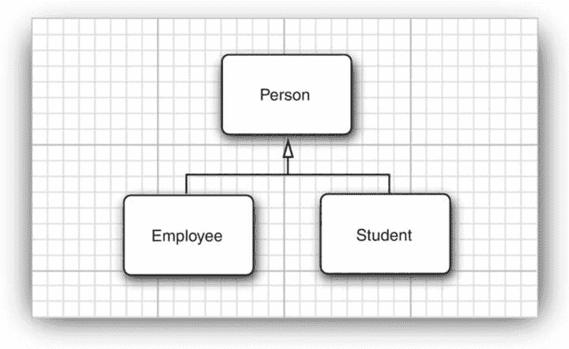Figure 5.2: `Person`及其子类的继承图

为什么要费力进行如此层次的抽象呢？有些属性对每个人来说都是合理的，例如姓名。学生和员工都有姓名，引入一个通用的父类让我们可以将`getName`方法提取到继承层次结构中的更高层次。

现在让我们再添加另一个方法`getDescription`，其目的是返回关于该人的简短描述，例如：

```
an employee with a salary of $50,000.00
a student majoring in computer science
```

对于`Employee`和`Student`类来说，实现这个方法很容易。但在`Person`类中，你能提供什么信息呢？除了姓名之外，`Person`类对该个人一无所知。当然，你可以实现`Person.getDescription()`并返回一个空字符串。但有更好的方法处理这个问题。如果你使用`abstract`关键字，你根本不需要实现该方法。

```
public abstract String getDescription();
   // 不需要实现
```

为了更清晰起见，包含一个或多个抽象方法的类本身必须被声明为抽象类。

```java
public abstract class Person
{
   . . .
   public abstract String getDescription();
}
```

除了抽象方法外，抽象类还可以拥有字段和具体方法。例如，`Person`类存储了人的姓名，并有一个返回该姓名的具体方法。

```java
public abstract class Person
{
   private String name;

   public Person(String name)
   {
      this.name = name;
   }

   public abstract String getDescription();

   public String getName()
   {
       return name;
   }
}
```

有些程序员并没有意识到抽象类拥有具体方法。你应该始终将公共字段和方法（无论是否抽象）移动到父类中（无论是否抽象）。

抽象方法充当子类中实现方法的占位符。当你扩展一个抽象类时，有两种选择：你可以让部分或全部抽象方法未定义；那么，你也必须将子类标记为抽象类。或者，你可以定义所有方法，这样子类就不再是抽象的。

例如，我们将定义一个继承抽象类`Person`的`Student`类，并实现`getDescription`方法。`Student`类中没有任何方法是抽象的，因此它不需要被声明为抽象类。

即使一个类没有抽象方法，也可以被声明为`abstract`。

抽象类不能被实例化。也就是说，如果一个类被声明为`abstract`，就无法创建该类的任何对象。例如，表达式：

```
new Person("Vince Vu")
```

是一个错误。然而，你可以创建具体子类的对象。

请注意，你仍然可以创建抽象类的`object variables`，但该变量必须引用一个非抽象子类的对象。例如：

```java
Person p = new Student("Vince Vu", "Economics");
```

在这里，`p`是一个抽象类型`Person`的变量，它指向非抽象子类`Student`的实例。

在 C++ 中，抽象方法被称为`pure virtual function`（纯虚函数），并带有后缀`= 0`，如下：

```cpp
class Person // C++
{
public:
   virtual string getDescription() = 0;
   . . .
};
```

如果一个 C++ 类至少有一个纯虚函数，那么它就是抽象类。在 C++ 中，没有特殊的关键字来表示抽象类。

让我们定义一个继承抽象类`Person`的具体子类`Student`：

```java
public class Student extends Person
{
   private String major;

   public Student(String name, String major)
   {
      super(name);
      this.major = major;
   }

   public String getDescription()
   {
      return "a student majoring in " + major;
   }
}
```

`Student`类定义了`getDescription`方法。因此，`Student`类中的所有方法都是具体的，该类不再是一个抽象类。

在 Listing 5.8 中所示程序定义了抽象父类`Person`（Listing 5.9）以及两个具体子类`Employee`（Listing 5.10）和`Student`（Listing 5.11）。我们用员工和学生对象填充了一个`Person`引用数组：

```java
var people = new Person[2];
people[0] = new Employee(. . .);
people[1] = new Student(. . .);
```

然后我们打印这些对象的姓名和描述：

```java
for (Person p : people)
   System.out.println(p.getName() + ", " + p.getDescription());
```

有些人对以下调用：

```
p.getDescription()
```

感到困惑。

这不是对一个未定义方法的调用吗？请记住，变量`p`永远不会引用`Person`对象，因为无法构造抽象类`Person`的对象。变量`p`始终引用具体子类的对象（如`Employee`或`Student`）。对于这些对象，`getDescription`方法是定义过的。

你是否可以完全从`Person`父类中省略该抽象方法，仅在`Student`子类中定义`getDescription`方法呢？如果你这样做，你将无法在变量`p`上调用该方法。编译器确保你只调用在类中声明的方法。抽象方法是 Java 语言中的一个重要概念。你最常在`interfaces`中遇到它们。

当你引用这些常量时，请使用类名对其进行限定，例如`Size.SMALL`。在以下三种情况下，你可以使用不带限定的名字：

1. 正你很快就会看到的，枚举可以拥有方法。在枚举的方法内部，你可以使用不带限定的名字。
2. 在`switch`语句的`case`分支中，如果其选择器是枚举类型，则不需要进行限定：

   ```
   Size s = . . .;
   String abbrev = switch (s)
      {
          case SMALL -> "S"; 
          . . .
       };
   ```

3. 你可以静态导入枚举的所有常量：

   ```
   import com.horstmann.util.Size;
   import static com.horstmann.util.Size.*;
   . . .
   Size s = SMALL; 
   ```

你不能从默认包中的枚举中静态导入常量。例如，如果`Size`在默认包中，你将无法使用：

```
import static Size.*;
```

由`enum`声明定义的类型实际上是一个类。该类恰好有四个实例——无法构造新对象。

因此，你永远不需要对枚举类型的值使用`equals`。只需使用`==`来比较它们即可。

你可以在最后一个值后面后跟一个逗号。如果你预计值的数量会增加，末尾逗号非常有用。

```
public enum Size
{
   SMALL,
   MEDIUM,
   LARGE,
   EXTRA_LARGE,
   XXL,
   // 在此处添加更多值并在每个值后加上逗号
}
```

所有枚举类型都是抽象类`Enum`的子类。它们从该类继承了许多方法。最有用的是`name`，它返回枚举常量的名称。例如，`Size.SMALL.toString()`返回字符串`"SMALL"`。

默认情况下，`toString`方法返回`name`。然而，你可以重写`toString`，而`name`是`final`的。

`name`的反向操作是静态的`valueOf`方法。例如，语句：

```
Size s = Enum.valueOf(Size.class, "SMALL");
```

将`s`设置为`Size.SMALL`。

每个枚举类型都有一个静态的`values`方法，返回该枚举所有值的数组。例如，调用：

```
Size[] values = Size.values();
```

返回包含元素`Size.SMALL`、`Size.MEDIUM`、`Size.LARGE`和`Size.EXTRA_LARGE`的数组。

`ordinal`方法产生枚举常量在`enum`声明中的位置，从零开始计数。例如，`Size.MEDIUM.ordinal()`返回`1`。

如果你愿意，可以为枚举类型添加构造函数、方法和字段。当然，构造函数只在构造实例时被调用。这里有一个示例：

```
public enum Size
{
   SMALL("S"), MEDIUM("M"), LARGE("L"), EXTRA_LARGE("XL");

   private final String abbreviation;

   Size(String abbreviation) { this.abbreviation = abbreviation; }
      // 自动为私

   public String getAbbreviation() { return abbreviation; }
}
```

当`enum`拥有字段或方法时，你必须用分号结束常量列表，如上例所示。

在末尾逗号后加分号是合法的。

你甚至可以在每个实例中重写方法：

```
public enum Size
{
   SMALL,
   MEDIUM,
   LARGE,
   EXTRA_LARGE
   {
      public String toString() { return "XL"; }
   };
}
```

然而，这并不常见。在前面的一个示例中，`EXTRA_LARGE`是`Size`的子类的实例。除外，你不能为枚举创建子类。

枚举的构造函数始终是私有的。你可以省略`private`修饰符，如上一个示例所示。将枚举构造函数声明为`public`或`protected`是语法错误。

枚举类的构造函数不能在正在构造的实例上执行`switch`：

```java
public enum Size
{
   SMALL, MEDIUM, LARGE, EXTRA_LARGE;

   private final boolean largish;

   Size()
   {
      largish = switch (this) // 错误
         {
            case LARGE, EXTRA_LARGE -> true;
            default -> false;
         };
   }
}
```

这种奇怪的限制是由对`enum`执行`switch`的实现策略造成的。每个`switch`都会查询一个数组，该数组将当前定义的枚举常量的`ordinal`值映射到编译该`switch`时的`ordinal`值。这些数组只有在`enum`实例构造后才能构建。

在方法中，这样的`switch`运行运行良好。

列表 5.12 中的短程序演示了如何处理枚举类型。

`Enum`类有一个类型参数，为了简单起见我忽略了它。例如，枚举类型`Size`实际上扩展了`Enum<Size>`。该类型参数用于`compareTo`方法。（我在第 6 章中讨论了`compareTo`方法，在第 8 章中讨论了类型参数。）

列表 5.12 enums/EnumTest.java

```java
package enums;

import java.util.*;

/**
 * 此程序演示了枚举类型。
 * @version 1.0
 * @author Cay Horstmann
 */
public class EnumTest
{
   public static void main(String[] args)
   {
      var in = new Scanner(System.in);
      System.out.print("Enter a size: ");
      Size size = Enum.valueOf(Size.class, in.next().toUpperCase());
      System.out.println("abbreviation=" + size.getAbbreviation());
      System.out.println("name=" + size.toString());
      System.out.println("ordinal=" + size.ordinal());
      for (Size s : Size.values())
      {
         System.out.println(s);
      }
   }
}
```

`java.lang.Enum<E>`

*   `static Enum valueOf(Class enumClass, String name)`

    返回给定名称的枚举常量。

*   `String name()`

    返回此枚举常量的名称。

*   `int ordinal()`

    返回此枚举常量在`enum`声明中的零位置。

*   `int compareTo(E other)`

    如果`this`在`other`之前则返回负整数，如果`this == other`则返回零，否则返回正整数。顺序由`enum`声明给出。

## 5.8 密封类

除非类被声明为`final`，否则任何人都可以形成子类。如果我们想有更多控制权怎么办？例如，你需要编写自己的 JSON 库，因为现有的库无法满足你的需求。

JSON 标准规定 JSON 值是数组、数字、字符串、布尔、对象或空。一种明显的方法是使用`JSONArray`、`JSONNumber`等类扩展抽象类`JSONValue`来建模：

```java
public abstract class JSONValue
{
   // 适用于所有 JSON 值的方法
}

public final class JSONArray extends JSONValue
{
   . . .
}

public final class JSONNumber extends JSONValue
{
   . . .
}
```

通过将`JSONArray`、`JSONNumber`等声明为`final`，我们可以确保没有人形成子类。但我们无法阻止任何人形成`JSONValue`的另一个子类。

我们为什么可能需要那种控制权？考虑以下代码：

```java
JSONValue v = . . .;
if (v instanceof JSONArray a) . . .
else if (v instanceof JSONNumber n) . . .
else if (v instanceof JSONString s) . . .
else if (v instanceof JSOBoolean b) . . .
else if (v instanceof JSONObject o) . . .
else . . . // 必须是 JSONNull
```

在这里，控制流意味着我们知道`JSONValue`的直接子类。这不是一个开放的层级结构。

在 Java 中，密封类（sealed class）可以控制哪些类可以继承它。密封类在 Java 15 中作为预览功能引入，并在 Java 17 中最终确定。

以下是如何将`JSONValue`类声明为密封类（sealed）的：

```
public abstract sealed class JSONValue
      permits JSONArray, JSONNumber, JSONString, JSONBoolean, JSONObject, JSONNull
{
   . . .
}
```

定义一个未被许可的子类是错误的：

```java
public class JSONComment extends JSONValue { . . . } // 错误
```


这完全没错，因为 JSON 不允许注释。因此，密封类允许对领域约束进行精确建模。

密封类的被许可的子类必须是可访问的。它们不能是嵌套在另一个类中的私有类，也不能是来自另一个包的包级可见类。

对于公共的被许可子类，规则更加严格。它们必须与密封类处于同一个包中。然而，如果你使用了模块（请参见第 12 章），则它们只需要在同一个模块中即可。

密封类可以在不带 `permits` 子句的情况下声明。在这种情况下，所有的直接子类必须声明在同一个文件中。没有权限访问该文件的程序员无法创建子类。

一个文件最多只能有一个 `public` 类，因此这种安排似乎只有在子类不供公众使用时才有用。

然而，正如你将在下一章看到的，你可以使用内部类作为公共子类。

密封类的一个重要动机是编译时检查。考虑 `JSONValue` 类中的这个方法，它使用了带有模式匹配的 `switch` 表达式（请参见第 5.9 节）：

```java
public String type()
{
   return switch (this)
      {
         case JSONArray __ -> "array";
         case JSONNumber __ -> "number";
         case JSONString __ -> "string";
         case JSONBoolean __ -> "boolean";
         case JSONObject __ -> "object"; 
         case JSONNull __ -> "null";
         // 这里不需要 default
      };
}
```

编译器可以检查出不需要 `default` 子句，因为 `JSONValue` 的所有直接子类都作为 `case` 出现过。

上述的 `type` 方法看起来并不很面向对象。符合 OOP 精神的做法是让六个类中的每一个都提供自己的 `type` 方法，依靠多态性而不是 `switch`。对于开放的层次结构，这是一个很好的方法。但当存在一组固定的类时，将所有选项放在一个方法中通常更方便。

初看之下，密封类的子类必须是 `final` 的。但对于穷尽性测试，我们只需要知道所有的直接子类。如果这些类有进一步的子类，也没有问题。例如，我们可以像图 5.3 所示重新组织 JSON 层次结构。

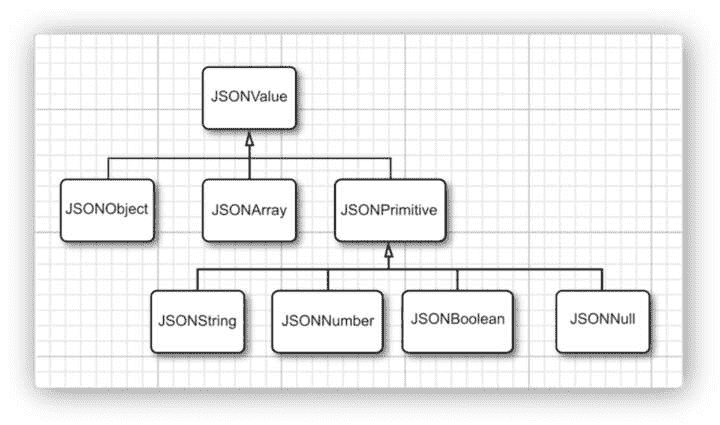图 5.3：表示 JSON 值的完整类层次结构

在这个层次结构中，`JSONValue` 允许三个子类：

```java
public abstract sealed class JSONValue permits JSONObject, JSONArray, JSONPrimitive
{
   . . .
}
```

`JSONPrimitive` 类也是密封的：

```java
public abstract sealed class JSONPrimitive extends JSONValue
      permits JSONString, JSONNumber, JSONBoolean, JSONNull
{
   . . .
}
```

密封类的子类必须指定它是 `sealed`、`final` 还是允许子类化的（open）。在后者的情况下，它必须被声明为 `non-sealed`。

`non-sealed` 关键字是第一个带有连字符的 Java 关键字。这很可能是未来的趋势。向语言中添加关键字总是带有风险。现有的代码可能不再编译。因此，`sealed` 是一个“上下文”关键字。你仍然可以声明名为 `sealed` 的变量或方法：

```java
int sealed = 1; // 将上下文关键字作为标识符是允许的
```

对于带连字符的关键字，不需要担心这个问题。唯一的歧义在于减法：

```java
int non = 0;
non = non-sealed; // 减法，而不是关键字
```

你为什么要一个 `non-sealed` 子类呢？考虑一个具有六个直接子类的 XML 节点类：

```java
public abstract sealed class Node permits Element, Text, Comment,
      CDATASection, EntityReference, ProcessingInstruction
{
   . . .
}
```

我们允许 `Element` 有任意的子类：

```java
public non-sealed class Element extends Node
{
   . . .
}

public class HTMLDivElement extends Element
{
   . . .
}
```

在本节中，你学习了密封类。在下一章中，你将学习*接口*，它是抽象类的泛化。Java 接口也可以有子类型。密封接口的工作原理与密封类完全相同，控制直接子类型。

下面的示例程序完善了 JSON 层次结构。`JSONObject` 的实现使用了 `HashMap`，将在第 9 章中介绍。在示例中，我们使用接口而不是抽象类，这样 `JSONNumber` 和 `JSONString` 可以是记录（record），而 `JSONBoolean` 和 `JSONNull` 类可以是枚举（enumeration）。记录和枚举实现接口，但它们不能扩展类。

列表 5.13 sealed/SealedTest.java

```java
package sealed;

import java.util.*;

sealed interface JSONValue permits JSONArray, JSONObject
{
   default String type()
   {
      if (this instanceof JSONArray) return "array";
      else if (this instanceof JSONObject) return "object";
      else if (this instanceof JSONNumber) return "number";
      else if (this instanceof JSONString) return "string";
      else if (this instanceof JSONBoolean) return "boolean";
      else return "null";
   }
}

final class JSONArray extends ArrayList<JSONValue> {}

final class JSONObject extends HashMap<String, JSONValue>
{
   public String toString()
   {
      StringBuilder result = new StringBuilder();
      result.append("{");
      for (Map.Entry<String, JSONValue> entry : entrySet())
      {
         if (result.length() > 1) result.append(",");
         result.append("\"");
         result.append(entry.getKey());
         result.append("\": ");
         result.append(entry.getValue());
      }
      result.append(" }");
      return result.toString();
   }
}

sealed interface JSONPrimitive extends JSONValue
      permits JSONNumber, JSONString, JSONBoolean, JSONNull
{
}

final record JSONNumber(double value) implements JSONPrimitive
{
   public String toString() { return "" + value; }
}

final record JSONString(String value) implements JSONPrimitive
{
   public String toString() { return "\"" + value.translateEscapes() + "\""; }
}

enum JSONBoolean implements JSONPrimitive
{
   FALSE, TRUE;
   public String toString() { return super.toString().toLowerCase(); }
}

enum JSONNull implements JSONPrimitive
{
   INSTANCE;
   public String toString() { return "null"; }
}

public class SealedTest
{
   public static void main(String[] args)
   {
      JSONObject obj = new JSONObject();
      obj.put("name", new JSONString("Harry"));
      obj.put("salary", new JSONNumber(90000));
      obj.put("married", JSONBoolean.FALSE);
      JSONArray arr = new JSONArray();
      arr.add(new JSONNumber(13));
      arr.add(JSONNull.INSTANCE);
      obj.put("luckyNumbers", arr);
      System.out.println(obj);
      System.out.println(obj.type());
   }
}
```

## 5.9. 模式匹配

你已经看到如何使用 `instanceof` 运算符来检查对象是否具有特定类型。`instanceof` 最方便的形式会声明一个匹配类型的变量：

```java
Employee e = . . .;
String description;
if (e instanceof Executive exec)
   description = "An executive with a title of " + exec.getTitle();
else if (e instanceof Manager m)
   description = "A manager who deserves a bonus";
else
   description = "A lowly employee with a salary of " + e.getSalary();
```

`switch` 的模式匹配形式简化了这种类型分析：

```java
Employee e = . . .;
String description = switch (e)
   {
      case Executive exec -> "An executive with a title of " + exec.getTitle();
      case Manager m -> "A manager who deserves a bonus";
      default -> "A lowly employee with a salary of " + e.getSalary();
   };
```

注意，与 `instanceof` 模式一样，每个 `case` 都会声明一个匹配类型的变量。你使用这些变量来访问子类方法（例如示例中的 `getTitle`）。

使用 `switch` 的表达式形式比使用 `if` 语句链更简单。`switch` 表达式产生一个值并赋值给 `description` 变量。相比之下，使用 `instanceof` 时，条件语句的每个分支必须单独设置 `description` 的值。

配合类型模式使用 `switch` 的语句形式和穿透（fallthrough）形式是可能的。但不带穿透的表达式形式通常是最自然的选择。

正如你恰所看到的，模式匹配的基本结构非常直观。接下来的子章节将介绍技术细节，其中某些细节由于兼容性原因显得有些复杂。

Java 21 将“未命名变量”（unnamed variables）作为一项预览功能引入。如果你在类型模式中不需要该变量，可以使用下划线：

```java
case Employee _ -> "A lowly employee"
```

在这一特性正式发布之前，你可以使用两个下划线：

```java
case Employee __ -> "A lowly employee"
```

### 5.9.1. 空值处理

经典的 `switch` 语句对 `null` 是敌的。如果选择器表达式为 `null`，`switch` 将抛出 `NullPointerException`。你可以通过添加 `case null` 来避免这种情况：

```java
String description = switch (e)
   {
      case Executive exec -> "An executive with a title of " + exec.getTitle();
      case Manager m -> "A manager who deserves a bonus";
      case null -> "No employee";
      default -> "A lowly employee with a salary of " + e.getSalary();
   };
```

你可以将 `case null` 与 `default` 结合，但不能与任何其他 `case` 结合：

```java
case null, default -> "No free parking";
```

你不能使用 `case _` 来表示默认情况。这样做是有意为之，这样你就不需要记住此类情况是否覆盖了 `null`。

### 5.9.2. 守卫（Guards）

你可以为模式添加一个被称为“守卫”的条件，使用受限的 `when` 关键字。

```java
case Executive exec when exec.getTitle().getLength() >= 20 ->
   "An executive with an impressive title";
```

在守卫表达式中，可以使用模式引入的变量。

如果守卫表达式不成立，则不会选择该 case，并测试下一个 case。

如果在 `when` 子句中发生异常，`switch` 将抛出该异常。

守卫在记录模式（record patterns）中特别有用：

```java
Point p = . . .;
String description = switch (p)
   {
      case Point(var x, var y) when x == 0 && y == 0 -> "origin";
      case Point(var x, var __) when x == 0 -> "on x-axis";
      case Point(var __, var y) when y == 0 -> "on y-axis";
      default -> "not on either axis";
   };
```

记录模式会调用组件访问器。在极少数情况下，如果其中一个访问器抛出异常，`switch` 将抛出 `MatchException`。这只会发生在自定义访问器。

### 5.9.3. 完备性（Exhaustiveness）

任何 `switch` 表达式必须是**完备的**：对于每个可能的选择器值，必须有一个 `case`。这是一个显而易见的要求，因为表达式必须始终产生一个值。

有几种方法可以使 `switch` 完备：

* 每个 `enum` 实例的 case
* 覆盖密封类型（sealed type）所有子类型的未守卫类型模式
* 选择器类型的未守卫类型模式
* `default` 子句

守卫模式不能用于完备性检查，因为编译器无法评估它们。例如，

```java
case Executive exec when exec.getTitle().getLength() >= 20 -> . . .
case Executive exec when exec.getTitle().getLength() < 20 -> . . .
```

并不是完备的。你需要将第二个子句重写为

```java
case Executive exec -> . . .
```

或者

```java
default -> . . .
```

当密封类型层次结构或枚举类被修改时，之前完备的 `switch` 可能会变得不完备。如果没有匹配的 case，`switch` 将抛出 `MatchException`。

经典的 `switch` 语句不需要是完备的。如果没有匹配的 case，则不执行任何操作。但为了更加清晰，所有增强型的 `switch` 语句必须是完备的。如果一个 `switch` 语句具有模式、`case null` 或除基本类型、基本类型包装类、`String` 或 `enum` 以外的选择类型，则它是增强型的。

如果你不想在匹配时不执行任何操作，请添加


`default -> {}` // 不穿透

或者

```
default: break; // 穿透
```

完备性不需要测试选择器值是否为`null`。你可以拥有一个没有`case null`的完备`switch`。当用`null`选择器调用它时，它会抛出`NullPointerException`。

完备性缺少对`null`的检查对于嵌套记录是有问题的。考虑

```java
record Box<T>(T contents) { }

Box<Box<String>> doubleBoxed = ...;
```

在`null`检查时，`switch`在没有`null`。

```
Box(null))
```

`null`

对于嵌套记录，完备性中缺少`null`检查是有问题的。

### 5.9.4. 支配（Dominance）

在只有常量 case 的经典`switch`中，分支是互不交叉的，因此顺序不重要。然而，当 case 是模式时，顺序就变得重要。当编译器发现某个 case 因为前面的 case 而永远无法匹配时，会发生编译错误。这里有一个例子：

```
Employee e = . . .;

String description = switch (e)
   {
      case Employee __ -> "A lowly employee...";
      case Manager m -> "A manager..."; // 错误
   };
```

由于每个`Manager`都是`Employee`，第二个 case 永远不会匹配。第一个 case **支配**了它。

这种支配检查有助于发现编程错误，但它并不完美。以下是你需要注意的细微点：

* 守卫模式不用于支配检查。编译器无法对守卫进行推理。例如，编译器无法判断

    ```
    case Executive exec when exec.getTitle().getLength() >= 20 -> . . .
    ```

    支配了

    ```
    case Executive exec when exec.getTitle().getLength() >= 30 -> . . .
    ```

* `default`不支配常量 case。
* `default`支配`case null`，尽管它并没有覆盖它。

虽然可以将`default`放在常量 case 之前，但这是一个坏主意。始终将其放在最后。

### 5.9.5. 模式与常量

你不能在记录模式内部与常量进行匹配。例如

```
case Point(0, y) // 错误
```

是错误的。使用守卫：

```
case Point(x, y) when x == 0 // 可以
```

数值常量模式仅允许选择器类型为`int`、`short`、`char`或`byte`以及其包装类型。字符串常量模式仅允许类型为`String`的选择器。例如，以下内容是不合法的：

```
Object obj = . . .;

String description = switch (obj)
   {
      case 0 -> "zero"; // 错误
      case "" -> "empty string"; // 错误
      case null -> "null";
      default -> obj.toString();
   };
```

由于选择器类型是`Object`，`switch`无法具有数值或字符串常量模式。补救是：

```
case Integer i when i == 0
case String s when s.equals("null")
```

`enum`常量的规则略有不同。选择器类型只需是枚举类型的超类型即可；即`Object`、`Enum`或接口（参见第 6 章）：

```
Object obj = . . .;

String description = switch (obj)
   {
      case DayOfWeek.FRIDAY -> "TGIF"; // Ok
      . . .
   };
```

### 5.9.6. 变量作用域与贯穿（Fallthrough）

本节涵盖了当执行从一个`case`穿到下一个`case`时关于变量的细节。如果你从不使用贯穿，直接跳转到下一节。

当类型模式或记录模式引入变量时，其作用域延伸到该`case`的结束，即使执行穿到了下一个`case`。例如，考虑以下代码段中的变量`s`：

```
Object obj = . . .;

switch (obj)
{
   case String s when s.length() == 0:
      System.out.println("empty string"); // 作用域在此结束
   default:
      System.out.println(obj.toString());
}
```

你可以在守卫句和`:`之后的语句中使用`s`，但不能在下一个`case`中使用它。这是合理的，因为当`obj`不是`String`时，执行可能会直接从该`case`开始。

你不能贯穿进入类型模式：

```
switch (obj)
{
   case String s when s.length() > 0:
      System.out.println(s.codePointAt(0)); // 贯穿
   case Integer n:
      System.out.println(n); // ERROR
   . . .
}
```

如果执行从第一个`case`跳到第二个`case`的体，`n`将无法绑定。

你*可以*贯穿进入带有匿名变量的类型模式（Java 21 的一项预览特性）：

```
switch (obj)
{
   case String s when s.length() == 0:
      System.out.print("empty "); // 贯穿
   case String _:
      System.out.println("string"); break; // Ok
   . . .
}
```

自 Java 1.0 以来，在`case`体内声明变量一直是合法的。该变量的作用域延伸到`switch`的结束。这种作用域一直以来并没有用处，因为如果你在`case`外部访问该变量会导致错误：

```
switch (obj) {
   case String s:
      String t = s; // OK
   default:
      System.out.println(t); // ERROR—t 可能未初始化
}
```

列表 5.14 和列表 5.15 中的程序演示了使用类型模式和记录模式的模式匹配。

列表 5.14 `patternMatching/TypePatternTest.java`

```java
package patternMatching;

public class TypePatternTest
{
   public static void main(String[] args)
   {
      int r = (int)(4 * Math.random());
      Employee e = switch (r)
         {
            case 0 -> new Employee("Harry Hacker", 50000, 1989, 10, 1);
            case 1 -> new Manager("Carl Cracker", 80000, 1987, 12, 15);
            case 2 -> new Executive("Sue Striver", 
                  "Senior Associate Vice President", 200000, 1995, 1, 20);
            default -> null;
         };
      String description = switch (e)
         {
            case Executive exec when exec.getTitle().length() >= 20 ->
               "An executive with an impressive title";
            case Executive exec ->
               "An executive with a title of " + exec.getTitle();
            case Manager m ->
               {
                  m.setBonus(10000); 
                  yield "A manager who just got a bonus";
               }
            case null -> "No employee";
            default -> "A lowly employee with a salary of " + e.getSalary();
         };
      System.out.println(description);
   }
}
```

列表 5.15 `patternMatching/RecordPatternTest.java`

```java
package patternMatching;

record Point(double x, double y) {}

public class RecordPatternTest
{
   public static void main(String[] args)
   {
      int r = (int)(4 * Math.random());
      Point p = switch (r)
         {
            case 0 -> new Point(0, 0);
            case 1 -> new Point(1, 0);
            case 2 -> new Point(0, 1);
            default -> new Point(1, 1);
         };
      String description = switch (p)
         {
            case Point(var x, var y) when x == 0 && y == 0 -> "origin";
            case Point(var x, var __) when x == 0 -> "on x-axis";
            case Point(var __, var y) when y == 0 -> "on y-axis";
            default -> "not on either axis";
         };
      System.out.printf("%s %s%n", p, description);
   }
}
```

### 5.10. 反射

`enum`常量的规则略有不同。选择器类型只需是枚举类型的超类型即可；即`Object`、`Enum`或接口（参见第 6 章）：

```
Object obj = . . .;

String description = switch (obj)
   {
      case DayOfWeek.FRIDAY -> "TGIF"; // Ok
      . . .
   };
```

在程序运行时，运行时系统始终维护着所谓的“反射”。这些信息被用于选择正确的方法。反射是一种强大且复杂的机制；然而，它主要令开发者感兴趣。

#### 5.10.1. `Class`

持有这些信息的类令人困惑地命名为`Class`。`Object`类中的`getClass()`方法返回一个`Class`实例。

```
Employee e;
. . .
Class cl = e.getClass();
```

就像`Employee`对象描述特定员工的属性一样，`Class`对象描述一个特定的类。最常用的方法可能是`getName`。它返回类的名称。例如，语句

```
System.out.println(e.getClass().getName() + " " + e.getName());
```

如果`e`是员工，则打印

```
Employee Hacker
```

如果`e`是经理，则打印

```
Manager Hacker
```

如果类位于包中，包名是类名的一部分：

```
var in = new Scanner(System.in);
Class cl = in.getClass();
String className = cl.getName(); // name 为 "java.util.Scanner"
```

可以使用静态方法`forName`获取类名对应的`Class`对象。

```
String className = "java.util.Scanner";
Class cl = Class.forName(className);
```

如果类名存储在运行时变化的字符串中，可以使用此方法。如果`className`是类或接口名，该方法有效。否则，`forName`方法会抛出一个*检查异常*。参见 5.10.2 节了解如何在使用该方法时提供*异常处理器*。

获取`Class`对象的第三种方法方便的简写。如果`T`是任何 Java 类型（或`void`关键字），则`T.class`就是匹配的类对象。例如：

```
Class cl1 = Scanner.class; // 如果导入了 java.util.*;
Class cl2 = int.class;
Class cl3 = Double[].class;
```

注意，`Class`对象实际上描述的是*类型*，该类型可能是也不可能是类。例如，`int`不是一个类，但`int.class`仍然是一个`Class`类型的对象。

`Class`类实际上是一个泛型类。例如，`Employee.class`的类型是`Class<Employee>`。在本章中，我不会深入探讨这个问题，因为这会让一个已经抽象的概念变得更加复杂。对于大多数实际用途，你可以忽略类型参数并使用原始（raw）`Class`类型进行操作。关于`Class`类型参数的更多信息，请参阅第 8 章。

由于历史原因，`getName`方法对数组类型返回的名称有些奇奇怪怪：

*   `Double[].class.getName()`返回`"[Ljava.lang.Double;"`。
*   `int[].class.getName()`返回`"I"`。

虚拟机为每种类型管理着一个唯一的`Class`对象。因此，你可以使用`==`运算符来比较类对象。例如：

```
if (e.getClass() == Employee.class) . . .
```

如果`e`是`Employee`的实例，则该测试通过。与`e instanceof Employee`条件不同，如果`e`是`Manager`等子类的实例，该测试将失败。

你可能期望枚举中的实例其类就是枚举类本身。通常情况下，确实是如此：

```
public enum Size { SMALL, MEDIUM, LARGE, EXTRA_LARGE; }

Size.SMALL.getClass() == Size.class // true
```

然而，如果你在实例中重写了某个方法，那么它属于一个不同的类：

```java
public enum Size
{
   SMALL,
   MEDIUM,
   LARGE,
   EXTRA_LARGE
   {
      public String toString() { return "XL"; }
   };
}

Size.EXTRA_LARGE.getClass() == Size.class // false
```

如果你有一个`Class`类型的对象，可以使用它来构造该类的实例。调用`getConstructor`方法获取一个`Constructor`类型的对象，然后使用`newInstance`方法来构造实例。例如：

```
var className = "java.util.Date";
   // 或者任何其他具有无参数构造函数的类名
Class cl = Class.forName(className);
Object obj = cl.getConstructor().newInstance();
```


如果该类没有无参数的构造函数，`getConstructor` 方法将抛出异常。你将在第 5.10.7 节中看到如何调用其他构造函数。

存在一个 `Class.newInstance` 方法，也可以用无参数构造函数构造实例。然而，由于一个微妙的原因，它被弃用了。构造函数中抛出的任何异常都会被原样抛出。对于受检异常（checked exceptions），这违反了编译时检查。相比之下，`Constructor.newInstance` 将任何构造函数异常封装在 `InvocationTargetException` 中。

`newInstance` 方法对应 C++ 中虚拟构造函数（virtual constructor）的用法。然而，C++ 中的虚拟构造函数并不是语言特性，而是一种需要由特定库支持的用法。`Class` 类类似于 C++ 中的 `type_info` 类，而 `getClass` 方法等同于 `typeid` 运算符。不过，Java 的 `Class` 比 `type_info` 灵活得多。C++ 的 `type_info` 只能揭示类型的名称字符串，而不能创建该类型的新对象。

#### `java.lang.Class` 1.0

- `static Class forName(String className)`  
  返回表示名为 `className` 的类的 `Class` 对象。
- `Constructor getConstructor(Class... parameterTypes)` 1.1  
  产生一个描述给定参数类型构造函数的对象。关于如何提供参数类型，请参阅第 5.10.7 节。

#### `java.lang.reflect.Constructor` 1.1

- `Object newInstance(Object... initargs)`  
  构造构造函数所属类的新实例，并将 `initargs` 传递给构造函数。关于如何提供参数，请参阅第 5.10.7 节。

#### `java.lang.Throwable` 1.0

- `void printStackTrace()`  
  将 `Throwable` 对象和堆栈轨迹打印到标准错误流。

### 5.10.2 异常声明入门

我将在第 7 章中完整地介绍异常处理，在此期间，你偶尔会遇到可能抛出异常的方法。

当运行时发生错误时，程序可以“抛出一个异常”。抛出异常比终止程序更灵活，因为你可以提供一个处理器来“捕获”并处理该异常。

如果你不提供处理器，程序将终止并在控制台上打印一条消息，列出异常的类型。你可能在不小心使用 `null` 引用或越数组边界时已经见过异常报告了。

异常有两种类型：未检异常（unchecked exceptions）和受检异常（checked exceptions）。对于受检异常，编译器会检查你（作为程序员）是否已经意识到了该异常并准备好处理后果。然而，许多常见异常（如越界错误或访问 `null` 引用）是未检异常的。编译器并不期望你提供处理器——毕竟，你应该把精力放在避免这些错误上，而不是在代码中写出它们。

### 5.10.3 资源

类通常拥有关联的数据文件，例如：

- 图像音频文件
- 消息字符串和按钮标签的文本文件

在 Java 中，这种关联文件被称为资源（resource）。例如，考虑一个显示消息的对话框，如图 5.4 所示。

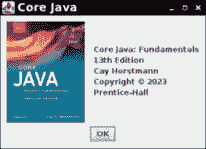

图 5.4：显示图像和文本资源

当然，面板中的书名和版权年份在书中书中变化。为了方便跟踪这些变化，我们将文本放在文件中，而不是将其硬编码为字符串。

但是，你应该将像 `about.txt` 这样的文件放在哪里？当然，将它放在 JAR 包中其他程序文件一起是最方便的。

`Class` 类提供了定位资源文件的有用服务。以下是必要的步骤：

1. 获取拥有资源的类的 `Class` 对象——例如 `ResourceTest.class`。
2. 某些方法（如 `ImageIcon` 类的 `getImage` 方法）接受描述资源位置的 URL。然后调用：

   ```java
   URL url = cl.getResource("about.png");
   ```

3. 否则，使用 `getResourceAsStream` 方法获取读取文件数据的输入流。

关键在于 Java 虚拟机知道如何定位一个类，因此它可以在相同的位置搜索相关的资源。例如，假设 `ResourceTest` 类位于包 `resources` 中。那么 `ResourceTest.class` 文件就位于 `resources` 目录，你可以在该目录中放置一个图标文件。

你不需要将资源文件放置在与类文件相同的目录中，而是提供一个相对路径或绝对路径，例如：

```text
data/about.txt
/corejava/title.txt
```

自动加载文件就是资源加载功能所做的所有工作。并没有标准方法来解释资源文件的内容。每个程序必须有自己的方式来解释其资源文件。

资源的另一个常见应用是程序的国际化。依赖于语言的字符串（如消息和用户界面标签）存储在资源文件中，每种语言一个文件。在第二卷第 7 章中讨论的国际化 API 提供了一种用于组织和访问这些本地化文件的标准方法。

Listing 5.16 是一个演示资源加载的程序。（不用担心读取文本和显示对话框的代码——稍后我们会介绍这些细节。）编译、构建 JAR 文件并执行它：

```shell
javac resources/ResourceTest.java

jar cvfe ResourceTest.jar resources.ResourceTest \
   resources/*.class resources/*.gif resources/data/*.txt corejava/*.txt

java -jar ResourceTest.jar
```

将 JAR 文件移动到不同的目录并再次运行，以检查程序是否是从 JAR 文件而不是从当前目录读取的资源文件。

Listing 5.16 `resources/ResourceTest.java`

```java
package resources;

import java.io.*;
import java.net.*;
import javax.swing.*;

/**
 * @version 1.51 2023-08-16
 * @author Cay Horstmann
 */
public class ResourceTest
{
   public static void main(String[] args) throws IOException
   {
      Class cl = ResourceTest.class;
      URL aboutURL = cl.getResource("about.gif");
      var icon = new ImageIcon(aboutURL);
      InputStream stream = cl.getResourceAsStream("data/about.txt");
      var about = new String(stream.readAllBytes());
      InputStream stream2 = cl.getResourceAsStream("/corejava/title.txt");      
      var title = new String(stream2.readAllBytes()).strip();
      JOptionPane.showMessageDialog(null, about, title, JOptionPane.INFORMATION_MESSAGE, icon);
   }
}
```

`java.lang.Class` 1.0

- `URL getResource(String name)` 1.1
- `InputStream getResourceAsStream(String name)` 1.1  
  在与类相同的位置查找资源，然后返回一个可以用于加载资源的 URL 或输入流。如果未找到资源，则返回 `null`，因此不会为 I/O 错误抛出异常。

### 5.10.4 使用反射分析类的能力

以下是反射机制中让你检查类结构的最重要部分的简要概述。

`java.lang.reflect` 包中的 `Field`、`Method` 和 `Constructor` 三个类分别描述类的字段、方法和构造函数。这三个类都有一个名为 `getName` 的方法，返回项的名称。`Field` 类有一个 `getType` 方法，返回一个对象（同样是 `Class` 类型），用于描述字段类型。`Method` 和 `Constructor` 类有报告参数类型的方法，`Method` 类还报告返回类型。

这三个类还有一个名为 `getModifiers` 的方法，它返回一个带有各种位开启或关闭状态的整数，用于描述所使用的修饰符，如 `public` 和 `static`。然后你可以使用 `java.lang.reflect` 包中 `Modifier` 类的静态方法来分析 `getModifiers` 返回的整数。使用 `Modifier` 类中的 `isPublic`、`isPrivate` 或 `isFinal` 等方法来判断方法或构造函数是否是 `public`、`private` 或 `final` 的。你所做的就是让 `Modifier` 类中相应的方法对 `getModifiers` 返回的整数进行操作即可。你也可以使用 `Modifier.toString` 方法来打印修饰符。

另一种，`accessFlags` 方法返回 `AccessFlag` 枚举的一组值。例如，以下是你可以如何测试一个方法是否是静态的：

```java
if (Modifiers.isStatic(m.getModifiers())) . . .

if (m.accessFlags().contains(AccessFlag.STATIC)) . . .
```

`Class` 类的 `getFields`、`getMethods` 和 `getConstructors` 方法返回该类支持的 `public` 字段、方法和构造函数的数组。这包括父类的公共成员。`Class` 类的 `getDeclaredFields`、`getDeclaredMethods` 和 `getDeclaredConstructors` 方法返回由类中声明的所有字段、方法和构造函数的数组。这包括私有的、包级保护的成员以及具有包访问权限的成员，但不包括父类的成员。

Listing 5.17 向你展示如何打印类支持的所有 `public` 字段、方法和构造函数。这包括父类的公共成员。`Class` 类的 `getDeclaredFields`、`getDeclaredMethods` 和 `getDeclaredConstructors` 方法返回由类中声明的所有字段、方法和构造函数的数组。这包括私有的、包级保护的成员以及具有包访问权限的成员，但不包括父类的成员。

这个程序的奇之处在于它可以分析 Java 解释器可以的的类，而不仅仅是程序编译时存在的类。我们将在下一节中使用该程序来窥视 Java 编译器自动生成的内部类。

Listing 5.17 `reflection/ReflectionTest.java`

```java
package reflection;

import java.util.*;
import java.lang.reflect.*;

/**
 * 此程序使用反射来打印类的所有特征。
 * @version 1.12 2021-06-15
 * @author Cay Horstmann
 */
public class ReflectionTest
{
   public static void main(String[] args)
         throws ReflectiveOperationException      
   {
      // 从命令行参数或用户输入中读取类名
      String name;
      if (args.length > 0) name = args[0];
      else
      {
         var in = new Scanner(System.in);
         System.out.println("输入类名 (例如 java.util.Date): ");
         name = in.next();
      }

      // 打印类的修饰符、名称和父类名称（如果父类 != Object）
      Class cl = Class.forName(name);
      String modifiers = Modifier.toString(cl.getModifiers());
      if (modifiers.length() > 0) System.out.print(modifiers + " ");
      if (cl.isSealed())
         System.out.print("sealed ");
      if (cl.isEnum())
         System.out.print("enum " + name);
      else if (cl.isRecord())
         System.out.print("record " + name);
      else if (cl.isInterface())
         System.out.print("interface " + name);
      else
         System.out.print("class " + name);

      Class supercl = cl.getSuperclass();
      if (supercl != null && supercl != Object.class)
         System.out.print(" extends " + supercl.getName());

      printInterfaces(cl);
      printPermittedSubclasses(cl);
      System.out.print("\n{\n");
      printConstructors(cl);
      System.out.println();
      printMethods(cl);
      System.out.println();
      printFields(cl);
      System.out.println("}");
   }

   /**
    * 打印类的所有构造函数
    * @param cl 一个类
    */
   public static void printConstructors(Class cl)
   {
      Constructor[] constructors = cl.getDeclaredConstructors();
      for (Constructor c : constructors)
      {
         String name = c.getName();
         System.out.print("   ");
         String modifiers = Modifier.toString(c.getModifiers());
         if (modifiers.length() > 0) System.out.print(modifiers + " ");         
         System.out.print(name + "(");

         // 打印参数类型
         Class[] paramTypes = c.getParameterTypes();
         for (int j = 0; j < paramTypes.length; j++)
         {
            if (j > 0) System.out.print(", ");
            System.out.print(paramTypes[j].getName());
         }
         System.out.println(");");
      }
   }

   /**
    * 打印类的所有方法
    * @param cl 一个类
    */
   public static void printMethods(Class cl)
   {
      Method[] methods = cl.getDeclaredMethods();
      for (Method m : methods)
      {
         Class retType = m.getReturnType();
         String name = m.getName();
         System.out.print("   ");

         // 打印修饰符、返回类型和方法名
         String modifiers = Modifier.toString(m.getModifiers());
         if (modifiers.length() > 0) System.out.print(modifiers + " ");         
         System.out.print(retType.getName() + " " + name + "(");

         // 打印参数类型


```java
Class[] paramTypes = m.getParameterTypes();

for (int j = 0; j < paramTypes.length; j++) {
    if (j > 0) {
        System.out.print(", ");
    }

    System.out.print(paramTypes[j].getName());
}

System.out.println(");");
```

### 打印类的所有字段

```java
/**
 * 打印类的所有字段
 *
 * @param cl 一个类
 */
public static void printFields(Class cl) {
    Field[] fields = cl.getDeclaredFields();

    for (Field f : fields) {
        Class type = f.getType();
        String name = f.getName();

        System.out.print("   ");

        String modifiers = Modifier.toString(f.getModifiers());

        if (modifiers.length() > 0) {
            System.out.print(modifiers + " ");
        }

        System.out.println(type.getName() + " " + name + ";");
    }
}
```

### 打印密封类所有允许的子类

```java
/**
 * 打印密封类所有允许的子类
 *
 * @param cl 一个类
 */
public static void printPermittedSubclasses(Class cl) {
    if (cl.isSealed()) {
        Class<?>[] permittedSubclasses = cl.getPermittedSubclasses();

        for (int i = 0; i < permittedSubclasses.length; i++) {
            if (i == 0) {
                System.out.print(" permits ");
            } else {
                System.out.print(", ");
            }

            System.out.print(permittedSubclasses[i].getName());
        }
    }
}
```

### 打印类直接实现的接口

```java
/**
 * 打印类直接实现的接口
 *
 * @param cl 一个类
 */
public static void printInterfaces(Class cl) {
    Class<?>[] interfaces = cl.getInterfaces();

    for (int i = 0; i < interfaces.length; i++) {
        if (i == 0) {
            System.out.print(" implements ");
        } else {
            System.out.print(", ");
        }

        System.out.print(interfaces[i].getName());
    }
}
```

### `java.lang.Class`

- `Field[] getFields()` 1.1
- `Field[] getDeclaredFields()` 1.1

  `getFields` 返回公共字段的 `Field` 对象数组；`getDeclaredFields` 返回该类的所有字段。

- `Method[] getMethods()` 1.1
- `Method[] getDeclaredMethods()` 1.1

  `getMethods` 返回公共方法的 `Method` 对象数组；`getDeclaredMethods` 返回该类的所有方法。

- `Constructor[] getConstructors()` 1.1
- `Constructor[] getDeclaredConstructors()` 1.1

  `getConstructors` 返回公共构造函数的 `Constructor` 对象数组；`getDeclaredConstructors` 返回该类的所有构造函数。

- `Class[] getInterfaces()` 1.1

  `getInterfaces` 返回该类实现的所有公共接口的 `Class` 对象数组。

- `Class getSuperclass()`

  返回该类的父类的 `Class` 对象。

- `Class<?>[] getPermittedSubclasses()` 17

  对于密封类，返回所有允许的子类数组。

- `isSealed()`

  返回 `true` 表示该 `Class` 对象描述一个密封类。（参见第 6 节）。

- `isEnum()` 1.5

  返回 `true` 表示该 `Class` 对象描述一个枚举。

- `isRecord()` 16

  返回 `true` 表示该 `Class` 对象描述一个记录。

- `RecordComponent[] getRecordComponents()` 16

  返回记录字段的 `RecordComponent` 对象数组；如果该类不是记录则返回 `null`。

- `String getPackageName()` 9

  获取该类型所在的包名；如果该类型是数组类型，则返回其元素类型的包名；如果该类型是原始类型，则返回 `"java.lang"`。

### `java.lang.reflect.Field` 1.1

### `java.lang.reflect.Method` 1.1

### `java.lang.reflect.Constructor` 1.1

- `Class getDeclaringClass()`

  返回定义此构造函数、方法或字段的 `Class` 对象。

- `Class[] getExceptionTypes()`（in `Constructor` and `Method` classes）

  返回表示方法抛出的异常类型的 `Class` 对象数组。

- `int getModifiers()`

  返回一个描述此构造函数、方法或字段修饰符的整数。使用 `Modifier` 类中的方法分析返回值。

- `Set<AccessFlag> accessFlags()` 20

  返回 `AccessFlag` 枚举值的集合，描述此构造函数、方法或字段的访问修饰符。

- `String getName()`

  返回构造函数、方法或字段的名称的字符串。

- `Class[] getParameterTypes()`（in `Constructor` and `Method` classes）

  返回表示参数类型的 `Class` 对象数组。

- `Method getAccessor()`

  返回用于访问此记录组件的 `Method` 对象。

### `java.lang.reflect.Modifier` 1.1

- `static String toString(int modifiers)`

  返回一个与 `modifiers` 中设置的位对应的修饰符字符串。

- `static boolean isAbstract(int modifiers)`
- `static boolean isFinal(int modifiers)`
- `static boolean isInterface(int modifiers)`
- `static boolean isNative(int modifiers)`
- `static boolean isPrivate(int modifiers)`
- `static boolean isProtected(int modifiers)`
- `static boolean isPublic(int modifiers)`
- `static boolean isStatic(int modifiers)`
- `static boolean isStrict(int modifiers)`
- `static boolean isSynchronized(int modifiers)`
- `static boolean isVolatile(int modifiers)`

  测试 `modifiers` 值中对应方法名中修饰符的位。

## 5.10.5. 使用反射在运行时分析对象

在前面的节中，我们已经了如何找到任何对象的实例字段的名称和类型：

- 获取对应的 `Class` 对象。
- 在 `Class` 对象上调用 `getDeclaredFields`。

在本节中，我们将更进一步，实际查看字段的内容。当然，当你编写程序时，查看名称和类型已知对象的特定字段内容是很容易的。但反射允许你查看在编译时未知的对象的字段。

实现此点的关键方法是 `Field` 类中的 `get` 方法。如果 `f` 是一个 `Field` 类型的对象（例如，通过 `getDeclaredFields` 获取的），且 `obj` 是 `f` 所属字段的类的对象，那么 `f.get(obj)` 将返回一个对象，其值是 `obj` 字段的当前值。这些都有点抽象，所以让我们来看一个示例。

```java
var harry = new Employee("Harry Hacker", 50000, 10, 1, 1989);

Class cl = harry.getClass();

// 代表 Employee 的类对象

Field f = cl.getDeclaredField("name");

// Employee 类的 name 字段

Object v = f.get(harry);

// harry 对象的 name 字段的值，即

// String 对象 "Harry Hacker"
```

当然，你也可以设置你所获取的值。调用 `f.set(obj, value)` 将对象 `obj` 中由 `f` 表示的字段设置为新值。

实际上，这段代码存在一个问题。由于 `name` 字段是一个私有字段，`get` 和 `set` 方法将抛出 `IllegalAccessException`。你只能对可访问的字段使用 `get` 和 `set`。Java 的安全机制允许你发现对象拥有哪些字段，但除非你有权限，否则不允许读写这些字段的值。

反射机制的默认行为是尊重 Java 访问控制。但你可以通过对 `Field`、`Method` 或 `Constructor` 对象调用 `setAccessible` 方法来覆盖访问控制。例如：

```java
f.setAccessible(true); // 现在可以调用 f.get(harry)
```

`setAccessible` 方法是 `AccessibleObject` 类的方法，它是 `Field`、`Method` 和 `Constructor` 类的公共父类。此功能为调试器、持久化存储和类似机制提供。我们将在节稍后将其用于一个通用的 `toString` 方法。

如果没有授予访问权限，调用 `setAccessible` 将抛出异常。访问可能会被模块系统或安全管理器拒绝。使用安全管理器并不常见，且它们自 Java 17 起已被弃用。

例如，本节末尾的示例程序查看 `ArrayList` 和 `Integer` 对象的内部。当你使用 Java 9 到 Java 16 运行它时，会出现以下不详的消息：

```text
WARNING: 发生了非法反射访问操作

WARNING: objectAnalyzer.ObjectAnalyzer (file:/home/cay
   /books/cj11/code/v1ch05/bin/) 对字段 java.util.ArrayList.serialVersionUID 的非法反射访问

WARNING: 请考虑向向.ObjectAnalyzer 的维护者报告此

WARNING: 使用 --illegal-access=warn 来启用进一步非法反射访问操作的警告

WARNING: 未来所有的非法访问操作都将被拒绝
```

当你使用 Java 17 运行程序时，会发生 `InaccessibleObjectException` 异常。

为了保持程序运行，将 `java.base` 模块中的 `java.util` 和 `java.lang` 包“开放”给“未命名模块”。详情见第 12 章。语法如下：

```shell
java --add-opens java.base/java.util=ALL-UNNAMED \
   --add-opens java.base/java.lang=ALL-UNNAMED \
   objectAnalyzer.ObjectAnalyzerTest
```

未来的库可能会使用变量句柄（variable handles）而不是反射来进行读写操作。

```java
package objectAnalyzer;

import java.util.*;

/**
 * 此程序使用反射来监控对象。
 *
 * @version 1.13 2018-03-16
 * @author Cay Horstmann
 */
public class ObjectAnalyzerTest {
    public static void main(String[] args)
            throws ReflectiveOperationException {
        var squares = new ArrayList<Integer>();

        for (int i = 1; i <= 5; i++) {
            squares.add(i * i);
        }

        System.out.println(new ObjectAnalyzer().toString(squares));
    }
}
```

## 列表 5.19 `objectAnalyzer/ObjectAnalyzer.java`

```java
package objectAnalyzer;

import java.lang.reflect.AccessibleObject;
import java.lang.reflect.Array;
import java.lang.reflect.Field;
import java.lang.reflect.Modifier;
import java.util.ArrayList;

public class ObjectAnalyzer {
    private ArrayList<Object> visited = new ArrayList<>();

    /**
     * 将对象转换为列出所有字段的字符串表示。
     *
     * @param obj 一个对象
     * @return 包含对象类名以及所有字段名和值的字符串
     */
    public String toString(Object obj)
            throws ReflectiveOperationException {
        if (obj == null) {
            return "null";
        }

        if (visited.contains(obj)) {
            return "...";
        }

        visited.add(obj);

        Class cl = obj.getClass();

        if (cl == String.class) {
            return (String) obj;
        }

        if (cl.isArray()) {
            String r = cl.getComponentType() + "[]{";

            for (int i = 0; i < Array.getLength(obj); i++) {
                if (i > 0) {
                    r += ",";
                }

                Object val = Array.get(obj, i);

                if (cl.getComponentType().isPrimitive()) {
                    r += val;
                } else {
                    r += toString(val);
                }
            }

            return r + "}";
        }

        String r = cl.getName();

        // 检查此类及其所有父类的字段
        do {
            r += "[";

            Field[] fields = cl.getDeclaredFields();
            AccessibleObject.setAccessible(fields, true);

            // 获取所有字段的名字和值
            for (Field f : fields) {
```


```java
if (!Modifier.isStatic(f.getModifiers()))
{
   if (!r.endsWith("[")) r += ",";
   r += f.getName() + "=";
   Class t = f.getType();
   Object val = f.get(obj);
   if (t.isPrimitive()) r += val;
   else r += toString(val);
}
}
r += "]";
cl = cl.getSuperclass();
}
while (cl != null);
return r;
}
}
```

## java.lang.reflect.AccessibleObject 1.2

- `void setAccessible(boolean flag)`
  设置或清除此可访问对象的访问权限标记，如果访问被拒绝，则抛出 `IllegalAccessException`。

- `boolean trySetAccessible()` 9
  设置此可访问对象的访问权限标记，如果访问被拒绝则返回 `false`。

- `boolean canAccess(Object obj)` 9
  检查调用者是否可以通过此字段、方法或构造函数对象访问 `obj`。对于静态字段、方法或构造函数，请传递 `null`。

- `static void setAccessible(AccessibleObject[] array, boolean flag)`
  用于设置对象数组访问权限标记的便利方法。

## java.lang.Class 1.1

- `Field getField(String name)`
- `Field[] getFields()`
  获取给定名称的公共字段，或所有字段的数组。

- `Field getDeclaredField(String name)`
- `Field[] getDeclaredFields()`
  获取在该类中声明的给定名称字段，或所有字段的数组。

## java.lang.reflect.Field 1.1

- `Object get(Object obj)`
  获取对象 `obj` 中由此 `Field` 对象描述的字段的值。

- `void set(Object obj, Object newValue)`
  将对象 `obj` 中由此 `Field` 对象描述的字段设置为值。

### 5.10.6 使用反射编写泛型数组代码

`java.lang.reflect` 包中的 `Array` 类允许你动态创建数组。这被用于 `Arrays` 类中 `copyOf` 方法的实现。回想如何使用该方法来扩展已满的数组。

```java
var a = new Employee[100];
. . .
// 数组已满
a = Arrays.copyOf(a, 2 * a.length);
```

如何编写这样一个泛型方法？`Employee[]` 数组可以转换为 `Object[]` 数组这很有帮助。这听起来很有前景。以下是第一次尝试：

```java
public static Object[] badCopyOf(Object[] a, int newLength) // 无用
{
   var newArray = new Object[newLength];
   System.arraycopy(a, 0, newArray, 0, Math.min(a.length, newLength));
   return newArray;
}
```

然而，在实际使用 `newArray` 时存在一个问题。`badCopyOf` 返回的是 `Object[]`，但我们需要的是 `Employee[]`。要执行此操作，我们需要获取数组的长度和组件类型。通过调用 `Array.getLength(a)` 获取长度。要获取数组的组件类型：

1. 首先，获取 `a` 的类对象。
2. 确认它确实是数组。
3. 使用 `Class` 类的 `getComponentType` 方法（该方法仅对数组类对象定义）找到数组的类型。
4. 反之，对于表示类 `C` 的任何 `Class` 对象，`arrayType` 方法返回 `C[]` 的 `Class` 对象。

为什么 `getLength` 是 `Array` 的方法而 `getComponentType` 是 `Class` 的方法？我不知道——反射方法的分布有时显得有些随意。

这里是代码：

```java
public static Object goodCopyOf(Object a, int newLength) 
{
   Class cl = a.getClass();
   if (!cl.isArray()) return null;
   Class componentType = cl.getComponentType();
   int length = Array.getLength(a);
   Object newArray = Array.newInstance(componentType, newLength);
   System.arraycopy(a, 0, newArray, 0, Math.min(length, newLength));
   return newArray;
}
```

注意，此 `copyOf` 方法可以扩展任何类型的数组，而不仅仅是对象的数组。

```java
int[] a = { 1, 2, 3, 4, 5 };
a = (int[]) goodCopyOf(a, 10);
```

为了使这一点可行，`goodCopyOf` 的参数声明为 `Object` 类型，而不是对象数组（`Object[]`）。整数数组类型 `int[]` 可以转换为 `Object`，但不能转换为对象数组！

[列表 5.20] 展示了两种方法的用法。注意对 `badCopyOf` 返回值的强制转换将抛出异常。

```java
package arrays;

import java.lang.reflect.*;
import java.util.*;

/**
 * 此程序演示了如何使用反射来操作数组。
 * @version 1.2 2012-05-04
 * @author Cay Horstmann
 */
public class CopyOfTest
{
   public static void main(String[] args)
   {
      int[] a = { 1, 2, 3 };
      a = (int[]) goodCopyOf(a, 10);
      System.out.println(Arrays.toString(a));

      String[] b = { "Tom", "Dick", "Harry" };
      b = (String[]) goodCopyOf(b, 10);
      System.out.println(Arrays.toString(b));

      System.out.println("以下调用将产生异常。");
      b = (String[]) badCopyOf(b, 10);
   }

   /**
    * 此方法尝试通过分配新数组并拷贝所有元素
    * 来扩大数组大小。
    * @param a 需要扩大的数组
    * @param newLength 新长度
    * @return 一个包含 a 的所有元素的更大的数组。然而，返回的
    * 数组类型为 Object[]，而不是与 a 相同的类型
    */
   public static Object[] badCopyOf(Object[] a, int newLength) // 无用
   {
      var newArray = new Object[newLength];
      System.arraycopy(a, 0, newArray, 0, Math.min(a.length, newLength));
      return newArray;
   }

   /**
    * 此方法通过分配相同类型的新数组并拷贝所有元素
    * 来扩大数组大小。
    * @param a 需要扩大的数组。这可以是对象数组也可以是基本类型
    * 类型数组
    * @return 一个包含 a 的所有元素的更大的数组
    */
   public static Object[] goodCopyOf(Object a, int newLength) 
   {
      Class cl = a.getClass();
      if (!cl.isArray()) return null;
      Class componentType = cl.getComponentType();
      int length = Array.getLength(a);
      Object newArray = Array.newInstance(componentType, newLength);
      System.arraycopy(a, 0, newArray, 0, Math.min(length, newLength));
      return newArray;
   }
}
```

`java.lang.Class` 1.1

- `boolean isArray()`
  如果此对象表示数组类型，则返回 `true`。

- `Class getComponentType()`
  `Class componentType()` 12
  如果此对象表示数组类型，则返回描述组件类型的 `Class`；否则返回 `null`。

- `Class arrayType()` 12
  返回描述由此对象表示的具有类型类型的数组类型 `Class`。

`java.lang.reflect.Array` 1.1

- `static Object get(Object array, int index)`

- `static` `xxx` `getXxx`(Object array, int index)
  (`xxx` 是基本类型 `boolean`、`byte`、`char`、`double`、`float`、`int`、`long` 或 `short` 之一。）这些方法返回给定数组中存储在指定索引的值。

- `static void set(Object array, int index, Object newValue)`

- `static setXxx`(Object array, int index, `xxx` `newValue`)
  (`xxx` 是基本类型 `boolean`、`byte`、`char`、`double`、`float`、`int`、`long` 或 `short` 之一。）这些方法将新值存储到给定数组的指定索引。

- `static int getLength(Object array)`
  返回给定数组的长度。

- `static Object newInstance(Class componentType, int length)`

- `static Object newInstance(Class componentType, int[] lengths)`
  返回具有给定维度的组件类型的新数组。

### 5.10.7 调用任意方法和构造函数

在 C 和 C++ 中，你可以通过函数指针执行任意函数。从表面上看，Java 并没有方法指针——即将方法的位置传递给另一个方法的方法，以便第二个方法稍后调用它。事实上，Java 的设计者曾表示方法指针是危险且容易出错的，而 Java 接口和 lambda 表达式（下一节讨论）是更优的解决方案。然而，反射机制允许你调用任意方法。

记住，你可以使用 `Field` 类的 `get` 方法检查对象的字段。同样，`Method` 类有一个 `invoke` 方法，允许你调用封装在当前 `Method` 对象中的方法。`invoke` 方法的签名如下：

```java
Object invoke(Object obj, Object... args)
```

第一个参数是隐式参数，其余的对象提供显式参数。

对于静态方法，第一个参数是被忽略的——你可以将其设置为 `null`。

例如，如果 `m1` 代表 `Employee` 类的 `getName` 方法，以下代码展示了如何调用它：

```java
String n = (String) m1.invoke(harry);
```

如果返回类型是基本类型，`invoke` 方法将返回包装类型。例如，假设 `m1` 代表 `Employee` 类的 `getName` 方法，以下代码展示了如何调用它：

```java
String n = (String) m1.invoke(harry);
```

```java
package methods;

import java.lang.reflect.*;

/**
 * 此程序演示了如何通过反射调用方法。
 * @version 1.2 2012-05-04
 * @author Cay Horstmann
 */
public class MethodTableTest
{
   public static void main(String[] args)
         throws ReflectiveOperationException
   {
      // 获取 square 和 sqrt 方法的指针
      Method square = MethodTableTest.class.getMethod("square", double.class);
      Method sqrt = Math.class.getMethod("sqrt", double.class);

      // 打印 x 值和 y 值的表格
      printTable(1, 10, 10, square);
      printTable(1, 10, 10, sqrt);
   }

   /**
    * 返回一个数的平方
    * @param x 一个数字
    * @return x 的平方
    */
   public static double square(double x)
   {
      return x * x;
   }

   /**
    * 为方法打印包含 x 值和 y 值的表格
    * @param from x 值的下界
    * @param to x 值的上界
    * @param n 表格的行数
    * @param f 一个接受 double 参数并返回 double 返回值的方法
    */
   public static void printTable(double from, double to, int n, Method f)
         throws ReflectiveOperationException
   {
      // 将方法作为表头打印
      System.out.println(f);

      double dx = (to - from) / (n - 1);
      for (double x = from; x <= to; x += dx)
      {
         double y = (Double) f.invoke(null, x);
         System.out.printf("%10.4f | %10.4f%n", x, y);
      }
   }
}
```


正如这个示例所示，你对 `Method` 对象可以做的任何事情就像你在 C 语言中使用函数指针（或 C# 中的委托）可以做的一样。就像 C 中一样，这种编程风格通常非常不方便，而且总是出错。如果你使用错误的参数调用方法会发生什么？`invoke` 方法会抛出一个异常。

此外，`invoke` 的参数和返回值类型都是 `Object` 类型。这意味着你必须进行大量的往类型转换。结果是，编译器失去了检查你代码的机会，因此错误只有在测试期间才会出现，而那时发现和修复错误会更加费琐。此外，使用反射获取方法指针的代码比直接调用方法的代码要慢得多。

因此，我建议仅在绝对必要时才在自己的程序中使用 `Method` 对象。使用接口和 lambda 表达式（下一节的主题）几乎总是更好的主意。

`java.lang.reflect.Method` 1.1

- `public Object invoke(Object obj, Object[] args)`

  调用此对象描述的方法，传递给定的参数并返回方法产生的值。对于静态方法，将 `null` 作为隐式参数传递。使用包装类传递原始类型值。原始类型返回值必须进行自动拆箱。

## 5.11 继承的设计提示

我想用一些我在使用继承时发现非常有用的提示来结束本章。

1. **将公共操作和字段放在父类中。**

   这就是为什么我们将 `name` 字段放入 `Person` 类中，而不是在 `Employee` 和 `Student` 类中复制它。

2. **不要使用保护字段。**

   有些程序员认为将大多数实例字段定义为 `protected` 是一个好主意，“以防万一”，这样子类在需要时就可以访问这些字段。然而，`protected` 机制并没有提供多少保护，原因有两个。首先，子类的集合是无界的——任何人都可以创建你类的子类，然后编写直接访问 `protected` 实例字段的代码，从而破坏了封装性。其次，在 Java 中，同一个包中的所有类都可以访问 `protected` 字段，无论它们是否是子类。

   然而，`protected` 方法可以用于指示尚未准备好通用且应该在子类中重新定义的方法。

3. **使用继承来建模“是（is–a）”关系。**

   继承是一种方便的代码节约工具，但有时人们会过度使用。例如，假设我们需要一个 `Contractor`（承包工）类。承包工有名字和雇用日期，但他们没有工资。相反，他们按小时付费，而且停留的时间不足以获得加薪。人们很容易想从 `Employee` 派生出一个子类 `Contractor` 并添加一个 `hourlyWage` 字段。

   ```java
   public class Contractor extends Employee
   {
      private double hourlyWage;

      . . .
   }
   ```

   但这不是一个好主意，因为现在每个承包工对象都有工资和时薪两个字段。当你实现打印工资单或税表的方法时，这会给你带来无穷的麻烦。你最终写的代码比你从不使用继承时写的要多得多。

   承包工与员工的关系没有通过“is–a”测试。承包工不是员工的特殊情况。

4. **除非所有继承的方法都有意义，否则不要使用继承。**

   假设我们想写一个 `Holiday`（节日）类。显然，每个节日都是一天，而天可以作为 `GregorianCalendar` 的实例来表示。遗憾的是，节日的集合在继承的操作下并不是封闭的。`GregorianCalendar` 的公共方法之一是 `add`。而 `add` 可以让节日变成非节日：

   ```java
   Holiday christmas;

   christmas.add(Calendar.DAY_OF_MONTH, 12);
   ```

   因此，在这个例子中继承是不恰当。

5. **重写方法时不要改变预期行为。**

   替换原则不仅适用于语法，更重要的是适用于行为。当你重写一个方法时，你不应该改变它的行为。编译器无法帮助你——它无法检查你的重定义是否有意义。例如，你可以通过重定义 `add` 方法来解决 `Holiday` 类的问题，也许是什么都不做、抛出异常或继续执行。

   然而，这种修复违反了替换原则。以下语句序列：

   ```java
   int d1 = x.get(Calendar.DAY_OF_MONTH);

   x.add(Calendar.DAY_OF_MONTH, 1);

   int d2 = x.get(Calendar.DAY_OF_MONTH);

   System.out.println(d2 - d1);
   ```

   应该具有预期行为，无论 `x` 是 `GregorianCalendar` 还是 `Holiday`。

当然，问题就在这里。合理和不合理的人可以对预期行为进行长时间争论。例如，某些作者认为替换原则要求 `Manager.equals` 忽略 `bonus` 字段，因为 `Employee.equals` 忽略了它。如果这些讨论是在真空中进行的，它们就是毫无意义的。最终，重要的是在子类中重写方法时，不要背离原始设计的意图。

6. **使用多态，而不是类型信息。**

   每当你发现如下形式的代码时：

   ```text
   if (x is of type 1)
      action1(x);
   else if (x is of type 2)
      action2(x);
   ```

   考虑多态。

   `action(1)` 和 `action(2)` 代表共同的概念吗？如果是，让该概念成为两个类型的公共父类或接口的方法。那么，你就可以简单地调用：

   ```java
   x.action();
   ```

   让多态固有的动态调度机制启动正确的操作。

   使用多态方法或接口实现的代码比使用多个类型测试的代码容易维护和扩展得多。

7. **不要过度使用反射。**

反射机制允许你通过运行时检测字段和方法来编写具有极高通用性的程序。这种能力对于系统级编程非常有用，但在应用程序中通常并不适用。反射是脆弱的——使用它，编译器无法帮助你发现编程错误。任何错误都会在运行时被发现并导致异常。

现在你已经了解了 Java 如何支持面向对象编程的基础知识：类、继承和多态。在接下来的章节中，我将介绍两个对于有效使用 Java 至关重要的高级主题：接口和 lambda 表达式。

# 第 6 章 ▪ 接口、Lambda 表达式与内部类

你现在已经学习了类和继承，这是 Java 面向对象编程的核心概念。本章将向你展示几种常用的高级技术。尽管这些技术的本质并不显而易见，但你仍需要掌握它们来完善你的 Java 工具箱。

第一种技术称为 `interfaces`（接口），它是一种描述类应该“做什么”的方式，而不指定它们应该“如何”做。一个类可以 `implement`（实现）一个或多个接口。然后，在需要符合接口的地方，你就可以使用这些实现类的对象。在讨论完接口后，我们将转向 `lambda expressions`（lambda 表达式），这是一种创建可以在稍后时间执行的代码块的简洁方式。使用 lambda 表达式，你可以以优雅且简洁的方式表达使用回调或变量行为的代码。

然后我们讨论 `inner classes`（内部类）的机制。内部类在技术上有点些复杂——它们被定义在其他类内部，并且它们的方法可以访问外部类的字段。当你设计一组协作的类集合时，内部类非常有用。

本章将以对 `proxies`（代理）的讨论结束，代理是实现任意接口的类。代理是一种非常特殊的构造体，用于构建系统级工具。第一次阅读时，你可以安全地跳过该章节。

## 6.1 接口

在接下来的章节中，你将学习 Java 接口是什么以及如何使用它们。你还将发现，在 Java 的最新版本中，接口变得更加强大。

### 6.1.1 接口概念

在 Java 编程语言中，接口不是一个类，而是针对想要符合接口的类的一组 `requirements`（要求）。

通常，某些服务的提供者会声明：“如果你的类符合特定的接口，那么我就执行该服务。”让我们来看一个具体的例子。`Arrays` 类的 `sort` 方法承诺对对象数组进行排序，但有一个条件：这些对象必须属于 `implement`（实现）了 `Comparable` 接口的类。

`Comparable` 接口看起来如下：

```java
public interface Comparable
{
   int compareTo(Object other);
}
```

在接口中，`compareTo` 方法是 `abstract`（抽象的）——它没有实现。实现 `Comparable` 接口的类需要有一个 `compareTo` 方法，并且该方法必须有一个 `Object` 参数并返回一个整数。否则，该类也是抽象的——也就是说，无法构造任何对象。

从 Java 5 开始，`Comparable` 接口被增强为一个泛型类型。

```java
public interface Comparable<T>
{
   int compareTo(T other); // 参数类型为 T
}
```

例如，实现 `Comparable<Employee>` 的类必须提供一个方法：

```java
int compareTo(Employee other)
```

你仍然可以使用不带类型参数的“原始” `Comparable` 类型。这时，`compareTo` 方法有一个类型为 `Object` 的参数，你必须手动将 `compareTo` 方法的该参数转换为所需的类型。我将在此后这样做，这样你就不需要同时担心两个新概念。

接口的所有方法自动都是 `public`（公共的）。由于由于，在接口中声明方法时，不需要提供 `public` 关键字。

当然，还有一个接口语法无法表达的额外要求：调用 `x.compareTo(y)` 时，`compareTo` 方法必须 `compare`（比较）这两个对象，并返回 `x` 或 `y` 哪个更大的指示。如果 `x` 小于 `y`，该方法应该返回负数；如果它们相等，返回零；否则返回正数。

这个特定的接口只有一个方法。有些接口有多个方法。正如你稍后看到的，接口还可以定义常量。然而，更重要的是接口不能提供的内容。接口永远没有实例字段。在 Java 8 之前，接口中的所有方法都是抽象的。正如你在第 6.1.4 节和第 6.1.5 节中看到的，现在接口中可以拥有其他方法。当然，这些方法不能引用实例字段——接口没有任何字段。

现在，假设我们想使用 `Arrays` 类的 `sort` 方法对 `Employee` 对象数组进行排序。那么 `Employee` 类必须 `implement` `Comparable` 接口。

要让一个类实现接口，你需要执行两个步骤：

1. 声明你的类意图实现给定的接口。
2. 为接口中的所有方法提供定义。

要声明一个类实现接口，请使用 `implements` 关键字：

```java
class Employee implements Comparable
```

当然，现在 `Employee` 类需要提供 `compareTo` 方法。假设我们想根据工资来比较员工。这里是 `compareTo` 方法的实现：

```java
public int compareTo(Object otherObject)
{
   Employee other = (Employee) otherObject;

   return Double.compare(salary, other.salary);
}
```

在这里，我们使用了静态方法 `Double.compare`，如果第一个参数小于第二个参数则返回负数，如果相等则返回零，否则返回正值。

在接口声明中，`compareTo` 方法没有声明为 `public`，因为接口中的方法自动是公共的。然而，在实现接口时，你必须将方法声明为 `public`。否则，编译器会认为该方法具有包级访问权限。

我们可以通过为泛型 `Comparable` 接口提供类型参数来做得更好：

```java
class Employee implements Comparable<Employee>
{
   public int compareTo(Employee other)
   {
      return Double.compare(salary, other.salary);
   }

   . . .
}
```

注意 `Object` 参数难看的类型转换消失了。

`Comparable` 接口的 `compareTo` 方法返回一个整数。如果对象不相等，返回什么负值或正值并不重要。这种灵活性在比较整数字段时非常有用。例如，假设每个员工都有一个唯一的整数 `id`，你想根据员工 ID 数字进行排序。那么你可以简单地返回 `id - other.id`。如果第一个 ID 小于另一个，该值将是某个负值；如果 ID 相同，则为零；否则是某个正值。然而，有一个注意事项：整数范围必须足够小，以至于减法不会溢出。如果你知道 ID 不是负数，或者它们的绝对值最多为 `(Integer.MAX_VALUE - 1) / 2`，那么就是安全的。否则，调用静态的 `Integer.compare` 方法。

当然，减法技巧并不适用于浮点数。差异 `salary - other.salary` 在工资接近但并不相同时可能会舍入为 `0`。调用 `Double.compare(x, y)` 仅在 `x < y` 时返回 `-1`，在 `x > y` 时返回 `1`。

`Comparable` 接口的文档建议，`compareTo` 方法应该与 `equals` 方法兼容。也就是说，恰当 `x.equals(y)` 为真时，`x.compareTo(y)` 应该等于零。Java API 中实现 `Comparable` 的大多数类都遵循这一建议。

一个显著的异常是 `BigDecimal`。考虑 `x = new BigDecimal("1.0")` 和 `y = new BigDecimal("1.00")`。此时 `x.equals(y)` 为 `false`，因为数字的精度不同。但 `x.compareTo(y)` 的结果为零。理想情况下，它不应该是如此，但并没有明显的方法来决定哪一个应该靠前。

另一个异常是 `StringBuilder`，它实现了 `Comparable` 但没有重写 `equals`：

```java
StringBuilder x = new StringBuilder("Hello");

StringBuilder y = new StringBuilder("Hello");

x.equals(y) // false

x.compareTo(y) // 0
```

使用 `double` 操作数时的比较运算符与 `Double` 类的对应方法之间存在细微差异。

第一个问题是负零，即 `-0.0`。当与 `==` 或 `<` 等关系运算符比较时，它与 `0.0` 无法区分：

```java
-0.0 == 0.0 // true

-0.0 < 0.0 // false
```

然而，封装成 `Double` 实例后，它们是不同的：

```java
Double.valueOf(-0.0).equals(Double.valueOf(0.0)) // false

Double.valueOf(-0.0).compareTo(Double.valueOf(0.0)) // -1
```

另一个问题是 `Double.NaN`。任何与操作数为 `NaN` 的关系运算符进行比较都会返回 `false`：

```java
Double.NaN == Double.NaN // false

Double.NaN < Double.NaN // false
```

但是，封装成 `Double` 值后，它的行为不同：

```java
Double.valueOf(Double.NaN).equals(Double.valueOf(Double.NaN)) // true

Double.valueOf(Double.NaN).compareTo(Double.valueOf(Double.NaN)) // 0
```

静态方法 `Double.compare` 遵循包装类的逻辑：

```java
Double.compare(-0.0, 0.0) // -1
```

值得惊讶的是，`Double.NaN` 被认为大于 `Double.POSITIVE_INFINITY`：

```java
Double.compare(Double.POSITIVE_INFINITY, Double.NaN) // -1
```

注意，带有 `double` 组件的 record 的 `equals` 方法使用了 `Double.compare`。

现在你已经看到了一个类必须做什么才能利用排序服务——它必须实现一个 `compareTo` 方法。这是完全合理的。`sort` 方法需要某种方式来比较对象。但为什么 `Employee` 类不能在不实现 `Comparable` 接口的情况下直接提供 `compareTo` 方法呢？

使用接口的原因是 Java 编程语言是强类型的。在进行方法调用时，编译器需要能够检查该方法是否存在。在 `sort` 方法的某处会有这样的语句：

```java
if (a[i].compareTo(a[j]) > 0)
{
   // 重新排列 a[i] 和 a[j]
   . . .
}
```

编译器必须知道 `a[i]` 确实有一个 `compareTo` 方法。如果 `a` 是一个 `Comparable` 对象的数组，那么该方法的存在性是有保证的，因为每个实现 `Comparable` 接口的类都必须提供该方法。

你可能认为 `Arrays` 类中的 `sort` 方法定义为接收一个 `Comparable[]` 数组，这样如果有人用元素类型没有实现 `Comparable` 接口的数组调用 `sort`，编译器就会。遗憾的是，事实如此。相反，`sort` 方法接收一个 `Object[]` 数组并使用粗暴的强制转换：


// 标准库中使用的方法——不推荐

```java
if (((Comparable) a[i]).compareTo(a[j]) > 0)
{
   // 重新排列 a[i] 和 a[j]
   . . .
}
```

如果 `a[i]` 不属于实现 `Comparable` 接口的类，虚拟机将抛出异常。

[列表 6.1] 展示了排序 `Employee` 类实例数组的全代码（[列表 6.2]）。

### 列表 6.1 `interfaces/EmployeeSortTest.java`

```java
package interfaces;

import java.util.*;

/**
 * 该程序演示了 Comparable 接口的使用。
 * @version 1.30 2004-02-27
 * @author Cay Horstmann
 */
public class EmployeeSortTest
{
   public static void main(String[] args)
   {
      var staff = new Employee[3];

      staff[0] = new Employee("Harry Hacker", 35000);
      staff[1] = new Employee("Carl Cracker", 75000);
      staff[2] = new Employee("Tony Tester", 38000);

      Arrays.sort(staff);

      // 输出所有 Employee 对象的信息
      for (Employee e : staff)
         System.out.println("name=" + e.getName() + ",salary=" + e.getSalary());
   }
}
```

### 列表 6.2 `interfaces/Employee.java`

```java
package interfaces;

public class Employee implements Comparable<Employee>
{
   private String name;
   private double salary;

   public Employee(String name, double salary)
   {
      this.name = name;
      this.salary = salary;
   }

   public String getName()
   {
      return name;
   }

   public double getSalary()
   {
      return salary;
   }

   public void raiseSalary(double byPercent)
   {
      double raise = salary * byPercent / 100;
      salary += raise;
   }

   /**
    * 按薪水比较员工。
    * @param other 另一个 Employee 对象
    * @return 如果此员工薪水比另一个低则返回负值，
    * 如果薪水相同则返回 0，否则返回正值
    */
   public int compareTo(Employee other)
   {
      return Double.compare(salary, other.salary);
   }
}
```

`java.lang.Comparable<T>` 1.0

- `int compareTo(T other)`：将此对象与 `other` 比较，如果此对象小于 `other` 则返回一个负整数，如果相等则返回零，否则返回一个正整数。

`java.util.Arrays` 1.2

- `static void sort(Object[] a)`：对数组 `a` 中的元素排序。数组中的所有元素必须属于实现 `Comparable` 的类。

`java.lang.Integer` 1.0

- `static int compare(int x, int y)`：如果 `x < y` 则返回负整数，如果 `x` 和 `y` 相等则返回零，否则返回正整数。

`java.lang.Double` 1.0

- `static int compare(double x, double y)`：如果 `x < y` 则返回负整数，相等返回零，否则返回正整数。根据语言标准：“实现者必须确保对于所有 `x` 和 `y`，`sgn(x.compareTo(y)) = -sgn(y.compareTo(x))`。（这意味着如果 `y.compareTo(x)` 抛出异常，则 `x.compareTo(y)` 也必须抛出异常。）”在这里，`sgn` 是数字的符号。

与 `equals` 一样，当继承时会出现问题。由于 `Manager` 继承 `Employee`，它实现的是 `Comparable<Employee>` 而不是 `Comparable<Manager>`。如果 `Manager` 选择重写 `compareTo`，它必须准备好比较经理和员工。它不能简单地将员工转换为经理：

```java
class Manager extends Employee
{
   public int compareTo(Employee other)
   {
      Manager otherManager = (Manager) other; // 不
      . . .
   }

   . . .
}
```

这违反了“反对称”规则。如果 `x` 是 `Employee` 且 `y` 是 `Manager`，那么调用 `x.compareTo(y)` 不会抛出异常——它只是作为员工来比较它们。但相反，`y.compareTo(x)` 会抛出 `ClassCastException`。

这与第 5 章讨论的 `equals` 方法的情况相同，补救措施也相同。有两种不同的场景。

如果子类有不同的比较概念，那么你应该禁止属于不同类的对象进行比较。每个 `compareTo` 方法应该从以下测试开始：

```java
if (getClass() != other.getClass()) throw new ClassCastException();
```

如果存在比较子类对象的通用算法，只需在父类中提供单个 `compareTo` 方法并将其声明为 `final` 即可。

例如，假设你想让经理比普通员工高级，无论薪水如何。那么其他子类如 `Executive` 和 `Secretary` 呢？如果你需要建立一个等级排序，可以在 `Employee` 类中提供诸如 `rank` 的方法。让每个子类重写 `rank`，并实现一个考虑到 `rank` 值的单个 `compareTo` 方法。

### 6.1.2 接口的属性

接口不是类。特别是，你永远无法使用 `new` 运算符来实例化接口：

```java
x = new Comparable(. . .); // ERROR
```

然而，尽管不能构造接口对象，你仍然可以声明接口变量。

```java
Comparable x; // OK
```

接口变量必须引用实现该接口的类的对象：

```java
x = new Employee(. . .); // 只要 Employee 实现 Comparable 就 OK
```

接下来，就像你使用 `instanceof` 来检查对象是否属于某个特定类一样，你可以使用 `instanceof` 来检查对象是否实现了某个接口：

```java
if (anObject instanceof Comparable) { . . . }
```

正如你可以构建类的层次结构一样，你也可以扩展接口。这允许创建从更具通用性到更具特殊性的多个接口链。例如，假设你有一个名为 `Moveable` 的接口。

```java
public interface Moveable
{
   void move(double x, double y);
}
```

那么，你可以想象有一个扩展它的名为 `Powered` 的接口：

```java
public interface Powered extends Moveable
{
   double milesPerGallon();
}
```

虽然你不能在接口中放置实例字段，但你可以在其中提供常量。例如：

```java
public interface Powered extends Moveable
{
   double milesPerGallon();
   double SPEED_LIMIT = 95; // 一个 public static final 常量
}
```

正如接口中的方法自动是 `public` 的一样，字段始终是 `public static final`。

将接口方法标记为 `public`、字段标记为 `public static final` 是合法的。有些程序员会这样做，可能是出于习惯或为了更清晰。然而，Java 语言规范建议不要提供这些冗余的关键字，我也遵循该建议。

虽然每个类只能有一个父类，但类可以实现多个接口。这让你在定义类行为时具有最大的灵活性。例如，Java 编程语言内置了一个重要的接口，称为 `Cloneable`。（该接口在第 6.1.9 节中进行了详细讨论。）如果你的类实现了 `Cloneable`，`Object` 类中的 `clone` 方法将为你的类对象创建一个精确拷贝。如果你同时需要克隆性和可比较性，只需同时实现这两个接口即可。使用逗号分隔你想实现的接口：

```java
class Employee implements Cloneable, Comparable
```

Record 类和枚举类不能扩展其他类（因为它们隐式地扩展了 `Record` 和 `Enum` 类）。然而，它们可以实现接口。

接口可以是 `sealed`（密封的）的。与密封类一样，直接子类型（可以是类或接口）必须在 `permits` 子句中声明，或者位于同一个源文件中。

### 6.1.3 接口与抽象类

如果你阅读了第 5 章中关于抽象类的章节，可能会疑惑为什么 Java 编程语言的设计者要费心引入接口的概念。为什么 `Comparable` 不能简单是一个抽象类呢：

```java
abstract class Comparable // 为什么不能？
{
   public abstract int compareTo(Object other);
}
```

那么 `Employee` 类只需扩展这个抽象类并提供 `compareTo` 方法即可：

```java
class Employee extends Comparable // 为什么不能？
{
   public int compareTo(Object other) { . . . }
}
```

遗憾的是，使用抽象基类来表达通用属性存在一个重大问题。一个类只能扩展一个类。假设 `Employee` 类已经扩展了另一个类，比如 `Person`。那么它就不能扩展第二个类了。

```java
class Employee extends Person, Comparable // ERROR
```

但每个类可以根据意愿实现任意数量的接口：

```java
class Employee extends Person implements Comparable // OK
```

其他编程语言，特别是 C++，允许一个类拥有多个父类。这种特性被称为多继承。Java 的设计者选择不支持多继承，因为这会让语言变得非常复杂（如 C++ 所示）或者效率较低（如 Eiffel 所示）。

相反，接口在避免复杂性和低效的同时提供了多继承的大部分优点。

C++ 拥有多继承以及随之而来的所有复杂性，例如虚拟基类、支配规则和横向指针转换。很少有 C++ 程序员使用多继承，有些人认为永远不应该使用它。其他程序员建议仅将多继承用于“混入”（mix-in）风格的继承。在混入风格中，一个主基类描述父对象，而额外的基类（所谓的混入类）可以提供辅助特征。那种风格与一个具有单一父类和额外接口的 Java 类相似。

你已经在第 3 章中见过 `CharSequence` 接口。`String` 和 `StringBuilder`（以及其他几个类似字符串的类）都实现了这个接口。该接口包含了所有字符序列类的通用方法。`CharSequence` 接口相当简单。你可以获取长度、遍历代码点或代码单元、提取子序列，并对两个序列进行字典顺序比较。Java 17 增加了 `isEmpty` 方法。

如果你处理字符串，且这些操作足以满足你的需求，请接受 `CharSequence` 实例而不是字符串。

### 6.1.4 静态方法与私有方法

从 Java 8 开始，你允许在接口中添加静态方法。从技术角度来说，从未禁止这样做。这只是违背了接口作为抽象规范的初衷。

以前，通常将静态方法放在辅助类中。在标准库中，你会发现接口与工具类的组合，如 `Collection`/`Collections`。

例如，你可以使用 `Path` 接口中的静态方法，从 URI 或字符串序列构造指向文件或目录的路径：

```java
public interface Path
{
   public static Path of(URI uri) { . . . }

   public static Path of(String first, String... more) { . . . }

   . . .
}
```

在之前的 Java 版本中，有一个独立的 `Paths` 类持有这些方法。现在，没有理由再提供独立的辅助类了。

接口方法可以是 `private` 的。私有方法可以是 `static` 的，也可以是实例方法。由于私有方法只能在接口的方法中使用，因此其用途限于作为接口其他方法的辅助方法。

### 6.1.5 默认方法

你可以为任何接口方法提供默认（default）实现。你必须用 `default` 修饰符标记此类方法。

```java
public interface Comparable<T>
{
   default int compareTo(T other) { return 0; }

   // 默认情况下，所有元素都是相同的
}
```

当然，这并没有什么用，因为 `Comparable` 的每一个具体实现都会重写这个方法。但在其他情况下，默认方法非常有用。例如，在第 9 章中，你将看到一个用于访问数据结构中元素的 `Iterator` 接口。它声明了如下 `remove` 方法：

```java
public interface Iterator<E>
{
   boolean hasNext();

   E next();

   default void remove()
   {
      throw new UnsupportedOperationException("remove");
   }

   . . .
}
```

如果你实现了一个迭代器，你就需要提供 `hasNext` 和 `next` 方法。这些方法没有默认实现——它们依赖于你正在遍历的数据结构。但如果你的迭代器是只读的，你就不需要担心 `remove` 方法了。

默认方法可以调用其他方法。例如，`Collection` 接口可以定义一个便利方法：

```java
public interface Collection
{
   int size(); // 一个抽象方法

   default boolean isEmpty() { return size() == 0; }

   . . .
}
```

那么，实现 `Collection` 的程序员就不需要担心实现 `isEmpty` 方法了。

Java API 中的 `Collection` 接口实际上并没有这样做。相反，有一个类 `AbstractCollection`，它实现了 `Collection` 并根据 `size` 定义了 `isEmpty`。建议集合的实现者扩展 `AbstractCollection`。那种技术已经过时了。只需实现接口中的方法即可。

默认方法的一个重要用途是接口演进（interface evolution）。以在 Java 中存在许多的 `Collection` 接口为例。假设很久以前，你提供了一个类：

```java
public class Bag implements Collection
```


后来，在 Java 8 中，接口中添加了一个 `stream` 方法。

假设 `stream` 方法不是一个默认方法。那么 `Bag` 类将无法编译，因为它没有实现这个新方法。在接口中添加非默认方法不是源兼容的（source-compatible）的。

但假设你没有重新编译该类，而是简单地使用包含它的旧 JAR 文件。即使缺少该方法，该类仍然可以加载。程序仍然可以构建 `Bag` 实例，且不会发生任何坏事。（向接口中添加方法是二进制兼容的（binary compatible）。）然而，如果程序在 `Bag` 实例上调用 `stream` 方法，就会发生 `AbstractMethodError`。

将该方法变为 `default` 方法解决了这两个问题。`Bag` 类将再次能够编译。如果在未重新编译的情况下加载了类并在 `Bag` 实例上调用了 `stream` 方法，则会调用 `Collection.stream` 方法。

### 6.1.6 解析默认方法冲突

如果完全相同的方法在一个接口中被定义为默认方法，然后作为父类或其他接口的方法再次定义，会发生什么？Scala 和 C++ 等语言对解决此类歧义有复杂的规则。幸运的是，Java 的规则简单得多。规则如下：

1. **父类胜出。** 如果父类提供了一个具体方法，则相同名称和参数类型的默认方法将被简单忽略。
2. **接口冲突。** 如果一个接口提供了一个默认方法，而另一个接口包含相同名称和参数类型的方法（无论是否是默认方法），那么你必须通过重写该方法来解决冲突。

让我们来看看第二条规则。考虑两个具有 `getName` 方法的接口：

```java
interface Person
{
   default String getName() { return ""; }
}

interface Named
{
   default String getName() { return getClass().getName() + "_" + hashCode(); }
}
```

如果你形成一个实现这两个接口的类会发生什么？

```java
class Student implements Person, Named { . . . }
```

该类继承了由 `Person` 和 `Named` 接口提供的两个不一致的 `getName` 方法。Java 编译器没有选择其中一个，而是报告了一个错误，并让程序员来解决这个歧义。只需在 `Student` 类中提供一个 `getName` 方法即可。在该方法中，你可以选择两个冲突方法中的一个，如下：

```java
class Student implements Person, Named 
{
   public String getName() { return Person.super.getName(); }

   . . .
}
```

现在假设 `Named` 接口没有为 `getName` 提供默认实现：

```java
interface Named 
{
   String getName();
}
```

`Student` 类可以继承来自 `Person` 接口的默认方法吗？这可能是合理的，但 Java 设计者决定为了统一性。无论两个接口如何冲突都不重要。只要至少有一个接口提供了实现，编译器就会报告错误，程序员必须解决歧义。

如果两个接口都没有为共享方法提供默认实现，则没有冲突。实现类有两个选择：实现该方法，或者留空不实现。在后一种情况下，该类本身是抽象的。

我们刚刚讨论了两个接口之间的名称冲突。现在考虑一个扩展父类并实现接口的类，它从两者继承相同的方法。例如，假设 `Person` 是一个类，`Student` 定义为：

```java
class Student extends Person implements Named { . . . }
```

在这种情况下，只有父类方法有效，接口中的任何默认方法都将被简单忽略。在我们的示例中，`Student` 从 `Person` 继承了 `getName` 方法，`Named` 接口是否为 `getName` 提供默认实现没有任何区别。这就是“类胜出”规则。

“类胜出”规则确保了与旧版本 Java 的兼容。如果你向接口添加默认方法，它对在默认方法出现之前运行的代码没有影响。

你永远无法重定义 `Object` 类中方法之一的默认方法。例如，你不能为 `toString` 或 `equals` 定义默认方法，尽管这对于 `List` 等接口可能很有吸引力。由于“类胜出”规则的存在，此类方法永远无法胜过 `Object.toString` 或 `Object.equals`。

### 6.1.7 接口和回调

编程中的常见模式是回调（callback）模式。在这种模式中，你指定了每当特定事件发生时应该发生的操作。例如，你可能希望在点击按钮或选择菜单项时发生某个特定操作。然而，由于你还没有见过如何实现用户界面，我们将考虑一种类似但更简单的情况。

`javax.swing` 包包含一个 `Timer` 类，如果你希望在每次时间间隔结束时收到通知，这个类很有用。例如，如果程序的某个部分包含时钟，你可以要求每秒通知一次，以便更新时钟。

当你构造定时器时，你会设置时间间隔并告诉它每当时间间隔结束时应该做什么。

你如何告诉定时器它应该做什么？在许多编程语言中，你提供定时器应该定期调用的函数名称。然而，Java 标准库中的类采用了面向对象的方法。你传递某个类的对象。定时器随后调用该对象上的方法之一。传递对象比传递函数更灵活，因为对象可以携带额外信息。

当然，定时器需要知道调用哪个方法。定时器要求你指定一个实现了 `java.awt.event` 包中 `ActionListener` 接口的类对象。该接口如下：

```java
public interface ActionListener
{
   void actionPerformed(ActionEvent event);
}
```

当时间间隔结束时，定时器调用 `actionPerformed` 方法。

假设你想每秒打印一次消息“提示音响起，时间是 . . .”，紧接着是一声哔哔声。你需要定义一个实现 `ActionListener` 接口的类。然后，你把任何想要执行的语句放在 `actionPerformed` 方法中。

```java
class TimePrinter implements ActionListener
{
   public void actionPerformed(ActionEvent event)
   {
      System.out.println("At the tone, the time is "
         + Instant.ofEpochMilli(event.getWhen()));

      Toolkit.getDefaultToolkit().beep();
   }
}
```

注意 `actionPerformed` 方法的 `ActionEvent` 参数。该参数提供了关于事件的信息，例如事件发生的时间。调用 `event.getWhen()` 返回事件时间，单位为自“纪元”（1970 年 1 月 1 日）以来的毫秒数。通过将其传递给静态方法 `Instant.ofEpochMilli`，我们得到了一个更具可读性的描述。

接下来，构造该类的对象并将其传递给 `Timer` 构造函数。

```java
var listener = new TimePrinter();

Timer t = new Timer(1000, listener);
```

`Timer` 构造函数的第一参数是两次通知之间必须的时间间隔，单位为毫秒。我们希望每秒收到一次通知。第二个参数是监听器对象。

最后，启动计时器。

```java
t.start();
```

每秒都会显示如下消息：

```text
At the tone, the time is 2017-12-16T05:01:49.550Z
```

紧接着是一声哔哔声。

确保导入了 `javax.swing.Timer`。还有一个 `java.util.Timer` 类，它稍有不同。

Listing 6.3 让计时器及其动作监听器开始工作。计时器启动后，程序会弹出一个消息框，并等待用户点击 OK 按钮停止。在程序等待用户期间，当前时间会每秒显示一次。（如果程序省略了对话框，程序将在 `main` 方法退出时立即终止。）

Listing 6.3 timer/TimerTest.java

```java
package timer;

/**
   @version 1.02 2017-12-14
   @author Cay Horstmann
*/

import java.awt.*;
import java.awt.event.*;
import java.time.*;
import javax.swing.*;

public class TimerTest
{  
   public static void main(String[] args)
   {  
      var listener = new TimePrinter();

      //构造一个每秒调用一次监听器的计时器
      var timer = new Timer(1000, listener);
      timer.start();

      // 保持程序运行直到用户选择“OK”
      JOptionPane.showMessageDialog(null, "Quit program?");
      System.exit(0);
   }
}

class TimePrinter implements ActionListener
{  
   public void actionPerformed(ActionEvent event)
   {  
      System.out.println("At the tone, the time is " + Instant.ofEpochMilli(event.getWhen()));
      Toolkit.getDefaultToolkit().beep();
   }
}
```

### `javax.swing.JOptionPane` 1.2

- `static void showMessageDialog(Component parent, Object message)`

  显示一个带有消息提示和 OK 按钮的对话框。对话框位于 `parent` 组件的上方中央。如果 `parent` 为 `null`，对话框将居于屏幕中央。

### `javax.swing.Timer` 1.2

- `Timer(int interval, ActionListener listener)`

  构造一个计时器，每隔 `interval` 毫秒就通知一次 `listener`。

- `void start()`

  启动计时器。一旦启动，计时器就会对其监听器调用 `actionPerformed`。

- `void stop()`

  停止计时器。一旦停止，计时器不再对其监听器调用 `actionPerformed`。

### `java.awt.Toolkit` 1.0

- `static Toolkit getDefaultToolkit()`

  获取默认工具包。工具包包含有关 GUI 环境的信息。

- `void beep()`

  发出哔哔声。

### 6.1.8 `Comparator` 接口

在第 6.1.1 节中，你已经看到可以如何对对象数组进行排序，只要它们是实现了 `Comparable` 接口的类的实例。例如，你可以对字符串数组进行排序，因为 `String` 类实现了 `Comparable<String>`，并且 `String.compareTo` 方法按字典顺序比较字符串。

现在假设我们想按长度递增对字符串排序，而不是按字典顺序。我们无法让 `String` 类以两种方式实现 `compareTo` 方法——无论如何，`String` 类并不是我们可以修改的。

为了处理这种情况，`Arrays.sort` 方法有第二个版本，其参数是一个数组和一个比较器——一个实现了 `Comparator` 接口的类的实例。

```java
public interface Comparator<T> 
{
   int compare(T first, T second);
}
```

要按长度比较字符串，可以定义一个实现 `Comparator<String>` 的类：

```java
class LengthComparator implements Comparator<String> 
{
   public int compare(String first, String second) 
   {
      return first.length() - second.length();
   }
}
```

但事情并没有那么简单。`clone` 方法是 `Object` 类的一个 `protected` 方法，这意味着你的代码不能简单地调用它。只有 `Employee` 类可以克隆 `Employee` 对象。这种限制是有原因的。想想 `Object` 类是如何实现 `clone` 的。它对该对象一无所知，因此它只能进行逐字段的复制。如果对象中的所有实例字段都是数字或其他基本类型，那么复制字段就没问题。但如果对象包含对子对象的引用，那么复制字段将让你得到指向同一个子对象的另一个引用，因此原始对象和克隆对象仍然共享某些信息。

为了直观地说明这一点，考虑在第 4 章中引入的 `Employee` 类。图 6.2 显示了使用 `Object` 类的 `clone` 方法克隆此类 `Employee` 对象时会发生什么。正如你所看到的，默认的克隆操作是“浅拷贝”的——它不会克隆其他对象内部引用的对象。（图中显示了一个共享的 `Date` 对象。由于稍后会变得清楚的原因，此示例使用了 `Employee` 类的一个，其中入职日期被表示为 `Date`。）

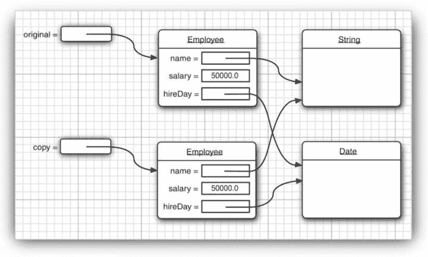

图 6.2：浅拷贝

拷贝是浅拷贝重要吗？这取决于情况。如果原始对象和浅克隆之间共享的子对象是不可变的，那么这种共享就是安全的。如果子对象属于一个不可变类（例如 `String`），这种情况确实会发生。或者，子对象在对象的整个生命周期内可能保持不变，没有修改器触碰它，也没有方法返回指向它的引用。

然而，子对象通常是可变的，你必须重新定义 `clone` 方法以进行深拷贝，同时也对子对象进行克隆。在我们的示例中，`hireDay` 字段是 `Date` 类型，它是可变的，因此它也必须被克隆。（出于这个原因，此示例使用了 `Date` 类型的字段而不是 `LocalDate` 来演示克隆过程。如果 `hireDay` 是不可变类 `LocalDate` 的实例，则不需要进一步的操作。）

对于每个类，你都需要决定：

1. 默认的 `clone` 方法是否足够；
2. 是否可以通过对可变子对象调用 `clone` 来修复默认的 `clone` 方法；或者
3. 是否不应该尝试 `clone`。

第三种方案实际上是默认的。要选择第一或第二种方案，类必须：

1. 实现 `Cloneable` 接口；并且
2. 使用 `public` 访问修饰符重新定义 `clone` 方法。

`clone` 方法在 `Object` 类中声明为 `protected`，因此你的代码不能简单地调用 `anObject.clone()`。但 `protected` 方法不是可以从任何子类访问吗？而且每个类不都是 `Object` 的子类吗？幸运的是，`protected` 访问规则更为微妙（参见第 5 章）。子类只能调用 `protected` `clone` 方法来克隆它自己的对象。你必须将 `clone` 重新定义为 `public`，以便任何方法都可以克隆对象。在这种情况下，`Cloneable` 接口的出现与接口的正常用法无关。特别是，它并没有指定 `clone` 方法——该方法继承自 `Object` 类。该接口仅作为一个标记，指示类设计者理解克隆过程。对象对克隆非常警觉，如果一个对象请求克隆但没有实现该接口，它们会产生一个检查异常（checked exception）。

`Cloneable` 接口是 Java 提供的少数标记接口之一。（有些程序员称之为标记器接口）。记住，像 `Comparable` 这样的接口的通常用途是确保类实现某个特定的方法或一组方法。标记接口没有方法；它的唯一目的是允许在类型查询中使用 `instanceof`：

```java
if (obj instanceof Cloneable) . . .
```

我建议你不要在自己的程序中使用标记接口。

即使 `clone` 的默认（浅拷贝）实现是足够的，你仍然需要实现 `Cloneable` 接口，将 `clone` 重新定义为 `public`，并调用 `super.clone()`。这里有一个示例：

```java
class Employee implements Cloneable
{
   // public 访问，更改返回类型
   public Employee clone() throws CloneNotSupportedException
   {
      return (Employee) super.clone();
   }

   . . .
}
```


注意，在`Object`类中，`clone`方法的返回类型是`Object`。在子类中，你可以为`clone`方法指定正确的返回类型。这是协变返回类型的示例（参见第 5 章）。

```java
throws CloneNotSupportedException
{
   // 调用 Object.clone()
   Employee cloned = (Employee) super.clone();

   // 克隆字段
   cloned.hireDay = (Date) hireDay.clone();

   return cloned;
}
}
```

`Object`类的`clone`方法威胁要抛出`CloneNotSupportedException`——每当没有实现`Cloneable`接口的类上调用`clone`时都会如此。当然，`Employee`和`Date`类实现了`Cloneable`接口，所以异常不会抛出。然而，编译器并不知道。因此，我们声明了异常：

```java
public Employee clone() throws CloneNotSupportedException
```

捕获异常会更好吗？有关捕获异常的细节请参见第 7 章。

```java
public Employee clone()
{
   try
   {
      Employee cloned = (Employee) super.clone();
      . . .
   }
   catch (CloneNotSupportedException e) { return null; }
} // 因为我们实现了 Cloneable，这种情况不会发生
```

对于`final`类是合适的。否则，保留`throws`修饰符更好。这为子类提供了抛出`CloneNotSupportedException`的选择。

你必须小心子类的克隆。例如，一旦你为`Employee`类定义了`clone`方法，任何人都可以它来克隆`Manager`对象。`Employee`的`clone`方法胜任吗？这取决于`Manager`类的字段。在我们的用例中，没有问题，因为`bonus`字段是原始类型。但`Manager`可能会获得需要深拷贝或不可克隆的字段。无法保证子类的实现者已经修复了`clone`以正确工作。出于这个原因，`Object`类中的`clone`方法被声明为`protected`。但如果你想让类类的用户调用`clone`，你就没有这种奢侈。

你应该在自己的类中实现`clone`吗？如果你的客户端需要深拷贝，那么你可能应该。有些作者认为你应该完全避免`clone`，而是实现另一个方法来实现相同的目的。我同意`clone`相当笨劣，但如果你将责任转移到另一个方法，你也会遇到相同的问题。无论如何，克隆比你想象的要少得多。标准库中只有不到 5% 的类实现了`clone`。

Listing 6.4 中的程序克隆了`Employee`类的实例（Listing 6.5），然后调用了两个变异器。`raiseSalary`方法更改`salary`字段的值，而`setHireDay`方法更改`hireDay`字段的状态。这两种变异都不会影响原始对象，因为`clone`方法被定义为执行深拷贝。

所有数组类型都有一个`clone`方法，它是公开的，而不是受保护的。你可以使用它来创建一个包含所有元素拷贝的新数组。例如：

```java
int[] luckyNumbers = { 2, 3, 5, 7, 11, 13 };

int[] cloned = luckyNumbers.clone();

cloned[5] = 12; // 不会改变 luckyNumbers[5]
```

Listing 6.4 `clone/CloneTest.java`

```java
package clone;

/**
 * 此程序演示了克隆操作。
 * @version 1.11 2018-03-16
 * @author Cay Horstmann
 */
public class CloneTest
{
   public static void main(String[] args) throws CloneNotSupportedException
   {
      var original = new Employee("John Q. Public", 50000);
      original.setHireDay(2000, 1, 1);
      Employee copy = original.clone();
      copy.raiseSalary(10);
      copy.setHireDay(2002, 12, 31);
      System.out.println("original=" + original);
      System.out.println("copy=" + copy);
   }
}
```

Listing 6.5 `clone/Employee.java`

```java
package clone;

import java.time.*;
import java.util.*;

public class Employee implements Cloneable
{
   private String name;
   private double salary;
   private Date hireDay;

   public Employee(String name, double salary)
   {
      this.name = name;
      this.salary = salary;
      hireDay = new Date();
   }

   public Employee clone() throws CloneNotSupportedException
   {
      // call Object.clone()
      Employee cloned = (Employee) super.clone();

      // clone mutable fields
      cloned.hireDay = (Date) hireDay.clone();

      return cloned;
   }

   /**
    * 将入职日期设为给定的日期。
    * @param year 入职日的年份
    * @param month 入职日的月份
    * @param day 入职日的几
    */
   public void setHireDay(int year, int month, int day)
   {
      long epochMillis = LocalDate.of(year, month, day)
            .atStartOfDay(ZoneId.systemDefault())
            .toEpochSecond() * 1000;

      // 实例字段变异的示例
      hireDay.setTime(epochMillis);
   }

   public void raiseSalary(double byPercent)
   {
      double raise = salary * byPercent / 100;
      salary += raise;
   }

   public String toString()
   {
      return "Employee[name=" + name + ",salary=" + salary + ",hireDay=" + hireDay + "]";
   }
}
```

## 6.2 Lambda 表达式

在接下来的章节中，你将学习如何使用 lambda 表达式用简洁的语法定义代码块，以及如何编写消耗 lambda 表达式的代码。

### 6.2.1 为什么使用 Lambda？

Lambda 表达式代码块，你可以将其传递并在稍后执行，执行一次或多次。在进入语法（甚至是那个好奇的名字）之前，让我们回溯一下，观察我们在 Java 中何用过此类代码块。

在节 6.1.7 中，你看到了如何在时间间隔内执行工作。将工作放入`ActionListener`的`actionPerformed`方法中：

```java
class Worker implements ActionListener
{
   public void actionPerformed(ActionEvent event)
   {
      // 执行一些工作
   }
}
```

然后，当你想重复执行这段代码时，构造一个`Worker`类的实例。然后将该实例提交给`Timer`对象。

关键点在于`actionPerformed`方法包含了你想要稍后执行的代码。

或者考虑使用自定义比较器进行排序。如果你想按长度而不是默认的字典顺序对字符串排序，可以将一个`Comparator`对象传递给`sort`方法：

```java
class LengthComparator implements Comparator<String>
{
   public int compare(String first, String second)
   {
      return first.length() - second.length();
   }
}

. . .

Arrays.sort(strings, new LengthComparator());
```

`compare`方法不会立即被调用。相反，`sort`方法会不断调用`compare`方法，如果元素无序则进行重新排列，直到数组排序好为止。你提供给`sort`方法是一段比较元素所需的代码片段，而这段代码会被集成到其余的排序逻辑中，而你可能不想重新实现那些逻辑。

这两个例子有一个共同点：一个代码块被传递给了某人——定时器或`sort`方法。

### 6.2.2 Lambda 表达式的语法

再次考虑上一节的排序示例。我们传递了检查一个字符串是否比另一个短的代码。我们计算：

`first.length() - second.length()`

`first`和`second`是什么？它们都是字符串。Java 是一种强类型语言，我们也必须指定这一点：

`(String first, String second) -> first.length() - second.length()`

你刚刚看到了第一个 lambda 表达式。这样的表达式仅仅是一个代码块，加上传递给代码的变量规格。

为什么叫这个名字？许多年前，在计算机出现之前，逻辑学家阿隆·丘奇（Alonzo Church）想要形式化什么是有效计算。（有趣的是，有些函数已知存在，但没人知道如何计算它们的值。）他使用希腊字母`lambda`来标记参数。如果他知道 Java API，他会写成：

`λfirst.λsecond.first.length() - second.length()`

为什么用字母`λ`？是因为 Church 用完了字母表了吗？实际上，古老的《数学原理》使用`^`符号来表示自由变量，这启发了 Church 使用大写的 lambda `Λ`表示参数。但最后他切换到了小写版本。从那时，带有参数变量的表达式被称为 lambda 表达式。

如果 lambda 表达式的参数类型可以被推断，你就可以省略它们。例如：

```java
Comparator<String> comp =
   (first, second) // 等同于 (String first, String second)
      -> first.length() - second.length();
```

在这里，编译器可以推断出`first`和`second`必须是字符串，因为该 lambda 表达式被赋值了一个字符串比较器。（我们将在下一节中详细讨论这种赋值。）

如果一个方法只有一个类型可推断的参数，你甚至可以省略括号：

```java
ActionListener listener = event ->
   System.out.println("The time is "
      + Instant.ofEpochMilli(event.getWhen()));

// 而不是 (event) -> . . . 或 (ActionEvent event) -> . . .
```

你永远不需要指定 lambda 表达式的返回类型。它总是从上下文中推断出来的。例如，该表达式：

```java
(String first, String second) -> first.length() - second.length()
```

可以用在期望结果为`int`类型的上下文中。

最后，你可以使用`var`来表示推断出的类型。这并不常见。这种语法是为了附加注解而发明的（参见第 11 章）：

```java
(@NonNull var first, @NonNull var second) -> first.length() - second.length()
```

lambda 表达式在某些分支中返回而在其他分支中不返回是非法的。例如，`(int x) -> { if (x >= 0) return 1; }`是无效的。

如果 lambda 表达式的参数从未被使用过，你可以用下划线表示它：

```java
ActionListener listener = _ ->
   System.out.println("The action occurred at " + Instant.now());

Comparator<String> comp = (_, _) -> 0;
```

这是 Java 21 的一个预览性功能。

Listing 6.6 中的程序展示了如何使用 lambda 表达式来实现比较器和监听器。

Listing 6.6 `lambda/LambdaTest.java`

```java
package lambda;

import java.util.*;
import javax.swing.*;
import javax.swing.Timer;

/**
 * 此程序演示了 lambda 表达式的使用。
 * @version 1.0 2015-05-12
 * @author Cay Horstmann
 */
public class LambdaTest
{
   public static void main(String[] args)
   {
      var planets = new String[] { "Mercury", "Venus", "Earth", "Mars",
         "Jupiter", "Saturn", "Uranus", "Neptune" };

      System.out.println(Arrays.toString(planets));
      System.out.println("Sorted in dictionary order:");

      Arrays.sort(planets);

      System.out.println(Arrays.toString(planets));
      System.out.println("Sorted by length:");

      Arrays.sort(planets, (first, second) -> first.length() - second.length());

      System.out.println(Arrays.toString(planets));

      var timer = new Timer(1000, event ->
         System.out.println("The time is " + new Date()));

      timer.start();

      // 保持程序运行，直到用户选择 "OK"
      JOptionPane.showMessageDialog(null, "Quit program?");

      System.exit(0);
   }
}
```


### 6.2.3 函数式接口

正如我们所讨论的，Java 中有许多现有接口封装了代码块，例如 `ActionListener` 或 `Comparator`。Lambda 与这些接口是兼容的。

每当你需要一个带有单个抽象方法的接口对象时，都可以提供一个 lambda 表达式。这种接口被称为函数式接口（functional interface）。

（此处省略重复内容）如果一个方法只有一个类型可推断的参数，你甚至可以省略括号。

### 6.2.4 函数类型

Java API 定义了许多泛型函数式接口，位于 `java.util.function` 包中。其中 `BiFunction` 描述了具有参数类型 `T` 和 `U` 以及返回类型 `R` 的函数。你可以将字符串 lambda 赋值给该类型的变量：

```java
BiFunction<String, String, Integer> comp =
   (first, second) -> first.length() - second.length();
```

`Arrays.sort` 方法需要一个 `BiFunction`。如果你使用过函数式语言，可能会觉得这很奇怪，但对于 Java 程序员来说，这很自然。`Comparator` 这样的接口有特定的目的。当你想要使用 lambda 表达式时，仍然需要记住表达式的目的，并有一个特定的函数式接口。

`java.util.function` 包中一个非常有用的接口是 `Predicate`：

```java
public interface Predicate<T>
{
   boolean test(T t);

   // 其他默认和静态方法
}
```

`ArrayList` 类有一个 `removeIf` 方法，其参数是 `Predicate`。它专门为传递 lambda 表达式而设计。例如，以下语句从列表中移除所有的 `null` 值：

```java
list.removeIf(e -> e == null);
```

另一个有用的函数式接口是 `Supplier<T>`：

```java
public interface Supplier<T>
{
   T get();
}
```

`Supplier` 没有参数，并在调用 `get` 方法时会产生一个类型为 `T` 的值：

```java
Supplier<Integer> die = () -> (int)(Math.random() * 6) + 1;

int outcome = die.get();
```

`Supplier` 用于惰性求值（lazy evaluation）。例如，考虑调用：

```java
LocalDate hireDay = Objects.requireNonNullElse(day,
   LocalDate.of(1970, 1, 1));
```

这并不是最优的。我们预计 `day` 很少为 `null`，因此只在需要时才默认的 `LocalDate`。通过使用 supplier，我们可以推迟计算：

```java
LocalDate hireDay = Objects.requireNonNullElseGet(day,
   () -> LocalDate.of(1970, 1, 1));
```

`requireNonNullElseGet` 方法只在需要时才调用 supplier。

涉及原始类型的函数接口稍微有些繁琐。考虑一个消耗 `int` 类型并产生 `T` 类型对象的函数。你可以使用 `Function<Integer, T>`，但这样每次调用时参数都必须进行装箱（boxed）。相反，有一个函数接口 `IntFunction<T>`。同样地，如果一个函数的返回值是 `int`，那么 `ToIntFunction<T>` 接口比 `Function<T, Integer>` 更高效。最后，如果参数和返回值都是 `int`，则有一个 `IntUnaryOperator` 接口。

作为 API 的使用者，你通常并不关心这些细微差别。考虑 `Arrays.setAll` 方法。它将数组的所有值设置为一个函数的结果，而该函数的参数是数组的索引。在这里，我们将所有元素都设置为索引的平方：

```java
var values = new int[100];

Arrays.setAll(values, i -> i * i); // [0, 1, 4, 9, 16, . . ., 9801]
```

对于 `int[]`、`long[]`、`double[]` 和泛型数组 `T[]`，`setAll` 都有重载版本。在这里，`int[]` 的重载版本第二个参数是一个 `IntUnaryOperator`。但作为方法的使用者，你并不关心。你只需要提供 lambda 表达式即可，而无需担心原始类型与其包装类之间的区别。

Lambda 表达式可以匹配函数接口中的原始类型和包装类型，这很棒。但如果两种匹配都可能发生，那就是错误。考虑一个提供这些方法的工具类：

```java
public static int[] fill(int n, IntUnaryOperator op)

public static Object[] fill(int n, IntFunction<Object> op)
```

调用 `fill(n, i -> i * i)` 将无法编译，因为具有歧义性。

你可以通过使用 `-Xlint` 或 `-Xlint:overloads` 标志编译，并在 API 中捕捉此类问题。

### 6.2.5 方法引用

有时，lambda 表达式涉及单个方法。例如，假设你只想在每次定时器事件发生时打印该事件对象。当然，你可以调用：

```java
var timer = new Timer(1000, event -> System.out.println(event));
```

如果可以直接将 `println` 方法传递给 `Timer` 构造函数会更好。这是实现方法：

```java
var timer = new Timer(1000, System.out::println);
```

表达式 `System.out::println` 是一个方法引用。它指示编译器产生函数接口的实例，通过重写接口的单个抽象方法来调用给定的方法。在这个示例中，产生了一个 `ActionListener`，其 `actionPerformed(ActionEvent e)` 方法调用了 `System.out.println(e)`。

与 lambda 表达式一样，方法引用并不是对象。当被赋值给类型为函数接口的变量时，才会产生一个对象。

`PrintStream` 类（`System.out` 是它的实例）中有十个重载的 `println` 方法。编译器需要根据上下文确定使用哪一个。在我们的示例中，方法引用 `System.out::println` 必须转换为如下方法的 `ActionListener` 实例：

```java
void actionPerformed(ActionEvent e)
```

由于 `Object` 是 `ActionEvent` 的最佳匹配，因此从十个重载的 `println` 方法中选择了 `println(Object x)`。当调用 `actionPerformed` 方法时，事件对象会被打印出来。

现在假设我们将同一个方法引用赋值给一个不同的函数接口：

```java
Runnable task = System.out::println;
```

`Runnable` 接口有一个没有参数的单个抽象方法：

```java
void run()
```

在这种情况下，选择了无参数的 `println()` 方法。调用 `task.run()` 会向 `System.out` 打印空行。

另一个例子是，假设你想忽略字母大小写对字符串排序。你可以传递这个方法表达式：

```java
Arrays.sort(strings, String::compareToIgnoreCase)
```

从这些示例可以看出，`::` 运算符将方法名与对象或类名隔开。有以下变体：

1. `object::instanceMethod`
2. `Class::instanceMethod`
3. `Class::staticMethod`

在第一种变体中，方法引用等于一个 lambda 表达式，其参数传递给方法。在 `System.out::println` 的情况下，对象是 `System.out`，方法表达式等同于 `x -> System.out.println(x)`。

在第二种变体中，第一个参数变成方法的隐式参数。例如，`String::compareToIgnoreCase` 等于 `(x, y) -> x.compareToIgnoreCase(y)`。

在第三种变体中，所有参数都传递给静态方法：`Math::pow` 等于 `(x, y) -> Math.pow(x, y)`。

表 6.1 将带你了解额外的示例。

请注意，只有当 lambda 表达式的主体调用单个方法且不做任何其他操作时，才能将其重写为方法引用。考虑 lambda 表达式：

```java
s -> s.length() == 0
```

这里只有一个方法调用。但还有一个比较操作，所以你不能在这里使用方法引用。

**表 6.1：方法引用**

| 方法引用 | 等价的 lambda 表达式 | Notes |
| :--- | :--- | :--- |
| `separator::equals` | `x -> separator.equals(x)` | 这是一个涉及对象的实例方法。lambda 参数传递给方法。 |
| `String::strip` | `x -> x.strip()` | 这是一个涉及类的实例方法。lambda 参数成为隐式参数。 |
| `String::concat` | `(x, y) -> x.concat(y)` | 再次是一个实例方法，但这次有两个参数。第一个 lambda 参数成为隐式参数。 |
| `Integer::valueOf` | `x -> Integer.valueOf(x)` | 这是一个涉及静态方法的方法。lambda 参数传递给方法。 |
| `Integer::sum` | `(x, y) -> Integer.sum(x, y)` | 这是另一个静态方法，但这次有两个参数。所有 lambda 参数都传递给静态方法。 |
| `String::new` | `x -> new String(x)` | 这是一个构造函数引用——参见第 6.2.6 节。lambda 参数传递给构造函数。 |
| `String[]::new` | `n -> new String[n]` | 这是一个数组构造函数引用——参见第 6.2.6 节。lambda 参数是数组长度。 |

带有对象的方法引用与其等效的 lambda 表达式之间存在细微差异。考虑方法引用 `separator::equals`。如果 `separator` 为 `null`，形成 `separator::equals` 会立即抛出 `NullPointerException`。而 lambda 表达式 `x -> separator.equals(x)` 只在被调用时才会抛出 `NullPointerException`。

你可以在方法引用中捕捉 `this` 参数。例如，`this::equals` 等同于 `x -> this.equals(x)`。使用 `super` 也是有效的。方法表达式：

```java
super::instanceMethod
```

使用 `this` 作为目标，并调用给定方法的父类版本。这是一个展示其机制的人工示例：

```java
class Greeter
{
   public void greet(ActionEvent event)
   {
      System.out.println("Hello, the time is "
         + Instant.ofEpochMilli(event.getWhen()));
   }
}

class RepeatedGreeter extends Greeter
{
   public void greet(ActionEvent event)
   {
      var timer = new Timer(1000, super::greet);
      timer.start();
   }
}
```

当 `RepeatedGreeter.greet` 方法启动时，会构造一个 `Timer`，它会在每次定时器触发时执行 `super::greet` 方法。

### 6.2.6 构造器引用

构造器引用与方法引用相似，只是方法名为 `new`。例如，`Person::new` 是对 `Person` 构造函数的引用。哪一个构造函数？这取决于上下文。假设你有一个字符串列表。你可以通过在每个字符串上调用构造函数，将其转换为 `Person` 对象的数组，调用方式如下：

```java
ArrayList<String> names = . . .;

Stream<Person> stream = names.stream().map(Person::new);

List<Person> people = stream.toList();
```

我们将在第二卷第 1 章中讨论 `stream`、`map` 和 `toList` 方法的细节。目前，重要的是 `map` 方法会为列表的每个元素调用 `Person(String)` 构造函数。如果有多个 `Person` 构造函数，编译器会选择带有 `String` 参数的那一个，因为它从上下文推断出构造函数是被带字符串调用的。

你可以用数组类型形成构造器引用。例如，`int[]::new` 是带有一个参数的构造器引用：数组的长度。它等同于 lambda 表达式 `n -> new int[n]`。

数组构造器引用有助于克服 Java 的局限性。正如你在第 8 章中看到的，无法构造泛型 `T` 的数组。（表达式 `new T[n]` 是错误的，因为会被“擦除”为 `new Object[n]`。）这对库作者来说是一个问题。例如，假设我们想要有一个 `Person` 对象的数组。`Stream` 接口有一个 `toArray` 方法可以返回一个 `Object` 数组：

```java
Object[] people = stream.toArray();
```

但这并不令人满意。用户想要的是 `Person` 引用的数组，而不是 `Object` 引用的数组。流库通过构造器引用解决了这个问题。将 `Person[]::new` 传递给 `toArray` 方法：

```java
Person[] people = stream.toArray(Person[]::new);
```

`toArray` 方法调用此构造器以获取正确类型的数组。然后它填充并返回该数组。

有时，在传递方法或构造器引用时，选择哪个重载变体令人感到惊讶。考虑这段代码片段：

```java
var dates = new Date[100];

Arrays.setAll(dates, Date::new);
```

初看之下，所有元素似乎通过每次调用无参构造函数 `new Date()` 被设置为当前日期。但实际上，`setAll` 的第二个参数是一个 `IntFunction`，它接收元素的索引。因此，调用了一个完全不同的构造函数 `new Date(i)`，其中 `i` 的范围从 0 到 99。该构造函数将日期设置为从“纪元”（1970 年 1 月 1 日）起的给定毫秒数。

### 6.2.7 变量作用域

你通常希望能够在 lambda 表达式中访问闭层方法或类中的变量。考虑这个示例：

```java
public static void repeatMessage(String text, int delay)
{
   ActionListener listener = event ->
      {
         System.out.println(text);
         Toolkit.getDefaultToolkit().beep();
      };

   new Timer(delay, listener).start();
}
```


考虑一个调用：

```java
repeatMessage("Hello", 1000); // 每 1000 毫秒打印一次 Hello
```

现在看 lambda 表达式内部的变量 `text`。注意，该变量并不是在 lambda 表达式中定义的。相反，它是 `repeatMessage` 方法的参数变量。

如果你仔细考虑，这里发生着一些显而易见的事情。lambda 表达式的代码在 `repeatMessage` 调用返回且参数变量消失很久后仍在运行。`text` 变量是如何留下的呢？

为了理解发生了什么，我们需要完善对 lambda 表达式的理解。lambda 表达式包含三个要素：

1. 一个代码块
2. 参数
3. 自由变量的值

在我们的示例中，lambda 表达式有一个自由变量 `text`。我们说这些值被 lambda 表达式捕捉（captured）了。代码块连同自由变量值的专业术称为闭包（closure）。

```java
Path first = Path.of("/usr/bin");

Comparator<String> comp =
   (first, second) -> first.length() - second.length();

// ERROR: Variable first already defined
```

在方法内部，你不能有两个同名的局部变量，因此，你也无法在 lambda 表达式中引入这样的变量。

当你在 lambda 表达式中使用 `this` 关键字时，指的是创建该 lambda 表达式方法的 `this` 参数。例如，考虑：

```java
public class Application
{
   public void init()
   {
      ActionListener listener = event ->
      {
         System.out.println(this.toString());
         . . .
      }
      . . .
   }
}
```

表达式 `this.toString()` 调用的是 `Application` 对象的 `toString` 方法，而不是 `ActionListener` 实例。在 lambda 表达式中使用 `this` 没有特殊之处。lambda 表达式的作用域嵌套在 `init` 方法内部，`this` 在方法的任何地方具有相同的含义。

### 6.2.8 处理 Lambda 表达式

到目前，你已经了解了如何生成 lambda 表达式并将其传递给期望函数接口的方法。现在，让我们来看看如何编写可以消费 lambda 表达式的方法。

使用 lambda 的意义在于延迟执行。毕竟，如果你想现在执行某些代码，你会直接执行，而不会将其封装在 lambda 内部。以后执行代码有许多原因，例如：

- 在单独线程中运行代码
- 多次运行代码
- 在算法的正确点运行代码（例如排序中的比较操作）
- 在某些事件发生时运行代码（按钮被点击、数据到达等）
- 仅在需要时运行代码

让我们来看一个简单的例子。假设你想重复一个动作 `n` 次。该动作和计数被传递给一个 `repeat` 方法：

```java
repeat(10, () -> System.out.println("Hello, World!"));
```

为了接受该 lambda，我们需要选择（或在少数情况下提供）一个函数接口。表 6.2 列出了 Java API 提供的最重要的函数接口。在这种情况下，我们可以使用 `Runnable` 接口：

```java
public static void repeat(int n, Runnable action)
{
   for (int i = 0; i < n; i++) action.run();
}
```

注意，lambda 表达式的主体是在调用 `action.run()` 时执行的。

现在让我们让这个例子变得复杂一点。我们想告诉动作它发生在哪一次迭代。为了实现这一点，我们需要选择一个带有 `int` 参数和 `void` 返回值的方法的函数接口。处理 `int` 值的标准接口是：

```java
public interface IntConsumer
{
   void accept(int value);
}
```

这是改进后的 `repeat` 方法：

```java
public static void repeat(int n, IntConsumer action)
{
   for (int i = 0; i < n; i++) action.accept(i);
}
```

这是它的调用方式：

```java
repeat(10, i -> System.out.println("Countdown: " + (9 - i)));
```

表 6.2：常见函数接口

| 函数接口 | 参数类型 | 返回类型 | 抽象方法名 | 描述 | 其他方法 |
| --- | --- | --- | --- | --- | --- |
| `Runnable` | 无 | `void` | `run` | 执行不带参数或返回值的动作 |  |
| `Supplier<T>` | 无 | `T` | `get` | 提供类型为 `T` 的值 |  |
| `Consumer<T>` | `T` | `void` | `accept` | 消费类型为 `T` 的值 | `andThen` |
| `BiConsumer<T, U>` | `T`, `U` | `void` | `accept` | 消费类型为 `T` 和 `U` 的值 | `andThen` |
| `Function<T, R>` | `T` | `R` | `apply` | 参数类型为 `T` 的函数 | `compose`, `andThen`, `identity` |
| `BiFunction<T, U, R>` | `T`, `U` | `R` | `apply` | 参数类型为 `T` 和 `U` 的函数 | `andThen` |
| `UnaryOperator<T>` | `T` | `T` | `apply` | 类型为 `T` 的一元运算符 | `compose`, `andThen`, `identity` |
| `BinaryOperator<T>` | `T`, `T` | `T` | `apply` | 类型为 `T` 的二元运算符 | `andThen`, `maxBy`, `minBy` |
| `Predicate<T>` | `T` | `boolean` | `test` | 一个 `boolean` 值的函数 | `and`, `or`, `negate`, `isEqual`, `not` |
| `BiPredicate<T, U>` | `T`, `U` | `boolean` | `test` | 带有两个参数的 `boolean` 值的函数 | `and`, `or`, `negate` |

表 6.3 列出了 `int`、`long`、`double` 的专门化。正如前面的节所示，如果你使用标准的 `Predicate`，可以利用创建、适配和组合的方法。例如，`Predicate.isEqual(a)` 等同于 `a::equals`，当 `a` 为 `null` 时它也有效。有默认方法 `and`、`or`、`negate` 用于组合谓词。

表 6.3：基本类型函数接口

| 函数接口 | 参数类型 | 返回类型 | 抽象方法名 | 描述 | 其他方法 |
| --- | --- | --- | --- | --- | --- |
| `Runnable` | 无 | `void` | `run` | 执行不带参数或返回值的动作 |  |
| `Supplier<T>` | 无 | `T` | `get` | 提供类型为 `T` 的值 |  |
| `Consumer<T>` | `T` | `void` | `accept` | 消费类型为 `T` 的值 | `andThen` |
| `BiConsumer<T, U>` | `T`, `U` | `void` | `accept` | 消费类型为 `T` 和 `U` 的值 | `andThen` |
| `Function<T, R>` | `T` | `R` | `apply` | 参数类型为 `T` 的函数 | `compose`, `andThen`, `identity` |
| `BiFunction<T, U, R>` | `T`, `U` | `R` | `apply` | 参数类型为 `T` 和 `U` 的函数 | `andThen` |
| `UnaryOperator<T>` | `T` | `T` | `apply` | 类型为 `T` 的一元运算符 | `compose`, `andThen`, `identity` |
| `BinaryOperator<T>` | `T`, `T` | `T` | `apply` | 类型为 `T` 的二元运算符 | `andThen`, `maxBy`, `minBy` |
| `Predicate<T>` | `T` | `boolean` | `test` | 一个 `boolean` 值的函数 | `and`, `or`, `negate`, `isEqual`, `not` |
| `BiPredicate<T, U>` | `T`, `U` | `boolean` | `test` | 带有两个参数的 `boolean` 值的函数 | `and`, `or`, `negate` |

Java API 的设计者们不够快了。他们只有一次机会把这件事做好——在 `Java 8` 中，当 `java.util.function.Function` 接口被添加到 API 时。在此之前，没有人可以为自己的类添加一个 `transform(java.util.function.Function)` 方法。但在 `Java 12` 中，已经太晚了。某处的某人可能已经在他们的类中定义了 `transform(java.util.function.Function)`，并且具有不同的含义。诚然，这不太可能发生过，但无法得知。

这就是 Java 的工作方式。它严肃对待自己的承诺，并且不会为了便利而背弃。

## 6.2.9 创建比较器（Comparators）

`Comparator` 接口具有许多方便的静态方法用于创建比较器。这些方法适用于 lambda 表达式或方法引用。

静态方法 `comparing` 接收一个“键提取器”函数，该函数将类型 `T` 映射到可比较的类型（例如 `String`）。该函数被应用于待比较的对象，然后对返回的键进行比较。例如，假设你有一个 `Person` 对象的数组。以下是按名称对它们进行排序的方法：

```java
Arrays.sort(people, Comparator.comparing(Person::getName));
```

这比手动实现一个 `Comparator` 要简单得多。而且，代码更清晰，因为显而易见我们想按名称比较人。

你可以使用 `thenComparing` 方法链式调用比较器以处理平局。例如：

```java
Arrays.sort(people,
   Comparator.comparing(Person::getLastName)
      .thenComparing(Person::getFirstName));
```

如果两个人的姓氏相同，则使用第二个比较器。

这些方法有几种变体。你可以指定一个比较器，用于 `comparing` 和 `thenComparing` 方法提取的键。例如，在这里我们按名字的长度对人排序：

```java
Arrays.sort(people, Comparator.comparing(Person::getName,
   (s, t) -> Integer.compare(s.length(), t.length())));
```

此外，`comparing` 和 `thenComparing` 方法都有避免 `int`、`long` 或 `double` 值装箱的变体：

```java
Arrays.sort(people, Comparator.comparing(Person::getName,
   Comparator.comparingInt(String::length)))
```

产生上述操作的一种较短但可能不那么优雅的方法是：

```java
Arrays.sort(people, Comparator.comparingInt(p -> p.getName().length()));
```

如果你的键函数可以返回 `null`，你将会喜欢 `nullsFirst` 和 `nullsLast` 适配器。这些静态方法接收一个现有的比较器并修改它，使其在遇到 `null` 值时不会抛出异常，而是将其排为比普通值更小或更大。例如，假设当一个人没有中间名时 `getMiddleName` 返回 `null`。那么你可以使用 `Comparator.comparing(Person::getMiddleName, Comparator.nullsFirst(. . .))`。

`nullsFirst` 方法需要一个比较器——在这种情况下，它是一个比较两个字符串的比较器。`naturalOrder` 方法为任何实现 `Comparable` 的类创建一个比较器。我们需要的是 `Comparator.<String>naturalOrder()`。（关于此语法的解释请参见第 8 章）。幸运的是，泛型类型通常可以推断。）这里是按可能为空的中间名进行排序的完整调用。我使用了 `java.util.Comparator.*` 的静态导入，使表达式更具读性。

```java
Arrays.sort(people, comparing(Person::getMiddleName, nullsFirst(naturalOrder())));
```

静态方法 `reverseOrder` 提供自然顺序的反向顺序。要反转任何比较器，请使用实例方法 `reversed`。例如，`naturalOrder().reversed()` 等同于 `reverseOrder()`。

## 6.3 内部类（Inner Classes）

内部类是定义在类内部的类。你为什么要这样做？有两个原因：

- 内部类可以对同一包中的其他类隐藏。
- 内部类方法可以访问其定义所在作用域的数据——包括本应是私有的其他数据。

内部类曾经对于简洁地实现回调函数非常重要，但现在 lambda 表达式做得好得多。尽管如此，内部类对于结构化代码仍然非常有用。接下来的章节将带你了解所有细节。

C++ 有嵌套类（nested classes）。嵌套类包含在外部类的作用域内。这是一个典型的例子：链表类定义了一个嵌套类来持有节点。

```cpp
template<typename T>
class LinkedList
{
public:
   class Node // 一个嵌套类
   {
   public:
      . . .
   private:
      T data;
      Node* next;
   };
   . . .
private:
   Node* head;
   Node* tail;
};
```

嵌套类与 Java 的内部类相似。然而，Java 内部类还有一个额外功能，使其比 C++ 的嵌套类更丰富、更有用。来自内部类的对象具有对实例化它的外部对象的隐式引用。通过这个指针，它获得了访问外部对象总状态的能力。例如，在 Java 中，`Iterator` 类不需要指向它所在的 `LinkedList` 的显式指针。

在 Java 中，声明为 `static` 的嵌套类没有这个额外的指针。它们是 C++ 嵌套类的 Java 对应物。

### 6.3.1 使用内部类访问状态

内部类的语法相当复杂。由于这个原因，我展示了一个简单但有些人为的示例来演示内部类的使用。让我们重构 `TimerTest` 示例并提取 `TalkingClock` 类。时钟的构造函数有两个参数：间隔时间和一个开启或关闭鸣声的标志。

```java
public class TalkingClock
{
   private int interval;
   private boolean beep;

   public TalkingClock(int interval, boolean beep) { . . . }

   public void start() { . . . }

   public class TimePrinter implements ActionListener
      // 一个内部类
   {
      . . .
   }
}
```

注意 `TimePrinter` 类现在位于 `TalkingClock` 类内部。这并不意味着每个 `TalkingClock` 有一个 `TimePrinter` 实例字段。正如你看到的，`TimePrinter` 对象是由 `TalkingClock` 类的方法构造的。

这里是详细的 `TimePrinter` 类。注意 `actionPerformed` 方法在发出鸣声之前会检查 `beep` 标志。

```java
public class TimePrinter implements ActionListener
{
   public void actionPerformed(ActionEvent event)
   {
      System.out.println("At the tone, the time is "
         + Instant.ofEpochMilli(event.getWhen()));

      if (beep) Toolkit.getDefaultToolkit().beep();
   }
}
```


发生了一些令人意外的事情。`TimePrinter` 类没有名为`beep`的实例字段或变量。相反，`beep`指向创建此`TimePrinter`的外部对象的字段。正如你看到的，内部类方法可以访问自己的实例字段*以及*创建它的对象的字段。

为了使这工作，内部类对象总是获得对创建它的对象的隐式引用（参见图 6.3）。

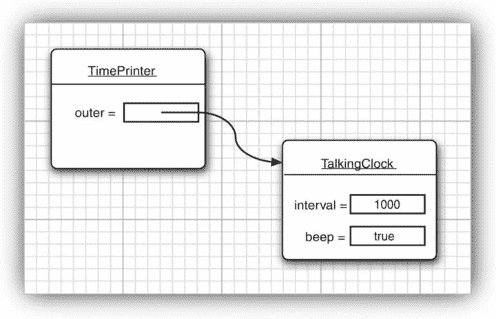图 6.3：内部类对象对外部类对象有一个引用。

外部类引用是在构造函数中设置的。编译器会修改所有内部类的构造函数，添加一个外部类引用的参数。`TimePrinter` 类没有定义构造函数；因此，编译器会合成一个无参数构造函数，生成如下代码：

```
public TimePrinter(TalkingClock clock) // 自动生成的代码
{
   outer = clock;
}
```

再次请注意，`outer` 并不是 Java 关键字。我们只是用它来说明内部类涉及的机制。

当在`start`方法中构造`TimePrinter`对象时，编译器会将当前会闹钟的`this`传递给构造函数：

```
var listener = new TimePrinter(this); // 自动添加了参数
```

Listing 6.7 显示了测试内部类的完整程序。再次查看访问控制。如果`TimePrinter`类是一个普通类，它将需要通过`TalkingClock`类的公共方法来访问`beep`标志。使用内部类是一种改进。没有必要提供仅对另一个类感兴趣的访问器方法。

我们可以将`TimePrinter`类声明为`private`。这样只有`TalkingClock`方法能够构造`TimePrinter`对象。只有内部类可以是`private`的。普通类始终具有包级或公级访问。

代码列表 6.7 `innerClass/InnerClassTest.java`

```
package innerClass;

import java.awt.*;
import java.awt.event.*;
import java.time.*;
import javax.swing.*;

/**
 * 此程序演示了内部类的用法。
 * @version 1.11 2017-12-14
 * @author Cay Horstmann
 */
public class InnerClassTest
{
   public static void main(String[] args)
   {
      var clock = new TalkingClock(1000, true);
      clock.start();

      // 保持程序运行直到用户选择“确定”
      JOptionPane.showMessageDialog(null, "Quit program?");
      System.exit(0);
   }
}

/**
 * 一个按固定间隔打印时间的闹钟。
 */
class TalkingClock
{
   private int interval;
   private boolean beep;

   /**
    * 构造一个会说话的闹钟。
    * @param interval 消息之间的间隔（毫秒）
    * @param beep 如果闹钟应该响铃则为 true
    */
   public TalkingClock(int interval, boolean beep)
   {
      this.interval = interval;
      this.beep = beep;
   }

   /**
    * 启动闹钟。
    */
   public void start()
   {
      var listener = new TimePrinter();
      var timer = new Timer(interval, listener);
      timer.start();
   }

   public class TimePrinter implements ActionListener
   {
      public void actionPerformed(ActionEvent event)
      {
         System.out.println("At the tone, the time is " 
            + Instant.ofEpochMilli(event.getWhen()));
         if (beep) Toolkit.getDefaultToolkit().beep();
      }
   }
}
```

### 6.3.2. 内部类的特殊语法规则

在前面的节中，我们通过调用`outer`来解释内部类的外部类引用。实际上，外部引用的正确语法稍微复杂一点。表达式

```
OuterClass.this
```

表示外部类引用。例如，你可以这样编写`TimePrinter`内部类的`actionPerformed`方法：

```
public void actionPerformed(ActionEvent event)
{
   . . .
   if (TalkingClock.this.beep) Toolkit.getDefaultToolkit().beep();
}
```

相反，你可以使用以下语法更显式地编写内部对象构造函数：

```
outerObject.new InnerClass(construction arguments)
```

例如：

```
ActionListener listener = this.new TimePrinter();
```

在这里，新构造的`TimePrinter`对象的外部类引用被设置为创建该内部类对象的方法的`this`引用。这是最常见的情况。一如既往，`this.`修饰符是多余的。不过，也可以通过显式命名将外部类引用设置为另一个对象。例如，由于`TimePrinter`是一个公共内部类，你可以为任何会说话的闹钟构造一个`TimePrinter`：

```
var jabberer = new TalkingClock(1000, true);
TalkingClock.TimePrinter listener = jabberer.new TimePrinter();
```

注意，当内部类发生在外部类作用范围之外时，你使用以下方式引用它：

```
OuterClass.InnerClass
```

从 Java 16 开始，内部类可以拥有`static`成员。在此之前，内部类不允许使用`static`方法，且内部类中声明的静态字段必须是`final`并用编译时常量初始化。

内部类的静态方法可以访问内部类或包含类的静态字段和方法。

### 6.3.3. 内部类有用吗？真的吗？安全吗？

当内部类在 Java 1.1 中添加到 Java 语言时，许多程序员认为它们是一项重大的新特性，这与 Java 比 C++ 更简单的哲学格格不入。内部类的语法不可否是复杂的（当我们在本章稍后学习匿名内部类时，它会变得更复杂）。还不清楚内部类如何与语言的其他特性（如访问控制和安全）交互。

内部类被翻译成普通的类文件，用`$`（美元符号）分隔外部类和内部类名。例如，`TalkingClock`类内部的`TimePrinter`类被翻译为类文件`TalkingClock$TimePrinter.class`。要看到这种效果，请尝试以下实验：运行第 5 章中的`ReflectionTest`程序，并给它`TalkingClock$TimePrinter`类进行反射。或者，直接使用`javap`工具：

```
javap -private ClassName
```

如果你使用 UNIX，请记住在命令行上提供类名时要转义`$`字符。也就是说，运行`ReflectionTest`或`javap`程序如下：

```
java --classpath .:../v1ch05 reflection.ReflectionTest \
   innerClass.TalkingClock\$TimePrinter
```

或者

```
javap -private innerClass.TalkingClock\$TimePrinter
```

你将得到以下输出：

```
public class innerClass.TalkingClock$TimePrinter
      implements java.awt.event.ActionListener
{
   final innerClass.TalkingClock this$0;
   public innerClass.TalkingClock$TimePrinter(innerClass.TalkingClock);
   public void actionPerformed(java.awt.event.ActionEvent);
}
```

你可以清楚地看到编译器了一个额外的实例字段`this$0`，用于指向外部类的引用（`this$0`名称是由编译器合成的——你无法在代码中引用它）。你还可以看到构造函数的`TalkingClock`参数。

从 Java 18 开始，只有在实际需要时才会提供`this$0`字段。如果内部类没有方法访问外部类，它就会被丢弃。

如果编译器可以自动完成这种转换，你难道不能手动编写相同的机制吗？让我们试试。我们将`TimePrinter`为`TalkingClock`类之外的普通类。在构造`TimePrinter`对象时，我们将创建它的对象的`this`引用传递给它。

```
class TalkingClock
{
   . . .
   public void start()
   {
      var listener = new TimePrinter(this);
      var timer = new Timer(interval, listener);
      timer.start();
   }
}

class TimePrinter implements ActionListener
{
   private TalkingClock outer;
   . . .
   public TimePrinter(TalkingClock clock)
   {
      outer = clock;
   }
}
```

现在让我们查看`actionPerformed`方法。它需要访问`outer.beep`。

```
if (outer.beep) . . . // 错误
```

在这里我们遇到了问题。内部类可以访问外部类的私有数据，但我们的外部`TimePrinter`类却不能。

因此，内部类确实比普通类更强大，因为它们拥有更多的访问权限。

### 6.3.4. 局部内部类

如果你仔细查看`TalkingClock`示例代码，你会发现你只需要使用一次`TimePrinter`类型的名称：即在`start`方法中创建该类型的对象时。

在这种情况下，你可以将类在单个方法中进行局部定义。

```java
public void start()
{
   class TimePrinter implements ActionListener
   {
      public void actionPerformed(ActionEvent event)
      {
         System.out.println("At the tone, the time is "
            + Instant.ofEpochMilli(event.getWhen()));
         if (beep) Toolkit.getDefaultToolkit().beep();
      }
   }

   var listener = new TimePrinter();
   var timer = new Timer(interval, listener);
   timer.start();
}
```

局部类（Local classes）永远不会带有修饰符（即`public`或`private`）。它们的作用域始终限制在定义它们的块中。

局部类有一个巨大的优势：它们对外部世界完全隐藏的——即使是`TalkingClock`类中的其他代码也无法访问它们。除了`start`方法外，没有任何方法对`TimePrinter`类一无所知。

### 6.3.5 从外部方法访问变量

局部类相比其他内部类还有另一个优势。它们不仅可以访问外部类的字段；甚至可以访问局部变量！然而，这些局部变量必须是`有效` `final`的（effectively final）。这意味着，一旦它们被赋值，就永远不能被改变。

这是一个典型的例子。我们将`interval`和`beep`参数从`TalkingClock`构造函数移动到`start`方法。

```java
public void start(int interval, boolean beep)
{
   class TimePrinter implements ActionListener
   {
      public void actionPerformed(ActionEvent event)
      {
         System.out.println("At the tone, the time is "
            + Instant.ofEpochMilli(event.getWhen()));
         if (beep) Toolkit.getDefaultToolkit().beep();
      }
   }

   var listener = new TimePrinter();
   var timer = new Timer(interval, listener);
   timer.start();
}
```

注意，`TalkingClock`类不再需要存储`beep`实例字段。它简单地引用了`start`方法的`beep`参数变量。

也许这并不那么令人惊讶。毕竟，这一行代码

```java
if (beep) . . .
```

最终位于`start`方法内部，所以为什么它不能访问`beep`变量的值呢？

为了弄清楚为什么这里有一个微妙的问题，让我们更仔细地考虑控制流。

1. 调用`start`方法。
2. 对象变量`listener`通过调用内部类`TimePrinter`的构造函数进行初始化。
3. `listener`引用被传递给`Timer`构造函数，定时器启动，`start`方法退出。此时此时，`start`方法的`beep`参数变量已不再存在。
4. 一秒后，`actionPerformed`方法执行`if (beep) . . .`

为了让`actionPerformed`方法中的代码能够工作，`TimePrinter`类必须在`beep`参数值消失之前，将`beep`字段作为`start`方法的局部变量进行了复制。这确实是发生的情况。在我们的示例中，编译器为该局部内部类合成了名称`TalkingClock$1TimePrinter`。如果你再次使用`ReflectionTest`程序或`javap`工具来监控`TalkingClock$1TimePrinter`类，你将得到以下输出：

```java
class TalkingClock$1TimePrinter
{
   TalkingClock$1TimePrinter();
   public void actionPerformed(java.awt.event.ActionEvent);
   final boolean val$beep;
   final TalkingClock this$0;
}
```

当创建一个对象时，`beep`变量的当前值被存储在`val$beep`字段中。从 Java 11 开始，这是“嵌套伙伴”（nest mate）访问实现的。在此之前，内部类构造函数有一个额外的参数来设置该字段。无论哪种，即使局部变量离开了作用域，内部类字段依然存在。

### 6.3.6 匿名内部类

在使用局部内部类时，你通常可以进一步。如果你只想创建该类的单个对象，你甚至不需要给类命名。这样的类被称为`匿名内部类`（anonymous inner class）。

```java
public void start(int interval, boolean beep)
{
   var listener = new ActionListener() 
      {
         public void actionPerformed(ActionEvent event)
         {
            System.out.println("At the tone, the time is "
               + Instant.ofEpochMilli(event.getWhen()));
            if (beep) Toolkit.getDefaultToolkit().beep();
         }
      };
   var timer = new Timer(interval, listener);
   timer.start();
}
```


这种语法确实非常晦涩。它的意思是：创建一个实现`ActionListener`接口的类的新对象，其中所需的方法`actionPerformed`是在大括号`{ }`内部定义的。

通常，语法是：

```java
new SuperType(construction arguments)

   {

      inner class methods and data

   }
```

在这里，`SuperType`可以是一个接口，例如`ActionListener`；那么内部类实现该接口。`SuperType`也可以是一个类；那么内部类扩展该类。

匿名类不能有构造函数，因为构造函数的名称必须与类相同。然而，每当内部类实现接口时，它不能有任何构造参数。如果构造参数列表的右括号后面一个左括号，则正在定义一个匿名内部类。

尽管匿名类没有构造函数，你也可以提供对象初始化：

```java
var count = new Person("Dracula")

   {

      { initialization }

      . . .
```

多年来，Java 程序员经常使用匿名内部类来处理事件监听器和其他回调。现在，使用 Lambda 表达式更好。例如，本节开头的`start`方法可以使用如下 Lambda 表达式更简洁地编写：

```java
public void start(int interval, boolean beep)

{

   var timer = new Timer(interval, event ->

      {

         System.out.println("At the tone, the time is " 

            + Instant.ofEpochMilli(event.getWhen()));

         if (beep) Toolkit.getDefaultToolkit().beep();

      });

   timer.start();

}
```

如果你将匿名类实例存储在用`var`定义的变量中，该变量知道新增的方法或字段：

```java
var bob = new Object() { String name = "Bob"; }

System.out.println(bob.name);
```

如果你声明`bob`的类型为`Object`，那么`bob.name`将无法编译。

用`new Object() { String name = "Bob"; }`构建的对象类型为“带有`String name`字段的`Object`”。这是一个`无法表示的`类型——一种你无法用 Java 语法表达的类型。然而，编译器理解该类型，并可以将其设置为`bob`变量的类型。

这种被称为`双大括号初始化`（double brace initialization）的技巧利用了内部类的语法。假设你想构造一个数组 list 并将其传递给一个方法：

```java
var friends = new ArrayList<String>();

friends.add("Harry");

friends.add("Tony");

invite(friends);
```

如果你不再需要使用这个 array list，那么将其匿名化会很不错。但这样你该如何添加元素呢？方法如下：

```java
invite(new ArrayList<String>() {{ add("Harry"); add("Tony"); }});
```

注意双层的大括号。外层大括号创建了`ArrayList`的匿名子类。内层大括号是一个对象初始化块（参见第 4 章）。

在实践中，这种技巧很少用。更有可能的是`invite`方法愿意接受任何`List<String>`，你只需直接传递`List.of("Harry", "Tony")`即可。

创建一个与其父类几乎相同但并不完全相同的匿名子类通常是很有方便的。但你需要小心处理`equals`方法。在第 5 章中，我建议你的`equals`方法使用如下测试：

```java
if (getClass() != other.getClass()) return false;
```

匿名子类将会通过这项测试。

当你生成日志或调试信息时，通常想包含当前类的名称，例如：

```java
System.err.println("Something awful happened in " + getClass());
```

但在静态方法中这会失败。毕竟，对`getClass`的调用实际上调用了`this.getClass()`，而静态方法没有`this`。请使用以下表达式：

```java
new Object(){}.getClass().getEnclosingClass() // 获取静态方法的所在类
```

在这里，`new Object(){}`创建了`Object`匿名子类的匿名对象，而`getEnclosingClass`获取了它的包围类——即包含静态方法的类。

Listing 6.8 anonymousInnerClass/AnonymousInnerClassTest.java

```java
package anonymousInnerClass;

import java.awt.*;

import java.awt.event.*;

import java.time.*;

import javax.swing.*;

/**

 * 此程序演示了匿名内部类。

 * @version 1.12 2017-12-14

 * @author Cay Horstmann

 */

public class AnonymousInnerClassTest

{

   public static void main(String[] args)

   {

      var clock = new TalkingClock();

      clock.start(1000, true);

      // 保持程序运行，直到用户选择“OK”

      JOptionPane.showMessageDialog(null, "Quit program?");

      System.exit(0);

   }

}

/**

 * 一个按固定间隔打印时间的闹钟。

 */

class TalkingClock

{

   /**

    * 闹钟。

    * @param interval 消息之间的间隔（毫秒）

    * @param beep 如果闹钟应该响铃则为 true

    */

   public void start(int interval, boolean beep)

   {

      var listener = new ActionListener()

         {

            public void actionPerformed(ActionEvent event)

            {

               System.out.println("At the tone, the time is " 

                  + Instant.ofEpochMilli(event.getWhen()));

               if (beep) Toolkit.getDefaultToolkit().beep();

            }

         };

      var timer = new Timer(interval, listener);

      timer.start();

   }

}
```

### 6.3.7 静态类

偶尔，你可能想在一个类内部嵌套另一个类，但你不需要嵌套类持有指向外部类对象的引用。你可以通过将嵌套类声明为`static`来抑制该引用的生成。

Java 语言规范使用“嵌套类”（nested class）指代任何在另一个类或接口内部声明的类，使用“静态类”（static class）指代（必须嵌套的）`static`类，使用“内部类”（inner class）指代非`static`的嵌套类。

这里有一个你想这样操作的典型示例。在`ArrayAlg`类中，我们有一个查找数组元素范围的任务。然后你需要返回该范围的起始和结束位置。我们可以通过定义一个持有两个值的`Range`类来实现这一点：

```java
class Range 

{

   private int from;

   private int to;

   public Range(int from) { . . . }

   public void extend() { . . . }

   . . .

}
```

当然，`Range`是一个极其常见的名称，在一个大型项目中，完全可能其他程序员也有了同样的奇思妙想并在同一个包中定义了另一个`Range`类。我们可以通过将`Range`成为`ArrayAlg`内部的公有内部类来解决这个潜在的名称冲突。这样，该类将对公众标记为`ArrayAlg.Range`：

```java
ArrayAlg.Range r = ArrayAlg.longestRun(numbers);
```

然而，与之前示例中内部类不同，我们不希望在`Range`对象内部持有指向任何其他对象的引用。可以通过将嵌套类声明为`static`来抑制该引用：

```java
class ArrayAlg

{

   public static class Range

   {

      . . .

   }

   . . .

}
```

静态类与内部类完全一样，区别在于静态类的对象没有指向生成它的外部类对象的引用。在我们的示例中，我们必须使用静态类，因为嵌套类的实例是在静态方法中构造的：

```java
public static Pair longestRun(double[] values)

{

   . . .

   Range current = new Range(. . .);

   . . .

   if (. . .) longest = current;

   . . .

   return longest;

}
```

如果`Range`类没有声明为`static`，编译器将标记构造器调用为错误。毕竟，这里没有隐式的`ArrayAlg`类型对象可初始化内部类实例。

当嵌套类不需要访问外部类对象时，你应该使用静态类。

在这里，我特意将`Range`类设为可变的。可能让`Range`类变为不可变更好，并将其声明为`record`。`record`自动是`static`的。

与`record`类似，在类或接口内部声明的接口和枚举都是`static`的。

事实上，在接口内部声明的类自动是`static`且`public`的。

在 Java 16 之前，无法在内部类内部声明`static`类。这一限制现在已被移除。

Listing 6.9 包含了`ArrayAlg`类和嵌套`Pair`类的完整源代码。

```java
package staticInnerClass;

/**

 * This program demonstrates the use of static inner classes.

 * @version 1.1 2023-12-19

 * @author Cay Horstmann

 */

public class StaticInnerClassTest

{

   public static void main(String[] args)

   {      

      double[] numbers = { 1, 2, 2, 3, 3, 3, 4, 4, 4, 4, 5, 5, 5, 5, 5, 6, 6, 6, 6 };

      ArrayAlg.Range r = ArrayAlg.longestRun(numbers);

      System.out.println("from = " + r.getFrom());

      System.out.println("to = " + r.getTo());

   }

}

class ArrayAlg

{

   /**

    * A range of index values.

    */

   public static class Range 

   {

      private int from;

      private int to;

      /**

       * Constructs a range of length 1.

       * @param from the initial index value of this range

       */

      public Range(int from) 

      {

         this.from = from;

         this.to = from + 1;

      }

      /**

       * Extends this range by one element.

       */

      public void extend() 

      {

         this.to++;

      }

      /**

       * Gets the starting index value of this range.

       * @return the starting index

       */

      public int getFrom()

      {

         return from;

      }

      /**

       * Gets the first index past the end of this range. 

       * @return the past-the-end index

       */

      public int getTo()

      {

         return to;

      }

      /**

       * Returns the number of elements in this range.

       * @return the number of elements

       */

      public int length() 

      {

         return to - from;

      }

   }

   /**

    * A "run" is a sequence of repeating adjacent elements. For example, in the array

    * 1 2 3 3 3 4 4, the runs are (trivially) 1 and 2, and 3 3 3 3 and 4 4\.   

    * Returns the range of the longest run.

    * @param values an array of length at least 1 

    * @return the range of the longest run

    */

   public static Range longestRun(double[] values)

   {

      Range longest = new Range(0);

      Range current = new Range(0);

      for (int i = 1; i < values.length; i++) 

      {

         if (values[i] == values[i - 1]) current.extend();

         else 

         {

            if (longest.length() < current.length()) longest = current;

            current = new Range(i);

         }

      }

      if (longest.length() < current.length()) longest = current;

      return longest;      

   }      

}
```

## 6.4. 服务加载器

有时，你会开发一个具有服务架构的应用程序。有一些平台鼓励这种方法，例如 OSGi ([`osgi.org`](https://osgi.org))，它们被用于开发环境、应用服务器和其他复杂的应用程序。此类平台远远超出了本书的范围，但 JDK 也提供了一种用于加载服务的简单机制，在此处进行了描述。这种机制得到了 Java 平台模块系统的良好支持——请参见第 12 章。

通常，在提供服务时，程序希望给服务设计者在如何实现服务功能方面一些自由度。有多个实现方案供选择也是需要的。`ServiceLoader`类可以方便地加载符合通用接口的服务。

定义一个接口（或者，如果你愿意，定义一个超类），包含每个服务的实例应该提供的方法。例如，假设你的服务提供加密功能。

```java
package serviceLoader;

public interface Cipher

{

   byte[] encrypt(byte[] source, byte[] key);

   byte[] decrypt(byte[] source, byte[] key);

   int strength();

}
```

服务提供者提供一个或多个实现此服务的类，例如：


`package serviceLoader.impl;`

`public class CaesarCipher implements Cipher`

```
{
   public byte[] encrypt(byte[] source, byte[] key)
   {
      var result = new byte[source.length];
      for (int i = 0; i < source.length; i++)
         result[i] = (byte)(source[i] + key[0]);
      return result;
   }

   public byte[] decrypt(byte[] source, byte[] key)
   {
      return encrypt(source, new byte[] { (byte) -key[0] });
   }

   public int strength() { return 1; }
}
```

实现类可以在任何包中，不一定与服务接口在同一个包中。每个类都必须有一个无参数构造函数。

现在，将类名添加到 `META-INF/services` 目录下的 UTF-8 编码文本文件中，该文件名需与接口的全限定名匹配。在示例中，文件 `META-INF/services/serviceLoader.Cipher` 将包含：

```
serviceLoader.impl.CaesarCipher
```

完成此准备后，你可以初始化服务加载器：

```java
ServiceLoader<Cipher> loader = ServiceLoader.load(Cipher.class);
```

你可以使用增强 `for` 循环遍历服务：

```java
for (Cipher cipher : loader)
{
   if (cipher.strength() >= minStrength)
      return cipher;
}
return null;
```

或者，你可以使用流（参见第 9 章）：

```java
{
   return loader.stream()
      .filter(descr -> descr.type() == serviceLoader.impl.CaesarCipher.class)
      .findFirst()
      .map(ServiceLoader.Provider::get);
}
```

最后，如果你愿意接受任何服务实例，只需调用 `findFirst`：

```java
Optional<Cipher> cipher = loader.findFirst();
```

`Optional` 类在第 28 章中进行了解释。

`java.util.ServiceLoader<S>` 1.6

- `static <S> ServiceLoader<S> load(Class<S> service)`

  创建一个用于加载实现给定服务的加载器。

- `Iterator<S> iterator()`

  产生一个延迟加载类的迭代器。也就是说，当迭代器移动时会加载一个类。

- `Stream<ServiceLoader.Provider<S>> stream()` 9

  返回一个提供者描述符流，以便延迟加载所需的类提供者。

- `Optional<S> findFirst()` 9

  找到第一个可用的服务提供者。

`java.util.ServiceLoader.Provider<S>` 9

- `Class<? extends S> type()`

  获取此提供者的类型。

- `S get()`

  获取提供者的实例。

## 6.5. 代理

在本章的最后一节，我们将讨论*代理*。你可以使用代理在运行时创建实现给定接口集的新类。只有当你尚未在编译时知道需要实现哪些接口时，代理才是必要的。这对于应用程序程序员来说并不是一个常见的情况，所以如果你对高级魔法感兴趣，可以随时跳过本节。然而，对于某些系统级应用程序，代理提供的灵活性可能非常重要。

### 6.5.1. 何时使用代理

假设你想构造一个实现了一个或多个接口的类的对象，而这些接口的具体性质在编译时可能是未知的。这是一个困难的问题。要构造一个具体的类，你可以简单地使用 `newInstance` 方法或使用反射来查找构造函数。但你无法实例化接口。你需要在运行程序时定义一个新类。

为了解决这个问题，某些程序会生成代码，将其放入文件，调用编译器，然后加载生成的类文件。自然地，这种方法很慢，而且还需要将编译器与程序一起部署。`proxy` 机制是一个更好的解决方案。代理类可以在运行时创建全新的类。该代理类实现了你指定的接口。具体而言，代理类具有以下方法：

*   所有指定接口要求的所有方法；以及

*   `Object` 类中定义的所有方法（`toString`、`equals` 等）。

然而，你不能在运行时为这些方法定义新代码。相反，你必须提供一个 `invocation handler`（调用处理程序）。调用处理程序是任何实现 `InvocationHandler` 接口的类的对象。该接口有一个方法：

```
Object invoke(Object proxy, Method method, Object[] args)
```

每当在代理对象上调用方法时，调用处理程序的 `invoke` 方法就会被调用，并传入原始调用的 `Method` 对象和参数。调用处理程序必须判断如何处理该调用。

### 6.5.2 创建代理对象

要创建代理对象，使用 `Proxy` 类的 `newProxyInstance` 方法。该方法有三个参数：

*   一个 `class loader`（类加载器）。作为 Java 安全模型的一部分，不同的类加载器可以用于平台和类、从互联网下载的类等。我们将在第二卷第 9 章中讨论类加载器。在示例中，我们指定了加载平台和类类的“系统类加载器”。

*   一个 `Class` 对象数组，每个对象对应一个要实现的接口。

*   一个调用处理程序。

还剩下两个问题：我们如何定义处理器？我们对生成的代理对象可以做什么？当然，答案取决于我们想要通过代理机制解决的问题。代理有许多用途，例如：

*   将方法调用路由到远程服务器

*   将用户界面事件与运行程序中的动作关联起来

*   为了调试目的而追踪方法调用

在我们的示例程序中，我们使用代理和调用处理程序来追踪方法调用。我们定义了一个 `TraceHandler` 包装类，它存储了一个被包装的对象。它的 `invoke` 方法简单地打印要调用方法的名称和参数，然后使用包装的对象作为隐式参数调用该方法。

```
class TraceHandler implements InvocationHandler
{
   private Object target;

   public TraceHandler(Object t)
   {
      target = t;
   }

   public Object invoke(Object proxy, Method m, Object[] args)
         throws Throwable
   {
      // 打印方法名和参数
      . . .
      // 调用实际方法
      return m.invoke(target, args);
   }
}
```

以下是构造代理对象的方法，当它的任一个方法被调用时，都会触发追踪行为：

```
Object value = . . .;
// 构造包装器
var handler = new TraceHandler(value);
// 为一个或多个接口构造代理
var interfaces = new Class[] { Comparable.class };
Object proxy = Proxy.newProxyInstance(
   ClassLoader.getSystemClassLoader(),
   new Class[] { Comparable.class }, handler);
```

现在，每当在 `proxy` 上调用接口中的某个方法时，方法名和参数就会被打印出来，然后在 `value` 上调用该方法。

在 Listing 6.10 所示的程序中，我们使用代理对象来追踪二分查找。我们用整数 `1 . . . 1000` 的代理填充数组。然后，我们调用 `Arrays` 类的 `binarySearch` 方法在数组中搜索随机整数。最后，我们打印匹配的元素。

```
var elements = new Object[1000];
// 用整数 1 . . . 1000 的代理填充 elements
for (int i = 0; i < elements.length; i++)
{
   Integer value = i + 1;
   elements[i] = Proxy.newProxyInstance(. . .); // value 的代理;
}

// 构造一个随机整数
Integer key = (int) (Math.random() * elements.length) + 1;

// 搜索 key
int result = Arrays.binarySearch(elements, key);

// 如果找到则打印匹配
if (result >= 0) System.out.println(elements[result]);
```

`Integer` 类实现了 `Comparable` 接口。代理对象属于一个运行时定义的类（它有一个名称如 `$Proxy0`）。该类也实现了 `Comparable` 接口。然而，它的 `compareTo` 方法调用了代理对象处理器的 `invoke` 方法。

正如你在本章前面的部分看到的，`Integer` 类实际上实现了 `Comparable<Integer>`。然而，在运行时，所有的泛型类型都被擦除了，代理是使用原始 `Comparable` 类的类对象构造的。

`binarySearch` 方法进行了如下调用：

```
if (elements[i].compareTo(key) < 0) . . .
```

由于我们向数组中填充了代理对象，`compareTo` 会调用 `TraceHandler` 类的 `invoke` 方法。该方法打印方法名和参数，然后在被包装的 `Integer` 对象上调用 `compareTo`。

最后，在示例程序的末尾，我们调用：

```
System.out.println(elements[result]);
```

`println` 方法调用代理对象的 `toString` 方法，该调用也被重定向到调用处理程序。

以下是程序运行的完整追踪：

```
500.compareTo(288)
250.compareTo(288)
375.compareTo(288)
312.compareTo(288)
281.compareTo(288)
296.compareTo(288)
288.compareTo(288)
288.toString()
```

你可以看到二分查找算法如何每一步将搜索范围减半来锁定 key。注意 `toString` 方法被代理了，即使它不属于 `Comparable` 接口——正如我们在下一节看到的，某些 `Object` 方法总是会被代理的。

Listing 6.10 proxy/ProxyTest.java

```java
package proxy;

import java.lang.reflect.*;
import java.util.*;

/**
 * 此程序演示了代理的使用。
 * @version 1.02 2021-06-16
 * @author Cay Horstmann
 */
public class ProxyTest
{
   public static void main(String[] args)
   {
      var elements = new Object[1000];

      // 用整数 1 . . . 1000 的代理填充 elements 
      for (int i = 0; i < elements.length; i++)
      {
         Integer value = i + 1;
         var handler = new TraceHandler(value);
         Object proxy = Proxy.newProxyInstance(
            ClassLoader.getSystemClassLoader(),
            new Class[] { Comparable.class }, handler);
         elements[i] = proxy;
      }

      // 构建一个随机整数
      Integer key = (int) (Math.random() * elements.length) + 1;

      // 搜索该键
      int result = Arrays.binarySearch(elements, key);

      // 如果找到则打印结果
      if (result >= 0) System.out.println(elements[result]);
   }
}

/**
 * 一个调用处理程序，它可以打印方法名和参数，然后
 * 调用原始方法。
 */
class TraceHandler implements InvocationHandler
{
   private Object target;

   /**
    * 构建一个 TraceHandler。
    * @param t 方法调的隐式参数
    */
   public TraceHandler(Object t)
   {
      target = t;
   }

   public Object invoke(Object proxy, Method m, Object[] args) throws Throwable
   {
      // 打印隐式参数
      System.out.print(target);
      // 打印方法名
      System.out.print("." + m.getName() + "(");
      // 打印显式参数
      if (args != null)
      {
         for (int i = 0; i < args.length; i++)
         {
            System.out.print(args[i]);
            if (i < args.length - 1) System.out.print(", ");
         }
      }
      System.out.println(")");

      // 调用实际方法
      return m.invoke(target, args);
   }
}
```

### 6.5.3. 代理类的属性

现在你已经看到了代理类的实际运行，让我们回顾一下它们的一些属性。请记住，代理类是在运行中的程序中动态创建的。然而，一旦创建，它们就是普通的类，就像虚拟机中的其他类一样。

所有的代理类都扩展了 `Proxy` 类。代理类只有一个实例字段——调用处理程序（invocation handler），它定义在 `Proxy` 超类中。执行代理对象任务所需的任何额外数据必须存储在调用处理程序中。例如，当我们对列表 6.10 中的 `Comparable` 对象进行代理时，`TraceHandler` 包装了实际对象。

所有的代理类都重写了 `Object` 类的 `toString`、`equals` 和 `hashCode` 方法。与其他代理方法一样，这些方法简单地调用调用处理程序的 `invoke`。`Object`类的其他方法（如 `clone` 和 `getClass`）没有被重定义。

代理类的名称是没有定义的。Oracle 虚拟机中的 `Proxy` 类生成的类名以字符串 `$Proxy` 开头。

对于特定的类加载器和有序的接口集，只有一个代理类。也就是说，如果你使用相同的类加载器和接口数组调用两次 `newProxyInstance` 方法，你将得到两个相同类的对象。你也可以用 `getProxyClass` 方法获取该类：

```java
Class proxyClass = Proxy.getProxyClass(null, interfaces);
```

代理类始终是 `public` 且 `final` 的。如果代理类实现的所有接口都是 `public` 的，则该代理类不属于任何特定的包。否则，所有非 `public` 接口必须属于同一个包，且代理类也将属于该包。

你可以通过调用 `Proxy` 类的 `isProxyClass` 方法来测试特定的 `Class` 对象是否代表代理类。

调用代理的默认方法会触发调用处理程序。要实际调用该方法，请使用 `InvocationHandler` 接口的静态方法 `invokeDefault`。例如，这里有一个调用默认方法并将抽象方法传递给另一个目标的调用处理程序：

```java
InvocationHandler handler = (proxy, method, args) ->
   {
      if (method.isDefault())
         return InvocationHandler.invokeDefault(proxy, method, args)
      else 
         return method.invoke(target, args); 
   }
```

`java.lang.reflect.InvocationHandler` 1.3


- `Object invoke(Object proxy, Method method, Object[] args)`

  定义此方法以包含每当代理对象上调用方法时你想要执行的操作。

- `static Object invokeDefault(Object proxy, Method method, Object... args)` 16

  使用给定参数调用代理实例的默认方法，绕过调用处理程序。

`java.lang.reflect.Proxy` 1.3

- `static Class<?> getProxyClass(ClassLoader loader, Class<?>... interfaces)`

  返回实现给定接口的代理类。

- `static Object newProxyInstance(ClassLoader loader, Class<?>[] interfaces, InvocationHandler handler)`

  构建实现给定接口的代理类的新实例。所有方法都调用给定处理器对象的 `invoke` 方法。

- `static boolean isProxyClass(Class<?> cl)`

  如果 `cl` 是代理类，则返回 `true`。

结束了关于 Java 编程语言面向对象特性的最后一章。接口、lambda 表达式和内部类是你会经常遇到的概念，而克隆、服务加载器和代理是主要是库设计者和工具构建者感兴趣的高级技术，而不是应用程序程序员感兴趣的。你现在准备好在第 7 章中学习如何处理程序中的异常情况了。

# 第 7 章 异常、断言与日志

在一个完美的世界里，用户永远不会以错误的格式输入数据，他们选择打开的文件始终存在，代码永远不会有 bug。到目前为止，我展示代码时就像我们都生活在这样一个完美的世界里。现在是时候转向 Java 编程语言用于处理坏数据和多 bug 代码的现实世界的机制了。

遇到错误是不愉快的。如果用户因为编程错误或某些外部情况丢失了他在程序期间期间的所有工作，该用户可能会永远离开你的程序。至少，你必须：

- 通知用户错误；
- 保存所有工作；以及
- 允许用户优雅地退出程序。

假设一个 Java 程序在运行时发生了错误。该错误可能是由一个包含错误信息的文件、不稳定的网络连接，或（我不想提这一点）使用无效的数组索引或尚未赋值给对象的引用引用引起的。用户期望程序在发生错误时表现得理智。如果某个操作因为错误而无法完成，程序应该：

- 回到安全状态并允许用户执行其他命令；或者
- 允许用户保存所有工作并平稳地终止程序。

这可能并不容易做到，因为检测错误条件的代码与那些可以将数据回滚到安全状态、或保存用户工作并愉快地退出的代码通常相隔很远。异常处理的任务是将控制权从错误发生的地方转移到可以处理该情况的错误处理程序。为了处理程序中的异常情况，你必须考虑到可能发生的错误和问题。你需要考虑哪些类型的问题？

- **用户输入错误。** 除了不可避免的拼写错误外，有些用户喜欢自辟蹊径，不遵循指示。例如，假设用户请求连接到一个语法错误的 URL。你的代码应该检查语法，但假设它没有检查。那么网络层就会报错。

- **设备错误。** 硬件并不总是按照你的意愿工作。打印机可能已关闭。网页可能暂时不可用。设备经常会在任务中途失败。例如，打印机在打印过程中可能会用完纸。

- **物理限制。** 磁盘可能会写满；你可能会耗尽可用内存。

- **代码错误。** 方法方法可能执行不正确。例如，它可能提供错误的答案或不正确地使用其他方法。计算无效的数组索引、尝试在哈希表中查找不存在的条目或尝试从空栈中弹出元素，都是代码错误的示例。

对方法中错误的传统反应是返回一个特殊的错误代码，由调用方法对该代码进行分析。例如，从文件读取信息的方法通常会返回一个 `-1` 作为文件结束标记值，而不是标准字符。另一个表示错误条件的常见返回值是 `null` 引用。

然而，并不总是可以返回错误代码。可能没有明显的方法来区分有效和无效数据。返回整数的方法不能简单地返回 `-1` 来表示错误；值 `-1` 可能是一个完全有效的结果。

返回 `null` 来指示失败特别有问题。考虑旧版 `java.io.File` 类的 `listFiles` 方法。它返回一个 `File[]` 数组，在失败时返回 `null`。如果程序员没有检查 `null`，那么在第一次使用返回值时就会发生 `NullPointerException`，从而掩盖了原始问题。

Java 允许每个方法在无法以正常方式完成任务时提供备用退出路径。在这种情况下，方法不返回值。相反，它*抛出*一个封装了错误信息的对象。注意，方法会立即退出；它不返回其正常（或任何）值。此外，执行不会在调用该方法的代码处恢复；而是异常处理机制开始寻找可以处理这种特定错误条件的*异常处理程序*。

异常有它们自己的语法，并且是特殊继承体系的一部分。我将先讨论语法，然后提供一些关于如何有效使用这一语言特性的提示。

优先使用使用异常的方法，而不是返回错误代码的方法。忘记检查错误代码很容易，但异常是无法忽视的。异常还可以携带更多信息。例如，旧版 `java.io.File` 类的 `delete` 方法在删除未成功时会返回 `false`。`java.nio.file.Files` 类中的 `delete` 方法更有用。在失败的情况下，它会抛出一个类型清楚指示问题性质的异常。

## 7.1 异常

### 7.1.1 异常的分类

在 Java 语言中，异常对象始终是派自 `Throwable` 的类的实例。正如你很快看到的，如果 Java 内置的类不符合你的需求，你可以创建自己的异常类。

图 7.1 是 Java 异常层次简化图。

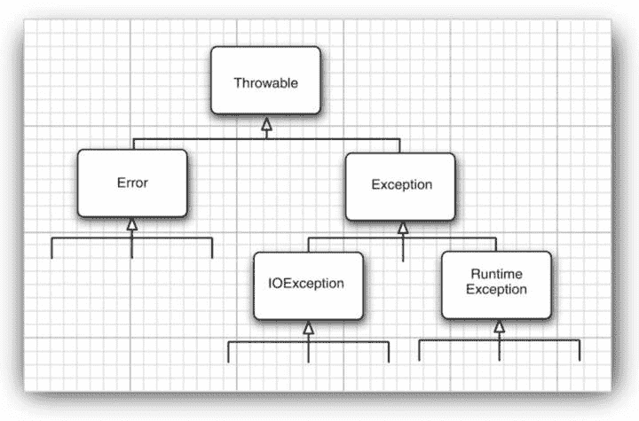

图 7.1：Java 中的异常层次

注意所有异常都派自 `Throwable`，但层次立即分为两个分支：`Error` 和 `Exception`。

`Error` 体系描述 Java 运行时系统内部的错误和资源耗尽情况。你不应该抛出这种类型的对象。如果发生此类内部错误，除了通知用户并尝试平稳地终止程序外，你做不了什么。这些情况非常罕见。

在进行 Java 编程时，关注 `Exception` 体系。`Exception` 也分为两个分支：派自 `RuntimeException` 的异常和不派自它的异常。通用规则是：`RuntimeException` 的发生是因为你犯了编程错误。任何其他异常的发生是因为某些坏事（如 I/O 错误）发生在你原本良好的程序上。

继承自 `RuntimeException` 的异常包括此类问题：

- 糟糕的类型转换；
- 越界数组访问；
- 空指针访问。

不继承自 `RuntimeException` 的异常包括：

- 尝试读取文件末尾之后；
- 尝试打开不存在的文件；
- 尝试为一个不表示类的字符串查找 `Class` 对象。

“如果是 `RuntimeException`，那就是你的错”这个规则非常有效。你本可以通过测试数组索引是否在数组边界范围内避免那个 `ArrayIndexOutOfBoundsException`。如果你在使用变量之前检查了它是否为 `null`，那么 `NullPointerException` 就不会发生。

那么不存在的文件呢？难道不能先检查文件是否存在，然后打开它吗？嗯，文件可能在你检查过其存在性后立即被删除了。因此，“存在”的概念取决于环境，而不仅仅取决于你的代码。

Java 语言规范将任何派自 `Error` 类或 `RuntimeException` 类的异常称为*未检查的*（unchecked）异常。所有其他异常都称为*已检查的*（checked）异常。这是一个非常有用的术语，我也在书中采用了它。编译器会检查你是否为所有已检查异常提供了异常处理程序。

`RuntimeException` 的名字有点让人困惑。当然，我们讨论的所有错误都发生在运行时。这个名字起源于史前时代，当时 Java 的前身 Oak 的“运行时”会产生越界异常和空指针异常。推测 I/O 异常是由其他组件产生的。

如果你熟悉标准 C++ 库（受限得多）的异常层次，到这里你可能会感到非常困惑。C++ 有两个基础异常类：`runtime_error` 和 `logic_error`。`logic_error` 类是 Java `RuntimeException` 的等效类，也表示程序中的逻辑错误。`runtime_error` 类是由不可预测问题引起的异常的基类。它等同于 Java 中那些*不是* `RuntimeException` 的异常。

### 7.1.2 声明已检查异常

Java 方法在遇到其无法处理的情况时可以抛出异常。其原理非常简单：方法不仅会告诉 Java 编译器它可以返回什么值，*它还会告诉编译器可能会发生什么错误。*例如，尝试从文件中读取的代码知道文件可能不存在，或者可能为空。因此，尝试处理文件中信息的代码需要通知编译器它可能会抛出某种 `IOException`。

你声明方法可以抛出异常的地方是方法的头部；头部会随之发生变化，以反映该方法可能抛出的受检异常（checked exceptions）。例如，这里是标准库中 `FileInputStream` 类的一个构造函数的声明。（有关关于输入和输出的更多信息，请参阅第二卷第二章。）

```java
public FileInputStream(String name) throws FileNotFoundException
```

该声明表示，此构造函数根据 `String` 参数产生一个 `FileInputStream` 对象，但它*也*可能以特殊的方式发生错误——通过抛出一个 `FileNotFoundException`。如果发生了这种糟糕的情况，构造函数的调用将不会初始化一个新的 `FileInputStream` 对象，而是抛出一个 `FileNotFoundException` 类的对象。如果是这样的话，运行时系统将开始寻找知道如何处理 `FileNotFoundException` 对象的异常处理器。

当你编写自己的方法时，不需要声明你的方法实际上可能抛出的每一个可能的可抛出对象。要理解何时（以及什么）在你写的方法的 `throws` 子句中必须声明内容，请记住，在以下四种情况之一会抛出异常：

- 你调用了一个抛出受检异常的方法——例如 `FileInputStream` 构造函数；
- 你检测到一个错误并使用 `throw` 语句抛出一个受检异常（`throw` 语句将在下一节介绍）；
- 你犯了编程错误，例如 `a[-1] = 0` 导致了未受检异常（在这种情况下，是 `ArrayIndexOutOfBoundsException`）；
- 虚拟机或运行时库中发生了内部错误。

如果发生了前两种情况的任何一种，你必须告诉将使用你方法的程序员异常存在的可能性。为什么？任何抛出异常的方法都是一个潜在的死亡陷阱。如果没有处理器捕获该异常，当前执行线程将终止。

与属于提供的类中的 Java 方法一样，你在方法头中通过一个*异常规格*（exception specification）来声明你的方法可能抛出异常。

```java
class MyAnimation
{
   . . .
   public Image loadImage(String s) throws IOException
   {
      . . .
   }
}
```

如果一个方法可能抛出不止一种受检异常类型，你必须在头部列出所有的异常类。像下面的示例一样，用逗号将它们分开：

```java
class MyAnimation
{
   . . .
   public Image loadImage(String s) throws FileNotFoundException, EOFException
   {
      . . .
   }
}
```

然而，你不需要声明内部 Java 错误——即继承自 `Error` 的异常。任何代码都可能抛出这些异常，而且它们完全超出你的控制范围。

同样地，你不应该声明继承自 `RuntimeException` 的未受检异常。

```java
class MyAnimation
{
   . . .
   void drawImage(int i) throws ArrayIndexOutOfBoundsException // 糟糕 get
   {
      . . .
   }
}
```

这些运行时错误完全在你的控制之下。如果你如此担心数组索引错误，你应该花时间修复它们，而不是声明它们发生的可能性。

总之，方法必须声明它可能抛出的所有*受检*异常。未受检异常要么超出你的控制范围（`Error`），要么是由你本不应该允许的情况导致的（`RuntimeException`）。如果你的方法未能忠实地声明所有受检异常，编译器将发出错误信息。

当然，正如你已经在许多示例中看到的，与其声明异常，你也可以捕获它。这样，异常就不会被抛出方法，也不需要 `throws` 规格了。你将在本章的后面部分看到如何决定是捕获异常还是让别人来捕获它。

如果你重写了父类的方法，子类方法声明的受检异常不能比父类方法的更通用。（在子类方法中抛出更具体的异常，或者不抛出任何异常是可以的。）特别是，如果父类方法完全没有抛出受检异常，子类也不能抛出。例如，如果你重写了 `JComponent.paintComponent`，你的 `paintComponent` 方法不能抛出任何受检异常，因为父类方法没有抛出任何异常。

当类中的方法声明它抛出一个特定类实例的异常时，它可能会抛出该类的异常或其任何子类的异常。例如，`FileInputStream` 构造函数可以声明它抛出 `IOException`。在这种情况下，你将不知道它是哪种 `IOException`；它可能是一个普通的 `IOException`，也可能是各种子类之一的对象，例如 `FileNotFoundException`。

`throws` 规格符与 C++ 中的 `throw` 规格符相同，但有一个重要的区别。在 C++ 中，`throw` 规格符是在运行时强制的，而不是在编译时。这意味着，C++ 编译器不关注异常规格。但如果在不在 `throw` 列表函数中抛出异常，将调用 `unexpected` 函数，默认情况下，程序将终止。

此外，在 C++ 中，如果没有给出 `throw` 规格，函数可以抛出任何异常。在 Java 中，没有 `throws` 规格的方法不能抛出任何受检异常。

### 7.1.3 如何抛出异常

现在，假设你的代码中发生了某些糟糕的事情。你有一个方法 `readData` 正在读取一个文件，该头部承诺：

```text
Content-length: 1024
```

但在 733 个字符后就遇到了文件结束。你可能认为这种情况非常异常，以至于你想抛出一个异常。

你需要决定抛出什么样的异常。查阅 Java 文档，发现某种类型的 `IOException` 是一个不错的选择。你发现 `EOFException` 的描述是“在输入过程中到达文件结束”。完美。这里是你抛出它的方式：

```java
throw new EOFException();
```

或者，如果你喜欢：

```java
var e = new EOFException();
throw e;
```

这是它们是如何组合的：

```java
String readData(Scanner in) throws EOFException
{
   . . .
   while (. . .)
   {
      if (!in.hasNext()) // 遇到 EOF
      {
         if (n < len)
            throw new EOFException();
      }
      . . .
   }
   return s;
}
```

`EOFException` 有第二个接受字符串参数的构造函数。你可以它更仔细地描述异常情况。

```java
String gripe = "Content-length: " + len + ", Received: " + n;
throw new EOFException(gripe);
```

你的代码可能会遇到一个任何标准异常类都无法充分描述的问题。在这种情况下，创建自己的异常类是非常容易的。只需派生自 `Exception`，或者派生自 `Exception` 的子类（如 `IOException`）。惯例是同时提供一个默认构造函数和一个包含详细消息的构造函数。（父类 `Throwable` 的 `toString` 方法方法会返回一个包含该详细消息的字符串，这对于调试非常有用。）

```java
class FileFormatException extends IOException
{
   public FileFormatException() {}
   public FileFormatException(String gripe)
   {
      super(gripe);
   }
}
```

现在你已经准备好抛出你自己的异常类型了。

```java
String readData(Scanner in) throws FileFormatException
{
   . . .
   while (. . .)
   {
      if (ch == -1) // 遇到 EOF
      {
         if (n < len)
            throw new FileFormatException();
      }
      . . .
   }
   return s;
}
```

`java.lang.Throwable` 1.0

- `Throwable()`

  构造一个新的没有详细消息的 `Throwable` 对象。

- `Throwable(String message)`

  构造一个新的带有指定详细消息的 `Throwable` 对象。按照惯例，所有派生的异常类都支持一个默认构造函数和一个带有详细消息的构造函数。

- `String getMessage()`

  获取 `Throwable` 对象的详细消息。

## 7.2 捕获异常

你现在知道如何抛出异常了。这很简单：你抛出它，然后忘记它。当然，某些代码必须捕获该异常。捕获异常需要更多的规划。接下来的章节将介绍这些。


### 7.2.1 捕获异常

如果发生了未被任何地方捕的异常，程序将终止并在控制台上打印一条消息，给出异常类型和堆栈跟踪。然而，GUI 程序可以捕获异常、打印堆栈跟踪消息，然后返回用户界面处理循环。（在调试 GUI 程序时，最好让控制台保持在屏幕上不要最小化。）

要捕获异常，请设置 `try`/`catch` 块。`try` 块的最简单形式如下：

```java
try
{
   代码
   更多代码
   更多代码
}
catch (ExceptionType e)
{
   针对该类型的处理器
}
```

假设 `try` 块内部的任何代码抛出了在 `catch` 子句中指定的类或其子类的异常。在这种情况下：

1. 程序跳过 `try` 块中剩余的代码。
2. 程序执行 `catch` 子句内部的处理器代码。

如果 `try` 块内部没有代码都没有抛出异常，则程序将跳过 `catch` 子句。

如果方法中的任何代码抛出了与 `catch` 子句中命名的类型不同的异常，则该方法将立即退出。（希望它的调用者之一已经为该类型提供了一个 `catch` 子句。）

为了展示这一过程的工作原理，这里有一段读取数据的相当典型的代码：

```java
public void read(String filename)
{
   try
   {
      var in = new FileInputStream(filename);
      int b;
      while ((b = in.read()) != -1)
      {
         处理输入
      }
   }
   catch (IOException exception)
   {
      exception.printStackTrace();
   }
}
```

注意 `try` 子句中的大部分代码都是直观的：它读取并处理字节，直到遇到文件结束。通过查看 Java API 你可以看到，`read` 方法有抛出 `IOException` 的可能。在这种情况下，我们跳出整个 `while` 循环，进入 `catch` 子句并生成堆栈跟踪。对于一个演示程序来说，这似乎是处理此异常的合理方法。你还有其他选择？

通常，最好的选择是什么都不做，简单地将异常传递给调用者。如果 `read` 方法中发生错误，让 `read` 方法的调用者去担心吧！如果我们采取这种方法，我们就必须声明该方法可能会抛出 `IOException`。

```java
public void read(String filename) throws IOException
{
   var in = new FileInputStream(filename);
   int b;
   while ((b = in.read()) != -1)
   {
      处理输入
   }
}
```

记住，编译器严格执行 `throws` 标识符。如果你调用了一个抛出检查异常（checked exception）的方法，你必须处理它或将其传递下去。

两者中哪个更好？作为一个通用原则，你应该捕获那些你知道如何处理的异常，并传播那些你不知道如何处理的异常。

当你传播异常时，必须添加 `throws` 标识符以提醒调用者可能会抛出异常。

查看 Java API 文档查看哪些方法抛出了哪些异常。然后决定你应该是处理它们，还是将它们加入 `throws` 列表。后一种选择并不可耻。将异常引导至胜任的处理器总比将其扼杀要好。

然而，在重写方法时，你不允许子类方法中添加比父类方法更多的 `throws` 标识符。这时你*必须*捕获未声明的检查异常。特别是，如果你重写一个方法时……

### 7.2.2 捕获多个异常

你可以在 `try` 块中捕获多个异常类型并对它们进行不同的处理。为每个类型使用单独的 `catch` 子句，如下所示：

```java
try
{
   可能抛出异常的代码
}
catch (FileNotFoundException e)
{
   处理缺失文件的操作
}
catch (UnknownHostException e)
{
   处理未知主机的操作
}
catch (IOException e)
{
   处理所有其他 I/O 问题
}
```

你需要排列 `catch` 子句，使得特定的异常类型在更通用类型之前。异常对象可能包含有关异常的信息。要获取更多关于对象的信息，可以尝试使用 `e.getMessage()` 获取详细消息（如果有的话），或者使用 `e.getClass().getName()` 获取异常的实际类型。

你可以在同一个 `catch` 子句中捕获多个异常类型。例如，假设处理缺失文件和未知主机的操作是相同的。那么你可以合并 `catch` 子句：

```java
try
{
   可能抛出异常的代码
}
catch (FileNotFoundException | UnknownHostException e)
{
   处理缺失文件和未知主机的操作
}
catch (IOException e)
{
   处理所有其他 I/O 问题
}
```

这种特性只有在捕获互为子类的异常类型时才需要。当你捕获多个异常时，异常变量是隐式的 `final`。例如，你不能在子句体中为 `e` 赋值新值：

```java
catch (FileNotFoundException | UnknownHostException e) { . . . }
```

捕获多个异常不仅让你的代码看起来更简单，而且更高效。生成的字节码包含一个用于共享 `catch` 子句的块。

变量 `e` 的类型*不是* `FileNotFoundException | UnknownHostException` “联合类型”，即使你的 IDE 是这样报告的。Java 变量无法具有这种联合类型。`e` 的实际类型是这些类型的最小上界；在这种情况下是 `IOException`。

在大多数情况下，你并不关心这个问题。但如果你使用 `switch` 分析 `e`，情况就不同了。显而易见的 `switch` 有一个问题——它不是穷尽：

```java
catch (FileNotFoundException | UnknownHostException e)
{
   switch (e) // ：未穷尽
   {
      case FileNotFoundException fe -> . . .;
      case UnknownHostException ue -> . . .;
   }
   . . .
}
```

你可以通过添加 `default` 子句来解决这个问题。然而，重新组织代码并使用独立的 `catch` 子句可能会更清晰。

`catch` 子句不会关注密封的异常层次结构（sealed exception hierarchies）。假设你提供了：

```java
sealed abstract class DomainException extends Exception
      permits FatalDomainException, SurvivableDomainException {}
```

那么，这些 `catch` 子句：

```java
try
{
   domainMethod(); // 抛出 DomainException
}
catch (FatalDomainException e) { . . . }
catch (SurvivableDomainException e) { . . . }
```

是不够的，尽管可能不存在其他受检异常（checked exception）实例。

### 7.2.3 重新抛出和链异常

你可以在 `catch` 子句中抛出异常。通常，当你想要更改异常类型时这样做。如果你构建了一个其他程序员使用的子系统，使用一个指示子系统失败的异常类型是有意义的。这种异常类型的一个示例是 `ServletException`。执行 servlet 的代码可能不想知道发生了什么细节问题，但它确实想知道 servlet 出了错。

以下是你如何捕获异常并重新抛出它的：

```java
try
{
   access the database
}
catch (SQLException e)
{
   throw new ServletException("database error: " + e.getMessage());
}
```

在这里，`ServletException` 是使用异常的文本消息构造的。

然而，更好的想法是将原始异常设为新异常的“原因”（cause）：

```java
try
{
   access the database
}
catch (SQLException original)
{
   var e = new ServletException("database error", original);
   throw e;
}
```

`ServletException` 类有一个构造函数，你可以向其中传递原因。如果你使用的异常类型不支持这种方式，你可以可以调用：

```java
e.initCause(original);
```

当异常被捕获时，可以获取原始异常：

```java
Throwable original = caughtException.getCause();
```

这种包装技术是高度推荐的。它允许你在子系统中抛出高层异常，而不会丢失原始失败的细节。

如果在不允许抛出受检异常的方法中发生了受检异常，这种包装技术也有用。你可以捕获受检异常并将其封装为运行时异常（runtime exception）。

由于这种情况经常出现在输入/输出中，Java API 提供了 `UncheckedIOException`，你可以将其作为受检 `IOException` 的包装。

有时，你只想记录异常并在不做任何更改的情况下重新抛出它：

```java
try
{
   access the database
}
catch (Exception e)
{
   logger.log(level, message, e);
   throw e;
}
```

这里有一个微妙的点。假设代码在一个方法内部：

```java
public void updateRecord() throws SQLException
```

Java 编译器会跟踪 `e` 源自 `try` 块的事实。只要该块中唯一的受检异常是 `SQLException` 实例，并且只要 `e` 在 `catch` 块中没有被更改，那么将包含的方法声明为 `throws SQLException` 就是有效的。

### 7.2.4 `finally` 子句

当你的代码抛出异常时，它会停止处理方法中的剩余代码并退出方法。如果该方法获取了一些只有该方法知道的本地资源，且该资源必须被清理，就会就会问题。一种解决方案是捕获所有异常，执行清理，然后重新抛出异常。但这种解决方案是琐事的，因为你需要在两个地方清理资源分配——在普通代码中和异常代码中。`finally` 子句可以解决这个问题。

有一个更优雅的解决方案，即你将在下一节中看到的 `try-with-resources` 语句。我们详细讨论 `finally` 机制是因为它是概念性的基础。但在实践中，你使用 `try-with-resources` 语句的频率会比使用 `finally` 子句高得多。

`finally` 子句中的代码无论是否捕获了异常都会执行。在下面的示例中，程序将在任何情况下都关闭输入流：

```java
var in = new FileInputStream(. . .);
try
{
   // 1
   可能抛出异常的代码
   // 2
}
catch (IOException e)
{
   // 3
   显示错误消息
   // 4
}
finally
{
   // 5
   in.close();
}
// 6
```

让我们来看程序执行 `finally` 子句的三种可能情况。

1. 代码没有抛出任何异常。在这种情况下，程序首先执行 `try` 块中的所有代码。然后，执行 `finally` 子句中的代码。之后，从 `finally` 子句后的第一个语句继续执行。换句话说，执行通过了点 1、2、5 和 6。

2. 代码抛出了被 `catch` 子句捕获的异常——在我们的用例中是 `IOException`。为此，程序执行 `try` 块中的所有代码直到异常抛出的点。`try` 块的剩余代码被跳过。程序随后执行匹配的 `catch` 子句，然后执行 `finally` 子句。如果 `catch` 子句没有抛出异常，程序将执行 `finally` 子句后的第一行。在这种情况下，执行通过了点 1、3、4、5 和 6。如果 `catch` 子句抛出了异常，异常返回给方法的调用者，执行通过了点 1、3 和 5。

3. 代码抛出了未被捕获的异常。在这里，程序执行 `try` 块中的所有代码直到异常抛出的点。`try` 块的剩余代码被跳过。然后，执行 `finally` 子句中的代码，异常返回给方法的调用者。执行通过了点 1 和 5。

你可以在没有 `catch` 子句的情况下使用 `finally` 子句。例如，考虑以下 `try` 语句：

```java
var in = new FileInputStream(. . .);
try
{
   可能抛出异常的代码
}
finally
{
   in.close();
}
```

`finally` 子句中的 `in.close()` 语句无论 `try` 块是否遇到异常都会执行。当然，如果遇到了异常，它会被重新抛出必须在另一个 `catch` 子句中捕获。

```java
var in = new FileInputStream(. . .);
try
{
   try
   {
      可能抛出异常的代码
   }
   finally
   {
      in.close();
   }
}
catch (IOException e)
{
   显示错误消息
}
```

内部 `try` 块有一个单一职责：确保输入流被关闭。外部 `try` 块有一个单一职责：确保错误被报告。这种解决方案不仅更清晰，而且更有功能：`finally` 子句中的错误会被报告。

当 `finally` 子句包含 `return` 语句时，可能会产生意想不到的结果。假设你通过 `return` 语句退出 `try` 块中间。在方法返回之前会执行 `finally` 块。如果 `finally` 块也包含 `return` 语句，它将掩盖原始的返回值。考虑这个示例：

```java
public static int parseInt(String s)
{
   try
   {
      return Integer.parseInt(s);
   }
   finally
   {
      return 0; // 错误
   }
}
```

看起来在调用 `parseInt("42")` 时，`try` 块体返回整数 `42`。然而，在方法实际返回之前会执行 `finally` 块，导致方法返回 `0`，忽略了原始返回值。

情况变得更糟糕。考虑调用 `parseInt("zero")`。`Integer.parseInt` 方法会抛出一个 `NumberFormatException`。接着执行 `finally` 子句，而 `return` 语句会吞掉这个异常！

`finally` 子句的体用于清理资源。不要在 `finally` 子句内部放置改变控制流的语句（`return`、`throw`、`break`、`continue`）。

### 7.2.5 `try`-with-Resources 语句

这种代码模式有一个非常有用的写法：

```java
打开一个资源
try
{
   对资源进行操作
}
finally
{
   关闭资源
}
```

前提是该资源属于实现了 `AutoCloseable` 接口的类。该接口有一个方法：

```java
void close() throws Exception
```

还有一个 `Closeable` 接口。它是 `AutoCloseable` 的子接口，同样带有一个 `close` 方法。然而，该方法被声明为抛出 `IOException`。

在最简单的变体中，`try-with-resources` 语句的形式如下：

```java
try (Resource res = . . .)
{
   对 res 进行操作
}
```

当 `try` 块退出时，会自动调用 `res.close()`。这里有一个典型的示例——读取文件中所有的单词：

```java
try (var in = new Scanner(Path.of("in.txt")))
{
   while (in.hasNext())
      System.out.println(in.next());
}
```

当块正常退出或发生异常时，`in.close()` 方法都会被调用，正好像你使用了 `finally` 块一样。

你可以指定多个资源。例如：

```java
try (var in = new Scanner(Path.of("in.txt"));
      var out = new PrintWriter("out.txt"))
{
   while (in.hasNext())
      out.println(in.next().toUpperCase());
}
```

无论块以何方式退出，`in` 和 `out` 都会被关闭。如果你手动编写这些代码，你将需要两个嵌套的 `try`/`finally` 语句。

你可以在 `try` 头部提供之前声明的有效 final 变量（effectively final variables）：

```java
public static void printAll(String[] lines, PrintWriter out)
{
   try (out) // 有效 final 变量
   { 
      for (String line : lines)
         out.println(line);
   } // 在此处调用 out.close()
}
```


这并不常见，因为人们通常喜欢在构造对象的相同作用域内调用`close`。

当`try`块抛出异常且`close`方法也抛出异常时，就会出现困难。`try`-with-resources语句非常优雅地处理了这种情况。原始异常会被重新抛出，而由`close`方法抛出的任何异常都被视为“被抑制的”（suppressed）。它们会被自动捕获并通过`addSuppressed`方法添加到原始异常中。如果你对这些异常感兴趣，可以调用`getSuppressed`方法，它会返回一个来自`close`方法的表达式数组。

你不需要手动编写这些代码。每当你需要关闭资源时，请使用`try`-with-resources语句。

`try`-with-resources语句本身也可以拥有`catch`子句，甚至是`finally`子句。这些子句会在关闭资源后执行。

### 7.2.6. 分析堆栈轨迹元素

`stack trace`（堆栈轨迹）是程序执行某一点所有待处理方法调用的列表。你肯定见过堆栈轨迹列表——每当 Java 程序因未捕获的异常终止时，就会显示堆栈轨迹。

你可以通过调用`Throwable`类的`printStackTrace`方法来获取堆栈轨迹的文本描述。

```java
var t = new Throwable();
var out = new StringWriter();
t.printStackTrace(new PrintWriter(out));
String description = out.toString();
```

更灵活的方法是使用`StackWalker`类，它产生`StackWalker.StackFrame`实例的流，每个实例描述一个堆栈帧。你可以通过此调用遍历堆栈帧：

```java
StackWalker walker = StackWalker.getInstance();
walker.forEach(frame -> analyze frame)
```

如果你想懒性地处理`Stream<StackWalker.StackFrame>`，请调用：

```java
walker.walk(stream -> process stream)
```

流处理在第二卷第一章中有详细描述。

`StackWalker.StackFrame`类拥有获取文件名、行号，以及执行代码行的类对象和方法名的方法。`toString`方法产生一个包含所有这些信息的格式化字符串。

`Throwable.getStackTrace`方法产生一个`StackTraceElement[]`数组，其信息与`StackWalker.StackFrame`实例流类似。然而，该调用的效率较低，因为即使调用者可能只需要几帧，它也会捕获整个堆栈，而且它只提供待处理方法的类名，而不提供类对象。

Listing 7.1 打印了递归阶乘函数的堆栈轨迹。例如，如果你计算`factorial(3)`，输出如下：

```
factorial(3):
stackTrace.StackTraceTest.factorial(StackTraceTest.java:20)
stackTrace.StackTraceTest.main(StackTraceTest.java:36)
factorial(2):
stackTrace.StackTraceTest.factorial(StackTraceTest.java:20)
```

```java
package stackTrace;

import java.util.*;

/**
 * 显示递归方法调用轨迹的程序。
 * @version 1.0
 * @author Cay Horstmann
 */
public class StackTraceTest
{
   /**
    * 计算数字的阶乘
    * @param n 一个非负整数
    * @return n!
    */
   public static int factorial(int n)
   {
      System.out.println("factorial(" + n + "):");
      var walker = StackWalker.getInstance();
      walker.forEach(System.out::println);
      int r;
      if (n <= 1) r = 1;
      else r = n * factorial(n - 1);
      System.out.println("return " + r);
      return r;
   }

   public static void main(String[] args)
   {
      try (var in = new Scanner(System.in))
      {
         System.out.print("Enter n: ");
         int n = in.nextInt();
         factorial(n);
      }
   }
}
```

获取`StackWalker`实例。选项包括来自`StackWalker.Option`枚举的`RETAIN_CLASS_REFERENCE`、`SHOW_HIDDEN_FRAMES`和`SHOW_REFLECT_FRAMES`。

* `forEach(Consumer<? super StackWalker.StackFrame> action)`

  对每个栈帧执行给定的操作，从最近调用的方法开始。

* `walk(Function<? super Stream<StackWalker.StackFrame>,? extends T> function)`

  将给定的函数应用于栈帧流，并返回函数的结果。

### `java.lang.StackWalker.StackFrame` 9

* `String getFileName()`

  获取包含该元素执行点的源文件名称，如果信息不可用则返回`null`。

* `int getLineNumber()`

  获取包含该元素执行点的源文件行号，如果信息不可用则返回`-1`。

* `String getClassName()`

  获取包含该元素执行点的方法的全限定类名。

* `Class<?> getDeclaringClass()`

  获取包含该元素执行点的方法的`Class`对象。如果构建栈步行器时没有使用`RETAIN_CLASS_REFERENCE`选项，则抛出异常。

* `String getMethodName()`

  获取包含该元素执行点的方法名。构造函数的名称为`<init>`。静态初始化器的名称为`<clinit>`。你无法区分具有同名的重载方法。

* `boolean isNativeMethod()`

  如果该元素的执行点在原生方法内部，则返回`true`。

* `String toString()`

  返回一个格式化字符串，其中包含类名、方法名以及文件名和行号（如果可用）。

### `java.lang.StackTraceElement` 1.4

* `String getFileName()`

  获取包含该元素执行点的源文件名称，如果信息不可用则返回`null`。

* `int getLineNumber()`

  获取包含该元素执行点的源文件行号，如果信息不可用则返回`-1`。

* `String getClassName()`

  获取包含该元素执行点的类的全限定名。

* `String getMethodName()`

  获取包含该元素执行点的方法名。构造函数的名称为`<init>`。静态初始化器的名称为`<clinit>`。你无法区分具有同名的重载方法。

* `boolean isNativeMethod()`

  如果该元素的执行点在原生方法内部，则返回`true`。

* `String toString()`

  返回一个格式化字符串，其中包含类名、方法名以及文件名和行号（如果可用）。

## 7.3. 使用异常的技巧

关于异常的正确使用存在某种争议。有些程序员认为所有检查异常（checked exceptions）都是麻烦，而另一些人似乎认为抛出的异常不够。我认为异常（即使是检查异常）有其用处，因此我为你提供了关于正确使用它们的提示。

1. **异常处理不应该替代简单的测试。**

   作为一个例子，这里有代码尝试 10,000,000 次来弹出一个空栈元素。它首先通过检查栈是否为空来实现此。

   ```
   if (!s.empty()) s.pop();
   ```

   接下来，我们强制无论如何都弹出栈，并捕获`EmptyStackException`，该异常告诉我们不应该这样做。

   ```
   try
   {
      s.pop();
   }
   catch (EmptyStackException e)
   {
   }
   ```

   在我的测试机器上，调用`isEmpty`的版本运行了 0.167 秒。捕获`EmptyStackException`的版本运行了 3.629 秒。

   如你所示，捕获异常花费的时间比执行简单测试要长得多。教训是：仅对异常情况使用异常。

2. **不要对异常进行细微管理。**

   有些程序员将每个语句都封装在独立的`try`块中。

   ```
   PrintStream out;
   Stack s;

   for (i = 0; i < 100; i++)
   {
      try
      {
         n = s.pop();
      }
      catch (EmptyStackException e)
      {
         // 栈是空的
      }
      try
      {
         out.writeInt(n);
      }
      catch (IOException e)
      {
         // 写入文件时出错
      }
   }
   ```

   这种方法会剧增加你的代码量。考虑你想让代码完成的任务。在这里，我们想从栈中弹出 100 个数字并将它们保存到文件中。（别管为什么——这只是一个玩具示例。）如果问题出现，我们也无能为力。如果栈是空的，它不会被占用。如果文件包含错误，错误也不会魔迹地消失。因此，将*整个任务*封装在一个`try`块中是有意义的。如果任何一个操作失败，你就可以放弃该任务。

   ```
   try
   {
      for (i = 0; i < 100; i++)
      {
         n = s.pop();
         out.writeInt(n);
      }
   }
   catch (IOException e)
   {
      // 写入文件出错
   }
   catch (EmptyStackException e)
   {
      // 栈是空的
   }
   ```

   这种代码看起来简洁得多。它履行了异常处理的承诺：*分离*正常处理与错误处理。

3. **良好利用异常层次结构。**

   不要只抛出`Exception`或`RuntimeException`。寻找合适的子类或创建自己的。

   不要只捕获`Exception`。这会让代码难以读取和维护。只捕获你预期的异常类。并且不要捕获`Throwable`。可能会隐藏`OutOfMemoryError`。

   尊重检查异常和未检查异常之间的区别。检查异常本质上是负担——不要为逻辑错误抛出它们。（例如，反射库就错了。调用者通常需要捕获可能不会发生的异常。）

   不要犹豫将异常转换为更合适的异常。例如，当在文件中解析整数时，捕获`NumberFormatException`并将其设置为`IOException`或`MysystemException`原因。

4. **不要抑制异常。**

   在 Java 中，抑制异常有种巨大的诱惑。如果你正在编写一个可能每世纪抛出一次异常的方法，编译器会因为你没有在`throws`列表中声明该异常而抱怨。你不想把它放在`throws`列表中，因为那么调用你方法的都会都会抱怨。所以你直接把它抑制了：

   ```
   public Image loadImage(String s)
   {
      try
      {
         可能抛出检查异常的代码
      }
      catch (Exception e)
      {} // 就这样
   }
   ```

   现在你的代码可以毫无阻碍地编译。它运行良好，除非发生异常。那时，异常将被静默地忽略。如果你认为异常在某种程度上很重要，你就应该努力正确处理它们。

5. **当检测到错误时，“严厉”比纵容更有效。**

   有些程序员担心在检测到错误时抛出异常。也许在用无效参数调用方法时，返回一个哑位值比抛出异常更好？例如，当栈为空时，`Stack.pop`应该返回`null`还是抛出异常？我认为，在故障点抛出`EmptyStackException`比在稍后的时间出现`NullPointerException`要好。

6. **传播异常并不是耻辱的表现。**

   有些程序员觉得有必要捕获所有抛出的异常。如果他们调用了一个会抛出异常的方法，例如`FileInputStream`构造函数或`readLine`方法，他们会本能地捕获可能产生的异常。在许多情况下，将*异常*传递（propagate）比捕获它更好：

   ```
   public void readStuff(String filename) throws IOException // 这并不是耻辱行为！
   {
      var in = new FileInputStream(filename);
      . . .
   }
   ```

   高层的方法通常更适合通知用户错误或放弃未执行成功的命令。

### 7. *使用标准方法报告空指针异常和越界异常。*

`Objects`类提供了以下方法：

```
requireNonNull
checkIndex
checkFromToIndex
checkFromIndexSize
```

用于这些常见的检查。使用它们来对参数校验：

```
public void putData(int position, Object newValue)
{
   Objects.checkIndex(position, data.length);
   Objects.requireNonNull(newValue);
   . . .
}
```

如果使用无效的索引或空参数调用方法，则会抛出异常，并使用 Java 库所使用的熟悉消息。

### 8. *不要向最终用户显示堆栈轨迹（stack traces）。*

如果你的程序遇到意外的异常，显示堆栈轨迹似乎是个好主意，这样用户就可以报告它，以便你更容易定位问题。然而，堆栈轨迹可能包含你不希望向潜在攻击者暴露的实现细节，例如你正在使用的库版本。

记录堆栈轨迹以便你可以检索，但只对用户显示摘要性消息。

规则 5 和 6 可以总结为“早抛出，晚捕获”。

## 7.4. 使用断言（Using Assertions）

断言是防御性编程中一种常用的一种惯用法。在接下来的章节中，你将学习如何有效地使用它们。

### 7.4.1. 断言的概念

假设你确信某个属性已经满足，并且在代码中依赖该属性。例如，你可能正在计算：

```
double y = Math.sqrt(x);
```

你确定`x`不是负数。也许它是另一个不会产生负结果的计算结果，或者它是一个要求调用者仅提供正输入的方法的参数。尽管如此，你仍然希望双重检查，而不是让混淆的“非数字”浮点值混入你的计算中。当然，你可以抛出一个异常：

```
if (x < 0) throw new IllegalArgumentException("x < 0");
```

但即使在测试完成后，这段代码仍然残留在程序中。如果你有很多此类检查，程序的运行速度可能会比应该的慢得多。

断言机制允许你在测试期间插入检查，并在生产代码中自动移除它们。

Java 语言有一个关键字`assert`。它有两种形式：

```
assert condition;
```

和

```
assert condition : expression;
```

这两条语句都会求值条件，如果条件为`false`，则抛出`AssertionError`。在第二个语句中，表达式被传递给`AssertionError`对象的构造函数并转换为消息字符串。

*表达式*部分的唯一目的是生成消息字符串。`AssertionError`对象并不存储实际的表达式值，因此你以后无法查询它。正如 JDK 文档所述，这样做“会鼓励程序员尝试从断言失败中恢复，这违背了该功能的目的”。

要断言`x`非负数，你可以简单地使用语句：

```
assert x >= 0;
```

或者你可以将`x`的实际值传递给`AssertionError`对象，以便稍后显示。

```
assert x >= 0 : x;
```

C 语言的`assert`宏将断言条件转换为字符串，并在断言失败时打印该字符串。例如，如果`assert(x >= 0)`失败，它会打印出`"x >= 0"`是失败的条件。在 Java 中，条件不会自动成为错误报告的一部分。如果你想看到它，必须将其作为字符串传递给`AssertionError`对象：`assert x >= 0 : "x >= 0"`。

### 7.4.2. 断言的启用与禁用


默认情况下，断言是禁用的。通过使用 `-enableassertions` 或 `-ea` 选项运行程序来启用它们：

```bash
java -enableassertions MyApp
```

注意，你不需要重新编译程序即可启用或禁用断言。断言的启用或禁用是类加载器（class loader）的功能。当断言被禁用时，类加载器会剥离断言代码，这样就不会减慢执行速度。

你甚至可以在特定的类或整个包中开启断言。例如：

```bash
java -ea:MyClass -ea:com.mycompany.mylib... MyApp
```

此命令为类 `MyClass` 以及 `com.mycompany.mylib` 包及其子包中的所有类开启断言。`-ea:...` 选项开启未命名包中所有类的断言。

你也可以使用 `-disableassertions` 或 `-da` 选项禁用某些类和包的断言：

```bash
java -ea:... -da:MyClass MyApp
```

某些类不是由类加载器加载的，而是直接由虚拟机直接加载的。你可以使用这些开关在这些类中选择性地启用或禁用断言。

然而，启用或禁用所有断言的 `-ea` 和 `-da` 开关不适用于“系统类”。使用 `-enablesystemassertions`/`-esa` 开关可以在系统类中启用断言。

还可以通过程序控制断言状态。请参见本节末尾的 API 注释。

当断言被禁用时，断言条件不会执行。因此，确保条件不产生副作用是非常重要的。这里有一个你不应该做的示例：

```java
File file = new File(filename);
. . .
assert file.delete(); // 错误
```

意图是确保 `delete` 方法返回 `true`，这意味着文件已正确删除。但当断言被禁用时，删除操作不会发生！

解决办法是将副作用移动到 `assert` 语句之外：

```java
boolean deletionSuccessful = file.delete();
assert deletionSuccessful;
```

Java 库的源码中有数百个被注释的断言。有些程序员在测试后注释掉断言，否则它们会占用类空间。如果你担心这一点，可以如下条件地包含它们：

```java
public static final boolean ASSERTS = true; // 生产环境编译为 false
. . .
if (ASSERTS) assert x >= 0;
```

### 7.4.3. 使用断言进行参数检查

Java 语言提供了三种机制来处理系统故障：

- 抛出异常
- 日志
- 使用断言

什么时候应该选择断言？记住这些点：

- 断言失败旨在致命、不可恢复的错误。
- 断言检查仅在开发和测试期间开启。（这有时被开玩笑地描述为“在岸边时穿上救生衣，一旦进入大海就将其扔掉。”）

因此，你不应该使用断言向程序的其他部分传递可恢复的状态，或向程序用户通信问题。断言应该仅用于测试期间定位内部程序错误。

让我们来看一个常见的场景——方法参数检查。我们应该使用断言来检查非法索引值或 `null` 引用吗？要回答这个问题，你需要查看方法的文档。假设你实现了一个排序方法。

```java
/**
   按数值升序排列对指定数组的指定范围进行排序。
   要排序的范围从 fromIndex（包含）延伸到 toIndex（不包含）。
   @param a 要排序的数组
   @param fromIndex 要排序的第一个元素（包含）的索引
   @param toIndex 要排序的最后一个元素（不包含）的索引
   @throws IllegalArgumentException 如果 fromIndex > toIndex 则抛出
   @throws ArrayIndexOutOfBoundsException 如果 fromIndex < 0 或 toIndex > a.length 则抛出
*/
static void sort(int[] a, int fromIndex, int toIndex)
```

文档指出如果索引值错误，该方法会抛出异常。这种行为是该方法与其调用者之间约定的一部分。如果你实现了该方法，你必须遵守该约定并抛出指定的异常。使用断言（assertions）是不恰当的。

你是否应该断言 `a` 不为 `null`？这也不够恰当。方法文档对于 `a` 为 `null` 时的行为未作说明。调用者有权假设方法在这种情况下会成功返回，而不会抛出断言错误。

然而，假设方法的约定略有不同：

```java
@param a 要排序的数组（不能为 null）
```

现在，方法的调用者已经收到通知，即使用 `null` 数组调用该方法是非法的。那么方法可以从断言开始：

```java
assert a != null;
```

计算机科学家将这种约定称为 `precondition`（前置条件）。原始方法对其参数没有前置条件——它承诺在所有情况下都有定义良好的行为。修改后的方法有一个前置条件：即 `a` 不为 `null`。如果调用者未能满足前置条件，那么规则将失效，方法可以执行任何操作。事实上，由于有了断言，方法确实是所做的。它有时会抛出断言错误，有时会抛出空指针异常，取决于其类加载器的配置。

### 7.4.4. 使用断言记录假设

程序员经常使用注释来记录他们的底层假设。考虑这个来自 `https://docs.oracle.com/javase/8/docs/technotes/guides/language/assert.html` 的示例：

```java
if (i % 3 == 0)
   . . .
else if (i % 3 == 1)
   . . .
else // (i % 3 == 2)
   . . .
```

在这种情况下，使用断言反而更有意义。

```java
if (i % 3 == 0)
   . . .
else if (i % 3 == 1)
   . . .
else
{
   assert i % 3 == 2;
   . . .
}
```

当然，彻彻地思考这个问题会更有意义。`i % 3` 的可能取值有哪些？如果 `i` 是正数，余数必须是 `0`、`1` 或 `2`。如果 `i` 是负数，那么余数可能是 `-1` 或 `-2`。因此，真正的假设是 `i` 不是负数。一个更好的断言应该是：

```java
assert i >= 0;
```

在 `if` 语句之前。

无论如何，这个示例展示了断言作为程序员自检的良好用法。正如你所看到的，断言是测试和调试的战术工具。相比之下，日志（logging）是程序整个生命周期的战略工具。我们将在下一节检查日志。

`java.lang.ClassLoader` 1.0

- `void setDefaultAssertionStatus(boolean b)` 1.4

  启用或禁用由此类加载器加载且没有显式类或包断言状态的所有类的断言。

- `void setClassAssertionStatus(String className, boolean b)` 1.4

  启用或禁用给定类及其内部类的断言。

- `void setPackageAssertionStatus(String packageName, boolean b)` 1.4

  启用或禁用给定包及其子包中所有类的断言。

- `void clearAssertionStatus()` 1.4

  移除所有显式的类和包断言状态设置，并禁用由此类加载器加载的所有类的断言。

## 7.5. 日志记录

每位 Java 程序员都熟悉在有问题的代码中插入 `System.out.println` 调用以获取程序行为见解的过程。当然，一旦你找到了问题的原因，就会移除这些打印语句——结果在下一个问题出现时又得把它们加回来。日志框架的设计是为了解决这个问题。

### 7.5.1. 你应该使用 Java 日志框架吗？

Java 有一个标准的日志框架，通常以其包名 `java.util.logging` 命名，有时缩写为 `j.u.l`。然而，其他日志框架具有更多功能且常用，例如 Log4j（`https://logging.apache.org/log4j/2.x`）和 Logback（`https://logback.qos.ch`）。

如果你想让你的代码的用户选择日志框架，那么你应该使用一个“façade”（façade）。平台 API 有时称为前端（frontend）。一种常用的 façade 是 SLF4J（`https://www.slf4j.org`）。另一个 façade 是“平台 API”（也称为 JEP 264）。它非常基础但它是 JDK 的一部分。前端有时被称为 `frontend`。`java.util.logging` 后端负责过滤和格式化消息。`java.util.logging` 后端的特性比那些流行的替代方案少，但对于许多用例来说已经足够了。由于它的简单性，它不容易受到攻击。

无论你最终是否会使用它们，研究平台 API 和 `java.util.logging` 后端都能让你对日志框架的能力有一个良好的基础。后续章节描述的 API 和后端是用于应用程序日志的。你也可以为虚拟机开启日志，例如记录垃圾回收。在启动 VM 时使用 `-Xlog` 命令行选项。例如：

```bash
java -Xlog:gc=trace:file=gc.log MyApp
```

详情请参阅 `https://docs.oracle.com/java/javase/21/docs/specs/man/java.html#enable-logging-with-the-jvm-unified-logging-framework`（`https://docs.oracle.com/java/javase/21/docs/specs/man/java.html#enable-logging-with-the-jvm-unified-logging-framework`）。

### 7.5.2. 日志记录 101

平台日志器实现了 `System.Logger` 接口。每个日志器都有一个名称。名称可以是任意的，但它通常是生成日志消息的类的包名。你可以像这样获取平台日志器：

```java
System.Logger logger = System.getLogger("com.mycompany.myapp");
```

当你第一次请求具有给定名称的日志器时，它会被创建。后续对相同名称的调用将产生相同的日志器对象。

现在你准备好记录日志了：

```java
logger.log(System.Logger.Level.INFO, "Opening file " + filename);
```

记录打印如下：

```text
Aug 04, 2022 09:53:34 AM com.mycompany.myapp.Main read
INFO: Opening file data.txt
```

注意，时间以及调用类和方法的名称会自动包含在内。

部署程序时关闭这些信息性消息，你可以配置后端。对于 `java.util.logging` 后端，准备一个包含以下内容的 `logging.properties` 文件：

```properties
handlers=java.util.logging.ConsoleHandler
com.mycompany.myapp.level=WARNING
```

然后如下所示启动应用程序：

```bash
java -Djava.util.logging.config.file=logging.properties com.mycompany.myapp.Main
```

由于 `INFO` 级别低于 `WARNING` 级别，该消息不再显示。

获取日志器并记录消息的 API 是前端的一部分——在这种情况下，是平台日志 API。如果你使用不同的前端，API 将会有所不同。

消息目的地、格式化和过滤以及配置机制是后端的一部分——这里是 `java.util.logging`。如果你使用不同的后端，请遵循其说明进行配置。

### 7.5.3. 平台日志 API

正如你在上一节中看到的，每条日志消息都有一个级别。枚举 `System.Logger.Level` 有以下值，按严重程度从高到低排序：`ERROR`、`WARNING`、`INFO`、`DEBUG` 和 `TRACE`。

通过导入语句：

```java
import static java.lang.System.Logger.Level.*;
```

你可以简化级别：

```java
logger.log(INFO, "Opening file " + filename);
// 代替 System.Logger.Level.INFO
```

上面的示例中，即使消息被抑制，消息 `"Opening file " + filename` 也会被创建。如果你担心创建消息字符串的成本，可以使用 lambda 表达式：

```java
logger.log(INFO, () -> "Opening file " + filename);
```

这样，消息只有在实际被记录时才会被计算。

记录异常是常见操作。日志包含了堆栈跟踪。

```java
catch (IOException ex)
{
   logger.log(WARNING, "Cannot open file " + filename, ex);
}
```

你可以使用模式格式化消息：

```java
logger.log(WARNING, "Cannot open file {0}", filename);
```

这不是 `printf` 风格的模式。该模式由 `MessageFormat` 类处理，该类用于程序消息的本地化（详见第二卷）。在这里，你只需要知道字符串占位符是 `{0}`、`{1}` 等。大括号必须用单引号转义：`'{'`、`'}'`。使用两个单引号 `''` 在消息中包含一个字面上的单引号。

日志消息可以使用第二卷中引入的资源包机制本地化到不同的语言。

为格式化字符串提供包和键：

```java
logger.log(WARNING, bundle, "file.bad", filename);
// 在包中查找 file.bad
```

或者，如下获取日志器：

```java
System.Logger logger = System.getLogger("com.mycompany.myapp", bundle);
```

当调用带有 `String` 参数作为消息或格式的日志器方法时，该参数被解释为包中的键。带有 `Object` 或 `Supplier<String>` 参数的方法不受此影响。

这些功能（延迟消息计算、添加可抛对象、格式化、使用包）支持某些组合但并非全部。详情请参见 API 注释。

### 7.5.4. 日志配置

现在让我们转向日志后端。如前提到的，平台日志 API 的默认后端是 `java.util.logging`，后续章节中的信息适用于该后端。

你可以通过编辑配置文件来更改后端的各种属性。默认配置文件位于 JDK 中的 `conf/logging.properties`。要使用另一个文件，在启动应用程序时通过 `java.util.logging.config.file` 属性设置文件位置：

```bash
java -Djava.util.logging.config.file=configFile MainClass
```

在 `main` 方法中调用 `System.setProperty("java.util.logging.config.file", configFile)` 没有效果，因为日志管理器是在 VM 启动期间在 `main` 执行之前初始化的。

你可以通过添加如下的行来为你自己的日志器指定日志级别：

```properties
com.mycompany.myapp.level=WARNING
```

即，在日志器名称后附加 `.level` 后缀。

日志配置中的属性不是系统属性。你不能通过 `-D` 命令行选项设置它们。相反，请将日志属性放入一个文件中，并使用 `-Djava.util.logging.config.file=configFile` 指定该文件。

你还可以指定根级别：

```properties
.level=WARNING
```

由于历史原因，某些级别在平台日志 API 和 `java.util.logging` 框架中的名称不同。你需要在配置文件中使用后者。表 7.1 显示了对应关系。

表 7.1：平台日志与 Java 日志框架的对应级别

| 平台日志 | `java.util.logging` |
|---|---|
| `ERROR` | `SEVERE` |
| `WARNING` | `WARNING` |
| `INFO` | `INFO` |
| `DEBUG` | `FINE` |
| `TRACE` | `FINER` |

与包名类似，日志器名称是层次级的。事实上，它们比包更具层次性。包和其父包之间没有语义关系，但日志器的父子器之间共享某些属性。例如，如果你关闭了到日志器 `"com.mycompany"` 的消息，那么它的子日志器也会被禁用。

正如你将在下一节中看到的，日志器并没有将消息发送到控制台——那是处理器（handlers）的工作。处理器也有级别。为了在控制台上看到 `DEBUG`/`FINE` 消息，你还需要设置：

```properties
java.util.logging.ConsoleHandler.level=FINE
```

### 7.5.5. 日志处理器

`java.util.logging` API 的后端基于处理器。最简单的处理器是 `ConsoleHandler`，它将日志记录打印到 `System.err` 流。

每个处理器都有一个父处理器。默认情况下，处理器简单地将每个记录发送到父处理器。标准日志配置默认使用 `ConsoleHandler`。它的默认级别为 `INFO`。


要将日志记录发送到其他地方，请添加另一个处理器。`java.util.logging` API 为此提供了两个处理器：`FileHandler` 和 `SocketHandler`。`SocketHandler` 将记录发送到指定的主机和端口。更有用的是收集文件的 `FileHandler`。

要添加文件处理器，在日志属性中提供此条目：

```properties
handlers=java.util.logging.ConsoleHandler,java.util.logging.FileHandler
```

记录被发送到用户目录下的 `java`n.log` 文件，其中 `n` 是一个使文件唯一的数字。默认情况下，记录以 XML 格式化。典型的日志记录如下：

```xml
<record>
    <date>2014-08-04T09:53:34</date>
    <millis>1407146014072</millis>
    <sequence>1</sequence>
    <logger>com.mycompany.myapp</logger>
    <level>INFO</level>
    <class>com.horstmann.corejava.Employee</class>
    <method>read</method>
    <thread>10</thread>
    <message>Opening file staff.txt</message>
</record>
```

你可以通过在日志属性中设置各种参数来修改文件处理器的默认行为（参见表 7.2）。

你可能不想使用默认的日志文件名。使用如 `%h/myapp%u.log` 的模式（模式变量的解释请参见表 7.3）。文件名模式中的 `%u` 为每次应用程序运行产生一个唯一的日志副本。

对于长时间运行的程序，开启文件轮转是一个好主意。日志文件按轮转顺序保存，例如 `myapp.log.0`、`myapp.log.1`、`myapp.log.2` 等。每当文件超过大小限制时，最旧的日志将被删除，其他文件被重命名，并创建一个生成号为 `0` 的新文件。

## 表 7.2: 文件句处理器配置参数

| 配置属性 | 描述 | 默认值 |
| :--- | :--- | :--- |
| `java.util.logging.FileHandler.level` | 句处理器级别。 | `Level.ALL` |
| `java.util.logging.FileHandler.append` | 为 `true` 时，日志记录将追加到现有文件中；否则，每次程序运行时都会打开一个新文件。 | `false` |
| `java.util.logging.FileHandler.limit` | 在打开另一个文件之前向文件中写入近似字节数（`0` = 无限制）。 | `FileHandler` 类中为 `0`，默认日志管理器配置中为 `50000` |
| `java.util.logging.FileHandler.pattern` | 文件名模式（参见表 7.3）。 | `%h/java%u.log` |
| `java.util.logging.FileHandler.count` | 轮转序列中的日志数量。 | `1`（无轮转） |
| `java.util.logging.FileHandler.filter` | 用于过滤日志记录的过滤器（参见节 7.5.6）。 | 无过滤 |
| `java.util.logging.FileHandler.encoding` | 字符编码。 | 平台字符编码 |
| `java.util.logging.FileHandler.formatter` | 每个日志记录的格式化器。 | `java.util.logging.XMLFormatter` |

## 表 7.3: 日志文件模式变量

| 变量 | 描述 |
| :--- | :--- |
| `%h` | 用户主目录（`user.home` 属性）。 |
| `%t` | 系统临时目录。 |
| `%u` | 唯一数字。 |
| `%g` | 轮转日志的生成号。如果指定了轮转且模式不包含 `%g`，则使用 `.%g` 后缀。 |
| `%%` | 百分号字符。 |

当 `java.util.logging.FileHandler.append` 为 `true` 且日志格式为 XML 时，追加到现有日志文件时会输出一个新的 XML 头。其结果不是有效的 XML。

### 7.5.6. 过滤器和格式化器

除了按日志级别进行过滤外，每个句处理器都可以有一个实现 `Filter` 接口的额外过滤器，该接口是一个带有以下方法的函数接口：

```
boolean isLoggable(LogRecord record)
```

要将过滤器安装到句处理器，请在日志配置中添加如下条目：

```
java.util.logging.ConsoleHandler.filter=com.mycompany.myapp.MyFilter
```

`ConsoleHandler` 和 `FileHandler` 类以文本和 XML 格式输出日志记录。然而，你也可以定义自己的格式。扩展 `java.util.logging.Formatter` 类并重写方法：

```
String format(LogRecord record)
```

以你喜欢的方式格式化记录并返回生成的字符串。在你的 `format` 方法中，可以通过调用 API 中的一个方法来获取有关 `LogRecord` 的信息：

```
String formatMessage(LogRecord record)
```

许多文件格式（如 XML）需要围绕格式化记录的头部和尾部。为了实现这一点，请重写方法：

```
String getHead(Handler h)
String getTail(Handler h)
```

最后，在日志配置中设置格式化器：

```
java.util.logging.FileHandler.formatter=com.mycompany.myapp.MyFormatter
```

### 7.5.7. 日志配方

由于有许多日志选项，很容易忘记基础知识。下面的配方总结了最常用的操作。

1. 对于简单的应用程序，选择单个日志记录器。将日志记录器命名为与主包名是一个好主意，例如 `com.mycompany.prog`。你可以通过调用获取日志记录器：

```
System.Logger logger = System.getLogger("com.mycompany.prog");
```

为了方便起见，你可能希望在具有大量日志活动的类中添加静态字段：

```
private static final System.Logger logger
   = System.getLogger("com.mycompany.prog");
```

2. `java.util.logging` 后端的默认日志配置将所有 `INFO` 或更高级别的消息打印到控制台。要自定义，请准备一个包含如下条目的 `logging.properties` 文件：

```
handlers=java.util.logging.ConsoleHandler,java.util.logging.FileHandler
com.mycompany.prog.level=FINER
java.util.logging.ConsoleHandler.level=FINE
```

然后使用以下命令启动你的应用：

```
java -Djava.util.logging.config.file=logging.properties com.mycompany.myapp.Main
```

3. 现在你可以尽情地记录日志了。每当你想调用 `System.out.println` 时，请改为输出日志消息：

```
logger.log(System.Logger.Level.TRACE, "File open dialog canceled");
```

记录意外异常也是一个好主意。例如：

```
try
{
   . . .
}
catch (SomeException e)
{
   logger.log(System.Logger.Level.WARNING, string describing context, e);
}
```

[Listing 7.2] 将此配方付诸实践并增加了一个技巧：得益于代码在 [Listing 7.3] 中的句处理器，日志消息也会显示在日志窗口中。

运行程序：

```
java -Djava.util.logging.config.file=logging.properties logging.LoggingImageViewer
```

```java
package logging;

import java.awt.*;
import java.awt.event.*;
import java.io.*;
import javax.swing.*;

import static java.lang.System.Logger.Level.*;

/**
 * 一个图像查看器程序的修改版本，用于记录各种事件。通过
 * java -Djava.util.logging.config.file=logging.properties logging.LoggingImageViewer 运行
 * @version 1.1 2023-09-26
 * @author Cay Horstmann
 */
public class LoggingImageViewer
{

   public static void main(String[] args)
   {
      EventQueue.invokeLater(() ->
            {
               var frame = new ImageViewerFrame();
               frame.setTitle("LoggingImageViewer");
               frame.setDefaultCloseOperation(JFrame.EXIT_ON_CLOSE);
               System.Logger logger = System.getLogger("com.horstmann.corejava");
               logger.log(INFO, "Showing frame");
               frame.setVisible(true);
            });
   }
}

/**
 * 显示图像帧。
 */
class ImageViewerFrame extends JFrame
{
   private static final int DEFAULT_WIDTH = 300;
   private static final int DEFAULT_HEIGHT = 400;   

   private JLabel label;
   private static System.Logger logger = System.getLogger("com.horstmann.corejava");

   public ImageViewerFrame()
   {
      logger.log(TRACE, "Entering ImageViewerFrame()");      
      setSize(DEFAULT_WIDTH, DEFAULT_HEIGHT);

      // 设置菜单栏
      var menuBar = new JMenuBar();
      setJMenuBar(menuBar);

      var menu = new JMenu("File");
      menuBar.add(menu);

      var openItem = new JMenuItem("Open");
      menu.add(openItem);
      openItem.addActionListener(new FileOpenListener());

      var exitItem = new JMenuItem("Exit");
      menu.add(exitItem);
      exitItem.addActionListener(new ActionListener()
         {
            public void actionPerformed(ActionEvent event)
            {
               logger.log(INFO, "Exiting.");
               System.exit(0);
            }
         });

      // 使用标签显示图像
      label = new JLabel();
      add(label);
      logger.log(TRACE, "Exiting ImageViewerFrame()");
   }

   private class FileOpenListener implements ActionListener
   {
      public void actionPerformed(ActionEvent event)
      {
         logger.log(TRACE, "Entering ImageViewerFrame.FileOpenListener.actionPerformed(%s)", 
               event);

         // 设置文件选择器
         var chooser = new JFileChooser();
         chooser.setCurrentDirectory(new File("."));

         // 接受所有以 .gif 结尾的文件
         chooser.setFileFilter(new javax.swing.filechooser.FileFilter()
            {
               public boolean accept(File f)
               {
                  return f.getName().toLowerCase().endsWith(".gif") || f.isDirectory();
               }

               public String getDescription()
               {
                  return "GIF Images";
               }
            });

         // 显示文件选择对话框
         int r = chooser.showOpenDialog(ImageViewerFrame.this);

         // 如果接受了图像文件，将其设置为标签的图标
         if (r == JFileChooser.APPROVE_OPTION)
         {
            String name = chooser.getSelectedFile().getPath();
            logger.log(DEBUG, "Reading file %s", name);
            label.setIcon(new ImageIcon(name));
         }
         else logger.log(DEBUG, "File open dialog canceled.");
         logger.log(TRACE, "Exiting ImageViewerFrame.FileOpenListener.actionPerformed");
      }
   }
}
```

列表 7.3 `logging/WindowHandler.java`


```java
package logging;

import java.awt.*;
import java.awt.event.*;
import java.io.*;
import java.util.logging.*;
import javax.swing.*;

/**
 * 一个在窗口中显示日志记录的处理器。
 */
public class WindowHandler extends StreamHandler
{
   private JFrame frame;

   public WindowHandler()
   {
      frame = new JFrame();
      var output = new JTextArea();
      output.setEditable(false);
      frame.setSize(200, 200);
      frame.add(new JScrollPane(output));
      frame.setFocusableWindowState(false);
      frame.setVisible(true);
      setOutputStream(new OutputStream()
         {
            public void write(int b)
            {
            } // 未被调用

            public void write(byte[] b, int off, int len)
            {
               output.append(new String(b, off, len));
            }
         });
   }

   public void publish(LogRecord record)
   {
      if (!frame.isVisible()) return;
      super.publish(record);
      flush();
   }
}
```

### `java.lang.System.Logger` 9

* `String getName()`

  返回此记录器的名称。

* `boolean isLoggable(System.Logger.Level level)`

  如果此记录器处理给定级别的日志，则返回 `true`。

* `void log(System.Logger.Level level, String msg)`

* `void log(System.Logger.Level level, String msg, Throwable thrown)`

* `void log(System.Logger.Level level, Object obj)`

  记录给定的消息以及任何提供的 `Throwable` 或 `obj`。

* `void log(System.Logger.Level level, Supplier<String> msg)`

* `void log(System.Logger.Level level, Supplier<String> msg, Throwable thrown)`

  如果此记录器处理给定级别，则调用供应商并记录结果。

* `void log(System.Logger.Level level, String format, Object... params)`

  使用给定参数记录格式化后的消息。

  如果 `bundle` 为空，则直接使用 `format` 字符串，否则在 `bundle` 中查找。

* `void log(System.Logger.Level level, ResourceBundle bundle, String msg)`

  如果 `thrown` 不为空则记录。

### `java.util.logging.Handler` 4

* `abstract void publish(LogRecord record)`

  将记录发送到目标地。

* `abstract void flush()`

  刷新缓冲区数据。

* `abstract void close()`

  刷新缓冲区数据并释放所有关联资源。

* `Filter getFilter()`

* `void setFilter(Filter f)`

  获取并设置此处理器的过滤器。

* `Formatter getFormatter()`

* `void setFormatter(Formatter f)`

  获取并设置此处理器的格式化器。

* `Level getLevel()`

* `void setLevel(Level l)`

  获取并设置此处理器的级别。

### `java.util.logging.ConsoleHandler` 1

* `ConsoleHandler()`

  构造一个新的控制台处理器。

### `java.util.logging.FileHandler` 4

* `FileHandler(String pattern)`

* `FileHandler(String pattern, boolean append)`

* `FileHandler(String pattern, int limit, int count)`

* `FileHandler(String pattern, int limit, int count, boolean append)`

* `FileHandler(String pattern, long limit, int count, boolean append)` 9

  构造文件处理器。模式格式见表 7.3。`limit` 是打开新日志文件之前的近似字节数。`count` 是旋转序列中的文件数量。如果 `append` 为 `true`，记录应追加到现有日志文件中。

### `java.util.logging.LogRecord`

* `Level getLevel()`

  获取此记录的日志级别。

* `String getLoggerName()`

  获取记录此记录的记录器名称。

* `ResourceBundle getResourceBundle()`

* `String getResourceBundleName()`

  获取用于本地化消息的资源包或其名称，如果没有提供，则返回 `null`。

* `String getMessage()`

  获取本地化或格式化之前的“原始”消息。

* `Object[] getParameters()`

  获取参数对象数组，如果没有提供，则返回 `null`。

* `Throwable getThrown()`

  获取抛出的对象，如果没有提供，则返回 `null`。

* `String getSourceClassName()`

* `String getSourceMethodName()`

  获取记录此记录的代码位置。此信息可能由日志代码提供，也可以从运行时堆栈中自动推断。如果日志代码提供了错误的值，或者运行代码经过优化导致无法推断精确位置，则该信息可能是不准确的。

* `long getMillis()`

  获取创建时间，自 1970 年以来的毫秒数。

* `Instant getInstant()`

  获取 `java.time.Instant` 类型的创建时间（参见第二卷第 6 章）。

* `long getSequenceNumber()`

  获取此记录的唯一序列号。

* `long getLongThreadID()`

  获取创建此记录的线程的唯一 ID。（`getThreadID` 方法返回 `int` 类型 ID。它现在已弃用，因为长时间运行程序可能会生成超过 `Integer.MAX_VALUE` 个线程 ID。）

### `java.util.logging.Filter`

* `boolean isLoggable(LogRecord record)`

  如果指定的日志记录应该被记录，则返回 `true`。

### `java.util.logging.Formatter`

* `abstract String format(LogRecord record)`

  返回对给定日志记录格式化后的字符串。

* `String getHead(Handler h)`

* `String getTail(Handler h)`

  返回应该出现在包含日志记录的文档头部和尾部的字符串。`Formatter` 超类定义了这些方法返回空字符串；如有必要请重写它们。

* `String formatMessage(LogRecord record)`

  返回日志记录的本地化且格式化后的消息部分。

## 7.6 调试技巧

假设你写好了程序，并通过捕获并妥善处理所有异常使其变得无懈可击。然后你运行它，它运行得并不正常。现在怎么办？（如果你从未遇到过这个问题，可以跳过本章的剩余内容。）

当然，如果你有一个方便且强大的调试器是最好的。调试器是 Eclipse、IntelliJ 和 NetBeans 等专业开发环境的一部分。在本节中，我提供了一些在启动调试器之前可能值得尝试的。

1. 你可以使用如下代码打印或记录任何变量的值：

   ```
   System.out.println("x=" + x);
   ```

   或者

   ```
   logger.log(DEBUG, "x=" + x);
   ```

   如果 `x` 是数字，它会被转换为其等效字符串。如果 `x` 是对象，Java 会调用它的 `toString` 方法。记录 `this` 对象的状态也很有用。

   ```
   logger.log(DEBUG, "this=" + this);
   ```

   Java 库中的大多数类都非常认真地重写了 `toString` 方法，为你提供关于该类的有用信息。这对于调试是一个巨大的助力。你应该在你的类中付出同样的努力。

2. 你可以在每个类中放置一个单独的 `main` 方法。在里面放入演示如何使用该类的代码。

   ```java
   public class MyClass
   {
      方法和字段
      . . .
      public static void main(String[] args)
      {
         演示代码
      }
   }
   ```

   创建几个对象，调用方法，并证明它们每一个都在正确地工作。

3. 对于更专业的单元测试，你应该查看 [`junit.org`](https://junit.org) 获取 JUnit。JUnit 是一个非常流行的单元测试框架，使得组织测试用例套件变得简单。每当你修改类时运行测试，每当你发现一个 bug 时添加另一个测试用例。

4. *日志代理*（logging proxy）是一个子类的对象，它拦截方法调用，对其进行日志记录，然后调用原始方法。例如，如果你在 `Random` 类的 `nextDouble` 方法上遇到麻烦，可以创建一个匿名子类的实例作为代理对象：

   ```java
   var generator = new Random()
      {
         public double nextDouble()
         {
            double result = super.nextDouble();
            logger.log(DEBUG, "nextDouble: " + result);
            return result;
         }
      };
   ```

   每当调用 `nextDouble` 方法时，就会生成一条日志消息。

   注意，只有当该类不是 `final` 时，这种方法才有效。对于接口，可以实现一个记录所有方法的代理，如第 6 章所示。

5. 你可以通过 `Throwable` 类中的 `printStackTrace` 方法从任何异常对象获取堆栈跟踪。以下代码捕获任何异常，打印异常对象和堆栈跟踪，并重新抛出异常以便其能找到预期的处理器。

   ```java
   try
   {
      . . .
   }
   catch (Throwable t)
   {
      t.printStackTrace();
      throw t;
   }
   ```

   你甚至不需要捕获异常即可生成堆栈跟踪。只需在代码的任何地方插入语句

   ```
   Thread.dumpStack();
   ```

   即可获取堆栈跟踪。

6. 通常，堆栈跟踪显示在 `System.err` 中。如果你想记录或显示堆栈跟踪，可以这样将其捕获到字符串：

   ```java
   var out = new StringWriter();
   new PrintWriter(out).printStackTrace();
   String description = out.toString();
   ```

7. 在 `System.err` 中捕获错误通常是很方便的。但是，要在同一个文件中捕获它们，可以使用：

   ```java
   var out = new StringWriter();
   new PrintWriter(out).printStackTrace();
   String description = out.toString();
   ```

8. 为了观察类加载，启动虚拟机时使用 `-verbose` 标志：

   ```
   [0.012s][info][class] opened: /opt/jdk-21.0/lib/modules
   [0.034s][info][class,load] java.lang.Object: jrt/base
   [0.035s][info][class,load] java.lang.Serializable: jrt/base
   [0.035s][info][class,load] java.lang.Comparable: jrt/base
   [0.035s][info][class,load] java.lang.CharSequence: jrt/base
   [0.035s][info][class,load] java.lang.String: jrt/base
   [0.036s][info][class,load] java.lang.reflect.AnnotatedElement: jrt/base
   [0.036s][info][class,load] java.lang.reflect.GenericDeclaration: jrt/base
   [0.036s][info][class,load] java.lang.reflect.Type: jrt/base
   [0.036s][info][class,load] java.lang.Class: jrt/base
   [0.036s][info][class,load] java.lang.Cloneable: jrt/base
   [0.036s][info][class,load] java.lang.ClassLoader: jrt/base
   [0.037s][info][class,load] java.lang.System: jrt/base
   [0.037s][info][class,load] java.lang.Throwable: jrt/base
   [0.037s][info][class,load] java.lang.Error: jrt/base
   [0.037s][info][class,load] java.lang.ThreadDeath: jrt/base
   [0.037s][info][class,load] java.lang.Exception: jrt/base
   [0.037s][info][class,load] java.lang.RuntimeException: jrt/base
   [0.037s][info][class,load] java.lang.SecurityManager: jrt/base
   . . .
   ```

9. 堆栈跟踪显示在 `System.err` 中，如果用户偶然看到它们会很困惑。更好的方法是使用 `logger.log(SEVERE, e)` 记录它们。可以使用静态的 `Thread.setDefaultUncaughtExceptionHandler` 更改未捕获异常的处理器：

   ```java
   Thread.setDefaultUncaughtExceptionHandler((t, e) -> {
       logger.log(SEVERE, "Uncaught exception: " + e);
   });
   ```

   这有时对于诊断类路径问题很有帮助。

10. `-Xlint` 选项告诉编译器检查常见的代码问题。例如，如果你使用命令进行编译：

    ```
    javac -Xlint sourceFiles
    ```

    编译器将报告 `switch` 语句中缺少 `break` 语句。（“lint”一词最初描述的是一种用于定位 C 程序中潜在问题的工具，但现在泛指任何标记出可疑但非合法的构造的工具。）

    你将收到类似下面的消息：

    ```
    warning: [fallthrough] possible fall-through into case
    ```


方括号中的字符串标识了警告类别。你可以启用或禁用每个类别。由于大多数类别都非常有用，最好的办法似乎是将它们全部保留，并只禁用你不在乎的那些，如下所示：

```
javac -Xlint:all,-fallthrough,-serial sourceFiles
```

你可以通过以下命令获取所有可用警告选项的列表：

```
javac --help -X
```

11. Java VM 支持对 Java 应用进行监控和管理，允许在虚拟机中安装代理（agents），以跟踪内存消耗、线程使用、类加载等。这一功能对于大型和长时间运行的 Java 程序特别重要。作为这些能力的演示，JDK 自带了一个名为`jconsole`的图形化工具，它可以显示虚拟机性能的统计数据（见图 7.2）。启动你的程序，然后启动`jconsole`从运行的 Java 程序列表中选择你的程序。

图 7.2：`jconsole`程序

该程序提供了关于你运行程序的丰富信息。更多信息请参阅 [`www.oracle.com/technical-resources/articles/java/jconsole.html`](https://www.oracle.com/technical-resources/articles/java/jconsole.html)。

12. Java Flight Recorder 是 OpenJDK 虚拟机的一种插桩技术，用于收集诊断和分析数据。你可以使用开源的 VisualVM ([`visualvm.github.io`](https://visualvm.github.io)) 和 Java Mission Control ([`adoptium.net/jmc`](https://adoptium.net/jmc)) 来收集和查看飞行记录数据。这些工具还可以完成你用`jconsole`能的所有操作。有关后者的全面教程，请参阅 [`github.com/thegreystone/jmc-tutorial`](https://github.com/thegreystone/jmc-tutorial)。

13. JDK 带有许多命令行工具，它们在监控虚拟机方面用例重叠 (`jcmd`, `jhsdb`, `jinfo`, `jmap`, `jps`, `jstat`）。`jcmd`工具是一个很好的起点，因为它涵盖了其中的几个用例。运行：

```
jcmd
```

获取你计算机上所有 Java 进程列表，包含进程 ID 和主类名。

要列出系统属性或 VM 标志，运行：

```
jcmd pidOrMainClass VM.system_properties
jcmd pidOrMainClass VM.flags
```

你可以配置虚拟机日志：

```
jcmd pidOrMainClass VM.log output=gc.log what=gc=trace decorators=uptime,tid
```

要获取线程转储（thread dump），运行：

```
jcmd pidOrMainClass Thread.print 
```

或者：

```
jcmd pidOrMainClass Thread.dump_to_file -overwrite -format=json dump.json
```

要启动 Java Flight Recorder，运行：

```
jcmd pidOrMainClass JFR.start filename=filename
```

要停止记录，运行：

```
jcmd pidOrMainClass JFR.stop name=1
```

要获取所有可用命令的列表，运行：

```
jcmd pidOrMainClass
```

要获取特定命令的帮助信息，运行：

```
jcmd pidOrMainClass help commandName
```

本章向你介绍了异常处理和日志记录。你还看到了关于测试和调试的有用提示。接下来的两章涵盖泛型编程及其最重要的应用：Java 集合框架。

# 第 8 章 ▪ 泛型编程

泛型类和方法具有类型参数。这允许它们精确地描述在实现中应该如何使用类型。在泛型类出现之前，程序员必须使用`Object`类来编写适用于多种类型的代码。这既繁便又不安全。

Java 5 中泛型的引入是 Java 编程语言的一项重大变化。一个主要的设计目标是与早期版本后兼容。因此，Java 泛型具有一些不方便的局限。在本章中，你将学习泛型编程的优势和挑战。

## 8.1 为什么用泛型编程？

泛型编程意味着编写可以重用于许多不同类型对象的代码。例如，你不想编写单独的类来收集`String`和`File`对象。你也不必这样做——单个类`ArrayList`就可以收集`String`和`File`对象。这就是泛型编程的一个例子。让我们研究泛型编程机制是如何演变的，以及它对用户和实现者意味着什么。

### 类型参数的优势

在泛型类出现之前，泛型编程是通过继承实现的。`ArrayList`类仅维护了一个`Object`数组：

```java
public class ArrayList // 泛型类之前
{
   private Object[] elementData;
   . . .
   public Object get(int i) { . . . }
   public void add(Object o) { . . . }
}
```

这种方法有两个问题。每当你检索值时，都需要强制转换：

```java
ArrayList files = new ArrayList();
. . .
String filename = (String) files.get(0);
```

此外，没有类型检查。你可以添加任何类的值：

```java
files.add(new File(". . ."));
```

这种调用可以编译并运行而不报错。在其他地方，将`get`的结果转换为`String`会导致错误。

泛型提供了一个更好的解决方案：类型参数。`ArrayList`现在有一个指示元素类型的类型参数：

```java
var files = new ArrayList<String>();
```

这使得你的代码更容易读。你可以立即看出这个特定的列表包含`String`对象。如果你使用显式类型而不是`var`来声明变量，可以通过菱形语法在构造函数中省略类型参数：

```java
ArrayList<String> files = new ArrayList<>();
```

省略的类型是从变量类型推断出来的。你可以在匿名子类中使用菱形：

```java
ArrayList<String> passwords = new ArrayList<>()
   {
      public String get(int n) { return super.get(n).replaceAll(".", "*"); }
   };
```

编译器也可以很好地利用类型信息。调用`get`不需要转换。编译器知道返回类型是`String`而不是`Object`：

```java
String filename = files.get(0);
```

编译器还知道`ArrayList<String>`的`add`方法的参数类型为`String`。这比使用`Object`参数要安全得多。现在编译器可以检查你是否插入了错误类型的对象。例如，该语句

```java
files.add(new File(". . .")); // 只能向 ArrayList<String> 添加 String 对象
```

将无法通过编译。编译时错误比运行时的类类型转换异常（class cast exception）要好得多。

这就是类型参数的魅力所在：它们让你的程序更易读，也更安全。

### 8.1.2 谁想做泛型编程程序员？

使用像`ArrayList`这样的泛型类非常简单。大多数 Java 程序员会直接使用像`ArrayList<String>`的类型，就好像它是语言内置的一样，就像`String[]`数组。（当然，列表比数组更好，因为它们可以自动扩展。）

然而，实现一个泛型类并非易事。使用你代码的程序员会希望为你的类型参数接入各种类。他们期望一切在没有繁琐限制和误导性错误信息的情况下正常工作。因此，作为一名泛型程序员，你的任务是预判你的类所有潜在的未来用途。

这有多难呢？这里是标准类库设计者必须解决的一个典型问题。`ArrayList`类有一个方法`addAll`，用于添加另一个集合的所有元素。程序员可能想将`ArrayList<Manager>`中的所有元素添加到`ArrayList<Employee>`中。但理地，反过来操作不应该是合法的。你该如何允许一种调用而禁止另一种呢？Java 语言设计者发明了一个巧妙的新概念——通配符类型（`wildcard type`）来解决这个问题。通配符类型相当抽象，但它们允许库构建者使方法变得尽可能灵活。

泛型编程分为三个技能水平。在基础阶段，你只需要使用泛型类——通常是像`ArrayList`这样的集合——而不思考它们是如何以及为何工作的。大多数应用程序程序员将一直留在该水平，直到出现问题。然而，当你混合不同的泛型类，或者与完全不知道类型参数的遗留代码交互时，你可能会遇到困惑的错误信息；届那时你需要学习足够的 Java 泛型知识，以系统地解决问题，而不是通过随机的修补。最后，当然，你可能想要实现自己的泛型类和方法。

应用程序程序员可能不会编写大量的泛型代码。JDK 开发者已经承担了大部分繁重工作，并为所有集合类提供了类型参数。根据经验法则，只有那些传统上涉及从非常通用类型（如`Object`或`Comparable`接口）进行大量强制转换的代码才能从使用类型参数中获益。

在本章中，我将向你展示实现自己的泛型代码所需的所有知识。不过，我预计大多数读者将主要利用这些知识来帮助排故障，并满足对参数化集合类内部机制的好奇心。

## 8.2. 定义简单的泛型类

泛型类是带有一个或多个类型变量的类。在本章中，将使用一个简单的`Pair`类作为示例。这个类允许我们专注于泛型，而不被数据存储细节分心。以下是泛型`Pair`类的代码：

```
public class Pair<T>
{
   private T first;
   private T second;

   public Pair() { first = null; second = null; }
   public Pair(T first, T second) { this.first = first; this.second = second; }

   public T getFirst() { return first; }
   public T getSecond() { return second; }

   public void setFirst(T newValue) { first = newValue; }
   public void setSecond(T newValue) { second = newValue; }
}
```

`Pair`类在类名后引入了用尖括号`< >`包起来的变量`T`。泛型类可以有多个类型变量。例如，我们可以为第一个和第二个字段定义不同类型的类型的`Pair`类：

```
public class Pair<T, U> { . . . }
```

类型变量贯穿整个类定义，用于指定方法的返回类型以及字段和局部变量的类型。例如：

```
private T first; // 使用类型变量
```

使用大写字母作为类型变量并保持简短是常见做法。Java 库使用变量`E`作为集合的元素类型，使用`K`和`V`作为表的键和值类型，使用`T`（必要时还有相邻的字母`U`和`S`）表示“任何类型”。

你通过为类型变量替换具体的类型来**实例化**泛型类型，例如：

```
Pair<String>
```

你可以将结果认为是一个具有以下构造函数的普通类：

```
Pair<String>()
Pair<String>(String, String)
```

以及方法

```
String getFirst()
String getSecond()
void setFirst(String)
void setSecond(String)
```

换句话说，泛型类充当了普通类的工厂。

Listing 8.1 中的程序让`Pair`类投入了工作。静态方法`minmax`遍历数组并同时计算最小值和最大值。它使用一个`Pair`对象来返回两个结果。回`compareTo`方法比较两个字符串，如果字符串相同则返回`0`，如果第一个字符串在字典序上排在第二个字符串之前则返回负整数，否则返回正整数。

从表面上看，Java 中的泛型类类似于 C++ 中的模板类。唯一而而的区别是 Java 没有特殊的`template`关键字。然而，正如你将在整个章节中将看到的，这两种机制之间存在实质差异。

Listing 8.1 pair1/PairTest1.java

```
package pair1;

/**
 * @version 1.01 2012-01-26
 * @author Cay Horstmann
 */
public class PairTest1
{
   public static void main(String[] args)
   {
      String[] words = { "Mary", "had", "a", "little", "lamb" };
      Pair<String> mm = ArrayAlg.minmax(words);
      System.out.println("min = " + mm.getFirst());
      System.out.println("max = " + mm.getSecond());
   }
}

class ArrayAlg
{
   /**
    * 获取字符串数组的最小值和最大值。
    * @param a 字符串数组
    * @return 包含最小最大值的对，如果 a 为空或为空则返回 null
    */
   public static Pair<String> minmax(String[] a)
   {
      if (a == null || a.length == 0) return null;
      String min = a[0];
      String max = a[0];
      for (int i = 1; i < a.length; i++)
      {
         if (min.compareTo(a[i]) > 0) min = a[i];
         if (max.compareTo(a[i]) < 0) max = a[i];
      }
      return new Pair<>(min, max);
   }
}
```

## 8.3. 泛型方法

在前面的节中，你已经看到了如何定义泛型类。你也可以用类型参数定义单个方法。

```
class ArrayAlg
{
   public static <T> T getMiddle(T... a)
   {
      return a[a.length / 2];
   }
}
```

此方法定义在普通类内部，而不是泛型类内部。然而，它是一个泛型方法，正如你从尖括号和类型变量所示。注意类型变量插入在修饰符（在本例中为`public static`）之后、返回类型之前。

你可以在普通类和泛型类内部都定义泛型方法。

当调用泛型方法时，可以将实际类型放在尖括号内并在方法名之前：

```
String middle = ArrayAlg.<String>getMiddle("John", "Q.", "Public");
```

在这种情况下（以及大多数情况下），你可以省略方法调用中的`<String>`类型。编译器有足够的信息来推断你想要的方法。它将参数类型与泛型`T...`进行匹配，并断出`T`必须是`String`。也就是说，你可以直接调用：

```
String middle = ArrayAlg.getMiddle("John", "Q.", "Public");
```

在几乎所有情况下，泛型方法的类型推断都很顺畅。有时编译器会出错，你需要解读错误报告。考虑这个例子：

```
double middle = ArrayAlg.getMiddle(3.14, 1729, 0);
```

错误信息以一种晦涩的术语抱怨（这些术语随编译器版本的不同而异），称这段代码有两种解释方式，且都同样有效。简而言之，编译器将参数自动装箱为一个`Double`对象和两个`Integer`对象，然后尝试寻找这些类的公共超父类。它实际上找到了两个：`Number`类和`Comparable`接口，而后者本身是一个泛型类型。在这种情况下，解决方法是将所有参数都写为`double`值。

Peter von der Ahé 建议，如果你想查看编译器为泛型方法调用推断出哪种类型，可以尝试这个技巧：故意引入一个错误并研究由此产生的错误信息。例如，考虑调用`ArrayAlg.getMiddle("Hello", 0, null)`。将结果赋值给一个`JButton`，这显然是不可能的。你会得到一个错误报告：

```
found:
java.lang.Object&java.io.Serializable&java.lang.Comparable<? extends
java.lang.Object&java.io.Serializable&java.lang.Comparable<?>>
```

用通俗的话说，你可以将结果赋值给`Object`、`Serializable`或`Comparable`。


在 C++ 中，你将类型参数放在方法名之后。这可能导致糟糕的解析歧。例如，`g(f<a,b>(c))` 可以表示“调用 `g` 并传入 `f<a,b>(c)` 的结果”，也可以表示“调用 `g` 并传入两个 `boolean` 值：`f<a` 和 `b(c)`”。

## 8.4. 类型变量的边界

有时，类或方法需要对类型变量设置限制。这是一个典型的例子。我们想要计算数组中的最小元素：

```
class ArrayAlg
{
   public static <T> T min(T[] a) // 几乎正确
   {
      if (a == null || a.length == 0) return null;
      T smallest = a[0];
      for (int i = 1; i < a.length; i++)
         if (smallest.compareTo(a[i]) > 0) smallest = a[i];
      return smallest;
   }
}
```

但有一个问题。观察 `min` 方法内部的代码。变量 `smallest` 的类型是 `T`，这意味着它可以是任意类的对象。我们如何知道 `T` 所属的类拥有一个 `compareTo` 方法呢？

解决方案是将 `T` 限制为实现了 `Comparable` 接口的类——这是一个带有单一方法 `compareTo` 的标准接口。你可以通过为类型变量 `T` 提供一个*边界*（bound）来实现：

```
public static <T extends Comparable> T min(T[] a) . . .
```

实际上，`Comparable` 接口本身就是一个泛型类型。目前，请忽略这种复杂性以及编译器生成的警告。8.7 节 讨论了如何正确配合 `Comparable` 接口使用类型参数。

现在，泛型 `min` 方法只能用实现了 `Comparable` 接口的类的数组调用，例如 `String`、`LocalDate` 等。使用 `Rectangle` 数组调用 `min` 将导致编译错误，因为 `Rectangle` 类没有实现 `Comparable`。

在 C++ 中，你无法限制模板参数的类型。如果程序员用不恰类型实例化模板，模板代码内部会报告一个（通常是晦涩的）错误信息。

你可能会奇怪为什么在这种情况下我使用 `extends` 关键字而不是 `implements` 关键字——毕竟，`Comparable` 是一个接口。这种表示法

```
<T extends BoundingType>
```

表示 `T` 应该是边界类型的*子类*。`T` 和边界类型可以是类，也可以是接口。选择 `extends` 关键字是因为它是子类概念的合理近似，且 Java 设计者不想向语言中添加新的新关键字（如 `sub`）。

一个类型变量可以有多个边界。例如：

```
T extends Comparable & Serializable
```

边界类型用与符号（`&`）分隔，因为逗号用于分隔类型变量。

与 Java 继承一样，你可以拥有任意数量的接口超父类，但边界中最多只能有一个是类。如果你有一个类作为边界，它必须是边界列表中的第一个。

在下一个示例程序（代码列表 8.2）中，我们重写了 `minmax` 方法使其变为泛型。该方法计算泛型数组的最小值和最大值，返回一个 `Pair<T>`。

代码列表 8.2 pair2/PairTest2.java

```
package pair2;

import java.time.*;

/**
 * @version 1.02 2015-06-21
 * @author Cay Horstmann
 */
public class PairTest2
{
   public static void main(String[] args)
   {
      LocalDate[] birthdays = 
         { 
            LocalDate.of(1906, 12, 9), // G. Hopper
            LocalDate.of(1815, 12, 10), // A. Lovelace
            LocalDate.of(1903, 12, 3), // J. von Neumann
            LocalDate.of(1910, 6, 22), // K. Zuse
         };
      Pair<LocalDate> mm = ArrayAlg.min(birthdays);
      System.out.println("min = " + mm.getFirst());
      System.out.println("max = " + mm.getSecond());
   }
}

class ArrayAlg
{
   /**
      计算泛型数组的最小值和最大值。
      @param a 类型为 T 的数组
      @return 返回包含最小值和最大值的 Pair<T>
   */
   public static <T extends Comparable> Pair<T> minmax(T[] a)
   {
      if (a == null || a.length == 0) return null;
      T min = a[0];
      T max = a[0];
      for (int i = 1; i < a.length; i++)
      {
         if (min.compareTo(a[i]) > 0) min = a[i];
         if (max.compareTo(a[i]) < 0) max = a[i];
      }
      return new Pair<>(min, max);
   }
}

class Pair<T>
{
   private T first;
   private T second;

   public Pair(T first, T second)
   {
      this.first = first;
      this.second = second;
   }

   public T getFirst() { return first; }
   public T getSecond() { return second; }

   public void setFirst(T newValue) { first = newValue; }
   public void setSecond(T newValue) { second = newValue; }
}
```

## 8.5. 泛型代码与虚拟机

每当你定义一个泛型时，就会自动提供一个对应的“原始类型”（raw type）。在随后的章节中，你将看到编译器如何擦除类型参数。

### 8.5.1. 类型擦除

虚拟机并不拥有泛型对象——所有的泛型都属于类。早期的泛型实现甚至能够将使用泛型的程序编译成可以在 1.0 虚拟机上运行的类文件！类型擦除将它们全部转换为原始 `Pair` 类型。

例如，`Pair<T>` 的原始类型如下：

```java
public class Pair
{
   private Object first;
   private Object second;

   public Pair(Object first, Object second)
   {
      this.first = first;
      this.second = second;
   }

   public Object getFirst() { return first; }
   public Object getSecond() { return second; }

   public void setFirst(Object newValue) { first = newValue; }
   public void setSecond(Object newValue) { second = newValue; }
}
```

由于 `T` 是无边界类型变量，它被简单地替换为 `Object`。结果是一个普通的类，正如你在添加泛型之前可能实现的那样。

你的程序可能包含不同类型的 `Pair`，例如 `Pair<String>` 或 `Pair<LocalDate>`，但擦除将它们全部转换为原始 `Pair` 类型。

在这方面，Java 泛型与 C++ 模板非常不同。C++ 为每个模板实例化产生不同的类型——这种现象被称为“模板代码膨胀”。Java 没有受到这个问题的影响。

原始类型将类型变量替换为第一个边界，如果没有边界，则替换为 `Object`。例如，类 `Pair<T>` 中的类型变量没有显式边界，因此原始类型将 `T` 替换为 `Object`。假设我们声明了一个稍微不同的类型：

```java
public class Interval<T extends Comparable & Serializable> implements Serializable
{
   private T lower;
   private T upper;
   . . .
   public Interval(T first, T second)
   {
      if (first.compareTo(second) <= 0) { lower = first; upper = second; }
      else { lower = second; upper = first; }
   }
}
```

原始类型 `Interval` 看起来如下：

```java
public class Interval implements Serializable
{
   private Comparable lower;
   private Comparable upper;
   . . .
   public Interval(Comparable first, Comparable second) { . . . }
}
```

你可能在奇奇如果交换边界会发生什么：`class Interval<T extends Serializable & Comparable>`。在这种情况下，原始类型将 `T` 替换为 `Serializable`，编译器会在需要时插入到 `Comparable` 的强制类型转换。为了效率起见，你应该将标记接口（即不包含方法的接口）放在边界列表的末尾。

### 8.5.2. 翻译泛型表达式

当你编写对泛型方法的调用时，如果返回类型被擦除，编译器会插入强制类型转换。例如，考虑以下语句序列

```
Pair<Employee> buddies = . . .;
Employee buddy = buddies.getFirst();
```

`getFirst` 的擦除返回类型为 `Object`。编译器会自动插入到 `Employee` 的强制类型转换。也就是说，编译器将方法调用转换为两条虚拟机指令：

*   对原始方法 `Pair.getFirst` 的调用

*   将返回的 `Object` 转换为类型 `Employee`

在访问泛型字段时也会插入强制类型转换。假设 `Pair` 类的 `first` 和 `second` 字段是公有的。（也许这不是良好的编程风格，但在 Java 中是合法的。）那么表达式

```
Employee buddy = buddies.first;
```

在生成的字节码中也插入了强制类型转换。

### 8.5.3. 翻译泛型方法

类型擦除也发生在泛型方法中。程序员通常将泛型方法，例如

```
public static <T extends Comparable> T min(T[] a)
```

视为整个方法族，但在擦除后，只剩下一个方法：

```
public static Comparable min(Comparable[] a)
```

注意，类型参数 `T` 已经被擦除，只留下了它的边界类型 `Comparable`。

方法的擦除带来了一些复杂性。考虑这个例子：

```java
class DateInterval extends Pair<LocalDate>
{
   public void setSecond(LocalDate second)
   {
      if (second.compareTo(getFirst()) >= 0)
         super.setSecond(second);
   }
   . . .
}
```

日期区间是一对 `LocalDate` 对象，我们希望重写这些方法以确保第二个值永远不会小于第一个值。该类被擦除为

```java
class DateInterval extends Pair // 擦除后
{
   public void setSecond(LocalDate second) { . . . }
   . . .
}
```

可能让你惊讶的是，还有一个继承自 `Pair` 的 `setSecond` 方法，即

```java
public void setSecond(Object second)
```

这显然是一个不同的方法，因为它具有不同类型的参数——`Object` 而不是 `LocalDate`。但它本不应该是不同的。考虑以下语句序列：

```
var interval = new DateInterval(. . .);
Pair<LocalDate> pair = interval; // OK--赋值给父类
pair.setSecond(aDate);
```

我们的期望是对 `setSecond` 的调用是多态的，并且会调用适当的方法。由于 `pair` 指向一个 `DateInterval` 对象，那应该是 `DateInterval.setSecond`。问题在于，类型擦除干扰了多态性。为了解决这个问题，编译器在 `DateInterval` 类中生成了一个桥接方法（bridge method）：

```java
public void setSecond(Object second) { setSecond((LocalDate) second); }
```

为了理解为什么这有效，让我们仔细跟踪语句的执行

```
pair.setSecond(aDate)
```

变量 `pair` 的声明类型为 `Pair<LocalDate>`，该类型只有一个名为 `setSecond` 的方法，即 `setSecond(Object)`。虚拟机在 `pair` 所指向的对象上调用该方法。该对象的类型是 `DateInterval`。因此，调用了 `DateInterval.setSecond(Object)`。该方法就是合成的桥接方法。它调用了 `DateInterval.setSecond(LocalDate)`，这正是我们想要的。

桥接方法可能更加奇怪。假设 `DateInterval` 类还重写了 `getSecond` 方法：

```java
class DateInterval extends Pair<LocalDate>
{
   public LocalDate getSecond() { return (LocalDate) super.getSecond(); }
   . . .
}
```

在 `DateInterval` 类中，有两个 `getSecond` 方法：

```
LocalDate getSecond() // 定义在 DateInterval 中
Object getSecond() // 重写在 Pair 中定义的方法以调用第一个方法
```

你不能写出这样的 Java 代码；拥有两个相同参数类型的方法是非合法的——在这里，没有参数。然而，在虚拟机中，参数类型和返回类型指定了一个方法。因此，编译器可以为两个仅返回类型不同的方法生成字节码，虚拟机将正确处理这种情况。

桥接方法不仅限于泛型类型。你已经在第 5 章中看到，在重写另一个方法时，方法指定一个更严格的返回类型是合法的。例如：

```java
public class Employee implements Cloneable
{
   public Employee clone() throws CloneNotSupportedException { . . . }
}
```

`Object.clone` 和 `Employee.clone` 方法具有协变返回类型。

实际上，`Employee` 类有两个 `clone` 方法：

```
Employee clone() // 上文定义
Object clone() // 重写在 Pair 中定义的方法
```

合成的桥接方法调用新方法。总之，你需要记住这些关于泛型翻译的事实：

*   虚拟机中没有泛型，只有普通的类和方法。

*   所有类型参数都被替换为它们的边界。

*   合成桥接方法以保留多态性。

*   在需要时插入强制类型转换以保留类型安全。

### 8.5.4. 调用旧代码

在设计 Java 泛型时，一个主要目标是允许泛型与旧代码之间的互操作性。让我们来看这种旧代码的具体示例。Swing 用户界面提供了一个 `JSlider` 类，其“刻度”可以使用包含文本或图像的标签自定义。标签通过以下调用设置

```java
void setLabelTable(Dictionary table)
```

`Dictionary` 类将整数映射到标签。在 Java 5 之前，该类被实现为 `Object` 实例的映射。Java 5 将 `Dictionary` 变成了泛型类，但 `JSlider` 从未更新。此时，没有类型参数的 `Dictionary` 是一个原始类型。这就是兼容性发挥的地方。

当你填充字典时，可以使用泛型类型。


```java
Dictionary<Integer, Component> labelTable = new Hashtable<>();
labelTable.put(0, new JLabel(new ImageIcon("nine.png")));
labelTable.put(20, new JLabel(new ImageIcon("ten.png")));
. . .
```

当你将 `Dictionary<Integer, Component>` 对象传递给 `setLabelTable` 时，编译器会发出警告。

```java
slider.setLabelTable(labelTable); // warning
```

毕竟，编译器无法保证 `setLabelTable` 可能会对 `Dictionary` 对象做什么。该方法可能会将所有键替换为字符串。这破坏了键的类型为 `Integer` 的保证，未来的操作可能会导致类类型转换异常。

你应该思考一下并询问 `JSlider` 实际上将对这个 `Dictionary` 对象做什么。在我们的案例中，很清楚 `JSlider` 只读取信息，所以你可以忽略该警告。

现在考虑相反的情况，即你从旧类中获取一个原始类型的对象。你可以将其赋值给类型使用泛型的变量，但你自然会收到警告。例如：

```java
Dictionary<Integer, Components> labelTable = slider.getLabelTable(); // warning
```

没关系——查看该警告，并确保标签表确实包含了 `Integer` 和 `Component` 对象。当然，这并没有绝对的保证。恶意的代码编写者可能在滑块中安装了不同的 `Dictionary`。但再次强调，这种情况并不比泛型出现之前的情况更糟。在最坏的情况下，你的程序将抛出一个异常。

在你思考完该警告后，可以使用 `annotation`（注解）来让它消失。你可以对局部变量进行注解：

```java
@SuppressWarnings("unchecked")
Dictionary<Integer, Components> labelTable = slider.getLabelTable(); // 无警告
```

或者你可以对整个方法进行注解，如下：

```java
@SuppressWarnings("unchecked")
public void configureSlider() { . . . }
```

此注解关闭对方法内部所有代码的检查。

### 8.5.5. 泛型记录模式（Generic Record Patterns）

让我们将 `Pair` 类转换为记录：

```java
record Pair<T>(T first, T second) {}
```

现在你可以使用泛型记录形成一个记录模式：

```java
var p = new Pair<String>("Hello", "World");
if (p instanceof Pair(var a, var b)) System.out.println(a + " " + b.toUpperCase());
```

在模式中，类型参数是被推断的——在这里是 `Pair<String>`。你也可以显式地指定它：

```java
p instanceof Pair<String>(var a, var b)
```

或者：

```java
p instanceof Pair<String>(String a, String b)
```

在这个示例中，泛型记录模式被用于 `instanceof` 表达式。你也可以在 `switch` 中使用它们。示例参见第 8.8.12 节。

## 8.6. 泛型的继承规则

当你处理泛型类时，需要学习关于继承和子类型的若干规则。让我们从一个许多程序员认为不直观的情况开始。考虑一个类及其子类，例如 `Employee` 和 `Manager`。`Pair<Manager>` 是 `Pair<Employee>` 的子类型吗？令人惊讶的是，答案是“否”。例如，以下代码将无法编译：

```java
Pair<Employee> buddies = new Pair<Manager>(ceo, cfo); // 非法
```

通常情况下，`Pair<S>` 和 `Pair<T>` 之间没有任何关系，无论 `S` 和 `T` 如何相关（参见图 8.1）。

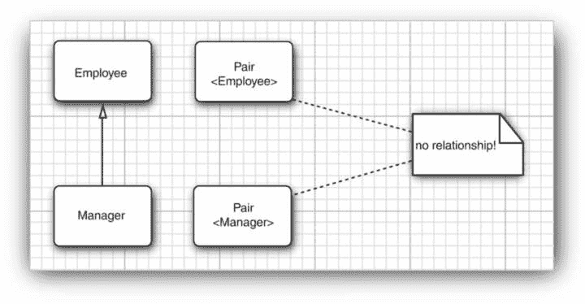

图 8.1：`Pair` 类之间没有继承关系

这似乎是一个严苛的限制，但对于类型安全来说是必要的。假设我们允许将 `Pair<Manager>` 转换为 `Pair<Employee>`。考虑这段代码：

```java
var managerBuddies = new Pair<Manager>(ceo, cfo);
Pair<Employee> employeeBuddies = managerBuddies; // 非法，但假设它可以这样做
employeeBuddies.setFirst(lowlyEmployee);
```

显然，最后一条语句是合法的。但 `employeeBuddies` 和 `managerBuddies` 指向**同一个对象**。我们现在成功地将 CFO 与一个低级员工配了一起，这对于 `Pair<Manager>` 来说是不可能的。

你刚刚看到了泛型类型与 Java 数组之间的重要区别。你可以将 `Manager[]` 数组赋值给类型为 `Employee[]` 的变量：

```java
Manager[] managerBuddies = { ceo, cfo };
Employee[] employeeBuddies = managerBuddies; // OK
```

然而，数组带有特殊的保护机制。如果你尝试将一个低级员工存储到 `employeeBuddies[0]` 中，虚拟机将抛出 `ArrayStoreException`。

你始终可以将参数化类型转换为原始类型（raw type）。例如，`Pair<Employee>` 是原始类型 `Pair` 的子类型。这种转换对于与遗留代码进行交互是必要的。

你可以转换为原始类型然后导致类型错误吗？遗憾的是，你可以做到。考虑这个示例：

```java
var managerBuddies = new Pair<Manager>(ceo, cfo);
Pair rawBuddies = managerBuddies; // OK
rawBuddies.setFirst(new File(". . .")); // 仅有编译时警告
```

这听起来很可怕。但请记住，你的处境并不比旧版本 Java 时更糟。虚拟机的安全性并没有受到威胁。当通过 `getFirst` 获取外部对象并将其赋值给 `Manager` 变量时，会抛出 `ClassCastException`，就像在过去一样。你只是丢失了泛型编程通常提供的额外安全性。

最后，泛型类可以扩展或实现其他的泛型类。在这方面，它们与普通类没有区别。例如，`ArrayList<T>` 类实现了 `List<T>` 接口。这意味着 `ArrayList<Manager>` 可以转换为 `List<Manager>`。然而，正如你刚刚看到的，`ArrayList<Manager>` 并不是 `ArrayList<Employee>` 或 `List<Employee>`。图 8.2 显示了这些关系。

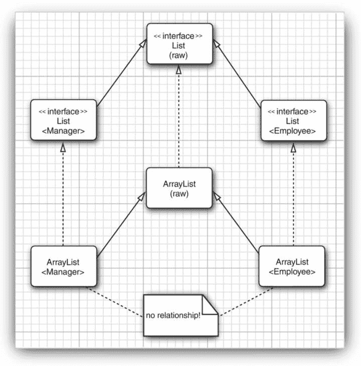

图 8.2：泛型列表类型之间的子类型关系

## 8.7. 通配符类型（Wildcard Types）

类型系统研究人员早早就知道，一套僵化的泛型类型系统用起来非常不愉快。Java 设计者发明了一种巧妙（尽管仍然是安全的）“逃生口”：通配符类型。

### 8.7.1. 通配符概念

在通配符类型中，类型参数是允许变化的。例如，假设你想写一个打印对的方法：

```java
public static void printBuddies(Pair<? extends Employee> p) {
   Employee first = p.getFirst();
   Employee second = p.getSecond();
   System.out.println(first.getName() + " and " + second.getName() + " are buddies.");
}
```

正如在前节所示，`Pair<Manager>` 是一个子类型（参见图 8.3）。

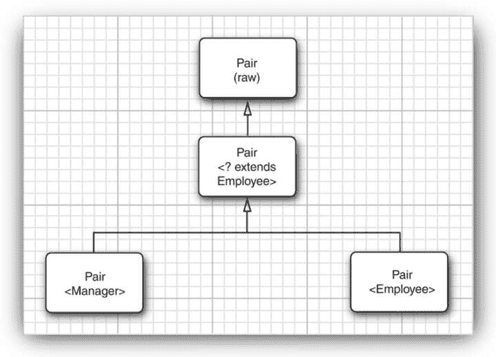

图 8.3：带有通配符的子类型关系

我们可以通过 `Pair<? extends Employee>` 引用破坏 `Pair<Manager>` 吗？

```java
var managerBuddies = new Pair<Manager>(ceo, cfo);
Pair<? extends Employee> wildcardBuddies = managerBuddies; // OK
wildcardBuddies.setFirst(lowlyEmployee);
```

这种破坏是不可能的。`setFirst` 的调用是一个类型错误。为了了解原因，让我们仔细观察 `Pair<? extends Employee>` 类型。它的方法看起来如下：

```java
extends Employee getFirst()
void setFirst(T)
```

无法调用 `setFirst` 方法！考虑调用 `wildcardBuddies.setFirst(lowlyEmployee)`。编译器知道 `setFirst` 的参数有一个特定类型，该类型扩展了 `Employee`。那个特定类型是 `Employee` 吗？是 `Manager` 还是其他子类？编译器无法得知。因此，编译器无法接受 `lowlyEmployee`。同样的原因，调用 `wildcardBuddies.setFirst(cio)`（`cio` 是 `Manager` 实例）也会失败。

`getFirst` 方法仍然有效。`getFirst` 的返回值是特定类型的实例，该类型是 `Employee` 的子类型。编译器不知道那个特定类型是什么，但它可以保证赋值给 `Employee` 引用是安全的。这就是边界通配符的核心思想。我们现在有了区分安全的访问方法和不安全的修改方法的方法。

### 8.7.2. 通配符的上类型边界

通配符边界与类型变量边界相似，但它们有一个额外功能——你可以指定一个上类型边界，如下：

```java
? super Manager
```

该通配符被限制为 `Manager` 的所有上类型。（由于 `super` 关键字如此准确地描述了这种关系，真是一种幸运。）

为什么要这样做呢？带有上界边界（supertype bound）的通配符为你提供的行为与第 8.7.1 节中描述的通配符相反。你可以为方法提供参数，但无法使用返回值。例如，`Pair<? super Manager>` 的方法可以描述如下：

```java
void setFirst(? super Manager)
? super Manager getFirst()
```

这不是真实的 Java 语法，但它展示了编译器知道的信息。`setFirst` 的参数类型用 `? super Manager` 表示某个特定类型 `T`，而 `Manager` 是 `T` 的子类。对于 `T` 恰有三种选择：`Object`、`Employee` 或 `Manager`。（如果 `Manager` 或 `Employee` 实现了接口，会有更多选择。）然而，编译器无法知道这些选择适用于哪一个。因此，编译器无法接受类型为 `Employee` 或 `Object` 的参数调用。毕竟，`T` 有可能是 `Manager`。你只能传递 `Manager` 类型的对象或如 `Executive` 之类的子类。

相反，如果你调用 `getFirst`，无法保证返回对象的类型。你只能将其赋值给 `Object`。

这是一个典型的示例。我们有一个经理数组，想要将奖金最低和最高的经理放入一个 `Pair` 对象中。什么样的 `Pair`？`Pair<Manager>` 是显而易见的选择，但还有其他可能。`Pair<Employee>` 应该是合理的，或者说 `Pair<Object>` 也可以（参见图 8.4）。以下方法将接受任何合适的 `Pair`：

```java
public static void minmaxBonus(Manager[] a, Pair<? super Manager> result)
{
   if (a.length == 0) return;
   Manager min = a[0];
   Manager max = a[0];
   for (int i = 1; i < a.length; i++)
   {
      if (min.getBonus() > a[i].getBonus()) min = a[i];
      if (max.getBonus() < a[i].getBonus()) max = a[i];
   }
   result.setFirst(min);
   result.setSecond(max);
}
```

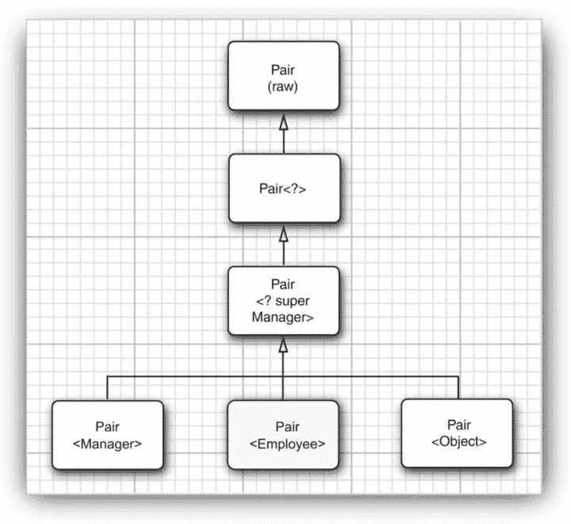

图 8.4：带有上界边界的通配符

直观来说，带有上界边界的通配符允许你向泛型对象写入，而带有下界边界的通配符允许你从泛型对象读取。

上界边界的另一个用途。`Comparable` 接口本身是一个泛型类型。它的声明如下：

```java
public interface Comparable<T>
{
   public int compareTo(T other);
}
```

在这里，类型变量表示 `other` 参数的类型。例如，`String` 类实现了 `Comparable<String>`，它的 `compareTo` 方法声明为：

```java
public int compareTo(String other)
```

很好——显式参数具有正确的类型。在接口泛型化之前，`other` 是 `Object`，在方法的实现中需要进行强制类型转换。

既然 `Comparable` 是泛型类型，也许我们应该对 `ArrayAlg` 类的 `minmax` 方法做得更好？我们可以将其声明为：

```java
public static <T extends Comparable<T>> Pair<T> minmax(T[] a)
```

这看起来比仅使用 `T extends Comparable` 更详尽，并且对许多类都有效。例如，如果你计算一个 `String` 数组的最小值，那么 `T` 就是类型 `String`，而 `String` 是 `Comparable<String>` 的子类。但在处理 `LocalDate` 对象数组时，我们遇到了问题。事实上，`LocalDate` 实现了 `ChronoLocalDate`，而 `ChronoLocalDate` 扩展了 `Comparable<ChronoLocalDate>`。因此，`LocalDate` 实现了 `Comparable<ChronoLocalDate>` 而不是 `Comparable<LocalDate>`。

在这种情况下，上界派上了用场：

```java
public static <T extends Comparable<? super T>> Pair<T> minmax(T[] a)
```

现在 `compareTo` 方法的形式变为：

```java
int compareTo(? super T)
```

它可能被声明为接收一个 `T` 类型的对象，或者（例如当 `T` 是 `LocalDate` 时）接收 `T` 的上类型。无论如何，将 `T` 类型的对象传递给 `compareTo` 方法是安全的。

对于初学者来说，像 `<T extends Comparable<? super T>>` 这样的声明看起来可能令人生畏。这很遗憾，因为此声明的意图是通过消除对调用参数的不必要限制来帮助应用程序程序员。对泛型不感兴趣的应用程序程序员可能会很快学会忽略这些声明，并理所当然库程序员会做正确的事。如果你是一个库程序员，你将习惯通配符，否则你的用户会咒骂你，并在代码中随机抛出强制类型转换直到编译通过为止。

上界边界的另一个常见用途是函数式接口的参数类型。例如，`Collection` 接口有一个方法：

```java
default boolean removeIf(Predicate<? super E> filter)
```

该方法移除所有满足给定谓词的元素。

```java
public static void maxminBonus(Manager[] a, Pair<? super Manager> result)
{
   minmaxBonus(a, result);
   PairAlg.swapHelper(result); // OK—swapHelper captures wildcard type
}
```

在这里，通配符捕获机制是避免的。

通配符捕获仅在非常有限的情况下是合。编译器必须能够保证通配符代表一个确定的类型。例如，`ArrayList<Pair<T>>` 中的 `T` 永远无法捕获 `ArrayList<Pair<?>>` 中的通配符。该列表可能包含两个 `Pair<?>`，每个对象的 `?` 都有一个不同的类型。

`Listing 8.3` 中的测试程序汇总了前面章节中讨论的各种方法，以便你可以在文中看到它们。

Listing 8.3 `pair3/PairTest3.java`


```java
package pair3;

/**
 * @version 1.01 2012-01-26
 * @author Cay Horstmann
 */
public class PairTest3
{
   public static void main(String[] args)
   {
      var ceo = new Manager("Gus Greedy", 800000, 2003, 12, 15);
      var cfo = new Manager("Sid Sneaky", 600000, 2003, 12, 15);
      var buddies = new Pair<Manager>(ceo, cfo);      
      printBuddies(buddies);

      ceo.setBonus(1000000);
      cfo.setBonus(500000);
      Manager[] managers = { ceo, cfo };

      var result = new Pair<Employee>();
      minmaxBonus(managers, result);
      System.out.println("first: " + result.getFirst().getName() 
         + ", second: " + result.getSecond().getName());
      maxminBonus(managers, result);
      System.out.println("first: " + result.getFirst().getName() 
         + ", second: " + result.getSecond().getName());
   }

   public static void printBuddies(Pair<? extends Employee> p)
   {
      Employee first = p.getFirst();
      Employee second = p.getSecond();
      System.out.println(first.getName() + " and " + second.getName() + " are buddies.");
   }

   public static void minmaxBonus(Manager[] a, Pair<? super Manager> result)
   {
      if (a.length == 0) return;
      Manager min = a[0];
      Manager max = a[0];
      for (int i = 1; i < a.length; i++)
      {
         if (min.getBonus() > a[i].getBonus()) min = a[i];
         if (max.getBonus() < a[i].getBonus()) max = a[i];
      }
      result.setFirst(min);
      result.setSecond(max);
   }

   public static void maxminBonus(Manager[] a, Pair<? super Manager> result)
   {
      minmaxBonus(a, result);
      PairAlg.swapHelper(result); // OK--swapHelper captures wildcard type
   }
   // can't write public static <T super manager> . . .
}

class PairAlg
{
   public static boolean hasNulls(Pair<?> p)
   {
      return p.getFirst() == null || p.getSecond() == null;
   }

   public static void swap(Pair<?> p) { swapHelper(p); }

   public static <T> void swapHelper(Pair<T> p)
   {
      T t = p.getFirst();
      p.setFirst(p.getSecond());
      p.setSecond(t);
   }
}
```

## 8.8. 限制与局限

在接下来的章节中，我将讨论在使用 Java 泛型时需要考虑的许多限制。大部分限制都是类型擦除（type erasure）的结果。

### 8.8.1. 类型参数不能用基本类型实例化

你不能用基本类型来替换类型参数。因此，没有 `Pair<double>`，只有 `Pair<Double>`。原因当然是类型擦除。在擦除之后，`Pair` 类拥有类型为 `Object` 的字段，你无法用它们来存储 `double` 值。

这确实令人恼恼，但它与 Java 语言中基本类型的独立地位是一致的。这并不是一个致命缺陷——只有八种基本类型，当包装类型不能作为接受的替代品时，你始终可以使用单独的类和方法处理它们。

### 8.8.2. 运行时类型查询仅对原始类型有效

虚拟机中的对象始终具有特定的非泛型类型。因此，所有的类型查询只产生原始类型（raw type）。例如：

```java
if (a instanceof Pair<String>) // 错误
```

只能测试 `a` 是否是任意类型的 `Pair`。同样的测试也是如此：

```java
if (a instanceof Pair<T>) // 错误
```

或者类型转换：

```java
Pair<String> p = (Pair<String>) a; // 警告--只能测试 a 是一个 Pair
```

为了提醒你注意风险，当你尝试查询对象是否属于某个泛型类型时，将得到编译器错误（使用 `instanceof`）或警告（使用强制类型转换）。同样的，`Pair` 返回的是原始类型。例如：

```java
Pair<String> table = . .
```

结果是不安全的。

### 8.8.3. 你不能创建泛化类型的数组

为了调用此方法，Java 虚拟机必须创建一个 `Pair<String>` 数组，这违反了规则。然而，规则在这种情况下被放宽了，你会在调用处得到警告而不是错误。你可以对其进行转换。因此，在声明处会有另一个关于“可能的堆污染”的警告。

你无法实例化泛化类型的数组，例如：

```java
var table = new Pair<String>[10]; // 错误
```

### 8.8.4. 变参数警告

在前节中，你看到 Java 不支持泛型数组。在本节中，我将讨论一个相关问题：将泛型实例传递给具有变参数的方法。

考虑这个简单的变参数方法：

```java
public static <E> void addAll(Collection<E> coll, E... elements)
{
   for (E element : elements) coll.add(element);
}
```

记得参数 `elements` 实际上是一个包含所有传入参数的数组。现在考虑这个调用：

```java
Collection<Pair<String>> table = . .
Pair<String> pair1 = . .
Pair<String> pair2 = . .
addAll(table, pair1, pair2);
```

为了避免这两个警告，对 `addAll` 方法本身使用 `@SafeVarargs` 注解：

```java
@SafeVarargs
public static <E> void addAll(Collection<E> coll, E... elements)
```

现在该方法可以使用泛型类型进行调用。通过使用该注解，你承诺你的方法没有写入参数数组，也没有将该数组传递给可能这样做的人。

```java
@SafeVarargs static <E> E[] array(E... array) { return array; }
```

现在你可以这样调用：

```java
Pair<String>[] table = array(pair1, pair2);
```

这看起来很方便，但隐藏着一个危险。这段代码：

```java
Object[] objarray = table;
objarray[0] = new Pair<Employee>();
```

将会运行而不会抛出 `ArrayStoreException`，因为数组只检查擦除后的类型。当你在处理 `table[0]` 时，会在其他地方遇到异常。

### 8.8.5. 泛型变长参数不会展开原始数组

回想，你可以将数组传递给变长参数。例如，考虑前节中的 `addAll` 方法。当要添加的项恰好在一个数组中，你只需传递该数组。该调用行为就像元素被“展开”了一样：

```java
Collection<String> strings = . . .;
String[] moreStrings = new String[] { "Mary", "had", "a", "little", "lamb" };
addAll(strings, moreStrings);
   // OK，等同于 addAll(strings, "Mary", "had", "a", "little", "lamb")
```

当然，元素并没有被实际展开。事实上，事实恰相反。如果参数是逐个指定的，它们会被收集到一个数组中，然后传递给该方法。如果你提供一个数组，它会被直接传递。

现在考虑一个数字集合：

```java
Collection<Integer> numbers = . . .;
int[] moreNumbers = new int[] { 11, 12, 13, 14, 15 };
addAll(numbers, moreNumbers); // ERROR
```

这是行不通的。对于类型变量 `E` 没有有效的匹配项。`int[]` 无法转换为 `Integer[]`。

这里有一个更隐蔽的例子。`List` 接口有一个静态的 `of` 方法：

```java
public static <E> List<E> of(E... elements)
```

该调用：

```java
List.of(moreStrings) // ["Mary", "had", "a", "little", "lamb"]
```

产生一个包含 5 个元素的列表。但是：

```java
List.of(moreNumbers)
```

产生一个包含单个元素的 `List<int[]>`，即包含五个 `int` 值的数组。类型参数 `E` 无法匹配原始类型 `int`，因此 `moreNumbers` 元素没有展开。相反，类型参数 `E` 变成了数组类型 `int[]`。

### 8.8.6. 你不能实例化类型变量

你不能在如 `new T(. . .)` 的表达式中使用类型变量。例如，下面的 `Pair<T>` 构造器是非法的：

```java
public Pair() { first = new T(); second = new T(); } // ERROR
```

类型擦除会将 `T` 变为 `Object`，而你显然不想调用 `new Object()`。

最好的变通方法是让调用者提供一个构造表达式。例如：

```java
Pair<String> p = Pair.makePair(String::new);
```

`makePair` 方法接收一个 `Supplier<T>`，这是一个用于无参数且结果类型为 `T` 的函数式接口：

```java
public static <T> Pair<T> makePair(Supplier<T> constr)
{
   return new Pair<>(constr.get(), constr.get());
}
```

另一种更传统的变通方法是通过反射调用 `Constructor.newInstance` 方法来构造泛型对象。

遗憾的是，细节有点复杂。你不能调用：

```java
first = T.class.getConstructor().newInstance(); // ERROR
```

表达式 `T.class` 是不合法的，因为它会被擦除为 `Object.class`。相反，你必须设计 API，使得你接收到的一个 `Class` 对象，如下所示：

```java
public static <T> Pair<T> makePair(Class<T> cl) throws ReflectiveOperationException
{
   Constructor<T> constr = cl.getConstructor();
   return new Pair<>(constr.newInstance(), constr.newInstance());
}
```

该方法声明为抛出 `ReflectiveOperationException`，因为该类可能没有无参数构造器。

调用该方法时，如下所示提供类字面量：

```java
Pair<String> p = Pair.makePair(String.class);
```

注意 `Class` 类本身是泛型的。例如，`String.class` 是 `Class<String>` 的实例（事实上，是唯一的实例）。因此，`makePair` 方法可以推断出它正在创建的对类型。

### 8.8.7. 你不能构造泛型数组

正如你不能实例化单个泛型实例一样，你不能实例化数组。原因是不同的——毕竟数组填充的是 `null` 值，构造起来似乎是安全的。但数组还携带一个类型，该类型用于在虚拟机中监控数组存储。该类型被擦除掉了。例如，考虑：

```java
public static <T extends Comparable> T[] minmax(T... a) 
{ 
   T[] mm = new T[2]; // ERROR
   . . . 
}
```

类型擦除会导致此方法始终构造一个数组 `Comparable[2]`。

如果数组仅作为类的私有实例字段，你可以将数组的元素类型声明为擦除后的类型并使用强制转换。例如，`ArrayList` 类可以这样实现：

```java
public class ArrayList<E>
{
   private Object[] elements;
   . . .
   @SuppressWarnings("unchecked") public E get(int n) { return (E) elements[n]; }
   public void set(int n, E e) { elements[n] = e; } // 不需要强制转换
}
```

这种技术对于我们的 `minmax` 方法不起，因为我们返回的是一个 `T[]` 数组，如果对其类型进行谎言，就会导致运行时错误。假设我们实现：

```java
public static <T extends Comparable> T[] minmax(T... a)
{
   var result = new Comparable[2]; // 擦除后类型的数组
   . . .
   return (T[]) result; // 带警告编译
}
```

该调用：

```java
String[] names = ArrayAlg.minmax("Tom", "Dick", "Harry");
```

在没有任何警告的情况下编译。当方法返回后，将 `Comparable[]` 引用强制转换为 `String[]` 时会发生 `ClassCastException`。

在这种情况下，最好让用户提供一个数组构造表达式：

```java
String[] names = ArrayAlg.minmax(String[]::new, "Tom", "Dick", "Harry");
```

构造表达式 `String[]::new` 表示一个给定长度的 `String` 数组。该方法使用该参数产生正确类型的数组：

```java
public static <T extends Comparable> T[] minmax(IntFunction<T[]> constr, T... a)
{
   T[] result = constr.apply(2);
   . . .
}
```

### 8.8.8. 类型变量在泛型类的静态上下文中无效

你不能在静态字段或方法中引用类型变量。例如，下面的聪明主意不可行：

```java
public class Singleton<T>
{
   private static T singleInstance; // ERROR

   public static T getSingleInstance() // ERROR
   {
      if (singleInstance == null) 构造 T 的新实例
      return singleInstance;
   }
}
```

如果可以这样做，那么程序就可以声明一个 `Singleton<Random>` 来共享随机数生成器，以及一个 `Singleton<JFileChooser>` 来共享文件选择器对话。但它行不通。类型擦除后只有一个 `Singleton` 类，只有一个 `singleInstance` 字段。由于这个原因，带有类型变量的静态字段和方法被禁止。

### 8.8.9. 你不能抛出或捕获泛型类的实例

你既不能抛出也不能捕获泛型类的对象。事实上，泛型类扩展 `Throwable` 也是非法的。例如，下面的定义将无法编译：

```java
public class Problem<T> extends Exception { /* . . . */ } 
   // ERROR--不能扩展 Throwable
```

然而，在异常规范中使用类型变量是允许的。以下内容是合法的：


```java
interface CheckedConsumer<T, E extends Exception>
{
   void accept(T t) throws E;
} 
```

你不能在`catch`语句中使用类型变量。例如，下面的方法将无法编译：

```java
public static <T, E extends Exception> void doWork(CheckedConsumer<T, E> c, T t)
{
   try
   {
      c.accept(t);
   }
   catch (E e) // 错误--无法捕获类型变量
   {
      logger.log(ERROR, ". . .", e);
   }
}
```

## 8.8.10. 你可以胜过异常检查

Java 异常处理的一个基本原则是必须为所有受检异常（checked exceptions）提供处理器。你可以使用泛型来破解这一机制。关键要素在于这个方法：

```java
@SuppressWarnings("unchecked")
static <T extends Throwable> void throwAs(Throwable t) throws T 
{
   throw (T) t;
} 
```

假设该方法包含在一个接口`Task`中。当你有一个受检异常`e`并调用

```java
Task.<RuntimeException>throwAs(e);
```

那么编译器就会认为`e`变成了一个未受检异常（unchecked exception）。下面的代码将所有异常转换为编译器认为未受检的异常：

```java
try
{
   do work
}
catch (Throwable t)
{
   Task.<RuntimeException>throwAs(t);
}
```

让我们用它来解决一个棘手的问题。要在线程中运行代码，你必须将其放入实现`Runnable`接口的类的`run`方法中。但该方法不允许抛出受检异常。我们将提供一个从`Task`到`Runnable`的适配器，`Task`的`run`方法允许抛出任意异常：

```java
interface Task
{
   void run() throws Exception;

   @SuppressWarnings("unchecked")
   static <T extends Throwable> void throwAs(Throwable t) throws T 
   {
      throw (T) t;
   }

   static Runnable asRunnable(Task task) 
   {
      return () -> 
         { 
            try
            {
               task.run();
            }
            catch (Exception e)
            {
               Task.<RuntimeException>throwAs(e);
            }
         };
   }
}
```

例如，这个程序运行了一个会抛出受检异常的线程：

```java
public class Test
{
   public static void main(String[] args)
   {
      var thread = new Thread(Task.asRunnable(() -> 
         {
            Thread.sleep(1000);
            System.out.println("Hello, World!");
            throw new Exception("Check this out!");
         }));
      thread.start();
   }
}
```

`Thread.sleep`方法被声明会抛出`InterruptedException`，我们不再需要捕获它。由于我们没有中断线程，该异常不会被抛出。然而，程序抛出了受检异常。当你运行程序时，你会得到堆栈跟踪。

这有什么特别的？通常，你必须在`Runnable`的`run`方法内部捕获所有受检异常并将其*包装*成未受检异常——`run`方法被声明不抛出任何受检异常。

在这里，我们没有进行包装。我们只是抛出异常，欺骗编译器认为它不是一个受检异常。

通过使用泛型类、擦除和`@SuppressWarnings`注解，我们能够击败 Java 类型系统的一个核心部分。

## 8.8.11. 警惕擦除后的冲突

在泛型类型擦除时创建导致冲突的情况是非常是非法的。这里有一个例子。假设我们在`Pair`类中添加一个`equals`方法，如下：

```java
public class Pair<T>
{
   public boolean equals(T value) { return first.equals(value) && second.equals(value); }
   . . .
}
```

考虑一个`Pair<String>`。从概念上说，它有两个`equals`方法：

```java
boolean equals(String) // 定义在 Pair<T> 中
boolean equals(Object) // 继承自 Object
```

但直觉误导了我们。方法的擦除：

```java
boolean equals(T)
```

结果是：

```java
boolean equals(Object)
```

这与`Object.equals`方法冲突了。

解决办法当然是重命名引起冲突的方法。

泛型规范引用了另一个规则：“为了支持通过擦除进行翻译，我们实施了限制：类或类型变量不能同时是同一个接口的不同参数化的两个接口类型的子类型。”例如，下面的代码是非法的：

```java
class Employee implements Comparable<Employee> { . . . }
class Manager extends Employee implements Comparable<Manager> { . . . } // 错误
```

`Manager`将同时实现`Comparable<Employee>`和`Comparable<Manager>`，它们是同一个接口的不同参数化。

目前还不清楚这个限制与类型擦除有什么关系。毕竟，非泛型的版本：

```java
class Employee implements Comparable { . . . }
class Manager extends Employee implements Comparable { . . . }
```

是合法的。原因要微妙得多。这将与合成的桥方法（bridge methods）产生冲突。实现`Comparable<X>`的类会获得一个桥方法：

```java
public int compareTo(Object other) { return compareTo((X) other```
```

## 8.8.12. 泛型类型推断的局限性

当涉及泛型类型时，编译器可能需要努力来验证完整性。考虑这个不完整的`JSONPrimitive`层次结构：

```java
sealed interface JSONPrimitive<T> {}
record JSONNumber(double value) implements JSONPrimitive<Double> {}
record JSONBoolean(boolean value) implements JSONPrimitive<Boolean> {}
record JSONString(String value) implements JSONPrimitive<String> {}
```

下面的方法中的`switch`是完备的：

```java
public static <T> double toNumber(JSONPrimitive<T> v)
{
   return switch (v)
      {
         case JSONNumber(var n) -> n;
         case JSONBoolean(var b) -> b ? 1 : 0;
         case JSONString(var s) -> {
            try
               yield Double.parseDouble(s);
            }
            catch (NumberFormatException ex)
            {
               yield Double.NaN;
            }
         }
      };
}
```

乍看似乎有无限多个类实现了`JSONPrimitive`，但编译器可以追踪到只有三个。

现在我们想要形成两个 JSON 原型的和：

```java
record Pair<T>(T first, T second)
{
   public static <U> Pair<U> of(U first, U second) { return new Pair<U>(first, second); }
}

public static Object sum(Pair<? extends JSONPrimitive<?>> pair)
{
   return switch (pair)
      {
         case Pair(JSONNumber(var left), JSONNumber(var right)) -> left + right;
         case Pair(JSONBoolean(var left), JSONBoolean(var right)) -> left | right;
         case Pair(JSONString(var left), JSONString(var right)) -> left.concat(right);
         // 错误--不完备
      };
}
```

这个`switch`不是完备的。毕竟，可以这样调用`sum`：

```java
sum(Pair.of(new JSONNumber(42), new JSONString("Fred")))
```

你可以通过添加另外六种 JSON 原型的组合并在每种情况下抛出异常来使`switch`完备。那是运行时检查。如果在编译时拒绝混合对会更好。

以下是只接受同质对的方法：

```java
public static <T extends JSONPrimitive<U>, U> Object sum(Pair<T> pair)
{
   return switch (pair)
      {
         case Pair(JSONNumber(var left), JSONNumber(var right)) -> left + right;
         case Pair(JSONBoolean(var left), JSONBoolean(var right)) -> left | right;
         case Pair(JSONString(var left), JSONString(var right)) -> left.concat(right);
         default -> throw new AssertionError(); // 遗憾 Java 无法判断这不会发生
      };
}
```

现在调用：

```java
sum(Pair.of(new JSONNumber(42), new JSONString("Fred")))
```

不再编译，因为没有匹配`T`和`U`的类型。

遗憾的是，`default`子句对于使`switch`穷尽是必要的。从理论上讲，足够的信息可以确定元组组件必须是相同类型的实例，但 Java 类型系统无法证明这一点。

尝试使用显式类型参数是不起作用的：

```java
public static <T extends JSONPrimitive<U>, U> Object sum(Pair<T> pair)
{
   return switch (pair)
      {
         // ERROR—unsafe 转换
         case Pair<JSONNumber>(JSONNumber(var left), JSONNumber(var right))
            -> left + right;
         case Pair<JSONBoolean>(JSONBoolean(var left), JSONBoolean(var right))
            -> left | right;
         case Pair<JSONString>(JSONString(var left), JSONString(var right))
            -> left.concat(right);
      };
}
```

Java 编译器不知道如何证明当组件类型为`JSONNumber`时，从`Pair<T>`到`Pair<JSONNumber>`的转换是安全的。

## 8.9. 反射与泛型

反射允许你在运行时分析任意对象。如果对象是泛型类的实例，你无法获得关于泛型类型参数的过多，因为它们已经被擦除。在接下来的章节中，你将学习尽管可以通过反射发现有关泛型类的其他信息。

### 8.9.1. 泛型`Class`类

`Class`类有一个类型参数。例如，`String.class`实际上是`Class<String>`类的一个对象（事实上，是唯一的对象）。

该类型参数非常有用，因为它允许`Class<T>`的方法对其返回类型变得更加具体。`Class<T>`的以下方法利用了类型参数：

```java
T cast(Object obj)
T[] getEnumConstants()
Class<? super T> getSuperclass()
Constructor<T> getConstructor(Class<?>... parameterTypes)
Constructor<T> getDeclaredConstructor(Class<?>... parameterTypes)
```

`getConstructor`方法返回`Constructor<T>`实例，因此在下面的代码中不需要转换：

```java
Class<T> cl = . . .;
T noArgInstance = cl.getConstructor().newInstance();
```

`cast`方法返回给定的对象，如果其类型确实是`T`的子类型，则现在声明为类型`T`。否则，它会抛出`ClassCastException`。

如果该类不是`enum`类或已知类型为`T`的枚举值数组，`getEnumConstants`方法返回`null`。

`java.lang.Class<T>` 1.0

*   `T cast(Object obj)`: 如果`obj`为`null`或可以转换为类型`T`，则返回`obj`；否则抛出`ClassCastException`。

*   `T[] getEnumConstants()` 5.0: 如果`T`是枚举类型，则返回所有值的数组；否则返回`null`。

*   `Class<? super T> getSuperclass()`:返回此类的父类；如果`T`不是一个类或`Object`类，则返回`null`。

*   `Constructor<T> getConstructor(Class... parameterTypes)` 1.1

*   `Constructor<T> getDeclaredConstructor(Class... parameterTypes)` 1.1:获取公共构造函数，或具有给定参数类型的构造函数。

### 8.9.2. 使用`Class<T>`参数进行类型匹配

在泛型方法中匹配`Class<T>`参数的类型变量有时是有用的。这里有一个标准示例：

```java
public static <T> Pair<T> makePair(Class<T> c) throws ReflectiveOperationException
{
   Constructor<T> constr = c.getConstructor();
   return new Pair<>(constr.newInstance(), constr.newInstance());
}
```

如果你调用：

```java
makePair(String.class)
```

那么`String.class`是类型为`Class<String>`的对象。`makePair`方法的类型参数`T`匹配`String`，编译器可以推断出该方法返回`Pair<String>`。

### 8.9.3. 虚拟机中的泛型类型信息

Java 泛型的显著特征之一是虚拟机对泛型类型的擦除。可能令人惊讶的是，擦除后的类仍然保留了其泛型来源的一些微弱记忆。例如，原始的`Pair`类知道它源自泛型类`Pair<T>`，尽管类型为`Pair`的对象无法判断它是被构造为`Pair<String>`还是`Pair<Employee>`。

类似地，考虑以下方法：

```java
public static Comparable min(Comparable[] a)
```

它是泛型方法的擦除形式：

```java
public static <T extends Comparable<? super T>> T min(T[] a)
```


你可以使用反射 API 来确定：

- 该泛型方法有一个名为 `T` 的类型参数；
- 该类型参数有一个本身是泛型类型的子类型边界；
- 边界类型有一个通配符参数；
- 通配符参数有一个上界边界；以及
- 该泛型方法有一个泛型数组参数。

换句话说，你可以重构实现者声明的所有关于泛型类和方法的信息。然而，你将不知道类型参数是如何为特定对象或方法调用解析的。

为了表示泛型类型声明，请使用 `java.lang.reflect` 包中的接口 `Type`。该接口有以下子类型：

- `Class` 类，描述具体类型；
- `TypeVariable` 接口，描述类型变量（例如 `T extends Comparable<? super T>`）；
- `WildcardType` 接口，描述通配符（例如 `? super T`）；
- `ParameterizedType` 接口，描述泛型类或接口类型（例如 `Comparable<? super T>`）；
- `GenericArrayType` 接口，描述泛型数组（例如 `T[]`）。

`图 8.5` 显示了继承层次结构。注意，后四个子类型是接口——虚拟机实例化实现这些接口的相应类。

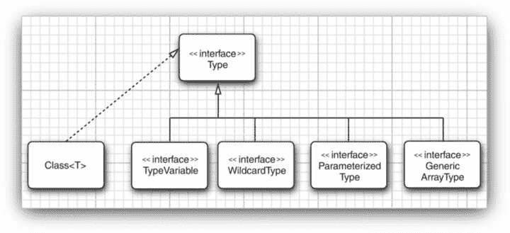

图 8.5：`Type` 接口及其后代

`列表 8.4` 使用泛型反射 API 打印它对给定类发现的信息。如果你使用 `Pair` 类运行它，将得到此报告：

```text
class Pair<T> extends java.lang.Object
public T getFirst()
public T getSecond()
public void setFirst(T)
public void setSecond(T)
```

如果你在 `PairTest2` 目录使用 `ArrayAlg` 运行它，报告将显示以下方法：

```text
public static <T extends java.lang.Comparable> Pair<T> minmax(T[])
```

列表 8.4 `genericReflection/GenericReflectionTest.java`

```java
package genericReflection;

import java.lang.reflect.*;
import java.util.*;

/**
 * @version 1.13 2023-12-20
 * @author Cay Horstmann
 */
public class GenericReflectionTest
{
   public static void main(String[] args)
   {
      // 从命令行参数或用户输入读取类名
      String name;
      if (args.length > 0) name = args[0];
      else
      {
         try (var in = new Scanner(System.in))
         {
            System.out.println("Enter 类名 (例如，java.util.Collections): ");
            name = in.next();
         }
      }

      try
      {
         // 打印类和公共方法的泛型信息
         Class<?> cl = Class.forName(name);
         printClass(cl);
         for (Method m : cl.getDeclaredMethods())
            printMethod(m);
      }
      catch (ClassNotFoundException e)
      {
         e.printStackTrace();
      }
   }

   public static void printClass(Class<?> cl)
   {
      System.out.print(cl);
      printTypes(cl.getTypeParameters(), "<", ", ", ">", true);
      Type sc = cl.getGenericSuperclass();
      if (sc != null)
      {
         System.out.print(" extends ");
         printType(sc, false);
      }
      printTypes(cl.getGenericInterfaces(), " implements ", ", ", "", false);
      System.out.println();
   }

   public static void printMethod(Method m)
   {
      String name = m.getName();
      System.out.print(Modifier.toString(m.getModifiers()));
      System.out.print(" ");
      printTypes(m.getTypeParameters(), "<", ", ", "> ", true);

      printType(m.getGenericReturnType(), false);
      System.out.print(" ");
      System.out.print(name);
      System.out.print("(");
      printTypes(m.getGenericParameterTypes(), "", ", ", "", false);
      System.out.println(")");
   }

   public static void printTypes(Type[] types, String prefix, String separator, 
         String suffix, boolean isDefinition)
   {
      if (prefix.equals(" extends ") 
            && Arrays.equals(types, new Type[] { Object.class })) return;
      if (types.length > 0) System.out.print(prefix);
      for (int i = 0; i < types.length; i++)
      {
         if (i > 0) System.out.print(separator);
         printType(types[i], isDefinition);
      }
      if (types.length > 0) System.out.print(suffix);
   }

   public static void printType(Type type, boolean isDefinition)
   {
      if (type instanceof Class<?> t)
      {
         System.out.print(t.getName());
      }
      else if (type instanceof TypeVariable<?> t)
      {
         System.out.print(t.getName());
         if (isDefinition)
            printTypes(t.getBounds(), " extends ", " & ", "", false);
      }
      else if (type instanceof WildcardType t)
      {
         System.out.print("?");
         printTypes(t.getUpperBounds(), " extends ", " & ", "", false);
         printTypes(t.getLowerBounds(), " super ", " & ", "", false);
      }
      else if (type instanceof ParameterizedType t)
      {
         Type owner = t.getOwnerType();
         if (owner != null)
         {
            printType(owner, false);
            System.out.print(".");
         }
         printType(t.getRawType(), false);
         printTypes(t.getActualTypeArguments(), "<", ", ", ">", false);
      }
      else if (type instanceof GenericArrayType t)
      {
         System.out.print("");
         printType(t.getGenericComponentType(), isDefinition);
         System.out.print("[]");
      }
   }
}
```

## 8.9.4. 类型字面量（Type Literals）

有时，你想根据值的类型来驱动程序的行为。例如，在持久化机制中，你可能希望用户指定一种保存特定类对象的方法。这通常通过将 `Class` 对象与操作关联来实现。

然而，对于泛型类，类型擦除（erasure）带来了一个问题。当 `ArrayList<Integer>` 和 `ArrayList<String>` 都擦除为相同的原始 `ArrayList` 类型时，你如何为它们提供不同的操作呢？

有一种技巧可以在某些情况下缓解这个问题。你可以捕获在前节中遇到的 `Type` 接口的实例。构建如下所示匿名子类：

```java
var type = new TypeLiteral<ArrayList<Integer>>(){} // 注意这里的 {}
```

`TypeLiteral` 构造函数捕获了泛型超类：

```java
class TypeLiteral<T>
{
   public TypeLiteral()
   {
      Type parentType = getClass().getGenericSuperclass();
      if (parentType instanceof ParameterizedType paramType)
         type = paramType.getActualTypeArguments()[0];
      else
         throw new UnsupportedOperationException(
            "Construct as new TypeLiteral<. . .>(){}");
   }
   . . .
}
```

如果我们在运行时有一个泛型类型，就可以将其与 `TypeLiteral` 进行匹配。我们无法从对象获取泛型类型——因为它被擦除了。但正如你在前节中所看到的，字段和方法参数的泛型类型在虚拟机中仍然存在。

DI 和 Guice 等注入框架使用类型字面量来控制泛型类型的注入。书中配套代码中的示例程序了一个更简单的例子。给定一个对象，我们列出其字段（其泛型类型可用），并查找关联的格式化操作。

我们通过空格分隔值来格式化 `ArrayList<Integer>`，通过将字符连接成字符串来格式化 `ArrayList<Character>`。任何其他列表通过 `ArrayList.toString` 进行格式化。

列表 8.5 `genericReflection/TypeLiterals.java`


```java
package genericReflection;

/**
   @version 1.03 2023-12-20
   @author Cay Horstmann
*/

import java.lang.reflect.*;
import java.util.*;
import java.util.function.*;

/**
 * 类型字面量描述了一个可以是泛型的类型，例如
 * ArrayList<String>。
 */
class TypeLiteral<T>
{
   private Type type;

   /**
    * 此构造函数必须通过匿名子类调用，
    * 形式如 new TypeLiteral<. . .>(){}。
    */
   public TypeLiteral()
   {
      Type parentType = getClass().getGenericSuperclass();
      if (parentType instanceof ParameterizedType paramType)
         type = paramType.getActualTypeArguments()[0];
      else
         throw new UnsupportedOperationException(
            "请使用 new TypeLiteral<. . .>(){} 方式构造");
   }

   private TypeLiteral(Type type)
   {
      this.type = type;
   }

   /**
    * 返回一个描述给定类型的类型字面量。
    */
   public static TypeLiteral<?> of(Type type)
   {
      return new TypeLiteral<>(type);
   }

   public String toString()
   {
      if (type instanceof Class<?> cl) return cl.getName();
      else return type.toString();
   }

   public boolean equals(Object otherObject)
   {
      return otherObject instanceof TypeLiteral<?> otherLiteral
         && type.equals(otherLiteral.type);
   }

   public int hashCode()
   {
      return type.hashCode();
   }
}

/**
 * 使用将类型与格式化函数关联的规则对对象进行格式化。
 */
class Formatter
{
   private Map<TypeLiteral<?>, Function<?, String>> rules = new HashMap<>();

   /**
    * 向此格式化器添加格式化规则。
    * @param type 规则应用的类型
    * @param formatterForType 格式化该类型对象的函数
    */
   public <T> void forType(TypeLiteral<T> type, Function<T, String> formatterForType)
   {
      rules.put(type, formatterForType);
   }

   /**
    * 使用此格式化器的规则格式化对象的所有字段。
    * @param obj 一个对象
    * @return 包含所有字段名和格式化值的字符串
    */
   public String formatFields(Object obj)
         throws IllegalArgumentException, IllegalAccessException
   {
      var result = new StringBuilder();
      for (Field f : obj.getClass().getDeclaredFields())
      {
         result.append(f.getName());
         result.append("=");
         f.setAccessible(true);
         Function<?, String> formatterForType = rules.get(TypeLiteral.of(f.getGenericType()));
         if (formatterForType != null)
         {
            // formatterForType 的参数类型为 ? 无法传递给它的 apply 方法。
            // 强制转换将参数类型转换为 Object 以便调用它。
            @SuppressWarnings("unchecked")
            Function<Object, String> objectFormatter
               = (Function<Object, String>) formatterForType;
            result.append(objectFormatter.apply(f.get(obj)));
         }
         else
            result.append(f.get(obj).toString());
         result.append("\n");
      }
      return result.toString();
   }
}

public class TypeLiterals
{
   public static class Sample
   {
      ArrayList<Integer> nums;
      ArrayList<Character> chars;
      ArrayList<String> strings;

      public Sample()
      {
         nums = new ArrayList<>();
         nums.add(42); nums.add(1729);
         chars = new ArrayList<>();
         chars.add('H'); chars.add('i');
         strings = new ArrayList<>();
         strings.add("Hello"); strings.add("World");
      }
   }

   private static <T> String join(String separator, ArrayList<T> elements)
   {
      var result = new StringBuilder();
      for (T e : elements)
      {
         if (result.length() > 0) result.append(separator);
         result.append(e.toString());
      }
      return result.toString();
   }

   public static void main(String[] args) throws Exception
   {
      var formatter = new Formatter();
      formatter.forType(new TypeLiteral<ArrayList<Integer>>(){},
         lst -> join(" ", lst));
      formatter.forType(new TypeLiteral<ArrayList<Character>>(){},
         lst -> "\"" + join("", lst) + "\"");
      System.out.println(formatter.formatFields(new Sample()));
   }
}
```

## `java.lang.Class<T>` 1.0

### `TypeVariable[] getTypeParameters()` 5.0

如果此类型被声明为泛型类型，则获取泛型类型变量，否则返回长度为 0 的数组。

### `Type getGenericSuperclass()` 5.0

获取为此类型声明的父类的泛型；如果此类型是 `Object` 或类类型，则返回 `null`。

### `Type[] getGenericInterfaces()` 5.0

按声明顺序获取为此类型声明的接口的泛型类型，否则返回长度为 0 的数组。

## `java.lang.reflect.Method` 1.1

### `TypeVariable[] getTypeParameters()` 5.0

如果此方法被声明为泛型方法，则获取泛型类型变量，否则返回长度为 0 的数组。

### `Type getGenericReturnType()` 5.0

获取声明此方法时使用的泛型返回类型。

### `Type[] getParameterTypes()` 5.0

获取声明此方法时使用的泛型参数类型。如果该方法没有参数，则返回长度为 0 的数组。

## `java.lang.reflect.TypeVariable` 5.0

### `String getName()`

获取此类型变量的名字。

### `Type[] getBounds()` 5.0

获取此类型变量的子类边界，如果该变量无边界，则返回长度为 0 的数组。

## `java.lang.reflect.WildcardType` 5.0

### `Type[] getUpperBounds()` 5.0

获取此类型变量的子类（`extends`）边界，如果该变量没有子类边界，则返回长度为 0 的数组。

### `Type[] getLowerBounds()` 5.0

获取此类型变量的父类（`super`）边界，如果该变量没有父类边界，则返回长度为 0 的数组。

## `java.lang.reflect.ParameterizedType` 5.0

### `Type getRawType()`

获取此参数化类型的原始类型。

### `Type[] getActualTypeArguments()`

获取声明此参数化类型时使用的类型参数。

### `Type getOwnerType()`

如果此为内部类型，则获取外部类类型；如果此为顶层类型，则返回 `null`。

## `java.lang.reflect.GenericArrayType` 5.0

### `Type getGenericComponentType()`

获取声明此数组类型时使用的泛型组件类型。

Java 的初始版本仅为最实用的数据结构提供了一小部分类：`Vector`、`Stack`、`Hashtable`、`BitSet` 以及 `Enumeration` 接口，后者提供了一种访问任意容器中元素的抽象机制。这无疑是一个明智的选择——创建一个全面的集合类库需要时间和技巧。

随着 Java 1.2 的出现，设计者们认为是时候推出一个完整的数据结构框架了。他们面临着许多相互冲突的设计挑战。他们希望库能够既小巧又易于学习；他们不想要像 C++ 标准模板库（或 `STL`）那样的复杂性，但又想获得 `STL` 开创的“泛型算法”带来的益处。他们还希望旧的类能够适应新的框架。正如所有集合库的设计者一样，他们必须做出一些艰难的抉择，并在过程中提出一许多独特的设计决策。在本节中，我们将探索 Java 集合框架的基本设计，演示如何使用它，并解释一些更具争议的特性背后的原理。

### 9.1.1 分离集合接口与实现

正如现代数据结构库的常见做法，Java 集合框架将 `interfaces` 和实现分离开。让我们通过一个熟悉的数据结构 `queue`（队列）来观察这种分离。

`queue interface` 指定了可以在队列的末尾添加元素，从头部移除元素，并找出队列中有多少元素。当你需要收集对象并按“先进先出”的方式检索它们时，就会使用 `queue`（参见图 9.1）。

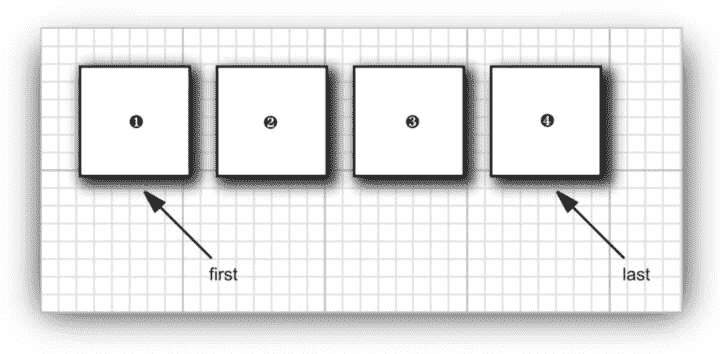图 9.1: 队列

`queue interface` 的最小形式可能如下：

```java
public interface Queue<E> // Java API 中接口的简化形式
{
   void add(E e);
   E remove();
   int size();
}
```

该接口没有告诉你任何关于队列如何实现的信息。在队列的两种常见实现中，一种使用“环形数组”，另一种使用链表（参见图 9.2）。

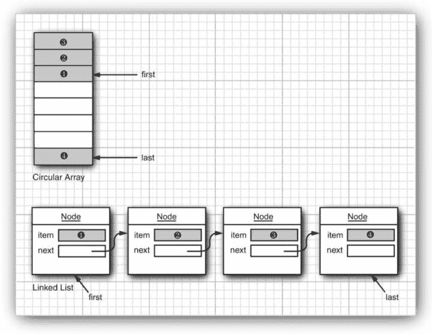图 9.2: 队列实现

每个实现都可以由实现 `Queue` 接口的类表示。在 Java API 中，这些类被称为 `ArrayDeque` 和 `LinkedList`。

```java
public class ArrayDeque<E> implements Queue<E> // 简化自 Java API
{
   private int first;
   private int last;
   private E[] elements;

   public ArrayDeque(int numElements) { . . . }
   public void add(E e) { . . . }
   public E remove() { . . . }
   public int size() { . . . }
   . . .
}

public class LinkedList<E> implements Queue<E> // 简化自 Java API
{
   private Node<E> first;
   private Node<E> last;

   public LinkedList() { . . . }
   public void add(E e) { . . . }
   public E remove() { . . . }
   public int size() { . . . }
   . . .
}
```

当你在程序中使用队列时，一旦集合构建完成，你不需要知道实际使用的是哪种实现。因此，*仅*在构建集合对象时使用具体类是有意义的。使用 `interface type`（接口类型）来持有集合引用。

```java
Queue<Customer> expressLane = new ArrayDeque<>(100);
expressLane.add(new Customer("Harry"));
```

通过这种方法，如果你改变了主意，可以轻松地使用不同的实现。你只需要修改程序中的一处地方——构造函数的调用处。如果你最终决定链表是更好的选择，你的代码将变为：

```java
Queue<Customer> expressLane = new LinkedList<>();
expressLane.add(new Customer("Harry"));
```

坚持使用接口还有另一个原因。`ArrayDeque` 和 `LinkedList` 类都拥有与队列无关的方法。不小心使用其中一个方法会被报告为编译错误，因为你不能在 `Queue` 类型的变量上调用它们。

为什么选择一种实现而不是另一种呢？接口并没有说明实现的效率如何。环形数组更节省内存。然而，环形数组具有有限的容量，并且每当填满时都需要重新分配。事实上，测量结果显示 `ArrayDeque` 的性能通常优于 `LinkedList`，因为它对垃圾回收器的影响较小。当 `ArrayDeque` 在 Java 6 中出现时，使用 `Queue` 接口的程序员可以通过更改一行代码来替换 `LinkedList`。

### 9.1.2 集合接口

Java 集合框架中集合类的基础接口是 `Collection` 接口。该接口有两个基本方法：

```java
public interface Collection<E>
{
   boolean add(E element);
   Iterator<E> iterator();
   . . .
}
```

除了这两个方法外，还有几个方法；我们稍后会讨论。

`add` 方法向集合添加一个元素。如果添加元素确实改变了集合，`add` 方法返回 `true`；如果集合未变化，则返回 `false`。例如，如果你尝试向集合（set）添加一个对象而该对象已存在，则 `add` 请求将无效，因为集合拒绝重复项。

`iterator` 方法返回一个实现 `Iterator` 接口的对象。通过该对象，你可以逐个访问集合中的元素。我们将在下一节讨论迭代器。

### 9.1.3 迭代器

`Iterator` 接口有四个方法：

```java
public interface Iterator<E>
{
   boolean hasNext();
   E next();
   default void remove();
   default void forEachRemaining(Consumer<? super E> action);
}
```

通过反复调用 `next` 方法，你可以逐个访问集合中的元素。然而，如果你到达集合的末尾，`next` 方法会抛出 `NoSuchElementException`。因此，你需要在调用 `next` 之前先调用 `hasNext` 方法。如果迭代器尚未到达末尾且至少还有一个更多元素待访问，该方法返回 `true`。如果你想检查集合中的所有元素，可以请求一个迭代器，并在 `hasNext` 返回 `true` 时持续调用 `next` 方法。例如：


```java
Collection<String> coll = . . .;
Iterator<String> iter = coll.iterator();
while (iter.hasNext())
{
   String element = iter.next();
   // 对 element 执行某些操作
}
```

你可以用更简洁的方式编写此类循环为“for each”循环：

```java
for (String element : coll)
{
   // 对 element 执行某些操作
}
```

编译器简单地将“for each”循环转换为带有迭代器的循环。

“for each”循环适用于任何实现 `Iterable` 接口的对象，该接口包含一个抽象方法：

```java
public interface Iterable<E>
{
   Iterator<E> iterator();
   . . .
}
```

`Collection` 接口继承（extends）了 `Iterable` 接口。因此，你可以对 Java 集合框架中的任何集合使用“for each”循环。

与其编写循环，不如调用 `Collection.forEach` 或 `Iterator.forEachRemaining` 方法，并传入一个消费元素的 Lambda 表达式。该 Lambda 表达式将在集合的所有元素或迭代器可以访问的剩余元素上被调用。

```java
coll.forEach(element -> // 对 element 执行某些操作);
iter.forEachRemaining(element -> // 对 element 执行某些操作);
```

访问元素的顺序取决于集合的类型。如果你遍历一个 `ArrayList`，迭代器将从索引 `0` 开始，并在每一步中增加索引。然而，如果你访问 `HashSet` 中的元素，你将以一种本质上是随机的顺序获取它们。你可以确保在迭代过程中会遇到集合中的所有元素，但你无法对它们的顺序做出任何假设。这通常不是一个问题，因为对于计算总和或计数匹配项等计算来说，顺序并不重要。

老手们会注意到，`Iterator` 接口的 `next` 和 `hasNext` 方法的作用与 `Enumeration` 接口的 `nextElement` 和 `hasMoreElements` 方法是相同的。Java 集合框架的设计者本可以选择利用 `Enumeration` 接口。但他们不喜欢那些繁琐的方法名，而是引入了一个具有更短方法名的新接口。

Java 集合库中的迭代器与其他库中的迭代器之间存在着一个重要的概念性区别。在传统的集合库中（如 C++ 的标准模板库 STL），迭代器是根据数组索引进行建模的。给定这样一个迭代器，你可以查找存储在该位置的元素，就像如果你有数组索引 `i`，你可以查找数组元素 `a[i]` 一样。无论是否查找，你都可以将迭代器移动到下一个位置。这与通过 `i++` 推进数组索引的操作是相同的，而不需要执行查找。然而，Java 迭代器并不是那样工作的。查找和位置变化是紧密耦合的。查找元素的唯一方法是调用 `next`，而该查找会移动位置。

相反，将 Java 迭代器想象为处于元素之间。当你调用 `next` 时，迭代器会跳过下一个元素，并返回它刚刚经过的元素的引用（见图 9.3）。

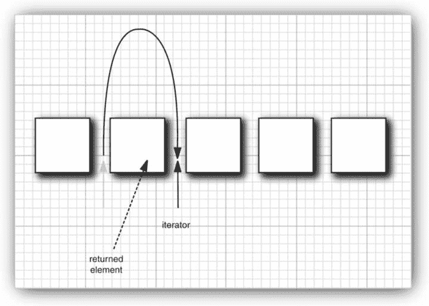

图 9.3：推进迭代器

这里另一个有用的类比。你可以将 `Iterator.next` 等同于 `InputStream.read`。从流中读取字节会自动“消耗”该字节。下一次调用 `read` 将消耗并返回输入流中的下一个字节。同样地，重复调用 `next` 可以让你读取集合中的所有元素。

`Iterator` 接口的 `remove` 方法删除上一次调用 `next` 返回的元素。在许多情况下，这是合理的——你必须先看到元素，才能判断它是否是应该被删除的那个。但如果你想删除特定位置的元素，你仍然需要跳过该元素。例如，这里是删除字符串集合中第一个元素的方法：

```java
Iterator<String> iter = coll.iterator();
iter.next(); // 跳过第一个元素
iter.remove(); // 现在删除它
```

更重要的是，`next` 方法和 `remove` 方法的调用之间存在依赖关系。在没有先调用 `next` 的情况下调用 `remove` 是非法的。如果你尝试这样做，将抛出 `IllegalStateException`。

如果你想删除两个相邻的元素，不能简单地调用：

```java
iter.remove();
iter.remove(); // 错误
```

相反，你必须先调用 `next` 来跳过要删除的元素。

```java
iter.remove();
iter.next();
iter.remove(); // 正确
```

### 9.1.4 泛型工具方法

`Collection` 和 `Iterator` 接口是泛型的，这意味着你可以编写操作任何类型集合的工具方法。例如，这里有一个测试任意集合是否包含给定元素的泛型方法：

```java
public static <E> boolean contains(Collection<E> c, Object obj)
{
   for (E element : c)
      if (element.equals(obj))
         return true;
   return false;
}
```

Java 集合框架的设计者认为，这些工具方法中的某些是非常实用的，以至于框架应该提供它们。这样，API 用户就不需要不断重复造轮子了。`contains` 方法就是其中之一。

事实上，`Collection<E>` 接口声明了相当实用的方法，所有实现类必须提供这些方法：

```java
int size()
boolean isEmpty()
boolean contains(Object obj)
boolean containsAll(Collection<?> c)
boolean add(E obj)
boolean addAll(Collection<? extends E> from)
boolean remove(Object obj)
boolean removeAll(Collection<?> c)
boolean retainAll(Collection<?> c)
void clear()
Object[] toArray()
T[] toArray(T[] a)
```

`Collection` 接口声明了继承自 `Object` 的 `equals` 和 `hashCode` 方法。技术上没有必要包含这些声明。它只是为添加集合特定的 API 文档提供了一个良好的位置。`Set` 和 `List` 子接口规定了 `equals` 的特定行为。其他集合可以继承 `Object.equals`，或者重写它并以某种方式比较元素。在后一种情况下，也需要重写 `hashCode` 方法。

这些方法中的许多是自言自明的；你将在本节末尾的 API 说明中找到完整的文档。

Java 集合框架是在泛型类型加入 Java 之前设计的。为了向后兼容，`contains` 和 `remove` 方法的参数类型为 `Object` 而不是 `E`。`containsAll`、`removeAll` 和 `retainAll` 方法的参数类型为 `Collection<?>` 而不是 `Collection<? extends E>`。

- `boolean contains(Object obj)` 如果此集合包含与 `obj` 相等的对象，则返回 `true`。
- `boolean containsAll(Collection<?> other)` 如果此集合包含 `other` 中的所有元素，则返回 `true`。
- `boolean add(E element)` 尝试向集合中添加一个元素。如果因为此调用导致集合发生了变化，则返回 `true`。
- `boolean addAll(Collection<? extends E> other)` 将另一个集合中的所有元素添加到此集合。如果因为此调用导致集合发生了变化，则返回 `true`。
- `boolean remove(Object obj)` 尝试从此集合中移除与 `obj` 相等的对象。如果删除了匹配的对象，则返回 `true`。
- `boolean removeAll(Collection<?> other)` 从此集合中移除另一个集合中的所有元素。如果因为此调用导致集合发生了变化，则返回 `true`。
- `default boolean removeIf(Predicate<? super E> filter)` 移除所有 `filter` 返回 `true` 的元素。如果因为此调用导致集合发生了变化，则返回 `true`。
- `void clear()` 移除此集合中的所有元素。
- `boolean retainAll(Collection<?> other)` 移除此集合中不等于 `other` 中任何元素的元素。如果因为此调用导致集合发生了变化，则返回 `true`。
- `Object[] toArray()` 返回集合中对象的数组。
- `<T> T[] toArray(IntFunction<T[]> generator)` 返回集合中对象的数组。该数组使用 `generator` 构建，该 `generator` 通常是一个构造器表达式 `T[]::new`。

### `java.util.Iterator<E>`

- `boolean hasNext()` 如果还有另一个元素可以访问，则返回 `true`。
- `E next()` 返回下一个要访问的对象。如果到达集合末尾，则抛出 `NoSuchElementException`。
- `void remove()` 移除上一次访问的对象。此方法必须紧随元素访问之后调用。如果自上次访问元素后集合已被修改，则此方法抛出 `IllegalStateException`。迭代器不要求支持此操作。默认实现抛出 `UnsupportedOperationException`。
- `default void forEachRemaining(Consumer<? super E> action)` 访问元素并将它们传递给给定的 `action`，直到没有剩余元素或该 action 抛出异常。

## 9.2. 集合框架中的接口

Java 集合框架为不同类型的集合定义了许多接口。这些接口在图 9.4 中所示，并发编程的接口除外，它们将在第 10 章中介绍。

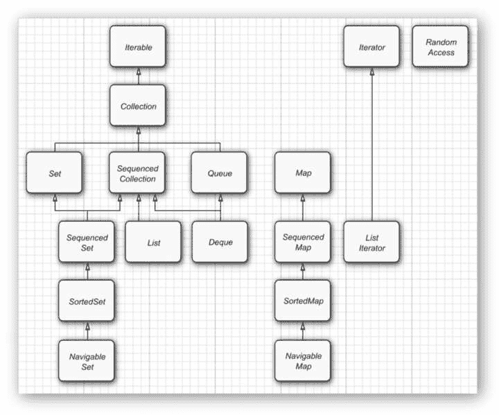

图 9.4：Java 集合框架的接口

集合有两个基础接口：`Collection` 和 `Map`。正如你已经看到的，你通过一个方法向集合中插入元素：

```java
boolean add(E element)
```

然而，map 存储的是键/值对，你使用 `put` 方法来插入它们：

```java
V put(K key, V value)
```

要从集合中读取元素，请使用迭代器访问它们。但是，你可以使用 `get` 方法从 map 中读取值：

```java
V get(Object key)
```

`List` 是一个*有序集合*。元素被添加到容器的特定位置。元素可以通过两种方式访问：通过迭代器或通过整数索引。后者被称为*随机访问*，因为元素可以按任何顺序被访问。相比之下，当使用迭代器时，必须按顺序访问它们。

`List` 接口定义了几个用于随机访问的方法：

```java
void add(int index, E element)
E remove(int index)
E get(int index)
E set(int index, E element)
```

对于 `List<Integer>`，有两个 `remove` 方法：

```java
boolean remove(int index) // 移除指定索引的元素
boolean remove(Integer o) // 移除与 o 相等的元素
```

当使用类型为 `int` 的参数调用 `remove` 时，会选择第一个方法。此时不考虑装箱（boxing），且没有警告。这可能不是你想要的：

```java
List<Integer> ids = . . .;
int id = . . .;
if (id == 0) ids.remove(id); // 移除索引为 0，而不是值为 0 的元素
```

`List` 接口的 API 文档定义了列表的 `equals` 方法的行为。要使一个列表与另一个对象相等，另一个对象也必须是某种列表。两个列表必须具有相同的大小。在遍历每个列表时，对应的元素必须是等的。

坦率地说，Java 集合框架中的 `List` 接口存在一个问题。有序集合有两种类型，它们的性能权衡非常不同。由数组支持的有序集合具有快速的随机访问，使用带有整数索引的 `List` 方法是有意义的。相比之下，链表虽然也是有序的，但随机访问很慢，最好是使用迭代器进行顺序遍历。如果能提供两个接口会更好。

为了避免对链表执行随机访问操作，Java 1.4 引入了一个标记接口 `RandomAccess`。该接口没有方法，但你可以用它来测试特定集合是否支持高效的随机访问：

```java
if (c instanceof RandomAccess)
{
   随机遍历
}
else
{
   顺序遍历
}
```

`Set` 接口与 `Collection` 接口具有相同的实例方法，但方法的行为定义得更为严格。集合的 `add` 方法应该拒绝重复项。集合的 `equals` 方法应该定义为：如果两个 set 具有相同的元素，它们就是相等的，但不一定具有相同的顺序。`hashCode` 方法应该定义为：两个具有相同元素的 set 会产生相同的哈希值。

如果方法签名相同，为什么要单独定义一个接口呢？从概念上讲，并不是所有集合都是 set。创建 `Set` 接口允许程序员编写只接受 set 的方法。

为了理解为什么这种区别很重要，请考虑相等性测试。如果两个列表以相同顺序具有相同元素，则它们是相等。如果两个 set 以某种顺序具有相同元素，则它们是相等。实现 `Set` 接口的类的 `equals` 方法需要确保参数也是 `Set` 而不是任何 `Collection`。

`SortedSet` 和 `SortedMap` 接口暴露了用于排序的比较器对象，并定义了获取集合子集视图的方法。我们将在节 9.5.3 中讨论这些。

`NavigableSet` 和 `NavigableMap` 接口包含了在排序集合和 map 中查找下一个或上一个元素的方法。`TreeSet` 和 `TreeMap` 类实现了这些接口。导航操作可以在基于树的数据结构中高效实现。

Java 21 引入了 `SequencedCollection<E>` 接口，提供了对集合第一个和最后一个元素的统一访问以及反向遍历：

```java
E getFirst()
E getLast()
void addFirst(E e)
void addLast(E e)
E removeFirst()
E removeLast()
SequencedCollection<E> reversed()
```

以前这些操作是由 list、set 和 deque 中不同的方法执行的。`SequencedSet` 子接口将 `reversed` 方法的返回类型为 `SequencedSet`。`SequencedMap` 接口为 map 提供类似的方法。

## 9.3. 具体集合

表 9.1 显示了 Java 集合框架中的集合，并简要描述了每个集合类的用途。（为了简单起见，我们省略了线程安全的集合，它们将在第 10 章中讨论。）

表 9.1 中的所有类都实现了 `Collection` 接口，但以 `Map` 结尾的类除外。这些类实现了 `Map` 接口。我们将在第 9.4 节中讨论映射。

#### 表 9.1：Java 集合框架中的具体集合

| 集合类型 | 描述 | 参见 |
| --- | --- | --- |
| `ArrayList` | 一种动态伸缩的索引序列 | 第 9.3.2 节 |
| `LinkedList` | 允许在任何位置高效插入和删除的有序序列 | 第 9.3.1 节 |
| `ArrayDeque` | 用循环数组实现的双端队列 | 第 9.3.5 节 |
| `HashSet` | 一个拒绝重复的无序集合 | 第 9.3.3 节 |
| `TreeSet` | 一个排序集合 | 第 9.4.5 节 |
| `EnumSet` | 举举类型值的集合 | 第 9.4.6 节 |
| `LinkedHashSet` | 一个记住元素插入顺序的集合 | 第 9.4.5 节 |
| `PriorityQueue` | 一个允许高效删除最小元素的集合 | 第 9.3.6 节 |
| `HashMap` | 存储键/值关联的数据结构结构 | 第 9.4.1 节 |
| `TreeMap` | 键经过排序的映射 | 第 9.4.1 节 |
| `EnumMap` | 键属于举举类型的映射 | 第 9.4.6 节 |
| `LinkedHashMap` | 一个记住条目添加顺序的映射 | 第 9.4.5 节 |
| `WeakHashMap` | 如果值未在别处被使用，则可以被垃圾回收器回收的映射 | 第 9.4.4 节 |
| `IdentityHashMap` | 键通过 `==` 而不是 `equals` 比较的映射 | 第 9.4.7 节 |

图 9.5 显示了这些类之间的关系。

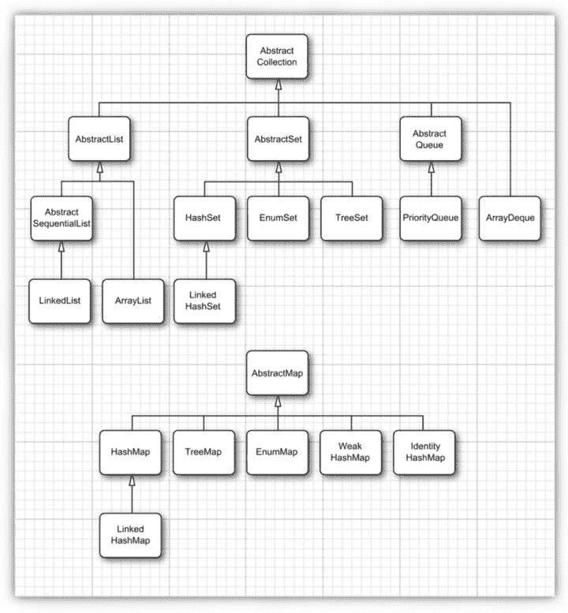

图 9.5：Java 集合框架中的类

### 9.3.1 链表

在本书的许多示例中，我们已经使用了数组及其动态表亲 `ArrayList` 类。然而，数组和数组列表有一个缺点。从数组中间删除元素是非常昂贵的操作，因为被删除元素之后的所有数组元素都必须向数组开头移动（参见图 9.6）。在中间插入元素也是如此。

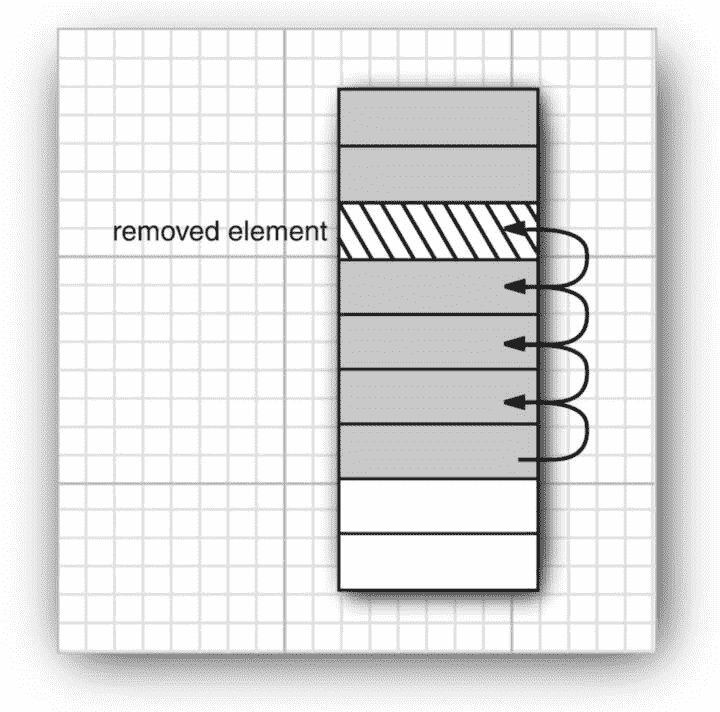

图 9.6：从数组中删除元素


另一种著名数据结构——链表，解决了这个问题。数组在连续的内存位置存储对象引用，而链表将每个对象存储在单独节点中。每个节点还存储了指向序列中下一个节点的引用。在 Java 集合框架中，所有的链表实际上都是双向链的；也就是说，每个节点还存储了指向其前驱节点的引用（参见图 9.7）。

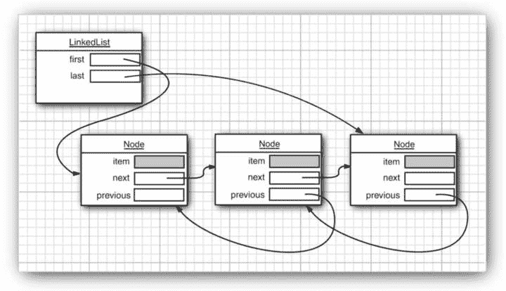

图 9.7：双向链表

从链表的中间删除元素是一个廉价的操作——只需要更新被删除元素周围的节点即可（参见图 9.8）。

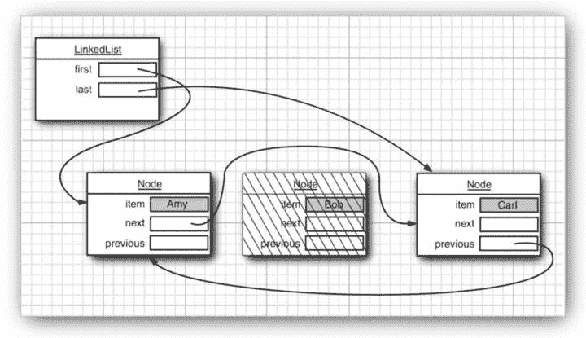

图 9.8：从链表中删除元素

也许你曾经上过数据结构课程，并学习过如何实现链表。你可能对在链表中添加或删除元素时处理错节点关系有糟糕的回忆。如果是这样，你会高兴地发现，Java 集合框架提供了一个供你使用的 `LinkedList` 类。

以下代码示例添加了三个元素，然后删除了第二个：

```java
var staff = new LinkedList<String>(); 
staff.add("Amy");
staff.add("Bob");
staff.add("Carl");
Iterator<String> iter = staff.iterator();
String first = iter.next(); // 访问第一个元素 (Amy)
String second = iter.next(); // 访问第二个元素 (Bob)
iter.remove(); // 删除最后访问的元素 (Bob)
```

然而，链表和泛型集合之间有一个重要的区别。链表是一个有序集合，对象的位置很重要。`LinkedList.add` 方法将对象添加到列表末尾。但你通常想在中间插入元素。

与仅依赖迭代器位置的 `add` 方法不同，`remove` 方法取决于迭代器的状态。

最后，`set` 方法会将调用 `next` 或 `previous` 返回的最后一个元素替换为新元素。例如，以下代码将列表的第一个元素替换为一个值：

```java
ListIterator<String> iter = list.listIterator();
String oldValue = iter.next(); // 返回第一个元素
iter.set(newValue); // 将第一个元素设置为 newValue
```

正如你可能想象到的，如果一个迭代器在遍历集合时，另一个迭代器正在对其进行修改，就会出现混乱的情况。例如，假设一个迭代器指向一个被另一个迭代器刚刚删除的元素之前。此时该迭代器已失效，不应再使用。链表迭代器被设计为可以检测此类修改。如果迭代器发现其集合被另一个迭代器或集合本身的方法修改了，它将抛出 `ConcurrentModificationException`。例如，考虑以下代码：

```java
List<String> list = . . .;
ListIterator<String> iter1 = list.listIterator();
ListIterator<String> iter2 = list.listIterator();
iter1.next();
iter1.remove();
iter2.next(); // 抛出 ConcurrentModificationException
```

调用 `iter2.next` 会抛出 `ConcurrentModificationException`，因为 `iter2` 检测到列表已从外部被修改。

为了避免并发修改异常，请遵循这一简单规则：你可以向集合中附加任意数量的迭代器，只要它们都只是只读的。或者，你也可以附加一个既能读又能写的单一迭代器。

并发修改检测是以一种简单的方式完成的。集合记录了修改操作（如添加和删除元素）的数量。每个迭代器都会维护一个由`它`负责的修改操作计数。在每个迭代器方法的开始处，迭代器简单地检查自身的修改计数是否与集合的计数相等。如果不相等，它就会抛出 `ConcurrentModificationException`。

然而，并发修改检测中存在一个奇特的异常。链表只跟踪列表的`结构性`修改，例如添加和删除链接。`set` 方法`不被视为`结构性修改。你可以向链表上附加多个迭代器，它们都可以调用 `set` 来更改现有链接的内容。这种能力在我们在本章稍后部分将讨论的 `Collections` 类中的许多算法中是需要的。

现在你已经了解了 `LinkedList` 类的基本方法。使用 `ListIterator` 可以双向遍历链表的元素，并添加和删除元素。

正如你在第 9.2 节中看到的，许多其他操作链表的有用方法在 `Collection` 接口中声明。这些方法大部分在 `LinkedList` 类的父类 `AbstractCollection` 中实现。例如，`toString` 方法会调用所有元素的 `toString` 并生成一个格式为 `[A, B, C]` 的长字符串。这对于调试非常有用。使用 `contains` 方法可以检查元素是否存在于链表中。例如，调用 `staff.contains("Harry")`，如果链表已经包含一个与字符串 `"Harry"` 相等的字符串，则返回 `true`。

Java 集合框架还提供了一些从理论角度来看有些可疑的方法。链表不支持快速的随机访问。如果你想查看链表的第 `n` 个元素，必须从头开始并跳过前 `n - 1` 个元素。没有捷径。出于这个原因，程序员通常不会在需要通过整数索引访问元素的情况下使用链表。

尽管如此，`LinkedList` 类提供了一个 `get` 方法，允许你访问特定元素：

```java
LinkedList<String> list = . . .;
String obj = list.get(n);
```

当然，这个方法的效率并不高。如果你发现自己在使用它，那么你可能为你的问题选错了错误的数据结构。

你`永远不要`使用这种幻觉般的随机访问方法来遍历链表。以下代码：

```java
for (int i = 0; i < list.size(); i++)
   do something with list.get(i);
```

其效率低得惊人。每当你查找另一个元素时，搜索都会从列表开始重新开始。`LinkedList` 对象并没有尝试缓存位置信息。

`get` 方法有一个细微的优化：如果索引至少为 `size() / 2`，则元素的搜索将从列表末尾开始。

列表迭代器接口还有一个方法可以告诉你当前位置的索引。事实上，由于 Java 迭代器在概念上指向元素之间，因此它有两个这样的方法：`nextIndex` 方法返回下次调用 `next` 将返回的元素的整数索引；`previousIndex` 方法返回下次调用 `previous` 将返回的元素的索引。当然，它只是比 `nextIndex` 小 1。这些方法对于 `LinkedList` 迭代器是高效的——每个迭代器都维护其当前位置的计数。最后，如果你有一个整数索引 `n`，那么 `list.listIterator(n)` 返回一个指向索引为 `n` 的元素之前的迭代器。也就是说，调用 `next` 会产生与 `list.get(n)` 相同的元素；获取该迭代器的效率很低。

如果你的链表只有几个元素，你不必过度担心 `get` 和 `set` 方法的成本。但既然如此，最初为什么要用链表呢？使用链表的唯一目的是为了减少中间插入和删除的成本。如果你只有几个元素，可以直接使用 `ArrayList`。

我建议你直接避开所有使用整数索引表示链表位置的方法。如果你想对集合进行随机访问，请使用数组或 `ArrayList`，而不是链表。

列表 9.1 中的程序将链表派上了用场。它简单地创建了两个列表，将它们合并，然后删除了第二个列表中的每个元素，最后测试了 `removeAll` 方法。我建议你跟踪程序的流，并特别关注迭代器。绘制迭代器位置的图表可能会有所帮助，如下：

```text
|ACE  |BDFG
A|CE  |BDFG
AB|CE B|DFG
. . .
```

注意，调用：

```java
System.out.println(a);
```

通过调用 `AbstractCollection` 中的 `toString` 方法打印链表 `a` 中的所有元素。

## 列表 9.1 linkedList/LinkedListTest.java

```java
package linkedList;

import java.util.*;

/**
 * 此程序演示了链表的操作。
 * @version 1.13 2023-12-05
 * @author Cay Horstmann
 */
public class LinkedListTest
{
   public static void main(String[] args)
   {
      var a = new LinkedList<String>();
      a.add("Amy");
      a.add("Carl");
      a.add("Erica");

      var b = new LinkedList<String>();
      b.add("Bob");
      b.add("Doug");
      b.add("Frances");
      b.add("Gloria");

      // 将元素从 b 合并到 a

      ListIterator<String> aIter = a.listIterator();
      Iterator<String> bIter = b.iterator();

      while (bIter.hasNext())
      {
         if (aIter.hasNext()) aIter.next();
         aIter.add(bIter.next());
      }

      System.out.println(a);

      // 从 b 中的每第二个元素

      bIter = b.iterator();
      while (bIter.hasNext())
      {
         bIter.next(); // 跳过一个元素
         if (bIter.hasNext())
         {
            bIter.next(); // 跳过下一个元素
            bIter.remove(); // 删除该元素
         }
      }

      System.out.println(b);

      // 批量操作：从 a 中移除 b 的所有元素

      a.removeAll(b);

      System.out.println(a);
   }
}
```

### `java.util.List<E>` 1.2

- `ListIterator<E> listIterator()`

  返回一个用于访问列表元素的迭代器。

- `ListIterator<E> listIterator(int index)`

  返回一个用于访问列表元素的迭代器，其首次调用 `next()` 将返回具有指定索引的元素。

- `void add(int i, E element)`

  在指定位置添加一个元素。

- `boolean addAll(int i, Collection<? extends E> elements)`

  将集合中的所有元素添加到指定位置。

- `E remove(int i)`

  移除并返回指定位置的元素。

- `E get(int i)`

  获取指定位置的元素。

- `E set(int i, E element)`

  用新元素替换指定位置的元素，并返回旧元素。

- `int indexOf(Object element)`

  返回与指定元素相等的元素首次出现的位置，如果没有找到匹配的元素，则返回 -1。

- `int lastIndexOf(Object element)`

  返回与指定元素相等的元素最后一次出现的位置，如果未找到匹配的元素，则返回 -1。

### `java.util.ListIterator<E>` 1.2

- `void add(E newElement)`

  在当前位置之前添加一个元素。

- `void set(E newElement)`

  用新元素替换由 `next()` 或 `previous()` 最后访问的元素。如果自上次调用 `next()` 或 `previous()` 之后列表结构被修改，则抛出 `IllegalStateException`。

- `boolean hasPrevious()`

  当反向遍历列表时还有另一个元素可以访问，则返回 `true`。

- `E previous()`

  返回上一个对象。如果已到达列表开头，则抛出 `NoSuchElementException`。

- `int nextIndex()`

  返回下一次调用 `next()` 将返回元素的索引，或者如果迭代器已超过最后一个元素，则返回列表的大小。

- `int previousIndex()`

  返回下一次调用 `previous()` 将返回元素的索引，或者如果迭代器在第一个元素之前，则返回 -1。

### `java.util.LinkedList<E>` 1.2

- `LinkedList()`

  构造一个空链表。

- `LinkedList(Collection<? extends E> elements)`

  构造一个链表并添加集合中的所有元素。

- `void addFirst(E element)`

- `void addLast(E element)`

  在列表的开头或结尾添加元素。

- `E getFirst()`

- `E getLast()`

  返回列表开头或结尾的元素。

- `E removeFirst()`

- `E removeLast()`

  移除并返回列表开头或结尾的元素。

## 9.3.2. 数组列表

在前面的一节中，你看到了 `List` 接口和实现它的 `LinkedList` 类。`List` 接口描述了一个有序集合，其中元素的位置非常重要。访问元素有两种协议：通过迭代器以及通过 `get()` 和 `set()` 方法进行随机访问。后者并不适用于链表，但对于数组来说，`get()` 和 `set()` 显然是有意义的。Java 集合框架提供了熟悉的 `ArrayList` 类，它也实现了 `List` 接口。`ArrayList` 封装了一个动态重新分配的对象数组。

Java 1.0 带来了一个不同的基于数组的集合——`Vector` 类。`Vector` 类的所有方法都是同步的（`synchronized`）。从两个线程访问 `Vector` 对象是安全的。但如果你只从单个线程访问 vector（这是要常见得多的情况），那么同步就是是浪费的。相比之下，`ArrayList` 的方法则不是。

## 9.3.3. 哈希集合

一种用于快速查找对象的已知数据结构是`哈希表`（hash table）。哈希表为每个对象计算一个整数，称为`哈希码`（hash code）。哈希码是从对象的实例字段派出的，最好是让不同的数据产生不同的代码。在 Java 中，哈希表被实现为链表的数组。每个列表被称为`桶`（bucket）（见图 9.10）。要在表中找到对象的位置，请计算其哈希码并对桶的总数取模。结果就是存放该元素的桶索引。例如，如果一个对象的哈希码为 76268 且有 128 个桶，那么对象被放在桶 108（因为 `76268 % 128` 等于 108）。也许你很好，桶中没有其他元素。这时只需将元素插入该桶中。当然，有时你会遇到非桶。这被称为`哈希冲突`（hash collision）。然后，将新对象与桶中的所有对象进行比较，以检查它是否存在。

| String | Hash Code |
| --- | --- |
| `"Lee"` | 76268 |
| `"lee"` | 10720 |
| `"eel"` | 100300 |

如果你定义了自己的类，你需要负责实现自己的 `hashCode()` 方法。你的实现需要与 `equals()` 方法兼容：如果 `a.equals(b)`，则 `a` 和 `b` 必须具有相同的哈希码。

现在重要的是，哈希码可以快速计算，且该计算仅取决于需要哈希的对象的状态，而不取决于哈希表中的其他对象。

在 `HashMap` 实现中，当桶（bucket）的大小超过阈值时，它会从链表转换为平衡二叉树。如果哈希函数选择不当导致大量冲突，或者恶意代码试图用许多具有相同哈希值的填充哈希表，这种机制可以提高性能。

在可能的情况下，哈希表的键应该属于实现了 `Comparable` 接口的类。这样，你就能保证不会因为哈希码分布不均而导致性能下降。

如果哈希表太满，就需要进行重哈希（`rehashed`）。要重哈希表，会创建一个具有更多桶的新表，将所有元素插入到新表中，并丢弃原表。`load factor`（负载因子）决定了哈希表何时何时进行重哈希。例如，如果负载因子为 `0.75`（默认值）且表填充率超过 75%，它将自动以双倍的桶进行重哈希。对于大多数应用程序，将负载因子保持在 `0.75` 是合理的。

如果你想对哈希表的性能有更多控制，可以指定初始桶的数量。你应该将其设置为预期的元素数量除以负载因子。或者，从 Java 19 开始，你可以使用静态的 `newHashSet` 便利方法来为你完成此计算：

```java
HashSet<String> strings = HashSet.newHashSet(expectedElementCount);
```


一些研究人员认为，将桶的数量设置为质数可以防止键的聚类。然而，这一结论并没有定论。Java Collections Framework 使用桶的数量为 2 的幂，默认值为 `16`。（你提供的任何桶数量的值都会被自动向上舍入到下一个 2 的幂。）

哈希表可以实现许多重要的数据结构。其中最简单的是 `set` 类型。集合是一个不包含重复元素的集合。`set` 的 `add` 方法首先尝试查找要添加的对象，只有在它尚不存在时才进行添加。

Java Collections Framework 提供了一个基于哈希表实现集合的 `HashSet` 类。你使用 `add` 方法添加元素。`contains` 方法被重写了，以便快速查找某个元素是否已存在于集合中。它只检查一个桶中的元素，而不是集合中的所有元素。

哈希集合迭代器（iterator）依次访问所有的桶。由于哈希处理将元素分散在表中，因此它们的访问顺序似乎是随机的。只有在你不在乎集合中元素的顺序时，才会使用 `HashSet`。

本节末尾示例程序（Listing 9.2）从文件中读取单词，将其添加到集合中，并打印集合中的前二十个单词。例如，你可以从命令行启动程序并输入*爱丽丝漫仙游*的文本如下：

```bash
java set.SetTest ../gutenberg/alice30.txt
```

*爱丽丝漫仙游*有 28,195 个单词，其中 5,909 个是唯一的（包括开头的版权声明）。单词以随机顺序出现。随后，相同的单词被插入到树形集合中，正如你将在下一节中看到的，它会保持元素的排序顺序。

在修改集合元素时要小心。如果元素的哈希码发生变化，该元素将不再位于数据结构中的正确位置。

```java
var rects = new HashSet<Rectangle>();

var rect = new Rectangle(5, 10, 20, 30);

rects.add(rect);

rect.setLocation(0, 0);

// rects is now [java.awt.Rectangle[x=0,y=0,width=20,height=30]]

rects.remove(new Rectangle(0, 0, 20, 30)); // 返回 false，未移除
```

**Listing 9.2 `set/SetTest.java`**

```java
package set;

import java.io.IOException;
import java.nio.file.Path;
import java.util.*;

/**
 * 此程序比较了插入哈希集合和树形集合的性能。
 * 运行程序如下：
 * java set.SetTest ../gutenberg/alice30.txt
 * java set.SetTest ../gutenberg/crsto10.txt 100
 * @version 1.2 2023-12-07
 * @author Cay Horstmann
 */

public class SetTest
{
   public static void time(Set<String> wordSet, List<String> wordList, int repetitions)
   {
      long totalTime = 0;

      for (int i = 1; i <= repetitions; i++)
      {
         for (String word : wordList)
         {
            long start = System.nanoTime();
            wordSet.add(word);
            long end = System.nanoTime();
            totalTime += end - start;
         }
      }

      Iterator<String> iter = wordSet.iterator();

      for (int i = 1; i <= 20 && iter.hasNext(); i++)
         System.out.print(iter.next() + " ");

      System.out.println("...");

      System.out.printf("%s: %d words, %d distinct, %.3f seconds.%n",
         wordSet.getClass().getSimpleName(), wordSet.size(), wordSet.size(), totalTime/1e9);
   }

   public static void main(String[] args) throws IOException
   {
      List<String> words = new ArrayList<>();

      String filename = args.length > 0 ? args[0] : "../gutenberg/alice30.txt";
      int repetitions = args.length > 1 ? Integer.parseInt(args[1]) : 100;

      try (Scanner in = new Scanner(Path.of(filename))) {
         while (in.hasNext()) {
            String word = in.next();
            words.add(word);
         }
      }

      Set<String> hashSet = new HashSet<>();

      for (String word : words)
         hashSet.add(word);

      time(hashSet, words, repetitions);

      Set<String> treeSet = new TreeSet<>();

      for (String word : words)
         treeSet.add(word);

      time(treeSet, words, repetitions);
   }
}
```

要使用树集合（tree set），你必须能够比较元素。元素必须实现 `Comparable` 接口，或者在构造集合时提供一个 `Comparator`。（`Comparable` 和 `Comparator` 接口是在第 6 章中引入的。）

树集合到底慢多少？如下所示运行列表 9.2 中的程序：

```bash
java set.SetTest ../gutenberg/crsto10.txt 100
```

《基督基督基督仇》有 466,300 个单词，每个单词都被插入了 100 次。在我的测试机器上，`TreeSet` 的速度慢了近 4 倍。如果你不需要数据进行排序，就没有理由为排序的开销付出代价。更重要的是，对于某些数据，设计出一个排序顺序比设计哈希函数要困难得多。哈希函数只需要对对象进行相当不错的打乱即可，而比较函数必须以完全精确的粒度区分对象。

为了让这种区别更具体，请考虑收集一组矩形的任务。如果你使用 `TreeSet`，你需要提供一个 `Comparator<Rectangle>`。你如何比较两个矩形呢？通过面积吗？这行不通。你可能有两个坐标不同但面积相同的矩形，而你希望两个都保留。比较器必须与 `equals` 兼容；也就是说，只有当元素相等时，比较结果才能为 0。矩形确实有这样的排序顺序（基于坐标的字典序排序），但计算起来非常繁琐。相比之下，`Rectangle` 类已经定义了哈希函数。它只需对坐标进行哈希即可。

如果比较器与元素类型的 `equals` 方法不兼容，集合的相等性可能会产生不一致的结果。这是一个典型的例子：

```java
var words = new TreeSet<String>(String.CASE_INSENSITIVE_ORDER);
```

其意图并不是收集仅字母大小写不同的元素：

```java
commands.add("QUIT");

commands.add("quit"); // 未添加
```

然而，现在 `equals` 不再具有对称性：

```java
commands.equals(Set.of("quit")) // true

Set.of("quit").equals(commands) // false
```

`TreeSet` 在比较器返回 0 时认为两个元素是等的。但另一个集合使用的是 `String.equals`。

更好的方法是使用 `String.compare` 排序，并仅向集合插入小写字符串。

`TreeSet` 类实现了 `NavigableSet` 接口。该接口增加了几个方便的方法，用于定位相邻元素。详情请参见 API 备注。

列表 9.3 中的程序构建了两个 `Item` 对象的树集合。第一个按零件号排序，这是 `Item` 对象的默认排序顺序。第二个集合使用自定义比较器按描述排序。

**列表 9.3 `treeSet/TreeSetTest.java`**

```java
package treeSet;

import java.util.*;

/**
 * 此程序通过比较描述对 Item 对象的集合进行排序。
 * @version 1.2 2024-12-05
 * @author Cay Horstmann
 */

public class TreeSetTest
{
   public static void main(String[] args)
   {
      var parts = new TreeSet<Item>();

      parts.add(new Item("Toaster", 1234));
      parts.add(new Item("Widget", 4562));
      parts.add(new Item("Router", 9912));

      System.out.println(parts);

      var sortByDescription = new TreeSet<Item>(Comparator.comparing(Item::description));

      sortByDescription.addAll(parts);

      System.out.println(sortByDescription);
   }
}
```

**列表 9.4 `treeSet/Item.java`**

```java
package treeSet;

/**
 * 带有描述和零件号的项目。
 */

public record Item(String description, int partNumber) implements Comparable<Item>
{
   public int compareTo(Item other)
   {
      int diff = Integer.compare(partNumber, other.partNumber);
      return diff != 0 ? diff : description.compareTo(other.description);
   }
}
```

### `java.util.TreeSet<E>` 1.2

- `TreeSet()`
- `TreeSet(Comparator<? super E> comparator)`  
  构造一个空的树集合。
- `TreeSet(Collection<? extends E> elements)`
- `TreeSet(SortedSet<E> s)`  
  构造一个树集合并从集合或排序集合中添加所有元素（对于后者，使用相同的排序顺序）。

### `java.util.SortedSet<E>` 1.2

- `Comparator<? super E> comparator()`  
  返回用于排序元素的比较器，如果使用 `Comparable` 接口的 `compareTo` 方法比较元素，则返回 `null`。
- `E first()`
- `E last()`  
  返回排序集合中最小或最大的元素。

### `java.util.NavigableSet<E>` 6

- `E higher(E value)`
- `E lower(E value)`  
  返回大于 `value` 的最小元素或小于 `value` 的最大元素，如果不存在此类元素则返回 `null`。
- `E ceiling(E value)`
- `E floor(E value)`  
  返回大于等于 `value` 的最小元素或小于等于 `value` 的最大元素，如果不存在此类元素则返回 `null`。
- `E pollFirst()`
- `E pollLast()`  
  返回并移除最小或最大的元素，如果不存在则返回 `null`。
- `E getFirst()`
- `E getLast()`  
  返回最小或最大的元素，如果不存在则返回 `null`。

### 9.3.5. 队列与双端队列

正如我们已经讨论过的，队列允许高效地在末尾添加元素。双端队列（deque）允许在两端操作。第 10 章接口由 `ArrayDeque` 和 `LinkedList` 类实现，它们都会根据需要扩展大小。在 Java 21 中，这些方法包括：

```java
E getFirst()

E getLast()

void addFirst(E e)

void addLast(E e)

E removeFirst()

E removeLast()
```


从`Deque`接口移动到了`SequencedCollection`接口，`List`和`Set`接口也扩展了它。这提供了访问集合第一个和最后一个元素的方法。

### `java.util.Queue<E>` 5.0

- `boolean add(E e)`
- `boolean offer(E e)`  
  将给定元素添加到队列的末尾并返回`true`，如果队列未满。如果队列已满，第一个方法抛出`IllegalStateException`，而第二个方法返回`false`。
- `E remove()`
- `E poll()`  
  移除并返回队列头部的元素，如果队列不为空。如果为空，第一个方法抛出`NoSuchElementException`，而第二个方法返回`null`。
- `E element()`
- `E peek()`  
  返回队列头部元素但不移除它，如果队列不为空。如果为空，第一个方法抛出`NoSuchElementException`，而第二个方法返回`null`。

### `java.util.SequencedCollection<E>` 21

- `void addFirst(E element)`
- `void addLast(E element)`  
  将给定元素添加到集合的第一个或最后一个位置。如果集合已满，抛出`IllegalStateException`。
- `E removeFirst()`
- `E removeLast()`  
  移除并返回集合的第一个或最后一个元素，如果集合不为空。如果集合为空，抛出`NoSuchElementException`。
- `E getFirst()`
- `E getLast()`  
  返回集合的第一个或最后一个元素但不移除它，如果集合不为空。如果为空，抛出`NoSuchElementException`。

### `java.util.Deque<E>` 6

- `boolean offerFirst(E element)`
- `boolean offerLast(E element)`  
  将给定元素添加到双端队列的第一个或最后一个位置。如果队列已满，返回`false`。
- `E pollFirst()`
- `E pollLast()`  
  移除并返回双端队列的第一个或最后一个元素，如果双端队列不为空。如果为空，返回`null`。
- `E peekFirst()`
- `E peekLast()`  
  返回双端队列的第一个或最后一个元素但不移除它，如果双端队列不为空。如果为空，返回`null`。

### `java.util.ArrayDeque<E>` 6

- `ArrayDeque()`
- `ArrayDeque(int initialCapacity)`  
  构造一个初始容量为 16 或给定初始容量的无界队列。

## 9.3.6. 优先级队列

优先级队列在元素以任意顺序插入后，按排序顺序检索元素。也就是说，每当你调用`remove`方法时，你都会得到优先级队列中最小的元素。然而，优先级队列并没有对其所有元素进行排序。如果你对元素进行迭代，它们并不一定是有序的。优先级队列利用了一种名为`heap`的优雅且高效的数据结构。堆是一种自组织的二叉树，其中`add`和`remove`操作会使最小元素向根节点汇聚，而无需浪费对所有元素进行排序。

就像`TreeSet`一样，优先级队列可以包含实现`Comparable`接口的类的元素，也可以包含你在构造函数中提供的`Comparator`对象。

优先级队列的典型用途是任务调度。每个任务都有一个优先级。任务按随机顺序添加。当有新任务可以启动时，优先级最高的任务将从队列中移除。（由于传统上优先级 1 是“最高”优先级，因此`remove`操作产生的是最小元素。）

Listing 9.5 显示了优先级队列的运行。与`TreeSet`中的迭代不同，这里的迭代不会按排序顺序访问元素。然而，移除操作总是返回剩余的最小元素。

Listing 9.5 `priorityQueue/PriorityQueueTest.java`

```java
package priorityQueue;

import java.util.*;
import java.time.*;

/**
 * 此程序演示了优先级队列的使用。
 * @version 1.02 2015-06-20
 * @author Cay Horstmann
 */
public class PriorityQueueTest
{
   public static void main(String[] args)
   {
      var pq = new PriorityQueue<LocalDate>();

      pq.add(LocalDate.of(1906, 12, 9)); // G. Hopper
      pq.add(LocalDate.of(1815, 12, 10)); // A. Lovelace
      pq.add(LocalDate.of(1903, 12, 3)); // J. von Neumann
      pq.add(LocalDate.of(1910, 6, 22)); // K. Zuse

      System.out.println("Iterating over elements . . .");

      for (LocalDate date : pq)
         System.out.println(date);

      System.out.println("Removing elements . . .");

      while (!pq.isEmpty())
         System.out.println(pq.remove());
   }
}
```

### `java.util.PriorityQueue`

- `PriorityQueue()` 5.0
- `PriorityQueue(int initialCapacity)`  
  构造一个存储`Comparable`对象的优先级队列。
- `PriorityQueue(int initialCapacity, Comparator<? super E> c)`  
  构造一个优先级队列并使用指定的比较器对其元素进行排序。

## 9.4. 映射（Maps）

集合是一个允许你快速查找现有元素的集合。然而，若要查找一个元素，你需要该元素的精确副本才能找到。这并不是非常常见的查找方式——通常，你有一些键信息，并想要查找关联的元素。`map`数据结构正是为了此目的设计的。映射存储键/值对。如果你提供键，就可以找到对应的值。例如，你可能会存储一个员工记录表，键是员工 ID，值是`Employee`对象。在接下来的章节中，你将学习如何操作映射。

### 9.4.1. 基础映射操作

Java 集合框架提供了两种通用的映射实现：`HashMap`和`TreeMap`。这两个类都实现了`Map`接口。

哈希映射对键进行哈希处理，而树映射使用键的排序来在搜索树中组织它们。哈希函数或比较函数仅应用于键。与键关联的值不进行哈希处理或比较。

你应该选择哈希映射还是树映射？与集合一样，哈希处理通常快一点，如果你不需要按排序访问键，那么它是首选。

以下是如何设置一个存储员工的哈希映射：

```java
var staff = new HashMap<String, Employee>(); // HashMap 实现 Map

var harry = new Employee("Harry Hacker");

staff.put("987-98-9996", harry);

. . .
```

每当你向映射添加对象时，必须同时提供一个键。在我们的案例中，键是一个字符串，对应的值是一个`Employee`对象。

要检索对象，你必须使用（并记住）该键。

```java
var id = "987-98-9996";

Employee e = staff.get(id); // 获取 harry
```

由于历史原因，`get`方法声明的参数类型为`Object`，而不是键的类型。例如，以下代码可以编译：

```java
long numericId = . . .

Employee e = staff.get(numericId); // 可以编译，但永远获取不到值
```

如果映射中没有存储指定的特定键的信息，`get`将返回`null`。

将指定 map 中的所有条目添加到此 map 中。

- `boolean containsKey(Object key)`  
  如果 map 中存在该键，则返回`true`。
- `boolean containsValue(Object value)`  
  如果 map 中存在该值，则返回`true`。
- `default void forEach(BiConsumer<? super K,? super V> action)` 8  
  将操作应用于此 map 的所有键/值对。

### `java.util.HashMap<K, V>` 1.2

- `HashMap()`
- `HashMap(int initialCapacity)`
- `HashMap(int initialCapacity, float loadFactor)`  
  构造一个具有指定容量和负载因子的空哈希 map（一个在`0.0`到`1.0`之间的数字，决定了哈希表在达到百分之几的填充率时重哈到更大的表中）。默认负载因子为`0.75`。
- `static <K, V> HashMap<K, V> newHashMap(int numMappings)` 19  
  构造一个具有足够初始容量的空哈希 map，以容纳预期条目数量（`numMappings`）而无需重哈。

### `java.util.TreeMap<K,V>` 1.2

- `TreeMap()`  
  为实现了`Comparable`接口的键构造空树 map。
- `TreeMap(Comparator<? super K> c)`  
  构造一个树 map 并使用指定的比较器对其键进行排序。
- `TreeMap(Map<? extends K, ? extends V> entries)`  
  构造一个树 map 并添加来自 map 的所有条目。
- `TreeMap(SortedMap<? extends K, ? extends V> entries)`  
  构造一个树 map，添加来自排序 map 的所有条目，并使用给定排序 map 相同的元素比较器。

### `java.util.SortedMap<K, V>` 1.2

- `Comparator<? super K> comparator()`  
  返回用于排序键的比较器；如果键是通过`Comparable`接口的`compareTo`方法进行比较，则返回`null`。
- `K firstKey()`
- `K lastKey()`  
  返回 map 中最小或最大的键。

### 9.4.2. 更新 Map 条目

处理 map 时一个棘手的部分是更新条目。通常，你获取与键关联的旧值，更新它，然后将更新后的值放回去。但你必须担心键第一次出现的特殊情况。考虑使用 map 来统计一个单词在文件文件中出现的次数。当我们看到一个单词时，我们想这样增加计数器：

```java
counts.put(word, counts.get(word) + 1);
```

这种方法行之通通，但在第一次遇到`word`的情况下除外。在这种情况下，`get`会返回`null`，并发生`NullPointerException`。

一个简单的解决办法是使用`getOrDefault`方法：

```java
counts.put(word, counts.getOrDefault(word, 0) + 1);
```

另一种方法是先调用`putIfAbsent`方法。只有当键之前不存在（或映射到`null`）时，它才会放入值。

```java
counts.putIfAbsent(word, 0);

counts.put(word, counts.get(word) + 1); // 现在我们知道 get 会成功了
```

但你可以做得更好。`merge`方法简化了这一常用操作。该调用：

```java
counts.merge(word, 1, Integer::sum);
```

如果键之前不存在，则将`word`与`1`关联；否则，使用`Integer::sum`函数合并之前的值和`1`。

现在考虑另一个常见情况。我们想为每个键关联一个集合。例如，在书的索引中，每个术语都有一个该术语出现的页码集合。以下是更新 map 的方法：

```java
var index = new TreeMap<String, TreeSet<Integer>>();

. . .

index.computeIfAbsent(term, k -> new TreeSet<>()).add(pageNumber);
```

在这里，使用`computeIfAbsent`更好，因为只有当该术语之前没有关联集合时才会构造`TreeSet`。方便的是，`computeIfAbsent`返回新值，因此我们可以链式调用`add`。相比之下，`putIfAbsent`返回之前的键或`null`，这对于链式调用没有用处。

尝试将`k -> new TreeSet<>()`改为`TreeSet::new`是很有吸引力的，但它行不通。该函数有一个用于给定键的参数`k`，这将传递给构造函数。幸运的是，没有带有`String`参数的`TreeSet`构造函数，代码无法编译。

情况可能会更糟。假设你有一个`Map<Integer, ArrayList<String>>`并调用：

```java
map.computeIfAbsent(n, ArrayList::new)
```

*存在*一个接受整数容量的`ArrayList`构造函数。对于大的`n`值，将分配大的列表，这显然不是意图所在。

map 方法在处理`null`值上并不一致。某些方法将`null`视为有效值，但另一些方法将其视为与缺失键相同。

`getOrDefault`方法属于前者，而`putIfAbsent`属于后者：

```java
counts.put("C++", null);

counts.getOrDefault("C++", -1) // 返回 null 而不使用默认值
```

### 9.4.3. Map 视图

Java 集合框架本身不将 map 视为集合。（其他数据结构框架将 map 视为键/值对的集合，或按键索引的值集合。）然而，你可以获取 map 的*视图*——实现`Collection`接口的对象。

有三个视图：键的集合、值的集合（不是集合）以及键/值对的集合。键和键/值对形成了一个集合，因为 map 中只能有一个键的副本。方法

```java
Set<K> keySet()

Collection<V> values()

Set<Map.Entry<K, V>> entrySet()
```

返回这三个视图。（集合的元素是实现`Map.Entry`接口的对象。）

注意，`keySet`不是`HashSet`或`TreeSet`，而是实现`Set`接口的其他类的对象。`Set`接口继承`Collection`接口。因此，你可以像使用任何集合一样使用`keySet`。

例如，你可以枚举 map 的所有键：

```java
Set<String> keys = map.keySet();

for (String key : keys)
{
   对 key 执行某些操作
}
```

如果你想同时查看键和值，可以通过枚举*条目*来避免值查找。使用以下代码骨架：

```java
for (Map.Entry<String, Integer> entry : counts.entrySet())
{
   String k = entry.getKey();

   Integer v = entry.getValue();

   对 k, v 执行某些操作
}
```

`Map.Entry`实例与 map 是关联的。你可以使用 entry 对象来更新底层 map 中的值。

```java
for (Map.Entry<String, Integer> entry : counts.entrySet())
{
    String k = entry.getKey();

    Integer v = entry.getValue();

    entry.setValue(v + 1); // 等同于 counts.put(k, v + 1);
}
```

相反，如果你通过其他手段更新了值（例如通过调用 map 的`put`方法），那么 entry 也会随之更新。

如果你想将 entries 传递给其他方法，应该通过调用`Map.Entry.copyOf(entry)`将它们从 map 中解除。你也可以通过调用`Map.entry(key, value)`创建未关联的`Map.Entry`实例。每当你需要一对值时，这都非常方便。

你可以使用`var`声明来避免繁琐的`Map.Entry`。

```java
for (var entry : map.entrySet())
{
   对 entry.getKey(), entry.getValue() 执行某些操作
}
```

或者简单地使用`forEach`方法：

```java
map.forEach((k, v) ->
   {
      对 k, v 执行某些操作
   });
```


如果你在键集视图（key set view）上调用迭代器的 `remove` 方法，你实际上是从 map 中删除了该键及其关联的值。然而，你不能向键集视图中添加元素。在不添加值的情况下只添加键是没有意义的。如果你尝试调用 `add` 方法，它会抛出 `UnsupportedOperationException`。entry 集视图（entry set view）也具有相同的限制，尽管在概念上添加一个新的键/值对是有意义的。

#### `java.util.Map<K, V>` 1.2

- `Set<Map.Entry<K, V>> entrySet()`

  返回 `Map.Entry` 对象的集合视图，即 map 中的键/值对。你可以从该集合中移除元素，这些元素也会从 map 中被移除，但你不能添加任何元素。

- `Set<K> keySet()`

  返回 map 中所有键的集合视图。你可以从该集合中移除元素，相应的键和关联的值也会从 map 中被移除，但你不能添加任何元素。

- `Collection<V> values()`

  返回 map 中所有值的集合视图。你可以从该集合中移除元素，被移除的值及其对应的键也会从 map 中被移除，但你不能添加任何元素。

#### `java.util.Map.Entry<K, V>` 1.2

- `K getKey()`
- `V getValue()`

  返回此 entry 的键或值。

- `V setValue(V newValue)`

  将关联 map 中的值更改为新值并返回旧值。

- `static <K, V> Map.Entry<K,V> copyOf(Map.Entry<? extends K,? extends V> map)` 17

  产生给定 map entry 的拷贝。与 map entry set 中的元素不同，该拷贝不是“活”的（live）。调用 `setValue` 不更新任何 map。

### 9.4.4. 弱哈希映射 (Weak Hash Maps)

Java 集合框架提供了几个特殊需求的 map 类，我们将在本节和后续章节中简要讨论。

`WeakHashMap` 类的设计是为了解决一个有趣的问题：如果一个值的键在程序中不再被任何地方使用，会发生什么？假设指向键的最后一个引用已经消失。那么，再也没有方法可以引用该值对象。但由于程序中没有部分持有该键，该键/值对无法从 map 中移除。为什么垃圾器不能移除它？移除未使用的对象不应该是垃圾器的工作吗？

遗憾的是，情况没那么简单。垃圾器追踪活的对象。只要 map 对象是活的，它中的所有桶（buckets）都是活的且不会被回收。因此，你的程序应该注意从长寿命 map 中移除未使用的值。或者，你可以使用 `WeakHashMap`。这种数据结构与垃圾器协作，当键的唯一引用是哈希表项中的引用时，移除键/值对。

以下是该机制的内部原理。`WeakHashMap` 使用弱引用（weak references）来持有键。`WeakReference` 对象持有对另一个对象的引用——在我们例中，是哈希表的键。这种类型的对象会被垃圾器以特殊方式处理。通常，如果垃圾器发现某个对象没有指向它的引用，它会直接回收该对象。然而，如果该对象仅通过 `WeakReference` 可达，垃圾器仍然会回收该对象，但会将导致它的弱引用放入队列中。`WeakHashMap` 的操作会定期检查该队列中新到达的弱引用。队列中弱引用的到达意味着该键不再被任何人使用并已被收集。随后 `WeakHashMap` 会移除关联的 entry。

### 9.4.5. 链接型哈希集和映射 (Linked Hash Sets and Maps)

`LinkedHashSet` 和 `LinkedHashMap` 类会记住你插入元素的顺序。这样，你就可以避免哈希表中项看似随机的顺序。当项被插入到表中时，它们被连接在一个双向链表中（参见图 9.11）。

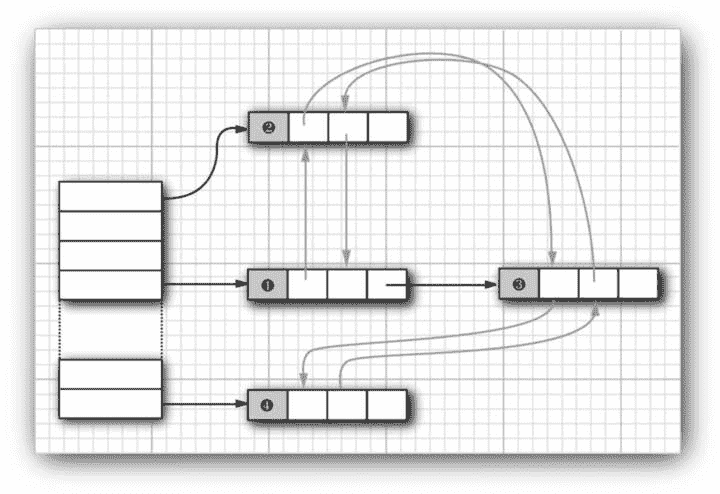

哈希映射也可以选择使用访问顺序（access order）而非插入顺序来遍历 map。每当你调用 `get` 或 `put` 时，受影响的 entry 会从当前位置移除并置于链表的末尾。（只影响链表的位置，不影响哈希表桶。）构造这样的哈希映射请调用 `LinkedHashMap<K, V>(initialCapacity, loadFactor, true)`。

访问顺序适用于实现缓存策略。例如，你可能希望将频繁访问的 entry 保留在内存中，而从数据库读取较少访问的对象。当表中找不到 entry 且表已满时，你可以获取表的迭代器并移除它遍历的前几个元素。这些元素是最少使用的。

你甚至可以自动化该过程。创建一个 `LinkedHashMap` 子类并重写方法：

```java
protected boolean removeEldestEntry(Map.Entry<K, V> eldest)
```

该方法在添加新 entry 后调用。如果方法返回 `true`，则移除 `eldest` entry。例如，以下缓存的大小保持在最多 100 个元素：

```java
var cache = new LinkedHashMap<K, V>(128, 0.75F, true)
   {
      protected boolean removeEldestEntry(Map.Entry<K, V> eldest)
      {
         return size() > 100;
      }
   };
```

你可以检查 `eldest` entry 以决定是否移除它。例如，你可能想检查与 `eldest` 关联的时间戳，仅当它足够旧时才请求移除。这不会自动移除所有旧元素，因为 `removeEldestEntry` 方法在每次添加新 entry 时调用一次。你允许在 `removeEldestEntry` 方法中修改 map，例如移除足够旧初始元素。在这种情况下，你必须返回 `false`。

如果你需要一个最少使用元素的集合而不是 map，请参见第 9.5.4 节。

### 9.4.6. 枚举集和映射 (Enumeration Sets and Maps)

`EnumSet` 是一个用于存放枚举类型元素的高效集合实现。由于枚举类型的实例数量是有限的，`EnumSet` 在内部被简单地实现为位序列（sequence of bits）。如果集合中存在对应的值，则该位被设置为开启。

`EnumSet` 类没有公共构造函数。请使用静态工厂方法来构造集合：

```java
enum Weekday { MONDAY, TUESDAY, WEDNESDAY, THURSDAY, FRIDAY, SATURDAY, SUNDAY };

EnumSet<Weekday> always = EnumSet.allOf(Weekday.class);

EnumSet<Weekday> never = EnumSet.noneOf(Weekday.class);

EnumSet<Weekday> workday = EnumSet.range(Weekday.MONDAY, Weekday.FRIDAY);

EnumSet<Weekday> mwf = EnumSet.of(Weekday.MONDAY, Weekday.WEDNESDAY, Weekday.FRIDAY);
```

你可以使用 `Set` 接口的常用方法来修改 `EnumSet`。

`EnumMap` 是一个以属于枚举类型为键的映射。它简单高效地实现为值的数组。你需要在构造函数中指定键的类型：

```java
var personInCharge = new EnumMap<Weekday, Employee>(Weekday.class);
```

在 `EnumSet` 和 `EnumMap` 的 API 文档中，你会看到类似 `E extends Enum<E>` 的奇怪类型参数。这仅意味着“E 是一个枚举类型”。所有的枚举类型都扩展了泛型类 `Enum`。例如，`Weekday` 扩展了 `Enum<Weekday>`。

### 9.4.7. 标识哈希映射

`IdentityHashMap` 有非常特殊的用途。在这里，键的哈希值不应通过 `hashCode` 方法计算，而是通过 `System.identityHashCode` 方法计算。`Object.hashCode` 正是该方法根据对象的内存地址计算哈希码。此外，在比较对象时，`IdentityHashMap` 使用 `==` 而不是 `equals`。

也就是说，即使两个键的内容相同也被认为是不同的。该类有助于实现对象遍历算法（例如对象序列化），在这些算法中，你需要跟踪哪些对象已经被遍历过了。

Java 20 修复了 Java 8 中引入的关于 `IdentityHashMap` 的细微 Bug（[`bugs.openjdk.org/browse/JDK-8284901`](https://bugs.openjdk.org/browse/JDK-8284901)）。两个不常用的方法错误地使用了 `equals` 而不是 `==`：

```java
void remove(Object key, Object value)

void replace(K key, V oldValue, V newValue)
```

这些方法有时被用于并发算法中，在这些算法中，只有当映射未被另一个线程修改时才应该进行更新。可以想象第一个遇到这个 Bug 的程序员会有多么沮丧。

任何像 Java 平台这样复杂的软件系统都不可能完全没有 Bug。因此，定期更新到最新版本是非常重要的。

#### `java.util.WeakHashMap<K, V>` 1.2

- `WeakHashMap()`
- `WeakHashMap(int initialCapacity)`
- `WeakHashMap(int initialCapacity, float loadFactor)`

  根据指定的容量和负载因子构造一个空哈希映射。

#### `java.util.LinkedHashSet<E>` 1.4

- `LinkedHashSet()`
- `LinkedHashSet(int initialCapacity)`
- `LinkedHashSet(int initialCapacity, float loadFactor)`

  根据指定的容量和负载因子构造一个空链接哈希集合。

#### `java.util.LinkedHashMap<K, V>` 1.4

- `LinkedHashMap()`
- `LinkedHashMap(int initialCapacity)`
- `LinkedHashMap(int initialCapacity, float loadFactor)`
- `LinkedHashMap(int initialCapacity, float loadFactor, boolean accessOrder)`

  根据指定的容量、负载因子和排序构造一个空链接哈希映射。`accessOrder` 参数为 `true` 表示按访问顺序，为 `false` 表示按插入顺序。

- `protected boolean removeEldestEntry(Map.Entry<K, V> eldest)`

  如果你希望移除 `eldest` 条目，应重写此方法并返回 `true`。`eldest` 参数是要考虑移除的条目。该方法在条目添加到映射后被调用。默认实现返回 `false`——默认不会移除旧元素。但你可以重定义此方法来选择性地返回 `true`——例如，如果最旧的条目符合某些条件或者映射超过了某个大小。

#### `java.util.EnumSet<E extends Enum<E>>` 5.0

- `static <E extends Enum<E>> EnumSet<E> allOf(Class<E> enumType)`

  返回一个包含给定枚举类型所有值的可变集合。

- `static <E extends Enum<E>> EnumSet<E> noneOf(Class<E> enumType)`

  返回一个初始为空的可变集合。

- `static <E extends Enum<E>> EnumSet<E> range(E from, E to)`

  返回一个包含 `from` 到 `to` 之间（包含两者）所有值的可变集合。

- `static <E extends Enum<E>> EnumSet<E> of(E e)`
- `. . .`
- `static <E extends Enum<E>> EnumSet<E> of(E e1, E e2, E e3, E e4)`
- `. . .`
- `static <E extends Enum<E>> EnumSet<E> of(E... elements)`

  返回一个包含指定元素的可变集合。

- `public static <E extends Enum<E>> EnumSet<E> copyOf(Collection<? extends E> c)`

  返回一个包含指定集合中元素的可变集合。

元素、键或值均不能为 `null`。Set 和 map 的键不能重复：

```java
numbers = Set.of(13, null); // Error--null element

scores = Map.of("Peter", 4, "Peter", 2); // Error--duplicate key
```

这些集合和映射的迭代顺序是不保证的。事实上，该顺序是使用一个在每次虚拟机启动时随机生成的种子故意打乱的。查看这两个 `jshell` 运行示例：

```text
$ jshell -q

jshell> Set.of("Peter", "Paul", "Mary")

$1 ==> [Peter, Mary, Paul]

jshell> /exit

$ jshell -q

jshell> Set.of("Peter", "Paul", "Mary")

$1 ==> [Paul, Mary, Peter]
```

一些 Java 程序员编写程序时，其正确性取决于对实现细节永远不会变化的假设。这使得框架实现者很难做出有用的实现更改。在这种情况下，信息很明确——不要编写假设任何元素顺序的程序。

`List` 和 `Set` 接口拥有 11 个具有 0 到 10 个参数的 `of` 方法，以及一个具有可变参数的 `of` 方法。为了效率提供了特化实现。

对于 `Map` 接口，无法提供可变参数的版本，因为参数类型在键和值类型之间交替。有一个静态方法 `ofEntries` 接受任意数量的 `Map.Entry<K, V>` 对象，你可以使用静态的 `entry` 方法创建这些对象。例如：

```java
import static java.util.Map.*;

. . .

Map<String, Integer> scores = ofEntries(
   entry("Peter", 2),
   entry("Paul", 3),
   entry("Mary", 5));
```

`of` 和 `ofEntries` 方法产生的对象类为每个元素拥有一个实例变量，或者由数组支持。

这些集合对象是不可修改的（`unmodifiable`）。任何更改其内容的尝试都会导致 `UnsupportedOperationException`。

如果你想要一个可变的集合，可以将不可修改的集合传递给构造函数：

```java
var names = new ArrayList<>(List.of("Peter", "Paul", "Mary")); // 一个可变的名字列表
```

方法调用：

```java
Collections.nCopies(n, anObject)
```

返回一个实现 `List` 接口的不可变对象，并产生具有 `n` 个元素的幻象，每个元素看起来都是 `anObject`。

例如，以下调用创建了一个包含 100 个字符串的 `List`，全部设置为 `"DEFAULT"`：

```java
List<String> settings = Collections.nCopies(100, "DEFAULT");
```

存储成本非常低——对象只存储一次。

`Collections` 类包含许多工具方法，其参数或返回值是集合。不要将其与 `Collection` 接口混淆。

Java 没有 `Pair` 类，一些程序员使用 `Map.Entry` 作为廉价的配对。

### 9.5.2 不可修改的和视图

要创建集合的不可修改副本（`unmodifiable copy`），请使用集合类型的 `copyOf` 方法：

```java
ArrayList<String> names = . . .;

Set<String> nameSet = Set.copyOf(names); // 作为不可修改集合的名称

List<String> nameList = List.copyOf(names); // 作为不可修改列表的名字
```

与 `of` 方法一样，`copyOf` 方法拒绝创建包含 `null` 元素的集合，而是抛出 `NullPointerException`。

每个 `copyOf` 方法都会创建集合的副本。如果原始集合被修改，副本将不受影响。

如果原始集合恰好是不可修改且类型正确，则 `copyOf` 将直接返回它：

```java
Set<String> names = Set.of("Peter", "Paul", "Mary");

Set<String> nameSet = Set.copyOf(names); // 不需要复制：names == nameSet
```

`Collections` 类拥有产生集合不可修改视图（`unmodifiable views`）的方法。这些视图为现有集合添加了运行时检查。如果检测到修改不可修改集合的尝试，将抛出异常。

然而，如果原始集合发生变化，视图会反映这些变化。这就是视图与副本的区别。

通过八种方法获取不可修改视图：

```java
Collections.unmodifiableCollection
```


`Collections.unmodifiableList`

`Collections.unmodifiableSet`

`Collections.unmodifiableSortedSet`

`Collections.unmodifiableNavigableSet`

`Collections.unmodifiableMap`

`Collections.unmodifiableSortedMap`

`Collections.unmodifiableNavigableMap`

每个方法都定义为在接口上工作。例如，`Collections.unmodifiableList` 可以用于 `ArrayList`、`LinkedList` 或任何实现 `List` 接口的类。

例如，假设你想让代码的某部分查看但不触碰集合的内容。你可以这样做：

```java
var staff = new LinkedList<String>();

. . .

lookAt(Collections.unmodifiableList(staff));
```

`Collections.unmodifiableList` 方法返回一个实现 `List` 接口的类的对象。它的访问器方法从 `staff` 集合中检索值。当然，`lookAt` 方法可以调用 `List` 接口的所有方法，而不仅仅是访问器。但所有修改器方法（如 `add`）都已重定义为抛出 `UnsupportedOperationException`，而不是转发调用。

（注：由于原文中存在大量关于 `Collections.unmodifiableList` 的重复描述，此处已根据逻辑进行了精简，去除了冗余。）

对于排序集合和映射，你使用排序顺序而不是元素位置来形成子范围。`SortedSet` 接口声明了三个方法：

```java
SortedSet<E> subSet(E from, E to)

SortedSet<E> headSet(E to)

SortedSet<E> tailSet(E from)
```

这些方法返回大于或等于 `from` 且小于 `to` 的元素子集。对于排序映射，相似的方法：

```java
SortedMap<K, V> subMap(K from, K to)

SortedMap<K, V> headMap(K to)

SortedMap<K, V> tailMap(K from)
```

优先使用 `unmodifiableSet` 和 `unmodifiableList` 包装器，它们的 `equals` 和 `hashCode` 方法适用于集合和列表。

例如：

```java
var names = Set.of("Peter", "Paul", "Mary");

Collections.unmodifiableCollection(names).equals(names) // false

Collections.unmodifiableSet(names).equals(names) // true
```

返回包含所有 `keys` 落在指定范围内的条目的映射的视图。

`NavigableSet` 接口对这些子范围操作提供了更多控制。你可以指定边界是否包含在内：

```java
NavigableSet<E> subSet(E from, boolean fromInclusive, E to, boolean toInclusive)

NavigableSet<E> headSet(E to, boolean toInclusive)

NavigableSet<E> tailSet(E from, boolean fromInclusive)
```

### 9.5.4. 从布尔值映射创建集合

有时，API 提供了某些有用特性的映射，你可能希望在集合中使用这些特性。在第 9.4.5 节中，你已经看到了如何使用 `LinkedHashMap` 构建一个可以丢弃旧元素的缓存。`LinkedHashSet` 类并不具备这种能力。

如果你想拥有一个包含 100 个最近未插入的字符串的集合，可以创建一个 `LinkedHashMap<String, Boolean>`，然后调用 `Collections.newSetFromMap` 方法：

```java
Set<String> cache = Collections.newSetFromMap(new LinkedHashMap<String, Boolean>()
   {
      protected boolean removeEldestEntry(Map.Entry<String, Boolean> eldest)
      {
         return size() > 100;
      }
   });
```

该集合视图由映射支持。当你添加一个元素 `e` 时，视图会将一个键为 `e`、值为 `Boolean.TRUE` 的条目放入映射中。如果这导致映射的条目超过 100 个，最旧的一个将被移除。

你应该使用一个空映射调用 `newSetFromMap`。之后，不要修改该映射，而是让所有修改都通过集合视图的方法发生。实现此点的最佳方法是将映射传递给 `newSetFromMap` 方法而不保留它的引用，如上例所示。

`newSetFromMap` 方法对于 `WeakHashMap` 也有用（参见第 9.4.4 节）。对于 `ConcurrentHashMap`，请使用 `newKeySet` 方法（参见第 10 章）。

### 9.5.5. 反转视图

`SequencedCollection` 和 `SequencedSet` 接口的 `reversed` 方法产生以反向顺序查看元素的视图。例如，这里是反向遍历字符串列表或树形集合的方法：

```java
for (String element : collection.reversed())
{
   do something with element
}
```

在 `SequencedMap` 中，`reversed` 方法以反向顺序查看映射的键。

### 9.5.6. 检查视图

检查视图（Checked views）旨在为泛型中可能出现的问题提供调试支持。如第 8 章所示，实际上可以将错误类型的元素“偷入”泛型集合中。例如：

```java
var strings = new ArrayList<String>();

ArrayList rawList = strings; // 仅警告，不是错误，
                             // 为了兼容旧版代码

rawList.add(new Date()); // 现在 strings 包含了一个 Date 对象！
```

错误的 `add` 命令在运行时不会被检测到。相反，当代码的其他部分调用 `get` 并将结果强制转换为 `String` 时，会发生类类型转换异常。

检查视图可以检测到此问题。按如下方式定义一个安全列表：

```java
List<String> safeStrings = Collections.checkedList(strings, String.class);
```

视图的 `add` 方法会检查插入的对象是否属于给定的类，如果不属于，则立即抛出 `ClassCastException`。这样做的好处是错误会在正确的位置被报告：

```java
ArrayList rawList = safeStrings;

rawList.add(new Date()); // 检查列表抛出 ClassCastException
```

检查视图受限于虚拟机可以执行的运行时检查。例如，如果你有一个 `ArrayList<Pair<String>>`，你无法保护它免受插入 `Pair<Date>`，因为虚拟机只有一个“原始” `Pair` 类。

### 9.5.7. 同步视图

如果你从多个线程访问集合，你需要确保集合不会被意外损坏。例如，如果一个线程尝试向哈希表添加元素，而另一个线程正在对元素进行重哈希，结果将是灾难性的。

框架设计者没有实现线程安全的集合类，而是使用了视图机制使普通集合变为线程安全。例如，`Collections` 类中的静态方法 `synchronizedMap` 可以将任何映射转换为同步访问方法的 `Map`：

```java
var map = Collections.synchronizedMap(new HashMap<String, Employee>());
```


你现在可以从多个线程访问`map`对象。`get`和`put`等方法是同步的——在另一个线程调用另一个方法之前，每个方法调用都必须完全完成。我们将在第 10 章中更详细地讨论数据结构同步访问的问题。

### 9.5.8. 关于可选操作的说明

视图通常具有某些限制——它可能是只读的，它可能无法更改大小，或者它支持删除但不支持插入（映射的键视图此类如此）。

返回一个给定条目的不可变 map。

*   `static <K, V> Map<K,V> copyOf(Map<? extends K,? extends V> map)` 10
    返回给定 map 的不可变拷贝。

`java.util.Collections` 1.2

*   `static <E> Set<E> newSetFromMap(Map<E, Boolean> map)` 6
    返回由给定 map 支持的集合，该集合初始为空，之后仅通过返回的视图访问。

*   `static <E> Collection<E> unmodifiableCollection(Collection<E> c)`
*   `static <E> SequencedCollection<E> unmodifiableSequencedCollection(SequencedCollection<E> c)` 21
*   `static <E> List<E> unmodifiableList(List<E> c)`
*   `static <E> Set<E> unmodifiableSet(Set<E> c)`
*   `static <E> SequencedSet<E> unmodifiableSequencedSet(SequencedCollection<E> c)` 21
*   `static <E> SortedSet<E> unmodifiableSortedSet(SortedSet<E> c)`
*   `static <E> SortedSet<E> unmodifiableNavigableSet(NavigableSet<E> c)` 8
*   `static <K, V> Map<K, V> unmodifiableMap(Map<K, V> c)`
*   `static <K, V> SortedMap<K, V> unmodifiableSortedMap(SortedMap<K, V> c)`
*   `static <K, V> SequencedMap<K, V> unmodifiableSequencedMap(SequencedMap<K, V> c)` 21
*   `static <K, V> SortedMap unmodifiableNavigableMap(NavigableMap<K, V> c)` 8
    构建集合的视图；该视图的变器方法会抛出`UnsupportedOperationException`。

*   `static <E> Collection<E> synchronizedCollection(Collection<E> c)`
*   `static <E> List synchronizedList(List<E> c)`
*   `static <E> Set synchronizedSet(Set<E> c)`
*   `static <E> SortedSet synchronizedSortedSet(SortedSet<E> c)`
*   `static <E> NavigableSet synchronizedNavigableSet(NavigableSet<E> c)` 8
*   `static <K, V> Map<K, V> synchronizedMap(Map<K, V> c)`
*   `static <K, V> SortedMap<K, V> synchronizedSortedMap(SortedMap<K, V> c)`
*   `static <K, V> NavigableMap<K, V> synchronizedNavigableMap(NavigableMap<K, V> c)` 8
    构建集合的视图；该视图的方法是同步的。

*   `static <E> Collection<E> checkedCollection(Collection<E> c, Class<E> elementType)`
*   `static <E> List checkedList(List<E> c, Class<E> elementType)`
*   `static <E> Set checkedSet(Set<E> c, Class<E> elementType)`
*   `static <E> SortedSet checkedSortedSet(SortedSet<E> c, Class<E> elementType)`
*   `static <E> NavigableSet checkedNavigableSet(NavigableSet<E> c, Class<E> elementType)` 8
*   `static <K, V> Map checkedMap(Map<K, V> c, Class<K> keyType, Class<V> valueType)`
*   `static <K, V> SortedMap checkedSortedMap(SortedMap<K, V> c, Class<K> keyType, Class<V> valueType)`
*   `static <K, V> NavigableMap checkedNavigableMap(NavigableMap<K, V> c, Class<K> keyType, Class<V> valueType)` 8
*   `static <E> Queue<E> checkedQueue(Queue<E> queue, Class<E> elementType)` 8
    构建集合的视图；如果插入了类型错误的元素，该视图将抛出`ClassCastException`。

*   `static <E> List<E> nCopies(int n, E value)`
    返回一个包含`n`个相同值的不可变列表。
*   `static <E> List<E> singletonList(E value)`
*   `static <E> Set<E> singleton(E value)`
*   `static <E> List<E> emptyList()`
*   `static <T> Set<T> emptySet()`
*   `static <E> SortedSet<E> emptySortedSet()`
*   `static NavigableSet<E> emptyNavigableSet()`
*   `static <K,V> Map<K,V> emptyMap()`
*   `static <K,V> SortedMap<K,V> emptySortedMap()`
*   `static <K,V> NavigableMap<K,V> emptyNavigableMap()`
*   `static <T> Enumeration<T> emptyEnumeration()`
*   `static <T> Iterator<T> emptyIterator()`
*   `static <T> ListIterator<T> emptyListIterator()`
    返回一个空集合、map 或迭代器。

`java.util.Arrays` 1.2

*   `static <E> List<E> asList(E... array)`
    返回由数组支持的列表。
*   `static <E> List<E> nCopies(int n, E value)`
    返回一个包含`n`个相同值的列表。
*   `static <E> List<E> singletonList(E value)`
*   `static <E> Set<E> singleton(E value)`
*   `static <E> List<E> emptyList()`
*   `static <E> Set<E> emptySet()`
*   `static <E> SortedSet<E> emptySortedSet()`
*   `static NavigableSet<E> emptyNavigableSet()`
*   `static <K,V> Map<K,V> emptyMap()`
*   `static <K,V> SortedMap<K,V> emptySortedMap()`
*   `static <K,V> NavigableMap<K,V> emptyNavigableMap()`
*   `static <T> Enumeration<T> emptyEnumeration()`
*   `static <T> Iterator<T> emptyIterator()`
*   `static <T> ListIterator<T> emptyListIterator()`
    返回一个空集合、map 或迭代器。
*   `static <E> Collection<E> unmodifiableCollection(Collection<E> c)`
*   `static <E> SequencedCollection<E> unmodifiableSequencedCollection(SequencedCollection<E> c)` 21
*   `static <E> List<E> unmodifiableList(List<E> c)`
*   `static <E> Set<E> unmodifiableSet(Set<E> c)`
*   `static <E> SequencedSet<E> unmodifiableSequencedSet(SequencedCollection<E> c)` 21
*   `static <E> SortedSet<E> unmodifiableSortedSet(SortedSet<E> c)`
*   `static <E> SortedSet<E> unmodifiableNavigableSet(NavigableSet<E> c)` 8
*   `static <K, V> Map<K, V> unmodifiableMap(Map<K, V> c)`
*   `static <K, V> SortedMap<K, V> unmodifiableSortedMap(SortedMap<K, V> c)`
*   `static <K, V> SequencedMap<K, V> unmodifiableSequencedMap(SequencedMap<K, V> c)` 21
*   `static <K, V> SortedMap unmodifiableNavigableMap(NavigableMap<K, V> c)` 8
    构建集合的视图；该视图的变器方法会抛出`UnsupportedOperationException`。

*   `static <E> Collection<E> synchronizedCollection(Collection<E> c)`
*   `static <E> List synchronizedList(List<E> c)`
*   `static <E> Set synchronizedSet(Set<E> c)`
*   `static <E> SortedSet synchronizedSortedSet(SortedSet<E> c)`
*   `static <E> NavigableSet synchronizedNavigableSet(NavigableSet<E> c)` 8
*   `static <K, V> Map<K, V> synchronizedMap(Map<K, V> c)`
*   `static <K, V> SortedMap<K, V> synchronizedSortedMap(SortedMap<K, V> c)`
*   `static <K, V> NavigableMap<K, V> synchronizedNavigableMap(NavigableMap<K, V> c)` 8
    构建集合的视图；该视图的方法是同步的。

*   `static <E> Collection<E> checkedCollection(Collection<E> c, Class<E> elementType)`
*   `static <E> List checkedList(List<E> c, Class<E> elementType)`
*   `static <E> Set checkedSet(Set<E> c, Class<E> elementType)`
*   `static <E> SortedSet checkedSortedSet(SortedSet<E> c, Class<E> elementType)`
*   `static <E> NavigableSet checkedNavigableSet(NavigableSet<E> c, Class<E> elementType)` 8
*   `static <K, V> Map checkedMap(Map<K, V> c, Class<K> keyType, Class<V> valueType)`
*   `static <K, V> SortedMap checkedSortedMap(SortedMap<K, V> c, Class<K> keyType, Class<V> valueType)`
*   `static <K, V> NavigableMap checkedNavigableMap(NavigableMap<K, V> c, Class<K> keyType, Class<V> valueType)` 8
*   `static <E> Queue<E> checkedQueue(Queue<E> queue, Class<E> elementType)` 8
    构建集合的视图；如果插入了类型错误的元素，该视图将抛出`ClassCastException`。

这就是集合接口（collection interfaces）大显用场的地方。考虑你高效执行算法所需的最小集合接口。具有`get`和`set`的随机访问在食物链中的地位高于简单的迭代。正如你在计算链表中的最大元素时所看到的，这项任务不需要随机访问。计算最大值可以通过简单遍历元素来完成。因此，你可以实现`max`方法，使其接收任何实现了`Collection`接口的对象。

```
public static <T extends Comparable> T max(Collection<T> elements)
{
   if (elements.isEmpty()) throw new NoSuchElementException();
   Iterator<T> iter = elements.iterator();
   T largest = iter.next();
   while (iter.hasNext())
   {
      T next = iter.next();
      if (largest.compareTo(next) < 0)
         largest = next;
   }
   return largest;
}
```

当然，由于数组不是集合，你仍然为数组编写一个独立的方法：

```
static <T extends Comparable> T max(T[] a)
```

泛型算法是一个强大的概念。事实上，标准 C++ 库拥有几十个有用的算法，每个算法都在泛型集合上操作。Java Collections 框架并没有那么丰富，但`Collections`和`Arrays`类提供了基础功能：排序、二分查找和一些简单的实用算法。

Java Collections 框架缺少一些实用的算法，但你可以在第二卷介绍的流库中找到它们。例如，要找到最大值或最小值，可以将集合或数组转换为流：

```
largest = coll.stream().max(Comparator.naturalOrder()).get();
```

### 9.6.2 排序与洗牌

计算机领域的老兵们有时会怀念他们过去如何使用打卡片，并实际上手工编写排序算法的日子。如今，排序算法已经是大多数编程语言标准库的一部分，Java 编程语言也不例外。

`Collections`类中的`sort`方法用于排序实现了`List`接口的集合。

```
var staff = new ArrayList<String>();
fill collection
Collections.sort(staff);
```

该方法假设列表元素实现了`Comparable`接口。如果你想以其他方式排序列表，可以使用`List`接口的`sort`方法并传递一个`Comparator`对象。以下是如何按薪资对员工列表进行排序：

```
Collections.sort(staff, Comparator.comparingDouble(Employee::getSalary));
```

如果你想按降序排序列表，可以使用静态便利方法`Comparator.reverseOrder()`。它返回一个返回`b.compareTo(a)`的比较器。例如，

```
Collections.sort(staff, Comparator.reverseOrder());
```

根据元素类型`compareTo`方法提供的顺序，对列表`staff`中的元素进行逆序排序。同样地，


```java
Collections.sort(staff, Comparator.comparingDouble(Employee::getSalary).reversed());
```

按薪资降序排序。

你可能会奇怪`sort`方法是如何对列表进行排序的。通常，当你在算法书籍中看到排序算法时，它是针对数组呈现的，并使用随机元素访问。然而，链表中的随机访问效率很低。你实际上可以使用归并排序的一种形式高效地对链表进行排序。但是 Java 语言的实现并没有这样做。它简单地将所有元素倒到一个数组中，对数组进行排序，然后将排序后的序列复制回列表。

Java Collections 框架使用的排序算法比快速排序（QuickSort，通用排序算法的传统选择）稍慢一点。然而，它有一个主要优势：它是稳定的，也就是说它不会交换相等元素。你为什么要关心相等元素的顺序？这里有一个常见场景。假设你有一个已经按名称排序的员工列表。现在你按薪资排序。薪资相等的员工会发生什么？使用稳定排序，按名称的顺序会被保留。换句话说，结果是一个先按薪资排序、再按名称排序的列表。

集合并不需要实现它们所有的“可选”方法，因此所有带有集合参数的方法必须描述何时将集合传递给算法是安全的。例如，你显然不能将`unmodifiableList`列表传递给`sort`算法。你可以传递什么种列表？根据文档说明：

- 如果列表支持`set`方法，则它是可修改的（modifiable）。
- 如果列表支持`add`和`remove`操作，则它是可调整大小的（resizable）。

在第 6 章中，你已经见过`Arrays.sort`方法。它有两个版本，一个用于排序`Comparable`实例数组，另一个带有一个比较器：

```java
String[] staff = . . .;

Arrays.sort(staff);

Arrays.sort(staff, Comparator.comparingDouble(Employee::getSalary));
```

`Collections`类有一个算法`shuffle`，它的功能与排序相反——它随机打乱列表中元素的顺序。例如：

```java
ArrayList<Card> cards = . . .;

Collections.shuffle(cards, RandomGenerator.getDefault());
```

如果你提供的列表没有实现`RandomAccess`接口，`shuffle`方法会将元素复制到数组中，洗牌该数组，然后将洗牌后的元素复制回列表。

Listing 9.7 中的程序向 array list 填充了 49 个包含 1 到 49 数字的`Integer`对象。然后它随机洗牌列表并从洗牌后的列表中选取前面的值。最后，它对选定的值进行排序并打印出来。

**Listing 9.7** `shuffle/ShuffleTest.java`

```java
package shuffle;

import java.util.*;

import java.util.random.*;

/**
 * 此程序演示了随机洗牌和排序算法。
 * @version 1.13 2023-09-30
 * @author Cay Horstmann
 */
public class ShuffleTest
{
   public static void main(String[] args)
   {
      var numbers = new ArrayList<Integer>();
      for (int i = 1; i <= 49; i++)
         numbers.add(i);
      Collections.shuffle(numbers, RandomGenerator.getDefault());
      List<Integer> winningCombination = numbers.subList(0, 6);
      Collections.sort(winningCombination);
      System.out.println(winningCombination);
   }
}
```

### `java.util.Collections` 1.2

- `static <T extends Comparable<? super T>> void sort(List<T> elements)`

  使用稳定排序算法对列表元素进行排序。该算法保证在 O(`n` log `n`) 时间内运行，其中 `n` 是列表的长度。

- `static void shuffle(List<?> elements)`
- `static void shuffle(List<?> elements, Random r)`
- `static void shuffle(List<?> elements, RandomGenerator r)`

  随机洗牌列表中的元素。该算法在 O(`n` `a`(`n`)) 时间内运行，其中 `n` 是列表的长度，`a`(`n`) 是访问元素的平均时间。

### `java.util.List<E>` 1.2

- `default void sort(Comparator<? super T> comparator)`

  使用给定的比较器对此列表进行排序。

### `java.util.Comparator<T>` 1.2

- `static <T extends Comparable<? super T>> Comparator<T> reverseOrder()`

  产生一个反转`Comparable`接口提供的顺序的比较器。

- `default Comparator<T> reversed()`

  产生一个反转此比较器提供的顺序的比较器。

要在数组中查找对象，你通常需要遍历所有元素，直到找到匹配项。然而，如果数组是有序的，你可以查看中间的元素，并检查它是否大于你尝试查找的元素。如果是，继续在数组的前半部分查找；否则，在后半部分查找。这使得问题规模减半，你继续以这种方式进行。例如，如果数组有 1024 个元素，你将在 10 步后定位匹配项（或确认不存在），而使用线性搜索的话，如果元素存在，平均需要 512 步，如果不存在，则需要 1024 步来确认。

`Collections`类的`binarySearch`实现了这种算法。注意，集合必须已经排过序，否则该算法将返回错误答案。提供集合（必须实现`List`接口）和要查找的目标对象。如果集合不是按`Comparable`接口的`compareTo`元素排序的，请也提供一个比较器对象。

```java
i = Collections.binarySearch(elements, target);

i = Collections.binarySearch(elements, target, comparator);
```

`binarySearch`方法的非负返回值表示匹配对象的索引。也就是说，在比较顺序下，`elements.get(i)`等于`target`。如果值为负数，则没有匹配的元素。然而，你可以使用返回值来计算*应该*将`target`插入到集合中的位置，以保持其排序。插入位置是：

```java
insertionPoint = -i - 1;
```

它不仅仅是`-i`，因为那样值`0`将产生歧义。换句话说，以下操作：

```java
if (i < 0)
   elements.add(-i - 1, target);
```

会将目标添加到正确的位置。

为了有意义，二分查找需要随机访问。如果你必须逐个遍历链表的一半来找到中间元素，那么你就失去了二分查找的优势。如果你提供一个没有实现`RandomAccess`接口的列表，`binarySearch`算法将退化为与线性搜索效率迭代算法。

### `Arrays`类提供了基本类型数组和对象数组的二分查找实现。

#### `java.util.Collections` 1.2

- `static <T extends Comparable<? super T>> int binarySearch(List<T> elements, T key)`
- `static <T> int binarySearch(List<T> elements, T key, Comparator<? super T> c)`

  在有序列表中查找键。如果元素类型实现了`RandomAccess`接口，则使用二分查找；在所有其他情况下，使用线性搜索。这些方法保证运行在 O(`a`(`n`) log `n`) 时间内，其中 `n` 是列表的长度，`a`(`n`) 是访问一个元素的平均时间。这些方法返回键在列表中的索引，或者如果键不在列表中，则返回负值 `i`。在这种情况下，键应该插入在索引 `-i - 1` 处以保持列表排序。

#### `java.util.Arrays` 1.2

- `static int binarySearch(T[] a, T key)`
- `static int binarySearch(T[] a, int start, int end, T key)` 6

  使用二分查找算法在有序数组`a`中查找键。如果找到了键，则返回其索引。否则，返回一个负值`r`；`–r–1`是`key`为了保持`a`排序而应该插入的位置。数组的组件类型`T`可以是`Object`、`int`、`long`、`short`、`char`、`byte`、`boolean`、`float`或`double`。

- `static <T> T binarySearch(T[] a, T key, Comparator<? super T> c)`
- `static <T> T binarySearch(T[] a, int start, int end, T key, Comparator<? super T> c)` 6

  使用二分查找算法在通过给定比较器排序的数组`a`中查找键。

### 9.6.4 算法

`Collections`类包含了几个简单但实用的算法。其中包含了本节开头的示例——找到集合的最大值。其他的还包括从一个列表复制元素到另一个列表、用常量值填充容器以及反转列表。

为什么要在框架中提供这些简单的算法呢？显然，大多数程序员都可以用简单的循环轻松实现它们。我喜欢这些算法，是因为它们让*阅读*代码的程序员的生活变得更轻松。当你阅读由别人实现的循环时，你必须解读原始程序员的意图。例如，看这个循环：

```java
for (int i = 0; i < words.size(); i++)
   if (words.get(i).equals("C++")) words.set(i, "Java");
```

现在将该循环与调用对比：

```java
Collections.replaceAll(words, "C++", "Java");
```

当你看到这个方法调用时，立刻就知道代码在做什么。

本节末尾的 API 注释描述了`Collections`类中的简单算法。

默认方法`Collection.removeIf`和`List.replaceAll`稍微复杂一点。

`Collections`类还提供了用于查找子列表的算法。

- `static int indexOfSubList(List<?> l, List<?> s)`
- `static int lastIndexOfSubList(List<?> l, List<?> s)`

  返回`l`中第一个或最后一个等于`s`的子列表索引；如果`l`中没有子列表等于`s`，则返回`-1`。例如，如果`l`为`[s, t, a, r]`且`s`为`[t, a, r]`，则两种方法都返回索引`1`。

- `static void swap(List<?> l, int i, int j)` 1.4

  交换给定偏移处的元素。

- `static void reverse(List<?> l)`

  反转列表中元素的顺序。例如，反转列表`[t, a, r]`将得到列表`[r, a, t]`。该方法在 O(`n`) 时间内运行，其中 `n` 是列表的长度。

- `static void rotate(List<?> l, int d)` 1.4

  旋转列表中的元素，将索引为`i`的项移动到位置`(i + d) % l.size()`。例如，将列表`[t, a, r]`旋转`2`位将得到列表`[a, r, t]`。该方法在 O(`n`) 时间内运行，其中 `n` 是列表的长度。

- `static int frequency(Collection<?> c, Object o)` 5.0

  返回`c`中等于对象`o`的元素计数。

- `boolean disjoint(Collection<?> c1, Collection<?> c2)` 5.0

  如果两个集合没有共同元素，则返回`true`。

### `java.util.Collection<T>` 1.2

- `default boolean removeIf(Predicate<? super E> filter)` 8

  移除所有匹配的元素。

### `java.util.List<E>` 1.2

- `default void replaceAll(UnaryOperator<E> op)` 8

  将操作应用到此列表的所有元素。

### 9.6.5 批量操作

有几种操作可以“批量”复制或删除元素。调用：

```java
coll1.removeAll(coll2);
```

从`coll1`中移除所有存在于`coll2`中的元素。相反：

```java
coll1.retainAll(coll2);
```

从`coll1`中移除所有不在`coll2`中的元素。这是一个典型的应用。

假设你想找到两个集合的交集——即两个集合共同拥有的元素。首先，创建一个新集合来存储结果。

```java
var result = new HashSet<String>(firstSet);
```

在这里，我们利用了每个集合都有一个构造函数的特性，其参数是另一个持有初始化值的集合。

现在，使用`retainAll`方法：

```java
result.retainAll(secondSet);
```

它保留了两个集合中都出现的所有元素。你可以在没有编写循环的情况下形成交集。

你可以进一步扩展这一想法，并将批量操作应用于视图（view）。例如，假设你有一个映射将员工 ID 映射到员工对象的 map，并且你有一个所有待终止员工的 ID 集合。

```java
Map<String, Employee> staffMap = . . .;

Set<String> terminatedIDs = . . .;
```

只需形成键集并移除所有被终止员工的 ID。

```java
staffMap.keySet().removeAll(terminatedIDs);
```

由于键集是映射的视图，键和关联的员工名称会自动从映射中移除。

通过使用子范围视图（subrange view），你可以将批量操作限制为子列表和子集。例如，假设你想将列表的前十个元素添加到另一个容器中。形成一个子列表来选取前十个：

```java
relocated.addAll(staff.subList(0, 10));
```

子范围也可以是变异操作的目标。

```java
staff.subList(0, 10).clear();
```

### 9.6.6 集合与数组之间的转换

Java API 的大部分内容是在 Java 集合框架（Java Collections Framework）创建之前设计的。因此，你偶尔需要在传统的数组和更现代的集合之间进行转换。

如果你有一个需要转换为集合的数组，`List.of`方法可以用于此目的。例如：

```java
String[] names = . . .;

List<String> staff = List.of(names);
```

从集合获取数组则稍微复杂一点。你可以使用`toArray`方法：

```java
Object[] names = staff.toArray();
```

但结果是一个`Object`数组。即使你知道你的集合包含特定类型的对象，你不能直接进行类型转换：

```java
String[] names = (String[]) staff.toArray(); // ERROR
```

`toArray`方法返回的数组是作为`Object[]`数组创建的，你不能更改它的类型。相反，向`toArray`方法传递一个构造函数表达式。该构造函数被用于创建正确类型的数组：

```java
String[] values = staff.toArray(String[]::new);
```

在 JDK 11 之前，你必须使用`toArray`方法另一种形式，传递正确类型的数组：

```java
String[] values = staff.toArray(new String[0]);
```

此`toArray`方法构造另一个相同类型的数组。或者，如果数组长度足够，则会被重用：

```java
staff.toArray(new String[staff.size()]);
```

在这种情况下，数组被重用了。

### 9.6.7 编写你的算法

如果你编写自己的算法（或者事实上，是任何带有集合作为参数的方法），你应该尽可能与接口工作，而不是具体的实现。例如，假设你想处理项。

```java
public void process(Collection<Item> items) {
   for (Item item : items) {
      // do something
   }
}
```

如果你的方法返回多个元素，你不希望限制自己未来的改进。例如，考虑：

```java
public ArrayList<Item> lookupItems(. . .) {
   var result = new ArrayList<Item>();
   . . .
   return result;
}
```


该方法承诺返回一个 `ArrayList`，尽管调用者显然并不关心它是哪种列表。相反，如果你返回一个 `List`，你可以任何时候通过调用 `List.of` 添加一个返回空列表或单例列表的分支。

你应该问自己这个问题：能够完成此工作的最通用接口是什么？你在意顺序吗？那么你应该接受 `List`。但如果顺序不重要，你可以接受 `Collection`：

```java
public void process(Collection<Item> items) {
   for (Item item : items) {
      // do something
   }
}
```

然而，如果项恰好在另一个集合中，请使用 `Iterable`。`Iterable` 接口有一个抽象方法 `iterator`，增强型 `for` 循环在背后使用它。`Collection` 接口继承了 `Iterable`。

相反，如果你的方法返回多个元素，你不希望限制自己未来的改进。例如，考虑：

```java
public List<Item> lookupItems(. . .) {
   var result = new ArrayList<Item>();
   . . .
   return result;
}
```

遗留集合使用 `Enumeration` 接口来遍历元素序列。`Enumeration` 接口有两个方法：`hasMoreElements` 和 `nextElement`。它们与 `Iterator` 接口的 `hasNext` 和 `next` 方法完全对应。

如果你在遗留类中发现此接口，可以使用 `Collections.list` 将元素收集到 `ArrayList` 中。例如，`LogManager` 类只愿意以 `Enumeration` 的形式公开记录器名称。以下是获取所有名称的方法：

```java
ArrayList<String> loggerNames = Collections.list(LogManager.getLoggerNames());
```

或者，你可以将枚举转换为迭代器：

```java
LogManager.getLoggerNames().asIterator().forEachRemaining(n -> { . . . });
```

你偶尔会遇到带有枚举（`enumeration`）参数的遗留方法。静态方法 `Collections.enumeration` 返回一个枚举对象，用于枚举集合中的元素。例如：

```java
List<InputStream> streams = . . .;

var in = new SequenceInputStream(Collections.enumeration(streams));

// SequenceInputStream 构造函数期望一个 enumeration
```

在 C++ 中，将迭代器作为参数是非常常见的做法。幸运的是，在 Java 平台上，很少程序员使用这种习用法。传递集合本身比传递迭代器要明得多。集合对象更有用。接收者在需要时可以随时从集合获取迭代器，而且他们可以使用所有的集合方法。然而，你可能会在某些遗留代码中发现枚举，因为在 Java 1.2 的 Java 集合框架出现之前，它们是通用集合唯一的可用机制。

`java.util.Enumeration<E>` 1.0

- `boolean hasMoreElements()`

  如果还有更多元素待检查，则返回 `true`。

- `E nextElement()`

  返回下一个待检查的元素。如果 `hasMoreElements()` 返回 `false`，则不要调用此方法。

- `default Iterator<E> asIterator()` 9

  产生一个用于遍历枚举元素的迭代器。

`java.util.Collections` 1.2

- `static <T> Enumeration<T> enumeration(Collection<T> c)`

  返回一个枚举 `c` 中元素的枚举。

- `public static <T> ArrayList<T> list(Enumeration<T> e)`

  返回一个包含由 `e` 枚举的元素的数组列表。

### 9.7.3. 属性映射

*属性映射*（property map）是一种特殊类型的 `map` 结构。它有三个特征：

- 键和值都是字符串。
- 该 `map` 可以很容易地保存到文件并从文件中加载。
- 有一个用于默认值的辅助表。

实现属性映射的 Java 类名为 `Properties`。属性映射对于指定程序的配置选项非常有用。例如：

```java
var settings = new Properties();

settings.setProperty("width", "600.0");
settings.setProperty("filename", "/home/cay/books/corejava/code/v1ch09/raven.html");
```

使用 `getProperty` 方法根据键查找值：

```java
String filename = settings.getProperty("filename");
```

由于历史原因，`Properties` 类实现了 `Map<Object, Object>`。因此，你可以使用 `Map` 接口的 `get` 和 `put` 方法。但 `get` 方法返回的类型为 `Object`，而 `put` 方法允许你插入任何对象。最好坚持使用处理字符串而非对象的 `getProperty` 和 `setProperty` 方法。

使用 `store` 方法将属性保存到文件。第二个参数是包含在文件中的注释。

```java
var out = new FileWriter("program.properties");

settings.store(out, "Program Properties");
```

示例集给出了以下输出：

```properties
#Program Properties
#Sun Dec 31 12:54:19 PST 2023
top=227.0
left=1286.0
width=423.0
height=547.0
filename=/home/cay/books/corejava/code/v1ch09/raven.html
```

要从文件中加载属性，请使用：

```java
var in = new FileReader("program.properties");

settings.load(in);
```

如果你对输入输出流使用 `load` 和 `store` 方法，将使用旧的 ISO 8859-1 字符编码，大于 U+00FF 的字符将保存为 Unicode 转义字符。对于 UTF-8，请像上面的代码段所示使用读取器/写入器。在 Java 18 之前，请显式设置字符编码为 `StandardCharsets.UTF_8`。

`Properties` 类有两种提供默认值的机制。首先，每当你查找字符串的值时，都可以指定一个在键不存在时应自动使用的默认值。

```java
String filename = settings.getProperty("filename", "");
```

如果属性映射中存在 `"filename"` 属性，则 `filename` 被设置为该字符串。否则，`filename` 被设置为空字符串。

如果你觉得在每次调用 `getProperty` 时指定默认值太麻烦了，可以将所有默认值封装在一个辅助属性映射中，并在主属性映射的构造函数中提供该 `map`。

```java
var defaultSettings = new Properties();

defaultSettings.setProperty("width", "600");
defaultSettings.setProperty("height", "400");
defaultSettings.setProperty("filename", "");

. .

var settings = new Properties(defaultSettings);
```

是的，如果你给 `Properties` 构造函数传递另一个属性映射，就可以指定默认值。但 `Properties` 类没有可以帮助组织此类层次的方法。通常的做法是使用如 `window.color`、`window.title` 等键名引入一个伪层次结构。如果你需要存储复杂信息，应该使用 `Preferences` 类。

`java.util.Properties` 1.0

- `Properties()`

  创建一个空的属性映射。

- `Properties(Properties defaults)`

  创建一个带有默认值的空属性映射。

- `String getProperty(String key)`

  获取一个属性。返回与键关联的字符串；如果该键不在表中，则返回与默认表中键关联的字符串；如果键在默认表中也不存在，则返回 `null`。

- `String getProperty(String key, String defaultValue)`

  如果未找到键，则获取一个带有默认值的属性。返回与键关联的字符串；如果键不在表中，则返回默认字符串。

- `Object setProperty(String key, String value)`

  设置属性。返回给定键之前设置的值。

- `Set<String> stringPropertyNames()` 6

  返回所有键的集合，包括默认 `map` 中的键。

- `void load(Reader in) throws IOException` 6

  从读取器加载属性映射。

- `void store(Writer out, String header)` 6

  将属性映射保存到写入器。头部位于存储文件的第一行。

### 9.7.4. 系统属性

`System.getProperties` 方法产生一个 `Properties` 对象来描述系统信息。例如，主目录的键为 `"user.home"`。

你可以使用返回键字符串的 `getProperty` 方法读取它：

```java
String userDir = System.getProperty("user.home");
```

要获取虚拟机的 Java 版本，请查找 `"java.version"` 属性。你会得到如 `"21.0.1"` 的字符串（直到 Java 8 时为 `"1.8.0"`）。

正如你看到的，Java 9 的版本编号发生了变化。这个看似微小的变化破坏了许多依赖旧格式的工具。如果你需要解析版本字符串，请务必阅读 [`openjdk.org/jeps/322`](https://openjdk.org/jeps/322) 中的 `JEP 322`，以了解未来版本字符串将如何格式化——至少在编号方案再次发生变化之前。

要打印所有系统属性，请运行：

```bash
java -XshowSettings:properties
```

`java.version` 系统属性由虚拟机设置，不应被更改。其他系统属性可以使用 `-D` 命令行选项设置：

```bash
java -Duser.language=fr -Duser.country=CA MyProg
```

要在 `jshell` 中使属性可用，请这样使用 `-R` 选项：

```bash
jshell -R-Duser.language=fr -R-Duser.country=CA
```

要获取数值或布尔系统属性值，请使用静态方法 `Boolean.getBoolean()`、`Integer.getInteger` 和 `Long.getLong`：

```java
Integer version = Integer.getInteger("java.specification.version");
```

`java.lang.System` 1.0

- `Properties getProperties()`

  检索所有系统属性。应用程序必须具有检索所有属性的权限，否则将抛出安全异常。

- `String getProperty(String key)`

  根据给定的键名检索系统属性。以下属性始终存在：

```text
java.version
java.version.date
java.vendor
java.vendor.url
java.home
java.class.path
java.library.path
java.class.version
java.specification.version
java.specification.vendor
java.specification.name
java.vm.specification.version
java.vm.specification.vendor
java.vm.specification.name
java.vm.version
java.vm.vendor
java.vm.name
os.name
os.version
os.arch
file.separator
path.separator
line.separator
java.io.tmpdir
user.name
user.home
user.dir
native.encoding
stdout.encoding
stderr.encoding
```

`java.lang.Boolean` 1.0

- `static boolean getBoolean(String name)`

  如果给定名称的系统属性值为 `"true"`（忽略字母大小写），则返回 `true`，否则返回 `false`。

`java.lang.Integer` 1.0

- `static Integer getInteger(String nm)`
- `static Integer getInteger(String nm, int val)`
- `static Integer getInteger(String nm, Integer val)`

  返回对给定名称系统属性调用 `Integer.decode` 的结果。如果不存在该名称系统属性，或其值无法解码，此方法将返回默认值；如果未提供默认值，则返回 `null`。

`java.lang.Long` 1.0

- `static Long getLong(String nm)`
- `static Long getLong(String nm, int val)`
- `static Long getLong(String nm, Long val)`

  返回对给定名称系统属性调用 `Long.decode` 的结果。如果不存在该名称系统属性，或其值无法解码，此方法将返回默认值；如果未提供默认值，则返回 `null`。

### 9.7.5. 栈（Stacks）

从 1.0 版本开始，Java API 就拥有一个带有熟悉的 `push` 和 `pop` 方法的 `Stack` 类。然而，`Stack` 类继承了 `Vector` 类，这从理论角度来看并不理想——你可以应用如 `insert` 和 `remove` 等非栈操作在任何位置插入或删除值，而不仅仅是在栈顶。

`java.util.Stack<E>` 1.0

- `E push(E item)`

  将 `item` 推入栈中并返回 `item`。

- `E pop()`

  弹出并返回栈顶的元素。如果栈为空，请勿调用此方法。

- `E peek()`

  返回栈顶的元素但不弹出。如果栈为空，请勿调用此方法。

### 9.7.6. 位集（Bit Sets）

Java 平台的 `BitSet` 类存储一个位序列，这些位被封装在特定实现特定的“字”（words）中，目前这些字是 `long` 类型。这比使用 `boolean` 数组要高效得多。

`BitSet` 类为你提供了一个方便的接口，用于读取、设置和重置单个位。使用此接口可以避免在位存储在 `int` 或 `long` 变量中时所需的掩码和其他位运算操作。

例如，对于一个名为 `bucketOfBits` 的 `BitSet`：

```java
bucketOfBits.get(i)
```

如果第 `i` 位为 1 则返回 `true`，否则返回 `false`。同样：

```java
bucketOfBits.set(i)
```

将第 `i` 位置 1。最后：

```java
bucketOfBits.clear(i)
```


将第 `i` 位置 0。

你可以使用 `BitSet` 来表示带有上限的非负整数集合。设置第 `i` 位表示 `i` 在集合中。Java 平台 `java.util.BitSet` 1.0

- `BitSet(int initialCapacity)`

  构造一个指定初始容量的位集。

- `int cardinality()`

  返回集合中当前位的数量。

- `int length()`

  返回最高设置位的索引。

- `int size()`

  返回集合中位的数量。

- `boolean get(int bit)`

  获取一个位。

- `void set(int bit)`

  设置一个位。

- `void clear(int bit)`

  清除一个位。

- `void and(BitSet set)`

  将此集与另一个进行逻辑与运算。

- `void or(BitSet set)`

  将此集与另一个进行逻辑或运算。

- `void xor(BitSet set)`

  将此集与另一个进行逻辑异或运算。

- `void andNot(BitSet set)`

  清除此集中所有在另一个集中已设置的位。

- `IntStream stream()`

  产生位索引值的流。

作为使用位集的示例，我想向你们展示一个寻找质数的“埃拉托斯特筛法”算法的实现。（质数是指如 2、3 或 5 这样只能被自身和 1 整除的数，埃拉托斯特筛法是发现的枚举这些基本单元的方法之一。）这对于寻找质数来说并不是一个非常糟糕的算法，但出于某种原因，它成了一个受欢迎的基准测试。

好吧，我遵循传统并展示一个实现。该程序计算了 2 到 2,000,000 之间所有的质数。（在这个区间内有 148,933 个质数，所以你可能不想把它们全部打印出来。）

在不涉及该程序过多细节的情况下，其思想是遍历一个包含 200 万位的位集。首先，我们开启所有位。之后，我们关闭所有已知质数倍数的位。经过此过程后剩余的位的位置本身就是质数。列表 9.8 用 Java 语言列出了该程序，而列表 9.9 是 C++ 代码。

尽管筛法不是一个理想的基准测试，但我无法忍住对该算法的两种实现进行计时。以下是在使用 Intel i7-1165G7 处理器和 32 GB 内存、运行 Ubuntu 22.04 上的计时结果：

- C++ (`g++ 11.4.0`)：70 毫秒
- Java (`Java 21`)：20 毫秒

我已经为《Core Java》的三个版本运行过此测试，在过去的九版中，Java 轻松击败了 C++。公平地说，如果提高 C++ 编译器的优化级别，它以 16 毫秒的时间超过 Java。只有当程序运行足够的时间以触发热点（JIT）编译器时，Java 才能匹配这一点。

### 列表 9.8 `sieve/Sieve.java`

```java
package sieve;

import java.util.*;

/**
 * 此程序运行埃拉托尼筛法基准测试。它计算所有
 * 到 2,000,000 的质数。
 *
 * @version 1.22 2021-06-17
 * @author Cay Horstmann
 */
public class Sieve
{
   public static void main(String[] s)
   {
      int n = 2000000;
      long start = System.nanoTime();
      var bitSet = new BitSet(n + 1);
      int i;

      for (i = 2; i <= n; i++)
         bitSet.set(i);

      i = 2;
      while (i * i <= n)
      {
         if (bitSet.get(i))
         {
            int k = i * i;
            while (k <= n)
            {
               bitSet.clear(k);
               k += i;
            }
         }
         i++;
      }

      long end = System.nanoTime();
      System.out.println(bitSet.cardinality() + " primes");
      System.out.println((end - start) / 1000 + " milliseconds");
   }
}
```

### 列表 9.9 `sieve/sieve.cpp`

```cpp
/**
 * @version 1.22 2021-06-17
 * @author Cay Horstmann
 */

#include <bitset>
#include <iostream>
#include <ctime>

using namespace std;

int main()
{
   const int N = 2000000;
   clock_t cstart = clock();
   bitset<N + 1> b;
   int i;

   for (i = 2; i <= N; i++)
      b.set(i);

   i = 2;
   while (i * i <= N)
   {
      if (b.test(i))
      {
         int k = i * i;
         while (k <= N)
         {
            b.reset(k);
            k += i;
         }
      }
      i++;
   }

   clock_t cend = clock();
   double millis = 1000.0 * (cend - cstart) / CLOCKS_PER_SEC;

   cout << b.count() << " primes\n"
        << millis << " milliseconds\n";

   return 0;
}
```

这就完成了我们对 Java 集合框架的遍历。正如你所看到的，该框架为你的编程需求提供了各种类型的集合类。

# 第 10 章 ▪ 并发

你可能对`多任务处理`（multitasking）很熟悉——即你的操作系统允许多个程序似乎在同一时间运行工作。例如，你可以在编辑或下载电子邮件时进行打印。如今，你可能拥有一台带有多个 CPU 的计算机，但并发执行进程的数量并不限于 CPU 的数量。操作系统为每个进程分配 CPU 时间片，从而产生并行活动的错觉。

多线程程序通过将多任务处理的概念进一步向下延伸扩展了这一思想：单个程序似乎会同时执行多个任务。每个任务都在一个 `thread`（线程）中执行，`thread` 是控制线程（thread of control）的缩写。能够同时运行多个线程的程序被称为`多线程`。

那么，多个 `processes`（进程）和多个 `threads`（线程）之间的区别是什么？本质区别在于，每个进程都有一套完整的自己的变量，而线程共享相同的数据。这听起来有些危险，而且确实如此，正如你在本章稍后的部分将看到的。然而，共享变量使得线程之间的通信比进程间通信更高效、更容易编程。此外，在某些操作系统上，线程比进程更“轻量”——创建和销毁单个线程的开销比启动新进程要小。

多线程在实践中极其有用。例如，浏览器应该能够同时下载多图像。Web 服务器需要能够处理并发请求。图形用户界面（GUI）程序有一个单独的线程用于从宿主操作系统环境中收集用户界面事件。本章将向你展示如何为 Java 应用添加多线程能力。

警告：并发编程可能会变得非常复杂。在本章中，我涵盖了应用程序程序员可能需要的所有工具。然而，对于更复杂的系统级编程，我建议你参考更高级的参考书籍，例如 Brian Goetz 等人编写的 `Java Concurrency in Practice`（Addison-Wesley Professional, 2006）。

## 10.1 运行线程

以下是在单独线程中运行任务的简单步骤：

1. 将任务代码放入实现了 `Runnable` 接口的类的 `run` 方法中。该接口非常简单，只有一个方法：

   ```java
   public interface Runnable
   {
      void run();
   }
   ```

   由于 `Runnable` 是一个函数式接口，你可以使用 lambda 表达式创建一个实例：

   ```java
   Runnable r = () ->
      {
         task code
      };
   ```

2. 从 `Runnable` 构造一个 `Thread` 对象：

   ```java
   var t = new Thread(r);
   ```

3. 启动线程：

   ```java
   t.start();
   ```

让我们来看一个使用线程在银行账户之间转移资金的简单程序。我们使用了一个 `Bank` 类来存储指定数量账户的余额。`transfer` 方法将金额从一个账户转移到另一个账户。实现请参见列表 10.2。

在第一个线程中，我们将资金从账户 0 转移到账户 1：

```java
Runnable r = () ->
{
   try
   {
      for (int i = 0; i < STEPS; i++)
      {
         double amount = MAX_AMOUNT * Math.random();
         bank.transfer(0, 1, amount);
         Thread.sleep((int) (DELAY * Math.random()));
      }
   }
   catch (InterruptedException e)
   {
   }
};

var t = new Thread(r);
t.start();
```

对于给定的步数，此线程转移随机金额，然后随机延迟一段时间。

我们需要捕获 `sleep` 方法可能抛出的 `InterruptedException`。我们将在第 10.3 节中讨论此异常。从大量线程调用 `Math.random()` 效率略低。但请参见第 10.5.1 节以获取性能更高的方法。

我们的程序还启动了第二个线程，将资金转移到账户 3。当你运行此程序时，你会得到如下输出：

```text
Thread[1,main]     606.77 from 2 to 3 Total Balance: 400000
Thread[0,main]      98.99 from 0 to 1 Total Balance: 400000
Thread[1,main]     476.78 from 2 to 3 Total Balance: 400000
Thread[0,main]     653.64 from 0 to 1 Total Balance: 400000
Thread[1,main]     807.14 from 2 to 3 Total Balance: 400000
Thread[0,main]     203.73 from 0 to 1 Total Balance: 400000
Thread[0,main]     111.76 from 0 to 1 Total Balance: 400000
Thread[1,main]     794.88 from 2 to 3 Total Balance: 400000
. . .
```

正如你看到的，两个线程的输出是交错的，说明它们正在并发运行。事实上，当两条输出行交错时，输出有时会显得有点混乱。

就是这样！你现在知道如何并发运行任务了。本章其余部分将告诉你如何控制线程之间的交互。

完整代码位于列表 10.1。

*不要*直接调用 `Thread` 类或 `Runnable` 对象的 `run` 方法。直接调用 `run` 方法仅仅是在*同一个*线程中执行任务——不会启动新线程。相反，请调用 `Thread.start` 方法。它会创建一个执行 `run` 方法的新线程。

你也可以通过形成 `Thread` 类的子类来定义线程，如下：

```java
class MyThread extends Thread
{
   public void run()
   {
      task code
   }
}
```

然后你构造一个子类的对象并调用它的 `start` 方法。然而，现在不再推荐这种方法。你应当将要并行运行的*任务*与运行该任务的*机制*解耦。正如你将在本章中看到的，有许多方法可以调度任务的执行。

### 列表 10.1 `threads/ThreadTest.java`

```java
package threads;

/**
 * @version 1.30 2004-08-01
 * @author Cay Horstmann
 */
public class ThreadTest
{
   public static final int DELAY = 10;
   public static final int STEPS = 100;
   public static final double MAX_AMOUNT = 1000;

   public static void main(String[] args)
   {
      var bank = new Bank(4, 100000);

      Runnable task1 = () ->
      {
         try
         {
            for (int i = 0; i < STEPS; i++)
            {
               double amount = MAX_AMOUNT * Math.random();
               bank.transfer(0, 1, amount);
               Thread.sleep((int) (DELAY * Math.random()));
            }
         }
         catch (InterruptedException e)
         {
         }
      };

      Runnable task2 = () ->
      {
         try
         {
            for (int i = 0; i < STEPS; i++)
            {
               double amount = MAX_AMOUNT * Math.random();
               bank.transfer(2, 3, amount);
               Thread.sleep((int) (DELAY * Math.random()));
            }
         }
         catch (InterruptedException e)
         {
         }
      };

      new Thread(task1).start();
      new Thread(task2).start();
   }
}
```

### 列表 10.2 `threads/Bank.java`

```java
package threads;

import java.util.*;

/**
 * 拥有多个银行账户的银行。
 */
public class Bank
{
   private final double[] accounts;

   /**
    * 构造银行。
    * @param n 账户数量
    * @param initialBalance 每个账户的初始余额
    */
   public Bank(int n, double initialBalance)
   {
      accounts = new double[n];
      Arrays.fill(accounts, initialBalance);
   }

   /**
    * 将资金从一个账户转移到另一个账户。
    * @param from 从出的账户
    * @param to 转入的账户
    * @param amount 要转移的金额
    */
   public void transfer(int from, int to, double amount)
   {
      if (accounts[from] < amount) return;

      System.out.print(Thread.currentThread());
      accounts[from] -= amount;
      System.out.printf(" %10.2f from %d to %d", amount, from, to);
```


`accounts[to] += amount;`

```
System.out.printf(" Total Balance: %10.2f%n", getTotalBalance());
```

```
/**
 * 获取所有账户余额的总和。
 * @return 总余额
 */
public double getTotalBalance()
{
   double sum = 0;
   for (double a : accounts)
      sum += a;
   return sum;
}
```

```
/**
 * 获取银行中的账户数量。
 * @return 账户数量
 */
public int size()
{
   return accounts.length;
}
```

#### `java.lang.Thread` 1.0

* `Thread(Runnable target)`
  构造一个新线程，该线程调用指定目标的 `run()` 方法。
* `void start()`
  启动此线程，导致 `run()` 方法被调用。此方法会立即返回。新线程并发运行。
* `void run()`
  调用关联 `Runnable` 的 `run` 方法。
* `static void sleep(long millis)`
* `static void sleep(Duration duration)`
  睡眠指定的毫秒数。

#### `java.lang.Runnable` 1.0

* `void run()`
  必须重写，并为你想要执行的任务提供指令说明。

## 10.2. 线程状态

线程可以处于六种状态之一：

* 新建 (New)
* 可运行 (Runnable)
* 阻塞 (Blocked)
* 等待 (Waiting)
* 定时等待 (Timed waiting)
* 终止 (Terminated)

后续章节将解释这些状态中的每一种。

要确定线程的当前状态，只需调用 `getState` 方法。

### 10.2.1. 新建线程

当你使用 `new` 操作符创建一个线程时——例如 `new Thread(r)`——线程尚未运行。这意味着它处于*新建 (new)* 状态。当线程处于新建状态时，程序尚未执行其内部的代码。在线程可以运行之前，需要完成某些簿记工作。

### 10.2.2. 可运行线程

一旦调用了 `start` 方法，线程就处于*可运行状态*。一个可运行的线程可能正在运行，也可能没有。这取决于线程调度器是否给线程运行时间。（尽管，Java 规范并没有将其称为一个独立的状态。运行中的线程仍然处于可运行状态。）

一旦线程开始运行，它并不一定一直运行下去。事实上，运行中的线程偶尔暂停是有益的，这样其他线程才有运行的机会。线程调度细节取决于操作系统提供的服务以及线程的性质。

从 Java 21 开始，有两种线程：*平台线程 (platform threads)* 和*虚拟线程 (virtual threads)*。Java 平台线程对应操作系统提供的线程，由操作系统调度其执行。虚拟线程运行在平台线程之上，并由 Java 运行时调度。虚拟线程用于并发任务多于可用平台线程的应用程序。

每个处理器一次可以运行一个平台线程。在具有多个处理器的机器上，你可以让多个线程并行运行。如果可运行线程多于可用处理器，则其中某些线程并没有实际运行。它们需要被调度执行。

平台线程使用*抢占式调度 (preemptive scheduling)*。每个运行中的线程都被分配一段时间来执行其任务。当这段时间耗尽时，操作系统会*抢占 (preempt)* 该线程并给另一个线程工作的机会。在选择下一个平台线程时，操作系统会考虑线程的*优先级 (priorities)*。

虚拟线程使用*协作式调度 (cooperative scheduling)*。虚拟线程只有在调用 `yield` 方法或被阻塞时才会失去控制。

#### `java.lang.Thread` 1.0

* `static void yield()`
  通知调度器该线程愿放弃执行权。注意这是一个静态方法。

### 10.2.3. 阻塞与等待线程

当线程被阻塞或等待时，它处于临时活动状态。它不执行任何代码并消耗极少资源。由线程调度器重新激活它。细节取决于是如何进入活动状态的。

* 当线程尝试获取一个当前被其他线程持有的内部对象锁（而不是 `java.util.concurrent` 库中的 `Lock`）时，它会变为*阻塞*。当所有其他线程都释放锁且线程调度器允许该线程持有时，它将解除阻塞。
* 当线程等待另一个线程通知调度器条件时，它进入*等待状态*。这是通过调用 `Object.wait` 或 `Thread.join` 方法，或等待 `java.util.concurrent` 库中的 `Lock` 或 `Condition` 实现的。
* 许多方法都有超时参数。调用它们会导致线程进入*定时等待状态*。该状态一直持续到超时过期或收到相应的通知。带有超时的方法包括 `Thread.sleep` 以及 `Object.wait`、`Thread.join`、`Lock.tryLock` 和 `Condition.await` 的定时版本。

图 10.1 展示了线程可能处于的状态以及从一个状态到另一个状态的所有转换。

在实践中，阻塞（blocked）和等待（waiting）状态之间的区别通常并不显著。我们经常会在一个线程处于阻塞、等待或定时等待（timed waiting）状态时，说它是被阻塞的。当线程被阻塞或等待时（当然，也当它终止时），将会调度另一个线程运行。

当线程被重新激活时（例如，因为超时到达或成功获取了锁），它将变为可运行（runnable）状态并有资格被调度。

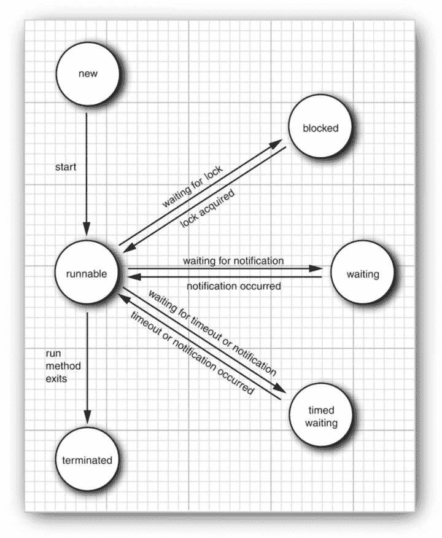图 10.1：线程状态

### 10.2.4. 已终止的线程

线程因以下两个原因之一终止：

*   由于 `run` 方法正常退出，它“自然死亡”。
*   由于未捕获的异常终止了 `run` 方法，它“异常死亡”。

`java.lang.Thread` 1.0

*   `void join()`
    等待指定的线程终止。
*   `void join(long millis)`
*   `void join(Duration duration)` 19
    等待指定的线程终止，或等待指定的毫秒数/时长通过。
*   `Thread.State getState()` 5.0
    获取此线程的状态：`NEW`、`RUNNABLE`、`BLOCKED`、`WAITING`、`TIMED_WAITING` 或 `TERMINATED` 之一。
*   `void stop()`
*   `void suspend()`
*   `void resume()`
    这些方法已标记为弃用，并且从 Java 21 开始抛出 `UnsupportedOperationException`。

## 10.3 线程属性

在后续章节，我们将讨论线程的各种属性：平台线程和虚拟线程、中断状态、守护线程、未捕获异常的处理器，以及一些你不应该使用的旧特性。

### 10.3.1 虚拟线程

默认情况下，Java 线程在执行 Java 虚拟机的操作系统提供的平台线程上。对于许多工作负载，这是一个很好的安排，因为操作系统已经演进到能够很好地处理线程调度。

然而，平台线程并不是轻量级的。它们启动需要数千个 CPU 指令，并且消耗（或至少保留）大量的内存。这限制了 CPU 能够处理的平台线程数量。

对于某些类的应用程序来说这是一个问题。典型的 Web 应用程序希望处理大量的并发请求，远多平台线程的数量。应用程序可以处理这种工作负载，因为任务没有执行 CPU 密集型工作。每个任务的大部分时间都花在阻塞数据库查询或其他外部请求上。

解决方案之一是对请求使用非阻塞 API。而不是使用同步调用：

```
response = service.request(parameters);
process(response);
```

而是将处理代码作为回调传递：

```
service.request(parameters, response -> process(response));
```

然后对 `request` 的调用将立即返回而不进行阻塞，释放其线程来处理额外的请求。当响应可用时，会调用回调。

非阻塞 API 提供了高吞吐量，但对程序员来说代价是昂贵的。与其使用熟悉的用于序列、分支、循环和异常处理的编程结构，所有的程序逻辑都必须放在回调代码中。

Java 21 中提供的虚拟线程是一个极具吸引力的替代方案。虚拟线程挂载在平台线程上，并在遇到阻塞操作时卸载。当操作结果可用时，虚拟线程可以再次被调度，并在平台线程可用时被重新挂载。

“虚拟线程”这一术语类比于虚拟内存。就像虚拟内存映射到较少的实际 RAM 一样，虚拟线程挂载在较少的平台线程上。这些平台线程被称为载体线程（carrier threads）。默认情况下，调度器每个处理器使用一个载体线程。可以通过 `jdk.virtualThreadScheduler.parallelism` VM 参数进行调整。

虚拟线程与平台线程具有相同的 API。创建并启动虚拟线程的简单方法是：

```
Thread t = Thread.startVirtualThread(myRunnable);
```

`Thread` 类的 `isVirtual` 方法在线程为虚拟线程时返回 `true`。

`java.lang.Thread` 1.0

*   `boolean isVirtual()` 21
    当此线程为虚拟线程时返回 `true`。
*   `static Thread startVirtualThread(Runnable task)` 21
    启动并返回运行给定任务的虚拟线程。

### 10.3.2 线程中断

当线程的 `run` 方法返回时，线程终止——通过执行 `return` 语句、执行完方法体中的最后语句后，或者发生了在方法中未捕获的异常。

在 Java 的初始版本中，还有一个 `stop` 方法，另一个线程可以调用它来终止线程。然而，该方法很快被认为是不安全的，现在会抛出 `UnsupportedOperationException` 而不是停止线程。

没有强制终止线程的方法。但是，可以使用 `interrupt` 方法请求终止线程。

当在线程上调用 `interrupt` 方法时，线程的中断状态会被设置。这是一个每个线程都存在的 `boolean` 标志。每个线程应该偶尔检查自己是否被中断。

要检查中断状态是否被设置，首先调用静态方法 `Thread.currentThread` 获取当前线程，然后调用 `isInterrupted` 方法：

```
while (!Thread.currentThread().isInterrupted() && more work to do)
{
   do work
}
```

然而，如果线程处于阻塞状态，它无法检查中断状态。这就是 `InterruptedException` 起作用的地方。当在阻塞 `sleep` 或 `wait` 等调用的线程上调用 `interrupt` 方法时，阻塞调用会被 `InterruptedException` 终止。阻塞 I/O 调用是无法被中断的。那么在 I/O 操作完成后会抛出 `InterruptedException`。

并没有规定被中断的线程必须终止。中断线程仅仅是引起它的注意。被中断的线程可以决定对中断做出反应。某些线程非常重要，应该处理异常并继续。但更多情况下，线程将简单地将中断解释为终止请求。此类线程的 `run` 方法如下：

```
Runnable r = () ->
   {
      try
      {
         . . .
         while (!Thread.currentThread().isInterrupted() && more work to do)
         {
            do work
         }
      }
      catch (InterruptedException e)
      {
         // 线程被中断了
      }
      finally
      {
         cleanup, if required
      }
      //退出方法终止线程
   };
```

如果在每次工作迭代后调用 `sleep` 方法（或其他可中断方法），则 `isInterrupted` 检查既不是必要的也没有用的。如果你在中断状态设置时调用 `sleep` 方法，它不会睡眠。相反，它会清除状态并抛出 `InterruptedException`。因此，如果你的循环调用了 `sleep`，请不要检查中断状态。相反捕获 `InterruptedException`，如下：

```
Runnable r = () ->
   {
      try
      {
         . . .
         while (more work to do)
         {
            do work
            Thread.sleep(delay);
         }
      }
      catch (InterruptedException e)
      {
         // 线程在睡眠期间被中断了
      }
      finally
      {
         cleanup, if required
      }
      //退出方法终止线程
   };
```

有两种非常相似的方法：`interrupted` 和 `isInterrupted`。`interrupted` 方法是一个静态方法，用于检查 `current` 线程是否被中断。此外，调用 `interrupted` 方法会**清除**线程的中断状态。另一方面，`isInterrupted` 方法是一个实例方法，你可以用它来检查任何线程是否被中断过。调用它不会改变中断状态。

你会在许多发表的代码中看到 `InterruptedException` 在子任务级别被静静处理掉，如下所示：

```java
void mySubTask()
{
   . . .
   try
   {
      sleep(delay);
   }
   catch (InterruptedException e)
   {
      // 这里什么都没做--糟糕的
   }
   . . .
}
```

千万不要那样做！如果你这样做了，任务在睡眠期间将无法被中断。你有两个合理的选择：

*   在你的方法上标记 `throws InterruptedException` 并丢弃 `try` 块。这样调用者（或者最终，是 `run` 方法）就可以捕获它。

    ```java
    void mySubTask() throws InterruptedException
    {
       . . .
       sleep(delay);
       . . .
    }
    ```

*   如果你不能那样做，请在 `catch` 子句中设置中断状态。这样调用者就可以进行测试。

    ```java
    void mySubTask()
    {
       . . .
       try
       {
          sleep(delay);
       }
       catch (InterruptedException e)
       {
          Thread.currentThread().interrupt();
       }
       . . .
    }
    ```

`java.lang.Thread` 1.0

*   `void interrupt()`
    向线程发送中断请求。线程的中断状态被设置为 `true`。如果线程当前处于阻塞状态，则会抛出一个 `InterruptedException`。

*   `static boolean interrupted()`
    测试 `current` 线程（即正在执行此指令的线程）是否被中断。注意这是一个静态方法。该调用具有副作用——它会将当前线程的中断状态重置为 `false`。

*   `boolean isInterrupted()`
    测试一个线程是否被中断。与 `static interrupted` 方法不同，此调用不会改变线程的中断状态。

*   `static Thread currentThread()`
    返回代表当前执行线程的 `Thread` 对象。

### 10.3.3 守护线程 (Daemon Threads)

你可以通过调用以下代码将线程转换为 `daemon thread`：

```java
t.setDaemon(true);
```

这种线程并没有所谓的“魔性”。守护线程只是一个除了服务他人之外没有其他角色的线程。例如向其他线程发送定期“定时滴答”的定时器线程，或者清理旧缓存条目的线程。当只剩下守护线程时，虚拟机就会退出。如果剩下的线程都是守护线程，那么保持程序运行就没有意义。

所有虚拟线程都是守护线程。调用 `setDaemon(false)` 对虚拟线程没有影响。

`java.lang.Thread` 1.0

*   `void setDaemon(boolean isDaemon)`
    将此线程标记为守护线程或用户线程。此方法必须在线程启动之前调用。

### 10.3.4 线程名称和 ID

默认情况下，线程具有如 `Thread-2` 这样易记的名字。你可以使用 `setName` 方法设置任何名称：

```java
var t = new Thread(runnable);
```


`t.setName("Web crawler");`

这在线程转储中非常有用。

每个线程都有一个正整数 ID，你可以通过以下方式获取它：

```java
long id = t.threadId();
```

还有一个`getId`方法。它已经被废弃了，因为它没有被定义为`final`。有人可能会重写它以返回线程 ID 以外的内容。请改用最终的`threadId`方法。

`java.lang.Thread` 1.0

- `void setName(String name)`
- `String getName()`
  设置或获取此线程的名称。

- `long threadId()` 19
  返回此线程的唯一 ID。

### 10.3.5 未捕获异常的处理器

线程的`run`方法不能抛出任何检查异常（checked exceptions），但它可以被未检查异常（unchecked exception）终止。在这种情况下，线程会终止。

然而，没有`catch`子句可以传播该异常。相反，在线程死亡之前，异常会被传递给未捕获异常的处理器。

该处理器必须属于实现`Thread.UncaughtExceptionHandler`接口的类。该接口有一个方法：

```java
void uncaughtException(Thread t, Throwable e)
```

你可以使用`setUncaughtExceptionHandler`方法为任何线程安装处理器。你也可以使用`Thread`类的静态方法`setDefaultUncaughtExceptionHandler`为所有线程安装一个默认处理器。替换的处理器可能会使用日志 API 将未捕获异常的报告发送到日志文件中。如果你没有安装默认处理器，默认处理器为`null`。

如果你没有为线程安装未捕获异常处理器，它将使用一个执行以下操作的处理器：

1. 如果线程的线程组有父级，则调用父线程组的`uncaughtException`方法。（这并不常见。）
2. 否则，如果`Thread.getDefaultUncaughtExceptionHandler`方法返回非空，则调用它。
3. 否则，如果`Throwable`是`ThreadDeath`的实例（曾被用于停止线程），则什么都不会发生。
4. 否则，线程名称和堆栈轨迹将打印到`System.err`上。

这就是你无疑见过很多次的未捕获异常。从技术上讲，未捕获异常是由*线程组*（thread group）定义的。线程组是一组可以共同管理的线程集合。默认情况下，你创建的所有线程都属于同一个线程组，但也可以建立其他的分组。我建议不要在程序中使用线程组。

`java.lang.Thread` 1.0

- `static void setDefaultUncaughtExceptionHandler(Thread.UncaughtExceptionHandler handler)` 5.0
- `static Thread.UncaughtExceptionHandler getDefaultUncaughtExceptionHandler()` 5.0
  设置或获取所有异常的默认处理器。
- `void setUncaughtExceptionHandler(Thread.UncaughtExceptionHandler handler)` 5.0
- `Thread.UncaughtExceptionHandler getUncaughtExceptionHandler()` 5.0
  设置或获取用于未捕获异常的处理器。如果没有安装处理器，则线程组对象即为处理器。

`java.lang.Thread.UncaughtExceptionHandler` 5.0

- `void uncaughtException(Thread t, Throwable e)`
  定义用于在线程因未捕获异常终止时记录自定义报告。

`java.lang.ThreadGroup` 1.0

- `void uncaughtException(Thread t, Throwable e)`
  如果有父级，则调用父线程组的此方法；如果有默认处理器，则调用`Thread`类的默认处理器；否则，向标准错误流打印堆栈轨迹。

### 10.3.6 线程优先级

每个线程都有一个*优先级*（priority）。默认情况下，线程继承构造它的线程的优先级。你可以使用`setPriority`方法增加或降低任何平台线程的优先级。你可以将优先级设置为`MIN_PRIORITY`（在`Thread`类中定义为`1`）和`MAX_PRIORITY`（定义为`10`）之间的任何值。`NORM_PRIORITY`定义为`5`。

每当平台线程调度器有机会选择一个新线程时，它都会倾向于选择优先级更高的线程。然而，线程优先级*高度依赖于系统*。由于 Java 虚拟机依赖于主平台的线程实现，Java 线程优先级被映射到主平台的优先级级别，而主平台可能有更多或更少的线程优先级级别。

例如，Windows 有七个优先级级别。某些 Java 优先级映射到相同的操作系统级别。在 Linux 的 OpenJDK VM 中，线程优先级被完全忽略——所有线程的优先级都相同。

线程优先级在不使用操作系统线程的 Java 早期版本中可能有用。现在你不应该使用它们。

为了向后兼容性，所有虚拟线程的优先级均为`NORM_PRIORITY`。尝试更改优先级将没有效果。

`java.lang.Thread` 1.0

- `void setPriority(int newPriority)`
  设置此线程的优先级。优先级必须在`Thread.MIN_PRIORITY`和`Thread.MAX_PRIORITY`之间。使用`Thread.NORM_PRIORITY`设置普通优先级。

- `static int MIN_PRIORITY`
  是`Thread`可以拥有的最低优先级。最小优先级值为`1`。

- `static int NORM_PRIORITY`
  是`Thread`的默认优先级。默认优先级为`5`。

- `static int MAX_PRIORITY`
  是`Thread`可以拥有的最高优先级。最大优先级值为`10`。

### 10.3.7. 线程工厂与构建器

你通常希望创建多个具有相同属性的线程。`ThreadFactory`接口有一个方法

```
Thread newThread(Runnable r)
```

该方法产生一个新的线程实例，该实例在启动时将执行给定的`Runnable`。

你可以提供实现此接口的自定义类，或者从 Java 21 开始，使用方便的构建器语法。

静态方法`Thread.ofPlatform()`和`Thread.ofVirtual()`产生平台线程或虚拟线程的构建器。你可以自定义要构建的线程：

```
Thread.Builder builder = Thread.ofVirtual().name("request-", 1);
```

请查看 API 注释以获取更多自定义方法。

然后调用`unstarted`或`start`来获取单个线程，或者调用`factory`获取线程工厂：

```
Thread t = builder.unstarted(myRunnable);

builder.start(myRunnable);

ThreadFactory factory = builder.factory();

t = factory.newThread(myRunnable);
```

`java.util.concurrent.ThreadFactory` 5.0

- `Thread newThread(Runnable r)`
  创建一个线程，该线程在启动时会调用给定`Runnable`的`run`方法。

`java.lang.Thread` 1.0

- `Thread.Builder.OfPlatform ofPlatform()` 21
- `Thread.Builder.OfVirtual ofVirtual()` 21
  创建一个用于平台线程或虚拟线程的构建器。

`java.lang.Thread.Builder` 21

- `Thread.Builder name(String prefix, long start)`
- `Thread.Builder name(String name)`
  使构建的线程使用给定的前缀和带有给定起始值的计数器命名，或者使用给定的名称命名。

- `ThreadFactory factory()`
  产生一个工厂，用于根据此构建器的配置构建线程。

- `Thread unstarted(Runnable task)`
- `Thread start(Runnable task)`
  构造一个执行给定任务的线程。第二个方法会启动线程。

- `Thread.Builder uncaughtExceptionHandler(Thread.UncaughtExceptionHandler ueh)`
  使构建的线程使用给定的未捕获异常处理器。

`java.lang.Thread.Builder.OfPlatform` 21

- `Thread.Builder.OfPlatform daemon()`
- `Thread.Builder.OfPlatform daemon(boolean on)`
  除非`on`为`false`，否则使构建的线程成为守护线程。

- `Thread.Builder.OfPlatform stackSize(long stackSize)`
- `Thread.Builder.OfPlatform group(ThreadGroup group)`
- `Thread.Builder.OfPlatform priority(int priority)`
  使构建的线程具有给定的栈大小提示、线程组或优先级（不推荐）。

### 10.4. 任务协调

将任务拆分为子任务是常见的做法，当子任务的结果就绪时进行组合。在接下来的章节中，你将看到 Java 并发框架提供的协调并发任务的工具。

### 10.4.1. Callables 和 Futures

`Runnable`封装了一个异步运行的任务；你可以将其想象成一个没有参数且没有返回值的异步方法。`Callable`与`Runnable`类似，但它返回一个值。`Callable`接口是一个泛型类型，只有一个方法`call`。

```java
public interface Callable<V>
{
   V call() throws Exception;
}
```

类型参数是返回值的类型。例如，`Callable<Integer>`代表一个最终返回`Integer`对象的异步任务。

`Future`持有异步任务的结果。当你调度一个任务执行时，你会收到一个`Future`对象。使用`Future`对象，你可以在结果就绪时获取它。

`Future<V>`接口具有以下方法：

```java
V get()
V get(long timeout, TimeUnit unit)
V resultNow()
Throwable exceptionNow()
void cancel(boolean mayInterrupt)
boolean isCancelled()
boolean isDone()
Future.State state()
```

调用第一个`get`方法会阻塞，直到任务完成。第二个`get`方法也会阻塞，但如果在任务完成之前调用超时，它将抛出`TimeoutException`。如果运行任务的线程被中断，则这两种方法都会抛出`InterruptedException`。如果任务因异常终止，`get`方法将抛出`ExecutionException`，其原因为终止任务的异常。

如果任务已经完成，`get`将立即返回。

`resultNow`方法是`get`的非阻塞版本，只有在你知道任务已成功完成时才调用它。`exceptionNow`方法在任务执行失败时检索终止性异常，否则抛出`IllegalStateException`。

你可以使用`cancel`方法尝试取消任务。如果任务尚未启动，它永远不会启动。如果任务正在进行中，当`mayInterrupt`参数为`true`时它会被中断，否则将运行完成。

`isDone`方法在任务完成（无论成功或失败）或被取消时返回`true`。

`state`方法返回任务的状态，值为`Task.State`：

- `RUNNING`: 任务未完成且未取消
- `SUCCESS`: 任务成功完成
- `FAILED`: 任务因异常完成
- `CANCELLED`: 任务被取消

执行`Callable`的一种方法是使用`FutureTask`，它实现了`Future`和`Runnable`接口，因此你可以构造一个线程来运行它：

```java
Callable<Integer> task = . . .;
var futureTask = new FutureTask<Integer>(task);
var t = new Thread(futureTask); // futureTask 是 Runnable
t.start();
. . .
Integer result = futureTask.get(); // futureTask 是 Future
```

通常会将`Callable`传递给执行器。这是下一节的主题。

要为`Runnable`获取`Future`，你可以调用：

```
var futureTask = new FutureTask<Void>(myRunnable, null);
```

`java.util.concurrent.Callable<V>` 5.0

- `V call()`
  运行一个产生结果的任务。

`java.util.concurrent.Future<V>` 5.0

- `V get()`
- `V get(long time, TimeUnit unit)`
  获取结果，阻塞直到结果可用或给定时间结束。如果任务被取消，抛出`CancellationException`；如果任务执行失败，则抛出原因为终止异常的`ExecutionException`；如果当前线程被中断，则抛出`InterruptedException`。如果任务在给定时间内未完成，第二个方法将抛出`TimeoutException`。

- `V resultNow()` 19
  在任务成功完成时获取结果，否则抛出`IllegalStateException`。

- `Throwable exceptionNow()` 19
  在任务执行失败时检索终止性异常，否则抛出`IllegalStateException`。

- `boolean cancel(boolean mayInterrupt)`
  尝试取消此任务的执行。如果任务已经开始且`mayInterrupt`参数为`true`，则任务会被中断。如果取消成功，返回`true`。

- `boolean isCancelled()`
  如果任务在完成之前被取消，则返回`true`。

- `boolean isDone()`
  如果任务已完成（成功或失败）或被取消，则返回`true`。

- `Future.State state()`
  返回此任务的状态，如`RUNNING`、`SUCCESS`、`FAILED`或`CANCELLED`。

`java.util.concurrent.FutureTask<V>` 5.0

- `FutureTask(Callable<V> task)`
  构造既是`Future<V>`又是`Runnable`的对象。

- `FutureTask(Runnable task, V result)`
  构造一个对象，该对象作为`Runnable`执行任务，并作为`Future<V>`在完成后产出结果。

## 10.4.2 Executors

创建一个新的平台线程相当昂贵，因为涉及到与操作系统的交互。如果你的程序创建了大量短命的平台线程，你不应该在每个线程上运行每个任务，而应该使用`thread pool`（线程池）。线程池包含若干准备好执行你任务的线程。你向池提交`Runnable`或`Callable`任务，由其中一个线程调用`run`或`call`方法。当方法退出时，该线程不会死亡，而是留下来处理下一个请求。

`executor`（执行器）是你提交任务的对象。对于平台线程，那就是线程池。虚拟线程的创建非常廉价，永远不应该池化。虚拟线程的执行器将为每个提交的任务简单启动一个新的虚拟线程。

`Executors`类有许多静态工厂方法用于构建执行器。表 10.1 列出了其中最实用的方法。

### 表 10.1: 常用执行器工厂方法

| 方法 | 说明 |
| --- | --- |
| `newCachedThreadPool` | 根据需要创建新线程；空闲线程将保留 60 秒。 |
| `newFixedThreadPool` | 池包含一组固定的线程；空闲线程将无限期保留。 |
| `newSingleThreadExecutor` | 一个带有单个线程的“池”，该线程按顺序执行提交的任务。 |
| `newVirtualThreadPerTaskExecutor` | 一个在新的虚拟线程上运行每个任务的执行器。 |


`newCachedThreadPool` 方法构建一个立即执行每个任务的线程池，当有可用的空闲线程时使用它，否则创建新线程。`newFixedThreadPool` 方法构建一个具有固定大小的线程池。如果提交的任务多于空闲线程的数量，未处理的任务将放置在队列中。它们会在其他任务完成后运行。`newSingleThreadExecutor` 是一个大小为 1 的退化线程池，由单个线程一个接一个地执行提交的任务。

当你拥有短命或花费大量时间在阻塞状态的平台线程时，请使用缓存线程池。然而，如果你有线程在不阻塞的情况下努力工作，你不希望让大量线程一起运行。为了获得最佳性能，请使用大小等于处理器核心数的固定池。

虚拟线程的执行器将为每个提交的任务简单启动一个新的虚拟线程。`Executors` 类有许多静态工厂方法用于构建执行器。

## 当你不再想提交任何任务时关闭执行器

当执行器使用线程工厂的线程时，设置工厂的未捕获异常处理器将不起作用。线程池需要安装自己的句处理器来捕获任务异常。

### `java.util.concurrent.Executors` 5.0

* `static ExecutorService newCachedThreadPool()`
* `static ExecutorService newCachedThreadPool(ThreadFactory threadFactory)`

  返回一个缓存线程池，它根据需要创建线程，并终止空闲超过 60 秒的线程。

* `static ExecutorService newFixedThreadPool(int threads)`
* `static ExecutorService newFixedThreadPool(int threads, ThreadFactory threadFactory)`

  返回一个使用给定数量线程执行任务的线程池。

* `static ExecutorService newSingleThreadExecutor()`
* `static ExecutorService newSingleThreadExecutor(ThreadFactory threadFactory)`

  返回一个在单个线程按顺序执行任务的执行器。

* `static ExecutorService newVirtualThreadPerTaskExecutor()` 21
* `static ExecutorService newThreadPerTaskExecutor(ThreadFactory threadFactory)` 21

  返回一个在新的虚拟线程（或由给定工厂产生的线程）中执行每个任务的执行器。

### `java.util.concurrent.ExecutorService` 5.0

* `Future<T> submit(Callable<T> task)`
* `Future<T> submit(Runnable task, T result)`
* `Future<?> submit(Runnable task)`

  提交给定的任务进行执行。

* `void close()` 19

  将此执行器设置为关闭模式，使其不再接受新的提交，并阻塞直到已提交的任务完成。如果在阻塞期间被中断，则正在运行的任务也将被中断。

* `void shutdown()`

  将此执行器设置为关闭模式，使其不再接受新的提交。此方法不会阻塞等待已提交任务的完成。

* `List<Runnable> shutdownNow()`

  将此执行器设置为关闭模式，中断已启动的任务，并移除尚未启动的任务。返回一个被移除的任务列表。此方法不会阻塞等待已提交任务的完成。

* `boolean awaitTermination(long timeout, TimeUnit unit)`

  阻塞直到所有提交的任务已完成、超时通过或阻塞被中断。如果所有任务都已完成，则返回 `true`。

### 调用一组任务

通常，你想要启动多个并发任务，并获取第一个成功任务的结果，或者合并所有完成任务的结果。

`invokeAny` 方法提交 `Callable` 对象集合中的所有任务，并阻塞直到其中一个任务成功完成，然后返回其结果。任何未完成的任务都将被取消。你不知道是哪个任务成功了——推测，是完成得最快的那一个。如果没有任务成功，则会抛出 `ExecutionException`。

使用此方法处理搜索问题，在该问题中你愿意接受任何解决方案。例如，假设你需要找到一个大整数的因数——这是破解 RSA 密所需的计算。你可以提交多个任务，每个任务都尝试对不同范围的数字进行因数分解。只要这些任务中任一个有了答案，你的计算就可以停止。

`invokeAll` 方法提交 `Callable` 对象集合中的所有任务，阻塞直到所有任务都完成，并返回一个 `Future` 对象列表，这些对象代表所有任务的解决方案，且顺序与提交任务的顺序相同。你可以像这样这样处理计算结果：

```
List<Callable<T>> tasks = . . .;
List<Future<T>> results = executor.invokeAll(tasks);
for (Future<T> result : results) {
   if (result.state() == Future.State.SUCCESS)
      process result.resultNow();
   else
      handle result.exceptionNow();
}
```

对 `invokeAll` 的调用会阻塞直到所有任务完成。如果你想按照结果产生的顺序获取结果，请使用 `ExecutorCompletionService`。

通过通常方式获取一个执行器。然后构造一个 `ExecutorCompletionService`。将任务提交给完成服务。该服务管理一个 `Future` 对象的阻塞队列，当提交的任务的结果变为可用时，将其包含其中：

```
var service = new ExecutorCompletionService<T>(executor);
for (Callable<T> task : tasks) service.submit(task);
for (int i = 0; i < tasks.size(); i++) {
   Future<T> result = service.take();
}
```

Listing 10.3 中的程序展示了如何使用 callables 和执行器。在第一次计算中，我们统计目录树中包含给定单词的文件数。我们为每个文件创建一个单独的任务：

```
Set<Path> files = descendants(Path.of(start));
var tasks = new ArrayList<Callable<Long>>();
for (Path file : files)
{
   Callable<Long> task = () -> occurrences(word, file);          
   tasks.add(task);
}
```

然后我们将任务提交给执行器服务：

```
ExecutorService executor = Executors.newCachedThreadPool();
List<Future<Long>> results = executor.invokeAll(tasks);
```

为了获得合并后的计数，我们加上所有结果，并阻塞直到它们可用：

```
long total = 0;
for (Future<Long> result : results)
   total += result.get();
```

程序还显示了搜索期间花费的时间。将执行器替换为单线程执行器并尝试虚拟线程。

在程序的第二部分，我们搜索包含给定单词的文件。我们使用 `invokeAny` 来并行化搜索。在这里，我们必须对任务小心。我们监控中断状态。

```
public static Callable<Path> searchForTask(String word, Path path)
{
   return () ->
      try (var in = new Scanner(path))
         {
            while (in.hasNext())
            {
               if (in.next().equals(word)) return path;
               if (Thread.currentThread().isInterrupted())
               {
                  System.out.println("Search in " + path + " canceled.");
                  return null;
               }
            }
            throw new NoSuchElementException();
         }
      };
}
```

就像结构化编程用分支、循环和函数取代了“goto”语句一样，*结构化并发*（structured concurrency）是为了寻找更容易推理并发程序的编程构造结构。

Java 21 包含了结构化并发 API 的预览版。任务被提交到 `StructuredTaskScope` 中。然后 `join` 方法会阻塞直到根据作用范围的关闭策略关闭。该 API 提供了两个简单的策略 `ShutdownOnFailure` 和 `ShutdownOnSuccess`。以下是一个用法示例：

```
// Java 21 预览 API
try (var scope = new StructuredTaskScope.ShutdownOnFailure()) {
   Supplier<T1> f1 = scope.fork(callable1);
   Supplier<T2> f2 = scope.fork(callable2);
   scope.join();
   scope.throwIfFailed();
   result = combine(f1.get(), f2.get());
}
```

当 `try` 块结束时，我们可以确定所有子任务都已完成。

如果任一个子任务失败，作用范围将关闭，取消另一个任务，并重新抛第一个异常。

如果当前线程被中断，作用范围将关闭且两个任务都将被取消。

你可以通过 `ExecutorService.invokeAll` 实现几乎相同的效果，不同之处 `invokeAll` 即使其中一个任务失败，也会等待所有任务完成。如果你更倾向于这种策略，可以很容易实现一个作用域子类。

结构化编程 API 灵活且方便，并为作用域嵌套提供了运行时检查和可观测特性。

### 列表 10.3 executors/ExecutorDemo.java


```java
package executors;

import java.io.*;
import java.nio.file.*;
import java.time.*;
import java.util.*;
import java.util.concurrent.*;
import java.util.stream.*;

/**
 * 此程序演示了 Callable 接口和 executors。
 * @version 1.02 2023-07-27
 * @author Cay Horstmann
 */
public class ExecutorDemo
{
   /**
    * 统计文件中给定单词出现的次数。
    * @return 单词在给定文件中出现的次数
    */
   public static long occurrences(String word, Path path)
   {
      try (var in = new Scanner(path))
      {
         int count = 0;
         while (in.hasNext())
            if (in.next().equals(word)) count++;
         return count;
      }
      catch (IOException ex)
      {
         return 0;
      }
   }

   /**
    * 返回给定目录的所有后代——参见卷 II 的第 1 和第 2 章。
    * @param rootDir 根目录
    * @return 根目录所有后代的集合
    */
   public static Set<Path> descendants(Path rootDir) throws IOException
   {
      try (Stream<Path> entries = Files.walk(rootDir))
      {
         return entries.filter(Files::isRegularFile)
            .collect(Collectors.toSet());
      }
   }

   /**
    * 生成一个在文件中搜索单词的任务。
    * @param word 要搜索的单词
    * @param path 要搜索的文件
    * @return 成功后返回路径的搜索任务
    */
   public static Callable<Path> searchForTask(String word, Path path)
   {
      return () ->
         {
            try (var in = new Scanner(path))
            {
               while (in.hasNext())
               {
                  if (in.next().equals(word)) return path;
                  if (Thread.currentThread().isInterrupted())
                  {
                     System.out.println("Search in " + path + " canceled.");
                     return null;
                  }
               }
               throw new NoSuchElementException();
            }
         };
   }

   public static void main(String[] args)
         throws InterruptedException, ExecutionException, IOException
   {
      try (var in = new Scanner(System.in))
      {
         System.out.print("Enter base directory (e.g. /opt/jdk-21-src): ");
         String start = in.nextLine();
         System.out.print("Enter keyword (e.g. volatile): ");
         String word = in.nextLine();

         Set<Path> files = descendants(Path.of(start));
         var tasks = new ArrayList<Callable<Long>>();
         for (Path file : files)
         {
            Callable<Long> task = () -> occurrences(word, file);          
            tasks.add(task);
         }
         ExecutorService executor = Executors.newCachedThreadPool();
         // 使用单线程执行器来查看多个线程
         // 是否能加速搜索
         // ExecutorService executor = Executors.newSingleThreadExecutor();
         // 或者尝试虚拟线程
         // ExecutorService executor = Executors.newVirtualThreadPerTaskExecutor();
         Instant startTime = Instant.now();
         List<Future<Long>> results = executor.invokeAll(tasks);
         Instant endTime = Instant.now();
         long total = 0;
         for (Future<Long> result : results)
            total += result.get();
         System.out.println("Occurrences of " + word + ": " + total);
         System.out.println("Time elapsed: "
            + Duration.between(startTime, endTime).toMillis() + " ms");

         var searchTasks = new ArrayList<Callable<Path>>();
         for (Path file : files)
            searchTasks.add(searchForTask(word, file));
         startTime = Instant.now();
         Path found = executor.invokeAny(searchTasks);
         endTime = Instant.now();
         System.out.println(word + " occurs in: " + found);
         System.out.println("Time elapsed: "
            + Duration.between(startTime, endTime).toMillis() + " ms");

         executor.close();
      }
   }
}
```

`java.util.concurrent.ExecutorService` 5.0

- `T invokeAny(Collection<Callable<T>> tasks)`

- `T invokeAny(Collection<Callable<T>> tasks, long timeout, TimeUnit unit)`

  执行给定任务并返回一个成功完成的任务的结果，同时取消剩余任务。第二个方法在发生超时时会抛出 `TimeoutException`。

- `List<Future<T>> invokeAll(Collection<Callable<T>> tasks)`

- `List<Future<T>> invokeAll(Collection<Callable<T>> tasks, long timeout, TimeUnit unit)`

  执行给定任务并在所有任务完成后后返回结果。第二个方法在发生超时时会抛出 `TimeoutException`。

`java.util.concurrent.ExecutorCompletionService<V>` 5.0

- `ExecutorCompletionService(Executor e)`

  构造一个执行器完成服务，用于收集给定执行器的结果。

- `Future<V> submit(Callable<V> task)`

- `Future<V> submit(Runnable task, V result)`

  将任务提交给底层执行器。

- `Future<V> take()`

  移除下一个完成的结果，如果没有可用结果则进行阻塞。

- `Future<V> poll()`

- `Future<V> poll(long time, TimeUnit unit)`

  移除下一个完成的结果，如果没有可用结果则返回 `null`。第二个方法会等待给定的时间。

### 10.4.4 线程局部变量

有时，你希望让一个任务特定的对象对所有协作该任务的方法都可用，而无需将该对象作为每次调用的参数传递。为此可以使用线程局部变量（thread-local variable）。这并不是一个真正的变量，而是一个其 `get` 和 `set` 方法访问取决于当前线程的值的对象。

例如，假设你想共享数据库连接。声明一个变量：

```java
public static final ThreadLocal<Connection> CONNECTION = new ThreadLocal<>();
```

当任务开始时，为此线程初始化连接：

```java
CONNECTION.set(connect(uri, username, password));
```

任务调用某些方法（均都在同一个线程内进行），最终其中一个方法需要连接：

```java
Connection connection = CONNECTION.get();
var result = connection.executeQuery(query);
```

注意，相同的调用可能会在多个线程上发生。每个线程都获得它自己的连接对象。

在线程池中执行任务时，你不希望让线程局部数据对调度在同一线程上的其他任务可用。你还希望确保在任务完成后它们能被垃圾回收。在任务完成（无论成功还是发生异常）时调用：

```java
CONNECTION.remove();
```

是非常关重要的。

`InheritableThreadLocal` 是 `ThreadLocal` 的子类，用于将线程局部数据传播到子任务。当启动新线程时，它会接收父线程继承线程局部变量的副本。（该副本是必要的，因为子线程可能会修改线程局部值。）

在迁移到虚拟线程时，将资源密集型对象作为线程局部变量可能会出现问题。虚拟线程的数量可能远大于线程池中的线程，而现在你拥有了多的实例。在这种情况下，你应该重新考虑你的共享策略。

要识别线程局部变量的使用，请带有虚拟机标志 `jdk.traceVirtualThreadLocals` 运行。当虚拟线程修改线程局部变量时，你将获得堆栈跟踪。

作用值（Scoped values）是 Java 21 的一项预览功能，提供了一个比可继承线程局部变量（inheritable thread-local variables）性能更好的版本。作用值每个线程都有自己的实例，但它是不可变的且具有边界生命周期。作用值会被由 `StructuredTaskScope` 创建的虚拟线程继承。这段代码展示了如何使用它们：

```java
public static final ScopedValue<Connection> CONNECTION = ScopedValue.newInstance(); 
. . .
ScopedValue.where(CONNECTION, connect(uri, username, password)).run(() -> doWork());
. . .
public void doWork() {
   . . .
   Connection connection = CONNECTION.get();
   var result = connection.executeQuery(query);
   . . .
}
```

使用虚拟线程时，优先使用作用值而非线程局部变量。

`java.lang.ThreadLocal<T>` 1.2

- `T get()`

  获取当前线程的值。如果第一次调用 `get` 且从未对调用过 `set`，则通过调用 `initialize` 获取值。

- `void set(T t)`

  为此线程设置新值。

- `void remove()`

  移除此线程的值。

### 10.4.5 Fork-Join 框架

某些应用程序使用了大量处于空闲状态的线程。例如，每个连接使用一个线程的 Web 服务器。其他应用程序每个处理器核心使用一个线程，以执行计算密集型任务，如图像或视频处理。Fork-join 框架的设计旨在支持后者。假设你有一个可以自然分解为子任务的处理任务，如下：

```text
if (problemSize < threshold)
{
   直接解决问题
}
else 
{
   将问题分解为子问题
   递归地解决每个子问题
   合并结果
}
```

一个例子是图像处理。为了增强图像，你可以对上半部分和下半部分进行转换。如果有足够的空闲处理器，这些操作就可以并行运行。（你可能需要在两个部分之间的条带上做一些额外工作，但这是一个技术细节。）

在这里，我们讨论一个更简单的例子。假设我们想统计数组中有多少元素符合特定属性。我们将数组一分为二，计算每部分的部分的计数，然后将它们相加。

为了将递归计算转换为框架可的格式，请提供一个扩展 `RecursiveTask<T>` 的类（如果计算产生类型 `T` 的结果）或 `RecursiveAction`（如果不产生结果）。重写 `compute` 方法来生成并调用子任务，并合并它们的结果。

```java
class Counter extends RecursiveTask<Integer>
{
   . . .
   protected Integer compute()
   {
      if (to - from < THRESHOLD)
      {
         直接解决问题
      }
      else
      {
         int mid = from + (to - from) / 2;
         var first = new Counter(values, from, mid, filter);
         var second = new Counter(values, mid, to, filter);
         invokeAll(first, second);
         return first.join() + second.join();
      }
   }
}
```

`invokeAll` 方法接收多个任务并阻塞直到所有任务都完成。`join` 方法返回结果。在这里，我们将 `join` 应用于每个子任务并返回总和。

还有一个用于当前结果的 `get` 方法，但它不那么吸引人，因为它可以抛出我们在 `compute` 方法中不允许抛出的受检异常。

Listing 10.4 显示了完整的示例。

在后台，Fork-Join 框架使用了一种名为“工作窃取”（work stealing）的有效启发策略，在可用线程之间平衡负载。每个工作线程都有一个用于任务的双队列。工作线程将较小的子任务推入其自己的队列的头部。（只有一个线程访问头部，因此不需要锁定。）当工作线程空闲时，它会从另一个队列的尾部“窃取”任务（这需要锁定）。通过窃取位于尾部的较大的子任务，距离下次“窃取”所过的时间会更长，从而减少尾部的竞争。

Fork-join 池针对非阻塞工作负载进行了优化。如果你向 Fork-Join 池中添加许多阻塞任务，可能会导致其饥饿。可以通过让任务实现 `ForkJoinPool.ManagedBlocker` 接口来克服这一点，但这是我们不会讨论的高级技术。

Listing 10.4 `forkJoin/ForkJoinTest.java`


```java
package forkJoin;

import java.util.concurrent.*;
import java.util.function.*;

/**
 * 此程序演示了 fork-join 框架。
 * @version 1.02 2021-06-17
 * @author Cay Horstmann
 */
public class ForkJoinTest
{
   public static void main(String[] args)
   {
      final int SIZE = 10000000;
      var numbers = new double[SIZE];
      for (int i = 0; i < SIZE; i++) numbers[i] = Math.random();
      var counter = new Counter(numbers, 0, numbers.length, x -> x > 0.5);
      var pool = new ForkJoinPool();
      pool.invoke(counter);
      System.out.println(counter);
   }
}

class Counter extends RecursiveTask<Integer>
{
   . . .
   protected Integer compute()
   {
      if (to - from < THRESHOLD)
      {
         直接解决问题
      }
      else
      {
         int mid = from + (to - from) / 2;
         var first = new Counter(values, from, mid, filter);
         var second = new Counter(values, mid, to, filter);
         invokeAll(first, second);
         return first.join() + second.join();
      }
   }
}
```

## 10.5. 同步

在大多数实际的多线程应用程序中，两个或多个线程需要共享对数据的访问。如果两个线程访问同一个对象，并且都调用修改状态的方法，会发生什么？正如你想象的，线程可能会相互干扰。取决于数据访问的顺序，可能会导致对象损坏。这种情况通常被称为竞态条件（race condition）。

### 10.5.1. 竞态条件的示例

为了避免多个线程损坏共享数据，你必须学习如何“同步访问”。在本节中，你将看到如果不同步会发生什么。在下一节中，你将看到如何同步数据。

在下一个测试程序中，我们继续操作模拟的银行。与 Section 10.1 中的示例不同，我们随机选择转账的源和目的。由于这会导致问题，让我们更仔细地查看 `Bank` 类中 `transfer` 方法的代码。

```java
public void transfer(int from, int to, double amount)
   // CAUTION: 当从多个线程调用时是不安全的
{
   System.out.print(Thread.currentThread());
   accounts[from] -= amount;
   System.out.printf(" %10.2f from %d to %d", amount, from, to);
   accounts[to] += amount;
   System.out.printf(" Total Balance: %10.2f%n", getTotalBalance());
}
```

这里是 `Runnable` 实例的代码。`run` 方法不断从给定的银行账户中提取资金。在每次迭代中，`run` 方法选取随机目标账户和随机金额，调用银行对象调用 `transfer` 方法，然后睡眠。

```java
Runnable r = () ->
   {
      try
      {
         while (true)
         {
            int toAccount = (int) (bank.size() * Math.random());
            double amount = MAX_AMOUNT * Math.random();
            bank.transfer(fromAccount, toAccount, amount);
            Thread.sleep((int) (DELAY * Math.random()));
         }
      }
      catch (InterruptedException e)
      {
      }            
   };
```

当此模拟运行时，我们并不知道任何时刻任何一个银行账户中有多少钱。但我们知道，所有账户的总金额应该保持不变，因为我们所做的只是将钱从一个账户转移另一个另一个。

在每笔交易结束时，`transfer` 方法会重新计算总额并打印出来。

此程序永远不会结束。按下 `Ctrl+C` 杀死程序。

这是一个典型的输出示例：

```text
. . .
Thread[Thread-11,5,main]     588.48 from 11 to 44 Total Balance:  100000.00
Thread[Thread-12,5,main]     976.11 from 12 to 22 Total Balance:  100000.00
Thread[Thread-14,5,main]     521.51 from 14 to 22 Total Balance:  100000.00
Thread[Thread-13,5,main]     359.89 from 13 to 81 Total Balance:  100000.00
. . .
Thread[Thread-36,5,main]     401.71 from 36 to 73 Total Balance:   99291.06
Thread[Thread-35,5,main]     691.46 from 35 to 77 Total Balance:   99291.06
Thread[Thread-37,5,main]      78.64 from 37 to 3 Total Balance:   99291.06
Thread[Thread-34,5,main]     197.11 from 34 to 69 Total Balance:   99291.06
Thread[Thread-36,5,main]      85.96 from 36 to 4 Total Balance:   99291.06
. . .
Thread[Thread-4,5,main]Thread[Thread-33,5,main]       7.31 from 31 to 32 Total Balance:
99979.24
     627.50 from 4 to 5 Total Balance:  99979.24
. . .
```

如你所见，出了非常严重的问题。对于某些交易，银行余额保持在 $100,000，这是 100 个每个 $1,000 账户的正确总和。但过了一段时间，余额发生了轻微变化。当你运行此程序时，错误可能会很快发生，或者余额可能需要很长时间才会发生损坏。这种情况并不令人产生信心，你可能不想把辛苦赚的钱存入这样的银行。

看看你是否能找出 Listing 10.5 中的代码以及 Listing 10.2 中 `Bank` 类中的问题。我们将在下一节中解开这个谜团。

### Listing 10.5 unsynch/UnsynchBankTest.java

```java
package unsynch;

/**
 * 此程序显示了当多个线程访问数据结构时的数据损坏情况。
 * @version 1.33 2023-07-30
 * @author Cay Horstmann
 */
public class UnsynchBankTest
{
   public static final int NACCOUNTS = 100;
   public static final double INITIAL_BALANCE = 1000;
   public static final double MAX_AMOUNT = 1000;
   public static final int DELAY = 10;

   public static void main(String[] args)
   {
      var bank = new Bank(NACCOUNTS, INITIAL_BALANCE);
      for (int i = 0; i < NACCOUNTS; i++)
      {
         int fromAccount = i;
         Runnable r = () -> 
            {
               try
               {
                  while (true)
                  {
                     int toAccount = (int) (bank.size() * Math.random());
                     double amount = MAX_AMOUNT * Math.random();
                     bank.transfer(fromAccount, toAccount, amount);
                     Thread.sleep((int) (DELAY * Math.random()));
                  }
               }
               catch (InterruptedException e)
               {
               }            
            };
         Thread.ofPlatform().start(r);
      }
   }
}
```

### 10.5.2. 竞态条件详解

在上一节中，我们运行了一个由几个线程更新银行账户余额的程序。一段时间后，错误悄悄出现，某些钱丢失了或凭空产生。这个问题当两个线程同时尝试更新一个账户时就会发生。假设两个线程同时执行指令：

```java
accounts[to] += amount;
```

问题在于这些不是*原子*操作。该指令的处理可能如下：

1. 将 `accounts[to]` 加载到寄存器中。
2. 加上 `amount`。
3. 将结果移回 `accounts[to]`。

现在假设第一个线程执行了步骤 1 和 2，然后被抢占了。假设第二个线程唤醒并更新了 `account` 数组中的同一条目。然后，第一个线程唤醒并完成了它的步骤 3。

这一操作消除了另一个线程的修改。结果是，总数不再正确（参见 Figure 10.2）。

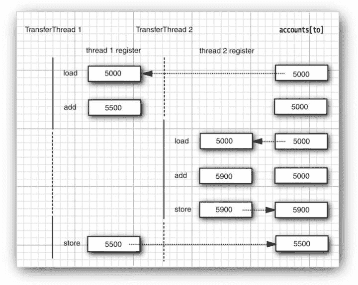Figure 10.2: 两个线程同时访问

`UnsyncBankTest` 程序演示了这种损坏。（在计算 `getTotalBalance` 期间也有极微小的误报概率。）

你实际上可以查看我们类中执行每个语句的虚拟机字节码。运行命令：

```bash
javap -c -v Bank
```

来反编译 `Bank.class` 文件。例如，该行：

```java
accounts[to] += amount;
```

被翻译为以下字节码：

```text
aload_0
getfield        #2; // Field accounts:D
iload_2
dup2
daload
dload_3
dadd
dastore
```

这些代码的意思并不重要。重点是 `synchronized` 命令是由几个指令组成的，执行它们的线程可能会被抢占。

这种情况发生的概率有多大？在具有多个核心的现代处理器上，损坏的风险很高。通过将打印语句与更新余额的语句交替执行，我增加了观察到问题的概率。

### 10.5.3. 锁对象

有两种机制可以保护代码块免受并发访问。Java 语言为此目的提供了 `synchronized` 关键字，而 `java.util.concurrent` 包提供了显式的锁类类。`synchronized` 关键字是强大的。但是，我相信在你看过锁和条件（conditions）之后，理解 `synchronized` 关键字会更容易。我将在这里以及 [Section 10.5.4 中解释这些显式类。

使用 `ReentrantLock` 保护代码块的基本轮纲如下：

```java
myLock.lock(); // 一个 ReentrantLock 对象
try
{
   临界区
}
finally
{
   myLock.unlock(); // 即使抛出异常也确保锁解锁
}
```

这种结构保证了一次只有一个线程可以进入临界区。一旦一个线程锁定了锁对象，其他线程就无法通过 `lock` 语句。当其他线程调用 `lock` 时，它们会被挂起直到第一个线程释放锁对象。

将 `unlock` 操作封装在 `finally` 子句中至关重要。如果临界区中的代码抛出异常，必须解锁。否则，其他线程将永远阻塞。

当你使用锁时，无法使用 `try`-with-resources 语句。`unlock` 方法并不名为 `close`。一些程序员建议让 `Lock` 扩展 `AutoCloseable`，让 `close` 调用 `lock`。但 Java 设计者认为锁的使用相当少见，值得被注意。

让我们使用锁来保护 `Bank` 类的 `transfer` 方法。

```java
public class Bank
{
   private final Lock bankLock = new ReentrantLock(); 
   . . .
   public void transfer(int from, int to, int amount)
   {
      bankLock.lock(); 
      try
      {
         System.out.print(Thread.currentThread());
         accounts[from] -= amount;
         System.out.printf(" %10.2f from %d to %d", amount, from, to);
         accounts[to] += amount;
         System.out.printf(" Total Balance: %10.2f%n", getTotalBalance());
      }
      finally
      {
         bankLock.unlock();
      }
   }
}
```

假设一个线程调用了 `transfer` 在完成之前被抢占。假设第二个线程也调用了 `transfer`。第二个线程无法获取锁，并在 `lock` 方法调用处阻塞。它被去激活状态，必须等待第一个线程执行完 `transfer` 方法。当第一个线程释放锁时，第二个线程就可以继续执行（参见图 10.3）。

图 10.3: 未同步与同步线程的比较

尝试一下。将锁代码添加到 `transfer` 方法中并再次运行程序。你可以一直运行它，银行余额不会被损坏。

注意，每个 `Bank` 对象都有它们自己的 `ReentrantLock` 对象。如果两个线程尝试访问同一个 `Bank` 对象，那么锁将起到使访问序列化的作用。然而，如果两个线程访问不同的 `Bank` 对象，每个线程将获取一个不同的锁，且两个线程都不会阻塞。这是符合常理的，因为当线程操作不同的 `Bank` 实例时，它们不会相互干扰。

该锁被称为 `reentrant`（可重入的），是因为线程可以重复获取它已经拥有的锁。该锁有一个 `hold count`（持有计数器），用于跟踪嵌套调用的 `lock` 方法。线程必须对每次 `lock` 调用都对应调用 `unlock` 调用才能释放锁。由于这一特性，受锁保护的代码可以调用另一个使用相同锁的方法。

例如，`transfer` 方法调用了 `getTotalBalance` 方法，该方法也锁定了 `bankLock` 对象，此时它的持有计数为 `2`。当 `getTotalBalance` 方法退出时，持有计数回到 `1`。当 `transfer` 方法退出时，持有计数变为 `0`，线程释放锁。

通常情况下，你可能希望在任何更新或检查共享对象的代码块周围使用锁，这样你就可以确保这些操作在另一个线程使用相同对象之前已执行完毕。

请务必确保临界区域中的代码不会因抛出异常而被跳过。如果在该区域结束之前抛出异常，`finally` 子句将释放锁，但对象可能处于受损状态。

#### `java.util.concurrent.locks.Lock` 5.0

* `void lock()`

  获取此锁；如果锁当前由另一个线程持有，则阻塞。

* `void unlock()`

  释放此锁。

#### `java.util.concurrent.locks.ReentrantLock` 5.0

* `ReentrantLock()`

  构造一个可用于保护临界区域的可重入锁。

* `ReentrantLock(boolean fair)`

  根据给定的公平性策略构造锁。公平锁会倾向于等待时间最长的线程。然而，这种公平性保证可能会严重影响性能。因此，默认情况下，锁并不要求是公平的。


公平性听起来很好，但公平锁可能比普通锁`慢得多`。只有当你真正知道自己在做什么，并且有特定的理由认为公平性对你的程序至关重要时，才应该启用公平锁。即使你使用公平锁，也无法保证线程调度器是公平的。如果线程调度器选择忽略一个等待锁已久的线程，它就没有机会被锁公平地对待。

### 10.5.4 条件对象（Condition Objects）

通常，一个线程进入临界区域后发现它在条件满足之前无法继续执行。使用`condition object`（条件对象）来管理已获取锁但无法进行有用工作的线程。在本节中，我将介绍 Java 库中条件对象的实现。（出于历史原因，条件对象通常被称为`condition variables`（条件变量）。）

让我们完善银行的模拟。我们不希望从一个没有资金支付转账的账户转账。注意，我们不能使用如下代码：

```
if (bank.getBalance(from) >= amount)
   bank.transfer(from, to, amount);
```

完全可能在测试结果成功和调用`transfer`之间，当前线程被去激活。

```
if (bank.getBalance(from) >= amount)
      // 线程可能在此处被去激活
   bank.transfer(from, to, amount);
```

当线程再次运行时，账户余额可能已经低于取款金额。你必须确保在测试和转账动作之间，没有其他线程可以修改余额。你通过用锁保护测试和转账动作来实现：

```java
public void transfer(int from, int to, int amount)
{
   bankLock.lock();
   try
   {
      while (accounts[from] < amount)
      {
         // 等待
         . .
      }
      // 转账资金
      . .
   }
   finally
   {
      bankLock.unlock();
   }
}
```

现在，当账户中资金不足时我们该怎么办？我们需要等待另一个线程增加资金。但这个线程刚刚获取了`bankLock`，所以其他线程没有机会进行存款。这就是条件对象的用武之地。

一个锁对象可以关联一个或多个条件对象。通过`newCondition`方法获取条件对象。习惯上为每个条件对象起一个与其代表的条件相关的名称。例如，在这里设置一个条件对象来代表“资金充足”条件。

```java
class Bank
{
   . . .
   private final Condition sufficientFunds = bankLock.newCondition();
   . . .
}
```

如果`transfer`方法发现资金不足，它调用：

```
sufficientFunds.await();
```

当前线程现在去激活并放弃锁。这让另一个可以增加余额的线程进入。

当另一个线程完成转账后，它应该调用：

```
sufficientFunds.signalAll();
```

此调用会激活所有等待该条件的线程。当这些线程从等待集中移除时，它们再次变为可运行状态，调度器最终会激活它们。届时，它们将尝试重新进入对象。一旦锁可用，其中一个线程将获取锁`并从离开的地方继续`，从`await`调用处返回。

此时，线程应该再次测试条件。无法保证条件现在已经满足——`signalAll`方法仅仅向等待的线程信号条件现在`可能`满足，值得再次检查该条件。

通常，对`await`的调用应该位于如下形式的循环内部：

```
while (!(OK to proceed))
   condition.await();
```

至关重要的是，其他线程最终必须调用`signalAll`方法。当一个线程调用`await`时，它无法重新激活自己。它寄希望于其他线程。如果没有哪个线程忙于重新激活等待的线程，它将永远不会再次运行。这可能导致不快的`deadlock`（死锁）情况。如果所有其他线程都被阻塞，而最后一个活跃的线程调用`await`而没有解除其中任何一个的阻塞，它也会被阻塞。没有没有线程可以解除其他线程，程序就会挂起。

你何时应该调用`signalAll`？经验法是，每当对象的状态发生可能对等待线程有利的改变时，就调用`signalAll`。例如，每当账户余额发生变化时，应该给等待线程另一个机会来检查余额。在我们的示例中，我们在完成资金转移后调用了`signalAll`。

```java
public void transfer(int from, int to, int amount)
{
   bankLock.lock();
   try
   {
      while (accounts[from] < amount)
         sufficientFunds.await();
      // transfer funds
      . . .
      sufficientFunds.signalAll();
   }
   finally
   {
      bankLock.unlock();
   }
}
```

注意，调用`signalAll`并不会立即激活等待线程。它只是解除了等待线程的阻塞，以便它们在当前线程释放锁后可以竞争进入对象。

另一种方法`signal`只从等待集中解除单个线程的阻塞，该线程是随机的。这比解除所有线程的效率更高，但存在危险。如果随机选中的线程发现它仍然无法继续，它将再次被阻塞。如果没有其他线程再次调用`signal`，系统就会发生死锁。

线程只有在拥有某个条件的锁时，才能对该条件调用`await`、`signalAll`或`signal`。

`synch`包中的示例程序与 Listing 10.5（代码列表 10.5）中的`unsynch`版本具有相同的`main`方法，但`Bank`类（Listing 10.6（代码列表 10.6））使用了锁。你会发现没有出现过任何错误。总余额始终保持在 $100,000。（再次，按 Ctrl+C 终止程序。）你可能还会注意到程序运行得慢一点——这是你为同步机制涉及的额外记录工作而付出的代价。

在阅读源码时，注意`transfer`和`getTotalBalance`方法受锁的保护，但`size`方法没有。在这次模拟中，账户数量在构造后永远不会改变，因此没有需要为`size`方法授予独占访问权限。

代码列表 10.6 synch/Bank.java

```java
package synch;

import java.util.*;
import java.util.concurrent.locks.*;

/**
 * 一个拥有多个银行账户的银行，使用锁来对访问序列化。
 */
public class Bank
{
   private final double[] accounts;
   private final Lock bankLock = new ReentrantLock();
   private final Condition sufficientFunds = bankLock.newCondition();

   /**
    * 构造银行。
    * @param n 账户数量
    * @param initialBalance 每个账户的初始余额
    */
   public Bank(int n, double initialBalance)
   {
      accounts = new double[n];
      Arrays.fill(accounts, initialBalance);
   }

   /**
    * 从一个账户转移资金到另一个账户。
    * @param from 从哪个账户转出
    * @param to 转移到哪个账户
    * @param amount 要转移的金额
    */
   public void transfer(int from, int to, double amount) throws InterruptedException
   {
      bankLock.lock();
      try
      {
         while (accounts[from] < amount)
            sufficientFunds.await();
         System.out.print(Thread.currentThread());
         accounts[from] -= amount;
         System.out.printf(" %10.2f from %d to %d", amount, from, to);
         accounts[to] += amount;
         System.out.printf(" Total Balance: %10.2f%n", getTotalBalance());
         sufficientFunds.signalAll();
      }
      finally
      {
         bankLock.unlock();
      }
   }

   /**
    * 获取所有账户余额的总和。
    * @return 总余额
    */
   public double getTotalBalance()
   {
      bankLock.lock();
      try
      {
         double sum = 0;

         for (double a : accounts)
            sum += a;

         return sum;
      }
      finally
      {
         bankLock.unlock();
      }
   }

   /**
    * 获取银行中账户的数量。
    * @return 账户数量
    */
   public int size()
   {
      return accounts.length;
   }
}
```

`java.util.concurrent.locks.Lock` 5.0

* `newCondition()`

  返回一个与此锁相关的条件对象。

`java.util.concurrent.locks.Condition` 5.0

* `await()`

  将此线程放入此条件的等待集中。

* `signalAll()`

  解除此条件的所有等待线程的阻塞。

* `signal()`

  解除等待集中随机选择的一个线程的阻塞。

### 10.5.5 死锁

锁和条件无法解决多线程中可能出现的所有问题。考虑以下情况：

1. 账户 1：$200
2. 账户 2：$300
3. 线程 1：从账户 1 转移 $300 到账户 2
4. 线程 2：从账户 2 转移 $400 到账户 1

如 Figure 10.4（图 10.4）所示，线程 1 和 2 显然被阻塞了。

图 10.4：死锁情况

所有线程都被阻塞，因为它们都在等待更多的资金。这种情况被称为死锁。在我们的程序中，死锁不会发生，原因很简单。每次转移金额最多为 $1000。由于有 100 个账户且总共有 $100,000，至少有一个账户拥有 $1000。因此，离开该账户的线程可以继续。

但如果你修改`run`方法移除 $1000 的限制，死锁将会迅速发生。尝试一下。将`NACCOUNTS`设置为 10，构造转移使用`2 * INITIAL_BALANCE`并运行程序。

当程序挂起时，按 Ctrl+C。你会得到一个列出所有线程的转储。每个线程都有堆栈跟踪，告诉你在哪里被阻塞。或者，运行`jconsole`（如第 7 章中描述），并查看线程面板（参见 Figure 10.5（图 10.5））。

图 10.5：jconsole 中的线程面板

另一种创建死锁的方法是让第`i`个线程负责向第`i`个账户存资金，而不是从第`i`个账户取出。在这种情况下，所有线程都可能同时尝试透支同一个账户，导致没有线程可以补充资金。尝试一下。在`SynchBankTest`程序中，转到`TransferRunnable`类的`run`方法。在`transfer`调用中，调换`fromAccount`和`toAccount`。运行程序，看它如何立即死锁。

这里是另一种很容易发生死锁的情况。在`SynchBankTest`程序中，将`signalAll`方法改为`signal`。你会发现程序最终会挂起。与`signalAll`通知所有等待增加资金的线程不同，`signal`只解除一个线程的阻塞。如果该线程无法继续，所有线程都可能阻塞。考虑以下正在发展的死锁示例场景：

1. 账户 1：$1,990
2. 所有其他账户：每个 $990
3. 线程 1：从账户 1 转移 $995 到账户 2
4. 所有其他线程：从它们的账户转账 $995 到另一个账户

显然，除`Thread 1`外的所有线程都被阻塞了，因为它们的账户没有足够的资金。

`Thread 1`继续执行。之后，我们处于以下状态：

1. 账户 1：$995
2. 账户 2：$1,985
3. 所有其他账户：每个 $990

然后，`Thread 1`调用`signal`。`signal`方法随机选择一个线程来解除阻塞。假设它选择了`Thread 3`。该线程被唤醒，发现账户中资金不足，于是再次调用`await`。但此时`Thread 1`仍在运行。产生了一个新的随机事务，例如：

1. `Thread 1`：从账户 1 转账 $997 到账户 2

现在，`Thread 1`也调用`await`，`所有`线程都被阻塞了。系统发生了死锁。

这里的罪魁祸首是对比`signal`的调用。它只释放了一个线程的阻塞，而且它可能没有选择对进展至关重要的线程。（在我们的场景中，`Thread 2`必须继续执行从账户 2 取钱。）

如你所见，使用锁和条件进行编程可能非常有挑战性。你必须设计你的程序以确保不会发生死锁情况。

### 10.5.6 `synchronized` 关键字

在前面的节中，你已经学习了如何使用`Lock`和`Condition`对象。在继续之前，让我们总结一下关于锁和条件的关键点：

* 一个`lock`保护代码段，允许一次只有一个线程执行该代码。
* 一个`lock`管理尝试进入临界区域的线程。
* 一个`lock`可以有一个或多个关联的条件（`condition`）对象。
* 每个`condition`对象管理已进入临界区域但无法继续执行的线程。

`Lock`和`Condition`接口为程序员提供了对锁的高度控制能力。然而，在大多数情况下，你不需要那种控制——你可以使用 Java 语言内置的机制。从 1.0 版本开始，Java 中的*每个对象*都有一个内建锁（intrinsic lock）。如果一个方法用`synchronized`关键字声明，那么该对象的锁就会保护整个方法。也就是说，要调用该方法，线程必须获取该对象的内建锁。

换句话说：

```java
public synchronized void method()
{
   method body
}
```

等于：

```
public void method()
{
   this.intrinsicLock.lock();
   try
   {
      method body
   }
   finally
   {
      this.intrinsicLock.unlock();
   }
}
```

例如，与其使用显式锁，我们可以简单地将`Bank`类的`transfer`方法声明为`synchronized`。

内建对象锁有一个关联的条件。`wait`方法将线程添加到等待集，而`notifyAll`/`notify`方法解除等待线程的阻塞。换句话说，调用`wait`或`notifyAll`等于：

```
intrinsicCondition.await();
intrinsicCondition.signalAll();
```

`wait`、`notifyAll`和`notify`方法是`Object`类的`final`方法。`Condition`方法必须命名为`await`、`signalAll`和`signal`，以便避免与这些方法冲突。

例如，你可以像这样在 Java 中实现`Bank`类：

```
class Bank
{
   private double[] accounts;

   public synchronized void transfer(int from, int to, int amount) 
         throws InterruptedException
   {
      while (accounts[from] < amount)
         wait(); // 在内建对象锁唯一条件上等待
      accounts[from] -= amount;
      accounts[to] += amount;
      notifyAll(); // 通知所有等待条件的线程
   }

   public synchronized double getTotalBalance()
   {
      . . .
   }
}
```

如你所见，使用`synchronized`关键字产生的代码简洁得多。当然，为了理解这段代码，你必须知道每个对象都有一个内建锁，该锁有一个内建条件。锁管理尝试进入`synchronized`方法的线程。条件管理调用`wait`的线程。


将静态方法声明为`synchronized`也是合法的。如果调用了这样的方法，它会获取关联类对象的内建锁。例如，如果`Bank`类有一个静态同步方法，那么当调用它时，`Bank.class`对象的锁会被锁定。结果是，其他线程无法调用该方法或该类的任何其他静态同步方法。

内建锁和条件有一些局限性。其中包括：

- 虚拟线程在获取内建锁时会被固定（pinned）。在释放锁之前，它们无法从载体线程（carrier thread）上卸载。如果临界区域立即退出，固定并不是问题。但如果虚拟线程在被固定时阻塞，这会严重降低吞吐量，甚至导致载体线程池饥饿。

- 你不能中断尝试获取内建锁的线程。使用`ReentrantLock`，你可以调用`lockInterruptibly`。

- 在尝试获取内建锁时无法指定超时时间。

- 每个锁只有一个条件可能会效率低下。

在你的代码中应该使用什么——`Lock`和`Condition`对象还是`synchronized`方法？这里是我的建议：

- 最好既不使用`Lock`/`Condition`也不使用`synchronized`关键字。在许多情况下，你可以使用`java.util.concurrent`包中的某种机制，它们会为你完成所有的锁定工作。例如，在第 10.6.1 节中，你将看到如何使用阻塞队列来同步处理工作共同任务的线程。

- 如果`synchronized`关键字适用于你的情况，请尽管使用它。你写的代码更少，出错空间也更小。列表 10.7 显示了用`synchronized`方法实现的银行示例。然而，请考虑锁是公开的这一点——参见下一节。

- 如果你使用虚拟线程，或者你真的需要这些构造所提供的额外功能，请使用`Lock`/`Condition`。

要发现被固定的线程是否被阻塞，请使用以下选项之一启动 JVM：

```text
-Djdk.tracePinnedThreads=short
-Djdk.tracePinnedThreads=full
```

你将获得一个显示固定线程阻塞时的堆栈跟踪：

```text
. . .
org.apache.tomcat.util.net.SocketProcessorBase.run(SocketProcessorBase.java:49)
   <== monitors:1
. . .
```

注意，每个固定位置只会产生一个警告！

或者，使用 Java Flight Recorder 进行记录，用你喜爱的控制查看器进行查看，并寻找`VirtualThreadPinned`和`VirtualThreadSubmitFailed`事件。

### Listing 10.7 `synch2/Bank.java`

```java
package synch2;

import java.util.*;

/**
 * 一个包含多个银行账户并使用同步原的银行。
 */
public class Bank
{
   private final double[] accounts;

   /**
    * 构造银行。
    * @param n 账户的数量
    * @param initialBalance 每个账户的初始余额
    */
   public Bank(int n, double initialBalance)
   {
      accounts = new double[n];
      Arrays.fill(accounts, initialBalance);
   }

   /**
    * 将资金从一个账户转移到另一个账户。
    * @param from 要转出的账户
    * @param to 要转入的账户
    * @param amount 要转移的金额
    */
   public synchronized void transfer(int from, int to, double amount) 
         throws InterruptedException
   {
      while (accounts[from] < amount)
         wait();
      System.out.print(Thread.currentThread());
      accounts[from] -= amount;
      System.out.printf(" %10.2f from %d to %d", amount, from, to);
      accounts[to] += amount;
      System.out.printf(" Total Balance: %10.2f%n", getTotalBalance());
      notifyAll();
   }

   /**
    * 获取所有账户余额的总和。
    * @return 总余额
    */
   public synchronized double getTotalBalance()
   {
      double sum = 0;

      for (double a : accounts)
         sum += a;

      return sum;
   }

   /**
    * 获取银行中账户的数量。
    * @return 账户的数量
    */
   public int size()
   {
      return accounts.length;
   }
}
```

### `java.lang.Object` 1.0

- `void notifyAll()`

  唤醒在该对象上调用了`wait`的线程。此方法只能在同步方法或块内部调用。如果当前线程不是对象锁的所有者，该方法将抛出`IllegalMonitorStateException`。

- `void notify()`

  在在该对象上调用了`wait`的线程中随机唤醒一个。此方法只能在同步方法或块内部调用。如果当前线程不是对象锁的所有者，该方法将抛出`IllegalMonitorStateException`。

- `void wait()`

  导致线程进入等待，直到它被通知。此方法只能在同步方法或块内部调用。如果当前线程不是对象锁的所有者，该方法将抛出`IllegalMonitorStateException`。

- `void wait(long millis)`

- `void wait(long millis, int nanos)`

  导致线程进入等待，直到它被通知或过了指定的时间为止。这些方法只能在同步方法或块内部调用。如果当前线程不是对象锁的所有者，它们将抛出`IllegalMonitorStateException`。纳秒数不得超过 1,000,000。

### 10.5.7 同步块（Synchronized Blocks）

正如我们刚刚讨论的，每个 Java 对象都有一把锁。线程可以通过调用同步方法来获取锁。获取锁的第二种机制是：进入一个`synchronized块`。当线程进入如下形式的块时：

```java
synchronized (obj) // 这是同步块的语法
{
   临界区
}
```

它就获取了`obj`的锁。

你有时会发现“临时”（ad hoc）锁，例如：

```java
public class Bank
{
   private double[] accounts;
   private final Object lock = new Object();
   . . .
   public void transfer(int from, int to, int amount)
   {
      synchronized (lock) // 一个临时锁
      {
         accounts[from] -= amount;
         accounts[to] += amount;
      }
      System.out.println(. . .);
   }
}
```

在这里，创建`lock`对象仅是为了使用每个 Java 对象拥有的锁。

使用同步块时，要小心锁对象。例如，下面的写法是无效的：

```java
private final String lock = "LOCK";
. . .
synchronized (lock) { . . . } // 不要对字符串字面量加锁！
```

如果在同一个程序中发生两次，锁将是同一个对象，因为字符串字面量是被共享的。这会导致死锁。

此外，避免使用基本类型包装类作为锁：

```java
private final Integer lock = new Integer(42); // 不要对包装类加锁
```

构造函数调用`new Integer(42)`已被弃用，你不希望维护程序员将该调用改为`Integer.valueOf(42)`。如果使用相同的魔数执行了两次，锁将被意外地共享。

如果你需要修改静态字段，请对特定的类加锁，而不是对`getClass()`返回的值加锁：

```java
synchronized (MyClass.class) { staticCounter++; } // 正确
synchronized (getClass()) { staticCounter++; } // 不要这样做
```

如果包含此代码的方法从子类中调用，那么`getClass()`将返回不同的`Class`对象！你将无法再次保证互斥性！

通常情况下，如果你必须使用`synchronized`块，请了解你的锁对象！你必须对所有临界区使用相同的锁，并且不能有任何其他人使用你的锁。

### 10.5.8 监控器概念（The Monitor Concept）

锁和条件是线程同步的强大工具，但它们并不是面向对象的。多年来，研究人员一直在寻找在不强制程序员思考显式锁的情况下使多线程安全的方法。成功的解决方案之一是监控器概念，它由 Per Brinch Hansen 和 Tony Hoare 在 20 世纪 70 代创立。在 Java 术语中，监控器具有以下属性：

- 监控器是一个只有一个私有字段的类。

- 该类的每个对象都有一个关联锁。

- 所有方法都由该锁锁定。也就是说，如果客户端调用`obj.method()`，那么`obj`的锁会在方法调用开始时自动获取，并在方法返回时释放。由于所有字段都是私有的，这种安排确保了当一个线程操作字段时，其他线程无法访问这些字段。

- 该锁可以拥有任意数量的关联条件。

早版本的监器（monitors）只有一个条件，且语法非常优雅。你可以直接调用`await accounts[from] >= amount`而无需使用显式的条件变量。然而，研究表明，无目地重新测试条件可能是低效的。这个问题通过显式条件变量得到了解决，每个条件变量管理一组独立的线程。

Java 的设计者松散地借鉴了监器的概念。Java 中的`每一个对象`都有一个内建锁（intrinsic lock）和一个内建条件（intrinsic condition）。如果一个方法用`synchronized`关键字声明，它就就像一个监器方法。通过调用`wait`/`notifyAll`/`notify`来访问条件变量。

然而，Java 对象与监器在三个重要方面有所不同，这妥损害了线程安全：

- 字段并不要求为`private`。

- 方法并不要求为`synchronized`。

- 内建锁对客户端是可见的。

这种对安全的忽视让佩·布林奇·汉森（Per Brinch Hansen）非常愤怒。在对 Java 多线程原语的严厉评论中，他写道：“令我惊讶的是，在监器和并发 Pascal 语言（Concurrent Pascal）发明四分之一后，Java 这种不安全的并行性竟然被编程社区严肃对待。它毫无价值”（Java’s Insecure Parallelism, *ACM SIGPLAN Notices* 34:38–45, April 1999）。

### 10.5.9 `volatile` 字段

有时，仅仅为了读取或写入一两个实例字段就付出同步代价似乎太过度了。毕竟，能出什么错呢？遗憾的是，在现代处理器和编译器面前，存在大量的错误空间。

- 拥有多个处理器的计算机可以将内存值临时存储在寄存器或本地内存缓存中。因此，运行在不同处理器上的线程可能会看到同一内存位置的不同值！

- 编译器可以重排指令以获得最大吞吐量。编译器不会选择改变代码含义的排序，但它们假设只有当代码中存在显式指令时，内存值才会改变。然而，内存值可能会被另一个线程改变！

如果你使用锁来保护被多个线程访问的代码，就不会有这些问题。编译器被要求尊重锁，通过刷新或重新获取寄存器值、不恰当地重排指令以及发布内存屏障指令。详细信息在《Java 内存模型规范》（《Java 语言规范》第 17.4 节）中解释。该规范大部分非常复杂且技术化，但该章节也包含许多解释清晰的示例。

布恩·戈茨（Brian Goetz）提出了以下“同步格言”：“如果你写了一个可能被另一个线程读取的变量，或者你读取了一个可能被另一个线程写入的变量，你就必须使用同步。”

`volatile`关键字提供了一种无锁机制来同步实例字段的访问。如果你将字段声明为`volatile`，编译器和虚拟机就会考虑到字段可能被另一个线程并发更新。

例如，假设一个对象有一个`boolean`标记`done`，由一个线程设置，另一个线程查询。正如我们已经讨论过的，可以使用锁：

```java
private boolean done;
public synchronized boolean isDone() { return done; }
public synchronized void setDone() { done = true; }
```

也许使用内建对象锁并不是一个好主意。如果另一个线程锁定了对象，`isDone`和`setDone`方法可能会阻塞。如果担心这一点，可以为该变量使用一个单独的锁。但这变得太麻烦了。

在这种情况下，将字段声明为`volatile`是合理的：

```java
private volatile boolean done;
public boolean isDone() { return done; }
public void setDone() { done = true; }
```

编译器将插入适当的代码，以确保一个线程对`done`变量的更改对任何读取该变量的其他线程都是可见的。

Volatile 变量不提供任何原子性。例如，该方法：

```java
public void flipDone() { done = !done; } // 不是原子的
```

不能保证翻转字段的值。无法保证读取、翻转和写入的过程是不间断的。

### 10.5.10 `final` 字段

正如你在上一节中看到的，除非使用锁或`volatile`修饰符，否则你无法从多个线程安全地读取字段。

还有一种访问共享字段是安全的——当它被声明为`final`时。一旦构造函数完成，任何持有该对象引用的线程都会看到带有初始化值的 final 字段。

考虑：

```java
public class Bank
{
   final HashMap<String, Double> accounts;

   public Bank()
   {
      accounts = new HashMap<>();
   }
}
```

在构造函数完成后，其他线程可以看到初始化的`accounts`变量。

如果不使用`final`，无法保证其他线程能看到`accounts`的更新值——它们可能都看到`null`，而不是构造好的`HashMap`。

当然，对 map 的操作不是线程安全的。如果多个线程变异和读取 map，你仍然需要同步。

该保证有一个重要的限制：对`this`的引用在构造过程中不能“逃逸”（escaped）。如果构造函数将`this`分配给另一个对象的字段或将`this`传递给另一个方法，则引用逃逸了。

如果`this`引用在构造过程中没有逃逸，则该对象是“正确构造的”（properly constructed）。如果一个对象被正确构造且所有字段都是`final`，则它可以在没有同步的情况下安全地共享。

### 10.5.11 原子类

只要你不执行除赋值以外的操作，就可以将共享变量声明为`volatile`。

`java.util.concurrent.atomic`包中有很多类，它们使用高效的机器级指令来保证其他操作的原子性，而无需使用锁。例如，`AtomicInteger`类拥有`incrementAndGet`和`decrementAndGet`方法，可以原子性地增加或减少一个整数。例如，你可以安全地生成这样的数字序列：

```java
public static final AtomicLong nextNumber = new AtomicLong();
// 在某些线程中 . .
long id = nextNumber.incrementAndGet();
```

`incrementAndGet`方法原子性地增加`AtomicLong`并返回自增后的值。也就是说，获取值、加 1、设置值和产生新值的操作不能被中断。保证即使多个线程并发访问同一个实例，也能保证计算并返回正确的值。

虽然有用于原子性地设置、增加和减去值的方法，但如果你想进行更复杂的更新，必须使用`compareAndSet`方法。例如，假设你想跟踪不同线程观察到的最大值。以下代码将不起作用：

```java
public static final AtomicLong largest = new AtomicLong();
// 在某些线程中 . .
largest.set(Math.max(largest.get(), observed)); // 错误--竞态条件！
```

这种更新不是原子的。相反，提供一个更新变量的 lambda 表达式，更新将为你完成。在我们的示例中，我们可以调用：

```java
largest.updateAndGet(x -> Math.max(x, observed));
```

或者


```java
largest.accumulateAndGet(observed, Math::max);
```

`accumulateAndGet` 方法接收一个二元运算符，用于结合原子值和提供的参数。

还有 `getAndUpdate` 和 `getAndAccumulate` 方法，它们返回旧值。这些方法也为 `AtomicInteger`、`AtomicIntegerArray`、`AtomicIntegerFieldUpdater`、`AtomicLongArray`、`AtomicLongFieldUpdater`、`AtomicReference`、`AtomicReferenceArray` 以及 `AtomicReferenceFieldUpdater` 类提供。

当有大量线程访问同一个原子值时，性能会受到影响，因为乐观更新需要过多的重试。`LongAdder` 和 `LongAccumulator` 类解决了这个问题。`LongAdder` 由多个变量组成，这些变量的总和就是当前值。多个线程可以更新不同的累加项，当线程数量增加时，会自动提供新的累加项。在通常情况下，即在所有工作完成之前不需要总和的值，这种做法是高效的。性能的提升可能是巨大的。

如果你预见到会有高并发竞争，应该直接使用 `LongAdder` 而不是 `AtomicLong`。方法名称略有不同。调用 `increment` 增加计数器，或调用 `add` 增加数量，并使用 `sum` 获取总和。

```java
final var adder = new LongAdder();      
for (. . .) 
   executor.submit(() ->
      {
         while (. . .)
         {
            . . .
            if (. . .) adder.increment(); 
         }
      });
. . .      
long total = adder.sum();
```

当然，`increment` 方法不返回旧值。这样做会抵消将总和拆分为多个累加项所带来的效率收益。

`LongAccumulator` 将此思想推广到任意的累加操作。在构造函数中，你提供该操作以及它的中元元素。要合并新值，调用 `accumulate`。调用 `get` 获取当前值。以下代码与 `LongAdder` 效果相同：

```java
final var adder = new LongAccumulator(Long::sum, 0);
// 在某些线程中.... .
adder.accumulate(value);
```

内部，累加器拥有变量 `a[1]`、`a[2]`、`. . .`、`a[n]`。每个变量用中元元素初始化（在示例中为 `0`）。

当用值 `v` 调用 `accumulate` 时，其中一个变量会被原子地更新为 `a[i] = a[i] op v`，其中 `op` 是以中缀形式写的累加操作。在我们的示例中，调用 `accumulate` 会为某个 `i` 计算 `a[i] = a[i] + v`。

`get` 的结果是 `a[1] op a[2] op . . . op a[n]`。在我们的示例中，它是累加器的总和，`a[1] + a[2] + . . . + a[n]`。

要计算最大值或最小值，请对操作使用 `Math.max` 或 `Math.min`。通常，操作必须满足结合律和交换律。这意味着最终结果必须与中间值的组合顺序无关。

还有 `DoubleAdder` 和 `DoubleAccumulator`，它们的工作方式相同，只是用于 `double` 值。

### 10.5.12 延迟初始化

有时，你有一个数据结构，只想在第一次需要它时才进行初始化。并且你想确保初始化只发生一次。与其设计自己的机制，不如利用这样一个事实：虚拟机在类第一次被使用时会恰恰执行一次静态初始化器。虚拟机通过一个锁来确保这一点，所以你不需要自己编写锁逻辑。

```java
public class OnDemandData
{
   // 私有构造函数以确保只构造一个对象
   private OnDemandData()
   {
      . . .
   }

   public static OnDemandData getInstance()
   {
      return Holder.INSTANCE;
   }

   // 只在第一次使用时初始化，即在第一次调用 getInstance 时
   private static class Holder
   {
      // VM 保证这种操作是惰性的且最多发生一次
      static final OnDemandData INSTANCE = new OnDemandData();
   }
}
```

要使用这种写法，你必须确保构造函数不会抛出任何异常。虚拟机不会对持有类进行第二次初始化尝试。

### 10.5.13 安全发布

正如你在第 10.5.10 节中看到的，构造良好的对象的 `final` 字段将被所有线程看到其初始化后的值。那么非 `final` 字段呢？

Java 语言通常不提供这种保证。例如：

```java
public class BankAccount
{
   private double balance;

   public BankAccount(double initialBalance) { balance = initialBalance; }
   public double getBalance() { return balance; }
   . . .
}
```

如果你在一个线程中构造了一个 `new BankAccount(1000)` 对象，而另一个线程拥有该对象的引用，它可能会看到 `getBalance()` 返回零。

当然，一个可变的 `BankAccount` 类应该具有线程安全的方法 `getBalance`、`deposit`、`withdraw`，并用锁来保护 `balance` 字段。然后 `getBalance` 将报告正确的余额。

现在考虑一种希望少见的情况，即你共享了一个既不是线程安全也不是不可变的对象。那么，你需要确保该对象是安全发布的——即所有字段对于其在构造函数中设置的值来说都是可见的。当对象引用被存储时，这一点可以得到保证：

- 在静态初始化器中（如前面的节所示）
- 在 `volatile` 字段或 `AtomicReference` 中
- 在构造良好的对象的 `final` 字段中
- 在内部类的 `final` 字段中

当 `Runnable` 或 `Callable` 是内部类时，条件得以满足。当对象存储在线程安全数据结构中时（例如 `BlockingQueue` 或 `ConcurrentHashMap`），条件得以满足。获取线程将看到该对象。在大多数情况下，不会发生坏事。如果你发现这些细节很重要，你可能需要重新考虑你的共享策略。

### 10.5.14 使用线程本地变量共享

在前面的节中，我们讨论了线程间共享变量的风险。有时可以通过为每个线程提供自己的实例来避免共享，使用线程本地（参见第 10.4.4 节）。例如，`SimpleDateFormat` 类不是线程安全的。假设我们有一个静态变量：

```java
public static final SimpleDateFormat DATEFORMAT = new SimpleDateFormat("yyyy-MM-dd");
```

如果两个线程执行操作：

```java
String dateStamp = DATEFORMAT.format(new Date());
```

那么结果可能是错误的，因为 `dateFormat` 使用的内部数据结构会被并发访问破坏。你可以使用同步，这是昂贵的；或者在需要时构造一个本地 `SimpleDateFormat` 对象，但也是浪费的。

每个线程构造一个实例，请使用以下代码：

```java
public static final ThreadLocal<SimpleDateFormat> DATEFORMAT =
   ThreadLocal.withInitial(() -> new SimpleDateFormat("yyyy-MM-dd"));
```

要访问实际的格式器，调用：

```java
String stamp = DATEFORMAT.get().format(new Date());
```

当在给定线程第一次调用 `get` 时，构造函数中的 lambda 被调用。从以后，`get` 方法返回属于当前线程的实例。

正如在第 10.4.4 节中指出的，线程本地变量可能不适用于大量的虚拟线程。Java 21 中的预览功能范围本地（Extent locals）提供了更高效的替代方案。

相关问题是多线程中的随机数生成。`java.util.Random` 类是线程安全的。然而，如果多个线程使用同一个共享生成器，产生新随机值并更新生成器状态的计算可能是无效的。

你可以使用 `ThreadLocal` 辅助类为每个线程提供独立的生成器。但有一个针对这种情况优化的便利类：

```java
int random = ThreadLocalRandom.current().nextInt(upperBound);
```

调用 `ThreadLocalRandom.current()` 返回一个具有线程状态的随机数生成器。在当前实现中，它将生成器状态存储在 `Thread` 对象的实例变量中。

`java.lang.ThreadLocal<T>` 1.2

- `static <S> ThreadLocal<S> withInitial(Supplier<? extends S> supplier)` 8

  创建一个线程变量，其初始值通过调用给定的 supplier 产生。

`java.util.concurrent.ThreadLocalRandom` 7

- `static ThreadLocalRandom current()`

  返回一个状态局部于当前线程的随机数生成类。

## 10.6 线程集合

如果多个线程并发地修改数据结构（例如哈希表），很容易损坏该数据结构。（有关哈希表的更多信息，请参见第 9 章。）阻塞队列的方法如表 10.2 所示。

### 表 10.2：阻塞队列方法

| 方法 | 正常操作 | 特殊情况下的操作 |
| --- | --- | --- |
| `add` | 添加元素 | 如果队列满则抛出 `IllegalStateException` |
| `element` | 返回头部元素 | 如果队列为空则抛出 `NoSuchElementException` |
| `offer` | 添加元素并返回 `true` | 如果队列满则返回 `false` |
| `peek` | 返回头部元素 | 如果队列为空则返回 `null` |
| `poll` | 移除并返回头部元素 | 如果队列为空则返回 `null` |
| `put` | 添加元素 | 如果队列满则阻塞 |
| `remove` | 移除并返回头部元素 | 如果队列为空则抛出 `NoSuchElementException` |
| `take` | 移除并返回头部元素 | 如果队列为空则阻塞 |

阻塞队列方法分为三类，区别在于它们在队列满或空时所执行的操作。如果你将队列作为线程管理工具，请使用 `put` 和 `take` 方法。`add`、`remove` 和 `element` 操作在尝试向满队列添加内容或获取空队列头部内容时会抛出异常。当然，在多线程程序中，队列可能随时变满或变空，因此你可能希望使用 `offer`、`poll` 和 `peek` 方法。这些方法在无法执行任务时只需返回一个失败指示，而不是抛出异常。

`poll` 和 `peek` 方法返回 `null` 以指示失败。因此，向这些队列中插入 `null` 值是非法的。

还有带有超时的 `offer` 和 `poll` 方法变体。例如，调用：

```java
boolean success = q.offer(x, 100, TimeUnit.MILLISECONDS);
```

尝试在 100 毫秒内向队列尾部插入一个元素。如果成功，则返回 `true`；否则，在超时后返回 `false`。同样，调用：

```java
Object head = q.poll(100, TimeUnit.MILLISECONDS);
```

尝试在 100 毫秒内移除队列头部。如果成功，则返回头部元素；否则，在超时后返回 `null`。

`put` 方法在队列满时阻塞，`take` 方法在队列空时阻塞。这些是不带超时的 `offer` 和 `poll` 的等效方法。

`java.util.concurrent` 包提供了阻塞队列的几种变体。默认情况下，`LinkedBlockingQueue` 的容量没有上限，但可以可选指定最大容量。`LinkedBlockingDeque` 是双端版本的。`ArrayBlockingQueue` 在构造时指定容量和一个可选的强制公平性（fairness）参数。如果指定了公平性，等待最长的线程将获得优先处理。一如既往，公平性会带来性能损失，只有当你的问题特别需要时才使用它。

`PriorityBlockingQueue` 是优先级队列，而不是先进先出队列。元素按优先级移除。队列具有无界容量，但队列为空时检索会阻塞。（有关优先级队列的更多信息，请参见第 9 章。）

调用将阻塞，直到另一个线程将其移除。`LinkedTransferQueue` 类实现了此接口。

示例 10.8 显示了如何使用阻塞队列控制一组线程。程序搜索目录及其子目录下的所有文件，打印包含给定关键字的行。

生产者线程枚举所有子目录下的文件并将其放入阻塞队列。此操作很快，如果不加限制，队列将迅速填满文件系统的文件。

我们还启动大量的搜索线程。每个搜索线程从队列中取一个文件，打开它，打印所有包含关键字的行，然后取下一个文件。我们使用一种技巧在不再需要进一步工作时终止应用程序。为了信号完成，枚举线程向队列中放入一个特殊的终止对象。（类似于行李提取带上贴有“最后一箱”标签的虚拟箱。）当搜索线程取出特殊对象时，它会终止，并将该对象放回去供其他消费者看到。

有些程序员使用“毒丸”（poison pill）一词来指代向消费者发出终止信号的对象。

注意，不需要显式的线程同步。在该应用程序中，我们使用队列数据结构作为同步机制。

### 示例 10.8：`blockingQueue/BlockingQueueTest.java`

```java
package blockingQueue;

import java.io.*;

import java.nio.file.*;

import java.util.*;

import java.util.concurrent.*;

import java.util.stream.*;

/**
 * @version 1.04 2023-07-30
 * @author Cay Horstmann
 */
public class BlockingQueueTest
{
   private static final int FILE_QUEUE_SIZE = 10;
   private static final int SEARCH_THREADS = 100;
   private static final Path TERMINATION = Path.of("");
   private static BlockingQueue<Path> queue = new ArrayBlockingQueue<>(FILE_QUEUE_SIZE);

   public static void main(String[] args)
   {
      try (var in = new Scanner(System.in))
      {
         System.out.print("Enter base directory (e.g. /tmp/jdk-21-src): ");
         String directory = in.nextLine();
         System.out.print("Enter keyword (e.g. volatile): ");
         String keyword = in.nextLine();

         Runnable enumerator = () ->
         {
            try
            {
               enumerate(Path.of(directory));
               queue.put(TERMINATION);
            }
            catch (IOException e)
            {
               e.printStackTrace();
            }
            catch (InterruptedException e)
            {
            }
         };

         Thread.ofPlatform().start(enumerator);

         for (int i = 1; i <= SEARCH_THREADS; i++)
         {
            Runnable searcher = () ->
            {
               try
               {
                  boolean done = false;
                  while (!done)
                  {
```


`Path file = queue.take();`

如果 `file == TERMINATION`，则执行：

```
queue.put(file);
done = true;
```

否则执行 `search(file, keyword)`。

捕获 `IOException e` 时打印堆栈跟踪，捕获 `InterruptedException e` 时同样处理。

启动线程：`Thread.ofPlatform().start(searcher);`

---

`enumerate(Path directory)` 方法递归地枚举给定目录及其子目录中的所有文件。流和文件操作请参见第二卷第 1 章和第 2 章。

- 参数：`directory` 开始枚举的目录

```java
try (Stream<Path> children = Files.list(directory))
{
   for (Path child : children.toList())
   {
      if (Files.isDirectory(child))
         enumerate(child);
      else
         queue.put(child);
   }
}
```

---

`search(Path file, String keyword)` 方法在文件中搜索给定关键字并打印所有匹配行。

- 参数：`file` 要搜索的文件，`keyword` 要搜索的关键字

```java
try (var in = new Scanner(file))
{
   int lineNumber = 0;
   while (in.hasNextLine())
   {
      lineNumber++;
      String line = in.nextLine();
      if (line.contains(keyword)) 
         System.out.printf("%s:%d:%s%n", file, lineNumber, line);
   }
}
```

---

`java.util.concurrent.ArrayBlockingQueue<E>` 5.0

- `ArrayBlockingQueue(int capacity)`
- `ArrayBlockingQueue(int capacity, boolean fair)`

根据给定的容量和公平性设置创建一个阻塞队列。该队列用循环数组实现。

---

`java.util.concurrent.LinkedBlockingQueue<E>` 5.0

`java.util.concurrent.LinkedBlockingDeque<E>` 6

- `LinkedBlockingQueue()`
- `LinkedBlockingDeque()`

创建一个无界的阻塞队列或双队列，用链表实现。

- `LinkedBlockingQueue(int capacity)`
- `LinkedBlockingDeque(int capacity)`

根据给定的容量创建一个有界的阻塞队列或双队列，用链表实现。

---

`java.util.concurrent.PriorityBlockingQueue<E>` 5.0

- `PriorityBlockingQueue()`
- `PriorityBlockingQueue(int initialCapacity)`
- `PriorityBlockingQueue(int initialCapacity, Comparator<? super E> comparator)`

创建一个堆实现的无界优先级阻塞队列。初始容量的默认值为 `11`。如果未指定比较器，则元素必须实现 `Comparable` 接口。

---

`java.util.concurrent.BlockingQueue<E>` 5.0

- `void put(E element)`：添加元素，必要时会阻塞。
- `E take()`：移除并返回头部元素，必要时会阻塞。
- `boolean offer(E element, long time, TimeUnit unit)`：添加给定元素，如果成功则返回 `true`，必要时会阻塞直到元素被添加或时间超时。
- `E poll(long time, TimeUnit unit)`：移除并返回头部元素，必要时会阻塞直到元素可用或时间超时。失败时返回 `null`。

---

`java.util.concurrent.BlockingDeque<E>` 6

- `void putFirst(E element)`
- `void putLast(E element)`

添加元素，必要时会阻塞。

- `E takeFirst()`
- `E takeLast()`

移除并返回头部或尾部元素，必要时会阻塞。

- `boolean offerFirst(E element, long time, TimeUnit unit)`
- `boolean offerLast(E element, long time, TimeUnit unit)`

添加给定元素，如果成功则返回 `true`，必要时会阻塞直到元素被添加或时间超时。

- `E pollFirst(long time, TimeUnit unit)`
- `E pollLast(long time, TimeUnit unit)`

移除并返回头部或尾部元素，必要时会阻塞直到元素可用或时间超时。失败时返回 `null`。

---

`java.util.concurrent.TransferQueue<E>` 7

- `void transfer(E element)`
- `boolean tryTransfer(E element, long time, TimeUnit unit)`

转移元素，或在给定时间内尝试转移，直到另一个线程移除该项。第二个方法成功时返回 `true`。

---

## 10.6.2 高效的映射、集合和队列

`java.util.concurrent` 包提供了映射、排序集合和队列的高效实现：`ConcurrentHashMap`、`ConcurrentSkipListMap`、`ConcurrentSkipListSet` 和 `ConcurrentLinkedQueue`。

这些集合通过允许访问数据结构的不同部分来减少竞争。

与大多数集合不同，这些类的 `size` 方法并不一定以常时间操作。确定这些集合的当前大小通常需要遍历。

某些应用程序使用巨大的并发哈希映射，其大到至于 `size` 方法不再够用，因为它返回 `int`。对于拥有超过二十亿条目的映射，该怎么办？`mappingCount` 方法以 `long` 类型返回大小。

这些集合返回*弱一致*的迭代器。这意味着迭代器可能或可能不会反映构造后进行的所有修改，但它们不会重复返回某个值，且不会抛出 `ConcurrentModificationException`。

相比之下，`java.util` 包中集合的迭代器在构造后集合发生修改时会抛出 `ConcurrentModificationException`。

并发哈希映射可以高效地支持大量的读取者和有限的写入者。

哈希映射将所有具有相同哈希值的条目存储在同一个“桶”（bucket）中。某些应用程序使用了糟糕的哈希函数，导致所有条目落入少数几个桶，严重降低了性能。即使是通常合理的哈希函数，例如 `String` 类的哈希函数也可能出现问题。例如，攻击者可以通过构造大量哈希到相同值的字符串来减慢程序。在最近的 Java 版本中，当键类型实现 `Comparable` 时，并发哈希映射会将桶组织为树而不是列表，从而保证了 `O`(log `n`) 的性能。

---

`java.util.concurrent.ConcurrentLinkedQueue<E>` 5.0

- `ConcurrentLinkedQueue<E>()`：构造一个无界的、非阻塞队列。

---

`java.util.concurrent.ConcurrentHashMap<K, V>` 5.0

- `ConcurrentHashMap<K, V>()`
- `ConcurrentHashMap<K, V>(int initialCapacity)`
- `ConcurrentHashMap<K, V>(int initialCapacity, float loadFactor, int concurrencyLevel)`

构造一个可以多线程安全访问的哈希映射。初始容量默认为 `16`。如果每个桶的平均负载超过负载因子，表将调整大小。负载因子默认为 `0.75`。并发级别是并发线程的数量。

---

`java.util.concurrent.ConcurrentSkipListSet<E>` 6

- `ConcurrentSkipListSet<E>()`
- `ConcurrentSkipListSet<E>(Comparator<? super E)`

构造一个多线程安全访问的有序集合。构造函数要求元素实现 `Comparable` 接口。

---

`java.util.concurrent.ConcurrentSkipListMap<K, V>` 6

- `ConcurrentSkipListMap<K, V>()`
- `ConcurrentSkipListMap<K, V>(Comparator<? super K)`

构造一个多线程安全访问的有序映射。构造函数要求键实现 `Comparable` 接口。

---

## 10.6.3 映射条目的原子更新

原始 `ConcurrentHashMap` 版本只有少数方法可以原子更新，这使得编程变得很笨拙。作为一个简单的例子，假设多个线程遇到某些单词，并且想要统计它们的频率。

我们可以使用 `ConcurrentHashMap<String, Long>` 吗？显然，以下代码不是安全的：

```java
Long oldValue = map.get(word);
Long newValue = oldValue == null ? 1 : oldValue + 1;
map.put(word, newValue); // 错误可能没有替换 oldValue
```

另一个线程可能也在更新同一个计数。

许多程序员对看似安全的数据结构允许非线程操作感到惊讶。但这是完全不同的考虑。如果多个线程修改普通的 `HashMap`，它们可能会破坏内部结构（链表数组）。链接可能会丢失，甚至形成循环，导致数据结构不可用。在 `ConcurrentHashMap` 中这种情况永远不会发生。但由于操作序列不是原子的，结果是不可预测的。

在 Java 的旧版本中，需要使用 `replace` 方法将旧值替换为值，前提是没有其他线程在此之前替换。必须重复这样做直到成功：

```java
do
{
   oldValue = map.get(word);
   newValue = oldValue == null ? 1 : oldValue + 1;
}
while (!map.replace(word, oldValue, newValue));
```

另一种方法是使用 `ConcurrentHashMap<String, AtomicLong>` 以及以下更新代码：

```java
map.putIfAbsent(word, new AtomicLong());
map.get(word).incrementAndGet();
```

不幸的是，在第一行中，每次递增都会构造一个新的 `AtomicLong`，在不需要时它会被丢弃。

如今，Java API 提供了让原子更新更方便且高效的方法。`compute` 方法接收一个键和一个用于计算新值的函数。该函数接收键和关联值（如果没有则为 `null`），并计算新值。例如，这里是如何更新计数映射的：

```java
map.compute(word, (k, v) -> v == null ? 1 : v + 1);
```

`ConcurrentHashMap` 不能有 `null` 值。许多方法使用 `null` 值作为给定键不在映射中的指示。

还有 `computeIfPresent` 和 `computeIfAbsent` 变体，它们只在存在旧值或不存在时计算计算新值。`LongAdder` 映射可以通过以下方式更新：

```java
map.computeIfAbsent(word, k -> new LongAdder()).increment();
```

这与你之前看到的 `putIfAbsent` 调用几乎一样，但只有在实际上需要 `LongAdder` 时才会被调用。

你通常需要在第一次添加键时执行一些特殊操作。`merge` 方法使得这特别方便。它有一个参数用于键不存在时使用的初始值。否则，将调用你提供的函数，结合现有值和初始值。（与 `compute` 不同，该函数*不*处理键。）

```java
map.merge(word, 1L, (existingValue, newValue) -> existingValue + newValue);
```

或者简单地：

```java
map.merge(word, 1L, Long::sum);
```

没有更简洁的方法了。

如果传递 `compute` 或 `merge` 的函数返回 `null`，现有条目将从映射中移除。

使用 `compute` 或 `merge` 时，记住你提供的函数不应该做大量工作。在该函数运行时，对映射的其他更新可能会被阻塞。当然，该函数也不应该更新映射的其他部分。

Listing10.9 中的程序使用并发哈希映射统计目录树中 Java 文件中的所有单词。

**Listing 10.9** `concurrentHashMap/CHMDemo.java`

```java
package concurrentHashMap;

import java.io.*;
import java.nio.file.*;
import java.util.*;
import java.util.concurrent.*;
import java.util.stream.*;

/**
 * 此程序演示了并发哈希映射。
 * @version 1.01 2023-07-30
 * @author Cay Horstmann
 */
public class CHMDemo
{
   public static ConcurrentHashMap<String, Long> map = new ConcurrentHashMap<>();

   /**
    * 将文件中所有单词添加到并发哈希映射中。 
    * @param file 一个文件
    */
   public static void process(Path file)
   {
      try (var in = new Scanner(file))
      {
         while (in.hasNext())
         {
            String word = in.next();
            map.merge(word, 1L, Long::sum);
         }
      }
      catch (IOException e)
      {
         e.printStackTrace();
      }
   }

   /**
    * 返回给定目录的所有后代——参见第二卷第 1 章和第 2 章
    * @param rootDir 根目录
    * @return 根目录所有后代的集合
    */
   public static Set<Path> descendants(Path rootDir) throws IOException
   {
      try (Stream<Path> entries = Files.walk(rootDir))
      {
         return entries.collect(Collectors.toSet());
      }
   }

   public static void main(String[] args)
         throws InterruptedException, ExecutionException, IOException
   {
```


```java
ExecutorService executor = Executors.newVirtualThreadPerTaskExecutor();

Path pathToRoot = Path.of(".");

for (Path p : descendants(pathToRoot))
{
   if (p.getFileName().toString().endsWith(".java"))
      executor.execute(() -> process(p));
}

executor.close();

map.forEach((k, v) ->
{
   if (v >= 10)
      System.out.println(k + " occurs " + v + " times");
});
```

### 10.6.4 并发哈希映射上的批量操作

Java API 为并发哈希表（concurrent hash maps）提供了批量操作，这些操作即使在其他线程对映射进行操作时也能安全地执行。批量操作会遍历映射，并在执行过程中对发现的元素进行操作。该操作不会尝试冻结映射在某一时间点的快照。除非你明确知道在批量操作运行期间映射没有被修改，否则你应该将操作结果视为映射状态的近似值。

共有三种类型的操作：

* `search` 对每个键和/或值应用一个函数，直到该函数产生非 `null` 结果。随后搜索停止并返回该函数的结果。
* `reduce` 使用提供的累加函数合并所有的键和/或值。
* `forEach` 对所有键和/或值应用一个函数。

每个操作都有四个版本：

* `operationKeys`：对键进行操作。
* `operationValues`：对值进行操作。
* `operation`：对键和值进行操作。
* `operationEntries`：对 `Map.Entry` 对象进行操作。

对于每种操作，你都需要指定一个并行阈值（`parallelism threshold`）。如果映射包含的元素多于阈值，则批量操作将被并行化。如果你希望批量操作在单线程中运行，请使用阈值 `Long.MAX_VALUE`。如果你希望为批量操作提供尽可能数量的线程，请使用阈值 `1`。

让我们先看看 `search` 方法。以下是各个版本：

```java
U searchKeys(long threshold, Function<? super K, ? extends U> f)

U searchValues(long threshold, Function<? super V, ? extends U> f)

U search(long threshold, BiFunction<? super K, ? super V, ? extends U> f)

U searchEntries(long threshold, Function<Map.Entry<K, V>, ? extends U> f)
```

例如，假设我们想要找到第一个出现超过 1,000 次的单词。我们需要搜索键和值：

```java
String result = map.search(threshold, (k, v) -> v > 1000 ? k : null);
```

然后，`result` 被设置为第一个匹配项，或者如果搜索函数对所有输入都返回 `null`，则设置为 `null`。

`forEach` 方法有两个变体。第一种简单地为每个映射条目应用一个消费者（consumer）函数，例如：

```java
map.forEach(threshold,
   (k, v) -> System.out.println(k + " -> " + v));
```

第二种变体接收额外的转换器（transformer）函数，该函数首先应用，并将其结果传递给消费者：

```java
map.forEach(threshold,
   (k, v) -> k + " -> " + v, // transformer
   System.out::println); // consumer
```

转换器可以用作过滤器。每当转换器返回 `null` 时，该值会被静默跳过。例如，这里只打印大值的条目：

```java
map.forEach(threshold,
   (k, v) -> v > 1000 ? k + " -> " + v : null, // filter and transformer
   System.out::println); // null 不传递给消费者
```

`reduce` 方法使用提供的累加函数合并所有的键和/或值。以下是计算值和的方法：

```java
long sum = map.reduce(threshold, 0, (a, b) -> a + b);
```

`forEach` 方法对所有键和/或值应用一个函数。以下是遍历条目的方法：

```java
map.forEach(threshold,
   (k, v) -> System.out.println(k + " -> " + v));
```

`search` 方法对每个键和/或值应用一个函数，直到该函数产生非 `null` 结果。以下是找到第一个出现超过 1,000 次的单词的方法：

```java
String result = map.search(threshold, (k, v) -> v > 1000 ? k : null);
```

最后，有一个 `parallelPrefix` 方法，它可以将数组中的每个元素替换为给定结合律操作的前缀累加和。呃？这里有一个示例。考虑数组 `[1, 2, 3, 4, . . .]` 和 `×` 操作。在执行 `Arrays.parallelPrefix(values, (x, y) -> x * y)` 后，数组包含：

```text
[1, 1 × 2, 1 × 2 × 3, 1 × 2 × 3 × 4, . . .]
```

可能令人惊讶的是，这种计算是可以并行的。首先，如所示所示相邻的元素：

```text
[1, 1 × 2, 3, 3 × 4, 5, 5 × 6, 7, × 8]
```

灰色的值保持不变。显然，可以在数组的不同区域并行进行此计算。在下一步中，通过将指示的元素与其下方一个或两个位置的元素相乘来更新这些元素：

```text
[1, 1 × 2, 1 × 2 × 3, 1 × 2 × 3 × 4, 5, 5 × 6, 5 × 6 × 7, 5 × 6 × 7 × 8]
```

这同样可以并行完成。在经过 `log n` 步后，处理完成。如果有足够的处理器，这比直观的线性计算更胜一筹。在专用硬件上，这种算法被广泛使用，此类硬件的用户在将其适配到各种问题方面非常有见地。

### 10.6.8 旧的线程安全集合

自从 Java 最初发布以来，`Vector` 和 `Hashtable` 类提供了动态数组和哈希表的线程安全实现。这些类现在被认为是过时的，并已被 `ArrayList` 和 `HashMap` 类所取代。这些类不是线程安全的。相反，集合库（collections library）提供了一种不同的机制。通过“同步包装器”（synchronization wrapper），可以将任何集合类变为线程安全的：

```java
List<E> synchArrayList = Collections.synchronizedList(new ArrayList<>());

Map<K, V> synchHashMap = Collections.synchronizedMap(new HashMap<>());
```

生成的集合的方法使用锁来提供线程安全的访问。你应该确保没有线程通过原始的未同步方法访问数据结构。确保此点的最简单方法是不保存原始对象的任何引用。只需构造集合并立即将其传递给包装器，正如我们在示例中所做的那样。

如果你想在另一个线程有机会修改集合时对集合进行迭代 `iterate`，你仍然需要使用“客户端”锁：

```java
synchronized (synchHashMap)
{
   Iterator<K> iter = synchHashMap.keySet().iterator();

   while (iter.hasNext()) . . .;
}
```

如果你使用“for each”循环，则必须使用相同的代码，因为该循环使用了迭代器。注意，如果迭代在进行期间另一个线程变动了集合，迭代器实际上会抛出 `ConcurrentModificationException`。仍然需要同步，以便可靠地检测到并发修改。

通常情况下，使用 `java.util.concurrent` 包中定义的集合比使用同步包装器更好。特别是 `ConcurrentHashMap` 的实现非常细致，只要多个线程访问不同的桶（buckets），它们就可以并发访问它而互不相互阻塞。一个例外是频繁修改的数组列表。在这种情况下，同步的 `ArrayList` 性能可能优于 `CopyOnWriteArrayList`。

`java.util.Collections` 1.2

* `static <E> Collection<E> synchronizedCollection(Collection<E> c)`
* `static <E> List synchronizedList(List<E> c)`
* `static <E> Set synchronizedSet(Set<E> c)`
* `static <E> SortedSet synchronizedSortedSet(SortedSet<E> c)`
* `static <K, V> Map<K, V> synchronizedMap(Map<K, V> c)`
* `static <K, V> SortedMap<K, V> synchronizedSortedMap(SortedMap<K, V> c)`

构造一个方法已同步的集合视图。

## 10.7 异步计算

到为止，我们并发计算的方法是分解任务，然后等待所有部分都完成。等待在虚拟线程中效果良好，但在平台线程中，无等待的或 `asynchronous`（异步）编程风格可以提供更高的吞吐量。以下章节专门介绍异步计算。

### 10.7.1 Completable Futures

当你有一个 `Future` 对象时，需要调用 `get` 来获取值，阻塞直到值可用。`CompletableFuture` 类实现了 `Future` 接口，并提供了获取结果的第二种机制。你可以注册一个 `callback`（回调），一旦结果可用，该回调将在（某个线程中）被调用。

```java
CompletableFuture<String> f = . . .;

f.thenAccept(s -> Process the result string s);
```

通过这种方式，你可以在结果可用后进行非阻塞处理。有一些 API 方法返回 `CompletableFuture` 对象。例如，你可以使用 `HttpClient` 类（将在第二卷第 4 章中遇到）异步获取网页：

```java
HttpClient client = HttpClient.newHttpClient();

HttpRequest request = HttpRequest
   .newBuilder(URI.create(urlString))
   .GET()
   .build();

CompletableFuture<HttpResponse<String>> f = client.sendAsync(
   request, BodyHandlers.ofString());
```

这种方式你可以在结果可用后无需阻塞地处理结果。`supplyAsync` 方法产生一个现成的 `CompletableFuture`，但大多数时候你需要自己创建一个。以下是如何使用 `HttpClient` 类异步读取网页的：

```java
public CompletableFuture<String> readPage(URI uri)
{
   return CompletableFuture.supplyAsync(() ->
   {
      try
      {
         return new String(uri.toURL().openStream().readAllBytes());
      }
      catch (IOException e)
      {
         throw new UncheckedIOException(e);
      }
   });
}
```

如果省略执行器，任务将在默认执行器（即 `ForkJoinPool.commonPool()` 返回的执行器）上运行。你通常不想这样做。注意 `supplyAsync` 方法的第一个参数是 `Supplier<T>` 而不是 `Callable<T>`。这两个接口描述了没有参数且返回类型 `T` 的函数，但 `Supplier` 函数不能抛出检查异常。

`CompletableFuture` 有两种完成方式：带有结果或未捕获异常。为了处理这两种情况，使用 `whenComplete` 方法。提供的函数用结果（如果没有则为 `null`）和异常（如果没有则为 `null`）进行调用。

```java
f.whenComplete((s, t) ->
{
   if (t == null)
   {
      Process the result s;
   }
   else
   {
      Process the Throwable t;
   }
});
```

`CompletableFuture` 被称为可完成的，是因为可以设置完成值。（在其他并发库中，这样的实体被称为 `promise`（承诺），而完成行为被称为“兑现承诺”。）作为 `Future` 的消费者，你并不关心值是如何设置的。那是承诺生产者的工作。`supplyAsync` 方法产生一个 `CompletableFuture`，它在任务完成后设置完成值。其他生产者可以使用更复杂的方法。例如，这个示例产生了一个由两个任务同时工作以完成它的 future：

```java
var f = new CompletableFuture<Integer>();

executor.execute(() ->
{
   int n = workHard(arg);
   f.complete(n);
});

executor.execute(() ->
{
   int n = workSmart(arg);
   f.complete(n);
});

executor.execute(() ->
{
   try
   {
      Thread.sleep(timeout);
      f.completeExceptionally(new TimeoutException());
   }
   catch (InterruptedException e)
   {
      f.completeExceptionally(e);
   }
});
```

在多个线程中对同一个实例调用 `complete` 或 `completeExceptionally` 是安全的。如果 future 已经完成，这些调用不会产生任何影响。

与普通的 `Future` 不同，当你调用 `CompletableFuture` 的 `cancel` 方法时，其计算不会被中断。取消操作只是以 `CancellationException` 异常的方式完成 future。通常情况下，这是合理的，因为一个 `CompletableFuture` 可能没有一个单一的线程专门负责它的完成。然而，这一限制也适用于由如 `supplyAsync` 等方法返回的 `CompletableFuture` 实例，这些实例在原则上是可以被中断的。

### 10.7.2 组合 Completable Futures

非阻塞调用是通过回调函数实现的。程序员为任务完成后后应该执行的操作注册一个回调。当然，如果下一个操作也是异步的，那么接下来的操作将位于另一个不同的回调中。尽管程序员在思考时想的是“先执行步骤 1，然后是步骤 2，最后是步骤 3”，但程序逻辑可能会分散在“回调地狱”中。当必须添加错误处理时，情况会变得糟糕。假设步骤 2 是“用户登录”。由于用户可能输入错误的凭据，你可能需要重复该步骤。在一组回调中实现这种控制流，或者在实现后去理解它，都是非常具有挑战性的。

`CompletableFuture` 类通过提供一种将异步任务**组合**成处理流水线的机制来解决这个问题。

例如，假设我们想从网页中提取所有图片。假设我们有一个方法：

```java
public CompletableFuture<String> readPage(URI uri)
```

它在网页内容可用时产生网页的文本。如果该方法：

```java
public List<URI> getImageLinks(String page)
```

产生 HTML 页面中图片的链接，你可以调度它在页面可用时被调用：

```java
CompletableFuture<String> contents = readPage(uri);
CompletableFuture<List<URI>> imageLinks =
   contents.thenApply(this::getImageLinks);
```

`thenApply` 方法也不会阻塞。它返回另一个 future。当第一个 future 完成时，它的结果会被馈送给 `getImageLinks` 方法，而该方法的返回值将成为最终结果。


通过可完成的 future，你只需要指定你想执行的操作以及执行的顺序。当然，这些操作并不会立即发生，但重要的是所有的代码都在同一个地方。

从概念上讲，`CompletableFuture` 是一个简单的 API，但有许多组合可完成 future 的变体方法。让我们先看看那些为单个 future 添加操作的方法（参见表 10.3）。在表中，我对比冗长的函数式接口使用了简记符号，用 `T -> U` 代替 `Function<? super T, ? extends U>`。当然，这些并不是真正的 Java 类型。

你已经看到过 `thenApply` 方法。假设 `f` 是一个 `T -> U` 函数。调用：

```java
CompletableFuture<U> future.thenApply(f);
```

返回一个 future，当 `future` 的结果可用时，将函数 `f` 应用于该结果。

`thenCompose` 方法不是接收 `T -> U` 函数，而是接收一个将 `T` 映射到 `CompletableFuture<U>` 的函数。这听起来相当抽象，但它可以非常自然。它是一个最终产生 `U` 的函数。

调用：

```java
CompletableFuture<U> future.thenCompose(f);
```

工作原理与 `thenApply` 完全相同，将 `f` 应用于 `future` 的结果。然而，`f` 的结果并不是立即可用。当它到达时，组合完成完成。

在上一节中，你看到了用于处理异常的 `whenComplete` 方法。还有一个 `handle` 方法，它需要一个函数来处理结果或异常并计算新结果。在许多情况下，调用 `exceptionally` 方法反而更简单。该方法在发生异常时计算一个占位值：

```java
CompletableFuture<List<URI>> imageLinks = readPage(uri)
   .exceptionally(ex -> "<html></html>")
   .thenApply(this::getImageLinks);
```

你可以以相同的方式处理超时：

```java
CompletableFuture<List<URI>> imageLinks = readPage(uri)
   .completeOnTimeout("<html></html>", 30, TimeUnit.SECONDS)
   .thenApply(this::getImageLinks);
```

或者，你可以在超时时抛出异常：

```java
CompletableFuture<String> = readPage(uri).orTimeout(30, TimeUnit.SECONDS);
```

表 10.3 中返回 `void` 结果的方法通常用于处理流水线的末尾。

**表 10.3：向 `CompletableFuture<T>` 对象添加操作**

| 方法 | 参数 | 说明 |
| --- | --- | --- |
| `thenApply` | `T -> U` | 将函数应用于结果。 |
| `thenAccept` | `T -> void` | 类似于 `thenApply`，但结果为 `void`。 |
| `thenCompose` | `T -> CompletableFuture<U>` | 在结果上调用函数并执行返回的 future。 |
| `thenRun` | `Runnable` | 执行结果为 `void` 的 `Runnable`。 |
| `handle` | `(T, Throwable) -> U` | 处理结果或异常并计算新结果。 |
| `whenComplete` | `(T, Throwable) -> void` | 类似于 `handle`，但结果为 `void`。 |
| `exceptionally` | `Throwable -> U` | 从异常计算结果。 |
| `exceptionallyCompose` | `Throwable -> CompletableFuture<U>` | 在异常上调用函数并执行返回的 future。 |
| `completeOnTimeout` | `T, long, TimeUnit` | 如果超时，返回给定值作为结果。 |
| `orTimeout` | `long, TimeUnit` | 如果超时，产生 `TimeoutException`。 |

现在让我们转向结合多个 future 的方法（参见表 10.4）。前三个方法并发运行一个 `CompletableFuture<T>` 和一个 `CompletableFuture<U>` 操作并合并结果。接下来的三个方法并发运行两个 `CompletableFuture<T>` 操作。只要其中一个完成，它的结果就会被传递下去，另一个结果则被忽略。

最后，表 10.5 中所示的静态 `allOf` 和 `anyOf` 方法接收任意数量的可完成 future，并产生一个 `CompletableFuture<Void>`，该 future 在所有 future 完成（或其中任何一个完成）时完成。`allOf` 方法不产生结果。`anyOf` 方法不会终止剩余的任务。`anyOf` 可能会产生一个异常方式完成的 future，即使其他 future 已成功完成。

**表 10.4：将另一个 Future 与 `CompletableFuture<T>` 结合**

| 方法 | 参数 | 说明 |
| --- | --- | --- |
| `thenCombine` | `CompletableFuture<U>, (T, U) -> V` | 同时执行两者并使用给定函数合并结果。 |
| `thenAcceptBoth` | `CompletableFuture<U>, (T, U) -> void` | 类似于 `thenCombine`，但结果为 `void`。 |
| `runAfterBoth` | `CompletableFuture<?>`, `Runnable` | 在两者都完成后执行 runnable。 |
| `applyToEither` | `CompletableFuture<T>, T -> V` | 当其中一个的可用可用时，将其传递给给定函数。 |
| `acceptEither` | `CompletableFuture<T>, T -> void` | 类似于 `applyToEither`，但结果为 `void`。 |
| `runAfterEither` | `CompletableFuture<?>`, `Runnable` | 在其中一个完成后执行 runnable。 |

**表 10.5：结合多个 Future**

| 方法 | 参数 | 说明 |
| --- | --- | --- |
| `static allOf` | `CompletableFuture<?>...` | 在所有给定的 future 后以 `void` 结果完成（某些可能异常完成）。 |
| `static anyOf` | `CompletableFuture<?>...` | 在任意一个指定的 future 完成后完成，产生其结果或异常。 |

对于所示的每个方法，都有两个 `Async` 变体用于指定“依赖完成”（即在 future 完成后执行的操作）执行器的执行器。其中一个变体使用默认执行器（不推荐），另一个带有一个 `Executor` 参数。

对于一个操作流水线，首先使用一个 `Async` 变体来设置所需的执行器，然后使用非 `Async` 方法来继续使用相同的执行器。

从技术上来说，本节中的方法参数的类型为 `CompletionStage`，而不是 `CompletableFuture`。`CompletionStage` 接口描述了如何组合异步计算，而 `Future` 接口侧重于计算的结果。`CompletableFuture` 既是 `CompletionStage` 也是 `Future`。

Listing 10.10 显示了一个完整的程序，该程序读取网页、扫描其中的图像、加载图像并将它们保存到本地。注意所有异步方法如何返回一个 `CompletableFuture`。为了启动计算，我们使用了一个小技巧：不是在传递给 `supplyAsync` 的 lambda 表达式中调用 `readPage` 方法，而是由一个已完成的 future 提供 URI 参数，然后将其与 `this::readPage` 组合。这样，流水线就有非常统一的外观：

```java
CompletableFuture.completedFuture(uri)
   .thenComposeAsync(this::readPage, executor)
   .thenApply(this::getImageLinks) 
   .thenCompose(this::getImages)
   .thenAccept(this::saveImages);
```

这个示例展示了异步流水线的理想形式。每一步都是以下三种类型之一的函数：

- 一个异步函数 `T -> CompletableFuture<U>`，它在未来产生结果，传递给 `thenCompose`
- 一个同步函数 `T -> U`，它立即返回结果，传递给 `thenApply`
- 一个不返回结果的最终消费者，传递给 `thenAccept`

初始的 `completedFuture` 为第一个函数提供参数。

第一个异步步骤使用 `composeAsync` 来提供执行器。

`Listing 10.10 completableFutures/CompletableFutureDemo.java`

```java
package completableFutures;

import java.awt.image.*;
import java.io.*;
import java.net.*;
import java.util.*;
import java.util.concurrent.*;
import java.util.regex.*;

import javax.imageio.*;

/**
 * @version 1.02 2023-07-30
 * @author Cay Horstmann
 */
public class CompletableFutureDemo
{
   private static final Pattern IMG_PATTERN = Pattern.compile(
         "[<]\\s*[iI][mM][gG]\\s*[^>]*[sS][rR][cC]\\s*[=]\\s*'\"['\"][^>]*[>]");
   private ExecutorService executor = Executors.newCachedThreadPool();
   private URI uriToProcess;

   public CompletableFuture<String> readPage(URI uri)
   {
      return CompletableFuture.supplyAsync(() -> {
         try
         {
            var contents = new String(uri.toURL().openStream().readAllBytes());
            System.out.println("Read page from " + uri);
            return contents;
         }
         catch (IOException e)
         {
            throw new UncheckedIOException(e);
         }
      }, executor);
   }

   public List<URI> getImageLinks(String webpage) // not blocking
   {
      var result = new ArrayList<URI>();
      Matcher matcher = IMG_PATTERN.matcher(webpage);
      while (matcher.find())
      {
         URI uri = URI.create(uriToProcess + "/" + matcher.group(1));
         result.add(uri);
      }
      System.out.println("Found links: " + result);
      return result;
   }

   public CompletableFuture<List<BufferedImage>> getImages(List<URI> uris)
   {
      return CompletableFuture.supplyAsync(() -> {
         try
         {
            var result = new ArrayList<BufferedImage>();
            for (URI uri : uris)
            {
               result.add(ImageIO.read(uri.toURL()));
               System.out.println("Loaded " + uri);
            }
            return result;
         }
         catch (IOException e)
         {
            throw new UncheckedIOException(e);
         }
      }, executor);
   }

   public void saveImages(List<BufferedImage> images)
   {
      System.out.println("Saving " + images.size() + " images");
      try
      {
         for (int i = 0; i < images.size(); i++)
         {
            String filename = "/tmp/image" + (i + 1) + ".png";
            ImageIO.write(images.get(i), "PNG", new File(filename));
         }
      }
      catch (IOException e)
      {
         throw new UncheckedIOException(e);
      }
      executor.shutdown();
   }

   public CompletableFutureDemo(URI uri) 
   {
      uriToProcess = uri;
   }

   public void run() throws IOException, InterruptedException
   {
      CompletableFuture.completedFuture(uriToProcess)
            .thenComposeAsync(this::readPage, executor)
            .thenApply(this::getImageLinks)
            .thenCompose(this::getImages)
            .thenAccept(this::saveImages);
   }

   public static void main(String[] args)
         throws IOException, InterruptedException
   {
      new CompletableFutureDemo(URI.create("http://horstmann.com/index.html")).run();
   }
}
```

### 10.7.3 用户界面中的长时间任务

使用线程的一个目的是让程序更具响应性。这对于带有用户界面的应用程序尤为重要。在 Swing、JavaFX 和 Android 中，用户界面组件不是线程安全的，所有的用户界面操作都在单个线程中运行。当你的程序需要执行某些操作时，不能在用户界面线程中执行，否则用户界面将会冻结。相反，应该启动工作线程。

例如，如果你要在用户点击按钮时读取文件，不要这样做：

```java
var open = new JButton("Open");
open.addActionListener(event ->
   { // 错误：长时间任务在 UI 线程执行
      var in = new Scanner(file);
      while (in.hasNextLine())
      {
         String line = in.nextLine();
         . . .
      }
   });
```

相反，在分离线程中执行工作：

```java
open.addActionListener(event ->
   { // 正确：长时间任务在分离线程执行
      Runnable task = () ->
         {
            var in = new Scanner(file);
            while (in.hasNextLine())
            {
               String line = in.nextLine();
               . . .
            }
         };
      executor.execute(task);
   });
```


然而，你无法在执行长时间任务的工作线程中直接更新用户界面。由于 Swing、JavaFX 和 Android 不是线程安全的，你不能从多个线程操纵用户界面元素，否则它们可能会损坏。事实上，JavaFX 和 Android 会检查这一点，如果你尝试从 UI 线程以外的线程访问用户界面，它们会抛出异常。

因此，你需要将任何 UI 更新调度在 UI 线程上执行。每个用户界面库都提供某种机制来将 `Runnable` 调度到 UI 线程。例如，在 Swing 中，你调用：

```java
EventQueue.invokeLater(() -> label.setText(percentage + "% complete"));
```

在工作线程中实现用户反馈是繁琐的，因此每个用户界面库都提供了某种辅助类来管理细节，例如 Swing 中的 `SwingWorker`、JavaFX 中的 `Task` 以及 Android 中的 `AsyncTask`。你指定了用于长时间任务（在分离线程上运行）的操作，以及进度更新和最终处理（在 UI 线程上运行）。

Listing 10.11 中的程序包含了加载文本文件和取消文件加载过程的命令。你应该尝试用一个长文件运行该程序，例如书籍配套代码中 `gutenberg` 目录下提供的*基督山伯仇*全文。文件是在一个独立的线程中加载的。在读取文件期间，“Open”（打开）菜单项被禁用，“Cancel”（取消）项被启用（参见图 10.6）。每读完一行，状态栏中的行计数器就会更新一次。读取过程完成后，“Open”菜单项被重新启用，“Cancel”项被禁用，状态行文本被设置为“Done”。


图 10.6：在独立线程中加载文件

此示例展示了后台任务的典型 UI 活动：

- 在每个工作单元之后，更新 UI 以显示进度。
- 工作完成后，对 UI 进行最后的更改。

`SwingWorker` 类使得实现此类任务变得简单。重写 `doInBackground` 方法来执行耗时工作，并偶尔调用 `publish` 来通信工作进度。该方法在工作线程中执行。`publish` 方法会导致 `process` 方法在事件调度线程中执行，以处理进度数据。当工作完成时，会在事件调度线程中调用 `done` 方法，以便你可以完成 UI 的更新。

当你想在工作线程中执行某些工作时，都构造一个新的工作线程。（每个工作对象旨在只使用一次。）然后调用 `execute` 方法。你通常会在事件调度线程上调用 `execute`，但这不是强制要求的。

假设工作线程会产生某种结果；因此，`SwingWorker<T, V>` 实现了 `Future<T>`。结果可以通过 `Future` 接口的 `get` 方法获取。由于 `get` 方法会阻塞直到结果可用，因此你不希望在调用 `execute` 之后立即调用它。在知道工作已完成后再调用它是一个好主意。通常，你会在 `done` 方法中调用 `get`。（并不要求调用 `get`。有时候，你只需要处理进度数据。）

中间进度数据和最终结果都可以是任意类型。`SwingWorker` 类将这些类型作为类型参数。`SwingWorker<T, V>` 产生类型为 `T` 的结果和类型为 `V` 的进度数据。

要取消正在进行的工作，使用 `Future` 接口的 `cancel` 方法。当工作被取消时，`get` 方法会抛出 `CancellationException`。

如所述，工作线程对 `publish` 的调用会导致事件调度线程调用 `process`。为了效率，多次调用 `publish` 的结果可能会合并在单次 `process` 调用中。`process` 方法接收一个包含所有中间结果的 `List<V>`。

让我们利用这种机制来读取文本文件。事实证明，`JTextArea` 其实非常慢。从长文本文件中追加行（例如*基督山伯仇*的所有行）需要大量时间。

为了向用户显示进度正在进行，我们希望在状态行中显示读取的行数。因此，进度数据由当前行号和当前行文本组成。我们将这些封装进一个记录：

```java
private record ProgressData(int number, String line) {}
```

最终结果是读取到 `StringBuilder` 中的文本。因此，我们需要一个 `SwingWorker<StringBuilder, ProgressData>`。

在 `doInBackground` 方法中，我们逐行读取文件。每读完一行，我们调用 `publish` 来发布行号和当前行的文本。

```java
@Override public StringBuilder doInBackground() throws IOException, InterruptedException
{
   int lineNumber = 0;
   var in = new Scanner(new FileInputStream(file));
   while (in.hasNextLine())
   {
      String line = in.nextLine();
      lineNumber++;
      text.append(line).append("\n");
      var data = new ProgressData(lineNumber, line);
      publish(data);
      Thread.sleep(1); // 为了测试取消；在你的程序中不需要这样做
   }
   return text;
}
```

我们还在每行之后都睡眠一毫秒，以便你测试取消操作而不会感到压力太大，但你不会希望通过睡眠来减慢自己的程序。如果你注释掉这一行，你会发现*基督山伯仇*加载得非常快，只有几次批处理处理用户界面更新。

在 `process` 方法中，我们忽略除最后一行之外的所有行号，并将所有行合并，对文本区域进行单次更新。

```java
@Override public void process(List<ProgressData> data)
{
   if (isCancelled()) return;
   var b = new StringBuilder();
   statusLine.setText("" + data.getLast().number());
   for (ProgressData d : data) b.append(d.line()).append("\n");
   textArea.append(b.toString());
}
```

在 `done` 方法中，使用完整文本更新文本区域，并禁用“Cancel”菜单项。

注意在“Open”菜单项的事件监听器中启动工作线程。

这种简单的技术允许你在执行耗时任务的同时保持用户界面的响应。

```java
package swingWorker;

import java.awt.*;
import java.io.*;
import java.util.*;
import java.util.List;
import java.util.concurrent.*;

import javax.swing.*;

/**
 * 此程序演示了一个运行可能耗时任务的工作线程。
 * @version 1.13 2023-10-11
 * @author Cay Horstmann
 */
public class SwingWorkerTest
{
   public static void main(String[] args) throws Exception
   {
      EventQueue.invokeLater(() -> 
         {
            var frame = new SwingWorkerFrame();
            frame.setDefaultCloseOperation(JFrame.EXIT_ON_CLOSE);
            frame.setVisible(true);
         });
   }
}

/**
 * 此框架包含一个文本区域用于显示文本文件的内容，一个用于打开文件
 * 并取消打开过程的菜单，以及一个显示文件加载进度的状态栏。
 */
class SwingWorkerFrame extends JFrame
{
   private JFileChooser chooser;
   private JTextArea textArea;
   private JLabel statusLine;
   private JMenuItem openItem;
   private JMenuItem cancelItem;
   private SwingWorker<StringBuilder, ProgressData> textReader;
   public static final int TEXT_ROWS = 20;
   public static final int TEXT_COLUMNS = 60;

   public SwingWorkerFrame()
   {
      chooser = new JFileChooser();
      chooser.setCurrentDirectory(new File("."));

      textArea = new JTextArea(TEXT_ROWS, TEXT_COLUMNS);
      add(new JScrollPane(textArea));

      statusLine = new JLabel(" ");
      add(statusLine, BorderLayout.SOUTH);

      var menuBar = new JMenuBar();
      setJMenuBar(menuBar);

      var menu = new JMenu("File");
      menuBar.add(menu);

      openItem = new JMenuItem("Open");
      menu.add(openItem);
      openItem.addActionListener(event -> 
         {
            // 显示文件选择对话框
            int result = chooser.showOpenDialog(null);

            // 如果选择了文件，将其设为标签的图标
            if (result == JFileChooser.APPROVE_OPTION)
            {
               textArea.setText("");
               openItem.setEnabled(false);
               textReader = new TextReader(chooser.getSelectedFile());
               textReader.execute();
               cancelItem.setEnabled(true);
            }
         });

      cancelItem = new JMenuItem("Cancel");
      menu.add(cancelItem);
      cancelItem.setEnabled(false);
      cancelItem.addActionListener(event -> textReader.cancel(true));
      pack();
   }

   private record ProgressData(int number, String line) {}

   private class TextReader extends SwingWorker<StringBuilder, ProgressData>
   {
      private File file;
      private StringBuilder text = new StringBuilder();

      public TextReader(File file)
      {
         this.file = file;
      }

      // 以下方法在工作线程中执行；它们不会触碰 Swing 组件

      public StringBuilder doInBackground() throws IOException, InterruptedException
      {
         int lineNumber = 0;
         try (var in = new Scanner(new FileInputStream(file)))
         {
            while (in.hasNextLine())         
            {
               String line = in.nextLine();
               lineNumber++;
               text.append(line).append("\n");
               var data = new ProgressData(lineNumber, line);
               publish(data);
               Thread.sleep(1); // 用于测试取消；在你的程序中不需要这样做
            }
         }
         return text;
      }

      // 以下方法在事件分发线程中执行

      public void process(List<ProgressData> data)
      {
         if (isCancelled()) return;
         var builder = new StringBuilder();
         statusLine.setText("" + data.getLast().number());
         for (ProgressData d : data) builder.append(d.line()).append("\n");
         textArea.append(builder.toString());
      }

      public void done()
      {
         try
         {
            StringBuilder result = get();
            textArea.setText(result.toString());
            statusLine.setText("Done");
         }
         catch (InterruptedException ex)
         {
         }
         catch (CancellationException ex)
         {
            textArea.setText("");
            statusLine.setText("Cancelled");
         }
         catch (ExecutionException ex)
         {
            statusLine.setText("" + ex.getCause());
         }

         cancelItem.setEnabled(false);
         openItem.setEnabled(true);
      }
   }
}
```

### `javax.swing.SwingWorker<T, V>` 6

- `abstract T doInBackground()`

  是需要重写的方法，用于执行后台任务并返回工作结果。

- `void process(List<V> data)`

  是需要重写的方法，用于在事件分发线程中处理中间进度数据。

- `void publish(V... data)`

  将中间进度数据传递给事件分发线程。在 `doInBackground` 中调用此方法。

- `void execute()`

  调度此工作线程以进行执行。

- `SwingWorker.StateValue getState()`

  获取此工作线程的状态——`PENDING`、`STARTED` 或 `DONE` 之一。

## 10.8 进程

到为止，你已经了解了如何在单独线程中执行 Java 代码。有时，你需要执行另一个程序。`ProcessBuilder` 类是 `Runtime.exec` 调更灵活的替代方案。它允许你配置 `Process` 并与其标准输入、输出和错误交互。

### 10.8.1 构建进程

首先指定要执行的命令。你可以提供 `List<String>` 或简单的组成命令的字符串。

```java
var builder = new ProcessBuilder("gcc", "myapp.c");
```

第一个字符串必须是可执行文件，而不是内置命令。例如，要在 Windows 上运行 `dir` 命令，你需要构建一个包含 `"cmd.exe"`、`"/C"` 和 `"dir"` 的进程。

每个进程都有工作目录，用于解析相对目录。默认情况下，进程具有与虚拟机相同的工作目录，即启动 Java 程序的目录。你可以通过 `directory` 方法更改它：

```java
builder = builder.directory(path.toFile());
```

`ProcessBuilder` 的配置方法都返回自身，因此你可以链式调用。最终，你会调用：


```java
Process p = new ProcessBuilder(command).directory(file).start();
```

接下来，你可能希望指定标准输入、输出和错误流发生什么。默认情况下，它们都是管道，你可以通过以下方式访问：

```java
OutputStream processIn = p.getOutputStream();
InputStream processOut = p.getInputStream();
InputStream processErr = p.getErrorStream();
```

或者，对于文本输入和输出：

```java
BufferedWriter processIn = p.outputWriter();
BufferedReader processOut = p.inputReader();
BufferedReader processErr = p.errorReader();
```

注意，进程的输入流在 JVM 中是输出流！你写入该流，你写入的内容成为进程的输入。相反，你读取进程写入输出和错误流。对于你来说，它们是输入流。读取器和写入器也是如此。

你可以指定新进程的输入、输出、错误流与 JVM 相同。如果用户在控制台中运行 JVM，任何用户输入将转发给进程，进程输出将显示在控制台中。调用：

```java
builder.inheritIO();
```

来对三个流都进行此设置。如果你只想继承部分流，可以将值 `ProcessBuilder.Redirect.INHERIT` 传递给 `redirectInput`、`redirectOutput` 或 `redirectError` 方法。例如：

```java
builder.redirectOutput(ProcessBuilder.Redirect.INHERIT);
```

您可以通过提供 `File` 对象将进程流重定向到文件：

```java
builder.redirectInput(inputFile)
   .redirectOutput(outputFile)
   .redirectError(errorFile)
```

输出和错误文件在进程启动时会被创建或被截断。若要追加到现有文件，请使用：

```java
builder.redirectOutput(ProcessBuilder.Redirect.appendTo(outputFile));
```

合并输出流和错误流通常很有用，这样您就可以按照进程生成输出的顺序看到输出和错误消息。调用：

```java
builder.redirectErrorStream(true);
```

来激活合并。如果你这样做了，将无法再次在 `ProcessBuilder` 上调用 `redirectError` 或在 `Process` 上调用 `getErrorStream`。

您可能还想修改进程的环境变量。在这里，构建器链语法中断了。您需要获取构建器的环境（由运行 JVM 的进程的环境变量初始化），然后放入或移除项。

```java
Map<String, String> env = builder.environment();
env.put("LANG", "fr_FR");
env.remove("JAVA_HOME");
Process p = builder.start();
```

如果您想将一个进程的输出管道到另一个进程的输入中（如 shell 中的 `|` 运算符一样），请使用 `startPipeline` 方法。传递一个 `process builder` 列表并从最后一个进程读取结果。这里是一个示例，列出目录树中唯一的扩展名：

```java
List<Process> processes = ProcessBuilder.startPipeline(List.of(
   new ProcessBuilder("find", "/opt/jdk-21"),
   new ProcessBuilder("grep", "-o", "\\.[^./]*$"),
   new ProcessBuilder("sort"),
   new ProcessBuilder("uniq")
));
Process last = processes.getLast();
var result = new String(last.getInputStream().readAllBytes());
```

当然，这个特定任务通过在 Java 中进行目录遍历会比运行四个进程更高效。第 II 卷第 2 章 将向您展示如何这样做。

## 10.8.2. 运行进程

在配置好构建器后，调用它的 `start` 方法来启动进程。如果您已将输入、输出和错误流配置为管道，现在可以向输入流写入内容并读取输出和错误流。例如：

```java
Process process = new ProcessBuilder("/bin/ls", "-l")
   .directory(Path.of("/tmp").toFile())
   .start();
try (var in = new Scanner(process.getInputStream()))
{
   while (in.hasNextLine())
      System.out.println(in.nextLine());
}
```

进程流的缓冲区空间有限。您不应该淹没输入，并且应该及时读取输出。如果有大量的输入和输出，您可能需要在单独的线程中进行产生和消费。

要等待进程完成，请调用：

```java
int result = process.waitFor();
```

或者如果您不想无限等待：

```java
long delay = . . .;
if (process.waitFor(delay, TimeUnit.SECONDS))
{
   int result = process.exitValue();
   . . .
}
else
{
   process.destroyForcibly();
}
```

第一次调用 `waitFor` 返回进程的退出值（按照约定，`0` 表示成功，非零错误代码表示错误）。第二次调用如果进程没有超时，则返回 `true`。然后您需要通过调用 `exitValue` 方法来获取退出值。

与其等待进程完成，您可以让它保持运行并偶尔调用 `isAlive` 来查看它是否仍然存活。要杀死进程，请调用 `destroy` 或 `destroyForcibly`。这些调用之间的区别取决于平台。在 UNIX 上，前者使用 `SIGTERM` 终止进程，后者使用 `SIGKILL` 终止。（如果 `destroy` 方法可以正常终止进程，则 `supportsNormalTermination` 方法返回 `true`。）

最后，当进程完成时，您可以接收一个异步通知。调用 `process.onExit()` 会产生一个 `CompletableFuture<Process>`，您可以使用它来调度任何操作。

```java
process.onExit().thenAccept(
   p -> System.out.println("Exit value: " + p.exitValue()));
```

自 Java 21 起，名为 `java.lang.ProcessBuilder` 的日志器会在 `DEBUG` 和 `TRACE` 日志级别记录由 `Runtime.exec` 和 `ProcessBuilder` 执行的进程。命令参数仅在 `TRACE` 级别包含。这两个级别都会记录进程 ID、目录、命令和堆栈跟踪。

## 10.8.3. 进程句柄

要获取程序启动的进程或机器上运行的任何其他进程的更多信息，请使用 `ProcessHandle` 接口。您可以通过四种方式获取 `ProcessHandle`：

1. 给定 `Process` 对象 `p`，`p.toHandle()` 产生它的 `ProcessHandle`。

2. 给定 `long` 类型的操作系统进程 ID，`ProcessHandle.of(id)` 产生进程的句柄。

3. `ProcessHandle.current()` 是运行此 Java 虚拟机的进程的句柄。

4. `ProcessHandle.allProcesses()` 产生当前进程可见的所有操作系统进程的 `Stream<ProcessHandle>`。

给定一个进程句柄，您可以获取其进程 ID、父进程、子进程及其后代：

```java
long pid = handle.pid();
Optional<ProcessHandle> parent = handle.parent();
Stream<ProcessHandle> children = handle.children();
Stream<ProcessHandle> descendants = handle.descendants();
```

`Stream<ProcessHandle>` 实例由 `allProcesses`、`children` 和 `descendants` 方法返回，它们只是时间快照。`info` 方法产生一个 `ProcessHandle.Info` 对象，带有获取进程信息的方法。

```java
Optional<String[]> arguments()
Optional<String> command()
Optional<String> commandLine()
Optional<Instant> startInstant()
Optional<Duration> totalCpuDuration()
Optional<String> user()
```

所有这些方法都返回 `Optional` 值，因为特定的操作系统可能无法报告这些信息。对于监控或强制终止进程，`ProcessHandle` 接口拥有与 `Process` 类相同的 `isAlive`、`supportsNormalTermination`、`destroy`、`destroyForcibly` 和 `onExit` 方法。然而，没有等同于 `waitFor` 方法。

- `ProcessBuilder redirectErrorStream(boolean redirectErrorStream)`

  如果 `redirectErrorStream` 为 `true`，则进程的标准错误将合并到标准输出中。

- `ProcessBuilder redirectInput(File file)` 7

- `ProcessBuilder redirectOutput(File file)` 7

- `ProcessBuilder redirectError(File file)` 7

  将进程的标准输入、输出或错误重定向到指定的文件。

- `ProcessBuilder redirectInput(ProcessBuilder.Redirect source)` 7

- `ProcessBuilder redirectOutput(ProcessBuilder.Redirect destination)` 7

- `ProcessBuilder redirectError(ProcessBuilder.Redirect destination)` 7

  重定向进程的标准输入、输出或错误，其中 `destination` 是以下值之一：

  - `Redirect.PIPE`—默认行为，通过 `Process` 对象访问
  - `Redirect.INHERIT`—来自虚拟机的流
  - `Redirect.DISCARD`
  - `Redirect.from(file)`
  - `Redirect.to(file)`
  - `Redirect.appendTo(file)`

- `Map<String, String> environment()`

  产生一个可变的 map，用于为进程设置环境变量。

- `Process start()`

  启动进程并产生其 `Process` 对象。

- `static List<Process> startPipeline(List<ProcessBuilder> builders)` 9

  启动一个进程流水线，将每个进程的标准输出连接到下一个进程的标准输入。

`java.lang.Process` 1.0

- `abstract OutputStream getOutputStream()`

  获取一个用于写入进程输入流的流。

- `abstract InputStream getInputStream()`

- `abstract InputStream getErrorStream()`

  获取一个用于读取进程输出流或错误流的输入流。

- `abstract int waitFor()`

  等待进程完成并返回退出值。

- `boolean waitFor(long timeout, TimeUnit unit)` 8

  等待进程完成，但最不超过给定的超时时间。如果进程退出，则返回 `true`。

- `abstract int exitValue()`

  返回进程的退出值。按照惯例，非零退出值表示错误。

- `boolean isAlive()` 8

  检查此进程是否仍然存活。

- `abstract void destroy()`

- `Process destroyForcibly()` 8

  终止此进程，可以是正常终止或强制终止。

- `boolean supportsNormalTermination()` 9

  检查此进程是否可以正常终止或必须强制销毁。

- `ProcessHandle toHandle()` 9

  产生描述此进程的 `ProcessHandle`。

- `CompletableFuture<Process> onExit()` 9

  产生一个在进程退出时执行的 `CompletableFuture`。

`java.lang.ProcessHandle` 9

- `static Optional<ProcessHandle> of(long pid)`

- `static Stream<ProcessHandle> allProcesses()`

- `static ProcessHandle current()`

  产生给定 PID 的进程句柄、所有进程的句柄或虚拟机的进程句柄。

- `Stream<ProcessHandle> children()`

- `Stream<ProcessHandle> descendants()`

  产生此进程的子进程或后代进程的句柄。

- `long pid()`

  产生此进程的 PID。

- `ProcessHandle.Info info()`

  产生关于此进程的详细信息。

`java.lang.ProcessHandle.Info` 9

- `Optional<String[]> arguments()`
- `Optional<String> command()`
- `Optional<String> commandLine()`
- `Optional<Instant> startInstant()`
- `Optional<Duration> totalCpuDuration()`
- `Optional<String> user()`

  如果可用，产生提供的详细信息。

# 第 11 章 注解

注解是您插入源代码的标记，以便某些工具可以对其进行处理。这些工具可以在源码级进行操作，也可以处理编译器已在其放置注解的类文件。

注解不会改变程序编译方式。Java 编译器无论是否有注解，都会生成相同的虚拟机指令。

要从注解中获益，您需要选择一个处理工具并使用您的处理工具理解的注解，然后可以将该工具应用于您的代码中。

注解有广泛的用途。例如，JUnit（可在 `https://junit.org` 获取）使用注解来标记执行测试的方法，并指定如何运行这些测试。Jakarta Persistence（`https://jakarta.ee/specifications/persistence/`）使用注解来定义类与数据库表之间的映射，以便对象可以自动持久化，而无需开发者编写 SQL 查询语句。

在本章中，您将学习注解语法的细节、如何定义自己的注解以及如何编写注解处理器。

关于注解的一个引人注目的用法，请查看 `JCommander`（`https://jcommander.org`）和 `picocli`（`https://picocli.info`）。这些库使用注解处理命令行参数。

## 11.1. 使用注解

这是一个简单注解的示例：

```java
class CacheTest
{
   . . .
   @Test void checkRandomInsertions()
}
```

注解 `@Test` 标记了 `checkRandomInsertions` 方法。在 Java 中，注解的使用方式类似于修饰符（如 `public` 或 `static`）。每个注解的名称前都有 `@` 符号。

`@Test` 注解本身不执行任何事情。它需要工具才能起作用。运行 JUnit 时，它会找到被 `@Test` 标记的方法并调用它们。

### 11.1.1. 注解元素

注解可以具有键值对，称为 `elements`，例如：

```java
@RepeatedTest(value=10, failureThreshold=3)
```

注解的名称和类型由每个注解定义（参见 11.2）。元素可以由读取注解的工具处理。

注解元素是以下内容之一：

- 基本类型值
- `String`
- `Class` 对象
- `enum` 实例
- 注解
- 元素的数组（但不是数组的数组）


为了说明这些可能性，这里有一个`@BugReport`注解，并非实际库：

```java
@BugReport(showStopper=true,
   assignedTo="Harry",
   testCase=CacheTest.class,
   status=BugReport.Status.CONFIRMED,
   ref=@Reference(id=11),
   reportedBy={"Harry", "Fred"})
```

由于注解由编译器处理，所有元素值必须是编译时常量。

注解元素永远不能具有`null`值。

如果元素值是单个元素的数组，可以省略大括号：

```java
@BugReport(reportedBy="Harry") // 等于 reportedBy={"Harry"}
```

元素可以具有默认值。例如，JUnit`@RepeatedTest`注解的`failureThreshold`元素默认值为`Integer.MAX_VALUE`。因此，注解`@RepeatedTest(value=10)`等同于`@RepeatedTest(value=10, failureThreshold=Integer.MAX_VALUE)`。运行此测试时，无论失败多少次，都会重复十次。

如果元素名称是`value`，且它是指定的唯一元素，可以省略`value=`。例如，`@RepeatedTest(10)`相同`@RepeatedTest(value=10)`。

### 11.1.2 多重和重复注解

一个项目可以有多个注解：

```java
@Test
@Tag("localized")
void testHello()
```

如果注解作者将其声明为可重复的，您可以多次重复同一个注解：

```java
@Tag("localized")
@Tag("showstopper")
void testHello()
```

### 11.1.3 注解声明

到目前，您已经看到应用于方法声明的注解。在许多其他地方也可以出现注解。它们分为两类：*声明*和*类型使用*。声明注解可以出现在以下声明处：

- 类（包括`enum`）和接口（包括注解接口）
- 方法
- 构造函数
- 字段（包括`enum`常量和记录组件）
- 局部变量（包括在`for`和`try-with-resources`语句中声明的变量）
- 参数变量和`catch`子句的参数
- 类型参数
- 包和模块

对于类、接口和模块，请将注解放在`class`、`interface`或`module`关键字以及任何修饰符之前：

```java
@Entity public class User { . . . }
```

对于变量，将它们放在类型之前：

```java
@SuppressWarnings("unchecked") List<User> users = . . .;
public User getUser(@Param("id") String userId)
```

这对于记录组件同样适用：

```java
public record Rectangle(@ToString(includeName=false) Point topLeft,
   int width, int height) {}
```

泛型类或方法中的类型参数可以这样注解：

```java
public class Cache<@NonNull V> { . . . }
```

包是在`package-info.java`文件中注解的，该文件仅包含由注解前置的包语句。

```java
/**
    Package-level documentation
*/
@Generated("com.horstmann.generator")
package com.horstmann.corejava.generated;
import javax.annotation.processing.Generated;
```

注意，注解的`import`语句位于`package`声明之后。

局部变量和包的注解在类编译时会被丢。因此，它们只能在源码级别进行处理。

### 11.1.4 注解类型使用

声明注解提供了关于声明项的一些信息。例如，在声明中：

```java
public User getUser(@NonNull String userId)
```

断言`userId`参数不为`null`。

`@NonNull`和`@Localized`注解是 Checker Framework（[`types.cs.washington.edu/checker-framework`](https://types.cs.washington.edu/checker-framework)）的一部分。通过该框架，你可以在程序中包含断言，例如参数非`null`或`String`已经本地化——即适应了用户的本地语言和使用习惯。静态分析工具随后会检查这些断言在给源代码体中是否有效。

现在，假设我们有一个类型为`List<String>`的参数，我们想表示所有的字符串都是非`null`。这就是类型使用注解大显用场。将注解放在类型参数之前：`List<@NonNull String>`。

类型使用注解可以出现在以下位置：

- 泛型类型参数：`List<@NonNull String>`、`Comparator.<@NonNull String> reverseOrder()`。
- 数组的任何位置：`@NonNull String[][] words`（`words[i][j]`不为`null`）、`String @NonNull [][] words`（`words`不为`null`）、`String[] @NonNull [] words`（`words[i]`不为`null`）。
- 超类和实现的接口：`class Warning extends @Localized Message`。
- 构造函数调用：`new @Localized String(. . .)`。
- 嵌套类型：`Map.@Localized Entry`。
- 强制转换和`instanceof`检查：`(@Localized String) text`、`if (text instanceof @Localized String)`。（注解仅供外部工具使用。它们对强制转换或`instanceof`检查的行为没有影响。）
- 异常规范：`public String read() throws @Localized IOException`。
- 通配符类型和类型边界：`List<@Localized ? extends Message>`、`List<? extends @Localized Message>`。
- 方法和构造函数引用：`@Localized Message::getText`。

有几个类型位置不能被注解：

```java
@NonNull String.class // Error--不能注解类字面量
import java.lang.@NonNull String; // Error--不能注解导入
```

你可以将注解放在`private`和`static`等其他修饰符之前或之后。习惯上（但不是必须）将类型使用注解放在其他修饰符之后，将声明注解放在其他修饰符之前。例如：

```java
private @NonNull String text; // 注解类型使用
@Id private String userId; // 注解变量
```

正如你将在第 11.2 节中看到的，注解作者需要指定特定注解可以哪里。如果一个注解既允许用于变量也允许用于类型使用，并且它在变量声明中使用，那么变量和类型使用都会被注解。例如，考虑：

```java
public User getUser(@NonNull String userId)
```

如果`@NonNull`既可以应用于参数也可以应用于类型使用，那么`userId`参数被注解，且参数类型为`@NonNull String`。

### 11.1.5 使接收者显式化

假设你想注解那些没有被方法修改的参数。

```java
public class Point
{
   public boolean equals(@Nullable Object other) { . . . }
}
```

那么，处理此注解的工具在看到调用：

```java
p.equals(q)
```

就会推断`q`没有被改变。

但`p`呢？

当方法被调用时，接收者变量`this`被绑定到`p`，但`this`永远被声明，所以你不能注解它。

实际上，你可以使用一种很少使用的语法变体来声明它，以便添加注解：

```java
public class Point
{
   public boolean equals(@NonNull Point this, @Nullable Object other) { . . . }
}
```

第一个参数被称为*接收者参数*（receiver parameter）。它必须命名为`this`。它的类型是正在构造的类。

你只能为方法提供接收者参数，而不能为构造函数提供。从概念上讲，构造函数中的`this`引用在构造完成之前并不是给定类型的对象。相反，放置在构造函数上的注解描述了构造对象的属性。

另一个隐藏参数被传递给内部类的构造函数，即对外部类对象的引用。你可以让这个参数也显式化：

```java
static class Sequence
{
   private int from;
   private int to;

   class Iterator implements java.util.Iterator<Integer>
   {
      private int current;

      public Iterator(@NonNull Sequence Sequence.this)
      {
         this.current = Sequence.this.from;
      }
      . . .
   }
   . . .
}
```

该参数的命名必须与引用它时一致，`EnclosingClass.this`，它的类型是外部类。

你只能为方法提供接收者参数，而不能为构造函数提供。从概念上讲，构造函数中的`this`引用在构造完成之前并不是给定类型的对象。相反，放置在构造函数上的注解描述了构造对象的属性。

## 11.2 定义注解

每个注解必须由一个*注解接口*（annotation interface）声明，使用`@interface`语法。接口的方法对应注解的元素。例如，JUnit Test 注解由以下接口定义：

```java
@Target(ElementType.METHOD)
@Retention(RetentionPolicy.RUNTIME)
public @interface RepeatedTest
{
   int failureThreshold();
   . . .
}
```

`@interface`声明创建了一个真正的 Java 接口。处理注解的工具接收实现该注解接口的对象。当 JUnit 运行器工具获取实现`RepeatedTest`的对象时，它只需调用`failureThreshold`方法来获取特定`RepeatedTest`注解的失败阈值。

注解接口中的元素声明实际上是方法声明。注解接口的方法不能有参数，没有`throws`子句，并且不能是泛型的。

`@Target`和`@Retention`注解是*元注解*（meta-annotations）。它们注解`@RepeatedTest`注解，指示了注解可以发生的地方以及可以被访问的地方。

`@Target`元注解的值是一个`ElementType`对象的数组，指定了注解可以应用的项。你可以指定任意数量的元素类型，并括在大括号中。例如：

```java
@Target({ElementType.FIELD, ElementType.RECORD_COMPONENT, ElementType.TYPE})
public @interface ToString
```

表 11.1 显示了所有可能的目标。编译器会检查你是否只在允许的地方使用注解。例如，如果你对一个方法应用了`@ToString`，则会导致编译时错误。

没有`@Target`限制的注解可以应用于任何声明，但不能应用于类型参数和类型使用。（这些是支持注解的第一个 Java 版本中唯一可能的目标。）

### 表 11.1：`@Target`注解的元素类型

| 元素类型 | 注解作用于 |
| :--- | :--- |
| `ANNOTATION_TYPE` | 注解类型声明 |
| `MODULE` | 模块 |
| `PACKAGE` | 包 |
| `TYPE` | 类（包括`enum`）和接口（包括注解类型） |
| `METHOD` | 方法 |
| `CONSTRUCTOR` | 构造函数 |
| `FIELD` | 字段（包括`enum`常量） |
| `PARAMETER` | 方法或构造函数参数 |
| `RECORD_COMPONENT` | Record 组件 |
| `LOCAL_VARIABLE` | 本地变量 |
| `TYPE_PARAMETER` | 类型参数 |
| `TYPE_USE` | 类型的使用 |

当你对 record 组件使用注解时，该注解会被应用于该组件产生的字段和方法，前提是该注解在字段或方法上是被允许的。例如，在注解：

```java
public record Rectangle(@ToString(includeName=false) Point topLeft,
   int width, int height) {}
```

如果`topLeft`字段的目标类型包含`ElementType.FIELD`，则该字段将接收该注解。

`@Retention`元注解指定了注解可以在何处被访问。共有三类选择：

1. `RetentionPolicy.SOURCE`：注解对源处理器可用，但不会包含在类文件中。
2. `RetentionPolicy.CLASS`：注解包含在类文件中，但虚拟机不会加载它们。这是默认值。
3. `RetentionPolicy.RUNTIME`：注解在运行时可用，可以通过反射 API 访问。

你将在本章稍后的部分看到这三种场景的示例。

还有其他几个元注解——完整列表请参见第 11.3 节。

要为元素指定默认值，可以在定义元素的方法后添加`default`子句。例如：

```java
public @interface RepeatedTest
{
   int failureThreshold() default Integer.MAX_VALUE;
   . . .
}
```

此示例显示了如何表示空数组的默认值以及注解的默认值：

```java
public @interface BugReport
{
   String[] reportedBy() default {};
      // 默认为空数组
   Reference ref() default @Reference(id=0);
      // 注解的默认值
   . . .
}
```

默认值并不存储在注解中；而是动态计算的。如果你更改了默认值并重新编译注解类，所有标记了该注解的元素都将使用新的默认值，即使是在默认值更改之前已编译的类文件中也是如此。

所有注解接口都隐式继承了`java.lang.annotation.Annotation`接口。该接口是一个普通接口，*而不是*注解接口。请参见`java.lang.annotation.Annotation`接口末尾的 API 说明。

- `Class<? extends Annotation> annotationType()`返回注解接口。
- `boolean equals(Object other)`如果`other`相等，则返回`true`。
- `int hashCode()`返回哈希码。
- `String toString()`返回注解的字符串表示。

## 11.3 Java API 中的注解

Java API 在`java.lang`、`java.annotation`和`javax.annotation`包中定义了许多注解。其中四个是你可以使用的元注解。

### 表 11.2：Java API 中的注解

| 注解接口 | 适用范围 | 用途 |
| :--- | :--- | :--- |
| `Override` | 方法 | 检查该方法是否重写了父类方法。 |
| `Serial` | 方法 | 检查用于序列化的方法（未在接口中声明）是否具有正确的参数类型。 |
| `Deprecated` | 所有声明 | 标记不再推荐使用的项目。 |
| `SuppressWarnings` | 所有声明 | 抑制特定类别的警告信息。 |
| `SafeVarargs` | 方法和构造函数 | 断言方法不会破坏其变长参数。 |
| `FunctionalInterface` | 接口 | 将接口标记为函数式接口（具有单个抽象方法）。 |
| `Generated` | 所有声明 | 供代码生成工具使用。 |
| `Target` | 注解 | 指定该注解可以应用的位置。 |
| `Retention` | 注解 | 指定该注解何处可用。 |
| `Documented` | 注解 | 指定该注解应包含在文档中。 |
| `Inherited` | 注解 | 指定该注解会被子类继承。 |
| `Repeatable` | 注解 | 指定该注解可以多次应用。 |

### 11.3.1 用于编译的注解

`@Deprecated`注解可以附加到任何不再推荐使用的项目。当你使用已弃项目时，编译器会警告。该注解的作用与 JavaDoc 的`@deprecated`标签相同。然而，注解会持续到运行时。

JDK 的部分工具`jdepscan`可以扫描一组 JAR 文件以查找已弃元素。

`@Override`注解让编译器检查被注解的方法是否真的重写了父类的方法。例如，如果你声明了


```java
public class Point
{
   @Override public boolean equals(Point other) { . . . }
   . . .
}
```

那么编译器将报告错误——此 `equals` 方法并没有重写 `Object` 类的 `equals` 方法，因为该方法的参数类型是 `Object` 而不是 `Point`。

`@Serial` 注解检查用于序列化的方法（未在接口中声明）是否具有正确的参数类型。

`@SuppressWarnings` 注解告诉编译器抑制特定类别的警告信息，例如：

```java
@SuppressWarnings("unchecked") T[] result
    = (T[]) Array.newInstance(cl, n);
```

`@SafeVarargs` 注解断言方法不会破坏其变长参数（参见第 8 章）。

`@Generated` 注解供代码生成工具使用。任何生成的源代码都可以被注解，以与程序员提供的代码区分开来。例如，代码编辑器可以隐藏生成的代码，或者代码生成器可以移除旧版本的生成代码。每个注解必须包含一个代码生成器的唯一标识符。日期字符串（ISO 8601/RFC 3339 格式）和注释字符串是可选的。例如：

```java
@Generated(value="com.horstmann.generator",
    date="2015-01-04T12:08:56.235-0700");
```

你已经在第 6 章中见过 `FunctionalInterface` 注解。它用于标记 lambda 表达式的转换目标，例如：

```java
@FunctionalInterface
public interface IntFunction<R>
{
   R apply(int value);
}
```

如果你之后添加了另一个抽象方法，编译器将生成错误。

当然，你只应该在描述函数的接口上添加此注解。还有其他虽然也只有一个抽象方法的接口（例如 `AutoCloseable`），但它们在概念上并不是函数。

### 11.3.2 元注解

你可能已经在第 11.2 节中看过了 `@Target` 和 `@Retention` 元注解。

`@Documented` 元注解为 JavaDoc 等文档工具提供了提示。出于文档目的考虑，`Documented` 注解应该像其他修饰符（如 `private` 或 `static`）一样被处理。相比之下，其他注解不应该包含在文档中。

例如，`@SuppressWarnings` 注解是不被记录的。如果一个方法或字段有该注解，它只是一个实现细节，JavaDoc 读者并不感兴趣。另一方面，`@FunctionalInterface` 注解是被记录的，因为对于程序员来说，知道该接口旨在描述函数是有用的。图 11.1 显示了该文档。


图 11.1：被记录的注解

`@Inherited` 元注解仅适用于类的注解。当一个类拥有可继承的注解时，其所有子类都自动拥有相同的注解。这使得创建工作原理类似于标记接口（如 `Serializable` 接口）的注解变得非常简单。

假设你定义了一个可继承注解 `@Persistent`，用来表示某个类的对象可以保存到数据库中。那么，持久化类的子类会自动被标记为持久化。

```java
@Inherited @interface Persistent { }

@Persistent class Employee { . . . }
class Manager extends Employee { . . . } // 也是 @Persistent
```

`@Repeatable` 元注解允许多次应用同一个注解。例如，JUnit 的 `@Tag` 注解就是可重复的。它的用法如下：

```java
@Tag("localized")
@Tag("showstopper")
void testHello() { . . . }
```

出于历史原因，可重复注解的实现者需要提供一个“容器注解”（container annotation），它用一个数组持有这些重复的注解。

以下是定义 `@Tag` 注解及其容器的方式：

```java
@Repeatable(Tag.class)
@interface Tag
{
   String value();
}

@interface Tags
{
   Tag[] value();
}
```

每当用户提供两个或多个 `@Tag` 注解时，它们会被自动包装进 `@Tags` 注解中。这增加了处理注解的复杂性，正如你在下一节中看到的。

## 11.4 在运行时处理注解

到到为止，你已经学习了如何在源文件中添加注解以及如何定义注解类型。现在是时候看看这些操作能产生什么实际的结果了。

在本节中，我将向你展示一个简单的示例，使用你在第 5 章中已经见过的反射 API 在运行时处理注解。假设我们想减少实现 `toString` 方法的繁琐工作。当然，可以使用反射编写一个通用的 `toString` 方法，简单地包含所有字段名和值。但假设我们想对该过程进行自定义。我们可能不想包含所有字段，或者想跳过类名和变量名。例如，对于 `Point` 类，我们可能更倾向于使用 `[5,10]` 而不是 `Point[x=5,y=10]`。当然，任何其他增强都是可能的，但让我们保持简单。要点在于演示注解处理器可以做什么。

用 `@ToString` 注解标记所有希望从此服务受益的类。此外，所有应该包含的字段也需要被标记。该注解的定义如下：

```java
@Target({ElementType.FIELD, ElementType.RECORD_COMPONENT, ElementType.TYPE})
@Retention(RetentionPolicy.RUNTIME)
public @interface ToString
{
   boolean includeName() default true;    
}
```

以下是带了注解的 `Point` 类和 `Rectangle` 类：

```java
@ToString(includeName=false)
public class Point
{
   @ToString(includeName=false) private int x;
   @ToString(includeName=false) private int y;
   . . .
}

@ToString
public record Rectangle(
   @ToString(includeName=false) Point topLeft,
   @ToString int width,
   @ToString int height) 
{}
```

意图是让矩形表示为字符串 `Rectangle[[5, 10],width=20,height=30]`。

在运行时，我们无法修改给定类 `toString` 方法的实现。相反，让我们提供一个可以格式化任何对象的方法，并在存在 `ToString` 注解时发现使用它们。

关键是 `AnnotatedElement` 接口中的方法：

```java
T getAnnotation(Class<T>)
T getDeclaredAnnotation(Class<T>)
T[] getAnnotationsByType(Class<T>)
T[] getDeclaredAnnotationsByType(Class<T>)    
Annotation[] getAnnotations()
Annotation[] getDeclaredAnnotations()
boolean isAnnotationPresent(Class<? extends Annotation> annotationClass)
```

反射类 `Class`、`Field`、`Parameter`、`Method`、`Constructor` 和 `Package` 实现了该接口。

与其他反射方法一样，带有 `Declared` 字样的方法获取的是类自身的注解，而其他方法则包含继承的注解。在注解的上下文中，这意味着该注解是 `@Inherited` 并且应用于父类。

如果一个注解不是重复的，调用 `getAnnotation` 来定位它。例如：

```java
Class<?> cl = obj.getClass();
ToString ts = cl.getAnnotation(ToString.class);
if (ts != null && ts.includeName()) . . .
```

注意，你传递的是注解的类对象（这里是 `ToString.class`），返回的是一个实现了 `ToString` 接口代理对象。你可以调用接口方法来获取注解元素的值。如果注解不存在，`getAnnotation` 方法返回 `null`。

如果注解是重复的，就会变得复杂。如果你调用 `getAnnotation` 来查找可重复注解，而该注解实际上被重复了，你也会得到 `null`。这是因为重复的注解被包装在了容器注解中。

在这种情况下，你应该调用 `getAnnotationsByType`。该调用会“穿透”容器并给你一个重复注解的数组。如果只有一个注解，你会得到一个长度为 1 的数组。通过这种方法，你不需要担心容器注解。

`getAnnotations` 方法获取与项目项标记的所有注解（任何类型），其中重复的注解会被包装在容器中。

这是运行时注解 API 的一个简单但典型的用法。使用反射查找类、字段等；在可能带有注解的元素上调用 `getAnnotation` 或 `getAnnotationsByType` 来检索注解；然后调用注解接口的方法来获取元素值。

列表 11.1 `runtimeAnnotations/RuntimeAnnotationDemo.java`

```java
package runtimeAnnotations;

public class RuntimeAnnotationDemo
{
   public static void main(String[] args)
   {
      var rect = new Rectangle(new Point(5, 10), 20, 30);
      System.out.println(ToStrings.toString(rect));
   }
}
```

列表 11.2 `runtimeAnnotations/ToStrings.java`

```java
package runtimeAnnotations;

import java.lang.reflect.*;

public class ToStrings
{
   public static String toString(Object obj)
   {
      if (obj == null) return "null";
      Class<?> cl = obj.getClass();
      ToString ts = cl.getAnnotation(ToString.class);
      if (ts == null) return obj.toString();
      var result = new StringBuilder();
      if (ts.includeName()) result.append(cl.getName());
      result.append("[");
      boolean first = true;
      for (Field f : cl.getDeclaredFields())
      {
         ts = f.getAnnotation(ToString.class);
         if (ts != null) {
            if (first) first = false; else result.append(",");
            f.setAccessible(true);
            if (ts.includeName())
            {
               result.append(f.getName());
               result.append("=");
            }
            try
            {
               result.append(ToStrings.toString(f.get(obj)));
            }
            catch (ReflectiveOperationException ex)
            {
               ex.printStackTrace();
            }
         }
      }
      result.append("]");
      return result.toString();
   }
}
```

`java.lang.reflect.AnnotatedElement` 5.0

- `boolean isAnnotationPresent(Class<? extends Annotation> annotationType)`

  如果此项具有给定类型的注解，则返回 `true`。

- `<T extends Annotation> T getAnnotation(Class<T> annotationType)`

  获取给定类型的注解，如果此项没有此类注解，则返回 `null`。

- `<T extends Annotation> T[] getAnnotationsByType(Class<T> annotationType)` 8

  获取重复注解类型的所有注解（参见第 11.3.2 节）。如果不存在，返回一个长度为 0 的数组。

- `Annotation[] getAnnotations()`

  获取此项的所有注解，包括继承的注解。如果不存在，则返回一个长度为 0 的数组。

- `Annotation[] getDeclaredAnnotations()`

  获取此项声明的所有注解，不包括继承的注解。如果不存在，则返回一个长度为 0 的数组。

## 11.5 源码级注解处理

在前面的节中，你看到了如何分析运行中程序中的注解。注解的另一个用途是自动处理源文件以生成更多的源代码、配置文件、脚本或其他任何可能想要的内容。

为了向你展示其机制，我将重复生成 `toString` 方法的示例。不过，这次，让我们在 Java 源码中生成它们。这样，这些方法将与程序的其余部分一起编译，并以全速运行，而不是使用反射。

### 11.5.1 注解处理器

注解处理集成在 Java 编译器中。在编译期间，你可以通过运行以下命令调用注解处理器：

```bash
javac -processor ProcessorClassName1,ProcessorClassName2,. . . sourceFiles
```

编译器会定位源文件的注解。每个注解处理器按顺序执行，并获得它对其感兴趣的注解。如果注解处理器创建了新的源文件，则重复该过程。一旦某轮处理没有产生进一步的源文件，所有源文件都将进行编译。

注解处理器只能生成新的源文件。它不能修改现有的源文件。

注解处理器实现了 `Processor` 接口，通常通过扩展 `AbstractProcessor` 类来实现。你需要指定你的处理器支持哪些注解。在我们的例子：

```java
@SupportedAnnotationTypes("annotations.ToString")
@SupportedSourceVersion(SourceVersion.RELEASE_8)
public class ToStringAnnotationProcessor extends AbstractProcessor
{
   public boolean process(Set<? extends TypeElement> annotations,
         RoundEnvironment currentRound)
   {
      . . .
   }
}
```

处理器可以声称特定的注解类型、通配符如 `"com.horstmann.*"`（`com.horstmann` 包或任何子包中的所有注解），甚至可以是 `"*"`（所有注解）。

`process` 方法每轮会被调用一次，参数为该轮期间在任何文件中找到的所有注解集合，以及一个 `RoundEnvironment` 引用，该引用包含当前处理轮的信息。

### 11.5.2 语言模型 API

使用语言模型 API 来分析源码级注解。与提供类和方法的虚拟机表示的反射 API 不同，语言模型 API 允许你根据 Java 语言的规则分析 Java 程序。

编译器产生一棵树，其节点是实现了 `javax.lang.model.element.Element` 接口及其子接口（`TypeElement`、`VariableElement`、`ExecutableElement` 等）类的实例。这些是 `Class`、`Field`/`Parameter`、`Method`/`Constructor` 反射类的编译时对应物。

我不想详细介绍该 API，但这里有你在处理注解时需要知道的重点。

- `RoundEnvironment` 通过调用以下方法之一为你提供带有特定注解的所有元素集合：

```java
Set<? extends Element> getElementsAnnotatedWith(Class<? extends Annotation> a)
Set<? extends Element> getElementsAnnotatedWithAny(
    Set<Class<? extends Annotation>> annotations) 
```

第二个方法对于重复注解有用。

- `AnnotatedElement` 接口的源码级对应物是 `AnnotatedConstruct`。使用以下方法：


```java
A getAnnotation(Class<A> annotationType)
A[] getAnnotationsByType(Class<A> annotationType)
```

获取给定注解类的注解或重复注解。

- `TypeElement` 代表类或接口。`getEnclosedElements` 方法产生其字段和方法的列表。
- 在 `Element` 上调用 `getSimpleName` 或在 `TypeElement` 上调用 `getQualifiedName` 会产生一个 `Name` 对象，该对象可以通过 `toString` 转换为字符串。

### 11.5.3 使用注解生成源代码

回到自动生成 `toString` 方法的任务。我们不能将这些方法放入原始类中——注解处理器只能产生新类，不能修改现有的类。

因此，我们将所有方法添加到工具类 `ToStrings` 中：

```java
public class ToStrings
{
   public static String toString(Point obj)
   {
      Generated code
   }
   public static String toString(Rectangle obj)
   {
      Generated code
   }
   . . .
   public static String toString(Object obj)
   {
      return Objects.toString(obj);
   }
}
```

由于我们不想使用反射，我们注解访问器方法而不是字段：

```java
@ToString
public class Rectangle
{
   . . .
   @ToString(includeName=false) public Point getTopLeft() { return topLeft; }
   @ToString public int getWidth() { return width; }
   @ToString public int getHeight() { return height; }
}
```

注解处理器随后应该产生以下源代码：

```
public static String toString(Rectangle obj) 
{
   var result = new StringBuilder();
   result.append("Rectangle");
   result.append("[");
   result.append(toString(obj.getTopLeft()));
   result.append(",");
   result.append("width=");
   result.append(toString(obj.getWidth()));
   result.append(",");
   result.append("height=");
   result.append(toString(obj.getHeight()));
   result.append("]");
   return result.toString();
}
```

“样板”代码是灰色的。以下是为具有给定 `TypeElement` 的类生成 `toString` 方法的方法概览：

```java
private void writeToStringMethod(PrintWriter out, TypeElement te)
{
   String className = te.getQualifiedName().toString();
   // 打印方法头和 string builder 的声明
   ToString ann = te.getAnnotation(ToString.class);
   if (ann.includeName()) // 打印添加类名的代码 
   for (Element c : te.getEnclosedElements())
   {
      ann = c.getAnnotation(ToString.class);
      if (ann != null)
      {             
         if (ann.includeName()) // 打印添加字段名的代码
         // 打印追加 toString(obj.methodName()) 的代码
      }
   }
   // 打印返回字符串的代码
}
```

这里是注解处理器 `process` 方法的概览。它为辅助类创建一个源文件，并为每个被注解的类写入类头和一个方法。

```java
public boolean process(Set<? extends TypeElement> annotations,
        RoundEnvironment currentRound)
{
   if (annotations.size() == 0) return true;
   try
   {
      JavaFileObject sourceFile = processingEnv.getFiler().createSourceFile(
         "annotations.ToStrings");
      try (var out = new PrintWriter(sourceFile.openWriter()))
      {
         // 打印包和类的代码
         for (Element e : currentRound.getElementsAnnotatedWith(ToString.class))
             if (e instanceof TypeElement te) 
                writeToStringMethod(out, te);
         // 打印 toString(Object) 的代码
      }
   }
   catch (IOException ex)
   {
      processingEnv.getMessager().printMessage(Kind.ERROR, ex.getMessage());
   }
   return true;
}
```

注意，`process` 方法会在随后的轮次带有空注解列表被调用。它会立即返回，因此不会重复创建源文件。

要查看轮次，请带有 `-XprintRounds` 标志运行 `javac` 命令：

```
Round 1:
  input files: {rect.Point, rect.Rectangle, rect.SourceLevelAnnotationDemo}
  annotations: [sourceAnnotations.ToString]
  last round: false
Round 2:
  input files: {sourceAnnotations.ToStrings}
  annotations: []
  last round: false
Round 3:
  input files: {}
  annotations: []
  last round: true
```

要运行示例程序，首先构建注解处理器，然后使用它编译演示程序：

```bash
javac sourceAnnotations/ToStringAnnotationProcessor.java
javac -XprintRounds -processor sourceAnnotations.ToStringAnnotationProcessor rect/*.java
java rect.SourceLevelAnnotationDemo 
```

这个示例演示了工具如何收集源文件注解以生成其他文件。生成的文件不必非是源文件。注解处理器可以选择生成 XML 描述符、属性文件、壳脚本、HTML 文档等。

有些人建议使用注解来消除更繁琐的工作。如果能自动生成琐碎的 getters 和 setters，那不是很好吗？例如，该注解：

```java
@Property private String title;
```

可以产生方法：

```java
public String getTitle() { return title; }
public void setTitle(String title) { this = title; }
```

然而，这些方法需要被添加到同一个类中。这需要编辑源文件，而不仅仅是生成另一个文件，这超出了注解处理器的能力。可以为此目的构建另一个工具，但这样的工具将超出注解的初衷。注解旨在作为对代码项的关于它的描述，而不是添加或更改代码的指令。

一个名为 Project Lombok 的流行工具找到了绕过这一限制的方法。通过在注解处理期间修改内部编译器数据结构，它可以生成 getter 和 setter 方法。至少目前它是有效的，但它不是标准 Java。

列表 11.3 `rect/SourceLevelAnnotationDemo.java`

```java
package rect;

import sourceAnnotations.ToStrings;

public class SourceLevelAnnotationDemo
{
   public static void main(String[] args)
   {
      var rect = new Rectangle(new Point(5, 10), 20, 30);
      System.out.println(ToStrings.toString(rect));
   }
}
```

列表 11.4 `sourceAnnotations/ToStringAnnotationProcessor.java`

```java
package sourceAnnotations;

import java.beans.*;
import java.io.*;
import java.util.*;

import javax.annotation.processing.*;
import javax.lang.model.*;
import javax.lang.model.element.*;
import javax.tools.*;
import javax.tools.Diagnostic.Kind;

@SupportedAnnotationTypes("sourceAnnotations.ToString")
@SupportedSourceVersion(SourceVersion.RELEASE_21)
public class ToStringAnnotationProcessor extends AbstractProcessor 
{
   public boolean process(Set<? extends TypeElement> annotations,
         RoundEnvironment currentRound) 
   {
      if (annotations.size() == 0) return true;
      try 
      {
         JavaFileObject sourceFile 
            = processingEnv.getFiler().createSourceFile("sourceAnnotations.ToStrings");
         try (var out = new PrintWriter(sourceFile.openWriter())) 
         {
            out.println("// Automatically generated by" 
               + " sourceAnnotations.ToStringAnnotationProcessor");
            out.println("package sourceAnnotations;");
            out.println("public class ToStrings {");

            for (Element e : currentRound.getElementsAnnotatedWith(ToString.class)) 
               if (e instanceof TypeElement te) 
                  writeToStringMethod(out, te);
             out.println("    public static String toString(Object obj) {");
             out.println("        return java.util.Objects.toString(obj);");
             out.println("    }");
             out.println("}");
         }
      } 
      catch (IOException e) 
      {
         processingEnv.getMessager().printMessage(Kind.ERROR, e.getMessage());
      }        
      return true;
   }

   private void writeToStringMethod(PrintWriter out, TypeElement te) 
   {
      String className = te.getQualifiedName().toString();
      out.println("    public static String toString(" + className + " obj) {");
      ToString ann = te.getAnnotation(ToString.class);
      out.println("        var result = new StringBuilder();");
      if (ann.includeName()) 
         out.println("        result.append(\"" + className + "\");");        
      out.println("        result.append(\"[\");");
      boolean first = true;
      for (Element c : te.getEnclosedElements()) 
      {
         String methodName = c.getSimpleName().toString();
         ann = c.getAnnotation(ToString.class);
         if (ann != null) 
         {             
            if (first) first = false; else out.println("        result.append(\",\");");
            if (ann.includeName()) 
            {
               String fieldName = Introspector.decapitalize(
                  methodName.replaceAll("^(get|is)", ""));
                  // Turn getWidth into width, isDone into done, getURL into URL 
               out.println("        result.append(\"" + fieldName + "=" + "\");"); 
            }
            out.println("        result.append(toString(obj." + methodName + "()));");
         }
      }
      out.println("        result.append(\"]\");");
      out.println("        return result.toString();");
      out.println("    }");
   }    
}
```

## 11.6 字节码工程

你已经看到注解可以在运行时或源代码级别进行处理。还有第三种可能性：在字节码级别进行处理。除非在源代码级别删除注解，否则它们会存在于类文件中。类文件格式有文档说明（[`docs.oracle.com/javase/specs/jvms/se21/html`](https://docs.oracle.com/javase/specs/jvms/se21/html)）。该格式相当复杂，如果没有特殊的库，处理类文件将具有挑战性。其中一个库就是 `ASM` 库，可以在 [`asm.ow2.org`](https://asm.ow2.org) 下载。下载 `asm-9.6.jar` 和 `asm-commons-9.6.jar` 并将它们放在指定的目录中（指令中称为 `asm`）。

### 11.6.1 修改类文件

在本节中，我们使用 `ASM` 为带有注解的方法添加日志消息。如果一个方法被标记为：

```
@LogEntry(logger=loggerName)
```

那么我们就在方法的开头添加以下语句的字节码：


```java
System.getLogger(loggerName).log(System.Logger.Level.TRACE,
   "Entering {0}.{1}", className, methodName);
```

例如，如果你为`Item`类的`hashCode`方法添加注解如下：

```java
@LogEntry(logger="com.horstmann") public int hashCode()
```

那么每当调用该方法时，都会打印类似下面的消息：

```
Dec 03, 2023 5:58:44 PM set.Item hashCode
INFO: Entering set.Item.hashCode
```

为了实现这一点，我们执行以下操作：

1. 加载类文件中的字节码。
2. 定位所有方法。
3. 对于每个方法，检查它是否具有`LogEntry`注解。
4. 如果有，在方法的开头添加以下指令的字节码：

   ```
   ldc loggerName
   invokestatic System.getLogger(String)
   getstatic System.Logger.Level.INFO
   ldc "Entering {0}.{1}"
   iconst_2
   anewarray
   dup
   iconst_0
   ldc className
   aastore
   dup
   iconst_1
   ldc methodName
   aastore
   invokeinterface System.Logger.log(System.Logger.Level, String, Object[])
   ```

插入这些字节码听起来很复杂，但`ASM`库让变得非常简单。我不会详细描述分析和插入字节码的过程。关键点是，Listing 11.5 中的程序编辑了类文件，并在带有`LogEntry`注解的方法开头插入了日志调用。

例如，以下是如何向 Listing 11.6 中的`Item.java`添加日志指令的示例，其中`asm`是你安装`ASM`库的目录：

```shell
javac set/Item.java
javac -classpath .:asm/* bytecodeAnnotations/EntryLogger.java
java -classpath .:asm/* bytecodeAnnotations.EntryLogger set/Item
```

一如既往，在 Windows 上，你使用使用`\`代替`/`作为文件分隔符，使用`;`代替`:`作为路径分隔符，并且不需要转义`*`。尝试在修改`Item`类前后运行：

```shell
javap -c set.Item
```

你可以看到在`hashCode`、`equals`和`compareTo`方法开头处插入的指令。

```
public int hashCode();
   Code:
       0: ldc #42 // String com.horstmann
       2: invokestatic #48
          // Method java/lang/System.getLogger:(Ljava/lang/String;)Ljava/lang/System$Logger;
       5: getstatic #54
          // Field java/lang/System$Level.INFO:Ljava/lang/System$Level;
       8: ldc #56 // String Entering {0}.{1}
      10: iconst_2
      11: anewarray #4 // class java/Object
      14: dup
      15: iconst_0
      16: ldc #58 // String set.Item
      18: aastore
      19: dup
      20: iconst_1
      21: ldc #77 // String hashCode
      23: aastore
      24: invokeinterface #65,  4  // InterfaceMethod java/lang/System$Logger.log:
          // (Ljava/lang/System$Level;Ljava/lang/String;Ljava/lang/Object;)V
      . . .
```

当你尝试时，常量池中的索引值可能会有所不同。

Listing 11.7 中的`SetTest`程序将`Item`对象插入哈希集合。当你使用修改后的类文件运行它，你将看到日志消息。

```text
Dec 03, 2023 5:58:44 PM set.Item hashCode
INFO: Entering set.Item.hashCode
Dec 03, 2023 5:58:44 PM set.Item hashCode
INFO: Entering set.Item.hashCode
Dec 03, 2023 5:58:44 PM set.Item hashCode
INFO: Entering set.Item.hashCode
Dec 03, 2023 5:58:44 PM set.Item equals
INFO: Entering set.Item.equals
[[description=Microwave, partNumber=4104], [description=Toaster, partNumber=1279]]
```

注意当我们两次插入同一个`item`时，对`equals`的调用。

这个示例展示了字节码工程的力量。注解被用于向程序添加指令，而字节码编辑工具捕获这些指令并修改虚拟机指令。

## Listing 11.5 `bytecodeAnnotations/EntryLogger.java`

```java
package bytecodeAnnotations;

import java.io.*;
import java.nio.file.*;

import org.objectweb.asm.*;
import org.objectweb.asm.commons.*;

/**
 * 为带有 LogEntry 注解的类中的所有方法添加“进入”（entering）日志。
 * @version 1.22 2023-12-01
 * @author Cay Horstmann
 */
public class EntryLogger extends ClassVisitor
{
   private String className;

   /**
    * 构造一个 EntryLogger，在给定的类带注解的方法中插入日志记录。
    */
   public EntryLogger(ClassWriter writer, String className)
   {
      super(Opcodes.ASM8, writer);
      this.className = className;
   }

   public MethodVisitor visitMethod(int access, String methodName, String desc, 
         String signature, String[] exceptions) 
   {
      MethodVisitor mv = cv.visitMethod(access, methodName, desc, signature, exceptions);   
      return new AdviceAdapter(Opcodes.ASM8, mv, access, methodName, desc) 
      {          
         private String loggerName;

         public AnnotationVisitor visitAnnotation(String desc, boolean visible) 
         {
            return new AnnotationVisitor(Opcodes.ASM8) 
               {
                  public void visit(String name, Object value) 
                  {
                     if (desc.equals("LbytecodeAnnotations/LogEntry;") 
                           && name.equals("logger")) 
                        loggerName = value.toString();                    
                  }
               };
         }   

         public void onMethodEnter() 
         {
            if (loggerName != null) 
            {
               /*
               visitLdcInsn(loggerName);
               visitMethodInsn(INVOKESTATIC, "java/util/logging/Logger", "getLogger", 
                  "(Ljava/lang/String;)Ljava/util/logging/Logger;", false);
               visitLdcInsn(className);
               visitLdcInsn(methodName);
               visitMethodInsn(INVOKEVIRTUAL, "java/util/logging/Logger", "entering", 
                  "(Ljava/lang/String;Ljava/lang/String;)V", false);
               */
               visitLdcInsn(loggerName);
               visitMethodInsn(INVOKESTATIC, "java/lang/System", "getLogger", 
                  "(Ljava/lang/String;)Ljava/util/System$Logger;", false);
               visitFieldInsn(Opcodes.GETSTATIC, "java/lang/System$Logger$Level", "INFO", 
                  "Ljava/lang/System$Logger$Level;");
               visitLdcInsn("Entering {0}.{1}");

               // 创建一个长度为 2 的 Object 数组
               mv.visitInsn(Opcodes.ICONST_2);  // 数组长度
               mv.visitTypeInsn(Opcodes.ANEWARRAY, "java/lang/Object");  // 数组类型

               // 向数组添加两个对象
               mv.visitInsn(Opcodes.DUP);  // 复制数组引用
               mv.visitInsn(Opcodes.ICONST_0);  // 索引 0
               visitLdcInsn(className);
               mv.visitInsn(Opcodes.AASTORE);  // 存储到数组

               mv.visitInsn(Opcodes.DUP);  // 复制数组引用
               mv.visitInsn(Opcodes.ICONST_1);  // 索引 1
               visitLdcInsn(methodName);
               mv.visitInsn(Opcodes.AASTORE);  // 存储到数组

               visitMethodInsn(INVOKEINTERFACE, "java/lang/System$Logger", "log", 
                  "(Ljava/lang/System$Logger$Level;Ljava/lang/String;[Ljava/lang/Object;)V", 
                  true);
               loggerName = null;
            }                  
         }
      };
   }

   /**
    * 给定的类添加入口日志代码。
    * @param args 需要补丁的类文件名
    */
   public static void main(String[] args) throws IOException
   {
      if (args.length == 0)
      {
         System.out.println("USAGE: java bytecodeAnnotations.EntryLogger classfile");
         System.exit(1);
      }
      Path path = Path.of(args[0]);
      var reader = new ClassReader(Files.newInputStream(path));
      var writer = new ClassWriter(
         ClassWriter.COMPUTE_MAXS | ClassWriter.COMPUTE_FRAMES);
      var entryLogger = new EntryLogger(writer, 
         path.toString().replace(".class", "").replaceAll("[/\\\\]", "."));
      reader.accept(entryLogger, ClassReader.EXPAND_FRAMES);
      Files.write(Path.of(args[0]), writer.toByteArray());
   }   
}
```

## Listing 11.6 `set/Item.java`

```java
package set;

import java.util.*;
import bytecodeAnnotations.*;

/**
 * 带有描述和零件号的项。
 * @version 1.01 2012-01-26
 * @author Cay Horstmann
 */
public class Item
{
   private String description;
   private int partNumber;

   /**
    * 构造一个项。
    * @param args 需要补丁的类文件名
    */
   public Item(String aDescription, int partNumber)
   {
      description = aDescription;
      partNumber = partNumber;
   }

   /**
    * 获取描述。
    * @return 描述
    */
   public String getDescription()
   {
      return description;
   }

   /**
    * 返回项的字符串表示。
    * @return 字符串表示
    */
   public String toString()
   {
      return "[description=" + description + ", partNumber=" + partNumber + "]";
   }

   /**
    * 将此项与另一个对象比较。
    * @param otherObject 要比较的对象
    * @return 如果项相等则返回 true，否则返回 false
    */
   public boolean equals(Object otherObject)
   {
      if (!(otherObject instanceof Item)) return false;
      Item item = (Item) otherObject;
      return Objects.equals(description, item.description) && partNumber == item.partNumber;
   }

   /**
    * 返回项的哈希值。
    * @return 哈希值
    */
   public int hashCode()
   {
      return Objects.hash(description, partNumber);
   }
}
```

## Listing 11.7 `SetTest.java`


```java
package set;

import java.util.*;
import java.logging.*;

/**
 * Item 类的测试类。
 * @version 1.03 2018-05-01
 * @author Cay Horstmann
 */
public class SetTest
{
   public static void main(String[] args)
   {
      var handler = new ConsoleHandler();
      handler.setLevel(Level.FINEST);
      Logger.getLogger("com.horstmann").addHandler(handler);

      var parts = new HashSet<Item>();
      parts.add(new Item("Toaster", 1279));
      parts.add(new Item("Microwave", 4104));
      System.out.println(parts);
   }
}
```

```bash
javac set/*.java
java -javaagent:EntryLoggingAgent.jar=set.Item -classpath .:asm/\* set.SetTest
```

`Item` 参数是代理程序应该修改的类名。

Listing 11.8 显示了代理代码。该代理安装了一个类文件转换器（class file transformer）。转换器首先检查类名是否匹配代理参数。如果是，它将使用上一节中的 `EntryLogger` 类来修改字节码。然而，修改后的字节码并没有保存到文件中。相反，转换器返回了它们以便加载到虚拟机中（参见图 11.3）。换句话说，这种技术对字节码执行“即时”（just in time）修改。


图 11.3：在加载时修改类列表 11.8 字节码 Annotations/EntryLoggingAgent.java

```java
package bytecodeAnnotations;

import java.lang.instrument.*;
import java.security.*;
import org.objectweb.asm.*;

/**
 * @version 1.11 2018-05-01
 * @author Cay Horstmann
 */
public class EntryLoggingAgent
{
   public static void premain(final String arg, Instrumentation instr)
   {
      instr.addTransformer(new ClassFileTransformer() {
         public byte[] transform(ClassLoader loader, String className, Class<?> cl,
            ProtectionDomain pd, byte[] data) throws IllegalClassFormatException
         {
            if (!className.replace("/", ".").equals(arg)) return null;
            var reader = new ClassReader(data);
            var writer = new ClassWriter(
               ClassWriter.COMPUTE_MAXS | ClassWriter.COMPUTE_FRAMES);
            var el = new EntryLogger(writer, className);
            reader.accept(el, ClassReader.EXPAND_FRAMES);
            return writer.toByteArray();
         }});
   }
}
```

在本章中，你学习了如何：

- 向 Java 程序中添加注解
- 设计你自己的注解接口
- 实现利用注解的工具

你已经看到了三种处理代码的技术：脚本化、编译 Java 程序以及处理注解。前两种相当直观。另一方面，构建注解工具无疑是复杂的，而且并不是大多数开发者需要处理的任务。本章为你理解你将要遇到的注解工具的内部机制提供了背景，并可能激发了你对开发自己的工具的兴趣。

下一章将讨论 Java 平台模块系统（Java Platform Module System），这是确保 Java 平台完整性的关键特性。

# 第 12 章 ▪ Java 平台模块系统

面向对象编程的一个重要特性是封装。类声明由一个公共接口和一个私有实现组成。类可以通过更改实现来实现演进，而不会影响其用户。模块系统为大规模编程提供了同样的益处。模块可以使类和包选择性地可用，从而控制它的演进。

现有的若干 Java 模块系统依赖于类加载器来隔离类。然而，Java 9 引入了一个新系统，称为 Java 平台模块系统，它由 Java 编译器和虚拟机支持。它旨在将 Java 平台的庞代码库模块化。如果你愿意，可以使用该系统将你自己的应用程序模块化。

无论你在自己的应用程序中使用未使用 Java 平台模块，本章都向你展示如何声明和使用它们。你还将学习如何迁移现有的应用程序。

## 12.1 模块概念

面向对象编程的一个重要特性是封装。类声明由一个公共接口和一个私有实现组成。类可以通过更改实现来实现演进，而不会影响其用户。模块系统为大规模编程提供了同样的益处。模块可以使类和包选择性地可用，从而控制它的演进。

现有的若干 Java 模块系统依赖于类加载器来隔离类。然而，Java 9 引入了一个新系统，称为 Java 平台模块系统，它由 Java 编译器和虚拟机支持。它旨在将 Java 平台的庞代码库模块化。如果你愿意，可以使用该系统将你自己的应用程序模块化。

无论你在自己的应用程序中使用未使用 Java 平台模块，本章都向你展示如何声明和使用它们。你还将学习如何迁移现有的应用程序。

在面向对象编程中，封装是一个关键特性。类声明由一个公共接口和一个私有实现组成。类可以通过更改实现来实现演进，而不会影响其用户。模块系统为大规模编程提供了同样的益处。模块可以使类和包选择性地可用，从而控制它的演进。

现有的若干 Java 模块系统依赖于类加载器来隔离类。然而，Java 9 引入了一个新系统，称为 Java 平台模块系统，它由 Java 编译器和虚拟机支持。它旨在将 Java 平台的庞代码库模块化。如果你愿意，可以使用该系统将你自己的应用程序模块化。

无论你在自己的应用程序中使用未使用 Java 平台模块，本章都向你展示如何声明和使用它们。你还将学习如何迁移现有的应用程序。

## 12.2 模块命名

模块是包的集合。模块中的包名不需要相互相关。例如，`java.sql` 模块包含了 `java.sql`、`javax.sql` 和 `javax.transaction.xa` 包。此外，正如你从这个示例所示，模块名与包名相同是完全可以的。

就像包名一样，模块名也由字母、数字、下划线和点组成。同样，就像包名一样，模块之间不存在层级关系。如果你有一个 `com.horstmann` 模块和另一个 `com.horstmann.corejava` 模块，从模块系统的角度来看，它们是无关的。

在创建一个供他人使用的模块时，确保其名称在全局范围内唯一是非常重要的。预计大多数模块名称将遵循与包名（package names）相同的“反向域名”约定。

最简单的方法是以该模块提供的顶层包来命名模块。例如，SLF4J 日志门面有一个名为 `org.slf4j` 的模块，包含了 `org.slf4j`、`org.slf4j.spi`、`org.slf4j.event` 和 `org.slf4j.helpers` 等包。

这种约定可以防止模块之间的包名冲突。任何给定的包只能存于一个模块中。如果你的模块名称是唯一的，且你的包名以模块名开头，那么你的包名也将是唯一的。

对于不打算供其他程序员使用的模块（例如包含应用程序的模块），你可以使用较短的模块名称。为了说明这种做法是可行的，我在本章中也会这样做。可能可能是库代码的模块将具有如 `com.horstmann.util` 之类的名称，而包含程序（带有 `main` 方法的类）的模块将具有如 `v1ch12.hellomod` 这样易记的名称。

模块名称仅用于模块声明。在你的 Java 类的源文件中，你永远不会引用模块名称；相反，请像以往一样使用包名即可。

## 12.3 模块化的“Hello, World!”程序

让我们把传统的“Hello, World!”程序放入模块中。首先，我们需要将类放入一个包中——“未命名包”（unnamed package）无法包含在模块中。如下：

```java
package com.horstmann.hello;

public class HelloWorld
{
   public static void main(String[] args)
   {
      System.out.println("Hello, Modular World!");
   }
}
```

到为止，没有任何变化。要创建一个包含此包的 `v1ch12.hellomod` 模块，你需要添加一个模块声明。将其放置在名为 `module-info.java` 的文件中，位于根目录下（即包含 `com` 目录的相同目录）。按照约定，根目录的名称与模块名称相同。

```text
v1ch12.hellomod/
└ module-info.java
  com/
  └ horstmann/
    └ hello/
      └ HelloWorld.java
```

`module-info.java` 文件包含了模块声明：

```java
module v1ch12.hellomod
{
}
```

这个模块声明是空的，因为该模块不需要任何人提供任何内容，也不需要任何东西。

现在，照常编译：

```bash
javac v1ch12.hellomod/module-info.java \
   v1ch12.hellomod/com/horstmann/hello/HelloWorld.java
```

`module-info.java` 文件看起来不像一个 Java 源文件，而且显然不能有一个名为 `module-info` 的类，因为类名不能包含连字符。`module` 关键字以及你在后续章节中将看到的 `requires`、`exports` 等关键字都是“受限关键字”，它们仅在模块声明中具有特殊含义。该文件被编译成名为 `module-info.class` 的类文件，其中以二进制形式包含了模块定义。

要作为模块化应用程序运行此程序，你需要指定*模块路径*（module path），它类似于类路径，但包含模块。你还需要以 `modulename/classname` 的格式指定主类：

```bash
java --module-path v1ch12.hellomod \
   --module v1ch12.hellomod/com.horstmann.hello.HelloWorld
```

除了 `--module-path` 和 `--module`，可以使用单字母选项 `-p` 和 `-m`：

```bash
java -p v1ch12.hellomod -m v1ch12.hellomod/com.horstmann.hello.HelloWorld
```

无论哪种方式，都会出现 `"Hello, Modular World!"` 问候，证明你成功模块模块模块模块。模块模块编译这个模块时，会得到一个警告：

```text
warning: [module] module name component v1ch12 should avoid terminal digits
```

此警告旨在阻止程序员在模块名称中添加版本号。你可以忽略此警告，或者使用注解抑制它：

```java
@SuppressWarnings("module")
module v1ch12.hellomod
{
}
```

## 12.4 引用模块

让我们创建一个使用 `javax.swing` 的新模块 `v1ch12.hellomod`。为了做到这一点，我们必须首先导入该包：

```java
package com.horstmann.hello;

import javax.swing;

public class HelloWorld
{
   public static void main(String[] args)
   {
      JOptionPane.showMessageDialog(null, "Hello!");
   }
}
```

现在编译失败并报错错误：

```text
error: package javax.swing is not visible
```

`v1ch12.hellomod` 模块没有“读取” `java.desktop` 模块。在 Java 模块系统的术语中，模块 `M` 在以下情况下*读取*模块 `N`：

1. `M` 需要 `N`。
2. `M` 需要一个传递需要 `N` 的模块（见第 12.11 节）。
3. `N` 是 `M` 或 `java.base`。

要修复错误，我们必须在 `module-info.java` 文件中声明引用：

```java
module v1ch12.hellomod
{
   requires java.desktop;
}
```

`java.desktop` 模块声明它需要 `java.prefs`，而 `java.prefs` 模块声明它需要 `java.xml`。这并没有赋予 `java.desktop` 使用 `java.xml` 包的权利。它需要显式声明该引用：

```java
module v1ch12.hellomod
{
   requires java.desktop;
   requires java.xml;
}
```

## 12.5 导出包

在前面的节中，你看到模块如果想使用它的包，必须引用另一个模块。然而，这并不会让被引用模块中的所有包可用。模块使用 `exports` 关键字声明它的哪些包是可访问的。例如，以下是 `java.xml` 模块声明的一部分：

```java
module java.xml
{
   exports javax.xml;
   exports javax.xml.catalog;
   exports javax.xml.datatype;
   exports javax.xml.namespace;
   exports javax.xml.parsers;
   . . .
}
```

该模块使许多包可用，但通过不导出它们隐藏了其他包（如 `jdk.xml.internal`）。

当一个包被导出时，其 `public` 和 `protected` 的类和接口，以及它们的 `public` 和 `protected` 成员在模块外部是可访问的。（如常一样，`protected` 类型和成员仅在子类和同一个包中可访问。）

然而，未导出的包在自己的模块外部是不可访问的。这与模块化之前的 Java 有很大不同。在过去，你可以使用任何包中的 `public` 类，即使它并不属于公共 API 的部分。例如，当公共 API 未提供适当的功能时，通常推荐使用 `sun.misc.BASE64Encoder` 或 `com.sun.rowset.CachedRowSetImpl` 等类。

现在，你无法再访问 Java 平台 API 中未导出的包了，因为它们都包含在模块内部。结果是某些程序将无法在 Java 9 上运行。当然，从来没有人承诺过保持非公共 API 的可用性，所以这不应该让你感到意外。

让我们在一个简单的场景中使用导出（exports）语句吧。我们将准备一个名为 `com.horstmann.greet` 的模块，它导出一个也叫 `com.horstmann.greet` 的包，遵循这样一个约定：为他人提供代码的模块应该以其内部的顶层包命名。还有一个名为 `com.horstmann.greet.internal` 的包，我们没有导出它。

一个 `public` 的 `Greeter` 接口第一个包中。

```java
package com.horstmann.greet;

public interface Greeter
{
   static Greeter newInstance()
   {
      return new com.horstmann.greet.internal.GreeterImpl();
   }

   String greet(String subject);   
}
```

第二个包有一个实现该接口的类。该类是 `public` 的，因为它在第一个包中被访问。

```java
package com.horstmann.greet.internal;

import com.horstmann.greet.Greeter;

public class GreeterImpl implements Greeter
{
   public String greet(String subject)
   {
      return "Hello, " + subject + "!";
   }
}
```

`com.horstmann.greet` 模块包含了这两个包，但只导出第一个：

```java
module com.horstmann.greet
{
   exports com.horstmann.greet;
}
```

第二个包在模块外部是不可访问的。

我们将应用程序放入第二个模块中，该模块将需要第一个模块：

```java
module v1ch12.exportedpkg
{
   requires com.horstmann.greet;
}
```


`exports` 语句后面跟着一个包名，而 `requires` 后面跟着的是模块名。

我们的应用程序现在使用 `Greeter` 来获取问候：

```java
package com.horstmann.hello;

import com.horstmann.greet.Greeter;

public class HelloWorld
{
   public static void main(String[] args)
   {
      Greeter greeter = Greeter.newInstance();
      System.out.println(greeter.greet("Modular World"));
   }
}
```

这是这两个模块的源文件结构：

```text
com.horstmann.greet
├ module-info.java
└ com
  └ horstmann
    └ greet
      ├ Greeter.java
      └ internal
        └ GreeterImpl.java
v1ch12.exportedpkg
├ module-info.java
└ com
  └ horstmann
    └ hello
      └ HelloWorld.java
```

要构建此应用，首先编译 `com.horstmann.greet` 模块：

```bash
javac com.horstmann.greet/module-info.java \
   com.horstmann.greet/com/horstmann/greet/Greeter.java \
   com.horstmann.greet/com/horstmann/greet/internal/GreeterImpl.java
```

然后，将第一个模块放在模块路径上，编译应用程序模块：

```bash
javac -p com.horstmann.greet v1ch12.exportedpkg/module-info.java \
   v1ch12.exportedpkg/com/horstmann/hello/HelloWorld.java
```

最后，在模块路径上带有两个模块并运行程序：

```bash
java -p v1ch12.exportedpkg:com.horstmann.greet \
   -m v1ch12.exportedpkg/com.horstmann.hello.HelloWorld
```

这个示例演示了如何在模块中隐藏实现。实现类在模块外部是不可访问的。客户端使用接口和工厂方法，而不是实例化实现类。

在 Windows `cmd` 终端中，你必须将 `v1ch12.exportedpkg:com.horstmann.greet` 用引号括起来，因为冒字符有特殊含义。你还需要用 `^` 代替 `\` 来多行命令。

要使用 Eclipse 构建此应用，请为每个模块创建一个单独的项目。在 `v1ch12.exportedpkg` 项目中，编辑项目属性。在 Projects 选项卡中，将 `com.horstmann.greet` 模块添加到模块——参见图 12.2。


你现在已经知道了 `requires` 和 `exports` 语句，它们构成了 Java 模块系统的骨干。正如你所看到的，模块在逻辑上指定了它们需要哪些模块以及提供哪些包。

## 12.6 模块 JAR

到目前为止，我们只是将模块编译到了目录。这对于部署来说并不理想。相反，模块可以通过将其类放入 JAR 文件来部署。这种文件被称为模块 JAR。

要创建模块 JAR，像往常一样使用 `jar` 工具。如果你有多个包，最好使用 `-d` 选项创建目录。

```bash
javac -d modules/com.horstmann.greet \
   com.horstmann.greet/module-info.java \
   com.horstmann.greet/com/horstmann/greet/Greeter.java \
   com.horstmann.greet/com/horstmann/greet/internal/GreeterImpl.java
jar -c -v -f com.horstmann.greet.jar -C modules/com.horstmann.greet .
```

如果你使用 Maven、Ant 或 Gradle 等构建工具，只需照常构建。只要包含了 `module-info.class`，你就得到了模块 JAR。

在过去，一个包的类有时分布在多个 JAR 文件（这种包被称为“拆分包”）。这在模块中是不可能的。

与普通 JAR 文件一样，你可以在模块 JAR 中指定主类：

```bash
javac -d modules/v1ch12.exportedpkg \
   v1ch12.exportedpkg/module-info.java \
   v1ch12.exportedpkg/com/horstmann/hello/HelloWorld.java
jar -c -v -f v1ch12.exportedpkg.jar -e com.horstmann.hello.HelloWorld -C modules/v1ch12.exportedpkg .
```

创建 JAR 文件时，你可以可选地指定一个版本号。使用 `--module-version` 参数，并将版本号也添加到 JAR 文件名：

```bash
jar -c -v -f com.horstmann.greet-1.0.jar --module-version 1.0 -C com.horstmann.greet .
```

正如讨论过的，版本号不会被 Java 模块系统用于解析模块，但它可以被其他工具和框架查询。

你可以通过反射 API 获取版本号。在我们的示例中：

```java
Optional<String> version = Greeter.class.getModule().getDescriptor().rawVersion();
```

返回一个包含版本字符串 `"1.0"` 的 `Optional`。

等于类加载器的模块是 `layer`（层）。Java 平台模块系统将 JDK 模块和应用模块加载到 `boot layer`（启动层）中。程序可以使用 `layer` API（本书未涵盖涵盖）加载其他模块。此类程序可以选择考虑模块版本。预计 Java EE 应用服务器等程序的开发者将利用 `layer` API 为模块提供支持。

如果你想将模块加载到 JShell 中，请将 JAR 包包含在模块路径中并使用 `--add-modules` 选项：

```bash
jshell --module-path com.horstmann.greet-1.0.jar --add-modules com.horstmann.greet
```

## 12.7 模块与反射访问

在前面的章节中，你已经看到模块系统强制执行封装。模块只能访问另一个模块中显式导出（exported）的包。在过去，总是可以通过使用反射来克服这些烦人的访问限制的。正如你在第 5 章中所看到的，反射可以存访问任何类的私有成员。

然而，在模块化世界中，情况不再如此。如果一个类位于模块内部，则对非公共成员的反射访问将失败。具体来说，回想我们是如何访问私有字段的：

```java
Field f = obj.getClass().getDeclaredField("salary");
f.setAccessible(true);
double value = f.getDouble(obj);
f.setDouble(obj, value * 1.1);
```

除非安全管理器不允许访问私有字段，否则调用 `f.setAccessible(true)` 将成功。然而，在带有安全管理器的情况下运行 Java 程序并不常见，而且有许多库使用反射访问。典型的例子是对象关系映射器（如 JPA，它们会自动将对象持久化到数据库中）以及在对象与 XML 或 JSON 之间转换的库（如 JAXB 和 JSON-B）。

如果你使用了此类库并且想使用模块，你就必须小心。为了演示这个问题，让我们将第 5 章中的 `ObjectAnalyzer` 类放入模块 `com.horstmann.util` 中。该类有一个 `toString` 方法，该方法使用反射打印对象的字段。

一个独立的 `v1ch12.openpkg` 模块包含一个简单的 `Country` 类：

```java
package com.horstmann.places;

public class Country
{
   private String name;
   private double area;

   public Country(String name, double area)
   {
      this.name = name;
      this.area = area;
   }
   // . . .
}
```

一个短程序演示了如何分析 `Country` 对象：

```java
package com.horstmann.places;

import com.horstmann.util.*;

public class Demo
{
   public static void main(String[] args) throws ReflectiveOperationException
   {
      var belgium = new Country("Belgium", 30510);
      var analyzer = new ObjectAnalyzer();
      System.out.println(analyzer.toString(belgium));
   }
}
```

现在编译两个模块和 `Demo` 程序：

```bash
javac com.horstmann.util/module-info.java \
   com.horstmann.util/com/horstmann/util/ObjectAnalyzer.java
javac -p com.horstmann.util v1ch12.openpkg/module-info.java \
   v1ch12.openpkg/com/horstmann/places/*.java
java -p v1ch12.openpkg:com.horstmann.util -m v1ch12.openpkg/com.horstmann.places.Demo
```

程序将抛出异常并失败：

```text
Exception in thread "main" java.lang.reflect.InaccessibleObjectException:
   Unable to make field private java.lang.String com.horstmann.places.Country.name
   accessible: module v1ch12.openpkg does not "opens com.horstmann.places" to module
   com.horstmann.util
```

当然，在纯粹的理论中，违反封装并探寻对象的私有成员是错误的。但像对象关系映射或 XML/JSON 绑定这样的机制是非常常见的，因此模块系统必须适应它们。

使用 `opens` 关键字，模块可以 `open` 一个包，这允许对给定包中所有类的实例进行反射访问。下所示是我们的模块需要做的操作：

```java
module v1ch12.openpkg
{
   requires com.horstmann.util;
   opens com.horstmann.places;
}
```

通过此更改，`ObjectAnalyzer` 将正常工作。

模块可以被声明为 `open`，例如：

```java
open module v1ch12.openpkg
{
   requires com.horstmann.util;
}
```

开放模块授予其所有包的运行时访问权限，就像所有包都已使用 `exports` 和 `opens` 一样。然而，只有显式导出的包在编译时是可的。开放模块结合了模块系统的编译时安全性与经典的宽松的运行时行为。

回想第 5 章，JAR 文件除了类文件和清单外，还可以包含 `file resources`（文件资源），这些可以使用 `Class.getResourceAsStream` 方法加载，现在也可以通过 `Module.getResourceAsStream` 加载。如果资源存储在与模块中的包匹配的目录中，该包必须被打开。

未来的库可能会使用 `variable handles`（变量句）而不是反射。`VarHandle` 类似于 `Field`。你可以使用它来读取或写入任何实例的特定字段。然而，为了获得 `VarHandle`，库代码需要一个 `Lookup` 对象：

```java
public Object getFieldValue(Object obj, String fieldName, Lookup lookup)
      throws NoSuchField, IllegalAccessException
{
   Class<?> cl = obj.getClass();
   Field field = cl.getDeclaredField(fieldName);
   VarHandle handle = MethodHandles.privateLookup(cl, lookup)
      .unreflectVarHandle(field);
   return handle.get(obj);
}
```

只要 `Lookup` 对象是在具有访问字段权限的模块中生成的，这种方法就是有效的。模块中的某些方法只需调用 `MethodHandles.lookup()`，这将产生一个封装了调用者访问权限的对象。通过这种方式，一个模块可以访问访问有访问有成员。实际问题是如何以最少的麻烦授予这些权限。

## 12.8 自动模块

你现在知道如何使用 Java 平台模块系统了。如果你从一个全新的项目开始并自己编写所有代码，你可以设计模块、声明模块依赖关系并将应用程序打包成模块化的 JAR 文件。

然而，这是一个极罕见的情况。几乎所有项目都依赖于第三方库。当然，你可以等到所有库的提供者都将它们转换为模块，然后对自己的代码进行模块化。

但如果你不想等待呢？Java 平台模块系统提供了两种机制来跨越今天非模块化世界与完全模块化应用之间的鸿沟：自动模块和未命名模块（unnamed module）。

为了迁移，你只需将任何 JAR 文件放在模块路径上的目录中而不是类路径，即可将其转换为模块。在模块路径上没有 `module-info.class` 的 JAR 包被称为自动模块（automatic module）。自动模块具有以下属性：

1. 该模块对所有其他模块隐式地拥有 `requires` 子句。
2. 它所有的包都已导出（exported）并打开（opened）。
3. 如果 JAR 文件清单 `META-INF/MANIFEST.MF` 中存在键为 `Automatic-Module-Name` 的条目，则其值将成为模块名称。
4. 否则，模块名称将从 JAR 文件名获取，删除末尾的版本号，并将一系列非字母数字字符替换为点号。

前两条规则意味着自动模块（automatic module）中的包表现就像在类路径（class path）上一样。使用模块路径（module path）是为了其他模块考虑，允许它们表达对该模块的依赖。

例如，假设你正在实现一个处理 CSV 文件并使用 Apache Commons CSV 库的模块。你希望在 `module-info.java` 文件中表示你的模块依赖于 Apache Commons CSV。

如果你将 `commons-csv-1.9.0.jar` 添加到模块路径上，那么你的模块就可以引用该模块。它的名称是 `commons.csv`，因为末尾的版本号 `-1.9.0` 被移除，非字母数字字符 `-` 被替换为点号。

这个名称可能可以接受的模块名称，因为 Commons CSV 是广为人知的，不太可能有其他人尝试为不同的模块使用相同的名称。但如果该 JAR 文件的维护者能够使用由他们控制的名称作为模块名，最好是顶层包名 `org.apache.commons.csv`，将会更好。他们只需要在 JAR 内部的 `META-INF/MANIFEST.MF` 文件中添加一行：

```text
Automatic-Module-Name: org.apache.commons.csv
```

事实上，他们在 `commons-csv-1.10.0.jar` 中就是这样做的。

最终，希望他们能通过添加带有该模块名的 `module-info.java` 将 JAR 文件转换为真正的模块。其他通过该名称引用 CSV 模块的模块都将继续工作。

迁移到模块的计划是一项伟大的社会实验，没有人知道它会有什么结果。在将第三方 JAR 放在模块路径之前，请检查它们是否是模块化的，如果没有，再检查它们的清单文件（manifest）是否有模块名称。如果没有，你仍然可以将 JAR 转换为自动模块，但要准备好以后更新模块名称。

要尝试自动 JAR，请从 [`commons.apache.org/proper/commons-csv`](https://commons.apache.org/proper/commons-csv) 下载 Commons CSV 库的 1.9.0 和 1.10.0 版本。配套代码中的 `v2ch9.automod` 模块包含一个简单的程序，用于读取带有国家数据的 CSV 文件：


```java
package com.horstmann.places;

import java.io.*;
import org.apache.commons.csv.*;

public class CSVDemo
{
   public static void main(String[] args) throws IOException
   {
      var in = new FileReader("countries.csv");
      Iterable<CSVRecord> records = CSVFormat.EXCEL.withDelimiter(';')
            .withHeader().parse(in);
      for (CSVRecord record : records)
      {
         String name = record.get("Name");
         double area = Double.parseDouble(record.get("Area"));
         System.out.println(name + " has area " + area);
      }
   }
}
```

要将`commons-csv-1.9.0.jar`作为自动模块，我们需要使用其文件名进行引用：

```java
@SuppressWarnings("module")
module v1ch12.automod 
{
   requires commons.csv;
}
```

对于`commons-csv-1.10.0.jar`，使用来自`Automatic-Module-Name`：

```java
requires org.apache.commons.csv
```

以下是编译和运行程序的命令：

```bash
javac -p v1ch12.automod:commons-csv-1.10.0.jar \
   v1ch12.automod/com/horstmann/places/CSVDemo.java \
   v1ch12.automod/module-info.java
java -p v1ch12.automod:commons-csv-1.10.0.jar \
   -m v1ch12.automod/com.horstmann.places.CSVDemo
```

## 12.9. 未命名模块

任何不在模块路径上的类都是“未命名模块”（unnamed module）的一部分。从技术上讲，可能多个未命名模块，但它们共同表现就像一个名为“未命名模块”（the unnamed module）的单一模块。与自动模块一样，未命名模块可以访问所有其他模块，并且它的所有包都是导出并打开的。

然而，“显式模块”（no explicit module）可以访问未命名模块。（显式模块既不是自动模块也不是未命名的模块——即在模块路径上有具有`module-info.class`的模块。）换句话说，显式模块总是免于“类路径地狱”。

例如，考虑上一节的程序。假设你将`commons-csv-1.9.0.jar`放在类路径而不是模块路径上：

```bash
java --module-path v1ch12.automod \
   --class-path commons-csv-1.10.0.jar \
   -m v1ch12.automod/com.horstmann.places.CSVDemo
```

现在程序将无法启动：

```text
Error occurred during initialization of boot layer
java.lang.module.FindException: Module commons.csv not found, required by v1ch12.automod
```

因此，迁移到 Java 平台模块系统必然是一个自下而上的过程：

1. Java 平台本身被模块化。

2. 接下来，库被模块化，通过使用自动模块或将其转换为显式模块。

3. 一旦应用程序使用的库都模块化，你就可以将代码转换为模块。

你的应用程序代码可能位于类路径上。

## 12.10. 用于迁移的命令行标记

即使你的程序没有模块，在使用 Java 9 及更高版本时也无法逃避模块世界。从 Java 11 开始，封装被严格执行。然而，在 Java 16 之前，允许运行时访问。为了让你有时间准备这种变化，Java 9 到 16 的`java`启动器有一个`--illegal-access`标记，有四个设置：

- `--illegal-access=permit`是 Java 9 的默认行为。

- `--illegal-access=warn`为每次非法访问打印消息。

- `--illegal-access=debug`为每次非法访问打印消息和堆栈跟踪。

- `--illegal-access=deny`是 Java 16 的默认行为，拒绝所有非法访问。

`--illegal-access`标记在 Java 17 不再可用。`--add-exports`和`--add-opens`标记允许你调整旧应用程序。考虑一个使用不再可见的内部 API 的应用程序，例如`com.sun.rowset.CachedRowSet`。最好的补方法（从`RowSetProvider`获取缓存行集。）但假设你没有源代码的访问权限。

在这种情况下，使用`--add-exports`标记启动应用程序。指定你想导出的模块和包，以及你想将该包导出的模块，在我们例中是未命名模块。

```bash
java --add-exports java.sql.rowset/com.sun.rowset=ALL_NAMED \
   -jar MyApp.jar
```

现在，假设你的应用程序使用反射访问私有字段或方法。未命名模块内部的反射是可以的，但不再反射 Java 平台类的非公共成员。例如，某些动态生成 Java 类的库通过反射调用保护的`ClassLoader.defineClass`方法。如果应用程序使用此类库，添加标记：

```bash
--add-opens java.base/java.lang=ALL-UNNAMED
```

当你添加所有这些让旧应用运行的命令行选项时，你可能会得到来自地狱的命令行。为了更好地管理多个选项，你可以将它们放在一个或多个文件中，并使用`@`前缀指定。例如：

```bash
java @options1 @options2 -jar MyProg.java
```

其中文件`options1`和`options2`包含`java`命令的选项。

选项文件有一些语法规则：

- 使用空格、制表符或换行分隔选项。
- 对于包含空格的参数，使用双引号，例如`"Program Files"`。
- 以`\`结尾的行将与下一行合并。
- 反斜杠必须进行转义，例如`C:\\Users\\Fred`。
- 注释行以`#`开头。

## 12.11. 传递与静态依赖

在第 12.4 节中，你已经了解了`requires`语句的基本形式。在本节中，你将看到两种偶尔有用的变体。

在某些情况下，让给定模块的用户声明所有需要的模块可能非常繁琐。以`java.desktop`模块为例。它需要三个模块：`java.prefs`、`java.datatransfer`和`java.xml`。`java.prefs`模块仅在内部使用。然而，来自`java.datatransfer`和`java.xml`的类出现在公共 API 中，例如方法所示：

```java
java.awt.datatransfer.Clipboard java.awt.Toolkit.getSystemClipboard()
java.beans.XMLDecoder(org.xml.sax.InputSource is)
```

这些并不是`java.desktop`模块的用户需要考虑的事情。出于这个原因，`java.desktop`模块使用`transitive`修饰符声明了依赖：

```java
module java.desktop
{
   requires java.prefs;
   requires transitive java.datatransfer;
   requires transitive java.xml;
   . . .
}
```

任何声明对`java.desktop`依赖的模块现在都会需要这两个模块。

有些程序员建议，当另一个模块的包在公共 API 中使用时，应该始终使用`requires transitive`。但并不是 Java 语言的要求。以`java.sql`模块为例：

```java
module java.sql
{
   requires transitive java.logging;
   . . .
}
```

在整个`java.sql` API 中，仅一次使用了来自`java.logging`模块的包，即`java.sql.Driver.parentLogger`方法，它返回一个`java.util.logging.Logger`。不将此模块依赖声明为传递性的也是完全可以的。这样，只有真正使用该方法的模块才需要声明它们需要`java.logging`。

`requires transitive`语句的一个强有力的用法是*聚合器*模块——一个没有包含包且只有传递性依赖的模块。其中一个模块是`java.se`模块，声明如下：

```java
module java.se
{
   requires transitive java.compiler;
   requires transitive java.datatransfer;
   requires transitive java.desktop;
   . . .
   requires transitive java.sql;
   requires transitive java.sql.rowset;
   requires transitive java.xml;
   requires transitive java.xml.crypto;
}
```

对细粒度模块依赖不感兴趣的程序员只需要求`java.se`即可获得 Java SE 平台的所有模块。

最后，有一种不常见的`requires static`变体，它声明一个模块在编译时存在，但在运行时是可选的。有两种用例：

1. 访问在编译时处理并声明在另一个模块中的注解。

2. 如果另一个模块中的类可用，则使用它，否则执行其他操作，例如：

```java
try 
{
   new oracle.jdbc.driver.OracleDriver();
   . . .
} 
catch (NoClassDefFoundError er) 
{
   执行其他操作
}
```

## 12.12. 限定导出与开放

在本节中，你将看到`exports`和`opens`语句的变体，它们将范围缩小到指定的模块集合。例如，`java.base`模块包含一条语句：

```java
exports sun.net to
  java.net.http,
  jdk.naming.dns;
```

这样的语句被称为*限定导出*（qualified export）。列出的模块可以访问被导出的包，但其他模块不能。

过度使用限定导出可能表明模块化结构不佳。尽管如此，在现有代码库进行模块化时可能会出现这种情况。在这里，`sun.net`包被放置在`java.base`模块中，因为那里最需要它。然而，其他几个模块也使用了该包。Java 平台设计者不想让`java.base`变得更大，也不想让内部的`sun.net`包全局可用。在新建项目中，可以设计一个更具模块化的 API。

同样，你可以将`opens`语句限制为特定模块。例如，在第 12.7 节中，我们可以使用限定的`opens`语句，如下：

```java
module v1ch12.openpkg
{
   requires com.horstmann.util;
   opens places to com.horstmann.util;
}
```

现在，`com.horstmann.places`包对`com.horstmann.util`模块开放。

## 12.13. 服务加载

`ServiceLoader`类（见第 6 章）提供了匹配接口与实现的底层机制。Java 模块系统使得这种机制更易用。这里是服务加载的快速回顾。服务有一个接口和多个可能的实现。这是一个接口的示例：

```java
public interface GreeterService
{
   String greet(String subject);
   Locale getLocale();
}
```

一个或多个模块提供实现，例如：

```java
public class FrenchGreeter implements GreeterService
{
   public String greet(String subject) { return "Bonjour " + subject; }
   public Locale getLocale() { return Locale.FRENCH; }
}
```

服务消费者必须从所有提供的实现中选择一个：

```java
ServiceLoader<GreeterService> greeterLoader = ServiceLoader.load(GreeterService.class);
GreeterService chosenGreeter;
for (GreeterService greeter : greeterLoader)
{
   if (...) 
   {
      chosenGreeter = greeter;
   }
}
```

在过去，实现是通过将文本文件放入`META-INF/services`目录提供的。模块系统提供了更好的方法。与其使用文本文件，你可以在模块描述符中添加语句。提供服务的模块添加`provides`语句，列出服务接口（定义在任何模块中）和实现类（必须是该模块的一部分）。这里是`jdk.security.auth`模块的示例：

```java
module jdk.security.auth
{
   . . .
   provides javax.security.auth.spi.LoginModule with
      com.sun.security.auth.module.Krb5LoginModule,
      com.sun.security.auth.module.UnixLoginModule,
      com.sun.security.auth.module.JndiLoginModule,
      com.sun.security.auth.module.KeyStoreLoginModule,
      com.sun.security.auth.module.LdapLoginModule,
      com.sun.security.auth.module.NTLoginModule;
}
```

消费模块包含一个`uses`语句：

```java
module java.base
{
   . . .
   uses javax.security.auth.spi.LoginModule;
}
```

当消费模块中的代码调用`ServiceLoader.load(ServiceInterface.class)`时，匹配的提供类将被加载，即使它们不在可访问包中。

在我们的代码示例中，我们在`com.horstmann.greetsvc.internal`包中提供了德语和法语问候实现。服务模块导出`com.horstmann.greetsvc`包，但没有导出实现类的包。`provides`语句声明了未导出包中的服务及其实现类：

```java
module com.horstmann.greetsvc
{
   exports com.horstmann.greetsvc;

   provides com.horstmann.greetsvc.GreeterService with 
      com.horstmann.greetsvc.internal.FrenchGreeter,
      com.horstmann.greetsvc.internal.GermanGreeterFactory;
}
```


```java
package com.horstmann.hello;

import java.util.*;
import com.horstmann.greetsvc.*;

public class HelloWorld
{
   public static void main(String[] args)
   {
      ServiceLoader<GreeterService> greeterLoader 
            = ServiceLoader.load(GreeterService.class);
      String desiredLanguage = args.length > 0 ? args[0] : "de";
      GreeterService chosenGreeter = null;
      for (GreeterService greeter : greeterLoader)
      {
         if (greeter.getLocale().getLanguage().equals(desiredLanguage))
            chosenGreeter = greeter;
      }
      if (chosenGreeter == null)
         System.out.println("No suitable greeter.");
      else
         System.out.println(chosenGreeter.greet("Modular World"));
   }
}
```

模块声明需要服务模块，并声明了`GreeterService`正在使用。

```java
module v1ch12.useservice 
{
   requires com.horstmann.greetsvc;
   uses com.horstmann.greetsvc.GreeterService;
}
```

由于`provides`和`uses`声明，消费服务的模块被允许访问模块私有的实现类。

要构建并运行该程序，首先编译服务：

```bash
javac com.horstmann.greetsvc/module-info.java \
   com.horstmann.greetsvc/com/horstmann/greetsvc/GreeterService.java \
   com.horstmann.greetsvc/com/horstmann/greetsvc/internal/*.java
```

然后编译并运行消费模块：

```bash
javac -p com.horstmann.greetsvc \
   v1ch12.useservice/com/horstmann/hello/HelloWorld.java \
   v1ch12.useservice/module-info.java
java -p com.horstmann.greetsvc:v1ch12.useservice \
   -m v1ch12.useservice/com.horstmann.hello.HelloWorld
```

## 12.14. 用于处理模块的工具

本节介绍 Java 开发工具包中的`jdeps`、`jlink`和`jmod`工具。

### `jdeps`工具

`jdeps`工具分析一组给定 JAR 文件的依赖关系。例如，假设对 JUnit 4 进行模块化。运行：

```bash
jdeps -s junit-4.12.jar hamcrest-core-1.3.jar 
```

`-s`标志生成摘要输出：

```text
hamcrest-core-1.3.jar -> java.base
junit-4.12.jar -> hamcrest-core-1.3.jar
junit-4.12.jar -> java.base
junit-4.12.jar -> java.management
```

这会告诉你模块图，如下所示。


图 12.3：JUnit4 模块图

如果省略`-s`标志，将获得模块摘要，随后是包到所需包和模块的映射。如果添加`-v`标志，列表将把类映射到所需的包和模块。

`--generate-module-info`选项为每个分析的模块生成`module-info`文件：

```bash
jdeps --generate-module-info /tmp/junit junit-4.12.jar hamcrest-core-1.3.jar
```

还有一个选项可以生成用于描述图的“dot”语言图形输出。假设已经安装了 dot 工具，运行以下命令：

```bash
jdeps -s -dotoutput /tmp/junit junit-4.12.jar hamcrest-core-1.3.jar
dot -Tpng /tmp/junit/summary.dot > /tmp/junit/summary.png
```

然后`summary.png`看起来如下所示。


图 12.4：`jdeps`的 Dot 输出

### `jlink`工具

使用`jlink`工具产生一个不需要独立 Java 运行时即可执行的应用程序。生成的镜像比整个 JDK 小得多。你可以指定想要包含的模块和输出目录。

```bash
jlink --module-path com.horstmann.greet.jar:v1ch12.exportedpkg.jar:$JAVA_HOME/jmods \
   --add-modules v1ch12.exportedpkg --output /tmp/hello
```

输出目录有一个子目录`bin`，其中包含一个`java`可执行文件。如果运行：

```bash
bin/java -m v1ch12.exportedpkg
```

则模块主类的`main`方法将被调用。

`jlink`的意义在于封装运行应用程序所需的最小模块集。你可以列出所有模块：

```bash
bin/java --list-modules
```

在这个示例中，输出是：

```text
v1ch12.exportedpkg
com.horstmann.greet
java.base@21
```

所有模块都包含在运行时镜像文件`lib/modules`中。在我的电脑上，该文件为 29MB，而所有 JDK 模块的运行时镜像占用 133MB。整个应用程序占用 55MB，仅为其大小的一小部分。

## 附录

附录列出了所有关键字和类关键字单词。

| 关键字 | 含义 | 章节 |
| --- | --- | --- |
| `abstract` | 抽象类或方法 | 5 |
| `assert` | 用于定位内部错误 | |
| `boolean` | 布尔类型 | 3 |
| `break` | 跳出`switch`或循环 | 3 |
| `byte` | 8 位整数类型 | 3 |
| `case` | `switch`语句的情况 | 3 |
| `catch` | `try`块中捕获异常的语句 | 7 |
| `char` | UTF-16 代码单元的类型 | 3 |
| `class` | 定义类 | 4 |
| `const` | 未使用 | |
| `continue` | 循环的继续 | 3 |
| `default` | `switch`的默认分支，或接口中的默认方法 | 3, 6 |
| `do` | `do`/`while`循环的顶部 | 3 |
| `double` | 双精度浮点类型 | 3 |
| `else` | `if`语句的`else`分支 | 3 |
| `enum` | 枚举类型 | 3 |
| `exports` | 导出模块的包 | 12 |
| `extends` | 定义类的父类，或通配符的上界 | 4 |
| `false` | 两个布尔值之一 | 字面量 |
| `final` | 常量，或不可重写的类或方法 | 5 |
| `finally` | `try`块中始终执行的部分 | 7 |
| `float` | 单精度浮点类型 | 3 |
| `for` | 循环类型 | 3 |
| `goto` | 未使用 | |
| `if` | 条件语句 | 3 |
| `implements` | 定义类实现的接口 | 6 |
| `import` | 导入包 | 4 |
| `instanceof` | 检查对象是否是某个类的实例 | 5 |
| `int` | 32 位整数类型 | 3 |
| `interface` | 类可以实现的抽象类型 | 6 |
| `Token` | 描述 | 类型 | 页码 |
| `long` | 64 位长整型类型 | 关键字 | 3 |
| `native` | 由宿主系统实现的方法 | 关键字 | 13（第二卷） |
| `new` | 分配一个新的对象或数组 | 关键字 | 3 |
| `non-sealed` | 密封类型的子类型，可以形成任意的子类型 | 关键字 | 5 |
| `null` | 空引用 | 字面量 | 3 |
| `module` | 声明一个模块 | 受限制的关键字 | 12 |
| `open` | 修改`module`声明 | 受限制的关键字 | 12 |
| `opens` | 开放模块的某个包 | 受限制的关键字 | 12 |
| `package` | 类的包 | 关键字 | 4 |
| `permits` | 引入密封类型允许的子类型列表 | 受限制的标识符 | 3 |
| `private` | 仅可由该类的方法访问的功能 | 关键字 | 4 |
| `protected` | 仅可由该类、其子类以及同一包中的其他类访问的功能 | 关键字 | 5 |
| `provides` | 表明模块使用某项服务 | 受限制的关键字 | 12 |
| `public` | 可由所有类的方法访问的功能 | 关键字 | 4 |
| `record` | 声明一个具有一组最终实例变量的类 | 受限制的标识符 | 4 |
| `return` | 从方法返回 | 关键字 | 3 |
| `sealed` | 具有受控直接子类型的类型 | 受限制的标识符 | 5 |
| `short` | 16 位整型类型 | 关键字 | 3 |
| `static` | 属于类或接口特有的特征，而非属于类的实例 | 关键字 | 3, 6 |


| `strictfp` | 使用严格规则进行浮点数计算（已废弃） | 关键字 | 2 |

| `super` | 超类对象或构造函数，或者通配符中的下界 | 关键字 | 5 |

| `switch` | 选择语句或表达式 | 关键字 | 3 |

| `synchronized` | 对线程是原子的方法或代码块 | 关键字 | 12 |

| `this` | 方法的隐式参数，或该类的构造函数 | 关键字 | 4 |

| `throw` | 抛出异常 | 关键字 | 7 |

| `throws` | 方法可能抛出的异常 | 关键字 | 7 |

| `to` | `exports` 或 `opens` 声明的一部分 | 受限制的关键字 | 12 |

| `transient` | 标记不应持久化的数据 | 关键字 | 2 (第二卷) |

| `transitive` | 修改 `requires` 声明 | 受限制的关键字 | 12 |

| `true` | 两个布尔值值之一 | 字面量 | 3 |

| `try` | 捕获异常的代码块 | 关键字 | 7 |

| `uses` | 表明模块使用某项服务 | 受限制的关键字 | 12 |

| `var` | 声明一个类型被推断的变量 | 受限制的标识符 | 3 |

| `void` | 表示不返回值的方法 | 关键字 | 3 |

| `volatile` | 确保字段被多个线程一致性地访问 | 关键字 | 12 |

| `when` | 引入模式的守卫条件 | 受限制的关键字 | 5 |

| `while` | 循环 | 关键字 | 3 |

| `with` | 在 `provides` 语句中定义服务类 | 受限制的关键字 | 12 |

| `yield` | 产生 `switch` 表达式的值 | 受限制的标识符 | 3 |

| `_` (下划线) | 未命名变量或模式（预览特性） | 关键字 | 5 |

## 符号与运算符 (Symbols & Operators)

- `!` 运算符 [3.5.7]

- `!=` 运算符 [3.5.7, 3.5.11, 3.8.4]

- `#` (数字符号) 在 `javadoc` 链接中使用

- `printf` 标志 [3.7.2]

- `$` (美元符号) 内部类分隔符，变量名中的 [3.4.1]

- `%` (百分号) 算术运算符 [3.5.1, 3.5.11]，转换字符 [3.7.2]

- `for each` 循环 [3.10.3]，用于数组列表 [5.3.2]、集合 [9.1.3, 10.6.8] 和多维数组 [3.10.7]

- “Has–a” 关系 [4.1.4]

- “Is–a” 关系 [4.1.4, 5.1.5, 5.11]

- “Uses–a” 关系 [4.1.4]

- `&` (和符号) 位运算运算符 [3.5.10, 3.5.11]，用于泛型类型 [8.4] 和 C++ 引用参数 [4.5]

- `&&` 运算符 [3.5.7, 3.5.11]

- `>` (大于号) 在 Shell 语法中 [3.7.3, 7.6]，关系运算符 [3.5.7, 3.5.11]

- `>&` (Shell 语法) [7.6]

- `>>`, `>>>` 运算符 [3.5.10, 3.5.11]

- `>=` 运算符 [3.5.7, 3.5.11]

- `<` (小于号) 在 Shell 语法中 [3.7.3]，关系运算符 [3.5.7, 3.5.11]

- `<<` 运算符 [3.5.10, 3.5.11]

- `<` (角括号) [5.3.1, 8.2]

- `<=` 运算符 [3.5.7, 3.5.11]

- `"""` [3.6.10]

- `'`, `"` (单双引号)，转义序列 [3.3.3]

- `(` (左括号) [3.7.2]，`printf` 标志 [3.7.2]，空方法调用 [3.7.2]

- `)` (右括号) [3.1.2]

- `*` (星号) 算术运算符 [3.5.1, 3.5.11]，注解处理器 [11.5.1]

- `+` (加号) 算术运算符 [3.5.1, 3.5.3, 4.8.2]，用于对象和字符串 [3.6.1, 5.2.5]

- `++` 运算符 [3.5.6]

- `,` (逗号) C++ 运算符 [3.5.11]

- `-` (减号) 算术运算符 [3.5.1, 3.5.11]

- `->` 运算符，用于 Lambda 表达式 [6.2.2] 和 `switch` 表达式 [3.8.5]

- `--` 运算符 [3.5.6, 3.5.11]

- `.` (号) [4.8.6]

- `...` (省略号) [5.5]

- `.class` 扩展 [3.1]

- `.exe` 扩展 [4.9.3]

- `.java` 扩展 [3.1]

- `/` (斜杠) [3.5.1, 3.5.11]

- `/* ... */` 注释 [3.2, 3.5.11]

- `/** ... */` Javadoc 注释 [3.2, 4.10]

- `//` 注释 [3.2]

- `0`, `0b`, `0x`, `0X` 整数前缀 [3.3.1]

- `>` (Shell 语法) [7.6]

- `:` (冒号)，断言中 [7.4.1]，IX 路径 [4.8.6]

- `::` (C++ 运算符) [4.3.7, 4.4.3, 5.1.2]

- `;` (分号)，Windows 路径 [4.8.6]，语句 [3.1]

- `=` 运算符 [3.4.1, 3.4.2]

- `==` 运算符 [3.5.7, 3.5.11]

- `?` (问号)，通配类型 [8.7.1]

- `?:` 运算符 [3.5.8, 3.5.11]，用于模式匹配 [5.1.9]

- `@` (属性符号) [4.10.1, 4.10.3]，`java` 命令行选项 [12.10]

- `[...]` (方括号)，泛型中空 [8.3]，数组 [3.10.2, 3.10.4]

- `\` (反斜杠) 转义序列 [3.3.3]

## 类与接口 (Classes & Interfaces)

- `Abstract` 关键字 [3.7.2]

- `Abstract` 类 [5.6]

- `AbstractCollection` 类 [6.1.5, 9.1.4, 9.3.1]

- `AbstractProcessor` 类 [11.5.2]

- `acceptEither` 方法 [10.7.2]

- `AccessibleObject` 类 [5.10]

- `ActionListener` 接口 [6.1.7, 6.2.1, 6.3.1, 6.3.3, 6.3.6]

- `ActiveX` [1.2.5]

- `ArrayList` 类 [5.3.1, 5.3.2]

- `BigDecimal` 类 [3.9]

- `BigInteger` 类 [3.9]

- `BlockingQueue` 类 [10.6.1]

- `BitSet` [9.7.6]

- `Calendar` 类 [4.2.2]

- `Collections` 类 [9.1]

- `Comparator` 接口 [6.1]

- `Deque` 类 [10.5]

- ... (此处省略大量重复的索引项)
