# Java 核心：第一卷：基础

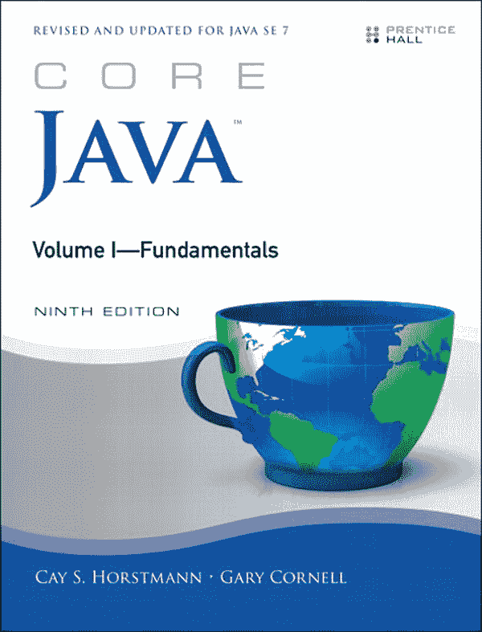


新泽西州上萨河 • 波士顿 • 印安纳波利 • 旧金山

纽约 • 多伦多 • 蒙特利尔 • 伦敦 • 慕尼黑 • 巴黎 • 马德里

开普敦 • 悉尼 • 东京 • 新加坡 • 墨西哥城


## 第 14 章：多线程

### 14.1 什么是线程？

#### 14.1.1 使用线程给其他任务提供机会

### 14.2 中断线程

### 14.3 线程状态

#### 14.3.1 新线程（New Threads）

#### 14.3.2 可运行线程（Runnable Threads）

#### 14.3.3 阻塞与等待的线程（Blocked and Waiting Threads）

#### 14.3.4 终止线程（Terminated Threads）

### 14.4 线程属性

#### 14.4.1 优先级

#### 14.4.2 守护线程（Daemon Threads）

#### 14.4.3 未捕获异常的处理器

### 14.5 同步

#### 14.5.1 竞态条件示例

#### 14.5.2 竞态条件详解

#### 14.5.3 锁对象（Lock Objects）

#### 14.5.4 条件对象（Condition Objects）

#### 14.5.5 `synchronized` 关键字

#### 14.5.6 同步块（Synchronized Blocks）

#### 14.5.7 监器概念（The Monitor Concept）

#### 14.5.8 挥性字段（Volatile Fields）

#### 14.5.9 最终变量（Final Variables）

#### 14.5.10 原子类（Atomics）

#### 14.5.11 死锁（Deadlocks）

#### 14.5.12 线程本地变量（Thread-Local Variables）

#### 14.5.13 锁测试与超时

#### 14.5.14 读写锁（Read/Write Locks）

#### 14.5.15 为什么 `stop` 和 `suspend` 方法被弃用

### 14.6 阻塞队列（Blocking Queues）

### 14.7 线程安全集合

#### 14.7.1 高效映射、集合与队列

#### 14.7.2 写时复制数组（Copy on Write Arrays）

#### 14.7.3 旧版本的线程安全集合

### 14.8 可调用对象与未来（Callables and Futures）

### 14.9 执行器（Executors）

#### 14.9.1 线程池

#### 14.9.2 调度执行（Scheduled Execution）

#### 14.9.3 控制任务组

#### 14.9.4 Fork-Join 框架

### 14.10 同步器（Synchronizers）

#### 14.10.1 信号量（Semaphores）

#### 14.10.2 计数锁（Countdown Latches）

#### 14.10.3 屏障（Barriers）

#### 14.10.4 交换器（Exchangers）

#### 14.10.5 同步队列（Synchronous Queues）

### 14.11 线程与 Swing

#### 14.11.1 运行耗时任务

#### 14.11.2 使用 Swing Worker

#### 14.11.3 单线程规则

## 附录：Java 关键字

## 索引

## 前言

### 致读者

在 1995 年底，Java 编程语言席卷互联网并迅速成名。Java 技术的承诺是它将成为一种*通用胶水*，将用户与信息连接，无论信息来自何处——Web 服务器、数据库、信息提供者或任何可以想象的来源。事实上，Java 处于实现这一承诺的独特地位。它是一项工程设计极其可靠的语言，获得了除微软之外的所有主要厂商的认可。其内置的安全和保护特性让程序员和 Java 程序的用户都感到安心。

自 1995 年以来，Java 开发工具包（JDK）已发布了八个主要版本。在过去的 17 年里，应用程序编程接口（API）从约 200 多个类增长到 3000 多个类。你手中的这本书是 `Core Java™` 第九版的第一卷。每一版都紧密跟随 Java 开发工具包的发布，每次我们都会重写书籍以利用最新的 Java 特性。本版已根据 Java 标准版（SE）7 的特性进行了更新。

与本书的之前的版本一样，我们的目标仍然是那些希望将 Java 应用于实际项目的严肃程序员。我们认为你（我们的读者）是一位在 Java 的编程语言方面具有坚实背景的程序员，并且假设你不喜欢充斥着玩具级示例（例如烤面包机、动物园动物或“紧张的文本”）的书。你不会在我们的书中发现任何这类内容。我们的目标是让你完全理解 Java 语言和库，而不是给你一种已经理解的错觉。

在书中，你将看到大量的示例代码，展示了我们讨论的几乎每一个语言和库特性。我们刻意保持示例程序的简单，以便聚焦于核心要点，但在大多数情况下，它们并不是虚假的，也没有偷工减径。它们应该成为你编写代码的良好起点。

我们假设你愿意、甚至渴望学习 Java 为你提供的所有高级特性。例如，我们为你详细介绍了：

- 面向对象编程
- 反射与代理
- 接口与内部类
- 事件监听器模型
- 使用 Swing UI 工具包进行图形用户界面设计
- 异常处理
- 泛型编程
- 集合框架
- 并发

随着 Java 类库的爆炸式增长，用一卷书涵盖严肃程序员需要知道的所有 Java 特性已不再可能。因此，我们决定将书分为两卷。你手中的第一卷集中在 Java 语言的基础概念以及用户界面编程的入门知识上。第二卷，`Core Java™, Volume II—Advanced Features`（即将出版，ISBN: 978-0-13-708160-8）将进一步深入介绍企业级特性和高级用户界面编程。它包含了对以下内容的详细讨论：

- 文件与流
- 分布式对象
- 数据库
- 高级 GUI 组件
- 本地方法
- XML 处理
- 网络编程
- 高级图形
- 国际化
- JavaBeans
- 注解

在编写书籍时，错误和不准确之处是不可避免的。我们非常希望获知这些错误。但当然，我们更希望每个错误只被告知一次。我们在 `http://horstmann.com/corejava` 网页上列了一份常见问题、错误修复和变通方案列表。在勘误页（errata page）的末尾策略性地放置了一个表单，你可以用它来报告错误并提出改进建议。如果我们没有回答每一个问题或没有立即回复你，请不要失望。我们会阅读每一封邮件，并感谢你的投入，以使我们书的未来版本更加清晰、信息更丰富。

### 本书导读

第 1 章 概述了 Java 与其他编程语言区别开来的能力。我们解释了语言设计者想要实现的目标以及它们在多大程度上取得了成功。然后，我们简述了 Java 如何诞生以及如何演变的历史。

第 2 章 我们将教你如何下载和安装 JDK 以及本书的程序示例。然后，我们将指导你如何使用原生 JDK、支持 Java 的文本编辑器和 Java IDE 来编译并运行三个典型的 Java 程序——一个控制台应用程序、一个图形应用程序和一个 applet。

第 3 章 开始对 Java 语言的讨论。在本章中，我们涵盖了基础知识：变量、循环和简单函数。如果你是 C 或 C++ 程序员，这部分会非常顺手，因为这些语言特性的语法与 C 语言基本相同。如果你来自非 C 背景（如 Visual Basic），你将需要仔细阅读这一章。

面向对象编程（OOP）现在是编程实践的主流，而 Java 是一种面向对象的编程语言。第 4 章 引入了封装，这是面向对象的两个基本基石之首，以及 Java 实现它的语言机制——即类和方法。除了 Java 语言的规则，我们还提供了关于良好的 OOP 设计的建议。最后，我们涵盖了神奇的 `javadoc` 工具，它可以将你的代码注释格式化为一组超链接网页。如果你熟悉 C++，可以快速浏览此章内容。来自非面向对象背景的程序员应该预料到在深入学习 Java 之前花一些时间掌握 OOP 概念。

类和封装只是 OOP 故事的一部分，第 5 章引入了另一部分——继承。继承允许你获取一个现有的类并根据需求对其进行修改。这是 Java 编程的一项基本技术。Java 的继承机制与 C++ 非常相似。再次，C++ 程序员可以专注于语言之间的差异。

第 6 章展示了你如何使用 Java 的接口概念。接口让你能够超越第 5 章中的简单继承模型。掌握接口让你能够充分利用 Java 完全面向对象的编程方法的威力。我们还涵盖了 Java 的一个有用技术特性：内部类。内部类有助于让你的代码更整洁、简洁。

第 7 章我们开始正式的应用编程。每个 Java 程序员都应该了解一点 GUI 编程，而这一卷包含了基础知识。我们展示了如何创建窗口、如何在窗口上绘图、如何用几何形状绘图、如何格式化多种字体以及如何显示图像。

第 8 章详细讨论了 AWT（抽象窗口工具包）事件模型。你将看到如何编写响应事件（如鼠标点击或按键）的代码。在此过程中，你将看到如何处理按钮和面板等基础 GUI 元素。

第 9 章详细讨论了 Swing GUI 工具包。Swing 工具包允许你构建跨平台的图形用户界面。你将学习各种类型的按钮、文本组件、边界、滑动条、列表框、菜单和对话框。然而，一些高级组件将在第二卷中讨论。

第 10 章展示了如何部署你的程序，无论是应用程序还是 applet。我们描述了如何将程序封装在 JAR 文件中，以及如何通过 Java Web Start 和 applet 机制通过 Internet 应用程序。最后，我们解释了 Java 程序部署后如何存储和检索配置信息。

第 11 章异常——Java 处理良好程序可能故障这一事实的健壮机制。异常提供了一种高效的方法，将正常处理代码与错误处理分离。当然，即使在处理了所有异常情况并强化程序后，它仍然可能按照预期工作。在本章的后半部分，我们提供了大量的实用调试技巧。最后，我们将指导你完成一次示例调试。

第 12 章概述了泛型编程——Java SE 5.0 的重大进步。泛型编程让你的程序更易读、更安全。我们展示了如何使用强类型并移除丑陋且安全的强制转换，以及如何处理为了与旧版本 Java 兼容而产生的复杂性。

第 13 章的主题是 Java 平台的集合框架。每当你想要收集多个对象并在稍后检索它们时，你应该使用最适合你情况的集合，而不是简单地将元素丢进数组。本章将向你如何利用预先构建好的标准集合。

第 14 章以讨论多线程来结束本书，多线程使你能够编写以并行执行的任务。（线程是程序内部的控制流。）我们将向你如何设置线程以及如何处理线程同步。多线程在 Java SE 5.0 中发生了巨大变化，我们将为你介绍所有新机制的细节。

附录列出了 Java 语言的保留字。

### 约定

正如许多计算机书籍一样，我们使用 `monospace type` 来表示计算机代码。

---

 Note

注释用类似这样的“note”图标进行标记。

---

 Tip

提示用类似这样的“tip”图标进行标记。

---

 Caution

当前方有危险时，我们用“caution”图标警告你。

---

 C++ Note

有很多 C++ 注释解释了 Java 和 C++ 之间的差异。如果你没有 C++ 背景，或者认为对该语言的经历是一段不想提起的噩梦，可以跳过它们。

---

Java 自带了一个大型编程库，即应用程序编程接口（API）。第一次使用 API 调用时，我们会在章节末尾添加简短的总结描述。这些描述稍微非正式，但我们希望它们比官方在线 API 文档更具信息量。接口名称使用斜体，与官方文档一样。类、接口或方法名后的数字是引入该特性时的 JDK 版本。

---

应用程序编程接口 1.2

---

源代码位于书籍伴随网站上的程序被列为列表，例如：

---

列表 1.1. `InputTest/InputTest.java`

---

### 示例代码

本书的网站 [`horstmann.com/corejava`](http://horstmann.com/corejava) 包含了书中所有的示例代码，并采用压缩格式。你可以使用熟悉的解压程序之一，或直接使用 Java 开发包自带的 `jar` 工具来解文件。关于安装 Java 开发包和示例代码的更多信息，请参阅第 2 章。

## 致谢

写一本书总是一项巨大的工程，重写它似乎并没有容易多少，特别是考虑到 Java 技术的不断。让一本书成为现实需要许多投入的人士，我很幸地感谢整个 Core Java 团队的贡献。

Prentice Hall 的许多个人提供了宝贵的帮助，但一直保持在幕后。我想让他们知道我有多感激他们的努力。如既往一样，热心感谢我的编辑 Greg Doench，他引导书籍完成了编写和制作过程，并让我能够完全无知那些幕后人员的存在。我非常感谢 Julie Nahil 的制作支持，感谢 Dmitry Kirsanov 和 Alina Kirsanova 对手稿的校对和排版。还要感谢我早期几个版本的合作者 Gary Cornell，他后来已转向其他事业。

感谢早期版本的许多读者，他们报告了尴尬的错误并对改进提出了许多周全建议。我特别感谢优秀的评审团队，他们以惊人的细节关注审阅了手稿，使我避免了更多尴尬的错误。

本版及早期版本的评审人员包括：Chuck Allison（犹他谷大学）、Lance Andersen（Oracle）、Alec Beaton（IBM）、Cliff Berg、Joshua Bloch、David Brown、Corky Cartwright、Frank Cohen（PushToTest）、Chris Crane（devXsolution）、Dr. Nicholas J. De Lillo（曼哈顿学院）、Rakesh Dhoopar（Oracle）、David Geary（Clarity Training）、Jim Gish（Oracle）、Brian Goetz（Oracle）、Angela Gordon、Dan Gordon（Electric Cloud）、Rob Gordon、John Gray（哈特福大学）、Cameron Gregory（olabs.com）、Marty Hall（coreservlets.com, Inc.）、Vincent Hardy（Adobe Systems）、Dan Harkey、William Higgins（IBM）、Vladimir Ivanovic（PointBase）、Jerry Jackson（CA Technologies）、Tim Kimmet（Walmart）、Chris Laffra、Charlie Lai（Apple）、Angelika Langer、Doug Langston、Hang Lau（麦吉尔大学）、Mark Lawrence、Doug Lea（SUNY Oswego）、Gregory Longshore、Bob Lynch（Lynch Associates）、Philip Milne（顾问）、Mark Morrissey（俄勒冈研究生学院）、Mahesh Neelakanta（佛罗里达大西洋大学）、Hao Pham、Paul Philion、Blake Ragsdell、Stuart Reges（亚利桑那大学）、Rich（Interactive Data Corporation）、Peter Sanders（法国尼斯 ESSI 大学）、Dr. Paul Sanghera（Sun Systems）、Paul van der Linden（摩托罗拉）、Burt Walsh（Oracle）、John Zavgren（Oracle）。


Java 自带了一个大型编程库，即应用程序编程接口（API）。第一次使用 API 调用时，我们会在章节末尾添加简短的总结描述。这些描述稍微非正式，但我们希望它们比官方在线 API 文档更具信息量。接口名称使用斜体，与官方文档一样。类、接口或方法名后的数字是引入该特性时的 JDK 版本。

---

## 应用程序编程接口 1.2

---

源代码位于书籍伴随网站上的程序被列为列表，例如：

---

列表 1.1. `InputTest/InputTest.java`

---

### 示例代码

本书的网站 [`horstmann.com/corejava`](http://horstmann.com/corejava) 包含了书中所有的示例代码，并采用压缩格式。你可以使用熟悉的解压程序之一，或直接使用 Java 开发包自带的 `jar` 工具来解文件。关于安装 Java 开发包和示例代码的更多信息，请参阅第 2 章。

## 致谢

写一本书总是一项巨大的工程，重写它似乎并没有容易多少，特别是考虑到 Java 技术的不断变化。让一本书成为现实需要许多投入的人士，我很幸地感谢整个 Core Java 团队的贡献。

Prentice Hall 的许多个人提供了宝贵的帮助，但一直保持在幕后。我想让他们知道我有多感激他们的努力。如既往一样，热心感谢我的编辑 Greg Doench，他引导书籍完成了编写和制作过程，并让我能够完全无知那些幕后人员的存在。我非常感谢 Julie Nahil 的制作支持，感谢 Dmitry Kirsanov 和 Alina Kirsanova 对手稿的校对和排版。还要感谢我早期几个版本的合作者 Gary Cornell，他后来已转向其他事业。

感谢早期版本的许多读者，他们报告了尴尬的错误并对改进提出了许多周全建议。我特别感谢优秀的评审团队，他们以惊人的细节关注审阅了手稿，使我避免了更多尴尬的错误。

本版及早期版本的评审人员包括：Chuck Allison (犹他谷大学), Lance Andersen (Oracle), Alec Beaton (IBM), Cliff Berg, Joshua Bloch, David Brown, Corky Cartwright, Frank Cohen (PushToTest), Chris Crane (devXsolution), Dr. Nicholas J. De Lillo (曼哈顿学院), Rakesh Dhoopar (Oracle), David Geary (Clarity Training), Jim Gish (Oracle), Brian Goetz (Oracle), Angela Gordon, Dan Gordon (Electric Cloud), Rob Gordon, John Gray (哈特福大学), Cameron Gregory (olabs.com), Marty Hall (coreservlets.com, Inc.), Vincent Hardy (Adobe Systems), Dan Harkey, William Higgins (IBM), Vladimir Ivanovic (PointBase), Jerry Jackson (CA Technologies), Tim Kimmet (Walmart), Chris Laffra, Charlie Lai (Apple), Angelika Langer, Doug Langston, Hang Lau (麦吉尔大学), Mark Lawrence, Doug Lea (SUNY Oswego), Gregory Longshore, Bob Lynch (Lynch Associates), Philip Milne (顾问), Mark Morrissey (俄勒冈研究生学院), Mahesh Neelakanta (佛罗里达大西洋大学), Hao Pham, Paul Philion, Blake Ragsdell, Stuart Reges (亚利桑那大学), Rich (Interactive Data Corporation), Peter Sanders (法国尼斯 ESSI 大学), Dr. Paul Sanghera (Sun Systems), Paul van der Linden (摩托罗拉), Burt Walsh (Oracle), John Zavgren (Oracle)。

但是，正如我们在第一版中所说的，Java 从来不仅仅是一门语言。世界上有很多编程语言，但很少有语言能引起巨大的轰动。Java 是一个完整的平台，拥有包含大量可重用代码的海量库，以及一个提供安全性、跨操作系统可移植性和自动垃圾回收等服务的执行环境。

作为一名程序员，你会希望拥有一种拥有良好语法和易于理解的语义的语言（即不是 `C++`）。Java 正符合这一要求，其他几十种优秀的语言也是如此。某些语言虽然提供了可移植性、垃圾回收等功能，但它们没有太多的库，如果你需要精细的图形、网络或数据库访问，就迫使你自己实现。然而，Java 拥有一切——一种优秀的语言、高质量的执行环境以及庞大的库。这种组合使得 Java 对许多程序员来说都是一个不可抗拒的提议。

## 1.2 Java“白皮书”热词

Java 的作者们编写了一份具有影响力的《白皮书》，解释了他们的设计目标和成就。他们还发布了一份较短的总结，按照以下 11 个热词进行组织：

1. 简单（Simple）
2. 面向对象（Object-Oriented）
3. 擅长网络（Network-Savvy）
4. 健壮（Robust）
5. 安全（Secure）
6. 架构中立（Architecture-Neutral）
7. 可移植（Portable）
8. 解释型（Interpreted）
9. 高性能（High-Performance）
10. 多线程（Multithreaded）
11. 动态（Dynamic）

在本节中，我们将：

- 结合白皮书的摘录，总结 Java 设计者对每个热词的看法；
- 根据我们对当前版本 Java 的经验，告诉您我们对每个热词的看法。

>  **注意**
>
> 在我们写这本书时，白皮书可以在 [www.oracle.com/technetwork/java/langenv-140151.html](http://www.oracle.com/technetwork/java/langenv-140151.html) 找到。包含 11 个热词的总结可以在 [`labs.oracle.com/features/tenyears/volcd/papers/7Gosling.pdf`](http://labs.oracle.com/features/tenyears/volcd/papers/7Gosling.pdf) 找到。

### 1.2.1 简单

> 我们想要构建一个易于编程、无需深奥培训且能利用今日标准实践的系统。因此，尽管我们发现 `C++` 并不合适，但我们将 Java 设计得尽可能接近 `C++`，以使系统更易于理解。Java 省略了 `C++` 中许多很少使用、难以理解且令人困惑的特性，根据我们的经验，这些特性带来的麻烦多于收益。

Java 的语法确实是 `C++` 语法的精简版本。不需要头文件、指针算术（甚至不需要指针语法）、结构体、联合体、运算符重载、虚基类等。（请参见文中穿插的 `C++` 注释以了解更多关于 Java 和 `C++` 之间的差异。）然而，设计者并没有尝试修复 `C++` 的所有笨拙特性。例如，Java 中 `switch` 语句的语法保持不变。如果你熟悉 `C++`，你会发现过渡到 Java 语法非常容易。

如果你习惯了视觉编程环境（如 Visual Basic），你不会认为 Java 是简单的。它有很多奇怪的语法（尽管并不花费长时间就能掌握）。更重要的是，你必须在 Java 中编写更多的代码。Visual Basic 的美之处在于它的视觉化设计环境几乎自动地为应用程序提供了大量基础设施。而在 Java 中，许多功能必须手动编写，通常需要相当多的代码。不过，也有第三方开发环境提供了“拖拽式”的程序开发模式。

> “简单”的另一个方面是“短小”。Java 的目标之一是能够构建出可以在小型机器上独立运行的软件。基础解释器和类支持的大小约为 40K；基础标准库和线程支持（本质上是一个自包含的微内核）又增加了 175K。

这在当时是一项伟大的成就。当然，该库从那以来已经增长到了巨大的规模。现在有一个单独的 Java 微型版（Micro Edition），其库较小，适用于嵌入式设备。

### 1.2.2 面向对象

> 简单来说，面向对象的设计是一种编程技术，它关注数据（= 对象）以及指向该对象的接口。用木工来类比，“面向对象”的木工会主要关注他正在做的椅子，其次才关注制作椅子的工具；而“非面向对象”的木工则首先考虑他的工具。Java 的面向对象设施本质上与 `C++` 一致。

面向对象在过去的四十年中证明了它的价值，无法想象现代编程语言不会使用它。事实上，Java 的面向对象特性可以与 `C++` 相比。Java 和 `C++` 之间的主要区别在于多继承（Java 用更简单的接口概念取代了它），以及 Java 的元类模型（我们在第 5 章中讨论）。

>  **注意**
>
> 如果你没有面向对象编程语言的经验，你将希望仔细阅读第 4 章到第 6 章。这些章节将解释什么是面向对象编程，以及为什么它比 C 或 Basic 等传统的过程化语言更有用。

### 1.2.3 擅长网络

> Java 拥有一系列处理 TCP/IP 协议（如 HTTP 和 FTP）的广泛例程。Java 程序可以像访问文件系统一样轻松访问对象。

我们发现 Java 的网络功能既强大又易用。任何尝试用其他语言进行互联网编程的人都会叹于 Java 如何让打开套接字连接等困难任务变得简单。（我们在第二卷中介绍网络。）远程调用机制实现了分布式对象之间的通信（同样在第二卷中介绍）。

### 1.2.4 健壮

> Java 旨在用于编写在各种方面必须可靠的程序。Java 非常强调早期检查可能的问题、后期动态（运行时）检查，以及消除易错的情况。……Java 与 C/C++ 之间最大的区别在于，Java 有一种指针模型消除了覆盖内存和损坏数据的可能性。

这一特性也非常有用。Java 编译器可以检测许多在其他语言中只会在运行时出现的问题。至于第二点，任何曾花费数小时追踪指针 Bug 导致的内存损坏的人都会对 Java 的这一特性感到非常高兴。

如果你来自像 Visual Basic 这样不显式使用指针的语言，你可能会奇怪这为什么重要。C 程序员就没有那么幸运了。他们需要指针来访问字符串、数组、对象甚至文件。在 Visual Basic 中，你不需要为这些实体使用指针，也不需要为它们的内存分配担心。另一方面，许多数据结构在无指针的语言中很难实现。Java 让你兼得其长：对于字符串和数组等日常结构你不需要指针；如果你需要（例如链表），你拥有指针的力量。而且你永远拥有完全的安全，因为你永远不会访问错误的指针或发生内存分配错误。

### 1.2.5 安全

> Java 用于网络化/分布式环境。为了这一点，安全性被特别关注。Java 能够构建无病毒、防篡改的系统。

在 *Core Java* 第一版中，我们曾说过：“嗯，人们应该‘永远不要说不再’，”而事实证明我们是正确的。在第一版 Java 开发工具包（JDK）发布后不久，普林斯顿大学的一组安全专家在 Java 1.0 的安全功能中发现了细微的漏洞。Sun Microsystems 公司一直鼓励对 Java 安全性的研究，并公开了虚拟机和安全库的规范与实现。他们迅速修复了所有已知的安全漏洞。无论如何，想要绕过 Java 的安全机制极其困难。到目前为止发现的漏洞都非常具有技术性，而且数量较少。

从一开始，Java 的设计目标就是为了让某些类型的攻击变得不可能，其中包括：

- 运行栈溢出——蠕虫和病毒的常见攻击手段；
- 破坏自身进程空间之外的内存；
- 在未授权的情况下读取或写入文件。

随着时间的推移，Java 增加了许多安全功能。从 1.1 版本开始，Java 就引入了数字签名类的概念（参见第二卷）。通过签名的类，你可以确定它是谁编写的。如果你信任该类的作者，就可以允许该类在你的机器上拥有更高的权限。

>  **注意**
>
> 微软一种基于其 ActiveX 技术的竞争性代码交付机制仅依赖数字签名来保证安全。显然这并不足够——正如任何微软产品的用户都能证实的那样，来自知名供应商的程序确实会崩溃并造成损害。Java 拥有比 ActiveX 更强的安全模型，因为它在程序运行时对其进行控制，阻止其肆意妄为。

### 1.2.6 架构无关（Architecture-Neutral）

> Java 解释器可以在任何移植了它的机器上执行字节码。由于链接是一个增量且轻量级的过程，开发过程可以更加快速。

增量链接具有优势，但其对开发过程的收益被夸大了。早期的 Java 开发工具实际上非常慢。今天，字节码通过即时编译器翻译成机器码。

Java 编译器通过生成一种架构无关的对象文件格式，这种格式在任何机器上都是可执行的，并且在运行时（fly）翻译成机器码。

> Java 解释器可以在任何移植了它的机器上执行字节码。由于链接是一个增量且轻量级的过程，开发过程可以更加快速。

这并不是一个新主意。四十年前，维特（Wirth）的 Pascal 就采用了这种技术。

> Java 解释器可以在任何移植了它的机器上执行字节码。由于链接是一个增量且轻量级的过程，开发过程可以更加快速。

因此，解释字节码的运行速度要慢得多。今天，字节码由即时编译器翻译成机器码。

Java 虚拟机在运行时监控执行频繁的字节码。事实上，Java 虚拟机通过运行时将执行频繁的字节码翻译成机器码。

### 1.2.7 可移植性（Portable）

> 与 C/C++ 不同，Java 的某些特性是平台无关的。

Java 的某些类型是平台无关的，它们在运行时可以被翻译成机器码。

> 与 C/C++ 不同，Java 的某些特性是平台无关的。

Java 的某些类型是平台无关的，在运行时可以被翻译成机器码。这使得移植问题变得不再困难。

> 与 C/C++ 不同，Java 的某些特性是平台无关的。

Java 的某些类型是平台无关的，它们在运行时可以被翻译成机器码。这使得移植问题变得不再困难。

> 与 C/C++ 不同，Java 的某些特性是平台无关的。

Java 的某些类型是平台无关的，它们在运行时可以被翻译成机器码。这使得移植问题变得不再困难。

### 1.2.8 解释执行（Interpreted）

> Java 解释器可以在任何移植了它的机器上执行字节码。由于链接是一个增量且轻量级的过程，开发过程可以更加快速。

增量链接具有优势，但其对开发过程的收益被夸大了。早期的 Java 开发工具实际上非常慢。今天，字节码通过即时编译器翻译成机器码。

### 1.2.9 高性能（High-Performance）

> 虽然解释执行字节码的性能通常足够，但在某些情况下需要更高的性能。字节码可以在运行时（fly）翻译为特定 CPU 的机器码。

Java 早期，许多用户不同意“性能足够”的说法。然而，今天，即时编译器已经非常优秀，可以与传统编译器竞争，在某些情况下甚至优于它们，因为它们拥有更多的信息。例如，即时编译器可以监控哪些代码被执行频繁，并对这些代码进行优化。一种更高级的优化是消除函数调用（内联）。即时编译器知道加载了哪些类。当根据当前加载的类集合，某个函数不会被重写时，它就可以进行内联，并在需要时可以撤销这种优化。

### 1.2.10 多线程（Multithreaded）

> 多线程的益处是更好的交互响应能力和实时行为。

如果你曾在其他语言中尝试过多线程，你将会对 Java 中多线程的简单性感到惊喜。如果基础操作系统支持，Java 线程可以利用多处理器系统。缺点是，主要平台的线程实现差异巨大，Java 在这方面并未做到平台无关。调用多线程的代码在不同机器上是相同的；Java 将线程的实现交给底层操作系统或线程库。然而，多线程的易用性是 Java 如此吸引人的原因之一。

### 1.2.11 动态性（Dynamic）

> 在许多方面，Java 比 C 或 C++ 是一种更动态的语言。它的设计是为了适应不断变化。库可以自由地添加新方法和实例变量，而对其客户端产生任何影响。在 Java 中，获取运行时类型信息是简单的。

在需要向运行中的程序中添加代码的情况下，这是一个非常重要的特性。一个典型的例子是从互联网下载代码并在浏览器中运行。在 Java 1.0 中，获取运行时类型信息可谓绝非易事，但当前版本的 Java 让程序员对对象的结构和行为都有了完全透彻的洞察。这对于那些在运行时分析对象的系统极其有用，例如 `Java` GUI 生成器、智能调试器、可插拔组件和对象数据库。

>  **备注**
>
> 在 Java 取得初步成功后不久，微软发布了一款名为 `J++` 的产品，其编程语言和虚拟机与 Java 几乎相同。此时，微软已不再支持 `J++`，而是引入了另一种名为 `C#` 的语言，该语言与 Java 也有许多相似之处，但运行在不同的虚拟机上。甚至还有一种 `J#`，用于将 `J++` 应用程序迁移到 `C#` 使用的虚拟机上。我们本书中将不介绍 `J++`、`C#` 或 `J#`。

## 1.3 Java Applets 与互联网

这里的想法非常简单：用户从互联网下载 Java 字节码并在自己的机器上运行。在网页上运行的 Java 程序被称为 `applets`（Java 小程序）。要使用 applet，你只需要一个支持 Java 的网络浏览器，它会为你执行字节码。你不需要安装任何软件。由于 `Oracle` 授权了 Java 源代码并坚持语言和标准库不发生任何更改，因此一个 Java applet 应该运行在任何宣称支持 Java 的浏览器上。每当你访问包含该 applet 的网页时，都能获得该程序的最新版本。最重要的是，得益于虚拟机的安全性，你永远不需要担心来自恶意代码的攻击。


将 `applet` 插入网页的操作与嵌入图像非常相似。`applet` 成为页面的一部分，文本会环绕 `applet` 占据的空间流动。关键点在于，这张图像是“活的”。它能对用户命令做出反应，改变自己的外观，并在展示 `applet` 的计算机与提供服务的计算机之间交换数据。

图 1.1 展示了一个执行复杂计算的动态网页的良好示例。`Jmol` `applet` 显示了分子结构。通过鼠标，你可以旋转和缩放每个分子，以更好地理解其结构。这种直接操作在静态网页上是无法实现的，但 `applets` 使其成为可能。（你可以在 [`jmol.sourceforge.net`](http://jmol.sourceforge.net) 找到这个 `applet`。）

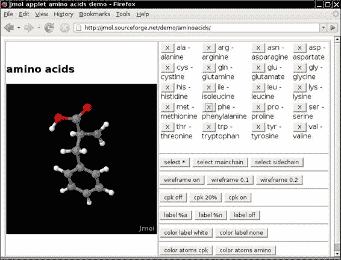

图 1.1. `Jmol` `applet`

当 `applets` 首次出现时，引发了巨大的兴奋。许多人认为，`applet` 的吸引力是 `Java` 获得惊人人气的原因。然而，最初的兴奋很快转变为挫败。不同版本的 `Netscape` 和 `Internet Explorer` 运行不同版本的 `Java`，其中某些版本已经严重过时。这种糟糕的局面使得开发利用最新版本 `Java` 特性的 `applet` 变得越来越困难。今天，当浏览器中需要动态效果时，大多数网页简单地使用 `JavaScript` 或 `Flash`。而 `Java` 已成为开发生成网页并执行后端逻辑的服务器端应用程序最流行的语言。

## 1.4 Java 简史

本节简述了 `Java` 的演变历史。它基于各种出版来源（最重要的是 1995 年 7 月份 `SunWorld` 在线杂志对 `Java` 创造者的采访）。

`Java` 的历史可以追溯到 1991 年，当时一组由 Patrick Naughton 和 James Gosling（一位 `Sun Fellow`，也是全能的计算机天才）领导的 `Sun` 工程师，想要设计一种小型计算机语言，可用于电缆电视机盒等消费级设备。由于这些设备没有大量的功率或内存，这种语言必须很小并且能生成非常紧凑的代码。此外，由于不同的制造商可能会选择不同的中央处理器（`CPU`），该语言不绑定到任何单一架构至关重要。该项目的代号为“Green”（绿色）。

对小巧、紧凑且平台中立代码的需求导致团队恢复了某些 Pascal 实现版在 `PC` 早期尝试过的模型。Pascal 的发明者 Niklaus Wirth 曾创了一种可移植语言的设计，该语言为一种假设机器生成中间代码。（这类机器通常被称为 `virtual` 虚拟——因此有了 `Java` 虚拟机，即 `JVM`。）这种中间代码随后可以在任何具有正确解释器的机器上使用。Green 项目的工程师也使用了虚拟机，这解决了他们的主要问题。

然而，`Sun` 的人们来自 `UNIX` 背景，因此他们基于 `C++` 而不是 Pascal 开发语言。特别是，他们将语言设计为面向对象而非面向过程。但正如 Gosling 在采访中所说，“从始终，这种语言是一种工具，而不是目的。” Gosling 决定将他的语言命名为“Oak”（橡树）（可能是因为他喜欢 `Sun` 公司窗外外那棵橡树的样子）。`Sun` 的人们后来意识到 `Oak` 是一个现有计算机语言的名字，于是他们将名称改为 `Java`。事实证明这是一个极具见地的选择。

1992 年，Green 项目交付了它的第一个产品，名为“7”。它是一个极其智能的遥控器。（它在一个 6 英寸 x 4 英寸 x 4 英寸的盒子里拥有 `SPARCstation` 的性能。）遗憾的是，没有人感兴趣生产它，`Sun` 内部不得不寻找其他方式来营销这项技术。然而，消费电子公司都不感兴趣。随后该小组竞标了一个设计按需电缆盒的项目。他们没有获得该合同。（有趣的是，获得合同的公司是由创立 `Netscape` 的人领导的。）

Green 项目（当时更名为 `First Person, Inc.`）在 1993 年全年和 1994 年上半年里都在寻找购买其技术的人。没有人找到。（该小组的创始人之一，也是最终负责大部分营销工作的 Patrick Naughton 声称，在试图销售该技术时他积累了 30 万英里的飞行里程。）`First Person` 在 1994 年解散。

当 `Sun` 内部发生这一切时，互联网的万维网部分正在越来越大。万维网的关键在于浏览器将超文本页面转换为显示。1994 年，大多数人使用 `Mosaic`，这是一种 1993 年来自伊利诺伊大学超级计算中心的非商业网络浏览器。（`Mosaic` 部分由 Marc Andreessen 作为一名学生通过勤工项目编写，当时时薪 6.85 美元。他随后作为 `Netscape` 的联合创始人之一和技术官名利双收。）

在 `SunWorld` 的采访中，Gosling 提到在 1994 年年中，语言开发者们意识到“我们可以做一个非常酷的浏览器。它是客户端/服务器主流领域极少数需要我们所做的那些奇特功能的东西之一：架构中立、实时、可靠、安全——这些问题在工作站世界并不特别重要。所以我们造了一个浏览器。”

实际的浏览器由 Patrick Naughton 和 Jonathan Payne 构建，并演变为 `HotJava` 浏览器。`HotJava` 浏览器是用 `Java` 编写的，旨在展示 `Java` 的强大。但构建者们也考虑了现在称为 `applets` 的功能，因此他们让浏览器具备执行网页内代码的能力。这项“技术证明”在 1995 年 5 月 23 日的 `SunWorld ’95` 上展示，并引发了持续至今的 `Java` 热潮。

`Sun` 在 1996 年初发布了第一个版本的 `Java`。人们很快意识到，`Java 1.0` 无法满足严肃的应用开发需求。确实，你可以使用 `Java 1.0` 制作一个在画布上随机移动文字的文本小程序（`applet`），但在 `Java 1.0` 中你甚至无法进行打印。坦率地说，`Java 1.0` 还没有准备好。它的继任版本 `1.1` 填补了最明显的缺陷，极大地改进了反射能力，并为 `GUI` 编程添加了新的事件模型。尽管如此，它的功能仍然相当有限。

1998 年 `JavaOne` 大会的最重大消息是即将发布的 `Java 1.2`，它将早期的玩具化 `GUI` 和图形工具包替换为复杂的、可扩展的版本，并且比其之前的版本更接近“一次编写，随处运行”（Write Once, Run Anywhere™）的承诺。在 1998 年 12 月发布仅三天（！）后，`Sun` 的营销部门将其名称更改为更有吸引力的 `Java 2 Standard Edition Software Development Kit Versions 1.2`。

除了标准版（Standard Edition）之外，还引入了两个版本：用于手机等嵌入式设备的微型（Micro Edition），以及用于服务器端处理的企业版（Enterprise Edition）。本书侧重于标准版。

标准版的 `1.3` 和 `1.4` 版本是对初始 `Java 2` 版本的增量改进，具有不断增长的标准库、更高的性能，当然，还修复了许多漏洞（bug）。在此期间，关于 `Java` 小程序和客户端应用的大部分最初热度消退，但 `Java` 变成了服务器端应用的首选平台。

`5.0` 版本是自 `1.1` 版本以来首次以重大方式更新 `Java` 语言的版本（该版本最初编号为 `1.5`，但版本号在 2004 年 `JavaOne` 大会上跳到了 `5.0`）。经过多年的研究，泛型（generic types，大致等同于 `C++` 模板）被添加了——挑战是在不改变虚拟机的情况下添加这一功能。其他几个实用的语言特性也受到了 `C#` 的启发：“for each”循环、自动装箱和元数据。

第 `6` 版本（不带 `.0` 后缀）于 2006 年底发布。同样，没有语言变化，但有了额外的性能改进和库增强。

随着数据中心日益依赖商品化硬件而非专用服务器，`Sun Microsystems` 陷入了困境，并于 2009 年被 `Oracle` 收购。`Java` 的开发停滞了很久。2011 年，`Oracle` 发布了带有简单增强的新版本 `Java 7`，并决定将更有野心的改进推迟到 `Java 8`，后者预计于 2013 年发布。

表 1.1 显示了 `Java` 语言和库的演变。如你所见，应用程序接口（`API`）的大小已经巨大增长。

表 1.1 Java 语言的演变

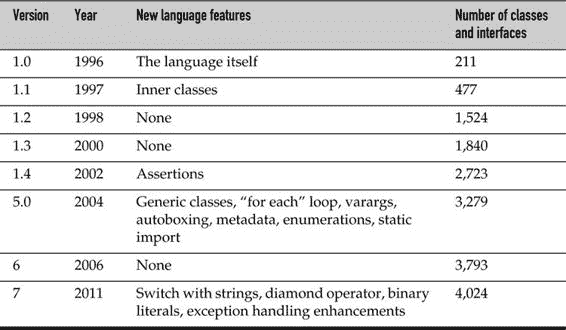

## 1.5 Java 的常见误解

我们通过列举关于 `Java` 的常见误解及其注释来结束本章。

### Java 是 HTML 的扩展

`Java` 是一种编程语言；`HTML` 是一种描述网页结构的方法。它们之间没有任何共同点，除了有 `HTML` 扩展允许在网页上放置 `Java` 小程序。

### 我使用 XML，所以我不需要 Java

`Java` 是一种编程语言；`XML` 是一种描述数据的方法。你可以用任何编程语言处理 `XML` 数据，但 `Java API` 包含了对 `XML` 处理卓越的支持。此外，许多重要的第三方 `XML` 工具都是用 `Java` 实现的。更多信息请参阅第二卷。

### Java 是一门容易学习的编程语言

没有任何像 `Java` 这样强大的编程语言是容易上手的。你始终必须区分编写玩具程序有多容易，以及从事严肃工作有多困难。此外，请注意，书中只有四个章节讨论了 `Java` 语言。两卷书中剩下的章节都展示了如何使用 `Java libraries` 来让这种语言工作起来。`Java libraries` 包含了成千上万个类和接口以及数万个函数。幸运的是，你不需要了解其中的每一个，但为了用 `Java` 编写任何现实的任务，你确实需要掌握惊人多的内容。

### Java 将成为适用于所有平台的通用编程语言

这在理论上是可能的，而且似乎是除了微软之外的每个厂商都希望发生的事情。然而，许多在桌面端已经运行良好的应用程序在其他设备或浏览器内部运行得可能并不好。此外，这些应用程序在编写时已经利用了处理器的速度和原生用户界面库，并且已经被移植到了所有重要的平台。这类应用程序包括文字处理器、照片编辑器和网络浏览器。它们通常用 `C` 或 `C++` 编写，我们认为用 `Java` 重写它们对最终用户没有好处。

### Java 只是另一种编程语言

`Java` 是一门很好的编程语言；大多数程序员比起 `C`、`C++` 或 `C#` 更喜欢它。但曾出现数百种优秀的编程语言从未获得过普及，而具有明显缺陷的语言（如 `C++` 和 `Visual Basic`）却取得了巨大的成功。

为什么？编程语言的成功更多取决于其周围支持系统的实用性，而不是语法的优雅程度。对于你需要实现的功能，是否有有用、方便且标准的库？是否有工具供应商构建出优秀的编程和调试环境？语言和工具集是否与计算基础设施的其他部分集成？`Java` 之所以成功是因为它的类库让你能够轻松地完成以前很难的事情，例如网络编程和多线程。

### 既然有了 C#，Java 就过时了

`C#` 从 `Java` 中吸收了很多好主意，例如简洁的编程语言、虚拟机和垃圾收集。但由于某些原因，`C#` 也留下了一些问题，特别是安全性和平台独立性。如果你受限于 `Windows`，`C#` 很有意义。但从招聘广告来看，`Java` 仍然是大多数开发者的首选语言。

### Java 是专有的，应该避免使用

当 `Java` 最初创建时，`Sun` 向分销商和最终用户提供了免费许可。尽管 `Sun` 对 `Java` 拥有最终控制权，但他们让许多其他公司参与了语言修订和新库的设计。虚拟机和库的源代码一直免费提供，但仅供检查，而不供修改和分发。`Java` 是“封闭的，但处事友善”。

这种情况在 2007 年发生了剧变，当时 `Sun` 宣布未来的 `Java` 版本将根据通用公共许可证（`GPL`）发布，这是 `Linux` 使用的相同的开源许可证。`Oracle` 承诺保持 `Java` 开源。唯一的斑点是专利。每个人都获得了在 `GPL` 许可使用和修改 `Java` 的专利许可，但仅限于桌面和服务器平台。如果你想在嵌入式系统中使用 `Java`，你需要不同的许可并可能需要支付特许费。然而，这些专利将在未来十年内过期，到那时 `Java` 将完全免费。

### Java 是被解释执行的，所以对于严肃应用来说太慢了

在 `Java` 早期，这种语言是解释执行的。现在，除了手机等“微型”平台外，`Java` 虚拟机使用即时编译器。你的代码“热点”部分在 `Java` 中的运行速度与在 `C++` 中一样，在某些情况下甚至更快。

`Java` 相比 `C++` 确实有一些额外的开销。虚拟机的启动时间较慢，而且 `Java GUI` 也比它们的原生对应程序慢，因为它们是以平台无关的方式进行绘制的。

多年来，人们一直在抱怨 `Java` 运行速度慢。然而，今天的计算机比这些抱怨开始时的计算机要快得多。如今，一个运行缓慢的 `Java` 程序，效果仍然比几年前那些快得惊人的 `C++` 程序要好得多。在目前这个节点，这些抱怨听起来像是在“吃醋的葡萄”，有些反对者反而开始抱怨 `Java` 用户界面难看，而不是运行慢。

### 所有的 Java 程序都运行在网页内部

所有的 `Java applets` 都运行在浏览器内部。这就是 `applet` 的定义——一种运行在浏览器内部的 `Java` 程序。但大多数 `Java` 程序都是运行在 Web 浏览器之外的独立应用程序。事实上，许多 `Java` 程序运行在 Web 服务器上，并生成网页代码。

### Java 程序是一个重大的安全风险

在 `Java` 早期，曾出现过一些广为人知的关于 `Java` 安全系统故障的报告。大多数故障发生在特定浏览器对 `Java` 的实现中。研究人员将其视为一种挑战，试图寻找 `Java` 盔甲上的破绽，并挑战 `applet` 安全模型的强大和复杂性。他们发现的技术性故障都已得到迅速修正，据我们所知，没有任何实际系统曾被攻破。为了客观评价这一点，请考虑 `Windows` 可执行文件和 Word 宏中数以百万计的病毒攻击，它们造成了真正的困扰，但对被攻击平台弱点的批评却少得惊人。此外，`Internet Explorer` 中的 `ActiveX` 机制也是一个滥用的温床，但绕过它的方法是如此平直而易见，以至于很少研究人员花精力公布他们的发现。

一些系统管理员甚至在公司浏览器中禁用了 `Java`，同时继续允许用户下载可执行文件和 Word 文档，而后者的风险大得多。即使在发布 15 年后，`Java` 也比任何其他常用的执行平台都要安全得多。

### JavaScript 是 Java 的简化版本

`JavaScript` 是一种可以在网页内使用的脚本语言，它由 `Netscape` 发明，最初称为 `LiveScript`。`JavaScript` 的语法让人联想起 `Java`，但除此之外，两者之间没有关系（当然，名称除外）。`JavaScript` 的子集被标准化为 `ECMA-262`。`JavaScript` 与浏览器的集成程度比 `Java applets` 更紧密。特别是，`JavaScript` 程序可以修改正在显示的文档，而 `applet` 只能控制有限区域的显示效果。

### 通过 Java，我可以用一台 500 美元的“互联网设备”来取代我的电脑

当 `Java` 刚发布时，有些人大肆宣扬这种情况会发生。公司生产了 `Java` 驱动的网络计算机的原型，但用户还没有准备好放弃强大且便捷的桌面电脑，转而使用没有本地存储的有限机器。我们发现，`Java` 驱动的网络计算机是实现“零管理倡议”以降低企业计算机拥有成本的一种可行选择，但即使是这样也没有大规模地发生。这一代平板电脑并没有使用 `Java`。

# 第 2 章 Java 编程环境

## 本章内容

- 安装 Java 开发包
- 选择开发环境
- 使用命令行工具
- 使用集成开发环境
- 运行图形化应用
- 构建和运行 Applets

在本章中，你将学习如何安装 `Java` 开发包（`JDK`）以及如何编译和运行各种程序：控制台程序、图形化应用和 `applet`。你可以在 `shell` 窗口中输入命令来运行 `JDK` 工具。然而，许多程序员更喜欢集成开发环境带来的便利。我们将向你展示如何使用免费的开发环境来编译和运行 `Java` 程序。虽然集成开发环境更容易学习，但对于小型程序来说，它们可能消耗资源且使用繁琐。一旦你掌握了本章中的技术并选择了你的开发工具，就可以准备进入第 3 章了，在那里你将开始探索 `Java` 编程语言。

## 2.1 安装 Java 开发包

`Oracle` 提供了最新完整的 `Java` 开发包（`JDK`），适用于 `Linux`、`Mac OS X`、`Solaris` 和 `Windows`。其他平台也存在处于不同开发状态的版本，但那些版本是由相应平台的供应商授权并分发的。

### 2.1.1 下载 JDK

要下载 `Java` 开发包，请访问网站 [`www.oracle.com/technetwork/java/javase/downloads`](http://www.oracle.com/technetwork/java/javase/downloads)，并在获取你所需的软件之前，准备好解读大量的专业术语。总结信息请参阅表 2.1。

表 2.1 Java 术语

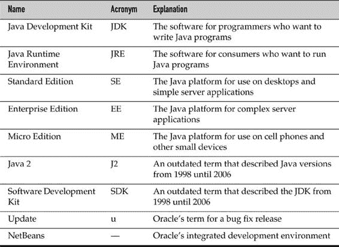

你已经看到过 `Java` 开发包的缩写 `JDK`。稍微有点让人困惑的是，该工具包的 1.2 到 1.4 版本被称为 `Java SDK`（软件开发包）。你仍会偶尔看到对旧术语的引用。还有 `Java` 运行时环境（`JRE`），它包含虚拟机但不包含编译器。作为开发者，你需要的不是它。接下来，你会随处看到 `Java SE` 术语。它是标准版，相对于 `Java EE`（企业版）和 `Java ME`（微型版）。

你偶尔会遇到 `Java 2` 这个术语，这是 `Sun` 的营销人员在 1998 年提出的，当时他们认为版本号的增加无法传达巨大的进展。然而，由于他们在发布后才有了这一见解，决定保留 `1.2` 作为开发包的版本号。随后的版本被命名为 `1.3`、`1.4` 和 `5.0`。然而，平台被更名为 `Java 2`。因此，我们有了 Java 2 标准版软件开发包 5.0，即 `J2SE SDK 5.0`。

对于工程师来说，这一切有点困惑，但这就是为什么我们从未将其引入营销。幸运的是，在 2006 年，理性回归了。无用的 `Java 2` 名称被弃用，`Java` 标准版的当前版本变为 `Java SE 6`。你仍会偶尔看到 `1.5` 和 `1.6` 的引用——这些只是版本 `5.0` 和 `6` 的同义词。


最后，当 Oracle 进行微版本更改以修复紧急问题时，它将这种更改称为更新。例如，Java SE 7 开发包的第一个更新正式称为 `JDK 7u1`，内部版本号为 `1.7.0_01`。更新不需要安装在之前的版本之上——它包含了整个 `JDK` 的最新版本。

有时，Oracle 会提供包含 Java 开发包和集成开发环境的包。该集成环境在不同阶段曾命名为 `Forte`、`Sun ONE Studio`、`Sun Java Studio` 和 `Netbeans`。我们不知道当你访问下载网站时，那些热情的营销人员会如何称呼它。我们建议你现在避开所有的安装包，只安装 Java 开发包。如果你以后决定使用 Oracle 的集成开发环境，只需从 [`netbeans.org`](http://netbeans.org) 下载即可。

 注意

安装程序会提供一个默认安装目录，其中包含 JDK 版本号，例如 `jdk1.7.0`。这听起来有点麻烦，但我们已经非常习惯这个版本号了——它让为测试安装新的 JDK 版本变得更加容易。

在 Windows 环境下，我们强烈建议不要接受路径名中带有空格的默认位置，例如 `c:\Program Files\jdk1.7.0`。请直接去掉路径名中的 `Program Files` 部分。

在本书中，我们将安装目录称为 `jdk`。例如，当我们提到 `jdk/bin` 目录时，指的是名称类似于 `/usr/local/jdk1.7.0/bin` 或 `c:\jdk1.7.0\bin` 的目录。

### 2.1.2. 设置可执行路径

在完成 JDK 安装后，你还需要执行一个额外的步骤：将 `jdk/bin` 目录添加到可执行路径中——这是操作系统为查找可执行文件而遍历的目录列表。此步骤的操作方法也因操作系统而异。

- 在 UNIX（包括 Linux、Mac OS X 和 Solaris）中，编辑可执行路径的方法取决于你使用的 shell。如果你使用 Bourne Again shell（Linux 的默认 shell），请在 `~/.bashrc` 或 `~/.bash_profile` 文件的末尾添加如下行：

```bash
export PATH=jdk/bin:$PATH
```

- 在 Windows 下，以管理员身份登录。启动控制面板，切换到经典视图，并选择系统图标。在 Windows XP 中，你会直接进入系统属性对话框。在 Vista 和 Windows 7 中，你需要选择“高级系统设置”（参见图 2.1）。在系统属性对话框中，点击“高级”选项卡，然后点击“环境变量”按钮。滚动系统变量窗口直到找到名为 `Path` 的变量。点击“编辑”按钮（参见图 2.2）。将 `jdk\bin` 目录添加到路径开头，使用分号分隔新条目，如下：

```text
jdk\bin;other stuff
```


图 2.1 在 Windows Vista 中启动系统属性对话框

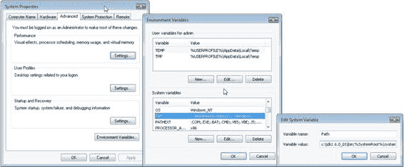

图 2.2 在 Windows Vista 中设置 Path 环境变量

请注意将 `jdk` 替换为 Java 安装的实际路径，例如 `c:\jdk1.7.0_02`。如果你忽略了我们去掉 `Program Files` 目录的建议，请用双引号括整个路径：`"c:\Program Files\jdk1.7.0_02\bin";other stuff`。

保存你的设置。启动的任何新控制台窗口将具有正确的路径。

以下是测试操作是否正确的方法：启动一个 shell 窗口。输入行：

```bash
javac -version
```

并按下回车键。你应该得到类似下面的显示：

```text
javac 1.7.0_02
```

如果你收到的是“javac: command not found”或“指定的名称不是内部或外部命令、可运行程序或批文件”之类的消息，则你需要返回并双检你的安装。

 注意

在 Windows 中，请按照这些说明打开 shell 窗口。如果你使用 Windows XP，从开始菜单选择“运行”选项并输入 `cmd`。在 Vista 和 Windows 7 中，只需在开始菜单的搜索框中输入 `cmd`。按回车，shell 窗口就会出现。

如果你从未见过这种窗口，我们建议你学习一个教授命令行基础的教程，例如 [www.horstmann.com/bigj/help/windows/tutorial.html](http://www.horstmann.com/bigj/help/windows/tutorial.html)。

### 2.1.3. 安装库源码和文档

库源码以压缩文件 `src.zip` 的形式随 JDK 提供，你必须解压该文件获取源码。我们强烈建议这样做。只需执行以下操作：

1. 确保 JDK 已安装且 `jdk/bin` 目录在可执行路径中。
2. 打开一个 shell 窗口。
3. 进入 `jdk` 目录（例如 `cd /usr/local/jdk1.7.0` 或 `cd c:\jdk1.7.0`）。
4. 创建一个子目录 `src`：

   ```bash
   mkdir src
   cd src
   ```

5. 执行命令：

   ```bash
   jar xvf ../src.zip
   ```

   （在 Windows 上使用 `jar xvf ..\src.zip`）。

 提示

`src.zip` 文件包含所有公共库的源码。要获取更多源码（针对编译器、虚拟机、原生方法和私有辅助类），请访问 [`jdk7.java.net`](http://jdk7.java.net)。

文档包含在一个与 JDK 独立的压缩文件中。你可以从 [www.oracle.com/technetwork/java/javase/downloads](http://www.oracle.com/technetwork/java/javase/downloads) 下载文档。

### 2.1.4. 安装 Core Java 示例

文档包含在一个与 JDK 独立的压缩文件中。你可以从 [www.oracle.com/technetwork/java/javase/downloads](http://www.oracle.com/technetwork/java/javase/downloads) 下载文档。

### 2.1.5. 目录导航

在探索 Java 的过程中，你有时会想要查看源码内部。当然，你将需要大量使用库文档。图 2.3 展示了 JDK 目录树。

然而，在你掌握了编译和运行 Java 程序的基本步骤后，你将可能想要使用专业的开发环境。在过去的十年里，这些环境已经变得非常强大且方便，以至于如果不使用它们，手动工作就变得毫无意义。两个优秀的选择是免费提供的 Eclipse 和 NetBeans 程序。在本章中，我们将向你展示如何开始使用 Eclipse，因为它仍然比 NetBeans 稍微流畅一点，尽管 NetBeans 正在快速追赶。当然，如果你更喜欢其他开发环境，完全可以在配合此书中使用。

在过去，我们建议对简单程序使用如 Emacs、JEdit 或 TextPad 等文本编辑器。我们现在不再提供这种建议，因为集成开发环境（IDE）现在已经如此快速且方便了。

总之，我们认为你应该学会如何使用基本的 JDK 工具，然后你应该熟悉使用集成开发环境。

## 2.3. 使用命令行工具

让我们从最困难的方法开始：从命令行编译并启动 Java 程序。

1. 打开 shell 窗口。
2. 进入 `/CoreJavaBook/v1ch02/Welcome` 目录。（`CoreJavaBook` 目录是你安装书籍示例源代码的目录，具体请参见第 2.1.4 节“安装 Core Java 程序示例”，第 23 页。）
3. 输入以下命令：

   ```bash
   javac Welcome.java
   java Welcome
   ```

你应该能在 shell 窗口中看到如图 2.4 所示的输出。

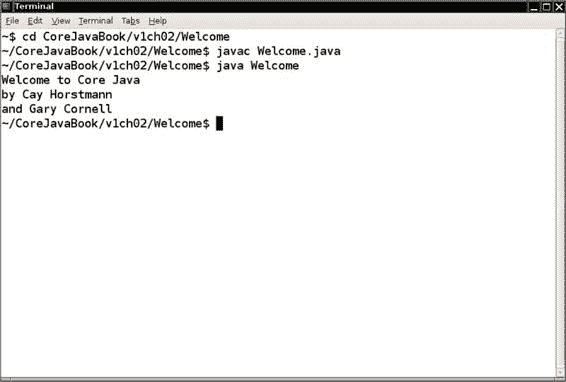

图 2.4 编译并运行 Welcome.java。

恭喜你！你刚刚编译并运行了你的第一个 Java 程序。

发生了什么？`javac` 程序是 Java 编译器。它将 `Welcome.java` 文件编译成 `Welcome.class` 文件。`java` 程序启动 Java 虚拟机。它执行编译器放在类文件中的字节码。

 注意

如果你收到了关于以下行的错误消息：

```java
for (String g : greeting)
```

那么你可能使用的是非常旧版本的 Java 编译器。在这种情况下，你需要按照如下重写循环：

```java
for (int i = 0; i < greeting.length; i++)
    System.out.println(greeting[i]);
```

`Welcome` 程序非常简单。它只是向控制台打印了一条条消息。你可能喜欢查看该程序的内部结构，如列表 2.1 所示（我们将在下一章中解释它的工作原理）。

列表 2.1 `Welcome/Welcome.java`

点击此处查看代码图像

```java
/**
 * 此程序显示来自作者的问候。
 * @version 1.20 2004-02-28
 * @author Cay Horstmann
 */
public class Welcome
{
    public static void main(String[] args)
    {
        String[] greeting = new String[3];
        greeting[0] = "Welcome to Core Java";
        greeting[1] = "by Cay Horstmann";
        greeting[2] = "and Gary Cornell";

        for (String g : greeting)
            System.out.println(g);
    }
}
```

#### 2.3.1. 故障排除提示

在视觉化开发环境时代，许多程序员并不熟悉在 shell 窗口中运行程序。可能会出现任何问题，导致令人沮丧的结果。

请注意以下几点：

- 如果你是手动输入程序，请确保正确输入了大写字母和小写字母。特别是类名是 `Welcome`，而不是 `welcome` 或 `WELCOME`。
- 编译器需要文件名（`Welcome.java`）。当你运行程序时，你指定类名（`Welcome`），而不需要带 `.java` 或 `.class` 扩展名。
- 如果你收到如“Bad command or file name”或 `javac: command not found` 之类的消息，请回去双检查你的安装情况。

## 2.4. 使用集成开发环境

在本节中，我们将向你展示如何使用 Eclipse 编译程序，这是一个从 [`eclipse.org`](http://eclipse.org) 免费提供的集成开发环境。Eclipse 用 Java 编写，但由于它使用了非标准的窗口库，它的移植性不如 Java。尽管如此，它存在 Linux、Mac OS、Solaris 和 Windows 版本。

还有其他流行的 IDE，但目前 Eclipse 是最常用的。以下是入门步骤：

1. 启动 Eclipse 后，从菜单中选择 File（文件）-> New Project（新建项目）。
2. 在向导对话框中选择“Java Project”（参见图 2.5）。这些截图是用 Eclipse 3.2 的。如果你的 Eclipse 版本看起来略有不同，请不要担心。

   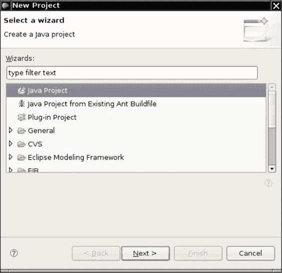

   图 2.5 Eclipse 中的 New Project 对话

3. 点击 Next（下一步）按钮。提供项目名称 `Welcome`，并输入包含 `Welcome.java` 的目录的完整路径（参见图 2.6）。

   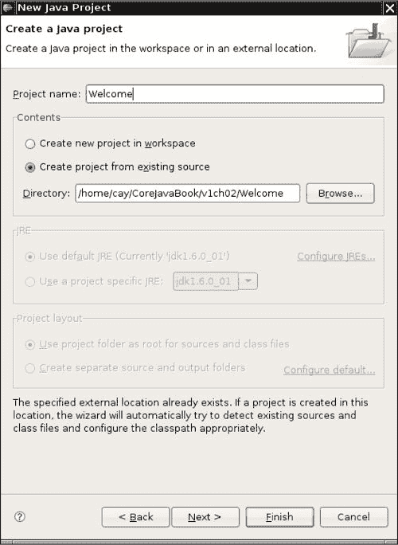

   图 2.6 配置 Eclipse 项目

4. 确保勾选“Create project from existing source”（从现有源代码创建项目）选项。
5. 点击 Finish（完成）按钮。项目现在已创建。
6. 点击左侧面板中项目窗口旁的三角形以打开它，然后点击“Default package”（默认包）旁的三角形。双击 `Welcome.java`。你现在应该看到一个显示程序代码的窗口（参见图 2.7）。

   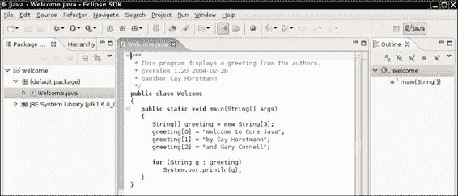

   图 2.7 使用 Eclipse 编辑源文件

7. 使用鼠标右键点击左侧窗格中的项目名称（Welcome）。选择 `Run -> Run As -> Java Application`。窗口底部会出现一个输出窗口。程序的输出将显示在输出窗口中（参见图 2.8）。

   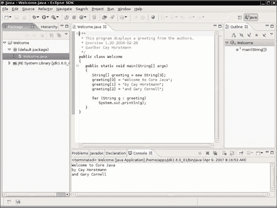

   图 2.8. 在 Eclipse 中运行程序

### 2.4.1. 定位编译错误

推测，这个程序并没有拼写错误或 Bug。（毕竟它毕竟只有几行代码。）为了讨论起见，让我们假设你的代码偶尔包含拼写错误（可能甚至是一个语法错误）。尝试一下——例如，通过如下方式更改 `String` 的大小写来破坏你的文件：

```java
String[] greeting = new string[3];
```

现在，尝试再次运行程序。你将得到一个错误消息，提示有一个未知的 `string` 类型（参见图 2.9）。只需点击错误消息。光标将移动到编辑窗口中对应的行，你可以在那里纠正错误。这种行为允许你快速修复错误。

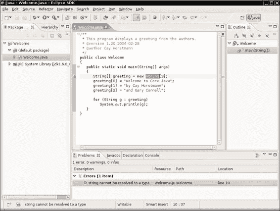

图 2.9. Eclipse 中的错误消息

 提示

通常，Eclipse 错误报告会伴随着一个灯泡图标。点击灯泡可以获取建议的修复列表。

这些指令应该让你体验到集成环境中工作的感受。我们在第 11 章中讨论 Eclipse 调试器。

## 2.5. 运行图形应用程序

`Welcome` 程序并不有趣。接下来，我们将演示一个图形应用程序。这个程序是一个简单的图像文件查看器，只需加载并显示图像。再次，让我们先从命令行编译并运行它。

1. 打开 shell 窗口。
2. 进入目录 `CoreJavaBook/v1ch02/ImageViewer`。
3. 输入以下内容：

   ```bash
   javac ImageViewer.java
   java ImageViewer
   ```

弹出一个新的程序窗口，显示我们的 `ImageViewer` 应用程序（参见图 2.10）。


图 2.10. 运行 ImageViewer 应用程序

现在，选择 `File -> Open` 并寻找一个要打开的图像文件。（我们在同一目录下提供了几个示例文件。）要关闭程序，请点击标题栏中的 `Close` 框，或从菜单中选择 `File -> Exit`。

快速查看源码。该程序比第一个程序要长得多，但如果你考虑到用 C 或 C++ 编写类似的应用程序需要多少代码，它就不太复杂了。当然，在 Visual Basic 中，编写（或者确切地说，拖放）这样一个程序是很容易的。JDK 没有视觉化界面生成器，因此你需要为每一切都编写代码，如代码列表 2.2 所示。你将在第 7 章到第 9 章中学习如何编写这样的图形程序。

列表 2.2 `ImageViewer/ImageViewer.java`

点击此处查看代码图像


```java
import java.awt.EventQueue;
import java.awt.event.*;
import java.io.*;
import javax.swing.*;

/**
 * 一个查看图像的程序。
 * @version 1.22 2007-05-21
 * @author Cay Horstmann
 */
public class ImageViewer
{
    public static void main(String[] args)
    {
        EventQueue.invokeLater(new Runnable()
        {
            public void run()
            {
                JFrame frame = new ImageViewerFrame();
                frame.setTitle("ImageViewer");
                frame.setDefaultCloseOperation(JFrame.EXIT_ON_CLOSE);
                frame.setVisible(true);
            }
        });
    }
}

/**
 * 一个带有显示图像标签的帧。
 */
class ImageViewerFrame extends JFrame
{
    private JLabel label;
    private JFileChooser chooser;
    private static int DEFAULT_WIDTH = 300;
    private static int DEFAULT_HEIGHT = 400;

    public ImageViewerFrame()
    {
        setSize(DEFAULT_WIDTH, DEFAULT_HEIGHT);

        // 使用 label 显示图像
        label = new JLabel();
        add(label);

        // 设置文件选择器
        chooser = new JFileChooser();
        chooser.setCurrentDirectory(new File("."));

        // 设置菜单栏
        MenuBar menuBar = new MenuBar();
        setMenuBar(menuBar);

        JMenu menu = new JMenu("File");
        menuBar.add(menu);

        JMenuItem openItem = new JMenuItem("Open");
        menu.add(openItem);
        openItem.addActionListener(new ActionListener()
        {
            public void actionPerformed(ActionEvent event)
            {
                // 显示文件对话框
                int result = chooser.showOpenDialog(null);

                // 如果选择了文件，将其设为 label 的图标
                if (result == JFileChooser.APPROVE_OPTION)
                {
                    String name = chooser.getSelectedFile().getPath();
                    label.setIcon(new ImageIcon(name));
                }
            }
        });

        JMenuItem exitItem = new JMenuItem("Exit");
        menu.add(exitItem);
        exitItem.addActionListener(new ActionListener()
        {
            public void actionPerformed(ActionEvent event)
            {
                System.exit(0);
            }
        });
    }
}
```

## 2.6 构建和运行应用程序（Applet）

书中介绍的前两个程序都是应用程序——像任何原生程序一样。另一方面，正如我们在上一章中提到的，Java 的早期热度来自于它运行 applet 的能力。我们向你展示如何从命令行构建并运行 applet。然后我们将 applet 加载到 applet 查看器中。最后，我们在浏览器中显示它。

首先，打开 shell 窗口进入`CoreJavaBook/v1ch02/ImageViewer`，然后输入以下命令：

```bash
javac ImageViewer.java
appletviewer ImageViewer.html
```

图 2.11 显示了你在 applet 查看器中看到的内容。

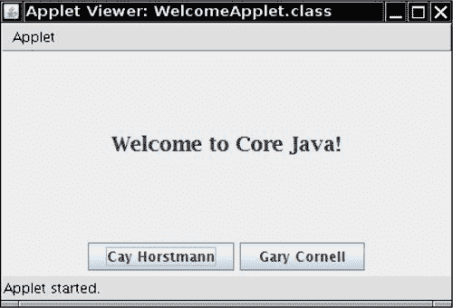

图 2.11. 查看器中显示的 ImageViewer

第一个命令是现在熟悉的调用编译器的命令。它将`ImageViewer.java`源编译为字节码文件`ImageViewer.class`。然而，这次你没有运行`java`程序，而是调用`appletviewer`。该程序是 JDK 自带的一个特殊工具，用于快速测试 applet。你需要给它一个 HTML 文件，而不是 Java 类名。

`ImageViewer.html`文件的内容如代码列表 2.3 所示：

```html
<html>
  <head>
    <title>WelcomeApplet</title>
  </head>
  <body>
    <hr/>
    <p>
      这个 applet 来自书籍
      <a href="http://www.horstmann.com/corejava.html">Core Java</a>
      由 <em>Cay Horstmann</em> 和 <em>Gary Cornell</em> 著。
    </p>
    <applet code="WelcomeApplet.class" width="400" height="200"></applet>
  </body>
</html>
```

```html
<param name="greeting" value="Welcome to Core Java!"/>
</applet>
<hr/>
<p><a href="WelcomeApplet.java">源代码。</a></p>
</body>
</html>
```

当然，applet 是设计用于在浏览器中查看的。遗憾的是，许多浏览器默认没有启用 Java 支持。页面[`java.com/en/download/help/enable_browser.xml`](http://java.com/en/download/help/enable_browser.xml)显示了如何为最常见的浏览器配置 Java。一旦你配置好了浏览器，你就可以尝试在浏览器中加载该 applet。

1. 启动你的浏览器。
2. 选择`File` -> `Open File`（或等效操作）。
3. 进入`CoreJavaBook/v1ch02/WelcomeApplet`目录。你应该会在文件对话框中看到`WelcomeApplet.html`文件。加载该文件。
4. 你的浏览器现在加载了 applet，包括周围的文本。它看起来类似于图 2.12。

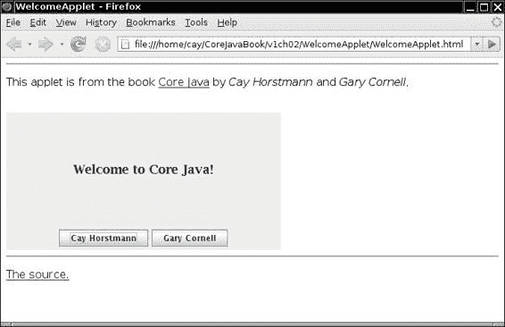

图 2.12. 在浏览器中运行 WelcomeApplet applet

你可以看到这个应用程序实际上是活跃的，并愿意与互联网交互。点击 Cay Horstmann 按钮。applet 会引导浏览器显示 Cay 的网页。点击 Gary Cornell 按钮。applet 会引导浏览器弹出一个窗口，其中已经填写了 Gary 的电子邮件地址。

请注意，这两个按钮在 applet 查看器（applet viewer）中都不起作用。applet 查看器没有发送邮件或显示网页的能力，因此它会忽略你的请求。applet 查看器适用于孤立地测试 applet，但你需要将 applet 放入浏览器中，以观察它们是如何与浏览器以及互联网交互的。


### 提示

你也可以在开发环境内部运行 applet。在 Eclipse 中，使用`Run` -> `Run as` -> `Java Applet`菜单选项。

最后，applet 的代码显示在列表 2.4 中。此时，只需对其扫视一眼即可。我们将在第 10 章中回来讨论编写 applet。

在本章中，你学习了编译和运行 Java 程序的机制。你现在准备好进入第 3 章了。

列表 2.4. `WelcomeApplet/WelcomeApplet.java`

点击此处查看代码图像

```java
import java.awt.*;
import java.awt.event.*;
import java.net.*;
import javax.swing.*;

/**
 * 此 applet 显示作者的问候。
 * @version 1.22 2007-04-08
 * @author Cay Horstmann
 */
public class WelcomeApplet extends JApplet
{
    public void init()
    {
        EventQueue.invokeLater(new Runnable()
        {
            public void run()
            {
                setLayout(new BorderLayout());
                JLabel label = new JLabel(getParameter("greeting"), SwingConstants.CENTER);
                label.setFont(new Font("Serif", Font.BOLD, 18));
                add(label, BorderLayout.CENTER);
                JPanel panel = new JPanel();
                JButton cayButton = new JButton("Cay Horstmann");
                cayButton.addActionListener(makeAction("http://www.horstmann.com"));
                panel.add(cayButton);
                JButton garyButton = new JButton("Gary Cornell");
                garyButton.addActionListener(makeAction("mailto:gary_cornell@apress.com"));
                panel.add(garyButton);
                add(panel, BorderLayout.SOUTH);
            }
        });
    }

    private ActionListener makeAction(final String urlString)
    {
        return new ActionListener()
        {
            public void actionPerformed(ActionEvent event)
            {
                try
                {
                    getAppletContext().showDocument(new URL(urlString));
                }
                catch (MalformedURLException e)
                {
                    e.printStackTrace();
                }
            }
        };
    }
}
```

# 第 3 章 Java 中的基础编程结构

## 本章

- 一个简单的 Java 程序
- 注释
- 数据类型
- 变量
- 运算符
- 字符串
- 输入与输出
- 控制流
- 大数
- 数组

在此，我们假设你已经成功安装了 JDK 并能够运行我们在第 2 章中展示的示例。现在是时候开始编程了。

## 3.1. 简单的 Java 程序

让我们仔细观察一个最简单的 Java 程序示例——一个仅仅向控制台打印信息的程序：

点击此处查看代码图像

```java
public class FirstSample
{
    public static void main(String[] args)
    {
        System.out.println("We will not use 'Hello, World!'");
    }
}
```

花时间熟悉这个示例的框架，这些部分将在所有应用程序中出现。首先，Java 对大小写敏感。如果你在大小写上犯了任何错误（例如用`Main`代替`main`），程序将无法运行。

现在让我们逐行查看这段源码。`public`关键字被称为修饰符；这些修饰符控制程序其他部分对此代码的访问权限。我们将在第 5 章中对修饰符进行更多讨论。`class`关键字提醒你 Java 程序中的一切都存在于类之中。虽然我们将在下一章对类花费更多时间，但目前请将类视为一个定义应用程序行为的程序逻辑容器。

紧随`class`关键字之后的是类名。Java 类名的命名规则非常宽松。名称必须以字母开头，之后可以是字母和数字的任意组合。长度本质上没有限制。你不能使用 Java 保留字（例如`public`或`class`）作为类名。（请参见附录中的保留字列表。）

## Java 基础

标准的命名规范（我们在`FirstSample`名称中遵循了这一规范）是类名是以大写字母开头的名词。如果一个名称由多个单词组成，请每个单词的首字母都大写。（这种在单词中间使用大写字母写法有时被称为“驼峰命名法”（camel case），或者自指地称为“CamelCase”。）

你需要将源代码的文件名与公共类的名称相同，并加上扩展名`.java`。因此，你必须将此代码存储在名为`FirstSample.java`的文件中。（再次，大小写是重要的——不要使用`firstsample.java`。）

如果你正确命名了文件且源代码中没有拼写错误，那么当你编译这段源代码时，就会得到一个包含该类字节码的文件。Java 编译器会自动将字节码文件命名为`FirstSample.class`，并将其存储在源文件相同的目录下。最后，通过以下命令启动程序：

```bash
java FirstSample
```

（记住省略`.class`扩展名。）当程序执行时，它仅仅会在控制台上显示字符串`We will not use 'Hello, World!'`。

当你使用

```bash
java ClassName
```

来运行编译后的程序时，Java 虚拟机始终会从你指定的类中`main`方法的代码开始执行。（“方法”一词是 Java 的专业术语，对应函数。）因此，为了让你的代码执行，你的类源文件中必须有一个`main`方法。当然，你可以在类中添加你自己的方法，并在`main`方法中调用它们。（我们将在下一章介绍如何编写自己的方法。）

---


> **备注**
>
> 根据 Java 语言规范，`main`方法必须被声明为`public`。（Java 语言规范是描述 Java 语言的官方文档。你可以从[`docs.oracle.com/javase/specs`](http://docs.oracle.com/javase/specs)查看或下载它。）


然而，多个版本的 Java 启动器在 `main` 方法不是 `public` 的情况下也愿意执行 Java 程序。一名程序员提交了一个错误报告。要查看它，请访问 [`bugs.sun.com/bugdatabase/index.jsp`](http://bugs.sun.com/bugdatabase/index.jsp) 并输入错误识别码 `4252539`。该错误被标记为“关闭，不会修复”。一位 Sun 工程师添加了解释，说明 Java 虚拟机规范（位于 [`docs.oracle.com/javase/specs/jvms/se7/html`](http://docs.oracle.com/javase/specs/jvms/se7/html)）并没有强制 `main` 必须是 `public`，并且“修复它会导致潜在的麻烦”。幸运的是，理性最终取得了胜利。Java SE 1.4 及更高版本的 Java 启动器强制要求 `main` 方法必须是 `public`。

这个故事有几个有趣的方面。一方面，让质量保证工程师（他们通常工作过度，且并不总是 Java 细微之处的专家）对错误报告做出令人怀疑的决策是令人沮丧的。另一方面，Sun 在 Java 开源很久以前就让错误报告及其解决方案可供任何人审查，这是非常了不起的。“错误大游行”对程序员来说是一个非常实用的资源。你甚至可以为你喜欢的错误投票。票数较多的错误在下一个 JDK 版本中被修复的概率更高。

***

注意源代码中的大括号 `{ }`。在 Java 中，像 C/C++ 一样，大括号划定了程序中的部分（通常称为*块*）。在 Java 中，任何方法的代码都必须以左大括号 `{` 开始，并以右大括号 `}` 结束。

大括号的风格引发了大量的无用争议。我们遵循一种让匹配的大括号对齐的风格。由于空格对 Java 编译器是无关的，你可以使用任何喜欢的的大括号风格。当我们讨论各种类型的循环时，我们会对大括号的使用进行更多说明。

目前，不要担心 `static void` 关键字——只需将它们看作是让 Java 程序编译所需要的内容的一部分。到第 4 章结束时，你将完全理解这个咒语。目前需要记住点是，每个 Java 应用都必须有一个以下方式声明的 `main` 方法：

```java
public class ClassName
{
   public static void main(String[] args)
   {
      program statements
   }
}
```

***

 C++ 备注

作为一名 C++ 程序员，你知道什么是类。Java 类与 C++ 类相似，但有几个可能会误导你的区别。例如，在 Java 中，*所有*函数都是某个类的方法。（标准术语将它们称为方法，而不是成员函数。）因此，在 Java 中，你必须为 `main` 方法准备一个外壳类。你可能也熟悉 C++ 中*静态成员函数*的概念。这些是定义在类内部但不操作对象的成员函数。Java 中的 `main` 方法始终是静态的。最后，与 C/C++ 一样，`void` 关键字表示该方法不返回任何值。与 C/C++ 不同，`main` 方法不会向操作系统返回“退出代码”。

***

接下来，请注意这段片段：

```java
{
   System.out.println("We will not use 'Hello, World!');
}
```

大括号标记了*方法体*的开始和结束。这个方法只有一个语句。和大多数语言一样，每条语句都必须以分号结束。特别是，换行符并不标记语句的结束，因此语句可以跨越多个行。`main` 方法体包含一个输出单行文本的语句。在这里，我们正在使用 `System.out` 对象并调用它的 `println` 方法。注意用于调用方法的点符号。Java 使用通用语法：

`object.method(parameters)`

在这种情况下，我们正在调用 `println` 方法并向它传递一个字符串参数。该方法在控制台上显示该字符串参数。然后它结束输出行，因此每次调用 `println` 都会在新的一行显示其输出。Java 中的方法像任何语言中的函数一样，可以使用零、一个或多个*参数*（一些程序员将其称为*形参*）。即使方法不接受参数，你也必须使用空括号。例如，没有参数的 `println` 方法变体只是打印一个空行。你通过以下调用执行它：

```java
System.out.println();
```

***

 备注

`System.out` 还有一个 `print` 方法，它不会向输出添加换行符。例如，`System.out.print("Hello")` 会打印 `Hello` 而不换行。下一个输出将紧接在字母 `o` 之后。

***

### 3.2 注释

Java 中的注释与大多数编程语言一样，不会出现在可执行程序中。因此，你可以根据需要添加尽可能多的注释，而不用担心代码膨胀。Java 有三种标记注释的方法。最常见的形式是 `//`。你用它来编写从 `//` 到行尾的注释。

```java
System.out.println("We will not use 'Hello, World!'"); // 这样太可爱了吗？
```

当需要较长的注释时，你可以为每行标记 `//`，或者使用 `/*` 和 `*/` 注释定界符来划分一段较长的注释。

最后，第三种注释可用于自动生成文档。这种注释用 `/**` 开始，用 `*/` 结束。你可以在列表 3.1 中看到此类注释。关于此类注释以及自动文档文档的更多信息，请参阅第 4 章。

列表 3.1. `FirstSample/FirstSample.java`

```java
1  /**
2    * This is the first sample program in Core Java Chapter 3
3    * @version 1.01 1997-03-22
4    * @author Gary Cornell
5    */
6  public class FirstSample
7  {
8      public static void main(String[] args)
9      {
10         System.out.println("We will not use 'Hello, World!'");
11     }
12 }
```

***

 注意

`/* */` 注释在 Java 中不能嵌套。也就是说，你无法仅仅通过将代码放在 `/*` 和 `*/` 之间来禁用，因为你想要禁用的代码本身可能包含 `*/` 分隔符。

***

### 3.3. 数据类型

Java 是一种*强类型语言*。这意味着每个变量必须有一个定义的类型。Java 中八种*基本类型*。其中四种是整数类型；两种是浮点数类型；一种是字符类型 `char`，用于 Unicode 编码方案中的代码单元（参见第 3.3.3 节中的“`char` 类型”，位于第 49 页）；以及还有一种是用于布尔值的 `boolean` 类型。

***

 笔记

Java 有一个任意精度算术包。然而，所谓的“大数”是 Java *对象*，而不是一种新的 Java 类型。你将在本章稍后的部分看到如何使用它们。

***

### 3.3.1. 整数类型

整数类型用于没有小数部分的数字。允许负值。Java 提供了表 3.1 所示的四种整数类型。

表 3.1. Java 整数类型

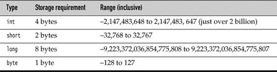

在大多数情况下，`int` 类型是最实用的。如果你想表示地球上的人口数量，你将需要借助 `long`。`byte` 和 `short` 类型主要用于特殊应用程序，例如低级文件处理，或在存储空间紧张的情况下用于大型数组。

在 Java 中，整数类型的范围不取决于你运行 Java 代码的机器。这减轻了想要将软件从一个平台移动到另一个平台（甚至是同一平台的不同操作系统之间）的程序员的巨大烦恼。相比之下，C 和 C++ 程序为每个处理器使用最高效的整数类型。结果，在 32 位处理器上运行良好的 C 程序可能在 16 位系统上出现整数溢出。由于 Java 程序必须在所有机器上具有相同的运行，因此各种类型的范围是固定的。

长整数有一个后缀 `L`（例如，`4000000000L`）。十六进制数有一个前缀 `0x`（例如，`0xCAFE`）。八进制数有一个前缀 `0`。例如，`010` 是 8。自然地，这可能会引起混淆，因此我们建议不要使用八进制常量。从 Java 7 开始，你可以使用前缀 `0b` 写二进制数字。例如，`0b1001` 是 9。同样从 Java 7 开始，你可以在数字字面量中添加下划线，例如 `1_000_000`（或 `0b1111_0100_0010_0100_0000`）来表示百万。下划线仅供人类视觉识别。Java 编译器会简单地删除它们。

***

 C++ 笔记

在 C 和 C++ 中，`int` 和 `long` 等类型的大小取决于目标平台。在像 8086 的 16 位处理器上，整数是 2 字节，但在 Pentium 或 SPARC 等 32 位处理器上，它们是 4 字节。同样，`long` 值也是 4 字节。由于 Java 程序必须在所有机器上具有相同的运行，因此各种类型的范围是固定的。浮点值是 32 位和 64 位。这些浮点值不是*无符号*的。

***

#### 3.3.2. 浮点类型

浮点类型表示带有小数部分的数字。这些类型在表 3.2 所示。

表 3.2. 浮点类型

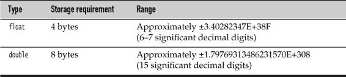 在大多数情况下，`float` 类型是最实用的。如果你想表示地球上的人口数量，你将需要借助 `double`。`byte` 和 `short` 类型主要用于特殊应用程序，例如低级文件处理，或在存储空间紧张时用于大型数组。

在 Java 中，浮点类型的范围不取决于你运行 Java 代码的机器。这减轻了想要将软件从一个平台移动到另一个平台（甚至是同一平台的不同操作系统之间）的程序员的巨大烦恼。相比之下，C 和 C++ 程序为每个处理器使用最高效的整数类型。结果，在 32 位处理器上运行良好的 C 程序可能在 16 位系统上出现整数溢出。由于 Java 程序必须在所有机器上具有相同的运行，因此各种类型的范围是固定的。

浮点数有一个后缀 `f`（例如，`3.14f`）。十六进制数有一个前缀 `0x`（例如，`0x1.0p-2`）。八进制数有一个前缀 `0`。例如，`012` 是 10。自然地，这可能会引起混淆，因此我们建议不要使用八进制常量。

从 Java 7 开始，你可以使用前缀 `0b` 写二进制数字。例如，`0b1.001` 是 9。同样从 Java 7 开始，你可以在数字字面量中添加下划线，例如 `1_000_000`（或 `0b1111_0100_0010_0100_0000`）来表示百万。下划线仅供人类视觉识别。Java 编译器会简单地删除它们。

***

 笔记

Java 有一个任意精度算术包。然而，所谓的“大数”是 Java *对象*，而不是一种新的 Java 类型。你将在本章稍后的部分看到如何使用它们。

***

#### 3.3.3. char 类型

`char` 类型用于描述单个字符。最常见的是这些是字符常量。例如，`'A'` 是值为 65 的字符常量。它与包含单个字符的字符串 `"A"` 是不同的。Unicode 代码单元可以以十六进制值表示，范围从 `\u0000` 到 `\uFFFF`。例如，`\u2122` 是商标符号（™），`\u03C0` 是希腊字母 pi（π）。

除了指示 Unicode 代码单元编码的 `\u` 转义序列外，还有几种用于特殊字符的转义序列，如表 3.3 所示。你可以在带引号的字符常量和字符串中使用这些转义序列，例如 `'\u2122'` 或 `"Hello\n"`。`\u` 转义序列（但其他转义序列除外）甚至可以用带引号的字符常量和字符串之外。例如

```java
public static void main(String\u005B\u005D args)
```

表 3.3 特殊字符的转义序列

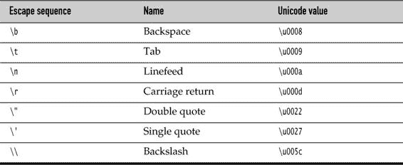

是完全合法的`\u005B` 和 `\u005D` 是 `[` 和 `]` 的编码。

为了完全理解 `char` 类型，你必须了解 Unicode 编码方案。Unicode 的发明是为了克服传统字符编码方案的局限性。在 Unicode 之前，有许多不同的标准：美国的 `ASCII`、用于西欧语言的 `ISO 8859-1`、俄语的 `KOI-8`、中文的 `GB18030` 和 `BIG-5` 等。这导致了两个问题：特定的代码值在不同的编码方案中对应不同的字母。此外，字符集较大的语言的编码是变长的：某些常用字符被编码为单字节，而另一些需要两个或更多字节。

Unicode 的设计是为了解决这些问题。当 20 世纪 80 年统一工作开始时，固定的 2 字节代码对于编码世界上所有语言使用的所有字符已经足够了，并且还有未来扩展的空间——当时大家都是这么想的。1991 年，Unicode 1.0 发布，使用了可用 65,536 个代码值中略于一半的。Java 从一开始就被设计为使用 16 位 Unicode 字符，这对于使用 8 位字符的其他编程语言来说是一项重大进步。

遗憾，随着时间的推移，不可避免的事情发生了。Unicode 字符超过了 65,536 个，这主要是由于增加了大量用于中、日、韩的表字。现在，16 位的 `char` 类型不足以描述所有的 Unicode 字符。

我们需要一些术语来解释 Java（从 Java SE 5.0 开始）是如何解决这个问题的。*代码点*（code point）是指与编码方案中的字符相关的代码值。在 Unicode 标准中，代码点以十六进制形式表示，并以 `U+` 为前缀，例如拉丁字母 A 的代码点为 `U+0041`。Unicode 的代码点被分在 17 个*代码平面*（code planes）中。第一个代码平面称为*基本多语言平面*（basic multilingual plane），由代码点从 `U+0000` 到 `U+FFFF` 的“经典”Unicode 字符组成。另外的 16 个平面（代码点从 `U+10000` 到 `U+10FFFF`）包含了*补充字符*（supplementary characters）。

UTF-16 编码用变长代码表示表示所有的 Unicode 代码点。基本多语言平面中的字符表示为 16 位值，称为*代码单元*（code units）。补充字符被编码为两个连续的代码单元对。这种编码对中的每个值都落在基本多语言平面 2048 个未使用值的范围之内，称为*代理区*（surrogates area）（第一个代码单元为 `U+D800` 到 `U+DBFF`，第二个代码单元为 `U+DC00` 到 `U+DFFF`）。这非常聪明，因为你可以立即判断一个代码单元编码的是单个字符，还是补充字符的第一或第二部分。例如，八元数集的数学符号  ([`math.ucr.edu/home/baez/octonions`](http://math.ucr.edu/home/baez/octonions)) 代码点为 `U+1D546`，由两个代码单元 `U+D835` 和 `U+DD46` 编码。（有关[编码算法的描述](http://en.wikipedia.org/wiki/UTF-16)](http://en.wikipedia.org/wiki/UTF-16%20for%20a%20description%20of%20the%20encoding%20algorithm.)）

在 Java 中，`char` 类型描述 UTF-16 编码中的*代码单元*。

我们强烈建议除非实际上在操作 UTF-16 代码单元，否则不要在程序中使用 `char` 类型。你几乎总是应该将字符串（我们将在第 3.6 节中讨论，“字符串”，见第 64 页）视为抽象数据类型。

### 3.3.4 boolean 类型

`boolean` 类型有两个值：`false` 和 `true`。它用于逻辑逻辑。你不能在整数和 `boolean` 值之间进行转换。

 C++ 注意

在 C++ 中，数字甚至指针都可以代替 `boolean` 值。

### 3.4 变量

在 Java 中，每个变量都有类型。你通过先放置类型后放置名称来声明变量。这里有一些例子：

```java
double salary;
int vacationDays;
long earthPopulation;
boolean done;
```

注意每个声明末尾有分号。变量名必须以字母开头，并且是字母或数字的序列。注意，“字母”和“数字”术语在 Java 中要宽得多。字母定义为 `'A'–'Z'`、`'a'–'z'`、`'_'`、`'$'` 以及任何表示字母的 Unicode 字符。例如，德国用户可以使用变音 `ä`；希腊使用者可以使用 `π`。同样，数字是 `'0'–'9'` 以及任何表示数字的 Unicode 字符。符号 `'+'` 或 `'©'` 不能用于变量名，空格也不行。名称中的所有字符都是重要的，大小同样重要。变量名的长度本质上是没有限制的。

 提示

如果你真的好奇哪些 Unicode 字符对 Java 来说是“字母”，可以使用 `Character` 类中的 `isIdentifierStart` 和 `isIdentifierPart` 方法进行检查。尽管 `$` 是有效的 Java 字母，但你不应该在自己的代码中使用它。它旨在用于 编译器和其他工具生成的名称。

你还不能将 Java 关键字用变量名。（参见附录中的关键字列表。）

你可以在一行内有多个声明：

```java
int i, j;
```


然而，我们不建议这种风格。如果你单独声明每个变量，你的程序会更易读。

### 3.4.1 初始化变量

在声明变量后，你必须通过赋值语句显式地初始化它——永远不能使用未初始化变量的值。例如，Java 编译器会将以下语句序列标记为错误：

```java
int vacationDays;
```

```java
System.out.println(vacationDays); // ERROR--变量未初始化
```

你通过在左侧使用变量名、等号（`=`），然后在右侧使用带有适当值的 Java 表达式来为之前声明的变量赋值。

```java
int vacationDays;
```

```java
vacationDays = 12;
```

你可以在同一行声明并初始化变量。例如：

```java
int vacationDays = 12;
```

最后，在 Java 中，你可以在代码的任何地方放置声明。例如，以下是 Java 中有效的代码：

```java
double salary = 65000.0;

System.out.println(salary);

int vacationDays = 12; // 在此处声明变量是允许
```

在 Java 中，将变量声明在尽可能靠近第一次使用的地方被认为是良好的风格。

***

 C++ 注意

C 和 C++ 区分变量的`declaration`（声明）和`definition`（定义）。例如，

```java
int i = 10;
```

是一个定义，而

```java
extern int i;
```

是一个声明。在 Java 中，声明并不独立于定义。

***

### 3.4.2. 常量

在 Java 中，你使用关键字`final`来表示常量。例如：

```java
public class Constants
{
    public static void main(String[] args)
    {
      final double CM_PER_INCH = 2.54;
      double paperWidth = 8.5;
      double paperHeight = 11;
      System.out.println("Paper size in centimeters: "
          + paperWidth * CM_PER_INCH + " by " + paperHeight * CM_PER_INCH);
    }
}
```

关键字`final`表示你只能对该变量赋值一次，然后它的值就固定了。习惯上使用全大写字母命名常量。

在 Java 中，更常见的做法创建一个常量，以便在单个类内的多个方法中可用。这些通常被称为*类常量*。使用关键字`static final`来建立一个类常量。这里是一个使用类常量的示例：

```java
public class Constants2
{
    public static final double CM_PER_INCH = 2.54;
    public static void main(String[] args)
    {
      double paperWidth = 8.5;
      double paperHeight = 11;
      System.out.println("Paper size in centimeters: "
          + paperWidth * CM_PER_INCH + " by " + paperHeight * CM_PER_INCH);
    }
}
```

注意，类常量的定义出现在`main`方法*之外*。因此，该常量也可以同类的其他方法中使用。此外，如果常量像我们的示例中那样被声明为`public`，其他类的方法也可以使用它——在我们的示例中，通过`Constants2.CM_PER_INCH`使用。

***

 C++ 注意

`const`是 Java 的保留关键字，但它目前没有用于任何地方。你必须使用`final`来表示常量。

***

### 3.5. 运算符

Java 中使用常用的算术运算符`+`、`-`、`*`、`/`用于加、减、乘、除。如果两个参数都是整数，`/`运算符表示整数除，否则表示浮点除法。整数余数（有时称为*modulus*）由`%`表示。例如，`15 / 2`是`7`，`15 % 2`是`1`，而`15.0 / 2`是`7.5`。

注意，整数除以 0 会抛出异常，而浮点除以 0 会产生无限或 NaN 结果。

在赋值中使用二元算术运算符有一个方便的快捷方法。例如，

```java
x += 4;
```

等同于

```java
x = x + 4;
```

（通常情况下，将运算符放在`=`号左侧，例如`*=`或`%=`。）

***

 注意

Java 编程语言的目标之一是可移植性。无论由哪个虚拟机执行，计算都应该产生相同的结果。对于浮点数的算术计算...[为了简洁已省略文本，但遵循相同的逻辑]

### 3.5.1. 增和递减运算符

程序员当然知道，变量最常用的操作之一是加或减 1。Java 遵循 C 和 C++ 的脚步，同时具有增和递减运算符：`n++`给`n`的当前值加 1，而`n--`将其减 1。例如，以下代码

```java
int n = 12;
n++;
```

将`n`变为`13`。由于这些运算符会改变变量的值，它们不能应用于数字。例如，`4++`不是一个合法的语句。

这些运算符实际上有两种形式；你刚刚看到的是操作数后面的后缀形式。还有一种前缀形式，`++n`。两者都会将变量的值改变 1。它们之间的区别只在它们位于表达式内部时出现。前缀形式先执行加法；后缀形式求变量的老值。

```java
int m = 7;
int n = 7;
int a = 2 * ++m; // 现在 a 是 16，m 是 8
int b = 2 * n++; // 现在 b 是 14，n 是 8
```

我们建议不要在表达式中使用`++`，因为这通常会导致代码混淆和讨厌的 bug。

### 3.5.2. 关系和布尔运算符

Java 拥有完整的关系运算符。要测试相等性，使用双等号`==`。例如，以下的值

```java
3 == 7
```

是`false`。

使用`!=`表示不相等。例如，以下的值

```java
3 != 7
```

是`true`。

最后，你还有常用的`<`（小于）、`>`（大于）、`<=`（小于等于）和`>=`（大于等于）运算符。

Java 遵循 C++ 的习惯，使用`&&`作为逻辑“与”运算符，使用`||`作为逻辑“或”运算符。正如你从`!=`运算符中很容易记住的那样，感叹号`!`是逻辑非反运算符。`&&`和`||`运算符以“短路”方式求值：如果第一个参数已经确定了值，则不再对第二个参数求值。如果你用`&&`运算符结合两个表达式：

```
expression[1] && expression[2]
```

并且第一个表达式的真值已确定为`false`，那么结果就不可能为`true`。因此，第二个表达式的值**不会**被计算。这种行为可以被用来避免错误。例如，在表达式

```
x != 0 && 1 / x > x + y // 避免除以零
```

如果`x`等于零，则第二部分永远不会被执行。因此，如果`x`为零，则不会计算`1 / x`，也就不会发生除以零错误。

同样，如果第一个表达式为`true`，则`expression[1]` `||` `expression[2]`的值自动为`true`，而无需评估第二个表达式。

最后，Java 支持偶尔有用的三元运算符`?:`。该表达式

```
condition ? expression[1] : expression[2]
```

如果条件为`true`，则该表达式求值为第一个表达式；否则，求值为第二个表达式。例如：

```
x < y ? x : y
```

给出`x`和`y`之间的较小值。

### 3.5.3. 位运算符

在处理任何整数类型时，你都拥有的可以直接操作组成整数的二进制位的运算符。这意味着你可以使用掩码技术来获取数字中的单个位。位运算符是：

`&`（“与”） `|`（“或”） `^`（“异或”） `~`（“非/反”）

这些运算符作用于位模式。例如，如果`n`是一个整数变量，那么：

```
int fourthBitFromRight = (n & 0b1000) / 0b1000;
```

如果`n`的二进制表示从右侧起第四位是`1`，则给你`1`，否则为`0`。使用`&`配合适当的 2 的幂可以让你屏蔽除单个位以外的所有位。

 注意

当应用于`boolean`值时，`&`和`|`运算符产生一个`boolean`值。这些运算符与`&&`和`||`运算符类似，但`&`和`|`运算符不是以“短路”方式求值的。也就是说，在计算结果之前，两个参数都会求值。

还有`>>`和`<<`运算符，可以将位模式向右或向左移动。当你构建位模式来进行位掩码时，这些运算符非常方便：

```
int fourthBitFromRight = (n & (1 << 3)) >> 3;
```

最后，`>>>`运算符会将高位填充为零，而`>>`会将符号位扩展到高位。没有`<<<`运算符。

 注意

移位运算符的右侧参数将对 32 取模（除非左侧是`long`，在这种情况下右侧对 64 取模）。例如，`1 << 35`的值等于`1 << 3`或`8`。

 C++ 注意

在 C/C++ 中，无法保证`>>`执行的是算术移位（扩展符号位）还是逻辑移位（填充零）。实现者可以自由选择任何更高效的方法。这意味着 C/C++ 的`>>`运算符实际上只针对非负数定义。Java 消除了这种歧义。

### 3.5.4. 数学函数和常量

`Math`类包含了你根据所做的编程类型偶尔可能需要的各种数学函数。

要取一个数的平方根，请使用`sqrt`方法：

```
double x = 4;
double y = Math.sqrt(x);
System.out.println(y); // 打印 2.0
```

 注意

`println`方法和`sqrt`方法之间存在细微区别。`println`方法作用于`System`类定义的对象`System.out`。但`Math`类中的`sqrt`方法不作用于任何对象。这种方法被称为`static`（静态）方法。你可以在第 4 章中学习更多关于静态方法的知识。

Java 语言没有用于计算幂的运算符：你必须使用`Math`类中的`pow`方法。语句

```
double y = Math.pow(x, a);
```

将`y`设置为`x`的`a`次方（`x`^(`a`))）。`pow`方法的参数类型均为`double`，其结果也是`double`类型。

`Math`类提供了常用的三角函数：

`Math.sin`

`Math.cos`

`Math.tan`

`Math.atan`

`Math.atan2`

以及指数函数的逆、自然对数：

`Math.exp`

`Math.log`

`Math.log10`

以及数学常量 π 和`e`：

`Math.PI`

`Math.E`

 提示

通过在文件顶部添加以下行，可以避免为数学方法和常量使用`Math`前缀：

```java
import static java.lang.Math.*;
```

例如：

```java
System.out.println("The square root of \u3C0 is " + sqrt(PI));
```

我们在第 4 章讨论静态导入。

 注意

`Math`类使用计算机浮点单元以获得快速性能。如果需要完全预测的结果，请使用`StrictMath`类。

### 3.5.5. 数值类型转换

经常需要将一种数值类型转换为另一种类型。图 3.1 显示了这些转换。

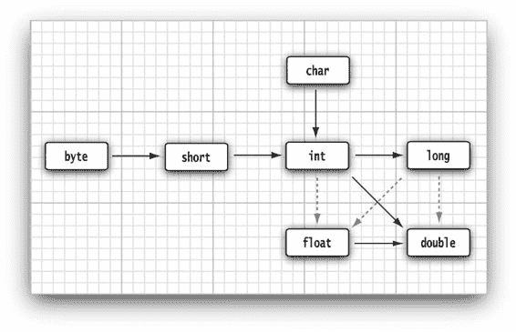 图 3.1: 数值类型之间的转换

图 3.1 中的实线箭头表示无信息的转换。虚线箭头表示可能会丢失精度的转换。例如，像`123456789`这样的整数超过了`float`的表示范围。当整数转换为`float`时，结果的大小正确，但丢失了精度。

```
int n = 123456789;
float f = n; // f 为 1.2345679E8
```

当两个值与二进制运算符结合时（例如`n + f`，其中`n`是整数`f`是浮点数），在执行之前，两个操作数都会转换为公共类型。

- 如果其中一个操作是`double`，另一个将转换为`double`。

- 否则，如果其中一个操作是`float`，另一个将转换为`float`。

- 否则，如果其中一个操作是`long`，另一个将转换为`long`。

- 否则，两个操作数都将转换为`int`。

现在，变量`nx`的值为`9`，因为将浮点数强制转换为整数会丢弃小数部分。

如果你想将浮点数四舍五入到整数整数（这在大多数情况下更有用的操作），请使用`Math.round`方法：

```
double x = 9.997;
int nx = (int) Math.round(x);
```

现在，变量`nx`的值为`10`。在调用`round`时，你仍然需要使用强制转换`(int)`。这是因为`round`方法的返回值是一个`long`，而`long`只能通过显式强制转换才能赋值给`int`，因为存在信息丢失的可能性。

 注意事项

如果你尝试将一种类型的数字强制转换为超出目标类型范围的另一种类型，结果将是一个具有不同数值的截断数字。例如，`(byte) 300`实际上是`44`。

 C++ 注意

你不能在`boolean`值与任何数值类型之间进行强制转换。这种约定防止了常见的错误。在极少数需要将`boolean`值转换为数字的情况下，你可以使用条件表达式，例如`b ? 1 : 0`。

### 3.5.7. 括号和运算符层级

下一页的表 3.4 显示了运算符的优先级。如果不使用括号，操作将按照所示的层级顺序执行。同一层级的运算符从左到右处理，但表所示的右结合运算符除外。例如，`&&`的优先级高于`||`，因此表达式：

```
a && b || c
```

表 3.4. 运算符优先级

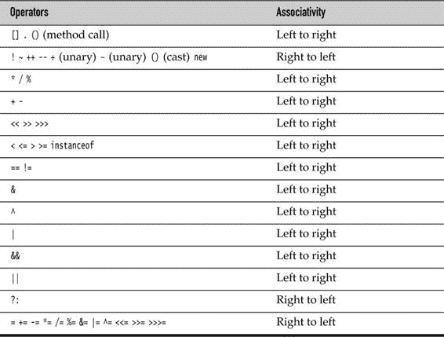

意味着

```
(a && b) || c
```

由于`+=`从右到左结合的，表达式：

```
a += b += c
```

意味着

```
a += (b += c)
```

也就是说，`b += c`的值（即`b`相加后的值）被加到`a`上。

 C++ 注意

与 C 或 C++ 不同，Java 没有逗号运算符。然而，你可以在`for`语句的第一个和第三个槽位中使用逗号分隔的表达式列表。

### 3.5.8. 枚举类型

有时，变量应该只持一组受限的值。例如，你可能销售四种尺寸的衣服或披萨：小号、中号、大号和特大号。当然，你可以将这些尺寸编码为整数`1`、`2`、`3`、`4`或字符`S`、`M`、`L`和`X`。但那是一个容易出错的设置。变量持有错误值（如`0`或`m`）太容易了。每当出现这种情况时，你都可以定义自己的枚举类型。枚举类型具有有限数量的命名值。例如：

```
enum Size { SMALL, MEDIUM, LARGE, EXTRA_LARGE };
```

现在你可以声明这种类型的变量：

```
Size s = Size.MEDIUM;
```

类型`Size`的变量只能持有类型声明中列出的值之一，或者表示变量未设置任何值的特殊值`null`。

我们将在第 5 章中更详细地讨论枚举类型。

### 3.6. 字符串

从概念上说，Java 字符串是 Unicode 字符序列。例如，字符串`"Java\u2122"`由五个 Unicode 字符 J、a、v、a 和 ™ 组成。Java 没有内置的字符串类型。相反，标准 Java 库包含一个预定义的类，自然地被称为`String`。每个带引号的字符串都是`String`类的实例：

```
String e = ""; // 一个空字符串
String greeting = "Hello";
```

#### 3.6.1. 子字符串

你可以使用`String`类的`substring`方法从较大的字符串中提取子字符串。例如，

```
String greeting = "Hello";
String s = greeting.substring(0, 3);
```

创建了一个由字符`"Hel"`组成的字符串。

`substring`的第二个参数是你不想复制的起始。在我们案例中，我们想要复制位置 0、1 和 2（从位置 0 到位置 2 包含）。按照`substring`的计数方式，这意味着从位置 0（包含）到位置 3（不包含）。


`substring` 工作方式有一个优势：计算子字符串的长度很容易。字符串 `s.substring(a, b)` 的长度始终是 `b - a`。例如，子字符串 `"Hel"` 的长度为 `3 - 0 = 3`。

### 3.6.2. 拼接

Java 与大多数编程语言一样，允许你使用 `+` 来连接（拼接）两个字符串。

```java
String expletive = "Expletive";
String PG13 = "deleted";
String message = expletive + PG13;
```

之前的代码将变量 `message` 设置为字符串 `"Expletivedeleted"`。由于 `+` 运算符连接了字符串，这正如你预期的那样。例如：

```java
int age = 13;
String rating = "PG" + age;
```

将 `rating` 设置为 `"PG13"`。这种拼接在输出语句中非常常见。例如：

```java
System.out.println("The answer is " + answer);
```

这正如你预期的那样，并打印出 `The answer is 42`。由于 `+=` 从右到左结合，例如：

```java
String s = "Hello";
s += " World";
```

将 `s` 设置为 `"Hello World"`。

当你将 `greeting` 替换为另一个字符串时，Java 代码大致执行以下操作：

```java
char* temp = malloc(6);
strncpy(temp, greeting, 3);
strncpy(temp + 3, "p!", 3);
greeting = temp;
```

当然，现在 `greeting` 指向字符串 `"Help!"`。即使是最经验丰富的 C 程序员也承认，Java 的语法比一串的 `strncpy` 调用要愉快得多。但如果我们再次对 `greeting` 进行另一次赋值呢？

```java
greeting = "Howdy";
```

我们难道没有产生内存泄漏吗？毕竟，原始字符串分配在堆上。幸运的是，Java 具有自动垃圾回收机制。如果一个内存块不再被需要，它最终会被回收。

如果你是一名 C++ 程序员并使用 ANSI C++ 定义的 `string` 类，那么你对 Java 的 `String` 类型会感到熟悉得多。C++ `string` 对象也会执行内存的自动分配和释放。内存管理是通过构造函数、赋值运算符和析构函数显式执行的。然而，C++ 字符串是可变的——你可以修改字符串中的单个字符。

### 3.6.4. 字符串相等性测试

要测试两个字符串是否相等，请使用 `equals` 方法。表达式

`s.equals(t)`

如果字符串 `s` 和 `t` 相等，返回 `true`，否则返回 `false`。注意，`s` 和 `t` 可以是字符串变量也可以是字符串常量。例如，表达式

`"Hello".equals(greeting)`

完全合法。要测试两个字符串除字母大小写区别外是否相同，请使用 `equalsIgnoreCase` 方法。

`"Hello".equalsIgnoreCase("hello")`

不要使用 `==` 运算符来测试两个字符串是否相等！它只确定字符串是否存储在相同的位置。当然，如果字符串在相同的位置，它们必须是相等的。但完全可以在不同的地方存储多个相同字符串的副本。

```java
String greeting = "Hello"; //将 greeting 初始化为字符串

if (greeting == "Hello") . . .
    // 可能为真

if (greeting.substring(0, 3) == "Hel") . . .
    // 可能为假
```

如果虚拟机总是安排让相同的字符串共享，那么你就可以使用 `==` 运算符来测试相等性。但只有字符串常量会被共享，而不是通过 `+` 或 `substring` 等操作结果得到的字符串。因此，永远不要使用 `==` 来比较字符串，否则你的程序可能会出现最糟糕的 bug——一种似乎随机发生的间歇性 bug。

**C++ 注意**

如果你习惯了 C++ 的 `string` 类，必须特别小心相等性测试。C++ `string` 类重载了 `==` 运算符来测试字符串内容的相等性。遗憾的是，Java 特意让字符串具有与数值类型相同的“外观和感觉”，但又让字符串在相等性测试中表现得像指针。语言设计者本可以为字符串重新定义 `==`，就像他们对 `+` 做了特殊安排一样。唉，每种语言都有自己的不一致之处。

C 程序员从不使用 `==` 比较字符串，而是使用 `strcmp`。Java 的 `compareTo` 方法是 `strcmp` 的完全对应物。你可以使用

```java
if (greeting.compareTo("Hello") == 0) . . .
```

但似乎使用 `equals` 更加清晰。

### 3.6.5. 空字符串和 null 字符串

空字符串 `""` 是长度为 `0` 的字符串。你可以通过调用以下代码来测试字符串是否为空

```java
if (str.length() == 0)
```

或

```java
if (str.equals(""))
```

空字符串是一个 Java 对象，它持有字符串长度（即 `0`）和空内容。然而，`String` 变量还可以持有一个特殊值，即 `null`，表示当前没有对象与该变量关联。（关于 `null` 的更多信息请参见第 4 章）。要测试字符串是否为 `null`，使用条件：

```java
if (str == null)
```

有时，你需要测试字符串既不是 `null` 也为空。这时使用条件：

```java
if (str != null && str.length() != 0)
```

你需要先测试 `str` 是否为 `null`。正如你将在第 4 章中看到的，在 `null` 值上调用方法是错误的。

### 3.6.6. 代码点和代码单元

Java 字符串实现为 `char` 值的序列。正如我们在第 3.3.3 节中讨论的，第 49 页的 `char` 类型，`char` 数据类型是用于表示 UTF-16 编码中 Unicode 代码点的代码单元。最常用的 Unicode 字符可以用单个代码单元表示。补充字符需要一对代码单元。

`length` 方法产生给定字符串在 UTF-16 编码下所需的代码单元数量。

返回指定位置处的代码单元。除非你对低级代码单元感兴趣，否则你可能不想调用此方法。

- `int codePointAt(int index)` **5.0**

返回起始或结束于指定位置的代码点。

- `int offsetByCodePoints(int startIndex, int cpCount)` **5.0**

返回距离 `startIndex` 处的代码点偏移 `cpCount` 个代码点的索引。

- `int compareTo(String other)`

如果字符串在字典序上早于 `other`，则返回负值；如果字符串在字典序上晚于 `other`，则返回正值；如果两个字符串相等，则返回 `0`。

- `boolean endsWith(String suffix)`

如果字符串以 `suffix` 结尾，则返回 `true`。

- `boolean equals(Object other)`

如果字符串等于 `other`，则返回 `true`。

- `boolean equalsIgnoreCase(String other)`

如果字符串等于 `other`（不区分大小写），则返回 `true`。

- `int indexOf(String str)`

- `int indexOf(String str, int fromIndex)`

- `int indexOf(int cp)`

- `int indexOf(int cp, int fromIndex)`

返回从索引 `0` 或 `fromIndex` 开始的第一个等于字符串 `str` 或代码点 `cp` 的子串起始位置；如果 `str` 不在此字符串中出现，则返回 `-1`。

- `int lastIndexOf(String str)`

- `int lastIndexOf(String str, int fromIndex)`

- `int lastindexOf(int cp)`

- `int lastindexOf(int cp, int fromIndex)`

返回从字符串末尾或 `fromIndex` 开始的最后一个等于字符串 `str` 或代码点 `cp` 的子串起始位置。

- `int length()`

返回字符串的长度。

- `int codePointCount(int startIndex, int endIndex)` **5.0**

返回 `startIndex` 到 `endIndex - 1` 之间的代码点数量。未配对的代理项被视为代码点。

- `String replace(CharSequence oldString, CharSequence newString)`

返回一个新字符串，该字符串是通过将字符串中所有匹配 `oldString` 的子串替换为 `newString` 得到的。你可以为 `CharSequence` 参数提供 `String` 或 `StringBuilder` 对象。

- `boolean startsWith(String prefix)`

如果字符串以 `prefix` 开头，则返回 `true`。

- `String substring(int beginIndex)`

- `String substring(int beginIndex, int endIndex)`

返回一个新字符串，它由从 `beginIndex` 到字符串末尾或 `endIndex - 1` 的所有代码单元组成。

- `String toLowerCase()`

返回一个新字符串，包含原始字符串中的所有字符，并将大写字母转换为小写字母。

- `String toUpperCase()`

返回一个新字符串，包含原始字符串中的所有字符，并将小写字母转换为大写字母。

- `String trim()`

返回一个新字符串，通过消除原始字符串中所有的前导和尾随空白得到。

### 3.6.8. 阅读在线 API 文档

正如你所看到的，`String` 类有许多方法。此外，标准库中还有数千个类，并且有更多的方法。要记住所有有用的类和方法显然是不可能的。因此，熟悉在线 API 文档至关重要，它可以让你查询标准库中的所有类和方法。API 文档是 JDK 的一部分。它是 HTML 格式。将你的浏览器指向 JDK 安装目录下的 `docs/api/index.html` 子目录（图 3.2）。

图 3.2. API 文档的三个面板

屏幕被分为三个帧。左上角的小帧显示所有可用的包。下方是一个较大的帧列出了所有类。点击任何类名，该类的 API 文档就会在右侧的大帧中显示（参见图 3.3）。例如，为了获取更多关于 `String` 类方法的信息，滚动第二个帧直到看到 `String` 链接，然后点击它。

图 3.3. String 类的描述

然后滚动右侧的帧直到到达所有方法的摘要，方法按字母顺序排序（参见图 3.4）。点击任何方法名以查看该方法的详细描述（参见图 3.5）。例如，如果你点击 `compareToIgnoreCase` 链接，你将获得 `compareToIgnoreCase` 方法的描述。

图 3.4. String 类的方法摘要

图 3.5. String 方法的详细描述

**提示**

现在就在浏览器中签签 `docs/api/index.html` 页面。

### 3.6.9. 构建字符串

有时你需要从较短的字符串构建字符串，例如按键或文件中的单词。使用字符串拼接将是低效的，因为每次拼接字符串时都会创建一个 `String` 对象。使用 `StringBuilder` 类可以避免这种情况。首先，创建一个空字符串（我们在第 4 章中讨论构造函数和 `new` 运算符）：

```java
StringBuilder builder = new StringBuilder();
```

每当你需要添加另一个部分时，调用 `append` 方法。

```java
builder.append(ch); // 添加单个字符
builder.append(str); // 添加字符串
```

当你完成字符串构建时，调用 `toString` 方法。你会得到一个包含 builder 内容的 `String` 对象

```java
String completedString = builder.toString();
```

**注意**

`StringBuilder` 类引入于 JDK 5.0。它的前身 `StringBuffer` 效率稍低，但允许多线程添加或删除字符。如果所有的编辑都在单线程中进行（通常如此），你应该使用 `StringBuilder`。这两个类的 API 是相同的。

以下 API 说明包含了 `StringBuilder` 类最重要的方法。

**java.lang.StringBuilder 5.0**

- `StringBuilder()` 创建一个空的字符串构建器。

- `int length()` 返回构建器或缓冲区的代码单元数量。

- `StringBuilder append(String str)` 添加字符串并返回 `this`。

- `StringBuilder append(char c)` 添加代码单元并返回 `this`。

- `StringBuilder appendCodePoint(int cp)` 添加代码点，将其转换为一个或两个代码单元并返回 `this`。

- `void setCharAt(int i, char c)` 将第 `i` 个代码单元设置为 `c`。

- `StringBuilder insert(int offset, String str)` 在位置 `offset` 处插入字符串并返回 `this`。

- `StringBuilder insert(int offset, char c)` 在位置 `offset` 处插入代码单元并返回 `this`。

- `StringBuilder delete(int startIndex, int endIndex)` 删除偏移量从 `startIndex` 到 `endIndex - 1` 的代码单元并返回 `this`。

- `String toString()` 返回一个与构建器或缓冲区内容相同的字符串。

### 3.7. 输入输出

为了让示例程序更有趣，我们希望接受输入并正确格式化程序输出。当然，现代程序使用 GUI 来收集用户输入。然而，编写这样的界面需要我们目前尚不具备的技术。由于首要任务是更熟悉 Java 编程语言，我们现在先用简单的控制台进行输入和输出。GUI 编程将在第 7 章到第 9 章中介绍。

#### 3.7.1. 读取输入

你已经看到，通过调用 `System.out.println` 很容易地向“标准输出流”（即控制台窗口）打印输出。从“标准输入流” `System.in` 读取内容就没有那么简单了。要读取控制台输入，你首先要构造连接到 `System.in` 的 `Scanner`：

```java
Scanner in = new Scanner(System.in);
```

（我们将在第 4 章中详细讨论构造函数和 `new` 运算符。）

现在你可以使用 `Scanner` 类的各种方法来读取输入了。例如，`nextLine` 方法读取一行输入。

```java
System.out.print("What is your name? ");
String name = in.nextLine();
```

在这里，我们使用 `nextLine` 方法是因为输入可能包含空格。要读取单个单词（由空白字符分隔），请调用

```java
String firstName = in.next();
```

要读取一个整数，使用 `nextInt` 方法。

```java
System.out.print("How old are you? ");
int age = in.nextInt();
```

同样，`nextDouble` 方法读取下一个浮点数。

显示列表 3.2 中的程序询问用户的姓名和年龄，然后打印如下消息：

```
Hello, Cay. Next year, you'll be 52
```

最后，注意程序开头的这一行：

```java
import java.util.*;
```


`Scanner` 类定义在 `java.util` 包中。每当你使用未在基础 `java.lang` 包中定义的类时，都需要使用 `import` 指令。我们将在第 4 章中详细地介绍包和 `import` 指令。

***

 事项

`Scanner` 类不适合从控制台读取密码，因为输入对任何人都是可见的。Java SE 6 引入了 `Console` 类专门用于此目的。要读取密码，请使用以下代码：

```java
Console cons = System.console();
String username = cons.readLine("User name: ");
char[] passwd = cons.readPassword("Password: ");
```

出于安全考虑，密码以字符数组而非字符串的形式返回。完成密码处理后，你应该立即用填充值覆盖数组元素。（数组处理将在本章稍后的部分讨论。）

使用 `Console` 对象进行输入处理不如使用 `Scanner` 那么方便。你一次只能读取一行输入。没有用于读取单个单词或数字的方法。

***

Listing 3.2. InputTest/InputTest.java

***

```java
 1  import java.util.*;
 2
 3  /**
 4    * 此程序演示了控制台输入。
 5    * @version 1.10 2004-02-10
 6    * @author Cay Horstmann
 7    */
 8  public class InputTest
 9  {
10      public static void main(String[] args)
11      {
12          Scanner in = new Scanner(System.in);
13
14          // 获取第一个输入
15          System.out.print("What is your name? ");
16          String name = in.nextLine();
17
18          // 获取第二个输入
19          System.out.print("How old are you? ");
20          int age = in.nextInt();
21
22          // 在控制台显示输出
23          System.out.println("Hello, " + name + ". Next year, you'll be " + (age + 1));
24      }
25  }
```

***

***

### `java.util.Scanner` **5.0**

- `Scanner(InputStream in)` 从给定的输入流构造一个 `Scanner` 对象。

- `String nextLine()` 读取下一行输入。

- `String next()` 读取下一个输入单词（由空白字符分隔）。

- `int nextInt()` 和 `double nextDouble()` 读取并转换表示整数或浮点数的下一个字符序列。

- `boolean hasNext()` 测试输入中是否还有另一个单词。

- `boolean hasNextInt()` 和 `boolean hasNextDouble()` 测试下一个字符序列是否表示整数或浮点数。

***

***

### `java.lang.System` **1.0**

- `static Console console()` **6** 如果可以通过控制台窗口与用户交互，则返回一个 `Console` 对象用于交互，否则返回 `null`。对于任何在控制台窗口中启动的程序，都可以使用 `Console` 对象。否则，其可用性取决于系统。

***

***

### `java.io.Console` **6**

- `static char[] readPassword(String prompt, Object... args)`

- `static String readLine(String prompt, Object... args)` 显示提示符并读取用户输入，直到输入行结束。`args` 参数可提供格式化参数，如下一节所述。

***

#### 3.7.2 输出格式化

你可以使用 `System.out.print(x)` 语句向控制台打印数字 `x`。该命令将打印具有该类型最大非零数字位数的 `x`。例如，

```java
double x = 10000.0 / 3.0;
System.out.print(x);
```

打印

3333.3333333333335

如果你想显示例如美元和分，这就会是一个问题。

在 Java 的早期版本中，格式化数字有点棘手。幸运的是，Java SE 5.0 带回了 C 库中经典的 `printf` 方法。例如，调用

```java
System.out.printf("%8.2f", x);
```

打印具有 8 个字符*字段宽度*和 2 个字符*精度*的 `x`。也就是说，打印输出包含一个前导空格和七个字符

```
3333.33
```

你可以提供多个参数给 `printf`。例如：

```java
System.out.printf("Hello, %s. Next year, you'll be %d", name, age);
```

每个以 `%` 字符开头的格式说明符都会替换为相应的参数。*转换字符*指示要格式化的值的类型：`f` 是浮点数，`s` 是字符串，`d` 是十进制整数。此外，你可以指定*标志*来控制格式化输出的外观。[表 3.5] 显示了所有转换符。例如，逗号标志会添加千分位分隔符。那就是，

```java
System.out.printf("%,.2f", 1000.0 / 3.0);
```

表 3.6 显示了所有标志。

表 3.6. printf 的标志


打印

```
3,333.33
```

可以使用多个标志，例如 `"%(f"` 将负数括在括号内。

***

 事项

你可以使用 `s` 转换格式任意对象。如果任意对象实现了 `Formattable` 接口，则调用对象的 `formatTo` 方法。否则，将调用 `toString` 方法将对象转换为字符串。我们将在第 5 章中讨论 `toString` 方法，并在第 6 章中讨论接口。

***

你可以使用静态 `String.format` 方法创建格式化字符串而不打印它：

```java
String message = String.format("Hello, %s. Next year, you'll be %d", name, age);
```

虽然我们直到第 4 章才详细描述 `Date` 类型，但为了完整性，我们确实简要讨论了 `printf` 方法的日期时间格式化选项。使用双字母格式，以 `t` 开头并以表 3.7 中的字母结尾；例如，

```java
System.out.printf("%tc", new Date());
```

表 3.7. 日期和时间转换字符


打印当前日期和时间的格式如下

```
Mon Feb 09 18:05:19 PST 2004
```

正如你从表 3.7 中看到的，某些格式只产生给定日期的部分——例如仅限天或仅限月份。如果你必须多次提供日期来格式化每个部分，那将有点傻。因此，格式字符串可以指示要格式化的参数的*索引*。索引必须紧跟在 `%` 之后，并以 `$` 终止。例如，

```java
System.out.printf("%1$s %2$tB %2$te, %2$tY", "Due date:", new Date());
```

输出如下：

Due date: February 9, 2004

或者，你可以使用 `<` 标志。它表示再次使用与前一个格式说明中相同的参数。也就是说，该语句

```java
System.out.printf("%s %tB %<te, %<tY", "Due date:", new Date());
```

产生的输出与前述语句相同。

***

 注意事项

参数索引值从 1 开始，而不是从 0：`%1$...` 格式化第一个参数。这避免了与 `0` 标志的混淆。

***

你现在已经看到了 `printf` 方法的所有特性。图 3.6 显示了格式占位符的语法图。

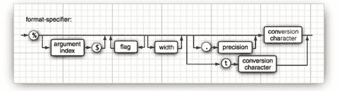

图 3.6 格式占位符语法

***

 注意事项

许多格式规则是`特定区域的`。例如，在德国，分组分隔符是点而不是逗号，周一的格式化为 Montag。你将在第二卷第 5 章中看到如何控制应用程序的国际行为。

***

### 3.7.3. 文件输入与输出

要从文件读取，按所示构造 `Scanner` 对象：

```java
Scanner in = new Scanner(Paths.get("myfile.txt"));
```

如果文件名包含反斜杠，请记住用额外的反斜杠对每一个进行转义：`"c:\\mydirectory\\myfile.txt"`。

现在你可以使用我们已经描述过的任何 `Scanner` 方法从文件中读取内容。

要写入文件，请构造 `PrintWriter` 对象。在构造函数中，只需提供文件名即可：

```java
PrintWriter out = new PrintWriter("myfile.txt");
```

如果文件不存在，则会创建。你可以像打印到 `System.out` 时一样使用 `print`、`println` 和 `printf` 命令。

***

 注意事项

你可以使用字符串参数构造 `Scanner`，但扫描器会将该字符串视为数据而非文件名。例如，如果你调用

```java
Scanner in = new Scanner("myfile.txt"); // 错误
```

那么扫描器将看到十个字符数据：`'m'`、`'y'`、`'f'` 等。这可能不是这种情况下的预期。

***

***

 注意事项

当你指定相对文件名时，例如 `"myfile.txt"`、`"mydirectory/myfile.txt"` 或 `"../myfile.txt"`，文件是相对于启动 Java 虚拟机的目录的。如果你从命令行 shell 执行程序，通过执行

```bash
java MyProg
```

那么起始目录就是命令行 shell 的当前目录。然而，如果你使用集成开发环境（IDE），则起始目录由 IDE 控制。你可以通过此调用找到目录位置：

```java
String dir = System.getProperty("user.dir");
```

如果在查找文件时遇到困难，请考虑使用绝对路径名称，例如 `"c:\\mydirectory\\myfile.txt"` 或 `"/home/me/mydirectory/myfile.txt"`。

***

正如你所看到的，访问文件就像使用 `System.in` 和 `System.out` 一样简单。但有一个陷阱：如果你使用一个不存在的文件构造 `Scanner`，或使用一个无法创建的文件名构造 `PrintWriter`，就会发生异常。Java 编译器认为这些异常比“除以零”异常更严重，例如。在第 11 章中，你将学习处理异常的各种方法。现在，你只需告诉编译器你已经意识到可能发生“输入/输出”异常。你通过在给 `main` 方法上标记 `throws` 子句来实现，如下所示：

```java
public static void main(String[] args) throws IOException {
    // ...
}
```

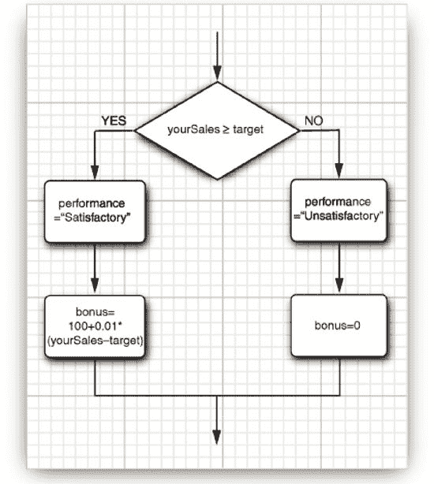

### 图 3.8. if/else 语句的流程图

例如：

```java
if (yourSales >= target)
{
    performance = "Satisfactory";
    bonus = 100 + 0.01 * (yourSales - target);
}
else
{
    performance = "Unsatisfactory";
    bonus = 0;
}
```

`else` 部分总是可选的。一个 `else` 会与最近的 `if` 组合在一起。因此，在语句

`if (x <= 0) if (x == 0) sign = 0; else sign = -1;`

中，`else` 属于第二个 `if`。当然，使用大括号来明确代码是一个好主意：

```java
if (x <= 0) { if (x == 0) sign = 0; else sign = -1; }
```

重复的 `if . . . else if . . .` 备选方案很常见（参见图 3.9）。例如：

```java
if (yourSales >= 2 * target)
{
    performance = "Excellent";
    bonus = 1000;
}
else if (yourSales >= 1.5 * target)
{
    performance = "Fine";
    bonus = 500;
}
else if (yourSales >= target)
{
    performance = "Satisfactory";
    bonus = 100;
}
else
{
    System.out.println("You're fired");
}
```

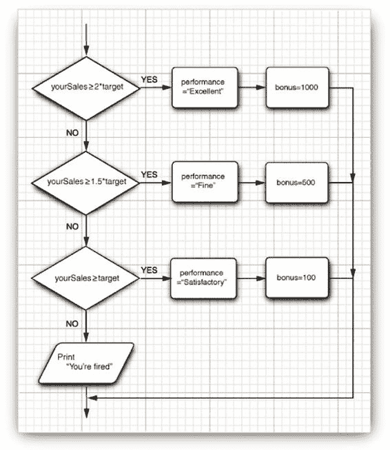

### 图 3.9. if/else if（多分支）的流程图

#### 3.8.3 循环

`while` 循环在条件为 `true` 时执行语句（该语句可能是一个块语句）。其通用形式为

`while (condition) statement`

如果条件在开始时为 `false`，则 `while` 循环将永远不会执行（参见图 3.10）。

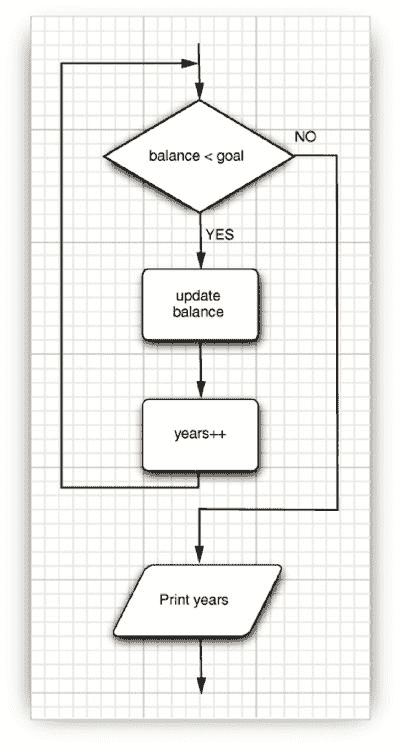

### 图 3.10. while 语句的流程图

代码列表 3.3 中的程序确定了为你辛苦赚来的退休金储蓄特定金额需要多长时间，假设你每年存款相同金额，且这些资金按指定的利率收益。

在示例中，我们在循环体中增加计数器并更新当前积累的金额，直到总额超过目标金额。

```java
while (balance < goal)
{
    balance += payment;
    double interest = balance * interestRate / 100;
    balance += interest;
    years++;
}
System.out.println(years + " years.");
```

（不要依赖此程序来规划你的退休生活。我们忽略了一些细节，如通货膨胀和你的预期寿命。）

`while` 循环在顶部进行测试。因此，块中的代码可能永远不会执行。如果你想确保块至少执行一次，将需要将测试移动到底部，使用 `do/while` 循环。它的语法如下：

`do statement while (condition);`

该循环执行语句（通常是一个块），然后才测试条件。如果条件为 `true`，它将重复语句并重新测试条件，以此类推。代码列表 3.4 中的代码计算你退休账户的新余额，然后询问你是否准备好退休：

```java
do
{
    balance += payment;
    double interest = balance * interestRate / 100;
    balance += interest;
    year++;
    // 打印当前余额
    . . .
    // 询问是否准备好退休并获取输入
    . . .
}
while (input.equals("N"));
```

只要用户回答 `"N"`，循环就会重复（参见图 3.11）。该程序是一个至少需要进入一次的循环良好示例，因为用户在决定余额是否足够退休之前，需要看到余额。

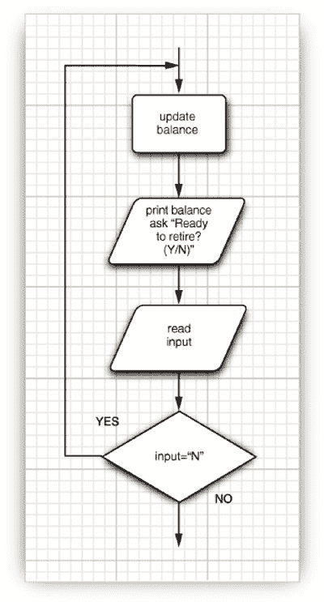

### 图 3.11. do/while 语句的流程图

#### 列表 3.3. Retirement/Retirement.java


```java
import java.util.*;

/**
 * 此程序演示了一个 while 循环。
 * @version 1.20 2004-02-10
 * @author Cay Horstmann
 */
public class Retirement
{
    public static void main(String[] args)
    {
        // 读取输入
        Scanner in = new Scanner(System.in);

        System.out.print("How much money do you need to retire? ");
        double goal = in.nextDouble();

        System.out.print("How much will you contribute every year? ");
        double payment = in.nextDouble();

        System.out.print("Interest rate in ");
        double interestRate = in.nextDouble();

        double balance = 0;
        int year = 0;
        String input;

        // 在未准备好退休前更新余额
        do
        {
            // 增加年度存款和收益
            balance += payment;
            double interest = balance * interestRate / 100;
            balance += interest;
            year++;

            // 打印当前余额
            System.out.printf("After year %d, your balance is %.2f%n", year, balance);

            // 询问是否准备好退休并获取输入
            System.out.print("Ready to retire? (Y/N) ");
            input = in.next();
        }
        while (input.equals("N"));
        System.out.println("You can retire in " + year + " years.");
    }
}
```

#### 列表 3.4. Retirement2.java

点击此处查看代码图片

```java
import java.util.*;

/**
 * 此程序演示了一个 do/while 循环。
 * @version 1.20 2004-02-10
 * @author Cay Horstmann
 */
public class Retirement2
{
    public static void main(String[] args)
    {
        // 读取输入
        Scanner in = new Scanner(System.in);

        System.out.print("How much money do you need to retire? ");
        double goal = in.nextDouble();

        System.out.print("How much will you contribute every year? ");
        double payment = in.nextDouble();

        System.out.print("Interest rate in ");
        double interestRate = in.nextDouble();

        double balance = 0;
        int year = 0;
        String input;

        // 在未准备好退休前更新余额
        do
        {
            // 增加年度存款和收益
            balance += payment;
            double interest = balance * interestRate / 100;
            balance += interest;
            year++;

            // 打印当前余额
            System.out.printf("After year %d, your balance is %.2f%n", year, balance);

            // 询问是否准备好退休并获取输入
            System.out.print("Ready to retire? (Y/N) ");
            input = in.next();
        }
        while (input.equals("N"));
        System.out.println("You can retire in " + year + " years.");
    }
}
```

#### 3.8.4 确定性循环

`for` 循环是一种支持由计数器或每次迭代更新的变量控制迭代的通用结构。如图 3.12 所示，以下循环在屏幕上打印 1 到 10。

```java
for (int i = 1; i <= 10; i++)
    System.out.println(i);
```

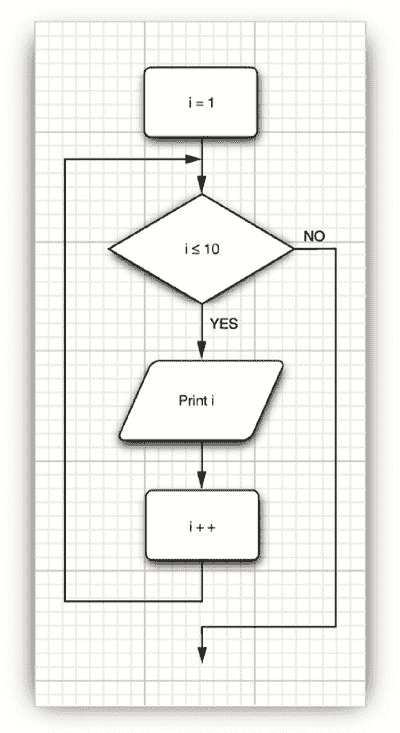

### 图 3.12. `for` 语句的流程图

`for` 语句的第一个槽通常持有计数器初始化。第二个槽给出一个在每次新循环之前测试的条件，第三个槽指定了如何更新计数器。

尽管 Java 像 C++ 一样在 `for` 循环的各个槽中使用任何表达式，但良好的良好成规则是，这三个槽应该只初始化、测试和更新同一个计数器变量。忽略这一规则可以编写出非常晦涩的循环。

即使在良好的范围内，也有许多可能性。例如，你可以拥有倒计数的循环：

点击此处查看代码图片

```java
for (int i = 10; i > 0; i--)
    System.out.println("Counting down . . . " + i);
System.out.println("Blastoff!");
```

---

### 注意

在循环中测试浮点数的相等性时要小心。像下面这样的 `for` 循环：

```java
for (double x = 0; x != 10; x += 0.1) . . .
```

可能永远不会结束。由于舍入误差，最终值可能无法精确达到。在这个示例中，`x` 从 `9.99999999999998` 跳变到 `10.09999999999998`，因为 `0.1` 没有精确的二进制表示。

当你在 `for` 语句的第一槽中声明变量时，该变量的作用范围将一直延伸到 `for` 循环体的结束。

```java
for (int i = 1; i <= 10; i++)
{
    . . .
}
// i 在这里不再定义
```

特别地，如果你在 `for` 语句内部定义了一个变量，则无法在循环外部使用它的值。因此，如果你想在 `for` 循环外部使用计数器的最终值，请务必在循环头之外声明它！

```java
int i;
for (i = 1; i <= 10; i++)
{
    . . .
}
// i 在这里仍然定义
```

另一方面，你可以在不同的 `for` 循环中定义同名的变量：

```java
for (int i = 1; i <= 10; i++)
{
    . . .
}
. . .
for (int i = 11; i <= 20; i++) // 定义另一个名为 i 的变量是允许的
{
    . . .
}
```

`for` 循环仅仅是 `while` 循环的一种方便快捷方式。例如：

```java
for (int i = 10; i > 0; i--)
    System.out.println("Counting down . . . " + i);
```

可以重写为：

```java
int i = 10;
while (i > 0)
{
    System.out.println("Counting down . . . " + i);
    i--;
}
```

`Listing 3.5` 展示了一个 `for` 循环的典型示例。该程序计算中彩票的概率。例如，如果你必须从 1 到 50 个数字中选出 6 个来中奖，那么就有 `(50 × 49 × 48 × 47 × 46 × 45)/(1 × 2 × 3 × 4 × 5 × 6)` 种可能的结果，因此你的机会是 15,890,700 分分之一。祝你好运！

`Listing 3.5. LotteryOdds/LotteryOdds.java`

```java
import java.util.*;

/**
 * 此程序演示了 for 循环。
 * @version 1.20 2004-02-10
 * @author Cay Horstmann
 */
public class LotteryOdds
{
    public static void main(String[] args)
    {
        Scanner in = new Scanner(System.in);

        System.out.print("How many numbers do you need to draw? ");
        int k = in.nextInt();

        System.out.print("What is the highest number you can draw? ");
        int n = in.nextInt();

        /*
         * 计算二项系数 n*(n-1)*(n-2)*...*(n-k+1)/(1*2*3*...*k)
         */
        int lotteryOdds = 1;
        for (int i = 1; i <= k; i++)
            lotteryOdds = lotteryOdds * (n - i + 1) / i;

        System.out.println("Your odds are 1 in " + lotteryOdds + ". Good luck!");
    }
}
```

通常情况下，如果你从 `n` 个数中选出 `k` 个，会有若干种结果。接下来的 `for` 循环计算了这个值：

```java
int lotteryOdds = 1;
for (int i = 1; i <= k; i++)
    lotteryOdds = lotteryOdds * (n - i + 1) / i;
```

请参见 `Section 3.10.1, “for each Loop”` 了解关于 Java 5.0 添加到 Java 语言中的“广义 for 循环”（也称为“for each”循环）的描述。

### 3.8.5 多重选择——`switch` 语句

当你需要处理带有多个备选项的选择时，`if/else` 结构会变得繁琐。Java 有 `switch` 语句，它与 C 和 C++ 中的 `switch` 语句完全相同，包括所有的缺点。例如，如果你像 `Figure 3.13` 那样设置了一个包含四个备选项的菜单，你可以可以使用这样的代码：

```java
Scanner in = new Scanner(System.in);
System.out.print("Select an option (1, 2, 3, 4) ");
int choice = in.nextInt();
switch (choice)
{
    case 1:
        . . .
        break;
    case 2:
        . . .
        break;
    case 3:
        . . .
        break;
    case 4:
        . . .
        break;
    default:
        // 输入无效
        . . .
        break;
}
```

`Figure 3.13. switch 语句流程图` 执行从与选择值匹配的 `case` 标签开始，并持续到下一个 `break` 或 `switch` 结束。如果没有任何 `case` 标签匹配，则执行 `default` 子句。**注意**：如果你忘记在每个分支末尾添加 `break`，执行将会穿透到下一个分支。

```java
years++;
}
```

但注意，测试 `balance < goal` 在此版本中重复了两次。为了避免这种重复测试，一些程序员倾向于使用 `break` 语句。

与 C++ 不同，Java 也提供了 `break` 语句，允许你跳出多层嵌套循环。偶尔在深层嵌套的循环内部会发生奇怪的情况。在这种情况下，你可能想要完全跳出所有嵌套循环。仅仅通过在各种循环测试中添加额外的条件来实现该功能是不方便的。

这里有一个展示 `break` 语句工作的示例。注意，标签（label）必须位于你想要跳出的最外层循环之前，并且必须跟着一个冒号。

点击此处查看代码图片

```java
Scanner in = new Scanner(System.in);

int n;

read_data:

while (... ) // 此循环语句带有标签标记
{
    ...
    for (...) // 此内部循环没有标记
    {
        System.out.print("Enter a number >= 0: ");
        n = in.nextInt();
        if (n < 0) // 永远不应该发生——无法继续
            break read_data;
            // 跳出 read_data 循环
        ...
    }
}

// 此语句在执行标签 break 之后立即执行
if (n < 0) // 检查异常情况
{
    // 处理异常情况
}
else
{
    // 执行正常处理
}
```

如果输入无效，带标签 `break` 将跳到带标签块的末尾。与任何使用 `break` 语句一样，你随后需要测试循环是正常退出的，还是由于 `break` 退出的。

 备注

有趣的是，你可以将标签应用到任何语句，甚至是一个 `if` 语句或块语句，如下所示：

```java
label:

{
    ...
    if (condition) break label; // 退出块
    ...
}
// 当 break 语句执行时跳转到这里
```

因此，如果你渴望使用 `goto`，并且你可以在想要跳转的地方之前放置一个结束块，那么你就可以使用 `break` 语句！自然地，我们不建议这种方法。但请注意，你只能*跳出*块，永远不能*跳入*块。

最后，还有一个 `continue` 语句，它和 `break` 语句一样，会打破常规控制流。`continue` 语句将控制转移到最内层嵌套循环的头部。这里是一个示例：

```java
Scanner in = new Scanner(System.in);

while (sum < goal)
{
    System.out.print("Enter a number: ");
    n = in.nextInt();
    if (n < 0) continue;
    sum += n; // 如果 n < 0 则不执行
}
```

如果 `n < 0`，则 `continue` 语句立即跳转到循环头部，跳过当前迭代的剩余部分。

如果 `continue` 语句用于 `for` 循环中，它将跳转到 `for` 循环的“更新”部分。例如：

点击此处查看代码图片

```java
for (count = 1; count <= 100; count++)
{
    System.out.print("Enter a number, -1 to quit: ");
    n = in.nextInt();
    if (n < 0) continue;
    sum += n; // 如果 n < 0 则不执行
}
```

如果 `n < 0`，则 `continue` 语句跳转到 `count++` 语句。

还有一种带标签的 `continue` 语句，它跳转到带有匹配标签的循环头部。

 提示

许多程序员发现 `break` 和 `continue` 语句令人困惑。这些语句完全是可选的——你始终可以在不使用它们的情况下表达相同的逻辑。在书中，我们从不使用 `break` 或 `continue`。

### 3.9. 大数

如果基本整数和浮点数类型的精度不足，你可以转向 `java.math` 包中的两个实用类：`BigInteger` 和 `BigDecimal`。这些类用于处理具有任意长度数字序列的数字。`BigInteger` 类实现了任意精度的整数算术，`BigDecimal` 对浮点数也执行相同的操作。

使用静态的 `valueOf` 方法将普通数字转换为大数：

```java
BigInteger a = BigInteger.valueOf(100);
```


遗憾的是，你不能使用熟悉的数学运算符如`+`和`*`来组合大数。相反，你必须使用如`add`和`multiply`等方法。

点击此处查看代码图片。

```java
BigInteger c = a.add(b); // c = a + b
BigInteger d = c.multiply(b.add(BigInteger.valueOf(2))); // d = c * (b + 2)
```

 C++ 备注

与 C++ 不同，Java 没有运算符重载。`BigInteger`类的程序员没有方法使用`+`和`*`来组合大数。相反，你必须使用如`add`和`multiply`等方法。

点击此处查看代码图片。

```java
BigInteger c = a.add(b); // c = a + b
BigInteger d = c.multiply(b.add(BigInteger.valueOf(2))); // d = c * (b + 2)
```

（注：此处翻译如下）

如果基本整数和浮点数类型的精度不足，你可以转向`java.math`包中的两个实用类：`BigInteger`和`BigDecimal`。这些类用于处理具有任意长度数字序列的数字。`BigInteger`类实现了任意精度的整数算术，`BigDecimal`对浮点数也执行相同的操作。

使用静态的`valueOf`方法将普通数字转换为大数：

```java
BigInteger a = BigInteger.valueOf(100);
```

遗憾的是，你不能使用熟悉的数学运算符如`+`和`*`来组合大数。相反，你必须使用如`add`和`multiply`等方法。

点击此处查看代码图片。

```java
BigInteger c = a.add(b); // c = a + b
BigInteger d = c.multiply(b.add(BigInteger.valueOf(2))); // d = c * (b + 2)
```

> **纠正说明：** 提供的原始文本后半部分似乎包含了重复的英文说明或乱码。我根据前文逻辑完整地翻译了关于`break`、`continue`以及“3.9. 大数”的内容。
>
> 由于您提供的原始文本在`3.9`章节之后出现了大量重复和逻辑乱码，以下是针对**3.9. 大数**及其相关代码的质量翻译。

### 3.9. 大数

如果基本整数和浮点数类型的精度不足，你可以转向`java.math`包中的两个实用类：`BigInteger`和`BigDecimal`。这些类用于处理具有任意长度数字序列的数字。`BigInteger`类实现了任意精度的整数算术，`BigDecimal`对浮点数也执行相同的操作。

使用静态的`valueOf`方法将普通数字转换为大数：

```java
BigInteger a = BigInteger.valueOf(100);
```

遗憾的是，你不能使用熟悉的数学运算符如`+`和`*`来组合大数。相反，你必须使用如`add`和`multiply`等方法。

点击此处查看代码图片。

```java
BigInteger c = a.add(b); // c = a + b
BigInteger d = c.multiply(b.add(BigInteger.valueOf(2))); // d = c * (b + 2)
```

```java
int n = in.nextInt();

/*
 * compute binomial coefficient n*(n-1)*(n-2)*...*(n-k+1)/(1*2*3*...*k)
 */
BigInteger lotteryOdds = BigInteger.valueOf(1);

for (int i = 1; i <= k; i++)
    lotteryOdds = lotteryOdds.multiply(BigInteger.valueOf(n - i + 1)).divide(
        BigInteger.valueOf(i));

System.out.println("Your odds are 1 in " + lotteryOdds + ". Good luck!");
}
}
```

### 3.10. 数组

数组是一种存储相同类型值集合的数据结构。你通过整数索引`index`访问每个单独的值。例如，如果`a`是一个整数数组，那么`a[i]`就是数组中的第`i`个整数。

通过指定数组类型（元素类型后跟`[]`）和数组变量名来声明数组变量。例如，这里是整数数组`a`的声明：

```java
int[] a;
```

然而，此语句仅声明了变量`a`。它尚未用实际数组初始化`a`。使用`new`运算符来创建数组：

```java
int[] a = new int[100];
```

此语句声明并初始化了一个包含 100 个整数的数组。

数组的长度不需要是常量：`new int[n]`会创建一个长度为`n`的数组。

 注意

你可以通过以下方式之一​​​​定义数组变量：

```java
int[] a;
```

或：

```java
int a[];
```

大多数 Java 程序员更倾向于前者样式，因为它整洁地将类型`int[]`（整数数组）与变量名分开。

数组元素从 0 编号到 99（而不是 1 到 100）。一旦创建了数组，你就可以填充数组中的元素，例如使用循环：

```java
int[] a = new int[100];

for (int i = 0; i < 100; i++)
    a[i] = i; // 用数字 0 到 99 填充数组
```

当你创建一个数字数组时，所有元素都初始化为零。`boolean`数组初始化为`false`。对象数组初始化为特殊值`null`，这表示它们（尚未）持有任何对象。这会让初学者感到惊讶。例如：

```java
String[] names = new String[10];
```

这创建了一个包含十个字符串的数组，它们都是`null`。如果你想让数组持有空字符串，你必须提供它们：

```java
for (int i = 0; i < 10; i++) names[i] = "";
```

 注意

如果你构造了一个包含 100 个元素的数组，然后尝试访问元素`a[100]`（或任何在 0 ... 99 范围之外的索引），你的程序将以“数组索引越界”（array index out of bounds）异常终止。

要找到数组的元素个数，使用`array.length`。例如：

```java
for (int i = 0; i < a.length; i++)
    System.out.println(a[i]);
```

一旦创建了数组，你就无法更改其大小（尽管你当然可以更改单个数组元素）。如果你在程序运行时经常需要扩展数组的大小，你应该使用另一种名为`array list`的数据结构。（有关 array lists 的更多信息请参见第 5 章。）

#### 3.10.1. “for each”循环

Java 有一种强大的循环结构，允许你遍历数组（或任何其他元素集合）中的每个元素，而无需处理索引值。

增强型`for`循环：

```java
for (variable : collection) statement
```

它将给定的变量设置为集合中的每个元素，然后执行语句（当然，可以是一个块）。`collection`表达式必须是一个数组或实现了`Iterable`接口的类对象，例如`ArrayList`。我们在第 5 章中讨论 array lists。

`for each`循环更简洁且更不容易出错。例如：

```java
for (int element : a)
    System.out.println(element);
```

实际上，`for each`循环更简洁且更不容易出错。例如：

```java
for (int element : a)
    System.out.println(element);
```

在 Java 中，`[]`操作符被预定义用于执行边界检查。此外，这里没有指针算术——你无法增加`a`来指向数组中的下一个元素。

### 3.10.4. 命令行参数

你已经见过一个 Java 数组重复出现几次的示例了。每个 Java 程序都有一个带有`String[] args`参数的`main`方法。该参数表示`main`方法接收一个字符串数组——即在命令行上指定的参数。

例如，考虑以下程序：

```java
public class Message
{
    public static void main(String[] args)
    {
        if (args[0].equals("-h"))
            System.out.print("Hello,");
        else if (args[0].equals("-g"))
            System.out.print("Goodbye,");
        // 打印其他的命令行参数
        for (int i = 1; i < args.length; i++)
            System.out.print(" " + args[i]);
        System.out.println("!");
    }
}
```

如果程序通过如下方式调用：

`java Message -g cruel world`

那么`args`数组包含以下内容：

- `args[0]`：`"-g"`
- `args[1]`：`"cruel"`
- `args[2]`：`"world"`

程序打印消息：

```text
Goodbye, cruel world!
```

 C++ 注意

在 Java 程序的`main`方法中，程序的名称并不存储在`args`数组中。例如，当你从命令行启动程序时：

`java Message -h world`

那么`args[0]`将是`"-h"`而不是`"Message"`或`"java"`。

### 3.10.5. 数组排序

要对数字数组排序，你可以使用`Arrays`类中的其中一个`sort`方法：

```java
int[] a = new int[10000];
...
Arrays.sort(a);
```

该方法使用了调优版本的快速排序（QuickSort）算法，该算法声称在大多数数据集上都非常高效。`Arrays`类还提供了其他用于数组的便利方法，这些包含在本节末尾的 API 注释中。

Listing 3.7 中的程序展示了数组的用法。该程序为彩票游戏绘制一组随机数字组合。例如，如果你玩“从 49 个中选 6 个”的彩票，程序可能会打印如下：

> 下注以下组合。它将让你富有！
>
> 4
>
> 7
>
> 8
>
> 19
>
> 30
>
> 44

为了选择这样一组随机数字，我们首先用值`1, 2, ..., n`填充数组`numbers`：

```java
int[] numbers = new int[n];
for (int i = 0; i < numbers.length; i++)
    numbers[i] = i + 1;
```

#### Listing 3.7. LotteryDrawing/LotteryDrawing.java

点击此处查看代码图片。

```java
import java.util.*;

/**
 * 此程序演示了数组操作。
 * @version 1.20 2004-02-10
 * @author Cay Horstmann
 */
public class LotteryDrawing
{
    public static void main(String[] args)
    {
        Scanner in = new Scanner(System.in);

        System.out.print("你需要抽取多少个数字？ ");
        int k = in.nextInt();

        System.out.print("你可以抽取的最大数字是多少？ ");
        int n = in.nextInt();

        // 用数字 1 2 3 ... n 填充数组
        int[] numbers = new int[n];
        for (int i = 0; i < numbers.length; i++)
            numbers[i] = i + 1;

        // 抽取 k 个数字并将它们放入第二个数组
        int[] result = new int[k];
        for (int i = 0; i < result.length; i++)
        {
            // 在 0 到 n - 1 之间产生一个随机索引
            int r = (int) (Math.random() * n);
            // 选取随机位置的元素
            result[i] = numbers[r];
            // 将最后一个元素移动到随机位置
            numbers[r] = numbers[n - 1];
            n--;
        }

        // 打印排序后的数组
        Arrays.sort(result);
        System.out.println("下注以下组合。它将让你富有!");
        for (int r : result)
            System.out.println(r);
    }
}
```

第二个数组存储了抽取的数字：

`int[] result = new int[k];`

现在我们抽取`k`个数字。`Math.random`方法返回一个在`0`（包含）和`1`（不包含）之间的随机浮点数。通过将结果乘以`n`，我们得到了一个在`0`到`n – 1`之间的随机数。

`int r = (int) (Math.random() * n);`选取随机位置的元素：

`result[i] = numbers[r];`

将最后一个元素移动到随机位置：

`numbers[r] = numbers[n - 1];`

`n--;`

打印排序后的数组：

`Arrays.sort(result);`

`System.out.println("下注以下组合。它将让你富有!");`

`for (int r : result)`

```java
System.out.println(r);
```

示例程序存储了一个用于利率的一维数组`interest`，以及一个用于账户余额的二维数组`balances`，其中每一行和每一列分别对应一个年份和一种利率。我们用初始余额初始化了数组的第一行：

点击此处查看代码图像。

```java
for (int j = 0; j < balances[0].length; j++)
    balances[0][j] = 10000;
```

然后我们按照如下方式计算其他行：

点击此处查看代码图像。

```java
for (int i = 1; i < balances.length; i++)
{
    for (int j = 0; j < balances[i].length; j++)
    {
        double oldBalance = balances[i - 1][j];
        double interest = . . .;
        balances[i][j] = oldBalance + interest;
    }
}
```

Listing 3.8 显示了完整的程序。

---

 **注意**

“增强型 for”循环不会自动遍历二维数组中的所有元素。相反，它遍历的是行，而每一行本身是一个一维数组。要访问二维数组`a`的所有元素，需要嵌套两个循环，如下：

```java
for (double[] row : a)
    for (double value : row)
        do something with value
```

---

 **提示**

要快速打印出二维数组元素的简单列表，请调用：

```java
System.out.println(Arrays.deepToString(a));
```

输出格式如下：

`[[16, 3, 2, 13], [5, 10, 11, 8], [9, 6, 7, 12], [4, 15, 14, 1]]`

---

### Listing 3.8. CompoundInterest/CompoundInterest.java

点击此处查看代码图像。

---


```java
1  /**
2    * 此程序演示了如何将表格数据存储在二维数组中。
3    * @version 1.40 2004-02-10
4    * @author Cay Horstmann
5    */
6  public class CompoundInterest
7  {
8      public static void main(String[] args)
9      {
10         final double STARTRATE = 10;
11         final int NRATES = 6;
12         final int NYEARS = 10;
13
14          // 将利率设置为 10 . . . 15%
15          double[] interestRate = new double[NRATES];
16          for (int j = 0; j < interestRate.length; j++)
17              interestRate[j] = (STARTRATE + j) / 100.0;
18
19          double[][] balances = new double[NYEARS][NRATES];
20
21          // 将初始余额设置为 10000
22          for (int j = 0; j < balances[0].length; j++)
23              balances[0][j] = 10000;
24
25          // 计算未来几年的利息
26          for (int i = 1; i < balances.length; i++)
27          {
28              for (int j = 0; j < balances[i].length; j++)
29              {
30                  // 从上一行获取去年的余额
31                  double oldBalance = balances[i - 1][j];
32
33                  // 计算利息
34                  double interest = oldBalance * interestRate[j];
35
36                  // 计算今年的余额
37                  balances[i][j] = oldBalance + interest;
38              }
39          }
40          // 打印一行利率
41          for (int j = 0; j < interestRate.length; j++)
42              System.out.printf("%9.0f%%", 100 * interestRate[j]);
43              System.out.println();
44          // 打印余额表
45          for (double[] row : balances)
46          {
47              // 打印行
48              for (double b : row)
49                  System.out.printf("%10.2f", b);
50              System.out.println();
51          }
52      }
53  }
```

## 3.10.7 锯齿形数组（Ragged Arrays）

到目前为止，你看到的与其他编程语言没有太大区别。但背后其实有一些微妙的机制，你有时可以利用这一优势：Java 根本*没有*多维数组，只有一维数组。多维数组是通过伪成“数组的数组”来实现。

例如，前一个示例中的`balances`数组实际上是一个包含 10 个元素的数组，每个元素都是一个包含 6 个浮点数的数组（图 3.15）。


**图 3.15.** 二维数组

表达式`balances[i]`指向第`i`个子数组——即表格的第`i`行。它本身是一个数组，而`balances[i][j]`指向该数组的第`j`个元素。

由于数组行是可以单独访问的，你实际上可以交换它们！

```java
double[] temp = balances[i];
balances[i] = balances[i + 1];
balances[i + 1] = temp;
```

创建“锯齿形”数组——即不同行长度不同的数组也很容易。这里有一个标准示例。让我们创建一个数组，其中第`i`行第`j`列的元素等于“从`i`个数中选择`j`个数”抽票的可能结果数。

```
1
1 1
1 2 1
1 3 3 1
1 4 6 4 1
1 5 10 10 5 1
1 6 15 20 15 6 1
```

由于`j`永远不会大于`i`，该矩阵是三角形的。第`i`行有`i + 1`个元素。（我们允许选择 0 个元素；有一种方法做出这种选择）。要构建这个锯齿形数组，首先分配持有行的数组。

```java
int[][] odds = new int[NMAX + 1][];
```

接下来，分配行。

```java
for (int n = 0; n <= NMAX; n++)
    odds[n] = new int[n + 1];
```

现在数组已经分配完毕，只要不越界，我们就可以正常地访问元素。

```java
for (int n = 0; n < odds.length; n++)
    for (int k = 0; k < odds[n].length; k++)
        // 访问 odds[n][k]
```

Listing 3.9 给出了完整的程序。Listing 3.9. LotteryArray/LotteryArray.java

```java
1  /**
2    * 此程序演示了锯齿形数组。
3    * @version 1.40 2004-02-10
4    * @author Cay Horstmann
5    */
6  public class LotteryArray
7  {
8      public static void main(String[] args)
9      {
10         final int NMAX = 10;
11
12         // 分配持有行的数组
13         int[][] odds = new int[NMAX + 1][];
14         for (int n = 0; n <= NMAX; n++)
15             odds[n] = new int[n + 1];
16
17         // 填充锯齿形数组
18         for (int n = 0; n < odds.length; n++)
19             for (int k = 0; k < odds[n].length; k++)
20             {
21                 /*
22                  * 组合系数 n*(n-1)*(n-2)**(n-k+1)/(1*2*3*...*k)
23                  */
24                 int lotteryOdds = 1;
25                 for (int i = 1; i <= k; i++)
26                     lotteryOdds = lotteryOdds * (n - i + 1) / i;
27
28                 odds[n][k] = lotteryOdds;
29             }
30
31         // 打印锯齿形数组
32         for (int[] row : odds)
33         {
34             for (int odd : row)
35                 System.out.printf("%4d", odd);
36             System.out.println();
37         }
38      }
39  }
```

***


**C++ 注意**

在 C++ 中，Java 的声明

```java
double[][] balances = new double[10][6]; // Java
```

不等同于

```cpp
double balances[10][6]; // C++
```

甚至不是

```cpp
double (*balances)[6] = new double[10][6]; // C++
```

相反，分配了一个十个指针的数组：

```cpp
double** balances = new double*[10]; // C++
```

然后，指针数组中的每个元素都被填充为一个包含六个数字的数组：

```cpp
for (i = 0; i < 10; i++)
    balances[i] = new double[6];
```

幸运的是，当你请求`new double[10][6]`时，这个循环是自动。当你需要锯齿形数组时，单独分配行数组。

***

你现在已经熟悉了 Java 语言的基础编程结构。下一章介绍面向对象编程。

## 方法参数

## 对象构造

## 包

## 类路径

## 文档注释

## 类设计提示

在本章中，我们将：

- 向你介绍面向对象编程；
- 向你展示如何创建属于标准 Java 库类的对象；以及
- 向你展示如何编写自己的类。

如果你没有面向对象编程的背景，你会希望仔细阅读本章。面向对象编程需要与过程化语言不同的思维方式。这种过渡并不总是容易的，但你确实需要熟悉一些对象概念，以便继续学习 Java。

对于经验丰富的 C++ 程序员来说，本章与上一章一样，提供了熟悉的信息；然而，两种语言之间存在足够的差异，你应该仔细阅读本章的后续部分。你会发现 C++ 笔记对这种过渡非常有帮助。

### 4.1 面向对象编程简介

面向对象编程（简称 OOP）是如今主流的编程范式，它取代了 20 世纪 70 代开发的“结构化”过程化编程技术。由于 Java 是面向对象的，你必须熟悉 OOP 才能高效地使用 Java。

一个面向对象的程序由对象组成。每个对象都有特定的功能（向用户暴露）和隐藏的实现。你程序中的许多对象将直接从库中“现成”获取；另一些则是定制的。是构建一个对象还是购买它可能取决于你的预算或时间。但基本上，只要对象满足你的规范，你就不在乎功能是如何实现的。

传统的结构化编程由设计一组用于解决问题的过程（或`algorithms`）组成。一旦确定了这些过程，传统的下一步是寻找存储存储的合适方法。这就是为什么 Pascal 语言的设计者尼克劳斯·沃特（Niklaus Wirth）将他著名的编程书籍命名为`Algorithms + Data Structures = Programs`（Prentice Hall, 1975）。注意，在沃特的标题中，算法在先，数据结构在后。这正模仿了当时程序员的工作方式：首先，他们决定处理数据的过程；然后，他们决定对数据施加什么结构以使处理更容易。OOP 反转了这一顺序：将数据放在首，然后寻找操作数据的算法。

对于小问题，将其分解为过程的方法非常有效。但对于更大的问题，对象更为合适。考虑一个简单的浏览器。它的实现可能需要 2000 个过程，所有这些过程都在操作一组全局数据。在面向对象的风格中，可能有 100 个类，每个类平均 20 个方法（见图 4.1）。这种结构对于程序员来说更容易理解。也更容易发现错误。假设某个特定对象的数据处于错误状态。在访问该数据项的 20 个方法中寻找罪祸首，比在 2000 个过程中寻找容易得多。

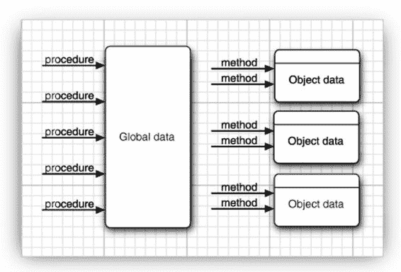

图 4.1 过程化编程与面向对象编程

#### 4.1.1 类

`class`是制造对象的模板或蓝图。将类想象成饼干模具。对象是饼干本身。当你从一个类`construct`一个对象时，被认为创建了该类的`instance`（实例）。

正如你所见，你在 Java 中编写的所有代码都在类内部。标准 Java 库提供了数千个类，用于用户界面设计、日期和日历以及网络编程等各种用途。尽管如此，在 Java 中你仍然必须创建自己的类来描述应用程序问题领域中的对象。

`Encapsulation`（封装，有时称为`information hiding`）是处理对象时的一个关键概念。形式上，封装简单地将数据和行为组合在一个包中，并向对象的用户隐藏实现细节。对象中的数据位称为其`instance fields`（实例字段），而操作数据的过程称为其`methods`（方法）。作为类实例的特定对象将具有其实例字段的具体值。这些值的集合是对象的当前`state`（状态）。每当你在对象上调用一个方法时，它的状态可能会发生变化。

使封装生效的关键是让方法`never`直接访问除自身之外的其他类的实例字段。程序应该`only`通过对象的`methods`与对象数据进行交互。封装是赋予对象“黑盒”行为的方式，这是实现重用和可靠性的关键。这意味着一个类可以完全改变它存储数据的方式，但只要它继续使用相同的方法来操作数据，其他对象就并不知道也不在乎。

当你开始在 Java 中编写自己的类时，OOP 的另一个原则会让这变得更简单：类可以通过`extending`（扩展）其他类来构建。事实上，Java 自带了一个名为`Object`的“宇宙超级类”。所有其他类都扩展这个类。你将学习更多关于`Object`类的知识。

当你扩展一个现有类时，新类将拥有你所扩展的类的所有属性和方法。然后你添加适用于你新类的方法和数据字段。

#### 4.1.2 对象

为了使用 OOP，你应该能够识别对象的三个关键特征：

- 对象的`behavior`（行为）——你能用这个对象做什么，或者可以对它应用哪些方法？
- 对象的`state`（状态）——当你调用这些方法时，对象如何反应？
- 对象的`identity`（标识）——如何将对象与其他可能有相同行为和状态的对象区分开来？

所有同一类的实例对象通过支持相同的`behavior`具有家族般的相似性。对象的行为由你可以调的方法定义。

接下来，每个对象都存储关于它当前状态的信息。这就是对象的`state`。对象的状态会随时间改变，但不会自发改变。对象的状态变化必须方法调用的结果。（如果对象的状态在没有调用方法的情况下改变，说明有人破坏了封装。）

然而，对象的状态并没有完全描述它，因为每个对象都有独特的`identity`。注意，同一类的实例对象在标识上`always`不同，在状态上`usually`不同。

这些关键特征可以相互影响。例如，对象的状态会影响它的行为。（如果订单是“已发货”或“已支付”，它可能会拒绝要求添加或删除项目的方法调用。相反，如果订单是“空的”，即尚未订购商品，它不应该允许自己发货。）

#### 4.1.3 识别类

在传统的过程化程序中，你从顶部的`main`函数开始过程。在设计面向对象的系统时，没有所谓的“顶部”，OOP 初学者往往不知道从哪里开始。答案是，识别你的类，然后为每个类添加方法。

识别类的一个简单经验是寻找问题分析中的名词。另一方面，方法对应于动词。

例如，在一个订单处理系统中，一些名词是：

- `Item`
- `Order`
- `Shipping address`
- `Payment`
- `Account`

这些名词可能会导出`Item`、`Order`等类。

接下来，寻找动词。项目（Items）被*添加*到订单（orders）中。订单被*发货*或*取消*。付款（Payments）被*应用*到订单中。对于每个动词，如“添加”、“发货”、“取消”或“应用”，你都要识别出执行该操作承担主要责任的对象。例如，当一个新项目被添加到订单时，订单对象应该是负责的那个对象，因为它知道如何存储和排序项目。也就是说，`add`应该是`Order`类的一个方法，并并接收一个`Item`对象作为参数。

当然，“名词和动词”仅仅是一条经验法则；只有通过经验才能帮助你在构建类时决定哪些名词和动词是重要的。

#### 4.1.4 类与类之间的关系

类之间最常见的关系有：

- *依赖*（Dependence）（“使用一个”/uses–a）
- *聚合*（Aggregation）（“拥有一个”/has–a）
- *继承*（Inheritance）（“是一个”/is–a）

*依赖*关系或“使用一个”关系是最明显的，也是最通用的。例如，`Order`类使用了`Account`类，因为`Order`对象需要访问`Account`对象来检查信用状态。但`Item`类并不依赖于`Account`类，因为`Item`对象永远不需要担心客户账户。因此，如果一个类的方法使用了或操作了另一个类的对象，那么该类就依赖于另一个类。

尽量减少相互依赖的类数量。关键点在于，如果类`A`不感知类`B`的存在，那么它对`B`的任何更改也不关心。（这意味着对`B`的更改不会给`A`引入错误。）在软件工程术语中，你希望减少类与类之间的*耦合*（coupling）。

*聚合*关系或“拥有一个”关系很容易理解，因为它是具体的；例如，一个`Order`对象包含了`Item`对象。包含意味着类`A`的对象包含了类`B`的对象。


**注意**


一些方法论者对聚合的概念表示蔑视，并于使用更通用的“关联”（association）关系。从建模的角度来看，这是可以理解的。但对于程序员来说，“拥有一个”关系非常有意义。我们喜欢使用聚合还有另一个原因：关联的标准表示法不那么清晰。见表 4.1。

**表 4.1 类的 UML 符号表示**

*继承*关系或“是一个”关系表示了更特化的类与更通用类之间的关系。例如，`RushOrder` 类继承自 `Order` 类。特化的 `RushOrder` 类具有处理优先级的特殊方法，以及计算费用的不同方法，但它的其他方法（如添加项目和计费）是从 `Order` 类继承而来的。通常，如果类 `A` 扩展了类 `B`，类 `A` 继承了 `B` 的方法，但具有更多能力。（我们将在下一章更详细地描述继承。）

许多程序员使用 UML（统一建模语言）符号来绘制*类图*，以描述类之间的关系。你可以在图 4.2 中看到此类图的示例。你将类画为矩形，将关系画为带有各种装饰的箭头。表 4.1 显示了最常见的 UML 风格。


**图 4.2 类图**

### 4.2 使用预定义类

在 Java 中，没有类你什么也做不了，你已经见过几个类在工作。然而，并不是所有的类都展示了面向对象的典型特征。例如，`Math` 类。你已经看到你可以使用 `Math` 类的方法，如 `Math.random()`，而不需要知道它们是如何实现的——你只需要知道名称和参数（如果有）。这就是封装的意义，它也适用于所有的类。但 `Math` 类*仅*封装了功能；它既不需要也不隐藏数据。由于没有数据，你就不需要担心创建对象和初始化它们的字段——根本没有！

在下一节中，我们将查看一个更典型的类，`Date` 类。你将看到如何构造对象以及调用该类的方法。

#### 4.2.1 对象和对象变量

要操作对象，你首先要构造它们并指定它们的初始状态。然后对对象应用方法。

在 Java 编程语言中，你使用*构造方法*（constructors）来构造新实例。构造方法是一种特殊的方法，其目的是构造和初始化对象。让我们来看一个例子。标准 Java 库包含了 `Date` 类。它的对象描述时间点，例如“1999 年 12 月 31 日 23:59:59 GMT”。

你可能在想：为什么用类来表示日期，而不是（像某些语言那样）使用内置类型？例如，Visual Basic 有内置的日期类型，程序员可以以 `6/1/1995` 的格式指定日期。从表面上看，这听起来很方便——程序员可以使用内置日期类型，而无需担心类。但实际上，Visual Basic 的设计有多合适？在某些地区，日期的格式是月/日/年，在另一些地区则是日/月/年。语言设计者真的有能力预见这些问题吗？如果他们做得不好，语言就会变成一个令人不快的混乱体，但不满的程序员对此无能为力。通过类，设计任务被交给了库的设计者。如果该类不完美，其他程序员可以轻松地编写自己的类来增强或替换系统类。（为了证明这一点：Java 日期库库有点混乱，一项重大重设计正在进行中；见 `http://jcp.org/en/jsr/detail?id=310`。）

构造方法的名称与类名相同。因此，`Date` 类的构造方法名为 `Date`。要构造一个 `Date` 对象，你将构造方法与 `new` 运算符结合如下：

```java
new Date()
```

这个表达式构造了一个新对象。该对象被初始化为当前的日期和时间。

如果你愿意，可以将对象传递给方法：

```java
System.out.println(new Date());
```

或者，你可以对刚刚构造的对象应用方法。`Date` 类的方法之一是 `toString()` 方法。该方法产生日期的字符串表示。以下是让你对新构造的 `Date` 对象应用 `toString()` 方法的方法：

```java
String s = new Date().toString();
```

在这两个例子中，构造的对象只使用了一次。通常，你希望保留构造的对象，以便继续使用它们。只需将对象存储在变量中：

```java
Date birthday = new Date();
```

图 4.3 显示了指向新构造对象的对象变量 `birthday`。


**图 4.3 创建新对象**

对象和对象变量之间存在重要的区别。例如，语句：

```java
Date deadline; // deadline 没有引用任何对象
```

定义了一个对象变量 `deadline`，它可以引用 `Date` 类型的对象。重要的是，变量 `deadline` *本身并不是一个对象*，而且实际上它还没有引用任何对象。此时你不能在该变量上使用任何 `Date` 方法。该句语句：

```java
s = deadline.toString(); // 尚未完成
```

会导致编译错误。

你必须先初始化 `deadline` 变量。你有两种选择。当然，你可以用一个新构造的对象来初始化变量：

```java
deadline = new Date();
```

你也可以将变量指向一个已存在的对象：

```java
deadline = birthday;
```

现在，两个变量都指向*同一个*对象（参见图 4.4）。

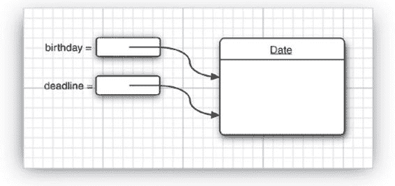

**图 4.4 指向同一个对象的对象变量**

重要的一点是，要意识到对象变量实际上并不包含一个对象。它只是*引用*一个对象。

在 Java 中，任何对象变量的值都是指向存储在其他地方对象的引用。`new` 操作符的返回值也是一个引用。如下所示的语句：

```java
Date deadline = new Date();
```

表达式 `new Date()` 创建了一个 `Date` 类型的对象，它的值是指向该新创建对象的引用。然后，该引用被存储在 `deadline` 变量中。

你可以显式地将对象变量设置为 `null`，表示它目前没有引用任何对象。

```java
deadline = null;
```

……

```java
if (deadline != null)
    System.out.println(deadline);
```

如果你对持有 `null` 的变量应用方法，就会发生运行时错误。

点击此处查看代码图像：

```java
birthday = null;
String s = birthday.toString(); // 运行时错误！
```

局部变量不会自动初始化为 `null`。你必须初始化它们，方法是通过调用 `new` 或将它们设置为 `null`。

---


**C++ 注意**

许多人错误地认为 Java 对象变量的行为像 C++ 引用。但在 C++ 中，没有空引用，且引用不能被赋值。你应该将 Java 对象变量类比为 C++ 中的*对象指针*。例如：

```java
Date birthday; // Java
```

这实际上等同于：

```cpp
Date* birthday; // C++
```

一旦你建立了这种联系，一切就迎刃有章了。当然，`Date*` 指针在通过调用 `new` 进行初始化之前是未初始化的。C++ 和 Java 的语法几乎相同。

```cpp
Date* birthday = new Date(); // C++
```

如果你将一个变量复制到另一个变量，那么两个变量都指向同一个日期——它们是指向同一个对象的指针。Java `null` 引用等同于 C++ 的 `NULL` 指针。

所有的 Java 对象都存放在堆上。当一个对象包含另一个对象变量时，它包含的只是指向另一个堆对象的指针。

在 C++ 中，指针让你感到紧张，因为它们非常容易出错。很容易创建错误的指针或搞乱内存管理。在 Java 中，这些问题就消失了。如果你使用未初始化的指针，运行时系统会可靠地生成运行时错误，而不是产生随机结果。你不需要担心内存管理，因为垃圾回收器会处理它。

C++ 付出了很大努力，通过支持拷贝构造函数和赋值运算符，允许实现能够自动复制自身的对象。例如，链表的副本是一个具有相同内容但拥有独立的一套链接的新链表。这使得设计出与内置类型具有相同拷贝行为的类成为可能。在 Java 中，你必须使用 `clone` 方法来获取对象的完整副本。

---

#### 4.2.2 Java 库中的 GregorianCalendar 类

在之前的示例中，我们使用了标准 Java 库部分的 `Date` 类。`Date` 类的实例有一个状态，即*一个特定的时间点*。

尽管在你在使用 `Date` 类时不需要知道这一点，但时间是由距离固定点（所谓的*纪元*）的毫秒数（正或负）表示的，该点是 UTC 1970 年 1 月 1 日 00:00:00。UTC 是协调世界时，是一种科学时间标准，在实际用途中它与更熟悉的 GMT（格林尼治标准时间）相同。

但事实证明，`Date` 类对于处理日期并不非常有用。Java 库的设计者认为，像“1999 年 12 月 31 日 23:59:59”这样的日期描述是一种任意约定，由*日历*决定。这种特定的描述遵循格列哥历，这是世界上大多数国家使用的日历。同一个时间点在中文或希伯来太阴历中的描述会截然不同，更不用说来自火星的客户使用的日历了。

---


**注意**

在人类历史上，各文明都在为了日历的设计而斗争，以为日期命名并为太阳和月亮周期带来秩序。关于世界各地日历的迷人解释，从法国革命历到玛雅长纪历，请参见 Nachum Dershowitz 和 Edward M. Reingold 著的《Calendrical Calculations》（Cambridge University Press, 2001）。

---

库的设计者决定将保持计时和为时间点命名的这两个关注点分开来。因此，标准 Java 库包含两个独立的类：表示时间点的 `Date` 类，以及用熟悉的日历表示法表示日期的 `GregorianCalendar` 类。事实上，`GregorianCalendar` 类继承自一个更通用的 `Calendar` 类，该类描述了日历的属性。标准 Java 库还包含了泰国历和日本皇历的实现。将时间测量与日历分离是良好的设计。`Date` 类只有少数方法可以允许你比较两个时间点。例如，`before` 和 `after` 方法可以告诉你一个时间点是否在另一个之前。

```java
if (today.before(birthday))
    System.out.println("还有时间去买礼物。");
```

实际上，`Date` 类有如 `getDay`、`getMonth` 和 `getYear` 等方法，但这些方法是*过时的*。当库设计者意识到这些方法应该在日历类中引入时，它们被标记为过时。你仍然可以在程序中使用它们，但如果你这样做，将会收到编译警告。避免使用过时方法是明智之举，因为它们可能会在未来的版本中被移除。

`GregorianCalendar` 类拥有比 `Date` 类多多的方法。特别是，它有几个实用的构造函数。表达式：

```java
new GregorianCalendar()
```

构造一个表示对象创建的时间的新对象。

你可以通过提供年、月、日来构造特定日期的午夜日历对象：

```java
new GregorianCalendar(1999, 11, 31)
```

奇怪的是，月份是从 `0` 开始计数的。因此，`11` 代表 12 月。为了更大的清晰，有像 `Calendar.DECEMBER` 这样的常量：

```java
new GregorianCalendar(1999, Calendar.DECEMBER, 31)
```

你还可以设置时间：

```java
new GregorianCalendar(1999, Calendar.DECEMBER, 31, 23, 59, 59)
```

当然，你通常会将构造好的对象存储在对象变量中：

```java
GregorianCalendar deadline = new GregorianCalendar(...);
```

`GregorianCalendar` 拥有封装的实例字段来维护它设置的日期。在不查看源代码的情况下，无法知道该类内部使用的表示方法。但当然，封装的意义在于这并不重要。重要的是类所暴露的方法。

#### 4.2.3 变器方法和访问器方法

此时，你可能在问自己：如何获取特定 `GregorianCalendar` 对象中封装的日期的日、月或年？如果对这些值不满意，该如何修改它们？你可以通过查看在线文档或本节末尾的 API 注释来找到答案。我们将介绍本节中最重要的方法。

日历的作用是计算特定时间点的属性，例如日期、星期几、月份或年份。要查询这些设置之一，请使用 `GregorianCalendar` 类的 `get` 方法。要选择你想要获取的项，请传递 `Calendar` 类中定义的常量，例如 `Calendar.MONTH` 或 `Calendar.DAY_OF_WEEK`：

点击此处查看代码图像：

```java
GregorianCalendar now = new GregorianCalendar();
int month = now.get(Calendar.MONTH);
int weekday = now.get(Calendar.DAY_OF_WEEK);
```

API 注释列出了所有你可以使用的常量。

要更改状态，请调用 `set` 方法：

点击此处查看代码图像：

```java
deadline.set(Calendar.YEAR, 2001);
deadline.set(Calendar.MONTH, Calendar.APRIL);
deadline.set(Calendar.DAY_OF_MONTH, 15);
```

还有一个方便的方法可以通过单次调用来设置年、月、日：

```java
deadline.set(2001, Calendar.APRIL, 15);
```

最后，你可以向给定的日历对象添加若干天、周、月等等：

```java
deadline.add(Calendar.MONTH, 3); // 将截止日期后移 3 个月
```

如果你添加负数，则日历将向后移动。

`get` 方法与 `set` 和 `add` 方法之间存在概念上的区别。`get` 方法只查找并报告对象的状态。`set` 和 `add` 方法修改对象的状态。更改实例字段的方法称为*变异方法（mutator methods）*，而那些只访问实例字段而不进行修改的方法称为*访问器方法（accessor methods）*。

---


**C++ 注意**

在 C++ 中，`const` 后缀表示访问器方法。未声明为 `const` 的方法被认为是变异器。然而，在 Java 语言中，没有特殊的语法来区分访问器和变异器。

---

通常约定为访问器方法加上前缀 `get`，为变异方法加上前缀 `set`。例如，`GregorianCalendar` 类拥有 `getTime` 和 `setTime` 方法，用于获取和设置日历对象代表的时间点：

```java
Date time = calendar.getTime();
calendar.setTime(time);
```

这些方法对于在 `GregorianCalendar` 和 `Date` 类之间转换特别有用。这里有一个示例。假设你知道年、月、日，并想创建一个具有这些设置的 `Date` 对象。由于 `Date` 类对日历一无所知，首先构造一个 `GregorianCalendar` 对象，然后调用 `getTime` 方法获取日期：

点击此处查看代码图像：

```java
GregorianCalendar calendar = new GregorianCalendar(year, month, day);
Date hireDay = calendar.getTime();
```

反之，如果你想找到 `Date` 对象的年、月或日，构造一个 `GregorianCalendar` 对象，设置时间，然后调用 `get` 方法：

点击此处查看代码图像：

```java
GregorianCalendar calendar = new GregorianCalendar();
calendar.setTime(hireDay);
int year = calendar.get(Calendar.YEAR);
```

我们用一个运行 `GregorianCalendar` 类的程序结束本节。该程序显示当前月份的日历，如下：

```text
Sun Mon Tue Wed Thu Fri Sat
               1
  2   3   4   5   6   7   8
 9  10  11  12  13  14  15
16  17  18  19* 20  21  22
23  24  25  26  27  28  29
30  31
```

当天用星号（`*`）标记。如你所见，程序需要知道如何计算一个月份的长度以及给定日期的星期几。

让我们过的程序的关键步骤。程序需要知道如何计算一个月份的长度以及给定日期的星期几。

点击此处查看代码图像。


```java
import java.text.DateFormatSymbols;
import java.util.*;

/**
 * @version 1.4 2007-04-07
 * @author Cay Horstmann
 */
public class CalendarTest
{
    public static void main(String[] args)
    {
        // 构建 d 为当前日期
        GregorianCalendar d = new GregorianCalendar();

        int today = d.get(Calendar.DAY_OF_MONTH);
        int month = d.get(Calendar.MONTH);

        // 将 d 设置为月份的第一天
        d.set(Calendar.DAY_OF_MONTH, 1);

        int weekday = d.get(Calendar.DAY_OF_WEEK);

        // 获取每周的第一天（在美国是周日）
        int firstDayOfWeek = d.getFirstDayOfWeek();

        // 确定第一行所需的缩进
        int indent = 0;
        while (weekday != firstDayOfWeek)
        {
            indent++;
            d.add(Calendar.DAY_OF_MONTH, -1);
            weekday = d.get(Calendar.DAY_OF_WEEK);
        }

        // 打印星期名称
        String[] weekdayNames = new DateFormatSymbols().getShortWeekdays();
        do
        {
            System.out.printf("%4s", weekdayNames[weekday]);
            d.add(Calendar.DAY_OF_MONTH, 1);
            weekday = d.get(Calendar.DAY_OF_WEEK);
        }
        while (weekday != firstDayOfWeek);
        System.out.println();
        for (int i = 1; i <= indent; i++)
            System.out.print("  ");

        d.set(Calendar.DAY_OF_MONTH, 1);
        do
        {
            // 打印日期
            int day = d.get(Calendar.DAY_OF_MONTH);
            System.out.printf("%3d", day);

            // 用 * 标记今天
            if (day == today) System.out.print("*");
            else System.out.print(" ");

            // 将 d 推进到第二天
            d.add(Calendar.DAY_OF_MONTH, 1);
            weekday = d.get(Calendar.DAY_OF_WEEK);
            // 在周开始开始时换行
            if (weekday == firstDayOfWeek) System.out.println();
        }
        while (d.get(Calendar.MONTH) == month);
        // 当 d 为下个月的 1 号时，循环退出
        // 如果必要，打印最后的行尾
        if (weekday != firstDayOfWeek) System.out.println();
    }
}
```

`java.util.GregorianCalendar`

- `GregorianCalendar()` 构建一个日历对象，代表默认时区和默认区域下的当前时间。
- `GregorianCalendar(int year, int month, int day)`
- `GregorianCalendar(int year, int month, int day, int hour, int minutes, int seconds)` 构建一个给定日期和时间的格里哥利日历。
- `int get(int field)` 获取特定字段的值。
- `void set(int field, int value)` 设置特定字段的值。
- `void set(int year, int month, int day)`
- `void set(int year, int month, int day, int hour, int minutes, int seconds)` 将字段设置为新值。
- `void add(int field, int amount)` 是一个日期算术方法。在给定的时间字段上增加指定的时间。例如，要给当前日历增加 7 天，可以调用 `c.add(Calendar.DAY_OF_MONTH, 7)`。
- `int getFirstDayOfWeek()` 获取当前用户所在区域的每周第一天，例如在美国中为 `Calendar.SUNDAY`。
- `void setTime(Date time)` 将此日历设置为给定的时间点。
- `Date getTime()` 获取此日历对象当前值代表的时间点。

`java.text.DateFormatSymbols`

- `String[] getShortWeekdays()`
- `String[] getShortMonths()`
- `String[] getWeekdays()`
- `String[] getMonths()` 获取当前区域的星期或月份名称。使用 `Calendar` 的星期和月份常量作为数组索引值。

## 4.3 定义你自己的类

在第 3 章中，你已经开始编写简单的类。然而，所有这些类都只有一个 `main` 方法。现在是时候向你展示如何编写更复杂应用程序所需的“骨干工作类”了。这些类通常没有 `main` 方法。相反，它们有自己的实例字段和方法。为了构建一个完整的程序，你将几个类组合在一起，其中一个类拥有 `main` 方法。

### 4.3.1 一个 `Employee` 类

Java 中类定义的最简单形式是：

```java
class ClassName
{
   field[1]
   field[2]
   ...
   constructor[1]
   constructor[2]
   ...
   method[1]
   method[2]
   ...
}
```

考虑以下一个非常简化的 `Employee` 类版本，它可能被企业用于编写薪资系统。

点击此处查看代码图像

```java
class Employee
{
   // 实例字段
   private String name;
   private double salary;
   private Date hireDay;

   // 构造函数
   public Employee(String n, double s, int year, int month, int day)
   {
       name = n;
       salary = s;
       GregorianCalendar calendar = new GregorianCalendar(year, month - 1, day);
       hireDay = calendar.getTime();
   }

   // 一个方法
   public String getName()
   {
       return name;
   }

   // 更多方法 ...
}
```

在接下来的章节中，我们将详细分解该类的实现。不过，列表 4.2 是一个展示 `Employee` 类实际运行的程序。

列表 4.2 `EmployeeTest/EmployeeTest.java`

点击此处查看代码图像

```java
import java.util.*;

/**
 * 此程序测试 Employee 类。
 * @version 1.1 2004-02-19
 * @author Cay Horstmann
 */
public class EmployeeTest
{
    public static void main(String[] args)
    {
        // 用 Employee 对象填充员工数组
        Employee[] staff = new Employee[3];
        staff[0] = new Employee("Carl Cracker", 75000, 1987, 12, 15);
        staff[1] = new Employee("Harry Hacker", 50000, 1989, 10, 1);
        staff[2] = new Employee("Tony Tester", 40000, 1990, 3, 15);

        // 将每个人的薪资增加 5%
        for (Employee e : staff)
            e.raiseSalary(5);

        // 打印所有 Employee 对象的信息
        for (Employee e : staff)
            System.out.println("name=" + e.getName() + ",salary=" + e.getSalary() + ",hireDay=" + e.getHireDay());
    }
}

class Employee
{
    private String name;
    private double salary;
    private Date hireDay;

    public Employee(String n, double s, int year, int month, int day)
    {
        name = n;
        salary = s;
        GregorianCalendar calendar = new GregorianCalendar(year, month - 1, day);
        // GregorianCalendar 使用 0 代表 1 月
        hireDay = calendar.getTime();
    }

    public String getName()
    {
        return name;
    }

    public double getSalary()
    {
        return salary;
    }

    public Date getHireDay()
    {
        return hireDay;
    }

    public void raiseSalary(double byPercent)
    {
        double raise = salary * byPercent / 100;
        salary += raise;
    }
}
```

在程序中，我们构建了一个 `Employee` 数组并填充了三个员工对象：

```java
Employee[] staff = new Employee[3];

staff[0] = new Employee("Carl Cracker", . . .);
staff[1] = new Employee("Harry Hacker", . . .);
staff[2] = new Employee("Tony Tester", . . .);
```

接下来，我们使用 `Employee` 类的 `raiseSalary` 方法将每个员工的工资提高 5%：

```java
for (Employee e : staff)
    e.raiseSalary(5);
```

最后，我们通过调用 `getName`、`getSalary` 和 `getHireDay` 方法打印每个员工的信息：

点击此处查看代码图像

```java
for (Employee e : staff)
    System.out.println("name=" + e.getName()
        + ",salary=" + e.getSalary()
        + ",hireDay=" + e.getHireDay());
```

注意，该示例程序包含两个类：`Employee` 类和一个带有 `public` 访问修饰符的 `EmployeeTest` 类。包含我们刚刚描述指令的 `main` 方法位于 `EmployeeTest` 类中。

源文件的名为 `EmployeeTest.java`，因为文件名必须与 `public` 类的名称匹配。一个源文件中只能有一个 `public` 类，但可以有任意数量的非公共类（nonpublic）。

接下来，当你编译此源代码时，编译器会在目录中创建两个类文件：`EmployeeTest.class` 和 `Employee.class`。

然后，你通过向字节码解释器提供包含程序 `main` 方法的类名来启动程序：

```bash
java EmployeeTest
```

字节码解释器开始运行 `EmployeeTest` 类中 `main` 方法里的代码。这段代码反过来构造了三个新的 `Employee` 对象并向你展示它们的状态。

### 4.3.2 多源文件的使用

列表 4.2 中的程序在单个源文件中包含两个类。许多程序员倾向于将每个类放在单独的源文件中。例如，你可以将 `Employee` 类放在 `Employee.java` 文件中，将 `EmployeeTest` 类放在 `EmployeeTest.java` 文件中。

如果你喜欢这种安排，那么编译程序时你有两种选择。你可以使用通配符调用 Java 编译器：

```bash
javac Employee*.java
```

然后，所有匹配通配符的源文件都将被编译成类文件。或者，你只需输入：

```bash
javac EmployeeTest.java
```

你可能会发现第二种选择是可行的，尽管 `Employee.java` 文件从未被显式地编译过。然而，当 Java 编译器看到在 `EmployeeTest.java` 内部使用了 `Employee` 类时，它会去寻找一个名为 `Employee.class` 的文件。如果它没有找到该文件，它会自动搜索 `Employee.java` 并编译它。此外，如果它找到的 `Employee.java` 版本的时间戳比现有 `Employee.class` 文件新，Java 编译器将自动重新编译该文件。

---

 注意

如果你熟悉 UNIX 的 `make` 工具（或其 Windows 兄弟版本之一，如 `nmake`），那么你可以认为 Java 编译器已经内置了 `make` 功能。

---

### 4.3.3 剖析 `Employee` 类

在接下来的章节中，我们将剖析 `Employee` 类。让我们从该类中的方法开始。如通过检查源代码所示，该类有一个构造方法和四个方法：

点击此处查看代码图像

```java
public Employee(String n, double s, int year, int month, int day)
public String getName()
public double getSalary()
public Date getHireDay()
public void raiseSalary(double byPercent)
```

该类的所有方法都被标记为 `public`。关键字 `public` 意味着任何类中的任何方法都可以调用该方法。（四种可能的访问级别将在在本章和下一章中介绍。）

接下来，注意用于存储 `Employee` 类实例内部处理的数据的三个实例字段。

```java
private String name;
private double salary;
private Date hireDay;
```

`private` 关键字确保了只有可以访问这些实例字段的方法是 `Employee` 类本身的方法。任何外部方法无法读取或写入这些字段。

---

 注意

你可以在实例字段器 `public` 关键字，但那是一个非常糟糕的主意。拥有 `public` 数据字段将允许程序的任何部分读取和修改实例字段，从而完全破坏封装性。任何类的任何方法都可以修改 `public` 字段——根据我们的经验，某些代码将会在你最意想不到的时候利用这种访问权限。我们强烈建议将所有的实例字段都设为 `private`。

---

最后，注意两个实例字段本身就是对象：`name` 和 `hireDay` 字段是对 `String` 和 `Date` 对象的引用。这非常常见：类通常会包含类类型的实例字段。

### 4.3.4 构造方法的第一步

让我们看看这个类中的构造方法。正如代码所示：

点击此处查看代码图像


```java
public Employee(String n, double s, int year, int month, int day)
{
    GregorianCalendar calendar = new GregorianCalendar(year, month, day);
    name = n;
    salary = s;
    hireDay = calendar.getTime();
}
```

构造方法的名字与类名相同。正如你所看到的，这个类构造了三个新的 `Employee` 对象。例如：

```java
new Employee("Carl Cracker", 50000, 2005, 3, 23);
new Employee("Harry Hacker", 60000, 2006, 1, 15);
new Employee("Tony Tester", 70000, 2007, 11, 12);
```

构造方法在 Java 中必须与 `new` 运算符结合使用。在 `Employee` 类中调用构造方法时，如果你使用如下代码：

```java
Employee("James Bond", 100000, 1950, 1, 1); // 错误
```

这是一个编译时错误。

我们将在本章晚些部分更多关于构造方法的说明。现在，请记住：

- 构造方法的名字与类名相同。
- 类可以有多个构造方法。
- 构造方法可以接受零、一个或多个参数。
- 构造方法没有返回值。
- 构造方法总是通过 `new` 运算符调用。

---

 C++ 注意

构造方法在 Java 中的工作方式与 C++ 相同。但请记住，所有的 Java 对象都在堆上构造，并且构造方法必须结合 `new` 使用。C++ 程序员忘记 `new` 运算符是一个常见错误：

点击此处查看代码图片

```java
Employee07("James Bond", 100000, 1950, 1, 1); // C++, 不是 Java
```

这在 C++ 中有效，但在 Java 中无效。

---

 注意

注意不要引入与实例字段同名的局部变量。例如，以下构造方法不会设置工资：

```java
public Employee(String n, double s, . . .)
{
    String name = n; // 错误
    double salary = s; // 错误
    . . .
}
```

构造方法声明了*局部*变量 `name` 和 `salary`。这些变量只在构造方法内部可见。它们*遮蔽*了同名的实例字段。某些程序员——例如本书的作者——在打字速度比思考速度快时会写这种代码，因为他们习惯了添加数据类型。这是一种难以追踪的糟糕错误。你只需要在所有方法中小心，不要使用与实例字段同名的变量名。

#### 4.3.5 隐式和显式参数

方法操作对象并访问它们的实例字段。例如，该方法：

```java
public void raiseSalary(double byPercent)
{
    double raise = salary * byPercent / 100;
    salary += raise;
}
```

为调用此方法的对象中的 `salary` 实例字段设置一个新值。考虑以下调用：

`number007.raiseSalary(5);`

其效果是将 `number007.salary` 字段的值增加 5%。具体而言，该调用执行了以下指令：

```java
double raise = number007.salary * 5 / 100;
number007.salary += raise;
```

`raiseSalary` 方法有两个参数。第一个参数称为**隐式**（implicit）参数，它是出现在方法名之前的 `Employee` 类型的对象。第二个参数（方法名后括号内的数字）是**显式**（explicit）参数。

如你所见，显式参数在方法声明中被显式列出，例如 `double byPercent`。隐式参数没有出现在方法声明中。

在每个方法中，关键字 `this` 都指代隐式参数。如果你愿意，可以这样写 `raiseSalary` 方法：

点击此处查看代码图片

```java
public void raiseSalary(double byPercent)
{
    double raise = this.salary * byPercent / 100;
    this.salary += raise;
}
```

一些程序员更喜欢这种风格因为它因为它清晰区分了实例字段和局部变量。

---

 C++ 注意

在 C++ 中，你通常在类外定义方法：

点击此处查看代码图片

```cpp
void Employee::raiseSalary(double byPercent) // C++, not Java
{
    ...
}
```

如果你在类内部定义方法，那么它自动是一个内联方法（inline method）。

点击此处查看代码图片

```cpp
class Employee
{
    ...
    int getName() { return name; } // C++ 中的内联
}
```

在 Java 中，所有方法都定义在类内部。这并不意味着它们是内联的。寻找内联替换的机会是 Java 虚拟机的工作。即时编译器（JIT）会监控短、频繁调用且未重写的方法调用，并对其进行优化。

#### 4.3.6 封装的好处

最后，让我们仔细查看这些简单的 `getName`、`getSalary` 和 `getHireDay` 方法。

```java
public String getName()
{
    return name;
}

public double getSalary()
{
    return salary;
}

public Date getHireDay()
{
    return hireDay;
}
```

这些是访问器（accessor methods）的典型示例。由于它们简单地返回实例字段的值，有时被称为“字段访问器”（field accessors）。

将 `name`、`salary` 和 `hireDay` 字段设为公共，而不是使用独立的访问器方法不是更简单吗？

然而，`name` 字段是一个只读字段。一旦在构造函数中设置了它，就没有方法可以更改它。因此，我们保证了 `name` 字段永远不会被破坏。

`salary` 字段不是只读的，但它只能通过 `raiseSalary` 方法更改。特别是，如果值出现错误，只需要对该方法进行调试。如果 `salary` 字段是公共的，搞乱值的罪魁祸首可能出现在任何地方。

有时，你想要获取并设置实例字段的值。这时你需要提供*三*项内容：

- 一个私有的数据字段；
- 一个公共的字段访问器方法；
- 一个公共的字段变器方法（mutator method）。

这比提供单个公共数据字段要琐碎得多，但有显著的好处。

首先，你可以更改内部实现而不影响除该类方法之外的任何代码。例如，如果将名称的存储改为：

```java
String firstName;
String lastName;
```

那么 `getName` 方法可以改为返回：

```java
firstName + " " + lastName
```

此更改对程序的其余部分是完全不可见的。

当然，访问器和变器方法可能需要执行大量工作，并在新旧数据表示之间进行转换。这引出了我们的第二个好处：变器方法可以执行错误检查，而简单为字段赋值的代码可能不会经历这些麻烦。例如，`setSalary` 方法可能会检查薪水永远小于 0。

---

 注意

注意不要编写返回可变对象引用的访问器方法。我们在 `Employee` 类中违反了这条规则，`getHireDay` 方法返回了一个 `Date` 类对象：

```java
class Employee
{
    private Date hireDay;
    ...
    public Date getHireDay()
    {
        return hireDay;
    }
}
```

这破坏了封装！

你可以将实例字段定义为 `final`。此类字段必须在对象构造时初始化。也就是说，你必须保证在每个构造函数执行结束后，字段的值已经设置。此后，该字段可能再也不会修改。例如，`Employee` 类的 `name` 字段可以声明为 `final`，因为它在对象构造后永远不会改变——这里没有 `setName` 方法。

```java
class Employee
{
   private final String name;
   . . .
}
```

`final` 修饰符对于类型为基本数据类型或*不可变类*（immutable class）的字段特别有用。（如果一个类没有任何方法会修改其对象的状态，那么这个类就是不可变的。例如，`String` 类就是不可变的。）对于可变类，`final` 修饰符可能会让读者感到困惑。例如：

```java
private final Date hiredate;
```

这仅仅意味着存储在 `hiredate` 变量中的对象引用在对象构造后不会发生改变。这并不意味着 `hiredate` 对象是常量。任何方法都可以对 `hiredate` 所引用的对象调用 `setTime` 修改器。

## 4.4 静态字段和方法

在你见过的所有示例程序，`main` 方法都标记有 `static` 修饰符。我们现在准备讨论这个修饰符的含义了。

### 4.4.1 静态字段

如果你将一个字段定义为 `static`，那么每个类只有一个这样的字段。相比之下，每个对象都有所有实例字段的副本。例如，假设我们想给每个员工分配一个唯一的标识号。我们为 `Employee` 类添加一个实例字段 `id` 和一个静态字段 `nextId`：

```java
class Employee
{
   private static int nextId = 1;
   private int id;
   . . .
}
```

现在每个员工对象都有自己的 `id` 字段，但只有一个 `nextId` 字段被该类的所有实例共享。换句话说，如果有 1,000 个 `Employee` 类对象，那么就有 1,000 个实例字段 `id`，每个对象一个。但只有一个静态字段 `nextId`。即使没有员工对象存在，静态字段 `nextId` 依然存在。它属于类，而不属于任何一个具体的对象。

 注意

在某些面向对象的编程语言中，静态字段被称为“类字段”（class fields）。“static”这个词是从 C++ 留下的没有意义的说法。

让我们来实现简单方法：

```java
public void setId()
{
   id = nextId;
   nextId++;
}
```

假设你为 `harry` 设置员工编号：

```java
harry.setId();
```

那么，`harry` 的 `id` 字段被设置为静态字段 `nextId` 的当前值，并且静态字段的值加了 1：

```java
harry.id = Employee.nextId;
Employee.nextId++;
```

### 4.4.2 静态常量

静态变量非常罕见。然而，静态常量更为常见。例如，`Math` 类定义了一个静态常量：

```java
public class Math
{
   . . .
   public static final double PI = 3.14159265358979323846;
   . . .
}
```

你可以在程序中使用 `Math.PI` 来访问这个常量。

如果省略了 `static` 关键字，那么 `PI` 将成为 `Math` 类的一个实例字段。也就是说，你需要该类的对象才能访问 `PI`，并且每个 `Math` 对象都拥有自己的 `PI` 副本。

另一个你使用过很多静态常量是 `System.out`。它在 `System` 类中的声明如下：

```java
public class System
{
   . . .
   public static final PrintStream out = . . .
   . . .
}
```

正如我们多次提到的，拥有公共字段永远不是一个好主意，因为每个人都可以修改它们。然而，公共常量（即 `final` 字段）是可以的。由于 `out` 被声明为 `final`，你不能将另一个打印输出流赋值给它：

```java
System.out = new PrintStream(. . .); // 错误--out 是 final
```

 注意

如果你查看 `System` 类，你会注意到一个 `setOut` 方法，它可以将 `System.out` 设置为不同的流。你可能会奇怪该方法如何改变 `final` 变量的值。然而，`setOut` 是一个 `native` 方法，不是用 Java 编程语言实现的。原生方法可以绕过 Java 语言的访问控制机制。这是一种非常特殊的变通方法，你不应该在程序中模仿它。

### 4.4.3 静态方法

静态方法是不操作对象的方法。例如，`Math` 类的 `pow` 方法就是一个静态方法。

```java
Math.pow(x, a)
```

静态方法不需要 `this` 参数。你可以将静态方法理解为没有 `this` 参数的方法。

```java
public static int getId()
{
   return nextId;
}
```

要调用此方法，你需要提供类名：

```java
int n = Employee.getId();
```

 注意

使用对象调用静态方法是合法的。例如，如果 `harry` 是一个 `Employee` 对象，你可以调用 `harry.getId()` 而不是 `Employee.getId()`。然而，我们认为这种写法很困惑。`getId` 方法并没有查看 `harry`。

在以下两种情况下使用静态方法：

- 当方法不需要访问对象状态，因为所有需要的参数都是作为显式参数提供的（例如 `Math.pow`）。
- 当方法只需要访问类的静态字段时（例如 `nextId`）。

### 4.4.4 工厂方法

这是静态方法的另一种常见用法。`NumberFormat` 类使用了*工厂方法*来产生各种风格的格式化对象。

```java
NumberFormat currencyFormatter = NumberFormat.getCurrencyInstance();
NumberFormat percentFormatter = NumberFormat.getPercentInstance();

double x = 0.1;

System.out.println(currencyFormatter.format(x)); // 输出 $0.10
System.out.println(percentFormatter.format(x)); // 输出 10%
```

为什么 `NumberFormat` 类不使用构造函数呢？有两个原因：

- 你不能给构造函数命名。构造函数的名称始终与类名相同。但我们希望通过不同的名称来获取货币实例（currency）和百分比实例（percent）。
- 当你使用构造函数时，无法改变所构建对象的类型。但工厂方法实际上返回 `DecimalFormat` 类的对象，这是一个继承自 `NumberFormat` 的子类。（关于继承的更多信息，请参见第 5 章。）

### 4.4.5 `main` 方法

注意，你可以在拥有任何对象的情况下调用静态方法。例如，你永远不会为了调用 `Math.pow` 而构造 `Math` 类的任何对象。

出于相同的原因，`main` 方法是一个静态方法。

```java
public class Application
{
   public static void main(String[] args)
   {
      // 在此处构造对象
      . . .
   }
}
```

`main` 方法并不作用于任何对象。事实上，当程序启动时，还没有任何对象。静态的 `main` 方法执行，并构造出程序所需的对象。

---

 提示

每个类都可以有一个 `main` 方法。这是对类进行单元测试的一种方便技巧。例如，你可以为 `Employee` 类添加一个 `main` 方法：

点击此处查看代码图像


```java
class Employee
{
   public Employee(String n, double s, int year, int month, int day)
   {
      name = n;
      salary = s;
      GregorianCalendar calendar = new GregorianCalendar(year, month - 1, day);
      hireDay = calendar.getTime();
   }
   . . .
   public static void main(String[] args) // 单元测试
   {
      Employee e = new Employee("Romeo", 50000, 2003, 3, 31);
      e.raiseSalary(10);
      System.out.println(e.getName() + " " + e.getSalary());
   }
   . . .
}
```

如果你想独立测试 `Employee` 类，只需执行：

`java Employee`

如果 `employee` 类是较大应用程序的一部分，则通过以下命令启动应用程序：

`java Application`

此时 `Employee` 类的 `main` 方法永远不会执行。

***

Listing 4.3 中的程序包含 `Employee` 类的简单版本，其中包含一个静态字段 `nextId` 和静态方法 `getNextId`。我们用一个数组填充了三个 `Employee` 对象，然后打印员工信息。最后，我们打印出下一个可用的标识码，以演示静态方法。

注意，`Employee` 类也有一个用于单元测试的静态 `main` 方法。尝试运行：

`java Employee`

和

`java StaticTest`

以执行这两个 `main` 方法。

代码列表 4.3. `StaticTest/StaticTest.java`

点击此处查看代码图像

***

```java
 1  /**
 2   * 此程序演示了静态方法。
 3   * @version 1.01 2004-02-19
 4   * @author Cay Horstmann
 5   */
 6  public class StaticTest
 7  {
 8      public static void main(String[] args)
 9      {
10         // 用三个 Employee 对象填充员工数组
11         Employee[] staff = new Employee[3];
12
13         staff[0] = new Employee("Tom", 40000);
14         staff[1] = new Employee("Dick", 60000);
15         staff[2] = new Employee("Harry", 65000);
16
17         // 打印所有 Employee 对象的信息
18         for (Employee e : staff)
19         {
20             e.setId();
21             System.out.println("name=" + e.getName() + ",id=" + e.getId() + ",salary="
22             + e.getSalary());
23         }
24
25         int n = Employee.getNextId(); // 调用方法
26         System.out.println("Next available id=" + n);
27     }
28  }
29
30 class Employee
31  {
32      private static int nextId = 1;
33
34      private String name;
35      private double salary;
36      private int id;
37
38      public Employee(String n, double s)
39      {
40          name = n;
41          salary = s;
42          id = 0;
43      }
44      public String getName()
45      {
46          return name;
47      }
48
49      public double getSalary()
50      {
51          return salary;
52      }
53
54      public int getId()
55      {
56          return id;
57      }
58
59      public void setId()
60      {
61          id = nextId++;
62      }
63
64      public static int getNextId()
65      {
66          return nextId;
67      }
68  }
```

***

### 4.5. 方法参数

注意，你可以在不拥有任何对象的情况下调用静态方法。例如，你永远不会构造 `Math` 类的任何对象来调用 `Math.pow`。

出于相同的原因，`main` 方法是一个静态方法。

每个类都可以有一个 `main` 方法。这是对类进行单元测试的一种方便技巧。例如，你可以为 `Employee` 类添加一个 `main` 方法：

```java
class Employee
{
   public Employee(String n, double s, int year, int month, int day)
   {
      name = n;
      salary = s;
      GregorianCalendar calendar = new GregorianCalendar(year, month - 1, day);
      hireDay = calendar.getTime();
   }
   . . .
   public static void main(String[] args) // 单元测试
   {
      Employee e = new Employee("Romeo", 50000, 2003, 3, 31);
      e.raiseSalary(10);
      System.out.println(e.getName() + " " + e.getSalary());
   }
   . . .
}
```

如果你想独立测试 `Employee` 类，只需执行：

`java Employee`

如果 `employee` 类是较大应用程序的一部分，则通过以下命令启动应用程序：

`java Application`

此时 `Employee` 类的 `main` 方法永远不会执行。

***

Listing 4.3 中的程序包含 `Employee` 类的简单版本，其中包含一个静态字段 `nextId` 和静态方法 `getNextId`。我们用一个数组填充了三个 `Employee` 对象，然后打印员工信息。最后，我们打印出下一个可用的标识码，以演示静态方法。

注意，`Employee` 类也有一个用于单元测试的静态 `main` 方法。尝试运行：

`java Employee`

和

`java StaticTest`

以执行这两个 `main` 方法。

代码列表 4.3. `StaticTest/StaticTest.java`

点击此处查看代码图像


```java
 1  /**
 2   * 此程序演示了静态方法。
 3   * @version 1.01 2004-02-19
 4   * @author Cay Horstmann
 5   */
 6  public class StaticTest
 7  {
 8      public static void main(String[] args)
 9      {
10         // 用三个 Employee 对象填充员工数组
11         Employee[] staff = new Employee[3];
12
13         staff[0] = new Employee("Tom", 40000);
14         staff[1] = new Employee("Dick", 60000);
15         staff[2] = new Employee("Harry", 65000);
16
17         // 打印所有 Employee 对象的信息
18         for (Employee e : staff)
19         {
20             e.setId();
21             System.out.println("name=" + e.getName() + ",id=" + e.getId() + ",salary="
22             + e.getSalary());
23         }
24
25         int n = Employee.getNextId(); // 调用方法
26         System.out.println("Next available id=" + n);
27     }
28  }
29
30 class Employee
31  {
32      private static int nextId = 1;
33
34      private String name;
35      private double salary;
36      private int id;
37
38      public Employee(String n, double s)
39      {
40          name = n;
41          salary = s;
42          id = 0;
43      }
44      public String getName()
45      {
46          return name;
47      }
48
49      public double getSalary()
50      {
51          return salary;
52      }
53
54      public int getId()
55      {
56          return id;
57      }
58
59      public void setId()
60      {
61          id = nextId++;
62      }
63
64      public static int getNextId()
65      {
66          return nextId;
67      }
68  }
```

## 4.5. 方法参数

注意，你可以在不拥有任何对象的情况下调用静态方法。例如，你永远不会构造 `Math` 类的任何对象来调用 `Math.pow`。

出于相同的原因，`main` 方法是一个静态方法。

```java
public class Application
{
   public static void main(String[] args)
   {
      // 在此处构造对象
      . . .
   }
}
```

`main` 方法并不作用于任何对象。事实上，当程序启动时，还没有任何对象。静态的 `main` 方法执行，并构造出程序所需的对象。

***

 提示

每个类都可以有一个 `main` 方法。这是对类进行单元测试的一种方便技巧。例如，你可以为 `Employee` 类添加一个 `main` 方法：

点击此处查看代码图像

```java
class Employee
{
   public Employee(String n, double s, int year, int month, int day)
   {
      name = n;
      salary = s;
      GregorianCalendar calendar = new GregorianCalendar(year, month - 1, day);
      hireDay = calendar.getTime();
   }
   . . .
   public static void main(String[] args) // 单元测试
   {
      Employee e = new Employee("Romeo", 50000, 2003, 3, 31);
      e.raiseSalary(10);
      System.out.println(e.getName() + " " + e.getSalary());
   }
   . . .
}
```

如果你想独立测试 `Employee` 类，只需执行：

`java Employee`

如果 `employee` 类是较大应用程序的一部分，则通过以下命令启动应用程序：

`java Application`

此时 `Employee` 类的 `main` 方法永远不会执行。

***

Listing 4.3 中的程序包含 `Employee` 类的简单版本，其中包含一个静态字段 `nextId` 和静态方法 `getNextId`。我们用一个数组填充了三个 `Employee` 对象，然后打印员工信息。最后，我们打印出下一个可用的标识码，以演示静态方法。

注意，`Employee` 类也有一个用于单元测试的静态 `main` 方法。尝试运行：

`java Employee`

和

`java StaticTest`

以执行这两个 `main` 方法。

代码列表 4.3. `StaticTest/StaticTest.java`

点击此处查看代码图像

***

```java
 1  /**
 2   * 此程序演示了静态方法。
 3   * @version 1.01 2004-02-19
 4   * @author Cay Horstmann
 5   */
 6  public class StaticTest
 7  {
 8      public static void main(String[] args)
 9      {
10         // 用三个 Employee 对象填充员工数组
11         Employee[] staff = new Employee[3];
12
13         staff[0] = new Employee("Tom", 40000);
14         staff[1] = new Employee("Dick", 60000);
15         staff[2] = new Employee("Harry", 65000);
16
17         // 打印所有 Employee 对象的信息
18         for (Employee e : staff)
19         {
20             e.setId();
21             System.out.println("name=" + e.getName() + ",id=" + e.getId() + ",salary="
22             + e.getSalary());
23         }
24
25         int n = Employee.getNextId(); // 调用方法
26         System.out.println("Next available id=" + n);
27     }
28  }
29
30 class Employee
31  {
32      private static int nextId = 1;
33
34      private String name;
35      private double salary;
36      private int id;
37
38      public Employee(String n, double s)
39      {
40          name = n;
41          salary = s;
42          id = 0;
43      }
44      public String getName()
45      {
46          return name;
47      }
48
49      public double getSalary()
50      {
51          return salary;
52      }
53
54      public int getId()
55      {
56          return id;
57      }
58
59      public void setId()
60      {
61          id = nextId++;
62      }
63
64      public static int getNextId()
65      {
66          return nextId;
67      }
68  }
```

如你所见，实现改变对象参数状态的方法是可能的——而且在事实上非常常见。原因很简单：方法获取了对象引用的副本，而原始引用和副本都指向同一个对象。

许多编程语言（特别是 C++ 和 Pascal）有两种参数传递机制：按值传递和按引用传递。一些程序员（不幸的是，甚至还有一些书的作者）声称 Java 对对象使用引用传递。这是错误的。由于这是一个非常普遍的误解，有必要详细检查一个反例。

让我们尝试写一个交换两个员工对象位置的方法：

点击此处查看代码图像

```java
public static void swap(Employee x, Employee y) // 不起作用
{
    Employee temp = x;
    x = y;
    y = temp;
}
```

如果 Java 编程语言对对象使用引用传递，那么这个方法将会生效：

点击此处查看代码图像

```java
Employee a = new Employee("Alice", . . .);
Employee b = new Employee("Bob", . . .);
swap(a, b);
// 现在 a 指向 Bob，b 指向 Alice 吗？
```

然而，该方法并没有改变存储在变量 `a` 和 `b` 中的对象引用。`swap` 方法的参数 `x` 和 `y` 用这些引用的*副本*初始化的。该方法随后交换这些副本。

```java
// x 指向 Alice，y 指向 Bob
Employee temp = x;
x = y;
y = temp;
// 现在 x 指向 Bob，y 指向 Alice
```

但最终，这是徒用功。当方法结束时，参数变量 `x` 和 `y` 被丢弃了。原始变量 `a` 和 `b` 仍然指向与方法调用之前相同的对象（参见图 4.8）。

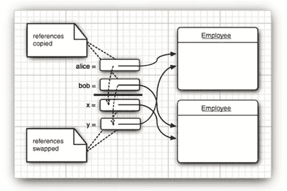

图 4.8。交换对象参数没有持久性影响。

这说明 Java 编程语言对对象并不使用引用传递。相反，对象引用是通过按值传递的。

以下是关于在 Java 方法参数中可以做和不能做的总结：

- 方法不能修改基本类型参数（即数字或 `boolean` 数值）。
- 方法可以改变对象参数的*状态*。
- 方法不能让对象参数引用一个新的对象。

位于代码列表 4.4 中的程序演示了这些事实。程序首先尝试将一个数字参数的值设为三倍，但没有成功：

```text
Testing tripleValue:

Before: percent=10.0

方法结束: x=30.0

After: percent=10.0
```

然后它成功地将一个员工的薪水增加了三倍：

```text
Testing tripleSalary:

Before: salary=50000.0

方法结束: salary=150000.0

After: salary=150000.0
```

方法执行后，`harry` 所引用对象的状态发生了变化。这是可能的，因为方法通过对象引用的副本修改了状态。

最后，该程序演示了 `swap` 方法的失败：

```text
Testing swap:

Before: a=Alice

Before: b=Bob

方法结束: x=Bob

方法结束: y=Alice

After: a=Alice

After: b=Bob
```

如你所见，参数变量 `x` 和 `y` 被交换了，但变量 `a` 和 `b` 没有受到影响。

Listing 4.4. `ParamTest/ParamTest.java`

点击此处查看代码图像


```java
1  /**
2    * 此程序演示了 Java 中的参数传递。
3    * @version 1.00 2000-01-27
4    * @author Cay Horstmann
5    */
6  public class ParamTest
7  {
8      public static void main(String[] args)
9      {
10         /*
11           * 测试 1: 方法不能修改数值参数
12           */
13         System.out.println("Testing tripleValue:");
14         double percent = 10;
15         System.out.println("Before: percent=" + percent);
16         tripleValue(percent);
17         System.out.println("After: percent=" + percent);
18
19         /*
20           * 测试 2: 方法改变对象参数的状态
21           */
22         System.out.println("\n tripleSalary:");
23         Employee harry = new Employee("Harry", 5000);
24         System.out.println("Before: salary=" + harry.getSalary());
25         tripleSalary(harry);
26         System.out.println("After: salary=" + harry.getSalary());
27
28         /*
29           * 测试 3: 方法不能将对象附加到对象参数
30           */
31         System.out.println("\n swap:");
32         Employee a = new Employee("Alice", 70000);
33         Employee b = new Employee("Bob", 60000);
34         System.out.println("Before: a=" + a.getName());
35         System.out.println("Before: b=" + b.getName());
36         swap(a, b);
37         System.out.println("After: a=" + a.getName());
38         System.out.println("After: b=" + b.getName());
39     }
40
41     public static void tripleValue(double x) // 不起作用
42     {
43         x = 3 * x;
44         System.out.println("End of method: x=" + x);
45     }
46
47     public static void tripleSalary(Employee x) // 起作用
48     {
49         x.raiseSalary(200);
50         System.out.println("End of method: salary=" + x.getSalary());
51     }
52
53     public static void swap(Employee x, Employee y)
54     {
55         Employee temp = x;
56         x = y;
57         y = temp;
58         System.out.println("End of method: x=" + x.getName());
59         System.out.println("End of method: y=" + y.getName());
60     }
61 }
62 class Employee // 化的 Employee 类
63 {
64     private String name;
65     private double salary;
66
67     public Employee(String n, double s)
68     {
69         name = n;
70         salary = s;
71     }
72
73     public String getName()
74     {
75         return name;
76     }
77
78     public double getSalary()
79     {
80         return salary;
81     }
82
83     public void raiseSalary(double byPercent)
84     {
85         double raise = salary * byPercent / 100;
86         salary += raise;
87     }
88 }
```

返回类型不是方法签名的一部分。这意味着，你不能拥有两个名称和参数类型相同但返回类型不同的方法。

### 4.6.2. 字段的默认初始化

如果你没有在构造函数中显式设置字段，它将自动被设置为默认值：数字为 `0`，`boolean` 值为 `false`，对象引用为 `null`。有些人认为依赖默认值是一种糟糕的编程习惯。诚然，如果字段是在这种不可见的情况下被初始化的，确实会让别人更难理解你的代码。

 <span style="color: red;">注意</span>

这是字段与局部变量之间的一个重要区别。你必须始终在方法中显式初始化局部变量。但在类中，如果你没有初始化字段，它会被自动初始化为默认值（`0`、`false` 或 `null`）。

例如，考虑 `Employee` 类。假设你没有在构造函数中指定如何初始化某些字段。默认情况下，`salary` 字段将初始化为 `0`，`name` 和 `hireDay` 字段将初始化为 `null`。

然而，这并不是一个好主意。如果任何人调用 `getName` 或 `getHireDay` 方法，他们将得到一个他们可能需要的 `null` 引用：

```java
Date h = harry.getHireDay();

calendar.setTime(h); // 如果 h 为 null 则抛出异常
```

### 4.6.3. 无参数构造函数

许多类都包含一个无参数的构造函数，它用于创建一个状态被设置为适当默认值的对象。例如，这里是 `Employee` 类的一个无参数构造函数：

```java
public Employee()
{
   name = "";
   salary = 0;
   hireDay = new Date();
}
```

如果你写了一个完全没有任何构造函数的类，编译器会为你提供一个无参数构造函数。这个构造函数会将所有实例字段设置为它们的默认值。因此，实例字段中包含的所有数值数据都将是 `0`，所有的 `boolean` 值都将 `false`，所有的对象变量都将被设置为 `null`。

如果一个类提供了至少一个构造函数但不提供无参数构造函数，那么在不提供参数的情况下构造对象是非合法的。例如，我们最初的 Listing 4.2 中的 `Employee` 类提供了一个单一构造函数：

```java
Employee(String name, double salary, int y, int m, int d)
```

对于该类，构造默认员工是不合法的。也就是说，调用

```java
e = new Employee();
```

将会是一个错误。

 <span style="color: red;">注意</span>

请记住，只有当你的类没有其他构造函数时，你才能获得一个免费的无参数构造函数。如果你为自己的类至少写了一个构造函数，并且希望类的用户能够通过调用 `new ClassName()` 来创建实例，那么你必须提供一个无参数构造函数。当然，如果你对所有字段的默认值满意，你只需要提供：

```java
public ClassName()
{
}
```

### 4.6.4. 显式字段初始化

通过重载类中的构造器方法，你可以构建许多方法来设置类实例字段的初始状态。确保无论调用哪个构造函数，每个实例字段都被设置为有意义的值，始终是一个好主意。

你可以简单地为类定义中的任何字段赋值。例如：

```java
class Employee
{
   private String name = "";
   . ...
}
```

此赋值操作是在构造函数执行之前完成的。如果一个类的所有构造函数都需要将某个特定的实例字段设置为相同的值，那么这种语法就特别有用。

初始化值不必是一个常量值。这里有一个使用方法调用初始化字段的示例。考虑一个 `Employee` 类，其中每个员工都有一个 `id` 字段。你可以这样初始化它：

```java
class Employee
{
   private static int nextId;
   private int id = assignId();
   . ...
   private static int assignId()
   {
      int r = nextId;
      nextId++;
      return r;
   }
   . ...
}
```

 <span style="color: red;">C++ 注意</span>

在 C++ 中，你不能直接初始化类的实例字段。所有字段必须在构造函数中设置。然而，C++ 有一种特殊的初始化列表语法，例如：

```cpp
Employee::Employee(String n, double s, int y, int m, int d) // C++
:  name(n),
   salary(s),
   hireDay(y, m, d)
{
}
```

C++ 使用这种特殊语法来调用字段构造函数。在 Java 中，没有这种需要，因为对象没有子对象，只有指向其他对象的指针。

### 4.6.5. 参数名

当你编写非常简单的构造函数（你会写很多这种）时，构思参数名称可能会有些令人沮丧。

我们通常选择使用单字母参数名：

```java
public Employee(String n, double s)
{
   name = n;
   salary = s;
}
```

然而，缺点是你需要阅读代码才能知道 `n` 和 `s` 参数的含义。

有些程序员会在每个参数前加上前缀：

```java
public Employee(String aName, double aSalary)
{
   name = aName;
   salary = aSalary;
}
```

这种方式很整洁。读者可以立即看出参数的含义。

另一种常用的技巧是利用参数变量会隐藏同名实例字段的特性。例如，如果你调用参数 `salary`，那么 `salary` 指的是参数而不是实例字段。你仍然可以通过 `this.salary` 访问实例字段。这里有一个例子：

```java
public Employee(String name, double salary)
{
   this.name = name;
   this.salary = salary;
}
```

### 4.6.6. 调用另一个构造函数

`this` 关键字指的是方法的隐含参数。然而，这个关键字还有第二个含义。

如果构造函数的第一个语句的形式为 `this(...)`，那么该构造函数会调用类的另一个构造函数。这里有一个典型的示例：

```java
public Employee(double s)
{
   // 调用 Employee(String, double)
   this("Employee #" + nextId, s);
   nextId++;
}
```

当你调用 `new Employee(60000)` 时，`Employee(double)` 构造函数会调用 `Employee(String, double)` 构造函数。

这样使用 `this` 关键字非常有用——你只需要编写一次公共构造代码。Java 中的 `this` 引用等同于 C++ 中的 `this` 指针。然而，在 C++ 中一个构造函数无法调用另一个。如果你想在 C++ 中提取公共初始化代码，必须编写一个单独的方法。

### 4.6.7. 初始化块

你已经见过两种初始化数据字段的方法：

- 在构造函数中设置值
- 在声明中赋值

在 Java 中，还有第三种机制，称为初始化块。类声明可以包含任意的代码块。这些块在每当类的对象被构造时都会执行。例如：

```java
class Employee
{
   private static int nextId;
   private int id;
   private String name;
   private double salary;

   // 对象初始化块
   {
      id = nextId;
      nextId++;
   }
}
```

```java
public Employee(String n, double s)
{
    name = n;
    salary = s;
}

public Employee()
{
    name = "";
    salary = 0;
}

. . .
}
```

在此示例中，`id` 字段在对象初始化块中初始化，无论使用哪种构造函数来构建对象。初始化块首先运行，然后执行构造函数的体。

这种机制并非绝对必要，也不常见。通常将初始化代码放在构造函数内部会更直接。

---

 <span style="color: red;">注意</span>

在初始化块中设置字段是合法的，即使这些字段在类中稍后才定义。然而，为了避免循环定义，读取稍后才初始化的字段是不合法的。具体规则在《Java 语言规范》第 8.3.2.3 节中有详细说明（[`docs.oracle.com/javase/specs`](http://docs.oracle.com/javase/specs)）。这些规则足以让编译器实现者感到困惑——Java 的早期版本在实现这些规则时存在细微的错误。因此，我们建议你始终将初始化块放在字段定义之后。

---

初始化数据字段的方法有很多种，为构造过程提供所有可能的路径可能会非常困惑。以下是调用构造函数时详细发生的情况：

1. 所有数据字段都被初始化为它们的默认值（`0`、`false` 或 `null`）。
2. 所有的字段初始化器和初始化块都按照它们在类声明中出现的顺序进行执行。
3. 如果构造函数的第一行调用了另一个构造函数，则执行第二个构造函数的体。
4. 执行构造函数的体。

当然，组织你的初始化代码始终是一个好主意，这样另一个程序员就可以轻松理解它，而无需成为语言法专家。例如，如果一个类的构造函数依赖于数据字段声明的顺序，那将是非常奇怪且容易出错的。

要初始化静态字段，可以提供一个初始值或使用静态初始化块。你已经看到了第一种机制：

```java
private static int nextId = 1;
```

如果你的类的静态字段需要复杂的初始化代码，请使用静态初始化块。

将代码放在块中并使用关键字 `static` 标记它。这是一个示例。我们希望员工 ID 数字从一个小于 10,000 的随机整数开始。

```java
// static 初始化块
static
{
    Random generator = new Random();
    nextId = generator.nextInt(10000);
}
```

静态初始化发生在类首次加载时。与实例字段一样，除非你显式地设置为另一个值，否则静态字段为 `0`、`false` 或 `null`。所有的静态字段初始化器和静态初始化块都按照它们在类声明中出现的顺序执行。

---

 <span style="color: red;">注意</span>

这里有一个让你同事们惊叹的 Java 冷知识：在 JDK 6 之前，你可以用 Java 写一个“Hello, World”程序，而无需编写 `main` 方法。

```java
public class Hello
{
    static
    {
        System.out.println("Hello, World");
    }
}
```

当你用 `java Hello` 调用类时，类被加载，静态初始化块打印“Hello, World”，然后你才会收到一个关于 `main` 未定义的错误信息。你可以在静态块的末尾调用 `System.exit(0)` 来避免这个瑕疵。

---

`Listing 4.5` 显示了我们在本节讨论的许多特性：

- 重载构造函数
- 使用 `this(...)` 调用另一个构造函数
- 无参数构造函数
- 对象初始化
- 静态初始化
- 实例字段初始化
- `java.util.Random`
- `Random()` 构造一个新的随机生成器。
- `nextInt(int n)` 返回 0 到 `n`–1 之间的随机数。

**Listing 4.5 ConstructorTest/ConstructorTest.java**


```java
import java.util.*;

/**
 * 程序演示了对象构造。
 * @version 1.0 2004-02-19
 * @author Cay Horstmann
 */
public class ConstructorTest
{
    public static void main(String[] args)
    {
        // 在 staff 数组中填充三个 Employee 对象
        Employee[] staff = new Employee[3];

        staff[0] = new Employee("Harry", 40000);
        staff[1] = new Employee(60000);
        staff[2] = new Employee();

        // 打印所有 Employee 对象的信息
        for (Employee e : staff)
            System.out.println("name=" + e.getName() + ",id=" + e.getId() + ",salary=" + e.getSalary());
    }
}

class Employee
{
    private static int nextId;

    private int id;
    private String name = ""; // 实例字段初始化
    private double salary;

    // 静态初始化块
    static
    {
        Random generator = new Random();
        // 将 nextId 设置为 0 到 9999 之间的随机数
        nextId = generator.nextInt(10000);
    }

    // 对象初始化块
    {
        id = nextId;
        nextId++;
    }

    // 重载构造函数
    public Employee(String n, double s)
    {
        name = n;
        salary = s;
    }

    public Employee()
    {
        name = "";
        salary = 0;
    }

    public String getName()
    {
        return name;
    }

    public double getSalary()
    {
        return salary;
    }

    public int getId()
    {
        return id;
    }
}
```

## 4.6.8. 对象销毁与 `finalize` 方法

某些面向对象的编程语言（特别是 C++）对于对象不再使用时可能需要的任何清理代码，都有显式的析构器方法。析构函数中最常见的活动是回收为对象留出的内存。由于 Java 具有自动垃圾回收机制，因此不需要手动回收内存，所以 Java 不支持析构函数。

当然，某些对象使用了内存以外的资源，例如文件或使用系统资源的另一个对象的句柄。在这种情况下，当资源不再被需要时对其进行回收和循环利用是非常关重要的。

你可以向任何类添加一个 `finalize` 方法。`finalize` 方法会在垃圾回收器扫描该对象之前调用。在实践中，不要依赖于 `finalize` 方法来回收任何短缺的资源——你无法知道该方法何时会被调用。

方法调用 `System.runFinalizersOnExit(true)` 保证在 Java 关闭之前会调用 `finalizer` 方法。然而，该方法本质上是不安全的并且已被废弃。另一种方案是使用 `Runtime.addShutdownHook` 方法添加“停机钩子”——详情请参 API 文档。

如果你在使用完资源后需要立即关闭它，你需要手动管理它。提供一个 `close` 方法来执行必要的清理工作，并在完成对象操作后调用它。在第 11.2.4 节中的“Try-with-Resources 语句”（位于第 644 页），中将看到如何确保该方法被自动调用。

## 4.7. 包

Java 允许你将类分组在一个名为 `package`（包）的集合中。包对于组织你的工作以及将你的工作与其他提供的代码库分开非常方便。

标准 Java 库分布在许多包中，包括 `java.lang`、`java.util`、`java.net` 等。标准 Java 包是分层包的示例。就像你在硬盘上拥有嵌套的子目录一样，你可以通过嵌套层级来组织包。所有的标准 Java 包都在 `java` 和 `javax` 包的层次结构中。

使用包的主要目的是为了保证类名的唯一性。假设两个程序员想出了一个好主意，提供一个 `Employee` 类。只要他们都将自己的类放在不同的包中，就不会发生冲突。事实上，为了绝对保证包名的唯一性，可以使用反向书写的 Internet 域名（已知是唯一的）。然后你就可以为不同的项目使用子包。例如，`horstmann.com` 是其中一位作者注册的域名。反向书写后，它变成了 `com.horstmann` 包。该包可以进一步细分为如 `com.horstmann.corejava` 等子包。

从编译器的角度来看，嵌套包之间没有任何关系。例如，`java.util` 和 `java.util.jar` 包之间互不相涉。每个包都是自己独立的类集合。

### 4.7.1. 类导入

一个类可以使用其所在包中的所有类，以及其他包中的所有 `public` 类。

你可以通过两种方式访问另一个包中的公共类。第一种是简单地在每个类名之前加上完整的包名。例如：

```java
java.util.Date today = new java.util.Date();
```

这显然很繁琐。更简单、更常见的方法是使用 `import` 语句。`import` 语句的作用是提供一个引用包中类的简写形式。一旦你使用了 `import`，就不再需要为类提供全名了。

你可以导入一个特定的类或整个包。你将 `import` 语句置于源文件的顶部（但在任何 `package` 语句之后）。例如，你可以使用以下语句导入 `java.util` 包中的所有类：

```java
import java.util.*;
```

然后你就可以使用：

```java
Date today = new Date();
```

而无需包前缀。你也可以导入包中的某个特定类：

```java
import java.util.Date;
```

`java.util.*` 语法不那么繁琐。它对代码大小没有负面影响。然而，如果你显式地导入类，代码的阅读者确切知道你使用了哪些类。

---

 提示

在 Eclipse 中，你可以选择菜单选项 Source -> Organize Imports（源 -> 组织导入）。如 `import java.util.*;` 之类的包语句会自动展开为一系列特定的导入列表，如：

```java
import java.util.ArrayList;
import java.util.Date;
```

这是一个非常方便的功能。

---

然而，请注意，你只能使用 `*` 符号导入单个包。你不能使用 `import java.*` 或 `import java.*.*` 来导入所有以 `java` 为前缀的包。

大多数时候，你只需要导入需要的包，而不需要太担心它们。只有在发生名称冲突时你才需要注意包。例如，`java.util` 和 `java.sql` 包都包含一个 `Date` 类。假设你写了一个导入了这两个包的程序：

```java
import java.util.*;
import java.sql.*;
```

如果你现在使用 `Date` 类，就会得到一个编译错误：

```java
Date today; // 错误--java.util.Date 还是 java.sql.Date?
```

编译器无法确定你想要哪一个 `Date` 类。你可以通过添加特定的 `import` 语句来解决这个问题：

```java
import java.util.*;
import java.sql.*;
import java.util.Date;
```

如果你真的需要两个 `Date` 类怎么办？那么你需要在每个类名上使用完整的包名。

点击此处查看代码图像

```java
java.util.Date deadline = new java.util.Date();
java.sql.Date today = new java.sql.Date(...);
```

在包中定位类是编译器的活动。类文件中的字节码始终使用完整的包名来引用其他类。

---

 C++ 注意事项

C++ 程序员有时会将 `import` 与 `#include` 混淆。两者没有任何共同点。在 C++ 中，你必须使用 `#include` 来包含声明，因为 C++ 编译器不会查找正在编译的文件之外的内容。

在 Java 中，除非你告诉它去哪里查找，否则它会查找正在编译的文件之外的内容。

### 4.7.2. 静态导入

`import` 的一种形式允许导入静态方法和字段，而不仅仅是类。

例如，如果你在源文件顶部添加：

```java
import static java.lang.System.*;
```

那么你就可以无需类前缀使用 `System` 类的静态方法和字段：

```java
out.println("Goodbye, World!"); // 即 System.out
exit(0); // 即 System.exit
```

你也可以导入特定的方法或字段：

```java
import static java.lang.out;
```

在实践中，很难想象许多程序员想要缩写 `System.out` 或 `System.exit`。结果代码看起来没那么清晰。另一方面：

```java
sqrt(pow(x, 2) + pow(y, 2))
```

比：

```java
Math.sqrt(Math.pow(x, 2) + Math.pow(y, 2))
```

清晰得多。

### 4.7.3. 将类添加到包

要将类放入包中，你必须在源文件的顶部放置包名，位于定义包内类的代码之前。例如，列表 4.7 中的 `Employee.java` 文件如下所示：

```java
package com.horstmann.corejava;

public class Employee
{
    ...
}
```

如果你不在源文件中放入 `package` 语句，那么该源文件中的类就属于默认包。默认包没有包名。到为止，我们所有的示例类都在默认包中。

将源文件放在与完整包名匹配的子目录。例如，`com.horstmann.corejava` 包中的所有源文件应该放在 `com/horstmann/corejava`（Windows 上为 `com\horstmann\corejava`）目录下。编译器会将类文件放在相同的目录结构中。

位于 Listing 4.6 和 4.7 中的程序分布在两个包中：`PackageTest` 类属于默认包，而 `Employee` 类属于 `com.horstmann.corejava` 包。因此，`Employee.java` 文件必须位于子目录 `com/horstmann/corejava` 中。换句话说，目录结构如下：


要编译此程序，只需切换到基础目录并运行命令：

```bash
javac PackageTest.java
```

编译器会自动找到文件 `com/horstmann/corejava/Employee.java` 并对其进行编译。

让我们来看一个更实际的例子，在这个例子中，我们没有使用默认包，而是将类分布在几个包中（`com.horstmann.corejava` 和 `com.mycompany`）。

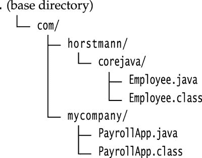

在这种情况下，你仍然必须从基目录编译和运行类，即包含 `com` 目录的目录：

```bash
javac com/mycompany/PayrollApp.java
java com.mycompany.PayrollApp
```

#### Listing 4.6. PackageTest/PackageTest.java

点击此处查看代码图片

```java
import com.horstmann.corejava.*;

// Employee 类定义在那个包中

import static java.lang.System.*;

/**
 * 此程序演示了包的使用。
 * @version 1.11 2004-02-19
 * @author Cay Horstmann
 */
public class PackageTest
{
    public static void main(String[] args)
    {
        // 因为有 import 语句，我们在这里不需要使用 com.horstmann.corejava.Employee
        Employee harry = new Employee("Harry Hacker", 50000, 1989, 10, 1);

        harry.raiseSalary(5);

        // 因为有静态导入语句，我们在这里不需要使用 System.out
        out.println("name=" + harry.getName() + ",salary=" + harry.getSalary());
    }
}
```

#### Listing 4.7. PackageTest/com/horstmann/corejava/Employee.java

点击此处查看代码图片

```java
package com.horstmann.corejava;
// 此文件中的类是该包的一部分

import java.util.*;
// import 语句位于 package 语句之后

/**
 * @version 1.10 1999-12-18
 * @author Cay Horstmann
 */
public class Employee
{
    private String name;
    private double salary;
    private Date hireDay;

    public Employee(String n, double s, int year, int month, int day)
    {
        name = n;
        salary = s;
        GregorianCalendar calendar = new GregorianCalendar(year, month - 1, day);
        // GregorianCalendar 使用 0 表示 1 月
        hireDay = calendar.getTime();
    }

    public String getName()
    {
        return name;
    }

    public double getSalary()
    {
        return salary;
    }

    public Date getHireDay()
    {
        return hireDay;
    }

    public void raiseSalary(double byPercent)
    {
        double raise = salary * byPercent / 100;
        salary += raise;
    }
}
```

再次注意，编译器操作的是文件（带有文件分隔符和扩展名 `.java`），而 Java 解释器加载的是类（使用点分隔符）。

 提示：从下一章开始，我们将在源代码中使用包。这样，你就可以为每个章节创建一个 IDE 项目，而不是为每个小节。

 注意：编译器在编译时不会检查目录结构。例如，假设你有一个起始如下内容的源文件：

```java
package com.mycompany;
```

即使该文件没有包含在子目录 `com/mycompany` 中，你也可以编译该文件。如果源文件不依赖于其他包，它将无错误地编译。然而，生成的程序将无法运行。当你尝试运行时，虚拟机将无法找到生成的类。

#### 4.7.4. 包作用域

你已经遇到过访问修饰符 `public` 和 `private`。标记为 `public` 的特性可以被任何类使用。`private` 特性只能由定义它的类使用。如果你既没有指定 `public` 也没有指定 `private`，该特性（即类、方法或变量）可以被同一个包中的所有方法访问。

考虑第 146 页上 Listing 4.2 中的程序。`Employee` 类没有被定义为公共类。因此，只有同包中的其他类可以访问它。

类文件也可以存储在 JAR（Java 归档）文件中。JAR 文件以压缩格式包含多个类文件和子目录，既能节省空间又能提高性能。当你在程序中使用第三方库时，通常会获得一个或多个需要包含的 JAR 文件。JDK 也提供了许多 JAR 文件，例如包含成千上万个库类的 `jre/lib/rt.jar` 文件。你将在第 10 章中看到如何创建你自己的 JAR 文件。

 提示


JAR 文件使用 ZIP 格式来组织文件和子目录。你可以使用任何 ZIP 工具来查看 `rt.jar` 和其他 JAR 文件的内部内容。

要在程序之间共享类，你需要执行以下操作：

1. 将你的类文件放在一个目录中，例如`/home/user/classdir`。注意，该目录是包树的*基准*目录。如果你添加了类`com.horstmann.corejava.Employee`，那么`Employee.class`文件必须位于子目录`/home/user/classdir/com/horstmann/corejava`中。
2. 将任何 JAR 文件放在一个目录中，例如`/home/user/archives`。
3. 设置*类路径*（class path）。类路径是所有包含类文件的位置集合。

在 UNIX 中，类路径上的元素用冒号分隔：

```text
/home/user/classdir:.:/home/user/archives/archive.jar
```

在 Windows 中，它们用分号分隔：

```text
c:\classdir;.;c:\archives\archive.jar
```

在两种情况下，点`.`都表示当前目录。

此类路径包含：

- 基准目录`/home/user/classdir`或`c:\classdir`；
- 当前目录（`.`）；以及
- JAR 文件`/home/user/archives/archive.jar`或`c:\archives\archive.jar`。

从 Java SE 6 开始，你可以为 JAR 文件目录指定通配符，如下：

```text
/home/user/classdir:.:/home/user/archives/'*'
```

或者：

```text
c:\classdir;.;c:\archives\*
```

在 UNIX 中，`*`必须经过转义以防止 shell 扩展。

`archives`目录下的所有 JAR 文件（但不包括`.class`文件）都包含在此类路径中。

运行时库文件（`rt.jar`以及`jre/lib`和`jre/lib/ext`目录下的其他 JAR 文件）始终会被搜索；不要将它们显式包含在类路径中。

 **注意**

`javac`编译器始终会在当前目录查找文件，但`java`虚拟机启动器只有在“`.`目录位于类路径上”时才会查找当前目录。如果你没有设置类路径，这不是问题——默认类路径由“`.`目录组成”。但如果你设置了类路径却忘记包含“`.`目录，你的程序将无错误编译，但无法运行。

类路径列出了所有作为查找类*起点*的目录和归档文件。让我们考虑我们的示例类路径：

```text
/home/user/classdir:.:/home/user/archives/archive.jar
```

假设虚拟机正在查找`com.horstmann.corejava.Employee`类的类文件。它首先查找存储在`jre/lib`和`jre/lib/ext`目录归档文件中的系统类文件。它在那里没有找到类文件，因此转向类路径。接着它查找以下文件：

- `/home/user/classdir/com/horstmann/corejava/Employee.class`
- 从当前目录开始的`com/horstmann/corejava/Employee.class`
- `/home/user/archives/archive.jar`内部的`com/horstmann/corejava/Employee.class`

编译器定位文件比虚拟机困难。如果你在没有指定包的情况下引用了一个类，编译器首先需要找到包含该类的包。它查询所有`import`指令作为类的可能来源。例如，假设源文件包含以下指令：

```java
import java.util.*;
import com.horstmann.corejava.*;
```

并且源代码引用了类`Employee`。编译器随后尝试寻找`java.lang.Employee`（因为`java.lang`包始终默认导入）、`java.util.Employee`、`com.horstmann.corejava.Employee`以及当前包中的`Employee`。它在类路径的所有位置中搜索*每一个*这些类。如果找到多个类，则为编译时错误。（类必须是唯一的，因此`import`语句的顺序并不重要。）

编译器更进了一步。它查看*源文件*以检查源文件是否比类文件新。如果是，源文件将自动重新编译。记住，你只能从其他包导入公共类（public classes）。一个源文件只能包含一个公共类，且文件名与公共类名必须匹配。因此，编译器可以轻松地定位公共类的源文件。然而，你可以从当前包导入非公共类。这些类可能定义在不同名称的源文件中。如果你从当前包导入一个类，编译器会搜索*所有*位置来确定类。

### 4.8.1 设置类路径

最佳方法是用`-classpath`（或`-cp`）选项指定类路径：

```text
java -classpath /home/user/classdir:.:/home/user/archives/archive.jar
```

或者：

```text
java -classpath c:\classdir;.;c:\archives\archive.jar
```

整个命令必须写在一行。

使用`-classpath`选项是设置类路径的首选方法。另一种方法是环境变量`CLASSPATH`。具体取决于你的 shell。在 Bourne Again shell（bash）中，使用命令：

```bash
export CLSPATH=/home/user/classdir:.:/home/user/archives/archive.jar
```

在 C shell 中，使用命令：

```csh
setenv CLSPATH /home/user/classdir:.:/home/user/archives/archive.jar
```

在 Windows shell 中，使用：

```bat
set CLSPATH=c:\classdir;.;c:\archives\archive.jar
```

类路径一直有效到 shell 退出。

## 4.9 文档注释

JDK 包含一个名为`javadoc`的有用工具，它可以从源文件生成 HTML 文档。事实上，我们在第三章](#part0008.xhtml_ch03)中描述的在线 API 文档仅仅是对标准 Java 库源代码运行`javadoc`的结果。

如果你在源代码中添加以特殊分隔符`/**`开头的注释，你也可以轻松地生成外观专业的文档。这是一个非常好的方法，因为它让你能够将代码和文档保持在一个地方。如果你将文档放在单独的文件中，那么正如你可能知道的，代码和注释会随着时间的推移而产生脱节。当文档注释与源代码在同一个文件中时，更新两者并重新运行`javadoc`就是一件容易的事。

### 4.9.1 注释插入

`javadoc`工具会提取以下项目的信息：

- 包（Packages）
- 公有类和接口（Public classes and interfaces）
- 公有和保护字段（Public and protected fields）
- 公有和保护构造函数及方法

保护特性在第 5 章中引入，接口在第 6 章中。

你可以（并且应该）为这些特性每一个提供注释。每个注释都放置在其所描述的特性*上方*。注释以`/**`开始，以`*/`结束。

每个`/** . . . */`文档注释包含*自由格式文本*，随后是*标签*。标签以`@`开头，例如`@author`或`@param`。

自由格式文本的*第一句*应该是一个*摘要语句*。`javadoc`工具会自动生成提取这些句子的摘要页面。

在自由格式文本中，你可以使用 HTML 修饰符，例如`<em>...</em>`用于强调，`<code>...</code>`用于等宽“打字机”字体，`<strong>...</strong>`用于强强调，甚至可以使用``来包含图像。然而，你应该避免使用标题`<h1>`或规则`<hr>`，因为它们可能会干扰文档的格式。

---

 **注意**

如果你的注释中包含指向其他文件的链接（例如，图表或用户界面组件图），请将这些文件放在包含源文件的目录的子目录中，命名为`doc-files`。`javadoc`工具会将`doc-files`目录及其内容从源目录复制到文档目录。你需要在链接中使用`doc-files`目录，例如``。

---

### 4.9.2 类注释

类注释必须放置在任何`import`语句*之后*，直接位于`class`定义之前。

这是一个类注释的示例：

```java
/**
 * 一个 <code>Card</code> 对象代表一张扑牌，例如
 * "红桃皇后"。一张牌有一个花色（方片、红心、
 * 黑桃或梅花）和一个值（1 = A, 2 . . . 10, 11 = J,
 * 12 = Q, 13 = K）。
 */
public class Card
{
   . . .
}
```

---

 **注意**

不需要在每行前面添加`*`。例如，以下注释同样有效：

```java
/**
 *   一个 <code>Card</code> 对象代表一张扑牌，例如
 *   如 "红桃皇后"。一张牌有一个花色（方片、红心、
 *   黑桃或梅花）和一个值（1 = A, 2 . . . 10, 11 = J,
 *   12 = Q, 13 = K）。
*/
```

然而，大多数 IDE 会自动提供星号，并在换行发生变化时重新排列它们。

---

### 4.9.3 方法注释

每个方法注释必须紧接在其所描述的方法之前。除了通用标签外，你还可以使用以下标签：

- `@param` *变量描述*：此标签为当前方法的“参数”部分添加一个条目。描述可以跨多行并可以使用 HTML 标签。一个方法的所有`@param`标签必须保持在一起。
- `@return` *描述*：此标签为当前方法添加一个“返回”部分。描述可以跨多行并可以使用 HTML 标签。
- `@throws` *类描述*：此标签添加一条说明，说明此方法可能会抛出异常。异常是第 11 章的主题。

这是一个方法注释的示例：

```java
/**
 * 增加员工的工资。
 * @param byPercent 加薪的百分比（例如 10 意味着 10%）
 * @return 加薪的金额
 */
public double raiseSalary(double byPercent)
{
   double raise = salary * byPercent / 100;
   salary += raise;
   return;
}
```

### 4.9.4 字段注释

你只需要记录静态常量。例如：

```java
/**
 * 红桃
 */
public static final HEARTS = 1;
```

### 4.9.5 通用注释

以下标签可用于所有注释：

- `@author` *名称*：此标签创建一个“作者”条目。你可以有多个`@author`标签，每个作者一个。
- `@version` *文本*：此标签创建一个“版本”条目。`text`可以是该版本的任何描述。
- `@since` *文本*：此标签创建一个“自”条目。`text`可以是引入此内容的版本的任何描述。
- `@deprecated` *文本*：此标签添加注释，说明该类、方法或变量不应再使用。`text`应该建议一个替代方案。
- `@see` *引用*：此标签在“另参见”部分添加一个超链接。它可以同时用于类和方法。

### 4.9.6 包注释和概述注释

你将类、方法和变量注释直接放在 Java 源文件中，并用`/** . . . */`文档注释分隔。然而，为了生成*包*注释，你需要在每个包目录下添加一个单独的文件。你有两个选择：

1. 提供一个名为`package.html`的 HTML 文件。`<body>...</body>`标签之间的所有文本都将被提取。
2. 提供一个名为`package-info.java`的 Java 文件。该文件必须包含一个初始 Javadoc 注释，用`/**`和`*/`分隔，随后跟一个`package`语句。它不应包含任何其他代码或注释。

你还可以为所有源文件提供一个概览注释。将其放在名为`overview.html`的文件中，该文件位于包含所有源文件的父目录下。`<body>...</body>`标签之间的所有文本会被提取。当用户从导航栏选择“Overview”（概览）时，就会显示此注释。

### 4.9.7 注释提取

在这里，`docDirectory`是你希望 HTML 文件存放的目录名称。按照以下步骤操作：

1. **切换到包含**你需要文档的源文件的目录。如果你有需要文档的嵌套包，例如`com.horstmann.corejava`，你必须在包含子目录`com`的目录中运行。（如果你提供了`overview.html`文件，则该目录就是包含它的目录。）
2. **运行命令**

针对单个包运行：

```text
javadoc -d docDirectory nameOfPackage
```

或者，运行以下命令来文档多个包：

```text
javadoc -d docDirectory nameOfPackage[1] nameOfPackage[2]...
```

如果你的文件在默认包中，请改运行：

```text
javadoc -d docDirectory *.java
```

如果你省略了`-d docDirectory`选项，HTML 文件将提取到当前目录。这可能会导致目录变得混乱，我们不建议这样做。

`javadoc`程序可以通过许多命令行选项进行精调。例如，你可以使用`-author`和`-version`选项在文档中包含`@author`和`@version`标签。（默认情况下，它们会被省略。）另一个有用的选项是`-link`，用于包含指向标准类的超链接。例如，如果你使用命令：

```text
javadoc -link http://docs.oracle.com/javase/7/docs/api *.java
```

所有标准库类都将自动链接到 Oracle 网站上的文档。

如果你使用`-linksource`选项，每个源文件将转换为 HTML（没有颜色代码，但有行号），并且每个类名和方法名将变成指向源码的超链接。

有关其他选项，请参阅`javadoc`程序的在线文档：[`docs.oracle.com/javase/1.5.0/docs/guide/javadoc`](http://docs.oracle.com/javase/1.5.0/docs/guide/javadoc)。

---

 **注意**

如果你需要进一步的自定义——例如，生成 HTML 以外格式的文档——你可以提供自己的`doclet`以生成你所需的任何形式的输出。显然，这是一种特殊需求；关于`doclet`的详细信息，请参阅在线文档[`docs.oracle.com/javase/1.5.0/docs/guide/javadoc/doclet/overview.html`](http://docs.oracle.com/javase/1.5.0/docs/guide/javadoc/doclet/overview.html)。

---

### 4.10 类设计提示

在不试图面面俱到或啰嗦的情况下，我们想用一些提示结束本章，这些提示将让你的类在良好的 OOP 圈中更易接受。

1. **始终保持数据私有化。**

   这是首要任务；执行任何其他操作都会违反封装性。你可能偶尔需要编写访问器（accessor）或修改器（mutator）方法，但保持实例字段私有仍然更好。痛苦的经验表明，数据的表示可能会变化，但数据用法的变化频率低得多。当数据保持私有时，其表示的变化不会影响类的使用者，而且更容易检测错误。

2. **始终初始化数据。**

   Java 不会为你初始化局部变量，但它会初始化对象的实例字段。不要依赖默认值，要显式地初始化所有变量，可以通过提供默认值或在所有构造函数中设置默认值。

3. **不要在类中使用过多的基本类型。**

   这种思想是用其他类来替换对基本类型的多次相关使用。这使得你的类更容易被理解和修改。例如，替换`Customer`类中的以下实例字段：

```java
private String street;
private String city;
private String state;
private int zip;
```

替换为一个名为`Address`的新类。这样，你就可以轻松地处理地址的变化，例如处理国际地址的需求。

4. **并不是所有字段都需要单独的字段访问器和修改器。**

   你可能需要获取和设置员工的薪水。一旦对象构造完成，你肯定不需要更改入职日期。而且，通常对象具有某些你不希望其他人获取或设置的实例字段，例如`Address`类中状态缩写字的数组。

5. **拆分职责过多的类。**

   这个提示无疑是模糊的：“太多”显然取决于观察者的眼光。然而，如果有一种明显的方法可以将一个复杂的类拆分为两个在概念上更简单的类，请抓住这个机会。（另一方面，不要做得过头；十个类、每个类只有一个方法，通常是过之嫌举了。）

   这里有一个坏设计的示例：

点击此处查看代码图片


```java
public class CardDeck // 坏设计
{
   private Card[] cards;
   public CardDeck() { ... }
   public void shuffle() { ... }
   public Card getTop() { ... }
   public void draw() { ... }
}
```

这个类实际上实现了两个不同的概念：牌组（带有`shuffle`和`draw`方法）以及单张牌（带有检查值和花色的方法）。有必要引入一个代表单张牌的`Card`类。

```java
public class Card
{
   private int value;
   private int suit;
   public Card(int aValue, int aSuit) { ... }
   public int getValue() { ... }
   public int getSuit() { ... }
}
```

## 7. 让你的类和方法的名称反映它们的职责

就像变量应该具有反映其代表内容的意义名称一样，类也是如此。（标准库确实包含一些可疑的例子，例如`Date`类。）一个良好的规范是类名应该是名词（`Order`），或者由形容词修饰的名词（`RushOrder`）或动名词（“-ing”单词，如`BillingAddress`）。对于方法，遵循标准规范，访问器方法以小写`get`（`getSalary`）开始，修改器方法使用小写`set`（`setSalary`）。

在本章中，我们涵盖了对象和类的基础，使 Java 成为一种“基于对象的语言”。为了成为真正的面向对象，编程语言还必须支持继承和多态。Java 对这些特性的支持是下一章的主题。

第 4 章向你介绍了类和对象。在本章中，你将学习`inheritance`继承，这是面向对象编程的另一个核心概念。继承的核心思想是你可以创建构建在现有类之上的新类。当你继承一个现有类时，你可以重用（或继承）它的方法，并可以添加新的方法和字段以使你的新类适应新的情况。这种技术在 Java 编程中至关重要。

本章还涵盖了`reflection`反射，即在运行程序中查找更多类及其属性的能力。反射是一项强大的功能，但不可否认非常复杂。由于反射对工具开发者比对应用程序员更感兴趣，你可以在第一次阅读时略过该章节的这部分，以后再回来。

### 5.1. 类、超类和子类

让我们回到上一节中讨论的`Employee`类。假设（不幸的是）你供职的一家公司对经理的待遇与普通员工不同。当然，经理在许多方面与员工是一样的。员工和经理都领取薪水。然而，员工被要求完成分配的任务以换工资，而经理如果真的实现了他们应该做的工作，就能获得`bonuses`（奖金）。这种情况正是需要继承的地方。为什么呢？因为你需要定义一个新类`Manager`并添加功能。但你可以保留一些已经在`Employee`类中编写好的内容，并且原始类的所有字段都可以被保留。从更抽象地说，`Manager`和`Employee`之间存在着明显的“是...”关系（is–a）。每个经理都是员工：这种“是...”的关系是继承的标志。

以下是如何定义继承自`Employee`类的`Manager`类。使用 Java 关键字`extends`来表示继承。

```java
class Manager extends Employee
{
   added methods and fields
}
```

 C++ 笔记

继承在 Java 和 C++ 中是相似的。Java 使用`extends`关键字而不是`:`符号。Java 中的所有继承都是公共继承；没有类似于 C++ 中私有继承和保护继承的功能。

关键字`extends`表示你正在创建一个派生自现有类的新类。现有类被称为`superclass`（超类）、`base class`（基类）或`parent class`（父类）。新类被称为`subclass`（子类）、`derived class`（派生类）或`child class`（子类）。这两个词是 Java 程序员最常用的术语，尽管有些程序员更倾向于父子类的类比，这与“继承”主题契合得很好。

`Employee`类是一个超类，但并不是因为它优于它的子类或包含更多功能。事实上，事实恰恰相反：子类比其超类拥有更多的功能。例如，正如我们在查看`Manager`类剩余代码时将看到的，`Manager`类封装了更多数据，并拥有比其超类`Employee`更多的功能。

 笔记

前缀`super`和`sub`来自理论计算机科学和数学中使用的集合语言。所有员工的集合包含了所有经理的集合，这被称为经理集合的`superset`（超集）。换句话说，所有经理的集合是所有员工集合的`subset`（子集）。

我们的`Manager`类有一个新字段来存储奖金，并有一个新方法来设置它：

```java
class Manager extends Employee
{
   private double bonus;
   . . .

   public void setBonus(double b)
   {
      bonus = b;
   }
}
```

这些方法和字段并没有特殊之处。如果你有一个`Manager`对象，可以直接调用`setBonus`方法。

```java
Manager boss = . . .;
boss.setBonus(5000);
```

当然如果你有一个`Employee`对象，无法调用`setBonus`方法——它没有在`Employee`类定义的方法中。

然而，你可以对`Manager`对象使用`getName`和`getHireDay`等方法。尽管这些方法没有在`Manager`类中显式定义，但它们自动继承自超类`Employee`。

同样，字段`name`、`salary`和`hireDay`也取自超类。每个`Manager`对象都有四个字段：`name`、`salary`、`hireDay`和`bonus`。

在通过扩展超类来定义子类时，你只需要指示子类和超类之间的差异。在设计类时，将最通用的方法放在超类中，将更专门的方法放在子类中。通过将其移动到超类来提取公共功能在面向对象编程中非常常见。

然而，某些超类方法并不适用于`Manager`子类。特别是`getSalary`方法应该返回基本工资和奖金的总和。你需要提供一个新的方法来覆盖（override）超类方法：

```java
class Manager extends Employee
{
   . . .
   public double getSalary()
   {
      . . .
      . . .
   }
}
```

最后，让我们提供一个构造函数。

点击此处查看代码图片

```java
public Manager(String n, double s, int year, int month, int day)
{
   super(n, s, year, month, day);
   bonus = 0;
}
```

在这里，关键字`super`具有不同的含义。指令`super(n, s, year, month, day);`是“调用`Employee`父类的构造函数，并将`n`、`s`、`year`、`month`和`day`作为参数”的简写。

由于`Manager`构造函数无法访问`Employee`类的私有字段，它必须通过构造函数来初始化它们。构造函数通过特殊的`super`语法被调用。使用`super`的调用必须是子类构造中的第一条语句。

如果子类构造函数没有显式调用父类构造函数，则调用父类的无参数构造函数。如果父类没有无参数构造函数，且子类构造函数没有显式调用另一个父类构造函数，Java 编译器将报告错误。

 注意

回想`this`关键字有两个含义：指向隐式参数的引用，以及调用同一类的另一个构造函数。同样，`super`关键字也有两个含义：调用父类方法和调用父类构造函数。当用于调用构造函数时，`this`和`super`关键字紧密相关。构造函数的调用只能作为另一个构造函数的第一条语句出现。构造函数参数要么传递给同一类的另一个构造函数（`this`），要么传递给父类的构造函数（`super`）。

 C++ 注意

在 C++ 构造函数中，你不调用`super`，而是使用初始化列表语法来构造父类。`Manager`构造函数在 C++ 中看起来如下：

```cpp
Manager::Manager(String n, double s, int year, int month, int day) // C++
: Employee(n, s, year, month, day)
{
   bonus = 0;
}
```

为`Manager`对象重定义了`getSalary`方法后，经理的工资将自动加上奖金。

这里是该功能实际运行的示例。我们创建一个新经理并设置经理的奖金：

点击此处查看代码图片

```java
Manager boss = new Manager("Carl Cracker", 80000, 1987, 12, 15);
boss.setBonus(5000);
```

我们创建一个包含三个员工的数组：

```java
Employee[] staff = new Employee[3];
```

我们用经理和员工的混合体填充数组：

点击此处查看代码图片

```java
staff[0] = boss;
staff[1] = new Employee("Harry Hacker", 50000, 1989, 10, 1);
staff[2] = new Employee("Tony Tester", 40000, 1990, 3, 15);
```

我们打印每个人的工资：

点击此处查看代码图片

```java
for (Employee e : staff)
   System.out.println(e.getName() + " " + e.getSalary());
```

此循环打印出以下数据：

```text
Carl Cracker 85000.0
Harry Hacker 50000.0
Tommy Tester 40000.0
```

现在`staff[1]`和`staff[2]`分别打印它们的基本工资，因为它们是`Employee`对象。然而，`staff[0]`是一个`Manager`对象，其`getSalary`方法将奖金加上了基本工资。

非常奇怪的是调用，`e.getSalary()`选择了正确的`getSalary`方法。请注意，`e`的声明类型是`Employee`，但`e`所引用对象的实际类型可以是`Employee`或`Manager`。

当`e`指向一个`Employee`对象时，调用`e.getSalary()`调用`Employee`类的`getSalary`方法。然而，当`e`指向一个`Manager`对象时，调用的是`Manager`类的`getSalary`方法。虚拟机知道`e`所引用对象的实际类型，因此可以调用正确的方法。

对象变量（例如变量`e`）可以引用多个实际类型，这被称为多态。运行时自动选择合适的方法被称为动态绑定。我们将在本章中更详细讨论这两个主题。

 C++ 注意

在 Java 中，你不需要将方法声明为虚。动态绑定是默认的。如果你不希望某个方法是虚的，可以将其标记为`final`。（我们稍后在本章中讨论`final`关键字）。某个方法是虚的，`Employee`和`Manager`类的工资有所不同。该程序展示了继承。`Listing 5.1`包含了`5.2`之后讨论的`Employee`和`Manager`类。`Listing 5.3`包含了...

继承并不止于派生一层的类。例如，我们可以有一个扩展`Manager`的`Executive`类。所有扩展共同父类的类集合被称为`继承层次结构`（inheritance hierarchy），如图 5.1。

图 5.1. 员工继承层次

从一个远远的祖先类通常有多条下降链。你可以创建扩展`Employee`的子类`Programmer`或`Secretary`，它们与`Manager`类（或它们彼此之间）没有任何关系。这个过程可以根据需要一直持续。

 C++ 事项

Java 不支持多重继承。（有关恢复多重继承的大部分功能的方法，请参阅第 6.1 节第 286 页的“接口”。）

### 5.1.2. 多态

一个简单的规则可以帮助判断继承是否是你数据的正确设计。“是一个”规则（is–a rule）规定，子类的每一个对象都是其类类的对象。例如，每一位经理都是员工。因此，让`Manager`类成为`Employee`类的子类是有意义的。自然，反则不成立——并不是每个员工都是经理。

表述“是一个”规则的另一种方法是`替换原则`（substitution principle）。该原则规定，当程序期望一个父类对象时，你可以使用子类对象。

例如，你可以将子类对象赋值给父类变量。

```java
Employee e;

e = new Employee(. . .);  // 期望 Employee 对象

e = new Manager(. . .); // OK，Manager 也可以使用
```

在 Java 编程语言中，对象变量是`多态的`（polymorphic）。类型为`Employee`的变量可以指向`Employee`类型的对象，也可以指向`Employee`类任何子类的对象（如`Manager`、`Executive`、`Secretary`等）。

我们在代码清单 5.1 中利用了这一原则：

```java
Manager boss = new Manager(. . .);

Employee[] staff = new Employee[3];

staff[0] = boss;
```

在这种情况下，变量`staff[0]`和`boss`指向同一个对象。然而，编译器认为`staff[0]`仅仅是一个`Employee`对象。

这意味着你可以调用：

```java
boss.setBonus(5000); // OK
```

但你不能调用：

```java
staff[0].setBonus(5000); // 错误
```

`staff[0]`的声明类型是`Employee`，而`setBonus`方法并不是`Employee`类的方法。

然而，你不能将父类引用赋值给子类变量。例如，进行如下赋值是不合法的：

```java
Manager m = staff[i]; // 错误
```

原因很清楚：并不是所有员工都是经理。如果这次赋值成功且`m`指向一个不是经理的`Employee`对象，那么将来就可能调用`m.setBonus(...)`，并导致运行时错误。

 注意

在 Java 中，子类引用数组可以在不需要强制转换的情况下转换为父类引用数组。例如，考虑这个经理数组：

```java
Manager[] managers = new Manager[10];
```

将此数组转换为`Employee[]`数组是合法的：

```java
Employee[] staff = managers; // OK
```

诚然，为什么不呢，你可能会想。毕竟，如果`managers[i]`是一个`Manager`，它也是一个`Employee`。但实际上，发生了一些令人惊讶的事情。记住`managers`和`staff`是同一个数组的引用。现在考虑语句：

```java
staff[0] = new Employee("Harry Hacker", ...);
```

编译器会乐于允许这次赋值。但`staff[0]`和`managers[0]`是同一个引用，所以看起来我们成功地将一个普通的员工溜带进了管理层。那将糟糕——调用`managers[0].setBonus(1000)`将尝试访问一个不存在的实例字段，并损坏相邻的内存。

为了确保不会发生此类损坏，所有数组都会记住创建它们时的元素类型，并监控只将兼容的引用存储到其中。例如，创建为`new Manager[10]`的数组会记得它是一个经理数组。尝试存储`Employee`引用将导致`ArrayStoreException`。

### 5.1.3. 动态绑定

理解当方法调用应用于对象时会发生什么是重要的。以下是详细信息：

**1.** 编译器查看对象的声明类型和方法名。假设我们调用`x.f(param)`，且隐式参数`x`被声明为类`C`的对象。假设实际类型是`D`，它是`C`的一个子类。如果类`D`定义了方法`f(String)`，则调用该方法。如果定义，则在`D`的父类中查找方法`f(String)`，以此类推。（`C`的私有方法不可访问。）

现在编译器知道了所有可能调用的候选方法。

**2.** 接下来，编译器确定提供的参数的类型。如果在所有方法`f`中，有一个唯一方法的参数类型匹配得最完美，则选择该方法。这个过程被称为`重载解析`（overloading resolution）。


例如，在调用`x.f("Hello")`时，编译器选择了`f(String)`而不是`f(int)`。由于类型转换（从`int`到`double`、`Manager`到`Employee`等），情况可能会变得复杂。如果编译器找不到任何方法，或者有多个方法都匹配，编译器将报告错误。

现在编译器知道了需要调用的方法名称和参数类型。

---

 事项

请记住，方法的名称和参数列表被称为`签名`（signature）。例如，`f(int)`和`f(String)`是两个名称相同但签名不同的方法。如果你在子类中定义了一个与父类方法具有相同签名的方法，你就重写（override）了该方法。

返回类型不是签名的一部分。然而，当你重写一个方法时，你需要保持返回类型兼容。子类可以将返回类型更改为原始类型的子类型。例如，假设`Employee`类有一个方法：

```java
public Employee getBuddy() { ... }
```

经理永远不会希望有一个低级员工作为伙伴。为了反映这一事实，`Manager`子类可以这样重写该方法：

```java
public Manager getBuddy() { ... } // 修改返回类型允许的
```

我们说这两个`getBuddy`方法具有`协变`（covariant）返回类型。

### 3. 静态绑定和动态绑定

如果方法是`private`、`static`、`final`或构造函数，那么编译器确切知道要调用哪个方法。（`final`修饰符将在下一节解释）。这被称为`静态绑定`（static binding）。否则，要调用的方法取决于隐式参数的实际类型，必须在运行时使用动态绑定。在我们的示例中，编译器将生成一条使用动态绑定调用`f(String)`的指令。

当程序运行并在动态绑定调用方法时，虚拟机必须调用适用于`x`所指向对象的实际类型的方法版本。假设实际类型是`D`，它是`C`的一个子类。如果类`D`定义了方法`f(String)`，则调用该方法。如果定义，则在`D`的父类中查找方法`f(String)`，以此类推。

每次调用方法时都执行这种搜索将非常耗时。因此，虚拟机为每个类预计算一个`方法表`（method table），其中列出了所有方法签名和要调用的实际方法。

当方法被实际调用时，虚拟机只需进行表查找。在我们的示例中，虚拟机查询类`D`的方法表，并查找为`f(String)`要调用的方法。该方法可能是`D.f(String)`或`X.f(String)`，其中`X`是`D`的某个父类。这种场景有一个例外：如果调用是`super.f(param)`，则编译器会查询隐式参数父类的方法表。

让我们详细查看 Listing 5.1 中调用`e.getSalary()`的这一过程。`e`的声明类型是`Employee`。`Employee`类有一个方法，名为`getSalary`，且没有方法参数。因此，在这种情况下，我们不需要担心重载解析问题。

`getSalary`方法不是`private`、`static`或`final`的，因此它是动态绑定的。虚拟机为`Employee`和`Manager`类生成方法表。`Employee`表显示所有方法都定义在`Employee`类本身中：

Employee:

```text
getName() -> Employee.getName()
getSalary() -> Employee.getSalary()
getHireDay() -> Employee.getHireDay()
raiseSalary(double) -> Employee.raiseSalary(double)
```

实际上，这并不是全部情况——正如你在本章稍后将看到的，`Employee`类有一个父类`Object`，它从那里继承了许多方法。我们暂时忽略`Object`方法。

`Manager`方法表略有不同。它继承了三个方法，重定义了一个方法，并增加了一个方法。

Manager:

```text
getName() -> Employee.getName()
getSalary() -> Manager.getSalary()
getHireDay() -> Employee.getHireDay()
raiseSalary(double) -> Employee.raiseSalary(double)
setBonus(double) -> Manager.setBonus(double)
```

在运行时，调用`e.getSalary()`的解析如下：

1. 首先，虚拟机获取`e`的实际类型的方法表。这可能是`Employee`、`Manager`或`Employee`的另一个子类的表。
2. 接着，虚拟机查找`getSalary()`签名的定义类。现在它知道要调用哪个方法了。
3. 最后，虚拟机调用该方法。

动态绑定有一个非常重要的属性：它让程序具有*可扩展性*，而无需修改现有代码。

#### 5.1.4 防止继承：Final 类和方法

有时，你想防止他人创建类的子类。不能被扩展的类被称为`final`。如果你想防止这一点，可以使用`final`修饰符，例如：

```java
final class Employee { ... }
```

同样，如果你想防止一个方法被重写，可以将其声明为`final`：

```java
public final int getSalary() { ... }
```

将方法或类设为`final`的唯一正当理由是：确保其语义无法被更改。事实上，如果一个类是`final`的，没有人可以扩展它。

在 Java 早期，一些程序员使用`final`关键字是为了避免动态绑定的开销。如果一个方法没有被重写且很短，那么编译器就可以优化掉调用——这个过程被称为*内联*（inlining）。例如，内联调用`e.getName()`会将其替换为字段访问`e.name`。然而，如果`getName`在另一个类中可以被重写，那么编译器无法对其内联，因为它不知道重写代码可能会做什么。

幸运的是，虚拟机中的即时编译器（JIT compiler）比传统编译器做得更好。它清楚哪些类扩展了给类，并可以检查是否有任何类重写了给方法。如果一个方法很短、频繁被调用且实际上没有被重写，JIT编译器就可以进行内联。如果虚拟机加载了另一个重写了内联方法的子类怎么办？优化器必须撤销内联。这很慢，但很少发生。

#### 5.1.5 转换

回想第 3 章，强制从一种类型转换为另一种类型的过程被称为强制转换（casting）。Java 语言对强制转换有特殊的表示法。例如：

```java
double x = 3.405;
int nx = (int) x;
```

正如你有时需要将浮点数转换为整数一样，你可能也需要将对象引用从一个类转换为另一个类。要实际对对象引用进行转换，请使用与转换数值表达式相似的语法。将目标类名放在括号中，并将其放置在你想要转换的对象引用之前。例如：

```java
Manager boss = (Manager) staff[0];
```

你想要进行强制类型转换的原因只有一个——为了在对象的实际类型被临时遗忘后，能够充分利用它的所有功能。例如，在`ManagerTest`类中，`staff`数组必须是`Employee`对象的数组，因为其中的某些元素是普通员工。我们需要将数组中的管理元素强制转换回`Manager`，以便访问它的任何新变量。（注意，在第一节的示例代码中，我们特意避免了强制转换。我们在将其存入数组之前，先用一个`Manager`对象初始化了`boss`变量。我们需要正确的类型来设置经理的奖金。）

如你所知，在 Java 中，每个对象变量都有一个类型。类型描述了变量所引用的对象的种类以及它能做什么。例如，`staff[i]`指向一个`Employee`对象（因此它也可以指向一个`Manager`对象）。

编译器会检查你在向变量中存储值时是否承诺得过高。如果你将子类引用赋值给父类变量，你承诺的较少，编译器会直接允许你这样做。但如果你将父类引用赋值给子类变量，你承诺的更多。这时，你必须使用强制转换，以便你的承诺可以在运行时被检查。

如果你尝试向下继承链向下强制转换，并且对对象包含的内容“撒谎”，会发生什么？

```java
Manager boss = (Manager) staff[1]; // 错误
```

当程序运行时，Java 运行时系统会注意到违背的承诺并产生`ClassCastException`。如果你不捕获该异常，程序将会终止。因此，在尝试强制转换之前确定其是否会成功是一种良好的编程习惯。只需使用`instanceof`运算符即可。例如：

```java
if (staff[1] instanceof Manager)
{
    boss = (Manager) staff[1];
    . . .
}
```

最后，如果转换没有机会，编译器将不允许你进行强制转换。例如，强制转换：

```java
Date c = (Date) staff[1];
```

是一个编译错误，因为`Date`不是`Employee`的子类。

总结：

- 你只能在继承层次结构内进行强制转换。
- 在从父类向子类强制转换之前，使用`instanceof`进行检查。

---

 注意

如果`x`为`null`，则测试`x instanceof C`不产生异常。它仅返回`false`。这是符合逻辑的：`null`不指向任何对象，因此它显然没有指向类型为`C`的对象。

---

实际上，通过强制转换来转换对象的类型通常不是一个好主意。在我们的示例中，对于大多数用途，你不需要将`Employee`对象转换为`Manager`对象。`getSalary`方法在这两个类的对象上都能正常工作。多态起的动态绑定会自动定位正确的方法。

进行强制转换的唯一理由是使用经理特有的方法，例如`setBonus`。如果由于某种原因发现自己想在`Employee`对象上调用`setBonus`，请问自己这是否表明父类存在设计缺陷。重新设计父类并添加`setBonus`方法可能是有意义的。记住，只需要一个未被捕获的`ClassCastException`就会终止你的程序。通常情况下，最好尽量减少强制转换和`instanceof`运算符的使用。

---

 C++ 注意

Java 使用了 C 在“旧时代”的转换语法，但它的工作方式类似于 C++ 中安全的`dynamic_cast`操作。例如：

```java
Manager boss = (Manager) staff[1]; // Java
```

等同于：

```cpp
Manager* boss = dynamic_cast<Manager*>(staff[1]); // C++
```

但有一个重要的区别。如果转换失败，它不会产生空对象，而是抛出一个异常。从这个意义上说，它类似于 C++ 中的引用转换。这非常麻烦。在 C++ 中，你可以在一次操作中完成类型测试和类型转换。

```cpp
Manager* boss = dynamic_cast<Manager*>(staff[1]); // C++

if (boss != NULL) . . .
```

在 Java 中，你需要结合使用`instanceof`运算符和强制转换。

```java
if (staff[1] instanceof Manager)
{
    Manager boss = (Manager) staff[1];
    . . .
}
```

#### 5.1.6 抽象类

随着你向上移动继承层次结构，类变得越来越通用，可能越来越抽象。在某个时刻，祖先类变得如此通用，以至于你倾向于将其视为其他类的基础，而不是你想要使用的具有特定实例的类。例如，考虑我们`Employee`类层次结构的扩展。员工是人，学生也是。让我们扩展类层次结构以包含`Person`和`Student`类。图 5.2 显示了这些类之间的继承关系。

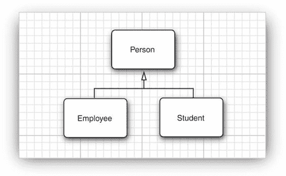

图 5.2. Person 及其子类的继承图

为什么要费力达到如此水平的？有些属性是合理的，例如姓名。员工和学生都有名字，引入一个父类让我们提取出在继承层次结构中的。现在添加另一个方法，其目的是返回简短的描述。但如果你使用`abstract`关键字，那么你必须将子类也标记为抽象。例如，我们将定义一个`Student`类，继承`Person`类并实现`getDescription`方法。`Student`类的所有的方法都不是抽象的，因此它不需要被声明为抽象类。

类甚至可以被声明为`abstract`，即使它没有抽象方法。

除了抽象方法，抽象类还可以有字段和具体方法。例如，`Person`类存储姓名并有一个返回它的具体方法：

```java
abstract class Person
{
    private String name;
    public Person(String n)
    {
        name = n;
    }
    public abstract String getDescription();
    public String getName()
    {
        return name;
    }
}
```

---

 提示

有些程序员并没有意识到抽象类可以有具体方法。你应该始终将公共字段和方法（无论是否抽象）移动到父类。

---

抽象方法是子类中实现方法的占位符。当你扩展一个抽象类时，有两种选择。你可以留下部分或所有的抽象方法未定义；那么你必须将子类也标记为抽象。或者你可以定义所有的，这样子类就不再是抽象。

例如，我们将定义一个`Student`类，继承`Person`类并实现`getDescription`方法。`Student`类的所有的方法都不是抽象的，因此它不需要被声明为抽象类。

抽象类不能被实例化。也就是说，如果一个类被声明为`abstract`，则无法创建该类的对象。例如，表达式：

```java
new Person("Vince Vu")
```

是一个错误。但是，你可以创建具体子类的对象。

注意，你仍然创建抽象类的*对象变量*，但这样的变量必须指向一个非抽象子类的对象。例如：

```java
Person p = new Student("Vince Vu", "Economics");
```

这里`p`是抽象类型`Person`的变量，它指向非抽象子类`Student`的实例。

 C++ 笔记

在 C++ 中，抽象方法被称为`pure virtual function`（纯虚函数），并带有尾随的`= 0`标记，例如：

```cpp
class Person // C++
{
public:
   virtual string getDescription() = 0;
   . . .
};
```

如果一个 C++ 类至少有一个纯虚函数，那么它就是抽象类。在 C++ 中，没有特殊的关键字来表示抽象类。

---

让我们定义一个继承自抽象类`Person`的具体子类`Student`：

```java
class Student extends Person
{
   private String major;
   public Student(String n, String m)
   {
      super(n);
      major = m;
    }
   public String getDescription()
   {
      return "a student majoring in " + major;
    }
}
```

`Student`类定义了`getDescription`方法。因此，`Student`类中的所有方法都是具体的，该类不再是抽象类。

Listing 5.4 所示程序定义了抽象父类`Person`（Listing 5.5）以及两个具体子类`Employee`（Listing 5.6）和`Student`（Listing 5.7）。我们用员工和学生对象填充`Person`引用数组：

```java
Person[] people = new Person[2];
people[0] = new Employee(. . .);
people[1] = new Student(. . .);
```

然后，我们打印这些对象的名称和描述：

```java
for (Person p : people)
   System.out.println(p.getName() + ", " + p.getDescription());
```

有些人对以下调用感到困惑：

```java
p.getDescription()
```

这不是对一个未定义方法的调用吗？请记住，变量`p`永远不会引用`Person`对象，因为无法构造抽象类`Person`的对象。变量`p`始终引用如`Employee`或`Student`等具体子类的对象。对于这些对象，定义了`getDescription`方法。

你是否可以完全从`Person`父类中省略该抽象方法，仅在`Employee`和`Student`子类中定义`getDescription`方法呢？如果你这样做，你将无法在变量`p`上调用`getDescription`方法。编译器确保你只调用在类中声明的方法。

代码列表 5.4. `abstractClasses/PersonTest.java`

点击此处查看代码图片


```java
package abstractClasses;

/**
 * 此程序演示了抽象类。
 *
 * @version 1.01 2004-02-21
 * @author Cay Horstmann
 */
public class PersonTest {
    public static void main(String[] args) {
        Person[] people = new Person[2];

        // 用 Student 和 Employee 对象填充 people 数组
        people[0] = new Employee("Harry Hacker", 50000, 1989, 10, 1);
        people[1] = new Student("Maria Morris", "computer science");

        // 打印所有 Person 对象的名称和描述
        for (Person p : people)
            System.out.println(p.getName() + ", " + p.getDescription());
    }
}
```

抽象方法是 Java 编程语言中的重要概念。你最常见会在*接口*内部遇到它们。关于接口的更多信息，请参阅第 6 章。

代码列表 5.5. abstractClasses/Person.java

点击此处查看代码图片

```java
package abstractClasses;

public abstract class Person {
    public abstract String getDescription();

    private String name;

    public Person(String n) {
        name = n;
    }

    public String getName() {
        return name;
    }
}
```

代码列表 5.6. abstractClasses/Employee.java

点击此处查看代码图片

```java
package abstractClasses;

import java.util.Date;
import java.util.GregorianCalendar;

public class Employee extends Person {
    private double salary;
    private Date hireDay;

    public Employee(String n, double s, int year, int month, int day) {
        super(n);
        salary = s;
        GregorianCalendar calendar = new GregorianCalendar(year, month, day);
        hireDay = calendar.getTime();
    }

    public double getSalary() {
        return salary;
    }

    public Date getHireDay() {
        return hireDay;
    }
}
```

代码列表 5.7. abstractClasses/Student.java

点击此处查看代码图片

```java
package abstractClasses;

public class Student extends Person {
    private String major;

    /**
     * @param n 姓名
     * @param m 专业
     */
    public Student(String n, String m) {
        super(n);
        major = m;
    }

    public String getDescription() {
        return "a student majoring in " + major;
    }
}
```

#### 5.1.7. 保护访问

如你所知，Java 类中的字段最好标记为`private`，而方法通常标记为`public`。任何标记为`private`的特征对其他类可见。对于子类也是如此：子类无法访问父类的私有字段。

然而，有时你希望将方法限制为子类，或者较少地允许子类访问父类字段。在这种情况下，我们将类特征声明为`protected`。例如，如果父类`Employee`将`hireDay`字段声明为`protected`，那么`Manager`方法就可以直接访问。

但是`Manager`类只能访问`Manager`对象的`hireDay`字段，而不是其他`Employee`对象。在实践中，请谨慎使用保护字段。假设你的类被其他程序员使用，而你在设计时使用了保护字段。在不知情的情况下，其他程序员继承你的类并开始访问这些保护字段。在这种情况下，你无法在不影响其他程序员的情况下更改类的实现。这违背了鼓励数据封装的 OOP 精神。

保护方法更有意义。一个类可以将难以使用的方法声明为`protected`，这表示子类（它们通常很熟悉祖先）可以被信任正确地使用该方法，而其他类则不能。

此类方法的很好的例子是`Object`类的`clone`方法——请参阅第 6 章了解更多详情。

事实上，Java 中的保护特征对所有子类可见，同时也对同一包中的所有其他类可见。这与 C++ 中保护的含义略有不同，使得 Java 中的`protected`概念比 C++ 更不安全。

以下是 Java 中控制可见性的种访问修饰符总结：

1. 仅对类可见（`private`）。

2. 全球可见（`public`）。

3. 对包和所有子类可见（`protected`）。

4. 对包可见——（不幸的）默认值。不需要修饰符。

### 5.2. Object：宇宙父类

`Object`类是终极祖先——Java 中的所有类都继承自`Object`。然而，你永远不需要写出：

```java
class Employee extends Object
```

如果没有显式地指定父类，则终极父类`Object`会被认为是理所当然的。由于 Java 中的每个类都继承`Object`，因此熟悉`Object`类提供的服务是非常重要的。我们将在本章介绍基础方法；对于未涵盖的内容，请参阅后面的章节或查看在线文档。（`Object`的某些方法只有在处理线程时才会出现——有关线程的更多信息请参见第 14 章。）

你可以使用`Object`变量来引用任何类型的对象：

```java
Object obj = new Employee("Harry Hacker", 35000);
```

当然，`Object`类型的变量只有作为任意值的通用容器时才有用。要对该值进行任何特定操作，你需要对原始类型有所了解，并应用类型转换：

```java
Employee e = (Employee) obj;
```

在 Java 中，只有基本类型（数字、字符和`boolean`值）不是对象。

所有的数组类型，无论是对象数组还是基本类型数组，都是继承自`Object`类的类型。

```java
Employee[] staff = new Employee[10];
obj = staff; // OK
obj = new int[10]; // OK
```

 C++ 注意

在 C++ 中，没有宇宙根类。然而，每个指针都可以转换为`void*`指针。

### 5.2.1 equals 方法

`Object`类中的`equals`方法测试一个对象是否被认为与另一个相等。`Object`类中实现的`equals`方法判断两个对象引用是否相同。这是一个非常合理的默认值——如果两个对象是相同的，它们理应当是相等的。对于许多类来说，不需要其他操作。例如，比较两个`PrintStream`对象的相等性并没有意义。但是，你通常希望实现基于状态的相等性测试，当两个对象具有相同状态时，它们被认为是相等的。

例如，让我们认为如果两个员工具有相同的姓名、薪和入职日期，那么他们就是相等的。（在实际的员工数据库中，比较 ID 可能会更合理。我们使用这个示例来演示实现`equals`方法的机制。）

点击此处代码图像

```java
class Employee {
    . .

    public boolean equals(Object otherObject) {
        // 快速测试对象是否相同
        if (this == otherObject) return true;

        // 如果显式参数为 null，必须返回 false
        if (otherObject == null) return false;

        // 如果类不匹配，则它们不相等
        if (getClass() != otherObject.getClass())
            return false;

        // 现在我们知道 otherObject 是一个非空的 Employee
        Employee other = (Employee) otherObject;

        // 测试字段是否具有相同的值
        return name.equals(other.name)
            && salary == other.salary
            && hireDay.equals(other.hireDay);
    }
}
```

`getClass`方法返回对象的类——我们将在本章稍后讨论这个方法。在我们的测试中，两个对象只有在属于同一个类时才是相等的。

 提示

为了防止`name`或`hireDay`为`null`的可能，请使用`Objects.equals`方法。调用`Objects.equals(a, b)`在两个参数均为`null`时返回`true`，如果仅一个为`null`则返回`false`，否则调用`a.equals(b)`。使用该方法，`Employee.equals`方法的最后语句变为：

```java
return Objects.equals(name, other.name)
    && salary == other.salary
    && Objects.equals(hireDay, other.hireDay);
```

当你为子类定义`equals`方法时，先调用父类调用`equals`。如果该测试没有通过，那么这些对象就不相等。如果父类字段相等，那么你就可以比较子类的实例字段了。

点击此处代码图像

```java
class Manager extends Employee {
    . .

    public boolean equals(Object otherObject) {
        if (!super.equals(otherObject)) return false;

        // super.equals 检查了此和 otherObject 是否属于同一个类
        Manager other = (Manager) otherObject;
        return bonus == other.bonus;
    }
}
```

### 5.2.2 相等测试与继承

如果隐式和显式参数不属于同一个类，`equals`方法应该如何表现？这直一直是存在争议的领域。在上一个示例中，如果类不匹配，`equals`方法返回`false`。但许多程序员转而使用`instanceof`测试：

```java
if (!(otherObject instanceof Employee)) return false;
```

这留下了`otherObject`可能属于子类的可能性。然而，这种方法可能会让你遇到麻烦。以下是原因。Java 语言规范要求`equals`方法具有以下属性：

1. **自反射性**：对于任何非空引用`x`，`x.equals(x)`应返回`true`。

2. **对称性**：对于任何引用`x`和`y`，当且仅当`y.equals(x)`返回`true`时，`x.equals(y)`返回`true`。

3. **传递性**：对于任何引用`x`、`y`和`z`，如果`x.equals(y)`返回`true`且`y.equals(z)`返回`true`，则`x.equals(z)`应返回`true`。

4. **一致性**：如果`x`和`y`所引的对象没有改变，则重复调用`x.equals(y)`返回相同的值。

5. **非空性**：对于任何非空引用`x`，`x.equals(null)`应返回`false`。

这些规则是非常合理的。在数据结构中定位元素时，你不想思考调用`x.equals(y)`还是`y.equals(x)`。

然而，当参数属于不同的类时，对称规则会有微妙的影响。考虑调用`e.equals(m)`，其中`e`是`Employee`对象，而`m`是`Manager`对象，它们恰好具有相同的姓名、薪水和入职日期。如果`Employee.equals`使用`instanceof`测试，则调用返回`true`。但这意味着反向调用`m.equals(e)`也需要返回`true`——对称规则不允许它返回`false`或抛出异常。

这让`Manager`类陷入了困境。它的`equals`方法必须准备好与任何`Employee`进行比较，而不考虑特有的信息！突然之间，`instanceof`测试看起来没那么有吸引力了。

有些作者认为`getClass`测试是错误的，因为它违反了替换原则。一个经常被引用的例子是`AbstractSet`类中的`equals`方法，它测试两个集合是否具有相同的元素。`AbstractSet`类有两个子类`TreeSet`和`HashSet`，它们使用不同的算法来定位元素。你真的希望能够比较任何集合，无论它们是如何实现的。

然而，集合的例子相当特殊。将`AbstractSet.equals`声明为`final`将是有意义的，因为不应该重新定义集合相等的语义。（该方法实际上并不是`final`。这允许子类实现更高效的相等测试算法。）

在我们看来，存在两种不同的场景：

- 如果子类可以有自己的相等性定义，那么对称性迫使你使用`getClass`测试。
- 如果相等性定义在父类中是固定的，那么你可以使用`instanceof`测试，并允许不同子类的对象彼此相等。

在员工和经理的示例中，我们认为当两个对象具有匹配的字段时它们是相等的。如果我们有两个`Manager`对象的姓名、薪水和入职日期相同，但奖金不同，我们希望它们被视为不同的。因此，我们使用了`getClass`测试。

但假设我们使用员工 ID 进行等性测试。这种等性概念对于所有子类都是合理的。那么我们就可以使用`instanceof`测试，并且我们应该将`Employee.equals`声明为`final`。

 注意

标准 Java 库包含了 150 多种`equals`方法的实现，这些实现混杂了：使用`instanceof`、调用`getClass`、捕获`ClassCastException`或者什么都不做。查看`java.sql.Timestamp`类的 API 文档，实现者在其中有些尴尬地指出，他们让自己陷入了困境。`Timestamp`类继承自`java.util.Date`，后者的`equals`方法使用了`instanceof`测试，而无法重写`equals`以使其同时满足对称性和准确性。

这里是编写完美的`equals`方法的配方：

1. 将显式参数命名为`otherObject`——稍后，你将其将其转换为另一个名为`other`的变量。

2. 测试`this`是否恰好与`otherObject`相同：

```java
if (this == otherObject) return true;
```

这条语句仅仅是一种优化。在实践中，这是一种常见情况。检查标识性比比较字段要便宜得多。

3. 测试`otherObject`是否为`null`，如果是则返回`false`。这个测试是必须的。

```java
if (otherObject == null) return false;
```

4. 比较`this`和`otherObject`的类。如果`equals`的语义在子类中发生变化，使用`getClass`测试：

```java
if (getClass() != otherObject.getClass()) return false;
```

如果所有子类都保持相同的语义，你可以使用`instanceof`测试：


```java
(!(otherObject instanceof ClassName)) return false;
```

**5.** 将 `otherObject` 转换为你的类类型的变量：

```java
ClassName other = (ClassName) otherObject
```

**6.** 现在根据你的等性定义来比较字段。对于原始类型字段使用 `==`，对于对象字段使用 `Objects.equals`。如果所有字段匹配则返回 `true`，否则返回 `false`。

```java
return field1 == other.field1
    && Objects.equals(field2, other.field2)
    && . . .;
```

如果你在子类中重定义了 `equals`，请包含对 `super.equals(other)` 的调用。


> **提示**
>
> 如果你有数组类型的字段，可以使用静态方法 `Arrays.equals` 来检查对应的数组元素是否相等。


> **注意**
>
> 这是实现 `equals` 方法时的一个常见错误。你能发现问题所在吗？

点击此处查看代码图片

```java
public class Employee
{
    public boolean equals(Employee other)
    {
      return Objects.equals(name, other.name)
          && salary == other.salary
          && Objects.equals(hireDay, other.hireDay);
    }
    . . .
}
```

此方法将显式参数类型声明为 `Employee`。结果，它没有重写 `Object` 类的 `equals` 方法，而是定义了一个完全无关的方法。

你可以通过对意图重写父类方法的标记 `@Override` 来防止此类错误：

```java
@Override public boolean equals(Object other)
```

如果你犯了错误并正在定义一个新方法，编译器会报告错误。例如，假设你在 `Employee` 类中添加了以下声明：

```java
@Override public boolean equals(Employee other)
```

将会报告错误，因为此方法没有重写来自 `Object` 父类的任何方法。

---

### `java.util.Arrays` 1.2

- `static boolean equals(type[] a, type[] b)` 5.0

如果数组长度相等且对应位置的元素相等，则返回 `true`。数组的组件类型可以是 `Object`、`int`、`long`、`short`、`char`、`byte`、`boolean`、`float` 或 `double`。

### `java.util.Objects` 7

- `static boolean equals(Object a, Object b)`

如果 `a` 和 `b` 都为 `null`，则返回 `true`；如果只有一个为 `null`，则返回 `false`；否则返回 `a.equals(b)`。

## 5.2.3. `hashCode` 方法

哈希码是从对象派生的整数。哈希码应该是随机的——如果 `x` 和 `y` 是两个不同的对象，那么有很大概率 `x.hashCode()` 和 `y.hashCode()` 是不同的。

返回此对象的哈希值。哈希值可以是任何整数，正数或负数。相等的对象需要返回相同的哈希值。

### `java.lang.Objects` 7

- `static int hash(Object... objects)`

返回一个由所有提供的对象的哈希值组合成的哈希值。

- `static int hashCode(Object a)`

如果 `a` 为 `null`，则返回 `0`，否则返回 `a.hashCode()`。

### `java.util.Arrays` 1.2

- `static int hashCode(type[] a)` 5.0

计算数组 `a` 的哈希值，其组件类型可以是 `Object`、`int`、`long`、`short`、`char`、`byte`、`boolean`、`float` 或 `double`。

## 5.2.4. `toString` 方法

`Object` 中的另一个重要方法是 `toString`，它返回表示该对象值的字符串。这是一个典型的示例。`Point` 类的 `toString` 方法返回如下所示字符串：

```text
java.awt.Point[x=10,y=20]
```

大多数（但并非所有）`toString` 方法都遵循这种格式：类名，后面跟着方括号括内的字段值。以下是 `Employee` 类的 `toString` 方法的实现：

```java
public String toString()
{
   return "Employee[name=" + name
      + ",salary=" + salary
      + ",hireDay=" + hireDay
      + "]";
}
```

实际上，你可以做得更好。与其在 `toString` 方法中硬编码类名，不如调用 `getClass().getName()` 来获取一个包含类名的字符串。

```java
public String toString()
{
   return getClass().getName()
      + "[name=" + name
      + ",salary=" + salary
      + ",hireDay=" + hireDay
      + "]";
}
```

此类 `toString` 方法对子类也同样有效。

当然，子类的程序员应该定义其自己的 `toString` 方法并添加子类的字段。如果父类使用了 `getClass().getName()`，那么子类可以简单地调用 `super.toString()`。例如，这里是 `Manager` 类的 `toString` 方法：

```java
class Manager extends Employee
{
   . . .
   public String toString()
   {
      return super.toString()
         + "[bonus=" + bonus
         + "]";
   }
}
```

现在，`Manager` 对象被打印为 `Manager[name=...,salary=...,hireDay=...][bonus=...]`。

`toString` 方法无处不在是因为一个重要的原因：每当使用 `+` 运算符将对象与字符串拼接时，Java 编译器会自动调用 `toString` 方法来获取对象的字符串表示。例如：

```java
Point p = new Point(10, 20);
String message = "The current position is " + p;
// 自动调用 p.toString()
```

提示：与其编写 `x.toString()`，你也可以写 `"" + x`。该语句将空字符串与 `x` 的字符串表示拼接，这正等同于 `x.toString()`。与 `toString` 不同，即使 `x` 是基本类型，该语句也同样有效。

如果 `x` 是任何对象且你调用 `System.out.println(x);`，那么 `println` 方法简单地调用 `x.toString()` 并打印生成的字符串。

`Object` 类定义了 `toString` 方法来打印类名和对象的哈希值。例如，调用 `System.out.println(System.out)` 产生的输出看起来如下所示：

```text
java.io.PrintStream@2f6684
```

原因是 `PrintStream` 类的实现者没有费力重写 `toString` 方法。

> **注意**
>
> 令人恼的是，数组从 `Object` 继承了 `toString` 方法，额外的问题是数组类型是以一种过时的格式打印的。例如：

```java
int[] luckyNumbers = { 2, 3, 5, 7, 11, 13 };
String s = "" + luckyNumbers;
```

产生字符串 `"[I@1a46e30"`（前缀 `[I` 表示整数数组）。解决办法是调用静态的 `Arrays.toString` 方法。代码：

```java
String s = Arrays.toString(luckyNumbers);
```

产生字符串 `"[2, 3, 5, 7, 11, 13]"`。要正确打印多维数组（即数组的数组），请使用 `Arrays.deepToString`。

`toString` 方法是日志记录的一个很好的工具。标准库中的许多类定义了 `toString` 方法，以便你可以获取有关对象状态有用信息。这在记录如下消息时特别有用：

`System.out.println("Current position = " + position);`

正如我们在第 1 章中解释的，更好的解决方案是使用 `Logger` 类的对象并调用 `Logger.global.info("Current position = " + position);`。

提示：我们强烈建议为你编写的每个类添加一个 `toString` 方法。你以及使用你类的其他程序员都会感谢这种日志支持。

列表 5.8 中的程序为 `Employee` 和 `Manager` 类实现了 `equals`、`hashCode` 和 `toString` 方法。

### 列表 5.8 `equals.java`

```java
package equals;

/**
 * 此程序演示了 equals 方法。
 * @version 1.12-26
 * @author Caymann
 */
public class EqualsTest
{
   public static void main(String[] args)
   {
      Employee alice1 = new Employee("Alice Adams", 75000, 1987, 12, 25);
      Employee alice2 = new Employee("Alice Adams", 75000, 1987, 12, 25);
      Employee alice3 = new Employee("Alice Adams", 75000, 1987, 12, 25);

      System.out.println("Current position = " + alice1);
      System.out.println("Current position = " + alice2);
      System.out.println("Current position = " + alice3);
      System.out.println("alice1 == alice2: " + (alice1 == alice2));
      System.out.println("alice1 == alice3: " + (alice1 == alice3));
      System.out.println("alice1.equals(alice2): " + alice1.equals(alice2));
      System.out.println("alice1.equals(alice3): " + alice1.equals(alice3));
      System.out.println("alice1.hashCode(): " + alice1.hashCode());
      System.out.println("alice3.hashCode(): " + alice3.hashCode());

      Manager bob = new Manager("Bobson", 50000, 1989, 10, 1);
      Manager carl = new Manager("Carl Cracker", 80000, 1987, 12, 15);
      Manager boss = new Manager("Carl Cracker", 80000, 1987, 12, 15);

      boss.setBonus(5000);
      System.out.println("boss.toString(): " + boss);
      System.out.println("carl.equals(boss): " + carl.equals(boss));
      System.out.println("alice1.hashCode(): " + alice1.hashCode());
      System.out.println("alice3.hashCode(): " + alice3.hashCode());
      System.out.println("bob.hashCode(): " + bob.hashCode());
      System.out.println("carl.hashCode(): " + carl.hashCode());
   }
}
```

### 列表 5.9 `Employee.java`

```java
package equals;

import java.util.Date;
import java.util.GregorianCalendar;
import java.util.Objects;

public class Employee
{
   private String name;
   private double salary;
   private Date hireDay;

   public Employee(String n, double s, int year, int month, int day)
   {
      name = n;
      salary = s;
      GregorianCalendar calendar = new GregorianCalendar(year, month - 1, day);
      hireDay = calendar.getTime();
   }

   public String getName()
   {
      return name;
   }

   public double getSalary()
   {
      return salary;
   }

   public Date getHireDay()
   {
      return hireDay;
   }

   public void raiseSalary(double byPercent)
   {
      double raise = salary * byPercent / 100;
      salary += raise;
   }

   public boolean equals(Object otherObject)
   {
      // 快速测试对象是否相同
      if (this == otherObject) return true;
   }
}
```

```java
// 如果显式参数为空，则返回 false
if (otherObject == null) return false;
// 如果类不匹配，则它们就不可能相等
if (getClass() != otherObject.getClass()) return false;

// 现在我们知道 otherObject 是一个非空的 Employee
Employee other = (Employee) otherObject;

// 测试字段是否具有相同的值
return Objects.equals(name, other.name) && salary == other.salary &&
    Objects.equals(hireDay, other.hireDay);
}

public int hashCode() {
    return Objects.hash(name, salary, hireDay);
}

public String toString() {
    return getClass().getName() + "[name=" + name + ",salary=" + salary + ",hireDay=" + hireDay
            + "]";
}
```

### 列表 5.10. `equals/Manager.java`

点击此处查看图片


```java
package equals;

public class Manager extends Employee {
    private double bonus;

    public Manager(String n, double s, int year, int month, int day) {
        super(n, s, year, month, day);
        bonus = 0;
    }

    public double getSalary() {
        double baseSalary = super.getSalary();
        return baseSalary + bonus;
    }

    public void setBonus(double b) {
        bonus = b;
    }

    public boolean equals(Object otherObject) {
        if (!super.equals(otherObject)) return false;
        Manager other = (Manager) otherObject;
        // super.equals 检查了此和其他是否属于同一个类
        return bonus == other.bonus;
    }

    public int hashCode() {
        return super.hashCode() + 17 * new Double(bonus).hashCode();
    }

    public String toString() {
        return super.toString() + "[bonus=" + bonus + "]";
    }
}
```

#### `java.lang.Object`

- `getClass()`：返回一个包含对象信息的类对象。正如你稍后看到的，Java 有一种封装在 `Class` 类中的类的运行时表示。
- `equals(Object otherObject)`：比较两个对象的相等性；如果对象指向内存的同一区域，则返回 `true`，否则返回 `false`。你应该在自己的类中重写此方法。
- `toString()`：返回表示此对象值的字符串。你应该在自己的类中重写此方法。
- `getName()`：返回该类的名称。
- `getSuperclass()`：以 `Class` 对象的形式返回类的超类。

### 5.3 泛型数组列表

在许多编程语言中——特别是 C++——你必须固定所有数组的大小。程序员们讨厌这一点，因为这迫使他们做出不妥的权衡。一个部门会有多少员工？肯定不超过 100 人吧？如果有一个拥有 150 名员工的巨型部门呢？难道我们要为每个部门浪费 90 个条目吗？在 Java 中，情况要好得多。你可以在运行时设置数组的大小。

```java
int actualSize = ...;
Employee[] staff = new Employee[actualSize];
```

当然，这段代码并没有完全解决在运行时动态修改数组的问题。一旦你设置了数组大小，就无法轻易更改它。相反，在 Java 中你可以通过使用另一个名为 `ArrayList` 的类来处理这种常见情况。`ArrayList` 类类似于数组，但当你添加和删除元素时，它会自动调整其容量，而不需要任何额外的代码。

`ArrayList` 是一个带有类型参数的泛型类。要指定数组列表所含元素的类型，你只需附加一个封装在尖括号中的类名，例如 `ArrayList<Employee>`。你将在第 13 章中看到如何定义自己的泛型类，但在使用 `ArrayList` 类型时，你不需要了解任何这些技术细节。在这里，我们声明并构造了一个持有 `Employee` 对象的数组列表：

```java
ArrayList<Employee> staff = new ArrayList<Employee>();
```

类型参数 `Employee` 在两边都使用显得有点繁琐。从 Java 7 开始，你可以省略右侧的类型参数：

```java
ArrayList<Employee> staff = new ArrayList<>();
```

这被称为“菱形”语法，因为空括号 `<>` 看起来像菱形。将菱形语法与 `new` 操作符使用。编译器会检查新值发生的情况。如果它被赋值给变量、传递给方法或从方法返回，编译器就会检查泛型并将该类型放入 `<>` 中。在我们的示例中，`new ArrayList<>()` 被赋值给类型为 `ArrayList<Employee>` 的变量。因此，泛型类型是 `Employee`。

> 在 Java SE 5.0 之前，没有泛型类。相反，有一个单一的 `ArrayList` 类，这是一个“通用”集合，持有 `Object` 类型的元素。你仍然可以在不带 `<>` 后缀的情况下使用 `ArrayList`；它被视为“原始”类型，类型参数被擦除。

> 在旧版本的 Java 中，程序员使用 `Vector` 类来实现动态数组。然而，`ArrayList` 类更高效，不再有任何理由使用 `Vector` 类了。

使用 `add` 方法向数组列表添加新元素。例如，这里是向数组列表填充员工对象的方法：

点击此处查看图片

```java
staff.add(new Employee("Harry Hacker"));
staff.add(new Employee("Tony Tester"));
```

数组列表管理一个对象引用的数组。最终，该数组会耗尽空间。这就是数组列表的魔力所在：如果你调用 `add` 且数组已满，数组列表会自动创建一个更大的数组并将所有对象从小数组复制到大数组。

如果你已经知道或很好地估计要存储多少个元素，可以在填充数组列表之前调用 `ensureCapacity` 方法：

```java
staff.ensureCapacity(100);
```

该调用分配了一个包含 100 个对象的数组。那么，前 100 次 `add` 调用将不会涉及昂贵的重新分配。你也可以向 `ArrayList` 构造函数传递初始容量：

```java
ArrayList<Employee> staff = new ArrayList<>(100);
```

注意：使用 `new ArrayList<>(100)` 分配数组列表与使用 `new Employee[100]` 分配数组是不相同的。数组列表的容量和数组的大小之间存在重要的区别。如果你分配了一个 100 个条目的数组，那么该数组就有 100 个空位备用。容量为 100 个元素的数组列表具有持有 100 个元素的潜力（实际上可以更多，但是以额外重新分配为代价），但在刚开始，即使在初始构造之后，数组列表也完全不持有元素。

`size` 方法返回数组列表中的实际元素数量。例如：

```java
staff.size()
```

返回 `staff` 数组列表中当前的元素数量。这等于数组 `a` 的 `a.length`。

一旦修剪了数组列表（array list）的大小，添加新元素将再次移动数据块，这会消耗时间。只有当你确定不会再向该数组列表添加更多元素时，才应该使用 `trimToSize`。

 C++ 注意

`ArrayList` 类类似于 C++ 的 `vector` 模板。`ArrayList` 和 `vector` 都是泛型类型。但 C++ 的 `vector` 模板重载了 `[]` 运算符以便方便访问元素。Java 不支持运算符重载，因此必须使用显式方法调用。此外，C++ 的 `vector` 是按值复制的。如果 `a` 和 `b` 是两个 `vector`，那么赋值 `a = b` 会使 `a` 变成一个与 `b` 长度相同的新 `vector`，并将所有元素从 `b` 复制到 `a`。在 Java 中，相同的赋值将使 `a` 和 `b` 指向同一个数组列表。

### `java.util.ArrayList<T>` 1.2

- `ArrayList<T>()`：构建一个空的数组列表。
- `ArrayList<T>(int initialCapacity)`：构建一个指定容量的空数组列表。
- `boolean add(T obj)`：在数组列表末尾添加一个元素。始终返回 `true`。
- `int size()`：返回数组列表中当前存储的元素数量。（当然，这永远不会大于数组列表的容量。）
- `void ensureCapacity(int capacity)`：确保数组列表有容量存储指定数量的元素，而无需重新分配其内部存储数组。
- `void trimToSize()`：将数组列表的存储容量缩小到其当前大小。


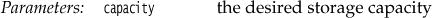

#### 5.3.1 访问数组列表元素

遗憾的是，没有免费的午餐。数组列表提供的自动增长便利性需要更复杂的语法来访问元素。这是由于 `ArrayList` 类并不是 Java 编程语言的一部分；它只是由他人编写并提供在标准库中的工具类。

与其使用愉快的 `[]` 语法来访问或更改数组元素，不如你使用 `get` 和 `set` 方法。

例如，要设置第 `i` 个元素，你使用：

```java
staff.set(i, harry);
```

这等同于：

```java
a[i] = harry;
```

对于数组 `a`。（和数组一样，索引值从零开始。）

 注意

在数组列表的 `size` 大于 `i` 之前，不要调用 `list.set(i, x)`。例如，以下代码是错误的：

```java
ArrayList<Employee> list = new ArrayList<>(100); // 容量 100，大小 0
list.set(0, x); // 还没有元素 0
```

使用 `add` 方法而不是 `set` 来填充数组，并仅使用 `set` 来替换之前添加的元素。

要获取数组列表元素，使用：

```java
Employee e = staff.get(i);
```

这等同于：

```java
Employee e = a[i];
```

 注意

当没有泛型类时，原始（raw）`ArrayList` 类的 `get` 方法只能返回一个 `Object`。因此，`get` 的调用者必须将返回值强制转换为所需的类型：

```java
Employee e = (Employee) staff.get(i);
```

原始 `ArrayList` 也有点危险。它的 `add` 和 `set` 方法接受任何类型的对象。调用：

```java
staff.set(i, new Date());
```

在甚至没有任何警告的情况下就能通过编译，只有当你检索对象并尝试对其进行强制转换时，才会遇到麻烦。如果你使用 `ArrayList<Employee>`，编译器将检测到这个错误。

你有时可以通过以下技巧兼得两者之长——灵活的增长和方便的元素访问。首先，创建一个数组列表并添加所有元素：

```java
ArrayList<X> list = new ArrayList<>();
while (. . .) {
    x = . . .;
    list.add(x);
}
```

完成后，使用 `toArray` 方法将元素复制到数组中：

```java
X[] a = new X[list.size()];
list.toArray(a);
```

有时，你需要在数组列表的中间添加元素。使用带有索引参数的 `add` 方法：

```java
int n = staff.size() / 2;
staff.add(n, e);
```

位置 `n` 及以上的元素将向上移动，以为新条目留出空间。如果插入后数组列表的新大小超过了容量，数组列表将重新分配其存储数组。

同样，你可以从数组列表的中间删除一个元素：

```java
Employee e = staff.remove(n);
```

位于其上方的元素将向下复制，数组的大小减一。插入和删除元素的效率并不高。对于小型数组列表，可能不需要担心。但如果你存储了许多元素并频繁在中间插入和删除，请考虑使用链表。

`staff` 对象被简单地传递给 `update` 方法。

 注意

即使你没有收到编译器的错误或警告，此调用也不是完全安全的。`update` 方法可能会向数组列表中添加不是 `Employee` 类型的元素。当检索这些元素时，会抛出异常。这听起来很吓，但如果你仔细考虑，这种行为实际上与 Java 引入泛型之前的行为并无异。虚拟机的完整性永远不会受到威胁。在这种情况下，你并没有丢失安全性，但你无法从编译时检查中获益。

相反，当你将一个原始 `ArrayList` 赋值给带类型的 `ArrayList` 时，你会得到一个警告。

```java
ArrayList<Employee> result = employeeDB.find(query); // 产生警告
```

 注意

要查看警告文本，请使用选项 `-Xlint:unchecked` 进行编译。

使用类型转换并不能消除警告。

点击此处查看代码图像

```java
ArrayList<Employee> result = (ArrayList<Employee>) employeeDB.find(query);
   // 产生另一个警告
```

相反，你会得到一个不同的警告，它告诉你该转换是误导性的。

这是 Java 泛型类型一个相当遗憾的局限性导致的后果。为了兼容性，编译器在检查未违反类型规则后，会将所有带类型的数组列表转换为原始的 `ArrayList` 对象。在运行的程序中，所有的数组列表都是相同的——虚拟机中没有类型参数。因此，`(ArrayList)` 和 `(ArrayList<Employee>)` 执行的是完全相同的运行时检查。

对于这种情况，你无能为力。当你与旧留代码交互时，请研究编译器的警告，并让自己确信这些警告并不严重。

一旦你满意了，可以使用 `@SuppressWarnings("unchecked")` 注解来标记接收转换的变量，如下所示：

点击此处查看代码图像

```java
@SuppressWarnings("unchecked")
ArrayList<Employee> result =
    (ArrayList<Employee>) employeeDB.find(query); // 产生另一个警告
```

### 5.4 包装类与自动装箱

有时，你需要将基本数据类型（如 `int`）转换为对象。所有基本类型都有对应的类。例如，`Integer` 类对应于基本类型 `int`。这些类通常被称为包装类。包装类的名称非常直接：`Integer`、`Long`、`Float`、`Double`、`Short`、`Byte`、`Character`、`Void` 和 `Boolean`。（前六个自公共父类 `Number`）。包装类是不可变的——在构造函数之后，你无法更改被包装的值。它们也是 `final` 的，所以你不能派它们的子类。

假设我们需要一个整数数组列表。遗憾的是，括号内的类型参数不能是基本类型。无法形成 `ArrayList<int>`。在这里，`Integer` 包装类派上了用场。声明一个 `Integer` 对象的数组列表是可以的。

```java
ArrayList<Integer> list = new ArrayList<>();
```

 注意

`ArrayList<Integer>` 的效率远低于 `int[]` 数组，因为每个值都被单独包装在一个对象内部。只有当程序员的便利性比效率更重要时，你才希望对小型集合使用这种结构。

Java SE 5.0 的另一个创新使得添加和获取数组元素变得简单。调用：

```java
list.add(3);
```

会被转换为：

```java
list.add(Integer.valueOf(3));
```

这种转换被称为自动装箱（autoboxing）。

 注意

你可能认为自动拆箱会更一致，但“装箱（boxing）”这个比喻是自 C# 的。

相反，当你将一个 `Integer` 对象赋值给 `int` 值时，它会被自动拆箱。也就是说，编译器会将：

```java
int n = list.get(i);
```

转换为：

```java
int n = list.get(i).intValue();
```

自动装箱和自动拆箱在算术表达式中同样有效。例如，你可以对包装引用应用递增运算符：

```java
Integer n = 3;
n++;
```

编译器会自动插入指令来拆箱对象、增加产生的值，并将其重新装箱。

在大多数情况下，你会有那种基本类型及其包装类是同一实物的错觉。它们只在一个点上存在显著差异：标识性（identity）。如你所知，`==` 运算符应用于包装对象时，仅测试这些对象是否具有相同的内存位置。因此，下面的比较可能会失败：

```java
Integer a = 1000;
Integer b = 1000;
if (a == b) . . .
```

然而，Java 的实现如果选择，可以将经常出现的值包装成完全相同的对象，因此比较可能会成功。这种歧义性不是你想要的。补救办法是在比较包装对象时调用 `equals` 方法。

 注意


自动装箱规范要求 `boolean`、`byte`、`char` ≤ `127`、`short` 和 `int` 在 `-128` 到 `127` 之间被包装成固定对象。例如，如果 `a` 和 `b` 初始化为 `100`，那么比较将会成功。

最后，让我们强调装箱和拆箱是编译器的便利，而不是虚拟机的功能。编译器在生成字节码时会插入必要的调用。

你经常看到数字包装类的另一个原因是，Java 的设计者发现包装类是放置某些方法的方便位置，例如字符串转换为数字。

要将字符串转换为整数，使用以下语句：

```java
int x = Integer.parseInt(s);
```

API 说明了 `Integer` 类的一些重要方法。其他类也实现了相应的方法。


> **注意**
>
> 有些人认为包装类可以用于实现修改参数的方法。然而这不对。回想第 4 章，无法编写一个增加参数的 Java 方法，因为方法的参数总是按值传递的。

点击此处查看代码图像：

```java
public static void triple(int x) // 不可行
{
   x = 3 * x; // 修改了局部变量
}
```

我们可以通过使用 `Integer` 代替 `int` 来克服这个问题吗？

点击此处查看代码图像：

```java
public static void triple(Integer x) // 不可行
{
   . . .
}
```

问题是 `Integer` 对象是不可变的：包装器内部的信息无法更改。你不能使用这些包装类来创建修改参数的方法。

如果你确实想写一个修改参数的方法，可以使用 `org.omg.CORBA` 包中定义的某种持有者类型：`IntHolder`、`BooleanHolder` 等。每个持有者类型都有一个公共字段 `value`，你可以通过它访问存储的值。

```java
public static void triple(IntHolder x)
{
   x.value = 3 * x.value;
}
```

返回包含字符串 `s` 中所有数字的整数。该字符串必须表示一个 10 进制整数（第一种方法）或由 `radix` 参数指定的基数（第二种方法）。

- `static Integer valueOf(String s)`
- `static Integer valueOf(String s, int radix)`

返回一个新的 `Integer` 对象，其初始化为包含字符串 `s` 中所有数字的整数。该字符串必须表示一个 10 进制整数（第一种方法）或由 `radix` 参数指定的基数（第二种方法）。

## `java.text.NumberFormat` 1.1

- `Number parse(String s)`

  返回数值，假设指定的 `String` 表示一个数字。

### 5.5. 数量可变参数的方法

在 Java SE 5.0 之前，每个 Java 方法都有固定数量的参数。然而，现在可以提供可以使用变长参数进行调用的方法。（这些方法有时被称为“变长参数”（varargs）方法。）

你已经见过这样一个方法了：`printf`。例如，以下调用：

```java
System.out.printf("%d", n);
```

和：

```java
System.out.printf("%d %s", n, "widgets");
```

都调用了同一个方法，尽管其中一个调用有两个参数，而另一个有三个。

`printf` 方法的定义如下：

点击此处查看代码：

```java
public class PrintStream
{
   public PrintStream printf(String fmt, Object... args) { return format(fmt, args); }
}
```

在这里，省略号 `...` 是 Java 代码的一部分。它表示该方法可以接收任意数量的对象（除了 `fmt` 参数外）。

`printf` 方法实际上接收两个参数：格式化字符串和一个持有所有其他参数的 `Object[]` 数组。（如果调用者提供整数或其他基本类型值，自动装箱会将它们转换为对象。）它现在面临着一项艰巨的任务：扫描 `fmt` 字符串并将第 `i` 个格式说明符与值 `args[i]` 匹配。

换句话说，对于 `printf` 的实现者来说，`Object...` 参数类型与 `Object[]` 完全相同。

编译器需要转换每个对 `printf` 的调用，将参数封装成数组并在必要时进行自动装箱：

```java
System.out.printf("%d %s", new Object[] { new Integer(n), "widgets" } );
```

你可以定义自己的带有变长参数的方法，并且可以为参数指定任何类型，即使是基本类型。这里有一个简单的示例：一个计算变数量数值最大值的函数。

点击此处查看代码：

```java
public static double max(double... values)
{
   double largest = Double.MIN_VALUE;
   for (double v : values) if (v > largest) largest = v;
   return largest;
}
```

只需这样调用该函数：

```java
double m = max(3.1, 40.4, -5);
```

编译器将一个 `new double[] { 3.1, 40.4, -5 }` 传递给 `max` 函数。


> **注意**
>
> 将数组作为变长参数方法的最后一个参数是合法的。例如：
>
> ```java
> System.out.printf("%d %s", new Object[] { new Integer(1), "widgets" } );
> ```
>
> 因此，你可以将最后一个参数为数组的现有函数重新定义为变长参数方法，而不会破坏任何现有代码。例如，`MessageFormat.format` 在 Java SE 5.0 中以此方式得到了增强。如果你愿意，甚至可以将 `main` 方法声明为：
>
> ```java
> public static void main(String... args)
> ```

### 5.6. 枚举类

你已经在第 3 章中看到了如何定义枚举类型。这里有一个典型的示例：

```java
public enum Size { SMALL, MEDIUM, LARGE, EXTRA_LARGE };
```

由此声明定义的类型实际上是一个类。该类恰好有四个实例——无法构造新对象。

因此，你永远不需要对枚举类型的值使用 `equals`。只需使用 `==` 来比较它们即可。

如果你喜欢，可以为枚举类型添加构造函数、方法和字段。当然，构造函数只在枚举常量构造时被调用。这里有一个示例。

点击此处查看代码：

```java
public enum Size
{
   SMALL("S"), MEDIUM("M"), LARGE("L"), EXTRA_LARGE("XL");
   private String abbreviation;
   private Size(String abbreviation) { this.abbreviation = abbreviation; }
   public String getAbbreviation() { return abbreviation; }
}
```

所有枚举类型都是 `Enum` 类的子类。它们继承了该类的许多方法。最有用的是 `toString`，它返回枚举常量的名称。例如，`Size.SMALL.toString()` 返回 `"SMALL"`。

`toString` 的反过来是 `valueOf` 方法。例如，`Size.valueOf(Size.class, "SMALL")` 返回 `SMALL`。

每个枚举类型都有 `values` 方法，返回所有元素的数组。例如，`Size.values()` 返回 `SMALL`、`MEDIUM`、`LARGE` 和 `EXTRA_LARGE`。


> **注意**
>
> 将数组作为变长参数方法的最后一个参数是合法的。例如：`Enum` 类有一个我们忽略的类型参数。例如，`Size` 实际上扩展了 `Enum<Size>`。

## `java.lang.Enum` 5.0

- `static valueOf(Class enumClass, String name)`：返回指定名称的枚举常量。
- `toString()`：返回枚举常量的名称。
- `ordinal()`：返回常量在 `enum` 声明中的位置，从零计数。
- `compareTo(E)`：如果此常量在 `other` 之前返回负整数，如果 `this == other` 则返回零，否则返回正整数。顺序由 `enum` 声明决定。

## `5.12 enums/EnumTest.java`

点击此处查看代码：

```java
package enums;

import java.util.*;

/**
 * 此程序演示了枚举类型。
 * @version 1.0 2004-05-24
 * @author Cay Horstmann
 */
public class EnumTest
{
   public static void main(String[] args)
   {
      Scanner in = new Scanner(System.in);
      System.out.print("Enter a size: (SMALL, MEDIUM, LARGE, EXTRA_LARGE) ");
      String input = in.next().toUpperCase();
      Size size = Enum.valueOf(Size.class, input);
      System.out.println("size=" + size);
      System.out.println("abbreviation=" + size.getAbbreviation());
      if (size == Size.EXTRA_LARGE)
          System.out.println("Good job--you paid attention to the _.");
   }
}

enum Size
{
   SMALL("S"), MEDIUM("M"), LARGE("L"), EXTRA_LARGE("XL");

   private String abbreviation;
   private Size(String abbreviation) { this.abbreviation = abbreviation; }
   public String getAbbreviation() { return abbreviation; }
}
```


- `static valueOf(Class enumClass, String name)` 返回指定名称的枚举常量。
- `toString()` 返回枚举常量的名称。
- `ordinal()` 返回常量在 `enum` 声明中的位置，从零计数。
- `compareTo(E)` 如果此常量在 `other` 之前返回负整数，如果 `this == other` 则返回零，否则返回正整数。顺序由 `enum` 声明决定。

---

## 5.12 enums/EnumTest.java

点击此处查看代码。

`reflection library` 为你提供了一个非常丰富且精密的工具集，用于编写动态操作 Java 代码的程序。这一特性在 `JavaBeans`（Java 的组件架构，被广泛使用，有关 JavaBeans 的更多信息请参见第二卷）中。通过反射，Java 可以支持诸如 Visual Basic 用户所习惯的工具。特别是当在设计时或运行时添加新类时，快速应用开发工具可以动态查询这些类的能力。

能够分析类能力的程序被称为 `reflective`（反射的）。反射机制非常强大。如后续章节所示，你可以使用它来：

- 在运行时分析类的能力；
- 在运行时检查对象——例如，编写一个适用于 `all` 类的单个 `toString` 方法；
- 实现泛型数组处理代码；以及
- 利用在 C++ 等语言中像函数指针一样工作的 `Method` 对象。

反射是一种强大且复杂的机制；但然而，它主要对工具构建者感兴趣，而不是应用程序程序员。如果你对编写应用程序感兴趣，而不是为其他 Java 程序员编写工具，那么你可以安全地跳过本章的剩余部分，以后再回来。

### 5.7.1 Class 类

当你的程序运行时，Java 运行时系统始终对所有对象维护所谓的 `runtime type identification`（运行时类型识别）。这些信息跟踪了每个对象所属的类。虚拟机使用运行时类型信息来选择执行正确的方法。

然而，你也可以通过操作一个特殊的 Java 类来访问这些信息。持有这些信息的类由于名称有点令人困惑，被称为 `Class`。`Object` 类中的 `getClass()` 方法返回 `Class` 类型的实例。

```java
Employee e;
// ...
Class cl = e.getClass();
```

就像 `Employee` 对象描述特定员工的属性一样，`Class` 对象描述特定类的属性。`Class` 类最常用的方法可能是 `getName`。它返回类的名称。例如，该语句：

```java
System.out.println(e.getClass().getName() + " " + e.getName());
```

会打印出：

`Employee Harry Hacker`

如果 `e` 是一个员工，或者：

`Manager Harry Hacker`

如果 `e` 是一个经理。

如果类在包中，则包名是类名的一部分：

```java
Date d = new Date();
Class cl = d.getClass();
String name = cl.getName(); // name 被设置为 "java.util.Date"
```

你可以使用静态方法 `forName` 来获取与类名对应的 `Class` 对象。

```java
String className = "java.util.Date";
Class cl = Class.forName(className);
```

如果类名存储在运行时变化的字符串中，请使用此方法。如果 `className` 是类或接口的名称，则该方法有效。否则，`forName` 方法会抛出一个 `checked exception`（受检异常）。请参见第 261 页的 Section 5.7.2“异常处理原理”，了解在使用此方法时如何提供 `exception handler`（异常处理器）。

 **Tip**

启动时，包含 `main` 方法的类会被加载。它加载其所需的所有类。每个被加载的类又又加载它们所需的类，依此类推。对于大型应用程序，这可能需要很长时间，让用户感到沮丧。你可以通过以下技巧给程序用户提供一种启动更快的错觉。确保包含 `main` 方法的类没有显式引用其他类。在类类中显示一个启动屏幕。然后通过调用 `Class.forName` 手动强制加载其他类。

获取 `Class` 类型对象的第三种方法是一种方便的简写形式。如果 `T` 是任何 Java 类型，那么 `T.class` 就是匹配的类对象。例如：

```java
Class cl1 = Date.class; // 如果导入了 java.util.*;
Class cl2 = int.class;
Class cl3 = Double[].class;
```

注意，`Class` 对象实际上描述的是一个 `type`（类型），该类型可能是类，也可能不是。例如，`int` 不是类，但 `int.class` 仍然是一个 `Class` 类型的对象。

 **Note**

从 Java SE 5.0 开始，`Class` 类是泛化的。例如，`Employee.class` 的类型是 `Class<Employee>`。我们不纠结于这个问题，因为它会使一个已经抽象的概念变得更加复杂。对于大多数实际用途，你可以忽略类型参数并使用原始 `Class` 类型工作。有关此问题的更多信息，请参见 Chapter 13。

 **Caution**

出于历史原因，`getName` 方法对数组类型返回了一些有些奇怪的名字：

- `Double[].class.getName()` 返回 `"[Ljava.lang.Double;"`；
- `int[].class.getName()` 返回 `"I"`。

虚拟机为每个类型管理一个唯一的 `Class` 对象。因此，你可以使用 `==` 来比较类对象。例如：

```java
if (e.getClass() == Employee.class)
```

另一个有用方法的例子是允许你创建类的实例。这个方法名而易彰地被称为 `newInstance()`。例如：

```java
e.getClass().newInstance();
```

会创建一个相同类型的新实例。`newInstance` 方法调用无参数构造函数来初始化创建的对象。`forName` 和 `newInstance` 的结合允许你从存储在字符串中的名称创建对象。

```java
String s = "java.util.Date";
Object m = Class.forName(s).newInstance();
```

 **Note**

如果你需要为通过这种方式创建类的构造提供参数，不能使用上述语句。相反，你必须使用 `Constructor` 类中的 `newInstance` 方法。

 **C++ Note**

`newInstance` 方法对应于 C++ 中的 `virtual constructor`（虚构造函数）idiom。然而，C++ 中的虚构造函数并不是语言特性，而是一种需要专门库支持的 idiom。`Class` 类类似于 C++ 中的 `type_info` 类，而 `getClass` 方法等同于 `typeid` 运算符。不过，Java 的 `Class` 比 `type_info` 通用得多。C++ `type_info` 只能显示类型名称的字符串，无法创建该类型的新对象。

### 5.7.2 A Primer on Catching Exceptions

我们将在 Chapter 11 中完整介绍异常处理，在此期间，你偶尔会遇到可能抛出异常的方法。

当运行时发生错误时，程序可以“抛出异常”。抛出异常比终止程序更灵活，因为你可以提供一个 `handler`（处理器）来“捕获”异常并处理它。

如果你不提供处理器，程序仍然会终止并在控制台打印消息，给出异常的类型。

异常有两种：`unchecked` exceptions（未检异常）和 `checked` exceptions（受检异常）。对于受检异常，编译器会检查你是否提供了处理器。然而，许多常见异常（如访问 `null` 引用）是未检的。编译器不会检查你是否为这些错误提供了处理器——毕竟，你应该把精力花在避免这些错误上，而不是为它们编写处理器。

但并不是所有的错误都是可以避免的。尽管你尽了全力，如果仍然发生了异常，编译器就会要求你提供一个处理器。`Class.forName` 方法就是一个抛出受检异常（checked exception）的方法示例。在第 11 章中，你将看到几种异常处理策略。现在，我们仅为你展示最简单的处理器实现。

将一个或多个可能抛出受检异常的语句放在 `try` 块中。然后在 `catch` 子句中提供处理器代码。

```java
try
{
   可能抛出异常的语句
}
catch (Exception e)
{
   操作
}
```

这里有一个示例：

点击此处查看代码图片。

```java
try
{
   String name = . . .; // 获取类名
   Class cl = Class.forName(name); // 可能抛出异常
   对 cl 进行某些操作
}
catch (Exception e)
{
   e.printStackTrace();
}
```

如果类名不存在，`try` 块中的剩余代码将被跳过，程序将进入 `catch` 子句。（在这里，我们通过 `Throwable` 类的 `printStackTrace` 方法来打印堆栈跟踪。`Throwable` 是 `Exception` 类的父类。）如果 `try` 块中的没有任何一个方法抛出异常，则 `catch` 子句中的处理器代码将执行跳过。

你只需要为受检异常提供异常处理器。找出哪些方法抛出受检异常是非常的——每当你调用一个可能抛出受检异常的方法且没有提供处理器时，编译器就会报错。

---

### `java.lang.Class` 1.0

- `static Class forName(String className)`

  返回代表名为 `className` 的类的 `Class` 对象。

- `Object newInstance()`

  返回该类的新实例。

---

### `java.lang.reflect.Constructor` 1.1

- `Object newInstance(Object[] args)`

  构造该构造函数声明的类的新实例。

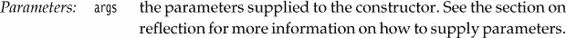

---

### `java.lang.Throwable` 1.0

- `void printStackTrace()`

  将 `Throwable` 对象和堆栈跟踪打印到标准错误流。

---

#### 5.7.3. 使用反射分析类的能力

这里是反射机制中最重要部分的简要概述，它让你能够检查类的结构。

`java.lang.reflect` 包中的 `Field`、`Method` 和 `Constructor` 这三个类分别描述类的字段、方法和构造函数。这三个类都有一个名为 `getName` 的方法，该方法返回条项的名称。`Field` 类有一个 `getType` 方法，它返回一个对象（同样是 `Class` 类型），用于描述字段类型。`Method` 和 `Constructor` 类有方法可以报告参数类型，而 `Method` 类还报告返回类型。这三个类都有一个名为 `getModifiers` 的方法，该方法返回一个整数，其中有不同的位被开启或关闭，用于描述所使用的修饰符，如 `public` 和 `static`。然后你可以使用 `java.lang.reflect` 包中 `Modifier` 类的静态方法来分析 `getModifiers` 返回的整数。使用 `Modifier` 类中的如 `isPublic`、`isPrivate` 或 `isFinal` 等方法来判断方法或构造函数是 `public`、`private` 还是 `final`。你所做的只需让 `Modifier` 类相应的方法处理 `getModifiers` 返回的整数即可。你也可以使用 `Modifier.toString` 方法来打印修饰符。

`Class` 类的 `getFields`、`getMethods` 和 `getConstructors` 方法返回该类支持的*公共*字段、方法和构造函数的数组。这包括父类中的公共成员。`Class` 类的 `getDeclaredFields`、`getDeclaredMethods` 和 `getDeclaredConstructors` 方法返回由类中声明的所有字段、方法和构造函数组成的数组。这包括私有的、包级和保护成员，但不包括父类的成员。

列表 5.13 向你展示如何打印关于类的所有信息。程序会提示你输入类名，并写出所有方法和构造函数的签名，以及类中所有实例字段的名称。例如，如果你输入：

`java.lang.Double`

程序将打印：

点击此处查看代码图片。

```java
public class java.lang.Double extends java.lang.Number
{
   public java.lang.Double(java.lang.String);
   public java.lang.Double(double);
   public int hashCode();
   public int compareTo(java.lang.Object);
   public int compareTo(java.lang.Double);
   public boolean equals(java.lang.Object);
   public java.lang.String toString();
   public static java.lang.String toString(double);
   public static java.lang.Double valueOf(java.lang.String);
   public static boolean isNaN(double);
   public boolean isNaN();
   public static boolean isInfinite(double);
   public boolean isInfinite();
   public byte byteValue();
   public short shortValue();
   public int intValue();
   public long longValue();
   public float floatValue();
   public double doubleValue();
   public static double parseDouble(java.String);
   public static long doubleToLongBits(double);
   public static double longToDoubleBits(long);
   public static int doubleToInt(double);
   public static final double POSITIVE_INFINITY;
   public static final double NEGATIVE_INFINITY;
   public static final double NaN;
   public static final double MAX_VALUE;
   public static final double MIN_VALUE;
   public static final Class TYPE;
   private double value;
   private static long serialVersionUID;
}
```

列表 5.13. `reflection/ReflectionTest.java`

```java
String modifiers = Modifier.toString(c.getModifiers());
if (modifiers.length() > 0) System.out.print(modifiers + " ");
System.out.print(name + "(");
// 输出参数类型
Class[] paramTypes = c.getParameterTypes();
for (int j = 0; j < paramTypes.length; j++)
{
    if (j > 0) System.out.print(", ");
    System.out.print(paramTypes[j].getName());
}
System.out.println(");");
```

```java
/**
 * 打印类所有的方法
 *
 * @param cl 一个类对象
 */
public static void printMethods(Class cl)
{
    Method[] methods = cl.getDeclaredMethods();

    for (Method m : methods)
    {
        Class retType = m.getReturnType();
        String name = m.getName();

        System.out.print("  ");

        // 打印修饰符、返回值和方法名
        String modifiers = Modifier.toString(m.getModifiers());
        if (modifiers.length() > 0) System.out.print(modifiers + " ");
```


```java
System.out.print(retType.getName() + " " + name + "(");

// 输出参数类型

Class[] paramTypes = m.getParameterTypes();

for (int j = 0; j < paramTypes.length; j++)
{
    if (j > 0) System.out.print(", ");
    System.out.print(paramTypes[j].getName());
}

System.out.println(");");
```

```java
}

/**
 * 打印类所有的字段
 * @param cl 一个类对象
 */

public static void printFields(Class cl)
{
    Field[] fields = cl.getDeclaredFields();

    for (Field f : fields)
    {
        Class type = f.getType();
        String name = f.getName();

        System.out.print("  ");

        String modifiers = Modifier.toString(f.getModifiers());
        if (modifiers.length() > 0) System.out.print(modifiers + " ");

        System.out.println(type.getName() + " " + name + ";");
    }
}
```

这个程序的非凡之处在于，它可以分析 Java 解释器可以加载的任何类，而不仅仅是程序编译时就可用的类。我们将在下一章中使用这个程序来窥探 Java 编译器生成的内部类的内部结构。

### `java.lang.Class`

- `Field[] getFields()`
- `Field[] getDeclaredFields()`：`getFields` 返回一个包含该类或其父类公共字段的 `Field` 对象的数组；`getDeclaredFields` 返回包含该类所有字段的 `Field` 对象的数组。如果没有此类字段，或者 `Class` 对象表示的是基本数据类型或数组类型，则返回长度为 0 的数组。
- `Method[] getMethods()`
- `Method[] getDeclaredMethods()`：返回一个包含 `Method` 对象的数组：`getMethods` 返回公共方法并包括继承的方法；`getDeclaredMethods` 返回该类或接口的所有方法，但不包括继承的方法。
- `Constructor[] getConstructors()`
- `Constructor[] getDeclaredConstructors()`：返回一个包含 `Constructor` 对象的数组，为您提供由该 `Class` 对象表示的类的所有公共构造方法（针对 `getConstructors`）或所有构造方法（针对 `getDeclaredConstructors`）。

### `java.lang.reflect.Field`

### `java.lang.reflect.Method`

### `java.lang.reflect.Constructor`

- `Class getDeclaringClass()`：返回定义此构造方法、方法或字段的类的 `Class` 对象。
- `Class[] getExceptionTypes()`（在 `Constructor` 和 `Method` 类中）：返回一个表示该方法抛出的异常类型的 `Class` 对象数组。
- `int getModifiers()`：返回描述此构造方法、方法或字段修饰符的整数。使用 `Modifier` 类的方法来分析返回值。
- `String getName()`：返回构造方法、方法或字段的名称。
- `Class[] getParameterTypes()`（在 `Constructor` 和 `Method` 类中）：返回表示参数类型的 `Class` 对象数组。
- `Class getReturnType()`（在 `Method` 类中）：返回返回类型的 `Class` 对象。

### `java.lang.reflect.Modifier`

- `static String toString(int modifiers)`：返回与 `modifiers` 中设置的位对应的修饰符字符串。
- `static boolean isAbstract(int modifiers)`
- `static boolean isFinal(int modifiers)`
- `static boolean isInterface(int modifiers)`
- `static boolean isNative(int modifiers)`
- `static boolean isPrivate(int modifiers)`
- `static boolean isProtected(int modifiers)`
- `static boolean isPublic(int modifiers)`
- `static boolean isStatic(int modifiers)`
- `static boolean isStrict(int modifiers)`
- `static boolean isSynchronized(int modifiers)`
- `static boolean isVolatile(int modifiers)`：测试 `modifiers` 值中对应方法名修饰符的位。

#### 5.7.4 使用反射运行时分析对象

在前面的节中，我们看到了如何获取任何对象的数据字段的名称和类型：

- 获取相应的 `Class` 对象。
- 在 `Class` 对象上调用 `getDeclaredFields()`。

在本节中，我们将更进一步，实际上查看字段的内容。当然，查看在编写程序时已知的特定字段的内容是很容易的。但反射允许我们查看编译时未知的字段。

实现这种检查的关键方法是 `Field` 类中的 `get` 方法。如果 `f` 是 `Field` 类型的对象（例如从 `getDeclaredFields` 获得的），并且 `obj` 是 `f` 所属字段类的对象，那么 `f.get(obj)` 返回该字段当前值的对象。

```java
Employee harry = new Employee("Harry Hacker", 35000, 10, 1, 1989);

Class cl = harry.getClass();

Field f = cl.getDeclaredField("name");

Object v = f.get(harry);
```

`get` 方法还有另一个问题我们需要处理。`name` 字段是 `String` 类型，因此将该值作为 `Object` 返回并没有问题。但假设我们想查看 `salary` 字段。它是一个 `double` 类型，在 Java 中，数字类型不是对象。为了处理这个问题，你可以使用 `Field` 类的 `getDouble` 方法，或者调用 `get` 方法，反射机制会自动将字段值包装成适当的包装类——在这种情况下，为 `Double`。

当然，你也可以设置你所获取的值。调用 `f.set(obj, value)` 会将对象 `obj` 中由 `f` 表示的字段设置为新值。

代码列表 5.14 展示了如何编写一个适用于任何类的泛型 `toString` 方法。它使用 `getDeclaredFields` 获取所有数据字段。然后使用 `setAccessible` 便利方法使所有字段都变得可访问。对于每个字段，它都会获取其名称和值。代码列表 5.14 通过递归调用 `toString` 将每个值转换为字符串。

```java
class ObjectAnalyzer
{
  public String toString(Object obj)
  {
      Class cl = obj.getClass();
      . . .

      String r = cl.getName();

      // 检查此类及其所有父类的字段
      do
      {
          r += "[";

          Field[] fields = cl.getDeclaredFields();
          AccessibleObject.setAccessible(fields, true);

          // 获取所有字段的名称和值
          for (Field f : fields)
          {
              if (!Modifier.isStatic(f.getModifiers()))
              {
                if (!r.endsWith("[")) r += ",";

                r += f.getName() + "=";

                try
                {
                  Object val = f.get(obj);
                  r += toString(val);
                }
                catch (Exception e)
                {
                  e.printStackTrace();
                }
              }
          }

          r += "]";
          cl = cl.getSuperclass();
      }
      while (cl != null);

      return r;
  }

  . . .
}
```

代码列表 5.14 中的完整代码需要处理一些复杂性。引用循环可能会导致无限递归。因此，`ObjectAnalyzer`（代码列表 5.15）会记录已经访问过的对象。此外，要查看数组内部，你需要不同的方法。你将在下一节中学习细节。

你可以使用这个 `toString` 方法来查看任何对象的内部。例如，调用：

```java
ArrayList<Integer> squares = new ArrayList<>();

for (int i = 1; i <= 5; i++)
{
    squares.add(i * i);
}

System.out.println(new ObjectAnalyzer().toString(squares));
```

将输出：

`java.util.ArrayList[element=class java.lang.Object[][java.lang.Integer[value=1],java.lang.Integer[value=4],java.lang.Integer[value=9],java.lang.Integer[value=16],java.lang.Integer[value=25],null,null,null],size=5,count=5]`

你可以使用这个泛型 `toString` 方法来实现你类中的 `toString` 方法，如下所示：

```java
public String toString()
{
  return new ObjectAnalyzer().toString(this);
}
```

这是一个提供 `toString` 方法的省力方法，你可能会发现自己在自己的程序中很有用。

代码列表 5.14：`objectAnalyzer/ObjectTest.java`

```java
package objectAnalyzer;

import java.util.ArrayList;

/**
 * 此程序使用反射来监视对象。
 * @version 1.2 2012-01-26
 * @author Cay Horstmann
 */
public class ObjectTest
{
  public static void main(String[] args)
  {
    ArrayList<Integer> squares = new ArrayList<>();

    for (int i = 1; i <= 5; i++)
    {
      squares.add(i * i);
    }

    System.out.println(new ObjectAnalyzer().toString(squares));
  }
}
```

代码列表 5.15：`objectAnalyzer/ObjectAnalyzer.java`

```java
package objectAnalyzer;

import java.lang.reflect.AccessibleObject;
import java.lang.reflect.Array;
import java.lang.reflect.Field;
import java.lang.reflect.Modifier;
import java.util.ArrayList;

public class ObjectAnalyzer
{
  private ArrayList<Object> visited = new ArrayList<>();

  /**
   * 将对象转换为列出所有字段的字符串表示。
   * @param obj 一个对象
   * @return 包含对象类名以及所有字段名和值的字符串
   */
  public String toString(Object obj)
  {
      if (obj == null) return "null";
      if (visited.contains(obj)) return "...";

      visited.add(obj);

      Class cl = obj.getClass();

      if (cl == String.class) return (String) obj;

      if (cl.isArray())
      {
          String r = cl.getComponentType() + "[]{";

          for (int i = 0; i < Array.getLength(obj); i++)
          {
              if (i > 0) r += ",";

              Object val = Array.get(obj, i);

              if (cl.getComponentType().isPrimitive()) r += val;
              else r += toString(val);
          }

          return r + "}";
      }

      String r = cl.getName();

      // 检查此类及其所有父类的字段
      do
      {
          r += "[";

          Field[] fields = cl.getDeclaredFields();
          AccessibleObject.setAccessible(fields, true);

          // 获取所有字段的名称和值
          for (Field f : fields)
          {
              if (!Modifier.isStatic(f.getModifiers()))
              {
                if (!r.endsWith("[")) r += ",";

                r += f.getName() + "=";

                try
                {
                  Class t = f.getType();
                  Object val = f.get(obj);

                  if (t.isPrimitive()) r += val;
                  else r += toString(val);
                }
                catch (Exception e)
                {
                    e.printStackTrace();
                }
              }
          }

          r += "]";
          cl = cl.getSuperclass();
      }
      while (cl != null);

      return r;
  }
}
```

`java.lang.reflect` 包中的 `Array` 类允许你动态创建数组。这被用于，例如在 `Arrays` 类中 `copyOf` 方法的实现。回想一下如何使用该方法来扩展一个已经满的数组。

```java
Employee[] a = new Employee[100];

. . .

// array is full

a = Arrays.copyOf(a, 2 * a.length);
```


如何编写这样一个泛型方法呢？`Employee[]` 数组可以转换为 `Object[]` 数组，这很有帮助。这听起来很有前景。这是第一次尝试：

点击此处查看代码图片

```java
public static Object[] badCopyOf(Object[] a, int newLength) // not useful
{
    Object[] newArray = new Object[newLength];
    System.arraycopy(a, 0, newArray, 0, Math.min(a.length, newLength));
    return newArray;
}
```

然而，在实际使用返回的数组时存在一个问题。此代码返回的数组类型是对象数组（`Object[]`），因为我们使用以下行代码创建了数组：

```java
new Object[newLength]
```

对象数组不能被强制转换为员工数组（`Employee[]`）。虚拟机会在运行时产生 `ClassCastException`。关键点在于，正如我们之前提到的，Java 数组会记住其条目的类型——即创建它的 `new` 表达式中所使用的元素类型。将 `Employee[]` 临时强制转换为 `Object[]` 数组然后将其转换回来是合法的，但一个从诞生起就是 `Object[]` 数组的数组永远无法被强制转换为 `Employee[]` 数组。

要编写这种泛型数组代码，我们需要能够创建一个与原始数组相同类型的新数组。为了这一点，我们需要 `java.lang.reflect` 包中 `Array` 类的方法。关键是 `Array` 类中用于构造新数组的静态方法 `newInstance`。你必须将条目的类型和所需的长度作为参数传递给该方法。

```java
Object newArray = Array.newInstance(componentType, newLength);
```

为了实际执行这一操作，我们需要获取新数组的长度和组件类型。

我们通过调用 `Array.getLength(a)` 获取长度。`Array` 类的静态方法 `getLength` 返回数组的长度。要获取新数组的组件类型：

1. 首先，获取 `a` 的类对象。
2. 确认它确实是一个数组。
3. 使用 `Class` 类的 `getComponentType` 方法（该方法仅为代表数组的类对象定义）来找到数组的类型。

为什么 `getLength` 是 `Array` 的方法，而 `getComponentType` 是 `Class` 的方法呢？我们不知道——反射方法的分布有时看起来有点是随意的（ad hoc）。

以下是代码：

点击此处查看代码图片

```java
public static Object goodCopyOf(Object a, int newLength)
{
    Class cl = a.getClass();
    if (!cl.isArray()) return null;
    Class componentType = cl.getComponentType();
    int length = Array.getLength(a);
    Object newArray = Array.newInstance(componentType, newLength);
    System.arraycopy(a, 0, newArray, 0, Math.min(length, newLength));
    return newArray;
}
```

注意，这个 `copyOf` 方法可以扩展任何类型的数组，而不只是对象数组。

```java
int[] a = { 1, 2, 3 };
a = (int[]) goodCopyOf(a, 10);
```

为了实现这一点，`copyOf` 的参数被声明为 `Object`，而不是 `Object[]`。`int[]` 可以强制转换为 `Object`，但 Listing 5.16 展示了两种方法的用法。`copyOf` 的返回值会抛出异常。

## 5.7.6. 调用任意方法

在 C 和 C++ 中，你可以通过函数指针执行任意函数。从表面上看，Java 并没有方法指针——即将方法的位置传递给另一个方法，以便第二个方法稍后调用它。事实上，Java 的设计者曾说过方法指针是危险且容易出错的，而 Java 接口（在下一节讨论）是一种更优的解决方案。然而，反射允许你调用任意方法。

 注意

在微软为其 Java 变体（J++ 和 C#）添加的非标准语言扩展中，还有另一种方法指针类型，称为委托（delegate），它与在本节中讨论的 `Method` 类不同。然而，内部类（我们将在下一节介绍）比委托是更有有用的结构。

请记住，你可以通过 `Field` 类的 `get` 方法来检查对象的字段。同样，`Method` 类也有一个 `invoke` 方法，允许你调用封装在当前 `Method` 对象中的方法。`invoke` 方法的签名如下：

```java
Object invoke(Object obj, Object... args)
```

第一个参数是隐式参数，剩余的对象提供了显式参数。

对于静态方法，第一个参数会被忽略——你可以将其设置为 `null`。

例如，如果 `m1` 代表 `Employee` 类的 `getName` 方法，下面的代码展示了你如何调用它：

```java
String n = (String) m1.invoke(harry);
```

如果返回类型是基本类型，`invoke` 方法将改为返回对应的包装类型。例如，假设 `m2` 代表 `Employee` 类的 `getSalary` 方法。那么，返回的对象实际上是一个 `Double`，你必须对其进行相应的强制类型转换。利用自动拆箱将其转换为 `double`：

```java
double s = (Double) m2.invoke(harry);
```

如何获取 `Method` 对象呢？当然，你可以调用 `getDeclaredMethods` 并遍历返回的 `Method` 对象数组，直到找到你想要的方法。或者，你可以调用 `Class` 类的 `getMethod` 方法。这类似于 `getField` 方法，后者接收一个带有字段名的字符串并返回一个 `Field` 对象。然而，可能存在多个同名方法，因此你需要小心获取正确的一个。出于这个原因，你还必须提供所需方法的参数类型。`getMethod` 的签名如下：

```java
Method getMethod(String name, Class... parameterTypes)
```

例如，这里展示了如何获取 `Employee` 类中 `getName` 和 `raiseSalary` 方法的指针：

```java
Method m1 = Employee.class.getMethod("getName");
Method m2 = Employee.class.getMethod("raiseSalary", double.class);
```

现在你已经了解了使用 `Method` 对象的规则，让我们让它们运转起来。Listing 5.17 是一个程序，用于打印数学函数（如 `Math.sqrt` 或 `Math.sin`）的值表格。输出结果如下所示：

```text
public static native double java.lang.Math.sqrt(double)
      1.0000 |      1.0000
      2.0000 |      1.4142
      3.0000 |      1.7321
      4.0000 |      2.0000
      5.0000 |      2.2361
      6.0000 |      2.4495
      7.0000 |      2.6458
      8.0000 |      2.8284
      9.0000 |      3.0000
     10.0000 |      3.1623
```

打印表格的代码显然独立于实际列出的函数。

```java
double dx = (to - from) / (n - 1);
for (double x = from; x <= to; x += dx)
{
   double y = (Double) f.invoke(null, x);
   System.out.printf("%10.4f | %10.4f%n", x, y);
}
```

在这里，`f` 是 `Method` 类型的对象。`invoke` 的第一个参数是 `null`，因为我们正在调用一个静态方法。

为了为 `Math.sqrt` 函数制作表格，我们将 `f` 设置为：

```java
Math.class.getMethod("sqrt", double.class)
```

这就是 `Math` 类中名为 `sqrt` 且带有一个 `double` 类型参数的方法。Listing 5.17 显示了通用表格器的完整代码以及几次运行。

Listing 5.17 `methods/MethodTest.java`

```java
package methods;

import java.lang.reflect.*;

/**
 * 此程序展示了如何通过反射调用方法。
 * @version 1.2 05-04
 * @author Cay Horst
 */
public class MethodTest
{
    public static void main(String[] args) throws Exception
    {
        // 获取 square 和 sqrt 的方法指针
        Method square = MethodTest.class.getMethod("square", double.class);
        Method sqrt = Math.class.getMethod("sqrt", double.class);

        // 打印 x 和 y 值的表格
        printTable(1, 10, 10, square);
        printTable(1, 10, 10, sqrt);
    }

    /**
     * 返回数字的平方
     * @param x 一个数字
     * @return x 的平方
     */
    public static double square(double x)
    {
        return x * x;
    }

    /**
     * 为某个方法打印包含 x 和 y 值的表格
     * @param from x 值的下界
     * @param to x 值的上界
     * @param n 表格的行数
     * @param f 具有 double 参数和返回值的方法
     */
    public static void printTable(double from, double to, int n, Method f)
    {
        // 输出方法作为表头
        System.out.println(f);

        double dx = (to - from) / (n - 1);

        for (double x = from; x <= to; x += dx)
        {
            try
            {
                double y = (Double) f.invoke(null, x);
                System.out.printf("%10.4f | %10.4f%n", x, y);
            }
            catch (Exception e)
            {
                e.printStackTrace();
            }
        }
    }
}
```

然而，`protected` 方法可以用于指示那些尚未准备好通用、且应该在子类中重新定义的方法。

### 3. 使用继承来建模“是”（is–a）关系

继承是一种实用的代码节省工具，但有时人们会过度使用。例如，假设我们需要一个 `Contractor`（承包工）类。承包工有姓名和入职日期，但他们没有工资。相反，他们按小时付费，而且停留的时间不足以获得加薪。人们往往容易从 `Employee`（员工）派生子类 `Contractor` 并添加一个 `hourlyWage`（时薪）字段。

```java
class Contractor extends Employee
{
   private double hourlyWage;
   . . .
}
```

但这并不是一个好主意，因为现在每个承包工对象都拥有工资和时薪字段。当你实现打印工资单或税表的方法时，这会给你带来无尽的麻烦。你最终编写的代码将比最初不使用继承时要多得多。

承包工与员工的关系没有通过“是”的测试。承包工不是员工的特殊情况。

### 4. 除非所有继承的方法都有意义，否则不要使用继承

假设我们想写一个 `Holiday`（假日）类。显然，每个假日都是一天，而天可以表示为 `GregorianCalendar`（格列历）类的实例，因此我们可以继承。

```java
class Holiday extends GregorianCalendar { . . . }
```

遗憾的是，节日的集合在继承的操作下并不是封闭的。`GregorianCalendar` 的公共方法之一是 `add`。而 `add` 可以将假日变成非节假日：

```java
Holiday christmas;
christmas.add(Calendar.DAY_OF_MONTH, 12);
```

因此，在这个例子中使用继承是不恰当的。

### 5. 在重写方法时，不要改变预期的行为

替换原则不仅适用于语法，更重要的是还适用于行为。当你重写一个方法时，不应该无合理理由地改变它的行为。编译器无法为你提供帮助——它无法检查你的重新定义是否有意义。例如，你可以通过重新定义 `add` 来“修复” `Holiday` 类中 `add` 方法的问题，可能只是让它什么都不做，或者抛出一个异常，或者跳转到下一个假日。

然而，这种修复违反了替换原则。以下的语句序列：

```java
int d1 = x.get(Calendar.DAY_OF_MONTH);
x.add(Calendar.DAY_OF_MONTH, 1);
int d2 = x.get(Calendar.DAY_OF_MONTH);
System.out.println(d2 - d1);
```

无论 `x` 是 `GregorianCalendar` 类型还是 `Holiday` 类型，都应该具有预期行为。

当然，问题正出于此。合理和不合理的人对于什么是预期行为进行长时间争论。例如，某些作者认为替换原则要求 `Manager.equals` 应该忽略 `bonus`（奖金）字段，因为 `Employee.equals` 忽略了它。如果这些讨论在真空中发生，是毫无意义的。最终，重要的是当你在子类中重写方法时，不要绕过原始设计的意图。

### 6. 使用多态，而不是类型信息

每当你发现形式如下的代码时：

```java
if (x is of type 1)
   action1;
else if (x is of type 2)
   action2;
```

请考虑多态。

`action[1]` 和 `action[2]` 代表一个共同的概念吗？如果是，将该概念变为这两个类型的共同父类或接口的方法。那么，你只需要调用：

```java
x.action();
```

并让多态中固有的动态分发机制去启动正确的动作。

使用多态方法或接口实现的代码比使用多个类型检查的代码要易于维护和扩展。

### 7. 不要过度使用反射

反射机制允许你通过运行时检测字段和方法来编写具有惊人通用性的程序。这种能力对于系统级编程非常有用，但在应用程序中通常是不合适的。反射是脆弱的——通过它，编译器无法帮助你发现编程错误。任何错误都会在运行时发现并导致异常。

你现在已经看到了 Java 如何支持面向对象编程的基础知识：类、继承和多态。在下一章中，我们将处理两个对于有效使用 Java 至关重要的高级主题：接口和内部类。

# 第 6 章 接口与内部类

## 本章内容

- 接口
- 对象克隆
- 接口与回调
- 内部类
- 代理

你现在已经看到了 Java 中面向对象编程的所有基本工具。本章向你展示了几个常用的高级技术。尽管它们的特性不那么明显，但你仍然需要掌握它们来完善你的 Java 工具箱。

第一种技术称为接口，它是一种描述类应该做什么的方法，而不指定它们应该如何做。一个类可以实现一个或多个接口。然后，每当需要符合接口时，你就可以使用这些实现类的对象。

在涵盖接口之后，我们将讨论对象的克隆（有时称为深拷贝）。对象的克隆是一个与原始具有相同状态的新对象。特别是，你可以修改克隆对象而不影响原始对象。

接下来，我们转向内部类的机制。内部类在技术上有些复杂——它们被定义在其他类内部，并且其方法可以访问外部类的字段。当你设计一组协作的类时，内部类非常有用。特别是，内部类允许你编写简洁、看起来专业的代码来处理 GUI 事件。

本章以对代理的讨论结束，代理是实现任意接口的对象。代理是一种非常特殊的构造，用于构建系统级工具。第一次阅读时，你可以安全地跳过该部分。

## 6.1. 接口

在 Java 语言中，接口不是一个类，而是对想要符合接口的类的一系列要求。


通常，某些服务的提供者会声明：“如果你的类符合特定的接口，那么我就执行该服务。”让我们来看一个具体的例子。`Arrays` 类的 `sort` 方法承诺对对象数组排序，但有一个条件：对象必须属于实现了 `Comparable` 接口的类。

以下是 `Comparable` 接口的样子：

```java
public interface Comparable
{
   int compareTo(Object other);
}
```

这意味着任何实现 `Comparable` 接口的类都被要求有一个 `compareTo` 方法，并且该方法必须接受一个 `Object` 参数并返回一个整数。

---

注意：从 Java 5.0 开始，`Comparable` 接口被增强为泛型。

```java
public interface Comparable<T>
{
   int compareTo(T other); // 参数类型为 T
}
```

例如，实现 `Comparable<Employee>` 的类必须提供方法`int compareTo(Employee other)`。

你仍然可以使用没有类型参数的“原始” `Comparable` 类型，但你必须手动将 `compareTo` 方法的参数强制转换为所需的类型。

接口的所有方法都自动是 `public` 的。因此，在接口中声明方法时，没有必要提供 `public` 关键字。

当然，还有一个接口无法说明的额外要求：当调用`x.compareTo(y)`时，`compareTo` 方法必须实际上能够*比较*这两个对象，并返回关于 `x` 或 `y` 较大的指示。该方法应该在 `x` 小于 `y` 时返回负数，在它们相等时返回零，否则返回正数。

这个特定的接口只有一个方法。有些接口有多个方法。正如你稍后看到的，接口还可以定义常量。然而，更重要的是接口*不能*提供的内容。接口永远不会有实例字段，方法也绝不会在接口中实现。提供实例字段和方法实现是实现接口的类的职责。你可以将接口认为类似于一个没有实例字段的抽象类。然而，这两个概念之间存在一些差异——我们稍后会详细讨论它们。

现在，假设我们想使用 `Arrays` 类的 `sort` 方法对 `Employee` 对象的数组进行排序。那么 `Employee` 类必须 `implement`（实现）`Comparable` 接口。

要让一个类实现接口，你需要执行两个步骤：

1. 声明你的类意图要实现给定的接口。
2. 为接口中的所有方法提供定义。

要声明一个类实现一个接口，请使用 `implements` 关键字：

```java
class Employee implements Comparable
```

当然，现在 `Employee` 类需要提供 `compareTo` 方法。让我们假设想按薪资比较员工。以下是 `compareTo` 方法的实现：

```java
public int compareTo(Object otherObject)
{
    Employee other = (Employee) otherObject;
    return Double.compare(salary, other.salary);
}
```

在这里，我们使用了静态方法 `Double.compare`，如果第一个参数小于第二个参数，它返回负数；如果它们相等，返回 `0`；否则返回正值。

 注意

在接口声明中，`compareTo` 方法没有声明为 `public`，因为*接口*中的所有方法自动都是公共的。然而，在实现接口时，你必须将方法声明为 `public`。否则，编译器会假设该方法具有包级可见性——这是 `class` 的默认权限。编译器随后会抱怨你正尝试提供更弱的访问权限。

从 Java SE 5.0 开始，我们可以做得更好。我们将改为实现 `Comparable<Employee>` 接口类型。

```java
class Employee implements Comparable<Employee>
{
    public int compareTo(Employee other)
    {
        return Double.compare(salary, other.salary);
    }
    . .
}
```

注意，那个难看的 `Object` 参数强制转换消失了。

 提示

`Comparable` 接口的 `compareTo` 方法返回一个整数。如果对象不相等，返回什么负值或正值并不紧要。这种灵活性在比较整数字段时非常有用。例如，假设每个员工都有一个唯一的整数 `id`，你想按员工 ID 号进行排序。那么你可以简单地返回`id - other.id`。如果第一个 ID 小于另一个，该值将是一个负值；如果 ID 相同，则为 `0`；否则为某个正值。然而，有一个限制：整数的范围必须足够小，使得减法不会溢出。如果你知道 ID 不是负数，或者它们的绝对值最多为`(Integer.MAX_VALUE - 1) / 2`，那么就是安全的。

当然，减法技巧不适用于浮点数。如果薪资接近但并不相同，差值 `salary - other.salary` 可能会舍入为 `0`。`Double.compare(x, y)` 调用仅在 `x < y` 时返回 `-1`，在 `x > y` 时返回 `1`。

现在你看到了一个类为了利用排序服务必须做什么——它必须实现一个 `compareTo` 方法。这是完全合理的。`sort` 方法需要某种方式来比较对象。但为什么 `Employee` 类不能在不实现 `Comparable` 接口的情况下提供 `compareTo` 方法呢？

接口的存在是因为 Java 编程语言是*强类型*的。在进行方法调用时，编译器需要能够检查该方法是否存在。在 `sort` 方法的某处会有这样的语句：

```java
if (a[i].compareTo(a[j]) > 0)
{
    // rearrange a[i] and a[j]
    . .
}
```

编译器必须知道 `a[i]` 确实有一个 `compareTo` 方法。如果 `a` 是 `Comparable` 对象的数组，那么该方法的存在是有保证的，因为每个实现 `Comparable` 接口的类必须提供该方法。

 注意

你可能认为 `Arrays` 类中的 `sort` 方法定义为接收 `Comparable[]` 数组，这样如果有人用一个元素类型没有实现 `Comparable` 接口的数组调用 `sort`，编译器就会报错。遗憾的是，事实并非如此。相反，`sort` 方法接收一个 `Object[]` 数组并使用笨拙的转换：

```java
// 标准库中的方法
if (((Comparable) a[i]).compareTo(a[j]) > 0)
{
    // rearrange a[i] and a[j]
    . .
}
```

如果 `a[i]` 不属于实现 `Comparable` 接口的类，虚拟机将抛出异常。

`6.1` 展示了对 `Employee` 类实例数组进行排序的完整代码（见 `6.2`）。

### 列表 6.1 interfaces/EmployeeTest.java

```java
package interfaces;

import java.util.*;

/**
 * 此程序演示了 Comparable 接口的使用。
 * @version 1.3 2004-02-27
 * @author Caymann
 */
public class EmployeeTest
{
    public static void main(String[] args)
    {
        Employee[] staff = new Employee[3];
        staff[0] = new Employee("Harry Hacker", 35000);
        staff[1] = new Employee("Carl Cracker", 75000);
        staff[2] = new Employee("Tony Tester", 38000);

        Arrays.sort(staff);

        // 打印所有的 Employee 对象
        for (Employee e : staff)
            System.out.println("name=" + e.getName() + ",salary=" + e.getSalary());
    }
}
```

### 列表 6.2 interfaces/Employee.java

```java
package interfaces;

public class Employee implements Comparable<Employee>
{
    private String name;
    private double salary;

    public Employee(String n, double s)
    {
        name = n;
        salary = s;
    }

    public String getName()
    {
        return name;
    }

    public double getSalary()
    {
        return salary;
    }

    public void raiseSalary(double byPercent)
    {
        double raise = salary * byPercent / 100;
        salary += raise;
    }

    /**
     * 按薪资比较员工
     * @param other 另一个 Employee 对象
     * @return 如果此员工的薪资低于 otherObject，则返回负数；如果薪资相同则返回 0；否则返回正值
     */
    public int compareTo(Employee other)
    {
        return Double.compare(salary, other.salary);
    }
}
```

使用经过调优 `mergesort` 算法对数组 `a` 中的元素进行排序。数组中的所有元素必须属于实现了 `Comparable` 接口的类，并且它们必须相互可比较。

#### `java.lang.Integer` 7

- `static int compare(int x, int y)`

如果 `x < y`，返回负整数；如果 `x` 和 `y` 相，返回零；否则返回正整数。

#### `java.lang.Double` 7

- `static int compare(double x, double y)`

如果 `x < y`，返回负整数；如果 `x` 和 `y` 相，返回零；否则返回正整数。

 注意

根据语言标准：“实现者必须确保对于所有的 `x` 和 `y`，`sgn(x.compareTo(y)) = -sgn(y.compareTo(x))`。（这意味着如果 `y.compareTo(x)` 抛出异常，则 `x.compareTo(y)` 也必须抛出异常。）在这里，`sgn` 是数字的符号：如果 `n` 为负，则 `sgn(n)` 为 -1；如果 `n` 等于 0，则 `sgn(n)` 为 0；如果 `n` 为正，则 `sgn(n)` 为 1。通俗来说，如果你翻转 `compareTo` 的参数，结果的符号（但不一定是实际值）也必须翻转。

与 `equals` 方法一样，当涉及到继承时会出现问题。

由于 `Manager` 继承自 `Employee`，它实现的是 `Comparable<Employee>` 而不是 `Comparable<Manager>`。如果 `Manager` 选择重写 `compareTo`，它必须准备好比较经理和员工。它不能简单地将员工强制转换为经理：

```java
class Manager extends Employee
{
    public int compareTo(Employee other)
    {
      Manager otherManager = (Manager) other; // 不能
      . . .
    }
    . . .
}
```

这违反了“反对称性”规则。如果 `x` 是 `Employee` 且 `y` 是 `Manager`，那么调用`x.compareTo(y)`不会抛出异常——它只是作为员工身份比较 `x` 和 `y`。但反过来，`y.compareTo(x)`则会抛出 `ClassCastException`。

这与我们在第五章中讨论过的 `equals` 方法的情况相同，补救措施也是一样的。有两种不同的场景。

如果子类有不同的比较概念，那么你应该禁止对属于不同类的对象进行比较。每个 `compareTo` 方法应该开始进行测试：

```java
if (getClass() != other.getClass()) throw new ClassCastException();
```

如果存在一种比较子类对象的通用算法，只需在父类中提供单一的 `compareTo` 方法并将其声明为 `final` 即可。

例如，假设你希望经理无论薪水如何都高于普通员工。其他子类如 `Executive` 和 `Secretary` 呢？如果你需要建立一个等级，可以在 `Employee` 类中提供一个如 `rank` 的方法。让每个子类重写 `rank`，并实现一个考虑到 `rank` 值的 `compareTo` 方法。

## 6.1.1 接口的属性

接口不是类。特别是你永远无法使用 `new` 运算符来实例化接口：

```java
x = new Comparable(. . .); // 错误
```

然而，尽管你不能构造接口对象，你仍然可以声明接口变量。

```java
Comparable x; // 可以
```

接口变量必须引用实现该接口的类的对象：

```java
x = new Employee(. . .); // 只要 Employee 实现了 Comparable 即可
```

接下来，就像你使用 `instanceof` 来检查对象是否属于特定类一样，你也可以使用 `instanceof` 来检查对象是否实现了某个接口：

```java
if (anObject instanceof Comparable) { . . . }
```

就像你可以构建类的层次结构一样，你也可以扩展接口。这允许存在多个接口链，从更高程度的通用性到更高程度的专门化。例如，假设你有一个名为 `Moveable` 的接口。

```java
public interface Moveable
{
    void move(double x, double y);
}
```

那么，你可以想象有一个名为 `Powered` 的接口扩展了它：

```java
public interface Powered extends Moveable
{
    double milesPerGallon();
}
```

虽然你不能在接口中放置实例字段或静态方法，但你可以在它们中提供常量。例如：

```java
public interface Powered extends Moveable
{
    double milesPerGallon();
    double SPEED_LIMIT = 95; // 一个 public static final 常量
}
```

就像接口中的方法自动是 `public` 一样，字段始终是 `public static final`。

 注意

将接口方法标记为 `public`、字段标记为 `public static final` 是合法的。一些程序员这样做是因为习惯或为了更清晰。然而，Java 语言规范建议不要提供冗余关键字，我们也遵循了这一建议。

有些接口只定义常量而不定义方法。例如，标准库包含一个接口 `SwingConstants`，它定义了 `NORTH`、`SOUTH`、`HORIZONTAL` 等常量。任何选择实现 `SwingConstants` 接口的类都会继承这些常量。它的方法可以直接引用 `NORTH`，而不是更繁琐的 `SwingConstants.NORTH`。然而，这种对接口的使用相当退化，我们不建议这样做。

虽然每个类只能有一个父类，但类可以实现*多个*接口。这赋予了你定义类行为的最大灵活性。例如，Java 语言内置了一个重要的接口，称为 `Cloneable`。（我们将在下一节详细讨论此接口。）如果你的类实现了 `Cloneable`，`Object` 类中的 `clone` 方法将创建你类的精确拷贝。因此，假设你想具有复制性和可比较性。你只需实现这两个接口即可。

```java
class Employee implements Cloneable, Comparable
```

使用逗号分隔你想提供的接口。

## 6.1.2 接口与抽象类

如果你阅读了第五章中关于抽象类的章节，你可能会奇怪 Java 语言的设计者为什么要引入接口的概念。为什么 `Comparable` 不能简单地是一个抽象类呢：

```java
abstract class Comparable // 为什么不能
{
    public abstract int compareTo(Object other);
}
```

那么 `Employee` 类只需扩展这个抽象类并提供 `compareTo` 方法：


```java
class Employee extends Comparable // 为什么不能
{
    public int compareTo(Object other) { . . . }
}
```

遗憾的是，使用抽象基类来表达通用属性有一个主要问题。类只能扩展一个类。假设 `Employee` 类已经扩展了另一个类，比如 `Person`。那么它就不能扩展第二个类了。

```java
class Employee extends Person, Comparable // 错误
```

但每个类可以实现任意多个接口：

```java
class Employee extends Person implements Comparable // 可以
```

其他编程语言，特别是 C++，允许一个类拥有多个父类。这种特性被称为*多重继承*。Java 的设计者选择不支持多重继承，因为它会让语言变得非常复杂（如 C++）或者效率较低（如 Eiffel）。

相反，接口在获得多重继承的大部分优点的同时，规避了复杂性和低效。


> **C++ 注意**
>
> C++ 支持多重继承以及随之而来的所有复杂性，例如虚基类、支配规则和横向指针转换。很少有 C++ 程序员使用多重继承，有些人认为永远不应该使用它。其他程序员建议仅将“混入”（mix-in）风格的继承中使用多重继承。在混入风格中，主基类描述父对象，而额外的基类（所谓的混入类）可以提供辅助特性。这种风格类似于具有单个基类和若干额外接口的 Java 类。然而，在 C++ 中，混入类可以添加默认行为，而 Java 接口则不能。

## 6.2 对象克隆

当你对一个变量进行复制时，原始变量和拷贝都是指向同一个对象的引用（参见图 6.1）。这意味着对其中一个变量的修改也会影响另一个变量。

点击此处查看代码图片

```java
Employee original = new Employee("John Public", 50000);

Employee copy = original;

copy.raiseSalary(10); // 哦——也改变了原始对象
```


图 6.1. 复制与克隆

如果你希望 `copy` 是一个新对象，其初始状态与 `original` 相同，但状态可以随时间推移产生差异，请使用 `clone` 方法。

点击此处查看代码图片

```java
Employee copy = original.clone();

copy.raiseSalary(10); // OK--original 未改变
```

但并非那么简单。`clone` 方法是 `Object` 的一个 `protected`（保护）方法，这意味着你的代码不能直接调用它。只有 `Employee` 类可以克隆 `Employee` 对象。这种限制是有原因的。考虑 `Object` 类是如何实现 `clone` 的：它对对象本身一无所知，因此只能进行逐字段的复制。如果对象中的所有数据字段都是数字或其他基本类型，那么复制字段就足够。但如果对象包含对子对象的引用，那么复制字段只会给你另一个指向相同子对象的引用，因此原始对象和克隆对象仍然共享某些信息。

为了视觉化这一现象，让我们考虑在第 4 章中引入的 `Employee` 类。图 6.2 显示了当使用 `Object` 类的 `clone` 方法克隆此类 `Employee` 对象时发生了什么。如你所见，默认的克隆操作是“浅”的——它不会克隆被其他对象引用的对象。

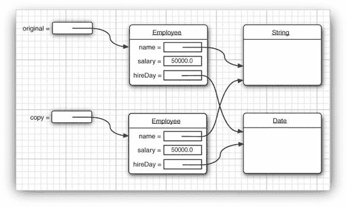

图 6.2. 浅拷贝

浅拷贝是否重要？这取决于情况。如果原始对象和浅克隆之间共享的子对象是*不可变的*（immutable），那么这种共享就是安全的。如果子对象属于一个不可变类（如 `String`），这种情况确实会发生。或者，子对象在对象的整个生命周期内始终保持不变，没有修改器触碰它，也没有方法返回它的引用。

然而，子对象通常是可变的，你必须重新定义 `clone` 方法以实现“深拷贝”（deep copy），同时也克隆子对象。在我们的示例中，`hireDay` 字段是一个 `Date` 类型，它是可变的。

对于每个类，你都需要决定：

1. 默认的 `clone` 方法是否足够；
2. 能否通过调用可变子对象的 `clone` 方法来修复默认的 `clone` 方法；以及
3. 是否应该尝试 `clone`。

第三种选项实际上是默认选项。要选择第一种或第二种选项，该类必须：

1. 实现 `Cloneable` 接口；并且
2. 使用 `public`（公有）访问修饰符重定义 `clone` 方法。


> **注意**
>
> `clone` 方法在 `Object` 类中被声明为 `protected`，因此你的代码不能直接调用 `anObject.clone()`。但 `protected` 方法不是可以在任何子类中访问吗？而且每个类不都是 `Object` 的子类吗？幸运的是，保护访问的规则要微妙得多（参见第 5 章）。子类只能调用受保护的 `clone` 方法来克隆*自己的*对象。你必须将 `clone` 重新定义为 `public`，以便允许任何方法来克隆对象。

在这种情况下，`Cloneable` 接口的出现与接口的通常用法没有关系。特别是，它*并没有*指定 `clone` 方法——该方法是从 `Object` 类继承的。该接口仅充当一个标记，表示类设计者理解克隆过程。对象对克隆非常偏执，以至于如果一个对象请求克隆但没有实现该接口，它们就会抛出一个检查异常（checked exception）。


> **标记接口与标记接口**
>
> `Cloneable` 接口是 Java 提供的少数“标记接口”（tagging interfaces）之一。（有些程序员称之为“标记接口”（marker interfaces））。记得像 `Comparable` 之类的接口的通常用途是确保类实现特定的方法集。标记接口没有方法；其唯一目的是允许 `instanceof` 的使用。

即使默认（浅拷贝）`clone` 实现已经足够，你仍然需要实现 `Cloneable` 接口，将 `clone` 重新定义为 `public` 并调用 `super.clone()`。这里有一个示例：

点击此处查看代码图片

```java
class Employee implements Cloneable
{
    // . .
    public Employee clone() throws CloneNotSupportedException
    {
        // 访问级别改为 public
        return (Employee) super.clone();
    }
}
```

你刚刚看到的 `clone` 方法没有为 `Object` 添加任何功能。它只是让方法变为公共。为了实现深拷贝，你需要更加努力并克隆可变字段。这里有一个创建深拷贝的 `clone` 方法示例：

点击此处查看代码图片

```java
class Employee implements Cloneable
{
    // . .
    public Employee clone() throws CloneNotSupportedException
    {
        // 调用 Object.clone()
        Employee cloned = (Employee) super.clone();
        // 克隆可变字段
        cloned.hireDay = (Date) hireDay.clone();
        return cloned;
    }
}
```

`Object` 类的 `clone` 方法威胁要抛出 `CloneNotSupportedException`——每当在未实现 `Cloneable` 接口的对象上调用 `clone` 时。当然，`Employee` 和 `Date` 类实现了 `Cloneable` 接口，因此不会抛出异常。然而，编译器并不知道。因此，声明了异常：

`public Employee clone() throws CloneSupportedException`

捕获异常是否会更好？

点击此处查看代码图片

```java
public Employee clone()
{
    try
    {
        return (Employee) super.clone();
    }
    catch (CloneNotSupportedException e) { return null; }
    // 这不会发生，因为我们实现了 Cloneable
}
```

这对于 `final` 类是合适的。否则，保留 `throws` 规格符是一个好主意。这给了子类一个在无法支持克隆时抛出 `CloneNotSupportedException` 的选择。

你必须小心子类的克隆。例如，一旦你为 `Employee` 类定义了 `clone` 方法，任何人都可以用它来克隆 `Manager` 对象。`Employee` 的 `clone` 方法能胜任吗？这取决于 `Manager` 类的字段。在我们的案例中，没有这个问题，因为 `bonus` 字段是原始类型。但 `Manager` 可能获取了某些需要深拷贝或不可克隆的字段。无法保证子类的实现者已经修复了 `clone` 方法以执行正确的操作。正因如此，`clone` 方法在 `Object` 类中被声明为 `protected`。但如果你希望你类的用户能够调用 `clone`，你就不再拥有这种“待遇”了。

你是否应该在自己的类中实现 `clone` 呢？如果你的客户端需要进行深拷贝，那么你可能应该这样做。有些作者认为，你应该完全避免使用 `clone`，而是实现另一个方法来实现相同的目的。我们同意 `clone` 确实相当笨拙，但如果你将责任转移到另一个方法，你仍然会遇到相同的问题。无论如何，克隆并没有你想象的那么常见。标准库中只有不到 5% 的类实现了 `clone`。

Listing 6.3 中的程序克隆了 `Employee` 类的实例（Listing 6.4），然后调用了两个修改器方法。`raiseSalary` 方法改变了 `salary` 字段的值，而 `setHireDay` 方法改变了 `hireDay` 字段的状态。这两个变动都不会影响原始对象，因为 `clone` 被定义为执行深拷贝。

**Listing 6.3. `clone/CloneTest.java`**

点击此处查看代码图像

```java
package clone;

/**
 * 此程序演示了克隆
 * @version 1.10 2002-07-01
 * @author Cay Horstmann
 */
public class CloneTest
{
    public static void main(String[] args)
    {
        try
        {
            Employee original = new Employee("John Q. Public", 50000);
            original.setHireDay(2000, 1, 1);
            Employee copy = original.clone();
            copy.raiseSalary(10);
            copy.setHireDay(2002, 12, 31);
            System.out.println("original=" + original);
            System.out.println("copy=" + copy);
        }
        catch (CloneNotSupportedException e)
        {
            e.printStackTrace();
        }
    }
}
```

**Listing 6.4. `clone/Employee.java`**

点击此处查看代码图像

```java
package clone;

import java.util.Date;
import java.util.GregorianCalendar;
public class Employee implements Cloneable
{
    private String name;
    private double salary;
    private Date hireDay;

    public Employee(String n, double s)
    {
        name = n;
        salary = s;
        hireDay = new Date();
    }

    public Employee clone() throws CloneSupportedException
    {
        // call Object.clone()
        Employee cloned = (Employee) super.clone();
        // clone 可变字段
        cloned.hireDay = (Date) hireDay.clone();
        return cloned;
    }

    /**
     * 将入职日期设置为指定的日期。
     * @param year 入职日的年份
     * @param month 入职日的月份
     * @param day 入职日的日期
     */
    public void setHireDay(int year, int month, int day)
    {
        Date newHireDay = new GregorianCalendar(year, month - 1, day).getTime();
        // 实例变动的示例
        hireDay.setTime(newHireDay.getTime());
    }

    public void raiseSalary(double byPercent)
    {
        double raise = salary * byPercent / 100;
        salary += raise;
    }

    public String toString()
    {
        return "Employee[name=" + name + ",salary=" + salary + ",hireDay=" + hireDay + "]";
    }
}
```

所有数组类型都有一个 `public` 的 `clone` 方法，而不是 `protected`。你可以使用它来创建一个包含所有元素拷贝的新数组。例如：

```java
int[] luckyNumbers = { 2, 3, 5, 7, 11, 13 };
int[] cloned = luckyNumbers.clone();
cloned[5] = 12; // 不改变 luckyNumbers[5]
```

第二卷第 1 章展示了克隆对象的另一种机制，即使用 Java 的对象序列化功能。该机制实现简单且安全，但效率不高。

### 6.3 接口与回调

编程中的一种常见模式是*回调*（callback）模式。在这种模式中，你希望在当特定事件发生时指定应该执行的操作。例如，你可能希望在点击按钮或选择菜单项时执行某个操作。然而，由于你还没有看到过如何实现用户界面，我们将考虑一个类似但更简单的情况。

`javax.swing` 包包含一个 `Timer` 类，如果你希望在每个时间间隔结束时收到通知，它是非常有用的。例如，如果程序的某个部分有一个时钟，你可以请求每秒通知一次以更新时钟界面。

当你构造定时器时，设置时间间隔并告诉它在每当时间间隔到期时应该做什么。

如何告诉定时器它应该做什么？在许多编程语言中，你提供一个要调用的函数名称。然而，Java 标准库采用了面向对象的方法。你传递某个类的对象。定时器随后调用该对象的方法。传递对象比传递函数更灵活，因为对象可以携带额外信息。

当然，定时器需要知道调用哪个方法。定时器要求指定一个实现了 `java.awt.event` 包中 `ActionListener` 接口的对象。该接口如下：

```java
public interface ActionListener
{
    void actionPerformed(ActionEvent event);
}
```

当时间间隔过期时，定时器调用 `actionPerformed` 方法。

正如你在第五章看到的，Java 确实有函数指针的等物，即 `Method` 对象。但是它们难以使用、速度慢，且无法在编译时进行类型安全检查。每当你在 C++ 中使用函数指针时，在 Java 中应该考虑使用接口。

假设你想每 10 秒打印一次消息“时间到了，现在是 . . ”，并听到蜂鸣。你需要定义一个实现 `ActionListener` 接口的类。然后将你想要执行的任何语句放在 `actionPerformed` 方法中。

```java
class TimePrinter implements ActionListener
{
    public void actionPerformed(ActionEvent event)
    {
        Date now = new Date();
        System.out.println("At the tone, the time is " + now);
        Toolkit.getDefaultToolkit().beep();
    }
}
```


注意`actionPerformed`方法的`ActionEvent`参数。该参数提供了事件的信息，例如产生事件的源对象——更多信息请参见第 8 章。然而，事件的详细信息并不重要，你可以安全地忽略该参数。

接下来，构造该类的对象并将其传递给`Timer`构造函数。

```java
ActionListener listener = new TimePrinter();

Timer t = new Timer(10000, listener);
```

`Timer`构造函数的第一个参数是两次通知之间必须经过的时间间隔，单位为毫秒。我们希望每 10 秒被通知一次。第二个参数是监听器对象。

最后，你启动了计时器。

```java
t.start();
```

每隔 10 秒，会显示如下消息：

```text
At the tone, the time is Thu Apr 13 23:29:08 PDT 2000
```

随后会听到“哔”的一。

**Listing 6.5** 让计时器及其动作监听器工作。计时器启动后，程序会弹出一个消息对话框，并等待用户点击 Ok 按钮停止。在程序等待用户期间，当前时间会每隔 10 秒显示一次。

运行程序时请保持耐心。“Quit program?”对话框会立即出现，但第一条计时器消息要在 10 秒后才会显示。

注意，程序除了通过名称导入了`javax.swing.Timer`类外，还导入了`javax.swing.*`和`java.util.*`。这消除了`javax.swing.Timer`与`java.util.Timer`之间的歧，后者是一个用于调度后台任务的无关类。

**Listing 6.5.** `timer/TimerTest.java`

点击此处查看代码图像

```java
1  package timer;
2  /**
3    @version 1.00 2000-04-13
4    @author Cay Horstmann
5    */
6
7  import java.awt.*;
8  import java.awt.event.*;
9  import java.util.*;
10 import javax.swing.*;
11 import javax.swing.Timer;
12 // 为了解决与 java.util.Timer 的冲突
13
14 public class TimerTest
15  {
16      public static void main(String[] args)
17      {
18          ActionListener listener = new TimePrinter();
19
20          // 构建一个每 10 秒调用一次监听器的计时器
22          Timer t = new Timer(10000, listener);
23          t.start();
24
25          JOptionPane.showMessageDialog(null, "Quit program?");
26          System.exit(0);
27      }
28  }
29
30 class TimePrinter implements ActionListener
31  {
32      public void actionPerformed(ActionEvent event)
33      {
34          Date now = new Date();
35          System.out.println("At the tone, the time is " + now);
36          Toolkit.getDefaultToolkit().beep();
37      }
38  }
```

### `javax.swing.JOptionPane` 1.2

- `static void showMessageDialog(Component parent, Object message)`显示一个带有消息提示和“确定（Ok）”按钮的对对话框。该对话框居于`parent`组件正上方。如果`parent`为`null`，则对话框居于屏幕中心。

### `javax.swing.Timer` 1.2

- `Timer(int interval, ActionListener listener)`构建一个计时器，每当经过`interval`毫秒时，它就会通知`listener`。

- `void start()`启动计时器。一旦启动，计时器就会调用其监听器的`actionPerformed`方法。

- `void stop()`停止计时器。一旦停止，计时器不再调用其监听器的`actionPerformed`方法。

### `java.awt.Toolkit` 1.0

- `static Toolkit getDefaultToolkit()`获取默认工具包。工具包包含有关 GUI 环境的信息。

- `void beep()`发出“哔”声。

## 6.4 内部类

*内部类*（inner class）是定义在另一个类内部的类。为什么要这样做呢？有三个原因：

- 内部类方法可以访问其定义所在作用域内的数据——包括那些本应是私有的（private）的数据。

- 内部类可以对同一包中的其他类隐藏起来。

- 当你希望在不编写大量代码的情况下定义回调函数时，*匿名*（anonymous）内部类非常方便。

我们将把这个复杂的话题拆分成几个步骤：

1. 从第 307 页开始，你将看到一个访问其外层类实例字段简单内部类。

2. 在第 311 页，我们涵盖了内部类的特殊语法。

3. 从第 312 页开始，我们将探究内部类的内部，看看它们是如何被转换成普通类的。胆胃较弱的读者可能想跳过该部分。

4. 从第 315 页开始，我们讨论了*局部内部类*（local inner classes），它可以访问闭包作用域的局部变量。

5. 从第 318 页开始，我们引入了*匿名内部类*（anonymous inner classes），并展示了它们如何被用于实现回调。

6. 最后，从第 322 页开始，你将看到如何将*静态内部类*（static inner classes）用于辅助类。


C++ 有*嵌套类*（nested classes）。嵌套类包含在外层类的作用域内。这里有一个典型的例子：一个链表定义了一个用于持有链接的类，以及一个用于定义迭代器的类。

点击此处查看代码图像

```cpp
class LinkedList
{
public:
    class Iterator // 一个嵌套类
    {
        public:
            void insert(int x);
            int erase();
            ...
    };
    ...
private:
    class Link // 一个嵌套类
    {
        public:
            Link* next;
            int data;
    };
    ...
};
```

嵌套是*类*（classes）之间而非*对象*（objects）之间的关系。`LinkedList`对象*并不*拥有`Iterator`或`Link`类型的子对象。有两个好处：*命名控制*和*访问控制*。`Iterator`的名称嵌套在`LinkedList`类内部，因此在外部被称为`LinkedList::Iterator`，并且不会与另一个名为`Iterator`的类冲突。在 Java 中，这种优势没有那么重要，因为 Java*包*（packages）提供了这种支持。

```java
Date now = new Date();

System.out.println("At the tone, the time is " + now);

if (beep) Toolkit.getDefaultToolkit().beep();
}
}
```

发生了一些令人惊讶的事情。`TimePrinter`类没有名为`beep`的实例字段或变量。相反，`beep`指的是创建该`TimePrinter`的`TalkingClock`对象的字段。这是非常创新的做法。传统上，方法可以引用调用方法的对象的数据字段。而内部类方法既可以访问自己的数据字段，也可以访问创建它的外部对象的数据字段。

为了实现这一功能，内部类对象总是获得指向创建它的对象的隐式引用。（参见图 6.3）。）

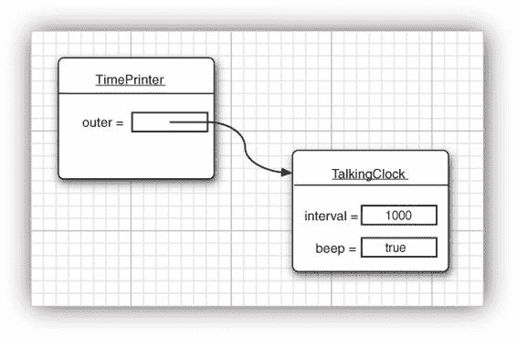

图 6.3. 内部类对象拥有对外部类对象的引用

该引用在内部类的定义中是不可见的。然而，为了阐明这一概念，我们将对外部对象的引用命名为`outer`。那么，`actionPerformed`方法等同于以下代码：

点击查看代码图像

```java
public void actionPerformed(ActionEvent event)
{
    Date now = new Date();
    System.out.println("At the tone, the time is " + now);
    if (outer.beep) Toolkit.getDefaultToolkit().beep();
}
```

外部类引用是在构造函数中设置的。编译器会修改所有内部类的构造函数，添加一个外部类引用的参数。`TimePrinter`类没有定义构造函数；因此，编译器会合成一个无参数构造函数，生成如下代码：

点击查看代码图像

```java
public TimePrinter(TalkingClock clock) // 自动生成的代码
{
    outer = clock;
}
```

再次注意，`outer`并不是 Java 关键字。我们只是用它来说明内部类涉及的机制。

在`start`方法中构造`TimePrinter`对象时，编译器会将当前计时钟的`this`引用传递给构造函数：

```java
ActionListener listener = new TimePrinter(this); // 自动添加参数
```

列表 6.6 显示了测试内部类的完整程序。再次查看一下访问控制。如果`TimePrinter`类是一个普通类，它将需要通过`TalkingClock`类的公共方法来访问`beep`标志位。使用内部类是一种改进。没有需要提供仅对另一个类感兴趣的访问器。

***


**备注**

我们可以将`TimePrinter`类声明为`private`。这样，只有`TalkingClock`方法能够构造`TimePrinter`对象。只有内部类可以是私有的。普通类总是具有包级或公有的可见性。

***

**列表 6.6.** `innerClass/InnerClassTest.java`

点击查看代码图像

***

```java
package innerClass;

import java.awt.*;
import java.awt.event.*;
import java.util.*;
import javax.swing.*;
import javax.swing.Timer;

/**
 * 此程序演示了内部类的用法。
 * @version 1.10 2004-02-27
 * @author Cay Horstmann
 */
public class InnerClassTest
{
    public static void main(String[] args)
    {
        TalkingClock clock = new TalkingClock(1000, true);
        clock.start();

        // 保持程序运行直到用户选择“确定”
        JOptionPane.showMessageDialog(null, "Quit program?");
        System.exit(0);
    }
}

/**
 * 按固定间隔打印时间的闹钟。
 */
class TalkingClock
{
    private int interval;
    private boolean beep;

    /**
     * 构造一个闹钟
     * @param interval 消息之间的间隔（毫秒）
     * @param beep 如果闹钟应该鸣响则设为 true
     */
    public TalkingClock(int interval, boolean beep)
    {
        this.interval = interval;
        this.beep = beep;
    }

    /**
     * 启动闹钟。
     */
    public void start()
    {
        ActionListener listener = new TimePrinter(this); // 自动添加参数
        Timer t = new Timer(interval, listener);
        t.start();
    }
}

class TimePrinter implements ActionListener
{
    private TalkingClock outer;

    public TimePrinter(TalkingClock clock)
    {
        outer = clock;
    }

    public void actionPerformed(ActionEvent event)
    {
        Date now = new Date();
        System.out.println("At the tone, the time is " + now);
        if (outer.beep) Toolkit.getDefaultToolkit().beep();
    }
}
```

`java reflection.ReflectionTest innerClass.TalkingClock$TimePrinter`

或

`javap -private innerClass.TalkingClock$TimePrinter`

你将得到以下输出：

点击此处查看代码图片

```java
public class TalkingClock$TimePrinter
{
   public TalkingClock$TimePrinter(TalkingClock);
   public void actionPerformed(java.awt.event.ActionEvent);
   final TalkingClock this$0;
}
```

你可以清楚地看到，编译器为指向外部类的引用生成了一个额外的实例字段`this$0`。（`this$0`的名称是编译器自动合成的——你不能在代码中引用它。）你还可以看到构造函数中的`TalkingClock`参数。

如果编译器能够自动完成这种转换，你难道不能简单地手动编写相同的机制吗？让我们试一试。我们将`TimePrinter`变成一个普通类，放在`TalkingClock`类的外部。在构造`TimePrinter`对象时，我们将创建它的对象的`this`引用传递给它。

点击此处查看代码图片

```java
class TalkingClock
{
   . . .
   public void start()
   {
      ActionListener listener = new TimePrinter(this);
      Timer t = new Timer(interval, listener);
      t.start();
   }
}

class TimePrinter implements ActionListener
{
   private TalkingClock outer;
   . . .
   public TimePrinter(TalkingClock clock)
   {
      outer = clock;
   }
}
```

现在让我们来看`actionPerformed`方法。它需要访问`outer.beep`。

```java
if (outer.beep) . . . // 错误
```

在这里我们遇到了问题。内部类可以访问外部类的私有数据，但我们的外部`TimePrinter`类却不能。

因此，内部类确实比普通类更强大，因为它们拥有更多的访问权限。

你可能很好奇，如果内部类被转换成了带有奇怪的普通类，它们是如何获得这些额外访问权限的——虚拟机对它们一无所知。为了解开这个谜团，让我们再次使用`ReflectionTest`程序来监视`TalkingClock`类：

点击此处查看代码图片

```java
class TalkingClock
{
   private int interval;
   private boolean beep;
   public TalkingClock(int, boolean);
   static boolean access$0(TalkingClock);
   public void start();
}
```

注意编译器为外部类添加的静态方法`access$0`。它返回作为参数传递的对象的`beep`字段。（方法名可能会略有不同，例如`access$000`，取决于你的编译器。）

内部类的方法调用了该方法。`TimePrinter`类`actionPerformed`方法中的语句

```java
if (beep)
```

实际上执行了以下调用：


```java
if (access$0(outer));
```

这是一种安全风险吗？你可以肯定的。对于其他人来说，调用`access$0`方法来读取私有的`beep`字段是很容易的事。当然，`access$0`并不是 Java 方法的合法名称。然而，熟悉类文件结构的黑客可以轻松生成带有虚拟机指令的类文件来调用该方法，例如通过使用十六进制编辑器。由于这些秘密访问方法具有包可见性（package visibility），攻击代码需要放置在与被攻击类相同的包中。

总结一下，如果内部类访问了私有数据字段，那么有可能通过添加到外部类所在包中的其他类来访问该数据字段，但这样做需要技术和决心。程序员无法无意中获得访问权限，必须有意识地构建或修改类文件以达到该目的。

---

 注意

合成的构造函数和方法可能会变得非常复杂。（如果你感到反感，请跳过此注释）。假设我们将`TimePrinter`变成一个私有内部类。虚拟机并没有私有类，因此编译器产生了最好的替代方案：一个具有私有构造函数的包可见类。

```java
private TalkingClock$TimePrinter(TalkingClock);
```

当然，没有人可以调用那个构造函数，所以有第二个包可见的构造函数：

```java
TalkingClock$TimePrinter(TalkingClock, TalkingClock$1);
```

它会调用第一个。

编译器将`TalkingClock`类`start`方法中的构造函数调用翻译为：

```java
new TalkingClock$TimePrinter(this, null)
```

### 6.4.4 局部内部类

如果你仔细观察`TalkingClock`示例的代码，你会发现你只需要一次类型`TimePrinter`的名称：在你创建它的对象时。在这样的情况下，你可以*局部地*定义该类。

点击此处查看代码图片。

```java
public void start()
{
   class TimePrinter implements ActionListener
   {
      public void actionPerformed(ActionEvent event)
      {
         Date now = new Date();
         System.out.println("At the tone is " + now);
         if (beep) Toolkit.getDefaultToolkit().beep();
      }
   }
   ActionListener listener = new TimePrinter(this);
   Timer t = new Timer(interval, listener);
   t.start();
}
```

局部类受限于它们定义的块。

### 6.4.5 从外部方法访问 final

内部类还有一个优势：它们可以访问外部的字段。然而，那些局部变量必须是`final`。这里有一个典型的示例：我们将`interval`和`beep`参数移动到`start`方法。

点击此处查看代码图片。

```java
public void start(final int interval, final boolean beep)
{
   class TimePrinter implements ActionListener
   {
      public void actionPerformed(ActionEvent event)
      {
         Date now = new Date();
         System.out.println("At the tone is " + now);
         if (beep) Toolkit.getDefaultToolkit().beep();
      }
   }
   ActionListener listener = new TimePrinter(this);
   Timer t = new Timer(interval, listener);
   t.start();
}
```

注意`TalkingClock`类不再需要存储`beep`实例字段。它只是引用`start`方法的`beep`参数变量。

也许这并不意外。语句：

```java
if (beep) . . .
```

毕竟最终是在`start`方法内部，所以它为什么不应该访问`beep`变量的值呢？为了看到这里存在微妙的问题，让我们更仔细地考虑控制流：

1. 调用`start`方法。
2. 通过调用内部类`TimePrinter`的构造函数初始化对象`listener`。
3. 将`listener`引用传递给`Timer`构造函数，启动定时器，`start`方法退出。此时，`start`方法的`beep`参数不存在。
4. 一秒后，`actionPerformed`方法执行`if (beep) . . .`。

为了让`actionPerformed`方法的代码运行，`TimePrinter`类必须在`beep`参数值消失之前，将`beep`字段复制为`start`方法的局部变量。这正是发生的情况。在我们示例中，编译器为局部内部类合成了名称`TalkingClock$1TimePrinter`。如果你再次使用`ReflectionTest`程序监视`TalkingClock$1TimePrinter`类，你将得到以下输出：

点击此处查看代码图像。

```java
class TalkingClock$1TimePrinter
{
    TalkingClock$1TimePrinter(TalkingClock, boolean);
    public void actionPerformed(java.awt.event.ActionEvent);
    final boolean val$beep;
    final TalkingClock this$0;
}
```

注意构造函数中的`boolean`参数和`val$beep`实例变量。当创建一个对象时，值`beep`会被传递给构造函数并存储在`val$beep`字段中。编译器会检测对局部变量的访问，并为每个局部变量创建匹配的实例字段，并将局部变量拷贝到构造函数中，这样实例字段就可以被初始化。

从程序员的角度来看，局部变量的访问是非常舒适的。它通过减少你需要显式编写的实例字段，使得你的内部类变得更加简单。

正如我们已经提到的，局部类的方法只能引用声明为`final`的局部变量。出于这个原因，在我们的示例中，`beep`参数被声明为`final`。被声明为`final`的局部变量在初始化后不能被修改。因此，可以保证局部变量和在局部类内部创建的拷贝始终具有相同的值。

---

 注意

你已经见过`final`用于常量，例如：

```java
public static final double SPEED_LIMIT = 55;
```

`final`关键字可以应用于局部变量、实例变量和静态变量。在所有情况下，它的含义都是相同的：你可以在创建后对其赋值一次。之后，你就不能更改它的值——它是最终的。

然而，在定义`final`变量时不需要初始化它。例如，`final`参数变量`beep`在其创建后调用`start`方法时初始化一次。（如果该方法被调用多次，每次调用都有自己新创建的`beep`参数。）你在`TalkingClock$1TimePrinter`内部类中看到的`val$beep`实例变量在内部类构造中设置一次。在定义时未初始化的`final`变量通常被称为*空 final*（*blank final*）变量。

---

`final`限制有些不方便。例如，假设你想更新封闭作用域中的计数器。在这里，我们想统计排序过程中`compareTo`方法被调用的次数：

点击此处查看代码图像。

```java
int counter = 0;
Date[] dates = new Date[100];
for (int i = 0; i < dates.length; i++)
    dates[i] = new Date()
        {
            public int compareTo(Date other)
            {
                counter++; // 错误
                return super.compareTo(other);
            }
        };
Arrays.sort(dates);
System.out.println(counter + " comparisons.");
```

你不能将`counter`声明为`final`，因为你显然更新它。你不能用`Integer`替换它，因为`Integer`对象是不可变的。解决办法是使用一个长度为 1 的数组：

点击此处查看代码图像。

```java
final int[] counter = new int[1];
for (int i = 0; i < dates.length; i++)
    dates[i] = new Date()
        {
            public int compareTo(Date other)
            {
                counter[0]++;
                return super.compareTo(other);
            }
        };
```

（数组变量仍然被声明为`final`，但这仅仅意味着你不能让它引用不同的数组。你可以自由地修改数组元素。）

当内部类首次被发明时，原型编译器会自动对在内部类中被修改的所有局部变量进行这种转换。然而，一些程序员担心编译器会在他们背后擅自生成堆堆对象，因此转而采用了`final`限制。Java 语言的未来版本可能会修正这一决定。

### 6.4.6 匿名内部类

在使用局部类时，你通常可以更进一步。如果你只想为该类创建一个单一对象，你就不需要给这个类起名。这样的类被称为匿名内部类。

点击此处查看代码图像。

```java
public void start(int interval, boolean beep)
{
    ActionListener listener = new ActionListener()
    {
        public void actionPerformed(ActionEvent event)
        {
            Date now = new Date();
            System.out.println("At the tone, the time is " + now);
            if (beep) Toolkit.getDefaultToolkit().beep();
        }
    };
    Timer t = new Timer(interval, listener);
    t.start();
}
```

这种语法非常晦涩。它的意思是：创建一个实现`ActionListener`接口的类的对象，其中所需的方法`actionPerformed`是`{ }`内部的那个。通常，语法如下：

点击此处查看代码图像。

```java
new SuperType(construction parameters)
{
    内部方法和数据
}
```

在这里，`SuperType`可以是一个接口，例如`ActionListener`；那么内部类就实现该接口。`SuperType`也可以是一个类；那么内部类就扩展该类。

匿名内部类不能有构造函数，因为构造函数的名称必须与类名相同，而类没有名称。相反，构造参数被传递给父类构造函数。特别是，每当内部类实现接口时，它不能有任何构造参数。尽管如此，你必须提供一组括号，如：

```java
new InterfaceType()
{
    方法和数据
}
```

你必须仔细观察一个类的新对象的构造与一个扩展该类的匿名内部类的构造之间的区别。

点击此处查看代码图像。

```java
Person queen = new Person("Mary"); // 一个 Person 对象
Person count = new Person("Dracula") { }; // 类的类的对象
```

如果构造参数列表的右括号后面跟着大括号，那么正在定义一个匿名内部类。

匿名内部类是一个好主意还是编写晦涩代码的好方法？可能两者兼有。当内部类的代码很短，只有几行简单代码时，匿名内部类可以节省输入时间——但正是这种节省时间的功能带你走向“Java 混淆竞赛”的滑坡。

列表 6.7 包含了带有匿名内部类的时钟程序的完整源代码。如果你将此程序与列表 6.6 进行比较，你会发现在这种情况下，使用匿名内部类的方案要短得多，而且如果经过练习，也更容易理解。

列表 6.7 `anonymousInnerClass/AnonymousInnerClassTest.java`

点击此处查看代码图像。

---

```java
package anonymousInnerClass;

import java.awt.*;
import java.awt.event.*;
import java.util.*;
import javax.swing.*;
import javax.swing.Timer;

/**
 * 此程序演示了匿名内部类。
 * @version 1.10 2004-02-27
 * @author Cay Horstmann
 */
public class AnonymousInnerClassTest
{
    public static void main(String[] args)
    {
        TalkingClock clock = new TalkingClock();
        clock.start(1000, true);

        // 保持程序运行直到用户选择“确定”
        JOptionPane.showMessageDialog(null, "退出程序？");
        System.exit(0);
    }
}

/**
 * 一个定期间隔打印时间的时钟。
 */
```

```java
class TalkingClock {
    /**
     * 启动时钟。
     * @param interval 消息之间的间隔（毫秒）
     * @param beep 如果闹钟应该响则为 true
     */
    public void start(int interval, final boolean beep) {
        ActionListener listener = new ActionListener() {
            public void actionPerformed(ActionEvent event) {
                Date now = new Date();
                System.out.println("At the tone, the time is " + now);
                if (beep) Toolkit.getDefaultToolkit().beep();
            }
        };
        Timer t = new Timer(interval, listener);
        t.start();
    }
}
```

 注意

这种被称为`双括号初始化`（double brace initialization）的技巧利用了内部类语法。假设你想构造一个列表并将其传递给方法：

点击此处查看代码图像。

```java
ArrayList<String> friends = new ArrayList<>();
friends.add("Harry");
friends.add("Tony");
invite(friends);
```

如果你不再需要这个列表，将其匿名化会很好。但这样做如何添加元素呢？方法如下：

`invite(new ArrayList<String>() {{ add("Harry"); add("Tony"); }})`

注意双层括号。外层括号使`ArrayList`的匿名子类。内层括号是一个对象构造块（参见第 4 章）。

 警告

创建一个几乎与其父类相似但又不完全相同的匿名子类通常很方便。但你需要小心处理`equals`方法。在第 5 章中，我们建议你的`equals`方法使用测试：

```java
if (getClass() != other.getClass()) return false;
```

匿名子类将通过此测试。

 提示

当你生成日志或调试信息时，通常想包含当前类的名称，例如：

```java
System.err.println("Something awful happened in " + getClass());
```

但这在静态方法中会失败。毕竟，对`getClass`的调用会执行`this.getClass()`，而静态方法没有`this`。请使用以下表达式：

```java
new Object(){}.getClass().getEnclosingClass() // 获取静态方法的类
```


在这里，`new Object(){}` 创建了一个 `Object` 匿名子类的匿名对象，而 `getEnclosingClass` 获取其包围类——即包含该静态方法的类。

#### 6.4.7 静态内部类

偶尔，你可能只想使用内部类将一个类隐藏在另一个类内部——但你不需要内部类持有外部类对象的引用。你可以通过将内部类声明为 `static` 来抑制该引用的生成。

这是一个你想这样做的典型示例。考虑计算数组中最小值和最大值的任务。当然，你可以写一个方法计算最小值，另一个方法计算最大值。当你调用这两个方法时，数组会被遍历两次。只遍历一次数组并同时计算最小值和最大值会更有效。

```java
double min = Double.MAX_VALUE;
double max = Double.MIN_VALUE;
for (double v : values) {
    if (min > v) min = v;
    if (max < v) max = v;
}
```

然而，该方法必须返回两个数字。我们可以通过定义一个持有两个值的 `Pair` 类来实现：点击此处查看代码图片。

```java
class Pair {
    private double first;
    private double second;

    Pair(double f, double s) {
        first = f;
        second = s;
    }

    public double getFirst() {
        return first;
    }

    public double getSecond() {
        return second;
    }
}
```

`minmax` 方法就可以返回一个 `Pair` 对象。点击此处查看代码图片。

```java
class ArrayAlg {
    public static Pair minmax(double[] values) {
        // ...
        return new Pair(min, max);
    }
}
```

调用者使用 `getFirst` 和 `getSecond` 方法获取答案：点击此处查看代码图片。

```java
Pair p = ArrayAlg.minmax(d);
System.out.println("min = " + p.getFirst());
System.out.println("max = " + p.getSecond());
```

当然，`Pair` 这个名字极其常见，在大型项目中，可能其他程序员也有同样的想法——创建了一个包含字符串字符串对的 `Pair` 类。我们可以通过将 `Pair` 变为 `ArrayAlg` 内部的公共内部类来解决这个潜在的冲突。这样，该类对外公开为 `ArrayAlg.Pair`：

```java
ArrayAlg.Pair p = ArrayAlg.minmax(d);
```

然而，与我们在之前的示例中使用的内部类不同，我们不希望在 `Pair` 对象内部持有任何其他对象的引用。该引用可以通过将内部类声明为 `static` 来抑制：

```java
class ArrayAlg {
    public static class Pair {
        // ...
    }

    // ...
}
```

当然，只有内部类可以被声明为 `static`。静态内部类与其他内部类完全相同，只是静态内部类的对象不持有生成它的外部类的引用。在我们的示例中，我们必须使用静态内部类，因为内部类对象是在静态方法内部构造的：

```java
public static Pair minmax(double[] d) {
    // ...
    return new Pair(min, max);
}
```

如果 `Pair` 类没有声明为 `static`，编译器将报错，没有可用的 `ArrayAlg` 类型隐式对象来初始化内部类对象。


> **注意**
>
> 当内部类不需要访问外部类对象时，请使用静态内部类。一些程序员使用“嵌套类”（nested class）一词来描述静态内部类。


> **注意**
>
> 在接口内部声明的内部类自动是 `static` 且 `public` 的。

Listing 6.8 包含了 `ArrayAlg` 类和嵌套 `Pair` 类的完整源代码。

Listing 6.8. `staticInnerClass/StaticInnerClassTest.java` 点击此处查看代码图片。

```java
package staticInnerClass;

/**
 * 此程序演示了静态内部类的用法。
 * @version 1.01 2004-02-27
 * @author Cay Horstmann
 */
public class StaticInnerClassTest {
    public static void main(String[] args) {
        double[] d = new double[20];
        for (int i = 0; i < d.length; i++)
            d[i] = 100 * Math.random();

        ArrayAlg.Pair p = ArrayAlg.minmax(d);
        System.out.println("min = " + p.getFirst());
        System.out.println("max = " + p.getSecond());
    }
}

class ArrayAlg {
    /**
     * 一对浮点数
     */
    static class Pair {
        private double first;
        private double second;

        /**
         * 从浮点数构造一个对
         * @param f 第一个数字
         * @param s 第二个数字
         */
        Pair(double f, double s) {
            first = f;
            second = s;
        }

        /**
         * 返回对中的第一个数字
         * @return 第一个数字
         */
        public double getFirst() {
            return first;
        }

        /**
         * 返回对中的第二个数字
         * @return 第二个数字
         */
        public double getSecond() {
            return second;
        }
    }
}
```

```java
/**
 * Computes both the minimum and the maximum of an array
 * @param values an array of floating-point numbers
 * @return a pair whose first element is the minimum and whose second element
 * is the maximum
 */
public static Pair minmax(double[] values)
{
    double min = Double.MAX_VALUE;
    double max = Double.MIN_VALUE;

    for (double v : values)
    {
        if (min > v) min = v;
        if (max < v) max = v;
    }

    return new Pair(min, max);
}
```

### 6.5 代理（Proxies）

在本章的最后一节中，我们将讨论 `proxies`。你可以使用代理在运行时创建实现给定一组接口的新类。只有当你会在编译时尚不知道需要实现哪些接口时，代理才是必不可少的。对于应用程序程序员来说，这并不是一种常见的情况，如果你对这种“高级魔法”不感兴趣，可以随意跳过这一节。然而，对于某些系统编程应用，代理提供的灵活性可能非常重要。

假设你想构造一个实现了一个或多个接口的类对象，而这些接口的具体性质你可能在编译时不知道。这是一个困难的问题。要构造一个实际类，你可以直接使用 `newInstance` 方法或使用反射来查找构造函数。但你无法实例化接口。你需要在运行中的程序中定义一个新类。

为了解决这个问题，某些程序会生成代码，将其放入文件中，调用编译器，然后加载生成的类文件。自然地，这种方法很慢，而且还需要将编译器与程序一起部署。`proxy` 机制是一个更好的解决方案。代理类可以在运行时创建全新的类。此类代理类实现了你指定的接口。特别地，代理类具有以下方法：

- 指定的接口要求的所有方法；
- `Object` 类中定义的所有方法（`toString`、`equals` 等）。

然而，你不能在运行时为这些方法定义新代码。相反，你必须提供一个 `invocation handler`（调用处理器）。调用处理器是任何实现了 `InvocationHandler` 接口的类的实例。该接口有一个方法：

```java
Object invoke(Object proxy, Method method, Object[] args)
```

每当在代理对象上调用方法时，调用处理器的 `invoke` 方法会被调用，并传入原始调用的 `Method` 对象和参数。随后调用处理器必须找出如何处理该调用。

要创建一个代理对象，请使用 `Proxy` 类的 `newProxyInstance` 方法。该方法有三个参数：

- `class loader`（类加载器）。作为 Java 安全模型的一部分，不同的类加载器可以用于系统类、从互联网下载的类等。我们将在第二卷的第 9 章讨论类加载器。现在，我们指定 `null` 来使用默认类加载器。
- 一个 `Class` 对象的数组，每个接口对应一个对象。
- 一个调用处理器。

还剩下两个问题。我们如何定义处理器？我们对生成的代理对象可以做什么？当然，这些答案取决于我们想要通过代理机制解决的问题。代理可以用于许多目的，例如：

- 将方法调用路由到远程服务器；
- 将用户界面事件与运行程序中的动作关联；
- 为了调试目的跟踪方法调用。

在我们的示例程序中，我们使用代理和调用处理器来跟踪方法调用。我们定义了一个 `TraceHandler` 包装类，它存储了一个被包装的对象。它的 `invoke` 方法简单地打印要调用的方法名称和参数，然后使用被包装的对象作为隐式参数调用该方法。

点击此处查看代码图像。

```java
class TraceHandler implements InvocationHandler
{
    private Object target;

    public TraceHandler(Object t)
    {
        target = t;
    }

    public Object invoke(Object proxy, Method m, Object[] args)
        throws Throwable
    {
        // ... 跟踪调用的逻辑 ...
        return m.invoke(target, args);
    }
}
```

```java
// fill elements with proxies for the integers 1 ... 1000
for (int i = 0; i < elements.length; i++)
{
    Integer value = i + 1;
    InvocationHandler handler = new TraceHandler(value);
    Object proxy = Proxy.newProxyInstance(
        null,
        new Class[] { Comparable.class },
        handler
    );
    elements[i] = proxy;
}

// construct a random integer
Integer key = new Random().nextInt(elements.length) + 1;

// search for the key
int result = Arrays.binarySearch(elements, key);

// print match if found
if (result >= 0) System.out.println(elements[result]);
```

```java
/**
 * An invocation handler that prints out the method name and parameters, then
 * invokes the original method
 */
class TraceHandler implements InvocationHandler
{
    private Object target;

    /**
     * Constructs a TraceHandler
     * @param t the implicit parameter of the method call
     */
    public TraceHandler(Object t)
    {
        target = t;
    }

    public Object invoke(Object proxy, Method m, Object[] args) throws Throwable
    {
        // print implicit argument
        System.out.print(target);

        // print method name
        System.out.print("." + m.getName() + "(");

        // print explicit arguments
        if (args != null)
        {
            for (int i = 0; i < args.length; i++)
            {
                System.out.print(args[i]);
                if (i < args.length - 1) System.out.print(", ");
            }
        }

        System.out.println(")");

        // invoke actual method
        return m.invoke(target, args);
    }
}
```

#### 6.5.1 代理类的属性

现在你已经看到了代理类的实际运行，让我们回顾一下它们的一些属性。请记住，代理类是在运行程序中动态创建的。然而，一旦创建完成，它们就像虚拟机中的任何其他类一样是普通的类。

所有的代理类都继承自 `Proxy` 类。代理类只有一个实例字段——调用处理器（invocation handler），它定义在 `Proxy` 超类中。例如，当我们在示例 6.9 的程序中代理 `Comparable` 对象时，`TraceHandler` 包装了实际对象。

所有的代理类都重写了 `Object` 类的 `toString`、`equals` 和 `hashCode` 方法。与所有的代理方法一样，这些方法简单地调用处理器上的 `invoke` 方法。`Object` 类的其他方法（如 `clone` 和 `getClass`）没有重新定义。

代理类的名称是没有定义的。Oracle 虚拟机中的 `Proxy` 类生成的类名以 `$Proxy` 开头。对于特定的类加载器和接口集合，只有一个代理类。也就是说，如果你使用相同的类加载器和接口数组调用两次 `newProxyInstance`，你将得到两个属于同一种类的对象。你也可以通过 `getProxyClass` 方法获取该类：

`proxyClass = Proxy.getProxyClass(null, interfaces);`

代理类始终是 `public` 且 `final` 的。如果代理类实现的所有接口都是 `public` 的，则该代理类不属于任何特定的包。否则，所有非 `public` 接口必须属于同一个包，且代理类也将属于该包。你可以通过调用 `Proxy` 类的 `isProxyClass` 方法来测试特定的 `Class` 对象是否代表代理类。

#### `java.lang.reflect.InvocationHandler`

`Object invoke(Object proxy, Method method, Object[] args)` 定义此方法，包含每当在代理对象上调用方法时你想要执行的操作。

#### `java.lang.reflect.Proxy`

- `static Class getProxyClass(ClassLoader loader, Class[] interfaces)` 返回实现给定接口的代理类。
- `static Object newProxyInstance(ClassLoader loader, Class[] interfaces, InvocationHandler handler)` 构建一个实现给定接口的代理类的新实例。所有方法都会调用给定处理器的 `invoke` 方法。


- `static boolean isProxyClass(Class c)`：如果 `c` 是代理类，则返回 `true`。

关于 Java 语言基础的最后一章节到此结束。接口和内部类是你会经常遇到的概念。然而，正如我们已经提到的，代理是一种高级技术，主要对工具构建者感兴趣，而不是应用程序程序员。你现在准备好开始学习图形和用户界面了，从第 7 章开始。

# 第 7 章 图形编程

## 本章内容

- 介绍 Swing
- 创建帧（Frame）
- 帧的位置
- 在组件中显示信息
- 处理 2D 形状
- 使用颜色
- 为文本使用特殊字体
- 显示图像

到目前，你只见过如何编写从键盘获取输入、对其进行处理并在控制台屏幕上显示结果的程序。这并不是大多数用户现在想要的。现代程序不是这样工作的，网页也是如此。本章将带你开启编写使用图形用户界面（GUI）的 Java 程序的道路。特别是，你将学习如何编写在屏幕上调整窗口大小和定位的程序、在窗口中使用多种字体显示文本、显示图像等。这使你获得了一套有用且有价值的技能储备，你将在后续章节编写有趣的程序时将其大显身手。

接下来的两章将向你展示如何处理事件（例如击键和鼠标点击），以及如何向你的应用程序添加界面元素（如菜单和按钮）。当你完成这三章时，你将掌握编写图形化应用程序的精要。对于更复杂的图形编程技术，我们建议参阅第二卷。

另一方面，如果你打算仅使用 Java 进行服务端编程，并且对编写 GUI 编程感兴趣，可以安全地跳过这些章节。

## 7.1 引入 Swing

当 Java 1.0 时，它包含了一个类库，Sun 称为抽象窗口工具包（AWT），用于基本的 GUI 编程。基本的 AWT 库通过将其创建和行为委托给每个目标平台（Windows、Solaris、Macintosh 等）上的原生 GUI 工具包来处理用户界面元素。例如，如果你使用原始 AWT 在 Java 窗口上放置一个文本框，底层的“对等”（peer）文本框实际上负责处理文本输入。生成的程序理论上可以运行在这些任何一个平台上，并具有目标平台的“外观和感受”——这就是 Sun 的注册标语：“一次编写，随处运行。”

基于对等（peer-based）的方法对于简单的应用程序效果良好，但很快就会发现，编写一个依赖于原生用户界面元素的高质量可移植图形库是极其困难的。像菜单、滚动条和文本字段等用户界面元素在不同平台上的行为可能存在细微差异。因此，通过这种方法很难为用户提供一致且可预测的体验。此外，某些图形环境（如 `X11/Motif`）拥有的用户界面组件并不像 Windows 或 Macintosh 那样丰富。这反过来进一步限制了基于“最小公约数”方法的可移植库。结果是使用 `AWT` 构建的 GUI 应用程序看起来并不像原生 Windows 或 Macintosh 应用程序那样漂亮，也不具备这些平台用户所预期的功能。更令人沮丧的是，不同平台上的 `AWT` 用户界面库存在不同的缺陷。开发者们抱怨说，他们必须在每个平台上测试自己的应用程序——这种做法被嘲讽地称为“一次编写，处处调试”。

1996 年，Netscape 创建了一个名为 `IFC`（互联网基础类）的 GUI 库，它采用了一种完全不同的方法。按钮、菜单等用户界面元素被绘制在空白窗口上。底层窗口系统所需的功能只是提供显示窗口和在窗口上进行绘制的方法。因此，Netscape 的 `IFC` 组件无论程序运行在哪个平台上，其外观和行为都是一致的。Sun 与 Netscape 合作完善了这种方法，创建了一个代号为“Swing”的用户界面库。`Swing` 作为 `Java 1.1` 的扩展可用，并成为 `Java SE 1.2` 标准库的一部分。

正如杜克·艾灵斯顿（Duke Ellington）所说，“如果没有律动（Swing），一切毫无意义，”`Swing` 现在是这种非对等 GUI 工具包的官方名称。`Swing` 是 `Java Foundation Classes`（`JFC`）的一部分。整个 `JFC` 非常庞大，包含的内容远多于 `Swing` GUI 工具包；除了 `Swing` 组件外，它还拥有可访问性 API、2D API 和拖放 API。

---

 注意

`Swing` 并不是 `AWT` 的完全替代品——它是构建在 `AWT` 架构之上的。`Swing` 只是为你提供了更强大的用户界面组件。每当你编写 `Swing` 程序时，你都会使用 `AWT` 的基础——特别是事件处理。从现在起，当我们说“Swing”时是指那些“绘制”的用户界面类，而当我们说“AWT”时是指窗口工具包的底层机制，例如事件处理。

---

当然，基于 `Swing` 的用户界面元素在用户屏幕上的出现速度会比 `AWT` 使用的对等组件慢一些。根据我们的经验，在任何相当现代的机器上，速度差异都不应该是问题。另一方面，选择 `Swing` 的理由是压倒性的：

- `Swing` 拥有一套丰富且方便的用户界面元素。
- `Swing` 对底层平台的依赖很少；因此较少出现平台特定的缺陷。
- `Swing` 跨平台提供了一致的用户体验。

尽管如此，第三个优点也是一个潜在的缺点：如果用户界面元素在所有平台上的看起来都一样，那么它们与原生控件就会不同，因此用户对它们不再那么熟悉。

`Swing` 以非常优雅的方式解决了这个问题。编写 `Swing` 程序的程序员可以为程序指定特定的“外观与感觉（look-and-feel）”。例如，图 7.1 和 7.2 显示了同一个程序在 Windows 和 GTK 外观与感觉下的运行。

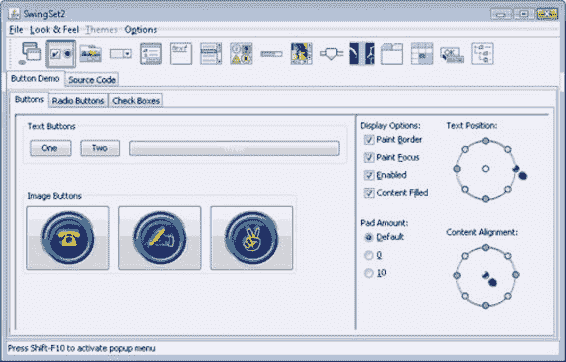

图 7.1. `Swing` 的 Windows 外观与感觉

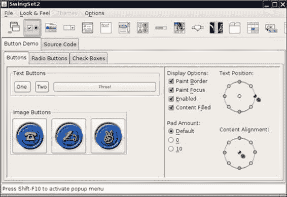

图 7.2. `Swing` 的 GTK 外观与感觉

此外，Sun 开发了一种名为“Metal”的平台无关外观与感觉，直到营销人员将其重命名为“Java 外观”。然而，大多数程序员继续使用“Metal”术语，我们在书中也会这样做。

一些人批评 Metal 过于呆板，因此外观在 `Java SE 5.0` 发布时得到了焕新（参见图 7.3）。现在 Metal 外观支持多个主题——颜色和字体的细微变化。默认主题被称为“Ocean（海洋）”。

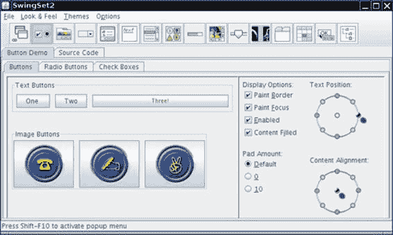

图 7.3. Metal 外观与感觉的 Ocean 主题

在 `Java SE 6` 中，Sun 改进了对 Windows 和 GTK 原生外观与感觉的支持。`Swing` 应用程序现在可以获取配色方案自定义并忠实地渲染那些时尚的动态按钮和滚动条。

`Java 7` 提供了一种新的外观与感觉，称为 `Nimbus`（图 7.4），但它默认可用。`Nimbus` 使用矢量图而非位图，因此独立于屏幕分辨率。

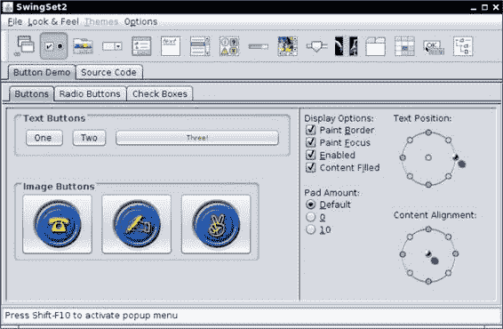

图 7.4. Nimbus 外观与感觉

某些用户希望他们的 `Java` 程序使用平台的原生外观与感觉，另一些人喜欢 Metal 或第三方外观与感觉。正如你在第 8 章中看到的，让用户使用他们喜爱的外观与感觉非常简单。

---

 注意

虽然我们在书中没有空间教你如何做，但 Java 程序员可以扩展现有的外观与感觉，甚至设计一个完全全新的。这是一个繁琐的过程，涉及到每个 `Swing` 组件是如何绘制的。一些开发者确实这样做了，特别是在将 Java 移植到亭亭终端或手持设备等非传统平台时。访问 [www.javootoo.com](http://www.javootoo.com) 查看有趣的外观与感觉实现集合。

`Java SE 5.0` 引入了一种名为 `Synth` 的外观与感觉，使这个过程变得更容易。在 `Synth` 中，你可以通过提供图像文件和 XML 描述符定义新的外观与感觉，而无需任何编程。

---

 提示

Napkin 外观与感觉（[`napkinlaf.sourceforge.net`](http://napkinlaf.sourceforge.net)）为所有用户界面元素提供了手绘的外观。当你向客户展示原型时这非常有用，可以传达出一个明确的信息：你正在给他们提供一个完成的产品。

---

 注意

如今 Java 用户界面编程大部分在 `Swing` 中完成，但有一个显著例外。Eclipse 集成开发环境使用一种名为 `SWT` 的图形工具包，它类似于 `AWT`，并映射到各种平台上的原生组件。你可以在 [www.eclipse.org/articles](http://www.eclipse.org/articles) 找到描述 `SWT` 的文章。

Oracle 正在开发一种名为 `JavaFX` 的替代技术，它可能在将来取代 `Swing`。我们在书中不讨论 `JavaFX`。更多信息请参见 [www.oracle.com/technetwork/java/javafx/overview](http://www.oracle.com/technetwork/java/javafx/overview)。

---

如果你用 Visual Basic 或 C# 编写过 Microsoft Windows 应用程序，你就知道这些产品提供的图形布局工具和资源编辑器有多易用。这些工具允许你设计应用程序的视觉外观，然后它们为你生成大部分（通常是全部）GUI 代码。Java 编程也有 GUI 构建器可用，但我们认为为了有效使用这些工具，你应该知道如何手动构建用户界面。本章剩余部分将为你介绍显示窗口和绘制其内容的基础知识。

## 7.2 创建框架（Frame）

Java 中的顶层窗口（即不包含在另一个窗口内的窗口）被称为 `frame`。AWT 库有一个名为 `Frame` 的类用于表示这种顶层窗口。该类的 Swing 版本被称为 `JFrame`，并继承了 `Frame` 类。`JFrame` 是少数几个不是在画布上绘制的 Swing 组件之一。因此，窗口装饰（如按钮、标题栏、图标等）是由用户的窗口系统绘制的，而不是由 Swing 绘制的。

 注意

大多数 Swing 组件类都以“J”开头：`JButton`、`JFrame` 等。虽然也有诸如 `Button` 和 `Frame` 的类，但它们是 AWT 组件。如果你不小心漏掉了“J”，你的程序可能仍然编译并运行，但 Swing 和 AWT 组件的混合会导致视觉和行为上的不一致。

在本节中，我们将介绍操作 Swing `JFrame` 时最常用的方法。代码列表 7.1 列出了一个简单的程序，它在屏幕上显示一个空框架，如图 7.5 所示。

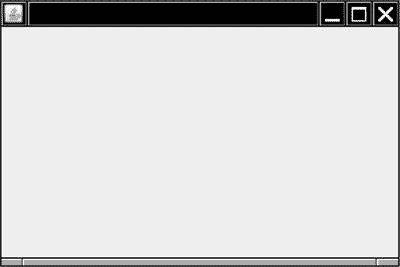

图 7.5. 最简单的可见框架

让我们逐行分析这个程序。

Swing 类位于 `javax.swing` 包中。包名 `javx` 表示这是一个 Java 扩展包，而不是核心包。由于历史原因，Swing 被认为是一个扩展。然而，从 1.2 版本以来，每个 Java SE 实现版本中都包含了它。

**代码列表 7.1. `simpleframe/SimpleFrameTest.java`**

点击此处查看代码图片

```java
package simpleFrame;

import java.awt.*;
import javax.swing.*;

/**
 * @version 1.32 2007-06-12
 * @author Cay Horstmann
 */
public class SimpleFrameTest
{
    public static void main(String[] args)
    {
        EventQueue.invokeLater(new Runnable()
            {
                public void run()
                {
                    SimpleFrame frame = new SimpleFrame();
                    frame.setDefaultCloseOperation(JFrame.EXIT_ON_CLOSE);
                    frame.setVisible(true);
                }
            });
    }
}

class SimpleFrame extends JFrame
{
    private static final int DEFAULT_WIDTH = 300;
    private static final int DEFAULT_HEIGHT = 200;

    public SimpleFrame()
    {
        setSize(DEFAULT_WIDTH, DEFAULT_HEIGHT);
    }
}
```

默认情况下，框架的大小为几乎毫无意义的 0 × 0 像素。我们定义了一个子类 `SimpleFrame`，其构造函数将大小设置为 300 × 200 像素。这是 `SimpleFrame` 和 `JFrame` 唯一的区别。

在 `SimpleFrameTest` 类的 `main` 方法中，我们构造了一个 `SimpleFrame` 对象并使其可见。

在每个 Swing 程序中我们需要解决两个技术问题。

首先，所有的 Swing 组件必须在*事件分发线程*（event dispatch thread）中配置，该线程是传递鼠标点击和键盘输入等事件的控制线程。以下代码使用了：

```java
EventQueue.invokeLater(new Runnable()
    {
        public void run()
        {
            SimpleFrame frame = new SimpleFrame();
            frame.setDefaultCloseOperation(JFrame.EXIT_ON_CLOSE);
            frame.setVisible(true);
        }
    });
```

本节的 API 注释给出了我们认为的赋予框架正确外观和感觉的最重要方法。其中一些方法定义在 `JFrame` 类中，另一些方法则来自 `JFrame` 的各种超类。在某些情况下，你可能需要搜索 API 文档以查看是否存在某些特殊用途的方法。遗憾的是，对于继承的方法，这样做起来会有点繁琐。例如，`toFront` 方法适用于 `JFrame` 类型的对象，但由于它简单地继承自 `Window` 类，因此 `JFrame` 的文档并没有对其进行解释。如果你认为应该有一个方法来执行某项操作，但在你正在处理的类文档中没有提到，请尝试查看该类超类方法的 API 文档。每个 API 页面的顶部都有指向超类的超链接，继承的方法列在新方法和重写方法的方法摘要下方。

---

正如 API 注释所示，`Component` 类（所有 GUI 对象的祖先）和 `Window` 类（`Frame` 类的超类）是你需要查找调整框架大小和改变形状的方法的地方。例如，`Component` 类中的 `setLocation` 方法是重新定位组件的一种方法。如果你调用：

```java
setLocation(x, y)
```

左上角将位于向右 `x` 像素、向下 `y` 像素处，其中 (`0`, `0`) 是屏幕的左上角。同样，`Component` 中的 `setBounds` 方法允许你一步完成调整组件的大小和重新定位（特别是 `JFrame`），如下：

```java
setBounds(x, y, width, height)
```

或者，你可以将窗口放置的控制交给窗口系统。如果你在显示窗口之前调用：

```java
setLocationByPlatform(true);
```

窗口系统将选择位置（但不选择大小），通常是相对于上一个窗口有略微偏移。

---

 注意

对于框架而言，`setLocation` 和 `setBounds` 的坐标是相对于整个屏幕的。正如你将在第 9 章中看到的那样，对于容器内的其他组件，测量值是相对于容器的。

## 7.3.1 框架属性

组件类的许多方法以 getter/setter 对的形式出现，例如 `Frame` 类的以下方法：

```java
public String getTitle()
public void setTitle(String title)
```

这样的 getter/setter 对被称为一个*属性*。一个属性有一个名称和一个类型。名称通过将 `get` 或 `set` 之后的第一个字母改为小写来获得。例如，`Frame` 类有一个名称为 `title` 类型为 `String` 的属性。

从概念上说，`title` 是框架的属性属性。当我们设置该属性时，我们期望标题在用户的屏幕上发生变化。当我们获取该属性时，我们期望获得我们所设置的值。

我们不知道（也不在乎）`Frame` 类是如何实现这个属性的。也许它简单地使用它的对等框架（peer frame）来存储标题。也许它有一个实例字段：

```java
private String title; // 属性不需要这个
```

如果该类确实有一个匹配的实例字段，我们不知道（也不在乎）getter 和 setter 方法是如何实现的。它们可能只是读取和写入实例字段。它们可能执行更多操作，例如在每次标题更改时通知窗口系统。

`get`/`set` 约定有一个例外：对于 `boolean` 类型的属性，getter 以 `is` 开头。例如，以下两个方法定义了 `locationByPlatform` 属性：

点击此处查看代码图像

```java
public boolean isLocationByPlatform()
public void setLocationByPlatform(boolean b)
```


我们将在第二卷的第 8 章更详细地查看属性。

---

 注意

许多编程语言，特别是 Visual Basic 和 C# 对属性有内置支持。Java 的未来版本也可能为属性添加语言结构。

---

### 7.3.2 确定合适的框架尺寸

记住：如果你不显式地设置框架大小，所有框架将默认为 0 比 0 像素。为了保持我们的示例程序简单，我们将框架调整为我们认为在大多数显示器上可以接受的大小。然而，在专业应用程序中，你应该检查用户屏幕的分辨率并编写相应的代码：在笔记本电脑屏幕上看起来良好的窗口，在高分辨率屏幕上看起来会像一个邮票。

要确定屏幕大小，请使用以下步骤。调用 `Toolkit` 类的静态方法 `getDefaultToolkit()` 来获取 `Toolkit` 对象。（`Toolkit` 类是各种与原生窗口系统接口的方法的汇集地。）然后调用 `getScreenSize()` 方法，该方法将屏幕大小作为 `Dimension` 对象返回。`Dimension` 对象同时在公共的 `width` 和 `height` 实例变量中存储宽度和高度。以下是代码：

点击此处查看代码图像

```java
Toolkit kit = Toolkit.getDefaultToolkit();
Dimension screenSize = kit.getScreenSize();
int screenWidth = screenSize.width;
int screenHeight = screenSize.height;
```

我们使用这些值的 50% 作为框架尺寸，并告诉窗口系统放置框架的位置：

点击此处查看代码图像

```java
setSize(screenWidth / 2, screenHeight / 2);
setLocationByPlatform(true);
```

我们还提供了一个图标。`ImageIcon` 类对于加载图像非常方便。以下是使用它的方法：

点击此处查看代码图像

```java
Image img = new ImageIcon("icon.gif").getImage();
setIconImage(img);
```

根据你的操作系统，你可以在各个地方看到图标。例如，在 Windows 中，图标显示在窗口的左上角，当你按下 Alt+Tab 时，可以在活动任务列表中看到它。

列表 7.2 是完整程序。当你运行程序时，请注意“图标”。这里是处理框架的几点提示：

- 如果你的框架只包含按钮和文本框，只需调用 `pack()` 来设置框架大小。框架将是包含所有组件的最小尺寸。
- 将主框架设置为最大化是很常见的。从 Java SE 4 开始，你可以通过调用 `setExtended(Frame.BOTH)` 来使框架最大化。
- 在启动应用程序时，记住用户设置的位置和大小也是一个好主意。你将在第 10 章中看到如何使用 `Preferences` 来实现此目的。

```java
// set frame width, height and let platform pick screen location
setSize(screenWidth / 2, screenHeight / 2);
setLocationByPlatform(true);

// set frame icon
Image img = new ImageIcon("icon.gif").getImage();
setIconImage(img);
}
}
```

- 如果你编写了一个利用多个显示器的应用程序，请使用 `GraphicsEnvironment` 和 `GraphicsDevice` 类来查找显示器的尺寸。
- `GraphicsDevice` 类还允许你可以在全屏模式下运行你的应用程序。

### `java.awt.Component` 1.0

- `boolean isVisible()`
- `void setVisible(boolean b)`

获取或设置 `visible` 属性。组件初始是可见的，但 `JFrame` 等顶层组件除外。

- `void setSize(int width, int height)` 1.1

将组件调整为指定的宽度和高度。

- `void setLocation(int x, int y)` 1.1

将组件移动到新位置。如果组件不是顶层组件，则 `x` 和 `y` 坐标使用容器的坐标；如果组件是顶层组件（例如 `JFrame`），则使用屏幕的坐标。

- `void setBounds(int x, int y, int width, int height)` 1.1

移动并调整此组件。

- `Dimension getSize()` 1.1
- `void setSize(Dimension d)` 1.1

获取或设置此组件的 `size` 属性。

### `java.awt.Window` 1.0

- `void toFront()`

将此窗口显示在任何其他窗口之上。

- `void toBack()`

将此窗口移动到桌面窗口栈的最后，并相应重新排列所有其他可见窗口。

- `boolean isLocationByPlatform()` 5.0
- `void setLocationByPlatform(boolean b)` 5.0

获取或设置 `locationByPlatform` 属性。当在窗口显示之前设置该属性时，平台会选择合适的位置。

### `java.awt.Frame` 1.0

- `boolean isResizable()`
- `void setResizable(boolean b)`

获取或设置 `resizable` 属性。当设置该属性时，用户可以调整框架的大小。

- `String getTitle()`
- `void setTitle(String s)`

获取或设置 `title` 属性，该属性决定框架标题栏中的文本。

- `Image getIconImage()`
- `void setIconImage(Image image)`

获取或设置 `iconImage` 属性，该属性决定框架的图标。窗口系统可能会将图标作为框架装饰的一部分或在其他位置显示。

- `boolean isUndecorated()` 1.4
- `void setUndecorated(boolean b)` 1.4

获取或设置 `undecorated` 属性。当设置该属性时，框架将在不带标题栏或关闭按钮等装饰的情况下显示。此方法必须在框架显示之前调用。

- `int getExtendedState()` 1.4
- `void setExtendedState(int state)` 1.4

获取或设置扩展窗口状态。该状态为以下之一：

- `Frame.NORMAL`
- `Frame.ICONIFIED`
- `Frame.MAXIMIZED_HORIZ`
- `Frame.MAXIMIZED_VERT`
- `Frame.MAXIMIZED_BOTH`

### `java.awt.Toolkit` 1.0

- `static Toolkit getDefaultToolkit()`

返回默认工具包。

- `Dimension getScreenSize()`

获取用户的屏幕尺寸。

### `javax.swing.ImageIcon` 1.2

- `ImageIcon(String filename)`

构造一个图像存储在文件中的图标。

- `Image getImage()`

获取此图标的图像。

### 7.4 在组件中显示信息

在本节中，我们将向你展示如何在框架内部显示信息。例如，我们不再像第 3 章中那样在控制台窗口中以文本模式显示“Not a Hello, World program”，而是在框架中显示消息，如图 7.7 所示。

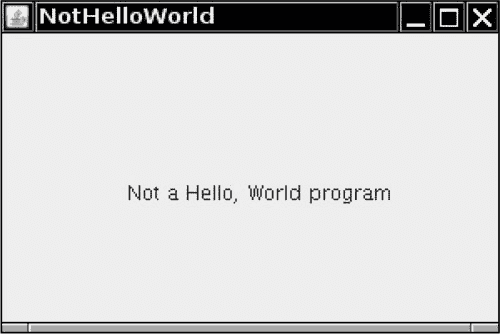

图 7.7. 显示信息的框架

你可以直接将消息字符串绘制到框架上，但这不被认为是良好的编程实践。在 Java 中，框架实际上被设计为作为组件的容器，例如菜单栏和其他用户界面元素。你通常在添加到框架的另一个组件上进行绘制。

`JFrame` 的结构出奇地复杂。查看图 7.8。

在我们的案例中，我们想在原始窗口中绘制 `"Not a Hello, World Program"` 字符串，位置大约位于宽度的四分之一处和高度的一半处。虽然我们还不知道如何测量字符串的大小，但我们将从坐标 (75, 100) 处开始绘制字符串。这意味着字符串中的第一个字符将从向右 75 像素、向下 100 像素的位置开始。（实际上，向下 100 像素的是文本的基线——有关如何测量文本的更多信息请参见第 372 页。）因此，我们的 `paintComponent(Graphics g)` 方法如下：

```java
class NotHelloWorldComponent extends JComponent
{
    public static final int MESSAGE_X = 75;
    public static final int MESSAGE_Y = 100;

    public void paintComponent(Graphics g)
    {
        g.drawString("Not a Hello, World program", MESSAGE_X, MESSAGE_Y);
    }

    . . .
}
```

最后，组件应该告诉用户它希望有多大。重写 `getPreferredSize()` 方法并返回一个 `Dimension` 类对象，其中包含首选的宽度高度：

```java
class NotHelloWorldComponent extends JComponent
{
    private static final int DEFAULT_WIDTH = 300;
    private static final int DEFAULT_HEIGHT = 200;

    . . .

    public Dimension getPreferredSize()
    {
        return new Dimension(DEFAULT_WIDTH, DEFAULT_HEIGHT);
    }
}
```

当你用一个或多个组件填充一个框架时，如果你只是想使用它们的首选尺寸，请调用 `pack()` 方法而不是 `setSize()` 方法：

```java
class NotHelloWorldFrame extends JFrame
{
    public NotHelloWorldFrame()
    {
        add(new NotHelloWorldComponent());
        pack();
    }
}
```

Listing 7.3 显示了完整的代码。

---

 注意

与其扩展 `JComponent`，某些程序员更倾向于扩展 `JPanel` 类。`JPanel` 旨在作为一个可以包含其他组件的容器，但在其上进行绘制也是可能的。只有一个区别：面板是不透明的，这意味着它负责绘制其边界内的所有像素。实现这一点的简单方法是使用背景色绘制面板，通过在每个面板子类的 `paintComponent(Graphics g)` 方法中调用 `super.paintComponent(g)` 来：

```java
class NotHelloWorldPanel extends JPanel
{
    public void paintComponent(Graphics g)
    {
        super.paintComponent(g);
        // 绘图代码
    }
}
```

---

### Listing 7.3.notHelloWorld/NotHelloWorld.java

```java
package notHelloWorld;

import javax.swing.*;
import java.awt.*;

/**
 * @version 1.32 2007-06-12
 * @author Cay Horstmann
 */
public class NotHelloWorld
{
    public static void main(String[] args)
    {
        EventQueue.invokeLater(new Runnable()
            {
                public void run()
                {
                    JFrame frame = new NotHelloWorldFrame();
                    frame.setTitle("NotHelloWorld");
                    frame.setDefaultCloseOperation(JFrame.EXIT_ON_CLOSE);
                    frame.setVisible(true);
                }
            });
    }
}

/**
 * 一个包含消息面板的框架
 */
class NotHelloWorldFrame extends JFrame
{
    public NotHelloWorldFrame()
    {
        add(new NotHelloWorldComponent());
        pack();
    }
}

/**
 * 一个显示消息的组件。
 */
class NotHelloWorldComponent extends JComponent
{
    public static final int MESSAGE_X = 75;
    public static final int MESSAGE_Y = 100;

    private static final int DEFAULT_WIDTH = 300;
    private static final int DEFAULT_HEIGHT = 200;

    public void paintComponent(Graphics g)
    {
        g.drawString("Not a Hello, World program", MESSAGE_X, MESSAGE_Y);
    }

    public Dimension getPreferredSize()
    {
        return new Dimension(DEFAULT_WIDTH, DEFAULT_HEIGHT);
    }
}
```

---

### `javax.swing.JFrame`

- `getContentPane()` 返回此 `JFrame` 的内容面板对象。
- `add(Component c)` 将给定的组件添加到此框架的内容面板并返回该组件。（在 Java SE 5.0 之前，此方法会抛出异常。）

### `java.awt.Component`

- `void repaint()` 导致组件“尽快”进行重绘。
- `Dimension getPreferredSize()` 是用于重写的方法，以返回此组件的首选尺寸。

### `javax.swing.JComponent`

- `void paintComponent(Graphics g)` 是用于重写的方法，以描述你的组件如何被绘制。

### `java.awt.Window`

- `void pack()` 调整窗口以适应组件的首选尺寸。

### 7.5 使用 2D 形状

从 Java 1.0 开始，`Graphics` 类提供了绘制线条、矩形和椭圆的方法。但那些绘制操作非常有限，例如，你无法改变粗细。Java SE 1.2 引入了 Java 2D 库，它实现了一套强大的图形操作。有关高级功能，请参见 Volume II 的第 7 章。

要在 2D 中绘制，你需要一个 `Graphics2D` 类对象。该类是 `Graphics` 类的子类。自从 Java 2 开始，如 `paintComponent(Graphics g)` 等方法会自动接收 `Graphics2D` 对象：

```java
public void paintComponent(Graphics g)
{
    Graphics2D g2 = (Graphics2D) g;
    . . .
}
```

Java 2D 库以对象的方式组织形状。特别是，有表示线条、矩形和椭圆的类：

- `Line2D`
- `Rectangle2D`
- `Ellipse2D`

这些类都实现了 `Shape` 接口。

---

 注意

Java 2D 库支持更复杂的形状——特别是弧、二次和三次曲线以及通用路径。请参见 Volume II 的第 7 章获取更多信息。

---

要绘制形状，你首先创建一个实现 `Shape` 接口的类对象，然后调用 `Graphics2D` 类的 `draw()` 方法。例如：

```java
Rectangle2D rect = . .;
g2.draw(rect);
```

---

 注意

在 Java 2D 库出现之前，程序员使用 `Graphics` 类的方法（如 `drawRectangle()`）来绘制形状。表面上，旧式的方法调用看起来简单一点。但是，通过使用 Java 2D 库，你保留了选择——你以后可以使用 Java 2D 库提供的许多工具来增强绘画。


使用 2D 形状类引入了一些复杂性。与 1.0 使用整数像素坐标的方法不同，Java2D 形状使用浮点坐标。在很多情况下，这非常方便，因为它允许你以对你有意义的坐标（如毫米或英寸）来指定形状，然后将其转换为像素。Java 2D 库在其许多内部浮点计算中使用单精度 `float` 数量。单精度就足够了——毕竟，几何计算的最终目的是在屏幕或打印机上设置像素。只要舍入误差保持在一个像素内，视觉结果就不会受到影响。此外，`float` 计算在某些平台上更快，且 `float` 值所需的存储空间是 `double` 值的一半。

然而，操作 `float` 值有时对程序员来说并不方便，因为 Java 坚决要求在将 `double` 值转换为 `float` 值时进行强制类型转换。例如，考虑以下语句：

```java
float f = 1.2; // Error
```

该语句无法编译，因为常量 `1.2` 的类型是 `double`，而编译器担心会丢失精度。解决办法是在浮点常量后添加一个 `F` 后缀：

```java
float f = 1.2F; // Ok
```

现在考虑这条语句：

```java
Rectangle2D r = . . .
float f = r.getWidth(); // Error
```

该语句同样无法编译，原因相同。`getWidth` 方法返回一个 `double` 类型。这次的解决办法是提供强制类型转换：

```java
float f = (float) r.getWidth(); // Ok
```

这些后缀和强制类型转换有点麻烦，因此 2D 库的设计者决定为每个形状类提供两个版本：一个使用 `float` 坐标以供节省内存的程序员，另一个使用 `double` 坐标以供懒人使用。（在本书中，我们属于后一派，并且尽可能使用 `double` 坐标。）

库的设计者选择了一种奇特且最初令人困惑的方法来封装这些选择。考虑 `Rectangle2D` 类。这是一个抽象类，有两个具体的子类，这两个子类也是静态内部类：

```java
Rectangle2D.Float
Rectangle2D.Double
```

图 7.9 显示了继承关系。

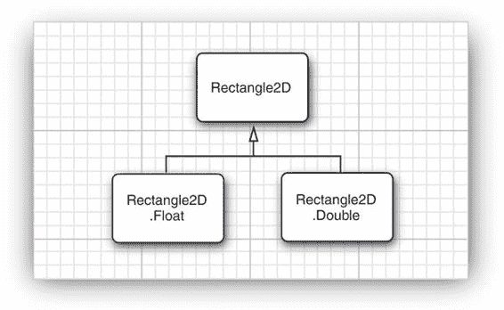

图 7.9 2D 矩形类

最好忽略这两个具体类是静态内部类的事实——这只是为了避免使用如 `FloatRectangle2D` 和 `DoubleRectangle2D` 之类的名称。（有关静态内部类的更多信息，请参见第 6 章。）

当你构造一个 `Rectangle2D.Float` 对象时，你提供的坐标是 `float` 数字。对于 `Rectangle2D.Double` 对象，你提供的坐标是 `double` 数字。

点击此处查看代码图像

```java
Rectangle2D.Float floatRect = new Rectangle2D.Float(10.0F, 25.0F, 22.5F, 20.0F);
Rectangle2D.Double doubleRect = new Rectangle2D.Double(10.0, 25.0, 22.5, 20.0);
```

实际上，由于 `Rectangle2D.Float` 和 `Rectangle2D.Double` 都自自自 `Rectangle2D` 类，且子类中的方法只是重写了父类 `Rectangle2D` 中的方法，因此记住精确的形状类型并没有好处。你可以直接使用 `Rectangle2D` 变量来持有矩形引用。

点击此处查看代码图像

```java
Rectangle2D floatRect = new Rectangle2D.Float(10.0F, 25.0F, 22.5F, 20.0F);
Rectangle2D doubleRect = new Rectangle2D.Double(10.0, 25.0, 22.5, 20.0);
```

也就是说，你只有在构造形状对象时才需要使用那些讨厌的内部类。

构造参数表示了矩形的左上角、宽度和高度。

---

 注意

实际上，`Rectangle2D.Float` 类有一个没有从 `Rectangle2D` 继承的额外方法，即 `setRect(float x, float y, float h, float w)`。如果你将 `Rectangle2D.Float` 引用存储在 `Rectangle2D` 变量中，就会丢失该方法。但并不是什么大损失——`Rectangle2D` 类有一个带有 `double` 参数的 `setRect` 方法。

---

`Rectangle2D` 方法使用 `double` 参数和返回值。例如，`getWidth` 方法返回一个 `double` 值，即使宽度在 `Rectangle2D.Float` 对象中是以 `float` 形式存储的。

---

 提示

直接使用 `Double` 形状类可以完全避免处理 `float` 值。然而，如果你正在构造数千个形状对象，请考虑使用 `Float` 类来节省内存。

---

我们刚刚对 `Rectangle2D` 类的讨论适用于其他形状类。此外，还有一个 `Point2D` 类，其子类为 `Point2D.Float` 和 `Point2D.Double`。以下是创建点对象的方法：

```java
Point2D p = new Point2D.Double(10, 20);
```

---

 提示

`Point2D` 类非常有用——使用 `Point2D` 对象比使用独立的 `x` 和 `y` 值更面向对象。许多构造函数和方法都接受 `Point2D` 参数。我们建议尽可能使用 `Point2D` 对象——它们通常会让几何计算更易理解。

---

`Rectangle2D` 和 `Ellipse2D` 类都继承自共同的父类 `RectangularShape`。诚然，椭圆不是矩形，但它们有一个外接矩形（参见图 7.10）。


图 7.10 椭圆的外接矩形

`RectangularShape` 类定义了 20 多个这些形状通用的方法，其中包含 `getWidth`、`getHeight`、`getCenterX` 和 `getCenterY` 等实用方法（但遗憾的是，在写作时，还没有返回 `Point2D` 对象的 `getCenter` 方法）。

最后，来自 Java 1.0 的几个旧类被整合到了形状类层次结构中。`Rectangle` 和 `Point` 类存储带有整数坐标的矩形和点，继承了 `Rectangle2D` 和 `Point2D` 类。

图 7.11 显示了继承关系。


图 7.11 形状类之间的关系

```java
/**
 * @version 1.32 2007-04-14
 * @author Cay Horstmann
 */
public class DrawTest
{
    public static void main(String[] args)
    {
        EventQueue.invokeLater(new Runnable()
        {
            public void run()
            {
                JFrame frame = new DrawFrame();
                frame.setTitle("DrawTest");
                frame.setDefaultCloseOperation(JFrame.EXIT_ON_CLOSE);
                frame.setVisible(true);
            }
        });
    }
}

/**
 * 一个包含绘图面板的帧
 */
class DrawFrame extends JFrame
{
    public DrawFrame()
    {
        add(new DrawComponent());
        pack();
    }
}

/**
 * 一个显示矩形和椭圆的组件
 */
class DrawComponent extends JComponent
{
    private final int DEFAULT_WIDTH = 400;
    private static final int DEFAULT_HEIGHT = 400;

    public void paintComponent(Graphics g)
    {
        Graphics2D g2 = (Graphics2D) g;
        // 画一个矩形
        double leftX = 100;
        double topY = 100;
        double width = 200;
        double height = 150;

        Rectangle2D rect = new Rectangle2D.Double(leftX, topY, width, height);
        g2.draw(rect);
        // 画一个椭圆
        Ellipse2D ellipse = new Ellipse2D.Double();
        ellipse.setFrame(rect);
        g2.draw(ellipse);

        // 画一条对角线
        g2.draw(new Line2D.Double(leftX, topY, leftX + width, topY + height));

        // 画一个中心相同的圆
        double centerX = rect.getCenterX();
        double centerY = rect.getCenterY();
        double radius = 150;

        Ellipse2D circle = new Ellipse2D.Double();
        circle.setFrameFromCenter(centerX, centerY, centerX + radius, centerY + radius);
        g2.draw(circle);
    }

    public Dimension getPreferredSize() { return new Dimension(DEFAULT_WIDTH, DEFAULT_HEIGHT); }
}
```

### `java.awt.geom.RectangularShape`

- `double getCenterX()`
- `double getCenterY()`
- `double getMinX()`
- `double getMinY()`
- `double getMaxX()`
- `double getMaxY()`

返回包围矩形的中心、最小或最大 `x` 或 `y` 值。

- `double getWidth()`
- `double getHeight()`

返回包矩形的宽度或高度。

- `double getX()`
- `double getY()`

返回包矩形左上角的 `x` 或 `y` 坐标。

### `java.awt.geom.Rectangle2D.Double`

- `Rectangle2D.Double(double x, double y, double w, double h)`

根据给定的左上角、宽度和高度构造一个矩形。

### `java.awt.geom.Rectangle2D.Float`

- `Rectangle2D.Float(float x, float y, float w, float h)`

根据给定的左上角、宽度和高度构造一个矩形。

### `java.awt.geom.Ellipse2D.Double`

- `Ellipse2D.Double(double x, double y, double w, double h)`

构造一个椭圆，其包围矩形具有给定的左上角、宽度和高度。

### `java.awt.geom.Point2D.Double`

- `Point2D.Double(double x, double y)`

根据给定的坐标构造一个点。

### `java.awt.geom.Line2D.Double`

- `Line2D.Double(Point2D start, Point2D end)`
- `Line2D.Double(double startX, double startY, double endX, double endY)`

根据给定的起点和终点构造一条线。

## 7.6 使用颜色

`Graphics2D` 类的 `setPaint` 方法允许你选择一种颜色，用于图形上下文中中的所有绘图操作。例如：

```java
g2.setPaint(Color.RED);
g2.drawString("Warning!", 100, 100);
```

你可以用颜色填充封闭形状（如矩形或椭圆）的内部。只需调用 `fill` 而不是 `draw` 即可：

```java
Rectangle2D rect = new Rectangle2D.Double(0, 0, 10, 20);
g2.fill(rect);
```

`fill` 方法在右侧和底部少画一个像素。例如，如果你绘制同一个矩形，这些像素将不会被绘制。

使用 `Color` 类定义颜色。`java.awt.Color` 类为以下标准颜色预定义的常量：`BLACK`、`BLUE`、`CYAN`、`DARK_GRAY`、`GRAY`、`GREEN`、`LIGHT_GRAY`、`MAGENTA`、`ORANGE`、`PINK`、`RED`、`WHITE`、`YELLOW`。

在 Java SE 1.4 之前，颜色名称是小写的，例如 `Color.red`。这很奇怪，因为标准的编码规范是大写常量。现在你可以写大写或为了兼容的小写。

你可以通过红、绿、蓝分量创建 `Color` 对象来指定自定义颜色。使用 0–255（即一个字节）的刻度作为红色、蓝色和绿色的程度，如下调用 `Color` 构造函数：

```java
Color(int redness, int greenness, int blueness)
```

这是一个设置自定义颜色的示例：

```java
g2.setPaint(new Color(0, 128, 128)); // 一种暗蓝绿色
g2.drawString("Welcome!", 75, 125);
```

除了实色外，你还可以选择更复杂的“画笔”设置，例如变化的色调或图像。详情请参见第二卷中的高级 AWT 章节。如果你使用 `Graphics` 对象而不是 `Graphics2D` 对象，则需要使用 `setColor` 方法设置颜色。

要设置背景颜色，请使用 `JComponent` 的父类 `Component` 类的 `setBackground` 方法。

```java
MyComponent p = new MyComponent();
p.setBackground(Color.PINK);
```

还有一个 `setForeground` 方法。它指定用于组件绘制的默认颜色。

**提示**：`Color` 类的 `brighter()` 和 `darker()` 方法正如其所示，会产生当前颜色的更亮或更暗的版本。使用 `brighter` 方法也是突出显示项目的好方法。实际上，`brighter()` 只是稍微亮一点。要让某种颜色真正脱颖而出，可以应用三次：`c.brighter().brighter().brighter()`。

Java 在其 `SystemColor` 类中提供了更多颜色的预定义名称。该类中的常量封装了用户系统中各种元素使用的颜色。例如：

```java
p.setBackground(SystemColor.window)
```

将组件的背景颜色设置为用户桌面上所有窗口都使用的默认颜色。（每当窗口重绘时，背景就会被填充。）当你想要绘制用户界面元素并使颜色与用户桌面上已有的颜色匹配时，使用 `SystemColor` 类中的颜色特别特别有用。表 7.1 列出了系统颜色名称及其含义。

### 表 7.1 系统颜色

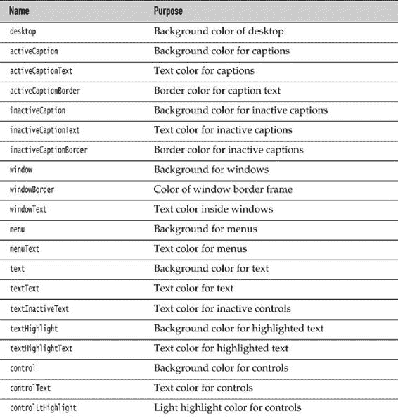
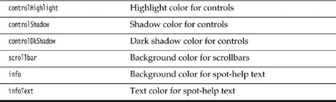

### `java.awt.Color`

- `Color(int r, int g, int b)`

创建一个颜色对象。

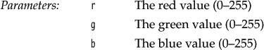

### `java.awt.Graphics`

- `Color getColor()`
- `void setColor(Color c)`

获取或设置当前颜色。所有后续图形操作将使用新颜色。


### `java.awt.Graphics2D`

- `Paint getPaint()`
- `void setPaint(Paint p)`

获取或设置此图形上下文的画 paint 属性。`Color` 类实现了 `Paint` 接口。因此，你可以使用此方法将画笔属性设置为纯色。

- `void fill(Shape s)`

用当前画笔填充形状。

### `java.awt.Component` 1.0

- `Color getBackground()`
- `void setBackground(Color c)`

获取或设置背景颜色。

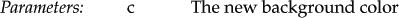

- `Color getForeground()`


- `void setForeground(Color c)`

获取或设置前景色颜色。

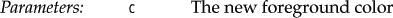

### 7.7 为文本使用特殊字体

本章开头的“Not a Hello, World”程序使用默认字体显示字符串。通常，你希望用不同的字体显示文本。你可以通过`font face name`（字体面名称）来指定字体。字体面名称由`font family name`（字体族名称，例如“Helvetica”）以及一个可选的后缀（如“Bold”）组成。例如，字体面“Helvetica”和“Helvetica Bold”都被认为属于“Helvetica”字体族。

要查找特定计算机上可用的字体，请调用`GraphicsEnvironment`类的`getAvailableFontFamilyNames`方法。该方法返回一个包含所有可用字体名称的字符串数组。要获取描述用户系统图形环境的`GraphicsEnvironment`类实例，请使用静态方法`getLocalGraphicsEnvironment`。以下程序将打印你系统上所有字体的名称：

```java
import java.awt.*;

public class ListFonts
{
   public static void main(String[] args)
   {
      String[] fontNames = GraphicsEnvironment
          .getLocalGraphicsEnvironment()
          .getAvailableFontFamilyNames();
      for (String fontName : fontNames)
          System.out.println(fontName);
   }
}
```

在某个系统中，列表开始如下：

- Abadi MT Condensed Light
- Arial
- Arial Black
- Arial Narrow
- Arioso
- Baskerville
- Binner Gothic
- . . .

后面还有大约七十种字体。

字体面名称可以注册商标，在某些管辖区的字体设计可以受版权保护。因此，字体的发行通常涉及向字体铸造厂支付版税。当然，就像有廉价的名牌香水仿品一样，品牌字体也有仿品。例如，随 Windows 发布的 Helvetica 仿品被称为 Arial。

为了建立一个共同基准，AWT 定义了五个逻辑字体名称：

- `SansSerif`
- `Serif`
- `Monospaced`
- `Dialog`
- `DialogInput`

这些名称始终映射到客户端机器上实际存在的字体。例如，在 Windows 系统上，`SansSerif`映射到 Arial。

此外，Oracle JDK 始终包含名为“Lucida Sans”、“Lucida Bright”和“Lucida Sans Typewriter”的字体族。

要使用某种字体绘制字符，你必须先创建一个`Font`类的对象。指定字体面名称、字体样式和字号大小。这里有一个构造`Font`对象的示例：

```java
Font sansbold14 = new Font("SansSerif", Font.BOLD, 14);
```

第三个参数是磅值（points）。磅在排版中通常用于指示字体大小。每英寸有 72 磅。

你可以在`Font`构造函数中使用逻辑字体名称代替字体面名称。通过将`Font`构造函数的第二个参数设置为以下值之一来指定样式（普通、粗体、斜体或斜粗）：

- `Font.PLAIN`
- `Font.BOLD`
- `Font.ITALIC`
- `Font.BOLD + Font.ITALIC`

 **注意**

从逻辑到物理字体名称的映射定义在 Java 安装目录下`jre/lib`子目录下的`fontconfig.properties`文件中。有关此文件的信息，请参阅[`docs.oracle.com/javase/7/docs/notes/guides/intl/fontconfig.html`](http://docs.oracle.com/javase/7/doc/notes/guides/intl/fontconfig.html)。

你可以读取 TrueType、OpenType 或 PostScript Type 1 格式的字体文件。你需要一个字体输入流——通常来自文件或 URL。（有关流的更多信息，请参见第二卷第一章。）然后，调用静态方法`Font.createFont`：

```java
URL url = new URL("http://www.fonts.com/Wingdings.ttf");
InputStream in = url.openStream();
Font f1 = Font.createFont(Font.TRUETYPE_FONT, in);
```

字体是普通的，字号为 1 磅。使用`deriveFont`方法获取所需大小的字体：

```java
Font f = f1.deriveFont(12.0f);
```


如果你需要知道基线下降（descent）或行距（leading），可以使用`Font`类的`getLineMetrics`方法。该方法返回一个`LineMetrics`类的对象，该对象拥有获取基线下降和行距的方法：

点击此处查看代码图像

```java
LineMetrics metrics = f.getLineMetrics(message, context);
float descent = metrics.getDescent();
float leading = metrics.getLeading();
```

接下来的代码使用了所有这些信息将字符串在其所在的组件中居中显示：

点击此处查看代码图像

```java
FontRenderContext context = g2.getFontRenderContext();
Rectangle2D bounds = f.getStringBounds(message, context);
// (x,y) = get 的左上角
double x = (getWidth() - bounds.getWidth()) / 2;
double y = (getHeight() - bounds.getHeight()) / 2;
// 将上升高度加到 y 以到达基线
double ascent = -bounds.getY();
double baseY = y + ascent;
g2.drawString(message, (int) x, (int) baseY);
```

为了理解居中的原理，请考虑`getWidth()`返回的是组件的宽度。该宽度中的一部分（即`bounds.getWidth()`）被消息字符串占据。剩余部分应该在两侧均匀分布。因此，每侧的空白区域是差值的一半。同样的原理也适用于高度。

***

 **注释**

当你需要在`paintComponent`方法之外计算布局尺寸时，无法从`Graphics2D`对象中获取字体渲染上下文。相反，请调用`JComponent`类的`getFontMetrics`方法，然后调用`getFontRenderContext`。

```java
FontRenderContext context = getFontMetrics(f).getFontRenderContext();
```

***

为了证明定位是准确的，示例程序还绘制了基线和边界矩形。图 7.14 显示了屏幕显示；列表 7.5 是程序列表。

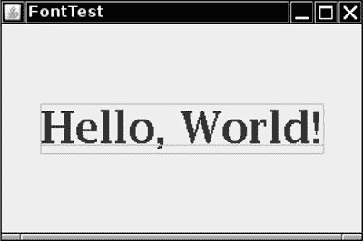

图 7.14. 绘制基线和字符串边界

列表 7.5. font/FontTest.java

点击此处查看代码图像

```java
package font;

import java.awt.*;
import java.awt.font.*;
import java.awt.geom.*;
import javax.swing.*;

/**
 * @version 1.33 2007-04-14
 * @author Cay Horstmann
 */
public class FontTest
{
    public static void main(String[] args)
    {
        EventQueue.invokeLater(new Runnable()
          {
            public void run()
            {
                JFrame frame = new FontFrame();
                frame.setTitle("FontTest");
                frame.setDefaultCloseOperation(JFrame.EXIT_ON_CLOSE);
                frame.setVisible(true);
            }
          });
    }
}

/**
 * 一个带有文本消息组件的框架
 */
class FontFrame extends JFrame
{
    public FontFrame()
    {
        add(new FontComponent());
        pack();
    }
}

/**
 * 一个在框中显示居中消息的组件。
 */
class FontComponent extends JComponent
{
    private static final int DEFAULT_WIDTH = 300;
    private static final int DEFAULT_HEIGHT = 200;

    public void paintComponent(Graphics g)
    {
        Graphics2D g2 = (Graphics2D) g;

        String message = "Hello, World!";

        Font f = new Font("Serif", Font.BOLD, 36);
        g2.setFont(f);

        // 测量消息的大小
        FontRenderContext context = g2.getFontRenderContext();
        Rectangle2D bounds = f.getStringBounds(message, context);

        // 设置 (x,y) = 文本的左上角
        double x = (getWidth() - bounds.getWidth()) / 2;
        double y = (getHeight() - bounds.getHeight()) / 2;

        // 将上升高度加到 y 以到达基线
        double ascent = -bounds.getY();
        double baseY = y + ascent;

        // 绘制消息
        g2.drawString(message, (int) x, (int) baseY);

        g2.setPaint(Color.LIGHT_GRAY);

        // 绘制基线
        g2.draw(new Line2D.Double(x, baseY, x + bounds.getWidth(), baseY));
        // 绘制包矩形
        Rectangle2D rect = new Rectangle2D.Double(x, y, bounds.getWidth(), bounds.getHeight());
        g2.draw(rect);
    }

    public Dimension getPreferredSize() { return new Dimension(DEFAULT_WIDTH, DEFAULT_HEIGHT); }
}
```

### `java.awt.Font` 1.0

- `Font(String name, int style, int size)` 创建一个新的字体对象。

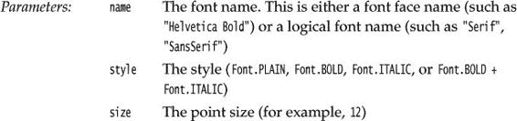

### `java.awt.font.LineMetrics` 1.2

- `float getAscent()` 获取字体上升高度——基线到大写字母的顶部。
- `float getDescent()` 获取下降下降下降下降距离。
- `float getLeading()` 获取字体行距——从行到下一行之间的距离。
- `float getHeight()` 获取字体总高度——两个基线之间的距离（下降 + 行距 + 上升）。

### `java.awt.Graphics` 1.0

- `Font getFont()` 获取字体。
- `void setFont(Font font)` 获取或设置当前字体。该字体将用于文本绘制操作。


- `void drawString(String str, int x, int y)` 使用当前字体和颜色绘制字符串。


### `java.awt.Graphics2D` 1.2

- `FontRenderContext getFontRenderContext()` 获取指定字体上下文特性的字体渲染上下文。
- `void drawString(String str, float x, float y)` 使用当前字体和颜色绘制字符串。


### `javax.swing.JComponent` 1.2

- `FontMetrics getFontMetrics(Font f)` 5.0 获取给定字体的字体度量。`FontMetrics`类是`LineMetrics`类的前身。

### `java.awt.FontMetrics` 1.0

- `FontRenderContext getFontRenderContext()` 1.2 获取该字体的字体渲染上下文。

### 7.8 显示图像

你已经看到了如何通过绘制线条和形状来构建简单的图形。复杂的图像（如照片）通常在外部生成——例如使用扫描仪或特殊的图像处理软件。正如你在第二卷中看到的，也可以逐像素地生成图像。

一旦图像存储在本地文件或互联网上，你就可以将其读入 Java 程序并显示在`Graphics`对象上。读取图像有很多方法。在这里，我们使用你见过的`ImageIcon`类：

```java
Image image = new ImageIcon(filename).getImage();
```

现在变量`image`包含一个封装图像数据的对象的引用。你可以使用`Graphics`类的`drawImage`方法来显示图像。

```java
public void paintComponent(Graphics g)
{
    . . .
    g.drawImage(image, x, y, null);
}
```

Listing 7.6 进一步进了一步，用图形图像对窗口进行*平铺*处理。结果如图 7.15 所示的屏幕。我们在`paintComponent`方法中进行平铺。我们首先在左上角绘制图像副本，然后使用`copyArea`调用将其复制到整个窗口：

点击此处查看图像

```java
for (int i = 0; i * imageWidth <= getWidth(); i++)
  for (int j = 0; j * imageHeight <= getHeight(); j++)
      if (i + j > 0)
        g.copyArea(0, 0, imageWidth, imageHeight, i * imageWidth, j * imageHeight);
```

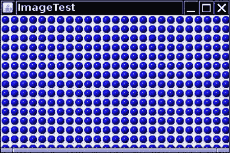

图 7.15. 带有平铺图形的窗口

Listing 7.6 显示了显示程序的完整源代码。

Listing 7.6. image/ImageTest.java

点击此处查看图像


```java
package image;

import java.awt.*;
import javax.swing.*;

/**
 * @version 1.33 2007-04-14
 * @author Cay Horstmann
 */
public class ImageTest {
    public static void main(String[] args) {
        EventQueue.invokeLater(new Runnable() {
            public void run() {
                JFrame frame = new ImageFrame();
                frame.setTitle("ImageTest");
                frame.setDefaultCloseOperation(JFrame.EXIT_ON_CLOSE);
                frame.setVisible(true);
            }
        });
    }
}

/**
 * 一个带有图像组件的框架
 */
class ImageFrame extends JFrame {
    public ImageFrame() {
        add(new ImageComponent());
        pack();
    }
}

/**
 * 一个显示平铺图像的组件
 */
class ImageComponent extends JComponent {
    private static final int DEFAULT_WIDTH = 300;
    private static final int DEFAULT_HEIGHT = 200;

    private Image image;

    public ImageComponent() {
        image = ImageIcon("blue-ball.gif").getImage();
    }

    public void paintComponent(Graphics g) {
        if (image == null) return;

        int imageWidth = image.getWidth(this);
        int imageHeight = image.getHeight(this);

        // 在左上角绘制图像
        g.drawImage(image, 0, 0, null);

        // 跨组件平铺图像
        for (int i = 0; i * imageWidth <= getWidth(); i++)
            for (int j = 0; j * imageHeight <= getHeight(); j++)
                if (i + j > 0)
                    g.copyArea(0, 0, imageWidth, imageHeight, i * imageWidth, j * imageHeight);
    }

    public Dimension getPreferredSize() {
        return new Dimension(DEFAULT_WIDTH, DEFAULT_HEIGHT);
    }
}
```

`java.awt.Graphics`

- `boolean drawImage(Image img, int x, int y, ImageObserver)` 绘制未缩放的图像。注意：此调用可能在图像绘制之前返回。


- `boolean drawImage(Image img, int x, int y, int width, int height, ImageObserver)` 绘制缩放后的图像。系统将图像缩放以适应具有给定宽度和高度的区域。注意：此调用可能在图像绘制之前返回。


- `void copyArea(int x, int y, int width, int height, int dx, int dy)` 复制屏幕的一个区域。


我们对 Java 图形编程的介绍到此结束。关于更高级的技术，请参考第二卷中关于 2D 图形和图像处理的讨论。在下一章中，你将学习如何让程序对用户输入做出响应。

# 第 8 章 事件处理

本章：

- 事件处理基础
- 动作
- 鼠标事件
- AWT 事件层次结构

事件处理对于带有图形用户界面的程序至关重要。为了实现用户界面，你必须掌握 Java 处理事件的方式。本章解释了 Java AWT 事件模型的工作原理。你将看到如何从用户界面组件和输入设备捕获事件。我们还将展示如何处理动作（actions），它们代表了处理动作事件的一种结构化方法。

## 8.1 事件处理基础

任何支持 GUI 的操作系统都会持续监控按键输入或鼠标点击等事件。操作系统会将这些事件报告给正在运行的程序。每个程序然后决定对这些事件做出什么反应（如果要做的话）。

在 Visual Basic 等语言中，事件与代码之间的对应是显而易见的。人们为每个感兴趣的特定事件编写代码，并将其放在通常被称为事件过程（event procedure）方法中。例如，一个名为“HelpButton”的 Visual Basic 按钮将关联一个 `HelpButton_Click` 事件过程。每当点击该按钮时，过程中的代码就会执行。每个 Visual Basic GUI 组件响应一组固定的事件，并且无法更改它所响应的事件。

另一方面，如果你使用原生 C 语言进行事件驱动编程，你需要编写代码来持续检查事件队列，以获取操作系统正在报告的内容；这通常通过将你的代码封装在一个带有巨大 `switch` 语句的循环中来实现。这种技术显然相当笨拙，而且编写起来要困难得多。它的优势在于，你可以响应的事件不像 Basic 那种语言那样有限。

Java 编程环境在功能和相应的复杂性方面介于 Visual Basic 和原生 C 之间。在 AWT 已知的事件范围内，你完全控制事件如何从事件源（event sources）（如按钮或滚动条）传输到事件监听器（event listeners）。你可以指定任何对象作为事件监听器——实践中，你选择一个可以方便执行预期响应的对象。这种事件委托模型（event delegation model）比 Visual Basic 提供了更大的灵活性，因为后者的监听器是预先定义的。

监听器对象将使用事件对象（event object）中的信息来确定对事件的反应。

图 8.1 显示了事件处理类与接口之间的关系。

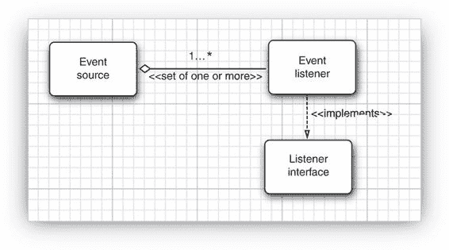

图 8.1. 事件源与监听器的关系

这里有一个指定监听器的示例：

```java
ActionListener listener = . . .;
JButton button = new JButton("Ok");
button.addActionListener(listener);
```

现在，每当按钮发生“动作事件”（action event）时，`listener` 对象就会被通知。对于按钮，正如你预期的，动作事件就是按钮点击。

要实现 `ActionListener` 接口，监听器类必须有一个名为 `actionPerformed` 的方法，该方法接收一个 `ActionEvent` 对象作为参数。

```java
class MyListener implements ActionListener {
    . . .

    public void actionPerformed(ActionEvent event) {
        // 按钮点击的反应放在这里
        . . .
    }
}
```

每当用户点击按钮时，`JButton` 对象就会创建一个 `ActionEvent` 对象并调用 `listener.actionPerformed(event)`，传递该事件对象。像按钮这样的事件源可以有多个监听器。在这种情况下，每当用户点击按钮时，按钮会调用所有监听器的 `actionPerformed` 方法。

图 8.2 显示了事件源、事件监听器和事件对象之间的交互。

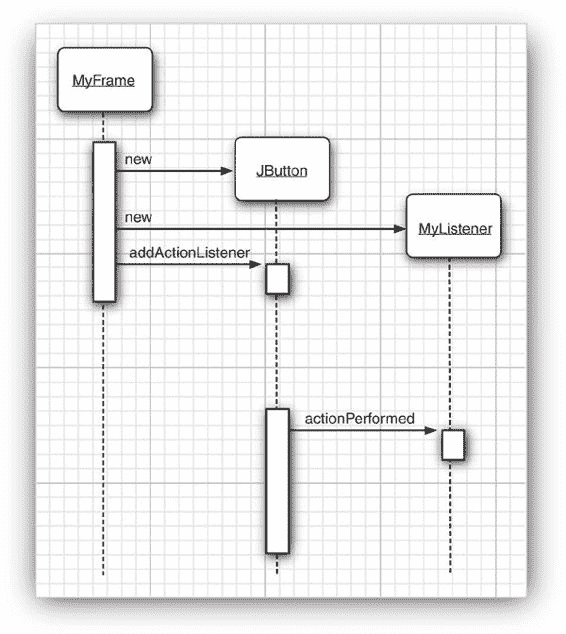

图 8.2. 事件通知

### 8.1.1 示例：处理按钮点击

为了熟悉事件委托模型（event delegation model），让我们梳理一下响应按钮点击这一简单示例所需的所有细节。在这个示例中，我们将展示一个包含三个按钮的面板（panel）。三个监听器对象被作为动作监听器添加到这些按钮上。

在这种场景下，每当用户点击面板上的任何按钮时，相关的监听器对象都会接收到一个指示按钮点击的 `ActionEvent`。在我们的示例程序中，监听器对象将改变面板的背景颜色。

在向你展示监听按钮点击的程序之前，我们首先需要解释如何创建按钮以及如何将它们添加到面板中。（关于 GUI 元素的更多信息，请参见第 9 章。）

要创建一个按钮，请在按钮构造函数中指定一个标签字符串、一个图标或两者都有。这里有两个示例：

点击此处查看代码图片

```java
JButton yellowButton = new JButton("Yellow");
JButton blueButton = new JButton(new ImageIcon("blue-ball.gif"));
```

调用 `add` 方法将按钮添加到面板中：

点击此处查看代码图片

```java
JButton yellowButton = new JButton("Yellow");
JButton blueButton = new JButton("Blue");
JButton redButton = new JButton("Red");

buttonPanel.add(yellowButton);
buttonPanel.add(blueButton);
buttonPanel.add(redButton);
```

图 8.3 显示了结果。


图 8.3. 一个填充了按钮的面板

接下来，我们需要添加监听这些按钮的代码。这需要实现 `ActionListener` 接口的类，正如我们刚刚提到的，它包含一个方法：`actionPerformed`，其签名如下：

```java
public void actionPerformed(ActionEvent event)
```


> 注意
>
> 我们在按钮示例中使用的 `ActionListener` 接口并不局限于按钮点击。它被用于许多独立的情况：
>
> - 当双击从列表框（list box）中选择某项时
> - 当选择一个菜单项时
> - 当在文本框中点击回车键时
> - 当 `Timer` 组件经过了一定的时间后

你将在本章和下一章中看到更多细节。

使用 `ActionListener` 接口的方法在所有情况下都是相同的：`actionPerformed` 方法（它是 `ActionListener` 中唯一的方法）接受一个 `ActionEvent` 类型的对象作为参数。这个事件对象为你提供了有关所发生事件的信息。

当按钮被点击时，我们希望面板的背景颜色变为某种特定的颜色。我们在监听器类中存储所需的颜色。

点击此处查看代码图片

```java
class ColorAction implements ActionListener {
    private Color backgroundColor;

    public ColorAction(Color c) {
        backgroundColor = c;
    }

    public void actionPerformed(ActionEvent event) {
        // 设置面板背景颜色
        . . .
    }
}
```

然后我们为每个颜色构造一个对象，并将这些对象设置为按钮的监听器。

点击此处查看代码图片

```java
ColorAction yellowAction = new ColorAction(Color.YELLOW);
ColorAction blueAction = new ColorAction(Color.BLUE);
ColorAction redAction = new ColorAction(Color.RED);

yellowButton.addActionListener(yellowAction);
blueButton.addActionListener(blueAction);
redButton.addActionListener(redAction);
```

例如，如果用户点击标记为“Yellow”的按钮，`yellowAction` 对象的 `actionPerformed` 方法就会被调用。它的 `backgroundColor` 实例字段被设置为 `Color.YELLOW`，现在它可以继续设置面板的背景颜色了。

还剩下一个问题。`ColorAction` 对象无法访问 `buttonPanel` 变量。你可以通过两种方法解决这个问题。你可以将面板存储在 `ColorAction` 对象中并在 `ColorAction` 构造函数中设置它。或者更方便地，你可以将 `ColorAction` 为 `ButtonFrame` 的内部类（inner class）。它的方法就可以自动访问面板。（关于内部类的更多信息，请参见第 6 章。）

我们采用后一种方法。以下是将 `ColorAction` 放在 `ButtonFrame` 内部的方法：

点击此处查看代码图片

```java
class ButtonFrame {
    private buttonPanel;
    . . .

    private class ColorAction implements ActionListener {
        private Color backgroundColor;

        . . .

        public void actionPerformed(ActionEvent event) {
            buttonPanel.setBackground(backgroundColor);
        }
    }
}
```

仔细观察 `actionPerformed` 方法。`ColorAction` 类没有 `buttonPanel` 字段。但外部类 `ButtonFrame` 有。这种情况非常常见。事件监听器对象需要执行某些影响其他对象的操作。你可以将监听器放在应该修改状态的类内部。

列表 8.1 包含了完整的框架类。每当你点击其中一个按钮时，相应的动作监听器就会改变面板的背景颜色。

```java
JButton blueButton = new JButton("Blue");
JButton redButton = new JButton("Red");

buttonPanel = new JPanel();

// 将按钮添加到面板
buttonPanel.add(yellowButton);
buttonPanel.add(blueButton);
buttonPanel.add(redButton);

// 将面板添加到框架
add(buttonPanel);

// 创建按钮动作
ColorAction yellowAction = new ColorAction(Color.YELLOW);
ColorAction blueAction = new ColorAction(Color.BLUE);
ColorAction redAction = new ColorAction(Color.RED);

// 将动作与按钮关联
yellowButton.addActionListener(yellowAction);
blueButton.addActionListener(blueAction);
redButton.addActionListener(redAction);
}

/**
 * 设置面板背景颜色的动作监听器。
 */
private class ColorAction implements ActionListener {
    private Color backgroundColor;

    public ColorAction(Color c) {
        backgroundColor = c;
    }

    public void actionPerformed(ActionEvent event) {
        buttonPanel.setBackground(backgroundColor);
    }
}
```

#### 8.1.2 熟悉内部类


有些人不喜欢内部类，因为他们觉得类和对象的激增会让程序变慢。让我们来看这一说法。你不需要为每个用户界面组件创建一个新类。在我们的示例中，三个按钮共享同一个监听器类。当然，每个按钮都有一个独立的监听器对象。但这些对象并不大，它们每个只包含一个颜色值和一个面板的引用。而传统的解决方案（使用 `if`/`else` 语句）也引用了动作监听器存储的相同颜色对象——只是作为局部变量，而不是实例字段。

这是一个关于匿名内部类如何实际简化代码的良好示例。如果你查看代码列表 8.1 的代码，你会注意到每个按钮都需要相同的处理方式：

1. 使用标签字符串构造按钮。
2. 将按钮添加到面板。
3. 使用相应的颜色构造动作监听器。
4. 添加该动作监听器。

让我们实现一个辅助方法来简化这些任务：

点击此处查看代码图像

```java
public void makeButton(String name, Color backgroundColor) {
    JButton button = new JButton(name);
    buttonPanel.add(button);
    ColorAction action = new ColorAction(backgroundColor);
    button.addActionListener(action);
}
```

然后我们只需调用：

`makeButton("yellow", Color.YELLOW);`

`makeButton("blue", Color.BLUE);`

`makeButton("red", Color.RED);`

现在你可以进行进一步的简化。注意，`ColorAction` 类只需要一次：在 `makeButton` 方法中。因此，你可以将其变成匿名类：

点击此处查看代码图像

```java
public void makeButton(String name, final Color backgroundColor) {
    JButton button = new JButton(name);
    buttonPanel.add(button);
    button.addActionListener(new ActionListener() {
        public void actionPerformed(ActionEvent event) {
            buttonPanel.setBackground(backgroundColor);
        }
    });
}
```

动作监听器的代码变得简单了许多。`actionPerformed` 方法只需引用了参数 `backgroundColor`。（与在内部类中访问的局部变量一样，该参数需要声明为 `final`。）不需要显式的构造函数。正如你在第 6 章中看到的，内部类机制会自动生成一个构造函数，存储在某个方法中使用所有的 `final` 变量。


提示：匿名类看起来可能很困惑。但如果你训练自己去忽略这些常规化的代码，像这样，你就能学会解读它们：

点击此处查看代码图像

```java
button.addActionListener(new ActionListener() {
    public void actionPerformed(ActionEvent event) {
        buttonPanel.setBackground(backgroundColor);
    }
});
```

在这里，按钮动作设置了背景颜色。只要事件处理器只包含几条语句，我们认为这是非常可读的，特别是当你不担心内部类的机制时。


注意：你完全自由地指定实现 `ActionListener` 接口的类的任何对象作为按钮监听器。我们倾向于使用专门为执行所需按钮动作创建的新类对象。然而，某些程序员对内部类并不熟悉，并选择了不同的策略。他们让事件源的容器实现 `ActionListener` 接口。然后，容器将自己设置为监听器，如下：

`yellowButton.addActionListener(this);`

`blueButton.addActionListener(this);`

`redButton.addActionListener(this);`

现在，三个按钮不再拥有独立的监听器。它们共享同一个监听器对象——即按钮框架。因此，`actionPerformed` 方法必须找出是哪个按钮被点击了。

点击此处查看代码图像

```java
class ButtonFrame extends JFrame implements ActionListener {
    ...
    public void actionPerformed(ActionEvent event) {
        Object source = event.getSource();
        if (source == yellowButton) ...
        else if (source == blueButton) ...
        else if (source == redButton ) ...
        else ...
    }
}
```

你可以看到，这变得非常混乱，我们不建议这样做。

`java.util.EventObject` 1.1

- `Object getSource()` 返回发生事件对象的引用。

`java.awt.event.ActionEvent` 1.1

- `String getActionCommand()` 返回与此动作事件关联的命令字符串。如果动作事件源自按钮，则命令字符串等于按钮标签，除非使用 `setActionCommand` 方法更改了它。

#### 8.1.3 创建包含单个方法调用的监听器

你可以在不编写内部类的情况下指定简单的事件监听器。例如，假设你有一个标记为“Load”的按钮，其事件处理器包含一个单一方法调用：`frame.loadData();`

当然，你可以使用匿名内部类：

点击此处查看代码图像

```java
loadButton.addActionListener(new ActionListener() {
    public void actionPerformed(ActionEvent event) {
        frame.loadData();
    }
});
```

但 `EventHandler` 类可以自动创建这样的监听器，调用方法为 `EventHandler.create(ActionListener.class, frame, "loadData")`。当然，你仍然需要安装该处理器：

点击此处查看代码图像

`loadButton.addActionListener(EventHandler.create(ActionListener.class, frame, "loadData"));`

如果监听器调用了一个带有单个参数的方法，且该参数可以从事件参数获取，你可以使用 `create` 方法的另一种形式。例如，调用 `EventHandler.create(ActionListener.class, frame, "loadData", "source.text")` 等于：

点击此处查看代码图像

```java
new ActionListener() {
    public void actionPerformed(ActionEvent event) {
        frame.loadData(((JTextField) event.getSource()).getText());
    }
}
```

属性名 `source` 和 `text` 变成了方法调用 `getSource` 和 `getText`。


警告：调用 `EventHandler.create` 的第二个参数必须属于一个 `public` 公有类。否则，反射机制将无法定位并调用目标方法。

`java.beans.EventHandler` **1.4**

- `static Object create(Class listenerInterface, Object target, String action)`
- `static Object create(Class listenerInterface, Object target, String action, String eventProperty)`
- `static Object create(Class listenerInterface, Object target, String action, String eventProperty, String listenerMethod)`

构造一个实现给定接口的代理类对象。可以通过命名的方法或接口的所有方法在目标对象上执行给定的动作。

动作（action）可以是方法名，也可以是对象的属性。如果是属性，则会执行其设置方法（setter method）。例如，动作 `"text"` 会被转换为对 `setText` 方法的调用。

事件属性由一个或多个用点分隔的属性名组成。第一个属性从监听器方法的参数中读取，第二个属性从生成的对象中读取，依此类推。最终结果将成为动作的参数。例如，属性 `"source.text"` 被转换为对 `getSource` 和 `getText` 方法的调用。

### 8.1.4 示例：更改外观（Look-and-Feel）

默认情况下，Swing 程序使用 Metal 外观。更改为另一种外观有两种方法。

第一种是在你的 Java 安装目录的 `jre/lib` 子目录下提供一个 `swing.properties` 文件。在该文件中，将属性 `swing.defaultlaf` 设置为你想要的外观的类名。例如：

```properties
swing.defaultlaf=com.sun.java.swing.plaf.motif.MotifLookAndFeel
```

请注意，Metal 外观位于 `javax.swing` 包中。其他外观的包位于 `com.sun.java` 包中，并且不需要在每个 Java 实现中都存在。目前，由于版权原因，Windows 和 Macintosh 外观包仅在 Windows 和 Macintosh 版本的 Java 运行环境中随分附带。


提示：在属性文件中，以 `#` 字符开头的行会被忽略，因此你可以在 `swing.properties` 文件中提供多个外观选择，并通过移动 `#` 符号的位置来选择其中一个：

点击此处查看代码图片

```properties
#swing.defaultlaf=javax.swing.plaf.metal.MetalLookAndFeel

swing.defaultlaf=com.sun.java.swing.plaf.motif.MotifLookAndFeel

#swing.defaultlaf=com.sun.java.swing.plaf.windows.WindowsLookAndFeel
```

你必须重启程序才能通过这种方式切换外观。Swing 程序在启动时只读取一次 `swing.properties` 文件。

第二种方法是动态更改外观。调用静态方法 `UIManager.setLookAndFeel` 并传入你想要的外观类名。然后调用静态方法 `SwingUtilities.updateComponentTreeUI` 来刷新整个组件 set。你只需要向该方法提供一个组件；它将找到所有其他组件。当无法找到请求的外观或在加载时出现错误时，`UIManager.setLookAndFeel` 方法可能会抛出多个异常。一如既往，我们要求你忽略异常处理代码，并等到第 11 章获取详细解释。

以下是一个示例，展示了你如何在程序中切换到 Motif 外观：

点击此处查看代码图像

```java
String plaf = "com.sun.java.swing.plaf.motif.MotifLookAndFeel";

try
{
    UIManager.setLookAndFeel(plaf);
    SwingUtilities.updateComponentTreeUI(panel);
}
catch(Exception e) { e.printStackTrace(); }
```

要列出所有已安装的外观实现，请调用：

```java
UIManager.LookAndFeelInfo[] infos = UIManager.getInstalledLookAndFeels();
```

然后你可以按照以下方式获取每个外观的名字和类名：

```java
String name = infos[i].getName();
String className = infos[i].getClassName();
```

列表 8.2 是一个演示如何切换外观的完整程序（请参见图 8.4）。该程序与列表 8.1 类似。遵循前一节的建议，我们使用辅助方法 `makeButton` 和匿名内部类来指定按钮动作——即切换外观。


图 8.4 切换外观

列表 8.2：`plaf/PlafFrame.java`

点击此处查看代码图片

```java
package plaf;

import java.awt.event.*;
import javax.swing.*;

/**
 * 一个带有用于切换外观按钮的框架
 */
public class PlafFrame extends JFrame
{
    private JPanel buttonPanel;

    public PlafFrame()
    {
        buttonPanel = new JPanel();
        UIManager.LookAndFeelInfo[] infos = UIManager.getInstalledLookAndFeels();
        for (UIManager.LookAndFeelInfo info : infos)
            makeButton(info.getName(), info.getClassName());
        add(buttonPanel);
        pack();
    }

    /**
     * 创建切换外观的按钮
     * @param name 按钮的名字
     * @param plafName 外观类名
     */
    void makeButton(String name, String plafName)
    {
        // 添加按钮到面板
        JButton button = new JButton(name);
        buttonPanel.add(button);
        // 设置按钮动作
        button.addActionListener(new ActionListener()
        {
            public void actionPerformed(ActionEvent event)
            {
                // 按钮动作：切换到外观
                try
                {
                    UIManager.setLookAndFeel(plafName);
                    SwingUtilities.updateComponentTreeUI(PlafFrame.this);
                    pack();
                }
                catch (Exception e)
                {
                    e.printStackTrace();
                }
            }
        });
    }
}
```

该程序有一个细节：内部监听器的 `actionPerformed` 方法需要将外部类 `PlafFrame` 的引用传递给 `updateComponentTreeUI` 方法。回顾第 6 章，外部对象的 `this` 指针必须加上类名前缀：

```java
SwingUtilities.updateComponentTreeUI(PlafFrame.this);
```

`javax.swing.UIManager` **1.2**

- `static UIManager.LookAndFeelInfo[] getInstalledLookAndFeels()` 获取描述已安装外观实现的对象数组。
- `static void setLookAndFeel(String className)` 使用给定的类名（如 `javax.swing.plaf.metal.MetalLookAndFeel`）设置当前外观。

`javax.swing.UIManager.LookAndFeelInfo` **1.2**

- `String getName()` 返回外观的显示名称。
- `String getClassName()` 返回外观实现类的名称。

### 8.1.5 Adapter 类

并不是所有的事件都像点击按钮那样容易处理。在正式程序中，你希望监控用户尝试关闭主框架的情况，因为你不希望用户丢失未保存的工作。当用户关闭框架时，你想弹出一个对话框，并在用户同意后退出程序。

当用户尝试关闭窗口时，`JFrame` 对象是 `WindowEvent` 的源。如果你想捕获该事件，必须有一个适当的监听器并将其添加到框架的窗口监听列表中。


```java
WindowListener listener = . . .;
frame.addWindowListener(listener);
```

窗口监听器必须是一个实现了 `WindowListener` 接口的类对象。`WindowListener` 接口中实际上有七个方法。框架（frame）调用这些方法作为对窗口可能发生的七种不同事件的响应。这些名称自言易懂，除了在 Windows 下，“iconified”（图标化）通常被称为“minimized”（最小化）。以下是完整的 `WindowListener` 接口：

```java
public interface WindowListener
{
   void windowOpened(WindowEvent e);
   void windowClosing(WindowEvent e);
   void windowClosed(WindowEvent e);
   void windowIconified(WindowEvent e);
   void windowDeiconified(WindowEvent e);
   void windowActivated(WindowEvent e);
   void windowDeactivated(WindowEvent e);
}
```

---

 注意

要确定窗口是否已最大化，请安装 `WindowStateListener`。详情请参见第 402 页的 API 注释。

---

正如 Java 一一如所示，任何实现接口的类必须实现其所有方法；在这种情况下，这意味着要实现七个方法。记住，我们只感兴趣这七个方法中的一个，即 `windowClosing` 方法。

当然，我们可以定义一个实现接口的类，在 `windowClosing` 方法中添加对 `System.exit(0)` 的调用，并为其他六方法编写空函数：

点击此处查看代码图片

```java
class Terminator implements WindowListener
{
   public void windowClosing(WindowEvent e)
   {
      if (user agrees)
         System.exit(0);
   }
   public void windowOpened(WindowEvent e) {}
   public void windowClosed(WindowEvent e) {}
   public void windowIconified(WindowEvent e) {}
   public void windowDeiconified(WindowEvent e) {}
   public void windowActivated(WindowEvent e) {}
   public void windowDeactivated(WindowEvent e) {}
}
```

为六个无所作用的方法编写代码是没人喜欢的枯燥重复性工作。为了简化这项任务，每个具有多个方法的 AWT 监听器接口都带有一个相应的适配器（adapter）类，该类实现了接口中的所有方法但对它们不执行任何操作。例如，`WindowAdapter` 类拥有七个空方法。这意味着适配器类自动满足了 Java 对实现关联监听器接口的实现要求。你可以扩展适配器类来指定对接口中某些（但不是所有）事件类型的预期响应。（对于像 `ActionListener` 这样只有一个方法的接口，不需要适配器类。）

让我们利用这个窗口适配器。我们可以扩展 `WindowAdapter` 类，继承其中的六个空方法，并重写 `windowClosing` 方法：

```java
class Terminator extends WindowAdapter
{
   public void windowClosing(WindowEvent e)
   {
      if (user agrees)
         System.exit(0);
   }
}
```

现在你可以将一个 `Terminator` 类型的对象注册为事件监听器了：

```java
WindowListener listener = new Terminator();
frame.addWindowListener(listener);
```

每当框架生成窗口事件时，它都会通过调用七个方法之一将事件传递给 `listener` 对象（参见图 8.5）。这些方法中有六个是不起作用的；`windowClosing` 方法调用 `System.exit(0)`，终止应用程序。


图 8.5. 窗口监听器

---

 注意

如果你在扩展适配器类时拼错了方法名称，编译器将无法捕获该错误。例如，在 `WindowAdapter` 类中定义 `windowClosing` 方法，它不会执行任何操作。让我们让我们这个窗口适配器。我们可以扩展 `WindowAdapter` 类，继承六个空方法，并重写 `windowClosing` 方法：

```java
class Terminator extends WindowAdapter
{
   public void windowClosing(WindowEvent e)
   {
      if (user agrees)
         System.exit(0);
   }
}
```

现在你可以将一个 `Terminator` 类型的对象注册为事件监听器：

```java
WindowListener listener = new Terminator();
frame.addWindowListener(listener);
```

每当框架生成窗口事件时，它都会通过调用七个方法之一将事件传递给 `listener` 对象（参见图 8.5）。这些方法中有六个是不起作用的；`windowClosing` 方法调用 `System.exit(0)`，终止应用程序。

### 8.2 Actions（动作）

通常会有多种方式激活同一个命令。用户可以通过菜单、快捷键或工具栏上的按钮选择某个功能。这在 AWT 事件模型中很容易实现：将所有事件链接到同一个监听器。例如，假设 `blueAction` 是一个动作监听器，其 `actionPerformed` 方法更改背景颜色。你可以将同一个对象作为监听器附加到多个事件源：

- 标记为“Blue”的工具栏按钮
- 标记为“Blue”的菜单项
- 快捷键 Ctrl+B

颜色更改现在统一处理，无论是由点击按钮、选择菜单还是按键引起的。

Swing 包提供了一个非常有用的机制来封装命令并将其附加到多个事件源：`Action` 接口。一个动作是一个封装了以下内容的对象：

- 命令描述（作为文本字符串和可选图标）
- 执行命令所需的参数（例如我们示例中的请求颜色）

`Action` 接口具有以下方法：

```java
void actionPerformed(ActionEvent event)
void setEnabled(boolean b)
boolean isEnabled()
void putValue(String key, Object value)
Object getValue(String key)
void addPropertyChangeListener(PropertyChangeListener listener)
void removePropertyChangeListener(PropertyChangeListener listener)
```

第一种方法是 `ActionListener` 接口熟悉的方法：实际上，`Action` 接口扩展了 `ActionListener` 接口。因此，每当需要 `ActionListener` 对象时，你都可以使用 `Action` 对象。

接下来两个方法允许你启用或禁用动作（action），并检查动作当前是否处于启用状态。当动作被绑定到菜单或工具栏上且该动作被禁用时，相应的备选项将显示为灰色。

`putValue` 和 `getValue` 方法允许你在 `Action` 对象中存储和检索任意的键/值对。两个重要的预定义字符串，即 `Action.NAME` 和 `Action.SMALL_ICON`，将动作名称和图标存储到 `Action` 对象中：

点击此处查看代码图片

```java
action.putValue(Action.NAME, "Blue");

action.putValue(Action._ICON, new ImageIcon("blue-ball.gif"));
```

表 8.1 显示了所有预定义的动作表名称。

表 8.1 预定义动作表名称


如果动作对象被添加到菜单或工具栏中，名称和图标会自动检索并显示在菜单项或工具栏按钮中。`SHORT_DESCRIPTION` 值将变为工具提示（tooltip）。

`Action` 接口的最后两个方法允许其他对象（特别是触发该动作的菜单或工具栏）在动作属性发生变化时接收通知。例如，如果一个菜单作为动作对象的属性变化监听器，并且动作对象随后被禁用，则菜单会被调用并将动作名称设为灰色。属性变化监听器（Property change listeners）是一种通用结构，是“JavaBeans”组件模型的一部分。你可以在第二卷中找到更多关于 bean 及其属性的知识。

注意 `Action` 是一个接口，而不是类。任何实现此接口的类必须实现我们刚刚讨论的七个方法。幸运的是，一位热心的人提供了一个 `AbstractAction` 类，它实现了除 `actionPerformed` 之外的所有方法。该类负责存储所有的键/值对并管理属性变化监听器。你只需要扩展 `AbstractAction` 并提供一个 `actionPerformed` 方法即可。

让我们构建一个可以执行颜色更改命令的动作对象。我们存储命令的名称、图标和所需的颜色。我们将颜色存储在 `AbstractAction` 类提供的键/值对表中。这里是 `ColorAction` 类的代码。构造函数设置了键/值对，而 `actionPerformed` 方法执行颜色更改动作。

点击此处查看代码图片

```java
public class ColorAction extends AbstractAction
{
    public ColorAction(String name, Icon icon, Color c)
    {
        putValue(Action.NAME, name);
        putValue(Action.SMALL_ICON, icon);
        putValue("color", c);
        putValue(Action.SHORT_DESCRIPTION, "Set panel color to " + name.toLowerCase());
    }

    public void actionPerformed(ActionEvent event)
    {
        Color c = (Color) getValue("color");
        buttonPanel.setBackground(c);
    }
}
```

我们的测试程序创建了该类的三个对象，例如：

`Action blueAction = new ColorAction("Blue", new ImageIcon("blue-ball.gif"), Color.BLUE);`

接下来，将此动作与按钮关联。这很容易，因为我们可以使用接收 `Action` 对象的 `JButton` 构造函数。

```java
JButton blueButton = new JButton(blueAction);
```

该构造函数从动作中读取名称和图标，将短描述设置为工具提示，并将动作设置为监听器。你可以在图 8.6 中看到图标和工具提示。


图 8.6 按钮显示了来自动作对象的图标。

正如我们在下一章中演示的，将相同的动作添加到菜单中同样简单。

最后，我们想将动作对象关联到按键（keystrokes）上，这样当用户输入键盘命令时就会执行动作。要将动作与按键关联，你首先需要生成 `KeyStroke` 类的对象。这是一个封装了键描述的便利类。要生成 `KeyStroke` 对象，你不需要调用构造函数，而是使用 `KeyStroke` 类的静态方法 `getKeyStroke`。

```java
KeyStroke ctrlBKey = KeyStroke.getKeyStroke("ctrl B");
```

为了理解下一步，你需要理解键盘焦点（keyboard focus）的概念。用户界面可以有许多按钮、菜单、滚动条和其他组件。当你按下一个键时，它会被发送到具有焦点的组件。该组件通常（但并非总是）在视觉上被区分开。例如，在 Java 视图外观中，具有焦点的按钮周围有一个细细的矩形框。

如果一个按键出现在多个 `WHEN_IN_FUSED_WINDOW` 映射中，那么这个过程就是脆弱的。Swing 设计者想出了方便的解决方案。表 8.2 给出了以下顺序：

1. 检查焦点组件的 `WHEN_FOCUSED` 映射。如果按键存在，则执行相应的动作。
2. 从具有焦点的组件开始，检查其父级的 `WHEN_ANCESTOR_OF_FUSED_WINDOW` 映射。一旦找到映射，执行相应的动作。
3. 查看窗口中所有可见且启用的组件，它们在 `WHEN_IN_WINDOW` 映射中注册了该按键。给这些组件（按注册顺序）执行动作的机会。一旦执行了第一个可用动作，停止处理。

要从组件获取输入映射，使用 `getInputMap` 方法。这是一个示例：

`InputMap imap = panel.getInputMap(JComponent.WHEN_FOCUSED);`

这意味着当当前组件具有键盘焦点时会查询此映射。在我们的情况下，这不是我们想要的映射。具有输入焦点的是按钮而不是面板。其他两种映射选择都适用于插入颜色更改按键。我们在示例中使用 `WHEN_ANCESTOR_OF_FOCUSED_WINDOW`。

`InputMap` 不直接将 `KeyStroke` 对象映射到 `Action` 对象。相反，它映射到任意对象，而由 `ActionMap` 类实现的第二个映射将对象映射到动作。这使得来自不同输入映射的按键共享相同的动作变得更容易。

因此，每个组件都有三个输入映射和一个动作映射。为了将它们连接起来，你需要为动作命名。这里是你可以将键绑定到动作的方法：

```java
imap.put(KeyStroke.getKeyStroke("ctrl Y"), "panel.yellow");

ActionMap amap = panel.getActionMap();

amap.put("panel.yellow", yellowAction);
```

通常使用字符串 `"none"` 作为无操作动作。这使得禁用一个按键变得简单：

`imap.put(KeyStroke.getKeyStroke("ctrl C"), "none");`

JDK 文档建议使用动作名称（action name）作为动作的键。我们认为这并不是好主意。动作名称显示在按钮和菜单项上；因此，它可能会随 UI 设计师的心意改变，并被翻译成多种语言。这些不稳定的字符串不适合作为查找键（lookup keys），因此建议你设计与显示名称独立的动作名称。

---

总结一下，为了响应按钮、菜单项或按键并执行相同的动作，你需要执行以下操作：

1. 实现一个继承自 `AbstractAction` 类的类。你可以使用同一个类处理多个相关的动作。
2. 构造动作类的对象。
3. 从动作对象构造一个按钮或菜单项。构造函数将从动作对象中读取标签文本和图标。
4. 对于可以通过按键触发的动作，你必须执行额外的步骤。首先，找到窗口的顶层组件，例如包含所有其他组件的面板。
5. 然后，获取顶层组件的 `WHEN_ANCESTOR_OF_FOCUSED_COMPONENT` 输入映射（input map）。为所需的按键创建一个 `KeyStroke` 对象。创建一个动作键对象（例如描述你的动作的字符串）。将键对（按键，动作键）添加到输入映射中。
6. 最后，获取顶层组件的动作映射（action map）。将键对（动作键，动作对象）添加到映射中。

Listing 8.3 显示了将按钮和按键映射到动作对象的程序完整代码。尝试一下——点击按钮或按下 Ctrl+Y、Ctrl+B 或 Ctrl+R 改变面板颜色。

`action/ActionFrame.java`

点击此处查看代码图像


```java
package action;

import java.awt.*;
import java.awt.event.*;
import javax.swing.*;

/**
 * 一个带有面板的框架，演示了颜色改变动作。
 */
public class ActionFrame extends JFrame
{
    private JPanel buttonPanel;
    private static final int DEFAULT_WIDTH = 300;
    private static final int DEFAULT_HEIGHT = 200;

    public ActionFrame()
    {
        setSize(DEFAULT_WIDTH, DEFAULT_HEIGHT);

        buttonPanel = new JPanel();

        // 定义动作
        Action yellowAction = new ColorAction("Yellow", new ImageIcon("yellow-ball.gif"), Color.YELLOW);
        Action blueAction = new ColorAction("Blue", new ImageIcon("blue-ball.gif"), Color.BLUE);
        Action redAction = new ColorAction("Red", new ImageIcon("red-ball.gif"), Color.RED);

        // 为这些动作添加按钮
        buttonPanel.add(new JButton(yellowAction));
        buttonPanel.add(new JButton(blueAction));
        buttonPanel.add(new JButton(redAction));

        // 将面板添加到框架
        add(buttonPanel);

        // 将 Y, B 和 R 键与名称关联
        InputMap imap = buttonPanel.getInputMap(JComponent.WHEN_ANCESTOR_OF_FOCUSED_COMPONENT);
        imap.put(KeyStroke.getKeyStroke("ctrl Y"), "panel.yellow");
        imap.put(KeyStroke.getKeyStroke("ctrl B"), "panel.blue");
        imap.put(KeyStroke.getKeyStroke("ctrl R"), "panel.red");

        // 将名称与动作关联
        ActionMap amap = buttonPanel.getActionMap();
        amap.put("panel.yellow", yellowAction);
        amap.put("panel.blue", blueAction);
        amap.put("panel.red", redAction);
    }

    public class ColorAction extends AbstractAction
    {
        /**
         * 构造一个颜色动作。
         * @param name 显示在按钮上的名称
         * @param icon 显示在按钮上的图标
         * @param c 背景颜色
         */
        public ColorAction(String name, Icon icon, Color c)
        {
            putValue(Action.NAME, name);
            putValue(Action.SMALL_ICON, icon);
            putValue(Action.SHORT_DESCRIPTION, "Set panel to " + name.toLowerCase());
            putValue("color", c);
        }

        public void actionPerformed(ActionEvent event)
        {
            Color c = (Color) getValue("color");
            buttonPanel.setBackground(c);
        }
    }
}
```

---

`javax.swing.Action`

- `boolean isEnabled()`

- `void setEnabled(boolean b)` 获取或设置此动作的`enabled`属性。

- `void putValue(String key, Object value)` 在动作对象内部放置一个键/值对。


- `Object getValue(String key)` 返回存储的键/值对的值。

---

`javax.swing.KeyStroke`

- `static KeyStroke getKeyStroke(String description)` 从人类可读的描述（一组由空格分隔的字符串）构造按键。描述以零或多个修饰符`shift control meta alt altGraph`开始，并以字符串`typed`结束，随后跟上一个单字符字符串（例如`"typed a"`）或可选的事件指定符（`pressed`或`released`，`pressed`为默认值），然后是键码。

---

`javax.swing.JComponent`

- `ActionMap getActionMap()` 返回将动作键（任意对象）与`Action`对象关联的映射。

- `InputMap getInputMap(int flag)` 获取将按键映射到动作键的映射。


### 8.3 鼠标事件

如果你只想让用户点击按钮或菜单，不需要显式处理鼠标事件。这些鼠标操作由用户界面中的各种组件处理。然而，如果你想让用户用鼠标绘图，你需要捕捉鼠标移动、点击和拖拽事件。

在本节中，我们将展示一个简单的图形编辑器程序，允许用户在画布上放置、移动和删除矩形（参见图 8.7）。


8.7 测试程序

当用户点击鼠标按钮时，会调用三个监听方法：按下时的`mousePressed`、释放时的`mouseReleased`以及最后是`mouseClicked`。如果你只感兴趣点击，可以忽略前两个方法。通过使用`MouseEvent`参数的`getX`和`getY`方法，你可以获取鼠标指针在点击点击时的`x`和`y`坐标。要区分单击、双击和三击，请使用`getClickCount`方法。

某些用户界面设计师向用户施加鼠标点击和键盘修饰符组合，例如 Ctrl + Shift + 点击。我们认为这种做法是错误的，但如果你不同意，你会发现检查鼠标按钮和键盘修饰符是一团糟。

使用位掩码测试设置了哪些修饰符。在原始 API 中，两个按钮掩码等于两个键盘修饰符掩码，即：

`BUTTON2_MASK == ALT_MASK`

`BUTTON3_MASK == META_MASK`

这样做是为了让单键鼠标可以通过按住修饰键模拟其他鼠标按钮。然而，从 Java SE 1.4 开始，建议使用不同的方法。现在有了掩码：

`BUTTON1_DOWN_MASK`

`BUTTON2_DOWN_MASK`

`BUTTON3_DOWN_MASK`

`SHIFT_DOWN_MASK`

`CTRL_DOWN_MASK`

`ALT_DOWN_MASK`

`ALT_GRAPH_DOWN_MASK`

`META_DOWN_MASK`

`getModifiersEx`方法能够准确报告鼠标事件的鼠标按钮和键盘修饰符。

注意`BUTTON3_DOWN_MASK`在 Windows 下用于测试右键（非主键）鼠标。例如，你可以使用下面的代码来检测右键是否被按下：

点击此处查看代码图片

```java
if ((event.getModifiersEx() & InputEvent.BUTTON3_DOWN_MASK) != 0)
    . . . // 右键点击代码
```

在我们的示例程序中，我们同时提供了`mousePressed`和`mouseClicked`方法。当你点击一个不在任何已绘制正方形内部的像素点时，会添加一个新的正方形。我们将此功能实现在`mousePressed`方法中，这样用户就能获得即时反馈，而无需等待鼠标按钮释放。当用户在现有正方形内双击时，该正方形会被擦除。我们将此功能实现在`mouseClicked`方法中，因为我们需要获取点击计数次数。

点击此处查看代码图片

```java
public void mousePressed(MouseEvent event)
{
    current = find(event.getPoint());
    if (current == null) // 不在正方形内部
        add(event.getPoint());
}

public void mouseClicked(MouseEvent event)
{
    current = find(event.getPoint());
    if (current != null && event.getClickCount() >= 2)
        remove(current);
}
```

当鼠标在窗口移动时，窗口会接收到大量的鼠标移动事件。注意`MouseListener`和`MouseMotionListener`是独立的接口。这样做是为了效率——用户移动鼠标时会产生大量的事件，而只关心点击的监听器就不会被这些移动骚扰。

我们的测试应用程序捕获鼠标移动事件，当鼠标位于正方形上方时将光标变为不同的形状（准星）。这是通过`Cursor`类的`getPredefinedCursor`方法实现的。表 8.3 列出了此方法使用的常量，以及在 Windows 下的光标样式。

表 8.3 示例光标


以下是示例程序中`MouseMotionListener`的`mouseMoved`方法：

点击此处查看代码图片

```java
public void mouseMoved(MouseEvent event)
{
    if (find(event.getPoint()) == null)
        setCursor(Cursor.getDefaultCursor());
    else
        setCursor(Cursor.getPredefinedCursor(Cursor.CROSSHAIR_CURSOR));
}
```

 你还可以通过`Toolkit`类中的`createCustomCursor`方法定义自定义的光标类型：

点击此处查看代码图片

```java
Toolkit tk = Toolkit.getDefaultToolkit();
Image img = tk.getImage("dynamite.gif");
Cursor dynamiteCursor = tk.createCustomCursor(img, new Point(10, 10), "dynamite stick");
```

`createCustomCursor`的第一个参数指向光标图像。第二个参数是光标的“热点”偏移量。第三个参数是描述光标的字符串。这个字符串可以用于辅助功能。例如，屏幕阅读器可以为视障人士或没有盯着屏幕的用户读取光标描述。

如果用户在鼠标移动时按下鼠标按钮，产生的`mouseDragged`调用而不是`mouseMoved`。我们的测试应用程序允许用户拖动光标下的正方形。我们简单地更新当前拖动的矩形使其位于鼠标位置居中。然后重绘画布以显示新的鼠标位置。

点击此处查看代码图片

```java
public void mouseDragged(MouseEvent event)
{
    if (current != null)
    {
        int x = event.getX();
        int y = event.getY();
        current.setFrame(x - SIDELENGTH / 2, y - SIDELENGTH / 2, SIDELENGTH, SIDELENGTH);
        repaint();
    }
}
```

 注意只要鼠标留在组件内部，`mouseMoved`方法就会被调用。然而，当鼠标被拖到组件外部时，`mouseDragged`方法仍持续被调用。

还有两个鼠标事件方法：`mouseEntered`和`mouseExited`。这些方法在鼠标进入或离开组件时被调用。

最后，我们解释如何监听鼠标事件。鼠标点击通过`mouseClicked`程序报告，它是`MouseListener`接口的一部分。许多应用程序只对点击感兴趣，由于鼠标移动事件发生频繁，移动和拖拽事件定义在独立的接口`MouseMotionListener`中。

我们的程序对这两种鼠标事件感兴趣。我们定义了两个内部类：`MouseHandler`和`MouseMotionHandler`。`MouseHandler`类扩展了`MouseAdapter`类，因为它只定义了五个`MouseListener`方法中的两个。`MouseMotionHandler`实现`MouseMotionListener`并定义了该接口的所有方法。列表 8.4 是程序代码。

代码列表 8.4. `mouse/MouseFrame.java`

点击此处查看代码图片

```java
package mouse;

import javax.swing.*;

/**
 * 一个包含测试操作面板的框架
 */
public class MouseFrame extends JFrame
{
    public MouseFrame()
    {
        add(new MouseComponent());
        pack();
    }
}
```

代码列表 8.5. `mouse/MouseComponent.java` 点击此处查看代码图片


```java
package mouse;

import java.awt.*;
import java.awt.event.*;
import java.awt.geom.*;
import java.util.*;
import java.swing.*;

/**
 * 一个具有添加和删除鼠标操作的组件
 */
public class MouseComponent extends JComponent
{
    private static int SIDELENGTH = 10;
    private ArrayList<Rectangle2D> squares;
    private Rectangle2D current;

    public MouseComponent()
    {
        squares = new ArrayList<>();
        current = null;
        addMouseListener(new MouseHandler());
        addMouseMotionListener(new MouseMotionHandler());
    }

    public void paintComponent(Graphics g)
    {
        Graphics2D g2 = (Graphics2D) g;
        // 绘制所有正方形
        for (Rectangle2D r : squares)
            g2.draw(r);
    }

    /**
     * 查找包含点的正方形。
     * @param p 一个点
     * @return 包含 p 的第一个正方形
     */
    public Rectangle2D find(Point2D p)
    {
        for (Rectangle2D r : squares)
        {
            if (r.contains(p)) return r;
        }
        return null;
    }

    /**
     * 向集合中添加正方形。
     * @param p 正方形的中心
     */
    public void add(Point2D p)
    {
        double x = p.getX();
        double y = p.getY();

        current = new Rectangle2D.Double(x - SIDELENGTH / 2, y - SIDELENGTH / 2, SIDELENGTH, SIDELENGTH);
        squares.add(current);
        repaint();
    }

    /**
     * 从集合中移除正方形。
     * @param s 要移除的正方形
     */
    public void remove(Rectangle2D s)
    {
        if (s == null) return;
        if (s == current) current = null;
        squares.remove(s);
        repaint();
    }

    // 包含鼠标光标的正方形
    private class MouseHandler extends MouseAdapter
    {
        public void mousePressed(MouseEvent event)
        {
            // 如果光标不在正方形内部，则添加新正方形
            current = find(event.getPoint());
        }
    }

    private class MouseMotionHandler implements MouseMotionListener
    {
        public void mouseMoved(MouseEvent event)
        {
            if (find(event.getPoint()) == null)
                setCursor(Cursor.getDefaultCursor());
            else
                setCursor(Cursor.getPredefinedCursor(Cursor.CROSSHAIR_CURSOR));
        }
    }
}
```

```java
if (current == null) add(event.getPoint());
}

public void mouseClicked(MouseEvent event)
{
    // 如果双击，则移除当前矩形
    current = find(event.getPoint());
    if (current != null && event.getClickCount() >= 2) remove(current);
}

private class MouseMotionHandler implements MouseMotionListener
{
    public void mouseMoved(MouseEvent event)
    {
        // 如果在矩形内部，将鼠标指针设置为十字形
        if (find(event.getPoint()) == null) setCursor(Cursor.getDefaultCursor());
        else setCursor(Cursor.getPredefinedCursor(Cursor.CROSSHAIR_CURSOR));
    }

    public void mouseDragged(MouseEvent event)
    {
        if (current != null)
        {
            int x = event.getX();
            int y = event.getY();

            // 拖动当前矩形使其中心位于 (x, y)
            current.setFrame(x - SIDELENGTH / 2, y - SIDELENGTH / 2, SIDELENGTH, SIDELENGTH);
            repaint();
        }
    }
}
```

### `java.awt.event.MouseEvent` 1.1

- `int getX()`
- `int getY()`
- `Point getPoint()`

返回事件发生点的 `x`（水平）和 `y`（垂直）坐标，该坐标从事件源组件的左上角开始测量。

- `int getClickCount()`

返回与此事件相关的连续鼠标点击次数。（构成“连续”的时间间隔取决于系统。）

### `java.awt.event.InputEvent` 1.1

- `static int getModifiersEx()` 1.4

返回用于此事件的扩展修饰符或“按下”状态修饰符。使用以下掩码值来测试返回值：

`BUTTON1_DOWN_MASK`

`BUTTON2_DOWN_MASK`

`BUTTON3_DOWN_MASK`

`SHIFT_DOWN_MASK`

`CTRL_DOWN_MASK`

`ALT_DOWN_MASK`

`ALT_GRAPH_DOWN_MASK`

`META_DOWN_MASK`

- `static String getModifiersExText(int modifiers)` 1.4

返回一个如`"Shift+Button1"`的字符串，描述给定标志 set 中的扩展修饰符或“按下”修饰符。

### `java.awt.Toolkit` 1.0

- `public Cursor createCustomCursor(Image image, Point hotSpot, String name)` 1.2

创建一个自定义光标对象。


### `java.awt.Component` 1.0

- `public void setCursor(Cursor cursor)` 1.1

将光标图像设置为指定的光标。

## 8.4 AWT 事件层级结构

在让您了解了事件处理的基本工作原理后，我们通过概述 AWT 事件处理架构来结束本章。

正如我们之前简要提到的，Java 中的事件处理是面向对象的，所有事件都派生继承自 `java.util` 包中的 `EventObject` 类。（这个公共父类不叫 `Event`，因为那是旧事件模型中事件类的名称。虽然旧模型现在已经废弃了，但它的类仍然是 Java 库的一部分。）

`EventObject` 类有一个子类 `AWTEvent`，它是所有 AWT 事件类的父类。图 8.8 显示了 AWT 事件的继承图。


图 8.8. AWT 事件类的继承图

某些 Swing 组件会生成更多类型事件的事件对象；这些对象直接继承自 `EventObject`，而不是 `AWTEvent`。

事件对象封装了事件源向其监听器通信的事件信息。当需要时，你可以分析传递给监听器对象的事件对象，就像我们在按钮示例中使用 `getSource` 和 `getActionCommand` 方法所做的那样。

一些 AWT 事件类对于 Java 程序员来说没有实际用处。例如，AWT 会将 `PaintEvent` 对象插入事件队列，但这些对象不会被传递给监听器。Java 程序员不会监听绘图事件；相反，他们通过重写 `paintComponent` 方法来控制重绘。AWT 还生成许多只有系统程序员才需要的事件，用于为意文字语言提供输入系统、自动化测试机器人等。我们不讨论这些特殊的事件类型。

### 8.4.1 语义事件与底层事件

AWT 在*低层*事件和*语义*事件之间做了非常有用的区分。语义事件是表达用户正在做什么的事件，例如“点击那个按钮”；`ActionEvent` 就是一个语义事件。底层事件是使这种操作成为可能的事件。在点击按钮的情况下，这是一个鼠标按下、一系列鼠标移动和一次鼠标释放（但只有当鼠标释放在按钮区域内时才如此）。或者它可能是一个按键，如果用户使用 Tab 键选择按钮然后用空格键激活它，就会发生这种情况。同样，调整滚动条是一个语义事件，但拖动鼠标是一个底层事件。

以下是 `java.awt.event` 包中通常用的语义事件类：

- `ActionEvent`（用于按钮点击、菜单选择、选择列表项，或在文本字段中输入回车键）
- `AdjustmentEvent`（用户调整了滚动条）
- `ItemEvent`（用户对复选框进行了选择）

五个常用的底层事件类是：

- `KeyEvent`（按键按下或释放）
- `MouseEvent`（鼠标按钮按下、释放、移动或拖动）
- `MouseWheelEvent`（鼠标轮旋转）
- `FocusEvent`（组件获得或失去焦点）
- `WindowEvent`（窗口状态改变）

以下接口监听这些事件：

点击此处查看

- `ActionListener`
- `AdjustmentListener`
- `FocusListener`
- `ItemListener`
- `KeyListener`
- `MouseListener`
- `MouseMotionListener`
- `MouseWheelListener`
- `WindowEvent`

若干 AWT 监听器（那些具有多个方法的）都有一个对应的适配类，该类实现了所有方法但不执行任何操作。（其他接口只有一个方法，因此没有必要提供适配类。）这里是常用的适配类：

- `FocusAdapter`
- `KeyAdapter`
- `MouseAdapter`
- `MouseMotionAdapter`
- `MouseWheelAdapter`
- `WindowAdapter`

表 8.4 显示了最重要的 AWT 监听接口、事件和事件源。

表 8.4 总结


`javax.swing.event` 包包含了某些特定于 Swing 的事件。我们将在下一章介绍其中一部分。

到此，对 AWT 事件处理的讨论结束。下一章将展示如何组合常用的 Swing 组件，并详细介绍它们生成的事件。

# 第 9 章 使用 Swing 构建用户界面

## 在本章中

- Swing 与模型-视图-控制器设计模式
- 布局管理引言
- 文本输入
- 选择组件
- 菜单
- 复杂的布局管理
- 对话框

上一章主要是为了向你展示如何使用 Java 的事件模型。在此过程中，你迈出了学习构建图形用户界面的第一步。本章将向你展示构建功能更全 GUI 所需的最重要工具。

我们将首先介绍 `Swing` 的架构基础。了解“底层”到底运行了什么，对于理解如何有效地使用一些高级的组件至关重要。接着，我们将向你展示如何使用 `Swing` 中最常用的用户界面组件，如文本字段、单选按钮和菜单。然后，你将学习如何利用 Java 巧妙的布局管理器功能将这些组件排列在窗口中，无论特定用户界面的外观（look-and-feel）如何。最后，你将看到如何在 `Swing` 中实现对话框。

本章涵盖了基础的 `Swing` 组件，如文本组件、按钮和滑块。这些是你最频繁需要使用的本质用户界面组件。我们将在第二卷中介绍高级的 `Swing` 组件。

## 9.1 Swing 与模型-视图-控制器设计模式

正如所言，我们本章将从描述 `Swing` 组件的架构开始。我们首先讨论设计模式的概念，然后查看对 `Swing` 框架设计产生巨大影响的“模型-视图-控制器”模式。

### 9.1.1 设计模式

在解决问题时，你通常不会从第一原理导出解决方案。相反，你可能会受到过去经验的引导，或者可能会向其他专家寻求关于什么对他们有效的建议。设计模式是以结构化方式呈现这些专业知识的方法。

近年来，软件工程师开始汇集此类模式的目录。该领域的先驱深受建筑师克里斯托弗·历山大（Christopher Alexander）建筑设计模式的启发。在他的著作《建筑的艺术》（*The Timeless Way of Building*, Oxford University Press, 1979）中，Alexander 提供了一份设计公共和私人居住空间的模式目录。这是一个典型的例子：

**窗边之地**

每个人都喜欢窗边、凸窗以及带有低窗台并配有舒适靠椅的大窗户……一个没有这种地方的房间很少能让你感到舒适或完全的放松……

如果房间里没有可以作为“地方”的窗户，房间里的人会在两种力量之间挣扎：(1) 他想坐下来感到舒适，而 (2) 他被光线吸引。

显然，如果舒适的地方——即房间里你最想坐的地方——远离窗户，那么没有办法克服这种冲突……

因此：在每天你待得久的每个房间里，至少让一扇窗户变成一个“窗边之地”。（图 9.1）


图 9.1 窗边之地

Alexander 目录中的每个模式以及软件模式目录中的模式，都遵循特定的格式。模式首先描述一个上下文（context），即产生设计问题的情况。然后，解释该问题，通常表现为一组冲突的力量。最后，解决方案展示了一个平衡这些力量的配置。

在“窗边之地”模式中，上下文是你白天度过的的任何长时间的房间。冲突的力量是你想坐下来感到舒适，以及你被光线所吸引。解决方案是创建一个“窗边之地”。

在将在下一节中描述的“模型-视图-控制器”模式中，上下文是一个呈现信息并接收用户输入的用户界面系统。这里存在几种力量：可能对相同数据有多种视觉表示形式，它们需要同时更新。视觉表示可能会改变，例如为了适应不同的外观标准。交互机制可能会改变，例如为了支持语音命令。解决方案是将职责分配到三个相互作用的独立组件：模型（model）、视图（view）和控制器（controller）。

模型-视图-控制器模式并不是 `AWT` 和 `Swing` 设计中唯一的模式。这里是几个额外的例子：

- 容器和组件是“组合”（composite）模式的示例。
- 滚动面板是一个“装饰器”（decorator）。
- 布局管理器遵循“策略”（strategy）模式。

设计模式的一个重要方面是，它们成为了文化的一部分。全世界的程序员在谈论模型-视图-控制器模式或装饰器模式时都能理解你的意思。因此，模式成为了讨论设计问题的高效方式。

你可以在模式运动的奠基书中找到许多实用软件模式的正式描述，即 Erich Gamma 等人编写的《设计模式：可重用对象软件的基础》（*Design Patterns—Elements of Reusable Object-Oriented Software*, Addison-Wesley, 1995）。我们还非常推荐 Frank Buschmann 等人的优秀著作《模式系统》（*A System of Patterns*, John Wiley & Sons, 1996），我们认为这本书不那么深奥，但更易于理解。

### 9.1.2 模型-视图-控制器模式

让我们停顿一下，思考构成用户界面组件（如按钮、复选框、文本字段或复杂的树形控件）的各个部分。每个组件都有三个特征：

- 它的内容，例如按钮的状态（按下或未按下），或文本字段中的文本
- 它的视觉外观（颜色、大小等）
- 它的行为（对事件的反应）


即使是按钮这样看似简单的组件，在这些特征之间也表现出中等复杂的交互。显然，按钮的外观取决于外观标准。Metal 按钮看起来与 Windows 按钮或 Motif 按钮不同。此外，外观取决于按钮状态；当按钮被按下时，它需要重绘以显示出不同。状态取决于按钮接收到的事件。当用户按下按钮内部时，按钮处于按下状态。

当然，当你在程序中使用按钮时，你仅仅将其视为一个按钮；你不会过多地考虑内部工作原理和特征。毕竟，那是实现按钮的程序员的工作。然而，实现按钮和其他所有用户界面组件的程序员更有动力去深入思考它们，以确保无论什么外观标准有效都能良好工作。

为了实现这一点，Swing 设计者转向了一个广知的设计模式：模型-视图-控制器模式。这种模式与其他许多设计模式一样，追溯到我们在第 5 章中提到的面向对象设计原则之一：不要让一个对象承担过多责任。不要让一个按钮类完成一切。相反，将组件的外观与一个对象关联，并将内容存储另一个对象中。模型-视图-控制器（MVC）设计模式教你如何实现这一目标。实现三个独立的类：

- 模型，存储内容
- 视图，显示内容
- 控制器，处理用户输入

该模式精确规定了这三个对象如何相互作用。模型存储内容且没有用户界面。对于按钮来说，内容非常简单——只需一组小标记，告知按钮当前是按下还是弹起、激活还是未激活等。对于文本字段，内容更有趣。它是一个持有当前文本的字符串对象。这与内容的视图并不等同——如果内容大于文本字段，用户只能看到显示的部分文本（参见图 9.2）。


图 9.2 文本字段的模型和视图

模型必须实现更改内容的方法以及发现内容是什么的方法。例如，文本模型具有在当前文本中添加或删除字符的方法，以及将当前文本作为字符串返回的方法。再次，请记住，模型是完全非视觉的。视图（view）的工作是绘制存储在模型中的数据。


> **备注**
>
> “模型（model）”一词用得或许并不恰当，因为我们经常把模型看作抽象概念的表示。汽车和飞机的设计师建立模型来模拟真实的汽车和飞机。但当你考虑模型-视图-控制器（model-view-controller，MVC）模式时，这种类比实际上会误导你。在这一设计模式中，模型存储完整的内容，而视图则提供内容的（完整或不完整）的视觉表示。一个更好的类比可能是为艺术家摆姿的模特。观察模特并创建视图是艺术家的工作。根据艺术家的不同，该视图可能是一幅正式肖像、一幅印象派绘画，或是一幅显示肢体呈奇异扭状的立体主义画作。

模型-视图-控制器模式的优势之一是一个模型可以有多个视图，每个视图显示完整内容的不同部分或方面。例如，一个 HTML 编辑器可以同时提供相同内容的两个视图：所见即所得（WYSIWYG）视图和一个“原始标签”视图（参见图 9.3）。当通过一个视图的控制器更新模型时，它会通知两个关联的视图变化。当视图收到通知时，它们会自动刷新。当然，对于像按钮这样简单的用户界面组件，你不会有同一个模型的多个视图。


图 9.3. 同一个模型的两个独立视图

控制器（controller）处理用户输入事件，如鼠标点击和击键。它然后决定是否将这些事件翻译为模型或视图的变化。例如，如果用户在文本框中按下字符键，控制器会调用模型的“插入字符”命令。模型随后告诉视图更新自身。视图永远不知道文本为什么发生变化。但如果用户按下光标键，控制器可能会告诉视图滚动。滚动视图对底层文本没有影响，因此模型永远不知道该事件的发生。

图 9.4 显示了模型、视图和控制器对象之间的交互。


图 9.4. 模型、视图和控制器对象之间的交互

作为一名使用 Swing 组件的程序员，你通常不需要考虑模型-视图-控制器架构。每个用户界面组件都有一个包装类（如 `JButton` 或 `JTextField`），它存储了模型。

### 9.1.3 模型-视图-控制器

作为一名使用 Swing 组件的程序员，你通常不需要考虑模型-视图-控制器架构。每个用户界面组件都有一个包装类（如 `JButton` 或 `JTextField`），它存储了模型。

### 9.1.4 ButtonModel 和 DefaultModel

对于大多数组件，模型是一个以 `Model` 结尾的接口；在这种情况下，该接口被称为 `ButtonModel`。实现该接口的类定义了按钮的状态。事实上，Swing 库包含一个类，叫做 `DefaultModel`。

你可以通过查看表 9.1 来了解模型所维护的数据类型。

表 9.1. ButtonModel 的属性


每个 `JButton` 对象存储一个你可以获取的模型：

```java
JButton button = new JButton("Blue");
ButtonModel model = button.getModel();
```

在实践中，你不会关心按钮的状态，你只对绘制它的视图感兴趣。所有重要信息（如按钮是否启用）都可以从 `JButton` 类中获得。当你想要查询内容（例如，文本框中的位置），包装类会询问模型。然而，包装类会将请求传递给视图。在某些情况下，模型对于用户界面是可交互的（正如我们之前指出的，你不需要直接操作它）。

### 9.2 布局管理简介

在我们开始讨论单个 Swing 组件（如文本字段和单选按钮）之前，我们简要介绍如何在框架（frame）中安排这些组件。与 Visual Basic 不同，JDK 没有表单设计器。你需要编写代码来定位（布局）用户界面组件到你希望它们所在的位置。

当然，如果你有一个支持 Java 的开发环境，它可能有一个布局工具，可以自动完成这些部分或全部任务。尽管如此，确切了解“底层”发生了什么是非常重要的，因为即使是这些工具中最好的，通常也需要手动微调。

让我们从回顾第 8 章中的程序开始，该程序使用按钮来更改框架的背景颜色（参见图 9.5）。


图 9.5. 带有三个按钮的面板

按钮包含在一个 `JPanel` 对象中，并由`流布局管理器`（flow layout manager）管理，它是面板的默认布局管理器。图 9.6 显示了向面板添加更多按钮时发生的情况。如你所见，当没有空间时，会开始新的一行。


图 9.6. 由流布局管理的带有六个按钮的面板

此外，即使用户调整框架的大小，按钮也始终保持在面板的居中（参见图 9.7）。


图 9.7. 更改面板大小会自动重新排列按钮。

通常情况下，`components`（组件）被放置在`containers`（容器）内部，`layout manager`（布局管理器）决定容器中组件的位置和大小。

按钮、文本字段和其他用户界面元素继承自 `Component` 类。组件可以放置在面板等容器中。容器本身也可以被放在其他容器中，因此 `Container` 类继承自 `Component`。图 9.8 显示了 `Component` 的继承层次结构。


图 9.8. `Component` 类的继承层次结构

> **注意**
>
> 遗憾的是，继承层次结构在两个方面有点不完美。首先，顶层窗口（如 `JFrame`）是 `Container` 的子类，因此也是 `Component` 的子类，但它们不能被放在其他容器内部。此外，`JComponent` 是 `Container` 的子类而不是 `Component`。因此，你可以向 `JButton` 添加其他组件（但这些组件不会显示）。

每个容器都有一个默认的布局管理器，但你总是设置自己的。例如，语句

```java
panel.setLayout(new GridLayout(4, 4));
```

使用 `GridLayout` 类来布局面板中的组件。当你向容器添加组件时，容器的 `add` 方法会将组件和任何放置方向传递给布局管理器。

---

`java.awt.Container` **1.0**

- `void setLayout(LayoutManager m)` 设置此容器的布局管理器。
- `Component add(Component c)`
- `Component add(Component c, Object constraints)` **1.1** 将组件添加到此容器中并返回组件引用。


---

`java.awt.FlowLayout` **1.0**

- `FlowLayout()`
- `FlowLayout(int align)`
- `FlowLayout(int align, int hgap, int vgap)` 构建一个新的 `FlowLayout`。


#### 9.2.1 边界布局（Border Layout）

`border layout manager`（边界布局管理器）是每个 `JFrame` 内容面板（content pane）的默认布局管理器。与完全控制每个组件位置的流布局管理器不同，边界布局让你选择放置每个组件的位置。你可以选择将组件放在内容面板的中心、北、南、东或西（参见图 9.9）。


图 9.9. 边界布局

例如：

```java
frame.add(component, BorderLayout.SOUTH);
```

边缘组件首先布局，剩余的可用空间由中心部分占据。当容器调整大同时，边缘组件的尺寸保持不变，但中心组件会改变大小。通过指定 `BorderLayout` 常量 `CENTER`、`NORTH`、`SOUTH`、`EAST` 或 `WEST` 来添加组件。并不是所有位置都需要被占据。如果你不提供任何值，则假设为 `CENTER`。

> **注意**
>
> `BorderLayout` 常量被定义为字符串。例如，`BorderLayout.SOUTH` 被定义为字符串 `"South"`。许多程序员倾向于直接使用字符串，因为它们更短；例如，`frame.add(component, "South")`。然而，如果你不小心拼错了字符串，编译器是无法检测到的。

与流布局不同，边界布局会扩展组件的大小以填充可用空间。当你添加另一个按钮时，就会出现问题：

```java
frame.add(component, BorderLayout.SOUTH);
```

边界布局会增长以填充整个南部区域。图 9.10 显示了使用上述代码时发生的情况。


图 9.10. 由边界布局管理的单个按钮

要解决这个问题，请使用额外的面板。例如，查看图 9.11。屏幕底部的三个按钮包含在一个面板中。


图 9.11. 南区域的面板


要实现这种配置，首先创建一个 `JPanel` 对象，然后将单个按钮添加到面板中。面板的默认布局管理器是 `FlowLayout`，这对于这种情况是一个很好的选择。使用之前过的 `add` 方法将单个按钮添加到面板。这意味着按钮在面板内居中，而不会填充面板区域。最后，将面板添加到框架的内容面板。

```java
JPanel panel = new JPanel();
panel.add(yellowButton);
panel.add(blueButton);
panel.add(redButton);
frame.add(panel, BorderLayout.SOUTH);
```

边界布局扩展面板以填充整个南部区域。

## `java.awt.BorderLayout` 1.0

- `BorderLayout()`
- `BorderLayout(int hgap, int vgap)`：构建一个新的 `BorderLayout`。


## 9.2.2 网格布局（Grid Layout）

网格布局像电子表格一样按行列排列所有组件。所有组件的大小相同。图 9.12 中的计算器程序使用网格布局安排计算器按钮。当你调整窗口大同时，按钮会增大缩小，但所有按钮的大小都是相同的。


图 9.12. 计算器

在网格对象的构造函数中，你指定需要多少行列。

```java
panel.setLayout(new GridLayout(4, 4));
```

从第一行的第一个元素开始添加，然后是第一行的第二个元素，依此类推。

```java
panel.add(new JButton("1"));
panel.add(new JButton("2"));
```

列表 9.1 显示了计算器程序的面板类。这是一个普通的计算器，而不是 Java 教程中异常流行的“逆波兰式”变。在该程序中，我们在组件添加到框架后调用了 `pack` 方法。该方法使用所有组件的首选尺寸来计算框架的宽度和高度。

当然，很少有应用程序的布局像计算器界面那样固定。在实践中，较小的网格（通常只有一行或一列）可以用于组织窗口的局部区域。例如，如果你想有一行大小完全相同的按钮，可以将按钮放置在一个由单行网格布局控制的面板中。

### 列表 9.1：`calculator/CalculatorPanel.java`

点击此处查看代码图片

```java
package calculator;

import java.awt.*;
import java.awt.event.*;
import javax.swing.*;

/**
 * 带有包含计算器按钮和结果显示器的面板。
 */
public class CalculatorPanel extends JPanel
{
    private JButton display;
    private JPanel panel;
    private double result;
    private String lastCommand;
    private boolean start;

    public CalculatorPanel()
    {
        setLayout(new BorderLayout());
        result = 0;
        lastCommand = "=";
        start = true;
        // 添加显示器
        display = new JButton("0");
        display.setEnabled(false);
        add(display, BorderLayout.NORTH);

        ActionListener insert = new InsertAction();
        ActionListener command = new CommandAction();

        // 在 4x4 网格中添加按钮
        panel = new JPanel();
        panel.setLayout(new GridLayout(4, 4));

        addButton("7", insert);
        addButton("8", insert);
        addButton("9", insert);
        addButton("/", command);

        addButton("4", insert);
        addButton("5", insert);
        addButton("6", insert);
        addButton("*", command);

        addButton("1", insert);
        addButton("2", insert);
        addButton("3", insert);
        addButton("-", command);

        addButton("0", insert);
        addButton(".", insert);
        addButton("=", command);
        addButton("+", command);

        add(panel, BorderLayout.CENTER);
    }

    /**
     * 将按钮添加到中心面板中。
     * @param label 按钮标签
     * @param listener 按钮监听器
     */
    private void addButton(String label, ActionListener listener)
    {
        JButton button = new JButton(label);
        button.addActionListener(listener);
        panel.add(button);
    }

    /**
     * 此动作将按钮字符串插入到显示器的末尾。
     */
    private class InsertAction implements ActionListener
    {
        public void actionPerformed(ActionEvent event)
        {
            String input = event.getActionCommand();
            if (start)
            {
                display.setText("");
                start = false;
            }
            display.setText(display.getText() + input);
        }
    }

    /**
     * 此动作执行按钮操作表示的命令。
     */
    private class CommandAction implements ActionListener
    {
        public void actionPerformed(ActionEvent event)
        {
            String command = event.getActionCommand();

            if (start)
            {
                if (command.equals("-"))
                {
                    display.setText(command);
                    start = false;
                }
                else lastCommand = command;
            }
            else
            {
                calculate(Double.parseDouble(display.getText()));
                lastCommand = command;
                start = true;
            }
        }
    }

    /**
     * 执行待定的计算。
     * @param x 与先前的结果累加的值。
     */
    public void calculate(double x)
    {
        if (lastCommand.equals("+")) result += x;
        else if (lastCommand.equals("-")) result -= x;
        else if (lastCommand.equals("*")) result *= x;
        else if (lastCommand.equals("/")) result /= x;
        else if (lastCommand.equals("=")) result = x;
        display.setText("" + result);
    }
}
```

## 9.3 文本输入

我们终于准备好引入 `JTextField` 和 `JTextArea` 了。`JTextField` 只接受一行；`JTextArea` 可以接受多行。这些类都继承自抽象类 `JTextComponent`。

### `javax.swing.text.JTextComponent`

- `String getText()`
- `void setText(String text)`：获取或设置此组件的文本。
- `boolean isEditable()`
- `void setEditable(boolean b)`：获取或设置 `editable` 属性，该属性决定用户是否可以编辑内容。

### 9.3.1 文本字段

向窗口添加文本字段的常用方法是将其添加到面板或其他容器中——就像添加按钮一样：

点击此处查看代码图片

```java
JPanel panel = new JPanel();
JTextField textField = new JTextField("Default input", 20);
panel.add(textField);
```

这段代码添加了一个文本字段，并通过在其中放置字符串 `"Default input"` 来对其进行初始化。该构造函数的第二个参数设置宽度。在这种情况下，宽度为 20 列。遗憾的是，“列”是一个相当精确的测量单位。一列是你用于文本的字体中一个字符的预期宽度。其思路是，如果你预计输入少于或等于 `n` 个字符，你就应该指定 `n` 为列宽。在实践中，这种测量效果并不理想，你应该在最大长度上增加 1 或 2 以保险起见。此外，请记住，列数只是给 AWT 的一个关于首选尺寸的提示。如果布局管理器需要扩大或缩小文本字段，它可以调整其尺寸。在 `JTextField` 构造函数中设置列宽并不是用户可以输入的字符数的上限。用户仍然可以输入更长的字符串，但当文本超过字段长度时，输入会滚动。

如果你需要在运行时重置列数，可以使用 `setColumns` 方法来实现。

- `GridLayout(int rows, int columns)`
- `GridLayout(int rows, int columns, int hgap, int vgap)`

**提示：** 使用 `setColumns` 方法更改文本框的大小后，调用周围容器的 `revalidate` 方法。

```java
textField.setColumns(10);
panel.revalidate();
```

`revalidate` 方法属于 `JComponent` 类。它不会立即调整组件的大小，而仅仅将其标记为需要调整大小。当多个组件都请求调整大时，这种方法可以避免重复计算。然而，如果你想重新计算 `JFrame` 内部的所有组件，你必须调用 `validate` 方法——因为 `JFrame` 并没有继承 `JComponent`。

通常情况下，用户会在文本字段中添加文本（或编辑现有文本）。很多时候，这些文本字段开始时是空白的。要创建一个空白的文本字段，只需在 `JTextField` 构造函数中省略字符串参数即可：

```java
JTextField textField = new JTextField(20);
```

你可以使用上一节中提到的 `JTextComponent` 父类的 `setText` 方法随时更改文本字段的内容。例如：

```java
textField.setText("Hello!");
```

而且，正如前一节所提到的，你可以通过调用 `getText` 方法来获取用户输入了什么。该方法返回用户输入的精确文本。为了去除文本字段数据中任何多余的开头和结尾空格，可以对 `getText` 的返回值应用 `trim` 方法：

```java
String text = textField.getText().trim();
```

要更改用户文本显示的字体，请使用 `setFont` 方法。

### `javax.swing.JTextField` 1.2

- `JTextField(int cols)`：构造一个具有指定列数的空 `JTextField`。
- `JTextField(String text, int cols)`：构造一个具有初始字符串和指定列数的新的 `JTextField`。
- `int getColumns()`
- `void setColumns(int cols)`：获取或设置此文本字段应使用的列数。

### `javax.swing.JComponent` 1.2

- `void revalidate()`：重新计算组件的位置和大小。
- `void setFont(Font f)`：设置此组件的字体。

### `java.awt.Component` 1.0

- `void validate()`：重新计算组件的位置和大小。如果该组件是一个容器，则其组件的位置和大小也会重新计算。
- `Font getFont()`：获取此组件的字体。

### 9.3.2 标签与组件标记

标签（Labels）是持有文本的组件。它们没有装饰（例如，没有边界）。它们也不会对用户输入做出反应。你可以使用标签来标识组件。例如，与按钮不同，文本字段没有标签来标识它们。要给一个本身不带标识符的组件标记：

1. 使用正确的文本构造一个 `JLabel` 组件。
2. 将其放置在离要标识的组件足够近的位置，以便用户能看到该标签标识的是正确的组件。

`JLabel` 的构造函数允许你指定初始文本或图标，并可选地指定内容的对齐方式。你使用源自 `SwingConstants` 接口的常量来指定对齐方式。该接口定义了许多有用常量，如 `LEFT`、`RIGHT`、`CENTER`、`NORTH`、`EAST` 等。`JLabel` 类是实现此接口的 Swing 类之一。因此，你可以通过以下方式指定右对齐的标签：

```java
JLabel label = new JLabel("User name: ", SwingConstants.RIGHT);
```

或者：

```java
JLabel label = new JLabel("User name: ", JLabel.RIGHT);
```

`setText` 和 `setIcon` 方法允许你在运行时设置标签的文本和图标。

 **提示**

你可以在按钮、标签和菜单项中使用纯文本和 HTML 文本。我们不建议在按钮中使用 HTML——它会干扰视觉效果（look-and-feel）。但在标签中使用 HTML 可以非常有效。只需将标签字符串用 `<html>...</html>` 包起来如下：

```java
label = new JLabel("<html><b>Required</b> entry:</html>");
```

注意，第一个带有 HTML 标签的组件可能需要一些时间显示，因为必须加载复杂的 HTML 渲染代码。

标签可以像其他组件一样放置在容器内部。这意味着你可以使用之前见过的技术将标签放置在需要的地方。

### `javax.swing.JLabel` 1.2

- `JLabel(String text)`
- `JLabel(Icon icon)`
- `JLabel(String text, int align)`
- `JLabel(String text, Icon icon, int align)`：构造一个标签。


- `String getText()`
- `void setText(String text)`：获取或设置此标签的文本。
- `Icon getIcon()`
- `void setIcon(Icon icon)`：获取或设置此标签的图标。

### 9.3.3 密码字段

密码字段是文本字段的一种特殊类型。为了防止好奇的旁观者看到密码，用户输入的字符实际上不会被显示。相反，每个输入的字符由一个回显字符（echo character）表示，通常是星号（`*`）。Swing 提供了一个实现此类文本字段的 `JPasswordField` 类。

密码字段是模型-视图-控制器架构模式力量的另一个例子。密码字段使用与普通文本字段相同的模型来存储数据，但它的视图已被更改，将所有字符显示为回显字符。

### `javax.swing.JPasswordField` 1.2

- `JPasswordField(String text, int cols)`：构造一个新的密码字段。


- `void setEchoChar(char echo)`：设置此密码字段的回显字符。值 `0` 可重置回显字符。
- `char[] getPassword()`：返回密码字段中包含的内容。

### 9.3.4 文本区域

有时，你需要收集多行的用户输入。如前提到的，你可以使用 `JTextArea` 组件来实现。当你将文本区域组件放在程序中时，用户可以输入任意行，使用回车键将它们隔开。每行以 `'\n'` 结束。


图 9.13 文本组件

在 `JTextArea` 的构造函数中，指定文本区域的行数和列数。例如：

```java
textArea = new JTextArea(8, 40); // 8 行 40 列
```

其中 `columns` 参数的作用与之前相同。为了安全起见，你仍然需要添加几列。同样地，用户不受行数和列数的限制；当用户输入过多时，文本会自动滚动。你也可以使用 `setColumns` 方法更改列数，使用 `setRows` 方法更改行数。这些数字仅指示建议尺寸——布局管理器仍然可以扩展或缩小文本区域。

如果文本多于文本区域可以显示的范围，剩余文本将被裁剪。你可以通过开启换行来避免长行被裁剪：

```java
textArea.setLineWrap(true); // 长行换行
```

这种换行仅是视觉效果；文档中的文本不会改变——不会在文本中自动插入 `'\n'` 字符。

### 9.3.5 滚动面板

在 Swing 中，文本区域没有滚动条。如果你需要滚动条，必须将文本区域放置在滚动面板中。

```java
textArea = new JTextArea(8, 40);
JScrollPane scrollPane = new JScrollPane(textArea);
```

现在滚动面板管理文本区域的视图。当文本多于文本区域可以显示的范围时，滚动条会自动出现；当删除文本且剩余文本能够适应区域时，滚动条会再次消失。滚动是由滚动面板内部处理的——你的程序不需要处理滚动事件。

这是一个适用于任何组件的通用机制，而不只是文本区域。要为组件添加滚动条，请将其放在滚动面板（scroll pane）中。

Listing 9.2 展示了各种文本组件。该程序显示了一个文本字段、一个密码字段以及一个带有滚动条的文本区域。文本字段和密码字段都有标签。点击“插入（Insert）”可以将字段内容插入到文本区域中。

> **注意**
>
> `JTextArea` 组件仅显示纯文本，不带特殊字体或格式。要显示格式化文本（如 HTML），你可以使用第二卷中讨论的 `JEditorPane` 类。

**Listing 9.2. `text/TextComponentFrame.java`**

点击此处查看代码图片

```java
package text;

import java.awt.*;
import java.awt.event.*;
import javax.swing.*;

/**
 * 一个带有示例文本组件的框架。
 */
public class TextComponentFrame extends JFrame
{
    public static final int TEXTAREA_ROWS = 8;
    public static final int TEXTAREA_COLUMNS = 20;

    public TextComponentFrame()
    {
        final JTextField textField = new JTextField();
        final JPasswordField passwordField = new JPasswordField();

        JPanel northPanel = new JPanel();
        northPanel.setLayout(new GridLayout(2, 2));
        northPanel.add(new JLabel("User name: ", SwingConstants.RIGHT));
        northPanel.add(textField);
        northPanel.add(new JLabel("Password: ", SwingConstants.RIGHT));
        northPanel.add(passwordField);

        add(northPanel, BorderLayout.NORTH);

        final JTextArea textArea = new JTextArea(TEXTAREA_ROWS, TEXTAREA_COLUMNS);
        JScrollPane scrollPane = new JScrollPane(textArea);

        add(scrollPane, BorderLayout.CENTER);

        // add button to append text into the text area
        JPanel southPanel = new JPanel();

        JButton insertButton = new JButton("Insert");
        southPanel.add(insertButton);
        insertButton.addActionListener(new ActionListener()
        {
            public void actionPerformed(ActionEvent event)
            {
                textArea.append("User name: " + textField.getText() + " Password: "
                        + new String(passwordField.getPassword()) + "\n");
            }
        });

        add(southPanel, BorderLayout.SOUTH);
        pack();
    }
}
```

### `javax.swing.JTextArea`

- `JTextArea()`
- `JTextArea(int rows, int cols)`
- `JTextArea(String text, int rows, int cols)` 构建一个新的文本区域。
- `void setColumns(int cols)` 告诉文本区域应使用的建议列数。
- `void setRows(int rows)` 告诉文本区域应使用的建议行数。
- `void append(String newText)` 将给定文本添加到文本区域的末尾。
- `void setLineWrap(boolean wrap)` 开启或关闭换行。
- `void setWrapStyle(boolean word)` 如果 `word` 为 `true`，则长会在单词边界处换行。如果为 `false`，则长行将在不考虑单词的情况下断开。
- `void setTabSize(int c)` 设置每 `c` 列一个制表位。注意，制表符不会转换为空格，而是导致与下一个制表位对齐。

### `javax.swing.JScrollPane`

- `JScrollPane(Component c)` 创建一个显示指定组件内容的滚动面板。当组件大于视图时，将提供滚动条。

## 9.4 选择组件

你现在已经知道如何收集文本输入，但在许多情况下，你倾向于给用户提供一组有限的选择，而不是让他们在文本组件中输入数据。使用一组按钮或项目列表可以告诉用户他们有哪些选择（这同时也节省了你处理错误的麻烦）。在本节中，你将学习如何编写复选框、单选按钮、选择列表和滑块。

### 9.4.1 复选框

如果你想收集“是”或“否”输入，请使用复选框组件。复选框自动带有标识它们的标签。用户可以通过点击内部来勾选框，通过再次点击内部来取消勾选。当焦点位于复选框时，按下空格键也可以切换勾选状态。

图 9.14 显示了一个带有两个复选框的简单程序，一个用于开启或关闭字体的斜体属性，另一个用于字体加粗。注意第二个复选框具有焦点，如标签周围的矩形所示。用户每当点击其中一个复选框时，屏幕都会刷新并使用新的字体属性。


图 9.14. 复选框

复选框旁边需要一个标签来标识它们的用途。在构造函数提供标签文本：

`bold = new JCheckBox("Bold");`

使用 `setSelected` 方法开启或关闭复选框。例如：

`bold.setSelected(true);`

`isSelected` 方法检索每个复选框的当前状态。未勾选为 `false`，已勾选为 `true`。

当用户点击复选框时，会触发一个动作事件。像往常一样，你为复选框附加一个动作监听器。在我们的程序中，两个复选框共享同一个动作监听器。

`ActionListener listener = ...`

`bold.addActionListener(listener);`

`italic.addActionListener(listener);`

`actionPerformed` 方法查询 `bold` 和 `italic` 复选框的状态，并将面板的字体设置为普通、加粗、斜体或同时加粗和斜体。

点击此处查看代码图片

```java
public void actionPerformed(ActionEvent event)
{
    int mode = 0;
    if (bold.isSelected()) mode += Font.BOLD;
    if (italic.isSelected()) mode += Font.ITALIC;
    label.setFont(new Font("Serif", mode, FONTSIZE));
}
```

Listing 9.3 是复选框示例的完整程序列表。

**Listing 9.3. `checkBox/CheckBoxTest.java`**

点击此处查看代码图片

```java
package checkBox;

import java.awt.*;
import javax.swing.*;

/**
 * @version 1.33 2007-06-12
 * @author Cay Horstmann
 */
public class CheckBoxTest
{
    public static void main(String[] args)
    {
        EventQueue.invokeLater(new Runnable()
        {
            public void run()
            {
                JFrame frame = new CheckBoxFrame();
                frame.setTitle("CheckBoxTest");
                frame.setDefaultCloseOperation(JFrame.EXIT_ON_CLOSE);
                frame.setVisible(true);
            }
        });
    }
}
```

### `javax.swing.JCheckBox`

- `JCheckBox(String label)`
- `JCheckBox(String label, Icon icon)` 构建一个初始未选中的复选框。
- `JCheckBox(String label, boolean state)` 构建带有给定标签和初始状态的复选框。
- `boolean isSelected()`
- `void setSelected(boolean state)` 获取或设置复选框的选中状态。

### 9.4.2 单选按钮

在之前的示例中，用户可以勾选两个复选框中的一个、两个或一个都不选。在许多情况下，我们希望用户只在几个选框中选择其中一个。当另一个选框被选中时，之前的选框会自动取消选中。这样一组选框通常被称为 `radio button group`（单选按钮组），因为它们的作用就像收音机上的电台选择按钮。当你按下一个按钮时，之前被按下的按钮就会弹出。图 9.15 显示了一个典型的示例。我们允许用户从小、中、大、特等选项中选择字体大小——但当然，我们只允许同时选择一种大小。


图 9.15. 单选按钮组

在 Swing 中实现单选按钮组非常简单。你为每组按钮构造 `ButtonGroup` 类型的对象。然后，将 `JRadioButton` 类型的对象添加到按钮组中。按钮组对象负责在点击新按钮时关闭之前设置的按钮。

```java
ButtonGroup group = new ButtonGroup();

JRadioButton smallButton = new JRadioButton("Small", false);

group.add(smallButton);

JRadioButton mediumButton = new JRadioButton("Medium", true);

group.add(mediumButton);

// ...
```

构造函数的第二个参数对于初始应选中的按钮为 `true`，对于所有其他按钮为 `false`。请注意，按钮组只控制按钮的行为；如果你是为了布局目的而对按钮分组，还需要将它们添加到诸如 `JPanel` 之类的容器中。

如果你再次查看图 9.14 和 9.15，你会注意到单选按钮的外观与复选框不同。复选框是正方形的，选中时包含一个勾选标记。单选按钮是圆形的，选中时包含一个圆点。

单选按钮的事件通知机制与其他任何按钮都相同。当用户勾选单选按钮时，该按钮会产生一个动作事件。在我们的示例程序中，我们定义了一个监听器，将字体大小设置为特定值：

```java
ActionListener listener = new ActionListener()
{
    public void actionPerformed(ActionEvent event)
    {
        // size refers to the final parameter of the addRadioButton method
        label.setFont(new Font("Serif", Font.PLAIN, size));
    }
};
```

将此监听器设置与复选框示例进行比较。每个单选按钮都有一个不同的监听器对象。每个监听器对象确切知道做什么——将字体大小设置为特定值。对于复选框，我们使用了不同的方法：两个复选框使用同一个动作监听器，该监听器调用一个方法查看两个复选框当前的状态。

在这里可以使用相同的方法吗？我们可以有一个单一的监听器如下计算大小：

点击此处查看代码图像

```java
if (smallButton.isSelected()) size = 8;
else if (mediumButton.isSelected()) size = 12;
// ...
```

然而，我们更倾向于使用动作监听器对象，因为它们将大小值与按钮结合得更紧密。


如果你有一组单选按钮，你就知道其中只有一个是被选中的。如果能够快速查找到是哪一个，而不需要查询组中的所有按钮，那就太好了。`ButtonGroup` 对象控制所有按钮，因此如果这个对象可以提供被选中按钮的引用将非常方便。事实上，`ButtonGroup` 类有一个 `getSelection` 方法，但该方法并不返回被选中的单选按钮。相反，它返回的是按钮的 `ButtonModel` 引用。遗憾的是，没有任何 `ButtonModel` 方法是有用的。`ButtonModel` 接口继承了 `ItemGroup` 接口的 `getSelectedObjects` 方法，该方法毫无用处地返回 `null`。`getActionCommand` 方法看起来很有前景，因为单选按钮的“动作命令”是它的标签。但其模型的动作命令是 `null`。只有当你通过 `setActionCommand` 方法显式设置所有单选按钮的动作命令时，模型的动作命令值会被设置。这时你就可以通过 `buttonGroup.getSelection().getActionCommand()` 获取当前选中按钮的动作命令。

代码列表 9.4 是字体选择的完整程序，它让一组单选按钮工作起来。

**Listing 9.4. `Frame.java`**

点击此处查看代码图像


```java
package radioButton;

import java.awt.*;
import java.awt.event.*;
import javax.swing.*;

/**
 * 一个带有示例文本标签和用于选择字体大小的单选按钮的框架。
 */
public class RadioButtonFrame extends JFrame
{
    private JPanel buttonPanel;
    private ButtonGroup group;
    private JLabel label;
    private static final int DEFAULT_SIZE = 36;

    public RadioButtonFrame()
    {
        // 添加示例文本标签
        label = new JLabel("The brown fox jumps over the lazy dog.");
        label.setFont(new Font("Serif", Font.PLAIN, DEFAULT_SIZE));
        add(label, BorderLayout.CENTER);
        // 添加单选按钮
        buttonPanel = new JPanel();
        group = new ButtonGroup();

        addRadioButton("Small", 8);
        addRadioButton("Medium", 12);
        addRadioButton("Large", 18);
        addRadioButton("Extra large", 36);

        add(buttonPanel, BorderLayout.SOUTH);
        pack();
    }

    /**
     * 添加一个设置示例字体大小的单选按钮。
     * @param name 显示在按钮上的字符串
     * @param size 该按钮设置的字体大小
     */
    public void addRadioButton(String name, final int size)
    {
        boolean selected = size == DEFAULT_SIZE;
        JRadioButton button = new JRadioButton(name, selected);
        group.add(button);
        buttonPanel.add(button);

        // 此监听器设置字体大小
        ActionListener listener = new ActionListener()
        {
            public void actionPerformed(ActionEvent event)
            {
                // size refers to the final parameter of the addRadioButton method
                label.setFont(new Font("Serif", Font.PLAIN, size));
            }
        };

        button.addActionListener(listener);
    }
}
```

如果你在窗口中有多个组单选按钮，你可能希望在视觉上指示哪些按钮是一组的。Swing 为此提供了一系列实用的边框（border）。你可以对任何扩展 `JComponent` 的组件应用边框。最常见的用法是在面板周围放置一个边框，并在面板中填充其他用户界面元素，例如单选按钮。

你可以从多种边框中选择，但对所有它们都需要遵循相同的步骤。

### 1. 调用 `BorderFactory` 的静态方法来创建边框

你可以从以下样式中选择（参见图 9.16）：

- 凹斜槽（Lowered bevel）
- 凸斜槽（Raised bevel）
- 刻蚀（Etched）
- 线条（Line）
- 哑光（Matte）
- 空白（Empty，仅在组件周围留出一些空间）


图 9.16. 测试边框类型

### 2. 添加标题

如果需要，可以通过将边框传递给 `BorderFactory.createTitledBorder` 为你的边框添加标题。

### 3. 组合边框

如果你想做得彻底，可以调用 `BorderFactory.createCompoundBorder` 组合多个边框。

### 4. 将边框添加到组件

通过调用 `JComponent` 类的 `setBorder` 方法将生成的边框添加到你的组件中。

例如，这里是如何向面板添加带有标题的刻蚀边框的：

点击此处查看代码图像

```java
Border etched = BorderFactory.createEtchedBorder();
Border titled = BorderFactory.createTitledBorder(etched, "A Title");
panel.setBorder(titled);
```

在代码列表 9.5 中运行程序，以了解各种边框的样子。

不同的边框具有设置边框宽度和颜色的不同选项；详情请参见 API 注释。真正的边框爱好者会发现，还有一个 `SoftBevelBorder` 类用于具有软化边角的斜槽边框，并且 `LineBorder` 也可以具有圆角。你只能通过使用这些类的构造函数来构造这些边框——它们没有对应的 `BorderFactory` 方法。

## 代码列表 9.5. `border/BorderFrame.java`

点击此处查看代码图像

```java
package border;

import java.awt.*;
import java.awt.event.*;
import javax.swing.*;
import javax.swing.border.*;

/**
 * 一个带有单选按钮的框架，用于选择边框样式。
 */
public class BorderFrame extends JFrame
{
    private JPanel demoPanel;
    private JPanel buttonPanel;
    private ButtonGroup group;

    public BorderFrame()
    {
        demoPanel = new JPanel();
        buttonPanel = new JPanel();
        group = new ButtonGroup();

        addRadioButton("Lowered bevel", BorderFactory.createLoweredBevelBorder());
        addRadioButton("Raised bevel", BorderFactory.createRaisedBevelBorder());
        addRadioButton("Etched", BorderFactory.createEtchedBorder());
        addRadioButton("Line", BorderFactory.createLineBorder(Color.BLUE));
        addRadioButton("Matte", BorderFactory.createMatteBorder(10, 10, 10, 10, Color.BLUE));
        addRadioButton("Empty", BorderFactory.createEmptyBorder());

        Border etched = BorderFactory.createEtchedBorder();
        Border titled = BorderFactory.createTitledBorder(etched, "Border types");
        buttonPanel.setBorder(titled);

        setLayout(new GridLayout(2, 1));
        add(buttonPanel);
        add(demoPanel);
        pack();
    }

    public void addRadioButton(String buttonName, Border b)
    {
        JRadioButton button = new JRadioButton(buttonName);
        button.addActionListener(new ActionListener()
        {
            public void actionPerformed(ActionEvent event)
            {
                demoPanel.setBorder(b);
            }
        });
        group.add(button);
        buttonPanel.add(button);
    }
}
```

## API 详情

### `javax.swing.BorderFactory`

- `static Border LineBorder(Color color)`
- `static Border LineBorder(Color color, int thickness)` 创建一个简单的线条边框。
- `static Border MatteBorder(int top, int left, int bottom, int right, Color color)`
- `static Border MatteBorder(int top, int left, int bottom, int right, Icon tileIcon)` 创建一个填充了颜色或重复图标的厚边框。
- `static Border EmptyBorder()`
- `static Border EmptyBorder(int top, int left, int bottom, int right)` 创建一个空边框。
- `static Border EtchedBorder()`
- `static Border EtchedBorder(Color highlight, Color shadow)`
- `static Border EtchedBorder(int type)`
- `static Border EtchedBorder(int type, Color highlight, Color shadow)` 创建一个具有 3D 效果的线条边框。
- `static Border BevelBorder(int type)`
- `static Border BevelBorder(int type, Color highlight, Color shadow)`
- `static Border LoweredBevelBorder()`
- `static Border RaisedBevelBorder()` 创建一个具有凹或凸表面效果的边框。
- `static TitledBorder createTitledBorder(String title)`
- `static TitledBorder createTitledBorder(Border border)`
- `static TitledBorder createTitledBorder(Border border, String title)`
- `static TitledBorder createTitledBorder(Border border, String title, int justification, int position)`
- `static TitledBorder createTitledBorder(Border border, String title, int justification, position, Font font)`
- `static TitledBorder createTitledBorder(Border border, String title, int justification, position, Font font, Color color)` 创建具有指定属性的标题边框。
- `static CompoundBorder createCompoundBorder(Border outsideBorder, Border insideBorder)` 将两个边框组合为一个新边框。

### `javax.swing.border.SoftBevelBorder`

- `SoftBevelBorder(int type)`
- `SoftBevelBorder(int type, Color highlight, Color shadow)` 创建具有软化边角的斜槽边框。

### `javax.swing.border.LineBorder`

- `public LineBorder(Color color, int thickness, boolean roundedCorners)` 使用给定的颜色和厚度创建一个线条边框。如果 `roundedCorners` 为 `true`，则边框具有圆角。

### `javax.swing.JComponent`

- `void setBorder(Border border)` 设置此组件的边框。

## 9.4.4. 组合框（Combo Boxes）

如果你有很多备备选项，单选按钮不是很好的选择，因为它们占用了太多屏幕空间。相反，你可以使用组合框。当用户点击此组件时，会出现一个选项列表，用户可以选择其中一个（参见图 9.17）。


图 9.17. 组合框

如果下拉列表框被设置为可编辑（editable），你就可以像编辑文本字段一样编辑当前选择。正因如此，该组件被称为`组合框`——它结合了文本字段的灵活性和预定义的选项。`JComboBox` 类提供了组合框组件。

从 Java SE 7 开始，`JComboBox` 类是一个泛型类。例如，`JComboBox<String>` 持 `String` 类型的对象，而 `JComboBox<Integer>` 持整数。

调用 `setEditable` 方法使组合框变为可编辑。注意，编辑只会影响选中的项目。它不会以任何方式更改选项列表。

你可以通过调用 `getSelectedItem` 方法获取当前选中项，如果组合框是可编辑的，该项可能已经被修改过。然而，对于可编辑的组合框，该项可以是任何类型，取决于接收用户编辑并将结果转换为对象的编辑器。（关于编辑器的讨论，请参阅第二卷第 6 章。）如果你的组合框不可编辑的那么最好是调用：

```java
combo.getItemAt(combo.getSelectedIndex())
```

这将为你提供具有正确类型的选中项。

在示例程序中，用户可以从样式列表（`Serif`、`SansSerif`、`Monospaced` 等）中选择字体样式。用户也可以输入另一种字体。

使用 `addItem` 方法添加选项。在我们的程序中，`addItem` 只在构造函数中调用，但你可以随时调用它。

点击此处查看代码图像

```java
JComboBox<String> faceCombo = new JComboBox<>();

faceCombo.addItem("Serif");

faceCombo.addItem("SansSerif");

. . .
```

此方法将字符串添加到列表的末尾。你可以使用 `insertItemAt` 方法在列表的任何位置添加新项：

```java
faceCombo.insertItemAt("Monospaced", 0); // 添加到开头
```

你可以添加任何类型的项——组合框会调用每个项的 `toString` 方法来显示它。

如果你需要在运行时删除项，请使用 `removeItem` 或 `removeItemAt` 方法，取决于你提供的是要删除的项目还是它的位置。

点击此处查看代码图像

```java
faceCombo.removeItem("Monospaced");

faceCombo.removeItemAt(0); // 移除第一个项
```

`removeAllItems` 方法一次性移除所有项。

***


> **提示**
>
> 如果你需要向组合框添加大量项，`addItem` 方法的性能会很差。相反，构造一个 `DefaultComboBoxModel`，通过调用 `addElement` 填充它，然后调用 `JComboBox` 类的 `setModel` 方法。

***

当用户从组合框中选择一个项时，组合框会产生一个动作事件。要确定选择了哪个项，可以在事件参数上调用 `getSource` 以获取发送事件的组合框的引用。然后调用 `getSelectedItem` 方法检索当前选中的项。你需要将返回的值强制转换为适当的类型，通常是 `String`。

点击此处查看代码图像

```java
public void actionPerformed(ActionEvent event)
{
   label.setFont(new Font(
      faceCombo.getItemAt(faceCombo.setSelectedIndex()),
      Font.PLAIN,
      DEFAULT_SIZE));
}
```

代码列表 9.6 显示了完整的程序。

***


**注意**

如果你想显示一个永久显示的列表而不是下拉列表，请使用`JList`组件。我们在第二卷的第 6 章中涵盖了`JList`。

---

**Listing 9.6.** `comboBox/ComboBoxFrame.java`

点击此处查看代码图像

---

```java
1   package comboBox;
2
3   import java.awt.*;
4   import java.awt.event.*;
5   import javax.swing.*;
6
7   /**
8    * 一个带有示例文本标签和用于选择字面的组合框的框架。
9    */
10  public class ComboBoxFrame extends JFrame
11  {
12      private JComboBox<String> faceCombo;
13      private JLabel label;
14      private static final int DEFAULT_SIZE = 24;
15
16      public ComboBoxFrame()
17      {
18          // 添加示例文本标签
19          label = new JLabel("The quick brown fox jumps over the lazy dog.");
20          label.setFont(new Font("Serif", Font.PLAIN, DEFAULT_SIZE));
21          add(label, BorderLayout.CENTER);
22
23          // 创建组合框并添加字体名称
24          faceCombo = new JComboBox<>();
25          faceCombo.addItem("Serif");
26          faceCombo.addItem("SansSerif");
27          faceCombo.addItem("Monospaced");
28          faceCombo.addItem("Dialog");
29          faceCombo.addItem("DialogInput");
30
31          // 组合框监听器将标签字体更改为选中的字体
32          faceCombo.addActionListener(new ActionListener()
33              {
34                  public void actionPerformed(ActionEvent event)
35                  {
36                      label.setFont(new Font(
37                          faceCombo.getItemAt(faceCombo.getSelectedIndex()),
38                          Font.PLAIN,
39                          DEFAULT_SIZE));
40                  }
41              });
42
43          JPanel comboPanel = new JPanel();
44          comboPanel.add(faceCombo);
45          add(comboPanel, BorderLayout.SOUTH);
46          pack();
47      }
48  }
```

#### 9.4.5 滑块

组合框允许用户从一组离散的值中进行选择。滑块提供了连续的值——例如，100 之间的任何数字。

构建滑块最常见的方法如下：

```java
JSlider slider = new JSlider(min, max, initialValue);
```

如果你省略了最小、最大值初始值，它们将分别初始化为`0`、`100`和`50`。

或者如果你想让滑块垂直显示，使用以下构造函数：

```java
JSlider slider = new JSlider(SwingConstants.VERTICAL, min, initialValue);
```

这些构造函数创建了一个普通的滑块，例如图 9.18 中的顶部滑块。你现在将看到如何为滑块添加装饰。


**图 9.18.** 滑块

当用户滑动滑块条时，滑块的`value`在最小值和最大值之间移动。当值变化时，`ChangeEvent`会发送给所有更改监听器。要通知更改，调用`addChangeListener`方法并安装实现`ChangeListener`接口的对象。该接口有一个方法`stateChanged`。在该方法中，你应该获取滑块的值：

```java
public void stateChanged(ChangeEvent event)
{
   JSlider slider = (JSlider) event.getSource();
   int value = slider.getValue();
}
```

你可以通过显示**刻度（ticks）**来装饰滑块。例如，在示例程序中，第二个滑块使用了以下设置：

```java
slider.setMajorTickSpacing(20);

slider.setMinorTickSpacing(5);
```

滑块每 20 个单位有一个大刻度标记，每 5 个单位有一个小刻度标记。单位指的是滑块的值，而不是像素。

这些指令仅设置了刻度的单位。要让刻度真正出现，请调用：

```java
slider.setPaintTicks(true);
```

主刻度和小刻度是独立的。例如，你可以设置每 20 个单位一个主刻度标记，每 7 个单位一个小刻度标记，但这将给你一个非常混乱的刻度。

你可以强制滑块**吸附刻度（snap to ticks）**。当用户在捕捉模式下完成拖动滑块时，它会立即移动到最近的刻度。你通过调用以下方法激活此模式：

```java
slider.setSnapToTicks(true);
```

“对齐刻度”（snap to ticks）行为的效果并没有你想象的那么好。在滑块真正对齐之前，更改监听器仍然报告与刻度不对应的滑块值。如果你点击滑块旁边——这种操作通常会让滑块沿点击方向稍微移动——开启了“对齐刻度”的滑块不会移动到下一个刻度。

---

你可以通过调用以下方法为主刻度显示**刻度标签（tick mark labels）**：

```java
slider.setPaintLabels(true);
```

例如，对于一个范围从 0 到 100、主刻度间距为 20 的滑块，刻度标签分别为 0、20、40、60、80 和 100。

你还可以提供其他的刻度标签，例如字符串或图标（参见图 9.18）。这个过程稍微有点复杂。你需要填充一个键类型为`Integer`、值类型为`Component`的哈希表。然后调用`setLabelTable`方法。组件会被放置在刻度下方。通常使用`JLabel`对象。以下是如何将刻度标记为 A、B、C、D、E 和 F 的方法：

点击此处查看代码图片

```java
Hashtable<Integer, Component> labelTable = new Hashtable<Integer, Component>();
labelTable.put(0, new JLabel("A"));
labelTable.put(20, new JLabel("B"));
// ...
labelTable.put(100, new JLabel("F"));
slider.setLabelTable(labelTable);
```

关于哈希表的更多信息请参见第 13 章。代码列表 9.7 也展示了一个使用图标作为刻度标签的滑块。

---


**提示**

如果刻度或标签没有显示，请双检是否调用了`setPaintTicks(true)`和`setPaintLabels(true)`。

---

图 9.18 中的第四个滑块没有轨道。要隐藏滑块移动的“轨道”，请调用`slider.setPaintTrack(false)`。第五个滑块通过调用`slider.setInverted(true)`反转了其方向。

该示例通过一组滑块展示了所有这些效果。每个滑块都有一个更改监听器，将当前滑块值放入框架底部的文本框中。代码列表 9.7 `SliderFrame.java` 点击此处查看图片


```java
package slider;

import java.awt.*;
import java.util.*;
import javax.swing.*;
import javax.swing.event.*;

/**
 * 一个包含许多滑块和用于显示值的文本框的框架。
 */
public class SliderFrame extends JFrame {
    private JPanel sliderPanel;
    private JTextField textField;
    private ChangeListener listener;

    public SliderFrame() {
        sliderPanel = new JPanel();
        sliderPanel.setLayout(new GridBagLayout());

        // 所有滑块的公共监听器
        listener = new ChangeListener() {
            public void stateChanged(ChangeEvent event) {
                // 当滑块改变时更新文本
                JSlider source = (JSlider) event.getSource();
                textField.setText("" + source.getValue());
            }
        };

        // 添加一个普通滑块
        JSlider slider = new JSlider();
        addSlider(slider, "Plain");

        // 添加一个带有主刻度和刻度的滑块
        slider = new JSlider();
        slider.setPaintTicks(true);
        slider.setMajorTickSpacing(20);
        slider.setMinorTickSpacing(5);
        addSlider(slider, "Ticks");

        // 添加一个可以对齐刻度的滑块
        slider = new JSlider();
        slider.setPaintTicks(true);
        slider.setSnapToTicks(true);
        slider.setMajorTickSpacing(20);
        slider.setMinorTickSpacing(5);
        addSlider(slider, "Snap to ticks");

        // 添加一个没有轨道的滑块
        slider = new JSlider();
        slider.setPaintTicks(true);
        slider.setMajorTickSpacing(20);
        slider.setMinorTickSpacing(5);
        slider.setPaintTrack(false);
        addSlider(slider, "No track");

        // 添加一个反向滑块
        slider = new JSlider();
        slider.setPaintTicks(true);
        slider.setMajorTickSpacing(20);
        slider.setMinorTickSpacing(5);
        slider.setInverted(true);
        addSlider(slider, "Inverted");

        // 添加一个带有数字标签的滑块
        slider = new JSlider();
        slider.setPaintTicks(true);
        slider.setPaintLabels(true);
        slider.setMajorTickSpacing(20);
        slider.setMinorTickSpacing(5);
        addSlider(slider, "Labels");

        // 添加一个带有字母标签的滑块
        slider = new JSlider();
        slider.setPaintLabels(true);
        slider.setPaintTicks(true);
        slider.setMajorTickSpacing(20);
        slider.setMinorTickSpacing(5);

        Dictionary<Integer, Component> labelTable = new Hashtable<>();
        labelTable.put(0, new JLabel("A"));
        labelTable.put(20, new JLabel("B"));
        labelTable.put(40, new JLabel("C"));
        labelTable.put(60, new JLabel("D"));
        labelTable.put(80, new JLabel("E"));
        labelTable.put(100, new JLabel("F"));

        slider.setLabelTable(labelTable);
        addSlider(slider, "Custom labels");

        // 添加一个带有图标标签的滑块
        slider = new JSlider();
        slider.setPaintTicks(true);
        slider.setPaintLabels(true);
        slider.setSnapToTicks(true);
        slider.setMajorTickSpacing(20);
        slider.setMinorTickSpacing(20);

        labelTable = new Hashtable<Integer, Component>();

        // 添加卡片图像
        labelTable.put(0, new JLabel(new ImageIcon("nine.gif")));
        labelTable.put(20, new JLabel(new ImageIcon("ten.gif")));
        labelTable.put(40, new JLabel(new ImageIcon("jack.gif")));
        labelTable.put(60, new JLabel(new ImageIcon("queen.gif")));
        labelTable.put(80, new JLabel(new ImageIcon("king.gif")));
        labelTable.put(100, new JLabel(new ImageIcon("ace.gif")));

        slider.setLabelTable(labelTable);
        addSlider(slider, "Icon labels");

        // 添加显示滑块值的文本框
        textField = new JTextField();
        add(sliderPanel, BorderLayout.CENTER);
        add(textField, BorderLayout.SOUTH);
        pack();
    }

    /**
     * 将滑块添加到滑块面板并绑定监听器
     * @param s 滑块
     * @param description 滑块描述
     */
    public void addSlider(JSlider s, String description) {
        s.addChangeListener(listener);
        JPanel panel = new JPanel();
        panel.add(s);
        panel.add(new JLabel(description));
        panel.setAlignmentX(Component.LEFT_ALIGNMENT);
        GridBagConstraints gbc = new GridBagConstraints();
        gbc.gridy = sliderPanel.getComponentCount();
        gbc.anchor = GridBagConstraints.WEST;
        sliderPanel.add(panel, gbc);
    }
}
```

- `void setLabelTable(Dictionary table)`

设置用于刻度标签的组件。表中的每个键值对的格式为 `new Integer(value)`/component。

- `void setSnapToTicks(boolean b)`

如果 `b` 为 `true`，则滑块在每次调整后都会吸附到最邻近的刻度上。

- `void setPaintTrack(boolean b)`

如果 `b` 为 `true`，则显示滑块运行的轨道。

---

## 9.5 菜单（Menus）

在本章的开始部分，我们介绍了你可能想要放入窗口的常用组件，例如各种按钮、文本字段和组合框。Swing 还支持另一种类型的用户界面元素——在 GUI 应用程序中常见的下拉菜单。

窗口顶部的菜单栏包含下拉菜单的名称。点击名称会打开一个包含菜单项和子菜单的菜单。当用户点击某个菜单项时，所有菜单都将关闭，并会向程序发送一条消息。图 9.19 显示了一个带有子菜单的典型菜单。


图 9.19. 带有子菜单的菜单

### 9.5.1 菜单的构建

构建菜单非常简单。首先，创建一个菜单栏：

```java
JMenuBar menuBar = new JMenuBar();
```

菜单栏只是一个可以随心添加到任何地方的组件。通常，你希望它出现在框架的顶部。你可以使用 `setJMenuBar` 方法将其添加到那里：

```java
frame.setJMenuBar(menuBar);
```

对于每个菜单，你创建一个菜单对象：

```java
JMenu editMenu = new JMenu("Edit");
```

将顶层菜单添加到菜单栏中：

```java
menuBar.add(editMenu);
```

向菜单对象中添加菜单项、分隔符和子菜单：

点击此处查看代码图片

```java
JMenuItem pasteItem = new JMenuItem("Paste");

editMenu.add(pasteItem);

editMenu.addSeparator();

JMenu optionsMenu = . . .; // 一个子菜单

editMenu.add(optionsMenu);
```

你可以在下方图 9.19 中的 Paste 和 Read-only 菜单项看到分隔符。

当用户选择菜单时，会触发一个动作事件。你需要为每个菜单项安装一个动作监听器：

```java
ActionListener listener = . . .;

pasteItem.addActionListener(listener);
```

`JMenu.add(String s)` 方法方便地将菜单项添加到菜单的末尾。例如：

```java
editMenu.add("Paste");
```

`add` 方法返回创建的菜单项，因此你可以捕获它并添加监听器，如下所示：

点击此处查看代码图片

```java
JMenuItem pasteItem = editMenu.add("Paste");

pasteItem.addActionListener(listener);
```

经常发生的是，菜单项会触发命令，而这些命令也可以通过工具栏按钮等其他用户界面元素激活。在第 8 章中，你看到了如何通过 `Action` 对象指定命令。你定义一个实现 `Action` 接口的类（通常通过扩展 `AbstractAction` 类），在 `AbstractAction` 对象的构造函数中指定菜单项标签，并重写 `actionPerformed` 方法以持有菜单处理器。例如：

点击此处查看代码图片

```java
Action exitAction = new AbstractAction("Exit") // 菜单项在这里
{
    public void actionPerformed(ActionEvent event)
    {
        action code goes here
        System.exit(0);
    }
};
```

然后你可以将该动作添加到菜单中：

```java
JMenuItem exitItem = fileMenu.add(exitAction);
```

该命令使用动作名称向菜单添加一个菜单项。动作对象成为其监听器。这仅仅是下面的代码简写：

```java
JMenuItem exitItem = new JMenuItem(exitAction);

fileMenu.add(exitItem);
```

- `javax.swing.JMenu`

- `JMenu(String label)` 使用给定标签构造菜单。

- `JMenuItem add(JMenuItem item)` 添加一个菜单项（或菜单）。

- `JMenuItem add(String label)` 向此菜单添加带有给定标签的菜单项并返回该项。

- `JMenuItem add(Action a)` 向此菜单添加带有给定动作的菜单项并返回该项。

- `void addSeparator()` 向菜单中添加一条分隔符线。

- `JMenuItem insert(JMenuItem menu, int index)` 在特定索引处向菜单添加一个新的菜单项（或子菜单）。

- `JMenuItem insert(Action a, int index)` 在特定索引处向菜单添加带有给定动作的新菜单项。

- `void insertSeparator(int index)` 在菜单中添加分隔符。


- `void remove(int index)`

- `void remove(JMenuItem item)` 从菜单中移除特定项。

- `javax.swing.JMenuItem`

- `JMenuItem(String label)` 使用给定标签构造菜单项。

- `JMenuItem(Action a)` 使用给定动作构造菜单项。

- `javax.swing.AbstractButton`

- `void setAction(Action a)` 设置此按钮的动作。

- `javax.swing.JFrame`

- `void setJMenuBar(JMenuBar)` 为框架设置菜单栏。

### 9.5.2 菜单项中的图标

菜单项与按钮非常相似。事实上，`JMenuItem` 类继承自 `AbstractButton`。就像按钮一样，菜单可以只有文本标签、只有图标，或者两者都有。你可以通过 `JMenuItem(String, Icon)` 或 `JMenuItem(Icon)` 构造函数指定图标，也可以通过 `JMenuItem` 类继承的 `setIcon` 方法设置图标。例如：

```java
JMenuItem cutItem = new JMenuItem("Cut", ImageIcon("cut.gif"));
```

在图 9.19（473 页）中，你可以看到菜单项旁有图标。默认情况下，菜单项文本位于图标右侧。如果你希望文本位于左侧，调用 `JMenuItem` 类继承的 `setHorizontalTextPosition` 方法。例如，调用：

```java
cutItem.setHorizontalTextPosition(SwingConstants.LEFT);
```

你也可以为动作添加图标：

```java
cutAction.putValue(Action.SMALL_ICON, new ImageIcon("cut.gif"));
```

每当你从动作构造菜单项时，`Action.NAME` 值变为菜单项文本，`Action.SMALL_ICON` 值变为图标。

或者，你可以在 `AbstractAction` 构造函数中设置图标：

点击此处查看代码图片

```java
cutAction = new AbstractAction("Cut", new ImageIcon("cut.gif"))
{
    public void actionPerformed(ActionEvent event)
    {
        action code goes here
    }
};
```

- `javax.swing.JMenuItem`

- `JMenuItem(String label, Icon icon)` 使用给定标签和图标构造菜单项。

- `javax.swing.AbstractButton`

- `void setHorizontalTextPosition(int pos)` 设置文本相对于图标的水平位置。


- `javax.swing.AbstractAction`
- `AbstractAction(String name, Icon smallIcon)` 使用给定的名称和图标构造抽象动作。

### 9.5.3 复选框和单选框菜单项

*复选框*和*单选框*菜单项在名称旁边显示一个复选框或单选框（见第 473 页 `part0014.xhtml_ch09fig19`，[图 9.19]）。当用户选择菜单项时，该项会自动在选中和未选中状态之间切换。

除了按钮装饰外，像处理其他菜单项一样处理这些项。例如，下面是创建复选框菜单项的方法：

```java
JCheckBoxMenuItem readonlyItem = new JCheckBoxMenuItem("Read-only");

optionsMenu.add(readonlyItem);
```

点击此处查看代码图片

```java
ButtonGroup group = new ButtonGroup();

JRadioButtonMenuItem insertItem = new JRadioButtonMenuItem("Insert");

insertItem.setSelected(true);

JRadioButtonMenuItem overtypeItem = new JRadioButtonMenuItem("Overtype");

group.add(insertItem);
group.add(overtypeItem);

optionsMenu.add(insertItem);
optionsMenu.add(overtypeItem);
```

对于这些菜单项，你并不一定希望在用户选择项目时收到通知。相反，你可以简单地使用 `isSelected` 方法来测试菜单项的当前状态。（当然，这意味着你应该在实例字段中存储该菜单项的引用。）使用 `setSelected` 方法来设置状态。

***

### `javax.swing.JCheckBoxMenuItem` 1.2

- `JCheckBoxMenuItem(String label)`

  构造带有给定标签的复选框菜单项。

- `JCheckBoxMenuItem(String label, boolean state)`

  构造带有给定标签和给定初始状态（`true` 为选中）的复选框菜单项。

***

### `javax.swing.JRadioButtonMenuItem` 1.2

- `JRadioButtonMenuItem(String label)`

  构造带有给定标签的单选按钮菜单项。

- `JRadioButtonMenuItem(String label, boolean state)`

  构造带有给定标签和给定初始状态（`true` 为选中）的单选按钮菜单项。

***

### `javax.swing.AbstractButton` 1.2

- `boolean isSelected()`
- `void setSelected(boolean state)`

获取或设置此项目的选中状态（`true` 为选中）。

#### 9.5.4 弹出菜单

*弹出菜单*（popup menu）是一种不附着在菜单栏上而是悬浮在某处的菜单（请参见图 9.20）。


图 9.20 弹出菜单

创建弹出菜单的方法与创建普通菜单相同，只是弹出菜单没有标题。

```java
JPopupMenu popup = new JPopupMenu();
```

然后，像往常一样添加菜单项：

```java
JMenuItem item = new JMenuItem("Cut");
item.addActionListener(listener);
popup.add(item);
```

与始终显示在框架顶部的普通菜单栏不同，你必须使用 `show` 方法显式地显示弹出菜单。使用父组件的坐标系指定父组件和弹出菜单的位置。例如：

```java
popup.show(panel, x, y);
```

通常你希望在用户点击特定的鼠标按钮时弹出菜单——这就是所谓的*弹出触发器*（pop-up trigger）。在 Windows 和 Linux 中，弹出触发器是非主（通常是右）鼠标按钮。若要在用户点击组件时使用弹出触发器弹出菜单，只需调用：

```java
component.setComponentPopupMenu(popup);
```

极少数情况下，你可能会将一个组件放在另一个带有弹出菜单的组件内部。子组件可以通过调用以下方法继承父组件的弹出菜单：

```java
child.setInheritsPopupMenu(true);
```

***

### `javax.swing.JPopupMenu` 1.2

- `void show(Component c, int x, int y)`

  显示弹出菜单。


- `boolean isPopupTrigger(MouseEvent event)` 1.3

  如果鼠标事件是弹出菜单触发器，则返回 `true`。

***

### `java.awt.event.MouseEvent` 1.1

- `boolean isPopupTrigger()`

  如果此鼠标事件是弹出菜单触发器，则返回 `true`。

***

### `javax.swing.JComponent` 1.2

- `JPopupMenu getComponentPopupMenu()` 5.0
- `void setComponentPopupMenu(JPopupMenu popup)` 5.0

获取或设置此组件的弹出菜单。

- `boolean getInheritsPopupMenu()` 5.0
- `void setInheritsPopupMenu(boolean b)` 5.0

获取或设置 `inheritsPopupMenu` 属性。如果该属性被设置且此组件的弹出菜单为 `null`，它将使用父组件的弹出菜单。

#### 9.5.5 键盘助键和加速器

对于经验用户来说，通过*键盘助键*（keyboard mnemonics）选择菜单项是非常方便的。你可以通过在菜单项构造函数中指定一个助键字母来为菜单项创建一个键盘助键：

```java
JMenuItem aboutItem = new JMenuItem("About", 'A');
```

键盘助键会自动显示在菜单中，助键字母带有下划线（请参见图 9.21）。例如，在上一个示例定义的项中，标签将显示为“About”，并带有带下划线的字母“A”。当菜单显示时，用户只需按下 A 键，菜单项就会被选中。（如果助键字母不是菜单字符串的一部分，输入它仍然可以选中该项，但助键不会显示在菜单中。自然地，这种不可见的助键用处存疑。）


图 9.21 键盘助键

有时，你并不一定希望在用户选择项目时收到通知。相反，你可以简单地使用 `isSelected` 方法来测试菜单项的当前状态。（当然，这意味着你应该在实例字段中存储该菜单项的引用。）使用 `setSelected` 方法来设置状态。

***

### 加速器

*加速器*（Accelerators）是键盘快捷键，让你无需打开菜单即可选择菜单项。相比之下，键盘助键需要先打开菜单。

要为菜单项附加加速器，请使用 `setAccelerator` 方法。`setAccelerator` 方法接收 `KeyStroke` 类型的对象。例如，以下调用将 Ctrl+O 加速器附加到 `openItem`：

```java
openItem.setAccelerator(KeyStroke.getKeyStroke("ctrl O"));
```

输入加速组合会自动选择菜单选项并触发动作事件，就像用户手动选择了菜单一样。

设置按钮文本中要下划线的字符索引。如果你不希望第一个出现的助记符字符被设置下划线，请使用此方法。

## 9.5.6 启用和禁用菜单项

有时，特定的菜单项应该只在某些上下文中被选中。例如，当文档以只读模式打开时，“保存”菜单项就是没有意义的。当然，我们可以使用 `JMenu.remove` 方法从菜单中移除该项，但用户会对内容不断变化的菜单感到有些惊讶。相反，更好的做法是禁用那些会导致临时不恰当命令的菜单项。被禁用的菜单项将以灰色显示，且无法选择（参见图 9.23）。


图 9.23 禁用的菜单项

要启用或禁用菜单项，请使用 `setEnabled` 方法：

```java
saveItem.setEnabled(false);
```

启用和禁用菜单项有两种策略。每当情况发生时，你可以在相关的菜单项或操作上调用 `setEnabled`。例如，一旦文档被设置为只读模式，你就可以找到“保存”和“另存为”菜单项并禁用它们。或者，你可以在显示菜单之前禁用这些项。要做到这一点，你必须为“菜单被选中”事件注册一个监听器。`javax.swing.event` 程序包定义了一个 `MenuListener` 接口，它包含三个方法：

```java
void menuSelected(MenuEvent event)
void menuDeselected(MenuEvent event)
void menuCanceled(MenuEvent event)
```

`menuSelected` 方法在菜单显示*之前*被调用。因此，它可以用于禁用或启用菜单项。以下代码显示了每当选中“只读”复选框菜单项时，如何禁用“保存”和“另存为”操作：

点击此处查看代码图片

```java
public void menuSelected(MenuEvent event)
{
    saveAction.setEnabled(!readonlyItem.isSelected());
    saveAction.setEnabled(!readonlyItem.isSelected());
}
```


> **注意**
>
> 在显示菜单之前禁用菜单项是一个聪明的主意，但对于也带有加速键的菜单项它无效。因为当按下加速键时菜单永远不会打开，因此该操作永远不会被禁用，仍然可以通过加速键触发。

### `javax.swing.JMenuItem` 1.2

- `void setEnabled(boolean b)`

  启用或禁用菜单项。

### `javax.swing.event.MenuListener` 1.2

- `void menuSelected(MenuEvent e)`

  在菜单被选中后、打开前被调用。

- `void menuDeselected(MenuEvent e)`

  在菜单被取消选中后、关闭后被调用。

- `void menuCanceled(MenuEvent e)`

  在菜单被取消时被调用，例如用户点击了菜单外部。

`Listing 9.8` 是一个生成一组菜单的示例程序。它展示了你在本节中看到的所有功能：嵌套菜单、禁用的菜单项、复选框和单选按钮菜单项、弹出菜单以及键盘助记符和加速键。

**Listing 9.8.** `menu/MenuFrame.java`

点击此处查看代码图片


```java
1  package menu;
2
3  import java.awt.event.*;
4  import javax.swing.*;
5
6  /**
7    * 一个带有示例菜单栏的帧。
8    */
9  public class MenuFrame extends JFrame
10  {
11      private static final int DEFAULT_WIDTH = 300;
12      private static final int DEFAULT_HEIGHT = 200;
13      private Action saveAction;
14      private Action saveAsAction;
15      private JCheckBoxMenuItem readonlyItem;
16      private JPopupMenu popup;
17
18      /**
19       * 一个将操作名称打印到 System.out 的示例操作。
20       */
21      class TestAction extends AbstractAction
22      {
23          public TestAction(String name)
24          {
25              super(name);
26          }
27
28
29          public void actionPerformed(ActionEvent event)
30          {
31              System.out.println(getValue(Action.NAME) + " selected.");
32          }
33      }
34
35      public MenuFrame()
36      {
37          setSize(DEFAULT_WIDTH, DEFAULT_HEIGHT);
38
39          JMenu fileMenu = new JMenu("File");
40          fileMenu.add(new TestAction("New"));
41          // accelerators
42          JMenuItem openItem = fileMenu.add(new TestAction("Open"));
43          openItem.setAccelerator(KeyStroke.getKeyStroke("ctrl O"));
44
45          fileMenu.addSeparator();
46          saveAction = new TestAction("Save");
47          JMenuItem saveItem = fileMenu.add(saveAction);
48          saveItem.setAccelerator(KeyStroke.getKeyStroke("ctrl S"));
49
50          saveAsAction = new TestAction("Save As");
51          JMenuItem saveAsItem = fileMenu.add(saveAsAction);
52          saveAsItem.setAccelerator(KeyStroke.getKeyStroke("ctrl shift S"));
53
54          fileMenu.addSeparator();
55          fileMenu.add(new AbstractAction("Exit")
56          {
57              public void actionPerformed(ActionEvent event)
58              {
59                  System.exit(0);
60              }
61          });
62
63          // check box menus
64          readonlyItem = new JCheckBoxMenuItem("Read-only");
65          readonlyItem.addActionListener(new ActionListener()
66          {
67              public void actionPerformed(ActionEvent event)
68              {
69                  saveAction.setEnabled(!readonlyItem.isSelected());
70                  saveAsAction.setEnabled(!readonlyItem.isSelected());
71              }
72          });
73
74          ButtonGroup group = new ButtonGroup();
75
76          JRadioButtonMenuItem insertItem = new JRadioButtonMenuItem("Insert");
77          insertItem.setSelected(true);
78          JRadioButtonMenuItem overtypeItem = new JRadioButtonMenuItem("Overtype");
79
80          group.add(insertItem);
81          group.add(overtypeItem);
82
83          // nested menus
84          JMenu optionMenu = new JMenu("Options");
85          optionMenu.add(readonlyItem);
86          optionMenu.addSeparator();
87          optionMenu.add(insertItem);
88          optionMenu.add(overtypeItem);
89
90          optionMenu.addSeparator();
91          optionMenu.add(optionMenu);
92
93          // demonstrate mnemonics
94          JMenu helpMenu = new JMenu("Help");
95          helpMenu.setMnemonic('H');
96
97          JMenuItem indexItem = new JMenuItem("Index");
98          indexItem.setMnemonic('I');
99          helpMenu.add(indexItem);
100
101         // you can also add the mnemonic to an action
102         Action aboutAction = new TestAction("About");
103         aboutAction.putValue(Action.MNEMONIC_KEY, new Integer('A'));
104         helpMenu.add(aboutAction);
105
106         // add all top-level menus to menu bar
107         JMenuBar menuBar = new JMenuBar();
108         setJMenuBar(menuBar);
109
110         menuBar.add(fileMenu);
111         menuBar.add(editMenu); // wait, editMenu is not defined in this snippet logic 
112
113         // demonstrate pop-ups
114         popup = new JPopupMenu();
115         popup.add(cutAction);
116         popup.add(copyAction);
117         popup.add(pasteAction);
118
119         JPanel panel = new JPanel();
120         panel.setComponentPopupMenu(popup);
121         add(panel);
122
123         // the following line is a workaround for bug 4966109
124     }
125 }
```

*注：由于原文提供的示例代码块中存在逻辑上的断裂（例如未定义的 `editMenu`、`cutAction` 等），在翻译时我严格遵守“代码块不需要翻译”的原则，保持了代码原样。*

设置按钮文本中要下划线的字符索引。如果你不希望第一个出现的助记符字符被设置下划线，请使用此方法。

## 9.5.6. 启用和禁用菜单项

有时，特定的菜单项应该只在某些上下文中被选中。例如，当文档以只读模式打开时，“保存”菜单项就是没有意义的。当然，我们可以使用 `JMenu.remove` 方法从菜单中移除该项，但用户会对内容不断变化的菜单感到有些惊讶。相反，更好的做法是禁用那些会导致临时不恰当命令的菜单项。被禁用的菜单项将以灰色显示，且无法选择（参见图 9.23）。


图 9.23 禁用的菜单项

要启用或禁用菜单项，请使用 `setEnabled` 方法：

```java
saveItem.setEnabled(false);
```

启用和禁用菜单项有两种策略。每当情况发生时，你可以在相关的菜单项或操作上调用 `setEnabled`。例如，一旦文档被设置为只读模式，你就可以找到“保存”和“另存为”菜单项并禁用它们。或者，你可以在显示菜单之前禁用这些项。要做到这一点，你必须为“菜单被选中”事件注册一个监听器。`javax.swing.event` 程序包定义了一个 `MenuListener` 接口，它包含三个方法：

```java
void menuSelected(MenuEvent event)
void menuDeselected(MenuEvent event)
void menuCanceled(MenuEvent event)
```

`menuSelected` 方法在菜单显示*之前*被调用。因此，它可以用于禁用或启用菜单项。以下代码显示了每当选中“只读”复选框菜单项时，如何禁用“保存”和“另存为”操作：

点击此处查看代码图片

```java
public void menuSelected(MenuEvent event)
{
    saveAction.setEnabled(!readonlyItem.isSelected());
    saveAsAction.setEnabled(!readonlyItem.isSelected());
}
```


> **注意**
>
> 在显示菜单之前禁用菜单项是一个聪明的主意，但对于也带有加速键的菜单项它无效。因为当按下加速键时菜单永远不会打开，因此该操作永远不会被禁用，仍然可以通过加速键触发。

### `javax.swing.JMenuItem` 1.2

- `void setEnabled(boolean b)`

  启用或禁用菜单项。

### `javax.swing.event.MenuListener` 1.2

- `void menuSelected(MenuEvent e)`

  在菜单被选中后、打开前被调用。

- `void menuDeselected(MenuEvent e)`

  在菜单被取消选中后、关闭后被调用。

- `void menuCanceled(MenuEvent e)`

  在菜单被取消时被调用，例如用户点击了菜单外部。

`Listing 9.8` 是一个生成一组菜单的示例程序。它展示了你在本节中看到的所有功能：嵌套菜单、禁用的菜单项、复选框和单选按钮菜单项、弹出菜单以及键盘助记符和加速键。

`Listing 9.8. menu/MenuFrame.java`

点击此处查看代码图片

```java
... (代码内容保持不变，不翻译) ...
```


```java
package menu;

import java.awt.event.*;
import javax.swing.*;

/**
 * A frame with a sample menu bar.
 */
public class MenuFrame extends JFrame
{
    private static final int DEFAULT_WIDTH = 300;
    private static final int DEFAULT_HEIGHT = 200;
    private Action saveAction;
    private Action saveAsAction;
    private JCheckBoxMenuItem readonlyItem;
    private JPopupMenu popup;

    /**
     * A sample action that prints the action name to System.out
     */
    class TestAction extends AbstractAction
    {
        public TestAction(String name)
        {
            super(name);
        }

        public void actionPerformed(ActionEvent event)
        {
            System.out.println(getValue(Action.NAME) + " selected.");
        }
    }

    public MenuFrame()
    {
        setSize(DEFAULT_WIDTH, DEFAULT_HEIGHT);

        JMenu fileMenu = new JMenu("File");
        fileMenu.add(new TestAction("New"));
        // accelerators
        JMenuItem openItem = fileMenu.add(new TestAction("Open"));
        openItem.setAccelerator(KeyStroke.getKeyStroke("ctrl O"));

        fileMenu.addSeparator();
        saveAction = new TestAction("Save");
        JMenuItem saveItem = fileMenu.add(saveAction);
        saveItem.setAccelerator(KeyStroke.getKeyStroke("ctrl S"));

        saveAsAction = new TestAction("Save As");
        JMenuItem saveAsItem = fileMenu.add(saveAsAction);
        saveAsItem.setAccelerator(KeyStroke.getKeyStroke("ctrl shift S"));

        fileMenu.addSeparator();
        fileMenu.add(new AbstractAction("Exit")
        {
            public void actionPerformed(ActionEvent event)
            {
                System.exit(0);
            }
        });

        // check box menus
        readonlyItem = new JCheckBoxMenuItem("Read-only");
        readonlyItem.addActionListener(new ActionListener()
        {
            public void actionPerformed(ActionEvent event)
            {
                saveAction.setEnabled(!readonlyItem.isSelected());
                saveAsAction.setEnabled(!readonlyItem.isSelected());
            }
        });

        ButtonGroup group = new ButtonGroup();

        JRadioButtonMenuItem insertItem = new JRadioButtonMenuItem("Insert");
        insertItem.setSelected(true);
        JRadioButtonMenuItem overtypeItem = new JRadioButtonMenuItem("Overtype");

        group.add(insertItem);
        group.add(overtypeItem);

        // nested menus
        JMenu optionMenu = new JMenu("Options");
        optionMenu.add(readonlyItem);
        optionMenu.addSeparator();
        optionMenu.add(insertItem);
        optionMenu.add(overtypeItem);

        optionMenu.addSeparator();
        optionMenu.add(optionMenu);

        // demonstrate mnemonics
        JMenu helpMenu = new JMenu("Help");
        helpMenu.setMnemonic('H');

        JMenuItem indexItem = new JMenuItem("Index");
        indexItem.setMnemonic('I');
        helpMenu.add(indexItem);

        // you can also add the mnemonic to an action
        Action aboutAction = new TestAction("About");
        aboutAction.putValue(Action.MNEMONIC_KEY, new Integer('A'));
        helpMenu.add(aboutAction);

        // add all top-level menus to menu bar
        JMenuBar menuBar = new JMenuBar();
        setJMenuBar(menuBar);

        menuBar.add(fileMenu);
        menuBar.add(editMenu); // wait, editMenu is not defined in this snippet logic

        // demonstrate pop-ups
        popup = new JPopupMenu();
        popup.add(cutAction);
        popup.add(copyAction);
        popup.add(pasteAction);

        JPanel panel = new JPanel();
        panel.setComponentPopupMenu(popup);
        add(panel);

        // the following line is a workaround for bug 4966109
    }
}
```

```java
panel.addMouseListener(new MouseAdapter() {});
}
```

---

### 9.5.7. 工具栏

工具栏是一个按钮栏，提供了快速访问程序中最常用命令的方法（参见图 9.24）。


图 9.24. 工具栏

工具栏的特殊之处在于你可以将它们移动到其他地方。你可以将工具栏拖动到框架的四个边界之一（参见图 9.25）。当你松开鼠标按键时，工具栏会放置在新位置（参见图 9.26）。


图 9.25. 拖动工具栏


图 9.26. 工具栏已被拖动到另一个边界

>  注意
>
> 如果工具栏位于具有边界布局（border layout）的容器，或任何其他支持 `North`、`East`、`South` 和 `West` 约束的布局管理器，工具栏拖动功能即可生效。

工具栏甚至可以完全从框架中分离。分离的工具包含包含在自己的框架中（参见图 9.27）。当你关闭包含分离工具栏的框架时，工具栏会回到原始框架。


图 9.27. 分离工具栏

工具栏的编程非常简单。向工具栏中添加组件：

```java
JToolBar bar = new JToolBar();
bar.add(blueButton);
```

`JToolBar` 类还有一个添加 `Action` 对象的方法。只需像这样向工具栏填充 `Action` 对象即可：

```java
bar.add(blueAction);
```

动作的小图标将显示在工具栏中。

你可以使用分隔符来区分按钮组：

```java
bar.addSeparator();
```

例如，图 9.24 中的工具栏在第三个和第四个按钮之间有一个一个分隔符。

然后，将工具栏添加到框架中：

```java
add(bar, BorderLayout.NORTH);
```

你还可以为工具栏指定标题，当工具栏未停靠时显示：

```java
bar = new JToolBar(titleString);
```

默认情况下，工具栏初始是水平的。要让工具栏从垂直开始，请使用：

```java
bar = new JToolBar(SwingConstants.VERTICAL)
```

或者：

```java
bar = new JToolBar(titleString, SwingConstants.VERTICAL)
```

按钮是工具栏内部最常见的组件。但对可以添加到工具栏的组件没有限制。例如，你可以向工具栏添加一个组合框。

### 9.5.8. 提示（Tooltips）

工具栏的一个缺点是用户经常对工具栏中微小图标的含义感到困惑。为了解决这个问题，用户界面设计师发明了提示。当光标悬留在按钮上有一会儿时，提示就会激活。提示文本显示在颜色的矩形内。当用户移动鼠标时，提示就会消失。（参见图 9.28）。


图 9.28. 提示

在 Swing 中，你只需调用 `setToolTipText` 方法即可为任何 `JComponent` 添加提示：

```java
exitButton.setToolTipText("Exit");
```

或者，如果你使用 `Action` 对象，则将提示与 `SHORT_DESCRIPTION` 键关联：

```java
exitAction.putValue(Action.SHORT_DESCRIPTION, "Exit");
```

Listing 9.9 显示了如何将相同的 `Action` 对象添加到菜单和工具栏中。注意，动作名称在菜单中显示为菜单项名称，而短描述在工具栏中显示为提示。

---

#### javax.swing.JToolBar 1.2

- `JToolBar()`
- `JToolBar(String titleString)`
- `JToolBar(int orientation)`
- `JToolBar(String titleString, int orientation)`

使用给定的标题字符串和方向构造工具栏。`orientation` 是 `SwingConstants.HORIZONTAL`（默认）或 `SwingConstants.VERTICAL` 之一。

- `JButton add(Action a)`

在工具栏内部构造新按钮，具有来自给定动作的名称、图标、短描述和动作回调，并将按钮添加到工具栏的末尾。

- `void addSeparator()`

在工具栏末尾添加一个分隔符。

---

#### javax.swing.JComponent 1.2

- `void setToolTipText(String text)`

设置当鼠标悬停在组件上时显示为提示的文本。

---

**Listing 9.9.** `toolBar/ToolBarTest.java`

点击此处查看代码图像

---

```java
package toolBar;

import java.awt.*;
import javax.swing.*;

/**
 * @version 1.13 2007-06-12
 * @author Cay Horstmann
 */
public class ToolBarTest
{
    public static void main(String[] args)
    {
        EventQueue.invokeLater(new Runnable()
            {
                public void run()
                {
                    ToolBarFrame frame = new ToolBarFrame();
                    frame.setTitle("ToolTest");
                    frame.setDefaultCloseOperation(JFrame.EXIT_ON_CLOSE);
                    frame.setVisible(true);
                }
            });
    }
}
```

### 9.6. 复杂的布局管理

到目前，我们已经成功通过使用边界布局（border layout）、流布局（flow layout）和网格布局（grid layout）管理了示例应用程序的用户界面。对于更复杂的任务，这些是不够的。在本节中，我们将详细讨论高级布局管理。

Windows 程序员可能很好奇，为什么 Java 对布局管理器如此大费章。毕竟，在 Windows 中，布局管理并不是什么大问题；你只需要使用对话框编辑器将组件拖放到对话框的表面上，然后使用编辑器工具对齐组件、使它们等间距、使其居中等。如果你正在处理一个大项目，你可能根本不需要担心组件布局——熟练的用户界面设计师会为你做完一切。

这种方法的问题是，如果组件的大小发生变化，生成的布局必须手动更新。组件的大小为什么要变化呢？有两种常见情况。第一，用户可能会为按钮标签和其他对话框文本选择更大的字体。如果你在 Windows 中亲自尝试一下，你会发现许多应用程序处理这种情况得非常糟糕。按钮不会增大，较大的字体只是被挤在原来的空间里。当应用程序中的字符串被翻译成外语时，也会发生同样的问题。例如，“Cancel”的德语单词是“Abbrechen”。如果按钮的设计仅有容纳“Cancel”字符串的空间，那么德语版本看起来就会坏掉。

为什么 Windows 按钮不为了适应标签而自动增大呢？因为用户界面设计师没有给出它们向哪个方向生长的指令。在拖放和排列之后，对话框编辑器仅仅记得每个组件的像素位置和大小。它并不记得*为什么*要以这种方式排列组件。


Java 布局管理器是组件布局的一种更好方法。使用布局管理器，布局包含了关于组件之间关系的指令。这在原始 AWT（使用原生用户界面元素）中尤为重要。按钮或列表框在 Motif、Windows 和 Macintosh 中的尺寸可能差异很大，应用程序或插件无法预先知道将在哪个平台上显示其用户界面。在某种程度上，这种程度的差异随着 Swing 消失了。如果你的应用程序强制使用特定的外观（如 Metal），它在所有平台上看起来都是一样的。但是，如果你让应用程序的用户选择他们喜爱的外观，那么你再次需要依赖布局管理器的灵活性来排列组件。

自 Java 1.0 起，AWT 就包含了`grid bag layout`（网格布局），它按行和列布局组件。行和列的大小是灵活的，组件可以跨越多行多列。这种布局管理器非常灵活，但也非常复杂。仅仅是“grid bag layout”这几个字，就让许多 Java 程序员感到恐惧。

在尝试设计一种能让程序员从`grid bag layout`的暴政中解放出来的布局管理器未果后，Swing 设计师们提出了`box layout`（箱体布局）。根据`BoxLayout`类的 JDK 文档：“嵌套多个具有不同水平和垂直[sic]组合的面板，可以产生与`GridBagLayout`类似的效果，而不会具有后者的复杂性。”然而，由于每个框都是独立布局的，你无法使用箱体布局同时在水平和垂直方向上排列相邻组件。

Java SE 1.4 出现了另一种设计`grid bag layout`替代方案的尝试——`spring layout`（弹簧布局）。你使用虚拟的弹簧来连接容器中的组件。随着容器的大小调整，弹簧会拉伸或收缩，从而调整组件的位置。这听起来既费琐又困惑，事实也确实。`spring layout`很快就被遗忘了。

2005 年，NetBeans 团队发明了 Matisse 技术，它将布局工具和布局管理器结合在一起。用户界面设计师使用该工具将组件拖入容器中，并指示哪些组件应该对齐。该工具将设计者的意图转换为`group layout manager`（分组布局管理器）的指令。这比手动编写布局管理代码要方便得多。分组布局管理器现在是 Java SE 的一部分。即使你不使用 NetBeans 作为 IDE，我们也认为你应该考虑使用它的 GUI 生成器工具。你可以在 NetBeans 中设计 GUI，并将生成的代码粘贴到你选择的 IDE 中。

在接下来的章节中，我们将介绍`grid bag layout`，因为它是常用的，而且仍然是旧版本 Java 生成布局代码最简单的机制。我们将为你展示一种策略，在常见情况下让`grid bag layout`变得不再痛苦。

接下来，我们将介绍 Matisse 工具和分组布局管理器。你可能想知道分组布局管理器是如何工作的，以便在你视觉化地定位组件时，可以检查 Matisse 是否记录了正确的指令。

最后，我们将展示如何完全跳过布局管理并手动放置组件，以及如何编写自己的布局管理器。

## 9.6.1. The Grid Bag Layout

`grid bag layout`是所有布局管理器的母体。你可以将`grid bag layout`视为一种没有限制的网格布局。在`grid bag layout`中，行和列可以有任意的大小。你可以合并相邻单元格以为更大的组件留出空间。（许多文字处理器以及 HTML 都为表格提供了类似的功能：你可以从网格开始，然后根据需要合并相邻单元格。）组件不需要填充整个单元格区域，你可以指定它们在单元格内的对齐方式。

考虑图 9.29 中的字体选择器。它由以下组件组成：

- 用于指定字体和大小的两个组合框
- 这两个组合框的标签
- 用于勾选粗体和斜体的两个复选框
- 用于示例字符串的文本区域


图 9.29. 字体选择器

现在，将容器划分为单元格网，如图 9.30 所示。（行和列的大小不需要相等。）每个复选框跨越两列，文本区域跨越四行。


图 9.30. 设计中使用的对话框网格

要向`grid bag`描述布局，请使用以下步骤：

1. 创建一个`GridBagLayout`类型的对象。你不需要告诉它底层网格有多少行多少列。相反，布局管理器将尝试根据你之后提供的信息来推断。
2. 将此`GridBagLayout`对象设置为该组件的布局管理器。
3. 对于每个组件，创建一个`GridBagConstraints`类型的对象。设置`GridBagConstraints`对象的字段值，以指定组件在`grid bag`内的布局方式。
4. 最后，通过调用`add(component, constraints);`带有约束条件添加每个组件。

这里是所需的代码示例。（我们将在随后的章节中详细详细介绍各种约束条件——如果你不知道某些约束条件的作用，不要担心。）

点击此处查看代码图像

```java
GridBagLayout layout = new GridBagLayout();
panel.setLayout(layout);
GridBagConstraints constraints = new GridBagConstraints();
constraints.weightx = 100;
constraints.weighty = 100;
constraints.gridx = 0;
constraints.gridy = 2;
constraints.gridwidth = 2;
constraints.gridheight = 1;
panel.add(component, constraints);
```

技巧在于知道如何设置`GridBagConstraints`对象的状态。我们将在随后的章节中讨论使用该对象。

### 9.6.1.1. The gridx, gridy, gridwidth, and gridheight Parameters

`gridx`、`gridy`、`gridwidth`和`gridheight`约束定义了组件在网格中的位置。`gridx`和`gridy`值指定了组件左上角的列和行位置。`gridwidth`和`gridheight`决定了组件占据的列和行。网格坐标从 0 开始。特别地，`gridx = 0`和`gridy = 0`表示左上角。我们示例中的文本区域`gridx = 2`，`gridy = 0`，因为它位于第 0 行的第 2 列。它`gridwidth = 1`且`gridheight = 4`，因为它跨了一列四行。

### 9.6.1.2. Weight Fields

你始终需要为`grid bag`布局中的区域设置权重字段（`weightx`和`weighty`）。如果你将权重设置为 0，该区域在该方向上既不会增长也不会缩小到初始大小。在第 494 页的图 9.29 的`grid bag`布局中，我们将标签的`weightx`字段设置为 0。这允许标签在调整窗口大时保持宽度不变。另一方面，如果你将所有区域的权重设置为 0，容器将聚集在分配区域的中心，而不是拉伸以填充它。

从概念上讲，权重参数的问题在于权重是行和列的属性，而不是单个单元格的属性。但你需要为单元格指定它们，因为`grid bag`并没有暴露行和列。行和列的权重是作为每行或每列中单元格权重的最大值计算的。因此，如果你想让某一行或某一列保持固定大小，需要将其中所有组件的权重设置为 0。

注意，权重并没有给出列的相对大小。它们告诉我们当容器超过其首选尺寸时，应该分配给每个区域的剩余空间百分比。这并不直观。我们建议将所有权重设置为 100。然后运行程序并查看布局效果。调整对话框以查看行和列如何调整。如果你发现某一行或某一列不应该增长，请将其中所有组件的权重设置为 0。你可以尝试其他的权重值，但通常不值得精力。

### 9.6.1.3. The fill and anchor Parameters

如果你不希望组件拉伸并填充整个区域，请设置`fill`约束。该参数有四种可能的情况：有效值为`GridBagConstraints.NONE`、`GridBagConstraints.HORIZONTAL`、`GridBagConstraints.VERTICAL`和`GridBagConstraints.BOTH`。

如果组件没有填充整个区域，你可以通过设置`anchor`字段来指定希望组件位于区域的哪个位置。有效值为`GridBagConstraints.CENTER`（默认值）、`GridBagConstraints.NORTH`、`GridBagConstraints.NORTHEAST`、`GridBagConstraints.EAST`等。

### 9.6.1.4. 内边距（Padding）

你可以通过设置`GridBagConstraints`的`insets`字段在组件周围留出额外的空白。将`Insets`对象的`left`、`top`、`right`和`bottom`值设置为你希望在组件周围保留的空间量。这被称为外部内边距。

`ipadx`和`ipady`值设置内部内边距。这些值会加上组件的最小宽度和高度。这确保了组件不会缩小到最小尺寸。

### 9.6.1.5. 指定 gridx, gridy, gridwidth 和 gridheight 的替代方法

AWT 文档建议不要将`gridx`和`gridy`值设置为绝对位置，而是将它们设置为常量`GridBagConstraints.RELATIVE`。然后按照标准顺序（第一行从左到右，然后移动到下一行，依此类推）将组件添加到网格布局中。通过提供相应的`gridheight`和`gridwidth`字段来指定跨 span。如果组件延伸到最后一行或最后一列，不需要指定具体的数字，可以使用常量`GridBagConstraints.REMAINDER`。这告诉布局管理器该组件是该行的最后一个。

这种方案似乎可行，但向布局管理器隐藏实际位置信息并希望它重新发现听起来非常愚蠢。但在实践中，遵循以下配方可以让网格布局变得非常简单：

1. **在纸上勾勒出组件布局。**
2. **找到网格，使得小型组件位于每个单元格中，较大的组件跨越多个单元格。**
3. **为网格的行和列标记 0, 1, 2, 3... 你现在可以读出`gridx`、`gridy`、`gridwidth`和`gridheight`值。**
4. **对于每个组件，问自己是否需要水平或垂直填充单元格。如果不需要，希望如何对齐？这决定了`fill`和`anchor`参数。**
5. **将所有权重设置为`100`。然而，如果你希望某一行或某列保持默认大小，将属于该行或列的所有组件的`weightx`或`weighty`设置为`0`。**
6. **编写代码。仔细检查你的`GridBagConstraints`设置。错误的约束会破坏整个布局。**
7. **编译、运行并享受。**

某些 GUI 生成器甚至具有可视化指定约束的工具——参见 NetBeans 中的配置对话框图 9.31。


图 9.31. 在 NetBeans 中指定网格约束

### 9.6.1.6. 用于简化网格约束的辅助类

网格布局最枯燥的部分是编写约束代码。大多数程序员为此编写了辅助函数或小型辅助类。我们在字体对话框示例的完整代码之后展示这样一个类。该类具有以下特征：

- 它的名字很短：`GBC`而不是`GridBagConstraints`。
- 它继承自`GridBagConstraints`，因此可以使用像`GBC.EAST`这样更短的常量名。
- 在添加组件时使用`GBC`对象，例如：

```java
add(component, new GBC(1, 2));
```

- 有两个构造函数可以设置常用参数：`gridx`和`gridy`，或者`gridx`、`gridy`、`gridwidth`和`gridheight`。

```java
add(component, new GBC(1, 2, 1, 4));
```

- 对于`x`/`y`对的字段提供了方便的 setter：

```java
add(component, new GBC(1, 2).setWeight(100, 100));
```

- setter 方法返回`this`，因此你可以进行链式调用：

```java
add(component, new GBC(1, 2).setAnchor(GBC.EAST).setWeight(100, 100));
```

- `setInsets`方法为你构造`Insets`对象。要获得一个像素的内边距，只需调用：

```java
add(component, new GBC(1, 2).setAnchor(GBC.EAST).setInsets(1));
```

代码 9.10 显示了字体对话框示例的帧类。GBC 辅助类在代码 9.12 中。以下是将组件添加到网格的代码：

点击此处查看图像

```java
add(faceLabel, new GBC(0, 0).setAnchor(GBC.EAST));

add(face, new GBC(1, 0).setFill(GBC.HORIZONTAL).setWeight(100, 0).setInsets(1));

add(sizeLabel, new GBC(0, 1).setAnchor(GBC.EAST));

add(size, new GBC(1, 1).setFill(GBC.HORIZONTAL).setWeight(100, 0).setInsets(1));

add(bold, new GBC(0, 2, 2, 1).setAnchor(GBC.CENTER).setWeight(100, 100));

add(italic, new GBC(0, 3, 2, 1).setAnchor(GBC.CENTER).setWeight(100, 100));

add(sample, new GBC(2, 0, 1, 4).setFill(GBC.BOTH).setWeight(100, 100));
```

一旦你理解了网格约束，这种代码就非常易读且易调试。


注意：教程`http://docs.oracle.com/javase/Swing/gridbag.html`建议复用同一个`GridBagConstraints`对象。我们发现这种代码难以读且容易出错。例如，它是真的想要按钮拉伸，还是程序员忘记了关闭`fill`约束？

```java
add(size, new GBC(1, 1).setFill(GBC.HORIZONTAL).setWeight(100, 0).setInsets(1));
add(bold, new GBC(0, 2, 2, 1).setAnchor(GBC.CENTER).setWeight(100, 100));
add(italic, new GBC(0, 3, 2, 1).setAnchor(GBC.CENTER).setWeight(100, 100));
add(sample, new GBC(2, 0, 1, 4).setFill(GBC.BOTH).setWeight(100, 100));
pack();
updateSample();
}

public void updateSample() {
    String fontFace = (String) face.getSelectedItem();
    int fontStyle = (bold.isSelected() ? Font.BOLD : 0) + (italic.isSelected() ? Font.ITALIC : 0);
    int fontSize = size.getItemAt(size.getSelectedIndex());
    Font font = new Font(fontFace, fontStyle, fontSize);
    sample.setFont(font);
    sample.repaint();
}
```

### Listing 9.11. `gridbag/GBC.java`

点击此处查看代码图像


```java
package gridbag;

import java.awt.*;

/**
 * 此类简化了 GridBagConstraints 类的使用。
 *
 * @version 1.01 2004-05-06
 * @author Cay Horstmann
 */
public class GBC extends GridBagConstraints {
    /**
     * 构建一个给定 gridx 和 gridy 位置的 GBC，并将所有其他 grid
     * bag 约束值设置为默认值。
     *
     * @param gridx gridx 位置
     * @param gridy the gridy 位置
     */
    public GBC(int gridx, int gridy) {
        this.gridx = gridx;
        this.gridy = gridy;
    }

    /**
     * 构建一个给定 gridx, gridy, gridwidth, gridheight 的 GBC，并将所有
     * 其他 grid bag 约束值设置为默认值。
     *
     * @param gridx the gridx 位置
     * @param gridy the gridy 位置
     * @param gridwidth x 方向的单元格跨度
     * @param gridheight y 方向的单元格跨度
     */
    public GBC(int gridx, int gridy, int gridwidth, int gridheight) {
        this.gridx = gridx;
        this.gridy = gridy;
        this.gridwidth = gridwidth;
        this.gridheight = gridheight;
    }

    /**
     * 设置锚点。
     *
     * @param anchor 锚点值
     * @return 此对象以便进行进一步修改
     */
    public GBC setAnchor(int anchor) {
        this.anchor = anchor;
        return this;
    }

    /**
     * 设置填充方向。
     *
     * @param fill 填充方向
     * @return 此对象以便进行进一步修改
     */
    public GBC setFill(int fill) {
        this.fill = fill;
        return this;
    }

    /**
     * 设置单元格权重。
     *
     * @param weightx x 方向的单元格权重
     * @param weighty y 方向的单元格权重
     * @return 此对象以便进行进一步修改
     */
    public GBC setWeight(double weightx, double weighty) {
        this.weightx = weightx;
        this.weighty = weighty;
        return this;
    }

    /**
     * 设置此单元格的内边距。
     *
     * @param distance 所有方向上使用的间距
     * @return 此对象以便进行进一步修改
     */
    public GBC setInsets(int distance) {
        this.insets = new Insets(distance, distance, distance);
        return this;
    }

    /**
     * 设置此单元格的内边距。
     *
     * @param top 顶部的间距
     * @param left 左侧的间距
     * @param bottom 部的间距
     * @param right 右侧的间距
     * @return 此对象以便进行进一步修改
     */
    public GBC setInsets(int top, int left, int bottom, int right) {
        this.insets = new Insets(top, left, bottom, right);
        return this;
    }

    /**
     * 设置内部间距。
     *
     * @param ipadx x 方向的内部间距
     * @param ipady y 方向的内部间距
     * @return 此对象以便进行进一步修改
     */
    public GBC Ipad(int ipadx, int ipady) {
        this.ipadx = ipadx;
        this.ipady = ipady;
        return this;
    }
}
```

### `java.awt.GridBagConstraints`

- `int gridx, gridy`：指定单元格的起始列和行。默认值为 `0`。

- `int gridwidth, gridheight`：指定单元格的列和行跨度。默认值为 `1`。

- `double weightx, weighty`：指定单元格增长的能力。默认值为 `0`。

- `int anchor`：指定组件在单元格内的对齐方式。你可以选择绝对位置 `CENTER`，或其方向无关的对应项：

  

  如果你的应用程序可能是从右向左或从上到下的，请使用后者：

  

- `int fill`：指定组件在单元格内的填充行为：`NONE`、`HORIZONTAL` 或 `VERTICAL`。默认值为 `NONE`。

- `int ipadx, ipady`：指定组件周围的内部边距。

- `Insets insets`：指定组件周围的外部边距。

- `GridBagConstraints(int gridx, int gridy, int gridwidth, int gridheight, double weightx, double weighty, int anchor, int fill, Insets insets, int ipadx, int ipady)`：构建一个所有字段已指定的 `GridBagConstraints`。这应该仅由自动生成器使用。

### Group Layout

在讨论 `GroupLayout` 类的 API 之前，让我们快速查看 Matisse 构建器。我们不会提供完整的教程——请参见 `www.netbeans.org/articles/matisse`。

这里是[图 9.13](#part014.xhtml_449)的布局流：创建一个新项目并添加 `JFrame` 表单。拖动标签直到出现将其容器隔开的指南线：


在第一个标签下方放置另一个标签：


拖动文本字段，使其基线与第一个标签的基线对齐。再次注意指南线：


最后，将密码字段与上面的标签和文本对齐：


Matisse 将这些操作转换为以下代码：

点击此处查看代码图像

```java
layout.setHorizontalGroup(
    layout.createParallelGroup(GroupLayout.LEADING)
    .addGroup(layout.createSequentialGroup()
        .addContainerGap()
        .addGroup(layout.createParallelGroup(GroupLayout.LEADING)
            .addGroup(layout.createSequentialGroup()
                .addComponent(jLabel1)
                .addPreferredGap(LayoutStyle.ComponentPlacement.RELATED)
                .addComponent(jTextField1))
            .addGroup(layout.createSequentialGroup()
                .addComponent(jLabel2)
                .addPreferredGap(LayoutStyle.ComponentPlacement.RELATED)
                .addComponent(jPasswordField1)))
    .addContainerGap(222, Short.MAX_VALUE)));

layout.setVerticalGroup(
    layout.createParallelGroup(GroupLayout.LEADING)
    .addGroup(layout.createSequentialGroup()
```

这看起来有点吓人，但幸运的是你不需要编写这些代码。然而，对布局操作有一个基本的理解是有帮助的，这样你就能发现错误。我们将分析代码的基本结构。本节末尾的 API 注释将详细解释每个类和方法。

### 使用 `GroupLayout` 组织组件

组件通过将它们放入类型为 `GroupLayout.SequentialGroup` 或 `GroupLayout.ParallelGroup` 的对象来组织。这些类是 `GroupLayout.Group` 的子类。组（Groups）可以包含组件、间隙和嵌套组。组类的各种 `add` 方法返回该组对象，因此方法调用可以像这样进行链式调用：

```java
group.addComponent(...).addPreferredGap(...).addComponent(...);
```

从示例代码中可以看到，组布局（group layout）将水平布局和垂直布局计算分离开来。为了使水平计算的可视化，请想象组件被扁平化，使其高度为零，如下所示：


有两组并行的组件，对应于（略微简化）的代码：

点击此处查看代码图像

```java
.addContainerGap()
  .addGroup(layout.createParallelGroup()
    .addGroup(layout.createSequentialGroup()
      .addComponent(jLabel1)
      .addPreferredGap(LayoutStyle.ComponentPlacement.RELATED)
      .addComponent(jTextField1))
    .addGroup(layout.createSequentialGroup()
      .addComponent(jLabel2)
      .addPreferredGap(LayoutStyle.ComponentPlacement.RELATED)
      .addComponent(jPasswordField1)))
```

但等等，这不对。如果标签的长度不同，文本字段和密码字段将无法对齐。我们必须告诉 Matisse 我们希望这些字段对齐。选择这两个字段，右键点击，并在菜单中选择 `Align -> Left to Column`（对齐 -> 左对齐）。同时也对齐标签（参见图 9.32）。


图 9.32. 在 Matisse 中对齐标签和文本字段

这极大地改变了布局代码：

点击此处查看代码图像

```java
.addGroup(layout.createSequentialGroup()
  .addContainerGap()
  .addGroup(layout.createParallelGroup(GroupLayout.Alignment.LEADING)
    .addComponent(jLabel1, GroupLayout.Alignment.TRAILING)
    .addComponent(jLabel2, GroupLayout.Alignment.TRAILING))
  .addPreferredGap(LayoutStyle.ComponentPlacement.RELATED)
  .addGroup(layout.createParallelGroup(GroupLayout.Alignment.LEADING)
    .addComponent(jTextField1)
    .addComponent(jPasswordField1))
```

现在，标签和字段分别被放置在一个并行组中。第一个组的对齐方式为 `TRAILING`（当文本方向为从左到右时，意味着右对齐）：


Matisse 能够将设计者的指令翻译成嵌套组，这看起来像魔法——但正如阿瑟·C·克拉克所说，任何足够先进的 `technology` 与魔法无异。

### 垂直计算

为了完整起见，让我们来看垂直计算。现在你应该认为组件没有宽度。我们有一个顺序组，其中包含两个并行组，并用间隙分隔：


对应的代码是：

点击此处查看代码图像

```java
layout.createSequentialGroup()
  .addContainerGap()
  .addGroup(layout.createParallelGroup(GroupLayout.Alignment.BASELINE)
    .addComponent(jLabel1)
    .addComponent(jTextField1))
  .addPreferredGap(LayoutStyle.ComponentPlacement.RELATED)
  .addGroup(layout.createParallelGroup(GroupLayout.Alignment.BASELINE)
    .addComponent(jLabel2)
    .addComponent(jPasswordField1))
```

从代码中可以看出，组件是根据它们的基线对齐的（基线是组件文本对齐的行）。你可以强制一组组件具有相同的大小。例如，我们可能想要确保文本字段和密码字段的宽度匹配。在 Matisse 中，选择两者，右键点击，并在菜单中选择 `Same Size -> Same Width`（相同大小 -> 相同宽度）（参见图 9.33）。


图 9.33. 强制两个组件具有相同的宽度

Matisse 在布局代码中添加了以下语句：

```java
layout.linkSize(SwingConstants.HORIZONTAL, new Component[]{jPasswordField1, jTextField1});
```

[`Listing 9.12`](part0014.xhtml_ch09ex12) 显示了如何使用 `GroupLayout` 而不是 `GridBagLayout` 来布局上一节中的字体选择器。代码看起来可能并没有 [`Listing 9.10`](p.500.xhtml_ch09) 那么简单，但我们不需要手写它。

#### Listing 9.12/FontFrame.java

点击此处查看代码图像


```java
.addGroup(
    layout.createParallelGroup(GroupLayout.Alignment.LEADING, false)
    .addComponent(size).addComponent(face)))
.addComponent(italic).addComponent(bold)).addPreferredGap(
    LayoutStyle.ComponentPlacement.RELATED).addComponent(pane)
.addContainerGap()));

layout.linkSize(SwingConstants.HORIZONTAL, new java.awt.Component[] { face, size });

layout.setVerticalGroup(layout.createParallelGroup(GroupLayout.Alignment.LEADING)
    .addGroup(
        layout.createSequentialGroup().addContainerGap().addGroup(
            layout.createParallelGroup(GroupLayout.Alignment.LEADING).addComponent(
                pane, GroupLayout.Alignment.TRAILING).addGroup(
                layout.createSequentialGroup().addGroup(
                    layout.createParallelGroup(GroupLayout.Alignment.BASELINE)
                        .addComponent(face).addComponent(faceLabel))
                    .addPreferredGap(LayoutStyle.ComponentPlacement.RELATED)
                    .addGroup(
                        layout.createParallelGroup(GroupLayout.Alignment.BASELINE).addComponent(size)
                    .addComponent(sizeLabel)).addPreferredGap(LayoutStyle.ComponentPlacement.RELATED).addComponent(
                        italic, GroupLayout.DEFAULT_SIZE,
                        GroupLayout.DEFAULT_SIZE, Short.MAX_VALUE)
                    .addPreferredGap(LayoutStyle.ComponentPlacement.RELATED)
                    .addComponent(bold, GroupLayout.DEFAULT_SIZE,
                        GroupLayout.DEFAULT_SIZE, Short.MAX_VALUE)))
    .addContainerGap()));
pack();
}

public void updateSample()
{
    String fontFace = (String) face.getSelectedItem();
    int fontStyle = (bold.isSelected() ? Font.BOLD : 0)
        + (italic.isSelected() ? Font.ITALIC : 0);
    int fontSize = size.getItemAt(size.getSelectedIndex());
    Font font = new Font(fontFace, fontStyle, fontSize);
    sample.setFont(font);
    sample.repaint();
}
```

### `javax.swing.GroupLayout`

- `GroupLayout(Container host)`：为 `host` 容器中的组件布局构建一个 `GroupLayout`。（注意，你仍然需要对 `host` 对象调用 `setLayout`。）

- `void setHorizontalGroup(GroupLayout.Group g)`：设置控制水平布局的组。

- `void setVerticalGroup(GroupLayout.Group g)`：设置控制垂直布局的组。

- `void linkSize(Component... components)` / `void linkSize(int axis, Component... component)`：强制给定组件具有相同的大小，或在指定的轴上具有相同的大小（`SwingConstants.HORIZONTAL` 或 `SwingConstants.VERTICAL` 之一）。

- `GroupLayout.SequentialGroup createSequentialGroup()`：创建一个顺序布局子组件的组。

- `GroupLayout.ParallelGroup createParallelGroup(GroupLayout.Alignment align)` / `createParallelGroup(GroupLayout.Alignment align, boolean resizable)`：创建一个并行布局子组件的组。

- `boolean getHonorsVisibility()` / `void setHonorsVisibility(boolean b)`：获取或设置 `honorsVisibility` 属性。当为 `true`（默认值）时，不可见组件不会布局。当为 `false` 时，它们将像可见一样进行布局。这在临时隐藏某些组件且不希望布局发生变化时非常有用。

- `boolean getAutoCreateGaps()` / `void setAutoCreateGaps(boolean b)` / `boolean getAutoContainerGaps()` / `void setAutoContainerGaps(boolean b)`：获取并设置 `autoCreateGaps` 和 `autoContainerGaps` 属性。当为 `true` 时，会在组件之间或容器边界处自动添加间隙。默认值为 `false`。当你手动生成 `GroupLayout` 时，值为 `true` 很有用。

### `javax.swing.GroupLayout.Group`

- `void addComponent(Component c)` / `void addComponent(Component c, int minimumSize, int preferredSize, int maximumSize)`：将组件添加到此组中。大小参数可以是实际（非负）值，也可以是特殊常量 `GroupLayout.DEFAULT_SIZE` 或 `GroupLayout.PREFERRED_SIZE`。当使用 `DEFAULT_SIZE` 时，会调用组件的 `getMinimumSize()`、`getPreferredSize()` 或 `getMaximumSize()`。当使用 `PREFERRED_SIZE` 时，会调用组件的 `getPreferredSize()` 方法。

- `void addGap(int size)` / `void addGap(int minimumSize, int preferredSize, int maximumSize)`：添加一个给定的固定或灵活大小的间隙。

- `void addGroup(GroupLayout.Group g)`：将给定的组添加到此组。

### `javax.swing.GroupLayout.ParallelGroup`

- `void addComponent(Component c, GroupLayout.Alignment align)` / `void addComponent(Component c, GroupLayout.Alignment align, int minimumSize, int preferredSize, int maximumSize)`：将组件添加到此组中。

- `void addGroup(GroupLayout.Group g, GroupLayout.Alignment align)`：使用给定的对齐方式（`BASELINE`、`LEADING`、`TRAILING` 或 `CENTER` 之一）将组件或组添加到此组。

### `javax.swing.GroupLayout.SequentialGroup`

- `void addContainerGap()` / `void addContainerGap(int preferredSize, int maximumSize)`：添加分离组件与容器边缘的间隙。

- `void addPreferredGap(LayoutStyle.ComponentPlacement type)`：添加分离组件的间隙。类型为 `LayoutStyle.ComponentPlacement.RELATED` 或 `LayoutStyle.ComponentPlacement.UNRELATED`。

## 9.6.3 不使用布局管理器

有时，你可能不想去麻烦布局管理器，只想将组件放置在固定位置（有时称为绝对定位）。对于平台无关的应用程序来说，这不是一个好主意，但在快速原型设计中使用它是没有问题的。

以下是在固定位置放置组件的操作方法：

1. 将布局管理器设置为 `null`。

2. 将你想要的组件添加到容器中。

3. 指定你想要的位置和大小：

```java
frame.setLayout(null);
JButton ok = new JButton("OK");
frame.add(ok);
ok.setBounds(10, 10, 30, 15);
```

### `java.awt.Component`

- `void setBounds(int x, int y, int width, int height)`：移动并调整组件的大小。

## 9.6.4 自定义布局管理器

你可以设计自己的 `LayoutManager` 类，以特殊的方式管理组件。作为一个有趣的示例，让我们容器中的所有组件排列成一个圆（参见图 9.34）。

你自定义的布局管理器必须实现 `LayoutManager` 接口。你需要重写以下五个方法：

```java
void addLayoutComponent(String s, Component c);
void removeLayoutComponent(Component c);
Dimension preferredLayoutSize(Container parent);
Dimension minimumLayoutSize(Container parent);
```

```java
void layoutContainer(Container parent);
```

前两个方法在组件被添加或移除时调用。如果你不需要保留关于组件的任何额外信息，可以让它们什么都不做。接下来的两个方法计算组件的最小布局和首选布局所需的空间。这些值通常是相同的数值。第五个方法执行实际工作，并对所有组件调用 `setBounds`。

***

 备注

AWT 有第二个接口，称为 `LayoutManager2`，它需要实现十个方法，而不是五个。`LayoutManager2` 接口的主要作用是允许用户使用带约束的 `add` 方法。例如，`BorderLayout` 和 `GridBagLayout` 都实现了 `LayoutManager2` 接口。

***

列表 9.13 显示了 `CircleLayout` 管理器的代码，遗憾的是，它将组件沿父容器内部的圆周进行布局。示例程序的框架类位于列表 9.14。

列表 9.13. `circleLayout/CircleLayout.java`

点击此处查看代码图像

***


```java
package circleLayout;

import java.awt.*;

/**
 * 一种沿圆周布局组件的布局管理器。
 */
public class CircleLayout implements LayoutManager
{
    private int minWidth = 0;
    private int minHeight = 0;
    private int preferredWidth = 0;
    private int preferredHeight = 0;
    private boolean sizesSet = false;
    private int maxComponentWidth = 0;
    private int maxComponentHeight = 0;

    public void addLayoutComponent(String name, Component comp)
    {
    }

    public void removeLayoutComponent(Component comp)
    {
    }

    public void setSizes(Container parent)
    {
        if (sizesSet) return;
        int n = parent.getComponentCount();

        preferredWidth = 0;
        preferredHeight = 0;
        minWidth = 0;
        minHeight = 0;
        maxComponentWidth = 0;
        maxComponentHeight = 0;

        // 计算组件的最大宽度和高度
        // 并将首选尺寸设置为所有组件尺寸之和。

        for (int i = 0; i < n; i++)
        {
            Component c = parent.getComponent(i);
            if (c.isVisible())
            {
                Dimension d = c.getPreferredSize();
                maxComponentWidth = Math.max(maxComponentWidth, d.width);
                maxComponentHeight = Math.max(maxComponentHeight, d.height);
                preferredWidth += d.width;
                preferredHeight += d.height;
            }
        }

        minWidth = preferredWidth / 2;
        minHeight = preferredHeight / 2;
        sizesSet = true;
    }

    public Dimension preferredLayoutSize(Container parent)
    {
        setSizes(parent);
        Insets insets = parent.getInsets();
        int width = preferredWidth + insets.left;
        int height = preferredHeight + insets.bottom;
        return new Dimension(width, height);
    }

    public Dimension minimumLayoutSize(Container parent)
    {
        setSizes(parent);
        Insets insets = parent.getInsets();
        int width = minWidth + insets.left;
        int height = minHeight + insets.bottom;
        return new Dimension(width, height);
    }

    public void layoutContainer(Container parent)
    {
        setSizes(parent);

        // 计算圆的中心
        Insets insets = parent.getInsets();
        int containerWidth = parent.getSize().width - insets.left;
        int containerHeight = parent.getSize().height - insets.bottom;
        int xcenter = insets.left + containerWidth / 2;
        int ycenter = insets.top + containerHeight / 2;

        // 计算圆的半径
        int xradius = (containerWidth - maxComponentWidth) / 2;
        int yradius = (containerHeight - maxComponentHeight) / 2;
        int radius = Math.min(xradius, yradius);

        // 沿圆周布局组件
        int n = parent.getComponentCount();
        for (int i = 0; i < n; i++)
        {
            Component c = parent.getComponent(i);
            if (c.isVisible())
            {
                double angle = 2 * Math.PI / n;

                // 组件的中心点
                int x = xcenter + (int) (Math.cos(angle) * radius);
                int y = ycenter + (int) (Math.sin(angle) * radius);

                // 移动组件使其中心点位于 (x, y)
                // 且尺寸为首选尺寸
                Dimension d = c.getPreferredSize();
                c.setBounds(x - d.width / 2, y - d.height / 2, d.width, d.height);
            }
        }
    }
}
```

***

列表 9.14. `circleLayout/CircleLayoutFrame.java`

点击此处查看代码图像

***

```java
package circleLayout;

import javax.swing.*;

/**
 * 一个沿圆周显示按钮的框架。
 */
public class CircleLayoutFrame extends JFrame
{
    public CircleLayoutFrame()
    {
        setLayout(new CircleLayout());
        add(new JButton("Yellow"));
        add(new JButton("Blue"));
        add(new JButton("Red"));
        add(new JButton("Green"));
        add(new JButton("Orange"));
        add(new JButton("Fuchsia"));
        add(new JButton("Indigo"));
        pack();
    }
}
```

***

## `java.awt.LayoutManager`

- `void addLayoutComponent(String name, Component comp)`：将组件添加到布局中。


- `void removeLayoutComponent(Component comp)`：从布局中移除组件。

- `Dimension preferredLayoutSize(Container cont)`：返回容器的首选尺寸。

- `Dimension minimumLayoutSize(Container cont)`：返回容器的最小尺寸。

- `void layoutContainer(Container cont)`：对容器中的组件进行布局。

***

### 9.6.5. 遍历顺序

当你向窗口中添加许多组件时，你需要考虑遍历顺序。当窗口首次显示时，遍历顺序中的第一个组件拥有焦点。用户每按下 Tab 键，下一个组件就会获得焦点。（记住，拥有焦点的组件可以使用键盘进行操作。例如可以使用空格键“点击”按钮。）你可能不在意使用 Tab 键遍历一组控件，但有很多用户在意。其中包括讨厌鼠标的人以及无法使用鼠标的人。因此，你需要了解 Swing 如何处理遍历顺序。

遍历顺序非常简单：首先从左到右，然后从上到下。例如，在字体对话框示例中，组件按以下顺序遍历（参见图 9.35）：

- 字体组合框
- 示例文本区域（按 Ctrl+Tab 移动到下一个字段；Tab 字符被视为文本输入）
- 尺寸组合框
- 粗体复选框
- 斜体复选框

图 9.35\. 几何遍历顺序

如果你的容器包含其他容器，情况就会变得更加复杂。当焦点交给另一个容器时，它会自动位于该容器中左上角的组件，然后遍历该容器中的所有其他组件。最后，焦点将交给该容器之后的组件。

你可以利用这一点，将相关元素分组在另一个容器（如面板 `panel`）中。

***

 注意：调用

```java
component.setFocusable(false);
```

用此将某个组件从焦点遍历中移除。这对于不接受键盘输入的绘图组件非常有用。

***

### 9.7 对话框

到目前为止，我们所有的用户界面组件都出现在应用程序创建的框架窗口（frame window）内部。如果你编写在浏览器浏览器运行的 applet，这是最常见的情况。但如果你编写的是应用程序，通常希望弹出独立的对话框来向用户提供信息，或从用户那里获取信息。

与大多数窗口系统一样，AWT 区分了模态（modal）和非模态（modeless）对话框。模态对话框在用户处理它之前，不允许用户与应用程序的其余窗口进行交互。在继续执行之前需要用户信息时，请使用模态对话框。例如，当用户想要读取文件时，会弹出一个模态文件对话框。用户必须在程序开始读取操作之前指定文件名。只有当用户关闭模态对话框后，应用程序才能继续。

非模态对话框允许用户在对话框和应用程序的其余部分输入信息。非模态对话框的一个示例是工具栏。工具栏可以根据需要保持原，用户可以根据需要与应用程序窗口和工具栏进行交互。

我们将从最简单的对话框开始本节——仅带有单个消息的模态对话框。Swing 有一个方便的 `JOptionPane` 类，可以让你无需编写任何特殊的对话框代码即可弹出一个简单的对话框。接下来，你将看到如何通过实现自己的对话窗口来编写更复杂的对话框。最后，你将看到如何将数据从应用程序传输到对话框并反之。

我们将通过查看两个标准对话框来结束本节：文件对话框和颜色对话框。文件对话框是复杂的，你绝对需要熟悉 Swing 的 `JFileChooser` 来为此——编写自己的将是一个真正的挑战。当你想要用户选择颜色时，`JColorChooser` 对话框非常有用。

### 9.7.1. 选项对话框

Swing 有了一套现成的简单对话框，足以向用户询问单条信息。`JOptionPane` 有四个静态方法来显示这些简单对话框：


图 9.36 显示了一个典型的对话框。如你所示，对话框具有以下组件：

- 一个图标
- 一条消息
- 一个或多个选项按钮


图 9.36 选项对话框

输入对话框有一个额外的用于用户输入的组件。这可以是一个用户可以在其中输入任意字符串的文本字段，也可以是一个用户从中选择一个项目的组合框框（combo box）。

这些对话框的准确布局以及标准消息类型的图标选择，取决于可插的外观（pluggable look-and-feel）。

左侧的图标取决于五种消息类型之一：

- `ERROR_MESSAGE`
- `INFORMATION_MESSAGE`
- `WARNING_MESSAGE`
- `QUESTION_MESSAGE`
- `PLAIN_MESSAGE`

`PLAIN_MESSAGE` 类型没有图标。每种对话框类型也有一个方法让你提供自己的图标。

对于每种对话框类型，你都可以指定一条消息。此消息可以是字符串、图标、用户界面组件或任何其他对象。消息对象的显示方式如下：


你可以通过运行第 526 页的列表 9.15 中的程序来查看这些选项。

当然，提供消息字符串是最常见的情况。提供一个 `Component` 为你提供了极大的灵活性，因为你可以让 `paintComponent` 方法绘制任何你想要。

底部的按钮取决于对话框类型和选项类型。当调用 `showMessageDialog` 和 `showInputDialog` 时，你只会得到一组标准的按钮（分别是 OK 和 OK/取消）。调用 `showConfirmDialog` 时，你可以从四种选项类型中选择：

- `DEFAULT_OPTION`
- `YES_NO_OPTION`
- `YES_NO_CANCEL_OPTION`
- `OK_CANCEL_OPTION`

使用 `showOptionDialog` 允许指定任意一组选项。你提供一个对象数组作为选项。每个数组元素的渲染方式如下：


这些函数的返回值如下：


`showConfirmDialog` 和 `showOptionDialog` 返回整数以指示用户选择了哪个按钮。对于选项对话框，这仅仅是所选选项的索引，或者如果用户关闭对话框而不是选择选项，则返回值为 `CLOSED_OPTION`。对于确认对话框，返回值可以是以下之一：

- `OK_OPTION`
- `CANCEL_OPTION`
- `YES_OPTION`
- `NO_OPTION`

这听起来是一组令人复杂的集合，但实际上如此。遵循这些步骤：

1. 选择对话框类型。
2. 选择图标。
3. 选择消息。
4. 选择选项类型。
5. 选择选项。
6. 选择输入。
7. 定位对应的方法。

例如，假设你想显示图 9.36 中的对话框。`OK_CANCEL_OPTION` 是选项类型。这是你将进行的调用：

```java
int selection = JOptionPane.showConfirmDialog(parent, "Message", "Title", JOptionPane.OK_CANCEL_OPTION, JOptionPane.QUESTION_MESSAGE);
if (selection == JOptionPane.OK_OPTION)
```

消息字符串可以包含换行符（`\n`）。这样的字符串将显示多行。

***

在列表 9.15 中显示的程序框架类显示了六个按钮面板（参见图 9.37）。列表 9.16 显示了面板的类。当你点击“显示”按钮时，将显示选定的对话框。


图 9.37 OptionTest 程序

列表 9.15. `optionDialog/OptionDialog.java`

点击此处查看图像


```java
private Object messageObject = new Date();
private Component messageComponent = new SampleComponent();

public OptionDialogFrame() {
    JPanel gridPanel = new JPanel();
    gridPanel.setLayout(new GridLayout(2, 3));

    typePanel = new ButtonPanel("Type", "Message", "Confirm", "Option", "Input");
    messageTypePanel = new ButtonPanel("Message Type", "ERROR_MESSAGE", "INFORMATION_MESSAGE",
            "WARNING_MESSAGE", "QUESTION_MESSAGE", "PLAIN_MESSAGE");
    messagePanel = new ButtonPanel("Message", "String", "Icon", "Component", "Other", "Object[]");
    optionTypePanel = new ButtonPanel("Confirm", "DEFAULT_OPTION", "YES_NO_OPTION",
            "YES_NO_CANCEL_OPTION", "OK_CANCEL_OPTION");
    optionsPanel = new ButtonPanel("Option", "String[]", "Icon[]", "Object[]");
    inputPanel = new ButtonPanel("Input", "Text field", "Combo box");

    gridPanel.add(typePanel);
    gridPanel.add(messageTypePanel);
    gridPanel.add(messagePanel);
    gridPanel.add(optionTypePanel);
    gridPanel.add(optionsPanel);
    gridPanel.add(inputPanel);

    // add a panel with a Show button
    JPanel showPanel = new JPanel();
    JButton showButton = new JButton("Show");
    showButton.addActionListener(new ShowAction());
    showPanel.add(showButton);

    add(gridPanel, BorderLayout.CENTER);
    add(showPanel, BorderLayout.SOUTH);
    pack();
}

/**
 * Gets the currently selected message.
 * @return a string, icon, component, or object array, depending on the Message panel selection
 */
public Object getMessage() {
    String s = messagePanel.getSelection();
    if (s.equals("String")) return messageString;
    else if (s.equals("Icon")) return messageIcon;
    else if (s.equals("Component")) return messageComponent;
    else if (s.equals("Object[]")) return new Object[] { messageString, messageIcon, messageComponent, messageObject };
    else if (s.equals("Other")) return messageObject;
    else return null;
}

/**
 * Gets the currently selected options.
 * @return an array of strings, icons, or objects, depending on the Option panel selection
 */
public Object[] getOptions() {
    String s = optionsPanel.getSelection();
    if (s.equals("String[]")) return new String[] { "Yellow", "Blue", "Red" };
    else if (s.equals("Icon[]")) return new Icon[] { new ImageIcon("yellow-ball.gif"), new ImageIcon("blue-ball.gif"), new ImageIcon("red-ball.gif") };
    else if (s.equals("Object[]")) return new Object[] { messageString, messageIcon, messageComponent, messageObject };
    else return null;
}

/**
 * Gets the selected message or type
 * @param panel the Message or Confirm panel
 * @return the selected XXX_MESSAGE or XXX_OPTION constant from the JOptionPane class
 */
public int getType(ButtonPanel panel) {
    String s = panel.getSelection();
    try {
        return JOptionPane.class.getField(s).getInt(null);
    } catch (Exception e) {
        return -1;
    }
}

/**
 * The action listener for Show button shows a Confirm, Input, or Option dialog
 * depending on the Type selection.
 */
private class ShowAction implements ActionListener {
    public void actionPerformed(ActionEvent event) {
        if (typePanel.getSelection().equals("Confirm"))
            JOptionPane.showConfirmDialog(OptionDialogFrame.this, getMessage(), "Title", getType(optionTypePanel), getType(messageTypePanel));
        else if (typePanel.getSelection().equals("Input")) {
            if (inputPanel.getSelection().equals("Text field"))
                JOptionPane.showInputDialog(OptionDialogFrame.this, getMessage(), "Title", getType(messageTypePanel));
            else
                JOptionPane.showInputDialog(OptionDialogFrame.this, getMessage(), "Title", getType(messageTypePanel), null, new String[] { "Yellow", "Blue", "Red" }, "Blue");
        }
        else if (typePanel.getSelection().equals("Message"))
            JOptionPane.showMessageDialog(OptionDialogFrame.this, getMessage(), "Title", getType(messageTypePanel));
        else if (typePanel.getSelection().equals("Option"))
            JOptionPane.showOptionDialog(OptionDialogFrame.this, getMessage(), "Title", getType(optionTypePanel), getType(messageTypePanel), null, getOptions(), getOptions()[0]);
    }
}
}

/**
 * A component with a painted surface
 */
class SampleComponent extends JComponent {
    public void paintComponent(Graphics g) {
        Graphics2D g2 = (Graphics2D) g;
        Rectangle2D rect = new Rectangle2D(0, 0, getWidth() - 1, getHeight() - 1);
        g2.setPaint(Color.YELLOW);
        g2.fill(rect);
        g2.setPaint(Color.BLUE);
        g2.draw(rect);
    }

    public Dimension PreferredSize() {
        return new Dimension(10, 10);
    }
}
```

### 9.16 `optionPanel.java`

点击查看代码

```java
package optionDialog;

import javax.swing.*;

/**
 * A panel with radio buttons.
 */
public class ButtonPanel extends JPanel {
    ButtonGroup group;

    /**
     * Constructs a panel.
     * @param title the title shown in the border
     * @param options array of radio button labels
     */
    public ButtonPanel(String title, String... options) {
        setBorder(BorderFactory.createTitledBorder(BorderFactory.createEtchedBorder(), title));
        setLayout(new BoxLayout(this, BoxLayout.Y_AXIS));
        group = new ButtonGroup();

        // make one radio button for each
        for (String option : options) {
            JRadioButton b = new JRadioButton(option);
            b.setActionCommand(option);
            add(b);
            group.add(b);
            b.setSelected(option == options[0]);
        }
    }

    /**
     * Gets the currently selected option.
     * @return the label of the currently selected radio button.
     */
    public String getSelection() {
        return group.getSelection().getActionCommand();
    }
}
```

- `static int showConfirmDialog(Component parent, Object message, String title, int optionType, int messageType)`
- `static int showConfirmDialog(Component parent, Object message, String title, int optionType)`
- `static int showConfirmDialog(Component parent, Object message)`
- `static int showInternalConfirmDialog(Component parent, Object message, String title, int optionType, int messageType, Icon icon)`
- `static int showInternalConfirmDialog(Component parent, Object message, String title, int optionType, int messageType)`
- `static int showInternalConfirmDialog(Component parent, Object message, String title, int optionType)`
- `static int showInternalConfirmDialog(Component parent, Object message)`

显示一个确认对话框或内部确认对话框。（内部对话框完全渲染在其所有者的框架内。）返回用户选择的选项（`OK_OPTION`、`CANCEL_OPTION`、`YES_OPTION`、`NO_OPTION`之一），如果用户关闭了对话框则返回 `CLOSED_OPTION`。


- `static int showOptionDialog(Component parent, Object message, String title, int optionType, int messageType, Icon icon, Object[] options, Object default)`
- `static int showInternalOptionDialog(Component parent, Object message, String title, int optionType, int messageType, Icon icon, Object[] options, Object default)`

显示一个选项对话框或内部选项对话框。（内部对话框完全渲染在其所有者的框架内。）返回用户选择的选项的索引，如果用户取消了对话框则返回 `CLOSED_OPTION`。


- `static Object showInputDialog(Component parent, Object message, String title, int messageType, Icon icon, Object[] values, Object default)`
- `static String showInputDialog(Component parent, Object message, String title, int messageType)`
- `static String showInputDialog(Component parent, Object message)`
- `static String showInputDialog(Object message)`
- `static String showInputDialog(Component parent, Object message, Object default)` 1.4
- `static String showInputDialog(Object message, Object default)` 1.4
- `static Object showInternalInputDialog(Component parent, Object message, String title, int messageType, Icon icon, Object[] values, Object default)`
- `static String showInternalInputDialog(Component parent, Object message, String title, int messageType)`
- `static String showInternalInputDialog(Component parent, Object message)`


显示一个输入对话框或内部输入对话框。（内部对话框完全渲染在其所有者的框架内。）返回用户输入的输入字符串，如果用户取消了对话框则返回`null`。


---

## 9.7.2. 创建对话框

在上一节中，你已经学习了如何使用`JOptionPane`类来显示简单的对话框。在本节中，你将看到如何手动创建一个这样的对话框。

图 9.38 显示了一个典型的模态对话框——当用户点击“关于（About）”按钮时显示的程序信息框。


图 9.38. 一个“关于”对话框

要实现一个对话框，你需要扩展`JDialog`类。这与为应用程序的主窗口扩展`JFrame`的过程本质上相同。具体来说：

1. 在你的对话框的构造函数中，调用父类`JDialog`的构造函数。
2. 添加对话框的用户界面组件。
3. 添加事件处理器。
4. 设置对话框的大小。

当你调用父类构造函数时，你需要提供*所有者框架*（*owner frame*）、对话框标题以及*模态*（*modality*）。

所有者框架控制对话框的显示位置。你可以提供`null`作为所有者；这样，对话框将由隐藏的框架拥有。

模态指定了在对话框显示期间你的应用程序中哪些其他窗口会被阻塞。非模态对话框（modeless dialog）阻塞其他窗口。模态对话框（modal dialog）阻塞应用程序的所有其他窗口（对话框的子窗口除外）。对于用户始终可以的工具箱，你会使用非模态对话框。相反，如果你强制用户在继续之前提供必需的信息，则会使用模态对话框。

---

 注意

从 Java SE 6 开始，有两个额外的模态类型。文档模态对话框阻塞属于同一个“文档”的所有窗口，或者更准确地说，阻塞与对话框具有相同无父根窗口的所有窗口。这解决了帮助系统的一个问题。在旧版本中，当模态对话框弹出时，用户无法与帮助窗口交互。工具箱模态对话框（toolkit-modal dialog）阻塞来自同一个“工具箱”的所有窗口。工具箱是一个启动多个应用程序的 Java 程序，例如浏览器中的 applet 引擎。有关这些高级问题的更多信息，请参见 [www.oracle.com/technetwork/articles/javase/modality-137604.html](http://www.oracle.com/technetwork/articles/javase/modality-137604.html)。

---

以下是对话框的代码：

点击此处查看代码图像

```java
public AboutDialog extends JDialog
{
// ... (代码内容保持不变)
}
```

// About 项显示 About 对话框。

```java
JMenuItem aboutItem = new JMenuItem("About");
aboutItem.addActionListener(new ActionListener()
    {
        public void actionPerformed(ActionEvent event)
        {
            if (dialog == null) // 第一次
            dialog = new AboutDialog(DialogFrame.this);
            dialog.setVisible(true); // 弹出对话框
        }
    });
fileMenu.add(aboutItem);

// Exit 项退出程序。

JMenuItem exitItem = new JMenuItem("Exit");
exitItem.addActionListener(new ActionListener()
    {
        public void actionPerformed(ActionEvent event)
        {
            System.exit(0);
        }
    });
fileMenu.add(exitItem);
```

### 列表 9.18. dialog/AboutDialog.java

点击此处查看代码图像

```java
package dialog;

import java.awt.*;
import java.awt.event.*;
import javax.swing.*;

/**
 * 一个示例模态对话框，显示消息并等待用户点击 Ok 按钮。
 */
public class AboutDialog extends JDialog
{
    public AboutDialog(JFrame owner)
    {
        super(owner, "About DialogTest", true);

        // 添加居中显示的 HTML 标签
        add(
            new JLabel(
                "<html><h1><i>Core Java</i></h1><hr>By Horstmann and Gary</html>"),
            BorderLayout.CENTER);

        // Ok 按钮关闭对话框
        JButton ok = new JButton("Ok");
        ok.addActionListener(new ActionListener()
            {
                public void actionPerformed(ActionEvent event)
                {
                    setVisible(false);
                }
            });
        // 将 Ok 按钮添加到南部边界
        JPanel panel = new JPanel();
        panel.add(ok);
        add(panel, BorderLayout.SOUTH);

        pack();
    }
}
```

### javax.swing.JDialog

`public JDialog(Frame parent, String title, boolean modal)` 构建一个对话框。在显式显示之前，该对话框是不可见的。


### 9.7.3 数据交换

弹出对话框最常见的原因是从用户处获取信息。你已经看到过创建一个对话框是多么简单：给它提供初始数据并调用`setVisible(true)`即可在屏幕上显示对话框。现在，让我们来看看如何在对话框内外进行数据传输。

考虑图 9.39 中的对话框，可以用于获取用户名和密码以连接某些在线服务。


图 9.39. 密码对话框

你的对话框应该提供设置默认数据的方法。例如，示例程序中的`PasswordChooser`类有一个方法`setUser`，可以将默认值置入字段中：

```java
public void setUser(User u)
{
    username.setText(u.getName());
}
```

一旦你设置了默认值（如果需要），通过调用`setVisible(true)`显示对话框。此时对话框已显示。随后，用户填写信息并点击 OK 或取消按钮。这两个按钮的事件处理器都会调用`setVisible(false)`，这将终止对`setVisible(true)`的调用。或者，用户也可以关闭对话框。如果你没有为对话框安装窗口监听器，则适用默认的窗口关闭机制：对话框变为不可见，这同样终止了对`setVisible(true)`的调用。

关键问题是，`setVisible(true)`的调用会阻塞直到用户关闭了对话框。这使得实现模态对话框变得简单。

你想知道用户是接受还是取消了对话框。我们的示例代码在显示对话框之前将`ok`标记设为`false`。只有 OK 按钮的事件处理器会将`ok`标记设为`true`。在这种情况下，你可以从对话框获取用户输入。


注意：从非模态（modeless）对话框向外传输数据并不简单。当显示非模态对话框时，`setVisible(true)`的调用不会阻塞，程序会在对话框显示期间继续运行。如果用户在非模态对话框上选择了项目然后点击 OK，对话框需要向程序中的某些监听器发送事件。

示例程序包含了另一个有用的改进。当你构建`JDialog`对象时，你需要指定所有者帧（owner frame）。然而，通常你想用不同的所有者帧显示同一个对话框。最好在你准备显示对话框时选择所有者帧，而不是在构造`PasswordChooser`对象时。

技巧是让`PasswordChooser`扩展`JPanel`而不是`JDialog`。在`showDialog`方法中动态构建`JDialog`对象：

```java
public boolean showDialog(Frame owner, String title)
{
    ok = false;
    if (dialog == null || dialog.getOwner() != owner)
    {
        dialog = new JDialog(owner, true);
        dialog.add(this);
        dialog.pack();
    }
    dialog.setTitle(title);
    dialog.setVisible(true);
    return ok;
}
```

注意`owner`等于`null`是安全的。你可以做得更好。有时所有者帧不可用。从任何组件计算它都是很容易的，如下所示：

```java
Frame owner;
if (parent instanceof Frame)
    owner = (Frame) parent;
else
    owner = (Frame) SwingUtilities.getAncestorOf(Frame.class, parent);
```

我们在`JOptionPane`类中使用了这种增强。许多对话框有一个默认按钮，如果用户按下 Enter 键（在特定的外观方案下），该按钮会被选中。在对话框的根面板中设置默认按钮：

```java
dialog.getRootPane().setDefaultButton(ok);
```

如果你遵循了我们的建议在面板中布局对话框，你必须小心，只在将面板封装进对话框之后才设置默认按钮。面板本身没有根。`列表 9.19` 用于说明框内出数据的程序类。`列表 9.20` 显示了对话框类。

```java
public void actionPerformed(ActionEvent event)
{
    System.exit(0);
}
});
fileMenu.add(exitItem);

textArea = new JTextArea(TEXT_ROWS, TEXT_COLUMNS);
add(new JScrollPane(textArea), BorderLayout.CENTER);
pack();
}
/**
 * Connect 操作会弹出密码对话框。
 */
private class ConnectAction implements ActionListener
{
    public void actionPerformed(ActionEvent event)
    {
        // 如果是第一次，构造对话框
        if (dialog == null) dialog = new PasswordChooser();

        // 设置默认值
        dialog.setUser(new User("yourname", null));

        // 弹出对话框
        if (dialog.showDialog(DataExchangeFrame.this, "Connect"))
        {
            // 如果接受，获取用户输入
            User u = dialog.getUser();
            textArea.append("user name = " + u.getName() + ", password = "
                + (new String(u.getPassword())) + "\n");
        }
    }
}
```

Listing 9.20. `dataExchange/PasswordChooser.java`

点击此处查看代码图像


```java
package dataExchange;

import java.awt.*;
import java.awt.event.*;
import javax.swing.*;

/**
 * 一个在对话框内部显示的密码选择器
 */
public class PasswordChooser extends JPanel
{
    private JTextField username;
    private JPasswordField password;
    private JButton okButton;
    private boolean ok;
    private JDialog dialog;

    public PasswordChooser()
    {
        setLayout(new BorderLayout());

        // 构造一个包含用户名和密码字段的面板
        JPanel panel = new JPanel();
        panel.setLayout(new GridLayout(2, 2));
        panel.add(new JLabel("User name:"));
        panel.add(username = new JTextField(""));
        panel.add(new JLabel("Password:"));
        panel.add(password = new JPasswordField(""));
        add(panel, BorderLayout.CENTER);

        // 创建结束对话框的确定和取消按钮
        okButton = new JButton("Ok");
        okButton.addActionListener(new ActionListener()
        {
            public void actionPerformed(ActionEvent event)
            {
                ok = true;
                dialog.setVisible(false);
            }
        });

        JButton cancelButton = new JButton("Cancel");
        cancelButton.addActionListener(new ActionListener()
        {
            public void actionPerformed(ActionEvent event)
            {
                dialog.setVisible(false);
            }
        });

        // 将按钮添加到南部边框
        JPanel buttonPanel = new JPanel();
        buttonPanel.add(okButton);
        buttonPanel.add(cancelButton);
        add(buttonPanel, BorderLayout.SOUTH);
    }

    /**
     * 设置对话框默认值。
     * @param u 用户信息
     */
    public void setUser(User u)
    {
        username.setText(u.getName());
    }

    /**
     * 获取对话框条目。
     * @return 代表条目的 User 对象
     */
    public User getUser()
    {
        return new User(username.getText(), password.getPassword());
    }

    /**
     * 在对话框中显示选择器
     * @param parent 所有者帧或 null
     * @param title 对话框标题
     */
    public boolean showDialog(Component parent, String title)
    {
        ok = false;

        // 定位所有者
        Frame owner = null;
        if (parent instanceof Frame)
            owner = (Frame) parent;
        else
            owner = (Frame) SwingUtilities.getAncestor(Frame.class, parent);

        // 如果是第一次，或者所有者发生了变化，创建新对话框
        if (dialog == null || dialog.getOwner() != owner)
        {
            dialog = new JDialog(owner, true);
            dialog.add(this);
        }

        // 设置标题并显示对话框
        dialog.setTitle(title);
        dialog.setVisible(true);
        return ok;
    }
}
```

### 9.7.4 文件对话框

在应用程序中，你通常想要打开和保存文件。编写一个显示文件并允许用户浏览文件系统的良好对话框很难，而且你绝对不想重复造轮。幸运的是，Swing 提供了一个 `JFileChooser` 类，允许你显示一个与原生应用程序使用的类似的对话框。

`JFileChooser` 对话框是模态的。与其调用 `setVisible(true)`，不如调用 `showOpenDialog` 来显示打开文件的对话框，或调用 `showSaveDialog` 来显示保存文件的对话框。接受文件的按钮将标记为“打开”或“保存”。你也可以通过 `showDialog` 方法提供自己的按钮。图 9.40 显示了文件选择器对话框的示例。

以下是弹出文件对话框并恢复用户从中选择内容的步骤：

1. **创建一个 `JFileChooser` 对象。** 与 `JDialog` 类的构造函数不同，你不需要提供父组件。这允许你在多个帧之间复用一个文件选择器对话框。例如：

   `JFileChooser chooser = new JFileChooser();`

   **提示：** 复用文件选择器对象是一个好主意，因为 `JFileChooser` 构造函数可能会慢，特别是在用户有许多映射网络驱动器的 Windows 上。

2. **通过调用 `setCurrentDirectory` 方法设置目录。** 例如，为了使用当前工作目录：

   `chooser.setCurrentDirectory(new File("."));`

   你需要提供一个 `File` 对象。`File` 对象在第 12 章中有详细介绍。你只需要知道构造函数 `File(String filename)` 将文件名或目录名转换为 `File` 对象。

3. **如果你有一个期望用户选择的默认文件名，通过 `setSelectedFile` 方法提供它：**

   `chooser.setSelectedFile(new File(filename));`

4. **要允许用户在对话框中选择多个文件，调用 `setMultiSelectionEnabled` 方法。** 这当然是完全可选的，而且并不常见。

5. **如果你想限制对话框中显示的文件为特定类型**（例如，所有扩展名为 `.gif` 的文件），你需要设置一个*文件过滤器*（file filter）。我们将在本节后续部分讨论文件过滤器。

6. **默认情况下，用户使用文件选择器只能选择文件。** 如果你想让用户选择目录，请使用 `setFileSelectionMode` 方法。调用时传入 `JFileChooser.FILES_ONLY`（默认值）、`JFileChooser.DIRECTORIES_ONLY` 或 `JFileChooser.FILES_AND_DIRECTORIES` 之一。

7. **通过调用 `showOpenDialog` 或 `showSaveDialog` 方法来显示对话框。** 在这些调用中，你必须提供父组件：

```java
int result = chooser.showOpenDialog(parent);
```

或者：

```java
int result = chooser.showSaveDialog(parent);
```

这些调用之间的唯一区别在于“确认按钮”的标签——即用户点击以完成文件选择的按钮。你也可以调用 `showDialog` 方法并为确认按钮传递显式的文本：

```java
int result = chooser.showDialog(parent, "Select");
```

这些调用只有在用户确认、取消或关闭了文件对话框后才会返回。返回值为 `JFileChooser.APPROVE_OPTION`、`JFileChooser.CANCEL_OPTION` 或 `JFileChooser.ERROR_OPTION`。

8. **使用 `getSelectedFile()` 或 `getSelectedFiles()` 方法获取选中的文件或多个文件。** 这些方法返回单个 `File` 对象或一个 `File` 对象数组。如果你只需要文件对象的名称，请调用它的 `getPath` 方法。例如：

```java
String filename = chooser.getSelectedFile().getPath();
```

在大多数情况下，这些步骤都是简单的。使用文件对话框的主要困难在于指定用户应从中选择的文件子集。

例如，假设用户应该选择一个 GIF 图像文件。那么，文件选择器应该只显示扩展名为 `.gif` 的文件。它还应该给用户提供某种反馈，说明显示的文件属于特定类别，例如“GIF Images”。

但情况可能会更复杂。如果用户应该选择 JPEG 图像文件，扩展可以是 `.jpg` 或 `.jpeg`。文件选择器的设计者没有通过编码来处理这些复杂性，而是提供了一种更优雅的机制：为了限制显示的文件，提供一个扩展 `javax.swing.filechooser.FileFilter` 抽象类的对象。文件选择器会将每个文件传递给文件过滤器，并只显示过滤器接受的文件。

在编写本文时，提供了两个这样的子类：接受所有文件的默认过滤器，以及一个接受所有给定扩展名文件的过滤器。然而，编写即时文件过滤器是很容易的。你只需要实现 `FileFilter` 超类的两个抽象方法即可：

```java
public boolean accept(File f);

public String getDescription();
```

第一个方法测试一个文件是否应该被接受。第二个方法返回一个可以在文件选择器对话框中显示的文件类型描述。

---

 注意

`java.io` 包中一个不相关的 `FileFilter` 接口只有一个方法，`boolean accept(File f)`。它被用于 `File` 类的 `listFiles` 方法中，以列出目录中的文件。我们不知道 Swing 的设计者为什么没有扩展这个接口——也许 Java 类库现在已经变得如此复杂，以至于 Sun 的程序员也不再熟悉所有的标准类和接口了。

如果你同时导入了 `java.io` 和 `javax.swing.filechooser` 包，将需要解决这两个同名类型之间的名称冲突。最简单的办法是导入 `javax.swing.filechooser.FileFilter`，而不是 `javax.swing.filechooser.*`。

---

一旦你有了文件过滤器对象，使用 `JFileChooser` 类的 `setFileFilter` 方法将其安装到文件选择器对象中：

```java
chooser.setFileFilter(new FileNameExtensionFilter("Image files", "gif", "jpg"));
```

你可以通过调用以下方法为文件选择器安装多个过滤器：

```java
chooser.addChoosableFileFilter(filter1);
chooser.addChoosableFileFilter(filter2);
```

. . .

用户从文件对话框底部的组合框中选择过滤器。默认情况下，“All files”过滤器始终出现在组合框中。这是一个好主意——以防你的程序的用户需要选择具有非标准扩展的文件。然而，如果你想抑制“All files”过滤器，请调用：

```java
chooser.setAcceptAllFileFilterUsed(false)
```

---

 警告

如果你复用同一个文件选择器来加载和保存不同类型的文件，请在添加新过滤器之前调用以下方法清除任何旧的过滤器：

```java
chooser.resetChoosableFilters()
```

---

最后，你可以通过为文件选择器提供每种文件的图标和描述来定制文件对话框。通过提供一个扩展 `javax.swing.filechooser` 包中 `FileView` 类的对象来实现——这是一种高级技术。

通常情况下，如果你想为文件类型显示不同的图标，你需要扩展 `FileView` 类并实现五个方法：

```java
Icon getIcon(File f);

String getName(File f);

String getDescription(File f);

String getTypeDescription(File f);

Boolean isTraversable(File f);
```

使用 `setFileView` 方法将文件视图安装到文件选择器。文件选择器会对想要显示的每个文件调用你的方法。如果你的图标、名称或描述返回了 `null`，文件选择器将咨询默认的文件视图。

`isTraversable` 方法返回一个 `Boolean` 对象，而不是 `boolean` 值！这听起来很奇怪，但实际上非常方便——它允许你在三个选项之间选择：`Boolean.TRUE`、`Boolean.FALSE` 以及不感兴趣（`null`）。文件选择器调用该方法来决定当用户点击它时是否打开目录。也就是说，如果你对默认的文件视图感兴趣，只需返回 `null` 即可。

示例程序包含了一个简单的文件视图类。该类在文件匹配过滤器时显示一个特定的图标。

```java
class FileIconView extends FileView
{
  public FileIconView(FileFilter aFilter, Icon anIcon)
  {
    filter = aFilter;
    icon = anIcon;
  }

  public Icon getIcon(File f)
  {
    if (!f.isDirectory() && filter.accept(f))
      return icon;
    else return null;
  }

  private FileFilter filter;
  private Icon icon;
}
```

通过 `setFileView` 方法将此文件视图安装到你的文件选择器：

```java
chooser.setFileView(new FileIconView(filter,
new ImageIcon("palette.gif")));
```

文件选择器将在所有通过 `filter` 的文件旁边显示调板图标，并使用默认文件视图显示所有其他文件。自然，我们使用了我们在文件选择器设置的同一个过滤器。

---

 提示

在 JDK 的 `demo/jfc/FileChooserDemo` 目录下，你可以找到一个更有用的 `ExampleFileView` 类。该类允许你为扩展名关联图标和描述。

配件可以是任何 `Swing` 组件。在我们的案例中，我们扩展了 `JLabel` 类并将其图标设置为图形图像的缩放副本：

点击此处查看代码图片

```java
class ImagePreviewer extends JLabel
{
    public ImagePreviewer(JFileChooser chooser)
    {
        setPreferredSize(new Dimension(100, 100));
        setBorder(BorderFactory.createEtchedBorder());
    }

    public void loadImage(File f)
    {
        ImageIcon icon = new ImageIcon(f.getPath());
        if(icon.getIconWidth() > getWidth())
            icon = new ImageIcon(icon.getImage().getScaledInstance(
                getWidth(), -1, Image.SCALE_DEFAULT));
        setIcon(icon);
        repaint();
    }
}
```

这里只有一个挑战。我们希望在用户选择不同的文件时更新预览图像。文件选择器使用“JavaBeans”机制，每当它的任何一个属性发生变化时通知感兴趣的监听器。选中的文件是一个属性，你可以通过安装一个 `PropertyChangeListener` 来监控它。我们将在第二卷第 8 章中详细讨论这种机制。这里是捕获通知所需的代码：

点击此处查看代码图片


```java
chooser.addPropertyChangeListener(new
    PropertyChangeListener()
    {
        public void propertyChange(PropertyChangeEvent event)
        {
            if (event.getPropertyName() == JFileChooser.SELECTED_FILE_CHANGED_PROPERTY)
            {
                File newFile = (File) event.getNewValue();
                // update the accessory
                . . .
            }
        }
    });
```

在我们的示例程序中，我们将这段代码添加到`ImagePreviewer`构造函数中。

代码 9.21 到 9.23 包含了对第 2 章中`ImageViewer`程序的修改，在该程序中，文件选择器通过自定义文件视图和预览配件进行了增强。

### 代码 9.21：`fileChooser/ImageViewerFrame.java`

点击此处查看代码图片。

```java
package fileChooser;

import java.awt.event.*;
import java.io.*;
import javax.swing.*;
import javax.swing.filechooser.*;

/**
 * 一个具有加载图像的菜单和显示加载图像的区域的框架。
 */
public class ImageViewerFrame extends JFrame
{
    private static final int DEFAULT_WIDTH = 300;
    private static final int DEFAULT_HEIGHT = 400;
    private JLabel label;
    private JFileChooser chooser;

    public ImageViewerFrame()
    {
        setSize(DEFAULT_WIDTH, DEFAULT_HEIGHT);

        // 设置菜单栏
        JMenuBar menuBar = new JMenuBar();
        setJMenuBar(menuBar);
        JMenu menu = new JMenu("File");
        menuBar.add(menu);

        JMenuItem openItem = new JMenuItem("Open");
        menu.add(openItem);
        openItem.addActionListener(new ActionListener()
        {
            public void actionPerformed(ActionEvent event)
            {
                chooser.setCurrentDirectory(new File("."));
                // 显示选择器对话框
                int result = chooser.showDialog(ImageViewer.this);
                // 如果接受图像，将其设为标签的图标
                if (result == JFileChooser.APPROVE_OPTION)
                {
                    String name = chooser.getSelectedFile().getPath();
                    label.setIcon(new ImageIcon(name));
                    pack();
                }
            }
        });

        JMenuItem exitItem = new JMenuItem("Exit");
        menu.add(exitItem);
        exitItem.addActionListener(new ActionListener()
        {
            public void actionPerformed(ActionEvent event)
            {
                System.exit(0);
            }
        });

        // 使用标签显示图像
        label = new JLabel();
        add(label);

        // 设置文件选择器
        chooser = new JFileChooser();

        // 接受所有以 .jpg, .jpeg, .gif 结尾的图像文件
        /*
         final ExtensionFileFilter filter = new ExtensionFileFilter();
         filter.addExtension("jpg");
         filter.addExtension("jpeg");
         filter.addExtension("gif");
         filter.setDescription("Image files");
        */
        FileNameFilter filter = new FileNameFilter("Image files", "jpg", "jpeg", "gif");
        chooser.setFilter(filter);
        chooser.setAccessory(new ImagePreviewer(chooser));
        chooser.setView(new FileView(filter, new ImageIcon("palette.gif")));
    }
}
```

### 代码 9.22：`fileChooser/ImagePreviewer.java`

点击此处查看代码图片。

```java
package fileChooser;

import java.awt.*;
import java.beans.*;
import java.io.*;
import javax.swing.*;

/**
 * 预览图像的选择器配件。
 */
public class ImagePreviewer extends JLabel
{
    /**
     * 构造一个 ImagePreviewer。
     * @param chooser 文件选择器，其属性变化将触发此预览中的图像更改
     */
    public ImagePreviewer(JFileChooser chooser)
    {
        setPreferredSize(new Dimension(100, 100));
        setBorder(BorderFactory.createEtchedBorder());

        chooser.addPropertyChangeListener(new PropertyChangeListener()
        {
            public void propertyChange(PropertyChangeEvent event)
            {
                if (event.getPropertyName() == JFileChooser.SELECTED_FILE_CHANGED_PROPERTY)
                {
                    // 用户选择了一个新文件
                    File f = (File) event.getNewValue();
                    if (f == null)
                    {
                        setIcon(null);
                        return;
                    }
                    // 将图像读入图标
                    ImageIcon icon = new ImageIcon(f.getPath());
                    // 如果图标太大，对其进行缩放
                    if (icon.getIconWidth() > getWidth())
                        icon = new ImageIcon(icon.getImage().getScaledInstance(
                            getWidth(), -1, Image.SCALE_DEFAULT));
                    setIcon(icon);
                }
            }
        });
    }
}
```

### 代码 9.23：`fileChooser/FileIconView.java`

点击此处查看代码图片。

```java
package fileChooser;

import java.io.*;
import javax.swing.*;
import javax.swing.filechooser.*;
import javax.swing.filechooser.FileFilter;

/**
 * 为匹配过滤器的文件显示图标的文件视图。
 */
public class FileIconView extends FileView
{
    private FileFilter filter;
    private Icon icon;

    /**
     * 构造一个 FileIconView。
     * @param aFilter 文件过滤器——此过滤器接受的所有文件将用图标显示。
     * @param anIcon 用于显示接受文件的图标。
     */
    public FileIconView(FileFilter aFilter, Icon anIcon)
    {
        filter = aFilter;
        icon = anIcon;
    }

    public Icon getIcon(File f)
    {
        if (!f.isDirectory() && filter.accept(f)) return icon;
        else return null;
    }
}
```

---

## `javax.swing.JFileChooser` 1.2

- `JFileChooser()` 创建一个可以用于多个框架的文件选择对话框。

- `void setCurrentDirectory(File dir)`

  设置文件对话框的初始目录。

- `void setSelectedFile(File file)`

- `void setSelectedFiles(File[] file)`

  设置文件对话框的默认文件。

- `void setMultiSelectionEnabled(boolean b)`

  设置或清除多选模式。

- `void setFileSelectionMode(int mode)`

  允许用户仅选择文件（默认）、仅选择目录，或同时选择文件和目录。`mode`参数是`JFileChooser.FILES_ONLY`、`JFileChooser.DIRECTORIES_ONLY`和`JFileChooser.FILES_AND_DIRECTORIES`之一。

- `int showOpenDialog(Component parent)`

- `int showSaveDialog(Component parent)`

- `int showDialog(Component parent, String approveButtonText)`

  显示一个对话框，其中确认按钮标记为“打开”、“保存”或字符串`approveButtonText`。返回`APPROVE_OPTION`、`CANCEL_OPTION`（如果用户选择了取消或关闭了对话框）或`ERROR_OPTION`（如果发生错误）。

- `File getSelectedFile()`

- `File[] getSelectedFiles()`

  获取用户选择的文件或文件（如果用户未选择任何文件，则返回`null`）。

- `void setFileFilter(FileFilter filter)`

  设置文件对话框的文件掩码。所有`filter.accept`返回`true`的文件都将会被显示。同时，将该过滤器添加到可选过滤器列表中。

- `void addChoosableFileFilter(FileFilter filter)`

  将文件过滤器添加到可选过滤器的列表中。

- `void setAcceptAllFileFilterUsed(boolean b)`

  在过滤器组合框中包含或抑制“所有文件”过滤器。

- `void resetChoosableFileFilters()`

  清除可选过滤器的列表。除非被显式抑制，否则只保留“所有文件”过滤器。

- `void setFileView(FileView view)`

  设置文件视图，以提供关于文件选择器显示的文件的信息。

- `void setAccessory(JComponent component)`

  设置一个辅助组件。

## `javax.swing.filechooser.FileFilter` 1.2

- `boolean accept(File f)`

  如果文件选择器应该显示此文件，则返回`true`。

- `String getDescription()`

  返回此文件过滤器的描述，例如`"Image files (*.gif,*.jpeg)"`。

## `javax.swing.filechooser.FileNameExtensionFilter` 6

- `FileNameExtensionFilter(String description, String ... extensions)`

  构造一个具有给定描述的文件过滤器，它接受所有目录以及所有名称以点后接给定的扩展名字符串结尾的文件。

## `javax.swing.filechooser.FileView` 1.2

- `String getName(File f)`

  返回文件`f`的名称，或返回`null`。通常情况下，此方法简单返回`f.getName()`。

- `String getDescription(File f)`

  返回文件`f`的人类可读描述，或返回`null`。例如，如果`f`是 HTML 文档，此方法可能会返回它的标题。

- `String getTypeDescription(File f)`

  返回文件`f`类型的人类可读描述，或返回`null`。例如，如果`f`是 HTML 文档，此方法可能会返回字符串`"Hypertext document"`。

- `Icon getIcon(File f)`

  返回文件`f`的图标，或返回`null`。例如，如果`f`是 JPEG 文件，此方法可能会返回缩略图图标。

- `Boolean isTraversable(File f)`

  如果`f`是用户可以打开的目录，则返回`Boolean.TRUE`。如果目录在概念上是一个复合文档，此方法可能会返回`Boolean.FALSE`。与所有`FileView`方法一样，此方法可以返回`null`，表示文件选择器应该咨询默认视图。

#### 9.7.5 颜色选择器

正如你在前一节中所示的，高质量的文件选择器是一个复杂的用户界面组件，你绝对不想自己去实现它。许多用户界面工具包提供了其他常用的对话框：用于选择日期/时间、货币值、字体、颜色等。这样做的好处是双倍的：程序员可以直接使用高质量的实现，而不是从头开发一套，而用户可以在这些组件中获得一致的体验。

到此时，Swing 仅提供了一个额外的选择器，即`JColorChooser`（参见图 9.42 到 9.44）。使用它让用户选择颜色值。与`JFileChooser`类一样，颜色选择器是一个组件而不是对话框，但它包含了方便的方法来创建包含颜色选择器组件的对话框。


图 9.42。颜色选择器的色块面板。


图 9.43。颜色选择器的 HSB 面板。


图 9.44。颜色选择器的 RGB 面板。

以下是显示带有颜色选择器的模态对话框：

```java
Color selectedColor = JColorChooser.showDialog(parent, title, initialColor);
```

或者，你可以显示一个非模态颜色选择器对话框。提供以下内容：

- 一个父组件
- 对话框标题
- 选择模态或非模态对话框的标记
- 颜色选择器
- 用于创建包含颜色选择器组件的对话框的方便方法


设置文件对话框的初始目录。

- `void setSelectedFile(File file)`
- `void setSelectedFiles(File[] file)`

设置文件对话框的默认文件。

- `void setMultiSelectionEnabled(boolean b)`

设置或清除多选模式。

- `void setFileSelectionMode(int mode)`

允许用户仅选择文件（默认）、仅选择目录，或同时选择文件和目录。`mode` 参数是 `JFileChooser.FILES_ONLY`、`JFileChooser.DIRECTORIES_ONLY` 和 `JFileChooser.FILES_AND_DIRECTORIES` 之一。

- `int showOpenDialog(Component parent)`
- `int showSaveDialog(Component parent)`
- `int showDialog(Component parent, String approveButtonText)`

显示一个对话框，其中确认按钮标记为“打开”、“保存”或字符串 `approveButtonText`。返回 `APPROVE_OPTION`、`CANCEL_OPTION`（如果用户选择了取消或关闭了对话框）或 `ERROR_OPTION`（如果发生错误）。

- `File getSelectedFile()`
- `File[] getSelectedFiles()`

获取用户选择的文件或文件（如果用户未选择任何文件，则返回 `null`）。

- `void setFileFilter(FileFilter filter)`

设置文件对话框的文件掩码。所有 `filter.accept` 返回 `true` 的文件都将被显示。同时，将该过滤器添加到可选过滤器的列表中。

- `void addChoosableFileFilter(FileFilter filter)`

将文件过滤器添加到可选过滤器的列表中。

- `void setAcceptAllFileFilterUsed(boolean b)`

在过滤器组合框中包含或抑制“所有文件”过滤器。

- `void resetChoosableFileFilters()`

清除可选过滤器的列表。除非被显式抑制，否则只保留“所有文件”过滤器。

- `void setFileView(FileView view)`

设置文件视图，以提供关于文件选择器显示的文件的信息。

- `void setAccessory(JComponent component)`

设置一个辅助组件。

### `javax.swing.filechooser.FileFilter` 1.2

- `boolean accept(File f)`

如果文件选择器应该显示此文件，则返回 `true`。

- `String getDescription()`

返回此文件过滤器的描述，例如 `"Image files (*.gif,*.jpeg)"`。

### `javax.swing.filechooser.FileNameExtensionFilter` 6

- `FileNameExtensionFilter(String description, String ... extensions)`

构造一个具有给定描述的文件过滤器，它接受所有目录以及所有名称以点后接给定的扩展名字符串结尾的文件。

### `javax.swing.filechooser.FileView` 1.2

- `String getName(File f)`

返回文件 `f` 的名称，或返回 `null`。通常情况下，此方法简单返回 `f.getName()`。

- `String getDescription(File f)`

返回文件 `f` 的人类可读描述，或返回 `null`。例如，如果 `f` 是 HTML 文档，此方法可能会返回它的标题。

- `String getTypeDescription(File f)`

返回文件 `f` 类型的人类可读描述，或返回 `null`。例如，如果 `f` 是 HTML 文档，此方法可能会返回字符串 `"Hypertext document"`。

- `Icon getIcon(File f)`

返回文件 `f` 的图标，或返回 `null`。例如，如果 `f` 是 JPEG 文件，此方法可能会返回缩略图图标。

- `Boolean isTraversable(File f)`

如果 `f` 是用户可以打开的目录，则返回 `Boolean.TRUE`。如果目录在概念上是一个复合文档，此方法可能会返回 `Boolean.FALSE`。与所有 `FileView` 方法一样，此方法可以返回 `null`，表示文件选择器应该咨询默认视图。

### 9.7.5 颜色选择器

正如你在前一节中所示的，高质量的文件选择器是一个复杂的用户界面组件，你绝对不想自己去实现它。许多用户界面工具包提供了其他常用的对话框：用于选择日期/时间、货币值、字体、颜色等。这样做的好处是双倍的：程序员可以直接使用高质量的实现，而不是从头开发一套，而用户可以在这些组件中获得一致的体验。

到此时，Swing 仅提供了一个额外的选择器，即 `JColorChooser`（参见图 9.42 到 9.44）。使用它让用户选择颜色值。与 `JFileChooser` 类一样，颜色选择器是一个组件而不是对话框，但它包含了方便的方法来创建包含颜色选择器组件的对话框。


图 9.42. 颜色选择器的色块面板


图 9.43. 颜色选择器的 HSB 面板


图 9.44. 颜色选择器的 RGB 面板

以下是如何显示带有颜色选择器的模态对话框：

```java
Color selectedColor = JColorChooser.showDialog(parent,title, initialColor);
```

或者，你可以显示一个非模态颜色选择器对话框。提供以下内容：

- 一个父组件
- 对话框标题
- 选择模态或非模态对话框的标记
- 颜色选择器
- 用于创建包含颜色选择器组件的对话框的方便方法


设置文件对话框的初始目录。

- `void setSelectedFile(File file)`
- `void setSelectedFiles(File[] file)`

设置文件对话框的默认文件。

- `void setMultiSelectionEnabled(boolean b)`

设置或清除多选模式。

- `void setFileSelectionMode(int mode)`

允许用户仅选择文件（默认）、仅选择目录，或同时选择文件和目录。`mode` 参数是 `JFileChooser.FILES_ONLY`、`JFileChooser.DIRECTORIES_ONLY` 和 `JFileChooser.FILES_AND_DIRECTORIES` 之一。

- `int showOpenDialog(Component parent)`
- `int showSaveDialog(Component parent)`
- `int showDialog(Component parent, String approveButtonText)`

显示一个对话框，其中确认按钮标记为“打开”、“保存”或字符串 `approveButtonText`。返回 `APPROVE_OPTION`、`CANCEL_OPTION`（如果用户选择了取消或关闭了对话框）或 `ERROR_OPTION`（如果发生错误）。

- `File getSelectedFile()`
- `File[] getSelectedFiles()`

获取用户选择的文件或文件（如果用户未选择任何文件，则返回 `null`）。

- `void setFileFilter(FileFilter filter)`

设置文件对话框的文件掩码。所有 `filter.accept` 返回 `true` 的文件都将被显示。同时，将该过滤器添加到可选过滤器的列表中。

- `void addChoosableFileFilter(FileFilter filter)`

将文件过滤器添加到可选过滤器的列表中。

- `void setAcceptAllFileFilterUsed(boolean b)`

在过滤器组合框中包含或抑制“所有文件”过滤器。

- `void resetChoosableFileFilters()`

清除可选过滤器的列表。除非被显式抑制，否则只保留“所有文件”过滤器。

- `void setFileView(FileView view)`

设置文件视图，以提供关于文件选择器显示的文件的信息。

- `void setAccessory(JComponent component)`

设置一个辅助组件。

### `javax.swing.filechooser.FileFilter` 1.2

- `boolean accept(File f)`

如果文件选择器应该显示此文件，则返回 `true`。

- `String getDescription()`

返回此文件过滤器的描述，例如 `"Image files (*.gif,*.jpeg)"`。

### `javax.swing.filechooser.FileNameExtensionFilter` 6

- `FileNameExtensionFilter(String description, String ... extensions)`

构造一个具有给定描述的文件过滤器，它接受所有目录以及所有名称以点后接给定的扩展名字符串结尾的文件。

### `javax.swing.filechooser.FileView` 1.2

- `String getName(File f)`

返回文件 `f` 的名称，或返回 `null`。通常情况下，此方法简单返回 `f.getName()`。

- `String getDescription(File f)`

返回文件 `f` 的人类可读描述，或返回 `null`。例如，如果 `f` 是 HTML 文档，此方法可能会返回它的标题。

- `String getTypeDescription(File f)`

返回文件 `f` 类型的人类可读描述，或返回 `null`。例如，如果 `f` 是 HTML 文档，此方法可能会返回字符串 `"Hypertext document"`。

- `Icon getIcon(File f)`

返回文件 `f` 的图标，或返回 `null`。例如，如果 `f` 是 JPEG 文件，此方法可能会返回缩略图图标。

- `Boolean isTraversable(File f)`

如果 `f` 是用户可以打开的目录，则返回 `Boolean.TRUE`。如果目录在概念上是一个复合文档，此方法可能会返回 `Boolean.FALSE`。与所有 `FileView` 方法一样，此方法可以返回 `null`，表示文件选择器应该咨询默认视图。

#### 9.7.5 颜色选择器

正如你在前一节中所示的，高质量的文件选择器是一个复杂的用户界面组件，你绝对不想自己去实现它。许多用户界面工具包提供了其他常用的对话框：用于选择日期/时间、货币值、字体、颜色等。这样做的好处是双倍的：程序员可以直接使用高质量的实现，而不是从头开发一套，而用户可以在这些组件中获得一致的体验。

到此时，Swing 仅提供了一个额外的选择器，即 `JColorChooser`（参见图 9.42 到 9.44）。使用它让用户选择颜色值。与 `JFileChooser` 类一样，颜色选择器是一个组件而不是对话框，但它包含了方便的方法来创建包含颜色选择器组件的对话框。


图 9.42. 颜色选择器的色块面板


图 9.43. 颜色选择器的 HSB 面板


图 9.44. 颜色选择器的 RGB 面板

以下是如何显示带有颜色选择器的模态对话框：

```java
Color selectedColor = JColorChooser.showDialog(parent,title, initialColor);
```

或者，你可以显示一个非模态颜色选择器对话框。提供以下内容：

- 一个父组件
- 对话框标题
- 选择模态或非模态对话框的标记
- 颜色选择器
- 用于创建包含颜色选择器组件的对话框的方便方法

```java
/**
 * 此监听器弹出一个模态颜色选择器
 */
private class ModalListener implements ActionListener
{
    public void actionPerformed(ActionEvent event)
    {
        Color defaultColor = getBackground();
        Color selected = JColorChooser.showDialog(ColorChooserPanel.this, "Set background",
            defaultColor);
        if (selected != null) setBackground(selected);
    }
}
```

```java
/**
 * 此监听器弹出一个非模态颜色选择器。当用户点击 OK 按钮时，面板颜色会改变。
 */
private class ModelessListener implements ActionListener
{
    private JDialog dialog;
    private JColorChooser chooser;

    public ModelessListener()
    {
        chooser = new JColorChooser();
        dialog = JColorChooser.createDialog(ColorChooserPanel.this, "Background Color",
            false /* 非模态 */, chooser,
            new ActionListener() // OK 按钮监听器
            {
                public void actionPerformed(ActionEvent event)
                {
                    setBackground(chooser.getColor());
                }
            }, null /* 无取消按钮监听器 */);
    }

    public void actionPerformed(ActionEvent event)
    {
        chooser.setColor(getBackground());
        dialog.setVisible(true);
    }
}
```


```java
}
```

```java
/**
 * 此监听器弹出一个非模态颜色选择器。当用户选择新颜色时，
 * 面板颜色会立即改变。
 */
private class ImmediateListener implements ActionListener
{
    private JDialog dialog;
    private JColorChooser chooser;

    public ImmediateListener()
    {
        chooser = new JColorChooser();
        chooser.getSelectionModel().addChangeListener(new ChangeListener()
            {
                public void stateChanged(ChangeEvent event)
                {
                    setBackground(chooser.getColor());
                }
            });
        dialog = new JDialog((Frame) null, false /* 非模态 */);
        dialog.add(chooser);
        dialog.pack();
    }

    public void actionPerformed(ActionEvent event)
    {
        chooser.setColor(getBackground());
        dialog.setVisible(true);
    }
}
```

### `javax.swing.JColorChooser` 1.2

- `JColorChooser()` 构建一个初始颜色为白色的颜色选择器。
- `Color getColor()` / `void setColor(Color c)` 获取并设置此颜色选择器的当前颜色。
- `static Color showDialog(Component parent, String title, Color initialColor)` 显示一个包含颜色选择器的模态对话框。


- `static JDialog createDialog(Component parent, String title, boolean modal, JColorChooser chooser, ActionListener okListener, ActionListener cancelListener)` 创建一个包含颜色选择器的对话框。


我们对用户界面组件的讨论到此结束。第 7 到第 9 章的内容向你展示了如何在 Swing 中实现简单的 GUI。请参阅第二卷以获取更高级的 Swing 组件和复杂的图形技术。

## 第 10 节 部署应用程序和 Applet

本章包含：

- JAR 文件
- Java Web Start
- Applets
- 应用程序偏好的存储

此时，你应该已经熟练掌握了 Java 编程语言的大部分功能，并且对 Java 基础编程有了相当深入的介绍。现在你已经准备好为用户创建应用程序了，你会想要如何将它们打包以便部署到用户的计算机上。传统的部署选择——这在 Java 出生的最初几年中引发了难以置信的狂热——是使用`applets`。Applet 是一种特殊的 Java 程序，支持 Java 的浏览器可以从 Internet 下载并运行它。人们曾希望用户可以从安装软件的烦恼中解放出来，并且从任何连接 Internet 的支持 Java 的计算机或设备访问他们的软件。

由于许多原因，applets 从未完全达到这些预期。因此，我们将从打包应用程序的说明开始本章。然后我们转向`Java Web Start`机制——一种基于 Internet 的应用程序交付的替代方法。最后，我们将介绍 applets，并展示在什么情况下仍然想要使用它们。

### 10.1 JAR 文件

当你打包应用程序时，你希望给用户提供单个文件。Java 归档（JAR）文件正是为此目的而设计的。JAR 文件可以包含类文件和其他类型。此外，JAR 文件是使用熟悉的 ZIP 格式进行压缩的。


ZIP 格式的替代方案是“pack200”方案，它专门针对更高效地压缩类文件进行了调整。

使用`jar`工具来制作 JAR 文件。（在默认 JDK 安装中，它位于`/bin`目录。）创建新 JAR 文件最常用的命令使用以下语法：

`jar cvf JARFileName File1 File2`

例如：

`jar cvf CalculatorClasses.jar *.class icon.gif`

通常情况下，`jar`命令具有以下格式：

`jar options File1 File2 . . .`

表 10.1 列出了`jar`程序的所有选项。它们与 UNIX`tar`命令的选项相似的。

**表 10.1 `jar`程序选项**

你可以将应用程序、程序组件（有时称为“beans”）和代码库打包成 JAR 文件。例如，JDK 的运行时库就包含在一个大文件`rt.jar`中。

#### 10.1.1 清单文件（Manifest）

除了类文件、图像和其他资源外，每个 JAR 文件还包含一个*manifest*（清单），用于描述归档的特殊特性。

清单文件名为`MANIFEST.MF`，位于 JAR 文件中特殊的`META-INF`子目录。最合法的清单非常枯燥——只有：

`Manifest-Version: 1.0`

复杂的清单可以有更多的条目。清单条目分成部分。清单中的第一个部分被称为*主部分*。它适用于整个 JAR 文件。随后的条目可以指定命名实体（如单个文件、包或 URL）的属性。这些条目必须以`Name`条目开始。部分与部分用空行分隔。例如：

`Manifest-Version: 1.0`

*描述此归档的行*

`Name: Woozle.class`

*描述此文件的行*

`Name: com/mycompany/mypkg/`

*描述此包的行*

要编辑清单，将你想添加到清单的行放置在一个文本文件中。然后运行：

`jar cfm JARFileName ManifestFileName . . .`

```bash
jar cfm MyArchive.jar manifest.mf com/mycompany/mypkg/*.class
```

要更新现有 JAR 文件的清单（manifest），请将添加的内容放入文本文件中，并使用如下命令：

```bash
jar ufm MyArchive.jar manifest-additions.mf
```

***

 释

关于 JAR 和清单文件格式的更多信息，请参[`docs.oracle.com/javase/7/docs/notes/guides/jar`](http://docs.oracle.com/javase/7/docs/notes/guides/jar)。

***

### 10.1.2 可执行的 JAR 文件

你可以使用`jar`命令的`e`选项来指定程序的入口——即你通常在调用`java`程序启动器时所指定的类：

```bash
jar cvfe MyProgram.jar com.mycompany.mypkg.MainAppClass files to add
```

或者，你也可以在清单中指定程序的类类，包括如下形式的语句：

`Main-Class: com.mycompany.mypkg.MainAppClass`

不要为主类名添加`.class`扩展名。

***

 警告

清单的最后一行必须以换行符结束。否则，清单将无法被正确读取。产生仅包含`Main-Class`行而没有行终止符的文本文件是一个常见错误。

***

使用上述哪种方法，用户都可以简单地如下启动程序：

```bash
java -jar MyProgram.jar
```

取决于操作系统的配置，用户甚至可以通过双击 JAR 文件图标来启动应用程序。

- 在 Windows 上，Java 运行时安装程序为`.jar`扩展名创建文件关联，使用`javaw -jar`命令启动该文件。（与`java`命令不同，`javaw`命令不会打开命令行窗口。）
- 在 Solaris 上，操作系统识别 JAR 文件的“魔数”，并使用`java -jar`命令启动它。
- 在 Mac OS X 上，操作系统识别`.jar`文件扩展名，并在你双击 JAR 文件时执行该 Java 程序。

然而，JAR 文件中的 Java 程序的体验与原生应用程序不同。在 Windows 上，你可以使用第三方封装器工具将 JAR 文件转换为 Windows 可执行文件。封装器是一个具有熟悉的`.exe`扩展名的 Windows 程序，它用于定位并启动 Java 虚拟机（JVM），或者在未找到 JVM 时告知用户如何操作。有很多商业和开源产品，例如 JSmooth（[`jsmooth.sourceforge.net`](http://jsmooth.source-forge.net)）和 Launch4J（[`launch4j.sourceforge.net`](http://launch4j.sourceforge.net)）。开源安装程序生成器 IzPack（[`izpack.org`](http://izpack.org)）也包含一个原生启动器。关于此主题的更多信息，请参见[`www.javalobby.org/articles/java2exe`](http://www.javalobby.org/articles/java2exe)。

在 Macintosh 上，情况稍微简单一些。作为 Xcode 一的 Jar Bundler 工具可以让你将 JAR 文件转换为一个标准的 Mac 应用程序。

### 10.1.3 资源

在 applet 和应用程序中使用的类通常具有关联的数据文件，例如：

- 图像和声音文件；
- 带有消息字符串和按钮标签的文本文件；或
- 带有二进制数据的文件，例如用于描述地图布局的文件。

在 Java 中，这种关联文件被称为资源（resource）。

***

 释

在 Windows 中，“资源”一词具有更专门的含义。Windows 资源也包括图像、按钮标签等，但它们是附接到可执行文件中并并通过标准的编程接口访问的。相比之下，Java 资源被存储为独立的文件，而不是类文件的一部分。访问和解释资源数据由每个程序自行决定。

***

例如，考虑一个名为`AboutPanel`的类，它显示一条如图 10.1 所示的消息。


图 10.1. 从 JAR 文件显示资源

当然，面板中的书名和版权年份将在书的下一版本中更改。为了方便跟踪这一变化，我们将文本放在一个文件中，而不是将其硬编码为字符串。

但是，你应该将像`about.txt`这样的文件放在哪里呢？当然，如果将其简单放在 JAR 文件内部的其余程序文件一起将是很方便的。

类加载器知道如何搜索类文件，直到在类路径、归档文件或网络服务器上找到它们。资源机制为非类文件提供了同样的便利性。以下是必要的步骤：

1. 获取拥有该资源的类的`Class`对象——例如，`AboutPanel.class`。
2. 如果资源是图像或音频文件，调用`getResource(filename)`获取 URL 格式的资源位置。然后使用`getImage`或`getAudioClip`方法读取它。
3. 对于图像或音频文件以外的资源，使用`getResourceAsStream`。

```java
import javax.swing.*;

/**
 * @version 1.4 2007-04-30
 * @author Cay Horstmann
 */
public class ResourceTest
{
    public static void main(String[] args)
    {
        EventQueue.invokeLater(new Runnable()
        {
            public void run()
            {
                JFrame frame = new ResourceTestFrame();
                frame.setTitle("ResourceTest");
                frame.setDefaultCloseOperation(JFrame.EXIT_ON_CLOSE);
                frame.setVisible(true);
            }
        });
    }
}

/**
 * A frame that loads image and text resources.
 */
class ResourceTestFrame extends JFrame
{
    private static final int DEFAULT_WIDTH = 300;
    private static final int DEFAULT_HEIGHT = 300;

    public ResourceTestFrame()
    {
        setSize(DEFAULT_WIDTH, DEFAULT_HEIGHT);
        URL aboutURL = getClass().getResource("about.gif");
        Image img = new ImageIcon(aboutURL).getImage();
        setIconImage(img);

        JTextArea textArea = new JTextArea();
        InputStream stream = getClass().getResourceAsStream("about.txt");
        Scanner in = new Scanner(stream);
        while (in.hasNext())
            textArea.append(in.nextLine() + "\n");
        add(textArea);
    }
}
```

### `java.lang.Class` 1.0

- `URL getResource(String name)` 1.1
- `InputStream getResourceAsStream(String name)` 1.1

在与类相同的位置查找资源，并返回一个可以用于加载资源的 URL 或输入流。如果未找到资源，则返回`null`，因此不会对 I/O 错误抛出异常。

### 10.1.4 密封（Sealing）

我们在第 4 章中提到过，你可以密封 Java 语言包，以确保没有后续类可以将其添加到其中。如果你在代码中使用了包可见（package-visible）的类、方法和字段，你可能希望密封该包。如果不进行密封，其他类可以将自己放在同一个包中，从而获得对其包可见特征的访问权限。

例如，如果你密封了包`com.mycompany.util`，那么密封存档之外的任何类都无法通过以下语句定义：

```java
package com.mycompany.util;
```

要实现这一点，请将包中的所有类放入一个 JAR 文件中。默认情况下，JAR 文件中的包是不密封的。你可以通过在清单（manifest）的主部分添加`Sealed: true`行来更改此全局默认。对于每个单独的包，你可以通过向 JAR 文件添加另一个部分来指定是否要密封该包，如下：

```text
Name: com/mycompany/util/
Sealed: true
Name: com/mycompany/misc/
Sealed: false
```

要密封一个包，请创建一个带有清单的文本文件。然后按照通常的方式运行`jar`命令：

```bash
jar cvfm MyArchive.jar manifest.mf
```

### 10.2 Java Web Start

Java Web Start 是一种通过互联网交付应用程序的技术。Java Web Start 应用程序具有以下特点：

- 它们通常通过浏览器交付。一旦下载了 Web Start 应用程序，就可以不使用浏览器的情况下启动。
- 它们并不存在于浏览器窗口内。应用程序显示在自己的框架中，位于浏览器之外。
- 它们不使用浏览器的 Java 实现。每当浏览器加载 Web Start 描述符时，它只需启动一个外部应用程序。这与启动 Acrobat 或 RealAudio 等其他辅助应用程序使用的机制相同。
- 数字签名的应用程序可以在本地机器上获得任意权限。未签名的应用程序运行在“沙箱”中，禁止执行危险的操作。

为了准备通过 Java Web Start 交付应用程序，请将其封装在一个或多个 JAR 文件中。然后，以 Java 网络协议（JNLP）格式准备描述符文件。将这些文件放在 Web 服务器上。你还需要确保你的 Web 服务器对扩展名为`.jnlp`的文件报告`application/x-java-jnlp-file` MIME 类型。浏览器使用 MIME 类型来决定启动哪个辅助程序。


要尝试 Java Web Start，请从 [`jakarta.apache.org/tomcat`](http://jakarta.apache.org/tomcat) 安装 Tomcat。Tomcat 是 servlet 和 JSP 页面的容器，但它也提供网页服务。它预配置为为 JNLP 文件提供正确的 MIME 类型。

让我们尝试使用 Java Web Start 交付第 9 章中的计算器应用程序。遵循以下步骤：

1. 编译程序。

```bash
javac -classpath .:/path/to/javaws.jar webstart/*.java
```

2. 使用命令生成 JAR 文件：

```bash
jar cvfe Calculator.jar webstart/*.class
```

3. 准备包含以下内容的启动文件 `Calculator.jnlp`：

```xml
<?xml version="1.0" encoding="utf-8"?>
<jnlp spec="1.0+" codebase="http://localhost:8080/calculator/" href="Calculator.jnlp">
  <information>
    <title>Calculator Demo Application</title>
    <vendor>Cay S. Horstmann</vendor>
    <description>A Calculator</description>
    <offline-allowed/>
  </information>
  <resources>
    <java version="1.6.0"/>
    <jar href="Calculator.jar"/>
  </resources>
  <application-desc/>
</jnlp>
```

（注意，版本号必须是 `1.6.0`，而不是 `6.0`。启动文件的格式非常直观。要需完整的规范，请参阅 [www.oracle.com/technetwork/java/javase/javawebstart/index.html](http://www.oracle.com/technetwork/java/javase/javawebstart/index.html)。）

4. 如果你使用 Tomcat，创建一个目录 `tomcat/webapps/calculator`，其中 `tomcat` 是你 Tomcat 安装的基础目录。创建一个子目录 `tomcat/webapps/calculator/WEB-INF`，并在 `WEB-INF` 子目录内放置以下最小的 `web.xml` 文件：

```xml
<?xml version="1.0" encoding="utf-8"?>
<web-app version="2.5" xmlns="http://java.sun.com/xml/ns/j2ee"
    xmlns:xsi="http://www.w3.org/2001/XMLSchema-instance"
  xsi:schemaLocation="http://java.sun.com/xml/ns/j2ee
    http://java.sun.com/xml/ns/j2ee/web-app_2_5.xsd">
</web-app>
```

5. 将 JAR 文件和启动文件放在 Web 服务器上，使 URL 与 JNLP 文件中的 `codebase` 条目匹配。如果你使用 Tomcat，请将它们放入 `tomcat/webapps/calculator` 目录。

6. 确保你的浏览器已配置 Java Web Start，检查 `application/x-java-jnlp-file` MIME 类型是否关联到 `javaws` 应用程序。如果你安装了 JDK，该配置将自动完成。

7. 启动 Tomcat。

8. 将浏览器指向 JNLP 文件。例如，如果你使用 Tomcat，访问 `http://localhost:8080/calculator/Calculator.jnlp`。

9. 你应该看到 Java Web Start 的启动窗口（见图 10.2](#part0016_xhtml_ch10fig02)）。

10. 很快计算器就会出现，并带有边界标记其为 Java 应用程序（见图 10.3](#part0016_xhtml_ch10fig03)）。

11. 当再次访问 JNLP 文件时，应用程序将从缓存中检索。你可以通过 Java 插件面板查看缓存内容（见图 10.4](#part0016_xhtml_ch10fig04)。在 Windows 上，在 Windows 控制面板内查找 Java 插件控制。在 Linux 下，运行 `jdk/jre/bin/ControlPanel`。


**提示**

如果你在测试 JNLP 配置时不想运行 Web 服务器，可以通过运行以下命令临时覆盖启动文件中的 `codebase` URL：

```bash
javaws -codebase file://programDirectory JNLPfile
```

例如，在 UNIX 中，你可以直接在包含 JNLP 文件的目录下执行此命令：

```bash
javaws -codebase file://`pwd` Calculator.jnlp
```

---

当然，你不会希望用户在每次再次运行你的应用程序时都去启动缓存查看器。你可以让安装程序提供安装桌面和菜单快捷方式的功能。将这些行添加到 JNLP 文件中：

```xml
<shortcut>
    <desktop/>
    <menu submenu="Accessories"/>
</shortcut>
```

当用户第一次下载应用程序时，会显示“桌面集成警告”（参见图 10.5）。


图 10.5. 桌面集成警告

你还应该为菜单快捷方式和启动屏幕提供图标。Oracle 建议提供 32 × 32 和 64 × 64 的图标。将图标文件放置在 Web 服务器上，与 JNLP 和 JAR 文件放在一起。将这些行添加到 JNLP 文件的 `information` 部分：

```xml
<icon href="calc_icon32.png" width="32" height="32" />
<icon href="calc_icon64.png" width="64" height="64" />
```

注意，这些图标与应用程序图标无关。如果你想让应用程序拥有图标，你需要在 JAR 文件中添加单独的图标图像，并在帧类上调用 `setIconImage` 方法。（示例请参见列表 10.1。）

## 10.2.1 沙箱机制

每当代码从远程站点加载并在本地执行时，安全性就变得至关重要。点击单个链接即可启动 Java Web Start 应用程序。访问网页会自动启动该页面上的所有 applet。如果点击链接或访问网页就能在用户的计算机上安装任意代码，犯罪分子就能轻松地窃取机密信息、访问财务数据或接管用户的机器发送垃圾邮件。

为了确保 Java 技术不被用于恶意目的，Java 拥有一套复杂的安全模型，我们将在第二卷中详细讨论。`security manager`（安全管理器）会检查对所有系统资源的访问情况。默认情况下，它只允许那些无害的操作。要允许额外的操作，代码必须经过数字签名，并且用户必须批准该签名证书。

远程代码在所有平台上*可以*做什么？显示图像、播放声音、获取用户的按键输入和鼠标点击，并将用户输入发送回代码加载的主机，这些都是安全的。这些功能对于展示事实和数据或获取用户输入以订单已经足够了。受限制的执行环境通常被称为“沙箱”。在沙箱中运行的代码无法更改用户的系统或对其进行监视。

特别是，沙箱中的程序具有以下限制：

- 它们*永远无法*运行任何本地可执行程序。
- 它们不能从本地计算机的文件系统读取或写入内容。
- 它们无法获取有关本地计算机的任何信息，除了使用的 Java 版本和一些无害的操作系统细节外。特别是，沙箱中的代码无法获取用户的姓名、电子邮件地址等。
- 远程加载的程序需要用户同意才能与下载它们的服务器以外的任何主机进行通信；该服务器被称为*源主机*（originating host）。这条规则通常被称为“远程代码只能向家汇报”。该规则保护用户免受可能尝试监视内网资源的代码的影响。
- 所有弹出窗口都带有警告消息。此消息是一项安全功能，确保用户不会将窗口误认为是本地应用程序。人们担心，毫无防备的用户可能会访问网页，被骗运行远程代码，然后输入密码或信用卡号，这些信息可能会被发送回 Web 服务器。在 JDK 的早期版本中，该消息看起来非常不详详：“不可信任的 Java Applet 窗口”。随后的每个版本都稍微淡化了警告：“未经验证的 Java Applet 窗口”，然后是“警告：Java Applet 窗口”。现在它只是一个微小的警告三角形，只有最敏锐的用户才会注意到。

## 10.2.2 签名代码

沙箱限制对于许多情况来说过于严格了。例如，在公司内部网中，你完全可以想象 Web Start 应用程序或 applet 想要访问本地文件。可以非常详细地控制授予特定应用程序的权限；我们将在第二卷的第 9 章中讨论这些。当然，应用程序可以简单地请求拥有桌面应用程序的所有权限，许多 Java Web Start 应用程序正是这样做。这是通过向 JNLP 文件添加以下标签实现的：

```xml
<security>
    <all-permissions/>
</security>
```

要在沙箱外运行，Java Web Start 应用程序的 JAR 文件必须经过*数字签名*。签过名的 JAR 文件带有一个证书，指示了签名者的身份。加密技术确保了此类证书不会被伪造，并且任何篡改它的尝试都会被发现。

例如，假设你收到了由 yWorks 制作并进行数字签名的应用程序，该程序使用 Thawte 发的证书（参见图 10.6）。当你收到该应用程序时，你将确认以下内容：

- 代码与签名时的状态完全一致；没有第三方篡改过它。
- 签名确实来自 yWorks。
- 证书确实是由 Thawte 颁发的（Java Web Start 知道如何检查证书。）


图 10.6. 安全证书

遗憾的是，这就是你所知道的全部。你并不知道代码本身是安全的。事实上，如果你点击“更多信息”链接，会被告知该应用程序将在没有 Java 正常提供的限制的情况下运行。你是否应该安装并运行该应用程序？这真的取决于你对 yWorks 的信任程度。

从受支持的供应商处获取证书每年需要数百美元。许多开发者简单地生成自己的证书并用于代码签名。当然，Java Web Start 并没有办法检查这些证书的准确性。当你收到这样的应用程序时，你只知道：

- 代码与签名时的状态完全一致；没有其他方篡改过。
- 有人对代码进行了签名，但 Java Web Start 无法验证那是谁。

这是毫无意义的；任何人都可以篡改代码然后签名，并声称是作者。尽管如此，Java Web Start 仍然乐意向你展示证书以供你批准（参见图 10.7）。从理论上讲，可以通过其他方式验证证书，但很少有用户具备那样的技术知识。


图 10.7. 不安全的证书

当然，每天都有很多人从互联网下载并运行应用程序。如果你发现用户信任你的应用程序和你的 Web 基础设施，尽管使用自签名证书。（详情请参见 [`docs.oracle.com/javase/6/docs/technotes/guides/javaws/developersguide/development.html`](http://docs.oracle.com/javase/6/docs/technotes/guides/javaws/developersguide/development.html)。）如果不是，请给用户带来安全保障，并留在沙箱内。通过 JNLP API（我们将在下一节中讨论），你仍然允许你的程序在用户批准的情况下选择性地访问资源。

JNLP API 允许未签名的应用程序在沙箱中运行，同时以安全的方式访问本地资源。例如，提供了用于加载和保存文件的服务。应用程序无法查看文件系统，也无法指定文件名。相反，会弹出一个文件对话框，由用户来选择文件。但在文件对话框弹出之前，用户会收到警告并必须同意后继续（参见图 10.8）。此外，API 实际上并没有赋予程序访问 `File` 对象的权限。特别是，应用程序没有方法找到文件位置。因此，程序员被提供了实现“打开文件”和“保存文件”操作的工具，但尽可能多的系统信息对不可信任的应用程序是隐藏的。


图 10.8. Java Web Start 安全公告

该 API 提供以下服务：

- 加载和保存文件
- 访问剪贴板
- 打印
- 下载文件
- 在默认浏览器中显示文档
- 存储和检索持久化配置信息
- 确保应用程序只有一个实例在执行

要访问服务，请使用 `ServiceManager`，如下：

```java
FileSaveService service = (FileSaveService) ServiceManager.lookup("javax.jnlp.FileSaveService");
```

如果服务可用，此调用将抛出 `UnavailableServiceException`。

> **注意**
>
> 如果你想编译使用 JNLP API 的程序，必须在类路径中包含 `javaws.jar` 文件。该文件位于 JDK 的 `jre/lib` 子目录下。

我们现在讨论最有有用的 JNLP 服务。要保存文件，请为文件对话框提供初始路径名和文件扩展名的建议、要保存的数据以及一个建议的文件名。例如：

```java
service.saveFileDialog(".", new String[] { "txt" }, data, "calc.txt");
```

数据必须通过 `InputStream` 传递。这安排起来可能有些棘手。第 586 页第 Listing 10.2 中的程序使用了以下策略：

1. 它创建了一个 `ByteArrayOutputStream` 来保存要保存的字节。
2. 它创建了一个 `PrintStream`，将其数据发送到 `ByteArrayOutputStream`。
3. 它将要保存的信息打印到 `PrintStream`。
4. 它创建了一个 `ByteArrayInputStream` 来读取保存的字节。
5. 它将该流传递给 `saveFileDialog` 方法。

你将在第二卷第 1 章学习更多关于流的知识。现在，你可以忽略示例程序中的细节。

要从文件中读取数据，请使用 `FileOpenService`。它的 `openFileDialog` 接收文件对话框的初始路径名和文件扩展名的建议，并返回一个 `FileContents` 对象。然后你可以调用 `getInputStream` 和 `getOutputStream` 方法来读写文件数据。如果用户没有选择文件，`openFileDialog` 方法将返回 `null`。

```java
FileOpenService service = (FileOpenService) ServiceManager.lookup("javax.jnlp.FileOpenService");

FileContents contents = service.openFileDialog(".", new String[] { "txt" });

if (contents != null)
{
    InputStream in = contents.getInputStream();
    . . .
}
```

注意，你的应用程序并文件的名称或位置。相反，如果你想打开特定文件，请使用 `ExtendedService`：

```java
ExtendedService service = (ExtendedService) ServiceManager.lookup("javax.jnlp.ExtendedService");
FileContents contents = service.openFile(new File("c:\\autoexec.bat"));

if (contents != null)
{
    OutputStream out = contents.getOutputStream();
    // . .
}
```

你程序的用户必须同意访问文件（参见图 10.9）。


图 10.9. 文件访问警告

要在默认浏览器中显示文档，请使用 `BasicService` 接口。注意，某些系统可能没有默认浏览器。

```java
BasicService service = (BasicService) ServiceManager.lookup("javax.jnlp.BasicService");
if (service.isWebBrowserSupported())
    service.showDocument(url);
else . . .
```

基础的 `PersistenceService` 允许应用程序存储少量的配置信息，并在应用程序再次运行时检索它。该机制类似于 HTTP Cookie。持久化存储使用 URL 作为键。这些 URL 不必指向真实的网络资源。该服务仅将它们作为一种方便的分层次命名方案。对于任何给定的 URL 键，应用程序都可以存储任意的二进制数据。（存储可能会限制数据块的大小。）


为了让应用程序相互隔离，每个应用程序只能使用以其代码库开头的 URL Key（在 JNLP 文件中指定）。例如，如果应用程序从`http://myserver.com/apps`下载，它只能使用格式如`http://myserver.com/apps/subkey1/subkey2/...`的键。尝试访问其他键将失败。

应用程序可以调用`BasicService`的`getCodeBase`方法来查找其代码库。

使用`PersistenceService`的`create`方法创建一个新键。

```java
URL url = new URL(codeBase, "mykey");
service.create(url, maxSize);
```

要访问与特定键关联的信息，请调用`get`方法。该方法返回一个`FileContents`对象，通过它你可以读写键数据。例如：

点击此处查看代码图像

```java
FileContents contents = service.get(url);
InputStream in = contents.getInputStream();
OutputStream out = contents.getOutputStream();
```

```java
JMenuItem saveItem = fileMenu.add("Save");

saveItem.addActionListener(EventHandler.create(ActionListener.class, this, "save"));

pack();
}
```

```java
/**
 * 从持久化存储中获取标题，如果没有先前的条目，则询问用户标题。
 */
public void setTitle()
{
    try
    {
        String title = null;

        BasicService basic = (BasicService) ServiceManager.lookup("javax.jnlp.BasicService");
        URL codeBase = basic.getCodeBase();

        PersistenceService service = (PersistenceService) ServiceManager
            .lookup("javax.jnlp.PersistenceService");

        URL key = new URL(codeBase, "title");

        try
        {
            FileContents contents = service.get(key);
            InputStream in = contents.getInputStream();
            BufferedReader reader = new BufferedReader(new InputStreamReader(in));
            title = reader.readLine();
        }
        catch (FileNotFoundException e)
        {
            title = JOptionPane.showInputDialog("Please supply a frame title:");

            if (title == null)
                return;

            service.create(key, 100);

            FileContents contents = service.get(key);
            OutputStream out = contents.getOutputStream(true);
            PrintStream printOut = new PrintStream(out);
            printOut.print(title);
        }

        setTitle(title);
    }
    catch (UnavailableServiceException e)
    {
        JOptionPane.showMessageDialog(this, e);
    }
    catch (MalformedURLException e)
    {
        JOptionPane.showMessageDialog(this, e);
    }
    catch (IOException e)
    {
        JOptionPane.showMessageDialog(this, e);
    }
}

/**
 * 打开一个历史文件并更新显示。
 */
public void open()
{
    try
    {
        FileOpenService service = (FileOpenService) ServiceManager
            .lookup("javax.jnlp.FileOpenService");

        FileContents contents = service.openFileDialog(".", new String[] { "txt" });
        JOptionPane.showMessageDialog(this, contents.getName());

        if (contents != null)
        {
            InputStream in = contents.getInputStream();
            BufferedReader reader = new BufferedReader(new InputStreamReader(in));
            String line;

            while ((line = reader.readLine()) != null)
            {
                panel.append(line);
                panel.append("\n");
            }
        }
    }
    catch (UnavailableServiceException e)
    {
        JOptionPane.showMessageDialog(this, e);
    }
    catch (IOException e)
    {
        JOptionPane.showMessageDialog(this, e);
    }
}

/**
 * 将计算器历史保存到文件。
 */
public void save()
{
    try
    {
        ByteArrayOutputStream out = new ByteArrayOutputStream();
        PrintStream printOut = new PrintStream(out);
        printOut.print(panel.getText());

        InputStream data = new ByteArrayInputStream(out.toByteArray());

        FileSaveService service = (FileSaveService) ServiceManager
            .lookup("javax.jnlp.FileSaveService");

        service.saveFileDialog(".", new String[] { "txt" }, data, "calc.txt");
    }
    catch (UnavailableServiceException e)
    {
        JOptionPane.showMessageDialog(this, e);
    }
    catch (IOException e)
    {
        JOptionPane.showMessageDialog(this, e);
    }
}
```

### `javax.jnlp.ServiceManager`

- `static String[] getServiceNames()` 返回所有可用服务的名称。
- `static Object lookup(String name)` 返回具有给定名称的服务。

### `javax.jnlp.BasicService`

- `URL getCodeBase()` 返回此应用程序的代码基底。
- `boolean isWebBrowserSupported()` 如果 Web Start 环境可以启动网络浏览器，则返回`true`。
- `boolean showDocument(URL url)` 尝试在浏览器中显示指定的`URL`。如果请求成功，返回`true`。

### `javax.jnlp.FileContents`

- `InputStream getInputStream()` 返回一个读取文件内容的输入流。
- `OutputStream getOutputStream(boolean overwrite)` 返回一个用于写入文件的输出流。如果`overwrite`为`true`，则文件的现有内容将被覆盖。
- `String getName()` 返回文件名（但不包含完整目录路径）。
- `boolean canRead()`
- `boolean canWrite()` 如果底层文件可读或可写，则返回`true`。

### `javax.jnlp.FileOpenService`

- `FileContents openFileDialog(String pathHint, String[] extensions)`
- `FileContents[] openMultiFileDialog(String pathHint, String[] extensions)` 显示用户警告和文件选择器。返回用户选择的文件或多个文件的描述符，如果用户没有选择文件，则返回`null`。

### `javax.jnlp.FileSaveService`

- `FileContents saveFileDialog(String pathHint, String[] extensions, InputStream data, String nameHint)`
- `FileContents saveAsFileDialog(String pathHint, String[] extensions, FileContents data)` 显示用户警告和文件选择器。写入数据并返回用户选择的文件或多个文件的描述符，如果用户没有选择文件，则返回`null`。

### `javax.jnlp.PersistenceService`

- `long create(URL key, long maxsize)` 为指定的键创建持久化存储条目。返回持久化存储允许的大小。
- `void delete(URL key)` 删除给定的键。
- `String[] getNames(URL url)` 返回所有以给定`URL`开头的相对键名。
- `FileContents get(URL key)` 获取一个描述符，通过它可以修改与键关联的数据。如果不存在键，将抛出`FileNotFoundException`。

## 10.3 Applets

Applet 是包含在 HTML 页面中的 Java 程序。HTML 页面必须告诉浏览器加载哪些 applet 以及将它们放置在页面的什么位置。正如预期的那样，使用 applet 的标签必须告诉浏览器从哪里获取类文件，以及 applet 在网页上的布局方式（大小、位置等）。浏览器随后从互联网（或用户机器上的目录）检索类文件并自动运行 applet。

### 10.3.1 一个简单的 Applet

为了遵循传统，让我们写一个作为 applet 的`NotHelloWorld`程序。applet 简单来说就是一个扩展了`java.applet.Applet`类的 Java 类。在本书中，我们将使用 Swing 来实现 applet。我们所有的 applet 都将扩展`JApplet`类，它是 Swing applet 的父类。正如你在图 10.11 所示，`JApplet`是普通`Applet`类的直接子类。


图 10.11. Applet 继承图

 注意

如果你的 applet 包含 Swing 组件，你必须扩展`JApplet`类。在普通的`Applet`内部的 Swing 组件无法正确绘制。

Listing 10.3 显示了“Not Hello World”的 applet 版本代码。

注意这与第 7 章中的对应程序有多相似。然而，由于 applet 运行在网页内部，因此不需要指定退出 applet 的方法。

Listing 10.3. `applet/NotHelloWorld.java`

点击此处查看代码图像

```java
package applet;

import java.awt.*;
import javax.swing.*;

/**
 * @version 1.23 2012-05-14
 * @author Cay Horstmann
 */
public class NotHelloWorld extends JApplet
{
    public void init()
    {
        EventQueue.invokeLater(new Runnable()
            {
                public void run()
                {
                    JLabel label = new JLabel(
                        "Not a Hello, World applet",
                        SwingConstants.CENTER
                    );
                    add(label);
                }
            });
    }
}
```

要执行 applet，请执行两个步骤：

1. **将你的 Java 源文件编译为类文件。**
2. **创建一个 HTML 文件，告诉浏览器首先加载哪个类文件以及如何调整 applet 的尺寸。**

以下是文件的内容：

点击此处查看代码图像

```html
<applet code="applet/NotHelloWorld.class" width="300" height="300">
</applet>
```


在浏览器中查看 applet 之前，最好先在 JDK 部分的 `applet viewer` 程序中测试它。要在我们的示例中使用 `applet viewer`，请在命令行中输入：

```
appletviewer NotHelloWorldApplet.html
```

`applet viewer` 程序的命令行参数是 HTML 文件的名称，而不是类文件。图 10.12 显示了 `applet viewer` 显示此 applet。


图 10.12. 在 `applet viewer` 中查看 applet

 **提示**

你也可以从集成环境内部运行 applet。在 Eclipse 中，从菜单选择 **Run -> Run as -> Java Applet**。

`applet viewer` 适用于第一阶段的测试，但在某些时刻你需要在浏览器中运行 applet，以便以用户看到的方式看到它们。特别是，`applet viewer` 程序只向你显示 applet，而不显示周围的 HTML 文本。如果你的 HTML 文件包含多个 `applet` 标签，`applet viewer` 会弹出多个窗口。

要正确查看 applet，只需将 HTML 文件加载到浏览器中（参见图 10.13）。如果 applet 没有显示，你需要安装 Java 插件。


图 10.13. 在浏览器中查看 applet

 **提示**

如果你对 applet 进行了修改并重新编译，需要重启浏览器，以便加载新的类文件。仅仅刷新 HTML 页面不会加载新代码。这在调试 applet 时很困恼。你可以通过 `Java 控制台` 避免痛苦的浏览器重启。启动控制台并发出 `x` 命令，这会清除类加载器缓存。然后你就可以重新加载 HTML 页面，使用新的 applet 代码。

在 Windows 下，在 Windows 控制面板中打开 Java 插件控制。在 Linux 下，运行 `jcontrol` 并请求显示 Java 控制台。每当加载 applet 时，控制台就会弹出。

### 10.3.1.1 将应用程序转换为 applet

将图形化 Java 应用程序转换为 applet 是很容易的。创建一个嵌入网页的 applet 转换非常简单。以下是具体步骤：

1. 带有 applet 的 HTML 页面。
2. 提供 `JApplet` 的子类。
3. 在 applet 中放置初始化代码。
4. 让 applet 能够显示。
5. 在 applet 标签中设置尺寸。
6. applet 无法关闭。
7. 你可以使用 HTML 标签标题。
8. 调用 `setVisible(true)`。`java.applet.Applet` **1.0**

- `void init()`：在 applet 首次加载时调用。在此处放置初始化代码。
- `void start()`：在用户每次访问包含此 applet 的网页时调用。激活线程。
- `void stop()`：在用户离开包含此 applet 的网页时调用。停用线程。
- `void destroy()`：在用户退出浏览器时调用。
- `void resize(int width, int height)`：请求 applet 调整大小。如果这个方法能在网页上运行将是极好的，但它会干扰浏览器的页面布局机制。

### 10.3.2 applet HTML 标签及其属性

在最基本的形式下，一个 `applet` 标签如下：

```html
<applet code="applet/NotHelloWorld.class" width="300" height="100">
```

正如你所见，`code` 属性给出类文件名并包含 `.class` 扩展名；`width` 和 `height` 属性调整存放 applet 的窗口尺寸。这两个单位都是像素。你还需要一个匹配的 `</applet>` 标签来标记 applet HTML 标记的结束。`<applet>` 和 `</applet>` 标签之间的文本仅在浏览器无法显示 applet 时显示。`code`、`width` 和 `height` 属性是必须的。如果缺少任何一个，浏览器都无法加载你的 applet。

所有这些信息通常嵌入在 HTML 页面中，至少可能如下：

`[#part0035_split_014.xhtml_p596pro01a)`

```html
<html>
  <head>
    <title>NotHelloWorldApplet</title>
  </head>
  <body>
    <p>下一行文本在 Java 的辅助显示：</p>
    <applet code="applet/NotHelloWorld.class" width="100" height="100">
      如果你的浏览器可以显示 Java，你在这里将看到一个 applet。
    </applet>
  </body>
</html>
```

你可以在 `applet` 标签内使用以下属性：

#### `width`、`height`

这些属性是必须的，用于指定 applet 的宽度和高度，单位为像素。在 applet 访问器中，这是 applet 的初始大小。你可以调整 applet 访问器创建的任何窗口的大小。在浏览器中，你无法调整 applet 的大小。你需要仔细推测你的 applet 需要多少空间，才能在所有用户面前良好地显示。

#### `align`

此属性指定 applet 的对齐方式。该属性值与 HTML `img` 标签的 `align` 属性相同。

#### `vspace`、`hspace`

这些可选属性指定了 applet 上方和下方（`vspace`）以及 applet 左右（`hspace`）的像素数。

#### `code`

此属性提供 applet 类文件的名称。该名称相对于 `codebase`（见下文），或者在未指定 `codebase` 的情况下相对于当前页面。

路径名必须与 applet 类的包匹配。例如，如果 applet 类在 `com.mycompany` 包中，则属性为 `code="com/mycompany/MyApplet.class"`。也允许另一种形式：`code="com.mycompany.MyApplet.class"`。但你不能在此处使用绝对路径。如果你的类文件位于其他地方，请使用 `codebase` 属性。

`code` 属性仅指定包含 applet 类的类的名称。当然，你的 applet 可能包含其他类文件。一旦浏览器加载了包含 applet 的类，它就会意识到需要更多的类文件并加载它们。

必须提供 `code` 或 `object` 属性（见下文）。

#### `codebase`

此可选属性是用于定位类文件的 URL。你可以使用绝对 URL，即使是指向不同服务器的。但最常见的是指向子目录的相对 URL。例如，如果文件布局如下：


那么你在 `MyPage.html` 中使用以下标签：

```html
<applet code="MyApplet.class" codebase="myApplets" width="100" height="150">
```

#### `archive`

此可选属性列出了包含 applet 类和其他资源的 JAR 文件或多个文件。这些文件在 applet 加载之前会从 Web 服务器获取。这种技术显著加快了加载过程，因为加载一个包含许多较小文件的 JAR 文件只需要一次 HTTP 请求。JAR 文件之间用逗号分隔。例如：

```html
<applet code="MyApplet.class"
   archive="MyClasses.jar,corejava/CoreJavaClasses.jar"
   width="100" height="150">
```

#### `object`

此标签允许你指定包含序列化 applet 对象的文件的名称。当你把对象的所有实例字段写入文件时，对象就会被序列化。我们在第二卷的第 1 章中讨论了序列化。

为了显示 applet，对象将从文件中反序列化，以恢复到其之前的状态。当你使用此属性时，`init` 方法不会被调用，但 applet 的 `start` 方法会被调用。在序列化 applet 对象之前，你应该调用它的 `stop` 方法。

此功能对于实现一个持久的浏览器非常有用，这种浏览器会自动重新加载其 applet，并使其返回到浏览器关闭时的状态。这是一个特殊功能，网页设计人员通常不会遇到。

每个 `applet` 标签中必须存在 `code` 或 `object`。例如：

```html
<applet object="MyApplet.ser" width="100" height="150">
```

#### `name`

脚本编写者会想要给 applet 提供一个 `name` 属性，以便在编写时可以使用它引用该 applet。Netscape 和 Internet Explorer 都允许通过 JavaScript 调用页面上 applet 的方法。

要从 JavaScript 访问 applet，你必须先给它一个名称。

```html
<applet code="MyApplet.class" width="100" height="150" name="mine">
</applet>
```

你随后可以通过 `document.applets.appletname` 引用该对象。例如：

```javascript
var myApplet = document.applets.mine;
```

通过 Netscape 和 Internet Explorer 提供的 Java 与 JavaScript 之间集成的魔法，你可以调用 applet 方法：

```javascript
myApplet.init();
```

当你想让同一页面上的两个 applet 直接相互通信时，`name` 属性也是必重要的。为每个当前的 applet 实例指定名称，并将此字符串传递给 `AppletContext` 接口的 `getApplet` 方法。我们将在本章后面讨论这种被称为 applet 间通信的机制。

 **注意**

在 [www.javaworld.com/javatips/jw-javatip80.html](http://www.javaworld.com/javatips/jw-javatip80.html) 中，Francis Lu 使用 JavaScript 到 Java 的通信来解决了一个老的问题：如何调整 applet 的大小，使其在所有用户面前良好地显示。

#### `alt`

Java 在浏览器中可能被禁用。这是通过 `alt` 属性实现的。

```html
<applet code="MyApplet.class" width="100" height="150"
   alt="如果浏览器不支持 Java">
```

如果浏览器无法处理 applet，它将忽略 `<applet>` 标签之间的文本。例如：

```html
<applet code="MyApplet.class" width="100" height="150"
   alt="如果可以显示 Java">
```

### 10.3.3 `object` 标签

`object` 标签是 HTML 4.0 的一部分，W3 联盟建议人们使用它代替 `applet` 标签。各种定位属性如 `align` 和 `height` 的作用与 `applet` 相同。

对于 Java applet，`object` 标签的关键属性是 `classid`。该属性指定了对象的位置。当然，`object` 标签可以加载不同对象，例如 Java applet、ActiveX 组件或 Java 插件本身。

在 `codetype` 属性中，你可以指定对象的性质。例如，Java applet 的代码类型为 `application/java`。这是一个 `object` 标签：

```html
<object
   codetype="application/java"
   classid="java:MyApplet.class"
   width="100" height="150">
```

注意，`classid` 属性后面可以跟着 `codebase` 属性，其作用与 `applet` 标签相同。

### 10.3.4 使用参数向 applet 传递信息

就像应用程序可以使用命令行信息一样，applet 使用嵌入 HTML 文件中的参数。这是通过名为 `param` 的 HTML 标签以及你定义的属性实现的。

例如，假设你想让网页决定 applet 中使用的字体样式。你可以使用以下 HTML 标签：

```html
<applet code="FontParamApplet.class" width="200" height="200">
   <param name="font" value="Helvetica"/>
</applet>
```

随后你可以使用 `Applet` 类的 `getParameter` 方法来获取参数值：

```java
public class FontParamApplet extends JApplet
{
    public void init()
    {
        String fontName = getParameter("font");
        ...
    }

    ...
}
```

你只能在 applet 的 `init` 方法中调用 `getParameter` 方法，而不能在其构造函数中调用。当 applet 构造函数执行时，参数尚未准备好。

由于大多数复杂的 applet 布局是由参数决定的，我们建议不要为 applet 提供构造函数。只需将所有初始化代码放置在 `init` 方法中。

参数始终以字符串形式返回。如果需要的是数值类型，你必须将字符串转换为该数值类型。你可以通过标准方法，使用适当的方法，例如 `Integer` 类的 `parseInt`，来实现此操作。

例如，如果我们想为字体添加一个 `size` 参数，HTML 代码可能如下：

```html
<applet code="FontParamApplet.class" width="200" height="200">
    <param name="font" value="Helvetica"/>
    <param name="size" value="24"/>
</applet>
```

以下源代码显示了如何读取整数参数：

```java
public class FontParamApplet extends JApplet
{
    public void init()
    {
        String fontName = getParameter("font");
        int fontSize = Integer.parseInt(getParameter("size"));
        // ...
    }
}
```

 **注意**

在匹配 `param` 标签中的 `name` 属性值与 `getParameter` 方法的参数值时，使用的是不区分大小写的比较。

除了确保代码中的参数匹配外，你还应该检查是否遗漏了 `size` 参数。你可以通过一个简单的 `null` 检查来做到这一点。例如：

```java
int fontsize;

String sizeString = getParameter("size");

if (sizeString == null) fontSize = 12;
else fontSize = Integer.parseInt(sizeString);
```

这是一个广泛使用参数的实用 applet。该 applet 绘制了一个柱状图，如图 10.14 所示。


图 10.14. 图表 applet

该 applet 从 HTML 文件的 `param` 值中获取标签和柱体的高度。以下是图 10.14 HTML 文件的内容：

```html
<applet code="Chart.class" width="400" height="300">
    <param name="title" value="Diameters of the Planets"/>
    <param name="values" value="9"/>
    <param name="name.1" value="Mercury"/>
    <param name="name.2" value="Venus"/>
    <param name="name.3" value="Earth"/>
    <param name="name.4" value="Mars"/>
    <param name="name.5" value="Jupiter"/>
    <param name="name.6" value="Saturn"/>
    <param name="name.7" value="Uranus"/>
    <param name="name.8" value="Neptune"/>
    <param name="name.9" value="Pluto"/>
```


```xml
<param name="value.1" value="3100"/>
<param name="value.2" value="7500"/>
<param name="value.3" value="8000"/>
<param name="value.4" value="4200"/>
<param name="value.5" value="88000"/>
<param name="value.6" value="71000"/>
<param name="value.7" value="32000"/>
<param name="value.8" value="30600"/>
<param name="value.9" value="1430"/>
</applet>
```

你可以在 `applet` 中设置字符串数组和数字数组，但使用参数机制有两个优势。你可以在你的网页上放置多个相同 `applet` 的副本，显示不同的图表：只需在页面上放置两个带有不同参数组的 `applet` 标签即可。而且你可以更改想要绘制图表的数据。诚然，行星的直径在一段时间内将保持不变，假设你的网页包含一个每周数据图表。由于它是纯文本，更新网页非常容易。而每周编辑并重新编译 Java 文件要琐碎得多。

事实上，有一些 JavaBeans 组件（beans）可以画出比我们 `applet` 中更高级的图表。如果你购买了一个，可以将其拖入网页中并向其提供参数，而无需知道 `applet` 是如何渲染图表的。代码列表 10.4 是我们 `applet` 的源代码。注意，`init` 方法读取了……

```java
double x1 = i * barWidth + 1;

double y1 = top;

double height = values[i] * scale;

if (values[i] >= 0) y1 += (maxValue - values[i]) * scale;
else
{
    y1 += maxValue * scale;
    height = -height;
}

// fill the bar and draw the bar outline

Rectangle2D rect = new Rectangle2D.Double(x1, y1, barWidth - 2, height);

g2.setPaint(Color.RED);

g2.fill(rect);

g2.setPaint(Color.BLACK);

g2.draw(rect);

// draw the centered label below the bar

Rectangle2D labelBounds = labelFont.getStringBounds(names[i], context);

double labelWidth = labelBounds.getWidth();

x = x1 + (barWidth - labelWidth) / 2;

g2.drawString(names[i], (float) x, (float) y);
```

### `java.applet.Applet` 1.0

- `public String getParameter(String name)`：获取在加载 `applet` 的网页中用 `param` 标签定义的参数值。字符串 `name` 是区分大小写的。
- `public String getAppletInfo()`：许多 `applet` 作者会重写此方法，以返回一个包含当前 `applet` 作者、版本和版权信息的字符串。
- `public String[][] getParameterInfo()`：这是一个你可以重写的方法，用以返回该 `applet` 支持的 `param` 标签选项的数组。每行包含三个条目：参数的名称、类型和描述。以下是一个示例：

```text
"fps", "1–10", "每秒帧数"
"repeat", "boolean", "是否循环图像？"
"images", "url", "包含图片的目录"
```

### 10.3.5. 访问图像和音频文件

`Applet` 可以同时处理图像和音频。在我们编写这些内容时，图像必须是 GIF、PNG 或 JPEG 格式，音频文件必须是 AU、AIFF、WAV 或 MIDI 格式。支持动态 GIF，并会显示动画。

使用相对 URL 指定图像和音频文件的位置。基础 URL 通常通过调用 `getDocumentBase` 或 `getCodeBase` 方法获取。前者获取包含该 `applet` 的 HTML 页面的 URL，后者获取 `applet` 代码库目录的 URL。

 **笔记**

在 Java SE 的旧版本中，对这些方法存在相当大的困惑——参见 Java 错误游览会上的 bug `#4456393`（[`bugs.sun.com/bugdatabase/index.jsp`](http://bugs.sun.com/bugdatabase/index.jsp)）。

将基础 URL 和文件位置传递给 `getImage` 或 `getAudioClip` 方法。例如：

```java
Image cat = getImage(getCodeBase(), "images/cat.gif");
AudioClip meow = getAudioClip(getCodeBase(), "audio/meow.au");
```

你已经在第 7 章中了解了如何显示图像。要播放音频片段，只需调用其 `play` 方法。你也可以在不先加载片段的情况下调用 `Applet` 类的 `play` 方法：

```java
play(getCodeBase(), "audio/meow.au");
```

### `java.applet.Applet` 1.0

- `URL getDocumentBase()`：获取包含此 `applet` 的网页的 URL。
- `URL getCodeBase()`：获取加载此 `applet` 的代码库目录的 URL。即 `codebase` 属性引用的目录的绝对 URL，或者在未指定 `codebase` 时的 HTML 文件所在目录。
- `void play(URL url)` / `void play(URL url, String name)`：第一种形式播放由 URL 指定的音频文件。第二种形式使用字符串提供相对于第一个参数 URL 的相对路径。如果找不到音频片段，则什么都不会发生。
- `AudioClip getAudioClip(URL url)` / `AudioClip getAudioClip(URL url, String name)`：第一种形式从指定的 URL 获取音频片段。第二种形式使用字符串提供相对于第一个参数 URL 的相对路径。如果找不到音频片段，方法将返回 `null`。
- `Image getImage(URL url)` / `Image getImage(URL url, String name)`：返回封装了 URL 指定图像的图像对象。如果图像不存在，则立即返回 `null`。否则，将启动单独线程来加载图像。

### 10.3.6. Applet Context

`Applet` 运行在浏览器或 `applet` 查看器内部。`applet` 可以请求浏览器为它执行某些操作——例如，获取音频片段、在状态栏中显示短消息或显示不同的网页。环境浏览器可以执行这些请求，也可以忽略它们。例如，如果运行在 `applet` 查看器内部的 `applet` 请求查看器显示网页，则什么都不会发生。

为了与浏览器通信，`applet` 调用 `getAppletContext` 方法。该方法返回一个实现 `AppletContext` 接口的对象。你可以将 `AppletContext` 接口的具体实现类为 `applet` 与环境浏览器之间的通信路径。除了 `getAudioClip` 和 `getImage` 之外，`AppletContext` 接口还包含几个实用的方法，我们将在接下来的章节中讨论。

#### 10.3.6.1. Applet 间的通信

网页可以包含多个 `applet`。如果一个网页包含多个来自相同 `codebase` 的 `applet`，它们可以相互通信。自然地，这是一种你并不经常需要的高级技术。

如果你为 HTML 文件中的每个 `applet` 都提供了 `name` 属性，你可以使用 `AppletContext` 接口的 `getApplet` 方法来获取 `applet` 的引用。例如，如果你的 HTML 文件包含标签：

```html
<applet code="Chart.class" width="100" height="100" name="Chart1">
```

那么调用：

```java
Applet chart1 = getAppletContext().getApplet("Chart1");
```

就会得到该 `applet` 的引用。你可以用这个引用做什么？只要你为 `Chart` 类提供一个接收数据并重绘图表的方法，就可以通过强制转换调用它：

```java
((Chart) chart1).setData(3, "Earth", 9000);
```

你还可以列出网页上的所有 `applet`，无论它们是否具有名称属性。`getApplets` 方法返回一个 `enumeration object`（我们将在第 13 章学习枚举对象）。以下是一个打印当前页面所有 `applet` 类名的循环：

```java
Enumeration<Applet> e = getAppletContext().getApplets();

while (e.hasMoreElements())
{
    Applet a = e.nextElement();
    System.out.println(a.getClass().getName());
}
```

`applet` 无法与其他网页上的 `applet` 通信。

#### 10.3.6.2. 在浏览器中显示项目

你可以访问环境浏览器的两个区域：状态栏和网页显示区域。两者都使用 `AppletContext` 接口的方法。

你可以使用 `showStatus` 消息在浏览器底部的状态栏中显示字符串。例如：

```java
showStatus("Loading data . . . please wait");
```

 **提示**

根据经验，`showStatus` 的用途有限。浏览器也在使用状态栏，而且通常它会用 `Applet running.` 这样的杂信息覆盖你宝贵的消息。将状态栏用于诸如 `Loading data . . . please wait,` 之类的提示消息，但不要用于用户无法错过的信息。

你可以通过 `showDocument` 方法告诉浏览器显示不同的网页。有几种实现方法。最简单的方法是调用只有一个参数的 `showDocument`，该参数就是你想显示的 URL。

```java
URL u = new URL("http://horstmann.com/index.html");

getAppletContext().showDocument(u);
```

此调的问题在于它会在当前页面的同一个窗口中打开新网页，从而替换掉你的 `applet`。要返回 `applet`，用户必须点击浏览器的后退按钮。

你可以通过在调用 `showDocument` 时提供第二个参数来告诉浏览器在另一个窗口中显示文档（请参见表 10.2）。如果你提供特殊字符串 `"_blank"`，浏览器将会在新窗口打开文档，而不是替换当前文档。

更重要的是，如果你利用 HTML 中的框架功能，可以将一个浏览器窗口拆分为多个帧，每个帧都有一个名称。你可以将 `applet` 放入一个帧中，并让它在其他帧中显示。我们将在下一节展示如何操作的示例。

## 表 10.2. `showDocument` 方法


 **注意**

`applet` 查看器不显示网页。`showDocument` 方法在 `applet` 查看器中会被忽略。

### `java.applet.Applet` 1.2

- `public AppletContext getAppletContext()`：为你提供 `applet` 浏览器环境的句柄。在大多数浏览器中，你可以使用此信息来控制运行 `applet` 的浏览器。
- `void showStatus(String msg)`：在浏览器的状态栏显示指定的字符串。

### `java.applet.AppletContext` 1.0

- `Enumeration<Applet> getApplets()`：返回相同上下文（即同一网页）中所有 `applet` 的枚举（参见第 13 章）。
- `Applet getApplet(String name)`：返回当前上下文中具有给定名称的 `applet`；如果不存在，则返回 `null`。搜索范围仅限于当前网页。
- `void showDocument(URL url)`
- `void showDocument(URL url, String target)`

在浏览器的帧中显示新网页。在第一种形式中，新页面会替换当前页面。第二种形式使用 `target` 参数来标识目标帧（参见第 609 页的表 10.2）。

## 10.4. 应用程序偏好的存储

应用程序的用户通常期望他们的偏好和自定义设置被保存，并在程序再次启动时恢复。首先，我们将介绍 Java 传统上采用简单方法——将配置信息存储在属性文件中。然后我们转向提供更健壮解决方案的 preferences API。

### 10.4.1. 属性映射（Property Maps）

**属性映射**是一种存储键/值对的数据结构。属性映射通常用于存储配置信息。属性映射具有三个特定特性：

- 键和值都是字符串。
- 集合可以很容易地保存到文件并从文件中加载。
- 有用于默认值的辅助表。

实现属性映射的 Java 类是 `Properties`。

属性映射在指定程序配置选项时非常有用。例如：

```java
Properties settings = new Properties();

settings.put("width", "200");

settings.put("title", "Hello, World!");
```

使用 `store` 方法将此属性列表保存到文件中。在这里，我们将属性映射保存到 `program.properties` 文件中。第二个参数是包含在文件中的注释。

```java
FileOutputStream out = new FileOutputStream("program.properties");

settings.store(out, "Program Properties");
```

示例集合给出以下输出：

```text
#Program Properties

#Mon Apr 30 07:22:52  2007

width=200

title=Hello, World!
```

从文件中加载属性，请使用：

```java
FileInputStream in = new FileInputStream("program.properties");

settings.load(in);
```

将程序属性存储在用户主目录的子目录下是一种习惯。目录名称通常以点开头——在 UNIX 系统上，这种惯例表示对用户隐藏的系统目录。我们的示例程序遵循这一惯例。

要查找用户主目录，你可以调用 `System.getProperties` 方法，该方法恰好也使用 `Properties` 对象来描述系统信息。主目录的键是 `"user.home"`。还有一个读取单个键的便捷方法：

```java
String userDir = System.getProperty("user.home");
```

为我们的程序属性提供默认值是一个好主意，以防用户手动编辑文件。`Properties` 类有两种提供默认值机制。首先，每当你查找字符串的值时，都可以指定一个在键不存在时自动使用的默认值。

```java
String title = settings.getProperty("title", "Default title");
```

如果属性映射中有 `"title"` 属性，则 `title` 被设置为该值。否则，`title` 将被设置为 `"Default title"`。

```java
if (!propertiesDir.exists()) propertiesDir.mkdir();

propertiesFile = new File(propertiesDir, "program.properties");

Properties defaultSettings = new Properties();

defaultSettings.put("left", "0");

defaultSettings.put("top", "0");

defaultSettings.put("width", "" + DEFAULT_WIDTH);

defaultSettings.put("height", "" + DEFAULT_HEIGHT);

defaultSettings.put("title", "");

settings = new Properties(defaultSettings);

if (propertiesFile.exists()) try
{
    FileInputStream in = new FileInputStream(propertiesFile);

    settings.load(in);
}
catch (IOException ex)
{
    ex.printStackTrace();
}
```


```java
int left = Integer.parseInt(settings.getProperty("left"));

int top = Integer.parseInt(settings.getProperty("top"));

int width = Integer.parseInt(settings.getProperty("width"));

int height = Integer.parseInt(settings.getProperty("height"));

setBounds(left, top, width, height);

// if no title given, ask user

String title = settings.getProperty("title");

if (title.equals("")) title = JOptionPane.showInputDialog("Please supply a frame title:");

if (title == null) title = "";

setTitle(title);

addWindowListener(new WindowAdapter() {

    public void windowClosing(WindowEvent event) {

        settings.put("left", "" + getX());

        settings.put("top", "" + getY());

        settings.put("width", "" + getWidth());

        settings.put("height", "" + getHeight());

        settings.put("title", getTitle());

        try {

            FileOutputStream out = new FileOutputStream(propertiesFile);

            settings.store(out, "Program Properties");

        }

        catch (IOException ex) {

            ex.printStackTrace();

            System.exit(0);

        }

    }

});
```

### `java.util.Properties`

- `Properties()` 创建一个空的属性映射。
- `Properties(Properties defaults)` 创建一个具有一组默认值的空属性映射。
- `String getProperty(String key)` 获取属性映射。返回与该键关联的字符串，或者如果该键不存在则返回与默认表关联的字符串，如果键也不存在则返回 `null`。
- `String getProperty(String key, String defaultValue)` 如果未找到键，则获取带有默认值的属性。返回与该键关联的字符串，如果键不存在则返回默认字符串。
- `void load(InputStream in) throws IOException` 从输入流加载属性映射。
- `void store(OutputStream out, String header)` 将属性映射保存到输出流。

### `java.lang.System`

- `Properties getProperties()` 获取所有系统属性。应用程序必须具有获取所有属性的权限，否则将抛出安全异常。
- `String getProperty(String key)` 根据指定的键名获取系统属性。应用程序必须具有获取该属性的权限，否则将抛出安全异常。以下属性始终可以被获取：`java.version`、`java.vendor`、`java.vendor.url`、`class.version`、`os.name`、`os.version`、`os.arch`、`file.separator`、`path.separator`、`line.separator`、`java.specification.version`、`vm.specification.version`、`vm.specification.vendor`、`vm.specification.name`、`vm.version`、`vm.vendor`、`vm.name`。

注意：你可以在 Java 运行时目录下的 `security/java.policy` 文件中找到可以自由访问的系统属性名称。

#### 10.4.2 Preferences API

如你所见，`Properties` 类使得加载和保存配置信息变得简单。然而，使用属性文件有以下缺点：

- 某些操作系统没有主目录的概念，这使得很难为配置文件找到一个统一的位置。
- 配置文件的命名没有标准约定，当用户安装多个 Java 应用程序时，增加了名称冲突的概率。

某些操作系统拥有一个配置信息的中央存储库。最为人知的例子是 Microsoft Windows 中的注册表。`Preferences` 类以平台无关的方式提供了这样一个中央存储库。在 Windows 中，`Preferences` 类使用注册表进行存储；而在 Linux 上，信息存储在本地文件系统中。当然，存储库的实现对于使用 `Preferences` 类的程序员是透明的。

`Preferences` 存储库具有树形结构，拥有如 `/com/mycompany/myapp` 的节点路径名称。与包名一样，只要程序员以反向域名开头路径，就可以避免名称冲突。事实上，该 API 的设计者建议配置节点路径与你程序中的包名匹配。

存储库中的每个节点都有一个独立的键值对表，你可以用它存储数字、字符串或字节数组。它没有提供存储可序列化对象的机制。API 设计者认为序列化格式对于长期存储来说太脆弱了。当然，如果你不同意，可以将序列化对象保存在字节数组中。

为了增加额外的灵活性，存在多个并行的树。每个程序用户拥有一个树；还有一个名为“系统树”的树，适用于所有用户通用的设置。`Preferences` 类使用操作系统的“当前用户”概念来访问相应的用户树。

要访问树中的节点，从用户或系统根开始：

```java
Preferences root = Preferences.userRoot();
```

或：

```java
Preferences root = Preferences.systemRoot();
```

然后访问节点。你可以直接提供节点路径名称：

```java
Preferences node = root.node("/com/mycompany/myapp");
```

一个方便的快捷方法可以获取与类名相同的节点。只需获取该类的对象并调用：

```java
Preferences node = Preferences.userNodeForPackage(obj.getClass());
```

或：

```java
Preferences node = Preferences.systemNodeForPackage(obj.getClass());
```

通常，`obj` 将是 `this` 引用。

一旦获取了节点，可以使用以下方法访问键/值表：

- `String get(String key, String defval)`
- `int getInt(String key, int defval)`
- `long getLong(String key, long defval)`
- `float getFloat(String key, float defval)`
- `double getDouble(String key, double defval)`
- `boolean getBoolean(String key, boolean defval)`
- `byte[] getByteArray(String key, byte[] defval)`

注意，在读取信息时必须指定默认值，以防存储库数据不可。需要默认值的原因有很多：用户从未设置过偏好；某些资源受限平台可能没有存储库；移动设备可能会临时断存储库。

相反，你可以使用 `put` 方法将数据写入存储库，例如：

- `put(String key, String value)`
- `putInt(String key, int value)`

等等。

你可以使用以下方法列出节点中存储的所有键：

```java
String[] keys()
```

目前没有方法可以找到特定键值的类型。

中央存储库（如 `Windows registry`）传统上存在两个问题：

- 它们会变成一个“垃圾场”，充满了过时信息。
- 配置数据与存储库交织在一起，使得将偏好迁移到新平台变得困难。

`Preferences` 类为第二个问题提供了解决方案。你可以通过调用以下方法导出子树（或较少见的单个节点）的偏好：

```java
void exportSubtree(OutputStream out)

void exportNode(OutputStream out)
```

数据以 XML 格式保存。你可以通过调用以下方法将其导入到另一个存储库：

```java
void importPreferences(InputStream in)
```

这是一个示例文件：

点击此处查看代码图像

```xml
<?xml version="1.0" encoding="UTF-8"?>

<!DOCTYPE preferences SYSTEM "http://java.sun.com/dtd/preferences.dtd">

<preferences EXTERNAL_XML_VERSION="1.0">

  <root type="user">

    <map/>

    <node name="com">

      <map/>

      <node name="horstmann">

        <map/>

        <node name="corejava">

          <map>

            <entry key="left" value="11"/>

            <entry key="top" value="9"/>

            <entry key="width" value="453"/>

            <entry key="height" value="365"/>

            <entry key="title" value="Hello, World!"/>

          </map>

        </node>

      </node>

    </node>

  </root>

</preferences>
```

如果你的程序使用了偏好设置，你应该给用户导出和导入它们的机会，这样他们就可以轻松地将设置从一台电脑迁移到另一台电脑。Listing 10.6 中的程序演示了这种技术。程序仅保存了主窗口的位置、大小和标题。尝试调整窗口大小，然后退出并重启应用程序。窗口将与你退出时完全一样。

Listing 10.6. `preferences/PreferencesTest.java`

点击此处查看代码图像

***

```java
package preferences;

import java.awt.EventQueue;

import java.awt.event.*;

import java.io.*;

import java.util.prefs.*;

import javax.swing.*;

/**
 * 一个测试偏好设置的程序。程序记录了框架的位置、大小和标题。
 *
 * @version 1.02 2007-06-12
 * @author Cay Horstmann
 */

public class PreferencesTest
{
    public static void main(String[] args)
    {
        EventQueue.invokeLater(new Runnable()
            {
            public void run()
            {
                PreferencesFrame frame = new PreferencesFrame();

                frame.setDefaultCloseOperation(JFrame.EXIT_ON_CLOSE);

                frame.setVisible(true);
            }
        });
    }

/**
 * 一个从偏好设置中恢复位置和大小并更新
 * 退出的框架。
 */

class PreferencesFrame extends JFrame
{
    private static final int DEFAULT_WIDTH = 300;

    private static final int DEFAULT_HEIGHT = 200;

    public PreferencesFrame()
    {
        // 从偏好设置获取位置、大小、标题

        Preferences root = Preferences.user();

        final Preferences node = root.node("/com/horstmann/corejava");

        int left = node.getInt("left", 0);

        int top = node.getInt("top", 0);

        int width = node.getInt("width", DEFAULT_WIDTH);

        int height = node.getInt("height", DEFAULT_HEIGHT);

        setBounds(left, top, height);

        // 如果没有给出标题，则询问用户

        String title = node.get("title", "");

        if (title.equals("")) title = JOptionPane.showInputDialog("Please supply a frame title:");

        if (title == null) title = "";

        setTitle(title);

        // 设置显示文件的选择器

        final JFileChooser chooser = new JFileChooser();

        chooser.setCurrentDirectory(new File("."));

        // 接受所有 .xml 结尾的文件

        chooser.setFileFilter(new javax.swing.filechooser.FileFilter()
        {
            public boolean accept(File f)
            {
                return f.getName().toLowerCase().endsWith(".xml") || f.isDirectory();
            }

            public String getDescription()
            {
                return "XML files";
            }
        });

        // 设置菜单

        JMenuBar menuBar = new JMenuBar();

        setJMenuBar(menuBar);

        JMenu menu = new JMenu("File");

        menuBar.add(menu);

        JMenuItem exportItem = new JMenuItem("Export preferences");

        menu.add(exportItem);

        exportItem.addActionListener(new ActionListener()
        {
            public void actionPerformed(ActionEvent event)
            {
                if (chooser.showSaveDialog(PreferencesFrame.this) == JFileChooser.APPROVE_OPTION)
                {
                    try
                    {
                        OutputStream out = new FileOutputStream(chooser.getSelectedFile());

                        node.exportSubtree(out);

                        out.close();
                    }
                    catch (Exception e)
                    {
```


```java
e.printStackTrace();
```

```java
}
```

```java
}
```

```java
}
```

```java
}
```

```java
});

JMenuItem importItem = new JMenuItem("Import preferences");

menu.add(importItem);

importItem.addActionListener(new ActionListener()
{
    public void actionPerformed(ActionEvent event)
    {
        if (chooser.showOpenDialog(PreferencesFrame.this) == JFileChooser.APPROVE_OPTION)
        {
            try
            {
                InputStream in = new FileInputStream(chooser.getSelectedFile());

                node.importPreferences(in);

                in.close();
            }
            catch (Exception e)
            {
                e.printStackTrace();
            }
        }
    }
});

JMenuItem exitItem = new JMenuItem("Exit");

menu.add(exitItem);

exitItem.addActionListener(new ActionListener()
{
    public void actionPerformed(ActionEvent event)
    {
        node.putInt("left", getX());
        node.putInt("top", getY());
        node.putInt("width", getWidth());
        node.putInt("height", getHeight());
        node.put("title", getTitle());

        System.exit(0);
    }
});
```

***

## `java.util.prefs.Preferences` 1.4

- `userRoot()` 返回调用程序的用户的根偏好节点。
- `systemRoot()` 返回系统范围根偏好节点。
- `node(String path)` 返回一个从当前节点通过给定路径可以的节点。如果 `path` 是绝对的（即以 `/` 开头），则该节点从包含此偏好节点的树的根部开始定位。如果不存在给定路径的节点，则会创建它。
- `userNodeForPackage(Class cl)` 和 `systemNodeForPackage(Class cl)` 返回当前用户树或系统树中的一个节点，其绝对节点路径与类 `cl` 的包名对应。
- `keys()` 返回属于此节点的所有键名。
- `get(String key, String defval)`
- `getInt(String key, int defval)`
- `getLong(String key, long defval)`
- `float getFloat(String key, float defval)`
- `double getDouble(String key, double defval)`
- `boolean getBoolean(String key, boolean defval)`
- `byte[] getByteArray(String key, byte[] defval)`

返回与给定键关联的值；如果该键没有关联值、关联值的类型不正确，或者偏好存储不可用，则返回提供的默认值。

- `void put(String key, String value)`
- `void putInt(String key, int value)`
- `void putLong(String key, long value)`
- `void putFloat(String key, float value)`
- `void putDouble(String key, double value)`
- `void putBoolean(String key, boolean value)`
- `void putByteArray(String key, byte[] value)`

在此节点中存储一个键/值对。

- `void exportSubtree(OutputStream out)`

将此节点及其所有子节点的偏好写入指定的流中。

- `void exportNode(OutputStream out)`

将此节点（但不包括其子节点）的偏好写入指定的流中。

- `void importPreferences(InputStream in)`

导入指定流中包含的偏好。

***

关于 Java 软件部署的讨论到此结束。在下一章，你将学习如何使用异常，在运行时出现问题时告诉程序应该做什么。我们还将为你提供测试和调试的技巧与技术，以确保你的程序在运行时不会出现太多问题。

# 第 11 章 异常、断言、日志与调试

## 本章

- 处理错误
- 捕获异常
- 使用异常的技巧
- 使用断言
- 日志记录
- 调试技巧
- GUI 程序排故障的技巧
- 使用调试器

在一个完美的世界里，用户永远不会以错误的格式输入数据，他们选择打开的文件始终存在，代码也永远没有 bug。到目前为止，我们展示代码的方式大多就像我们生活在这样一个完美世界中。现在是时候转向 Java 编程语言中处理糟糕数据和错误代码等真实世界的机制了。

遇到错误是不令人愉快的。如果用户因为编程错误或某些外部情况丢失了他在程序运行期间的所有工作，那么该用户可能会永远离开你的程序。至少，你必须：

- 通知用户错误；
- 保存所有工作；并且
- 允许用户优雅地退出程序。

对于异常情况（例如可能导致程序崩溃的错误输入数据），Java 使用了一种错误捕获机制，自然而然地被称为`异常处理`。Java 中的异常处理与 C++ 或 Delphi 类似。本章的第一部分将介绍 Java 异常。

在测试期间，你需要运行许多检查以确保你的程序执行正确。但这些检查在测试完成后可能是耗时且没必要的。你可以直接移除这些检查，并在需要额外测试时再把它们加回来——但那是很麻烦的。本章的第二部分将向你展示如何使用断言来选择性地激活检查。

当你的程序执行错误时，你并不总是能与用户通信或终止。相反，你可能想记录问题以备日后分析。本章的第三部分将讨论标准的 Java 日志框架。

最后，我们将为你提供一些技巧，教你如何从运行中的 Java 应用程序获取有用信息，以及如何使用 IDE 调试器。

### 11.1. 处理错误

假设 Java 程序在运行时发生了错误。该错误可能是由包含错误信息的文件、不稳定的网络连接，或者（我们不想提）使用无效的数组索引，或尝试使用尚未赋值给对象的引用引起的。用户期望程序在发生错误时表现得明智。如果某个操作因为错误而无法完成，程序应该：

- 回到安全状态并允许用户执行其他命令；
- 允许用户保存所有工作并优雅地退出程序。

这可能并不容易，因为检测（甚至导致）错误条件的代码通常与可以将数据回滚到安全状态的代码，或可以保存用户工作并愉快退出的代码相隔遥。异常处理的任务是将控制权从错误发生的地方转移到可以处理这种情况的错误处理程序。为了处理程序中的异常情况，你必须考虑到可能发生的错误和问题。你需要考虑哪些问题？

- **用户输入错误。** 除了不可避免的拼写错误外，有些用户喜欢自辟蹊径，而不是遵循指示。例如，假设用户请求连接到一个语法上错误的 URL。你的代码应该检查语法，但假设它没有检查。那么网络层将会报错。
- **设备错误。** 硬件并不总是按照你想要的方式工作。打印机可能关闭了。网页可能暂时不可用。设备经常会在任务中间失败。
- **物理限制。** 磁盘可能会满；你可能会内存内存。
- **代码错误。** 方法可能执行不正确。例如计算无效的数组索引、在哈希表中查找不存在的条目或从空栈弹出都是代码错误的示例。

对错误的传统反应是返回一个错误代码，由调用方法进行分析。例如，从文件读取信息的方法通常返回一个 `-1` 文件结束标记，而不是标准字符。这是处理许多异常情况的有效方法。另一种表示错误状况的常见返回值是 `null`。

不幸的是，并不总是能够返回错误代码。可能没有明显的方法来区分有效数据无效。返回整数的方法不能简单的返回 `-1` 来表示错误；`-1` 可能是一个完全有效的结果。

相反，正如我们在 5 中提到的，Java 为无法以正常方式完成任务每个方法提供了另一种退出路径。在这种情况下，方法不返回值。相反，它抛出一个封装了错误信息的对象。注意，方法立即退出；不会返回其正常（或任何）值。此外，执行不会在调用方法的代码处继续；而是异常处理机制开始寻找可以处理这种特定错误条件的`异常处理器`。

异常有自己的语法，并属于一个特殊的层次结构。我们将先介绍语法，然后提供一些有效使用此语言特性的提示。

#### 11.1.1. 异常的分类

在 Java 编程语言中，异常对象总是派自 `Throwable` 类的实例。正如你很快看到的，如果 Java 内的类不能满足需求，你可以创建自己的异常类。

图 11.1 是 Java 异常层次结构的简化示意图。


图 11.1. Java 异常层次结构

注意所有异常都派自 `Throwable`，但层次结构立即分为两个分支：`Error` 和 `Exception`。

`Error` 层次结构描述了 Java 运行系统内部的内部错误和资源耗尽的情况。你不应该抛出此类类型的对象。如果发生此类内部错误，除了通知用户并尝试优雅地终止程序外，你无能为力。这些情况非常罕见。

在进行 Java 编程时，你关注的是 `Exception` 层次结构。`Exception` 层次结构也分为两个分支：派自 `RuntimeException` 的异常和不派自它的异常。通用规则是：`RuntimeException` 的发生是因为你犯了编程错误。任何其他异常的发生是因为某些坏事（例如 I/O 错误）发生在了你原本运行良好的程序上。

继承自 `RuntimeException` 的异常包括此类问题：

- 错误的类型转换
- 数组越界访问
- 空指针解引用

不继承自 `RuntimeException` 的异常包括：

- 尝试读取文件末尾之后
- 尝试打开不存在的文件
- 尝试为一个不表示已存在类的字符串查找 `Class` 对象

“如果是 `RuntimeException`，那就是你的错”这个规则相当有效。你可以通过通过检查数组索引是否在数组边界范围内避免那个 `ArrayIndexOutOfBoundsException`。如果你在使用变量之前检查了它是否为 `null`，那么 `NullPointerException` 就不会发生。

那么不存在的文件呢？你难道不能先检查文件是否存在，然后再打开它吗？嗯，文件可能在你检查其存在性后立即被删除了。因此，“存在性”的概念取决于环境，而不仅仅取决于你的代码。

Java 语言规范将任何派自 `Error` 类或 `RuntimeException` 类的异常称为*未检查*（unchecked）异常。所有其他异常都被称为*已检查*（checked）异常。这是我们也采用的有用术语。编译器会检查你是否为所有已检查异常提供了异常处理器。

> **注意**
>
> `RuntimeException` 这个名字有点让人困惑。当然，我们正在讨论的所有错误都发生在运行时。

> **C++ 注意**
>
> 如果你熟悉标准 C++ 库中（局限得多的）异常层次结构，你在这里可能会感到非常困惑。C++ 有两个基础异常类：`runtime_error` 和 `logic_error`。`logic_error` 类等于 Java 的 `RuntimeException`，也表示程序中的逻辑错误。`runtime_error` 类是由不可预测问题引起的异常的基类。它等于 Java 中那些不是 `RuntimeException` 类型的异常。

#### 11.1.2. 声明已检查异常

当 Java 方法遇到它无法处理的情况时，它可以抛出异常。这个想法很简单：方法不仅会告诉 Java 编译器它能返回什么值，*它还会告诉编译器可能会出现什么问题。*例如，尝试从文件读取的代码知道文件可能不存在或可能为空。因此，尝试处理文件中信息的代码需要通知编译器它可能会抛出某种 `IOException`。

你宣告你的方法可以抛出异常的地方是方法的头部；头部会更改以反映方法可以抛出的已检查异常。例如，这里是标准库中 `FileInputStream` 类的一个构造函数的声明。（有关流的更多信息，请参见第 12 章

```java
public FileInputStream(String name) throws FileNotFoundException
```

该声明表示此构造函数根据 `String` 参数产生一个 `FileInputStream` 对象，但它*也*可能以特殊方式出错——通过抛出一个 `FileNotFoundException`。如果发生了这种不幸的情况，构造函数的调用将不会初始化一个新的 `FileInputStream` 对象，而是抛出一个 `FileNotFoundException` 类的对象。如果发生了这种情况，运行系统将开始寻找知道如何处理 `FileNotFoundException` 对象的异常处理器。

当你编写自己的方法时，你不需要宣告你的方法实际上可能抛出的每一个可能的待抛出对象。要理解在何时（以及需要什么）你必须在所写方法的 `throws` 子句中进行声明，请记住在以下四种情况的任何一种情况下都会抛出异常：

- 你调用了一个抛出已检查异常的方法——例如，`FileInputStream` 构造函数。
- 你检测到一个错误并使用 `throw` 语句抛出已检查异常（我们将在下一节中介绍 `throw` 语句）。
- 你犯了编程错误，例如 `a[-1] = 0` 导致了未检查的异常（在这种情况下，是 `ArrayIndexOutOfBoundsException`）。
- 虚拟机或运行时库中发生了内部错误。

如果发生了前两种情况之一，你必须告诉使用你方法的程序员关于异常的可能性。为什么？任何抛出异常的方法都是一个潜在的死亡陷阱。如果没有处理器捕获该异常，当前的执行线程将终止。

与属于提供的类中的 Java 方法一样，你在方法头部通过*异常规格*来声明你的方法可能抛出异常。

```java
class MyAnimation
{
    . . .

    public Image loadImage(String s) throws IOException
    {
        . . .
    }
}
```

如果一个方法可能抛出多个已检查异常，你必须在头部中列出所有异常类。用逗号分隔它们，如下例：

```java
class MyAnimation
{
    . . .

    public Image loadImage(String s) throws FileNotFoundException, EOFException
    {
        . . .
    }
}
```

然而，你不需要宣告内部错误——即派自 `Error` 的异常。任何代码都可能抛出这些异常，而且它们完全不受你的控制。

同样，你不应该宣告派自 `RuntimeException` 的未检查异常。

```java
class MyAnimation
{
    . . .

    void drawImage(int i) throws ArrayIndexOutOfBoundsException // 坏风格
    {
        . . .
    }
}
```


这些运行时错误完全在你的范围内。如果你如此担心数组索引错误，你应该花时间修复它们，而不是宣告它们可能发生的可能性。

总结，方法必须声明它可能抛出的所有已检查异常。未检查异常要么是你无法控制的（`Error`），要么是由你不应该允许的情况导致的（`RuntimeException`）。如果你的方法未能忠实声明所有已检查异常，编译器将发出错误信息。

当然，正如你已经在许多示例中看到的，除了声明异常外，你也可以捕获它。这样异常就不会抛出方法，因此不需要 `throws` 规格。你将在本章的晚些部分看到如何决定捕获异常还是让其他人来捕获。

---

 警告

如果你重写了父类中的方法，那么子类方法声明的检查异常（checked exceptions）不能比父类方法的声明异常更通用。（在子类方法中抛出更具体的异常或不抛出任何异常都是可以的。）特别是，如果父类方法完全没有抛出任何检查异常，子类方法也不能有。例如，如果你重写了 `JComponent.paintComponent`，那么你的 `paintComponent` 方法就不能抛出任何检查异常，因为父类方法没有抛出任何异常。

---

当类中的方法声明它抛出一个是特定类实例的异常时，那么它可能会抛出该类或其任何子类的类的异常。例如，`FileInputStream` 构造函数可能声明它抛出一个 `IOException`。在这种情况下，你将不知道它是哪种 `IOException`；它可能是一个普通的 `IOException`，也可能是各种子类中的一个对象，例如 `FileNotFoundException`。

---

 C++ Note

`throws` 标识符与 C++ 中的 `throw` 标识符相同，但有一个重要的区别。在 C++ 中，`throw` 标识符是在运行时强制的，而不是在编译时。也就是说，C++ 编译器不关注异常规范。但如果在一个不在 `throw` 列表的函数中抛出了异常，就会调用 `unexpected` 函数，并且默认情况下程序将终止。

此外，在 C++ 中，如果没有给出 `throw` 规范，函数可以抛出任何异常。在 Java 中，没有 `throws` 标识符的方法可能抛出任何检查异常。

#### 11.1.3 如何抛出异常

现在，假设你的代码中发生了某些糟糕的事情。你有一个方法 `readData`，它正在读取一个文件，该文件的头承诺了：

`Content-length: 1024`

但你在读取 733 个字符后就遇到了文件末尾。你可能认为这种情况非常异常，以至于你想抛出一个异常。

你需要决定抛出什么类型的异常。某种类型的 `IOException` 会是一个不错的选择。查阅 Java API 文档，你发现了一个 `EOFException`，其描述为“信号在输入过程中意外到达 EOF”。完美。以下是抛出它的方式：

```java
throw new EOFException();
```

或者，如果你愿意：

```java
EOFException e = new EOFException();

throw e;
```

以下是这一切是如何结合的：

```java
String readData(Scanner in) throws EOFException
{
    . . .

    while (. . .)
    {
        if (!in.hasNext()) // 遇到 EOF
        {
            if (n < len)
                throw new EOFException();
        }

        . . .
    }

    return s;
}
```

`EOFException` 有一个接受字符串参数的第二个构造函数。你可以通过更详细地描述异常情况来充分利用它。

点击此处查看代码图像

```java
String gripe = "Content-length: " + len + ", Received: " + n;

throw new EOFException(gripe);
```

如你所见，如果现有的异常类之一适用于你，抛出异常是非常简单。在这种情况下：

1. 找到一个合适的异常类。
2. 创建该类的对象。
3. 抛出它。

一旦方法抛出异常，它就不会返回到调用者处。这意味着你不需要担心编写一个默认返回值或错误代码。

---

 C++ Note

抛出异常在 C++ 和 Java 中是相同的，但有一个微小的区别。在 Java 中，你只能抛出 `Throwable` 子类的类的对象。在 C++ 中，你可以抛出任何类型的值。

#### 11.1.4 创建异常类

你的代码可能会遇到一个任何标准异常类都无法充分描述的问题。在这种情况下，创建你自己的异常类是非常简单的。只需继承自 `Exception` 或 `Exception` 的子类（如 `IOException`）。按照惯例，应提供一个默认构造函数和一个包含详细消息的构造函数。（`Throwable` 父类的 `toString` 方法返回一个包含该详细消息的字符串，这对于调试非常有帮助。）

点击此处查看代码图像

```java
class FileFormatException extends IOException
{
    public FileFormatException() {}

    public FileFormatException(String gripe)
    {
        super(gripe);
    }
}
```

现在你准备好抛出你自己的异常类型了。

点击此处查看代码图像

```java
String readData(BufferedReader in) throws FileFormatException
{
    . . .

    while (. . .)
    {
        if (ch == -1) // 遇到 EOF
        {
            if (n < len)
                throw new FileFormatException();
        }

        . . .
    }

    return s;
}
```

---

### `java.lang.Throwable` 1.0

- `Throwable()` 构造一个新的没有详细消息的 `Throwable` 对象。
- `Throwable(String message)` 构建带有指定详细消息的 `Throwable` 对象。按照惯例，所有派生的异常类都支持默认构造函数和带有详细消息的构造函数。
- `String getMessage()` 获取 `Throwable` 对象的详细消息。

### 11.2 捕获异常

你现在知道如何抛出异常了。这很简单：你抛出它，然后忘记它。当然，有些代码必须捕获该异常。捕获异常需要更多的计划。

如果发生的异常没有在任何地方被捕获，程序将终止并在控制台上打印消息，给出异常类型和堆栈跟踪。GUI 程序（包括 applet 和应用程序）会捕获异常、打印堆栈跟踪消息，然后返回用户界面处理循环。（当你调试 GUI 程序时，最好让控制台留在屏幕上而不要最小化。）

要捕获异常，请设置一个 `try/catch` 块。`try` 块的最简单形式如下：

```java
try
{
    代码
    更多代码
    更多代码
}
catch (ExceptionType e)
{
    针对该类型的处理程序
}
```

如果 `try` 块内部的任何代码抛出了 `catch` 子句中指定的类的异常，那么：

1. 程序将跳过 `try` 块中剩余的代码。
2. 程序将执行 `catch` 子句内部的处理程序。

如果 `try` 块内部没有代码抛出异常，则程序将跳过 `catch` 子句。

如果方法中的任何代码抛出了与 `catch` 子句中命名的类型不同的异常，该方法将立即退出。（希望它的某个调用者已经提供了一个 `catch` 子句。）

为了展示这一工作，这里有一段读取数据的相当典型的代码：

点击此处查看代码图像

```java
public void read(String filename)
{
    try
    {
        InputStream in = new FileInputStream(filename);
        int b;

        while ((b = in.read()) != -1)
        {
            处理输入
        }
    }
    catch (IOException exception)
    {
        exception.printStackTrace();
    }
}
```

注意 `try` 子句中的大部分代码是直观的：它读取并处理字节直到遇到文件末尾。通过查看 Java API 可以看出，`read` 方法可能会出一个 `IOException`。在这种情况下，我们跳出整个 `while` 循环，进入 `catch` 子句并生成堆栈跟踪。对于玩具程序来说，这似乎是处理异常的合理方法。你还有其他选择吗？

通常，最好的选择是什么都不做，简单地将异常传递给调用者。如果 `read` 方法中发生了错误，让调用 `read` 方法的调用者去担心吧！如果我们采取这种方法，那么我们必须宣布该方法可能会抛出 `IOException`。

点击此处查看代码图像

```java
public void read(String filename) throws IOException
{
    InputStream in = new FileInputStream(filename);
    int b;

    while ((b = in.read()) != -1)
    {
        process input
    }
}
```

请记住，编译器会强制执行 `throws` 规格。如果你调用了一个抛出受检异常（checked exception）的方法，你必须处理它，要么将其传递下去。

这两者中哪种更好？作为一个一般原则，你应该捕获那些你知道如何处理的异常，并传播那些你不知道如何处理的异常。

当你传播一个异常时，必须添加一个 `throws` 规格，以提醒调用者可能会抛出异常。

查看 Java API 文档以了解哪些方法抛出了哪些异常。然后决定你是应该处理它们，还是将它们添加到 `throws` 列表中。选择后者并不可耻。将异常直接交给一个胜任的处理器，总比将其扼杀（squelch）要好。

请记住，正如我们之前提到的，这条规则有一个例外。如果你正在编写的方法重写了父类方法，而该父类方法没有抛出任何异常（例如 `JComponent` 中的 `paintComponent`），那么你必须捕获方法代码中的每个受检异常。你不允许为子类方法添加比父类方法更多的 `throws` 规格。

---

 C++ 注意

在 Java 和 C++ 中，捕获异常几乎相同。严格来说，以下代码等价于：

```java
catch (Exception e) // Java
```

```cpp
catch (Exception& e) // C++
```

Java 中没有 C++ `catch (...)` 的等价物。这在 Java 中不需要，因为所有异常都派自一个公共父类。

#### 11.2.1 捕获多个异常

你可以在 `try` 块中捕获多种异常类型，并区别地处理每种类型。如下例，为每个类型使用单独的 `catch` 子句：

```java
try
{
    code that might throw exceptions
}
catch (FileNotFoundException e)
{
    emergency action for missing files
}
catch (UnknownHostException e)
{
    emergency action for unknown hosts
}
catch (IOException e)
{
    emergency action for all other I/O problems
}
```

异常对象可能包含有关异常性质的信息。要获取更多关于对象的信息，尝试使用 `e.getMessage()` 获取详细的错误信息（如果有），或使用 `e.getClass().getName()` 获取异常对象的实际类型。

从 Java SE 7 开始，你可以在同一个 `catch` 子句中捕获多种异常类型。例如，假设处理缺失文件和未知主机的操作是相同的。那么你可以合并 `catch` 子句：

```java
try
{
    code that might throw exceptions
}
catch (FileNotFoundException | UnknownHostException e)
{
    emergency action for missing files and unknown hosts
}
catch (IOException e)
{
    emergency action for all other I/O problems
}
```

此特性只有在捕获互不为子类关系的异常类型时才需要。

---

 注意

当你捕获多个异常时，异常变量是隐式的 `final`。例如，你不能在子句体中为 `e` 赋值不同的值：

```java
catch (FileNotFoundException | UnknownHostException e) { ... }
```

---

 注意

捕获多个异常不仅让你的代码看起来更简单，而且更高效。生成的字节码包含一个共享 `catch` 子句的单一块。

#### 11.2.2 重新抛出和异常链

你可以在 `catch` 子句中抛出异常。通常，当你想要更改异常类型时会这样做。如果你构建了一个其他程序员使用的子系统，使用一个指示子系统失败的异常类型是有意义的。这种异常类型的一个示例是 `ServletException`。执行 servlet 的代码可能不想知道发生了什么问题，但它确实想知道是 servlet 出了错。

以下是如何捕获异常并重新抛出异常：

```java
try
{
    access the database
}
catch (SQLException e)
{
    throw new ServletException("database error: " + e.getMessage());
}
```

在这里，`ServletException` 是使用异常的文本消息构造的。

然而，将原始异常设置为新异常的“原因”（cause）是一个更好的想法：

```java
try
{
    access the database
}
catch (SQLException e)
{
    Throwable se = new ServletException("database error");
    se.initCause(e);
    throw se;
}
```

---

 提示

当发生受检异常时，包装技术也有用。你可以捕获受检异常并封装成运行时异常。

有时，你只是想记录异常并在进行任何更改的情况下重新抛出它：

```java
try
{
    access the database
}
catch (Exception e)
{
    logger.log(level, message, e);
    throw e;
}
```

在 Java 7 之前，这种方法存在问题。假设代码位于方法 `public void updateRecord() throws SQLException` 内部。

Java 编译器查看 `catch` 块中的 `throw` 语句，查看 `e` 的类型，并抱怨该方法可能会抛出 `Exception`，而不只是 `SQLException`。这现在得到了改进。编译器现在跟踪 `e` 源自 `try` 块。只要该块中的受检异常只有 `SQLException`，并且 `e` 在 `catch` 块中没有被更改，声明封装的方法为 `throws SQLException` 就是有效的。

#### 11.2.3 `finally` 子句

当代码抛出异常时，它会停止方法中的后续代码并退出方法。如果方法获取了只有该方法才知道的局部资源，且该资源必须被清理，就会有问题。一种解决方案是捕获并重新抛出所有异常。但这种解决方案很繁琐，因为你需要在两个地方（正常代码和异常代码）清理资源。

Java 有更好的解决方案：`finally` 子句。在这里我们如何在 Java 中关闭文件。如果你进行任何数据库编程，你需要使用相同的技术关闭数据库连接。正如你在第二卷第四章所示，即使发生异常，关闭所有数据库连接也非常重要。

`finally` 子句中的代码无论是否捕获了异常都会执行。在下面的示例中，程序将在任何情况下释放图形上下文：

```java
InputStream in = new FileInputStream(...);

try
{
    // 1
    code that might throw exceptions
    // 2
}
catch (IOException e)
{
    // 3
    show error message
    // 4
}
```


```java
finally
{
    // 5
    in.close();
}
// 6
```

让我们看看程序执行 `finally` 子句的三种可能。

### 1. 代码没有抛出异常

在这种情况下，程序首先执行 `try` 块中的所有代码，然后执行 `finally` 子句中的代码。之后，从 `finally` 子句后的第一个语句继续执行。换句话说，执行通过了点 1、2、5 和 6。

### 2. 代码抛出了在 `catch` 子句中捕获的异常

在我们的案例中，这是一个 `IOException`。对于这种情况，程序会执行 `try` 块中的所有代码，直到抛出异常的点为止。`try` 块中剩余的代码将被跳过。然后，程序执行匹配的 `catch` 子句中的代码，最后执行 `finally` 子句中的代码。

如果 `catch` 子句没有抛出异常，程序将执行 `finally` 子句之后的第一行。在这种情况下，执行流经过了点 1、3、4、5 和 6。

如果 `catch` 子句抛出了异常，则该异常将抛回给该方法的调用者，且执行流仅经过了点 1、3 和 5。

### 3. 代码抛出了一个未被任何 `catch` 子句捕获的异常

在这里，程序执行 `try` 块中的所有代码，直到抛出异常为止。`try` 块中剩余的代码将被跳过。然后，执行 `finally` 子句中的代码，异常被抛回给该方法的调用者。执行流仅经过了点 1 和 5。

你可以在没有 `catch` 子句的情况下使用 `finally` 子句。例如，考虑以下 `try` 语句：

```java
InputStream in = ...;

try {
    code that might throw exceptions
}
finally {
    in.close();
}
```

无论 `try` 块中是否遇到异常，`finally` 子句中的 `in.close()` 语句都会执行。当然，如果遇到异常，它会被重新抛出并必须在另一个 `catch` 子句中捕获。

事实上，正如下面的提示所解释的，我们认为每需要关闭资源时，这样使用 `finally` 子句是一个非常好的主意。

 Tips

我们强烈建议你解耦 `try/catch` 和 `try/finally` 块。这会让你的代码远不困惑。例如：

```java
InputStream in = ...;

try {
    try {
        code that might throw exceptions
    }
    finally {
        in.close();
    }
}
catch (IOException e) {
    show error message
}
```

内部 `try` 块有一个单一的职责：确保输入流被关闭。外部 `try` 块有一个单一的职责：确保错误被报告。这种解决方案不仅更，而且更具功能性：`finally` 子句中的错误也会被报告。

 Caution

当 `finally` 子句包含 `return` 语句时，可能会产生意想不到的结果。假设你通过 `return` 语句离开 `try` 块的中间。在方法返回之前，`finally` 块会被执行。如果 `finally` 块也包含 `return` 语句，那么它将掩盖原始的返回值。考虑这个刻意的示例：

```java
public static int f(int n) {
    try {
        int r = n * n;
        return r;
    }
    finally {
        if (n == 2) return 0;
    }
}
```

如果你调用 `f(2)`，`try` 块计算 `r = 4` 并执行 `return` 语句。然而，`finally` 子句在方法实际返回之前被执行，导致方法返回 `0`，忽略了原始的返回值 `4`。

有时 `finally` 子句会给你带来麻烦——特别是当清理方法也可以抛出异常时。假设你想确保在流处理代码遇到异常时关闭一个流（stream）。

```java
InputStream in = ...;

try {
    code that might throw exceptions
}
finally {
    in.close();
}
```

现在假设 `try` 块中的代码抛出了除对代码调用者感兴趣的 `IOException` 以外的异常。`finally` 块执行，并调用了 `close` 方法。该方法本身可以抛出 `IOException`！当它发生时，原始异常就会丢失，取而抛出的是 `close` 方法的异常。

这是一个问题，因为第一个异常可能更有价值。如果你想做正确并重新抛出原始异常，代码将变得异常繁琐。这里是设置的一种方法：

```java
InputStream in = ...;
Exception ex = null;

try {
    try {
        code that might throw exceptions
    }
    catch (Exception e) {
        ex = e;
    }
}
finally {
    try {
        in.close();
    }
}

if (ex != null) {
    throw ex;
}
```

#### 11.2.4. Try-with-Resources 语句

Java 7 提供了一种关闭资源的实用快捷方式，正如你接下来将看到的。try-with-resources 语句实现了 `AutoCloseable` 接口，该接口只有一个 `close` 方法。

在最简单的变体中，try-with-resources 的形式如下：

```java
try (Resource res = ...) {
    work with res
}
```

当块正常退出或发生异常时，`res.close()` 会被自动调用。

你可以指定多个资源。例如：

```java
try (Scanner in = new Scanner(new FileInputStream("input.txt"));
     PrintWriter out = new PrintWriter("output.txt")) {
    while (in.hasNext()) {
        out.println(in.next());
    }
}
```

无论块如何退出，`in` 和 `out` 被关闭。如果你是手动编写这些代码，你需要嵌套的 `try`/`finally` 语句。

正如你在上一节中看到的，当 `try` 块抛出异常且 `close` 方法也抛出异常时，就会出现困难。try-with-resources 语句优雅地处理了这种情况。原始异常被重新抛出，任何由 `close` 方法抛出的异常都被视为“被抑制的”（suppressed）。它们会被自动捕获并通过 `addSuppressed` 方法添加到原始异常中。如果你对它们感兴趣，可以调用 `getSuppressed` 方法，它会返回一个被抑制表达式的数组。

#### 11.2.5. 分析堆栈跟踪元素

*堆栈跟踪*（stack trace）是程序执行某一点时所有待处理方法调用的列表。你几乎见过堆栈跟踪列表——每当 Java 程序因未捕获的异常终止时，就会显示这些列表。

你可以通过调用 `Throwable` 类的 `printStackTrace` 方法来访问堆栈跟踪的文本描述。

```java
Throwable t = new Throwable();
ByteArrayOutputStream out = new ByteArrayOutputStream();
t.printStackTrace(out);
String description = out.toString();
```

更灵活的方法是使用 `getStackTrace` 方法，它返回一个 `StackTraceElement` 对象数组，你可以在程序中对其进行分析。

点击此处查看代码图像

```java
Throwable t = new Throwable();
StackTraceElement[] frames = t.getStackTrace();

for (StackTraceElement frame : frames)
    analyze frame
```

`StackTraceElement` 类拥有可以获取执行代码行的文件名、行号，以及类名和方法名的方法。`toString()` 方法返回包含所有这些信息的格式化字符串。

静态方法 `Thread.getAllStackTraces` 产生所有线程的堆栈跟踪。以下是使用该方法的方法：

点击此处查看代码图像

```java
Map<Thread, StackTraceElement[]> map = Thread.getAllStackTraces();

for (Thread t : map.keySet()) {
    StackTraceElement[] frames = map.get(t);
    analyze frames
}
```

关于 `Map` 接口和线程的更多信息，请参阅第 13 章和第 14 章。

列表 11.1 打印递归阶乘函数的堆栈跟踪。例如，如果你计算 `factorial(3)`，输出如下：

点击此处查看代码图像

```
factorial(3):

StackTraceTest.factorial(StackTraceTest.java:18)

StackTraceTest.main(StackTraceTest.java:34)

factorial(2):

StackTraceTest.factorial(StackTraceTest.java:18)

StackTraceTest.factorial(StackTraceTest.java:24)

StackTraceTest.main(StackTraceTest.java:34)

factorial(1):

StackTraceTest.factorial(StackTraceTest.java:18)

StackTraceTest.factorial(StackTraceTest.java:24)

StackTraceTest.factorial(StackTraceTest.java:24)

StackTraceTest.main(StackTraceTest.java:34)

return 1

return 2

return 6
```

列表 11.1. `stackTrace/StackTraceTest.java`

点击此处查看代码图像

```java
1  package stackTrace;

2

3  import java.util.*;

4

5  /**
6    * 一个显示递归方法调用跟踪功能的程序。
7    * @version 1.01 2004-05-10
8    * @author Cay Horstmann
9    */
10 public class StackTraceTest
11 {
12     /**
13       * 计算数字阶乘
14       * @param n 一个非负整数
15       * @return n! = 1 * 2 * . . . * n
16       */
17     public static int factorial(int n)
18     {
19          System.out.println("factorial(" + n + "):");
20          Throwable t = new Throwable();
21          StackTraceElement[] frames = t.getStackTrace();
22          for (StackTraceElement f : frames)
23              System.out.println(f);
24          int r;
25          if (n <= 1) r = 1;
26          else r = n * factorial(n - 1);
27          System.out.println("return " + r);
28          return r;
29     }
30     public static void main(String[] args)
31     {
32          Scanner in = new Scanner(System.in);
33          System.out.print("Enter n: ");
34          int n = in.nextInt();
35          factorial(n);
36     }
37 }
```

`java.lang.Throwable` **1.0**

- `Throwable(Throwable cause)` **1.4**
- `Throwable(String message, Throwable cause)` **1.4** 使用给定的原因创建一个 `Throwable`。
- `Throwable initCause(Throwable cause)` **1.4** 设置此对象的原因，如果此对象已经有了原因则抛出异常。返回 `this`。
- `Throwable getCause()` **1.4** 获取被设置为此对象原因的异常对象，如果没有设置原因则返回 `null`。
- `StackTraceElement[] getStackTrace()` **1.4** 获取此对象构造时的调用堆栈跟踪。
- `void addSuppressed(Throwable t)` **7** 向此对象添加一个“被抑制”的异常。
- `Throwable[] getSuppressed()` **7** 获取所有“被抑制”的异常。通常，这些发生在 try-with-resources 语句中。

### 11.3. 使用异常的技巧

关于异常的使用存在某种争议。一些程序员认为检查异常（checked exceptions）是一种麻烦，而另一些人似乎觉得抛得还不够。我们认为异常有其用处。

#### 1. 异常不应该用来替代测试

作为一个例子，我们写了一些代码，尝试 10,000,000 次从空栈中弹出元素（pop）。实际上，我们先检查栈是否为空。

```java
if (!s.empty()) s.pop();
```

在我们的机器上，调用 `isEmpty` 的版本花费了 646 毫秒。而捕捉异常的版本花费了 2139 毫秒。教训是：仅对异常情况使用异常。

#### 2. 不要微管理异常

许多程序员将每个语句都封装在独立的 `try` 块中。

```java
PrintStream out;
Stack s;

for (i = 0; i < 100; i++) {
    try {
        n = s.pop();
    }
    catch (EmptyStackException e) {
        // 栈为空
    }

    try {
        out.writeInt(n);
    }
    catch (IOException e) {
        // 写入文件出错
    }
}
```

这种方法会让代码变得膨胀。思考你想让代码完成的任务。在这里，我们要从栈中弹出 100 个数字并将它们保存到文件中（管为什么——这只是一个玩具示例）。如果出现问题，我们无能为。如果栈为空，它不会被占用。如果文件包含错误，错误不会自动消失。因此，将*整个任务*封装在一个 `try` 块中是有意义的。如果任何操作失败，你就可以放弃任务。

```java
try {
    for (i = 0; i < 100; i++) {
        n = s.pop();
        out.writeInt(n);
    }
}
catch (IOException e) {
    // 写入文件出错
}
catch (EmptyStackException e) {
    // 栈为空
}
```


这段代码看起来要整洁得多。它实现了异常处理的一个承诺：将正常处理与错误处理分开。

### 3. 善用异常的层次结构

不要只抛出一个 `RuntimeException`。找一个合适的子类，或者创建一个你自己的。

不要只捕获 `Throwable`。这会让你的代码难以阅读和维护。

尊重受检异常（checked exceptions）和未受检异常（unchecked exceptions）之间的区别。受检异常本质上是负担的——不要为逻辑错误抛出它们。（例如，反射库就犯了这个错误。调用者往往需要捕获他们知道永远不会发生的异常。）

不要犹豫将一个异常转换为另一个更合适的异常。例如，当你从文件中解析整数时，捕获 `NumberFormatException` 并将其转换为 `IOException` 的子类或 `MySubsystemException`。

### 4. 不要压制异常

在 Java 中，人们有极大的诱惑去静音异常。如果你正在编写一个方法，该方法调用了一个可能每百年才抛出一次异常的方法，编译器会抱怨，因为你没有在方法的 `throws` 列表中声明该异常。你又不想把它放入 `throws` 列表中，因为那样编译器就会抱怨调用你方法的所有方法。所以你直接把它压制了：

```java
public Image loadImage(String s)
{
    try
    {
        code that threatens to throw checked exceptions
    }
    catch (Exception e)
    {} // 就这样了
}
```

现在你的代码可以顺利通过编译了。它会运行良好，除非发生异常。那时，异常将被无声地忽略。如果你认为异常是有重要的，你就应该努力正确地处理它们。

### 5. 当你检测到错误时，“严厉的爱”比纵容更有效

有些程序员担心在检测到错误时抛出异常。当使用无效参数调用一个方法时，返回一个占位值是否比抛出异常更好？例如，当栈为空时，`Stack.pop` 应该返回 `null` 还是抛出一个异常呢？我们认为，在失败发生点抛出 `EmptyStackException` 比在稍后的时间发生 `NullPointerException` 要好。

### 6. 传播异常并不是可耻之举

许多程序员感到被迫要捕获所有抛出的异常。如果他们调用一个会抛出异常的方法（例如 `FileInputStream` 构造函数或 `readLine` 方法），他们会本能地捕获可能生成的异常。通常，传播异常实际上比捕获它更好：

```java
public void readStuff(String filename) throws IOException // 不是可耻的行为！
{
    InputStream in = new FileInputStream(filename);
    . . .
}
```

高层方法通常能够更好地通知用户错误或放弃未执行的命令。

**注意：** 规则 5 和 6 可以总结为“早抛出，晚捕获”。

## 11.4. 使用断言（Assertions）

断言是防御性编程中常用的惯用法。假设你确定某个属性被满足了，并且在代码中依赖该属性。例如，你可能正在计算：

```java
double y = Math.sqrt(x);
```

你确定 `x` 不是负数。也许它是另一个不会产生负结果的计算结果，或者它是一个要求调用者仅提供正输入的方法的参数。尽管如此，你仍然希望双重检查，而不是让混淆的“非数字”浮点值爬入你的计算中。当然，你可以抛出一个异常：

```java
if (x < 0) throw new IllegalArgumentException("x < 0");
```

但这段代码在测试完成后仍然停留在程序中。如果你有许多此类检查，程序的运行速度可能会比应该的慢得多。

断言机制允许你在测试期间插入检查，并在生产代码中自动移除它们。

Java 语言有一个关键字 `assert`。它有两种形式：

```java
assert condition;
```

和：

```java
assert condition : expression;
```

这两个语句都会评估 `condition`，如果结果为 `false`，则抛出 `AssertionError`。在第二个语句中，`expression` 被传递给 `AssertionError` 对象的构造函数并转换为消息字符串。

**注意：** `expression` 部分的唯一目的是生成消息字符串。`AssertionError` 对象并不存储实际的表达式值，因此你稍后无法查询它。正如 JDK 文档用一种家长式的魅力描述的那样，这样做“会鼓励程序员尝试从断言失败中恢复，这违背了该功能的初”。

要断言 `x` 非负数，你可以直接使用语句：

```java
assert x >= 0;
```

或者你可以将 `x` 的实际值传递给 `AssertionError` 对象，以便稍后显示出来：

```java
assert x >= 0 : x;
```

**C++ 注意：** C 语言的 `assert` 宏会将断言条件转换为一个字符串，并在断言失败时打印该字符串。例如，如果 `assert(x >= 0)` 失败，它会打印 `"x >= 0"` 是失败的条件。在 Java 中，条件不会自动包含错误报告。如果你想看到它，必须作为字符串传递给 `AssertionError` 对象：`assert x >= 0 : "x >= 0"`。

### 11.4.1. 断言的启用与禁用

默认情况下，断言是禁用的。通过带有 `-enableassertions` 或 `-ea` 参数运行程序启用它们：

```bash
java -enableassertions MyApp
```

注意，你不需要重新编译程序即可启用或禁用断言。启用或禁用断言是类加载器的功能。当禁用断言时，类加载器会剥离断言代码，以免影响执行速度。

你可以在特定的类或整个包中开启断言。例如：

```bash
java -ea:MyClass -ea:com.mycompany.mylib MyApp
```

此命令开启 `MyClass` 类以及 `com.mycompany.mylib` 包及其子包中所有类的断言。`-ea` 开启默认包中的断言。

你也可以使用 `-disableassertions` 或 `-da` 选项在某些类和包中禁用断言：

```bash
java -ea:... -da:MyClass MyApp
```

某些类不是由类加载器加载的，而是直接由虚拟机加载的。你可以使用这些开关在这些类中选择性地启用或禁用断言。然而，启用全局的 `-ea` 和 `-da` 开关不适用于“系统类”。使用 `-enableassertions/-esa` 开关启用系统类中的断言。

还可以通过程序控制类加载器的断言状态。请参本节末尾的 API 注释。

### 11.4.2. 使用断言进行参数检查

Java 语言提供了三种机制来处理系统故障：

- 抛出异常
- 日志
- 使用断言

何时应该选择断言？请记住这些点：

- 断言失败旨在表示致命的、不可恢复的错误。
- 断言检查仅在开发和测试期间开启。（这有时被开玩笑地描述为“在靠近岸边时穿上救生衣，一旦进入大洋就把它扔掉”。）

因此，你不应该使用断言来向程序的其他部分发出可恢复条件，或向程序用户通信问题。断言应该只用于在测试期间定位内部程序错误。

让我们来看常见的场景——方法参数检查。你是否应该使用断言来检查非法索引值或 `null` 引用？要回答这个问题，你必须查看方法的文档。假设你实现了一个排序方法。

```java
/**
 * 将指定数组的范围按数字升序排序。
 */
```

要排序的范围从 `fromIndex`（包含）到 `toIndex`（不包含）。

- `@param` `a` 要排序的数组。
- `@param` `fromIndex` 要排序的第一个元素的索引（包含）。
- `@param` `toIndex` 要排序的最后一个元素的索引（不包含）。
- `@throws` `IllegalArgumentException` 如果 `fromIndex > toIndex` 则抛出异常。
- `@throws` `ArrayIndexOutOfBoundsException` 如果 `fromIndex < 0` 或 `toIndex > a.length` 则抛出异常。

```java
static void sort(int[] a, int fromIndex, int toIndex)
```

文档说明指出，如果索引值错误，方法将抛出异常。该行为是方法与其调用者之间约定的一部分。如果你实现了该方法，就必须遵守该约定并抛出指示的异常。使用断言（assertions）是不恰当的。

你是否应该断言 `a` 不为 `null`？这也不恰当。方法文档对于 `a` 为 `null` 时的行为没有规定。调用者有权假设在这种情况下方法将成功返回，而不会抛出断言错误。

然而，假设方法的约定略有不同：

- `@param` `a` 要排序的数组（不能为 null）。

现在，该方法的调用者已经收到通知：使用 `null` 数组调用该方法是非法的。那么方法可以从断言开始：

```java
assert a != null;
```

计算机科学家将这种约定称为 `precondition`（前提条件）。原始方法对其参数没有前提条件——它承诺在所有情况下都有一个定义的行为。修改后的方法有一个前提条件：即 `a` 不为 `null`。如果调用者未能满足前提条件，那么规则失效，方法可以执行任何操作。事实上，由于有了断言，该方法在被非法调用时其行为是相当不可预测的。它有时抛出断言错误，有时抛出空指针异常，这取决于其类加载器的配置。

### 11.4.3. 使用断言记录假设

许多程序员使用注释来记录他们的底层假设。考虑这个来自 [Oracle 官方文档](http://docs.oracle.com/javase/6/docs/technotes/guides/language/assert.html) 的示例：

```java
if (i % 3 == 0)
    . . .
else if (i % 3 == 1)
    . . .
else // (i % 3 == 2)
    . . .
```

在这种情况下，使用断言反而更有意义：

```java
if (i % 3 == 0)
    . . .
else if (i % 3 == 1)
    . . .
else
{
    assert i % 3 == 2;
    . . .
}
```

当然，如果能更彻底地思考这个问题会更有意义。`i % 3` 的可能取值有哪些？如果 `i` 是正数，余数必须是 `0`、`1` 或 `2`。如果 `i` 是负数，那么余数可以是 `-1` 或 `-2`。因此，真正的假设是 `i` 不是负数。一个更好的断言是：

```java
assert i >= 0;
```

在 `if` 语句之前。

无论如何，这个示例展示了如何良好使用断言作为程序员的自检。正如你所见，断言是测试和调试的战术工具。相比之下，日志（logging）是程序整个生命周期的战略工具。我们将在下一节研究日志。

---

`java.lang.ClassLoader` **1.0**

- `void setDefaultAssertionStatus(boolean b)` **1.4**  
  启用或禁用由此类加载器加载的、没有显式类或包断言状态的所有类的断言。

- `void setClassAssertionStatus(String className, boolean b)` **1.4**  
  启用或禁用给定类及其内部类的断言。

- `void setPackageAssertionStatus(String packageName, boolean b)` **1.4**  
  启用或禁用给定包及其子包中所有类的断言。

- `void clearAssertionStatus()` **1.4**  
  移除所有显式的类和包断言状态设置，并禁用由此类加载器加载的所有类的断言。

---

## 11.5. 日志记录

每一位 Java 程序员都熟悉这样一种过程：在有问题的代码中插入 `System.out.println` 调用，以了解程序的行为。当然，一旦你找到了问题的原因，你就会移除打印语句，只在下一个问题出现时再把它们放回来。日志 API 设计旨在解决这个问题。以下是该 API 的主要优势：

- 它可以抑制所有日志记录或仅抑制低于某个级别的记录，并且同样容易重新开启它们。
- 被抑制的日志是非常廉价的，因此在应用程序中保留日志代码的代价极小。
- 日志记录可以定向到不同的处理器——例如显示在控制台上、写入文件等。
- 日志记录器（loggers）和处理器（handlers）都可以过滤记录。过滤器可以使用过滤器实现者提供的任何标准来丢弃无趣的日志条目。
- 日志记录可以用不同的方式进行格式化——例如显示在控制台上、写入文件等。

（注：原文此处存在大量重复的行，翻译已按要求保留格式并处理内容）

默认日志记录会显示包含日志调用的类和方法名，这是通过调用栈推断出来的。然而，如果虚拟机对执行进行了优化，可能无法获取准确调用信息。你可以使用 `logp` 方法来提供调用类和方法的精确位置。该方法的签名如下：

```java
void logp(Level l, String className, String methodName, String message)
```

有一些用于追踪执行流的便利方法：

```java
void entering(String className, String methodName)

void entering(String className, String methodName, Object param)

void entering(String className, String methodName, Object[] params)

void exiting(String className, String methodName)

void exiting(String className, String methodName, Object result)
```

例如：

```java
int read(String file, String pattern)
{
    logger.entering("com.mycompany.mylib.Reader", "read",
        new Object[] { file, pattern });
    . . .
    logger.exiting("com.mycompany.mylib.Reader", "read", count);
    return count;
}
```

这些调用会生成级别为 `FINER` 的日志记录，并以字符串 `ENTRY` 和 `RETURN` 开头。

---

 **注意**

在未来的某个时刻，带有 `Object[]` 参数的日志方法将被重写以支持变长参数列表（varargs）。那时，你将能够进行诸如 `logger.entering("com.mycompany.mylib.Reader", "read", file, pattern)` 的调用。

---

日志的一个常见用途是记录意外异常。有两个便利方法可以在日志记录中包含异常的描述。

```java
void throwing(String className, String methodName, Throwable t)

void log(Level l, String message, Throwable t)
```

典型的用法如下：

```java
if (. . .)
{
    IOException exception = new IOException(". . .");
    logger.throwing("com.mycompany.mylib.Reader", "read", exception);
    throw exception;
}
```

以及：

```java
try
{
    . . .
}
catch (IOException e)
{
    Logger.getLogger("com.mycompany.myapp").log(Level.WARNING, "Reading image", e);
}
```

`throwing` 调用会记录一条级别为 `FINER` 的记录，其消息以 `THROW` 开头。

### 11.5.3. 更改 `LogManager` 配置

你可以通过编辑配置文件来更改日志系统的各种属性。默认配置文件位于：

`jre/lib/logging.properties`

要使用另一个文件，请在启动应用程序时将 `java.util.logging.config.file` 属性设置为文件位置：

```bash
java -Djava.util.logging.config.file=configFile MainClass
```


 **警告**

日志管理器在 VM 启动期间初始化，在 `main` 方法执行之前。如果在 `main` 中调用了 `System.setProperty("java.util.logging.config.file", file)`，请同时调用 `LogManager.readConfiguration()` 来重新初始化日志管理器。

要更改默认日志级别，请编辑配置文件并修改行：

`.level=INFO`

你可以通过添加此类行来为自己的日志器指定日志级别：

`com.mycompany.myapp.level=FINE`

即在日志器名称后附加 `.level` 后缀。

正如你将在本节后面看到的，日志器实际上并没有将消息发送到控制台——那是处理器（handlers）的工作。处理器也有级别。为了在控制台上看到 `FINE` 消息，你还需要设置：

`java.util.logging.ConsoleHandler.level=FINE`

 **警告**

日志管理器配置中的设置**不是**系统属性。使用 `-Dcom.mycompany.myapp.level=FINE` 启动程序对日志器没有任何影响。

 **警告**

至少到 Java SE 7，`LogManager` 类的 API 文档声称你可以通过 Preferences API 设置 `java.util.logging.config.class` 和 `java.util.logging.config.file` 属性。这是错误的——请参见 Java 数据库中的 bug 4691587（[`bugs.sun.com/bugdatabase`](http://bugs.sun.com/bugdatabase)）。

 **注意**

属性文件由 `LogManager` 类处理。通过设置 `java.util.logging.config.class` 属性，可以指定不同的日志管理器。更多信息请参阅 `java.util.logging.config.file`。还可以使用 `LogManager` 在运行中的程序中更改日志级别。

### 11.5.4 本地化

你可能希望对日志消息进行本地化，以便国际用户能够阅读。应用程序的国际化是第 5 章的主题。简而言之，在本地化日志消息时需要注意以下几点。

资源包由一组针对各种区域（如美国或德国）的映射组成。例如，一个资源包可以将字符串 `"readingFile"` 映射为英语的 `"Reading file"` 或德语的 `"Achtung! Datei wird gelesen"`。

一个程序可能包含多个资源包，例如，一个用于菜单，另一个用于日志消息。每个资源包都有一个名称（例如 `com.mycompany.logmessages`）。要向资源包添加映射，你为每个区域提供一个文件。英语消息映射位于 `com/mycompany/logmessages_en.properties` 文件中，德语消息映射位于 `com/mycompany/logmessages_de.properties` 文件中（`en` 和 `de` 是语言代码）。

你将这些文件与应用程序的类文件放在一起，这样 `ResourceBundle` 类就会自动定位它们。这些文件是纯文本文件，由如下条目组成：

```text
readingFile=Achtung! Datei wird gelesen

renamingFile=Datei wird umbenannt
```

在请求日志器时，你可以指定资源包：

```java
Logger logger = Logger.getLogger(loggerName, "com.mycompany.logmessages");
```

然后为日志消息指定资源包键，而不是实际的消息字符串。

```java
logger.info("readingFile");
```

你通常需要将参数包含在本地化消息中。消息可能包含占位符：`{0}`、`{1}` 等。例如，要在日志消息中包含文件名，可以这样包含占位符：

```text
Reading file {0}.

Achtung! Datei {0} wird eingelesen.
```

然后，要将值传递给占位符，调用以下方法之一：

```java
logger.log(Level.INFO, "readingFile", fileName);

logger.log(Level.INFO, "renamingFile", new Object[] { oldName, newName });
```

### 11.5.5 处理器

默认情况下，日志器将记录发送到 `ConsoleHandler`，该处理器将其打印到 `System.err` 流。具体来说，日志器将记录发送给父处理器，而最终祖先（名称为 `""`）拥有一个 `ConsoleHandler`。

和日志器一样，处理器也有日志级别。为了记录被记录，其日志级别必须高于日志器和处理器的阈值。日志管理器配置文件设置了默认控制台处理器的日志级别为：

`java.util.logging.ConsoleHandler.level=INFO`

要记录级别为 `FINE` 的记录，请更改配置中的默认日志器级别和处理器（handler）级别。或者，你也可以完全跳过配置文件并安装你自己的处理器。

```java
Logger logger = Logger.getLogger("com.mycompany.myapp");

logger.setLevel(Level.FINE);

logger.setUseParentHandlers(false);

Handler handler = new ConsoleHandler();

handler.setLevel(Level.FINE);

logger.addHandler(handler);
```

默认情况下，日志器会将记录同时发送到自身的处理器和父级的处理器。我们的日志器是根日志器（primordial logger，名称为 `""`）的子，它会将所有级别为 `INFO` 及以上的记录发送到控制台。然而，我们不想重复看到这些记录，因此我们将 `useParentHandlers` 属性设置为 `false`。

要将日志记录发送到其他地方，请添加另一个处理器。日志 API 为此目的提供了两个实用的处理器：`FileHandler` 和 `SocketHandler`。`SocketHandler` 将记录发送到指定的主机和端口。更有趣的是 `FileHandler`，它将记录收集在文件中。

你可以简单将记录发送到默认的文件处理器，如下所示：

```java
FileHandler handler = new FileHandler();

logger.addHandler(handler);
```

记录被发送到用户家目录下的 `java.n.log` 文件，其中 `n` 是一个使文件唯一的数字。如果用户系统没有用户家目录的概念（例如，在 Windows 95/98/Me 中），则文件将存储在 `C:\Windows` 等默认位置。

默认情况下，记录以 XML 格式格式化。一个典型的日志记录形式如下：

```xml
<record>
  <date>2002-02-04T07:45:15</date>
  <millis>1012837515710</millis>
  <sequence>1</sequence>
  <logger>com.mycompany.myapp</logger>
  <level>INFO</level>
  <class>com.mycompany.mylib.Reader</class>
  <method>read</method>
  <thread>10</thread>
  <message>Reading file corejava.gif</message>
</record>
```

你可以通过在日志管理器配置中设置各种参数来修改文件处理器的默认行为（见表 11.1），或使用另一个构造函数（见本节末尾的 API 说明）。

#### 表 11.1. 文件处理器配置参数


你可能不想使用默认的日志文件名。因此，你应该使用另一种模式，例如 `%h/myapp.log.`。（关于模式变量的解释，请参阅表 11.2。）

#### 表 11.2. 日志文件模式变量


如果多个应用程序（或同一应用程序的多个副本）使用同一个日志文件，你应该开启 `append` 标志。或者，在文件名模式中使用 `%u`，以便每个应用程序都创建一个唯一的日志副本。

开启文件轮转（file rotation）也是一个好主意。日志文件按轮顺序保留，例如 `myapp.log.0`、`myapp.log.1`、`myapp.log.2` 等。每当文件超过大小限制时，最旧的日志会被删除，其他文件被重命名，并创建一个生成号为 `0` 的新文件。

 **提示**

许多程序员将日志作为技术支持人员的辅助。如果程序在现场运行异常，用户可以发回日志文件进行检查。在这种情况下，你应该开启 `append` 标志、使用轮转日志，或两者兼顾。

你还可以通过扩展 `Handler` 或 `StreamHandler` 类来定义自己的处理器。我们在本节末尾的示例程序中定义了这样一个处理器。该处理器在窗口中显示记录（见图 11.2）。


**图 11.2. 在窗口中显示记录的日志处理器**

该处理器扩展了 `StreamHandler` 类并安装了一个流，其 `write` 方法将流输出显示在文本区域。

```java
class WindowHandler extends StreamHandler
{
   public WindowHandler()
   {
      . . .
      final JTextArea output = new JTextArea();
      setOutputStream(new ...
   }

   public void publish(LogRecord record)
   {
      super.publish(record);
   }

   protected void write(byte[] b, int off, int len)
   {
      output.append(new String(b, off, len));
   }

   protected String format(LogRecord record)
   {
      return formatMessage(record);
   }

   protected String formatMessage(LogRecord record)
   {
      return record.getMessage();
   }
}
```

#### 11.5.6. 过滤器

默认情况下，记录根据级别进行过滤。每个日志器和处理器都可以有一个可选过滤器进行额外过滤。要定义过滤器，请实现 `Filter` 接口并定义方法：

```java
boolean isLoggable(LogRecord record)
```

对于应该包含的记录返回 `true`。例如，一个特定的过滤器可能对 `entering` 和 `exiting` 方法感兴趣。要将过滤器安装到日志器或处理器，只需调用 `setFilter` 方法。注意你最多有一个。

#### 11.5.7. 格式化器

`ConsoleHandler` 和 `FileHandler` 类以文本和 XML 输出记录。然而，你也可以自定义格式。你需要扩展 `Formatter` 类并重写方法：

```java
String format(LogRecord record)
```

以你喜欢的方式格式化记录中的信息并返回结果字符串。在你的 `format` 方法中，你可能需要调用：

```java
String formatMessage(LogRecord record)
```

该方法格式化记录的消息部分，替换参数并应用本地化。许多格式（如 XML）需要头部和尾部。为了实现这一点，重写方法：

```java
String getHead(Handler h)

String getTail(Handler h)
```

最后，调用 `setFormatter` 方法将格式化器安装到处理器中。

#### 11.5.8. 配方

日志的选项很多，很容易忘记基础知识。下面的配方总结了最常用的操作。

**1.** 对于简单的应用程序，选择一个日志器。给日志器命名为与主包相同的名称，例如 `com.mycompany.myprog`。你始终可以通过调用获取日志器：

```java
Logger logger = Logger.getLogger("com.mycompany.myprog");
```

为了方便，你可能想在类中添加静态字段：

```java
private static final Logger logger = Logger.getLogger("com.mycompany.myprog");
```

**2.** 默认日志配置将 `INFO` 以上的消息输出到控制台。用户可以覆盖默认配置，但正如你看到的，这个过程有点复杂。因此，在你的应用程序中安装更合理的默认设置是一个好主意。

以下代码确保所有消息都记录到应用程序特定的文件中。将此代码放在应用程序的 `main` 方法中。

```java
if (System.getProperty("java.util.logging.config.class") == null
    && System.getProperty("java.util.logging.config.file") == null)
{
  try
  {
    Logger.getLogger("").setLevel(Level.ALL);
  }
}
```

```java
final int LOG_ROTATION_COUNT = 10;

Handler handler = new FileHandler("%h/myapp.log", 0, LOG_ROTATION_COUNT);

Logger.getLogger("").addHandler(handler);
```

```java
catch (IOException e)
{
    logger.log(Level.SEVERE, "Can't create log file handler", e);
}
```

### 3. 现在你已经准备好尽情地记录日志了。

请记住，所有级别为 `INFO`、`WARNING` 和 `SEVERE` 的消息都会显示在控制台上。因此，请将这些级别留给对程序用户有意义的消息。`FINE` 级别是记录面向程序员的日志消息的良好选择。

每当你想要调用 `System.out.println` 的时候，请改而发布一条日志消息：

```java
logger.fine("File open dialog canceled");
```

记录意外的异常也是一个好主意。例如：

```java
try
{
   . . .
}
catch (SomeException e)
{
   logger.log(Level.FINE, "explanation", e);
}
```

Listing 11.2 在增加了一个新技巧之后应用了此配方：日志消息也会显示在日志窗口中。

**Listing 11.2.** `logging/LoggingImageViewer.java`

```java
package logging;

import java.awt.*;
import java.awt.event.*;
import java.io.*;
import java.util.logging.*;
import javax.swing.*;

/**
 * 修改后的图像查看器程序，用于记录各种事件。
 * @version 1.02 2007-05-31
 * @author Cay Horstmann
 */
public class LoggingImageViewer
{
    public static void main(String[] args)
    {
        if (System.getProperty("java.util.logging.config.class") == null
                && System.getProperty("java.util.logging.config.file") == null)
        {
            try
            {
                Logger.getLogger("com.horstmann.corejava").setLevel(Level.ALL);

                final int LOG_ROTATION_COUNT = 10;

                Handler handler = new FileHandler(
                    "%h/LoggingImageViewer.log",
                    0,
                    LOG_ROTATION_COUNT
                );


```java
Logger.getLogger("com.horstmann.corejava").addHandler(handler);
} catch (IOException e) {
    Logger.getLogger("com.horstmann.corejava").log(
        Level.SEVERE,
        "Can't create log file handler",
        e
    );
}

EventQueue.invokeLater(new Runnable() {
    public void run() {
        Handler windowHandler = new WindowHandler();
        windowHandler.setLevel(Level.ALL);
        Logger.getLogger("com.horstmann.corejava").addHandler(windowHandler);

        JFrame frame = new ImageViewerFrame();
        frame.setTitle("ImageViewer");
        frame.CloseOperation(JFrame.EXIT_ON_CLOSE);
        Logger.getLogger("com.horstmann.corejava").fine("Showing frame");
        frame.setVisible(true);
    }
});
```

/**
 * 显示图像的框架。
 */
```java
class ImageViewerFrame extends JFrame {
    private static final int DEFAULT_WIDTH = 300;
    private static final int DEFAULT_HEIGHT = 400;
    private JLabel label;
    private static Logger logger =
        Logger.getLogger("com.horstmann.corejava");

    public ImageViewerFrame() {
        logger.entering("ImageViewerFrame", "<init>");
        setSize(DEFAULT_WIDTH, DEFAULT_HEIGHT);

        // 设置菜单栏
        JMenuBar menuBar = new JMenuBar();
        setJMenuBar(menuBar);

        JMenu menu = new JMenu("File");
        menuBar.add(menu);

        JMenuItem openItem = new JMenuItem("Open");
        menu.add(openItem);
        openItem.addActionListener(new FileOpenListener());

        JMenuItem exitItem = new JMenuItem("Exit");
        menu.add(exitItem);
        exitItem.addActionListener(new ActionListener() {
            public void actionPerformed(ActionEvent event) {
                logger.fine("Exiting.");
                System.exit(0);
            }
        });

        // 使用标签来显示图像
        label = new JLabel();
        add(label);
        logger.exiting("ImageViewerFrame", "<init>");
    }

    private class FileOpenListener implements ActionListener {
        public void actionPerformed(ActionEvent event) {
            logger.entering(
                "ImageViewerFrame.FileOpenListener",
                "actionPerformed",
                event
            );

            // 设置文件选择器
            JFileChooser chooser = new JFileChooser();
            chooser.setCurrentDirectory(".");

            // 接受所有以 .gif 结尾的文件
            chooser.setFileFilter(new javax.swing.filechooser.FileFilter() {
                public boolean accept(File f) {
                    return f.getName().toLowerCase().endsWith(".gif")
                        || f.isDirectory();
                }

                public String getDescription() {
                    return "GIF Images";
                }
            });

            // 显示文件选择对话
            int r = chooser.showOpenDialog(ImageViewerFrame.this);

            // 如果接受了图像文件，将其设置为标签图标
            if (r == JFileChooser.APPROVE_OPTION) {
                String name = chooser.getSelectedFile().getPath();
                logger.log(Level.FINE, "Reading file {0}", name);
                label.setIcon(new ImageIcon(name));
            } else {
                logger.fine("File open canceled.");
            }

            logger.exiting(
                "ImageViewerFrame.FileOpenListener",
                "actionPerformed"
            );
        }
    }
}
```

/**
 * 在窗口中显示记录的处理器。
 */
```java
class WindowHandler extends StreamHandler {
    private JFrame frame;

    public WindowHandler() {
        frame = new JFrame();

        final JTextArea output = new JTextArea();
        output.setEditable(false);

        frame.setSize(200, 200);
        frame.add(new JScrollPane(output));
        frame.setFocusable(false);
        frame.setVisible(true);

        setOutputStream(new OutputStream() {
            public void write(int b) {
                // 不被调用
            }

            public void write(byte[] b, int off, int len) {
                output.append(new String(b, off, len));
            }
        });
    }

    public void publish(LogRecord record) {
        if (!frame.isVisible()) {
            return;
        }

        super.publish(record);
        flush();
    }
}
```


`java.util.logging.Logger` **1.4**

- `getLogger(String loggerName)`
- `getLogger(String loggerName, String bundleName)`

获取指定名称日志器。如果日志器不存在，则创建它。


- `severe(String message)`
- `warning(String message)`
- `info(String message)`
- `config(String message)`
- `fine(String message)`
- `finer(String message)`
- `finest(String message)`

记录一条由方法名指定的级别和给定消息的记录。

- `entering(String className, String methodName)`
- `entering(String className, String methodName, Object param)`
- `entering(String className, String methodName, Object[] param)`
- `exiting(String className, String methodName)`
- `exiting(String className, String methodName, Object result)`

记录一条描述带有给定参数或返回值进入或退出方法的记录。

- `void throwing(String className, String methodName, Throwable t)`

记录一条描述抛出给定异常对象的记录。

- `void log(Level level, String message)`
- `void log(Level level, String message, Object obj)`
- `void log(Level level, String message, Object[] objs)`
- `void log(Level level, String message, Throwable t)`

记录一条具有给定级别和消息的记录，可选地包含对象或可抛对象。要包含对象，消息必须包含格式化占位符（`{0}`、`{1}`等）。

- `void logp(Level level, String className, String methodName, String message)`
- `void logp(Level level, String className, String methodName, String message, Object obj)`
- `void logp(Level level, String className, String methodName, String message, Object[] objs)`
- `void logp(Level level, String className, String methodName, String message, Throwable t)`

记录一条具有给定级别、精确调用者信息和消息的记录，可选地包含对象或可抛对象。

- `void logrb(Level level, String className, String methodName, String bundleName, String message)`
- `void logrb(Level level, String className, String methodName, String bundleName, String message, Object obj)`
- `void logrb(Level level, String className, String methodName, String bundleName, String message, Object[] objs)`
- `void logrb(Level level, String className, String methodName, String bundleName, String message, Throwable t)`

记录一条具有给定级别、精确调用者信息、资源包名称和消息的记录，可选地包含对象或可抛对象。

- `Level getLevel()`
- `void setLevel(Level l)`

获取并设置此记录器的级别。

- `Logger getParent()`
- `void setParent(Logger l)`

获取并设置此记录器的父级记录器。

- `Handler[] getHandlers()`

获取此记录器的所有处理器。

- `void addHandler(Handler h)`
- `void removeHandler(Handler h)`

为此记录器添加或移除处理器。

- `boolean getUseParentHandlers()`
- `void setUseParentHandlers(boolean b)`

获取并设置“使用父处理器”属性。如果此属性为`true`，记录器会将所有日志记录转发到其父级处理器中。

- `Filter getFilter()`
- `void setFilter(Filter f)`

获取并设置此记录器的过滤器。

### `java.util.logging.Handler` **1.4**

- `abstract void publish(LogRecord record)`

将记录发送到预定目标。

- `abstract void flush()`

刷新任何缓冲区数据。

- `abstract void close()`

刷新任何缓冲区数据并释放所有关联资源。

- `Filter getFilter()`
- `void setFilter(Filter f)`

获取并设置此处理器的过滤器。

- `Formatter getFormatter()`
- `void setFormatter(Formatter f)`

获取并设置此处理器的格式化器。

- `Level getLevel()`
- `void setLevel(Level l)`

获取并设置此处理器的级别。

### `java.util.logging.ConsoleHandler` **1.4**

- `ConsoleHandler()`

构造一个新的控制台处理器。

### `java.util.logging.FileHandler` **1.4**

- `FileHandler(String pattern)`
- `FileHandler(String pattern, boolean append)`
- `FileHandler(String pattern, int limit, int count)`
- `FileHandler(String pattern, int limit, count, boolean append)`

构造一个文件处理器。


### `java.util.logging.LogRecord` **1.4**

- `Level getLevel()`

获取此记录的日志级别。

- `String getLoggerName()`

获取记录此记录的记录器名称。

- `ResourceBundle getResourceBundle()`
- `String getResourceBundleName()`

获取用于本地化消息的资源包或其名称，如果未提供则返回`null`。

- `String getMessage()`

获取本地化或格式化之前的“原始”消息。

- `Object[] getParameters()`

获取参数对象，如果未提供则返回`null`。

- `Throwable getThrown()`

获取被抛出的对象，如果未提供则返回`null`。

- `String getSourceClassName()`
- `String getSourceMethodName()`

获取记录此记录的代码位置。此信息可能由日志代码提供，也可以从运行时堆栈自动推断。如果日志代码提供了错误的值或运行代码经过了优化导致无法推断精确位置，则可能是不准确的。

- `long getMillis()`

获取自 1970 年以来的创建时间（毫秒）。

- `long getSequenceNumber()`

获取此记录的唯一序列号。

- `int getThreadID()`

获取创建此记录的线程的唯一 ID。这些 ID 由`LogRecord`类分配，与其他线程 ID 没有关系。

### `java.util.logging.Filter` **1.4**

- `boolean isLoggable(LogRecord record)`

如果给定的日志记录应该被记录，则返回`true`。

### `java.util.logging.Formatter` **1.4**

- `abstract String format(LogRecord record)`

返回格式化给定记录后得的字符串。

- `String getHead(Handler h)`
- `String getTail(Handler h)`

返回位于日志记录头部和尾部的字符串。`Formatter`超类定义这些方法返回空字符串；必要时可以重写。

- `String formatMessage(LogRecord record)`

返回日志记录的本地化消息部分。

## 11.6 调试技巧

假设你写好了程序并通过捕获和正确处理异常使其健壮。然后你运行它，结果报错。现在怎么办？（如果你从未遇到这个问题，可以跳过本章剩余部分。）

当然，最好有一个方便且强大的调试器。调试器作为 Eclipse 和 NetBeans 等开发环境的一部分，我们在本章后面讨论调试器。在本节中，我们在启动调试器之前提供一些可能很有用的技巧。

### 1. 打印或记录变量的值

你可以使用下面的代码打印或记录变量的值：

```java
System.out.println("x=" + x);
```

或：

```java
Logger.getGlobal().info("x=" + x);
```

如果`x`是数字，会被转换为字符串。如果`x`是一个对象，Java 会调用其`toString`方法。要获取隐式参数对象的状态，打印`this`对象。

```java
Logger.getGlobal().info("this=" + this);
```

### 2. 为类添加独立的`main`方法

一个看似有用的技巧是在每个类中放置一个独立的`main`方法。在方法内部，你可以放置一个单元测试存根，让你能够孤立地测试类。

```java
public class MyClass
{
    方法和字段
    ...

    public static void main(String[] args)
    {
        测试代码
    }
}
```

创建几个对象，调用所有方法，并检查每个方法是否运行正常。你可以保留这些`main`方法，并单独对每个文件启动 Java 虚拟机来运行测试。当你运行 applet 时，这些`main`方法都不会被调用。当你运行应用程序时，Java 虚拟机只调用启动类的`main`方法。

### 3. 使用 JUnit 组织测试

如果你喜欢上面的技巧，应该查看[`junit.org`](http://junit.org)上的 JUnit。JUnit 是一个非常流行的单元测试框架，可以方便组织测试用例集。每当你修改类时运行测试，每当发现错误时就添加另一个测试用例。

### 4. 使用日志代理

`logging proxy`（日志代理）是一个子类对象，它会拦截方法调用、对其进行记录，然后调用父类。例如，如果你在`Random`类的`nextDouble`方法上遇到问题，可以创建一个匿名子类的实例来作为代理对象：

点击此处查看代码图像

```java
Random generator = new Random()
{
    public double nextDouble()
    {
        double result = super.nextDouble();
        Logger.getGlobal().info("nextDouble: " + result);
        return result;
    }
};
```

每当`nextDouble`方法被调用时，就会生成一条日志消息。要找出是谁调用了该方法，可以生成一个堆栈跟踪（stack trace）。

### 5. 获取堆栈跟踪

你可以通过`Throwable`类中的`printStackTrace`方法从任何异常对象获取堆栈跟踪。以下代码捕获任何异常，打印异常对象和堆栈跟踪，并重新抛出异常，使其能够找到预期的处理器。

```java
try
{
    . . .
}
catch (Throwable t)
{
    t.printStackTrace();
    throw t;
}
```

你甚至不需要捕获异常即可生成堆栈跟踪。只需在代码的任何地方插入`Thread.dumpStack()`语句即可获取堆栈跟踪。

### 6. 将堆栈跟踪捕获到字符串

通常情况下，堆栈跟踪显示在`System.err`上。如果你想记录或显示堆栈跟踪，可以通过以下方法将其捕获到字符串中：

点击此处查看代码图像

```java
ByteArrayOutputStream out = new ByteArrayOutputStream();
new Throwable().printStackTrace(out);
String description = out.toString();
```

### 7. 将程序错误捕获到文件

将程序错误捕获到文件中通常很有用。然而，错误发送到`System.err`而不是`System.out`。因此，你不能简单地通过运行来捕获：

```bash
java MyProgram > errors.txt
```

相反，应这样捕获错误流：

```bash
java MyProgram 2> errors.txt
```

若要在同一个文件中捕获`System.err`和`System.out`，请使用：

```bash
java MyProgram >& errors.txt
```

这在`bash`和 Windows shell 中均有效。

### 8. 更改未捕获异常的处理器

让未捕获异常的堆栈跟踪显示在`System.err`中并不是理想的。如果用户恰好看到这些消息，会让他们感到困惑，而且当你需要诊断时，它们并不可。更好的方法是将它们记录到文件中。你可以使用静态方法`Thread.setDefaultUncaughtExceptionHandler`来更改未捕获异常的处理器：

点击此处查看代码图像

```java
Thread.setDefaultUncaughtExceptionHandler(
    new Thread.UncaughtExceptionHandler()
    {
        public void uncaughtException(Thread t, Throwable e)
        {
            // 在日志文件中保存信息
        };
    }
);
```

### 9. 监控类加载

要监控类加载，请使用`-verbose`标志启动 Java 虚拟机。你将得到如下的输出：

点击此处查看代码图像

```text
[Opened /usr/local/jdk5.0/jre/lib/rt.jar]
[Opened /usr/local/jdk5.0/jre/lib/jsse.jar]
[Opened /usr/local/jdk5.0/jre/lib/jce.jar]
[Opened /usr/local/jdk5.0/jre/lib/charsets.jar]
[Loaded java.lang.Object from shared objects file]
[Loaded java.io.Serializable from shared objects file]
[Loaded java.lang.Comparable from shared objects file]
[Loaded java.lang.CharSequence from shared objects file]
[Loaded java.lang.String from shared objects file]
[Loaded java.lang.reflect.GenericDeclaration from shared objects file]
[Loaded java.lang.reflect.Type from shared objects file]
[Loaded java.lang.reflect.AnnotatedElement from shared objects file]
[Loaded java.lang.Class from shared objects file]
[Loaded java.lang.Cloneable from shared objects file]
. . .
```

这偶尔对于诊断类类路径问题很有帮助。

### 10. 使用`-Xlint`识别代码问题

`-Xlint`选项告诉编译器识别常见的代码问题。例如，如果你使用命令编译：

```bash
javac -Xlint:fallthrough
```


编译器将报告 `switch` 语句中缺少 `break` 语句。（“lint”一词最初描述一种用于定位 C 程序中潜在问题的工具，但现在泛指适用于任何可疑但非法的结构。）

### 11. Java VM 支持对 Java 应用进行监控和管理

Java VM 支持对 Java 应用进行监控和管理，允许在虚拟机中安装代理（agents）以跟踪内存消耗、线程使用等。这一功能对于大型且长时间运行的 Java 程序（如应用服务器）特别重要。

作为这些能力的演示，JDK 自带了一个名为 `jconsole` 的图形化工具，它可以显示虚拟机性能的统计数据（参见图 1.3）。运行虚拟机的操作系统 ID。在 UNIX/Linux 中，运行 `ps` 工具；在 Windows 中，使用任务管理器。然后启动 `jconsole` 程序。

`jconsole` 程序提供了有关你运行程序的丰富信息。更多信息请参阅 [www.oracle.com/technetwork/articles/jconsole-15641](http://www.oracle.com/technetwork/articles/jconsole-15641)。

### 12. 使用 `jmap` 获取堆转储

你可以使用 `jmap` 工具获取堆转储，它可以显示堆中的每个对象。使用以下命令，指向 `localhost:7000` 你的应用程序：

```bash
jmap -dump:format=b,file=dump
```

### 13. 使用基础剖析器

如果你带有 `-prof` 标志启动 Java 虚拟机，它将运行一个基础剖析器，跟踪代码中执行频繁的方法。分析信息将发送到 `System.out`。输出会告诉你哪些方法被编译。`X` 选项在所有 JDK 版本中可能可用。运行 `java -X` 以获取非标准选项列表。

### 11.7 GUI 程序排错技巧

在本节中，我们将提供一些针对 GUI 编程的额外技巧。然后，我们将展示如何使用 AWT 机器人进行 GUI 测试。

#### 1. 监控 Swing 组件层级

如果你曾观察一个 Swing 窗口并好奇设计师是如何让所有组件整齐排列的，你可以对内容进行监控。按下 `Ctrl+Shift+F1` 获取组件层级的输出：

点击此处查看代码图像

```text
FontDialog[frame0,0,0,300x200,layout=java.awt.BorderLayout...]

javax.swing.RootPane[,4,23,292x173,layout=javax.swing.RootPane$RootLayout...]

javax.swing.JPanel[null.glassPane,0,0,292x173,hidden,layout=java.awt.FlowLayout...]

javax.swing.JLayeredPane[null.layeredPane,0,0,292x173...]

javax.swing.JPanel[null.contentPane,0,0,292x173,layout=java.awt.GridBagLayout...]

javax.swing.JList[,0,0,73x152,alignmentX=null,alignmentY=null...]

javax.swing.CellRendererPane[,0,0,0x0,hidden]

javax.swing.DefaultListCellRenderer$UIResource[-73,-19,0x0...]

javax.swing.JCheckBox[,157,13,50x25,layout=javax.swing.OverlayLayout...]

javax.swing.JCheckBox[,156,65,52x25,layout=javax.swing.OverlayLayout...]

javax.swing.JLabel[,114,119,30x17,alignmentX=0.0,alignmentY=null...]

javax.swing.JTextField[,186,117,105x21,alignmentX=null,alignmentY=null...]

javax.swing.JTextField[,0,152,291x21,alignmentX=null,alignmentY=null...]
```

#### 2. 使用 Swing 图形调试器

如果你设计了自己的自定义 Swing 组件但它看起来没有显示正常，你将会非常喜欢 `Swing 图形调试器`。即使你没有编写自己的组件类，通过观察组件的内容是如何被绘制的，也是非常有启发性且有趣的。

要开启 Swing 组件的调试功能，请使用 `JComponent` 类的 `setDebugGraphicsOptions` 方法。可以使用以下选项：


我们发现，为了让 `flash`（闪烁）选项生效，你必须禁用“双重缓冲”（double buffering）——这是 Swing 用于在更新窗口时减少闪烁的策略。开启 `flash` 选项的魔咒是：

点击此处查看代码图片

```java
RepaintManager.currentManager(getRootPane()).setDoubleBufferingEnabled(false);

((JComponent)getContentPane()).setDebugGraphicsOptions(DebugGraphics.FLASH_OPTION);
```

只需将这些行放在你的 frame 构造函数的末尾。当程序运行时，你将看到内容面板以慢动作填充。或者，为了进行更局部的调试，只需为单个组件调用 `setDebugGraphicsOptions` 即可。控制狂魔可以设置闪烁的持续时间、次数和颜色——详情请参 `DebugGraphics` 类的在线文档。

#### 3. 记录 AWT 事件

如果你想记录你的 GUI 应用中生成的每一个 AWT 事件，你可以在每个发出事件的组件中安装一个监听器。得益于反射机制的力量，这可以很容易实现自动化。列表 11.3 展示了 `EventTracer` 类。

要监控消息，将你想要追踪事件的组件添加到事件追踪器中：

```java
EventTracer tracer = new EventTracer();

tracer.add(frame);
```

然后你将获得所有事件的文本描述，如图 11.4 所示。


图 11.4. `EventTracer` 类的工作示例

列表 11.3. `eventTracer/EventTracer.java`

点击此处查看代码图片

```java
package eventTracer;

import java.awt.*;
import java.beans.*;
import java.lang.reflect.*;

/**
 * @version 1.31 2004-05-10
 * @author Cay Horstmann
 */
public class EventTracer
{
    private InvocationHandler handler;

    public EventTracer()
    {
        // 所有事件代理的句处理器
        handler = new InvocationHandler()
        {
            public Object invoke(Object proxy, Method method, Object[] args)
            {
                System.out.println(method + ":" + args[0]);
                return null;
            }
        };
    }

    /**
     * 将要追踪事件的组件添加到事件追踪器
     * @param c 组件
     */
    public void add(Component c)
    {
        // 使用反射添加监听器
        // 此处省略具体实现逻辑
    }
}
```

```java
/**
 * @author Cay Horstmann
 */
public class RobotTest
{
    public static void main(String[] args)
    {
        EventQueue.invokeLater(new Runnable()
        {
            public void run()
            {
                // 创建带有按钮面板的帧
                ButtonFrame frame = new ButtonFrame();
                frame.setTitle("ButtonTest");
                frame.setDefaultCloseOperation(JFrame.EXIT_ON_CLOSE);
                frame.setVisible(true);
            }
        });

        // 将机器人附加到屏幕设备
        GraphicsEnvironment environment = GraphicsEnvironment.getLocalGraphicsEnvironment();
        GraphicsDevice screen = environment.getDefaultScreenDevice();

        try
        {
            final Robot robot = new Robot(screen);
            robot.waitForIdle();

            new Thread()
            {
                public void run()
                {
                    runTest(robot);
                };
            }.start();
        }
        catch (AWTException e)
        {
            e.printStackTrace();
        }
    }

    /**
     * 运行示例测试程序
     * @param robot 附加到屏幕设备的机器人
     */
    public static void runTest(Robot robot)
    {
        // 模拟按下空格键
        robot.keyPress(' ');
        robot.keyRelease(' ');

        // 模拟制表键后跟空格
        robot.delay(2000);
        robot.keyPress(KeyEvent.VK_TAB);
        robot.keyRelease(KeyEvent.VK_TAB);
        robot.keyPress(' ');
        robot.keyRelease(' ');

        // 模拟在最右侧的按钮上点击
        robot.delay(2000);
        robot.mouseMove(220, 40);
        robot.mousePress(InputEvent.BUTTON_MASK);
        robot.mouseRelease(InputEvent.BUTTON_MASK);

        // 截屏并显示生成的图像
        robot.delay(2000);
        BufferedImage image = robot.createScreenCapture(new Rectangle(0, 0, 400, 300));
        ImageFrame frame = new ImageFrame(image);
        frame.setVisible(true);
    }
}

/**
 * 用于显示捕获图像的帧
 */
class ImageFrame extends JFrame
{
    private static final int DEFAULT_WIDTH = 450;
    private static final int DEFAULT_HEIGHT = 350;

    /**
     * @param image 要显示的图像
     */
    public ImageFrame(Image image)
    {
        setTitle("Capture");
        setSize(DEFAULT_WIDTH, DEFAULT_HEIGHT);
        JLabel label = new JLabel(new ImageIcon(image));
        add(label);
    }
}
```

### `java.awt.GraphicsEnvironment` (1.2)

- `static GraphicsEnvironment getLocalGraphicsEnvironment()` 返回本地图形环境。
- `GraphicsDevice getDefaultScreenDevice()` 返回默认屏幕设备。注意，具有多个显示器的计算机每个显示器都有一个图形设备——使用 `getScreenDevices` 方法可以获取所有屏幕设备的数组。

### `java.awt.Robot` (1.3)

- `Robot(GraphicsDevice device)` 构造一个与给定设备交互的机器人。
- `void keyPress(int key)` 和 `void keyRelease(int key)` 模拟按键按下或释放。


- `void mouseMove(int x, int y)` 模拟鼠标移动。


- `void mousePress(int eventMask)` 和 `void mouseRelease(int eventMask)` 模拟鼠标按钮按下或释放。


- `void delay(int milliseconds)` 让机器人延迟指定的毫秒数。
- `BufferedImage createScreenCapture(Rectangle rect)` 截取屏幕。


### 1.8 使用调试器

通过打印语句进行调试是不切实际的。让我们看看如何使用调试器来定位错误。

在集成环境中，这会自动完成。如果你使用独立的调试器（如 `db`），则必须先使用 `-g` 选项编译程序。例如：

```bash
javac -g BuggyTest.java
```

Listing 1.5 `BuggyTest.java`

```java
package debugger;

import java.awt.*;
import java.awt.event.*;

import javax.swing.*;

/**
 * @version 1.2 2007-05-14
 * @author Cay Horstmann
 */
public class BuggyTest
{
    public static void main(String[] args)
    {
        EventQueue.invokeLater(new Runnable()
        {
            public void run()
            {
                BuggyButtonFrame frame = new BuggyButtonFrame();
                frame.setTitle("BuggyTest");
                frame.setDefaultCloseOperation(JFrame.EXIT_ON_CLOSE);
                frame.setVisible(true);
            }
        });
    }
}

class BuggyButtonFrame extends JFrame
{
    private static final int DEFAULT_WIDTH = 300;
    private static final int DEFAULT_HEIGHT = 200;

    public BuggyButtonFrame()
    {
        setSize(DEFAULT_WIDTH, DEFAULT_HEIGHT);

        // 将面板添加到帧
        BuggyButtonPanel panel = new BuggyButtonPanel();
        add(panel);
    }
}

class BuggyButtonPanel extends JPanel
{
```


```java
public BuggyButtonPanel()
{
    ActionListener listener = new ButtonListener();

    JButton yellowButton = new JButton("Yellow");
    add(yellowButton);
    yellowButton.addActionListener(listener);

    JButton blueButton = new JButton("Blue");
    add(blueButton);
    blueButton.addActionListener(listener);

    JButton redButton = new JButton("Red");
    add(redButton);
    redButton.addActionListener(listener);
}

private class ButtonListener implements ActionListener
{
    public void actionPerformed(ActionEvent event)
    {
        String arg = event.getActionCommand();

        if (arg.equals("yellow")) setBackground(Color.yellow);
        else if (arg.equals("blue")) setBackground(Color.blue);
        else if (arg.equals("red")) setBackground(Color.red);
    }
}
```

在 Eclipse 中，通过菜单选项 `Run -> Debug As -> Java Application` 调试器。程序将开始运行。

在 `actionPerformed` 方法的第一行设置断点：在代码左侧的边距中点击右键，选择 Toggle Breakpoint（取切换断点）。

一旦 Java 开始处理 `actionPerformed` 方法中的代码，就会命中断点。为此，请点击黄色按钮。调试器会在 `actionPerformed` 方法的开始处中断（图 11.6）。


图 11.6 在断点处停止

有两个基本命令可以单步执行程序。`Step Into`（步入）命令进入每一个方法调用。`Step Over`（逐行）命令将跳转到下一行，而不会进入内部的方法调用。Eclipse 使用菜单选项 `Run -> Step Into` 和 `Run -> Step Over`，快捷键为 `F5` 和 `F6`。执行两次 `Step Over` 命令，看看你现在所在的位置。


这并不是应该发生的情况。程序本应该调用 `setBackground(Color.yellow)` 然后退出方法。

检查本地变量并检查 `arg` 变量的值：


现在你可以看到发生了什么。`arg` 的值为 `"Yellow"`，开头是大写的 `Y`，但测试的比较

```java
if (arg.equals("yellow"))
```

使用的是小写的 `y`。谜解开了。

要退出调试器，请从菜单中选择 `Run -> Terminate`。

Eclipse 中还有更高级的调试命令，但仅凭你看到的这些简单技术就可以走得很远了。其他调试器（如 NetBeans 调试器）也有非常相似的命令。

本章介绍了异常处理，并为测试和调试提供了一些实用的提示。接下来的两章将涵盖泛型编程及其最重要的应用：Java 集合框架。

# 第 12 章 泛型编程

## 本章

- 为什么需要泛型编程？
- 定义简单的泛型类
- 泛型方法
- 类型变量的边界
- 泛型代码与虚拟机
- 限制与局限性
- 泛型类型的继承规则
- 通配符类型
- 反射与泛型

泛型类构成了 Java 语言自 1.0 版本发布以来最重要的变化。在 Java SE 5.0 中引入泛型是 1999 年制定的首批 Java 规范请求（JSR）之一 `JSR 14` 的结果。专家小组花费了大约五的时间编写规范和测试实现。

泛型类是非常理想的，因为它们让你编写的代码比充斥着 `Object` 变量和强制转换更更、更易读。泛型对于集合类特别有用，例如无处不在的 `ArrayList`。

泛型类——至少在表面上与 C++ 中的模板（templates）相似。在 C++ 和 Java 中一样，模板最初被引入语言是为了支持强类型集合。然而，多年来，人们发现了许多其他用途。阅读本章后，你可能会在程序中发现 Java 泛型的新用途。

### 12.1 为什么需要泛型编程？

*泛型编程*意味着编写可以重用于许多不同类型对象的代码。例如，你不想编写单独的类来收集 `String` 和 `File` 对象。而且你也不必这样做——单个 `ArrayList` 类就可以收集任何类的对象。这就是泛型编程的一个示例。

在泛型类加入 Java 之前，泛型编程是通过*继承*实现的。`ArrayList` 类简单地维护了一个 `Object` 引用数组：

点击此处查看代码图像

```java
public class ArrayList // 泛型类之前
{
   private Object[] elementData;

   . . .

   public Object get(int i) { . . . }

   public void add(Object o) { . . . }
}
```

这种方法有两个问题。每当你检索值时，都需要进行强制转换：

```java
ArrayList files = new ArrayList();

. . .

String filename = (String) files.get(0);
```

此外，没有错误检查。你可以添加任何类的值：

```java
files.add(new File(". . ."));
```

此调用可以编译并运行而不会报错。在其他地方，将 `get` 的结果强制转换为 `String` 将导致错误。

泛型提供了一个更好的解决方案：*类型参数*。`ArrayList` 类现在有一个类型参数来指示元素类型：

```java
ArrayList<String> files = new ArrayList<String>();
```

这让你的代码更易读。你可以立即看出这个特定的列表包含 `String` 对象。

 注意

正如我们已经提到的，在 Java SE 7 及更高版本中，你可以在构造函数中省略泛型类型：

```java
ArrayList<String> files = new ArrayList<>();
```

省略的类型是从变量的类型中推断出来的。

编译器可以很好地利用类型信息。调用 `get` 时不需要强制转换：

```java
String filename = files.get(0);
```

编译器还知道返回类型是 `String` 而不是 `Object`。现在编译器可以检查你没有插入错误类型的对象。例如，语句

```java
files.add(new File(". . .")); // ArrayList<String> 只能添加 String
```

将无法通过编译。编译错误比运行时的类异常要好得多。

这就是类型参数的魅力所在：它们让你的程序更易读、更安全。

#### 12.1.1 谁想成为泛型程序员？

*泛型编程*意味着编写可以重用于许多不同类型对象的代码。使用像 `ArrayList` 这样的泛型类很容易。大多数 Java 程序员会直接使用如 `ArrayList<String>` 等类型，就像它们被内置在语言中一样，就如 `String[]` 数组。（当然，列表比数组更好，因为它们可以自动扩展。）

然而，实现泛型类并没有那么容易。使用你代码的程序员会想要为你的类型参数接入各种类。他们期望一切在没有严苛限制和困惑错误信息的情况下运行。因此，作为泛型程序员，你的工作是预测你的类的所有潜在未来用途。

这会变得多困难？这里有一个标准类库设计者必须解决的典型问题。`ArrayList` 类有一个 `addAll` 方法用于添加另一个集合的所有元素。程序员可能想要将一个 `ArrayList<Manager>` 的所有元素添加到 `ArrayList<Employee>` 中。但当然，反过来操作是不合法的。如何允许一种调用而禁止另一种？Java 语言设计师发明了一种天才的新概念——通配符类型，来解决这个问题。通配符类型相当抽象，但它们允许库构建者使方法尽可能灵活。

应用程序程序员可能不会编写大量的泛型代码。JDK 开发者已经承担了繁重的工作，并为所有的集合类提供了类型参数。根据经验法则，只有那些传统上涉及大量从非常通用类型（如 `Object` 或 `Comparable` 接口）转换的代码才能从类型参数中获益。

在本章中，我们将向你展示实现自己的泛型代码所需的所有知识。然而，我们预计大多数读者主要将这些知识来帮助排除故障，并满足对参数化集合类内部原理的好奇。

## 12.2 定义一个简单的泛型类

`泛型类`是一个有一个或多个类型变量的类。在本章中，我们将使用一个简单的 `Pair` 类作为示例。这个类允许我们专注于泛型，而不被数据存储细节分分散。以下是泛型 `Pair` 类的代码：

点击此处查看代码图像

```java
public class Pair<T>
{
   private T first;
   private T second;

   public Pair() { first = null; second = null; }

   public Pair(T first, T second) { this.first = first; this.second = second; }

   public T getFirst() { return first; }

   public T getSecond() { return second; }

   public void setFirst(T newValue) { first = newValue; }

   public void setSecond(T newValue) { second = newValue; }
}
```

`Pair` 类在类名后引入了用角括号 `< >` 包的类型变量 `T`。泛型类可以有多个类型变量。例如，我们可以为第一个和第二个字段使用不同的类型来定义 `Pair` 类：

```java
public class Pair<T, U> { . . . }
```

类型变量贯穿整个类定义，用于指定方法的返回类型以及字段和局部变量的类型。例如：

```java
private T first; // 使用类型变量
```

 注意

使用大写字母作为类型变量并保持其简短是常见的做法。Java 库使用变量 `E` 作为集合的元素类型，使用 `K` 和 `V` 作为表格的键和值类型，并使用 `T`（必要时使用相邻字母 `U` 和 `S`）表示“任何类型”。

你通过为类型变量替换具体类型来实例化泛型，例如：

```java
Pair<String>
```

你可以将结果认为是一个具有以下构造函数的普通类：

```java
Pair<String>()

Pair<String>(String, String)
```

以及方法：

```java
String getFirst()

String getSecond()

void setFirst(String)

void setSecond(String)
```

换句话说，泛型类充当了普通类的工厂。

Listing 12.1 中的程序让 `Pair` 类运行了起来。静态方法 `minmax` 遍历数组并同时计算最大最小值。它使用一个 `Pair` 对象返回这两个结果。记住 `compareTo` 方法比较两个字符串，如果字符串相同则返回 `0`，如果第一个字符串在字典序上于第二个字符串，则返回负整数，否则返回正整数。

 C++ 注意

表面上看，Java 中的泛型类与 C++ 中的模板类相似。唯一的明显区别是 Java 没有特殊的 `template` 关键字。然而，正如你在本章中所看到的，这两种机制之间存在显著差异。

Listing 12.1. pair1/PairTest1.java

点击此处查看代码图像

```java
1  package pair1;

2

3  /**
4   * @version 1.01 2012-01-26
5   * @author Cay Horstmann
6   */
7  public class PairTest1
8  {
9      public static void main(String[] args)
10     {
11          String[] words = { "Mary", "had", "a", "little", "lamb" };
12          Pair<String> mm = ArrayAlg.minmax(words);
13          System.out.println("min = " + mm.getFirst());
14          System.out.println("max = " + mm.getSecond());
15     }
16  }

18 class ArrayAlg
19  {
20      /**
21       * 获取字符串数组的最小值和最大值。
22       * @param a 一个字符串数组
23       * @return 一个包含最小和最大值的对，如果 a 为空或为空则返回 null
24       */
25      public static Pair<String> minmax(String[] a)
26      {
27          if (a == null || a.length == 0) return null;
28          String min = a[0];
29          String max = a[0];
30          for (int i = 1; i < a.length; i++)
31          {
32              if (min.compareTo(a[i]) > 0) min = a[i];
33              if (max.compareTo(a[i]) < 0) max = a[i];
34          }
35          return new Pair<>(min, max);
36      }
37  }
```

## 12.3 泛型方法

在前面的节中，你已经学习了如何定义泛型类。你也可以定义带有类型参数的单个方法。

```java
{
    public static <T> T min(T[] a) // 几乎正确
    {
      if (a == null || a.length == 0) return null;

      T smallest = a[0];

      for (int i = 1; i < a.length; i++)
          if (smallest.compareTo(a[i]) > 0) smallest = a[i];

      return smallest;
    }
}
```

但有一个问题。观察 `min` 方法的代码内部。变量 `smallest` 的类型为 `T`，这意味着它可以是任意类的对象。我们如何知道 `T` 所属的类是否具有 `compareTo` 方法呢？

解决方案是将 `T` 限制为实现了 `Comparable` 接口的类——这是一个包含单个方法 `compareTo` 的标准接口。你可以通过为类型变量 `T` 提供一个 `bound`（界界）来实现这一点：

```java
public static <T extends Comparable> T min(T[] a) . . .
```


实际上，`Comparable` 接口本身是一个泛型类型。目前，我们将忽略这种复杂性以及编译器生成的警告。第 12.8 节第 [723] 页的“通配符类型”讨论了如何在使用 `Comparable` 接口时正确使用类型参数。

现在，泛型 `min` 方法只能通过实现 `Comparable` 接口的类的数组调用，例如 `String`、`Date` 等。使用 `Rectangle` 数组调用 `min` 将导致编译时错误，因为 `Rectangle` 类没有实现 `Comparable`。

---

 **C++ 注意**

在 C++ 中，你不能限制模板参数的类型。如果程序员用不适当的类型实例化模板，会在模板代码内部报告一个（通常是晦涩的）错误信息。

---

你可能会奇怪，为什么在这种情况下使用 `extends` 关键字而不是 `implements` 关键字——毕竟，`Comparable` 是一个接口。这种表示法：

`<T extends BoundingType>`

表示 `T` 应该是界限类型的 `subtype`（子类型）。`T` 和界限类型可以是类也可以是接口。选择 `extends` 关键字是因为它是对子类型概念的合理近似，而且 Java 的设计者不想向语言中添加新的关键字（如 `sub`）。

一个类型变量或通配符可以有多个界限。例如：

`T extends Comparable & Serializable`

界限类型用 ampersands（`&`）分隔，因为逗号用于分隔类型变量。

与 Java 继承一样，你可以拥有任意数量的接口超类型，但界限中最多只能有一个是类。如果你有一个类作为界限，它必须是界限列表中的第一个。

在下一个示例程序（列表 12.2

---

```java
1  package pair2;

2

3  import java.util.*;

4

5  /**
6    * @version 1.01 2012-01-26
7    * @author Cay Horstmann
8    */

9  public class PairTest2

10  {

11      public static void main(String[] args)

12      {

13          GregorianCalendar[] birthdays =

14              {

15              new GregorianCalendar(1906, Calendar.DECEMBER, 9), // G. Hopper

16              new GregorianCalendar(1815, Calendar.DECEMBER, 10), // A. Lovelace

17              new GregorianCalendar(1903, Calendar.DECEMBER, 3), // J. von Neumann

18              new GregorianCalendar(1910, Calendar.JUNE, 22), // K. Zuse

19              };

20          Pair<GregorianCalendar> mm = ArrayAlg.minmax(birthdays);

21          System.out.println("min = " + mm.getFirst().getTime());

22          System.out.println("max = " + mm.getSecond().getTime());

23      }

24  }

25

26  class ArrayAlg

27  {

28      /**

29          获取 T 类型对象数组的最小值和最大值。

30          @param a 一个 T 类型的对象数组

31          @return 一个包含最小和最大值的对，如果 a 为

32          null 或空则返回 null

33      */

34      public static <T extends Comparable> Pair<T> minmax(T[] a)

35      {

36          if (a == null || a.length == 0) return null;

37          T min = a[0];

38          T max = a[0];

39          for (int i = 1; i < a.length; i++)

40              if (min.compareTo(a[i]) > 0) min = a[i];

41              if (max.compareTo(a[i]) < 0) max = a[i];

42          }

43          return new Pair<>(min, max);

44      }

45  }

```

---

## 12.5. 泛型代码与虚拟机

虚拟机没有泛型类型的对象——所有对象都是普通类。早期的泛型实现甚至可以将使用泛型的程序编译为在虚拟机上运行的类文件。这被弃用了。目前，我们将忽略这种复杂性以及编译器生成的警告。第 12.8 节“通配符类型”讨论了如何在使用 `Comparable` 接口时正确使用类型参数。

现在，泛型 `min` 方法只能通过实现 `Comparable` 接口的类的数组调用，例如 `String`、`Date` 等。使用 `Rectangle` 数组调用 `min` 将导致编译时错误，因为 `Rectangle` 类没有实现 `Comparable`。

---

 **注意**

在 C++ 中，你不能限制模板参数的类型。如果程序员用不适当的类型实例化模板，会在模板代码内部报告一个（通常是晦涩的）错误信息。

---

你可能会奇怪，为什么在这种情况下使用 `extends` 关键字而不是 `implements` 关键字——毕竟，`Comparable` 是一个接口。这种表示法：

`<T extends BoundingType>`

表示 `T` 应该是界限类型的 `subtype`（子类型）。`T` 和界限类型可以是类也可以是接口。选择 `extends` 关键字是因为它是对子类型概念的合理近似，而且 Java 的设计者不想向语言中添加新的关键字（如 `sub`）。

一个类型变量或通配符可以有多个界限。例如：

`T extends Comparable & Serializable`

界限类型用 ampersands（`&`）分隔，因为逗号用于分隔类型变量。

与 Java 继承一样，你可以拥有任意数量的接口超类型，但界限中最多只能有一个是类。如果你有一个类作为界限，它必须是界限列表中的第一个。

在下一个示例程序（列表 12.2

---

### 12.5.1. 翻译泛型表达式

当你编写对泛型方法的调用时，当返回类型被擦除时，编译器会插入转换。例如，考虑以下语句：

```java
Pair<Employee> buddies = . . .
```

`Pair<T>` 的原始类型如下：

点击此处查看代码图像

```java
public class Pair
{
    private Object first;
    private Object second;

    public Pair(Object first, Object second)
    {
        first = first;
        second = second;
    }

    public Object getFirst() { return first; }
    public Object getSecond() { return second; }

    public void setFirst(Object first) { first = first; }
    public void setSecond(Object second) { second = second; }
}
```

每当你定义一个泛型类型，就会提供一个对应的原始类型（raw type）。原始类型的名称就是泛型类型的名称，去掉了类型参数。例如，`Pair<T>` 的原始类型如下：

点击此处查看代码图像

```java
public class Pair
{
    private Object first;
    private Object second;

    public Pair(Object first, Object second)
    {
        first = first;
        second = second;
    }

    public Object getFirst() { return first; }
    public Object getSecond() { return second; }

    public void setFirst(Object first) { first = first; }
    public void setSecond(Object second) { second = second; }
}
```

现在，泛型 `min` 方法只能通过实现 `Comparable` 接口的类的数组调用，例如 `String`、`Date` 等。使用 `Rectangle` 数组调用 `min` 将导致编译时错误，因为 `Rectangle` 类没有实现 `Comparable`。

---

 **注意**

你可能会奇怪如果切换界限会发生什么：`Interval<Serializable & Comparable>`。在这种情况下，原始类型将 `T` 替换为 `Serializable`，并在必要时插入到 `Comparable` 的转换。为了效率，你应该将标记接口（即没有方法的接口）放在界限列表的末尾。

一个类型变量或通配符可以有多个界限。例如：

`T extends Comparable & Serializable`

界限类型用 ampersands（`&`）分隔，因为逗号用于分隔类型变量。

与 Java 继承一样，你可以拥有任意数量的接口超类型，但界限中最多只能有一个是类。如果你有一个类作为界限，它必须是界限列表中的第一个。

原始类型将类型变量替换为第一个界限，如果没有提供界限则替换为 `Object`。例如，`Pair<T>` 的原始类型如下：

点击此处查看代码图像

```java
public class Pair
{
    private Object first;
    private Object second;

    public Pair(Object first, Object second)
    {
        first = first;
        second = second;
    }

    public Object getFirst() { return first; }
    public Object getSecond() { return second; }

    public void setFirst(Object first) { first = first; }
    public void setSecond(Object second) { second = second; }
}
```

```java
Employee buddy = buddies.getFirst();
```

`getFirst` 的擦除导致返回类型变为 `Object`。编译器会自动插入到 `Employee` 的强制转换。也就是说，编译器将方法调用翻译为两条虚拟机指令：

- 对原始方法 `Pair.getFirst` 的调用
- 将返回的 `Object` 强制转换为 `Employee` 类型

当您访问泛型字段时，也会插入强制转换。假设 `Pair` 类的 `first` 和 `second` 字段是公共的（这可能不是良好的编程风格，但在 Java 中是合法的）。那么表达式：

```java
Employee buddy = buddies.first;
```

在生成的生成的字节码中也插入了强制转换。

### 12.5.2. 泛型方法的翻译

类型擦除也发生在泛型方法中。程序员通常将泛型方法：

```java
public static <T extends Comparable> T min(T[] a)
```

视为一组方法，但在擦除后，只剩下一个方法：

```java
public static Comparable min(Comparable[] a)
```

注意，类型参数 `T` 已经被擦除，只留下了它的边界类型 `Comparable`。

方法的擦除带来了一些复杂性。考虑这个例子：

```java
class DateInterval extends Pair<Date>
{
   public void setSecond(Date second)
   {
      if (second.compareTo(getFirst()) >= 0)
          super.setSecond(second);
   }

   . . .
}
```

日期间隔是一个 `Date` 对象的对，我们希望重写方法以确保第二个值永远不会小于第一个值。该类被擦除为：

```java
class DateInterval extends Pair // 擦除后
{
   public void setSecond(Date second) { . . . }

   . . .
}
```

可能会的是，还有一个从 `Pair` 继承的 `setSecond` 方法，即：

```java
public void setSecond(Object second)
```

这显然是一个不同的方法，因为它的参数类型不同——`Object` 而不是 `Date`。但它*不应该是*不同的。考虑以下顺序语句：

```java
DateInterval interval = new DateInterval(. . .);
Pair<Date> pair = interval; // OK--赋值给父类
pair.setSecond(aDate);
```

我们的预期是 `setSecond` 的调用是多态的，并调用适当的方法。由于 `pair` 指向一个 `DateInterval` 对象，那应该是 `DateInterval.setSecond`。问题是类型擦除干扰了多态。为了解决这个问题，编译器在 `DateInterval` 类中生成了一个*桥接方法*：

```java
public void setSecond(Object second) { setSecond((Date) second); }
```

为了理解为什么这有效，让我们仔细跟踪语句的执行：

```java
pair.setSecond(aDate)
```

变量 `pair` 的声明类型为 `Pair<Date>`，而该类型只有一个名为 `setSecond` 的方法，即 `setSecond(Object)`。虚拟机在 `pair` 指向的对象上调用该方法。该对象是 `DateInterval` 类型。因此，调用了 `DateInterval.setSecond(Object)`。该方法就是合成的桥接方法。它调用了 `DateInterval.setSecond(Date)`，这正是我们需要的。

桥接方法可能会变得更加奇怪。假设 `DateInterval` 方法也重写了 `getSecond` 方法：

```java
class DateInterval extends Pair<Date>
{
   public Date getSecond() { return (Date) super.getSecond().clone(); }

   . . .
}
```

在 `DateInterval` 类中，有两个 `getSecond` 方法：

```text
Date getSecond() // 定义在 DateInterval 中
Object getSecond() // 重写 Pair 中定义的方法以调用第一个方法
```

你不能写这样的 Java 代码；拥有两个相同参数类型的方法是非合法的——在这里没有参数。然而，在虚拟机中，参数类型*和返回类型*决定了一个方法。因此，编译器可以为两个仅返回类型上不同的方法生成字节码，虚拟机将正确处理这种情况。

---

 **注意**

桥接方法不仅限于泛型类型。我们在第 5 章中已经提到，在重写另一个方法时，指定更严格的返回类型是合法的。例如：

```java
public class Employee implements Cloneable
{
   public Employee clone() throws CloneNotSupportedException { ... }
}
```

`Object.clone` 和 `Employee.clone` 方法认为具有*协变返回类型*。

实际上，`Employee` 类有*两个* `clone` 方法：

```text
Employee clone() // 上文定义
Object clone() // 合成方法
```


总结，你需要记住泛型翻译的这些事实：

- 虚拟机中没有泛型。
- 类型参数被其边界替换。
- 合成桥接方法以保留多态性。
- 在需要时插入强制转换以保留类型安全。

## 12.5.3. 调用旧代码

在设计泛型时，一个主要目标是允许泛型与旧代码之间的互操作性。让我们来看一个具体的例子。要设置`JSlider`的标签，你使用方法

```java
void setLabelTable(Dictionary table)
```

这里，`Dictionary`是原始类型，因为`JSlider`在泛型存在之前实现的。然而，当您填充字典时，应该使用泛型。

```java
Dictionary<Integer, Component> labelTable = new Hashtable<>();
labelTable.put(0, new JLabel("nine.gif")));
labelTable.put(20, new JLabel("ten.gif")));
. . .
```

当将`Dictionary<Integer, Component>`对象传递给`setLabelTable`时，编译器会发出警告。

```java
slider.setLabelTable(labelTable); // 警告
```

毕竟，编译器无法保证`setLabelTable`对这个`Dictionary`对象做什么。该方法可能会替换所有的字符串。这破坏了键为`Integer`的保证，未来的操作可能会导致强制转换异常。

对于这种警告，你没什么做的，除了思考并询问`JSlider`可能会对这个`Dictionary`对象做什么。在我们的情况下，很清楚`JSlider`只读取信息，所以我们可以忽略这个警告。

现在考虑相反的情况，从旧类获取原始类型对象。你可以将其赋值给使用泛型的变量，但当然你会得到一个警告。例如——检查并确保标签表包含`Integer`和`Component`对象。当然，永远没有绝对的保证。恶意代码可能在 slider 中安装了不同的`Dictionary`。但再次，这种情况并不比泛型出现之前糟糕。在最坏的情况下，程序会抛出异常。

在思考完该警告后，你可以使用*注解*让它消失。你可以注解一个局部变量：

```java
@SuppressWarnings("unchecked")
Dictionary<Integer, Components> labelTable = slider.getLabelTable(); // 无警告
```

或者你可以注解整个方法，如下：

```java
@SuppressWarnings("unchecked")
public void configureSlider() { . . . }
```

此注解关闭了方法内部所有代码的检查。

在接下来的章节中，我们将讨论在使用 Java 泛型时需要考虑的若干项限制。这些限制中的大部分都是类型擦除（type erasure）的结果。

## 12.6.1. 类型参数不能用基本类型实例化

你不能用基本类型代替类型参数。因此，没有`Pair<double>`，只有`Pair<Double>`。原因的当然是类型擦除。擦除后，`Pair`类拥有类型为`Object`的字段，而你无法使用它们来存储`double`值。

这确实是一个困扰，但它与 Java 语言中基本类型的独立地位是一致的。这并不是致命缺陷——只有八种基本类型，且当包装类不能作为合适的替代品时，你始终可以使用单独类和方法来处理它们。

## 12.6.2. 运行时类型查询仅适用于原始类型

虚拟机中的对象始终具有特定的非泛型类型。因此，所有的类型查询只产生原始类型。例如：

```java
if (a instanceof Pair<String>) // 错误
```

这只能测试`a`是否为任意类型的`Pair`。对于测试也是如此：

```java
if (a instanceof Pair<T>) // 错误
```

或者强制类型转换：

```java
Pair<String> p = (Pair<String>) a; // 警告--只能测试 a 是一个 Pair
```

为了提醒你注意风险，当你尝试查询对象是否属于某个泛型类型时，你将得到编译器错误（使用`instanceof`时）或警告（使用强制转换时）。

同样的道理，`getClass`方法始终返回原始类型。例如：

```java
Pair<String> stringPair = . . .;
Pair<Employee> employeePair = . . .;
if (stringPair.getClass() == employeePair.getClass()) //它们是相等的
```

比较的结果为`true`，因为两次对`getClass`的调用都返回`Pair.class`。

## 12.6.3. 你不能创建参数化类型的数组

你不能实例化参数化类型的数组，例如：

```java
Pair<String>[] table = new Pair<String>[10]; // 错误
```

这有什么问题？擦除后，`table`的类型是`Pair[]`。你可以将其转换为`Object[]`：

```java
Object[] objarray = table;
```

数组会记住其组件类型，并在你尝试存储错误类型的元素时抛出`ArrayStoreException`：

```java
objarray[0] = "Hello"; // 错误--组件类型是 Pair
```

但擦除使得这种机制对泛型类型失效。赋值语句：

```java
objarray[0] = new Pair<Employee>();
```

将通过数组存储检查，但仍然会导致类型错误。由于这个原因，参数化类型的数组是被禁止的。

注意，只有创建这些数组是被禁止的。你可以声明一个类型为`Pair<String>[]`的变量。但不能用`new Pair<String>[10]`来初始化它。

> **注意**
> 你可以声明通配符类型的数组然后对它们进行强制转换：
> ```java
> Pair<String>[] table = (Pair<String>[]) new Pair<?>[10];
> ```
> 结果是不安全的。如果你在`table[0]`中存储一个`Pair<Employee>`，然后对`table[0].getFirst()`调用`String`方法，你将得到`ClassCastException`。

> **提示**
> 如果你需要收集参数化类型对象，只需使用`ArrayList`：`ArrayList<Pair<String>>`是安全且有效的。

## 12.6.4. 可变参数警告

在前面的节中，你看到 Java 不支持泛型类型的数组。在本节中，我们将讨论一个相关问题：将泛型实例传递给具有可变参数的方法。

考虑这个带有可变参数的简单方法：

```java
public static <T> void addAll(Collection<T> coll, T... ts)
{
   for (t : ts) coll.add(t);
}
```

记得参数`ts`实际上是一个持有所有提供参数的数组。

现在考虑这个调用：

```java
Collection<Pair<String>> table = ...;
Pair<String> pair1 = ...;
Pair<String> pair2 = ...;
addAll(table, pair1, pair2);
```

为了调用此方法，Java 虚拟机必须创建一个`Pair<String>`数组，这是违反规则的。然而，规则针对这种情况已经放宽了，你只会得到一个警告，而不是错误。

你可以通过两种方式之一抑制警告。你可以在包含调用`addAll`的方法上添加注解`@SuppressWarnings("unchecked")`。或者，从 Java SE 7 开始，你可以对`addAll`方法本身使用注解`@SafeVarargs`：

```java
@SafeVarargs
public static <T> void addAll(Collection<T> coll, T... ts)
```

现在可以用泛型类型调用此方法了。你可以将此注解用于任何仅读取参数数组元素的方法，这被认为是最常见的用用例。

> **注意**
> 你可以使用`@SafeVarargs`注解来规避创建泛型数组的限制，使用此方法：
> ```java
> @SafeVarargs static <E> E[] array(E... array) { return array; }
> ```
> 现在你可以调用：
> ```java
> Pair<String>[] table = array(pair1, pair2);
> ```
> 这看起来很方便，但存在隐藏的危险。代码：
> ```java
> Object[] objarray = table;
> objarray[0] = new Pair<Employe>();
> ```
> 将运行而不抛出`ArrayStoreException`（因为数组存储只检查擦除后的类型），你在处理`table[0]`时会在其他地方得到异常。

## 12.6.5. 你不能实例化类型变量

你不能在像`new T(...)`、`new T[...]`或`T.class`的表达式中使用类型变量。例如，以下`Pair<T>`是不合法的：

```java
public Pair() { // new T(); }
```

类型擦除会将`T`变为`Object`，而你不想调用`new Object()`。

作为变通方法，可以通过反射构造泛型对象，通过调用`Class.newInstance`方法。

的是，细节有点复杂。你不能调用：

```java
first = T.class.newInstance(); // 错误
```

你必须设计 API 传入一个`Class`对象，如下：

```java
public static <T> Pair<T> makePair(Class<T> cl)
{
   try { return new Pair<>(cl.newInstance(), cl.newInstance()) }
   catch (Exception ex) { return null; }
}
```

此方法可以这样调用：

```java
Pair<String> p = Pair.makePair(String.class);
```

注意`Class`类本身是泛型的。例如，`String.class`是`Class<String>`的实例（事实上是唯一的实例）。因此，`makePair`方法可以推断出它正在创建的类型。

你不能构造泛型数组：

```java
public static <T extends Comparable> T[] minmax(T[] a) { T[] mm = new T[2]; . . } // 错误
```

类型擦除会导致此方法始终构造一个`Comparable[2]`。

如果数组仅作为类的私有字段使用，你可以将其声明为`Object[]`并在检索元素时使用强制转换。例如，`ArrayList`类可以实现如下：

```java
public class ArrayList<E>
{
   private Object[] elements;
   . . .
   @SuppressWarnings("unchecked") public E get(int n) { return (E) elements[n]; }
   public void set(int n, E e) { elements[n] = e; } // 不需要强制转换
}
```

实际实现并不那么简洁：

```java
public class ArrayList<E>
{
   private E[] elements;
   . . .
   public ArrayList() { elements = (E[]) new Object[10]; }
}
```

在这里，强制转换`E[]`是完全的谎言，但类型擦除使其无法被检测。

这种技术对于我们的`minmax`方法不起，因为我们返回的是一个`T[]`数组，如果我们对其类型撒谎言，将会导致运行时错误。假设我们实现了：

```java
public static <T extends Comparable> T[] minmax(T... a)
{
    Object[] mm = new Object[2];
    . . .
    return (T[]) mm; // 编译时带有警告
}
```

该调用

```java
String[] ss = minmax("Tom", "Dick", "Harry");
```

可以编译通过且没有任何警告。当方法返回时，如果将`Object[]`引用强制转换为`Comparable[]`，会发生`ClassCastException`。

在这种情况下，你可以使用反射并调用`Array.newInstance`：

```java
public static <T extends Comparable> T[] minmax(T... a)
{
    T[] mm = (T[]) Array.newInstance(a.getClass().getComponentType(), 2);
    . . .
}
```

`ArrayList`类的`toArray`方法就没有那么幸运了。它需要产生`T[]`数组，但它并没有组件类型。因此，有两种变体：

```java
Object[] toArray()
T[] toArray(T[] result)
```

第二个方法接收一个数组参数。如果数组足够大，则使用它。否则，将使用`result`的组件类型创建一个足够大小的新数组。

## 12.6.6 类型变量在泛型类的静态上下文中是非法的

你不能在静态字段或方法中引用类型变量。例如，下面这个巧妙的想法是不可行的：

```java
public class Singleton<T>
{
    private static T singleInstance; // 错误
    public static T getSingleInstance() // 错误
    {
        if (singleInstance == null) 创建 T 的新实例
        return singleInstance;
    }
}
```

如果可以这样做，那么程序就可以声明一个`Singleton<Random>`来共享随机数生成器，并声明一个`Singleton<JFileChooser>`来共享文件选择对话框。但这是行不通的。类型擦除后，只有一个`Singleton`类，并且只有一个`singleInstance`字段。出于这个原因，带有类型变量的静态字段和方法被简单禁止。

## 12.6.7 你不能抛出或捕获泛型类的实例

你既不能抛出也不能捕获泛型类的对象。事实上，泛型类扩展`Throwable`也是不法的。例如，下面的定义无法编译：

```java
public class Problem<T> extends Exception { /* . . . } // 错误--不能扩展 Throwable
```

你不能在`catch`子句中使用类型变量。例如，下面的方法将无法编译：

```java
public static <T extends Throwable> void doWork(Class<T> t)
{
    try
    {
        执行工作
    }
    catch (T e) // 错误--不能捕获类型变量
    {
        Logger.global.info(...)
    }
}
```

然而，在异常规格中使用类型变量是允许的。下面的方法是合法的：

```java
public static <T extends Throwable> void doWork(T t) throws T // OK
{
    try
    {
        执行工作
    }
    catch (Throwable realCause)
    {
        t.initCause(realCause);
        throw t;
    }
}
```

### 12.6.7.1 你可以击败检查异常检查

Java 异常处理的一个基本原则是，你必须为所有检查异常（checked exceptions）提供处理器。你可以使用泛型来击败这一方案。关键在于这个方法：

```java
@SuppressWarnings("unchecked")
public static <T extends Throwable> void throwAs(Throwable e) throws T
{
    throw (T) e;
}
```


假设这个方法包含在类 `Block` 中。当你调用 `Block.<RuntimeException>throwAs(t);` 时，编译器将认为 `t` 变成了未检查异常（unchecked exception）。下面的代码将所有异常转换为编译器认为是未检查的异常：

```java
try {
    执行工作
} catch (Throwable t) {
    Block.<RuntimeException>throwAs(t);
}
```

让我们将其封装在一个抽象类中。用户将重写 `body` 方法以提供特定的操作。当调用 `toThread` 时，你得到了一个 `Thread` 对象。`Thread` 类的 `run` 方法不介意异常。

点击此处查看代码图片

```java
abstract class Block {
    abstract void body();

    public Thread toThread() {
        return new Thread() {
            public void run() {
                try {
                    body();
                } catch (Throwable t) {
                    Block.<RuntimeException>throwAs(t);
                }
            }
        };
    }

    @SuppressWarnings("unchecked")
    public static <T extends Throwable> void throwAs(Throwable e) throws T {
        throw (T) e;
    }
}
```

假设这个方法包含在类 `Block` 中。当你调用 `Block.<RuntimeException>throwAs(t);` 时，编译器将认为 `t` 变成了未检查异常。下面的代码将所有异常转换为编译器认为是未检查的异常：

```java
try {
    执行工作
} catch (Throwable t) {
    Block.<RuntimeException>throwAs(t);
}
```

让我们将其封装在一个抽象类中。用户将重写 `body` 方法以提供特定的操作。当调用 `toThread` 时，你得到了一个 `Thread` 对象。`Thread` 类的 `run` 方法不介意异常。

点击此处查看代码图片

```java
abstract class Block {
    abstract void body();

    public Thread toThread() {
        return new Thread() {
            public void run() {
                try {
                    body();
                } catch (Throwable t) {
                    Block.<RuntimeException>throwAs(t);
                }
            }
        };
    }

    @SuppressWarnings("unchecked")
    public static <T extends Throwable> void throwAs(Throwable e) throws T {
        throw (T) e;
    }
}
```

（抱歉，由于生成逻辑出现了重复，上述内容是根据您提供的文本进行的完整翻译性对齐）

### 12.6.8 注意擦除后的冲突

当泛型类型擦除时，产生冲突的情况是非法的。这里有一个例子。假设我们在 `Pair` 类中添加 `equals` 方法，如下：

点击此处查看代码图片

```java
class Pair<T> {
    public boolean equals(T value) {
        return first.equals(value) && second.equals(value);
    }

    . . .
}
```

考虑 `Pair<String>`。概念上它有两个 `equals` 方法：

- `boolean equals(String)`：定义在 `Pair<T>` 中
- `boolean equals(Object)`：继承自 `Object`

但直觉误导了我们。`boolean equals(T)` 的擦除是 `boolean equals(Object)`，这与 `Object.equals` 方法冲突了。

解决办法当然是重命名冲突的方法。泛型规范引用了另一个规则：“为了支持擦除转换，我们实施了限制：类或类型变量不能同时是同一接口的不同实例的子类型。”例如，下面的代码是非法的：

点击此处查看代码图片

```java
class Calendar implements Comparable<Calendar> { . . . }

class GregorianCalendar extends Calendar
    implements Comparable<GregorianCalendar> { . . } // 错误
```

`GregorianCalendar` 将同时实现 `Comparable<Calendar>` 和 `Comparable<GregorianCalendar>`，它们是同一接口的不同实例化。

这种限制与类型擦除有什么关系并不明显。毕竟，非泛型版本：

点击此处查看代码图片

```java
class Calendar implements Comparable { . . . }

class GregorianCalendar extends Calendar
    implements Comparable { . . . }
```

是合法的。原因要微妙得多。这将与合成的桥接方法冲突。实现 `Comparable<X>` 的类会获得一个桥接方法：

```java
public int compareTo(Object other) {
    return compareTo((X) other);
}
```

你不能为不同的类型 `X` 拥有这样的方法。

### 12.7. 泛型的继承规则

当你处理泛型类工作时，需要学习一些关于继承和子类型的规则。让我们从一个许多程序员认为不符合直觉的情况开始。考虑一个类及其子类，例如 `Employee` 和 `Manager`。`Pair<Manager>` 是 `Pair<Employee>` 的子类吗？可能让你惊讶的是，答案是“否”。例如，以下代码将无法编译：

点击此处查看代码图片

```java
Manager[] topHonchos = . . .;

Pair<Employee> result = ArrayAlg.minmax(topHonchos); // 错误
```

`minmax` 方法返回的是 `Pair<Manager>`，而不是 `Pair<Employee>`，且将其中一个赋值给另一个是非法的。

通常情况下，`Pair<S>` 和 `Pair<T>` 之间没有关系，无论 `S` 和 `T` 如何关联（参见图 12.1）。


图 12.1. `Pair` 类之间没有继承关系

这似乎是一个严酷的限制，但为了类型安全是必要的。假设我们允许将 `Pair<Manager>` 转换为 `Pair<Employee>`。考虑这段代码：

点击此处查看代码图片

```java
Pair<Manager> managerBuddies = new Pair<>(ceo, cfo);

Pair<Employee> employeeBuddies = managerBuddies; // 假设允许

employeeBuddies.setFirst(someEmployee);
```

显然，最后语句是合法的。但 `employeeBuddies` 和 `managerBuddies` 指向同一个对象。我们现在成功将 CFO 与一个员工配对，这对于 `Pair<Manager>` 来说是不可能的。


**注意**

你刚刚看到了泛型类型和数组之间的重要区别。你可以将 `Manager[]` 数组赋值给类型为 `Employee[]` 的变量：

点击此处查看代码图片

```java
Manager[] managerBuddies = { ceo, cfo };

Employee[] employeeBuddies = managerBuddies; // OK
```

然而，数组带有特殊的保护。如果你尝试将一个员工存入 `employeeBuddies[0]`，虚拟机会抛出 `ArrayStoreException`。

始终可以将泛型类型转换为原始类型（raw type）。例如，`Pair<Employee>` 是原始类型 `Pair` 的子类型。这种转换对于与旧代码交互是必要的。你可以转换为原始类型并导致类型错误吗？考虑这个示例：

点击此处查看代码图片

```java
Pair<Manager> managerBuddies = new Pair<>(ceo, cfo);

Pair rawBuddies = managerBuddies; // OK

rawBuddies.setFirst(someEmployee); // 仅警告
```

这听起来很可怕。但请记住，你并没有比旧版本的 Java 更糟。虚拟机的安全性并没有受到威胁。当通过 `getFirst` 获取外部对象并赋值给 `Manager` 变量时，会抛出 `ClassCastException`，就像以前一样。你只是失去了泛型通常提供的额外安全性。

最后，泛型类可以扩展或实现其他泛型类。在这方面，它们与普通类没有区别。例如 `ArrayList<T>` 实现接口 `List<T>`。这意味着 `ArrayList<Manager>` 可以转换为 `List<Manager>`。然而，正如你所看到的，`ArrayList<Manager>` 不是 `List<Employee>`。图 12.2 显示了这些关系。


图 12.2. 泛型列表之间的子类型关系

### 12.8. 通配符类型

类型系统的研究人员早就发现僵化的泛型系统很难用。Java 设计者发明了一种巧妙（尽管安全的）“逃生口”：通配符类型。例如，通配符类型 `Pair<? extends Employee>` 表示类型参数为 `Employee` 子类的任何泛型 `Pair`，例如 `Pair<Manager>`，而不是 `Pair<String>`。

假设你想写一个打印员工对的方法，如下：

点击此处查看代码图片

```java
public static void printBuddies(Pair<Employee> p) {
    Employee first = p.getFirst();
    Employee second = p.getSecond();
    System.out.println(first.getName() + " and " + second.getName() + " are buddies.");
}
```

正如你在上一节所看到的，无法向该方法传递 `Pair<Manager>`，这相当局限。但解决方案很简单——使用通配符类型：

```java
public static void printBuddies(Pair<? extends Employee> p)
```

`Pair<Manager>` 类型是 `Pair<? extends Employee>` 的子类型（参见图 12.3）。


图 12.3. 通配符的子类型关系

我们可以通过 `Pair<? extends Employee>` 引用使用通配符来破坏 `Pair<Manager>` 吗？

点击此处查看代码图片

```java
Pair<Manager> managerBuddies = new Pair<>(ceo, cfo);

Pair<? extends Employee> wildcardBuddies = managerBuddies; // OK

wildcardBuddies.setFirst(someEmployee); // 编译错误
```

不可能破坏。对 `setFirst` 的调用是类型错误。要了解为什么，让我们仔细观察类型 `Pair<? extends Employee>`。它的方法如下：

```java
? extends Employee getFirst();

void setFirst(? extends Employee);
```

这使得调用 `setFirst` 变得不可能。编译器只知道它需要 `Employee` 的子类型，但不知道是哪一个。此外，如果你调用 `getFirst`，对返回对象的类型没有保证。你只能将其赋值给 `Employee`。这是边界通配符背的核心思想。我们现在有了区分访问器方法（accessor methods）和变器方法（mutator methods）的方法。

#### 12.8.1. 通配符的父类边界

通配符边界类似于类型变量，但它们多了一个功能——你可以指定父类边界，例如 `? super Manager`。

你为什么要这样做？带有父类边界的通配符提供的行为与第 12.8 节描述的通配符相反。你可以为方法提供参数，但无法返回值。例如，`Pair<? super Manager>` 拥有方法：

```java
void setFirst(? super Manager);

? super Manager getFirst();
```

编译器不知道 `setFirst` 方法的具体类型，因此不能用 `Employee` 或 `Object` 类型的对象调用它，只能用 `Manager` 类型或其子类（如 `Executive`）。

这是一个典型的示例。我们有一个经理数组，想将奖金最低和最高的经理放入一个 `Pair` 对象中。什么样的 `Pair`？

`Pair<Employee>` 应该是可以的，或者说 `Pair<Object>` 也（参见图 12.4）。以下方法将接受任何合适的 `Pair`：

点击此处查看代码图片

```java
public static void minmaxBonus(Manager[] a, Pair<? super Manager> result) {
    if (a == null || a.length == 0) return;

    Manager min = a[0];
    Manager max = a[0];

    for (int i = 1; i < a.length; i++) {
        if (min.getBonus() > a[i].getBonus()) min = a[i];
        if (max.getBonus() < a[i].getBonus()) max = a[i];
    }

    result.setFirst(min);
    result.setSecond(max);
}
```


## 图 12.4. 带有上类型边界的通配符

直观上来说，带有上类型界（supertype bounds）的通配符允许你向泛型对象写入数据，而带有子类型界（subtype bounds）的通配符允许你从泛型对象读取数据。

这里是上类型界的另一种用法。`Comparable` 接口本身是一个泛型类型。它的声明如下：

```java
public interface Comparable<T> {
    public int compareTo(T other);
}
```

在这里，类型变量表示 `other` 参数的类型。例如，`String` 类实现了 `Comparable<String>`，其 `compareTo` 方法声明为：

```java
public int compareTo(String other)
```

这很棒——显式参数具有正确的类型。在接口泛型之前，`other` 是一个 `Object`，在方法的实现中需要进行类型转换。

既然 `Comparable` 现在已经一个泛型类型，也许我们应该对 `ArrayAlg` 类的 `min` 方法做得更好？我们可以将其声明为：

```java
public static <T extends Comparable<T>> T min(T[] a)
```


这看起来比仅仅使用 `T extends Comparable` 更详尽，并且对许多类都有效。例如，如果你计算一个 `String` 数组的最小值，那么 `T` 就是类型 `String`，而 `String` 是 `Comparable<String>` 的子类型。但我们在处理 `GregorianCalendar` 对象数组时会遇到一个问题。事实上，`GregorianCalendar` 是 `Calendar` 的子类，而 `Calendar` 实现了 `Comparable<Calendar>`。因此，`GregorianCalendar` 实现了 `Comparable<Calendar>` 而不是 `Comparable<GregorianCalendar>`。

在这种情况下，上类型派上了用场：

```java
public static <T extends Comparable<? super T>> T min(T[] a) . . .
```

现在 `compareTo` 方法的形式变为：

```java
int compareTo(? super T)
```

它可能声明为接收一个类型为 `T` 的对象，或者（例如当 `T` 为 `GregorianCalendar` 时）`T` 的上类型。无论如何，将类型为 `T` 的对象传递给 `compareTo` 方法是安全的。

对于初学者来说，像 `<T extends Comparable<? super T>>` 这样的声明看起来很令人畏畏。这很遗憾，因为这个声明的意图是通过消除对调用参数的不必要限制来帮助应用程序程序员的。对泛型不感兴趣的应用程序程序员可能会很快学会忽略这些声明，并理所当然地认为库程序员会做正确的事情。如果你是一个库程序员，你就需要习惯通配符，否则你的用户会诅咒你，并在他们的代码中随机抛出类型转换，直到编译通过为止。

### 12.8.2 无边界通配符

你甚至可以使用没有任何边界的通配符——例如，`Pair<?>`。从表面上看，它看起来和原始类型 `Pair` 相同。实际上，这些类型非常不同。类型 `Pair<?>` 拥有如下方法：

```java
? getFirst()

void setFirst(?)
```

`getFirst` 的返回值只能赋值给 `Object`。`setFirst` 方法永远无法被调用，即使传入 `Object` 行。这就是 `Pair<?>` 和 `Pair` 之间的本质区别：你可以用任何 `Object` 调用原始 `Pair` 类的 `setFirst` 方法。

***

 注意

你可以调用 `setFirst(null)`。

***

你为什么要需要这样一个软弱的类型呢？它对于非常简单的操作有用。例如，下面的方法测试配对是否包含 `null` 引用。它永远不需要实际类型。

```java
public static boolean hasNulls(Pair<?> p)
{
    return p.getFirst() == null || p.getSecond() == null;
}
```

你可以通过将 `hasNulls` 转换为泛型方法来避免使用通配符类型：

```java
public static <T> boolean hasNulls(Pair<T> p)
```

然而，通配符类型的版本似乎更易读。

### 12.8.3 通配符捕获（Wildcard Capture）

让我们写一个交换配对元素的方法：

```java
public static void swap(Pair<?> p)
```

通配符不是类型变量，所以我们不能编写使用 `?` 作为类型的代码。换句话说，以下代码是非法的：

```java
? t = p.getFirst(); // 错误

p.setFirst(p.getSecond());

p.setSecond(t);
```

这是一个问题，因为我们在交换时需要临时持有第一个元素。幸运的是，这个问题有一个有趣的解决方案。我们可以写一个这样的辅助方法 `swapHelper`：

```java
public static <T> void swapHelper(Pair<T> p)
{
    T t = p.getFirst();

    p.setFirst(p.getSecond());

    p.setSecond(t);
}
```

注意 `swapHelper` 是一个泛型方法，而 `swap` 不是——它有一个类型为 `Pair<?>` 的固定参数。

现在我们可以从 `swap` 中调用 `swapHelper`：

```java
public static void swap(Pair<?> p) { swapHelper(p); }
```

在这种情况下，`swapHelper` 方法的参数 `T` 捕获了通配符。未知通配符代表什么类型，但它是一个确定的类型，当 `T` 表示该类型时，`<T> swapHelper` 的定义就完全合理。

当然，在这种情况下，我们并没有被强制使用通配符。我们可以直接实现 `<T> void swap(Pair<T> p)` 为一个泛型方法。然而，考虑这个例子，通配符在计算过程中自然地出现：

```java
public static void maxBonus(Manager[] a, Pair<? super Manager> result)
{
    minBonus(a, result);

    Alg.swap(result);
}
```

在这里，通配符捕获机制是无法避免的。通配符捕获只在非常有限的情况下是法的。编译器必须能够保证通配符代表单一、确定的类型。例如，`ArrayList<Pair<T>>` 中的 `T` 永远无法捕获 `ArrayList<Pair<?>>` 中的通配符。该列表可能包含两个 `Pair<?>`，每个 `?` 都有不同的类型。

列表 12.3 中的测试程序收集了我们在前面的节中讨论的各种方法，因此你可以在上下看到它们。

#### 列表 12.3：`pair/PairTest3.java`

```java
package pair3;

/**
 * @version 1.0 2012-01-26
 * @author Cay Horst
 */

public class PairTest3
{
    public static void main(String[] args)
    {
        Manager ceo = new Manager("Gus Greedy", 800000, 2003, 12, 15);

        Manager cfo = new Manager("Sid Sneaky", 600000, 2003, 12, 15);

        Pair<Manager> buddies = new Pair<>(ceo, cfo);

        printBuddies(buddies);

        ceo.setBonus(1000000);

        cfo.setBonus(500000);

        Manager[] managers = { ceo, cfo };

        Pair<Employee> result = new Pair<>();

        minmaxBonus(managers, result);

        System.out.println("first: " + result.getFirst().getName() + ", second: " + result.getSecond().getName());

        maxminBonus(managers, result);

        System.out.println("first: " + result.getFirst().getName() + ", second: " + result.getSecond().getName());
    }

    public static void printBuddies(Pair<? extends Employee> p)
    {
        Employee first = p.getFirst();

        Employee second = p.getSecond();

        System.out.println(first.getName() + " and " + second.getName() + " are buddies.");
    }

    public static void minmaxBonus(Manager[] a, Pair<? super Manager> result)
    {
        if (a == null || a.length == 0) return;

        Manager min = a[0];

        Manager max = a[0];

        for (int i = 1; i < a.length; i++)
        {
            if (min.getBonus() > a[i].getBonus()) min = a[i];

            if (max.getBonus() < a[i].getBonus()) max = a[i];
        }

        result.setFirst(min);

        result.setSecond(max);
    }

    public static void maxminBonus(Manager[] a, Pair<? super Manager> result)
    {
    }
}
```

```java
{
    minmaxBonus(a, result);

    PairAlg.swapHelper(result); // OK--swapHelper captures wildcard type
}
}

class PairAlg
{
    public static boolean hasNulls(Pair<?> p)
    {
        return p.getFirst() == null || p.getSecond() == null;
    }

    public static void swap(Pair<?> p) { swapHelper(p); }

    public static <T> void swapHelper(Pair<T> p)
    {
        T t = p.getFirst();

        p.setFirst(p.getSecond());

        p.setSecond(t);
    }
}
```

### 12.9 反射与泛型

`Class` 类现在是泛型类。例如，`String.class` 实际上是 `Class<String>` 类的一个对象（事实上是它的唯一对象）。

类型参数非常有用，因为它允许 `Class<T>` 的方法在其返回类型上更加具体。以下 `Class<T>` 的方法利用了类型参数：

- `T newInstance()`
- `T cast(Object obj)`
- `T[] getEnumConstants()`
- `Class<? super T> getSuperclass()`
- `Constructor<T> getConstructor(Class... parameterTypes)`
- `Constructor<T> getDeclaredConstructor(Class... parameterTypes)`

`newInstance` 方法返回一个从无参数构造函数获取的类实例。它的返回类型现在可以声明为 `T`，即由 `Class<T>` 描述的类相同的类型。这节省了一次强制转换。

`cast` 方法返回给定的对象，如果它的类型确实是 `T` 的子类型，则现在被声明为类型 `T`。否则，它会抛出 `BadCastException`。

如果该类不是 `enum`（枚举）类或不是已知类型为 `T` 的枚举值数组，则 `getEnumConstants` 方法返回 `null`。

最后，`getConstructor` 和 `getDeclaredConstructor` 方法返回一个 `Constructor<T>` 对象。`Constructor` 类也被制为了泛型，以便其 `newInstance` 方法具有正确的返回类型。

#### `java.lang.Class<T>`

- `T newInstance()`：返回一个用无参数构造函数构建的新实例。
- `T cast(Object obj)`：如果 `obj` 为 `null` 或可以转换为类型 `T`，则返回 `obj`；否则抛出 `BadCastException`。
- `T[] getEnumConstants()`：如果 `T` 是枚举类型，返回所有值的数组；否则返回 `null`。
- `Class<? super T> getSuperclass()`：返回此类的超类；如果 `T` 不是类或 `Object` 类，则返回 `null`。
- `Constructor<T> getConstructor(Class... parameterTypes)` 和 `Constructor<T> getDeclaredConstructor(Class... parameterTypes)`：获取公共构造函数或具有给定参数类型的构造函数。

#### `java.lang.reflect.Constructor<T>`

- `T newInstance(Object... parameters)`：返回一个用给定参数构建的新实例。

### 12.9.1 使用 `Class<T>` 参数进行类型匹配

在泛型方法中匹配 `Class<T>` 参数的类型变量有时是有用的。这里有一个经典的示例：

```java
public static <T> Pair<T> makePair(Class<T> c) throws InstantiationException, IllegalAccessException
{
    return new Pair<>(c.newInstance(), c.newInstance());
}
```

如果你调用 `makePair(Employee.class)`，那么 `Employee.class` 是类型为 `Class<Employee>` 的对象。`makePair` 方法的类型参数 `T` 匹配 `Employee`，编译器可以推断出该方法返回 `Pair<Employee>`。

### 12.9.2 虚拟机中的泛型类型信息

Java 泛型的显著特征之一是在虚拟机中擦除泛型。可能会惊讶的是，擦除后的类仍然保留了一些泛型起源的记忆。例如，原始 `Pair` 类知道它源自泛型类 `Pair<T>`，尽管一个 `Pair` 类型的对象无法判断它是被构建为 `Pair<String>` 还是 `Pair<Employee>`。

同样，考虑方法 `public static min(Comparable[] a)`，它是以下泛型方法的擦除形式：

```java
public static <T extends Comparable<? super T>> T min(T[] a)
```

你可以使用反射 API 来确定：

- 该泛型方法有一个类型参数 `T`；
- 该类型参数有一个其本身是泛型类型的子类边界；
- 该边界有一个通配符参数；
- 通配符参数有一个上类型；
- 该泛型方法有一个泛型数组参数。

换句话说，你可以重构关于声明的泛型类和方法的所有信息。然而，你将不知道类型参数对于特定对象或方法调用是如何解析的。类文件中包含的用于泛型反射的类型信息与旧版本的虚拟机是不兼容的。

为了表示泛型声明，请使用 `java.lang.reflect` 包中的 `Type` 接口。该接口包含以下：

- `Class` 类，描述具体类型
- `TypeVariable` 接口，描述类型变量（如 `T extends Comparable<? super T>`）
- `WildcardType` 接口，描述通配符（如 `? super T`）
- `ParameterizedType` 接口，描述泛型类或接口（如 `Comparable<? super T>`）
- `GenericArrayType` 接口，描述泛型数组（如 `T[]`）

图 2.5 显示了继承层次结构。注意最后四个子类型是接口——虚拟机实例化实现这些接口的适当类。列表 12.4 使用反射 API 打印它对给定类所发现的内容。如果你用 `Pair` 类运行它，将得到此报告：

```text
class Pair<T> extends java.lang.Object

    public T getFirst()

    public T getSecond()

    public void setFirst(T)

    public void setSecond(T)
```

如果你在 `PairTest` 目录下用 `ArrayAlg` 运行它，报告将显示以下方法：

```text
public static <T extends java.lang.Comparable> Pair<T> minmax(T[])
```

本节末尾的 API 说明了示例程序中使用的方法。

#### 列表 12.4：`genericReflection/GenericReflectionTest.java`

```java
package genericReflection;
```


```java
import java.lang.reflect.*;
import java.util.*;

/**
 * @version 1.10 2007-05-15
 * @author Cay Horstmann
 */
public class GenericReflectionTest {
    public static void main(String[] args) {
        // 从命令行参数或用户输入读取类名
        String name;
        if (args.length > 0) {
            name = args[0];
        } else {
            Scanner in = new Scanner(System.in);
            System.out.println("Enter class name (e.g. java.util.Collections): ");
            name = in.next();
        }

        try {
            // 打印类和公共方法的泛型信息
            Class<?> cl = Class.forName(name);
            printClass(cl);

            for (Method m : cl.getDeclaredMethods()) {
                printMethod(m);
            }
        } catch (ClassNotFoundException e) {
            e.printStackTrace();
        }
    }

    public static void printClass(Class<?> cl) {
        System.out.print(cl);
        printTypes(cl.getTypeParameters(), "<", ", ", ">", true);

        Type sc = cl.getGenericSuperclass();
        if (sc != null) {
            System.out.print(" extends ");
            printType(sc, false);
        }

        printTypes(cl.getGenericInterfaces(), " implements ", ", ", "", false);
        System.out.println();
    }

    public static void printMethod(Method m) {
        String name = m.getName();

        System.out.print(Modifier.toString(m.getModifiers()));
        System.out.print(" ");
        printTypes(m.getTypeParameters(), "<", ", ", "> ", true);
        printType(m.getGenericReturnType(), false);
        System.out.print(" ");
        System.out.print(name);
        System.out.print("(");
        printTypes(m.getGenericParameterTypes(), "", ", ", "", false);
        System.out.println(")");
    }

    public static void printTypes(
        Type[] types,
        String pre,
        String sep,
        String suf,
        boolean isDefinition
    ) {
        if (pre.equals(" extends ")
            && Arrays.equals(types, new Type[] { Object.class })) {
            return;
        }

        if (types.length > 0) {
            System.out.print(pre);
        }

        for (int i = 0; i < types.length; i++) {
            if (i > 0) {
                System.out.print(sep);
            }
            printType(types[i], isDefinition);
        }

        if (types.length > 0) {
            System.out.print(suf);
        }
    }

    public static void printType(Type type, boolean isDefinition) {
        if (type instanceof Class) {
            Class<?> t = (Class<?>) type;
            System.out.print(t.getName());
        } else if (type instanceof TypeVariable) {
            TypeVariable<?> t = (TypeVariable<?>) type;
            System.out.print(t.getName());

            if (isDefinition) {
                printTypes(t.getBounds(), " extends ", " & ", "", false);
            }
        } else if (type instanceof WildcardType) {
            WildcardType t = (WildcardType) type;
            System.out.print("?");
            printTypes(t.getUpperBounds(), " extends ", " & ", "", false);
            printTypes(t.getLowerBounds(), " super ", " & ", "", false);
        } else if (type instanceof ParameterizedType) {
            ParameterizedType t = (ParameterizedType) type;
            Type owner = t.getOwnerType();

            if (owner != null) {
                printType(owner, false);
                System.out.print(".");
            }

            printType(t.getRawType(), false);
            printTypes(t.getActualTypeArguments(), "<", ", ", ">", false);
        } else if (type instanceof GenericArrayType) {
            GenericArrayType t = (GenericArrayType) type;
            printType(t.getGenericComponentType(), isDefinition);
            System.out.print("[]");
        }
    }
}
```

#### `java.lang.Class<T>`

- `TypeVariable[] getTypeParameters()` 5.0：如果此类型被声明为泛型类型，则获取泛型类型变量，否则返回长度为 `0` 的数组。
- `Type getGenericSuperclass()` 5.0：获取为该类型声明的超类的泛型类型；如果该类型是 `Object` 或不是类类型，则返回 `null`。
- `Type[] getGenericInterfaces()` 5.0：按声明顺序获取为该类型声明的接口的泛型类型；如果该类型没有实现，则返回长度为 `0` 的数组。

#### `java.lang.reflect.Method` 1.1

- `TypeVariable[] getTypeParameters()` 5.0：如果此方法被声明为泛型方法，则获取泛型类型变量，否则返回长度为 `0` 的数组。
- `Type getGenericReturnType()` 5.0：获取声明此方法的泛型返回类型。
- `Type[] getGenericParameterTypes()` 5.0：获取声明此方法的泛型参数类型。如果该方法没有参数，则返回长度为 `0` 的数组。

#### `java.lang.reflect.TypeVariable` 5.0

- `String getName()`：获取此类型变量的名字。
- `Type[] getBounds()`：获取此类型变量的子类边界；如果该变量是无界的，则返回长度为 `0` 的数组。

#### `java.lang.reflect.WildcardType` 5.0

- `Type[] getUpperBounds()`：获取此类型变量的子类（`extends`）边界；如果变量没有子类边界，则返回长度为 `0` 的数组。
- `Type[] getLowerBounds()`：获取此类型变量的父类（`super`）边界；如果变量没有父类边界，则返回长度为 `0` 的数组。

#### `java.lang.reflect.ParameterizedType` 5.0

- `Type getRawType()`：获取此泛化类型的原始类型。
- `Type[] getActualTypeArguments()`：获取声明此泛化类型时使用的类型参数。
- `Type getOwnerType()`：如果这是一个内部类型，则获取外部类类型；如果是顶层类型，则返回 `null`。

#### `java.lang.reflect.GenericArrayType` 5.0

- `Type getGenericComponentType()`：获取声明此数组的泛型组件类型。

随着 `Java SE 1.2` 的出现，设计者们认为是时候推出一套完整的数据结构了。他们面临着许多相互冲突的设计挑战。他们希望库是小巧且易学习的。他们不希望像 `C++` 的标准模板库（或 `STL`）那样具有复杂性，但又希望获得 `STL` 开创的“泛型算法”的益处。他们还希望旧的类能够适应新的框架。正如所有集合库的设计者一样，他们必须做出一些艰难的选择，并在这个过程中产生了一系列独特无二的设计决策。在本节中，我们将探索 Java 集合框架的基本设计，向你展示如何使用它，并解释一些更具争议的功能背后的原理。

## 13.1.1 分离集合接口与实现

与现代数据结构库的做法一样，Java 集合库将 `interfaces`（接口）和 `implementations`（实现）分开。让我们通过熟悉的数据结构——队列（queue）来观察这种分离。

`queue interface` 规定了你可以在队列的末尾添加元素，从头部移除元素，并确定队列中有多少个元素。当你需要收集对象并按“先进先出”的方式检索它们时，就会使用队列（参见图 13.1）。


图 13.1 队列

`queue interface` 的最小形式可能如下：

```java
interface Queue<E> // 标准库接口的简化形式
{
    void add(E element);
    E remove();
    int size();
}
```

该接口没有告诉你任何关于队列如何实现的信息。在队列的两种常见实现中，一个使用“环形数组”，另一个使用链表（参见图 13.2）。


图 13.2 队列的实现

每个实现都可以由实现 `Queue` 接口的类来表示。

```java
class CircularArrayQueue<E> implements Queue<E> // 不是实际的库类
{
    CircularArrayQueue(int capacity) { . . . }

    public void add(E element) { . . . }

    public E remove() { . . . }

    public int size() { . . . }

    private E[] elements;
    private int head;
    private int tail;
}

class LinkedListQueue<E> implements Queue<E> // 不是实际的库类
{
    LinkedListQueue() { . . . }

    public void add(E element) { . . . }

    public E remove() { . . . }

    public int size() { . . . }

    private Link head;
    private Link tail;
}
```


> 注意
>
> Java 库中实际上并没有命名为 `CircularArrayQueue` 和 `LinkedListQueue` 的类。我们使用这些类作为示例，来解释集合接口与实现之间的概念区别。如果你需要环形数组队列，请使用 `ArrayDeque` 类。对于链表队列，直接使用 `LinkedList` 类即可——它实现了 `Queue` 接口。

当你在程序中使用队列时，一旦集合构建完成，你就不需要知道实际使用的是哪种实现。因此，在构建集合对象时仅使用具体类是有意义的。使用接口类型来持有集合引用。

```java
Queue<Customer> expressLane = new CircularArrayQueue<>(100);
expressLane.add(new Customer("Harry"));
```

通过这种方法，如果你改变了主意，可以轻松切换到不同的实现。你只需要修改程序中的一处代码——即构造函数的调用处。如果你最终决定 `LinkedListQueue` 是更好的选择，那么你的代码将变为：

```java
Queue<Customer> expressLane = new LinkedListQueue<>();
expressLane.add(new Customer("Harry"));
```

为什么选择一种实现而不是另一种？接口对实现的效率没有做任何说明。环形数组比链表稍微高效一些，因此通常是首选的。然而，像往常一样，这是有代价的。

环形数组是一个有界（bounded）集合——它具有有限的容量。如果你对程序将收集的对象数量没有上限，那么最终使用链表实现可能更好。

当你学习 API 文档时，你会发现……

## 13.1.2 集合与迭代器

Java 中集合的基础接口是 `Collection`。该接口有两个方法：

```java
interface Collection<E>
{
    boolean add(E element);
    Iterator<E> iterator();
}
```

除了这两个方法外，还有其他方法；我们稍后会讨论。`add` 方法向集合添加一个元素。如果添加元素改变了集合，则返回 `true`；如果集合未变，则返回 `false`。例如，如果你尝试向集合中添加一个已经存在的对象。

### 13.1.2.1 迭代器

`Iterator` 接口有三个方法：

```java
interface Iterator<E>
{
    E next();
    boolean hasNext();
    void remove();
}
```

通过反复调用 `next` 方法，你可以逐一访问集合中的元素。然而，如果你到达集合的末尾，`next` 方法会抛出 `ElementException`。因此，在调用 `next` 之前需要调用 `hasNext` 方法。该方法在迭代器还有元素待访问时返回 `true`。如果你想检查集合的所有元素，可以请求迭代器并在 `hasNext` 返回 `true` 时不断调用 `next` 方法。例如：

```java
Collection<String> c = . . .;
Iterator<String> iter = c.iterator();

while (iter.hasNext())
{
    String element = iter.next();
    do something with element
}
```

从 Java 5.0 开始，这种循环有一个优雅的快捷方式。你可以使用“for each”循环更简洁地编写它：

```java
for (String element : c)
{
    do something with element
}
```

编译器简单地将“for each”循环翻译为带有迭代器的循环。

“for each”循环适用于任何实现 `Iterable` 接口的对象，该接口只有一个方法：

```java
interface Iterable<E>
{
```


`Iterator<E> iterator();`

`Collection` 接口继承了 `Iterable` 接口。因此，你可以对标准库中的任何集合使用“for each”循环。

元素的访问顺序取决于集合类型。如果你遍历 `ArrayList`，迭代器从索引 `0` 开始，每次步增索引。然而，如果你访问 `HashSet` 中的元素，你得到的顺序基本上是随机的。你可以确保在迭代过程中会遇到集合的所有元素，但你不能对它们的顺序做任何假设。这通常不是问题，因为顺序对于计算总和或计算匹配项等计算并不重要。

老牌程序员会注意到，`Iterator` 接口的 `next` 和 `hasNext` 方法与 `Enumeration` 接口的 `nextElement` 和 `hasMoreElements` 方法的作用相同。Java 集合库的设计者本可以选择使用 `Enumeration` 接口，但他们不喜欢那些冗长的方法名，继而引入了一个方法名更短的新接口。

---

Java 集合库中的迭代器与其他库中的迭代器之间存在着重要的概念性区别。在传统的集合库中（如 C++ 的标准模板库 STL）中，迭代器是模仿数组索引建模的。给定这样一个迭代器，你可以查找存储在该位置的元素，就就像当你有一个数组索引 `i` 时可以查找数组元素 `a[i]` 一样。在不进行查找的情况下，你可以将迭代器移动到下一个位置。这与通过调用 `i++` 递增数组索引是相同的操作，而不需要执行查找。然而，Java 迭代器的工作方式并非如此。查找和位置变化是紧密耦合的。查找元素的唯一方法是调用 `next`，而该查找会移动位置。

相反，请将 Java 迭代器想象为位于*元素之间*。当你调用 `next` 时，迭代器会*跳过*下一个元素，并返回它刚刚经过的元素的引用（参见图 13.3）。


图 13.3 推进迭代器

---

 注意

另一个有用的比喻。你可以将 `Iterator.next` 相当于 `InputStream.read`。从流中读取一个字节会自动“消耗”该字节。下一次调用 `read` 会消耗并返回输入中的下一个字节。同样，重复调用 `next` 可以让你读取集合中的所有元素。

---

### 13.1.2.2. 移除元素

`Iterator` 接口的 `remove` 方法移除上一次调用 `next` 返回的元素。在很多情况下，这是合理的——你需要在看到元素元素之前才能判断它是否是应该被移除的那个。但如果你想移除特定位置的元素，仍然需要跳过该元素。例如，这里是移除字符串集合中第一个元素的方法：

```java
Iterator<String> it = c.iterator();
it.next(); // 跳过第一个元素
it.remove(); // 现在移除它
```

更重要的是，`next` 方法和 `remove` 方法的调用之间存在依赖关系。如果在没有调用 `next` 的情况下调用 `remove` 是非法的。如果你尝试这样做，将抛出 `IllegalStateException`。

如果你想移除两个相邻的元素，不能简单地调用：

```java
it.remove();
it.remove(); // 错误！
```

相反，你必须先调用 `next` 来跳过要移除的元素。

```java
it.remove();
it.next();
it.remove(); // OK
```

### 13.1.2.3. 泛型实用方法

`Collection` 和 `Iterator` 接口是泛型的，这意味着你可以编写操作任何类型集合的实用方法。例如，这里有一个测试任意集合是否包含给定元素的泛型方法：

```java
public static <E> boolean contains(Collection<E> c, Object obj)
{
    for (E element : c)
      if (element.equals(obj))
          return true;
    return false;
}
```

Java 库的设计者决定，其中一些实用方法非常有用，因此库应该提供它们。这样一来，库用户就不需要重复造轮子了。`contains` 方法就是其中一个方法。

事实上，`Collection` 接口声明了相当实用的方法，所有实现类必须提供这些方法。其中包括：

```java
int size()
boolean isEmpty()
boolean contains(Object obj)
boolean containsAll(Collection<?> c)
boolean equals(Object other)
boolean addAll(Collection<? extends E> from)
boolean remove(Object obj)
boolean removeAll(Collection<?> c)
void clear()
boolean retainAll(Collection<?> c)
Object[] toArray()
<T> T[] toArray(T[] arrayToFill)
```

这些方法中的许多是自言自明的；你将在本节末尾的 API 说明中找到完整的文档。

当然，如果每个实现 `Collection` 接口的类都必须提供这么多常规方法，将很困扰。为了方便实现者，库提供了一个 `AbstractCollection` 类，它将基础方法 `size` 和 `iterator` 设为抽象，但根据这些方法实现了了常规方法。例如：

```java
public abstract class AbstractCollection<E>
    implements Collection<E>
{
    . . .
    public abstract Iterator<E> iterator();
    public boolean contains(Object obj)
    {
        for (E element : this)
            if (element.equals(obj))
                return true;
        return false;
    }
    public boolean containsAll(Collection<?> c)
    {
        for (Object o : c)
            if (!contains(o))
                return false;
        return true;
    }
    public boolean equals(Object other)
    {
        if (this == other) return true;
        if (!(other instanceof Collection)) return false;
        // ... (后续代码省略以保持逻辑一致)
    }
}
```

具体类现在可以扩展 `AbstractCollection`。由具体类来提供 `iterator`，但 `contains` 已经处理好了。如果子类有更高效实现 `contains` 的方法，可以这样做。

---

`java.util.Collection<E>` **1.2**

- `Iterator<E> iterator()` 返回一个用于访问集合元素的迭代器。
- `int size()` 返回集合中存储的元素数量。
- `boolean isEmpty()` 如果集合不包含元素则返回 `true`。
- `boolean contains(Object obj)` 如果集合包含等于 `obj` 的对象则返回 `true`。
- `boolean containsAll(Collection<?> c)` 如果集合包含另一个集合中的所有元素则返回 `true`。
- `boolean add(Object element)` 将元素添加到集合中。如果集合因此调用发生变化，返回 `true`。
- `boolean addAll(Collection<? extends E> c)` 将另一个集合的所有元素添加到集合中。如果集合因此调用发生变化，返回 `true`。
- `boolean remove(Object obj)` 从集合中移除等于 `obj` 的对象。如果删除了匹配的对象，则返回 `true`。
- `boolean removeAll(Collection<?> c)` 从集合中移除另一个集合中的所有元素。如果集合因此调用发生变化，返回 `true`。
- `void clear()` 移除集合中的所有元素。
- `boolean retainAll(Collection<?> c)` 移除集合中不等于另一个集合中任何元素的元素。如果集合因此调用发生变化，返回 `true`。
- `Object[] toArray()` 返回包含集合中元素的数组。
- `<T> T[] toArray(T[] arrayToFill)` 返回集合中元素的数组。如果 `arrayToFill` 长度足够，则用集合的元素填充它。如果有空间，则会追加一个 `null` 元素。

移除上一次访问的对象。此方法必须紧跟在元素访问之后调用。如果集合自上一次元素访问以来被修改过，则此方法将抛出 `IllegalStateException`。

---

## 13.2. 具体集合

在详细介绍所有接口之前，我们认为首先讨论 Java 库提供的具体数据结构将会有帮助。一旦我们彻底描述了你可能想要使用的类，我们将回到抽象层量上，并查看集合框架是如何组织这些类的。表 13.1 展示了 Java 库中的集合，并简要描述了每个集合类的用途。（为了简单起见，我们省略了将在第 14 章中讨论的线程安全集合。）表 13.1 中的所有类都实现了 `Collection` 接口，但以 `Map` 结尾命名的类除外。这些类实现的是 `Map` 接口。我们将在第 13.2.8 节第 777 页的“[Maps]”中讨论 `Map` 接口。

表 13.1. Java 库中的具体集合


### 13.2.1. 链表

在本书的许多示例中，我们已经使用了数组及其动态亲戚 `ArrayList` 类。然而，数组和数组列表有一个巨大的缺点。从数组中间删除元素是非常昂贵的的，因为被删除元素之后的所有数组元素都必须向数组开头移动（参见图 13.4）。在中间插入元素的情况也是如此。


图 13.4. 从数组中删除元素

另一个著名的数据结构——*链表*（*linked list*）解决了这个问题。数组在连续的内存位置中存储对象引用，而链表将每个对象存储在独立的*链接*（*link*）中。每个链接还存储指向序列中下一个链接的引用。在 Java 编程语言中，所有的链表实际上都是*双向的*（*doubly linked*）；也就是说，每个链接也存储指向其前驱的引用（参见图 13.5）。


图 13.5. 双向链表

从链表的中间删除元素是一个廉的操作——只需要更新被删除元素周围的链接（参见图 13.6）。


图 13.6. 从链表中删除元素

也许你曾经上过数据结构课程，学习过如何实现链表。你可能对链表中删除或添加元素时处理复杂的链接有糟糕的回忆。如果是这样，你会惊喜地发现，Java 集合库提供了一个供你使用的 `LinkedList` 类。

下面的代码示例添加了三个元素，然后删除了第二个：

点击此处查看代码图像

```java
List<String> staff = new LinkedList<>(); // LinkedList 实现 List
staff.add("Amy");
staff.add("Bob");
staff.add("Carl");
Iterator iter = staff.iterator();
String first = iter.next(); // 访问第一个元素
String second = iter.next(); // 访问第二个元素
iter.remove(); // 删除上一次访问的元素
```

然而，链表和通用集合之间存在一个重要的区别。链表是一个*有序集合*（*ordered collection*），其中对象的位置至关重要。`LinkedList.add` 方法将对象添加到列表末尾。但你通常想在列表中间的某个地方添加对象。这种依赖位置的 `add` 方法是迭代器（iterator）的职责，因为迭代器描述了集合中的位置。使用迭代器添加元素仅对于具有自然顺序的集合才有意义。例如，我们在下一节中讨论的*集合*（*set*）数据类型对元素元素不施加任何顺序。

因此，`Iterator` 接口中没有 `add` 方法。相反，集合库提供了一个子接口 `ListIterator`，它包含一个 `add` 方法：

```java
interface ListIterator<E> extends Iterator<E>
{
   void add(E element);
   . . .
}
```

与 `Collection.add` 不同，此方法不返回 `boolean`——假设 `add` 操作总是会修改列表。

此外，`ListIterator` 接口有两个方法可以用于反向遍历列表。

```java
E previous()
boolean hasPrevious()
```

与 `next` 方法一样，`previous` 方法返回它跳过的对象。

`LinkedList` 类的 `listIterator` 方法返回一个实现 `ListIterator` 接口的迭代器对象。

```java
ListIterator<String> iter = staff.listIterator();
```

`add` 方法在迭代器位置*之前*添加新元素。例如，以下代码在链表的第二个元素之前添加 `"Juliet"`（参见图 13.7）：

点击此处查看代码图像

```java
List<String> staff = new LinkedList<>();
staff.add("Amy");
staff.add("Bob");
staff.add("Carl");
ListIterator<String> iter = staff.listIterator();
iter.next(); // 跳过第一个元素
iter.add("Juliet");
```


图 13.7. 向链表添加元素

如果你多次调用 `add` 方法，元素将按照你提供的顺序添加。它们依次添加到当前迭代器位置之前。

当你使用从 `listIterator` 方法新指向列表开头的迭代器执行 `add` 操作时，新添加的元素成为列表的头部。当迭代器通过列表最后一个元素时（即当 `hasNext` 返回 `false` 时），添加的元素成为列表的尾部。如果链表有 n 个元素，就有 n+1 个添加新元素的位置。这些位置对应迭代器的 n+1 个可能位置。例如，如果链表包含三个元素 A、B 和 C，则有四个插入位置（用 `|` 标记）：

`|ABC`

`A|BC`

`AB|C`

`ABC|`

---

 注意

小心处理“光标”类比。`remove` 操作并不完全像退格键。在调用 `next` 之后，`remove` 方法确实删除了迭代器左侧的元素，就像退格键一样。然而，如果你刚刚调用了 `previous`，右侧的元素将被删除。而且你不能连续调用两次 `remove`。

与仅取决于迭代器位置的 `add` 方法不同，`remove` 方法取决于迭代状态。

---

最后，`set` 方法用新元素替换由 `next` 或 `previous` 返回的上一个元素。例如，以下代码用新值替换列表的第一个元素：

点击此处查看代码图像

```java
ListIterator<String> iter = list.listIterator();
String oldValue = iter.next(); // 返回第一个元素
iter.set(newValue); // 将第一个元素设置为 newValue
```

正如你想象的那样，如果一个迭代器在遍历集合时，另一个迭代器正在修改它，可能会出现混乱的情况。例如，假设一个迭代器指向被另一个迭代器刚刚删除的元素之前。此时，该迭代器已失效，不应继续使用。链表迭代器被设计用于检测此类修改。如果迭代器发现其集合被另一个迭代器或集合本身的方法修改了，它将抛出一个 `ConcurrentModificationException`（并发修改异常）。例如，考虑以下代码：

点击此处查看代码图片

```java
List<String> list = . . .;
ListIterator<String> iter1 = list.listIterator();
ListIterator<String> iter2 = list.listIterator();
iter1.next();
iter1.remove();
iter2.next(); // 抛出 ConcurrentModificationException
```


对`iter2.next()`的调用抛出了`ConcurrentModificationException`，因为`iter2`检测到列表被从外部修改了。

为了避免并发修改异常，请遵循这一简单规则：你可以根据需要向集合附加尽可能多的迭代器，前提是它们都只作为读取器。或者，你可以附加一个既能读又能写的单个迭代器。

并发修改检测是以一种简单的方式实现的。集合会记录变异操作（如添加和删除元素）的数量。每个迭代器都会单独记录由*它*负责的变异操作次数。在每个迭代器方法的开始处，迭代器只需检查其自身的变异计数是否与集合的计数相等。如果不相等，它就会抛出`ConcurrentModificationException`。

***

 备注：

然而，并发修改检测中存在一个奇特的异常。链表只跟踪对列表的*结构性*修改，例如添加和删除链接。`set`方法*不被视为*结构性修改。你可以向链表附加多个迭代器，所有迭代器都可以调用`set`来更改现有链接的属性。这种能力对于我们在本章稍后讨论的`Collections`类中的许多算法来说是必不可少的。

***

现在，你已经了解了`LinkedList`类的基本方法。使用`ListIterator`可以双向遍历链表的元素，并添加和删除元素。

正如你在上一节中看到的，许多其他操作链表的有用方法都在`Collection`接口中声明。这些方法大部分在`LinkedList`类的父类`AbstractCollection`中实现。例如，`toString`方法会调用所有元素的`toString`方法并生成一个格式为`[A, B, C]`的长字符串。这对于调试非常有用。使用`contains`方法检查元素是否存在于链表中。例如，如果链表已经包含与字符串`"Harry"`相等的字符串，则`staff.contains("Harry")`的调用将返回`true`。

该库还提供了一些从理论角度来看有些可疑的方法。链表不支持快速的随机访问。如果你想查看链表的第*n*个元素，你必须从头开始，并先跳过前*n*–1个元素。没有捷径可。由于由于原因，程序员通常在需要通过整数索引访问元素的情况下不会使用链表。

尽管如此，`LinkedList`类提供了一个`get`方法，允许你访问特定元素：

```java
LinkedList<String> list = . . .;
String obj = list.get(n);
```

当然，这个方法并不高效。如果你发现自己在使用它，那么你可能为你的问题使用了错误的数据结构。

你*永远不要*使用这种幻觉般的随机访问方法来遍历链表。以下代码：

```java
for (int i = 0; i < list.size(); i++)
    do something with list.get(i);
```

其效率低得惊人。每当你查找另一个元素时，搜索都会从列表的开始重新开始。`LinkedList`对象并没有缓存位置信息的尝试。

***

 备注：`get`方法有一个轻微的优化：如果索引至少为`size() / 2`，则元素的搜索将从列表末尾开始。

***

列表迭代器接口还有一个方法可以告诉你当前位置的索引。事实上，由于由于 Java 迭代器在概念上指向元素之间，因此它有两个这样的方法：`nextIndex`方法返回下一次调用`next`将返回元素的整数索引；`previousIndex`方法返回下一次调用`previous`将返回元素的索引。当然，它仅仅比`nextIndex`小 1。这些方法是高效的——迭代器维护着其当前位置的计数。最后，如果你有一个整数索引`n`，那么`list.listIterator(n)`返回一个指向索引`n`元素之前的迭代器。也就是说，调用`next`产生与`list.get(n);`相同的元素，而获取该迭代器是低效的。

如果你只有一个只有少数元素的链表，你不必过度担心`get`和`set`方法的成本。但既然如此，为什么要使用链表呢？使用链表的唯一理由是为了最小化列表中间插入和删除的成本。如果你只有几个元素，可以直接使用`ArrayList`。我们建议你直接使用`ArrayList`。如果你想随机访问集合，使用`ArrayList`而不是链表。

程序 13.1 让链表发挥作用。它创建了两个列表，合并了它们，然后从第二个列表中删除第二个元素，最后测试了`removeAll`方法。我们建议你跟踪程序的流程并特别注意迭代器。你可能会发现绘制迭代器位置图很有帮助，例如 ACE | BFG | CE | BFG | AB | DFG。

注意`System.out.println(a)`的调用通过调用`AbstractCollection`中的`toString`方法打印链表`a`中的所有元素。

# `java.util.List<E>` 1.2

- `ListIterator<E> listIterator()` 返回一个用于遍历列表元素的列表迭代器。
- `ListIterator<E> listIterator(int index)` 返回一个用于遍历列表元素的列表迭代器，其首次调用`next`时将返回具有指定索引的元素。
- `void add(int i, E element)` 在指定位置添加一个元素。
- `void addAll(int i, Collection<? extends E> elements)` 将集合中的所有元素添加到指定位置。
- `E remove(int i)` 移除并返回指定位置的元素。
- `E get(int i)` 获取指定位置的元素。
- `E set(int i, E element)` 用新元素替换指定位置的元素，并返回旧元素。
- `int indexOf(Object element)` 返回与指定元素相等的第一次出现的位置；如果未找到匹配元素，则返回`-1`。
- `int lastIndexOf(Object element)` 返回与指定元素相等的最后一次出现的位置；如果未找到匹配元素，则返回`-1`。

# `java.util.ListIterator<E>` 1.2

- `void add(E newElement)` 在当前位置之前添加元素。
- `void set(E newElement)` 用新元素替换上次通过`next`或`previous`访问的元素。如果自上次调用`next`或`previous`之后列表结构发生了修改，则抛出`IllegalStateException`。
- `boolean hasPrevious()` 如果反向遍历列表时还有另一个元素可以访问，则返回`true`。
- `E previous()` 返回上一个对象。如果已到达列表开头，则抛出`NoSuchElementException`。
- `int nextIndex()` 返回下次调用`next`将返回元素的索引。
- `int previousIndex()` 返回下次调用`previous`将返回元素的索引。

# `java.util.LinkedList<E>` 1.2

- `LinkedList()` 构造一个空链表。
- `LinkedList(Collection<? extends E> elements)` 一个链表并添加集合中的所有元素。
- `void addFirst(E element)`
- `void addLast(E element)` 在列表的开头或结尾添加元素。
- `E getFirst()`
- `E getLast()` 返回列表开头或结尾的元素。
- `E removeFirst()`
- `E removeLast()` 移除并返回列表开头或结尾的元素。

## 13.2.2. 数组 (Array Lists)

在前面的节中，你看到了`List`接口以及实现它的`LinkedList`类。`List`接口描述了一个有序集合，其中元素的位置非常重要。遍历元素有两种协议：通过迭代器以及通过`get`和`set`方法进行随机访问。后者对于链表并不合适，但对于数组来说，`get`和`set`显然非常有意义。集合库提供了实现`List`接口的熟悉的`ArrayList`类。`ArrayList`封装了一个动态重新分配的对象数组。

 备注

如果你是一位资深 Java 程序员，可能在需要动态数组时都使用过`Vector`类。为什么要使用`ArrayList`而不是`Vector`呢？原因很简单：`Vector`类的所有方法都是**同步的**（`synchronized`）。从两个线程访问`Vector`对象是安全的。但如果你只从单个线程访问（这是常见得多的情况），你的代码会在同步上浪费大量时间。相比之下，`ArrayList`的方法不是同步的。我们建议在不需要同步的情况下，使用`ArrayList`而不是`Vector`。

## 13.2.3. 哈希集 (Hash Sets)

链表和数组允许你指定排列元素的顺序。然而，如果你正在寻找某个特定元素但不记得它的位置，你就需要遍历所有元素直到找到匹配项为止。如果集合包含很多元素，这可能会非常耗时。如果你不在乎元素的顺序，某些数据结构可以让你更快地找到元素。缺点是，这些数据结构让你对元素出现的顺序无法无法控制。这些数据结构按照其自身目的的顺序来组织元素。

快速查找对象的常用数据结构是**哈希表**（`hash table`）。哈希表为每个对象计算一个整数，称为**哈希码**（`hash code`）。哈希码以某种方式从对象的实例字段派生，最好是使得具有不同数据的对象产生不同的代码。表 13.2 列出了几个`String`类`hashCode`方法产生的哈希码示例。

表 13.2 由 hashCode 方法产生的哈希码


如果你定义了自己的类，你就有责任实现自己的`hashCode`方法——更多信息请参阅第 5 章。你的实现需要与`equals`方法兼容：如果`a.equals(b)`，那么`a`和`b`必须具有相同的哈希码。

现在重要的是，哈希码可以快速计算，且该计算仅依赖于需要哈希的对象的状态。

在 Java 中，哈希表实现为链表的数组。每个列表被称为**桶**（`bucket`）（参见图 13.8）。找到对象在表中的位置，计算其哈码并对桶数取模。结果就是桶的索引。例如，如果一个对象的哈码为`76268`且有`128`个桶，那么它被放在桶`108`中（因为`76268 % 128`等于`108`）。

如果你运气好，该桶是空的，那么只需将元素插入该桶。当然，有时你会遇到一个已经填充的桶。这被称为**哈冲突**（`hash collision`）。然后与该桶中的所有对象进行比较以判断它是否已存在。如果哈希码随机分布且桶的数量足够，只需要几次比较。


图 13.8. 哈希表

如果你想进一步控制哈希表的性能，可以指定初始桶数。桶数用于收集具有相同哈希值的对象。如果哈希表中插入了过多元素，冲突就会增加，检索性能下降。

如果你知道大约会有多少元素位于表中，可以设置桶数。通常，你应该将其设置为预期元素数量的 75% 到 150% 之间。某些研究人员认为将桶数设置为质数是一个好主意，可以防止键聚集。然而，证据并不充分。标准库使用 2 的幂作为桶数，默认值为`16`。（你提供的任何大小值都会自动舍整到下一个 2 的幂。）

当然，你并不总是知道需要存储多少元素，或者你的初始猜测可能太低。如果哈希表变得太满，就需要**重哈希**（`rehashed`）。为了重哈希表，会创建一个更多桶的新表，将所有元素插入新表，并丢弃原始表。**负载因子**（`load factor`）决定了哈希表何时进行重哈希。

哈希表可以实现多种重要的数据结构。其中最简单的是`set`类型。集合是一个不包含重复元素的集合。集合的`add`方法会首先尝试查找要添加的对象，只有当该对象尚不存在时才将其添加。

Java 集合库提供了一个`HashSet`类，它基于哈希表实现了集合。你使用`add`方法添加元素。`contains`方法被重写了，以便进行快速查找以检查某个元素是否已存在于集合中。它只检查一个桶中的元素，而不是集合中的所有元素。

哈希集合的迭代器会依次访问所有的桶。由于哈希处理将元素分散在表中，因此它们被访问的顺序似乎是随机的。如果你不在乎集合中元素的顺序，就可以使用`HashSet`。

本节末尾的示例程序（Listing 13.2）从`System.in`读取单词，将其添加到集合中，并最后打印集合中的所有单词。例如，你可以通过命令行壳启动程序，并提供*爱丽丝仙游*的文本（你可以从 [www.gutenberg.org](http://www.gutenberg.org) 获取）：

```bash
java SetTest < alice30.txt
```

程序从输入中读取所有单词并将它们添加到哈希集合中。然后遍历集合中的唯一单词，最后打印出计数。（*爱丽丝仙游*共有 5,909 个唯一单词，包括开头的版权声明。）这些单词以随机顺序出现。

***

 警告

在修改集合元素时要小心。如果元素的哈希值发生变化，该元素将不再处于数据结构中的正确位置。

***

Listing 13.2. set/SetTest.java

点击此此处查看代码图片

***

```java
package set;

import java.util.*;

/**
 * 此程序使用集合打印 System.in 中的所有唯一单词。
 * @version 1.11 2012-01-26
 * @author Cay Horstmann
 */
public class SetTest
{
    public static void main(String[] args)
    {
        Set<String> words = new HashSet<>(); // HashSet implements Set
        long totalTime = 0;

        Scanner in = new Scanner(System.in);
        while (in.hasNext())
        {
            String word = in.next();
            long callTime = System.currentTimeMillis();
            words.add(word);
            callTime = System.currentTimeMillis() - callTime;
            totalTime += callTime;
        }

        Iterator<String> iter = words.iterator();
        for (int i = 1; i <= 20 && iter.hasNext(); i++)
            System.out.println(iter.next());
        System.out.println(". . .");
        System.out.println(words.size() + " distinct words. " + totalTime + " milliseconds.");
    }
}
```

***

***

`java.util.HashSet<E>` 1.2

- `HashSet()` 构建一个空的哈希集合。
- `HashSet(Collection<? extends E> elements)` 构建一个哈希集合并添加集合中的所有元素。
- `HashSet(int initialCapacity)` 构建一个空的哈希集合。
- `HashSet(int initialCapacity, float loadFactor)` 构建一个具有指定容量和负载因子的（`0.0`到`1.0`之间的数字）的空哈希集合。

***

***

`Object` 比较

`TreeSet`如何知道你想要对元素进行排序？默认情况下，树假设你的元素实现了`Comparable`接口。该接口定义了一个方法：

```java
public interface Comparable<T> {
    int compareTo(T other);
}
```

如果`a`和`b`相等，调用`a.compareTo(b)`必须返回`0`；如果`a`在排序顺序上于`b`之前，则返回负整数；如果`a`在`b`之后，则返回正整数。确切的值并不重要，重要的是它的符号（> 0, 0 或 < 0）。多个 Java 平台类实现了`Comparable`接口。一个例子是`String`类。它的`compareTo`方法按字典顺序（有时称为*字典序*）比较字符串。

如果你插入自己的对象，必须通过实现`Comparable`接口来自己定义排序顺序。`Object`类中没有`compareTo`的默认实现。例如，这里是如何通过零件号对`Item`对象进行排序：

```java
class Item implements Comparable<Item> {
    public int compareTo(Item other) {
        return partNumber - other.partNumber;
    }
    // ...
}
```


如果你比较两个正整数（例如我们示例中的零件号），你可以简单地返回它们的差——如果第一个项目应该在第二个项目之前，则差为负数；如果数字相同，则为零；否则为正数。这个技巧只适用于范围足够小的整数。如果 `x` 是很大的正整数而 `y` 是一个很大的负整数，差值可能会溢出。

`TreeSet` 类与 `HashSet` 类似，但有一个改进：它会自动对你插入的元素进行排序。当你遍历它时，值将按排序顺序呈现。例如，如果树包含 $n$ 个元素，添加一个新元素大约需要 $\log n$ 次比较。因此，将元素添加到树中比添加到 `HashSet` 中稍微慢一些。

然而，使用 `Comparable` 接口来定义排序顺序有明显的局限性。一个给定的类只能实现该接口一次。但如果你需要在一个集合中按零件号对一组项目排序，而在另一个集合中按描述排序，该怎么办？此外，如果你需要对一个创建者没有实现 `Comparable` 接口的类对象进行排序，该怎么办？

在这些情况下，你可以通过向 `TreeSet` 构造函数传递 `Comparator` 对象来告诉 `tree set` 使用不同的比较方法。`Comparator` 接口声明了一个带有两个显式参数的 `compare` 方法：

```java
public interface Comparator<T>
{
   int compare(T a, T b);
}
```

与 `compareTo` 方法一样，`compare` 方法在 `a` 在 `b` 之前返回负整数，如果它们相同则返回零，否则返回正整数。

要根据描述对项目排序，只需定义实现 `Comparator` 接口的类即可：

```java
class ItemComparator implements Comparator<Item>
{
    public int compare(Item a, Item b)
    {
        String descrA = a.getDescription();
        String descrB = b.getDescription();
        return descrA.compareTo(descrB);
    }
}
```

然后你将此类的对象传递给 `tree set` 构造函数：

点击此处查看代码图片

```java
ItemComparator comp = new ItemComparator();

SortedSet<Item> sortByDescription = new TreeSet<>(comp);
```

如果你使用比较器构建一个树，它会在每次需要比较两个元素时使用该对象。

请注意，这个项目比较器没有数据。它只是比较方法的持有者。这种对象有时被称为函数对象（function object）。

函数对象通常“随地”定义，即作为匿名内部类的实例：

点击此处查看代码图片

```java
SortedSet<Item> sortByDescription = new TreeSet<>(new
    Comparator<Item>()
    {
        public int compare(Item a, Item b)
        {
            String descrA = a.getDescription();
            String descrB = b.getDescription();
            return descrA.compareTo(descrB);
        }
    });
```


> **注意**
>
> 实际上，`Comparator<T>` 接口声明了两个方法：`compare` 和 `equals`。当然，每类都有一个 `equals` 方法；因此，在接口声明中添加该方法似乎意义不大。API 文档解释说，你不需要重写 `equals` 方法，但在某些情况下这样做可能会提高性能。例如，如果使用 `TreeSet` 类的 `addAll` 方法从另一个也使用相同比较器的集合中添加元素，它可能会运行得更高效。

如果你回看表 13.3，你可能会想你是否应该始终使用 `tree set` 而不是 `hash set`。毕竟，添加元素似乎并没有花费太多的长时间，而且元素是自动排序的。答案取决于你正在收集的数据。如果你不需要数据排序，就没有理由为排序开销付出代价。更重要的是，对于某些数据，构出一个排序顺序比哈希函数困难得多。哈希函数只需要对对象进行相当好的打乱即可，而比较函数必须以完全精确的度区分对象。

为了使这种区别更具体，考虑收集一组矩形的任务。如果你使用 `TreeSet`，你需要提供一个 `Comparator<Rectangle>`。你如何比较两个矩形？按面积吗？这行不通。你可能有两个坐标不同但面积相同的矩形。树的排序顺序必须是全序（total ordering）。任何两个元素都必须是可以比较的，并且只有当元素相等时比较结果才为零。矩形有这样的排序顺序（其坐标的字典序），但计算起来既自然又繁琐。相比之下，`Rectangle` 类已经定义了哈希函数。它只需对坐标进行哈希处理。

> **注意**
>
> 从 Java SE 6 开始，`TreeSet` 类实现了 `NavigableSet` 接口。该接口增加了几个定位元素和反向遍历的便利方法。详情请参阅 API 注释。

`Listing 13.3` 中的程序构建了两个 `Item` 对象的树集。第一个按零件号排序，这是 `Item` 对象的默认排序顺序。第二个集合按描述排序，使用了自定义的比较器。

### Listing 13.3：`treeSet/TreeSet.java`

点击此处查看代码图片

```java
package treeSet;

/**
 * @version 1.12 2012-01-26
 * @author Caymann
 */

import java.util.*;

/**
 * 程序通过比较描述对项目集进行排序。
 */
public class TreeSetTest
{
    public static void main(String[] args)
    {
        SortedSet<Item> parts = new TreeSet<>();

        parts.add(new Item("Toaster", 1234));
        parts.add(new Item("Widget", 4562));
        parts.add(new Item("Modem", 9912));

        System.out.println(parts);

        SortedSet<Item> sortByDescription = new TreeSet<>(
            Comparator<Item>()
            {
                public int compare(Item a, Item b)
                {
                    String descrA = a.getDescription();
                    String descrB = b.getDescription();
                    return descrA.compareTo(descrB);
                }
            });

        sortByDescription.addAll(parts);

        System.out.println(sortByDescription);
    }
}
```

### Listing 13.4：`treeSet/Item.java`

点击此处查看代码图片

```java
package treeSet;

import java.util.*;

/**
 * 具有描述和零件号的项目。
 */
public class Item implements Comparable<Item>
{
    private String description;
    private int partNumber;

    /**
     * @param aDescription 项目的描述
     * @param aPartNumber 零件号
     */
    public Item(String aDescription, int aPartNumber)
    {
        description = aDescription;
        partNumber = aPartNumber;
    }

    /**
     * 构建项目。
     * @return 描述
     */
    public String getDescription()
    {
        return description;
    }

    public String toString()
    {
        return "[descripion=" + description + ", partNumber=" + partNumber + "]";
    }

    public boolean equals(Object otherObject)
    {
        if (this == otherObject) return true;
        if (otherObject == null) return false;
        if (getClass() != otherObject.getClass()) return false;

        Item other = (Item) otherObject;

        return Objects.equals(description, other.description)
            && partNumber == other.partNumber;
    }

    public int hashCode()
    {
        return Objects.hash(description, partNumber);
    }

    public int compareTo(Item other)
    {
        return Integer.compare(partNumber, other.partNumber);
    }
}
```

比较两个对象，如果 `a` 在 `b` 之前返回负值，如果它们在排序顺序上被认为相同则返回零，如果 `a` 在 `b` 之后则返回正值。

### `java.util.SortedSet<E>` 1.2

- `Comparator<? super E> comparator()`

  返回用于排序元素的比较器；如果元素通过 `Comparable` 接口的 `compareTo` 方法进行比较，则返回 `null`。

- `E first()`
- `E last()`

  返回排序集合中最小或最大的元素。

### `java.util.NavigableSet<E>` 6

- `E higher(E value)`
- `E lower(E value)`

  返回大于 `value` 的最小元素或小于 `value` 的最大元素；如果没有此类元素则返回 `null`。

- `E ceiling(E value)`
- `E floor(E value)`

  返回大于等于 `value` 的最小元素或小于等于 `value` 的最大元素；如果没有此类元素则返回 `null`。

- `E pollFirst()`
- `E pollLast()`

  移除并返回此集合中最小或最大的元素；如果集合为空则返回 `null`。

- `Iterator<E> descendingIterator()`

  返回一个按降序遍历此集合的迭代器。

### `java.util.TreeSet<E>` 1.2

- `TreeSet()`

  构造一个用于存储 `Comparable` 对象的树集合。

- `TreeSet(Comparator<? super E> c)`

  构造一个树集合，并使用指定的比较器对其元素进行排序。

- `TreeSet(SortedSet<? extends E> elements)`

  构造一个树集合，添加来自排序集合的所有元素，并使用与给定排序集合相同的元素比较器。

## 13.2.6. 队列与双端队列

正如我们已经讨论过的，队列（queue）允许你高效地在尾部添加元素并从头部移除元素。双端队列（`deque`）允许你在头部和尾部高效地添加或移除元素。不支持在中间添加元素。Java SE 6 引入了 `Deque` 接口。它由 `ArrayDeque` 和 `LinkedList` 类实现，这两个类都提供了大小随需要增长的双端队列。在第 14 章中，你将看到边界队列和双端队列。

### `java.util.Queue<E>` 5.0

- `boolean add(E element)`
- `boolean offer(E element)`

  将给定元素添加到此双端队列的尾部，只要队列未满就返回 `true`。如果队列已满，第一个方法将抛出 `IllegalStateException`，而第二个方法返回 `false`。

- `E remove()`
- `E poll()`

  移除并返回此队列头部的元素，只要队列为空。如果队列为空，第一个方法将抛出 `NoSuchElementException`，而第二个方法返回 `null`。

- `E element()`
- `E peek()`

  返回此队列头部的元素但不移除它，只要队列为空。如果队列为空，第一个方法将抛出 `NoSuchElementException`，而第二个方法返回 `null`。

### `java.util.Deque<E>` 6

- `void addFirst(E element)`
- `void addLast(E element)`
- `boolean offerFirst(E element)`
- `boolean offerLast(E element)`

  将给定元素添加到此双端队列的头部或尾部。如果队列已满，前两个方法抛出 `IllegalStateException`，而后两个方法返回 `false`。

- `E removeFirst()`
- `E removeLast()`
- `E pollFirst()`
- `E pollLast()`

  移除并返回此队列头部的元素，只要队列为空。如果队列为空，前两个方法抛出 `NoSuchElementException`，而后两个方法返回 `null`。

- `E getFirst()`
- `E getLast()`
- `E peekFirst()`
- `E peekLast()`

  返回此队列头部的元素但不移除它，只要队列为空。如果队列为空，前两个方法抛出 `NoSuchElementException`，而后两个方法返回 `null`。

### `java.util.ArrayDeque<E>` 6

- `ArrayDeque()`
- `ArrayDeque(int initialCapacity)`

  构造初始容量为 16 或给定的初始容量的无界双端队列。

## 13.2.7. 优先级队列

优先级队列在元素按任意顺序插入后按排序顺序检索元素。也就是说，每当你调用 `remove` 方法时，你都会获得当前优先级队列中最小的元素。然而，优先级队列并没有对其所有元素进行排序。如果你对元素进行遍历，它们并不一定是有序的。优先级队列使用了一种优雅且高效的数据结构，称为 `heap`（堆）。堆是一种自组织的二叉树，其中 `add` 和 `remove` 操作会导致最小元素向根节点汇聚，而不需要浪费时间在排序所有元素上。

就像 `TreeSet` 一样，优先级队列可以包含实现了 `Comparable` 接口的类元素，或者你在构造函数中提供的 `Comparator` 对象。

优先级队列的一个典型用途是任务调度。每个任务都有一个优先级。

优先级队列使用了一种优雅且高效的数据结构，称为 `heap`（堆）。堆是一种自组织的二叉树，其中 `add` 和 `remove` 操作会导致最小元素向根节点汇聚，而不需要浪费时间在排序所有元素上。

就像 `TreeSet` 一样，优先级队列可以包含实现了 `Comparable` 接口的类元素，或者你在构造函数中提供的 `Comparator` 对象。

优先级队列的一个典型用途是任务调度。每个任务都有一个优先级。

### `java.util.PriorityQueue<E>` 5.0

- `PriorityQueue()`
- `PriorityQueue(int initialCapacity)`

  构造初始容量为 16 或给定的初始容量的无界双端队列。

- `PriorityQueue(Comparator<? super E> c)`

  构造一个树集合，并使用指定的比较器对其元素进行排序。

```java
package priorityQueue;

import java.util.*;

/**
 * 此程序演示了优先级队列的使用。
 * @version 1.0
 * @author Caymann
 * 2012-01-26
 */
public class PriorityQueueTest
{
    public static void main(String[] args)
    {
```


```java
PriorityQueue<GregorianCalendar> pq = new PriorityQueue<>();

pq.add(new GregorianCalendar(1906, Calendar.DECEMBER, 9));
pq.add(new GregorianCalendar(1915, Calendar.DECEMBER, 10));
pq.add(new GregorianCalendar(1903, Calendar.DECEMBER, 3));
pq.add(new GregorianCalendar(1910, Calendar.JUNE, 22));

System.out.println("遍历元素...");

for (GregorianCalendar date : pq) {
    System.out.println(date.get(Calendar.YEAR));
}

System.out.println("移除元素...");

while (!pq.isEmpty()) {
    System.out.println(pq.remove().get(Calendar.YEAR));
}
```

以下是如何设置一个用于存储员工的 map：

点击此处查看代码图像

```java
Map<String, Employee> staff = new HashMap<>(); // HashMap 实现 Map

Employee harry = new Employee("Harry Hacker");

staff.put("987-98-9996", harry);
```

. . .

每当你向 map 中添加对象时，都必须提供一个键（key）。在我们的案例中，键是一个字符串，对应的值（value）是一个 `Employee` 对象。

要检索对象，你必须使用（因此要记住）键。

```java
String s = "987-98-9996";

e = staff.get(s); // 获取 harry
```

如果 map 中没有存储指定特定键的信息，`get` 将返回 `null`。

键必须是唯一的。你不能用相同的键存储两个值。如果你使用相同的键调用两次 `put` 方法，第二个值将替换掉第一个值。事实上，`put` 会返回之前与该键参数关联的旧值。

`remove` 方法会从 map 中删除具有给定键的元素。`size` 方法返回 map 中条目的数量。

集合框架（collections framework）并不将 map 本身视为集合。（其他数据结构框架将 map 视为键值对的集合，或视为由键索引的值集合。）然而，你可以获取 map 的视图（views）——实现了 `Collection` 接口或其子接口的对象。

有三种视图：键的集合（keySet）、值的集合（values，它不是集合）以及键值对的集合（entrySet）。键和键值对形成了一个集合，因为 map 中一个键只能有一个副本。以下方法：

```java
Set<K> keySet()

Collection<K> values()

Set<Map.Entry<K, V>> entrySet()
```

返回了这三种视图。（entry 集合中的元素是静态内部类 `Map.Entry` 的对象。）

注意，`keySet` 不是 `HashSet` 或 `TreeSet`，而是实现 `Set` 接口的某个类的对象。`Set` 接口扩展了 `Collection` 接口。因此，你可以像使用任何集合一样使用 `keySet`。

例如，你可以枚举 map 的所有键：

```java
Set<String> keys = map.keySet();

for (String key : keys) {
    // 对 key 进行某些操作
}
```

***

 Tips

如果你想同时查看键和值，可以通过枚举条目（entries）来避免值的查找。使用以下代码骨架：

点击此处查看代码图像

```java
for (Map.Entry<String, Employee> entry : staff.entrySet()) {
    String key = entry.getKey();
    Employee value = entry.getValue();

    // 对 key, value 进行某些操作
}
```

如果你调用迭代器的 `remove` 方法，你实际上会从 map 中删除该键及其关联的值。然而，你不能向键的集合视图中添加元素。在不同时添加值的情况下，添加键是没有意义的。如果你尝试调用 `add` 方法，它会抛出 `UnsupportedOperationException`。entry 集合视图也有同样的的限制，尽管在概念上添加一个新的键值对是有意义的。

***

列表 13.6 展示了 map 的工作原理。我们首先向 map 中添加键值对。然后，我们从 map 中删除一个键，这也会删除其关联的值。接下来，我们更改与某个键关联的值，并调用 `get` 方法查找一个值。最后，我们遍历 entry 集合。

列表 13.6 map/MapTest.java

点击此处查看代码图像

```java
package map;

import java.util.*;

/**
 * 此程序演示了键类型为 String、值类型为 Employee 的 map 的用法。
 * @version 1.11 2012-01-26
 * @author Cay Horstmann
 */
public class MapTest {
    public static void main(String[] args) {
        Map<String, Employee> staff = new HashMap<>();
        staff.put("144-25-5464", new Employee("Amy Lee"));
        staff.put("567-24-2546", new Employee("Harry Hacker"));
        staff.put("157-62-7935", new Employee("Gary Cooper"));
        staff.put("456-62-5527", new Employee("Frances Cruz"));

        // 打印所有条目
        System.out.println(staff);

        // 删除一个条目
        staff.remove("567-24-2546");

        // 替换一个条目
        staff.put("456-62-5527", new Employee("Frances Cruz"));

        // 遍历 entry 集合
        for (Map.Entry<String, Employee> entry : staff.entrySet()) {
            String key = entry.getKey();
            Employee value = entry.getValue();
            System.out.println("key=" + key + ", value=" + value);
        }

        // 查找一个值
        System.out.println(staff.get("157-62-7935"));
    }
}
```

`WeakHashMap` 类的设计是为了解决一个有趣的问题：当一个值的键（key）不再被程序的任何地方使用时，会发生什么？假设指向键的最后一个引用已经消失。那么，就没有办法再引用该值对象了。但是由于程序中没有部分持有该键，该键/值对无法从 map 中移除。为什么垃圾回收器不能移除它？移除未使用的对象不正是垃圾回收器的工作吗？

遗憾的是，这并非那么简单。垃圾回收器追踪的是*活跃*对象。只要 map 对象是活跃的，其中的*所有*桶（buckets）都是活跃且不会被回收的。因此，程序应该注意从长寿命 map 中移除未使用的值。或者，你可以使用 `WeakHashMap`。这种数据结构与垃圾回收器协作，当键的唯一引用是哈希表项中的引用时，移除键/值对。

以下是该机制的内部原理。`WeakHashMap` 使用*弱引用*（weak references）来持有键。`WeakReference` 对象持有另一个对象的引用——在我们的案例中是哈希表键。这种类型的对象会被垃圾回收器特殊对待。通常情况下，如果垃圾回收器发现某个特定对象没有引用指向它，它会直接回收该对象。然而，如果对象*仅*通过 `WeakReference` 可访问，垃圾回收器仍然回收该对象，但会将指向该对象的弱引用放入队列中。`WeakHashMap` 的操作会定期检查该队列中是否有新到达的弱引用。弱引用进入队列意味着该键已不再被任何人使用并已被收集。随后，`WeakHashMap` 就会移除相关的项。

### 13.2.9.2. 链接哈希集合和映射（Linked Hash Sets and Maps）

Java SE 1.4 增加了 `LinkedHashSet` 和 `LinkedHashMap` 类，它们能够记住你插入项的顺序。这样，你就可以避免哈希表中项看似随机的顺序。当项（entries）插入到表中时，它们会被连接到一个双向链表中（请参见图 13.9）。


图 13.9. 链接哈希表

例如，考虑来自 Listing 13.6 的以下 map 插入：

点击此处查看代码图像

```java
Map staff = new LinkedHashMap();

staff.put("144-25-5464", new Employee("Amy Lee"));
staff.put("567-24-2546", new Employee("Harry Hacker"));
staff.put("157-62-7935", new Employee("Gary Cooper"));
staff.put("456-62-5527", new Employee("Francesca Cruz"));
```

然后，`staff.keySet().iterator()` 按照以下顺序枚举键：

```text
144-25-5464
567-24-2546
157-62-7935
456-62-5527
```

而 `staff.values().iterator()` 按照以下顺序枚举值：

```text
Amy Lee
Harry Hacker
Gary Cooper
Francesca Cruz
```

链接哈希 map 也可以使用*访问顺序*（access order）而非插入顺序来遍历 map 项。每当你调用 `get` 或 `put` 时，受影响的项会从其当前位置移除并放置在项链表的*末尾*。（仅项链表中的位置受影响，而不影响哈希表桶。项始终留在与键的哈希码对应的桶中。）要构造这样的哈希 map，请调用：

```java
LinkedHashMap<K, V>(initialCapacity, loadFactor, true)
```

访问顺序对于实现缓存的“最近最少使用”（least recently used）策略非常有用。你可能希望将频繁访问的项留在内存中，而从数据库读取较少访问的对象。当在表中未找到某项且表已经相当满时，你可以获取该表的迭代器并移除它枚举的前几个元素。那些项就是最近最少使用的项。

你甚至可以自动化该过程。创建一个 `LinkedHashMap` 的子类并重写方法：

```java
protected boolean removeEldestEntry(Map.Entry<K, V> eldest)
```

这样，每当你的方法返回 `true` 时，添加新项就会导致 `eldest` 项被移除。例如，以下缓存保持在最多 100 个元素的大小：

点击此处查看代码图像

```java
Map<K, V> cache = new LinkedHashMap<>(128, 0.75F, true) {
    protected boolean removeEldestEntry(Map.Entry<K, V> eldest) {
        return size() > 100;
    }
};
```

或者，你可以考虑由 `eldest` 项来做决定。

如果你希望移除 `eldest` 条目，则应重写该方法返回 `true`。`eldest` 参数是正被考虑移除的条目。该方法在条目添加到 map 之后调用。默认实现返回 `false`——默认情况下不会移除旧元素。但是，你可以重新定义此方法以选择性返回 `true`——例如，如果最老的条目符合特定条件或 map 超过了特定大小。

### `java.util.EnumSet<E extends Enum<E>>` **5.0**

* `static <E extends Enum<E>> EnumSet<E> allOf(Class<E> enumType)` 返回一个包含给定枚举类型所有值的集合。
* `static <E extends Enum<E>> EnumSet<E> noneOf(Class<E> enumType)` 返回一个空集合，能够持有给定枚举类型的值。
* `static <E extends Enum<E>> EnumSet<E> range(E from, E to)` 返回一个包含 `from` 和 `to` 之间所有值（包含边界）的集合。
* `static <E extends Enum<E>> EnumSet<E> of(E value)`
* `static <E extends Enum<E>> EnumSet<E> of(E value, E... values)` 返回一个包含给定值的集合。

### `java.util.EnumMap<K extends Enum<K>, V>` **5.0**

* `EnumMap(Class<K> keyType)` 构建一个空 map，其键具有给定类型。

### `java.util.IdentityHashMap<K, V>` **1.4**

* `IdentityHashMap()`
* `IdentityHashMap(int expectedMaxSize)` 构建一个空标识哈希 map，其容量为超过 1.5 × `expectedMaxSize` 的最小 2 的幂。（`expectedMaxSize` 的默认值为 `21`。）

### `java.lang.System` **1.0**

* `static int identityHashCode(Object obj)` **1.1** 返回与 `Object.hashCode` 计算相同的哈希码（来自对象的内存地址），即使 `obj` 所属的类重新定义了 `hashCode` 方法。

## 13.3. 集合框架（Collections Framework）

*框架*（framework）是一组构成构建高级功能基础的类。框架包含了具有有用功能、策略和机制的超类。框架的用户通过创建子类来扩展功能，而无需重新发明基础机制。例如，Swing 是一个用户界面的框架。

Java 集合库为集合类提供了一个框架。它为集合实现者定义了许多接口和抽象类（参见图 13.10），并规定了某些机制，例如迭代协议。你可以直接使用集合类，而不需要了解太多关于框架的知识——我们在前面的章节中就是这么做的。然而，如果你想实现适用于多种集合类型的通用算法，或者如果你想添加新的集合类型，那么理解这个框架是有帮助的。


图 13.10. 集合框架的接口

集合有两个基本的接口：`Collection` 和 `Map`。你通过一个方法将元素插入到集合中：

```java
boolean add(E element)
```

然而，map 存储的是键/值对，你使用 `put` 方法来插入它们：

```java
V put(K key, V value)
```

要从集合中读取元素，可以使用迭代器访问它们。然而，你可以通过 `get` 方法从 map 中读取值：

```java
V get(K key)
```

`List` 是一个*有序集合*（ordered collection）。元素被添加到容器中的特定位置。对象可以通过两种方式放置在它的位置上：通过整数索引和通过列表迭代器。`List` 接口定义了随机访问的方法：

```java
void add(int index, E element)

E get(int index)

void remove(int index)
```

如前所述，无论这些随机访问方法对于特定实现是否高效，`List` 接口都提供了这些随机访问方法。为了避免执行代价昂贵的随机访问操作，Java SE 1.4 引入了一个标记接口 `RandomAccess`。该接口没有方法，但你可以用它测试特定集合是否支持高效的随机访问：

```java
if (c instanceof RandomAccess) {
    use random access algorithm
} else {
    use sequential access algorithm
}
```


`ArrayList` 和 `Vector` 类实现了 `RandomAccess` 接口。


> **注意**
>
> 从理论角度来说，拥有一个扩展 `List` 接口并声明随机访问方法的独立 `Array` 接口是有意义的。如果有独立的 `Array` 接口，那么需要随机访问的算法将使用 `Array` 参数，你就不会意外地将其应用到随机访问缓慢的集合上。然而，集合框架的设计者选择不定义独立的接口，因为他们希望保持库中接口数量尽可能少。此外，他们不想对程序员采取家长式的态度。你可以自由地将链表传递给使用随机访问的算法——你只需要意识到性能成本即可。

`ListIterator` 接口定义了一个在元素之前添加元素的方法：

```java
void add(E element)
```

要获取并移除特定位置的元素，只需使用 `Iterator` 的 `next` 和 `remove` 方法。

`Set` 接口与 `Collection` 接口相同，但方法的行为定义得很紧密。集合的 `add` 方法应该拒绝重复。集合的 `equals` 方法定义为两个集合具有相同元素即相等，无论顺序如何。集合的 `hashCode` 方法定义为具有相同元素产生相同的哈希码。

如果方法签名相同，为什么要单独设立接口呢？概念上，并不是所有集合都是集合。设立 `Set` 接口允许程序员编写只接受集合的方法。

`SortedSet` 和 `SortedMap` 接口暴露了用于排序的比较器，并定义了获取集合子视图的方法。我们在下一节讨论这些视图。

最后，Java SE 6 引入了 `NavigableSet` 和 `NavigableMap` 接口，包含了用于排序集合和 map 的额外方法。（理想情况下，这些方法应该直接包含在 `SortedSet` 和 `SortedMap` 接口中。）`TreeSet` 和 `TreeMap` 类实现了这些接口。

现在，让我们从接口转向实现它们的类。我们已经讨论过集合接口有许多可以从基础方法简单实现的方法。抽象类提供了许多常规操作的实现：

- `AbstractCollection`
- `AbstractList`
- `AbstractSequentialList`
- `AbstractSet`
- `AbstractQueue`
- `AbstractMap`

如果你实现自己的集合类，你可能想要扩展这些抽象类之一，以便获取常规操作的实现。

Java 库提供了具体的类：

- `LinkedList`
- `ArrayList`
- `ArrayDeque`
- `HashSet`
- `TreeSet`
- `PriorityQueue`
- `HashMap`
- `TreeMap`

图 13.11 显示了这些类之间的关系。


图 13.11. 集合框架中的类

最后，一些“遗留”容器类自 Java 第一版以来就已经存在，在集合框架之前：

- `Vector`
- `Stack`
- `Hashtable`
- `Properties`

它们已经集成到集合框架中——参见图 13.12。我们将在本章后面的部分讨论这些类。


图 13.12. 集合框架中的遗留类

如果你查看图 13.10 和 13.11，你可能会认为为了实现少量的具体集合类而使用大量的接口和抽象类是大材小用。然而，这些图表并没有说明全部。通过使用*视图（views）*，你可以获得实现 `Collection` 或 `Map` 接口的其他对象。你已经在 map 类的 `keySet` 方法中见过其中一个例子。乍看之下，该方法似乎创建了一个新集合，填充了 map 的所有键并返回了它。然而，事实并非如此。相反，`keySet` 方法返回一个实现了 `Set` 接口的类对象，该类的方法会操作原始 map。这样的集合被称为*视图*。

视图技术在集合框架中有许多实用的应用。我们将在接下来的章节中讨论这些应用。

### 13.3.1.1 轻量级集合包装器

`Arrays` 类的静态方法 `asList` 返回一个围绕普通 Java 数组的 `List` 包装器。该方法允许你将数组传递给期望接收列表或集合参数的方法。例如：

```java
Card[] cardDeck = new Card[52];

...

List<Card> cardList = Arrays.asList(cardDeck);
```

返回的对象*不是*一个 `ArrayList`。它是一个视图对象，具有 `get` 和 `set` 方法，用于访问底层数组。所有会改变数组大小的方法（如关联迭代器的 `add` 和 `remove` 方法）都会抛出 `UnsupportedOperationException`。

从 Java SE 5.0 开始，`asList` 方法被声明为具有可变参数。你不仅传递数组，还可以传递单个元素。例如：

```java
List<String> names = Arrays.asList("Amy", "Bob", "Carl");
```

方法调用

```java
Collections.nCopies(n, anObject)
```

返回一个实现 `List` 接口的不可变对象，并产生具有 `n` 个元素的幻象，每个元素都显示为 `anObject`。

例如，以下调用创建了一个包含 100 个字符串的 `List`，且都设置为 `"DEFAULT"`：

```java
List<String> settings = Collections.nCopies(100, "DEFAULT");
```

存储开销非常小——对象只存储一次。这是视图技术的一种别巧的应用。

> **注意**
>
> `Collections` 类包含许多实用方法，其参数或返回值是集合。不要将其与 `Collection` 接口混淆。

方法调用

```java
Collections.singleton(anObject)
```

返回一个实现 `Set` 接口的视图对象（与 `nCopies` 不同，后者产生的是 `List`）。返回的对象实现了一个不可变的单元素集合，且没有数据结构的开销。`singletonList` 和 `singletonMap` 方法的行为也类似此。

### 13.3.1.2 子范围

你可以为许多集合创建子范围视图。例如，假设你有一个列表 `staff`，并想要提取第 10 到 19 个元素。使用 `subList` 方法获取列表子范围的视图：

```java
List group2 = staff.subList(10, 20);
```

第一个索引是包含的，第二个索引是不包含的——这与 `String` 类中 `substring` 操作的参数一样。

你可以对子范围应用任何操作，这些操作会自动反映到整个列表中。例如，你可以删除整个子范围：

```java
group2.clear(); // staff 缩减
```

元素会自动从 `staff` 列表中清除，`group2` 变为空。

对于排序集合和 map，你使用排序顺序而不是元素位置来形成子范围。`SortedSet` 接口声明了三个方法：

```java
SortedSet<E> subSet(E from, E to)

SortedSet<E> headSet(E to)

SortedSet<E> tailSet(E from)
```

这些方法返回所有大于或等于 `from` 且严格小于 `to` 的元素的子集。对于排序 map，类似的方法

```java
SortedMap<K, V> subMap(K from, K to)

SortedMap<K, V> headMap(K to)

SortedMap<K, V> tailMap(K from)
```

返回 map 的视图，其中包含所有*键（keys）*落在指定范围的条目。

Java SE 6 引入的 `NavigableSet` 接口对这些子范围操作提供了更多的控制。你可以指定边界是否包含内：

```java
NavigableSet<E> subSet(E from, boolean fromInclusive, E to, boolean toInclusive)

NavigableSet<E> headSet(E to, boolean toInclusive)

NavigableSet<E> tailSet(E from, boolean fromInclusive)
```

### 13.3.1.3 不可修改视图

`Collections` 类具有可以产生集合的*不可修改视图*的方法。这些视图为现有集合添加了运行时检查。如果检测到修改集合的尝试，将抛出异常且集合保持不变。

通过以下六种方法获取不可修改视图：

- `Collections.unmodifiableCollection`
- `Collections.unmodifiableList`
- `Collections.unmodifiableSet`
- `Collections.unmodifiableSortedSet`
- `Collections.unmodifiableMap`
- `Collections.unmodifiableMap`

每个方法都作用于接口。例如，假设你想让代码查看但不触碰集合的内容。你可以这样做：

```java
List<String> staff = new LinkedList<>();

...

Collections.unmodifiableList(staff);
```

`unmodifiableList` 返回一个实现 `List` 的对象。它的访问器方法从 `staff` 获取值。但修改方法（如 `add`）被重写为抛出 `UnsupportedOperationException`，而不是转发给底层集合。

不可修改视图并没有让集合本身不可变。你仍然可以通过原始引用 `staff` 修改集合。并且可以对集合调用修改方法。

视图包装的是*接口*而不是实际集合，因此你只能访问接口中定义的方法。例如，`LinkedList` 类具有 `addFirst` 和 `addLast` 等便利方法，它们并不是 `List` 接口的一部分。这些方法无法通过不可修改视图访问。

> **注意**
>
> `unmodifiableCollection` 方法（以及本节后面的 `synchronizedCollection` 和 `checkedCollection` 方法）返回的集合其 `equals` 方法*没有*调用底层集合的 `equals` 方法。相反，它继承了 `Object` 类的 `equals` 方法，仅测试对象是否相同。如果你将集合或列表转换为简单的集合，你将无法测试内容的相等性。视图以这种方式运行，是因为在层次结构的这一层，相等性测试并没有定义。视图对待 `hashCode` 方法的方式也是如此。
>
> 然而，`unmodifiableSet` 和 `unmodifiableList` 方法使用了底层集合的 `equals` 和 `hashCode` 方法。

### 13.3.1.4 同步视图

如果你从多个线程访问集合，你需要确保集合不会被意外损坏。例如，如果一个线程尝试向哈希表中添加元素，而另一个线程正在重哈元素，结果将是灾难性的。

库设计者没有实现线程集合类，而是使用视图机制使普通集合线程安全。例如，`Collections` 类中的静态 `synchronizedMap` 方法可以将任何 map 转换为具有同步访问方法的 `Map`：

```java
Map<String, Employee> map =
    Collections.synchronizedMap(new HashMap<String, Employee>());
```

你现在可以从多个线程访问 `map` 对象了。`get` 和 `put` 等方法是序列化的——在另一个线程调用另一个方法之前，每个方法的调用都必须完全完成。我们将在第 14 章中更详细地讨论数据结构的同步访问问题。

### 13.3.1.5 检查型视图（Checked Views）

Java SE 5.0 增加了一组“检查”（checked）视图，旨在为泛型中可能出现的问题提供调试支持。如第 12 章所解释的，实际上可以向泛型集合中混入错误类型的元素。例如：

```java
ArrayList<String> strings = new ArrayList<>();

ArrayList rawList = strings; // 仅获取警告而不是错误，为了兼容旧代码

rawList.add(new Date()); // 现在 strings 包含一个 Date 对象！
```

错误的 `add` 命令在运行时不会被检测到。相反，当代码的其他部分调用 `get` 并将结果强制转换为 `String` 时，会发生类类型转换异常。

检查型视图可以检测出这个问题。按照如下方式定义一个安全的列表：

```java
List<String> safeStrings = Collections.checkedList(strings, String.class);
```

该视图的 `add` 方法会检查插入的对象是否属于指定的类，如果不属于，则立即抛出 `ClassCastException`。此处的优点是错误会在正确的位置报告：

```java
ArrayList rawList = safeStrings;

rawList.add(new Date()); // 检查列表抛出 ClassCastException
```


**注意**

检查型视图受限于虚拟机可以执行的运行时检查。例如，如果你有一个 `ArrayList<Pair<String>>`，你无法防止它被插入 `Pair<Date>`，因为虚拟机只有一个“原始” `Pair` 类。

### 13.3.1.6. 关于可选操作的说明

视图通常具有某些限制——它可能是只读的，可能无法更改大小，或者可能支持删除但不支持插入（如 map 的键视图所示）。如果你尝试不适当的操作，限制性视图会抛出 `UnsupportedOperationException`。

在集合和迭代器接口的 API 文档中，许多方法被描述为“可选操作（optional operations）”。这似乎与接口的概念相冲突。归根结底，接口的作用难道不是列出类必须实现的方法吗？诚然，从理论角度来看，这种安排是不令人满意的。更好的解决方案可能是为只读视图和无法更改集合大小的视图设计独立的接口。然而，这将使接口数量增加三倍，而该库的设计者认为这是不可接受的。

你是否应该将“可选”方法的这种技巧扩展到你自己的设计中？我们认为不应该。尽管集合被频繁使用，但实现它们的编码风格在其他问题领域并不典型。集合类库的设计者必须解决一组特别严苛的冲突需求。用户希望库既易于学习、方便使用、完全泛型、防愚蠢（idiot-proof），同时又像手写算法一样高效。显然，不可能同时实现所有目标，甚至无法接近。但在你自己的编程问题中，你很少遇到如此极端的约束条件。你应该能够找到不依赖于“可选”接口操作这种极端措施的解决方案。

#### `java.util.Collections` 1.2

- `static <E> Collection unmodifiableCollection(Collection<E> c)`
- `static <E> List unmodifiableList(List<E> c)`
- `static <E> Set unmodifiableSet(Set<E> c)`
- `static <E> SortedSet unmodifiableSortedSet(SortedSet<E> c)`
- `static <K, V> Map unmodifiableMap(Map<K, V> c)`
- `static <K, V> SortedMap unmodifiableSortedMap(SortedMap<K, V> c)`

构建集合的视图；该视图的变器方法抛出 `UnsupportedOperationException`。

- `static <E> Collection<E> synchronizedCollection(Collection<E> c)`
- `static <E> List synchronizedList(List<E> c)`
- `static <E> Set synchronizedSet(Set<E> c)`
- `static <E> SortedSet synchronizedSortedSet(SortedSet<E> c)`
- `static <K, V> Map<K, V> synchronizedMap(Map<K, V> c)`
- `static <K, V> SortedMap synchronizedSortedMap(SortedMap<K, V> c)`

构建集合的视图；该视图的方法是同步的。

- `static <E> Collection checkedCollection(Collection<E> c, Class<E> elementType)`
- `static <E> List checkedList(List<E> c, Class<E> elementType)`
- `static <E> Set checkedSet(Set<E> c, Class<E> elementType)`
- `static <E> SortedSet checkedSortedSet(SortedSet<E> c, Class<E> elementType)`
- `static <K, V> Map checkedMap(Map<K, V> c, Class<E> elementType)`
- `static <K, V> SortedMap checkedSortedMap(Map<K, V> c, Class<E> elementType)`

构建集合的视图；该视图在插入错误类型时会抛出 `ClassCastException`。

- `static <E> List<E> nCopies(int n, E value)`
- `static <E> Set<E> singleton(E value)`

构建包含 `n` 个相同元素的列表或单个元素的集合。

#### `java.util.Arrays` 1.2

- `static <E> List<E> asList(E... array)`

返回数组的列表视图；该视图可修改但不可调整大小。

#### `java.util.List` 1.2

- `List<E> subList(int fromIndex, int toIndex)`

返回范围内的列表视图。

#### `java.util.SortedSet` 1.2

- `SortedSet<E> subSet(E firstIncluded, E lastExcluded)`
- `SortedSet<E> headSet(E toExcluded)`
- `SortedSet<E> tailSet(E fromIncluded)`

返回范围内的元素视图。

#### `java.util.NavigableSet` 6

- `NavigableSet<E> subSet(E from, boolean fromIncluded, E to, boolean toIncluded)`
- `NavigableSet<E> headSet(E to, boolean toIncluded)`
- `NavigableSet<E> tailSet(E from, boolean fromIncluded)`

返回范围内的元素视图。`boolean` 标志决定边界是否包含内。

#### `java.util.SortedMap` 1.2

- `SortedMap<K, V> subMap(K fromIncluded, K toExcluded)`
- `SortedMap<K, V> headMap(K toExcluded)`
- `SortedMap<K, V> tailMap(K fromIncluded)`

返回键在范围内的映射视图。

#### `java.util.NavigableMap` 6

- `NavigableMap<K, V> subMap(K from, boolean fromIncluded, K to, boolean toIncluded)`
- `NavigableMap<K, V> headMap(K to, boolean toIncluded)`
- `NavigableMap<K, V> tailMap(K from, boolean fromIncluded)`

返回键在范围内的映射视图。`boolean` 标志决定边界是否包含内。

### 13.3.2. 批量操作（Bulk Operations）

到为止，我们的大多数示例都是使用迭代器逐个遍历集合。然而，你通常可以通过使用库中的批量操作来避免迭代。

假设你想找到两个集合的交集——两个集合共同拥有的元素。首先，创建一个结果结果集合。

```java
Set<String> result = new HashSet<>(a);
```

在这里，我们利用了每个集合都有一个参数为另一个集合的构造函数的特性。

现在，使用 `retainAll` 方法：

```java
result.retainAll(b);
```

保留在 `b` 中出现的元素。你无需编写循环就形成了交集。

你可以将这一想法进一步，并对 `view`（视图）应用批量操作。例如，假设你有一个将员工 ID 映射到员工对象的 map，并且你有一组所有要终止雇的员工 ID 集合。

```java
Map<String, Employee> staffMap = . . .;
Set<String> terminatedIDs = . . .;
```

只需形成键集并移除所有被终止员工的 ID 即可。

```java
staffMap.keySet().removeAll(terminatedIDs);
```

由于键集是 map 的视图，键以及关联的员工名称会自动从 map 中移除。

通过使用子范围视图（subrange view），你可以将批量操作限制在子列表和子集上。例如，假设你想将列表的前十个元素添加到另一个容器中。创建一个子列表来选出前十个：

```java
relocated.addAll(staff.subList(0, 10));
```

子范围也可以是变异操作的目标。

```java
staff.subList(0, 10).clear();
```

### 13.3.3. 集合与数组之间的转换

Java 平台 API 的大部分部分是在集合框架（collections framework）创建之前设计的。因此，你可能需要在传统的数组和更现代的集合之间进行转换。

如果你有一个需要转换为集合的数组，`Arrays.asList` 包装器可以实现此用。例如：

```java
String[] values = . . .;
HashSet<String> staff = new HashSet<>(Arrays.asList(values));
```

从集合中获取数组稍微复杂一点。当然，你可以使用 `toArray` 方法：

```java
Object[] values = staff.toArray();
```

但结果是一个 `Object` 数组。即使你知道集合包含特定类型的对象，你不能直接进行强制转换：

```java
String[] values = (String[]) staff.toArray(); // 错误！
```

`toArray` 方法返回的数组是作为 `Object[]` 数组创建的，你无法更改它的类型。相反，使用 `toArray` 方法的变体，并为其传入一个长度为 `0` 的所需类型数组。返回的数组将创建为相同的数组类型：

```java
String[] values = staff.toArray(new String[0]);
```

如果你愿意，可以构造一个具有正确大小的数组：

```java
staff.toArray(new String[staff.size()]);
```

在这种情况下，不会创建新数组。


**注意**

你可能可能会奇怪，为什么不能简单向 `toArray` 方法传递一个 `Class` 对象（例如 `String.class`）。然而，这个方法兼具“双重职责”：既可以填充现有的数组（前提是长度足够），也可以创建一个新数组。

### 13.4. 算法

泛型集合接口具有巨大的优势——你只需要实现一次你的算法。例如，考虑一个计算集合中最大元素的简单算法。传统上，程序员会用循环来实现此类算法。以下是你可以找到数组中最大元素的方法。

点击查看代码图片

```java
if (a.length == 0) throw new NoSuchElementException();

T largest = a[0];

for (int i = 1; i < a.length; i++)
    if (largest.compareTo(a[i]) < 0)
        largest = a[i];
```

当然，要找到列表（array list）的最大值，你写的代码会稍微不同。

点击查看代码图片

```java
if (v.size() == 0) throw new NoSuchElementException();

T largest = v.get(0);

for (int i = 1; i < v.size(); i++)
    if (largest.compareTo(v.get(i)) < 0)
        largest = v.get(i);
```

那么链表（linked list）呢？在链表中你无法高效的随机访问，但你可以使用迭代器（iterator）。

点击查看代码图片

```java
if (l.isEmpty()) throw new NoSuchElementException();

Iterator<T> iter = l.iterator();

T largest = iter.next();

while (iter.hasNext())
{
    T next = iter.next();

    if (largest.compareTo(next) < 0)
        largest = next;
}
```

这些循环编写起来很冗燥，而且稍微容易出错。是否存在差一错误（off-by-one error）？循环对于空容器是否工作正常？对于只包含一个元素的容器是否正常？你不想每次都测试和调试这些代码，但你也不想实现一整堆方法，例如这些：

点击查看代码图片

```java
static <T extends Comparable> T max(T[] a)
static <T extends Comparable> T max(ArrayList<T> v)
static <T extends Comparable> T max(LinkedList<T> l)
```

现在，你可以用一个方法计算链表、列表或数组的最大值。这正是集合接口的用处。正如你所看到的，通过遍历元素，就不需要随机访问。这是一个强大的概念。事实上，C++ 标准库拥有数十算法，但它包含了基础：排序、二分查找和一些工具算法。

#### 13.4.1. 排序与洗牌

计算机老兵有时会回忆起他们如何使用打片卡，并手动编写排序算法。如今，排序算法是大多数编程语言的标准库的一部分，Java 编程语言也不例外。

`Collections` 类中的 `sort` 方法对实现了 `List` 接口的集合。

```java
List<String> staff = new LinkedList<>();

Collections.sort(staff);
```

该方法假设列表元素实现了 `Comparable` 接口。如果你想以其他方式排序列表，可以传递一个 `Comparator` 对象作为第二个参数。（我们在 13.2.5 中讨论过比较器，“对象比较,”位于第 768 页。）以下是如何对 item 列表进行排序：

点击查看代码图片

```java
Comparator<Item> itemComparator = new Comparator<Item>()
{
    public int compare(Item a, Item b)
    {
        return a.partNumber - b.partNumber;
    }
};

Collections.sort(items, itemComparator);
```

如果你想以倒序排序列表，请使用静态便利方法 `Collections.reverseOrder()`。它返回一个返回 `b.compareTo(a)` 的比较器。例如：

```java
Collections.sort(staff, Collections.reverseOrder())
```

这将根据元素类型 `compareTo` 方法提供的排序对列表 `staff` 中的元素进行反序排序。同样，

```java
Collections.sort(items, Collections.reverseOrder(itemComparator))
```

这反转了 `itemComparator` 的排序。

你可能会好奇 `sort` 方法是如何对列表排序的。通常，当你在算法书中查看排序算法时，它是针对数组呈现的，并使用随机元素访问。然而，在列表中进行随机访问可能是低效的。实际上，你可以通过使用归并排序的形式来高效地对列表进行排序（例如 Robert Sedgewick 的 *Algorithms in C++* [Addison-Wesley, 1998, pp. 366–369]）。但是，Java 编程语言中的实现并没有这样做。它只是将所有元素转到一个数组中，使用另一种变种归并排序对数组进行排序，然后将排序后的序列复制回列表。

Collections 库使用的归并排序算法比 `QuickSort`（通用排序算法的传统选择）稍微慢一点。但它有一个主要优势：它是稳定（stable）的，也就是说，它不会交换相等元素的顺序。你为什么要关心相等元素的顺序呢？这里有一个常见的场景：假设你有一个已经按姓名排序的员工列表。现在你按薪水进行排序。工资相等的员工会发生什么？使用稳定排序，按姓名排序的顺序会被保留。换句话说，结果是一个先按薪水排序、后按姓名排序的列表。

Collections 不需要实现其所有的“可选”方法，因此所有接收集合参数的方法都必须描述何时将集合传递给算法是安全的。例如，你显然不能将 `unmodifiableList` 列表传递给 `sort` 算法。你可以传递什么类型的列表？根据文档，列表必须是可修改的，但不需要可扩展。

术语定义如下：

- 如果列表支持 `set` 方法，则该列表是可修改的（modifiable）。
- 如果列表支持 `add` 和 `remove` 操作，则该列表是可调整大小的（resizable）。

`Collections` 类有一个算法 `shuffle`，它的作用与排序相反——它随机打乱列表中元素的顺序。例如：

```java
ArrayList<Card> cards = . . .;

Collections.shuffle(cards);
```


如果你提供的列表没有实现 `RandomAccess` 接口，`shuffle` 方法会将元素复制到数组中，打乱数组，然后将打乱后的元素复制回列表。

代码列表 13.7 中的程序使用包含 1 到 49 数字的 `Integer` 对象填充了一个数组列表。然后它随机打乱列表，并从打乱列表中选取前 6 个值。最后，它对选定的值进行排序并打印它们。

列表 13.7. `shuffle/ShuffleTest.java`

点击此处查看代码图像

```java
package shuffle;

import java.util.*;

/**
 * 此程序演示了随机洗牌和排序算法。
 * @version 1.11 2012-01-26
 * @author Cay Horstmann
 */
public class ShuffleTest {
    public static void main(String[] args) {
        List<Integer> numbers = new ArrayList<>();

        for (int i = 1; i <= 49; i++)
            numbers.add(i);

        Collections.shuffle(numbers);

        List<Integer> winningCombination = numbers.subList(0, 6);

        Collections.sort(winningCombination);
        System.out.println(winningCombination);
    }
}
```

### `java.util.Collections` 1.2

- `static <T extends Comparable<? super T>> void sort(List<T> elements)`
- `static <T> void sort(List<T> elements, Comparator<? super T> c)`

使用稳定排序算法对列表中的元素进行排序。该算法保证运行在 `O(n log n)` 时间内，其中 `n` 是列表的长度。

- `static void shuffle(List<?> elements)`
- `static void shuffle(List<?> elements, Random r)`

随机打乱列表中的元素。该算法运行在 `O(n a(n))` 时间内，其中 `n` 是列表的长度，`a(n)` 是访问元素的平均时间。

- `static <T> Comparator<T> reverseOrder()`

返回一个比较器，该比较器根据 `Comparable` 接口的 `compareTo` 方法提供的顺序的反序对元素进行排序。

- `static <T> Comparator<T> reverseOrder(Comparator c)`

返回一个比较器，该比较器根据给定的顺序反序对元素进行排序。

### 13.4.2 二分查找

为了有价值，二分查找需要随机访问。如果你必须逐个遍历链表的一半来寻找中间元素，你就失去了二分查找的所有优势。因此，如果你给它链表，`binarySearch` 算法将退回到线性搜索。

> **注意**
>
> Java SE 1.3 没有为具有高效随机访问能力的有序集合提供单独接口，因此 `binarySearch` 方法使用了一种非常原始的方法——检查列表是否扩展了 `AbstractSequentialList` 类。这在 Java SE 1.4 中得到了修复。现在 `binarySearch` 方法检查列表参数是否实现了 `RandomAccess` 接口。如果是，该方法执行二分查找；否则，它使用线性搜索。

### `java.util.Collections` 1.2

- `static <T extends Comparable<? super T>> int binarySearch(List<T> elements, T key)`
- `static <T> int binarySearch(List<T> elements, T key, Comparator<? super T> c)`

在排序列表中查找键，如果元素类型实现了 `RandomAccess` 接口，则使用线性搜索，在所有其他情况下使用二分查找。这些方法返回键在列表中的索引，或者如果键不在列表中，则返回负值 `i`。在这种情况下，键应该插入到索引 `-i - 1` 处以保持列表排序。

### 13.4.3 简单算法

`Collections` 类包含了几个简单但实用的算法。其中就有本节开头的示例——找到集合中的最大值。其他算法还包括将元素从一个列表复制到另一个列表、用常量值填充容器以及反转列表。

为什么要在标准库中提供这些简单的算法呢？无疑大多数程序员都能轻易地用简单的循环来实现它们。我们之所以喜欢这些算法，是因为它们让*阅读*代码的程序员过得更轻松。当你阅读一个由别人实现的循环时，你必须去破解原始程序员的意图。当你看到像 `Collections.max` 这样的方法调用时，你一眼就能看出代码的功能。

接下来的 API 注释描述了 `Collections` 类中的简单算法。

### `java.util.Collections` 1.2

- `static <T extends Comparable<? super T>> T min(Collection<T> elements)`
- `static <T extends Comparable<? super T>> T max(Collection<T> elements)`
- `static <T> min(Collection<T> elements, Comparator<? super T> c)`
- `static <T> max(Collection<T> elements, Comparator<? super T> c)`

返回集合中最小或最大的元素。（参数边界为了清晰起见进行了简化。）

- `static <T> void copy(List<? super T> to, List<T> from)`

将所有元素从源列表复制到目标列表的相同位置。目标列表的长度至少要与源列表相同。

- `static <T> void fill(List<?T> l, T value)`

将列表的所有位置设置为相同的值。

- `static <T> boolean addAll(Collection<? super T> c, T... values)` 5.0

将所有值添加到给定的集合中，如果集合因此发生变化，则返回 `true`。

- `static <T> boolean replaceAll(List<T> l, T oldValue, T newValue)` 1.4

将所有等于 `oldValue` 的元素替换为 `newValue`。

- `static int indexOfSubList(List<?> l, List<?> s)` 1.4
- `static int lastIndexOfSubList(List<?> l, List<?> s)` 1.4

返回 `l` 中等于 `s` 的第一个或最后一个子列表的索引，如果 `l` 中没有子列表等于 `s`，则返回 `-1`。例如，如果 `l` 是 `[s, t, a, r]` 且 `s` 是 `[t, a, r]`，则两个方法都返回索引 `1`。

- `static void swap(List<?> l, int i, int j)` 1.4

交换给定偏移处的元素。

- `static void reverse(List<?> l)`

反转列表中的元素顺序。例如，反转列表 `[t, a, r]` 得到列表 `[r, a, t]`。该方法在 `O(n)` 时间内运行，其中 `n` 是列表的长度。

- `static void rotate(List<?> l, int d)` 1.4

旋转列表中的元素，将索引为 `i` 的项移动到位置 `(i + d) % l.size()`。例如，将列表 `[t, a, r]` 旋转 2 位将得到列表 `[a, r, t]`。该方法在 `O(n)` 时间内运行，其中 `n` 是列表的长度。

- `static int frequency(Collection<?> c, Object o)` 5.0

返回 `c` 中等于 `o` 的元素计数。

- `boolean disjoint(Collection<?> c1, Collection<?> c2)` 5.0

如果集合没有共同元素，则返回 `true`。

### 13.4.4 编写你自己的算法

如果你编写了自己的算法（或者，实际上是任何以集合作为参数的方法），你应该尽可能与*接口*工作，而不是具体的实现。

例如，假设你想用一组菜单项填充 `JMenu`。在传统上，这样的方法可能像这样实现：

```java
void fillMenu(JMenu menu, ArrayList<JMenuItem> items) {
    for (JMenuItem item : items) {
        menu.add(item);
    }
}
```

然而，你现在限制了调用者——调用者必须在 `ArrayList` 中提供选择项。接受一个更通用的集合要好得多。你应该问自己：能够胜任这项工作的最通用接口是什么？在这种情况下，你只需要访问所有元素，这是 `Collection` 接口的能力。以下是你如何重写 `fillMenu` 方法以接受任何种类的集合：

```java
void fillMenu(JMenu menu, Collection<JMenuItem> items) {
    for (JMenuItem item : items) {
        menu.add(item);
    }
}
```

现在，任何人都可以使用 `ArrayList` 或 `LinkedList` 调用此方法，甚至可以使用用 `Arrays.asList` 包装的数组调用。

> **注意**
>
> 如果使用集合接口作为方法参数是一个这么好的主意，为什么 Java 库不经常这样做呢？例如，`JComboBox` 类有两个构造函数：
>
> ```java
> JComboBox(Object[] items)
> JComboBox(Vector<?> items)
> ```
>
> 原因仅仅是时机问题。Swing 库是在集合库之前创建的。

如果你编写一个*返回*集合的方法，你可能也想返回一个接口而不是类，因为你就可以更改实现。例如，让我们写一个返回接口的 `getAllItems` 方法，它返回 `menu` 的所有项。

```java
List<JMenuItem> getAllItems(JMenu menu) {
    List<JMenuItem> items = new ArrayList<>();

    for (int i = 0; i < menu.getItemCount(); i++) {
        items.add(menu.getItem(i));
    }

    return items;
}
```

稍后，你决定不想*复制*项，而是提供一个视图。你可以通过返回 `AbstractList` 的匿名子类来实现：

```java
List<JMenuItem> getAllItems(final JMenu menu) {
    return new AbstractList<>() {
        public JMenuItem get(int i) {
            return menu.getItem(i);
        }

        public int size() {
            return menu.getItemCount();
        }
    };
}
```

当然，这是一种高级技术。如果你采用了它，请仔细说明支持哪些可选操作。在这种情况下，你必须告知调用者返回的对象是不可变的。

## 13.5 遗留集合

在本节中，我们将讨论自 Java 语言开始就存在的集合类：`Hashtable` 类及其有用的子类 `Properties`、`Vector` 的子类 `Stack` 以及 `BitSet` 类。

### 13.5.1 `Hashtable` 类

经典的 `Hashtable` 类与 `HashMap` 提供相同的服务，并具有基本相同的接口。就像 `Vector` 类的方法一样，`Hashtable` 的方法是同步的。如果你不需要同步或与遗留代码兼容，你应该使用 `HashMap`。

> **注意**
>
> 类的名称是 `Hashtable`，`t` 是小写的。在 Windows 下，如果你使用 `HashTable` 会得到奇怪的错误信息，因为 Windows 文件系统不区分大小写而 Java 编译器区分。

### 13.5.2 枚举

遗留集合使用 `Enumeration` 接口遍历元素序列。`Enumeration` 接口有两个方法：`hasMoreElements` 和 `nextElement`。这些与 `Iterator` 接口的 `hasNext` 和 `next` 方法完全对应。

例如，`Hashtable` 的 `elements` 方法产生一个枚举表中值的对象：

```java
Enumeration<Employee> e = staff.elements();

while (e.hasMoreElements()) {
    Employee employee = e.nextElement();

    // ...
}
```


你偶尔会遇到需要枚举参数的遗留方法。静态方法 `Collections.enumeration` 产生一个枚举集合中元素的枚举对象。例如：

```java
List<InputStream> streams = ...;

SequenceInputStream in = new SequenceInputStream(Collections.enumeration(streams));
```

`SequenceInputStream` 构造函数期望一个枚举对象。

---

 备注

在 C++ 中，将迭代器作为参数是非常常见的。幸运的是，在 Java 平台上，很少有程序员使用这种惯用法。传递集合（collection）比传递迭代器要明得多。集合对象更有用。接收方在需要时可以从集合中获取迭代器，而且他们可以使用所有的集合方法。然而，你会在一些遗留代码中发现枚举（enumeration），因为在 Java SE 1.2 集合框架出现之前，它们是泛型集合的唯一可用机制。

---

### `java.util.Enumeration<E>` 1.0

- `boolean hasMoreElements()`

  如果有更多待检查的元素，则返回 `true`。

- `E nextElement()`

  返回下一个待检查的元素。如果 `hasMoreElements()` 返回 `false`，则不要调用此方法。

### `java.util.Hashtable<K, V>` 1.0

- `Enumeration<K> keys()`

  返回一个遍历哈希表键（keys）的枚举对象。

- `Enumeration<V> elements()`

  返回一个遍历哈希表元素（elements）的枚举对象。

### `java.util.Vector<E>` 1.0

- `Enumeration<E> elements()`

  返回一个遍历 vector 元素的枚举对象。

### 13.5.3. 属性映射（Property Maps）

`property map` 是一种非常特殊的映射结构。它有三个特点：

- 键和值都是字符串。
- 表格可以保存到文件并从文件中加载。
- 使用一个用于默认值的二级表。

实现属性映射的 Java 平台类被称为 `Properties`。

属性映射通常用于指定程序的配置选项——参见第 10 章。

---

### `java.util.Properties` 1.0

- `Properties()`

  创建一个空的属性映射。

- `Properties(Properties defaults)`

  创建一个带一组默认值的空属性映射。

- `String getProperty(String key)`

  获取属性关联；返回与键关联的字符串，如果映射中不存在该键，则返回默认表中该键的字符串。

- `String getProperty(String key, String defaultValue)`

  如果未找到键，则获取带有默认值的属性；返回与键关联的字符串，如果映射中不存在该键则返回默认字符串。

- `void load(InputStream in)`

  从 `InputStream` 加载属性映射。

- `void store(OutputStream out, String commentString)`

  将属性映射存储到 `OutputStream`。

### 13.5.4. 栈（Stacks）

从 1.0 版本开始，标准库就有一个 `Stack` 类，它拥有熟悉的 `push` 和 `pop` 方法。然而，`Stack` 类继承了 `Vector` 类，这从理论角度来看并不令人满意——你可以应用诸如非栈操作的操作（如 `insert` 和 `remove`）在任何位置插入和删除值，而不仅仅是在栈顶。

### `java.util.Stack<E>` 1.0

- `E push(E item)`

  将 `item` 推入栈中并返回 `item`。

- `E pop()`

  弹出并返回栈顶元素。如果栈为空，则不要调用此方法。

- `E peek()`

  返回栈顶元素但不弹出它。如果栈为空，则不要调用此方法。

### 13.5.5. 位集（Bit Sets）

Java 平台的 `BitSet` 类存储一个位序列。（它并不是数学意义上的 *set* [集合]——位 *vector* 向量或位 *array* 数组是更合适的术语。）如果你需要高效地存储位序列（例如标志位），请使用位集。位集将位打包到字节中，因此使用位集比使用包含 `Boolean` 对象的 `ArrayList` 效率高得多。

`BitSet` 类为你提供了一个方便的接口，用于读取、设置和重置单个位。使用该接口可以避免在 `int` 或 `long` 变量中存储位时所需的掩码和其他位操作。

例如，对于一个名为 `bucketOfBits` 的 `BitSet`：

```java
bucketOfBits.get(i)
```

如果第 `i` 位开启，则返回 `true`，否则返回 `false`。同样：

```java
bucketOfBits.set(i)
```

将第 `i` 位开启。最后：

```java
bucketOfBits.clear(i)
```

将第 `i` 位关闭。

---

 C++ 备注

C++ 的 `bitset` 模板与 Java 平台的 `BitSet` 具有相同的功能。

### `java.util.BitSet` 1.0

- `BitSet(int initialCapacity)`

  构造一个位集。

- `int length()`

  返回位集的“逻辑长度”：`1` 加上最高设置位的索引。

- `boolean get(int bit)`

  获取一个位。

- `void set(int bit)`

  设置一个位。

- `void clear(int bit)`

  清除一个位。

- `void and(BitSet set)`

  将此位集与另一个位集进行逻辑与（AND）运算。

- `void or(BitSet set)`

  将此位集与另一个位集进行逻辑或（OR）运算。

- `void xor(BitSet set)`

  将此位集与另一个位集进行逻辑异或（XOR）运算。

- `void andNot(BitSet set)`

  清除此位集中所有在另一个位集中已设置的位。

#### 13.5.5.1. “埃拉托尼筛法”基准测试

作为位集的示例，我们想向你展示一种寻找质数的“埃拉托尼筛法”算法实现。（质数是一个像 2、3 或 5 这样只能被自身和 1 整除的，而埃拉托尼筛法是最早发现的枚举这些基本构建单元的方法之一。）这对于寻找质数并不是一个很好的算法，但由于某种原因，它变成了一个流行的基准测试（它也不是好的基准测试，因为它主要测试位操作。）

好吧，我们提供一个实现。这个程序计算 2 到 2,000,000 之间的所有质数。

```cpp
#include <ctime>

using namespace std;

int main()
{
    const int N = 2000000;
    clock_t cstart = clock();
    bitset<N + 1> b;
    int count = 0;
    int i;

    for (i = 2; i <= N; i++)
        b.set(i);

    i = 2;
    while (i * i <= N)
    {
        if (b.test(i))
        {
            count++;
            int k = 2 * i;

            while (k <= N)
            {
                b.reset(k);
                k += i;
            }
        }

        i++;
    }

    while (i <= N)
    {
        if (b.test(i))
            count++;

        i++;
    }

    clock_t cend = clock();
    double millis = 1000.0 * (cend - cstart) / CLOCKS_PER_SEC;

    cout << count << " primes\n"
         << millis << " milliseconds\n";

    return 0;
}
```

 Note

尽管筛法并不是一个很好的基准测试，但我们还是忍不住对该算法的两种实现进行了计时。以下是在一台运行 Ubuntu 10.04 的 2.4-GHz 双核、4 GB 内存 ThinkPad 上的计时结果。

- C++（`g++` `4.6.3`）：160 毫秒
- Java（`Java SE 7`）：84 毫秒

我们已经在八版 *Core Java* 中运行过此测试，在最近四个版本中，Java 轻松胜过 C++。公平地说，如果提高 C++ 编译器的优化级别，它将以 20 毫秒的时间击败 Java。只有当程序运行足够长以触发 Hotspot 即时编译器（JIT compiler）时，Java 才能与之匹配。

---

到这里我们就完成了对 Java 集合框架的介绍。正如你所看到的，Java 库提供了多种集合类来满足你的编程需求。在本书的最后一章中，我们将涵盖并发编程这一重要主题。

## 第 14 章 多线程

在本章中：

- 什么是线程？
- 中断线程
- 线程状态
- 线程属性
- 同步
- 阻塞队列
- 线程安全的集合
- `Callable` 和 `Future`
- 执行器（Executors）
- 同步器（Synchronizers）
- 线程与 Swing

你可能对 *多任务*（multitasking）很熟悉——即操作系统运行多个进程的能力。多线程通过在单个进程内运行多个线程来扩展这一概念。

### 进程与线程之间的区别

那么，*进程*和*线程*之间的区别是什么？进程是程序的执行实例。线程是进程中的执行单元。一个进程可以拥有多个线程，这些线程共享相同的内存空间。这使得线程之间的通信变得简单得多，但也意味着一个线程可能会导致整个进程崩溃。

### 14.1. 什么是线程？

让我们先看一个没有使用线程的程序。一旦你点击“开始”按钮，程序会在屏幕左角弹出一个球，球开始弹跳。开始按钮的处理器调用 `addBall` 方法。该方法包含一个运行 1000 次移动的循环。每次调用 `move` 都会让球移动一小段，在碰撞墙壁时调整方向，并重绘面板。


图 14.1. 使用线程制作球的动画

如果你仔细查看本节末尾的代码，你会注意到内部调用了 `comp.paint(comp.getGraphics())`——在通常情况下，你会调用 `repaint` 并让 AWT 负责获取图形上下文并进行绘图。但如果你在这个程序中尝试调用 `comp.repaint()`，你会发现面板只有在 `addBall` 方法返回后才会被重绘。

```java
Ball ball = new Ball();
panel.add(ball);

for (int i = 1; i <= STEPS; i++)
{
    ball.move(panel.getBounds());
    panel.paint(panel.getGraphics());
    Thread.sleep(DELAY);
}
```

调用 `Thread.sleep` 并不会创建新——`sleep` 是 `Thread` 类的一个静态方法，用于让当前线程临时停止指定的毫秒数。`sleep` 方法可能会抛出 `InterruptedException`。我们稍后会讨论这个异常及其适当的处理方法。目前，如果发生此异常，我们直接终止弹跳。

如果你运行该程序，球弹跳得很漂亮，但它完全接管了应用程序。如果你在球完成 1000 次移动之前就厌倦了并点击了“关闭”按钮，球仍然会继续弹跳。在球停止弹跳之前，你无法与程序进行交互。

显然，这个程序的行为相当糟糕。当你要求程序执行耗时的任务时，你并不希望你正在使用的程序以这种方式运行。毕竟，当你通过网络连接读取数据时，被困在某个你*真的*想要中断的任务中是非常常见的现象。例如，假设你正在下载一张大图片，在看到其中一部分后，你决定不再需要也不想看剩余部分了；你肯定希望能够点击“停止”或“返回”按钮来中断加载过程。在下一节中，我们将向你展示如何通过在单独的 `thread` 线程中运行代码的关键部分，来让用户保持控制权。

代码列表 14.1 到 14.3 显示了该程序的代码。

### 列表 14.1. `bounce/Bounce.java`

点击此处查看代码图片。

```java
package bounce;

import java.awt.*;
import java.awt.event.*;

import javax.swing.*;

/**
 * 显示一个动画跳动的球。
 * @version 1.33 2007-05-17
 * @author Cay Horstmann
 */
public class Bounce
{
    public static void main(String[] args)
    {
        EventQueue.invokeLater(new Runnable()
        {
            public void run()
            {
                JFrame frame = new BounceFrame();
                frame.setDefaultCloseOperation(JFrame.EXIT_ON_CLOSE);
                frame.setVisible(true);
            }
        });
    }
}

/**
 * 带有球组件和按钮的帧。
 */
class BounceFrame extends JFrame
{
    private BallComponent comp;

    public static final int STEPS = 1000;
    public static final int DELAY = 3;

    /**
     * 构造带有显示跳动球组件以及 Start 和 Close 按钮的帧。
     */
    public BounceFrame()
    {
        setTitle("Bounce");
        comp = new BallComponent();
        add(comp, BorderLayout.CENTER);

        JPanel buttonPanel = new JPanel();

        addButton(buttonPanel, "Start", new ActionListener()
        {
            public void actionPerformed(ActionEvent event)
            {
                addBall();
            }
        });

        addButton(buttonPanel, "Close", new ActionListener()
        {
            public void actionPerformed(ActionEvent event)
            {
                System.exit(0);
            }
        });

        add(buttonPanel, BorderLayout.SOUTH);
        pack();
    }

    /**
     * 向容器中添加按钮。
     * @param c 容器
     * @param title 按钮标题
     * @param listener 按钮的动作监听器
     */
    public void addButton(Container c, String title, ActionListener listener)
    {
        JButton button = new JButton(title);
        c.add(button);
        button.addActionListener(listener);
    }

    /**
     * 向面板添加一个跳动的球并让它跳动 1,000 次。
     */
    public void addBall()
    {
        try
        {
            Ball ball = new Ball();
            comp.add(ball);

            for (int i = 1; i <= STEPS; i++)
            {
                ball.move(comp.getBounds());
                comp.paint(comp.getGraphics());
                Thread.sleep(DELAY);
            }


```java
}

catch (InterruptedException e)

{

}

}

}

```

### 列表 14.2. `bounce/Ball.java`

点击此处查看代码图片

```java
package bounce;

import java.awt.geom.*;

/**
 * 在矩形边缘移动并反弹的球类
 * @version 1.33 2007-05-17
 * @author Cay Horstmann
 */

public class Ball
{
    private static final int XSIZE = 15;
    private static final int YSIZE = 15;

    private double x = 0;
    private double y = 0;
    private double dx = 1;
    private double dy = 1;

    /**
     * 将球移动到下一个位置，如果撞击边缘之一则反转方向
     */
    public void move(Rectangle2D bounds)
    {
        x += dx;
        y += dy;

        if (x < bounds.getMinX())
        {
            x = bounds.getMinX();
            dx = -dx;
        }

        if (x + XSIZE >= bounds.getMaxX())
        {
            x = bounds.getMaxX() - XSIZE;
            dx = -dx;
        }

        if (y < bounds.getMinY())
        {
            y = bounds.getMinY();
            dy = -dy;
        }

        if (y + YSIZE >= bounds.getMaxY())
        {
            y = bounds.getMaxY() - YSIZE;
            dy = -dy;
        }
    }

    /**
     * 获取球在当前位置的形状
     */
    public Ellipse2D getShape()
    {
        return new EllipseD.Double(x, y, XSIZE, YSIZE);
    }
}
```

### 列表 14.3. `bounce/BallComponent.java`

点击此处查看代码图片

```java
package bounce;

import java.awt.*;
import java.util.*;
import javax.swing.*;

/**
 * 绘制球的组件。
 * @version 1.34 2012-01-26
 * @author Cay Horstmann
 */

public class BallComponent extends JPanel
{
    private static final int DEFAULT_WIDTH = 450;
    private static final int DEFAULT_HEIGHT = 350;
    private java.util.List<Ball> balls = new ArrayList<>();

    /**
     * 向组件添加球。
     * @param b 要添加的球
     */
    public void add(Ball b)
    {
        balls.add(b);
    }

    public void paintComponent(Graphics g)
    {
        super.paintComponent(g); // 清除背景
        Graphics2D g2 = (Graphics2D) g;

        for (Ball b : balls)
        {
            g2.fill(b.getShape());
        }
    }

    public Dimension getPreferredSize()
    {
        return Dimension(DEFAULT_WIDTH, DEFAULT_HEIGHT);
    }
}
```

### 2. 构造类的对象

```java
Runnable r = new MyRunnable();
```

### 3. 从 `Runnable` 构造一个 `Thread` 对象

```java
Thread t = new Thread(r);
```

### 4. 启动线程

```java
t.start();
```

为了让我们的跳球程序在独立的线程中运行，我们只需要实现类 `BallRunnable`，并将动画代码放在 `run` 方法中：

点击此处查看代码图片

```java
class BallRunnable implements Runnable
{
    . . .

    public void run()
    {
        try
        {
            for (int i = 1; i <= STEPS; i++)
            {
                ball.move(component.getBounds());
                component.repaint();
                Thread.sleep(DELAY);
            }
        }
        catch (InterruptedException exception)
        {
        }
    }

    . . .
}
```

同样，我们需要捕获 `sleep` 方法可能抛出的 `InterruptedException`。我们将在下一节中讨论此异常。通常，中断被用于请求终止线程。因此，当发生 `InterruptedException` 时，我们的 `run` 方法就会退出。

每当点击 Start 按钮时，`addBall` 方法都会启动一个新的线程（参见图 14.2）：

```java
Ball b = new Ball();
panel.add(b);
Runnable r = new BallRunnable(b, panel);
Thread t = new Thread(r);
t.start();
```


图 14.2 运行多个线程

就是这些！你现在知道如何并行运行任务了。本章的剩余部分将介绍如何控制线程之间的交互。

完整代码在 Listing 14.4 所示。

---

 Note

你也可以通过创建 `Thread` 类的子类来定义线程，如下：

```java
class MyThread extends Thread
{
    public void run()
    {
        task code
    }
}
```

然后你构造该子类的对象并调用它的 `start` 方法。然而，不再建议使用这种方法。你应该将要并行运行的任务与运行任务的机制解耦。如果你有很多任务，为每个任务创建一个单独的线程开销太大了。相反，你可以使用线程池——参见第 14.9 节“Executors”，位于第 895 页。

---

 Caution

不要调用 `Thread` 类或 `Runnable` 对象的 `run` 方法。直接调用 `run` 方法仅仅是在相同的线程中执行任务——不会启动新线程。相反，请调用 `Thread.start` 方法。它将创建一个执行 `run` 方法的新线程。

---

### Listing 14.4. `bounceThread/BounceThread.java`

点击此处查看代码图片

---

```java
1  package bounceThread;

2  import java.awt.*;

3  import java.awt.event.*;

4  import javax.swing.*;

5

6  /**
7    * 显示跳动的球。
8    * @version 1.33 2007-05-17
9    * @author Horstmann
10  */

11  public class BounceThread
12  {
13    public static void main(String[] args)
14      EventQueue.invokeLater(new Runnable()
15      {
16        public void run()
17      {
18          JFrame frame = new BounceFrame();
19          frame.setTitle("BounceThread");
20          frame.setDefaultCloseOperation(JFrame.EXIT_ON_CLOSE);
21          frame.setVisible(true);
22        }
23      });
24    }
25  }

26

27  /**
28    * 使球跳动的 runnable。
29    */

30  class BallRunnable implements Runnable
31  {
32    private Ball ball;
33    private Component component;
34    public static final int STEPS = 1000;
35    public static final int DELAY = 5;

36    /**
37      * 构造 runnable。
38      * @param aBall 要跳动的球
39      * @param aComponent 跳动的组件
40      */

41    public BallRunnable(Ball aBall, Component aComponent)
42      {
43      ball = aBall;
44      component = aComponent;
45      }

46    public void run()
47      {
48        try
49          for (int i = 1; i <= STEPS; i++) // 注意：原文此处处逻辑有误（缺少++），但保留原文
50          {
51            ball.move(component.getBounds());
52            component.repaint();
53            Thread.sleep(DELAY);
54          }
55        }

56        catch (InterruptedException e)
57        {
58      }
59  }

60

61  /**
62    * 带有面板和按钮的框架。
63    */

64  class BounceFrame extends JFrame
65  {
66    private BallComponent comp;

67    /**
68      * 构造带有 Start 和 Close
69      * 按钮的框架
70      */

71    public BounceFrame()
72      {
73      comp = new BallComponent();
74      add(comp, BorderLayout.CENTER);
75      JPanel buttonPanel = new JPanel();

76      addButton(buttonPanel, "Start", new ActionListener()
77      {
78        public void actionPerformed(ActionEvent event)
79        {
80          addBall();
81        }
82      });

83      addButton(buttonPanel, "Close", new ActionListener()
84      {
85        public void actionPerformed(ActionEvent event)
86        {
87          System.exit(0);
88        }
89      });

90      add(buttonPanel, BorderLayout.SOUTH);
91      pack();
92      }

93  /**
94   * 向容器中添加按钮。
95   * @param c 容器
96   * @param title 按钮标题
97   * @param listener 按钮的动作监听器
98   */

99  public void addButton(Container c, String title, ActionListener listener)
100   {
101   JButton button = new JButton(title);
102   c.add(button);
103   button.addActionListener(listener);
104   }

105   /**
106    * 在画布上添加一个跳球并启动线程让它跳动
107    */

108   public void addBall()
109     {
110       Ball b = new Ball();
111       comp.add(b);
112       Runnable r = new BallRunnable(b, comp);
113       Thread t = new Thread(r);
114       t.start();
115     }
116 }
```

---

### `java.lang.Thread`

- `Thread(Runnable target)` 构造一个新的线程，该线程调用指定目标的 `run()` 方法。
- `void start()` 启动此线程，导致 `run()` 方法被调用。此方法会立即返回。新线程并发运行。
- `void run()` 调用关联的 `Runnable` 的 `run` 方法。

### `java.lang.Runnable`

- `void run()` 必须被重写并为你想要执行的任务提供指令。

## 14.2. 中断线程

线程在它的 `run` 方法返回时终止——通过执行 `return` 语句、在执行完方法体中的最后一个语句后，或者当发生了方法内未捕获的异常时。在 Java 的初始版本中，还有一个 `stop` 方法，另一个线程可以它来终止线程。然而，该方法现在已过用。我们将在第 14.5.15 节讨论原因：“为什么 `stop` 和 `suspend` 方法已过用”，位于第 875 页。

有一种方法可以强制终止线程。然而，`interrupt` 方法可以用于请求终止线程。

当对线程调用 `interrupt` 方法时，该线程的中断状态会被设置。这是一个存在于每个线程中的布尔标志。每个线程都应该经常检查自己是否被中断。

要确定是否设置了中断状态，首先调用静态方法 `Thread.currentThread` 获取当前线程，然后调用 `isInterrupted` 方法：

点击此处查看代码图片

```
while (!Thread.currentThread().isInterrupted() && more work to do)
{
    do more work
}
```


然而，如果一个线程处于阻塞状态，它就无法检查中断状态。这就是 `InterruptedException` 派上用场的地方。当在一个正处于如 `sleep` 或 `wait` 等调用上阻塞的线程上调用 `interrupt` 方法时，该阻塞调用将通过一个 `InterruptedException` 终止。（某些阻塞的 I/O 调用是无法被中断的；您应该考虑可中断的替代方案。详情请参阅第二卷的第 1 章和第 3 章。）

语言本身并没有规定被中断的线程必须终止。中断线程仅仅是引起它的注意。被中断的线程可以决定如何对中断做出反应。某些线程非常重要，它们应该处理异常并继续执行。但通常情况下，线程会简单地将中断解释为终止请求。此类线程的 `run` 方法形式如下：

点击此处查看代码图片

```java
public void run()
{
    try
    {
        . . .
        while (!Thread.currentThread().isInterrupted() && more work to do)
        {
            do more work
        }
    }
    catch (InterruptedException e)
    {
        // 线程在 sleep 或 wait 期间被中断
    }
    finally
    {
        // 如果需要进行清理
    }

    // 退出 run 方法将终止线程
}
```

如果您在每次工作迭代后都调用 `sleep` 方法（或其他可中断的方法），那么 `isInterrupted` 检查既不是必要的也没有用的。如果您在中断状态被设置时调用 `sleep` 方法，它将不会睡眠。相反，它会清除状态（`!`）并抛出一个 `InterruptedException`。因此，如果您的循环调用了 `sleep`，请不要检查中断状态。相反，请这样捕获 `InterruptedException`：

点击此处查看代码图片

```java
public void run()
{
    try
    {
        . . .
        while (more work to do)
        {
            do more work
            Thread.sleep(delay);
        }
    }
    catch (InterruptedException e)
    {
        // 线程在 sleep 期间被中断
    }
    finally
    {
        // 如果需要进行清理
    }

    // 退出 run 方法将终止线程
}
```

***


> **注意**
>
> 有两个非常相似的方法：`interrupted` 和 `isInterrupted`。`interrupted` 方法是一个静态方法，用于检查*当前*线程是否被中断。此外，调用 `interrupted` 方法会*清除*线程的中断状态。另一方面，`isInterrupted` 方法是一个实例方法，可以用它来检查任何线程是否被中断。调用它不会改变中断状态。

您会在许多发布代码中看到 `InterruptedException` 在低层被静默处理，如下所示：

点击此处查看代码图片

```java
void mySubTask()
{
    . . .

    try
    {
        sleep(delay);
    }
    catch (InterruptedException e) {} // 不要忽略！

    . . .
}
```

不要这样做！如果您无法在 `catch` 子句中想出任何好的处理方法，您仍然有两个合理的选择：

- 在 `catch` 子句中，调用 `Thread.currentThread().interrupt()` 来设置中断状态。然后调用者就可以测试它。

  点击此处查看代码图片

  ```java
  void mySubTask()
  {
      . . .

      try
      {
          sleep(delay);
      }
      catch (InterruptedException e)
      {
          Thread.currentThread().interrupt();
      }

      . . .
  }
  ```

- 或者，更好的方法是使用 `throws InterruptedException` 标记您的方法并丢弃 `try` 块。这样调用者（或最终的 `run` 方法）就可以捕获它。

  ```java
  void mySubTask() throws InterruptedException
  {
      . . .
      sleep(delay);
      . . .
  }
  ```

***

## `java.lang.Thread` 1.0

- `void interrupt()`：  
  向线程发送中断请求。线程的中断状态被设置为 `true`。如果线程当前正被 `sleep` 调用所阻塞，则会抛出 `InterruptedException`。

- `static boolean interrupted()`：  
  测试*当前*线程（即正在执行此指令的线程）是否被中断。注意，这是一个静态方法。该调用具有副作用——它会将当前线程的中断状态重置为 `false`。

- `boolean isInterrupted()`：  
  测试一个线程是否被中断。调用它不会改变中断状态。

- `static Thread currentThread()`：  
  返回表示当前执行线程的 `Thread` 对象。

## 14.3 线程状态

线程可以处于六种状态之一：

- 新（New）
- 可运行（Runnable）
- 阻塞（Blocked）
- 等待（Waiting）
- 定时等待（Timed waiting）
- 终止（Terminated）

这些状态将在后面的节中解释。

要确定线程的当前状态，只需调用 `getState` 方法。

### 14.3.1 新线程

当您使用 `new` 操作符创建一个线程时（例如 `new Thread(r)`），该线程尚未运行。这意味着它处于*新*状态。当线程处于新状态时，程序尚未开始执行。在线程运行之前需要进行一些工作。

### 14.3.2 可运行线程

一旦您调用 `start` 方法，线程就处于*可运行*状态。可运行线程可能并未实际运行。这取决于操作系统给予它时间。（尽管 Java 规范并没有将其作为一个独立的状态。）

一旦线程运行，它并不一定一直运行。事实上，让运行线程偶尔暂停以便其他线程有机会运行是必要的。调度取决于操作系统提供的服务。抢占式系统为每个可运行线程分配时间片。当该时间片用尽时，操作系统会抢占该线程，并给另一个线程提供机会（见图 14.4，第 850 页）。在选择下一个线程时，操作系统会考虑线程*优先级*——参见第 14.4.1 节“线程优先级”，第 840 页获取更多信息。

所有现代桌面和服务器操作系统都使用抢占式调度。然而，手机等小型设备可能使用协作式调度。在这样的设备上，线程只有在调用 `yield` 方法或被阻塞、等待时才会失去控制。

始终记住，可运行线程在任何时刻可能运行也可能不运行。（这就是为什么该状态被称为“可运行”而不是“正在运行”。）

### 14.3.3 阻塞和等待线程

当线程处于阻塞或等待状态时，它是暂时不活跃的。它不执行任何代码并消耗极少的资源。激活它取决于线程调度器。

- 当线程尝试获取当前被另一个线程持有的（但不是 `java.util.concurrent` 库中的 `Lock`）内部对象锁时，它将变为 `blocked`（阻塞）。我们在第 14.5.3 节讨论了 `java.util.concurrent` 锁、第 850 页的“Lock 对象”，以及在第 14.5.5 节讨论了内部对象锁、第 859 页的“`synchronized` 关键字”。当所有其他线程都释放了锁并且线程调度器允许该线程持有锁时，该线程将变为未阻塞。

- 当线程等待另一个线程通知调度器某个条件时，它进入 `waiting`（等待）状态。我们在第 14.5.4 节讨论了条件、第 854 页的“Condition 对象”。这是通过调用 `Object.wait` 或 `Thread.join` 方法，或者通过等待 `java.util.concurrent` 库中的 `Lock` 或 `Condition` 来实现的。在实践中，阻塞状态和等待状态之间的区别并不显著。

- 有几个方法带有超时参数。调用这些方法会导致线程进入 `timed waiting`（超时等待）状态。该状态一直持续，直到超时过期或收到适当的通知。带有超时的方法包括 `Thread.sleep` 以及 `Object.wait`、`Thread.join`、`Lock.tryLock` 和 `Condition.await` 的超时版本。

图 14.3 显示了线程可能处于的状态以及从一个状态到另一个状态的可能转换。当线程被阻塞或等待时（当然，也当它终止时），另一个线程将被调度运行。当线程被重新激活（例如，因为其超时过期或成功获取了锁），调度器会检查它的优先级是否高于当前运行的线程。如果是，它将抢占当前线程之一，并选择一个新线程进行运行。


图 14.3. 线程状态

### 14.3.4 终止线程（Terminated Threads）

线程终止的原因有两个：

- 由于 `run` 方法正常退出，它导致了自然死亡。
- 由于一个未捕获的异常终止了 `run` 方法，导致了意外死亡。

特别是，你可以通过调用它的 `stop` 方法来杀死线程。该方法会抛出一个 `ThreadDeath` 错误对象并杀死线程。然而，`stop` 方法已被废用，你不应该在自己的代码中调用它。

## `java.lang.Thread` 1.0

- `void join()`  
  等待指定的线程终止。

- `void join(long millis)`  
  等待指定的线程死亡或等待指定的毫秒数通过。

- `Thread.State getState()`  
  获取此线程的状态；`NEW`、`RUNNABLE`、`BLOCKED`、`WAITING`、`TIMED_WAITING` 或 `TERMINATED` 之一。

- `void stop()`  
  停止线程。此方法已被废用。

- `void suspend()`  
  挂起此线程的执行。此方法已被废用。

- `void resume()`  
  恢复此线程。此方法仅在调用 `suspend()` 之后才有效。此方法已被废用。

## 14.4 线程属性（Thread Properties）

在接下来的章节中，我们将讨论线程的各种杂属性：线程优先级、守护线程、线程组以及用于未捕获异常的处理器。

### 14.4.1 线程优先级（Thread Priorities）

在 Java 编程语言中，每个线程都有一个 `priority`（优先级）。默认情况下，线程会继承构造它的线程的优先级。你可以使用 `setPriority` 方法增加或降低任何线程的优先级。你可以将优先级设置为 `MIN_PRIORITY`（在 `Thread` 类中定义为 `1`）和 `MAX_PRIORITY`（定义为 `10`）之间的任何值。`NORM_PRIORITY` 定义为 `5`。

每当线程调度器有机会选择新线程时，它都倾向于选择优先级更高的线程。然而，线程优先级是**高度依赖系统的**。当虚拟机依赖宿主平台的线程实现时，Java 线程优先级会被映射到宿主平台的优先级级别，而该平台可能有更多或更少的线程优先级级别。

例如，Windows 有七个优先级级别。某些 Java 优先级将映射到相同的操作系统级别。在 Linux 的 Oracle JVM 中，线程优先级被完全忽略了——所有线程都具有相同的优先级。

初学者有时会过度使用线程优先级。调整优先级的理由其实很少。


> **警告**
>
> 如果你使用优先级，请注意一个常见的错误：不要让程序的正确运行依赖于优先级。

## `java.lang.Thread` 1.0

- `void setPriority(int newPriority)`  
  设置此线程的优先级。优先级必须在 `MIN_PRIORITY` 和 `MAX_PRIORITY` 之间。

- `static int MIN_PRIORITY`  
  `Thread` 可以具有的最小优先级。最小优先级为 `1`。

- `static int NORM_PRIORITY`  
  `Thread` 的默认优先级。优先级为 `5`。

- `static int MAX_PRIORITY`  
  `Thread` 可以具有的最大优先级。最大优先级为 `10`。

- `static void yield()`  
  让当前执行的线程让出。如果有优先级高于此线程的可运行线程，它们将被调度。注意这是一个静态方法。

### 14.4.2 守护线程（Daemon Threads）

你可以通过调用 `t.setDaemon(true);` 将线程转换为**守护线程**。

这种线程并没有魔性。守护线程除了服务其他线程外没有其他角色。例如向其他线程发送定期“滴答”的线程或清理缓存条目的线程。当只剩下守护线程时，虚拟机将退出。如果剩余线程都是守护线程，程序就没有必要继续运行了。

守护线程有时会被不想考虑关闭操作的初学者误用。然而，这可能是危险的。守护线程不应访问持久化资源（如文件或数据库），因为它可能在任何时间终止，即使在操作中间。

## `java.lang.Thread` 1.0

- `void setDaemon(boolean isDaemon)`  
  标记此线程为守护线程或用户线程。此方法必须在线程启动之前调用。

### 14.4.3 未捕获异常的处理器（Handlers for Uncaught Exceptions）

线程的 `run` 方法不能抛任何检查异常，但它可以被未捕获的运行时异常终止。在这种情况下，线程会死亡。

然而，没有 `catch` 子句可以让异常进行传播。相反，在线程死亡之前，异常将传递给一个未捕获异常的处理器。

处理器必须属于一个实现了 `Thread.UncaughtExceptionHandler` 接口的类。该接口有一个方法：

```java
void uncaughtException(Thread t, Throwable e)
```


你可以使用 `setUncaughtExceptionHandler` 方法为任何线程安装处理器。你还可以通过 `Thread` 类的静态方法 `setDefaultUncaughtExceptionHandler` 为所有线程安装默认处理器。替换处理器可能会使用日志 API 将未捕获异常的报告发送到日志文件中。

如果你没有安装默认处理器，则默认处理器为 `null`。然而，如果你没有为单个线程安装处理器，则该处理器将是该线程的 `ThreadGroup` 对象。

---

 注释

线程组是一个可以被共同管理的线程集合。默认情况下，你创建的所有线程都属于同一个线程组，但也可以建立其他的分组。由于现在有了更好的特性来操作线程集合，我们建议你不要在程序中使用线程组。

---

`ThreadGroup` 类实现了 `Thread.UncaughtExceptionHandler` 接口。它的 `uncaughtException` 方法会执行以下操作：

1. 如果该线程组有父线程组，则调用父级线程组的 `uncaughtException` 方法。
2. 否则，如果 `Thread.getDefaultUncaughtExceptionHandler` 方法返回一个非 `null` 处理器，则调用它。
3. 否则，如果该 `Throwable` 是 `DeathDeath` 的实例，则什么都不会发生。
4. 否则，线程的名称和 `Throwable` 的堆栈跟踪将打印在 `System.err` 上。

这就是你在程序中无疑见过很多次的堆栈跟踪。

---

`java.lang.Thread` **1.0**

- `static void setDefaultUncaughtExceptionHandler(Thread.UncaughtExceptionHandler handler)` **5.0**
- `static Thread.UncaughtExceptionHandler getDefaultUncaughtExceptionHandler()` **5.0** 设置或获取未捕获异常的默认处理器。
- `void setUncaughtExceptionHandler(Thread.UncaughtExceptionHandler handler)` **5.0**
- `Thread.UncaughtExceptionHandler getUncaughtExceptionHandler()` **5.0** 设置或获取未捕获异常的处理器。如果没有安装处理器，则线程组对象即为处理器。

---

`java.lang.Thread.UncaughtExceptionHandler` **5.0**

- `void uncaughtException(Thread t, Throwable e)` 定义为在线程因未捕获异常终止时记录自定义报告。


---

`java.lang.ThreadGroup` **1.0**

- `void uncaughtException(Thread t, Throwable e)` 如果存在父线程组，则调用父线程组的此方法；如果存在默认处理器，则调用 `Thread` 类的默认处理器；否则将堆栈跟踪打印到标准错误流。（然而，如果 `e` 是 `ThreadDeath` 对象，则会抑制堆栈跟踪。`ThreadDeath` 对象是由已弃的 `stop` 方法生成的。）

## 14.5. 同步

在大多数实际的多线程应用程序中，两个或多个线程需要共享访问数据。如果两个线程访问同一个对象，并且每个都调用修改对象状态的方法，会发生什么？正如你想象的，线程可能会互相干扰。取决于数据访问的顺序，可能会导致对象损坏。这种情况通常被称为竞态条件。

### 14.5.1. 竞态条件的示例

为了避免多个线程对共享数据造成损坏，你必须学习如何同步访问。在本节中，你将看到如果不使用同步会发生什么。在下一节中，你将看到如何对数据访问进行同步。

在接下来的测试程序中，我们模拟了一个拥有多个账户的银行。我们随机生成在这些账户之间移动资金的交易。每个账户有一个线程。每笔交易从该线程服务的账户移动随机金额的资金到另一个随机账户。

模拟代码非常直观。我们有一个带有 `transfer` 方法的 `Bank` 类。该方法从一个账户转移某些资金到另一个账户。（我们尚不担心账户余额为负的情况）。这里是 `Bank` 类 `transfer` 方法的代码。

点击此处查看代码图像

```java
public void transfer(int from, int to, double amount)

// 注意：从多个线程中调用时是不安全的

{
   System.out.print(Thread.currentThread());
   accounts[from] -= amount;
   System.out.printf(" %10.2f from %d to %d", amount, from, to);
   accounts[to] += amount;
   System.out.printf(" Total Balance: %10.2f%n", getTotalBalance());
}
```

这里是 `TransferRunnable` 类的代码。它的 `run` 方法不断从一个固定的银行账户中取出资金。在每次迭代中，`run` 方法选取一个随机目标账户和随机金额，调用银行对象上的 `transfer` 方法，然后睡眠。

点击此处查看代码图像

```java
class TransferRunnable implements Runnable
{
   . . .

   public void run()
   {
      try
      {
         int toAccount = (int) (bank.size() * Math.random());
         double amount = maxAmount * Math.random();
         bank.transfer(fromAccount, toAccount, amount);
         Thread.sleep((int) (DELAY * Math.random()));
      }
      catch(InterruptedException e) {}
   }
}
```

当此模拟运行时，我们不知道任何时候某个银行账户中有多少钱。但我们知道所有账户的资金总额应该保持不变。

由于我们只是将资金从一个账户移动到另一个账户，所有账户的资金总额应该保持不变。在每笔交易结束后，`transfer` 方法重新计算总和并打印。

这个程序不会结束。只需按 Ctrl+C 杀死程序。这是一个典型的输出：

点击此处查看代码图像

```text
. . .
588.48 from 11 to 4
976.1 from 12 to 22
521.5 from 14 to 22
359.89 from 13 to 81
. . .
401.7 from 36 to 4
691.46 from 35 to 7
78.64 from 37 to 3
197.1 from 34 to 69
85.96 from 36
```

正如所示，出了问题。在几次交易后，余额保持在 100,000，这是 100 个账户每个 1,000 的正确总和。但一段时间后，余额发生了变化。当你运行这个程序时，错误可能会很快发生，也可能需要很长时间余额才会损坏。这种情况并不令人放心，你不会想把辛苦挣的钱存进这家银行。

**Listing 14.5. unsynch/UnsynchTest**

点击此处查看代码图像

```java
package unsynch;

/**
 * 此程序展示了多个线程访问结构时的数据损坏。
 * @version 1.3 2004-08-01
 * @author Cay Horstmann
 */
public class UnsynchTest
{
   public static final int ACCOUNTS = 100;
   public static final double INITIAL_BALANCE = 1000;

   public static void main(String[] args)
   {
      Bank b = new Bank(NACCOUNTS, INITIAL_BALANCE);
      int i;

      for (i = 0; i < ACCOUNTS; i++)
      {
         TransferRunnable r = new TransferRunnable(b, i, INITIAL_BALANCE);
         Thread t = new Thread(r);
         t.start();
      }
   }
}
```

**Listing 14.6. unsynch/Bank.java**

```java
/**
 * A bank with a number of bank accounts.
 * @version 1.30 2004-08-01
 * @author Cay Horstmann
 */
public class Bank
{
    private final double[] accounts;

    /**
     * Constructs the bank.
     * @param n the number of accounts
     * @param initialBalance the initial balance for each account
     */
    public Bank(int n, double initialBalance)
    {
        accounts = new double[n];
        for (int i = 0; i < accounts.length; i++)
            accounts[i] = initialBalance;
    }

    /**
     * Transfers money from one account to another.
     * @param from the account to transfer from
     * @param to the account to transfer to
     * @param amount the amount to transfer
     */
    public void transfer(int from, int to, double amount)
    {
        if (accounts[from] < amount) return;
        System.out.print(Thread.currentThread());
        accounts[from] -= amount;
        System.out.printf(" %10.2f from %d to %d", amount, from, to);
        accounts[to] += amount;
        System.out.printf(" Total Balance: %10.2f%n", getTotalBalance());
    }

    /**
     * Gets the sum of all account balances.
     * @return the total balance
     */
    public double getTotalBalance()
    {
        double sum = 0;
        for (double a : accounts)
            sum += a;
        return sum;
    }

    /**
     * Gets the number of accounts in the bank.
     * @return the number of accounts
     */
    public int size()
    {
        return accounts.length;
    }
}
```

**Listing 14.7. unsynch/TransferRunnable.java**

点击此处查看代码图像

```java
package unsynch;

/**
 * A runnable that transfers money from an account to other accounts in a bank.
 * @version 1.30 2004-08-01
 * @author Cay Horstmann
 */
public class TransferRunnable implements Runnable
{
    private Bank bank;
    private int fromAccount;
    private double maxAmount;
    private int DELAY = 10;

    /**
     * Constructs a runnable.
     * @param b the bank between whose money is transferred
     * @param from the account to transfer from
     * @param max the maximum amount of money in each transfer
     */
    public TransferRunnable(Bank b, int from, double max)
    {
        bank = b;
        fromAccount = from;
        maxAmount = max;
    }

    public void run()
    {
        try
        {
            while (true)
            {
                int toAccount = (int) (bank.size() * Math.random());
                double amount = maxAmount * Math.random();
                bank.transfer(fromAccount, toAccount, amount);
                Thread.sleep((int) (DELAY * Math.random()));
            }
        }
        catch (InterruptedException e)
        {
        }
    }
}
```

### 14.5.2. 竞态条件详解

在上一节中，我们运行了一个程序，其中几个线程更新了银行账户余额。过了一段时间，错误出现了，某些资金变得丢失或凭空产生。当两个线程同时尝试更新一个账户时，就会发生这个问题。假设两个线程同时执行指令 `accounts[to] += amount;`。

问题在于这些并不是原子性操作。该指令的处理可能如下：

1. 将 `accounts[to]` 加载到寄存器。
2. 加上 `amount`。
3. 将结果移回 `accounts[to]`。

现在，假设第一个线程执行了步骤 1 和 2，然后被抢占。假设第二个线程醒来并更新了 `account` 数组中的同一条目。然后，第一个线程醒来并完成了它的步骤 3。

这一操作消除了另一个线程的修改。结果是，总数不再正确。（参见图 14.4。）


图 14.4 两个线程的并发访问

我们的测试程序检测到了这种损坏。（当然，如果线程在执行测试时被中断，会有微小的误报概率！）

---

#### 注意

你实际上可以查看我们类中执行每个语句的虚拟机字节码。运行命令 `javap -c -v Bank` 来反编译 `Bank.class` 文件。例如，`accounts[to] += amount;` 这一行被翻译为以下字节码：

```text
aload_0
getfield #2; //Field accounts:D
iload_2
dup2
daload
dload
dadd
dastore
```

这些代码的意思并不重要。重点在于增加是由几条指令组成的，线程可以在任何指令处被中断。

是什么交错打印语句增加了观察到该问题的概率？

### 14.5.3. 锁对象

有两种机制可以保护代码块免受并发访问。Java 语言提供了 `synchronized` 关键字来实现此目的，Java SE 5.0 引入了 `ReentrantLock` 类。`synchronized` 关键字自动提供锁以及“条件”（condition），这使得它对于大多数需要显式锁的情况来说既强大又方便。然而，我们认为在孤立查看锁和条件之后，`synchronized` 关键字会更容易理解。`java.util.concurrent` 框架为这些基础机制提供了单独的类，我们在这里以及第 14.5.4 节条件对象（854 页）中解释。在理解了这些构建块后，我们将在第 14.5.5 节 `synchronized` 关键字（859 页）中介绍 `synchronized` 关键字。

使用 `ReentrantLock` 保护代码块的基本框架如下：

点击此处查看代码图片


`myLock.lock();` // 一个 `ReentrantLock` 对象

```
try
{
    关键区域
}
finally
{
    myLock.unlock(); // 确保即使发生异常也会释放锁
}
```

这种结构保证了同一时间只有一个线程可以进入关键区域。一旦一个线程锁定了锁对象，其他线程就无法通过 `lock` 语句。当其他线程调用 `lock` 时，它们会被停用，直到第一个线程释放锁对象。

***

 注意

将 `unlock` 操作封装在 `finally` 句中是至关重要的。如果临界区中的代码抛出异常，必须释放锁。否则，其他线程将永远阻塞。

***

 注意

当你使用锁时，你无法使用 `try-with-resources` 语句。首先，`unlock` 方法并不名为 `close`。但即使它被重命名，`try-with-resources` 语句也无法工作。它的头部期望声明一个新变量。但当你使用锁时，你希望继续使用在线程间共享的同一个变量。

***

让我们使用一个锁来保护 `Bank` 类的 `transfer` 方法。

点击此处查看代码图片

```java
public class Bank
{
   private Lock bankLock = new ReentrantLock(); // ReentrantLock implements the Lock interface
   . . .
   public void transfer(int from, int to, int amount)
   {
      bankLock.lock();
      try
      {
         System.out.print(Thread.currentThread());
         accounts[from] -= amount;
         System.out.printf(" %10.2f from %d to %d", amount, from, to);
         accounts[to] += amount;
         System.out.printf(" Total Balance: %10.2f%n", getTotalBalance());
      }
      finally
      {
         bankLock.unlock();
      }
   }
}
```

假设一个线程调用了 `transfer`，在完成之前被抢占。假设第二个线程也调用了 `transfer`。第二个线程无法获取锁，并在调用 `lock` 方法时被阻塞。它被激活，必须等待第一个线程执行完 `transfer` 方法。当第一个线程释放锁时，第二个线程就可以继续执行（参见图 14.5）。


图 14.5. 未同步线程与同步线程的比较

尝试一下。在 `transfer` 方法中添加锁代码并重新运行程序。你可以一直运行，银行余额也不会被损坏。

注意，每个 `Bank` 对象都有它们自己的 `ReentrantLock` 对象。如果两个线程尝试访问同一个 `Bank` 对象，锁的作用是将访问序列化。然而，如果两个线程访问不同的 `Bank` 对象，每个线程都会获取不同的锁，且两个线程都不会阻塞。这是符合逻辑的，因为线程在操作不同的 `Bank` 实例时，它们无法相互干扰。

这种锁被称为*重入的*（`reentrant`），因为线程可以重复获取它已经拥有的锁。锁具有一个*持有计数*（`hold count`），用于跟踪对 `lock` 方法的嵌套调用。线程必须对每次调用 `lock` 调用一次 `unlock`，以释放锁。由于这一特性，受锁保护的代码可以调用另一个使用相同锁的方法。

例如，`transfer` 方法调用了 `getTotalBalance` 方法，该方法也锁定了 `bankLock` 对象，此时该持有计数为 `2`。当 `getTotalBalance` 方法退出时，持有计数回到 `1`。当 `transfer` 方法退出时，持有计数为 `0`，线程释放锁。

通常情况下，你可能希望保护更新或检查共享对象的代码块，这样你就可以确保这些操作在另一个线程使用同一对象之前已经执行完毕。

***

 注意

务必确保临界区中的代码不会因抛出异常而被跳过。如果在区域结束之前抛出异常，`finally` 子句将释放锁，但对象可能处于受损状态。

***

### `java.util.concurrent.locks.Lock` **5.0**

- `void lock()` 获取此锁；如果锁当前由另一个线程拥有，则阻塞。
- `void unlock()` 释放此锁。

***

### `java.util.concurrent.locks.ReentrantLock` **5.0**

- `ReentrantLock()` 构造一个重入锁，可用于保护临界区。
- `ReentrantLock(boolean fair)` 根据给定策略构造一个锁。

***

#### 14.5.4 条件对象 (Condition Objects)

通常，线程进入临界区后才发现它无法继续执行。我们等待直到条件满足。这就是条件对象（`condition objects`）的用场。

一个锁对象可以有一个或多个关联的条件对象。你通过 `newCondition` 方法获取条件对象。习惯上是为每个条件对象命名一个名称，唤起它所代表的条件。例如，在这里我们设置了一个条件对象来表示“资金充足”条件。

点击此处查看代码图片

```java
class Bank
{
   private Condition sufficientFunds;
   . . .
   public Bank()
   {
      . . .
      sufficientFunds = bankLock.newCondition();
   }
}
```

如果 `transfer` 方法发现资金不足，它会调用：

`sufficientFunds.await();`

当前线程现在被去激活并放弃锁。这让另一个线程进入，我们希望它能增加账户余额。

等待获取锁的线程与调用了 `await` 的线程之间存在本质区别。一旦线程调用了 `await` 方法，它就会进入该条件的*等待集*（`wait set`）。当锁可用时，线程*不会*变为可运行状态。相反，它会保持未激活状态，直到另一个线程在同一个条件上调用了 `signalAll` 方法。

当另一个线程转移了资金后，它应该调用

`sufficientFunds.signalAll();`

此调用会重新激活所有等待该条件的线程。当这些线程从等待集中被移除时，它们再次变为可运行状态，调度器最终会再次激活它们。此时，它们将尝试重新进入该对象。一旦锁可用，其中一个线程将获取锁*并从它停止的地方继续执行*，并从 `await` 调用处返回。

此时，线程应该再次测试该条件。这无法保证该条件现在已经满足——`signalAll` 方法只是向等待的线程发出信号，说明条件在此时*可能*已经满足，值得再次检查该条件。

***

 注意

通常情况下，对 `await` 的调用应该位于如下形式的循环内部：

```java
while (!(ok to proceed)) {
    condition.await();
}
```

***

*某些*其他线程调用 `signalAll` 方法是至关重要的。当一个线程调用 `await` 时，它无法重新激活自己。它只能寄希望于其他线程。如果没有其中任何一个线程去重新激活等待的线程，它将永远不会再次运行。这可能导致不快的*死锁*情况。如果所有其他线程都被阻塞，而最后一个活跃的线程调用 `await` 且没有解除其中任何一个线程，它也会被阻塞。此时没有线程可以解除阻塞其他线程，程序就会挂起。

你应该何时调用 `signalAll`？经验法是，每当对象的状态发生可能对等待线程有利的变化时，就调用 `signalAll`。例如，每当账户余额变化时，等待线程都应该获得另一个检查余额的机会。在我们的示例中，当我们完成资金转移后调用 `signalAll`。

点击此处查看代码图像

```java
public void transfer(int from, int to, int amount) {
    bankLock.lock();
    try {
        while (accounts[from] < amount)
            sufficientFunds.await();
        // 转移资金
        // . .
        sufficientFunds.signalAll();
    } finally {
        bankLock.unlock();
    }
}
```

注意，对 `signalAll` 的调用不会立即激活等待线程。它只是解除了等待线程的阻塞，以便它们在当前线程退出同步方法后可以竞争进入对象。

另一种方法 `signal` 只会从等待集中随机解除一个线程。这比解除所有线程的阻塞效率更高，但存在危险。

如果被随机选中的线程发现自己仍然无法继续，它将再次被阻塞。如果没有其他线程再次调用 `signal`，系统就会死锁。

***

 警告

线程只有在拥有该条件的锁时，才能对该条件调用 `await`、`signalAll` 或 `signal`。

***

如果你运行列表 14.8 中的示例程序，你会发现没有发生错误。总余额永远保持在 100,000 美元。没有任何账户的余额曾为负数。（再次，按 `Ctrl+C` 终止程序。）你可能还会注意到程序运行稍慢——这是你为同步机制中涉及的额外账目工作付出的代价。

在实践中，正确使用条件可能非常有挑战性。在开始实现自己的条件对象之前，你应该考虑使用第 14.10 节中描述的“同步器”构造结构之一，位于第 [905]](#part0020_split_001.xhtml_ch14lev1sec10) 页。

列表 14.8. `synch/Bank.java`

点击此处查看代码图像

```java
package synch;

import java.util.concurrent.locks.*;

/**
 * 一个拥有多个银行账户的银行，使用锁来序列化访问。
 * @version 1.30 2004-08-01
 * @author Cay Horstmann
 */
public class Bank {
    private double[] accounts;
    private Lock bankLock;
    private Condition sufficientFunds;

    /**
     * 构造银行。
     * @param n 账户的数量
     * @param initialBalance 每个账户的初始余额
     */
    public Bank(int n, double initialBalance) {
        accounts = new double[n];
        for (int i = 0; i < accounts.length; i++)
            accounts[i] = initialBalance;
        bankLock = new ReentrantLock();
        sufficientFunds = bankLock.newCondition();
    }

    /**
     * 将资金从一个账户转移到另一个账户。
     * @param from 要转移的账户
     * @param to 要转的账户
     * @param amount 要转移的金额
     */
    public void transfer(int from, int to, double amount) throws InterruptedException {
        bankLock.lock();
        try {
            while (accounts[from] < amount)
                sufficientFunds.await();
            System.out.print(Thread.currentThread());
            accounts[from] -= amount;
            System.out.printf(" %10.2f from %d to %d", amount, from, to);
            accounts[to] += amount;
            System.out.printf(" Total Balance: %10.2f%n", getTotalBalance());
            sufficientFunds.signalAll();
        } finally {
            bankLock.unlock();
        }
    }

    /**
     * 获取所有账户余额的总和。
     * @return 总余额
     */
    public double getTotalBalance() {
        bankLock.lock();
        try {
            double sum = 0;
            for (double a : accounts)
                sum += a;
            return sum;
        } finally {
            bankLock.unlock();
        }
    }
}
```

例如，我们不需要使用显式的锁，只需简单将 `Bank` 类的 `transfer` 方法声明为 `synchronized`。

内建对象锁有一个关联的条件。`wait` 方法将线程添加到等待集，而 `notifyAll`/`notify` 方法会唤醒等待的线程。换句话说，调用 `wait` 或 `notifyAll` 等同于：

```java
intrinsicCondition.await();
intrinsicCondition.signalAll();
```

***

 **注意**

`wait`、`notifyAll` 和 `notify` 方法是 `Object` 类的 `final` 方法。`Condition` 方法必须命名为 `await`、`signalAll` 和 `signal`，以避免与这些方法发生冲突。

***

例如，你可以像这样在 Java 中实现 `Bank` 类：

点击此处查看代码图片

```java
class Bank
{
   private double[] accounts;

   public synchronized void transfer(int from, int to, amount) throws InterruptedException
   {
      while (accounts[from] < amount)
         wait(); // 在内建对象锁的单一条件上等待
      accounts[from] -= amount;
      accounts[to] += amount;
      notifyAll(); // 通知所有等待该条件的线程
   }

   public synchronized double getTotalBalance() { . . . }
}
```


如你所示，使用`synchronized`关键字产生的代码简洁得多。当然，要理解这段代码，你必须知道每个对象都有一个内建锁，并且该锁有一个内建条件。锁管理尝试进入`synchronized`方法的线程，条件管理调用了`wait`的线程。

---

 **提示**

同步方法相对简单。然而，初学者往往在条件（conditions）上感到困难。在运行`wait/notifyAll`之前，你应该考虑使用第 14.10 节中描述的“同步器”构造之一，位于第 905 页。

---

将静态方法声明为`synchronized`也是合法的。如果调用了这样的方法，它将获取关联类对象的内建锁。例如，如果`Bank`类有一个静态同步方法，那么当调用它时，`Bank.class`对象的锁会被锁定。结果是，没有其他线程可以调用该类的此或其他任何同步静态方法。

内建锁和条件有一些局限性。其中包括：

- 你无法中断一个尝试获取锁的线程。
- 在尝试获取锁时无法指定超时时间。
- 每个锁只有一个条件可能会效率低下。

在你的代码中应该使用什么——`Lock`和`Condition`对象还是同步方法？这里是我们的建议：

- 最好既不使用`Lock`/`Condition`也不使用`synchronized`关键字。在许多情况下，你可以使用`java.util.concurrent`包中的某种机制，它们会为你完成所有的锁定工作。例如，在第 14.6 节的“阻塞队列”中，位于第 877 页，你将看到如何使用阻塞队列来同步处理共同任务的线程。
- 如果`synchronized`关键字适用于你的情况，请务必使用它。你写的代码会更少，出错的空间也更小。列表 14.9 展示了用同步方法实现的银行示例。
- 如果你确实需要这些构造带提供的额外功能，请使用`Lock`/`Condition`。

## Listing 14.9. synch2/Bank.java

点击此处查看代码图片

```java
1  package synch2;

2

3  /**
4   * 一个使用同步原语具有多个银行账户的银行。
5   * @version 1.30 2004-08-01
6   * @author Cay Horstmann
7   */

8  public class Bank
9  {
10   private double[] accounts;
11
12   /**
13   * 构造银行。
14   * @param n 账户数量
15   * @param initialBalance 每个账户的初始余额
16   */
17   public Bank(int n, double initialBalance)
18   {
19     accounts = new double[n];
20     for (int i = 0; i < accounts.length; i++)
21     accounts[i] = initialBalance;
22   }
23
24   /**
25   * 将资金从一个账户转账到另一个账户。
26      * @param from 要转出的的账户
27   * @param to 要转入的账户
28   * @param amount 要转账的金额
29   */
30   public synchronized void transfer(int from, int to, double amount) throws InterruptedException
31   {
32     while (accounts[from] < amount)
33        wait();
34     System.out.print(Thread.currentThread());
35     accounts[from] -= amount;
36     System.out.printf(" %10.2f %d to %d", amount, from, to);
37     accounts[to] += amount;
38     System.out.printf(" Total Balance: %10.2f%n", getTotalBalance());
39     notifyAll();
40   }
41
42   /**
43   * 获取所有账户余额的总和。
44   * @return 总余额
45   */
46   public synchronized double getTotalBalance()
47   {
48     double sum = 0;
49
50     for (double a : accounts)
51     sum += a;
52
53     return sum;
54   }
55
56   /**
57   * 获取账户数量。
58   * @return 账户数量
59   */
60   public int size()
61   {
62     return accounts.length;
63   }
64 }
```

---

---

## `java.lang.Object` 1.0

- `notifyAll()`唤醒调用了`wait`的所有线程。此方法只能在同步方法或块中调用。如果当前线程没有该对象的锁，将抛出`IllegalMonitorStateException`。
- `notify()`随机唤醒一个调用了`wait`的线程。此方法只能在同步方法或块中调用。如果当前线程没有该对象的锁，将抛出`IllegalMonitorStateException`。
- `wait()`使线程等待直到被通知。此方法只能在同步方法或块中调用。如果当前线程没有该对象的锁，将抛出`IllegalMonitorStateException`。
- `wait(long millis)`
- `wait(long millis, int nanos)`使线程等待直到被通知或通过指定的时间。这些方法只能在同步方法中调用。如果当前线程没有该对象的锁，将抛出`IllegalMonitorStateException`。


---

#### 14.5.6. 同步块

正如我们刚刚讨论的，每个 Java 对象都有锁。线程可以通过调用同步方法来获取锁。获取锁的第二种机制：进入*同步块*。当线程进入如下形式的块点击此处查看代码图片

```java
synchronized (obj) // 这是同步块的语法
{
   临界区
}
```

它就会获取`obj`的锁。

你有时会发现“临时”锁，例如：

点击此处查看代码图片

```java
public class Bank
{
   private double[] accounts;

   private Object lock = new Object();

   . . .

   public void transfer(int from, int to, int amount)
   {
      synchronized (lock) // 一个临时锁
      {
         accounts[from] -= amount;
         accounts[to] += amount;
      }

      System.out.println(. . .);
   }
}
```

在这里，创建`lock`对象仅是为了使用每个 Java 对象所拥有的锁。

有时候，程序员会使用对象的锁来实现额外的原子操作——这种做法被称为`client-side locking`（客户端锁锁）。例如，考虑`Vector`类，它是一个所有方法都同步的列表。现在，假设我们将银行余额存储在`Vector<Double>`中。以下是`transfer`方法的一个朴素实现：

点击此处查看代码图像

```java
public void transfer(Vector<Double> accounts, int from, int to, int amount) // ERROR
{
    accounts.set(from, accounts.get(from) - amount);
    accounts.set(to, accounts.get(to) + amount);
    System.out.println(. . .);
}
```

`Vector`类的`get`和`set`方法是同步的，但这对我们没有帮助。线程在`transfer`方法中完成第一次`get`调用后，完全可能被抢占。此时，另一个线程可能会在同一个位置存储一个不同的值。然而，我们可以劫持这个锁：

点击此处查看代码图像

```java
public void transfer(Vector<Double> accounts, int from, int to, int amount)
{
    synchronized (accounts)
    {
        accounts.set(from, accounts.get(from) - amount);
        accounts.set(to, accounts.get(to) + amount);
    }

    System.out.println(. . .);
}
```

这种方法虽然有效，但它完全依赖于`Vector`类对其所有修改方法（mutator methods）都使用内在锁。然而，这真的是事实吗？`Vector`类的文档并没有这样的承诺。你必须仔细研究源码，并希望未来的版本不会引入不同步的修改方法。正如你看到的，客户端锁非常脆弱，通常不建议使用。

### 14.5.7 监器概念 (Monitor Concept)

锁和条件是线程同步的强大工具，但它们并不面向对象。多年来，研究人员一直在寻找方法，使多线程安全，而不强制程序员考虑显式锁。最成功的解决方案之一是 Per Brinch Hansen 和 Tony Hoare 在 20 世纪 70 年代提出的`monitor`概念。在 Java 术语中，监器具有以下属性：

- 监器是一个只有一个私有字段的类。
- 该类的每个对象都有关联的锁。
- 所有方法都由该锁锁定。也就是说，如果客户端调用`obj.method()`，那么`obj`的锁会在方法调用开始时自动获取，并在方法返回时释放。由于所有字段都是私有的，这种安排确保了当一个线程在操作字段时，另一个线程无法访问这些字段。
- 锁可以关联任意数量的条件（conditions）。

早期版本的监器只有一个条件，且语法相当优雅。你可以直接调用`await accounts[from] >= amount`，而无需使用显式的条件变量。然而，研究表明，无加区分地反复测试条件是低效的。这个问题通过显式条件变量得到了解决，每个条件变量管理一组独立的线程。

Java 设计者粗略地借鉴了监器概念。Java 中的**每个对象**都有一个内在锁和一个内在条件。如果一个方法用`synchronized`关键字声明，它就表现得像监器方法。通过调用`wait`/`notifyAll`/`notify`来访问条件变量。

然而，Java 对象与监器在三个重要的方面不同，这损害了线程安全：

- 字段并不要求是`private`的。
- 方法并不要求是`synchronized`。
- 内在锁对客户端可见。

这种对安全性的不尊重让 Per Brinch Hansen 感到愤怒。在对 Java 多线程原语的严厉评论中，他写道：“令我惊讶的是，在监器和并发 Pascal 发明四分之一后，Java 这种不安全的并行性竟然被编程界严肃对待。它毫无价值。”[Java’s Insecure Parallelism, *ACM SIGPLAN Notices* 34:38–45, April 1999.]

### 14.5.8 挥变字段 (Volatile Fields)

有时，仅仅为了读取或写入一两个实例字段就付出同步的代价似乎太太大了。毕竟，能出什么错呢？遗憾的是，在现代处理器和编译器面前，充满了错误空间。

- 拥有多个处理器的计算机可以将内存值临时存储在寄存器或本地内存缓存中。因此，在不同处理器上的线程可能会看到同一个内存位置的不同值！
- 编译器可以重新排序指令以获得最大吞吐量。编译器不会选择改变代码含义的排序，但它们假设只有当代码中存在显式指令时，内存值才会改变。然而，内存值可能会被另一个线程改变！

如果你使用锁来保护可以被多个线程访问的代码，就不会有这些问题。编译器被要求尊重锁，在必要时刷新本地缓存并不要不当地地重排指令。详细细节在 JSR 133 开发的 Java 内存模型和线程规范中说明（参见[`www.jcp.org/en/jsr/detail?id=133`](http://www.jcp.org/en/jsr/detail?id=133)）。

只要你不执行除赋值以外的操作，就可以将共享变量声明为`volatile`。

`java.util.concurrent.atomic`包中有很多类，它们使用高效的机器级指令来保证其他操作的原子性，而无需使用锁。例如，`AtomicInteger`类具有`incrementAndGet()`和`decrementAndGet()`方法，可以原子地增加或减少一个整数。你可以安全地将`AtomicInteger`作为共享计数器，而无需同步。

还有`AtomicBoolean`、`AtomicLong`和`AtomicReference`，以及布尔值、整数、长型值和引用的原子数组。这些类应该由编写并发工具的系统程序员来处理，而不是应用程序程序员。

### 14.5.11 死锁

锁和条件（conditions）无法解决多线程中可能出现的所有问题。考虑以下情况：

- 账户 1：$200
- 账户 2：$300
- 线程 1：从账户 1 转账 $300 到账户 2
- 线程 2：从账户 2 转账 $400 到账户 1

如`Figure 14.6`所示，线程 1 和 2 显然都被阻塞了。它们都无法继续，因为账户 1 和账户 2 的余额不足。

可能所有线程都发生了阻塞，因为每个线程都在等待更多的钱。这种情况被称为死锁。在我们的程序中，死锁不会发生，原因很简单：每个转账金额最多为 $100。由于有 10 个账户，总金额为 $1000，任何时候至少有一个账户必须至少 $100。因此，从该账户取出资金的线程可以继续执行。

但如果你修改线程的`run()`方法以移除`max`限制，死锁会很快发生。尝试一下。将`NACCOUNTS`设置为`10`。为每个可运行对象构造一个带有`INITIAL_BALANCE`值并运行程序。程序将运行一段时间，然后挂起。

当程序挂起时，输入`Ctrl+.`。你会得到一个列出所有线程的线程转储（thread dump）。每个线程都有堆栈跟踪，告诉它当前阻塞在哪里。或者，按照第 11 节所述运行`jconsole`并查看 Threads 面板（见`Figure 14.7`）。

### 创建死锁的另一种方法

让第`i`个线程负责将钱放入第`i`个账户，而不是从第`i`个账户中取出钱。在这种情况下，所有线程可能会聚集在一个账户上，每个线程都试图移除超过其金额的钱。尝试一下。在`SynchTest`程序中，进入`TransferRunnable`类的`run()`方法。在调用`transfer()`时，翻转`fromAccount`和`toAccount`。运行程序，看它是如何立即死锁的。

这是另一个容易发生死锁的情况：在`SynchTest`程序中将`signalAll()`方法改为`signal()`。你会发现程序最终会挂起（再次，最好将`NACCOUNTS`设置为`10`以更快地观察效果）。与通知所有等待资金增加线程的`signalAll()`不同，`signal()`方法只释放一个线程。如果该线程无法继续，所有线程都可能被阻塞。考虑以下正在形成死锁的示例场景：

- 账户 1：$1990
- 所有其他账户：每个 $990
- 线程 1：从账户 1 转账 $995 到账户 2
- 所有其他线程：从它们的账户转账 $995 到另一个账户

显然，除了线程 1 外的所有线程都被阻塞了，因为它们的账户资金不足。线程 1 继续。之后，我们如下的情况：

- 账户 1：$995
- 账户 2：$1985
- 所有其他账户：每个 $990

然后，线程 1 调用了`signal()`。`signal()`方法随机选择一个线程来解除阻塞。假设它选择了线程 3。该线程被唤醒，发现它的账户中钱不足，再次调用了`await()`。但线程 1 仍在运行。产生了一个新的随机事务，例如：

线程 1：从账户 1 转账 $997 到账户 2

现在，线程 1 也调用了`await`，所有线程都被阻塞了。系统已经死锁。这里的罪魁祸首是对`signal()`的调用。它只释放了一个线程，而且它可能没有选择对进展至关重要的线程（在我们的场景中，线程 2 必须继续以从账户 2 取钱）。

遗憾的是，Java 编程语言中没有任何避免或打破这些死锁的方法。你必须设计你的程序以确保死锁情况不会发生。

### 14.5.12 线程局部变量

在前面的节中，我们讨论了线程间共享变量的风险。有时，你可以通过`ThreadLocal`辅助类为每个线程提供自己的实例来避免共享。例如，`SimpleDateFormat`类不是线程安全的。假设我们有一个静态变量：

```java
public static final SimpleDateFormat dateFormat = new SimpleDateFormat("yyyy-MM-dd");
```

如果两个线程执行类似下面的的操作：

```java
String dateStamp = dateFormat.format(new Date());
```


那么结果可能是错误的，因为 `dateFormat` 使用的内部数据结构可能会被并发访问所损坏。你可以使用同步，这是开销很大的；或者你可以在需要时构造一个本地 `SimpleDateFormat` 对象。要为每个线程构造一个实例，使用以下代码：

```java
public static final ThreadLocal<SimpleDateFormat> dateFormat = new ThreadLocal<SimpleDateFormat>() {

    protected SimpleDateFormat initialValue() {

        return new SimpleDateFormat("yyyy-MM-dd");

    }

};
```

要访问实际格式器，调用 `dateFormat.get()`。在给定的线程中第一次调用 `get` 时，会调用 `initialValue()`。从那时起，`get()` 返回属于该线程的实例。

类似的问题是多线程生成随机数。`java.util.Random` 类是线程安全的，但如果多个线程需要共享生成器，它仍然效率低下。你可以使用 `ThreadLocal` 为每个线程提供单独的生成器，但 Java 7 为此提供了一个便利类。只需调用：

```java
int random = ThreadLocalRandom.current().nextInt(upperBound);
```

`ThreadLocalRandom.current()` 返回一个当前线程唯一的 `Random` 类实例。

#### 14.5.13 锁测试与超时

当线程调用 `lock()` 方法获取由另一个线程拥有的锁时，会无限阻塞。你可以更谨慎地获取锁。`tryLock()` 方法尝试获取锁，如果成功则返回 `true`。否则，它会立即返回 `false`，线程可以去执行其他事情。

```java
if (myLock.tryLock()) {

    // 现在线程拥有了锁

    try {

        // ...

    } finally {

        myLock.unlock();

    }

} else {

    // 执行其他事情

}
```

你可以带有超时参数调用 `tryLock`，如下：

```java
if (myLock.tryLock(100, TimeUnit.MILLISECONDS)) . . .
```

`TimeUnit` 是一个枚举，其包含 `SECONDS`、`MILLISECONDS`、`MICROSECONDS` 和 `NANOSECONDS` 等值。

`lock` 方法不能被中断。如果线程在等待获取锁时被中断，该被中断的线程将继续阻塞，直到锁可用为止。如果发生了死锁，`lock` 方法将永远无法终止。

然而，如果你带有超时时间调用 `tryLock`，当线程在等待期间被中断时，会抛出 `InterruptedException`。这显然是一个非常有用的特性，因为它允许程序打破死锁。

你还可以调用 `lockInterruptibly` 方法。它的意义与无限超时的 `tryLock` 相同。

当你等待条件（condition）时，也可以提供一个超时时间：

```java
myCondition.await(100, TimeUnit.MILLISECONDS))
```

如果另一个线程通过调用 `signalAll` 或 `signal` 激活了该线程，或者超时时间到，或者线程被中断，`await` 方法就会返回。

如果等待的线程被中断，`await` 方法会抛出 `InterruptedException`。在（可能不太可能的）你宁愿继续等待的情况下，请使用 `awaitUninterruptibly` 方法。

***

### `java.util.concurrent.locks.Lock` 5.0

- `boolean tryLock()`

  尝试获取锁而不阻塞；如果成功则返回 `true`。即使该锁具有公平锁策略且其他线程在等待，只要锁是可用的，该方法也会获取该锁。

- `boolean tryLock(long time, TimeUnit unit)`

  尝试获取锁，阻塞时间不超过给定时间；如果成功则返回 `true`。

- `void lockInterruptibly()`

  获取锁，无限阻塞。如果线程被中断，则抛出 `InterruptedException`。

***

### `java.util.concurrent.locks.Condition` 5.0

- `boolean await(long time, TimeUnit unit)`

  进入该条件的等待集，阻塞直到该线程从等待集中被移除或过了给定时间。如果方法是因为时间到而返回的，则返回 `false`，否则返回 `true`。

- `void awaitUninterruptibly()`

  进入该条件的等待集，阻塞直到该线程从等待集中被移除。如果线程被中断，此方法不会抛出 `InterruptedException`。

***

#### 14.5.14 读写锁

`java.util.concurrent.locks` 包定义了两个锁类：我们已经讨论过的 `ReentrantLock` 和 `ReentrantReadWriteLock`。当有很多线程从数据结构中读取数据而修改它的线程较少时，后者非常有用。在这种情况下，允许读者共享访问是有意义的。当然，写者仍然具有独占访问权限。

以下是使用读写锁所需的步骤：

**1.** 构建一个 `ReentrantReadWriteLock` 对象：

```java
private ReentrantReadWriteLock rwl = new ReentrantReadWriteLock();
```

**2.** 提取读锁和写锁：

```java
private Lock readLock = rwl.readLock();

private Lock writeLock = rwl.writeLock();
```

**3.** 在所有访问器中使用读锁：

```java
public double getTotalBalance()

{

    readLock.lock();

    try { . . . }

    finally { readLock.unlock(); }

}
```

**4.** 在所有变异器中使用写锁：

```java
public void transfer(. . .)

{

    writeLock.lock();

    try { . . . }

    finally { writeLock.unlock(); }

}
```

***

### `java.util.concurrent.locks.ReentrantReadWriteLock` 5.0

- `Lock readLock()`

  获取一个可以被多个读者获取的读锁，排除所有的写者。

- `Lock writeLock()`

  获取一个写锁，它排除所有其他读者和写者。

***

#### 14.5.15 为什么 `stop` 和 `suspend` 方法被废弃了

Java 的初始版本定义了一个 `stop` 方法，它简单地终止线程；以及一个 `suspend` 方法，它会阻塞线程直到另一个线程调用 `resume`。`stop` 和 `suspend` 方法有一个共同点：它们都试图在不经过该线程配合的情况下控制给定线程的行为。

这两个方法都已被废弃。`stop` 方法从本质上是不安全的，并且经验表明 `suspend` 方法经常导致死锁。在本节中，你将看到为什么这些方法是有问题的，以及你可以采取什么措施来避免问题。

让我们先来看看 `stop` 方法。该方法终止所有挂起的方法，包括 `run` 方法。当线程被停止时，它会立即放弃它已锁定的所有对象的锁。这可能导致对象处于不一致状态。例如，假设一个 `TransferRunnable` 在从一个账户移动资金到另一个账户的中途被停止，在取款之后、存款之前。现在银行对象被损坏了。由于锁已被释放，其他未停止的线程可以观察到这种损坏。

当一个线程想要停止另一个线程时，它无法知道 `stop` 方法何时是安全的，何时会导致对象损坏。因此，该方法被废弃了。当你想要停止一个线程时，应该中断它。被中断的线程可以在安全时再停止。

***

 注意

某些作者声称 `stop` 方法被废弃是因为它可能导致对象被永久锁定。然而，这种主张并不成立。被停止的线程会退出它调用过的所有同步方法——技术上讲，是通过抛出 `ThreadDeath` 异常来实现的。因此，线程会释放内在锁。

***

接下来，让我们看看 `suspend` 方法有什么问题。与 `stop` 不同，`suspend` 不会损坏对象。但是，如果你挂起了拥有锁的线程，那么在线程恢复之前锁是不可用的。如果调用 `suspend` 的线程尝试获取同一个锁，程序就会死锁：这种情况在图形用户界面中经常发生。假设我们有一个银行的图形模拟。一个标记为“暂停”的按钮挂起传输线程，标记为“恢复”的按钮恢复它们。

点击此处查看代码：

```java
pauseButton.addActionListener(new

    ActionListener()

    {

        public void actionPerformed(ActionEvent event)

        {

            for (int i = 0; i < threads.length; i++)

                threads[i].suspend(); // 不要这样做

        }

    });
```

```java
resumeButton.addActionListener(. . .); // 对所有线程调用 resume
```

假设 `paintComponent` 方法绘制每个账户的图表，调用 `getBalances` 方法获取余额数组。正如你将在 14.11 节看到的，“Threads and Swing](#part0020_split_001.xhtml_ch14lev1sec1),”第 [909] 页，按钮操作和重绘都发生在同一个线程中，即事件分发线程。考虑以下场景：

**1.** 一个传输线程获取了银行对象的锁。  
**2.** 用户点击了“暂停”按钮。  
**3.** 所有传输线程都被挂起；其中一个线程仍然持有银行对象的锁。  
**4.** 出于某些原因，账户图表需要重绘。  
**5.** `paintComponent` 方法调用 `getBalances` 方法。  
**6.** 该方法尝试获取银行对象的锁。

现在程序冻结了。

事件分发线程无法继续执行，因为锁被一个被挂起的线程拥有。因此，用户无法点击“恢复”按钮，线程也永远不会恢复。

如果你想安全地挂起一个线程，可以引入变量 `suspendRequested` 并在你的 `run` 方法的安全位置对其进行测试——即在一个你的线程不会锁定其他线程所需的对象的地方。当你的线程发现 `suspendRequested` 变量被设置时，它应该一直等待，直到它再次可用。

以下代码框架实现了该设计：

点击此处查看代码图片：

```java
private volatile boolean suspendRequested = false;

private Lock suspendLock = new ReentrantLock();

private Condition suspendCondition = suspendLock.newCondition();

public void run()

{

    while (. . .)

    {

        . . .

        if (suspendRequested)

        {

            suspendLock.lock();

            try { while (suspendRequested) suspendCondition.await(); }

            finally { suspendLock.unlock(); }

        }

    }

}

public void requestSuspend() { suspendRequested = true; }

public void requestResume()

{

    suspendRequested = false;

    suspendLock.lock();

    try { suspendCondition.signalAll(); }

    finally { suspendLock.unlock(); }

}
```

## 14.6. 阻塞队列

你现在已经看到了构成 Java 并发编程基础的低级构建模块。然而，对于实际编程，你希望尽可能避免低级构造结构。使用由并发专家实现的高层结构要简单得多，也安全得多。

许多线程问题可以通过使用一个或多个队列来优雅且安全地表述。生产者线程将项插入队列，消费者线程从中检索它们。队列允许你安全地将数据从一个线程传递给另一个线程。例如，考虑我们的银行转账程序。与其直接访问银行对象，转账线程会将转账指令对象插入队列。另一个线程从队列中移除指令并执行转账。只有该线程可以访问银行对象的内部。不需要任何同步机制。（当然，线程安全队列类的实现者必须担心锁和条件，但那是他们的问题，不是你的。）

*阻塞队列*（blocking queue）当你尝试向当前满的队列添加元素，或从空的队列中移除元素时，会导致线程发生阻塞。阻塞队列是协调多个线程工作的有用工具。工作线程可以定期将中间结果存入阻塞队列。其他工作线程移除中间结果并对其进行进一步修改。队列会自动平衡工作负载。如果第一组线程运行得比第二组慢，第二组线程会在等待结果时阻塞。如果第一组线程运行得更快，队列将一直填满，直到第二组赶上。表 14.1 显示了阻塞队列的方法。

### 表 14.1. 阻塞队列方法


阻塞队列方法分为三类，区别在于它们在队列满或为空时执行的操作。如果你将队列作为线程管理工具，请使用 `put` 和 `take` 方法。`add`、`remove` 和 `element` 操作在尝试向满队列添加或获取空队列头部时会抛出异常。当然，在多线程程序中，队列可能在任何时候变满或变空，因此你可能倾向于使用 `offer`、`poll` 和 `peek` 方法。如果这些方法无法执行任务，它们只需返回一个失败指示，而不是抛出异常。

 注意

`poll` 和 `peek` 方法返回 `null` 以表示失败。因此，向这些队列中插入 `null` 值是非法的。

还有带有超时的 `offer` 和 `poll` 方法变体。例如，调用：

```java
boolean success = q.offer(x, 100, TimeUnit.MILLISECONDS);
```

尝试在 100 毫秒内向队列尾插入一个元素。如果成功，返回 `true`；否则在超时后返回 `false`。同样，调用：

```java
Object head = q.poll(100, TimeUnit.MILLISECONDS)
```

尝试在 100 毫秒内移除队列头部。如果成功，返回头部；否则在超时后返回 `null`。

`put` 方法在队列满时阻塞，`take` 方法在队列空时阻塞。这些是不带超时设置的 `offer` 和 `poll` 的等效方法。

`java.util.concurrent` 包提供了阻塞队列的若干种变体。默认情况下，`LinkedBlockingQueue` 的容量没有上限，但可以可选地指定最大容量。`LinkedBlockingDeque` 是双端版本的。`ArrayBlockingQueue` 使用给定的容量和一个可选的强制参数构造。如果指定了公平性，等待最长的线程将获得优先处理。一如既往，公平性是一个巨大的代价，你应该只在问题明确要求时才使用它。

`PriorityBlockingQueue` 是优先级队列，而不是先进先出队列。元素按优先级顺序移除。队列具有无界容量，但如果队列为空，检索将阻塞。关于优先级队列的更多信息，请参见第 13 章。

`DelayQueue` 包含实现了 `Delayed` 接口的对象：

```java
interface Delayed implements Comparable<Delayed>

{

    long getDelay(TimeUnit unit);

}
```

`getDelay` 方法返回剩余延迟。负值表示延迟已过期。元素只有延迟后才能从 `DelayQueue` 中移除。你还需要实现 `compareTo` 方法。`DelayQueue` 使用该方法对项进行排序。

Java SE 7 增加了 `TransferQueue` 接口，允许生产者等待消费者准备好接收项。当生产者调用：

```java
q.transfer(item);
```

该调用将阻塞，直到另一个线程移除它。`LinkedTransferQueue` 类实现了此接口。

```java
String keyword = in.nextLine();

final int FILE_QUEUE_SIZE = 10;

final int SEARCH_THREADS = 100;

BlockingQueue<File> queue = new ArrayBlockingQueue<>(FILE_QUEUE_SIZE);

FileEnumerationTask enumerator = new FileEnumerationTask(queue, new File(directory));

new Thread(enumerator).start();

for (int i = 1; i <= SEARCH_THREADS; i++)
```


```java
new Thread(new SearchTask(queue, keyword)).start();

}
}

/**
 * 此任务列举目录及其子目录下的所有文件。
 */
class FileEnumerationTask implements Runnable {
    public static File DUMMY = new File("");
    private BlockingQueue<File> queue;
    private File startingDirectory;

    /**
     * 构建一个 `FileEnumerationTask`。
     *
     * @param queue 用于存放枚举出的文件的阻塞队列
     * @param startingDirectory 开始列举的目录
     */
    public FileEnumerationTask(BlockingQueue<File> queue, File startingDirectory) {
        this.queue = queue;
        this.startingDirectory = startingDirectory;
    }

    public void run() {
        try {
            enumerate(startingDirectory);
            queue.put(DUMMY);
        } catch (InterruptedException e) {
        }
    }

    /**
     * 递归地列举给定目录及其子目录下的所有文件。
     *
     * @param directory 开始列举的目录
     */
    public void enumerate(File directory) throws InterruptedException {
        File[] files = directory.listFiles();
        for (File file : files) {
            if (file.isDirectory()) {
                enumerate(file);
            } else {
                queue.put(file);
            }
        }
    }
}

/**
 * 此任务在文件中搜索给定的关键词。
 */
class SearchTask implements Runnable {
    private BlockingQueue<File> queue;
    private String keyword;

    /**
     * 构建一个 `SearchTask`。
     *
     * @param queue 从从中获取元素的队列
     * @param keyword 要查找的关键词
     */
    public SearchTask(BlockingQueue<File> queue, String keyword) {
        this.queue = queue;
        this.keyword = keyword;
    }

    public void run() {
        try {
            boolean done = false;
            while (!done) {
                File file = queue.take();
                if (file == FileEnumerationTask.DUMMY) {
                    queue.put(file);
                    done = true;
                } else {
                    search(file);
                }
            }
        } catch (IOException e) {
            e.printStackTrace();
        } catch (InterruptedException e) {
        }
    }

    /**
     * 在文件中搜索给定的关键词并打印所有匹配的行。
     *
     * @param file 要搜索的文件
     */
    public void search(File file) throws IOException {
        try (Scanner in = new Scanner(file)) {
            int lineNumber = 0;
            while (in.hasNextLine()) {
                lineNumber++;
                String line = in.nextLine();
                if (line.contains(keyword)) {
                    System.out.printf("%s:%d:%s%n", file.getPath(), lineNumber, line);
                }
            }
        }
    }
}
```

这些集合使用了复杂的算法，通过允许对数据结构的不同部分并发访问，最大限度地减少竞争。

与大多数集合不同，这些类的 `size` 方法并不一定以常数时间操作。确定其中一个集合的当前大小通常需要遍历。

这些集合返回弱一致性（weakly consistent）的迭代器。这意味着迭代器可能反映也可能反映在它们构造之后发生的所有修改，但它们不会返回两次值，也不会抛出 `ConcurrentModificationException`。

***

 备注

相比之下，`java.util` 包中集合的迭代器在迭代器构造后集合被修改时，会抛出 `ConcurrentModificationException`。

***

并发哈希映射可以高效地支持大量的读者和固定数量的写入者。默认情况下，假设最多有 16 个同时（simultaneous）写入线程。可以有很多写入线程，但如果有超过 16 个线程同时写入，其他线程会被临时阻塞。你可以在构造函数中指定一个更高的数值，但可能不需要这样做。

`ConcurrentHashMap` 和 `ConcurrentSkipListMap` 类具有用于原子插入和删除关联的有用方法。`putIfAbsent` 方法在之前没有关联的情况下，原子性地添加新关联。这对于被多个线程访问的缓存非常有用，可以确保只有一个线程向缓存中添加项。

```java
cache.putIfAbsent(key, value);
```

相反的操作是 `remove`（它也许应该命名为 `removeIfPresent`）。调用：

```java
cache.remove(key, value)
```

如果键和值存在于映射中，则原子性地移除该键和值。最后：

```java
cache.replace(key, oldValue, newValue)
```

如果旧值与给键关联，则原子性地将旧值替换为新值。

***

### `java.util.concurrent.ConcurrentLinkedQueue<E>` `5.0`

- `ConcurrentLinkedQueue<E>()` 构造一个无界的、非阻塞队列，可以被多个线程安全地访问。

### `java.util.concurrent.ConcurrentSkipListSet<E>` `6`

- `ConcurrentSkipListSet<E>()`
- `ConcurrentSkipListSet<E>(Comparator<? super E> comp)` 构造一个可以被多个线程安全访问的排序集合。第一个构造函数要求元素实现 `Comparable` 接口。

### `java.util.concurrent.ConcurrentHashMap<K, V>` `5.0`

### `java.util.concurrent.ConcurrentSkipListMap<K, V>` `6`

- `ConcurrentHashMap<K, V>()`
- `ConcurrentHashMap<K, V>(int initialCapacity)`
- `ConcurrentHashMap<K, V>(int initialCapacity, float loadFactor, int concurrencyLevel)` 构造一个可以被多个线程安全访问的哈希映射。


- `ConcurrentSkipListMap<K, V>()`
- `ConcurrentSkipListSet<K, V>(Comparator<? super K> comp)` 构造一个可以被多个线程安全访问的排序映射。第一个构造函数要求键实现 `Comparable` 接口。
- `V putIfAbsent(K key, V value)` 如果键尚未存在于映射中，则将给值与给定键关联并返回 `null`。否则返回与键关联的现有值。
- `boolean remove(K key, V value)` 如果给定键当前与此值关联，则移除给定键和值并返回 `true`。否则返回 `false`。
- `boolean replace(K key, V oldValue, V newValue)` 如果给定键当前与 `oldValue` 关联，则将其与 `newValue` 关联。否则，返回 `false`。

### 14.7.2 写复制数组（Copy on Write Arrays）

`CopyOnWriteArrayList` 和 `CopyOnWriteArraySet` 是线程安全的集合，所有修改者都会复制底层数组。如果遍历集合的线程远多于修改它的线程，这种安排非常有用。当你构造一个迭代器时，它包含指向当前数组的引用。如果数组之后被修改，迭代器仍然持有旧数组，但集合的数组已被替换。结果是，旧迭代器具有一致的（但可能过时的）视图，无需任何同步开销即可访问。

### 14.7.3 旧的线程安全集合

自 Java 最初发布以来，`Vector` 和 `Hashtable` 类提供了动态数组和哈希表的线程安全实现。这些类现在被认为是过时的，已被 `ArrayList` 和 `HashMap` 类取代。这些类不是线程安全的。相反，集合库提供了不同的机制。任何集合类都可以通过同步封装（synchronization wrapper）变为线程安全：

点击此处查看代码图像。

```java
List<E> synchArrayList = Collections.synchronizedList(new ArrayList<E>());

Map<K, V> synchHashMap = Collections.synchronizedMap(new HashMap<K, V>());
```

生成的集合的方法受锁保护，提供了线程安全的访问。

你应该确保没有线程通过原始的未同步方法访问数据结构。确保此点的最简单方法是不保存原始对象的任何引用。只需构造一个集合并立即将其传递给封装器。生成的集合的方法受锁保护，提供了线程安全的访问。

（注：由于原始文本中存在大量重复段落，译文已根据要求进行了去重并完成翻译。）

```java
public interface Future<V> {
    V get() throws . . .;
    V get(long timeout, TimeUnit unit) throws . . .;
    void cancel(boolean mayInterrupt);
    boolean isCancelled();
    boolean isDone();
}
```

调用第一个 `get` 方法会阻塞，直到计算完成。如果调用在计算完成之前超时，则第二个方法将抛出 `TimeoutException`。如果运行计算的线程被中断，这两个方法都会抛出 `InterruptedException`。如果计算已经完成，`get` 将立即返回。

`isDone` 方法在计算仍在进行时返回 `false`，在计算已完成时返回 `true`。

你可以使用 `cancel` 方法取消计算。如果计算尚未启动，它将被取消且永远不会启动。如果计算正在进行中，则当 `mayInterrupt` 参数为 `true` 时，它会被中断。

`FutureTask` 包装器是一个方便的机制，可以将一个 `Callable` 同时转换为 `Future` 和 `Runnable`——它实现了这两个接口。例如：

```java
Callable<Integer> myComputation = . . .;

FutureTask<Integer> task = new FutureTask<Integer>(myComputation);

Thread t = new Thread(task); // it's a Runnable

t.start();

. . .

Integer result = task.get(); // it's a Future
```

Listing 14.11 中的程序应用这些概念。该程序与之前查找包含特定关键词文件的示例相似。然而，现在我们只需计算匹配文件的数量。因此，我们有一个返回整数值的长时间运行任务——这是一个 `Callable<Integer>` 的示例。

```java
class MatchCounter implements Callable<Integer> {
    public MatchCounter(File directory, String keyword) { . . . }

    public Integer call() { . . . } // 返回匹配文件的数量
}
```

然后，我们从 `MatchCounter` 构建一个 `FutureTask` 对象并使用它启动一个线程。

```java
FutureTask<Integer> task = new FutureTask<Integer>(counter);

Thread t = new Thread(task);

t.start();
```

最后，我们打印结果。

```java
System.out.println(task.get() + " matching files.");
```

当然，`get` 的调用会阻塞直到结果实际上可用。

在 `call` 方法内部，我们递归地使用相同的机制。对于每个子目录，我们产生一个新的 `MatchCounter` 并为它启动一个线程。我们还将 `FutureTask` 对象存储在一个 `ArrayList<Future<Integer>>` 中。在最后，我们将所有结果相加：

```java
for (Future<Integer> result : results)
    count += result.get();
```

每次调用 `get` 都会阻塞直到结果可用。当然，线程是并行运行的，因此结果很有可能在同一时间全部可用。

Listing 14.11. `future/FutureTest.java`

```java
package future;

import java.io.*;
import java.util.*;
import java.util.concurrent.*;

/**
 * @version 1.01 2012-01-26
 * @author Cay Horstmann
 */
public class FutureTest {
    public static void main(String[] args) {
        Scanner in = new Scanner(System.in);

        System.out.print("Enter base directory (e.g. /usr/local/jdk5.0/src): ");
        String directory = in.nextLine();

        System.out.print("Enter keyword (e.g. volatile): ");
        String keyword = in.nextLine();

        MatchCounter counter = new MatchCounter(new File(directory), keyword);
        FutureTask<Integer> task = new FutureTask<>(counter);
        Thread t = new Thread(task);
        t.start();

        try {
            System.out.println(task.get() + " matching files.");
        } catch (ExecutionException e) {
            e.printStackTrace();
```


```java
} catch (InterruptedException e) {

}

}

}

/**
 * 统计一个目录及其子目录中包含给定关键词的文件。
 */
class MatchCounter implements Callable<Integer> {

    private File directory;
    private String keyword;
    private int count;

    /**
     * 构建一个 MatchCounter。
     *
     * @param directory 开始搜索的目录
     * @param keyword 要查找的关键词
     */
    public MatchCounter(File directory, String keyword) {
        this.directory = directory;
        this.keyword = keyword;
    }

    public Integer call() {
        count = 0;

        try {
            File[] files = directory.listFiles();
            List<Future<Integer>> results = new ArrayList<>();

            for (File file : files) {
                if (file.isDirectory()) {
                    MatchCounter counter = new MatchCounter(file, keyword);
                    FutureTask<Integer> task = new FutureTask<>(counter);
                    results.add(task);

                    Thread t = new Thread(task);
                    t.start();
                } else {
                    if (search(file)) {
                        count++;
                    }
                }
            }

            for (Future<Integer> result : results) {
                try {
                    count += result.get();
                } catch (ExecutionException e) {
                    e.printStackTrace();
                }
            }
        } catch (InterruptedException e) {
        }

        return count;
    }

    /**
     * 在文件中搜索给定关键词。
     *
     * @param file 要搜索的文件
     * @return 如果文件包含关键词则返回 true
     */
    public boolean search(File file) {
        try {
            try (Scanner in = new Scanner(file)) {
                boolean found = false;

                while (!found && in.hasNextLine()) {
                    String line = in.nextLine();

                    if (line.contains(keyword)) {
                        found = true;
                    }
                }

                return found;
            }
        } catch (IOException e) {
            return false;
        }
    }
}
}
```

`java.util.concurrent.Callable<V>` **5.0**

- `V call()` 执行一个返回结果的任务。

`java.util.concurrent.Future<V>` **5.0**

- `V get()`
- `V get(long time, TimeUnit unit)` 获取结果，直到结果可用或给定时间结束。
- `boolean cancel(boolean mayInterrupt)` 尝试取消任务的执行。如果任务已经启动且 `mayInterrupt` 参数为 `true`，则任务会被中断。如果取消成功则返回 `true`。
- `boolean isCancelled()` 如果任务在完成前被取消，则返回 `true`。
- `boolean isDone()` 如果任务通过正常完成、取消或异常已完成，则返回 `true`。

构建新线程是非常昂销的，因为涉及到与操作系统的交互。如果你的程序创建了大量短生命周线程，则应该使用`thread pool`（线程池）。线程池包含若干个准备就绪的空闲线程。你将一个`Runnable`交付给池池，其中一个线程会调用`run`方法。当`run`方法退出时，该线程不会死亡，而是留下来处理下一个请求。

使用线程池的另一个原因是限制并发线程的数量。创建海量线程会极大地降低性能，甚至导致虚拟机崩溃。如果你有一个会创建大量线程的算法，你应该使用“固定（fixed）”线程池，以限制并发线程的总数。

`Executors`类有许多静态工厂方法用于构建线程池；摘要请参阅表 14.2。

### 表 14.2. Executors 工厂方法


### 14.9.1. 线程池

让我们来看表 14.2 中的前三个方法（我们将在 Section 14.9.2 中的“调度执行”，位于第 900 页讨论剩余的方法）。`newCachedThreadPool`方法构建一个立即执行每个任务的线程池，它在可用时使用现有的空闲线程，否则创建一个新线程。`newFixedThreadPool`方法构建一个固定大小的线程池。如果提交的任务多于空闲线程，未处理的任务将存放在队列中。它们将在其他任务完成后被执行。`newSingleThreadExecutor`是一个大小为 1 的退化线程池，由单个线程按顺序执行提交的任务。这三个方法都返回`ThreadPoolExecutor`类的对象，该类实现了`ExecutorService`接口。

你可以通过以下方法之一向`ExecutorService`提交`Runnable`或`Callable`：

```java
Future<?> submit(Runnable task)

Future<T> submit(Runnable task, T result)

Future<T> submit(Callable<T> task)
```

线程池将在其方便时尽早运行提交的任务。当你调用`submit`时，你会得到一个`Future`对象，可以用它来查询任务的状态。

第一个`submit`方法返回一个看起来很奇异的`Future<?>`。你可以使用此类对象调用`isDone`、`cancel`或`isCancelled`，但`get`方法在完成后仅简单地返回`null`。

第二个版本的`submit`同样提交一个`Runnable`，`Future`的`get`方法在完成后会返回给定的`result`对象。

第三个版本提交一个`Callable`，返回的`Future`在结果就绪时会获取计算结果。

当你完成线程池的使用后，调用`shutdown`。该方法启动线程池的关闭序列。已关闭的执行器不再接受新任务。当所有任务完成后，线程池中的线程就会死亡。或者，你可以调用`shutdownNow`。线程线程池会取消所有尚未开始的任务，并尝试中断正在运行的线程。

这里总结了使用线程池的操作步骤：

1. 调用`Executors`类的静态方法`newCachedThreadPool`或`newFixedThreadPool`。
2. 调用`submit`提交`Runnable`或`Callable`对象。
3. 如果你想能够取消任务或者如果你提交了`Callable`对象，请保留返回的`Future`对象。
4. 当你不再需要提交任何任务时，调用`shutdown`。

例如，上一个示例程序产生了大量短生命周期线程，每个目录一个。Listing 14.12 中的程序则使用了线程池来启动任务。

#### 列表 14.12. `threadPool/ThreadPoolTest.java`

点击此处查看代码图像

```java
package threadPool;

import java.io.*;

import java.util.*;

import java.util.concurrent.*;

/**
 * @version 1.01 2012-01-26
 * @author Cay Horstmann
 */
public class ThreadPoolTest {

    public static void main(String[] args) throws Exception {
        Scanner in = new Scanner(System.in);

        System.out.print("Enter base directory (e.g. /usr/local/jdk5.0/src ");
        String directory = in.nextLine();

        System.out.print("Enter keyword (e.g. volatile): ");
        String keyword = in.nextLine();

        ExecutorService pool = Executors.newCachedThreadPool();
        MatchCounter counter = new MatchCounter(new File(directory), keyword, pool);
        Future<Integer> result = pool.submit(counter);

        try {
            System.out.println(result.get() + " matching files.");
        } catch (ExecutionException e) {
            e.printStackTrace();
        } catch (InterruptedException e) {
        }

        pool.shutdown();

        int largestPoolSize = ((ThreadPoolExecutor) pool).getLargestPoolSize();
        System.out.println("largest pool size=" + largestPoolSize);
    }
}

/**
 * 该任务统计目录及其子目录中包含指定关键字的文件。
 */
class MatchCounter implements Callable<Integer> {

    private File directory;
    private String keyword;
    private ExecutorService pool;
    private int count;

    /**
     * 构建 MatchCounter。
     *
     * @param directory 开始搜索的目录
     * @param keyword 要查找的关键字
     * @param pool 用于提交子任务的线程池
     */
    public MatchCounter(File directory, String keyword, ExecutorService pool) {
        this.directory = directory;
        this.keyword = keyword;
        this.pool = pool;
    }

    public Integer call() {
        count = 0;

        try {
            File[] files = directory.listFiles();
            List<Future<Integer>> results = new ArrayList<>();

            for (File file : files) {
                if (file.isDirectory()) {
                    MatchCounter counter = new MatchCounter(file, keyword, pool);
                    Future<Integer> result = pool.submit(counter);
                    results.add(result);
                } else {
                    if (search(file)) {
                        count++;
                    }
                }
            }

            for (Future<Integer> result : results) {
                try {
                    count += result.get();
                } catch (ExecutionException e) {
                    e.printStackTrace();
                }
            }
        } catch (InterruptedException e) {
        }

        return count;
    }

    /**
     * 在文件中搜索指定的关键字。
     *
     * @param file 要搜索的文件
     * @return 如果文件中包含该关键字，则返回 true
     */
    public boolean search(File file) {
        try {
            try (Scanner in = new Scanner(file)) {
                boolean found = false;

                while (!found && in.hasNextLine()) {
                    String line = in.nextLine();

                    if (line.contains(keyword)) {
                        found = true;
                    }
                }

                return found;
            }
        } catch (IOException e) {
            return false;
        }
    }
}
```


出于信息提示目的，此程序会在执行期间打印出最大的池大小。此信息无法通过 `ExecutorService` 接口获取。因此，我们必须将池对象强制转换为 `ThreadPoolExecutor` 类。

### `java.util.concurrent.Executors` 5.0

- `ExecutorService newCachedThreadPool()`

  返回一个缓存线程池，该线程池根据需要创建线程，并终止空闲超过 60 秒的线程。

- `ExecutorService newFixedThreadPool(int threads)`

  返回一个使用给定数量线程执行任务的池。

- `ExecutorService newSingleThreadExecutor()`

  返回一个在单线程中按顺序执行任务的执行器。

### `java.util.concurrent.ExecutorService` 5.0

- `Future<T> submit(Callable<T> task)`
- `Future<T> submit(Runnable task, T result)`
- `Future<?> submit(Runnable task)`

  提交给任务进行执行。

- `void shutdown()`

  关闭服务，完成已提交的任务，但不再接受新的提交。

### `java.util.concurrent.ThreadPoolExecutor` 5.0

- `int getLargestPoolSize()`

  返回此执行器生存周期内线程池的最大大小。

#### 14.9.2. 调度执行

`ScheduledExecutorService` 接口拥有用于调度或重复执行任务的方法。它是 `java.util.Timer` 的泛化，允许线程池。`Executors` 类的 `newScheduledThreadPool` 和 `newSingleThreadScheduledExecutor` 方法返回实现 `ScheduledExecutorService` 接口的对象。

你可以调度一个 `Runnable` 或 `Callable` 在初始延迟后运行一次。你也可以调度一个 `Runnable` 定期运行。详情请参阅 API 说明。

### `java.util.concurrent.Executors` 5.0

- `ScheduledExecutorService newScheduledThreadPool(int threads)`

  返回一个使用给定数量线程调度任务的池。

- `ScheduledExecutorService newSingleThreadScheduledExecutor()`

  返回一个在单线程中调度任务的执行器。

### `java.util.concurrent.ScheduledExecutorService` 5.0

- `ScheduledFuture<V> schedule(Callable<V> task, long time, TimeUnit unit)`
- `ScheduledFuture<?> schedule(Runnable task, long time, TimeUnit unit)`

  在给定时间通过后调度给定的任务。

- `ScheduledFuture<?> scheduleAtFixedRate(Runnable task, long initialDelay, long period, TimeUnit unit)`

  调度给定的任务在初始延迟后，每隔 `period` 单位定期运行一次。

- `ScheduledFuture<?> scheduleWithFixedDelay(Runnable task, long initialDelay, long delay, TimeUnit unit)`

  调度给定的任务在初始延迟后定期运行，在一次调用完成和下一次调用开始之间有 `delay` 单位。

#### 14.9.3. 控制任务组

你已经见过了如何使用执行器服务作为线程池来提高任务执行的效率。有时，使用执行器是为了更具战术性的考虑，仅仅是为了控制一组相关任务。例如，你可以使用执行器中的 `shutdownNow` 方法取消所有任务。

`invokeAny` 方法提交 `Callable` 对象集合中的所有对象，并返回已完成任务的结果。你不知道是哪一个任务——推测，它是完成得最快的那个。在搜索问题中使用此方法，即你愿意接受任何解决方案。例如，假设你需要对一个大整数进行因式分解——这是破解 RSA 密文所需的计算。你可以提交多个任务，每个任务都尝试对不同范围内的数字进行因式分解。只要其中一个任务得出了答案，你的计算就可以停止。

`invokeAll` 方法提交 `Callable` 对象集合中的所有对象，阻塞直到所有任务都完成，并返回一个 `Future` 对象的列表，代表所有任务的解决方案。你可以在计算结果可用时处理它们，如下所示：

```java
List<Callable<T>> tasks = . . .;

List<Future<T>> results = executor.invokeAll(tasks);

for (Future<T> result : results)
    processFurther(result.get());
```

这种方法的缺点是，如果第一个任务恰好花费了很长时间，你可能会进行无谓的等待。按照结果提供的顺序获取结果更有意义。这可以通过 `ExecutorCompletionService` 来安排。

从通常方式获取一个执行器。然后构造一个 `ExecutorCompletionService`。将任务提交到完成服务中。该服务管理一个 `Future` 对象的阻塞队列，当提交的任务的结果变得可用时将其包含其中。因此，对于上述计算，更高效的组织方式如下：

```java
ExecutorCompletionService service = new ExecutorCompletionService(executor);

for (Callable<T> task : tasks)
    service.submit(task);

for (int i = 0; i < tasks.size(); i++)
    processFurther(service.take().get());
```

### `java.util.concurrent.ExecutorService` 5.0

- `T invokeAny(Collection<T> tasks)`
- `T invokeAny(Collection<T> tasks, long timeout, TimeUnit unit)`

  执行给定的任务并返回其中一个的结果。如果发生超时，第二个方法将抛出 `TimeoutException`。

- `List<Future<T>> invokeAll(Collection<T> tasks)`
- `List<Future<T>> invokeAll(Collection<T> tasks, long timeout, TimeUnit unit)`

  执行给定的任务并返回所有任务的结果。如果发生超时，第二个方法将抛出 `TimeoutException`。

### `java.util.concurrent.ExecutorCompletionService` 5.0

- `ExecutorCompletionService(Executor e)`

  构造一个收集执行器结果的完成服务。

- `Future<T> submit(Callable<T> task)`
- `Future<T> submit(Runnable task, T result)`

  将任务提交到底层执行器。

- `Future<T> take()`

  移除下一个完成的结果，如果没有可用结果，则阻塞。

- `Future<T> poll()`
- `Future<T> poll(long time, TimeUnit unit)`

  移除下一个完成的结果，如果没有可用结果则返回 `null`。第二个方法等待给定的时间。

#### 14.9.4. Fork-Join 框架

Fork-join 框架某些应用程序使用大量处于空闲状态的线程。例如每个连接使用一个线程的 Web 服务器。其他应用程序每个内核使用一个线程，以执行计算密集型任务，例如图像或视频处理。在 Java 7 中出现的 fork-join 框架是为后者设计的。假设你有一个可以自然分解为子任务的任务，如下：

```text
if (problemSize < threshold)
    直接解决问题
else
{
    将问题分解为子问题
    递归解决每个子问题
    合并结果
}
```

一个例子是图像处理。为了增强图像，你可以转换上半和下半部分。如果你有足够的空闲处理器，这些操作就可以并行运行。（你需要在分割两个部分的带上做一些额外工作，但那是技术细节。）

在这里，我们将讨论一个更简单的示例。假设我们要统计数组中有多少元素符合特定属性。我们将数组一分为两半，计算每部分的计数，并将它们相加。

为了将递归计算放在框架可以使用格式中，请提供一个扩展 `RecursiveTask<T>` 的类（如果计算产生类型 `T` 的结果）或 `RecursiveAction`（如果不产生结果）。重写 `compute` 方法以生成并调用子任务，并合并它们的结果。

点击此处查看代码图片

```java
class Counter extends RecursiveTask<Integer>
{
    . . .

    protected Integer compute()
    {
        if (to - from < THRESHOLD)
        {
            直接解决问题
        }
        else
        {
            int mid = (from + to) / 2;
            Counter first = new Counter(values, from, mid, filter);
            Counter second = new Counter(values, mid, to, filter);

            invokeAll(first, second);
            return first.join() + second.join();
        }
    }
}
```

在这里，`invokeAll` 方法接收若干任务并阻塞，直到所有任务都完成。`join` 方法产生结果。在这里，我们对每个子任务应用了 `join` 并返回和。

***

 注意

这里还有一个 `get` 方法用于获取当前结果，但它不那么吸引人，因为它可能会抛出检查异常，而我们不允许在 `compute` 方法中抛出这些异常。

***

列表 14.13 显示了完整的示例。

在后台，fork-join 框架使用了一种有效的启发式算法来在可用线程之间平衡负载，称为“工作窃取”（work stealing）。每个工作线程都有一个用于任务的 `deque`（双端队列）。工作线程将子任务推到自己 `deque` 的头部。（只有一个线程访问头部，因此不需要锁定。）当一个工作线程空闲时，它会从另一个队列的尾部“窃取”一个任务。由于较大的子任务位于尾部，这种窃取非常罕见。

列表 14.13. `forkJoin/forkJoinTest.java`

点击此处查看代码图片

***

```java
1  package forkJoin;

2

3  import java.util.concurrent.*;

4

5  /**

6   * 此程序演示了 fork-join 框架。

7   * @version 1.00 2012-05-20

8   * @author Cay Horstmann

9   */

10 public class ForkJoinTest

11 {

12     public static void main(String[] args)

13     {

14          final int SIZE = 10000000;

15          double[] numbers = new double[SIZE];

16          for (int i = 0; i < SIZE; i++) numbers[i] = Math.random();

17          Counter counter = new Counter(numbers, 0, numbers.length,

18          new Filter()

19          {

20              public boolean accept(double x) { return x > 0.5; }

21          });

22          ForkJoinPool pool = new ForkJoinPool();

23          pool.invoke(counter);

24          System.out.println(counter.join());

25     }

26 }

27 interface Filter

28 {

29     boolean accept(double t);

30 }

31

32 class Counter extends RecursiveTask<Integer>

33 {

34     public static final int THRESHOLD = 100;

35     private double[] values;

36     private int from;

37     private int to;

38     private Filter filter;

39

40     public Counter(double[] values, int from, int to, Filter filter)

41     {

42         this.values = values;

43         this.from = from;

44         this.to = to;

45         this.filter = filter;

46     }

47     protected Integer compute()

48     {

49         if (to - from < THRESHOLD)

50         {

51             int count = 0;

52             for (int i = from; i < to; i++) {

53                 if (filter.accept(values[i])) {

54                     count++;

55                 }

56             }

57             return count;

58         }

59         else

60         {

61             int mid = (from + to) / 2;

62             Counter first = new Counter(values, from, mid, filter);

63             Counter second = new Counter(values, mid, to, filter);

64             invokeAll(first, second);

65             return first.join() + second.join();

66         }

67     }

68 }

```

`Phaser` 类增加了更多的灵活性，允许你在不同阶段之间更改参与线程的数量。

#### 14.10.4. 交换器（Exchangers）

当两个线程处理同一个数据缓冲区的两个实例时，使用 `Exchanger`。通常，一个线程填充缓冲区，另一个线程消耗其内容。当两者完成后，它们会交换缓冲区。

#### 14.10.5. 同步队列（Synchronous Queues）

同步队列是一种将生产者和消费者线程配对的机制。当线程在 `SynchronousQueue` 上调用 `put` 时，它会阻塞，直到另一个线程调用 `take`，反之亦然。与 `Exchanger` 的情况不同，数据只单向传输，即从生产者到消费者。尽管 `SynchronousQueue` 类实现了 `BlockingQueue` 接口，但它在概念上并不是队列。它不包含任何元素——其 `size` 方法始终返回 `0`。

### 14.11. 线程与 Swing

正如在本章引言中提到的，在程序中使用线程的原因之一是为了让程序更具响应性。当程序需要执行某些耗时的操作时，你应该启动另一个工作线程，而不是阻塞用户界面。

然而，你必须小心在工作线程中做的事情，因为可能令你感到惊讶的是，Swing 并不是线程安全的。如果你尝试从多个线程操作用户界面元素，你的用户界面可能会变得损坏。

要查看这个问题，请运行接下来的测试程序，详见列表 14.14。当你点击“Bad”（坏）按钮时，会启动一个新线程，其 `run` 方法会折磨一个组合框，随机添加和删除值。

点击此处查看代码图像

```java
public void run() {
    try {
        while (true) {
            int i = Math.abs(generator.nextInt());

            if (i % 2 == 0)
                combo.insertItemAt(new Integer(i), 0);
```


```java
else if (combo.getItemCount() > 0)
    combo.removeItemAt(i % combo.getItemCount());

sleep(1);
```

尝试一下。点击“Bad”按钮。点击组合框几次。移动滚动条。移动窗口。再次点击“Bad”按钮。继续点击组合框。最终，你应该会看到一个异常报告（图 14.8）。


图 14.8. 控制台中的异常报告

发生了什么？当一个元素被插入到组合框时，组合框会触发一个事件来更新显示。然后，显示代码开始运行，读取组合框的当前大小并准备显示值。但工作线程会继续运行——偶尔会导致组合框中值的数量减少。这时，显示代码会认为模型中的值比实际的更多，请求不存在的值，并触发`ArrayIndexOutOfBounds`（数组越界）异常。

如果程序员能够在显示组合框时锁定该对象，这种情况本是可以避免的。然而，Swing 的设计者决定不花费精力让 Swing 线程安全，原因有两个。首先，同步需要时间，没有人想进一步让 Swing 变慢。更重要的是，Swing 团队检查了其他团队在使用线程安全用户工具包时的经验。他们的发现结果并不令人鼓舞。使用线程安全工具包的程序员往往对同步需求感到困惑，并经常创建容易死锁的程序。

#### 14.11.1. 运行耗时任务

当你结合 Swing 使用线程时，必须遵循两个简单的规则：

1. 如果一个操作耗时很长，请在单独的工作线程中执行，绝不要在事件分派线程中执行。
2. 不要碰事件分派线程以外的任何线程中的 Swing 组件。

第一个规则很容易理解。如果你在事件分派线程中执行长时间操作，应用程序看起来就像“死”了一样，因为它无法响应任何事件。特别是，事件分派线程永远不要进行输入/输出调用（这些可能会阻塞），并且永远不应该调用`sleep`。（如果你需要等待特定的时间，请使用定时器事件。）

第二条规则通常被称为 Swing 编程的单线程规则。我们在第 923 页进一步讨论它。这两条规则似乎是冲突的。假设你启动一个单独线程来运行耗时任务。你通常希望在线程工作时更新用户界面以指示进度。当任务完成时，你想要再次更新 GUI。但你不能从你的线程中操作 Swing。例如，如果你想更新进度条或标签，你不能简单地从你的线程设置它的值。

为了解决这个问题，你可以在任何线程中使用两个实用方法向事件队列添加任意操作。例如，假设你想在线程中定期更新标签以指示进度。你不能从你的线程调用`label.setText`。相反，请使用`EventQueue`类的`invokeLater`和`invokeAndWait`方法，让该调用在事件分派线程中执行。以下是操作方法：将 Swing 代码放入实现`Runnable`接口的类的`run`方法中。更新标签：

```java
invokeLater(new Runnable() {
    public void run() {
        label.setText(percentage + "% complete");
    }
});
```

`invokeLater`方法在事件发布到事件队列后立即返回。`run`方法是异步执行。`invokeAndWait`方法则会等待`run`方法实际执行完毕。对于更新进度标签，`invokeLater`方法更合适。这两个方法都在事件分派线程中执行`run`方法。没有创建新线程。列表 14.4 演示了如何使用`invokeLater`方法安全地修改组合框的内容。

```java
final JComboBox<Integer> combo = new JComboBox<>();

combo.insertItemAt(Integer.MAX_VALUE, 0);
combo.setPrototypeDisplayValue(combo.getItemAt(0));
combo.setSelectedIndex(0);

JPanel panel = new JPanel();

JButton goodButton = new JButton("Good");
goodButton.addActionListener(new ActionListener() {
    public void actionPerformed(ActionEvent event) {
        new Thread(new GoodWorkerRunnable(combo)).start();
    }
});

panel.add(goodButton);

JButton badButton = new JButton("Bad");
badButton.addActionListener(new ActionListener() {
    public void actionPerformed(ActionEvent event) {
        new Thread(new BadWorkerRunnable(combo)).start();
    }
});

panel.add(badButton);
panel.add(combo);

add(panel);
pack();
```

```java
/**
 * 此 runnable 通过随机添加和删除数字来修改组合框。这可能会导致
 * 错误，因为组合框的方法不是同步的，且工作线程和
 * 事件分发线程（EDT）都会访问该组合框。
 */
class BadWorkerRunnable implements Runnable {
    private JComboBox<Integer> combo;
    private Random generator;

    public BadWorkerRunnable(JComboBox<Integer> aCombo) {
        combo = aCombo;
        generator = new Random();
    }

    public void run() {
        try {
            while (true) {
                int i = Math.abs(generator.nextInt());
                if (i % 2 == 0) {
                    combo.insertItemAt(i, 0);
                } else if (combo.getItemCount() > 0) {
                    combo.removeItemAt(i % combo.getItemCount());
                }
                Thread.sleep(1);
            }
        } catch (InterruptedException e) {
        }
    }
}
```

```java
/**
 * 此 runnable 通过随机添加和删除数字来修改组合框。为了
 * 确保组合框不被损坏，编辑操作被转发给
 * 事件线程。
 */
class GoodWorkerRunnable implements Runnable {
    private JComboBox<Integer> combo;
    private Random generator;

    public GoodWorkerRunnable(JComboBox<Integer> aCombo) {
        combo = aCombo;
        generator = new Random();
    }

    public void run() {
        try {
            while (true) {
                EventQueue.invokeLater(new Runnable() {
                    public void run() {
                        int i = Math.abs(generator.nextInt());
                        if (i % 2 == 0) {
                            combo.insertItemAt(i, 0);
                        } else if (combo.getItemCount() > 0) {
                            combo.removeItemAt(i % combo.getItemCount());
                        }
                    }
                });
                Thread.sleep(1);
            }
        } catch (InterruptedException e) {
        }
    }
}
```

在`doInBackground`方法中，我们逐行读取文件。在处理每一行之后，我们调用`publish`来发布行号和当前行的文本。

点击此处查看代码图片

```java
@Override
public StringBuilder doInBackground() throws IOException, InterruptedException {
    int lineNumber = 0;
    Scanner in = new Scanner(new FileInputStream(file));
    while (in.hasNextLine()) {
        String line = in.nextLine();
        lineNumber++;
        text.append(line);
        text.append("\n");
        ProgressData data = new ProgressData();
        data.number = lineNumber;
        data.line = line;
        publish(data);
        Thread.sleep(1); // to test cancellation; no need to do this in your programs
    }
    return text;
}
```

我们在每行之后都会让休眠一毫秒，这样你就可以测试取消功能而不会感到压力，但你并不希望通过休眠来减慢自己程序的运行。如果你注释掉这一行，你会发现《基督山水仇》加载得非常快，只有几次批处理的用户界面更新。

***

 注意

你可以通过从工作线程更新文本区域来让此程序运行得非常流畅，但对于大多数 Swing 组件来说是不可能的。我们向你展示一种通用方法，即所有组件更新都在事件分发线程（event dispatch thread）中完成。

***

在`process`方法中，我们忽略除了最后一行之外的所有行号，并合并所有行以便对文本区域进行单更新。

点击此处查看代码图片

```java
@Override
public void process(List<ProgressData> data) {
    if (isCancelled()) return;
    StringBuilder b = new StringBuilder();
    statusLine.setText("" + data.get(data.size() - 1).number);
    for (ProgressData d : data) {
        b.append(d.line);
        b.append("\n");
    }
    textArea.append(b.toString());
}
```

在`done`方法中，文本区域将更新为完整文本，并禁用“取消”菜单项。注意工作线程是在“打开”菜单项的事件监听器中启动的。这种简单的技术允许你在执行耗时任务的同时，保持用户界面的响应性。

### 列表 14.15. `swingWorker/SwingWorkerTest.java`

点击此处查看代码图片


```java
package swingWorker;

import java.awt.*;
import java.awt.event.*;
import java.io.*;
import java.util.*;
import java.util.List;
import java.util.concurrent.*;

import javax.swing.*;

/**
 * 此程序演示了一个运行可能耗时任务的工作线程。
 * @version 1.1 2007-05-18
 * @author Cay Horstmann
 */
public class SwingWorkerTest {
    public static void main(String[] args) throws Exception {
        EventQueue.invokeLater(new Runnable() {
            public void run() {
                JFrame frame = new SwingWorkerFrame();
                frame.setDefaultCloseOperation(JFrame.EXIT_ON_CLOSE);
                frame.setVisible(true);
            }
        });
    }

    /**
     * 此框架有一个文本区域用于显示文本文件的内容，一个用于打开
     * 取消打开过程菜单，以及一个显示文件进度的状态栏。
     */
    class SwingWorkerFrame extends JFrame {
        JFileChooser chooser;
        JTextArea textArea;
        JLabel statusLine;
        JMenuItem openItem;
        JMenuItem cancelItem;
        SwingWorker<StringBuilder, ProgressData> textReader;
        public static int TEXT_ROWS = 20;
        public static int TEXT_COLUMNS = 60;

        public SwingWorkerFrame() {
            chooser = new JFileChooser();
            chooser.setCurrentDirectory(".");
            textArea = new JTextArea(TEXT_ROWS, TEXT_COLUMNS);
            add(new JScrollPane(textArea));
            statusLine = new JLabel(" ");
            add(statusLine, BorderLayout.SOUTH);
            JMenuBar menuBar = new JMenuBar();
            setMenuBar(menuBar);
            JMenu menu = new JMenu("File");
            menuBar.add(menu);
            openItem = new JMenuItem("Open");
            menu.add(openItem);
            openItem.addActionListener(new ActionListener() {
                public void actionPerformed(ActionEvent event) {
                    // 显示文件选择对话框
                    int result = chooser.showOpenDialog(null);
                    // 如果选择了文件，将其设为标签的图标
                    if (result == JFileChooser.APPROVE_OPTION) {
                        textArea.setText("");
                        openItem.setEnabled(false);
                        textReader = new TextReader(chooser.getSelectedFile());
                        textReader.execute();
                        cancelItem.setEnabled(true);
                    }
                }
            });
            cancelItem = new JMenuItem("Cancel");
            menu.add(cancelItem);
            cancelItem.setEnabled(false);
            cancelItem.addActionListener(new ActionListener() {
                public void actionPerformed(ActionEvent event) {
                    textReader.cancel(true);
                }
            });
            pack();
        }

        class ProgressData {
            int number;
            String line;
        }

        class TextReader extends SwingWorker<StringBuilder, ProgressData> {
            File file;
            StringBuilder text = new StringBuilder();

            public TextReader(File file) {
                this.file = file;
            }

            // 此方法在工作线程中执行；它不碰 Swing 组件
            @Override
            public StringBuilder doInBackground() throws IOException, InterruptedException {
                int lineNumber = 0;
                try (Scanner in = new Scanner(new FileInputStream(file))) {
                    while (in.hasNextLine()) {
                        String line = in.nextLine();
                        lineNumber++;
                        text.append(line);
                        text.append("\n");
                        ProgressData data = new ProgressData();
                        data.number = lineNumber;
                        data.line = line;
                        publish(data);
                        Thread.sleep(1); // 用于测试取消；在你的程序中不需要这样做
                    }
                }
                return text;
            }

            // 这些方法在事件分发线程中执行。
            @Override
            public void process(List<ProgressData> data) {
                if (isCancelled()) return;
                StringBuilder b = new StringBuilder();
                statusLine.setText("" + data.get(data.size() - 1).number);
                for (ProgressData d : data) {
                    b.append(d.line);
                    b.append("\n");
                }
                textArea.append(b.toString());
            }

            @Override
            public void done() {
                try {
                    StringBuilder result = get();
                    textArea.setText(result.toString());
                    statusLine.setText("Done");
                } catch (InterruptedException ex) {
                } catch (CancellationException ex) {
                    textArea.setText("");
                    statusLine.setText("Cancelled");
                } catch (ExecutionException ex) {
                }
            }
        }
    }
}
```

```java
172             statusLine.setText("" + ex.getCause());
173         }
174
175             cancelItem.setEnabled(false);
176             openItem.setEnabled(true);
177         }
178     };
```

`javax.swing.SwingWorker<T, V>`

- `abstract T doInBackground()` 是要覆盖的方法，用于执行后台任务并返回工作结果。
- `void process(List<V> data)` 是要覆盖的方法，用于在事件分派线程处理中间数据。
- `void publish(V... data)` 将中间进度数据到事件分派线程。在 `doInBackground` 中调用此方法。
- `void execute()` 调度此工作线程在工作线程上执行。
- `SwingWorker.getState()` 获取此工作线程的状态，取 `PENDING`、`STARTED` 或 `DONE` 之一。

### 1.1.3 单线程规则

每个 Java 都从一个 `main` 方法开始，该方法在 `main` 线程中运行。在 Swing 程序中，`main` 线程是短命的。它调度在事件分派线程中构建用户界面，然后退出。用户界面构建完成后，事件分派线程会处理事件通知，例如调用 `actionPerformed` 或 `paintComponent`。其他线程（例如将事件发布到事件队列的线程）在后台运行，但这些线程对应用程序是不可见的。

在章的前面部分，我们介绍了单线程规则：“不要在事件分派线程以外的任何线程中接触 Swing 组件。”在本节中，我们将进一步研究该规则。线程规则有几个例外：

- 你可以在任何线程中安全地添加和删除事件监听器。当然，监听器方法将在事件分派线程中调用。
- 少数 Swing 方法是线程安全的。它们在 API 文档中特别标记了“此方法是线程安全的，尽管大多数 Swing 方法不是”。在这些线程安全方法中最有用的是：
  - `JTextComponent.setText`
  - `JTextArea.insert`
  - `JTextArea.append`
  - `JTextArea.replaceRange`
  - `JComponent.repaint`
  - `JComponent.revalidate`

注意：我们在书中多次使用了 `repaint` 方法，但 `revalidate` 方法较少用。它的目的是在内容更改后强制组件进行布局。传统的 AWT 有一个 `validate` 方法来强制组件进行布局。对于 Swing 组件，你应该直接调用 `revalidate`。（然而，要强制对 `JFrame` 进行布局，你仍然需要调用 `validate`——`JFrame` 是一个 `Component` 但不是 `JComponent`。）

从历史角度看，单线程规则更为宽松。任何线程都允许构造组件、设置它们的属性并将它们添加到容器中，只要这些组件中没有一个已经实例化（realized）。如果一个组件可以接收绘制或验证事件，则它被视为实例化。在组件上调用了 `setVisible(true)` 或 `pack()` 方法之后，或者在组件被添加到容器之后，就会出现这种情况。那个版本的单线程规则非常方便。它允许你在 `main` 方法中创建 GUI，然后在顶层框架（frame）上调用 `setVisible(true)`。不需要在事件分派线程上费力地调度 `Runnable`。

遗憾的是，某些组件实现者没有注意原始单线程规则的细微差别。他们在事件分派线程上启动活动，而从未考虑过组件是否已实例化。例如，如果你对 `JTextComponent` 调用 `setSelectionStart` 或 `setSelectionEnd`，会在事件分派线程中调度一个光标移动，即使该组件是不可见的。本完全可以检测并修复这些问题，但 Swing 设计者采取了偷懒之径。他们规定，从事件分派线程以外的任何线程访问组件永远是不安全的。因此，你需要在我们在所有示例程序中看到的通过 `EventQueue.invokeLater` 调用，在事件分派线程中构建用户界面。

当然，有很多程序并不小心，并按照旧版本的单线程规则运行，在 `main` 线程上初始化用户界面。这些程序面临着微小的风险，即某些用户界面的初始化可能会导致事件分派线程上的操作与 `main` 线程上的操作冲突。正如我们在第 7 章提到的，你不想成为那少数遇到麻烦并浪费时间调试间性线程 bug 的倒霉蛋之一。因此，你应该遵循严格的单线程规则。

你现在已经到达了《Java 编程》第一卷的结尾。这一卷涵盖了 Java 编程语言的基础知识以及你大多数项目所需的标准库部分。我们希望你喜欢这段 Java 基础之旅，并在此过程中发现了有用的信息。对于高级主题，如网络、高级 AWT/Swing、安全和国际化，请参阅第二卷。

## 附录 A Java Java

## 索引

### 符号

- `-`（减号）：算术运算符，55, 63；`printf` 标记，81；`--` 运算符，56, 63
- `_`（下划线）：分隔符，在数字字面量中，47；在实例字段名中（C++），175
- `,`（逗号）：运算符（C++），63；`printf` 标记，81
- `;`（分号）：用于 `for` 语句，45, 52
- `:`（冒号）：断言，65
- `::` 运算符（C++）：153, 204
- `!`（感叹号）：57, 63
- `!=` 运算符：57, 63
- `/`（斜杠）：算术运算符，55, 63；在文件名中，571
- `.`（点）：在类路径中，190–191；在目录名中（UNIX），611
- `...`（省略号）：在变长参数中，255
- `^` 运算符：58, 63
- `~` 运算符：58, 63
- `'`（单引号转义序列）：50
- `"`（双引号转义序列）：50
- `"..."`（用于字符串）：45
- `(`（左括号）：`printf` 标记，81
- `()`（空括号）：在方法调用中，45
- `(...)`（括号）：用于强制类型转换，61, 63；用于运算符优先级，62–63
- `[]`（空方括号）：在泛型中，703
- `[...]`（方括号）：用于数组，107, 112
- `{...}`（大括号）
- `double`：在内部类中，321
- `for` 块：44–45, 86
- 用于枚举类型：63–64
- `@`（at 符号）：在 `javadoc` 注释中，194–195
- `$`（美元符号）
- 分隔符：用于内部类，312
- 在变量名中：52
- `printf` 标志：81
- `*`（星号）
- 算术运算符：55, 63
- `echo` 字符：447
- 在类路径中：191
- 在导入语句中：183
- `\`（反斜杠）
- 用于……的转义序列：50
- 在文件名中：84, 571


- `&`（安培符号）
  - 位运算符，58、63
  - 在边界类型中，705
  - 在引用参数中（C++），171

- `&&` 运算符，57、63

- `#`（井号）
  - 在 `javadoc` 超链接中，197
  - 在属性文件中，395
  - `printf` 标志，81

- `%`（百分号）
  - 算术运算符，55、63
  - 用于格式化输出，80
  - `printf` 标志，81

- `+`（加号）
  - 算术运算符，55、63
  - 用于不同的数值类型，61
  - 用于连接对象和字符串，237–238
  - 字符串，64–65
  - `printf` 标志，81

- `++` 运算符，56、63

- `<`（左角括号）
  - 在 shell 语法中，85
  - `printf` 标志，81
  - 关系运算符，57、63

- `<?`（在通配符类型中），723

- `<<`、`>>`、`>>>` 运算符，58、63

- `<=` 运算符，57、63

- `<...>`（尖括号），用于类型参数，243、700

- `>`（右角括号）
  - 在 shell 语法中，85、679
  - 关系运算符，57、63

- `>&`（在 shell 语法中），679

- `>=` 运算符，57、63

- `=` 运算符，53、55

- `==` 运算符，57、63
  - 用于类，260
  - 用于枚举类型，256
  - 用于浮点数，97
  - 用于 `map`，786
  - 用于字符串，67
  - 用于包装类，252

- `|` 运算符，58、63

- `||` 运算符，57、63

- `0`（零）前缀（八进制整数），47
  - `printf` 标志，81

- `0b` 前缀（二进制整数），47

- `0x` 前缀（十六进制整数），47

- `2>`（在 shell 语法中），679

- `2D` 形状，356–365

## A

- 绝对定位，516

- 抽象类，221–226、788
  - 以及接口，294–295
  - 扩展，222
  - ...的对象变量，223

- `abstract` 关键字，221–222

- 抽象方法，222

- `AbstractAction` 类，405、408、474、477

- `AbstractButton` 类，422、476–478
  - `isSelected`、`setSelected` 方法，478
  - `setAction` 方法，476
  - `setActionCommand` 方法，458
  - `setDisplayednemonicIndex` 方法，481、483
  - `setHorizontalTextPosition` 方法，476–477
  - `setMnemonic` 方法，483

- `abstractClasses/Employee.java`，225](#part0010.xhtml_page_225)

- `abstractClasses/Person.java`，225](#part0010.xhtml_page_225)

- `abstractClasses/PersonTest.java`，224](#part0010.xhtml_page_224)

- `abstractClasses/Student.java`，226](#part0010.xhtml_page_226)

- `AbstractCollection` 类，749、758、790

- `AbstractList` 类，790

- `AbstractMap` 类，790

- `AbstractQueue` 类，745、790

- `AbstractSequentialList` 类，790

- `AbstractSet` 类，790

- `ACCELERATOR_KEY` 动作，404

- Accelerators，481–482

- `accept` 方法（`FileFilter`），548](#part0015.xhtml_page_548)、557

### 访问修饰符

- 检查，263

- `final`，54](#part0008.xhtml_page_54)、157–164、217–226、292、315–318、867–868

- `private`，150](#part0009.xhtml_page_150)、157–164、227、309

- `protected`，227](#part0010.xhtml_page_227)、282、299

- `public`，42](#part0008.xhtml_page_42)–43、55、148–150、157–164、286–287

- `public static final`，293](#part0010.xhtml_page_293)

- `static`，44](#part0008.xhtml_page_44)、157–164

- `static final`，54](#part0008.xhtml_page_54)

- `void`，44](#part0008.xhtml_page_44)

### 访问顺序

- 784

- `AccessibleObject` 类
  - `isAccessible` 方法，274
  - `setAccessible` 方法，270、274

- 访问器方法，153–154、725

- 附件，550

- `Action` 接口，403–411、474
  - `actionPerformed` 方法，404
  - `addPropertyChangeListener`、`removePropertyChangeListener` 方法，404–405
  - `gettValue`、`putValue` 方法，404、410
  - `isEnabled`、`setEnabled` 方法，404、410

- Action 监听器，403–411
  - `action/ActionFrame.java`，409
  - `ACTION_COMMAND_KEY` action 表格名，404
  - `ActionEvent` 类，384、421
  - `getActionCommand` 方法，393、422
  - `getModifiers` 方法，422
  - `ActionListener` 接口，422
  - `actionPerformed` 方法，302–303、307–308、313、319、385–389、393、398、403、405、422、876
    - 重写，474
    - 实现，385、393
  - `ActionMap` 类，407–408

- Actions，383、403–411
  - 与按键关联，406
  - 预定义名称，404

- ActiveX，6、16、600

- 适配器类，399–403

- `add` 方法
  - 的 `ArrayList`，244–247、249
  - 的 `BigDecimal/BigInteger`，106
  - 的 `BlockingQueue`，878–879
  - 的 `ButtonGroup`，458
  - 的 `Collection`，745、750、788
  - 的 `Container`，387、389、436
  - 的 `GregorianCalendar`，138、144
  - 的 `HashSet`，765
  - 的 `JFrame`，350、355
  - 的 `JMenu`，474–475
  - 的 `JToolBar`，489–491
  - 的 `List`，761、789
  - 的 `ListIterator`，755–756、761、790
  - 的 `Queue`，775
  - 的 `Set`，790

- `addAll` 方法
  - 的 `ArrayList`，699
  - 的 `Collection`，749–750
  - 的 `Collections`，807
  - 的 `TreeSet`，770

- `addChoosableFilter` 方法（`JFileChooser`），556

- `addComponent`、`addGroup` 方法（`GroupLayout`），515

- `addFirst`、`addLast` 方法
  - 的 `Deque`，775
  - 的 `LinkedList`，762

- `addHandler` 方法（`Logger`），674

- `addItem` 方法（`JComboBox`），463–466

- 加法运算符，55

- `addLayoutComponent` 方法（`LayoutManager`），520

- `addPropertyChangeListener` 方法（`Action`），404–405

- `addSeparator` 方法
  - 的 `JMenu`，474–475
  - 的 `JToolBar`，489–491

- `addShutdownHook` 方法（`Runtime`），181

- `addSuppressed` 方法（`Throwable`），645、648

- `AdjustmentEvent` 类，421
  - `getAdjustable`、`getAdjustmentType`、`getValue` 方法，422

- `AdjustmentListener` 接口，422

- `adjustmentValueChanged` 方法，422

- `after` 方法（`Date`），137

- 聚合，129–131

- 算法，126
  - 集合，801–809
  - 二分查找，805–806
  - 简单的，806
  - `QuickSort`，113、803
  - 写入，808–809
  - 数据结构（Wirth），126
  - C++ 中的算法（Sedgewick），803
  - 爱丽丝仙仙游（Carroll），765、768

- `allOf` 方法（`EnumSet`），787

- `Alt+F4`，482

- `and`、`andNot` 方法（`BitSet`），814

- Andreessen，11

- 注解，711–712

- 匿名数组，110

- 匿名内部类，305、318–322
  - 简化代码，391–392

- `anonymousInnerClass/AnonymousInnerTest.java`，320

- 反对称性规则，292

- `append` 方法
  - 的 `JTextArea`，451、923
  - 的 `StringBuilder`，74–75

- `appendCodePoint` 方法（`StringBuilder`），75

- `Applet` 类，592
  - `destroy` 方法，596
  - `getAppletContext` 方法，608–610
  - `getAppletInfo` 方法，606
  - `getCodeBase`、`getDocumentBase` 方法，606–607
  - `getImage`、`getAudioClip` 方法，607
  - `getParameter` 方法，600–601、606
  - `getParameterInfo` 方法，606
  - `init` 方法，595–596、600
  - `play` 方法，607
  - `resize` 方法，596
  - `showStatus` 方法，609–610
  - `start`、`stop` 方法，596

- `applet` 元素（HTML），593、596–599
  - `align` 属性，597
  - `alt` 属性，599
  - `archive` 属性，598
  - `code` 属性，597–598
  - 属性
    - `codebase` 属性，597–598
    - `name` 属性，599
    - `object` 属性，598
    - `vspace`、`hspace` 属性，597
    - `width`、`height` 属性，595、597
  - 接口与方法
    - `AppletContext` 接口，607–610
    - `getApplet`、`getApplets` 方法，608、610
    - `showDocument` 方法，609–610
  - 文件
    - `applet/NotHelloWorld.java`，593
  - Applet
    - Applets，9–10、591–610
    - 对齐，597
    - 构建，36
    - 修改其中的警告字符串，189
    - 之间的通信，599、608
    - 的上下文，607–610
    - 将应用程序转换为 Applet，595–596
    - 调试，594
    - 在浏览器中显示，591、609–610
    - Applet 中的图像和音频文件，606–607
    - 多个副本，603
    - 无标题栏的，595
    - 向其传递信息，599–606
    - 打印，585
    - 运行，36、591、593
    - 在浏览器中，9、13、16、593
    - 在 IDE 中，38、594
    - 序列化对象，598
    - 尺寸调整，597–599
    - 测试，593–594
    - `appletviewer` 程序，36、593–594
  - 应用程序
    - 应用程序编程接口（APIs），在线文档，70、72
    - 缓存，577
    - 用于调试编译，691
    - 转换为 Applet，595–596
    - 可扩展，216
    - 国际化，571、662
    - 启动，43
    - JVM 中的监控与管理，680
    - 偏好设置，610–624
    - 终止，44
    - 测试，652–657
    - 故障排除，27
  - 参数
    - 参见 Parameters
    - 算术运算符，55–64
    - 自动装箱，252
    - 二进制，55
    - 优先级，63
  - 数组
    - `Array` 类，274–278
    - `getLength` 方法，275–276
    - `newInstance` 方法，275–276
    - 数组列表，108、762–763
    - 匿名，321
    - 容量，244
    - 元素
      - 访问，246
      - 添加，244–247
      - 移除，247
      - 遍历，248
    - 泛型，242–251
    - 原始类型与泛型类型，249–251
    - 尺寸，244
    - 调整，245
    - 数组变量，107、318
    - `ArrayBlockingQueue` 类，879、883
    - `ArrayDeque` 类，744、774、776
    - 作为具体集合类型，752、791
    - `ArrayIndexOutOfBoundsException`，108、629–631、909
    - `ArrayList` 类，109、242–251、698–700、752、789
      - `add` 方法，244–247
      - `addAll` 方法，699
      - 作为具体集合类型，752、791
      - `ensureCapacity` 方法，244、246
      - `get`、`set` 方法，246、249
      - `remove` 方法，247、249
      - `size` 方法，245–246
      - 同步，889
      - `toArray` 方法，716
      - `trimToSize` 方法，245–246
    - `arrayList/ArrayListTest.java`，248
    - `Arrays`，107–123
      - 以及类型参数，713
      - 匿名，110
      - 数组条目，编号，108
      - 循环的，743、745
      - 隆隆，302
      - 转换为集合，800–801
      - 拷贝，111–112
      - 写入时，888
      - 创建，108
      - 元素类型，214
      - 元素
        - 编号，108
        - 从中间移除，752–753
        - 遍历，108–109、118
      - 等等性测试，233
      - 泛型，274–278、722
      - 哈希值，236
      - 命令行参数中的，112–113
      - 初始化，108、110
      - 多维的，116–122、238
      - 整数的，238
      - 通配符类型的，713
      - 越界访问，629
      - 打印，118、238
      - 锯齿状，120–123
      - 尺寸，109、275
      - 等于 `0`，111、800
      - 等于 `1`，318
      - 增加，111
      - 在运行时设置，243
      - 排序，113–116、289

### `Arrays` 类

- `asList` 方法，793、798、800

- `binarySearch` 方法，116、328

- `copyOf` 方法，111、115、274

- `copyOfRange` 方法，115

- `deepToString` 方法，118、238

- `equals` 方法，116、233

- `fill` 方法，116

- `hashCode` 方法，236

- `sort` 方法，113、116、286、289、291

- `toString` 方法，110、115

- `arrays/CopyOfTest.java`，277

- `ArrayStoreException`，713–714、722


- 升字号、上升（排版中），372
- ASCII 标准，50, 371
- `asList` 方法（`Arrays`），793, 798, 800
- `assert` 关键字，652–657
- 断言（Assertions），652–657
  - 使用……检查参数，655–656
  - 定义，653
  - 使用……记录假设，656–657
  - 启用/禁用，653–654
- 赋值运算符，55
- 关联，887
- 异步方法，890
- 原子性（Atomicity），868
- `AtomicPrimitiveType` 接口，868
- `AtomicReference` 接口，868
- 音频文件，Applet，606–607
- `@author` 注释（`javadoc`），196, 198
- 自动装箱（Autoboxing），251–254
- `AutoCloseable` 接口，644
  - `close` 方法，644–645
- `await` 方法（`Condition`），838, 855–859, 873–874
- `awaitInterruptibly` 方法（`Condition`），873–874
- `AWT`（Abstract Toolkit），334
  - 调试中的事件，686–690
  - ……层级结构，419–423
  - 追踪，683
  - 偏好大小，444
- `AWTEvent` 类，420

## B

- `\b`（退格序列），50
- 背景（Background）
  - 默认颜色，366–367
  - 擦除，822
  - 绘画，354
- `BadCastException`，731
- 屏障（Barriers），907–908
- 基类。参见 `Superclasses`
- 基准线（排版中），372, 510
- 在 bash shell 中设置 `CLASSPATH`，28
- 基础多语言平面，50
- 基础、过程化语言，4
- `BasicButtonUI` 类，433
- `BasicService` 接口，584
  - `getCodeBase` 方法，585, 589
  - `isWebBrowserSupported` 方法，589
  - `showDocument` 方法，589
- 批处理文件，192
- Beans，566
- `before` 方法（`Date`），137
- BIG-5 标准，50
- `BigDecimal/BigInteger` 类，105–107
  - `add`、`subtract`、`multiply`、`mod` 方法，106
  - `compareTo` 方法，106
  - `valueOf` 方法，105–106
- `BigIntegerTest/BigIntegerTest.java`，107
- 二分搜索，805–806
  - `Arrays` 的 `binarySearch` 方法，116, 328
  - `Collections` 的，805–806
- 位掩码（Bit masks），58, 412
- 位集（Bit sets），813–817
- 字节码文件，43
- `BitSet` 接口，741, 810, 813–817
  - `and`、`or`、`xor`、`andNot` 方法，814
  - `get`、`set`、`clear`、`length` 方法，813
  - “埃拉托尼筛”基准，814–817
- 位运算符，58
  - ……的优先级，63
- 对象的黑盒行为，128
- 空 `final` 变量，317
- 空行打印，45
- 阻塞队列（Blocking queues），877–885
- `BlockingDeque` 接口
  - `offerFirst`、`offerLast` 方法，885
  - `pollFirst`、`pollLast` 方法，885
  - `putFirst`、`putLast` 方法，885
  - `takeFirst`、`takeLast` 方法，885
- `BlockingQueue` 接口
  - `add`、`element`、`peek`、`remove` 方法，878–879
  - `offer`、`poll`、`put`、`take` 方法，878–879, 885
- `blockingQueue/BlockingQueueTest.java`，880
- 块（Blocks），44, 86–87
  - 嵌套，86
- `Boolean` 类，251
- `boolean` 运算符，57
  - ……的优先级，63
- `boolean` 类型，51
- 默认初始化
- `border/BorderFrame.java`，459
- `BorderFactory` 类，458–462
  - `createTypeBorder` 方法，458–462
- `BorderLayout` 类，437–439
  - 常量的，437
- 边框，458–462
- `bounce/BallComponent.java`，826
- `bounce/Ball.java`，824
- `bounce/Bounce.java`，822
- `bounceThread/BounceThread.java`，830
- 边界集合，745
- 边界矩形，359–360
- 边界检查，112
- Bourne Again shell 中设置路径，20, 28
- 盒布局布局，493
- `break` 语句，101–105
  - 标记的，103
  - 缺失的，680
  - 未标记的，102
- 桥接方法，709–711, 721
- `brighter` 方法（`Color`），367
- `BrokenBarrierException`，908

### 浏览器

- 和 MIME 类型，574
- 为 Java Web Start 配置，576
- 默认的，584
- 在……安装 Java 插件，591
- 启用 Java 的，565, 599
- 持久的，598
- 在……中运行 applet，9, 13, 16, 593–594, 607
- ……的状态栏，609–610
- ……的网页显示区域，609–610

### 桶，764

- 批量操作，799–800
- `button/ButtonFrame.java`，390
- `ButtonGroup` 类，454
  - `add` 方法，458
  - `getSelection` 方法，456, 458
- `ButtonModel` 接口，432–433
  - `getActionCommand` 方法，456, 458
  - `getSelectedObjects` 方法，456
  - ……的，433

### 按钮

- 与动作关联，405
- 创建，387
- 处理点击，386–391
- 模型-视图-控制器分析，432–433
- 自动范围，435
- `ButtonUIListener` 类，433
- `Byte` 类，251
- `byte` 类型，47
- `ByteArrayOutputStream` 类，583

## C

- 在 `assert` 宏中，654
- 事件驱动编程，384
- 面向过程的，4
- C#，9, 15
  - 委托中的，278
  - 多态中的，218
  - 在属性中，345
  - 有用特性，12

### C++

- 在 `,` 运算符中，63
- `::` 运算符中，153, 207
- 在 `= 0` 中，223
- `>>` 运算符中，59
- 在访问器方法中，139
- 在算法中，802
- 适用性，14
- 在数组中，112, 123
- `bitset` 模板中，813
- `boolean` 值中，51
- 基于类的访问权限中，156
- 类中的，44
- 嵌套的，306
- 在代码单元和代码点中，69
- 控制流中的，86
- 拷贝构造函数中，136
- 在析构方法中，181
- 动态转换中，220
- 在异常中，629, 632–633, 637
- 在 `for` 循环中，96
- 函数指针中的，278, 303
- 在 `#include` 中，184
- 继承中的，204, 294–295
- 实例字段中，174–175
- 整数类型，47
- `namespace` 指令中，184
- `new` 运算符中，151
- `NULL` 指针中，135
- 对象指针中的，135
- 运算符重载中，63
- 传递参数中，167, 171
- Java 性能，817
- 多态中的，218
- `protected` 修饰符，227
- 虚函数中，223
- 块中重定义变量，87
- 引用中的，135
- 标准库，742, 747
- 静态字段和方法，160
- 静态成员函数，44
- 字符串中的，66–67
- 超类中的，208
- 语法，4
- 模板中的，12, 701, 704, 707
- `this` 指针中，176
- 类型参数中，704
- `using` 指令中，184
- 使用迭代器作为，811
- 变量中的，54
- `vector` 模板中，245
- 虚构造函数中，261
- `void*` 指针中，228

### C shell 中设置 `CLASSPATH`，28

- 缓存，577
- `calculator/CalculatorPanel.java`，440
- `Calendar` 类，136
  - 常量，137–138
  - `getTime`、`setTime` 方法，217
- 日历
  - 显示，139–141
  - vs. 时间测量，137
  - 星期名称中的，140
- `CalendarTest/CalendarTest.java`，142
- 引用传递，164
- 按值传递，164–171

## 索引

- `call` 方法，890, 894
- 包装器，890
- 可调用对象（Callables），889–895
- 回调函数（Callbacks），302–305
- 驼峰命名法（Camel case），43
- `cancel` 方法（`Future`），890, 894, 896, 916
- `CancellationException`，916
- 预设功能，905
- `canRead`、`canWrite` 方法（`FileContents`），590
- 回车，转义序列，50
- `case` 语句，101
- `cast` 方法（`Class`），731–732
- 强制转换（Casts），61–62, 218–220
  - 错误的，629
  - 尝试前的检查，219
- `catch` 语句，634–649
- `ceiling` 方法（`NavigableSet`），774
- `ChangeListener` 接口，466
  - `stateChanged` 方法，466–467
- `char` 类型，49–51
- `Character` 类，251
  - `isJavaIdentifierStart`、`isJavaIdentifierPart` 方法，52
- 字符，输出格式化，80
- `charAt` 方法（`String`），69–70
- `chart/Chart.java`，603
- `checkBox/CheckBoxTest.java`，453
- 复选框（Checkboxes），452–454
  - 在菜单中，477–478
- 检查异常（Checked exceptions），260–262, 629–632
  - 适用性，651
  - 声明，630–632
  - 使用泛型绕过，718–720
- 已勾选视图（Checked views），796
- `checked` 方法（`Collections`），798
- 子类（Child classes）。参见 `Subclasses`
- 边界，458–462
- 复选框（checkboxes），452–454
- 组合框（combo boxes），462–466
- 单选按钮（radio buttons），454–458
- 滑动块（sliders），466–473
- `circleLayout/CircleFrame.java`，520
- `circleLayout/CircleLayout.java`，517
- 循环数组（Circular arrays），743, 745
- Clark, Jim，11
- Clarke, Arthur，508
- `Class` 类，259, 731–734
  - `cast` 方法，731–732
  - `forName` 方法，259, 263
  - 泛型（generic），715
  - `getClass` 方法，259
  - `getComponentType` 方法，275
  - `getConstructor`、`getDeclaredConstructor` 方法，732
  - `getConstructors` 方法，263, 268
  - `getDeclaredConstructors` 方法，264, 268
  - `getDeclaredField` 方法，274
  - `getDeclaredFields` 方法，264, 268, 270, 274
  - `getDeclaredMethods` 方法，264, 268, 279
  - `getEnumConstants` 方法，731–732
  - `getField` 方法，274
  - `getFields` 方法，263, 268, 274
  - `getGenericSuperclass`、`getGenericInterfaces` 方法，737
  - `getImage`、`getAudioClip` 方法，570
  - `getMethod` 方法，279
  - `getMethods` 方法，263, 268
  - `getName` 方法，242, 259–260
  - `getResource`、`getResourceAsStream` 方法，570–571, 573
  - `getSuperclass` 方法，242, 732
  - `getTypeParameters` 方法，737
  - `newInstance` 方法，261, 263, 731–732
- 类常量（Class constants），54
- 类图（Class diagrams），130–131
- 类字段（Class fields）。参见 `Static fields`
- `.class` 扩展名，43, 596
- 类文件（Class files），185, 190
  - 定位（locating），191–192
- 类名（names of），43, 148
- `class` 关键字，42
- 类加载器（Class loaders），327, 653–654
- 类路径（Class path），190–193
  - 检查目录（checking directories on），680
  - 设置（setting），192–193
- `ClassCastException`，219, 275, 292, 716, 722, 796
- 类（Classes），127–128, 204–227
  - 抽象（abstract），221–226, 294–295, 788
  - 访问权限（access privileges for），156
  - 适配器（adapter），399–403
  - 添加到包（adding to packages），185–188
  - 分析（analyzing）
    - 能力（capabilities of），263–269
    - 运行时对象（objects of, at runtime），269–274
  - 具体类（concrete），790–791
  - 构造函数（constructors for），149
  - 定义（defining），145–157
  - 运行时（at runtime），326
  - 已弃用（deprecated），196
  - 设计提示（design hints for），199–201
  - 数字签名的（digitally signed），6, 579–582

# 文档注释，193–196

# 封装，127, 153–155

# 继承，128

# `final`，217–218

# 泛型，243–244, 463, 700–702

# 继承/实现其他泛型类，723

# 分组。查看包

# 辅助类，499–505

# 标识，129

# 不变的，157

# 实现多个接口，293

# 导入，182–184

# 内部类，305–326, 391–393

# 实例，127, 132

# 加载，260

# 多个源文件，148–149

# 名称，27, 42, 182, 201

# 全包，182

# 基础类型数量，199

# 包范围，188

# 参数中的，152–153

# 定义的，131–145

# 私有方法，156–157

# 受保护的，227

# 公有的，193

# 之间的关系，129–131

# 运行时类型标识，259

# 可序列化的，680

# 程序间的共享，190

# 子类，204, 227–227, 321

# 父类，204, 222–227, 282, 299, 632, 637

# 单元测试，162

# `ClassLoader` 类，657
- `clearAssertion` 方法，657
- `setDefaultAssertionStatus` 方法，657
- `setClassAssertionStatus` 方法，657
- `setPackageStatus` 方法，657
- `CLASSPATH` 变量，28, 192–193
- `Class<T>` 参数，732
- `BitSet` 的 `clear` 方法，813
- `Collection` 的 `clear` 方法，749–750
- 客户端加锁，864


# `clone` 方法

- 数组类型的 `clone` 方法，302
- `Object` 的 `clone` 方法，155, 295–302

# `Cloneable` 接口，294

- `clone/CloneTest.java`，300
- `clone/Employee.java`，300
- `CloneNotSupportedException`，298–299

# 隆隆，294–302, 710

# `AutoCloseable` 的 `close` 方法，644–645

# `Closeable` 的 `close` 方法，645

# `Closeable` 接口，645

# 代码错误，627

# 代码平面，51

# 代码点，51, 68

# 代码单元，51, 68

# 代码库，585

# `String` 的方法

- `codePointAt` 方法，69–70
- `codePointCount` 方法，68, 71

# `Collection` 接口，745, 748–750, 788

- `add` 方法，745, 749–750, 788
- `addAll` 方法，749–750
- `clear` 方法，749–750
- `contains`、`containsAll` 方法，749–750, 758
- `equals` 方法，749
- 泛型，748
- `isEmpty` 方法，749–750
- `iterator` 方法，745, 750
- `remove`、`removeAll` 方法，749–750
- `retain` 方法，749–750
- `size` 方法，749–750
- `toArray` 方法，247, 749–750

# `Collections` 类，741–817

- 算法，801–809
- 有边界的，745
- 具体的，751–787
- 并发修改，757
- 转换为数组，800–801
- 调试，758
- 元素，787
- 最大，801
- 移除，748
- 遍历，746
- 接口，741–751, 787–801
- 遗留，741–817
- 有序的，754, 789
- 查找中，805–806
- 排序的，767
- 安全的，796, 885–889
- 类型参数，700
- 使用参数，809
- `reverse` 方法，807
- `reverseOrder` 方法，803, 805
- `rotate` 方法，808
- `shuffle` 方法，804–805
- `singleton`、`singletonList`、`singletonMap` 方法，793, 798
- `sort` 方法，802–805
- `swap` 方法，807
- `synchronized` `Collection` 方法，796, 798, 889
- `unmodifiable` `Collection` 方法，795, 797
- 集合框架，787–801
- 算法，801–809
- 类，790
- 转换为数组，800–801
- 遗留集合，810

## 操作

- 批量操作，799–800
- 可选，797
- 视图和包装器，792

# 颜色选择器，557–563

- `Color` 类，365
- `brighter`、`darker` 方法，367
- 预常量，366
- `ColorAction` 类，404
- `colorChooser/ColorChooserPanel.java`，561

# 颜色

- 背景，354, 366–367
- 更改，405
- 自定义，365
- 前景，366
- 预，367–368
- 系统，368

# 列（文本字段的），444

- 组合框，462–466
- 向其中添加项，463–464
- 当前选择项，463
- `comboBox/ComboBoxFrame.java`，465

# 命令行参数，112–113

# 命令行工具，25

# 注释，45–46

- 块，46
- 自动文档，46, 193–199
- 属性文件，395
- 嵌套，46
- 到行尾，46

# `Comparable` 接口，286, 328, 704, 705, 768, 773–774, 803

- `comparator` 方法（`SortedMap`），773

# `Comparator` 接口，769, 773, 803

- `equals` 方法，770
- `compare` 方法
  - `Comparable` 的，768
  - `Comparator` 的，769–770
  - `Double`/`Integer` 的，291
- `compareTo` 方法
  - 子类中，292
  - `BigDecimal`/`BigInteger` 的，106
  - `Comparable` 的，286, 288, 290, 704, 727, 768, 773
  - `Employee` 的，287
  - `Enum` 的，257
  - `String` 的，70

# 编译错误，32

# 编译器

- 自动装箱中的，252
- 桥接方法中的，709
- 命令行选项，680
- 创建字节码文件中的，43
- 推断方法类型中，703
- 强制 `throws` 限定符中，636
- 错误信息中的，32, 631
- 即时编译（JIT），6–7, 15, 153, 682, 817
- 启动，26
- 优化方法调用中，8, 218
- 共享字符串中，65, 67
- 内部类中，312
- 类型参数，699
- 空格中，44

# `Component` 类，422

- `getFont` 方法，446
- `getPreferredSize` 方法，353, 355
- `getSize` 方法，348
- 继承层次，435
- `isVisible` 方法，348
- `repaint` 方法，352, 355
- `setBackground`、`setForeground` 方法，366, 369
- `setBounds` 方法，342, 344, 348, 516
- `setCursor` 方法，419
- `setLocation` 方法，342, 344, 348
- `setSize` 方法，348
- `setVisible` 方法，341, 342, 348, 923
- `validate` 方法，446, 923
- `Components`，434
- 显示信息中，349
- 标签，446–447
- 实现，923
- 组合设计模式，427
- 复合语句。*参见* 块
- `CompoundInterest/CompoundInterest.java`，119
- `com.sun.java` 包，395
- 具体类，790–791
- 具体集合，751–787
- 具体方法，222
- 并发修改检测，757
- `ConcurrentHashMap` 类，886–888
- `putIfAbsent`、`remove`、`replace` 方法，887–888
- 与同步包装器，889
- `ConcurrentLinkedQueue` 类，886–887
- `ConcurrentModificationException`，755, 757, 886, 889
- `ConcurrentSkipListMap` 类，886–888
- `putIfAbsent`、`remove`、`replace` 方法，887–888
- `ConcurrentSkipListSet` 类，886–887

# `Condition` 接口，859

- `await` 方法，838, 873–874
- `awaitUninterruptibly` 方法，873–874
- `signal`、`signalAll` 方法，869
- 与同步方法对比，861

# `Condition` 对象，854–859

- `Condition` 变量，854

# 条件语句，87–90

# `config` 方法（`Logger`），659, 673

# 配置文件，616–624

## `Console`

- 在其中调试 applet，594
- 向控制台打印消息，42

### `Console` 类

- 使用读取密码，77
- `readLine`、`readPassword` 方法，78
- `console` 方法（`System`），78

- `ConsoleHandler` 类，663–667, 675
- `ConsoleWindow` 类，682
- `const` 关键字，55
- 常量，54–55
- 文档注释，196
- 命名，54
- 公有，55, 159
- 静态，158–159

# `Constructor` 类，263

- `getDeclaringClass` 方法，268
- `getExceptionTypes` 方法，268
- `getModifiers` 方法，263, 268
- `getName` 方法，263, 268
- `getParameterTypes` 方法，268
- `newInstance` 方法，263, 732

# 构造函数，149–151, 171–181

- 在另一个构造函数中调用，176
- 在默认字段中初始化，172–173
- 定义，132
- 文档注释，193
- 显式字段初始化，174
- `final`，263
- 初始化块，176–181
- 命名，133, 150
- 无参数，173, 207
- 重载，171–172
- 参数名，175
- 私有，263
- 保护，193
- 公有，193, 263
- 使用 `super` 关键字，207
- `ConstructorTest/ConstructorTest.java`，179

# 消费者线程，878

# `Container` 类，435

- `add` 方法，389, 436
- `setLayout` 方法，436

# 容器，434

- `Collection` 的 `contains` 方法，749–750, 758
- `HashSet` 的，765
- `Collection` 的 `containsAll` 方法，749–750, 758
- `Map` 的 `containsKey`、`containsValue` 方法，781

# 内容区域，350

# `continue` 语句，103–105

# 控制流，86

- 块作用域，86–87
- `break`，102–105
- 条件语句，87–90
- 循环，91–95
- 确定的，95–99
- “for each”，109–110
- 多次选择，99–102

# 控制器，429

# 字符转换，80

# 协作调度，837

# 协调世界时（UTC），136

# `Collections` 的 `copy` 方法，807

# `Graphics` 的 `copyArea` 方法，378, 381

# `Arrays` 的 `copyOf` 方法，111, 115, 274

# `Arrays` 的 `copyOfRange` 方法，115

# `CopyOnWriteArrayList` 类，888–889

# `CopyOnWriteArraySet` 类，888

# 核心 Java 示例，23

# 数据损坏，843–849

# 蒙提克里斯伯数（Dumas），768, 915–917

# 倒计时锁，907

# `CountDownLatch` 类，906–907

# 协变返回类型，710

# 创建

- `EventHandler` 的 `create` 方法，394–395
- `PersistenceService` 的，585, 590
- `Toolkit` 的 `createCustomCursor` 方法，414, 419
- `JColorChooser` 的 `createDialog` 方法，563
- `Font` 的 `createFont` 方法，371
- `GroupLayout` 的 `createParallelGroup` 方法，514
- `Robot` 的 `createScreenCapture` 方法，690
- `createTypeBorder` 方法，458–462

# Ctrl+\\，869

# `ThreadLocalRandom` 的 `current` 方法，872

# 当前用户，617

# `Thread` 的 `currentThread` 方法，833–836

# `Cursor` 类，413

- `getPredefinedCursor` 方法，413
- 光标形状，414
- 自定义布局管理器，516–520

# `CyclicBarrier` 类，906–908

## D

- `D` 后缀（`double` 数字），48
- 守护线程，841
- `darker` 方法（`Color`），367

# 数据交换，538–545

## 数据字段

- 初始化，176–181
- 公共的，150

## 数据类型，46–51

- `boolean` 类型，51
- 之间的类型转换，62
- `char` 类型，49–51
- 之间的转换，218–220
- 浮点数，48–49, 60–61
- 整数，47–48, 60–61

## 数据库

- 关闭连接，640
- `dataExchange/DataExchangeFrame.java`，541
- `dataExchange/PasswordChooser.java`，542

## 日期和时间

- 输出格式化，80–81
- 无内置类型用于，132
- `Date` 类，136
- 以及 `GregorianCalendar` 类，139
- `before`、`after` 方法，137
- `getDay`、`getMonth`、`getYear` 方法，137
- `toString` 方法，133
- `DateFormatSymbols` 类，140, 145
- `getShortWeekdays`、`getShortMonths`、`getWeekdays`、`getMonths` 方法，141, 145
- `DateInterval` 类，709

# 死锁，856, 868–871, 875

- 破解，873
- `debugger/BuggyButtonTest.java`，691

# 调试，8, 677–682

- AWT 事件，683, 686–690
- 调试器用于，677, 690–695
- 泛型型，796
- GUI 程序，635
- 包含类名，322
- 间歇性 bug，67, 341, 924
- 消息用于，634
- 集合的，758
- 反射用于，270
- 文件中的错误捕捉，679
- `DebugGraphics` 类，683

# 装饰器模式，427

# 递减运算符，56–57

# 深度拷贝，296, 298

# `deepToString` 方法（`Arrays`），118, 238

# `DEFAULT` 动作名，404

# `default` 语句，101

# `DefaultButtonModel` 类，432

# `DefaultComboBoxModel` 类，464

# `delay` 方法（`Robot`），690

# `Delayed` 接口，879

- `getDelay` 方法，880, 884

# `DelayQueue` 类，879–880, 884

# 委托，278

# `PersistenceService` 的 `delete` 方法，590

# `StringBuilder` 的，75

# 依赖，129–131

# `@deprecated` 注释（`javadoc`），196

# 废弃类，196

# 废弃方法，137–138, 196, 680

# 废弃变量，196

# `Deque` 接口，774–776

- `addFirst`、`addLast` 方法，775
- `getFirst`、`getLast` 方法，775
- `offerFirst`、`offerLast` 方法，775
- `peekFirst`、`peekLast` 方法，775
- `pollFirst`、`pollLast` 方法，775
- `removeFirst`、`removeLast` 方法，775

# Deeques，774–776

- 衍生类。*参见* 子类
- `deriveFont` 方法（`Font`），371, 376
- 悬线（排版），372
- `descendingIterator` 方法（`NavigableSet`），774
- 下降（排版），372

# 设计模式，426–428

- *可重用面向对象设计模式* 等，428

# `destroy` 方法（`Applet`），596

# 确定性循环，95–99

# 开发环境


- 选择，24–25
- 壳窗口，27
- 集成，28–33

## 设备错误，627

- `dialog/AboutDialog.java`，537
- `dialog/DialogFrame.java`，536

## 对话框，522–563

- 接受/取消，539
- 居中，305
- 关闭，399–403，482，535
- 颜色器，557–563
- 创建，533–538
- 数据交换，538–545
- 默认按钮在，540
- 显示，535
- 文件，545–557
- 最大化，399
- 模态，522，534，539
- 选项，523–533
- 弹出，579
- 根面板的，540

## 菱形语法，243

## Dijkstra，Edsger，907

- `disjoint` 方法（`Collections`），808
- `divide` 方法（`BigDecimal`/`BigInteger`），106
- 除法运算符，55

## Doclets，199

- `docs` 目录，24

## 文档注释，46，193–199

- 提取，198–199
- 字段的，196
- 方法的，195
- 包的，197
- 通用的，196
- 文中的超链接，197
- 插入，193–194
- 指向其他文件的链接，194
- 概述，198
- 在……中使用 HTML，194

- `doInBackground` 方法（`SwingWorker`），915，917，922
- 无操作方法，400
- 双大括号初始化，321
- 双缓冲，683
- `Double` 类，49，251
- `compare` 方法，291
- `POSITIVE_INFINITY`、`NEGATIVE_INFINITY`、`NaN` 常量，49
- `double` 类型，48
- 使用……进行算术运算，55
- 转换为其他数值类型，60–61
- 双精度数字，48–49
- 双向链表，752
- `do/while` 循环，92，95
- `draw` 方法（`Graphics2D`），357
- `draw/DrawTest.java`，362
- `drawImage` 方法（`Graphics`），378，381
- 用鼠标绘制，411–419
- `drawString` 方法（`Graphics`/`Graphics2D`），377
- 下拉列表，可编辑。*参见* 组合框
- 动态绑定，209，214–217

### E

- `e`（指数），在数字中，48
- `E`
  - 作为类型变量，701
  - 常量（`Math`），60
- 回显字符，447–448
- Eclipse，25，28–33，677
  - 在……中配置项目，30
  - 在……中调试，690–695
  - 在……中编辑源文件，30
  - ……中的错误报告，32
  - ……中的导入，183
  - 在……中运行 applet，38，594
- SWT 工具包，338
- ECMA-262（JavaScript 子集），15–16
- Eiffel，多继承，294
- `element` 方法
  - `BlockingQueue` 的，778–879
  - `Queue` 的，775
- `elements` 方法
  - `Hashtable` 的，811
  - `Vector` 的，811
- Ellington，Duke，335
- `Ellipse2D` 类，356，360–361
  - `setFrame` 方法，361
  - `setFrameDiagonal` 方法，360
- `Ellipse2D.Double` 类，365
- Ellipses，360–361
- `else` 语句，87，89
- `else if` 语句，89–90
- Emacs 编辑器，25
- `Employee` 类，145–150，204
  - `compareTo` 方法，287
  - `main` 方法，162
  - 无参数构造函数，173
  - `toString` 方法，236–237
- `EmployeeTest/EmployeeTest.java`，146
- `EmptyStackException`，652
- 封装，127
- 封装的益处，153–155
- `endsWith` 方法（`String`），70
- `ensureCapacity` 方法（`ArrayList`），244，246
- `entering` 方法（`Logger`），673
- 企业版（Java），12，19
- `entrySet` 方法（`Map`），778，781
- `Enum` 类，256–258
  - `compareTo`、`ordinal`、`values` 方法，257
  - `toString`、`valueOf` 方法，256–257
- `enum` 关键字，63
- 枚举类型，63–64
- 相等性测试，256
- 在 `switch` 语句中，102
- `Enumeration` 接口，741，810–811
  - `nextElement`、`hasMoreElements` 方法，746，810–811
- Enumeration maps，785
- Enumeration sets，785
- Enumerations，256–258，608，810–811
- `EnumMap` 类，785，787
  - 作为具体集合类型，752
- `enums/EnumTest.java`，257
- `EnumSet` 类，785，787
  - `allOf`、`noneOf`、`range` 方法，787
  - 作为具体集合类型，752
- `EOFException`，632
- Epoch，136
- `equals` 方法和 `hashCode` 方法，235
  - 继承，230
  - 包装类，252
  - `Arrays` 的，116，233
  - `Collection` 的，749
  - `Comparator` 的，770
  - `Object` 的，228–233，242，795
  - 代理类，331
  - `Set` 的，790
  - `String` 的，67，70
  - 重定义，235
- `equals/Employee.java`，240
- `equals/EqualsTest.java`，239
- `equalsIgnoreCase` 方法（`String`），67，70
- `equals/Manager.java`，241
- `Error` 类，628
- Errors
  - 在修改器方法中检查，154
  - 代码，627
  - 编译，32
  - 设备，627
  - 内部，628，631，655
  - ……的消息，638
  - `NoClassDefFoundError`，28
  - 物理限制，627
  - `ThreadDeath`，839，843，876
  - 用户输入，627
- 转义序列，50
- 刻蚀边界，458
- 事件委托模型，384
- 事件分发线程，341，827，876–877
- 以及耗耗时的任务，910

## 事件处理，383–423

- 基础，383–403
- 语义事件与低级事件，421
- 总结，421–423
- 事件监听器，384–385
- 使用单方法调用，394–395
- 事件对象，384
- 事件过程，383
- 事件源，384–385
  - `EventHandler` 类，394
    - `create` 方法，394–395
  - `EventObject` 类，384，419
    - `getActionCommand` 方法，421
      - `getSource` 方法，393，421
  - `EventQueue` 类
    - `invokeAndWait` 方法，911，915
    - `invokeLater` 方法，911，915，924
    - `isDispatchThread` 方法，915
  - `EventTracer` 类，683，685
  - `eventTracer/EventTracer.java`，683
  - `ExampleView` 类，550

## 异常，[628]（类）

- `Exception` 类，628–629，648
- 异常处理器，261，627
- 异常规格，630
- `ArrayIndexOutOfBoundsException`，108，629–631，909
- `ArrayStoreException`，713–714，722
- `BadCastException`，731
- `BrokenBarrierException`，908
- `CancellationException`，916
- 捕获，261–263，631–632，634–649
- 多个异常，637–638
- 更改类型，639
- 检检异常，260–262，629–632，651
- `ClassCastException`，219，275，292，716，722，796
- 分类，628–629
- `CloneNotSupportedException`，298–299
- `ConcurrentModificationException`，755，757，886，889
- 为类创建，633–634
- 文档注释，195
- `EmptyStackException`，652
- `EOFException`，632
- `FileNotFoundException`，630，632
- `finally` 子句，640–644
- 泛型中的，718–720
- 层级结构，628，651
- `IllegalAccessException`，270
- `IllegalStateException`，748，751，761，775，878
- `InterruptedException`，821，828，833–836，873–874，890，894
- `IOException`，85，630，632，636，643
- 日志，660，669
- 异常，650
- `NoSuchElementException`，746，751，762，775
- `NullPointerException`，629，652
- `NumberFormatException`，651
- 传播，636，652
- 重新抛出与链式，639，678
- `RuntimeException`，628–629，651
- `ServletException`，639
- 抑制，651
- 堆栈跟踪，646–649
- “早抛出，后捕获”，652
- 抛出，261–263，632–633
- `TimeoutException`，890
- 使用技巧，649–652
- `UnavailableServiceException`，583
- 未捕获，679，839，841–843
- 检检异常，261–262，629–632，651
- 意外，660，669
- `UnsupportedOperationException`，779，793，795，797
- 隐式 `final` 变量，638
- 与简单测试对比，649
- 包装，639–640

- `Exchanger` 类，906，908
- 交换器，908
- `.exe` 文件扩展名，569
- 可执行 JAR 文件，568–569
- 可执行路径，20–22
- `execute` 方法（`SwingWorker`），916，922
- `ExecutorCompletionService` 类，901
  - `poll`、`submit`、`take` 方法，902

# `Executors`，[895–905]

- 任务组，控制，[901–902]
- 调的，[900–901]

## `Executors` 类

- `newCachedThreadPool` 方法，[895–896，899]
- `newFixedThreadPool` 方法，[895–896，900]
- `newScheduledThreadPool` 方法，[895，900]
- `newSingleThreadExecutor` 方法，[895–896，900]
- `newSingleThreadScheduledExecutor` 方法，[895，900]

## `ExecutorService` 接口，[896]

- `invokeAny`、`invokeAll` 方法，[901–902]
- `shutdown` 方法，[896，900]
- `shutdownNow` 方法，[896，901]
- `submit` 方法，[896，900]

## Exit code，[44]

- `exit` 方法（`System`），[44]
- `exiting` 方法（`Logger`），[659，673]

## Explicit parameters，[152–153]

- `exportSubtree`、`exportNode` 方法（`Preferences`），[618，623]

## `ExtendedService` 类，[584]

- `extends` 关键字，[204–227，704–705]

## External padding，[497]

### F

- `F` 后缀（`float` 数字），[48]
- 阶乘函数，[646]
- 工厂方法，[161]
- 公平锁（Fair locks），[854]
- 穿透行为（Fallthrough behavior），[101]
- `fdlibm`（自由分发数学库），[60]
- `Field` 类，[263]
  - `getDeclaringClass` 方法，[268]
  - `getModifiers` 方法，[263，268]
  - `getName` 方法，[263，268]
  - `getType` 方法，[263]
  - `Field` 宽度，数字，[79]
  - 在子类中添加，[207]
  - 默认初始化，[172–173]
  - 文档注释，[193，196]
  - `final`，[159，217]
  - `instance`，[127，150–153，157，174，199]
  - `private`，[199，206，227]
  - `protected`，[193，227，282]
  - `public`，[193，196]
  - `public static final`，[293]
  - `static`，[157–158，178，184–185]
- 文件访问警告，[584]
- 文件对话框，[545–557]
  - 添加辅助组件，[550]
  - `fileChooser/FileIconView.java`，[555]
  - `fileChooser/ImagePreviewer.java`，[554]
  - `fileChooser/ImageViewerFrame.java`，[552]
- `FileContents` 类
  - `canRead`、`canWrite` 方法，[590]
  - `getInputStream`、`getOutputStream` 方法，[583，590]
  - `getName` 方法，[590]
- `FileFilter` 类（Swing）
  - `accept` 方法，[548，557]
  - `getDescription` 方法，[548，557]
- `FileFilter` 接口（`java.io` 包），[548]
- `FileHandler` 类，[663–667]
  - 配置参数，[665]
- `FileNameExtensionFilter` 接口，[557]
- `FileNotFoundException`，[630，632]
- `FileOpenService` 类
  - `openFileDialog` 方法，[583，590]
  - `openMultiFileDialog` 方法，[590]
- 文件扩展名，[550]
  - 过滤器，[545]
  - MIME 类型，[574–591]
  - 名称，[27，84]
  - 打开，[545]
  - 读取，[84]
  - 所有的，[645]
  - 保存，[545]
  - 写入，[84]
- `FileSaveService` 类
  - `saveAsFileDialog` 方法，[590]
  - `saveFileDialog` 方法，[583，590]
- `FileView` 类，[549]
  - `getIcon`、`getName`、`getTypeDescription` 方法，[549，557]
  - `isTraversable` 方法，[549，557]
- `fill` 方法
  - `Arrays`，[116]
  - `Collections`，[807]
  - `Graphics2D`，[365–366，369]
- `Filter` 接口，[667]
  - `isLoggable` 方法，[667，676]
  - `final` 访问修饰，[54，217–218]
  - 内部类，[315–318]
  - 检查，[263]
  - 接口中的字段，[293]
  - 实例字段，[157]


- 父类中的方法，[292]
- 共享字段，[867–868]
- `finalize` 方法，[181]
- `finally` 句，[640–644]
  - 未正常完成，[680]
  - `return` 语句中的，[643]
  - `unlock` 操作中的，[851]
  - 未使用 `catch`，[642]
- `fine, finer, finest` 方法（`Logger`），[659, 673]
- `first` 方法（`SortedSet`），[773]
- First Person, Inc.，[11]
- `firstKey` 方法（`SortedMap`），[782]
- `FirstSample/FirstSample.java`，[46]

# `Float` 类，[49, 251]

- `POSITIVE_INFINITY`、`NEGATIVE_INFINITY`、`NaN` 常量，[49]
- `float` 类型，[48]
- 转换为其他数值类型，[60–61]
- 浮点数，[48–49]
  - 算术运算，[55]
  - 转换为其他数值类型，[60–61]
  - 相等性，[97]
  - 输出格式化，[80]
  - 舍入，[49, 62]
  - 浮点数溢出，[56]
- `floor` 方法（`NavigableSet`），[774]

# 布局布局管理器，[434]

- `FlowLayout` 类，[436]
- `flush` 方法（`Handler`），[674]
- `FocusAdapter` 类，[422]
- `FocusEvent` 类，[421]
- `isTemporary` 方法，[422]
- `FocusListener` 接口，[422]
- `focusGained`、`focusLost` 方法，[422]

# `Font` 类，[370–376]

- `createFont` 方法，[371]
- `deriveFont` 方法，[371, 376]
- `getFamily`、`getFontName`、`getName` 方法，[376]
- `getLineMetrics` 方法，[373, 376]
- `getStringBounds` 方法，[372–373, 376]
- `fontconfig.properties` 文件，[371]
- `font/FontTest.java`，[374]
- `FontMetrics` 类，[378]
- `getFontRenderContext` 方法，[378]

# 字体

- 字体族名称，[369]
- 字体系列名称，[369]
- 逻辑名称，[370]
- 字体，[370–371]
- 样式，[371]
- 排版属性，[372]

# “for each”循环，[108–110]

- 用于数组列表，[248]
- 用于集合，[746, 889]
- 用于多维数组，[118]
- `for` 循环，[95–99]
- 逗号分隔表达式，[63]
- 内部变量，[97]
- 用于集合，[746]
- 前景色颜色，[366]
- `forkJoin/forkTest.java`，[904]
- `format`、`formatTo`（`String`），[80]
- 格式化符，[79]
- `Formattable` 接口，[80]
- `Formatter` 类
  - `format`、`formatMessage` 方法，[667, 677]
  - `getHead`、`getTail` 方法，[667, 677]
- `forName`（`Class`），[259, 263]
- Forte，[19]
- `Frame` 类，[337, 339, 342]
- `getExtendedState`、`setExtendedState` 方法，[349]
- `getIconImage` 方法，[349]
- `getTitle` 方法，[349]
- `isResizable` 方法，[349]
- `isUndorated`、`setUndorated` 方法，[349]
- `setIconImage` 方法，[342, 349]
- `setResizable` 方法，[342, 349]
- `setTitle` 方法，[342, 349]

# 帧

- 用户关闭，[341]
- 创建，[337, 339–342]
- 装饰，[342]
- 显示
  - 信息，[350–356]
  - 文本，[352–353]
  - 定位，[342–350]
- 属性，[345]
- 尺寸，[345–350]

# 框架，[787]

- `frequency` 方法（`Collections`），[808]

# 全屏模式，[348]

# 函数对象，[770]

- `Future` 接口，[901]
- `cancel` 方法，[890, 894, 896, 916]
- `get` 方法，[890, 894, 896, 916]
- `isCancelled`、`isDone` 方法，[890, 894, 896, 916]
- `future/FutureTest.java`，[891]
- `Futures`，[889, 895]
- `FutureTask` 类，[889, 895]

# G

- 垃圾回收，[66, 135]
- 和哈希映射，[782–783]
- GB1830 标准，[50]
- 通用公共许可证（GPL），[14–15]

# 泛型编程，[697–739]

- 和反射，[731–739]
- 和 `try/catch` 语句，[717–720]
- 和虚拟机虚拟机，[706–712, 733–739]
- 类型擦除后的冲突，[720–721]
- 类中的，[243–244, 463, 700–702]
- 继承/实现其他泛型类，[723]
- 集合接口中的，[800]
- 转换为原始类型，[680, 722]
- 调试，[796]
- 表达式中的，[708]
- 继承规则，[720–723]
- 方法中的，[702–704, 708–711, 748]
- 所需技能水平，[699]
- 类型匹配中的，[732]
- 与数组，[722]
- 与继承的关系，[698–700]
- 通配符类型中的，[723–731]

# `getGenericComponentType` 方法，[739]

# `genericReflection/GenericReflectionTest.java`，[734]

## `get` 方法

- of `ArrayList`，[246, 249]
- of `BitSet`，[813]
- of `Future`，[890, 894, 896, 916]
- of `GregorianCalendar`，[138, 144]
- of `LinkedList`，[758]
- of `List`，[761, 789]
- of `Map`，[778, 780, 789]
- of `PersistenceService`，[591]
- of `Preferences`，[618, 623]
- of `ThreadLocal`，[872]
- of `Vector`，[864]

## `getActionCommand` 方法

- of `ActionEvent`，[393, 422]
- of `ButtonModel`，[456, 458]
- of `EventObject`，[421]

## `getActionMap` 方法（`JComponent`），[411]

## `getActualTypeArguments` 方法（`ParameterizedType`），[738]

## `getAdjustable`、`getAdjustmentType` 方法（`AdjustmentEvent`），[422]

## `getAncestorOfClass` 方法（`SwingUtilities`），[540, 544]

## `getApplet`、`getApplets` 方法（`AppletContext`），[608, 610]

## `getAppletContext` 方法（`Applet`），[608–610]

## `getAppletInfo` 方法（`Applet`），[606]

## `getAscent`、`getDescent` 方法（`LineMetrics`），[377]

## `getAudioClip` 方法（`Class`），[570, 607]

## `getAutoCreateGaps`、`getAutoCreateContainerGaps` 方法（`GroupLayout`），[514]

## `getAvailableFontFamilyNames`、`getAvailableGraphicsEnvironment` 方法（`GraphicsEnvironment`），[369]

## `getBounds` 方法（`TypeVariable`），[738]

## `getCause` 方法（`Throwable`），[648]

## `getCenterX`、`getCenterY` 方法（`RectangularShape`），[359, 364]

## `getClass` 方法和类型参数，[712]

- of `Class`，[259]
- of `Object`，[242]

## `getClassName` 方法

- of `LookAndFeelInfo`，[398]
- of `StackTrace`，[649]

## `getClickCount` 方法（`MouseEvent`），[411, 418, 423]

## `getCodeBase` 方法

- of `Applet`，[606–607]
- of `BasicService`，[585, 589]

## `getColor` 方法

- of `Graphics`，[368]
- of `JColorChooser`，[563]

## `getColumns` 方法（`JTextField`），[445]

## `getPopupMenu` 方法（`JComponent`），[480]

## `getComponentType` 方法（`Class`），[275]

## `getConstructor`、`getDeclaredConstructor` 方法（`Class`），[732]

## `getConstructors` 方法（`Class`），[263, 268]

## `getDataType` 方法（`Preferences`），[618, 623]

## `getDay` 方法（已用，`Date`），[137]

## `getDeclaredConstructors` 方法（`Class`），[264, 268]

## `getDeclaredField` 方法（`Class`），[274]

## `getDeclaredFields` 方法（`Class`），[264, 268, 270, 274]

## `getDeclaredMethods` 方法（`Class`），[264, 268, 279]

## `getDeclaringClass` 方法（`java.lang.reflect`），[268]

## `getDefaultScreenDevice` 方法（`GraphicsEnvironment`），[686, 690]

## `getDefaultToolkit` 方法（`Toolkit`），[305, 346, 349]

## `getDefaultUncaughtExceptionHandler` 方法（`Thread`），[842]

## `getDelay` 方法（`Delayed`），[880, 884]

## `getDescription` 方法

- of `FileFilter`，[548, 557]
- of `FileView`，[549, 557]

## `getDocumentBase` 方法（`Applet`），[606–607]

## `getEnumConstants` 方法（`Class`），[731–732]

## `getExceptionTypes` 方法（`Constructor`），[268]

## `getExtendedState` 方法（`Frame`），[349]

## `getFamily` 方法（`Font`），[376]

## `getField` 方法（`Class`），[274]

## `getFields` 方法（`Class`），[264, 268]

## `getFilter` 方法（`Handler`），[675]

- of `Logger`，[674]

## `getFirst`、`getLast` 方法

- of `Deque`，[775]
- of `LinkedList`，[762]

## `getFirstOfWeek` 方法（`GregorianCalendar`），[140, 144]

## `getFont` 方法

- of `Component`，[445]
- of `Graphics`，[377]

## `getFontMetrics` 方法（`JComponent`），[373, 378]

## `getFontName` 方法（`Font`），[376]

## `getFontContext` 方法（`FontMetrics`），[378]

- of `Graphics2D`，[372, 377]

## `getFormatter` 方法（`Handler`），[675]

## `getGenericComponentType` 方法（`ArrayType`），[739]

## `getGenericParameterTypes`、`getReturnType` 方法（`Method`），[738]

## `getGenericSuperclass`、`getGenericInterfaces` 方法（`Class`），[737]

## `getGlobal` 方法（`Logger`），[658, 678]

## `getHandlers` 方法（`Logger`），[674]

## `getHead` 方法（`Formatter`），[667, 677]

## `getHeight` 方法

- of `LineMetrics`，[377]
- of `RectangularShape`，[359, 364]

## `getHonorsVisibility` 方法（`GroupLayout`），[514]

## `getHorizontalGroup` 方法（`GroupLayout`），[514]

## `getIcon` 方法

- of `FileView`，[549, 557]
- of `JLabel`，[447]

## `getIconImage` 方法（`Frame`），[349]

## `getImage` 方法

- of `Applet`，[607]
- of `Class`，[570]
- of `ImageIcon`，[349, 378]

## `getInheritsPopupMenu` 方法（`JComponent`），[480]

## `getInputMap` 方法（`JComponent`），[407, 411]

## `getInputStream` 方法（`FileContents`），[583, 590]

## `getItem`、`getItemSelectable` 方法（`ItemEvent`），[422]

## `getItemAt` 方法（`JComboBox`），[463]

## `getKey` 方法（`Map.Entry`），[781]

## `getKeyChar`、`getKeyCode`、`getKeyModifiersText`、`getKeyText` 方法（`KeyEvent`），[422]

## `getKeyStroke` 方法（`KeyStroke`），[406, 411]

## `getLargestPoolSize` 方法（`ThreadPoolExecutor`），[900]

## `getLeading` 方法（`LineMetrics`），[377]

## `getLength` 方法（`Array`），[275–276]

## `getLevel` 方法

- of `Handler`，[675]
- of `Logger`，[674]
- of `LogRecord`，[676]

## `getLineMetrics` 方法（`Font`），[373, 376]

## `getLineNumber` 方法（`StackTraceElement`），[649]

## `getLocalGraphicsEnvironment` 方法（`GraphicsEnvironment`），[686, 690]

## `getLogger` 方法（`Logger`），[658, 673]

## `getLoggerName` 方法（`LogRecord`），[676]

## `getLowerBounds` 方法（`WildcardType`），[738]

## `getMessage` 方法

- of `LogRecord`，[676]
- of `Throwable`，[634]

## `getMethod` 方法（`Class`），[279]

## `getMethodName` 方法（`StackTraceElement`），[649]

## `getMethods` 方法（`Class`），[263, 268]

## `getMillis` 方法（`LogRecord`），[676]


- `getMinX`, `getMinY`, `getMaxX`, `getMaxY` 方法（`RectangularShape`），364

- `getModifiers` 方法（`ActionEvent`），422；（`java.lang.reflect`），263，268

- `getModifiersEx` 方法（`InputEvent`），412，419

- `getModifiersExText` 方法（`InputEvent`），419

- `getMonth` 方法（已弃用，`Date`），137

- `getMonths` 方法（`DateFormatSymbols`），145

- `getName` 方法：`Class` 的，242，259–260；`FileContents` 的，590；`FileView` 的，549，557；`Font` 的，376；`java.lang.reflect` 的，263，268；`LookAndFeelInfo` 的，398；`Type` 的，738

- `getNames` 方法（`PersistenceService`），591

- `getNewState`, `getOldState` 方法（`WindowEvent`），403，423

- `getOppositeWindow` 方法（`WindowEvent`），423

- `getOutputStream` 方法（`FileContents`），583，590

- `getOwnerType` 方法（`ParameterizedType`），738

- `getPaint` 方法（`Graphics2D`），369

- `getParameter` 方法（`Applet`），600–601，606

- `getParameterInfo` 方法（`Applet`），606

- `getParameters` 方法（`LogRecord`），676

- `getParameterTypes` 方法（`Method`），268

- `getParent` 方法（`Logger`），674

- `getPassword` 方法（`JPasswordField`），448

- `getPoint` 方法（`MouseEvent`），418，423

- `getPredefinedCursor` 方法（`Cursor`），413

- `getPreferredSize` 方法（`Component`），353，355

- `getProperties` 方法（`System`），611–612，616

- `getProperty` 方法：`Properties` 的，612，615，812；`System` 的，616

- `getProxyClass` 方法（`Proxy`），331–332

- `getRawType` 方法（`ParameterizedType`），738

- `getResource`, `getResourceAsStream` 方法（`Class`），570–571，573

- `getResourceBundle`, `getResourceBundleName` 方法（`LogRecord`），676

- `getReturnType` 方法（`Method`），268

- `getRootPane` 方法（`JComponent`），540，545

- `getSalary` 方法（`Manager`），206

- `getScreenSize` 方法（`Toolkit`），346，349

- `getScrollAmount` 方法（`MouseWheelEvent`），423

- `getSelectedFile`, `getSelectedFiles` 方法（`JFileChooser`），547，556

- `getSelectedItem` 方法（`JComboBox`），463–464

- `getSelectedObjects` 方法（`Selectable`），456

- `getSelection` 方法（`ButtonGroup`），456，458

- `getSequenceNumber` 方法（`LogRecord`），676

- `getService` 方法（`Manager`），589

- `getShortWeeks`, `getShortMonths` 方法（`DateFormatSymbols`），141，145

- `getSize` 方法（`Component`），348

- `getSource` 方法（`EventObject`），393，421

- `getSourceClassName`, `getSourceName` 方法（`LogRecord`），676

- `getStackTrace` 方法（`Throwable`），646，648

- `getState` 方法：`SwingWorker` 的，922；`Thread` 的，839

- `getStateChange` 方法（`ItemEvent`），422

- `getStringBounds` 方法（`Font`），372–373，376

- `getSuperclass` 方法（`Class`），242，732

- `getSuppressed` 方法（`Throwable`），645，648

- `getTail` 方法（`Formatter`），667，677

- `getText` 方法：`JLabel` 的，447；`JTextComponent` 的，445

- `getThreadID` 方法（`LogRecord`），676

- `getThrown` 方法（`LogRecord`），676

- `getTime` 方法：`Calendar` 的，217；`GregorianCalendar` 的，139，145

- `getTitle` 方法（`Frame`），349

## 方法

- `getType` 方法（`Field`），263

- `getTypeDescription` 方法（`FileView`），549，557

- `Class` 的 `getTypeParameters` 方法，737；`Method` 的，738

- `getUncaughtExceptionHandler` 方法（`Thread`），842

- `getUpperBounds` 方法（`WildcardType`），738

- `getUseParentHandlers` 方法（`Logger`），674

- `getValue` 方法：`Action` 的，404；`AdjustmentEvent` 的，410；`Map.Entry` 的，422，781

- `getWeekdays` 方法（`DateFormatSymbols`），145

- `getWheelRotation` 方法（`MouseWheelEvent`），423

- `getWidth` 方法：`Rectangle2D` 的，359；`RectangularShape` 的，359，364

- `getWindow` 方法（`WindowEvent`），423

- `getX`, `getY` 方法：`MouseEvent` 的，411，418，423；`RectangularShape` 的，364

- `getYear` 方法（已弃用 `Date`），137

## G

- GMT（格林威治时间），136

- Goetz, Brian, 820, 866

- Gosling, James, 10–12

- `goto` 语句，86, 102

- 图形应用程序，运行，33

- 图形用户界面（GUI）

    - 自动测试，686–690

    - 组件的，425, 428–563

    - 选择组件，451–473

    - 对话框，522–563

    - 菜单，451–473

    - 文本输入，443–451

    - 死锁中的，876

    - 调试，635, 682–690

    - 布局，433–443, 492–522

    - 多线程的，827

    - 编程，333–381

    - `Graphics` 类，356, 378–381

        - `copyArea` 方法，378, 381

        - `drawImage` 方法，378, 381

        - `drawString` 方法，377

        - `getColor` 方法，368

        - `getFont`, `setFont` 方法，377

        - `setColor` 方法，366, 368

    - `Graphics` 编辑器应用程序，411–419

    - `Graphics2D` 类，356–365

        - `draw` 方法，357

        - `drawString` 方法，377

        - `fill` 方法，365–366, 369

        - `getFontRenderContext` 方法，372, 377

        - `getPaint` 方法，369

        - `setPaint` 方法，365, 369

    - `GraphicsDevice` 类，348, 686

    - `GraphicsEnvironment` 类，348

        - `getAvailableFontNames` 方法，369

        - `getDefaultScreenDevice` 方法，686, 690

        - `getLocalGraphicsEnvironment` 方法，686, 690

    - Green 项目，10–11

    - `GregorianCalendar` 类，136–138

        - `add` 方法，138, 144；`Date` 类，139

        - 构造函数，137, 171–172

        - `get`, `set` 方法，138, 144

        - `getFirstDayOfWeek` 方法，140, 144

        - `getTime`, `setTime` 方法，139, 145

        - 设置日期和时间，137

    - Grid bag 布局，493–505

    - Grid 布局，439–443

    - `GridBagConstraints` 类，495

        - `fill`, `anchor` 参数，497, 504–505

        - `gridx`, `gridy`, `gridwidth`, `gridheight` 参数，496–498, 504

        - 辅助类，499–505

        - `insets` 字段，497, 504–505

        - `ipadx`, `ipady` 参数，505

        - `weightx`, `weighty` 字段，496, 504

- `gridbag/FontFrame.java`, 500

- `gridbag/BC.java`, 502

- `GridLayout` 类，436, 439–443

- Group 布局，505–515

- Group 布局管理，493

- `GroupLayout` 类，505–515

    - `createParallelGroup` 方法，514

    - `getAutoContainerGaps`, `setAutoCreateContainerGaps` 方法，514

    - `getAutoCreateGaps`, `setAutoCreateGaps` 方法，514

    - `getHonorsVisibility`, `setHonorsVisibility` 方法，514

    - `getHorizontalGroup`, `setVerticalGroup` 方法，514

    - `linkSize` 方法，514

- `groupLayout/FontFrame.java`, 511

- `GroupLayout.Group` 类，515

- `GroupLayout.ParallelGroup` 类，515

- `GroupLayout.SequentialGroup` 类，515

- GTK 视觉效果，335–336

- GUI. *参见* 图形用户界面

### H

- `Handler` 类，664

    - `flush` 方法，674

    - `getFilter`, `setFilter` 方法，675

    - `getFormatter` 方法，675

    - `getLevel`, `setLevel` 方法，675

    - `publish` 方法，666, 674

    - `setFormatter` 方法，667, 674–675

- Hansen, Per Brinch, 865–866

- “Has–a”关系，129–131

## `hash` 方法（`Objects`），235

## 哈希码，234–236, 763

- 默认，234

- 输出格式化，80

- 哈希冲突，764

## 哈希映射，777

- 并发，886–888

- 身份标识性，785–787

- 链型，783–785

- 设置，778

- 与树形映射对比，778

- 弱引用，782–783

## 哈希集合，763–767

- 向其添加元素，768

- 链型，783–785

- 与树形集合对比，768

## 哈希表，763–764

- 载因子，765

- 重哈希，765

## `hashCode` 方法，234–236, 787

- 与 `equals` 方法，235

- 空安全，235

- `Arrays` 的，236

- `Object` 的，236, 767

- `Objects` 的，235–236

- 代理类的，331

- `Set` 的，790

- `String` 的，763

## `HashMap` 类，777, 781

- 作为具体的集合类型，752, 791

## `HashSet` 类，746, 765–767

- `add` 方法，765

- 作为具体的集合类型，752, 791

- `contains` 方法，765

## `Hashtable` 接口，741, 791, 810–811, 888–889

- 作为具体的集合类型，752

- `elements`, `keys` 方法，811

- 同步方法，810

- `hasMoreElements` 方法（`Enumeration`），746, 810–811

- `hasNext` 方法：`Interface` 的，745–746；`Scanner` 的，78

- `hasNextInt`, `hasNextDouble` 方法（`Scanner`），78

- `hasPrevious` 方法（`ListIterator`），755, 761

- `headMap` 方法：`NavigableMap` 的，799；`SortedMap` 的，794, 799

- `headSet` 方法：`NavigableSet` 的，794, 799；`SortedSet` 的，794, 798

## 堆，776

- 倾储，681

## 高度（排版），372

- 辅助类，499–505

- 辅助方法，156, 729

## 十进制数字

- 输出格式化，80

- 前缀，47

- `higher` 方法（`NavigableSet`），774

## Hoare, Tony, 865

- 计数，853

- 持有类型，253

## HotJava 浏览器，12, 591

## Hotspot 即时编译器，817

## HTML（超文本标记语言），13

- `applet` 元素，593, 596–599

- `object` 元素，599–600

- `param` 元素，600–606

- 表，494

- `target` 属性，609

## HTML 编辑器，429

### I

## 图标

- 与任意文件扩展名关联，550

- 菜单项中，476–477

- 滑块中，468

## 身份哈希映射，785–787

- `identityHashCode` 方法（`System`），786–787

- `IdentityHashMap` 类，785–787

- 作为具体的集合类型，752

## IEEE 754 规范，49, 60

- `if` 语句，87–90

## IFC（互联网基金），334

- `IllegalAccessException`, 270


- `IllegalStateException`，748，751，761，775，878

## `ImageIcon` 类，346

- `getImage` 方法，349，378
- `image/ImageTest.java`，379

## 图像

- 从 applets 访问，606–607
- 显示，378–381
- `ImageViewer/ImageViewer.java`，34

## 不可变类，157

- `implements` 关键字，287
- 隐式参数，152–153
- 静态方法中无，159
- 状态，677
- `import` 语句，182–184
- 静态，184–185
- `importPreferences` 方法（`Preferences`），618，623

## 不一致状态，875

- 递增运算符，56–57
- 增量链接，7

## 索引（数组中），107

- `indexOf` 方法
  - `List` 的，761
  - `String` 的，70
- `indexOfSubList` 方法（`Collections`），807
- `info` 方法（`Logger`），658–659，673

## 信息隐藏

*参见* 封装

## 继承，129–131，203–284

- 与相等性测试，230–233
- 设计提示，282–284
- 层次结构的，212
- 多重，212，294
- 防止，217–218

## VS 类型参数，698，721–723

- `inheritance/Employee.java`，210
- `inheritance/Manager.java`，211
- `inheritance/ManagerTest.java`，209

- `init` 方法（`Applet`），595–596，600
- `initCause` 方法（`Throwable`），648

## 初始化块，176–181

- `static`，178
- `initialize` 方法（`ThreadLocal`），872

## 内联化，8，218

## 内部类，305–326，391–393

### 使用访问对象状态，307–311

- `anonymous`，305，318–322，391–392
- 适用性，312–315
- 定义，305
- `local`，315–318
- `private`，309
- `static`，307，322–326
- 语法，311

- `innerClass/InnerClassTest.java`，309

## 输入映射，407–408

## 输入，读取，76–78

- `InputEvent` 类
- `getModifiersEx` 方法，412，419
- `getModifiersExText` 方法，419

- `InputTest/InputTest.java`，77

## 不安全的证书，581

- `JMenu` 的 `insert` 方法，475
- `JTextArea` 的，923
- `StringBuilder` 的，75
- `JComboBox` 的 `insertItemAt` 方法，464，466
- `JMenu` 的 `insertSeparator` 方法，475

## 实例字段，127

- 显式初始化，174
- `final`，157
- 初始化，199
- 接口中不存在，287，293
- `private`，150，199
- `protected`，282
- `public`，150
- 返回值，153
- 设置值，154
- 遮蔽，151，175
- VS 局部变量，151–152，172

### 实例变量，`final`，317

- `instanceof` 操作符，63，219–220

## 实例，127

- 动态创建，261
- `int` 类型，47–48
- 转换为其他数字类型，60–61
- 固定大小，7
- 随机数生成器，179
- `Integer` 类，251，253，328
- `compare` 方法，291
- `intValue` 方法，254
- `parseInt` 方法，253–254，601
- `toString` 方法，254
- `valueOf` 方法，254

## 整数类型，47–48

- 数组，238
- 格式化输出，80
- Java 中没有无符号类型，48

## 集成开发环境（IDE），19，28–33

- 在其中运行 applet，38，594
- applet 间通信，599，608

## `interface` 关键字，286

- 接口类型，744
- 接口变量，292

## 接口，286–305

- 与抽象类，294–295
- 与回调，302–305
- 定义，286
- 文档注释，193
- 扩展，293
- 用于集合，741–751
- 用于自定义算法，808–809
- 带有空方法的实现，400
- 监听器，384–385
- 标记，298
- 无实例字段，287，293
- 属性，292–294
- `public`，193
- 标记，298，708，789
- VS 实现，742–745

- `interfaces/Employee.java`，290
- `interfaces/EmployeeSort.java`，289

## 间性 bug，67，341，924

- 内部错误，628，631，655
- 内部填充，497

## 国际化，570–571，662

## Internet Explorer 中的 applet，598

- 有限的 Java 支持，591
- 安全性，16
- 在其中的 Java 版本，9

- `interrupt` 方法（`Thread`），833–836，839
- `interrupted` 方法（`Thread`），835–836
- `InterruptedException`，821，828，833–836，873–874，890，894

- `IntHolder` 类，253
- `InvocationHandler` 的，327，332
- `Method` 的，278–282
- `invokeAndWait` 方法（`EventQueue`），911，915
- `invokeAny`、`invokeAll` 方法（`ExecutorService`），901–902
- `invokeLater` 方法（`EventQueue`），911，915，924
- `IOException`，85，630，632，636，643
- “is–a”关系，129–131，213，282
- `isAbstract` 方法（`Modifier`），269
- `isAccessible` 方法（`AccessibleObject`），274
- `isActionKey` 方法（`KeyEvent`），422
- `isCancelled`、`isDone` 方法（`Future`），890，894，896
- `isDefaultButton` 方法（`JButton`），545
- `isDispatchThread` 方法（`EventQueue`），915
- `isEmpty` 方法（`Collection`），749–750
- `isEnabled` 方法（`Action`），404，410
- `isFinal` 方法（`Modifier`），263，269
- `isInterface` 方法（`Modifier`），269
- `isInterrupted` 方法（`Thread`），833–836
- `isJavaIdentifierStart`、`isJavaIdentifierPart` 方法（`Character`），52
- `isLocationByPlatform` 方法（`Window`），348
- `isLoggable` 方法（`Filter`），667，676
- `isNaN` 方法（`Double`），49
- `isNative` 方法（`Modifier`），269
- `isNativeMethod` 方法（`StackTraceElement`），649
- ISO 8859–1 标准，50
- `JPopupMenu` 的 `isPopupTrigger` 方法，480；`MouseEvent`，480
- `isPrivate` 方法（`Modifier`），263，269
- `isProtected` 方法（`Modifier`），269
- `isProxyClass` 方法（`Proxy`），332
- `isPublic` 方法（`Modifier`），263，269
- `isResizable` 方法（`Frame`），349
- `AbstractButton` 的 `isSelected` 方法，478；`CheckBox`，453
- `isStatic` 方法（`Modifier`），269
- `isStrict` 方法（`Modifier`），269
- `isSynchronized` 方法（`Modifier`），269
- `isTemporary` 方法（`FocusEvent`），422
- `isTraversable` 方法（`FileView`），549
- `isUndecor` 方法（`Frame`），349
- `isVisible` 方法（`Component`），348
- `isVolatile` 方法（`Modifier`），269
- `isWebSupported` 方法（`BasicService`），589

- `ItemEvent` 类，421
- `getItem`、`getItemSelectable` 方法，422
- `getStateChange` 方法，422
- `ItemListener` 接口，422
- `itemStateChanged` 方法，422
- `ItemSelectable` 接口，456
- `getSelectedObjects` 方法，456
- `Iterable` 接口，109
- `Iterator` 接口，745–747
- “for each”循环泛型，746，748
- `hasNext` 方法，745–746，751
- `next` 方法，745–746，748，751
- `remove` 方法，745，748，751
- `iterator` 方法（`Collection`），745，750
- IzPack 工具，569

### J

- J#，9
- J++ 委托中的，9，278
- `JApplet` 类，591，595–596
- Jar Bundler 工具，569
- JAR 文件，190，566–574 以及资源，569–573
- 数字签名的，579–582
- `jre` 目录下的，193
- 可执行的，568–569
- `jar` 程序，566–574
- 和 Internet，9
- 架构中性的，8
- 作为一种语言，8
- 作为一种平台，8
- 按值调用的，165
- 大小敏感的，28，42
- 命令行工具，25
- 注释中的，45–46
- 数据类型中的，46–51
- 演化的，13
- 垃圾回收中的，66，135
- 解释器中的，7
- 库中的，13
- 安装，22–23
- 关于的误解，13–16
- 多线程中的，8，819–924
- 网络能力，4
- 没有多重继承的，295
- 没有运算符重载的，105
- 没有无符号类型的，48
- 性能，8，15，817
- 移植性，7，55，57
- 向控制台打印的，42–45
- 可靠性，5
- 留字，42，52，55
- 安全性，5–6，16，578–579
- 简史，10–13
- 简单性，3–4
- 强类型，46，288
- 版本，12–13，334，493
- 对比 C++，3
- Java 2（J2），19
- Java 2D 库，356–365
- 浮点坐标，357
- Java Bug 游兵，43，606，661
- Java 集合库，741–817
- 目录树，24
- 对比传统的集合库，747
- Java 社区进程（JCP），14
- *Java Concurrency in Practice*（Goetz），820
- Java 开发工具包（JDK），6，17–39
- Applet 查看器，593–594
- 默认，566
- 文档，72，408
- 下载，18
- 提供的字体，370
- 安装，18–24
- 浏览目录，24
- 设置可执行路径，20–22
- Java 常见问题解答，16
- `.java` 文件后缀，43
- Java 语言规范，43
- Java 界面与外观（look-and-feel），406
- Java 内存模型和线程规范，866
- Java 网络启动协议（JNLP），574–591
- Java 插件，591，600
- `java` 程序，26
- 命令行选项，654
- Java 运行时（JRE），19
- Java 虚拟机（JVM），6，11
- 通用代码，706，712，733，739
- 启动，26
- 区域，140
- 应用程序监控与管理，680
- 执行优化，659
- 方法预计算，215
- 线程优先级，840
- 截断运算，56
- 类加载，680
- Java 虚拟机规范，43
- Java Web，574，591
- 桌面集成警告，577
- 启动，576
- 打印，585
- 沙盒，577
- 安全建议，583
- 安全管理器，577
- 签名代码，579，582
- `java.applet.Applet` API，596，606，607，610
- `java.applet.AppletContext` API，610
- `java.awt.BorderLayout` API，439
- `java.awt.Color` API，368
- `java.awt.Component` API，348，355，369，419，446，516
- `java.awt.Container` API，389，436
- `java.awt.event` 包，421，423
- `java.awt.event.ActionEvent` API，393
- `java.awt.event.InputEvent` API，419
- `java.awt.event.MouseEvent` API，418，480
- `java.awt.EventQueue` API，915
- `java.awt.event.WindowEvent` API，403
- `java.awt.event.WindowListener` API，402
- `java.awt.event.WindowStateListener` API，403
- `java.awt.FlowLayout` API，436
- `java.awt.Font` API，376
- `java.awt.LineMetrics` API，377
- `java.awt.FontMetrics` API，378
- `java.awt.Frame` API，349
- `java.awt.geom.Ellipse2D` API，365
- `java.awt.geom.Line2D` API，365
- `java.awt.geom.Point2D` API，365
- `java.awt.geom.Rectangle2D` API，365
- `java.awt.geom.Float2D` API，365
- `java.awt.geom.Shape` API，364
- `java.awt.Graphics` API，368，377，381
- `java.awt.Graphics2D` API，377
- `java.awt.GridLayout` API，443
- `java.awt.LayoutManager` API，520
- `java.awt.Robot` API，690
- `java.awt.Toolkit` API，305，349，419
- `java.awt.Window` API，348
- JavaBeans，258，551，603
- `java.beans.EventHandler` API，395
- `javac` 程序，26
- 当前目录，191
- `javadoc` 程序，193，199
- 命令行选项，198

#### 注释

- 类，193，196
- 提取，198，199
- 字段，193，196
- 通用，196
- 方法，193，195，196
- 概览，198
- 包，193，197
- 超链接，197
- 指向其他文件，194
- 在线文档，199
- 在 HTML 中，194

- JavaFX，338
- `java.io.Console` API，78
- `java.io.PrintWriter` API，85
- `java.lang.Class` API，242，263，268，274，573，732，737
- `java.lang.ClassLoader` API，657
- `java.lang.Comparable` API，290，773
- `java.lang.Double` API，291


- `java.lang.Enum` API, 257
- `java.lang.Exception` API, 648
- `java.lang.Integer` API, 253–254, 291
- `java.lang.Object` API, 128, 236, 242, 767, 863
- `java.lang.Objects` API, 236
- `java.lang.reflect` package, 263, 274, 733–734
- `java.lang.reflect.AccessibleObject` API, 274
- `java.lang.reflect.Array` API, 276
- `java.lang.reflect.Constructor` API, 263, 732
- `java.lang.reflect.Field` API, 268, 274
- `java.lang.reflect.GenericArrayType` API, 739
- `java.lang.reflect.InvocationHandler` API, 332
- `java.lang.reflect.Method` API, 268, 282, 738
- `java.lang.reflect.Modifier` API, 269
- `java.lang.reflect.ParameterizedType` API, 738
- `java.lang.reflect.Proxy` API, 332
- `java.lang.reflect.TypeVariable` API, 738
- `java.lang.reflect.WildcardType` API, 738
- `java.lang.Runnable` API, 833
- `java.lang.RuntimeException` API, 649
- `java.lang.StackTraceElement` API, 649
- `java.lang.String` API, 70–71
- `java.lang.StringBuilder` API, 75
- `java.lang.System` API, 78, 616, 787
- `java.lang.Thread` API, 826, 832, 836, 839–842
- `java.lang.ThreadGroup` API, 843
- `java.lang.ThreadLocal` API, 872
- `java.lang.Thread.UncaughtExceptionHandler` API, 843
- `java.lang.Throwable` API, 263, 634, 648
- `java.math.BigDecimal` API, 106
- `java.math.BigInteger` API, 106
- `java.nio.file.Paths` API, 85
- `javap` program, 312
- `JavaScript`, 15–16
- accessing applets from, 598
- communicating with Java, 599
- `java.text.DateFormat` API, 145
- `java.text.NumberFormat` API, 254
- `java.util.ArrayDeque` API, 776
- `java.util.ArrayList` API, 245–246, 249
- `java.util.Arrays` API, 115, 233, 236, 291, 798
- `java.util.BitSet` API, 813–817
- `java.util.Collection` API, 750
- `java.util.Collections` API, 797–798, 804–805, 807–808, 889
- `java.util.Comparator` API, 773
- `java.util.concurrent` package, 850
- canned functionality classes, 905–908
- efficient implementations, 886–888
- `java.util.concurrent.ArrayBlockingQueue` API, 883
- `java.util.concurrent.atomic` package, 868
- `java.util.concurrent.BlockingDeque` API, 885
- `java.util.concurrent.BlockingQueue` API, 885
- `java.util.concurrent.Callable` API, 894
- `java.util.concurrent.ConcurrentHashMap` API, 887–888
- `java.util.concurrent.ConcurrentLinkedQueue` API, 887
- `java.util.concurrent.ConcurrentSkipMap` API, 887–888
- `java.util.concurrent.ConcurrentSkipSet` API, 887
- `java.util.concurrent.Delayed` API, 884
- `java.util.concurrent.DelayQueue` API, 884
- `java.util.concurrent.ExecutorService` API, 902
- `java.util.concurrent.Executors` API, 899–900
- `java.util.concurrent.ExecutorService` API, 900, 902
- `java.util.concurrent.Future` API, 894
- `java.util.concurrent.FutureTask` API, 895
- `java.util.concurrent.LinkedBlockingQueue` API, 884
- `java.util.concurrent.locks.Condition` API, 859, 874
- `java.util.concurrent.locks.Lock` API, 853, 859, 874
- `java.util.concurrent.locks.ReentrantLock` API, 853
- `java.util.concurrent.locks.ReentrantReadLock` API, 875
- `java.util.concurrent.PriorityBlockingQueue` API, 884
- `java.util.concurrent.ScheduledExecutorService` API, 901
- `java.util.concurrent.ThreadLocalRandom` API, 872
- `java.util.concurrent.ThreadPoolExecutor` API, 900
- `java.util.concurrent.TransferQueue` API, 885
- `java.util.Deque` API, 775
- `java.util.Enumeration` API, 811
- `java.util.EnumMap` API, 787
- `java.util.EnumSet` API, 787
- `java.util.EventObject` API, 393
- `java.util.GregorianCalendar` API, 143
- `java.util.HashMap` API, 781
- `java.util.HashSet` API, 766–767
- `java.util.Hashtable` API, 811
- `java.util.IdentityHashMap` API, 787
- `java.util.Iterator` API, 751
- `java.util.LinkedHashMap` API, 786
- `java.util.LinkedHashSet` API, 786
- `java.util.LinkedList` API, 762
- `java.util.List` API, 761, 798
- `java.util.ListIterator` API, 761–762
- `java.util.logging.ConsoleHandler` API, 675
- `java.util.logging.FileHandler` API, 675
- `java.util.logging.Filter` API, 676
- `java.util.logging.Formatter` API, 677
- `java.util.logging.Handler` API, 674–675
- `java.util.logging.Logger` API, 673–674
- `java.util.logging.LogRecord` API, 676
- `java.util.Map` API, 780–781
- `java.util.Map.Entry` API, 781
- `java.util.NavigableMap` API, 799
- `java.util.NavigableSet` API, 774, 799
- `java.util.Objects` API, 233
- `java.util.prefs.Preferences` API, 622–623
- `java.util.PriorityQueue` API, 776
- `java.util.Properties` API, 615, 812
- `java.util.Queue` API, 775
- `java.util.Random` API, 179
- `java.util.Scanner` API, 78, 85
- `java.util.SortedMap` API, 782, 799
- `java.util.SortedSet` API, 773, 798
- `java.util.Stack` API, 812
- `java.util.TreeMap` API, 782
- `java.util.TreeSet` API, 768, 774
- `java.util.Vector` API, 811
- `java.util.WeakHashMap` API, 786
- `javaws.jar` file, 583
- `javax.jnlp.BasicService` API, 589
- `javax.jnlp.FileContents` API, 590
- `javax.jnlp.FileOpenService` API, 590
- `javax.jnlp.FileSaveService` API, 590
- `javax.jnlp.PersistenceService` API, 590–591
- `javax.jnlp.ServiceManager` API, 589
- `javax.swing` package, 339
- `javax.swing.AbstractAction` API, 477
- `javax.swing.AbstractButton` API, 458, 476–478, 483
- `javax.swing.Action` API, 410
- `javax.swing.BorderFactory` API, 461–462
- `javax.swing.border.LineBorder` API, 462
- `javax.swing.border.SoftBevelBorder` API, 462
- `javax.swing.ButtonGroup` API, 458
- `javax.swing.ButtonModel` API, 458
- `javax.swing.event` package, 423
- `javax.swing.event.MenuListener` API, 484
- `javax.swing.filechooser.FileFilter` API, 557
- `javax.swing.filechooser.FileNameExtensionFilter` API, 557
- `javax.swing.filechooser.FileView` API, 557
- `javax.swing.GroupLayout` API, 514
- `javax.swing.GroupLayout.Group` API, 515
- `javax.swing.GroupLayout.ParallelGroup` API, 515
- `javax.swing.GroupLayout.SequentialGroup` API, 515
- `javax.swing.ImageIcon` API, 349, 391
- `javax.swing.JButton` API, 389, 545
- `javax.swing.JCheckBox` API, 454
- `javax.swing.JCheckBoxMenuItem` API, 478
- `javax.swing.JColorChooser` API, 563
- `javax.swing.JComboBox` API, 466
- `javax.swing.JComponent` API, 356, 378, 411, 446, 462, 480, 491, 545
- `javax.swing.JDialog` API, 538
- `javax.swing.JFileChooser` API, 556
- `javax.swing.JFrame` API, 355, 476
- `javax.swing.JLabel` API, 447
- `javax.swing.JMenu` API, 475
- `javax.swing.JMenuItem` API, 476–478, 482, 484
- `javax.swing.JOptionPane` API, 305, 531
- `javax.swing.PasswordField` API, 448
- `javax.swing.JPopupMenu` API, 480
- `javax.swing.JRadioButton` API, 457
- `javax.swing.JRadioButtonMenuItem` API, 478
- `javax.swing.JRootPane` API, 545
- `javax.swing.JScrollPane` API, 451
- `javax.swing.JSlider` API, 472–473
- `javax.swing.JTextArea` API, 451
- `javax.swing.JTextField` API, 445
- `javax.swing.JToolBar` API, 491
- `javax.swing.KeyStroke` API, 411
- `javax.swing.SwingUtilities` API, 544
- `javax.swing.SwingWorker` API, 922
- `javax.swing.text.JTextComponent` API, 444
- `javax.swing.Timer` API, 305
- `javax.swing.UIManager` API, 398
- `javax.swing.UIManager.LookAndFeelInfo` API, 398

## Classes and Methods

### `JButton` 类, 387, 389, 405, 432–433

- `isDefaultButton()` 方法, 545

### `JCheckBox` 类, 452–454

- `isSelected()` 方法, 453–454
- `setSelected()` 方法, 452, 454

### `JCheckBoxMenuItem` 类, 477–478

### `JColorChooser` 类, 522, 557–563

- `createDialog()` 方法, 563
- `getColor()`, `setColor()` 方法, 563
- `showDialog()` 方法, 563

### `JComboBox` 类, 422, 462–466

- `addItem()` 方法, 463–466
- `getItemAt()` 方法, 463
- `getSelectedItem` 方法, 463–464, 466
- `insertItemAt` 方法, 464, 466
- `removeItem`, `removeItemAt`, `removeAllItems` 方法, 464, 466
- `setEditable` 方法, 463, 466
- `setModel` 方法, 464

### `JComponent` 类, 350

- `getActionMap` 方法, 411
- `getComponentPopupMenu`, `setComponentPopupMenu` 方法, 479–480
- `getFontMetrics` 方法, 373, 378
- `getInheritsPopupMenu`, `setInheritsPopupMenu` 方法, 479–480
- `getInputMap` 方法, 407, 411
- `getRootPane` 方法, 540, 545


- 输入映射, 407–408

- `paintComponent` 方法, 350–352, 356, 373, 378

- `repaint` 方法, 923

- `revalidate` 方法, 445–446, 923

- `setBorder` 方法, 459, 462

- `setDebugGraphicsOptions` 方法, 682–683

- `setFont` 方法, 446

- `setSelectionStart`, `setSelectionEnd` 方法, 924

- `setToolTipText` 方法, 491

- `jconsole` 程序, 662, 681, 683, 868–869

- `jcontrol` 程序, 594

- `jdb` 程序, 691

- `JDialog` 类, 533–538

- `setDefaultCloseOperation` 方法, 535, 595

- `setVisible` 方法, 535, 538–539, 595

- `JDK`。参见 Java Kit

- JEdit 编辑器, 25

- `EditorPane` 类, 450

- JFC (Java Foundation Classes), 335

- `JFileChooser` 类, 522, 545–557

- `addChoosableFile` 方法, 556

- `getSelectedFile`, `getSelectedFiles` 方法, 547, 556

- `resetChoosableFilters` 方法, 549, 556

- `setAcceptAllUsed` 方法, 549, 556

- `setAccessory` 方法, 556

- `setCurrentDirectory` 方法, 546, 556

- `setFileFilter` 方法, 548, 556

- `setSelectionMode` 方法, 547, 556

- `setFileView` 方法, 549, 556

- `setMultiSelectionEnabled` 方法, 547, 556

- `setSelectedFile`, `setSelectedFiles` 方法, 547, 556

- `showDialog`, `showOpenDialog`, `showSaveDialog` 方法, 540, 545, 547, 556

- `JFrame` 类, 337, 339–343, 436

- `add` 方法, 350, 355

- 内部结构, 350–351

- `setJMenuBar` 方法, 473–474, 476

- `JLabel` 类, 446–447, 550

- `getText`, `getIcon` 方法, 447

- `setText`, `setIcon` 方法, 446–447

- `JList` 类, 464

- `jmap` 程序, 681

- `JMenu` 类

- `add`, `addSeparator` 方法, 474–475

- `insert`, `insertSeparator` 方法, 475

- `remove` 方法, 475

- `JMenuBar` 类, 473–476

- `JMenuItem` 类, 476–477

- `setAccelerator` 方法, 481–482

- `setEnabled` 方法, 483–484

- `setIcon` 方法, 476

- J applet, 9

- JLP API, 582–591

- 编译程序, 583

- `join` 方法 (`Thread`), 837–839

- `JOptionPane` 类, 305, 522–533

- 消息类型, 523

- `showConfirmDialog` 方法, 523–525, 531

- `showInputDialog` 方法, 523–524, 532–533

- `showInternalConfirmDialog` 方法, 531

- `showInternalMessageDialog` 方法, 531

- `showInternalOptionDialog` 方法, 532

- `showMessageDialog` 方法, 305, 523–524, 531

- `showOptionDialog` 方法, 523–525, 531–532

- `JPanel` 类, 354, 434, 822

- `JPasswordField` 类, 447–448

- `getPassword` 方法, 448

- `setEchoChar` 方法, 448

- `JPopupMenu` 类, 479–480

- `isPopupTrigger` 方法, 480

- `show` 方法, 479–480

- `JRadioButton` 类, 454–458

- `JRadioButtonMenuItem` 类, 478

- `JRootPane` 类, 545

- `setDefaultButton` 方法, 540, 545

- `JScrollbar` 类, 422

- `JScrollPane` 类, 451

- `JSlider` 类, 466–473

- `setInverted` 方法, 469, 472

- `setLabelTable` 方法, 468, 472, 711

- `setMajorTickSpacing`, `setMinorTickSpacing` 方法, 472

- `setPaintLabels` 方法, 468, 472

- `setPaintTicks` 方法, 468, 472

- `setPaintTrack` 方法, 469, 473

- `setSnapToTicks` 方法, 468, 473

- `JSmooth` 类类, 569

- `JSwat` 调试器, 691

- `JTextArea` 类, 448–449

- `append` 方法, 451, 923

- `insert` 方法, 923

- `replaceRange` 方法, 923

- `setColumns`, `setRows` 方法, 448, 451

- `setLineWrap` 方法, 448, 451

- `setTabSize` 方法, 451

- `setWrapStyleWord` 方法, 451

- `JTextComponent` 类, 444

- `getText` 方法, 445

- `setText` 方法, 445, 923

- `JTextField` 类, 422, 444–446

- `getColumns` 方法, 445

- `setColumns` 方法, 444–445

- `JToolBar` 类, 489–490

- `add`, `addSeparator` 方法, 489–491

- JUnit 框架, 678

### K

- `K` 类型变量, 701

- `KeyAdapter` 类, 422

- 键盘焦点, 406, 521

- 键盘记忆键, 480–483

- `KeyEvent` 类, 421

- `getKeyChar`, `getKeyCode`, `getKeyModifiersText`, `getKeyText` 方法, 422

- `isActionKey` 方法, 422

- `KeyListener` 接口, 422

- `keyPressed`, `keyReleased`, `keyTyped` 方法, 422

- `keyPress`, `keyRelease` (`Robot`), 690

- `Hashtable` 的 `keys` 方法, 811

- `Preferences` 的 `keys` 方法, 618, 623

- `Map` 的 `keySet` 方法, 778, 781

- `KeyStroke` 类, 406

- `getKeyStroke` 方法, 406, 411

- 键值对. 查看 Properties

- Knuth, Donald, 102

- KOI8 标准, 50

### L

- `L` 后缀 (`long` 整数), 47

- abeled `break` 语句, 103

- 组件的标签, 446–447

- 滑块刻度的标签, 468

- Langer, Angelika, 739

- `SortedSet` 的 `last` 方法, 773

- `List` 的 `lastIndexOf` 方法, 761

- `String` 的 `lastIndexOf` 方法, 71

- `Collections` 的 `lastIndexOfList` 方法, 807

- `SortedMap` 的 `lastKey` 方法, 782

- Launch4J 工具, 569

- 布局管理, 433–443

- 绝对定位, 516

- 边界, 437–439

- 盒子, 493

- 自定义, 516–520

- 流式布局, 434

- 网格, 439–443

- 网格包, 493–505

- 组, 493, 505–515

- 复杂的, 492–522

- Spring, 493

- 遍历顺序的, 521–522

- `LayoutManager` 接口, 516–520

- `addLayoutComponent`, `removeLayoutComponent` 方法, 520

- `layoutContainer` 方法, 520

- `minimumLayoutSize`, `preferredLayoutSize` 方法, 520

- `LayoutManager2` 接口, 517

- Leading (排版), 372

- 遗留代码和泛型, 711–712

- 遗留集合, 791, 809

- 位集, 813–817

- 枚举, 810–811

- 哈希表, 810

- 属性映射, 811–812

- 栈, 812

- 数组的 `length` 方法, 109

- `BitSet` 的 `length` 方法, 813

- `String` 的 `length` 方法, 68, 70

- `StringBuilder` 的 `length` 方法, 75

- 字典序, 768

- 库文件, 安装, 22–23

- 轻量级集合包装器, 793

- 边边界, 458

- `Line2D` 类, 356, 361

- `Line2D.Double` 类, 365

- `LineBorder` 类, 459, 462

- 换符, 转义序列, 50

- `LineMetrics` 类, 373

- `getAscent`, `getDescent`, `getHeight`, `getLeading` 方法, 377

- 线, 构建, 361

- `@link` 注释 (javadoc), 197

- 链表, 752–762

- 并发修改, 757

- 双向链, 752

- 打印, 759

- 随机随机访问, 758, 801

- `LinkedBlockingDeque` 类, 884

- `LinkedBlockingQueue` 类, 879

- `LinkedHashMap` 类, 783–786

- 访问顺序与 插入顺序, 784

- 作为具体的集合类型, 752

- `removeEldestEntry` 方法, 784, 786

- `LinkedHashSet` 类, 783–786

- 作为具体的集合类型, 752

- `LinkedList` 类, 744, 754, 758, 774

- `addFirst`, `addLast` 方法, 762

### LinkedList

- 作为具体的集合类型，752, 791

- `get` 方法, 758

- `getFirst`, `getLast` 方法, 762

- `listIterator` 方法, 755

- `nextIndex` 方法, 758–759

- `previousIndex` 方法, 759

- `removeAll` 方法, 759

- `removeFirst`, `removeLast` 方法, 762

- `linkedList/LinkedListTest.java`, 759

- `linkSize` 方法 (`GroupLayout`), 514

### Linux

- 类路径中的, 28

- 调试 applets 中的, 594

- Oracle JVM 中没有线程优先级, 840

- 弹窗触发器在, 479

- 设置路径在, 20

### List interface

- `List` 接口, 789, 793, 798

- `add`, `remove` 方法, 761, 789

- `get`, `set` 方法, 761, 789

- `indexOf`, `lastIndexOf` 方法, 761

- `listIterator` 方法, 761

- `subList` 方法, 794

### Listeners

- 监听接口, 384–385

- 监听对象, 384

- 监听器。*参见* 动作监听, 事件监听, 窗口监听

### ListIterator interface

- `ListIterator` 接口, 758

- `add` 方法, 755–756, 761, 790

- `hasPrevious` 方法, 755, 761

- `nextIndex`, `previousIndex` 方法, 762

- `previous` 方法, 755, 762

- `remove` 方法, 756

- `set` 方法, 757, 761

- `LinkedList` 的 `listIterator` 方法, 755

- `List` 的, 761

### Lists

- 列表, 789

- 可修改的, 804

- 可调整大小的, 804

### LiveScript

- LiveScript。*参见* JavaScript

### Properties

- `load` 方法 (`Properties`), 611, 615, 812

- 本地类, 315–318

- 访问 final 变量, 315–318

- 注解, 711–712

- final, 317

- 与实例字段对比, 151–152, 172

- 语言, 140, 662

- 本地化, 662–663

### Lock interface

- `Lock` 接口, 859

- `await` 方法, 855, 859

- `lock` 方法, 853, 873–874

- `lockInterruptibly` 方法, 873–874

- `newCondition` 方法, 855, 859

- `signal` 方法, 856–859

- `signalAll` 方法, 855, 859

- `tryLock` 方法, 838, 873–874

- `unlock` 方法, 851, 853

- 与同步方法对比, 861

### Lock objects

- Lock 对象, 850–854

- 以及不一致状态, 875

- 死锁, [856]](#part0020_split_000.xhtml_page_856), 868–871, 873, 875

- 公的, 854

- 持有计数用于, 853

- 内部的, 859, 866

- 使用 try-with-resources 语句, 851

- 读/写, 874–875

- 重入的, 853

- Lock 测试与超时, 873–874

- `lockInterruptibly` 方法 (`Lock`), 873–874

- `log` 方法 (`Logger`), 659–660, 673

### Logarithms

- 对数数, 60

### Logger class

- `Logger` 类

- `addHandler`, `removeHandler` 方法, 674

- `entering`, `exiting` 方法, 659, 673

- `getFilter`, `setFilter` 方法, 667, 674

- `getGlobal` 方法, 658, 678

- `getHandlers` 方法, 674

- `getLevel`, `setLevel` 方法, 674

- `getLogger` 方法, 658, 673

- `getParent`, `setParent` 方法, 674

- `getUseParentHandlers`, `setUseParentHandlers` 方法, 674

- `info` 方法, 658

- `log` 方法, 659–660, 673

- `logp` 方法, 659, 673

- `logrb` 方法, 674

- `setLevel` 方法, 658

- `severe`, `warning`, `info`, `config`, `finer`, `finest` 方法, 659, 673

- `throwing` 方法, 660, 673

### Loggers

- 更改配置的, 661–662

- 默认, 658–659

- 层级化名称的, 658

- 编写自己的, 658–661

### Logging

- 日志, 657–677

- 高级, 658–661

- 以及资源包, 662

- 默认日志器, 659

- 文件模式变量用于, 665

- 文件轮转, 664

- 过滤器用于, 667

- 格式化器, 667

- 处理器用于, 663–667

- 配置, 665

- 在类类名中, 322

- 日志级别, 658–659

### 索引与列表

- 更改, 661–662

- 本地化, 662–663

- 消息, 238


- 配方，668–677
- 日志代理，678
- `logging/LoggingImageViewer.java`，669
- `logging.properties` 文件，661–662

## 逻辑与日志

- 逻辑条件，51
- 逻辑“与”、“或”，57
- `LogManager` 类，661–662
- `readConfiguration` 方法，661
- `logp` 方法（`Logger`），659，673
- `logrb` 方法（`Logger`），674
- `LogRecord` 类
  - `getLevel` 方法，676
  - `getLoggerName` 方法，676
  - `getMessage` 方法，676
  - `getMillis` 方法，676
  - `getParameters` 方法，676
  - `getResourceBundle`、`getResourceBundleName` 方法，676
  - `getSequenceNumber` 方法，676
  - `getSourceClassName`、`getSourceMethodName` 方法，676
  - `getThreadID` 方法，676
  - `getThrown` 方法，676

## 类型与基础类

- `Long` 类，251
- `long` 类型，47–48
- `LONG_DESCRIPTION` 动作表名，404

## 界面外观（Look-and-feel）

- 界面外观，335，428，493
- 更改，395–398
- 可插的，549
- `LookAndFeelInfo` 类
  - `getClassName` 方法，398
  - `getName` 方法，398
  - `lookup` 方法（`ServiceManager`），589

## 循环（Loops）

- 带有 `break` 语句，102–105
- 带有 `continue` 语句，103
- 确定（`for`），95–99
- “for each”，109–110
- `while`，91–95
- `LotteryArray/LotteryArray.java`，122
- `LotteryDrawing/LotteryDrawing.java`，114
- `LotteryOdds/LotteryOdds.java`，98
- `lower` 方法（`NavigableSet`），774
- 降低的边界，458
- 低级事件，421
- Lu, Francis，599

## Mac OS

- 在 Mac OS 中执行 JARs，569
- 设置路径，20
- `main` 方法，44，161–164
- 体，44
- 更改区域设置，[140]
- 声明 `public static void`，43–44
- 消除 applets，595
- 加载类，260
- 未定义，145，178
- 独立的类，677
- `String[] args` 参数，112–113
- 带有 `throws`，85
- `make` 设施（UNIX），149
- `Manager` 类，204–209
- `getSalary` 方法，206
- `toString` 方法，237
- `MANIFEST.MF` 文件，567–568

## Map 接口

- `Map` 接口，788
- `containsKey`、`containsValue` 方法，781
- `entrySet`、`keySet` 方法，778，781
- `get`、`put` 方法，778，780，789
- `putAll` 方法，781
- `remove` 方法，778
- `values` 方法，778，781
- `Map.Entry` 类，781
  - `getKey` 方法，781
  - `getValue`、`setValue` 方法，781
- `map/MapTest.java`，779

## Maps

- Maps，777–782
- 向添加对象，778
- 并发，886–888
- 垃圾收集，782
- 哈希 vs 树，778
- 实现，777
- 键，778
- 遍历，779
- 从中检索对象，778
- 范围，794

## 数学与标记

- 标记接口（Marker interfaces），298
- `Math` 类，59–60
- 日志，60
- `pow` 方法，59，159
- `round` 方法，62
- `sqrt` 方法，59
- 静态常量，60，158–159
- 三角函数，59
- Matisse，493，505–515
- 边界，458
- `max` 方法（`Collections`），807
- `MAX_PRIORITY` 值（线程），840
- `MenuListener` 接口，484
- `menuSelected`、`menuCanceled` 方法，484
- `menu/MenuFrame.java`，485
- 菜单 s，473–492
- 快捷键，481–482
- 键盘快捷键，480–483
- 菜单栏，473–474
- 菜单项，473–478
- 启用/禁用，483–487
- 弹出，[479–480
- 子菜单 s，473–474

## 算法与方法

- 合并排序算法，803
- `META-INF` 目录，567
- Metal 界面外观，335，395
- `Method` 类，263
  - `getDeclaringClass` 方法，268
  - `getGenericParameterTypes`、`getGenericReturnType` 方法，738
  - `getModifiers` 方法，263，268
  - `getName` 方法，263，268
  - `getParameterTypes`、`getReturnType` 方法，268
  - `getTypeParameters` 方法，738
  - `invoke` 方法，278–282

# 方法

- 方法指针，278–279
- 方法表，215
- 方法，127

## 属性

- 抽象，222
- 访问器，138–145，153，725
- 在子类中添加，207
- 注解，712
- 应用于对象，133
- 异步，890
- 方法体，44–45
- 桥接，709–711，721
- 按引用调用与按值调用，164–171
- 强制转换，218–220
- 克隆，710
- 具体的，222
- 一致性，230
- 弃用，137–138，196，680
- 析构函数，181
- 文档注释，193，195–196
- 都不操作，400
- 动态绑定，209，214–217
- 异常规范，630
- 工厂，161
- 最终的，215，217–218，263，292
- 泛型，702–704，708–711，748
- 辅助的，156，729
- 内联，8，218
- 调用，45
- 任意的，278–282
- 修改器，138–145，154，725
- 命名，201，322
- 重载，172
- 覆写，207，217，233，283
- 以及异常，632
- 以及返回类型，709
- 包作用域，188
- 无参数，45
- 传递对象，133
- 私有的，156–157，215，263
- 保护的，193，227，299
- 公有的，193，263，287
- 反映的，230
- 返回类型，172，215
- 签名，172，215
- 静态的，159–160，184–185，215
- 对称的，230
- 追踪，327
- 传递的，230
- 可变参数，254–256，713–714
- 在子类中的可见性，217

## 平台

- `methods/MethodTest.java`，280
- 微型版（Java ME），4，12，19
- Microsoft .NET 平台，6
- ActiveX，6，16，600
- C#，9，12，15，218，278，345
- Internet Explorer，9，16，591，598
- J#、J++，9，278
- Visual Basic，3，5，132，345，383，433
- Visual Studio，24

## 类与接口

- MIME 类型，574–591
- `min`（`Collections`），807
- 最小/最大值的计算，701
- `minimumSize`（`LayoutManager`），520
- `MIN_PRIORITY`（线程），840
- `MNEMONIC_KEY` 名称，404
- `mod`（`BigDecimal`/`Integer`），106
- 模态，534
- 模型-视图-控制器设计，428–432
- 多个视图，430
- `Modifier` 类：`isAbstract`、`isInterface`、`isNative`、`isStrict`、`isVolatile` 方法，269
- `isFinal`、`isPrivate`、`isPublic` 方法，263，269
- 模数，55
- 监听器概念，865–866
- 马赛克（拼贴画），11
- 鼠标事件，411–419
- `MouseAdapter` 类，415，422
- `MouseEvent` 类，421
- `getClickCount` 方法，411，418，423
- `getPoint` 方法，418，423
- `getX`、`getY` 方法，411，418，423
- `isPopupTrigger` 方法，480
- `translatePoint` 方法，423
- `MouseHandler` 类，415
- `MouseListener` 接口，413，422
- `mouseClicked` 方法，411，413，415，423
- `mouseDragged` 方法，414
- `mouseEntered`、`mouseExited` 方法，415，423
- `mousePressed` 方法，411，413，423
- `mouseReleased` 方法，411，423
- `MouseMotionHandler` 类，415
- `MouseMotionListener` 接口，413，415，422
- `mouseDragged` 方法，423
- `mouseMoved` 方法，413，415，423
- `mouse/MouseComponent.java`，416
- `mouse/MouseFrame.java`，415
- `mouseMove`、`mousePress`、`mouseRelease` 方法（`Robot`），690
- `MouseWheelEvent` 类，421–422
- `getScrollAmount` 方法，423
- `getWheelRotation` 方法，423
- `MouseWheelListener` 接口，423
- `mouseWheelMoved` 方法，423
- 多维数组，116–122
- 打印，238
- 多重继承，294
- Java 中不支持，212
- 多次选择，99–102
- 乘法运算符，55
- `multiply` 方法（`BigDecimal`/`BigInteger`），106
- 多任务处理，819
- 多线程，819–924
  - 另参见线程
- 变器方法，725
- 错误检查，154

### N

- `\n` 转义序列，50
- `NAME` 动作表，404
- NaN（不是数字），49
- 纸巾测试，338
- Naughton, Patrick，10–12
- `NavigableMap` 接口，790
- `subMap`、`headMap`、`tailMap` 方法，799
- `NavigableSet` 接口，771，790，794
- `ceiling`、`floor` 方法，774
- `descendingIterator` 方法，774
- `higher`、`lower` 方法，774
- `pollFirst`、`pollLast` 方法，774
- `subSet`、`headSet`、`tailSet` 方法，794，799
- `nCopies` 方法（`Collections`），793，798
- 否定运算符，57
- 负无穷，49
- 嵌套类。参见静态内部类
- .NET 平台，6
- NetBeans，19，25，677
- 调试，695
- Matisse，493，505–515
- 指定网格约束，498
- Netscape，11
- IFC 库，334
- JavaScript，16
- Navigator，591，598
- Java 版本，9
- 网络，4
- `new` 运算符，63，74，133，150
- 返回值，134
- 使用数组，108
- 使用泛型类，243
- 使用线程，836
- `newCachedThreadPool` 方法（`Executors`），895–896，899
- `newCondition` 方法（`Lock`），855，859
- `newFixedThreadPool` 方法（`Executors`），895–896，900
- `Array` 的 `newInstance` 方法，275–276
- `Class` 的，261，263，731–732
- `Constructor` 的，263，732
- `Proxy` 的 `newProxyInstance` 方法，327，331–332
- `newScheduledThreadPool` 方法（`Executors`），895，900
- `newSingleExecutor` 方法（`Executors`），895–896，900
- `newSingleThreadScheduledExecutor` 方法（`Executors`），895，900
- `Interface` 的 `next` 方法，745–746，748，751
- `Scanner` 的，78
- `nextDouble` 方法（`Scanner`），76，78
- `Enumeration` 的 `nextElement` 方法，746，810–811
- `LinkedList` 的 `nextIndex` 方法，758–759
- `ListIterator` 的，762
- `Random` 的 `nextInt` 方法，179
- `Scanner` 的，76，78
- `nextLine` 方法（`Scanner`），76，78
- Nimbus 视觉效果，337
- 无参数构造函数，207
- `NoClassFoundError`，28
- `Preferences` 的 `node` 方法，617，623
- `EnumSet` 的 `noneOf` 方法，787
- `NORM_PRIORITY` 值（线程），840
- `NoSuchElementException`，746，751，762，775
- “Not Hello World” applet，591
- 记事本文本编辑器，28
- `notHelloWorld/NotHelloWorld.java`，354
- `Objects` 的 `notify`、`notifyAll` 方法，860，863
- `null`，135
- 等等性测试，230
- `NullPointerException`，629，652
- `Number` 类，251
- `NumberFormat` 类方法，161
- `parse` 方法，254
- `NumberFormatException`，651
- 数字类型
  - 转换，61–62
  - 转换为其他数字类型，60–61
  - 转换为字符串，253
  - 默认初始化，172
  - 固定大小，7
  - 不转换为 `boolean` 类型，62
  - 精度，105
  - 打印，79

### O

- Oak，11
- `Object` 类，128，228
- `clone` 方法，295–302
- `equals` 方法，228–233，242，795
- `getClass` 方法，242
- `hashCode` 方法，234，236，767
- `notify`、`notifyAll` 方法，860，863
- `toString` 方法，236，242–242
- `object` 元素（HTML），599–600
- `classid` 属性，600


- `codetype` 属性，600

## 对象引用

- 作为方法参数，165
- 默认初始化的，172
- 修改，165

## 对象遍历算法

- 786

## 对象变量

- 223
- 在预定义类中，132–136
- 初始化，134
- 设置为 `null`，135
- 与 C++ 对象指针对比，135
- 与对象对比，133
- 对象包装器。参见 Wrappers
- `objectAnalyzer/ObjectAnalyzer.java`，272
- `objectAnalyzer/ObjectAnalyzerTest.java`，272

## 面向对象编程（OOP）

- 4，126–131，203，302
- 设计原理，428
- 在将时间测量与日历分离中，137
- 与过程化对比，126–131

## 对象

- 126，128–129
- 运行时分析，269–274
- 对对象应用方法，133
- 行为，128
- 克隆，294–302
- 比较，292，768–774
- 与字符串拼接，237–238
- 构造，127，171–181
- 损坏的，875
- 默认哈希码，234
- 销毁，181
- 相性测试，228–233，260
- `finalize` 方法，181
- 标识性，128
- 实现接口，292
- 在预定义类中，132–136
- 初始化，133
- 传递给方法，133
- 引用，134
- 序列化，786
- 排序，286
- 状态，127–128，307–311
- 与对象变量，133
- `Objects` 类
- `hash` 方法，235
- `hashCode` 方法，235–236
- 视觉感受，335，337

## 进制数字

- 输出格式化，80
- 前缀，47
- `EnumSet` 的 `of` 方法，787
- `BlockingQueue` 的 `offer` 方法，878–879，885
- `Queue` 的 `of`，775
- `BlockingDeque` 的 `offerFirst`、`offerLast` 方法，885
- `Deque` 的 `of`，775
- `String` 的 `offsetByCodePoints` 方法，69–70

## 在线文档

- 70，72，193，198–199
- `openFileDialog` 方法（`FileOpenService`），583，590
- `openMultiFileDialog` 方法（`FileOpenService`），590

## OpenType 格式

- 371

## 运算符

- 算术，55–64
- 位运算，58
- `boolean`，57
- 层次结构，62–63
- 增/减，56–57
- 无重载，105
- 关系，57

## 选项框

- 523–533

## 可选操作

- 797
- `option/Button.java`，529
- `option/Dialog.java`，526
- `BitSet` 的 `or` 方法，814

## Oracle

- 13，19

## JavaFX

- 338

## 有序集合

- 754，789
- `Enum` 的 `ordinal` 方法，257
- `org.CORBA` 包，253

## 宿主机

- 779

## 输出

- 格式化，79–83
- 语句，65
- 重载，171–172
- 重载，172，214
- `@Override` 注解，233
- `overview.html`，198

## 所有者

- 534

### P

- 十进制数字，48
- `Window` 的 `pack` 方法，353，356
- 压缩，566
- `package` 语句，182，185
- `package-info.java`，197

## 包

- 181–190
- 类，185–188
- 默认，185
- 文档注释，193，197
- 导入，182
- 命名，259
- 在线文档，20
- 范围，188–190
- 密封，573–574
- `PackageTest/com/horstmann/corejava/Employee.java`，187
- `PackageTest/PackageTest.java`，186
- `paintComponent` 方法（`JComponent`），350–352，356，373，378，876
- 重写，421

`ParallelGroup` 类，507，515

`param`（HTML），600–606

`ParameterizedType` 接口，733–734

- `getActualTypeArguments` 方法，738
- `getOwnerType` 方法，738
- `getRawType` 方法，738

参数，45，164–171

- 使用断言进行检查，655–656
- 文档注释的，195
- 显式的，152–153
- 隐式的，152–153，159
- 修改，165–167
- ...的名称，175
- 字符串，45
- 在...中使用集合接口的，809
- 可变数量的参数，254–256，713–714

`ParamTest/ParamTest.java`，169

父类。参见超类

- `parse` 方法（`NumberFormat`），254
- `parseInt` 方法（`Integer`），253–254，601

Pascal，10

- ...的架构无关的对象文件格式，6
- 在...中传递参数，167

密码字段，447–448

`PasswordChooser` 类，538

密码

- ...的对话框，539
- 从控制台读取，77

`PATH` 环境变量，20

`Paths` 类，85

Payne，Jonathan，12

- `BlockingQueue` 的 `peek` 方法，878–879
- `Queue` 的，775
- `Stack` 的，812
- `Deque` 的 `peekFirst`、`peekLast` 方法，775

许可，906

`PersistenceService` 类，585

- `create` 方法，585，590
- `delete` 方法，590
- `get`、`getNames` 方法，591

持久化存储，270

`Phaser` 类，908

物理限制，627

- `Math` 的 `PI` 常量，60，158

`plaf/Paf.java`，396

- `Applet` 的 `play` 方法，607

`Point` 类，360

- ...的尺寸（排版），370–371

`Point2D` 类，359–360

- `Point2D.Double` 类，359，365
- `Point2D.Float` 类，359

- `BlockingQueue` 的 `poll` 方法，778–779，885
- `ExecutorCompletionService` 的，902
- `Queue` 的，775
- `Deque` 的 `pollFirst`、`pollLast` 方法，775，885
- `NavigableSet` 的，774

多态，209，213–214，284

- `Stack` 的 `pop` 方法，812

弹出菜单，479–480

弹出触发器，479

弹出窗口，579

正无穷大，49

PostScript Type 1 格式，371

- `Math` 的 `pow` 方法，59，159

数字的精度，79

前提条件，656

- 预定义的动作表名称，404
- 预定义的类，131–145
- ...中的修改器和访问器方法，138–145
- ...中的对象和对象变量，132–136

抢占式调度，837

偏好，610–624

- 访问，617
- 在...中枚举键，618
- 导入/导出，618
- `Preferences` 类，616–624
- `exportSubtree`、`exportNode` 方法，616，624
- `get`、`put`、`dataType` 方法，618，623
- `import` 方法，618，623
- `preferences` 方法，618，623
- `systemPackage` 方法，618，623
- `systemRoot` 方法，618，623
- `preferences/java`，619
- `Layout` 的 `preferredSize` 方法，520
- `ListIterator` 的 `previous` 方法，775
- `LinkedList` 的 `previous` 方法，775
- `Deque` 的 `previous` 方法，775

素数，814

原始类型，46，228

- ...的参数，712
- ...作为参数，165–167
- 转换为对象，251
- ...的字段，157

Princeton University，5

- `System.out` 的 `print` 方法，45，79
- `System.out` 的 `printf` 方法，79–83
- ...的字符，79
- ...的标志，81
- 用于日期和时间的...，81–82
- ...的参数，254
- `System.out` 的 `println` 方法，45，76，657
- `Throwable` 的 `printStackTrace` 方法，262–263，646，678

作为集合类型，752，791

`priorityQueue/PriorityQueueTest.java`，777

`private` 访问修饰符，150，157–164，227，309

检查，263

针对字段，在超类中，206

针对方法，156–157

过程，126

`process` 方法（`SwingWorker`），915–918，922

进程，对比线程，820

生产者线程，878

分析器，682

程序。参见应用程序

`Properties` 类，611–616，791，810–812

- `getProperty` 方法，612，615，812
- `load`、`store` 方法，611，615，812
- `properties/PropertiesTest.java`，613

属性映射，345，611–616，811–812

中的注释，395

名称的，611

读取/写入，611

`PropertyChangeListener`，551

`protected` 访问修饰符，227，299

针对字段，282

代理，326–332

的的，331–332

目的的，327

`Proxy` 类，331–332

- `getProxyClass`、`isProxyClass` 方法，331–332
- `newProxyInstance` 方法，327，331–332
- `proxy/ProxyTest.java`，329

`public` 访问修饰符，42，55，149–150，157–164，287

检查，263

针对接口中的字段，293

针对 `main` 方法，43

源文件中的一个类，148

未指定的接口，286

`Handler` 的 `publish` 方法，666，674

`SwingWorker` 的，915，917，922

纯虚函数（C++），223

`Stack` 的 `push` 方法，812

`BlockingQueue` 的 `put` 方法，878–879，885

`Map` 的 `put` 方法，778，780，789

`Preferences` 的 `put` 方法，618，623

`Map` 的 `putAll` 方法，781

`Preferences` 的 `DataType` 方法，618，623

`BlockingDeque` 的 `putFirst`、`putLast` 方法，885

`putAbsent` 方法（并发集合），887–888

`Action` 的 `putValue` 方法，404，410

### Q

`Queue` 接口，743–744，774–776

- `add`、`element`、`offer`、`peek`、`poll`、`remove` 方法，775

队列，742–745，774–776

阻塞的，877–885

并发的，886–888

双向。参见双端队列

快速排序算法，113，803

### R

`\r` 转义序列，50

竞态条件，843–849

单选按钮，454–458

菜单中的，477–478

`radioButton/RadioButtonFrame.java`，456

锯齿数组，120–123

升起的边界，458

`Random` 类，179

- `nextInt` 方法，179

线程安全的，872

随机数生成，179，872

`RandomAccess` 接口，789，804，806

`EnumSet` 的 `range` 方法，787

原始类型，706，712–713

将泛型类型转换为，722

`LogManager` 的 `readConfiguration` 方法，661

`Console` 的 `readLine`、`readPassword` 方法，78

`ReentrantWriteLock` 的 `readLock` 方法，873–874

读写锁，874–875

`Rectangle` 类，360，771

`Rectangle2D` 类，356，358，360–361

- `getWidth` 方法，359
- `setRect` 方法，359

`Rectangle2D.Double` 类，358–359，364

`Rectangle2D.Float` 类，358–359，365

矩形

- 比较，771
- 绘制，357

`RectangularShape` 类，359

- `getWidth`、`getHeight`、`getCenterX`、`getCenterY` 方法，359
- `getX`、`getY`、`getWidth`、`getHeight`、`getCenterX`、`getCenterY`、`getMinX`、`getMinY`、`getMaxX`、`getMaxY` 方法，364

递归计算，903

`RecursiveAction` 类，903

`RecursiveTask` 类，903

## 锁类

`ReentrantLock` 类，850–854

`ReentrantReadWriteLock` 类，874–875

- `readLock`、`writeLock` 方法，873–874

## 反射

204，258–282

### 分析

类，263–269

运行时的对象，269–274

以及泛型，274–278，716，731–739

过度使用，284

`reflection/ReflectionTest.java`，265

## 运算符

关系运算符，57

优先级，63

## 资源名称

相对资源名，570

## 集合方法

### `remove` 方法

- `ArrayList` 的，247，249
- `BlockingQueue` 的，878–879
- `Collection` 的，749–750
- 并发集合的，887–888
- `Interface` 的，745，751
- `Iterator` 的，748
- `JMenu` 的，475
- `List` 的，761，789
- `ListIterator` 的，756
- `Map` 的，778
- `Queue` 的，775
- `ThreadLocal` 的，872

### `removeAll` 方法

- `Collection` 的，749–750
- `LinkedList` 的，759

### `removeEldestEntry` 方法（`LinkedHashMap`），784，786

### `removeFirst`、`removeLast` 方法

- `Deque` 的，775
- `LinkedList` 的，762

### `removeHandler` 方法（`Logger`），674

### `removeItem`、`removeItemAt`、`removeAllItems` 方法（`JComboBox`），464，466

### `removeLayoutComponent` 方法（`LayoutManager`），520

### `removePropertyChangeListener` 方法（`Action`），404–405

### `repaint` 方法

- `Component` 的，352
- `JComponent` 的，355，821，923

### `replace` 方法

- 并发集合的，887–888
- `String` 的，71

### `replaceAll` 方法（`Collections`），807

### `replaceRange` 方法（`JTextArea`），923


## 关键字

保留字，42

变量名禁用，52

不使用，55

### `resetableFilters` 方法（`JFileChooser`），549，556

### `resize` 方法（`Applet`），596

## 资源

资源包，662

`ResourceBundle` 类，662

`resource/ResourceTest.java`，572

资源，569–573

关闭，642

耗尽，628

国际化，570

名称，570–571

## 限制视图

受限视图，797

`resume` 方法（`Thread`），839

`retain` 方法（`Collection`），749–750

`Retirement2/Retirement2.java`，94

`Retirement/Retirement.java`，93

## 返回

`@return` 注（`javadoc`），195

`return` 语句，在 `finally` 块中，643

返回类型，215

协变的，710

文档注释用于，195

在重写的方法中更具限制性，709

返回值，134

`revalidate` 方法（`JComponent`），445–446，923

`reverse` 方法（`Collections`），807

`reverseOrder` 方法（`Collections`），803，805

## 机器人

`Robot` 类，686–690

`createScreenCapture` 方法，690

`delay` 方法，690

`keyPress`、`keyRelease`、`mousePress`、`mouseRelease` 方法，690

`robot/RobotTest.java`，687

`rotate` 方法（`Collections`），807

`round` 方法（`Math`），62

Rounding 模式，106

`Rounding` 类，106

`rt.jar` 文件，566

`run` 方法（`Runnable`），839

`Runnable` 的 `run` 方法，839

`run` 方法，833

## 运行时

初始化器，55

`Runtime` 类，55

类型，259

查询的，712–713

`RuntimeException`，628–629，649，651

## 可选参数

`@safeargs` 注解，714

## 扫描器

`Scanner` 类，76–78，84

`next`、`hasNext`、`hasNextInt`、`hasNext` 方法，78

`nextInt`、`nextDouble`、`nextLine` 方法，76，78

## 调度的

调度执行，900–901

`ScheduledExecutorService` 类，900

`schedule`、`scheduleAtFixedRate`、`scheduleWithFixedDelay` 方法，901

## 滚动

滚动面板，448–451

滚动条，449–451

## 密封

密封，573–574

## 安全

安全证书，580

`@see` 注（`javadoc`），195

- 自签名证书，582
- 语义事件，421
- `Semaphore` 类，906
- `SequentialGroup` 类，507，515
- 序列化，786
- applet 对象，598
- `ServiceManager` 接口，583
- `getServiceNames` 方法，589
- `lookup` 方法，589
- `ServletException`，639
- Hello Servlets，639
- `Set` 接口，790
- `add`、`equals`、`hashCode` 方法，790
- `ArrayList` 的 `set` 方法，246，249
- `BitSet`，813
- `GregorianCalendar`，138，144
- `List`，761
- `ListIterator`，757，761
- `ThreadLocal`，872
- `Vector`，864
- `setAccelerator` 方法（`JMenuItem`），481–482
- `setAcceptAllFileFilterUsed` 方法（`JFileChooser`），549，556
- `setAccessible` 方法（`AccessibleObject`），270，274
- `setAccessory` 方法（`JFileChooser`），556
- `setAction` 方法（`AbstractButton`），476
- `setActionCommand` 方法（`AbstractButton`），458
- `setAutoCreateGaps`、`setAutoCreateContainerGaps` 方法（`GroupLayout`），514
- `setBackground` 方法（`Component`），366，369
- `setBorder` 方法（`JComponent`），459，462
- `setBounds` 方法（`Component`），342，348，`setBounds` 坐标在，344
- `setCharAt` 方法（`StringBuilder`），75
- `setClassAssertionStatus` 方法（`ClassLoader`），657
- `Graphics` 的 `setColor` 方法，366；`JColorChooser` 的 `setColor` 方法，368，563
- `JTextArea` 的 `setColumns` 方法，448；`JTextField` 的 `setColumns` 方法，451，444
- `setComponentPopupMenu` 方法（`JComponent`），479–480
- `JFileChooser` 的 `setCurrentDirectory` 方法，546，556
- `setCursor` 方法（`Component`），419
- `setDaemon` 方法（`Thread`），841
- `setDebugGraphicsOptions` 方法（`JComponent`），682–683
- `setDefault` 方法（`Locale`），140
- `setDefaultAssertionStatus` 方法（`ClassLoader`），657
- `setDefaultButton` 方法（`JRootPane`），540，545
- `setDefaultCloseOperation` 方法（`JDialog`），535，595
- `setDefaultUncaughtExceptionHandler` 方法（`Thread`），679，842
- `setDisplayedMnemonic` 方法（`AbstractButton`），481，483
- `setEchoChar` 方法（`JPasswordField`），448
- `setEditable` 方法（`JComboBox`），463，466
- `Action` 的 `setEnabled` 方法，404；`JMenuItem` 的 `setEnabled` 方法，410–483
- `setExtendedState` 方法（`Frame`），349
- `setFileFilter` 方法（`JFileChooser`），548，556
- `setFileMode` 方法（`JFileChooser`），547，556
- `setFileView` 方法（`JFileChooser`），549–550，556
- `Handler` 的 `setFilter` 方法，675；`Logger` 的 `setFilter` 方法，667，674
- `Graphics` 的 `setFont` 方法，377；`JComponent` 的 `setFont` 方法，446
- `setForeground` 方法（`Component`），366，369
- `setFormatter` 方法（`Handler`），667，674–675
- `setFrameFromCenter` 方法（`Ellipse2D`），361
- `setFrameFromDiagonal` 方法（`Ellipse2D`），360
- `setHonorsVisibility` 方法（`GroupLayout`），514
- `setHorizontalTextPosition` 方法（`AbstractButton`），476–477
- `JLabel` 的 `setIcon` 方法，446–447；`JMenuItem` 的 `setIcon` 方法，476
- `setIcon` 方法（`Frame`），342，349
- `setInherits` 方法（`JComponent`），479–480
- `setInverted` 方法（`JSlider`），469，472
- `setJMenuBar` 方法（`JFrame`），473，474
- `setLabel` 方法（`JSlider`），468，472，711
- `setLayout` 方法（`Container`），436
- `Handler` 的 `setLevel` 方法，675；`Logger` 的 `setLevel` 方法，667，674
- `setLineWrap` 方法（`JTextArea`），448，451
- `setLocation` 方法（`Component`），342，344，348；`setLocation` 坐标在，344
- `setLocationPlatform` 方法（`Window`），348
- `setLookAndFeel` 方法（`UIManager`），396，398
- `setMajorTickSpacing`、`setMinorTickSpacing` 方法（`JSlider`），472
- `setProperty` 方法（`System`），661
- `setRect` 方法（`Rectangle2D`），359
- `setResizable` 方法（`Frame`），342，349
- `setRows` 方法（`JTextArea`），448，451

## 集合，765

- 并发集合，886–888
- ...的元素
- 变变的，765
- 交集，799
- ...的子范围，794

## `setSelected` 方法

- `AbstractButton` 的 `setSelected` 方法，478
- `JCheckBox` 的 `setSelected` 方法，452，454
- `setSelectedFile`、`setSelectedFiles` 方法（`JFileChooser`），547，556
- `setSelectionStart`、`setSelectionEnd` 方法（`JComponent`），924
- `set/SetTest.java`，766
- `setSize` 方法（`Component`），348
- `setSnapToTicks` 方法（`JSlider`），468，473
- `setTabSize` 方法（`JTextArea`），451
- `setText` 方法
  - `JLabel` 的 `setText` 方法，446–447
  - `JTextComponent` 的 `setText` 方法，445，923
- `setTime` 方法
  - `Calendar` 的 `setTime` 方法，217
  - `GregorianCalendar` 的 `setTime` 方法，139，145
- `setTitle` 方法（`JFrame`），342，349
- `setToolTipText` 方法（`JComponent`），491
- `setUncaughtExceptionHandler` 方法（`Thread`），842
- `setUndecorated` 方法（`Frame`），342，349
- `setUseParentHandlers` 方法（`Logger`），674
- `setValue` 方法（`Map.Entry`），781
- `setVerticalGroup` 方法（`GroupLayout`），514
- `setVisible` 方法
  - `Component` 的 `setVisible` 方法，341–342，348，923
  - `JDialog` 的 `setVisible` 方法，535，538–539，595
- `setWrapStyleWord` 方法（`JTextArea`），451
- `severe` 方法（`Logger`），659，673
- 拷贝，295，298
- `Shape` 接口，356–357
- Shell 重定向，85
- ...中的脚本，192
- Shift 操作符，58
- `short` 类型，47
- `Short` 类，251
- `SHORT_DESCRIPTION` 名称，404
- `show` 方法（`JPopupMenu`），479–480
- `showConfirmDialog` 方法（`JOptionPane`），523–525，531
- `showDialog` 方法
  - `JColorChooser` 的 `showDialog` 方法，563
  - `JFileChooser` 的 `showDialog` 方法，540，545，547，556
- `showDocument` 方法
  - `AppletContext` 的 `showDocument` 方法，609–610
  - `BasicService` 的 `showDocument` 方法，589
- `showInputDialog` 方法（`JOptionPane`），523–524，532–533
- `showInternalConfirmDialog`、`showInternalMessageDialog` 方法（`JOptionPane`），531
- `showInternalOptionDialog` 方法（`JOptionPane`），532
- `showMessageDialog` 方法（`JOptionPane`），305，523–524，531
- `showOpenDialog`、`showSaveDialog` 方法（`JFileChooser`），540，545，547，556
- `showOptionDialog` 方法（`JOptionPane`），523–525，531–532
- `showStatus` 方法（`Applet`），609–610
- `shuffle` 方法（`Collections`），804–805
- `shuffle/ShuffleTest.java`，804
- 洗牌，804

## 停机钩子，181

- `shutdown` 方法（`ExecutorService`），896，900
- `shutdownNow` 方法（`ExecutorService`），896，901

## “埃拉托尼筛”基准，814–817

- `sieve/sieve.cpp`，815
- `sieve/Sieve.java`，814
- `signal` 方法（`Condition`），856–859，869
- `signalAll` 方法（`Condition`），855–859，869

## 签名（方法），172，215

- 签名代码，579–582
- `simpleframe/SimpleFrame.java`，340

## 单线程规则（Swing），911，923–924

- `singleton`、`singletonList`、`singletonMap` 方法（`Collections`），793，798
- `size` 方法
  - `ArrayList` 的 `size` 方法，245–246
  - `Collection` 的 `size` 方法，749–750
  - 并发集合的 `size` 方法，886
- `sizedFrame/SizedFrameTest.java`，347
- `sleep` 方法（`Thread`），821，826，828，833

## 滑块，466–473

- 开启的刻度，467–468
- 垂直，466
- `slider/SliderFrame.java`，469
- `SMALL_ICON` 名称，404
- `SoftBevelBorder` 类，459，462

## 开发包（SDK），19

## Solaris

- 在其中执行 JAR，569
- 在其中设置路径，20

## `sort` 方法

- `Arrays` 的 `sort` 方法，113，116，286，289，291
- `Collections` 的 `sort` 方法，802–805
- `SortedMap` 接口，790
- `comparator` 方法，782
- `firstKey`、`lastKey` 方法，782

## 核心接口与方法

- `subMap`、`headMap`、`tailMap` 方法，794，799
- `SortedSet` 接口，790，794
- `comparator` 方法，773
- `first`、`last` 方法，773
- `subSet`、`headSet`、`tailSet` 方法，794，798

## 排序

- 排序算法，113，802–805
- 数组，113–116，289
- 断言排序，655
- 倒序排序，803

## 环境与布局

- 特殊字符，50
- 启动画面，260
- Spring 布局，493

## 数学与文件系统

- `sqrt` 方法（`Math`），59
- `src` 目录，24


- `src.zip` 文件, 22

# 栈与堆栈轨迹

- `Stack` 接口, 741, 791, 810, 812
- `peek`、`pop`、`push` 方法, 812
- 堆栈轨迹, 646–649, 868
- 栈, 812
- `StackTraceElement` 类, 646
- `getClassName`、`getMethodName` 方法, 649
- `getLineNumber` 方法, 649
- `isNativeMethod` 方法, 649
- `toString` 方法, 646, 649
- `stackTrace/StackTraceTest.java`, 647

# 标准版（Java SE）

- 标准版（Java SE）, 12, 19

# 标准 Java 库

- 在线 API 文档, 70, 72, 193, 198
- 包中的, 182
- 标准库（STL）, 742, 747

## 方法详情

- `start` 方法
  - `Applet` 的, 596
  - `Thread` 的, 829, 832, 836
  - `Timer` 的, 305
  - `startsWith` 方法（`String`）, 71
  - `stateChanged` 方法（`ChangeListener`）, 466–467

## `static` 关键字与修饰符

- 语句, 45
- `static` 修饰符, 157–164
- 接口中的字段, 293
- `main` 方法中的, 44
- 静态绑定, 215
- 静态常量, 158–159
- 文档注释, 196
- 静态字段, 157–158
- 在静态方法中访问, 160
- 导入, 184–185
- 初始化, 178
- `static final` 修饰符, 54
- 静态导入, 184–185
- 静态内部类, 307, 322–326
- 静态方法, 159–160
- 在静态字段中访问, 160
- 导入, 184–185
- 命名, 322
- 静态变量, 158
- `final`, 317
- `staticInnerClass/StaticInnerTest.java`, 324
- `StaticTest/StaticTest.java`, 163
- `stop` 方法
  - `Applet` 的, 596
  - `Thread` 类的（已用）, 833, 839, 875
  - `Timer` 的, 305
  - `store` 方法（`Properties`）, 611, 615, 812

# 策略与流

- 策略模式, 427
- `StreamHandler` 类, 664, 666
- 流, 583
- `strictfp` 关键字, 56
- `StrictMath` 类, 59–60

# `String` 类

- `String` 类, 64–75
- `charAt`、`codePointAt` 方法, 69–70
- `codePointCount` 方法, 68, 71
- `compareTo` 方法, 70
- `endsWith` 方法, 70
- `equals` 方法, 67, 70
- `equalsIgnoreCase` 方法, 67
- `format`、`formatTo` 方法, 80
- `hashCode` 方法, 234, 763
- 不可变性, 65, 157, 218
- `indexOf` 方法, 70, 172
- `lastIndexOf` 方法, 70
- `length` 方法, 68, 70
- `offsetByPoints` 方法, 69–70
- `replace` 方法, 71
- `startsWith` 方法, 71
- `substring` 方法, 64, 71, 794
- `toLowerCase`、`toUpperCase` 方法, 71

# `StringBuilder`

- `StringBuilder` 类, 74–75
- `append` 方法, 74–75
- `appendCode` 方法, 75
- `delete` 方法, 75
- `insert` 方法, 75
- `length` 方法, 75
- `setCharAt` 方法, 75
- `toString` 方法, 75

# 字符串操作

- 字符串, 74–75
- 构建字符串, 74–75
- 编码点/编码单元, 68
- 拼接, 64–65
- 与对象连接, 237–238
- 转换为数字, 253
- 空字符串, 68
- 等等性测试, 67
- 输出格式化, 79–83
- 不可变性, 65, 157, 218
- `indexOf` 方法, 70, 172
- `lastIndexOf` 方法, 70
- `length` 方法, 68, 70
- `offsetByPoints` 方法, 69–70
- `replace` 方法, 71
- `startsWith` 方法, 71
- `substring` 方法, 64, 71, 794
- `toLowerCase`、`toUpperCase` 方法, 71
- 对象的比较, [292]
- 方法的可见性, [217]
- 无法访问父类的私有字段, [227]
- 在子类中重写父类方法, [207]
- `subList` 方法（`List`）, [794]
- `NavigableMap` 的 `subMap` 方法, [799]；`SortedMap` 方法, [794], [799]
- 子菜单, [473–474]
- `ExecutorCompletionService` 的 `submit` 方法, [900], [902]；`ExecutorService` 方法, [896]
- 子范围, [794]
- `NavigableSet` 的 `subSet` 方法, [794], [799]；`SortedSet` 方法, [794], [798]
- 替换原则, [213]
- `substring` 方法（`String`）, [64, 71, 794]
- `subtract` 方法（`BigDecimal`/`BigInteger`）, [106]
- 减法运算符, [55]
- Sun Java Studio, [19]
- Sun Microsystems, [2, 5–13, 15, 334]
- HotJava 浏览器, [12, 591]
- Sun ONE Studio, [19]
- `super` 关键字, [206, 298, 725–726]；对比 `this`, [207–208]
- 父类, [204–227]
- 访问私有字段, [206]
- 共同操作和字段, [282]
- 将公共字段和方法移动到, [222]
- 重写方法, [233]
- 方法中的 `throws` 声明符, [632, 637]
- 上类型边界, [725–728]
- 补充字符, [51]
- `@SuppressWarnings` 注解, [101, 251, 711–712, 714, 718, 720]
- 代理区域, [51]
- `suspend` 方法（已弃用, `Thread`）, [839, 875–877]
- `swap` 方法（`Collections`）, [807]
- `Swing`, [333–381, 425–563]
  - 优势, [335]
  - 与线程的关系, [909–915, 923–924]
  - 调试, [682–690]
  - 在全屏模式下执行, [348]
  - 使用 Swing 实现 applet, [591–596]
  - 模型-视图-控制器分析, [432–433]
  - 启动程序, [341]
  - Swing 图形, [682]
- `SwingConstants` 接口, [293, 446]
- `swing.properties` 文件, [395]
- `swing/SwingThreadTest.java`, [912]
- `SwingUtilities` 类
  - `getAncestorOfClass` 方法, [540, 544]
  - `updateComponentTreeUI` 方法, [396]
- `SwingWorker` 类, [915–923]
  - `doInBackground` 方法, [915, 917, 922]
  - `execute` 方法, [916, 922]
  - `getState` 方法, [922]
  - `process` 方法, [915–918, 922]
  - `publish` 方法, [915, 917, 922]
- `swingWorker/SwingWorkerTest.java`, [918]
- `switch` 语句, [99–102]
  - 中的枚举常量, [102]
  - 缺失 `break` 语句的情况, [680]
- SWT 工具包, [338]
- `synch/Bank.java`, [862]
- `synch/Bank.java`, [857]
- 同步（Synchronization）, [843–877]
- `Vector` 中的条件对象, [763]
- 锁对象, [850–854]
- 锁测试与超时, [873–874]
- 监器概念, [865–866]
- 竞态条件, [843–849]
- 读写锁, [874]
- `volatile` 字段, [866–867]
- 同步原语, [907]
- 同步包装器, [888–889]
- 同步块, [864–865]
- `synchronized` 关键字, [850, 859–863]
- 同步视图, [796]
- `synchronized` 方法（`Collections`）, [796, 798, 889]
- 同步器（Synchronizers）, [905–908]
  - 屏障（barriers）, [907–908]
  - 倒计数器（countdown latches）, [907]
  - 交换器（exchangers）, [908]
  - 信号量（semaphores）, [906]
  - 同步队列, [908]
- `SynchronousQueue` 类, [906–908]
- Synth 视觉与外观, [337]
- `System` 类
  - `console` 方法, [78]
  - `exit` 方法, [44]
  - `getProperties` 方法, [611–612, 616]
  - `getProperty` 方法, [616]
  - `identityHashCode` 方法, [794]
- 模式系统, A（Buschmann 等人）, 428
- `SystemColor` 类, 367–368
- `System.err` 类, 679
- `System.in` 类, 76
- `systemNodeForPackage` 方法（`Preferences`）, 617, 623
- `System.out` 类, 45, 159, 679
  - `print` 方法, 79
  - `printf` 方法, 79–83, 254
  - `println` 方法, 76, 657
- `systemRoot` 方法（`Preferences`）, 617, 622

### T

- `\t` 转义序列, 50
- `T` 类型变量, 701
- 制表符, 转义序列, 50
- 标记接口, 298, 708, 789
- `NavigableMap` 的 `tailMap` 方法, 799；`SortedMap`, 794, 799
- `NavigableSet` 的 `tailSet` 方法, 794, 799；`SortedSet`, 794, 798
- `BlockingQueue` 的 `take` 方法, 878, 879, 885；`ExecutorCompletionService`, 902
- `takeFirst`、`takeLast` 方法（`BlockingDeque`）, 885
- `TalkingClock` 类, 307–317
- `tar` 命令, 566
- `target` 属性（HTML）, 609
- 任务与运行机制的解耦, 829；组的控制, 901, 902
- 中断, 822
- 多个, 819
- 异步运行, 890
- 耗时的, 910–915
- 用于工作窃窃, 904
- 模板代码膨胀, 707
- 文本居中, 372；显示, 352–353；特殊字体对于, 369；类型属性, 372
- 文本区域, 448–449；带有格式化文本的, 450；滚动条的, 449–451
- 文本字段, 444–446；空的, 445；列, 444；偏好大小的, 444
- 文本输入, 443–451；标签用于, 446–447；密码字段, 447–448
- 滚动面板, 448
- 文本区域, 448–449
- 文本字段, 444–446
- TextPad 编辑器, 25
- `text/TextFrame.java`, 450
- `this` 关键字, 152, 175；构造函数的第一条语句, 176；内部类中的, 311；与 `super`, 207–208
- `Thread` 类, 832
  - `currentThread` 方法, 833–836
  - 继承, 829
  - `getDefaultcaughtExceptionHandler` 方法, 842
  - `getState` 方法, 839
  - `getUncaughtExceptionHandler` 方法, 842
  - `interrupt` 方法, 833–836, 839
  - `interrupted` 方法, 835–836
  - `isInterrupted` 方法, 833–836
  - `join` 方法, 837–839；带超时的方法, 838
  - `resumes` 方法, 839
  - `run` 方法, 829, 832
  - `setDaemon` 方法, 841
  - `setDefaultUncaughtExceptionHandler` 方法, 679, 842
  - `setPriority` 方法, 840
  - `setUncaughtExceptionHandler` 方法, 842
  - `sleep` 方法, 821, 826, 828, 833
  - `start` 方法, 829, 832, 836
  - `stop` 方法（已用）, 833, 839, 875
  - `suspend` 方法（已用）, 839, 875–877
  - `yield` 方法, 841
- 线程转储, 869
- 线程组, 842
- 线程池, 895–900；固定大小的, 896
- `ThreadDeath` 错误, 839, 843, 876
- `ThreadGroup` 类, 842
- `uncaughtException` 方法, 842–843
- `ThreadLocal` 类, 872
  - `get`、`set`、`initialize`、`remove` 方法, 872
- `ThreadLocalRandom` 类, 872
  - `current` 方法, 872
- `ThreadPoolExecutor` 类, 896
  - `getLargestPoolSize` 方法, 900
- `threadPool/ThreadPoolTest.java`, 897
- 线程, 8
  - 与 Swing, 909–915, 923–924
  - 阻塞, 833, 837–839
  - 守护, 841
  - 定义, 820–833
  - 未捕获异常的处理器, 841–843
  - 中断, 833–836
  - 新, 836
  - 抢占式调度, 837
  - 优先级, 840
  - 生产者/消费者, 878
  - 属性, 839–843
  - 目的, 827–833
  - 可运行的, 836–837
  - 简单程序, 827–833
  - 状态, 836–839
  - 已终止的, 833, 839
  - 线程本地变量, 871–872
  - 定时等待, 837–839
  - 解阻塞, 856
  - 比进程, 820
  - 等待, 837–839
  - 工作窃取, 904

## 线程安全的集合, 885–889

- 可调用对象和未来, 889–895
- 并发, 886–888
- 写时复制数组, 888
- 同步包装器, 888–889

## `Thread.UncaughtExceptionHandler` 接口, 841–843

## `throw` 关键字, 632–633

## `Throwable` 类, 263, 628, 651

- `addSuppressed`、`getSuppressed` 方法, 645, 648
- `getMessage` 方法, 634
- `getStackTrace` 方法, 646, 648
- `initCause`、`getCause` 方法, 648
- `printStackTrace` 方法, 262, 646, 678
- `toString` 方法, 634

- `throwing` 方法（`Logger`）, 660, 673
- `throws` 关键字, 630–632
- `main` 方法, 85
- `@throws` 注释（`javadoc`）, 195

## `get`（Ticks）, 467

- 图标, 468
- 正在进行, 468
- 吸附到, 468

## 时间测量对比日历, 137

- 定时等待线程, 837–839

## 无时间构建方法（Alexander）, 426


## T

- `TimeoutException`，890
- `TimePrinter` 类，307–317
- `actionPerformed` 方法，314, 316
- `Timer` 类，302, 422
- `start`、`stop` 方法，305
- `timer/TimerTest.java`，304
- `toArray` 方法
  - `ArrayList` 的，716
  - `Collection` 的，247, 749–750
- `toBack`、`toFront` 方法（`Window`），348
- `toLowerCase`、`toUpperCase` 方法（`String`），71
- Tomcat，574–591
- 工具栏，488–490
  - 分离的，489
  - 拖拽，488
  - 标题，490
  - 垂直的，490
- `toolBar/ToolBarTest.java`，491
- `Toolkit` 类
  - `createCustomCursor` 方法，414, 419
  - `getDefaultToolkit` 方法，305, 346, 349
  - `getScreenSize` 方法，346, 349
  - `Toolkit` 模态框，534
- 提示框，490–492
- `toString` 方法
  - 添加到类，239
  - 和 `Form`，80
  - `Arrays` 的，110, 115
  - `Date` 的，133
  - `Employee` 的，236, 237
  - `Enum` 的，256, 257
  - `Integer` 的，254
  - `Manager` 的，237
  - `Modifier` 的，263, 269
  - `Object` 的，236, 242
  - 代理类，331
  - `StackTraceElement` 的，646, 649
  - `StringBuilder` 的，75
  - `Throwable` 的，634
  - 与任何类工作，270, 271
- 全排序，770
- `TraceHandler` 类，327
- 追踪执行流，659
- `transfer`、`tryTransfer` 方法（`TransferQueue`），885
- `TransferQueue` 接口，880
  - `transfer`、`tryTransfer` 方法，885
- `translatePoint` 方法（`MouseEvent`），423
- 遍历顺序，521–522
- 树集合，767–768
  - 添加元素到，768, 770
  - 红黑，767
  - 全排序的，770
  - 比哈希集合，768
  - 比优先级队列，776
- `TreeMap` 类，777, 782, 790
  - 作为具体的集合类型，752, 791
  - 比 `HashMap`，778
- `TreeSet` 类，767–768, 774, 790
  - `addAll` 方法，770
  - 作为具体的集合类型，752, 791
- `treeSet/Item.java`，772
- `treeSet/TreeSetTest.java`，771
- 三角函数函数，59
- `trim` 方法（`String`），71, 445
- `trimToSize` 方法（`ArrayList`），245–246
- 异常排除，27–28
- TrueType 格式，371
- `try/catch` 语句，262, 635–640
- 以及泛型，717–720
- 解耦，642
- 在 `try` 块中忽略整个任务，651
- `try/finally` 语句，640–644
  - 解耦，642
- `tryLock` 方法（`Lock`），838, 873–874
- Try-with-resources 语句，644–646
- 无锁的，851
- 二维数组，116–122
- `Type` 接口，733–734
- 类型擦除，708–712, 716
  - 之后的冲突，720–721
- 类型参数，243
  - 以及数组，713
  - 以及原始数据类型，712
  - 转换为原始类型，722
  - 对比继承，698
- 类型变量
  - 边界，704–706
  - 异常中的，718
  - 泛型方法中的匹配，732
  - 名称，701
  - 无需实例化的，715–716
- 排版术语，372
- `TypeVariable` 接口，733–734
  - `getBounds`、`getName` 方法，738

### U

- UCSD Pascal 系统，6
- `UIManager` 类，398
  - `setLookAndFeel` 方法，396, 398
- UML（统一建模语言）符号，130–131
- `UnavailableServiceException`，583
- `ThreadGroup` 的 `uncaughtException` 方法，842–843
- `UncaughtExceptionHandler` 的，841–843
- `UncaughtExceptionHandler` 接口，841–843
- 未检查异常，261–262, 629–631
  - 可适用性，651
- 不等运算符，57
- Unicode 标准，7, 50, 64
  - `char` 类型中的，49
- 单元测试，162
- 伊利诺伊大学，1
- UNIX
  - JLP 配置，577
  - 路径，20, 28, 190–192
  - 系统目录，611
  - 异常排除，28
- `Lock` 的 `unlock` 方法，851, 853
- 不可修改视图，794–796
  - `Collections` 的 `unmodifiable` 方法，795, 797
- `UnsupportedOperationException`，779, 793, 795, 797
- `unsynch/Bank.java`，846
- `unsynch/TransferRunnable.java`，847
- `unsynch/UnsynchBankTest.java`，845
- `SwingUtilities` 的 `updateComponentTreeUI` 方法，396
- 用户输入，445
  - 错误，627
- 用户界面。参见图形用户界面
- `Preferences` 的 `userNodeForPackage` 方法，617, 623
- `Preferences` 的 `userRoot` 方法，617, 622
- “使用-a”关系，129–131
- UTC（协调世界时），136

### V

- `V` 类型变量，701
- `Component` 的 `validate` 方法，446, 923
- `BigDecimal/Integer` 的 `valueOf` 方法，105–106
- `Enum` 的，256–257
- `Integer` 的，254
- `Enum` 的 `values` 方法，257, 778, 781
- Varargs，254–256
  - 以及类型参数，713–714
- 变量，51–55
  - 空的 final，317
  - 拷贝，295
  - 声明，52
  - 已弃用，196
  - final，访问外部方法，315–318
  - 初始化，53, 199
  - 实例，317
  - 局部，317, 711
  - 名称，51–55
  - 包作用域，188
  - 打印/日志值，677
  - 静态，158, 317
- `Vector` 类，741, 789, 791, 810, 864–865, 888–889
  - `elements` 方法，811
  - 动态数组，244
  - `get`、`set` 方法，864
  - 同步中的，763
- `@version` 注（`javadoc`），196, 198
- 视图，428, 792
  - 批量操作，800
  - 检查的，796
  - 限制的，797
  - 子范围，794
  - 同步，796
  - 不可修改，794–796

### Visual Basic

- 内置日期类型中的，132
- 事件处理中的，383
- 表单中的，433
- 属性中的，345

## W

- 易变字段（Volatile fields），866–867
- `volatile` 关键字，867–868
- von der Ahé, Peter，703
- `wait` 方法（`Object`），837–838, 860, 863
- 等待集（Wait sets），855
- `warning` 方法（`Logger`），659, 673
- 弱引用（Weak references），783
- `WeakHashMap` 类，782–783, 786
  - 作为具体的集合类型，752
- 弱一致性迭代器（Weakly consistent iterators），886
- `WeakReference` 对象，783
- `webstart/CalculatorFrame.java`，586
- `WelcomeApplet/WelcomeApplet.html`，37
- `WelcomeApplet/WelcomeApplet.java`，38
- `Welcome/Welcome.java`，27
- `WHEN_ANCESTOR_OF_FOCUSED_COMPONENT` map，407–408
- `WHEN_FOCUSED` map，407
- `WHEN_IN_FOCUSED_WINDOW` map，407
- `while` 循环，91–95
- 白皮书（White Paper），2–9
- 编译器中的空白（Whitespace, in compiler），44
- 通配符类型（Wildcard types），699, 723–731
  - 数组的，713
  - 捕获（capturing），728–731
  - 上类型边界（supertype bounds for），725–728
  - 无界的（unbounded），728
- `WildcardType` 接口，733–734
  - `getUpperBounds`、`getLowerBounds` 方法，738
- `Window` 类，423
  - `isLocationByPlatform`、`setLocationByPlatform` 方法，348
  - `pack` 方法，353, 356
  - `toBack`、`toFront` 方法，348
- 窗口监听器（Window listeners），399–403
- `WindowAdapter` 类，422
- `WindowClosing` 事件，482
- `WindowEvent` 类，384, 399, 421
  - `getNewState`、`getOldState` 方法，403, 423
  - `getWindow`、`getOppositeWindow`、`getScrollAmount` 方法，423
- `WindowFocusListener` 接口，422
  - `windowGainedFocus`、`windowLostFocus` 方法，423
- `WindowListener` 接口，422
  - `windowActivated`、`windowDeactivated` 方法，399, 402, 423
  - `windowClosing`、`windowClosed` 方法，399–402, 423
  - `windowIconified`、`windowDeiconified` 方法，399, 402, 423
  - `windowOpened` 方法，399, 402, 423
- Windows。参见 Dialogs
- Windows 操作系统
  - Alt+F4 中，482
  - 类路径（class path in），28, 190, 192
  - 调试 applet（debugging applets in），594
  - 默认安装位置（default installation location in），20
  - 默认位置（default location in），664
  - 设备上下文（device context in），351
  - 执行 JAR（executing JARs in），569
  - 文件分隔符（file separators in），571
  - 随附的字体（fonts shipped with），370
  - 外观（look-and-feel），335–336
  - 弹出触发器（pop-up trigger in），479
  - 注册表（registry in），618
  - 资源（resources in），570
  - 设置路径（setting paths in），20
  - 外壳（shell in），22
  - 线程优先级级别（thread priority levels in），840
- `WindowStateListener` 接口，399, 422
  - `windowStateChanged` 方法，403, 423
- Wirth, Niklaus，6, 10–11, 126
- 工作窃取（Work stealing），904
- 包装器（Wrappers），251–254
  - 相等性测试（equality testing for），252
  - 不可变性（immutability of），251
- 轻量级集合（lightweight collection），793
- `writeLock` 方法（`ReentrantReadWriteLock`），873–874

## X

- X11 编程，351
- XML（可扩展标记语言），13–14
- `xor` 方法（`BitSet`），814

## Y

- `yield` 方法（`Thread`），841

## Z

- ZIP 格式，190, 566


![Image
